# Drilling.UI/Menu/Menus/CMenuManual.cs

| 항목 | 내용 |
| --- | --- |
| 원본 저장소 | https://github.com/kjuws10-rgb/A3Drilling.git |
| 원본 Commit | 28764c91d521777b8ee068dd7aaf2d3902ce9fe2 |
| 원본 SHA256 | 5388b0e131f67c29c83cc2c5e8c5695226a1cc7764080a5e92b0510afdcc49f7 |
| 파일 분류 | code |
| 원본 크기/행 | 408,672 bytes / 8,768 physical lines |
| 인코딩 | utf-8-sig |
| 검토 범위 | 구문/부분 의미 분석에서 추출한 사실. 동작·물리 단위·실장비 합격을 보증하지 않습니다. |
| 원본 링크 | [고정 Commit 원본](https://github.com/kjuws10-rgb/A3Drilling/blob/28764c91d521777b8ee068dd7aaf2d3902ce9fe2/Drilling.UI/Menu/Menus/CMenuManual.cs) |

## 파일의 역할과 읽는 순서

WPF 화면·사용자 명령·표시 상태를 구성합니다. XAML 이벤트와 코드 비하인드, RootView의 조립 경로를 함께 추적합니다.

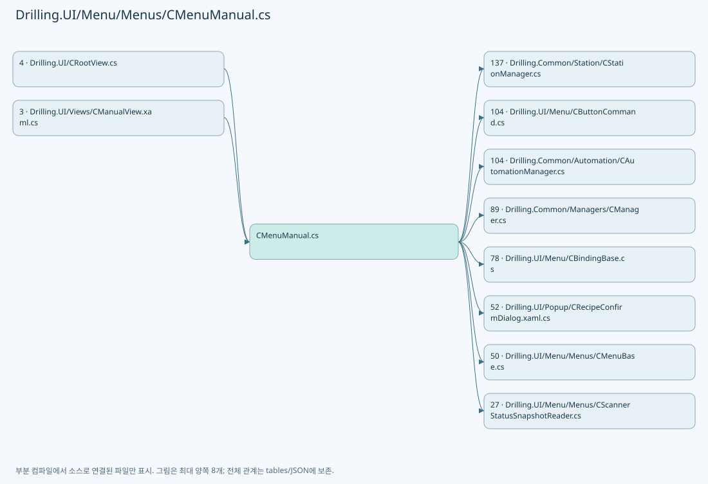

## 네임스페이스·타입·상속

| 타입 | 구분 | 원본 범위 | 선언/상속 |
| --- | --- | --- | --- |
| CMenuManual | ClassDeclaration | 26–6848 | CMenuManual: CMenuBase |
| ST_ACTIVE_DIO_TARGET | RecordStructDeclaration | 1688–1688 | ST_ACTIVE_DIO_TARGET |
| ST_MANUAL_SCRIPT_AXES | RecordStructDeclaration | 1689–1689 | ST_MANUAL_SCRIPT_AXES |
| ST_MANUAL_SCRIPT_Z_AXIS | RecordStructDeclaration | 1690–1690 | ST_MANUAL_SCRIPT_Z_AXIS |
| ST_CONTROLLER_HOME_TASK | RecordDeclaration | 1691–1691 | ST_CONTROLLER_HOME_TASK |
| ST_CONTROLLER_HOME_RUN | RecordDeclaration | 1692–1692 | ST_CONTROLLER_HOME_RUN |
| ST_RESET_SEQUENCE_AXIS_TARGET | RecordDeclaration | 1693–1693 | ST_RESET_SEQUENCE_AXIS_TARGET |
| ST_RESET_SEQUENCE_DIO_TARGET | RecordDeclaration | 1694–1694 | ST_RESET_SEQUENCE_DIO_TARGET |
| ST_MANUAL_SCAN_POSITION | RecordDeclaration | 4272–4277 | ST_MANUAL_SCAN_POSITION |
| CManualShapeScanRun | ClassDeclaration | 4603–4608 | CManualShapeScanRun |
| ST_MANUAL_SHAPE_SCAN_ROUTE | RecordDeclaration | 4610–4610 | ST_MANUAL_SHAPE_SCAN_ROUTE |
| ST_MANUAL_SHAPE_SCAN_PROGRAM | RecordDeclaration | 4611–4615 | ST_MANUAL_SHAPE_SCAN_PROGRAM |
| ST_MANUAL_LASER_OFF_TARGET | RecordDeclaration | 4941–4944 | ST_MANUAL_LASER_OFF_TARGET |
| CManualMofAlignPanel | ClassDeclaration | 6850–7002 | CManualMofAlignPanel: INotifyPropertyChanged |
| ST_MANUAL_MOF_ALIGN_STATE | RecordDeclaration | 7004–7004 | ST_MANUAL_MOF_ALIGN_STATE |
| CManualMofPreviewPanel | ClassDeclaration | 7006–7070 | CManualMofPreviewPanel: INotifyPropertyChanged |
| CManualMofRunPanel | ClassDeclaration | 7072–7224 | CManualMofRunPanel: INotifyPropertyChanged |
| CManualMofActionCard | ClassDeclaration | 7226–7257 | CManualMofActionCard: INotifyPropertyChanged |
| CManualMofStagePanel | ClassDeclaration | 7259–7486 | CManualMofStagePanel: INotifyPropertyChanged |
| ValueKind | EnumDeclaration | 7396–7401 | ValueKind |
| ST_MANUAL_MOF_STAGE_VALUE | RecordDeclaration | 7488–7488 | ST_MANUAL_MOF_STAGE_VALUE |
| CManualScanAssignments | ClassDeclaration | 7489–7544 | CManualScanAssignments: INotifyPropertyChanged |
| CManualScanAssignment | ClassDeclaration | 7546–7600 | CManualScanAssignment: INotifyPropertyChanged |
| CManualScannerSnapshotReader | ClassDeclaration | 7603–7794 | CManualScannerSnapshotReader |
| CManualStageMotionPollingService | ClassDeclaration | 7796–7867 | CManualStageMotionPollingService: CtrlThread |
| ST_MANUAL_STAGE_MOTION_VALUE | RecordDeclaration | 7869–7869 | ST_MANUAL_STAGE_MOTION_VALUE |
| ST_MANUAL_CONTROLLER_HEAD | ClassDeclaration | 7870–7954 | ST_MANUAL_CONTROLLER_HEAD: INotifyPropertyChanged |
| ST_MANUAL_HOME_SPEED_TARGET | RecordDeclaration | 7956–7956 | ST_MANUAL_HOME_SPEED_TARGET |
| ST_MANUAL_HOME_SPEED_HEAD | RecordDeclaration | 7957–7960 | ST_MANUAL_HOME_SPEED_HEAD |
| CManualHomeSpeedPanel | ClassDeclaration | 7963–8093 | CManualHomeSpeedPanel: INotifyPropertyChanged |
| CManualHomeSpeedAxis | ClassDeclaration | 8095–8192 | CManualHomeSpeedAxis: INotifyPropertyChanged |
| ST_MANUAL_HEAD_GROUP | RecordDeclaration | 8194–8194 | ST_MANUAL_HEAD_GROUP |
| ST_MANUAL_HEAD_CARD | RecordDeclaration | 8195–8212 | ST_MANUAL_HEAD_CARD |
| ST_MANUAL_SETTING_FILE | RecordDeclaration | 8214–8214 | ST_MANUAL_SETTING_FILE |
| ST_MANUAL_DIO_TARGET | RecordDeclaration | 8215–8215 | ST_MANUAL_DIO_TARGET |
| ST_MANUAL_VISION_PROTOCOL_COMMAND | RecordDeclaration | 8216–8222 | ST_MANUAL_VISION_PROTOCOL_COMMAND |
| ST_MANUAL_VISION_MARK_SEARCH | ClassDeclaration | 8224–8329 | ST_MANUAL_VISION_MARK_SEARCH: CBindingBase |
| ST_MANUAL_SCANNER_AXIS | RecordDeclaration | 8331–8413 | ST_MANUAL_SCANNER_AXIS |
| ST_MANUAL_STAGE_AXIS | ClassDeclaration | 8415–8537 | ST_MANUAL_STAGE_AXIS: CBindingBase |
| ST_MANUAL_PARAMETER | ClassDeclaration | 8539–8600 | ST_MANUAL_PARAMETER: CBindingBase |
| ST_MANUAL_COMMAND_STATE | ClassDeclaration | 8602–8656 | ST_MANUAL_COMMAND_STATE: CBindingBase |
| CManualMotionPanel | ClassDeclaration | 8658–8725 | CManualMotionPanel: INotifyPropertyChanged |
| CManualMotionAxis | ClassDeclaration | 8727–8767 | CManualMotionAxis: INotifyPropertyChanged |

## 멤버 빠른 목록

| 이름 | 종류 | 범위 | 서명 |
| --- | --- | --- | --- |
| _controllerHeadCache | FieldDeclaration | L29–29 | System.Collections.Generic.Dictionary<int, Drilling.UI.Menu.Menus.ST_MANUAL_CONTROLLER_HEAD> Drilling.UI.Menu.Menus.CMenuManual._controllerHeadCache |
| ManualControllerHeads | PropertyDeclaration | L30–30 | System.Collections.Generic.IReadOnlyList<Drilling.UI.Menu.Menus.ST_MANUAL_CONTROLLER_HEAD> Drilling.UI.Menu.Menus.CMenuManual.ManualControllerHeads |
| get_ManualControllerHeads | GetAccessorDeclaration | L30–30 | System.Collections.Generic.IReadOnlyList<Drilling.UI.Menu.Menus.ST_MANUAL_CONTROLLER_HEAD> Drilling.UI.Menu.Menus.CMenuManual.ManualControllerHeads.get |
| set_ManualControllerHeads | SetAccessorDeclaration | L30–30 | void Drilling.UI.Menu.Menus.CMenuManual.ManualControllerHeads.set |
| _scannerAxisClearFaultCommand | FieldDeclaration | L32–32 | Drilling.UI.Menu.CButtonCommand? Drilling.UI.Menu.Menus.CMenuManual._scannerAxisClearFaultCommand |
| _clearingAxisFaults | FieldDeclaration | L33–33 | System.Collections.Generic.HashSet<(int Controller, string Axis)>? Drilling.UI.Menu.Menus.CMenuManual._clearingAxisFaults |
| _homeSpeedPanel | FieldDeclaration | L34–34 | Drilling.UI.Menu.Menus.CManualHomeSpeedPanel? Drilling.UI.Menu.Menus.CMenuManual._homeSpeedPanel |
| _homeSpeedController | FieldDeclaration | L35–35 | int? Drilling.UI.Menu.Menus.CMenuManual._homeSpeedController |
| _homeSpeedDialog | FieldDeclaration | L36–36 | Drilling.UI.Popup.CManualHomeSpeedDialog? Drilling.UI.Menu.Menus.CMenuManual._homeSpeedDialog |
| _openHomeSpeedSettingsCommand | FieldDeclaration | L37–37 | Drilling.UI.Menu.CButtonCommand? Drilling.UI.Menu.Menus.CMenuManual._openHomeSpeedSettingsCommand |
| _readAutomationStatus | FieldDeclaration | L38–38 | System.Func<Drilling.Common.Station.ST_STATION_PROCESS_STATUS, System.Collections.Generic.IReadOnlyDictionary<string, string>, System.Threading.CancellationToken, System.Collections.Generic.IReadOnlyList<Drilling.UI.Menu.Menus.ST_AUTOMATION_CONTROLLER_STATUS_ITEM>>? Drilling.UI.Menu.Menus.CMenuManual._readAutomationStatus |
| _automationStatusParameters | FieldDeclaration | L39–39 | System.Collections.Generic.IReadOnlyDictionary<string, string> Drilling.UI.Menu.Menus.CMenuManual._automationStatusParameters |
| AutomationControllerStatusItems | PropertyDeclaration | L40–40 | System.Collections.Generic.IReadOnlyList<Drilling.UI.Menu.Menus.ST_AUTOMATION_CONTROLLER_STATUS_ITEM> Drilling.UI.Menu.Menus.CMenuManual.AutomationControllerStatusItems |
| get_AutomationControllerStatusItems | GetAccessorDeclaration | L40–40 | System.Collections.Generic.IReadOnlyList<Drilling.UI.Menu.Menus.ST_AUTOMATION_CONTROLLER_STATUS_ITEM> Drilling.UI.Menu.Menus.CMenuManual.AutomationControllerStatusItems.get |
| set_AutomationControllerStatusItems | SetAccessorDeclaration | L40–40 | void Drilling.UI.Menu.Menus.CMenuManual.AutomationControllerStatusItems.set |
| _mofDisableBusy | FieldDeclaration | L42–42 | bool Drilling.UI.Menu.Menus.CMenuManual._mofDisableBusy |
| MofPreview | PropertyDeclaration | L43–43 | Drilling.UI.Menu.Menus.CManualMofPreviewPanel Drilling.UI.Menu.Menus.CMenuManual.MofPreview |
| get_MofPreview | GetAccessorDeclaration | L43–43 | Drilling.UI.Menu.Menus.CManualMofPreviewPanel Drilling.UI.Menu.Menus.CMenuManual.MofPreview.get |
| ManualTaskIndex | FieldDeclaration | L45–45 | int Drilling.UI.Menu.Menus.CMenuManual.ManualTaskIndex |
| SettingFilesPageSize | FieldDeclaration | L46–46 | int Drilling.UI.Menu.Menus.CMenuManual.SettingFilesPageSize |
| UnconfiguredScannerDioNo | FieldDeclaration | L47–47 | int Drilling.UI.Menu.Menus.CMenuManual.UnconfiguredScannerDioNo |
| ResetSequenceResetTimeout | FieldDeclaration | L48–48 | System.TimeSpan Drilling.UI.Menu.Menus.CMenuManual.ResetSequenceResetTimeout |
| ResetSequenceEnableTimeout | FieldDeclaration | L49–49 | System.TimeSpan Drilling.UI.Menu.Menus.CMenuManual.ResetSequenceEnableTimeout |
| ResetSequenceHomeTimeout | FieldDeclaration | L50–50 | System.TimeSpan Drilling.UI.Menu.Menus.CMenuManual.ResetSequenceHomeTimeout |
| ResetSequenceDioTimeout | FieldDeclaration | L51–51 | System.TimeSpan Drilling.UI.Menu.Menus.CMenuManual.ResetSequenceDioTimeout |
| ResetSequenceCommandTimeout | FieldDeclaration | L52–52 | System.TimeSpan Drilling.UI.Menu.Menus.CMenuManual.ResetSequenceCommandTimeout |
| ResetSequencePollInterval | FieldDeclaration | L53–53 | System.TimeSpan Drilling.UI.Menu.Menus.CMenuManual.ResetSequencePollInterval |
| _manager | FieldDeclaration | L54–54 | Drilling.Common.Managers.CManager Drilling.UI.Menu.Menus.CMenuManual._manager |
| _scanFile | FieldDeclaration | L55–55 | Drilling.Common.Managers.CManualScanFileBase Drilling.UI.Menu.Menus.CMenuManual._scanFile |
| _scriptFile | FieldDeclaration | L56–56 | Drilling.Common.Station.CAutomationScriptFileBase Drilling.UI.Menu.Menus.CMenuManual._scriptFile |
| _scannerStatusSnapshotReader | FieldDeclaration | L57–57 | Drilling.UI.Menu.Menus.CManualScannerSnapshotReader Drilling.UI.Menu.Menus.CMenuManual._scannerStatusSnapshotReader |
| _stageMotionPollingService | FieldDeclaration | L58–58 | Drilling.UI.Menu.Menus.CManualStageMotionPollingService Drilling.UI.Menu.Menus.CMenuManual._stageMotionPollingService |
| _selectedHeadNoProvider | FieldDeclaration | L59–59 | System.Func<int> Drilling.UI.Menu.Menus.CMenuManual._selectedHeadNoProvider |
| _selectedRecipeIdProvider | FieldDeclaration | L60–60 | System.Func<string> Drilling.UI.Menu.Menus.CMenuManual._selectedRecipeIdProvider |
| _selectedSettingNameProvider | FieldDeclaration | L61–61 | System.Func<string> Drilling.UI.Menu.Menus.CMenuManual._selectedSettingNameProvider |
| _selectedSettingNameSetter | FieldDeclaration | L62–62 | System.Action<string> Drilling.UI.Menu.Menus.CMenuManual._selectedSettingNameSetter |
| _setStatusMessage | FieldDeclaration | L63–63 | System.Action<string> Drilling.UI.Menu.Menus.CMenuManual._setStatusMessage |
| _refreshShellStatus | FieldDeclaration | L64–64 | System.Action Drilling.UI.Menu.Menus.CMenuManual._refreshShellStatus |
| _refreshCurrentScreen | FieldDeclaration | L65–65 | System.Func<System.Threading.Tasks.Task> Drilling.UI.Menu.Menus.CMenuManual._refreshCurrentScreen |
| _menuLifetimeSync | FieldDeclaration | L66–66 | object Drilling.UI.Menu.Menus.CMenuManual._menuLifetimeSync |
| _menuLifetimeCancellation | FieldDeclaration | L67–67 | System.Threading.CancellationTokenSource Drilling.UI.Menu.Menus.CMenuManual._menuLifetimeCancellation |
| _statusPollingCancellation | FieldDeclaration | L68–68 | System.Threading.CancellationTokenSource? Drilling.UI.Menu.Menus.CMenuManual._statusPollingCancellation |
| _targetGx | FieldDeclaration | L69–69 | string Drilling.UI.Menu.Menus.CMenuManual._targetGx |
| _targetGy | FieldDeclaration | L70–70 | string Drilling.UI.Menu.Menus.CMenuManual._targetGy |
| _targetGz | FieldDeclaration | L71–71 | string Drilling.UI.Menu.Menus.CMenuManual._targetGz |
| _lastBuiltHeadNo | FieldDeclaration | L72–72 | int Drilling.UI.Menu.Menus.CMenuManual._lastBuiltHeadNo |
| _laserState | FieldDeclaration | L73–73 | string Drilling.UI.Menu.Menus.CMenuManual._laserState |
| _centerState | FieldDeclaration | L74–74 | string Drilling.UI.Menu.Menus.CMenuManual._centerState |
| _lastCommand | FieldDeclaration | L75–75 | string Drilling.UI.Menu.Menus.CMenuManual._lastCommand |
| _lastResult | FieldDeclaration | L76–76 | string Drilling.UI.Menu.Menus.CMenuManual._lastResult |
| _lastManualScriptAutomationNo | FieldDeclaration | L77–77 | int? Drilling.UI.Menu.Menus.CMenuManual._lastManualScriptAutomationNo |
| _lastLoadedSettingName | FieldDeclaration | L78–78 | string Drilling.UI.Menu.Menus.CMenuManual._lastLoadedSettingName |
| _lastSettingListSelectedName | FieldDeclaration | L79–79 | string Drilling.UI.Menu.Menus.CMenuManual._lastSettingListSelectedName |
| _settingFilesPageText | FieldDeclaration | L80–80 | string Drilling.UI.Menu.Menus.CMenuManual._settingFilesPageText |
| _settingFilesPageIndex | FieldDeclaration | L81–81 | int Drilling.UI.Menu.Menus.CMenuManual._settingFilesPageIndex |
| _settingFilesPageCount | FieldDeclaration | L82–82 | int Drilling.UI.Menu.Menus.CMenuManual._settingFilesPageCount |
| _manualScannerOptionSettings | FieldDeclaration | L83–83 | System.Collections.Generic.IReadOnlyList<Drilling.Common.Managers.ST_SYSTEM_PARAMETER> Drilling.UI.Menu.Menus.CMenuManual._manualScannerOptionSettings |
| _headGroups | FieldDeclaration | L84–84 | System.Collections.Generic.IReadOnlyList<Drilling.UI.Menu.Menus.ST_MANUAL_HEAD_GROUP> Drilling.UI.Menu.Menus.CMenuManual._headGroups |
| _settingFiles | FieldDeclaration | L85–85 | System.Collections.Generic.IReadOnlyList<Drilling.UI.Menu.Menus.ST_MANUAL_SETTING_FILE> Drilling.UI.Menu.Menus.CMenuManual._settingFiles |
| _shapeSize | FieldDeclaration | L86–86 | string Drilling.UI.Menu.Menus.CMenuManual._shapeSize |
| _shapeOffsetX | FieldDeclaration | L87–87 | string Drilling.UI.Menu.Menus.CMenuManual._shapeOffsetX |
| _shapeOffsetY | FieldDeclaration | L88–88 | string Drilling.UI.Menu.Menus.CMenuManual._shapeOffsetY |
| _shapeDirection | FieldDeclaration | L89–89 | string Drilling.UI.Menu.Menus.CMenuManual._shapeDirection |
| _shapeName | FieldDeclaration | L90–90 | string Drilling.UI.Menu.Menus.CMenuManual._shapeName |
| _gridRowLines | FieldDeclaration | L91–91 | string Drilling.UI.Menu.Menus.CMenuManual._gridRowLines |
| _gridColLines | FieldDeclaration | L92–92 | string Drilling.UI.Menu.Menus.CMenuManual._gridColLines |
| _laserOnMode | FieldDeclaration | L93–93 | string Drilling.UI.Menu.Menus.CMenuManual._laserOnMode |
| _laserOnTimeMsec | FieldDeclaration | L94–94 | string Drilling.UI.Menu.Menus.CMenuManual._laserOnTimeMsec |
| _laserShotCount | FieldDeclaration | L95–95 | string Drilling.UI.Menu.Menus.CMenuManual._laserShotCount |
| _laserRepeatCount | FieldDeclaration | L96–96 | string Drilling.UI.Menu.Menus.CMenuManual._laserRepeatCount |
| _laserRepeatDelayTimeMsec | FieldDeclaration | L97–97 | string Drilling.UI.Menu.Menus.CMenuManual._laserRepeatDelayTimeMsec |
| _laserActionPower | FieldDeclaration | L98–98 | string Drilling.UI.Menu.Menus.CMenuManual._laserActionPower |
| _laserActionFrequency | FieldDeclaration | L99–99 | string Drilling.UI.Menu.Menus.CMenuManual._laserActionFrequency |
| _dioAddress | FieldDeclaration | L100–100 | string Drilling.UI.Menu.Menus.CMenuManual._dioAddress |
| _dioAxisName | FieldDeclaration | L101–101 | string Drilling.UI.Menu.Menus.CMenuManual._dioAxisName |
| _dioNo | FieldDeclaration | L102–102 | string Drilling.UI.Menu.Menus.CMenuManual._dioNo |
| _dioCurrentValue | FieldDeclaration | L103–103 | string Drilling.UI.Menu.Menus.CMenuManual._dioCurrentValue |
| _dioLastResult | FieldDeclaration | L104–104 | string Drilling.UI.Menu.Menus.CMenuManual._dioLastResult |
| _dioAutomationNo | FieldDeclaration | L105–105 | int Drilling.UI.Menu.Menus.CMenuManual._dioAutomationNo |
| _dioGeneration | FieldDeclaration | L106–106 | long Drilling.UI.Menu.Menus.CMenuManual._dioGeneration |
| _scannerAxes | FieldDeclaration | L107–107 | System.Collections.Generic.IReadOnlyList<Drilling.UI.Menu.Menus.ST_MANUAL_SCANNER_AXIS> Drilling.UI.Menu.Menus.CMenuManual._scannerAxes |
| _hasScannerTargetSnapshot | FieldDeclaration | L108–108 | bool Drilling.UI.Menu.Menus.CMenuManual._hasScannerTargetSnapshot |
| _isDioTargetReady | FieldDeclaration | L109–109 | bool Drilling.UI.Menu.Menus.CMenuManual._isDioTargetReady |
| _isDioControlBusy | FieldDeclaration | L110–110 | bool Drilling.UI.Menu.Menus.CMenuManual._isDioControlBusy |
| _isScannerWorkspace | FieldDeclaration | L111–111 | bool Drilling.UI.Menu.Menus.CMenuManual._isScannerWorkspace |
| _selectedStageAxis | FieldDeclaration | L112–112 | Drilling.UI.Menu.Menus.ST_MANUAL_STAGE_AXIS Drilling.UI.Menu.Menus.CMenuManual._selectedStageAxis |
| _selectedVisionProtocolCommand | FieldDeclaration | L113–113 | Drilling.UI.Menu.Menus.ST_MANUAL_VISION_PROTOCOL_COMMAND Drilling.UI.Menu.Menus.CMenuManual._selectedVisionProtocolCommand |
| _visionProtocolInspectionType | FieldDeclaration | L114–114 | string Drilling.UI.Menu.Menus.CMenuManual._visionProtocolInspectionType |
| _visionProtocolEndpoint | FieldDeclaration | L115–115 | string Drilling.UI.Menu.Menus.CMenuManual._visionProtocolEndpoint |
| _visionProtocolStatus | FieldDeclaration | L116–116 | string Drilling.UI.Menu.Menus.CMenuManual._visionProtocolStatus |
| _visionProtocolKeepAlive | FieldDeclaration | L117–117 | string Drilling.UI.Menu.Menus.CMenuManual._visionProtocolKeepAlive |
| _isVisionProtocolBusy | FieldDeclaration | L118–118 | bool Drilling.UI.Menu.Menus.CMenuManual._isVisionProtocolBusy |
| ManualSettings | PropertyDeclaration | L119–119 | System.Collections.Generic.IReadOnlyList<Drilling.UI.Menu.Menus.ST_DISPLAY_ITEM> Drilling.UI.Menu.Menus.CMenuManual.ManualSettings |
| get_ManualSettings | GetAccessorDeclaration | L119–119 | System.Collections.Generic.IReadOnlyList<Drilling.UI.Menu.Menus.ST_DISPLAY_ITEM> Drilling.UI.Menu.Menus.CMenuManual.ManualSettings.get |
| set_ManualSettings | SetAccessorDeclaration | L119–119 | void Drilling.UI.Menu.Menus.CMenuManual.ManualSettings.set |
| SelectedHeadItems | PropertyDeclaration | L120–120 | System.Collections.Generic.IReadOnlyList<Drilling.UI.Menu.Menus.ST_DISPLAY_ITEM> Drilling.UI.Menu.Menus.CMenuManual.SelectedHeadItems |
| get_SelectedHeadItems | GetAccessorDeclaration | L120–120 | System.Collections.Generic.IReadOnlyList<Drilling.UI.Menu.Menus.ST_DISPLAY_ITEM> Drilling.UI.Menu.Menus.CMenuManual.SelectedHeadItems.get |
| set_SelectedHeadItems | SetAccessorDeclaration | L120–120 | void Drilling.UI.Menu.Menus.CMenuManual.SelectedHeadItems.set |
| PositionMoveItems | PropertyDeclaration | L121–121 | System.Collections.Generic.IReadOnlyList<Drilling.UI.Menu.Menus.ST_DISPLAY_ITEM> Drilling.UI.Menu.Menus.CMenuManual.PositionMoveItems |
| get_PositionMoveItems | GetAccessorDeclaration | L121–121 | System.Collections.Generic.IReadOnlyList<Drilling.UI.Menu.Menus.ST_DISPLAY_ITEM> Drilling.UI.Menu.Menus.CMenuManual.PositionMoveItems.get |
| set_PositionMoveItems | SetAccessorDeclaration | L121–121 | void Drilling.UI.Menu.Menus.CMenuManual.PositionMoveItems.set |
| ShapeScanItems | PropertyDeclaration | L122–122 | System.Collections.Generic.IReadOnlyList<Drilling.UI.Menu.Menus.ST_DISPLAY_ITEM> Drilling.UI.Menu.Menus.CMenuManual.ShapeScanItems |
| get_ShapeScanItems | GetAccessorDeclaration | L122–122 | System.Collections.Generic.IReadOnlyList<Drilling.UI.Menu.Menus.ST_DISPLAY_ITEM> Drilling.UI.Menu.Menus.CMenuManual.ShapeScanItems.get |
| set_ShapeScanItems | SetAccessorDeclaration | L122–122 | void Drilling.UI.Menu.Menus.CMenuManual.ShapeScanItems.set |
| CommandStateItems | PropertyDeclaration | L123–123 | System.Collections.Generic.IReadOnlyList<Drilling.UI.Menu.Menus.ST_DISPLAY_ITEM> Drilling.UI.Menu.Menus.CMenuManual.CommandStateItems |
| get_CommandStateItems | GetAccessorDeclaration | L123–123 | System.Collections.Generic.IReadOnlyList<Drilling.UI.Menu.Menus.ST_DISPLAY_ITEM> Drilling.UI.Menu.Menus.CMenuManual.CommandStateItems.get |
| set_CommandStateItems | SetAccessorDeclaration | L123–123 | void Drilling.UI.Menu.Menus.CMenuManual.CommandStateItems.set |
| SelectedHead | PropertyDeclaration | L124–124 | string Drilling.UI.Menu.Menus.CMenuManual.SelectedHead |
| get_SelectedHead | GetAccessorDeclaration | L124–124 | string Drilling.UI.Menu.Menus.CMenuManual.SelectedHead.get |
| set_SelectedHead | SetAccessorDeclaration | L124–124 | void Drilling.UI.Menu.Menus.CMenuManual.SelectedHead.set |
| LoadedSettingName | PropertyDeclaration | L125–125 | string Drilling.UI.Menu.Menus.CMenuManual.LoadedSettingName |
| get_LoadedSettingName | GetAccessorDeclaration | L125–125 | string Drilling.UI.Menu.Menus.CMenuManual.LoadedSettingName.get |
| set_LoadedSettingName | SetAccessorDeclaration | L125–125 | void Drilling.UI.Menu.Menus.CMenuManual.LoadedSettingName.set |
| LoadedSettingPath | PropertyDeclaration | L126–126 | string Drilling.UI.Menu.Menus.CMenuManual.LoadedSettingPath |
| get_LoadedSettingPath | GetAccessorDeclaration | L126–126 | string Drilling.UI.Menu.Menus.CMenuManual.LoadedSettingPath.get |
| set_LoadedSettingPath | SetAccessorDeclaration | L126–126 | void Drilling.UI.Menu.Menus.CMenuManual.LoadedSettingPath.set |
| HeadCards | PropertyDeclaration | L127–127 | System.Collections.Generic.IReadOnlyList<Drilling.UI.Menu.Menus.ST_MANUAL_HEAD_CARD> Drilling.UI.Menu.Menus.CMenuManual.HeadCards |
| get_HeadCards | GetAccessorDeclaration | L127–127 | System.Collections.Generic.IReadOnlyList<Drilling.UI.Menu.Menus.ST_MANUAL_HEAD_CARD> Drilling.UI.Menu.Menus.CMenuManual.HeadCards.get |
| set_HeadCards | SetAccessorDeclaration | L127–127 | void Drilling.UI.Menu.Menus.CMenuManual.HeadCards.set |
| SettingParameters | PropertyDeclaration | L128–128 | System.Collections.Generic.IReadOnlyList<Drilling.UI.Menu.Menus.ST_MANUAL_PARAMETER> Drilling.UI.Menu.Menus.CMenuManual.SettingParameters |
| get_SettingParameters | GetAccessorDeclaration | L128–128 | System.Collections.Generic.IReadOnlyList<Drilling.UI.Menu.Menus.ST_MANUAL_PARAMETER> Drilling.UI.Menu.Menus.CMenuManual.SettingParameters.get |
| set_SettingParameters | SetAccessorDeclaration | L128–128 | void Drilling.UI.Menu.Menus.CMenuManual.SettingParameters.set |
| CommandStateRows | PropertyDeclaration | L129–129 | System.Collections.Generic.IReadOnlyList<Drilling.UI.Menu.Menus.ST_MANUAL_COMMAND_STATE> Drilling.UI.Menu.Menus.CMenuManual.CommandStateRows |
| get_CommandStateRows | GetAccessorDeclaration | L129–129 | System.Collections.Generic.IReadOnlyList<Drilling.UI.Menu.Menus.ST_MANUAL_COMMAND_STATE> Drilling.UI.Menu.Menus.CMenuManual.CommandStateRows.get |
| set_CommandStateRows | SetAccessorDeclaration | L129–129 | void Drilling.UI.Menu.Menus.CMenuManual.CommandStateRows.set |
| VisionProtocolLogs | PropertyDeclaration | L130–130 | System.Collections.ObjectModel.ObservableCollection<string> Drilling.UI.Menu.Menus.CMenuManual.VisionProtocolLogs |
| get_VisionProtocolLogs | GetAccessorDeclaration | L130–130 | System.Collections.ObjectModel.ObservableCollection<string> Drilling.UI.Menu.Menus.CMenuManual.VisionProtocolLogs.get |
| VisionProtocolMarkRows | PropertyDeclaration | L131–131 | System.Collections.ObjectModel.ObservableCollection<Drilling.UI.Menu.Menus.ST_MANUAL_VISION_MARK_SEARCH> Drilling.UI.Menu.Menus.CMenuManual.VisionProtocolMarkRows |
| get_VisionProtocolMarkRows | GetAccessorDeclaration | L131–131 | System.Collections.ObjectModel.ObservableCollection<Drilling.UI.Menu.Menus.ST_MANUAL_VISION_MARK_SEARCH> Drilling.UI.Menu.Menus.CMenuManual.VisionProtocolMarkRows.get |
| _mofAlign | FieldDeclaration | L133–133 | Drilling.UI.Menu.Menus.CManualMofAlignPanel? Drilling.UI.Menu.Menus.CMenuManual._mofAlign |
| _mofStage | FieldDeclaration | L134–134 | Drilling.UI.Menu.Menus.CManualMofStagePanel? Drilling.UI.Menu.Menus.CMenuManual._mofStage |
| _manualStageMoveOperation | FieldDeclaration | L135–135 | Drilling.UI.Menu.Menus.CManualStageMoveOperation? Drilling.UI.Menu.Menus.CMenuManual._manualStageMoveOperation |
| IsManualStageMovePending | PropertyDeclaration | L136–136 | bool Drilling.UI.Menu.Menus.CMenuManual.IsManualStageMovePending |
| HasActiveOperation | PropertyDeclaration | L137–144 | bool Drilling.UI.Menu.Menus.CMenuManual.HasActiveOperation |
| _mofRun | FieldDeclaration | L145–145 | Drilling.UI.Menu.Menus.CManualMofRunPanel? Drilling.UI.Menu.Menus.CMenuManual._mofRun |
| _manualMofShiftOffsetProvider | FieldDeclaration | L146–146 | System.Func<(double X, double Y)> Drilling.UI.Menu.Menus.CMenuManual._manualMofShiftOffsetProvider |
| _motionPanel | FieldDeclaration | L147–147 | Drilling.UI.Menu.Menus.CManualMotionPanel? Drilling.UI.Menu.Menus.CMenuManual._motionPanel |
| _motionSession | FieldDeclaration | L148–148 | Drilling.Common.Automation.CManualMotionSession? Drilling.UI.Menu.Menus.CMenuManual._motionSession |
| _manualMotionTargets | FieldDeclaration | L149–149 | System.Collections.Generic.HashSet<(int Controller, string Axis)> Drilling.UI.Menu.Menus.CMenuManual._manualMotionTargets |
| _stoppingMotionJog | FieldDeclaration | L150–150 | bool Drilling.UI.Menu.Menus.CMenuManual._stoppingMotionJog |
| _motionErrorOpen | FieldDeclaration | L151–151 | bool Drilling.UI.Menu.Menus.CMenuManual._motionErrorOpen |
| _manualMotionScriptCancellation | FieldDeclaration | L152–152 | System.Threading.CancellationTokenSource? Drilling.UI.Menu.Menus.CMenuManual._manualMotionScriptCancellation |
| _manualMotionScriptTask | FieldDeclaration | L153–153 | (int Controller, int Task)? Drilling.UI.Menu.Menus.CMenuManual._manualMotionScriptTask |
| _manualMotionStopPending | FieldDeclaration | L154–154 | bool Drilling.UI.Menu.Menus.CMenuManual._manualMotionStopPending |
| _scanAssignments | FieldDeclaration | L155–155 | Drilling.UI.Menu.Menus.CManualScanAssignments? Drilling.UI.Menu.Menus.CMenuManual._scanAssignments |
| _manualScanSettingNames | FieldDeclaration | L156–156 | System.Collections.Generic.IReadOnlyList<string> Drilling.UI.Menu.Menus.CMenuManual._manualScanSettingNames |
| _activeManualShapeScan | FieldDeclaration | L157–157 | Drilling.UI.Menu.Menus.CMenuManual.CManualShapeScanRun? Drilling.UI.Menu.Menus.CMenuManual._activeManualShapeScan |
| _manualShapeScanPendingStops | FieldDeclaration | L158–158 | System.Collections.Generic.IReadOnlyList<Drilling.UI.Menu.Menus.CMenuManual.ST_MANUAL_SHAPE_SCAN_PROGRAM>? Drilling.UI.Menu.Menus.CMenuManual._manualShapeScanPendingStops |
| _manualShapeScanAttenuatorPositioning | FieldDeclaration | L159–159 | Drilling.Common.Interface.CAttenuatorPositioningService? Drilling.UI.Menu.Menus.CMenuManual._manualShapeScanAttenuatorPositioning |
| _manualShapeScanStopInProgress | FieldDeclaration | L160–160 | bool Drilling.UI.Menu.Menus.CMenuManual._manualShapeScanStopInProgress |
| _activeManualLaserAction | FieldDeclaration | L161–161 | Drilling.UI.Menu.Menus.CMenuManual.CManualShapeScanRun? Drilling.UI.Menu.Menus.CMenuManual._activeManualLaserAction |
| _manualLaserOffInProgress | FieldDeclaration | L162–162 | bool Drilling.UI.Menu.Menus.CMenuManual._manualLaserOffInProgress |
| _manualLaserOffUnconfirmed | FieldDeclaration | L163–163 | bool Drilling.UI.Menu.Menus.CMenuManual._manualLaserOffUnconfirmed |
| _manualLaserOffPendingTargets | FieldDeclaration | L164–164 | System.Collections.Generic.IReadOnlyList<Drilling.UI.Menu.Menus.CMenuManual.ST_MANUAL_LASER_OFF_TARGET> Drilling.UI.Menu.Menus.CMenuManual._manualLaserOffPendingTargets |
| _manualControlTab | FieldDeclaration | L165–165 | string Drilling.UI.Menu.Menus.CMenuManual._manualControlTab |
| _selectedManualHeadNos | FieldDeclaration | L166–166 | System.Collections.Generic.HashSet<int> Drilling.UI.Menu.Menus.CMenuManual._selectedManualHeadNos |
| _manualHeadSelectionInitialized | FieldDeclaration | L167–167 | bool Drilling.UI.Menu.Menus.CMenuManual._manualHeadSelectionInitialized |
| _selectFocusedHeadCommand | FieldDeclaration | L168–168 | Drilling.UI.Menu.CButtonCommand Drilling.UI.Menu.Menus.CMenuManual._selectFocusedHeadCommand |
| _powerMeasurePanel | FieldDeclaration | L169–169 | Drilling.UI.Menu.Menus.CManualPowerMeasurePanel? Drilling.UI.Menu.Menus.CMenuManual._powerMeasurePanel |
| .ctor | ConstructorDeclaration | L172–432 | Drilling.UI.Menu.Menus.CMenuManual.CMenuManual(Drilling.Common.Managers.CManager, Drilling.Common.Managers.CManualScanFileBase, Drilling.Common.Station.CAutomationScriptFileBase, System.Func<int>, System.Func<string>, System.Func<string>, System.Action<string>, Drilling.UI.Menu.CButtonCommand, System.Action<string>, System.Action, System.Func<System.Threading.Tasks.Task>, System.Func<(double X, double Y)>?) |
| SelectSettingCallback | LocalFunctionStatement | L206–209 | void SelectSettingCallback(object?) |
| ShowPreviousSettingPageCallback | LocalFunctionStatement | L212–215 | void ShowPreviousSettingPageCallback(object?) |
| CanShowPreviousSettingPageCallback | LocalFunctionStatement | L217–220 | bool CanShowPreviousSettingPageCallback(object?) |
| ShowNextSettingPageCallback | LocalFunctionStatement | L223–226 | void ShowNextSettingPageCallback(object?) |
| CanShowNextSettingPageCallback | LocalFunctionStatement | L228–231 | bool CanShowNextSettingPageCallback(object?) |
| CreateSettingCallback | LocalFunctionStatement | L234–237 | void CreateSettingCallback(object?) |
| DeleteSettingCallback | LocalFunctionStatement | L240–243 | void DeleteSettingCallback(object?) |
| RenameSettingCallback | LocalFunctionStatement | L246–249 | void RenameSettingCallback(object?) |
| SaveSettingCallback | LocalFunctionStatement | L252–255 | void SaveSettingCallback(object?) |
| CenterMoveCallback | LocalFunctionStatement | L258–261 | void CenterMoveCallback(object?) |
| PositionMoveCallback | LocalFunctionStatement | L264–267 | void PositionMoveCallback(object?) |
| ZPositionMoveCallback | LocalFunctionStatement | L270–273 | void ZPositionMoveCallback(object?) |
| MoveStopCallback | LocalFunctionStatement | L276–279 | void MoveStopCallback(object?) |
| SelectShapeCallback | LocalFunctionStatement | L282–285 | void SelectShapeCallback(object?) |
| ShapeStartCallback | LocalFunctionStatement | L288–291 | void ShapeStartCallback(object?) |
| ShapeStopCallback | LocalFunctionStatement | L294–297 | void ShapeStopCallback(object?) |
| LaserOnCallback | LocalFunctionStatement | L300–303 | void LaserOnCallback(object?) |
| LaserOffCallback | LocalFunctionStatement | L306–309 | void LaserOffCallback(object?) |
| CenterOnCallback | LocalFunctionStatement | L312–315 | void CenterOnCallback(object?) |
| DioReadCallback | LocalFunctionStatement | L318–321 | void DioReadCallback(object?) |
| DioOnCallback | LocalFunctionStatement | L324–327 | void DioOnCallback(object?) |
| DioOffCallback | LocalFunctionStatement | L330–333 | void DioOffCallback(object?) |
| ScannerAxisHomeCallback | LocalFunctionStatement | L336–339 | void ScannerAxisHomeCallback(object?) |
| ScannerAxisEnableCallback | LocalFunctionStatement | L342–345 | void ScannerAxisEnableCallback(object?) |
| ScannerAxisDisableCallback | LocalFunctionStatement | L348–351 | void ScannerAxisDisableCallback(object?) |
| ResetAutomationControllerCallback | LocalFunctionStatement | L354–357 | void ResetAutomationControllerCallback(object?) |
| HomeAutomationControllerAxesCallback | LocalFunctionStatement | L360–363 | void HomeAutomationControllerAxesCallback(object?) |
| DisableControllerMofCallback | LocalFunctionStatement | L366–366 | void DisableControllerMofCallback(object?) |
| SendVisionProtocolCallback | LocalFunctionStatement | L384–387 | void SendVisionProtocolCallback(object?) |
| CanSendVisionProtocol | LocalFunctionStatement | L398–401 | bool CanSendVisionProtocol(object?) |
| RefreshVisionProtocolCallback | LocalFunctionStatement | L403–406 | void RefreshVisionProtocolCallback(object?) |
| ClearVisionProtocolLogCallback | LocalFunctionStatement | L408–411 | void ClearVisionProtocolLogCallback(object?) |
| AddVisionProtocolMarkCallback | LocalFunctionStatement | L413–416 | void AddVisionProtocolMarkCallback(object?) |
| CanAddVisionProtocolMark | LocalFunctionStatement | L418–421 | bool CanAddVisionProtocolMark(object?) |
| RemoveVisionProtocolMarkCallback | LocalFunctionStatement | L423–426 | void RemoveVisionProtocolMarkCallback(object?) |
| CanRemoveVisionProtocolMark | LocalFunctionStatement | L428–431 | bool CanRemoveVisionProtocolMark(object?) |
| Menu | PropertyDeclaration | L436–442 | Drilling.UI.Menu.Menus.EN_MENU Drilling.UI.Menu.Menus.CMenuManual.Menu |
| get_Menu | GetAccessorDeclaration | L438–441 | Drilling.UI.Menu.Menus.EN_MENU Drilling.UI.Menu.Menus.CMenuManual.Menu.get |
| StopScannerStatusPolling | MethodDeclaration | L444–451 | void Drilling.UI.Menu.Menus.CMenuManual.StopScannerStatusPolling() |
| TargetGx | PropertyDeclaration | L453–464 | string Drilling.UI.Menu.Menus.CMenuManual.TargetGx |
| get_TargetGx | GetAccessorDeclaration | L455–458 | string Drilling.UI.Menu.Menus.CMenuManual.TargetGx.get |
| set_TargetGx | SetAccessorDeclaration | L460–463 | void Drilling.UI.Menu.Menus.CMenuManual.TargetGx.set |
| TargetGy | PropertyDeclaration | L466–477 | string Drilling.UI.Menu.Menus.CMenuManual.TargetGy |
| get_TargetGy | GetAccessorDeclaration | L468–471 | string Drilling.UI.Menu.Menus.CMenuManual.TargetGy.get |
| set_TargetGy | SetAccessorDeclaration | L473–476 | void Drilling.UI.Menu.Menus.CMenuManual.TargetGy.set |
| TargetGz | PropertyDeclaration | L479–490 | string Drilling.UI.Menu.Menus.CMenuManual.TargetGz |
| get_TargetGz | GetAccessorDeclaration | L481–484 | string Drilling.UI.Menu.Menus.CMenuManual.TargetGz.get |
| set_TargetGz | SetAccessorDeclaration | L486–489 | void Drilling.UI.Menu.Menus.CMenuManual.TargetGz.set |
| IsZPositionMoveEnabled | PropertyDeclaration | L492–498 | bool Drilling.UI.Menu.Menus.CMenuManual.IsZPositionMoveEnabled |
| get_IsZPositionMoveEnabled | GetAccessorDeclaration | L494–497 | bool Drilling.UI.Menu.Menus.CMenuManual.IsZPositionMoveEnabled.get |
| ShapeSize | PropertyDeclaration | L500–511 | string Drilling.UI.Menu.Menus.CMenuManual.ShapeSize |
| get_ShapeSize | GetAccessorDeclaration | L502–505 | string Drilling.UI.Menu.Menus.CMenuManual.ShapeSize.get |
| set_ShapeSize | SetAccessorDeclaration | L507–510 | void Drilling.UI.Menu.Menus.CMenuManual.ShapeSize.set |
| ShapeOffsetX | PropertyDeclaration | L513–524 | string Drilling.UI.Menu.Menus.CMenuManual.ShapeOffsetX |
| get_ShapeOffsetX | GetAccessorDeclaration | L515–518 | string Drilling.UI.Menu.Menus.CMenuManual.ShapeOffsetX.get |
| set_ShapeOffsetX | SetAccessorDeclaration | L520–523 | void Drilling.UI.Menu.Menus.CMenuManual.ShapeOffsetX.set |
| ShapeOffsetY | PropertyDeclaration | L526–537 | string Drilling.UI.Menu.Menus.CMenuManual.ShapeOffsetY |
| get_ShapeOffsetY | GetAccessorDeclaration | L528–531 | string Drilling.UI.Menu.Menus.CMenuManual.ShapeOffsetY.get |
| set_ShapeOffsetY | SetAccessorDeclaration | L533–536 | void Drilling.UI.Menu.Menus.CMenuManual.ShapeOffsetY.set |
| ShapeDirection | PropertyDeclaration | L539–550 | string Drilling.UI.Menu.Menus.CMenuManual.ShapeDirection |
| get_ShapeDirection | GetAccessorDeclaration | L541–544 | string Drilling.UI.Menu.Menus.CMenuManual.ShapeDirection.get |
| set_ShapeDirection | SetAccessorDeclaration | L546–549 | void Drilling.UI.Menu.Menus.CMenuManual.ShapeDirection.set |
| ShapeName | PropertyDeclaration | L552–563 | string Drilling.UI.Menu.Menus.CMenuManual.ShapeName |
| get_ShapeName | GetAccessorDeclaration | L554–557 | string Drilling.UI.Menu.Menus.CMenuManual.ShapeName.get |
| set_ShapeName | SetAccessorDeclaration | L559–562 | void Drilling.UI.Menu.Menus.CMenuManual.ShapeName.set |
| GridRowLines | PropertyDeclaration | L565–576 | string Drilling.UI.Menu.Menus.CMenuManual.GridRowLines |
| get_GridRowLines | GetAccessorDeclaration | L567–570 | string Drilling.UI.Menu.Menus.CMenuManual.GridRowLines.get |
| set_GridRowLines | SetAccessorDeclaration | L572–575 | void Drilling.UI.Menu.Menus.CMenuManual.GridRowLines.set |
| GridColLines | PropertyDeclaration | L578–589 | string Drilling.UI.Menu.Menus.CMenuManual.GridColLines |
| get_GridColLines | GetAccessorDeclaration | L580–583 | string Drilling.UI.Menu.Menus.CMenuManual.GridColLines.get |
| set_GridColLines | SetAccessorDeclaration | L585–588 | void Drilling.UI.Menu.Menus.CMenuManual.GridColLines.set |
| LaserOnMode | PropertyDeclaration | L591–608 | string Drilling.UI.Menu.Menus.CMenuManual.LaserOnMode |
| get_LaserOnMode | GetAccessorDeclaration | L593–596 | string Drilling.UI.Menu.Menus.CMenuManual.LaserOnMode.get |
| set_LaserOnMode | SetAccessorDeclaration | L598–607 | void Drilling.UI.Menu.Menus.CMenuManual.LaserOnMode.set |
| IsLaserTimeMode | PropertyDeclaration | L610–616 | bool Drilling.UI.Menu.Menus.CMenuManual.IsLaserTimeMode |
| get_IsLaserTimeMode | GetAccessorDeclaration | L612–615 | bool Drilling.UI.Menu.Menus.CMenuManual.IsLaserTimeMode.get |
| IsLaserCountMode | PropertyDeclaration | L618–624 | bool Drilling.UI.Menu.Menus.CMenuManual.IsLaserCountMode |
| get_IsLaserCountMode | GetAccessorDeclaration | L620–623 | bool Drilling.UI.Menu.Menus.CMenuManual.IsLaserCountMode.get |
| LaserOnTimeMsec | PropertyDeclaration | L626–637 | string Drilling.UI.Menu.Menus.CMenuManual.LaserOnTimeMsec |
| get_LaserOnTimeMsec | GetAccessorDeclaration | L628–631 | string Drilling.UI.Menu.Menus.CMenuManual.LaserOnTimeMsec.get |
| set_LaserOnTimeMsec | SetAccessorDeclaration | L633–636 | void Drilling.UI.Menu.Menus.CMenuManual.LaserOnTimeMsec.set |
| LaserShotCount | PropertyDeclaration | L639–650 | string Drilling.UI.Menu.Menus.CMenuManual.LaserShotCount |
| get_LaserShotCount | GetAccessorDeclaration | L641–644 | string Drilling.UI.Menu.Menus.CMenuManual.LaserShotCount.get |
| set_LaserShotCount | SetAccessorDeclaration | L646–649 | void Drilling.UI.Menu.Menus.CMenuManual.LaserShotCount.set |
| LaserRepeatCount | PropertyDeclaration | L652–652 | string Drilling.UI.Menu.Menus.CMenuManual.LaserRepeatCount |
| get_LaserRepeatCount | GetAccessorDeclaration | L652–652 | string Drilling.UI.Menu.Menus.CMenuManual.LaserRepeatCount.get |
| set_LaserRepeatCount | SetAccessorDeclaration | L652–652 | void Drilling.UI.Menu.Menus.CMenuManual.LaserRepeatCount.set |
| LaserRepeatDelayTimeMsec | PropertyDeclaration | L653–653 | string Drilling.UI.Menu.Menus.CMenuManual.LaserRepeatDelayTimeMsec |
| get_LaserRepeatDelayTimeMsec | GetAccessorDeclaration | L653–653 | string Drilling.UI.Menu.Menus.CMenuManual.LaserRepeatDelayTimeMsec.get |
| set_LaserRepeatDelayTimeMsec | SetAccessorDeclaration | L653–653 | void Drilling.UI.Menu.Menus.CMenuManual.LaserRepeatDelayTimeMsec.set |
| HeadGroups | PropertyDeclaration | L655–666 | System.Collections.Generic.IReadOnlyList<Drilling.UI.Menu.Menus.ST_MANUAL_HEAD_GROUP> Drilling.UI.Menu.Menus.CMenuManual.HeadGroups |
| get_HeadGroups | GetAccessorDeclaration | L657–660 | System.Collections.Generic.IReadOnlyList<Drilling.UI.Menu.Menus.ST_MANUAL_HEAD_GROUP> Drilling.UI.Menu.Menus.CMenuManual.HeadGroups.get |
| set_HeadGroups | SetAccessorDeclaration | L662–665 | void Drilling.UI.Menu.Menus.CMenuManual.HeadGroups.set |
| SettingFiles | PropertyDeclaration | L668–679 | System.Collections.Generic.IReadOnlyList<Drilling.UI.Menu.Menus.ST_MANUAL_SETTING_FILE> Drilling.UI.Menu.Menus.CMenuManual.SettingFiles |
| get_SettingFiles | GetAccessorDeclaration | L670–673 | System.Collections.Generic.IReadOnlyList<Drilling.UI.Menu.Menus.ST_MANUAL_SETTING_FILE> Drilling.UI.Menu.Menus.CMenuManual.SettingFiles.get |
| set_SettingFiles | SetAccessorDeclaration | L675–678 | void Drilling.UI.Menu.Menus.CMenuManual.SettingFiles.set |
| SettingFilesPageText | PropertyDeclaration | L681–692 | string Drilling.UI.Menu.Menus.CMenuManual.SettingFilesPageText |
| get_SettingFilesPageText | GetAccessorDeclaration | L683–686 | string Drilling.UI.Menu.Menus.CMenuManual.SettingFilesPageText.get |
| set_SettingFilesPageText | SetAccessorDeclaration | L688–691 | void Drilling.UI.Menu.Menus.CMenuManual.SettingFilesPageText.set |
| ScannerAxes | PropertyDeclaration | L694–708 | System.Collections.Generic.IReadOnlyList<Drilling.UI.Menu.Menus.ST_MANUAL_SCANNER_AXIS> Drilling.UI.Menu.Menus.CMenuManual.ScannerAxes |
| get_ScannerAxes | GetAccessorDeclaration | L696–699 | System.Collections.Generic.IReadOnlyList<Drilling.UI.Menu.Menus.ST_MANUAL_SCANNER_AXIS> Drilling.UI.Menu.Menus.CMenuManual.ScannerAxes.get |
| set_ScannerAxes | SetAccessorDeclaration | L701–707 | void Drilling.UI.Menu.Menus.CMenuManual.ScannerAxes.set |
| StageAxes | PropertyDeclaration | L710–710 | System.Collections.Generic.IReadOnlyList<Drilling.UI.Menu.Menus.ST_MANUAL_STAGE_AXIS> Drilling.UI.Menu.Menus.CMenuManual.StageAxes |
| get_StageAxes | GetAccessorDeclaration | L710–710 | System.Collections.Generic.IReadOnlyList<Drilling.UI.Menu.Menus.ST_MANUAL_STAGE_AXIS> Drilling.UI.Menu.Menus.CMenuManual.StageAxes.get |
| SelectedStageAxis | PropertyDeclaration | L712–726 | Drilling.UI.Menu.Menus.ST_MANUAL_STAGE_AXIS Drilling.UI.Menu.Menus.CMenuManual.SelectedStageAxis |
| get_SelectedStageAxis | GetAccessorDeclaration | L714–717 | Drilling.UI.Menu.Menus.ST_MANUAL_STAGE_AXIS Drilling.UI.Menu.Menus.CMenuManual.SelectedStageAxis.get |
| set_SelectedStageAxis | SetAccessorDeclaration | L719–725 | void Drilling.UI.Menu.Menus.CMenuManual.SelectedStageAxis.set |
| DioAddress | PropertyDeclaration | L728–739 | string Drilling.UI.Menu.Menus.CMenuManual.DioAddress |
| get_DioAddress | GetAccessorDeclaration | L730–733 | string Drilling.UI.Menu.Menus.CMenuManual.DioAddress.get |
| set_DioAddress | SetAccessorDeclaration | L735–738 | void Drilling.UI.Menu.Menus.CMenuManual.DioAddress.set |
| DioAxisName | PropertyDeclaration | L741–752 | string Drilling.UI.Menu.Menus.CMenuManual.DioAxisName |
| get_DioAxisName | GetAccessorDeclaration | L743–746 | string Drilling.UI.Menu.Menus.CMenuManual.DioAxisName.get |
| set_DioAxisName | SetAccessorDeclaration | L748–751 | void Drilling.UI.Menu.Menus.CMenuManual.DioAxisName.set |
| DioNo | PropertyDeclaration | L754–765 | string Drilling.UI.Menu.Menus.CMenuManual.DioNo |
| get_DioNo | GetAccessorDeclaration | L756–759 | string Drilling.UI.Menu.Menus.CMenuManual.DioNo.get |
| set_DioNo | SetAccessorDeclaration | L761–764 | void Drilling.UI.Menu.Menus.CMenuManual.DioNo.set |
| DioCurrentValue | PropertyDeclaration | L767–782 | string Drilling.UI.Menu.Menus.CMenuManual.DioCurrentValue |
| get_DioCurrentValue | GetAccessorDeclaration | L769–772 | string Drilling.UI.Menu.Menus.CMenuManual.DioCurrentValue.get |
| set_DioCurrentValue | SetAccessorDeclaration | L774–781 | void Drilling.UI.Menu.Menus.CMenuManual.DioCurrentValue.set |
| IsDioOn | PropertyDeclaration | L784–790 | bool Drilling.UI.Menu.Menus.CMenuManual.IsDioOn |
| get_IsDioOn | GetAccessorDeclaration | L786–789 | bool Drilling.UI.Menu.Menus.CMenuManual.IsDioOn.get |
| IsDioOff | PropertyDeclaration | L792–798 | bool Drilling.UI.Menu.Menus.CMenuManual.IsDioOff |
| get_IsDioOff | GetAccessorDeclaration | L794–797 | bool Drilling.UI.Menu.Menus.CMenuManual.IsDioOff.get |
| IsDioTargetReady | PropertyDeclaration | L800–814 | bool Drilling.UI.Menu.Menus.CMenuManual.IsDioTargetReady |
| get_IsDioTargetReady | GetAccessorDeclaration | L802–805 | bool Drilling.UI.Menu.Menus.CMenuManual.IsDioTargetReady.get |
| set_IsDioTargetReady | SetAccessorDeclaration | L807–813 | void Drilling.UI.Menu.Menus.CMenuManual.IsDioTargetReady.set |
| IsDioControlEnabled | PropertyDeclaration | L816–822 | bool Drilling.UI.Menu.Menus.CMenuManual.IsDioControlEnabled |
| get_IsDioControlEnabled | GetAccessorDeclaration | L818–821 | bool Drilling.UI.Menu.Menus.CMenuManual.IsDioControlEnabled.get |
| DioLastResult | PropertyDeclaration | L824–835 | string Drilling.UI.Menu.Menus.CMenuManual.DioLastResult |
| get_DioLastResult | GetAccessorDeclaration | L826–829 | string Drilling.UI.Menu.Menus.CMenuManual.DioLastResult.get |
| set_DioLastResult | SetAccessorDeclaration | L831–834 | void Drilling.UI.Menu.Menus.CMenuManual.DioLastResult.set |
| IsDioControlBusy | PropertyDeclaration | L837–851 | bool Drilling.UI.Menu.Menus.CMenuManual.IsDioControlBusy |
| get_IsDioControlBusy | GetAccessorDeclaration | L839–842 | bool Drilling.UI.Menu.Menus.CMenuManual.IsDioControlBusy.get |
| set_IsDioControlBusy | SetAccessorDeclaration | L844–850 | void Drilling.UI.Menu.Menus.CMenuManual.IsDioControlBusy.set |
| IsScannerWorkspace | PropertyDeclaration | L853–867 | bool Drilling.UI.Menu.Menus.CMenuManual.IsScannerWorkspace |
| get_IsScannerWorkspace | GetAccessorDeclaration | L855–858 | bool Drilling.UI.Menu.Menus.CMenuManual.IsScannerWorkspace.get |
| set_IsScannerWorkspace | SetAccessorDeclaration | L860–866 | void Drilling.UI.Menu.Menus.CMenuManual.IsScannerWorkspace.set |
| IsStageVisionWorkspace | PropertyDeclaration | L869–875 | bool Drilling.UI.Menu.Menus.CMenuManual.IsStageVisionWorkspace |
| get_IsStageVisionWorkspace | GetAccessorDeclaration | L871–874 | bool Drilling.UI.Menu.Menus.CMenuManual.IsStageVisionWorkspace.get |
| VisionProtocolCommands | PropertyDeclaration | L877–877 | System.Collections.Generic.IReadOnlyList<Drilling.UI.Menu.Menus.ST_MANUAL_VISION_PROTOCOL_COMMAND> Drilling.UI.Menu.Menus.CMenuManual.VisionProtocolCommands |
| get_VisionProtocolCommands | GetAccessorDeclaration | L877–877 | System.Collections.Generic.IReadOnlyList<Drilling.UI.Menu.Menus.ST_MANUAL_VISION_PROTOCOL_COMMAND> Drilling.UI.Menu.Menus.CMenuManual.VisionProtocolCommands.get |
| SelectedVisionProtocolCommand | PropertyDeclaration | L879–893 | Drilling.UI.Menu.Menus.ST_MANUAL_VISION_PROTOCOL_COMMAND Drilling.UI.Menu.Menus.CMenuManual.SelectedVisionProtocolCommand |
| get_SelectedVisionProtocolCommand | GetAccessorDeclaration | L881–884 | Drilling.UI.Menu.Menus.ST_MANUAL_VISION_PROTOCOL_COMMAND Drilling.UI.Menu.Menus.CMenuManual.SelectedVisionProtocolCommand.get |
| set_SelectedVisionProtocolCommand | SetAccessorDeclaration | L886–892 | void Drilling.UI.Menu.Menus.CMenuManual.SelectedVisionProtocolCommand.set |
| VisionProtocolCommandDescription | PropertyDeclaration | L895–901 | string Drilling.UI.Menu.Menus.CMenuManual.VisionProtocolCommandDescription |
| get_VisionProtocolCommandDescription | GetAccessorDeclaration | L897–900 | string Drilling.UI.Menu.Menus.CMenuManual.VisionProtocolCommandDescription.get |
| VisionProtocolUsesMarkRows | PropertyDeclaration | L903–909 | bool Drilling.UI.Menu.Menus.CMenuManual.VisionProtocolUsesMarkRows |
| get_VisionProtocolUsesMarkRows | GetAccessorDeclaration | L905–908 | bool Drilling.UI.Menu.Menus.CMenuManual.VisionProtocolUsesMarkRows.get |
| VisionProtocolIsFlyingReady | PropertyDeclaration | L911–917 | bool Drilling.UI.Menu.Menus.CMenuManual.VisionProtocolIsFlyingReady |
| get_VisionProtocolIsFlyingReady | GetAccessorDeclaration | L913–916 | bool Drilling.UI.Menu.Menus.CMenuManual.VisionProtocolIsFlyingReady.get |
| VisionProtocolHasNoArguments | PropertyDeclaration | L919–925 | bool Drilling.UI.Menu.Menus.CMenuManual.VisionProtocolHasNoArguments |
| get_VisionProtocolHasNoArguments | GetAccessorDeclaration | L921–924 | bool Drilling.UI.Menu.Menus.CMenuManual.VisionProtocolHasNoArguments.get |
| VisionProtocolInspectionType | PropertyDeclaration | L927–941 | string Drilling.UI.Menu.Menus.CMenuManual.VisionProtocolInspectionType |
| get_VisionProtocolInspectionType | GetAccessorDeclaration | L929–932 | string Drilling.UI.Menu.Menus.CMenuManual.VisionProtocolInspectionType.get |
| set_VisionProtocolInspectionType | SetAccessorDeclaration | L934–940 | void Drilling.UI.Menu.Menus.CMenuManual.VisionProtocolInspectionType.set |
| VisionProtocolRequestPreview | PropertyDeclaration | L943–949 | string Drilling.UI.Menu.Menus.CMenuManual.VisionProtocolRequestPreview |
| get_VisionProtocolRequestPreview | GetAccessorDeclaration | L945–948 | string Drilling.UI.Menu.Menus.CMenuManual.VisionProtocolRequestPreview.get |
| VisionProtocolMarkRowCountText | PropertyDeclaration | L951–957 | string Drilling.UI.Menu.Menus.CMenuManual.VisionProtocolMarkRowCountText |
| get_VisionProtocolMarkRowCountText | GetAccessorDeclaration | L953–956 | string Drilling.UI.Menu.Menus.CMenuManual.VisionProtocolMarkRowCountText.get |
| VisionProtocolEndpoint | PropertyDeclaration | L959–970 | string Drilling.UI.Menu.Menus.CMenuManual.VisionProtocolEndpoint |
| get_VisionProtocolEndpoint | GetAccessorDeclaration | L961–964 | string Drilling.UI.Menu.Menus.CMenuManual.VisionProtocolEndpoint.get |
| set_VisionProtocolEndpoint | SetAccessorDeclaration | L966–969 | void Drilling.UI.Menu.Menus.CMenuManual.VisionProtocolEndpoint.set |
| VisionProtocolStatus | PropertyDeclaration | L972–983 | string Drilling.UI.Menu.Menus.CMenuManual.VisionProtocolStatus |
| get_VisionProtocolStatus | GetAccessorDeclaration | L974–977 | string Drilling.UI.Menu.Menus.CMenuManual.VisionProtocolStatus.get |
| set_VisionProtocolStatus | SetAccessorDeclaration | L979–982 | void Drilling.UI.Menu.Menus.CMenuManual.VisionProtocolStatus.set |
| VisionProtocolKeepAlive | PropertyDeclaration | L985–996 | string Drilling.UI.Menu.Menus.CMenuManual.VisionProtocolKeepAlive |
| get_VisionProtocolKeepAlive | GetAccessorDeclaration | L987–990 | string Drilling.UI.Menu.Menus.CMenuManual.VisionProtocolKeepAlive.get |
| set_VisionProtocolKeepAlive | SetAccessorDeclaration | L992–995 | void Drilling.UI.Menu.Menus.CMenuManual.VisionProtocolKeepAlive.set |
| IsVisionProtocolBusy | PropertyDeclaration | L998–1012 | bool Drilling.UI.Menu.Menus.CMenuManual.IsVisionProtocolBusy |
| get_IsVisionProtocolBusy | GetAccessorDeclaration | L1000–1003 | bool Drilling.UI.Menu.Menus.CMenuManual.IsVisionProtocolBusy.get |
| set_IsVisionProtocolBusy | SetAccessorDeclaration | L1005–1011 | void Drilling.UI.Menu.Menus.CMenuManual.IsVisionProtocolBusy.set |
| SelectHeadCommand | PropertyDeclaration | L1014–1014 | Drilling.UI.Menu.CButtonCommand Drilling.UI.Menu.Menus.CMenuManual.SelectHeadCommand |
| get_SelectHeadCommand | GetAccessorDeclaration | L1014–1014 | Drilling.UI.Menu.CButtonCommand Drilling.UI.Menu.Menus.CMenuManual.SelectHeadCommand.get |
| SelectSettingCommand | PropertyDeclaration | L1015–1015 | Drilling.UI.Menu.CButtonCommand Drilling.UI.Menu.Menus.CMenuManual.SelectSettingCommand |
| get_SelectSettingCommand | GetAccessorDeclaration | L1015–1015 | Drilling.UI.Menu.CButtonCommand Drilling.UI.Menu.Menus.CMenuManual.SelectSettingCommand.get |
| PreviousSettingPageCommand | PropertyDeclaration | L1016–1016 | Drilling.UI.Menu.CButtonCommand Drilling.UI.Menu.Menus.CMenuManual.PreviousSettingPageCommand |
| get_PreviousSettingPageCommand | GetAccessorDeclaration | L1016–1016 | Drilling.UI.Menu.CButtonCommand Drilling.UI.Menu.Menus.CMenuManual.PreviousSettingPageCommand.get |
| NextSettingPageCommand | PropertyDeclaration | L1017–1017 | Drilling.UI.Menu.CButtonCommand Drilling.UI.Menu.Menus.CMenuManual.NextSettingPageCommand |
| get_NextSettingPageCommand | GetAccessorDeclaration | L1017–1017 | Drilling.UI.Menu.CButtonCommand Drilling.UI.Menu.Menus.CMenuManual.NextSettingPageCommand.get |
| CreateCommand | PropertyDeclaration | L1018–1018 | Drilling.UI.Menu.CButtonCommand Drilling.UI.Menu.Menus.CMenuManual.CreateCommand |
| get_CreateCommand | GetAccessorDeclaration | L1018–1018 | Drilling.UI.Menu.CButtonCommand Drilling.UI.Menu.Menus.CMenuManual.CreateCommand.get |
| DeleteCommand | PropertyDeclaration | L1019–1019 | Drilling.UI.Menu.CButtonCommand Drilling.UI.Menu.Menus.CMenuManual.DeleteCommand |
| get_DeleteCommand | GetAccessorDeclaration | L1019–1019 | Drilling.UI.Menu.CButtonCommand Drilling.UI.Menu.Menus.CMenuManual.DeleteCommand.get |
| RenameCommand | PropertyDeclaration | L1020–1020 | Drilling.UI.Menu.CButtonCommand Drilling.UI.Menu.Menus.CMenuManual.RenameCommand |
| get_RenameCommand | GetAccessorDeclaration | L1020–1020 | Drilling.UI.Menu.CButtonCommand Drilling.UI.Menu.Menus.CMenuManual.RenameCommand.get |
| SaveCommand | PropertyDeclaration | L1021–1021 | Drilling.UI.Menu.CButtonCommand Drilling.UI.Menu.Menus.CMenuManual.SaveCommand |
| get_SaveCommand | GetAccessorDeclaration | L1021–1021 | Drilling.UI.Menu.CButtonCommand Drilling.UI.Menu.Menus.CMenuManual.SaveCommand.get |
| CenterMoveCommand | PropertyDeclaration | L1022–1022 | Drilling.UI.Menu.CButtonCommand Drilling.UI.Menu.Menus.CMenuManual.CenterMoveCommand |
| get_CenterMoveCommand | GetAccessorDeclaration | L1022–1022 | Drilling.UI.Menu.CButtonCommand Drilling.UI.Menu.Menus.CMenuManual.CenterMoveCommand.get |
| PositionMoveCommand | PropertyDeclaration | L1023–1023 | Drilling.UI.Menu.CButtonCommand Drilling.UI.Menu.Menus.CMenuManual.PositionMoveCommand |
| get_PositionMoveCommand | GetAccessorDeclaration | L1023–1023 | Drilling.UI.Menu.CButtonCommand Drilling.UI.Menu.Menus.CMenuManual.PositionMoveCommand.get |
| ZPositionMoveCommand | PropertyDeclaration | L1024–1024 | Drilling.UI.Menu.CButtonCommand Drilling.UI.Menu.Menus.CMenuManual.ZPositionMoveCommand |
| get_ZPositionMoveCommand | GetAccessorDeclaration | L1024–1024 | Drilling.UI.Menu.CButtonCommand Drilling.UI.Menu.Menus.CMenuManual.ZPositionMoveCommand.get |
| MoveStopCommand | PropertyDeclaration | L1025–1025 | Drilling.UI.Menu.CButtonCommand Drilling.UI.Menu.Menus.CMenuManual.MoveStopCommand |
| get_MoveStopCommand | GetAccessorDeclaration | L1025–1025 | Drilling.UI.Menu.CButtonCommand Drilling.UI.Menu.Menus.CMenuManual.MoveStopCommand.get |
| SelectShapeCommand | PropertyDeclaration | L1026–1026 | Drilling.UI.Menu.CButtonCommand Drilling.UI.Menu.Menus.CMenuManual.SelectShapeCommand |
| get_SelectShapeCommand | GetAccessorDeclaration | L1026–1026 | Drilling.UI.Menu.CButtonCommand Drilling.UI.Menu.Menus.CMenuManual.SelectShapeCommand.get |
| ShapeStartCommand | PropertyDeclaration | L1027–1027 | Drilling.UI.Menu.CButtonCommand Drilling.UI.Menu.Menus.CMenuManual.ShapeStartCommand |
| get_ShapeStartCommand | GetAccessorDeclaration | L1027–1027 | Drilling.UI.Menu.CButtonCommand Drilling.UI.Menu.Menus.CMenuManual.ShapeStartCommand.get |
| ShapeStopCommand | PropertyDeclaration | L1028–1028 | Drilling.UI.Menu.CButtonCommand Drilling.UI.Menu.Menus.CMenuManual.ShapeStopCommand |
| get_ShapeStopCommand | GetAccessorDeclaration | L1028–1028 | Drilling.UI.Menu.CButtonCommand Drilling.UI.Menu.Menus.CMenuManual.ShapeStopCommand.get |
| LaserOnCommand | PropertyDeclaration | L1029–1029 | Drilling.UI.Menu.CButtonCommand Drilling.UI.Menu.Menus.CMenuManual.LaserOnCommand |
| get_LaserOnCommand | GetAccessorDeclaration | L1029–1029 | Drilling.UI.Menu.CButtonCommand Drilling.UI.Menu.Menus.CMenuManual.LaserOnCommand.get |
| LaserOffCommand | PropertyDeclaration | L1030–1030 | Drilling.UI.Menu.CButtonCommand Drilling.UI.Menu.Menus.CMenuManual.LaserOffCommand |
| get_LaserOffCommand | GetAccessorDeclaration | L1030–1030 | Drilling.UI.Menu.CButtonCommand Drilling.UI.Menu.Menus.CMenuManual.LaserOffCommand.get |
| CenterOnCommand | PropertyDeclaration | L1031–1031 | Drilling.UI.Menu.CButtonCommand Drilling.UI.Menu.Menus.CMenuManual.CenterOnCommand |
| get_CenterOnCommand | GetAccessorDeclaration | L1031–1031 | Drilling.UI.Menu.CButtonCommand Drilling.UI.Menu.Menus.CMenuManual.CenterOnCommand.get |
| DioReadCommand | PropertyDeclaration | L1032–1032 | Drilling.UI.Menu.CButtonCommand Drilling.UI.Menu.Menus.CMenuManual.DioReadCommand |
| get_DioReadCommand | GetAccessorDeclaration | L1032–1032 | Drilling.UI.Menu.CButtonCommand Drilling.UI.Menu.Menus.CMenuManual.DioReadCommand.get |
| DioOnCommand | PropertyDeclaration | L1033–1033 | Drilling.UI.Menu.CButtonCommand Drilling.UI.Menu.Menus.CMenuManual.DioOnCommand |
| get_DioOnCommand | GetAccessorDeclaration | L1033–1033 | Drilling.UI.Menu.CButtonCommand Drilling.UI.Menu.Menus.CMenuManual.DioOnCommand.get |
| DioOffCommand | PropertyDeclaration | L1034–1034 | Drilling.UI.Menu.CButtonCommand Drilling.UI.Menu.Menus.CMenuManual.DioOffCommand |
| get_DioOffCommand | GetAccessorDeclaration | L1034–1034 | Drilling.UI.Menu.CButtonCommand Drilling.UI.Menu.Menus.CMenuManual.DioOffCommand.get |
| ScannerAxisHomeCommand | PropertyDeclaration | L1035–1035 | Drilling.UI.Menu.CButtonCommand Drilling.UI.Menu.Menus.CMenuManual.ScannerAxisHomeCommand |
| get_ScannerAxisHomeCommand | GetAccessorDeclaration | L1035–1035 | Drilling.UI.Menu.CButtonCommand Drilling.UI.Menu.Menus.CMenuManual.ScannerAxisHomeCommand.get |
| ScannerAxisEnableCommand | PropertyDeclaration | L1036–1036 | Drilling.UI.Menu.CButtonCommand Drilling.UI.Menu.Menus.CMenuManual.ScannerAxisEnableCommand |
| get_ScannerAxisEnableCommand | GetAccessorDeclaration | L1036–1036 | Drilling.UI.Menu.CButtonCommand Drilling.UI.Menu.Menus.CMenuManual.ScannerAxisEnableCommand.get |
| ScannerAxisDisableCommand | PropertyDeclaration | L1037–1037 | Drilling.UI.Menu.CButtonCommand Drilling.UI.Menu.Menus.CMenuManual.ScannerAxisDisableCommand |
| get_ScannerAxisDisableCommand | GetAccessorDeclaration | L1037–1037 | Drilling.UI.Menu.CButtonCommand Drilling.UI.Menu.Menus.CMenuManual.ScannerAxisDisableCommand.get |
| ResetAutomationControllerCommand | PropertyDeclaration | L1038–1038 | Drilling.UI.Menu.CButtonCommand Drilling.UI.Menu.Menus.CMenuManual.ResetAutomationControllerCommand |
| get_ResetAutomationControllerCommand | GetAccessorDeclaration | L1038–1038 | Drilling.UI.Menu.CButtonCommand Drilling.UI.Menu.Menus.CMenuManual.ResetAutomationControllerCommand.get |
| HomeAutomationControllerAxesCommand | PropertyDeclaration | L1039–1039 | Drilling.UI.Menu.CButtonCommand Drilling.UI.Menu.Menus.CMenuManual.HomeAutomationControllerAxesCommand |
| get_HomeAutomationControllerAxesCommand | GetAccessorDeclaration | L1039–1039 | Drilling.UI.Menu.CButtonCommand Drilling.UI.Menu.Menus.CMenuManual.HomeAutomationControllerAxesCommand.get |
| DisableControllerMofCommand | PropertyDeclaration | L1040–1040 | Drilling.UI.Menu.CButtonCommand Drilling.UI.Menu.Menus.CMenuManual.DisableControllerMofCommand |
| get_DisableControllerMofCommand | GetAccessorDeclaration | L1040–1040 | Drilling.UI.Menu.CButtonCommand Drilling.UI.Menu.Menus.CMenuManual.DisableControllerMofCommand.get |
| ShowResetSequenceCommand | PropertyDeclaration | L1041–1041 | Drilling.UI.Menu.CButtonCommand Drilling.UI.Menu.Menus.CMenuManual.ShowResetSequenceCommand |
| get_ShowResetSequenceCommand | GetAccessorDeclaration | L1041–1041 | Drilling.UI.Menu.CButtonCommand Drilling.UI.Menu.Menus.CMenuManual.ShowResetSequenceCommand.get |
| SelectManualWorkspaceCommand | PropertyDeclaration | L1042–1042 | Drilling.UI.Menu.CButtonCommand Drilling.UI.Menu.Menus.CMenuManual.SelectManualWorkspaceCommand |
| get_SelectManualWorkspaceCommand | GetAccessorDeclaration | L1042–1042 | Drilling.UI.Menu.CButtonCommand Drilling.UI.Menu.Menus.CMenuManual.SelectManualWorkspaceCommand.get |
| SelectStageAxisCommand | PropertyDeclaration | L1043–1043 | Drilling.UI.Menu.CButtonCommand Drilling.UI.Menu.Menus.CMenuManual.SelectStageAxisCommand |
| get_SelectStageAxisCommand | GetAccessorDeclaration | L1043–1043 | Drilling.UI.Menu.CButtonCommand Drilling.UI.Menu.Menus.CMenuManual.SelectStageAxisCommand.get |
| StageAbsMoveCommand | PropertyDeclaration | L1044–1044 | Drilling.UI.Menu.CButtonCommand Drilling.UI.Menu.Menus.CMenuManual.StageAbsMoveCommand |
| get_StageAbsMoveCommand | GetAccessorDeclaration | L1044–1044 | Drilling.UI.Menu.CButtonCommand Drilling.UI.Menu.Menus.CMenuManual.StageAbsMoveCommand.get |
| StageRelMoveCommand | PropertyDeclaration | L1045–1045 | Drilling.UI.Menu.CButtonCommand Drilling.UI.Menu.Menus.CMenuManual.StageRelMoveCommand |
| get_StageRelMoveCommand | GetAccessorDeclaration | L1045–1045 | Drilling.UI.Menu.CButtonCommand Drilling.UI.Menu.Menus.CMenuManual.StageRelMoveCommand.get |
| StageHomeCommand | PropertyDeclaration | L1046–1046 | Drilling.UI.Menu.CButtonCommand Drilling.UI.Menu.Menus.CMenuManual.StageHomeCommand |
| get_StageHomeCommand | GetAccessorDeclaration | L1046–1046 | Drilling.UI.Menu.CButtonCommand Drilling.UI.Menu.Menus.CMenuManual.StageHomeCommand.get |
| StageStopCommand | PropertyDeclaration | L1047–1047 | Drilling.UI.Menu.CButtonCommand Drilling.UI.Menu.Menus.CMenuManual.StageStopCommand |
| get_StageStopCommand | GetAccessorDeclaration | L1047–1047 | Drilling.UI.Menu.CButtonCommand Drilling.UI.Menu.Menus.CMenuManual.StageStopCommand.get |
| VisionProtocolSendCommand | PropertyDeclaration | L1048–1048 | Drilling.UI.Menu.CButtonCommand Drilling.UI.Menu.Menus.CMenuManual.VisionProtocolSendCommand |
| get_VisionProtocolSendCommand | GetAccessorDeclaration | L1048–1048 | Drilling.UI.Menu.CButtonCommand Drilling.UI.Menu.Menus.CMenuManual.VisionProtocolSendCommand.get |
| VisionProtocolRefreshCommand | PropertyDeclaration | L1049–1049 | Drilling.UI.Menu.CButtonCommand Drilling.UI.Menu.Menus.CMenuManual.VisionProtocolRefreshCommand |
| get_VisionProtocolRefreshCommand | GetAccessorDeclaration | L1049–1049 | Drilling.UI.Menu.CButtonCommand Drilling.UI.Menu.Menus.CMenuManual.VisionProtocolRefreshCommand.get |
| VisionProtocolClearLogCommand | PropertyDeclaration | L1050–1050 | Drilling.UI.Menu.CButtonCommand Drilling.UI.Menu.Menus.CMenuManual.VisionProtocolClearLogCommand |
| get_VisionProtocolClearLogCommand | GetAccessorDeclaration | L1050–1050 | Drilling.UI.Menu.CButtonCommand Drilling.UI.Menu.Menus.CMenuManual.VisionProtocolClearLogCommand.get |
| VisionProtocolAddMarkCommand | PropertyDeclaration | L1051–1051 | Drilling.UI.Menu.CButtonCommand Drilling.UI.Menu.Menus.CMenuManual.VisionProtocolAddMarkCommand |
| get_VisionProtocolAddMarkCommand | GetAccessorDeclaration | L1051–1051 | Drilling.UI.Menu.CButtonCommand Drilling.UI.Menu.Menus.CMenuManual.VisionProtocolAddMarkCommand.get |
| VisionProtocolRemoveMarkCommand | PropertyDeclaration | L1052–1052 | Drilling.UI.Menu.CButtonCommand Drilling.UI.Menu.Menus.CMenuManual.VisionProtocolRemoveMarkCommand |
| get_VisionProtocolRemoveMarkCommand | GetAccessorDeclaration | L1052–1052 | Drilling.UI.Menu.CButtonCommand Drilling.UI.Menu.Menus.CMenuManual.VisionProtocolRemoveMarkCommand.get |
| OnActivated | MethodDeclaration | L1054–1064 | void Drilling.UI.Menu.Menus.CMenuManual.OnActivated() |
| OnDeactivated | MethodDeclaration | L1066–1075 | void Drilling.UI.Menu.Menus.CMenuManual.OnDeactivated() |
| Build | MethodDeclaration | L1077–1200 | System.Threading.Tasks.Task<Drilling.UI.Menu.Menus.CScreenViewModel> Drilling.UI.Menu.Menus.CMenuManual.Build(System.Threading.CancellationToken) |
| IsSelectedHeadCard | LocalFunctionStatement | L1099–1102 | bool IsSelectedHeadCard(Drilling.UI.Menu.Menus.ST_MANUAL_HEAD_CARD) |
| ReadOptionalHeadSettingInt | MethodDeclaration | L1202–1205 | int Drilling.UI.Menu.Menus.CMenuManual.ReadOptionalHeadSettingInt(System.Collections.Generic.IReadOnlyList<Drilling.Common.Managers.ST_SYSTEM_PARAMETER>, int, int, params string[]) |
| ReadRequiredHeadSettingInt | MethodDeclaration | L1207–1215 | int Drilling.UI.Menu.Menus.CMenuManual.ReadRequiredHeadSettingInt(System.Collections.Generic.IReadOnlyList<Drilling.Common.Managers.ST_SYSTEM_PARAMETER>, int, params string[]) |
| TryFindHeadSetting | MethodDeclaration | L1217–1240 | bool Drilling.UI.Menu.Menus.CMenuManual.TryFindHeadSetting(System.Collections.Generic.IReadOnlyList<Drilling.Common.Managers.ST_SYSTEM_PARAMETER>, int, System.Collections.Generic.IReadOnlyList<string>, out string, out string) |
| MatchesHeadSettingKey | LocalFunctionStatement | L1223–1226 | bool MatchesHeadSettingKey(Drilling.Common.Managers.ST_SYSTEM_PARAMETER) |
| ParseHeadSettingInt | MethodDeclaration | L1242–1255 | int Drilling.UI.Menu.Menus.CMenuManual.ParseHeadSettingInt(int, string, string) |
| ReadHeadSettingText | MethodDeclaration | L1257–1276 | string Drilling.UI.Menu.Menus.CMenuManual.ReadHeadSettingText(System.Collections.Generic.IReadOnlyList<Drilling.Common.Managers.ST_SYSTEM_PARAMETER>, string, int, params string[]) |
| MatchesHeadSettingKey | LocalFunctionStatement | L1263–1266 | bool MatchesHeadSettingKey(Drilling.Common.Managers.ST_SYSTEM_PARAMETER) |
| TryBlockManualAutomationCommand | MethodDeclaration | L1278–1325 | bool Drilling.UI.Menu.Menus.CMenuManual.TryBlockManualAutomationCommand(string) |
| IsAutoProcessRunning | MethodDeclaration | L1327–1338 | bool Drilling.UI.Menu.Menus.CMenuManual.IsAutoProcessRunning() |
| ContainsAutomationFailureToken | MethodDeclaration | L1340–1352 | bool Drilling.UI.Menu.Menus.CMenuManual.ContainsAutomationFailureToken(string) |
| FormatAutomationFailureResponse | MethodDeclaration | L1354–1368 | string Drilling.UI.Menu.Menus.CMenuManual.FormatAutomationFailureResponse(string) |
| IsAutomationFailureToken | MethodDeclaration | L1370–1373 | bool Drilling.UI.Menu.Menus.CMenuManual.IsAutomationFailureToken(string) |
| ReadManualParamFromScreen | MethodDeclaration | L1375–1400 | Drilling.Common.Managers.ST_MANUAL_SCAN_PARAM Drilling.UI.Menu.Menus.CMenuManual.ReadManualParamFromScreen() |
| Apply | MethodDeclaration | L1402–1432 | void Drilling.UI.Menu.Menus.CMenuManual.Apply(System.Collections.Generic.IReadOnlyList<Drilling.UI.Menu.Menus.ST_DISPLAY_ITEM>, System.Collections.Generic.IReadOnlyList<Drilling.UI.Menu.Menus.ST_DISPLAY_ITEM>, System.Collections.Generic.IReadOnlyList<Drilling.UI.Menu.Menus.ST_DISPLAY_ITEM>, System.Collections.Generic.IReadOnlyList<Drilling.UI.Menu.Menus.ST_DISPLAY_ITEM>, System.Collections.Generic.IReadOnlyList<Drilling.UI.Menu.Menus.ST_DISPLAY_ITEM>, string, string, string, System.Collections.Generic.IReadOnlyList<Drilling.UI.Menu.Menus.ST_MANUAL_HEAD_CARD>, System.Collections.Generic.IReadOnlyList<Drilling.UI.Menu.Menus.ST_MANUAL_SETTING_FILE>, System.Collections.Generic.IReadOnlyList<Drilling.UI.Menu.Menus.ST_MANUAL_PARAMETER>, System.Collections.Generic.IReadOnlyList<Drilling.UI.Menu.Menus.ST_MANUAL_COMMAND_STATE>, System.Collections.Generic.IReadOnlyList<Drilling.UI.Menu.Menus.ST_MANUAL_SCANNER_AXIS>) |
| BuildManualSettings | MethodDeclaration | L1434–1444 | System.Collections.Generic.IReadOnlyList<Drilling.UI.Menu.Menus.ST_DISPLAY_ITEM> Drilling.UI.Menu.Menus.CMenuManual.BuildManualSettings(Drilling.Common.Managers.ST_MANUAL_SCAN_PARAM) |
| ReadEnabledManualScannerHeadNo | MethodDeclaration | L1446–1457 | int Drilling.UI.Menu.Menus.CMenuManual.ReadEnabledManualScannerHeadNo(System.Threading.CancellationToken) |
| ReadManualHeadAutomationNo | MethodDeclaration | L1459–1462 | int Drilling.UI.Menu.Menus.CMenuManual.ReadManualHeadAutomationNo(System.Collections.Generic.IReadOnlyList<Drilling.Common.Managers.ST_SYSTEM_PARAMETER>, int) |
| ReadManualHeadAutomationTaskNo | MethodDeclaration | L1464–1468 | int Drilling.UI.Menu.Menus.CMenuManual.ReadManualHeadAutomationTaskNo(System.Collections.Generic.IReadOnlyList<Drilling.Common.Managers.ST_SYSTEM_PARAMETER>, int) |
| FormatControllerHomeRunSummary | MethodDeclaration | L1470–1479 | string Drilling.UI.Menu.Menus.CMenuManual.FormatControllerHomeRunSummary(System.Collections.Generic.IReadOnlyList<Drilling.UI.Menu.Menus.CMenuManual.ST_CONTROLLER_HOME_RUN>) |
| ValidateManualScanParameters | MethodDeclaration | L1481–1537 | void Drilling.UI.Menu.Menus.CMenuManual.ValidateManualScanParameters(Drilling.Common.Managers.ST_MANUAL_SCAN_PARAM, System.Collections.Generic.IReadOnlyList<Drilling.Common.Managers.ST_MANUAL_SCAN_FORM>) |
| BuildCommandStateRows | MethodDeclaration | L1539–1574 | System.Collections.Generic.IReadOnlyList<Drilling.UI.Menu.Menus.ST_MANUAL_COMMAND_STATE> Drilling.UI.Menu.Menus.CMenuManual.BuildCommandStateRows(Drilling.UI.Menu.Menus.ST_MANUAL_HEAD_CARD) |
| SetLaserActionPower | LocalFunctionStatement | L1541–1544 | void SetLaserActionPower(string) |
| SetLaserActionFrequency | LocalFunctionStatement | L1546–1549 | void SetLaserActionFrequency(string) |
| SetLaserOnMode | LocalFunctionStatement | L1551–1554 | void SetLaserOnMode(string) |
| SetLaserOnTimeMsec | LocalFunctionStatement | L1556–1559 | void SetLaserOnTimeMsec(string) |
| SetLaserShotCount | LocalFunctionStatement | L1561–1564 | void SetLaserShotCount(string) |
| ReadManualDouble | MethodDeclaration | L1576–1587 | double Drilling.UI.Menu.Menus.CMenuManual.ReadManualDouble(string) |
| ReadRequiredDouble | MethodDeclaration | L1589–1597 | double Drilling.UI.Menu.Menus.CMenuManual.ReadRequiredDouble(string, string) |
| ShowManualWarning | MethodDeclaration | L1599–1602 | void Drilling.UI.Menu.Menus.CMenuManual.ShowManualWarning(string) |
| GetActiveWindow | MethodDeclaration | L1604–1607 | Window? Drilling.UI.Menu.Menus.CMenuManual.GetActiveWindow() |
| FormatDouble | MethodDeclaration | L1609–1613 | string Drilling.UI.Menu.Menus.CMenuManual.FormatDouble(double, int) |
| LoadSelectedRecipe | MethodDeclaration | L1615–1639 | System.Threading.Tasks.Task<Drilling.Common.Managers.ST_RECIPE_DEFINITION?> Drilling.UI.Menu.Menus.CMenuManual.LoadSelectedRecipe(System.Threading.CancellationToken) |
| ReadHeadRecipeDouble | MethodDeclaration | L1641–1667 | double Drilling.UI.Menu.Menus.CMenuManual.ReadHeadRecipeDouble(Drilling.Common.Managers.ST_RECIPE_DEFINITION?, int, double, params string[]) |
| IsConfiguredScannerAxisName | MethodDeclaration | L1669–1686 | bool Drilling.UI.Menu.Menus.CMenuManual.IsConfiguredScannerAxisName(string) |
| RefreshManualControllerHeads | MethodDeclaration | L1697–1735 | void Drilling.UI.Menu.Menus.CMenuManual.RefreshManualControllerHeads() |
| RunHeadDioCommand | MethodDeclaration | L1737–1768 | System.Threading.Tasks.Task Drilling.UI.Menu.Menus.CMenuManual.RunHeadDioCommand(int, bool?) |
| ClearingAxisFaults | PropertyDeclaration | L1770–1770 | System.Collections.Generic.HashSet<(int Controller, string Axis)> Drilling.UI.Menu.Menus.CMenuManual.ClearingAxisFaults |
| ScannerAxisClearFaultCommand | PropertyDeclaration | L1771–1775 | Drilling.UI.Menu.CButtonCommand Drilling.UI.Menu.Menus.CMenuManual.ScannerAxisClearFaultCommand |
| ClearScannerAxisFault | MethodDeclaration | L1777–1825 | System.Threading.Tasks.Task Drilling.UI.Menu.Menus.CMenuManual.ClearScannerAxisFault(Drilling.UI.Menu.Menus.ST_MANUAL_SCANNER_AXIS) |
| OpenHomeSpeedSettingsCommand | PropertyDeclaration | L1827–1827 | Drilling.UI.Menu.CButtonCommand Drilling.UI.Menu.Menus.CMenuManual.OpenHomeSpeedSettingsCommand |
| HomeSpeedPanel | PropertyDeclaration | L1828–1838 | Drilling.UI.Menu.Menus.CManualHomeSpeedPanel Drilling.UI.Menu.Menus.CMenuManual.HomeSpeedPanel |
| OpenHomeSpeedSettings | MethodDeclaration | L1840–1863 | void Drilling.UI.Menu.Menus.CMenuManual.OpenHomeSpeedSettings(object?) |
| RefreshManualHomeSpeedTargets | MethodDeclaration | L1865–1878 | void Drilling.UI.Menu.Menus.CMenuManual.RefreshManualHomeSpeedTargets() |
| SaveManualHomeSpeed | MethodDeclaration | L1880–1891 | System.Threading.Tasks.Task<double> Drilling.UI.Menu.Menus.CMenuManual.SaveManualHomeSpeed(Drilling.UI.Menu.Menus.ST_MANUAL_HOME_SPEED_TARGET, double) |
| ConfigureAutomationStatusReader | MethodDeclaration | L1893–1893 | void Drilling.UI.Menu.Menus.CMenuManual.ConfigureAutomationStatusReader(System.Func<Drilling.Common.Station.ST_STATION_PROCESS_STATUS, System.Collections.Generic.IReadOnlyDictionary<string, string>, System.Threading.CancellationToken, System.Collections.Generic.IReadOnlyList<Drilling.UI.Menu.Menus.ST_AUTOMATION_CONTROLLER_STATUS_ITEM>>) |
| SetAutomationStatusInputs | MethodDeclaration | L1894–1903 | void Drilling.UI.Menu.Menus.CMenuManual.SetAutomationStatusInputs(Drilling.Common.Managers.ST_RECIPE_DEFINITION?, System.Collections.Generic.IReadOnlyList<Drilling.Common.Managers.ST_SYSTEM_PARAMETER>) |
| RefreshAutomationStatusSnapshot | MethodDeclaration | L1905–1914 | void Drilling.UI.Menu.Menus.CMenuManual.RefreshAutomationStatusSnapshot() |
| PrepareResetRecipeZMoves | MethodDeclaration | L1916–1922 | System.Threading.Tasks.Task<System.Collections.Generic.IReadOnlyDictionary<int, System.Collections.Generic.IReadOnlyList<Drilling.Common.Automation.ST_AUTOMATION_ABSOLUTE_MOVE_TARGET>>> Drilling.UI.Menu.Menus.CMenuManual.PrepareResetRecipeZMoves(System.Collections.Generic.IReadOnlyList<Drilling.Common.Managers.ST_SYSTEM_PARAMETER>, System.Collections.Generic.IReadOnlyList<Drilling.UI.Popup.ST_CONTROLLER_RESET_SEQUENCE_TARGET_OPTION>, System.Threading.CancellationToken) |
| LoadExactMotionRecipe | MethodDeclaration | L1924–1933 | System.Threading.Tasks.Task<Drilling.Common.Managers.ST_RECIPE_DEFINITION> Drilling.UI.Menu.Menus.CMenuManual.LoadExactMotionRecipe(System.Threading.CancellationToken) |
| BuildResetRecipeZMoves | MethodDeclaration | L1935–1962 | System.Collections.Generic.IReadOnlyList<Drilling.Common.Automation.ST_AUTOMATION_ABSOLUTE_MOVE_TARGET> Drilling.UI.Menu.Menus.CMenuManual.BuildResetRecipeZMoves(System.Collections.Generic.IReadOnlyList<Drilling.Common.Managers.ST_SYSTEM_PARAMETER>, Drilling.Common.Managers.ST_RECIPE_DEFINITION?, int) |
| ReadMotionRecipeValue | MethodDeclaration | L1964–1974 | double Drilling.UI.Menu.Menus.CMenuManual.ReadMotionRecipeValue(Drilling.Common.Managers.ST_RECIPE_DEFINITION?, int, string, double) |
| DisableControllerMof | MethodDeclaration | L1976–2059 | System.Threading.Tasks.Task Drilling.UI.Menu.Menus.CMenuManual.DisableControllerMof(object?) |
| FilterMofAxes | MethodDeclaration | L2061–2073 | System.Collections.Generic.IReadOnlyList<string> Drilling.UI.Menu.Menus.CMenuManual.FilterMofAxes(System.Collections.Generic.IReadOnlyList<string>, System.Collections.Generic.IReadOnlyList<Drilling.Common.Managers.ST_SYSTEM_PARAMETER>, int) |
| BuildMofDisableScriptLines | MethodDeclaration | L2075–2092 | System.Collections.Generic.IReadOnlyList<string> Drilling.UI.Menu.Menus.CMenuManual.BuildMofDisableScriptLines(System.Collections.Generic.IReadOnlyList<string>) |
| RefreshScannerStatusSnapshot | MethodDeclaration | L2094–2143 | void Drilling.UI.Menu.Menus.CMenuManual.RefreshScannerStatusSnapshot() |
| IsSelectedHeadCard | LocalFunctionStatement | L2108–2111 | bool IsSelectedHeadCard(Drilling.UI.Menu.Menus.ST_MANUAL_HEAD_CARD) |
| HomeScannerAxis | MethodDeclaration | L2145–2148 | System.Threading.Tasks.Task Drilling.UI.Menu.Menus.CMenuManual.HomeScannerAxis(object?) |
| EnableScannerAxis | MethodDeclaration | L2150–2153 | System.Threading.Tasks.Task Drilling.UI.Menu.Menus.CMenuManual.EnableScannerAxis(object?) |
| DisableScannerAxis | MethodDeclaration | L2155–2158 | System.Threading.Tasks.Task Drilling.UI.Menu.Menus.CMenuManual.DisableScannerAxis(object?) |
| ShowResetSequenceDialog | MethodDeclaration | L2160–2172 | void Drilling.UI.Menu.Menus.CMenuManual.ShowResetSequenceDialog(object?) |
| ResetAutomationController | MethodDeclaration | L2174–2226 | System.Threading.Tasks.Task Drilling.UI.Menu.Menus.CMenuManual.ResetAutomationController(object?, System.Threading.CancellationToken) |
| BuildResetSequenceTargetOptions | MethodDeclaration | L2228–2242 | System.Collections.Generic.IReadOnlyList<Drilling.UI.Popup.ST_CONTROLLER_RESET_SEQUENCE_TARGET_OPTION> Drilling.UI.Menu.Menus.CMenuManual.BuildResetSequenceTargetOptions() |
| SelectInterfaceNumber | LocalFunctionStatement | L2230–2233 | int SelectInterfaceNumber(Drilling.Common.Interface.ST_INTERFACE_DATA) |
| FormatControllerName | LocalFunctionStatement | L2235–2239 | string FormatControllerName(Drilling.Common.Interface.ST_INTERFACE_DATA) |
| ExecuteResetSequence | MethodDeclaration | L2244–2320 | System.Threading.Tasks.Task Drilling.UI.Menu.Menus.CMenuManual.ExecuteResetSequence(Drilling.UI.Popup.CControllerResetSequenceDialog, System.Collections.Generic.IReadOnlyList<Drilling.UI.Popup.ST_CONTROLLER_RESET_SEQUENCE_TARGET_OPTION>, System.Func<bool>, System.Threading.CancellationToken) |
| ExecuteResetSequenceStep | MethodDeclaration | L2322–2341 | System.Threading.Tasks.Task Drilling.UI.Menu.Menus.CMenuManual.ExecuteResetSequenceStep(Drilling.UI.Popup.CControllerResetSequenceDialog, Drilling.UI.Popup.ST_CONTROLLER_RESET_SEQUENCE_TARGET_OPTION, int, string, System.Func<System.Threading.Tasks.Task>) |
| ResetSequenceController | MethodDeclaration | L2343–2353 | System.Threading.Tasks.Task Drilling.UI.Menu.Menus.CMenuManual.ResetSequenceController(Drilling.UI.Popup.ST_CONTROLLER_RESET_SEQUENCE_TARGET_OPTION, System.Threading.CancellationToken) |
| WaitControllerReady | MethodDeclaration | L2355–2377 | System.Threading.Tasks.Task Drilling.UI.Menu.Menus.CMenuManual.WaitControllerReady(Drilling.UI.Popup.ST_CONTROLLER_RESET_SEQUENCE_TARGET_OPTION, System.Threading.CancellationToken) |
| ResetSequenceEnableAxes | MethodDeclaration | L2379–2393 | System.Threading.Tasks.Task Drilling.UI.Menu.Menus.CMenuManual.ResetSequenceEnableAxes(Drilling.UI.Popup.ST_CONTROLLER_RESET_SEQUENCE_TARGET_OPTION, System.Collections.Generic.IReadOnlyList<Drilling.UI.Menu.Menus.CMenuManual.ST_RESET_SEQUENCE_AXIS_TARGET>, System.Threading.CancellationToken) |
| ResetSequenceHomeAxes | MethodDeclaration | L2395–2409 | System.Threading.Tasks.Task Drilling.UI.Menu.Menus.CMenuManual.ResetSequenceHomeAxes(Drilling.UI.Popup.ST_CONTROLLER_RESET_SEQUENCE_TARGET_OPTION, System.Collections.Generic.IReadOnlyList<Drilling.UI.Menu.Menus.CMenuManual.ST_RESET_SEQUENCE_AXIS_TARGET>, System.Threading.CancellationToken) |
| WaitAxesReady | MethodDeclaration | L2411–2448 | System.Threading.Tasks.Task Drilling.UI.Menu.Menus.CMenuManual.WaitAxesReady(Drilling.UI.Popup.ST_CONTROLLER_RESET_SEQUENCE_TARGET_OPTION, System.Collections.Generic.IReadOnlyList<Drilling.UI.Menu.Menus.CMenuManual.ST_RESET_SEQUENCE_AXIS_TARGET>, System.Func<Drilling.Common.Automation.ST_AUTOMATION_AXIS_STATUS, bool>, string, System.TimeSpan, System.Threading.CancellationToken) |
| ReadAxisStatusWithTimeout | MethodDeclaration | L2450–2453 | System.Threading.Tasks.Task<Drilling.Common.Automation.ST_AUTOMATION_AXIS_STATUS> Drilling.UI.Menu.Menus.CMenuManual.ReadAxisStatusWithTimeout(Drilling.UI.Menu.Menus.CMenuManual.ST_RESET_SEQUENCE_AXIS_TARGET, System.Threading.CancellationToken) |
| ResetSequenceDioOn | MethodDeclaration | L2455–2480 | System.Threading.Tasks.Task Drilling.UI.Menu.Menus.CMenuManual.ResetSequenceDioOn(Drilling.UI.Popup.ST_CONTROLLER_RESET_SEQUENCE_TARGET_OPTION, System.Collections.Generic.IReadOnlyList<Drilling.UI.Menu.Menus.CMenuManual.ST_RESET_SEQUENCE_DIO_TARGET>, System.Threading.CancellationToken) |
| WithTimeout | MethodDeclaration | L2482–2494 | System.Threading.Tasks.Task<T> Drilling.UI.Menu.Menus.CMenuManual.WithTimeout<T>(System.Func<System.Threading.CancellationToken, System.Threading.Tasks.Task<T>>, System.TimeSpan, System.Threading.CancellationToken) |
| BuildResetSequenceAxisTargets | MethodDeclaration | L2496–2531 | System.Collections.Generic.IReadOnlyList<Drilling.UI.Menu.Menus.CMenuManual.ST_RESET_SEQUENCE_AXIS_TARGET> Drilling.UI.Menu.Menus.CMenuManual.BuildResetSequenceAxisTargets(System.Collections.Generic.IReadOnlyList<Drilling.Common.Managers.ST_SYSTEM_PARAMETER>, int) |
| BuildResetSequenceDioTargets | MethodDeclaration | L2533–2561 | System.Collections.Generic.IReadOnlyList<Drilling.UI.Menu.Menus.CMenuManual.ST_RESET_SEQUENCE_DIO_TARGET> Drilling.UI.Menu.Menus.CMenuManual.BuildResetSequenceDioTargets(System.Collections.Generic.IReadOnlyList<Drilling.Common.Managers.ST_SYSTEM_PARAMETER>, int) |
| HomeAutomationControllerAxes | MethodDeclaration | L2563–2688 | System.Threading.Tasks.Task Drilling.UI.Menu.Menus.CMenuManual.HomeAutomationControllerAxes(object?, System.Threading.CancellationToken) |
| ExecuteScannerAxisCommand | MethodDeclaration | L2690–2775 | System.Threading.Tasks.Task Drilling.UI.Menu.Menus.CMenuManual.ExecuteScannerAxisCommand(object?, string, System.Threading.CancellationToken) |
| ResolveDioTarget | MethodDeclaration | L2777–2777 | System.Threading.Tasks.Task<Drilling.UI.Menu.Menus.ST_MANUAL_DIO_TARGET> Drilling.UI.Menu.Menus.CMenuManual.ResolveDioTarget(int, System.Threading.CancellationToken) |
| CreateManualDioTarget | MethodDeclaration | L2778–2794 | Drilling.UI.Menu.Menus.ST_MANUAL_DIO_TARGET Drilling.UI.Menu.Menus.CMenuManual.CreateManualDioTarget(System.Collections.Generic.IReadOnlyList<Drilling.Common.Managers.ST_SYSTEM_PARAMETER>, int) |
| ApplyDioTarget | MethodDeclaration | L2796–2804 | void Drilling.UI.Menu.Menus.CMenuManual.ApplyDioTarget(Drilling.UI.Menu.Menus.ST_MANUAL_DIO_TARGET) |
| InvalidateDioTarget | MethodDeclaration | L2806–2815 | void Drilling.UI.Menu.Menus.CMenuManual.InvalidateDioTarget(string) |
| BeginDioTargetRefresh | MethodDeclaration | L2817–2822 | long Drilling.UI.Menu.Menus.CMenuManual.BeginDioTargetRefresh(string) |
| IsCurrentDioGeneration | MethodDeclaration | L2824–2827 | bool Drilling.UI.Menu.Menus.CMenuManual.IsCurrentDioGeneration(long) |
| ValidateDioAxisNo | MethodDeclaration | L2829–2835 | void Drilling.UI.Menu.Menus.CMenuManual.ValidateDioAxisNo(int, int) |
| ValidateDioNo | MethodDeclaration | L2837–2848 | void Drilling.UI.Menu.Menus.CMenuManual.ValidateDioNo(int, int) |
| RefreshDioState | MethodDeclaration | L2850–2917 | System.Threading.Tasks.Task Drilling.UI.Menu.Menus.CMenuManual.RefreshDioState(string, bool, bool, long?, System.Threading.CancellationToken) |
| SetDioOutput | MethodDeclaration | L2919–2966 | System.Threading.Tasks.Task Drilling.UI.Menu.Menus.CMenuManual.SetDioOutput(bool, System.Threading.CancellationToken) |
| TryBeginDioCommand | MethodDeclaration | L2968–3052 | bool Drilling.UI.Menu.Menus.CMenuManual.TryBeginDioCommand(string, bool, bool, string, long?, out Drilling.UI.Menu.Menus.CMenuManual.ST_ACTIVE_DIO_TARGET) |
| ReadDioValueFromResponse | MethodDeclaration | L3054–3074 | string Drilling.UI.Menu.Menus.CMenuManual.ReadDioValueFromResponse(string) |
| IsOnOffToken | LocalFunctionStatement | L3062–3065 | bool IsOnOffToken(string) |
| ReadManualScannerAxesSnapshot | MethodDeclaration | L3076–3086 | System.Collections.Generic.IReadOnlyList<Drilling.UI.Menu.Menus.ST_MANUAL_SCANNER_AXIS> Drilling.UI.Menu.Menus.CMenuManual.ReadManualScannerAxesSnapshot(System.Collections.Generic.IReadOnlyList<Drilling.Common.Managers.ST_SYSTEM_PARAMETER>, int) |
| BuildControllerHomeTasks | MethodDeclaration | L3088–3152 | System.Collections.Generic.IReadOnlyList<Drilling.UI.Menu.Menus.CMenuManual.ST_CONTROLLER_HOME_TASK> Drilling.UI.Menu.Menus.CMenuManual.BuildControllerHomeTasks(System.Collections.Generic.IReadOnlyList<Drilling.Common.Managers.ST_SYSTEM_PARAMETER>, int) |
| FormatControllerHomeAxisList | MethodDeclaration | L3154–3166 | string Drilling.UI.Menu.Menus.CMenuManual.FormatControllerHomeAxisList(System.Collections.Generic.IReadOnlyList<Drilling.UI.Menu.Menus.CMenuManual.ST_CONTROLLER_HOME_TASK>) |
| FormatControllerHomeTaskSummary | MethodDeclaration | L3168–3177 | string Drilling.UI.Menu.Menus.CMenuManual.FormatControllerHomeTaskSummary(System.Collections.Generic.IReadOnlyList<Drilling.UI.Menu.Menus.CMenuManual.ST_CONTROLLER_HOME_TASK>) |
| BuildControllerHomeScriptFileName | MethodDeclaration | L3179–3182 | string Drilling.UI.Menu.Menus.CMenuManual.BuildControllerHomeScriptFileName(Drilling.UI.Menu.Menus.CMenuManual.ST_CONTROLLER_HOME_TASK) |
| FormatControllerHomeHeadSummary | MethodDeclaration | L3184–3198 | string Drilling.UI.Menu.Menus.CMenuManual.FormatControllerHomeHeadSummary(System.Collections.Generic.IReadOnlyList<int>) |
| ReadScannerAxisTarget | MethodDeclaration | L3200–3211 | string Drilling.UI.Menu.Menus.CMenuManual.ReadScannerAxisTarget(System.Collections.Generic.IReadOnlyList<Drilling.UI.Menu.Menus.ST_MANUAL_SCANNER_AXIS>, string, string) |
| ReadScannerAxisReference | MethodDeclaration | L3213–3224 | string Drilling.UI.Menu.Menus.CMenuManual.ReadScannerAxisReference(System.Collections.Generic.IReadOnlyList<Drilling.UI.Menu.Menus.ST_MANUAL_SCANNER_AXIS>, string, string) |
| FindScannerAxis | MethodDeclaration | L3226–3237 | Drilling.UI.Menu.Menus.ST_MANUAL_SCANNER_AXIS? Drilling.UI.Menu.Menus.CMenuManual.FindScannerAxis(System.Collections.Generic.IReadOnlyList<Drilling.UI.Menu.Menus.ST_MANUAL_SCANNER_AXIS>, string) |
| IsScannerAxisAvailable | MethodDeclaration | L3239–3243 | bool Drilling.UI.Menu.Menus.CMenuManual.IsScannerAxisAvailable(System.Collections.Generic.IReadOnlyList<Drilling.UI.Menu.Menus.ST_MANUAL_SCANNER_AXIS>, string) |
| FindScannerAxisDefinition | MethodDeclaration | L3245–3257 | Drilling.Common.Automation.ST_SCANNER_AXIS_SETTING? Drilling.UI.Menu.Menus.CMenuManual.FindScannerAxisDefinition(System.Collections.Generic.IReadOnlyList<Drilling.Common.Managers.ST_SYSTEM_PARAMETER>, int, string) |
| MofAlign | PropertyDeclaration | L3261–3268 | Drilling.UI.Menu.Menus.CManualMofAlignPanel Drilling.UI.Menu.Menus.CMenuManual.MofAlign |
| ManualStageMoveOperation | PropertyDeclaration | L3269–3279 | Drilling.UI.Menu.Menus.CManualStageMoveOperation Drilling.UI.Menu.Menus.CMenuManual.ManualStageMoveOperation |
| ManualStageDeviceNo | MethodDeclaration | L3281–3282 | int Drilling.UI.Menu.Menus.CMenuManual.ManualStageDeviceNo() |
| CheckManualStageMoveAllowed | MethodDeclaration | L3284–3297 | bool Drilling.UI.Menu.Menus.CMenuManual.CheckManualStageMoveAllowed() |
| MofStage | PropertyDeclaration | L3299–3308 | Drilling.UI.Menu.Menus.CManualMofStagePanel Drilling.UI.Menu.Menus.CMenuManual.MofStage |
| ReadMofStageConnectionState | MethodDeclaration | L3310–3316 | Drilling.Common.Interface.EN_COMM_STATE Drilling.UI.Menu.Menus.CMenuManual.ReadMofStageConnectionState() |
| RefreshMofStageSnapshot | MethodDeclaration | L3318–3325 | void Drilling.UI.Menu.Menus.CMenuManual.RefreshMofStageSnapshot() |
| MofRun | PropertyDeclaration | L3327–3334 | Drilling.UI.Menu.Menus.CManualMofRunPanel Drilling.UI.Menu.Menus.CMenuManual.MofRun |
| RunManualMof | MethodDeclaration | L3336–3393 | void Drilling.UI.Menu.Menus.CMenuManual.RunManualMof() |
| StopManualMof | MethodDeclaration | L3395–3411 | void Drilling.UI.Menu.Menus.CMenuManual.StopManualMof() |
| MotionPanel | PropertyDeclaration | L3415–3415 | Drilling.UI.Menu.Menus.CManualMotionPanel Drilling.UI.Menu.Menus.CMenuManual.MotionPanel |
| MotionSession | PropertyDeclaration | L3416–3416 | Drilling.Common.Automation.CManualMotionSession Drilling.UI.Menu.Menus.CMenuManual.MotionSession |
| IsMotionConfirmationOpen | PropertyDeclaration | L3417–3417 | bool Drilling.UI.Menu.Menus.CMenuManual.IsMotionConfirmationOpen |
| get_IsMotionConfirmationOpen | GetAccessorDeclaration | L3417–3417 | bool Drilling.UI.Menu.Menus.CMenuManual.IsMotionConfirmationOpen.get |
| set_IsMotionConfirmationOpen | SetAccessorDeclaration | L3417–3417 | void Drilling.UI.Menu.Menus.CMenuManual.IsMotionConfirmationOpen.set |
| StopMotionJog | MethodDeclaration | L3419–3442 | System.Threading.Tasks.Task Drilling.UI.Menu.Menus.CMenuManual.StopMotionJog() |
| MotionError | MethodDeclaration | L3444–3458 | void Drilling.UI.Menu.Menus.CMenuManual.MotionError(System.Exception) |
| ValidateMotionAxis | MethodDeclaration | L3460–3475 | Drilling.Common.Automation.ST_SCANNER_AXIS_SETTING Drilling.UI.Menu.Menus.CMenuManual.ValidateMotionAxis(int, string, string) |
| RunMotion | MethodDeclaration | L3477–3554 | System.Threading.Tasks.Task Drilling.UI.Menu.Menus.CMenuManual.RunMotion(Drilling.UI.Menu.Menus.CManualMotionAxis, string) |
| StartMotionJog | MethodDeclaration | L3556–3586 | System.Threading.Tasks.Task Drilling.UI.Menu.Menus.CMenuManual.StartMotionJog(Drilling.UI.Menu.Menus.CManualMotionAxis, int) |
| StopAllManualMotion | MethodDeclaration | L3588–3641 | System.Threading.Tasks.Task Drilling.UI.Menu.Menus.CMenuManual.StopAllManualMotion() |
| IsManualMotionScriptActive | PropertyDeclaration | L3643–3643 | bool Drilling.UI.Menu.Menus.CMenuManual.IsManualMotionScriptActive |
| RunMotionScript | MethodDeclaration | L3645–3755 | System.Threading.Tasks.Task Drilling.UI.Menu.Menus.CMenuManual.RunMotionScript(Drilling.UI.Menu.Menus.CManualMotionAxis, string) |
| AppendMotionPositionScript | MethodDeclaration | L3757–3775 | void Drilling.UI.Menu.Menus.CMenuManual.AppendMotionPositionScript(Drilling.Common.Station.CAutomation1ScriptBase, string, string, string, double, double, double) |
| EnsureMotionScriptTaskReady | MethodDeclaration | L3777–3783 | System.Threading.Tasks.Task Drilling.UI.Menu.Menus.CMenuManual.EnsureMotionScriptTaskReady(int, int, System.Threading.CancellationToken) |
| WaitMotionScriptFinished | MethodDeclaration | L3785–3812 | System.Threading.Tasks.Task Drilling.UI.Menu.Menus.CMenuManual.WaitMotionScriptFinished(string, int, int, long, System.Threading.CancellationToken) |
| ReadMotionTaskState | MethodDeclaration | L3814–3820 | string Drilling.UI.Menu.Menus.CMenuManual.ReadMotionTaskState(string, int) |
| StopMotionScriptTask | MethodDeclaration | L3822–3829 | System.Threading.Tasks.Task Drilling.UI.Menu.Menus.CMenuManual.StopMotionScriptTask() |
| StopStageMotionPolling | MethodDeclaration | L3831–3846 | void Drilling.UI.Menu.Menus.CMenuManual.StopStageMotionPolling() |
| RefreshStageMotionSnapshot | MethodDeclaration | L3848–3863 | void Drilling.UI.Menu.Menus.CMenuManual.RefreshStageMotionSnapshot() |
| SelectStageAxis | MethodDeclaration | L3865–3873 | void Drilling.UI.Menu.Menus.CMenuManual.SelectStageAxis(object?) |
| StageAbsMove | MethodDeclaration | L3875–3878 | void Drilling.UI.Menu.Menus.CMenuManual.StageAbsMove(object?) |
| StageRelMove | MethodDeclaration | L3880–3883 | void Drilling.UI.Menu.Menus.CMenuManual.StageRelMove(object?) |
| ExecuteMotionMove | MethodDeclaration | L3885–3938 | System.Threading.Tasks.Task Drilling.UI.Menu.Menus.CMenuManual.ExecuteMotionMove(string, string) |
| StageStop | MethodDeclaration | L3940–3946 | void Drilling.UI.Menu.Menus.CMenuManual.StageStop(object?) |
| StageHome | MethodDeclaration | L3948–3958 | void Drilling.UI.Menu.Menus.CMenuManual.StageHome(object?) |
| RefreshStageAxisSelection | MethodDeclaration | L3960–3966 | void Drilling.UI.Menu.Menus.CMenuManual.RefreshStageAxisSelection() |
| CenterMove | MethodDeclaration | L3968–3982 | System.Threading.Tasks.Task Drilling.UI.Menu.Menus.CMenuManual.CenterMove() |
| AppendCenterMoveScript | LocalFunctionStatement | L3975–3979 | void AppendCenterMoveScript(Drilling.Common.Station.CAutomation1ScriptBase, Drilling.Common.Managers.ST_MANUAL_SCAN_PARAM) |
| PositionMove | MethodDeclaration | L3984–4016 | System.Threading.Tasks.Task Drilling.UI.Menu.Menus.CMenuManual.PositionMove() |
| AppendPositionMoveScript | LocalFunctionStatement | L4007–4013 | void AppendPositionMoveScript(Drilling.Common.Station.CAutomation1ScriptBase, Drilling.Common.Managers.ST_MANUAL_SCAN_PARAM) |
| ZPositionMove | MethodDeclaration | L4018–4077 | System.Threading.Tasks.Task Drilling.UI.Menu.Menus.CMenuManual.ZPositionMove() |
| MoveStop | MethodDeclaration | L4079–4082 | System.Threading.Tasks.Task Drilling.UI.Menu.Menus.CMenuManual.MoveStop() |
| RunManualZPositionScript | MethodDeclaration | L4084–4136 | System.Threading.Tasks.Task Drilling.UI.Menu.Menus.CMenuManual.RunManualZPositionScript(int, Drilling.UI.Menu.Menus.CMenuManual.ST_MANUAL_SCRIPT_Z_AXIS, double, double, double, System.Threading.CancellationToken) |
| AppendManualZMoveScript | MethodDeclaration | L4138–4150 | void Drilling.UI.Menu.Menus.CMenuManual.AppendManualZMoveScript(Drilling.Common.Station.CAutomation1ScriptBase, string, double, double, double) |
| ReadManualScriptZAxis | MethodDeclaration | L4152–4172 | Drilling.UI.Menu.Menus.CMenuManual.ST_MANUAL_SCRIPT_Z_AXIS Drilling.UI.Menu.Menus.CMenuManual.ReadManualScriptZAxis(int, System.Threading.CancellationToken) |
| HasReadableScannerPosition | MethodDeclaration | L4174–4185 | bool Drilling.UI.Menu.Menus.CMenuManual.HasReadableScannerPosition(System.Collections.Generic.IReadOnlyList<Drilling.UI.Menu.Menus.ST_MANUAL_SCANNER_AXIS>) |
| ScanAssignments | PropertyDeclaration | L4189–4189 | Drilling.UI.Menu.Menus.CManualScanAssignments Drilling.UI.Menu.Menus.CMenuManual.ScanAssignments |
| RefreshManualScanAssignments | MethodDeclaration | L4191–4191 | void Drilling.UI.Menu.Menus.CMenuManual.RefreshManualScanAssignments() |
| ReadAssignedManualScanParam | MethodDeclaration | L4192–4192 | System.Threading.Tasks.Task<Drilling.Common.Managers.ST_MANUAL_SCAN_PARAM> Drilling.UI.Menu.Menus.CMenuManual.ReadAssignedManualScanParam(int, System.Threading.CancellationToken) |
| ReadAssignedManualScanParamCore | MethodDeclaration | L4193–4209 | System.Threading.Tasks.Task<Drilling.Common.Managers.ST_MANUAL_SCAN_PARAM> Drilling.UI.Menu.Menus.CMenuManual.ReadAssignedManualScanParamCore(int, System.Threading.CancellationToken, bool) |
| CaptureManualScanOrigins | MethodDeclaration | L4211–4239 | System.Collections.Generic.IReadOnlyDictionary<int, (double X, double Y)> Drilling.UI.Menu.Menus.CMenuManual.CaptureManualScanOrigins(System.Collections.Generic.IReadOnlyList<Drilling.UI.Menu.Menus.CMenuManual.ST_MANUAL_SHAPE_SCAN_ROUTE>, System.Collections.Generic.IReadOnlyList<Drilling.Common.Managers.ST_SYSTEM_PARAMETER>, bool) |
| ReadPosition | LocalFunctionStatement | L4226–4233 | double ReadPosition(string) |
| ResolveManualScanPosition | MethodDeclaration | L4241–4254 | Drilling.UI.Menu.Menus.CMenuManual.ST_MANUAL_SCAN_POSITION Drilling.UI.Menu.Menus.CMenuManual.ResolveManualScanPosition(Drilling.UI.Menu.Menus.CMenuManual.ST_MANUAL_SHAPE_SCAN_ROUTE, System.Collections.Generic.IReadOnlyList<Drilling.Common.Managers.ST_SYSTEM_PARAMETER>, Drilling.Common.Managers.ST_MANUAL_SCAN_PARAM, (double X, double Y), bool) |
| BuildManualScanConfirmation | MethodDeclaration | L4256–4269 | string Drilling.UI.Menu.Menus.CMenuManual.BuildManualScanConfirmation(System.Collections.Generic.IReadOnlyList<Drilling.UI.Menu.Menus.CMenuManual.ST_MANUAL_SHAPE_SCAN_PROGRAM>, bool) |
| Coordinate | MethodDeclaration | L4271–4271 | string Drilling.UI.Menu.Menus.CMenuManual.Coordinate(double) |
| TargetX | PropertyDeclaration | L4274–4274 | double Drilling.UI.Menu.Menus.CMenuManual.ST_MANUAL_SCAN_POSITION.TargetX |
| TargetY | PropertyDeclaration | L4275–4275 | double Drilling.UI.Menu.Menus.CMenuManual.ST_MANUAL_SCAN_POSITION.TargetY |
| ScriptComment | PropertyDeclaration | L4276–4276 | string Drilling.UI.Menu.Menus.CMenuManual.ST_MANUAL_SCAN_POSITION.ScriptComment |
| IsManualShapeScanActive | PropertyDeclaration | L4279–4279 | bool Drilling.UI.Menu.Menus.CMenuManual.IsManualShapeScanActive |
| RunSelectedManualShapeScans | MethodDeclaration | L4281–4331 | System.Threading.Tasks.Task Drilling.UI.Menu.Menus.CMenuManual.RunSelectedManualShapeScans(bool) |
| StopSelectedManualShapeScans | MethodDeclaration | L4333–4385 | System.Threading.Tasks.Task Drilling.UI.Menu.Menus.CMenuManual.StopSelectedManualShapeScans() |
| PrepareManualShapeScanPrograms | MethodDeclaration | L4387–4428 | System.Threading.Tasks.Task<System.Collections.Generic.IReadOnlyList<Drilling.UI.Menu.Menus.CMenuManual.ST_MANUAL_SHAPE_SCAN_PROGRAM>> Drilling.UI.Menu.Menus.CMenuManual.PrepareManualShapeScanPrograms(System.Threading.CancellationToken, bool) |
| BuildManualShapeScanRoutes | MethodDeclaration | L4430–4468 | System.Collections.Generic.IReadOnlyList<Drilling.UI.Menu.Menus.CMenuManual.ST_MANUAL_SHAPE_SCAN_ROUTE> Drilling.UI.Menu.Menus.CMenuManual.BuildManualShapeScanRoutes(System.Collections.Generic.IReadOnlyList<Drilling.Common.Managers.ST_SYSTEM_PARAMETER>, System.Collections.Generic.IReadOnlyList<int>) |
| EnsureManualShapeScanTasksReady | MethodDeclaration | L4470–4479 | System.Threading.Tasks.Task Drilling.UI.Menu.Menus.CMenuManual.EnsureManualShapeScanTasksReady(System.Collections.Generic.IReadOnlyList<Drilling.UI.Menu.Menus.CMenuManual.ST_MANUAL_SHAPE_SCAN_PROGRAM>, System.Threading.CancellationToken) |
| ExecuteManualShapeScanPrograms | MethodDeclaration | L4481–4535 | System.Threading.Tasks.Task Drilling.UI.Menu.Menus.CMenuManual.ExecuteManualShapeScanPrograms(System.Collections.Generic.IReadOnlyList<Drilling.UI.Menu.Menus.CMenuManual.ST_MANUAL_SHAPE_SCAN_PROGRAM>, System.Threading.CancellationToken) |
| Monitor | LocalFunctionStatement | L4512–4523 | System.Threading.Tasks.Task Monitor(Drilling.UI.Menu.Menus.CMenuManual.ST_MANUAL_SHAPE_SCAN_PROGRAM, string) |
| EnsureManualShapeScanAutoStopped | MethodDeclaration | L4537–4541 | void Drilling.UI.Menu.Menus.CMenuManual.EnsureManualShapeScanAutoStopped() |
| PrepareManualShapeScanAttenuators | MethodDeclaration | L4543–4557 | System.Threading.Tasks.Task Drilling.UI.Menu.Menus.CMenuManual.PrepareManualShapeScanAttenuators(System.Collections.Generic.IReadOnlyList<Drilling.UI.Menu.Menus.CMenuManual.ST_MANUAL_SHAPE_SCAN_PROGRAM>, System.Threading.CancellationToken) |
| StopManualShapeScanPrograms | MethodDeclaration | L4559–4601 | System.Threading.Tasks.Task<System.Collections.Generic.IReadOnlyList<string>> Drilling.UI.Menu.Menus.CMenuManual.StopManualShapeScanPrograms(System.Collections.Generic.IReadOnlyList<Drilling.UI.Menu.Menus.CMenuManual.ST_MANUAL_SHAPE_SCAN_PROGRAM>) |
| Cancellation | PropertyDeclaration | L4605–4605 | System.Threading.CancellationTokenSource Drilling.UI.Menu.Menus.CMenuManual.CManualShapeScanRun.Cancellation |
| get_Cancellation | GetAccessorDeclaration | L4605–4605 | System.Threading.CancellationTokenSource Drilling.UI.Menu.Menus.CMenuManual.CManualShapeScanRun.Cancellation.get |
| Completed | PropertyDeclaration | L4606–4606 | System.Threading.Tasks.TaskCompletionSource Drilling.UI.Menu.Menus.CMenuManual.CManualShapeScanRun.Completed |
| get_Completed | GetAccessorDeclaration | L4606–4606 | System.Threading.Tasks.TaskCompletionSource Drilling.UI.Menu.Menus.CMenuManual.CManualShapeScanRun.Completed.get |
| Programs | PropertyDeclaration | L4607–4607 | System.Collections.Generic.IReadOnlyList<Drilling.UI.Menu.Menus.CMenuManual.ST_MANUAL_SHAPE_SCAN_PROGRAM> Drilling.UI.Menu.Menus.CMenuManual.CManualShapeScanRun.Programs |
| get_Programs | GetAccessorDeclaration | L4607–4607 | System.Collections.Generic.IReadOnlyList<Drilling.UI.Menu.Menus.CMenuManual.ST_MANUAL_SHAPE_SCAN_PROGRAM> Drilling.UI.Menu.Menus.CMenuManual.CManualShapeScanRun.Programs.get |
| set_Programs | SetAccessorDeclaration | L4607–4607 | void Drilling.UI.Menu.Menus.CMenuManual.CManualShapeScanRun.Programs.set |
| LaserAxis | PropertyDeclaration | L4613–4613 | string Drilling.UI.Menu.Menus.CMenuManual.ST_MANUAL_SHAPE_SCAN_PROGRAM.LaserAxis |
| get_LaserAxis | GetAccessorDeclaration | L4613–4613 | string Drilling.UI.Menu.Menus.CMenuManual.ST_MANUAL_SHAPE_SCAN_PROGRAM.LaserAxis.get |
| set_LaserAxis | InitAccessorDeclaration | L4613–4613 | void Drilling.UI.Menu.Menus.CMenuManual.ST_MANUAL_SHAPE_SCAN_PROGRAM.LaserAxis.init |
| Position | PropertyDeclaration | L4614–4614 | Drilling.UI.Menu.Menus.CMenuManual.ST_MANUAL_SCAN_POSITION? Drilling.UI.Menu.Menus.CMenuManual.ST_MANUAL_SHAPE_SCAN_PROGRAM.Position |
| get_Position | GetAccessorDeclaration | L4614–4614 | Drilling.UI.Menu.Menus.CMenuManual.ST_MANUAL_SCAN_POSITION? Drilling.UI.Menu.Menus.CMenuManual.ST_MANUAL_SHAPE_SCAN_PROGRAM.Position.get |
| set_Position | InitAccessorDeclaration | L4614–4614 | void Drilling.UI.Menu.Menus.CMenuManual.ST_MANUAL_SHAPE_SCAN_PROGRAM.Position.init |
| IsManualLaserActionActive | PropertyDeclaration | L4617–4617 | bool Drilling.UI.Menu.Menus.CMenuManual.IsManualLaserActionActive |
| RunSelectedManualLaserActions | MethodDeclaration | L4619–4668 | System.Threading.Tasks.Task Drilling.UI.Menu.Menus.CMenuManual.RunSelectedManualLaserActions(bool) |
| PrepareManualLaserActionPrograms | MethodDeclaration | L4670–4703 | System.Threading.Tasks.Task<System.Collections.Generic.IReadOnlyList<Drilling.UI.Menu.Menus.CMenuManual.ST_MANUAL_SHAPE_SCAN_PROGRAM>> Drilling.UI.Menu.Menus.CMenuManual.PrepareManualLaserActionPrograms(System.Threading.CancellationToken, bool) |
| ValidateSavedManualLaserActionSettings | MethodDeclaration | L4705–4723 | void Drilling.UI.Menu.Menus.CMenuManual.ValidateSavedManualLaserActionSettings(Drilling.Common.Managers.ST_MANUAL_SCAN_PARAM) |
| ApplySavedManualLaserActionSetup | MethodDeclaration | L4725–4735 | void Drilling.UI.Menu.Menus.CMenuManual.ApplySavedManualLaserActionSetup(Drilling.Common.Station.CAutomation1ScriptBase, Drilling.Common.Managers.ST_MANUAL_SCAN_PARAM) |
| AppendSavedManualLaserOnScript | MethodDeclaration | L4737–4761 | void Drilling.UI.Menu.Menus.CMenuManual.AppendSavedManualLaserOnScript(Drilling.Common.Station.CAutomation1ScriptBase, Drilling.Common.Managers.ST_MANUAL_SCAN_PARAM) |
| Cycle | LocalFunctionStatement | L4743–4750 | void Cycle() |
| StopAllManualLasers | MethodDeclaration | L4763–4840 | System.Threading.Tasks.Task Drilling.UI.Menu.Menus.CMenuManual.StopAllManualLasers() |
| BuildManualLaserOffTargets | MethodDeclaration | L4842–4868 | System.Collections.Generic.IReadOnlyList<Drilling.UI.Menu.Menus.CMenuManual.ST_MANUAL_LASER_OFF_TARGET> Drilling.UI.Menu.Menus.CMenuManual.BuildManualLaserOffTargets(System.Collections.Generic.IReadOnlyList<Drilling.Common.Managers.ST_SYSTEM_PARAMETER>) |
| ForceManualLasersOff | MethodDeclaration | L4870–4939 | System.Threading.Tasks.Task<System.Collections.Generic.IReadOnlyList<string>> Drilling.UI.Menu.Menus.CMenuManual.ForceManualLasersOff(System.Collections.Generic.IReadOnlyList<Drilling.UI.Menu.Menus.CMenuManual.ST_MANUAL_LASER_OFF_TARGET>, System.Threading.CancellationToken) |
| ConfigurationError | PropertyDeclaration | L4943–4943 | string Drilling.UI.Menu.Menus.CMenuManual.ST_MANUAL_LASER_OFF_TARGET.ConfigurationError |
| get_ConfigurationError | GetAccessorDeclaration | L4943–4943 | string Drilling.UI.Menu.Menus.CMenuManual.ST_MANUAL_LASER_OFF_TARGET.ConfigurationError.get |
| set_ConfigurationError | InitAccessorDeclaration | L4943–4943 | void Drilling.UI.Menu.Menus.CMenuManual.ST_MANUAL_LASER_OFF_TARGET.ConfigurationError.init |
| ShowPreviousSettingPage | MethodDeclaration | L4946–4956 | System.Threading.Tasks.Task Drilling.UI.Menu.Menus.CMenuManual.ShowPreviousSettingPage() |
| ShowNextSettingPage | MethodDeclaration | L4958–4968 | System.Threading.Tasks.Task Drilling.UI.Menu.Menus.CMenuManual.ShowNextSettingPage() |
| CanShowPreviousSettingPage | MethodDeclaration | L4970–4973 | bool Drilling.UI.Menu.Menus.CMenuManual.CanShowPreviousSettingPage() |
| CanShowNextSettingPage | MethodDeclaration | L4975–4978 | bool Drilling.UI.Menu.Menus.CMenuManual.CanShowNextSettingPage() |
| NotifySettingFilesPageCommands | MethodDeclaration | L4980–4984 | void Drilling.UI.Menu.Menus.CMenuManual.NotifySettingFilesPageCommands() |
| SelectSetting | MethodDeclaration | L4986–4998 | System.Threading.Tasks.Task Drilling.UI.Menu.Menus.CMenuManual.SelectSetting(object?) |
| Create | MethodDeclaration | L5000–5038 | System.Threading.Tasks.Task Drilling.UI.Menu.Menus.CMenuManual.Create() |
| ValidateNewSettingNameCallback | LocalFunctionStatement | L5003–5006 | string ValidateNewSettingNameCallback(string) |
| Save | MethodDeclaration | L5040–5070 | System.Threading.Tasks.Task Drilling.UI.Menu.Menus.CMenuManual.Save() |
| Rename | MethodDeclaration | L5072–5134 | System.Threading.Tasks.Task Drilling.UI.Menu.Menus.CMenuManual.Rename() |
| ValidateRenamedSettingNameCallback | LocalFunctionStatement | L5082–5085 | string ValidateRenamedSettingNameCallback(string) |
| TrySaveSetting | MethodDeclaration | L5136–5154 | System.Threading.Tasks.Task<bool> Drilling.UI.Menu.Menus.CMenuManual.TrySaveSetting(string, Drilling.Common.Managers.ST_MANUAL_SCAN_PARAM) |
| Delete | MethodDeclaration | L5156–5178 | System.Threading.Tasks.Task Drilling.UI.Menu.Menus.CMenuManual.Delete() |
| SelectShape | MethodDeclaration | L5180–5188 | System.Threading.Tasks.Task Drilling.UI.Menu.Menus.CMenuManual.SelectShape(object?) |
| ShapeStart | MethodDeclaration | L5190–5193 | System.Threading.Tasks.Task Drilling.UI.Menu.Menus.CMenuManual.ShapeStart(bool) |
| ShapeStop | MethodDeclaration | L5195–5198 | System.Threading.Tasks.Task Drilling.UI.Menu.Menus.CMenuManual.ShapeStop() |
| LaserOn | MethodDeclaration | L5200–5203 | System.Threading.Tasks.Task Drilling.UI.Menu.Menus.CMenuManual.LaserOn(bool) |
| AppendLaserOnScript | MethodDeclaration | L5205–5243 | void Drilling.UI.Menu.Menus.CMenuManual.AppendLaserOnScript(Drilling.Common.Station.CAutomation1ScriptBase, Drilling.Common.Managers.ST_MANUAL_SCAN_PARAM) |
| AppendLaserCycle | LocalFunctionStatement | L5220–5227 | void AppendLaserCycle() |
| LaserOff | MethodDeclaration | L5245–5248 | System.Threading.Tasks.Task Drilling.UI.Menu.Menus.CMenuManual.LaserOff() |
| CenterOn | MethodDeclaration | L5250–5276 | System.Threading.Tasks.Task Drilling.UI.Menu.Menus.CMenuManual.CenterOn() |
| AppendCenterOnScript | LocalFunctionStatement | L5257–5268 | void AppendCenterOnScript(Drilling.Common.Station.CAutomation1ScriptBase, Drilling.Common.Managers.ST_MANUAL_SCAN_PARAM) |
| RunManualScript | MethodDeclaration | L5278–5356 | System.Threading.Tasks.Task Drilling.UI.Menu.Menus.CMenuManual.RunManualScript(string, System.Action<Drilling.Common.Station.CAutomation1ScriptBase, Drilling.Common.Managers.ST_MANUAL_SCAN_PARAM>, System.Action<Drilling.Common.Station.CAutomation1ScriptBase, Drilling.Common.Managers.ST_MANUAL_SCAN_PARAM>?, string?, System.Threading.CancellationToken) |
| SetManualScriptAxes | MethodDeclaration | L5358–5362 | void Drilling.UI.Menu.Menus.CMenuManual.SetManualScriptAxes(Drilling.Common.Station.CAutomation1ScriptBase, int, System.Threading.CancellationToken) |
| ReadManualScriptAxes | MethodDeclaration | L5364–5388 | Drilling.UI.Menu.Menus.CMenuManual.ST_MANUAL_SCRIPT_AXES Drilling.UI.Menu.Menus.CMenuManual.ReadManualScriptAxes(int, System.Threading.CancellationToken) |
| StopManualTask | MethodDeclaration | L5390–5446 | System.Threading.Tasks.Task Drilling.UI.Menu.Menus.CMenuManual.StopManualTask(string, System.Threading.CancellationToken) |
| CreateStatusPollingCancellation | MethodDeclaration | L5448–5457 | System.Threading.CancellationTokenSource Drilling.UI.Menu.Menus.CMenuManual.CreateStatusPollingCancellation(System.Threading.CancellationToken) |
| CancelStatusPolling | MethodDeclaration | L5459–5467 | void Drilling.UI.Menu.Menus.CMenuManual.CancelStatusPolling() |
| ReleaseStatusPollingCancellation | MethodDeclaration | L5469–5481 | void Drilling.UI.Menu.Menus.CMenuManual.ReleaseStatusPollingCancellation(System.Threading.CancellationTokenSource) |
| WaitManualTaskCompleted | MethodDeclaration | L5483–5514 | System.Threading.Tasks.Task Drilling.UI.Menu.Menus.CMenuManual.WaitManualTaskCompleted(string, bool, int, int, System.Threading.CancellationToken) |
| RefreshCommandStateRows | MethodDeclaration | L5516–5543 | void Drilling.UI.Menu.Menus.CMenuManual.RefreshCommandStateRows() |
| IsSelectedHeadCard | LocalFunctionStatement | L5518–5521 | bool IsSelectedHeadCard(Drilling.UI.Menu.Menus.ST_MANUAL_HEAD_CARD) |
| IsFallbackSelectedHeadCard | LocalFunctionStatement | L5524–5527 | bool IsFallbackSelectedHeadCard(Drilling.UI.Menu.Menus.ST_MANUAL_HEAD_CARD) |
| ApplyManualScriptSetup | MethodDeclaration | L5545–5553 | void Drilling.UI.Menu.Menus.CMenuManual.ApplyManualScriptSetup(Drilling.Common.Station.CAutomation1ScriptBase, Drilling.Common.Managers.ST_MANUAL_SCAN_PARAM) |
| ApplyLaserActionScriptSetup | MethodDeclaration | L5555–5558 | void Drilling.UI.Menu.Menus.CMenuManual.ApplyLaserActionScriptSetup(Drilling.Common.Station.CAutomation1ScriptBase, Drilling.Common.Managers.ST_MANUAL_SCAN_PARAM) |
| ApplyManualLaserOffScriptSetup | MethodDeclaration | L5560–5563 | void Drilling.UI.Menu.Menus.CMenuManual.ApplyManualLaserOffScriptSetup(Drilling.Common.Station.CAutomation1ScriptBase, Drilling.Common.Managers.ST_MANUAL_SCAN_PARAM) |
| ApplyManualFigureScanSetup | MethodDeclaration | L5565–5578 | void Drilling.UI.Menu.Menus.CMenuManual.ApplyManualFigureScanSetup(Drilling.Common.Station.CAutomation1ScriptBase, Drilling.Common.Managers.ST_MANUAL_SCAN_PARAM) |
| AppendManualSettingComment | MethodDeclaration | L5580–5588 | void Drilling.UI.Menu.Menus.CMenuManual.AppendManualSettingComment(Drilling.Common.Station.CAutomation1ScriptBase, Drilling.Common.Managers.ST_MANUAL_SCAN_PARAM) |
| AppendShape | MethodDeclaration | L5590–5620 | void Drilling.UI.Menu.Menus.CMenuManual.AppendShape(Drilling.Common.Station.CAutomation1ScriptBase, Drilling.Common.Managers.ST_MANUAL_SCAN_PARAM) |
| DrawGrid | MethodDeclaration | L5622–5655 | void Drilling.UI.Menu.Menus.CMenuManual.DrawGrid(Drilling.Common.Station.CAutomation1ScriptBase, double, double, double, int, int, double, double) |
| DrawLine | MethodDeclaration | L5657–5663 | void Drilling.UI.Menu.Menus.CMenuManual.DrawLine(Drilling.Common.Station.CAutomation1ScriptBase, double, double, double, double, double, double) |
| DrawRect | MethodDeclaration | L5665–5684 | void Drilling.UI.Menu.Menus.CMenuManual.DrawRect(Drilling.Common.Station.CAutomation1ScriptBase, double, double, double, string, double, double) |
| DrawCircle | MethodDeclaration | L5686–5700 | void Drilling.UI.Menu.Menus.CMenuManual.DrawCircle(Drilling.Common.Station.CAutomation1ScriptBase, double, double, double, string, double, double) |
| EnsureAutomationResponse | MethodDeclaration | L5702–5713 | void Drilling.UI.Menu.Menus.CMenuManual.EnsureAutomationResponse(string, string) |
| TryReadManualParamFromScreen | MethodDeclaration | L5715–5729 | bool Drilling.UI.Menu.Menus.CMenuManual.TryReadManualParamFromScreen(out Drilling.Common.Managers.ST_MANUAL_SCAN_PARAM, out string) |
| ResolveSelectedSettingName | MethodDeclaration | L5731–5750 | string Drilling.UI.Menu.Menus.CMenuManual.ResolveSelectedSettingName(System.Collections.Generic.IReadOnlyList<string>, string) |
| MatchesSelectedSettingName | LocalFunctionStatement | L5739–5742 | bool MatchesSelectedSettingName(string) |
| MatchesDefaultSettingName | LocalFunctionStatement | L5744–5747 | bool MatchesDefaultSettingName(string) |
| SyncSettingFilesPage | MethodDeclaration | L5752–5786 | void Drilling.UI.Menu.Menus.CMenuManual.SyncSettingFilesPage(System.Collections.Generic.IReadOnlyList<string>, string) |
| GetSettingFilesPageCount | MethodDeclaration | L5788–5796 | int Drilling.UI.Menu.Menus.CMenuManual.GetSettingFilesPageCount(int) |
| FindSettingNameIndex | MethodDeclaration | L5798–5809 | int Drilling.UI.Menu.Menus.CMenuManual.FindSettingNameIndex(System.Collections.Generic.IReadOnlyList<string>, string) |
| OrderSettingNames | MethodDeclaration | L5811–5821 | System.Collections.Generic.IReadOnlyList<string> Drilling.UI.Menu.Menus.CMenuManual.OrderSettingNames(System.Collections.Generic.IReadOnlyList<string>) |
| BuildSettingFiles | MethodDeclaration | L5823–5840 | System.Collections.Generic.IReadOnlyList<Drilling.UI.Menu.Menus.ST_MANUAL_SETTING_FILE> Drilling.UI.Menu.Menus.CMenuManual.BuildSettingFiles(System.Collections.Generic.IReadOnlyList<string>, string, int) |
| BuildSettingParameters | MethodDeclaration | L5842–5898 | System.Collections.Generic.IReadOnlyList<Drilling.UI.Menu.Menus.ST_MANUAL_PARAMETER> Drilling.UI.Menu.Menus.CMenuManual.BuildSettingParameters(Drilling.Common.Managers.ST_MANUAL_SCAN_PARAM, System.Collections.Generic.IReadOnlyList<Drilling.Common.Managers.ST_MANUAL_SCAN_FORM>) |
| IsVisibleManualParameter | LocalFunctionStatement | L5882–5885 | bool IsVisibleManualParameter(Drilling.Common.Managers.ST_MANUAL_SCAN_FORM) |
| SelectManualParameterDisplayOrder | LocalFunctionStatement | L5887–5890 | int SelectManualParameterDisplayOrder(Drilling.Common.Managers.ST_MANUAL_SCAN_FORM) |
| BuildManualParameterRow | LocalFunctionStatement | L5892–5895 | Drilling.UI.Menu.Menus.ST_MANUAL_PARAMETER BuildManualParameterRow(Drilling.Common.Managers.ST_MANUAL_SCAN_FORM) |
| ReadLaserMoveDelaySeconds | MethodDeclaration | L5900–5914 | double Drilling.UI.Menu.Menus.CMenuManual.ReadLaserMoveDelaySeconds(Drilling.Common.Managers.ST_MANUAL_SCAN_PARAM) |
| ReadLaserActionSettings | MethodDeclaration | L5916–5925 | Drilling.Common.Managers.ST_MANUAL_SCAN_PARAM Drilling.UI.Menu.Menus.CMenuManual.ReadLaserActionSettings(Drilling.Common.Managers.ST_MANUAL_SCAN_PARAM) |
| ReadLaserOnTimeMsec | MethodDeclaration | L5927–5930 | double Drilling.UI.Menu.Menus.CMenuManual.ReadLaserOnTimeMsec() |
| ReadLaserShotCount | MethodDeclaration | L5932–5940 | int Drilling.UI.Menu.Menus.CMenuManual.ReadLaserShotCount() |
| ReadGridLineCount | MethodDeclaration | L5942–5955 | int Drilling.UI.Menu.Menus.CMenuManual.ReadGridLineCount(string, string) |
| ReadManualInt | MethodDeclaration | L5957–5968 | int Drilling.UI.Menu.Menus.CMenuManual.ReadManualInt(string) |
| ReadManualText | MethodDeclaration | L5970–5989 | string Drilling.UI.Menu.Menus.CMenuManual.ReadManualText(string, string) |
| MatchesManualParameterDisplayName | LocalFunctionStatement | L5972–5975 | bool MatchesManualParameterDisplayName(Drilling.UI.Menu.Menus.ST_MANUAL_PARAMETER) |
| FindManualParameter | MethodDeclaration | L5991–5999 | Drilling.UI.Menu.Menus.ST_MANUAL_PARAMETER Drilling.UI.Menu.Menus.CMenuManual.FindManualParameter(string) |
| MatchesManualParameterName | LocalFunctionStatement | L5993–5996 | bool MatchesManualParameterName(Drilling.UI.Menu.Menus.ST_MANUAL_PARAMETER) |
| ReadManualText | MethodDeclaration | L6001–6015 | string Drilling.UI.Menu.Menus.CMenuManual.ReadManualText(Drilling.UI.Menu.Menus.ST_MANUAL_PARAMETER, string) |
| ValidateManualParameterRange | MethodDeclaration | L6017–6028 | void Drilling.UI.Menu.Menus.CMenuManual.ValidateManualParameterRange(Drilling.UI.Menu.Menus.ST_MANUAL_PARAMETER, double) |
| CreateFallbackManualParam | MethodDeclaration | L6030–6033 | Drilling.Common.Managers.ST_MANUAL_SCAN_PARAM Drilling.UI.Menu.Menus.CMenuManual.CreateFallbackManualParam() |
| NormalizeLaserOnMode | MethodDeclaration | L6035–6038 | string Drilling.UI.Menu.Menus.CMenuManual.NormalizeLaserOnMode(string?) |
| IsLaserTimeModeValue | MethodDeclaration | L6040–6043 | bool Drilling.UI.Menu.Menus.CMenuManual.IsLaserTimeModeValue(string?) |
| GetManualSettingNameFromParameter | MethodDeclaration | L6045–6054 | string Drilling.UI.Menu.Menus.CMenuManual.GetManualSettingNameFromParameter(object?) |
| ShowManualSettingNameDialog | MethodDeclaration | L6056–6063 | string? Drilling.UI.Menu.Menus.CMenuManual.ShowManualSettingNameDialog(string, string, string, System.Func<string, string>?) |
| ConfirmManualSettingDelete | MethodDeclaration | L6065–6072 | bool Drilling.UI.Menu.Menus.CMenuManual.ConfirmManualSettingDelete(string) |
| NormalizeManualSettingNameInput | MethodDeclaration | L6074–6084 | string Drilling.UI.Menu.Menus.CMenuManual.NormalizeManualSettingNameInput(string) |
| ValidateManualSettingName | MethodDeclaration | L6086–6144 | string Drilling.UI.Menu.Menus.CMenuManual.ValidateManualSettingName(string, System.Collections.Generic.IReadOnlyList<string>, string) |
| IsDuplicateSettingName | LocalFunctionStatement | L6137–6140 | bool IsDuplicateSettingName(string) |
| NormalizeSettingName | MethodDeclaration | L6146–6155 | string Drilling.UI.Menu.Menus.CMenuManual.NormalizeSettingName(string) |
| NormalizeScriptName | MethodDeclaration | L6157–6166 | string Drilling.UI.Menu.Menus.CMenuManual.NormalizeScriptName(string) |
| IsValidScriptNameCharacter | LocalFunctionStatement | L6159–6162 | bool IsValidScriptNameCharacter(char) |
| BuildShapeScanScriptName | MethodDeclaration | L6168–6172 | string Drilling.UI.Menu.Menus.CMenuManual.BuildShapeScanScriptName(int, string) |
| NormalizeShapeName | MethodDeclaration | L6174–6186 | string Drilling.UI.Menu.Menus.CMenuManual.NormalizeShapeName(string) |
| SelectManualControlTabCommand | PropertyDeclaration | L6190–6190 | Drilling.UI.Menu.CButtonCommand Drilling.UI.Menu.Menus.CMenuManual.SelectManualControlTabCommand |
| get_SelectManualControlTabCommand | GetAccessorDeclaration | L6190–6190 | Drilling.UI.Menu.CButtonCommand Drilling.UI.Menu.Menus.CMenuManual.SelectManualControlTabCommand.get |
| IsManualControllerTab | PropertyDeclaration | L6191–6191 | bool Drilling.UI.Menu.Menus.CMenuManual.IsManualControllerTab |
| IsManualMotionTab | PropertyDeclaration | L6192–6192 | bool Drilling.UI.Menu.Menus.CMenuManual.IsManualMotionTab |
| IsManualScanTab | PropertyDeclaration | L6193–6193 | bool Drilling.UI.Menu.Menus.CMenuManual.IsManualScanTab |
| IsManualPowerMeasureTab | PropertyDeclaration | L6194–6194 | bool Drilling.UI.Menu.Menus.CMenuManual.IsManualPowerMeasureTab |
| IsManualMofTab | PropertyDeclaration | L6195–6195 | bool Drilling.UI.Menu.Menus.CMenuManual.IsManualMofTab |
| IsManualStageReviewTab | PropertyDeclaration | L6196–6196 | bool Drilling.UI.Menu.Menus.CMenuManual.IsManualStageReviewTab |
| SelectManualControlTab | MethodDeclaration | L6198–6219 | void Drilling.UI.Menu.Menus.CMenuManual.SelectManualControlTab(object?) |
| SelectedManualHeadNos | PropertyDeclaration | L6221–6221 | System.Collections.Generic.IReadOnlyList<int> Drilling.UI.Menu.Menus.CMenuManual.SelectedManualHeadNos |
| SelectManualHeadsCommand | PropertyDeclaration | L6222–6222 | Drilling.UI.Menu.CButtonCommand Drilling.UI.Menu.Menus.CMenuManual.SelectManualHeadsCommand |
| get_SelectManualHeadsCommand | GetAccessorDeclaration | L6222–6222 | Drilling.UI.Menu.CButtonCommand Drilling.UI.Menu.Menus.CMenuManual.SelectManualHeadsCommand.get |
| SelectManualHeads | MethodDeclaration | L6224–6241 | void Drilling.UI.Menu.Menus.CMenuManual.SelectManualHeads(object?) |
| ToggleManualHead | MethodDeclaration | L6243–6260 | void Drilling.UI.Menu.Menus.CMenuManual.ToggleManualHead(object?) |
| ApplyManualHeadSelection | MethodDeclaration | L6262–6282 | System.Collections.Generic.IReadOnlyList<Drilling.UI.Menu.Menus.ST_MANUAL_HEAD_CARD> Drilling.UI.Menu.Menus.CMenuManual.ApplyManualHeadSelection(System.Collections.Generic.IReadOnlyList<Drilling.UI.Menu.Menus.ST_MANUAL_HEAD_CARD>, int) |
| PowerMeasurePanel | PropertyDeclaration | L6284–6324 | Drilling.UI.Menu.Menus.CManualPowerMeasurePanel Drilling.UI.Menu.Menus.CMenuManual.PowerMeasurePanel |
| get_PowerMeasurePanel | GetAccessorDeclaration | L6286–6323 | Drilling.UI.Menu.Menus.CManualPowerMeasurePanel Drilling.UI.Menu.Menus.CMenuManual.PowerMeasurePanel.get |
| RefreshPowerMeasurePanel | MethodDeclaration | L6326–6326 | void Drilling.UI.Menu.Menus.CMenuManual.RefreshPowerMeasurePanel() |
| StopForHeavyAlarm | MethodDeclaration | L6327–6387 | System.Threading.Tasks.Task Drilling.UI.Menu.Menus.CMenuManual.StopForHeavyAlarm() |
| Attempt | LocalFunctionStatement | L6337–6347 | System.Threading.Tasks.Task Attempt(System.Func<System.Threading.Tasks.Task>) |
| SelectManualWorkspace | MethodDeclaration | L6389–6406 | void Drilling.UI.Menu.Menus.CMenuManual.SelectManualWorkspace(object?) |
| SendVisionProtocolCommand | MethodDeclaration | L6408–6468 | System.Threading.Tasks.Task Drilling.UI.Menu.Menus.CMenuManual.SendVisionProtocolCommand() |
| SelectInterfaceNumber | LocalFunctionStatement | L6416–6419 | int SelectInterfaceNumber(Drilling.Common.Interface.ST_INTERFACE_DATA) |
| ResetVisionProtocolInputs | MethodDeclaration | L6470–6485 | void Drilling.UI.Menu.Menus.CMenuManual.ResetVisionProtocolInputs() |
| AddVisionProtocolMarkRow | MethodDeclaration | L6487–6496 | void Drilling.UI.Menu.Menus.CMenuManual.AddVisionProtocolMarkRow() |
| RemoveVisionProtocolMarkRow | MethodDeclaration | L6498–6507 | void Drilling.UI.Menu.Menus.CMenuManual.RemoveVisionProtocolMarkRow() |
| CreateVisionProtocolMarkRow | MethodDeclaration | L6509–6512 | Drilling.UI.Menu.Menus.ST_MANUAL_VISION_MARK_SEARCH Drilling.UI.Menu.Menus.CMenuManual.CreateVisionProtocolMarkRow() |
| NotifyVisionProtocolInputChanged | MethodDeclaration | L6514–6520 | void Drilling.UI.Menu.Menus.CMenuManual.NotifyVisionProtocolInputChanged() |
| BuildVisionProtocolFunction | MethodDeclaration | L6522–6548 | string Drilling.UI.Menu.Menus.CMenuManual.BuildVisionProtocolFunction(bool) |
| BuildVisionProtocolMarkSearch | MethodDeclaration | L6550–6561 | string Drilling.UI.Menu.Menus.CMenuManual.BuildVisionProtocolMarkSearch(Drilling.UI.Menu.Menus.ST_MANUAL_VISION_MARK_SEARCH, bool) |
| NormalizeVisionProtocolInteger | MethodDeclaration | L6563–6572 | string Drilling.UI.Menu.Menus.CMenuManual.NormalizeVisionProtocolInteger(string, string, bool) |
| RefreshVisionProtocolStatus | MethodDeclaration | L6574–6607 | void Drilling.UI.Menu.Menus.CMenuManual.RefreshVisionProtocolStatus(bool) |
| SelectStatusNumber | LocalFunctionStatement | L6576–6579 | int SelectStatusNumber(Drilling.Common.Interface.ST_INTERFACE_COMM_STATUS) |
| GetVisionProtocolCommunicationStatus | MethodDeclaration | L6609–6620 | Drilling.Common.Interface.ST_INTERFACE_COMM_STATUS? Drilling.UI.Menu.Menus.CMenuManual.GetVisionProtocolCommunicationStatus(int) |
| GetPrimaryVisionProtocolCommunicationStatus | MethodDeclaration | L6622–6634 | Drilling.Common.Interface.ST_INTERFACE_COMM_STATUS? Drilling.UI.Menu.Menus.CMenuManual.GetPrimaryVisionProtocolCommunicationStatus() |
| OnVisionProtocolTrace | MethodDeclaration | L6636–6656 | void Drilling.UI.Menu.Menus.CMenuManual.OnVisionProtocolTrace(Drilling.Common.Interface.ST_INTERFACE_PROTOCOL_TRACE) |
| ApplyVisionProtocolTraceCallback | LocalFunctionStatement | L6650–6653 | void ApplyVisionProtocolTraceCallback() |
| ApplyVisionProtocolTrace | MethodDeclaration | L6658–6687 | void Drilling.UI.Menu.Menus.CMenuManual.ApplyVisionProtocolTrace(Drilling.Common.Interface.ST_INTERFACE_PROTOCOL_TRACE) |
| AppendVisionProtocolLog | MethodDeclaration | L6689–6692 | void Drilling.UI.Menu.Menus.CMenuManual.AppendVisionProtocolLog(string, string) |
| AppendVisionProtocolPacketLog | MethodDeclaration | L6694–6702 | void Drilling.UI.Menu.Menus.CMenuManual.AppendVisionProtocolPacketLog(System.DateTimeOffset, string) |
| AddVisionProtocolLogLine | MethodDeclaration | L6704–6714 | void Drilling.UI.Menu.Menus.CMenuManual.AddVisionProtocolLogLine(string) |
| BuildSelectedHeadItems | MethodDeclaration | L6716–6726 | System.Collections.Generic.IReadOnlyList<Drilling.UI.Menu.Menus.ST_DISPLAY_ITEM> Drilling.UI.Menu.Menus.CMenuManual.BuildSelectedHeadItems(Drilling.UI.Menu.Menus.ST_MANUAL_HEAD_CARD) |
| BuildHeadCards | MethodDeclaration | L6728–6740 | System.Collections.Generic.IReadOnlyList<Drilling.UI.Menu.Menus.ST_MANUAL_HEAD_CARD> Drilling.UI.Menu.Menus.CMenuManual.BuildHeadCards(int, System.Collections.Generic.IReadOnlyList<Drilling.Common.Managers.ST_SYSTEM_PARAMETER>, System.Collections.Generic.IReadOnlyList<Drilling.UI.Menu.Menus.ST_MANUAL_SCANNER_AXIS>) |
| NormalizeManualScannerHeadNo | MethodDeclaration | L6742–6746 | int Drilling.UI.Menu.Menus.CMenuManual.NormalizeManualScannerHeadNo(System.Collections.Generic.IReadOnlyList<Drilling.Common.Managers.ST_SYSTEM_PARAMETER>, int) |
| BuildHeadGroups | MethodDeclaration | L6748–6770 | System.Collections.Generic.IReadOnlyList<Drilling.UI.Menu.Menus.ST_MANUAL_HEAD_GROUP> Drilling.UI.Menu.Menus.CMenuManual.BuildHeadGroups(System.Collections.Generic.IReadOnlyList<Drilling.UI.Menu.Menus.ST_MANUAL_HEAD_CARD>) |
| Head | MethodDeclaration | L6772–6780 | Drilling.UI.Menu.Menus.ST_MANUAL_HEAD_CARD Drilling.UI.Menu.Menus.CMenuManual.Head(int, int, int, System.Collections.Generic.IReadOnlyList<Drilling.Common.Managers.ST_SYSTEM_PARAMETER>, System.Collections.Generic.IReadOnlyList<Drilling.UI.Menu.Menus.ST_MANUAL_SCANNER_AXIS>) |
| FormatHeadAxisSummary | MethodDeclaration | L6782–6811 | string Drilling.UI.Menu.Menus.CMenuManual.FormatHeadAxisSummary(int, string, System.Collections.Generic.IReadOnlyList<Drilling.Common.Automation.ST_SCANNER_AXIS_SETTING>, System.Collections.Generic.IReadOnlyList<Drilling.UI.Menu.Menus.ST_MANUAL_SCANNER_AXIS>) |
| FormatManualHeadState | MethodDeclaration | L6813–6841 | string Drilling.UI.Menu.Menus.CMenuManual.FormatManualHeadState(System.Collections.Generic.IReadOnlyList<Drilling.UI.Menu.Menus.ST_MANUAL_SCANNER_AXIS>) |
| IsManualScannerAxisNotUsed | MethodDeclaration | L6843–6846 | bool Drilling.UI.Menu.Menus.CMenuManual.IsManualScannerAxisNotUsed(Drilling.UI.Menu.Menus.ST_MANUAL_SCANNER_AXIS) |
| RequestId | FieldDeclaration | L6852–6852 | string Drilling.UI.Menu.Menus.CManualMofAlignPanel.RequestId |
| AvailableId | FieldDeclaration | L6853–6853 | string Drilling.UI.Menu.Menus.CManualMofAlignPanel.AvailableId |
| CompleteId | FieldDeclaration | L6854–6854 | string Drilling.UI.Menu.Menus.CManualMofAlignPanel.CompleteId |
| _melsec | FieldDeclaration | L6855–6855 | Drilling.Common.Interface.CMelsec Drilling.UI.Menu.Menus.CManualMofAlignPanel._melsec |
| _confirm | FieldDeclaration | L6856–6856 | System.Func<bool> Drilling.UI.Menu.Menus.CManualMofAlignPanel._confirm |
| _warning | FieldDeclaration | L6857–6857 | System.Action<string> Drilling.UI.Menu.Menus.CManualMofAlignPanel._warning |
| _status | FieldDeclaration | L6858–6858 | System.Action<string> Drilling.UI.Menu.Menus.CManualMofAlignPanel._status |
| _isBlocked | FieldDeclaration | L6859–6859 | System.Func<bool> Drilling.UI.Menu.Menus.CManualMofAlignPanel._isBlocked |
| _reportFailure | FieldDeclaration | L6860–6860 | System.Action<Drilling.Common.Alarm.CSequenceFailureException>? Drilling.UI.Menu.Menus.CManualMofAlignPanel._reportFailure |
| _busy | FieldDeclaration | L6861–6861 | bool Drilling.UI.Menu.Menus.CManualMofAlignPanel._busy |
| .ctor | ConstructorDeclaration | L6862–6869 | Drilling.UI.Menu.Menus.CManualMofAlignPanel.CManualMofAlignPanel(Drilling.Common.Interface.CMelsec, System.Func<bool>, System.Action<string>, System.Action<string>, System.Func<bool>, System.Action<Drilling.Common.Alarm.CSequenceFailureException>?) |
| PropertyChanged | EventFieldDeclaration | L6871–6871 | System.ComponentModel.PropertyChangedEventHandler? Drilling.UI.Menu.Menus.CManualMofAlignPanel.PropertyChanged |
| RequestCommand | PropertyDeclaration | L6872–6872 | Drilling.UI.Menu.CButtonCommand Drilling.UI.Menu.Menus.CManualMofAlignPanel.RequestCommand |
| get_RequestCommand | GetAccessorDeclaration | L6872–6872 | Drilling.UI.Menu.CButtonCommand Drilling.UI.Menu.Menus.CManualMofAlignPanel.RequestCommand.get |
| CancelRequestCommand | PropertyDeclaration | L6873–6873 | Drilling.UI.Menu.CButtonCommand Drilling.UI.Menu.Menus.CManualMofAlignPanel.CancelRequestCommand |
| get_CancelRequestCommand | GetAccessorDeclaration | L6873–6873 | Drilling.UI.Menu.CButtonCommand Drilling.UI.Menu.Menus.CManualMofAlignPanel.CancelRequestCommand.get |
| Availability | PropertyDeclaration | L6874–6874 | Drilling.UI.Menu.Menus.ST_MANUAL_MOF_ALIGN_STATE Drilling.UI.Menu.Menus.CManualMofAlignPanel.Availability |
| get_Availability | GetAccessorDeclaration | L6874–6874 | Drilling.UI.Menu.Menus.ST_MANUAL_MOF_ALIGN_STATE Drilling.UI.Menu.Menus.CManualMofAlignPanel.Availability.get |
| set_Availability | SetAccessorDeclaration | L6874–6874 | void Drilling.UI.Menu.Menus.CManualMofAlignPanel.Availability.set |
| Completion | PropertyDeclaration | L6875–6875 | Drilling.UI.Menu.Menus.ST_MANUAL_MOF_ALIGN_STATE Drilling.UI.Menu.Menus.CManualMofAlignPanel.Completion |
| get_Completion | GetAccessorDeclaration | L6875–6875 | Drilling.UI.Menu.Menus.ST_MANUAL_MOF_ALIGN_STATE Drilling.UI.Menu.Menus.CManualMofAlignPanel.Completion.get |
| set_Completion | SetAccessorDeclaration | L6875–6875 | void Drilling.UI.Menu.Menus.CManualMofAlignPanel.Completion.set |
| Request | PropertyDeclaration | L6876–6876 | Drilling.UI.Menu.Menus.ST_MANUAL_MOF_ALIGN_STATE Drilling.UI.Menu.Menus.CManualMofAlignPanel.Request |
| get_Request | GetAccessorDeclaration | L6876–6876 | Drilling.UI.Menu.Menus.ST_MANUAL_MOF_ALIGN_STATE Drilling.UI.Menu.Menus.CManualMofAlignPanel.Request.get |
| set_Request | SetAccessorDeclaration | L6876–6876 | void Drilling.UI.Menu.Menus.CManualMofAlignPanel.Request.set |
| IsRequested | PropertyDeclaration | L6877–6877 | bool Drilling.UI.Menu.Menus.CManualMofAlignPanel.IsRequested |
| CanRequest | PropertyDeclaration | L6878–6878 | bool Drilling.UI.Menu.Menus.CManualMofAlignPanel.CanRequest |
| Pending | PropertyDeclaration | L6879–6879 | Drilling.UI.Menu.Menus.ST_MANUAL_MOF_ALIGN_STATE Drilling.UI.Menu.Menus.CManualMofAlignPanel.Pending |
| UpdateSnapshot | MethodDeclaration | L6882–6923 | void Drilling.UI.Menu.Menus.CManualMofAlignPanel.UpdateSnapshot(System.Collections.Generic.IReadOnlyList<Drilling.Common.Interface.ST_MELSEC_MAP_DATA>, System.Collections.Generic.IReadOnlyDictionary<string, Drilling.Common.Interface.ST_MELSEC_CACHED_VALUE>) |
| Read | LocalFunctionStatement | L6894–6922 | Drilling.UI.Menu.Menus.ST_MANUAL_MOF_ALIGN_STATE Read(string, string, string) |
| RequestAsync | MethodDeclaration | L6925–6963 | System.Threading.Tasks.Task Drilling.UI.Menu.Menus.CManualMofAlignPanel.RequestAsync() |
| CancelRequestAsync | MethodDeclaration | L6965–6988 | System.Threading.Tasks.Task Drilling.UI.Menu.Menus.CManualMofAlignPanel.CancelRequestAsync() |
| SetBusy | MethodDeclaration | L6990–6995 | void Drilling.UI.Menu.Menus.CManualMofAlignPanel.SetBusy(bool) |
| RefreshSnapshot | MethodDeclaration | L6997–7001 | void Drilling.UI.Menu.Menus.CManualMofAlignPanel.RefreshSnapshot() |
| _selectedHeadNos | FieldDeclaration | L7008–7008 | System.Collections.Generic.HashSet<int> Drilling.UI.Menu.Menus.CManualMofPreviewPanel._selectedHeadNos |
| _parameters | FieldDeclaration | L7009–7009 | System.Collections.Generic.IReadOnlyDictionary<string, string> Drilling.UI.Menu.Menus.CManualMofPreviewPanel._parameters |
| _layout | FieldDeclaration | L7010–7010 | Drilling.UI.Menu.Menus.ST_PREVIEW_HEAD_LAYOUT? Drilling.UI.Menu.Menus.CManualMofPreviewPanel._layout |
| _enabledHeadNos | FieldDeclaration | L7011–7011 | System.Collections.Generic.IReadOnlyList<int> Drilling.UI.Menu.Menus.CManualMofPreviewPanel._enabledHeadNos |
| PropertyChanged | EventFieldDeclaration | L7012–7012 | System.ComponentModel.PropertyChangedEventHandler? Drilling.UI.Menu.Menus.CManualMofPreviewPanel.PropertyChanged |
| OddHeadPreviews | PropertyDeclaration | L7013–7013 | System.Collections.Generic.IReadOnlyList<Drilling.UI.Menu.Menus.ST_HEAD_PREVIEW> Drilling.UI.Menu.Menus.CManualMofPreviewPanel.OddHeadPreviews |
| get_OddHeadPreviews | GetAccessorDeclaration | L7013–7013 | System.Collections.Generic.IReadOnlyList<Drilling.UI.Menu.Menus.ST_HEAD_PREVIEW> Drilling.UI.Menu.Menus.CManualMofPreviewPanel.OddHeadPreviews.get |
| set_OddHeadPreviews | SetAccessorDeclaration | L7013–7013 | void Drilling.UI.Menu.Menus.CManualMofPreviewPanel.OddHeadPreviews.set |
| EvenHeadPreviews | PropertyDeclaration | L7014–7014 | System.Collections.Generic.IReadOnlyList<Drilling.UI.Menu.Menus.ST_HEAD_PREVIEW> Drilling.UI.Menu.Menus.CManualMofPreviewPanel.EvenHeadPreviews |
| get_EvenHeadPreviews | GetAccessorDeclaration | L7014–7014 | System.Collections.Generic.IReadOnlyList<Drilling.UI.Menu.Menus.ST_HEAD_PREVIEW> Drilling.UI.Menu.Menus.CManualMofPreviewPanel.EvenHeadPreviews.get |
| set_EvenHeadPreviews | SetAccessorDeclaration | L7014–7014 | void Drilling.UI.Menu.Menus.CManualMofPreviewPanel.EvenHeadPreviews.set |
| HeadAssignmentAreas | PropertyDeclaration | L7015–7015 | System.Collections.Generic.IReadOnlyList<Drilling.UI.Menu.Menus.ST_HEAD_ASSIGNMENT_AREA> Drilling.UI.Menu.Menus.CManualMofPreviewPanel.HeadAssignmentAreas |
| get_HeadAssignmentAreas | GetAccessorDeclaration | L7015–7015 | System.Collections.Generic.IReadOnlyList<Drilling.UI.Menu.Menus.ST_HEAD_ASSIGNMENT_AREA> Drilling.UI.Menu.Menus.CManualMofPreviewPanel.HeadAssignmentAreas.get |
| set_HeadAssignmentAreas | SetAccessorDeclaration | L7015–7015 | void Drilling.UI.Menu.Menus.CManualMofPreviewPanel.HeadAssignmentAreas.set |
| GlassFrame | PropertyDeclaration | L7016–7016 | Drilling.UI.Menu.Menus.ST_GLASS_PREVIEW_FRAME Drilling.UI.Menu.Menus.CManualMofPreviewPanel.GlassFrame |
| get_GlassFrame | GetAccessorDeclaration | L7016–7016 | Drilling.UI.Menu.Menus.ST_GLASS_PREVIEW_FRAME Drilling.UI.Menu.Menus.CManualMofPreviewPanel.GlassFrame.get |
| set_GlassFrame | SetAccessorDeclaration | L7016–7016 | void Drilling.UI.Menu.Menus.CManualMofPreviewPanel.GlassFrame.set |
| PreviewContentWidth | PropertyDeclaration | L7019–7019 | double Drilling.UI.Menu.Menus.CManualMofPreviewPanel.PreviewContentWidth |
| PreviewContentHeight | PropertyDeclaration | L7020–7020 | double Drilling.UI.Menu.Menus.CManualMofPreviewPanel.PreviewContentHeight |
| PreviewContentLeft | PropertyDeclaration | L7021–7021 | double Drilling.UI.Menu.Menus.CManualMofPreviewPanel.PreviewContentLeft |
| PreviewContentTop | PropertyDeclaration | L7022–7022 | double Drilling.UI.Menu.Menus.CManualMofPreviewPanel.PreviewContentTop |
| GlassPreviewSummary | PropertyDeclaration | L7023–7023 | string Drilling.UI.Menu.Menus.CManualMofPreviewPanel.GlassPreviewSummary |
| get_GlassPreviewSummary | GetAccessorDeclaration | L7023–7023 | string Drilling.UI.Menu.Menus.CManualMofPreviewPanel.GlassPreviewSummary.get |
| set_GlassPreviewSummary | SetAccessorDeclaration | L7023–7023 | void Drilling.UI.Menu.Menus.CManualMofPreviewPanel.GlassPreviewSummary.set |
| RecipePreviewImage | PropertyDeclaration | L7024–7024 | ImageSource? Drilling.UI.Menu.Menus.CManualMofPreviewPanel.RecipePreviewImage |
| get_RecipePreviewImage | GetAccessorDeclaration | L7024–7024 | ImageSource? Drilling.UI.Menu.Menus.CManualMofPreviewPanel.RecipePreviewImage.get |
| set_RecipePreviewImage | SetAccessorDeclaration | L7024–7024 | void Drilling.UI.Menu.Menus.CManualMofPreviewPanel.RecipePreviewImage.set |
| CellPreviewLabels | PropertyDeclaration | L7025–7025 | System.Collections.Generic.IReadOnlyList<Drilling.UI.Menu.Menus.ST_CELL_PREVIEW_LABEL> Drilling.UI.Menu.Menus.CManualMofPreviewPanel.CellPreviewLabels |
| get_CellPreviewLabels | GetAccessorDeclaration | L7025–7025 | System.Collections.Generic.IReadOnlyList<Drilling.UI.Menu.Menus.ST_CELL_PREVIEW_LABEL> Drilling.UI.Menu.Menus.CManualMofPreviewPanel.CellPreviewLabels.get |
| set_CellPreviewLabels | SetAccessorDeclaration | L7025–7025 | void Drilling.UI.Menu.Menus.CManualMofPreviewPanel.CellPreviewLabels.set |
| Update | MethodDeclaration | L7027–7042 | void Drilling.UI.Menu.Menus.CManualMofPreviewPanel.Update(Drilling.Common.Managers.ST_RECIPE_DEFINITION?, System.Collections.Generic.IReadOnlyList<Drilling.Common.Managers.ST_SYSTEM_PARAMETER>) |
| SetSelectedHeads | MethodDeclaration | L7044–7052 | void Drilling.UI.Menu.Menus.CManualMofPreviewPanel.SetSelectedHeads(System.Collections.Generic.IEnumerable<int>) |
| Rebuild | MethodDeclaration | L7054–7069 | void Drilling.UI.Menu.Menus.CManualMofPreviewPanel.Rebuild() |
| _readSnapshot | FieldDeclaration | L7074–7074 | System.Func<System.Collections.Generic.IReadOnlyDictionary<string, string>, System.Collections.Generic.IReadOnlySet<int>, System.Collections.Generic.IReadOnlyList<Drilling.Common.InterLock.ST_INTERLOCK_ITEM>>? Drilling.UI.Menu.Menus.CManualMofRunPanel._readSnapshot |
| _showList | FieldDeclaration | L7075–7075 | System.Action<Drilling.UI.Menu.Menus.ST_INTERLOCK_GROUP> Drilling.UI.Menu.Menus.CManualMofRunPanel._showList |
| _status | FieldDeclaration | L7076–7076 | System.Action<string> Drilling.UI.Menu.Menus.CManualMofRunPanel._status |
| _execution | FieldDeclaration | L7077–7077 | System.Func<Drilling.Common.Station.ST_MANUAL_MOF_STATUS>? Drilling.UI.Menu.Menus.CManualMofRunPanel._execution |
| _requesting | FieldDeclaration | L7078–7078 | bool Drilling.UI.Menu.Menus.CManualMofRunPanel._requesting |
| IsRunning | PropertyDeclaration | L7079–7079 | bool Drilling.UI.Menu.Menus.CManualMofRunPanel.IsRunning |
| get_IsRunning | GetAccessorDeclaration | L7079–7079 | bool Drilling.UI.Menu.Menus.CManualMofRunPanel.IsRunning.get |
| set_IsRunning | SetAccessorDeclaration | L7079–7079 | void Drilling.UI.Menu.Menus.CManualMofRunPanel.IsRunning.set |
| RequiresStop | PropertyDeclaration | L7080–7080 | bool Drilling.UI.Menu.Menus.CManualMofRunPanel.RequiresStop |
| get_RequiresStop | GetAccessorDeclaration | L7080–7080 | bool Drilling.UI.Menu.Menus.CManualMofRunPanel.RequiresStop.get |
| set_RequiresStop | SetAccessorDeclaration | L7080–7080 | void Drilling.UI.Menu.Menus.CManualMofRunPanel.RequiresStop.set |
| IsBusy | PropertyDeclaration | L7081–7081 | bool Drilling.UI.Menu.Menus.CManualMofRunPanel.IsBusy |
| Message | PropertyDeclaration | L7082–7082 | string Drilling.UI.Menu.Menus.CManualMofRunPanel.Message |
| get_Message | GetAccessorDeclaration | L7082–7082 | string Drilling.UI.Menu.Menus.CManualMofRunPanel.Message.get |
| set_Message | SetAccessorDeclaration | L7082–7082 | void Drilling.UI.Menu.Menus.CManualMofRunPanel.Message.set |
| ScriptDirectory | PropertyDeclaration | L7083–7083 | string Drilling.UI.Menu.Menus.CManualMofRunPanel.ScriptDirectory |
| get_ScriptDirectory | GetAccessorDeclaration | L7083–7083 | string Drilling.UI.Menu.Menus.CManualMofRunPanel.ScriptDirectory.get |
| set_ScriptDirectory | SetAccessorDeclaration | L7083–7083 | void Drilling.UI.Menu.Menus.CManualMofRunPanel.ScriptDirectory.set |
| Actions | PropertyDeclaration | L7084–7084 | System.Collections.Generic.IReadOnlyList<Drilling.UI.Menu.Menus.CManualMofActionCard> Drilling.UI.Menu.Menus.CManualMofRunPanel.Actions |
| get_Actions | GetAccessorDeclaration | L7084–7084 | System.Collections.Generic.IReadOnlyList<Drilling.UI.Menu.Menus.CManualMofActionCard> Drilling.UI.Menu.Menus.CManualMofRunPanel.Actions.get |
| _parameters | FieldDeclaration | L7086–7086 | System.Collections.Generic.IReadOnlyDictionary<string, string> Drilling.UI.Menu.Menus.CManualMofRunPanel._parameters |
| _selectedHeads | FieldDeclaration | L7087–7087 | System.Collections.Generic.HashSet<int> Drilling.UI.Menu.Menus.CManualMofRunPanel._selectedHeads |
| _items | FieldDeclaration | L7088–7088 | System.Collections.Generic.IReadOnlyList<Drilling.Common.InterLock.ST_INTERLOCK_ITEM> Drilling.UI.Menu.Menus.CManualMofRunPanel._items |
| _hasSnapshot | FieldDeclaration | L7089–7089 | bool Drilling.UI.Menu.Menus.CManualMofRunPanel._hasSnapshot |
| .ctor | ConstructorDeclaration | L7090–7114 | Drilling.UI.Menu.Menus.CManualMofRunPanel.CManualMofRunPanel(System.Func<System.Collections.Generic.IReadOnlyDictionary<string, string>, System.Collections.Generic.IReadOnlySet<int>, System.Collections.Generic.IReadOnlyList<Drilling.Common.InterLock.ST_INTERLOCK_ITEM>>?, System.Action<Drilling.UI.Menu.Menus.ST_INTERLOCK_GROUP>?, System.Action<string>?, System.Action?, System.Action?, System.Func<Drilling.Common.Station.ST_MANUAL_MOF_STATUS>?) |
| PropertyChanged | EventFieldDeclaration | L7116–7116 | System.ComponentModel.PropertyChangedEventHandler? Drilling.UI.Menu.Menus.CManualMofRunPanel.PropertyChanged |
| InterlockListCommand | PropertyDeclaration | L7117–7117 | Drilling.UI.Menu.CButtonCommand Drilling.UI.Menu.Menus.CManualMofRunPanel.InterlockListCommand |
| get_InterlockListCommand | GetAccessorDeclaration | L7117–7117 | Drilling.UI.Menu.CButtonCommand Drilling.UI.Menu.Menus.CManualMofRunPanel.InterlockListCommand.get |
| RunCommand | PropertyDeclaration | L7118–7118 | Drilling.UI.Menu.CButtonCommand Drilling.UI.Menu.Menus.CManualMofRunPanel.RunCommand |
| get_RunCommand | GetAccessorDeclaration | L7118–7118 | Drilling.UI.Menu.CButtonCommand Drilling.UI.Menu.Menus.CManualMofRunPanel.RunCommand.get |
| StopCommand | PropertyDeclaration | L7119–7119 | Drilling.UI.Menu.CButtonCommand Drilling.UI.Menu.Menus.CManualMofRunPanel.StopCommand |
| get_StopCommand | GetAccessorDeclaration | L7119–7119 | Drilling.UI.Menu.CButtonCommand Drilling.UI.Menu.Menus.CManualMofRunPanel.StopCommand.get |
| State | PropertyDeclaration | L7120–7120 | string Drilling.UI.Menu.Menus.CManualMofRunPanel.State |
| StateBackground | PropertyDeclaration | L7121–7121 | Brush Drilling.UI.Menu.Menus.CManualMofRunPanel.StateBackground |
| CanRun | PropertyDeclaration | L7122–7122 | bool Drilling.UI.Menu.Menus.CManualMofRunPanel.CanRun |
| SelectionText | PropertyDeclaration | L7123–7123 | string Drilling.UI.Menu.Menus.CManualMofRunPanel.SelectionText |
| Details | PropertyDeclaration | L7124–7124 | System.Collections.Generic.IReadOnlyList<Drilling.UI.Menu.Menus.ST_INTERLOCK_DETAIL> Drilling.UI.Menu.Menus.CManualMofRunPanel.Details |
| SetInputs | MethodDeclaration | L7126–7142 | void Drilling.UI.Menu.Menus.CManualMofRunPanel.SetInputs(Drilling.Common.Managers.ST_RECIPE_DEFINITION?, System.Collections.Generic.IReadOnlyList<Drilling.Common.Managers.ST_SYSTEM_PARAMETER>, System.Collections.Generic.IEnumerable<int>) |
| SetSelectedHeads | MethodDeclaration | L7144–7153 | void Drilling.UI.Menu.Menus.CManualMofRunPanel.SetSelectedHeads(System.Collections.Generic.IEnumerable<int>) |
| SetRequesting | MethodDeclaration | L7155–7160 | void Drilling.UI.Menu.Menus.CManualMofRunPanel.SetRequesting(bool) |
| RefreshExecution | MethodDeclaration | L7162–7176 | void Drilling.UI.Menu.Menus.CManualMofRunPanel.RefreshExecution() |
| Refresh | MethodDeclaration | L7178–7210 | void Drilling.UI.Menu.Menus.CManualMofRunPanel.Refresh() |
| OpenList | MethodDeclaration | L7212–7216 | void Drilling.UI.Menu.Menus.CManualMofRunPanel.OpenList() |
| Notify | MethodDeclaration | L7218–7223 | void Drilling.UI.Menu.Menus.CManualMofRunPanel.Notify() |
| _status | FieldDeclaration | L7228–7228 | Drilling.Common.Station.ST_SEQUENCE_ACTION_STATUS? Drilling.UI.Menu.Menus.CManualMofActionCard._status |
| PropertyChanged | EventFieldDeclaration | L7229–7229 | System.ComponentModel.PropertyChangedEventHandler? Drilling.UI.Menu.Menus.CManualMofActionCard.PropertyChanged |
| Id | PropertyDeclaration | L7230–7230 | string Drilling.UI.Menu.Menus.CManualMofActionCard.Id |
| get_Id | GetAccessorDeclaration | L7230–7230 | string Drilling.UI.Menu.Menus.CManualMofActionCard.Id.get |
| Title | PropertyDeclaration | L7231–7231 | string Drilling.UI.Menu.Menus.CManualMofActionCard.Title |
| get_Title | GetAccessorDeclaration | L7231–7231 | string Drilling.UI.Menu.Menus.CManualMofActionCard.Title.get |
| IsRunning | PropertyDeclaration | L7232–7232 | bool Drilling.UI.Menu.Menus.CManualMofActionCard.IsRunning |
| Detail | PropertyDeclaration | L7233–7233 | string Drilling.UI.Menu.Menus.CManualMofActionCard.Detail |
| State | PropertyDeclaration | L7234–7241 | string Drilling.UI.Menu.Menus.CManualMofActionCard.State |
| Background | PropertyDeclaration | L7242–7248 | Brush Drilling.UI.Menu.Menus.CManualMofActionCard.Background |
| Update | MethodDeclaration | L7250–7256 | void Drilling.UI.Menu.Menus.CManualMofActionCard.Update(Drilling.Common.Station.ST_SEQUENCE_ACTION_STATUS?) |
| _readConnectionState | FieldDeclaration | L7262–7262 | System.Func<Drilling.Common.Interface.EN_COMM_STATE> Drilling.UI.Menu.Menus.CManualMofStagePanel._readConnectionState |
| _simulation | FieldDeclaration | L7263–7263 | System.Func<Drilling.Common.Motion.CManualStageMotionSimulation>? Drilling.UI.Menu.Menus.CManualMofStagePanel._simulation |
| _refresh | FieldDeclaration | L7264–7264 | System.Action Drilling.UI.Menu.Menus.CManualMofStagePanel._refresh |
| _confirm | FieldDeclaration | L7265–7265 | System.Func<string, bool> Drilling.UI.Menu.Menus.CManualMofStagePanel._confirm |
| _warn | FieldDeclaration | L7266–7266 | System.Action<string> Drilling.UI.Menu.Menus.CManualMofStagePanel._warn |
| _status | FieldDeclaration | L7267–7267 | System.Action<string> Drilling.UI.Menu.Menus.CManualMofStagePanel._status |
| _isBlocked | FieldDeclaration | L7268–7268 | System.Func<bool> Drilling.UI.Menu.Menus.CManualMofStagePanel._isBlocked |
| _stageMove | FieldDeclaration | L7269–7269 | Drilling.UI.Menu.Menus.CManualStageMoveOperation? Drilling.UI.Menu.Menus.CManualMofStagePanel._stageMove |
| _connectionState | FieldDeclaration | L7270–7270 | Drilling.Common.Interface.EN_COMM_STATE Drilling.UI.Menu.Menus.CManualMofStagePanel._connectionState |
| _confirming | FieldDeclaration | L7271–7271 | bool Drilling.UI.Menu.Menus.CManualMofStagePanel._confirming |
| _generation | FieldDeclaration | L7272–7272 | int Drilling.UI.Menu.Menus.CManualMofStagePanel._generation |
| _targetPosition | FieldDeclaration | L7273–7273 | double? Drilling.UI.Menu.Menus.CManualMofStagePanel._targetPosition |
| _targetSpeed | FieldDeclaration | L7274–7274 | double? Drilling.UI.Menu.Menus.CManualMofStagePanel._targetSpeed |
| PropertyChanged | EventFieldDeclaration | L7275–7275 | System.ComponentModel.PropertyChangedEventHandler? Drilling.UI.Menu.Menus.CManualMofStagePanel.PropertyChanged |
| TargetPosition | PropertyDeclaration | L7276–7276 | string Drilling.UI.Menu.Menus.CManualMofStagePanel.TargetPosition |
| get_TargetPosition | GetAccessorDeclaration | L7276–7276 | string Drilling.UI.Menu.Menus.CManualMofStagePanel.TargetPosition.get |
| set_TargetPosition | SetAccessorDeclaration | L7276–7276 | void Drilling.UI.Menu.Menus.CManualMofStagePanel.TargetPosition.set |
| TargetSpeed | PropertyDeclaration | L7277–7277 | string Drilling.UI.Menu.Menus.CManualMofStagePanel.TargetSpeed |
| get_TargetSpeed | GetAccessorDeclaration | L7277–7277 | string Drilling.UI.Menu.Menus.CManualMofStagePanel.TargetSpeed.get |
| set_TargetSpeed | SetAccessorDeclaration | L7277–7277 | void Drilling.UI.Menu.Menus.CManualMofStagePanel.TargetSpeed.set |
| TargetSpeedSource | PropertyDeclaration | L7278–7278 | string Drilling.UI.Menu.Menus.CManualMofStagePanel.TargetSpeedSource |
| get_TargetSpeedSource | GetAccessorDeclaration | L7278–7278 | string Drilling.UI.Menu.Menus.CManualMofStagePanel.TargetSpeedSource.get |
| set_TargetSpeedSource | SetAccessorDeclaration | L7278–7278 | void Drilling.UI.Menu.Menus.CManualMofStagePanel.TargetSpeedSource.set |
| CurrentPosition | PropertyDeclaration | L7279–7279 | Drilling.UI.Menu.Menus.ST_MANUAL_MOF_STAGE_VALUE Drilling.UI.Menu.Menus.CManualMofStagePanel.CurrentPosition |
| get_CurrentPosition | GetAccessorDeclaration | L7279–7279 | Drilling.UI.Menu.Menus.ST_MANUAL_MOF_STAGE_VALUE Drilling.UI.Menu.Menus.CManualMofStagePanel.CurrentPosition.get |
| set_CurrentPosition | SetAccessorDeclaration | L7279–7279 | void Drilling.UI.Menu.Menus.CManualMofStagePanel.CurrentPosition.set |
| CurrentSpeed | PropertyDeclaration | L7280–7280 | Drilling.UI.Menu.Menus.ST_MANUAL_MOF_STAGE_VALUE Drilling.UI.Menu.Menus.CManualMofStagePanel.CurrentSpeed |
| get_CurrentSpeed | GetAccessorDeclaration | L7280–7280 | Drilling.UI.Menu.Menus.ST_MANUAL_MOF_STAGE_VALUE Drilling.UI.Menu.Menus.CManualMofStagePanel.CurrentSpeed.get |
| set_CurrentSpeed | SetAccessorDeclaration | L7280–7280 | void Drilling.UI.Menu.Menus.CManualMofStagePanel.CurrentSpeed.set |
| Busy | PropertyDeclaration | L7281–7281 | Drilling.UI.Menu.Menus.ST_MANUAL_MOF_STAGE_VALUE Drilling.UI.Menu.Menus.CManualMofStagePanel.Busy |
| get_Busy | GetAccessorDeclaration | L7281–7281 | Drilling.UI.Menu.Menus.ST_MANUAL_MOF_STAGE_VALUE Drilling.UI.Menu.Menus.CManualMofStagePanel.Busy.get |
| set_Busy | SetAccessorDeclaration | L7281–7281 | void Drilling.UI.Menu.Menus.CManualMofStagePanel.Busy.set |
| AlarmCode | PropertyDeclaration | L7282–7282 | Drilling.UI.Menu.Menus.ST_MANUAL_MOF_STAGE_VALUE Drilling.UI.Menu.Menus.CManualMofStagePanel.AlarmCode |
| get_AlarmCode | GetAccessorDeclaration | L7282–7282 | Drilling.UI.Menu.Menus.ST_MANUAL_MOF_STAGE_VALUE Drilling.UI.Menu.Menus.CManualMofStagePanel.AlarmCode.get |
| set_AlarmCode | SetAccessorDeclaration | L7282–7282 | void Drilling.UI.Menu.Menus.CManualMofStagePanel.AlarmCode.set |
| WarningCode | PropertyDeclaration | L7283–7283 | Drilling.UI.Menu.Menus.ST_MANUAL_MOF_STAGE_VALUE Drilling.UI.Menu.Menus.CManualMofStagePanel.WarningCode |
| get_WarningCode | GetAccessorDeclaration | L7283–7283 | Drilling.UI.Menu.Menus.ST_MANUAL_MOF_STAGE_VALUE Drilling.UI.Menu.Menus.CManualMofStagePanel.WarningCode.get |
| set_WarningCode | SetAccessorDeclaration | L7283–7283 | void Drilling.UI.Menu.Menus.CManualMofStagePanel.WarningCode.set |
| .ctor | ConstructorDeclaration | L7287–7315 | Drilling.UI.Menu.Menus.CManualMofStagePanel.CManualMofStagePanel(System.Func<Drilling.Common.Interface.EN_COMM_STATE>?, System.Func<Drilling.Common.Motion.CManualStageMotionSimulation>?, System.Action?, System.Func<string, bool>?, System.Action<string>?, System.Action<string>?, System.Func<bool>?, Drilling.UI.Menu.Menus.CManualStageMoveOperation?) |
| IsAtTarget | PropertyDeclaration | L7319–7319 | bool? Drilling.UI.Menu.Menus.CManualMofStagePanel.IsAtTarget |
| PositionComparison | PropertyDeclaration | L7320–7325 | string Drilling.UI.Menu.Menus.CManualMofStagePanel.PositionComparison |
| Missing | PropertyDeclaration | L7326–7326 | Drilling.UI.Menu.Menus.ST_MANUAL_MOF_STAGE_VALUE Drilling.UI.Menu.Menus.CManualMofStagePanel.Missing |
| UpdateTargets | MethodDeclaration | L7328–7336 | void Drilling.UI.Menu.Menus.CManualMofStagePanel.UpdateTargets(Drilling.Common.Managers.ST_RECIPE_DEFINITION?, System.Collections.Generic.IReadOnlyList<Drilling.Common.Managers.ST_SYSTEM_PARAMETER>) |
| UpdateSnapshot | MethodDeclaration | L7338–7385 | void Drilling.UI.Menu.Menus.CManualMofStagePanel.UpdateSnapshot(System.Collections.Generic.IReadOnlyList<Drilling.Common.Interface.ST_MELSEC_MAP_DATA>, System.Collections.Generic.IReadOnlyDictionary<string, Drilling.Common.Interface.ST_MELSEC_CACHED_VALUE>) |
| Read | LocalFunctionStatement | L7351–7384 | Drilling.UI.Menu.Menus.ST_MANUAL_MOF_STAGE_VALUE Read(string, Drilling.UI.Menu.Menus.CManualMofStagePanel.ValueKind) |
| ParseTarget | MethodDeclaration | L7387–7387 | double? Drilling.UI.Menu.Menus.CManualMofStagePanel.ParseTarget(string?) |
| FormatTarget | MethodDeclaration | L7388–7388 | string Drilling.UI.Menu.Menus.CManualMofStagePanel.FormatTarget(double?) |
| NotifyStateChanged | MethodDeclaration | L7389–7394 | void Drilling.UI.Menu.Menus.CManualMofStagePanel.NotifyStateChanged() |
| Number | EnumMemberDeclaration | L7398–7398 | Drilling.UI.Menu.Menus.CManualMofStagePanel.ValueKind.Number |
| Flag | EnumMemberDeclaration | L7399–7399 | Drilling.UI.Menu.Menus.CManualMofStagePanel.ValueKind.Flag |
| Code | EnumMemberDeclaration | L7400–7400 | Drilling.UI.Menu.Menus.CManualMofStagePanel.ValueKind.Code |
| MoveCommand | PropertyDeclaration | L7405–7405 | Drilling.UI.Menu.CButtonCommand Drilling.UI.Menu.Menus.CManualMofStagePanel.MoveCommand |
| get_MoveCommand | GetAccessorDeclaration | L7405–7405 | Drilling.UI.Menu.CButtonCommand Drilling.UI.Menu.Menus.CManualMofStagePanel.MoveCommand.get |
| StopCommand | PropertyDeclaration | L7406–7406 | Drilling.UI.Menu.CButtonCommand Drilling.UI.Menu.Menus.CManualMofStagePanel.StopCommand |
| get_StopCommand | GetAccessorDeclaration | L7406–7406 | Drilling.UI.Menu.CButtonCommand Drilling.UI.Menu.Menus.CManualMofStagePanel.StopCommand.get |
| IsSimulation | PropertyDeclaration | L7407–7407 | bool Drilling.UI.Menu.Menus.CManualMofStagePanel.IsSimulation |
| HasMoveConnection | PropertyDeclaration | L7408–7408 | bool Drilling.UI.Menu.Menus.CManualMofStagePanel.HasMoveConnection |
| CanStop | PropertyDeclaration | L7409–7409 | bool Drilling.UI.Menu.Menus.CManualMofStagePanel.CanStop |
| CanMove | PropertyDeclaration | L7410–7412 | bool Drilling.UI.Menu.Menus.CManualMofStagePanel.CanMove |
| MotionMode | PropertyDeclaration | L7413–7418 | string Drilling.UI.Menu.Menus.CManualMofStagePanel.MotionMode |
| ModeBackground | PropertyDeclaration | L7419–7424 | Brush Drilling.UI.Menu.Menus.CManualMofStagePanel.ModeBackground |
| Move | MethodDeclaration | L7426–7471 | System.Threading.Tasks.Task Drilling.UI.Menu.Menus.CManualMofStagePanel.Move() |
| Stop | MethodDeclaration | L7473–7484 | void Drilling.UI.Menu.Menus.CManualMofStagePanel.Stop() |
| _headCache | FieldDeclaration | L7491–7491 | System.Collections.Generic.Dictionary<int, Drilling.UI.Menu.Menus.CManualScanAssignment> Drilling.UI.Menu.Menus.CManualScanAssignments._headCache |
| _settingNames | FieldDeclaration | L7492–7492 | System.Collections.Generic.IReadOnlyList<string> Drilling.UI.Menu.Menus.CManualScanAssignments._settingNames |
| PropertyChanged | EventFieldDeclaration | L7493–7493 | System.ComponentModel.PropertyChangedEventHandler? Drilling.UI.Menu.Menus.CManualScanAssignments.PropertyChanged |
| Heads | PropertyDeclaration | L7494–7494 | System.Collections.Generic.IReadOnlyList<Drilling.UI.Menu.Menus.CManualScanAssignment> Drilling.UI.Menu.Menus.CManualScanAssignments.Heads |
| get_Heads | GetAccessorDeclaration | L7494–7494 | System.Collections.Generic.IReadOnlyList<Drilling.UI.Menu.Menus.CManualScanAssignment> Drilling.UI.Menu.Menus.CManualScanAssignments.Heads.get |
| set_Heads | SetAccessorDeclaration | L7494–7494 | void Drilling.UI.Menu.Menus.CManualScanAssignments.Heads.set |
| Update | MethodDeclaration | L7496–7518 | void Drilling.UI.Menu.Menus.CManualScanAssignments.Update(System.Collections.Generic.IReadOnlyList<int>, System.Collections.Generic.IReadOnlyList<string>, string) |
| RenameSetting | MethodDeclaration | L7521–7530 | void Drilling.UI.Menu.Menus.CManualScanAssignments.RenameSetting(string, string) |
| GetSettingName | MethodDeclaration | L7532–7532 | string Drilling.UI.Menu.Menus.CManualScanAssignments.GetSettingName(int) |
| NormalizeNames | MethodDeclaration | L7533–7533 | System.Collections.Generic.IReadOnlyList<string> Drilling.UI.Menu.Menus.CManualScanAssignments.NormalizeNames(System.Collections.Generic.IReadOnlyList<string>) |
| NormalizeName | MethodDeclaration | L7534–7543 | string Drilling.UI.Menu.Menus.CManualScanAssignments.NormalizeName(string?) |
| _selectedSettingName | FieldDeclaration | L7548–7548 | string Drilling.UI.Menu.Menus.CManualScanAssignment._selectedSettingName |
| PropertyChanged | EventFieldDeclaration | L7549–7549 | System.ComponentModel.PropertyChangedEventHandler? Drilling.UI.Menu.Menus.CManualScanAssignment.PropertyChanged |
| HeadNo | PropertyDeclaration | L7550–7550 | int Drilling.UI.Menu.Menus.CManualScanAssignment.HeadNo |
| get_HeadNo | GetAccessorDeclaration | L7550–7550 | int Drilling.UI.Menu.Menus.CManualScanAssignment.HeadNo.get |
| HeadName | PropertyDeclaration | L7551–7551 | string Drilling.UI.Menu.Menus.CManualScanAssignment.HeadName |
| SettingNames | PropertyDeclaration | L7552–7552 | System.Collections.Generic.IReadOnlyList<string> Drilling.UI.Menu.Menus.CManualScanAssignment.SettingNames |
| get_SettingNames | GetAccessorDeclaration | L7552–7552 | System.Collections.Generic.IReadOnlyList<string> Drilling.UI.Menu.Menus.CManualScanAssignment.SettingNames.get |
| set_SettingNames | SetAccessorDeclaration | L7552–7552 | void Drilling.UI.Menu.Menus.CManualScanAssignment.SettingNames.set |
| SelectedSettingName | PropertyDeclaration | L7554–7567 | string Drilling.UI.Menu.Menus.CManualScanAssignment.SelectedSettingName |
| get_SelectedSettingName | GetAccessorDeclaration | L7556–7556 | string Drilling.UI.Menu.Menus.CManualScanAssignment.SelectedSettingName.get |
| set_SelectedSettingName | SetAccessorDeclaration | L7557–7566 | void Drilling.UI.Menu.Menus.CManualScanAssignment.SelectedSettingName.set |
| .ctor | ConstructorDeclaration | L7569–7574 | Drilling.UI.Menu.Menus.CManualScanAssignment.CManualScanAssignment(int, System.Collections.Generic.IReadOnlyList<string>, string) |
| UpdateAvailableSettings | MethodDeclaration | L7576–7586 | void Drilling.UI.Menu.Menus.CManualScanAssignment.UpdateAvailableSettings(System.Collections.Generic.IReadOnlyList<string>) |
| RenameSetting | MethodDeclaration | L7588–7596 | void Drilling.UI.Menu.Menus.CManualScanAssignment.RenameSetting(string, string, System.Collections.Generic.IReadOnlyList<string>) |
| FindSetting | MethodDeclaration | L7598–7598 | string? Drilling.UI.Menu.Menus.CManualScanAssignment.FindSetting(string?) |
| Notify | MethodDeclaration | L7599–7599 | void Drilling.UI.Menu.Menus.CManualScanAssignment.Notify(string) |
| _snapshotLock | FieldDeclaration | L7605–7605 | object Drilling.UI.Menu.Menus.CManualScannerSnapshotReader._snapshotLock |
| _snapshot | FieldDeclaration | L7606–7606 | System.Collections.Generic.IReadOnlyList<Drilling.UI.Menu.Menus.ST_MANUAL_SCANNER_AXIS> Drilling.UI.Menu.Menus.CManualScannerSnapshotReader._snapshot |
| _axisDefinitions | FieldDeclaration | L7607–7607 | System.Collections.Generic.IReadOnlyList<Drilling.Common.Automation.ST_SCANNER_AXIS_SETTING> Drilling.UI.Menu.Menus.CManualScannerSnapshotReader._axisDefinitions |
| _selectedHeadNos | FieldDeclaration | L7608–7608 | int[] Drilling.UI.Menu.Menus.CManualScannerSnapshotReader._selectedHeadNos |
| _selectionGeneration | FieldDeclaration | L7609–7609 | long Drilling.UI.Menu.Menus.CManualScannerSnapshotReader._selectionGeneration |
| SelectHead | MethodDeclaration | L7610–7610 | void Drilling.UI.Menu.Menus.CManualScannerSnapshotReader.SelectHead(int, System.Collections.Generic.IReadOnlyList<Drilling.Common.Managers.ST_SYSTEM_PARAMETER>) |
| SelectHeads | MethodDeclaration | L7611–7627 | void Drilling.UI.Menu.Menus.CManualScannerSnapshotReader.SelectHeads(System.Collections.Generic.IEnumerable<int>, System.Collections.Generic.IReadOnlyList<Drilling.Common.Managers.ST_SYSTEM_PARAMETER>) |
| GetSnapshot | MethodDeclaration | L7629–7634 | System.Collections.Generic.IReadOnlyList<Drilling.UI.Menu.Menus.ST_MANUAL_SCANNER_AXIS> Drilling.UI.Menu.Menus.CManualScannerSnapshotReader.GetSnapshot() |
| BuildFallbackAxes | MethodDeclaration | L7636–7639 | System.Collections.Generic.IReadOnlyList<Drilling.UI.Menu.Menus.ST_MANUAL_SCANNER_AXIS> Drilling.UI.Menu.Menus.CManualScannerSnapshotReader.BuildFallbackAxes(System.Collections.Generic.IReadOnlyList<Drilling.Common.Managers.ST_SYSTEM_PARAMETER>, int) |
| BuildFallbackAxes | MethodDeclaration | L7641–7659 | System.Collections.Generic.IReadOnlyList<Drilling.UI.Menu.Menus.ST_MANUAL_SCANNER_AXIS> Drilling.UI.Menu.Menus.CManualScannerSnapshotReader.BuildFallbackAxes(System.Collections.Generic.IReadOnlyList<Drilling.Common.Managers.ST_SYSTEM_PARAMETER>, int, string, string) |
| RefreshSnapshot | MethodDeclaration | L7661–7693 | void Drilling.UI.Menu.Menus.CManualScannerSnapshotReader.RefreshSnapshot(System.Threading.CancellationToken) |
| BuildManualScannerAxis | MethodDeclaration | L7695–7726 | Drilling.UI.Menu.Menus.ST_MANUAL_SCANNER_AXIS Drilling.UI.Menu.Menus.CManualScannerSnapshotReader.BuildManualScannerAxis(Drilling.Common.Automation.ST_SCANNER_AXIS_SETTING, System.Threading.CancellationToken) |
| CreateManualScannerAxis | MethodDeclaration | L7728–7747 | Drilling.UI.Menu.Menus.ST_MANUAL_SCANNER_AXIS Drilling.UI.Menu.Menus.CManualScannerSnapshotReader.CreateManualScannerAxis(Drilling.Common.Automation.ST_SCANNER_AXIS_SETTING, string, string, Drilling.Common.Automation.ST_AUTOMATION_AXIS_STATUS) |
| CreatePollingErrorSnapshot | MethodDeclaration | L7749–7755 | System.Collections.Generic.IReadOnlyList<Drilling.UI.Menu.Menus.ST_MANUAL_SCANNER_AXIS> Drilling.UI.Menu.Menus.CManualScannerSnapshotReader.CreatePollingErrorSnapshot(int, string) |
| IsSameAxisDefinitions | MethodDeclaration | L7757–7773 | bool Drilling.UI.Menu.Menus.CManualScannerSnapshotReader.IsSameAxisDefinitions(System.Collections.Generic.IReadOnlyList<Drilling.Common.Automation.ST_SCANNER_AXIS_SETTING>, System.Collections.Generic.IReadOnlyList<Drilling.Common.Automation.ST_SCANNER_AXIS_SETTING>) |
| NormalizeHeadNo | MethodDeclaration | L7775–7778 | int Drilling.UI.Menu.Menus.CManualScannerSnapshotReader.NormalizeHeadNo(int) |
| FormatScannerPosition | MethodDeclaration | L7780–7788 | string Drilling.UI.Menu.Menus.CManualScannerSnapshotReader.FormatScannerPosition(double) |
| FormatExtendedScannerPosition | MethodDeclaration | L7790–7793 | string Drilling.UI.Menu.Menus.CManualScannerSnapshotReader.FormatExtendedScannerPosition(double, bool) |
| PollInterval | FieldDeclaration | L7798–7798 | System.TimeSpan Drilling.UI.Menu.Menus.CManualStageMotionPollingService.PollInterval |
| _snapshotLock | FieldDeclaration | L7799–7799 | object Drilling.UI.Menu.Menus.CManualStageMotionPollingService._snapshotLock |
| _snapshot | FieldDeclaration | L7800–7800 | System.Collections.Generic.IReadOnlyDictionary<string, Drilling.UI.Menu.Menus.ST_MANUAL_STAGE_MOTION_VALUE> Drilling.UI.Menu.Menus.CManualStageMotionPollingService._snapshot |
| _axes | FieldDeclaration | L7801–7801 | System.Collections.Generic.IReadOnlyList<Drilling.UI.Menu.Menus.ST_MANUAL_STAGE_AXIS> Drilling.UI.Menu.Menus.CManualStageMotionPollingService._axes |
| SelectAxes | MethodDeclaration | L7802–7808 | void Drilling.UI.Menu.Menus.CManualStageMotionPollingService.SelectAxes(System.Collections.Generic.IReadOnlyList<Drilling.UI.Menu.Menus.ST_MANUAL_STAGE_AXIS>) |
| Start | MethodDeclaration | L7810–7813 | void Drilling.UI.Menu.Menus.CManualStageMotionPollingService.Start() |
| GetSnapshot | MethodDeclaration | L7815–7821 | System.Collections.Generic.IReadOnlyDictionary<string, Drilling.UI.Menu.Menus.ST_MANUAL_STAGE_MOTION_VALUE> Drilling.UI.Menu.Menus.CManualStageMotionPollingService.GetSnapshot() |
| Run | MethodDeclaration | L7823–7861 | void Drilling.UI.Menu.Menus.CManualStageMotionPollingService.Run() |
| FormatDouble | MethodDeclaration | L7863–7866 | string Drilling.UI.Menu.Menus.CManualStageMotionPollingService.FormatDouble(double) |
| PropertyChanged | EventFieldDeclaration | L7872–7872 | System.ComponentModel.PropertyChangedEventHandler? Drilling.UI.Menu.Menus.ST_MANUAL_CONTROLLER_HEAD.PropertyChanged |
| HeadNo | PropertyDeclaration | L7873–7873 | int Drilling.UI.Menu.Menus.ST_MANUAL_CONTROLLER_HEAD.HeadNo |
| get_HeadNo | GetAccessorDeclaration | L7873–7873 | int Drilling.UI.Menu.Menus.ST_MANUAL_CONTROLLER_HEAD.HeadNo.get |
| HeadName | PropertyDeclaration | L7874–7874 | string Drilling.UI.Menu.Menus.ST_MANUAL_CONTROLLER_HEAD.HeadName |
| Axes | PropertyDeclaration | L7875–7875 | System.Collections.Generic.IReadOnlyList<Drilling.UI.Menu.Menus.ST_MANUAL_SCANNER_AXIS> Drilling.UI.Menu.Menus.ST_MANUAL_CONTROLLER_HEAD.Axes |
| get_Axes | GetAccessorDeclaration | L7875–7875 | System.Collections.Generic.IReadOnlyList<Drilling.UI.Menu.Menus.ST_MANUAL_SCANNER_AXIS> Drilling.UI.Menu.Menus.ST_MANUAL_CONTROLLER_HEAD.Axes.get |
| set_Axes | SetAccessorDeclaration | L7875–7875 | void Drilling.UI.Menu.Menus.ST_MANUAL_CONTROLLER_HEAD.Axes.set |
| XAxis | PropertyDeclaration | L7876–7876 | Drilling.UI.Menu.Menus.ST_MANUAL_SCANNER_AXIS? Drilling.UI.Menu.Menus.ST_MANUAL_CONTROLLER_HEAD.XAxis |
| YAxis | PropertyDeclaration | L7877–7877 | Drilling.UI.Menu.Menus.ST_MANUAL_SCANNER_AXIS? Drilling.UI.Menu.Menus.ST_MANUAL_CONTROLLER_HEAD.YAxis |
| ZAxis | PropertyDeclaration | L7878–7878 | Drilling.UI.Menu.Menus.ST_MANUAL_SCANNER_AXIS? Drilling.UI.Menu.Menus.ST_MANUAL_CONTROLLER_HEAD.ZAxis |
| XCurrentPosition | PropertyDeclaration | L7879–7879 | string Drilling.UI.Menu.Menus.ST_MANUAL_CONTROLLER_HEAD.XCurrentPosition |
| YCurrentPosition | PropertyDeclaration | L7880–7880 | string Drilling.UI.Menu.Menus.ST_MANUAL_CONTROLLER_HEAD.YCurrentPosition |
| ZCurrentPosition | PropertyDeclaration | L7881–7881 | string Drilling.UI.Menu.Menus.ST_MANUAL_CONTROLLER_HEAD.ZCurrentPosition |
| FormatCurrentPosition | MethodDeclaration | L7883–7883 | string Drilling.UI.Menu.Menus.ST_MANUAL_CONTROLLER_HEAD.FormatCurrentPosition(Drilling.UI.Menu.Menus.ST_MANUAL_SCANNER_AXIS?) |
| DioTarget | PropertyDeclaration | L7884–7884 | Drilling.UI.Menu.Menus.ST_MANUAL_DIO_TARGET? Drilling.UI.Menu.Menus.ST_MANUAL_CONTROLLER_HEAD.DioTarget |
| get_DioTarget | GetAccessorDeclaration | L7884–7884 | Drilling.UI.Menu.Menus.ST_MANUAL_DIO_TARGET? Drilling.UI.Menu.Menus.ST_MANUAL_CONTROLLER_HEAD.DioTarget.get |
| set_DioTarget | SetAccessorDeclaration | L7884–7884 | void Drilling.UI.Menu.Menus.ST_MANUAL_CONTROLLER_HEAD.DioTarget.set |
| DioAxisName | PropertyDeclaration | L7885–7885 | string Drilling.UI.Menu.Menus.ST_MANUAL_CONTROLLER_HEAD.DioAxisName |
| DioNo | PropertyDeclaration | L7886–7886 | string Drilling.UI.Menu.Menus.ST_MANUAL_CONTROLLER_HEAD.DioNo |
| DioState | PropertyDeclaration | L7887–7887 | string Drilling.UI.Menu.Menus.ST_MANUAL_CONTROLLER_HEAD.DioState |
| get_DioState | GetAccessorDeclaration | L7887–7887 | string Drilling.UI.Menu.Menus.ST_MANUAL_CONTROLLER_HEAD.DioState.get |
| set_DioState | SetAccessorDeclaration | L7887–7887 | void Drilling.UI.Menu.Menus.ST_MANUAL_CONTROLLER_HEAD.DioState.set |
| DioDetail | PropertyDeclaration | L7888–7888 | string Drilling.UI.Menu.Menus.ST_MANUAL_CONTROLLER_HEAD.DioDetail |
| get_DioDetail | GetAccessorDeclaration | L7888–7888 | string Drilling.UI.Menu.Menus.ST_MANUAL_CONTROLLER_HEAD.DioDetail.get |
| set_DioDetail | SetAccessorDeclaration | L7888–7888 | void Drilling.UI.Menu.Menus.ST_MANUAL_CONTROLLER_HEAD.DioDetail.set |
| IsDioBusy | PropertyDeclaration | L7889–7889 | bool Drilling.UI.Menu.Menus.ST_MANUAL_CONTROLLER_HEAD.IsDioBusy |
| get_IsDioBusy | GetAccessorDeclaration | L7889–7889 | bool Drilling.UI.Menu.Menus.ST_MANUAL_CONTROLLER_HEAD.IsDioBusy.get |
| set_IsDioBusy | SetAccessorDeclaration | L7889–7889 | void Drilling.UI.Menu.Menus.ST_MANUAL_CONTROLLER_HEAD.IsDioBusy.set |
| CanControlDio | PropertyDeclaration | L7890–7890 | bool Drilling.UI.Menu.Menus.ST_MANUAL_CONTROLLER_HEAD.CanControlDio |
| DioBackground | PropertyDeclaration | L7891–7891 | Brush Drilling.UI.Menu.Menus.ST_MANUAL_CONTROLLER_HEAD.DioBackground |
| ReadDioCommand | PropertyDeclaration | L7892–7892 | Drilling.UI.Menu.CButtonCommand Drilling.UI.Menu.Menus.ST_MANUAL_CONTROLLER_HEAD.ReadDioCommand |
| get_ReadDioCommand | GetAccessorDeclaration | L7892–7892 | Drilling.UI.Menu.CButtonCommand Drilling.UI.Menu.Menus.ST_MANUAL_CONTROLLER_HEAD.ReadDioCommand.get |
| DioOnCommand | PropertyDeclaration | L7893–7893 | Drilling.UI.Menu.CButtonCommand Drilling.UI.Menu.Menus.ST_MANUAL_CONTROLLER_HEAD.DioOnCommand |
| get_DioOnCommand | GetAccessorDeclaration | L7893–7893 | Drilling.UI.Menu.CButtonCommand Drilling.UI.Menu.Menus.ST_MANUAL_CONTROLLER_HEAD.DioOnCommand.get |
| DioOffCommand | PropertyDeclaration | L7894–7894 | Drilling.UI.Menu.CButtonCommand Drilling.UI.Menu.Menus.ST_MANUAL_CONTROLLER_HEAD.DioOffCommand |
| get_DioOffCommand | GetAccessorDeclaration | L7894–7894 | Drilling.UI.Menu.CButtonCommand Drilling.UI.Menu.Menus.ST_MANUAL_CONTROLLER_HEAD.DioOffCommand.get |
| .ctor | ConstructorDeclaration | L7896–7902 | Drilling.UI.Menu.Menus.ST_MANUAL_CONTROLLER_HEAD.ST_MANUAL_CONTROLLER_HEAD(int, System.Func<bool?, System.Threading.Tasks.Task>) |
| SetAxes | MethodDeclaration | L7904–7922 | void Drilling.UI.Menu.Menus.ST_MANUAL_CONTROLLER_HEAD.SetAxes(System.Collections.Generic.IReadOnlyList<Drilling.UI.Menu.Menus.ST_MANUAL_SCANNER_AXIS>) |
| SetTarget | MethodDeclaration | L7924–7932 | void Drilling.UI.Menu.Menus.ST_MANUAL_CONTROLLER_HEAD.SetTarget(Drilling.UI.Menu.Menus.ST_MANUAL_DIO_TARGET?, string) |
| SetDioState | MethodDeclaration | L7934–7939 | void Drilling.UI.Menu.Menus.ST_MANUAL_CONTROLLER_HEAD.SetDioState(string, string) |
| SetBusy | MethodDeclaration | L7941–7945 | void Drilling.UI.Menu.Menus.ST_MANUAL_CONTROLLER_HEAD.SetBusy(bool) |
| NotifyDio | MethodDeclaration | L7947–7953 | void Drilling.UI.Menu.Menus.ST_MANUAL_CONTROLLER_HEAD.NotifyDio() |
| HeadName | PropertyDeclaration | L7959–7959 | string Drilling.UI.Menu.Menus.ST_MANUAL_HOME_SPEED_HEAD.HeadName |
| _snapshot | FieldDeclaration | L7965–7965 | System.Func<int, System.Collections.Generic.IReadOnlyList<string>, Drilling.Common.Automation.ST_AUTOMATION_STATUS_SNAPSHOT<System.Collections.Generic.IReadOnlyDictionary<string, double>>> Drilling.UI.Menu.Menus.CManualHomeSpeedPanel._snapshot |
| _requestRefresh | FieldDeclaration | L7966–7966 | System.Action<int> Drilling.UI.Menu.Menus.CManualHomeSpeedPanel._requestRefresh |
| _save | FieldDeclaration | L7967–7967 | System.Func<Drilling.UI.Menu.Menus.ST_MANUAL_HOME_SPEED_TARGET, double, System.Threading.Tasks.Task<double>> Drilling.UI.Menu.Menus.CManualHomeSpeedPanel._save |
| _warning | FieldDeclaration | L7968–7968 | System.Action<string> Drilling.UI.Menu.Menus.CManualHomeSpeedPanel._warning |
| _completed | FieldDeclaration | L7969–7969 | System.Action<string> Drilling.UI.Menu.Menus.CManualHomeSpeedPanel._completed |
| _targets | FieldDeclaration | L7970–7970 | System.Collections.Generic.IReadOnlyList<Drilling.UI.Menu.Menus.ST_MANUAL_HOME_SPEED_TARGET> Drilling.UI.Menu.Menus.CManualHomeSpeedPanel._targets |
| _cache | FieldDeclaration | L7971–7971 | System.Collections.Generic.Dictionary<Drilling.UI.Menu.Menus.ST_MANUAL_HOME_SPEED_TARGET, Drilling.UI.Menu.Menus.CManualHomeSpeedAxis> Drilling.UI.Menu.Menus.CManualHomeSpeedPanel._cache |
| _active | FieldDeclaration | L7972–7972 | bool Drilling.UI.Menu.Menus.CManualHomeSpeedPanel._active |
| PropertyChanged | EventFieldDeclaration | L7973–7973 | System.ComponentModel.PropertyChangedEventHandler? Drilling.UI.Menu.Menus.CManualHomeSpeedPanel.PropertyChanged |
| Heads | PropertyDeclaration | L7974–7974 | System.Collections.Generic.IReadOnlyList<Drilling.UI.Menu.Menus.ST_MANUAL_HOME_SPEED_HEAD> Drilling.UI.Menu.Menus.CManualHomeSpeedPanel.Heads |
| get_Heads | GetAccessorDeclaration | L7974–7974 | System.Collections.Generic.IReadOnlyList<Drilling.UI.Menu.Menus.ST_MANUAL_HOME_SPEED_HEAD> Drilling.UI.Menu.Menus.CManualHomeSpeedPanel.Heads.get |
| set_Heads | SetAccessorDeclaration | L7974–7974 | void Drilling.UI.Menu.Menus.CManualHomeSpeedPanel.Heads.set |
| RefreshCommand | PropertyDeclaration | L7975–7975 | Drilling.UI.Menu.CButtonCommand Drilling.UI.Menu.Menus.CManualHomeSpeedPanel.RefreshCommand |
| get_RefreshCommand | GetAccessorDeclaration | L7975–7975 | Drilling.UI.Menu.CButtonCommand Drilling.UI.Menu.Menus.CManualHomeSpeedPanel.RefreshCommand.get |
| .ctor | ConstructorDeclaration | L7977–7991 | Drilling.UI.Menu.Menus.CManualHomeSpeedPanel.CManualHomeSpeedPanel(System.Func<int, System.Collections.Generic.IReadOnlyList<string>, Drilling.Common.Automation.ST_AUTOMATION_STATUS_SNAPSHOT<System.Collections.Generic.IReadOnlyDictionary<string, double>>>, System.Action<int>, System.Func<Drilling.UI.Menu.Menus.ST_MANUAL_HOME_SPEED_TARGET, double, System.Threading.Tasks.Task<double>>, System.Action<string>, System.Action<string>) |
| Rows | PropertyDeclaration | L7993–7993 | System.Collections.Generic.IEnumerable<Drilling.UI.Menu.Menus.CManualHomeSpeedAxis> Drilling.UI.Menu.Menus.CManualHomeSpeedPanel.Rows |
| UpdateTargets | MethodDeclaration | L7995–8011 | void Drilling.UI.Menu.Menus.CManualHomeSpeedPanel.UpdateTargets(System.Collections.Generic.IReadOnlyList<Drilling.UI.Menu.Menus.ST_MANUAL_HOME_SPEED_TARGET>) |
| SetActive | MethodDeclaration | L8013–8022 | void Drilling.UI.Menu.Menus.CManualHomeSpeedPanel.SetActive(bool) |
| Refresh | MethodDeclaration | L8024–8031 | void Drilling.UI.Menu.Menus.CManualHomeSpeedPanel.Refresh() |
| ApplySnapshots | MethodDeclaration | L8033–8057 | void Drilling.UI.Menu.Menus.CManualHomeSpeedPanel.ApplySnapshots() |
| Save | MethodDeclaration | L8059–8092 | System.Threading.Tasks.Task Drilling.UI.Menu.Menus.CManualHomeSpeedPanel.Save(Drilling.UI.Menu.Menus.CManualHomeSpeedAxis) |
| _saved | FieldDeclaration | L8097–8097 | double? Drilling.UI.Menu.Menus.CManualHomeSpeedAxis._saved |
| _input | FieldDeclaration | L8098–8098 | string Drilling.UI.Menu.Menus.CManualHomeSpeedAxis._input |
| _dirty | FieldDeclaration | L8099–8099 | bool Drilling.UI.Menu.Menus.CManualHomeSpeedAxis._dirty |
| _active | FieldDeclaration | L8100–8100 | bool Drilling.UI.Menu.Menus.CManualHomeSpeedAxis._active |
| _state | FieldDeclaration | L8101–8101 | string Drilling.UI.Menu.Menus.CManualHomeSpeedAxis._state |
| PropertyChanged | EventFieldDeclaration | L8102–8102 | System.ComponentModel.PropertyChangedEventHandler? Drilling.UI.Menu.Menus.CManualHomeSpeedAxis.PropertyChanged |
| Target | PropertyDeclaration | L8103–8103 | Drilling.UI.Menu.Menus.ST_MANUAL_HOME_SPEED_TARGET Drilling.UI.Menu.Menus.CManualHomeSpeedAxis.Target |
| get_Target | GetAccessorDeclaration | L8103–8103 | Drilling.UI.Menu.Menus.ST_MANUAL_HOME_SPEED_TARGET Drilling.UI.Menu.Menus.CManualHomeSpeedAxis.Target.get |
| AxisName | PropertyDeclaration | L8104–8104 | string Drilling.UI.Menu.Menus.CManualHomeSpeedAxis.AxisName |
| SavedValue | PropertyDeclaration | L8105–8105 | string Drilling.UI.Menu.Menus.CManualHomeSpeedAxis.SavedValue |
| NewValue | PropertyDeclaration | L8107–8116 | string Drilling.UI.Menu.Menus.CManualHomeSpeedAxis.NewValue |
| get_NewValue | GetAccessorDeclaration | L8109–8109 | string Drilling.UI.Menu.Menus.CManualHomeSpeedAxis.NewValue.get |
| set_NewValue | SetAccessorDeclaration | L8110–8115 | void Drilling.UI.Menu.Menus.CManualHomeSpeedAxis.NewValue.set |
| Error | PropertyDeclaration | L8118–8118 | string Drilling.UI.Menu.Menus.CManualHomeSpeedAxis.Error |
| get_Error | GetAccessorDeclaration | L8118–8118 | string Drilling.UI.Menu.Menus.CManualHomeSpeedAxis.Error.get |
| set_Error | SetAccessorDeclaration | L8118–8118 | void Drilling.UI.Menu.Menus.CManualHomeSpeedAxis.Error.set |
| SpeedUnit | PropertyDeclaration | L8119–8119 | string Drilling.UI.Menu.Menus.CManualHomeSpeedAxis.SpeedUnit |
| get_SpeedUnit | GetAccessorDeclaration | L8119–8119 | string Drilling.UI.Menu.Menus.CManualHomeSpeedAxis.SpeedUnit.get |
| set_SpeedUnit | SetAccessorDeclaration | L8119–8119 | void Drilling.UI.Menu.Menus.CManualHomeSpeedAxis.SpeedUnit.set |
| IsSaving | PropertyDeclaration | L8120–8120 | bool Drilling.UI.Menu.Menus.CManualHomeSpeedAxis.IsSaving |
| get_IsSaving | GetAccessorDeclaration | L8120–8120 | bool Drilling.UI.Menu.Menus.CManualHomeSpeedAxis.IsSaving.get |
| set_IsSaving | SetAccessorDeclaration | L8120–8120 | void Drilling.UI.Menu.Menus.CManualHomeSpeedAxis.IsSaving.set |
| IsLoading | PropertyDeclaration | L8121–8121 | bool Drilling.UI.Menu.Menus.CManualHomeSpeedAxis.IsLoading |
| get_IsLoading | GetAccessorDeclaration | L8121–8121 | bool Drilling.UI.Menu.Menus.CManualHomeSpeedAxis.IsLoading.get |
| set_IsLoading | SetAccessorDeclaration | L8121–8121 | void Drilling.UI.Menu.Menus.CManualHomeSpeedAxis.IsLoading.set |
| CanSet | PropertyDeclaration | L8122–8122 | bool Drilling.UI.Menu.Menus.CManualHomeSpeedAxis.CanSet |
| SetCommand | PropertyDeclaration | L8123–8123 | Drilling.UI.Menu.CButtonCommand Drilling.UI.Menu.Menus.CManualHomeSpeedAxis.SetCommand |
| get_SetCommand | GetAccessorDeclaration | L8123–8123 | Drilling.UI.Menu.CButtonCommand Drilling.UI.Menu.Menus.CManualHomeSpeedAxis.SetCommand.get |
| .ctor | ConstructorDeclaration | L8125–8131 | Drilling.UI.Menu.Menus.CManualHomeSpeedAxis.CManualHomeSpeedAxis(Drilling.UI.Menu.Menus.ST_MANUAL_HOME_SPEED_TARGET, System.Func<Drilling.UI.Menu.Menus.CManualHomeSpeedAxis, System.Threading.Tasks.Task>) |
| SetActive | MethodDeclaration | L8133–8137 | void Drilling.UI.Menu.Menus.CManualHomeSpeedAxis.SetActive(bool) |
| SetUnit | MethodDeclaration | L8139–8145 | void Drilling.UI.Menu.Menus.CManualHomeSpeedAxis.SetUnit(string) |
| SetSaving | MethodDeclaration | L8147–8151 | void Drilling.UI.Menu.Menus.CManualHomeSpeedAxis.SetSaving(bool) |
| SetSaved | MethodDeclaration | L8153–8167 | void Drilling.UI.Menu.Menus.CManualHomeSpeedAxis.SetSaved(double, bool) |
| AcceptSavedInput | MethodDeclaration | L8169–8174 | void Drilling.UI.Menu.Menus.CManualHomeSpeedAxis.AcceptSavedInput(double) |
| SetSnapshotState | MethodDeclaration | L8176–8185 | void Drilling.UI.Menu.Menus.CManualHomeSpeedAxis.SetSnapshotState(string, string) |
| Notify | MethodDeclaration | L8187–8191 | void Drilling.UI.Menu.Menus.CManualHomeSpeedAxis.Notify() |
| StateBrush | PropertyDeclaration | L8197–8203 | Brush Drilling.UI.Menu.Menus.ST_MANUAL_HEAD_CARD.StateBrush |
| get_StateBrush | GetAccessorDeclaration | L8199–8202 | Brush Drilling.UI.Menu.Menus.ST_MANUAL_HEAD_CARD.StateBrush.get |
| TextBrush | PropertyDeclaration | L8205–8211 | Brush Drilling.UI.Menu.Menus.ST_MANUAL_HEAD_CARD.TextBrush |
| get_TextBrush | GetAccessorDeclaration | L8207–8210 | Brush Drilling.UI.Menu.Menus.ST_MANUAL_HEAD_CARD.TextBrush.get |
| ToString | MethodDeclaration | L8218–8221 | string Drilling.UI.Menu.Menus.ST_MANUAL_VISION_PROTOCOL_COMMAND.ToString() |
| _valueChanged | FieldDeclaration | L8226–8226 | System.Action Drilling.UI.Menu.Menus.ST_MANUAL_VISION_MARK_SEARCH._valueChanged |
| _cellNo | FieldDeclaration | L8227–8227 | string Drilling.UI.Menu.Menus.ST_MANUAL_VISION_MARK_SEARCH._cellNo |
| _doeNo | FieldDeclaration | L8228–8228 | string Drilling.UI.Menu.Menus.ST_MANUAL_VISION_MARK_SEARCH._doeNo |
| _lineNo | FieldDeclaration | L8229–8229 | string Drilling.UI.Menu.Menus.ST_MANUAL_VISION_MARK_SEARCH._lineNo |
| _indexX | FieldDeclaration | L8230–8230 | string Drilling.UI.Menu.Menus.ST_MANUAL_VISION_MARK_SEARCH._indexX |
| _indexY | FieldDeclaration | L8231–8231 | string Drilling.UI.Menu.Menus.ST_MANUAL_VISION_MARK_SEARCH._indexY |
| _headNo | FieldDeclaration | L8232–8232 | string Drilling.UI.Menu.Menus.ST_MANUAL_VISION_MARK_SEARCH._headNo |
| .ctor | ConstructorDeclaration | L8233–8242 | Drilling.UI.Menu.Menus.ST_MANUAL_VISION_MARK_SEARCH.ST_MANUAL_VISION_MARK_SEARCH(string, string, string, string, string, string, System.Action) |
| CellNo | PropertyDeclaration | L8244–8255 | string Drilling.UI.Menu.Menus.ST_MANUAL_VISION_MARK_SEARCH.CellNo |
| get_CellNo | GetAccessorDeclaration | L8246–8249 | string Drilling.UI.Menu.Menus.ST_MANUAL_VISION_MARK_SEARCH.CellNo.get |
| set_CellNo | SetAccessorDeclaration | L8251–8254 | void Drilling.UI.Menu.Menus.ST_MANUAL_VISION_MARK_SEARCH.CellNo.set |
| DoeNo | PropertyDeclaration | L8257–8268 | string Drilling.UI.Menu.Menus.ST_MANUAL_VISION_MARK_SEARCH.DoeNo |
| get_DoeNo | GetAccessorDeclaration | L8259–8262 | string Drilling.UI.Menu.Menus.ST_MANUAL_VISION_MARK_SEARCH.DoeNo.get |
| set_DoeNo | SetAccessorDeclaration | L8264–8267 | void Drilling.UI.Menu.Menus.ST_MANUAL_VISION_MARK_SEARCH.DoeNo.set |
| LineNo | PropertyDeclaration | L8270–8281 | string Drilling.UI.Menu.Menus.ST_MANUAL_VISION_MARK_SEARCH.LineNo |
| get_LineNo | GetAccessorDeclaration | L8272–8275 | string Drilling.UI.Menu.Menus.ST_MANUAL_VISION_MARK_SEARCH.LineNo.get |
| set_LineNo | SetAccessorDeclaration | L8277–8280 | void Drilling.UI.Menu.Menus.ST_MANUAL_VISION_MARK_SEARCH.LineNo.set |
| IndexX | PropertyDeclaration | L8283–8294 | string Drilling.UI.Menu.Menus.ST_MANUAL_VISION_MARK_SEARCH.IndexX |
| get_IndexX | GetAccessorDeclaration | L8285–8288 | string Drilling.UI.Menu.Menus.ST_MANUAL_VISION_MARK_SEARCH.IndexX.get |
| set_IndexX | SetAccessorDeclaration | L8290–8293 | void Drilling.UI.Menu.Menus.ST_MANUAL_VISION_MARK_SEARCH.IndexX.set |
| IndexY | PropertyDeclaration | L8296–8307 | string Drilling.UI.Menu.Menus.ST_MANUAL_VISION_MARK_SEARCH.IndexY |
| get_IndexY | GetAccessorDeclaration | L8298–8301 | string Drilling.UI.Menu.Menus.ST_MANUAL_VISION_MARK_SEARCH.IndexY.get |
| set_IndexY | SetAccessorDeclaration | L8303–8306 | void Drilling.UI.Menu.Menus.ST_MANUAL_VISION_MARK_SEARCH.IndexY.set |
| HeadNo | PropertyDeclaration | L8309–8320 | string Drilling.UI.Menu.Menus.ST_MANUAL_VISION_MARK_SEARCH.HeadNo |
| get_HeadNo | GetAccessorDeclaration | L8311–8314 | string Drilling.UI.Menu.Menus.ST_MANUAL_VISION_MARK_SEARCH.HeadNo.get |
| set_HeadNo | SetAccessorDeclaration | L8316–8319 | void Drilling.UI.Menu.Menus.ST_MANUAL_VISION_MARK_SEARCH.HeadNo.set |
| SetValue | MethodDeclaration | L8322–8328 | void Drilling.UI.Menu.Menus.ST_MANUAL_VISION_MARK_SEARCH.SetValue(ref string, string) |
| FaultMask | PropertyDeclaration | L8346–8346 | long? Drilling.UI.Menu.Menus.ST_MANUAL_SCANNER_AXIS.FaultMask |
| get_FaultMask | GetAccessorDeclaration | L8346–8346 | long? Drilling.UI.Menu.Menus.ST_MANUAL_SCANNER_AXIS.FaultMask.get |
| set_FaultMask | InitAccessorDeclaration | L8346–8346 | void Drilling.UI.Menu.Menus.ST_MANUAL_SCANNER_AXIS.FaultMask.init |
| FaultState | PropertyDeclaration | L8347–8353 | string Drilling.UI.Menu.Menus.ST_MANUAL_SCANNER_AXIS.FaultState |
| FaultDetail | PropertyDeclaration | L8354–8354 | string Drilling.UI.Menu.Menus.ST_MANUAL_SCANNER_AXIS.FaultDetail |
| FaultBrush | PropertyDeclaration | L8355–8355 | Brush Drilling.UI.Menu.Menus.ST_MANUAL_SCANNER_AXIS.FaultBrush |
| CanClearFault | PropertyDeclaration | L8356–8356 | bool Drilling.UI.Menu.Menus.ST_MANUAL_SCANNER_AXIS.CanClearFault |
| AxisTitle | PropertyDeclaration | L8358–8369 | string Drilling.UI.Menu.Menus.ST_MANUAL_SCANNER_AXIS.AxisTitle |
| get_AxisTitle | GetAccessorDeclaration | L8360–8368 | string Drilling.UI.Menu.Menus.ST_MANUAL_SCANNER_AXIS.AxisTitle.get |
| IsControlEnabled | PropertyDeclaration | L8371–8377 | bool Drilling.UI.Menu.Menus.ST_MANUAL_SCANNER_AXIS.IsControlEnabled |
| get_IsControlEnabled | GetAccessorDeclaration | L8373–8376 | bool Drilling.UI.Menu.Menus.ST_MANUAL_SCANNER_AXIS.IsControlEnabled.get |
| EnableBrush | PropertyDeclaration | L8379–8385 | Brush Drilling.UI.Menu.Menus.ST_MANUAL_SCANNER_AXIS.EnableBrush |
| get_EnableBrush | GetAccessorDeclaration | L8381–8384 | Brush Drilling.UI.Menu.Menus.ST_MANUAL_SCANNER_AXIS.EnableBrush.get |
| HomeBrush | PropertyDeclaration | L8387–8393 | Brush Drilling.UI.Menu.Menus.ST_MANUAL_SCANNER_AXIS.HomeBrush |
| get_HomeBrush | GetAccessorDeclaration | L8389–8392 | Brush Drilling.UI.Menu.Menus.ST_MANUAL_SCANNER_AXIS.HomeBrush.get |
| ErrorBrush | PropertyDeclaration | L8395–8401 | Brush Drilling.UI.Menu.Menus.ST_MANUAL_SCANNER_AXIS.ErrorBrush |
| get_ErrorBrush | GetAccessorDeclaration | L8397–8400 | Brush Drilling.UI.Menu.Menus.ST_MANUAL_SCANNER_AXIS.ErrorBrush.get |
| ScannerStateBrush | MethodDeclaration | L8403–8412 | Brush Drilling.UI.Menu.Menus.ST_MANUAL_SCANNER_AXIS.ScannerStateBrush(string) |
| _currentPosition | FieldDeclaration | L8417–8417 | string Drilling.UI.Menu.Menus.ST_MANUAL_STAGE_AXIS._currentPosition |
| _currentSpeed | FieldDeclaration | L8418–8418 | string Drilling.UI.Menu.Menus.ST_MANUAL_STAGE_AXIS._currentSpeed |
| _isSelected | FieldDeclaration | L8419–8419 | bool Drilling.UI.Menu.Menus.ST_MANUAL_STAGE_AXIS._isSelected |
| _status | FieldDeclaration | L8420–8420 | string Drilling.UI.Menu.Menus.ST_MANUAL_STAGE_AXIS._status |
| _statusMessage | FieldDeclaration | L8421–8421 | string Drilling.UI.Menu.Menus.ST_MANUAL_STAGE_AXIS._statusMessage |
| _targetPosition | FieldDeclaration | L8422–8422 | string Drilling.UI.Menu.Menus.ST_MANUAL_STAGE_AXIS._targetPosition |
| _targetSpeed | FieldDeclaration | L8423–8423 | string Drilling.UI.Menu.Menus.ST_MANUAL_STAGE_AXIS._targetSpeed |
| .ctor | ConstructorDeclaration | L8424–8431 | Drilling.UI.Menu.Menus.ST_MANUAL_STAGE_AXIS.ST_MANUAL_STAGE_AXIS(string, string, string, string, string) |
| Key | PropertyDeclaration | L8433–8433 | string Drilling.UI.Menu.Menus.ST_MANUAL_STAGE_AXIS.Key |
| get_Key | GetAccessorDeclaration | L8433–8433 | string Drilling.UI.Menu.Menus.ST_MANUAL_STAGE_AXIS.Key.get |
| DisplayName | PropertyDeclaration | L8434–8434 | string Drilling.UI.Menu.Menus.ST_MANUAL_STAGE_AXIS.DisplayName |
| get_DisplayName | GetAccessorDeclaration | L8434–8434 | string Drilling.UI.Menu.Menus.ST_MANUAL_STAGE_AXIS.DisplayName.get |
| Unit | PropertyDeclaration | L8435–8435 | string Drilling.UI.Menu.Menus.ST_MANUAL_STAGE_AXIS.Unit |
| get_Unit | GetAccessorDeclaration | L8435–8435 | string Drilling.UI.Menu.Menus.ST_MANUAL_STAGE_AXIS.Unit.get |
| ReadPositionId | PropertyDeclaration | L8436–8436 | string Drilling.UI.Menu.Menus.ST_MANUAL_STAGE_AXIS.ReadPositionId |
| get_ReadPositionId | GetAccessorDeclaration | L8436–8436 | string Drilling.UI.Menu.Menus.ST_MANUAL_STAGE_AXIS.ReadPositionId.get |
| WritePositionId | PropertyDeclaration | L8437–8437 | string Drilling.UI.Menu.Menus.ST_MANUAL_STAGE_AXIS.WritePositionId |
| get_WritePositionId | GetAccessorDeclaration | L8437–8437 | string Drilling.UI.Menu.Menus.ST_MANUAL_STAGE_AXIS.WritePositionId.get |
| SpeedUnit | PropertyDeclaration | L8439–8445 | string Drilling.UI.Menu.Menus.ST_MANUAL_STAGE_AXIS.SpeedUnit |
| get_SpeedUnit | GetAccessorDeclaration | L8441–8444 | string Drilling.UI.Menu.Menus.ST_MANUAL_STAGE_AXIS.SpeedUnit.get |
| IsSelected | PropertyDeclaration | L8447–8458 | bool Drilling.UI.Menu.Menus.ST_MANUAL_STAGE_AXIS.IsSelected |
| get_IsSelected | GetAccessorDeclaration | L8449–8452 | bool Drilling.UI.Menu.Menus.ST_MANUAL_STAGE_AXIS.IsSelected.get |
| set_IsSelected | SetAccessorDeclaration | L8454–8457 | void Drilling.UI.Menu.Menus.ST_MANUAL_STAGE_AXIS.IsSelected.set |
| CurrentPosition | PropertyDeclaration | L8460–8471 | string Drilling.UI.Menu.Menus.ST_MANUAL_STAGE_AXIS.CurrentPosition |
| get_CurrentPosition | GetAccessorDeclaration | L8462–8465 | string Drilling.UI.Menu.Menus.ST_MANUAL_STAGE_AXIS.CurrentPosition.get |
| set_CurrentPosition | SetAccessorDeclaration | L8467–8470 | void Drilling.UI.Menu.Menus.ST_MANUAL_STAGE_AXIS.CurrentPosition.set |
| CurrentSpeed | PropertyDeclaration | L8473–8484 | string Drilling.UI.Menu.Menus.ST_MANUAL_STAGE_AXIS.CurrentSpeed |
| get_CurrentSpeed | GetAccessorDeclaration | L8475–8478 | string Drilling.UI.Menu.Menus.ST_MANUAL_STAGE_AXIS.CurrentSpeed.get |
| set_CurrentSpeed | SetAccessorDeclaration | L8480–8483 | void Drilling.UI.Menu.Menus.ST_MANUAL_STAGE_AXIS.CurrentSpeed.set |
| Status | PropertyDeclaration | L8486–8497 | string Drilling.UI.Menu.Menus.ST_MANUAL_STAGE_AXIS.Status |
| get_Status | GetAccessorDeclaration | L8488–8491 | string Drilling.UI.Menu.Menus.ST_MANUAL_STAGE_AXIS.Status.get |
| set_Status | SetAccessorDeclaration | L8493–8496 | void Drilling.UI.Menu.Menus.ST_MANUAL_STAGE_AXIS.Status.set |
| StatusMessage | PropertyDeclaration | L8499–8510 | string Drilling.UI.Menu.Menus.ST_MANUAL_STAGE_AXIS.StatusMessage |
| get_StatusMessage | GetAccessorDeclaration | L8501–8504 | string Drilling.UI.Menu.Menus.ST_MANUAL_STAGE_AXIS.StatusMessage.get |
| set_StatusMessage | SetAccessorDeclaration | L8506–8509 | void Drilling.UI.Menu.Menus.ST_MANUAL_STAGE_AXIS.StatusMessage.set |
| TargetPosition | PropertyDeclaration | L8512–8523 | string Drilling.UI.Menu.Menus.ST_MANUAL_STAGE_AXIS.TargetPosition |
| get_TargetPosition | GetAccessorDeclaration | L8514–8517 | string Drilling.UI.Menu.Menus.ST_MANUAL_STAGE_AXIS.TargetPosition.get |
| set_TargetPosition | SetAccessorDeclaration | L8519–8522 | void Drilling.UI.Menu.Menus.ST_MANUAL_STAGE_AXIS.TargetPosition.set |
| TargetSpeed | PropertyDeclaration | L8525–8536 | string Drilling.UI.Menu.Menus.ST_MANUAL_STAGE_AXIS.TargetSpeed |
| get_TargetSpeed | GetAccessorDeclaration | L8527–8530 | string Drilling.UI.Menu.Menus.ST_MANUAL_STAGE_AXIS.TargetSpeed.get |
| set_TargetSpeed | SetAccessorDeclaration | L8532–8535 | void Drilling.UI.Menu.Menus.ST_MANUAL_STAGE_AXIS.TargetSpeed.set |
| ShapeOptions | PropertyDeclaration | L8541–8541 | System.Collections.Generic.IReadOnlyList<string> Drilling.UI.Menu.Menus.ST_MANUAL_PARAMETER.ShapeOptions |
| get_ShapeOptions | GetAccessorDeclaration | L8541–8541 | System.Collections.Generic.IReadOnlyList<string> Drilling.UI.Menu.Menus.ST_MANUAL_PARAMETER.ShapeOptions.get |
| DirectionOptions | PropertyDeclaration | L8542–8542 | System.Collections.Generic.IReadOnlyList<string> Drilling.UI.Menu.Menus.ST_MANUAL_PARAMETER.DirectionOptions |
| get_DirectionOptions | GetAccessorDeclaration | L8542–8542 | System.Collections.Generic.IReadOnlyList<string> Drilling.UI.Menu.Menus.ST_MANUAL_PARAMETER.DirectionOptions.get |
| LaserModeOptions | PropertyDeclaration | L8543–8543 | System.Collections.Generic.IReadOnlyList<string> Drilling.UI.Menu.Menus.ST_MANUAL_PARAMETER.LaserModeOptions |
| get_LaserModeOptions | GetAccessorDeclaration | L8543–8543 | System.Collections.Generic.IReadOnlyList<string> Drilling.UI.Menu.Menus.ST_MANUAL_PARAMETER.LaserModeOptions.get |
| _value | FieldDeclaration | L8545–8545 | string Drilling.UI.Menu.Menus.ST_MANUAL_PARAMETER._value |
| .ctor | ConstructorDeclaration | L8546–8555 | Drilling.UI.Menu.Menus.ST_MANUAL_PARAMETER.ST_MANUAL_PARAMETER(string, string, string, string, Drilling.Common.Managers.EN_RECIPE_DATA_TYPE, double, double) |
| Key | PropertyDeclaration | L8557–8557 | string Drilling.UI.Menu.Menus.ST_MANUAL_PARAMETER.Key |
| get_Key | GetAccessorDeclaration | L8557–8557 | string Drilling.UI.Menu.Menus.ST_MANUAL_PARAMETER.Key.get |
| Parameter | PropertyDeclaration | L8558–8558 | string Drilling.UI.Menu.Menus.ST_MANUAL_PARAMETER.Parameter |
| get_Parameter | GetAccessorDeclaration | L8558–8558 | string Drilling.UI.Menu.Menus.ST_MANUAL_PARAMETER.Parameter.get |
| Value | PropertyDeclaration | L8560–8571 | string Drilling.UI.Menu.Menus.ST_MANUAL_PARAMETER.Value |
| get_Value | GetAccessorDeclaration | L8562–8565 | string Drilling.UI.Menu.Menus.ST_MANUAL_PARAMETER.Value.get |
| set_Value | SetAccessorDeclaration | L8567–8570 | void Drilling.UI.Menu.Menus.ST_MANUAL_PARAMETER.Value.set |
| Unit | PropertyDeclaration | L8573–8573 | string Drilling.UI.Menu.Menus.ST_MANUAL_PARAMETER.Unit |
| get_Unit | GetAccessorDeclaration | L8573–8573 | string Drilling.UI.Menu.Menus.ST_MANUAL_PARAMETER.Unit.get |
| DataType | PropertyDeclaration | L8574–8574 | Drilling.Common.Managers.EN_RECIPE_DATA_TYPE Drilling.UI.Menu.Menus.ST_MANUAL_PARAMETER.DataType |
| get_DataType | GetAccessorDeclaration | L8574–8574 | Drilling.Common.Managers.EN_RECIPE_DATA_TYPE Drilling.UI.Menu.Menus.ST_MANUAL_PARAMETER.DataType.get |
| UsesSelectionEditor | PropertyDeclaration | L8576–8582 | bool Drilling.UI.Menu.Menus.ST_MANUAL_PARAMETER.UsesSelectionEditor |
| get_UsesSelectionEditor | GetAccessorDeclaration | L8578–8581 | bool Drilling.UI.Menu.Menus.ST_MANUAL_PARAMETER.UsesSelectionEditor.get |
| ValueOptions | PropertyDeclaration | L8584–8596 | System.Collections.Generic.IReadOnlyList<string> Drilling.UI.Menu.Menus.ST_MANUAL_PARAMETER.ValueOptions |
| get_ValueOptions | GetAccessorDeclaration | L8586–8595 | System.Collections.Generic.IReadOnlyList<string> Drilling.UI.Menu.Menus.ST_MANUAL_PARAMETER.ValueOptions.get |
| Min | PropertyDeclaration | L8598–8598 | double Drilling.UI.Menu.Menus.ST_MANUAL_PARAMETER.Min |
| get_Min | GetAccessorDeclaration | L8598–8598 | double Drilling.UI.Menu.Menus.ST_MANUAL_PARAMETER.Min.get |
| Max | PropertyDeclaration | L8599–8599 | double Drilling.UI.Menu.Menus.ST_MANUAL_PARAMETER.Max |
| get_Max | GetAccessorDeclaration | L8599–8599 | double Drilling.UI.Menu.Menus.ST_MANUAL_PARAMETER.Max.get |
| _valueChanged | FieldDeclaration | L8604–8604 | System.Action<string>? Drilling.UI.Menu.Menus.ST_MANUAL_COMMAND_STATE._valueChanged |
| _normalizeValue | FieldDeclaration | L8605–8605 | System.Func<string, string>? Drilling.UI.Menu.Menus.ST_MANUAL_COMMAND_STATE._normalizeValue |
| _value | FieldDeclaration | L8606–8606 | string Drilling.UI.Menu.Menus.ST_MANUAL_COMMAND_STATE._value |
| .ctor | ConstructorDeclaration | L8607–8615 | Drilling.UI.Menu.Menus.ST_MANUAL_COMMAND_STATE.ST_MANUAL_COMMAND_STATE(string, string, string, bool, System.Action<string>?, System.Func<string, string>?) |
| Name | PropertyDeclaration | L8617–8617 | string Drilling.UI.Menu.Menus.ST_MANUAL_COMMAND_STATE.Name |
| get_Name | GetAccessorDeclaration | L8617–8617 | string Drilling.UI.Menu.Menus.ST_MANUAL_COMMAND_STATE.Name.get |
| Value | PropertyDeclaration | L8619–8634 | string Drilling.UI.Menu.Menus.ST_MANUAL_COMMAND_STATE.Value |
| get_Value | GetAccessorDeclaration | L8621–8624 | string Drilling.UI.Menu.Menus.ST_MANUAL_COMMAND_STATE.Value.get |
| set_Value | SetAccessorDeclaration | L8626–8633 | void Drilling.UI.Menu.Menus.ST_MANUAL_COMMAND_STATE.Value.set |
| Unit | PropertyDeclaration | L8636–8636 | string Drilling.UI.Menu.Menus.ST_MANUAL_COMMAND_STATE.Unit |
| get_Unit | GetAccessorDeclaration | L8636–8636 | string Drilling.UI.Menu.Menus.ST_MANUAL_COMMAND_STATE.Unit.get |
| IsEditable | PropertyDeclaration | L8637–8637 | bool Drilling.UI.Menu.Menus.ST_MANUAL_COMMAND_STATE.IsEditable |
| get_IsEditable | GetAccessorDeclaration | L8637–8637 | bool Drilling.UI.Menu.Menus.ST_MANUAL_COMMAND_STATE.IsEditable.get |
| IsReadOnly | PropertyDeclaration | L8639–8645 | bool Drilling.UI.Menu.Menus.ST_MANUAL_COMMAND_STATE.IsReadOnly |
| get_IsReadOnly | GetAccessorDeclaration | L8641–8644 | bool Drilling.UI.Menu.Menus.ST_MANUAL_COMMAND_STATE.IsReadOnly.get |
| UsesSelectionEditor | PropertyDeclaration | L8647–8653 | bool Drilling.UI.Menu.Menus.ST_MANUAL_COMMAND_STATE.UsesSelectionEditor |
| get_UsesSelectionEditor | GetAccessorDeclaration | L8649–8652 | bool Drilling.UI.Menu.Menus.ST_MANUAL_COMMAND_STATE.UsesSelectionEditor.get |
| ValueOptions | PropertyDeclaration | L8655–8655 | System.Collections.Generic.IReadOnlyList<string> Drilling.UI.Menu.Menus.ST_MANUAL_COMMAND_STATE.ValueOptions |
| get_ValueOptions | GetAccessorDeclaration | L8655–8655 | System.Collections.Generic.IReadOnlyList<string> Drilling.UI.Menu.Menus.ST_MANUAL_COMMAND_STATE.ValueOptions.get |
| _owner | FieldDeclaration | L8660–8660 | Drilling.UI.Menu.Menus.CMenuManual Drilling.UI.Menu.Menus.CManualMotionPanel._owner |
| _selectedHead | FieldDeclaration | L8661–8661 | Drilling.UI.Menu.Menus.ST_MANUAL_CONTROLLER_HEAD? Drilling.UI.Menu.Menus.CManualMotionPanel._selectedHead |
| PropertyChanged | EventFieldDeclaration | L8662–8662 | System.ComponentModel.PropertyChangedEventHandler? Drilling.UI.Menu.Menus.CManualMotionPanel.PropertyChanged |
| Axes | PropertyDeclaration | L8663–8663 | System.Collections.Generic.IReadOnlyList<Drilling.UI.Menu.Menus.CManualMotionAxis> Drilling.UI.Menu.Menus.CManualMotionPanel.Axes |
| get_Axes | GetAccessorDeclaration | L8663–8663 | System.Collections.Generic.IReadOnlyList<Drilling.UI.Menu.Menus.CManualMotionAxis> Drilling.UI.Menu.Menus.CManualMotionPanel.Axes.get |
| SelectedHead | PropertyDeclaration | L8665–8682 | Drilling.UI.Menu.Menus.ST_MANUAL_CONTROLLER_HEAD? Drilling.UI.Menu.Menus.CManualMotionPanel.SelectedHead |
| get_SelectedHead | GetAccessorDeclaration | L8667–8667 | Drilling.UI.Menu.Menus.ST_MANUAL_CONTROLLER_HEAD? Drilling.UI.Menu.Menus.CManualMotionPanel.SelectedHead.get |
| set_SelectedHead | SetAccessorDeclaration | L8668–8681 | void Drilling.UI.Menu.Menus.CManualMotionPanel.SelectedHead.set |
| Title | PropertyDeclaration | L8684–8684 | string Drilling.UI.Menu.Menus.CManualMotionPanel.Title |
| CenterCommand | PropertyDeclaration | L8685–8685 | Drilling.UI.Menu.CButtonCommand Drilling.UI.Menu.Menus.CManualMotionPanel.CenterCommand |
| get_CenterCommand | GetAccessorDeclaration | L8685–8685 | Drilling.UI.Menu.CButtonCommand Drilling.UI.Menu.Menus.CManualMotionPanel.CenterCommand.get |
| RecipeCommand | PropertyDeclaration | L8686–8686 | Drilling.UI.Menu.CButtonCommand Drilling.UI.Menu.Menus.CManualMotionPanel.RecipeCommand |
| get_RecipeCommand | GetAccessorDeclaration | L8686–8686 | Drilling.UI.Menu.CButtonCommand Drilling.UI.Menu.Menus.CManualMotionPanel.RecipeCommand.get |
| StopCommand | PropertyDeclaration | L8687–8687 | Drilling.UI.Menu.CButtonCommand Drilling.UI.Menu.Menus.CManualMotionPanel.StopCommand |
| get_StopCommand | GetAccessorDeclaration | L8687–8687 | Drilling.UI.Menu.CButtonCommand Drilling.UI.Menu.Menus.CManualMotionPanel.StopCommand.get |
| .ctor | ConstructorDeclaration | L8689–8701 | Drilling.UI.Menu.Menus.CManualMotionPanel.CManualMotionPanel(Drilling.UI.Menu.Menus.CMenuManual) |
| HeadChanged | MethodDeclaration | L8703–8707 | void Drilling.UI.Menu.Menus.CManualMotionPanel.HeadChanged(object?, System.ComponentModel.PropertyChangedEventArgs) |
| RefreshAxes | MethodDeclaration | L8709–8715 | void Drilling.UI.Menu.Menus.CManualMotionPanel.RefreshAxes() |
| RefreshHeads | MethodDeclaration | L8717–8721 | void Drilling.UI.Menu.Menus.CManualMotionPanel.RefreshHeads(System.Collections.Generic.IReadOnlyList<Drilling.UI.Menu.Menus.ST_MANUAL_CONTROLLER_HEAD>) |
| CancelPendingAndStopJog | MethodDeclaration | L8723–8723 | System.Threading.Tasks.Task Drilling.UI.Menu.Menus.CManualMotionPanel.CancelPendingAndStopJog() |
| IsConfirmationOpen | PropertyDeclaration | L8724–8724 | bool Drilling.UI.Menu.Menus.CManualMotionPanel.IsConfirmationOpen |
| _owner | FieldDeclaration | L8729–8729 | Drilling.UI.Menu.Menus.CMenuManual Drilling.UI.Menu.Menus.CManualMotionAxis._owner |
| _axis | FieldDeclaration | L8730–8730 | Drilling.UI.Menu.Menus.ST_MANUAL_SCANNER_AXIS? Drilling.UI.Menu.Menus.CManualMotionAxis._axis |
| PropertyChanged | EventFieldDeclaration | L8731–8731 | System.ComponentModel.PropertyChangedEventHandler? Drilling.UI.Menu.Menus.CManualMotionAxis.PropertyChanged |
| Role | PropertyDeclaration | L8732–8732 | string Drilling.UI.Menu.Menus.CManualMotionAxis.Role |
| get_Role | GetAccessorDeclaration | L8732–8732 | string Drilling.UI.Menu.Menus.CManualMotionAxis.Role.get |
| AxisName | PropertyDeclaration | L8733–8733 | string Drilling.UI.Menu.Menus.CManualMotionAxis.AxisName |
| CanMove | PropertyDeclaration | L8734–8734 | bool Drilling.UI.Menu.Menus.CManualMotionAxis.CanMove |
| Absolute | PropertyDeclaration | L8735–8735 | string Drilling.UI.Menu.Menus.CManualMotionAxis.Absolute |
| get_Absolute | GetAccessorDeclaration | L8735–8735 | string Drilling.UI.Menu.Menus.CManualMotionAxis.Absolute.get |
| set_Absolute | SetAccessorDeclaration | L8735–8735 | void Drilling.UI.Menu.Menus.CManualMotionAxis.Absolute.set |
| Relative | PropertyDeclaration | L8736–8736 | string Drilling.UI.Menu.Menus.CManualMotionAxis.Relative |
| get_Relative | GetAccessorDeclaration | L8736–8736 | string Drilling.UI.Menu.Menus.CManualMotionAxis.Relative.get |
| set_Relative | SetAccessorDeclaration | L8736–8736 | void Drilling.UI.Menu.Menus.CManualMotionAxis.Relative.set |
| AbsoluteCommand | PropertyDeclaration | L8737–8737 | Drilling.UI.Menu.CButtonCommand Drilling.UI.Menu.Menus.CManualMotionAxis.AbsoluteCommand |
| get_AbsoluteCommand | GetAccessorDeclaration | L8737–8737 | Drilling.UI.Menu.CButtonCommand Drilling.UI.Menu.Menus.CManualMotionAxis.AbsoluteCommand.get |
| RelativeCommand | PropertyDeclaration | L8738–8738 | Drilling.UI.Menu.CButtonCommand Drilling.UI.Menu.Menus.CManualMotionAxis.RelativeCommand |
| get_RelativeCommand | GetAccessorDeclaration | L8738–8738 | Drilling.UI.Menu.CButtonCommand Drilling.UI.Menu.Menus.CManualMotionAxis.RelativeCommand.get |
| .ctor | ConstructorDeclaration | L8740–8746 | Drilling.UI.Menu.Menus.CManualMotionAxis.CManualMotionAxis(Drilling.UI.Menu.Menus.CMenuManual, string) |
| StartJog | MethodDeclaration | L8748–8748 | System.Threading.Tasks.Task Drilling.UI.Menu.Menus.CManualMotionAxis.StartJog(int) |
| StopJog | MethodDeclaration | L8749–8749 | System.Threading.Tasks.Task Drilling.UI.Menu.Menus.CManualMotionAxis.StopJog() |
| SetAxis | MethodDeclaration | L8750–8766 | void Drilling.UI.Menu.Menus.CManualMotionAxis.SetAxis(Drilling.UI.Menu.Menus.ST_MANUAL_SCANNER_AXIS?) |

## 멤버별 상세 계약·호출·처리 해설

### FieldDeclaration `_controllerHeadCache` · L29–29

[Drilling.UI/Menu/Menus/CMenuManual.cs:29–29](https://github.com/kjuws10-rgb/A3Drilling/blob/28764c91d521777b8ee068dd7aaf2d3902ce9fe2/Drilling.UI/Menu/Menus/CMenuManual.cs#L29-L29)

| 항목 | 실제 추출 값 |
| --- | --- |
| 서명 | System.Collections.Generic.Dictionary<int, Drilling.UI.Menu.Menus.ST_MANUAL_CONTROLLER_HEAD> Drilling.UI.Menu.Menus.CMenuManual._controllerHeadCache |
| 접근/수식자 | Private / private, readonly |
| 반환/값 타입 | System.Collections.Generic.Dictionary<int, Drilling.UI.Menu.Menus.ST_MANUAL_CONTROLLER_HEAD> |
| 소속 타입 | NamedType:Drilling.UI.Menu.Menus.CMenuManual |

현재 부분 분석에서 직접 연결된 호출자는 없습니다. XAML/이벤트/인터페이스·델리게이트·외부 진입을 추가 확인해야 하며, 미사용으로 판정한 것이 아닙니다.

본문의 실제 연산·분기·예외·반환 순서(원문 위치 순):

| 원본 행 | 종류 | 주석 해설 |
| --- | --- | --- |
| 29 | variable-initializer | 변수의 초기값을 지정합니다: _controllerHeadCache = [] |

변경 전 점검: 입력/반환 타입, 위 호출자, 예외/취소 경로, 공유 상태와 저장·전송 소비자를 함께 확인합니다. 값의 단위나 물리 방향을 이름만으로 확정하지 않습니다.

### PropertyDeclaration `ManualControllerHeads` · L30–30

[Drilling.UI/Menu/Menus/CMenuManual.cs:30–30](https://github.com/kjuws10-rgb/A3Drilling/blob/28764c91d521777b8ee068dd7aaf2d3902ce9fe2/Drilling.UI/Menu/Menus/CMenuManual.cs#L30-L30)

| 항목 | 실제 추출 값 |
| --- | --- |
| 서명 | System.Collections.Generic.IReadOnlyList<Drilling.UI.Menu.Menus.ST_MANUAL_CONTROLLER_HEAD> Drilling.UI.Menu.Menus.CMenuManual.ManualControllerHeads |
| 접근/수식자 | Public / public |
| 반환/값 타입 | System.Collections.Generic.IReadOnlyList<Drilling.UI.Menu.Menus.ST_MANUAL_CONTROLLER_HEAD> |
| 소속 타입 | NamedType:Drilling.UI.Menu.Menus.CMenuManual |

현재 부분 분석에서 직접 연결된 호출자는 없습니다. XAML/이벤트/인터페이스·델리게이트·외부 진입을 추가 확인해야 하며, 미사용으로 판정한 것이 아닙니다.

변경 전 점검: 입력/반환 타입, 위 호출자, 예외/취소 경로, 공유 상태와 저장·전송 소비자를 함께 확인합니다. 값의 단위나 물리 방향을 이름만으로 확정하지 않습니다.

### GetAccessorDeclaration `get_ManualControllerHeads` · L30–30

[Drilling.UI/Menu/Menus/CMenuManual.cs:30–30](https://github.com/kjuws10-rgb/A3Drilling/blob/28764c91d521777b8ee068dd7aaf2d3902ce9fe2/Drilling.UI/Menu/Menus/CMenuManual.cs#L30-L30)

| 항목 | 실제 추출 값 |
| --- | --- |
| 서명 | System.Collections.Generic.IReadOnlyList<Drilling.UI.Menu.Menus.ST_MANUAL_CONTROLLER_HEAD> Drilling.UI.Menu.Menus.CMenuManual.ManualControllerHeads.get |
| 접근/수식자 | Public / get |
| 반환/값 타입 | System.Collections.Generic.IReadOnlyList<Drilling.UI.Menu.Menus.ST_MANUAL_CONTROLLER_HEAD> |
| 소속 타입 | NamedType:Drilling.UI.Menu.Menus.CMenuManual |

현재 부분 분석에서 직접 연결된 호출자는 없습니다. XAML/이벤트/인터페이스·델리게이트·외부 진입을 추가 확인해야 하며, 미사용으로 판정한 것이 아닙니다.

변경 전 점검: 입력/반환 타입, 위 호출자, 예외/취소 경로, 공유 상태와 저장·전송 소비자를 함께 확인합니다. 값의 단위나 물리 방향을 이름만으로 확정하지 않습니다.

### SetAccessorDeclaration `set_ManualControllerHeads` · L30–30

[Drilling.UI/Menu/Menus/CMenuManual.cs:30–30](https://github.com/kjuws10-rgb/A3Drilling/blob/28764c91d521777b8ee068dd7aaf2d3902ce9fe2/Drilling.UI/Menu/Menus/CMenuManual.cs#L30-L30)

| 항목 | 실제 추출 값 |
| --- | --- |
| 서명 | void Drilling.UI.Menu.Menus.CMenuManual.ManualControllerHeads.set |
| 접근/수식자 | Private / private, set |
| 반환/값 타입 | void |
| 소속 타입 | NamedType:Drilling.UI.Menu.Menus.CMenuManual |

입력 계약:

| 이름 | 타입 | 전달 | 선택/기본값 |
| --- | --- | --- | --- |
| value | System.Collections.Generic.IReadOnlyList<Drilling.UI.Menu.Menus.ST_MANUAL_CONTROLLER_HEAD> | None | False /  |

현재 부분 분석에서 직접 연결된 호출자는 없습니다. XAML/이벤트/인터페이스·델리게이트·외부 진입을 추가 확인해야 하며, 미사용으로 판정한 것이 아닙니다.

변경 전 점검: 입력/반환 타입, 위 호출자, 예외/취소 경로, 공유 상태와 저장·전송 소비자를 함께 확인합니다. 값의 단위나 물리 방향을 이름만으로 확정하지 않습니다.

### FieldDeclaration `_scannerAxisClearFaultCommand` · L32–32

[Drilling.UI/Menu/Menus/CMenuManual.cs:32–32](https://github.com/kjuws10-rgb/A3Drilling/blob/28764c91d521777b8ee068dd7aaf2d3902ce9fe2/Drilling.UI/Menu/Menus/CMenuManual.cs#L32-L32)

| 항목 | 실제 추출 값 |
| --- | --- |
| 서명 | Drilling.UI.Menu.CButtonCommand? Drilling.UI.Menu.Menus.CMenuManual._scannerAxisClearFaultCommand |
| 접근/수식자 | Private / private |
| 반환/값 타입 | Drilling.UI.Menu.CButtonCommand? |
| 소속 타입 | NamedType:Drilling.UI.Menu.Menus.CMenuManual |

현재 부분 분석에서 직접 연결된 호출자는 없습니다. XAML/이벤트/인터페이스·델리게이트·외부 진입을 추가 확인해야 하며, 미사용으로 판정한 것이 아닙니다.

변경 전 점검: 입력/반환 타입, 위 호출자, 예외/취소 경로, 공유 상태와 저장·전송 소비자를 함께 확인합니다. 값의 단위나 물리 방향을 이름만으로 확정하지 않습니다.

### FieldDeclaration `_clearingAxisFaults` · L33–33

[Drilling.UI/Menu/Menus/CMenuManual.cs:33–33](https://github.com/kjuws10-rgb/A3Drilling/blob/28764c91d521777b8ee068dd7aaf2d3902ce9fe2/Drilling.UI/Menu/Menus/CMenuManual.cs#L33-L33)

| 항목 | 실제 추출 값 |
| --- | --- |
| 서명 | System.Collections.Generic.HashSet<(int Controller, string Axis)>? Drilling.UI.Menu.Menus.CMenuManual._clearingAxisFaults |
| 접근/수식자 | Private / private |
| 반환/값 타입 | System.Collections.Generic.HashSet<(int Controller, string Axis)>? |
| 소속 타입 | NamedType:Drilling.UI.Menu.Menus.CMenuManual |

현재 부분 분석에서 직접 연결된 호출자는 없습니다. XAML/이벤트/인터페이스·델리게이트·외부 진입을 추가 확인해야 하며, 미사용으로 판정한 것이 아닙니다.

변경 전 점검: 입력/반환 타입, 위 호출자, 예외/취소 경로, 공유 상태와 저장·전송 소비자를 함께 확인합니다. 값의 단위나 물리 방향을 이름만으로 확정하지 않습니다.

### FieldDeclaration `_homeSpeedPanel` · L34–34

[Drilling.UI/Menu/Menus/CMenuManual.cs:34–34](https://github.com/kjuws10-rgb/A3Drilling/blob/28764c91d521777b8ee068dd7aaf2d3902ce9fe2/Drilling.UI/Menu/Menus/CMenuManual.cs#L34-L34)

| 항목 | 실제 추출 값 |
| --- | --- |
| 서명 | Drilling.UI.Menu.Menus.CManualHomeSpeedPanel? Drilling.UI.Menu.Menus.CMenuManual._homeSpeedPanel |
| 접근/수식자 | Private / private |
| 반환/값 타입 | Drilling.UI.Menu.Menus.CManualHomeSpeedPanel? |
| 소속 타입 | NamedType:Drilling.UI.Menu.Menus.CMenuManual |

현재 부분 분석에서 직접 연결된 호출자는 없습니다. XAML/이벤트/인터페이스·델리게이트·외부 진입을 추가 확인해야 하며, 미사용으로 판정한 것이 아닙니다.

변경 전 점검: 입력/반환 타입, 위 호출자, 예외/취소 경로, 공유 상태와 저장·전송 소비자를 함께 확인합니다. 값의 단위나 물리 방향을 이름만으로 확정하지 않습니다.

### FieldDeclaration `_homeSpeedController` · L35–35

[Drilling.UI/Menu/Menus/CMenuManual.cs:35–35](https://github.com/kjuws10-rgb/A3Drilling/blob/28764c91d521777b8ee068dd7aaf2d3902ce9fe2/Drilling.UI/Menu/Menus/CMenuManual.cs#L35-L35)

| 항목 | 실제 추출 값 |
| --- | --- |
| 서명 | int? Drilling.UI.Menu.Menus.CMenuManual._homeSpeedController |
| 접근/수식자 | Private / private |
| 반환/값 타입 | int? |
| 소속 타입 | NamedType:Drilling.UI.Menu.Menus.CMenuManual |

현재 부분 분석에서 직접 연결된 호출자는 없습니다. XAML/이벤트/인터페이스·델리게이트·외부 진입을 추가 확인해야 하며, 미사용으로 판정한 것이 아닙니다.

변경 전 점검: 입력/반환 타입, 위 호출자, 예외/취소 경로, 공유 상태와 저장·전송 소비자를 함께 확인합니다. 값의 단위나 물리 방향을 이름만으로 확정하지 않습니다.

### FieldDeclaration `_homeSpeedDialog` · L36–36

[Drilling.UI/Menu/Menus/CMenuManual.cs:36–36](https://github.com/kjuws10-rgb/A3Drilling/blob/28764c91d521777b8ee068dd7aaf2d3902ce9fe2/Drilling.UI/Menu/Menus/CMenuManual.cs#L36-L36)

| 항목 | 실제 추출 값 |
| --- | --- |
| 서명 | Drilling.UI.Popup.CManualHomeSpeedDialog? Drilling.UI.Menu.Menus.CMenuManual._homeSpeedDialog |
| 접근/수식자 | Private / private |
| 반환/값 타입 | Drilling.UI.Popup.CManualHomeSpeedDialog? |
| 소속 타입 | NamedType:Drilling.UI.Menu.Menus.CMenuManual |

현재 부분 분석에서 직접 연결된 호출자는 없습니다. XAML/이벤트/인터페이스·델리게이트·외부 진입을 추가 확인해야 하며, 미사용으로 판정한 것이 아닙니다.

변경 전 점검: 입력/반환 타입, 위 호출자, 예외/취소 경로, 공유 상태와 저장·전송 소비자를 함께 확인합니다. 값의 단위나 물리 방향을 이름만으로 확정하지 않습니다.

### FieldDeclaration `_openHomeSpeedSettingsCommand` · L37–37

[Drilling.UI/Menu/Menus/CMenuManual.cs:37–37](https://github.com/kjuws10-rgb/A3Drilling/blob/28764c91d521777b8ee068dd7aaf2d3902ce9fe2/Drilling.UI/Menu/Menus/CMenuManual.cs#L37-L37)

| 항목 | 실제 추출 값 |
| --- | --- |
| 서명 | Drilling.UI.Menu.CButtonCommand? Drilling.UI.Menu.Menus.CMenuManual._openHomeSpeedSettingsCommand |
| 접근/수식자 | Private / private |
| 반환/값 타입 | Drilling.UI.Menu.CButtonCommand? |
| 소속 타입 | NamedType:Drilling.UI.Menu.Menus.CMenuManual |

현재 부분 분석에서 직접 연결된 호출자는 없습니다. XAML/이벤트/인터페이스·델리게이트·외부 진입을 추가 확인해야 하며, 미사용으로 판정한 것이 아닙니다.

변경 전 점검: 입력/반환 타입, 위 호출자, 예외/취소 경로, 공유 상태와 저장·전송 소비자를 함께 확인합니다. 값의 단위나 물리 방향을 이름만으로 확정하지 않습니다.

### FieldDeclaration `_readAutomationStatus` · L38–38

[Drilling.UI/Menu/Menus/CMenuManual.cs:38–38](https://github.com/kjuws10-rgb/A3Drilling/blob/28764c91d521777b8ee068dd7aaf2d3902ce9fe2/Drilling.UI/Menu/Menus/CMenuManual.cs#L38-L38)

| 항목 | 실제 추출 값 |
| --- | --- |
| 서명 | System.Func<Drilling.Common.Station.ST_STATION_PROCESS_STATUS, System.Collections.Generic.IReadOnlyDictionary<string, string>, System.Threading.CancellationToken, System.Collections.Generic.IReadOnlyList<Drilling.UI.Menu.Menus.ST_AUTOMATION_CONTROLLER_STATUS_ITEM>>? Drilling.UI.Menu.Menus.CMenuManual._readAutomationStatus |
| 접근/수식자 | Private / private |
| 반환/값 타입 | System.Func<Drilling.Common.Station.ST_STATION_PROCESS_STATUS, System.Collections.Generic.IReadOnlyDictionary<string, string>, System.Threading.CancellationToken, System.Collections.Generic.IReadOnlyList<Drilling.UI.Menu.Menus.ST_AUTOMATION_CONTROLLER_STATUS_ITEM>>? |
| 소속 타입 | NamedType:Drilling.UI.Menu.Menus.CMenuManual |

현재 부분 분석에서 직접 연결된 호출자는 없습니다. XAML/이벤트/인터페이스·델리게이트·외부 진입을 추가 확인해야 하며, 미사용으로 판정한 것이 아닙니다.

변경 전 점검: 입력/반환 타입, 위 호출자, 예외/취소 경로, 공유 상태와 저장·전송 소비자를 함께 확인합니다. 값의 단위나 물리 방향을 이름만으로 확정하지 않습니다.

### FieldDeclaration `_automationStatusParameters` · L39–39

[Drilling.UI/Menu/Menus/CMenuManual.cs:39–39](https://github.com/kjuws10-rgb/A3Drilling/blob/28764c91d521777b8ee068dd7aaf2d3902ce9fe2/Drilling.UI/Menu/Menus/CMenuManual.cs#L39-L39)

| 항목 | 실제 추출 값 |
| --- | --- |
| 서명 | System.Collections.Generic.IReadOnlyDictionary<string, string> Drilling.UI.Menu.Menus.CMenuManual._automationStatusParameters |
| 접근/수식자 | Private / private |
| 반환/값 타입 | System.Collections.Generic.IReadOnlyDictionary<string, string> |
| 소속 타입 | NamedType:Drilling.UI.Menu.Menus.CMenuManual |

현재 부분 분석에서 직접 연결된 호출자는 없습니다. XAML/이벤트/인터페이스·델리게이트·외부 진입을 추가 확인해야 하며, 미사용으로 판정한 것이 아닙니다.

호출하는 대상과 해석 범위:

| 원본 행 | 표현식 | 분석 상태 | 대상/소스 위치 |
| --- | --- | --- | --- |
| 39 | new Dictionary<string, string> | resolved | System.Collections.Generic.Dictionary<string, string>.Dictionary() |

본문의 실제 연산·분기·예외·반환 순서(원문 위치 순):

| 원본 행 | 종류 | 주석 해설 |
| --- | --- | --- |
| 39 | call | 함수·델리게이트 또는 객체 생성자를 호출합니다: new Dictionary<string, string>() |
| 39 | variable-initializer | 변수의 초기값을 지정합니다: _automationStatusParameters = new Dictionary<string, string>() |

변경 전 점검: 입력/반환 타입, 위 호출자, 예외/취소 경로, 공유 상태와 저장·전송 소비자를 함께 확인합니다. 값의 단위나 물리 방향을 이름만으로 확정하지 않습니다.

### PropertyDeclaration `AutomationControllerStatusItems` · L40–40

[Drilling.UI/Menu/Menus/CMenuManual.cs:40–40](https://github.com/kjuws10-rgb/A3Drilling/blob/28764c91d521777b8ee068dd7aaf2d3902ce9fe2/Drilling.UI/Menu/Menus/CMenuManual.cs#L40-L40)

| 항목 | 실제 추출 값 |
| --- | --- |
| 서명 | System.Collections.Generic.IReadOnlyList<Drilling.UI.Menu.Menus.ST_AUTOMATION_CONTROLLER_STATUS_ITEM> Drilling.UI.Menu.Menus.CMenuManual.AutomationControllerStatusItems |
| 접근/수식자 | Public / public |
| 반환/값 타입 | System.Collections.Generic.IReadOnlyList<Drilling.UI.Menu.Menus.ST_AUTOMATION_CONTROLLER_STATUS_ITEM> |
| 소속 타입 | NamedType:Drilling.UI.Menu.Menus.CMenuManual |

현재 부분 분석에서 직접 연결된 호출자는 없습니다. XAML/이벤트/인터페이스·델리게이트·외부 진입을 추가 확인해야 하며, 미사용으로 판정한 것이 아닙니다.

변경 전 점검: 입력/반환 타입, 위 호출자, 예외/취소 경로, 공유 상태와 저장·전송 소비자를 함께 확인합니다. 값의 단위나 물리 방향을 이름만으로 확정하지 않습니다.

### GetAccessorDeclaration `get_AutomationControllerStatusItems` · L40–40

[Drilling.UI/Menu/Menus/CMenuManual.cs:40–40](https://github.com/kjuws10-rgb/A3Drilling/blob/28764c91d521777b8ee068dd7aaf2d3902ce9fe2/Drilling.UI/Menu/Menus/CMenuManual.cs#L40-L40)

| 항목 | 실제 추출 값 |
| --- | --- |
| 서명 | System.Collections.Generic.IReadOnlyList<Drilling.UI.Menu.Menus.ST_AUTOMATION_CONTROLLER_STATUS_ITEM> Drilling.UI.Menu.Menus.CMenuManual.AutomationControllerStatusItems.get |
| 접근/수식자 | Public / get |
| 반환/값 타입 | System.Collections.Generic.IReadOnlyList<Drilling.UI.Menu.Menus.ST_AUTOMATION_CONTROLLER_STATUS_ITEM> |
| 소속 타입 | NamedType:Drilling.UI.Menu.Menus.CMenuManual |

현재 부분 분석에서 직접 연결된 호출자는 없습니다. XAML/이벤트/인터페이스·델리게이트·외부 진입을 추가 확인해야 하며, 미사용으로 판정한 것이 아닙니다.

변경 전 점검: 입력/반환 타입, 위 호출자, 예외/취소 경로, 공유 상태와 저장·전송 소비자를 함께 확인합니다. 값의 단위나 물리 방향을 이름만으로 확정하지 않습니다.

### SetAccessorDeclaration `set_AutomationControllerStatusItems` · L40–40

[Drilling.UI/Menu/Menus/CMenuManual.cs:40–40](https://github.com/kjuws10-rgb/A3Drilling/blob/28764c91d521777b8ee068dd7aaf2d3902ce9fe2/Drilling.UI/Menu/Menus/CMenuManual.cs#L40-L40)

| 항목 | 실제 추출 값 |
| --- | --- |
| 서명 | void Drilling.UI.Menu.Menus.CMenuManual.AutomationControllerStatusItems.set |
| 접근/수식자 | Private / private, set |
| 반환/값 타입 | void |
| 소속 타입 | NamedType:Drilling.UI.Menu.Menus.CMenuManual |

입력 계약:

| 이름 | 타입 | 전달 | 선택/기본값 |
| --- | --- | --- | --- |
| value | System.Collections.Generic.IReadOnlyList<Drilling.UI.Menu.Menus.ST_AUTOMATION_CONTROLLER_STATUS_ITEM> | None | False /  |

현재 부분 분석에서 직접 연결된 호출자는 없습니다. XAML/이벤트/인터페이스·델리게이트·외부 진입을 추가 확인해야 하며, 미사용으로 판정한 것이 아닙니다.

변경 전 점검: 입력/반환 타입, 위 호출자, 예외/취소 경로, 공유 상태와 저장·전송 소비자를 함께 확인합니다. 값의 단위나 물리 방향을 이름만으로 확정하지 않습니다.

### FieldDeclaration `_mofDisableBusy` · L42–42

[Drilling.UI/Menu/Menus/CMenuManual.cs:42–42](https://github.com/kjuws10-rgb/A3Drilling/blob/28764c91d521777b8ee068dd7aaf2d3902ce9fe2/Drilling.UI/Menu/Menus/CMenuManual.cs#L42-L42)

| 항목 | 실제 추출 값 |
| --- | --- |
| 서명 | bool Drilling.UI.Menu.Menus.CMenuManual._mofDisableBusy |
| 접근/수식자 | Private / private |
| 반환/값 타입 | bool |
| 소속 타입 | NamedType:Drilling.UI.Menu.Menus.CMenuManual |

현재 부분 분석에서 직접 연결된 호출자는 없습니다. XAML/이벤트/인터페이스·델리게이트·외부 진입을 추가 확인해야 하며, 미사용으로 판정한 것이 아닙니다.

변경 전 점검: 입력/반환 타입, 위 호출자, 예외/취소 경로, 공유 상태와 저장·전송 소비자를 함께 확인합니다. 값의 단위나 물리 방향을 이름만으로 확정하지 않습니다.

### PropertyDeclaration `MofPreview` · L43–43

[Drilling.UI/Menu/Menus/CMenuManual.cs:43–43](https://github.com/kjuws10-rgb/A3Drilling/blob/28764c91d521777b8ee068dd7aaf2d3902ce9fe2/Drilling.UI/Menu/Menus/CMenuManual.cs#L43-L43)

| 항목 | 실제 추출 값 |
| --- | --- |
| 서명 | Drilling.UI.Menu.Menus.CManualMofPreviewPanel Drilling.UI.Menu.Menus.CMenuManual.MofPreview |
| 접근/수식자 | Public / public |
| 반환/값 타입 | Drilling.UI.Menu.Menus.CManualMofPreviewPanel |
| 소속 타입 | NamedType:Drilling.UI.Menu.Menus.CMenuManual |

현재 부분 분석에서 직접 연결된 호출자는 없습니다. XAML/이벤트/인터페이스·델리게이트·외부 진입을 추가 확인해야 하며, 미사용으로 판정한 것이 아닙니다.

호출하는 대상과 해석 범위:

| 원본 행 | 표현식 | 분석 상태 | 대상/소스 위치 |
| --- | --- | --- | --- |
| 43 | new | resolved | Drilling.UI.Menu.Menus.CManualMofPreviewPanel.CManualMofPreviewPanel() · Drilling.UI/Menu/Menus/CMenuManual.cs:7006 |

본문의 실제 연산·분기·예외·반환 순서(원문 위치 순):

| 원본 행 | 종류 | 주석 해설 |
| --- | --- | --- |
| 43 | call | 함수·델리게이트 또는 객체 생성자를 호출합니다: new() |

변경 전 점검: 입력/반환 타입, 위 호출자, 예외/취소 경로, 공유 상태와 저장·전송 소비자를 함께 확인합니다. 값의 단위나 물리 방향을 이름만으로 확정하지 않습니다.

### GetAccessorDeclaration `get_MofPreview` · L43–43

[Drilling.UI/Menu/Menus/CMenuManual.cs:43–43](https://github.com/kjuws10-rgb/A3Drilling/blob/28764c91d521777b8ee068dd7aaf2d3902ce9fe2/Drilling.UI/Menu/Menus/CMenuManual.cs#L43-L43)

| 항목 | 실제 추출 값 |
| --- | --- |
| 서명 | Drilling.UI.Menu.Menus.CManualMofPreviewPanel Drilling.UI.Menu.Menus.CMenuManual.MofPreview.get |
| 접근/수식자 | Public / get |
| 반환/값 타입 | Drilling.UI.Menu.Menus.CManualMofPreviewPanel |
| 소속 타입 | NamedType:Drilling.UI.Menu.Menus.CMenuManual |

현재 부분 분석에서 직접 연결된 호출자는 없습니다. XAML/이벤트/인터페이스·델리게이트·외부 진입을 추가 확인해야 하며, 미사용으로 판정한 것이 아닙니다.

변경 전 점검: 입력/반환 타입, 위 호출자, 예외/취소 경로, 공유 상태와 저장·전송 소비자를 함께 확인합니다. 값의 단위나 물리 방향을 이름만으로 확정하지 않습니다.

### FieldDeclaration `ManualTaskIndex` · L45–45

[Drilling.UI/Menu/Menus/CMenuManual.cs:45–45](https://github.com/kjuws10-rgb/A3Drilling/blob/28764c91d521777b8ee068dd7aaf2d3902ce9fe2/Drilling.UI/Menu/Menus/CMenuManual.cs#L45-L45)

| 항목 | 실제 추출 값 |
| --- | --- |
| 서명 | int Drilling.UI.Menu.Menus.CMenuManual.ManualTaskIndex |
| 접근/수식자 | Private / private, const |
| 반환/값 타입 | int |
| 소속 타입 | NamedType:Drilling.UI.Menu.Menus.CMenuManual |

현재 부분 분석에서 직접 연결된 호출자는 없습니다. XAML/이벤트/인터페이스·델리게이트·외부 진입을 추가 확인해야 하며, 미사용으로 판정한 것이 아닙니다.

본문의 실제 연산·분기·예외·반환 순서(원문 위치 순):

| 원본 행 | 종류 | 주석 해설 |
| --- | --- | --- |
| 45 | variable-initializer | 변수의 초기값을 지정합니다: ManualTaskIndex = 1 |

변경 전 점검: 입력/반환 타입, 위 호출자, 예외/취소 경로, 공유 상태와 저장·전송 소비자를 함께 확인합니다. 값의 단위나 물리 방향을 이름만으로 확정하지 않습니다.

### FieldDeclaration `SettingFilesPageSize` · L46–46

[Drilling.UI/Menu/Menus/CMenuManual.cs:46–46](https://github.com/kjuws10-rgb/A3Drilling/blob/28764c91d521777b8ee068dd7aaf2d3902ce9fe2/Drilling.UI/Menu/Menus/CMenuManual.cs#L46-L46)

| 항목 | 실제 추출 값 |
| --- | --- |
| 서명 | int Drilling.UI.Menu.Menus.CMenuManual.SettingFilesPageSize |
| 접근/수식자 | Private / private, const |
| 반환/값 타입 | int |
| 소속 타입 | NamedType:Drilling.UI.Menu.Menus.CMenuManual |

현재 부분 분석에서 직접 연결된 호출자는 없습니다. XAML/이벤트/인터페이스·델리게이트·외부 진입을 추가 확인해야 하며, 미사용으로 판정한 것이 아닙니다.

본문의 실제 연산·분기·예외·반환 순서(원문 위치 순):

| 원본 행 | 종류 | 주석 해설 |
| --- | --- | --- |
| 46 | variable-initializer | 변수의 초기값을 지정합니다: SettingFilesPageSize = 3 |

변경 전 점검: 입력/반환 타입, 위 호출자, 예외/취소 경로, 공유 상태와 저장·전송 소비자를 함께 확인합니다. 값의 단위나 물리 방향을 이름만으로 확정하지 않습니다.

### FieldDeclaration `UnconfiguredScannerDioNo` · L47–47

[Drilling.UI/Menu/Menus/CMenuManual.cs:47–47](https://github.com/kjuws10-rgb/A3Drilling/blob/28764c91d521777b8ee068dd7aaf2d3902ce9fe2/Drilling.UI/Menu/Menus/CMenuManual.cs#L47-L47)

| 항목 | 실제 추출 값 |
| --- | --- |
| 서명 | int Drilling.UI.Menu.Menus.CMenuManual.UnconfiguredScannerDioNo |
| 접근/수식자 | Private / private, const |
| 반환/값 타입 | int |
| 소속 타입 | NamedType:Drilling.UI.Menu.Menus.CMenuManual |

현재 부분 분석에서 직접 연결된 호출자는 없습니다. XAML/이벤트/인터페이스·델리게이트·외부 진입을 추가 확인해야 하며, 미사용으로 판정한 것이 아닙니다.

본문의 실제 연산·분기·예외·반환 순서(원문 위치 순):

| 원본 행 | 종류 | 주석 해설 |
| --- | --- | --- |
| 47 | variable-initializer | 변수의 초기값을 지정합니다: UnconfiguredScannerDioNo = -1 |

변경 전 점검: 입력/반환 타입, 위 호출자, 예외/취소 경로, 공유 상태와 저장·전송 소비자를 함께 확인합니다. 값의 단위나 물리 방향을 이름만으로 확정하지 않습니다.

### FieldDeclaration `ResetSequenceResetTimeout` · L48–48

[Drilling.UI/Menu/Menus/CMenuManual.cs:48–48](https://github.com/kjuws10-rgb/A3Drilling/blob/28764c91d521777b8ee068dd7aaf2d3902ce9fe2/Drilling.UI/Menu/Menus/CMenuManual.cs#L48-L48)

| 항목 | 실제 추출 값 |
| --- | --- |
| 서명 | System.TimeSpan Drilling.UI.Menu.Menus.CMenuManual.ResetSequenceResetTimeout |
| 접근/수식자 | Private / private, static, readonly |
| 반환/값 타입 | System.TimeSpan |
| 소속 타입 | NamedType:Drilling.UI.Menu.Menus.CMenuManual |

현재 부분 분석에서 직접 연결된 호출자는 없습니다. XAML/이벤트/인터페이스·델리게이트·외부 진입을 추가 확인해야 하며, 미사용으로 판정한 것이 아닙니다.

호출하는 대상과 해석 범위:

| 원본 행 | 표현식 | 분석 상태 | 대상/소스 위치 |
| --- | --- | --- | --- |
| 48 | TimeSpan.FromSeconds | resolved | System.TimeSpan System.TimeSpan.FromSeconds(long) |

본문의 실제 연산·분기·예외·반환 순서(원문 위치 순):

| 원본 행 | 종류 | 주석 해설 |
| --- | --- | --- |
| 48 | call | 함수·델리게이트 또는 객체 생성자를 호출합니다: TimeSpan.FromSeconds(10) |
| 48 | variable-initializer | 변수의 초기값을 지정합니다: ResetSequenceResetTimeout = TimeSpan.FromSeconds(10) |

변경 전 점검: 입력/반환 타입, 위 호출자, 예외/취소 경로, 공유 상태와 저장·전송 소비자를 함께 확인합니다. 값의 단위나 물리 방향을 이름만으로 확정하지 않습니다.

### FieldDeclaration `ResetSequenceEnableTimeout` · L49–49

[Drilling.UI/Menu/Menus/CMenuManual.cs:49–49](https://github.com/kjuws10-rgb/A3Drilling/blob/28764c91d521777b8ee068dd7aaf2d3902ce9fe2/Drilling.UI/Menu/Menus/CMenuManual.cs#L49-L49)

| 항목 | 실제 추출 값 |
| --- | --- |
| 서명 | System.TimeSpan Drilling.UI.Menu.Menus.CMenuManual.ResetSequenceEnableTimeout |
| 접근/수식자 | Private / private, static, readonly |
| 반환/값 타입 | System.TimeSpan |
| 소속 타입 | NamedType:Drilling.UI.Menu.Menus.CMenuManual |

현재 부분 분석에서 직접 연결된 호출자는 없습니다. XAML/이벤트/인터페이스·델리게이트·외부 진입을 추가 확인해야 하며, 미사용으로 판정한 것이 아닙니다.

호출하는 대상과 해석 범위:

| 원본 행 | 표현식 | 분석 상태 | 대상/소스 위치 |
| --- | --- | --- | --- |
| 49 | TimeSpan.FromSeconds | resolved | System.TimeSpan System.TimeSpan.FromSeconds(long) |

본문의 실제 연산·분기·예외·반환 순서(원문 위치 순):

| 원본 행 | 종류 | 주석 해설 |
| --- | --- | --- |
| 49 | call | 함수·델리게이트 또는 객체 생성자를 호출합니다: TimeSpan.FromSeconds(10) |
| 49 | variable-initializer | 변수의 초기값을 지정합니다: ResetSequenceEnableTimeout = TimeSpan.FromSeconds(10) |

변경 전 점검: 입력/반환 타입, 위 호출자, 예외/취소 경로, 공유 상태와 저장·전송 소비자를 함께 확인합니다. 값의 단위나 물리 방향을 이름만으로 확정하지 않습니다.

### FieldDeclaration `ResetSequenceHomeTimeout` · L50–50

[Drilling.UI/Menu/Menus/CMenuManual.cs:50–50](https://github.com/kjuws10-rgb/A3Drilling/blob/28764c91d521777b8ee068dd7aaf2d3902ce9fe2/Drilling.UI/Menu/Menus/CMenuManual.cs#L50-L50)

| 항목 | 실제 추출 값 |
| --- | --- |
| 서명 | System.TimeSpan Drilling.UI.Menu.Menus.CMenuManual.ResetSequenceHomeTimeout |
| 접근/수식자 | Private / private, static, readonly |
| 반환/값 타입 | System.TimeSpan |
| 소속 타입 | NamedType:Drilling.UI.Menu.Menus.CMenuManual |

현재 부분 분석에서 직접 연결된 호출자는 없습니다. XAML/이벤트/인터페이스·델리게이트·외부 진입을 추가 확인해야 하며, 미사용으로 판정한 것이 아닙니다.

호출하는 대상과 해석 범위:

| 원본 행 | 표현식 | 분석 상태 | 대상/소스 위치 |
| --- | --- | --- | --- |
| 50 | TimeSpan.FromSeconds | resolved | System.TimeSpan System.TimeSpan.FromSeconds(long) |

본문의 실제 연산·분기·예외·반환 순서(원문 위치 순):

| 원본 행 | 종류 | 주석 해설 |
| --- | --- | --- |
| 50 | call | 함수·델리게이트 또는 객체 생성자를 호출합니다: TimeSpan.FromSeconds(60) |
| 50 | variable-initializer | 변수의 초기값을 지정합니다: ResetSequenceHomeTimeout = TimeSpan.FromSeconds(60) |

변경 전 점검: 입력/반환 타입, 위 호출자, 예외/취소 경로, 공유 상태와 저장·전송 소비자를 함께 확인합니다. 값의 단위나 물리 방향을 이름만으로 확정하지 않습니다.

### FieldDeclaration `ResetSequenceDioTimeout` · L51–51

[Drilling.UI/Menu/Menus/CMenuManual.cs:51–51](https://github.com/kjuws10-rgb/A3Drilling/blob/28764c91d521777b8ee068dd7aaf2d3902ce9fe2/Drilling.UI/Menu/Menus/CMenuManual.cs#L51-L51)

| 항목 | 실제 추출 값 |
| --- | --- |
| 서명 | System.TimeSpan Drilling.UI.Menu.Menus.CMenuManual.ResetSequenceDioTimeout |
| 접근/수식자 | Private / private, static, readonly |
| 반환/값 타입 | System.TimeSpan |
| 소속 타입 | NamedType:Drilling.UI.Menu.Menus.CMenuManual |

현재 부분 분석에서 직접 연결된 호출자는 없습니다. XAML/이벤트/인터페이스·델리게이트·외부 진입을 추가 확인해야 하며, 미사용으로 판정한 것이 아닙니다.

호출하는 대상과 해석 범위:

| 원본 행 | 표현식 | 분석 상태 | 대상/소스 위치 |
| --- | --- | --- | --- |
| 51 | TimeSpan.FromSeconds | resolved | System.TimeSpan System.TimeSpan.FromSeconds(long) |

본문의 실제 연산·분기·예외·반환 순서(원문 위치 순):

| 원본 행 | 종류 | 주석 해설 |
| --- | --- | --- |
| 51 | call | 함수·델리게이트 또는 객체 생성자를 호출합니다: TimeSpan.FromSeconds(5) |
| 51 | variable-initializer | 변수의 초기값을 지정합니다: ResetSequenceDioTimeout = TimeSpan.FromSeconds(5) |

변경 전 점검: 입력/반환 타입, 위 호출자, 예외/취소 경로, 공유 상태와 저장·전송 소비자를 함께 확인합니다. 값의 단위나 물리 방향을 이름만으로 확정하지 않습니다.

### FieldDeclaration `ResetSequenceCommandTimeout` · L52–52

[Drilling.UI/Menu/Menus/CMenuManual.cs:52–52](https://github.com/kjuws10-rgb/A3Drilling/blob/28764c91d521777b8ee068dd7aaf2d3902ce9fe2/Drilling.UI/Menu/Menus/CMenuManual.cs#L52-L52)

| 항목 | 실제 추출 값 |
| --- | --- |
| 서명 | System.TimeSpan Drilling.UI.Menu.Menus.CMenuManual.ResetSequenceCommandTimeout |
| 접근/수식자 | Private / private, static, readonly |
| 반환/값 타입 | System.TimeSpan |
| 소속 타입 | NamedType:Drilling.UI.Menu.Menus.CMenuManual |

현재 부분 분석에서 직접 연결된 호출자는 없습니다. XAML/이벤트/인터페이스·델리게이트·외부 진입을 추가 확인해야 하며, 미사용으로 판정한 것이 아닙니다.

호출하는 대상과 해석 범위:

| 원본 행 | 표현식 | 분석 상태 | 대상/소스 위치 |
| --- | --- | --- | --- |
| 52 | TimeSpan.FromSeconds | resolved | System.TimeSpan System.TimeSpan.FromSeconds(long) |

본문의 실제 연산·분기·예외·반환 순서(원문 위치 순):

| 원본 행 | 종류 | 주석 해설 |
| --- | --- | --- |
| 52 | call | 함수·델리게이트 또는 객체 생성자를 호출합니다: TimeSpan.FromSeconds(5) |
| 52 | variable-initializer | 변수의 초기값을 지정합니다: ResetSequenceCommandTimeout = TimeSpan.FromSeconds(5) |

변경 전 점검: 입력/반환 타입, 위 호출자, 예외/취소 경로, 공유 상태와 저장·전송 소비자를 함께 확인합니다. 값의 단위나 물리 방향을 이름만으로 확정하지 않습니다.

### FieldDeclaration `ResetSequencePollInterval` · L53–53

[Drilling.UI/Menu/Menus/CMenuManual.cs:53–53](https://github.com/kjuws10-rgb/A3Drilling/blob/28764c91d521777b8ee068dd7aaf2d3902ce9fe2/Drilling.UI/Menu/Menus/CMenuManual.cs#L53-L53)

| 항목 | 실제 추출 값 |
| --- | --- |
| 서명 | System.TimeSpan Drilling.UI.Menu.Menus.CMenuManual.ResetSequencePollInterval |
| 접근/수식자 | Private / private, static, readonly |
| 반환/값 타입 | System.TimeSpan |
| 소속 타입 | NamedType:Drilling.UI.Menu.Menus.CMenuManual |

현재 부분 분석에서 직접 연결된 호출자는 없습니다. XAML/이벤트/인터페이스·델리게이트·외부 진입을 추가 확인해야 하며, 미사용으로 판정한 것이 아닙니다.

호출하는 대상과 해석 범위:

| 원본 행 | 표현식 | 분석 상태 | 대상/소스 위치 |
| --- | --- | --- | --- |
| 53 | TimeSpan.FromMilliseconds | resolved | System.TimeSpan System.TimeSpan.FromMilliseconds(long) |

본문의 실제 연산·분기·예외·반환 순서(원문 위치 순):

| 원본 행 | 종류 | 주석 해설 |
| --- | --- | --- |
| 53 | call | 함수·델리게이트 또는 객체 생성자를 호출합니다: TimeSpan.FromMilliseconds(500) |
| 53 | variable-initializer | 변수의 초기값을 지정합니다: ResetSequencePollInterval = TimeSpan.FromMilliseconds(500) |

변경 전 점검: 입력/반환 타입, 위 호출자, 예외/취소 경로, 공유 상태와 저장·전송 소비자를 함께 확인합니다. 값의 단위나 물리 방향을 이름만으로 확정하지 않습니다.

### FieldDeclaration `_manager` · L54–54

[Drilling.UI/Menu/Menus/CMenuManual.cs:54–54](https://github.com/kjuws10-rgb/A3Drilling/blob/28764c91d521777b8ee068dd7aaf2d3902ce9fe2/Drilling.UI/Menu/Menus/CMenuManual.cs#L54-L54)

| 항목 | 실제 추출 값 |
| --- | --- |
| 서명 | Drilling.Common.Managers.CManager Drilling.UI.Menu.Menus.CMenuManual._manager |
| 접근/수식자 | Private / private, readonly |
| 반환/값 타입 | Drilling.Common.Managers.CManager |
| 소속 타입 | NamedType:Drilling.UI.Menu.Menus.CMenuManual |

현재 부분 분석에서 직접 연결된 호출자는 없습니다. XAML/이벤트/인터페이스·델리게이트·외부 진입을 추가 확인해야 하며, 미사용으로 판정한 것이 아닙니다.

변경 전 점검: 입력/반환 타입, 위 호출자, 예외/취소 경로, 공유 상태와 저장·전송 소비자를 함께 확인합니다. 값의 단위나 물리 방향을 이름만으로 확정하지 않습니다.

### FieldDeclaration `_scanFile` · L55–55

[Drilling.UI/Menu/Menus/CMenuManual.cs:55–55](https://github.com/kjuws10-rgb/A3Drilling/blob/28764c91d521777b8ee068dd7aaf2d3902ce9fe2/Drilling.UI/Menu/Menus/CMenuManual.cs#L55-L55)

| 항목 | 실제 추출 값 |
| --- | --- |
| 서명 | Drilling.Common.Managers.CManualScanFileBase Drilling.UI.Menu.Menus.CMenuManual._scanFile |
| 접근/수식자 | Private / private, readonly |
| 반환/값 타입 | Drilling.Common.Managers.CManualScanFileBase |
| 소속 타입 | NamedType:Drilling.UI.Menu.Menus.CMenuManual |

현재 부분 분석에서 직접 연결된 호출자는 없습니다. XAML/이벤트/인터페이스·델리게이트·외부 진입을 추가 확인해야 하며, 미사용으로 판정한 것이 아닙니다.

변경 전 점검: 입력/반환 타입, 위 호출자, 예외/취소 경로, 공유 상태와 저장·전송 소비자를 함께 확인합니다. 값의 단위나 물리 방향을 이름만으로 확정하지 않습니다.

### FieldDeclaration `_scriptFile` · L56–56

[Drilling.UI/Menu/Menus/CMenuManual.cs:56–56](https://github.com/kjuws10-rgb/A3Drilling/blob/28764c91d521777b8ee068dd7aaf2d3902ce9fe2/Drilling.UI/Menu/Menus/CMenuManual.cs#L56-L56)

| 항목 | 실제 추출 값 |
| --- | --- |
| 서명 | Drilling.Common.Station.CAutomationScriptFileBase Drilling.UI.Menu.Menus.CMenuManual._scriptFile |
| 접근/수식자 | Private / private, readonly |
| 반환/값 타입 | Drilling.Common.Station.CAutomationScriptFileBase |
| 소속 타입 | NamedType:Drilling.UI.Menu.Menus.CMenuManual |

현재 부분 분석에서 직접 연결된 호출자는 없습니다. XAML/이벤트/인터페이스·델리게이트·외부 진입을 추가 확인해야 하며, 미사용으로 판정한 것이 아닙니다.

변경 전 점검: 입력/반환 타입, 위 호출자, 예외/취소 경로, 공유 상태와 저장·전송 소비자를 함께 확인합니다. 값의 단위나 물리 방향을 이름만으로 확정하지 않습니다.

### FieldDeclaration `_scannerStatusSnapshotReader` · L57–57

[Drilling.UI/Menu/Menus/CMenuManual.cs:57–57](https://github.com/kjuws10-rgb/A3Drilling/blob/28764c91d521777b8ee068dd7aaf2d3902ce9fe2/Drilling.UI/Menu/Menus/CMenuManual.cs#L57-L57)

| 항목 | 실제 추출 값 |
| --- | --- |
| 서명 | Drilling.UI.Menu.Menus.CManualScannerSnapshotReader Drilling.UI.Menu.Menus.CMenuManual._scannerStatusSnapshotReader |
| 접근/수식자 | Private / private, readonly |
| 반환/값 타입 | Drilling.UI.Menu.Menus.CManualScannerSnapshotReader |
| 소속 타입 | NamedType:Drilling.UI.Menu.Menus.CMenuManual |

현재 부분 분석에서 직접 연결된 호출자는 없습니다. XAML/이벤트/인터페이스·델리게이트·외부 진입을 추가 확인해야 하며, 미사용으로 판정한 것이 아닙니다.

변경 전 점검: 입력/반환 타입, 위 호출자, 예외/취소 경로, 공유 상태와 저장·전송 소비자를 함께 확인합니다. 값의 단위나 물리 방향을 이름만으로 확정하지 않습니다.

### FieldDeclaration `_stageMotionPollingService` · L58–58

[Drilling.UI/Menu/Menus/CMenuManual.cs:58–58](https://github.com/kjuws10-rgb/A3Drilling/blob/28764c91d521777b8ee068dd7aaf2d3902ce9fe2/Drilling.UI/Menu/Menus/CMenuManual.cs#L58-L58)

| 항목 | 실제 추출 값 |
| --- | --- |
| 서명 | Drilling.UI.Menu.Menus.CManualStageMotionPollingService Drilling.UI.Menu.Menus.CMenuManual._stageMotionPollingService |
| 접근/수식자 | Private / private, readonly |
| 반환/값 타입 | Drilling.UI.Menu.Menus.CManualStageMotionPollingService |
| 소속 타입 | NamedType:Drilling.UI.Menu.Menus.CMenuManual |

현재 부분 분석에서 직접 연결된 호출자는 없습니다. XAML/이벤트/인터페이스·델리게이트·외부 진입을 추가 확인해야 하며, 미사용으로 판정한 것이 아닙니다.

변경 전 점검: 입력/반환 타입, 위 호출자, 예외/취소 경로, 공유 상태와 저장·전송 소비자를 함께 확인합니다. 값의 단위나 물리 방향을 이름만으로 확정하지 않습니다.

### FieldDeclaration `_selectedHeadNoProvider` · L59–59

[Drilling.UI/Menu/Menus/CMenuManual.cs:59–59](https://github.com/kjuws10-rgb/A3Drilling/blob/28764c91d521777b8ee068dd7aaf2d3902ce9fe2/Drilling.UI/Menu/Menus/CMenuManual.cs#L59-L59)

| 항목 | 실제 추출 값 |
| --- | --- |
| 서명 | System.Func<int> Drilling.UI.Menu.Menus.CMenuManual._selectedHeadNoProvider |
| 접근/수식자 | Private / private, readonly |
| 반환/값 타입 | System.Func<int> |
| 소속 타입 | NamedType:Drilling.UI.Menu.Menus.CMenuManual |

현재 부분 분석에서 직접 연결된 호출자는 없습니다. XAML/이벤트/인터페이스·델리게이트·외부 진입을 추가 확인해야 하며, 미사용으로 판정한 것이 아닙니다.

변경 전 점검: 입력/반환 타입, 위 호출자, 예외/취소 경로, 공유 상태와 저장·전송 소비자를 함께 확인합니다. 값의 단위나 물리 방향을 이름만으로 확정하지 않습니다.

### FieldDeclaration `_selectedRecipeIdProvider` · L60–60

[Drilling.UI/Menu/Menus/CMenuManual.cs:60–60](https://github.com/kjuws10-rgb/A3Drilling/blob/28764c91d521777b8ee068dd7aaf2d3902ce9fe2/Drilling.UI/Menu/Menus/CMenuManual.cs#L60-L60)

| 항목 | 실제 추출 값 |
| --- | --- |
| 서명 | System.Func<string> Drilling.UI.Menu.Menus.CMenuManual._selectedRecipeIdProvider |
| 접근/수식자 | Private / private, readonly |
| 반환/값 타입 | System.Func<string> |
| 소속 타입 | NamedType:Drilling.UI.Menu.Menus.CMenuManual |

현재 부분 분석에서 직접 연결된 호출자는 없습니다. XAML/이벤트/인터페이스·델리게이트·외부 진입을 추가 확인해야 하며, 미사용으로 판정한 것이 아닙니다.

변경 전 점검: 입력/반환 타입, 위 호출자, 예외/취소 경로, 공유 상태와 저장·전송 소비자를 함께 확인합니다. 값의 단위나 물리 방향을 이름만으로 확정하지 않습니다.

### FieldDeclaration `_selectedSettingNameProvider` · L61–61

[Drilling.UI/Menu/Menus/CMenuManual.cs:61–61](https://github.com/kjuws10-rgb/A3Drilling/blob/28764c91d521777b8ee068dd7aaf2d3902ce9fe2/Drilling.UI/Menu/Menus/CMenuManual.cs#L61-L61)

| 항목 | 실제 추출 값 |
| --- | --- |
| 서명 | System.Func<string> Drilling.UI.Menu.Menus.CMenuManual._selectedSettingNameProvider |
| 접근/수식자 | Private / private, readonly |
| 반환/값 타입 | System.Func<string> |
| 소속 타입 | NamedType:Drilling.UI.Menu.Menus.CMenuManual |

현재 부분 분석에서 직접 연결된 호출자는 없습니다. XAML/이벤트/인터페이스·델리게이트·외부 진입을 추가 확인해야 하며, 미사용으로 판정한 것이 아닙니다.

변경 전 점검: 입력/반환 타입, 위 호출자, 예외/취소 경로, 공유 상태와 저장·전송 소비자를 함께 확인합니다. 값의 단위나 물리 방향을 이름만으로 확정하지 않습니다.

### FieldDeclaration `_selectedSettingNameSetter` · L62–62

[Drilling.UI/Menu/Menus/CMenuManual.cs:62–62](https://github.com/kjuws10-rgb/A3Drilling/blob/28764c91d521777b8ee068dd7aaf2d3902ce9fe2/Drilling.UI/Menu/Menus/CMenuManual.cs#L62-L62)

| 항목 | 실제 추출 값 |
| --- | --- |
| 서명 | System.Action<string> Drilling.UI.Menu.Menus.CMenuManual._selectedSettingNameSetter |
| 접근/수식자 | Private / private, readonly |
| 반환/값 타입 | System.Action<string> |
| 소속 타입 | NamedType:Drilling.UI.Menu.Menus.CMenuManual |

현재 부분 분석에서 직접 연결된 호출자는 없습니다. XAML/이벤트/인터페이스·델리게이트·외부 진입을 추가 확인해야 하며, 미사용으로 판정한 것이 아닙니다.

변경 전 점검: 입력/반환 타입, 위 호출자, 예외/취소 경로, 공유 상태와 저장·전송 소비자를 함께 확인합니다. 값의 단위나 물리 방향을 이름만으로 확정하지 않습니다.

### FieldDeclaration `_setStatusMessage` · L63–63

[Drilling.UI/Menu/Menus/CMenuManual.cs:63–63](https://github.com/kjuws10-rgb/A3Drilling/blob/28764c91d521777b8ee068dd7aaf2d3902ce9fe2/Drilling.UI/Menu/Menus/CMenuManual.cs#L63-L63)

| 항목 | 실제 추출 값 |
| --- | --- |
| 서명 | System.Action<string> Drilling.UI.Menu.Menus.CMenuManual._setStatusMessage |
| 접근/수식자 | Private / private, readonly |
| 반환/값 타입 | System.Action<string> |
| 소속 타입 | NamedType:Drilling.UI.Menu.Menus.CMenuManual |

현재 부분 분석에서 직접 연결된 호출자는 없습니다. XAML/이벤트/인터페이스·델리게이트·외부 진입을 추가 확인해야 하며, 미사용으로 판정한 것이 아닙니다.

변경 전 점검: 입력/반환 타입, 위 호출자, 예외/취소 경로, 공유 상태와 저장·전송 소비자를 함께 확인합니다. 값의 단위나 물리 방향을 이름만으로 확정하지 않습니다.

### FieldDeclaration `_refreshShellStatus` · L64–64

[Drilling.UI/Menu/Menus/CMenuManual.cs:64–64](https://github.com/kjuws10-rgb/A3Drilling/blob/28764c91d521777b8ee068dd7aaf2d3902ce9fe2/Drilling.UI/Menu/Menus/CMenuManual.cs#L64-L64)

| 항목 | 실제 추출 값 |
| --- | --- |
| 서명 | System.Action Drilling.UI.Menu.Menus.CMenuManual._refreshShellStatus |
| 접근/수식자 | Private / private, readonly |
| 반환/값 타입 | System.Action |
| 소속 타입 | NamedType:Drilling.UI.Menu.Menus.CMenuManual |

현재 부분 분석에서 직접 연결된 호출자는 없습니다. XAML/이벤트/인터페이스·델리게이트·외부 진입을 추가 확인해야 하며, 미사용으로 판정한 것이 아닙니다.

변경 전 점검: 입력/반환 타입, 위 호출자, 예외/취소 경로, 공유 상태와 저장·전송 소비자를 함께 확인합니다. 값의 단위나 물리 방향을 이름만으로 확정하지 않습니다.

### FieldDeclaration `_refreshCurrentScreen` · L65–65

[Drilling.UI/Menu/Menus/CMenuManual.cs:65–65](https://github.com/kjuws10-rgb/A3Drilling/blob/28764c91d521777b8ee068dd7aaf2d3902ce9fe2/Drilling.UI/Menu/Menus/CMenuManual.cs#L65-L65)

| 항목 | 실제 추출 값 |
| --- | --- |
| 서명 | System.Func<System.Threading.Tasks.Task> Drilling.UI.Menu.Menus.CMenuManual._refreshCurrentScreen |
| 접근/수식자 | Private / private, readonly |
| 반환/값 타입 | System.Func<System.Threading.Tasks.Task> |
| 소속 타입 | NamedType:Drilling.UI.Menu.Menus.CMenuManual |

현재 부분 분석에서 직접 연결된 호출자는 없습니다. XAML/이벤트/인터페이스·델리게이트·외부 진입을 추가 확인해야 하며, 미사용으로 판정한 것이 아닙니다.

변경 전 점검: 입력/반환 타입, 위 호출자, 예외/취소 경로, 공유 상태와 저장·전송 소비자를 함께 확인합니다. 값의 단위나 물리 방향을 이름만으로 확정하지 않습니다.

### FieldDeclaration `_menuLifetimeSync` · L66–66

[Drilling.UI/Menu/Menus/CMenuManual.cs:66–66](https://github.com/kjuws10-rgb/A3Drilling/blob/28764c91d521777b8ee068dd7aaf2d3902ce9fe2/Drilling.UI/Menu/Menus/CMenuManual.cs#L66-L66)

| 항목 | 실제 추출 값 |
| --- | --- |
| 서명 | object Drilling.UI.Menu.Menus.CMenuManual._menuLifetimeSync |
| 접근/수식자 | Private / private, readonly |
| 반환/값 타입 | object |
| 소속 타입 | NamedType:Drilling.UI.Menu.Menus.CMenuManual |

현재 부분 분석에서 직접 연결된 호출자는 없습니다. XAML/이벤트/인터페이스·델리게이트·외부 진입을 추가 확인해야 하며, 미사용으로 판정한 것이 아닙니다.

호출하는 대상과 해석 범위:

| 원본 행 | 표현식 | 분석 상태 | 대상/소스 위치 |
| --- | --- | --- | --- |
| 66 | new | resolved | object.Object() |

본문의 실제 연산·분기·예외·반환 순서(원문 위치 순):

| 원본 행 | 종류 | 주석 해설 |
| --- | --- | --- |
| 66 | call | 함수·델리게이트 또는 객체 생성자를 호출합니다: new() |
| 66 | variable-initializer | 변수의 초기값을 지정합니다: _menuLifetimeSync = new() |

변경 전 점검: 입력/반환 타입, 위 호출자, 예외/취소 경로, 공유 상태와 저장·전송 소비자를 함께 확인합니다. 값의 단위나 물리 방향을 이름만으로 확정하지 않습니다.

### FieldDeclaration `_menuLifetimeCancellation` · L67–67

[Drilling.UI/Menu/Menus/CMenuManual.cs:67–67](https://github.com/kjuws10-rgb/A3Drilling/blob/28764c91d521777b8ee068dd7aaf2d3902ce9fe2/Drilling.UI/Menu/Menus/CMenuManual.cs#L67-L67)

| 항목 | 실제 추출 값 |
| --- | --- |
| 서명 | System.Threading.CancellationTokenSource Drilling.UI.Menu.Menus.CMenuManual._menuLifetimeCancellation |
| 접근/수식자 | Private / private |
| 반환/값 타입 | System.Threading.CancellationTokenSource |
| 소속 타입 | NamedType:Drilling.UI.Menu.Menus.CMenuManual |

현재 부분 분석에서 직접 연결된 호출자는 없습니다. XAML/이벤트/인터페이스·델리게이트·외부 진입을 추가 확인해야 하며, 미사용으로 판정한 것이 아닙니다.

호출하는 대상과 해석 범위:

| 원본 행 | 표현식 | 분석 상태 | 대상/소스 위치 |
| --- | --- | --- | --- |
| 67 | new | resolved | System.Threading.CancellationTokenSource.CancellationTokenSource() |

본문의 실제 연산·분기·예외·반환 순서(원문 위치 순):

| 원본 행 | 종류 | 주석 해설 |
| --- | --- | --- |
| 67 | call | 함수·델리게이트 또는 객체 생성자를 호출합니다: new() |
| 67 | variable-initializer | 변수의 초기값을 지정합니다: _menuLifetimeCancellation = new() |

변경 전 점검: 입력/반환 타입, 위 호출자, 예외/취소 경로, 공유 상태와 저장·전송 소비자를 함께 확인합니다. 값의 단위나 물리 방향을 이름만으로 확정하지 않습니다.

### FieldDeclaration `_statusPollingCancellation` · L68–68

[Drilling.UI/Menu/Menus/CMenuManual.cs:68–68](https://github.com/kjuws10-rgb/A3Drilling/blob/28764c91d521777b8ee068dd7aaf2d3902ce9fe2/Drilling.UI/Menu/Menus/CMenuManual.cs#L68-L68)

| 항목 | 실제 추출 값 |
| --- | --- |
| 서명 | System.Threading.CancellationTokenSource? Drilling.UI.Menu.Menus.CMenuManual._statusPollingCancellation |
| 접근/수식자 | Private / private |
| 반환/값 타입 | System.Threading.CancellationTokenSource? |
| 소속 타입 | NamedType:Drilling.UI.Menu.Menus.CMenuManual |

현재 부분 분석에서 직접 연결된 호출자는 없습니다. XAML/이벤트/인터페이스·델리게이트·외부 진입을 추가 확인해야 하며, 미사용으로 판정한 것이 아닙니다.

변경 전 점검: 입력/반환 타입, 위 호출자, 예외/취소 경로, 공유 상태와 저장·전송 소비자를 함께 확인합니다. 값의 단위나 물리 방향을 이름만으로 확정하지 않습니다.

### FieldDeclaration `_targetGx` · L69–69

[Drilling.UI/Menu/Menus/CMenuManual.cs:69–69](https://github.com/kjuws10-rgb/A3Drilling/blob/28764c91d521777b8ee068dd7aaf2d3902ce9fe2/Drilling.UI/Menu/Menus/CMenuManual.cs#L69-L69)

| 항목 | 실제 추출 값 |
| --- | --- |
| 서명 | string Drilling.UI.Menu.Menus.CMenuManual._targetGx |
| 접근/수식자 | Private / private |
| 반환/값 타입 | string |
| 소속 타입 | NamedType:Drilling.UI.Menu.Menus.CMenuManual |

현재 부분 분석에서 직접 연결된 호출자는 없습니다. XAML/이벤트/인터페이스·델리게이트·외부 진입을 추가 확인해야 하며, 미사용으로 판정한 것이 아닙니다.

본문의 실제 연산·분기·예외·반환 순서(원문 위치 순):

| 원본 행 | 종류 | 주석 해설 |
| --- | --- | --- |
| 69 | variable-initializer | 변수의 초기값을 지정합니다: _targetGx = "" |

변경 전 점검: 입력/반환 타입, 위 호출자, 예외/취소 경로, 공유 상태와 저장·전송 소비자를 함께 확인합니다. 값의 단위나 물리 방향을 이름만으로 확정하지 않습니다.

### FieldDeclaration `_targetGy` · L70–70

[Drilling.UI/Menu/Menus/CMenuManual.cs:70–70](https://github.com/kjuws10-rgb/A3Drilling/blob/28764c91d521777b8ee068dd7aaf2d3902ce9fe2/Drilling.UI/Menu/Menus/CMenuManual.cs#L70-L70)

| 항목 | 실제 추출 값 |
| --- | --- |
| 서명 | string Drilling.UI.Menu.Menus.CMenuManual._targetGy |
| 접근/수식자 | Private / private |
| 반환/값 타입 | string |
| 소속 타입 | NamedType:Drilling.UI.Menu.Menus.CMenuManual |

현재 부분 분석에서 직접 연결된 호출자는 없습니다. XAML/이벤트/인터페이스·델리게이트·외부 진입을 추가 확인해야 하며, 미사용으로 판정한 것이 아닙니다.

본문의 실제 연산·분기·예외·반환 순서(원문 위치 순):

| 원본 행 | 종류 | 주석 해설 |
| --- | --- | --- |
| 70 | variable-initializer | 변수의 초기값을 지정합니다: _targetGy = "" |

변경 전 점검: 입력/반환 타입, 위 호출자, 예외/취소 경로, 공유 상태와 저장·전송 소비자를 함께 확인합니다. 값의 단위나 물리 방향을 이름만으로 확정하지 않습니다.

### FieldDeclaration `_targetGz` · L71–71

[Drilling.UI/Menu/Menus/CMenuManual.cs:71–71](https://github.com/kjuws10-rgb/A3Drilling/blob/28764c91d521777b8ee068dd7aaf2d3902ce9fe2/Drilling.UI/Menu/Menus/CMenuManual.cs#L71-L71)

| 항목 | 실제 추출 값 |
| --- | --- |
| 서명 | string Drilling.UI.Menu.Menus.CMenuManual._targetGz |
| 접근/수식자 | Private / private |
| 반환/값 타입 | string |
| 소속 타입 | NamedType:Drilling.UI.Menu.Menus.CMenuManual |

현재 부분 분석에서 직접 연결된 호출자는 없습니다. XAML/이벤트/인터페이스·델리게이트·외부 진입을 추가 확인해야 하며, 미사용으로 판정한 것이 아닙니다.

본문의 실제 연산·분기·예외·반환 순서(원문 위치 순):

| 원본 행 | 종류 | 주석 해설 |
| --- | --- | --- |
| 71 | variable-initializer | 변수의 초기값을 지정합니다: _targetGz = "" |

변경 전 점검: 입력/반환 타입, 위 호출자, 예외/취소 경로, 공유 상태와 저장·전송 소비자를 함께 확인합니다. 값의 단위나 물리 방향을 이름만으로 확정하지 않습니다.

### FieldDeclaration `_lastBuiltHeadNo` · L72–72

[Drilling.UI/Menu/Menus/CMenuManual.cs:72–72](https://github.com/kjuws10-rgb/A3Drilling/blob/28764c91d521777b8ee068dd7aaf2d3902ce9fe2/Drilling.UI/Menu/Menus/CMenuManual.cs#L72-L72)

| 항목 | 실제 추출 값 |
| --- | --- |
| 서명 | int Drilling.UI.Menu.Menus.CMenuManual._lastBuiltHeadNo |
| 접근/수식자 | Private / private |
| 반환/값 타입 | int |
| 소속 타입 | NamedType:Drilling.UI.Menu.Menus.CMenuManual |

현재 부분 분석에서 직접 연결된 호출자는 없습니다. XAML/이벤트/인터페이스·델리게이트·외부 진입을 추가 확인해야 하며, 미사용으로 판정한 것이 아닙니다.

변경 전 점검: 입력/반환 타입, 위 호출자, 예외/취소 경로, 공유 상태와 저장·전송 소비자를 함께 확인합니다. 값의 단위나 물리 방향을 이름만으로 확정하지 않습니다.

### FieldDeclaration `_laserState` · L73–73

[Drilling.UI/Menu/Menus/CMenuManual.cs:73–73](https://github.com/kjuws10-rgb/A3Drilling/blob/28764c91d521777b8ee068dd7aaf2d3902ce9fe2/Drilling.UI/Menu/Menus/CMenuManual.cs#L73-L73)

| 항목 | 실제 추출 값 |
| --- | --- |
| 서명 | string Drilling.UI.Menu.Menus.CMenuManual._laserState |
| 접근/수식자 | Private / private |
| 반환/값 타입 | string |
| 소속 타입 | NamedType:Drilling.UI.Menu.Menus.CMenuManual |

현재 부분 분석에서 직접 연결된 호출자는 없습니다. XAML/이벤트/인터페이스·델리게이트·외부 진입을 추가 확인해야 하며, 미사용으로 판정한 것이 아닙니다.

본문의 실제 연산·분기·예외·반환 순서(원문 위치 순):

| 원본 행 | 종류 | 주석 해설 |
| --- | --- | --- |
| 73 | variable-initializer | 변수의 초기값을 지정합니다: _laserState = "OFF" |

변경 전 점검: 입력/반환 타입, 위 호출자, 예외/취소 경로, 공유 상태와 저장·전송 소비자를 함께 확인합니다. 값의 단위나 물리 방향을 이름만으로 확정하지 않습니다.

### FieldDeclaration `_centerState` · L74–74

[Drilling.UI/Menu/Menus/CMenuManual.cs:74–74](https://github.com/kjuws10-rgb/A3Drilling/blob/28764c91d521777b8ee068dd7aaf2d3902ce9fe2/Drilling.UI/Menu/Menus/CMenuManual.cs#L74-L74)

| 항목 | 실제 추출 값 |
| --- | --- |
| 서명 | string Drilling.UI.Menu.Menus.CMenuManual._centerState |
| 접근/수식자 | Private / private |
| 반환/값 타입 | string |
| 소속 타입 | NamedType:Drilling.UI.Menu.Menus.CMenuManual |

현재 부분 분석에서 직접 연결된 호출자는 없습니다. XAML/이벤트/인터페이스·델리게이트·외부 진입을 추가 확인해야 하며, 미사용으로 판정한 것이 아닙니다.

본문의 실제 연산·분기·예외·반환 순서(원문 위치 순):

| 원본 행 | 종류 | 주석 해설 |
| --- | --- | --- |
| 74 | variable-initializer | 변수의 초기값을 지정합니다: _centerState = "OFF" |

변경 전 점검: 입력/반환 타입, 위 호출자, 예외/취소 경로, 공유 상태와 저장·전송 소비자를 함께 확인합니다. 값의 단위나 물리 방향을 이름만으로 확정하지 않습니다.

### FieldDeclaration `_lastCommand` · L75–75

[Drilling.UI/Menu/Menus/CMenuManual.cs:75–75](https://github.com/kjuws10-rgb/A3Drilling/blob/28764c91d521777b8ee068dd7aaf2d3902ce9fe2/Drilling.UI/Menu/Menus/CMenuManual.cs#L75-L75)

| 항목 | 실제 추출 값 |
| --- | --- |
| 서명 | string Drilling.UI.Menu.Menus.CMenuManual._lastCommand |
| 접근/수식자 | Private / private |
| 반환/값 타입 | string |
| 소속 타입 | NamedType:Drilling.UI.Menu.Menus.CMenuManual |

현재 부분 분석에서 직접 연결된 호출자는 없습니다. XAML/이벤트/인터페이스·델리게이트·외부 진입을 추가 확인해야 하며, 미사용으로 판정한 것이 아닙니다.

본문의 실제 연산·분기·예외·반환 순서(원문 위치 순):

| 원본 행 | 종류 | 주석 해설 |
| --- | --- | --- |
| 75 | variable-initializer | 변수의 초기값을 지정합니다: _lastCommand = "-" |

변경 전 점검: 입력/반환 타입, 위 호출자, 예외/취소 경로, 공유 상태와 저장·전송 소비자를 함께 확인합니다. 값의 단위나 물리 방향을 이름만으로 확정하지 않습니다.

### FieldDeclaration `_lastResult` · L76–76

[Drilling.UI/Menu/Menus/CMenuManual.cs:76–76](https://github.com/kjuws10-rgb/A3Drilling/blob/28764c91d521777b8ee068dd7aaf2d3902ce9fe2/Drilling.UI/Menu/Menus/CMenuManual.cs#L76-L76)

| 항목 | 실제 추출 값 |
| --- | --- |
| 서명 | string Drilling.UI.Menu.Menus.CMenuManual._lastResult |
| 접근/수식자 | Private / private |
| 반환/값 타입 | string |
| 소속 타입 | NamedType:Drilling.UI.Menu.Menus.CMenuManual |

현재 부분 분석에서 직접 연결된 호출자는 없습니다. XAML/이벤트/인터페이스·델리게이트·외부 진입을 추가 확인해야 하며, 미사용으로 판정한 것이 아닙니다.

본문의 실제 연산·분기·예외·반환 순서(원문 위치 순):

| 원본 행 | 종류 | 주석 해설 |
| --- | --- | --- |
| 76 | variable-initializer | 변수의 초기값을 지정합니다: _lastResult = "Ready" |

변경 전 점검: 입력/반환 타입, 위 호출자, 예외/취소 경로, 공유 상태와 저장·전송 소비자를 함께 확인합니다. 값의 단위나 물리 방향을 이름만으로 확정하지 않습니다.

### FieldDeclaration `_lastManualScriptAutomationNo` · L77–77

[Drilling.UI/Menu/Menus/CMenuManual.cs:77–77](https://github.com/kjuws10-rgb/A3Drilling/blob/28764c91d521777b8ee068dd7aaf2d3902ce9fe2/Drilling.UI/Menu/Menus/CMenuManual.cs#L77-L77)

| 항목 | 실제 추출 값 |
| --- | --- |
| 서명 | int? Drilling.UI.Menu.Menus.CMenuManual._lastManualScriptAutomationNo |
| 접근/수식자 | Private / private |
| 반환/값 타입 | int? |
| 소속 타입 | NamedType:Drilling.UI.Menu.Menus.CMenuManual |

현재 부분 분석에서 직접 연결된 호출자는 없습니다. XAML/이벤트/인터페이스·델리게이트·외부 진입을 추가 확인해야 하며, 미사용으로 판정한 것이 아닙니다.

변경 전 점검: 입력/반환 타입, 위 호출자, 예외/취소 경로, 공유 상태와 저장·전송 소비자를 함께 확인합니다. 값의 단위나 물리 방향을 이름만으로 확정하지 않습니다.

### FieldDeclaration `_lastLoadedSettingName` · L78–78

[Drilling.UI/Menu/Menus/CMenuManual.cs:78–78](https://github.com/kjuws10-rgb/A3Drilling/blob/28764c91d521777b8ee068dd7aaf2d3902ce9fe2/Drilling.UI/Menu/Menus/CMenuManual.cs#L78-L78)

| 항목 | 실제 추출 값 |
| --- | --- |
| 서명 | string Drilling.UI.Menu.Menus.CMenuManual._lastLoadedSettingName |
| 접근/수식자 | Private / private |
| 반환/값 타입 | string |
| 소속 타입 | NamedType:Drilling.UI.Menu.Menus.CMenuManual |

현재 부분 분석에서 직접 연결된 호출자는 없습니다. XAML/이벤트/인터페이스·델리게이트·외부 진입을 추가 확인해야 하며, 미사용으로 판정한 것이 아닙니다.

본문의 실제 연산·분기·예외·반환 순서(원문 위치 순):

| 원본 행 | 종류 | 주석 해설 |
| --- | --- | --- |
| 78 | variable-initializer | 변수의 초기값을 지정합니다: _lastLoadedSettingName = "" |

변경 전 점검: 입력/반환 타입, 위 호출자, 예외/취소 경로, 공유 상태와 저장·전송 소비자를 함께 확인합니다. 값의 단위나 물리 방향을 이름만으로 확정하지 않습니다.

### FieldDeclaration `_lastSettingListSelectedName` · L79–79

[Drilling.UI/Menu/Menus/CMenuManual.cs:79–79](https://github.com/kjuws10-rgb/A3Drilling/blob/28764c91d521777b8ee068dd7aaf2d3902ce9fe2/Drilling.UI/Menu/Menus/CMenuManual.cs#L79-L79)

| 항목 | 실제 추출 값 |
| --- | --- |
| 서명 | string Drilling.UI.Menu.Menus.CMenuManual._lastSettingListSelectedName |
| 접근/수식자 | Private / private |
| 반환/값 타입 | string |
| 소속 타입 | NamedType:Drilling.UI.Menu.Menus.CMenuManual |

현재 부분 분석에서 직접 연결된 호출자는 없습니다. XAML/이벤트/인터페이스·델리게이트·외부 진입을 추가 확인해야 하며, 미사용으로 판정한 것이 아닙니다.

본문의 실제 연산·분기·예외·반환 순서(원문 위치 순):

| 원본 행 | 종류 | 주석 해설 |
| --- | --- | --- |
| 79 | variable-initializer | 변수의 초기값을 지정합니다: _lastSettingListSelectedName = "" |

변경 전 점검: 입력/반환 타입, 위 호출자, 예외/취소 경로, 공유 상태와 저장·전송 소비자를 함께 확인합니다. 값의 단위나 물리 방향을 이름만으로 확정하지 않습니다.

### FieldDeclaration `_settingFilesPageText` · L80–80

[Drilling.UI/Menu/Menus/CMenuManual.cs:80–80](https://github.com/kjuws10-rgb/A3Drilling/blob/28764c91d521777b8ee068dd7aaf2d3902ce9fe2/Drilling.UI/Menu/Menus/CMenuManual.cs#L80-L80)

| 항목 | 실제 추출 값 |
| --- | --- |
| 서명 | string Drilling.UI.Menu.Menus.CMenuManual._settingFilesPageText |
| 접근/수식자 | Private / private |
| 반환/값 타입 | string |
| 소속 타입 | NamedType:Drilling.UI.Menu.Menus.CMenuManual |

현재 부분 분석에서 직접 연결된 호출자는 없습니다. XAML/이벤트/인터페이스·델리게이트·외부 진입을 추가 확인해야 하며, 미사용으로 판정한 것이 아닙니다.

본문의 실제 연산·분기·예외·반환 순서(원문 위치 순):

| 원본 행 | 종류 | 주석 해설 |
| --- | --- | --- |
| 80 | variable-initializer | 변수의 초기값을 지정합니다: _settingFilesPageText = "PAGE 0 / 0" |

변경 전 점검: 입력/반환 타입, 위 호출자, 예외/취소 경로, 공유 상태와 저장·전송 소비자를 함께 확인합니다. 값의 단위나 물리 방향을 이름만으로 확정하지 않습니다.

### FieldDeclaration `_settingFilesPageIndex` · L81–81

[Drilling.UI/Menu/Menus/CMenuManual.cs:81–81](https://github.com/kjuws10-rgb/A3Drilling/blob/28764c91d521777b8ee068dd7aaf2d3902ce9fe2/Drilling.UI/Menu/Menus/CMenuManual.cs#L81-L81)

| 항목 | 실제 추출 값 |
| --- | --- |
| 서명 | int Drilling.UI.Menu.Menus.CMenuManual._settingFilesPageIndex |
| 접근/수식자 | Private / private |
| 반환/값 타입 | int |
| 소속 타입 | NamedType:Drilling.UI.Menu.Menus.CMenuManual |

현재 부분 분석에서 직접 연결된 호출자는 없습니다. XAML/이벤트/인터페이스·델리게이트·외부 진입을 추가 확인해야 하며, 미사용으로 판정한 것이 아닙니다.

변경 전 점검: 입력/반환 타입, 위 호출자, 예외/취소 경로, 공유 상태와 저장·전송 소비자를 함께 확인합니다. 값의 단위나 물리 방향을 이름만으로 확정하지 않습니다.

### FieldDeclaration `_settingFilesPageCount` · L82–82

[Drilling.UI/Menu/Menus/CMenuManual.cs:82–82](https://github.com/kjuws10-rgb/A3Drilling/blob/28764c91d521777b8ee068dd7aaf2d3902ce9fe2/Drilling.UI/Menu/Menus/CMenuManual.cs#L82-L82)

| 항목 | 실제 추출 값 |
| --- | --- |
| 서명 | int Drilling.UI.Menu.Menus.CMenuManual._settingFilesPageCount |
| 접근/수식자 | Private / private |
| 반환/값 타입 | int |
| 소속 타입 | NamedType:Drilling.UI.Menu.Menus.CMenuManual |

현재 부분 분석에서 직접 연결된 호출자는 없습니다. XAML/이벤트/인터페이스·델리게이트·외부 진입을 추가 확인해야 하며, 미사용으로 판정한 것이 아닙니다.

변경 전 점검: 입력/반환 타입, 위 호출자, 예외/취소 경로, 공유 상태와 저장·전송 소비자를 함께 확인합니다. 값의 단위나 물리 방향을 이름만으로 확정하지 않습니다.

### FieldDeclaration `_manualScannerOptionSettings` · L83–83

[Drilling.UI/Menu/Menus/CMenuManual.cs:83–83](https://github.com/kjuws10-rgb/A3Drilling/blob/28764c91d521777b8ee068dd7aaf2d3902ce9fe2/Drilling.UI/Menu/Menus/CMenuManual.cs#L83-L83)

| 항목 | 실제 추출 값 |
| --- | --- |
| 서명 | System.Collections.Generic.IReadOnlyList<Drilling.Common.Managers.ST_SYSTEM_PARAMETER> Drilling.UI.Menu.Menus.CMenuManual._manualScannerOptionSettings |
| 접근/수식자 | Private / private |
| 반환/값 타입 | System.Collections.Generic.IReadOnlyList<Drilling.Common.Managers.ST_SYSTEM_PARAMETER> |
| 소속 타입 | NamedType:Drilling.UI.Menu.Menus.CMenuManual |

현재 부분 분석에서 직접 연결된 호출자는 없습니다. XAML/이벤트/인터페이스·델리게이트·외부 진입을 추가 확인해야 하며, 미사용으로 판정한 것이 아닙니다.

본문의 실제 연산·분기·예외·반환 순서(원문 위치 순):

| 원본 행 | 종류 | 주석 해설 |
| --- | --- | --- |
| 83 | variable-initializer | 변수의 초기값을 지정합니다: _manualScannerOptionSettings = [] |

변경 전 점검: 입력/반환 타입, 위 호출자, 예외/취소 경로, 공유 상태와 저장·전송 소비자를 함께 확인합니다. 값의 단위나 물리 방향을 이름만으로 확정하지 않습니다.

### FieldDeclaration `_headGroups` · L84–84

[Drilling.UI/Menu/Menus/CMenuManual.cs:84–84](https://github.com/kjuws10-rgb/A3Drilling/blob/28764c91d521777b8ee068dd7aaf2d3902ce9fe2/Drilling.UI/Menu/Menus/CMenuManual.cs#L84-L84)

| 항목 | 실제 추출 값 |
| --- | --- |
| 서명 | System.Collections.Generic.IReadOnlyList<Drilling.UI.Menu.Menus.ST_MANUAL_HEAD_GROUP> Drilling.UI.Menu.Menus.CMenuManual._headGroups |
| 접근/수식자 | Private / private |
| 반환/값 타입 | System.Collections.Generic.IReadOnlyList<Drilling.UI.Menu.Menus.ST_MANUAL_HEAD_GROUP> |
| 소속 타입 | NamedType:Drilling.UI.Menu.Menus.CMenuManual |

현재 부분 분석에서 직접 연결된 호출자는 없습니다. XAML/이벤트/인터페이스·델리게이트·외부 진입을 추가 확인해야 하며, 미사용으로 판정한 것이 아닙니다.

본문의 실제 연산·분기·예외·반환 순서(원문 위치 순):

| 원본 행 | 종류 | 주석 해설 |
| --- | --- | --- |
| 84 | variable-initializer | 변수의 초기값을 지정합니다: _headGroups = [] |

변경 전 점검: 입력/반환 타입, 위 호출자, 예외/취소 경로, 공유 상태와 저장·전송 소비자를 함께 확인합니다. 값의 단위나 물리 방향을 이름만으로 확정하지 않습니다.

### FieldDeclaration `_settingFiles` · L85–85

[Drilling.UI/Menu/Menus/CMenuManual.cs:85–85](https://github.com/kjuws10-rgb/A3Drilling/blob/28764c91d521777b8ee068dd7aaf2d3902ce9fe2/Drilling.UI/Menu/Menus/CMenuManual.cs#L85-L85)

| 항목 | 실제 추출 값 |
| --- | --- |
| 서명 | System.Collections.Generic.IReadOnlyList<Drilling.UI.Menu.Menus.ST_MANUAL_SETTING_FILE> Drilling.UI.Menu.Menus.CMenuManual._settingFiles |
| 접근/수식자 | Private / private |
| 반환/값 타입 | System.Collections.Generic.IReadOnlyList<Drilling.UI.Menu.Menus.ST_MANUAL_SETTING_FILE> |
| 소속 타입 | NamedType:Drilling.UI.Menu.Menus.CMenuManual |

현재 부분 분석에서 직접 연결된 호출자는 없습니다. XAML/이벤트/인터페이스·델리게이트·외부 진입을 추가 확인해야 하며, 미사용으로 판정한 것이 아닙니다.

본문의 실제 연산·분기·예외·반환 순서(원문 위치 순):

| 원본 행 | 종류 | 주석 해설 |
| --- | --- | --- |
| 85 | variable-initializer | 변수의 초기값을 지정합니다: _settingFiles = [] |

변경 전 점검: 입력/반환 타입, 위 호출자, 예외/취소 경로, 공유 상태와 저장·전송 소비자를 함께 확인합니다. 값의 단위나 물리 방향을 이름만으로 확정하지 않습니다.

### FieldDeclaration `_shapeSize` · L86–86

[Drilling.UI/Menu/Menus/CMenuManual.cs:86–86](https://github.com/kjuws10-rgb/A3Drilling/blob/28764c91d521777b8ee068dd7aaf2d3902ce9fe2/Drilling.UI/Menu/Menus/CMenuManual.cs#L86-L86)

| 항목 | 실제 추출 값 |
| --- | --- |
| 서명 | string Drilling.UI.Menu.Menus.CMenuManual._shapeSize |
| 접근/수식자 | Private / private |
| 반환/값 타입 | string |
| 소속 타입 | NamedType:Drilling.UI.Menu.Menus.CMenuManual |

현재 부분 분석에서 직접 연결된 호출자는 없습니다. XAML/이벤트/인터페이스·델리게이트·외부 진입을 추가 확인해야 하며, 미사용으로 판정한 것이 아닙니다.

본문의 실제 연산·분기·예외·반환 순서(원문 위치 순):

| 원본 행 | 종류 | 주석 해설 |
| --- | --- | --- |
| 86 | variable-initializer | 변수의 초기값을 지정합니다: _shapeSize = "10.000" |

변경 전 점검: 입력/반환 타입, 위 호출자, 예외/취소 경로, 공유 상태와 저장·전송 소비자를 함께 확인합니다. 값의 단위나 물리 방향을 이름만으로 확정하지 않습니다.

### FieldDeclaration `_shapeOffsetX` · L87–87

[Drilling.UI/Menu/Menus/CMenuManual.cs:87–87](https://github.com/kjuws10-rgb/A3Drilling/blob/28764c91d521777b8ee068dd7aaf2d3902ce9fe2/Drilling.UI/Menu/Menus/CMenuManual.cs#L87-L87)

| 항목 | 실제 추출 값 |
| --- | --- |
| 서명 | string Drilling.UI.Menu.Menus.CMenuManual._shapeOffsetX |
| 접근/수식자 | Private / private |
| 반환/값 타입 | string |
| 소속 타입 | NamedType:Drilling.UI.Menu.Menus.CMenuManual |

현재 부분 분석에서 직접 연결된 호출자는 없습니다. XAML/이벤트/인터페이스·델리게이트·외부 진입을 추가 확인해야 하며, 미사용으로 판정한 것이 아닙니다.

본문의 실제 연산·분기·예외·반환 순서(원문 위치 순):

| 원본 행 | 종류 | 주석 해설 |
| --- | --- | --- |
| 87 | variable-initializer | 변수의 초기값을 지정합니다: _shapeOffsetX = "0.000" |

변경 전 점검: 입력/반환 타입, 위 호출자, 예외/취소 경로, 공유 상태와 저장·전송 소비자를 함께 확인합니다. 값의 단위나 물리 방향을 이름만으로 확정하지 않습니다.

### FieldDeclaration `_shapeOffsetY` · L88–88

[Drilling.UI/Menu/Menus/CMenuManual.cs:88–88](https://github.com/kjuws10-rgb/A3Drilling/blob/28764c91d521777b8ee068dd7aaf2d3902ce9fe2/Drilling.UI/Menu/Menus/CMenuManual.cs#L88-L88)

| 항목 | 실제 추출 값 |
| --- | --- |
| 서명 | string Drilling.UI.Menu.Menus.CMenuManual._shapeOffsetY |
| 접근/수식자 | Private / private |
| 반환/값 타입 | string |
| 소속 타입 | NamedType:Drilling.UI.Menu.Menus.CMenuManual |

현재 부분 분석에서 직접 연결된 호출자는 없습니다. XAML/이벤트/인터페이스·델리게이트·외부 진입을 추가 확인해야 하며, 미사용으로 판정한 것이 아닙니다.

본문의 실제 연산·분기·예외·반환 순서(원문 위치 순):

| 원본 행 | 종류 | 주석 해설 |
| --- | --- | --- |
| 88 | variable-initializer | 변수의 초기값을 지정합니다: _shapeOffsetY = "0.000" |

변경 전 점검: 입력/반환 타입, 위 호출자, 예외/취소 경로, 공유 상태와 저장·전송 소비자를 함께 확인합니다. 값의 단위나 물리 방향을 이름만으로 확정하지 않습니다.

### FieldDeclaration `_shapeDirection` · L89–89

[Drilling.UI/Menu/Menus/CMenuManual.cs:89–89](https://github.com/kjuws10-rgb/A3Drilling/blob/28764c91d521777b8ee068dd7aaf2d3902ce9fe2/Drilling.UI/Menu/Menus/CMenuManual.cs#L89-L89)

| 항목 | 실제 추출 값 |
| --- | --- |
| 서명 | string Drilling.UI.Menu.Menus.CMenuManual._shapeDirection |
| 접근/수식자 | Private / private |
| 반환/값 타입 | string |
| 소속 타입 | NamedType:Drilling.UI.Menu.Menus.CMenuManual |

현재 부분 분석에서 직접 연결된 호출자는 없습니다. XAML/이벤트/인터페이스·델리게이트·외부 진입을 추가 확인해야 하며, 미사용으로 판정한 것이 아닙니다.

본문의 실제 연산·분기·예외·반환 순서(원문 위치 순):

| 원본 행 | 종류 | 주석 해설 |
| --- | --- | --- |
| 89 | variable-initializer | 변수의 초기값을 지정합니다: _shapeDirection = "CW" |

변경 전 점검: 입력/반환 타입, 위 호출자, 예외/취소 경로, 공유 상태와 저장·전송 소비자를 함께 확인합니다. 값의 단위나 물리 방향을 이름만으로 확정하지 않습니다.

### FieldDeclaration `_shapeName` · L90–90

[Drilling.UI/Menu/Menus/CMenuManual.cs:90–90](https://github.com/kjuws10-rgb/A3Drilling/blob/28764c91d521777b8ee068dd7aaf2d3902ce9fe2/Drilling.UI/Menu/Menus/CMenuManual.cs#L90-L90)

| 항목 | 실제 추출 값 |
| --- | --- |
| 서명 | string Drilling.UI.Menu.Menus.CMenuManual._shapeName |
| 접근/수식자 | Private / private |
| 반환/값 타입 | string |
| 소속 타입 | NamedType:Drilling.UI.Menu.Menus.CMenuManual |

현재 부분 분석에서 직접 연결된 호출자는 없습니다. XAML/이벤트/인터페이스·델리게이트·외부 진입을 추가 확인해야 하며, 미사용으로 판정한 것이 아닙니다.

본문의 실제 연산·분기·예외·반환 순서(원문 위치 순):

| 원본 행 | 종류 | 주석 해설 |
| --- | --- | --- |
| 90 | variable-initializer | 변수의 초기값을 지정합니다: _shapeName = "Circle" |

변경 전 점검: 입력/반환 타입, 위 호출자, 예외/취소 경로, 공유 상태와 저장·전송 소비자를 함께 확인합니다. 값의 단위나 물리 방향을 이름만으로 확정하지 않습니다.

### FieldDeclaration `_gridRowLines` · L91–91

[Drilling.UI/Menu/Menus/CMenuManual.cs:91–91](https://github.com/kjuws10-rgb/A3Drilling/blob/28764c91d521777b8ee068dd7aaf2d3902ce9fe2/Drilling.UI/Menu/Menus/CMenuManual.cs#L91-L91)

| 항목 | 실제 추출 값 |
| --- | --- |
| 서명 | string Drilling.UI.Menu.Menus.CMenuManual._gridRowLines |
| 접근/수식자 | Private / private |
| 반환/값 타입 | string |
| 소속 타입 | NamedType:Drilling.UI.Menu.Menus.CMenuManual |

현재 부분 분석에서 직접 연결된 호출자는 없습니다. XAML/이벤트/인터페이스·델리게이트·외부 진입을 추가 확인해야 하며, 미사용으로 판정한 것이 아닙니다.

본문의 실제 연산·분기·예외·반환 순서(원문 위치 순):

| 원본 행 | 종류 | 주석 해설 |
| --- | --- | --- |
| 91 | variable-initializer | 변수의 초기값을 지정합니다: _gridRowLines = "5" |

변경 전 점검: 입력/반환 타입, 위 호출자, 예외/취소 경로, 공유 상태와 저장·전송 소비자를 함께 확인합니다. 값의 단위나 물리 방향을 이름만으로 확정하지 않습니다.

### FieldDeclaration `_gridColLines` · L92–92

[Drilling.UI/Menu/Menus/CMenuManual.cs:92–92](https://github.com/kjuws10-rgb/A3Drilling/blob/28764c91d521777b8ee068dd7aaf2d3902ce9fe2/Drilling.UI/Menu/Menus/CMenuManual.cs#L92-L92)

| 항목 | 실제 추출 값 |
| --- | --- |
| 서명 | string Drilling.UI.Menu.Menus.CMenuManual._gridColLines |
| 접근/수식자 | Private / private |
| 반환/값 타입 | string |
| 소속 타입 | NamedType:Drilling.UI.Menu.Menus.CMenuManual |

현재 부분 분석에서 직접 연결된 호출자는 없습니다. XAML/이벤트/인터페이스·델리게이트·외부 진입을 추가 확인해야 하며, 미사용으로 판정한 것이 아닙니다.

본문의 실제 연산·분기·예외·반환 순서(원문 위치 순):

| 원본 행 | 종류 | 주석 해설 |
| --- | --- | --- |
| 92 | variable-initializer | 변수의 초기값을 지정합니다: _gridColLines = "5" |

변경 전 점검: 입력/반환 타입, 위 호출자, 예외/취소 경로, 공유 상태와 저장·전송 소비자를 함께 확인합니다. 값의 단위나 물리 방향을 이름만으로 확정하지 않습니다.

### FieldDeclaration `_laserOnMode` · L93–93

[Drilling.UI/Menu/Menus/CMenuManual.cs:93–93](https://github.com/kjuws10-rgb/A3Drilling/blob/28764c91d521777b8ee068dd7aaf2d3902ce9fe2/Drilling.UI/Menu/Menus/CMenuManual.cs#L93-L93)

| 항목 | 실제 추출 값 |
| --- | --- |
| 서명 | string Drilling.UI.Menu.Menus.CMenuManual._laserOnMode |
| 접근/수식자 | Private / private |
| 반환/값 타입 | string |
| 소속 타입 | NamedType:Drilling.UI.Menu.Menus.CMenuManual |

현재 부분 분석에서 직접 연결된 호출자는 없습니다. XAML/이벤트/인터페이스·델리게이트·외부 진입을 추가 확인해야 하며, 미사용으로 판정한 것이 아닙니다.

본문의 실제 연산·분기·예외·반환 순서(원문 위치 순):

| 원본 행 | 종류 | 주석 해설 |
| --- | --- | --- |
| 93 | variable-initializer | 변수의 초기값을 지정합니다: _laserOnMode = "TIME" |

변경 전 점검: 입력/반환 타입, 위 호출자, 예외/취소 경로, 공유 상태와 저장·전송 소비자를 함께 확인합니다. 값의 단위나 물리 방향을 이름만으로 확정하지 않습니다.

### FieldDeclaration `_laserOnTimeMsec` · L94–94

[Drilling.UI/Menu/Menus/CMenuManual.cs:94–94](https://github.com/kjuws10-rgb/A3Drilling/blob/28764c91d521777b8ee068dd7aaf2d3902ce9fe2/Drilling.UI/Menu/Menus/CMenuManual.cs#L94-L94)

| 항목 | 실제 추출 값 |
| --- | --- |
| 서명 | string Drilling.UI.Menu.Menus.CMenuManual._laserOnTimeMsec |
| 접근/수식자 | Private / private |
| 반환/값 타입 | string |
| 소속 타입 | NamedType:Drilling.UI.Menu.Menus.CMenuManual |

현재 부분 분석에서 직접 연결된 호출자는 없습니다. XAML/이벤트/인터페이스·델리게이트·외부 진입을 추가 확인해야 하며, 미사용으로 판정한 것이 아닙니다.

본문의 실제 연산·분기·예외·반환 순서(원문 위치 순):

| 원본 행 | 종류 | 주석 해설 |
| --- | --- | --- |
| 94 | variable-initializer | 변수의 초기값을 지정합니다: _laserOnTimeMsec = "1000" |

변경 전 점검: 입력/반환 타입, 위 호출자, 예외/취소 경로, 공유 상태와 저장·전송 소비자를 함께 확인합니다. 값의 단위나 물리 방향을 이름만으로 확정하지 않습니다.

### FieldDeclaration `_laserShotCount` · L95–95

[Drilling.UI/Menu/Menus/CMenuManual.cs:95–95](https://github.com/kjuws10-rgb/A3Drilling/blob/28764c91d521777b8ee068dd7aaf2d3902ce9fe2/Drilling.UI/Menu/Menus/CMenuManual.cs#L95-L95)

| 항목 | 실제 추출 값 |
| --- | --- |
| 서명 | string Drilling.UI.Menu.Menus.CMenuManual._laserShotCount |
| 접근/수식자 | Private / private |
| 반환/값 타입 | string |
| 소속 타입 | NamedType:Drilling.UI.Menu.Menus.CMenuManual |

현재 부분 분석에서 직접 연결된 호출자는 없습니다. XAML/이벤트/인터페이스·델리게이트·외부 진입을 추가 확인해야 하며, 미사용으로 판정한 것이 아닙니다.

본문의 실제 연산·분기·예외·반환 순서(원문 위치 순):

| 원본 행 | 종류 | 주석 해설 |
| --- | --- | --- |
| 95 | variable-initializer | 변수의 초기값을 지정합니다: _laserShotCount = "1" |

변경 전 점검: 입력/반환 타입, 위 호출자, 예외/취소 경로, 공유 상태와 저장·전송 소비자를 함께 확인합니다. 값의 단위나 물리 방향을 이름만으로 확정하지 않습니다.

### FieldDeclaration `_laserRepeatCount` · L96–96

[Drilling.UI/Menu/Menus/CMenuManual.cs:96–96](https://github.com/kjuws10-rgb/A3Drilling/blob/28764c91d521777b8ee068dd7aaf2d3902ce9fe2/Drilling.UI/Menu/Menus/CMenuManual.cs#L96-L96)

| 항목 | 실제 추출 값 |
| --- | --- |
| 서명 | string Drilling.UI.Menu.Menus.CMenuManual._laserRepeatCount |
| 접근/수식자 | Private / private |
| 반환/값 타입 | string |
| 소속 타입 | NamedType:Drilling.UI.Menu.Menus.CMenuManual |

현재 부분 분석에서 직접 연결된 호출자는 없습니다. XAML/이벤트/인터페이스·델리게이트·외부 진입을 추가 확인해야 하며, 미사용으로 판정한 것이 아닙니다.

본문의 실제 연산·분기·예외·반환 순서(원문 위치 순):

| 원본 행 | 종류 | 주석 해설 |
| --- | --- | --- |
| 96 | variable-initializer | 변수의 초기값을 지정합니다: _laserRepeatCount = "1" |

변경 전 점검: 입력/반환 타입, 위 호출자, 예외/취소 경로, 공유 상태와 저장·전송 소비자를 함께 확인합니다. 값의 단위나 물리 방향을 이름만으로 확정하지 않습니다.

### FieldDeclaration `_laserRepeatDelayTimeMsec` · L97–97

[Drilling.UI/Menu/Menus/CMenuManual.cs:97–97](https://github.com/kjuws10-rgb/A3Drilling/blob/28764c91d521777b8ee068dd7aaf2d3902ce9fe2/Drilling.UI/Menu/Menus/CMenuManual.cs#L97-L97)

| 항목 | 실제 추출 값 |
| --- | --- |
| 서명 | string Drilling.UI.Menu.Menus.CMenuManual._laserRepeatDelayTimeMsec |
| 접근/수식자 | Private / private |
| 반환/값 타입 | string |
| 소속 타입 | NamedType:Drilling.UI.Menu.Menus.CMenuManual |

현재 부분 분석에서 직접 연결된 호출자는 없습니다. XAML/이벤트/인터페이스·델리게이트·외부 진입을 추가 확인해야 하며, 미사용으로 판정한 것이 아닙니다.

본문의 실제 연산·분기·예외·반환 순서(원문 위치 순):

| 원본 행 | 종류 | 주석 해설 |
| --- | --- | --- |
| 97 | variable-initializer | 변수의 초기값을 지정합니다: _laserRepeatDelayTimeMsec = "0" |

변경 전 점검: 입력/반환 타입, 위 호출자, 예외/취소 경로, 공유 상태와 저장·전송 소비자를 함께 확인합니다. 값의 단위나 물리 방향을 이름만으로 확정하지 않습니다.

### FieldDeclaration `_laserActionPower` · L98–98

[Drilling.UI/Menu/Menus/CMenuManual.cs:98–98](https://github.com/kjuws10-rgb/A3Drilling/blob/28764c91d521777b8ee068dd7aaf2d3902ce9fe2/Drilling.UI/Menu/Menus/CMenuManual.cs#L98-L98)

| 항목 | 실제 추출 값 |
| --- | --- |
| 서명 | string Drilling.UI.Menu.Menus.CMenuManual._laserActionPower |
| 접근/수식자 | Private / private |
| 반환/값 타입 | string |
| 소속 타입 | NamedType:Drilling.UI.Menu.Menus.CMenuManual |

현재 부분 분석에서 직접 연결된 호출자는 없습니다. XAML/이벤트/인터페이스·델리게이트·외부 진입을 추가 확인해야 하며, 미사용으로 판정한 것이 아닙니다.

본문의 실제 연산·분기·예외·반환 순서(원문 위치 순):

| 원본 행 | 종류 | 주석 해설 |
| --- | --- | --- |
| 98 | variable-initializer | 변수의 초기값을 지정합니다: _laserActionPower = "1.00" |

변경 전 점검: 입력/반환 타입, 위 호출자, 예외/취소 경로, 공유 상태와 저장·전송 소비자를 함께 확인합니다. 값의 단위나 물리 방향을 이름만으로 확정하지 않습니다.

### FieldDeclaration `_laserActionFrequency` · L99–99

[Drilling.UI/Menu/Menus/CMenuManual.cs:99–99](https://github.com/kjuws10-rgb/A3Drilling/blob/28764c91d521777b8ee068dd7aaf2d3902ce9fe2/Drilling.UI/Menu/Menus/CMenuManual.cs#L99-L99)

| 항목 | 실제 추출 값 |
| --- | --- |
| 서명 | string Drilling.UI.Menu.Menus.CMenuManual._laserActionFrequency |
| 접근/수식자 | Private / private |
| 반환/값 타입 | string |
| 소속 타입 | NamedType:Drilling.UI.Menu.Menus.CMenuManual |

현재 부분 분석에서 직접 연결된 호출자는 없습니다. XAML/이벤트/인터페이스·델리게이트·외부 진입을 추가 확인해야 하며, 미사용으로 판정한 것이 아닙니다.

본문의 실제 연산·분기·예외·반환 순서(원문 위치 순):

| 원본 행 | 종류 | 주석 해설 |
| --- | --- | --- |
| 99 | variable-initializer | 변수의 초기값을 지정합니다: _laserActionFrequency = "20.000" |

변경 전 점검: 입력/반환 타입, 위 호출자, 예외/취소 경로, 공유 상태와 저장·전송 소비자를 함께 확인합니다. 값의 단위나 물리 방향을 이름만으로 확정하지 않습니다.

### FieldDeclaration `_dioAddress` · L100–100

[Drilling.UI/Menu/Menus/CMenuManual.cs:100–100](https://github.com/kjuws10-rgb/A3Drilling/blob/28764c91d521777b8ee068dd7aaf2d3902ce9fe2/Drilling.UI/Menu/Menus/CMenuManual.cs#L100-L100)

| 항목 | 실제 추출 값 |
| --- | --- |
| 서명 | string Drilling.UI.Menu.Menus.CMenuManual._dioAddress |
| 접근/수식자 | Private / private |
| 반환/값 타입 | string |
| 소속 타입 | NamedType:Drilling.UI.Menu.Menus.CMenuManual |

현재 부분 분석에서 직접 연결된 호출자는 없습니다. XAML/이벤트/인터페이스·델리게이트·외부 진입을 추가 확인해야 하며, 미사용으로 판정한 것이 아닙니다.

본문의 실제 연산·분기·예외·반환 순서(원문 위치 순):

| 원본 행 | 종류 | 주석 해설 |
| --- | --- | --- |
| 100 | variable-initializer | 변수의 초기값을 지정합니다: _dioAddress = "" |

변경 전 점검: 입력/반환 타입, 위 호출자, 예외/취소 경로, 공유 상태와 저장·전송 소비자를 함께 확인합니다. 값의 단위나 물리 방향을 이름만으로 확정하지 않습니다.

### FieldDeclaration `_dioAxisName` · L101–101

[Drilling.UI/Menu/Menus/CMenuManual.cs:101–101](https://github.com/kjuws10-rgb/A3Drilling/blob/28764c91d521777b8ee068dd7aaf2d3902ce9fe2/Drilling.UI/Menu/Menus/CMenuManual.cs#L101-L101)

| 항목 | 실제 추출 값 |
| --- | --- |
| 서명 | string Drilling.UI.Menu.Menus.CMenuManual._dioAxisName |
| 접근/수식자 | Private / private |
| 반환/값 타입 | string |
| 소속 타입 | NamedType:Drilling.UI.Menu.Menus.CMenuManual |

현재 부분 분석에서 직접 연결된 호출자는 없습니다. XAML/이벤트/인터페이스·델리게이트·외부 진입을 추가 확인해야 하며, 미사용으로 판정한 것이 아닙니다.

본문의 실제 연산·분기·예외·반환 순서(원문 위치 순):

| 원본 행 | 종류 | 주석 해설 |
| --- | --- | --- |
| 101 | variable-initializer | 변수의 초기값을 지정합니다: _dioAxisName = "-" |

변경 전 점검: 입력/반환 타입, 위 호출자, 예외/취소 경로, 공유 상태와 저장·전송 소비자를 함께 확인합니다. 값의 단위나 물리 방향을 이름만으로 확정하지 않습니다.

### FieldDeclaration `_dioNo` · L102–102

[Drilling.UI/Menu/Menus/CMenuManual.cs:102–102](https://github.com/kjuws10-rgb/A3Drilling/blob/28764c91d521777b8ee068dd7aaf2d3902ce9fe2/Drilling.UI/Menu/Menus/CMenuManual.cs#L102-L102)

| 항목 | 실제 추출 값 |
| --- | --- |
| 서명 | string Drilling.UI.Menu.Menus.CMenuManual._dioNo |
| 접근/수식자 | Private / private |
| 반환/값 타입 | string |
| 소속 타입 | NamedType:Drilling.UI.Menu.Menus.CMenuManual |

현재 부분 분석에서 직접 연결된 호출자는 없습니다. XAML/이벤트/인터페이스·델리게이트·외부 진입을 추가 확인해야 하며, 미사용으로 판정한 것이 아닙니다.

본문의 실제 연산·분기·예외·반환 순서(원문 위치 순):

| 원본 행 | 종류 | 주석 해설 |
| --- | --- | --- |
| 102 | variable-initializer | 변수의 초기값을 지정합니다: _dioNo = "-" |

변경 전 점검: 입력/반환 타입, 위 호출자, 예외/취소 경로, 공유 상태와 저장·전송 소비자를 함께 확인합니다. 값의 단위나 물리 방향을 이름만으로 확정하지 않습니다.

### FieldDeclaration `_dioCurrentValue` · L103–103

[Drilling.UI/Menu/Menus/CMenuManual.cs:103–103](https://github.com/kjuws10-rgb/A3Drilling/blob/28764c91d521777b8ee068dd7aaf2d3902ce9fe2/Drilling.UI/Menu/Menus/CMenuManual.cs#L103-L103)

| 항목 | 실제 추출 값 |
| --- | --- |
| 서명 | string Drilling.UI.Menu.Menus.CMenuManual._dioCurrentValue |
| 접근/수식자 | Private / private |
| 반환/값 타입 | string |
| 소속 타입 | NamedType:Drilling.UI.Menu.Menus.CMenuManual |

현재 부분 분석에서 직접 연결된 호출자는 없습니다. XAML/이벤트/인터페이스·델리게이트·외부 진입을 추가 확인해야 하며, 미사용으로 판정한 것이 아닙니다.

본문의 실제 연산·분기·예외·반환 순서(원문 위치 순):

| 원본 행 | 종류 | 주석 해설 |
| --- | --- | --- |
| 103 | variable-initializer | 변수의 초기값을 지정합니다: _dioCurrentValue = "UNKNOWN" |

변경 전 점검: 입력/반환 타입, 위 호출자, 예외/취소 경로, 공유 상태와 저장·전송 소비자를 함께 확인합니다. 값의 단위나 물리 방향을 이름만으로 확정하지 않습니다.

### FieldDeclaration `_dioLastResult` · L104–104

[Drilling.UI/Menu/Menus/CMenuManual.cs:104–104](https://github.com/kjuws10-rgb/A3Drilling/blob/28764c91d521777b8ee068dd7aaf2d3902ce9fe2/Drilling.UI/Menu/Menus/CMenuManual.cs#L104-L104)

| 항목 | 실제 추출 값 |
| --- | --- |
| 서명 | string Drilling.UI.Menu.Menus.CMenuManual._dioLastResult |
| 접근/수식자 | Private / private |
| 반환/값 타입 | string |
| 소속 타입 | NamedType:Drilling.UI.Menu.Menus.CMenuManual |

현재 부분 분석에서 직접 연결된 호출자는 없습니다. XAML/이벤트/인터페이스·델리게이트·외부 진입을 추가 확인해야 하며, 미사용으로 판정한 것이 아닙니다.

본문의 실제 연산·분기·예외·반환 순서(원문 위치 순):

| 원본 행 | 종류 | 주석 해설 |
| --- | --- | --- |
| 104 | variable-initializer | 변수의 초기값을 지정합니다: _dioLastResult = "Ready" |

변경 전 점검: 입력/반환 타입, 위 호출자, 예외/취소 경로, 공유 상태와 저장·전송 소비자를 함께 확인합니다. 값의 단위나 물리 방향을 이름만으로 확정하지 않습니다.

### FieldDeclaration `_dioAutomationNo` · L105–105

[Drilling.UI/Menu/Menus/CMenuManual.cs:105–105](https://github.com/kjuws10-rgb/A3Drilling/blob/28764c91d521777b8ee068dd7aaf2d3902ce9fe2/Drilling.UI/Menu/Menus/CMenuManual.cs#L105-L105)

| 항목 | 실제 추출 값 |
| --- | --- |
| 서명 | int Drilling.UI.Menu.Menus.CMenuManual._dioAutomationNo |
| 접근/수식자 | Private / private |
| 반환/값 타입 | int |
| 소속 타입 | NamedType:Drilling.UI.Menu.Menus.CMenuManual |

현재 부분 분석에서 직접 연결된 호출자는 없습니다. XAML/이벤트/인터페이스·델리게이트·외부 진입을 추가 확인해야 하며, 미사용으로 판정한 것이 아닙니다.

변경 전 점검: 입력/반환 타입, 위 호출자, 예외/취소 경로, 공유 상태와 저장·전송 소비자를 함께 확인합니다. 값의 단위나 물리 방향을 이름만으로 확정하지 않습니다.

### FieldDeclaration `_dioGeneration` · L106–106

[Drilling.UI/Menu/Menus/CMenuManual.cs:106–106](https://github.com/kjuws10-rgb/A3Drilling/blob/28764c91d521777b8ee068dd7aaf2d3902ce9fe2/Drilling.UI/Menu/Menus/CMenuManual.cs#L106-L106)

| 항목 | 실제 추출 값 |
| --- | --- |
| 서명 | long Drilling.UI.Menu.Menus.CMenuManual._dioGeneration |
| 접근/수식자 | Private / private |
| 반환/값 타입 | long |
| 소속 타입 | NamedType:Drilling.UI.Menu.Menus.CMenuManual |

현재 부분 분석에서 직접 연결된 호출자는 없습니다. XAML/이벤트/인터페이스·델리게이트·외부 진입을 추가 확인해야 하며, 미사용으로 판정한 것이 아닙니다.

변경 전 점검: 입력/반환 타입, 위 호출자, 예외/취소 경로, 공유 상태와 저장·전송 소비자를 함께 확인합니다. 값의 단위나 물리 방향을 이름만으로 확정하지 않습니다.

### FieldDeclaration `_scannerAxes` · L107–107

[Drilling.UI/Menu/Menus/CMenuManual.cs:107–107](https://github.com/kjuws10-rgb/A3Drilling/blob/28764c91d521777b8ee068dd7aaf2d3902ce9fe2/Drilling.UI/Menu/Menus/CMenuManual.cs#L107-L107)

| 항목 | 실제 추출 값 |
| --- | --- |
| 서명 | System.Collections.Generic.IReadOnlyList<Drilling.UI.Menu.Menus.ST_MANUAL_SCANNER_AXIS> Drilling.UI.Menu.Menus.CMenuManual._scannerAxes |
| 접근/수식자 | Private / private |
| 반환/값 타입 | System.Collections.Generic.IReadOnlyList<Drilling.UI.Menu.Menus.ST_MANUAL_SCANNER_AXIS> |
| 소속 타입 | NamedType:Drilling.UI.Menu.Menus.CMenuManual |

현재 부분 분석에서 직접 연결된 호출자는 없습니다. XAML/이벤트/인터페이스·델리게이트·외부 진입을 추가 확인해야 하며, 미사용으로 판정한 것이 아닙니다.

본문의 실제 연산·분기·예외·반환 순서(원문 위치 순):

| 원본 행 | 종류 | 주석 해설 |
| --- | --- | --- |
| 107 | variable-initializer | 변수의 초기값을 지정합니다: _scannerAxes = [] |

변경 전 점검: 입력/반환 타입, 위 호출자, 예외/취소 경로, 공유 상태와 저장·전송 소비자를 함께 확인합니다. 값의 단위나 물리 방향을 이름만으로 확정하지 않습니다.

### FieldDeclaration `_hasScannerTargetSnapshot` · L108–108

[Drilling.UI/Menu/Menus/CMenuManual.cs:108–108](https://github.com/kjuws10-rgb/A3Drilling/blob/28764c91d521777b8ee068dd7aaf2d3902ce9fe2/Drilling.UI/Menu/Menus/CMenuManual.cs#L108-L108)

| 항목 | 실제 추출 값 |
| --- | --- |
| 서명 | bool Drilling.UI.Menu.Menus.CMenuManual._hasScannerTargetSnapshot |
| 접근/수식자 | Private / private |
| 반환/값 타입 | bool |
| 소속 타입 | NamedType:Drilling.UI.Menu.Menus.CMenuManual |

현재 부분 분석에서 직접 연결된 호출자는 없습니다. XAML/이벤트/인터페이스·델리게이트·외부 진입을 추가 확인해야 하며, 미사용으로 판정한 것이 아닙니다.

변경 전 점검: 입력/반환 타입, 위 호출자, 예외/취소 경로, 공유 상태와 저장·전송 소비자를 함께 확인합니다. 값의 단위나 물리 방향을 이름만으로 확정하지 않습니다.

### FieldDeclaration `_isDioTargetReady` · L109–109

[Drilling.UI/Menu/Menus/CMenuManual.cs:109–109](https://github.com/kjuws10-rgb/A3Drilling/blob/28764c91d521777b8ee068dd7aaf2d3902ce9fe2/Drilling.UI/Menu/Menus/CMenuManual.cs#L109-L109)

| 항목 | 실제 추출 값 |
| --- | --- |
| 서명 | bool Drilling.UI.Menu.Menus.CMenuManual._isDioTargetReady |
| 접근/수식자 | Private / private |
| 반환/값 타입 | bool |
| 소속 타입 | NamedType:Drilling.UI.Menu.Menus.CMenuManual |

현재 부분 분석에서 직접 연결된 호출자는 없습니다. XAML/이벤트/인터페이스·델리게이트·외부 진입을 추가 확인해야 하며, 미사용으로 판정한 것이 아닙니다.

변경 전 점검: 입력/반환 타입, 위 호출자, 예외/취소 경로, 공유 상태와 저장·전송 소비자를 함께 확인합니다. 값의 단위나 물리 방향을 이름만으로 확정하지 않습니다.

### FieldDeclaration `_isDioControlBusy` · L110–110

[Drilling.UI/Menu/Menus/CMenuManual.cs:110–110](https://github.com/kjuws10-rgb/A3Drilling/blob/28764c91d521777b8ee068dd7aaf2d3902ce9fe2/Drilling.UI/Menu/Menus/CMenuManual.cs#L110-L110)

| 항목 | 실제 추출 값 |
| --- | --- |
| 서명 | bool Drilling.UI.Menu.Menus.CMenuManual._isDioControlBusy |
| 접근/수식자 | Private / private |
| 반환/값 타입 | bool |
| 소속 타입 | NamedType:Drilling.UI.Menu.Menus.CMenuManual |

현재 부분 분석에서 직접 연결된 호출자는 없습니다. XAML/이벤트/인터페이스·델리게이트·외부 진입을 추가 확인해야 하며, 미사용으로 판정한 것이 아닙니다.

변경 전 점검: 입력/반환 타입, 위 호출자, 예외/취소 경로, 공유 상태와 저장·전송 소비자를 함께 확인합니다. 값의 단위나 물리 방향을 이름만으로 확정하지 않습니다.

### FieldDeclaration `_isScannerWorkspace` · L111–111

[Drilling.UI/Menu/Menus/CMenuManual.cs:111–111](https://github.com/kjuws10-rgb/A3Drilling/blob/28764c91d521777b8ee068dd7aaf2d3902ce9fe2/Drilling.UI/Menu/Menus/CMenuManual.cs#L111-L111)

| 항목 | 실제 추출 값 |
| --- | --- |
| 서명 | bool Drilling.UI.Menu.Menus.CMenuManual._isScannerWorkspace |
| 접근/수식자 | Private / private |
| 반환/값 타입 | bool |
| 소속 타입 | NamedType:Drilling.UI.Menu.Menus.CMenuManual |

현재 부분 분석에서 직접 연결된 호출자는 없습니다. XAML/이벤트/인터페이스·델리게이트·외부 진입을 추가 확인해야 하며, 미사용으로 판정한 것이 아닙니다.

본문의 실제 연산·분기·예외·반환 순서(원문 위치 순):

| 원본 행 | 종류 | 주석 해설 |
| --- | --- | --- |
| 111 | variable-initializer | 변수의 초기값을 지정합니다: _isScannerWorkspace = true |

변경 전 점검: 입력/반환 타입, 위 호출자, 예외/취소 경로, 공유 상태와 저장·전송 소비자를 함께 확인합니다. 값의 단위나 물리 방향을 이름만으로 확정하지 않습니다.

### FieldDeclaration `_selectedStageAxis` · L112–112

[Drilling.UI/Menu/Menus/CMenuManual.cs:112–112](https://github.com/kjuws10-rgb/A3Drilling/blob/28764c91d521777b8ee068dd7aaf2d3902ce9fe2/Drilling.UI/Menu/Menus/CMenuManual.cs#L112-L112)

| 항목 | 실제 추출 값 |
| --- | --- |
| 서명 | Drilling.UI.Menu.Menus.ST_MANUAL_STAGE_AXIS Drilling.UI.Menu.Menus.CMenuManual._selectedStageAxis |
| 접근/수식자 | Private / private |
| 반환/값 타입 | Drilling.UI.Menu.Menus.ST_MANUAL_STAGE_AXIS |
| 소속 타입 | NamedType:Drilling.UI.Menu.Menus.CMenuManual |

현재 부분 분석에서 직접 연결된 호출자는 없습니다. XAML/이벤트/인터페이스·델리게이트·외부 진입을 추가 확인해야 하며, 미사용으로 판정한 것이 아닙니다.

본문의 실제 연산·분기·예외·반환 순서(원문 위치 순):

| 원본 행 | 종류 | 주석 해설 |
| --- | --- | --- |
| 112 | variable-initializer | 변수의 초기값을 지정합니다: _selectedStageAxis = null ! |

변경 전 점검: 입력/반환 타입, 위 호출자, 예외/취소 경로, 공유 상태와 저장·전송 소비자를 함께 확인합니다. 값의 단위나 물리 방향을 이름만으로 확정하지 않습니다.

### FieldDeclaration `_selectedVisionProtocolCommand` · L113–113

[Drilling.UI/Menu/Menus/CMenuManual.cs:113–113](https://github.com/kjuws10-rgb/A3Drilling/blob/28764c91d521777b8ee068dd7aaf2d3902ce9fe2/Drilling.UI/Menu/Menus/CMenuManual.cs#L113-L113)

| 항목 | 실제 추출 값 |
| --- | --- |
| 서명 | Drilling.UI.Menu.Menus.ST_MANUAL_VISION_PROTOCOL_COMMAND Drilling.UI.Menu.Menus.CMenuManual._selectedVisionProtocolCommand |
| 접근/수식자 | Private / private |
| 반환/값 타입 | Drilling.UI.Menu.Menus.ST_MANUAL_VISION_PROTOCOL_COMMAND |
| 소속 타입 | NamedType:Drilling.UI.Menu.Menus.CMenuManual |

현재 부분 분석에서 직접 연결된 호출자는 없습니다. XAML/이벤트/인터페이스·델리게이트·외부 진입을 추가 확인해야 하며, 미사용으로 판정한 것이 아닙니다.

본문의 실제 연산·분기·예외·반환 순서(원문 위치 순):

| 원본 행 | 종류 | 주석 해설 |
| --- | --- | --- |
| 113 | variable-initializer | 변수의 초기값을 지정합니다: _selectedVisionProtocolCommand = null ! |

변경 전 점검: 입력/반환 타입, 위 호출자, 예외/취소 경로, 공유 상태와 저장·전송 소비자를 함께 확인합니다. 값의 단위나 물리 방향을 이름만으로 확정하지 않습니다.

### FieldDeclaration `_visionProtocolInspectionType` · L114–114

[Drilling.UI/Menu/Menus/CMenuManual.cs:114–114](https://github.com/kjuws10-rgb/A3Drilling/blob/28764c91d521777b8ee068dd7aaf2d3902ce9fe2/Drilling.UI/Menu/Menus/CMenuManual.cs#L114-L114)

| 항목 | 실제 추출 값 |
| --- | --- |
| 서명 | string Drilling.UI.Menu.Menus.CMenuManual._visionProtocolInspectionType |
| 접근/수식자 | Private / private |
| 반환/값 타입 | string |
| 소속 타입 | NamedType:Drilling.UI.Menu.Menus.CMenuManual |

현재 부분 분석에서 직접 연결된 호출자는 없습니다. XAML/이벤트/인터페이스·델리게이트·외부 진입을 추가 확인해야 하며, 미사용으로 판정한 것이 아닙니다.

본문의 실제 연산·분기·예외·반환 순서(원문 위치 순):

| 원본 행 | 종류 | 주석 해설 |
| --- | --- | --- |
| 114 | variable-initializer | 변수의 초기값을 지정합니다: _visionProtocolInspectionType = "0" |

변경 전 점검: 입력/반환 타입, 위 호출자, 예외/취소 경로, 공유 상태와 저장·전송 소비자를 함께 확인합니다. 값의 단위나 물리 방향을 이름만으로 확정하지 않습니다.

### FieldDeclaration `_visionProtocolEndpoint` · L115–115

[Drilling.UI/Menu/Menus/CMenuManual.cs:115–115](https://github.com/kjuws10-rgb/A3Drilling/blob/28764c91d521777b8ee068dd7aaf2d3902ce9fe2/Drilling.UI/Menu/Menus/CMenuManual.cs#L115-L115)

| 항목 | 실제 추출 값 |
| --- | --- |
| 서명 | string Drilling.UI.Menu.Menus.CMenuManual._visionProtocolEndpoint |
| 접근/수식자 | Private / private |
| 반환/값 타입 | string |
| 소속 타입 | NamedType:Drilling.UI.Menu.Menus.CMenuManual |

현재 부분 분석에서 직접 연결된 호출자는 없습니다. XAML/이벤트/인터페이스·델리게이트·외부 진입을 추가 확인해야 하며, 미사용으로 판정한 것이 아닙니다.

본문의 실제 연산·분기·예외·반환 순서(원문 위치 순):

| 원본 행 | 종류 | 주석 해설 |
| --- | --- | --- |
| 115 | variable-initializer | 변수의 초기값을 지정합니다: _visionProtocolEndpoint = "-" |

변경 전 점검: 입력/반환 타입, 위 호출자, 예외/취소 경로, 공유 상태와 저장·전송 소비자를 함께 확인합니다. 값의 단위나 물리 방향을 이름만으로 확정하지 않습니다.

### FieldDeclaration `_visionProtocolStatus` · L116–116

[Drilling.UI/Menu/Menus/CMenuManual.cs:116–116](https://github.com/kjuws10-rgb/A3Drilling/blob/28764c91d521777b8ee068dd7aaf2d3902ce9fe2/Drilling.UI/Menu/Menus/CMenuManual.cs#L116-L116)

| 항목 | 실제 추출 값 |
| --- | --- |
| 서명 | string Drilling.UI.Menu.Menus.CMenuManual._visionProtocolStatus |
| 접근/수식자 | Private / private |
| 반환/값 타입 | string |
| 소속 타입 | NamedType:Drilling.UI.Menu.Menus.CMenuManual |

현재 부분 분석에서 직접 연결된 호출자는 없습니다. XAML/이벤트/인터페이스·델리게이트·외부 진입을 추가 확인해야 하며, 미사용으로 판정한 것이 아닙니다.

본문의 실제 연산·분기·예외·반환 순서(원문 위치 순):

| 원본 행 | 종류 | 주석 해설 |
| --- | --- | --- |
| 116 | variable-initializer | 변수의 초기값을 지정합니다: _visionProtocolStatus = "NOT CONFIGURED" |

변경 전 점검: 입력/반환 타입, 위 호출자, 예외/취소 경로, 공유 상태와 저장·전송 소비자를 함께 확인합니다. 값의 단위나 물리 방향을 이름만으로 확정하지 않습니다.

### FieldDeclaration `_visionProtocolKeepAlive` · L117–117

[Drilling.UI/Menu/Menus/CMenuManual.cs:117–117](https://github.com/kjuws10-rgb/A3Drilling/blob/28764c91d521777b8ee068dd7aaf2d3902ce9fe2/Drilling.UI/Menu/Menus/CMenuManual.cs#L117-L117)

| 항목 | 실제 추출 값 |
| --- | --- |
| 서명 | string Drilling.UI.Menu.Menus.CMenuManual._visionProtocolKeepAlive |
| 접근/수식자 | Private / private |
| 반환/값 타입 | string |
| 소속 타입 | NamedType:Drilling.UI.Menu.Menus.CMenuManual |

현재 부분 분석에서 직접 연결된 호출자는 없습니다. XAML/이벤트/인터페이스·델리게이트·외부 진입을 추가 확인해야 하며, 미사용으로 판정한 것이 아닙니다.

본문의 실제 연산·분기·예외·반환 순서(원문 위치 순):

| 원본 행 | 종류 | 주석 해설 |
| --- | --- | --- |
| 117 | variable-initializer | 변수의 초기값을 지정합니다: _visionProtocolKeepAlive = "WAITING" |

변경 전 점검: 입력/반환 타입, 위 호출자, 예외/취소 경로, 공유 상태와 저장·전송 소비자를 함께 확인합니다. 값의 단위나 물리 방향을 이름만으로 확정하지 않습니다.

### FieldDeclaration `_isVisionProtocolBusy` · L118–118

[Drilling.UI/Menu/Menus/CMenuManual.cs:118–118](https://github.com/kjuws10-rgb/A3Drilling/blob/28764c91d521777b8ee068dd7aaf2d3902ce9fe2/Drilling.UI/Menu/Menus/CMenuManual.cs#L118-L118)

| 항목 | 실제 추출 값 |
| --- | --- |
| 서명 | bool Drilling.UI.Menu.Menus.CMenuManual._isVisionProtocolBusy |
| 접근/수식자 | Private / private |
| 반환/값 타입 | bool |
| 소속 타입 | NamedType:Drilling.UI.Menu.Menus.CMenuManual |

현재 부분 분석에서 직접 연결된 호출자는 없습니다. XAML/이벤트/인터페이스·델리게이트·외부 진입을 추가 확인해야 하며, 미사용으로 판정한 것이 아닙니다.

변경 전 점검: 입력/반환 타입, 위 호출자, 예외/취소 경로, 공유 상태와 저장·전송 소비자를 함께 확인합니다. 값의 단위나 물리 방향을 이름만으로 확정하지 않습니다.

### PropertyDeclaration `ManualSettings` · L119–119

[Drilling.UI/Menu/Menus/CMenuManual.cs:119–119](https://github.com/kjuws10-rgb/A3Drilling/blob/28764c91d521777b8ee068dd7aaf2d3902ce9fe2/Drilling.UI/Menu/Menus/CMenuManual.cs#L119-L119)

| 항목 | 실제 추출 값 |
| --- | --- |
| 서명 | System.Collections.Generic.IReadOnlyList<Drilling.UI.Menu.Menus.ST_DISPLAY_ITEM> Drilling.UI.Menu.Menus.CMenuManual.ManualSettings |
| 접근/수식자 | Public / public |
| 반환/값 타입 | System.Collections.Generic.IReadOnlyList<Drilling.UI.Menu.Menus.ST_DISPLAY_ITEM> |
| 소속 타입 | NamedType:Drilling.UI.Menu.Menus.CMenuManual |

현재 부분 분석에서 직접 연결된 호출자는 없습니다. XAML/이벤트/인터페이스·델리게이트·외부 진입을 추가 확인해야 하며, 미사용으로 판정한 것이 아닙니다.

변경 전 점검: 입력/반환 타입, 위 호출자, 예외/취소 경로, 공유 상태와 저장·전송 소비자를 함께 확인합니다. 값의 단위나 물리 방향을 이름만으로 확정하지 않습니다.

### GetAccessorDeclaration `get_ManualSettings` · L119–119

[Drilling.UI/Menu/Menus/CMenuManual.cs:119–119](https://github.com/kjuws10-rgb/A3Drilling/blob/28764c91d521777b8ee068dd7aaf2d3902ce9fe2/Drilling.UI/Menu/Menus/CMenuManual.cs#L119-L119)

| 항목 | 실제 추출 값 |
| --- | --- |
| 서명 | System.Collections.Generic.IReadOnlyList<Drilling.UI.Menu.Menus.ST_DISPLAY_ITEM> Drilling.UI.Menu.Menus.CMenuManual.ManualSettings.get |
| 접근/수식자 | Public / get |
| 반환/값 타입 | System.Collections.Generic.IReadOnlyList<Drilling.UI.Menu.Menus.ST_DISPLAY_ITEM> |
| 소속 타입 | NamedType:Drilling.UI.Menu.Menus.CMenuManual |

현재 부분 분석에서 직접 연결된 호출자는 없습니다. XAML/이벤트/인터페이스·델리게이트·외부 진입을 추가 확인해야 하며, 미사용으로 판정한 것이 아닙니다.

변경 전 점검: 입력/반환 타입, 위 호출자, 예외/취소 경로, 공유 상태와 저장·전송 소비자를 함께 확인합니다. 값의 단위나 물리 방향을 이름만으로 확정하지 않습니다.

### SetAccessorDeclaration `set_ManualSettings` · L119–119

[Drilling.UI/Menu/Menus/CMenuManual.cs:119–119](https://github.com/kjuws10-rgb/A3Drilling/blob/28764c91d521777b8ee068dd7aaf2d3902ce9fe2/Drilling.UI/Menu/Menus/CMenuManual.cs#L119-L119)

| 항목 | 실제 추출 값 |
| --- | --- |
| 서명 | void Drilling.UI.Menu.Menus.CMenuManual.ManualSettings.set |
| 접근/수식자 | Private / private, set |
| 반환/값 타입 | void |
| 소속 타입 | NamedType:Drilling.UI.Menu.Menus.CMenuManual |

입력 계약:

| 이름 | 타입 | 전달 | 선택/기본값 |
| --- | --- | --- | --- |
| value | System.Collections.Generic.IReadOnlyList<Drilling.UI.Menu.Menus.ST_DISPLAY_ITEM> | None | False /  |

현재 부분 분석에서 직접 연결된 호출자는 없습니다. XAML/이벤트/인터페이스·델리게이트·외부 진입을 추가 확인해야 하며, 미사용으로 판정한 것이 아닙니다.

변경 전 점검: 입력/반환 타입, 위 호출자, 예외/취소 경로, 공유 상태와 저장·전송 소비자를 함께 확인합니다. 값의 단위나 물리 방향을 이름만으로 확정하지 않습니다.

### PropertyDeclaration `SelectedHeadItems` · L120–120

[Drilling.UI/Menu/Menus/CMenuManual.cs:120–120](https://github.com/kjuws10-rgb/A3Drilling/blob/28764c91d521777b8ee068dd7aaf2d3902ce9fe2/Drilling.UI/Menu/Menus/CMenuManual.cs#L120-L120)

| 항목 | 실제 추출 값 |
| --- | --- |
| 서명 | System.Collections.Generic.IReadOnlyList<Drilling.UI.Menu.Menus.ST_DISPLAY_ITEM> Drilling.UI.Menu.Menus.CMenuManual.SelectedHeadItems |
| 접근/수식자 | Public / public |
| 반환/값 타입 | System.Collections.Generic.IReadOnlyList<Drilling.UI.Menu.Menus.ST_DISPLAY_ITEM> |
| 소속 타입 | NamedType:Drilling.UI.Menu.Menus.CMenuManual |

현재 부분 분석에서 직접 연결된 호출자는 없습니다. XAML/이벤트/인터페이스·델리게이트·외부 진입을 추가 확인해야 하며, 미사용으로 판정한 것이 아닙니다.

변경 전 점검: 입력/반환 타입, 위 호출자, 예외/취소 경로, 공유 상태와 저장·전송 소비자를 함께 확인합니다. 값의 단위나 물리 방향을 이름만으로 확정하지 않습니다.

### GetAccessorDeclaration `get_SelectedHeadItems` · L120–120

[Drilling.UI/Menu/Menus/CMenuManual.cs:120–120](https://github.com/kjuws10-rgb/A3Drilling/blob/28764c91d521777b8ee068dd7aaf2d3902ce9fe2/Drilling.UI/Menu/Menus/CMenuManual.cs#L120-L120)

| 항목 | 실제 추출 값 |
| --- | --- |
| 서명 | System.Collections.Generic.IReadOnlyList<Drilling.UI.Menu.Menus.ST_DISPLAY_ITEM> Drilling.UI.Menu.Menus.CMenuManual.SelectedHeadItems.get |
| 접근/수식자 | Public / get |
| 반환/값 타입 | System.Collections.Generic.IReadOnlyList<Drilling.UI.Menu.Menus.ST_DISPLAY_ITEM> |
| 소속 타입 | NamedType:Drilling.UI.Menu.Menus.CMenuManual |

현재 부분 분석에서 직접 연결된 호출자는 없습니다. XAML/이벤트/인터페이스·델리게이트·외부 진입을 추가 확인해야 하며, 미사용으로 판정한 것이 아닙니다.

변경 전 점검: 입력/반환 타입, 위 호출자, 예외/취소 경로, 공유 상태와 저장·전송 소비자를 함께 확인합니다. 값의 단위나 물리 방향을 이름만으로 확정하지 않습니다.

### SetAccessorDeclaration `set_SelectedHeadItems` · L120–120

[Drilling.UI/Menu/Menus/CMenuManual.cs:120–120](https://github.com/kjuws10-rgb/A3Drilling/blob/28764c91d521777b8ee068dd7aaf2d3902ce9fe2/Drilling.UI/Menu/Menus/CMenuManual.cs#L120-L120)

| 항목 | 실제 추출 값 |
| --- | --- |
| 서명 | void Drilling.UI.Menu.Menus.CMenuManual.SelectedHeadItems.set |
| 접근/수식자 | Private / private, set |
| 반환/값 타입 | void |
| 소속 타입 | NamedType:Drilling.UI.Menu.Menus.CMenuManual |

입력 계약:

| 이름 | 타입 | 전달 | 선택/기본값 |
| --- | --- | --- | --- |
| value | System.Collections.Generic.IReadOnlyList<Drilling.UI.Menu.Menus.ST_DISPLAY_ITEM> | None | False /  |

현재 부분 분석에서 직접 연결된 호출자는 없습니다. XAML/이벤트/인터페이스·델리게이트·외부 진입을 추가 확인해야 하며, 미사용으로 판정한 것이 아닙니다.

변경 전 점검: 입력/반환 타입, 위 호출자, 예외/취소 경로, 공유 상태와 저장·전송 소비자를 함께 확인합니다. 값의 단위나 물리 방향을 이름만으로 확정하지 않습니다.

### PropertyDeclaration `PositionMoveItems` · L121–121

[Drilling.UI/Menu/Menus/CMenuManual.cs:121–121](https://github.com/kjuws10-rgb/A3Drilling/blob/28764c91d521777b8ee068dd7aaf2d3902ce9fe2/Drilling.UI/Menu/Menus/CMenuManual.cs#L121-L121)

| 항목 | 실제 추출 값 |
| --- | --- |
| 서명 | System.Collections.Generic.IReadOnlyList<Drilling.UI.Menu.Menus.ST_DISPLAY_ITEM> Drilling.UI.Menu.Menus.CMenuManual.PositionMoveItems |
| 접근/수식자 | Public / public |
| 반환/값 타입 | System.Collections.Generic.IReadOnlyList<Drilling.UI.Menu.Menus.ST_DISPLAY_ITEM> |
| 소속 타입 | NamedType:Drilling.UI.Menu.Menus.CMenuManual |

현재 부분 분석에서 직접 연결된 호출자는 없습니다. XAML/이벤트/인터페이스·델리게이트·외부 진입을 추가 확인해야 하며, 미사용으로 판정한 것이 아닙니다.

변경 전 점검: 입력/반환 타입, 위 호출자, 예외/취소 경로, 공유 상태와 저장·전송 소비자를 함께 확인합니다. 값의 단위나 물리 방향을 이름만으로 확정하지 않습니다.

### GetAccessorDeclaration `get_PositionMoveItems` · L121–121

[Drilling.UI/Menu/Menus/CMenuManual.cs:121–121](https://github.com/kjuws10-rgb/A3Drilling/blob/28764c91d521777b8ee068dd7aaf2d3902ce9fe2/Drilling.UI/Menu/Menus/CMenuManual.cs#L121-L121)

| 항목 | 실제 추출 값 |
| --- | --- |
| 서명 | System.Collections.Generic.IReadOnlyList<Drilling.UI.Menu.Menus.ST_DISPLAY_ITEM> Drilling.UI.Menu.Menus.CMenuManual.PositionMoveItems.get |
| 접근/수식자 | Public / get |
| 반환/값 타입 | System.Collections.Generic.IReadOnlyList<Drilling.UI.Menu.Menus.ST_DISPLAY_ITEM> |
| 소속 타입 | NamedType:Drilling.UI.Menu.Menus.CMenuManual |

현재 부분 분석에서 직접 연결된 호출자는 없습니다. XAML/이벤트/인터페이스·델리게이트·외부 진입을 추가 확인해야 하며, 미사용으로 판정한 것이 아닙니다.

변경 전 점검: 입력/반환 타입, 위 호출자, 예외/취소 경로, 공유 상태와 저장·전송 소비자를 함께 확인합니다. 값의 단위나 물리 방향을 이름만으로 확정하지 않습니다.

### SetAccessorDeclaration `set_PositionMoveItems` · L121–121

[Drilling.UI/Menu/Menus/CMenuManual.cs:121–121](https://github.com/kjuws10-rgb/A3Drilling/blob/28764c91d521777b8ee068dd7aaf2d3902ce9fe2/Drilling.UI/Menu/Menus/CMenuManual.cs#L121-L121)

| 항목 | 실제 추출 값 |
| --- | --- |
| 서명 | void Drilling.UI.Menu.Menus.CMenuManual.PositionMoveItems.set |
| 접근/수식자 | Private / private, set |
| 반환/값 타입 | void |
| 소속 타입 | NamedType:Drilling.UI.Menu.Menus.CMenuManual |

입력 계약:

| 이름 | 타입 | 전달 | 선택/기본값 |
| --- | --- | --- | --- |
| value | System.Collections.Generic.IReadOnlyList<Drilling.UI.Menu.Menus.ST_DISPLAY_ITEM> | None | False /  |

현재 부분 분석에서 직접 연결된 호출자는 없습니다. XAML/이벤트/인터페이스·델리게이트·외부 진입을 추가 확인해야 하며, 미사용으로 판정한 것이 아닙니다.

변경 전 점검: 입력/반환 타입, 위 호출자, 예외/취소 경로, 공유 상태와 저장·전송 소비자를 함께 확인합니다. 값의 단위나 물리 방향을 이름만으로 확정하지 않습니다.

### PropertyDeclaration `ShapeScanItems` · L122–122

[Drilling.UI/Menu/Menus/CMenuManual.cs:122–122](https://github.com/kjuws10-rgb/A3Drilling/blob/28764c91d521777b8ee068dd7aaf2d3902ce9fe2/Drilling.UI/Menu/Menus/CMenuManual.cs#L122-L122)

| 항목 | 실제 추출 값 |
| --- | --- |
| 서명 | System.Collections.Generic.IReadOnlyList<Drilling.UI.Menu.Menus.ST_DISPLAY_ITEM> Drilling.UI.Menu.Menus.CMenuManual.ShapeScanItems |
| 접근/수식자 | Public / public |
| 반환/값 타입 | System.Collections.Generic.IReadOnlyList<Drilling.UI.Menu.Menus.ST_DISPLAY_ITEM> |
| 소속 타입 | NamedType:Drilling.UI.Menu.Menus.CMenuManual |

현재 부분 분석에서 직접 연결된 호출자는 없습니다. XAML/이벤트/인터페이스·델리게이트·외부 진입을 추가 확인해야 하며, 미사용으로 판정한 것이 아닙니다.

변경 전 점검: 입력/반환 타입, 위 호출자, 예외/취소 경로, 공유 상태와 저장·전송 소비자를 함께 확인합니다. 값의 단위나 물리 방향을 이름만으로 확정하지 않습니다.

### GetAccessorDeclaration `get_ShapeScanItems` · L122–122

[Drilling.UI/Menu/Menus/CMenuManual.cs:122–122](https://github.com/kjuws10-rgb/A3Drilling/blob/28764c91d521777b8ee068dd7aaf2d3902ce9fe2/Drilling.UI/Menu/Menus/CMenuManual.cs#L122-L122)

| 항목 | 실제 추출 값 |
| --- | --- |
| 서명 | System.Collections.Generic.IReadOnlyList<Drilling.UI.Menu.Menus.ST_DISPLAY_ITEM> Drilling.UI.Menu.Menus.CMenuManual.ShapeScanItems.get |
| 접근/수식자 | Public / get |
| 반환/값 타입 | System.Collections.Generic.IReadOnlyList<Drilling.UI.Menu.Menus.ST_DISPLAY_ITEM> |
| 소속 타입 | NamedType:Drilling.UI.Menu.Menus.CMenuManual |

현재 부분 분석에서 직접 연결된 호출자는 없습니다. XAML/이벤트/인터페이스·델리게이트·외부 진입을 추가 확인해야 하며, 미사용으로 판정한 것이 아닙니다.

변경 전 점검: 입력/반환 타입, 위 호출자, 예외/취소 경로, 공유 상태와 저장·전송 소비자를 함께 확인합니다. 값의 단위나 물리 방향을 이름만으로 확정하지 않습니다.

### SetAccessorDeclaration `set_ShapeScanItems` · L122–122

[Drilling.UI/Menu/Menus/CMenuManual.cs:122–122](https://github.com/kjuws10-rgb/A3Drilling/blob/28764c91d521777b8ee068dd7aaf2d3902ce9fe2/Drilling.UI/Menu/Menus/CMenuManual.cs#L122-L122)

| 항목 | 실제 추출 값 |
| --- | --- |
| 서명 | void Drilling.UI.Menu.Menus.CMenuManual.ShapeScanItems.set |
| 접근/수식자 | Private / private, set |
| 반환/값 타입 | void |
| 소속 타입 | NamedType:Drilling.UI.Menu.Menus.CMenuManual |

입력 계약:

| 이름 | 타입 | 전달 | 선택/기본값 |
| --- | --- | --- | --- |
| value | System.Collections.Generic.IReadOnlyList<Drilling.UI.Menu.Menus.ST_DISPLAY_ITEM> | None | False /  |

현재 부분 분석에서 직접 연결된 호출자는 없습니다. XAML/이벤트/인터페이스·델리게이트·외부 진입을 추가 확인해야 하며, 미사용으로 판정한 것이 아닙니다.

변경 전 점검: 입력/반환 타입, 위 호출자, 예외/취소 경로, 공유 상태와 저장·전송 소비자를 함께 확인합니다. 값의 단위나 물리 방향을 이름만으로 확정하지 않습니다.

### PropertyDeclaration `CommandStateItems` · L123–123

[Drilling.UI/Menu/Menus/CMenuManual.cs:123–123](https://github.com/kjuws10-rgb/A3Drilling/blob/28764c91d521777b8ee068dd7aaf2d3902ce9fe2/Drilling.UI/Menu/Menus/CMenuManual.cs#L123-L123)

| 항목 | 실제 추출 값 |
| --- | --- |
| 서명 | System.Collections.Generic.IReadOnlyList<Drilling.UI.Menu.Menus.ST_DISPLAY_ITEM> Drilling.UI.Menu.Menus.CMenuManual.CommandStateItems |
| 접근/수식자 | Public / public |
| 반환/값 타입 | System.Collections.Generic.IReadOnlyList<Drilling.UI.Menu.Menus.ST_DISPLAY_ITEM> |
| 소속 타입 | NamedType:Drilling.UI.Menu.Menus.CMenuManual |

현재 부분 분석에서 직접 연결된 호출자는 없습니다. XAML/이벤트/인터페이스·델리게이트·외부 진입을 추가 확인해야 하며, 미사용으로 판정한 것이 아닙니다.

변경 전 점검: 입력/반환 타입, 위 호출자, 예외/취소 경로, 공유 상태와 저장·전송 소비자를 함께 확인합니다. 값의 단위나 물리 방향을 이름만으로 확정하지 않습니다.

### GetAccessorDeclaration `get_CommandStateItems` · L123–123

[Drilling.UI/Menu/Menus/CMenuManual.cs:123–123](https://github.com/kjuws10-rgb/A3Drilling/blob/28764c91d521777b8ee068dd7aaf2d3902ce9fe2/Drilling.UI/Menu/Menus/CMenuManual.cs#L123-L123)

| 항목 | 실제 추출 값 |
| --- | --- |
| 서명 | System.Collections.Generic.IReadOnlyList<Drilling.UI.Menu.Menus.ST_DISPLAY_ITEM> Drilling.UI.Menu.Menus.CMenuManual.CommandStateItems.get |
| 접근/수식자 | Public / get |
| 반환/값 타입 | System.Collections.Generic.IReadOnlyList<Drilling.UI.Menu.Menus.ST_DISPLAY_ITEM> |
| 소속 타입 | NamedType:Drilling.UI.Menu.Menus.CMenuManual |

현재 부분 분석에서 직접 연결된 호출자는 없습니다. XAML/이벤트/인터페이스·델리게이트·외부 진입을 추가 확인해야 하며, 미사용으로 판정한 것이 아닙니다.

변경 전 점검: 입력/반환 타입, 위 호출자, 예외/취소 경로, 공유 상태와 저장·전송 소비자를 함께 확인합니다. 값의 단위나 물리 방향을 이름만으로 확정하지 않습니다.

### SetAccessorDeclaration `set_CommandStateItems` · L123–123

[Drilling.UI/Menu/Menus/CMenuManual.cs:123–123](https://github.com/kjuws10-rgb/A3Drilling/blob/28764c91d521777b8ee068dd7aaf2d3902ce9fe2/Drilling.UI/Menu/Menus/CMenuManual.cs#L123-L123)

| 항목 | 실제 추출 값 |
| --- | --- |
| 서명 | void Drilling.UI.Menu.Menus.CMenuManual.CommandStateItems.set |
| 접근/수식자 | Private / private, set |
| 반환/값 타입 | void |
| 소속 타입 | NamedType:Drilling.UI.Menu.Menus.CMenuManual |

입력 계약:

| 이름 | 타입 | 전달 | 선택/기본값 |
| --- | --- | --- | --- |
| value | System.Collections.Generic.IReadOnlyList<Drilling.UI.Menu.Menus.ST_DISPLAY_ITEM> | None | False /  |

현재 부분 분석에서 직접 연결된 호출자는 없습니다. XAML/이벤트/인터페이스·델리게이트·외부 진입을 추가 확인해야 하며, 미사용으로 판정한 것이 아닙니다.

변경 전 점검: 입력/반환 타입, 위 호출자, 예외/취소 경로, 공유 상태와 저장·전송 소비자를 함께 확인합니다. 값의 단위나 물리 방향을 이름만으로 확정하지 않습니다.

### PropertyDeclaration `SelectedHead` · L124–124

[Drilling.UI/Menu/Menus/CMenuManual.cs:124–124](https://github.com/kjuws10-rgb/A3Drilling/blob/28764c91d521777b8ee068dd7aaf2d3902ce9fe2/Drilling.UI/Menu/Menus/CMenuManual.cs#L124-L124)

| 항목 | 실제 추출 값 |
| --- | --- |
| 서명 | string Drilling.UI.Menu.Menus.CMenuManual.SelectedHead |
| 접근/수식자 | Public / public |
| 반환/값 타입 | string |
| 소속 타입 | NamedType:Drilling.UI.Menu.Menus.CMenuManual |

현재 부분 분석에서 직접 연결된 호출자는 없습니다. XAML/이벤트/인터페이스·델리게이트·외부 진입을 추가 확인해야 하며, 미사용으로 판정한 것이 아닙니다.

변경 전 점검: 입력/반환 타입, 위 호출자, 예외/취소 경로, 공유 상태와 저장·전송 소비자를 함께 확인합니다. 값의 단위나 물리 방향을 이름만으로 확정하지 않습니다.

### GetAccessorDeclaration `get_SelectedHead` · L124–124

[Drilling.UI/Menu/Menus/CMenuManual.cs:124–124](https://github.com/kjuws10-rgb/A3Drilling/blob/28764c91d521777b8ee068dd7aaf2d3902ce9fe2/Drilling.UI/Menu/Menus/CMenuManual.cs#L124-L124)

| 항목 | 실제 추출 값 |
| --- | --- |
| 서명 | string Drilling.UI.Menu.Menus.CMenuManual.SelectedHead.get |
| 접근/수식자 | Public / get |
| 반환/값 타입 | string |
| 소속 타입 | NamedType:Drilling.UI.Menu.Menus.CMenuManual |

현재 부분 분석에서 직접 연결된 호출자는 없습니다. XAML/이벤트/인터페이스·델리게이트·외부 진입을 추가 확인해야 하며, 미사용으로 판정한 것이 아닙니다.

변경 전 점검: 입력/반환 타입, 위 호출자, 예외/취소 경로, 공유 상태와 저장·전송 소비자를 함께 확인합니다. 값의 단위나 물리 방향을 이름만으로 확정하지 않습니다.

### SetAccessorDeclaration `set_SelectedHead` · L124–124

[Drilling.UI/Menu/Menus/CMenuManual.cs:124–124](https://github.com/kjuws10-rgb/A3Drilling/blob/28764c91d521777b8ee068dd7aaf2d3902ce9fe2/Drilling.UI/Menu/Menus/CMenuManual.cs#L124-L124)

| 항목 | 실제 추출 값 |
| --- | --- |
| 서명 | void Drilling.UI.Menu.Menus.CMenuManual.SelectedHead.set |
| 접근/수식자 | Private / private, set |
| 반환/값 타입 | void |
| 소속 타입 | NamedType:Drilling.UI.Menu.Menus.CMenuManual |

입력 계약:

| 이름 | 타입 | 전달 | 선택/기본값 |
| --- | --- | --- | --- |
| value | string | None | False /  |

현재 부분 분석에서 직접 연결된 호출자는 없습니다. XAML/이벤트/인터페이스·델리게이트·외부 진입을 추가 확인해야 하며, 미사용으로 판정한 것이 아닙니다.

변경 전 점검: 입력/반환 타입, 위 호출자, 예외/취소 경로, 공유 상태와 저장·전송 소비자를 함께 확인합니다. 값의 단위나 물리 방향을 이름만으로 확정하지 않습니다.

### PropertyDeclaration `LoadedSettingName` · L125–125

[Drilling.UI/Menu/Menus/CMenuManual.cs:125–125](https://github.com/kjuws10-rgb/A3Drilling/blob/28764c91d521777b8ee068dd7aaf2d3902ce9fe2/Drilling.UI/Menu/Menus/CMenuManual.cs#L125-L125)

| 항목 | 실제 추출 값 |
| --- | --- |
| 서명 | string Drilling.UI.Menu.Menus.CMenuManual.LoadedSettingName |
| 접근/수식자 | Public / public |
| 반환/값 타입 | string |
| 소속 타입 | NamedType:Drilling.UI.Menu.Menus.CMenuManual |

현재 부분 분석에서 직접 연결된 호출자는 없습니다. XAML/이벤트/인터페이스·델리게이트·외부 진입을 추가 확인해야 하며, 미사용으로 판정한 것이 아닙니다.

변경 전 점검: 입력/반환 타입, 위 호출자, 예외/취소 경로, 공유 상태와 저장·전송 소비자를 함께 확인합니다. 값의 단위나 물리 방향을 이름만으로 확정하지 않습니다.

### GetAccessorDeclaration `get_LoadedSettingName` · L125–125

[Drilling.UI/Menu/Menus/CMenuManual.cs:125–125](https://github.com/kjuws10-rgb/A3Drilling/blob/28764c91d521777b8ee068dd7aaf2d3902ce9fe2/Drilling.UI/Menu/Menus/CMenuManual.cs#L125-L125)

| 항목 | 실제 추출 값 |
| --- | --- |
| 서명 | string Drilling.UI.Menu.Menus.CMenuManual.LoadedSettingName.get |
| 접근/수식자 | Public / get |
| 반환/값 타입 | string |
| 소속 타입 | NamedType:Drilling.UI.Menu.Menus.CMenuManual |

현재 부분 분석에서 직접 연결된 호출자는 없습니다. XAML/이벤트/인터페이스·델리게이트·외부 진입을 추가 확인해야 하며, 미사용으로 판정한 것이 아닙니다.

변경 전 점검: 입력/반환 타입, 위 호출자, 예외/취소 경로, 공유 상태와 저장·전송 소비자를 함께 확인합니다. 값의 단위나 물리 방향을 이름만으로 확정하지 않습니다.

### SetAccessorDeclaration `set_LoadedSettingName` · L125–125

[Drilling.UI/Menu/Menus/CMenuManual.cs:125–125](https://github.com/kjuws10-rgb/A3Drilling/blob/28764c91d521777b8ee068dd7aaf2d3902ce9fe2/Drilling.UI/Menu/Menus/CMenuManual.cs#L125-L125)

| 항목 | 실제 추출 값 |
| --- | --- |
| 서명 | void Drilling.UI.Menu.Menus.CMenuManual.LoadedSettingName.set |
| 접근/수식자 | Private / private, set |
| 반환/값 타입 | void |
| 소속 타입 | NamedType:Drilling.UI.Menu.Menus.CMenuManual |

입력 계약:

| 이름 | 타입 | 전달 | 선택/기본값 |
| --- | --- | --- | --- |
| value | string | None | False /  |

현재 부분 분석에서 직접 연결된 호출자는 없습니다. XAML/이벤트/인터페이스·델리게이트·외부 진입을 추가 확인해야 하며, 미사용으로 판정한 것이 아닙니다.

변경 전 점검: 입력/반환 타입, 위 호출자, 예외/취소 경로, 공유 상태와 저장·전송 소비자를 함께 확인합니다. 값의 단위나 물리 방향을 이름만으로 확정하지 않습니다.

### PropertyDeclaration `LoadedSettingPath` · L126–126

[Drilling.UI/Menu/Menus/CMenuManual.cs:126–126](https://github.com/kjuws10-rgb/A3Drilling/blob/28764c91d521777b8ee068dd7aaf2d3902ce9fe2/Drilling.UI/Menu/Menus/CMenuManual.cs#L126-L126)

| 항목 | 실제 추출 값 |
| --- | --- |
| 서명 | string Drilling.UI.Menu.Menus.CMenuManual.LoadedSettingPath |
| 접근/수식자 | Public / public |
| 반환/값 타입 | string |
| 소속 타입 | NamedType:Drilling.UI.Menu.Menus.CMenuManual |

현재 부분 분석에서 직접 연결된 호출자는 없습니다. XAML/이벤트/인터페이스·델리게이트·외부 진입을 추가 확인해야 하며, 미사용으로 판정한 것이 아닙니다.

변경 전 점검: 입력/반환 타입, 위 호출자, 예외/취소 경로, 공유 상태와 저장·전송 소비자를 함께 확인합니다. 값의 단위나 물리 방향을 이름만으로 확정하지 않습니다.

### GetAccessorDeclaration `get_LoadedSettingPath` · L126–126

[Drilling.UI/Menu/Menus/CMenuManual.cs:126–126](https://github.com/kjuws10-rgb/A3Drilling/blob/28764c91d521777b8ee068dd7aaf2d3902ce9fe2/Drilling.UI/Menu/Menus/CMenuManual.cs#L126-L126)

| 항목 | 실제 추출 값 |
| --- | --- |
| 서명 | string Drilling.UI.Menu.Menus.CMenuManual.LoadedSettingPath.get |
| 접근/수식자 | Public / get |
| 반환/값 타입 | string |
| 소속 타입 | NamedType:Drilling.UI.Menu.Menus.CMenuManual |

현재 부분 분석에서 직접 연결된 호출자는 없습니다. XAML/이벤트/인터페이스·델리게이트·외부 진입을 추가 확인해야 하며, 미사용으로 판정한 것이 아닙니다.

변경 전 점검: 입력/반환 타입, 위 호출자, 예외/취소 경로, 공유 상태와 저장·전송 소비자를 함께 확인합니다. 값의 단위나 물리 방향을 이름만으로 확정하지 않습니다.

### SetAccessorDeclaration `set_LoadedSettingPath` · L126–126

[Drilling.UI/Menu/Menus/CMenuManual.cs:126–126](https://github.com/kjuws10-rgb/A3Drilling/blob/28764c91d521777b8ee068dd7aaf2d3902ce9fe2/Drilling.UI/Menu/Menus/CMenuManual.cs#L126-L126)

| 항목 | 실제 추출 값 |
| --- | --- |
| 서명 | void Drilling.UI.Menu.Menus.CMenuManual.LoadedSettingPath.set |
| 접근/수식자 | Private / private, set |
| 반환/값 타입 | void |
| 소속 타입 | NamedType:Drilling.UI.Menu.Menus.CMenuManual |

입력 계약:

| 이름 | 타입 | 전달 | 선택/기본값 |
| --- | --- | --- | --- |
| value | string | None | False /  |

현재 부분 분석에서 직접 연결된 호출자는 없습니다. XAML/이벤트/인터페이스·델리게이트·외부 진입을 추가 확인해야 하며, 미사용으로 판정한 것이 아닙니다.

변경 전 점검: 입력/반환 타입, 위 호출자, 예외/취소 경로, 공유 상태와 저장·전송 소비자를 함께 확인합니다. 값의 단위나 물리 방향을 이름만으로 확정하지 않습니다.

### PropertyDeclaration `HeadCards` · L127–127

[Drilling.UI/Menu/Menus/CMenuManual.cs:127–127](https://github.com/kjuws10-rgb/A3Drilling/blob/28764c91d521777b8ee068dd7aaf2d3902ce9fe2/Drilling.UI/Menu/Menus/CMenuManual.cs#L127-L127)

| 항목 | 실제 추출 값 |
| --- | --- |
| 서명 | System.Collections.Generic.IReadOnlyList<Drilling.UI.Menu.Menus.ST_MANUAL_HEAD_CARD> Drilling.UI.Menu.Menus.CMenuManual.HeadCards |
| 접근/수식자 | Public / public |
| 반환/값 타입 | System.Collections.Generic.IReadOnlyList<Drilling.UI.Menu.Menus.ST_MANUAL_HEAD_CARD> |
| 소속 타입 | NamedType:Drilling.UI.Menu.Menus.CMenuManual |

현재 부분 분석에서 직접 연결된 호출자는 없습니다. XAML/이벤트/인터페이스·델리게이트·외부 진입을 추가 확인해야 하며, 미사용으로 판정한 것이 아닙니다.

변경 전 점검: 입력/반환 타입, 위 호출자, 예외/취소 경로, 공유 상태와 저장·전송 소비자를 함께 확인합니다. 값의 단위나 물리 방향을 이름만으로 확정하지 않습니다.

### GetAccessorDeclaration `get_HeadCards` · L127–127

[Drilling.UI/Menu/Menus/CMenuManual.cs:127–127](https://github.com/kjuws10-rgb/A3Drilling/blob/28764c91d521777b8ee068dd7aaf2d3902ce9fe2/Drilling.UI/Menu/Menus/CMenuManual.cs#L127-L127)

| 항목 | 실제 추출 값 |
| --- | --- |
| 서명 | System.Collections.Generic.IReadOnlyList<Drilling.UI.Menu.Menus.ST_MANUAL_HEAD_CARD> Drilling.UI.Menu.Menus.CMenuManual.HeadCards.get |
| 접근/수식자 | Public / get |
| 반환/값 타입 | System.Collections.Generic.IReadOnlyList<Drilling.UI.Menu.Menus.ST_MANUAL_HEAD_CARD> |
| 소속 타입 | NamedType:Drilling.UI.Menu.Menus.CMenuManual |

현재 부분 분석에서 직접 연결된 호출자는 없습니다. XAML/이벤트/인터페이스·델리게이트·외부 진입을 추가 확인해야 하며, 미사용으로 판정한 것이 아닙니다.

변경 전 점검: 입력/반환 타입, 위 호출자, 예외/취소 경로, 공유 상태와 저장·전송 소비자를 함께 확인합니다. 값의 단위나 물리 방향을 이름만으로 확정하지 않습니다.

### SetAccessorDeclaration `set_HeadCards` · L127–127

[Drilling.UI/Menu/Menus/CMenuManual.cs:127–127](https://github.com/kjuws10-rgb/A3Drilling/blob/28764c91d521777b8ee068dd7aaf2d3902ce9fe2/Drilling.UI/Menu/Menus/CMenuManual.cs#L127-L127)

| 항목 | 실제 추출 값 |
| --- | --- |
| 서명 | void Drilling.UI.Menu.Menus.CMenuManual.HeadCards.set |
| 접근/수식자 | Private / private, set |
| 반환/값 타입 | void |
| 소속 타입 | NamedType:Drilling.UI.Menu.Menus.CMenuManual |

입력 계약:

| 이름 | 타입 | 전달 | 선택/기본값 |
| --- | --- | --- | --- |
| value | System.Collections.Generic.IReadOnlyList<Drilling.UI.Menu.Menus.ST_MANUAL_HEAD_CARD> | None | False /  |

현재 부분 분석에서 직접 연결된 호출자는 없습니다. XAML/이벤트/인터페이스·델리게이트·외부 진입을 추가 확인해야 하며, 미사용으로 판정한 것이 아닙니다.

변경 전 점검: 입력/반환 타입, 위 호출자, 예외/취소 경로, 공유 상태와 저장·전송 소비자를 함께 확인합니다. 값의 단위나 물리 방향을 이름만으로 확정하지 않습니다.

### PropertyDeclaration `SettingParameters` · L128–128

[Drilling.UI/Menu/Menus/CMenuManual.cs:128–128](https://github.com/kjuws10-rgb/A3Drilling/blob/28764c91d521777b8ee068dd7aaf2d3902ce9fe2/Drilling.UI/Menu/Menus/CMenuManual.cs#L128-L128)

| 항목 | 실제 추출 값 |
| --- | --- |
| 서명 | System.Collections.Generic.IReadOnlyList<Drilling.UI.Menu.Menus.ST_MANUAL_PARAMETER> Drilling.UI.Menu.Menus.CMenuManual.SettingParameters |
| 접근/수식자 | Public / public |
| 반환/값 타입 | System.Collections.Generic.IReadOnlyList<Drilling.UI.Menu.Menus.ST_MANUAL_PARAMETER> |
| 소속 타입 | NamedType:Drilling.UI.Menu.Menus.CMenuManual |

현재 부분 분석에서 직접 연결된 호출자는 없습니다. XAML/이벤트/인터페이스·델리게이트·외부 진입을 추가 확인해야 하며, 미사용으로 판정한 것이 아닙니다.

변경 전 점검: 입력/반환 타입, 위 호출자, 예외/취소 경로, 공유 상태와 저장·전송 소비자를 함께 확인합니다. 값의 단위나 물리 방향을 이름만으로 확정하지 않습니다.

### GetAccessorDeclaration `get_SettingParameters` · L128–128

[Drilling.UI/Menu/Menus/CMenuManual.cs:128–128](https://github.com/kjuws10-rgb/A3Drilling/blob/28764c91d521777b8ee068dd7aaf2d3902ce9fe2/Drilling.UI/Menu/Menus/CMenuManual.cs#L128-L128)

| 항목 | 실제 추출 값 |
| --- | --- |
| 서명 | System.Collections.Generic.IReadOnlyList<Drilling.UI.Menu.Menus.ST_MANUAL_PARAMETER> Drilling.UI.Menu.Menus.CMenuManual.SettingParameters.get |
| 접근/수식자 | Public / get |
| 반환/값 타입 | System.Collections.Generic.IReadOnlyList<Drilling.UI.Menu.Menus.ST_MANUAL_PARAMETER> |
| 소속 타입 | NamedType:Drilling.UI.Menu.Menus.CMenuManual |

현재 부분 분석에서 직접 연결된 호출자는 없습니다. XAML/이벤트/인터페이스·델리게이트·외부 진입을 추가 확인해야 하며, 미사용으로 판정한 것이 아닙니다.

변경 전 점검: 입력/반환 타입, 위 호출자, 예외/취소 경로, 공유 상태와 저장·전송 소비자를 함께 확인합니다. 값의 단위나 물리 방향을 이름만으로 확정하지 않습니다.

### SetAccessorDeclaration `set_SettingParameters` · L128–128

[Drilling.UI/Menu/Menus/CMenuManual.cs:128–128](https://github.com/kjuws10-rgb/A3Drilling/blob/28764c91d521777b8ee068dd7aaf2d3902ce9fe2/Drilling.UI/Menu/Menus/CMenuManual.cs#L128-L128)

| 항목 | 실제 추출 값 |
| --- | --- |
| 서명 | void Drilling.UI.Menu.Menus.CMenuManual.SettingParameters.set |
| 접근/수식자 | Private / private, set |
| 반환/값 타입 | void |
| 소속 타입 | NamedType:Drilling.UI.Menu.Menus.CMenuManual |

입력 계약:

| 이름 | 타입 | 전달 | 선택/기본값 |
| --- | --- | --- | --- |
| value | System.Collections.Generic.IReadOnlyList<Drilling.UI.Menu.Menus.ST_MANUAL_PARAMETER> | None | False /  |

현재 부분 분석에서 직접 연결된 호출자는 없습니다. XAML/이벤트/인터페이스·델리게이트·외부 진입을 추가 확인해야 하며, 미사용으로 판정한 것이 아닙니다.

변경 전 점검: 입력/반환 타입, 위 호출자, 예외/취소 경로, 공유 상태와 저장·전송 소비자를 함께 확인합니다. 값의 단위나 물리 방향을 이름만으로 확정하지 않습니다.

### PropertyDeclaration `CommandStateRows` · L129–129

[Drilling.UI/Menu/Menus/CMenuManual.cs:129–129](https://github.com/kjuws10-rgb/A3Drilling/blob/28764c91d521777b8ee068dd7aaf2d3902ce9fe2/Drilling.UI/Menu/Menus/CMenuManual.cs#L129-L129)

| 항목 | 실제 추출 값 |
| --- | --- |
| 서명 | System.Collections.Generic.IReadOnlyList<Drilling.UI.Menu.Menus.ST_MANUAL_COMMAND_STATE> Drilling.UI.Menu.Menus.CMenuManual.CommandStateRows |
| 접근/수식자 | Public / public |
| 반환/값 타입 | System.Collections.Generic.IReadOnlyList<Drilling.UI.Menu.Menus.ST_MANUAL_COMMAND_STATE> |
| 소속 타입 | NamedType:Drilling.UI.Menu.Menus.CMenuManual |

현재 부분 분석에서 직접 연결된 호출자는 없습니다. XAML/이벤트/인터페이스·델리게이트·외부 진입을 추가 확인해야 하며, 미사용으로 판정한 것이 아닙니다.

변경 전 점검: 입력/반환 타입, 위 호출자, 예외/취소 경로, 공유 상태와 저장·전송 소비자를 함께 확인합니다. 값의 단위나 물리 방향을 이름만으로 확정하지 않습니다.

### GetAccessorDeclaration `get_CommandStateRows` · L129–129

[Drilling.UI/Menu/Menus/CMenuManual.cs:129–129](https://github.com/kjuws10-rgb/A3Drilling/blob/28764c91d521777b8ee068dd7aaf2d3902ce9fe2/Drilling.UI/Menu/Menus/CMenuManual.cs#L129-L129)

| 항목 | 실제 추출 값 |
| --- | --- |
| 서명 | System.Collections.Generic.IReadOnlyList<Drilling.UI.Menu.Menus.ST_MANUAL_COMMAND_STATE> Drilling.UI.Menu.Menus.CMenuManual.CommandStateRows.get |
| 접근/수식자 | Public / get |
| 반환/값 타입 | System.Collections.Generic.IReadOnlyList<Drilling.UI.Menu.Menus.ST_MANUAL_COMMAND_STATE> |
| 소속 타입 | NamedType:Drilling.UI.Menu.Menus.CMenuManual |

현재 부분 분석에서 직접 연결된 호출자는 없습니다. XAML/이벤트/인터페이스·델리게이트·외부 진입을 추가 확인해야 하며, 미사용으로 판정한 것이 아닙니다.

변경 전 점검: 입력/반환 타입, 위 호출자, 예외/취소 경로, 공유 상태와 저장·전송 소비자를 함께 확인합니다. 값의 단위나 물리 방향을 이름만으로 확정하지 않습니다.

### SetAccessorDeclaration `set_CommandStateRows` · L129–129

[Drilling.UI/Menu/Menus/CMenuManual.cs:129–129](https://github.com/kjuws10-rgb/A3Drilling/blob/28764c91d521777b8ee068dd7aaf2d3902ce9fe2/Drilling.UI/Menu/Menus/CMenuManual.cs#L129-L129)

| 항목 | 실제 추출 값 |
| --- | --- |
| 서명 | void Drilling.UI.Menu.Menus.CMenuManual.CommandStateRows.set |
| 접근/수식자 | Private / private, set |
| 반환/값 타입 | void |
| 소속 타입 | NamedType:Drilling.UI.Menu.Menus.CMenuManual |

입력 계약:

| 이름 | 타입 | 전달 | 선택/기본값 |
| --- | --- | --- | --- |
| value | System.Collections.Generic.IReadOnlyList<Drilling.UI.Menu.Menus.ST_MANUAL_COMMAND_STATE> | None | False /  |

현재 부분 분석에서 직접 연결된 호출자는 없습니다. XAML/이벤트/인터페이스·델리게이트·외부 진입을 추가 확인해야 하며, 미사용으로 판정한 것이 아닙니다.

변경 전 점검: 입력/반환 타입, 위 호출자, 예외/취소 경로, 공유 상태와 저장·전송 소비자를 함께 확인합니다. 값의 단위나 물리 방향을 이름만으로 확정하지 않습니다.

### PropertyDeclaration `VisionProtocolLogs` · L130–130

[Drilling.UI/Menu/Menus/CMenuManual.cs:130–130](https://github.com/kjuws10-rgb/A3Drilling/blob/28764c91d521777b8ee068dd7aaf2d3902ce9fe2/Drilling.UI/Menu/Menus/CMenuManual.cs#L130-L130)

| 항목 | 실제 추출 값 |
| --- | --- |
| 서명 | System.Collections.ObjectModel.ObservableCollection<string> Drilling.UI.Menu.Menus.CMenuManual.VisionProtocolLogs |
| 접근/수식자 | Public / public |
| 반환/값 타입 | System.Collections.ObjectModel.ObservableCollection<string> |
| 소속 타입 | NamedType:Drilling.UI.Menu.Menus.CMenuManual |

현재 부분 분석에서 직접 연결된 호출자는 없습니다. XAML/이벤트/인터페이스·델리게이트·외부 진입을 추가 확인해야 하며, 미사용으로 판정한 것이 아닙니다.

변경 전 점검: 입력/반환 타입, 위 호출자, 예외/취소 경로, 공유 상태와 저장·전송 소비자를 함께 확인합니다. 값의 단위나 물리 방향을 이름만으로 확정하지 않습니다.

### GetAccessorDeclaration `get_VisionProtocolLogs` · L130–130

[Drilling.UI/Menu/Menus/CMenuManual.cs:130–130](https://github.com/kjuws10-rgb/A3Drilling/blob/28764c91d521777b8ee068dd7aaf2d3902ce9fe2/Drilling.UI/Menu/Menus/CMenuManual.cs#L130-L130)

| 항목 | 실제 추출 값 |
| --- | --- |
| 서명 | System.Collections.ObjectModel.ObservableCollection<string> Drilling.UI.Menu.Menus.CMenuManual.VisionProtocolLogs.get |
| 접근/수식자 | Public / get |
| 반환/값 타입 | System.Collections.ObjectModel.ObservableCollection<string> |
| 소속 타입 | NamedType:Drilling.UI.Menu.Menus.CMenuManual |

현재 부분 분석에서 직접 연결된 호출자는 없습니다. XAML/이벤트/인터페이스·델리게이트·외부 진입을 추가 확인해야 하며, 미사용으로 판정한 것이 아닙니다.

변경 전 점검: 입력/반환 타입, 위 호출자, 예외/취소 경로, 공유 상태와 저장·전송 소비자를 함께 확인합니다. 값의 단위나 물리 방향을 이름만으로 확정하지 않습니다.

### PropertyDeclaration `VisionProtocolMarkRows` · L131–131

[Drilling.UI/Menu/Menus/CMenuManual.cs:131–131](https://github.com/kjuws10-rgb/A3Drilling/blob/28764c91d521777b8ee068dd7aaf2d3902ce9fe2/Drilling.UI/Menu/Menus/CMenuManual.cs#L131-L131)

| 항목 | 실제 추출 값 |
| --- | --- |
| 서명 | System.Collections.ObjectModel.ObservableCollection<Drilling.UI.Menu.Menus.ST_MANUAL_VISION_MARK_SEARCH> Drilling.UI.Menu.Menus.CMenuManual.VisionProtocolMarkRows |
| 접근/수식자 | Public / public |
| 반환/값 타입 | System.Collections.ObjectModel.ObservableCollection<Drilling.UI.Menu.Menus.ST_MANUAL_VISION_MARK_SEARCH> |
| 소속 타입 | NamedType:Drilling.UI.Menu.Menus.CMenuManual |

현재 부분 분석에서 직접 연결된 호출자는 없습니다. XAML/이벤트/인터페이스·델리게이트·외부 진입을 추가 확인해야 하며, 미사용으로 판정한 것이 아닙니다.

변경 전 점검: 입력/반환 타입, 위 호출자, 예외/취소 경로, 공유 상태와 저장·전송 소비자를 함께 확인합니다. 값의 단위나 물리 방향을 이름만으로 확정하지 않습니다.

### GetAccessorDeclaration `get_VisionProtocolMarkRows` · L131–131

[Drilling.UI/Menu/Menus/CMenuManual.cs:131–131](https://github.com/kjuws10-rgb/A3Drilling/blob/28764c91d521777b8ee068dd7aaf2d3902ce9fe2/Drilling.UI/Menu/Menus/CMenuManual.cs#L131-L131)

| 항목 | 실제 추출 값 |
| --- | --- |
| 서명 | System.Collections.ObjectModel.ObservableCollection<Drilling.UI.Menu.Menus.ST_MANUAL_VISION_MARK_SEARCH> Drilling.UI.Menu.Menus.CMenuManual.VisionProtocolMarkRows.get |
| 접근/수식자 | Public / get |
| 반환/값 타입 | System.Collections.ObjectModel.ObservableCollection<Drilling.UI.Menu.Menus.ST_MANUAL_VISION_MARK_SEARCH> |
| 소속 타입 | NamedType:Drilling.UI.Menu.Menus.CMenuManual |

현재 부분 분석에서 직접 연결된 호출자는 없습니다. XAML/이벤트/인터페이스·델리게이트·외부 진입을 추가 확인해야 하며, 미사용으로 판정한 것이 아닙니다.

변경 전 점검: 입력/반환 타입, 위 호출자, 예외/취소 경로, 공유 상태와 저장·전송 소비자를 함께 확인합니다. 값의 단위나 물리 방향을 이름만으로 확정하지 않습니다.

### FieldDeclaration `_mofAlign` · L133–133

[Drilling.UI/Menu/Menus/CMenuManual.cs:133–133](https://github.com/kjuws10-rgb/A3Drilling/blob/28764c91d521777b8ee068dd7aaf2d3902ce9fe2/Drilling.UI/Menu/Menus/CMenuManual.cs#L133-L133)

| 항목 | 실제 추출 값 |
| --- | --- |
| 서명 | Drilling.UI.Menu.Menus.CManualMofAlignPanel? Drilling.UI.Menu.Menus.CMenuManual._mofAlign |
| 접근/수식자 | Private / private |
| 반환/값 타입 | Drilling.UI.Menu.Menus.CManualMofAlignPanel? |
| 소속 타입 | NamedType:Drilling.UI.Menu.Menus.CMenuManual |

현재 부분 분석에서 직접 연결된 호출자는 없습니다. XAML/이벤트/인터페이스·델리게이트·외부 진입을 추가 확인해야 하며, 미사용으로 판정한 것이 아닙니다.

변경 전 점검: 입력/반환 타입, 위 호출자, 예외/취소 경로, 공유 상태와 저장·전송 소비자를 함께 확인합니다. 값의 단위나 물리 방향을 이름만으로 확정하지 않습니다.

### FieldDeclaration `_mofStage` · L134–134

[Drilling.UI/Menu/Menus/CMenuManual.cs:134–134](https://github.com/kjuws10-rgb/A3Drilling/blob/28764c91d521777b8ee068dd7aaf2d3902ce9fe2/Drilling.UI/Menu/Menus/CMenuManual.cs#L134-L134)

| 항목 | 실제 추출 값 |
| --- | --- |
| 서명 | Drilling.UI.Menu.Menus.CManualMofStagePanel? Drilling.UI.Menu.Menus.CMenuManual._mofStage |
| 접근/수식자 | Private / private |
| 반환/값 타입 | Drilling.UI.Menu.Menus.CManualMofStagePanel? |
| 소속 타입 | NamedType:Drilling.UI.Menu.Menus.CMenuManual |

현재 부분 분석에서 직접 연결된 호출자는 없습니다. XAML/이벤트/인터페이스·델리게이트·외부 진입을 추가 확인해야 하며, 미사용으로 판정한 것이 아닙니다.

변경 전 점검: 입력/반환 타입, 위 호출자, 예외/취소 경로, 공유 상태와 저장·전송 소비자를 함께 확인합니다. 값의 단위나 물리 방향을 이름만으로 확정하지 않습니다.

### FieldDeclaration `_manualStageMoveOperation` · L135–135

[Drilling.UI/Menu/Menus/CMenuManual.cs:135–135](https://github.com/kjuws10-rgb/A3Drilling/blob/28764c91d521777b8ee068dd7aaf2d3902ce9fe2/Drilling.UI/Menu/Menus/CMenuManual.cs#L135-L135)

| 항목 | 실제 추출 값 |
| --- | --- |
| 서명 | Drilling.UI.Menu.Menus.CManualStageMoveOperation? Drilling.UI.Menu.Menus.CMenuManual._manualStageMoveOperation |
| 접근/수식자 | Private / private |
| 반환/값 타입 | Drilling.UI.Menu.Menus.CManualStageMoveOperation? |
| 소속 타입 | NamedType:Drilling.UI.Menu.Menus.CMenuManual |

현재 부분 분석에서 직접 연결된 호출자는 없습니다. XAML/이벤트/인터페이스·델리게이트·외부 진입을 추가 확인해야 하며, 미사용으로 판정한 것이 아닙니다.

변경 전 점검: 입력/반환 타입, 위 호출자, 예외/취소 경로, 공유 상태와 저장·전송 소비자를 함께 확인합니다. 값의 단위나 물리 방향을 이름만으로 확정하지 않습니다.

### PropertyDeclaration `IsManualStageMovePending` · L136–136

[Drilling.UI/Menu/Menus/CMenuManual.cs:136–136](https://github.com/kjuws10-rgb/A3Drilling/blob/28764c91d521777b8ee068dd7aaf2d3902ce9fe2/Drilling.UI/Menu/Menus/CMenuManual.cs#L136-L136)

| 항목 | 실제 추출 값 |
| --- | --- |
| 서명 | bool Drilling.UI.Menu.Menus.CMenuManual.IsManualStageMovePending |
| 접근/수식자 | Public / public |
| 반환/값 타입 | bool |
| 소속 타입 | NamedType:Drilling.UI.Menu.Menus.CMenuManual |

현재 부분 분석에서 직접 연결된 호출자는 없습니다. XAML/이벤트/인터페이스·델리게이트·외부 진입을 추가 확인해야 하며, 미사용으로 판정한 것이 아닙니다.

변경 전 점검: 입력/반환 타입, 위 호출자, 예외/취소 경로, 공유 상태와 저장·전송 소비자를 함께 확인합니다. 값의 단위나 물리 방향을 이름만으로 확정하지 않습니다.

### PropertyDeclaration `HasActiveOperation` · L137–144

[Drilling.UI/Menu/Menus/CMenuManual.cs:137–144](https://github.com/kjuws10-rgb/A3Drilling/blob/28764c91d521777b8ee068dd7aaf2d3902ce9fe2/Drilling.UI/Menu/Menus/CMenuManual.cs#L137-L144)

| 항목 | 실제 추출 값 |
| --- | --- |
| 서명 | bool Drilling.UI.Menu.Menus.CMenuManual.HasActiveOperation |
| 접근/수식자 | Public / public |
| 반환/값 타입 | bool |
| 소속 타입 | NamedType:Drilling.UI.Menu.Menus.CMenuManual |

현재 부분 분석에서 직접 연결된 호출자는 없습니다. XAML/이벤트/인터페이스·델리게이트·외부 진입을 추가 확인해야 하며, 미사용으로 판정한 것이 아닙니다.

변경 전 점검: 입력/반환 타입, 위 호출자, 예외/취소 경로, 공유 상태와 저장·전송 소비자를 함께 확인합니다. 값의 단위나 물리 방향을 이름만으로 확정하지 않습니다.

### FieldDeclaration `_mofRun` · L145–145

[Drilling.UI/Menu/Menus/CMenuManual.cs:145–145](https://github.com/kjuws10-rgb/A3Drilling/blob/28764c91d521777b8ee068dd7aaf2d3902ce9fe2/Drilling.UI/Menu/Menus/CMenuManual.cs#L145-L145)

| 항목 | 실제 추출 값 |
| --- | --- |
| 서명 | Drilling.UI.Menu.Menus.CManualMofRunPanel? Drilling.UI.Menu.Menus.CMenuManual._mofRun |
| 접근/수식자 | Private / private |
| 반환/값 타입 | Drilling.UI.Menu.Menus.CManualMofRunPanel? |
| 소속 타입 | NamedType:Drilling.UI.Menu.Menus.CMenuManual |

현재 부분 분석에서 직접 연결된 호출자는 없습니다. XAML/이벤트/인터페이스·델리게이트·외부 진입을 추가 확인해야 하며, 미사용으로 판정한 것이 아닙니다.

변경 전 점검: 입력/반환 타입, 위 호출자, 예외/취소 경로, 공유 상태와 저장·전송 소비자를 함께 확인합니다. 값의 단위나 물리 방향을 이름만으로 확정하지 않습니다.

### FieldDeclaration `_manualMofShiftOffsetProvider` · L146–146

[Drilling.UI/Menu/Menus/CMenuManual.cs:146–146](https://github.com/kjuws10-rgb/A3Drilling/blob/28764c91d521777b8ee068dd7aaf2d3902ce9fe2/Drilling.UI/Menu/Menus/CMenuManual.cs#L146-L146)

| 항목 | 실제 추출 값 |
| --- | --- |
| 서명 | System.Func<(double X, double Y)> Drilling.UI.Menu.Menus.CMenuManual._manualMofShiftOffsetProvider |
| 접근/수식자 | Private / private, readonly |
| 반환/값 타입 | System.Func<(double X, double Y)> |
| 소속 타입 | NamedType:Drilling.UI.Menu.Menus.CMenuManual |

현재 부분 분석에서 직접 연결된 호출자는 없습니다. XAML/이벤트/인터페이스·델리게이트·외부 진입을 추가 확인해야 하며, 미사용으로 판정한 것이 아닙니다.

변경 전 점검: 입력/반환 타입, 위 호출자, 예외/취소 경로, 공유 상태와 저장·전송 소비자를 함께 확인합니다. 값의 단위나 물리 방향을 이름만으로 확정하지 않습니다.

### FieldDeclaration `_motionPanel` · L147–147

[Drilling.UI/Menu/Menus/CMenuManual.cs:147–147](https://github.com/kjuws10-rgb/A3Drilling/blob/28764c91d521777b8ee068dd7aaf2d3902ce9fe2/Drilling.UI/Menu/Menus/CMenuManual.cs#L147-L147)

| 항목 | 실제 추출 값 |
| --- | --- |
| 서명 | Drilling.UI.Menu.Menus.CManualMotionPanel? Drilling.UI.Menu.Menus.CMenuManual._motionPanel |
| 접근/수식자 | Private / private |
| 반환/값 타입 | Drilling.UI.Menu.Menus.CManualMotionPanel? |
| 소속 타입 | NamedType:Drilling.UI.Menu.Menus.CMenuManual |

현재 부분 분석에서 직접 연결된 호출자는 없습니다. XAML/이벤트/인터페이스·델리게이트·외부 진입을 추가 확인해야 하며, 미사용으로 판정한 것이 아닙니다.

변경 전 점검: 입력/반환 타입, 위 호출자, 예외/취소 경로, 공유 상태와 저장·전송 소비자를 함께 확인합니다. 값의 단위나 물리 방향을 이름만으로 확정하지 않습니다.

### FieldDeclaration `_motionSession` · L148–148

[Drilling.UI/Menu/Menus/CMenuManual.cs:148–148](https://github.com/kjuws10-rgb/A3Drilling/blob/28764c91d521777b8ee068dd7aaf2d3902ce9fe2/Drilling.UI/Menu/Menus/CMenuManual.cs#L148-L148)

| 항목 | 실제 추출 값 |
| --- | --- |
| 서명 | Drilling.Common.Automation.CManualMotionSession? Drilling.UI.Menu.Menus.CMenuManual._motionSession |
| 접근/수식자 | Private / private |
| 반환/값 타입 | Drilling.Common.Automation.CManualMotionSession? |
| 소속 타입 | NamedType:Drilling.UI.Menu.Menus.CMenuManual |

현재 부분 분석에서 직접 연결된 호출자는 없습니다. XAML/이벤트/인터페이스·델리게이트·외부 진입을 추가 확인해야 하며, 미사용으로 판정한 것이 아닙니다.

변경 전 점검: 입력/반환 타입, 위 호출자, 예외/취소 경로, 공유 상태와 저장·전송 소비자를 함께 확인합니다. 값의 단위나 물리 방향을 이름만으로 확정하지 않습니다.

### FieldDeclaration `_manualMotionTargets` · L149–149

[Drilling.UI/Menu/Menus/CMenuManual.cs:149–149](https://github.com/kjuws10-rgb/A3Drilling/blob/28764c91d521777b8ee068dd7aaf2d3902ce9fe2/Drilling.UI/Menu/Menus/CMenuManual.cs#L149-L149)

| 항목 | 실제 추출 값 |
| --- | --- |
| 서명 | System.Collections.Generic.HashSet<(int Controller, string Axis)> Drilling.UI.Menu.Menus.CMenuManual._manualMotionTargets |
| 접근/수식자 | Private / private, readonly |
| 반환/값 타입 | System.Collections.Generic.HashSet<(int Controller, string Axis)> |
| 소속 타입 | NamedType:Drilling.UI.Menu.Menus.CMenuManual |

현재 부분 분석에서 직접 연결된 호출자는 없습니다. XAML/이벤트/인터페이스·델리게이트·외부 진입을 추가 확인해야 하며, 미사용으로 판정한 것이 아닙니다.

본문의 실제 연산·분기·예외·반환 순서(원문 위치 순):

| 원본 행 | 종류 | 주석 해설 |
| --- | --- | --- |
| 149 | variable-initializer | 변수의 초기값을 지정합니다: _manualMotionTargets = [] |

변경 전 점검: 입력/반환 타입, 위 호출자, 예외/취소 경로, 공유 상태와 저장·전송 소비자를 함께 확인합니다. 값의 단위나 물리 방향을 이름만으로 확정하지 않습니다.

### FieldDeclaration `_stoppingMotionJog` · L150–150

[Drilling.UI/Menu/Menus/CMenuManual.cs:150–150](https://github.com/kjuws10-rgb/A3Drilling/blob/28764c91d521777b8ee068dd7aaf2d3902ce9fe2/Drilling.UI/Menu/Menus/CMenuManual.cs#L150-L150)

| 항목 | 실제 추출 값 |
| --- | --- |
| 서명 | bool Drilling.UI.Menu.Menus.CMenuManual._stoppingMotionJog |
| 접근/수식자 | Private / private |
| 반환/값 타입 | bool |
| 소속 타입 | NamedType:Drilling.UI.Menu.Menus.CMenuManual |

현재 부분 분석에서 직접 연결된 호출자는 없습니다. XAML/이벤트/인터페이스·델리게이트·외부 진입을 추가 확인해야 하며, 미사용으로 판정한 것이 아닙니다.

변경 전 점검: 입력/반환 타입, 위 호출자, 예외/취소 경로, 공유 상태와 저장·전송 소비자를 함께 확인합니다. 값의 단위나 물리 방향을 이름만으로 확정하지 않습니다.

### FieldDeclaration `_motionErrorOpen` · L151–151

[Drilling.UI/Menu/Menus/CMenuManual.cs:151–151](https://github.com/kjuws10-rgb/A3Drilling/blob/28764c91d521777b8ee068dd7aaf2d3902ce9fe2/Drilling.UI/Menu/Menus/CMenuManual.cs#L151-L151)

| 항목 | 실제 추출 값 |
| --- | --- |
| 서명 | bool Drilling.UI.Menu.Menus.CMenuManual._motionErrorOpen |
| 접근/수식자 | Private / private |
| 반환/값 타입 | bool |
| 소속 타입 | NamedType:Drilling.UI.Menu.Menus.CMenuManual |

현재 부분 분석에서 직접 연결된 호출자는 없습니다. XAML/이벤트/인터페이스·델리게이트·외부 진입을 추가 확인해야 하며, 미사용으로 판정한 것이 아닙니다.

변경 전 점검: 입력/반환 타입, 위 호출자, 예외/취소 경로, 공유 상태와 저장·전송 소비자를 함께 확인합니다. 값의 단위나 물리 방향을 이름만으로 확정하지 않습니다.

### FieldDeclaration `_manualMotionScriptCancellation` · L152–152

[Drilling.UI/Menu/Menus/CMenuManual.cs:152–152](https://github.com/kjuws10-rgb/A3Drilling/blob/28764c91d521777b8ee068dd7aaf2d3902ce9fe2/Drilling.UI/Menu/Menus/CMenuManual.cs#L152-L152)

| 항목 | 실제 추출 값 |
| --- | --- |
| 서명 | System.Threading.CancellationTokenSource? Drilling.UI.Menu.Menus.CMenuManual._manualMotionScriptCancellation |
| 접근/수식자 | Private / private |
| 반환/값 타입 | System.Threading.CancellationTokenSource? |
| 소속 타입 | NamedType:Drilling.UI.Menu.Menus.CMenuManual |

현재 부분 분석에서 직접 연결된 호출자는 없습니다. XAML/이벤트/인터페이스·델리게이트·외부 진입을 추가 확인해야 하며, 미사용으로 판정한 것이 아닙니다.

변경 전 점검: 입력/반환 타입, 위 호출자, 예외/취소 경로, 공유 상태와 저장·전송 소비자를 함께 확인합니다. 값의 단위나 물리 방향을 이름만으로 확정하지 않습니다.

### FieldDeclaration `_manualMotionScriptTask` · L153–153

[Drilling.UI/Menu/Menus/CMenuManual.cs:153–153](https://github.com/kjuws10-rgb/A3Drilling/blob/28764c91d521777b8ee068dd7aaf2d3902ce9fe2/Drilling.UI/Menu/Menus/CMenuManual.cs#L153-L153)

| 항목 | 실제 추출 값 |
| --- | --- |
| 서명 | (int Controller, int Task)? Drilling.UI.Menu.Menus.CMenuManual._manualMotionScriptTask |
| 접근/수식자 | Private / private |
| 반환/값 타입 | (int Controller, int Task)? |
| 소속 타입 | NamedType:Drilling.UI.Menu.Menus.CMenuManual |

현재 부분 분석에서 직접 연결된 호출자는 없습니다. XAML/이벤트/인터페이스·델리게이트·외부 진입을 추가 확인해야 하며, 미사용으로 판정한 것이 아닙니다.

변경 전 점검: 입력/반환 타입, 위 호출자, 예외/취소 경로, 공유 상태와 저장·전송 소비자를 함께 확인합니다. 값의 단위나 물리 방향을 이름만으로 확정하지 않습니다.

### FieldDeclaration `_manualMotionStopPending` · L154–154

[Drilling.UI/Menu/Menus/CMenuManual.cs:154–154](https://github.com/kjuws10-rgb/A3Drilling/blob/28764c91d521777b8ee068dd7aaf2d3902ce9fe2/Drilling.UI/Menu/Menus/CMenuManual.cs#L154-L154)

| 항목 | 실제 추출 값 |
| --- | --- |
| 서명 | bool Drilling.UI.Menu.Menus.CMenuManual._manualMotionStopPending |
| 접근/수식자 | Private / private |
| 반환/값 타입 | bool |
| 소속 타입 | NamedType:Drilling.UI.Menu.Menus.CMenuManual |

현재 부분 분석에서 직접 연결된 호출자는 없습니다. XAML/이벤트/인터페이스·델리게이트·외부 진입을 추가 확인해야 하며, 미사용으로 판정한 것이 아닙니다.

변경 전 점검: 입력/반환 타입, 위 호출자, 예외/취소 경로, 공유 상태와 저장·전송 소비자를 함께 확인합니다. 값의 단위나 물리 방향을 이름만으로 확정하지 않습니다.

### FieldDeclaration `_scanAssignments` · L155–155

[Drilling.UI/Menu/Menus/CMenuManual.cs:155–155](https://github.com/kjuws10-rgb/A3Drilling/blob/28764c91d521777b8ee068dd7aaf2d3902ce9fe2/Drilling.UI/Menu/Menus/CMenuManual.cs#L155-L155)

| 항목 | 실제 추출 값 |
| --- | --- |
| 서명 | Drilling.UI.Menu.Menus.CManualScanAssignments? Drilling.UI.Menu.Menus.CMenuManual._scanAssignments |
| 접근/수식자 | Private / private |
| 반환/값 타입 | Drilling.UI.Menu.Menus.CManualScanAssignments? |
| 소속 타입 | NamedType:Drilling.UI.Menu.Menus.CMenuManual |

현재 부분 분석에서 직접 연결된 호출자는 없습니다. XAML/이벤트/인터페이스·델리게이트·외부 진입을 추가 확인해야 하며, 미사용으로 판정한 것이 아닙니다.

변경 전 점검: 입력/반환 타입, 위 호출자, 예외/취소 경로, 공유 상태와 저장·전송 소비자를 함께 확인합니다. 값의 단위나 물리 방향을 이름만으로 확정하지 않습니다.

### FieldDeclaration `_manualScanSettingNames` · L156–156

[Drilling.UI/Menu/Menus/CMenuManual.cs:156–156](https://github.com/kjuws10-rgb/A3Drilling/blob/28764c91d521777b8ee068dd7aaf2d3902ce9fe2/Drilling.UI/Menu/Menus/CMenuManual.cs#L156-L156)

| 항목 | 실제 추출 값 |
| --- | --- |
| 서명 | System.Collections.Generic.IReadOnlyList<string> Drilling.UI.Menu.Menus.CMenuManual._manualScanSettingNames |
| 접근/수식자 | Private / private |
| 반환/값 타입 | System.Collections.Generic.IReadOnlyList<string> |
| 소속 타입 | NamedType:Drilling.UI.Menu.Menus.CMenuManual |

현재 부분 분석에서 직접 연결된 호출자는 없습니다. XAML/이벤트/인터페이스·델리게이트·외부 진입을 추가 확인해야 하며, 미사용으로 판정한 것이 아닙니다.

본문의 실제 연산·분기·예외·반환 순서(원문 위치 순):

| 원본 행 | 종류 | 주석 해설 |
| --- | --- | --- |
| 156 | variable-initializer | 변수의 초기값을 지정합니다: _manualScanSettingNames = [] |

변경 전 점검: 입력/반환 타입, 위 호출자, 예외/취소 경로, 공유 상태와 저장·전송 소비자를 함께 확인합니다. 값의 단위나 물리 방향을 이름만으로 확정하지 않습니다.

### FieldDeclaration `_activeManualShapeScan` · L157–157

[Drilling.UI/Menu/Menus/CMenuManual.cs:157–157](https://github.com/kjuws10-rgb/A3Drilling/blob/28764c91d521777b8ee068dd7aaf2d3902ce9fe2/Drilling.UI/Menu/Menus/CMenuManual.cs#L157-L157)

| 항목 | 실제 추출 값 |
| --- | --- |
| 서명 | Drilling.UI.Menu.Menus.CMenuManual.CManualShapeScanRun? Drilling.UI.Menu.Menus.CMenuManual._activeManualShapeScan |
| 접근/수식자 | Private / private |
| 반환/값 타입 | Drilling.UI.Menu.Menus.CMenuManual.CManualShapeScanRun? |
| 소속 타입 | NamedType:Drilling.UI.Menu.Menus.CMenuManual |

현재 부분 분석에서 직접 연결된 호출자는 없습니다. XAML/이벤트/인터페이스·델리게이트·외부 진입을 추가 확인해야 하며, 미사용으로 판정한 것이 아닙니다.

변경 전 점검: 입력/반환 타입, 위 호출자, 예외/취소 경로, 공유 상태와 저장·전송 소비자를 함께 확인합니다. 값의 단위나 물리 방향을 이름만으로 확정하지 않습니다.

### FieldDeclaration `_manualShapeScanPendingStops` · L158–158

[Drilling.UI/Menu/Menus/CMenuManual.cs:158–158](https://github.com/kjuws10-rgb/A3Drilling/blob/28764c91d521777b8ee068dd7aaf2d3902ce9fe2/Drilling.UI/Menu/Menus/CMenuManual.cs#L158-L158)

| 항목 | 실제 추출 값 |
| --- | --- |
| 서명 | System.Collections.Generic.IReadOnlyList<Drilling.UI.Menu.Menus.CMenuManual.ST_MANUAL_SHAPE_SCAN_PROGRAM>? Drilling.UI.Menu.Menus.CMenuManual._manualShapeScanPendingStops |
| 접근/수식자 | Private / private |
| 반환/값 타입 | System.Collections.Generic.IReadOnlyList<Drilling.UI.Menu.Menus.CMenuManual.ST_MANUAL_SHAPE_SCAN_PROGRAM>? |
| 소속 타입 | NamedType:Drilling.UI.Menu.Menus.CMenuManual |

현재 부분 분석에서 직접 연결된 호출자는 없습니다. XAML/이벤트/인터페이스·델리게이트·외부 진입을 추가 확인해야 하며, 미사용으로 판정한 것이 아닙니다.

변경 전 점검: 입력/반환 타입, 위 호출자, 예외/취소 경로, 공유 상태와 저장·전송 소비자를 함께 확인합니다. 값의 단위나 물리 방향을 이름만으로 확정하지 않습니다.

### FieldDeclaration `_manualShapeScanAttenuatorPositioning` · L159–159

[Drilling.UI/Menu/Menus/CMenuManual.cs:159–159](https://github.com/kjuws10-rgb/A3Drilling/blob/28764c91d521777b8ee068dd7aaf2d3902ce9fe2/Drilling.UI/Menu/Menus/CMenuManual.cs#L159-L159)

| 항목 | 실제 추출 값 |
| --- | --- |
| 서명 | Drilling.Common.Interface.CAttenuatorPositioningService? Drilling.UI.Menu.Menus.CMenuManual._manualShapeScanAttenuatorPositioning |
| 접근/수식자 | Private / private |
| 반환/값 타입 | Drilling.Common.Interface.CAttenuatorPositioningService? |
| 소속 타입 | NamedType:Drilling.UI.Menu.Menus.CMenuManual |

현재 부분 분석에서 직접 연결된 호출자는 없습니다. XAML/이벤트/인터페이스·델리게이트·외부 진입을 추가 확인해야 하며, 미사용으로 판정한 것이 아닙니다.

변경 전 점검: 입력/반환 타입, 위 호출자, 예외/취소 경로, 공유 상태와 저장·전송 소비자를 함께 확인합니다. 값의 단위나 물리 방향을 이름만으로 확정하지 않습니다.

### FieldDeclaration `_manualShapeScanStopInProgress` · L160–160

[Drilling.UI/Menu/Menus/CMenuManual.cs:160–160](https://github.com/kjuws10-rgb/A3Drilling/blob/28764c91d521777b8ee068dd7aaf2d3902ce9fe2/Drilling.UI/Menu/Menus/CMenuManual.cs#L160-L160)

| 항목 | 실제 추출 값 |
| --- | --- |
| 서명 | bool Drilling.UI.Menu.Menus.CMenuManual._manualShapeScanStopInProgress |
| 접근/수식자 | Private / private |
| 반환/값 타입 | bool |
| 소속 타입 | NamedType:Drilling.UI.Menu.Menus.CMenuManual |

현재 부분 분석에서 직접 연결된 호출자는 없습니다. XAML/이벤트/인터페이스·델리게이트·외부 진입을 추가 확인해야 하며, 미사용으로 판정한 것이 아닙니다.

변경 전 점검: 입력/반환 타입, 위 호출자, 예외/취소 경로, 공유 상태와 저장·전송 소비자를 함께 확인합니다. 값의 단위나 물리 방향을 이름만으로 확정하지 않습니다.

### FieldDeclaration `_activeManualLaserAction` · L161–161

[Drilling.UI/Menu/Menus/CMenuManual.cs:161–161](https://github.com/kjuws10-rgb/A3Drilling/blob/28764c91d521777b8ee068dd7aaf2d3902ce9fe2/Drilling.UI/Menu/Menus/CMenuManual.cs#L161-L161)

| 항목 | 실제 추출 값 |
| --- | --- |
| 서명 | Drilling.UI.Menu.Menus.CMenuManual.CManualShapeScanRun? Drilling.UI.Menu.Menus.CMenuManual._activeManualLaserAction |
| 접근/수식자 | Private / private |
| 반환/값 타입 | Drilling.UI.Menu.Menus.CMenuManual.CManualShapeScanRun? |
| 소속 타입 | NamedType:Drilling.UI.Menu.Menus.CMenuManual |

현재 부분 분석에서 직접 연결된 호출자는 없습니다. XAML/이벤트/인터페이스·델리게이트·외부 진입을 추가 확인해야 하며, 미사용으로 판정한 것이 아닙니다.

변경 전 점검: 입력/반환 타입, 위 호출자, 예외/취소 경로, 공유 상태와 저장·전송 소비자를 함께 확인합니다. 값의 단위나 물리 방향을 이름만으로 확정하지 않습니다.

### FieldDeclaration `_manualLaserOffInProgress` · L162–162

[Drilling.UI/Menu/Menus/CMenuManual.cs:162–162](https://github.com/kjuws10-rgb/A3Drilling/blob/28764c91d521777b8ee068dd7aaf2d3902ce9fe2/Drilling.UI/Menu/Menus/CMenuManual.cs#L162-L162)

| 항목 | 실제 추출 값 |
| --- | --- |
| 서명 | bool Drilling.UI.Menu.Menus.CMenuManual._manualLaserOffInProgress |
| 접근/수식자 | Private / private |
| 반환/값 타입 | bool |
| 소속 타입 | NamedType:Drilling.UI.Menu.Menus.CMenuManual |

현재 부분 분석에서 직접 연결된 호출자는 없습니다. XAML/이벤트/인터페이스·델리게이트·외부 진입을 추가 확인해야 하며, 미사용으로 판정한 것이 아닙니다.

변경 전 점검: 입력/반환 타입, 위 호출자, 예외/취소 경로, 공유 상태와 저장·전송 소비자를 함께 확인합니다. 값의 단위나 물리 방향을 이름만으로 확정하지 않습니다.

### FieldDeclaration `_manualLaserOffUnconfirmed` · L163–163

[Drilling.UI/Menu/Menus/CMenuManual.cs:163–163](https://github.com/kjuws10-rgb/A3Drilling/blob/28764c91d521777b8ee068dd7aaf2d3902ce9fe2/Drilling.UI/Menu/Menus/CMenuManual.cs#L163-L163)

| 항목 | 실제 추출 값 |
| --- | --- |
| 서명 | bool Drilling.UI.Menu.Menus.CMenuManual._manualLaserOffUnconfirmed |
| 접근/수식자 | Private / private |
| 반환/값 타입 | bool |
| 소속 타입 | NamedType:Drilling.UI.Menu.Menus.CMenuManual |

현재 부분 분석에서 직접 연결된 호출자는 없습니다. XAML/이벤트/인터페이스·델리게이트·외부 진입을 추가 확인해야 하며, 미사용으로 판정한 것이 아닙니다.

변경 전 점검: 입력/반환 타입, 위 호출자, 예외/취소 경로, 공유 상태와 저장·전송 소비자를 함께 확인합니다. 값의 단위나 물리 방향을 이름만으로 확정하지 않습니다.

### FieldDeclaration `_manualLaserOffPendingTargets` · L164–164

[Drilling.UI/Menu/Menus/CMenuManual.cs:164–164](https://github.com/kjuws10-rgb/A3Drilling/blob/28764c91d521777b8ee068dd7aaf2d3902ce9fe2/Drilling.UI/Menu/Menus/CMenuManual.cs#L164-L164)

| 항목 | 실제 추출 값 |
| --- | --- |
| 서명 | System.Collections.Generic.IReadOnlyList<Drilling.UI.Menu.Menus.CMenuManual.ST_MANUAL_LASER_OFF_TARGET> Drilling.UI.Menu.Menus.CMenuManual._manualLaserOffPendingTargets |
| 접근/수식자 | Private / private |
| 반환/값 타입 | System.Collections.Generic.IReadOnlyList<Drilling.UI.Menu.Menus.CMenuManual.ST_MANUAL_LASER_OFF_TARGET> |
| 소속 타입 | NamedType:Drilling.UI.Menu.Menus.CMenuManual |

현재 부분 분석에서 직접 연결된 호출자는 없습니다. XAML/이벤트/인터페이스·델리게이트·외부 진입을 추가 확인해야 하며, 미사용으로 판정한 것이 아닙니다.

본문의 실제 연산·분기·예외·반환 순서(원문 위치 순):

| 원본 행 | 종류 | 주석 해설 |
| --- | --- | --- |
| 164 | variable-initializer | 변수의 초기값을 지정합니다: _manualLaserOffPendingTargets = [] |

변경 전 점검: 입력/반환 타입, 위 호출자, 예외/취소 경로, 공유 상태와 저장·전송 소비자를 함께 확인합니다. 값의 단위나 물리 방향을 이름만으로 확정하지 않습니다.

### FieldDeclaration `_manualControlTab` · L165–165

[Drilling.UI/Menu/Menus/CMenuManual.cs:165–165](https://github.com/kjuws10-rgb/A3Drilling/blob/28764c91d521777b8ee068dd7aaf2d3902ce9fe2/Drilling.UI/Menu/Menus/CMenuManual.cs#L165-L165)

| 항목 | 실제 추출 값 |
| --- | --- |
| 서명 | string Drilling.UI.Menu.Menus.CMenuManual._manualControlTab |
| 접근/수식자 | Private / private |
| 반환/값 타입 | string |
| 소속 타입 | NamedType:Drilling.UI.Menu.Menus.CMenuManual |

현재 부분 분석에서 직접 연결된 호출자는 없습니다. XAML/이벤트/인터페이스·델리게이트·외부 진입을 추가 확인해야 하며, 미사용으로 판정한 것이 아닙니다.

본문의 실제 연산·분기·예외·반환 순서(원문 위치 순):

| 원본 행 | 종류 | 주석 해설 |
| --- | --- | --- |
| 165 | variable-initializer | 변수의 초기값을 지정합니다: _manualControlTab = "CONTROLLER" |

변경 전 점검: 입력/반환 타입, 위 호출자, 예외/취소 경로, 공유 상태와 저장·전송 소비자를 함께 확인합니다. 값의 단위나 물리 방향을 이름만으로 확정하지 않습니다.

### FieldDeclaration `_selectedManualHeadNos` · L166–166

[Drilling.UI/Menu/Menus/CMenuManual.cs:166–166](https://github.com/kjuws10-rgb/A3Drilling/blob/28764c91d521777b8ee068dd7aaf2d3902ce9fe2/Drilling.UI/Menu/Menus/CMenuManual.cs#L166-L166)

| 항목 | 실제 추출 값 |
| --- | --- |
| 서명 | System.Collections.Generic.HashSet<int> Drilling.UI.Menu.Menus.CMenuManual._selectedManualHeadNos |
| 접근/수식자 | Private / private, readonly |
| 반환/값 타입 | System.Collections.Generic.HashSet<int> |
| 소속 타입 | NamedType:Drilling.UI.Menu.Menus.CMenuManual |

현재 부분 분석에서 직접 연결된 호출자는 없습니다. XAML/이벤트/인터페이스·델리게이트·외부 진입을 추가 확인해야 하며, 미사용으로 판정한 것이 아닙니다.

본문의 실제 연산·분기·예외·반환 순서(원문 위치 순):

| 원본 행 | 종류 | 주석 해설 |
| --- | --- | --- |
| 166 | variable-initializer | 변수의 초기값을 지정합니다: _selectedManualHeadNos = [] |

변경 전 점검: 입력/반환 타입, 위 호출자, 예외/취소 경로, 공유 상태와 저장·전송 소비자를 함께 확인합니다. 값의 단위나 물리 방향을 이름만으로 확정하지 않습니다.

### FieldDeclaration `_manualHeadSelectionInitialized` · L167–167

[Drilling.UI/Menu/Menus/CMenuManual.cs:167–167](https://github.com/kjuws10-rgb/A3Drilling/blob/28764c91d521777b8ee068dd7aaf2d3902ce9fe2/Drilling.UI/Menu/Menus/CMenuManual.cs#L167-L167)

| 항목 | 실제 추출 값 |
| --- | --- |
| 서명 | bool Drilling.UI.Menu.Menus.CMenuManual._manualHeadSelectionInitialized |
| 접근/수식자 | Private / private |
| 반환/값 타입 | bool |
| 소속 타입 | NamedType:Drilling.UI.Menu.Menus.CMenuManual |

현재 부분 분석에서 직접 연결된 호출자는 없습니다. XAML/이벤트/인터페이스·델리게이트·외부 진입을 추가 확인해야 하며, 미사용으로 판정한 것이 아닙니다.

변경 전 점검: 입력/반환 타입, 위 호출자, 예외/취소 경로, 공유 상태와 저장·전송 소비자를 함께 확인합니다. 값의 단위나 물리 방향을 이름만으로 확정하지 않습니다.

### FieldDeclaration `_selectFocusedHeadCommand` · L168–168

[Drilling.UI/Menu/Menus/CMenuManual.cs:168–168](https://github.com/kjuws10-rgb/A3Drilling/blob/28764c91d521777b8ee068dd7aaf2d3902ce9fe2/Drilling.UI/Menu/Menus/CMenuManual.cs#L168-L168)

| 항목 | 실제 추출 값 |
| --- | --- |
| 서명 | Drilling.UI.Menu.CButtonCommand Drilling.UI.Menu.Menus.CMenuManual._selectFocusedHeadCommand |
| 접근/수식자 | Private / private |
| 반환/값 타입 | Drilling.UI.Menu.CButtonCommand |
| 소속 타입 | NamedType:Drilling.UI.Menu.Menus.CMenuManual |

현재 부분 분석에서 직접 연결된 호출자는 없습니다. XAML/이벤트/인터페이스·델리게이트·외부 진입을 추가 확인해야 하며, 미사용으로 판정한 것이 아닙니다.

본문의 실제 연산·분기·예외·반환 순서(원문 위치 순):

| 원본 행 | 종류 | 주석 해설 |
| --- | --- | --- |
| 168 | variable-initializer | 변수의 초기값을 지정합니다: _selectFocusedHeadCommand = CButtonCommand.NoOp |

변경 전 점검: 입력/반환 타입, 위 호출자, 예외/취소 경로, 공유 상태와 저장·전송 소비자를 함께 확인합니다. 값의 단위나 물리 방향을 이름만으로 확정하지 않습니다.

### FieldDeclaration `_powerMeasurePanel` · L169–169

[Drilling.UI/Menu/Menus/CMenuManual.cs:169–169](https://github.com/kjuws10-rgb/A3Drilling/blob/28764c91d521777b8ee068dd7aaf2d3902ce9fe2/Drilling.UI/Menu/Menus/CMenuManual.cs#L169-L169)

| 항목 | 실제 추출 값 |
| --- | --- |
| 서명 | Drilling.UI.Menu.Menus.CManualPowerMeasurePanel? Drilling.UI.Menu.Menus.CMenuManual._powerMeasurePanel |
| 접근/수식자 | Private / private |
| 반환/값 타입 | Drilling.UI.Menu.Menus.CManualPowerMeasurePanel? |
| 소속 타입 | NamedType:Drilling.UI.Menu.Menus.CMenuManual |

현재 부분 분석에서 직접 연결된 호출자는 없습니다. XAML/이벤트/인터페이스·델리게이트·외부 진입을 추가 확인해야 하며, 미사용으로 판정한 것이 아닙니다.

변경 전 점검: 입력/반환 타입, 위 호출자, 예외/취소 경로, 공유 상태와 저장·전송 소비자를 함께 확인합니다. 값의 단위나 물리 방향을 이름만으로 확정하지 않습니다.

### ConstructorDeclaration `.ctor` · L172–432

[Drilling.UI/Menu/Menus/CMenuManual.cs:172–432](https://github.com/kjuws10-rgb/A3Drilling/blob/28764c91d521777b8ee068dd7aaf2d3902ce9fe2/Drilling.UI/Menu/Menus/CMenuManual.cs#L172-L432)

| 항목 | 실제 추출 값 |
| --- | --- |
| 서명 | Drilling.UI.Menu.Menus.CMenuManual.CMenuManual(Drilling.Common.Managers.CManager, Drilling.Common.Managers.CManualScanFileBase, Drilling.Common.Station.CAutomationScriptFileBase, System.Func<int>, System.Func<string>, System.Func<string>, System.Action<string>, Drilling.UI.Menu.CButtonCommand, System.Action<string>, System.Action, System.Func<System.Threading.Tasks.Task>, System.Func<(double X, double Y)>?) |
| 접근/수식자 | Public / public |
| 반환/값 타입 | void |
| 소속 타입 | NamedType:Drilling.UI.Menu.Menus.CMenuManual |

입력 계약:

| 이름 | 타입 | 전달 | 선택/기본값 |
| --- | --- | --- | --- |
| manager | Drilling.Common.Managers.CManager | None | False /  |
| scanFile | Drilling.Common.Managers.CManualScanFileBase | None | False /  |
| scriptFile | Drilling.Common.Station.CAutomationScriptFileBase | None | False /  |
| selectedHeadNoProvider | System.Func<int> | None | False /  |
| selectedRecipeIdProvider | System.Func<string> | None | False /  |
| selectedSettingNameProvider | System.Func<string> | None | False /  |
| selectedSettingNameSetter | System.Action<string> | None | False /  |
| selectHeadCommand | Drilling.UI.Menu.CButtonCommand | None | False /  |
| setStatusMessage | System.Action<string> | None | False /  |
| refreshShellStatus | System.Action | None | False /  |
| refreshCurrentScreen | System.Func<System.Threading.Tasks.Task> | None | False /  |
| manualMofShiftOffsetProvider | System.Func<(double X, double Y)>? | None | True / null |

정적 호출자로 확인된 위치:

| 호출 파일/행 | 호출 표현식 | 런타임 분기 가능 |
| --- | --- | --- |
| [Drilling.UI/CRootView.cs:2576–2589](https://github.com/kjuws10-rgb/A3Drilling/blob/28764c91d521777b8ee068dd7aaf2d3902ce9fe2/Drilling.UI/CRootView.cs#L2576-L2589) | new CMenuManual | False |

호출하는 대상과 해석 범위:

| 원본 행 | 표현식 | 분석 상태 | 대상/소스 위치 |
| --- | --- | --- | --- |
| 191 | new CManualScannerSnapshotReader | resolved | Drilling.UI.Menu.Menus.CManualScannerSnapshotReader.CManualScannerSnapshotReader(Drilling.Common.Automation.CAutomationManager) · Drilling.UI/Menu/Menus/CMenuManual.cs:7603 |
| 191 | _manager.Automation | resolved | Drilling.Common.Automation.CAutomationManager Drilling.Common.Managers.CManager.Automation() · Drilling.Common/Managers/CManager.cs:360 |
| 192 | new CManualStageMotionPollingService | resolved | Drilling.UI.Menu.Menus.CManualStageMotionPollingService.CManualStageMotionPollingService(Drilling.Common.Interface.CMelsec) · Drilling.UI/Menu/Menus/CMenuManual.cs:7796 |
| 192 | _manager.Interface | resolved | Drilling.Common.Interface.CInterfaceManager Drilling.Common.Managers.CManager.Interface() · Drilling.Common/Managers/CManager.cs:355 |
| 200 | _manager.Interface | resolved | Drilling.Common.Interface.CInterfaceManager Drilling.Common.Managers.CManager.Interface() · Drilling.Common/Managers/CManager.cs:355 |
| 202 | new CButtonCommand | resolved | Drilling.UI.Menu.CButtonCommand.CButtonCommand(System.Action<object?>, System.Predicate<object?>?) · Drilling.UI/Menu/CButtonCommand.cs:9 |
| 202 | selectHeadCommand.CanExecute | resolved | bool Drilling.UI.Menu.CButtonCommand.CanExecute(object?) · Drilling.UI/Menu/CButtonCommand.cs:14 |
| 203 | new CButtonCommand | resolved | Drilling.UI.Menu.CButtonCommand.CButtonCommand(System.Action<object?>, System.Predicate<object?>?) · Drilling.UI/Menu/CButtonCommand.cs:9 |
| 203 | selectHeadCommand.CanExecute | resolved | bool Drilling.UI.Menu.CButtonCommand.CanExecute(object?) · Drilling.UI/Menu/CButtonCommand.cs:14 |
| 204 | SelectManualHeadsCommand.NotifyCanExecuteChanged | resolved | void Drilling.UI.Menu.CButtonCommand.NotifyCanExecuteChanged() · Drilling.UI/Menu/CButtonCommand.cs:24 |
| 205 | new CButtonCommand | resolved | Drilling.UI.Menu.CButtonCommand.CButtonCommand(System.Action<object?>, System.Predicate<object?>?) · Drilling.UI/Menu/CButtonCommand.cs:9 |
| 211 | new CButtonCommand | resolved | Drilling.UI.Menu.CButtonCommand.CButtonCommand(System.Action<object?>, System.Predicate<object?>?) · Drilling.UI/Menu/CButtonCommand.cs:9 |
| 222 | new CButtonCommand | resolved | Drilling.UI.Menu.CButtonCommand.CButtonCommand(System.Action<object?>, System.Predicate<object?>?) · Drilling.UI/Menu/CButtonCommand.cs:9 |
| 233 | new CButtonCommand | resolved | Drilling.UI.Menu.CButtonCommand.CButtonCommand(System.Action<object?>, System.Predicate<object?>?) · Drilling.UI/Menu/CButtonCommand.cs:9 |
| 239 | new CButtonCommand | resolved | Drilling.UI.Menu.CButtonCommand.CButtonCommand(System.Action<object?>, System.Predicate<object?>?) · Drilling.UI/Menu/CButtonCommand.cs:9 |
| 245 | new CButtonCommand | resolved | Drilling.UI.Menu.CButtonCommand.CButtonCommand(System.Action<object?>, System.Predicate<object?>?) · Drilling.UI/Menu/CButtonCommand.cs:9 |
| 251 | new CButtonCommand | resolved | Drilling.UI.Menu.CButtonCommand.CButtonCommand(System.Action<object?>, System.Predicate<object?>?) · Drilling.UI/Menu/CButtonCommand.cs:9 |
| 257 | new CButtonCommand | resolved | Drilling.UI.Menu.CButtonCommand.CButtonCommand(System.Action<object?>, System.Predicate<object?>?) · Drilling.UI/Menu/CButtonCommand.cs:9 |
| 263 | new CButtonCommand | resolved | Drilling.UI.Menu.CButtonCommand.CButtonCommand(System.Action<object?>, System.Predicate<object?>?) · Drilling.UI/Menu/CButtonCommand.cs:9 |
| 269 | new CButtonCommand | resolved | Drilling.UI.Menu.CButtonCommand.CButtonCommand(System.Action<object?>, System.Predicate<object?>?) · Drilling.UI/Menu/CButtonCommand.cs:9 |
| 275 | new CButtonCommand | resolved | Drilling.UI.Menu.CButtonCommand.CButtonCommand(System.Action<object?>, System.Predicate<object?>?) · Drilling.UI/Menu/CButtonCommand.cs:9 |
| 281 | new CButtonCommand | resolved | Drilling.UI.Menu.CButtonCommand.CButtonCommand(System.Action<object?>, System.Predicate<object?>?) · Drilling.UI/Menu/CButtonCommand.cs:9 |
| 287 | new CButtonCommand | resolved | Drilling.UI.Menu.CButtonCommand.CButtonCommand(System.Action<object?>, System.Predicate<object?>?) · Drilling.UI/Menu/CButtonCommand.cs:9 |
| 293 | new CButtonCommand | resolved | Drilling.UI.Menu.CButtonCommand.CButtonCommand(System.Action<object?>, System.Predicate<object?>?) · Drilling.UI/Menu/CButtonCommand.cs:9 |
| 299 | new CButtonCommand | resolved | Drilling.UI.Menu.CButtonCommand.CButtonCommand(System.Action<object?>, System.Predicate<object?>?) · Drilling.UI/Menu/CButtonCommand.cs:9 |
| 305 | new CButtonCommand | resolved | Drilling.UI.Menu.CButtonCommand.CButtonCommand(System.Action<object?>, System.Predicate<object?>?) · Drilling.UI/Menu/CButtonCommand.cs:9 |
| 311 | new CButtonCommand | resolved | Drilling.UI.Menu.CButtonCommand.CButtonCommand(System.Action<object?>, System.Predicate<object?>?) · Drilling.UI/Menu/CButtonCommand.cs:9 |
| 317 | new CButtonCommand | resolved | Drilling.UI.Menu.CButtonCommand.CButtonCommand(System.Action<object?>, System.Predicate<object?>?) · Drilling.UI/Menu/CButtonCommand.cs:9 |
| 323 | new CButtonCommand | resolved | Drilling.UI.Menu.CButtonCommand.CButtonCommand(System.Action<object?>, System.Predicate<object?>?) · Drilling.UI/Menu/CButtonCommand.cs:9 |
| 329 | new CButtonCommand | resolved | Drilling.UI.Menu.CButtonCommand.CButtonCommand(System.Action<object?>, System.Predicate<object?>?) · Drilling.UI/Menu/CButtonCommand.cs:9 |
| 335 | new CButtonCommand | resolved | Drilling.UI.Menu.CButtonCommand.CButtonCommand(System.Action<object?>, System.Predicate<object?>?) · Drilling.UI/Menu/CButtonCommand.cs:9 |
| 341 | new CButtonCommand | resolved | Drilling.UI.Menu.CButtonCommand.CButtonCommand(System.Action<object?>, System.Predicate<object?>?) · Drilling.UI/Menu/CButtonCommand.cs:9 |
| 347 | new CButtonCommand | resolved | Drilling.UI.Menu.CButtonCommand.CButtonCommand(System.Action<object?>, System.Predicate<object?>?) · Drilling.UI/Menu/CButtonCommand.cs:9 |
| 353 | new CButtonCommand | resolved | Drilling.UI.Menu.CButtonCommand.CButtonCommand(System.Action<object?>, System.Predicate<object?>?) · Drilling.UI/Menu/CButtonCommand.cs:9 |
| 359 | new CButtonCommand | resolved | Drilling.UI.Menu.CButtonCommand.CButtonCommand(System.Action<object?>, System.Predicate<object?>?) · Drilling.UI/Menu/CButtonCommand.cs:9 |
| 365 | new CButtonCommand | resolved | Drilling.UI.Menu.CButtonCommand.CButtonCommand(System.Action<object?>, System.Predicate<object?>?) · Drilling.UI/Menu/CButtonCommand.cs:9 |
| 367 | new CButtonCommand | resolved | Drilling.UI.Menu.CButtonCommand.CButtonCommand(System.Action<object?>, System.Predicate<object?>?) · Drilling.UI/Menu/CButtonCommand.cs:9 |
| 368 | new CButtonCommand | resolved | Drilling.UI.Menu.CButtonCommand.CButtonCommand(System.Action<object?>, System.Predicate<object?>?) · Drilling.UI/Menu/CButtonCommand.cs:9 |
| 369 | new CButtonCommand | resolved | Drilling.UI.Menu.CButtonCommand.CButtonCommand(System.Action<object?>, System.Predicate<object?>?) · Drilling.UI/Menu/CButtonCommand.cs:9 |
| 370 | new CButtonCommand | resolved | Drilling.UI.Menu.CButtonCommand.CButtonCommand(System.Action<object?>, System.Predicate<object?>?) · Drilling.UI/Menu/CButtonCommand.cs:9 |
| 371 | new CButtonCommand | resolved | Drilling.UI.Menu.CButtonCommand.CButtonCommand(System.Action<object?>, System.Predicate<object?>?) · Drilling.UI/Menu/CButtonCommand.cs:9 |
| 372 | new CButtonCommand | resolved | Drilling.UI.Menu.CButtonCommand.CButtonCommand(System.Action<object?>, System.Predicate<object?>?) · Drilling.UI/Menu/CButtonCommand.cs:9 |
| 373 | new CButtonCommand | resolved | Drilling.UI.Menu.CButtonCommand.CButtonCommand(System.Action<object?>, System.Predicate<object?>?) · Drilling.UI/Menu/CButtonCommand.cs:9 |
| 374 | new CButtonCommand | resolved | Drilling.UI.Menu.CButtonCommand.CButtonCommand(System.Action<object?>, System.Predicate<object?>?) · Drilling.UI/Menu/CButtonCommand.cs:9 |
| 376 | new | resolved | Drilling.UI.Menu.Menus.ST_MANUAL_VISION_PROTOCOL_COMMAND.ST_MANUAL_VISION_PROTOCOL_COMMAND(string, string, string) · Drilling.UI/Menu/Menus/CMenuManual.cs:8216 |
| 377 | new | resolved | Drilling.UI.Menu.Menus.ST_MANUAL_VISION_PROTOCOL_COMMAND.ST_MANUAL_VISION_PROTOCOL_COMMAND(string, string, string) · Drilling.UI/Menu/Menus/CMenuManual.cs:8216 |
| 378 | new | resolved | Drilling.UI.Menu.Menus.ST_MANUAL_VISION_PROTOCOL_COMMAND.ST_MANUAL_VISION_PROTOCOL_COMMAND(string, string, string) · Drilling.UI/Menu/Menus/CMenuManual.cs:8216 |
| 379 | new | resolved | Drilling.UI.Menu.Menus.ST_MANUAL_VISION_PROTOCOL_COMMAND.ST_MANUAL_VISION_PROTOCOL_COMMAND(string, string, string) · Drilling.UI/Menu/Menus/CMenuManual.cs:8216 |
| 380 | new | resolved | Drilling.UI.Menu.Menus.ST_MANUAL_VISION_PROTOCOL_COMMAND.ST_MANUAL_VISION_PROTOCOL_COMMAND(string, string, string) · Drilling.UI/Menu/Menus/CMenuManual.cs:8216 |
| 381 | new | resolved | Drilling.UI.Menu.Menus.ST_MANUAL_VISION_PROTOCOL_COMMAND.ST_MANUAL_VISION_PROTOCOL_COMMAND(string, string, string) · Drilling.UI/Menu/Menus/CMenuManual.cs:8216 |
| 389 | new CButtonCommand | resolved | Drilling.UI.Menu.CButtonCommand.CButtonCommand(System.Action<object?>, System.Predicate<object?>?) · Drilling.UI/Menu/CButtonCommand.cs:9 |
| 390 | new CButtonCommand | resolved | Drilling.UI.Menu.CButtonCommand.CButtonCommand(System.Action<object?>, System.Predicate<object?>?) · Drilling.UI/Menu/CButtonCommand.cs:9 |
| 391 | new CButtonCommand | resolved | Drilling.UI.Menu.CButtonCommand.CButtonCommand(System.Action<object?>, System.Predicate<object?>?) · Drilling.UI/Menu/CButtonCommand.cs:9 |
| 392 | new CButtonCommand | resolved | Drilling.UI.Menu.CButtonCommand.CButtonCommand(System.Action<object?>, System.Predicate<object?>?) · Drilling.UI/Menu/CButtonCommand.cs:9 |
| 393 | new CButtonCommand | resolved | Drilling.UI.Menu.CButtonCommand.CButtonCommand(System.Action<object?>, System.Predicate<object?>?) · Drilling.UI/Menu/CButtonCommand.cs:9 |
| 394 | ResetVisionProtocolInputs | resolved | void Drilling.UI.Menu.Menus.CMenuManual.ResetVisionProtocolInputs() · Drilling.UI/Menu/Menus/CMenuManual.cs:6470 |
| 395 | new | resolved | Drilling.UI.Menu.Menus.ST_MANUAL_STAGE_AXIS.ST_MANUAL_STAGE_AXIS(string, string, string, string, string) · Drilling.UI/Menu/Menus/CMenuManual.cs:8424 |
| 395 | new | resolved | Drilling.UI.Menu.Menus.ST_MANUAL_STAGE_AXIS.ST_MANUAL_STAGE_AXIS(string, string, string, string, string) · Drilling.UI/Menu/Menus/CMenuManual.cs:8424 |
| 397 | _stageMotionPollingService.SelectAxes | resolved | void Drilling.UI.Menu.Menus.CManualStageMotionPollingService.SelectAxes(System.Collections.Generic.IReadOnlyList<Drilling.UI.Menu.Menus.ST_MANUAL_STAGE_AXIS>) · Drilling.UI/Menu/Menus/CMenuManual.cs:7802 |

본문의 실제 연산·분기·예외·반환 순서(원문 위치 순):

| 원본 행 | 종류 | 주석 해설 |
| --- | --- | --- |
| 187 | assignment | 값을 대상에 대입합니다: _manager = manager |
| 188 | assignment | 값을 대상에 대입합니다: _manualMofShiftOffsetProvider = manualMofShiftOffsetProvider ?? (() => (0, 0)) |
| 189 | assignment | 값을 대상에 대입합니다: _scanFile = scanFile |
| 190 | assignment | 값을 대상에 대입합니다: _scriptFile = scriptFile |
| 191 | assignment | 값을 대상에 대입합니다: _scannerStatusSnapshotReader = new CManualScannerSnapshotReader(_manager.Automation()) |
| 191 | call | 함수·델리게이트 또는 객체 생성자를 호출합니다: new CManualScannerSnapshotReader(_manager.Automation()) |
| 191 | call | 함수·델리게이트 또는 객체 생성자를 호출합니다: _manager.Automation() |
| 192 | assignment | 값을 대상에 대입합니다: _stageMotionPollingService = new CManualStageMotionPollingService(_manager.Interface().Melsec) |
| 192 | call | 함수·델리게이트 또는 객체 생성자를 호출합니다: new CManualStageMotionPollingService(_manager.Interface().Melsec) |
| 192 | call | 함수·델리게이트 또는 객체 생성자를 호출합니다: _manager.Interface() |
| 193 | assignment | 값을 대상에 대입합니다: _selectedHeadNoProvider = selectedHeadNoProvider |
| 194 | assignment | 값을 대상에 대입합니다: _selectedRecipeIdProvider = selectedRecipeIdProvider |
| 195 | assignment | 값을 대상에 대입합니다: _selectedSettingNameProvider = selectedSettingNameProvider |
| 196 | assignment | 값을 대상에 대입합니다: _selectedSettingNameSetter = selectedSettingNameSetter |
| 197 | assignment | 값을 대상에 대입합니다: _setStatusMessage = setStatusMessage |
| 198 | assignment | 값을 대상에 대입합니다: _refreshShellStatus = refreshShellStatus |
| 199 | assignment | 값을 대상에 대입합니다: _refreshCurrentScreen = refreshCurrentScreen |
| 200 | call | 함수·델리게이트 또는 객체 생성자를 호출합니다: _manager.Interface() |
| 200 | compound-assignment-or-event-subscription | 복합 대입 또는 이벤트 구독/해지 표현입니다: _manager.Interface().ProtocolTrace += OnVisionProtocolTrace |
| 201 | assignment | 값을 대상에 대입합니다: _selectFocusedHeadCommand = selectHeadCommand |
| 202 | assignment | 값을 대상에 대입합니다: SelectHeadCommand = new CButtonCommand(ToggleManualHead, parameter => _powerMeasurePanel?.IsRunning != true && _mofRun?.IsBusy != true && selectHeadCommand.CanExecute(parameter)) |
| 202 | call | 함수·델리게이트 또는 객체 생성자를 호출합니다: new CButtonCommand(ToggleManualHead, parameter => _powerMeasurePanel?.IsRunning != true && _mofRun?.IsBusy != true && selectHeadCommand.CanExecute(parameter)) |
| 202 | call | 함수·델리게이트 또는 객체 생성자를 호출합니다: selectHeadCommand.CanExecute(parameter) |
| 203 | assignment | 값을 대상에 대입합니다: SelectManualHeadsCommand = new CButtonCommand(SelectManualHeads, _ => _powerMeasurePanel?.IsRunning != true && _mofRun?.IsBusy != true && selectHeadCommand.CanExecute(null)) |
| 203 | call | 함수·델리게이트 또는 객체 생성자를 호출합니다: new CButtonCommand(SelectManualHeads, _ => _powerMeasurePanel?.IsRunning != true && _mofRun?.IsBusy != true && selectHeadCommand.CanExecute(null)) |
| 203 | call | 함수·델리게이트 또는 객체 생성자를 호출합니다: selectHeadCommand.CanExecute(null) |
| 204 | call | 함수·델리게이트 또는 객체 생성자를 호출합니다: SelectManualHeadsCommand.NotifyCanExecuteChanged() |
| 204 | compound-assignment-or-event-subscription | 복합 대입 또는 이벤트 구독/해지 표현입니다: selectHeadCommand.CanExecuteChanged += (_, _) => SelectManualHeadsCommand.NotifyCanExecuteChanged() |
| 205 | assignment | 값을 대상에 대입합니다: SelectManualControlTabCommand = new CButtonCommand(SelectManualControlTab) |
| 205 | call | 함수·델리게이트 또는 객체 생성자를 호출합니다: new CButtonCommand(SelectManualControlTab) |
| 211 | assignment | 값을 대상에 대입합니다: SelectSettingCommand = new CButtonCommand(SelectSettingCallback) |
| 211 | call | 함수·델리게이트 또는 객체 생성자를 호출합니다: new CButtonCommand(SelectSettingCallback) |
| 222 | assignment | 값을 대상에 대입합니다: PreviousSettingPageCommand = new CButtonCommand(ShowPreviousSettingPageCallback, CanShowPreviousSettingPageCallback) |
| 222 | call | 함수·델리게이트 또는 객체 생성자를 호출합니다: new CButtonCommand(ShowPreviousSettingPageCallback, CanShowPreviousSettingPageCallback) |
| 233 | assignment | 값을 대상에 대입합니다: NextSettingPageCommand = new CButtonCommand(ShowNextSettingPageCallback, CanShowNextSettingPageCallback) |
| 233 | call | 함수·델리게이트 또는 객체 생성자를 호출합니다: new CButtonCommand(ShowNextSettingPageCallback, CanShowNextSettingPageCallback) |
| 239 | assignment | 값을 대상에 대입합니다: CreateCommand = new CButtonCommand(CreateSettingCallback) |
| 239 | call | 함수·델리게이트 또는 객체 생성자를 호출합니다: new CButtonCommand(CreateSettingCallback) |
| 245 | assignment | 값을 대상에 대입합니다: DeleteCommand = new CButtonCommand(DeleteSettingCallback) |
| 245 | call | 함수·델리게이트 또는 객체 생성자를 호출합니다: new CButtonCommand(DeleteSettingCallback) |
| 251 | assignment | 값을 대상에 대입합니다: RenameCommand = new CButtonCommand(RenameSettingCallback) |
| 251 | call | 함수·델리게이트 또는 객체 생성자를 호출합니다: new CButtonCommand(RenameSettingCallback) |
| 257 | assignment | 값을 대상에 대입합니다: SaveCommand = new CButtonCommand(SaveSettingCallback) |
| 257 | call | 함수·델리게이트 또는 객체 생성자를 호출합니다: new CButtonCommand(SaveSettingCallback) |
| 263 | assignment | 값을 대상에 대입합니다: CenterMoveCommand = new CButtonCommand(CenterMoveCallback) |
| 263 | call | 함수·델리게이트 또는 객체 생성자를 호출합니다: new CButtonCommand(CenterMoveCallback) |
| 269 | assignment | 값을 대상에 대입합니다: PositionMoveCommand = new CButtonCommand(PositionMoveCallback) |
| 269 | call | 함수·델리게이트 또는 객체 생성자를 호출합니다: new CButtonCommand(PositionMoveCallback) |
| 275 | assignment | 값을 대상에 대입합니다: ZPositionMoveCommand = new CButtonCommand(ZPositionMoveCallback) |
| 275 | call | 함수·델리게이트 또는 객체 생성자를 호출합니다: new CButtonCommand(ZPositionMoveCallback) |
| 281 | assignment | 값을 대상에 대입합니다: MoveStopCommand = new CButtonCommand(MoveStopCallback) |
| 281 | call | 함수·델리게이트 또는 객체 생성자를 호출합니다: new CButtonCommand(MoveStopCallback) |
| 287 | assignment | 값을 대상에 대입합니다: SelectShapeCommand = new CButtonCommand(SelectShapeCallback) |
| 287 | call | 함수·델리게이트 또는 객체 생성자를 호출합니다: new CButtonCommand(SelectShapeCallback) |
| 293 | assignment | 값을 대상에 대입합니다: ShapeStartCommand = new CButtonCommand(ShapeStartCallback) |
| 293 | call | 함수·델리게이트 또는 객체 생성자를 호출합니다: new CButtonCommand(ShapeStartCallback) |
| 299 | assignment | 값을 대상에 대입합니다: ShapeStopCommand = new CButtonCommand(ShapeStopCallback) |
| 299 | call | 함수·델리게이트 또는 객체 생성자를 호출합니다: new CButtonCommand(ShapeStopCallback) |
| 305 | assignment | 값을 대상에 대입합니다: LaserOnCommand = new CButtonCommand(LaserOnCallback) |
| 305 | call | 함수·델리게이트 또는 객체 생성자를 호출합니다: new CButtonCommand(LaserOnCallback) |
| 311 | assignment | 값을 대상에 대입합니다: LaserOffCommand = new CButtonCommand(LaserOffCallback) |
| 311 | call | 함수·델리게이트 또는 객체 생성자를 호출합니다: new CButtonCommand(LaserOffCallback) |
| 317 | assignment | 값을 대상에 대입합니다: CenterOnCommand = new CButtonCommand(CenterOnCallback) |
| 317 | call | 함수·델리게이트 또는 객체 생성자를 호출합니다: new CButtonCommand(CenterOnCallback) |
| 323 | assignment | 값을 대상에 대입합니다: DioReadCommand = new CButtonCommand(DioReadCallback) |
| 323 | call | 함수·델리게이트 또는 객체 생성자를 호출합니다: new CButtonCommand(DioReadCallback) |
| 329 | assignment | 값을 대상에 대입합니다: DioOnCommand = new CButtonCommand(DioOnCallback) |
| 329 | call | 함수·델리게이트 또는 객체 생성자를 호출합니다: new CButtonCommand(DioOnCallback) |
| 335 | assignment | 값을 대상에 대입합니다: DioOffCommand = new CButtonCommand(DioOffCallback) |
| 335 | call | 함수·델리게이트 또는 객체 생성자를 호출합니다: new CButtonCommand(DioOffCallback) |
| 341 | assignment | 값을 대상에 대입합니다: ScannerAxisHomeCommand = new CButtonCommand(ScannerAxisHomeCallback) |
| 341 | call | 함수·델리게이트 또는 객체 생성자를 호출합니다: new CButtonCommand(ScannerAxisHomeCallback) |
| 347 | assignment | 값을 대상에 대입합니다: ScannerAxisEnableCommand = new CButtonCommand(ScannerAxisEnableCallback) |
| 347 | call | 함수·델리게이트 또는 객체 생성자를 호출합니다: new CButtonCommand(ScannerAxisEnableCallback) |
| 353 | assignment | 값을 대상에 대입합니다: ScannerAxisDisableCommand = new CButtonCommand(ScannerAxisDisableCallback) |
| 353 | call | 함수·델리게이트 또는 객체 생성자를 호출합니다: new CButtonCommand(ScannerAxisDisableCallback) |
| 359 | assignment | 값을 대상에 대입합니다: ResetAutomationControllerCommand = new CButtonCommand(ResetAutomationControllerCallback) |
| 359 | call | 함수·델리게이트 또는 객체 생성자를 호출합니다: new CButtonCommand(ResetAutomationControllerCallback) |
| 365 | assignment | 값을 대상에 대입합니다: HomeAutomationControllerAxesCommand = new CButtonCommand(HomeAutomationControllerAxesCallback) |
| 365 | call | 함수·델리게이트 또는 객체 생성자를 호출합니다: new CButtonCommand(HomeAutomationControllerAxesCallback) |
| 367 | assignment | 값을 대상에 대입합니다: DisableControllerMofCommand = new CButtonCommand(DisableControllerMofCallback) |
| 367 | call | 함수·델리게이트 또는 객체 생성자를 호출합니다: new CButtonCommand(DisableControllerMofCallback) |
| 368 | assignment | 값을 대상에 대입합니다: ShowResetSequenceCommand = new CButtonCommand(ShowResetSequenceDialog) |
| 368 | call | 함수·델리게이트 또는 객체 생성자를 호출합니다: new CButtonCommand(ShowResetSequenceDialog) |
| 369 | assignment | 값을 대상에 대입합니다: SelectManualWorkspaceCommand = new CButtonCommand(SelectManualWorkspace) |
| 369 | call | 함수·델리게이트 또는 객체 생성자를 호출합니다: new CButtonCommand(SelectManualWorkspace) |
| 370 | assignment | 값을 대상에 대입합니다: SelectStageAxisCommand = new CButtonCommand(SelectStageAxis) |
| 370 | call | 함수·델리게이트 또는 객체 생성자를 호출합니다: new CButtonCommand(SelectStageAxis) |
| 371 | assignment | 값을 대상에 대입합니다: StageAbsMoveCommand = new CButtonCommand(StageAbsMove) |
| 371 | call | 함수·델리게이트 또는 객체 생성자를 호출합니다: new CButtonCommand(StageAbsMove) |
| 372 | assignment | 값을 대상에 대입합니다: StageRelMoveCommand = new CButtonCommand(StageRelMove) |
| 372 | call | 함수·델리게이트 또는 객체 생성자를 호출합니다: new CButtonCommand(StageRelMove) |
| 373 | assignment | 값을 대상에 대입합니다: StageHomeCommand = new CButtonCommand(StageHome) |
| 373 | call | 함수·델리게이트 또는 객체 생성자를 호출합니다: new CButtonCommand(StageHome) |
| 374 | assignment | 값을 대상에 대입합니다: StageStopCommand = new CButtonCommand(StageStop) |
| 374 | call | 함수·델리게이트 또는 객체 생성자를 호출합니다: new CButtonCommand(StageStop) |
| 375 | assignment | 값을 대상에 대입합니다: VisionProtocolCommands = [ new("1000 &#124; Mark Find Single", "MARK_FIND_SINGLE", "지정한 Shot 1개의 Mark/Hole 위치를 Vision에 요청합니다."), new("1001 &#124; Flying Ready", "FLYING_READY", "Flying 검사 전에 대상 목록을 전달합니다. 필요한 수만큼 Mark 행을 추가하세요."), new("1002 |
| 376 | call | 함수·델리게이트 또는 객체 생성자를 호출합니다: new("1000 &#124; Mark Find Single", "MARK_FIND_SINGLE", "지정한 Shot 1개의 Mark/Hole 위치를 Vision에 요청합니다.") |
| 377 | call | 함수·델리게이트 또는 객체 생성자를 호출합니다: new("1001 &#124; Flying Ready", "FLYING_READY", "Flying 검사 전에 대상 목록을 전달합니다. 필요한 수만큼 Mark 행을 추가하세요.") |
| 378 | call | 함수·델리게이트 또는 객체 생성자를 호출합니다: new("1002 &#124; Flying Move Done", "FLYING_MOVE_DONE", "Flying 이동 완료를 Vision에 알립니다. 입력값이 없습니다.") |
| 379 | call | 함수·델리게이트 또는 객체 생성자를 호출합니다: new("1003 &#124; Mark Find Line", "MARK_FIND_LINE", "한 Line의 Mark 검사 결과를 요청합니다. 입력값이 없습니다.") |
| 380 | call | 함수·델리게이트 또는 객체 생성자를 호출합니다: new("1010 &#124; Mark Find Setting Single", "MARK_FIND_SETTING_SINGLE", "Setup 시 등록된 Single Mark를 확인합니다. 입력값이 없습니다.") |
| 381 | call | 함수·델리게이트 또는 객체 생성자를 호출합니다: new("1900 &#124; Keep-Alive Request", "KEEP_ALIVE_REQUEST", "Vision 연결 확인용 Keep-Alive 요청을 전송합니다. 입력값이 없으며 UID는 0입니다.") |
| 383 | assignment | 값을 대상에 대입합니다: _selectedVisionProtocolCommand = VisionProtocolCommands[0] |
| 389 | assignment | 값을 대상에 대입합니다: VisionProtocolSendCommand = new CButtonCommand(SendVisionProtocolCallback, CanSendVisionProtocol) |
| 389 | call | 함수·델리게이트 또는 객체 생성자를 호출합니다: new CButtonCommand(SendVisionProtocolCallback, CanSendVisionProtocol) |
| 390 | assignment | 값을 대상에 대입합니다: VisionProtocolRefreshCommand = new CButtonCommand(RefreshVisionProtocolCallback) |
| 390 | call | 함수·델리게이트 또는 객체 생성자를 호출합니다: new CButtonCommand(RefreshVisionProtocolCallback) |
| 391 | assignment | 값을 대상에 대입합니다: VisionProtocolClearLogCommand = new CButtonCommand(ClearVisionProtocolLogCallback) |
| 391 | call | 함수·델리게이트 또는 객체 생성자를 호출합니다: new CButtonCommand(ClearVisionProtocolLogCallback) |
| 392 | assignment | 값을 대상에 대입합니다: VisionProtocolAddMarkCommand = new CButtonCommand(AddVisionProtocolMarkCallback, CanAddVisionProtocolMark) |
| 392 | call | 함수·델리게이트 또는 객체 생성자를 호출합니다: new CButtonCommand(AddVisionProtocolMarkCallback, CanAddVisionProtocolMark) |
| 393 | assignment | 값을 대상에 대입합니다: VisionProtocolRemoveMarkCommand = new CButtonCommand(RemoveVisionProtocolMarkCallback, CanRemoveVisionProtocolMark) |
| 393 | call | 함수·델리게이트 또는 객체 생성자를 호출합니다: new CButtonCommand(RemoveVisionProtocolMarkCallback, CanRemoveVisionProtocolMark) |
| 394 | call | 함수·델리게이트 또는 객체 생성자를 호출합니다: ResetVisionProtocolInputs() |
| 395 | assignment | 값을 대상에 대입합니다: StageAxes = [new("STAGE_Y", "STAGE Y", "mm", "EC_SET_ALIGN_STAGE_Y1_POS_READ", "EC_SET_ALIGN_STAGE_Y1_POS_WRITE"), new("CAMERA_X", "REVIEW X", "mm", "EC_SET_ALIGN_STAGE_X1_POS_READ", "EC_SET_ALIGN_STAGE_X1_POS_WRITE")] |
| 395 | call | 함수·델리게이트 또는 객체 생성자를 호출합니다: new("STAGE_Y", "STAGE Y", "mm", "EC_SET_ALIGN_STAGE_Y1_POS_READ", "EC_SET_ALIGN_STAGE_Y1_POS_WRITE") |
| 395 | call | 함수·델리게이트 또는 객체 생성자를 호출합니다: new("CAMERA_X", "REVIEW X", "mm", "EC_SET_ALIGN_STAGE_X1_POS_READ", "EC_SET_ALIGN_STAGE_X1_POS_WRITE") |
| 396 | assignment | 값을 대상에 대입합니다: SelectedStageAxis = StageAxes[0] |
| 397 | call | 함수·델리게이트 또는 객체 생성자를 호출합니다: _stageMotionPollingService.SelectAxes(StageAxes) |

변경 전 점검: 입력/반환 타입, 위 호출자, 예외/취소 경로, 공유 상태와 저장·전송 소비자를 함께 확인합니다. 값의 단위나 물리 방향을 이름만으로 확정하지 않습니다.

### LocalFunctionStatement `SelectSettingCallback` · L206–209

[Drilling.UI/Menu/Menus/CMenuManual.cs:206–209](https://github.com/kjuws10-rgb/A3Drilling/blob/28764c91d521777b8ee068dd7aaf2d3902ce9fe2/Drilling.UI/Menu/Menus/CMenuManual.cs#L206-L209)

| 항목 | 실제 추출 값 |
| --- | --- |
| 서명 | void SelectSettingCallback(object?) |
| 접근/수식자 | Private / async |
| 반환/값 타입 | void |
| 소속 타입 | NamedType:Drilling.UI.Menu.Menus.CMenuManual |

입력 계약:

| 이름 | 타입 | 전달 | 선택/기본값 |
| --- | --- | --- | --- |
| parameter | object? | None | False /  |

현재 부분 분석에서 직접 연결된 호출자는 없습니다. XAML/이벤트/인터페이스·델리게이트·외부 진입을 추가 확인해야 하며, 미사용으로 판정한 것이 아닙니다.

호출하는 대상과 해석 범위:

| 원본 행 | 표현식 | 분석 상태 | 대상/소스 위치 |
| --- | --- | --- | --- |
| 208 | SelectSetting | resolved | System.Threading.Tasks.Task Drilling.UI.Menu.Menus.CMenuManual.SelectSetting(object?) · Drilling.UI/Menu/Menus/CMenuManual.cs:4986 |

본문의 실제 연산·분기·예외·반환 순서(원문 위치 순):

| 원본 행 | 종류 | 주석 해설 |
| --- | --- | --- |
| 208 | await | 비동기 완료를 기다립니다: await SelectSetting(parameter) |
| 208 | call | 함수·델리게이트 또는 객체 생성자를 호출합니다: SelectSetting(parameter) |

변경 전 점검: 입력/반환 타입, 위 호출자, 예외/취소 경로, 공유 상태와 저장·전송 소비자를 함께 확인합니다. 값의 단위나 물리 방향을 이름만으로 확정하지 않습니다.

### LocalFunctionStatement `ShowPreviousSettingPageCallback` · L212–215

[Drilling.UI/Menu/Menus/CMenuManual.cs:212–215](https://github.com/kjuws10-rgb/A3Drilling/blob/28764c91d521777b8ee068dd7aaf2d3902ce9fe2/Drilling.UI/Menu/Menus/CMenuManual.cs#L212-L215)

| 항목 | 실제 추출 값 |
| --- | --- |
| 서명 | void ShowPreviousSettingPageCallback(object?) |
| 접근/수식자 | Private / async |
| 반환/값 타입 | void |
| 소속 타입 | NamedType:Drilling.UI.Menu.Menus.CMenuManual |

입력 계약:

| 이름 | 타입 | 전달 | 선택/기본값 |
| --- | --- | --- | --- |
| arg0 | object? | None | False /  |

현재 부분 분석에서 직접 연결된 호출자는 없습니다. XAML/이벤트/인터페이스·델리게이트·외부 진입을 추가 확인해야 하며, 미사용으로 판정한 것이 아닙니다.

호출하는 대상과 해석 범위:

| 원본 행 | 표현식 | 분석 상태 | 대상/소스 위치 |
| --- | --- | --- | --- |
| 214 | ShowPreviousSettingPage | resolved | System.Threading.Tasks.Task Drilling.UI.Menu.Menus.CMenuManual.ShowPreviousSettingPage() · Drilling.UI/Menu/Menus/CMenuManual.cs:4946 |

본문의 실제 연산·분기·예외·반환 순서(원문 위치 순):

| 원본 행 | 종류 | 주석 해설 |
| --- | --- | --- |
| 214 | await | 비동기 완료를 기다립니다: await ShowPreviousSettingPage() |
| 214 | call | 함수·델리게이트 또는 객체 생성자를 호출합니다: ShowPreviousSettingPage() |

변경 전 점검: 입력/반환 타입, 위 호출자, 예외/취소 경로, 공유 상태와 저장·전송 소비자를 함께 확인합니다. 값의 단위나 물리 방향을 이름만으로 확정하지 않습니다.

### LocalFunctionStatement `CanShowPreviousSettingPageCallback` · L217–220

[Drilling.UI/Menu/Menus/CMenuManual.cs:217–220](https://github.com/kjuws10-rgb/A3Drilling/blob/28764c91d521777b8ee068dd7aaf2d3902ce9fe2/Drilling.UI/Menu/Menus/CMenuManual.cs#L217-L220)

| 항목 | 실제 추출 값 |
| --- | --- |
| 서명 | bool CanShowPreviousSettingPageCallback(object?) |
| 접근/수식자 | Private /  |
| 반환/값 타입 | bool |
| 소속 타입 | NamedType:Drilling.UI.Menu.Menus.CMenuManual |

입력 계약:

| 이름 | 타입 | 전달 | 선택/기본값 |
| --- | --- | --- | --- |
| arg0 | object? | None | False /  |

현재 부분 분석에서 직접 연결된 호출자는 없습니다. XAML/이벤트/인터페이스·델리게이트·외부 진입을 추가 확인해야 하며, 미사용으로 판정한 것이 아닙니다.

호출하는 대상과 해석 범위:

| 원본 행 | 표현식 | 분석 상태 | 대상/소스 위치 |
| --- | --- | --- | --- |
| 219 | CanShowPreviousSettingPage | resolved | bool Drilling.UI.Menu.Menus.CMenuManual.CanShowPreviousSettingPage() · Drilling.UI/Menu/Menus/CMenuManual.cs:4970 |

본문의 실제 연산·분기·예외·반환 순서(원문 위치 순):

| 원본 행 | 종류 | 주석 해설 |
| --- | --- | --- |
| 219 | call | 함수·델리게이트 또는 객체 생성자를 호출합니다: CanShowPreviousSettingPage() |
| 219 | return | 호출자에게 값 또는 제어를 반환합니다: return CanShowPreviousSettingPage(); |

변경 전 점검: 입력/반환 타입, 위 호출자, 예외/취소 경로, 공유 상태와 저장·전송 소비자를 함께 확인합니다. 값의 단위나 물리 방향을 이름만으로 확정하지 않습니다.

### LocalFunctionStatement `ShowNextSettingPageCallback` · L223–226

[Drilling.UI/Menu/Menus/CMenuManual.cs:223–226](https://github.com/kjuws10-rgb/A3Drilling/blob/28764c91d521777b8ee068dd7aaf2d3902ce9fe2/Drilling.UI/Menu/Menus/CMenuManual.cs#L223-L226)

| 항목 | 실제 추출 값 |
| --- | --- |
| 서명 | void ShowNextSettingPageCallback(object?) |
| 접근/수식자 | Private / async |
| 반환/값 타입 | void |
| 소속 타입 | NamedType:Drilling.UI.Menu.Menus.CMenuManual |

입력 계약:

| 이름 | 타입 | 전달 | 선택/기본값 |
| --- | --- | --- | --- |
| arg0 | object? | None | False /  |

현재 부분 분석에서 직접 연결된 호출자는 없습니다. XAML/이벤트/인터페이스·델리게이트·외부 진입을 추가 확인해야 하며, 미사용으로 판정한 것이 아닙니다.

호출하는 대상과 해석 범위:

| 원본 행 | 표현식 | 분석 상태 | 대상/소스 위치 |
| --- | --- | --- | --- |
| 225 | ShowNextSettingPage | resolved | System.Threading.Tasks.Task Drilling.UI.Menu.Menus.CMenuManual.ShowNextSettingPage() · Drilling.UI/Menu/Menus/CMenuManual.cs:4958 |

본문의 실제 연산·분기·예외·반환 순서(원문 위치 순):

| 원본 행 | 종류 | 주석 해설 |
| --- | --- | --- |
| 225 | await | 비동기 완료를 기다립니다: await ShowNextSettingPage() |
| 225 | call | 함수·델리게이트 또는 객체 생성자를 호출합니다: ShowNextSettingPage() |

변경 전 점검: 입력/반환 타입, 위 호출자, 예외/취소 경로, 공유 상태와 저장·전송 소비자를 함께 확인합니다. 값의 단위나 물리 방향을 이름만으로 확정하지 않습니다.

### LocalFunctionStatement `CanShowNextSettingPageCallback` · L228–231

[Drilling.UI/Menu/Menus/CMenuManual.cs:228–231](https://github.com/kjuws10-rgb/A3Drilling/blob/28764c91d521777b8ee068dd7aaf2d3902ce9fe2/Drilling.UI/Menu/Menus/CMenuManual.cs#L228-L231)

| 항목 | 실제 추출 값 |
| --- | --- |
| 서명 | bool CanShowNextSettingPageCallback(object?) |
| 접근/수식자 | Private /  |
| 반환/값 타입 | bool |
| 소속 타입 | NamedType:Drilling.UI.Menu.Menus.CMenuManual |

입력 계약:

| 이름 | 타입 | 전달 | 선택/기본값 |
| --- | --- | --- | --- |
| arg0 | object? | None | False /  |

현재 부분 분석에서 직접 연결된 호출자는 없습니다. XAML/이벤트/인터페이스·델리게이트·외부 진입을 추가 확인해야 하며, 미사용으로 판정한 것이 아닙니다.

호출하는 대상과 해석 범위:

| 원본 행 | 표현식 | 분석 상태 | 대상/소스 위치 |
| --- | --- | --- | --- |
| 230 | CanShowNextSettingPage | resolved | bool Drilling.UI.Menu.Menus.CMenuManual.CanShowNextSettingPage() · Drilling.UI/Menu/Menus/CMenuManual.cs:4975 |

본문의 실제 연산·분기·예외·반환 순서(원문 위치 순):

| 원본 행 | 종류 | 주석 해설 |
| --- | --- | --- |
| 230 | call | 함수·델리게이트 또는 객체 생성자를 호출합니다: CanShowNextSettingPage() |
| 230 | return | 호출자에게 값 또는 제어를 반환합니다: return CanShowNextSettingPage(); |

변경 전 점검: 입력/반환 타입, 위 호출자, 예외/취소 경로, 공유 상태와 저장·전송 소비자를 함께 확인합니다. 값의 단위나 물리 방향을 이름만으로 확정하지 않습니다.

### LocalFunctionStatement `CreateSettingCallback` · L234–237

[Drilling.UI/Menu/Menus/CMenuManual.cs:234–237](https://github.com/kjuws10-rgb/A3Drilling/blob/28764c91d521777b8ee068dd7aaf2d3902ce9fe2/Drilling.UI/Menu/Menus/CMenuManual.cs#L234-L237)

| 항목 | 실제 추출 값 |
| --- | --- |
| 서명 | void CreateSettingCallback(object?) |
| 접근/수식자 | Private / async |
| 반환/값 타입 | void |
| 소속 타입 | NamedType:Drilling.UI.Menu.Menus.CMenuManual |

입력 계약:

| 이름 | 타입 | 전달 | 선택/기본값 |
| --- | --- | --- | --- |
| arg0 | object? | None | False /  |

현재 부분 분석에서 직접 연결된 호출자는 없습니다. XAML/이벤트/인터페이스·델리게이트·외부 진입을 추가 확인해야 하며, 미사용으로 판정한 것이 아닙니다.

호출하는 대상과 해석 범위:

| 원본 행 | 표현식 | 분석 상태 | 대상/소스 위치 |
| --- | --- | --- | --- |
| 236 | Create | resolved | System.Threading.Tasks.Task Drilling.UI.Menu.Menus.CMenuManual.Create() · Drilling.UI/Menu/Menus/CMenuManual.cs:5000 |

본문의 실제 연산·분기·예외·반환 순서(원문 위치 순):

| 원본 행 | 종류 | 주석 해설 |
| --- | --- | --- |
| 236 | await | 비동기 완료를 기다립니다: await Create() |
| 236 | call | 함수·델리게이트 또는 객체 생성자를 호출합니다: Create() |

변경 전 점검: 입력/반환 타입, 위 호출자, 예외/취소 경로, 공유 상태와 저장·전송 소비자를 함께 확인합니다. 값의 단위나 물리 방향을 이름만으로 확정하지 않습니다.

### LocalFunctionStatement `DeleteSettingCallback` · L240–243

[Drilling.UI/Menu/Menus/CMenuManual.cs:240–243](https://github.com/kjuws10-rgb/A3Drilling/blob/28764c91d521777b8ee068dd7aaf2d3902ce9fe2/Drilling.UI/Menu/Menus/CMenuManual.cs#L240-L243)

| 항목 | 실제 추출 값 |
| --- | --- |
| 서명 | void DeleteSettingCallback(object?) |
| 접근/수식자 | Private / async |
| 반환/값 타입 | void |
| 소속 타입 | NamedType:Drilling.UI.Menu.Menus.CMenuManual |

입력 계약:

| 이름 | 타입 | 전달 | 선택/기본값 |
| --- | --- | --- | --- |
| arg0 | object? | None | False /  |

현재 부분 분석에서 직접 연결된 호출자는 없습니다. XAML/이벤트/인터페이스·델리게이트·외부 진입을 추가 확인해야 하며, 미사용으로 판정한 것이 아닙니다.

호출하는 대상과 해석 범위:

| 원본 행 | 표현식 | 분석 상태 | 대상/소스 위치 |
| --- | --- | --- | --- |
| 242 | Delete | resolved | System.Threading.Tasks.Task Drilling.UI.Menu.Menus.CMenuManual.Delete() · Drilling.UI/Menu/Menus/CMenuManual.cs:5156 |

본문의 실제 연산·분기·예외·반환 순서(원문 위치 순):

| 원본 행 | 종류 | 주석 해설 |
| --- | --- | --- |
| 242 | await | 비동기 완료를 기다립니다: await Delete() |
| 242 | call | 함수·델리게이트 또는 객체 생성자를 호출합니다: Delete() |

변경 전 점검: 입력/반환 타입, 위 호출자, 예외/취소 경로, 공유 상태와 저장·전송 소비자를 함께 확인합니다. 값의 단위나 물리 방향을 이름만으로 확정하지 않습니다.

### LocalFunctionStatement `RenameSettingCallback` · L246–249

[Drilling.UI/Menu/Menus/CMenuManual.cs:246–249](https://github.com/kjuws10-rgb/A3Drilling/blob/28764c91d521777b8ee068dd7aaf2d3902ce9fe2/Drilling.UI/Menu/Menus/CMenuManual.cs#L246-L249)

| 항목 | 실제 추출 값 |
| --- | --- |
| 서명 | void RenameSettingCallback(object?) |
| 접근/수식자 | Private / async |
| 반환/값 타입 | void |
| 소속 타입 | NamedType:Drilling.UI.Menu.Menus.CMenuManual |

입력 계약:

| 이름 | 타입 | 전달 | 선택/기본값 |
| --- | --- | --- | --- |
| arg0 | object? | None | False /  |

현재 부분 분석에서 직접 연결된 호출자는 없습니다. XAML/이벤트/인터페이스·델리게이트·외부 진입을 추가 확인해야 하며, 미사용으로 판정한 것이 아닙니다.

호출하는 대상과 해석 범위:

| 원본 행 | 표현식 | 분석 상태 | 대상/소스 위치 |
| --- | --- | --- | --- |
| 248 | Rename | resolved | System.Threading.Tasks.Task Drilling.UI.Menu.Menus.CMenuManual.Rename() · Drilling.UI/Menu/Menus/CMenuManual.cs:5072 |

본문의 실제 연산·분기·예외·반환 순서(원문 위치 순):

| 원본 행 | 종류 | 주석 해설 |
| --- | --- | --- |
| 248 | await | 비동기 완료를 기다립니다: await Rename() |
| 248 | call | 함수·델리게이트 또는 객체 생성자를 호출합니다: Rename() |

변경 전 점검: 입력/반환 타입, 위 호출자, 예외/취소 경로, 공유 상태와 저장·전송 소비자를 함께 확인합니다. 값의 단위나 물리 방향을 이름만으로 확정하지 않습니다.

### LocalFunctionStatement `SaveSettingCallback` · L252–255

[Drilling.UI/Menu/Menus/CMenuManual.cs:252–255](https://github.com/kjuws10-rgb/A3Drilling/blob/28764c91d521777b8ee068dd7aaf2d3902ce9fe2/Drilling.UI/Menu/Menus/CMenuManual.cs#L252-L255)

| 항목 | 실제 추출 값 |
| --- | --- |
| 서명 | void SaveSettingCallback(object?) |
| 접근/수식자 | Private / async |
| 반환/값 타입 | void |
| 소속 타입 | NamedType:Drilling.UI.Menu.Menus.CMenuManual |

입력 계약:

| 이름 | 타입 | 전달 | 선택/기본값 |
| --- | --- | --- | --- |
| arg0 | object? | None | False /  |

현재 부분 분석에서 직접 연결된 호출자는 없습니다. XAML/이벤트/인터페이스·델리게이트·외부 진입을 추가 확인해야 하며, 미사용으로 판정한 것이 아닙니다.

호출하는 대상과 해석 범위:

| 원본 행 | 표현식 | 분석 상태 | 대상/소스 위치 |
| --- | --- | --- | --- |
| 254 | Save | resolved | System.Threading.Tasks.Task Drilling.UI.Menu.Menus.CMenuManual.Save() · Drilling.UI/Menu/Menus/CMenuManual.cs:5040 |

본문의 실제 연산·분기·예외·반환 순서(원문 위치 순):

| 원본 행 | 종류 | 주석 해설 |
| --- | --- | --- |
| 254 | await | 비동기 완료를 기다립니다: await Save() |
| 254 | call | 함수·델리게이트 또는 객체 생성자를 호출합니다: Save() |

변경 전 점검: 입력/반환 타입, 위 호출자, 예외/취소 경로, 공유 상태와 저장·전송 소비자를 함께 확인합니다. 값의 단위나 물리 방향을 이름만으로 확정하지 않습니다.

### LocalFunctionStatement `CenterMoveCallback` · L258–261

[Drilling.UI/Menu/Menus/CMenuManual.cs:258–261](https://github.com/kjuws10-rgb/A3Drilling/blob/28764c91d521777b8ee068dd7aaf2d3902ce9fe2/Drilling.UI/Menu/Menus/CMenuManual.cs#L258-L261)

| 항목 | 실제 추출 값 |
| --- | --- |
| 서명 | void CenterMoveCallback(object?) |
| 접근/수식자 | Private / async |
| 반환/값 타입 | void |
| 소속 타입 | NamedType:Drilling.UI.Menu.Menus.CMenuManual |

입력 계약:

| 이름 | 타입 | 전달 | 선택/기본값 |
| --- | --- | --- | --- |
| arg0 | object? | None | False /  |

현재 부분 분석에서 직접 연결된 호출자는 없습니다. XAML/이벤트/인터페이스·델리게이트·외부 진입을 추가 확인해야 하며, 미사용으로 판정한 것이 아닙니다.

호출하는 대상과 해석 범위:

| 원본 행 | 표현식 | 분석 상태 | 대상/소스 위치 |
| --- | --- | --- | --- |
| 260 | CenterMove | resolved | System.Threading.Tasks.Task Drilling.UI.Menu.Menus.CMenuManual.CenterMove() · Drilling.UI/Menu/Menus/CMenuManual.cs:3968 |

본문의 실제 연산·분기·예외·반환 순서(원문 위치 순):

| 원본 행 | 종류 | 주석 해설 |
| --- | --- | --- |
| 260 | await | 비동기 완료를 기다립니다: await CenterMove() |
| 260 | call | 함수·델리게이트 또는 객체 생성자를 호출합니다: CenterMove() |

변경 전 점검: 입력/반환 타입, 위 호출자, 예외/취소 경로, 공유 상태와 저장·전송 소비자를 함께 확인합니다. 값의 단위나 물리 방향을 이름만으로 확정하지 않습니다.

### LocalFunctionStatement `PositionMoveCallback` · L264–267

[Drilling.UI/Menu/Menus/CMenuManual.cs:264–267](https://github.com/kjuws10-rgb/A3Drilling/blob/28764c91d521777b8ee068dd7aaf2d3902ce9fe2/Drilling.UI/Menu/Menus/CMenuManual.cs#L264-L267)

| 항목 | 실제 추출 값 |
| --- | --- |
| 서명 | void PositionMoveCallback(object?) |
| 접근/수식자 | Private / async |
| 반환/값 타입 | void |
| 소속 타입 | NamedType:Drilling.UI.Menu.Menus.CMenuManual |

입력 계약:

| 이름 | 타입 | 전달 | 선택/기본값 |
| --- | --- | --- | --- |
| arg0 | object? | None | False /  |

현재 부분 분석에서 직접 연결된 호출자는 없습니다. XAML/이벤트/인터페이스·델리게이트·외부 진입을 추가 확인해야 하며, 미사용으로 판정한 것이 아닙니다.

호출하는 대상과 해석 범위:

| 원본 행 | 표현식 | 분석 상태 | 대상/소스 위치 |
| --- | --- | --- | --- |
| 266 | PositionMove | resolved | System.Threading.Tasks.Task Drilling.UI.Menu.Menus.CMenuManual.PositionMove() · Drilling.UI/Menu/Menus/CMenuManual.cs:3984 |

본문의 실제 연산·분기·예외·반환 순서(원문 위치 순):

| 원본 행 | 종류 | 주석 해설 |
| --- | --- | --- |
| 266 | await | 비동기 완료를 기다립니다: await PositionMove() |
| 266 | call | 함수·델리게이트 또는 객체 생성자를 호출합니다: PositionMove() |

변경 전 점검: 입력/반환 타입, 위 호출자, 예외/취소 경로, 공유 상태와 저장·전송 소비자를 함께 확인합니다. 값의 단위나 물리 방향을 이름만으로 확정하지 않습니다.

### LocalFunctionStatement `ZPositionMoveCallback` · L270–273

[Drilling.UI/Menu/Menus/CMenuManual.cs:270–273](https://github.com/kjuws10-rgb/A3Drilling/blob/28764c91d521777b8ee068dd7aaf2d3902ce9fe2/Drilling.UI/Menu/Menus/CMenuManual.cs#L270-L273)

| 항목 | 실제 추출 값 |
| --- | --- |
| 서명 | void ZPositionMoveCallback(object?) |
| 접근/수식자 | Private / async |
| 반환/값 타입 | void |
| 소속 타입 | NamedType:Drilling.UI.Menu.Menus.CMenuManual |

입력 계약:

| 이름 | 타입 | 전달 | 선택/기본값 |
| --- | --- | --- | --- |
| arg0 | object? | None | False /  |

현재 부분 분석에서 직접 연결된 호출자는 없습니다. XAML/이벤트/인터페이스·델리게이트·외부 진입을 추가 확인해야 하며, 미사용으로 판정한 것이 아닙니다.

호출하는 대상과 해석 범위:

| 원본 행 | 표현식 | 분석 상태 | 대상/소스 위치 |
| --- | --- | --- | --- |
| 272 | ZPositionMove | resolved | System.Threading.Tasks.Task Drilling.UI.Menu.Menus.CMenuManual.ZPositionMove() · Drilling.UI/Menu/Menus/CMenuManual.cs:4018 |

본문의 실제 연산·분기·예외·반환 순서(원문 위치 순):

| 원본 행 | 종류 | 주석 해설 |
| --- | --- | --- |
| 272 | await | 비동기 완료를 기다립니다: await ZPositionMove() |
| 272 | call | 함수·델리게이트 또는 객체 생성자를 호출합니다: ZPositionMove() |

변경 전 점검: 입력/반환 타입, 위 호출자, 예외/취소 경로, 공유 상태와 저장·전송 소비자를 함께 확인합니다. 값의 단위나 물리 방향을 이름만으로 확정하지 않습니다.

### LocalFunctionStatement `MoveStopCallback` · L276–279

[Drilling.UI/Menu/Menus/CMenuManual.cs:276–279](https://github.com/kjuws10-rgb/A3Drilling/blob/28764c91d521777b8ee068dd7aaf2d3902ce9fe2/Drilling.UI/Menu/Menus/CMenuManual.cs#L276-L279)

| 항목 | 실제 추출 값 |
| --- | --- |
| 서명 | void MoveStopCallback(object?) |
| 접근/수식자 | Private / async |
| 반환/값 타입 | void |
| 소속 타입 | NamedType:Drilling.UI.Menu.Menus.CMenuManual |

입력 계약:

| 이름 | 타입 | 전달 | 선택/기본값 |
| --- | --- | --- | --- |
| arg0 | object? | None | False /  |

현재 부분 분석에서 직접 연결된 호출자는 없습니다. XAML/이벤트/인터페이스·델리게이트·외부 진입을 추가 확인해야 하며, 미사용으로 판정한 것이 아닙니다.

호출하는 대상과 해석 범위:

| 원본 행 | 표현식 | 분석 상태 | 대상/소스 위치 |
| --- | --- | --- | --- |
| 278 | MoveStop | resolved | System.Threading.Tasks.Task Drilling.UI.Menu.Menus.CMenuManual.MoveStop() · Drilling.UI/Menu/Menus/CMenuManual.cs:4079 |

본문의 실제 연산·분기·예외·반환 순서(원문 위치 순):

| 원본 행 | 종류 | 주석 해설 |
| --- | --- | --- |
| 278 | await | 비동기 완료를 기다립니다: await MoveStop() |
| 278 | call | 함수·델리게이트 또는 객체 생성자를 호출합니다: MoveStop() |

변경 전 점검: 입력/반환 타입, 위 호출자, 예외/취소 경로, 공유 상태와 저장·전송 소비자를 함께 확인합니다. 값의 단위나 물리 방향을 이름만으로 확정하지 않습니다.

### LocalFunctionStatement `SelectShapeCallback` · L282–285

[Drilling.UI/Menu/Menus/CMenuManual.cs:282–285](https://github.com/kjuws10-rgb/A3Drilling/blob/28764c91d521777b8ee068dd7aaf2d3902ce9fe2/Drilling.UI/Menu/Menus/CMenuManual.cs#L282-L285)

| 항목 | 실제 추출 값 |
| --- | --- |
| 서명 | void SelectShapeCallback(object?) |
| 접근/수식자 | Private / async |
| 반환/값 타입 | void |
| 소속 타입 | NamedType:Drilling.UI.Menu.Menus.CMenuManual |

입력 계약:

| 이름 | 타입 | 전달 | 선택/기본값 |
| --- | --- | --- | --- |
| parameter | object? | None | False /  |

현재 부분 분석에서 직접 연결된 호출자는 없습니다. XAML/이벤트/인터페이스·델리게이트·외부 진입을 추가 확인해야 하며, 미사용으로 판정한 것이 아닙니다.

호출하는 대상과 해석 범위:

| 원본 행 | 표현식 | 분석 상태 | 대상/소스 위치 |
| --- | --- | --- | --- |
| 284 | SelectShape | resolved | System.Threading.Tasks.Task Drilling.UI.Menu.Menus.CMenuManual.SelectShape(object?) · Drilling.UI/Menu/Menus/CMenuManual.cs:5180 |

본문의 실제 연산·분기·예외·반환 순서(원문 위치 순):

| 원본 행 | 종류 | 주석 해설 |
| --- | --- | --- |
| 284 | await | 비동기 완료를 기다립니다: await SelectShape(parameter) |
| 284 | call | 함수·델리게이트 또는 객체 생성자를 호출합니다: SelectShape(parameter) |

변경 전 점검: 입력/반환 타입, 위 호출자, 예외/취소 경로, 공유 상태와 저장·전송 소비자를 함께 확인합니다. 값의 단위나 물리 방향을 이름만으로 확정하지 않습니다.

### LocalFunctionStatement `ShapeStartCallback` · L288–291

[Drilling.UI/Menu/Menus/CMenuManual.cs:288–291](https://github.com/kjuws10-rgb/A3Drilling/blob/28764c91d521777b8ee068dd7aaf2d3902ce9fe2/Drilling.UI/Menu/Menus/CMenuManual.cs#L288-L291)

| 항목 | 실제 추출 값 |
| --- | --- |
| 서명 | void ShapeStartCallback(object?) |
| 접근/수식자 | Private / async |
| 반환/값 타입 | void |
| 소속 타입 | NamedType:Drilling.UI.Menu.Menus.CMenuManual |

입력 계약:

| 이름 | 타입 | 전달 | 선택/기본값 |
| --- | --- | --- | --- |
| arg0 | object? | None | False /  |

현재 부분 분석에서 직접 연결된 호출자는 없습니다. XAML/이벤트/인터페이스·델리게이트·외부 진입을 추가 확인해야 하며, 미사용으로 판정한 것이 아닙니다.

호출하는 대상과 해석 범위:

| 원본 행 | 표현식 | 분석 상태 | 대상/소스 위치 |
| --- | --- | --- | --- |
| 290 | ShapeStart | resolved | System.Threading.Tasks.Task Drilling.UI.Menu.Menus.CMenuManual.ShapeStart(bool) · Drilling.UI/Menu/Menus/CMenuManual.cs:5190 |
| 290 | string.Equals | resolved | bool string.Equals(string?, string?, System.StringComparison) |
| 290 | .ToString | resolved · 동적 구현 선택 가능 | string? object.ToString() |

본문의 실제 연산·분기·예외·반환 순서(원문 위치 순):

| 원본 행 | 종류 | 주석 해설 |
| --- | --- | --- |
| 290 | await | 비동기 완료를 기다립니다: await ShapeStart(string.Equals(arg0?.ToString(), "CURPOS", StringComparison.OrdinalIgnoreCase)) |
| 290 | call | 함수·델리게이트 또는 객체 생성자를 호출합니다: ShapeStart(string.Equals(arg0?.ToString(), "CURPOS", StringComparison.OrdinalIgnoreCase)) |
| 290 | call | 함수·델리게이트 또는 객체 생성자를 호출합니다: string.Equals(arg0?.ToString(), "CURPOS", StringComparison.OrdinalIgnoreCase) |
| 290 | call | 함수·델리게이트 또는 객체 생성자를 호출합니다: .ToString() |

변경 전 점검: 입력/반환 타입, 위 호출자, 예외/취소 경로, 공유 상태와 저장·전송 소비자를 함께 확인합니다. 값의 단위나 물리 방향을 이름만으로 확정하지 않습니다.

### LocalFunctionStatement `ShapeStopCallback` · L294–297

[Drilling.UI/Menu/Menus/CMenuManual.cs:294–297](https://github.com/kjuws10-rgb/A3Drilling/blob/28764c91d521777b8ee068dd7aaf2d3902ce9fe2/Drilling.UI/Menu/Menus/CMenuManual.cs#L294-L297)

| 항목 | 실제 추출 값 |
| --- | --- |
| 서명 | void ShapeStopCallback(object?) |
| 접근/수식자 | Private / async |
| 반환/값 타입 | void |
| 소속 타입 | NamedType:Drilling.UI.Menu.Menus.CMenuManual |

입력 계약:

| 이름 | 타입 | 전달 | 선택/기본값 |
| --- | --- | --- | --- |
| arg0 | object? | None | False /  |

현재 부분 분석에서 직접 연결된 호출자는 없습니다. XAML/이벤트/인터페이스·델리게이트·외부 진입을 추가 확인해야 하며, 미사용으로 판정한 것이 아닙니다.

호출하는 대상과 해석 범위:

| 원본 행 | 표현식 | 분석 상태 | 대상/소스 위치 |
| --- | --- | --- | --- |
| 296 | ShapeStop | resolved | System.Threading.Tasks.Task Drilling.UI.Menu.Menus.CMenuManual.ShapeStop() · Drilling.UI/Menu/Menus/CMenuManual.cs:5195 |

본문의 실제 연산·분기·예외·반환 순서(원문 위치 순):

| 원본 행 | 종류 | 주석 해설 |
| --- | --- | --- |
| 296 | await | 비동기 완료를 기다립니다: await ShapeStop() |
| 296 | call | 함수·델리게이트 또는 객체 생성자를 호출합니다: ShapeStop() |

변경 전 점검: 입력/반환 타입, 위 호출자, 예외/취소 경로, 공유 상태와 저장·전송 소비자를 함께 확인합니다. 값의 단위나 물리 방향을 이름만으로 확정하지 않습니다.

### LocalFunctionStatement `LaserOnCallback` · L300–303

[Drilling.UI/Menu/Menus/CMenuManual.cs:300–303](https://github.com/kjuws10-rgb/A3Drilling/blob/28764c91d521777b8ee068dd7aaf2d3902ce9fe2/Drilling.UI/Menu/Menus/CMenuManual.cs#L300-L303)

| 항목 | 실제 추출 값 |
| --- | --- |
| 서명 | void LaserOnCallback(object?) |
| 접근/수식자 | Private / async |
| 반환/값 타입 | void |
| 소속 타입 | NamedType:Drilling.UI.Menu.Menus.CMenuManual |

입력 계약:

| 이름 | 타입 | 전달 | 선택/기본값 |
| --- | --- | --- | --- |
| arg0 | object? | None | False /  |

현재 부분 분석에서 직접 연결된 호출자는 없습니다. XAML/이벤트/인터페이스·델리게이트·외부 진입을 추가 확인해야 하며, 미사용으로 판정한 것이 아닙니다.

호출하는 대상과 해석 범위:

| 원본 행 | 표현식 | 분석 상태 | 대상/소스 위치 |
| --- | --- | --- | --- |
| 302 | LaserOn | resolved | System.Threading.Tasks.Task Drilling.UI.Menu.Menus.CMenuManual.LaserOn(bool) · Drilling.UI/Menu/Menus/CMenuManual.cs:5200 |
| 302 | string.Equals | resolved | bool string.Equals(string?, string?, System.StringComparison) |
| 302 | .ToString | resolved · 동적 구현 선택 가능 | string? object.ToString() |

본문의 실제 연산·분기·예외·반환 순서(원문 위치 순):

| 원본 행 | 종류 | 주석 해설 |
| --- | --- | --- |
| 302 | await | 비동기 완료를 기다립니다: await LaserOn(string.Equals(arg0?.ToString(), "CURPOS", StringComparison.OrdinalIgnoreCase)) |
| 302 | call | 함수·델리게이트 또는 객체 생성자를 호출합니다: LaserOn(string.Equals(arg0?.ToString(), "CURPOS", StringComparison.OrdinalIgnoreCase)) |
| 302 | call | 함수·델리게이트 또는 객체 생성자를 호출합니다: string.Equals(arg0?.ToString(), "CURPOS", StringComparison.OrdinalIgnoreCase) |
| 302 | call | 함수·델리게이트 또는 객체 생성자를 호출합니다: .ToString() |

변경 전 점검: 입력/반환 타입, 위 호출자, 예외/취소 경로, 공유 상태와 저장·전송 소비자를 함께 확인합니다. 값의 단위나 물리 방향을 이름만으로 확정하지 않습니다.

### LocalFunctionStatement `LaserOffCallback` · L306–309

[Drilling.UI/Menu/Menus/CMenuManual.cs:306–309](https://github.com/kjuws10-rgb/A3Drilling/blob/28764c91d521777b8ee068dd7aaf2d3902ce9fe2/Drilling.UI/Menu/Menus/CMenuManual.cs#L306-L309)

| 항목 | 실제 추출 값 |
| --- | --- |
| 서명 | void LaserOffCallback(object?) |
| 접근/수식자 | Private / async |
| 반환/값 타입 | void |
| 소속 타입 | NamedType:Drilling.UI.Menu.Menus.CMenuManual |

입력 계약:

| 이름 | 타입 | 전달 | 선택/기본값 |
| --- | --- | --- | --- |
| arg0 | object? | None | False /  |

현재 부분 분석에서 직접 연결된 호출자는 없습니다. XAML/이벤트/인터페이스·델리게이트·외부 진입을 추가 확인해야 하며, 미사용으로 판정한 것이 아닙니다.

호출하는 대상과 해석 범위:

| 원본 행 | 표현식 | 분석 상태 | 대상/소스 위치 |
| --- | --- | --- | --- |
| 308 | LaserOff | resolved | System.Threading.Tasks.Task Drilling.UI.Menu.Menus.CMenuManual.LaserOff() · Drilling.UI/Menu/Menus/CMenuManual.cs:5245 |

본문의 실제 연산·분기·예외·반환 순서(원문 위치 순):

| 원본 행 | 종류 | 주석 해설 |
| --- | --- | --- |
| 308 | await | 비동기 완료를 기다립니다: await LaserOff() |
| 308 | call | 함수·델리게이트 또는 객체 생성자를 호출합니다: LaserOff() |

변경 전 점검: 입력/반환 타입, 위 호출자, 예외/취소 경로, 공유 상태와 저장·전송 소비자를 함께 확인합니다. 값의 단위나 물리 방향을 이름만으로 확정하지 않습니다.

### LocalFunctionStatement `CenterOnCallback` · L312–315

[Drilling.UI/Menu/Menus/CMenuManual.cs:312–315](https://github.com/kjuws10-rgb/A3Drilling/blob/28764c91d521777b8ee068dd7aaf2d3902ce9fe2/Drilling.UI/Menu/Menus/CMenuManual.cs#L312-L315)

| 항목 | 실제 추출 값 |
| --- | --- |
| 서명 | void CenterOnCallback(object?) |
| 접근/수식자 | Private / async |
| 반환/값 타입 | void |
| 소속 타입 | NamedType:Drilling.UI.Menu.Menus.CMenuManual |

입력 계약:

| 이름 | 타입 | 전달 | 선택/기본값 |
| --- | --- | --- | --- |
| arg0 | object? | None | False /  |

현재 부분 분석에서 직접 연결된 호출자는 없습니다. XAML/이벤트/인터페이스·델리게이트·외부 진입을 추가 확인해야 하며, 미사용으로 판정한 것이 아닙니다.

호출하는 대상과 해석 범위:

| 원본 행 | 표현식 | 분석 상태 | 대상/소스 위치 |
| --- | --- | --- | --- |
| 314 | CenterOn | resolved | System.Threading.Tasks.Task Drilling.UI.Menu.Menus.CMenuManual.CenterOn() · Drilling.UI/Menu/Menus/CMenuManual.cs:5250 |

본문의 실제 연산·분기·예외·반환 순서(원문 위치 순):

| 원본 행 | 종류 | 주석 해설 |
| --- | --- | --- |
| 314 | await | 비동기 완료를 기다립니다: await CenterOn() |
| 314 | call | 함수·델리게이트 또는 객체 생성자를 호출합니다: CenterOn() |

변경 전 점검: 입력/반환 타입, 위 호출자, 예외/취소 경로, 공유 상태와 저장·전송 소비자를 함께 확인합니다. 값의 단위나 물리 방향을 이름만으로 확정하지 않습니다.

### LocalFunctionStatement `DioReadCallback` · L318–321

[Drilling.UI/Menu/Menus/CMenuManual.cs:318–321](https://github.com/kjuws10-rgb/A3Drilling/blob/28764c91d521777b8ee068dd7aaf2d3902ce9fe2/Drilling.UI/Menu/Menus/CMenuManual.cs#L318-L321)

| 항목 | 실제 추출 값 |
| --- | --- |
| 서명 | void DioReadCallback(object?) |
| 접근/수식자 | Private / async |
| 반환/값 타입 | void |
| 소속 타입 | NamedType:Drilling.UI.Menu.Menus.CMenuManual |

입력 계약:

| 이름 | 타입 | 전달 | 선택/기본값 |
| --- | --- | --- | --- |
| arg0 | object? | None | False /  |

현재 부분 분석에서 직접 연결된 호출자는 없습니다. XAML/이벤트/인터페이스·델리게이트·외부 진입을 추가 확인해야 하며, 미사용으로 판정한 것이 아닙니다.

호출하는 대상과 해석 범위:

| 원본 행 | 표현식 | 분석 상태 | 대상/소스 위치 |
| --- | --- | --- | --- |
| 320 | RefreshDioState | resolved | System.Threading.Tasks.Task Drilling.UI.Menu.Menus.CMenuManual.RefreshDioState(string, bool, bool, long?, System.Threading.CancellationToken) · Drilling.UI/Menu/Menus/CMenuManual.cs:2850 |

본문의 실제 연산·분기·예외·반환 순서(원문 위치 순):

| 원본 행 | 종류 | 주석 해설 |
| --- | --- | --- |
| 320 | await | 비동기 완료를 기다립니다: await RefreshDioState() |
| 320 | call | 함수·델리게이트 또는 객체 생성자를 호출합니다: RefreshDioState() |

변경 전 점검: 입력/반환 타입, 위 호출자, 예외/취소 경로, 공유 상태와 저장·전송 소비자를 함께 확인합니다. 값의 단위나 물리 방향을 이름만으로 확정하지 않습니다.

### LocalFunctionStatement `DioOnCallback` · L324–327

[Drilling.UI/Menu/Menus/CMenuManual.cs:324–327](https://github.com/kjuws10-rgb/A3Drilling/blob/28764c91d521777b8ee068dd7aaf2d3902ce9fe2/Drilling.UI/Menu/Menus/CMenuManual.cs#L324-L327)

| 항목 | 실제 추출 값 |
| --- | --- |
| 서명 | void DioOnCallback(object?) |
| 접근/수식자 | Private / async |
| 반환/값 타입 | void |
| 소속 타입 | NamedType:Drilling.UI.Menu.Menus.CMenuManual |

입력 계약:

| 이름 | 타입 | 전달 | 선택/기본값 |
| --- | --- | --- | --- |
| arg0 | object? | None | False /  |

현재 부분 분석에서 직접 연결된 호출자는 없습니다. XAML/이벤트/인터페이스·델리게이트·외부 진입을 추가 확인해야 하며, 미사용으로 판정한 것이 아닙니다.

호출하는 대상과 해석 범위:

| 원본 행 | 표현식 | 분석 상태 | 대상/소스 위치 |
| --- | --- | --- | --- |
| 326 | SetDioOutput | resolved | System.Threading.Tasks.Task Drilling.UI.Menu.Menus.CMenuManual.SetDioOutput(bool, System.Threading.CancellationToken) · Drilling.UI/Menu/Menus/CMenuManual.cs:2919 |

본문의 실제 연산·분기·예외·반환 순서(원문 위치 순):

| 원본 행 | 종류 | 주석 해설 |
| --- | --- | --- |
| 326 | await | 비동기 완료를 기다립니다: await SetDioOutput(true) |
| 326 | call | 함수·델리게이트 또는 객체 생성자를 호출합니다: SetDioOutput(true) |

변경 전 점검: 입력/반환 타입, 위 호출자, 예외/취소 경로, 공유 상태와 저장·전송 소비자를 함께 확인합니다. 값의 단위나 물리 방향을 이름만으로 확정하지 않습니다.

### LocalFunctionStatement `DioOffCallback` · L330–333

[Drilling.UI/Menu/Menus/CMenuManual.cs:330–333](https://github.com/kjuws10-rgb/A3Drilling/blob/28764c91d521777b8ee068dd7aaf2d3902ce9fe2/Drilling.UI/Menu/Menus/CMenuManual.cs#L330-L333)

| 항목 | 실제 추출 값 |
| --- | --- |
| 서명 | void DioOffCallback(object?) |
| 접근/수식자 | Private / async |
| 반환/값 타입 | void |
| 소속 타입 | NamedType:Drilling.UI.Menu.Menus.CMenuManual |

입력 계약:

| 이름 | 타입 | 전달 | 선택/기본값 |
| --- | --- | --- | --- |
| arg0 | object? | None | False /  |

현재 부분 분석에서 직접 연결된 호출자는 없습니다. XAML/이벤트/인터페이스·델리게이트·외부 진입을 추가 확인해야 하며, 미사용으로 판정한 것이 아닙니다.

호출하는 대상과 해석 범위:

| 원본 행 | 표현식 | 분석 상태 | 대상/소스 위치 |
| --- | --- | --- | --- |
| 332 | SetDioOutput | resolved | System.Threading.Tasks.Task Drilling.UI.Menu.Menus.CMenuManual.SetDioOutput(bool, System.Threading.CancellationToken) · Drilling.UI/Menu/Menus/CMenuManual.cs:2919 |

본문의 실제 연산·분기·예외·반환 순서(원문 위치 순):

| 원본 행 | 종류 | 주석 해설 |
| --- | --- | --- |
| 332 | await | 비동기 완료를 기다립니다: await SetDioOutput(false) |
| 332 | call | 함수·델리게이트 또는 객체 생성자를 호출합니다: SetDioOutput(false) |

변경 전 점검: 입력/반환 타입, 위 호출자, 예외/취소 경로, 공유 상태와 저장·전송 소비자를 함께 확인합니다. 값의 단위나 물리 방향을 이름만으로 확정하지 않습니다.

### LocalFunctionStatement `ScannerAxisHomeCallback` · L336–339

[Drilling.UI/Menu/Menus/CMenuManual.cs:336–339](https://github.com/kjuws10-rgb/A3Drilling/blob/28764c91d521777b8ee068dd7aaf2d3902ce9fe2/Drilling.UI/Menu/Menus/CMenuManual.cs#L336-L339)

| 항목 | 실제 추출 값 |
| --- | --- |
| 서명 | void ScannerAxisHomeCallback(object?) |
| 접근/수식자 | Private / async |
| 반환/값 타입 | void |
| 소속 타입 | NamedType:Drilling.UI.Menu.Menus.CMenuManual |

입력 계약:

| 이름 | 타입 | 전달 | 선택/기본값 |
| --- | --- | --- | --- |
| parameter | object? | None | False /  |

현재 부분 분석에서 직접 연결된 호출자는 없습니다. XAML/이벤트/인터페이스·델리게이트·외부 진입을 추가 확인해야 하며, 미사용으로 판정한 것이 아닙니다.

호출하는 대상과 해석 범위:

| 원본 행 | 표현식 | 분석 상태 | 대상/소스 위치 |
| --- | --- | --- | --- |
| 338 | HomeScannerAxis | resolved | System.Threading.Tasks.Task Drilling.UI.Menu.Menus.CMenuManual.HomeScannerAxis(object?) · Drilling.UI/Menu/Menus/CMenuManual.cs:2145 |

본문의 실제 연산·분기·예외·반환 순서(원문 위치 순):

| 원본 행 | 종류 | 주석 해설 |
| --- | --- | --- |
| 338 | await | 비동기 완료를 기다립니다: await HomeScannerAxis(parameter) |
| 338 | call | 함수·델리게이트 또는 객체 생성자를 호출합니다: HomeScannerAxis(parameter) |

변경 전 점검: 입력/반환 타입, 위 호출자, 예외/취소 경로, 공유 상태와 저장·전송 소비자를 함께 확인합니다. 값의 단위나 물리 방향을 이름만으로 확정하지 않습니다.

### LocalFunctionStatement `ScannerAxisEnableCallback` · L342–345

[Drilling.UI/Menu/Menus/CMenuManual.cs:342–345](https://github.com/kjuws10-rgb/A3Drilling/blob/28764c91d521777b8ee068dd7aaf2d3902ce9fe2/Drilling.UI/Menu/Menus/CMenuManual.cs#L342-L345)

| 항목 | 실제 추출 값 |
| --- | --- |
| 서명 | void ScannerAxisEnableCallback(object?) |
| 접근/수식자 | Private / async |
| 반환/값 타입 | void |
| 소속 타입 | NamedType:Drilling.UI.Menu.Menus.CMenuManual |

입력 계약:

| 이름 | 타입 | 전달 | 선택/기본값 |
| --- | --- | --- | --- |
| parameter | object? | None | False /  |

현재 부분 분석에서 직접 연결된 호출자는 없습니다. XAML/이벤트/인터페이스·델리게이트·외부 진입을 추가 확인해야 하며, 미사용으로 판정한 것이 아닙니다.

호출하는 대상과 해석 범위:

| 원본 행 | 표현식 | 분석 상태 | 대상/소스 위치 |
| --- | --- | --- | --- |
| 344 | EnableScannerAxis | resolved | System.Threading.Tasks.Task Drilling.UI.Menu.Menus.CMenuManual.EnableScannerAxis(object?) · Drilling.UI/Menu/Menus/CMenuManual.cs:2150 |

본문의 실제 연산·분기·예외·반환 순서(원문 위치 순):

| 원본 행 | 종류 | 주석 해설 |
| --- | --- | --- |
| 344 | await | 비동기 완료를 기다립니다: await EnableScannerAxis(parameter) |
| 344 | call | 함수·델리게이트 또는 객체 생성자를 호출합니다: EnableScannerAxis(parameter) |

변경 전 점검: 입력/반환 타입, 위 호출자, 예외/취소 경로, 공유 상태와 저장·전송 소비자를 함께 확인합니다. 값의 단위나 물리 방향을 이름만으로 확정하지 않습니다.

### LocalFunctionStatement `ScannerAxisDisableCallback` · L348–351

[Drilling.UI/Menu/Menus/CMenuManual.cs:348–351](https://github.com/kjuws10-rgb/A3Drilling/blob/28764c91d521777b8ee068dd7aaf2d3902ce9fe2/Drilling.UI/Menu/Menus/CMenuManual.cs#L348-L351)

| 항목 | 실제 추출 값 |
| --- | --- |
| 서명 | void ScannerAxisDisableCallback(object?) |
| 접근/수식자 | Private / async |
| 반환/값 타입 | void |
| 소속 타입 | NamedType:Drilling.UI.Menu.Menus.CMenuManual |

입력 계약:

| 이름 | 타입 | 전달 | 선택/기본값 |
| --- | --- | --- | --- |
| parameter | object? | None | False /  |

현재 부분 분석에서 직접 연결된 호출자는 없습니다. XAML/이벤트/인터페이스·델리게이트·외부 진입을 추가 확인해야 하며, 미사용으로 판정한 것이 아닙니다.

호출하는 대상과 해석 범위:

| 원본 행 | 표현식 | 분석 상태 | 대상/소스 위치 |
| --- | --- | --- | --- |
| 350 | DisableScannerAxis | resolved | System.Threading.Tasks.Task Drilling.UI.Menu.Menus.CMenuManual.DisableScannerAxis(object?) · Drilling.UI/Menu/Menus/CMenuManual.cs:2155 |

본문의 실제 연산·분기·예외·반환 순서(원문 위치 순):

| 원본 행 | 종류 | 주석 해설 |
| --- | --- | --- |
| 350 | await | 비동기 완료를 기다립니다: await DisableScannerAxis(parameter) |
| 350 | call | 함수·델리게이트 또는 객체 생성자를 호출합니다: DisableScannerAxis(parameter) |

변경 전 점검: 입력/반환 타입, 위 호출자, 예외/취소 경로, 공유 상태와 저장·전송 소비자를 함께 확인합니다. 값의 단위나 물리 방향을 이름만으로 확정하지 않습니다.

### LocalFunctionStatement `ResetAutomationControllerCallback` · L354–357

[Drilling.UI/Menu/Menus/CMenuManual.cs:354–357](https://github.com/kjuws10-rgb/A3Drilling/blob/28764c91d521777b8ee068dd7aaf2d3902ce9fe2/Drilling.UI/Menu/Menus/CMenuManual.cs#L354-L357)

| 항목 | 실제 추출 값 |
| --- | --- |
| 서명 | void ResetAutomationControllerCallback(object?) |
| 접근/수식자 | Private / async |
| 반환/값 타입 | void |
| 소속 타입 | NamedType:Drilling.UI.Menu.Menus.CMenuManual |

입력 계약:

| 이름 | 타입 | 전달 | 선택/기본값 |
| --- | --- | --- | --- |
| parameter | object? | None | False /  |

현재 부분 분석에서 직접 연결된 호출자는 없습니다. XAML/이벤트/인터페이스·델리게이트·외부 진입을 추가 확인해야 하며, 미사용으로 판정한 것이 아닙니다.

호출하는 대상과 해석 범위:

| 원본 행 | 표현식 | 분석 상태 | 대상/소스 위치 |
| --- | --- | --- | --- |
| 356 | ResetAutomationController | resolved | System.Threading.Tasks.Task Drilling.UI.Menu.Menus.CMenuManual.ResetAutomationController(object?, System.Threading.CancellationToken) · Drilling.UI/Menu/Menus/CMenuManual.cs:2174 |

본문의 실제 연산·분기·예외·반환 순서(원문 위치 순):

| 원본 행 | 종류 | 주석 해설 |
| --- | --- | --- |
| 356 | await | 비동기 완료를 기다립니다: await ResetAutomationController(parameter) |
| 356 | call | 함수·델리게이트 또는 객체 생성자를 호출합니다: ResetAutomationController(parameter) |

변경 전 점검: 입력/반환 타입, 위 호출자, 예외/취소 경로, 공유 상태와 저장·전송 소비자를 함께 확인합니다. 값의 단위나 물리 방향을 이름만으로 확정하지 않습니다.

### LocalFunctionStatement `HomeAutomationControllerAxesCallback` · L360–363

[Drilling.UI/Menu/Menus/CMenuManual.cs:360–363](https://github.com/kjuws10-rgb/A3Drilling/blob/28764c91d521777b8ee068dd7aaf2d3902ce9fe2/Drilling.UI/Menu/Menus/CMenuManual.cs#L360-L363)

| 항목 | 실제 추출 값 |
| --- | --- |
| 서명 | void HomeAutomationControllerAxesCallback(object?) |
| 접근/수식자 | Private / async |
| 반환/값 타입 | void |
| 소속 타입 | NamedType:Drilling.UI.Menu.Menus.CMenuManual |

입력 계약:

| 이름 | 타입 | 전달 | 선택/기본값 |
| --- | --- | --- | --- |
| parameter | object? | None | False /  |

현재 부분 분석에서 직접 연결된 호출자는 없습니다. XAML/이벤트/인터페이스·델리게이트·외부 진입을 추가 확인해야 하며, 미사용으로 판정한 것이 아닙니다.

호출하는 대상과 해석 범위:

| 원본 행 | 표현식 | 분석 상태 | 대상/소스 위치 |
| --- | --- | --- | --- |
| 362 | HomeAutomationControllerAxes | resolved | System.Threading.Tasks.Task Drilling.UI.Menu.Menus.CMenuManual.HomeAutomationControllerAxes(object?, System.Threading.CancellationToken) · Drilling.UI/Menu/Menus/CMenuManual.cs:2563 |

본문의 실제 연산·분기·예외·반환 순서(원문 위치 순):

| 원본 행 | 종류 | 주석 해설 |
| --- | --- | --- |
| 362 | await | 비동기 완료를 기다립니다: await HomeAutomationControllerAxes(parameter) |
| 362 | call | 함수·델리게이트 또는 객체 생성자를 호출합니다: HomeAutomationControllerAxes(parameter) |

변경 전 점검: 입력/반환 타입, 위 호출자, 예외/취소 경로, 공유 상태와 저장·전송 소비자를 함께 확인합니다. 값의 단위나 물리 방향을 이름만으로 확정하지 않습니다.

### LocalFunctionStatement `DisableControllerMofCallback` · L366–366

[Drilling.UI/Menu/Menus/CMenuManual.cs:366–366](https://github.com/kjuws10-rgb/A3Drilling/blob/28764c91d521777b8ee068dd7aaf2d3902ce9fe2/Drilling.UI/Menu/Menus/CMenuManual.cs#L366-L366)

| 항목 | 실제 추출 값 |
| --- | --- |
| 서명 | void DisableControllerMofCallback(object?) |
| 접근/수식자 | Private / async |
| 반환/값 타입 | void |
| 소속 타입 | NamedType:Drilling.UI.Menu.Menus.CMenuManual |

입력 계약:

| 이름 | 타입 | 전달 | 선택/기본값 |
| --- | --- | --- | --- |
| parameter | object? | None | False /  |

현재 부분 분석에서 직접 연결된 호출자는 없습니다. XAML/이벤트/인터페이스·델리게이트·외부 진입을 추가 확인해야 하며, 미사용으로 판정한 것이 아닙니다.

호출하는 대상과 해석 범위:

| 원본 행 | 표현식 | 분석 상태 | 대상/소스 위치 |
| --- | --- | --- | --- |
| 366 | DisableControllerMof | resolved | System.Threading.Tasks.Task Drilling.UI.Menu.Menus.CMenuManual.DisableControllerMof(object?) · Drilling.UI/Menu/Menus/CMenuManual.cs:1976 |

본문의 실제 연산·분기·예외·반환 순서(원문 위치 순):

| 원본 행 | 종류 | 주석 해설 |
| --- | --- | --- |
| 366 | await | 비동기 완료를 기다립니다: await DisableControllerMof(parameter) |
| 366 | call | 함수·델리게이트 또는 객체 생성자를 호출합니다: DisableControllerMof(parameter) |

변경 전 점검: 입력/반환 타입, 위 호출자, 예외/취소 경로, 공유 상태와 저장·전송 소비자를 함께 확인합니다. 값의 단위나 물리 방향을 이름만으로 확정하지 않습니다.

### LocalFunctionStatement `SendVisionProtocolCallback` · L384–387

[Drilling.UI/Menu/Menus/CMenuManual.cs:384–387](https://github.com/kjuws10-rgb/A3Drilling/blob/28764c91d521777b8ee068dd7aaf2d3902ce9fe2/Drilling.UI/Menu/Menus/CMenuManual.cs#L384-L387)

| 항목 | 실제 추출 값 |
| --- | --- |
| 서명 | void SendVisionProtocolCallback(object?) |
| 접근/수식자 | Private / async |
| 반환/값 타입 | void |
| 소속 타입 | NamedType:Drilling.UI.Menu.Menus.CMenuManual |

입력 계약:

| 이름 | 타입 | 전달 | 선택/기본값 |
| --- | --- | --- | --- |
| _ | object? | None | False /  |

현재 부분 분석에서 직접 연결된 호출자는 없습니다. XAML/이벤트/인터페이스·델리게이트·외부 진입을 추가 확인해야 하며, 미사용으로 판정한 것이 아닙니다.

호출하는 대상과 해석 범위:

| 원본 행 | 표현식 | 분석 상태 | 대상/소스 위치 |
| --- | --- | --- | --- |
| 386 | SendVisionProtocolCommand | resolved | System.Threading.Tasks.Task Drilling.UI.Menu.Menus.CMenuManual.SendVisionProtocolCommand() · Drilling.UI/Menu/Menus/CMenuManual.cs:6408 |

본문의 실제 연산·분기·예외·반환 순서(원문 위치 순):

| 원본 행 | 종류 | 주석 해설 |
| --- | --- | --- |
| 386 | await | 비동기 완료를 기다립니다: await SendVisionProtocolCommand() |
| 386 | call | 함수·델리게이트 또는 객체 생성자를 호출합니다: SendVisionProtocolCommand() |

변경 전 점검: 입력/반환 타입, 위 호출자, 예외/취소 경로, 공유 상태와 저장·전송 소비자를 함께 확인합니다. 값의 단위나 물리 방향을 이름만으로 확정하지 않습니다.

### LocalFunctionStatement `CanSendVisionProtocol` · L398–401

[Drilling.UI/Menu/Menus/CMenuManual.cs:398–401](https://github.com/kjuws10-rgb/A3Drilling/blob/28764c91d521777b8ee068dd7aaf2d3902ce9fe2/Drilling.UI/Menu/Menus/CMenuManual.cs#L398-L401)

| 항목 | 실제 추출 값 |
| --- | --- |
| 서명 | bool CanSendVisionProtocol(object?) |
| 접근/수식자 | Private /  |
| 반환/값 타입 | bool |
| 소속 타입 | NamedType:Drilling.UI.Menu.Menus.CMenuManual |

입력 계약:

| 이름 | 타입 | 전달 | 선택/기본값 |
| --- | --- | --- | --- |
| _ | object? | None | False /  |

현재 부분 분석에서 직접 연결된 호출자는 없습니다. XAML/이벤트/인터페이스·델리게이트·외부 진입을 추가 확인해야 하며, 미사용으로 판정한 것이 아닙니다.

본문의 실제 연산·분기·예외·반환 순서(원문 위치 순):

| 원본 행 | 종류 | 주석 해설 |
| --- | --- | --- |
| 400 | return | 호출자에게 값 또는 제어를 반환합니다: return !IsVisionProtocolBusy; |

변경 전 점검: 입력/반환 타입, 위 호출자, 예외/취소 경로, 공유 상태와 저장·전송 소비자를 함께 확인합니다. 값의 단위나 물리 방향을 이름만으로 확정하지 않습니다.

### LocalFunctionStatement `RefreshVisionProtocolCallback` · L403–406

[Drilling.UI/Menu/Menus/CMenuManual.cs:403–406](https://github.com/kjuws10-rgb/A3Drilling/blob/28764c91d521777b8ee068dd7aaf2d3902ce9fe2/Drilling.UI/Menu/Menus/CMenuManual.cs#L403-L406)

| 항목 | 실제 추출 값 |
| --- | --- |
| 서명 | void RefreshVisionProtocolCallback(object?) |
| 접근/수식자 | Private /  |
| 반환/값 타입 | void |
| 소속 타입 | NamedType:Drilling.UI.Menu.Menus.CMenuManual |

입력 계약:

| 이름 | 타입 | 전달 | 선택/기본값 |
| --- | --- | --- | --- |
| _ | object? | None | False /  |

현재 부분 분석에서 직접 연결된 호출자는 없습니다. XAML/이벤트/인터페이스·델리게이트·외부 진입을 추가 확인해야 하며, 미사용으로 판정한 것이 아닙니다.

호출하는 대상과 해석 범위:

| 원본 행 | 표현식 | 분석 상태 | 대상/소스 위치 |
| --- | --- | --- | --- |
| 405 | RefreshVisionProtocolStatus | resolved | void Drilling.UI.Menu.Menus.CMenuManual.RefreshVisionProtocolStatus(bool) · Drilling.UI/Menu/Menus/CMenuManual.cs:6574 |

본문의 실제 연산·분기·예외·반환 순서(원문 위치 순):

| 원본 행 | 종류 | 주석 해설 |
| --- | --- | --- |
| 405 | call | 함수·델리게이트 또는 객체 생성자를 호출합니다: RefreshVisionProtocolStatus(writeLog: true) |

변경 전 점검: 입력/반환 타입, 위 호출자, 예외/취소 경로, 공유 상태와 저장·전송 소비자를 함께 확인합니다. 값의 단위나 물리 방향을 이름만으로 확정하지 않습니다.

### LocalFunctionStatement `ClearVisionProtocolLogCallback` · L408–411

[Drilling.UI/Menu/Menus/CMenuManual.cs:408–411](https://github.com/kjuws10-rgb/A3Drilling/blob/28764c91d521777b8ee068dd7aaf2d3902ce9fe2/Drilling.UI/Menu/Menus/CMenuManual.cs#L408-L411)

| 항목 | 실제 추출 값 |
| --- | --- |
| 서명 | void ClearVisionProtocolLogCallback(object?) |
| 접근/수식자 | Private /  |
| 반환/값 타입 | void |
| 소속 타입 | NamedType:Drilling.UI.Menu.Menus.CMenuManual |

입력 계약:

| 이름 | 타입 | 전달 | 선택/기본값 |
| --- | --- | --- | --- |
| _ | object? | None | False /  |

현재 부분 분석에서 직접 연결된 호출자는 없습니다. XAML/이벤트/인터페이스·델리게이트·외부 진입을 추가 확인해야 하며, 미사용으로 판정한 것이 아닙니다.

호출하는 대상과 해석 범위:

| 원본 행 | 표현식 | 분석 상태 | 대상/소스 위치 |
| --- | --- | --- | --- |
| 410 | VisionProtocolLogs.Clear | resolved | void System.Collections.ObjectModel.Collection<string>.Clear() |

본문의 실제 연산·분기·예외·반환 순서(원문 위치 순):

| 원본 행 | 종류 | 주석 해설 |
| --- | --- | --- |
| 410 | call | 함수·델리게이트 또는 객체 생성자를 호출합니다: VisionProtocolLogs.Clear() |

변경 전 점검: 입력/반환 타입, 위 호출자, 예외/취소 경로, 공유 상태와 저장·전송 소비자를 함께 확인합니다. 값의 단위나 물리 방향을 이름만으로 확정하지 않습니다.

### LocalFunctionStatement `AddVisionProtocolMarkCallback` · L413–416

[Drilling.UI/Menu/Menus/CMenuManual.cs:413–416](https://github.com/kjuws10-rgb/A3Drilling/blob/28764c91d521777b8ee068dd7aaf2d3902ce9fe2/Drilling.UI/Menu/Menus/CMenuManual.cs#L413-L416)

| 항목 | 실제 추출 값 |
| --- | --- |
| 서명 | void AddVisionProtocolMarkCallback(object?) |
| 접근/수식자 | Private /  |
| 반환/값 타입 | void |
| 소속 타입 | NamedType:Drilling.UI.Menu.Menus.CMenuManual |

입력 계약:

| 이름 | 타입 | 전달 | 선택/기본값 |
| --- | --- | --- | --- |
| _ | object? | None | False /  |

현재 부분 분석에서 직접 연결된 호출자는 없습니다. XAML/이벤트/인터페이스·델리게이트·외부 진입을 추가 확인해야 하며, 미사용으로 판정한 것이 아닙니다.

호출하는 대상과 해석 범위:

| 원본 행 | 표현식 | 분석 상태 | 대상/소스 위치 |
| --- | --- | --- | --- |
| 415 | AddVisionProtocolMarkRow | resolved | void Drilling.UI.Menu.Menus.CMenuManual.AddVisionProtocolMarkRow() · Drilling.UI/Menu/Menus/CMenuManual.cs:6487 |

본문의 실제 연산·분기·예외·반환 순서(원문 위치 순):

| 원본 행 | 종류 | 주석 해설 |
| --- | --- | --- |
| 415 | call | 함수·델리게이트 또는 객체 생성자를 호출합니다: AddVisionProtocolMarkRow() |

변경 전 점검: 입력/반환 타입, 위 호출자, 예외/취소 경로, 공유 상태와 저장·전송 소비자를 함께 확인합니다. 값의 단위나 물리 방향을 이름만으로 확정하지 않습니다.

### LocalFunctionStatement `CanAddVisionProtocolMark` · L418–421

[Drilling.UI/Menu/Menus/CMenuManual.cs:418–421](https://github.com/kjuws10-rgb/A3Drilling/blob/28764c91d521777b8ee068dd7aaf2d3902ce9fe2/Drilling.UI/Menu/Menus/CMenuManual.cs#L418-L421)

| 항목 | 실제 추출 값 |
| --- | --- |
| 서명 | bool CanAddVisionProtocolMark(object?) |
| 접근/수식자 | Private /  |
| 반환/값 타입 | bool |
| 소속 타입 | NamedType:Drilling.UI.Menu.Menus.CMenuManual |

입력 계약:

| 이름 | 타입 | 전달 | 선택/기본값 |
| --- | --- | --- | --- |
| _ | object? | None | False /  |

현재 부분 분석에서 직접 연결된 호출자는 없습니다. XAML/이벤트/인터페이스·델리게이트·외부 진입을 추가 확인해야 하며, 미사용으로 판정한 것이 아닙니다.

본문의 실제 연산·분기·예외·반환 순서(원문 위치 순):

| 원본 행 | 종류 | 주석 해설 |
| --- | --- | --- |
| 420 | return | 호출자에게 값 또는 제어를 반환합니다: return VisionProtocolMarkRows.Count < CVisionProtocol.MaximumMarkCount; |

변경 전 점검: 입력/반환 타입, 위 호출자, 예외/취소 경로, 공유 상태와 저장·전송 소비자를 함께 확인합니다. 값의 단위나 물리 방향을 이름만으로 확정하지 않습니다.

### LocalFunctionStatement `RemoveVisionProtocolMarkCallback` · L423–426

[Drilling.UI/Menu/Menus/CMenuManual.cs:423–426](https://github.com/kjuws10-rgb/A3Drilling/blob/28764c91d521777b8ee068dd7aaf2d3902ce9fe2/Drilling.UI/Menu/Menus/CMenuManual.cs#L423-L426)

| 항목 | 실제 추출 값 |
| --- | --- |
| 서명 | void RemoveVisionProtocolMarkCallback(object?) |
| 접근/수식자 | Private /  |
| 반환/값 타입 | void |
| 소속 타입 | NamedType:Drilling.UI.Menu.Menus.CMenuManual |

입력 계약:

| 이름 | 타입 | 전달 | 선택/기본값 |
| --- | --- | --- | --- |
| _ | object? | None | False /  |

현재 부분 분석에서 직접 연결된 호출자는 없습니다. XAML/이벤트/인터페이스·델리게이트·외부 진입을 추가 확인해야 하며, 미사용으로 판정한 것이 아닙니다.

호출하는 대상과 해석 범위:

| 원본 행 | 표현식 | 분석 상태 | 대상/소스 위치 |
| --- | --- | --- | --- |
| 425 | RemoveVisionProtocolMarkRow | resolved | void Drilling.UI.Menu.Menus.CMenuManual.RemoveVisionProtocolMarkRow() · Drilling.UI/Menu/Menus/CMenuManual.cs:6498 |

본문의 실제 연산·분기·예외·반환 순서(원문 위치 순):

| 원본 행 | 종류 | 주석 해설 |
| --- | --- | --- |
| 425 | call | 함수·델리게이트 또는 객체 생성자를 호출합니다: RemoveVisionProtocolMarkRow() |

변경 전 점검: 입력/반환 타입, 위 호출자, 예외/취소 경로, 공유 상태와 저장·전송 소비자를 함께 확인합니다. 값의 단위나 물리 방향을 이름만으로 확정하지 않습니다.

### LocalFunctionStatement `CanRemoveVisionProtocolMark` · L428–431

[Drilling.UI/Menu/Menus/CMenuManual.cs:428–431](https://github.com/kjuws10-rgb/A3Drilling/blob/28764c91d521777b8ee068dd7aaf2d3902ce9fe2/Drilling.UI/Menu/Menus/CMenuManual.cs#L428-L431)

| 항목 | 실제 추출 값 |
| --- | --- |
| 서명 | bool CanRemoveVisionProtocolMark(object?) |
| 접근/수식자 | Private /  |
| 반환/값 타입 | bool |
| 소속 타입 | NamedType:Drilling.UI.Menu.Menus.CMenuManual |

입력 계약:

| 이름 | 타입 | 전달 | 선택/기본값 |
| --- | --- | --- | --- |
| _ | object? | None | False /  |

현재 부분 분석에서 직접 연결된 호출자는 없습니다. XAML/이벤트/인터페이스·델리게이트·외부 진입을 추가 확인해야 하며, 미사용으로 판정한 것이 아닙니다.

본문의 실제 연산·분기·예외·반환 순서(원문 위치 순):

| 원본 행 | 종류 | 주석 해설 |
| --- | --- | --- |
| 430 | return | 호출자에게 값 또는 제어를 반환합니다: return VisionProtocolMarkRows.Count > 0; |

변경 전 점검: 입력/반환 타입, 위 호출자, 예외/취소 경로, 공유 상태와 저장·전송 소비자를 함께 확인합니다. 값의 단위나 물리 방향을 이름만으로 확정하지 않습니다.

### PropertyDeclaration `Menu` · L436–442

[Drilling.UI/Menu/Menus/CMenuManual.cs:436–442](https://github.com/kjuws10-rgb/A3Drilling/blob/28764c91d521777b8ee068dd7aaf2d3902ce9fe2/Drilling.UI/Menu/Menus/CMenuManual.cs#L436-L442)

| 항목 | 실제 추출 값 |
| --- | --- |
| 서명 | Drilling.UI.Menu.Menus.EN_MENU Drilling.UI.Menu.Menus.CMenuManual.Menu |
| 접근/수식자 | Public / public, override |
| 반환/값 타입 | Drilling.UI.Menu.Menus.EN_MENU |
| 소속 타입 | NamedType:Drilling.UI.Menu.Menus.CMenuManual |

현재 부분 분석에서 직접 연결된 호출자는 없습니다. XAML/이벤트/인터페이스·델리게이트·외부 진입을 추가 확인해야 하며, 미사용으로 판정한 것이 아닙니다.

변경 전 점검: 입력/반환 타입, 위 호출자, 예외/취소 경로, 공유 상태와 저장·전송 소비자를 함께 확인합니다. 값의 단위나 물리 방향을 이름만으로 확정하지 않습니다.

### GetAccessorDeclaration `get_Menu` · L438–441

[Drilling.UI/Menu/Menus/CMenuManual.cs:438–441](https://github.com/kjuws10-rgb/A3Drilling/blob/28764c91d521777b8ee068dd7aaf2d3902ce9fe2/Drilling.UI/Menu/Menus/CMenuManual.cs#L438-L441)

| 항목 | 실제 추출 값 |
| --- | --- |
| 서명 | Drilling.UI.Menu.Menus.EN_MENU Drilling.UI.Menu.Menus.CMenuManual.Menu.get |
| 접근/수식자 | Public / get |
| 반환/값 타입 | Drilling.UI.Menu.Menus.EN_MENU |
| 소속 타입 | NamedType:Drilling.UI.Menu.Menus.CMenuManual |

현재 부분 분석에서 직접 연결된 호출자는 없습니다. XAML/이벤트/인터페이스·델리게이트·외부 진입을 추가 확인해야 하며, 미사용으로 판정한 것이 아닙니다.

본문의 실제 연산·분기·예외·반환 순서(원문 위치 순):

| 원본 행 | 종류 | 주석 해설 |
| --- | --- | --- |
| 440 | return | 호출자에게 값 또는 제어를 반환합니다: return EN_MENU.Manual; |

변경 전 점검: 입력/반환 타입, 위 호출자, 예외/취소 경로, 공유 상태와 저장·전송 소비자를 함께 확인합니다. 값의 단위나 물리 방향을 이름만으로 확정하지 않습니다.

### MethodDeclaration `StopScannerStatusPolling` · L444–451

[Drilling.UI/Menu/Menus/CMenuManual.cs:444–451](https://github.com/kjuws10-rgb/A3Drilling/blob/28764c91d521777b8ee068dd7aaf2d3902ce9fe2/Drilling.UI/Menu/Menus/CMenuManual.cs#L444-L451)

| 항목 | 실제 추출 값 |
| --- | --- |
| 서명 | void Drilling.UI.Menu.Menus.CMenuManual.StopScannerStatusPolling() |
| 접근/수식자 | Public / public |
| 반환/값 타입 | void |
| 소속 타입 | NamedType:Drilling.UI.Menu.Menus.CMenuManual |

정적 호출자로 확인된 위치:

| 호출 파일/행 | 호출 표현식 | 런타임 분기 가능 |
| --- | --- | --- |
| [Drilling.UI/CRootView.cs:1110–1110](https://github.com/kjuws10-rgb/A3Drilling/blob/28764c91d521777b8ee068dd7aaf2d3902ce9fe2/Drilling.UI/CRootView.cs#L1110-L1110) | manualMenu.StopScannerStatusPolling | False |

호출하는 대상과 해석 범위:

| 원본 행 | 표현식 | 분석 상태 | 대상/소스 위치 |
| --- | --- | --- | --- |
| 446 | .Stop | resolved | void Drilling.UI.Menu.Menus.CManualStageMoveOperation.Stop() · Drilling.UI/Menu/Menus/CManualPowerStagePanel.cs:61 |
| 447 | _manager.Station | resolved | Drilling.Common.Station.CStationManager Drilling.Common.Managers.CManager.Station() · Drilling.Common/Managers/CManager.cs:330 |
| 448 | .StageMotion.Stop | resolved | void Drilling.UI.Menu.Menus.CManualPowerStagePanel.Stop(bool) · Drilling.UI/Menu/Menus/CManualPowerStagePanel.cs:250 |
| 449 | .StageMotion.SetActive | resolved | void Drilling.UI.Menu.Menus.CManualPowerStagePanel.SetActive(bool) · Drilling.UI/Menu/Menus/CManualPowerStagePanel.cs:142 |
| 450 | StopStageMotionPolling | resolved | void Drilling.UI.Menu.Menus.CMenuManual.StopStageMotionPolling() · Drilling.UI/Menu/Menus/CMenuManual.cs:3831 |

본문의 실제 연산·분기·예외·반환 순서(원문 위치 순):

| 원본 행 | 종류 | 주석 해설 |
| --- | --- | --- |
| 446 | call | 함수·델리게이트 또는 객체 생성자를 호출합니다: .Stop() |
| 447 | call | 함수·델리게이트 또는 객체 생성자를 호출합니다: _manager.Station() |
| 447 | if | 조건에 따라 분기합니다: if (_manager.Station().ManualMofStatus.IsRunning != true) |
| 448 | call | 함수·델리게이트 또는 객체 생성자를 호출합니다: .StageMotion.Stop() |
| 449 | call | 함수·델리게이트 또는 객체 생성자를 호출합니다: .StageMotion.SetActive(false) |
| 450 | call | 함수·델리게이트 또는 객체 생성자를 호출합니다: StopStageMotionPolling() |

제어 구문의 포함 구조(실제 실행 순서/CFG가 아닌 구문 탐색 그림):

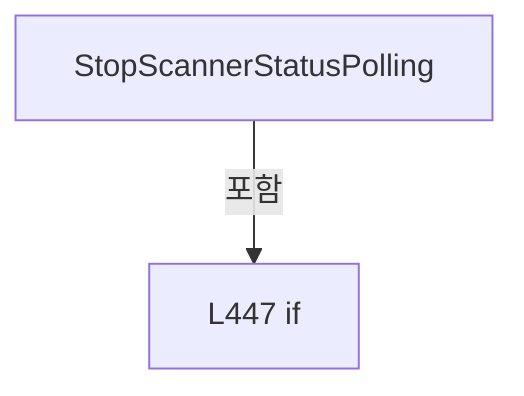

변경 전 점검: 입력/반환 타입, 위 호출자, 예외/취소 경로, 공유 상태와 저장·전송 소비자를 함께 확인합니다. 값의 단위나 물리 방향을 이름만으로 확정하지 않습니다.

### PropertyDeclaration `TargetGx` · L453–464

[Drilling.UI/Menu/Menus/CMenuManual.cs:453–464](https://github.com/kjuws10-rgb/A3Drilling/blob/28764c91d521777b8ee068dd7aaf2d3902ce9fe2/Drilling.UI/Menu/Menus/CMenuManual.cs#L453-L464)

| 항목 | 실제 추출 값 |
| --- | --- |
| 서명 | string Drilling.UI.Menu.Menus.CMenuManual.TargetGx |
| 접근/수식자 | Public / public |
| 반환/값 타입 | string |
| 소속 타입 | NamedType:Drilling.UI.Menu.Menus.CMenuManual |

현재 부분 분석에서 직접 연결된 호출자는 없습니다. XAML/이벤트/인터페이스·델리게이트·외부 진입을 추가 확인해야 하며, 미사용으로 판정한 것이 아닙니다.

변경 전 점검: 입력/반환 타입, 위 호출자, 예외/취소 경로, 공유 상태와 저장·전송 소비자를 함께 확인합니다. 값의 단위나 물리 방향을 이름만으로 확정하지 않습니다.

### GetAccessorDeclaration `get_TargetGx` · L455–458

[Drilling.UI/Menu/Menus/CMenuManual.cs:455–458](https://github.com/kjuws10-rgb/A3Drilling/blob/28764c91d521777b8ee068dd7aaf2d3902ce9fe2/Drilling.UI/Menu/Menus/CMenuManual.cs#L455-L458)

| 항목 | 실제 추출 값 |
| --- | --- |
| 서명 | string Drilling.UI.Menu.Menus.CMenuManual.TargetGx.get |
| 접근/수식자 | Public / get |
| 반환/값 타입 | string |
| 소속 타입 | NamedType:Drilling.UI.Menu.Menus.CMenuManual |

현재 부분 분석에서 직접 연결된 호출자는 없습니다. XAML/이벤트/인터페이스·델리게이트·외부 진입을 추가 확인해야 하며, 미사용으로 판정한 것이 아닙니다.

본문의 실제 연산·분기·예외·반환 순서(원문 위치 순):

| 원본 행 | 종류 | 주석 해설 |
| --- | --- | --- |
| 457 | return | 호출자에게 값 또는 제어를 반환합니다: return _targetGx; |

변경 전 점검: 입력/반환 타입, 위 호출자, 예외/취소 경로, 공유 상태와 저장·전송 소비자를 함께 확인합니다. 값의 단위나 물리 방향을 이름만으로 확정하지 않습니다.

### SetAccessorDeclaration `set_TargetGx` · L460–463

[Drilling.UI/Menu/Menus/CMenuManual.cs:460–463](https://github.com/kjuws10-rgb/A3Drilling/blob/28764c91d521777b8ee068dd7aaf2d3902ce9fe2/Drilling.UI/Menu/Menus/CMenuManual.cs#L460-L463)

| 항목 | 실제 추출 값 |
| --- | --- |
| 서명 | void Drilling.UI.Menu.Menus.CMenuManual.TargetGx.set |
| 접근/수식자 | Public / set |
| 반환/값 타입 | void |
| 소속 타입 | NamedType:Drilling.UI.Menu.Menus.CMenuManual |

입력 계약:

| 이름 | 타입 | 전달 | 선택/기본값 |
| --- | --- | --- | --- |
| value | string | None | False /  |

현재 부분 분석에서 직접 연결된 호출자는 없습니다. XAML/이벤트/인터페이스·델리게이트·외부 진입을 추가 확인해야 하며, 미사용으로 판정한 것이 아닙니다.

호출하는 대상과 해석 범위:

| 원본 행 | 표현식 | 분석 상태 | 대상/소스 위치 |
| --- | --- | --- | --- |
| 462 | SetProperty | resolved | bool Drilling.UI.Menu.CBindingBase.SetProperty<string>(ref string, string, string?) · Drilling.UI/Menu/CBindingBase.cs:766 |

본문의 실제 연산·분기·예외·반환 순서(원문 위치 순):

| 원본 행 | 종류 | 주석 해설 |
| --- | --- | --- |
| 462 | call | 함수·델리게이트 또는 객체 생성자를 호출합니다: SetProperty(ref _targetGx, value) |

변경 전 점검: 입력/반환 타입, 위 호출자, 예외/취소 경로, 공유 상태와 저장·전송 소비자를 함께 확인합니다. 값의 단위나 물리 방향을 이름만으로 확정하지 않습니다.

### PropertyDeclaration `TargetGy` · L466–477

[Drilling.UI/Menu/Menus/CMenuManual.cs:466–477](https://github.com/kjuws10-rgb/A3Drilling/blob/28764c91d521777b8ee068dd7aaf2d3902ce9fe2/Drilling.UI/Menu/Menus/CMenuManual.cs#L466-L477)

| 항목 | 실제 추출 값 |
| --- | --- |
| 서명 | string Drilling.UI.Menu.Menus.CMenuManual.TargetGy |
| 접근/수식자 | Public / public |
| 반환/값 타입 | string |
| 소속 타입 | NamedType:Drilling.UI.Menu.Menus.CMenuManual |

현재 부분 분석에서 직접 연결된 호출자는 없습니다. XAML/이벤트/인터페이스·델리게이트·외부 진입을 추가 확인해야 하며, 미사용으로 판정한 것이 아닙니다.

변경 전 점검: 입력/반환 타입, 위 호출자, 예외/취소 경로, 공유 상태와 저장·전송 소비자를 함께 확인합니다. 값의 단위나 물리 방향을 이름만으로 확정하지 않습니다.

### GetAccessorDeclaration `get_TargetGy` · L468–471

[Drilling.UI/Menu/Menus/CMenuManual.cs:468–471](https://github.com/kjuws10-rgb/A3Drilling/blob/28764c91d521777b8ee068dd7aaf2d3902ce9fe2/Drilling.UI/Menu/Menus/CMenuManual.cs#L468-L471)

| 항목 | 실제 추출 값 |
| --- | --- |
| 서명 | string Drilling.UI.Menu.Menus.CMenuManual.TargetGy.get |
| 접근/수식자 | Public / get |
| 반환/값 타입 | string |
| 소속 타입 | NamedType:Drilling.UI.Menu.Menus.CMenuManual |

현재 부분 분석에서 직접 연결된 호출자는 없습니다. XAML/이벤트/인터페이스·델리게이트·외부 진입을 추가 확인해야 하며, 미사용으로 판정한 것이 아닙니다.

본문의 실제 연산·분기·예외·반환 순서(원문 위치 순):

| 원본 행 | 종류 | 주석 해설 |
| --- | --- | --- |
| 470 | return | 호출자에게 값 또는 제어를 반환합니다: return _targetGy; |

변경 전 점검: 입력/반환 타입, 위 호출자, 예외/취소 경로, 공유 상태와 저장·전송 소비자를 함께 확인합니다. 값의 단위나 물리 방향을 이름만으로 확정하지 않습니다.

### SetAccessorDeclaration `set_TargetGy` · L473–476

[Drilling.UI/Menu/Menus/CMenuManual.cs:473–476](https://github.com/kjuws10-rgb/A3Drilling/blob/28764c91d521777b8ee068dd7aaf2d3902ce9fe2/Drilling.UI/Menu/Menus/CMenuManual.cs#L473-L476)

| 항목 | 실제 추출 값 |
| --- | --- |
| 서명 | void Drilling.UI.Menu.Menus.CMenuManual.TargetGy.set |
| 접근/수식자 | Public / set |
| 반환/값 타입 | void |
| 소속 타입 | NamedType:Drilling.UI.Menu.Menus.CMenuManual |

입력 계약:

| 이름 | 타입 | 전달 | 선택/기본값 |
| --- | --- | --- | --- |
| value | string | None | False /  |

현재 부분 분석에서 직접 연결된 호출자는 없습니다. XAML/이벤트/인터페이스·델리게이트·외부 진입을 추가 확인해야 하며, 미사용으로 판정한 것이 아닙니다.

호출하는 대상과 해석 범위:

| 원본 행 | 표현식 | 분석 상태 | 대상/소스 위치 |
| --- | --- | --- | --- |
| 475 | SetProperty | resolved | bool Drilling.UI.Menu.CBindingBase.SetProperty<string>(ref string, string, string?) · Drilling.UI/Menu/CBindingBase.cs:766 |

본문의 실제 연산·분기·예외·반환 순서(원문 위치 순):

| 원본 행 | 종류 | 주석 해설 |
| --- | --- | --- |
| 475 | call | 함수·델리게이트 또는 객체 생성자를 호출합니다: SetProperty(ref _targetGy, value) |

변경 전 점검: 입력/반환 타입, 위 호출자, 예외/취소 경로, 공유 상태와 저장·전송 소비자를 함께 확인합니다. 값의 단위나 물리 방향을 이름만으로 확정하지 않습니다.

### PropertyDeclaration `TargetGz` · L479–490

[Drilling.UI/Menu/Menus/CMenuManual.cs:479–490](https://github.com/kjuws10-rgb/A3Drilling/blob/28764c91d521777b8ee068dd7aaf2d3902ce9fe2/Drilling.UI/Menu/Menus/CMenuManual.cs#L479-L490)

| 항목 | 실제 추출 값 |
| --- | --- |
| 서명 | string Drilling.UI.Menu.Menus.CMenuManual.TargetGz |
| 접근/수식자 | Public / public |
| 반환/값 타입 | string |
| 소속 타입 | NamedType:Drilling.UI.Menu.Menus.CMenuManual |

현재 부분 분석에서 직접 연결된 호출자는 없습니다. XAML/이벤트/인터페이스·델리게이트·외부 진입을 추가 확인해야 하며, 미사용으로 판정한 것이 아닙니다.

변경 전 점검: 입력/반환 타입, 위 호출자, 예외/취소 경로, 공유 상태와 저장·전송 소비자를 함께 확인합니다. 값의 단위나 물리 방향을 이름만으로 확정하지 않습니다.

### GetAccessorDeclaration `get_TargetGz` · L481–484

[Drilling.UI/Menu/Menus/CMenuManual.cs:481–484](https://github.com/kjuws10-rgb/A3Drilling/blob/28764c91d521777b8ee068dd7aaf2d3902ce9fe2/Drilling.UI/Menu/Menus/CMenuManual.cs#L481-L484)

| 항목 | 실제 추출 값 |
| --- | --- |
| 서명 | string Drilling.UI.Menu.Menus.CMenuManual.TargetGz.get |
| 접근/수식자 | Public / get |
| 반환/값 타입 | string |
| 소속 타입 | NamedType:Drilling.UI.Menu.Menus.CMenuManual |

현재 부분 분석에서 직접 연결된 호출자는 없습니다. XAML/이벤트/인터페이스·델리게이트·외부 진입을 추가 확인해야 하며, 미사용으로 판정한 것이 아닙니다.

본문의 실제 연산·분기·예외·반환 순서(원문 위치 순):

| 원본 행 | 종류 | 주석 해설 |
| --- | --- | --- |
| 483 | return | 호출자에게 값 또는 제어를 반환합니다: return _targetGz; |

변경 전 점검: 입력/반환 타입, 위 호출자, 예외/취소 경로, 공유 상태와 저장·전송 소비자를 함께 확인합니다. 값의 단위나 물리 방향을 이름만으로 확정하지 않습니다.

### SetAccessorDeclaration `set_TargetGz` · L486–489

[Drilling.UI/Menu/Menus/CMenuManual.cs:486–489](https://github.com/kjuws10-rgb/A3Drilling/blob/28764c91d521777b8ee068dd7aaf2d3902ce9fe2/Drilling.UI/Menu/Menus/CMenuManual.cs#L486-L489)

| 항목 | 실제 추출 값 |
| --- | --- |
| 서명 | void Drilling.UI.Menu.Menus.CMenuManual.TargetGz.set |
| 접근/수식자 | Public / set |
| 반환/값 타입 | void |
| 소속 타입 | NamedType:Drilling.UI.Menu.Menus.CMenuManual |

입력 계약:

| 이름 | 타입 | 전달 | 선택/기본값 |
| --- | --- | --- | --- |
| value | string | None | False /  |

현재 부분 분석에서 직접 연결된 호출자는 없습니다. XAML/이벤트/인터페이스·델리게이트·외부 진입을 추가 확인해야 하며, 미사용으로 판정한 것이 아닙니다.

호출하는 대상과 해석 범위:

| 원본 행 | 표현식 | 분석 상태 | 대상/소스 위치 |
| --- | --- | --- | --- |
| 488 | SetProperty | resolved | bool Drilling.UI.Menu.CBindingBase.SetProperty<string>(ref string, string, string?) · Drilling.UI/Menu/CBindingBase.cs:766 |

본문의 실제 연산·분기·예외·반환 순서(원문 위치 순):

| 원본 행 | 종류 | 주석 해설 |
| --- | --- | --- |
| 488 | call | 함수·델리게이트 또는 객체 생성자를 호출합니다: SetProperty(ref _targetGz, value) |

변경 전 점검: 입력/반환 타입, 위 호출자, 예외/취소 경로, 공유 상태와 저장·전송 소비자를 함께 확인합니다. 값의 단위나 물리 방향을 이름만으로 확정하지 않습니다.

### PropertyDeclaration `IsZPositionMoveEnabled` · L492–498

[Drilling.UI/Menu/Menus/CMenuManual.cs:492–498](https://github.com/kjuws10-rgb/A3Drilling/blob/28764c91d521777b8ee068dd7aaf2d3902ce9fe2/Drilling.UI/Menu/Menus/CMenuManual.cs#L492-L498)

| 항목 | 실제 추출 값 |
| --- | --- |
| 서명 | bool Drilling.UI.Menu.Menus.CMenuManual.IsZPositionMoveEnabled |
| 접근/수식자 | Public / public |
| 반환/값 타입 | bool |
| 소속 타입 | NamedType:Drilling.UI.Menu.Menus.CMenuManual |

현재 부분 분석에서 직접 연결된 호출자는 없습니다. XAML/이벤트/인터페이스·델리게이트·외부 진입을 추가 확인해야 하며, 미사용으로 판정한 것이 아닙니다.

변경 전 점검: 입력/반환 타입, 위 호출자, 예외/취소 경로, 공유 상태와 저장·전송 소비자를 함께 확인합니다. 값의 단위나 물리 방향을 이름만으로 확정하지 않습니다.

### GetAccessorDeclaration `get_IsZPositionMoveEnabled` · L494–497

[Drilling.UI/Menu/Menus/CMenuManual.cs:494–497](https://github.com/kjuws10-rgb/A3Drilling/blob/28764c91d521777b8ee068dd7aaf2d3902ce9fe2/Drilling.UI/Menu/Menus/CMenuManual.cs#L494-L497)

| 항목 | 실제 추출 값 |
| --- | --- |
| 서명 | bool Drilling.UI.Menu.Menus.CMenuManual.IsZPositionMoveEnabled.get |
| 접근/수식자 | Public / get |
| 반환/값 타입 | bool |
| 소속 타입 | NamedType:Drilling.UI.Menu.Menus.CMenuManual |

현재 부분 분석에서 직접 연결된 호출자는 없습니다. XAML/이벤트/인터페이스·델리게이트·외부 진입을 추가 확인해야 하며, 미사용으로 판정한 것이 아닙니다.

호출하는 대상과 해석 범위:

| 원본 행 | 표현식 | 분석 상태 | 대상/소스 위치 |
| --- | --- | --- | --- |
| 496 | IsScannerAxisAvailable | resolved | bool Drilling.UI.Menu.Menus.CMenuManual.IsScannerAxisAvailable(System.Collections.Generic.IReadOnlyList<Drilling.UI.Menu.Menus.ST_MANUAL_SCANNER_AXIS>, string) · Drilling.UI/Menu/Menus/CMenuManual.cs:3239 |

본문의 실제 연산·분기·예외·반환 순서(원문 위치 순):

| 원본 행 | 종류 | 주석 해설 |
| --- | --- | --- |
| 496 | call | 함수·델리게이트 또는 객체 생성자를 호출합니다: IsScannerAxisAvailable(ScannerAxes, "Z") |
| 496 | return | 호출자에게 값 또는 제어를 반환합니다: return IsScannerAxisAvailable(ScannerAxes, "Z"); |

변경 전 점검: 입력/반환 타입, 위 호출자, 예외/취소 경로, 공유 상태와 저장·전송 소비자를 함께 확인합니다. 값의 단위나 물리 방향을 이름만으로 확정하지 않습니다.

### PropertyDeclaration `ShapeSize` · L500–511

[Drilling.UI/Menu/Menus/CMenuManual.cs:500–511](https://github.com/kjuws10-rgb/A3Drilling/blob/28764c91d521777b8ee068dd7aaf2d3902ce9fe2/Drilling.UI/Menu/Menus/CMenuManual.cs#L500-L511)

| 항목 | 실제 추출 값 |
| --- | --- |
| 서명 | string Drilling.UI.Menu.Menus.CMenuManual.ShapeSize |
| 접근/수식자 | Public / public |
| 반환/값 타입 | string |
| 소속 타입 | NamedType:Drilling.UI.Menu.Menus.CMenuManual |

현재 부분 분석에서 직접 연결된 호출자는 없습니다. XAML/이벤트/인터페이스·델리게이트·외부 진입을 추가 확인해야 하며, 미사용으로 판정한 것이 아닙니다.

변경 전 점검: 입력/반환 타입, 위 호출자, 예외/취소 경로, 공유 상태와 저장·전송 소비자를 함께 확인합니다. 값의 단위나 물리 방향을 이름만으로 확정하지 않습니다.

### GetAccessorDeclaration `get_ShapeSize` · L502–505

[Drilling.UI/Menu/Menus/CMenuManual.cs:502–505](https://github.com/kjuws10-rgb/A3Drilling/blob/28764c91d521777b8ee068dd7aaf2d3902ce9fe2/Drilling.UI/Menu/Menus/CMenuManual.cs#L502-L505)

| 항목 | 실제 추출 값 |
| --- | --- |
| 서명 | string Drilling.UI.Menu.Menus.CMenuManual.ShapeSize.get |
| 접근/수식자 | Public / get |
| 반환/값 타입 | string |
| 소속 타입 | NamedType:Drilling.UI.Menu.Menus.CMenuManual |

현재 부분 분석에서 직접 연결된 호출자는 없습니다. XAML/이벤트/인터페이스·델리게이트·외부 진입을 추가 확인해야 하며, 미사용으로 판정한 것이 아닙니다.

본문의 실제 연산·분기·예외·반환 순서(원문 위치 순):

| 원본 행 | 종류 | 주석 해설 |
| --- | --- | --- |
| 504 | return | 호출자에게 값 또는 제어를 반환합니다: return _shapeSize; |

변경 전 점검: 입력/반환 타입, 위 호출자, 예외/취소 경로, 공유 상태와 저장·전송 소비자를 함께 확인합니다. 값의 단위나 물리 방향을 이름만으로 확정하지 않습니다.

### SetAccessorDeclaration `set_ShapeSize` · L507–510

[Drilling.UI/Menu/Menus/CMenuManual.cs:507–510](https://github.com/kjuws10-rgb/A3Drilling/blob/28764c91d521777b8ee068dd7aaf2d3902ce9fe2/Drilling.UI/Menu/Menus/CMenuManual.cs#L507-L510)

| 항목 | 실제 추출 값 |
| --- | --- |
| 서명 | void Drilling.UI.Menu.Menus.CMenuManual.ShapeSize.set |
| 접근/수식자 | Public / set |
| 반환/값 타입 | void |
| 소속 타입 | NamedType:Drilling.UI.Menu.Menus.CMenuManual |

입력 계약:

| 이름 | 타입 | 전달 | 선택/기본값 |
| --- | --- | --- | --- |
| value | string | None | False /  |

현재 부분 분석에서 직접 연결된 호출자는 없습니다. XAML/이벤트/인터페이스·델리게이트·외부 진입을 추가 확인해야 하며, 미사용으로 판정한 것이 아닙니다.

호출하는 대상과 해석 범위:

| 원본 행 | 표현식 | 분석 상태 | 대상/소스 위치 |
| --- | --- | --- | --- |
| 509 | SetProperty | resolved | bool Drilling.UI.Menu.CBindingBase.SetProperty<string>(ref string, string, string?) · Drilling.UI/Menu/CBindingBase.cs:766 |

본문의 실제 연산·분기·예외·반환 순서(원문 위치 순):

| 원본 행 | 종류 | 주석 해설 |
| --- | --- | --- |
| 509 | call | 함수·델리게이트 또는 객체 생성자를 호출합니다: SetProperty(ref _shapeSize, value) |

변경 전 점검: 입력/반환 타입, 위 호출자, 예외/취소 경로, 공유 상태와 저장·전송 소비자를 함께 확인합니다. 값의 단위나 물리 방향을 이름만으로 확정하지 않습니다.

### PropertyDeclaration `ShapeOffsetX` · L513–524

[Drilling.UI/Menu/Menus/CMenuManual.cs:513–524](https://github.com/kjuws10-rgb/A3Drilling/blob/28764c91d521777b8ee068dd7aaf2d3902ce9fe2/Drilling.UI/Menu/Menus/CMenuManual.cs#L513-L524)

| 항목 | 실제 추출 값 |
| --- | --- |
| 서명 | string Drilling.UI.Menu.Menus.CMenuManual.ShapeOffsetX |
| 접근/수식자 | Public / public |
| 반환/값 타입 | string |
| 소속 타입 | NamedType:Drilling.UI.Menu.Menus.CMenuManual |

현재 부분 분석에서 직접 연결된 호출자는 없습니다. XAML/이벤트/인터페이스·델리게이트·외부 진입을 추가 확인해야 하며, 미사용으로 판정한 것이 아닙니다.

변경 전 점검: 입력/반환 타입, 위 호출자, 예외/취소 경로, 공유 상태와 저장·전송 소비자를 함께 확인합니다. 값의 단위나 물리 방향을 이름만으로 확정하지 않습니다.

### GetAccessorDeclaration `get_ShapeOffsetX` · L515–518

[Drilling.UI/Menu/Menus/CMenuManual.cs:515–518](https://github.com/kjuws10-rgb/A3Drilling/blob/28764c91d521777b8ee068dd7aaf2d3902ce9fe2/Drilling.UI/Menu/Menus/CMenuManual.cs#L515-L518)

| 항목 | 실제 추출 값 |
| --- | --- |
| 서명 | string Drilling.UI.Menu.Menus.CMenuManual.ShapeOffsetX.get |
| 접근/수식자 | Public / get |
| 반환/값 타입 | string |
| 소속 타입 | NamedType:Drilling.UI.Menu.Menus.CMenuManual |

현재 부분 분석에서 직접 연결된 호출자는 없습니다. XAML/이벤트/인터페이스·델리게이트·외부 진입을 추가 확인해야 하며, 미사용으로 판정한 것이 아닙니다.

본문의 실제 연산·분기·예외·반환 순서(원문 위치 순):

| 원본 행 | 종류 | 주석 해설 |
| --- | --- | --- |
| 517 | return | 호출자에게 값 또는 제어를 반환합니다: return _shapeOffsetX; |

변경 전 점검: 입력/반환 타입, 위 호출자, 예외/취소 경로, 공유 상태와 저장·전송 소비자를 함께 확인합니다. 값의 단위나 물리 방향을 이름만으로 확정하지 않습니다.

### SetAccessorDeclaration `set_ShapeOffsetX` · L520–523

[Drilling.UI/Menu/Menus/CMenuManual.cs:520–523](https://github.com/kjuws10-rgb/A3Drilling/blob/28764c91d521777b8ee068dd7aaf2d3902ce9fe2/Drilling.UI/Menu/Menus/CMenuManual.cs#L520-L523)

| 항목 | 실제 추출 값 |
| --- | --- |
| 서명 | void Drilling.UI.Menu.Menus.CMenuManual.ShapeOffsetX.set |
| 접근/수식자 | Public / set |
| 반환/값 타입 | void |
| 소속 타입 | NamedType:Drilling.UI.Menu.Menus.CMenuManual |

입력 계약:

| 이름 | 타입 | 전달 | 선택/기본값 |
| --- | --- | --- | --- |
| value | string | None | False /  |

현재 부분 분석에서 직접 연결된 호출자는 없습니다. XAML/이벤트/인터페이스·델리게이트·외부 진입을 추가 확인해야 하며, 미사용으로 판정한 것이 아닙니다.

호출하는 대상과 해석 범위:

| 원본 행 | 표현식 | 분석 상태 | 대상/소스 위치 |
| --- | --- | --- | --- |
| 522 | SetProperty | resolved | bool Drilling.UI.Menu.CBindingBase.SetProperty<string>(ref string, string, string?) · Drilling.UI/Menu/CBindingBase.cs:766 |

본문의 실제 연산·분기·예외·반환 순서(원문 위치 순):

| 원본 행 | 종류 | 주석 해설 |
| --- | --- | --- |
| 522 | call | 함수·델리게이트 또는 객체 생성자를 호출합니다: SetProperty(ref _shapeOffsetX, value) |

변경 전 점검: 입력/반환 타입, 위 호출자, 예외/취소 경로, 공유 상태와 저장·전송 소비자를 함께 확인합니다. 값의 단위나 물리 방향을 이름만으로 확정하지 않습니다.

### PropertyDeclaration `ShapeOffsetY` · L526–537

[Drilling.UI/Menu/Menus/CMenuManual.cs:526–537](https://github.com/kjuws10-rgb/A3Drilling/blob/28764c91d521777b8ee068dd7aaf2d3902ce9fe2/Drilling.UI/Menu/Menus/CMenuManual.cs#L526-L537)

| 항목 | 실제 추출 값 |
| --- | --- |
| 서명 | string Drilling.UI.Menu.Menus.CMenuManual.ShapeOffsetY |
| 접근/수식자 | Public / public |
| 반환/값 타입 | string |
| 소속 타입 | NamedType:Drilling.UI.Menu.Menus.CMenuManual |

현재 부분 분석에서 직접 연결된 호출자는 없습니다. XAML/이벤트/인터페이스·델리게이트·외부 진입을 추가 확인해야 하며, 미사용으로 판정한 것이 아닙니다.

변경 전 점검: 입력/반환 타입, 위 호출자, 예외/취소 경로, 공유 상태와 저장·전송 소비자를 함께 확인합니다. 값의 단위나 물리 방향을 이름만으로 확정하지 않습니다.

### GetAccessorDeclaration `get_ShapeOffsetY` · L528–531

[Drilling.UI/Menu/Menus/CMenuManual.cs:528–531](https://github.com/kjuws10-rgb/A3Drilling/blob/28764c91d521777b8ee068dd7aaf2d3902ce9fe2/Drilling.UI/Menu/Menus/CMenuManual.cs#L528-L531)

| 항목 | 실제 추출 값 |
| --- | --- |
| 서명 | string Drilling.UI.Menu.Menus.CMenuManual.ShapeOffsetY.get |
| 접근/수식자 | Public / get |
| 반환/값 타입 | string |
| 소속 타입 | NamedType:Drilling.UI.Menu.Menus.CMenuManual |

현재 부분 분석에서 직접 연결된 호출자는 없습니다. XAML/이벤트/인터페이스·델리게이트·외부 진입을 추가 확인해야 하며, 미사용으로 판정한 것이 아닙니다.

본문의 실제 연산·분기·예외·반환 순서(원문 위치 순):

| 원본 행 | 종류 | 주석 해설 |
| --- | --- | --- |
| 530 | return | 호출자에게 값 또는 제어를 반환합니다: return _shapeOffsetY; |

변경 전 점검: 입력/반환 타입, 위 호출자, 예외/취소 경로, 공유 상태와 저장·전송 소비자를 함께 확인합니다. 값의 단위나 물리 방향을 이름만으로 확정하지 않습니다.

### SetAccessorDeclaration `set_ShapeOffsetY` · L533–536

[Drilling.UI/Menu/Menus/CMenuManual.cs:533–536](https://github.com/kjuws10-rgb/A3Drilling/blob/28764c91d521777b8ee068dd7aaf2d3902ce9fe2/Drilling.UI/Menu/Menus/CMenuManual.cs#L533-L536)

| 항목 | 실제 추출 값 |
| --- | --- |
| 서명 | void Drilling.UI.Menu.Menus.CMenuManual.ShapeOffsetY.set |
| 접근/수식자 | Public / set |
| 반환/값 타입 | void |
| 소속 타입 | NamedType:Drilling.UI.Menu.Menus.CMenuManual |

입력 계약:

| 이름 | 타입 | 전달 | 선택/기본값 |
| --- | --- | --- | --- |
| value | string | None | False /  |

현재 부분 분석에서 직접 연결된 호출자는 없습니다. XAML/이벤트/인터페이스·델리게이트·외부 진입을 추가 확인해야 하며, 미사용으로 판정한 것이 아닙니다.

호출하는 대상과 해석 범위:

| 원본 행 | 표현식 | 분석 상태 | 대상/소스 위치 |
| --- | --- | --- | --- |
| 535 | SetProperty | resolved | bool Drilling.UI.Menu.CBindingBase.SetProperty<string>(ref string, string, string?) · Drilling.UI/Menu/CBindingBase.cs:766 |

본문의 실제 연산·분기·예외·반환 순서(원문 위치 순):

| 원본 행 | 종류 | 주석 해설 |
| --- | --- | --- |
| 535 | call | 함수·델리게이트 또는 객체 생성자를 호출합니다: SetProperty(ref _shapeOffsetY, value) |

변경 전 점검: 입력/반환 타입, 위 호출자, 예외/취소 경로, 공유 상태와 저장·전송 소비자를 함께 확인합니다. 값의 단위나 물리 방향을 이름만으로 확정하지 않습니다.

### PropertyDeclaration `ShapeDirection` · L539–550

[Drilling.UI/Menu/Menus/CMenuManual.cs:539–550](https://github.com/kjuws10-rgb/A3Drilling/blob/28764c91d521777b8ee068dd7aaf2d3902ce9fe2/Drilling.UI/Menu/Menus/CMenuManual.cs#L539-L550)

| 항목 | 실제 추출 값 |
| --- | --- |
| 서명 | string Drilling.UI.Menu.Menus.CMenuManual.ShapeDirection |
| 접근/수식자 | Public / public |
| 반환/값 타입 | string |
| 소속 타입 | NamedType:Drilling.UI.Menu.Menus.CMenuManual |

현재 부분 분석에서 직접 연결된 호출자는 없습니다. XAML/이벤트/인터페이스·델리게이트·외부 진입을 추가 확인해야 하며, 미사용으로 판정한 것이 아닙니다.

변경 전 점검: 입력/반환 타입, 위 호출자, 예외/취소 경로, 공유 상태와 저장·전송 소비자를 함께 확인합니다. 값의 단위나 물리 방향을 이름만으로 확정하지 않습니다.

### GetAccessorDeclaration `get_ShapeDirection` · L541–544

[Drilling.UI/Menu/Menus/CMenuManual.cs:541–544](https://github.com/kjuws10-rgb/A3Drilling/blob/28764c91d521777b8ee068dd7aaf2d3902ce9fe2/Drilling.UI/Menu/Menus/CMenuManual.cs#L541-L544)

| 항목 | 실제 추출 값 |
| --- | --- |
| 서명 | string Drilling.UI.Menu.Menus.CMenuManual.ShapeDirection.get |
| 접근/수식자 | Public / get |
| 반환/값 타입 | string |
| 소속 타입 | NamedType:Drilling.UI.Menu.Menus.CMenuManual |

현재 부분 분석에서 직접 연결된 호출자는 없습니다. XAML/이벤트/인터페이스·델리게이트·외부 진입을 추가 확인해야 하며, 미사용으로 판정한 것이 아닙니다.

본문의 실제 연산·분기·예외·반환 순서(원문 위치 순):

| 원본 행 | 종류 | 주석 해설 |
| --- | --- | --- |
| 543 | return | 호출자에게 값 또는 제어를 반환합니다: return _shapeDirection; |

변경 전 점검: 입력/반환 타입, 위 호출자, 예외/취소 경로, 공유 상태와 저장·전송 소비자를 함께 확인합니다. 값의 단위나 물리 방향을 이름만으로 확정하지 않습니다.

### SetAccessorDeclaration `set_ShapeDirection` · L546–549

[Drilling.UI/Menu/Menus/CMenuManual.cs:546–549](https://github.com/kjuws10-rgb/A3Drilling/blob/28764c91d521777b8ee068dd7aaf2d3902ce9fe2/Drilling.UI/Menu/Menus/CMenuManual.cs#L546-L549)

| 항목 | 실제 추출 값 |
| --- | --- |
| 서명 | void Drilling.UI.Menu.Menus.CMenuManual.ShapeDirection.set |
| 접근/수식자 | Public / set |
| 반환/값 타입 | void |
| 소속 타입 | NamedType:Drilling.UI.Menu.Menus.CMenuManual |

입력 계약:

| 이름 | 타입 | 전달 | 선택/기본값 |
| --- | --- | --- | --- |
| value | string | None | False /  |

현재 부분 분석에서 직접 연결된 호출자는 없습니다. XAML/이벤트/인터페이스·델리게이트·외부 진입을 추가 확인해야 하며, 미사용으로 판정한 것이 아닙니다.

호출하는 대상과 해석 범위:

| 원본 행 | 표현식 | 분석 상태 | 대상/소스 위치 |
| --- | --- | --- | --- |
| 548 | SetProperty | resolved | bool Drilling.UI.Menu.CBindingBase.SetProperty<string>(ref string, string, string?) · Drilling.UI/Menu/CBindingBase.cs:766 |

본문의 실제 연산·분기·예외·반환 순서(원문 위치 순):

| 원본 행 | 종류 | 주석 해설 |
| --- | --- | --- |
| 548 | call | 함수·델리게이트 또는 객체 생성자를 호출합니다: SetProperty(ref _shapeDirection, value) |

변경 전 점검: 입력/반환 타입, 위 호출자, 예외/취소 경로, 공유 상태와 저장·전송 소비자를 함께 확인합니다. 값의 단위나 물리 방향을 이름만으로 확정하지 않습니다.

### PropertyDeclaration `ShapeName` · L552–563

[Drilling.UI/Menu/Menus/CMenuManual.cs:552–563](https://github.com/kjuws10-rgb/A3Drilling/blob/28764c91d521777b8ee068dd7aaf2d3902ce9fe2/Drilling.UI/Menu/Menus/CMenuManual.cs#L552-L563)

| 항목 | 실제 추출 값 |
| --- | --- |
| 서명 | string Drilling.UI.Menu.Menus.CMenuManual.ShapeName |
| 접근/수식자 | Public / public |
| 반환/값 타입 | string |
| 소속 타입 | NamedType:Drilling.UI.Menu.Menus.CMenuManual |

현재 부분 분석에서 직접 연결된 호출자는 없습니다. XAML/이벤트/인터페이스·델리게이트·외부 진입을 추가 확인해야 하며, 미사용으로 판정한 것이 아닙니다.

변경 전 점검: 입력/반환 타입, 위 호출자, 예외/취소 경로, 공유 상태와 저장·전송 소비자를 함께 확인합니다. 값의 단위나 물리 방향을 이름만으로 확정하지 않습니다.

### GetAccessorDeclaration `get_ShapeName` · L554–557

[Drilling.UI/Menu/Menus/CMenuManual.cs:554–557](https://github.com/kjuws10-rgb/A3Drilling/blob/28764c91d521777b8ee068dd7aaf2d3902ce9fe2/Drilling.UI/Menu/Menus/CMenuManual.cs#L554-L557)

| 항목 | 실제 추출 값 |
| --- | --- |
| 서명 | string Drilling.UI.Menu.Menus.CMenuManual.ShapeName.get |
| 접근/수식자 | Public / get |
| 반환/값 타입 | string |
| 소속 타입 | NamedType:Drilling.UI.Menu.Menus.CMenuManual |

현재 부분 분석에서 직접 연결된 호출자는 없습니다. XAML/이벤트/인터페이스·델리게이트·외부 진입을 추가 확인해야 하며, 미사용으로 판정한 것이 아닙니다.

본문의 실제 연산·분기·예외·반환 순서(원문 위치 순):

| 원본 행 | 종류 | 주석 해설 |
| --- | --- | --- |
| 556 | return | 호출자에게 값 또는 제어를 반환합니다: return _shapeName; |

변경 전 점검: 입력/반환 타입, 위 호출자, 예외/취소 경로, 공유 상태와 저장·전송 소비자를 함께 확인합니다. 값의 단위나 물리 방향을 이름만으로 확정하지 않습니다.

### SetAccessorDeclaration `set_ShapeName` · L559–562

[Drilling.UI/Menu/Menus/CMenuManual.cs:559–562](https://github.com/kjuws10-rgb/A3Drilling/blob/28764c91d521777b8ee068dd7aaf2d3902ce9fe2/Drilling.UI/Menu/Menus/CMenuManual.cs#L559-L562)

| 항목 | 실제 추출 값 |
| --- | --- |
| 서명 | void Drilling.UI.Menu.Menus.CMenuManual.ShapeName.set |
| 접근/수식자 | Public / set |
| 반환/값 타입 | void |
| 소속 타입 | NamedType:Drilling.UI.Menu.Menus.CMenuManual |

입력 계약:

| 이름 | 타입 | 전달 | 선택/기본값 |
| --- | --- | --- | --- |
| value | string | None | False /  |

현재 부분 분석에서 직접 연결된 호출자는 없습니다. XAML/이벤트/인터페이스·델리게이트·외부 진입을 추가 확인해야 하며, 미사용으로 판정한 것이 아닙니다.

호출하는 대상과 해석 범위:

| 원본 행 | 표현식 | 분석 상태 | 대상/소스 위치 |
| --- | --- | --- | --- |
| 561 | SetProperty | resolved | bool Drilling.UI.Menu.CBindingBase.SetProperty<string>(ref string, string, string?) · Drilling.UI/Menu/CBindingBase.cs:766 |
| 561 | NormalizeShapeName | resolved | string Drilling.UI.Menu.Menus.CMenuManual.NormalizeShapeName(string) · Drilling.UI/Menu/Menus/CMenuManual.cs:6174 |

본문의 실제 연산·분기·예외·반환 순서(원문 위치 순):

| 원본 행 | 종류 | 주석 해설 |
| --- | --- | --- |
| 561 | call | 함수·델리게이트 또는 객체 생성자를 호출합니다: SetProperty(ref _shapeName, NormalizeShapeName(value)) |
| 561 | call | 함수·델리게이트 또는 객체 생성자를 호출합니다: NormalizeShapeName(value) |

변경 전 점검: 입력/반환 타입, 위 호출자, 예외/취소 경로, 공유 상태와 저장·전송 소비자를 함께 확인합니다. 값의 단위나 물리 방향을 이름만으로 확정하지 않습니다.

### PropertyDeclaration `GridRowLines` · L565–576

[Drilling.UI/Menu/Menus/CMenuManual.cs:565–576](https://github.com/kjuws10-rgb/A3Drilling/blob/28764c91d521777b8ee068dd7aaf2d3902ce9fe2/Drilling.UI/Menu/Menus/CMenuManual.cs#L565-L576)

| 항목 | 실제 추출 값 |
| --- | --- |
| 서명 | string Drilling.UI.Menu.Menus.CMenuManual.GridRowLines |
| 접근/수식자 | Public / public |
| 반환/값 타입 | string |
| 소속 타입 | NamedType:Drilling.UI.Menu.Menus.CMenuManual |

현재 부분 분석에서 직접 연결된 호출자는 없습니다. XAML/이벤트/인터페이스·델리게이트·외부 진입을 추가 확인해야 하며, 미사용으로 판정한 것이 아닙니다.

변경 전 점검: 입력/반환 타입, 위 호출자, 예외/취소 경로, 공유 상태와 저장·전송 소비자를 함께 확인합니다. 값의 단위나 물리 방향을 이름만으로 확정하지 않습니다.

### GetAccessorDeclaration `get_GridRowLines` · L567–570

[Drilling.UI/Menu/Menus/CMenuManual.cs:567–570](https://github.com/kjuws10-rgb/A3Drilling/blob/28764c91d521777b8ee068dd7aaf2d3902ce9fe2/Drilling.UI/Menu/Menus/CMenuManual.cs#L567-L570)

| 항목 | 실제 추출 값 |
| --- | --- |
| 서명 | string Drilling.UI.Menu.Menus.CMenuManual.GridRowLines.get |
| 접근/수식자 | Public / get |
| 반환/값 타입 | string |
| 소속 타입 | NamedType:Drilling.UI.Menu.Menus.CMenuManual |

현재 부분 분석에서 직접 연결된 호출자는 없습니다. XAML/이벤트/인터페이스·델리게이트·외부 진입을 추가 확인해야 하며, 미사용으로 판정한 것이 아닙니다.

본문의 실제 연산·분기·예외·반환 순서(원문 위치 순):

| 원본 행 | 종류 | 주석 해설 |
| --- | --- | --- |
| 569 | return | 호출자에게 값 또는 제어를 반환합니다: return _gridRowLines; |

변경 전 점검: 입력/반환 타입, 위 호출자, 예외/취소 경로, 공유 상태와 저장·전송 소비자를 함께 확인합니다. 값의 단위나 물리 방향을 이름만으로 확정하지 않습니다.

### SetAccessorDeclaration `set_GridRowLines` · L572–575

[Drilling.UI/Menu/Menus/CMenuManual.cs:572–575](https://github.com/kjuws10-rgb/A3Drilling/blob/28764c91d521777b8ee068dd7aaf2d3902ce9fe2/Drilling.UI/Menu/Menus/CMenuManual.cs#L572-L575)

| 항목 | 실제 추출 값 |
| --- | --- |
| 서명 | void Drilling.UI.Menu.Menus.CMenuManual.GridRowLines.set |
| 접근/수식자 | Public / set |
| 반환/값 타입 | void |
| 소속 타입 | NamedType:Drilling.UI.Menu.Menus.CMenuManual |

입력 계약:

| 이름 | 타입 | 전달 | 선택/기본값 |
| --- | --- | --- | --- |
| value | string | None | False /  |

현재 부분 분석에서 직접 연결된 호출자는 없습니다. XAML/이벤트/인터페이스·델리게이트·외부 진입을 추가 확인해야 하며, 미사용으로 판정한 것이 아닙니다.

호출하는 대상과 해석 범위:

| 원본 행 | 표현식 | 분석 상태 | 대상/소스 위치 |
| --- | --- | --- | --- |
| 574 | SetProperty | resolved | bool Drilling.UI.Menu.CBindingBase.SetProperty<string>(ref string, string, string?) · Drilling.UI/Menu/CBindingBase.cs:766 |

본문의 실제 연산·분기·예외·반환 순서(원문 위치 순):

| 원본 행 | 종류 | 주석 해설 |
| --- | --- | --- |
| 574 | call | 함수·델리게이트 또는 객체 생성자를 호출합니다: SetProperty(ref _gridRowLines, value) |

변경 전 점검: 입력/반환 타입, 위 호출자, 예외/취소 경로, 공유 상태와 저장·전송 소비자를 함께 확인합니다. 값의 단위나 물리 방향을 이름만으로 확정하지 않습니다.

### PropertyDeclaration `GridColLines` · L578–589

[Drilling.UI/Menu/Menus/CMenuManual.cs:578–589](https://github.com/kjuws10-rgb/A3Drilling/blob/28764c91d521777b8ee068dd7aaf2d3902ce9fe2/Drilling.UI/Menu/Menus/CMenuManual.cs#L578-L589)

| 항목 | 실제 추출 값 |
| --- | --- |
| 서명 | string Drilling.UI.Menu.Menus.CMenuManual.GridColLines |
| 접근/수식자 | Public / public |
| 반환/값 타입 | string |
| 소속 타입 | NamedType:Drilling.UI.Menu.Menus.CMenuManual |

현재 부분 분석에서 직접 연결된 호출자는 없습니다. XAML/이벤트/인터페이스·델리게이트·외부 진입을 추가 확인해야 하며, 미사용으로 판정한 것이 아닙니다.

변경 전 점검: 입력/반환 타입, 위 호출자, 예외/취소 경로, 공유 상태와 저장·전송 소비자를 함께 확인합니다. 값의 단위나 물리 방향을 이름만으로 확정하지 않습니다.

### GetAccessorDeclaration `get_GridColLines` · L580–583

[Drilling.UI/Menu/Menus/CMenuManual.cs:580–583](https://github.com/kjuws10-rgb/A3Drilling/blob/28764c91d521777b8ee068dd7aaf2d3902ce9fe2/Drilling.UI/Menu/Menus/CMenuManual.cs#L580-L583)

| 항목 | 실제 추출 값 |
| --- | --- |
| 서명 | string Drilling.UI.Menu.Menus.CMenuManual.GridColLines.get |
| 접근/수식자 | Public / get |
| 반환/값 타입 | string |
| 소속 타입 | NamedType:Drilling.UI.Menu.Menus.CMenuManual |

현재 부분 분석에서 직접 연결된 호출자는 없습니다. XAML/이벤트/인터페이스·델리게이트·외부 진입을 추가 확인해야 하며, 미사용으로 판정한 것이 아닙니다.

본문의 실제 연산·분기·예외·반환 순서(원문 위치 순):

| 원본 행 | 종류 | 주석 해설 |
| --- | --- | --- |
| 582 | return | 호출자에게 값 또는 제어를 반환합니다: return _gridColLines; |

변경 전 점검: 입력/반환 타입, 위 호출자, 예외/취소 경로, 공유 상태와 저장·전송 소비자를 함께 확인합니다. 값의 단위나 물리 방향을 이름만으로 확정하지 않습니다.

### SetAccessorDeclaration `set_GridColLines` · L585–588

[Drilling.UI/Menu/Menus/CMenuManual.cs:585–588](https://github.com/kjuws10-rgb/A3Drilling/blob/28764c91d521777b8ee068dd7aaf2d3902ce9fe2/Drilling.UI/Menu/Menus/CMenuManual.cs#L585-L588)

| 항목 | 실제 추출 값 |
| --- | --- |
| 서명 | void Drilling.UI.Menu.Menus.CMenuManual.GridColLines.set |
| 접근/수식자 | Public / set |
| 반환/값 타입 | void |
| 소속 타입 | NamedType:Drilling.UI.Menu.Menus.CMenuManual |

입력 계약:

| 이름 | 타입 | 전달 | 선택/기본값 |
| --- | --- | --- | --- |
| value | string | None | False /  |

현재 부분 분석에서 직접 연결된 호출자는 없습니다. XAML/이벤트/인터페이스·델리게이트·외부 진입을 추가 확인해야 하며, 미사용으로 판정한 것이 아닙니다.

호출하는 대상과 해석 범위:

| 원본 행 | 표현식 | 분석 상태 | 대상/소스 위치 |
| --- | --- | --- | --- |
| 587 | SetProperty | resolved | bool Drilling.UI.Menu.CBindingBase.SetProperty<string>(ref string, string, string?) · Drilling.UI/Menu/CBindingBase.cs:766 |

본문의 실제 연산·분기·예외·반환 순서(원문 위치 순):

| 원본 행 | 종류 | 주석 해설 |
| --- | --- | --- |
| 587 | call | 함수·델리게이트 또는 객체 생성자를 호출합니다: SetProperty(ref _gridColLines, value) |

변경 전 점검: 입력/반환 타입, 위 호출자, 예외/취소 경로, 공유 상태와 저장·전송 소비자를 함께 확인합니다. 값의 단위나 물리 방향을 이름만으로 확정하지 않습니다.

### PropertyDeclaration `LaserOnMode` · L591–608

[Drilling.UI/Menu/Menus/CMenuManual.cs:591–608](https://github.com/kjuws10-rgb/A3Drilling/blob/28764c91d521777b8ee068dd7aaf2d3902ce9fe2/Drilling.UI/Menu/Menus/CMenuManual.cs#L591-L608)

| 항목 | 실제 추출 값 |
| --- | --- |
| 서명 | string Drilling.UI.Menu.Menus.CMenuManual.LaserOnMode |
| 접근/수식자 | Public / public |
| 반환/값 타입 | string |
| 소속 타입 | NamedType:Drilling.UI.Menu.Menus.CMenuManual |

현재 부분 분석에서 직접 연결된 호출자는 없습니다. XAML/이벤트/인터페이스·델리게이트·외부 진입을 추가 확인해야 하며, 미사용으로 판정한 것이 아닙니다.

변경 전 점검: 입력/반환 타입, 위 호출자, 예외/취소 경로, 공유 상태와 저장·전송 소비자를 함께 확인합니다. 값의 단위나 물리 방향을 이름만으로 확정하지 않습니다.

### GetAccessorDeclaration `get_LaserOnMode` · L593–596

[Drilling.UI/Menu/Menus/CMenuManual.cs:593–596](https://github.com/kjuws10-rgb/A3Drilling/blob/28764c91d521777b8ee068dd7aaf2d3902ce9fe2/Drilling.UI/Menu/Menus/CMenuManual.cs#L593-L596)

| 항목 | 실제 추출 값 |
| --- | --- |
| 서명 | string Drilling.UI.Menu.Menus.CMenuManual.LaserOnMode.get |
| 접근/수식자 | Public / get |
| 반환/값 타입 | string |
| 소속 타입 | NamedType:Drilling.UI.Menu.Menus.CMenuManual |

현재 부분 분석에서 직접 연결된 호출자는 없습니다. XAML/이벤트/인터페이스·델리게이트·외부 진입을 추가 확인해야 하며, 미사용으로 판정한 것이 아닙니다.

본문의 실제 연산·분기·예외·반환 순서(원문 위치 순):

| 원본 행 | 종류 | 주석 해설 |
| --- | --- | --- |
| 595 | return | 호출자에게 값 또는 제어를 반환합니다: return _laserOnMode; |

변경 전 점검: 입력/반환 타입, 위 호출자, 예외/취소 경로, 공유 상태와 저장·전송 소비자를 함께 확인합니다. 값의 단위나 물리 방향을 이름만으로 확정하지 않습니다.

### SetAccessorDeclaration `set_LaserOnMode` · L598–607

[Drilling.UI/Menu/Menus/CMenuManual.cs:598–607](https://github.com/kjuws10-rgb/A3Drilling/blob/28764c91d521777b8ee068dd7aaf2d3902ce9fe2/Drilling.UI/Menu/Menus/CMenuManual.cs#L598-L607)

| 항목 | 실제 추출 값 |
| --- | --- |
| 서명 | void Drilling.UI.Menu.Menus.CMenuManual.LaserOnMode.set |
| 접근/수식자 | Public / set |
| 반환/값 타입 | void |
| 소속 타입 | NamedType:Drilling.UI.Menu.Menus.CMenuManual |

입력 계약:

| 이름 | 타입 | 전달 | 선택/기본값 |
| --- | --- | --- | --- |
| value | string | None | False /  |

현재 부분 분석에서 직접 연결된 호출자는 없습니다. XAML/이벤트/인터페이스·델리게이트·외부 진입을 추가 확인해야 하며, 미사용으로 판정한 것이 아닙니다.

호출하는 대상과 해석 범위:

| 원본 행 | 표현식 | 분석 상태 | 대상/소스 위치 |
| --- | --- | --- | --- |
| 600 | NormalizeLaserOnMode | resolved | string Drilling.UI.Menu.Menus.CMenuManual.NormalizeLaserOnMode(string?) · Drilling.UI/Menu/Menus/CMenuManual.cs:6035 |
| 601 | SetProperty | resolved | bool Drilling.UI.Menu.CBindingBase.SetProperty<string>(ref string, string, string?) · Drilling.UI/Menu/CBindingBase.cs:766 |
| 603 | OnPropertyChanged | resolved | void Drilling.UI.Menu.CBindingBase.OnPropertyChanged(string?) · Drilling.UI/Menu/CBindingBase.cs:790 |
| 603 | nameof | unresolved | None |
| 604 | OnPropertyChanged | resolved | void Drilling.UI.Menu.CBindingBase.OnPropertyChanged(string?) · Drilling.UI/Menu/CBindingBase.cs:790 |
| 604 | nameof | unresolved | None |
| 605 | RefreshCommandStateRows | resolved | void Drilling.UI.Menu.Menus.CMenuManual.RefreshCommandStateRows() · Drilling.UI/Menu/Menus/CMenuManual.cs:5516 |

본문의 실제 연산·분기·예외·반환 순서(원문 위치 순):

| 원본 행 | 종류 | 주석 해설 |
| --- | --- | --- |
| 600 | call | 함수·델리게이트 또는 객체 생성자를 호출합니다: NormalizeLaserOnMode(value) |
| 600 | local-declaration | 지역 변수를 선언합니다: var normalizedValue = NormalizeLaserOnMode(value); |
| 600 | variable-initializer | 변수의 초기값을 지정합니다: normalizedValue = NormalizeLaserOnMode(value) |
| 601 | call | 함수·델리게이트 또는 객체 생성자를 호출합니다: SetProperty(ref _laserOnMode, normalizedValue) |
| 601 | if | 조건에 따라 분기합니다: if (SetProperty(ref _laserOnMode, normalizedValue)) |
| 603 | call | 함수·델리게이트 또는 객체 생성자를 호출합니다: OnPropertyChanged(nameof(IsLaserTimeMode)) |
| 603 | call | 함수·델리게이트 또는 객체 생성자를 호출합니다: nameof(IsLaserTimeMode) |
| 604 | call | 함수·델리게이트 또는 객체 생성자를 호출합니다: OnPropertyChanged(nameof(IsLaserCountMode)) |
| 604 | call | 함수·델리게이트 또는 객체 생성자를 호출합니다: nameof(IsLaserCountMode) |
| 605 | call | 함수·델리게이트 또는 객체 생성자를 호출합니다: RefreshCommandStateRows() |

제어 구문의 포함 구조(실제 실행 순서/CFG가 아닌 구문 탐색 그림):

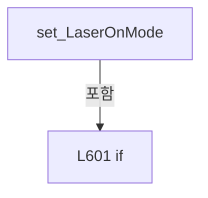

변경 전 점검: 입력/반환 타입, 위 호출자, 예외/취소 경로, 공유 상태와 저장·전송 소비자를 함께 확인합니다. 값의 단위나 물리 방향을 이름만으로 확정하지 않습니다.

### PropertyDeclaration `IsLaserTimeMode` · L610–616

[Drilling.UI/Menu/Menus/CMenuManual.cs:610–616](https://github.com/kjuws10-rgb/A3Drilling/blob/28764c91d521777b8ee068dd7aaf2d3902ce9fe2/Drilling.UI/Menu/Menus/CMenuManual.cs#L610-L616)

| 항목 | 실제 추출 값 |
| --- | --- |
| 서명 | bool Drilling.UI.Menu.Menus.CMenuManual.IsLaserTimeMode |
| 접근/수식자 | Public / public |
| 반환/값 타입 | bool |
| 소속 타입 | NamedType:Drilling.UI.Menu.Menus.CMenuManual |

현재 부분 분석에서 직접 연결된 호출자는 없습니다. XAML/이벤트/인터페이스·델리게이트·외부 진입을 추가 확인해야 하며, 미사용으로 판정한 것이 아닙니다.

변경 전 점검: 입력/반환 타입, 위 호출자, 예외/취소 경로, 공유 상태와 저장·전송 소비자를 함께 확인합니다. 값의 단위나 물리 방향을 이름만으로 확정하지 않습니다.

### GetAccessorDeclaration `get_IsLaserTimeMode` · L612–615

[Drilling.UI/Menu/Menus/CMenuManual.cs:612–615](https://github.com/kjuws10-rgb/A3Drilling/blob/28764c91d521777b8ee068dd7aaf2d3902ce9fe2/Drilling.UI/Menu/Menus/CMenuManual.cs#L612-L615)

| 항목 | 실제 추출 값 |
| --- | --- |
| 서명 | bool Drilling.UI.Menu.Menus.CMenuManual.IsLaserTimeMode.get |
| 접근/수식자 | Public / get |
| 반환/값 타입 | bool |
| 소속 타입 | NamedType:Drilling.UI.Menu.Menus.CMenuManual |

현재 부분 분석에서 직접 연결된 호출자는 없습니다. XAML/이벤트/인터페이스·델리게이트·외부 진입을 추가 확인해야 하며, 미사용으로 판정한 것이 아닙니다.

호출하는 대상과 해석 범위:

| 원본 행 | 표현식 | 분석 상태 | 대상/소스 위치 |
| --- | --- | --- | --- |
| 614 | IsLaserTimeModeValue | resolved | bool Drilling.UI.Menu.Menus.CMenuManual.IsLaserTimeModeValue(string?) · Drilling.UI/Menu/Menus/CMenuManual.cs:6040 |

본문의 실제 연산·분기·예외·반환 순서(원문 위치 순):

| 원본 행 | 종류 | 주석 해설 |
| --- | --- | --- |
| 614 | call | 함수·델리게이트 또는 객체 생성자를 호출합니다: IsLaserTimeModeValue(LaserOnMode) |
| 614 | return | 호출자에게 값 또는 제어를 반환합니다: return IsLaserTimeModeValue(LaserOnMode); |

변경 전 점검: 입력/반환 타입, 위 호출자, 예외/취소 경로, 공유 상태와 저장·전송 소비자를 함께 확인합니다. 값의 단위나 물리 방향을 이름만으로 확정하지 않습니다.

### PropertyDeclaration `IsLaserCountMode` · L618–624

[Drilling.UI/Menu/Menus/CMenuManual.cs:618–624](https://github.com/kjuws10-rgb/A3Drilling/blob/28764c91d521777b8ee068dd7aaf2d3902ce9fe2/Drilling.UI/Menu/Menus/CMenuManual.cs#L618-L624)

| 항목 | 실제 추출 값 |
| --- | --- |
| 서명 | bool Drilling.UI.Menu.Menus.CMenuManual.IsLaserCountMode |
| 접근/수식자 | Public / public |
| 반환/값 타입 | bool |
| 소속 타입 | NamedType:Drilling.UI.Menu.Menus.CMenuManual |

현재 부분 분석에서 직접 연결된 호출자는 없습니다. XAML/이벤트/인터페이스·델리게이트·외부 진입을 추가 확인해야 하며, 미사용으로 판정한 것이 아닙니다.

변경 전 점검: 입력/반환 타입, 위 호출자, 예외/취소 경로, 공유 상태와 저장·전송 소비자를 함께 확인합니다. 값의 단위나 물리 방향을 이름만으로 확정하지 않습니다.

### GetAccessorDeclaration `get_IsLaserCountMode` · L620–623

[Drilling.UI/Menu/Menus/CMenuManual.cs:620–623](https://github.com/kjuws10-rgb/A3Drilling/blob/28764c91d521777b8ee068dd7aaf2d3902ce9fe2/Drilling.UI/Menu/Menus/CMenuManual.cs#L620-L623)

| 항목 | 실제 추출 값 |
| --- | --- |
| 서명 | bool Drilling.UI.Menu.Menus.CMenuManual.IsLaserCountMode.get |
| 접근/수식자 | Public / get |
| 반환/값 타입 | bool |
| 소속 타입 | NamedType:Drilling.UI.Menu.Menus.CMenuManual |

현재 부분 분석에서 직접 연결된 호출자는 없습니다. XAML/이벤트/인터페이스·델리게이트·외부 진입을 추가 확인해야 하며, 미사용으로 판정한 것이 아닙니다.

본문의 실제 연산·분기·예외·반환 순서(원문 위치 순):

| 원본 행 | 종류 | 주석 해설 |
| --- | --- | --- |
| 622 | return | 호출자에게 값 또는 제어를 반환합니다: return !IsLaserTimeMode; |

변경 전 점검: 입력/반환 타입, 위 호출자, 예외/취소 경로, 공유 상태와 저장·전송 소비자를 함께 확인합니다. 값의 단위나 물리 방향을 이름만으로 확정하지 않습니다.

### PropertyDeclaration `LaserOnTimeMsec` · L626–637

[Drilling.UI/Menu/Menus/CMenuManual.cs:626–637](https://github.com/kjuws10-rgb/A3Drilling/blob/28764c91d521777b8ee068dd7aaf2d3902ce9fe2/Drilling.UI/Menu/Menus/CMenuManual.cs#L626-L637)

| 항목 | 실제 추출 값 |
| --- | --- |
| 서명 | string Drilling.UI.Menu.Menus.CMenuManual.LaserOnTimeMsec |
| 접근/수식자 | Public / public |
| 반환/값 타입 | string |
| 소속 타입 | NamedType:Drilling.UI.Menu.Menus.CMenuManual |

현재 부분 분석에서 직접 연결된 호출자는 없습니다. XAML/이벤트/인터페이스·델리게이트·외부 진입을 추가 확인해야 하며, 미사용으로 판정한 것이 아닙니다.

변경 전 점검: 입력/반환 타입, 위 호출자, 예외/취소 경로, 공유 상태와 저장·전송 소비자를 함께 확인합니다. 값의 단위나 물리 방향을 이름만으로 확정하지 않습니다.

### GetAccessorDeclaration `get_LaserOnTimeMsec` · L628–631

[Drilling.UI/Menu/Menus/CMenuManual.cs:628–631](https://github.com/kjuws10-rgb/A3Drilling/blob/28764c91d521777b8ee068dd7aaf2d3902ce9fe2/Drilling.UI/Menu/Menus/CMenuManual.cs#L628-L631)

| 항목 | 실제 추출 값 |
| --- | --- |
| 서명 | string Drilling.UI.Menu.Menus.CMenuManual.LaserOnTimeMsec.get |
| 접근/수식자 | Public / get |
| 반환/값 타입 | string |
| 소속 타입 | NamedType:Drilling.UI.Menu.Menus.CMenuManual |

현재 부분 분석에서 직접 연결된 호출자는 없습니다. XAML/이벤트/인터페이스·델리게이트·외부 진입을 추가 확인해야 하며, 미사용으로 판정한 것이 아닙니다.

본문의 실제 연산·분기·예외·반환 순서(원문 위치 순):

| 원본 행 | 종류 | 주석 해설 |
| --- | --- | --- |
| 630 | return | 호출자에게 값 또는 제어를 반환합니다: return _laserOnTimeMsec; |

변경 전 점검: 입력/반환 타입, 위 호출자, 예외/취소 경로, 공유 상태와 저장·전송 소비자를 함께 확인합니다. 값의 단위나 물리 방향을 이름만으로 확정하지 않습니다.

### SetAccessorDeclaration `set_LaserOnTimeMsec` · L633–636

[Drilling.UI/Menu/Menus/CMenuManual.cs:633–636](https://github.com/kjuws10-rgb/A3Drilling/blob/28764c91d521777b8ee068dd7aaf2d3902ce9fe2/Drilling.UI/Menu/Menus/CMenuManual.cs#L633-L636)

| 항목 | 실제 추출 값 |
| --- | --- |
| 서명 | void Drilling.UI.Menu.Menus.CMenuManual.LaserOnTimeMsec.set |
| 접근/수식자 | Public / set |
| 반환/값 타입 | void |
| 소속 타입 | NamedType:Drilling.UI.Menu.Menus.CMenuManual |

입력 계약:

| 이름 | 타입 | 전달 | 선택/기본값 |
| --- | --- | --- | --- |
| value | string | None | False /  |

현재 부분 분석에서 직접 연결된 호출자는 없습니다. XAML/이벤트/인터페이스·델리게이트·외부 진입을 추가 확인해야 하며, 미사용으로 판정한 것이 아닙니다.

호출하는 대상과 해석 범위:

| 원본 행 | 표현식 | 분석 상태 | 대상/소스 위치 |
| --- | --- | --- | --- |
| 635 | SetProperty | resolved | bool Drilling.UI.Menu.CBindingBase.SetProperty<string>(ref string, string, string?) · Drilling.UI/Menu/CBindingBase.cs:766 |

본문의 실제 연산·분기·예외·반환 순서(원문 위치 순):

| 원본 행 | 종류 | 주석 해설 |
| --- | --- | --- |
| 635 | call | 함수·델리게이트 또는 객체 생성자를 호출합니다: SetProperty(ref _laserOnTimeMsec, value) |

변경 전 점검: 입력/반환 타입, 위 호출자, 예외/취소 경로, 공유 상태와 저장·전송 소비자를 함께 확인합니다. 값의 단위나 물리 방향을 이름만으로 확정하지 않습니다.

### PropertyDeclaration `LaserShotCount` · L639–650

[Drilling.UI/Menu/Menus/CMenuManual.cs:639–650](https://github.com/kjuws10-rgb/A3Drilling/blob/28764c91d521777b8ee068dd7aaf2d3902ce9fe2/Drilling.UI/Menu/Menus/CMenuManual.cs#L639-L650)

| 항목 | 실제 추출 값 |
| --- | --- |
| 서명 | string Drilling.UI.Menu.Menus.CMenuManual.LaserShotCount |
| 접근/수식자 | Public / public |
| 반환/값 타입 | string |
| 소속 타입 | NamedType:Drilling.UI.Menu.Menus.CMenuManual |

현재 부분 분석에서 직접 연결된 호출자는 없습니다. XAML/이벤트/인터페이스·델리게이트·외부 진입을 추가 확인해야 하며, 미사용으로 판정한 것이 아닙니다.

변경 전 점검: 입력/반환 타입, 위 호출자, 예외/취소 경로, 공유 상태와 저장·전송 소비자를 함께 확인합니다. 값의 단위나 물리 방향을 이름만으로 확정하지 않습니다.

### GetAccessorDeclaration `get_LaserShotCount` · L641–644

[Drilling.UI/Menu/Menus/CMenuManual.cs:641–644](https://github.com/kjuws10-rgb/A3Drilling/blob/28764c91d521777b8ee068dd7aaf2d3902ce9fe2/Drilling.UI/Menu/Menus/CMenuManual.cs#L641-L644)

| 항목 | 실제 추출 값 |
| --- | --- |
| 서명 | string Drilling.UI.Menu.Menus.CMenuManual.LaserShotCount.get |
| 접근/수식자 | Public / get |
| 반환/값 타입 | string |
| 소속 타입 | NamedType:Drilling.UI.Menu.Menus.CMenuManual |

현재 부분 분석에서 직접 연결된 호출자는 없습니다. XAML/이벤트/인터페이스·델리게이트·외부 진입을 추가 확인해야 하며, 미사용으로 판정한 것이 아닙니다.

본문의 실제 연산·분기·예외·반환 순서(원문 위치 순):

| 원본 행 | 종류 | 주석 해설 |
| --- | --- | --- |
| 643 | return | 호출자에게 값 또는 제어를 반환합니다: return _laserShotCount; |

변경 전 점검: 입력/반환 타입, 위 호출자, 예외/취소 경로, 공유 상태와 저장·전송 소비자를 함께 확인합니다. 값의 단위나 물리 방향을 이름만으로 확정하지 않습니다.

### SetAccessorDeclaration `set_LaserShotCount` · L646–649

[Drilling.UI/Menu/Menus/CMenuManual.cs:646–649](https://github.com/kjuws10-rgb/A3Drilling/blob/28764c91d521777b8ee068dd7aaf2d3902ce9fe2/Drilling.UI/Menu/Menus/CMenuManual.cs#L646-L649)

| 항목 | 실제 추출 값 |
| --- | --- |
| 서명 | void Drilling.UI.Menu.Menus.CMenuManual.LaserShotCount.set |
| 접근/수식자 | Public / set |
| 반환/값 타입 | void |
| 소속 타입 | NamedType:Drilling.UI.Menu.Menus.CMenuManual |

입력 계약:

| 이름 | 타입 | 전달 | 선택/기본값 |
| --- | --- | --- | --- |
| value | string | None | False /  |

현재 부분 분석에서 직접 연결된 호출자는 없습니다. XAML/이벤트/인터페이스·델리게이트·외부 진입을 추가 확인해야 하며, 미사용으로 판정한 것이 아닙니다.

호출하는 대상과 해석 범위:

| 원본 행 | 표현식 | 분석 상태 | 대상/소스 위치 |
| --- | --- | --- | --- |
| 648 | SetProperty | resolved | bool Drilling.UI.Menu.CBindingBase.SetProperty<string>(ref string, string, string?) · Drilling.UI/Menu/CBindingBase.cs:766 |

본문의 실제 연산·분기·예외·반환 순서(원문 위치 순):

| 원본 행 | 종류 | 주석 해설 |
| --- | --- | --- |
| 648 | call | 함수·델리게이트 또는 객체 생성자를 호출합니다: SetProperty(ref _laserShotCount, value) |

변경 전 점검: 입력/반환 타입, 위 호출자, 예외/취소 경로, 공유 상태와 저장·전송 소비자를 함께 확인합니다. 값의 단위나 물리 방향을 이름만으로 확정하지 않습니다.

### PropertyDeclaration `LaserRepeatCount` · L652–652

[Drilling.UI/Menu/Menus/CMenuManual.cs:652–652](https://github.com/kjuws10-rgb/A3Drilling/blob/28764c91d521777b8ee068dd7aaf2d3902ce9fe2/Drilling.UI/Menu/Menus/CMenuManual.cs#L652-L652)

| 항목 | 실제 추출 값 |
| --- | --- |
| 서명 | string Drilling.UI.Menu.Menus.CMenuManual.LaserRepeatCount |
| 접근/수식자 | Public / public |
| 반환/값 타입 | string |
| 소속 타입 | NamedType:Drilling.UI.Menu.Menus.CMenuManual |

현재 부분 분석에서 직접 연결된 호출자는 없습니다. XAML/이벤트/인터페이스·델리게이트·외부 진입을 추가 확인해야 하며, 미사용으로 판정한 것이 아닙니다.

변경 전 점검: 입력/반환 타입, 위 호출자, 예외/취소 경로, 공유 상태와 저장·전송 소비자를 함께 확인합니다. 값의 단위나 물리 방향을 이름만으로 확정하지 않습니다.

### GetAccessorDeclaration `get_LaserRepeatCount` · L652–652

[Drilling.UI/Menu/Menus/CMenuManual.cs:652–652](https://github.com/kjuws10-rgb/A3Drilling/blob/28764c91d521777b8ee068dd7aaf2d3902ce9fe2/Drilling.UI/Menu/Menus/CMenuManual.cs#L652-L652)

| 항목 | 실제 추출 값 |
| --- | --- |
| 서명 | string Drilling.UI.Menu.Menus.CMenuManual.LaserRepeatCount.get |
| 접근/수식자 | Public / get |
| 반환/값 타입 | string |
| 소속 타입 | NamedType:Drilling.UI.Menu.Menus.CMenuManual |

현재 부분 분석에서 직접 연결된 호출자는 없습니다. XAML/이벤트/인터페이스·델리게이트·외부 진입을 추가 확인해야 하며, 미사용으로 판정한 것이 아닙니다.

변경 전 점검: 입력/반환 타입, 위 호출자, 예외/취소 경로, 공유 상태와 저장·전송 소비자를 함께 확인합니다. 값의 단위나 물리 방향을 이름만으로 확정하지 않습니다.

### SetAccessorDeclaration `set_LaserRepeatCount` · L652–652

[Drilling.UI/Menu/Menus/CMenuManual.cs:652–652](https://github.com/kjuws10-rgb/A3Drilling/blob/28764c91d521777b8ee068dd7aaf2d3902ce9fe2/Drilling.UI/Menu/Menus/CMenuManual.cs#L652-L652)

| 항목 | 실제 추출 값 |
| --- | --- |
| 서명 | void Drilling.UI.Menu.Menus.CMenuManual.LaserRepeatCount.set |
| 접근/수식자 | Public / set |
| 반환/값 타입 | void |
| 소속 타입 | NamedType:Drilling.UI.Menu.Menus.CMenuManual |

입력 계약:

| 이름 | 타입 | 전달 | 선택/기본값 |
| --- | --- | --- | --- |
| value | string | None | False /  |

현재 부분 분석에서 직접 연결된 호출자는 없습니다. XAML/이벤트/인터페이스·델리게이트·외부 진입을 추가 확인해야 하며, 미사용으로 판정한 것이 아닙니다.

호출하는 대상과 해석 범위:

| 원본 행 | 표현식 | 분석 상태 | 대상/소스 위치 |
| --- | --- | --- | --- |
| 652 | SetProperty | resolved | bool Drilling.UI.Menu.CBindingBase.SetProperty<string>(ref string, string, string?) · Drilling.UI/Menu/CBindingBase.cs:766 |

본문의 실제 연산·분기·예외·반환 순서(원문 위치 순):

| 원본 행 | 종류 | 주석 해설 |
| --- | --- | --- |
| 652 | call | 함수·델리게이트 또는 객체 생성자를 호출합니다: SetProperty(ref _laserRepeatCount, value) |

변경 전 점검: 입력/반환 타입, 위 호출자, 예외/취소 경로, 공유 상태와 저장·전송 소비자를 함께 확인합니다. 값의 단위나 물리 방향을 이름만으로 확정하지 않습니다.

### PropertyDeclaration `LaserRepeatDelayTimeMsec` · L653–653

[Drilling.UI/Menu/Menus/CMenuManual.cs:653–653](https://github.com/kjuws10-rgb/A3Drilling/blob/28764c91d521777b8ee068dd7aaf2d3902ce9fe2/Drilling.UI/Menu/Menus/CMenuManual.cs#L653-L653)

| 항목 | 실제 추출 값 |
| --- | --- |
| 서명 | string Drilling.UI.Menu.Menus.CMenuManual.LaserRepeatDelayTimeMsec |
| 접근/수식자 | Public / public |
| 반환/값 타입 | string |
| 소속 타입 | NamedType:Drilling.UI.Menu.Menus.CMenuManual |

현재 부분 분석에서 직접 연결된 호출자는 없습니다. XAML/이벤트/인터페이스·델리게이트·외부 진입을 추가 확인해야 하며, 미사용으로 판정한 것이 아닙니다.

변경 전 점검: 입력/반환 타입, 위 호출자, 예외/취소 경로, 공유 상태와 저장·전송 소비자를 함께 확인합니다. 값의 단위나 물리 방향을 이름만으로 확정하지 않습니다.

### GetAccessorDeclaration `get_LaserRepeatDelayTimeMsec` · L653–653

[Drilling.UI/Menu/Menus/CMenuManual.cs:653–653](https://github.com/kjuws10-rgb/A3Drilling/blob/28764c91d521777b8ee068dd7aaf2d3902ce9fe2/Drilling.UI/Menu/Menus/CMenuManual.cs#L653-L653)

| 항목 | 실제 추출 값 |
| --- | --- |
| 서명 | string Drilling.UI.Menu.Menus.CMenuManual.LaserRepeatDelayTimeMsec.get |
| 접근/수식자 | Public / get |
| 반환/값 타입 | string |
| 소속 타입 | NamedType:Drilling.UI.Menu.Menus.CMenuManual |

현재 부분 분석에서 직접 연결된 호출자는 없습니다. XAML/이벤트/인터페이스·델리게이트·외부 진입을 추가 확인해야 하며, 미사용으로 판정한 것이 아닙니다.

변경 전 점검: 입력/반환 타입, 위 호출자, 예외/취소 경로, 공유 상태와 저장·전송 소비자를 함께 확인합니다. 값의 단위나 물리 방향을 이름만으로 확정하지 않습니다.

### SetAccessorDeclaration `set_LaserRepeatDelayTimeMsec` · L653–653

[Drilling.UI/Menu/Menus/CMenuManual.cs:653–653](https://github.com/kjuws10-rgb/A3Drilling/blob/28764c91d521777b8ee068dd7aaf2d3902ce9fe2/Drilling.UI/Menu/Menus/CMenuManual.cs#L653-L653)

| 항목 | 실제 추출 값 |
| --- | --- |
| 서명 | void Drilling.UI.Menu.Menus.CMenuManual.LaserRepeatDelayTimeMsec.set |
| 접근/수식자 | Public / set |
| 반환/값 타입 | void |
| 소속 타입 | NamedType:Drilling.UI.Menu.Menus.CMenuManual |

입력 계약:

| 이름 | 타입 | 전달 | 선택/기본값 |
| --- | --- | --- | --- |
| value | string | None | False /  |

현재 부분 분석에서 직접 연결된 호출자는 없습니다. XAML/이벤트/인터페이스·델리게이트·외부 진입을 추가 확인해야 하며, 미사용으로 판정한 것이 아닙니다.

호출하는 대상과 해석 범위:

| 원본 행 | 표현식 | 분석 상태 | 대상/소스 위치 |
| --- | --- | --- | --- |
| 653 | SetProperty | resolved | bool Drilling.UI.Menu.CBindingBase.SetProperty<string>(ref string, string, string?) · Drilling.UI/Menu/CBindingBase.cs:766 |

본문의 실제 연산·분기·예외·반환 순서(원문 위치 순):

| 원본 행 | 종류 | 주석 해설 |
| --- | --- | --- |
| 653 | call | 함수·델리게이트 또는 객체 생성자를 호출합니다: SetProperty(ref _laserRepeatDelayTimeMsec, value) |

변경 전 점검: 입력/반환 타입, 위 호출자, 예외/취소 경로, 공유 상태와 저장·전송 소비자를 함께 확인합니다. 값의 단위나 물리 방향을 이름만으로 확정하지 않습니다.

### PropertyDeclaration `HeadGroups` · L655–666

[Drilling.UI/Menu/Menus/CMenuManual.cs:655–666](https://github.com/kjuws10-rgb/A3Drilling/blob/28764c91d521777b8ee068dd7aaf2d3902ce9fe2/Drilling.UI/Menu/Menus/CMenuManual.cs#L655-L666)

| 항목 | 실제 추출 값 |
| --- | --- |
| 서명 | System.Collections.Generic.IReadOnlyList<Drilling.UI.Menu.Menus.ST_MANUAL_HEAD_GROUP> Drilling.UI.Menu.Menus.CMenuManual.HeadGroups |
| 접근/수식자 | Public / public |
| 반환/값 타입 | System.Collections.Generic.IReadOnlyList<Drilling.UI.Menu.Menus.ST_MANUAL_HEAD_GROUP> |
| 소속 타입 | NamedType:Drilling.UI.Menu.Menus.CMenuManual |

현재 부분 분석에서 직접 연결된 호출자는 없습니다. XAML/이벤트/인터페이스·델리게이트·외부 진입을 추가 확인해야 하며, 미사용으로 판정한 것이 아닙니다.

변경 전 점검: 입력/반환 타입, 위 호출자, 예외/취소 경로, 공유 상태와 저장·전송 소비자를 함께 확인합니다. 값의 단위나 물리 방향을 이름만으로 확정하지 않습니다.

### GetAccessorDeclaration `get_HeadGroups` · L657–660

[Drilling.UI/Menu/Menus/CMenuManual.cs:657–660](https://github.com/kjuws10-rgb/A3Drilling/blob/28764c91d521777b8ee068dd7aaf2d3902ce9fe2/Drilling.UI/Menu/Menus/CMenuManual.cs#L657-L660)

| 항목 | 실제 추출 값 |
| --- | --- |
| 서명 | System.Collections.Generic.IReadOnlyList<Drilling.UI.Menu.Menus.ST_MANUAL_HEAD_GROUP> Drilling.UI.Menu.Menus.CMenuManual.HeadGroups.get |
| 접근/수식자 | Public / get |
| 반환/값 타입 | System.Collections.Generic.IReadOnlyList<Drilling.UI.Menu.Menus.ST_MANUAL_HEAD_GROUP> |
| 소속 타입 | NamedType:Drilling.UI.Menu.Menus.CMenuManual |

현재 부분 분석에서 직접 연결된 호출자는 없습니다. XAML/이벤트/인터페이스·델리게이트·외부 진입을 추가 확인해야 하며, 미사용으로 판정한 것이 아닙니다.

본문의 실제 연산·분기·예외·반환 순서(원문 위치 순):

| 원본 행 | 종류 | 주석 해설 |
| --- | --- | --- |
| 659 | return | 호출자에게 값 또는 제어를 반환합니다: return _headGroups; |

변경 전 점검: 입력/반환 타입, 위 호출자, 예외/취소 경로, 공유 상태와 저장·전송 소비자를 함께 확인합니다. 값의 단위나 물리 방향을 이름만으로 확정하지 않습니다.

### SetAccessorDeclaration `set_HeadGroups` · L662–665

[Drilling.UI/Menu/Menus/CMenuManual.cs:662–665](https://github.com/kjuws10-rgb/A3Drilling/blob/28764c91d521777b8ee068dd7aaf2d3902ce9fe2/Drilling.UI/Menu/Menus/CMenuManual.cs#L662-L665)

| 항목 | 실제 추출 값 |
| --- | --- |
| 서명 | void Drilling.UI.Menu.Menus.CMenuManual.HeadGroups.set |
| 접근/수식자 | Private / private, set |
| 반환/값 타입 | void |
| 소속 타입 | NamedType:Drilling.UI.Menu.Menus.CMenuManual |

입력 계약:

| 이름 | 타입 | 전달 | 선택/기본값 |
| --- | --- | --- | --- |
| value | System.Collections.Generic.IReadOnlyList<Drilling.UI.Menu.Menus.ST_MANUAL_HEAD_GROUP> | None | False /  |

현재 부분 분석에서 직접 연결된 호출자는 없습니다. XAML/이벤트/인터페이스·델리게이트·외부 진입을 추가 확인해야 하며, 미사용으로 판정한 것이 아닙니다.

호출하는 대상과 해석 범위:

| 원본 행 | 표현식 | 분석 상태 | 대상/소스 위치 |
| --- | --- | --- | --- |
| 664 | SetSequenceProperty | resolved | bool Drilling.UI.Menu.CBindingBase.SetSequenceProperty<Drilling.UI.Menu.Menus.ST_MANUAL_HEAD_GROUP>(ref System.Collections.Generic.IReadOnlyList<Drilling.UI.Menu.Menus.ST_MANUAL_HEAD_GROUP>, System.Collections.Generic.IReadOnlyList<Drilling.UI.Menu.Menus.ST_MANUAL_HEAD_GROUP>, string?) · Drilling.UI/Menu/CBindingBase.cs:778 |

본문의 실제 연산·분기·예외·반환 순서(원문 위치 순):

| 원본 행 | 종류 | 주석 해설 |
| --- | --- | --- |
| 664 | call | 함수·델리게이트 또는 객체 생성자를 호출합니다: SetSequenceProperty(ref _headGroups, value) |

변경 전 점검: 입력/반환 타입, 위 호출자, 예외/취소 경로, 공유 상태와 저장·전송 소비자를 함께 확인합니다. 값의 단위나 물리 방향을 이름만으로 확정하지 않습니다.

### PropertyDeclaration `SettingFiles` · L668–679

[Drilling.UI/Menu/Menus/CMenuManual.cs:668–679](https://github.com/kjuws10-rgb/A3Drilling/blob/28764c91d521777b8ee068dd7aaf2d3902ce9fe2/Drilling.UI/Menu/Menus/CMenuManual.cs#L668-L679)

| 항목 | 실제 추출 값 |
| --- | --- |
| 서명 | System.Collections.Generic.IReadOnlyList<Drilling.UI.Menu.Menus.ST_MANUAL_SETTING_FILE> Drilling.UI.Menu.Menus.CMenuManual.SettingFiles |
| 접근/수식자 | Public / public |
| 반환/값 타입 | System.Collections.Generic.IReadOnlyList<Drilling.UI.Menu.Menus.ST_MANUAL_SETTING_FILE> |
| 소속 타입 | NamedType:Drilling.UI.Menu.Menus.CMenuManual |

현재 부분 분석에서 직접 연결된 호출자는 없습니다. XAML/이벤트/인터페이스·델리게이트·외부 진입을 추가 확인해야 하며, 미사용으로 판정한 것이 아닙니다.

변경 전 점검: 입력/반환 타입, 위 호출자, 예외/취소 경로, 공유 상태와 저장·전송 소비자를 함께 확인합니다. 값의 단위나 물리 방향을 이름만으로 확정하지 않습니다.

### GetAccessorDeclaration `get_SettingFiles` · L670–673

[Drilling.UI/Menu/Menus/CMenuManual.cs:670–673](https://github.com/kjuws10-rgb/A3Drilling/blob/28764c91d521777b8ee068dd7aaf2d3902ce9fe2/Drilling.UI/Menu/Menus/CMenuManual.cs#L670-L673)

| 항목 | 실제 추출 값 |
| --- | --- |
| 서명 | System.Collections.Generic.IReadOnlyList<Drilling.UI.Menu.Menus.ST_MANUAL_SETTING_FILE> Drilling.UI.Menu.Menus.CMenuManual.SettingFiles.get |
| 접근/수식자 | Public / get |
| 반환/값 타입 | System.Collections.Generic.IReadOnlyList<Drilling.UI.Menu.Menus.ST_MANUAL_SETTING_FILE> |
| 소속 타입 | NamedType:Drilling.UI.Menu.Menus.CMenuManual |

현재 부분 분석에서 직접 연결된 호출자는 없습니다. XAML/이벤트/인터페이스·델리게이트·외부 진입을 추가 확인해야 하며, 미사용으로 판정한 것이 아닙니다.

본문의 실제 연산·분기·예외·반환 순서(원문 위치 순):

| 원본 행 | 종류 | 주석 해설 |
| --- | --- | --- |
| 672 | return | 호출자에게 값 또는 제어를 반환합니다: return _settingFiles; |

변경 전 점검: 입력/반환 타입, 위 호출자, 예외/취소 경로, 공유 상태와 저장·전송 소비자를 함께 확인합니다. 값의 단위나 물리 방향을 이름만으로 확정하지 않습니다.

### SetAccessorDeclaration `set_SettingFiles` · L675–678

[Drilling.UI/Menu/Menus/CMenuManual.cs:675–678](https://github.com/kjuws10-rgb/A3Drilling/blob/28764c91d521777b8ee068dd7aaf2d3902ce9fe2/Drilling.UI/Menu/Menus/CMenuManual.cs#L675-L678)

| 항목 | 실제 추출 값 |
| --- | --- |
| 서명 | void Drilling.UI.Menu.Menus.CMenuManual.SettingFiles.set |
| 접근/수식자 | Private / private, set |
| 반환/값 타입 | void |
| 소속 타입 | NamedType:Drilling.UI.Menu.Menus.CMenuManual |

입력 계약:

| 이름 | 타입 | 전달 | 선택/기본값 |
| --- | --- | --- | --- |
| value | System.Collections.Generic.IReadOnlyList<Drilling.UI.Menu.Menus.ST_MANUAL_SETTING_FILE> | None | False /  |

현재 부분 분석에서 직접 연결된 호출자는 없습니다. XAML/이벤트/인터페이스·델리게이트·외부 진입을 추가 확인해야 하며, 미사용으로 판정한 것이 아닙니다.

호출하는 대상과 해석 범위:

| 원본 행 | 표현식 | 분석 상태 | 대상/소스 위치 |
| --- | --- | --- | --- |
| 677 | SetSequenceProperty | resolved | bool Drilling.UI.Menu.CBindingBase.SetSequenceProperty<Drilling.UI.Menu.Menus.ST_MANUAL_SETTING_FILE>(ref System.Collections.Generic.IReadOnlyList<Drilling.UI.Menu.Menus.ST_MANUAL_SETTING_FILE>, System.Collections.Generic.IReadOnlyList<Drilling.UI.Menu.Menus.ST_MANUAL_SETTING_FILE>, string?) · Drilling.UI/Menu/CBindingBase.cs:778 |

본문의 실제 연산·분기·예외·반환 순서(원문 위치 순):

| 원본 행 | 종류 | 주석 해설 |
| --- | --- | --- |
| 677 | call | 함수·델리게이트 또는 객체 생성자를 호출합니다: SetSequenceProperty(ref _settingFiles, value) |

변경 전 점검: 입력/반환 타입, 위 호출자, 예외/취소 경로, 공유 상태와 저장·전송 소비자를 함께 확인합니다. 값의 단위나 물리 방향을 이름만으로 확정하지 않습니다.

### PropertyDeclaration `SettingFilesPageText` · L681–692

[Drilling.UI/Menu/Menus/CMenuManual.cs:681–692](https://github.com/kjuws10-rgb/A3Drilling/blob/28764c91d521777b8ee068dd7aaf2d3902ce9fe2/Drilling.UI/Menu/Menus/CMenuManual.cs#L681-L692)

| 항목 | 실제 추출 값 |
| --- | --- |
| 서명 | string Drilling.UI.Menu.Menus.CMenuManual.SettingFilesPageText |
| 접근/수식자 | Public / public |
| 반환/값 타입 | string |
| 소속 타입 | NamedType:Drilling.UI.Menu.Menus.CMenuManual |

현재 부분 분석에서 직접 연결된 호출자는 없습니다. XAML/이벤트/인터페이스·델리게이트·외부 진입을 추가 확인해야 하며, 미사용으로 판정한 것이 아닙니다.

변경 전 점검: 입력/반환 타입, 위 호출자, 예외/취소 경로, 공유 상태와 저장·전송 소비자를 함께 확인합니다. 값의 단위나 물리 방향을 이름만으로 확정하지 않습니다.

### GetAccessorDeclaration `get_SettingFilesPageText` · L683–686

[Drilling.UI/Menu/Menus/CMenuManual.cs:683–686](https://github.com/kjuws10-rgb/A3Drilling/blob/28764c91d521777b8ee068dd7aaf2d3902ce9fe2/Drilling.UI/Menu/Menus/CMenuManual.cs#L683-L686)

| 항목 | 실제 추출 값 |
| --- | --- |
| 서명 | string Drilling.UI.Menu.Menus.CMenuManual.SettingFilesPageText.get |
| 접근/수식자 | Public / get |
| 반환/값 타입 | string |
| 소속 타입 | NamedType:Drilling.UI.Menu.Menus.CMenuManual |

현재 부분 분석에서 직접 연결된 호출자는 없습니다. XAML/이벤트/인터페이스·델리게이트·외부 진입을 추가 확인해야 하며, 미사용으로 판정한 것이 아닙니다.

본문의 실제 연산·분기·예외·반환 순서(원문 위치 순):

| 원본 행 | 종류 | 주석 해설 |
| --- | --- | --- |
| 685 | return | 호출자에게 값 또는 제어를 반환합니다: return _settingFilesPageText; |

변경 전 점검: 입력/반환 타입, 위 호출자, 예외/취소 경로, 공유 상태와 저장·전송 소비자를 함께 확인합니다. 값의 단위나 물리 방향을 이름만으로 확정하지 않습니다.

### SetAccessorDeclaration `set_SettingFilesPageText` · L688–691

[Drilling.UI/Menu/Menus/CMenuManual.cs:688–691](https://github.com/kjuws10-rgb/A3Drilling/blob/28764c91d521777b8ee068dd7aaf2d3902ce9fe2/Drilling.UI/Menu/Menus/CMenuManual.cs#L688-L691)

| 항목 | 실제 추출 값 |
| --- | --- |
| 서명 | void Drilling.UI.Menu.Menus.CMenuManual.SettingFilesPageText.set |
| 접근/수식자 | Private / private, set |
| 반환/값 타입 | void |
| 소속 타입 | NamedType:Drilling.UI.Menu.Menus.CMenuManual |

입력 계약:

| 이름 | 타입 | 전달 | 선택/기본값 |
| --- | --- | --- | --- |
| value | string | None | False /  |

현재 부분 분석에서 직접 연결된 호출자는 없습니다. XAML/이벤트/인터페이스·델리게이트·외부 진입을 추가 확인해야 하며, 미사용으로 판정한 것이 아닙니다.

호출하는 대상과 해석 범위:

| 원본 행 | 표현식 | 분석 상태 | 대상/소스 위치 |
| --- | --- | --- | --- |
| 690 | SetProperty | resolved | bool Drilling.UI.Menu.CBindingBase.SetProperty<string>(ref string, string, string?) · Drilling.UI/Menu/CBindingBase.cs:766 |

본문의 실제 연산·분기·예외·반환 순서(원문 위치 순):

| 원본 행 | 종류 | 주석 해설 |
| --- | --- | --- |
| 690 | call | 함수·델리게이트 또는 객체 생성자를 호출합니다: SetProperty(ref _settingFilesPageText, value) |

변경 전 점검: 입력/반환 타입, 위 호출자, 예외/취소 경로, 공유 상태와 저장·전송 소비자를 함께 확인합니다. 값의 단위나 물리 방향을 이름만으로 확정하지 않습니다.

### PropertyDeclaration `ScannerAxes` · L694–708

[Drilling.UI/Menu/Menus/CMenuManual.cs:694–708](https://github.com/kjuws10-rgb/A3Drilling/blob/28764c91d521777b8ee068dd7aaf2d3902ce9fe2/Drilling.UI/Menu/Menus/CMenuManual.cs#L694-L708)

| 항목 | 실제 추출 값 |
| --- | --- |
| 서명 | System.Collections.Generic.IReadOnlyList<Drilling.UI.Menu.Menus.ST_MANUAL_SCANNER_AXIS> Drilling.UI.Menu.Menus.CMenuManual.ScannerAxes |
| 접근/수식자 | Public / public |
| 반환/값 타입 | System.Collections.Generic.IReadOnlyList<Drilling.UI.Menu.Menus.ST_MANUAL_SCANNER_AXIS> |
| 소속 타입 | NamedType:Drilling.UI.Menu.Menus.CMenuManual |

현재 부분 분석에서 직접 연결된 호출자는 없습니다. XAML/이벤트/인터페이스·델리게이트·외부 진입을 추가 확인해야 하며, 미사용으로 판정한 것이 아닙니다.

변경 전 점검: 입력/반환 타입, 위 호출자, 예외/취소 경로, 공유 상태와 저장·전송 소비자를 함께 확인합니다. 값의 단위나 물리 방향을 이름만으로 확정하지 않습니다.

### GetAccessorDeclaration `get_ScannerAxes` · L696–699

[Drilling.UI/Menu/Menus/CMenuManual.cs:696–699](https://github.com/kjuws10-rgb/A3Drilling/blob/28764c91d521777b8ee068dd7aaf2d3902ce9fe2/Drilling.UI/Menu/Menus/CMenuManual.cs#L696-L699)

| 항목 | 실제 추출 값 |
| --- | --- |
| 서명 | System.Collections.Generic.IReadOnlyList<Drilling.UI.Menu.Menus.ST_MANUAL_SCANNER_AXIS> Drilling.UI.Menu.Menus.CMenuManual.ScannerAxes.get |
| 접근/수식자 | Public / get |
| 반환/값 타입 | System.Collections.Generic.IReadOnlyList<Drilling.UI.Menu.Menus.ST_MANUAL_SCANNER_AXIS> |
| 소속 타입 | NamedType:Drilling.UI.Menu.Menus.CMenuManual |

현재 부분 분석에서 직접 연결된 호출자는 없습니다. XAML/이벤트/인터페이스·델리게이트·외부 진입을 추가 확인해야 하며, 미사용으로 판정한 것이 아닙니다.

본문의 실제 연산·분기·예외·반환 순서(원문 위치 순):

| 원본 행 | 종류 | 주석 해설 |
| --- | --- | --- |
| 698 | return | 호출자에게 값 또는 제어를 반환합니다: return _scannerAxes; |

변경 전 점검: 입력/반환 타입, 위 호출자, 예외/취소 경로, 공유 상태와 저장·전송 소비자를 함께 확인합니다. 값의 단위나 물리 방향을 이름만으로 확정하지 않습니다.

### SetAccessorDeclaration `set_ScannerAxes` · L701–707

[Drilling.UI/Menu/Menus/CMenuManual.cs:701–707](https://github.com/kjuws10-rgb/A3Drilling/blob/28764c91d521777b8ee068dd7aaf2d3902ce9fe2/Drilling.UI/Menu/Menus/CMenuManual.cs#L701-L707)

| 항목 | 실제 추출 값 |
| --- | --- |
| 서명 | void Drilling.UI.Menu.Menus.CMenuManual.ScannerAxes.set |
| 접근/수식자 | Private / private, set |
| 반환/값 타입 | void |
| 소속 타입 | NamedType:Drilling.UI.Menu.Menus.CMenuManual |

입력 계약:

| 이름 | 타입 | 전달 | 선택/기본값 |
| --- | --- | --- | --- |
| value | System.Collections.Generic.IReadOnlyList<Drilling.UI.Menu.Menus.ST_MANUAL_SCANNER_AXIS> | None | False /  |

현재 부분 분석에서 직접 연결된 호출자는 없습니다. XAML/이벤트/인터페이스·델리게이트·외부 진입을 추가 확인해야 하며, 미사용으로 판정한 것이 아닙니다.

호출하는 대상과 해석 범위:

| 원본 행 | 표현식 | 분석 상태 | 대상/소스 위치 |
| --- | --- | --- | --- |
| 703 | SetSequenceProperty | resolved | bool Drilling.UI.Menu.CBindingBase.SetSequenceProperty<Drilling.UI.Menu.Menus.ST_MANUAL_SCANNER_AXIS>(ref System.Collections.Generic.IReadOnlyList<Drilling.UI.Menu.Menus.ST_MANUAL_SCANNER_AXIS>, System.Collections.Generic.IReadOnlyList<Drilling.UI.Menu.Menus.ST_MANUAL_SCANNER_AXIS>, string?) · Drilling.UI/Menu/CBindingBase.cs:778 |
| 705 | OnPropertyChanged | resolved | void Drilling.UI.Menu.CBindingBase.OnPropertyChanged(string?) · Drilling.UI/Menu/CBindingBase.cs:790 |
| 705 | nameof | unresolved | None |

본문의 실제 연산·분기·예외·반환 순서(원문 위치 순):

| 원본 행 | 종류 | 주석 해설 |
| --- | --- | --- |
| 703 | call | 함수·델리게이트 또는 객체 생성자를 호출합니다: SetSequenceProperty(ref _scannerAxes, value) |
| 703 | if | 조건에 따라 분기합니다: if (SetSequenceProperty(ref _scannerAxes, value)) |
| 705 | call | 함수·델리게이트 또는 객체 생성자를 호출합니다: OnPropertyChanged(nameof(IsZPositionMoveEnabled)) |
| 705 | call | 함수·델리게이트 또는 객체 생성자를 호출합니다: nameof(IsZPositionMoveEnabled) |

제어 구문의 포함 구조(실제 실행 순서/CFG가 아닌 구문 탐색 그림):


변경 전 점검: 입력/반환 타입, 위 호출자, 예외/취소 경로, 공유 상태와 저장·전송 소비자를 함께 확인합니다. 값의 단위나 물리 방향을 이름만으로 확정하지 않습니다.

### PropertyDeclaration `StageAxes` · L710–710

[Drilling.UI/Menu/Menus/CMenuManual.cs:710–710](https://github.com/kjuws10-rgb/A3Drilling/blob/28764c91d521777b8ee068dd7aaf2d3902ce9fe2/Drilling.UI/Menu/Menus/CMenuManual.cs#L710-L710)

| 항목 | 실제 추출 값 |
| --- | --- |
| 서명 | System.Collections.Generic.IReadOnlyList<Drilling.UI.Menu.Menus.ST_MANUAL_STAGE_AXIS> Drilling.UI.Menu.Menus.CMenuManual.StageAxes |
| 접근/수식자 | Public / public |
| 반환/값 타입 | System.Collections.Generic.IReadOnlyList<Drilling.UI.Menu.Menus.ST_MANUAL_STAGE_AXIS> |
| 소속 타입 | NamedType:Drilling.UI.Menu.Menus.CMenuManual |

현재 부분 분석에서 직접 연결된 호출자는 없습니다. XAML/이벤트/인터페이스·델리게이트·외부 진입을 추가 확인해야 하며, 미사용으로 판정한 것이 아닙니다.

변경 전 점검: 입력/반환 타입, 위 호출자, 예외/취소 경로, 공유 상태와 저장·전송 소비자를 함께 확인합니다. 값의 단위나 물리 방향을 이름만으로 확정하지 않습니다.

### GetAccessorDeclaration `get_StageAxes` · L710–710

[Drilling.UI/Menu/Menus/CMenuManual.cs:710–710](https://github.com/kjuws10-rgb/A3Drilling/blob/28764c91d521777b8ee068dd7aaf2d3902ce9fe2/Drilling.UI/Menu/Menus/CMenuManual.cs#L710-L710)

| 항목 | 실제 추출 값 |
| --- | --- |
| 서명 | System.Collections.Generic.IReadOnlyList<Drilling.UI.Menu.Menus.ST_MANUAL_STAGE_AXIS> Drilling.UI.Menu.Menus.CMenuManual.StageAxes.get |
| 접근/수식자 | Public / get |
| 반환/값 타입 | System.Collections.Generic.IReadOnlyList<Drilling.UI.Menu.Menus.ST_MANUAL_STAGE_AXIS> |
| 소속 타입 | NamedType:Drilling.UI.Menu.Menus.CMenuManual |

현재 부분 분석에서 직접 연결된 호출자는 없습니다. XAML/이벤트/인터페이스·델리게이트·외부 진입을 추가 확인해야 하며, 미사용으로 판정한 것이 아닙니다.

변경 전 점검: 입력/반환 타입, 위 호출자, 예외/취소 경로, 공유 상태와 저장·전송 소비자를 함께 확인합니다. 값의 단위나 물리 방향을 이름만으로 확정하지 않습니다.

### PropertyDeclaration `SelectedStageAxis` · L712–726

[Drilling.UI/Menu/Menus/CMenuManual.cs:712–726](https://github.com/kjuws10-rgb/A3Drilling/blob/28764c91d521777b8ee068dd7aaf2d3902ce9fe2/Drilling.UI/Menu/Menus/CMenuManual.cs#L712-L726)

| 항목 | 실제 추출 값 |
| --- | --- |
| 서명 | Drilling.UI.Menu.Menus.ST_MANUAL_STAGE_AXIS Drilling.UI.Menu.Menus.CMenuManual.SelectedStageAxis |
| 접근/수식자 | Public / public |
| 반환/값 타입 | Drilling.UI.Menu.Menus.ST_MANUAL_STAGE_AXIS |
| 소속 타입 | NamedType:Drilling.UI.Menu.Menus.CMenuManual |

현재 부분 분석에서 직접 연결된 호출자는 없습니다. XAML/이벤트/인터페이스·델리게이트·외부 진입을 추가 확인해야 하며, 미사용으로 판정한 것이 아닙니다.

변경 전 점검: 입력/반환 타입, 위 호출자, 예외/취소 경로, 공유 상태와 저장·전송 소비자를 함께 확인합니다. 값의 단위나 물리 방향을 이름만으로 확정하지 않습니다.

### GetAccessorDeclaration `get_SelectedStageAxis` · L714–717

[Drilling.UI/Menu/Menus/CMenuManual.cs:714–717](https://github.com/kjuws10-rgb/A3Drilling/blob/28764c91d521777b8ee068dd7aaf2d3902ce9fe2/Drilling.UI/Menu/Menus/CMenuManual.cs#L714-L717)

| 항목 | 실제 추출 값 |
| --- | --- |
| 서명 | Drilling.UI.Menu.Menus.ST_MANUAL_STAGE_AXIS Drilling.UI.Menu.Menus.CMenuManual.SelectedStageAxis.get |
| 접근/수식자 | Public / get |
| 반환/값 타입 | Drilling.UI.Menu.Menus.ST_MANUAL_STAGE_AXIS |
| 소속 타입 | NamedType:Drilling.UI.Menu.Menus.CMenuManual |

현재 부분 분석에서 직접 연결된 호출자는 없습니다. XAML/이벤트/인터페이스·델리게이트·외부 진입을 추가 확인해야 하며, 미사용으로 판정한 것이 아닙니다.

본문의 실제 연산·분기·예외·반환 순서(원문 위치 순):

| 원본 행 | 종류 | 주석 해설 |
| --- | --- | --- |
| 716 | return | 호출자에게 값 또는 제어를 반환합니다: return _selectedStageAxis; |

변경 전 점검: 입력/반환 타입, 위 호출자, 예외/취소 경로, 공유 상태와 저장·전송 소비자를 함께 확인합니다. 값의 단위나 물리 방향을 이름만으로 확정하지 않습니다.

### SetAccessorDeclaration `set_SelectedStageAxis` · L719–725

[Drilling.UI/Menu/Menus/CMenuManual.cs:719–725](https://github.com/kjuws10-rgb/A3Drilling/blob/28764c91d521777b8ee068dd7aaf2d3902ce9fe2/Drilling.UI/Menu/Menus/CMenuManual.cs#L719-L725)

| 항목 | 실제 추출 값 |
| --- | --- |
| 서명 | void Drilling.UI.Menu.Menus.CMenuManual.SelectedStageAxis.set |
| 접근/수식자 | Private / private, set |
| 반환/값 타입 | void |
| 소속 타입 | NamedType:Drilling.UI.Menu.Menus.CMenuManual |

입력 계약:

| 이름 | 타입 | 전달 | 선택/기본값 |
| --- | --- | --- | --- |
| value | Drilling.UI.Menu.Menus.ST_MANUAL_STAGE_AXIS | None | False /  |

현재 부분 분석에서 직접 연결된 호출자는 없습니다. XAML/이벤트/인터페이스·델리게이트·외부 진입을 추가 확인해야 하며, 미사용으로 판정한 것이 아닙니다.

호출하는 대상과 해석 범위:

| 원본 행 | 표현식 | 분석 상태 | 대상/소스 위치 |
| --- | --- | --- | --- |
| 721 | SetProperty | resolved | bool Drilling.UI.Menu.CBindingBase.SetProperty<Drilling.UI.Menu.Menus.ST_MANUAL_STAGE_AXIS>(ref Drilling.UI.Menu.Menus.ST_MANUAL_STAGE_AXIS, Drilling.UI.Menu.Menus.ST_MANUAL_STAGE_AXIS, string?) · Drilling.UI/Menu/CBindingBase.cs:766 |
| 723 | RefreshStageAxisSelection | resolved | void Drilling.UI.Menu.Menus.CMenuManual.RefreshStageAxisSelection() · Drilling.UI/Menu/Menus/CMenuManual.cs:3960 |

본문의 실제 연산·분기·예외·반환 순서(원문 위치 순):

| 원본 행 | 종류 | 주석 해설 |
| --- | --- | --- |
| 721 | call | 함수·델리게이트 또는 객체 생성자를 호출합니다: SetProperty(ref _selectedStageAxis, value) |
| 721 | if | 조건에 따라 분기합니다: if (SetProperty(ref _selectedStageAxis, value)) |
| 723 | call | 함수·델리게이트 또는 객체 생성자를 호출합니다: RefreshStageAxisSelection() |

제어 구문의 포함 구조(실제 실행 순서/CFG가 아닌 구문 탐색 그림):


변경 전 점검: 입력/반환 타입, 위 호출자, 예외/취소 경로, 공유 상태와 저장·전송 소비자를 함께 확인합니다. 값의 단위나 물리 방향을 이름만으로 확정하지 않습니다.

### PropertyDeclaration `DioAddress` · L728–739

[Drilling.UI/Menu/Menus/CMenuManual.cs:728–739](https://github.com/kjuws10-rgb/A3Drilling/blob/28764c91d521777b8ee068dd7aaf2d3902ce9fe2/Drilling.UI/Menu/Menus/CMenuManual.cs#L728-L739)

| 항목 | 실제 추출 값 |
| --- | --- |
| 서명 | string Drilling.UI.Menu.Menus.CMenuManual.DioAddress |
| 접근/수식자 | Public / public |
| 반환/값 타입 | string |
| 소속 타입 | NamedType:Drilling.UI.Menu.Menus.CMenuManual |

현재 부분 분석에서 직접 연결된 호출자는 없습니다. XAML/이벤트/인터페이스·델리게이트·외부 진입을 추가 확인해야 하며, 미사용으로 판정한 것이 아닙니다.

변경 전 점검: 입력/반환 타입, 위 호출자, 예외/취소 경로, 공유 상태와 저장·전송 소비자를 함께 확인합니다. 값의 단위나 물리 방향을 이름만으로 확정하지 않습니다.

### GetAccessorDeclaration `get_DioAddress` · L730–733

[Drilling.UI/Menu/Menus/CMenuManual.cs:730–733](https://github.com/kjuws10-rgb/A3Drilling/blob/28764c91d521777b8ee068dd7aaf2d3902ce9fe2/Drilling.UI/Menu/Menus/CMenuManual.cs#L730-L733)

| 항목 | 실제 추출 값 |
| --- | --- |
| 서명 | string Drilling.UI.Menu.Menus.CMenuManual.DioAddress.get |
| 접근/수식자 | Public / get |
| 반환/값 타입 | string |
| 소속 타입 | NamedType:Drilling.UI.Menu.Menus.CMenuManual |

현재 부분 분석에서 직접 연결된 호출자는 없습니다. XAML/이벤트/인터페이스·델리게이트·외부 진입을 추가 확인해야 하며, 미사용으로 판정한 것이 아닙니다.

본문의 실제 연산·분기·예외·반환 순서(원문 위치 순):

| 원본 행 | 종류 | 주석 해설 |
| --- | --- | --- |
| 732 | return | 호출자에게 값 또는 제어를 반환합니다: return _dioAddress; |

변경 전 점검: 입력/반환 타입, 위 호출자, 예외/취소 경로, 공유 상태와 저장·전송 소비자를 함께 확인합니다. 값의 단위나 물리 방향을 이름만으로 확정하지 않습니다.

### SetAccessorDeclaration `set_DioAddress` · L735–738

[Drilling.UI/Menu/Menus/CMenuManual.cs:735–738](https://github.com/kjuws10-rgb/A3Drilling/blob/28764c91d521777b8ee068dd7aaf2d3902ce9fe2/Drilling.UI/Menu/Menus/CMenuManual.cs#L735-L738)

| 항목 | 실제 추출 값 |
| --- | --- |
| 서명 | void Drilling.UI.Menu.Menus.CMenuManual.DioAddress.set |
| 접근/수식자 | Private / private, set |
| 반환/값 타입 | void |
| 소속 타입 | NamedType:Drilling.UI.Menu.Menus.CMenuManual |

입력 계약:

| 이름 | 타입 | 전달 | 선택/기본값 |
| --- | --- | --- | --- |
| value | string | None | False /  |

현재 부분 분석에서 직접 연결된 호출자는 없습니다. XAML/이벤트/인터페이스·델리게이트·외부 진입을 추가 확인해야 하며, 미사용으로 판정한 것이 아닙니다.

호출하는 대상과 해석 범위:

| 원본 행 | 표현식 | 분석 상태 | 대상/소스 위치 |
| --- | --- | --- | --- |
| 737 | SetProperty | resolved | bool Drilling.UI.Menu.CBindingBase.SetProperty<string>(ref string, string, string?) · Drilling.UI/Menu/CBindingBase.cs:766 |

본문의 실제 연산·분기·예외·반환 순서(원문 위치 순):

| 원본 행 | 종류 | 주석 해설 |
| --- | --- | --- |
| 737 | call | 함수·델리게이트 또는 객체 생성자를 호출합니다: SetProperty(ref _dioAddress, value) |

변경 전 점검: 입력/반환 타입, 위 호출자, 예외/취소 경로, 공유 상태와 저장·전송 소비자를 함께 확인합니다. 값의 단위나 물리 방향을 이름만으로 확정하지 않습니다.

### PropertyDeclaration `DioAxisName` · L741–752

[Drilling.UI/Menu/Menus/CMenuManual.cs:741–752](https://github.com/kjuws10-rgb/A3Drilling/blob/28764c91d521777b8ee068dd7aaf2d3902ce9fe2/Drilling.UI/Menu/Menus/CMenuManual.cs#L741-L752)

| 항목 | 실제 추출 값 |
| --- | --- |
| 서명 | string Drilling.UI.Menu.Menus.CMenuManual.DioAxisName |
| 접근/수식자 | Public / public |
| 반환/값 타입 | string |
| 소속 타입 | NamedType:Drilling.UI.Menu.Menus.CMenuManual |

현재 부분 분석에서 직접 연결된 호출자는 없습니다. XAML/이벤트/인터페이스·델리게이트·외부 진입을 추가 확인해야 하며, 미사용으로 판정한 것이 아닙니다.

변경 전 점검: 입력/반환 타입, 위 호출자, 예외/취소 경로, 공유 상태와 저장·전송 소비자를 함께 확인합니다. 값의 단위나 물리 방향을 이름만으로 확정하지 않습니다.

### GetAccessorDeclaration `get_DioAxisName` · L743–746

[Drilling.UI/Menu/Menus/CMenuManual.cs:743–746](https://github.com/kjuws10-rgb/A3Drilling/blob/28764c91d521777b8ee068dd7aaf2d3902ce9fe2/Drilling.UI/Menu/Menus/CMenuManual.cs#L743-L746)

| 항목 | 실제 추출 값 |
| --- | --- |
| 서명 | string Drilling.UI.Menu.Menus.CMenuManual.DioAxisName.get |
| 접근/수식자 | Public / get |
| 반환/값 타입 | string |
| 소속 타입 | NamedType:Drilling.UI.Menu.Menus.CMenuManual |

현재 부분 분석에서 직접 연결된 호출자는 없습니다. XAML/이벤트/인터페이스·델리게이트·외부 진입을 추가 확인해야 하며, 미사용으로 판정한 것이 아닙니다.

본문의 실제 연산·분기·예외·반환 순서(원문 위치 순):

| 원본 행 | 종류 | 주석 해설 |
| --- | --- | --- |
| 745 | return | 호출자에게 값 또는 제어를 반환합니다: return _dioAxisName; |

변경 전 점검: 입력/반환 타입, 위 호출자, 예외/취소 경로, 공유 상태와 저장·전송 소비자를 함께 확인합니다. 값의 단위나 물리 방향을 이름만으로 확정하지 않습니다.

### SetAccessorDeclaration `set_DioAxisName` · L748–751

[Drilling.UI/Menu/Menus/CMenuManual.cs:748–751](https://github.com/kjuws10-rgb/A3Drilling/blob/28764c91d521777b8ee068dd7aaf2d3902ce9fe2/Drilling.UI/Menu/Menus/CMenuManual.cs#L748-L751)

| 항목 | 실제 추출 값 |
| --- | --- |
| 서명 | void Drilling.UI.Menu.Menus.CMenuManual.DioAxisName.set |
| 접근/수식자 | Private / private, set |
| 반환/값 타입 | void |
| 소속 타입 | NamedType:Drilling.UI.Menu.Menus.CMenuManual |

입력 계약:

| 이름 | 타입 | 전달 | 선택/기본값 |
| --- | --- | --- | --- |
| value | string | None | False /  |

현재 부분 분석에서 직접 연결된 호출자는 없습니다. XAML/이벤트/인터페이스·델리게이트·외부 진입을 추가 확인해야 하며, 미사용으로 판정한 것이 아닙니다.

호출하는 대상과 해석 범위:

| 원본 행 | 표현식 | 분석 상태 | 대상/소스 위치 |
| --- | --- | --- | --- |
| 750 | SetProperty | resolved | bool Drilling.UI.Menu.CBindingBase.SetProperty<string>(ref string, string, string?) · Drilling.UI/Menu/CBindingBase.cs:766 |

본문의 실제 연산·분기·예외·반환 순서(원문 위치 순):

| 원본 행 | 종류 | 주석 해설 |
| --- | --- | --- |
| 750 | call | 함수·델리게이트 또는 객체 생성자를 호출합니다: SetProperty(ref _dioAxisName, value) |

변경 전 점검: 입력/반환 타입, 위 호출자, 예외/취소 경로, 공유 상태와 저장·전송 소비자를 함께 확인합니다. 값의 단위나 물리 방향을 이름만으로 확정하지 않습니다.

### PropertyDeclaration `DioNo` · L754–765

[Drilling.UI/Menu/Menus/CMenuManual.cs:754–765](https://github.com/kjuws10-rgb/A3Drilling/blob/28764c91d521777b8ee068dd7aaf2d3902ce9fe2/Drilling.UI/Menu/Menus/CMenuManual.cs#L754-L765)

| 항목 | 실제 추출 값 |
| --- | --- |
| 서명 | string Drilling.UI.Menu.Menus.CMenuManual.DioNo |
| 접근/수식자 | Public / public |
| 반환/값 타입 | string |
| 소속 타입 | NamedType:Drilling.UI.Menu.Menus.CMenuManual |

현재 부분 분석에서 직접 연결된 호출자는 없습니다. XAML/이벤트/인터페이스·델리게이트·외부 진입을 추가 확인해야 하며, 미사용으로 판정한 것이 아닙니다.

변경 전 점검: 입력/반환 타입, 위 호출자, 예외/취소 경로, 공유 상태와 저장·전송 소비자를 함께 확인합니다. 값의 단위나 물리 방향을 이름만으로 확정하지 않습니다.

### GetAccessorDeclaration `get_DioNo` · L756–759

[Drilling.UI/Menu/Menus/CMenuManual.cs:756–759](https://github.com/kjuws10-rgb/A3Drilling/blob/28764c91d521777b8ee068dd7aaf2d3902ce9fe2/Drilling.UI/Menu/Menus/CMenuManual.cs#L756-L759)

| 항목 | 실제 추출 값 |
| --- | --- |
| 서명 | string Drilling.UI.Menu.Menus.CMenuManual.DioNo.get |
| 접근/수식자 | Public / get |
| 반환/값 타입 | string |
| 소속 타입 | NamedType:Drilling.UI.Menu.Menus.CMenuManual |

현재 부분 분석에서 직접 연결된 호출자는 없습니다. XAML/이벤트/인터페이스·델리게이트·외부 진입을 추가 확인해야 하며, 미사용으로 판정한 것이 아닙니다.

본문의 실제 연산·분기·예외·반환 순서(원문 위치 순):

| 원본 행 | 종류 | 주석 해설 |
| --- | --- | --- |
| 758 | return | 호출자에게 값 또는 제어를 반환합니다: return _dioNo; |

변경 전 점검: 입력/반환 타입, 위 호출자, 예외/취소 경로, 공유 상태와 저장·전송 소비자를 함께 확인합니다. 값의 단위나 물리 방향을 이름만으로 확정하지 않습니다.

### SetAccessorDeclaration `set_DioNo` · L761–764

[Drilling.UI/Menu/Menus/CMenuManual.cs:761–764](https://github.com/kjuws10-rgb/A3Drilling/blob/28764c91d521777b8ee068dd7aaf2d3902ce9fe2/Drilling.UI/Menu/Menus/CMenuManual.cs#L761-L764)

| 항목 | 실제 추출 값 |
| --- | --- |
| 서명 | void Drilling.UI.Menu.Menus.CMenuManual.DioNo.set |
| 접근/수식자 | Private / private, set |
| 반환/값 타입 | void |
| 소속 타입 | NamedType:Drilling.UI.Menu.Menus.CMenuManual |

입력 계약:

| 이름 | 타입 | 전달 | 선택/기본값 |
| --- | --- | --- | --- |
| value | string | None | False /  |

현재 부분 분석에서 직접 연결된 호출자는 없습니다. XAML/이벤트/인터페이스·델리게이트·외부 진입을 추가 확인해야 하며, 미사용으로 판정한 것이 아닙니다.

호출하는 대상과 해석 범위:

| 원본 행 | 표현식 | 분석 상태 | 대상/소스 위치 |
| --- | --- | --- | --- |
| 763 | SetProperty | resolved | bool Drilling.UI.Menu.CBindingBase.SetProperty<string>(ref string, string, string?) · Drilling.UI/Menu/CBindingBase.cs:766 |

본문의 실제 연산·분기·예외·반환 순서(원문 위치 순):

| 원본 행 | 종류 | 주석 해설 |
| --- | --- | --- |
| 763 | call | 함수·델리게이트 또는 객체 생성자를 호출합니다: SetProperty(ref _dioNo, value) |

변경 전 점검: 입력/반환 타입, 위 호출자, 예외/취소 경로, 공유 상태와 저장·전송 소비자를 함께 확인합니다. 값의 단위나 물리 방향을 이름만으로 확정하지 않습니다.

### PropertyDeclaration `DioCurrentValue` · L767–782

[Drilling.UI/Menu/Menus/CMenuManual.cs:767–782](https://github.com/kjuws10-rgb/A3Drilling/blob/28764c91d521777b8ee068dd7aaf2d3902ce9fe2/Drilling.UI/Menu/Menus/CMenuManual.cs#L767-L782)

| 항목 | 실제 추출 값 |
| --- | --- |
| 서명 | string Drilling.UI.Menu.Menus.CMenuManual.DioCurrentValue |
| 접근/수식자 | Public / public |
| 반환/값 타입 | string |
| 소속 타입 | NamedType:Drilling.UI.Menu.Menus.CMenuManual |

현재 부분 분석에서 직접 연결된 호출자는 없습니다. XAML/이벤트/인터페이스·델리게이트·외부 진입을 추가 확인해야 하며, 미사용으로 판정한 것이 아닙니다.

변경 전 점검: 입력/반환 타입, 위 호출자, 예외/취소 경로, 공유 상태와 저장·전송 소비자를 함께 확인합니다. 값의 단위나 물리 방향을 이름만으로 확정하지 않습니다.

### GetAccessorDeclaration `get_DioCurrentValue` · L769–772

[Drilling.UI/Menu/Menus/CMenuManual.cs:769–772](https://github.com/kjuws10-rgb/A3Drilling/blob/28764c91d521777b8ee068dd7aaf2d3902ce9fe2/Drilling.UI/Menu/Menus/CMenuManual.cs#L769-L772)

| 항목 | 실제 추출 값 |
| --- | --- |
| 서명 | string Drilling.UI.Menu.Menus.CMenuManual.DioCurrentValue.get |
| 접근/수식자 | Public / get |
| 반환/값 타입 | string |
| 소속 타입 | NamedType:Drilling.UI.Menu.Menus.CMenuManual |

현재 부분 분석에서 직접 연결된 호출자는 없습니다. XAML/이벤트/인터페이스·델리게이트·외부 진입을 추가 확인해야 하며, 미사용으로 판정한 것이 아닙니다.

본문의 실제 연산·분기·예외·반환 순서(원문 위치 순):

| 원본 행 | 종류 | 주석 해설 |
| --- | --- | --- |
| 771 | return | 호출자에게 값 또는 제어를 반환합니다: return _dioCurrentValue; |

변경 전 점검: 입력/반환 타입, 위 호출자, 예외/취소 경로, 공유 상태와 저장·전송 소비자를 함께 확인합니다. 값의 단위나 물리 방향을 이름만으로 확정하지 않습니다.

### SetAccessorDeclaration `set_DioCurrentValue` · L774–781

[Drilling.UI/Menu/Menus/CMenuManual.cs:774–781](https://github.com/kjuws10-rgb/A3Drilling/blob/28764c91d521777b8ee068dd7aaf2d3902ce9fe2/Drilling.UI/Menu/Menus/CMenuManual.cs#L774-L781)

| 항목 | 실제 추출 값 |
| --- | --- |
| 서명 | void Drilling.UI.Menu.Menus.CMenuManual.DioCurrentValue.set |
| 접근/수식자 | Private / private, set |
| 반환/값 타입 | void |
| 소속 타입 | NamedType:Drilling.UI.Menu.Menus.CMenuManual |

입력 계약:

| 이름 | 타입 | 전달 | 선택/기본값 |
| --- | --- | --- | --- |
| value | string | None | False /  |

현재 부분 분석에서 직접 연결된 호출자는 없습니다. XAML/이벤트/인터페이스·델리게이트·외부 진입을 추가 확인해야 하며, 미사용으로 판정한 것이 아닙니다.

호출하는 대상과 해석 범위:

| 원본 행 | 표현식 | 분석 상태 | 대상/소스 위치 |
| --- | --- | --- | --- |
| 776 | SetProperty | resolved | bool Drilling.UI.Menu.CBindingBase.SetProperty<string>(ref string, string, string?) · Drilling.UI/Menu/CBindingBase.cs:766 |
| 778 | OnPropertyChanged | resolved | void Drilling.UI.Menu.CBindingBase.OnPropertyChanged(string?) · Drilling.UI/Menu/CBindingBase.cs:790 |
| 778 | nameof | unresolved | None |
| 779 | OnPropertyChanged | resolved | void Drilling.UI.Menu.CBindingBase.OnPropertyChanged(string?) · Drilling.UI/Menu/CBindingBase.cs:790 |
| 779 | nameof | unresolved | None |

본문의 실제 연산·분기·예외·반환 순서(원문 위치 순):

| 원본 행 | 종류 | 주석 해설 |
| --- | --- | --- |
| 776 | call | 함수·델리게이트 또는 객체 생성자를 호출합니다: SetProperty(ref _dioCurrentValue, value) |
| 776 | if | 조건에 따라 분기합니다: if (SetProperty(ref _dioCurrentValue, value)) |
| 778 | call | 함수·델리게이트 또는 객체 생성자를 호출합니다: OnPropertyChanged(nameof(IsDioOn)) |
| 778 | call | 함수·델리게이트 또는 객체 생성자를 호출합니다: nameof(IsDioOn) |
| 779 | call | 함수·델리게이트 또는 객체 생성자를 호출합니다: OnPropertyChanged(nameof(IsDioOff)) |
| 779 | call | 함수·델리게이트 또는 객체 생성자를 호출합니다: nameof(IsDioOff) |

제어 구문의 포함 구조(실제 실행 순서/CFG가 아닌 구문 탐색 그림):

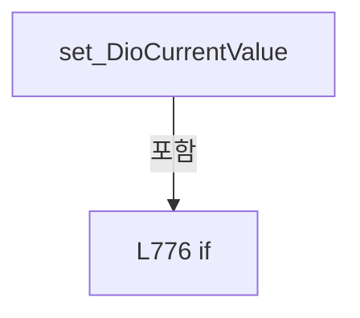

변경 전 점검: 입력/반환 타입, 위 호출자, 예외/취소 경로, 공유 상태와 저장·전송 소비자를 함께 확인합니다. 값의 단위나 물리 방향을 이름만으로 확정하지 않습니다.

### PropertyDeclaration `IsDioOn` · L784–790

[Drilling.UI/Menu/Menus/CMenuManual.cs:784–790](https://github.com/kjuws10-rgb/A3Drilling/blob/28764c91d521777b8ee068dd7aaf2d3902ce9fe2/Drilling.UI/Menu/Menus/CMenuManual.cs#L784-L790)

| 항목 | 실제 추출 값 |
| --- | --- |
| 서명 | bool Drilling.UI.Menu.Menus.CMenuManual.IsDioOn |
| 접근/수식자 | Public / public |
| 반환/값 타입 | bool |
| 소속 타입 | NamedType:Drilling.UI.Menu.Menus.CMenuManual |

현재 부분 분석에서 직접 연결된 호출자는 없습니다. XAML/이벤트/인터페이스·델리게이트·외부 진입을 추가 확인해야 하며, 미사용으로 판정한 것이 아닙니다.

변경 전 점검: 입력/반환 타입, 위 호출자, 예외/취소 경로, 공유 상태와 저장·전송 소비자를 함께 확인합니다. 값의 단위나 물리 방향을 이름만으로 확정하지 않습니다.

### GetAccessorDeclaration `get_IsDioOn` · L786–789

[Drilling.UI/Menu/Menus/CMenuManual.cs:786–789](https://github.com/kjuws10-rgb/A3Drilling/blob/28764c91d521777b8ee068dd7aaf2d3902ce9fe2/Drilling.UI/Menu/Menus/CMenuManual.cs#L786-L789)

| 항목 | 실제 추출 값 |
| --- | --- |
| 서명 | bool Drilling.UI.Menu.Menus.CMenuManual.IsDioOn.get |
| 접근/수식자 | Public / get |
| 반환/값 타입 | bool |
| 소속 타입 | NamedType:Drilling.UI.Menu.Menus.CMenuManual |

현재 부분 분석에서 직접 연결된 호출자는 없습니다. XAML/이벤트/인터페이스·델리게이트·외부 진입을 추가 확인해야 하며, 미사용으로 판정한 것이 아닙니다.

호출하는 대상과 해석 범위:

| 원본 행 | 표현식 | 분석 상태 | 대상/소스 위치 |
| --- | --- | --- | --- |
| 788 | DioCurrentValue.Equals | resolved | bool string.Equals(string?, System.StringComparison) |

본문의 실제 연산·분기·예외·반환 순서(원문 위치 순):

| 원본 행 | 종류 | 주석 해설 |
| --- | --- | --- |
| 788 | call | 함수·델리게이트 또는 객체 생성자를 호출합니다: DioCurrentValue.Equals("ON", StringComparison.OrdinalIgnoreCase) |
| 788 | return | 호출자에게 값 또는 제어를 반환합니다: return DioCurrentValue.Equals("ON", StringComparison.OrdinalIgnoreCase); |

변경 전 점검: 입력/반환 타입, 위 호출자, 예외/취소 경로, 공유 상태와 저장·전송 소비자를 함께 확인합니다. 값의 단위나 물리 방향을 이름만으로 확정하지 않습니다.

### PropertyDeclaration `IsDioOff` · L792–798

[Drilling.UI/Menu/Menus/CMenuManual.cs:792–798](https://github.com/kjuws10-rgb/A3Drilling/blob/28764c91d521777b8ee068dd7aaf2d3902ce9fe2/Drilling.UI/Menu/Menus/CMenuManual.cs#L792-L798)

| 항목 | 실제 추출 값 |
| --- | --- |
| 서명 | bool Drilling.UI.Menu.Menus.CMenuManual.IsDioOff |
| 접근/수식자 | Public / public |
| 반환/값 타입 | bool |
| 소속 타입 | NamedType:Drilling.UI.Menu.Menus.CMenuManual |

현재 부분 분석에서 직접 연결된 호출자는 없습니다. XAML/이벤트/인터페이스·델리게이트·외부 진입을 추가 확인해야 하며, 미사용으로 판정한 것이 아닙니다.

변경 전 점검: 입력/반환 타입, 위 호출자, 예외/취소 경로, 공유 상태와 저장·전송 소비자를 함께 확인합니다. 값의 단위나 물리 방향을 이름만으로 확정하지 않습니다.

### GetAccessorDeclaration `get_IsDioOff` · L794–797

[Drilling.UI/Menu/Menus/CMenuManual.cs:794–797](https://github.com/kjuws10-rgb/A3Drilling/blob/28764c91d521777b8ee068dd7aaf2d3902ce9fe2/Drilling.UI/Menu/Menus/CMenuManual.cs#L794-L797)

| 항목 | 실제 추출 값 |
| --- | --- |
| 서명 | bool Drilling.UI.Menu.Menus.CMenuManual.IsDioOff.get |
| 접근/수식자 | Public / get |
| 반환/값 타입 | bool |
| 소속 타입 | NamedType:Drilling.UI.Menu.Menus.CMenuManual |

현재 부분 분석에서 직접 연결된 호출자는 없습니다. XAML/이벤트/인터페이스·델리게이트·외부 진입을 추가 확인해야 하며, 미사용으로 판정한 것이 아닙니다.

호출하는 대상과 해석 범위:

| 원본 행 | 표현식 | 분석 상태 | 대상/소스 위치 |
| --- | --- | --- | --- |
| 796 | DioCurrentValue.Equals | resolved | bool string.Equals(string?, System.StringComparison) |

본문의 실제 연산·분기·예외·반환 순서(원문 위치 순):

| 원본 행 | 종류 | 주석 해설 |
| --- | --- | --- |
| 796 | call | 함수·델리게이트 또는 객체 생성자를 호출합니다: DioCurrentValue.Equals("OFF", StringComparison.OrdinalIgnoreCase) |
| 796 | return | 호출자에게 값 또는 제어를 반환합니다: return DioCurrentValue.Equals("OFF", StringComparison.OrdinalIgnoreCase); |

변경 전 점검: 입력/반환 타입, 위 호출자, 예외/취소 경로, 공유 상태와 저장·전송 소비자를 함께 확인합니다. 값의 단위나 물리 방향을 이름만으로 확정하지 않습니다.

### PropertyDeclaration `IsDioTargetReady` · L800–814

[Drilling.UI/Menu/Menus/CMenuManual.cs:800–814](https://github.com/kjuws10-rgb/A3Drilling/blob/28764c91d521777b8ee068dd7aaf2d3902ce9fe2/Drilling.UI/Menu/Menus/CMenuManual.cs#L800-L814)

| 항목 | 실제 추출 값 |
| --- | --- |
| 서명 | bool Drilling.UI.Menu.Menus.CMenuManual.IsDioTargetReady |
| 접근/수식자 | Public / public |
| 반환/값 타입 | bool |
| 소속 타입 | NamedType:Drilling.UI.Menu.Menus.CMenuManual |

현재 부분 분석에서 직접 연결된 호출자는 없습니다. XAML/이벤트/인터페이스·델리게이트·외부 진입을 추가 확인해야 하며, 미사용으로 판정한 것이 아닙니다.

변경 전 점검: 입력/반환 타입, 위 호출자, 예외/취소 경로, 공유 상태와 저장·전송 소비자를 함께 확인합니다. 값의 단위나 물리 방향을 이름만으로 확정하지 않습니다.

### GetAccessorDeclaration `get_IsDioTargetReady` · L802–805

[Drilling.UI/Menu/Menus/CMenuManual.cs:802–805](https://github.com/kjuws10-rgb/A3Drilling/blob/28764c91d521777b8ee068dd7aaf2d3902ce9fe2/Drilling.UI/Menu/Menus/CMenuManual.cs#L802-L805)

| 항목 | 실제 추출 값 |
| --- | --- |
| 서명 | bool Drilling.UI.Menu.Menus.CMenuManual.IsDioTargetReady.get |
| 접근/수식자 | Public / get |
| 반환/값 타입 | bool |
| 소속 타입 | NamedType:Drilling.UI.Menu.Menus.CMenuManual |

현재 부분 분석에서 직접 연결된 호출자는 없습니다. XAML/이벤트/인터페이스·델리게이트·외부 진입을 추가 확인해야 하며, 미사용으로 판정한 것이 아닙니다.

본문의 실제 연산·분기·예외·반환 순서(원문 위치 순):

| 원본 행 | 종류 | 주석 해설 |
| --- | --- | --- |
| 804 | return | 호출자에게 값 또는 제어를 반환합니다: return _isDioTargetReady; |

변경 전 점검: 입력/반환 타입, 위 호출자, 예외/취소 경로, 공유 상태와 저장·전송 소비자를 함께 확인합니다. 값의 단위나 물리 방향을 이름만으로 확정하지 않습니다.

### SetAccessorDeclaration `set_IsDioTargetReady` · L807–813

[Drilling.UI/Menu/Menus/CMenuManual.cs:807–813](https://github.com/kjuws10-rgb/A3Drilling/blob/28764c91d521777b8ee068dd7aaf2d3902ce9fe2/Drilling.UI/Menu/Menus/CMenuManual.cs#L807-L813)

| 항목 | 실제 추출 값 |
| --- | --- |
| 서명 | void Drilling.UI.Menu.Menus.CMenuManual.IsDioTargetReady.set |
| 접근/수식자 | Private / private, set |
| 반환/값 타입 | void |
| 소속 타입 | NamedType:Drilling.UI.Menu.Menus.CMenuManual |

입력 계약:

| 이름 | 타입 | 전달 | 선택/기본값 |
| --- | --- | --- | --- |
| value | bool | None | False /  |

현재 부분 분석에서 직접 연결된 호출자는 없습니다. XAML/이벤트/인터페이스·델리게이트·외부 진입을 추가 확인해야 하며, 미사용으로 판정한 것이 아닙니다.

호출하는 대상과 해석 범위:

| 원본 행 | 표현식 | 분석 상태 | 대상/소스 위치 |
| --- | --- | --- | --- |
| 809 | SetProperty | resolved | bool Drilling.UI.Menu.CBindingBase.SetProperty<bool>(ref bool, bool, string?) · Drilling.UI/Menu/CBindingBase.cs:766 |
| 811 | OnPropertyChanged | resolved | void Drilling.UI.Menu.CBindingBase.OnPropertyChanged(string?) · Drilling.UI/Menu/CBindingBase.cs:790 |
| 811 | nameof | unresolved | None |

본문의 실제 연산·분기·예외·반환 순서(원문 위치 순):

| 원본 행 | 종류 | 주석 해설 |
| --- | --- | --- |
| 809 | call | 함수·델리게이트 또는 객체 생성자를 호출합니다: SetProperty(ref _isDioTargetReady, value) |
| 809 | if | 조건에 따라 분기합니다: if (SetProperty(ref _isDioTargetReady, value)) |
| 811 | call | 함수·델리게이트 또는 객체 생성자를 호출합니다: OnPropertyChanged(nameof(IsDioControlEnabled)) |
| 811 | call | 함수·델리게이트 또는 객체 생성자를 호출합니다: nameof(IsDioControlEnabled) |

제어 구문의 포함 구조(실제 실행 순서/CFG가 아닌 구문 탐색 그림):

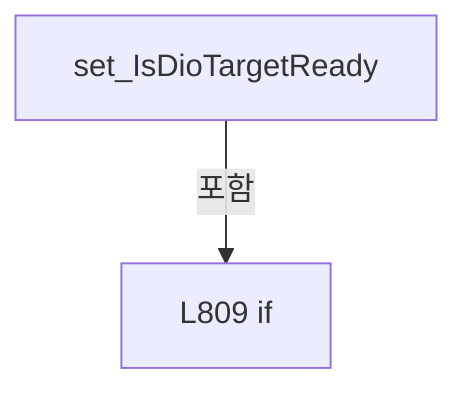

변경 전 점검: 입력/반환 타입, 위 호출자, 예외/취소 경로, 공유 상태와 저장·전송 소비자를 함께 확인합니다. 값의 단위나 물리 방향을 이름만으로 확정하지 않습니다.

### PropertyDeclaration `IsDioControlEnabled` · L816–822

[Drilling.UI/Menu/Menus/CMenuManual.cs:816–822](https://github.com/kjuws10-rgb/A3Drilling/blob/28764c91d521777b8ee068dd7aaf2d3902ce9fe2/Drilling.UI/Menu/Menus/CMenuManual.cs#L816-L822)

| 항목 | 실제 추출 값 |
| --- | --- |
| 서명 | bool Drilling.UI.Menu.Menus.CMenuManual.IsDioControlEnabled |
| 접근/수식자 | Public / public |
| 반환/값 타입 | bool |
| 소속 타입 | NamedType:Drilling.UI.Menu.Menus.CMenuManual |

현재 부분 분석에서 직접 연결된 호출자는 없습니다. XAML/이벤트/인터페이스·델리게이트·외부 진입을 추가 확인해야 하며, 미사용으로 판정한 것이 아닙니다.

변경 전 점검: 입력/반환 타입, 위 호출자, 예외/취소 경로, 공유 상태와 저장·전송 소비자를 함께 확인합니다. 값의 단위나 물리 방향을 이름만으로 확정하지 않습니다.

### GetAccessorDeclaration `get_IsDioControlEnabled` · L818–821

[Drilling.UI/Menu/Menus/CMenuManual.cs:818–821](https://github.com/kjuws10-rgb/A3Drilling/blob/28764c91d521777b8ee068dd7aaf2d3902ce9fe2/Drilling.UI/Menu/Menus/CMenuManual.cs#L818-L821)

| 항목 | 실제 추출 값 |
| --- | --- |
| 서명 | bool Drilling.UI.Menu.Menus.CMenuManual.IsDioControlEnabled.get |
| 접근/수식자 | Public / get |
| 반환/값 타입 | bool |
| 소속 타입 | NamedType:Drilling.UI.Menu.Menus.CMenuManual |

현재 부분 분석에서 직접 연결된 호출자는 없습니다. XAML/이벤트/인터페이스·델리게이트·외부 진입을 추가 확인해야 하며, 미사용으로 판정한 것이 아닙니다.

본문의 실제 연산·분기·예외·반환 순서(원문 위치 순):

| 원본 행 | 종류 | 주석 해설 |
| --- | --- | --- |
| 820 | return | 호출자에게 값 또는 제어를 반환합니다: return IsDioTargetReady && !IsDioControlBusy; |

변경 전 점검: 입력/반환 타입, 위 호출자, 예외/취소 경로, 공유 상태와 저장·전송 소비자를 함께 확인합니다. 값의 단위나 물리 방향을 이름만으로 확정하지 않습니다.

### PropertyDeclaration `DioLastResult` · L824–835

[Drilling.UI/Menu/Menus/CMenuManual.cs:824–835](https://github.com/kjuws10-rgb/A3Drilling/blob/28764c91d521777b8ee068dd7aaf2d3902ce9fe2/Drilling.UI/Menu/Menus/CMenuManual.cs#L824-L835)

| 항목 | 실제 추출 값 |
| --- | --- |
| 서명 | string Drilling.UI.Menu.Menus.CMenuManual.DioLastResult |
| 접근/수식자 | Public / public |
| 반환/값 타입 | string |
| 소속 타입 | NamedType:Drilling.UI.Menu.Menus.CMenuManual |

현재 부분 분석에서 직접 연결된 호출자는 없습니다. XAML/이벤트/인터페이스·델리게이트·외부 진입을 추가 확인해야 하며, 미사용으로 판정한 것이 아닙니다.

변경 전 점검: 입력/반환 타입, 위 호출자, 예외/취소 경로, 공유 상태와 저장·전송 소비자를 함께 확인합니다. 값의 단위나 물리 방향을 이름만으로 확정하지 않습니다.

### GetAccessorDeclaration `get_DioLastResult` · L826–829

[Drilling.UI/Menu/Menus/CMenuManual.cs:826–829](https://github.com/kjuws10-rgb/A3Drilling/blob/28764c91d521777b8ee068dd7aaf2d3902ce9fe2/Drilling.UI/Menu/Menus/CMenuManual.cs#L826-L829)

| 항목 | 실제 추출 값 |
| --- | --- |
| 서명 | string Drilling.UI.Menu.Menus.CMenuManual.DioLastResult.get |
| 접근/수식자 | Public / get |
| 반환/값 타입 | string |
| 소속 타입 | NamedType:Drilling.UI.Menu.Menus.CMenuManual |

현재 부분 분석에서 직접 연결된 호출자는 없습니다. XAML/이벤트/인터페이스·델리게이트·외부 진입을 추가 확인해야 하며, 미사용으로 판정한 것이 아닙니다.

본문의 실제 연산·분기·예외·반환 순서(원문 위치 순):

| 원본 행 | 종류 | 주석 해설 |
| --- | --- | --- |
| 828 | return | 호출자에게 값 또는 제어를 반환합니다: return _dioLastResult; |

변경 전 점검: 입력/반환 타입, 위 호출자, 예외/취소 경로, 공유 상태와 저장·전송 소비자를 함께 확인합니다. 값의 단위나 물리 방향을 이름만으로 확정하지 않습니다.

### SetAccessorDeclaration `set_DioLastResult` · L831–834

[Drilling.UI/Menu/Menus/CMenuManual.cs:831–834](https://github.com/kjuws10-rgb/A3Drilling/blob/28764c91d521777b8ee068dd7aaf2d3902ce9fe2/Drilling.UI/Menu/Menus/CMenuManual.cs#L831-L834)

| 항목 | 실제 추출 값 |
| --- | --- |
| 서명 | void Drilling.UI.Menu.Menus.CMenuManual.DioLastResult.set |
| 접근/수식자 | Private / private, set |
| 반환/값 타입 | void |
| 소속 타입 | NamedType:Drilling.UI.Menu.Menus.CMenuManual |

입력 계약:

| 이름 | 타입 | 전달 | 선택/기본값 |
| --- | --- | --- | --- |
| value | string | None | False /  |

현재 부분 분석에서 직접 연결된 호출자는 없습니다. XAML/이벤트/인터페이스·델리게이트·외부 진입을 추가 확인해야 하며, 미사용으로 판정한 것이 아닙니다.

호출하는 대상과 해석 범위:

| 원본 행 | 표현식 | 분석 상태 | 대상/소스 위치 |
| --- | --- | --- | --- |
| 833 | SetProperty | resolved | bool Drilling.UI.Menu.CBindingBase.SetProperty<string>(ref string, string, string?) · Drilling.UI/Menu/CBindingBase.cs:766 |

본문의 실제 연산·분기·예외·반환 순서(원문 위치 순):

| 원본 행 | 종류 | 주석 해설 |
| --- | --- | --- |
| 833 | call | 함수·델리게이트 또는 객체 생성자를 호출합니다: SetProperty(ref _dioLastResult, value) |

변경 전 점검: 입력/반환 타입, 위 호출자, 예외/취소 경로, 공유 상태와 저장·전송 소비자를 함께 확인합니다. 값의 단위나 물리 방향을 이름만으로 확정하지 않습니다.

### PropertyDeclaration `IsDioControlBusy` · L837–851

[Drilling.UI/Menu/Menus/CMenuManual.cs:837–851](https://github.com/kjuws10-rgb/A3Drilling/blob/28764c91d521777b8ee068dd7aaf2d3902ce9fe2/Drilling.UI/Menu/Menus/CMenuManual.cs#L837-L851)

| 항목 | 실제 추출 값 |
| --- | --- |
| 서명 | bool Drilling.UI.Menu.Menus.CMenuManual.IsDioControlBusy |
| 접근/수식자 | Public / public |
| 반환/값 타입 | bool |
| 소속 타입 | NamedType:Drilling.UI.Menu.Menus.CMenuManual |

현재 부분 분석에서 직접 연결된 호출자는 없습니다. XAML/이벤트/인터페이스·델리게이트·외부 진입을 추가 확인해야 하며, 미사용으로 판정한 것이 아닙니다.

변경 전 점검: 입력/반환 타입, 위 호출자, 예외/취소 경로, 공유 상태와 저장·전송 소비자를 함께 확인합니다. 값의 단위나 물리 방향을 이름만으로 확정하지 않습니다.

### GetAccessorDeclaration `get_IsDioControlBusy` · L839–842

[Drilling.UI/Menu/Menus/CMenuManual.cs:839–842](https://github.com/kjuws10-rgb/A3Drilling/blob/28764c91d521777b8ee068dd7aaf2d3902ce9fe2/Drilling.UI/Menu/Menus/CMenuManual.cs#L839-L842)

| 항목 | 실제 추출 값 |
| --- | --- |
| 서명 | bool Drilling.UI.Menu.Menus.CMenuManual.IsDioControlBusy.get |
| 접근/수식자 | Public / get |
| 반환/값 타입 | bool |
| 소속 타입 | NamedType:Drilling.UI.Menu.Menus.CMenuManual |

현재 부분 분석에서 직접 연결된 호출자는 없습니다. XAML/이벤트/인터페이스·델리게이트·외부 진입을 추가 확인해야 하며, 미사용으로 판정한 것이 아닙니다.

본문의 실제 연산·분기·예외·반환 순서(원문 위치 순):

| 원본 행 | 종류 | 주석 해설 |
| --- | --- | --- |
| 841 | return | 호출자에게 값 또는 제어를 반환합니다: return _isDioControlBusy; |

변경 전 점검: 입력/반환 타입, 위 호출자, 예외/취소 경로, 공유 상태와 저장·전송 소비자를 함께 확인합니다. 값의 단위나 물리 방향을 이름만으로 확정하지 않습니다.

### SetAccessorDeclaration `set_IsDioControlBusy` · L844–850

[Drilling.UI/Menu/Menus/CMenuManual.cs:844–850](https://github.com/kjuws10-rgb/A3Drilling/blob/28764c91d521777b8ee068dd7aaf2d3902ce9fe2/Drilling.UI/Menu/Menus/CMenuManual.cs#L844-L850)

| 항목 | 실제 추출 값 |
| --- | --- |
| 서명 | void Drilling.UI.Menu.Menus.CMenuManual.IsDioControlBusy.set |
| 접근/수식자 | Private / private, set |
| 반환/값 타입 | void |
| 소속 타입 | NamedType:Drilling.UI.Menu.Menus.CMenuManual |

입력 계약:

| 이름 | 타입 | 전달 | 선택/기본값 |
| --- | --- | --- | --- |
| value | bool | None | False /  |

현재 부분 분석에서 직접 연결된 호출자는 없습니다. XAML/이벤트/인터페이스·델리게이트·외부 진입을 추가 확인해야 하며, 미사용으로 판정한 것이 아닙니다.

호출하는 대상과 해석 범위:

| 원본 행 | 표현식 | 분석 상태 | 대상/소스 위치 |
| --- | --- | --- | --- |
| 846 | SetProperty | resolved | bool Drilling.UI.Menu.CBindingBase.SetProperty<bool>(ref bool, bool, string?) · Drilling.UI/Menu/CBindingBase.cs:766 |
| 848 | OnPropertyChanged | resolved | void Drilling.UI.Menu.CBindingBase.OnPropertyChanged(string?) · Drilling.UI/Menu/CBindingBase.cs:790 |
| 848 | nameof | unresolved | None |

본문의 실제 연산·분기·예외·반환 순서(원문 위치 순):

| 원본 행 | 종류 | 주석 해설 |
| --- | --- | --- |
| 846 | call | 함수·델리게이트 또는 객체 생성자를 호출합니다: SetProperty(ref _isDioControlBusy, value) |
| 846 | if | 조건에 따라 분기합니다: if (SetProperty(ref _isDioControlBusy, value)) |
| 848 | call | 함수·델리게이트 또는 객체 생성자를 호출합니다: OnPropertyChanged(nameof(IsDioControlEnabled)) |
| 848 | call | 함수·델리게이트 또는 객체 생성자를 호출합니다: nameof(IsDioControlEnabled) |

제어 구문의 포함 구조(실제 실행 순서/CFG가 아닌 구문 탐색 그림):


변경 전 점검: 입력/반환 타입, 위 호출자, 예외/취소 경로, 공유 상태와 저장·전송 소비자를 함께 확인합니다. 값의 단위나 물리 방향을 이름만으로 확정하지 않습니다.

### PropertyDeclaration `IsScannerWorkspace` · L853–867

[Drilling.UI/Menu/Menus/CMenuManual.cs:853–867](https://github.com/kjuws10-rgb/A3Drilling/blob/28764c91d521777b8ee068dd7aaf2d3902ce9fe2/Drilling.UI/Menu/Menus/CMenuManual.cs#L853-L867)

| 항목 | 실제 추출 값 |
| --- | --- |
| 서명 | bool Drilling.UI.Menu.Menus.CMenuManual.IsScannerWorkspace |
| 접근/수식자 | Public / public |
| 반환/값 타입 | bool |
| 소속 타입 | NamedType:Drilling.UI.Menu.Menus.CMenuManual |

현재 부분 분석에서 직접 연결된 호출자는 없습니다. XAML/이벤트/인터페이스·델리게이트·외부 진입을 추가 확인해야 하며, 미사용으로 판정한 것이 아닙니다.

변경 전 점검: 입력/반환 타입, 위 호출자, 예외/취소 경로, 공유 상태와 저장·전송 소비자를 함께 확인합니다. 값의 단위나 물리 방향을 이름만으로 확정하지 않습니다.

### GetAccessorDeclaration `get_IsScannerWorkspace` · L855–858

[Drilling.UI/Menu/Menus/CMenuManual.cs:855–858](https://github.com/kjuws10-rgb/A3Drilling/blob/28764c91d521777b8ee068dd7aaf2d3902ce9fe2/Drilling.UI/Menu/Menus/CMenuManual.cs#L855-L858)

| 항목 | 실제 추출 값 |
| --- | --- |
| 서명 | bool Drilling.UI.Menu.Menus.CMenuManual.IsScannerWorkspace.get |
| 접근/수식자 | Public / get |
| 반환/값 타입 | bool |
| 소속 타입 | NamedType:Drilling.UI.Menu.Menus.CMenuManual |

현재 부분 분석에서 직접 연결된 호출자는 없습니다. XAML/이벤트/인터페이스·델리게이트·외부 진입을 추가 확인해야 하며, 미사용으로 판정한 것이 아닙니다.

본문의 실제 연산·분기·예외·반환 순서(원문 위치 순):

| 원본 행 | 종류 | 주석 해설 |
| --- | --- | --- |
| 857 | return | 호출자에게 값 또는 제어를 반환합니다: return _isScannerWorkspace; |

변경 전 점검: 입력/반환 타입, 위 호출자, 예외/취소 경로, 공유 상태와 저장·전송 소비자를 함께 확인합니다. 값의 단위나 물리 방향을 이름만으로 확정하지 않습니다.

### SetAccessorDeclaration `set_IsScannerWorkspace` · L860–866

[Drilling.UI/Menu/Menus/CMenuManual.cs:860–866](https://github.com/kjuws10-rgb/A3Drilling/blob/28764c91d521777b8ee068dd7aaf2d3902ce9fe2/Drilling.UI/Menu/Menus/CMenuManual.cs#L860-L866)

| 항목 | 실제 추출 값 |
| --- | --- |
| 서명 | void Drilling.UI.Menu.Menus.CMenuManual.IsScannerWorkspace.set |
| 접근/수식자 | Private / private, set |
| 반환/값 타입 | void |
| 소속 타입 | NamedType:Drilling.UI.Menu.Menus.CMenuManual |

입력 계약:

| 이름 | 타입 | 전달 | 선택/기본값 |
| --- | --- | --- | --- |
| value | bool | None | False /  |

현재 부분 분석에서 직접 연결된 호출자는 없습니다. XAML/이벤트/인터페이스·델리게이트·외부 진입을 추가 확인해야 하며, 미사용으로 판정한 것이 아닙니다.

호출하는 대상과 해석 범위:

| 원본 행 | 표현식 | 분석 상태 | 대상/소스 위치 |
| --- | --- | --- | --- |
| 862 | SetProperty | resolved | bool Drilling.UI.Menu.CBindingBase.SetProperty<bool>(ref bool, bool, string?) · Drilling.UI/Menu/CBindingBase.cs:766 |
| 864 | OnPropertyChanged | resolved | void Drilling.UI.Menu.CBindingBase.OnPropertyChanged(string?) · Drilling.UI/Menu/CBindingBase.cs:790 |
| 864 | nameof | unresolved | None |

본문의 실제 연산·분기·예외·반환 순서(원문 위치 순):

| 원본 행 | 종류 | 주석 해설 |
| --- | --- | --- |
| 862 | call | 함수·델리게이트 또는 객체 생성자를 호출합니다: SetProperty(ref _isScannerWorkspace, value) |
| 862 | if | 조건에 따라 분기합니다: if (SetProperty(ref _isScannerWorkspace, value)) |
| 864 | call | 함수·델리게이트 또는 객체 생성자를 호출합니다: OnPropertyChanged(nameof(IsStageVisionWorkspace)) |
| 864 | call | 함수·델리게이트 또는 객체 생성자를 호출합니다: nameof(IsStageVisionWorkspace) |

제어 구문의 포함 구조(실제 실행 순서/CFG가 아닌 구문 탐색 그림):

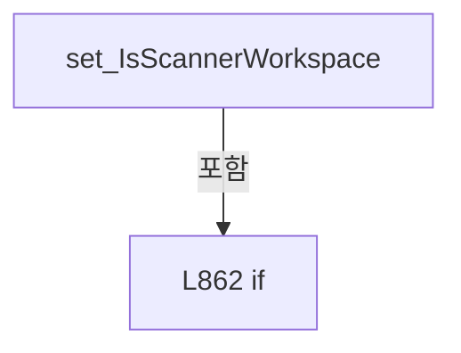

변경 전 점검: 입력/반환 타입, 위 호출자, 예외/취소 경로, 공유 상태와 저장·전송 소비자를 함께 확인합니다. 값의 단위나 물리 방향을 이름만으로 확정하지 않습니다.

### PropertyDeclaration `IsStageVisionWorkspace` · L869–875

[Drilling.UI/Menu/Menus/CMenuManual.cs:869–875](https://github.com/kjuws10-rgb/A3Drilling/blob/28764c91d521777b8ee068dd7aaf2d3902ce9fe2/Drilling.UI/Menu/Menus/CMenuManual.cs#L869-L875)

| 항목 | 실제 추출 값 |
| --- | --- |
| 서명 | bool Drilling.UI.Menu.Menus.CMenuManual.IsStageVisionWorkspace |
| 접근/수식자 | Public / public |
| 반환/값 타입 | bool |
| 소속 타입 | NamedType:Drilling.UI.Menu.Menus.CMenuManual |

현재 부분 분석에서 직접 연결된 호출자는 없습니다. XAML/이벤트/인터페이스·델리게이트·외부 진입을 추가 확인해야 하며, 미사용으로 판정한 것이 아닙니다.

변경 전 점검: 입력/반환 타입, 위 호출자, 예외/취소 경로, 공유 상태와 저장·전송 소비자를 함께 확인합니다. 값의 단위나 물리 방향을 이름만으로 확정하지 않습니다.

### GetAccessorDeclaration `get_IsStageVisionWorkspace` · L871–874

[Drilling.UI/Menu/Menus/CMenuManual.cs:871–874](https://github.com/kjuws10-rgb/A3Drilling/blob/28764c91d521777b8ee068dd7aaf2d3902ce9fe2/Drilling.UI/Menu/Menus/CMenuManual.cs#L871-L874)

| 항목 | 실제 추출 값 |
| --- | --- |
| 서명 | bool Drilling.UI.Menu.Menus.CMenuManual.IsStageVisionWorkspace.get |
| 접근/수식자 | Public / get |
| 반환/값 타입 | bool |
| 소속 타입 | NamedType:Drilling.UI.Menu.Menus.CMenuManual |

현재 부분 분석에서 직접 연결된 호출자는 없습니다. XAML/이벤트/인터페이스·델리게이트·외부 진입을 추가 확인해야 하며, 미사용으로 판정한 것이 아닙니다.

본문의 실제 연산·분기·예외·반환 순서(원문 위치 순):

| 원본 행 | 종류 | 주석 해설 |
| --- | --- | --- |
| 873 | return | 호출자에게 값 또는 제어를 반환합니다: return !IsScannerWorkspace; |

변경 전 점검: 입력/반환 타입, 위 호출자, 예외/취소 경로, 공유 상태와 저장·전송 소비자를 함께 확인합니다. 값의 단위나 물리 방향을 이름만으로 확정하지 않습니다.

### PropertyDeclaration `VisionProtocolCommands` · L877–877

[Drilling.UI/Menu/Menus/CMenuManual.cs:877–877](https://github.com/kjuws10-rgb/A3Drilling/blob/28764c91d521777b8ee068dd7aaf2d3902ce9fe2/Drilling.UI/Menu/Menus/CMenuManual.cs#L877-L877)

| 항목 | 실제 추출 값 |
| --- | --- |
| 서명 | System.Collections.Generic.IReadOnlyList<Drilling.UI.Menu.Menus.ST_MANUAL_VISION_PROTOCOL_COMMAND> Drilling.UI.Menu.Menus.CMenuManual.VisionProtocolCommands |
| 접근/수식자 | Public / public |
| 반환/값 타입 | System.Collections.Generic.IReadOnlyList<Drilling.UI.Menu.Menus.ST_MANUAL_VISION_PROTOCOL_COMMAND> |
| 소속 타입 | NamedType:Drilling.UI.Menu.Menus.CMenuManual |

현재 부분 분석에서 직접 연결된 호출자는 없습니다. XAML/이벤트/인터페이스·델리게이트·외부 진입을 추가 확인해야 하며, 미사용으로 판정한 것이 아닙니다.

변경 전 점검: 입력/반환 타입, 위 호출자, 예외/취소 경로, 공유 상태와 저장·전송 소비자를 함께 확인합니다. 값의 단위나 물리 방향을 이름만으로 확정하지 않습니다.

### GetAccessorDeclaration `get_VisionProtocolCommands` · L877–877

[Drilling.UI/Menu/Menus/CMenuManual.cs:877–877](https://github.com/kjuws10-rgb/A3Drilling/blob/28764c91d521777b8ee068dd7aaf2d3902ce9fe2/Drilling.UI/Menu/Menus/CMenuManual.cs#L877-L877)

| 항목 | 실제 추출 값 |
| --- | --- |
| 서명 | System.Collections.Generic.IReadOnlyList<Drilling.UI.Menu.Menus.ST_MANUAL_VISION_PROTOCOL_COMMAND> Drilling.UI.Menu.Menus.CMenuManual.VisionProtocolCommands.get |
| 접근/수식자 | Public / get |
| 반환/값 타입 | System.Collections.Generic.IReadOnlyList<Drilling.UI.Menu.Menus.ST_MANUAL_VISION_PROTOCOL_COMMAND> |
| 소속 타입 | NamedType:Drilling.UI.Menu.Menus.CMenuManual |

현재 부분 분석에서 직접 연결된 호출자는 없습니다. XAML/이벤트/인터페이스·델리게이트·외부 진입을 추가 확인해야 하며, 미사용으로 판정한 것이 아닙니다.

변경 전 점검: 입력/반환 타입, 위 호출자, 예외/취소 경로, 공유 상태와 저장·전송 소비자를 함께 확인합니다. 값의 단위나 물리 방향을 이름만으로 확정하지 않습니다.

### PropertyDeclaration `SelectedVisionProtocolCommand` · L879–893

[Drilling.UI/Menu/Menus/CMenuManual.cs:879–893](https://github.com/kjuws10-rgb/A3Drilling/blob/28764c91d521777b8ee068dd7aaf2d3902ce9fe2/Drilling.UI/Menu/Menus/CMenuManual.cs#L879-L893)

| 항목 | 실제 추출 값 |
| --- | --- |
| 서명 | Drilling.UI.Menu.Menus.ST_MANUAL_VISION_PROTOCOL_COMMAND Drilling.UI.Menu.Menus.CMenuManual.SelectedVisionProtocolCommand |
| 접근/수식자 | Public / public |
| 반환/값 타입 | Drilling.UI.Menu.Menus.ST_MANUAL_VISION_PROTOCOL_COMMAND |
| 소속 타입 | NamedType:Drilling.UI.Menu.Menus.CMenuManual |

현재 부분 분석에서 직접 연결된 호출자는 없습니다. XAML/이벤트/인터페이스·델리게이트·외부 진입을 추가 확인해야 하며, 미사용으로 판정한 것이 아닙니다.

변경 전 점검: 입력/반환 타입, 위 호출자, 예외/취소 경로, 공유 상태와 저장·전송 소비자를 함께 확인합니다. 값의 단위나 물리 방향을 이름만으로 확정하지 않습니다.

### GetAccessorDeclaration `get_SelectedVisionProtocolCommand` · L881–884

[Drilling.UI/Menu/Menus/CMenuManual.cs:881–884](https://github.com/kjuws10-rgb/A3Drilling/blob/28764c91d521777b8ee068dd7aaf2d3902ce9fe2/Drilling.UI/Menu/Menus/CMenuManual.cs#L881-L884)

| 항목 | 실제 추출 값 |
| --- | --- |
| 서명 | Drilling.UI.Menu.Menus.ST_MANUAL_VISION_PROTOCOL_COMMAND Drilling.UI.Menu.Menus.CMenuManual.SelectedVisionProtocolCommand.get |
| 접근/수식자 | Public / get |
| 반환/값 타입 | Drilling.UI.Menu.Menus.ST_MANUAL_VISION_PROTOCOL_COMMAND |
| 소속 타입 | NamedType:Drilling.UI.Menu.Menus.CMenuManual |

현재 부분 분석에서 직접 연결된 호출자는 없습니다. XAML/이벤트/인터페이스·델리게이트·외부 진입을 추가 확인해야 하며, 미사용으로 판정한 것이 아닙니다.

본문의 실제 연산·분기·예외·반환 순서(원문 위치 순):

| 원본 행 | 종류 | 주석 해설 |
| --- | --- | --- |
| 883 | return | 호출자에게 값 또는 제어를 반환합니다: return _selectedVisionProtocolCommand; |

변경 전 점검: 입력/반환 타입, 위 호출자, 예외/취소 경로, 공유 상태와 저장·전송 소비자를 함께 확인합니다. 값의 단위나 물리 방향을 이름만으로 확정하지 않습니다.

### SetAccessorDeclaration `set_SelectedVisionProtocolCommand` · L886–892

[Drilling.UI/Menu/Menus/CMenuManual.cs:886–892](https://github.com/kjuws10-rgb/A3Drilling/blob/28764c91d521777b8ee068dd7aaf2d3902ce9fe2/Drilling.UI/Menu/Menus/CMenuManual.cs#L886-L892)

| 항목 | 실제 추출 값 |
| --- | --- |
| 서명 | void Drilling.UI.Menu.Menus.CMenuManual.SelectedVisionProtocolCommand.set |
| 접근/수식자 | Public / set |
| 반환/값 타입 | void |
| 소속 타입 | NamedType:Drilling.UI.Menu.Menus.CMenuManual |

입력 계약:

| 이름 | 타입 | 전달 | 선택/기본값 |
| --- | --- | --- | --- |
| value | Drilling.UI.Menu.Menus.ST_MANUAL_VISION_PROTOCOL_COMMAND | None | False /  |

현재 부분 분석에서 직접 연결된 호출자는 없습니다. XAML/이벤트/인터페이스·델리게이트·외부 진입을 추가 확인해야 하며, 미사용으로 판정한 것이 아닙니다.

호출하는 대상과 해석 범위:

| 원본 행 | 표현식 | 분석 상태 | 대상/소스 위치 |
| --- | --- | --- | --- |
| 888 | SetProperty | resolved | bool Drilling.UI.Menu.CBindingBase.SetProperty<Drilling.UI.Menu.Menus.ST_MANUAL_VISION_PROTOCOL_COMMAND>(ref Drilling.UI.Menu.Menus.ST_MANUAL_VISION_PROTOCOL_COMMAND, Drilling.UI.Menu.Menus.ST_MANUAL_VISION_PROTOCOL_COMMAND, string?) · Drilling.UI/Menu/CBindingBase.cs:766 |
| 890 | ResetVisionProtocolInputs | resolved | void Drilling.UI.Menu.Menus.CMenuManual.ResetVisionProtocolInputs() · Drilling.UI/Menu/Menus/CMenuManual.cs:6470 |

본문의 실제 연산·분기·예외·반환 순서(원문 위치 순):

| 원본 행 | 종류 | 주석 해설 |
| --- | --- | --- |
| 888 | call | 함수·델리게이트 또는 객체 생성자를 호출합니다: SetProperty(ref _selectedVisionProtocolCommand, value) |
| 888 | if | 조건에 따라 분기합니다: if (value is not null && SetProperty(ref _selectedVisionProtocolCommand, value)) |
| 890 | call | 함수·델리게이트 또는 객체 생성자를 호출합니다: ResetVisionProtocolInputs() |

제어 구문의 포함 구조(실제 실행 순서/CFG가 아닌 구문 탐색 그림):


변경 전 점검: 입력/반환 타입, 위 호출자, 예외/취소 경로, 공유 상태와 저장·전송 소비자를 함께 확인합니다. 값의 단위나 물리 방향을 이름만으로 확정하지 않습니다.

### PropertyDeclaration `VisionProtocolCommandDescription` · L895–901

[Drilling.UI/Menu/Menus/CMenuManual.cs:895–901](https://github.com/kjuws10-rgb/A3Drilling/blob/28764c91d521777b8ee068dd7aaf2d3902ce9fe2/Drilling.UI/Menu/Menus/CMenuManual.cs#L895-L901)

| 항목 | 실제 추출 값 |
| --- | --- |
| 서명 | string Drilling.UI.Menu.Menus.CMenuManual.VisionProtocolCommandDescription |
| 접근/수식자 | Public / public |
| 반환/값 타입 | string |
| 소속 타입 | NamedType:Drilling.UI.Menu.Menus.CMenuManual |

현재 부분 분석에서 직접 연결된 호출자는 없습니다. XAML/이벤트/인터페이스·델리게이트·외부 진입을 추가 확인해야 하며, 미사용으로 판정한 것이 아닙니다.

변경 전 점검: 입력/반환 타입, 위 호출자, 예외/취소 경로, 공유 상태와 저장·전송 소비자를 함께 확인합니다. 값의 단위나 물리 방향을 이름만으로 확정하지 않습니다.

### GetAccessorDeclaration `get_VisionProtocolCommandDescription` · L897–900

[Drilling.UI/Menu/Menus/CMenuManual.cs:897–900](https://github.com/kjuws10-rgb/A3Drilling/blob/28764c91d521777b8ee068dd7aaf2d3902ce9fe2/Drilling.UI/Menu/Menus/CMenuManual.cs#L897-L900)

| 항목 | 실제 추출 값 |
| --- | --- |
| 서명 | string Drilling.UI.Menu.Menus.CMenuManual.VisionProtocolCommandDescription.get |
| 접근/수식자 | Public / get |
| 반환/값 타입 | string |
| 소속 타입 | NamedType:Drilling.UI.Menu.Menus.CMenuManual |

현재 부분 분석에서 직접 연결된 호출자는 없습니다. XAML/이벤트/인터페이스·델리게이트·외부 진입을 추가 확인해야 하며, 미사용으로 판정한 것이 아닙니다.

본문의 실제 연산·분기·예외·반환 순서(원문 위치 순):

| 원본 행 | 종류 | 주석 해설 |
| --- | --- | --- |
| 899 | return | 호출자에게 값 또는 제어를 반환합니다: return SelectedVisionProtocolCommand.Description; |

변경 전 점검: 입력/반환 타입, 위 호출자, 예외/취소 경로, 공유 상태와 저장·전송 소비자를 함께 확인합니다. 값의 단위나 물리 방향을 이름만으로 확정하지 않습니다.

### PropertyDeclaration `VisionProtocolUsesMarkRows` · L903–909

[Drilling.UI/Menu/Menus/CMenuManual.cs:903–909](https://github.com/kjuws10-rgb/A3Drilling/blob/28764c91d521777b8ee068dd7aaf2d3902ce9fe2/Drilling.UI/Menu/Menus/CMenuManual.cs#L903-L909)

| 항목 | 실제 추출 값 |
| --- | --- |
| 서명 | bool Drilling.UI.Menu.Menus.CMenuManual.VisionProtocolUsesMarkRows |
| 접근/수식자 | Public / public |
| 반환/값 타입 | bool |
| 소속 타입 | NamedType:Drilling.UI.Menu.Menus.CMenuManual |

현재 부분 분석에서 직접 연결된 호출자는 없습니다. XAML/이벤트/인터페이스·델리게이트·외부 진입을 추가 확인해야 하며, 미사용으로 판정한 것이 아닙니다.

변경 전 점검: 입력/반환 타입, 위 호출자, 예외/취소 경로, 공유 상태와 저장·전송 소비자를 함께 확인합니다. 값의 단위나 물리 방향을 이름만으로 확정하지 않습니다.

### GetAccessorDeclaration `get_VisionProtocolUsesMarkRows` · L905–908

[Drilling.UI/Menu/Menus/CMenuManual.cs:905–908](https://github.com/kjuws10-rgb/A3Drilling/blob/28764c91d521777b8ee068dd7aaf2d3902ce9fe2/Drilling.UI/Menu/Menus/CMenuManual.cs#L905-L908)

| 항목 | 실제 추출 값 |
| --- | --- |
| 서명 | bool Drilling.UI.Menu.Menus.CMenuManual.VisionProtocolUsesMarkRows.get |
| 접근/수식자 | Public / get |
| 반환/값 타입 | bool |
| 소속 타입 | NamedType:Drilling.UI.Menu.Menus.CMenuManual |

현재 부분 분석에서 직접 연결된 호출자는 없습니다. XAML/이벤트/인터페이스·델리게이트·외부 진입을 추가 확인해야 하며, 미사용으로 판정한 것이 아닙니다.

본문의 실제 연산·분기·예외·반환 순서(원문 위치 순):

| 원본 행 | 종류 | 주석 해설 |
| --- | --- | --- |
| 907 | return | 호출자에게 값 또는 제어를 반환합니다: return SelectedVisionProtocolCommand.CommandText is "MARK_FIND_SINGLE" or "FLYING_READY"; |

변경 전 점검: 입력/반환 타입, 위 호출자, 예외/취소 경로, 공유 상태와 저장·전송 소비자를 함께 확인합니다. 값의 단위나 물리 방향을 이름만으로 확정하지 않습니다.

### PropertyDeclaration `VisionProtocolIsFlyingReady` · L911–917

[Drilling.UI/Menu/Menus/CMenuManual.cs:911–917](https://github.com/kjuws10-rgb/A3Drilling/blob/28764c91d521777b8ee068dd7aaf2d3902ce9fe2/Drilling.UI/Menu/Menus/CMenuManual.cs#L911-L917)

| 항목 | 실제 추출 값 |
| --- | --- |
| 서명 | bool Drilling.UI.Menu.Menus.CMenuManual.VisionProtocolIsFlyingReady |
| 접근/수식자 | Public / public |
| 반환/값 타입 | bool |
| 소속 타입 | NamedType:Drilling.UI.Menu.Menus.CMenuManual |

현재 부분 분석에서 직접 연결된 호출자는 없습니다. XAML/이벤트/인터페이스·델리게이트·외부 진입을 추가 확인해야 하며, 미사용으로 판정한 것이 아닙니다.

변경 전 점검: 입력/반환 타입, 위 호출자, 예외/취소 경로, 공유 상태와 저장·전송 소비자를 함께 확인합니다. 값의 단위나 물리 방향을 이름만으로 확정하지 않습니다.

### GetAccessorDeclaration `get_VisionProtocolIsFlyingReady` · L913–916

[Drilling.UI/Menu/Menus/CMenuManual.cs:913–916](https://github.com/kjuws10-rgb/A3Drilling/blob/28764c91d521777b8ee068dd7aaf2d3902ce9fe2/Drilling.UI/Menu/Menus/CMenuManual.cs#L913-L916)

| 항목 | 실제 추출 값 |
| --- | --- |
| 서명 | bool Drilling.UI.Menu.Menus.CMenuManual.VisionProtocolIsFlyingReady.get |
| 접근/수식자 | Public / get |
| 반환/값 타입 | bool |
| 소속 타입 | NamedType:Drilling.UI.Menu.Menus.CMenuManual |

현재 부분 분석에서 직접 연결된 호출자는 없습니다. XAML/이벤트/인터페이스·델리게이트·외부 진입을 추가 확인해야 하며, 미사용으로 판정한 것이 아닙니다.

본문의 실제 연산·분기·예외·반환 순서(원문 위치 순):

| 원본 행 | 종류 | 주석 해설 |
| --- | --- | --- |
| 915 | return | 호출자에게 값 또는 제어를 반환합니다: return SelectedVisionProtocolCommand.CommandText == "FLYING_READY"; |

변경 전 점검: 입력/반환 타입, 위 호출자, 예외/취소 경로, 공유 상태와 저장·전송 소비자를 함께 확인합니다. 값의 단위나 물리 방향을 이름만으로 확정하지 않습니다.

### PropertyDeclaration `VisionProtocolHasNoArguments` · L919–925

[Drilling.UI/Menu/Menus/CMenuManual.cs:919–925](https://github.com/kjuws10-rgb/A3Drilling/blob/28764c91d521777b8ee068dd7aaf2d3902ce9fe2/Drilling.UI/Menu/Menus/CMenuManual.cs#L919-L925)

| 항목 | 실제 추출 값 |
| --- | --- |
| 서명 | bool Drilling.UI.Menu.Menus.CMenuManual.VisionProtocolHasNoArguments |
| 접근/수식자 | Public / public |
| 반환/값 타입 | bool |
| 소속 타입 | NamedType:Drilling.UI.Menu.Menus.CMenuManual |

현재 부분 분석에서 직접 연결된 호출자는 없습니다. XAML/이벤트/인터페이스·델리게이트·외부 진입을 추가 확인해야 하며, 미사용으로 판정한 것이 아닙니다.

변경 전 점검: 입력/반환 타입, 위 호출자, 예외/취소 경로, 공유 상태와 저장·전송 소비자를 함께 확인합니다. 값의 단위나 물리 방향을 이름만으로 확정하지 않습니다.

### GetAccessorDeclaration `get_VisionProtocolHasNoArguments` · L921–924

[Drilling.UI/Menu/Menus/CMenuManual.cs:921–924](https://github.com/kjuws10-rgb/A3Drilling/blob/28764c91d521777b8ee068dd7aaf2d3902ce9fe2/Drilling.UI/Menu/Menus/CMenuManual.cs#L921-L924)

| 항목 | 실제 추출 값 |
| --- | --- |
| 서명 | bool Drilling.UI.Menu.Menus.CMenuManual.VisionProtocolHasNoArguments.get |
| 접근/수식자 | Public / get |
| 반환/값 타입 | bool |
| 소속 타입 | NamedType:Drilling.UI.Menu.Menus.CMenuManual |

현재 부분 분석에서 직접 연결된 호출자는 없습니다. XAML/이벤트/인터페이스·델리게이트·외부 진입을 추가 확인해야 하며, 미사용으로 판정한 것이 아닙니다.

본문의 실제 연산·분기·예외·반환 순서(원문 위치 순):

| 원본 행 | 종류 | 주석 해설 |
| --- | --- | --- |
| 923 | return | 호출자에게 값 또는 제어를 반환합니다: return !VisionProtocolUsesMarkRows; |

변경 전 점검: 입력/반환 타입, 위 호출자, 예외/취소 경로, 공유 상태와 저장·전송 소비자를 함께 확인합니다. 값의 단위나 물리 방향을 이름만으로 확정하지 않습니다.

### PropertyDeclaration `VisionProtocolInspectionType` · L927–941

[Drilling.UI/Menu/Menus/CMenuManual.cs:927–941](https://github.com/kjuws10-rgb/A3Drilling/blob/28764c91d521777b8ee068dd7aaf2d3902ce9fe2/Drilling.UI/Menu/Menus/CMenuManual.cs#L927-L941)

| 항목 | 실제 추출 값 |
| --- | --- |
| 서명 | string Drilling.UI.Menu.Menus.CMenuManual.VisionProtocolInspectionType |
| 접근/수식자 | Public / public |
| 반환/값 타입 | string |
| 소속 타입 | NamedType:Drilling.UI.Menu.Menus.CMenuManual |

현재 부분 분석에서 직접 연결된 호출자는 없습니다. XAML/이벤트/인터페이스·델리게이트·외부 진입을 추가 확인해야 하며, 미사용으로 판정한 것이 아닙니다.

변경 전 점검: 입력/반환 타입, 위 호출자, 예외/취소 경로, 공유 상태와 저장·전송 소비자를 함께 확인합니다. 값의 단위나 물리 방향을 이름만으로 확정하지 않습니다.

### GetAccessorDeclaration `get_VisionProtocolInspectionType` · L929–932

[Drilling.UI/Menu/Menus/CMenuManual.cs:929–932](https://github.com/kjuws10-rgb/A3Drilling/blob/28764c91d521777b8ee068dd7aaf2d3902ce9fe2/Drilling.UI/Menu/Menus/CMenuManual.cs#L929-L932)

| 항목 | 실제 추출 값 |
| --- | --- |
| 서명 | string Drilling.UI.Menu.Menus.CMenuManual.VisionProtocolInspectionType.get |
| 접근/수식자 | Public / get |
| 반환/값 타입 | string |
| 소속 타입 | NamedType:Drilling.UI.Menu.Menus.CMenuManual |

현재 부분 분석에서 직접 연결된 호출자는 없습니다. XAML/이벤트/인터페이스·델리게이트·외부 진입을 추가 확인해야 하며, 미사용으로 판정한 것이 아닙니다.

본문의 실제 연산·분기·예외·반환 순서(원문 위치 순):

| 원본 행 | 종류 | 주석 해설 |
| --- | --- | --- |
| 931 | return | 호출자에게 값 또는 제어를 반환합니다: return _visionProtocolInspectionType; |

변경 전 점검: 입력/반환 타입, 위 호출자, 예외/취소 경로, 공유 상태와 저장·전송 소비자를 함께 확인합니다. 값의 단위나 물리 방향을 이름만으로 확정하지 않습니다.

### SetAccessorDeclaration `set_VisionProtocolInspectionType` · L934–940

[Drilling.UI/Menu/Menus/CMenuManual.cs:934–940](https://github.com/kjuws10-rgb/A3Drilling/blob/28764c91d521777b8ee068dd7aaf2d3902ce9fe2/Drilling.UI/Menu/Menus/CMenuManual.cs#L934-L940)

| 항목 | 실제 추출 값 |
| --- | --- |
| 서명 | void Drilling.UI.Menu.Menus.CMenuManual.VisionProtocolInspectionType.set |
| 접근/수식자 | Public / set |
| 반환/값 타입 | void |
| 소속 타입 | NamedType:Drilling.UI.Menu.Menus.CMenuManual |

입력 계약:

| 이름 | 타입 | 전달 | 선택/기본값 |
| --- | --- | --- | --- |
| value | string | None | False /  |

현재 부분 분석에서 직접 연결된 호출자는 없습니다. XAML/이벤트/인터페이스·델리게이트·외부 진입을 추가 확인해야 하며, 미사용으로 판정한 것이 아닙니다.

호출하는 대상과 해석 범위:

| 원본 행 | 표현식 | 분석 상태 | 대상/소스 위치 |
| --- | --- | --- | --- |
| 936 | SetProperty | resolved | bool Drilling.UI.Menu.CBindingBase.SetProperty<string>(ref string, string, string?) · Drilling.UI/Menu/CBindingBase.cs:766 |
| 938 | OnPropertyChanged | resolved | void Drilling.UI.Menu.CBindingBase.OnPropertyChanged(string?) · Drilling.UI/Menu/CBindingBase.cs:790 |
| 938 | nameof | unresolved | None |

본문의 실제 연산·분기·예외·반환 순서(원문 위치 순):

| 원본 행 | 종류 | 주석 해설 |
| --- | --- | --- |
| 936 | call | 함수·델리게이트 또는 객체 생성자를 호출합니다: SetProperty(ref _visionProtocolInspectionType, value ?? "") |
| 936 | if | 조건에 따라 분기합니다: if (SetProperty(ref _visionProtocolInspectionType, value ?? "")) |
| 938 | call | 함수·델리게이트 또는 객체 생성자를 호출합니다: OnPropertyChanged(nameof(VisionProtocolRequestPreview)) |
| 938 | call | 함수·델리게이트 또는 객체 생성자를 호출합니다: nameof(VisionProtocolRequestPreview) |

제어 구문의 포함 구조(실제 실행 순서/CFG가 아닌 구문 탐색 그림):

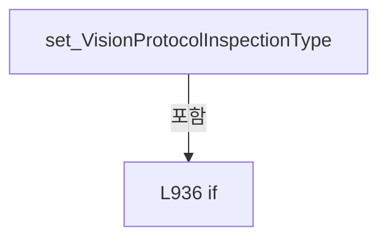

변경 전 점검: 입력/반환 타입, 위 호출자, 예외/취소 경로, 공유 상태와 저장·전송 소비자를 함께 확인합니다. 값의 단위나 물리 방향을 이름만으로 확정하지 않습니다.

### PropertyDeclaration `VisionProtocolRequestPreview` · L943–949

[Drilling.UI/Menu/Menus/CMenuManual.cs:943–949](https://github.com/kjuws10-rgb/A3Drilling/blob/28764c91d521777b8ee068dd7aaf2d3902ce9fe2/Drilling.UI/Menu/Menus/CMenuManual.cs#L943-L949)

| 항목 | 실제 추출 값 |
| --- | --- |
| 서명 | string Drilling.UI.Menu.Menus.CMenuManual.VisionProtocolRequestPreview |
| 접근/수식자 | Public / public |
| 반환/값 타입 | string |
| 소속 타입 | NamedType:Drilling.UI.Menu.Menus.CMenuManual |

현재 부분 분석에서 직접 연결된 호출자는 없습니다. XAML/이벤트/인터페이스·델리게이트·외부 진입을 추가 확인해야 하며, 미사용으로 판정한 것이 아닙니다.

변경 전 점검: 입력/반환 타입, 위 호출자, 예외/취소 경로, 공유 상태와 저장·전송 소비자를 함께 확인합니다. 값의 단위나 물리 방향을 이름만으로 확정하지 않습니다.

### GetAccessorDeclaration `get_VisionProtocolRequestPreview` · L945–948

[Drilling.UI/Menu/Menus/CMenuManual.cs:945–948](https://github.com/kjuws10-rgb/A3Drilling/blob/28764c91d521777b8ee068dd7aaf2d3902ce9fe2/Drilling.UI/Menu/Menus/CMenuManual.cs#L945-L948)

| 항목 | 실제 추출 값 |
| --- | --- |
| 서명 | string Drilling.UI.Menu.Menus.CMenuManual.VisionProtocolRequestPreview.get |
| 접근/수식자 | Public / get |
| 반환/값 타입 | string |
| 소속 타입 | NamedType:Drilling.UI.Menu.Menus.CMenuManual |

현재 부분 분석에서 직접 연결된 호출자는 없습니다. XAML/이벤트/인터페이스·델리게이트·외부 진입을 추가 확인해야 하며, 미사용으로 판정한 것이 아닙니다.

호출하는 대상과 해석 범위:

| 원본 행 | 표현식 | 분석 상태 | 대상/소스 위치 |
| --- | --- | --- | --- |
| 947 | BuildVisionProtocolFunction | resolved | string Drilling.UI.Menu.Menus.CMenuManual.BuildVisionProtocolFunction(bool) · Drilling.UI/Menu/Menus/CMenuManual.cs:6522 |

본문의 실제 연산·분기·예외·반환 순서(원문 위치 순):

| 원본 행 | 종류 | 주석 해설 |
| --- | --- | --- |
| 947 | call | 함수·델리게이트 또는 객체 생성자를 호출합니다: BuildVisionProtocolFunction(validate: false) |
| 947 | return | 호출자에게 값 또는 제어를 반환합니다: return BuildVisionProtocolFunction(validate: false); |

변경 전 점검: 입력/반환 타입, 위 호출자, 예외/취소 경로, 공유 상태와 저장·전송 소비자를 함께 확인합니다. 값의 단위나 물리 방향을 이름만으로 확정하지 않습니다.

### PropertyDeclaration `VisionProtocolMarkRowCountText` · L951–957

[Drilling.UI/Menu/Menus/CMenuManual.cs:951–957](https://github.com/kjuws10-rgb/A3Drilling/blob/28764c91d521777b8ee068dd7aaf2d3902ce9fe2/Drilling.UI/Menu/Menus/CMenuManual.cs#L951-L957)

| 항목 | 실제 추출 값 |
| --- | --- |
| 서명 | string Drilling.UI.Menu.Menus.CMenuManual.VisionProtocolMarkRowCountText |
| 접근/수식자 | Public / public |
| 반환/값 타입 | string |
| 소속 타입 | NamedType:Drilling.UI.Menu.Menus.CMenuManual |

현재 부분 분석에서 직접 연결된 호출자는 없습니다. XAML/이벤트/인터페이스·델리게이트·외부 진입을 추가 확인해야 하며, 미사용으로 판정한 것이 아닙니다.

변경 전 점검: 입력/반환 타입, 위 호출자, 예외/취소 경로, 공유 상태와 저장·전송 소비자를 함께 확인합니다. 값의 단위나 물리 방향을 이름만으로 확정하지 않습니다.

### GetAccessorDeclaration `get_VisionProtocolMarkRowCountText` · L953–956

[Drilling.UI/Menu/Menus/CMenuManual.cs:953–956](https://github.com/kjuws10-rgb/A3Drilling/blob/28764c91d521777b8ee068dd7aaf2d3902ce9fe2/Drilling.UI/Menu/Menus/CMenuManual.cs#L953-L956)

| 항목 | 실제 추출 값 |
| --- | --- |
| 서명 | string Drilling.UI.Menu.Menus.CMenuManual.VisionProtocolMarkRowCountText.get |
| 접근/수식자 | Public / get |
| 반환/값 타입 | string |
| 소속 타입 | NamedType:Drilling.UI.Menu.Menus.CMenuManual |

현재 부분 분석에서 직접 연결된 호출자는 없습니다. XAML/이벤트/인터페이스·델리게이트·외부 진입을 추가 확인해야 하며, 미사용으로 판정한 것이 아닙니다.

본문의 실제 연산·분기·예외·반환 순서(원문 위치 순):

| 원본 행 | 종류 | 주석 해설 |
| --- | --- | --- |
| 955 | return | 호출자에게 값 또는 제어를 반환합니다: return $"MARK {VisionProtocolMarkRows.Count} / {CVisionProtocol.MaximumMarkCount}"; |

변경 전 점검: 입력/반환 타입, 위 호출자, 예외/취소 경로, 공유 상태와 저장·전송 소비자를 함께 확인합니다. 값의 단위나 물리 방향을 이름만으로 확정하지 않습니다.

### PropertyDeclaration `VisionProtocolEndpoint` · L959–970

[Drilling.UI/Menu/Menus/CMenuManual.cs:959–970](https://github.com/kjuws10-rgb/A3Drilling/blob/28764c91d521777b8ee068dd7aaf2d3902ce9fe2/Drilling.UI/Menu/Menus/CMenuManual.cs#L959-L970)

| 항목 | 실제 추출 값 |
| --- | --- |
| 서명 | string Drilling.UI.Menu.Menus.CMenuManual.VisionProtocolEndpoint |
| 접근/수식자 | Public / public |
| 반환/값 타입 | string |
| 소속 타입 | NamedType:Drilling.UI.Menu.Menus.CMenuManual |

현재 부분 분석에서 직접 연결된 호출자는 없습니다. XAML/이벤트/인터페이스·델리게이트·외부 진입을 추가 확인해야 하며, 미사용으로 판정한 것이 아닙니다.

변경 전 점검: 입력/반환 타입, 위 호출자, 예외/취소 경로, 공유 상태와 저장·전송 소비자를 함께 확인합니다. 값의 단위나 물리 방향을 이름만으로 확정하지 않습니다.

### GetAccessorDeclaration `get_VisionProtocolEndpoint` · L961–964

[Drilling.UI/Menu/Menus/CMenuManual.cs:961–964](https://github.com/kjuws10-rgb/A3Drilling/blob/28764c91d521777b8ee068dd7aaf2d3902ce9fe2/Drilling.UI/Menu/Menus/CMenuManual.cs#L961-L964)

| 항목 | 실제 추출 값 |
| --- | --- |
| 서명 | string Drilling.UI.Menu.Menus.CMenuManual.VisionProtocolEndpoint.get |
| 접근/수식자 | Public / get |
| 반환/값 타입 | string |
| 소속 타입 | NamedType:Drilling.UI.Menu.Menus.CMenuManual |

현재 부분 분석에서 직접 연결된 호출자는 없습니다. XAML/이벤트/인터페이스·델리게이트·외부 진입을 추가 확인해야 하며, 미사용으로 판정한 것이 아닙니다.

본문의 실제 연산·분기·예외·반환 순서(원문 위치 순):

| 원본 행 | 종류 | 주석 해설 |
| --- | --- | --- |
| 963 | return | 호출자에게 값 또는 제어를 반환합니다: return _visionProtocolEndpoint; |

변경 전 점검: 입력/반환 타입, 위 호출자, 예외/취소 경로, 공유 상태와 저장·전송 소비자를 함께 확인합니다. 값의 단위나 물리 방향을 이름만으로 확정하지 않습니다.

### SetAccessorDeclaration `set_VisionProtocolEndpoint` · L966–969

[Drilling.UI/Menu/Menus/CMenuManual.cs:966–969](https://github.com/kjuws10-rgb/A3Drilling/blob/28764c91d521777b8ee068dd7aaf2d3902ce9fe2/Drilling.UI/Menu/Menus/CMenuManual.cs#L966-L969)

| 항목 | 실제 추출 값 |
| --- | --- |
| 서명 | void Drilling.UI.Menu.Menus.CMenuManual.VisionProtocolEndpoint.set |
| 접근/수식자 | Private / private, set |
| 반환/값 타입 | void |
| 소속 타입 | NamedType:Drilling.UI.Menu.Menus.CMenuManual |

입력 계약:

| 이름 | 타입 | 전달 | 선택/기본값 |
| --- | --- | --- | --- |
| value | string | None | False /  |

현재 부분 분석에서 직접 연결된 호출자는 없습니다. XAML/이벤트/인터페이스·델리게이트·외부 진입을 추가 확인해야 하며, 미사용으로 판정한 것이 아닙니다.

호출하는 대상과 해석 범위:

| 원본 행 | 표현식 | 분석 상태 | 대상/소스 위치 |
| --- | --- | --- | --- |
| 968 | SetProperty | resolved | bool Drilling.UI.Menu.CBindingBase.SetProperty<string>(ref string, string, string?) · Drilling.UI/Menu/CBindingBase.cs:766 |

본문의 실제 연산·분기·예외·반환 순서(원문 위치 순):

| 원본 행 | 종류 | 주석 해설 |
| --- | --- | --- |
| 968 | call | 함수·델리게이트 또는 객체 생성자를 호출합니다: SetProperty(ref _visionProtocolEndpoint, value) |

변경 전 점검: 입력/반환 타입, 위 호출자, 예외/취소 경로, 공유 상태와 저장·전송 소비자를 함께 확인합니다. 값의 단위나 물리 방향을 이름만으로 확정하지 않습니다.

### PropertyDeclaration `VisionProtocolStatus` · L972–983

[Drilling.UI/Menu/Menus/CMenuManual.cs:972–983](https://github.com/kjuws10-rgb/A3Drilling/blob/28764c91d521777b8ee068dd7aaf2d3902ce9fe2/Drilling.UI/Menu/Menus/CMenuManual.cs#L972-L983)

| 항목 | 실제 추출 값 |
| --- | --- |
| 서명 | string Drilling.UI.Menu.Menus.CMenuManual.VisionProtocolStatus |
| 접근/수식자 | Public / public |
| 반환/값 타입 | string |
| 소속 타입 | NamedType:Drilling.UI.Menu.Menus.CMenuManual |

현재 부분 분석에서 직접 연결된 호출자는 없습니다. XAML/이벤트/인터페이스·델리게이트·외부 진입을 추가 확인해야 하며, 미사용으로 판정한 것이 아닙니다.

변경 전 점검: 입력/반환 타입, 위 호출자, 예외/취소 경로, 공유 상태와 저장·전송 소비자를 함께 확인합니다. 값의 단위나 물리 방향을 이름만으로 확정하지 않습니다.

### GetAccessorDeclaration `get_VisionProtocolStatus` · L974–977

[Drilling.UI/Menu/Menus/CMenuManual.cs:974–977](https://github.com/kjuws10-rgb/A3Drilling/blob/28764c91d521777b8ee068dd7aaf2d3902ce9fe2/Drilling.UI/Menu/Menus/CMenuManual.cs#L974-L977)

| 항목 | 실제 추출 값 |
| --- | --- |
| 서명 | string Drilling.UI.Menu.Menus.CMenuManual.VisionProtocolStatus.get |
| 접근/수식자 | Public / get |
| 반환/값 타입 | string |
| 소속 타입 | NamedType:Drilling.UI.Menu.Menus.CMenuManual |

현재 부분 분석에서 직접 연결된 호출자는 없습니다. XAML/이벤트/인터페이스·델리게이트·외부 진입을 추가 확인해야 하며, 미사용으로 판정한 것이 아닙니다.

본문의 실제 연산·분기·예외·반환 순서(원문 위치 순):

| 원본 행 | 종류 | 주석 해설 |
| --- | --- | --- |
| 976 | return | 호출자에게 값 또는 제어를 반환합니다: return _visionProtocolStatus; |

변경 전 점검: 입력/반환 타입, 위 호출자, 예외/취소 경로, 공유 상태와 저장·전송 소비자를 함께 확인합니다. 값의 단위나 물리 방향을 이름만으로 확정하지 않습니다.

### SetAccessorDeclaration `set_VisionProtocolStatus` · L979–982

[Drilling.UI/Menu/Menus/CMenuManual.cs:979–982](https://github.com/kjuws10-rgb/A3Drilling/blob/28764c91d521777b8ee068dd7aaf2d3902ce9fe2/Drilling.UI/Menu/Menus/CMenuManual.cs#L979-L982)

| 항목 | 실제 추출 값 |
| --- | --- |
| 서명 | void Drilling.UI.Menu.Menus.CMenuManual.VisionProtocolStatus.set |
| 접근/수식자 | Private / private, set |
| 반환/값 타입 | void |
| 소속 타입 | NamedType:Drilling.UI.Menu.Menus.CMenuManual |

입력 계약:

| 이름 | 타입 | 전달 | 선택/기본값 |
| --- | --- | --- | --- |
| value | string | None | False /  |

현재 부분 분석에서 직접 연결된 호출자는 없습니다. XAML/이벤트/인터페이스·델리게이트·외부 진입을 추가 확인해야 하며, 미사용으로 판정한 것이 아닙니다.

호출하는 대상과 해석 범위:

| 원본 행 | 표현식 | 분석 상태 | 대상/소스 위치 |
| --- | --- | --- | --- |
| 981 | SetProperty | resolved | bool Drilling.UI.Menu.CBindingBase.SetProperty<string>(ref string, string, string?) · Drilling.UI/Menu/CBindingBase.cs:766 |

본문의 실제 연산·분기·예외·반환 순서(원문 위치 순):

| 원본 행 | 종류 | 주석 해설 |
| --- | --- | --- |
| 981 | call | 함수·델리게이트 또는 객체 생성자를 호출합니다: SetProperty(ref _visionProtocolStatus, value) |

변경 전 점검: 입력/반환 타입, 위 호출자, 예외/취소 경로, 공유 상태와 저장·전송 소비자를 함께 확인합니다. 값의 단위나 물리 방향을 이름만으로 확정하지 않습니다.

### PropertyDeclaration `VisionProtocolKeepAlive` · L985–996

[Drilling.UI/Menu/Menus/CMenuManual.cs:985–996](https://github.com/kjuws10-rgb/A3Drilling/blob/28764c91d521777b8ee068dd7aaf2d3902ce9fe2/Drilling.UI/Menu/Menus/CMenuManual.cs#L985-L996)

| 항목 | 실제 추출 값 |
| --- | --- |
| 서명 | string Drilling.UI.Menu.Menus.CMenuManual.VisionProtocolKeepAlive |
| 접근/수식자 | Public / public |
| 반환/값 타입 | string |
| 소속 타입 | NamedType:Drilling.UI.Menu.Menus.CMenuManual |

현재 부분 분석에서 직접 연결된 호출자는 없습니다. XAML/이벤트/인터페이스·델리게이트·외부 진입을 추가 확인해야 하며, 미사용으로 판정한 것이 아닙니다.

변경 전 점검: 입력/반환 타입, 위 호출자, 예외/취소 경로, 공유 상태와 저장·전송 소비자를 함께 확인합니다. 값의 단위나 물리 방향을 이름만으로 확정하지 않습니다.

### GetAccessorDeclaration `get_VisionProtocolKeepAlive` · L987–990

[Drilling.UI/Menu/Menus/CMenuManual.cs:987–990](https://github.com/kjuws10-rgb/A3Drilling/blob/28764c91d521777b8ee068dd7aaf2d3902ce9fe2/Drilling.UI/Menu/Menus/CMenuManual.cs#L987-L990)

| 항목 | 실제 추출 값 |
| --- | --- |
| 서명 | string Drilling.UI.Menu.Menus.CMenuManual.VisionProtocolKeepAlive.get |
| 접근/수식자 | Public / get |
| 반환/값 타입 | string |
| 소속 타입 | NamedType:Drilling.UI.Menu.Menus.CMenuManual |

현재 부분 분석에서 직접 연결된 호출자는 없습니다. XAML/이벤트/인터페이스·델리게이트·외부 진입을 추가 확인해야 하며, 미사용으로 판정한 것이 아닙니다.

본문의 실제 연산·분기·예외·반환 순서(원문 위치 순):

| 원본 행 | 종류 | 주석 해설 |
| --- | --- | --- |
| 989 | return | 호출자에게 값 또는 제어를 반환합니다: return _visionProtocolKeepAlive; |

변경 전 점검: 입력/반환 타입, 위 호출자, 예외/취소 경로, 공유 상태와 저장·전송 소비자를 함께 확인합니다. 값의 단위나 물리 방향을 이름만으로 확정하지 않습니다.

### SetAccessorDeclaration `set_VisionProtocolKeepAlive` · L992–995

[Drilling.UI/Menu/Menus/CMenuManual.cs:992–995](https://github.com/kjuws10-rgb/A3Drilling/blob/28764c91d521777b8ee068dd7aaf2d3902ce9fe2/Drilling.UI/Menu/Menus/CMenuManual.cs#L992-L995)

| 항목 | 실제 추출 값 |
| --- | --- |
| 서명 | void Drilling.UI.Menu.Menus.CMenuManual.VisionProtocolKeepAlive.set |
| 접근/수식자 | Private / private, set |
| 반환/값 타입 | void |
| 소속 타입 | NamedType:Drilling.UI.Menu.Menus.CMenuManual |

입력 계약:

| 이름 | 타입 | 전달 | 선택/기본값 |
| --- | --- | --- | --- |
| value | string | None | False /  |

현재 부분 분석에서 직접 연결된 호출자는 없습니다. XAML/이벤트/인터페이스·델리게이트·외부 진입을 추가 확인해야 하며, 미사용으로 판정한 것이 아닙니다.

호출하는 대상과 해석 범위:

| 원본 행 | 표현식 | 분석 상태 | 대상/소스 위치 |
| --- | --- | --- | --- |
| 994 | SetProperty | resolved | bool Drilling.UI.Menu.CBindingBase.SetProperty<string>(ref string, string, string?) · Drilling.UI/Menu/CBindingBase.cs:766 |

본문의 실제 연산·분기·예외·반환 순서(원문 위치 순):

| 원본 행 | 종류 | 주석 해설 |
| --- | --- | --- |
| 994 | call | 함수·델리게이트 또는 객체 생성자를 호출합니다: SetProperty(ref _visionProtocolKeepAlive, value) |

변경 전 점검: 입력/반환 타입, 위 호출자, 예외/취소 경로, 공유 상태와 저장·전송 소비자를 함께 확인합니다. 값의 단위나 물리 방향을 이름만으로 확정하지 않습니다.

### PropertyDeclaration `IsVisionProtocolBusy` · L998–1012

[Drilling.UI/Menu/Menus/CMenuManual.cs:998–1012](https://github.com/kjuws10-rgb/A3Drilling/blob/28764c91d521777b8ee068dd7aaf2d3902ce9fe2/Drilling.UI/Menu/Menus/CMenuManual.cs#L998-L1012)

| 항목 | 실제 추출 값 |
| --- | --- |
| 서명 | bool Drilling.UI.Menu.Menus.CMenuManual.IsVisionProtocolBusy |
| 접근/수식자 | Public / public |
| 반환/값 타입 | bool |
| 소속 타입 | NamedType:Drilling.UI.Menu.Menus.CMenuManual |

현재 부분 분석에서 직접 연결된 호출자는 없습니다. XAML/이벤트/인터페이스·델리게이트·외부 진입을 추가 확인해야 하며, 미사용으로 판정한 것이 아닙니다.

변경 전 점검: 입력/반환 타입, 위 호출자, 예외/취소 경로, 공유 상태와 저장·전송 소비자를 함께 확인합니다. 값의 단위나 물리 방향을 이름만으로 확정하지 않습니다.

### GetAccessorDeclaration `get_IsVisionProtocolBusy` · L1000–1003

[Drilling.UI/Menu/Menus/CMenuManual.cs:1000–1003](https://github.com/kjuws10-rgb/A3Drilling/blob/28764c91d521777b8ee068dd7aaf2d3902ce9fe2/Drilling.UI/Menu/Menus/CMenuManual.cs#L1000-L1003)

| 항목 | 실제 추출 값 |
| --- | --- |
| 서명 | bool Drilling.UI.Menu.Menus.CMenuManual.IsVisionProtocolBusy.get |
| 접근/수식자 | Public / get |
| 반환/값 타입 | bool |
| 소속 타입 | NamedType:Drilling.UI.Menu.Menus.CMenuManual |

현재 부분 분석에서 직접 연결된 호출자는 없습니다. XAML/이벤트/인터페이스·델리게이트·외부 진입을 추가 확인해야 하며, 미사용으로 판정한 것이 아닙니다.

본문의 실제 연산·분기·예외·반환 순서(원문 위치 순):

| 원본 행 | 종류 | 주석 해설 |
| --- | --- | --- |
| 1002 | return | 호출자에게 값 또는 제어를 반환합니다: return _isVisionProtocolBusy; |

변경 전 점검: 입력/반환 타입, 위 호출자, 예외/취소 경로, 공유 상태와 저장·전송 소비자를 함께 확인합니다. 값의 단위나 물리 방향을 이름만으로 확정하지 않습니다.

### SetAccessorDeclaration `set_IsVisionProtocolBusy` · L1005–1011

[Drilling.UI/Menu/Menus/CMenuManual.cs:1005–1011](https://github.com/kjuws10-rgb/A3Drilling/blob/28764c91d521777b8ee068dd7aaf2d3902ce9fe2/Drilling.UI/Menu/Menus/CMenuManual.cs#L1005-L1011)

| 항목 | 실제 추출 값 |
| --- | --- |
| 서명 | void Drilling.UI.Menu.Menus.CMenuManual.IsVisionProtocolBusy.set |
| 접근/수식자 | Private / private, set |
| 반환/값 타입 | void |
| 소속 타입 | NamedType:Drilling.UI.Menu.Menus.CMenuManual |

입력 계약:

| 이름 | 타입 | 전달 | 선택/기본값 |
| --- | --- | --- | --- |
| value | bool | None | False /  |

현재 부분 분석에서 직접 연결된 호출자는 없습니다. XAML/이벤트/인터페이스·델리게이트·외부 진입을 추가 확인해야 하며, 미사용으로 판정한 것이 아닙니다.

호출하는 대상과 해석 범위:

| 원본 행 | 표현식 | 분석 상태 | 대상/소스 위치 |
| --- | --- | --- | --- |
| 1007 | SetProperty | resolved | bool Drilling.UI.Menu.CBindingBase.SetProperty<bool>(ref bool, bool, string?) · Drilling.UI/Menu/CBindingBase.cs:766 |
| 1009 | VisionProtocolSendCommand.NotifyCanExecuteChanged | resolved | void Drilling.UI.Menu.CButtonCommand.NotifyCanExecuteChanged() · Drilling.UI/Menu/CButtonCommand.cs:24 |

본문의 실제 연산·분기·예외·반환 순서(원문 위치 순):

| 원본 행 | 종류 | 주석 해설 |
| --- | --- | --- |
| 1007 | call | 함수·델리게이트 또는 객체 생성자를 호출합니다: SetProperty(ref _isVisionProtocolBusy, value) |
| 1007 | if | 조건에 따라 분기합니다: if (SetProperty(ref _isVisionProtocolBusy, value)) |
| 1009 | call | 함수·델리게이트 또는 객체 생성자를 호출합니다: VisionProtocolSendCommand.NotifyCanExecuteChanged() |

제어 구문의 포함 구조(실제 실행 순서/CFG가 아닌 구문 탐색 그림):

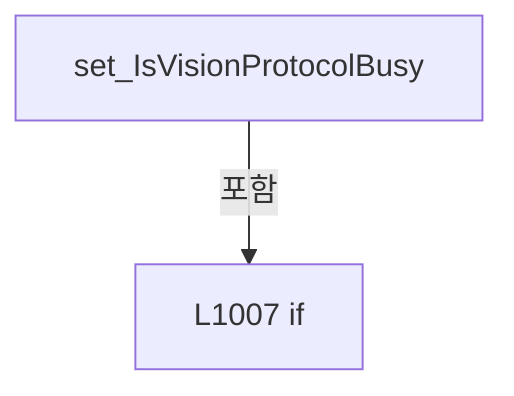

변경 전 점검: 입력/반환 타입, 위 호출자, 예외/취소 경로, 공유 상태와 저장·전송 소비자를 함께 확인합니다. 값의 단위나 물리 방향을 이름만으로 확정하지 않습니다.

### PropertyDeclaration `SelectHeadCommand` · L1014–1014

[Drilling.UI/Menu/Menus/CMenuManual.cs:1014–1014](https://github.com/kjuws10-rgb/A3Drilling/blob/28764c91d521777b8ee068dd7aaf2d3902ce9fe2/Drilling.UI/Menu/Menus/CMenuManual.cs#L1014-L1014)

| 항목 | 실제 추출 값 |
| --- | --- |
| 서명 | Drilling.UI.Menu.CButtonCommand Drilling.UI.Menu.Menus.CMenuManual.SelectHeadCommand |
| 접근/수식자 | Public / public |
| 반환/값 타입 | Drilling.UI.Menu.CButtonCommand |
| 소속 타입 | NamedType:Drilling.UI.Menu.Menus.CMenuManual |

현재 부분 분석에서 직접 연결된 호출자는 없습니다. XAML/이벤트/인터페이스·델리게이트·외부 진입을 추가 확인해야 하며, 미사용으로 판정한 것이 아닙니다.

변경 전 점검: 입력/반환 타입, 위 호출자, 예외/취소 경로, 공유 상태와 저장·전송 소비자를 함께 확인합니다. 값의 단위나 물리 방향을 이름만으로 확정하지 않습니다.

### GetAccessorDeclaration `get_SelectHeadCommand` · L1014–1014

[Drilling.UI/Menu/Menus/CMenuManual.cs:1014–1014](https://github.com/kjuws10-rgb/A3Drilling/blob/28764c91d521777b8ee068dd7aaf2d3902ce9fe2/Drilling.UI/Menu/Menus/CMenuManual.cs#L1014-L1014)

| 항목 | 실제 추출 값 |
| --- | --- |
| 서명 | Drilling.UI.Menu.CButtonCommand Drilling.UI.Menu.Menus.CMenuManual.SelectHeadCommand.get |
| 접근/수식자 | Public / get |
| 반환/값 타입 | Drilling.UI.Menu.CButtonCommand |
| 소속 타입 | NamedType:Drilling.UI.Menu.Menus.CMenuManual |

현재 부분 분석에서 직접 연결된 호출자는 없습니다. XAML/이벤트/인터페이스·델리게이트·외부 진입을 추가 확인해야 하며, 미사용으로 판정한 것이 아닙니다.

변경 전 점검: 입력/반환 타입, 위 호출자, 예외/취소 경로, 공유 상태와 저장·전송 소비자를 함께 확인합니다. 값의 단위나 물리 방향을 이름만으로 확정하지 않습니다.

### PropertyDeclaration `SelectSettingCommand` · L1015–1015

[Drilling.UI/Menu/Menus/CMenuManual.cs:1015–1015](https://github.com/kjuws10-rgb/A3Drilling/blob/28764c91d521777b8ee068dd7aaf2d3902ce9fe2/Drilling.UI/Menu/Menus/CMenuManual.cs#L1015-L1015)

| 항목 | 실제 추출 값 |
| --- | --- |
| 서명 | Drilling.UI.Menu.CButtonCommand Drilling.UI.Menu.Menus.CMenuManual.SelectSettingCommand |
| 접근/수식자 | Public / public |
| 반환/값 타입 | Drilling.UI.Menu.CButtonCommand |
| 소속 타입 | NamedType:Drilling.UI.Menu.Menus.CMenuManual |

현재 부분 분석에서 직접 연결된 호출자는 없습니다. XAML/이벤트/인터페이스·델리게이트·외부 진입을 추가 확인해야 하며, 미사용으로 판정한 것이 아닙니다.

변경 전 점검: 입력/반환 타입, 위 호출자, 예외/취소 경로, 공유 상태와 저장·전송 소비자를 함께 확인합니다. 값의 단위나 물리 방향을 이름만으로 확정하지 않습니다.

### GetAccessorDeclaration `get_SelectSettingCommand` · L1015–1015

[Drilling.UI/Menu/Menus/CMenuManual.cs:1015–1015](https://github.com/kjuws10-rgb/A3Drilling/blob/28764c91d521777b8ee068dd7aaf2d3902ce9fe2/Drilling.UI/Menu/Menus/CMenuManual.cs#L1015-L1015)

| 항목 | 실제 추출 값 |
| --- | --- |
| 서명 | Drilling.UI.Menu.CButtonCommand Drilling.UI.Menu.Menus.CMenuManual.SelectSettingCommand.get |
| 접근/수식자 | Public / get |
| 반환/값 타입 | Drilling.UI.Menu.CButtonCommand |
| 소속 타입 | NamedType:Drilling.UI.Menu.Menus.CMenuManual |

현재 부분 분석에서 직접 연결된 호출자는 없습니다. XAML/이벤트/인터페이스·델리게이트·외부 진입을 추가 확인해야 하며, 미사용으로 판정한 것이 아닙니다.

변경 전 점검: 입력/반환 타입, 위 호출자, 예외/취소 경로, 공유 상태와 저장·전송 소비자를 함께 확인합니다. 값의 단위나 물리 방향을 이름만으로 확정하지 않습니다.

### PropertyDeclaration `PreviousSettingPageCommand` · L1016–1016

[Drilling.UI/Menu/Menus/CMenuManual.cs:1016–1016](https://github.com/kjuws10-rgb/A3Drilling/blob/28764c91d521777b8ee068dd7aaf2d3902ce9fe2/Drilling.UI/Menu/Menus/CMenuManual.cs#L1016-L1016)

| 항목 | 실제 추출 값 |
| --- | --- |
| 서명 | Drilling.UI.Menu.CButtonCommand Drilling.UI.Menu.Menus.CMenuManual.PreviousSettingPageCommand |
| 접근/수식자 | Public / public |
| 반환/값 타입 | Drilling.UI.Menu.CButtonCommand |
| 소속 타입 | NamedType:Drilling.UI.Menu.Menus.CMenuManual |

현재 부분 분석에서 직접 연결된 호출자는 없습니다. XAML/이벤트/인터페이스·델리게이트·외부 진입을 추가 확인해야 하며, 미사용으로 판정한 것이 아닙니다.

변경 전 점검: 입력/반환 타입, 위 호출자, 예외/취소 경로, 공유 상태와 저장·전송 소비자를 함께 확인합니다. 값의 단위나 물리 방향을 이름만으로 확정하지 않습니다.

### GetAccessorDeclaration `get_PreviousSettingPageCommand` · L1016–1016

[Drilling.UI/Menu/Menus/CMenuManual.cs:1016–1016](https://github.com/kjuws10-rgb/A3Drilling/blob/28764c91d521777b8ee068dd7aaf2d3902ce9fe2/Drilling.UI/Menu/Menus/CMenuManual.cs#L1016-L1016)

| 항목 | 실제 추출 값 |
| --- | --- |
| 서명 | Drilling.UI.Menu.CButtonCommand Drilling.UI.Menu.Menus.CMenuManual.PreviousSettingPageCommand.get |
| 접근/수식자 | Public / get |
| 반환/값 타입 | Drilling.UI.Menu.CButtonCommand |
| 소속 타입 | NamedType:Drilling.UI.Menu.Menus.CMenuManual |

현재 부분 분석에서 직접 연결된 호출자는 없습니다. XAML/이벤트/인터페이스·델리게이트·외부 진입을 추가 확인해야 하며, 미사용으로 판정한 것이 아닙니다.

변경 전 점검: 입력/반환 타입, 위 호출자, 예외/취소 경로, 공유 상태와 저장·전송 소비자를 함께 확인합니다. 값의 단위나 물리 방향을 이름만으로 확정하지 않습니다.

### PropertyDeclaration `NextSettingPageCommand` · L1017–1017

[Drilling.UI/Menu/Menus/CMenuManual.cs:1017–1017](https://github.com/kjuws10-rgb/A3Drilling/blob/28764c91d521777b8ee068dd7aaf2d3902ce9fe2/Drilling.UI/Menu/Menus/CMenuManual.cs#L1017-L1017)

| 항목 | 실제 추출 값 |
| --- | --- |
| 서명 | Drilling.UI.Menu.CButtonCommand Drilling.UI.Menu.Menus.CMenuManual.NextSettingPageCommand |
| 접근/수식자 | Public / public |
| 반환/값 타입 | Drilling.UI.Menu.CButtonCommand |
| 소속 타입 | NamedType:Drilling.UI.Menu.Menus.CMenuManual |

현재 부분 분석에서 직접 연결된 호출자는 없습니다. XAML/이벤트/인터페이스·델리게이트·외부 진입을 추가 확인해야 하며, 미사용으로 판정한 것이 아닙니다.

변경 전 점검: 입력/반환 타입, 위 호출자, 예외/취소 경로, 공유 상태와 저장·전송 소비자를 함께 확인합니다. 값의 단위나 물리 방향을 이름만으로 확정하지 않습니다.

### GetAccessorDeclaration `get_NextSettingPageCommand` · L1017–1017

[Drilling.UI/Menu/Menus/CMenuManual.cs:1017–1017](https://github.com/kjuws10-rgb/A3Drilling/blob/28764c91d521777b8ee068dd7aaf2d3902ce9fe2/Drilling.UI/Menu/Menus/CMenuManual.cs#L1017-L1017)

| 항목 | 실제 추출 값 |
| --- | --- |
| 서명 | Drilling.UI.Menu.CButtonCommand Drilling.UI.Menu.Menus.CMenuManual.NextSettingPageCommand.get |
| 접근/수식자 | Public / get |
| 반환/값 타입 | Drilling.UI.Menu.CButtonCommand |
| 소속 타입 | NamedType:Drilling.UI.Menu.Menus.CMenuManual |

현재 부분 분석에서 직접 연결된 호출자는 없습니다. XAML/이벤트/인터페이스·델리게이트·외부 진입을 추가 확인해야 하며, 미사용으로 판정한 것이 아닙니다.

변경 전 점검: 입력/반환 타입, 위 호출자, 예외/취소 경로, 공유 상태와 저장·전송 소비자를 함께 확인합니다. 값의 단위나 물리 방향을 이름만으로 확정하지 않습니다.

### PropertyDeclaration `CreateCommand` · L1018–1018

[Drilling.UI/Menu/Menus/CMenuManual.cs:1018–1018](https://github.com/kjuws10-rgb/A3Drilling/blob/28764c91d521777b8ee068dd7aaf2d3902ce9fe2/Drilling.UI/Menu/Menus/CMenuManual.cs#L1018-L1018)

| 항목 | 실제 추출 값 |
| --- | --- |
| 서명 | Drilling.UI.Menu.CButtonCommand Drilling.UI.Menu.Menus.CMenuManual.CreateCommand |
| 접근/수식자 | Public / public |
| 반환/값 타입 | Drilling.UI.Menu.CButtonCommand |
| 소속 타입 | NamedType:Drilling.UI.Menu.Menus.CMenuManual |

현재 부분 분석에서 직접 연결된 호출자는 없습니다. XAML/이벤트/인터페이스·델리게이트·외부 진입을 추가 확인해야 하며, 미사용으로 판정한 것이 아닙니다.

변경 전 점검: 입력/반환 타입, 위 호출자, 예외/취소 경로, 공유 상태와 저장·전송 소비자를 함께 확인합니다. 값의 단위나 물리 방향을 이름만으로 확정하지 않습니다.

### GetAccessorDeclaration `get_CreateCommand` · L1018–1018

[Drilling.UI/Menu/Menus/CMenuManual.cs:1018–1018](https://github.com/kjuws10-rgb/A3Drilling/blob/28764c91d521777b8ee068dd7aaf2d3902ce9fe2/Drilling.UI/Menu/Menus/CMenuManual.cs#L1018-L1018)

| 항목 | 실제 추출 값 |
| --- | --- |
| 서명 | Drilling.UI.Menu.CButtonCommand Drilling.UI.Menu.Menus.CMenuManual.CreateCommand.get |
| 접근/수식자 | Public / get |
| 반환/값 타입 | Drilling.UI.Menu.CButtonCommand |
| 소속 타입 | NamedType:Drilling.UI.Menu.Menus.CMenuManual |

현재 부분 분석에서 직접 연결된 호출자는 없습니다. XAML/이벤트/인터페이스·델리게이트·외부 진입을 추가 확인해야 하며, 미사용으로 판정한 것이 아닙니다.

변경 전 점검: 입력/반환 타입, 위 호출자, 예외/취소 경로, 공유 상태와 저장·전송 소비자를 함께 확인합니다. 값의 단위나 물리 방향을 이름만으로 확정하지 않습니다.

### PropertyDeclaration `DeleteCommand` · L1019–1019

[Drilling.UI/Menu/Menus/CMenuManual.cs:1019–1019](https://github.com/kjuws10-rgb/A3Drilling/blob/28764c91d521777b8ee068dd7aaf2d3902ce9fe2/Drilling.UI/Menu/Menus/CMenuManual.cs#L1019-L1019)

| 항목 | 실제 추출 값 |
| --- | --- |
| 서명 | Drilling.UI.Menu.CButtonCommand Drilling.UI.Menu.Menus.CMenuManual.DeleteCommand |
| 접근/수식자 | Public / public |
| 반환/값 타입 | Drilling.UI.Menu.CButtonCommand |
| 소속 타입 | NamedType:Drilling.UI.Menu.Menus.CMenuManual |

현재 부분 분석에서 직접 연결된 호출자는 없습니다. XAML/이벤트/인터페이스·델리게이트·외부 진입을 추가 확인해야 하며, 미사용으로 판정한 것이 아닙니다.

변경 전 점검: 입력/반환 타입, 위 호출자, 예외/취소 경로, 공유 상태와 저장·전송 소비자를 함께 확인합니다. 값의 단위나 물리 방향을 이름만으로 확정하지 않습니다.

### GetAccessorDeclaration `get_DeleteCommand` · L1019–1019

[Drilling.UI/Menu/Menus/CMenuManual.cs:1019–1019](https://github.com/kjuws10-rgb/A3Drilling/blob/28764c91d521777b8ee068dd7aaf2d3902ce9fe2/Drilling.UI/Menu/Menus/CMenuManual.cs#L1019-L1019)

| 항목 | 실제 추출 값 |
| --- | --- |
| 서명 | Drilling.UI.Menu.CButtonCommand Drilling.UI.Menu.Menus.CMenuManual.DeleteCommand.get |
| 접근/수식자 | Public / get |
| 반환/값 타입 | Drilling.UI.Menu.CButtonCommand |
| 소속 타입 | NamedType:Drilling.UI.Menu.Menus.CMenuManual |

현재 부분 분석에서 직접 연결된 호출자는 없습니다. XAML/이벤트/인터페이스·델리게이트·외부 진입을 추가 확인해야 하며, 미사용으로 판정한 것이 아닙니다.

변경 전 점검: 입력/반환 타입, 위 호출자, 예외/취소 경로, 공유 상태와 저장·전송 소비자를 함께 확인합니다. 값의 단위나 물리 방향을 이름만으로 확정하지 않습니다.

### PropertyDeclaration `RenameCommand` · L1020–1020

[Drilling.UI/Menu/Menus/CMenuManual.cs:1020–1020](https://github.com/kjuws10-rgb/A3Drilling/blob/28764c91d521777b8ee068dd7aaf2d3902ce9fe2/Drilling.UI/Menu/Menus/CMenuManual.cs#L1020-L1020)

| 항목 | 실제 추출 값 |
| --- | --- |
| 서명 | Drilling.UI.Menu.CButtonCommand Drilling.UI.Menu.Menus.CMenuManual.RenameCommand |
| 접근/수식자 | Public / public |
| 반환/값 타입 | Drilling.UI.Menu.CButtonCommand |
| 소속 타입 | NamedType:Drilling.UI.Menu.Menus.CMenuManual |

현재 부분 분석에서 직접 연결된 호출자는 없습니다. XAML/이벤트/인터페이스·델리게이트·외부 진입을 추가 확인해야 하며, 미사용으로 판정한 것이 아닙니다.

변경 전 점검: 입력/반환 타입, 위 호출자, 예외/취소 경로, 공유 상태와 저장·전송 소비자를 함께 확인합니다. 값의 단위나 물리 방향을 이름만으로 확정하지 않습니다.

### GetAccessorDeclaration `get_RenameCommand` · L1020–1020

[Drilling.UI/Menu/Menus/CMenuManual.cs:1020–1020](https://github.com/kjuws10-rgb/A3Drilling/blob/28764c91d521777b8ee068dd7aaf2d3902ce9fe2/Drilling.UI/Menu/Menus/CMenuManual.cs#L1020-L1020)

| 항목 | 실제 추출 값 |
| --- | --- |
| 서명 | Drilling.UI.Menu.CButtonCommand Drilling.UI.Menu.Menus.CMenuManual.RenameCommand.get |
| 접근/수식자 | Public / get |
| 반환/값 타입 | Drilling.UI.Menu.CButtonCommand |
| 소속 타입 | NamedType:Drilling.UI.Menu.Menus.CMenuManual |

현재 부분 분석에서 직접 연결된 호출자는 없습니다. XAML/이벤트/인터페이스·델리게이트·외부 진입을 추가 확인해야 하며, 미사용으로 판정한 것이 아닙니다.

변경 전 점검: 입력/반환 타입, 위 호출자, 예외/취소 경로, 공유 상태와 저장·전송 소비자를 함께 확인합니다. 값의 단위나 물리 방향을 이름만으로 확정하지 않습니다.

### PropertyDeclaration `SaveCommand` · L1021–1021

[Drilling.UI/Menu/Menus/CMenuManual.cs:1021–1021](https://github.com/kjuws10-rgb/A3Drilling/blob/28764c91d521777b8ee068dd7aaf2d3902ce9fe2/Drilling.UI/Menu/Menus/CMenuManual.cs#L1021-L1021)

| 항목 | 실제 추출 값 |
| --- | --- |
| 서명 | Drilling.UI.Menu.CButtonCommand Drilling.UI.Menu.Menus.CMenuManual.SaveCommand |
| 접근/수식자 | Public / public |
| 반환/값 타입 | Drilling.UI.Menu.CButtonCommand |
| 소속 타입 | NamedType:Drilling.UI.Menu.Menus.CMenuManual |

현재 부분 분석에서 직접 연결된 호출자는 없습니다. XAML/이벤트/인터페이스·델리게이트·외부 진입을 추가 확인해야 하며, 미사용으로 판정한 것이 아닙니다.

변경 전 점검: 입력/반환 타입, 위 호출자, 예외/취소 경로, 공유 상태와 저장·전송 소비자를 함께 확인합니다. 값의 단위나 물리 방향을 이름만으로 확정하지 않습니다.

### GetAccessorDeclaration `get_SaveCommand` · L1021–1021

[Drilling.UI/Menu/Menus/CMenuManual.cs:1021–1021](https://github.com/kjuws10-rgb/A3Drilling/blob/28764c91d521777b8ee068dd7aaf2d3902ce9fe2/Drilling.UI/Menu/Menus/CMenuManual.cs#L1021-L1021)

| 항목 | 실제 추출 값 |
| --- | --- |
| 서명 | Drilling.UI.Menu.CButtonCommand Drilling.UI.Menu.Menus.CMenuManual.SaveCommand.get |
| 접근/수식자 | Public / get |
| 반환/값 타입 | Drilling.UI.Menu.CButtonCommand |
| 소속 타입 | NamedType:Drilling.UI.Menu.Menus.CMenuManual |

현재 부분 분석에서 직접 연결된 호출자는 없습니다. XAML/이벤트/인터페이스·델리게이트·외부 진입을 추가 확인해야 하며, 미사용으로 판정한 것이 아닙니다.

변경 전 점검: 입력/반환 타입, 위 호출자, 예외/취소 경로, 공유 상태와 저장·전송 소비자를 함께 확인합니다. 값의 단위나 물리 방향을 이름만으로 확정하지 않습니다.

### PropertyDeclaration `CenterMoveCommand` · L1022–1022

[Drilling.UI/Menu/Menus/CMenuManual.cs:1022–1022](https://github.com/kjuws10-rgb/A3Drilling/blob/28764c91d521777b8ee068dd7aaf2d3902ce9fe2/Drilling.UI/Menu/Menus/CMenuManual.cs#L1022-L1022)

| 항목 | 실제 추출 값 |
| --- | --- |
| 서명 | Drilling.UI.Menu.CButtonCommand Drilling.UI.Menu.Menus.CMenuManual.CenterMoveCommand |
| 접근/수식자 | Public / public |
| 반환/값 타입 | Drilling.UI.Menu.CButtonCommand |
| 소속 타입 | NamedType:Drilling.UI.Menu.Menus.CMenuManual |

현재 부분 분석에서 직접 연결된 호출자는 없습니다. XAML/이벤트/인터페이스·델리게이트·외부 진입을 추가 확인해야 하며, 미사용으로 판정한 것이 아닙니다.

변경 전 점검: 입력/반환 타입, 위 호출자, 예외/취소 경로, 공유 상태와 저장·전송 소비자를 함께 확인합니다. 값의 단위나 물리 방향을 이름만으로 확정하지 않습니다.

### GetAccessorDeclaration `get_CenterMoveCommand` · L1022–1022

[Drilling.UI/Menu/Menus/CMenuManual.cs:1022–1022](https://github.com/kjuws10-rgb/A3Drilling/blob/28764c91d521777b8ee068dd7aaf2d3902ce9fe2/Drilling.UI/Menu/Menus/CMenuManual.cs#L1022-L1022)

| 항목 | 실제 추출 값 |
| --- | --- |
| 서명 | Drilling.UI.Menu.CButtonCommand Drilling.UI.Menu.Menus.CMenuManual.CenterMoveCommand.get |
| 접근/수식자 | Public / get |
| 반환/값 타입 | Drilling.UI.Menu.CButtonCommand |
| 소속 타입 | NamedType:Drilling.UI.Menu.Menus.CMenuManual |

현재 부분 분석에서 직접 연결된 호출자는 없습니다. XAML/이벤트/인터페이스·델리게이트·외부 진입을 추가 확인해야 하며, 미사용으로 판정한 것이 아닙니다.

변경 전 점검: 입력/반환 타입, 위 호출자, 예외/취소 경로, 공유 상태와 저장·전송 소비자를 함께 확인합니다. 값의 단위나 물리 방향을 이름만으로 확정하지 않습니다.

### PropertyDeclaration `PositionMoveCommand` · L1023–1023

[Drilling.UI/Menu/Menus/CMenuManual.cs:1023–1023](https://github.com/kjuws10-rgb/A3Drilling/blob/28764c91d521777b8ee068dd7aaf2d3902ce9fe2/Drilling.UI/Menu/Menus/CMenuManual.cs#L1023-L1023)

| 항목 | 실제 추출 값 |
| --- | --- |
| 서명 | Drilling.UI.Menu.CButtonCommand Drilling.UI.Menu.Menus.CMenuManual.PositionMoveCommand |
| 접근/수식자 | Public / public |
| 반환/값 타입 | Drilling.UI.Menu.CButtonCommand |
| 소속 타입 | NamedType:Drilling.UI.Menu.Menus.CMenuManual |

현재 부분 분석에서 직접 연결된 호출자는 없습니다. XAML/이벤트/인터페이스·델리게이트·외부 진입을 추가 확인해야 하며, 미사용으로 판정한 것이 아닙니다.

변경 전 점검: 입력/반환 타입, 위 호출자, 예외/취소 경로, 공유 상태와 저장·전송 소비자를 함께 확인합니다. 값의 단위나 물리 방향을 이름만으로 확정하지 않습니다.

### GetAccessorDeclaration `get_PositionMoveCommand` · L1023–1023

[Drilling.UI/Menu/Menus/CMenuManual.cs:1023–1023](https://github.com/kjuws10-rgb/A3Drilling/blob/28764c91d521777b8ee068dd7aaf2d3902ce9fe2/Drilling.UI/Menu/Menus/CMenuManual.cs#L1023-L1023)

| 항목 | 실제 추출 값 |
| --- | --- |
| 서명 | Drilling.UI.Menu.CButtonCommand Drilling.UI.Menu.Menus.CMenuManual.PositionMoveCommand.get |
| 접근/수식자 | Public / get |
| 반환/값 타입 | Drilling.UI.Menu.CButtonCommand |
| 소속 타입 | NamedType:Drilling.UI.Menu.Menus.CMenuManual |

현재 부분 분석에서 직접 연결된 호출자는 없습니다. XAML/이벤트/인터페이스·델리게이트·외부 진입을 추가 확인해야 하며, 미사용으로 판정한 것이 아닙니다.

변경 전 점검: 입력/반환 타입, 위 호출자, 예외/취소 경로, 공유 상태와 저장·전송 소비자를 함께 확인합니다. 값의 단위나 물리 방향을 이름만으로 확정하지 않습니다.

### PropertyDeclaration `ZPositionMoveCommand` · L1024–1024

[Drilling.UI/Menu/Menus/CMenuManual.cs:1024–1024](https://github.com/kjuws10-rgb/A3Drilling/blob/28764c91d521777b8ee068dd7aaf2d3902ce9fe2/Drilling.UI/Menu/Menus/CMenuManual.cs#L1024-L1024)

| 항목 | 실제 추출 값 |
| --- | --- |
| 서명 | Drilling.UI.Menu.CButtonCommand Drilling.UI.Menu.Menus.CMenuManual.ZPositionMoveCommand |
| 접근/수식자 | Public / public |
| 반환/값 타입 | Drilling.UI.Menu.CButtonCommand |
| 소속 타입 | NamedType:Drilling.UI.Menu.Menus.CMenuManual |

현재 부분 분석에서 직접 연결된 호출자는 없습니다. XAML/이벤트/인터페이스·델리게이트·외부 진입을 추가 확인해야 하며, 미사용으로 판정한 것이 아닙니다.

변경 전 점검: 입력/반환 타입, 위 호출자, 예외/취소 경로, 공유 상태와 저장·전송 소비자를 함께 확인합니다. 값의 단위나 물리 방향을 이름만으로 확정하지 않습니다.

### GetAccessorDeclaration `get_ZPositionMoveCommand` · L1024–1024

[Drilling.UI/Menu/Menus/CMenuManual.cs:1024–1024](https://github.com/kjuws10-rgb/A3Drilling/blob/28764c91d521777b8ee068dd7aaf2d3902ce9fe2/Drilling.UI/Menu/Menus/CMenuManual.cs#L1024-L1024)

| 항목 | 실제 추출 값 |
| --- | --- |
| 서명 | Drilling.UI.Menu.CButtonCommand Drilling.UI.Menu.Menus.CMenuManual.ZPositionMoveCommand.get |
| 접근/수식자 | Public / get |
| 반환/값 타입 | Drilling.UI.Menu.CButtonCommand |
| 소속 타입 | NamedType:Drilling.UI.Menu.Menus.CMenuManual |

현재 부분 분석에서 직접 연결된 호출자는 없습니다. XAML/이벤트/인터페이스·델리게이트·외부 진입을 추가 확인해야 하며, 미사용으로 판정한 것이 아닙니다.

변경 전 점검: 입력/반환 타입, 위 호출자, 예외/취소 경로, 공유 상태와 저장·전송 소비자를 함께 확인합니다. 값의 단위나 물리 방향을 이름만으로 확정하지 않습니다.

### PropertyDeclaration `MoveStopCommand` · L1025–1025

[Drilling.UI/Menu/Menus/CMenuManual.cs:1025–1025](https://github.com/kjuws10-rgb/A3Drilling/blob/28764c91d521777b8ee068dd7aaf2d3902ce9fe2/Drilling.UI/Menu/Menus/CMenuManual.cs#L1025-L1025)

| 항목 | 실제 추출 값 |
| --- | --- |
| 서명 | Drilling.UI.Menu.CButtonCommand Drilling.UI.Menu.Menus.CMenuManual.MoveStopCommand |
| 접근/수식자 | Public / public |
| 반환/값 타입 | Drilling.UI.Menu.CButtonCommand |
| 소속 타입 | NamedType:Drilling.UI.Menu.Menus.CMenuManual |

현재 부분 분석에서 직접 연결된 호출자는 없습니다. XAML/이벤트/인터페이스·델리게이트·외부 진입을 추가 확인해야 하며, 미사용으로 판정한 것이 아닙니다.

변경 전 점검: 입력/반환 타입, 위 호출자, 예외/취소 경로, 공유 상태와 저장·전송 소비자를 함께 확인합니다. 값의 단위나 물리 방향을 이름만으로 확정하지 않습니다.

### GetAccessorDeclaration `get_MoveStopCommand` · L1025–1025

[Drilling.UI/Menu/Menus/CMenuManual.cs:1025–1025](https://github.com/kjuws10-rgb/A3Drilling/blob/28764c91d521777b8ee068dd7aaf2d3902ce9fe2/Drilling.UI/Menu/Menus/CMenuManual.cs#L1025-L1025)

| 항목 | 실제 추출 값 |
| --- | --- |
| 서명 | Drilling.UI.Menu.CButtonCommand Drilling.UI.Menu.Menus.CMenuManual.MoveStopCommand.get |
| 접근/수식자 | Public / get |
| 반환/값 타입 | Drilling.UI.Menu.CButtonCommand |
| 소속 타입 | NamedType:Drilling.UI.Menu.Menus.CMenuManual |

현재 부분 분석에서 직접 연결된 호출자는 없습니다. XAML/이벤트/인터페이스·델리게이트·외부 진입을 추가 확인해야 하며, 미사용으로 판정한 것이 아닙니다.

변경 전 점검: 입력/반환 타입, 위 호출자, 예외/취소 경로, 공유 상태와 저장·전송 소비자를 함께 확인합니다. 값의 단위나 물리 방향을 이름만으로 확정하지 않습니다.

### PropertyDeclaration `SelectShapeCommand` · L1026–1026

[Drilling.UI/Menu/Menus/CMenuManual.cs:1026–1026](https://github.com/kjuws10-rgb/A3Drilling/blob/28764c91d521777b8ee068dd7aaf2d3902ce9fe2/Drilling.UI/Menu/Menus/CMenuManual.cs#L1026-L1026)

| 항목 | 실제 추출 값 |
| --- | --- |
| 서명 | Drilling.UI.Menu.CButtonCommand Drilling.UI.Menu.Menus.CMenuManual.SelectShapeCommand |
| 접근/수식자 | Public / public |
| 반환/값 타입 | Drilling.UI.Menu.CButtonCommand |
| 소속 타입 | NamedType:Drilling.UI.Menu.Menus.CMenuManual |

현재 부분 분석에서 직접 연결된 호출자는 없습니다. XAML/이벤트/인터페이스·델리게이트·외부 진입을 추가 확인해야 하며, 미사용으로 판정한 것이 아닙니다.

변경 전 점검: 입력/반환 타입, 위 호출자, 예외/취소 경로, 공유 상태와 저장·전송 소비자를 함께 확인합니다. 값의 단위나 물리 방향을 이름만으로 확정하지 않습니다.

### GetAccessorDeclaration `get_SelectShapeCommand` · L1026–1026

[Drilling.UI/Menu/Menus/CMenuManual.cs:1026–1026](https://github.com/kjuws10-rgb/A3Drilling/blob/28764c91d521777b8ee068dd7aaf2d3902ce9fe2/Drilling.UI/Menu/Menus/CMenuManual.cs#L1026-L1026)

| 항목 | 실제 추출 값 |
| --- | --- |
| 서명 | Drilling.UI.Menu.CButtonCommand Drilling.UI.Menu.Menus.CMenuManual.SelectShapeCommand.get |
| 접근/수식자 | Public / get |
| 반환/값 타입 | Drilling.UI.Menu.CButtonCommand |
| 소속 타입 | NamedType:Drilling.UI.Menu.Menus.CMenuManual |

현재 부분 분석에서 직접 연결된 호출자는 없습니다. XAML/이벤트/인터페이스·델리게이트·외부 진입을 추가 확인해야 하며, 미사용으로 판정한 것이 아닙니다.

변경 전 점검: 입력/반환 타입, 위 호출자, 예외/취소 경로, 공유 상태와 저장·전송 소비자를 함께 확인합니다. 값의 단위나 물리 방향을 이름만으로 확정하지 않습니다.

### PropertyDeclaration `ShapeStartCommand` · L1027–1027

[Drilling.UI/Menu/Menus/CMenuManual.cs:1027–1027](https://github.com/kjuws10-rgb/A3Drilling/blob/28764c91d521777b8ee068dd7aaf2d3902ce9fe2/Drilling.UI/Menu/Menus/CMenuManual.cs#L1027-L1027)

| 항목 | 실제 추출 값 |
| --- | --- |
| 서명 | Drilling.UI.Menu.CButtonCommand Drilling.UI.Menu.Menus.CMenuManual.ShapeStartCommand |
| 접근/수식자 | Public / public |
| 반환/값 타입 | Drilling.UI.Menu.CButtonCommand |
| 소속 타입 | NamedType:Drilling.UI.Menu.Menus.CMenuManual |

현재 부분 분석에서 직접 연결된 호출자는 없습니다. XAML/이벤트/인터페이스·델리게이트·외부 진입을 추가 확인해야 하며, 미사용으로 판정한 것이 아닙니다.

변경 전 점검: 입력/반환 타입, 위 호출자, 예외/취소 경로, 공유 상태와 저장·전송 소비자를 함께 확인합니다. 값의 단위나 물리 방향을 이름만으로 확정하지 않습니다.

### GetAccessorDeclaration `get_ShapeStartCommand` · L1027–1027

[Drilling.UI/Menu/Menus/CMenuManual.cs:1027–1027](https://github.com/kjuws10-rgb/A3Drilling/blob/28764c91d521777b8ee068dd7aaf2d3902ce9fe2/Drilling.UI/Menu/Menus/CMenuManual.cs#L1027-L1027)

| 항목 | 실제 추출 값 |
| --- | --- |
| 서명 | Drilling.UI.Menu.CButtonCommand Drilling.UI.Menu.Menus.CMenuManual.ShapeStartCommand.get |
| 접근/수식자 | Public / get |
| 반환/값 타입 | Drilling.UI.Menu.CButtonCommand |
| 소속 타입 | NamedType:Drilling.UI.Menu.Menus.CMenuManual |

현재 부분 분석에서 직접 연결된 호출자는 없습니다. XAML/이벤트/인터페이스·델리게이트·외부 진입을 추가 확인해야 하며, 미사용으로 판정한 것이 아닙니다.

변경 전 점검: 입력/반환 타입, 위 호출자, 예외/취소 경로, 공유 상태와 저장·전송 소비자를 함께 확인합니다. 값의 단위나 물리 방향을 이름만으로 확정하지 않습니다.

### PropertyDeclaration `ShapeStopCommand` · L1028–1028

[Drilling.UI/Menu/Menus/CMenuManual.cs:1028–1028](https://github.com/kjuws10-rgb/A3Drilling/blob/28764c91d521777b8ee068dd7aaf2d3902ce9fe2/Drilling.UI/Menu/Menus/CMenuManual.cs#L1028-L1028)

| 항목 | 실제 추출 값 |
| --- | --- |
| 서명 | Drilling.UI.Menu.CButtonCommand Drilling.UI.Menu.Menus.CMenuManual.ShapeStopCommand |
| 접근/수식자 | Public / public |
| 반환/값 타입 | Drilling.UI.Menu.CButtonCommand |
| 소속 타입 | NamedType:Drilling.UI.Menu.Menus.CMenuManual |

현재 부분 분석에서 직접 연결된 호출자는 없습니다. XAML/이벤트/인터페이스·델리게이트·외부 진입을 추가 확인해야 하며, 미사용으로 판정한 것이 아닙니다.

변경 전 점검: 입력/반환 타입, 위 호출자, 예외/취소 경로, 공유 상태와 저장·전송 소비자를 함께 확인합니다. 값의 단위나 물리 방향을 이름만으로 확정하지 않습니다.

### GetAccessorDeclaration `get_ShapeStopCommand` · L1028–1028

[Drilling.UI/Menu/Menus/CMenuManual.cs:1028–1028](https://github.com/kjuws10-rgb/A3Drilling/blob/28764c91d521777b8ee068dd7aaf2d3902ce9fe2/Drilling.UI/Menu/Menus/CMenuManual.cs#L1028-L1028)

| 항목 | 실제 추출 값 |
| --- | --- |
| 서명 | Drilling.UI.Menu.CButtonCommand Drilling.UI.Menu.Menus.CMenuManual.ShapeStopCommand.get |
| 접근/수식자 | Public / get |
| 반환/값 타입 | Drilling.UI.Menu.CButtonCommand |
| 소속 타입 | NamedType:Drilling.UI.Menu.Menus.CMenuManual |

현재 부분 분석에서 직접 연결된 호출자는 없습니다. XAML/이벤트/인터페이스·델리게이트·외부 진입을 추가 확인해야 하며, 미사용으로 판정한 것이 아닙니다.

변경 전 점검: 입력/반환 타입, 위 호출자, 예외/취소 경로, 공유 상태와 저장·전송 소비자를 함께 확인합니다. 값의 단위나 물리 방향을 이름만으로 확정하지 않습니다.

### PropertyDeclaration `LaserOnCommand` · L1029–1029

[Drilling.UI/Menu/Menus/CMenuManual.cs:1029–1029](https://github.com/kjuws10-rgb/A3Drilling/blob/28764c91d521777b8ee068dd7aaf2d3902ce9fe2/Drilling.UI/Menu/Menus/CMenuManual.cs#L1029-L1029)

| 항목 | 실제 추출 값 |
| --- | --- |
| 서명 | Drilling.UI.Menu.CButtonCommand Drilling.UI.Menu.Menus.CMenuManual.LaserOnCommand |
| 접근/수식자 | Public / public |
| 반환/값 타입 | Drilling.UI.Menu.CButtonCommand |
| 소속 타입 | NamedType:Drilling.UI.Menu.Menus.CMenuManual |

현재 부분 분석에서 직접 연결된 호출자는 없습니다. XAML/이벤트/인터페이스·델리게이트·외부 진입을 추가 확인해야 하며, 미사용으로 판정한 것이 아닙니다.

변경 전 점검: 입력/반환 타입, 위 호출자, 예외/취소 경로, 공유 상태와 저장·전송 소비자를 함께 확인합니다. 값의 단위나 물리 방향을 이름만으로 확정하지 않습니다.

### GetAccessorDeclaration `get_LaserOnCommand` · L1029–1029

[Drilling.UI/Menu/Menus/CMenuManual.cs:1029–1029](https://github.com/kjuws10-rgb/A3Drilling/blob/28764c91d521777b8ee068dd7aaf2d3902ce9fe2/Drilling.UI/Menu/Menus/CMenuManual.cs#L1029-L1029)

| 항목 | 실제 추출 값 |
| --- | --- |
| 서명 | Drilling.UI.Menu.CButtonCommand Drilling.UI.Menu.Menus.CMenuManual.LaserOnCommand.get |
| 접근/수식자 | Public / get |
| 반환/값 타입 | Drilling.UI.Menu.CButtonCommand |
| 소속 타입 | NamedType:Drilling.UI.Menu.Menus.CMenuManual |

현재 부분 분석에서 직접 연결된 호출자는 없습니다. XAML/이벤트/인터페이스·델리게이트·외부 진입을 추가 확인해야 하며, 미사용으로 판정한 것이 아닙니다.

변경 전 점검: 입력/반환 타입, 위 호출자, 예외/취소 경로, 공유 상태와 저장·전송 소비자를 함께 확인합니다. 값의 단위나 물리 방향을 이름만으로 확정하지 않습니다.

### PropertyDeclaration `LaserOffCommand` · L1030–1030

[Drilling.UI/Menu/Menus/CMenuManual.cs:1030–1030](https://github.com/kjuws10-rgb/A3Drilling/blob/28764c91d521777b8ee068dd7aaf2d3902ce9fe2/Drilling.UI/Menu/Menus/CMenuManual.cs#L1030-L1030)

| 항목 | 실제 추출 값 |
| --- | --- |
| 서명 | Drilling.UI.Menu.CButtonCommand Drilling.UI.Menu.Menus.CMenuManual.LaserOffCommand |
| 접근/수식자 | Public / public |
| 반환/값 타입 | Drilling.UI.Menu.CButtonCommand |
| 소속 타입 | NamedType:Drilling.UI.Menu.Menus.CMenuManual |

현재 부분 분석에서 직접 연결된 호출자는 없습니다. XAML/이벤트/인터페이스·델리게이트·외부 진입을 추가 확인해야 하며, 미사용으로 판정한 것이 아닙니다.

변경 전 점검: 입력/반환 타입, 위 호출자, 예외/취소 경로, 공유 상태와 저장·전송 소비자를 함께 확인합니다. 값의 단위나 물리 방향을 이름만으로 확정하지 않습니다.

### GetAccessorDeclaration `get_LaserOffCommand` · L1030–1030

[Drilling.UI/Menu/Menus/CMenuManual.cs:1030–1030](https://github.com/kjuws10-rgb/A3Drilling/blob/28764c91d521777b8ee068dd7aaf2d3902ce9fe2/Drilling.UI/Menu/Menus/CMenuManual.cs#L1030-L1030)

| 항목 | 실제 추출 값 |
| --- | --- |
| 서명 | Drilling.UI.Menu.CButtonCommand Drilling.UI.Menu.Menus.CMenuManual.LaserOffCommand.get |
| 접근/수식자 | Public / get |
| 반환/값 타입 | Drilling.UI.Menu.CButtonCommand |
| 소속 타입 | NamedType:Drilling.UI.Menu.Menus.CMenuManual |

현재 부분 분석에서 직접 연결된 호출자는 없습니다. XAML/이벤트/인터페이스·델리게이트·외부 진입을 추가 확인해야 하며, 미사용으로 판정한 것이 아닙니다.

변경 전 점검: 입력/반환 타입, 위 호출자, 예외/취소 경로, 공유 상태와 저장·전송 소비자를 함께 확인합니다. 값의 단위나 물리 방향을 이름만으로 확정하지 않습니다.

### PropertyDeclaration `CenterOnCommand` · L1031–1031

[Drilling.UI/Menu/Menus/CMenuManual.cs:1031–1031](https://github.com/kjuws10-rgb/A3Drilling/blob/28764c91d521777b8ee068dd7aaf2d3902ce9fe2/Drilling.UI/Menu/Menus/CMenuManual.cs#L1031-L1031)

| 항목 | 실제 추출 값 |
| --- | --- |
| 서명 | Drilling.UI.Menu.CButtonCommand Drilling.UI.Menu.Menus.CMenuManual.CenterOnCommand |
| 접근/수식자 | Public / public |
| 반환/값 타입 | Drilling.UI.Menu.CButtonCommand |
| 소속 타입 | NamedType:Drilling.UI.Menu.Menus.CMenuManual |

현재 부분 분석에서 직접 연결된 호출자는 없습니다. XAML/이벤트/인터페이스·델리게이트·외부 진입을 추가 확인해야 하며, 미사용으로 판정한 것이 아닙니다.

변경 전 점검: 입력/반환 타입, 위 호출자, 예외/취소 경로, 공유 상태와 저장·전송 소비자를 함께 확인합니다. 값의 단위나 물리 방향을 이름만으로 확정하지 않습니다.

### GetAccessorDeclaration `get_CenterOnCommand` · L1031–1031

[Drilling.UI/Menu/Menus/CMenuManual.cs:1031–1031](https://github.com/kjuws10-rgb/A3Drilling/blob/28764c91d521777b8ee068dd7aaf2d3902ce9fe2/Drilling.UI/Menu/Menus/CMenuManual.cs#L1031-L1031)

| 항목 | 실제 추출 값 |
| --- | --- |
| 서명 | Drilling.UI.Menu.CButtonCommand Drilling.UI.Menu.Menus.CMenuManual.CenterOnCommand.get |
| 접근/수식자 | Public / get |
| 반환/값 타입 | Drilling.UI.Menu.CButtonCommand |
| 소속 타입 | NamedType:Drilling.UI.Menu.Menus.CMenuManual |

현재 부분 분석에서 직접 연결된 호출자는 없습니다. XAML/이벤트/인터페이스·델리게이트·외부 진입을 추가 확인해야 하며, 미사용으로 판정한 것이 아닙니다.

변경 전 점검: 입력/반환 타입, 위 호출자, 예외/취소 경로, 공유 상태와 저장·전송 소비자를 함께 확인합니다. 값의 단위나 물리 방향을 이름만으로 확정하지 않습니다.

### PropertyDeclaration `DioReadCommand` · L1032–1032

[Drilling.UI/Menu/Menus/CMenuManual.cs:1032–1032](https://github.com/kjuws10-rgb/A3Drilling/blob/28764c91d521777b8ee068dd7aaf2d3902ce9fe2/Drilling.UI/Menu/Menus/CMenuManual.cs#L1032-L1032)

| 항목 | 실제 추출 값 |
| --- | --- |
| 서명 | Drilling.UI.Menu.CButtonCommand Drilling.UI.Menu.Menus.CMenuManual.DioReadCommand |
| 접근/수식자 | Public / public |
| 반환/값 타입 | Drilling.UI.Menu.CButtonCommand |
| 소속 타입 | NamedType:Drilling.UI.Menu.Menus.CMenuManual |

현재 부분 분석에서 직접 연결된 호출자는 없습니다. XAML/이벤트/인터페이스·델리게이트·외부 진입을 추가 확인해야 하며, 미사용으로 판정한 것이 아닙니다.

변경 전 점검: 입력/반환 타입, 위 호출자, 예외/취소 경로, 공유 상태와 저장·전송 소비자를 함께 확인합니다. 값의 단위나 물리 방향을 이름만으로 확정하지 않습니다.

### GetAccessorDeclaration `get_DioReadCommand` · L1032–1032

[Drilling.UI/Menu/Menus/CMenuManual.cs:1032–1032](https://github.com/kjuws10-rgb/A3Drilling/blob/28764c91d521777b8ee068dd7aaf2d3902ce9fe2/Drilling.UI/Menu/Menus/CMenuManual.cs#L1032-L1032)

| 항목 | 실제 추출 값 |
| --- | --- |
| 서명 | Drilling.UI.Menu.CButtonCommand Drilling.UI.Menu.Menus.CMenuManual.DioReadCommand.get |
| 접근/수식자 | Public / get |
| 반환/값 타입 | Drilling.UI.Menu.CButtonCommand |
| 소속 타입 | NamedType:Drilling.UI.Menu.Menus.CMenuManual |

현재 부분 분석에서 직접 연결된 호출자는 없습니다. XAML/이벤트/인터페이스·델리게이트·외부 진입을 추가 확인해야 하며, 미사용으로 판정한 것이 아닙니다.

변경 전 점검: 입력/반환 타입, 위 호출자, 예외/취소 경로, 공유 상태와 저장·전송 소비자를 함께 확인합니다. 값의 단위나 물리 방향을 이름만으로 확정하지 않습니다.

### PropertyDeclaration `DioOnCommand` · L1033–1033

[Drilling.UI/Menu/Menus/CMenuManual.cs:1033–1033](https://github.com/kjuws10-rgb/A3Drilling/blob/28764c91d521777b8ee068dd7aaf2d3902ce9fe2/Drilling.UI/Menu/Menus/CMenuManual.cs#L1033-L1033)

| 항목 | 실제 추출 값 |
| --- | --- |
| 서명 | Drilling.UI.Menu.CButtonCommand Drilling.UI.Menu.Menus.CMenuManual.DioOnCommand |
| 접근/수식자 | Public / public |
| 반환/값 타입 | Drilling.UI.Menu.CButtonCommand |
| 소속 타입 | NamedType:Drilling.UI.Menu.Menus.CMenuManual |

현재 부분 분석에서 직접 연결된 호출자는 없습니다. XAML/이벤트/인터페이스·델리게이트·외부 진입을 추가 확인해야 하며, 미사용으로 판정한 것이 아닙니다.

변경 전 점검: 입력/반환 타입, 위 호출자, 예외/취소 경로, 공유 상태와 저장·전송 소비자를 함께 확인합니다. 값의 단위나 물리 방향을 이름만으로 확정하지 않습니다.

### GetAccessorDeclaration `get_DioOnCommand` · L1033–1033

[Drilling.UI/Menu/Menus/CMenuManual.cs:1033–1033](https://github.com/kjuws10-rgb/A3Drilling/blob/28764c91d521777b8ee068dd7aaf2d3902ce9fe2/Drilling.UI/Menu/Menus/CMenuManual.cs#L1033-L1033)

| 항목 | 실제 추출 값 |
| --- | --- |
| 서명 | Drilling.UI.Menu.CButtonCommand Drilling.UI.Menu.Menus.CMenuManual.DioOnCommand.get |
| 접근/수식자 | Public / get |
| 반환/값 타입 | Drilling.UI.Menu.CButtonCommand |
| 소속 타입 | NamedType:Drilling.UI.Menu.Menus.CMenuManual |

현재 부분 분석에서 직접 연결된 호출자는 없습니다. XAML/이벤트/인터페이스·델리게이트·외부 진입을 추가 확인해야 하며, 미사용으로 판정한 것이 아닙니다.

변경 전 점검: 입력/반환 타입, 위 호출자, 예외/취소 경로, 공유 상태와 저장·전송 소비자를 함께 확인합니다. 값의 단위나 물리 방향을 이름만으로 확정하지 않습니다.

### PropertyDeclaration `DioOffCommand` · L1034–1034

[Drilling.UI/Menu/Menus/CMenuManual.cs:1034–1034](https://github.com/kjuws10-rgb/A3Drilling/blob/28764c91d521777b8ee068dd7aaf2d3902ce9fe2/Drilling.UI/Menu/Menus/CMenuManual.cs#L1034-L1034)

| 항목 | 실제 추출 값 |
| --- | --- |
| 서명 | Drilling.UI.Menu.CButtonCommand Drilling.UI.Menu.Menus.CMenuManual.DioOffCommand |
| 접근/수식자 | Public / public |
| 반환/값 타입 | Drilling.UI.Menu.CButtonCommand |
| 소속 타입 | NamedType:Drilling.UI.Menu.Menus.CMenuManual |

현재 부분 분석에서 직접 연결된 호출자는 없습니다. XAML/이벤트/인터페이스·델리게이트·외부 진입을 추가 확인해야 하며, 미사용으로 판정한 것이 아닙니다.

변경 전 점검: 입력/반환 타입, 위 호출자, 예외/취소 경로, 공유 상태와 저장·전송 소비자를 함께 확인합니다. 값의 단위나 물리 방향을 이름만으로 확정하지 않습니다.

### GetAccessorDeclaration `get_DioOffCommand` · L1034–1034

[Drilling.UI/Menu/Menus/CMenuManual.cs:1034–1034](https://github.com/kjuws10-rgb/A3Drilling/blob/28764c91d521777b8ee068dd7aaf2d3902ce9fe2/Drilling.UI/Menu/Menus/CMenuManual.cs#L1034-L1034)

| 항목 | 실제 추출 값 |
| --- | --- |
| 서명 | Drilling.UI.Menu.CButtonCommand Drilling.UI.Menu.Menus.CMenuManual.DioOffCommand.get |
| 접근/수식자 | Public / get |
| 반환/값 타입 | Drilling.UI.Menu.CButtonCommand |
| 소속 타입 | NamedType:Drilling.UI.Menu.Menus.CMenuManual |

현재 부분 분석에서 직접 연결된 호출자는 없습니다. XAML/이벤트/인터페이스·델리게이트·외부 진입을 추가 확인해야 하며, 미사용으로 판정한 것이 아닙니다.

변경 전 점검: 입력/반환 타입, 위 호출자, 예외/취소 경로, 공유 상태와 저장·전송 소비자를 함께 확인합니다. 값의 단위나 물리 방향을 이름만으로 확정하지 않습니다.

### PropertyDeclaration `ScannerAxisHomeCommand` · L1035–1035

[Drilling.UI/Menu/Menus/CMenuManual.cs:1035–1035](https://github.com/kjuws10-rgb/A3Drilling/blob/28764c91d521777b8ee068dd7aaf2d3902ce9fe2/Drilling.UI/Menu/Menus/CMenuManual.cs#L1035-L1035)

| 항목 | 실제 추출 값 |
| --- | --- |
| 서명 | Drilling.UI.Menu.CButtonCommand Drilling.UI.Menu.Menus.CMenuManual.ScannerAxisHomeCommand |
| 접근/수식자 | Public / public |
| 반환/값 타입 | Drilling.UI.Menu.CButtonCommand |
| 소속 타입 | NamedType:Drilling.UI.Menu.Menus.CMenuManual |

현재 부분 분석에서 직접 연결된 호출자는 없습니다. XAML/이벤트/인터페이스·델리게이트·외부 진입을 추가 확인해야 하며, 미사용으로 판정한 것이 아닙니다.

변경 전 점검: 입력/반환 타입, 위 호출자, 예외/취소 경로, 공유 상태와 저장·전송 소비자를 함께 확인합니다. 값의 단위나 물리 방향을 이름만으로 확정하지 않습니다.

### GetAccessorDeclaration `get_ScannerAxisHomeCommand` · L1035–1035

[Drilling.UI/Menu/Menus/CMenuManual.cs:1035–1035](https://github.com/kjuws10-rgb/A3Drilling/blob/28764c91d521777b8ee068dd7aaf2d3902ce9fe2/Drilling.UI/Menu/Menus/CMenuManual.cs#L1035-L1035)

| 항목 | 실제 추출 값 |
| --- | --- |
| 서명 | Drilling.UI.Menu.CButtonCommand Drilling.UI.Menu.Menus.CMenuManual.ScannerAxisHomeCommand.get |
| 접근/수식자 | Public / get |
| 반환/값 타입 | Drilling.UI.Menu.CButtonCommand |
| 소속 타입 | NamedType:Drilling.UI.Menu.Menus.CMenuManual |

현재 부분 분석에서 직접 연결된 호출자는 없습니다. XAML/이벤트/인터페이스·델리게이트·외부 진입을 추가 확인해야 하며, 미사용으로 판정한 것이 아닙니다.

변경 전 점검: 입력/반환 타입, 위 호출자, 예외/취소 경로, 공유 상태와 저장·전송 소비자를 함께 확인합니다. 값의 단위나 물리 방향을 이름만으로 확정하지 않습니다.

### PropertyDeclaration `ScannerAxisEnableCommand` · L1036–1036

[Drilling.UI/Menu/Menus/CMenuManual.cs:1036–1036](https://github.com/kjuws10-rgb/A3Drilling/blob/28764c91d521777b8ee068dd7aaf2d3902ce9fe2/Drilling.UI/Menu/Menus/CMenuManual.cs#L1036-L1036)

| 항목 | 실제 추출 값 |
| --- | --- |
| 서명 | Drilling.UI.Menu.CButtonCommand Drilling.UI.Menu.Menus.CMenuManual.ScannerAxisEnableCommand |
| 접근/수식자 | Public / public |
| 반환/값 타입 | Drilling.UI.Menu.CButtonCommand |
| 소속 타입 | NamedType:Drilling.UI.Menu.Menus.CMenuManual |

현재 부분 분석에서 직접 연결된 호출자는 없습니다. XAML/이벤트/인터페이스·델리게이트·외부 진입을 추가 확인해야 하며, 미사용으로 판정한 것이 아닙니다.

변경 전 점검: 입력/반환 타입, 위 호출자, 예외/취소 경로, 공유 상태와 저장·전송 소비자를 함께 확인합니다. 값의 단위나 물리 방향을 이름만으로 확정하지 않습니다.

### GetAccessorDeclaration `get_ScannerAxisEnableCommand` · L1036–1036

[Drilling.UI/Menu/Menus/CMenuManual.cs:1036–1036](https://github.com/kjuws10-rgb/A3Drilling/blob/28764c91d521777b8ee068dd7aaf2d3902ce9fe2/Drilling.UI/Menu/Menus/CMenuManual.cs#L1036-L1036)

| 항목 | 실제 추출 값 |
| --- | --- |
| 서명 | Drilling.UI.Menu.CButtonCommand Drilling.UI.Menu.Menus.CMenuManual.ScannerAxisEnableCommand.get |
| 접근/수식자 | Public / get |
| 반환/값 타입 | Drilling.UI.Menu.CButtonCommand |
| 소속 타입 | NamedType:Drilling.UI.Menu.Menus.CMenuManual |

현재 부분 분석에서 직접 연결된 호출자는 없습니다. XAML/이벤트/인터페이스·델리게이트·외부 진입을 추가 확인해야 하며, 미사용으로 판정한 것이 아닙니다.

변경 전 점검: 입력/반환 타입, 위 호출자, 예외/취소 경로, 공유 상태와 저장·전송 소비자를 함께 확인합니다. 값의 단위나 물리 방향을 이름만으로 확정하지 않습니다.

### PropertyDeclaration `ScannerAxisDisableCommand` · L1037–1037

[Drilling.UI/Menu/Menus/CMenuManual.cs:1037–1037](https://github.com/kjuws10-rgb/A3Drilling/blob/28764c91d521777b8ee068dd7aaf2d3902ce9fe2/Drilling.UI/Menu/Menus/CMenuManual.cs#L1037-L1037)

| 항목 | 실제 추출 값 |
| --- | --- |
| 서명 | Drilling.UI.Menu.CButtonCommand Drilling.UI.Menu.Menus.CMenuManual.ScannerAxisDisableCommand |
| 접근/수식자 | Public / public |
| 반환/값 타입 | Drilling.UI.Menu.CButtonCommand |
| 소속 타입 | NamedType:Drilling.UI.Menu.Menus.CMenuManual |

현재 부분 분석에서 직접 연결된 호출자는 없습니다. XAML/이벤트/인터페이스·델리게이트·외부 진입을 추가 확인해야 하며, 미사용으로 판정한 것이 아닙니다.

변경 전 점검: 입력/반환 타입, 위 호출자, 예외/취소 경로, 공유 상태와 저장·전송 소비자를 함께 확인합니다. 값의 단위나 물리 방향을 이름만으로 확정하지 않습니다.

### GetAccessorDeclaration `get_ScannerAxisDisableCommand` · L1037–1037

[Drilling.UI/Menu/Menus/CMenuManual.cs:1037–1037](https://github.com/kjuws10-rgb/A3Drilling/blob/28764c91d521777b8ee068dd7aaf2d3902ce9fe2/Drilling.UI/Menu/Menus/CMenuManual.cs#L1037-L1037)

| 항목 | 실제 추출 값 |
| --- | --- |
| 서명 | Drilling.UI.Menu.CButtonCommand Drilling.UI.Menu.Menus.CMenuManual.ScannerAxisDisableCommand.get |
| 접근/수식자 | Public / get |
| 반환/값 타입 | Drilling.UI.Menu.CButtonCommand |
| 소속 타입 | NamedType:Drilling.UI.Menu.Menus.CMenuManual |

현재 부분 분석에서 직접 연결된 호출자는 없습니다. XAML/이벤트/인터페이스·델리게이트·외부 진입을 추가 확인해야 하며, 미사용으로 판정한 것이 아닙니다.

변경 전 점검: 입력/반환 타입, 위 호출자, 예외/취소 경로, 공유 상태와 저장·전송 소비자를 함께 확인합니다. 값의 단위나 물리 방향을 이름만으로 확정하지 않습니다.

### PropertyDeclaration `ResetAutomationControllerCommand` · L1038–1038

[Drilling.UI/Menu/Menus/CMenuManual.cs:1038–1038](https://github.com/kjuws10-rgb/A3Drilling/blob/28764c91d521777b8ee068dd7aaf2d3902ce9fe2/Drilling.UI/Menu/Menus/CMenuManual.cs#L1038-L1038)

| 항목 | 실제 추출 값 |
| --- | --- |
| 서명 | Drilling.UI.Menu.CButtonCommand Drilling.UI.Menu.Menus.CMenuManual.ResetAutomationControllerCommand |
| 접근/수식자 | Public / public |
| 반환/값 타입 | Drilling.UI.Menu.CButtonCommand |
| 소속 타입 | NamedType:Drilling.UI.Menu.Menus.CMenuManual |

현재 부분 분석에서 직접 연결된 호출자는 없습니다. XAML/이벤트/인터페이스·델리게이트·외부 진입을 추가 확인해야 하며, 미사용으로 판정한 것이 아닙니다.

변경 전 점검: 입력/반환 타입, 위 호출자, 예외/취소 경로, 공유 상태와 저장·전송 소비자를 함께 확인합니다. 값의 단위나 물리 방향을 이름만으로 확정하지 않습니다.

### GetAccessorDeclaration `get_ResetAutomationControllerCommand` · L1038–1038

[Drilling.UI/Menu/Menus/CMenuManual.cs:1038–1038](https://github.com/kjuws10-rgb/A3Drilling/blob/28764c91d521777b8ee068dd7aaf2d3902ce9fe2/Drilling.UI/Menu/Menus/CMenuManual.cs#L1038-L1038)

| 항목 | 실제 추출 값 |
| --- | --- |
| 서명 | Drilling.UI.Menu.CButtonCommand Drilling.UI.Menu.Menus.CMenuManual.ResetAutomationControllerCommand.get |
| 접근/수식자 | Public / get |
| 반환/값 타입 | Drilling.UI.Menu.CButtonCommand |
| 소속 타입 | NamedType:Drilling.UI.Menu.Menus.CMenuManual |

현재 부분 분석에서 직접 연결된 호출자는 없습니다. XAML/이벤트/인터페이스·델리게이트·외부 진입을 추가 확인해야 하며, 미사용으로 판정한 것이 아닙니다.

변경 전 점검: 입력/반환 타입, 위 호출자, 예외/취소 경로, 공유 상태와 저장·전송 소비자를 함께 확인합니다. 값의 단위나 물리 방향을 이름만으로 확정하지 않습니다.

### PropertyDeclaration `HomeAutomationControllerAxesCommand` · L1039–1039

[Drilling.UI/Menu/Menus/CMenuManual.cs:1039–1039](https://github.com/kjuws10-rgb/A3Drilling/blob/28764c91d521777b8ee068dd7aaf2d3902ce9fe2/Drilling.UI/Menu/Menus/CMenuManual.cs#L1039-L1039)

| 항목 | 실제 추출 값 |
| --- | --- |
| 서명 | Drilling.UI.Menu.CButtonCommand Drilling.UI.Menu.Menus.CMenuManual.HomeAutomationControllerAxesCommand |
| 접근/수식자 | Public / public |
| 반환/값 타입 | Drilling.UI.Menu.CButtonCommand |
| 소속 타입 | NamedType:Drilling.UI.Menu.Menus.CMenuManual |

현재 부분 분석에서 직접 연결된 호출자는 없습니다. XAML/이벤트/인터페이스·델리게이트·외부 진입을 추가 확인해야 하며, 미사용으로 판정한 것이 아닙니다.

변경 전 점검: 입력/반환 타입, 위 호출자, 예외/취소 경로, 공유 상태와 저장·전송 소비자를 함께 확인합니다. 값의 단위나 물리 방향을 이름만으로 확정하지 않습니다.

### GetAccessorDeclaration `get_HomeAutomationControllerAxesCommand` · L1039–1039

[Drilling.UI/Menu/Menus/CMenuManual.cs:1039–1039](https://github.com/kjuws10-rgb/A3Drilling/blob/28764c91d521777b8ee068dd7aaf2d3902ce9fe2/Drilling.UI/Menu/Menus/CMenuManual.cs#L1039-L1039)

| 항목 | 실제 추출 값 |
| --- | --- |
| 서명 | Drilling.UI.Menu.CButtonCommand Drilling.UI.Menu.Menus.CMenuManual.HomeAutomationControllerAxesCommand.get |
| 접근/수식자 | Public / get |
| 반환/값 타입 | Drilling.UI.Menu.CButtonCommand |
| 소속 타입 | NamedType:Drilling.UI.Menu.Menus.CMenuManual |

현재 부분 분석에서 직접 연결된 호출자는 없습니다. XAML/이벤트/인터페이스·델리게이트·외부 진입을 추가 확인해야 하며, 미사용으로 판정한 것이 아닙니다.

변경 전 점검: 입력/반환 타입, 위 호출자, 예외/취소 경로, 공유 상태와 저장·전송 소비자를 함께 확인합니다. 값의 단위나 물리 방향을 이름만으로 확정하지 않습니다.

### PropertyDeclaration `DisableControllerMofCommand` · L1040–1040

[Drilling.UI/Menu/Menus/CMenuManual.cs:1040–1040](https://github.com/kjuws10-rgb/A3Drilling/blob/28764c91d521777b8ee068dd7aaf2d3902ce9fe2/Drilling.UI/Menu/Menus/CMenuManual.cs#L1040-L1040)

| 항목 | 실제 추출 값 |
| --- | --- |
| 서명 | Drilling.UI.Menu.CButtonCommand Drilling.UI.Menu.Menus.CMenuManual.DisableControllerMofCommand |
| 접근/수식자 | Public / public |
| 반환/값 타입 | Drilling.UI.Menu.CButtonCommand |
| 소속 타입 | NamedType:Drilling.UI.Menu.Menus.CMenuManual |

현재 부분 분석에서 직접 연결된 호출자는 없습니다. XAML/이벤트/인터페이스·델리게이트·외부 진입을 추가 확인해야 하며, 미사용으로 판정한 것이 아닙니다.

변경 전 점검: 입력/반환 타입, 위 호출자, 예외/취소 경로, 공유 상태와 저장·전송 소비자를 함께 확인합니다. 값의 단위나 물리 방향을 이름만으로 확정하지 않습니다.

### GetAccessorDeclaration `get_DisableControllerMofCommand` · L1040–1040

[Drilling.UI/Menu/Menus/CMenuManual.cs:1040–1040](https://github.com/kjuws10-rgb/A3Drilling/blob/28764c91d521777b8ee068dd7aaf2d3902ce9fe2/Drilling.UI/Menu/Menus/CMenuManual.cs#L1040-L1040)

| 항목 | 실제 추출 값 |
| --- | --- |
| 서명 | Drilling.UI.Menu.CButtonCommand Drilling.UI.Menu.Menus.CMenuManual.DisableControllerMofCommand.get |
| 접근/수식자 | Public / get |
| 반환/값 타입 | Drilling.UI.Menu.CButtonCommand |
| 소속 타입 | NamedType:Drilling.UI.Menu.Menus.CMenuManual |

현재 부분 분석에서 직접 연결된 호출자는 없습니다. XAML/이벤트/인터페이스·델리게이트·외부 진입을 추가 확인해야 하며, 미사용으로 판정한 것이 아닙니다.

변경 전 점검: 입력/반환 타입, 위 호출자, 예외/취소 경로, 공유 상태와 저장·전송 소비자를 함께 확인합니다. 값의 단위나 물리 방향을 이름만으로 확정하지 않습니다.

### PropertyDeclaration `ShowResetSequenceCommand` · L1041–1041

[Drilling.UI/Menu/Menus/CMenuManual.cs:1041–1041](https://github.com/kjuws10-rgb/A3Drilling/blob/28764c91d521777b8ee068dd7aaf2d3902ce9fe2/Drilling.UI/Menu/Menus/CMenuManual.cs#L1041-L1041)

| 항목 | 실제 추출 값 |
| --- | --- |
| 서명 | Drilling.UI.Menu.CButtonCommand Drilling.UI.Menu.Menus.CMenuManual.ShowResetSequenceCommand |
| 접근/수식자 | Public / public |
| 반환/값 타입 | Drilling.UI.Menu.CButtonCommand |
| 소속 타입 | NamedType:Drilling.UI.Menu.Menus.CMenuManual |

현재 부분 분석에서 직접 연결된 호출자는 없습니다. XAML/이벤트/인터페이스·델리게이트·외부 진입을 추가 확인해야 하며, 미사용으로 판정한 것이 아닙니다.

변경 전 점검: 입력/반환 타입, 위 호출자, 예외/취소 경로, 공유 상태와 저장·전송 소비자를 함께 확인합니다. 값의 단위나 물리 방향을 이름만으로 확정하지 않습니다.

### GetAccessorDeclaration `get_ShowResetSequenceCommand` · L1041–1041

[Drilling.UI/Menu/Menus/CMenuManual.cs:1041–1041](https://github.com/kjuws10-rgb/A3Drilling/blob/28764c91d521777b8ee068dd7aaf2d3902ce9fe2/Drilling.UI/Menu/Menus/CMenuManual.cs#L1041-L1041)

| 항목 | 실제 추출 값 |
| --- | --- |
| 서명 | Drilling.UI.Menu.CButtonCommand Drilling.UI.Menu.Menus.CMenuManual.ShowResetSequenceCommand.get |
| 접근/수식자 | Public / get |
| 반환/값 타입 | Drilling.UI.Menu.CButtonCommand |
| 소속 타입 | NamedType:Drilling.UI.Menu.Menus.CMenuManual |

현재 부분 분석에서 직접 연결된 호출자는 없습니다. XAML/이벤트/인터페이스·델리게이트·외부 진입을 추가 확인해야 하며, 미사용으로 판정한 것이 아닙니다.

변경 전 점검: 입력/반환 타입, 위 호출자, 예외/취소 경로, 공유 상태와 저장·전송 소비자를 함께 확인합니다. 값의 단위나 물리 방향을 이름만으로 확정하지 않습니다.

### PropertyDeclaration `SelectManualWorkspaceCommand` · L1042–1042

[Drilling.UI/Menu/Menus/CMenuManual.cs:1042–1042](https://github.com/kjuws10-rgb/A3Drilling/blob/28764c91d521777b8ee068dd7aaf2d3902ce9fe2/Drilling.UI/Menu/Menus/CMenuManual.cs#L1042-L1042)

| 항목 | 실제 추출 값 |
| --- | --- |
| 서명 | Drilling.UI.Menu.CButtonCommand Drilling.UI.Menu.Menus.CMenuManual.SelectManualWorkspaceCommand |
| 접근/수식자 | Public / public |
| 반환/값 타입 | Drilling.UI.Menu.CButtonCommand |
| 소속 타입 | NamedType:Drilling.UI.Menu.Menus.CMenuManual |

현재 부분 분석에서 직접 연결된 호출자는 없습니다. XAML/이벤트/인터페이스·델리게이트·외부 진입을 추가 확인해야 하며, 미사용으로 판정한 것이 아닙니다.

변경 전 점검: 입력/반환 타입, 위 호출자, 예외/취소 경로, 공유 상태와 저장·전송 소비자를 함께 확인합니다. 값의 단위나 물리 방향을 이름만으로 확정하지 않습니다.

### GetAccessorDeclaration `get_SelectManualWorkspaceCommand` · L1042–1042

[Drilling.UI/Menu/Menus/CMenuManual.cs:1042–1042](https://github.com/kjuws10-rgb/A3Drilling/blob/28764c91d521777b8ee068dd7aaf2d3902ce9fe2/Drilling.UI/Menu/Menus/CMenuManual.cs#L1042-L1042)

| 항목 | 실제 추출 값 |
| --- | --- |
| 서명 | Drilling.UI.Menu.CButtonCommand Drilling.UI.Menu.Menus.CMenuManual.SelectManualWorkspaceCommand.get |
| 접근/수식자 | Public / get |
| 반환/값 타입 | Drilling.UI.Menu.CButtonCommand |
| 소속 타입 | NamedType:Drilling.UI.Menu.Menus.CMenuManual |

현재 부분 분석에서 직접 연결된 호출자는 없습니다. XAML/이벤트/인터페이스·델리게이트·외부 진입을 추가 확인해야 하며, 미사용으로 판정한 것이 아닙니다.

변경 전 점검: 입력/반환 타입, 위 호출자, 예외/취소 경로, 공유 상태와 저장·전송 소비자를 함께 확인합니다. 값의 단위나 물리 방향을 이름만으로 확정하지 않습니다.

### PropertyDeclaration `SelectStageAxisCommand` · L1043–1043

[Drilling.UI/Menu/Menus/CMenuManual.cs:1043–1043](https://github.com/kjuws10-rgb/A3Drilling/blob/28764c91d521777b8ee068dd7aaf2d3902ce9fe2/Drilling.UI/Menu/Menus/CMenuManual.cs#L1043-L1043)

| 항목 | 실제 추출 값 |
| --- | --- |
| 서명 | Drilling.UI.Menu.CButtonCommand Drilling.UI.Menu.Menus.CMenuManual.SelectStageAxisCommand |
| 접근/수식자 | Public / public |
| 반환/값 타입 | Drilling.UI.Menu.CButtonCommand |
| 소속 타입 | NamedType:Drilling.UI.Menu.Menus.CMenuManual |

현재 부분 분석에서 직접 연결된 호출자는 없습니다. XAML/이벤트/인터페이스·델리게이트·외부 진입을 추가 확인해야 하며, 미사용으로 판정한 것이 아닙니다.

변경 전 점검: 입력/반환 타입, 위 호출자, 예외/취소 경로, 공유 상태와 저장·전송 소비자를 함께 확인합니다. 값의 단위나 물리 방향을 이름만으로 확정하지 않습니다.

### GetAccessorDeclaration `get_SelectStageAxisCommand` · L1043–1043

[Drilling.UI/Menu/Menus/CMenuManual.cs:1043–1043](https://github.com/kjuws10-rgb/A3Drilling/blob/28764c91d521777b8ee068dd7aaf2d3902ce9fe2/Drilling.UI/Menu/Menus/CMenuManual.cs#L1043-L1043)

| 항목 | 실제 추출 값 |
| --- | --- |
| 서명 | Drilling.UI.Menu.CButtonCommand Drilling.UI.Menu.Menus.CMenuManual.SelectStageAxisCommand.get |
| 접근/수식자 | Public / get |
| 반환/값 타입 | Drilling.UI.Menu.CButtonCommand |
| 소속 타입 | NamedType:Drilling.UI.Menu.Menus.CMenuManual |

현재 부분 분석에서 직접 연결된 호출자는 없습니다. XAML/이벤트/인터페이스·델리게이트·외부 진입을 추가 확인해야 하며, 미사용으로 판정한 것이 아닙니다.

변경 전 점검: 입력/반환 타입, 위 호출자, 예외/취소 경로, 공유 상태와 저장·전송 소비자를 함께 확인합니다. 값의 단위나 물리 방향을 이름만으로 확정하지 않습니다.

### PropertyDeclaration `StageAbsMoveCommand` · L1044–1044

[Drilling.UI/Menu/Menus/CMenuManual.cs:1044–1044](https://github.com/kjuws10-rgb/A3Drilling/blob/28764c91d521777b8ee068dd7aaf2d3902ce9fe2/Drilling.UI/Menu/Menus/CMenuManual.cs#L1044-L1044)

| 항목 | 실제 추출 값 |
| --- | --- |
| 서명 | Drilling.UI.Menu.CButtonCommand Drilling.UI.Menu.Menus.CMenuManual.StageAbsMoveCommand |
| 접근/수식자 | Public / public |
| 반환/값 타입 | Drilling.UI.Menu.CButtonCommand |
| 소속 타입 | NamedType:Drilling.UI.Menu.Menus.CMenuManual |

현재 부분 분석에서 직접 연결된 호출자는 없습니다. XAML/이벤트/인터페이스·델리게이트·외부 진입을 추가 확인해야 하며, 미사용으로 판정한 것이 아닙니다.

변경 전 점검: 입력/반환 타입, 위 호출자, 예외/취소 경로, 공유 상태와 저장·전송 소비자를 함께 확인합니다. 값의 단위나 물리 방향을 이름만으로 확정하지 않습니다.

### GetAccessorDeclaration `get_StageAbsMoveCommand` · L1044–1044

[Drilling.UI/Menu/Menus/CMenuManual.cs:1044–1044](https://github.com/kjuws10-rgb/A3Drilling/blob/28764c91d521777b8ee068dd7aaf2d3902ce9fe2/Drilling.UI/Menu/Menus/CMenuManual.cs#L1044-L1044)

| 항목 | 실제 추출 값 |
| --- | --- |
| 서명 | Drilling.UI.Menu.CButtonCommand Drilling.UI.Menu.Menus.CMenuManual.StageAbsMoveCommand.get |
| 접근/수식자 | Public / get |
| 반환/값 타입 | Drilling.UI.Menu.CButtonCommand |
| 소속 타입 | NamedType:Drilling.UI.Menu.Menus.CMenuManual |

현재 부분 분석에서 직접 연결된 호출자는 없습니다. XAML/이벤트/인터페이스·델리게이트·외부 진입을 추가 확인해야 하며, 미사용으로 판정한 것이 아닙니다.

변경 전 점검: 입력/반환 타입, 위 호출자, 예외/취소 경로, 공유 상태와 저장·전송 소비자를 함께 확인합니다. 값의 단위나 물리 방향을 이름만으로 확정하지 않습니다.

### PropertyDeclaration `StageRelMoveCommand` · L1045–1045

[Drilling.UI/Menu/Menus/CMenuManual.cs:1045–1045](https://github.com/kjuws10-rgb/A3Drilling/blob/28764c91d521777b8ee068dd7aaf2d3902ce9fe2/Drilling.UI/Menu/Menus/CMenuManual.cs#L1045-L1045)

| 항목 | 실제 추출 값 |
| --- | --- |
| 서명 | Drilling.UI.Menu.CButtonCommand Drilling.UI.Menu.Menus.CMenuManual.StageRelMoveCommand |
| 접근/수식자 | Public / public |
| 반환/값 타입 | Drilling.UI.Menu.CButtonCommand |
| 소속 타입 | NamedType:Drilling.UI.Menu.Menus.CMenuManual |

현재 부분 분석에서 직접 연결된 호출자는 없습니다. XAML/이벤트/인터페이스·델리게이트·외부 진입을 추가 확인해야 하며, 미사용으로 판정한 것이 아닙니다.

변경 전 점검: 입력/반환 타입, 위 호출자, 예외/취소 경로, 공유 상태와 저장·전송 소비자를 함께 확인합니다. 값의 단위나 물리 방향을 이름만으로 확정하지 않습니다.

### GetAccessorDeclaration `get_StageRelMoveCommand` · L1045–1045

[Drilling.UI/Menu/Menus/CMenuManual.cs:1045–1045](https://github.com/kjuws10-rgb/A3Drilling/blob/28764c91d521777b8ee068dd7aaf2d3902ce9fe2/Drilling.UI/Menu/Menus/CMenuManual.cs#L1045-L1045)

| 항목 | 실제 추출 값 |
| --- | --- |
| 서명 | Drilling.UI.Menu.CButtonCommand Drilling.UI.Menu.Menus.CMenuManual.StageRelMoveCommand.get |
| 접근/수식자 | Public / get |
| 반환/값 타입 | Drilling.UI.Menu.CButtonCommand |
| 소속 타입 | NamedType:Drilling.UI.Menu.Menus.CMenuManual |

현재 부분 분석에서 직접 연결된 호출자는 없습니다. XAML/이벤트/인터페이스·델리게이트·외부 진입을 추가 확인해야 하며, 미사용으로 판정한 것이 아닙니다.

변경 전 점검: 입력/반환 타입, 위 호출자, 예외/취소 경로, 공유 상태와 저장·전송 소비자를 함께 확인합니다. 값의 단위나 물리 방향을 이름만으로 확정하지 않습니다.

### PropertyDeclaration `StageHomeCommand` · L1046–1046

[Drilling.UI/Menu/Menus/CMenuManual.cs:1046–1046](https://github.com/kjuws10-rgb/A3Drilling/blob/28764c91d521777b8ee068dd7aaf2d3902ce9fe2/Drilling.UI/Menu/Menus/CMenuManual.cs#L1046-L1046)

| 항목 | 실제 추출 값 |
| --- | --- |
| 서명 | Drilling.UI.Menu.CButtonCommand Drilling.UI.Menu.Menus.CMenuManual.StageHomeCommand |
| 접근/수식자 | Public / public |
| 반환/값 타입 | Drilling.UI.Menu.CButtonCommand |
| 소속 타입 | NamedType:Drilling.UI.Menu.Menus.CMenuManual |

현재 부분 분석에서 직접 연결된 호출자는 없습니다. XAML/이벤트/인터페이스·델리게이트·외부 진입을 추가 확인해야 하며, 미사용으로 판정한 것이 아닙니다.

변경 전 점검: 입력/반환 타입, 위 호출자, 예외/취소 경로, 공유 상태와 저장·전송 소비자를 함께 확인합니다. 값의 단위나 물리 방향을 이름만으로 확정하지 않습니다.

### GetAccessorDeclaration `get_StageHomeCommand` · L1046–1046

[Drilling.UI/Menu/Menus/CMenuManual.cs:1046–1046](https://github.com/kjuws10-rgb/A3Drilling/blob/28764c91d521777b8ee068dd7aaf2d3902ce9fe2/Drilling.UI/Menu/Menus/CMenuManual.cs#L1046-L1046)

| 항목 | 실제 추출 값 |
| --- | --- |
| 서명 | Drilling.UI.Menu.CButtonCommand Drilling.UI.Menu.Menus.CMenuManual.StageHomeCommand.get |
| 접근/수식자 | Public / get |
| 반환/값 타입 | Drilling.UI.Menu.CButtonCommand |
| 소속 타입 | NamedType:Drilling.UI.Menu.Menus.CMenuManual |

현재 부분 분석에서 직접 연결된 호출자는 없습니다. XAML/이벤트/인터페이스·델리게이트·외부 진입을 추가 확인해야 하며, 미사용으로 판정한 것이 아닙니다.

변경 전 점검: 입력/반환 타입, 위 호출자, 예외/취소 경로, 공유 상태와 저장·전송 소비자를 함께 확인합니다. 값의 단위나 물리 방향을 이름만으로 확정하지 않습니다.

### PropertyDeclaration `StageStopCommand` · L1047–1047

[Drilling.UI/Menu/Menus/CMenuManual.cs:1047–1047](https://github.com/kjuws10-rgb/A3Drilling/blob/28764c91d521777b8ee068dd7aaf2d3902ce9fe2/Drilling.UI/Menu/Menus/CMenuManual.cs#L1047-L1047)

| 항목 | 실제 추출 값 |
| --- | --- |
| 서명 | Drilling.UI.Menu.CButtonCommand Drilling.UI.Menu.Menus.CMenuManual.StageStopCommand |
| 접근/수식자 | Public / public |
| 반환/값 타입 | Drilling.UI.Menu.CButtonCommand |
| 소속 타입 | NamedType:Drilling.UI.Menu.Menus.CMenuManual |

현재 부분 분석에서 직접 연결된 호출자는 없습니다. XAML/이벤트/인터페이스·델리게이트·외부 진입을 추가 확인해야 하며, 미사용으로 판정한 것이 아닙니다.

변경 전 점검: 입력/반환 타입, 위 호출자, 예외/취소 경로, 공유 상태와 저장·전송 소비자를 함께 확인합니다. 값의 단위나 물리 방향을 이름만으로 확정하지 않습니다.

### GetAccessorDeclaration `get_StageStopCommand` · L1047–1047

[Drilling.UI/Menu/Menus/CMenuManual.cs:1047–1047](https://github.com/kjuws10-rgb/A3Drilling/blob/28764c91d521777b8ee068dd7aaf2d3902ce9fe2/Drilling.UI/Menu/Menus/CMenuManual.cs#L1047-L1047)

| 항목 | 실제 추출 값 |
| --- | --- |
| 서명 | Drilling.UI.Menu.CButtonCommand Drilling.UI.Menu.Menus.CMenuManual.StageStopCommand.get |
| 접근/수식자 | Public / get |
| 반환/값 타입 | Drilling.UI.Menu.CButtonCommand |
| 소속 타입 | NamedType:Drilling.UI.Menu.Menus.CMenuManual |

현재 부분 분석에서 직접 연결된 호출자는 없습니다. XAML/이벤트/인터페이스·델리게이트·외부 진입을 추가 확인해야 하며, 미사용으로 판정한 것이 아닙니다.

변경 전 점검: 입력/반환 타입, 위 호출자, 예외/취소 경로, 공유 상태와 저장·전송 소비자를 함께 확인합니다. 값의 단위나 물리 방향을 이름만으로 확정하지 않습니다.

### PropertyDeclaration `VisionProtocolSendCommand` · L1048–1048

[Drilling.UI/Menu/Menus/CMenuManual.cs:1048–1048](https://github.com/kjuws10-rgb/A3Drilling/blob/28764c91d521777b8ee068dd7aaf2d3902ce9fe2/Drilling.UI/Menu/Menus/CMenuManual.cs#L1048-L1048)

| 항목 | 실제 추출 값 |
| --- | --- |
| 서명 | Drilling.UI.Menu.CButtonCommand Drilling.UI.Menu.Menus.CMenuManual.VisionProtocolSendCommand |
| 접근/수식자 | Public / public |
| 반환/값 타입 | Drilling.UI.Menu.CButtonCommand |
| 소속 타입 | NamedType:Drilling.UI.Menu.Menus.CMenuManual |

현재 부분 분석에서 직접 연결된 호출자는 없습니다. XAML/이벤트/인터페이스·델리게이트·외부 진입을 추가 확인해야 하며, 미사용으로 판정한 것이 아닙니다.

변경 전 점검: 입력/반환 타입, 위 호출자, 예외/취소 경로, 공유 상태와 저장·전송 소비자를 함께 확인합니다. 값의 단위나 물리 방향을 이름만으로 확정하지 않습니다.

### GetAccessorDeclaration `get_VisionProtocolSendCommand` · L1048–1048

[Drilling.UI/Menu/Menus/CMenuManual.cs:1048–1048](https://github.com/kjuws10-rgb/A3Drilling/blob/28764c91d521777b8ee068dd7aaf2d3902ce9fe2/Drilling.UI/Menu/Menus/CMenuManual.cs#L1048-L1048)

| 항목 | 실제 추출 값 |
| --- | --- |
| 서명 | Drilling.UI.Menu.CButtonCommand Drilling.UI.Menu.Menus.CMenuManual.VisionProtocolSendCommand.get |
| 접근/수식자 | Public / get |
| 반환/값 타입 | Drilling.UI.Menu.CButtonCommand |
| 소속 타입 | NamedType:Drilling.UI.Menu.Menus.CMenuManual |

현재 부분 분석에서 직접 연결된 호출자는 없습니다. XAML/이벤트/인터페이스·델리게이트·외부 진입을 추가 확인해야 하며, 미사용으로 판정한 것이 아닙니다.

변경 전 점검: 입력/반환 타입, 위 호출자, 예외/취소 경로, 공유 상태와 저장·전송 소비자를 함께 확인합니다. 값의 단위나 물리 방향을 이름만으로 확정하지 않습니다.

### PropertyDeclaration `VisionProtocolRefreshCommand` · L1049–1049

[Drilling.UI/Menu/Menus/CMenuManual.cs:1049–1049](https://github.com/kjuws10-rgb/A3Drilling/blob/28764c91d521777b8ee068dd7aaf2d3902ce9fe2/Drilling.UI/Menu/Menus/CMenuManual.cs#L1049-L1049)

| 항목 | 실제 추출 값 |
| --- | --- |
| 서명 | Drilling.UI.Menu.CButtonCommand Drilling.UI.Menu.Menus.CMenuManual.VisionProtocolRefreshCommand |
| 접근/수식자 | Public / public |
| 반환/값 타입 | Drilling.UI.Menu.CButtonCommand |
| 소속 타입 | NamedType:Drilling.UI.Menu.Menus.CMenuManual |

현재 부분 분석에서 직접 연결된 호출자는 없습니다. XAML/이벤트/인터페이스·델리게이트·외부 진입을 추가 확인해야 하며, 미사용으로 판정한 것이 아닙니다.

변경 전 점검: 입력/반환 타입, 위 호출자, 예외/취소 경로, 공유 상태와 저장·전송 소비자를 함께 확인합니다. 값의 단위나 물리 방향을 이름만으로 확정하지 않습니다.

### GetAccessorDeclaration `get_VisionProtocolRefreshCommand` · L1049–1049

[Drilling.UI/Menu/Menus/CMenuManual.cs:1049–1049](https://github.com/kjuws10-rgb/A3Drilling/blob/28764c91d521777b8ee068dd7aaf2d3902ce9fe2/Drilling.UI/Menu/Menus/CMenuManual.cs#L1049-L1049)

| 항목 | 실제 추출 값 |
| --- | --- |
| 서명 | Drilling.UI.Menu.CButtonCommand Drilling.UI.Menu.Menus.CMenuManual.VisionProtocolRefreshCommand.get |
| 접근/수식자 | Public / get |
| 반환/값 타입 | Drilling.UI.Menu.CButtonCommand |
| 소속 타입 | NamedType:Drilling.UI.Menu.Menus.CMenuManual |

현재 부분 분석에서 직접 연결된 호출자는 없습니다. XAML/이벤트/인터페이스·델리게이트·외부 진입을 추가 확인해야 하며, 미사용으로 판정한 것이 아닙니다.

변경 전 점검: 입력/반환 타입, 위 호출자, 예외/취소 경로, 공유 상태와 저장·전송 소비자를 함께 확인합니다. 값의 단위나 물리 방향을 이름만으로 확정하지 않습니다.

### PropertyDeclaration `VisionProtocolClearLogCommand` · L1050–1050

[Drilling.UI/Menu/Menus/CMenuManual.cs:1050–1050](https://github.com/kjuws10-rgb/A3Drilling/blob/28764c91d521777b8ee068dd7aaf2d3902ce9fe2/Drilling.UI/Menu/Menus/CMenuManual.cs#L1050-L1050)

| 항목 | 실제 추출 값 |
| --- | --- |
| 서명 | Drilling.UI.Menu.CButtonCommand Drilling.UI.Menu.Menus.CMenuManual.VisionProtocolClearLogCommand |
| 접근/수식자 | Public / public |
| 반환/값 타입 | Drilling.UI.Menu.CButtonCommand |
| 소속 타입 | NamedType:Drilling.UI.Menu.Menus.CMenuManual |

현재 부분 분석에서 직접 연결된 호출자는 없습니다. XAML/이벤트/인터페이스·델리게이트·외부 진입을 추가 확인해야 하며, 미사용으로 판정한 것이 아닙니다.

변경 전 점검: 입력/반환 타입, 위 호출자, 예외/취소 경로, 공유 상태와 저장·전송 소비자를 함께 확인합니다. 값의 단위나 물리 방향을 이름만으로 확정하지 않습니다.

### GetAccessorDeclaration `get_VisionProtocolClearLogCommand` · L1050–1050

[Drilling.UI/Menu/Menus/CMenuManual.cs:1050–1050](https://github.com/kjuws10-rgb/A3Drilling/blob/28764c91d521777b8ee068dd7aaf2d3902ce9fe2/Drilling.UI/Menu/Menus/CMenuManual.cs#L1050-L1050)

| 항목 | 실제 추출 값 |
| --- | --- |
| 서명 | Drilling.UI.Menu.CButtonCommand Drilling.UI.Menu.Menus.CMenuManual.VisionProtocolClearLogCommand.get |
| 접근/수식자 | Public / get |
| 반환/값 타입 | Drilling.UI.Menu.CButtonCommand |
| 소속 타입 | NamedType:Drilling.UI.Menu.Menus.CMenuManual |

현재 부분 분석에서 직접 연결된 호출자는 없습니다. XAML/이벤트/인터페이스·델리게이트·외부 진입을 추가 확인해야 하며, 미사용으로 판정한 것이 아닙니다.

변경 전 점검: 입력/반환 타입, 위 호출자, 예외/취소 경로, 공유 상태와 저장·전송 소비자를 함께 확인합니다. 값의 단위나 물리 방향을 이름만으로 확정하지 않습니다.

### PropertyDeclaration `VisionProtocolAddMarkCommand` · L1051–1051

[Drilling.UI/Menu/Menus/CMenuManual.cs:1051–1051](https://github.com/kjuws10-rgb/A3Drilling/blob/28764c91d521777b8ee068dd7aaf2d3902ce9fe2/Drilling.UI/Menu/Menus/CMenuManual.cs#L1051-L1051)

| 항목 | 실제 추출 값 |
| --- | --- |
| 서명 | Drilling.UI.Menu.CButtonCommand Drilling.UI.Menu.Menus.CMenuManual.VisionProtocolAddMarkCommand |
| 접근/수식자 | Public / public |
| 반환/값 타입 | Drilling.UI.Menu.CButtonCommand |
| 소속 타입 | NamedType:Drilling.UI.Menu.Menus.CMenuManual |

현재 부분 분석에서 직접 연결된 호출자는 없습니다. XAML/이벤트/인터페이스·델리게이트·외부 진입을 추가 확인해야 하며, 미사용으로 판정한 것이 아닙니다.

변경 전 점검: 입력/반환 타입, 위 호출자, 예외/취소 경로, 공유 상태와 저장·전송 소비자를 함께 확인합니다. 값의 단위나 물리 방향을 이름만으로 확정하지 않습니다.

### GetAccessorDeclaration `get_VisionProtocolAddMarkCommand` · L1051–1051

[Drilling.UI/Menu/Menus/CMenuManual.cs:1051–1051](https://github.com/kjuws10-rgb/A3Drilling/blob/28764c91d521777b8ee068dd7aaf2d3902ce9fe2/Drilling.UI/Menu/Menus/CMenuManual.cs#L1051-L1051)

| 항목 | 실제 추출 값 |
| --- | --- |
| 서명 | Drilling.UI.Menu.CButtonCommand Drilling.UI.Menu.Menus.CMenuManual.VisionProtocolAddMarkCommand.get |
| 접근/수식자 | Public / get |
| 반환/값 타입 | Drilling.UI.Menu.CButtonCommand |
| 소속 타입 | NamedType:Drilling.UI.Menu.Menus.CMenuManual |

현재 부분 분석에서 직접 연결된 호출자는 없습니다. XAML/이벤트/인터페이스·델리게이트·외부 진입을 추가 확인해야 하며, 미사용으로 판정한 것이 아닙니다.

변경 전 점검: 입력/반환 타입, 위 호출자, 예외/취소 경로, 공유 상태와 저장·전송 소비자를 함께 확인합니다. 값의 단위나 물리 방향을 이름만으로 확정하지 않습니다.

### PropertyDeclaration `VisionProtocolRemoveMarkCommand` · L1052–1052

[Drilling.UI/Menu/Menus/CMenuManual.cs:1052–1052](https://github.com/kjuws10-rgb/A3Drilling/blob/28764c91d521777b8ee068dd7aaf2d3902ce9fe2/Drilling.UI/Menu/Menus/CMenuManual.cs#L1052-L1052)

| 항목 | 실제 추출 값 |
| --- | --- |
| 서명 | Drilling.UI.Menu.CButtonCommand Drilling.UI.Menu.Menus.CMenuManual.VisionProtocolRemoveMarkCommand |
| 접근/수식자 | Public / public |
| 반환/값 타입 | Drilling.UI.Menu.CButtonCommand |
| 소속 타입 | NamedType:Drilling.UI.Menu.Menus.CMenuManual |

현재 부분 분석에서 직접 연결된 호출자는 없습니다. XAML/이벤트/인터페이스·델리게이트·외부 진입을 추가 확인해야 하며, 미사용으로 판정한 것이 아닙니다.

변경 전 점검: 입력/반환 타입, 위 호출자, 예외/취소 경로, 공유 상태와 저장·전송 소비자를 함께 확인합니다. 값의 단위나 물리 방향을 이름만으로 확정하지 않습니다.

### GetAccessorDeclaration `get_VisionProtocolRemoveMarkCommand` · L1052–1052

[Drilling.UI/Menu/Menus/CMenuManual.cs:1052–1052](https://github.com/kjuws10-rgb/A3Drilling/blob/28764c91d521777b8ee068dd7aaf2d3902ce9fe2/Drilling.UI/Menu/Menus/CMenuManual.cs#L1052-L1052)

| 항목 | 실제 추출 값 |
| --- | --- |
| 서명 | Drilling.UI.Menu.CButtonCommand Drilling.UI.Menu.Menus.CMenuManual.VisionProtocolRemoveMarkCommand.get |
| 접근/수식자 | Public / get |
| 반환/값 타입 | Drilling.UI.Menu.CButtonCommand |
| 소속 타입 | NamedType:Drilling.UI.Menu.Menus.CMenuManual |

현재 부분 분석에서 직접 연결된 호출자는 없습니다. XAML/이벤트/인터페이스·델리게이트·외부 진입을 추가 확인해야 하며, 미사용으로 판정한 것이 아닙니다.

변경 전 점검: 입력/반환 타입, 위 호출자, 예외/취소 경로, 공유 상태와 저장·전송 소비자를 함께 확인합니다. 값의 단위나 물리 방향을 이름만으로 확정하지 않습니다.

### MethodDeclaration `OnActivated` · L1054–1064

[Drilling.UI/Menu/Menus/CMenuManual.cs:1054–1064](https://github.com/kjuws10-rgb/A3Drilling/blob/28764c91d521777b8ee068dd7aaf2d3902ce9fe2/Drilling.UI/Menu/Menus/CMenuManual.cs#L1054-L1064)

| 항목 | 실제 추출 값 |
| --- | --- |
| 서명 | void Drilling.UI.Menu.Menus.CMenuManual.OnActivated() |
| 접근/수식자 | Public / public, override |
| 반환/값 타입 | void |
| 소속 타입 | NamedType:Drilling.UI.Menu.Menus.CMenuManual |

현재 부분 분석에서 직접 연결된 호출자는 없습니다. XAML/이벤트/인터페이스·델리게이트·외부 진입을 추가 확인해야 하며, 미사용으로 판정한 것이 아닙니다.

호출하는 대상과 해석 범위:

| 원본 행 | 표현식 | 분석 상태 | 대상/소스 위치 |
| --- | --- | --- | --- |
| 1060 | _menuLifetimeCancellation.Dispose | resolved | void System.Threading.CancellationTokenSource.Dispose() |
| 1061 | new CancellationTokenSource | resolved | System.Threading.CancellationTokenSource.CancellationTokenSource() |

본문의 실제 연산·분기·예외·반환 순서(원문 위치 순):

| 원본 행 | 종류 | 주석 해설 |
| --- | --- | --- |
| 1056 | lock | 공유 상태의 임계 구역에 진입합니다: lock (_menuLifetimeSync) |
| 1058 | if | 조건에 따라 분기합니다: if (_menuLifetimeCancellation.IsCancellationRequested) |
| 1060 | call | 함수·델리게이트 또는 객체 생성자를 호출합니다: _menuLifetimeCancellation.Dispose() |
| 1061 | assignment | 값을 대상에 대입합니다: _menuLifetimeCancellation = new CancellationTokenSource() |
| 1061 | call | 함수·델리게이트 또는 객체 생성자를 호출합니다: new CancellationTokenSource() |

제어 구문의 포함 구조(실제 실행 순서/CFG가 아닌 구문 탐색 그림):

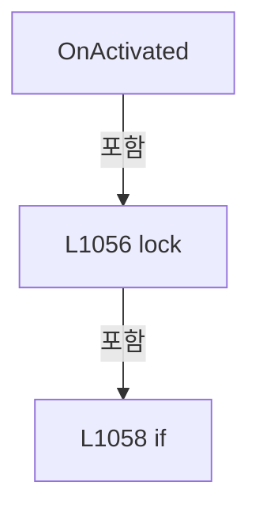

변경 전 점검: 입력/반환 타입, 위 호출자, 예외/취소 경로, 공유 상태와 저장·전송 소비자를 함께 확인합니다. 값의 단위나 물리 방향을 이름만으로 확정하지 않습니다.

### MethodDeclaration `OnDeactivated` · L1066–1075

[Drilling.UI/Menu/Menus/CMenuManual.cs:1066–1075](https://github.com/kjuws10-rgb/A3Drilling/blob/28764c91d521777b8ee068dd7aaf2d3902ce9fe2/Drilling.UI/Menu/Menus/CMenuManual.cs#L1066-L1075)

| 항목 | 실제 추출 값 |
| --- | --- |
| 서명 | void Drilling.UI.Menu.Menus.CMenuManual.OnDeactivated() |
| 접근/수식자 | Public / public, override |
| 반환/값 타입 | void |
| 소속 타입 | NamedType:Drilling.UI.Menu.Menus.CMenuManual |

현재 부분 분석에서 직접 연결된 호출자는 없습니다. XAML/이벤트/인터페이스·델리게이트·외부 진입을 추가 확인해야 하며, 미사용으로 판정한 것이 아닙니다.

호출하는 대상과 해석 범위:

| 원본 행 | 표현식 | 분석 상태 | 대상/소스 위치 |
| --- | --- | --- | --- |
| 1070 | _menuLifetimeCancellation.Cancel | resolved | void System.Threading.CancellationTokenSource.Cancel() |
| 1071 | .Cancel | resolved | void System.Threading.CancellationTokenSource.Cancel() |
| 1072 | .Dispose | resolved | void System.Threading.CancellationTokenSource.Dispose() |

본문의 실제 연산·분기·예외·반환 순서(원문 위치 순):

| 원본 행 | 종류 | 주석 해설 |
| --- | --- | --- |
| 1068 | lock | 공유 상태의 임계 구역에 진입합니다: lock (_menuLifetimeSync) |
| 1070 | call | 함수·델리게이트 또는 객체 생성자를 호출합니다: _menuLifetimeCancellation.Cancel() |
| 1071 | call | 함수·델리게이트 또는 객체 생성자를 호출합니다: .Cancel() |
| 1072 | call | 함수·델리게이트 또는 객체 생성자를 호출합니다: .Dispose() |
| 1073 | assignment | 값을 대상에 대입합니다: _statusPollingCancellation = null |

제어 구문의 포함 구조(실제 실행 순서/CFG가 아닌 구문 탐색 그림):

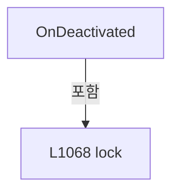

변경 전 점검: 입력/반환 타입, 위 호출자, 예외/취소 경로, 공유 상태와 저장·전송 소비자를 함께 확인합니다. 값의 단위나 물리 방향을 이름만으로 확정하지 않습니다.

### MethodDeclaration `Build` · L1077–1200

[Drilling.UI/Menu/Menus/CMenuManual.cs:1077–1200](https://github.com/kjuws10-rgb/A3Drilling/blob/28764c91d521777b8ee068dd7aaf2d3902ce9fe2/Drilling.UI/Menu/Menus/CMenuManual.cs#L1077-L1200)

| 항목 | 실제 추출 값 |
| --- | --- |
| 서명 | System.Threading.Tasks.Task<Drilling.UI.Menu.Menus.CScreenViewModel> Drilling.UI.Menu.Menus.CMenuManual.Build(System.Threading.CancellationToken) |
| 접근/수식자 | Public / public, override, async |
| 반환/값 타입 | System.Threading.Tasks.Task<Drilling.UI.Menu.Menus.CScreenViewModel> |
| 소속 타입 | NamedType:Drilling.UI.Menu.Menus.CMenuManual |

입력 계약:

| 이름 | 타입 | 전달 | 선택/기본값 |
| --- | --- | --- | --- |
| cancellationToken | System.Threading.CancellationToken | None | True / null |

현재 부분 분석에서 직접 연결된 호출자는 없습니다. XAML/이벤트/인터페이스·델리게이트·외부 진입을 추가 확인해야 하며, 미사용으로 판정한 것이 아닙니다.

호출하는 대상과 해석 범위:

| 원본 행 | 표현식 | 분석 상태 | 대상/소스 위치 |
| --- | --- | --- | --- |
| 1079 | _scanFile.List | resolved | System.Threading.Tasks.Task<System.Collections.Generic.IReadOnlyList<string>> Drilling.Common.Managers.CManualScanFileBase.List(System.Threading.CancellationToken) · Drilling.Common/Managers/CManager.cs:781 |
| 1080 | OrderSettingNames | resolved | System.Collections.Generic.IReadOnlyList<string> Drilling.UI.Menu.Menus.CMenuManual.OrderSettingNames(System.Collections.Generic.IReadOnlyList<string>) · Drilling.UI/Menu/Menus/CMenuManual.cs:5811 |
| 1082 | _scanFile.LoadForm | resolved | System.Threading.Tasks.Task<System.Collections.Generic.IReadOnlyList<Drilling.Common.Managers.ST_MANUAL_SCAN_FORM>> Drilling.Common.Managers.CManualScanFileBase.LoadForm(System.Threading.CancellationToken) · Drilling.Common/Managers/CManager.cs:782 |
| 1083 | ResolveSelectedSettingName | resolved | string Drilling.UI.Menu.Menus.CMenuManual.ResolveSelectedSettingName(System.Collections.Generic.IReadOnlyList<string>, string) · Drilling.UI/Menu/Menus/CMenuManual.cs:5731 |
| 1083 | _selectedSettingNameProvider | resolved · 동적 구현 선택 가능 | string System.Func<string>.Invoke() |
| 1084 | _scanFile.Load | resolved | System.Threading.Tasks.Task<Drilling.Common.Managers.ST_MANUAL_SCAN_PARAM> Drilling.Common.Managers.CManualScanFileBase.Load(string, System.Threading.CancellationToken) · Drilling.Common/Managers/CManager.cs:784 |
| 1085 | SyncSettingFilesPage | resolved | void Drilling.UI.Menu.Menus.CMenuManual.SyncSettingFilesPage(System.Collections.Generic.IReadOnlyList<string>, string) · Drilling.UI/Menu/Menus/CMenuManual.cs:5752 |
| 1086 | _selectedHeadNoProvider | resolved · 동적 구현 선택 가능 | int System.Func<int>.Invoke() |
| 1087 | _manager.Setting().LoadSection | resolved | System.Collections.Generic.IReadOnlyList<Drilling.Common.Managers.ST_SYSTEM_PARAMETER> Drilling.Common.Managers.CSettingManager.LoadSection(Drilling.Common.Managers.EN_SETTING_TAB, System.Threading.CancellationToken) · Drilling.Common/Managers/CSettingManager.cs:26 |
| 1087 | _manager.Setting | resolved | Drilling.Common.Managers.CSettingManager Drilling.Common.Managers.CManager.Setting() · Drilling.Common/Managers/CManager.cs:340 |
| 1089 | NormalizeManualScannerHeadNo | resolved | int Drilling.UI.Menu.Menus.CMenuManual.NormalizeManualScannerHeadNo(System.Collections.Generic.IReadOnlyList<Drilling.Common.Managers.ST_SYSTEM_PARAMETER>, int) · Drilling.UI/Menu/Menus/CMenuManual.cs:6742 |
| 1089 | Math.Clamp | resolved | int System.Math.Clamp(int, int, int) |
| 1090 | ReadManualScannerAxesSnapshot | resolved | System.Collections.Generic.IReadOnlyList<Drilling.UI.Menu.Menus.ST_MANUAL_SCANNER_AXIS> Drilling.UI.Menu.Menus.CMenuManual.ReadManualScannerAxesSnapshot(System.Collections.Generic.IReadOnlyList<Drilling.Common.Managers.ST_SYSTEM_PARAMETER>, int) · Drilling.UI/Menu/Menus/CMenuManual.cs:3076 |
| 1091 | ApplyManualHeadSelection | resolved | System.Collections.Generic.IReadOnlyList<Drilling.UI.Menu.Menus.ST_MANUAL_HEAD_CARD> Drilling.UI.Menu.Menus.CMenuManual.ApplyManualHeadSelection(System.Collections.Generic.IReadOnlyList<Drilling.UI.Menu.Menus.ST_MANUAL_HEAD_CARD>, int) · Drilling.UI/Menu/Menus/CMenuManual.cs:6262 |
| 1091 | BuildHeadCards | resolved | System.Collections.Generic.IReadOnlyList<Drilling.UI.Menu.Menus.ST_MANUAL_HEAD_CARD> Drilling.UI.Menu.Menus.CMenuManual.BuildHeadCards(int, System.Collections.Generic.IReadOnlyList<Drilling.Common.Managers.ST_SYSTEM_PARAMETER>, System.Collections.Generic.IReadOnlyList<Drilling.UI.Menu.Menus.ST_MANUAL_SCANNER_AXIS>) · Drilling.UI/Menu/Menus/CMenuManual.cs:6728 |
| 1092 | LoadSelectedRecipe | resolved | System.Threading.Tasks.Task<Drilling.Common.Managers.ST_RECIPE_DEFINITION?> Drilling.UI.Menu.Menus.CMenuManual.LoadSelectedRecipe(System.Threading.CancellationToken) · Drilling.UI/Menu/Menus/CMenuManual.cs:1615 |
| 1093 | MofPreview.Update | resolved | void Drilling.UI.Menu.Menus.CManualMofPreviewPanel.Update(Drilling.Common.Managers.ST_RECIPE_DEFINITION?, System.Collections.Generic.IReadOnlyList<Drilling.Common.Managers.ST_SYSTEM_PARAMETER>) · Drilling.UI/Menu/Menus/CMenuManual.cs:7027 |
| 1094 | MofStage.UpdateTargets | resolved | void Drilling.UI.Menu.Menus.CManualMofStagePanel.UpdateTargets(Drilling.Common.Managers.ST_RECIPE_DEFINITION?, System.Collections.Generic.IReadOnlyList<Drilling.Common.Managers.ST_SYSTEM_PARAMETER>) · Drilling.UI/Menu/Menus/CMenuManual.cs:7328 |
| 1094 | _manager.Setting().LoadSection | resolved | System.Collections.Generic.IReadOnlyList<Drilling.Common.Managers.ST_SYSTEM_PARAMETER> Drilling.Common.Managers.CSettingManager.LoadSection(Drilling.Common.Managers.EN_SETTING_TAB, System.Threading.CancellationToken) · Drilling.Common/Managers/CSettingManager.cs:26 |
| 1094 | _manager.Setting | resolved | Drilling.Common.Managers.CSettingManager Drilling.Common.Managers.CManager.Setting() · Drilling.Common/Managers/CManager.cs:340 |
| 1095 | MofRun.SetInputs | resolved | void Drilling.UI.Menu.Menus.CManualMofRunPanel.SetInputs(Drilling.Common.Managers.ST_RECIPE_DEFINITION?, System.Collections.Generic.IReadOnlyList<Drilling.Common.Managers.ST_SYSTEM_PARAMETER>, System.Collections.Generic.IEnumerable<int>) · Drilling.UI/Menu/Menus/CMenuManual.cs:7126 |
| 1096 | SetAutomationStatusInputs | resolved | void Drilling.UI.Menu.Menus.CMenuManual.SetAutomationStatusInputs(Drilling.Common.Managers.ST_RECIPE_DEFINITION?, System.Collections.Generic.IReadOnlyList<Drilling.Common.Managers.ST_SYSTEM_PARAMETER>) · Drilling.UI/Menu/Menus/CMenuManual.cs:1894 |
| 1097 | RefreshMofStageSnapshot | resolved | void Drilling.UI.Menu.Menus.CMenuManual.RefreshMofStageSnapshot() · Drilling.UI/Menu/Menus/CMenuManual.cs:3318 |
| 1098 | RefreshAutomationStatusSnapshot | resolved | void Drilling.UI.Menu.Menus.CMenuManual.RefreshAutomationStatusSnapshot() · Drilling.UI/Menu/Menus/CMenuManual.cs:1905 |
| 1104 | headCards.First | resolved | Drilling.UI.Menu.Menus.ST_MANUAL_HEAD_CARD System.Collections.Generic.IEnumerable<Drilling.UI.Menu.Menus.ST_MANUAL_HEAD_CARD>.First<Drilling.UI.Menu.Menus.ST_MANUAL_HEAD_CARD>(System.Func<Drilling.UI.Menu.Menus.ST_MANUAL_HEAD_CARD, bool>) |
| 1105 | ReadScannerAxisReference | resolved | string Drilling.UI.Menu.Menus.CMenuManual.ReadScannerAxisReference(System.Collections.Generic.IReadOnlyList<Drilling.UI.Menu.Menus.ST_MANUAL_SCANNER_AXIS>, string, string) · Drilling.UI/Menu/Menus/CMenuManual.cs:3213 |
| 1106 | ReadScannerAxisReference | resolved | string Drilling.UI.Menu.Menus.CMenuManual.ReadScannerAxisReference(System.Collections.Generic.IReadOnlyList<Drilling.UI.Menu.Menus.ST_MANUAL_SCANNER_AXIS>, string, string) · Drilling.UI/Menu/Menus/CMenuManual.cs:3213 |
| 1107 | ReadScannerAxisReference | resolved | string Drilling.UI.Menu.Menus.CMenuManual.ReadScannerAxisReference(System.Collections.Generic.IReadOnlyList<Drilling.UI.Menu.Menus.ST_MANUAL_SCANNER_AXIS>, string, string) · Drilling.UI/Menu/Menus/CMenuManual.cs:3213 |
| 1108 | IsScannerAxisAvailable | resolved | bool Drilling.UI.Menu.Menus.CMenuManual.IsScannerAxisAvailable(System.Collections.Generic.IReadOnlyList<Drilling.UI.Menu.Menus.ST_MANUAL_SCANNER_AXIS>, string) · Drilling.UI/Menu/Menus/CMenuManual.cs:3239 |
| 1109 | FormatDouble | resolved | string Drilling.UI.Menu.Menus.CMenuManual.FormatDouble(double, int) · Drilling.UI/Menu/Menus/CMenuManual.cs:1609 |
| 1109 | ReadHeadRecipeDouble | resolved | double Drilling.UI.Menu.Menus.CMenuManual.ReadHeadRecipeDouble(Drilling.Common.Managers.ST_RECIPE_DEFINITION?, int, double, params string[]) · Drilling.UI/Menu/Menus/CMenuManual.cs:1641 |
| 1110 | string.IsNullOrWhiteSpace | resolved | bool string.IsNullOrWhiteSpace(string?) |
| 1110 | string.IsNullOrWhiteSpace | resolved | bool string.IsNullOrWhiteSpace(string?) |
| 1113 | ReadScannerAxisTarget | resolved | string Drilling.UI.Menu.Menus.CMenuManual.ReadScannerAxisTarget(System.Collections.Generic.IReadOnlyList<Drilling.UI.Menu.Menus.ST_MANUAL_SCANNER_AXIS>, string, string) · Drilling.UI/Menu/Menus/CMenuManual.cs:3200 |
| 1114 | ReadScannerAxisTarget | resolved | string Drilling.UI.Menu.Menus.CMenuManual.ReadScannerAxisTarget(System.Collections.Generic.IReadOnlyList<Drilling.UI.Menu.Menus.ST_MANUAL_SCANNER_AXIS>, string, string) · Drilling.UI/Menu/Menus/CMenuManual.cs:3200 |
| 1116 | HasReadableScannerPosition | resolved | bool Drilling.UI.Menu.Menus.CMenuManual.HasReadableScannerPosition(System.Collections.Generic.IReadOnlyList<Drilling.UI.Menu.Menus.ST_MANUAL_SCANNER_AXIS>) · Drilling.UI/Menu/Menus/CMenuManual.cs:4174 |
| 1123 | string.IsNullOrWhiteSpace | resolved | bool string.IsNullOrWhiteSpace(string?) |
| 1123 | TargetGz.Equals | resolved | bool string.Equals(string?, System.StringComparison) |
| 1125 | ReadScannerAxisTarget | resolved | string Drilling.UI.Menu.Menus.CMenuManual.ReadScannerAxisTarget(System.Collections.Generic.IReadOnlyList<Drilling.UI.Menu.Menus.ST_MANUAL_SCANNER_AXIS>, string, string) · Drilling.UI/Menu/Menus/CMenuManual.cs:3200 |
| 1128 | _lastLoadedSettingName.Equals | resolved | bool string.Equals(string?, System.StringComparison) |
| 1130 | FormatDouble | resolved | string Drilling.UI.Menu.Menus.CMenuManual.FormatDouble(double, int) · Drilling.UI/Menu/Menus/CMenuManual.cs:1609 |
| 1131 | FormatDouble | resolved | string Drilling.UI.Menu.Menus.CMenuManual.FormatDouble(double, int) · Drilling.UI/Menu/Menus/CMenuManual.cs:1609 |
| 1132 | FormatDouble | resolved | string Drilling.UI.Menu.Menus.CMenuManual.FormatDouble(double, int) · Drilling.UI/Menu/Menus/CMenuManual.cs:1609 |
| 1133 | string.IsNullOrWhiteSpace | resolved | bool string.IsNullOrWhiteSpace(string?) |
| 1135 | settings.GridRowLines.ToString | resolved | string int.ToString(System.IFormatProvider?) |
| 1136 | settings.GridColLines.ToString | resolved | string int.ToString(System.IFormatProvider?) |
| 1140 | BeginDioTargetRefresh | resolved | long Drilling.UI.Menu.Menus.CMenuManual.BeginDioTargetRefresh(string) · Drilling.UI/Menu/Menus/CMenuManual.cs:2817 |
| 1143 | ResolveDioTarget | resolved | System.Threading.Tasks.Task<Drilling.UI.Menu.Menus.ST_MANUAL_DIO_TARGET> Drilling.UI.Menu.Menus.CMenuManual.ResolveDioTarget(int, System.Threading.CancellationToken) · Drilling.UI/Menu/Menus/CMenuManual.cs:2777 |
| 1144 | IsCurrentDioGeneration | resolved | bool Drilling.UI.Menu.Menus.CMenuManual.IsCurrentDioGeneration(long) · Drilling.UI/Menu/Menus/CMenuManual.cs:2824 |
| 1146 | ApplyDioTarget | resolved | void Drilling.UI.Menu.Menus.CMenuManual.ApplyDioTarget(Drilling.UI.Menu.Menus.ST_MANUAL_DIO_TARGET) · Drilling.UI/Menu/Menus/CMenuManual.cs:2796 |
| 1151 | IsCurrentDioGeneration | resolved | bool Drilling.UI.Menu.Menus.CMenuManual.IsCurrentDioGeneration(long) · Drilling.UI/Menu/Menus/CMenuManual.cs:2824 |
| 1153 | InvalidateDioTarget | resolved | void Drilling.UI.Menu.Menus.CMenuManual.InvalidateDioTarget(string) · Drilling.UI/Menu/Menus/CMenuManual.cs:2806 |
| 1157 | Apply | resolved | void Drilling.UI.Menu.Menus.CMenuManual.Apply(System.Collections.Generic.IReadOnlyList<Drilling.UI.Menu.Menus.ST_DISPLAY_ITEM>, System.Collections.Generic.IReadOnlyList<Drilling.UI.Menu.Menus.ST_DISPLAY_ITEM>, System.Collections.Generic.IReadOnlyList<Drilling.UI.Menu.Menus.ST_DISPLAY_ITEM>, System.Collections.Generic.IReadOnlyList<Drilling.UI.Menu.Menus.ST_DISPLAY_ITEM>, System.Collections.Generic.IReadOnlyList<Drilling.UI.Menu.Menus.ST_DISPLAY_ITEM>, string, string, string, System.Collections.Generic.IReadOnlyList<Drilling.UI.Menu.Menus.ST_MANUAL_HEAD_CARD>, System.Collections.Generic.IReadOnlyList<Drilling.UI.Menu.Menus.ST_MANUAL_SETTING_FILE>, System.Collections.Generic.IReadOnlyList<Drilling.UI.Menu.Menus.ST_MANUAL_PARAMETER>, System.Collections.Generic.IReadOnlyList<Drilling.UI.Menu.Menus.ST_MANUAL_COMMAND_STATE>, System.Collections.Generic.IReadOnlyList<Drilling.UI.Menu.Menus.ST_MANUAL_SCANNER_AXIS>) · Drilling.UI/Menu/Menus/CMenuManual.cs:1402 |
| 1158 | BuildManualSettings | resolved | System.Collections.Generic.IReadOnlyList<Drilling.UI.Menu.Menus.ST_DISPLAY_ITEM> Drilling.UI.Menu.Menus.CMenuManual.BuildManualSettings(Drilling.Common.Managers.ST_MANUAL_SCAN_PARAM) · Drilling.UI/Menu/Menus/CMenuManual.cs:1434 |
| 1159 | BuildSelectedHeadItems | resolved | System.Collections.Generic.IReadOnlyList<Drilling.UI.Menu.Menus.ST_DISPLAY_ITEM> Drilling.UI.Menu.Menus.CMenuManual.BuildSelectedHeadItems(Drilling.UI.Menu.Menus.ST_MANUAL_HEAD_CARD) · Drilling.UI/Menu/Menus/CMenuManual.cs:6716 |
| 1161 | new | resolved | Drilling.UI.Menu.Menus.ST_DISPLAY_ITEM.ST_DISPLAY_ITEM(string, string, string) · Drilling.UI/Menu/Menus/CMenuBase.cs:43 |
| 1162 | new | resolved | Drilling.UI.Menu.Menus.ST_DISPLAY_ITEM.ST_DISPLAY_ITEM(string, string, string) · Drilling.UI/Menu/Menus/CMenuBase.cs:43 |
| 1163 | new | resolved | Drilling.UI.Menu.Menus.ST_DISPLAY_ITEM.ST_DISPLAY_ITEM(string, string, string) · Drilling.UI/Menu/Menus/CMenuBase.cs:43 |
| 1164 | new | resolved | Drilling.UI.Menu.Menus.ST_DISPLAY_ITEM.ST_DISPLAY_ITEM(string, string, string) · Drilling.UI/Menu/Menus/CMenuBase.cs:43 |
| 1165 | new | resolved | Drilling.UI.Menu.Menus.ST_DISPLAY_ITEM.ST_DISPLAY_ITEM(string, string, string) · Drilling.UI/Menu/Menus/CMenuBase.cs:43 |
| 1166 | new | resolved | Drilling.UI.Menu.Menus.ST_DISPLAY_ITEM.ST_DISPLAY_ITEM(string, string, string) · Drilling.UI/Menu/Menus/CMenuBase.cs:43 |
| 1167 | new | resolved | Drilling.UI.Menu.Menus.ST_DISPLAY_ITEM.ST_DISPLAY_ITEM(string, string, string) · Drilling.UI/Menu/Menus/CMenuBase.cs:43 |
| 1170 | new | resolved | Drilling.UI.Menu.Menus.ST_DISPLAY_ITEM.ST_DISPLAY_ITEM(string, string, string) · Drilling.UI/Menu/Menus/CMenuBase.cs:43 |
| 1171 | new | resolved | Drilling.UI.Menu.Menus.ST_DISPLAY_ITEM.ST_DISPLAY_ITEM(string, string, string) · Drilling.UI/Menu/Menus/CMenuBase.cs:43 |
| 1172 | new | resolved | Drilling.UI.Menu.Menus.ST_DISPLAY_ITEM.ST_DISPLAY_ITEM(string, string, string) · Drilling.UI/Menu/Menus/CMenuBase.cs:43 |
| 1173 | new | resolved | Drilling.UI.Menu.Menus.ST_DISPLAY_ITEM.ST_DISPLAY_ITEM(string, string, string) · Drilling.UI/Menu/Menus/CMenuBase.cs:43 |
| 1174 | new | resolved | Drilling.UI.Menu.Menus.ST_DISPLAY_ITEM.ST_DISPLAY_ITEM(string, string, string) · Drilling.UI/Menu/Menus/CMenuBase.cs:43 |
| 1175 | new | resolved | Drilling.UI.Menu.Menus.ST_DISPLAY_ITEM.ST_DISPLAY_ITEM(string, string, string) · Drilling.UI/Menu/Menus/CMenuBase.cs:43 |
| 1176 | new | resolved | Drilling.UI.Menu.Menus.ST_DISPLAY_ITEM.ST_DISPLAY_ITEM(string, string, string) · Drilling.UI/Menu/Menus/CMenuBase.cs:43 |
| 1177 | new | resolved | Drilling.UI.Menu.Menus.ST_DISPLAY_ITEM.ST_DISPLAY_ITEM(string, string, string) · Drilling.UI/Menu/Menus/CMenuBase.cs:43 |
| 1178 | new | resolved | Drilling.UI.Menu.Menus.ST_DISPLAY_ITEM.ST_DISPLAY_ITEM(string, string, string) · Drilling.UI/Menu/Menus/CMenuBase.cs:43 |
| 1180 | new | resolved | Drilling.UI.Menu.Menus.ST_DISPLAY_ITEM.ST_DISPLAY_ITEM(string, string, string) · Drilling.UI/Menu/Menus/CMenuBase.cs:43 |
| 1180 | new | resolved | Drilling.UI.Menu.Menus.ST_DISPLAY_ITEM.ST_DISPLAY_ITEM(string, string, string) · Drilling.UI/Menu/Menus/CMenuBase.cs:43 |
| 1180 | new | resolved | Drilling.UI.Menu.Menus.ST_DISPLAY_ITEM.ST_DISPLAY_ITEM(string, string, string) · Drilling.UI/Menu/Menus/CMenuBase.cs:43 |
| 1180 | new | resolved | Drilling.UI.Menu.Menus.ST_DISPLAY_ITEM.ST_DISPLAY_ITEM(string, string, string) · Drilling.UI/Menu/Menus/CMenuBase.cs:43 |
| 1185 | BuildSettingFiles | resolved | System.Collections.Generic.IReadOnlyList<Drilling.UI.Menu.Menus.ST_MANUAL_SETTING_FILE> Drilling.UI.Menu.Menus.CMenuManual.BuildSettingFiles(System.Collections.Generic.IReadOnlyList<string>, string, int) · Drilling.UI/Menu/Menus/CMenuManual.cs:5823 |
| 1186 | BuildSettingParameters | resolved | System.Collections.Generic.IReadOnlyList<Drilling.UI.Menu.Menus.ST_MANUAL_PARAMETER> Drilling.UI.Menu.Menus.CMenuManual.BuildSettingParameters(Drilling.Common.Managers.ST_MANUAL_SCAN_PARAM, System.Collections.Generic.IReadOnlyList<Drilling.Common.Managers.ST_MANUAL_SCAN_FORM>) · Drilling.UI/Menu/Menus/CMenuManual.cs:5842 |
| 1187 | BuildCommandStateRows | resolved | System.Collections.Generic.IReadOnlyList<Drilling.UI.Menu.Menus.ST_MANUAL_COMMAND_STATE> Drilling.UI.Menu.Menus.CMenuManual.BuildCommandStateRows(Drilling.UI.Menu.Menus.ST_MANUAL_HEAD_CARD) · Drilling.UI/Menu/Menus/CMenuManual.cs:1539 |
| 1190 | RefreshManualControllerHeads | resolved | void Drilling.UI.Menu.Menus.CMenuManual.RefreshManualControllerHeads() · Drilling.UI/Menu/Menus/CMenuManual.cs:1697 |
| 1191 | RefreshVisionProtocolStatus | resolved | void Drilling.UI.Menu.Menus.CMenuManual.RefreshVisionProtocolStatus(bool) · Drilling.UI/Menu/Menus/CMenuManual.cs:6574 |
| 1192 | new CScreenViewModel | resolved | Drilling.UI.Menu.Menus.CScreenViewModel.CScreenViewModel(Drilling.UI.Menu.Menus.EN_MENU, string, string, System.Collections.Generic.IReadOnlyList<Drilling.UI.Menu.Menus.ST_DISPLAY_ITEM>, System.Collections.Generic.IReadOnlyList<Drilling.UI.Menu.Menus.ST_SCREEN_SECTION>, bool, Drilling.UI.Menu.Menus.CMenuMain?, Drilling.UI.Menu.Menus.CMenuManual?, Drilling.UI.Menu.Menus.CMenuRecipe?, Drilling.UI.Menu.Menus.CMenuSetting?, Drilling.UI.Menu.Menus.CMenuAlarm?, Drilling.UI.Menu.Menus.CMenuMonitor?, Drilling.UI.Menu.Menus.CMenuReview?, Drilling.UI.Menu.Menus.CMenuCorrection?, Drilling.UI.Menu.Menus.CMenuPm?) · Drilling.UI/Menu/Menus/CMenuBase.cs:411 |
| 1196 | new | resolved | Drilling.UI.Menu.Menus.ST_DISPLAY_ITEM.ST_DISPLAY_ITEM(string, string, string) · Drilling.UI/Menu/Menus/CMenuBase.cs:43 |
| 1196 | new | resolved | Drilling.UI.Menu.Menus.ST_DISPLAY_ITEM.ST_DISPLAY_ITEM(string, string, string) · Drilling.UI/Menu/Menus/CMenuBase.cs:43 |
| 1196 | new | resolved | Drilling.UI.Menu.Menus.ST_DISPLAY_ITEM.ST_DISPLAY_ITEM(string, string, string) · Drilling.UI/Menu/Menus/CMenuBase.cs:43 |
| 1197 | new | resolved | Drilling.UI.Menu.Menus.ST_SCREEN_SECTION.ST_SCREEN_SECTION(string, System.Collections.Generic.IReadOnlyList<Drilling.UI.Menu.Menus.ST_DISPLAY_ITEM>) · Drilling.UI/Menu/Menus/CMenuBase.cs:410 |
| 1197 | BuildManualSettings | resolved | System.Collections.Generic.IReadOnlyList<Drilling.UI.Menu.Menus.ST_DISPLAY_ITEM> Drilling.UI.Menu.Menus.CMenuManual.BuildManualSettings(Drilling.Common.Managers.ST_MANUAL_SCAN_PARAM) · Drilling.UI/Menu/Menus/CMenuManual.cs:1434 |
| 1197 | new | resolved | Drilling.UI.Menu.Menus.ST_SCREEN_SECTION.ST_SCREEN_SECTION(string, System.Collections.Generic.IReadOnlyList<Drilling.UI.Menu.Menus.ST_DISPLAY_ITEM>) · Drilling.UI/Menu/Menus/CMenuBase.cs:410 |
| 1197 | new | resolved | Drilling.UI.Menu.Menus.ST_DISPLAY_ITEM.ST_DISPLAY_ITEM(string, string, string) · Drilling.UI/Menu/Menus/CMenuBase.cs:43 |
| 1197 | new | resolved | Drilling.UI.Menu.Menus.ST_DISPLAY_ITEM.ST_DISPLAY_ITEM(string, string, string) · Drilling.UI/Menu/Menus/CMenuBase.cs:43 |
| 1197 | new | resolved | Drilling.UI.Menu.Menus.ST_DISPLAY_ITEM.ST_DISPLAY_ITEM(string, string, string) · Drilling.UI/Menu/Menus/CMenuBase.cs:43 |
| 1197 | new | resolved | Drilling.UI.Menu.Menus.ST_DISPLAY_ITEM.ST_DISPLAY_ITEM(string, string, string) · Drilling.UI/Menu/Menus/CMenuBase.cs:43 |

본문의 실제 연산·분기·예외·반환 순서(원문 위치 순):

| 원본 행 | 종류 | 주석 해설 |
| --- | --- | --- |
| 1079 | await | 비동기 완료를 기다립니다: await _scanFile.List(cancellationToken) |
| 1079 | call | 함수·델리게이트 또는 객체 생성자를 호출합니다: _scanFile.List(cancellationToken) |
| 1079 | local-declaration | 지역 변수를 선언합니다: var settingNames = await _scanFile.List(cancellationToken); |
| 1079 | variable-initializer | 변수의 초기값을 지정합니다: settingNames = await _scanFile.List(cancellationToken) |
| 1080 | call | 함수·델리게이트 또는 객체 생성자를 호출합니다: OrderSettingNames(settingNames) |
| 1080 | local-declaration | 지역 변수를 선언합니다: var orderedSettingNames = OrderSettingNames(settingNames); |
| 1080 | variable-initializer | 변수의 초기값을 지정합니다: orderedSettingNames = OrderSettingNames(settingNames) |
| 1081 | assignment | 값을 대상에 대입합니다: _manualScanSettingNames = orderedSettingNames |
| 1082 | await | 비동기 완료를 기다립니다: await _scanFile.LoadForm(cancellationToken) |
| 1082 | call | 함수·델리게이트 또는 객체 생성자를 호출합니다: _scanFile.LoadForm(cancellationToken) |
| 1082 | local-declaration | 지역 변수를 선언합니다: var formItems = await _scanFile.LoadForm(cancellationToken); |
| 1082 | variable-initializer | 변수의 초기값을 지정합니다: formItems = await _scanFile.LoadForm(cancellationToken) |
| 1083 | call | 함수·델리게이트 또는 객체 생성자를 호출합니다: ResolveSelectedSettingName(orderedSettingNames, _selectedSettingNameProvider()) |
| 1083 | call | 함수·델리게이트 또는 객체 생성자를 호출합니다: _selectedSettingNameProvider() |
| 1083 | local-declaration | 지역 변수를 선언합니다: var selectedSettingName = ResolveSelectedSettingName(orderedSettingNames, _selectedSettingNameProvider()); |
| 1083 | variable-initializer | 변수의 초기값을 지정합니다: selectedSettingName = ResolveSelectedSettingName(orderedSettingNames, _selectedSettingNameProvider()) |
| 1084 | await | 비동기 완료를 기다립니다: await _scanFile.Load(selectedSettingName, cancellationToken) |
| 1084 | call | 함수·델리게이트 또는 객체 생성자를 호출합니다: _scanFile.Load(selectedSettingName, cancellationToken) |
| 1084 | local-declaration | 지역 변수를 선언합니다: var settings = await _scanFile.Load(selectedSettingName, cancellationToken); |
| 1084 | variable-initializer | 변수의 초기값을 지정합니다: settings = await _scanFile.Load(selectedSettingName, cancellationToken) |
| 1085 | call | 함수·델리게이트 또는 객체 생성자를 호출합니다: SyncSettingFilesPage(orderedSettingNames, selectedSettingName) |
| 1086 | call | 함수·델리게이트 또는 객체 생성자를 호출합니다: _selectedHeadNoProvider() |
| 1086 | local-declaration | 지역 변수를 선언합니다: var selectedHeadNoRaw = _selectedHeadNoProvider(); |
| 1086 | variable-initializer | 변수의 초기값을 지정합니다: selectedHeadNoRaw = _selectedHeadNoProvider() |
| 1087 | call | 함수·델리게이트 또는 객체 생성자를 호출합니다: _manager.Setting().LoadSection(EN_SETTING_TAB.Option, cancellationToken) |
| 1087 | call | 함수·델리게이트 또는 객체 생성자를 호출합니다: _manager.Setting() |
| 1087 | local-declaration | 지역 변수를 선언합니다: var optionSettings = _manager.Setting().LoadSection(EN_SETTING_TAB.Option, cancellationToken); |
| 1087 | variable-initializer | 변수의 초기값을 지정합니다: optionSettings = _manager.Setting().LoadSection(EN_SETTING_TAB.Option, cancellationToken) |
| 1088 | assignment | 값을 대상에 대입합니다: _manualScannerOptionSettings = optionSettings |
| 1089 | call | 함수·델리게이트 또는 객체 생성자를 호출합니다: NormalizeManualScannerHeadNo(optionSettings, Math.Clamp(selectedHeadNoRaw, 1, 8)) |
| 1089 | call | 함수·델리게이트 또는 객체 생성자를 호출합니다: Math.Clamp(selectedHeadNoRaw, 1, 8) |
| 1089 | local-declaration | 지역 변수를 선언합니다: var selectedHeadNo = NormalizeManualScannerHeadNo(optionSettings, Math.Clamp(selectedHeadNoRaw, 1, 8)); |
| 1089 | variable-initializer | 변수의 초기값을 지정합니다: selectedHeadNo = NormalizeManualScannerHeadNo(optionSettings, Math.Clamp(selectedHeadNoRaw, 1, 8)) |
| 1090 | call | 함수·델리게이트 또는 객체 생성자를 호출합니다: ReadManualScannerAxesSnapshot(optionSettings, selectedHeadNo) |
| 1090 | local-declaration | 지역 변수를 선언합니다: var scannerAxes = ReadManualScannerAxesSnapshot(optionSettings, selectedHeadNo); |
| 1090 | variable-initializer | 변수의 초기값을 지정합니다: scannerAxes = ReadManualScannerAxesSnapshot(optionSettings, selectedHeadNo) |
| 1091 | call | 함수·델리게이트 또는 객체 생성자를 호출합니다: ApplyManualHeadSelection(BuildHeadCards(selectedHeadNo, optionSettings, scannerAxes), selectedHeadNo) |
| 1091 | call | 함수·델리게이트 또는 객체 생성자를 호출합니다: BuildHeadCards(selectedHeadNo, optionSettings, scannerAxes) |
| 1091 | local-declaration | 지역 변수를 선언합니다: var headCards = ApplyManualHeadSelection(BuildHeadCards(selectedHeadNo, optionSettings, scannerAxes), selectedHeadNo); |
| 1091 | variable-initializer | 변수의 초기값을 지정합니다: headCards = ApplyManualHeadSelection(BuildHeadCards(selectedHeadNo, optionSettings, scannerAxes), selectedHeadNo) |
| 1092 | await | 비동기 완료를 기다립니다: await LoadSelectedRecipe(cancellationToken) |
| 1092 | call | 함수·델리게이트 또는 객체 생성자를 호출합니다: LoadSelectedRecipe(cancellationToken) |
| 1092 | local-declaration | 지역 변수를 선언합니다: var selectedRecipe = await LoadSelectedRecipe(cancellationToken); |
| 1092 | variable-initializer | 변수의 초기값을 지정합니다: selectedRecipe = await LoadSelectedRecipe(cancellationToken) |
| 1093 | call | 함수·델리게이트 또는 객체 생성자를 호출합니다: MofPreview.Update(selectedRecipe, optionSettings) |
| 1094 | call | 함수·델리게이트 또는 객체 생성자를 호출합니다: MofStage.UpdateTargets(selectedRecipe, _manager.Setting().LoadSection(EN_SETTING_TAB.Motor, cancellationToken)) |
| 1094 | call | 함수·델리게이트 또는 객체 생성자를 호출합니다: _manager.Setting().LoadSection(EN_SETTING_TAB.Motor, cancellationToken) |
| 1094 | call | 함수·델리게이트 또는 객체 생성자를 호출합니다: _manager.Setting() |
| 1095 | call | 함수·델리게이트 또는 객체 생성자를 호출합니다: MofRun.SetInputs(selectedRecipe, optionSettings, SelectedManualHeadNos) |
| 1096 | call | 함수·델리게이트 또는 객체 생성자를 호출합니다: SetAutomationStatusInputs(selectedRecipe, optionSettings) |
| 1097 | call | 함수·델리게이트 또는 객체 생성자를 호출합니다: RefreshMofStageSnapshot() |
| 1098 | call | 함수·델리게이트 또는 객체 생성자를 호출합니다: RefreshAutomationStatusSnapshot() |
| 1104 | call | 함수·델리게이트 또는 객체 생성자를 호출합니다: headCards.First(IsSelectedHeadCard) |
| 1104 | local-declaration | 지역 변수를 선언합니다: var selectedHead = headCards.First(IsSelectedHeadCard); |
| 1104 | variable-initializer | 변수의 초기값을 지정합니다: selectedHead = headCards.First(IsSelectedHeadCard) |
| 1105 | call | 함수·델리게이트 또는 객체 생성자를 호출합니다: ReadScannerAxisReference(scannerAxes, "X", "X") |
| 1105 | local-declaration | 지역 변수를 선언합니다: var xAxisReference = ReadScannerAxisReference(scannerAxes, "X", "X"); |
| 1105 | variable-initializer | 변수의 초기값을 지정합니다: xAxisReference = ReadScannerAxisReference(scannerAxes, "X", "X") |
| 1106 | call | 함수·델리게이트 또는 객체 생성자를 호출합니다: ReadScannerAxisReference(scannerAxes, "Y", "Y") |
| 1106 | local-declaration | 지역 변수를 선언합니다: var yAxisReference = ReadScannerAxisReference(scannerAxes, "Y", "Y"); |
| 1106 | variable-initializer | 변수의 초기값을 지정합니다: yAxisReference = ReadScannerAxisReference(scannerAxes, "Y", "Y") |
| 1107 | call | 함수·델리게이트 또는 객체 생성자를 호출합니다: ReadScannerAxisReference(scannerAxes, "Z", "Z") |
| 1107 | local-declaration | 지역 변수를 선언합니다: var zAxisReference = ReadScannerAxisReference(scannerAxes, "Z", "Z"); |
| 1107 | variable-initializer | 변수의 초기값을 지정합니다: zAxisReference = ReadScannerAxisReference(scannerAxes, "Z", "Z") |
| 1108 | call | 함수·델리게이트 또는 객체 생성자를 호출합니다: IsScannerAxisAvailable(scannerAxes, "Z") |
| 1108 | local-declaration | 지역 변수를 선언합니다: var isZAxisAvailable = IsScannerAxisAvailable(scannerAxes, "Z"); |
| 1108 | variable-initializer | 변수의 초기값을 지정합니다: isZAxisAvailable = IsScannerAxisAvailable(scannerAxes, "Z") |
| 1109 | call | 함수·델리게이트 또는 객체 생성자를 호출합니다: FormatDouble(ReadHeadRecipeDouble(selectedRecipe, selectedHeadNo, 0.0, "DOE_Z_POSITION"), 3) |
| 1109 | call | 함수·델리게이트 또는 객체 생성자를 호출합니다: ReadHeadRecipeDouble(selectedRecipe, selectedHeadNo, 0.0, "DOE_Z_POSITION") |
| 1109 | conditional-expression | 조건에 따라 결과식을 선택합니다: isZAxisAvailable ? FormatDouble(ReadHeadRecipeDouble(selectedRecipe, selectedHeadNo, 0.0, "DOE_Z_POSITION"), 3) : "NOT USE" |
| 1109 | local-declaration | 지역 변수를 선언합니다: var zTargetDefault = isZAxisAvailable ? FormatDouble(ReadHeadRecipeDouble(selectedRecipe, selectedHeadNo, 0.0, "DOE_Z_POSITION"), 3) : "NOT USE"; |
| 1109 | variable-initializer | 변수의 초기값을 지정합니다: zTargetDefault = isZAxisAvailable ? FormatDouble(ReadHeadRecipeDouble(selectedRecipe, selectedHeadNo, 0.0, "DOE_Z_POSITION"), 3) : "NOT USE" |
| 1110 | call | 함수·델리게이트 또는 객체 생성자를 호출합니다: string.IsNullOrWhiteSpace(TargetGx) |
| 1110 | call | 함수·델리게이트 또는 객체 생성자를 호출합니다: string.IsNullOrWhiteSpace(TargetGy) |
| 1110 | local-declaration | 지역 변수를 선언합니다: var shouldRefreshPositionTargets = _lastBuiltHeadNo != selectedHeadNo &#124;&#124; string.IsNullOrWhiteSpace(TargetGx) &#124;&#124; string.IsNullOrWhiteSpace(TargetGy); |
| 1110 | variable-initializer | 변수의 초기값을 지정합니다: shouldRefreshPositionTargets = _lastBuiltHeadNo != selectedHeadNo &#124;&#124; string.IsNullOrWhiteSpace(TargetGx) &#124;&#124; string.IsNullOrWhiteSpace(TargetGy) |
| 1111 | if | 조건에 따라 분기합니다: if (shouldRefreshPositionTargets) |
| 1113 | assignment | 값을 대상에 대입합니다: TargetGx = ReadScannerAxisTarget(scannerAxes, "X") |
| 1113 | call | 함수·델리게이트 또는 객체 생성자를 호출합니다: ReadScannerAxisTarget(scannerAxes, "X") |
| 1114 | assignment | 값을 대상에 대입합니다: TargetGy = ReadScannerAxisTarget(scannerAxes, "Y") |
| 1114 | call | 함수·델리게이트 또는 객체 생성자를 호출합니다: ReadScannerAxisTarget(scannerAxes, "Y") |
| 1115 | assignment | 값을 대상에 대입합니다: _lastBuiltHeadNo = selectedHeadNo |
| 1116 | assignment | 값을 대상에 대입합니다: _hasScannerTargetSnapshot = HasReadableScannerPosition(scannerAxes) |
| 1116 | call | 함수·델리게이트 또는 객체 생성자를 호출합니다: HasReadableScannerPosition(scannerAxes) |
| 1119 | if | 조건에 따라 분기합니다: if (!isZAxisAvailable) |
| 1121 | assignment | 값을 대상에 대입합니다: TargetGz = "NOT USE" |
| 1123 | call | 함수·델리게이트 또는 객체 생성자를 호출합니다: string.IsNullOrWhiteSpace(TargetGz) |
| 1123 | call | 함수·델리게이트 또는 객체 생성자를 호출합니다: TargetGz.Equals("NOT USE", StringComparison.OrdinalIgnoreCase) |
| 1123 | else | 앞 조건이 거짓인 경로입니다: else |
| 1123 | if | 조건에 따라 분기합니다: if (shouldRefreshPositionTargets &#124;&#124; string.IsNullOrWhiteSpace(TargetGz) &#124;&#124; TargetGz.Equals("NOT USE", StringComparison.OrdinalIgnoreCase)) |
| 1125 | assignment | 값을 대상에 대입합니다: TargetGz = ReadScannerAxisTarget(scannerAxes, "Z", zTargetDefault) |
| 1125 | call | 함수·델리게이트 또는 객체 생성자를 호출합니다: ReadScannerAxisTarget(scannerAxes, "Z", zTargetDefault) |
| 1128 | call | 함수·델리게이트 또는 객체 생성자를 호출합니다: _lastLoadedSettingName.Equals(selectedSettingName, StringComparison.OrdinalIgnoreCase) |
| 1128 | if | 조건에 따라 분기합니다: if (!_lastLoadedSettingName.Equals(selectedSettingName, StringComparison.OrdinalIgnoreCase)) |
| 1130 | assignment | 값을 대상에 대입합니다: ShapeSize = FormatDouble(settings.ShapeSize, 3) |
| 1130 | call | 함수·델리게이트 또는 객체 생성자를 호출합니다: FormatDouble(settings.ShapeSize, 3) |
| 1131 | assignment | 값을 대상에 대입합니다: ShapeOffsetX = FormatDouble(settings.OffsetX, 3) |
| 1131 | call | 함수·델리게이트 또는 객체 생성자를 호출합니다: FormatDouble(settings.OffsetX, 3) |
| 1132 | assignment | 값을 대상에 대입합니다: ShapeOffsetY = FormatDouble(settings.OffsetY, 3) |
| 1132 | call | 함수·델리게이트 또는 객체 생성자를 호출합니다: FormatDouble(settings.OffsetY, 3) |
| 1133 | assignment | 값을 대상에 대입합니다: ShapeDirection = string.IsNullOrWhiteSpace(settings.Direction) ? "CW" : settings.Direction |
| 1133 | call | 함수·델리게이트 또는 객체 생성자를 호출합니다: string.IsNullOrWhiteSpace(settings.Direction) |
| 1133 | conditional-expression | 조건에 따라 결과식을 선택합니다: string.IsNullOrWhiteSpace(settings.Direction) ? "CW" : settings.Direction |
| 1134 | assignment | 값을 대상에 대입합니다: ShapeName = settings.ShapeName |
| 1135 | assignment | 값을 대상에 대입합니다: GridRowLines = settings.GridRowLines.ToString(CultureInfo.InvariantCulture) |
| 1135 | call | 함수·델리게이트 또는 객체 생성자를 호출합니다: settings.GridRowLines.ToString(CultureInfo.InvariantCulture) |
| 1136 | assignment | 값을 대상에 대입합니다: GridColLines = settings.GridColLines.ToString(CultureInfo.InvariantCulture) |
| 1136 | call | 함수·델리게이트 또는 객체 생성자를 호출합니다: settings.GridColLines.ToString(CultureInfo.InvariantCulture) |
| 1137 | assignment | 값을 대상에 대입합니다: _lastLoadedSettingName = selectedSettingName |
| 1140 | call | 함수·델리게이트 또는 객체 생성자를 호출합니다: BeginDioTargetRefresh("Loading") |
| 1140 | local-declaration | 지역 변수를 선언합니다: var dioGeneration = BeginDioTargetRefresh("Loading"); |
| 1140 | variable-initializer | 변수의 초기값을 지정합니다: dioGeneration = BeginDioTargetRefresh("Loading") |
| 1141 | try | 예외 처리 범위입니다: try |
| 1143 | await | 비동기 완료를 기다립니다: await ResolveDioTarget(selectedHeadNo, cancellationToken) |
| 1143 | call | 함수·델리게이트 또는 객체 생성자를 호출합니다: ResolveDioTarget(selectedHeadNo, cancellationToken) |
| 1143 | local-declaration | 지역 변수를 선언합니다: var dioTarget = await ResolveDioTarget(selectedHeadNo, cancellationToken); |
| 1143 | variable-initializer | 변수의 초기값을 지정합니다: dioTarget = await ResolveDioTarget(selectedHeadNo, cancellationToken) |
| 1144 | call | 함수·델리게이트 또는 객체 생성자를 호출합니다: IsCurrentDioGeneration(dioGeneration) |
| 1144 | if | 조건에 따라 분기합니다: if (IsCurrentDioGeneration(dioGeneration)) |
| 1146 | call | 함수·델리게이트 또는 객체 생성자를 호출합니다: ApplyDioTarget(dioTarget) |
| 1149 | catch | 지정 예외를 처리합니다: catch (Exception exception) when (exception is InvalidOperationException or InvalidDataException or IOException or TimeoutException or KeyNotFoundException) |
| 1151 | call | 함수·델리게이트 또는 객체 생성자를 호출합니다: IsCurrentDioGeneration(dioGeneration) |
| 1151 | if | 조건에 따라 분기합니다: if (IsCurrentDioGeneration(dioGeneration)) |
| 1153 | call | 함수·델리게이트 또는 객체 생성자를 호출합니다: InvalidateDioTarget($"ERROR: {exception.Message}") |
| 1157 | call | 함수·델리게이트 또는 객체 생성자를 호출합니다: Apply( BuildManualSettings(settings), BuildSelectedHeadItems(selectedHead), [ new("Center Move", "Ready"), new("Position Move", $"{xAxisReference}/{yAxisReference} Target"), new("Z Move", $"{zAxisReference} Target"), new… |
| 1158 | call | 함수·델리게이트 또는 객체 생성자를 호출합니다: BuildManualSettings(settings) |
| 1159 | call | 함수·델리게이트 또는 객체 생성자를 호출합니다: BuildSelectedHeadItems(selectedHead) |
| 1161 | call | 함수·델리게이트 또는 객체 생성자를 호출합니다: new("Center Move", "Ready") |
| 1162 | call | 함수·델리게이트 또는 객체 생성자를 호출합니다: new("Position Move", $"{xAxisReference}/{yAxisReference} Target") |
| 1163 | call | 함수·델리게이트 또는 객체 생성자를 호출합니다: new("Z Move", $"{zAxisReference} Target") |
| 1164 | call | 함수·델리게이트 또는 객체 생성자를 호출합니다: new("Move Stop", "Ready") |
| 1165 | call | 함수·델리게이트 또는 객체 생성자를 호출합니다: new($"{xAxisReference} Target", TargetGx, "mm") |
| 1166 | call | 함수·델리게이트 또는 객체 생성자를 호출합니다: new($"{yAxisReference} Target", TargetGy, "mm") |
| 1167 | call | 함수·델리게이트 또는 객체 생성자를 호출합니다: new($"{zAxisReference} Target", TargetGz, "mm") |
| 1170 | call | 함수·델리게이트 또는 객체 생성자를 호출합니다: new("Shape Size", ShapeSize, "mm") |
| 1171 | call | 함수·델리게이트 또는 객체 생성자를 호출합니다: new("Offset X", ShapeOffsetX, "mm") |
| 1172 | call | 함수·델리게이트 또는 객체 생성자를 호출합니다: new("Offset Y", ShapeOffsetY, "mm") |
| 1173 | call | 함수·델리게이트 또는 객체 생성자를 호출합니다: new("Direction", ShapeDirection) |
| 1174 | call | 함수·델리게이트 또는 객체 생성자를 호출합니다: new("Shape", ShapeName) |
| 1175 | call | 함수·델리게이트 또는 객체 생성자를 호출합니다: new("Grid Row Lines", GridRowLines, "ea") |
| 1176 | call | 함수·델리게이트 또는 객체 생성자를 호출합니다: new("Grid Col Lines", GridColLines, "ea") |
| 1177 | call | 함수·델리게이트 또는 객체 생성자를 호출합니다: new("Start", "Ready") |
| 1178 | call | 함수·델리게이트 또는 객체 생성자를 호출합니다: new("Stop", "Ready") |
| 1180 | call | 함수·델리게이트 또는 객체 생성자를 호출합니다: new("Laser", _laserState) |
| 1180 | call | 함수·델리게이트 또는 객체 생성자를 호출합니다: new("CENTER", _centerState) |
| 1180 | call | 함수·델리게이트 또는 객체 생성자를 호출합니다: new("Last Command", _lastCommand) |
| 1180 | call | 함수·델리게이트 또는 객체 생성자를 호출합니다: new("Result", _lastResult) |
| 1185 | call | 함수·델리게이트 또는 객체 생성자를 호출합니다: BuildSettingFiles(orderedSettingNames, selectedSettingName, _settingFilesPageIndex) |
| 1186 | call | 함수·델리게이트 또는 객체 생성자를 호출합니다: BuildSettingParameters(settings, formItems) |
| 1187 | call | 함수·델리게이트 또는 객체 생성자를 호출합니다: BuildCommandStateRows(selectedHead) |
| 1190 | call | 함수·델리게이트 또는 객체 생성자를 호출합니다: RefreshManualControllerHeads() |
| 1191 | call | 함수·델리게이트 또는 객체 생성자를 호출합니다: RefreshVisionProtocolStatus(writeLog: false) |
| 1192 | call | 함수·델리게이트 또는 객체 생성자를 호출합니다: new CScreenViewModel( EN_MENU.Manual, "MANUAL / CONTROL", "Scanner, stage and protocol test operation.", [new("Selected Head", selectedHead.HeadName), new("Mode", "Manual"), new("Laser", _laserState)], [new("Manual Setti… |
| 1192 | return | 호출자에게 값 또는 제어를 반환합니다: return new CScreenViewModel( EN_MENU.Manual, "MANUAL / CONTROL", "Scanner, stage and protocol test operation.", [new("Selected Head", selectedHead.HeadName), new("Mode", "Manual"), new("Laser", _laserState)], [new("Manual Setting" |
| 1196 | call | 함수·델리게이트 또는 객체 생성자를 호출합니다: new("Selected Head", selectedHead.HeadName) |
| 1196 | call | 함수·델리게이트 또는 객체 생성자를 호출합니다: new("Mode", "Manual") |
| 1196 | call | 함수·델리게이트 또는 객체 생성자를 호출합니다: new("Laser", _laserState) |
| 1197 | call | 함수·델리게이트 또는 객체 생성자를 호출합니다: new("Manual Setting", BuildManualSettings(settings)) |
| 1197 | call | 함수·델리게이트 또는 객체 생성자를 호출합니다: BuildManualSettings(settings) |
| 1197 | call | 함수·델리게이트 또는 객체 생성자를 호출합니다: new("Position Move", [new("Center Move", "Ready"), new("Position Move", $"{xAxisReference}/{yAxisReference} target input"), new("Z Move", $"{zAxisReference} target input"), new("Move Stop", "Ready")]) |
| 1197 | call | 함수·델리게이트 또는 객체 생성자를 호출합니다: new("Center Move", "Ready") |
| 1197 | call | 함수·델리게이트 또는 객체 생성자를 호출합니다: new("Position Move", $"{xAxisReference}/{yAxisReference} target input") |
| 1197 | call | 함수·델리게이트 또는 객체 생성자를 호출합니다: new("Z Move", $"{zAxisReference} target input") |
| 1197 | call | 함수·델리게이트 또는 객체 생성자를 호출합니다: new("Move Stop", "Ready") |

제어 구문의 포함 구조(실제 실행 순서/CFG가 아닌 구문 탐색 그림):

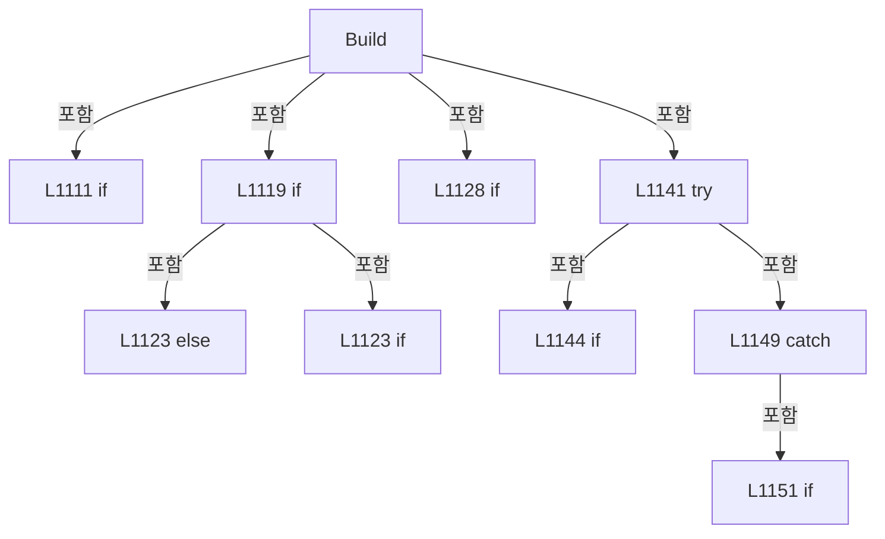

변경 전 점검: 입력/반환 타입, 위 호출자, 예외/취소 경로, 공유 상태와 저장·전송 소비자를 함께 확인합니다. 값의 단위나 물리 방향을 이름만으로 확정하지 않습니다.

### LocalFunctionStatement `IsSelectedHeadCard` · L1099–1102

[Drilling.UI/Menu/Menus/CMenuManual.cs:1099–1102](https://github.com/kjuws10-rgb/A3Drilling/blob/28764c91d521777b8ee068dd7aaf2d3902ce9fe2/Drilling.UI/Menu/Menus/CMenuManual.cs#L1099-L1102)

| 항목 | 실제 추출 값 |
| --- | --- |
| 서명 | bool IsSelectedHeadCard(Drilling.UI.Menu.Menus.ST_MANUAL_HEAD_CARD) |
| 접근/수식자 | Private /  |
| 반환/값 타입 | bool |
| 소속 타입 | NamedType:Drilling.UI.Menu.Menus.CMenuManual |

입력 계약:

| 이름 | 타입 | 전달 | 선택/기본값 |
| --- | --- | --- | --- |
| head | Drilling.UI.Menu.Menus.ST_MANUAL_HEAD_CARD | None | False /  |

현재 부분 분석에서 직접 연결된 호출자는 없습니다. XAML/이벤트/인터페이스·델리게이트·외부 진입을 추가 확인해야 하며, 미사용으로 판정한 것이 아닙니다.

본문의 실제 연산·분기·예외·반환 순서(원문 위치 순):

| 원본 행 | 종류 | 주석 해설 |
| --- | --- | --- |
| 1101 | return | 호출자에게 값 또는 제어를 반환합니다: return head.HeadNo == selectedHeadNo; |

변경 전 점검: 입력/반환 타입, 위 호출자, 예외/취소 경로, 공유 상태와 저장·전송 소비자를 함께 확인합니다. 값의 단위나 물리 방향을 이름만으로 확정하지 않습니다.

### MethodDeclaration `ReadOptionalHeadSettingInt` · L1202–1205

[Drilling.UI/Menu/Menus/CMenuManual.cs:1202–1205](https://github.com/kjuws10-rgb/A3Drilling/blob/28764c91d521777b8ee068dd7aaf2d3902ce9fe2/Drilling.UI/Menu/Menus/CMenuManual.cs#L1202-L1205)

| 항목 | 실제 추출 값 |
| --- | --- |
| 서명 | int Drilling.UI.Menu.Menus.CMenuManual.ReadOptionalHeadSettingInt(System.Collections.Generic.IReadOnlyList<Drilling.Common.Managers.ST_SYSTEM_PARAMETER>, int, int, params string[]) |
| 접근/수식자 | Private / private, static |
| 반환/값 타입 | int |
| 소속 타입 | NamedType:Drilling.UI.Menu.Menus.CMenuManual |

입력 계약:

| 이름 | 타입 | 전달 | 선택/기본값 |
| --- | --- | --- | --- |
| settings | System.Collections.Generic.IReadOnlyList<Drilling.Common.Managers.ST_SYSTEM_PARAMETER> | None | False /  |
| defaultValue | int | None | False /  |
| headNo | int | None | False /  |
| suffixes | string[] | None | False /  |

정적 호출자로 확인된 위치:

| 호출 파일/행 | 호출 표현식 | 런타임 분기 가능 |
| --- | --- | --- |
| [Drilling.UI/Menu/Menus/CMenuManual.cs:1461–1461](https://github.com/kjuws10-rgb/A3Drilling/blob/28764c91d521777b8ee068dd7aaf2d3902ce9fe2/Drilling.UI/Menu/Menus/CMenuManual.cs#L1461-L1461) | ReadOptionalHeadSettingInt | False |
| [Drilling.UI/Menu/Menus/CMenuManual.cs:1467–1467](https://github.com/kjuws10-rgb/A3Drilling/blob/28764c91d521777b8ee068dd7aaf2d3902ce9fe2/Drilling.UI/Menu/Menus/CMenuManual.cs#L1467-L1467) | ReadOptionalHeadSettingInt | False |
| [Drilling.UI/Menu/Menus/CMenuManual.cs:2547–2547](https://github.com/kjuws10-rgb/A3Drilling/blob/28764c91d521777b8ee068dd7aaf2d3902ce9fe2/Drilling.UI/Menu/Menus/CMenuManual.cs#L2547-L2547) | ReadOptionalHeadSettingInt | False |
| [Drilling.UI/Menu/Menus/CMenuManual.cs:2785–2785](https://github.com/kjuws10-rgb/A3Drilling/blob/28764c91d521777b8ee068dd7aaf2d3902ce9fe2/Drilling.UI/Menu/Menus/CMenuManual.cs#L2785-L2785) | ReadOptionalHeadSettingInt | False |
| [Drilling.UI/Menu/Menus/CMenuManual.cs:2787–2787](https://github.com/kjuws10-rgb/A3Drilling/blob/28764c91d521777b8ee068dd7aaf2d3902ce9fe2/Drilling.UI/Menu/Menus/CMenuManual.cs#L2787-L2787) | ReadOptionalHeadSettingInt | False |

호출하는 대상과 해석 범위:

| 원본 행 | 표현식 | 분석 상태 | 대상/소스 위치 |
| --- | --- | --- | --- |
| 1204 | TryFindHeadSetting | resolved | bool Drilling.UI.Menu.Menus.CMenuManual.TryFindHeadSetting(System.Collections.Generic.IReadOnlyList<Drilling.Common.Managers.ST_SYSTEM_PARAMETER>, int, System.Collections.Generic.IReadOnlyList<string>, out string, out string) · Drilling.UI/Menu/Menus/CMenuManual.cs:1217 |
| 1204 | ParseHeadSettingInt | resolved | int Drilling.UI.Menu.Menus.CMenuManual.ParseHeadSettingInt(int, string, string) · Drilling.UI/Menu/Menus/CMenuManual.cs:1242 |

본문의 실제 연산·분기·예외·반환 순서(원문 위치 순):

| 원본 행 | 종류 | 주석 해설 |
| --- | --- | --- |
| 1204 | call | 함수·델리게이트 또는 객체 생성자를 호출합니다: TryFindHeadSetting(settings, headNo, suffixes, out var key, out var value) |
| 1204 | call | 함수·델리게이트 또는 객체 생성자를 호출합니다: ParseHeadSettingInt(headNo, key, value) |
| 1204 | conditional-expression | 조건에 따라 결과식을 선택합니다: TryFindHeadSetting(settings, headNo, suffixes, out var key, out var value) ? ParseHeadSettingInt(headNo, key, value) : defaultValue |
| 1204 | return | 호출자에게 값 또는 제어를 반환합니다: return TryFindHeadSetting(settings, headNo, suffixes, out var key, out var value) ? ParseHeadSettingInt(headNo, key, value) : defaultValue; |

변경 전 점검: 입력/반환 타입, 위 호출자, 예외/취소 경로, 공유 상태와 저장·전송 소비자를 함께 확인합니다. 값의 단위나 물리 방향을 이름만으로 확정하지 않습니다.

### MethodDeclaration `ReadRequiredHeadSettingInt` · L1207–1215

[Drilling.UI/Menu/Menus/CMenuManual.cs:1207–1215](https://github.com/kjuws10-rgb/A3Drilling/blob/28764c91d521777b8ee068dd7aaf2d3902ce9fe2/Drilling.UI/Menu/Menus/CMenuManual.cs#L1207-L1215)

| 항목 | 실제 추출 값 |
| --- | --- |
| 서명 | int Drilling.UI.Menu.Menus.CMenuManual.ReadRequiredHeadSettingInt(System.Collections.Generic.IReadOnlyList<Drilling.Common.Managers.ST_SYSTEM_PARAMETER>, int, params string[]) |
| 접근/수식자 | Private / private, static |
| 반환/값 타입 | int |
| 소속 타입 | NamedType:Drilling.UI.Menu.Menus.CMenuManual |

입력 계약:

| 이름 | 타입 | 전달 | 선택/기본값 |
| --- | --- | --- | --- |
| settings | System.Collections.Generic.IReadOnlyList<Drilling.Common.Managers.ST_SYSTEM_PARAMETER> | None | False /  |
| headNo | int | None | False /  |
| suffixes | string[] | None | False /  |

정적 호출자로 확인된 위치:

| 호출 파일/행 | 호출 표현식 | 런타임 분기 가능 |
| --- | --- | --- |
| [Drilling.UI/Menu/Menus/CMenuManual.cs:2549–2549](https://github.com/kjuws10-rgb/A3Drilling/blob/28764c91d521777b8ee068dd7aaf2d3902ce9fe2/Drilling.UI/Menu/Menus/CMenuManual.cs#L2549-L2549) | ReadRequiredHeadSettingInt | False |
| [Drilling.UI/Menu/Menus/CMenuManual.cs:2790–2790](https://github.com/kjuws10-rgb/A3Drilling/blob/28764c91d521777b8ee068dd7aaf2d3902ce9fe2/Drilling.UI/Menu/Menus/CMenuManual.cs#L2790-L2790) | ReadRequiredHeadSettingInt | False |

호출하는 대상과 해석 범위:

| 원본 행 | 표현식 | 분석 상태 | 대상/소스 위치 |
| --- | --- | --- | --- |
| 1209 | TryFindHeadSetting | resolved | bool Drilling.UI.Menu.Menus.CMenuManual.TryFindHeadSetting(System.Collections.Generic.IReadOnlyList<Drilling.Common.Managers.ST_SYSTEM_PARAMETER>, int, System.Collections.Generic.IReadOnlyList<string>, out string, out string) · Drilling.UI/Menu/Menus/CMenuManual.cs:1217 |
| 1211 | new InvalidOperationException | resolved | System.InvalidOperationException.InvalidOperationException(string?) |
| 1214 | ParseHeadSettingInt | resolved | int Drilling.UI.Menu.Menus.CMenuManual.ParseHeadSettingInt(int, string, string) · Drilling.UI/Menu/Menus/CMenuManual.cs:1242 |

본문의 실제 연산·분기·예외·반환 순서(원문 위치 순):

| 원본 행 | 종류 | 주석 해설 |
| --- | --- | --- |
| 1209 | call | 함수·델리게이트 또는 객체 생성자를 호출합니다: TryFindHeadSetting(settings, headNo, suffixes, out var key, out var value) |
| 1209 | if | 조건에 따라 분기합니다: if (!TryFindHeadSetting(settings, headNo, suffixes, out var key, out var value)) |
| 1211 | call | 함수·델리게이트 또는 객체 생성자를 호출합니다: new InvalidOperationException($"H{headNo:00} scanner DIO number is not configured.") |
| 1211 | throw | 예외를 발생/전달합니다: throw new InvalidOperationException($"H{headNo:00} scanner DIO number is not configured."); |
| 1214 | call | 함수·델리게이트 또는 객체 생성자를 호출합니다: ParseHeadSettingInt(headNo, key, value) |
| 1214 | return | 호출자에게 값 또는 제어를 반환합니다: return ParseHeadSettingInt(headNo, key, value); |

제어 구문의 포함 구조(실제 실행 순서/CFG가 아닌 구문 탐색 그림):

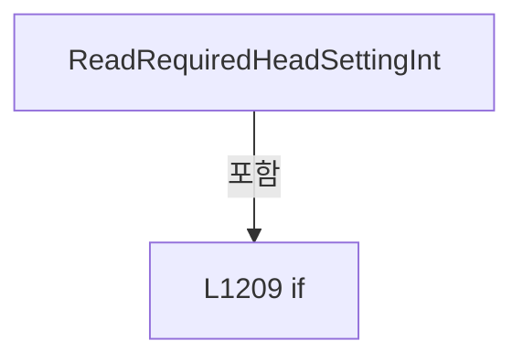

변경 전 점검: 입력/반환 타입, 위 호출자, 예외/취소 경로, 공유 상태와 저장·전송 소비자를 함께 확인합니다. 값의 단위나 물리 방향을 이름만으로 확정하지 않습니다.

### MethodDeclaration `TryFindHeadSetting` · L1217–1240

[Drilling.UI/Menu/Menus/CMenuManual.cs:1217–1240](https://github.com/kjuws10-rgb/A3Drilling/blob/28764c91d521777b8ee068dd7aaf2d3902ce9fe2/Drilling.UI/Menu/Menus/CMenuManual.cs#L1217-L1240)

| 항목 | 실제 추출 값 |
| --- | --- |
| 서명 | bool Drilling.UI.Menu.Menus.CMenuManual.TryFindHeadSetting(System.Collections.Generic.IReadOnlyList<Drilling.Common.Managers.ST_SYSTEM_PARAMETER>, int, System.Collections.Generic.IReadOnlyList<string>, out string, out string) |
| 접근/수식자 | Private / private, static |
| 반환/값 타입 | bool |
| 소속 타입 | NamedType:Drilling.UI.Menu.Menus.CMenuManual |

입력 계약:

| 이름 | 타입 | 전달 | 선택/기본값 |
| --- | --- | --- | --- |
| settings | System.Collections.Generic.IReadOnlyList<Drilling.Common.Managers.ST_SYSTEM_PARAMETER> | None | False /  |
| headNo | int | None | False /  |
| suffixes | System.Collections.Generic.IReadOnlyList<string> | None | False /  |
| key | string | Out | False /  |
| value | string | Out | False /  |

정적 호출자로 확인된 위치:

| 호출 파일/행 | 호출 표현식 | 런타임 분기 가능 |
| --- | --- | --- |
| [Drilling.UI/Menu/Menus/CMenuManual.cs:1204–1204](https://github.com/kjuws10-rgb/A3Drilling/blob/28764c91d521777b8ee068dd7aaf2d3902ce9fe2/Drilling.UI/Menu/Menus/CMenuManual.cs#L1204-L1204) | TryFindHeadSetting | False |
| [Drilling.UI/Menu/Menus/CMenuManual.cs:1209–1209](https://github.com/kjuws10-rgb/A3Drilling/blob/28764c91d521777b8ee068dd7aaf2d3902ce9fe2/Drilling.UI/Menu/Menus/CMenuManual.cs#L1209-L1209) | TryFindHeadSetting | False |

호출하는 대상과 해석 범위:

| 원본 행 | 표현식 | 분석 상태 | 대상/소스 위치 |
| --- | --- | --- | --- |
| 1228 | settings.FirstOrDefault | resolved | Drilling.Common.Managers.ST_SYSTEM_PARAMETER? System.Collections.Generic.IEnumerable<Drilling.Common.Managers.ST_SYSTEM_PARAMETER>.FirstOrDefault<Drilling.Common.Managers.ST_SYSTEM_PARAMETER>(System.Func<Drilling.Common.Managers.ST_SYSTEM_PARAMETER, bool>) |

본문의 실제 연산·분기·예외·반환 순서(원문 위치 순):

| 원본 행 | 종류 | 주석 해설 |
| --- | --- | --- |
| 1219 | local-declaration | 지역 변수를 선언합니다: var prefix = $"H{headNo:00}_"; |
| 1219 | variable-initializer | 변수의 초기값을 지정합니다: prefix = $"H{headNo:00}_" |
| 1220 | foreach | 컬렉션 요소를 순회합니다: foreach (var suffix in suffixes) |
| 1222 | local-declaration | 지역 변수를 선언합니다: var searchKey = prefix + suffix; |
| 1222 | variable-initializer | 변수의 초기값을 지정합니다: searchKey = prefix + suffix |
| 1228 | call | 함수·델리게이트 또는 객체 생성자를 호출합니다: settings.FirstOrDefault(MatchesHeadSettingKey) |
| 1228 | local-declaration | 지역 변수를 선언합니다: var setting = settings.FirstOrDefault(MatchesHeadSettingKey); |
| 1228 | variable-initializer | 변수의 초기값을 지정합니다: setting = settings.FirstOrDefault(MatchesHeadSettingKey) |
| 1229 | if | 조건에 따라 분기합니다: if (setting is not null) |
| 1231 | assignment | 값을 대상에 대입합니다: key = searchKey |
| 1232 | assignment | 값을 대상에 대입합니다: value = setting.Value |
| 1233 | return | 호출자에게 값 또는 제어를 반환합니다: return true; |
| 1237 | assignment | 값을 대상에 대입합니다: key = "" |
| 1238 | assignment | 값을 대상에 대입합니다: value = "" |
| 1239 | return | 호출자에게 값 또는 제어를 반환합니다: return false; |

제어 구문의 포함 구조(실제 실행 순서/CFG가 아닌 구문 탐색 그림):

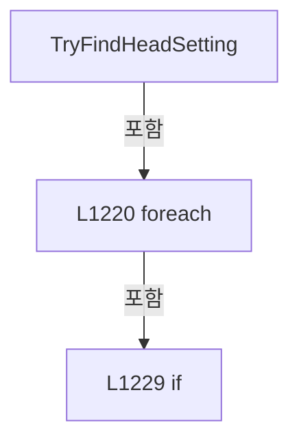

변경 전 점검: 입력/반환 타입, 위 호출자, 예외/취소 경로, 공유 상태와 저장·전송 소비자를 함께 확인합니다. 값의 단위나 물리 방향을 이름만으로 확정하지 않습니다.

### LocalFunctionStatement `MatchesHeadSettingKey` · L1223–1226

[Drilling.UI/Menu/Menus/CMenuManual.cs:1223–1226](https://github.com/kjuws10-rgb/A3Drilling/blob/28764c91d521777b8ee068dd7aaf2d3902ce9fe2/Drilling.UI/Menu/Menus/CMenuManual.cs#L1223-L1226)

| 항목 | 실제 추출 값 |
| --- | --- |
| 서명 | bool MatchesHeadSettingKey(Drilling.Common.Managers.ST_SYSTEM_PARAMETER) |
| 접근/수식자 | Private /  |
| 반환/값 타입 | bool |
| 소속 타입 | NamedType:Drilling.UI.Menu.Menus.CMenuManual |

입력 계약:

| 이름 | 타입 | 전달 | 선택/기본값 |
| --- | --- | --- | --- |
| item | Drilling.Common.Managers.ST_SYSTEM_PARAMETER | None | False /  |

현재 부분 분석에서 직접 연결된 호출자는 없습니다. XAML/이벤트/인터페이스·델리게이트·외부 진입을 추가 확인해야 하며, 미사용으로 판정한 것이 아닙니다.

호출하는 대상과 해석 범위:

| 원본 행 | 표현식 | 분석 상태 | 대상/소스 위치 |
| --- | --- | --- | --- |
| 1225 | searchKey.Equals | resolved | bool string.Equals(string?, System.StringComparison) |
| 1225 | searchKey.Equals | resolved | bool string.Equals(string?, System.StringComparison) |

본문의 실제 연산·분기·예외·반환 순서(원문 위치 순):

| 원본 행 | 종류 | 주석 해설 |
| --- | --- | --- |
| 1225 | call | 함수·델리게이트 또는 객체 생성자를 호출합니다: searchKey.Equals(item.Key, StringComparison.OrdinalIgnoreCase) |
| 1225 | call | 함수·델리게이트 또는 객체 생성자를 호출합니다: searchKey.Equals(item.Name, StringComparison.OrdinalIgnoreCase) |
| 1225 | return | 호출자에게 값 또는 제어를 반환합니다: return searchKey.Equals(item.Key, StringComparison.OrdinalIgnoreCase) &#124;&#124; searchKey.Equals(item.Name, StringComparison.OrdinalIgnoreCase); |

변경 전 점검: 입력/반환 타입, 위 호출자, 예외/취소 경로, 공유 상태와 저장·전송 소비자를 함께 확인합니다. 값의 단위나 물리 방향을 이름만으로 확정하지 않습니다.

### MethodDeclaration `ParseHeadSettingInt` · L1242–1255

[Drilling.UI/Menu/Menus/CMenuManual.cs:1242–1255](https://github.com/kjuws10-rgb/A3Drilling/blob/28764c91d521777b8ee068dd7aaf2d3902ce9fe2/Drilling.UI/Menu/Menus/CMenuManual.cs#L1242-L1255)

| 항목 | 실제 추출 값 |
| --- | --- |
| 서명 | int Drilling.UI.Menu.Menus.CMenuManual.ParseHeadSettingInt(int, string, string) |
| 접근/수식자 | Private / private, static |
| 반환/값 타입 | int |
| 소속 타입 | NamedType:Drilling.UI.Menu.Menus.CMenuManual |

입력 계약:

| 이름 | 타입 | 전달 | 선택/기본값 |
| --- | --- | --- | --- |
| headNo | int | None | False /  |
| key | string | None | False /  |
| value | string | None | False /  |

정적 호출자로 확인된 위치:

| 호출 파일/행 | 호출 표현식 | 런타임 분기 가능 |
| --- | --- | --- |
| [Drilling.UI/Menu/Menus/CMenuManual.cs:1204–1204](https://github.com/kjuws10-rgb/A3Drilling/blob/28764c91d521777b8ee068dd7aaf2d3902ce9fe2/Drilling.UI/Menu/Menus/CMenuManual.cs#L1204-L1204) | ParseHeadSettingInt | False |
| [Drilling.UI/Menu/Menus/CMenuManual.cs:1214–1214](https://github.com/kjuws10-rgb/A3Drilling/blob/28764c91d521777b8ee068dd7aaf2d3902ce9fe2/Drilling.UI/Menu/Menus/CMenuManual.cs#L1214-L1214) | ParseHeadSettingInt | False |

호출하는 대상과 해석 범위:

| 원본 행 | 표현식 | 분석 상태 | 대상/소스 위치 |
| --- | --- | --- | --- |
| 1244 | string.IsNullOrWhiteSpace | resolved | bool string.IsNullOrWhiteSpace(string?) |
| 1246 | new InvalidOperationException | resolved | System.InvalidOperationException.InvalidOperationException(string?) |
| 1249 | int.TryParse | resolved | bool int.TryParse(string?, System.Globalization.NumberStyles, System.IFormatProvider?, out int) |
| 1249 | value.Trim | resolved | string string.Trim() |
| 1251 | new InvalidOperationException | resolved | System.InvalidOperationException.InvalidOperationException(string?) |

본문의 실제 연산·분기·예외·반환 순서(원문 위치 순):

| 원본 행 | 종류 | 주석 해설 |
| --- | --- | --- |
| 1244 | call | 함수·델리게이트 또는 객체 생성자를 호출합니다: string.IsNullOrWhiteSpace(value) |
| 1244 | if | 조건에 따라 분기합니다: if (string.IsNullOrWhiteSpace(value)) |
| 1246 | call | 함수·델리게이트 또는 객체 생성자를 호출합니다: new InvalidOperationException($"H{headNo:00} setting {key} is empty.") |
| 1246 | throw | 예외를 발생/전달합니다: throw new InvalidOperationException($"H{headNo:00} setting {key} is empty."); |
| 1249 | call | 함수·델리게이트 또는 객체 생성자를 호출합니다: int.TryParse(value.Trim(), NumberStyles.Integer, CultureInfo.InvariantCulture, out var parsed) |
| 1249 | call | 함수·델리게이트 또는 객체 생성자를 호출합니다: value.Trim() |
| 1249 | if | 조건에 따라 분기합니다: if (!int.TryParse(value.Trim(), NumberStyles.Integer, CultureInfo.InvariantCulture, out var parsed)) |
| 1251 | call | 함수·델리게이트 또는 객체 생성자를 호출합니다: new InvalidOperationException($"H{headNo:00} setting {key} must be an integer. Value={value}") |
| 1251 | throw | 예외를 발생/전달합니다: throw new InvalidOperationException($"H{headNo:00} setting {key} must be an integer. Value={value}"); |
| 1254 | return | 호출자에게 값 또는 제어를 반환합니다: return parsed; |

제어 구문의 포함 구조(실제 실행 순서/CFG가 아닌 구문 탐색 그림):

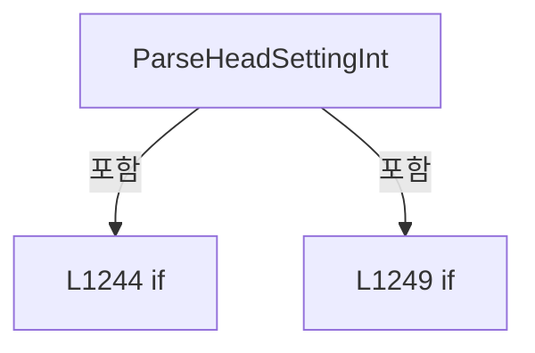

변경 전 점검: 입력/반환 타입, 위 호출자, 예외/취소 경로, 공유 상태와 저장·전송 소비자를 함께 확인합니다. 값의 단위나 물리 방향을 이름만으로 확정하지 않습니다.

### MethodDeclaration `ReadHeadSettingText` · L1257–1276

[Drilling.UI/Menu/Menus/CMenuManual.cs:1257–1276](https://github.com/kjuws10-rgb/A3Drilling/blob/28764c91d521777b8ee068dd7aaf2d3902ce9fe2/Drilling.UI/Menu/Menus/CMenuManual.cs#L1257-L1276)

| 항목 | 실제 추출 값 |
| --- | --- |
| 서명 | string Drilling.UI.Menu.Menus.CMenuManual.ReadHeadSettingText(System.Collections.Generic.IReadOnlyList<Drilling.Common.Managers.ST_SYSTEM_PARAMETER>, string, int, params string[]) |
| 접근/수식자 | Private / private, static |
| 반환/값 타입 | string |
| 소속 타입 | NamedType:Drilling.UI.Menu.Menus.CMenuManual |

입력 계약:

| 이름 | 타입 | 전달 | 선택/기본값 |
| --- | --- | --- | --- |
| settings | System.Collections.Generic.IReadOnlyList<Drilling.Common.Managers.ST_SYSTEM_PARAMETER> | None | False /  |
| defaultValue | string | None | False /  |
| headNo | int | None | False /  |
| suffixes | string[] | None | False /  |

정적 호출자로 확인된 위치:

| 호출 파일/행 | 호출 표현식 | 런타임 분기 가능 |
| --- | --- | --- |
| [Drilling.UI/Menu/Menus/CMenuManual.cs:2788–2788](https://github.com/kjuws10-rgb/A3Drilling/blob/28764c91d521777b8ee068dd7aaf2d3902ce9fe2/Drilling.UI/Menu/Menus/CMenuManual.cs#L2788-L2788) | ReadHeadSettingText | False |
| [Drilling.UI/Menu/Menus/CMenuManual.cs:4848–4848](https://github.com/kjuws10-rgb/A3Drilling/blob/28764c91d521777b8ee068dd7aaf2d3902ce9fe2/Drilling.UI/Menu/Menus/CMenuManual.cs#L4848-L4848) | ReadHeadSettingText | False |

호출하는 대상과 해석 범위:

| 원본 행 | 표현식 | 분석 상태 | 대상/소스 위치 |
| --- | --- | --- | --- |
| 1268 | settings.FirstOrDefault | resolved | Drilling.Common.Managers.ST_SYSTEM_PARAMETER? System.Collections.Generic.IEnumerable<Drilling.Common.Managers.ST_SYSTEM_PARAMETER>.FirstOrDefault<Drilling.Common.Managers.ST_SYSTEM_PARAMETER>(System.Func<Drilling.Common.Managers.ST_SYSTEM_PARAMETER, bool>) |
| 1269 | string.IsNullOrWhiteSpace | resolved | bool string.IsNullOrWhiteSpace(string?) |
| 1271 | setting.Value.Trim | resolved | string string.Trim() |

본문의 실제 연산·분기·예외·반환 순서(원문 위치 순):

| 원본 행 | 종류 | 주석 해설 |
| --- | --- | --- |
| 1259 | local-declaration | 지역 변수를 선언합니다: var prefix = $"H{headNo:00}_"; |
| 1259 | variable-initializer | 변수의 초기값을 지정합니다: prefix = $"H{headNo:00}_" |
| 1260 | foreach | 컬렉션 요소를 순회합니다: foreach (var suffix in suffixes) |
| 1262 | local-declaration | 지역 변수를 선언합니다: var key = prefix + suffix; |
| 1262 | variable-initializer | 변수의 초기값을 지정합니다: key = prefix + suffix |
| 1268 | call | 함수·델리게이트 또는 객체 생성자를 호출합니다: settings.FirstOrDefault(MatchesHeadSettingKey) |
| 1268 | local-declaration | 지역 변수를 선언합니다: var setting = settings.FirstOrDefault(MatchesHeadSettingKey); |
| 1268 | variable-initializer | 변수의 초기값을 지정합니다: setting = settings.FirstOrDefault(MatchesHeadSettingKey) |
| 1269 | call | 함수·델리게이트 또는 객체 생성자를 호출합니다: string.IsNullOrWhiteSpace(setting.Value) |
| 1269 | if | 조건에 따라 분기합니다: if (setting is not null && !string.IsNullOrWhiteSpace(setting.Value)) |
| 1271 | call | 함수·델리게이트 또는 객체 생성자를 호출합니다: setting.Value.Trim() |
| 1271 | return | 호출자에게 값 또는 제어를 반환합니다: return setting.Value.Trim(); |
| 1275 | return | 호출자에게 값 또는 제어를 반환합니다: return defaultValue; |

제어 구문의 포함 구조(실제 실행 순서/CFG가 아닌 구문 탐색 그림):

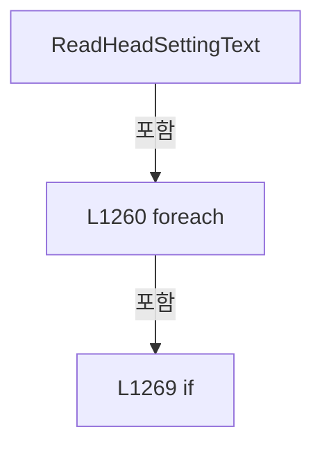

변경 전 점검: 입력/반환 타입, 위 호출자, 예외/취소 경로, 공유 상태와 저장·전송 소비자를 함께 확인합니다. 값의 단위나 물리 방향을 이름만으로 확정하지 않습니다.

### LocalFunctionStatement `MatchesHeadSettingKey` · L1263–1266

[Drilling.UI/Menu/Menus/CMenuManual.cs:1263–1266](https://github.com/kjuws10-rgb/A3Drilling/blob/28764c91d521777b8ee068dd7aaf2d3902ce9fe2/Drilling.UI/Menu/Menus/CMenuManual.cs#L1263-L1266)

| 항목 | 실제 추출 값 |
| --- | --- |
| 서명 | bool MatchesHeadSettingKey(Drilling.Common.Managers.ST_SYSTEM_PARAMETER) |
| 접근/수식자 | Private /  |
| 반환/값 타입 | bool |
| 소속 타입 | NamedType:Drilling.UI.Menu.Menus.CMenuManual |

입력 계약:

| 이름 | 타입 | 전달 | 선택/기본값 |
| --- | --- | --- | --- |
| item | Drilling.Common.Managers.ST_SYSTEM_PARAMETER | None | False /  |

현재 부분 분석에서 직접 연결된 호출자는 없습니다. XAML/이벤트/인터페이스·델리게이트·외부 진입을 추가 확인해야 하며, 미사용으로 판정한 것이 아닙니다.

호출하는 대상과 해석 범위:

| 원본 행 | 표현식 | 분석 상태 | 대상/소스 위치 |
| --- | --- | --- | --- |
| 1265 | key.Equals | resolved | bool string.Equals(string?, System.StringComparison) |
| 1265 | key.Equals | resolved | bool string.Equals(string?, System.StringComparison) |

본문의 실제 연산·분기·예외·반환 순서(원문 위치 순):

| 원본 행 | 종류 | 주석 해설 |
| --- | --- | --- |
| 1265 | call | 함수·델리게이트 또는 객체 생성자를 호출합니다: key.Equals(item.Key, StringComparison.OrdinalIgnoreCase) |
| 1265 | call | 함수·델리게이트 또는 객체 생성자를 호출합니다: key.Equals(item.Name, StringComparison.OrdinalIgnoreCase) |
| 1265 | return | 호출자에게 값 또는 제어를 반환합니다: return key.Equals(item.Key, StringComparison.OrdinalIgnoreCase) &#124;&#124; key.Equals(item.Name, StringComparison.OrdinalIgnoreCase); |

변경 전 점검: 입력/반환 타입, 위 호출자, 예외/취소 경로, 공유 상태와 저장·전송 소비자를 함께 확인합니다. 값의 단위나 물리 방향을 이름만으로 확정하지 않습니다.

### MethodDeclaration `TryBlockManualAutomationCommand` · L1278–1325

[Drilling.UI/Menu/Menus/CMenuManual.cs:1278–1325](https://github.com/kjuws10-rgb/A3Drilling/blob/28764c91d521777b8ee068dd7aaf2d3902ce9fe2/Drilling.UI/Menu/Menus/CMenuManual.cs#L1278-L1325)

| 항목 | 실제 추출 값 |
| --- | --- |
| 서명 | bool Drilling.UI.Menu.Menus.CMenuManual.TryBlockManualAutomationCommand(string) |
| 접근/수식자 | Private / private |
| 반환/값 타입 | bool |
| 소속 타입 | NamedType:Drilling.UI.Menu.Menus.CMenuManual |

입력 계약:

| 이름 | 타입 | 전달 | 선택/기본값 |
| --- | --- | --- | --- |
| commandName | string | None | False /  |

정적 호출자로 확인된 위치:

| 호출 파일/행 | 호출 표현식 | 런타임 분기 가능 |
| --- | --- | --- |
| [Drilling.UI/Menu/Menus/CMenuManual.cs:1742–1742](https://github.com/kjuws10-rgb/A3Drilling/blob/28764c91d521777b8ee068dd7aaf2d3902ce9fe2/Drilling.UI/Menu/Menus/CMenuManual.cs#L1742-L1742) | TryBlockManualAutomationCommand | False |
| [Drilling.UI/Menu/Menus/CMenuManual.cs:1779–1779](https://github.com/kjuws10-rgb/A3Drilling/blob/28764c91d521777b8ee068dd7aaf2d3902ce9fe2/Drilling.UI/Menu/Menus/CMenuManual.cs#L1779-L1779) | TryBlockManualAutomationCommand | False |
| [Drilling.UI/Menu/Menus/CMenuManual.cs:1790–1790](https://github.com/kjuws10-rgb/A3Drilling/blob/28764c91d521777b8ee068dd7aaf2d3902ce9fe2/Drilling.UI/Menu/Menus/CMenuManual.cs#L1790-L1790) | TryBlockManualAutomationCommand | False |
| [Drilling.UI/Menu/Menus/CMenuManual.cs:1882–1882](https://github.com/kjuws10-rgb/A3Drilling/blob/28764c91d521777b8ee068dd7aaf2d3902ce9fe2/Drilling.UI/Menu/Menus/CMenuManual.cs#L1882-L1882) | TryBlockManualAutomationCommand | False |
| [Drilling.UI/Menu/Menus/CMenuManual.cs:1981–1981](https://github.com/kjuws10-rgb/A3Drilling/blob/28764c91d521777b8ee068dd7aaf2d3902ce9fe2/Drilling.UI/Menu/Menus/CMenuManual.cs#L1981-L1981) | TryBlockManualAutomationCommand | False |
| [Drilling.UI/Menu/Menus/CMenuManual.cs:2000–2000](https://github.com/kjuws10-rgb/A3Drilling/blob/28764c91d521777b8ee068dd7aaf2d3902ce9fe2/Drilling.UI/Menu/Menus/CMenuManual.cs#L2000-L2000) | TryBlockManualAutomationCommand | False |
| [Drilling.UI/Menu/Menus/CMenuManual.cs:2182–2182](https://github.com/kjuws10-rgb/A3Drilling/blob/28764c91d521777b8ee068dd7aaf2d3902ce9fe2/Drilling.UI/Menu/Menus/CMenuManual.cs#L2182-L2182) | TryBlockManualAutomationCommand | False |
| [Drilling.UI/Menu/Menus/CMenuManual.cs:2251–2251](https://github.com/kjuws10-rgb/A3Drilling/blob/28764c91d521777b8ee068dd7aaf2d3902ce9fe2/Drilling.UI/Menu/Menus/CMenuManual.cs#L2251-L2251) | TryBlockManualAutomationCommand | False |
| [Drilling.UI/Menu/Menus/CMenuManual.cs:2571–2571](https://github.com/kjuws10-rgb/A3Drilling/blob/28764c91d521777b8ee068dd7aaf2d3902ce9fe2/Drilling.UI/Menu/Menus/CMenuManual.cs#L2571-L2571) | TryBlockManualAutomationCommand | False |
| [Drilling.UI/Menu/Menus/CMenuManual.cs:2708–2708](https://github.com/kjuws10-rgb/A3Drilling/blob/28764c91d521777b8ee068dd7aaf2d3902ce9fe2/Drilling.UI/Menu/Menus/CMenuManual.cs#L2708-L2708) | TryBlockManualAutomationCommand | False |
| [Drilling.UI/Menu/Menus/CMenuManual.cs:3266–3266](https://github.com/kjuws10-rgb/A3Drilling/blob/28764c91d521777b8ee068dd7aaf2d3902ce9fe2/Drilling.UI/Menu/Menus/CMenuManual.cs#L3266-L3266) | TryBlockManualAutomationCommand | False |
| [Drilling.UI/Menu/Menus/CMenuManual.cs:3286–3286](https://github.com/kjuws10-rgb/A3Drilling/blob/28764c91d521777b8ee068dd7aaf2d3902ce9fe2/Drilling.UI/Menu/Menus/CMenuManual.cs#L3286-L3286) | TryBlockManualAutomationCommand | False |
| [Drilling.UI/Menu/Menus/CMenuManual.cs:3338–3338](https://github.com/kjuws10-rgb/A3Drilling/blob/28764c91d521777b8ee068dd7aaf2d3902ce9fe2/Drilling.UI/Menu/Menus/CMenuManual.cs#L3338-L3338) | TryBlockManualAutomationCommand | False |
| [Drilling.UI/Menu/Menus/CMenuManual.cs:3365–3365](https://github.com/kjuws10-rgb/A3Drilling/blob/28764c91d521777b8ee068dd7aaf2d3902ce9fe2/Drilling.UI/Menu/Menus/CMenuManual.cs#L3365-L3365) | TryBlockManualAutomationCommand | False |
| [Drilling.UI/Menu/Menus/CMenuManual.cs:3462–3462](https://github.com/kjuws10-rgb/A3Drilling/blob/28764c91d521777b8ee068dd7aaf2d3902ce9fe2/Drilling.UI/Menu/Menus/CMenuManual.cs#L3462-L3462) | TryBlockManualAutomationCommand | False |
| [Drilling.UI/Menu/Menus/CMenuManual.cs:4021–4021](https://github.com/kjuws10-rgb/A3Drilling/blob/28764c91d521777b8ee068dd7aaf2d3902ce9fe2/Drilling.UI/Menu/Menus/CMenuManual.cs#L4021-L4021) | TryBlockManualAutomationCommand | False |
| [Drilling.UI/Menu/Menus/CMenuManual.cs:4289–4289](https://github.com/kjuws10-rgb/A3Drilling/blob/28764c91d521777b8ee068dd7aaf2d3902ce9fe2/Drilling.UI/Menu/Menus/CMenuManual.cs#L4289-L4289) | TryBlockManualAutomationCommand | False |
| [Drilling.UI/Menu/Menus/CMenuManual.cs:4300–4300](https://github.com/kjuws10-rgb/A3Drilling/blob/28764c91d521777b8ee068dd7aaf2d3902ce9fe2/Drilling.UI/Menu/Menus/CMenuManual.cs#L4300-L4300) | TryBlockManualAutomationCommand | False |
| [Drilling.UI/Menu/Menus/CMenuManual.cs:4627–4627](https://github.com/kjuws10-rgb/A3Drilling/blob/28764c91d521777b8ee068dd7aaf2d3902ce9fe2/Drilling.UI/Menu/Menus/CMenuManual.cs#L4627-L4627) | TryBlockManualAutomationCommand | False |
| [Drilling.UI/Menu/Menus/CMenuManual.cs:5286–5286](https://github.com/kjuws10-rgb/A3Drilling/blob/28764c91d521777b8ee068dd7aaf2d3902ce9fe2/Drilling.UI/Menu/Menus/CMenuManual.cs#L5286-L5286) | TryBlockManualAutomationCommand | False |
| [Drilling.UI/Menu/Menus/CMenuManual.cs:5392–5392](https://github.com/kjuws10-rgb/A3Drilling/blob/28764c91d521777b8ee068dd7aaf2d3902ce9fe2/Drilling.UI/Menu/Menus/CMenuManual.cs#L5392-L5392) | TryBlockManualAutomationCommand | False |

호출하는 대상과 해석 범위:

| 원본 행 | 표현식 | 분석 상태 | 대상/소스 위치 |
| --- | --- | --- | --- |
| 1280 | commandName.Contains | resolved | bool string.Contains(string, System.StringComparison) |
| 1280 | commandName.EndsWith | resolved | bool string.EndsWith(string, System.StringComparison) |
| 1280 | commandName.Contains | resolved | bool string.Contains(string, System.StringComparison) |
| 1280 | commandName.Contains | resolved | bool string.Contains(string, System.StringComparison) |
| 1280 | commandName.EndsWith | resolved | bool string.EndsWith(string, System.StringComparison) |
| 1281 | CheckOperationAlarm | resolved | bool Drilling.UI.Menu.Menus.CMenuBase.CheckOperationAlarm(string) · Drilling.UI/Menu/Menus/CMenuBase.cs:15 |
| 1285 | commandName.Equals | resolved | bool string.Equals(string?, System.StringComparison) |
| 1286 | _manager.Interface | resolved | Drilling.Common.Interface.CInterfaceManager Drilling.Common.Managers.CManager.Interface() · Drilling.Common/Managers/CManager.cs:355 |
| 1288 | ShowManualWarning | resolved | void Drilling.UI.Menu.Menus.CMenuManual.ShowManualWarning(string) · Drilling.UI/Menu/Menus/CMenuManual.cs:1599 |
| 1291 | _manager.Station | resolved | Drilling.Common.Station.CStationManager Drilling.Common.Managers.CManager.Station() · Drilling.Common/Managers/CManager.cs:330 |
| 1293 | ShowManualWarning | resolved | void Drilling.UI.Menu.Menus.CMenuManual.ShowManualWarning(string) · Drilling.UI/Menu/Menus/CMenuManual.cs:1599 |
| 1299 | ShowManualWarning | resolved | void Drilling.UI.Menu.Menus.CMenuManual.ShowManualWarning(string) · Drilling.UI/Menu/Menus/CMenuManual.cs:1599 |
| 1304 | commandName.Equals | resolved | bool string.Equals(string?, System.StringComparison) |
| 1304 | commandName.StartsWith | resolved | bool string.StartsWith(string, System.StringComparison) |
| 1304 | commandName.EndsWith | resolved | bool string.EndsWith(string, System.StringComparison) |
| 1305 | commandName.Equals | resolved | bool string.Equals(string?, System.StringComparison) |
| 1308 | _setStatusMessage | resolved · 동적 구현 선택 가능 | void System.Action<string>.Invoke(string) |
| 1309 | ShowManualWarning | resolved | void Drilling.UI.Menu.Menus.CMenuManual.ShowManualWarning(string) · Drilling.UI/Menu/Menus/CMenuManual.cs:1599 |
| 1313 | IsAutoProcessRunning | resolved | bool Drilling.UI.Menu.Menus.CMenuManual.IsAutoProcessRunning() · Drilling.UI/Menu/Menus/CMenuManual.cs:1327 |
| 1321 | RefreshCommandStateRows | resolved | void Drilling.UI.Menu.Menus.CMenuManual.RefreshCommandStateRows() · Drilling.UI/Menu/Menus/CMenuManual.cs:5516 |
| 1322 | _setStatusMessage | resolved · 동적 구현 선택 가능 | void System.Action<string>.Invoke(string) |
| 1323 | _refreshShellStatus | resolved · 동적 구현 선택 가능 | void System.Action.Invoke() |

본문의 실제 연산·분기·예외·반환 순서(원문 위치 순):

| 원본 행 | 종류 | 주석 해설 |
| --- | --- | --- |
| 1280 | call | 함수·델리게이트 또는 객체 생성자를 호출합니다: commandName.Contains("STOP", StringComparison.OrdinalIgnoreCase) |
| 1280 | call | 함수·델리게이트 또는 객체 생성자를 호출합니다: commandName.EndsWith("OFF", StringComparison.OrdinalIgnoreCase) |
| 1280 | call | 함수·델리게이트 또는 객체 생성자를 호출합니다: commandName.Contains("DISABLE", StringComparison.OrdinalIgnoreCase) |
| 1280 | call | 함수·델리게이트 또는 객체 생성자를 호출합니다: commandName.Contains("FAULT_CLEAR", StringComparison.OrdinalIgnoreCase) |
| 1280 | call | 함수·델리게이트 또는 객체 생성자를 호출합니다: commandName.EndsWith("_RESET", StringComparison.OrdinalIgnoreCase) |
| 1280 | local-declaration | 지역 변수를 선언합니다: var recovery = commandName.Contains("STOP", StringComparison.OrdinalIgnoreCase) &#124;&#124; commandName.EndsWith("OFF", StringComparison.OrdinalIgnoreCase) &#124;&#124; commandName.Contains("DISABLE", StringComparison.OrdinalIgnoreCase) &#124;&#124; commandNa |
| 1280 | variable-initializer | 변수의 초기값을 지정합니다: recovery = commandName.Contains("STOP", StringComparison.OrdinalIgnoreCase) &#124;&#124; commandName.EndsWith("OFF", StringComparison.OrdinalIgnoreCase) &#124;&#124; commandName.Contains("DISABLE", StringComparison.OrdinalIgnoreCase) &#124;&#124; commandName.C |
| 1281 | call | 함수·델리게이트 또는 객체 생성자를 호출합니다: CheckOperationAlarm(commandName) |
| 1281 | if | 조건에 따라 분기합니다: if (!recovery && !CheckOperationAlarm(commandName)) |
| 1282 | return | 호출자에게 값 또는 제어를 반환합니다: return true; |
| 1285 | call | 함수·델리게이트 또는 객체 생성자를 호출합니다: commandName.Equals("STAGE_REVIEW_MOVE", StringComparison.OrdinalIgnoreCase) |
| 1285 | if | 조건에 따라 분기합니다: if (!recovery && !commandName.Equals("STAGE_REVIEW_MOVE", StringComparison.OrdinalIgnoreCase) && (IsManualStageMovePending &#124;&#124; _manager.Interface().StageReviewSequences.IsActive)) |
| 1286 | call | 함수·델리게이트 또는 객체 생성자를 호출합니다: _manager.Interface() |
| 1288 | call | 함수·델리게이트 또는 객체 생성자를 호출합니다: ShowManualWarning("Stage/Review 이동이 실행 중이거나 정리 중입니다. 이동 완료 또는 STOP 정리 완료 후 실행해 주세요.") |
| 1289 | return | 호출자에게 값 또는 제어를 반환합니다: return true; |
| 1291 | call | 함수·델리게이트 또는 객체 생성자를 호출합니다: _manager.Station() |
| 1291 | if | 조건에 따라 분기합니다: if (_manager.Station().ManualMofStatus is { IsRunning: true } or { RequiresStop: true }) |
| 1293 | call | 함수·델리게이트 또는 객체 생성자를 호출합니다: ShowManualWarning("MOF 가공이 실행 중이거나 정지가 확인되지 않았습니다. MOF STOP 후 실행해 주세요.") |
| 1294 | return | 호출자에게 값 또는 제어를 반환합니다: return true; |
| 1297 | if | 조건에 따라 분기합니다: if (IsManualMotionScriptActive && commandName is not "MANUAL_MOTION" and not "MOVE_STOP") |
| 1299 | call | 함수·델리게이트 또는 객체 생성자를 호출합니다: ShowManualWarning("수동 이동 스크립트가 실행 중이거나 정지가 확인되지 않았습니다. 완료 또는 MOVE STOP 후 실행해 주세요.") |
| 1300 | return | 호출자에게 값 또는 제어를 반환합니다: return true; |
| 1304 | call | 함수·델리게이트 또는 객체 생성자를 호출합니다: commandName.Equals("SCANNER_FAULT_CLEAR", StringComparison.OrdinalIgnoreCase) |
| 1304 | call | 함수·델리게이트 또는 객체 생성자를 호출합니다: commandName.StartsWith("CONTROLLER_", StringComparison.OrdinalIgnoreCase) |
| 1304 | call | 함수·델리게이트 또는 객체 생성자를 호출합니다: commandName.EndsWith("_RESET", StringComparison.OrdinalIgnoreCase) |
| 1304 | local-declaration | 지역 변수를 선언합니다: var canRecoverStoppedScan = _activeManualShapeScan is null && !_manualShapeScanStopInProgress && _activeManualLaserAction is null && !_manualLaserOffInProgress && (commandName.Equals("SCANNER_FAULT_CLEAR", StringComparison.Ordinal |
| 1304 | variable-initializer | 변수의 초기값을 지정합니다: canRecoverStoppedScan = _activeManualShapeScan is null && !_manualShapeScanStopInProgress && _activeManualLaserAction is null && !_manualLaserOffInProgress && (commandName.Equals("SCANNER_FAULT_CLEAR", StringComparison.OrdinalIgno |
| 1305 | call | 함수·델리게이트 또는 객체 생성자를 호출합니다: commandName.Equals("SHAPE_START", StringComparison.OrdinalIgnoreCase) |
| 1305 | if | 조건에 따라 분기합니다: if (IsManualShapeScanActive && !canRecoverStoppedScan && !commandName.Equals("SHAPE_START", StringComparison.OrdinalIgnoreCase)) |
| 1307 | local-declaration | 지역 변수를 선언합니다: const string scanMessage = "수동 가공이 진행 중이거나 정지가 확인되지 않았습니다. LASER OFF 또는 Scan STOP으로 정지한 후 실행해 주세요."; |
| 1307 | variable-initializer | 변수의 초기값을 지정합니다: scanMessage = "수동 가공이 진행 중이거나 정지가 확인되지 않았습니다. LASER OFF 또는 Scan STOP으로 정지한 후 실행해 주세요." |
| 1308 | call | 함수·델리게이트 또는 객체 생성자를 호출합니다: _setStatusMessage(scanMessage) |
| 1309 | call | 함수·델리게이트 또는 객체 생성자를 호출합니다: ShowManualWarning(scanMessage) |
| 1310 | return | 호출자에게 값 또는 제어를 반환합니다: return true; |
| 1313 | call | 함수·델리게이트 또는 객체 생성자를 호출합니다: IsAutoProcessRunning() |
| 1313 | if | 조건에 따라 분기합니다: if (!IsAutoProcessRunning()) |
| 1315 | return | 호출자에게 값 또는 제어를 반환합니다: return false; |
| 1318 | local-declaration | 지역 변수를 선언합니다: var message = "Auto process is running. Manual Automation1 command is blocked."; |
| 1318 | variable-initializer | 변수의 초기값을 지정합니다: message = "Auto process is running. Manual Automation1 command is blocked." |
| 1319 | assignment | 값을 대상에 대입합니다: _lastCommand = commandName |
| 1320 | assignment | 값을 대상에 대입합니다: _lastResult = message |
| 1321 | call | 함수·델리게이트 또는 객체 생성자를 호출합니다: RefreshCommandStateRows() |
| 1322 | call | 함수·델리게이트 또는 객체 생성자를 호출합니다: _setStatusMessage(message) |
| 1323 | call | 함수·델리게이트 또는 객체 생성자를 호출합니다: _refreshShellStatus() |
| 1324 | return | 호출자에게 값 또는 제어를 반환합니다: return true; |

제어 구문의 포함 구조(실제 실행 순서/CFG가 아닌 구문 탐색 그림):

```mermaid
flowchart TD
 M["TryBlockManualAutomationCommand"]
 N0["L1281 if"]
 M -->|포함| N0
 N1["L1285 if"]
 M -->|포함| N1
 N2["L1291 if"]
 M -->|포함| N2
 N3["L1297 if"]
 M -->|포함| N3
 N4["L1305 if"]
 M -->|포함| N4
 N5["L1313 if"]
 M -->|포함| N5
```

변경 전 점검: 입력/반환 타입, 위 호출자, 예외/취소 경로, 공유 상태와 저장·전송 소비자를 함께 확인합니다. 값의 단위나 물리 방향을 이름만으로 확정하지 않습니다.

### MethodDeclaration `IsAutoProcessRunning` · L1327–1338

[Drilling.UI/Menu/Menus/CMenuManual.cs:1327–1338](https://github.com/kjuws10-rgb/A3Drilling/blob/28764c91d521777b8ee068dd7aaf2d3902ce9fe2/Drilling.UI/Menu/Menus/CMenuManual.cs#L1327-L1338)

| 항목 | 실제 추출 값 |
| --- | --- |
| 서명 | bool Drilling.UI.Menu.Menus.CMenuManual.IsAutoProcessRunning() |
| 접근/수식자 | Private / private |
| 반환/값 타입 | bool |
| 소속 타입 | NamedType:Drilling.UI.Menu.Menus.CMenuManual |

정적 호출자로 확인된 위치:

| 호출 파일/행 | 호출 표현식 | 런타임 분기 가능 |
| --- | --- | --- |
| [Drilling.UI/Menu/Menus/CMenuManual.cs:1313–1313](https://github.com/kjuws10-rgb/A3Drilling/blob/28764c91d521777b8ee068dd7aaf2d3902ce9fe2/Drilling.UI/Menu/Menus/CMenuManual.cs#L1313-L1313) | IsAutoProcessRunning | False |
| [Drilling.UI/Menu/Menus/CMenuManual.cs:2976–2976](https://github.com/kjuws10-rgb/A3Drilling/blob/28764c91d521777b8ee068dd7aaf2d3902ce9fe2/Drilling.UI/Menu/Menus/CMenuManual.cs#L2976-L2976) | IsAutoProcessRunning | False |
| [Drilling.UI/Menu/Menus/CMenuManual.cs:4539–4539](https://github.com/kjuws10-rgb/A3Drilling/blob/28764c91d521777b8ee068dd7aaf2d3902ce9fe2/Drilling.UI/Menu/Menus/CMenuManual.cs#L4539-L4539) | IsAutoProcessRunning | False |
| [Drilling.UI/Menu/Menus/CMenuManual.cs:4780–4780](https://github.com/kjuws10-rgb/A3Drilling/blob/28764c91d521777b8ee068dd7aaf2d3902ce9fe2/Drilling.UI/Menu/Menus/CMenuManual.cs#L4780-L4780) | IsAutoProcessRunning | False |

호출하는 대상과 해석 범위:

| 원본 행 | 표현식 | 분석 상태 | 대상/소스 위치 |
| --- | --- | --- | --- |
| 1331 | _manager.Station().GetStatus | resolved | Drilling.Common.Station.ST_STATION_PROCESS_STATUS Drilling.Common.Station.CStationManager.GetStatus(System.Threading.CancellationToken) · Drilling.Common/Station/CStationManager.cs:66 |
| 1331 | _manager.Station | resolved | Drilling.Common.Station.CStationManager Drilling.Common.Managers.CManager.Station() · Drilling.Common/Managers/CManager.cs:330 |

본문의 실제 연산·분기·예외·반환 순서(원문 위치 순):

| 원본 행 | 종류 | 주석 해설 |
| --- | --- | --- |
| 1329 | try | 예외 처리 범위입니다: try |
| 1331 | call | 함수·델리게이트 또는 객체 생성자를 호출합니다: _manager.Station().GetStatus(CancellationToken.None) |
| 1331 | call | 함수·델리게이트 또는 객체 생성자를 호출합니다: _manager.Station() |
| 1331 | local-declaration | 지역 변수를 선언합니다: var snapshot = _manager.Station().GetStatus(CancellationToken.None); |
| 1331 | variable-initializer | 변수의 초기값을 지정합니다: snapshot = _manager.Station().GetStatus(CancellationToken.None) |
| 1332 | return | 호출자에게 값 또는 제어를 반환합니다: return snapshot.ScriptStatus == EN_SCRIPT_STATUS.Running &#124;&#124; snapshot.ProcessStep is EN_PROCESS_STEP.PowerCheck or EN_PROCESS_STEP.Align or EN_PROCESS_STEP.Process or EN_PROCESS_STEP.Inspection; |
| 1334 | catch | 지정 예외를 처리합니다: catch  |
| 1336 | return | 호출자에게 값 또는 제어를 반환합니다: return false; |

제어 구문의 포함 구조(실제 실행 순서/CFG가 아닌 구문 탐색 그림):


변경 전 점검: 입력/반환 타입, 위 호출자, 예외/취소 경로, 공유 상태와 저장·전송 소비자를 함께 확인합니다. 값의 단위나 물리 방향을 이름만으로 확정하지 않습니다.

### MethodDeclaration `ContainsAutomationFailureToken` · L1340–1352

[Drilling.UI/Menu/Menus/CMenuManual.cs:1340–1352](https://github.com/kjuws10-rgb/A3Drilling/blob/28764c91d521777b8ee068dd7aaf2d3902ce9fe2/Drilling.UI/Menu/Menus/CMenuManual.cs#L1340-L1352)

| 항목 | 실제 추출 값 |
| --- | --- |
| 서명 | bool Drilling.UI.Menu.Menus.CMenuManual.ContainsAutomationFailureToken(string) |
| 접근/수식자 | Private / private, static |
| 반환/값 타입 | bool |
| 소속 타입 | NamedType:Drilling.UI.Menu.Menus.CMenuManual |

입력 계약:

| 이름 | 타입 | 전달 | 선택/기본값 |
| --- | --- | --- | --- |
| response | string | None | False /  |

정적 호출자로 확인된 위치:

| 호출 파일/행 | 호출 표현식 | 런타임 분기 가능 |
| --- | --- | --- |
| [Drilling.UI/Menu/Menus/CMenuManual.cs:5709–5709](https://github.com/kjuws10-rgb/A3Drilling/blob/28764c91d521777b8ee068dd7aaf2d3902ce9fe2/Drilling.UI/Menu/Menus/CMenuManual.cs#L5709-L5709) | ContainsAutomationFailureToken | False |

호출하는 대상과 해석 범위:

| 원본 행 | 표현식 | 분석 상태 | 대상/소스 위치 |
| --- | --- | --- | --- |
| 1342 | response.Split | resolved | string[] string.Split(char, System.StringSplitOptions) |
| 1345 | IsAutomationFailureToken | resolved | bool Drilling.UI.Menu.Menus.CMenuManual.IsAutomationFailureToken(string) · Drilling.UI/Menu/Menus/CMenuManual.cs:1370 |

본문의 실제 연산·분기·예외·반환 순서(원문 위치 순):

| 원본 행 | 종류 | 주석 해설 |
| --- | --- | --- |
| 1342 | call | 함수·델리게이트 또는 객체 생성자를 호출합니다: response.Split(':', StringSplitOptions.TrimEntries &#124; StringSplitOptions.RemoveEmptyEntries) |
| 1342 | local-declaration | 지역 변수를 선언합니다: var tokens = response.Split(':', StringSplitOptions.TrimEntries &#124; StringSplitOptions.RemoveEmptyEntries); |
| 1342 | variable-initializer | 변수의 초기값을 지정합니다: tokens = response.Split(':', StringSplitOptions.TrimEntries &#124; StringSplitOptions.RemoveEmptyEntries) |
| 1343 | variable-initializer | 변수의 초기값을 지정합니다: index = 0 |
| 1343 | for | 초기화·조건·증감이 있는 반복입니다: for (var index = 0; index < tokens.Length; index++) |
| 1345 | call | 함수·델리게이트 또는 객체 생성자를 호출합니다: IsAutomationFailureToken(tokens[index]) |
| 1345 | if | 조건에 따라 분기합니다: if (IsAutomationFailureToken(tokens[index])) |
| 1347 | return | 호출자에게 값 또는 제어를 반환합니다: return true; |
| 1351 | return | 호출자에게 값 또는 제어를 반환합니다: return false; |

제어 구문의 포함 구조(실제 실행 순서/CFG가 아닌 구문 탐색 그림):

```mermaid
flowchart TD
 M["ContainsAutomationFailureToken"]
 N0["L1343 for"]
 M -->|포함| N0
 N1["L1345 if"]
 N0 -->|포함| N1
```

변경 전 점검: 입력/반환 타입, 위 호출자, 예외/취소 경로, 공유 상태와 저장·전송 소비자를 함께 확인합니다. 값의 단위나 물리 방향을 이름만으로 확정하지 않습니다.

### MethodDeclaration `FormatAutomationFailureResponse` · L1354–1368

[Drilling.UI/Menu/Menus/CMenuManual.cs:1354–1368](https://github.com/kjuws10-rgb/A3Drilling/blob/28764c91d521777b8ee068dd7aaf2d3902ce9fe2/Drilling.UI/Menu/Menus/CMenuManual.cs#L1354-L1368)

| 항목 | 실제 추출 값 |
| --- | --- |
| 서명 | string Drilling.UI.Menu.Menus.CMenuManual.FormatAutomationFailureResponse(string) |
| 접근/수식자 | Private / private, static |
| 반환/값 타입 | string |
| 소속 타입 | NamedType:Drilling.UI.Menu.Menus.CMenuManual |

입력 계약:

| 이름 | 타입 | 전달 | 선택/기본값 |
| --- | --- | --- | --- |
| response | string | None | False /  |

정적 호출자로 확인된 위치:

| 호출 파일/행 | 호출 표현식 | 런타임 분기 가능 |
| --- | --- | --- |
| [Drilling.UI/Menu/Menus/CMenuManual.cs:5711–5711](https://github.com/kjuws10-rgb/A3Drilling/blob/28764c91d521777b8ee068dd7aaf2d3902ce9fe2/Drilling.UI/Menu/Menus/CMenuManual.cs#L5711-L5711) | FormatAutomationFailureResponse | False |

호출하는 대상과 해석 범위:

| 원본 행 | 표현식 | 분석 상태 | 대상/소스 위치 |
| --- | --- | --- | --- |
| 1356 | string.IsNullOrWhiteSpace | resolved | bool string.IsNullOrWhiteSpace(string?) |
| 1361 | response.Trim().Split | resolved | string[] string.Split(char, int, System.StringSplitOptions) |
| 1361 | response.Trim | resolved | string string.Trim() |
| 1362 | fields[0].Equals | resolved | bool string.Equals(string?, System.StringComparison) |
| 1362 | fields[1].Equals | resolved | bool string.Equals(string?, System.StringComparison) |
| 1367 | response.Trim | resolved | string string.Trim() |

본문의 실제 연산·분기·예외·반환 순서(원문 위치 순):

| 원본 행 | 종류 | 주석 해설 |
| --- | --- | --- |
| 1356 | call | 함수·델리게이트 또는 객체 생성자를 호출합니다: string.IsNullOrWhiteSpace(response) |
| 1356 | if | 조건에 따라 분기합니다: if (string.IsNullOrWhiteSpace(response)) |
| 1358 | return | 호출자에게 값 또는 제어를 반환합니다: return "<empty>"; |
| 1361 | call | 함수·델리게이트 또는 객체 생성자를 호출합니다: response.Trim().Split(':', 4, StringSplitOptions.TrimEntries) |
| 1361 | call | 함수·델리게이트 또는 객체 생성자를 호출합니다: response.Trim() |
| 1361 | local-declaration | 지역 변수를 선언합니다: var fields = response.Trim().Split(':', 4, StringSplitOptions.TrimEntries); |
| 1361 | variable-initializer | 변수의 초기값을 지정합니다: fields = response.Trim().Split(':', 4, StringSplitOptions.TrimEntries) |
| 1362 | call | 함수·델리게이트 또는 객체 생성자를 호출합니다: fields[0].Equals("ERROR", StringComparison.OrdinalIgnoreCase) |
| 1362 | call | 함수·델리게이트 또는 객체 생성자를 호출합니다: fields[1].Equals("AUTOMATION1", StringComparison.OrdinalIgnoreCase) |
| 1362 | if | 조건에 따라 분기합니다: if (fields.Length >= 4 && fields[0].Equals("ERROR", StringComparison.OrdinalIgnoreCase) && fields[1].Equals("AUTOMATION1", StringComparison.OrdinalIgnoreCase)) |
| 1364 | return | 호출자에게 값 또는 제어를 반환합니다: return $"{fields[2]}: {fields[3]}"; |
| 1367 | call | 함수·델리게이트 또는 객체 생성자를 호출합니다: response.Trim() |
| 1367 | return | 호출자에게 값 또는 제어를 반환합니다: return response.Trim(); |

제어 구문의 포함 구조(실제 실행 순서/CFG가 아닌 구문 탐색 그림):

```mermaid
flowchart TD
 M["FormatAutomationFailureResponse"]
 N0["L1356 if"]
 M -->|포함| N0
 N1["L1362 if"]
 M -->|포함| N1
```

변경 전 점검: 입력/반환 타입, 위 호출자, 예외/취소 경로, 공유 상태와 저장·전송 소비자를 함께 확인합니다. 값의 단위나 물리 방향을 이름만으로 확정하지 않습니다.

### MethodDeclaration `IsAutomationFailureToken` · L1370–1373

[Drilling.UI/Menu/Menus/CMenuManual.cs:1370–1373](https://github.com/kjuws10-rgb/A3Drilling/blob/28764c91d521777b8ee068dd7aaf2d3902ce9fe2/Drilling.UI/Menu/Menus/CMenuManual.cs#L1370-L1373)

| 항목 | 실제 추출 값 |
| --- | --- |
| 서명 | bool Drilling.UI.Menu.Menus.CMenuManual.IsAutomationFailureToken(string) |
| 접근/수식자 | Private / private, static |
| 반환/값 타입 | bool |
| 소속 타입 | NamedType:Drilling.UI.Menu.Menus.CMenuManual |

입력 계약:

| 이름 | 타입 | 전달 | 선택/기본값 |
| --- | --- | --- | --- |
| token | string | None | False /  |

정적 호출자로 확인된 위치:

| 호출 파일/행 | 호출 표현식 | 런타임 분기 가능 |
| --- | --- | --- |
| [Drilling.UI/Menu/Menus/CMenuManual.cs:1345–1345](https://github.com/kjuws10-rgb/A3Drilling/blob/28764c91d521777b8ee068dd7aaf2d3902ce9fe2/Drilling.UI/Menu/Menus/CMenuManual.cs#L1345-L1345) | IsAutomationFailureToken | False |

호출하는 대상과 해석 범위:

| 원본 행 | 표현식 | 분석 상태 | 대상/소스 위치 |
| --- | --- | --- | --- |
| 1372 | token.Equals | resolved | bool string.Equals(string?, System.StringComparison) |
| 1372 | token.Equals | resolved | bool string.Equals(string?, System.StringComparison) |
| 1372 | token.Equals | resolved | bool string.Equals(string?, System.StringComparison) |
| 1372 | token.Equals | resolved | bool string.Equals(string?, System.StringComparison) |
| 1372 | token.Equals | resolved | bool string.Equals(string?, System.StringComparison) |
| 1372 | token.Equals | resolved | bool string.Equals(string?, System.StringComparison) |

본문의 실제 연산·분기·예외·반환 순서(원문 위치 순):

| 원본 행 | 종류 | 주석 해설 |
| --- | --- | --- |
| 1372 | call | 함수·델리게이트 또는 객체 생성자를 호출합니다: token.Equals("ERROR", StringComparison.OrdinalIgnoreCase) |
| 1372 | call | 함수·델리게이트 또는 객체 생성자를 호출합니다: token.Equals("ERR", StringComparison.OrdinalIgnoreCase) |
| 1372 | call | 함수·델리게이트 또는 객체 생성자를 호출합니다: token.Equals("FAIL", StringComparison.OrdinalIgnoreCase) |
| 1372 | call | 함수·델리게이트 또는 객체 생성자를 호출합니다: token.Equals("FAILED", StringComparison.OrdinalIgnoreCase) |
| 1372 | call | 함수·델리게이트 또는 객체 생성자를 호출합니다: token.Equals("NG", StringComparison.OrdinalIgnoreCase) |
| 1372 | call | 함수·델리게이트 또는 객체 생성자를 호출합니다: token.Equals("NAK", StringComparison.OrdinalIgnoreCase) |
| 1372 | return | 호출자에게 값 또는 제어를 반환합니다: return token.Equals("ERROR", StringComparison.OrdinalIgnoreCase) &#124;&#124; token.Equals("ERR", StringComparison.OrdinalIgnoreCase) &#124;&#124; token.Equals("FAIL", StringComparison.OrdinalIgnoreCase) &#124;&#124; token.Equals("FAILED", StringComparison.Ord |

변경 전 점검: 입력/반환 타입, 위 호출자, 예외/취소 경로, 공유 상태와 저장·전송 소비자를 함께 확인합니다. 값의 단위나 물리 방향을 이름만으로 확정하지 않습니다.

### MethodDeclaration `ReadManualParamFromScreen` · L1375–1400

[Drilling.UI/Menu/Menus/CMenuManual.cs:1375–1400](https://github.com/kjuws10-rgb/A3Drilling/blob/28764c91d521777b8ee068dd7aaf2d3902ce9fe2/Drilling.UI/Menu/Menus/CMenuManual.cs#L1375-L1400)

| 항목 | 실제 추출 값 |
| --- | --- |
| 서명 | Drilling.Common.Managers.ST_MANUAL_SCAN_PARAM Drilling.UI.Menu.Menus.CMenuManual.ReadManualParamFromScreen() |
| 접근/수식자 | Private / private |
| 반환/값 타입 | Drilling.Common.Managers.ST_MANUAL_SCAN_PARAM |
| 소속 타입 | NamedType:Drilling.UI.Menu.Menus.CMenuManual |

정적 호출자로 확인된 위치:

| 호출 파일/행 | 호출 표현식 | 런타임 분기 가능 |
| --- | --- | --- |
| [Drilling.UI/Menu/Menus/CMenuManual.cs:5719–5719](https://github.com/kjuws10-rgb/A3Drilling/blob/28764c91d521777b8ee068dd7aaf2d3902ce9fe2/Drilling.UI/Menu/Menus/CMenuManual.cs#L5719-L5719) | ReadManualParamFromScreen | False |

호출하는 대상과 해석 범위:

| 원본 행 | 표현식 | 분석 상태 | 대상/소스 위치 |
| --- | --- | --- | --- |
| 1377 | new ST_MANUAL_SCAN_PARAM | resolved | Drilling.Common.Managers.ST_MANUAL_SCAN_PARAM.ST_MANUAL_SCAN_PARAM(double, double, double, string, string, double, double, double, double, double, double, double, double, int, int, int, string, int, double) · Drilling.Common/Managers/CManager.cs:673 |
| 1378 | ReadManualDouble | resolved | double Drilling.UI.Menu.Menus.CMenuManual.ReadManualDouble(string) · Drilling.UI/Menu/Menus/CMenuManual.cs:1576 |
| 1379 | ReadManualDouble | resolved | double Drilling.UI.Menu.Menus.CMenuManual.ReadManualDouble(string) · Drilling.UI/Menu/Menus/CMenuManual.cs:1576 |
| 1380 | ReadManualDouble | resolved | double Drilling.UI.Menu.Menus.CMenuManual.ReadManualDouble(string) · Drilling.UI/Menu/Menus/CMenuManual.cs:1576 |
| 1381 | ReadManualText | resolved | string Drilling.UI.Menu.Menus.CMenuManual.ReadManualText(Drilling.UI.Menu.Menus.ST_MANUAL_PARAMETER, string) · Drilling.UI/Menu/Menus/CMenuManual.cs:6001 |
| 1381 | FindManualParameter | resolved | Drilling.UI.Menu.Menus.ST_MANUAL_PARAMETER Drilling.UI.Menu.Menus.CMenuManual.FindManualParameter(string) · Drilling.UI/Menu/Menus/CMenuManual.cs:5991 |
| 1382 | ReadManualText | resolved | string Drilling.UI.Menu.Menus.CMenuManual.ReadManualText(Drilling.UI.Menu.Menus.ST_MANUAL_PARAMETER, string) · Drilling.UI/Menu/Menus/CMenuManual.cs:6001 |
| 1382 | FindManualParameter | resolved | Drilling.UI.Menu.Menus.ST_MANUAL_PARAMETER Drilling.UI.Menu.Menus.CMenuManual.FindManualParameter(string) · Drilling.UI/Menu/Menus/CMenuManual.cs:5991 |
| 1383 | ReadManualDouble | resolved | double Drilling.UI.Menu.Menus.CMenuManual.ReadManualDouble(string) · Drilling.UI/Menu/Menus/CMenuManual.cs:1576 |
| 1384 | ReadManualDouble | resolved | double Drilling.UI.Menu.Menus.CMenuManual.ReadManualDouble(string) · Drilling.UI/Menu/Menus/CMenuManual.cs:1576 |
| 1385 | ReadManualDouble | resolved | double Drilling.UI.Menu.Menus.CMenuManual.ReadManualDouble(string) · Drilling.UI/Menu/Menus/CMenuManual.cs:1576 |
| 1387 | ReadManualDouble | resolved | double Drilling.UI.Menu.Menus.CMenuManual.ReadManualDouble(string) · Drilling.UI/Menu/Menus/CMenuManual.cs:1576 |
| 1388 | ReadManualDouble | resolved | double Drilling.UI.Menu.Menus.CMenuManual.ReadManualDouble(string) · Drilling.UI/Menu/Menus/CMenuManual.cs:1576 |
| 1389 | ReadManualDouble | resolved | double Drilling.UI.Menu.Menus.CMenuManual.ReadManualDouble(string) · Drilling.UI/Menu/Menus/CMenuManual.cs:1576 |
| 1390 | ReadManualDouble | resolved | double Drilling.UI.Menu.Menus.CMenuManual.ReadManualDouble(string) · Drilling.UI/Menu/Menus/CMenuManual.cs:1576 |
| 1391 | ReadManualInt | resolved | int Drilling.UI.Menu.Menus.CMenuManual.ReadManualInt(string) · Drilling.UI/Menu/Menus/CMenuManual.cs:5957 |
| 1392 | ReadManualInt | resolved | int Drilling.UI.Menu.Menus.CMenuManual.ReadManualInt(string) · Drilling.UI/Menu/Menus/CMenuManual.cs:5957 |
| 1393 | ReadManualInt | resolved | int Drilling.UI.Menu.Menus.CMenuManual.ReadManualInt(string) · Drilling.UI/Menu/Menus/CMenuManual.cs:5957 |
| 1394 | ReadManualText | resolved | string Drilling.UI.Menu.Menus.CMenuManual.ReadManualText(Drilling.UI.Menu.Menus.ST_MANUAL_PARAMETER, string) · Drilling.UI/Menu/Menus/CMenuManual.cs:6001 |
| 1394 | FindManualParameter | resolved | Drilling.UI.Menu.Menus.ST_MANUAL_PARAMETER Drilling.UI.Menu.Menus.CMenuManual.FindManualParameter(string) · Drilling.UI/Menu/Menus/CMenuManual.cs:5991 |
| 1395 | ReadManualInt | resolved | int Drilling.UI.Menu.Menus.CMenuManual.ReadManualInt(string) · Drilling.UI/Menu/Menus/CMenuManual.cs:5957 |
| 1396 | ReadManualDouble | resolved | double Drilling.UI.Menu.Menus.CMenuManual.ReadManualDouble(string) · Drilling.UI/Menu/Menus/CMenuManual.cs:1576 |
| 1398 | ValidateManualScanParameters | resolved | void Drilling.UI.Menu.Menus.CMenuManual.ValidateManualScanParameters(Drilling.Common.Managers.ST_MANUAL_SCAN_PARAM, System.Collections.Generic.IReadOnlyList<Drilling.Common.Managers.ST_MANUAL_SCAN_FORM>) · Drilling.UI/Menu/Menus/CMenuManual.cs:1481 |

본문의 실제 연산·분기·예외·반환 순서(원문 위치 순):

| 원본 행 | 종류 | 주석 해설 |
| --- | --- | --- |
| 1377 | call | 함수·델리게이트 또는 객체 생성자를 호출합니다: new ST_MANUAL_SCAN_PARAM( ReadManualDouble("ShapeSize"), ReadManualDouble("OffsetX"), ReadManualDouble("OffsetY"), ReadManualText(FindManualParameter("Direction")), ReadManualText(FindManualParameter("ShapeName")), ReadM… |
| 1377 | local-declaration | 지역 변수를 선언합니다: var settings = new ST_MANUAL_SCAN_PARAM( ReadManualDouble("ShapeSize"), ReadManualDouble("OffsetX"), ReadManualDouble("OffsetY"), ReadManualText(FindManualParameter("Direction")), ReadManualText(FindManualParameter("ShapeName")),  |
| 1377 | variable-initializer | 변수의 초기값을 지정합니다: settings = new ST_MANUAL_SCAN_PARAM( ReadManualDouble("ShapeSize"), ReadManualDouble("OffsetX"), ReadManualDouble("OffsetY"), ReadManualText(FindManualParameter("Direction")), ReadManualText(FindManualParameter("ShapeName")), Read |
| 1378 | call | 함수·델리게이트 또는 객체 생성자를 호출합니다: ReadManualDouble("ShapeSize") |
| 1379 | call | 함수·델리게이트 또는 객체 생성자를 호출합니다: ReadManualDouble("OffsetX") |
| 1380 | call | 함수·델리게이트 또는 객체 생성자를 호출합니다: ReadManualDouble("OffsetY") |
| 1381 | call | 함수·델리게이트 또는 객체 생성자를 호출합니다: ReadManualText(FindManualParameter("Direction")) |
| 1381 | call | 함수·델리게이트 또는 객체 생성자를 호출합니다: FindManualParameter("Direction") |
| 1382 | call | 함수·델리게이트 또는 객체 생성자를 호출합니다: ReadManualText(FindManualParameter("ShapeName")) |
| 1382 | call | 함수·델리게이트 또는 객체 생성자를 호출합니다: FindManualParameter("ShapeName") |
| 1383 | call | 함수·델리게이트 또는 객체 생성자를 호출합니다: ReadManualDouble("LaserPower") |
| 1384 | call | 함수·델리게이트 또는 객체 생성자를 호출합니다: ReadManualDouble("JumpSpeed") |
| 1385 | call | 함수·델리게이트 또는 객체 생성자를 호출합니다: ReadManualDouble("MarkSpeed") |
| 1387 | call | 함수·델리게이트 또는 객체 생성자를 호출합니다: ReadManualDouble("LaserFrequency") |
| 1388 | call | 함수·델리게이트 또는 객체 생성자를 호출합니다: ReadManualDouble("LaserOnDelay") |
| 1389 | call | 함수·델리게이트 또는 객체 생성자를 호출합니다: ReadManualDouble("LaserOffDelay") |
| 1390 | call | 함수·델리게이트 또는 객체 생성자를 호출합니다: ReadManualDouble("Time") |
| 1391 | call | 함수·델리게이트 또는 객체 생성자를 호출합니다: ReadManualInt("Count") |
| 1392 | call | 함수·델리게이트 또는 객체 생성자를 호출합니다: ReadManualInt("GridRowLines") |
| 1393 | call | 함수·델리게이트 또는 객체 생성자를 호출합니다: ReadManualInt("GridColLines") |
| 1394 | call | 함수·델리게이트 또는 객체 생성자를 호출합니다: ReadManualText(FindManualParameter("LaserOnMode")) |
| 1394 | call | 함수·델리게이트 또는 객체 생성자를 호출합니다: FindManualParameter("LaserOnMode") |
| 1395 | call | 함수·델리게이트 또는 객체 생성자를 호출합니다: ReadManualInt("RepeatCount") |
| 1396 | call | 함수·델리게이트 또는 객체 생성자를 호출합니다: ReadManualDouble("RepeatDelayTime") |
| 1398 | call | 함수·델리게이트 또는 객체 생성자를 호출합니다: ValidateManualScanParameters(settings, []) |
| 1399 | return | 호출자에게 값 또는 제어를 반환합니다: return settings; |

변경 전 점검: 입력/반환 타입, 위 호출자, 예외/취소 경로, 공유 상태와 저장·전송 소비자를 함께 확인합니다. 값의 단위나 물리 방향을 이름만으로 확정하지 않습니다.

### MethodDeclaration `Apply` · L1402–1432

[Drilling.UI/Menu/Menus/CMenuManual.cs:1402–1432](https://github.com/kjuws10-rgb/A3Drilling/blob/28764c91d521777b8ee068dd7aaf2d3902ce9fe2/Drilling.UI/Menu/Menus/CMenuManual.cs#L1402-L1432)

| 항목 | 실제 추출 값 |
| --- | --- |
| 서명 | void Drilling.UI.Menu.Menus.CMenuManual.Apply(System.Collections.Generic.IReadOnlyList<Drilling.UI.Menu.Menus.ST_DISPLAY_ITEM>, System.Collections.Generic.IReadOnlyList<Drilling.UI.Menu.Menus.ST_DISPLAY_ITEM>, System.Collections.Generic.IReadOnlyList<Drilling.UI.Menu.Menus.ST_DISPLAY_ITEM>, System.Collections.Generic.IReadOnlyList<Drilling.UI.Menu.Menus.ST_DISPLAY_ITEM>, System.Collections.Generic.IReadOnlyList<Drilling.UI.Menu.Menus.ST_DISPLAY_ITEM>, string, string, string, System.Collections.Generic.IReadOnlyList<Drilling.UI.Menu.Menus.ST_MANUAL_HEAD_CARD>, System.Collections.Generic.IReadOnlyList<Drilling.UI.Menu.Menus.ST_MANUAL_SETTING_FILE>, System.Collections.Generic.IReadOnlyList<Drilling.UI.Menu.Menus.ST_MANUAL_PARAMETER>, System.Collections.Generic.IReadOnlyList<Drilling.UI.Menu.Menus.ST_MANUAL_COMMAND_STATE>, System.Collections.Generic.IReadOnlyList<Drilling.UI.Menu.Menus.ST_MANUAL_SCANNER_AXIS>) |
| 접근/수식자 | Private / private |
| 반환/값 타입 | void |
| 소속 타입 | NamedType:Drilling.UI.Menu.Menus.CMenuManual |

입력 계약:

| 이름 | 타입 | 전달 | 선택/기본값 |
| --- | --- | --- | --- |
| manualSettings | System.Collections.Generic.IReadOnlyList<Drilling.UI.Menu.Menus.ST_DISPLAY_ITEM> | None | False /  |
| selectedHeadItems | System.Collections.Generic.IReadOnlyList<Drilling.UI.Menu.Menus.ST_DISPLAY_ITEM> | None | False /  |
| positionMoveItems | System.Collections.Generic.IReadOnlyList<Drilling.UI.Menu.Menus.ST_DISPLAY_ITEM> | None | False /  |
| shapeScanItems | System.Collections.Generic.IReadOnlyList<Drilling.UI.Menu.Menus.ST_DISPLAY_ITEM> | None | False /  |
| commandStateItems | System.Collections.Generic.IReadOnlyList<Drilling.UI.Menu.Menus.ST_DISPLAY_ITEM> | None | False /  |
| selectedHead | string | None | False /  |
| loadedSettingName | string | None | False /  |
| loadedSettingPath | string | None | False /  |
| headCards | System.Collections.Generic.IReadOnlyList<Drilling.UI.Menu.Menus.ST_MANUAL_HEAD_CARD> | None | False /  |
| settingFiles | System.Collections.Generic.IReadOnlyList<Drilling.UI.Menu.Menus.ST_MANUAL_SETTING_FILE> | None | False /  |
| settingParameters | System.Collections.Generic.IReadOnlyList<Drilling.UI.Menu.Menus.ST_MANUAL_PARAMETER> | None | False /  |
| commandStateRows | System.Collections.Generic.IReadOnlyList<Drilling.UI.Menu.Menus.ST_MANUAL_COMMAND_STATE> | None | False /  |
| scannerAxes | System.Collections.Generic.IReadOnlyList<Drilling.UI.Menu.Menus.ST_MANUAL_SCANNER_AXIS> | None | False /  |

정적 호출자로 확인된 위치:

| 호출 파일/행 | 호출 표현식 | 런타임 분기 가능 |
| --- | --- | --- |
| [Drilling.UI/Menu/Menus/CMenuManual.cs:1157–1189](https://github.com/kjuws10-rgb/A3Drilling/blob/28764c91d521777b8ee068dd7aaf2d3902ce9fe2/Drilling.UI/Menu/Menus/CMenuManual.cs#L1157-L1189) | Apply | False |

호출하는 대상과 해석 범위:

| 원본 행 | 표현식 | 분석 상태 | 대상/소스 위치 |
| --- | --- | --- | --- |
| 1427 | BuildHeadGroups | resolved | System.Collections.Generic.IReadOnlyList<Drilling.UI.Menu.Menus.ST_MANUAL_HEAD_GROUP> Drilling.UI.Menu.Menus.CMenuManual.BuildHeadGroups(System.Collections.Generic.IReadOnlyList<Drilling.UI.Menu.Menus.ST_MANUAL_HEAD_CARD>) · Drilling.UI/Menu/Menus/CMenuManual.cs:6748 |

본문의 실제 연산·분기·예외·반환 순서(원문 위치 순):

| 원본 행 | 종류 | 주석 해설 |
| --- | --- | --- |
| 1418 | assignment | 값을 대상에 대입합니다: ManualSettings = manualSettings |
| 1419 | assignment | 값을 대상에 대입합니다: SelectedHeadItems = selectedHeadItems |
| 1420 | assignment | 값을 대상에 대입합니다: PositionMoveItems = positionMoveItems |
| 1421 | assignment | 값을 대상에 대입합니다: ShapeScanItems = shapeScanItems |
| 1422 | assignment | 값을 대상에 대입합니다: CommandStateItems = commandStateItems |
| 1423 | assignment | 값을 대상에 대입합니다: SelectedHead = selectedHead |
| 1424 | assignment | 값을 대상에 대입합니다: LoadedSettingName = loadedSettingName |
| 1425 | assignment | 값을 대상에 대입합니다: LoadedSettingPath = loadedSettingPath |
| 1426 | assignment | 값을 대상에 대입합니다: HeadCards = headCards |
| 1427 | assignment | 값을 대상에 대입합니다: HeadGroups = BuildHeadGroups(headCards) |
| 1427 | call | 함수·델리게이트 또는 객체 생성자를 호출합니다: BuildHeadGroups(headCards) |
| 1428 | assignment | 값을 대상에 대입합니다: SettingFiles = settingFiles |
| 1429 | assignment | 값을 대상에 대입합니다: SettingParameters = settingParameters |
| 1430 | assignment | 값을 대상에 대입합니다: CommandStateRows = commandStateRows |
| 1431 | assignment | 값을 대상에 대입합니다: ScannerAxes = scannerAxes |

변경 전 점검: 입력/반환 타입, 위 호출자, 예외/취소 경로, 공유 상태와 저장·전송 소비자를 함께 확인합니다. 값의 단위나 물리 방향을 이름만으로 확정하지 않습니다.

### MethodDeclaration `BuildManualSettings` · L1434–1444

[Drilling.UI/Menu/Menus/CMenuManual.cs:1434–1444](https://github.com/kjuws10-rgb/A3Drilling/blob/28764c91d521777b8ee068dd7aaf2d3902ce9fe2/Drilling.UI/Menu/Menus/CMenuManual.cs#L1434-L1444)

| 항목 | 실제 추출 값 |
| --- | --- |
| 서명 | System.Collections.Generic.IReadOnlyList<Drilling.UI.Menu.Menus.ST_DISPLAY_ITEM> Drilling.UI.Menu.Menus.CMenuManual.BuildManualSettings(Drilling.Common.Managers.ST_MANUAL_SCAN_PARAM) |
| 접근/수식자 | Private / private, static |
| 반환/값 타입 | System.Collections.Generic.IReadOnlyList<Drilling.UI.Menu.Menus.ST_DISPLAY_ITEM> |
| 소속 타입 | NamedType:Drilling.UI.Menu.Menus.CMenuManual |

입력 계약:

| 이름 | 타입 | 전달 | 선택/기본값 |
| --- | --- | --- | --- |
| settings | Drilling.Common.Managers.ST_MANUAL_SCAN_PARAM | None | False /  |

정적 호출자로 확인된 위치:

| 호출 파일/행 | 호출 표현식 | 런타임 분기 가능 |
| --- | --- | --- |
| [Drilling.UI/Menu/Menus/CMenuManual.cs:1158–1158](https://github.com/kjuws10-rgb/A3Drilling/blob/28764c91d521777b8ee068dd7aaf2d3902ce9fe2/Drilling.UI/Menu/Menus/CMenuManual.cs#L1158-L1158) | BuildManualSettings | False |
| [Drilling.UI/Menu/Menus/CMenuManual.cs:1197–1197](https://github.com/kjuws10-rgb/A3Drilling/blob/28764c91d521777b8ee068dd7aaf2d3902ce9fe2/Drilling.UI/Menu/Menus/CMenuManual.cs#L1197-L1197) | BuildManualSettings | False |

호출하는 대상과 해석 범위:

| 원본 행 | 표현식 | 분석 상태 | 대상/소스 위치 |
| --- | --- | --- | --- |
| 1437 | new | resolved | Drilling.UI.Menu.Menus.ST_DISPLAY_ITEM.ST_DISPLAY_ITEM(string, string, string) · Drilling.UI/Menu/Menus/CMenuBase.cs:43 |
| 1437 | FormatDouble | resolved | string Drilling.UI.Menu.Menus.CMenuManual.FormatDouble(double, int) · Drilling.UI/Menu/Menus/CMenuManual.cs:1609 |
| 1438 | new | resolved | Drilling.UI.Menu.Menus.ST_DISPLAY_ITEM.ST_DISPLAY_ITEM(string, string, string) · Drilling.UI/Menu/Menus/CMenuBase.cs:43 |
| 1438 | FormatDouble | resolved | string Drilling.UI.Menu.Menus.CMenuManual.FormatDouble(double, int) · Drilling.UI/Menu/Menus/CMenuManual.cs:1609 |
| 1439 | new | resolved | Drilling.UI.Menu.Menus.ST_DISPLAY_ITEM.ST_DISPLAY_ITEM(string, string, string) · Drilling.UI/Menu/Menus/CMenuBase.cs:43 |
| 1439 | FormatDouble | resolved | string Drilling.UI.Menu.Menus.CMenuManual.FormatDouble(double, int) · Drilling.UI/Menu/Menus/CMenuManual.cs:1609 |
| 1440 | new | resolved | Drilling.UI.Menu.Menus.ST_DISPLAY_ITEM.ST_DISPLAY_ITEM(string, string, string) · Drilling.UI/Menu/Menus/CMenuBase.cs:43 |
| 1440 | FormatDouble | resolved | string Drilling.UI.Menu.Menus.CMenuManual.FormatDouble(double, int) · Drilling.UI/Menu/Menus/CMenuManual.cs:1609 |
| 1441 | new | resolved | Drilling.UI.Menu.Menus.ST_DISPLAY_ITEM.ST_DISPLAY_ITEM(string, string, string) · Drilling.UI/Menu/Menus/CMenuBase.cs:43 |
| 1441 | FormatDouble | resolved | string Drilling.UI.Menu.Menus.CMenuManual.FormatDouble(double, int) · Drilling.UI/Menu/Menus/CMenuManual.cs:1609 |
| 1442 | new | resolved | Drilling.UI.Menu.Menus.ST_DISPLAY_ITEM.ST_DISPLAY_ITEM(string, string, string) · Drilling.UI/Menu/Menus/CMenuBase.cs:43 |
| 1442 | FormatDouble | resolved | string Drilling.UI.Menu.Menus.CMenuManual.FormatDouble(double, int) · Drilling.UI/Menu/Menus/CMenuManual.cs:1609 |

본문의 실제 연산·분기·예외·반환 순서(원문 위치 순):

| 원본 행 | 종류 | 주석 해설 |
| --- | --- | --- |
| 1436 | return | 호출자에게 값 또는 제어를 반환합니다: return[ new("Laser Power", FormatDouble(settings.LaserPower, 2), "W"), new("Jump Speed", FormatDouble(settings.JumpSpeed, 3), "m/sec"), new("Mark Speed", FormatDouble(settings.MarkSpeed, 3), "m/sec"), new("Laser Frequency", Format |
| 1437 | call | 함수·델리게이트 또는 객체 생성자를 호출합니다: new("Laser Power", FormatDouble(settings.LaserPower, 2), "W") |
| 1437 | call | 함수·델리게이트 또는 객체 생성자를 호출합니다: FormatDouble(settings.LaserPower, 2) |
| 1438 | call | 함수·델리게이트 또는 객체 생성자를 호출합니다: new("Jump Speed", FormatDouble(settings.JumpSpeed, 3), "m/sec") |
| 1438 | call | 함수·델리게이트 또는 객체 생성자를 호출합니다: FormatDouble(settings.JumpSpeed, 3) |
| 1439 | call | 함수·델리게이트 또는 객체 생성자를 호출합니다: new("Mark Speed", FormatDouble(settings.MarkSpeed, 3), "m/sec") |
| 1439 | call | 함수·델리게이트 또는 객체 생성자를 호출합니다: FormatDouble(settings.MarkSpeed, 3) |
| 1440 | call | 함수·델리게이트 또는 객체 생성자를 호출합니다: new("Laser Frequency", FormatDouble(settings.LaserFrequency, 3), "kHz") |
| 1440 | call | 함수·델리게이트 또는 객체 생성자를 호출합니다: FormatDouble(settings.LaserFrequency, 3) |
| 1441 | call | 함수·델리게이트 또는 객체 생성자를 호출합니다: new("Laser On Delay", FormatDouble(settings.LaserOnDelay, 3), "msec") |
| 1441 | call | 함수·델리게이트 또는 객체 생성자를 호출합니다: FormatDouble(settings.LaserOnDelay, 3) |
| 1442 | call | 함수·델리게이트 또는 객체 생성자를 호출합니다: new("Laser Off Delay", FormatDouble(settings.LaserOffDelay, 3), "msec") |
| 1442 | call | 함수·델리게이트 또는 객체 생성자를 호출합니다: FormatDouble(settings.LaserOffDelay, 3) |

변경 전 점검: 입력/반환 타입, 위 호출자, 예외/취소 경로, 공유 상태와 저장·전송 소비자를 함께 확인합니다. 값의 단위나 물리 방향을 이름만으로 확정하지 않습니다.

### MethodDeclaration `ReadEnabledManualScannerHeadNo` · L1446–1457

[Drilling.UI/Menu/Menus/CMenuManual.cs:1446–1457](https://github.com/kjuws10-rgb/A3Drilling/blob/28764c91d521777b8ee068dd7aaf2d3902ce9fe2/Drilling.UI/Menu/Menus/CMenuManual.cs#L1446-L1457)

| 항목 | 실제 추출 값 |
| --- | --- |
| 서명 | int Drilling.UI.Menu.Menus.CMenuManual.ReadEnabledManualScannerHeadNo(System.Threading.CancellationToken) |
| 접근/수식자 | Private / private |
| 반환/값 타입 | int |
| 소속 타입 | NamedType:Drilling.UI.Menu.Menus.CMenuManual |

입력 계약:

| 이름 | 타입 | 전달 | 선택/기본값 |
| --- | --- | --- | --- |
| cancellationToken | System.Threading.CancellationToken | None | False /  |

정적 호출자로 확인된 위치:

| 호출 파일/행 | 호출 표현식 | 런타임 분기 가능 |
| --- | --- | --- |
| [Drilling.UI/Menu/Menus/CMenuManual.cs:3989–3989](https://github.com/kjuws10-rgb/A3Drilling/blob/28764c91d521777b8ee068dd7aaf2d3902ce9fe2/Drilling.UI/Menu/Menus/CMenuManual.cs#L3989-L3989) | ReadEnabledManualScannerHeadNo | False |
| [Drilling.UI/Menu/Menus/CMenuManual.cs:4033–4033](https://github.com/kjuws10-rgb/A3Drilling/blob/28764c91d521777b8ee068dd7aaf2d3902ce9fe2/Drilling.UI/Menu/Menus/CMenuManual.cs#L4033-L4033) | ReadEnabledManualScannerHeadNo | False |
| [Drilling.UI/Menu/Menus/CMenuManual.cs:5296–5296](https://github.com/kjuws10-rgb/A3Drilling/blob/28764c91d521777b8ee068dd7aaf2d3902ce9fe2/Drilling.UI/Menu/Menus/CMenuManual.cs#L5296-L5296) | ReadEnabledManualScannerHeadNo | False |

호출하는 대상과 해석 범위:

| 원본 행 | 표현식 | 분석 상태 | 대상/소스 위치 |
| --- | --- | --- | --- |
| 1448 | _manager.Setting().LoadSection | resolved | System.Collections.Generic.IReadOnlyList<Drilling.Common.Managers.ST_SYSTEM_PARAMETER> Drilling.Common.Managers.CSettingManager.LoadSection(Drilling.Common.Managers.EN_SETTING_TAB, System.Threading.CancellationToken) · Drilling.Common/Managers/CSettingManager.cs:26 |
| 1448 | _manager.Setting | resolved | Drilling.Common.Managers.CSettingManager Drilling.Common.Managers.CManager.Setting() · Drilling.Common/Managers/CManager.cs:340 |
| 1449 | CScannerStatusSnapshotReader.BuildEnabledHeadNumbers | resolved | System.Collections.Generic.IReadOnlyList<int> Drilling.UI.Menu.Menus.CScannerStatusSnapshotReader.BuildEnabledHeadNumbers(System.Collections.Generic.IReadOnlyList<Drilling.Common.Managers.ST_SYSTEM_PARAMETER>, int) · Drilling.UI/Menu/Menus/CScannerStatusSnapshotReader.cs:126 |
| 1452 | new InvalidOperationException | resolved | System.InvalidOperationException.InvalidOperationException(string?) |
| 1455 | Math.Clamp | resolved | int System.Math.Clamp(int, int, int) |
| 1455 | _selectedHeadNoProvider | resolved · 동적 구현 선택 가능 | int System.Func<int>.Invoke() |
| 1456 | enabledHeadNos.Contains | resolved | bool System.Collections.Generic.IEnumerable<int>.Contains<int>(int) |

본문의 실제 연산·분기·예외·반환 순서(원문 위치 순):

| 원본 행 | 종류 | 주석 해설 |
| --- | --- | --- |
| 1448 | call | 함수·델리게이트 또는 객체 생성자를 호출합니다: _manager.Setting().LoadSection(EN_SETTING_TAB.Option, cancellationToken) |
| 1448 | call | 함수·델리게이트 또는 객체 생성자를 호출합니다: _manager.Setting() |
| 1448 | local-declaration | 지역 변수를 선언합니다: var optionSettings = _manager.Setting().LoadSection(EN_SETTING_TAB.Option, cancellationToken); |
| 1448 | variable-initializer | 변수의 초기값을 지정합니다: optionSettings = _manager.Setting().LoadSection(EN_SETTING_TAB.Option, cancellationToken) |
| 1449 | call | 함수·델리게이트 또는 객체 생성자를 호출합니다: CScannerStatusSnapshotReader.BuildEnabledHeadNumbers(optionSettings) |
| 1449 | local-declaration | 지역 변수를 선언합니다: var enabledHeadNos = CScannerStatusSnapshotReader.BuildEnabledHeadNumbers(optionSettings); |
| 1449 | variable-initializer | 변수의 초기값을 지정합니다: enabledHeadNos = CScannerStatusSnapshotReader.BuildEnabledHeadNumbers(optionSettings) |
| 1450 | if | 조건에 따라 분기합니다: if (enabledHeadNos.Count == 0) |
| 1452 | call | 함수·델리게이트 또는 객체 생성자를 호출합니다: new InvalidOperationException("No manual scanner head is enabled. Check Hxx_USE option settings.") |
| 1452 | throw | 예외를 발생/전달합니다: throw new InvalidOperationException("No manual scanner head is enabled. Check Hxx_USE option settings."); |
| 1455 | call | 함수·델리게이트 또는 객체 생성자를 호출합니다: Math.Clamp(_selectedHeadNoProvider(), 1, 8) |
| 1455 | call | 함수·델리게이트 또는 객체 생성자를 호출합니다: _selectedHeadNoProvider() |
| 1455 | local-declaration | 지역 변수를 선언합니다: var selectedHeadNo = Math.Clamp(_selectedHeadNoProvider(), 1, 8); |
| 1455 | variable-initializer | 변수의 초기값을 지정합니다: selectedHeadNo = Math.Clamp(_selectedHeadNoProvider(), 1, 8) |
| 1456 | call | 함수·델리게이트 또는 객체 생성자를 호출합니다: enabledHeadNos.Contains(selectedHeadNo) |
| 1456 | conditional-expression | 조건에 따라 결과식을 선택합니다: enabledHeadNos.Contains(selectedHeadNo) ? selectedHeadNo : enabledHeadNos[0] |
| 1456 | return | 호출자에게 값 또는 제어를 반환합니다: return enabledHeadNos.Contains(selectedHeadNo) ? selectedHeadNo : enabledHeadNos[0]; |

제어 구문의 포함 구조(실제 실행 순서/CFG가 아닌 구문 탐색 그림):

```mermaid
flowchart TD
 M["ReadEnabledManualScannerHeadNo"]
 N0["L1450 if"]
 M -->|포함| N0
```

변경 전 점검: 입력/반환 타입, 위 호출자, 예외/취소 경로, 공유 상태와 저장·전송 소비자를 함께 확인합니다. 값의 단위나 물리 방향을 이름만으로 확정하지 않습니다.

### MethodDeclaration `ReadManualHeadAutomationNo` · L1459–1462

[Drilling.UI/Menu/Menus/CMenuManual.cs:1459–1462](https://github.com/kjuws10-rgb/A3Drilling/blob/28764c91d521777b8ee068dd7aaf2d3902ce9fe2/Drilling.UI/Menu/Menus/CMenuManual.cs#L1459-L1462)

| 항목 | 실제 추출 값 |
| --- | --- |
| 서명 | int Drilling.UI.Menu.Menus.CMenuManual.ReadManualHeadAutomationNo(System.Collections.Generic.IReadOnlyList<Drilling.Common.Managers.ST_SYSTEM_PARAMETER>, int) |
| 접근/수식자 | Private / private, static |
| 반환/값 타입 | int |
| 소속 타입 | NamedType:Drilling.UI.Menu.Menus.CMenuManual |

입력 계약:

| 이름 | 타입 | 전달 | 선택/기본값 |
| --- | --- | --- | --- |
| settings | System.Collections.Generic.IReadOnlyList<Drilling.Common.Managers.ST_SYSTEM_PARAMETER> | None | False /  |
| headNo | int | None | False /  |

정적 호출자로 확인된 위치:

| 호출 파일/행 | 호출 표현식 | 런타임 분기 가능 |
| --- | --- | --- |
| [Drilling.UI/Menu/Menus/CMenuManual.cs:2066–2066](https://github.com/kjuws10-rgb/A3Drilling/blob/28764c91d521777b8ee068dd7aaf2d3902ce9fe2/Drilling.UI/Menu/Menus/CMenuManual.cs#L2066-L2066) | ReadManualHeadAutomationNo | False |
| [Drilling.UI/Menu/Menus/CMenuManual.cs:2540–2540](https://github.com/kjuws10-rgb/A3Drilling/blob/28764c91d521777b8ee068dd7aaf2d3902ce9fe2/Drilling.UI/Menu/Menus/CMenuManual.cs#L2540-L2540) | ReadManualHeadAutomationNo | False |
| [Drilling.UI/Menu/Menus/CMenuManual.cs:4442–4442](https://github.com/kjuws10-rgb/A3Drilling/blob/28764c91d521777b8ee068dd7aaf2d3902ce9fe2/Drilling.UI/Menu/Menus/CMenuManual.cs#L4442-L4442) | ReadManualHeadAutomationNo | False |
| [Drilling.UI/Menu/Menus/CMenuManual.cs:4855–4855](https://github.com/kjuws10-rgb/A3Drilling/blob/28764c91d521777b8ee068dd7aaf2d3902ce9fe2/Drilling.UI/Menu/Menus/CMenuManual.cs#L4855-L4855) | ReadManualHeadAutomationNo | False |
| [Drilling.UI/Menu/Menus/CMenuManual.cs:5298–5298](https://github.com/kjuws10-rgb/A3Drilling/blob/28764c91d521777b8ee068dd7aaf2d3902ce9fe2/Drilling.UI/Menu/Menus/CMenuManual.cs#L5298-L5298) | ReadManualHeadAutomationNo | False |
| [Drilling.UI/Menu/Menus/CMenuManual.cs:6735–6735](https://github.com/kjuws10-rgb/A3Drilling/blob/28764c91d521777b8ee068dd7aaf2d3902ce9fe2/Drilling.UI/Menu/Menus/CMenuManual.cs#L6735-L6735) | ReadManualHeadAutomationNo | False |

호출하는 대상과 해석 범위:

| 원본 행 | 표현식 | 분석 상태 | 대상/소스 위치 |
| --- | --- | --- | --- |
| 1461 | ReadOptionalHeadSettingInt | resolved | int Drilling.UI.Menu.Menus.CMenuManual.ReadOptionalHeadSettingInt(System.Collections.Generic.IReadOnlyList<Drilling.Common.Managers.ST_SYSTEM_PARAMETER>, int, int, params string[]) · Drilling.UI/Menu/Menus/CMenuManual.cs:1202 |

본문의 실제 연산·분기·예외·반환 순서(원문 위치 순):

| 원본 행 | 종류 | 주석 해설 |
| --- | --- | --- |
| 1461 | call | 함수·델리게이트 또는 객체 생성자를 호출합니다: ReadOptionalHeadSettingInt(settings, headNo <= 4 ? 0 : 1, headNo, "AUTOMATION_NO") |
| 1461 | conditional-expression | 조건에 따라 결과식을 선택합니다: headNo <= 4 ? 0 : 1 |
| 1461 | return | 호출자에게 값 또는 제어를 반환합니다: return ReadOptionalHeadSettingInt(settings, headNo <= 4 ? 0 : 1, headNo, "AUTOMATION_NO"); |

변경 전 점검: 입력/반환 타입, 위 호출자, 예외/취소 경로, 공유 상태와 저장·전송 소비자를 함께 확인합니다. 값의 단위나 물리 방향을 이름만으로 확정하지 않습니다.

### MethodDeclaration `ReadManualHeadAutomationTaskNo` · L1464–1468

[Drilling.UI/Menu/Menus/CMenuManual.cs:1464–1468](https://github.com/kjuws10-rgb/A3Drilling/blob/28764c91d521777b8ee068dd7aaf2d3902ce9fe2/Drilling.UI/Menu/Menus/CMenuManual.cs#L1464-L1468)

| 항목 | 실제 추출 값 |
| --- | --- |
| 서명 | int Drilling.UI.Menu.Menus.CMenuManual.ReadManualHeadAutomationTaskNo(System.Collections.Generic.IReadOnlyList<Drilling.Common.Managers.ST_SYSTEM_PARAMETER>, int) |
| 접근/수식자 | Private / private, static |
| 반환/값 타입 | int |
| 소속 타입 | NamedType:Drilling.UI.Menu.Menus.CMenuManual |

입력 계약:

| 이름 | 타입 | 전달 | 선택/기본값 |
| --- | --- | --- | --- |
| settings | System.Collections.Generic.IReadOnlyList<Drilling.Common.Managers.ST_SYSTEM_PARAMETER> | None | False /  |
| headNo | int | None | False /  |

정적 호출자로 확인된 위치:

| 호출 파일/행 | 호출 표현식 | 런타임 분기 가능 |
| --- | --- | --- |
| [Drilling.UI/Menu/Menus/CMenuManual.cs:3096–3096](https://github.com/kjuws10-rgb/A3Drilling/blob/28764c91d521777b8ee068dd7aaf2d3902ce9fe2/Drilling.UI/Menu/Menus/CMenuManual.cs#L3096-L3096) | ReadManualHeadAutomationTaskNo | False |
| [Drilling.UI/Menu/Menus/CMenuManual.cs:3656–3656](https://github.com/kjuws10-rgb/A3Drilling/blob/28764c91d521777b8ee068dd7aaf2d3902ce9fe2/Drilling.UI/Menu/Menus/CMenuManual.cs#L3656-L3656) | ReadManualHeadAutomationTaskNo | False |
| [Drilling.UI/Menu/Menus/CMenuManual.cs:4443–4443](https://github.com/kjuws10-rgb/A3Drilling/blob/28764c91d521777b8ee068dd7aaf2d3902ce9fe2/Drilling.UI/Menu/Menus/CMenuManual.cs#L4443-L4443) | ReadManualHeadAutomationTaskNo | False |
| [Drilling.UI/Menu/Menus/CMenuManual.cs:4856–4856](https://github.com/kjuws10-rgb/A3Drilling/blob/28764c91d521777b8ee068dd7aaf2d3902ce9fe2/Drilling.UI/Menu/Menus/CMenuManual.cs#L4856-L4856) | ReadManualHeadAutomationTaskNo | False |

호출하는 대상과 해석 범위:

| 원본 행 | 표현식 | 분석 상태 | 대상/소스 위치 |
| --- | --- | --- | --- |
| 1467 | Math.Max | resolved | int System.Math.Max(int, int) |
| 1467 | ReadOptionalHeadSettingInt | resolved | int Drilling.UI.Menu.Menus.CMenuManual.ReadOptionalHeadSettingInt(System.Collections.Generic.IReadOnlyList<Drilling.Common.Managers.ST_SYSTEM_PARAMETER>, int, int, params string[]) · Drilling.UI/Menu/Menus/CMenuManual.cs:1202 |

본문의 실제 연산·분기·예외·반환 순서(원문 위치 순):

| 원본 행 | 종류 | 주석 해설 |
| --- | --- | --- |
| 1466 | local-declaration | 지역 변수를 선언합니다: var defaultTaskNo = ((headNo - 1) % 4) + 1; |
| 1466 | variable-initializer | 변수의 초기값을 지정합니다: defaultTaskNo = ((headNo - 1) % 4) + 1 |
| 1467 | call | 함수·델리게이트 또는 객체 생성자를 호출합니다: Math.Max(1, ReadOptionalHeadSettingInt(settings, defaultTaskNo, headNo, "AUTOMATION_TASK_NO")) |
| 1467 | call | 함수·델리게이트 또는 객체 생성자를 호출합니다: ReadOptionalHeadSettingInt(settings, defaultTaskNo, headNo, "AUTOMATION_TASK_NO") |
| 1467 | return | 호출자에게 값 또는 제어를 반환합니다: return Math.Max(1, ReadOptionalHeadSettingInt(settings, defaultTaskNo, headNo, "AUTOMATION_TASK_NO")); |

변경 전 점검: 입력/반환 타입, 위 호출자, 예외/취소 경로, 공유 상태와 저장·전송 소비자를 함께 확인합니다. 값의 단위나 물리 방향을 이름만으로 확정하지 않습니다.

### MethodDeclaration `FormatControllerHomeRunSummary` · L1470–1479

[Drilling.UI/Menu/Menus/CMenuManual.cs:1470–1479](https://github.com/kjuws10-rgb/A3Drilling/blob/28764c91d521777b8ee068dd7aaf2d3902ce9fe2/Drilling.UI/Menu/Menus/CMenuManual.cs#L1470-L1479)

| 항목 | 실제 추출 값 |
| --- | --- |
| 서명 | string Drilling.UI.Menu.Menus.CMenuManual.FormatControllerHomeRunSummary(System.Collections.Generic.IReadOnlyList<Drilling.UI.Menu.Menus.CMenuManual.ST_CONTROLLER_HOME_RUN>) |
| 접근/수식자 | Private / private, static |
| 반환/값 타입 | string |
| 소속 타입 | NamedType:Drilling.UI.Menu.Menus.CMenuManual |

입력 계약:

| 이름 | 타입 | 전달 | 선택/기본값 |
| --- | --- | --- | --- |
| runItems | System.Collections.Generic.IReadOnlyList<Drilling.UI.Menu.Menus.CMenuManual.ST_CONTROLLER_HOME_RUN> | None | False /  |

정적 호출자로 확인된 위치:

| 호출 파일/행 | 호출 표현식 | 런타임 분기 가능 |
| --- | --- | --- |
| [Drilling.UI/Menu/Menus/CMenuManual.cs:2652–2652](https://github.com/kjuws10-rgb/A3Drilling/blob/28764c91d521777b8ee068dd7aaf2d3902ce9fe2/Drilling.UI/Menu/Menus/CMenuManual.cs#L2652-L2652) | FormatControllerHomeRunSummary | False |
| [Drilling.UI/Menu/Menus/CMenuManual.cs:2670–2670](https://github.com/kjuws10-rgb/A3Drilling/blob/28764c91d521777b8ee068dd7aaf2d3902ce9fe2/Drilling.UI/Menu/Menus/CMenuManual.cs#L2670-L2670) | FormatControllerHomeRunSummary | False |

호출하는 대상과 해석 범위:

| 원본 행 | 표현식 | 분석 상태 | 대상/소스 위치 |
| --- | --- | --- | --- |
| 1472 | new List<string> | resolved | System.Collections.Generic.List<string>.List(int) |
| 1475 | items.Add | resolved | void System.Collections.Generic.List<string>.Add(string) |
| 1478 | string.Join | resolved | string string.Join(string?, System.Collections.Generic.IEnumerable<string?>) |

본문의 실제 연산·분기·예외·반환 순서(원문 위치 순):

| 원본 행 | 종류 | 주석 해설 |
| --- | --- | --- |
| 1472 | call | 함수·델리게이트 또는 객체 생성자를 호출합니다: new List<string>(runItems.Count) |
| 1472 | local-declaration | 지역 변수를 선언합니다: var items = new List<string>(runItems.Count); |
| 1472 | variable-initializer | 변수의 초기값을 지정합니다: items = new List<string>(runItems.Count) |
| 1473 | foreach | 컬렉션 요소를 순회합니다: foreach (var runItem in runItems) |
| 1475 | call | 함수·델리게이트 또는 객체 생성자를 호출합니다: items.Add($"T{runItem.TaskNo}:{runItem.ScriptFileName}") |
| 1478 | call | 함수·델리게이트 또는 객체 생성자를 호출합니다: string.Join(", ", items) |
| 1478 | return | 호출자에게 값 또는 제어를 반환합니다: return string.Join(", ", items); |

제어 구문의 포함 구조(실제 실행 순서/CFG가 아닌 구문 탐색 그림):

```mermaid
flowchart TD
 M["FormatControllerHomeRunSummary"]
 N0["L1473 foreach"]
 M -->|포함| N0
```

변경 전 점검: 입력/반환 타입, 위 호출자, 예외/취소 경로, 공유 상태와 저장·전송 소비자를 함께 확인합니다. 값의 단위나 물리 방향을 이름만으로 확정하지 않습니다.

### MethodDeclaration `ValidateManualScanParameters` · L1481–1537

[Drilling.UI/Menu/Menus/CMenuManual.cs:1481–1537](https://github.com/kjuws10-rgb/A3Drilling/blob/28764c91d521777b8ee068dd7aaf2d3902ce9fe2/Drilling.UI/Menu/Menus/CMenuManual.cs#L1481-L1537)

| 항목 | 실제 추출 값 |
| --- | --- |
| 서명 | void Drilling.UI.Menu.Menus.CMenuManual.ValidateManualScanParameters(Drilling.Common.Managers.ST_MANUAL_SCAN_PARAM, System.Collections.Generic.IReadOnlyList<Drilling.Common.Managers.ST_MANUAL_SCAN_FORM>) |
| 접근/수식자 | Private / private, static |
| 반환/값 타입 | void |
| 소속 타입 | NamedType:Drilling.UI.Menu.Menus.CMenuManual |

입력 계약:

| 이름 | 타입 | 전달 | 선택/기본값 |
| --- | --- | --- | --- |
| settings | Drilling.Common.Managers.ST_MANUAL_SCAN_PARAM | None | False /  |
| formItems | System.Collections.Generic.IReadOnlyList<Drilling.Common.Managers.ST_MANUAL_SCAN_FORM> | None | False /  |

정적 호출자로 확인된 위치:

| 호출 파일/행 | 호출 표현식 | 런타임 분기 가능 |
| --- | --- | --- |
| [Drilling.UI/Menu/Menus/CMenuManual.cs:1398–1398](https://github.com/kjuws10-rgb/A3Drilling/blob/28764c91d521777b8ee068dd7aaf2d3902ce9fe2/Drilling.UI/Menu/Menus/CMenuManual.cs#L1398-L1398) | ValidateManualScanParameters | False |
| [Drilling.UI/Menu/Menus/CMenuManual.cs:4205–4205](https://github.com/kjuws10-rgb/A3Drilling/blob/28764c91d521777b8ee068dd7aaf2d3902ce9fe2/Drilling.UI/Menu/Menus/CMenuManual.cs#L4205-L4205) | ValidateManualScanParameters | False |

호출하는 대상과 해석 범위:

| 원본 행 | 표현식 | 분석 상태 | 대상/소스 위치 |
| --- | --- | --- | --- |
| 1483 | double.IsFinite | resolved | bool double.IsFinite(double) |
| 1484 | new InvalidDataException | resolved | System.IO.InvalidDataException.InvalidDataException(string?) |
| 1485 | ST_MANUAL_PARAMETER.ShapeOptions.Contains | resolved | bool System.Collections.Generic.IEnumerable<string>.Contains<string>(string, System.Collections.Generic.IEqualityComparer<string>?) |
| 1486 | new InvalidDataException | resolved | System.IO.InvalidDataException.InvalidDataException(string?) |
| 1487 | ST_MANUAL_PARAMETER.DirectionOptions.Contains | resolved | bool System.Collections.Generic.IEnumerable<string>.Contains<string>(string, System.Collections.Generic.IEqualityComparer<string>?) |
| 1488 | new InvalidDataException | resolved | System.IO.InvalidDataException.InvalidDataException(string?) |
| 1490 | new InvalidDataException | resolved | System.IO.InvalidDataException.InvalidDataException(string?) |
| 1491 | ST_MANUAL_PARAMETER.LaserModeOptions.Contains | resolved | bool System.Collections.Generic.IEnumerable<string>.Contains<string>(string, System.Collections.Generic.IEqualityComparer<string>?) |
| 1492 | new InvalidDataException | resolved | System.IO.InvalidDataException.InvalidDataException(string?) |
| 1493 | double.IsFinite | resolved | bool double.IsFinite(double) |
| 1494 | new InvalidDataException | resolved | System.IO.InvalidDataException.InvalidDataException(string?) |
| 1496 | new InvalidDataException | resolved | System.IO.InvalidDataException.InvalidDataException(string?) |
| 1497 | double.IsFinite | resolved | bool double.IsFinite(double) |
| 1498 | new InvalidDataException | resolved | System.IO.InvalidDataException.InvalidDataException(string?) |
| 1512 | double.IsFinite | resolved | bool double.IsFinite(double) |
| 1513 | new InvalidDataException | resolved | System.IO.InvalidDataException.InvalidDataException(string?) |
| 1515 | new InvalidDataException | resolved | System.IO.InvalidDataException.InvalidDataException(string?) |
| 1516 | new Dictionary<string, double> | resolved | System.Collections.Generic.Dictionary<string, double>.Dictionary(System.Collections.Generic.IEqualityComparer<string>?) |
| 1534 | BuildSettingParameters | resolved | System.Collections.Generic.IReadOnlyList<Drilling.UI.Menu.Menus.ST_MANUAL_PARAMETER> Drilling.UI.Menu.Menus.CMenuManual.BuildSettingParameters(Drilling.Common.Managers.ST_MANUAL_SCAN_PARAM, System.Collections.Generic.IReadOnlyList<Drilling.Common.Managers.ST_MANUAL_SCAN_FORM>) · Drilling.UI/Menu/Menus/CMenuManual.cs:5842 |
| 1536 | ValidateManualParameterRange | resolved | void Drilling.UI.Menu.Menus.CMenuManual.ValidateManualParameterRange(Drilling.UI.Menu.Menus.ST_MANUAL_PARAMETER, double) · Drilling.UI/Menu/Menus/CMenuManual.cs:6017 |
| 1536 | numericValues.TryGetValue | resolved | bool System.Collections.Generic.Dictionary<string, double>.TryGetValue(string, out double) |
| 1536 | ReadRequiredDouble | resolved | double Drilling.UI.Menu.Menus.CMenuManual.ReadRequiredDouble(string, string) · Drilling.UI/Menu/Menus/CMenuManual.cs:1589 |

본문의 실제 연산·분기·예외·반환 순서(원문 위치 순):

| 원본 행 | 종류 | 주석 해설 |
| --- | --- | --- |
| 1483 | call | 함수·델리게이트 또는 객체 생성자를 호출합니다: double.IsFinite(settings.ShapeSize) |
| 1483 | if | 조건에 따라 분기합니다: if (!double.IsFinite(settings.ShapeSize) &#124;&#124; settings.ShapeSize <= 0) |
| 1484 | call | 함수·델리게이트 또는 객체 생성자를 호출합니다: new InvalidDataException("Shape Size는 0보다 큰 유한한 값이어야 합니다.") |
| 1484 | throw | 예외를 발생/전달합니다: throw new InvalidDataException("Shape Size는 0보다 큰 유한한 값이어야 합니다."); |
| 1485 | call | 함수·델리게이트 또는 객체 생성자를 호출합니다: ST_MANUAL_PARAMETER.ShapeOptions.Contains(settings.ShapeName, StringComparer.OrdinalIgnoreCase) |
| 1485 | if | 조건에 따라 분기합니다: if (!ST_MANUAL_PARAMETER.ShapeOptions.Contains(settings.ShapeName, StringComparer.OrdinalIgnoreCase)) |
| 1486 | call | 함수·델리게이트 또는 객체 생성자를 호출합니다: new InvalidDataException($"지원하지 않는 Shape Type입니다: {settings.ShapeName}") |
| 1486 | throw | 예외를 발생/전달합니다: throw new InvalidDataException($"지원하지 않는 Shape Type입니다: {settings.ShapeName}"); |
| 1487 | call | 함수·델리게이트 또는 객체 생성자를 호출합니다: ST_MANUAL_PARAMETER.DirectionOptions.Contains(settings.Direction, StringComparer.OrdinalIgnoreCase) |
| 1487 | if | 조건에 따라 분기합니다: if (!ST_MANUAL_PARAMETER.DirectionOptions.Contains(settings.Direction, StringComparer.OrdinalIgnoreCase)) |
| 1488 | call | 함수·델리게이트 또는 객체 생성자를 호출합니다: new InvalidDataException("Direction은 CW 또는 CCW여야 합니다.") |
| 1488 | throw | 예외를 발생/전달합니다: throw new InvalidDataException("Direction은 CW 또는 CCW여야 합니다."); |
| 1489 | if | 조건에 따라 분기합니다: if (settings.GridRowLines < 2 &#124;&#124; settings.GridColLines < 2) |
| 1490 | call | 함수·델리게이트 또는 객체 생성자를 호출합니다: new InvalidDataException("Grid Row Count / Col Count는 2 이상의 정수여야 합니다.") |
| 1490 | throw | 예외를 발생/전달합니다: throw new InvalidDataException("Grid Row Count / Col Count는 2 이상의 정수여야 합니다."); |
| 1491 | call | 함수·델리게이트 또는 객체 생성자를 호출합니다: ST_MANUAL_PARAMETER.LaserModeOptions.Contains(settings.LaserOnMode, StringComparer.OrdinalIgnoreCase) |
| 1491 | if | 조건에 따라 분기합니다: if (!ST_MANUAL_PARAMETER.LaserModeOptions.Contains(settings.LaserOnMode, StringComparer.OrdinalIgnoreCase)) |
| 1492 | call | 함수·델리게이트 또는 객체 생성자를 호출합니다: new InvalidDataException("Mode는 TIME 또는 COUNT여야 합니다.") |
| 1492 | throw | 예외를 발생/전달합니다: throw new InvalidDataException("Mode는 TIME 또는 COUNT여야 합니다."); |
| 1493 | call | 함수·델리게이트 또는 객체 생성자를 호출합니다: double.IsFinite(settings.Time) |
| 1493 | if | 조건에 따라 분기합니다: if (!double.IsFinite(settings.Time) &#124;&#124; settings.Time <= 0) |
| 1494 | call | 함수·델리게이트 또는 객체 생성자를 호출합니다: new InvalidDataException("On Time은 0보다 큰 유한한 값이어야 합니다. (msec)") |
| 1494 | throw | 예외를 발생/전달합니다: throw new InvalidDataException("On Time은 0보다 큰 유한한 값이어야 합니다. (msec)"); |
| 1495 | if | 조건에 따라 분기합니다: if (settings.Count < 1 &#124;&#124; settings.RepeatCount < 1) |
| 1496 | call | 함수·델리게이트 또는 객체 생성자를 호출합니다: new InvalidDataException("Shot Count / Repeat Count는 1 이상의 정수여야 합니다.") |
| 1496 | throw | 예외를 발생/전달합니다: throw new InvalidDataException("Shot Count / Repeat Count는 1 이상의 정수여야 합니다."); |
| 1497 | call | 함수·델리게이트 또는 객체 생성자를 호출합니다: double.IsFinite(settings.RepeatDelayTime) |
| 1497 | if | 조건에 따라 분기합니다: if (!double.IsFinite(settings.RepeatDelayTime) &#124;&#124; settings.RepeatDelayTime < 0) |
| 1498 | call | 함수·델리게이트 또는 객체 생성자를 호출합니다: new InvalidDataException("Repeat Delay Time은 0 이상의 유한한 값이어야 합니다. (msec)") |
| 1498 | throw | 예외를 발생/전달합니다: throw new InvalidDataException("Repeat Delay Time은 0 이상의 유한한 값이어야 합니다. (msec)"); |
| 1499 | foreach | 컬렉션 요소를 순회합니다: foreach (var value in new[] { settings.OffsetX, settings.OffsetY, settings.LaserPower, settings.JumpSpeed, settings.MarkSpeed, settings.LaserFrequency, settings.LaserOnDelay, settings.LaserOffDelay }) |
| 1512 | call | 함수·델리게이트 또는 객체 생성자를 호출합니다: double.IsFinite(value) |
| 1512 | if | 조건에 따라 분기합니다: if (!double.IsFinite(value)) |
| 1513 | call | 함수·델리게이트 또는 객체 생성자를 호출합니다: new InvalidDataException("Scan Parameter는 유한한 숫자여야 합니다.") |
| 1513 | throw | 예외를 발생/전달합니다: throw new InvalidDataException("Scan Parameter는 유한한 숫자여야 합니다."); |
| 1514 | if | 조건에 따라 분기합니다: if (settings.LaserPower < 0 &#124;&#124; settings.JumpSpeed <= 0 &#124;&#124; settings.MarkSpeed <= 0 &#124;&#124; settings.LaserFrequency <= 0 &#124;&#124; settings.LaserOnDelay < 0 &#124;&#124; settings.LaserOffDelay < 0) |
| 1515 | call | 함수·델리게이트 또는 객체 생성자를 호출합니다: new InvalidDataException("레이저 Power·Delay는 0 이상, Speed·Frequency는 0보다 커야 합니다.") |
| 1515 | throw | 예외를 발생/전달합니다: throw new InvalidDataException("레이저 Power·Delay는 0 이상, Speed·Frequency는 0보다 커야 합니다."); |
| 1516 | call | 함수·델리게이트 또는 객체 생성자를 호출합니다: new Dictionary<string, double>(StringComparer.OrdinalIgnoreCase) { ["ShapeSize"] = settings.ShapeSize, ["OffsetX"] = settings.OffsetX, ["OffsetY"] = settings.OffsetY, ["GridRowLines"] = settings.GridRowLines, ["GridColLi… |
| 1516 | local-declaration | 지역 변수를 선언합니다: var numericValues = new Dictionary<string, double>(StringComparer.OrdinalIgnoreCase) { ["ShapeSize"] = settings.ShapeSize, ["OffsetX"] = settings.OffsetX, ["OffsetY"] = settings.OffsetY, ["GridRowLines"] = settings.GridRowLines, [ |
| 1516 | variable-initializer | 변수의 초기값을 지정합니다: numericValues = new Dictionary<string, double>(StringComparer.OrdinalIgnoreCase) { ["ShapeSize"] = settings.ShapeSize, ["OffsetX"] = settings.OffsetX, ["OffsetY"] = settings.OffsetY, ["GridRowLines"] = settings.GridRowLines, ["Gri |
| 1518 | assignment | 값을 대상에 대입합니다: ["ShapeSize"] = settings.ShapeSize |
| 1519 | assignment | 값을 대상에 대입합니다: ["OffsetX"] = settings.OffsetX |
| 1520 | assignment | 값을 대상에 대입합니다: ["OffsetY"] = settings.OffsetY |
| 1521 | assignment | 값을 대상에 대입합니다: ["GridRowLines"] = settings.GridRowLines |
| 1522 | assignment | 값을 대상에 대입합니다: ["GridColLines"] = settings.GridColLines |
| 1523 | assignment | 값을 대상에 대입합니다: ["LaserPower"] = settings.LaserPower |
| 1524 | assignment | 값을 대상에 대입합니다: ["JumpSpeed"] = settings.JumpSpeed |
| 1525 | assignment | 값을 대상에 대입합니다: ["MarkSpeed"] = settings.MarkSpeed |
| 1526 | assignment | 값을 대상에 대입합니다: ["LaserFrequency"] = settings.LaserFrequency |
| 1527 | assignment | 값을 대상에 대입합니다: ["LaserOnDelay"] = settings.LaserOnDelay |
| 1528 | assignment | 값을 대상에 대입합니다: ["LaserOffDelay"] = settings.LaserOffDelay |
| 1529 | assignment | 값을 대상에 대입합니다: ["Time"] = settings.Time |
| 1530 | assignment | 값을 대상에 대입합니다: ["Count"] = settings.Count |
| 1531 | assignment | 값을 대상에 대입합니다: ["RepeatCount"] = settings.RepeatCount |
| 1532 | assignment | 값을 대상에 대입합니다: ["RepeatDelayTime"] = settings.RepeatDelayTime |
| 1534 | call | 함수·델리게이트 또는 객체 생성자를 호출합니다: BuildSettingParameters(settings, formItems) |
| 1534 | foreach | 컬렉션 요소를 순회합니다: foreach (var parameter in BuildSettingParameters(settings, formItems)) |
| 1535 | if | 조건에 따라 분기합니다: if (parameter.DataType is EN_RECIPE_DATA_TYPE.Double or EN_RECIPE_DATA_TYPE.Int) |
| 1536 | call | 함수·델리게이트 또는 객체 생성자를 호출합니다: ValidateManualParameterRange(parameter, numericValues.TryGetValue(parameter.Key, out var value) ? value : ReadRequiredDouble(parameter.Value, parameter.Parameter)) |
| 1536 | call | 함수·델리게이트 또는 객체 생성자를 호출합니다: numericValues.TryGetValue(parameter.Key, out var value) |
| 1536 | call | 함수·델리게이트 또는 객체 생성자를 호출합니다: ReadRequiredDouble(parameter.Value, parameter.Parameter) |
| 1536 | conditional-expression | 조건에 따라 결과식을 선택합니다: numericValues.TryGetValue(parameter.Key, out var value) ? value : ReadRequiredDouble(parameter.Value, parameter.Parameter) |

제어 구문의 포함 구조(실제 실행 순서/CFG가 아닌 구문 탐색 그림):

```mermaid
flowchart TD
 M["ValidateManualScanParameters"]
 N0["L1483 if"]
 M -->|포함| N0
 N1["L1485 if"]
 M -->|포함| N1
 N2["L1487 if"]
 M -->|포함| N2
 N3["L1489 if"]
 M -->|포함| N3
 N4["L1491 if"]
 M -->|포함| N4
 N5["L1493 if"]
 M -->|포함| N5
 N6["L1495 if"]
 M -->|포함| N6
 N7["L1497 if"]
 M -->|포함| N7
 N8["L1499 foreach"]
 M -->|포함| N8
 N9["L1512 if"]
 N8 -->|포함| N9
 N10["L1514 if"]
 M -->|포함| N10
 N11["L1534 foreach"]
 M -->|포함| N11
 N12["L1535 if"]
 N11 -->|포함| N12
```

변경 전 점검: 입력/반환 타입, 위 호출자, 예외/취소 경로, 공유 상태와 저장·전송 소비자를 함께 확인합니다. 값의 단위나 물리 방향을 이름만으로 확정하지 않습니다.

### MethodDeclaration `BuildCommandStateRows` · L1539–1574

[Drilling.UI/Menu/Menus/CMenuManual.cs:1539–1574](https://github.com/kjuws10-rgb/A3Drilling/blob/28764c91d521777b8ee068dd7aaf2d3902ce9fe2/Drilling.UI/Menu/Menus/CMenuManual.cs#L1539-L1574)

| 항목 | 실제 추출 값 |
| --- | --- |
| 서명 | System.Collections.Generic.IReadOnlyList<Drilling.UI.Menu.Menus.ST_MANUAL_COMMAND_STATE> Drilling.UI.Menu.Menus.CMenuManual.BuildCommandStateRows(Drilling.UI.Menu.Menus.ST_MANUAL_HEAD_CARD) |
| 접근/수식자 | Private / private |
| 반환/값 타입 | System.Collections.Generic.IReadOnlyList<Drilling.UI.Menu.Menus.ST_MANUAL_COMMAND_STATE> |
| 소속 타입 | NamedType:Drilling.UI.Menu.Menus.CMenuManual |

입력 계약:

| 이름 | 타입 | 전달 | 선택/기본값 |
| --- | --- | --- | --- |
| selectedHead | Drilling.UI.Menu.Menus.ST_MANUAL_HEAD_CARD | None | False /  |

정적 호출자로 확인된 위치:

| 호출 파일/행 | 호출 표현식 | 런타임 분기 가능 |
| --- | --- | --- |
| [Drilling.UI/Menu/Menus/CMenuManual.cs:1187–1187](https://github.com/kjuws10-rgb/A3Drilling/blob/28764c91d521777b8ee068dd7aaf2d3902ce9fe2/Drilling.UI/Menu/Menus/CMenuManual.cs#L1187-L1187) | BuildCommandStateRows | False |
| [Drilling.UI/Menu/Menus/CMenuManual.cs:2136–2136](https://github.com/kjuws10-rgb/A3Drilling/blob/28764c91d521777b8ee068dd7aaf2d3902ce9fe2/Drilling.UI/Menu/Menus/CMenuManual.cs#L2136-L2136) | BuildCommandStateRows | False |
| [Drilling.UI/Menu/Menus/CMenuManual.cs:5540–5540](https://github.com/kjuws10-rgb/A3Drilling/blob/28764c91d521777b8ee068dd7aaf2d3902ce9fe2/Drilling.UI/Menu/Menus/CMenuManual.cs#L5540-L5540) | BuildCommandStateRows | False |

호출하는 대상과 해석 범위:

| 원본 행 | 표현식 | 분석 상태 | 대상/소스 위치 |
| --- | --- | --- | --- |
| 1567 | new | resolved | Drilling.UI.Menu.Menus.ST_MANUAL_COMMAND_STATE.ST_MANUAL_COMMAND_STATE(string, string, string, bool, System.Action<string>?, System.Func<string, string>?) · Drilling.UI/Menu/Menus/CMenuManual.cs:8607 |
| 1568 | new | resolved | Drilling.UI.Menu.Menus.ST_MANUAL_COMMAND_STATE.ST_MANUAL_COMMAND_STATE(string, string, string, bool, System.Action<string>?, System.Func<string, string>?) · Drilling.UI/Menu/Menus/CMenuManual.cs:8607 |
| 1569 | new | resolved | Drilling.UI.Menu.Menus.ST_MANUAL_COMMAND_STATE.ST_MANUAL_COMMAND_STATE(string, string, string, bool, System.Action<string>?, System.Func<string, string>?) · Drilling.UI/Menu/Menus/CMenuManual.cs:8607 |
| 1570 | new | resolved | Drilling.UI.Menu.Menus.ST_MANUAL_COMMAND_STATE.ST_MANUAL_COMMAND_STATE(string, string, string, bool, System.Action<string>?, System.Func<string, string>?) · Drilling.UI/Menu/Menus/CMenuManual.cs:8607 |
| 1571 | new | resolved | Drilling.UI.Menu.Menus.ST_MANUAL_COMMAND_STATE.ST_MANUAL_COMMAND_STATE(string, string, string, bool, System.Action<string>?, System.Func<string, string>?) · Drilling.UI/Menu/Menus/CMenuManual.cs:8607 |
| 1572 | new | resolved | Drilling.UI.Menu.Menus.ST_MANUAL_COMMAND_STATE.ST_MANUAL_COMMAND_STATE(string, string, string, bool, System.Action<string>?, System.Func<string, string>?) · Drilling.UI/Menu/Menus/CMenuManual.cs:8607 |

본문의 실제 연산·분기·예외·반환 순서(원문 위치 순):

| 원본 행 | 종류 | 주석 해설 |
| --- | --- | --- |
| 1566 | return | 호출자에게 값 또는 제어를 반환합니다: return[ new("Selected Head", selectedHead.HeadName), new("Laser Power", _laserActionPower, "W", true, SetLaserActionPower), new("Frequency", _laserActionFrequency, "kHz", true, SetLaserActionFrequency), new("Laser On Mode", LaserO |
| 1567 | call | 함수·델리게이트 또는 객체 생성자를 호출합니다: new("Selected Head", selectedHead.HeadName) |
| 1568 | call | 함수·델리게이트 또는 객체 생성자를 호출합니다: new("Laser Power", _laserActionPower, "W", true, SetLaserActionPower) |
| 1569 | call | 함수·델리게이트 또는 객체 생성자를 호출합니다: new("Frequency", _laserActionFrequency, "kHz", true, SetLaserActionFrequency) |
| 1570 | call | 함수·델리게이트 또는 객체 생성자를 호출합니다: new("Laser On Mode", LaserOnMode, "-", true, SetLaserOnMode, NormalizeLaserOnMode) |
| 1571 | call | 함수·델리게이트 또는 객체 생성자를 호출합니다: new("Laser On Time", LaserOnTimeMsec, "msec", true, SetLaserOnTimeMsec) |
| 1572 | call | 함수·델리게이트 또는 객체 생성자를 호출합니다: new("Shot Count", LaserShotCount, "count", true, SetLaserShotCount) |

변경 전 점검: 입력/반환 타입, 위 호출자, 예외/취소 경로, 공유 상태와 저장·전송 소비자를 함께 확인합니다. 값의 단위나 물리 방향을 이름만으로 확정하지 않습니다.

### LocalFunctionStatement `SetLaserActionPower` · L1541–1544

[Drilling.UI/Menu/Menus/CMenuManual.cs:1541–1544](https://github.com/kjuws10-rgb/A3Drilling/blob/28764c91d521777b8ee068dd7aaf2d3902ce9fe2/Drilling.UI/Menu/Menus/CMenuManual.cs#L1541-L1544)

| 항목 | 실제 추출 값 |
| --- | --- |
| 서명 | void SetLaserActionPower(string) |
| 접근/수식자 | Private /  |
| 반환/값 타입 | void |
| 소속 타입 | NamedType:Drilling.UI.Menu.Menus.CMenuManual |

입력 계약:

| 이름 | 타입 | 전달 | 선택/기본값 |
| --- | --- | --- | --- |
| value | string | None | False /  |

현재 부분 분석에서 직접 연결된 호출자는 없습니다. XAML/이벤트/인터페이스·델리게이트·외부 진입을 추가 확인해야 하며, 미사용으로 판정한 것이 아닙니다.

본문의 실제 연산·분기·예외·반환 순서(원문 위치 순):

| 원본 행 | 종류 | 주석 해설 |
| --- | --- | --- |
| 1543 | assignment | 값을 대상에 대입합니다: _laserActionPower = value |

변경 전 점검: 입력/반환 타입, 위 호출자, 예외/취소 경로, 공유 상태와 저장·전송 소비자를 함께 확인합니다. 값의 단위나 물리 방향을 이름만으로 확정하지 않습니다.

### LocalFunctionStatement `SetLaserActionFrequency` · L1546–1549

[Drilling.UI/Menu/Menus/CMenuManual.cs:1546–1549](https://github.com/kjuws10-rgb/A3Drilling/blob/28764c91d521777b8ee068dd7aaf2d3902ce9fe2/Drilling.UI/Menu/Menus/CMenuManual.cs#L1546-L1549)

| 항목 | 실제 추출 값 |
| --- | --- |
| 서명 | void SetLaserActionFrequency(string) |
| 접근/수식자 | Private /  |
| 반환/값 타입 | void |
| 소속 타입 | NamedType:Drilling.UI.Menu.Menus.CMenuManual |

입력 계약:

| 이름 | 타입 | 전달 | 선택/기본값 |
| --- | --- | --- | --- |
| value | string | None | False /  |

현재 부분 분석에서 직접 연결된 호출자는 없습니다. XAML/이벤트/인터페이스·델리게이트·외부 진입을 추가 확인해야 하며, 미사용으로 판정한 것이 아닙니다.

본문의 실제 연산·분기·예외·반환 순서(원문 위치 순):

| 원본 행 | 종류 | 주석 해설 |
| --- | --- | --- |
| 1548 | assignment | 값을 대상에 대입합니다: _laserActionFrequency = value |

변경 전 점검: 입력/반환 타입, 위 호출자, 예외/취소 경로, 공유 상태와 저장·전송 소비자를 함께 확인합니다. 값의 단위나 물리 방향을 이름만으로 확정하지 않습니다.

### LocalFunctionStatement `SetLaserOnMode` · L1551–1554

[Drilling.UI/Menu/Menus/CMenuManual.cs:1551–1554](https://github.com/kjuws10-rgb/A3Drilling/blob/28764c91d521777b8ee068dd7aaf2d3902ce9fe2/Drilling.UI/Menu/Menus/CMenuManual.cs#L1551-L1554)

| 항목 | 실제 추출 값 |
| --- | --- |
| 서명 | void SetLaserOnMode(string) |
| 접근/수식자 | Private /  |
| 반환/값 타입 | void |
| 소속 타입 | NamedType:Drilling.UI.Menu.Menus.CMenuManual |

입력 계약:

| 이름 | 타입 | 전달 | 선택/기본값 |
| --- | --- | --- | --- |
| value | string | None | False /  |

현재 부분 분석에서 직접 연결된 호출자는 없습니다. XAML/이벤트/인터페이스·델리게이트·외부 진입을 추가 확인해야 하며, 미사용으로 판정한 것이 아닙니다.

본문의 실제 연산·분기·예외·반환 순서(원문 위치 순):

| 원본 행 | 종류 | 주석 해설 |
| --- | --- | --- |
| 1553 | assignment | 값을 대상에 대입합니다: LaserOnMode = value |

변경 전 점검: 입력/반환 타입, 위 호출자, 예외/취소 경로, 공유 상태와 저장·전송 소비자를 함께 확인합니다. 값의 단위나 물리 방향을 이름만으로 확정하지 않습니다.

### LocalFunctionStatement `SetLaserOnTimeMsec` · L1556–1559

[Drilling.UI/Menu/Menus/CMenuManual.cs:1556–1559](https://github.com/kjuws10-rgb/A3Drilling/blob/28764c91d521777b8ee068dd7aaf2d3902ce9fe2/Drilling.UI/Menu/Menus/CMenuManual.cs#L1556-L1559)

| 항목 | 실제 추출 값 |
| --- | --- |
| 서명 | void SetLaserOnTimeMsec(string) |
| 접근/수식자 | Private /  |
| 반환/값 타입 | void |
| 소속 타입 | NamedType:Drilling.UI.Menu.Menus.CMenuManual |

입력 계약:

| 이름 | 타입 | 전달 | 선택/기본값 |
| --- | --- | --- | --- |
| value | string | None | False /  |

현재 부분 분석에서 직접 연결된 호출자는 없습니다. XAML/이벤트/인터페이스·델리게이트·외부 진입을 추가 확인해야 하며, 미사용으로 판정한 것이 아닙니다.

본문의 실제 연산·분기·예외·반환 순서(원문 위치 순):

| 원본 행 | 종류 | 주석 해설 |
| --- | --- | --- |
| 1558 | assignment | 값을 대상에 대입합니다: LaserOnTimeMsec = value |

변경 전 점검: 입력/반환 타입, 위 호출자, 예외/취소 경로, 공유 상태와 저장·전송 소비자를 함께 확인합니다. 값의 단위나 물리 방향을 이름만으로 확정하지 않습니다.

### LocalFunctionStatement `SetLaserShotCount` · L1561–1564

[Drilling.UI/Menu/Menus/CMenuManual.cs:1561–1564](https://github.com/kjuws10-rgb/A3Drilling/blob/28764c91d521777b8ee068dd7aaf2d3902ce9fe2/Drilling.UI/Menu/Menus/CMenuManual.cs#L1561-L1564)

| 항목 | 실제 추출 값 |
| --- | --- |
| 서명 | void SetLaserShotCount(string) |
| 접근/수식자 | Private /  |
| 반환/값 타입 | void |
| 소속 타입 | NamedType:Drilling.UI.Menu.Menus.CMenuManual |

입력 계약:

| 이름 | 타입 | 전달 | 선택/기본값 |
| --- | --- | --- | --- |
| value | string | None | False /  |

현재 부분 분석에서 직접 연결된 호출자는 없습니다. XAML/이벤트/인터페이스·델리게이트·외부 진입을 추가 확인해야 하며, 미사용으로 판정한 것이 아닙니다.

본문의 실제 연산·분기·예외·반환 순서(원문 위치 순):

| 원본 행 | 종류 | 주석 해설 |
| --- | --- | --- |
| 1563 | assignment | 값을 대상에 대입합니다: LaserShotCount = value |

변경 전 점검: 입력/반환 타입, 위 호출자, 예외/취소 경로, 공유 상태와 저장·전송 소비자를 함께 확인합니다. 값의 단위나 물리 방향을 이름만으로 확정하지 않습니다.

### MethodDeclaration `ReadManualDouble` · L1576–1587

[Drilling.UI/Menu/Menus/CMenuManual.cs:1576–1587](https://github.com/kjuws10-rgb/A3Drilling/blob/28764c91d521777b8ee068dd7aaf2d3902ce9fe2/Drilling.UI/Menu/Menus/CMenuManual.cs#L1576-L1587)

| 항목 | 실제 추출 값 |
| --- | --- |
| 서명 | double Drilling.UI.Menu.Menus.CMenuManual.ReadManualDouble(string) |
| 접근/수식자 | Private / private |
| 반환/값 타입 | double |
| 소속 타입 | NamedType:Drilling.UI.Menu.Menus.CMenuManual |

입력 계약:

| 이름 | 타입 | 전달 | 선택/기본값 |
| --- | --- | --- | --- |
| parameterName | string | None | False /  |

정적 호출자로 확인된 위치:

| 호출 파일/행 | 호출 표현식 | 런타임 분기 가능 |
| --- | --- | --- |
| [Drilling.UI/Menu/Menus/CMenuManual.cs:1378–1378](https://github.com/kjuws10-rgb/A3Drilling/blob/28764c91d521777b8ee068dd7aaf2d3902ce9fe2/Drilling.UI/Menu/Menus/CMenuManual.cs#L1378-L1378) | ReadManualDouble | False |
| [Drilling.UI/Menu/Menus/CMenuManual.cs:1379–1379](https://github.com/kjuws10-rgb/A3Drilling/blob/28764c91d521777b8ee068dd7aaf2d3902ce9fe2/Drilling.UI/Menu/Menus/CMenuManual.cs#L1379-L1379) | ReadManualDouble | False |
| [Drilling.UI/Menu/Menus/CMenuManual.cs:1380–1380](https://github.com/kjuws10-rgb/A3Drilling/blob/28764c91d521777b8ee068dd7aaf2d3902ce9fe2/Drilling.UI/Menu/Menus/CMenuManual.cs#L1380-L1380) | ReadManualDouble | False |
| [Drilling.UI/Menu/Menus/CMenuManual.cs:1383–1383](https://github.com/kjuws10-rgb/A3Drilling/blob/28764c91d521777b8ee068dd7aaf2d3902ce9fe2/Drilling.UI/Menu/Menus/CMenuManual.cs#L1383-L1383) | ReadManualDouble | False |
| [Drilling.UI/Menu/Menus/CMenuManual.cs:1384–1384](https://github.com/kjuws10-rgb/A3Drilling/blob/28764c91d521777b8ee068dd7aaf2d3902ce9fe2/Drilling.UI/Menu/Menus/CMenuManual.cs#L1384-L1384) | ReadManualDouble | False |
| [Drilling.UI/Menu/Menus/CMenuManual.cs:1385–1385](https://github.com/kjuws10-rgb/A3Drilling/blob/28764c91d521777b8ee068dd7aaf2d3902ce9fe2/Drilling.UI/Menu/Menus/CMenuManual.cs#L1385-L1385) | ReadManualDouble | False |
| [Drilling.UI/Menu/Menus/CMenuManual.cs:1387–1387](https://github.com/kjuws10-rgb/A3Drilling/blob/28764c91d521777b8ee068dd7aaf2d3902ce9fe2/Drilling.UI/Menu/Menus/CMenuManual.cs#L1387-L1387) | ReadManualDouble | False |
| [Drilling.UI/Menu/Menus/CMenuManual.cs:1388–1388](https://github.com/kjuws10-rgb/A3Drilling/blob/28764c91d521777b8ee068dd7aaf2d3902ce9fe2/Drilling.UI/Menu/Menus/CMenuManual.cs#L1388-L1388) | ReadManualDouble | False |
| [Drilling.UI/Menu/Menus/CMenuManual.cs:1389–1389](https://github.com/kjuws10-rgb/A3Drilling/blob/28764c91d521777b8ee068dd7aaf2d3902ce9fe2/Drilling.UI/Menu/Menus/CMenuManual.cs#L1389-L1389) | ReadManualDouble | False |
| [Drilling.UI/Menu/Menus/CMenuManual.cs:1390–1390](https://github.com/kjuws10-rgb/A3Drilling/blob/28764c91d521777b8ee068dd7aaf2d3902ce9fe2/Drilling.UI/Menu/Menus/CMenuManual.cs#L1390-L1390) | ReadManualDouble | False |
| [Drilling.UI/Menu/Menus/CMenuManual.cs:1396–1396](https://github.com/kjuws10-rgb/A3Drilling/blob/28764c91d521777b8ee068dd7aaf2d3902ce9fe2/Drilling.UI/Menu/Menus/CMenuManual.cs#L1396-L1396) | ReadManualDouble | False |
| [Drilling.UI/Menu/Menus/CMenuManual.cs:3502–3502](https://github.com/kjuws10-rgb/A3Drilling/blob/28764c91d521777b8ee068dd7aaf2d3902ce9fe2/Drilling.UI/Menu/Menus/CMenuManual.cs#L3502-L3502) | ReadManualDouble | False |
| [Drilling.UI/Menu/Menus/CMenuManual.cs:3658–3658](https://github.com/kjuws10-rgb/A3Drilling/blob/28764c91d521777b8ee068dd7aaf2d3902ce9fe2/Drilling.UI/Menu/Menus/CMenuManual.cs#L3658-L3658) | ReadManualDouble | False |

호출하는 대상과 해석 범위:

| 원본 행 | 표현식 | 분석 상태 | 대상/소스 위치 |
| --- | --- | --- | --- |
| 1578 | FindManualParameter | resolved | Drilling.UI.Menu.Menus.ST_MANUAL_PARAMETER Drilling.UI.Menu.Menus.CMenuManual.FindManualParameter(string) · Drilling.UI/Menu/Menus/CMenuManual.cs:5991 |
| 1579 | ReadManualText | resolved | string Drilling.UI.Menu.Menus.CMenuManual.ReadManualText(Drilling.UI.Menu.Menus.ST_MANUAL_PARAMETER, string) · Drilling.UI/Menu/Menus/CMenuManual.cs:6001 |
| 1580 | double.TryParse | resolved | bool double.TryParse(string?, System.Globalization.NumberStyles, System.IFormatProvider?, out double) |
| 1580 | double.IsFinite | resolved | bool double.IsFinite(double) |
| 1582 | ValidateManualParameterRange | resolved | void Drilling.UI.Menu.Menus.CMenuManual.ValidateManualParameterRange(Drilling.UI.Menu.Menus.ST_MANUAL_PARAMETER, double) · Drilling.UI/Menu/Menus/CMenuManual.cs:6017 |
| 1586 | new InvalidDataException | resolved | System.IO.InvalidDataException.InvalidDataException(string?) |

본문의 실제 연산·분기·예외·반환 순서(원문 위치 순):

| 원본 행 | 종류 | 주석 해설 |
| --- | --- | --- |
| 1578 | call | 함수·델리게이트 또는 객체 생성자를 호출합니다: FindManualParameter(parameterName) |
| 1578 | local-declaration | 지역 변수를 선언합니다: var row = FindManualParameter(parameterName); |
| 1578 | variable-initializer | 변수의 초기값을 지정합니다: row = FindManualParameter(parameterName) |
| 1579 | call | 함수·델리게이트 또는 객체 생성자를 호출합니다: ReadManualText(row) |
| 1579 | local-declaration | 지역 변수를 선언합니다: var value = ReadManualText(row); |
| 1579 | variable-initializer | 변수의 초기값을 지정합니다: value = ReadManualText(row) |
| 1580 | call | 함수·델리게이트 또는 객체 생성자를 호출합니다: double.TryParse(value, NumberStyles.Float, CultureInfo.InvariantCulture, out var result) |
| 1580 | call | 함수·델리게이트 또는 객체 생성자를 호출합니다: double.IsFinite(result) |
| 1580 | if | 조건에 따라 분기합니다: if (double.TryParse(value, NumberStyles.Float, CultureInfo.InvariantCulture, out var result) && double.IsFinite(result)) |
| 1582 | call | 함수·델리게이트 또는 객체 생성자를 호출합니다: ValidateManualParameterRange(row, result) |
| 1583 | return | 호출자에게 값 또는 제어를 반환합니다: return result; |
| 1586 | call | 함수·델리게이트 또는 객체 생성자를 호출합니다: new InvalidDataException($"{parameterName} value is not a valid number: {value}") |
| 1586 | throw | 예외를 발생/전달합니다: throw new InvalidDataException($"{parameterName} value is not a valid number: {value}"); |

제어 구문의 포함 구조(실제 실행 순서/CFG가 아닌 구문 탐색 그림):

```mermaid
flowchart TD
 M["ReadManualDouble"]
 N0["L1580 if"]
 M -->|포함| N0
```

변경 전 점검: 입력/반환 타입, 위 호출자, 예외/취소 경로, 공유 상태와 저장·전송 소비자를 함께 확인합니다. 값의 단위나 물리 방향을 이름만으로 확정하지 않습니다.

### MethodDeclaration `ReadRequiredDouble` · L1589–1597

[Drilling.UI/Menu/Menus/CMenuManual.cs:1589–1597](https://github.com/kjuws10-rgb/A3Drilling/blob/28764c91d521777b8ee068dd7aaf2d3902ce9fe2/Drilling.UI/Menu/Menus/CMenuManual.cs#L1589-L1597)

| 항목 | 실제 추출 값 |
| --- | --- |
| 서명 | double Drilling.UI.Menu.Menus.CMenuManual.ReadRequiredDouble(string, string) |
| 접근/수식자 | Private / private, static |
| 반환/값 타입 | double |
| 소속 타입 | NamedType:Drilling.UI.Menu.Menus.CMenuManual |

입력 계약:

| 이름 | 타입 | 전달 | 선택/기본값 |
| --- | --- | --- | --- |
| value | string | None | False /  |
| name | string | None | False /  |

정적 호출자로 확인된 위치:

| 호출 파일/행 | 호출 표현식 | 런타임 분기 가능 |
| --- | --- | --- |
| [Drilling.UI/Menu/Menus/CMenuManual.cs:1536–1536](https://github.com/kjuws10-rgb/A3Drilling/blob/28764c91d521777b8ee068dd7aaf2d3902ce9fe2/Drilling.UI/Menu/Menus/CMenuManual.cs#L1536-L1536) | ReadRequiredDouble | False |
| [Drilling.UI/Menu/Menus/CMenuManual.cs:3501–3501](https://github.com/kjuws10-rgb/A3Drilling/blob/28764c91d521777b8ee068dd7aaf2d3902ce9fe2/Drilling.UI/Menu/Menus/CMenuManual.cs#L3501-L3501) | ReadRequiredDouble | False |
| [Drilling.UI/Menu/Menus/CMenuManual.cs:4009–4009](https://github.com/kjuws10-rgb/A3Drilling/blob/28764c91d521777b8ee068dd7aaf2d3902ce9fe2/Drilling.UI/Menu/Menus/CMenuManual.cs#L4009-L4009) | ReadRequiredDouble | False |
| [Drilling.UI/Menu/Menus/CMenuManual.cs:4010–4010](https://github.com/kjuws10-rgb/A3Drilling/blob/28764c91d521777b8ee068dd7aaf2d3902ce9fe2/Drilling.UI/Menu/Menus/CMenuManual.cs#L4010-L4010) | ReadRequiredDouble | False |
| [Drilling.UI/Menu/Menus/CMenuManual.cs:4035–4035](https://github.com/kjuws10-rgb/A3Drilling/blob/28764c91d521777b8ee068dd7aaf2d3902ce9fe2/Drilling.UI/Menu/Menus/CMenuManual.cs#L4035-L4035) | ReadRequiredDouble | False |
| [Drilling.UI/Menu/Menus/CMenuManual.cs:5212–5212](https://github.com/kjuws10-rgb/A3Drilling/blob/28764c91d521777b8ee068dd7aaf2d3902ce9fe2/Drilling.UI/Menu/Menus/CMenuManual.cs#L5212-L5212) | ReadRequiredDouble | False |
| [Drilling.UI/Menu/Menus/CMenuManual.cs:5920–5920](https://github.com/kjuws10-rgb/A3Drilling/blob/28764c91d521777b8ee068dd7aaf2d3902ce9fe2/Drilling.UI/Menu/Menus/CMenuManual.cs#L5920-L5920) | ReadRequiredDouble | False |
| [Drilling.UI/Menu/Menus/CMenuManual.cs:5921–5921](https://github.com/kjuws10-rgb/A3Drilling/blob/28764c91d521777b8ee068dd7aaf2d3902ce9fe2/Drilling.UI/Menu/Menus/CMenuManual.cs#L5921-L5921) | ReadRequiredDouble | False |
| [Drilling.UI/Menu/Menus/CMenuManual.cs:5929–5929](https://github.com/kjuws10-rgb/A3Drilling/blob/28764c91d521777b8ee068dd7aaf2d3902ce9fe2/Drilling.UI/Menu/Menus/CMenuManual.cs#L5929-L5929) | ReadRequiredDouble | False |

호출하는 대상과 해석 범위:

| 원본 행 | 표현식 | 분석 상태 | 대상/소스 위치 |
| --- | --- | --- | --- |
| 1591 | double.TryParse | resolved | bool double.TryParse(string?, System.Globalization.NumberStyles, System.IFormatProvider?, out double) |
| 1596 | new InvalidDataException | resolved | System.IO.InvalidDataException.InvalidDataException(string?) |

본문의 실제 연산·분기·예외·반환 순서(원문 위치 순):

| 원본 행 | 종류 | 주석 해설 |
| --- | --- | --- |
| 1591 | call | 함수·델리게이트 또는 객체 생성자를 호출합니다: double.TryParse(value, NumberStyles.Float, CultureInfo.InvariantCulture, out var result) |
| 1591 | if | 조건에 따라 분기합니다: if (double.TryParse(value, NumberStyles.Float, CultureInfo.InvariantCulture, out var result)) |
| 1593 | return | 호출자에게 값 또는 제어를 반환합니다: return result; |
| 1596 | call | 함수·델리게이트 또는 객체 생성자를 호출합니다: new InvalidDataException($"{name} is not a valid number: {value}") |
| 1596 | throw | 예외를 발생/전달합니다: throw new InvalidDataException($"{name} is not a valid number: {value}"); |

제어 구문의 포함 구조(실제 실행 순서/CFG가 아닌 구문 탐색 그림):

```mermaid
flowchart TD
 M["ReadRequiredDouble"]
 N0["L1591 if"]
 M -->|포함| N0
```

변경 전 점검: 입력/반환 타입, 위 호출자, 예외/취소 경로, 공유 상태와 저장·전송 소비자를 함께 확인합니다. 값의 단위나 물리 방향을 이름만으로 확정하지 않습니다.

### MethodDeclaration `ShowManualWarning` · L1599–1602

[Drilling.UI/Menu/Menus/CMenuManual.cs:1599–1602](https://github.com/kjuws10-rgb/A3Drilling/blob/28764c91d521777b8ee068dd7aaf2d3902ce9fe2/Drilling.UI/Menu/Menus/CMenuManual.cs#L1599-L1602)

| 항목 | 실제 추출 값 |
| --- | --- |
| 서명 | void Drilling.UI.Menu.Menus.CMenuManual.ShowManualWarning(string) |
| 접근/수식자 | Private / private, static |
| 반환/값 타입 | void |
| 소속 타입 | NamedType:Drilling.UI.Menu.Menus.CMenuManual |

입력 계약:

| 이름 | 타입 | 전달 | 선택/기본값 |
| --- | --- | --- | --- |
| message | string | None | False /  |

정적 호출자로 확인된 위치:

| 호출 파일/행 | 호출 표현식 | 런타임 분기 가능 |
| --- | --- | --- |
| [Drilling.UI/Menu/Menus/CMenuManual.cs:1288–1288](https://github.com/kjuws10-rgb/A3Drilling/blob/28764c91d521777b8ee068dd7aaf2d3902ce9fe2/Drilling.UI/Menu/Menus/CMenuManual.cs#L1288-L1288) | ShowManualWarning | False |
| [Drilling.UI/Menu/Menus/CMenuManual.cs:1293–1293](https://github.com/kjuws10-rgb/A3Drilling/blob/28764c91d521777b8ee068dd7aaf2d3902ce9fe2/Drilling.UI/Menu/Menus/CMenuManual.cs#L1293-L1293) | ShowManualWarning | False |
| [Drilling.UI/Menu/Menus/CMenuManual.cs:1299–1299](https://github.com/kjuws10-rgb/A3Drilling/blob/28764c91d521777b8ee068dd7aaf2d3902ce9fe2/Drilling.UI/Menu/Menus/CMenuManual.cs#L1299-L1299) | ShowManualWarning | False |
| [Drilling.UI/Menu/Menus/CMenuManual.cs:1309–1309](https://github.com/kjuws10-rgb/A3Drilling/blob/28764c91d521777b8ee068dd7aaf2d3902ce9fe2/Drilling.UI/Menu/Menus/CMenuManual.cs#L1309-L1309) | ShowManualWarning | False |
| [Drilling.UI/Menu/Menus/CMenuManual.cs:3293–3293](https://github.com/kjuws10-rgb/A3Drilling/blob/28764c91d521777b8ee068dd7aaf2d3902ce9fe2/Drilling.UI/Menu/Menus/CMenuManual.cs#L3293-L3293) | ShowManualWarning | False |
| [Drilling.UI/Menu/Menus/CMenuManual.cs:3342–3342](https://github.com/kjuws10-rgb/A3Drilling/blob/28764c91d521777b8ee068dd7aaf2d3902ce9fe2/Drilling.UI/Menu/Menus/CMenuManual.cs#L3342-L3342) | ShowManualWarning | False |
| [Drilling.UI/Menu/Menus/CMenuManual.cs:3894–3894](https://github.com/kjuws10-rgb/A3Drilling/blob/28764c91d521777b8ee068dd7aaf2d3902ce9fe2/Drilling.UI/Menu/Menus/CMenuManual.cs#L3894-L3894) | ShowManualWarning | False |
| [Drilling.UI/Menu/Menus/CMenuManual.cs:3902–3902](https://github.com/kjuws10-rgb/A3Drilling/blob/28764c91d521777b8ee068dd7aaf2d3902ce9fe2/Drilling.UI/Menu/Menus/CMenuManual.cs#L3902-L3902) | ShowManualWarning | False |
| [Drilling.UI/Menu/Menus/CMenuManual.cs:3932–3932](https://github.com/kjuws10-rgb/A3Drilling/blob/28764c91d521777b8ee068dd7aaf2d3902ce9fe2/Drilling.UI/Menu/Menus/CMenuManual.cs#L3932-L3932) | ShowManualWarning | False |
| [Drilling.UI/Menu/Menus/CMenuManual.cs:5025–5025](https://github.com/kjuws10-rgb/A3Drilling/blob/28764c91d521777b8ee068dd7aaf2d3902ce9fe2/Drilling.UI/Menu/Menus/CMenuManual.cs#L5025-L5025) | ShowManualWarning | False |
| [Drilling.UI/Menu/Menus/CMenuManual.cs:5056–5056](https://github.com/kjuws10-rgb/A3Drilling/blob/28764c91d521777b8ee068dd7aaf2d3902ce9fe2/Drilling.UI/Menu/Menus/CMenuManual.cs#L5056-L5056) | ShowManualWarning | False |
| [Drilling.UI/Menu/Menus/CMenuManual.cs:5110–5110](https://github.com/kjuws10-rgb/A3Drilling/blob/28764c91d521777b8ee068dd7aaf2d3902ce9fe2/Drilling.UI/Menu/Menus/CMenuManual.cs#L5110-L5110) | ShowManualWarning | False |
| [Drilling.UI/Menu/Menus/CMenuManual.cs:5146–5146](https://github.com/kjuws10-rgb/A3Drilling/blob/28764c91d521777b8ee068dd7aaf2d3902ce9fe2/Drilling.UI/Menu/Menus/CMenuManual.cs#L5146-L5146) | ShowManualWarning | False |
| [Drilling.UI/Menu/Menus/CMenuManual.cs:5349–5349](https://github.com/kjuws10-rgb/A3Drilling/blob/28764c91d521777b8ee068dd7aaf2d3902ce9fe2/Drilling.UI/Menu/Menus/CMenuManual.cs#L5349-L5349) | ShowManualWarning | False |
| [Drilling.UI/Menu/Menus/CMenuManual.cs:6310–6310](https://github.com/kjuws10-rgb/A3Drilling/blob/28764c91d521777b8ee068dd7aaf2d3902ce9fe2/Drilling.UI/Menu/Menus/CMenuManual.cs#L6310-L6310) | ShowManualWarning | False |

호출하는 대상과 해석 범위:

| 원본 행 | 표현식 | 분석 상태 | 대상/소스 위치 |
| --- | --- | --- | --- |
| 1601 | MessageBox.Show | unresolved | None |
| 1601 | GetActiveWindow | resolved | Window? Drilling.UI.Menu.Menus.CMenuManual.GetActiveWindow() · Drilling.UI/Menu/Menus/CMenuManual.cs:1604 |

본문의 실제 연산·분기·예외·반환 순서(원문 위치 순):

| 원본 행 | 종류 | 주석 해설 |
| --- | --- | --- |
| 1601 | call | 함수·델리게이트 또는 객체 생성자를 호출합니다: MessageBox.Show(GetActiveWindow(), message, "수동 스캔 경고", MessageBoxButton.OK, MessageBoxImage.Warning) |
| 1601 | call | 함수·델리게이트 또는 객체 생성자를 호출합니다: GetActiveWindow() |

변경 전 점검: 입력/반환 타입, 위 호출자, 예외/취소 경로, 공유 상태와 저장·전송 소비자를 함께 확인합니다. 값의 단위나 물리 방향을 이름만으로 확정하지 않습니다.

### MethodDeclaration `GetActiveWindow` · L1604–1607

[Drilling.UI/Menu/Menus/CMenuManual.cs:1604–1607](https://github.com/kjuws10-rgb/A3Drilling/blob/28764c91d521777b8ee068dd7aaf2d3902ce9fe2/Drilling.UI/Menu/Menus/CMenuManual.cs#L1604-L1607)

| 항목 | 실제 추출 값 |
| --- | --- |
| 서명 | Window? Drilling.UI.Menu.Menus.CMenuManual.GetActiveWindow() |
| 접근/수식자 | Private / private, static |
| 반환/값 타입 | Window? |
| 소속 타입 | NamedType:Drilling.UI.Menu.Menus.CMenuManual |

정적 호출자로 확인된 위치:

| 호출 파일/행 | 호출 표현식 | 런타임 분기 가능 |
| --- | --- | --- |
| [Drilling.UI/Menu/Menus/CMenuManual.cs:1601–1601](https://github.com/kjuws10-rgb/A3Drilling/blob/28764c91d521777b8ee068dd7aaf2d3902ce9fe2/Drilling.UI/Menu/Menus/CMenuManual.cs#L1601-L1601) | GetActiveWindow | False |
| [Drilling.UI/Menu/Menus/CMenuManual.cs:2169–2169](https://github.com/kjuws10-rgb/A3Drilling/blob/28764c91d521777b8ee068dd7aaf2d3902ce9fe2/Drilling.UI/Menu/Menus/CMenuManual.cs#L2169-L2169) | GetActiveWindow | False |
| [Drilling.UI/Menu/Menus/CMenuManual.cs:6060–6060](https://github.com/kjuws10-rgb/A3Drilling/blob/28764c91d521777b8ee068dd7aaf2d3902ce9fe2/Drilling.UI/Menu/Menus/CMenuManual.cs#L6060-L6060) | GetActiveWindow | False |
| [Drilling.UI/Menu/Menus/CMenuManual.cs:6069–6069](https://github.com/kjuws10-rgb/A3Drilling/blob/28764c91d521777b8ee068dd7aaf2d3902ce9fe2/Drilling.UI/Menu/Menus/CMenuManual.cs#L6069-L6069) | GetActiveWindow | False |

호출하는 대상과 해석 범위:

| 원본 행 | 표현식 | 분석 상태 | 대상/소스 위치 |
| --- | --- | --- | --- |
| 1606 | .Windows.OfType<Window>().FirstOrDefault | unresolved | None |
| 1606 | .Windows.OfType<Window> | unresolved | None |

본문의 실제 연산·분기·예외·반환 순서(원문 위치 순):

| 원본 행 | 종류 | 주석 해설 |
| --- | --- | --- |
| 1606 | call | 함수·델리게이트 또는 객체 생성자를 호출합니다: .Windows.OfType<Window>().FirstOrDefault(window => window.IsActive) |
| 1606 | call | 함수·델리게이트 또는 객체 생성자를 호출합니다: .Windows.OfType<Window>() |
| 1606 | return | 호출자에게 값 또는 제어를 반환합니다: return Application.Current?.Windows.OfType<Window>().FirstOrDefault(window => window.IsActive); |

변경 전 점검: 입력/반환 타입, 위 호출자, 예외/취소 경로, 공유 상태와 저장·전송 소비자를 함께 확인합니다. 값의 단위나 물리 방향을 이름만으로 확정하지 않습니다.

### MethodDeclaration `FormatDouble` · L1609–1613

[Drilling.UI/Menu/Menus/CMenuManual.cs:1609–1613](https://github.com/kjuws10-rgb/A3Drilling/blob/28764c91d521777b8ee068dd7aaf2d3902ce9fe2/Drilling.UI/Menu/Menus/CMenuManual.cs#L1609-L1613)

| 항목 | 실제 추출 값 |
| --- | --- |
| 서명 | string Drilling.UI.Menu.Menus.CMenuManual.FormatDouble(double, int) |
| 접근/수식자 | Private / private, static |
| 반환/값 타입 | string |
| 소속 타입 | NamedType:Drilling.UI.Menu.Menus.CMenuManual |

입력 계약:

| 이름 | 타입 | 전달 | 선택/기본값 |
| --- | --- | --- | --- |
| value | double | None | False /  |
| decimals | int | None | False /  |

정적 호출자로 확인된 위치:

| 호출 파일/행 | 호출 표현식 | 런타임 분기 가능 |
| --- | --- | --- |
| [Drilling.UI/Menu/Menus/CMenuManual.cs:1109–1109](https://github.com/kjuws10-rgb/A3Drilling/blob/28764c91d521777b8ee068dd7aaf2d3902ce9fe2/Drilling.UI/Menu/Menus/CMenuManual.cs#L1109-L1109) | FormatDouble | False |
| [Drilling.UI/Menu/Menus/CMenuManual.cs:1130–1130](https://github.com/kjuws10-rgb/A3Drilling/blob/28764c91d521777b8ee068dd7aaf2d3902ce9fe2/Drilling.UI/Menu/Menus/CMenuManual.cs#L1130-L1130) | FormatDouble | False |
| [Drilling.UI/Menu/Menus/CMenuManual.cs:1131–1131](https://github.com/kjuws10-rgb/A3Drilling/blob/28764c91d521777b8ee068dd7aaf2d3902ce9fe2/Drilling.UI/Menu/Menus/CMenuManual.cs#L1131-L1131) | FormatDouble | False |
| [Drilling.UI/Menu/Menus/CMenuManual.cs:1132–1132](https://github.com/kjuws10-rgb/A3Drilling/blob/28764c91d521777b8ee068dd7aaf2d3902ce9fe2/Drilling.UI/Menu/Menus/CMenuManual.cs#L1132-L1132) | FormatDouble | False |
| [Drilling.UI/Menu/Menus/CMenuManual.cs:1437–1437](https://github.com/kjuws10-rgb/A3Drilling/blob/28764c91d521777b8ee068dd7aaf2d3902ce9fe2/Drilling.UI/Menu/Menus/CMenuManual.cs#L1437-L1437) | FormatDouble | False |
| [Drilling.UI/Menu/Menus/CMenuManual.cs:1438–1438](https://github.com/kjuws10-rgb/A3Drilling/blob/28764c91d521777b8ee068dd7aaf2d3902ce9fe2/Drilling.UI/Menu/Menus/CMenuManual.cs#L1438-L1438) | FormatDouble | False |
| [Drilling.UI/Menu/Menus/CMenuManual.cs:1439–1439](https://github.com/kjuws10-rgb/A3Drilling/blob/28764c91d521777b8ee068dd7aaf2d3902ce9fe2/Drilling.UI/Menu/Menus/CMenuManual.cs#L1439-L1439) | FormatDouble | False |
| [Drilling.UI/Menu/Menus/CMenuManual.cs:1440–1440](https://github.com/kjuws10-rgb/A3Drilling/blob/28764c91d521777b8ee068dd7aaf2d3902ce9fe2/Drilling.UI/Menu/Menus/CMenuManual.cs#L1440-L1440) | FormatDouble | False |
| [Drilling.UI/Menu/Menus/CMenuManual.cs:1441–1441](https://github.com/kjuws10-rgb/A3Drilling/blob/28764c91d521777b8ee068dd7aaf2d3902ce9fe2/Drilling.UI/Menu/Menus/CMenuManual.cs#L1441-L1441) | FormatDouble | False |
| [Drilling.UI/Menu/Menus/CMenuManual.cs:1442–1442](https://github.com/kjuws10-rgb/A3Drilling/blob/28764c91d521777b8ee068dd7aaf2d3902ce9fe2/Drilling.UI/Menu/Menus/CMenuManual.cs#L1442-L1442) | FormatDouble | False |
| [Drilling.UI/Menu/Menus/CMenuManual.cs:4117–4117](https://github.com/kjuws10-rgb/A3Drilling/blob/28764c91d521777b8ee068dd7aaf2d3902ce9fe2/Drilling.UI/Menu/Menus/CMenuManual.cs#L4117-L4117) | FormatDouble | False |
| [Drilling.UI/Menu/Menus/CMenuManual.cs:4147–4147](https://github.com/kjuws10-rgb/A3Drilling/blob/28764c91d521777b8ee068dd7aaf2d3902ce9fe2/Drilling.UI/Menu/Menus/CMenuManual.cs#L4147-L4147) | FormatDouble | False |
| [Drilling.UI/Menu/Menus/CMenuManual.cs:4148–4148](https://github.com/kjuws10-rgb/A3Drilling/blob/28764c91d521777b8ee068dd7aaf2d3902ce9fe2/Drilling.UI/Menu/Menus/CMenuManual.cs#L4148-L4148) | FormatDouble | False |
| [Drilling.UI/Menu/Menus/CMenuManual.cs:4148–4148](https://github.com/kjuws10-rgb/A3Drilling/blob/28764c91d521777b8ee068dd7aaf2d3902ce9fe2/Drilling.UI/Menu/Menus/CMenuManual.cs#L4148-L4148) | FormatDouble | False |
| [Drilling.UI/Menu/Menus/CMenuManual.cs:5582–5582](https://github.com/kjuws10-rgb/A3Drilling/blob/28764c91d521777b8ee068dd7aaf2d3902ce9fe2/Drilling.UI/Menu/Menus/CMenuManual.cs#L5582-L5582) | FormatDouble | False |
| [Drilling.UI/Menu/Menus/CMenuManual.cs:5583–5583](https://github.com/kjuws10-rgb/A3Drilling/blob/28764c91d521777b8ee068dd7aaf2d3902ce9fe2/Drilling.UI/Menu/Menus/CMenuManual.cs#L5583-L5583) | FormatDouble | False |
| [Drilling.UI/Menu/Menus/CMenuManual.cs:5584–5584](https://github.com/kjuws10-rgb/A3Drilling/blob/28764c91d521777b8ee068dd7aaf2d3902ce9fe2/Drilling.UI/Menu/Menus/CMenuManual.cs#L5584-L5584) | FormatDouble | False |
| [Drilling.UI/Menu/Menus/CMenuManual.cs:5585–5585](https://github.com/kjuws10-rgb/A3Drilling/blob/28764c91d521777b8ee068dd7aaf2d3902ce9fe2/Drilling.UI/Menu/Menus/CMenuManual.cs#L5585-L5585) | FormatDouble | False |
| [Drilling.UI/Menu/Menus/CMenuManual.cs:5586–5586](https://github.com/kjuws10-rgb/A3Drilling/blob/28764c91d521777b8ee068dd7aaf2d3902ce9fe2/Drilling.UI/Menu/Menus/CMenuManual.cs#L5586-L5586) | FormatDouble | False |
| [Drilling.UI/Menu/Menus/CMenuManual.cs:5586–5586](https://github.com/kjuws10-rgb/A3Drilling/blob/28764c91d521777b8ee068dd7aaf2d3902ce9fe2/Drilling.UI/Menu/Menus/CMenuManual.cs#L5586-L5586) | FormatDouble | False |
| [Drilling.UI/Menu/Menus/CMenuManual.cs:5846–5846](https://github.com/kjuws10-rgb/A3Drilling/blob/28764c91d521777b8ee068dd7aaf2d3902ce9fe2/Drilling.UI/Menu/Menus/CMenuManual.cs#L5846-L5846) | FormatDouble | False |
| [Drilling.UI/Menu/Menus/CMenuManual.cs:5847–5847](https://github.com/kjuws10-rgb/A3Drilling/blob/28764c91d521777b8ee068dd7aaf2d3902ce9fe2/Drilling.UI/Menu/Menus/CMenuManual.cs#L5847-L5847) | FormatDouble | False |
| [Drilling.UI/Menu/Menus/CMenuManual.cs:5848–5848](https://github.com/kjuws10-rgb/A3Drilling/blob/28764c91d521777b8ee068dd7aaf2d3902ce9fe2/Drilling.UI/Menu/Menus/CMenuManual.cs#L5848-L5848) | FormatDouble | False |
| [Drilling.UI/Menu/Menus/CMenuManual.cs:5853–5853](https://github.com/kjuws10-rgb/A3Drilling/blob/28764c91d521777b8ee068dd7aaf2d3902ce9fe2/Drilling.UI/Menu/Menus/CMenuManual.cs#L5853-L5853) | FormatDouble | False |
| [Drilling.UI/Menu/Menus/CMenuManual.cs:5854–5854](https://github.com/kjuws10-rgb/A3Drilling/blob/28764c91d521777b8ee068dd7aaf2d3902ce9fe2/Drilling.UI/Menu/Menus/CMenuManual.cs#L5854-L5854) | FormatDouble | False |
| [Drilling.UI/Menu/Menus/CMenuManual.cs:5855–5855](https://github.com/kjuws10-rgb/A3Drilling/blob/28764c91d521777b8ee068dd7aaf2d3902ce9fe2/Drilling.UI/Menu/Menus/CMenuManual.cs#L5855-L5855) | FormatDouble | False |
| [Drilling.UI/Menu/Menus/CMenuManual.cs:5856–5856](https://github.com/kjuws10-rgb/A3Drilling/blob/28764c91d521777b8ee068dd7aaf2d3902ce9fe2/Drilling.UI/Menu/Menus/CMenuManual.cs#L5856-L5856) | FormatDouble | False |
| [Drilling.UI/Menu/Menus/CMenuManual.cs:5857–5857](https://github.com/kjuws10-rgb/A3Drilling/blob/28764c91d521777b8ee068dd7aaf2d3902ce9fe2/Drilling.UI/Menu/Menus/CMenuManual.cs#L5857-L5857) | FormatDouble | False |
| [Drilling.UI/Menu/Menus/CMenuManual.cs:5858–5858](https://github.com/kjuws10-rgb/A3Drilling/blob/28764c91d521777b8ee068dd7aaf2d3902ce9fe2/Drilling.UI/Menu/Menus/CMenuManual.cs#L5858-L5858) | FormatDouble | False |

호출하는 대상과 해석 범위:

| 원본 행 | 표현식 | 분석 상태 | 대상/소스 위치 |
| --- | --- | --- | --- |
| 1611 | new string | resolved | string.String(char, int) |
| 1612 | value.ToString | resolved | string double.ToString(string?, System.IFormatProvider?) |

본문의 실제 연산·분기·예외·반환 순서(원문 위치 순):

| 원본 행 | 종류 | 주석 해설 |
| --- | --- | --- |
| 1611 | call | 함수·델리게이트 또는 객체 생성자를 호출합니다: new string ('0', decimals) |
| 1611 | conditional-expression | 조건에 따라 결과식을 선택합니다: decimals <= 0 ? "0" : $"0.{new string ('0', decimals)}" |
| 1611 | local-declaration | 지역 변수를 선언합니다: var format = decimals <= 0 ? "0" : $"0.{new string ('0', decimals)}"; |
| 1611 | variable-initializer | 변수의 초기값을 지정합니다: format = decimals <= 0 ? "0" : $"0.{new string ('0', decimals)}" |
| 1612 | call | 함수·델리게이트 또는 객체 생성자를 호출합니다: value.ToString(format, CultureInfo.InvariantCulture) |
| 1612 | return | 호출자에게 값 또는 제어를 반환합니다: return value.ToString(format, CultureInfo.InvariantCulture); |

변경 전 점검: 입력/반환 타입, 위 호출자, 예외/취소 경로, 공유 상태와 저장·전송 소비자를 함께 확인합니다. 값의 단위나 물리 방향을 이름만으로 확정하지 않습니다.

### MethodDeclaration `LoadSelectedRecipe` · L1615–1639

[Drilling.UI/Menu/Menus/CMenuManual.cs:1615–1639](https://github.com/kjuws10-rgb/A3Drilling/blob/28764c91d521777b8ee068dd7aaf2d3902ce9fe2/Drilling.UI/Menu/Menus/CMenuManual.cs#L1615-L1639)

| 항목 | 실제 추출 값 |
| --- | --- |
| 서명 | System.Threading.Tasks.Task<Drilling.Common.Managers.ST_RECIPE_DEFINITION?> Drilling.UI.Menu.Menus.CMenuManual.LoadSelectedRecipe(System.Threading.CancellationToken) |
| 접근/수식자 | Private / private, async |
| 반환/값 타입 | System.Threading.Tasks.Task<Drilling.Common.Managers.ST_RECIPE_DEFINITION?> |
| 소속 타입 | NamedType:Drilling.UI.Menu.Menus.CMenuManual |

입력 계약:

| 이름 | 타입 | 전달 | 선택/기본값 |
| --- | --- | --- | --- |
| cancellationToken | System.Threading.CancellationToken | None | False /  |

정적 호출자로 확인된 위치:

| 호출 파일/행 | 호출 표현식 | 런타임 분기 가능 |
| --- | --- | --- |
| [Drilling.UI/Menu/Menus/CMenuManual.cs:1092–1092](https://github.com/kjuws10-rgb/A3Drilling/blob/28764c91d521777b8ee068dd7aaf2d3902ce9fe2/Drilling.UI/Menu/Menus/CMenuManual.cs#L1092-L1092) | LoadSelectedRecipe | False |
| [Drilling.UI/Menu/Menus/CMenuManual.cs:1929–1929](https://github.com/kjuws10-rgb/A3Drilling/blob/28764c91d521777b8ee068dd7aaf2d3902ce9fe2/Drilling.UI/Menu/Menus/CMenuManual.cs#L1929-L1929) | LoadSelectedRecipe | False |
| [Drilling.UI/Menu/Menus/CMenuManual.cs:3352–3352](https://github.com/kjuws10-rgb/A3Drilling/blob/28764c91d521777b8ee068dd7aaf2d3902ce9fe2/Drilling.UI/Menu/Menus/CMenuManual.cs#L3352-L3352) | LoadSelectedRecipe | False |
| [Drilling.UI/Menu/Menus/CMenuManual.cs:3506–3506](https://github.com/kjuws10-rgb/A3Drilling/blob/28764c91d521777b8ee068dd7aaf2d3902ce9fe2/Drilling.UI/Menu/Menus/CMenuManual.cs#L3506-L3506) | LoadSelectedRecipe | False |
| [Drilling.UI/Menu/Menus/CMenuManual.cs:4036–4036](https://github.com/kjuws10-rgb/A3Drilling/blob/28764c91d521777b8ee068dd7aaf2d3902ce9fe2/Drilling.UI/Menu/Menus/CMenuManual.cs#L4036-L4036) | LoadSelectedRecipe | False |
| [Drilling.UI/Menu/Menus/CMenuManual.cs:6302–6302](https://github.com/kjuws10-rgb/A3Drilling/blob/28764c91d521777b8ee068dd7aaf2d3902ce9fe2/Drilling.UI/Menu/Menus/CMenuManual.cs#L6302-L6302) | LoadSelectedRecipe | False |

호출하는 대상과 해석 범위:

| 원본 행 | 표현식 | 분석 상태 | 대상/소스 위치 |
| --- | --- | --- | --- |
| 1617 | (_selectedRecipeIdProvider() ?? "").Trim | resolved | string string.Trim() |
| 1617 | _selectedRecipeIdProvider | resolved · 동적 구현 선택 가능 | string System.Func<string>.Invoke() |
| 1618 | _manager.Recipe().LoadRecipes | resolved | System.Threading.Tasks.Task<System.Collections.Generic.IReadOnlyList<Drilling.Common.Managers.ST_RECIPE_DEFINITION>> Drilling.Common.Managers.CRecipeManager.LoadRecipes(System.Threading.CancellationToken) · Drilling.Common/Managers/CRecipeManager.cs:40 |
| 1618 | _manager.Recipe | resolved | Drilling.Common.Managers.CRecipeManager Drilling.Common.Managers.CManager.Recipe() · Drilling.Common/Managers/CManager.cs:335 |
| 1619 | string.IsNullOrWhiteSpace | resolved | bool string.IsNullOrWhiteSpace(string?) |
| 1623 | recipe.Id.Equals | resolved | bool string.Equals(string?, System.StringComparison) |
| 1632 | recipe.Id.Equals | resolved | bool string.Equals(string?, System.StringComparison) |

본문의 실제 연산·분기·예외·반환 순서(원문 위치 순):

| 원본 행 | 종류 | 주석 해설 |
| --- | --- | --- |
| 1617 | call | 함수·델리게이트 또는 객체 생성자를 호출합니다: (_selectedRecipeIdProvider() ?? "").Trim() |
| 1617 | call | 함수·델리게이트 또는 객체 생성자를 호출합니다: _selectedRecipeIdProvider() |
| 1617 | local-declaration | 지역 변수를 선언합니다: var selectedRecipeId = (_selectedRecipeIdProvider() ?? "").Trim(); |
| 1617 | variable-initializer | 변수의 초기값을 지정합니다: selectedRecipeId = (_selectedRecipeIdProvider() ?? "").Trim() |
| 1618 | await | 비동기 완료를 기다립니다: await _manager.Recipe().LoadRecipes(cancellationToken) |
| 1618 | call | 함수·델리게이트 또는 객체 생성자를 호출합니다: _manager.Recipe().LoadRecipes(cancellationToken) |
| 1618 | call | 함수·델리게이트 또는 객체 생성자를 호출합니다: _manager.Recipe() |
| 1618 | local-declaration | 지역 변수를 선언합니다: var recipes = await _manager.Recipe().LoadRecipes(cancellationToken); |
| 1618 | variable-initializer | 변수의 초기값을 지정합니다: recipes = await _manager.Recipe().LoadRecipes(cancellationToken) |
| 1619 | call | 함수·델리게이트 또는 객체 생성자를 호출합니다: string.IsNullOrWhiteSpace(selectedRecipeId) |
| 1619 | if | 조건에 따라 분기합니다: if (!string.IsNullOrWhiteSpace(selectedRecipeId)) |
| 1621 | foreach | 컬렉션 요소를 순회합니다: foreach (var recipe in recipes) |
| 1623 | call | 함수·델리게이트 또는 객체 생성자를 호출합니다: recipe.Id.Equals(selectedRecipeId, StringComparison.OrdinalIgnoreCase) |
| 1623 | if | 조건에 따라 분기합니다: if (recipe.Id.Equals(selectedRecipeId, StringComparison.OrdinalIgnoreCase)) |
| 1625 | return | 호출자에게 값 또는 제어를 반환합니다: return recipe; |
| 1630 | foreach | 컬렉션 요소를 순회합니다: foreach (var recipe in recipes) |
| 1632 | call | 함수·델리게이트 또는 객체 생성자를 호출합니다: recipe.Id.Equals("DRILL_A01", StringComparison.OrdinalIgnoreCase) |
| 1632 | if | 조건에 따라 분기합니다: if (recipe.Id.Equals("DRILL_A01", StringComparison.OrdinalIgnoreCase)) |
| 1634 | return | 호출자에게 값 또는 제어를 반환합니다: return recipe; |
| 1638 | conditional-expression | 조건에 따라 결과식을 선택합니다: recipes.Count > 0 ? recipes[0] : null |
| 1638 | return | 호출자에게 값 또는 제어를 반환합니다: return recipes.Count > 0 ? recipes[0] : null; |

제어 구문의 포함 구조(실제 실행 순서/CFG가 아닌 구문 탐색 그림):

```mermaid
flowchart TD
 M["LoadSelectedRecipe"]
 N0["L1619 if"]
 M -->|포함| N0
 N1["L1621 foreach"]
 N0 -->|포함| N1
 N2["L1623 if"]
 N1 -->|포함| N2
 N3["L1630 foreach"]
 M -->|포함| N3
 N4["L1632 if"]
 N3 -->|포함| N4
```

변경 전 점검: 입력/반환 타입, 위 호출자, 예외/취소 경로, 공유 상태와 저장·전송 소비자를 함께 확인합니다. 값의 단위나 물리 방향을 이름만으로 확정하지 않습니다.

### MethodDeclaration `ReadHeadRecipeDouble` · L1641–1667

[Drilling.UI/Menu/Menus/CMenuManual.cs:1641–1667](https://github.com/kjuws10-rgb/A3Drilling/blob/28764c91d521777b8ee068dd7aaf2d3902ce9fe2/Drilling.UI/Menu/Menus/CMenuManual.cs#L1641-L1667)

| 항목 | 실제 추출 값 |
| --- | --- |
| 서명 | double Drilling.UI.Menu.Menus.CMenuManual.ReadHeadRecipeDouble(Drilling.Common.Managers.ST_RECIPE_DEFINITION?, int, double, params string[]) |
| 접근/수식자 | Private / private, static |
| 반환/값 타입 | double |
| 소속 타입 | NamedType:Drilling.UI.Menu.Menus.CMenuManual |

입력 계약:

| 이름 | 타입 | 전달 | 선택/기본값 |
| --- | --- | --- | --- |
| recipe | Drilling.Common.Managers.ST_RECIPE_DEFINITION? | None | False /  |
| headNo | int | None | False /  |
| defaultValue | double | None | False /  |
| suffixes | string[] | None | False /  |

정적 호출자로 확인된 위치:

| 호출 파일/행 | 호출 표현식 | 런타임 분기 가능 |
| --- | --- | --- |
| [Drilling.UI/Menu/Menus/CMenuManual.cs:1109–1109](https://github.com/kjuws10-rgb/A3Drilling/blob/28764c91d521777b8ee068dd7aaf2d3902ce9fe2/Drilling.UI/Menu/Menus/CMenuManual.cs#L1109-L1109) | ReadHeadRecipeDouble | False |
| [Drilling.UI/Menu/Menus/CMenuManual.cs:3509–3509](https://github.com/kjuws10-rgb/A3Drilling/blob/28764c91d521777b8ee068dd7aaf2d3902ce9fe2/Drilling.UI/Menu/Menus/CMenuManual.cs#L3509-L3509) | ReadHeadRecipeDouble | False |
| [Drilling.UI/Menu/Menus/CMenuManual.cs:3511–3511](https://github.com/kjuws10-rgb/A3Drilling/blob/28764c91d521777b8ee068dd7aaf2d3902ce9fe2/Drilling.UI/Menu/Menus/CMenuManual.cs#L3511-L3511) | ReadHeadRecipeDouble | False |
| [Drilling.UI/Menu/Menus/CMenuManual.cs:4037–4037](https://github.com/kjuws10-rgb/A3Drilling/blob/28764c91d521777b8ee068dd7aaf2d3902ce9fe2/Drilling.UI/Menu/Menus/CMenuManual.cs#L4037-L4037) | ReadHeadRecipeDouble | False |
| [Drilling.UI/Menu/Menus/CMenuManual.cs:4038–4038](https://github.com/kjuws10-rgb/A3Drilling/blob/28764c91d521777b8ee068dd7aaf2d3902ce9fe2/Drilling.UI/Menu/Menus/CMenuManual.cs#L4038-L4038) | ReadHeadRecipeDouble | False |

호출하는 대상과 해석 범위:

| 원본 행 | 표현식 | 분석 상태 | 대상/소스 위치 |
| --- | --- | --- | --- |
| 1654 | key.Equals | resolved | bool string.Equals(string?, System.StringComparison) |
| 1654 | key.Equals | resolved | bool string.Equals(string?, System.StringComparison) |
| 1659 | double.TryParse | resolved | bool double.TryParse(string?, System.Globalization.NumberStyles, System.IFormatProvider?, out double) |

본문의 실제 연산·분기·예외·반환 순서(원문 위치 순):

| 원본 행 | 종류 | 주석 해설 |
| --- | --- | --- |
| 1643 | if | 조건에 따라 분기합니다: if (recipe is null) |
| 1645 | return | 호출자에게 값 또는 제어를 반환합니다: return defaultValue; |
| 1648 | local-declaration | 지역 변수를 선언합니다: var prefix = $"H{headNo:00}_"; |
| 1648 | variable-initializer | 변수의 초기값을 지정합니다: prefix = $"H{headNo:00}_" |
| 1649 | foreach | 컬렉션 요소를 순회합니다: foreach (var suffix in suffixes) |
| 1651 | local-declaration | 지역 변수를 선언합니다: var key = prefix + suffix; |
| 1651 | variable-initializer | 변수의 초기값을 지정합니다: key = prefix + suffix |
| 1652 | foreach | 컬렉션 요소를 순회합니다: foreach (var parameter in recipe.Parameters) |
| 1654 | call | 함수·델리게이트 또는 객체 생성자를 호출합니다: key.Equals(parameter.Key, StringComparison.OrdinalIgnoreCase) |
| 1654 | call | 함수·델리게이트 또는 객체 생성자를 호출합니다: key.Equals(parameter.Name, StringComparison.OrdinalIgnoreCase) |
| 1654 | if | 조건에 따라 분기합니다: if (!key.Equals(parameter.Key, StringComparison.OrdinalIgnoreCase) && !key.Equals(parameter.Name, StringComparison.OrdinalIgnoreCase)) |
| 1656 | continue | 다음 반복으로 진행합니다: continue; |
| 1659 | call | 함수·델리게이트 또는 객체 생성자를 호출합니다: double.TryParse(parameter.Value, NumberStyles.Float, CultureInfo.InvariantCulture, out var value) |
| 1659 | if | 조건에 따라 분기합니다: if (double.TryParse(parameter.Value, NumberStyles.Float, CultureInfo.InvariantCulture, out var value)) |
| 1661 | return | 호출자에게 값 또는 제어를 반환합니다: return value; |
| 1666 | return | 호출자에게 값 또는 제어를 반환합니다: return defaultValue; |

제어 구문의 포함 구조(실제 실행 순서/CFG가 아닌 구문 탐색 그림):

```mermaid
flowchart TD
 M["ReadHeadRecipeDouble"]
 N0["L1643 if"]
 M -->|포함| N0
 N1["L1649 foreach"]
 M -->|포함| N1
 N2["L1652 foreach"]
 N1 -->|포함| N2
 N3["L1654 if"]
 N2 -->|포함| N3
 N4["L1659 if"]
 N2 -->|포함| N4
```

변경 전 점검: 입력/반환 타입, 위 호출자, 예외/취소 경로, 공유 상태와 저장·전송 소비자를 함께 확인합니다. 값의 단위나 물리 방향을 이름만으로 확정하지 않습니다.

### MethodDeclaration `IsConfiguredScannerAxisName` · L1669–1686

[Drilling.UI/Menu/Menus/CMenuManual.cs:1669–1686](https://github.com/kjuws10-rgb/A3Drilling/blob/28764c91d521777b8ee068dd7aaf2d3902ce9fe2/Drilling.UI/Menu/Menus/CMenuManual.cs#L1669-L1686)

| 항목 | 실제 추출 값 |
| --- | --- |
| 서명 | bool Drilling.UI.Menu.Menus.CMenuManual.IsConfiguredScannerAxisName(string) |
| 접근/수식자 | Private / private, static |
| 반환/값 타입 | bool |
| 소속 타입 | NamedType:Drilling.UI.Menu.Menus.CMenuManual |

입력 계약:

| 이름 | 타입 | 전달 | 선택/기본값 |
| --- | --- | --- | --- |
| axisReference | string | None | False /  |

정적 호출자로 확인된 위치:

| 호출 파일/행 | 호출 표현식 | 런타임 분기 가능 |
| --- | --- | --- |
| [Drilling.UI/Menu/Menus/CMenuManual.cs:1943–1943](https://github.com/kjuws10-rgb/A3Drilling/blob/28764c91d521777b8ee068dd7aaf2d3902ce9fe2/Drilling.UI/Menu/Menus/CMenuManual.cs#L1943-L1943) | IsConfiguredScannerAxisName | False |
| [Drilling.UI/Menu/Menus/CMenuManual.cs:2697–2697](https://github.com/kjuws10-rgb/A3Drilling/blob/28764c91d521777b8ee068dd7aaf2d3902ce9fe2/Drilling.UI/Menu/Menus/CMenuManual.cs#L2697-L2697) | IsConfiguredScannerAxisName | False |
| [Drilling.UI/Menu/Menus/CMenuManual.cs:3242–3242](https://github.com/kjuws10-rgb/A3Drilling/blob/28764c91d521777b8ee068dd7aaf2d3902ce9fe2/Drilling.UI/Menu/Menus/CMenuManual.cs#L3242-L3242) | IsConfiguredScannerAxisName | False |
| [Drilling.UI/Menu/Menus/CMenuManual.cs:4166–4166](https://github.com/kjuws10-rgb/A3Drilling/blob/28764c91d521777b8ee068dd7aaf2d3902ce9fe2/Drilling.UI/Menu/Menus/CMenuManual.cs#L4166-L4166) | IsConfiguredScannerAxisName | False |
| [Drilling.UI/Menu/Menus/CMenuManual.cs:4457–4457](https://github.com/kjuws10-rgb/A3Drilling/blob/28764c91d521777b8ee068dd7aaf2d3902ce9fe2/Drilling.UI/Menu/Menus/CMenuManual.cs#L4457-L4457) | IsConfiguredScannerAxisName | False |
| [Drilling.UI/Menu/Menus/CMenuManual.cs:4857–4857](https://github.com/kjuws10-rgb/A3Drilling/blob/28764c91d521777b8ee068dd7aaf2d3902ce9fe2/Drilling.UI/Menu/Menus/CMenuManual.cs#L4857-L4857) | IsConfiguredScannerAxisName | False |
| [Drilling.UI/Menu/Menus/CMenuManual.cs:4878–4878](https://github.com/kjuws10-rgb/A3Drilling/blob/28764c91d521777b8ee068dd7aaf2d3902ce9fe2/Drilling.UI/Menu/Menus/CMenuManual.cs#L4878-L4878) | IsConfiguredScannerAxisName | False |

호출하는 대상과 해석 범위:

| 원본 행 | 표현식 | 분석 상태 | 대상/소스 위치 |
| --- | --- | --- | --- |
| 1671 | axisReference.Trim | resolved | string string.Trim() |
| 1672 | normalized.Equals | resolved | bool string.Equals(string?, System.StringComparison) |
| 1672 | char.IsAsciiLetter | resolved | bool char.IsAsciiLetter(char) |
| 1679 | char.IsAsciiLetter | resolved | bool char.IsAsciiLetter(char) |
| 1679 | char.IsAsciiDigit | resolved | bool char.IsAsciiDigit(char) |

본문의 실제 연산·분기·예외·반환 순서(원문 위치 순):

| 원본 행 | 종류 | 주석 해설 |
| --- | --- | --- |
| 1671 | call | 함수·델리게이트 또는 객체 생성자를 호출합니다: axisReference.Trim() |
| 1671 | local-declaration | 지역 변수를 선언합니다: var normalized = axisReference.Trim(); |
| 1671 | variable-initializer | 변수의 초기값을 지정합니다: normalized = axisReference.Trim() |
| 1672 | call | 함수·델리게이트 또는 객체 생성자를 호출합니다: normalized.Equals("-", StringComparison.Ordinal) |
| 1672 | call | 함수·델리게이트 또는 객체 생성자를 호출합니다: char.IsAsciiLetter(normalized[0]) |
| 1672 | if | 조건에 따라 분기합니다: if (normalized.Length == 0 &#124;&#124; normalized.Equals("-", StringComparison.Ordinal) &#124;&#124; !char.IsAsciiLetter(normalized[0])) |
| 1674 | return | 호출자에게 값 또는 제어를 반환합니다: return false; |
| 1677 | foreach | 컬렉션 요소를 순회합니다: foreach (var character in normalized) |
| 1679 | call | 함수·델리게이트 또는 객체 생성자를 호출합니다: char.IsAsciiLetter(character) |
| 1679 | call | 함수·델리게이트 또는 객체 생성자를 호출합니다: char.IsAsciiDigit(character) |
| 1679 | if | 조건에 따라 분기합니다: if (!char.IsAsciiLetter(character) && !char.IsAsciiDigit(character) && character != '_') |
| 1681 | return | 호출자에게 값 또는 제어를 반환합니다: return false; |
| 1685 | return | 호출자에게 값 또는 제어를 반환합니다: return true; |

제어 구문의 포함 구조(실제 실행 순서/CFG가 아닌 구문 탐색 그림):

```mermaid
flowchart TD
 M["IsConfiguredScannerAxisName"]
 N0["L1672 if"]
 M -->|포함| N0
 N1["L1677 foreach"]
 M -->|포함| N1
 N2["L1679 if"]
 N1 -->|포함| N2
```

변경 전 점검: 입력/반환 타입, 위 호출자, 예외/취소 경로, 공유 상태와 저장·전송 소비자를 함께 확인합니다. 값의 단위나 물리 방향을 이름만으로 확정하지 않습니다.

### MethodDeclaration `RefreshManualControllerHeads` · L1697–1735

[Drilling.UI/Menu/Menus/CMenuManual.cs:1697–1735](https://github.com/kjuws10-rgb/A3Drilling/blob/28764c91d521777b8ee068dd7aaf2d3902ce9fe2/Drilling.UI/Menu/Menus/CMenuManual.cs#L1697-L1735)

| 항목 | 실제 추출 값 |
| --- | --- |
| 서명 | void Drilling.UI.Menu.Menus.CMenuManual.RefreshManualControllerHeads() |
| 접근/수식자 | Private / private |
| 반환/값 타입 | void |
| 소속 타입 | NamedType:Drilling.UI.Menu.Menus.CMenuManual |

정적 호출자로 확인된 위치:

| 호출 파일/행 | 호출 표현식 | 런타임 분기 가능 |
| --- | --- | --- |
| [Drilling.UI/Menu/Menus/CMenuManual.cs:1190–1190](https://github.com/kjuws10-rgb/A3Drilling/blob/28764c91d521777b8ee068dd7aaf2d3902ce9fe2/Drilling.UI/Menu/Menus/CMenuManual.cs#L1190-L1190) | RefreshManualControllerHeads | False |
| [Drilling.UI/Menu/Menus/CMenuManual.cs:2142–2142](https://github.com/kjuws10-rgb/A3Drilling/blob/28764c91d521777b8ee068dd7aaf2d3902ce9fe2/Drilling.UI/Menu/Menus/CMenuManual.cs#L2142-L2142) | RefreshManualControllerHeads | False |
| [Drilling.UI/Menu/Menus/CMenuManual.cs:6238–6238](https://github.com/kjuws10-rgb/A3Drilling/blob/28764c91d521777b8ee068dd7aaf2d3902ce9fe2/Drilling.UI/Menu/Menus/CMenuManual.cs#L6238-L6238) | RefreshManualControllerHeads | False |
| [Drilling.UI/Menu/Menus/CMenuManual.cs:6255–6255](https://github.com/kjuws10-rgb/A3Drilling/blob/28764c91d521777b8ee068dd7aaf2d3902ce9fe2/Drilling.UI/Menu/Menus/CMenuManual.cs#L6255-L6255) | RefreshManualControllerHeads | False |

호출하는 대상과 해석 범위:

| 원본 행 | 표현식 | 분석 상태 | 대상/소스 위치 |
| --- | --- | --- | --- |
| 1700 | .SelectHeads | resolved | void Drilling.UI.Menu.Menus.CManualScannerSnapshotReader.SelectHeads(System.Collections.Generic.IEnumerable<int>, System.Collections.Generic.IReadOnlyList<Drilling.Common.Managers.ST_SYSTEM_PARAMETER>) · Drilling.UI/Menu/Menus/CMenuManual.cs:7611 |
| 1701 | .GetSnapshot | resolved | System.Collections.Generic.IReadOnlyList<Drilling.UI.Menu.Menus.ST_MANUAL_SCANNER_AXIS> Drilling.UI.Menu.Menus.CManualScannerSnapshotReader.GetSnapshot() · Drilling.UI/Menu/Menus/CMenuManual.cs:7629 |
| 1702 | new List<ST_MANUAL_CONTROLLER_HEAD> | resolved | System.Collections.Generic.List<Drilling.UI.Menu.Menus.ST_MANUAL_CONTROLLER_HEAD>.List() |
| 1705 | _controllerHeadCache.TryGetValue | resolved | bool System.Collections.Generic.Dictionary<int, Drilling.UI.Menu.Menus.ST_MANUAL_CONTROLLER_HEAD>.TryGetValue(int, out Drilling.UI.Menu.Menus.ST_MANUAL_CONTROLLER_HEAD) |
| 1707 | new ST_MANUAL_CONTROLLER_HEAD | resolved | Drilling.UI.Menu.Menus.ST_MANUAL_CONTROLLER_HEAD.ST_MANUAL_CONTROLLER_HEAD(int, System.Func<bool?, System.Threading.Tasks.Task>) · Drilling.UI/Menu/Menus/CMenuManual.cs:7896 |
| 1707 | RunHeadDioCommand | resolved | System.Threading.Tasks.Task Drilling.UI.Menu.Menus.CMenuManual.RunHeadDioCommand(int, bool?) · Drilling.UI/Menu/Menus/CMenuManual.cs:1737 |
| 1708 | _controllerHeadCache.Add | resolved | void System.Collections.Generic.Dictionary<int, Drilling.UI.Menu.Menus.ST_MANUAL_CONTROLLER_HEAD>.Add(int, Drilling.UI.Menu.Menus.ST_MANUAL_CONTROLLER_HEAD) |
| 1711 | snapshot.Where(axis => axis.HeadNo == head).ToArray | resolved | Drilling.UI.Menu.Menus.ST_MANUAL_SCANNER_AXIS[] System.Collections.Generic.IEnumerable<Drilling.UI.Menu.Menus.ST_MANUAL_SCANNER_AXIS>.ToArray<Drilling.UI.Menu.Menus.ST_MANUAL_SCANNER_AXIS>() |
| 1711 | snapshot.Where | resolved | System.Collections.Generic.IEnumerable<Drilling.UI.Menu.Menus.ST_MANUAL_SCANNER_AXIS> System.Collections.Generic.IEnumerable<Drilling.UI.Menu.Menus.ST_MANUAL_SCANNER_AXIS>.Where<Drilling.UI.Menu.Menus.ST_MANUAL_SCANNER_AXIS>(System.Func<Drilling.UI.Menu.Menus.ST_MANUAL_SCANNER_AXIS, bool>) |
| 1712 | card.SetAxes | resolved | void Drilling.UI.Menu.Menus.ST_MANUAL_CONTROLLER_HEAD.SetAxes(System.Collections.Generic.IReadOnlyList<Drilling.UI.Menu.Menus.ST_MANUAL_SCANNER_AXIS>) · Drilling.UI/Menu/Menus/CMenuManual.cs:7904 |
| 1712 | CManualScannerSnapshotReader.BuildFallbackAxes | resolved | System.Collections.Generic.IReadOnlyList<Drilling.UI.Menu.Menus.ST_MANUAL_SCANNER_AXIS> Drilling.UI.Menu.Menus.CManualScannerSnapshotReader.BuildFallbackAxes(System.Collections.Generic.IReadOnlyList<Drilling.Common.Managers.ST_SYSTEM_PARAMETER>, int) · Drilling.UI/Menu/Menus/CMenuManual.cs:7636 |
| 1715 | card.SetTarget | resolved | void Drilling.UI.Menu.Menus.ST_MANUAL_CONTROLLER_HEAD.SetTarget(Drilling.UI.Menu.Menus.ST_MANUAL_DIO_TARGET?, string) · Drilling.UI/Menu/Menus/CMenuManual.cs:7924 |
| 1715 | CreateManualDioTarget | resolved | Drilling.UI.Menu.Menus.ST_MANUAL_DIO_TARGET Drilling.UI.Menu.Menus.CMenuManual.CreateManualDioTarget(System.Collections.Generic.IReadOnlyList<Drilling.Common.Managers.ST_SYSTEM_PARAMETER>, int) · Drilling.UI/Menu/Menus/CMenuManual.cs:2778 |
| 1719 | card.SetTarget | resolved | void Drilling.UI.Menu.Menus.ST_MANUAL_CONTROLLER_HEAD.SetTarget(Drilling.UI.Menu.Menus.ST_MANUAL_DIO_TARGET?, string) · Drilling.UI/Menu/Menus/CMenuManual.cs:7924 |
| 1722 | cards.Add | resolved | void System.Collections.Generic.List<Drilling.UI.Menu.Menus.ST_MANUAL_CONTROLLER_HEAD>.Add(Drilling.UI.Menu.Menus.ST_MANUAL_CONTROLLER_HEAD) |
| 1725 | ManualControllerHeads.SequenceEqual | resolved | bool System.Collections.Generic.IEnumerable<Drilling.UI.Menu.Menus.ST_MANUAL_CONTROLLER_HEAD>.SequenceEqual<Drilling.UI.Menu.Menus.ST_MANUAL_CONTROLLER_HEAD>(System.Collections.Generic.IEnumerable<Drilling.UI.Menu.Menus.ST_MANUAL_CONTROLLER_HEAD>) |
| 1728 | OnPropertyChanged | resolved | void Drilling.UI.Menu.CBindingBase.OnPropertyChanged(string?) · Drilling.UI/Menu/CBindingBase.cs:790 |
| 1728 | nameof | unresolved | None |
| 1731 | MotionPanel.RefreshHeads | resolved | void Drilling.UI.Menu.Menus.CManualMotionPanel.RefreshHeads(System.Collections.Generic.IReadOnlyList<Drilling.UI.Menu.Menus.ST_MANUAL_CONTROLLER_HEAD>) · Drilling.UI/Menu/Menus/CMenuManual.cs:8717 |
| 1732 | RefreshManualHomeSpeedTargets | resolved | void Drilling.UI.Menu.Menus.CMenuManual.RefreshManualHomeSpeedTargets() · Drilling.UI/Menu/Menus/CMenuManual.cs:1865 |
| 1733 | RefreshManualScanAssignments | resolved | void Drilling.UI.Menu.Menus.CMenuManual.RefreshManualScanAssignments() · Drilling.UI/Menu/Menus/CMenuManual.cs:4191 |
| 1734 | RefreshPowerMeasurePanel | resolved | void Drilling.UI.Menu.Menus.CMenuManual.RefreshPowerMeasurePanel() · Drilling.UI/Menu/Menus/CMenuManual.cs:6326 |

본문의 실제 연산·분기·예외·반환 순서(원문 위치 순):

| 원본 행 | 종류 | 주석 해설 |
| --- | --- | --- |
| 1699 | local-declaration | 지역 변수를 선언합니다: var heads = SelectedManualHeadNos; |
| 1699 | variable-initializer | 변수의 초기값을 지정합니다: heads = SelectedManualHeadNos |
| 1700 | call | 함수·델리게이트 또는 객체 생성자를 호출합니다: .SelectHeads(heads, _manualScannerOptionSettings) |
| 1701 | call | 함수·델리게이트 또는 객체 생성자를 호출합니다: .GetSnapshot() |
| 1701 | local-declaration | 지역 변수를 선언합니다: var snapshot = _scannerStatusSnapshotReader?.GetSnapshot() ?? []; |
| 1701 | variable-initializer | 변수의 초기값을 지정합니다: snapshot = _scannerStatusSnapshotReader?.GetSnapshot() ?? [] |
| 1702 | call | 함수·델리게이트 또는 객체 생성자를 호출합니다: new List<ST_MANUAL_CONTROLLER_HEAD>() |
| 1702 | local-declaration | 지역 변수를 선언합니다: var cards = new List<ST_MANUAL_CONTROLLER_HEAD>(); |
| 1702 | variable-initializer | 변수의 초기값을 지정합니다: cards = new List<ST_MANUAL_CONTROLLER_HEAD>() |
| 1703 | foreach | 컬렉션 요소를 순회합니다: foreach (var head in heads) |
| 1705 | call | 함수·델리게이트 또는 객체 생성자를 호출합니다: _controllerHeadCache.TryGetValue(head, out var card) |
| 1705 | if | 조건에 따라 분기합니다: if (!_controllerHeadCache.TryGetValue(head, out var card)) |
| 1707 | assignment | 값을 대상에 대입합니다: card = new ST_MANUAL_CONTROLLER_HEAD(head, value => RunHeadDioCommand(head, value)) |
| 1707 | call | 함수·델리게이트 또는 객체 생성자를 호출합니다: new ST_MANUAL_CONTROLLER_HEAD(head, value => RunHeadDioCommand(head, value)) |
| 1707 | call | 함수·델리게이트 또는 객체 생성자를 호출합니다: RunHeadDioCommand(head, value) |
| 1708 | call | 함수·델리게이트 또는 객체 생성자를 호출합니다: _controllerHeadCache.Add(head, card) |
| 1711 | call | 함수·델리게이트 또는 객체 생성자를 호출합니다: snapshot.Where(axis => axis.HeadNo == head).ToArray() |
| 1711 | call | 함수·델리게이트 또는 객체 생성자를 호출합니다: snapshot.Where(axis => axis.HeadNo == head) |
| 1711 | local-declaration | 지역 변수를 선언합니다: var axes = snapshot.Where(axis => axis.HeadNo == head).ToArray(); |
| 1711 | variable-initializer | 변수의 초기값을 지정합니다: axes = snapshot.Where(axis => axis.HeadNo == head).ToArray() |
| 1712 | call | 함수·델리게이트 또는 객체 생성자를 호출합니다: card.SetAxes(axes.Length > 0 ? axes : CManualScannerSnapshotReader.BuildFallbackAxes(_manualScannerOptionSettings, head)) |
| 1712 | call | 함수·델리게이트 또는 객체 생성자를 호출합니다: CManualScannerSnapshotReader.BuildFallbackAxes(_manualScannerOptionSettings, head) |
| 1712 | conditional-expression | 조건에 따라 결과식을 선택합니다: axes.Length > 0 ? axes : CManualScannerSnapshotReader.BuildFallbackAxes(_manualScannerOptionSettings, head) |
| 1713 | try | 예외 처리 범위입니다: try |
| 1715 | call | 함수·델리게이트 또는 객체 생성자를 호출합니다: card.SetTarget(CreateManualDioTarget(_manualScannerOptionSettings, head), "") |
| 1715 | call | 함수·델리게이트 또는 객체 생성자를 호출합니다: CreateManualDioTarget(_manualScannerOptionSettings, head) |
| 1717 | catch | 지정 예외를 처리합니다: catch (Exception exception) when (exception is InvalidOperationException or InvalidDataException) |
| 1719 | call | 함수·델리게이트 또는 객체 생성자를 호출합니다: card.SetTarget(null, exception.Message) |
| 1722 | call | 함수·델리게이트 또는 객체 생성자를 호출합니다: cards.Add(card) |
| 1725 | call | 함수·델리게이트 또는 객체 생성자를 호출합니다: ManualControllerHeads.SequenceEqual(cards) |
| 1725 | if | 조건에 따라 분기합니다: if (!ManualControllerHeads.SequenceEqual(cards)) |
| 1727 | assignment | 값을 대상에 대입합니다: ManualControllerHeads = cards |
| 1728 | call | 함수·델리게이트 또는 객체 생성자를 호출합니다: OnPropertyChanged(nameof(ManualControllerHeads)) |
| 1728 | call | 함수·델리게이트 또는 객체 생성자를 호출합니다: nameof(ManualControllerHeads) |
| 1731 | call | 함수·델리게이트 또는 객체 생성자를 호출합니다: MotionPanel.RefreshHeads(ManualControllerHeads) |
| 1732 | call | 함수·델리게이트 또는 객체 생성자를 호출합니다: RefreshManualHomeSpeedTargets() |
| 1733 | call | 함수·델리게이트 또는 객체 생성자를 호출합니다: RefreshManualScanAssignments() |
| 1734 | call | 함수·델리게이트 또는 객체 생성자를 호출합니다: RefreshPowerMeasurePanel() |

제어 구문의 포함 구조(실제 실행 순서/CFG가 아닌 구문 탐색 그림):

```mermaid
flowchart TD
 M["RefreshManualControllerHeads"]
 N0["L1703 foreach"]
 M -->|포함| N0
 N1["L1705 if"]
 N0 -->|포함| N1
 N2["L1713 try"]
 N0 -->|포함| N2
 N3["L1717 catch"]
 N2 -->|포함| N3
 N4["L1725 if"]
 M -->|포함| N4
```

변경 전 점검: 입력/반환 타입, 위 호출자, 예외/취소 경로, 공유 상태와 저장·전송 소비자를 함께 확인합니다. 값의 단위나 물리 방향을 이름만으로 확정하지 않습니다.

### MethodDeclaration `RunHeadDioCommand` · L1737–1768

[Drilling.UI/Menu/Menus/CMenuManual.cs:1737–1768](https://github.com/kjuws10-rgb/A3Drilling/blob/28764c91d521777b8ee068dd7aaf2d3902ce9fe2/Drilling.UI/Menu/Menus/CMenuManual.cs#L1737-L1768)

| 항목 | 실제 추출 값 |
| --- | --- |
| 서명 | System.Threading.Tasks.Task Drilling.UI.Menu.Menus.CMenuManual.RunHeadDioCommand(int, bool?) |
| 접근/수식자 | Private / private, async |
| 반환/값 타입 | System.Threading.Tasks.Task |
| 소속 타입 | NamedType:Drilling.UI.Menu.Menus.CMenuManual |

입력 계약:

| 이름 | 타입 | 전달 | 선택/기본값 |
| --- | --- | --- | --- |
| headNo | int | None | False /  |
| output | bool? | None | False /  |

정적 호출자로 확인된 위치:

| 호출 파일/행 | 호출 표현식 | 런타임 분기 가능 |
| --- | --- | --- |
| [Drilling.UI/Menu/Menus/CMenuManual.cs:1707–1707](https://github.com/kjuws10-rgb/A3Drilling/blob/28764c91d521777b8ee068dd7aaf2d3902ce9fe2/Drilling.UI/Menu/Menus/CMenuManual.cs#L1707-L1707) | RunHeadDioCommand | False |

호출하는 대상과 해석 범위:

| 원본 행 | 표현식 | 분석 상태 | 대상/소스 위치 |
| --- | --- | --- | --- |
| 1739 | _selectedManualHeadNos.Contains | resolved | bool System.Collections.Generic.HashSet<int>.Contains(int) |
| 1739 | _controllerHeadCache.TryGetValue | resolved | bool System.Collections.Generic.Dictionary<int, Drilling.UI.Menu.Menus.ST_MANUAL_CONTROLLER_HEAD>.TryGetValue(int, out Drilling.UI.Menu.Menus.ST_MANUAL_CONTROLLER_HEAD) |
| 1742 | TryBlockManualAutomationCommand | resolved | bool Drilling.UI.Menu.Menus.CMenuManual.TryBlockManualAutomationCommand(string) · Drilling.UI/Menu/Menus/CMenuManual.cs:1278 |
| 1744 | card.SetBusy | resolved | void Drilling.UI.Menu.Menus.ST_MANUAL_CONTROLLER_HEAD.SetBusy(bool) · Drilling.UI/Menu/Menus/CMenuManual.cs:7941 |
| 1747 | _manager.Setting().LoadSection | resolved | System.Collections.Generic.IReadOnlyList<Drilling.Common.Managers.ST_SYSTEM_PARAMETER> Drilling.Common.Managers.CSettingManager.LoadSection(Drilling.Common.Managers.EN_SETTING_TAB, System.Threading.CancellationToken) · Drilling.Common/Managers/CSettingManager.cs:26 |
| 1747 | _manager.Setting | resolved | Drilling.Common.Managers.CSettingManager Drilling.Common.Managers.CManager.Setting() · Drilling.Common/Managers/CManager.cs:340 |
| 1748 | CScannerStatusSnapshotReader.BuildEnabledHeadNumbers(settings).Contains | resolved | bool System.Collections.Generic.IEnumerable<int>.Contains<int>(int) |
| 1748 | CScannerStatusSnapshotReader.BuildEnabledHeadNumbers | resolved | System.Collections.Generic.IReadOnlyList<int> Drilling.UI.Menu.Menus.CScannerStatusSnapshotReader.BuildEnabledHeadNumbers(System.Collections.Generic.IReadOnlyList<Drilling.Common.Managers.ST_SYSTEM_PARAMETER>, int) · Drilling.UI/Menu/Menus/CScannerStatusSnapshotReader.cs:126 |
| 1748 | CreateManualDioTarget | resolved | Drilling.UI.Menu.Menus.ST_MANUAL_DIO_TARGET Drilling.UI.Menu.Menus.CMenuManual.CreateManualDioTarget(System.Collections.Generic.IReadOnlyList<Drilling.Common.Managers.ST_SYSTEM_PARAMETER>, int) · Drilling.UI/Menu/Menus/CMenuManual.cs:2778 |
| 1749 | new InvalidOperationException | resolved | System.InvalidOperationException.InvalidOperationException(string?) |
| 1750 | _manager.automation.SetIo | resolved | System.Threading.Tasks.Task<string> Drilling.Common.Automation.CAutomationManager.SetIo(string, bool, int, System.Threading.CancellationToken) · Drilling.Common/Automation/CAutomationManager.cs:103 |
| 1750 | _manager.automation.ReadIo | resolved | System.Threading.Tasks.Task<string> Drilling.Common.Automation.CAutomationManager.ReadIo(string, int, System.Threading.CancellationToken) · Drilling.Common/Automation/CAutomationManager.cs:97 |
| 1751 | EnsureAutomationResponse | resolved | void Drilling.UI.Menu.Menus.CMenuManual.EnsureAutomationResponse(string, string) · Drilling.UI/Menu/Menus/CMenuManual.cs:5702 |
| 1752 | ReadDioValueFromResponse | resolved | string Drilling.UI.Menu.Menus.CMenuManual.ReadDioValueFromResponse(string) · Drilling.UI/Menu/Menus/CMenuManual.cs:3054 |
| 1754 | card.SetDioState | resolved | void Drilling.UI.Menu.Menus.ST_MANUAL_CONTROLLER_HEAD.SetDioState(string, string) · Drilling.UI/Menu/Menus/CMenuManual.cs:7934 |
| 1755 | _setStatusMessage | resolved · 동적 구현 선택 가능 | void System.Action<string>.Invoke(string) |
| 1760 | card.SetDioState | resolved | void Drilling.UI.Menu.Menus.ST_MANUAL_CONTROLLER_HEAD.SetDioState(string, string) · Drilling.UI/Menu/Menus/CMenuManual.cs:7934 |
| 1761 | _setStatusMessage | resolved · 동적 구현 선택 가능 | void System.Action<string>.Invoke(string) |
| 1765 | card.SetBusy | resolved | void Drilling.UI.Menu.Menus.ST_MANUAL_CONTROLLER_HEAD.SetBusy(bool) · Drilling.UI/Menu/Menus/CMenuManual.cs:7941 |
| 1766 | _refreshShellStatus | resolved · 동적 구현 선택 가능 | void System.Action.Invoke() |

본문의 실제 연산·분기·예외·반환 순서(원문 위치 순):

| 원본 행 | 종류 | 주석 해설 |
| --- | --- | --- |
| 1739 | call | 함수·델리게이트 또는 객체 생성자를 호출합니다: _selectedManualHeadNos.Contains(headNo) |
| 1739 | call | 함수·델리게이트 또는 객체 생성자를 호출합니다: _controllerHeadCache.TryGetValue(headNo, out var card) |
| 1739 | if | 조건에 따라 분기합니다: if (!_selectedManualHeadNos.Contains(headNo) &#124;&#124; !_controllerHeadCache.TryGetValue(headNo, out var card) &#124;&#124; !card.CanControlDio &#124;&#124; card.DioTarget is not { } target) |
| 1740 | return | 호출자에게 값 또는 제어를 반환합니다: return; |
| 1741 | conditional-expression | 조건에 따라 결과식을 선택합니다: output.HasValue ? output.Value ? "DIO_ON" : "DIO_OFF" : "DIO_READ" |
| 1741 | conditional-expression | 조건에 따라 결과식을 선택합니다: output.Value ? "DIO_ON" : "DIO_OFF" |
| 1741 | local-declaration | 지역 변수를 선언합니다: var command = output.HasValue ? output.Value ? "DIO_ON" : "DIO_OFF" : "DIO_READ"; |
| 1741 | variable-initializer | 변수의 초기값을 지정합니다: command = output.HasValue ? output.Value ? "DIO_ON" : "DIO_OFF" : "DIO_READ" |
| 1742 | call | 함수·델리게이트 또는 객체 생성자를 호출합니다: TryBlockManualAutomationCommand(command) |
| 1742 | if | 조건에 따라 분기합니다: if (TryBlockManualAutomationCommand(command)) |
| 1743 | return | 호출자에게 값 또는 제어를 반환합니다: return; |
| 1744 | call | 함수·델리게이트 또는 객체 생성자를 호출합니다: card.SetBusy(true) |
| 1745 | try | 예외 처리 범위입니다: try |
| 1747 | call | 함수·델리게이트 또는 객체 생성자를 호출합니다: _manager.Setting().LoadSection(EN_SETTING_TAB.Option) |
| 1747 | call | 함수·델리게이트 또는 객체 생성자를 호출합니다: _manager.Setting() |
| 1747 | local-declaration | 지역 변수를 선언합니다: var settings = _manager.Setting().LoadSection(EN_SETTING_TAB.Option); |
| 1747 | variable-initializer | 변수의 초기값을 지정합니다: settings = _manager.Setting().LoadSection(EN_SETTING_TAB.Option) |
| 1748 | call | 함수·델리게이트 또는 객체 생성자를 호출합니다: CScannerStatusSnapshotReader.BuildEnabledHeadNumbers(settings).Contains(headNo) |
| 1748 | call | 함수·델리게이트 또는 객체 생성자를 호출합니다: CScannerStatusSnapshotReader.BuildEnabledHeadNumbers(settings) |
| 1748 | call | 함수·델리게이트 또는 객체 생성자를 호출합니다: CreateManualDioTarget(settings, headNo) |
| 1748 | if | 조건에 따라 분기합니다: if (!CScannerStatusSnapshotReader.BuildEnabledHeadNumbers(settings).Contains(headNo) &#124;&#124; CreateManualDioTarget(settings, headNo) != target) |
| 1749 | call | 함수·델리게이트 또는 객체 생성자를 호출합니다: new InvalidOperationException("Head 또는 DIO 설정이 변경되었습니다. 다시 선택해 주세요.") |
| 1749 | throw | 예외를 발생/전달합니다: throw new InvalidOperationException("Head 또는 DIO 설정이 변경되었습니다. 다시 선택해 주세요."); |
| 1750 | await | 비동기 완료를 기다립니다: await _manager.automation.SetIo(target.Address, output.Value, target.AutomationNo) |
| 1750 | await | 비동기 완료를 기다립니다: await _manager.automation.ReadIo(target.Address, target.AutomationNo) |
| 1750 | call | 함수·델리게이트 또는 객체 생성자를 호출합니다: _manager.automation.SetIo(target.Address, output.Value, target.AutomationNo) |
| 1750 | call | 함수·델리게이트 또는 객체 생성자를 호출합니다: _manager.automation.ReadIo(target.Address, target.AutomationNo) |
| 1750 | conditional-expression | 조건에 따라 결과식을 선택합니다: output.HasValue ? await _manager.automation.SetIo(target.Address, output.Value, target.AutomationNo) : await _manager.automation.ReadIo(target.Address, target.AutomationNo) |
| 1750 | local-declaration | 지역 변수를 선언합니다: var response = output.HasValue ? await _manager.automation.SetIo(target.Address, output.Value, target.AutomationNo) : await _manager.automation.ReadIo(target.Address, target.AutomationNo); |
| 1750 | variable-initializer | 변수의 초기값을 지정합니다: response = output.HasValue ? await _manager.automation.SetIo(target.Address, output.Value, target.AutomationNo) : await _manager.automation.ReadIo(target.Address, target.AutomationNo) |
| 1751 | call | 함수·델리게이트 또는 객체 생성자를 호출합니다: EnsureAutomationResponse(response, $"H{headNo:00} {command}") |
| 1752 | call | 함수·델리게이트 또는 객체 생성자를 호출합니다: ReadDioValueFromResponse(response) |
| 1752 | local-declaration | 지역 변수를 선언합니다: var value = ReadDioValueFromResponse(response); |
| 1752 | variable-initializer | 변수의 초기값을 지정합니다: value = ReadDioValueFromResponse(response) |
| 1753 | if | 조건에 따라 분기합니다: if (card.DioTarget == target) |
| 1754 | call | 함수·델리게이트 또는 객체 생성자를 호출합니다: card.SetDioState(value, $"Current {value}") |
| 1755 | call | 함수·델리게이트 또는 객체 생성자를 호출합니다: _setStatusMessage($"H{headNo:00} {command} · {target.Address}: {value}") |
| 1757 | catch | 지정 예외를 처리합니다: catch (Exception exception) when (exception is InvalidOperationException or IOException or TimeoutException or KeyNotFoundException) |
| 1759 | if | 조건에 따라 분기합니다: if (card.DioTarget == target) |
| 1760 | call | 함수·델리게이트 또는 객체 생성자를 호출합니다: card.SetDioState("UNKNOWN", exception.Message) |
| 1761 | call | 함수·델리게이트 또는 객체 생성자를 호출합니다: _setStatusMessage($"H{headNo:00} {command} failed. {exception.Message}") |
| 1763 | finally | 종료 정리 구간입니다: finally |
| 1765 | call | 함수·델리게이트 또는 객체 생성자를 호출합니다: card.SetBusy(false) |
| 1766 | call | 함수·델리게이트 또는 객체 생성자를 호출합니다: _refreshShellStatus() |

제어 구문의 포함 구조(실제 실행 순서/CFG가 아닌 구문 탐색 그림):

```mermaid
flowchart TD
 M["RunHeadDioCommand"]
 N0["L1739 if"]
 M -->|포함| N0
 N1["L1742 if"]
 M -->|포함| N1
 N2["L1745 try"]
 M -->|포함| N2
 N3["L1748 if"]
 N2 -->|포함| N3
 N4["L1753 if"]
 N2 -->|포함| N4
 N5["L1757 catch"]
 N2 -->|포함| N5
 N6["L1759 if"]
 N5 -->|포함| N6
 N7["L1763 finally"]
 N2 -->|포함| N7
```

변경 전 점검: 입력/반환 타입, 위 호출자, 예외/취소 경로, 공유 상태와 저장·전송 소비자를 함께 확인합니다. 값의 단위나 물리 방향을 이름만으로 확정하지 않습니다.

### PropertyDeclaration `ClearingAxisFaults` · L1770–1770

[Drilling.UI/Menu/Menus/CMenuManual.cs:1770–1770](https://github.com/kjuws10-rgb/A3Drilling/blob/28764c91d521777b8ee068dd7aaf2d3902ce9fe2/Drilling.UI/Menu/Menus/CMenuManual.cs#L1770-L1770)

| 항목 | 실제 추출 값 |
| --- | --- |
| 서명 | System.Collections.Generic.HashSet<(int Controller, string Axis)> Drilling.UI.Menu.Menus.CMenuManual.ClearingAxisFaults |
| 접근/수식자 | Private / private |
| 반환/값 타입 | System.Collections.Generic.HashSet<(int Controller, string Axis)> |
| 소속 타입 | NamedType:Drilling.UI.Menu.Menus.CMenuManual |

현재 부분 분석에서 직접 연결된 호출자는 없습니다. XAML/이벤트/인터페이스·델리게이트·외부 진입을 추가 확인해야 하며, 미사용으로 판정한 것이 아닙니다.

본문의 실제 연산·분기·예외·반환 순서(원문 위치 순):

| 원본 행 | 종류 | 주석 해설 |
| --- | --- | --- |
| 1770 | assignment | 값을 대상에 대입합니다: _clearingAxisFaults ??= [] |

변경 전 점검: 입력/반환 타입, 위 호출자, 예외/취소 경로, 공유 상태와 저장·전송 소비자를 함께 확인합니다. 값의 단위나 물리 방향을 이름만으로 확정하지 않습니다.

### PropertyDeclaration `ScannerAxisClearFaultCommand` · L1771–1775

[Drilling.UI/Menu/Menus/CMenuManual.cs:1771–1775](https://github.com/kjuws10-rgb/A3Drilling/blob/28764c91d521777b8ee068dd7aaf2d3902ce9fe2/Drilling.UI/Menu/Menus/CMenuManual.cs#L1771-L1775)

| 항목 | 실제 추출 값 |
| --- | --- |
| 서명 | Drilling.UI.Menu.CButtonCommand Drilling.UI.Menu.Menus.CMenuManual.ScannerAxisClearFaultCommand |
| 접근/수식자 | Public / public |
| 반환/값 타입 | Drilling.UI.Menu.CButtonCommand |
| 소속 타입 | NamedType:Drilling.UI.Menu.Menus.CMenuManual |

현재 부분 분석에서 직접 연결된 호출자는 없습니다. XAML/이벤트/인터페이스·델리게이트·외부 진입을 추가 확인해야 하며, 미사용으로 판정한 것이 아닙니다.

호출하는 대상과 해석 범위:

| 원본 행 | 표현식 | 분석 상태 | 대상/소스 위치 |
| --- | --- | --- | --- |
| 1771 | new | resolved | Drilling.UI.Menu.CButtonCommand.CButtonCommand(System.Action<object?>, System.Predicate<object?>?) · Drilling.UI/Menu/CButtonCommand.cs:9 |
| 1774 | ClearScannerAxisFault | resolved | System.Threading.Tasks.Task Drilling.UI.Menu.Menus.CMenuManual.ClearScannerAxisFault(Drilling.UI.Menu.Menus.ST_MANUAL_SCANNER_AXIS) · Drilling.UI/Menu/Menus/CMenuManual.cs:1777 |
| 1775 | ClearingAxisFaults.Contains | resolved | bool System.Collections.Generic.HashSet<(int Controller, string Axis)>.Contains((int Controller, string Axis)) |

본문의 실제 연산·분기·예외·반환 순서(원문 위치 순):

| 원본 행 | 종류 | 주석 해설 |
| --- | --- | --- |
| 1771 | assignment | 값을 대상에 대입합니다: _scannerAxisClearFaultCommand ??= new(async value => { if (value is ST_MANUAL_SCANNER_AXIS axis) await ClearScannerAxisFault(axis); }, value => value is ST_MANUAL_SCANNER_AXIS { CanClearFault: true } axis && !ClearingAxisFaults.Co |
| 1771 | call | 함수·델리게이트 또는 객체 생성자를 호출합니다: new(async value => { if (value is ST_MANUAL_SCANNER_AXIS axis) await ClearScannerAxisFault(axis); }, value => value is ST_MANUAL_SCANNER_AXIS { CanClearFault: true } axis && !ClearingAxisFaults.Contains((axis.AutomationN… |
| 1773 | if | 조건에 따라 분기합니다: if (value is ST_MANUAL_SCANNER_AXIS axis) |
| 1774 | await | 비동기 완료를 기다립니다: await ClearScannerAxisFault(axis) |
| 1774 | call | 함수·델리게이트 또는 객체 생성자를 호출합니다: ClearScannerAxisFault(axis) |
| 1775 | call | 함수·델리게이트 또는 객체 생성자를 호출합니다: ClearingAxisFaults.Contains((axis.AutomationNo, axis.AxisReference)) |

제어 구문의 포함 구조(실제 실행 순서/CFG가 아닌 구문 탐색 그림):

```mermaid
flowchart TD
 M["ScannerAxisClearFaultCommand"]
 N0["L1773 if"]
 M -->|포함| N0
```

변경 전 점검: 입력/반환 타입, 위 호출자, 예외/취소 경로, 공유 상태와 저장·전송 소비자를 함께 확인합니다. 값의 단위나 물리 방향을 이름만으로 확정하지 않습니다.

### MethodDeclaration `ClearScannerAxisFault` · L1777–1825

[Drilling.UI/Menu/Menus/CMenuManual.cs:1777–1825](https://github.com/kjuws10-rgb/A3Drilling/blob/28764c91d521777b8ee068dd7aaf2d3902ce9fe2/Drilling.UI/Menu/Menus/CMenuManual.cs#L1777-L1825)

| 항목 | 실제 추출 값 |
| --- | --- |
| 서명 | System.Threading.Tasks.Task Drilling.UI.Menu.Menus.CMenuManual.ClearScannerAxisFault(Drilling.UI.Menu.Menus.ST_MANUAL_SCANNER_AXIS) |
| 접근/수식자 | Private / private, async |
| 반환/값 타입 | System.Threading.Tasks.Task |
| 소속 타입 | NamedType:Drilling.UI.Menu.Menus.CMenuManual |

입력 계약:

| 이름 | 타입 | 전달 | 선택/기본값 |
| --- | --- | --- | --- |
| axis | Drilling.UI.Menu.Menus.ST_MANUAL_SCANNER_AXIS | None | False /  |

정적 호출자로 확인된 위치:

| 호출 파일/행 | 호출 표현식 | 런타임 분기 가능 |
| --- | --- | --- |
| [Drilling.UI/Menu/Menus/CMenuManual.cs:1774–1774](https://github.com/kjuws10-rgb/A3Drilling/blob/28764c91d521777b8ee068dd7aaf2d3902ce9fe2/Drilling.UI/Menu/Menus/CMenuManual.cs#L1774-L1774) | ClearScannerAxisFault | False |

호출하는 대상과 해석 범위:

| 원본 행 | 표현식 | 분석 상태 | 대상/소스 위치 |
| --- | --- | --- | --- |
| 1779 | TryBlockManualAutomationCommand | resolved | bool Drilling.UI.Menu.Menus.CMenuManual.TryBlockManualAutomationCommand(string) · Drilling.UI/Menu/Menus/CMenuManual.cs:1278 |
| 1782 | ClearingAxisFaults.Add | resolved | bool System.Collections.Generic.HashSet<(int Controller, string Axis)>.Add((int Controller, string Axis)) |
| 1784 | ScannerAxisClearFaultCommand.NotifyCanExecuteChanged | resolved | void Drilling.UI.Menu.CButtonCommand.NotifyCanExecuteChanged() · Drilling.UI/Menu/CButtonCommand.cs:24 |
| 1787 | CAutomationAxisFault.HasLimitFault | resolved | bool Drilling.Common.Automation.CAutomationAxisFault.HasLimitFault(long) · Drilling.Common/Automation/CAutomationManager.cs:1416 |
| 1788 | CRecipeConfirmDialog.ShowConfirmation | resolved | bool Drilling.UI.Popup.CRecipeConfirmDialog.ShowConfirmation(string, string, string, bool) · Drilling.UI/Popup/CRecipeConfirmDialog.xaml.cs:11 |
| 1790 | TryBlockManualAutomationCommand | resolved | bool Drilling.UI.Menu.Menus.CMenuManual.TryBlockManualAutomationCommand(string) · Drilling.UI/Menu/Menus/CMenuManual.cs:1278 |
| 1792 | _manager.Setting().LoadSection | resolved | System.Collections.Generic.IReadOnlyList<Drilling.Common.Managers.ST_SYSTEM_PARAMETER> Drilling.Common.Managers.CSettingManager.LoadSection(Drilling.Common.Managers.EN_SETTING_TAB, System.Threading.CancellationToken) · Drilling.Common/Managers/CSettingManager.cs:26 |
| 1792 | _manager.Setting | resolved | Drilling.Common.Managers.CSettingManager Drilling.Common.Managers.CManager.Setting() · Drilling.Common/Managers/CManager.cs:340 |
| 1793 | CScannerStatusSnapshotReader.BuildAxisDefinitions(settings, axis.HeadNo).SingleOrDefault | resolved | Drilling.Common.Automation.ST_SCANNER_AXIS_SETTING System.Collections.Generic.IEnumerable<Drilling.Common.Automation.ST_SCANNER_AXIS_SETTING>.SingleOrDefault<Drilling.Common.Automation.ST_SCANNER_AXIS_SETTING>(System.Func<Drilling.Common.Automation.ST_SCANNER_AXIS_SETTING, bool>) |
| 1793 | CScannerStatusSnapshotReader.BuildAxisDefinitions | resolved | System.Collections.Generic.IReadOnlyList<Drilling.Common.Automation.ST_SCANNER_AXIS_SETTING> Drilling.UI.Menu.Menus.CScannerStatusSnapshotReader.BuildAxisDefinitions(System.Collections.Generic.IReadOnlyList<Drilling.Common.Managers.ST_SYSTEM_PARAMETER>, int) · Drilling.UI/Menu/Menus/CScannerStatusSnapshotReader.cs:120 |
| 1794 | SelectedManualHeadNos.Contains | resolved | bool System.Collections.Generic.IEnumerable<int>.Contains<int>(int) |
| 1794 | string.IsNullOrEmpty | resolved | bool string.IsNullOrEmpty(string?) |
| 1795 | new InvalidOperationException | resolved | System.InvalidOperationException.InvalidOperationException(string?) |
| 1796 | _manager.automation.IsSimul | resolved | bool Drilling.Common.Automation.CAutomationManager.IsSimul(int) · Drilling.Common/Automation/CAutomationManager.cs:63 |
| 1796 | _manager.automation.IsConnect | resolved | bool Drilling.Common.Automation.CAutomationManager.IsConnect(int) · Drilling.Common/Automation/CAutomationManager.cs:58 |
| 1797 | new InvalidOperationException | resolved | System.InvalidOperationException.InvalidOperationException(string?) |
| 1798 | _manager.automation.StatusSnapshots.GetAxis | resolved | Drilling.Common.Automation.ST_AUTOMATION_STATUS_SNAPSHOT<Drilling.Common.Automation.ST_AUTOMATION_AXIS_STATUS> Drilling.Common.Automation.CAutomationStatusSnapshotService.GetAxis(string, int, int, bool) · Drilling.Common/Automation/CAutomationStatusSnapshotService.cs:23 |
| 1799 | CAutomationAxisFault.ParseMask | resolved | long? Drilling.Common.Automation.CAutomationAxisFault.ParseMask(string) · Drilling.Common/Automation/CAutomationManager.cs:1405 |
| 1801 | new InvalidOperationException | resolved | System.InvalidOperationException.InvalidOperationException(string?) |
| 1802 | CAutomationAxisFault.RequiresReset | resolved | bool Drilling.Common.Automation.CAutomationAxisFault.RequiresReset(long) · Drilling.Common/Automation/CAutomationManager.cs:1415 |
| 1803 | new InvalidOperationException | resolved | System.InvalidOperationException.InvalidOperationException(string?) |
| 1806 | _setStatusMessage | resolved · 동적 구현 선택 가능 | void System.Action<string>.Invoke(string) |
| 1810 | EnsureAutomationResponse | resolved | void Drilling.UI.Menu.Menus.CMenuManual.EnsureAutomationResponse(string, string) · Drilling.UI/Menu/Menus/CMenuManual.cs:5702 |
| 1810 | _manager.automation.ResetAlarm | resolved | System.Threading.Tasks.Task<string> Drilling.Common.Automation.CAutomationManager.ResetAlarm(string, int, System.Threading.CancellationToken) · Drilling.Common/Automation/CAutomationManager.cs:237 |
| 1812 | _setStatusMessage | resolved · 동적 구현 선택 가능 | void System.Action<string>.Invoke(string) |
| 1816 | _setStatusMessage | resolved · 동적 구현 선택 가능 | void System.Action<string>.Invoke(string) |
| 1817 | CRecipeConfirmDialog.ShowWarning | resolved | void Drilling.UI.Popup.CRecipeConfirmDialog.ShowWarning(string, string, Window?) · Drilling.UI/Popup/CRecipeConfirmDialog.xaml.cs:86 |
| 1821 | ClearingAxisFaults.Remove | resolved | bool System.Collections.Generic.HashSet<(int Controller, string Axis)>.Remove((int Controller, string Axis)) |
| 1822 | ScannerAxisClearFaultCommand.NotifyCanExecuteChanged | resolved | void Drilling.UI.Menu.CButtonCommand.NotifyCanExecuteChanged() · Drilling.UI/Menu/CButtonCommand.cs:24 |
| 1823 | _refreshShellStatus | resolved · 동적 구현 선택 가능 | void System.Action.Invoke() |

본문의 실제 연산·분기·예외·반환 순서(원문 위치 순):

| 원본 행 | 종류 | 주석 해설 |
| --- | --- | --- |
| 1779 | call | 함수·델리게이트 또는 객체 생성자를 호출합니다: TryBlockManualAutomationCommand("SCANNER_FAULT_CLEAR") |
| 1779 | if | 조건에 따라 분기합니다: if (!axis.CanClearFault &#124;&#124; TryBlockManualAutomationCommand("SCANNER_FAULT_CLEAR")) |
| 1780 | return | 호출자에게 값 또는 제어를 반환합니다: return; |
| 1781 | local-declaration | 지역 변수를 선언합니다: var key = (axis.AutomationNo, axis.AxisReference); |
| 1781 | variable-initializer | 변수의 초기값을 지정합니다: key = (axis.AutomationNo, axis.AxisReference) |
| 1782 | call | 함수·델리게이트 또는 객체 생성자를 호출합니다: ClearingAxisFaults.Add(key) |
| 1782 | if | 조건에 따라 분기합니다: if (!ClearingAxisFaults.Add(key)) |
| 1783 | return | 호출자에게 값 또는 제어를 반환합니다: return; |
| 1784 | call | 함수·델리게이트 또는 객체 생성자를 호출합니다: ScannerAxisClearFaultCommand.NotifyCanExecuteChanged() |
| 1785 | try | 예외 처리 범위입니다: try |
| 1787 | call | 함수·델리게이트 또는 객체 생성자를 호출합니다: CAutomationAxisFault.HasLimitFault(axis.FaultMask!.Value) |
| 1787 | conditional-expression | 조건에 따라 결과식을 선택합니다: CAutomationAxisFault.HasLimitFault(axis.FaultMask!.Value) ? "\n리미트 오류는 컨트롤러 설정에 따라 CLEAR 시 축이 리미트 밖으로 이동할 수 있습니다." : "" |
| 1787 | local-declaration | 지역 변수를 선언합니다: var limitNote = CAutomationAxisFault.HasLimitFault(axis.FaultMask!.Value) ? "\n리미트 오류는 컨트롤러 설정에 따라 CLEAR 시 축이 리미트 밖으로 이동할 수 있습니다." : ""; |
| 1787 | variable-initializer | 변수의 초기값을 지정합니다: limitNote = CAutomationAxisFault.HasLimitFault(axis.FaultMask!.Value) ? "\n리미트 오류는 컨트롤러 설정에 따라 CLEAR 시 축이 리미트 밖으로 이동할 수 있습니다." : "" |
| 1788 | call | 함수·델리게이트 또는 객체 생성자를 호출합니다: CRecipeConfirmDialog.ShowConfirmation("축 FAULT CLEAR", $"{axis.Head} / {axis.AxisReference}\n{axis.FaultDetail}{limitNote}\n\n해당 축의 Fault를 해제하시겠습니까?", "CLEAR") |
| 1788 | if | 조건에 따라 분기합니다: if (!CRecipeConfirmDialog.ShowConfirmation("축 FAULT CLEAR", $"{axis.Head} / {axis.AxisReference}\n{axis.FaultDetail}{limitNote}\n\n해당 축의 Fault를 해제하시겠습니까?", "CLEAR")) |
| 1789 | return | 호출자에게 값 또는 제어를 반환합니다: return; |
| 1790 | call | 함수·델리게이트 또는 객체 생성자를 호출합니다: TryBlockManualAutomationCommand("SCANNER_FAULT_CLEAR") |
| 1790 | if | 조건에 따라 분기합니다: if (TryBlockManualAutomationCommand("SCANNER_FAULT_CLEAR")) |
| 1791 | return | 호출자에게 값 또는 제어를 반환합니다: return; |
| 1792 | call | 함수·델리게이트 또는 객체 생성자를 호출합니다: _manager.Setting().LoadSection(EN_SETTING_TAB.Option) |
| 1792 | call | 함수·델리게이트 또는 객체 생성자를 호출합니다: _manager.Setting() |
| 1792 | local-declaration | 지역 변수를 선언합니다: var settings = _manager.Setting().LoadSection(EN_SETTING_TAB.Option); |
| 1792 | variable-initializer | 변수의 초기값을 지정합니다: settings = _manager.Setting().LoadSection(EN_SETTING_TAB.Option) |
| 1793 | call | 함수·델리게이트 또는 객체 생성자를 호출합니다: CScannerStatusSnapshotReader.BuildAxisDefinitions(settings, axis.HeadNo).SingleOrDefault(item => item.AxisName == axis.AxisRole) |
| 1793 | call | 함수·델리게이트 또는 객체 생성자를 호출합니다: CScannerStatusSnapshotReader.BuildAxisDefinitions(settings, axis.HeadNo) |
| 1793 | local-declaration | 지역 변수를 선언합니다: var current = CScannerStatusSnapshotReader.BuildAxisDefinitions(settings, axis.HeadNo).SingleOrDefault(item => item.AxisName == axis.AxisRole); |
| 1793 | variable-initializer | 변수의 초기값을 지정합니다: current = CScannerStatusSnapshotReader.BuildAxisDefinitions(settings, axis.HeadNo).SingleOrDefault(item => item.AxisName == axis.AxisRole) |
| 1794 | call | 함수·델리게이트 또는 객체 생성자를 호출합니다: SelectedManualHeadNos.Contains(axis.HeadNo) |
| 1794 | call | 함수·델리게이트 또는 객체 생성자를 호출합니다: string.IsNullOrEmpty(current.ConfigurationError) |
| 1794 | if | 조건에 따라 분기합니다: if (!IsManualControllerTab &#124;&#124; !SelectedManualHeadNos.Contains(axis.HeadNo) &#124;&#124; !current.IsUsed &#124;&#124; current.AutomationNo != axis.AutomationNo &#124;&#124; current.AxisReference != axis.AxisReference &#124;&#124; !string.IsNullOrEmpty(current.Confi…) |
| 1795 | call | 함수·델리게이트 또는 객체 생성자를 호출합니다: new InvalidOperationException("Head 또는 축 설정이 변경되었습니다. 다시 선택해 주세요.") |
| 1795 | throw | 예외를 발생/전달합니다: throw new InvalidOperationException("Head 또는 축 설정이 변경되었습니다. 다시 선택해 주세요."); |
| 1796 | call | 함수·델리게이트 또는 객체 생성자를 호출합니다: _manager.automation.IsSimul(axis.AutomationNo) |
| 1796 | call | 함수·델리게이트 또는 객체 생성자를 호출합니다: _manager.automation.IsConnect(axis.AutomationNo) |
| 1796 | if | 조건에 따라 분기합니다: if (!_manager.automation.IsSimul(axis.AutomationNo) && !_manager.automation.IsConnect(axis.AutomationNo)) |
| 1797 | call | 함수·델리게이트 또는 객체 생성자를 호출합니다: new InvalidOperationException("Automation 장비가 연결되어 있지 않습니다.") |
| 1797 | throw | 예외를 발생/전달합니다: throw new InvalidOperationException("Automation 장비가 연결되어 있지 않습니다."); |
| 1798 | call | 함수·델리게이트 또는 객체 생성자를 호출합니다: _manager.automation.StatusSnapshots.GetAxis(axis.AxisReference, axis.AutomationNo, current.AioNo, current.ReadExtendedStatus) |
| 1798 | local-declaration | 지역 변수를 선언합니다: var snapshot = _manager.automation.StatusSnapshots.GetAxis(axis.AxisReference, axis.AutomationNo, current.AioNo, current.ReadExtendedStatus); |
| 1798 | variable-initializer | 변수의 초기값을 지정합니다: snapshot = _manager.automation.StatusSnapshots.GetAxis(axis.AxisReference, axis.AutomationNo, current.AioNo, current.ReadExtendedStatus) |
| 1799 | call | 함수·델리게이트 또는 객체 생성자를 호출합니다: CAutomationAxisFault.ParseMask(status.Fault) |
| 1799 | conditional-expression | 조건에 따라 결과식을 선택합니다: snapshot.Value is { } status ? CAutomationAxisFault.ParseMask(status.Fault) : null |
| 1799 | local-declaration | 지역 변수를 선언합니다: var mask = snapshot.Value is { } status ? CAutomationAxisFault.ParseMask(status.Fault) : null; |
| 1799 | variable-initializer | 변수의 초기값을 지정합니다: mask = snapshot.Value is { } status ? CAutomationAxisFault.ParseMask(status.Fault) : null |
| 1800 | if | 조건에 따라 분기합니다: if (!mask.HasValue) |
| 1801 | call | 함수·델리게이트 또는 객체 생성자를 호출합니다: new InvalidOperationException("현재 축 Fault 상태를 확인할 수 없습니다. 상태 갱신 후 다시 시도해 주세요.") |
| 1801 | throw | 예외를 발생/전달합니다: throw new InvalidOperationException("현재 축 Fault 상태를 확인할 수 없습니다. 상태 갱신 후 다시 시도해 주세요."); |
| 1802 | call | 함수·델리게이트 또는 객체 생성자를 호출합니다: CAutomationAxisFault.RequiresReset(mask.Value) |
| 1802 | if | 조건에 따라 분기합니다: if (CAutomationAxisFault.RequiresReset(mask.Value)) |
| 1803 | call | 함수·델리게이트 또는 객체 생성자를 호출합니다: new InvalidOperationException("InternalFault는 축 CLEAR로 해제할 수 없습니다. 컨트롤러 RESET이 필요합니다.") |
| 1803 | throw | 예외를 발생/전달합니다: throw new InvalidOperationException("InternalFault는 축 CLEAR로 해제할 수 없습니다. 컨트롤러 RESET이 필요합니다."); |
| 1804 | if | 조건에 따라 분기합니다: if (mask.Value == 0) |
| 1806 | call | 함수·델리게이트 또는 객체 생성자를 호출합니다: _setStatusMessage($"{axis.Head} / {axis.AxisReference}: 활성 Fault가 없습니다.") |
| 1807 | return | 호출자에게 값 또는 제어를 반환합니다: return; |
| 1810 | await | 비동기 완료를 기다립니다: await _manager.automation.ResetAlarm(axis.AxisReference, axis.AutomationNo) |
| 1810 | call | 함수·델리게이트 또는 객체 생성자를 호출합니다: EnsureAutomationResponse(await _manager.automation.ResetAlarm(axis.AxisReference, axis.AutomationNo), "FAULT CLEAR") |
| 1810 | call | 함수·델리게이트 또는 객체 생성자를 호출합니다: _manager.automation.ResetAlarm(axis.AxisReference, axis.AutomationNo) |
| 1812 | call | 함수·델리게이트 또는 객체 생성자를 호출합니다: _setStatusMessage($"{axis.Head} / {axis.AxisReference}: FAULT CLEAR 명령 전송. 해제 결과는 상태 갱신 시 표시됩니다.") |
| 1814 | catch | 지정 예외를 처리합니다: catch (Exception exception) |
| 1816 | call | 함수·델리게이트 또는 객체 생성자를 호출합니다: _setStatusMessage($"{axis.Head} / {axis.AxisReference}: FAULT CLEAR 실패. {exception.Message}") |
| 1817 | call | 함수·델리게이트 또는 객체 생성자를 호출합니다: CRecipeConfirmDialog.ShowWarning("축 FAULT CLEAR 실패", exception.Message) |
| 1819 | finally | 종료 정리 구간입니다: finally |
| 1821 | call | 함수·델리게이트 또는 객체 생성자를 호출합니다: ClearingAxisFaults.Remove(key) |
| 1822 | call | 함수·델리게이트 또는 객체 생성자를 호출합니다: ScannerAxisClearFaultCommand.NotifyCanExecuteChanged() |
| 1823 | call | 함수·델리게이트 또는 객체 생성자를 호출합니다: _refreshShellStatus() |

제어 구문의 포함 구조(실제 실행 순서/CFG가 아닌 구문 탐색 그림):

```mermaid
flowchart TD
 M["ClearScannerAxisFault"]
 N0["L1779 if"]
 M -->|포함| N0
 N1["L1782 if"]
 M -->|포함| N1
 N2["L1785 try"]
 M -->|포함| N2
 N3["L1788 if"]
 N2 -->|포함| N3
 N4["L1790 if"]
 N2 -->|포함| N4
 N5["L1794 if"]
 N2 -->|포함| N5
 N6["L1796 if"]
 N2 -->|포함| N6
 N7["L1800 if"]
 N2 -->|포함| N7
 N8["L1802 if"]
 N2 -->|포함| N8
 N9["L1804 if"]
 N2 -->|포함| N9
 N10["L1814 catch"]
 N2 -->|포함| N10
 N11["L1819 finally"]
 N2 -->|포함| N11
```

변경 전 점검: 입력/반환 타입, 위 호출자, 예외/취소 경로, 공유 상태와 저장·전송 소비자를 함께 확인합니다. 값의 단위나 물리 방향을 이름만으로 확정하지 않습니다.

### PropertyDeclaration `OpenHomeSpeedSettingsCommand` · L1827–1827

[Drilling.UI/Menu/Menus/CMenuManual.cs:1827–1827](https://github.com/kjuws10-rgb/A3Drilling/blob/28764c91d521777b8ee068dd7aaf2d3902ce9fe2/Drilling.UI/Menu/Menus/CMenuManual.cs#L1827-L1827)

| 항목 | 실제 추출 값 |
| --- | --- |
| 서명 | Drilling.UI.Menu.CButtonCommand Drilling.UI.Menu.Menus.CMenuManual.OpenHomeSpeedSettingsCommand |
| 접근/수식자 | Public / public |
| 반환/값 타입 | Drilling.UI.Menu.CButtonCommand |
| 소속 타입 | NamedType:Drilling.UI.Menu.Menus.CMenuManual |

현재 부분 분석에서 직접 연결된 호출자는 없습니다. XAML/이벤트/인터페이스·델리게이트·외부 진입을 추가 확인해야 하며, 미사용으로 판정한 것이 아닙니다.

호출하는 대상과 해석 범위:

| 원본 행 | 표현식 | 분석 상태 | 대상/소스 위치 |
| --- | --- | --- | --- |
| 1827 | new | resolved | Drilling.UI.Menu.CButtonCommand.CButtonCommand(System.Action<object?>, System.Predicate<object?>?) · Drilling.UI/Menu/CButtonCommand.cs:9 |
| 1827 | group.Heads.Any | resolved | bool System.Collections.Generic.IEnumerable<Drilling.UI.Menu.Menus.ST_MANUAL_HEAD_CARD>.Any<Drilling.UI.Menu.Menus.ST_MANUAL_HEAD_CARD>(System.Func<Drilling.UI.Menu.Menus.ST_MANUAL_HEAD_CARD, bool>) |
| 1827 | SelectedManualHeadNos.Contains | resolved | bool System.Collections.Generic.IEnumerable<int>.Contains<int>(int) |

본문의 실제 연산·분기·예외·반환 순서(원문 위치 순):

| 원본 행 | 종류 | 주석 해설 |
| --- | --- | --- |
| 1827 | assignment | 값을 대상에 대입합니다: _openHomeSpeedSettingsCommand ??= new(OpenHomeSpeedSettings, value => _homeSpeedDialog is null && value is ST_MANUAL_HEAD_GROUP group && group.Heads.Any(head => SelectedManualHeadNos.Contains(head.HeadNo))) |
| 1827 | call | 함수·델리게이트 또는 객체 생성자를 호출합니다: new(OpenHomeSpeedSettings, value => _homeSpeedDialog is null && value is ST_MANUAL_HEAD_GROUP group && group.Heads.Any(head => SelectedManualHeadNos.Contains(head.HeadNo))) |
| 1827 | call | 함수·델리게이트 또는 객체 생성자를 호출합니다: group.Heads.Any(head => SelectedManualHeadNos.Contains(head.HeadNo)) |
| 1827 | call | 함수·델리게이트 또는 객체 생성자를 호출합니다: SelectedManualHeadNos.Contains(head.HeadNo) |

변경 전 점검: 입력/반환 타입, 위 호출자, 예외/취소 경로, 공유 상태와 저장·전송 소비자를 함께 확인합니다. 값의 단위나 물리 방향을 이름만으로 확정하지 않습니다.

### PropertyDeclaration `HomeSpeedPanel` · L1828–1838

[Drilling.UI/Menu/Menus/CMenuManual.cs:1828–1838](https://github.com/kjuws10-rgb/A3Drilling/blob/28764c91d521777b8ee068dd7aaf2d3902ce9fe2/Drilling.UI/Menu/Menus/CMenuManual.cs#L1828-L1838)

| 항목 | 실제 추출 값 |
| --- | --- |
| 서명 | Drilling.UI.Menu.Menus.CManualHomeSpeedPanel Drilling.UI.Menu.Menus.CMenuManual.HomeSpeedPanel |
| 접근/수식자 | Public / public |
| 반환/값 타입 | Drilling.UI.Menu.Menus.CManualHomeSpeedPanel |
| 소속 타입 | NamedType:Drilling.UI.Menu.Menus.CMenuManual |

현재 부분 분석에서 직접 연결된 호출자는 없습니다. XAML/이벤트/인터페이스·델리게이트·외부 진입을 추가 확인해야 하며, 미사용으로 판정한 것이 아닙니다.

호출하는 대상과 해석 범위:

| 원본 행 | 표현식 | 분석 상태 | 대상/소스 위치 |
| --- | --- | --- | --- |
| 1828 | new | candidate | OverloadResolutionFailure |
| 1829 | _manager.automation.StatusSnapshots.GetConfiguredHomeSpeeds | resolved | Drilling.Common.Automation.ST_AUTOMATION_STATUS_SNAPSHOT<System.Collections.Generic.IReadOnlyDictionary<string, double>> Drilling.Common.Automation.CAutomationStatusSnapshotService.GetConfiguredHomeSpeeds(System.Collections.Generic.IReadOnlyList<string>, int) · Drilling.Common/Automation/CAutomationStatusSnapshotService.cs:207 |
| 1830 | _manager.automation.StatusSnapshots.RequestConfiguredHomeSpeedsRefresh | resolved | void Drilling.Common.Automation.CAutomationStatusSnapshotService.RequestConfiguredHomeSpeedsRefresh(int) · Drilling.Common/Automation/CAutomationStatusSnapshotService.cs:241 |
| 1832 | CRecipeConfirmDialog.ShowWarning | candidate | OverloadResolutionFailure |
| 1835 | _setStatusMessage | resolved · 동적 구현 선택 가능 | void System.Action<string>.Invoke(string) |
| 1836 | CRecipeConfirmDialog.ShowCompletion | candidate | OverloadResolutionFailure |

본문의 실제 연산·분기·예외·반환 순서(원문 위치 순):

| 원본 행 | 종류 | 주석 해설 |
| --- | --- | --- |
| 1828 | assignment | 값을 대상에 대입합니다: _homeSpeedPanel ??= new( (controller, axes) => _manager.automation.StatusSnapshots.GetConfiguredHomeSpeeds(axes, controller), controller => _manager.automation.StatusSnapshots.RequestConfiguredHomeSpeedsRefresh(controller), SaveMa |
| 1828 | call | 함수·델리게이트 또는 객체 생성자를 호출합니다: new( (controller, axes) => _manager.automation.StatusSnapshots.GetConfiguredHomeSpeeds(axes, controller), controller => _manager.automation.StatusSnapshots.RequestConfiguredHomeSpeedsRefresh(controller), SaveManualHomeSp… |
| 1829 | call | 함수·델리게이트 또는 객체 생성자를 호출합니다: _manager.automation.StatusSnapshots.GetConfiguredHomeSpeeds(axes, controller) |
| 1830 | call | 함수·델리게이트 또는 객체 생성자를 호출합니다: _manager.automation.StatusSnapshots.RequestConfiguredHomeSpeedsRefresh(controller) |
| 1832 | call | 함수·델리게이트 또는 객체 생성자를 호출합니다: CRecipeConfirmDialog.ShowWarning("HOME SPEED SET", message, _homeSpeedDialog is { IsVisible: true } ? _homeSpeedDialog : null) |
| 1832 | conditional-expression | 조건에 따라 결과식을 선택합니다: _homeSpeedDialog is { IsVisible: true } ? _homeSpeedDialog : null |
| 1835 | call | 함수·델리게이트 또는 객체 생성자를 호출합니다: _setStatusMessage(message) |
| 1836 | call | 함수·델리게이트 또는 객체 생성자를 호출합니다: CRecipeConfirmDialog.ShowCompletion("HOME SPEED 저장 완료", message, _homeSpeedDialog is { IsVisible: true } ? _homeSpeedDialog : null) |
| 1836 | conditional-expression | 조건에 따라 결과식을 선택합니다: _homeSpeedDialog is { IsVisible: true } ? _homeSpeedDialog : null |

변경 전 점검: 입력/반환 타입, 위 호출자, 예외/취소 경로, 공유 상태와 저장·전송 소비자를 함께 확인합니다. 값의 단위나 물리 방향을 이름만으로 확정하지 않습니다.

### MethodDeclaration `OpenHomeSpeedSettings` · L1840–1863

[Drilling.UI/Menu/Menus/CMenuManual.cs:1840–1863](https://github.com/kjuws10-rgb/A3Drilling/blob/28764c91d521777b8ee068dd7aaf2d3902ce9fe2/Drilling.UI/Menu/Menus/CMenuManual.cs#L1840-L1863)

| 항목 | 실제 추출 값 |
| --- | --- |
| 서명 | void Drilling.UI.Menu.Menus.CMenuManual.OpenHomeSpeedSettings(object?) |
| 접근/수식자 | Private / private |
| 반환/값 타입 | void |
| 소속 타입 | NamedType:Drilling.UI.Menu.Menus.CMenuManual |

입력 계약:

| 이름 | 타입 | 전달 | 선택/기본값 |
| --- | --- | --- | --- |
| parameter | object? | None | False /  |

현재 부분 분석에서 직접 연결된 호출자는 없습니다. XAML/이벤트/인터페이스·델리게이트·외부 진입을 추가 확인해야 하며, 미사용으로 판정한 것이 아닙니다.

호출하는 대상과 해석 범위:

| 원본 행 | 표현식 | 분석 상태 | 대상/소스 위치 |
| --- | --- | --- | --- |
| 1847 | RefreshManualHomeSpeedTargets | resolved | void Drilling.UI.Menu.Menus.CMenuManual.RefreshManualHomeSpeedTargets() · Drilling.UI/Menu/Menus/CMenuManual.cs:1865 |
| 1848 | new CManualHomeSpeedDialog | resolved | Drilling.UI.Popup.CManualHomeSpeedDialog.CManualHomeSpeedDialog(string, Drilling.UI.Menu.Menus.CManualHomeSpeedPanel) · Drilling.UI/Popup/CManualHomeSpeedDialog.xaml.cs:11 |
| 1853 | OpenHomeSpeedSettingsCommand.NotifyCanExecuteChanged | resolved | void Drilling.UI.Menu.CButtonCommand.NotifyCanExecuteChanged() · Drilling.UI/Menu/CButtonCommand.cs:24 |
| 1854 | dialog.ShowDialog | unresolved | None |
| 1860 | HomeSpeedPanel.SetActive | resolved | void Drilling.UI.Menu.Menus.CManualHomeSpeedPanel.SetActive(bool) · Drilling.UI/Menu/Menus/CMenuManual.cs:8013 |
| 1861 | OpenHomeSpeedSettingsCommand.NotifyCanExecuteChanged | resolved | void Drilling.UI.Menu.CButtonCommand.NotifyCanExecuteChanged() · Drilling.UI/Menu/CButtonCommand.cs:24 |

본문의 실제 연산·분기·예외·반환 순서(원문 위치 순):

| 원본 행 | 종류 | 주석 해설 |
| --- | --- | --- |
| 1842 | if | 조건에 따라 분기합니다: if (parameter is not ST_MANUAL_HEAD_GROUP group &#124;&#124; _homeSpeedDialog is not null) |
| 1843 | return | 호출자에게 값 또는 제어를 반환합니다: return; |
| 1844 | try | 예외 처리 범위입니다: try |
| 1846 | assignment | 값을 대상에 대입합니다: _homeSpeedController = group.AutomationNo |
| 1847 | call | 함수·델리게이트 또는 객체 생성자를 호출합니다: RefreshManualHomeSpeedTargets() |
| 1848 | call | 함수·델리게이트 또는 객체 생성자를 호출합니다: new CManualHomeSpeedDialog(group.Title, HomeSpeedPanel) { Owner = Application.Current?.MainWindow } |
| 1848 | local-declaration | 지역 변수를 선언합니다: var dialog = new CManualHomeSpeedDialog(group.Title, HomeSpeedPanel) { Owner = Application.Current?.MainWindow }; |
| 1848 | variable-initializer | 변수의 초기값을 지정합니다: dialog = new CManualHomeSpeedDialog(group.Title, HomeSpeedPanel) { Owner = Application.Current?.MainWindow } |
| 1850 | assignment | 값을 대상에 대입합니다: Owner = Application.Current?.MainWindow |
| 1852 | assignment | 값을 대상에 대입합니다: _homeSpeedDialog = dialog |
| 1853 | call | 함수·델리게이트 또는 객체 생성자를 호출합니다: OpenHomeSpeedSettingsCommand.NotifyCanExecuteChanged() |
| 1854 | call | 함수·델리게이트 또는 객체 생성자를 호출합니다: dialog.ShowDialog() |
| 1856 | finally | 종료 정리 구간입니다: finally |
| 1858 | assignment | 값을 대상에 대입합니다: _homeSpeedDialog = null |
| 1859 | assignment | 값을 대상에 대입합니다: _homeSpeedController = null |
| 1860 | call | 함수·델리게이트 또는 객체 생성자를 호출합니다: HomeSpeedPanel.SetActive(false) |
| 1861 | call | 함수·델리게이트 또는 객체 생성자를 호출합니다: OpenHomeSpeedSettingsCommand.NotifyCanExecuteChanged() |

제어 구문의 포함 구조(실제 실행 순서/CFG가 아닌 구문 탐색 그림):

```mermaid
flowchart TD
 M["OpenHomeSpeedSettings"]
 N0["L1842 if"]
 M -->|포함| N0
 N1["L1844 try"]
 M -->|포함| N1
 N2["L1856 finally"]
 N1 -->|포함| N2
```

변경 전 점검: 입력/반환 타입, 위 호출자, 예외/취소 경로, 공유 상태와 저장·전송 소비자를 함께 확인합니다. 값의 단위나 물리 방향을 이름만으로 확정하지 않습니다.

### MethodDeclaration `RefreshManualHomeSpeedTargets` · L1865–1878

[Drilling.UI/Menu/Menus/CMenuManual.cs:1865–1878](https://github.com/kjuws10-rgb/A3Drilling/blob/28764c91d521777b8ee068dd7aaf2d3902ce9fe2/Drilling.UI/Menu/Menus/CMenuManual.cs#L1865-L1878)

| 항목 | 실제 추출 값 |
| --- | --- |
| 서명 | void Drilling.UI.Menu.Menus.CMenuManual.RefreshManualHomeSpeedTargets() |
| 접근/수식자 | Private / private |
| 반환/값 타입 | void |
| 소속 타입 | NamedType:Drilling.UI.Menu.Menus.CMenuManual |

정적 호출자로 확인된 위치:

| 호출 파일/행 | 호출 표현식 | 런타임 분기 가능 |
| --- | --- | --- |
| [Drilling.UI/Menu/Menus/CMenuManual.cs:1732–1732](https://github.com/kjuws10-rgb/A3Drilling/blob/28764c91d521777b8ee068dd7aaf2d3902ce9fe2/Drilling.UI/Menu/Menus/CMenuManual.cs#L1732-L1732) | RefreshManualHomeSpeedTargets | False |
| [Drilling.UI/Menu/Menus/CMenuManual.cs:1847–1847](https://github.com/kjuws10-rgb/A3Drilling/blob/28764c91d521777b8ee068dd7aaf2d3902ce9fe2/Drilling.UI/Menu/Menus/CMenuManual.cs#L1847-L1847) | RefreshManualHomeSpeedTargets | False |

호출하는 대상과 해석 범위:

| 원본 행 | 표현식 | 분석 상태 | 대상/소스 위치 |
| --- | --- | --- | --- |
| 1867 | .NotifyCanExecuteChanged | resolved | void Drilling.UI.Menu.CButtonCommand.NotifyCanExecuteChanged() · Drilling.UI/Menu/CButtonCommand.cs:24 |
| 1870 | .SetActive | resolved | void Drilling.UI.Menu.Menus.CManualHomeSpeedPanel.SetActive(bool) · Drilling.UI/Menu/Menus/CMenuManual.cs:8013 |
| 1874 | SelectedManualHeadNos.SelectMany(head => CScannerStatusSnapshotReader.BuildAxisDefinitions(_manualScannerOptionSettings, head)).Where(axis => axis.AutomationNo == controller).Select(axis => new ST_MANUAL_HOME_SPEED_TARGET(axis.HeadNo, axis.AutomationNo, axis.AxisName, axis.AxisReference, axis.IsUsed && string.IsNullOrEmpty(axis.ConfigurationError),… | resolved | Drilling.UI.Menu.Menus.ST_MANUAL_HOME_SPEED_TARGET[] System.Collections.Generic.IEnumerable<Drilling.UI.Menu.Menus.ST_MANUAL_HOME_SPEED_TARGET>.ToArray<Drilling.UI.Menu.Menus.ST_MANUAL_HOME_SPEED_TARGET>() |
| 1874 | SelectedManualHeadNos.SelectMany(head => CScannerStatusSnapshotReader.BuildAxisDefinitions(_manualScannerOptionSettings, head)).Where(axis => axis.AutomationNo == controller).Select | resolved | System.Collections.Generic.IEnumerable<Drilling.UI.Menu.Menus.ST_MANUAL_HOME_SPEED_TARGET> System.Collections.Generic.IEnumerable<Drilling.Common.Automation.ST_SCANNER_AXIS_SETTING>.Select<Drilling.Common.Automation.ST_SCANNER_AXIS_SETTING, Drilling.UI.Menu.Menus.ST_MANUAL_HOME_SPEED_TARGET>(System.Func<Drilling.Common.Automation.ST_SCANNER_AXIS_SETTING, Drilling.UI.Menu.Menus.ST_MANUAL_HOME_SPEED_TARGET>) |
| 1874 | SelectedManualHeadNos.SelectMany(head => CScannerStatusSnapshotReader.BuildAxisDefinitions(_manualScannerOptionSettings, head)).Where | resolved | System.Collections.Generic.IEnumerable<Drilling.Common.Automation.ST_SCANNER_AXIS_SETTING> System.Collections.Generic.IEnumerable<Drilling.Common.Automation.ST_SCANNER_AXIS_SETTING>.Where<Drilling.Common.Automation.ST_SCANNER_AXIS_SETTING>(System.Func<Drilling.Common.Automation.ST_SCANNER_AXIS_SETTING, bool>) |
| 1874 | SelectedManualHeadNos.SelectMany | resolved | System.Collections.Generic.IEnumerable<Drilling.Common.Automation.ST_SCANNER_AXIS_SETTING> System.Collections.Generic.IEnumerable<int>.SelectMany<int, Drilling.Common.Automation.ST_SCANNER_AXIS_SETTING>(System.Func<int, System.Collections.Generic.IEnumerable<Drilling.Common.Automation.ST_SCANNER_AXIS_SETTING>>) |
| 1874 | CScannerStatusSnapshotReader.BuildAxisDefinitions | resolved | System.Collections.Generic.IReadOnlyList<Drilling.Common.Automation.ST_SCANNER_AXIS_SETTING> Drilling.UI.Menu.Menus.CScannerStatusSnapshotReader.BuildAxisDefinitions(System.Collections.Generic.IReadOnlyList<Drilling.Common.Managers.ST_SYSTEM_PARAMETER>, int) · Drilling.UI/Menu/Menus/CScannerStatusSnapshotReader.cs:120 |
| 1874 | new ST_MANUAL_HOME_SPEED_TARGET | resolved | Drilling.UI.Menu.Menus.ST_MANUAL_HOME_SPEED_TARGET.ST_MANUAL_HOME_SPEED_TARGET(int, int, string, string, bool, string) · Drilling.UI/Menu/Menus/CMenuManual.cs:7956 |
| 1874 | string.IsNullOrEmpty | resolved | bool string.IsNullOrEmpty(string?) |
| 1875 | HomeSpeedPanel.UpdateTargets | resolved | void Drilling.UI.Menu.Menus.CManualHomeSpeedPanel.UpdateTargets(System.Collections.Generic.IReadOnlyList<Drilling.UI.Menu.Menus.ST_MANUAL_HOME_SPEED_TARGET>) · Drilling.UI/Menu/Menus/CMenuManual.cs:7995 |
| 1876 | HomeSpeedPanel.SetActive | resolved | void Drilling.UI.Menu.Menus.CManualHomeSpeedPanel.SetActive(bool) · Drilling.UI/Menu/Menus/CMenuManual.cs:8013 |
| 1877 | HomeSpeedPanel.ApplySnapshots | resolved | void Drilling.UI.Menu.Menus.CManualHomeSpeedPanel.ApplySnapshots() · Drilling.UI/Menu/Menus/CMenuManual.cs:8033 |

본문의 실제 연산·분기·예외·반환 순서(원문 위치 순):

| 원본 행 | 종류 | 주석 해설 |
| --- | --- | --- |
| 1867 | call | 함수·델리게이트 또는 객체 생성자를 호출합니다: .NotifyCanExecuteChanged() |
| 1868 | if | 조건에 따라 분기합니다: if (_homeSpeedController is not { } controller) |
| 1870 | call | 함수·델리게이트 또는 객체 생성자를 호출합니다: .SetActive(false) |
| 1871 | return | 호출자에게 값 또는 제어를 반환합니다: return; |
| 1874 | call | 함수·델리게이트 또는 객체 생성자를 호출합니다: SelectedManualHeadNos.SelectMany(head => CScannerStatusSnapshotReader.BuildAxisDefinitions(_manualScannerOptionSettings, head)).Where(axis => axis.AutomationNo == controller).Select(axis => new ST_MANUAL_HOME_SPEED_TARGE… |
| 1874 | call | 함수·델리게이트 또는 객체 생성자를 호출합니다: SelectedManualHeadNos.SelectMany(head => CScannerStatusSnapshotReader.BuildAxisDefinitions(_manualScannerOptionSettings, head)).Where(axis => axis.AutomationNo == controller).Select(axis => new ST_MANUAL_HOME_SPEED_TARGE… |
| 1874 | call | 함수·델리게이트 또는 객체 생성자를 호출합니다: SelectedManualHeadNos.SelectMany(head => CScannerStatusSnapshotReader.BuildAxisDefinitions(_manualScannerOptionSettings, head)).Where(axis => axis.AutomationNo == controller) |
| 1874 | call | 함수·델리게이트 또는 객체 생성자를 호출합니다: SelectedManualHeadNos.SelectMany(head => CScannerStatusSnapshotReader.BuildAxisDefinitions(_manualScannerOptionSettings, head)) |
| 1874 | call | 함수·델리게이트 또는 객체 생성자를 호출합니다: CScannerStatusSnapshotReader.BuildAxisDefinitions(_manualScannerOptionSettings, head) |
| 1874 | call | 함수·델리게이트 또는 객체 생성자를 호출합니다: new ST_MANUAL_HOME_SPEED_TARGET(axis.HeadNo, axis.AutomationNo, axis.AxisName, axis.AxisReference, axis.IsUsed && string.IsNullOrEmpty(axis.ConfigurationError), axis.IsUsed ? axis.ConfigurationError : "NOT USE") |
| 1874 | call | 함수·델리게이트 또는 객체 생성자를 호출합니다: string.IsNullOrEmpty(axis.ConfigurationError) |
| 1874 | conditional-expression | 조건에 따라 결과식을 선택합니다: axis.IsUsed ? axis.ConfigurationError : "NOT USE" |
| 1874 | local-declaration | 지역 변수를 선언합니다: var targets = SelectedManualHeadNos.SelectMany(head => CScannerStatusSnapshotReader.BuildAxisDefinitions(_manualScannerOptionSettings, head)).Where(axis => axis.AutomationNo == controller).Select(axis => new ST_MANUAL_HOME_SPEED_T |
| 1874 | variable-initializer | 변수의 초기값을 지정합니다: targets = SelectedManualHeadNos.SelectMany(head => CScannerStatusSnapshotReader.BuildAxisDefinitions(_manualScannerOptionSettings, head)).Where(axis => axis.AutomationNo == controller).Select(axis => new ST_MANUAL_HOME_SPEED_TARGE |
| 1875 | call | 함수·델리게이트 또는 객체 생성자를 호출합니다: HomeSpeedPanel.UpdateTargets(targets) |
| 1876 | call | 함수·델리게이트 또는 객체 생성자를 호출합니다: HomeSpeedPanel.SetActive(IsManualControllerTab && IsScannerWorkspace) |
| 1877 | call | 함수·델리게이트 또는 객체 생성자를 호출합니다: HomeSpeedPanel.ApplySnapshots() |

제어 구문의 포함 구조(실제 실행 순서/CFG가 아닌 구문 탐색 그림):

```mermaid
flowchart TD
 M["RefreshManualHomeSpeedTargets"]
 N0["L1868 if"]
 M -->|포함| N0
```

변경 전 점검: 입력/반환 타입, 위 호출자, 예외/취소 경로, 공유 상태와 저장·전송 소비자를 함께 확인합니다. 값의 단위나 물리 방향을 이름만으로 확정하지 않습니다.

### MethodDeclaration `SaveManualHomeSpeed` · L1880–1891

[Drilling.UI/Menu/Menus/CMenuManual.cs:1880–1891](https://github.com/kjuws10-rgb/A3Drilling/blob/28764c91d521777b8ee068dd7aaf2d3902ce9fe2/Drilling.UI/Menu/Menus/CMenuManual.cs#L1880-L1891)

| 항목 | 실제 추출 값 |
| --- | --- |
| 서명 | System.Threading.Tasks.Task<double> Drilling.UI.Menu.Menus.CMenuManual.SaveManualHomeSpeed(Drilling.UI.Menu.Menus.ST_MANUAL_HOME_SPEED_TARGET, double) |
| 접근/수식자 | Private / private, async |
| 반환/값 타입 | System.Threading.Tasks.Task<double> |
| 소속 타입 | NamedType:Drilling.UI.Menu.Menus.CMenuManual |

입력 계약:

| 이름 | 타입 | 전달 | 선택/기본값 |
| --- | --- | --- | --- |
| target | Drilling.UI.Menu.Menus.ST_MANUAL_HOME_SPEED_TARGET | None | False /  |
| speed | double | None | False /  |

현재 부분 분석에서 직접 연결된 호출자는 없습니다. XAML/이벤트/인터페이스·델리게이트·외부 진입을 추가 확인해야 하며, 미사용으로 판정한 것이 아닙니다.

호출하는 대상과 해석 범위:

| 원본 행 | 표현식 | 분석 상태 | 대상/소스 위치 |
| --- | --- | --- | --- |
| 1882 | TryBlockManualAutomationCommand | resolved | bool Drilling.UI.Menu.Menus.CMenuManual.TryBlockManualAutomationCommand(string) · Drilling.UI/Menu/Menus/CMenuManual.cs:1278 |
| 1883 | new InvalidOperationException | resolved | System.InvalidOperationException.InvalidOperationException(string?) |
| 1884 | _manager.Setting().LoadSection | resolved | System.Collections.Generic.IReadOnlyList<Drilling.Common.Managers.ST_SYSTEM_PARAMETER> Drilling.Common.Managers.CSettingManager.LoadSection(Drilling.Common.Managers.EN_SETTING_TAB, System.Threading.CancellationToken) · Drilling.Common/Managers/CSettingManager.cs:26 |
| 1884 | _manager.Setting | resolved | Drilling.Common.Managers.CSettingManager Drilling.Common.Managers.CManager.Setting() · Drilling.Common/Managers/CManager.cs:340 |
| 1885 | CScannerStatusSnapshotReader.BuildAxisDefinitions(settings, target.HeadNo).SingleOrDefault | resolved | Drilling.Common.Automation.ST_SCANNER_AXIS_SETTING System.Collections.Generic.IEnumerable<Drilling.Common.Automation.ST_SCANNER_AXIS_SETTING>.SingleOrDefault<Drilling.Common.Automation.ST_SCANNER_AXIS_SETTING>(System.Func<Drilling.Common.Automation.ST_SCANNER_AXIS_SETTING, bool>) |
| 1885 | CScannerStatusSnapshotReader.BuildAxisDefinitions | resolved | System.Collections.Generic.IReadOnlyList<Drilling.Common.Automation.ST_SCANNER_AXIS_SETTING> Drilling.UI.Menu.Menus.CScannerStatusSnapshotReader.BuildAxisDefinitions(System.Collections.Generic.IReadOnlyList<Drilling.Common.Managers.ST_SYSTEM_PARAMETER>, int) · Drilling.UI/Menu/Menus/CScannerStatusSnapshotReader.cs:120 |
| 1886 | SelectedManualHeadNos.Contains | resolved | bool System.Collections.Generic.IEnumerable<int>.Contains<int>(int) |
| 1886 | string.IsNullOrEmpty | resolved | bool string.IsNullOrEmpty(string?) |
| 1887 | new InvalidOperationException | resolved | System.InvalidOperationException.InvalidOperationException(string?) |
| 1888 | _manager.automation.IsSimul | resolved | bool Drilling.Common.Automation.CAutomationManager.IsSimul(int) · Drilling.Common/Automation/CAutomationManager.cs:63 |
| 1888 | _manager.automation.IsConnect | resolved | bool Drilling.Common.Automation.CAutomationManager.IsConnect(int) · Drilling.Common/Automation/CAutomationManager.cs:58 |
| 1889 | new InvalidOperationException | resolved | System.InvalidOperationException.InvalidOperationException(string?) |
| 1890 | _manager.automation.SetConfiguredHomeSpeed | resolved · 동적 구현 선택 가능 | System.Threading.Tasks.Task<double> Drilling.Common.Automation.CAutomationManager.SetConfiguredHomeSpeed(string, double, int, System.Threading.CancellationToken) · Drilling.Common/Automation/CAutomationManager.cs:1191 |

본문의 실제 연산·분기·예외·반환 순서(원문 위치 순):

| 원본 행 | 종류 | 주석 해설 |
| --- | --- | --- |
| 1882 | call | 함수·델리게이트 또는 객체 생성자를 호출합니다: TryBlockManualAutomationCommand("HOME_SPEED_SET") |
| 1882 | if | 조건에 따라 분기합니다: if (TryBlockManualAutomationCommand("HOME_SPEED_SET")) |
| 1883 | call | 함수·델리게이트 또는 객체 생성자를 호출합니다: new InvalidOperationException("자동 운전 중에는 홈 속도를 저장할 수 없습니다.") |
| 1883 | throw | 예외를 발생/전달합니다: throw new InvalidOperationException("자동 운전 중에는 홈 속도를 저장할 수 없습니다."); |
| 1884 | call | 함수·델리게이트 또는 객체 생성자를 호출합니다: _manager.Setting().LoadSection(EN_SETTING_TAB.Option) |
| 1884 | call | 함수·델리게이트 또는 객체 생성자를 호출합니다: _manager.Setting() |
| 1884 | local-declaration | 지역 변수를 선언합니다: var settings = _manager.Setting().LoadSection(EN_SETTING_TAB.Option); |
| 1884 | variable-initializer | 변수의 초기값을 지정합니다: settings = _manager.Setting().LoadSection(EN_SETTING_TAB.Option) |
| 1885 | call | 함수·델리게이트 또는 객체 생성자를 호출합니다: CScannerStatusSnapshotReader.BuildAxisDefinitions(settings, target.HeadNo).SingleOrDefault(axis => axis.AxisName == target.Role) |
| 1885 | call | 함수·델리게이트 또는 객체 생성자를 호출합니다: CScannerStatusSnapshotReader.BuildAxisDefinitions(settings, target.HeadNo) |
| 1885 | local-declaration | 지역 변수를 선언합니다: var current = CScannerStatusSnapshotReader.BuildAxisDefinitions(settings, target.HeadNo).SingleOrDefault(axis => axis.AxisName == target.Role); |
| 1885 | variable-initializer | 변수의 초기값을 지정합니다: current = CScannerStatusSnapshotReader.BuildAxisDefinitions(settings, target.HeadNo).SingleOrDefault(axis => axis.AxisName == target.Role) |
| 1886 | call | 함수·델리게이트 또는 객체 생성자를 호출합니다: SelectedManualHeadNos.Contains(target.HeadNo) |
| 1886 | call | 함수·델리게이트 또는 객체 생성자를 호출합니다: string.IsNullOrEmpty(current.ConfigurationError) |
| 1886 | if | 조건에 따라 분기합니다: if (_homeSpeedController != target.Controller &#124;&#124; !IsManualControllerTab &#124;&#124; !IsScannerWorkspace &#124;&#124; !SelectedManualHeadNos.Contains(target.HeadNo) &#124;&#124; !current.IsUsed &#124;&#124; !string.IsNullOrEmpty(current.ConfigurationError) &#124;&#124; curr…) |
| 1887 | call | 함수·델리게이트 또는 객체 생성자를 호출합니다: new InvalidOperationException("Head 또는 축 설정이 변경되었습니다. 다시 선택해 주세요.") |
| 1887 | throw | 예외를 발생/전달합니다: throw new InvalidOperationException("Head 또는 축 설정이 변경되었습니다. 다시 선택해 주세요."); |
| 1888 | call | 함수·델리게이트 또는 객체 생성자를 호출합니다: _manager.automation.IsSimul(target.Controller) |
| 1888 | call | 함수·델리게이트 또는 객체 생성자를 호출합니다: _manager.automation.IsConnect(target.Controller) |
| 1888 | if | 조건에 따라 분기합니다: if (!_manager.automation.IsSimul(target.Controller) && !_manager.automation.IsConnect(target.Controller)) |
| 1889 | call | 함수·델리게이트 또는 객체 생성자를 호출합니다: new InvalidOperationException($"Automation {target.Controller}: OFFLINE") |
| 1889 | throw | 예외를 발생/전달합니다: throw new InvalidOperationException($"Automation {target.Controller}: OFFLINE"); |
| 1890 | await | 비동기 완료를 기다립니다: await _manager.automation.SetConfiguredHomeSpeed(target.AxisName, speed, target.Controller) |
| 1890 | call | 함수·델리게이트 또는 객체 생성자를 호출합니다: _manager.automation.SetConfiguredHomeSpeed(target.AxisName, speed, target.Controller) |
| 1890 | return | 호출자에게 값 또는 제어를 반환합니다: return await _manager.automation.SetConfiguredHomeSpeed(target.AxisName, speed, target.Controller); |

제어 구문의 포함 구조(실제 실행 순서/CFG가 아닌 구문 탐색 그림):

```mermaid
flowchart TD
 M["SaveManualHomeSpeed"]
 N0["L1882 if"]
 M -->|포함| N0
 N1["L1886 if"]
 M -->|포함| N1
 N2["L1888 if"]
 M -->|포함| N2
```

변경 전 점검: 입력/반환 타입, 위 호출자, 예외/취소 경로, 공유 상태와 저장·전송 소비자를 함께 확인합니다. 값의 단위나 물리 방향을 이름만으로 확정하지 않습니다.

### MethodDeclaration `ConfigureAutomationStatusReader` · L1893–1893

[Drilling.UI/Menu/Menus/CMenuManual.cs:1893–1893](https://github.com/kjuws10-rgb/A3Drilling/blob/28764c91d521777b8ee068dd7aaf2d3902ce9fe2/Drilling.UI/Menu/Menus/CMenuManual.cs#L1893-L1893)

| 항목 | 실제 추출 값 |
| --- | --- |
| 서명 | void Drilling.UI.Menu.Menus.CMenuManual.ConfigureAutomationStatusReader(System.Func<Drilling.Common.Station.ST_STATION_PROCESS_STATUS, System.Collections.Generic.IReadOnlyDictionary<string, string>, System.Threading.CancellationToken, System.Collections.Generic.IReadOnlyList<Drilling.UI.Menu.Menus.ST_AUTOMATION_CONTROLLER_STATUS_ITEM>>) |
| 접근/수식자 | Internal / internal |
| 반환/값 타입 | void |
| 소속 타입 | NamedType:Drilling.UI.Menu.Menus.CMenuManual |

입력 계약:

| 이름 | 타입 | 전달 | 선택/기본값 |
| --- | --- | --- | --- |
| read | System.Func<Drilling.Common.Station.ST_STATION_PROCESS_STATUS, System.Collections.Generic.IReadOnlyDictionary<string, string>, System.Threading.CancellationToken, System.Collections.Generic.IReadOnlyList<Drilling.UI.Menu.Menus.ST_AUTOMATION_CONTROLLER_STATUS_ITEM>> | None | False /  |

정적 호출자로 확인된 위치:

| 호출 파일/행 | 호출 표현식 | 런타임 분기 가능 |
| --- | --- | --- |
| [Drilling.UI/CRootView.cs:2648–2648](https://github.com/kjuws10-rgb/A3Drilling/blob/28764c91d521777b8ee068dd7aaf2d3902ce9fe2/Drilling.UI/CRootView.cs#L2648-L2648) | menus.OfType<CMenuManual>().Single().ConfigureAutomationStatusReader | False |

본문의 실제 연산·분기·예외·반환 순서(원문 위치 순):

| 원본 행 | 종류 | 주석 해설 |
| --- | --- | --- |
| 1893 | assignment | 값을 대상에 대입합니다: _readAutomationStatus = read |

변경 전 점검: 입력/반환 타입, 위 호출자, 예외/취소 경로, 공유 상태와 저장·전송 소비자를 함께 확인합니다. 값의 단위나 물리 방향을 이름만으로 확정하지 않습니다.

### MethodDeclaration `SetAutomationStatusInputs` · L1894–1903

[Drilling.UI/Menu/Menus/CMenuManual.cs:1894–1903](https://github.com/kjuws10-rgb/A3Drilling/blob/28764c91d521777b8ee068dd7aaf2d3902ce9fe2/Drilling.UI/Menu/Menus/CMenuManual.cs#L1894-L1903)

| 항목 | 실제 추출 값 |
| --- | --- |
| 서명 | void Drilling.UI.Menu.Menus.CMenuManual.SetAutomationStatusInputs(Drilling.Common.Managers.ST_RECIPE_DEFINITION?, System.Collections.Generic.IReadOnlyList<Drilling.Common.Managers.ST_SYSTEM_PARAMETER>) |
| 접근/수식자 | Private / private |
| 반환/값 타입 | void |
| 소속 타입 | NamedType:Drilling.UI.Menu.Menus.CMenuManual |

입력 계약:

| 이름 | 타입 | 전달 | 선택/기본값 |
| --- | --- | --- | --- |
| recipe | Drilling.Common.Managers.ST_RECIPE_DEFINITION? | None | False /  |
| settings | System.Collections.Generic.IReadOnlyList<Drilling.Common.Managers.ST_SYSTEM_PARAMETER> | None | False /  |

정적 호출자로 확인된 위치:

| 호출 파일/행 | 호출 표현식 | 런타임 분기 가능 |
| --- | --- | --- |
| [Drilling.UI/Menu/Menus/CMenuManual.cs:1096–1096](https://github.com/kjuws10-rgb/A3Drilling/blob/28764c91d521777b8ee068dd7aaf2d3902ce9fe2/Drilling.UI/Menu/Menus/CMenuManual.cs#L1096-L1096) | SetAutomationStatusInputs | False |

호출하는 대상과 해석 범위:

| 원본 행 | 표현식 | 분석 상태 | 대상/소스 위치 |
| --- | --- | --- | --- |
| 1896 | new Dictionary<string, string> | resolved | System.Collections.Generic.Dictionary<string, string>.Dictionary(System.Collections.Generic.IEqualityComparer<string>?) |
| 1898 | recipe.Parameters.Where | resolved | System.Collections.Generic.IEnumerable<Drilling.Common.Managers.ST_RECIPE_PARAMETER> System.Collections.Generic.IEnumerable<Drilling.Common.Managers.ST_RECIPE_PARAMETER>.Where<Drilling.Common.Managers.ST_RECIPE_PARAMETER>(System.Func<Drilling.Common.Managers.ST_RECIPE_PARAMETER, bool>) |
| 1898 | string.IsNullOrWhiteSpace | resolved | bool string.IsNullOrWhiteSpace(string?) |
| 1900 | settings.Where | resolved | System.Collections.Generic.IEnumerable<Drilling.Common.Managers.ST_SYSTEM_PARAMETER> System.Collections.Generic.IEnumerable<Drilling.Common.Managers.ST_SYSTEM_PARAMETER>.Where<Drilling.Common.Managers.ST_SYSTEM_PARAMETER>(System.Func<Drilling.Common.Managers.ST_SYSTEM_PARAMETER, bool>) |
| 1900 | string.IsNullOrWhiteSpace | resolved | bool string.IsNullOrWhiteSpace(string?) |

본문의 실제 연산·분기·예외·반환 순서(원문 위치 순):

| 원본 행 | 종류 | 주석 해설 |
| --- | --- | --- |
| 1896 | call | 함수·델리게이트 또는 객체 생성자를 호출합니다: new Dictionary<string, string>(StringComparer.OrdinalIgnoreCase) |
| 1896 | local-declaration | 지역 변수를 선언합니다: var parameters = new Dictionary<string, string>(StringComparer.OrdinalIgnoreCase); |
| 1896 | variable-initializer | 변수의 초기값을 지정합니다: parameters = new Dictionary<string, string>(StringComparer.OrdinalIgnoreCase) |
| 1897 | if | 조건에 따라 분기합니다: if (recipe is not null) |
| 1898 | call | 함수·델리게이트 또는 객체 생성자를 호출합니다: recipe.Parameters.Where(item => !string.IsNullOrWhiteSpace(item.Key)) |
| 1898 | call | 함수·델리게이트 또는 객체 생성자를 호출합니다: string.IsNullOrWhiteSpace(item.Key) |
| 1898 | foreach | 컬렉션 요소를 순회합니다: foreach (var item in recipe.Parameters.Where(item => !string.IsNullOrWhiteSpace(item.Key))) |
| 1899 | assignment | 값을 대상에 대입합니다: parameters[item.Key] = item.Value |
| 1900 | call | 함수·델리게이트 또는 객체 생성자를 호출합니다: settings.Where(item => !string.IsNullOrWhiteSpace(item.Key)) |
| 1900 | call | 함수·델리게이트 또는 객체 생성자를 호출합니다: string.IsNullOrWhiteSpace(item.Key) |
| 1900 | foreach | 컬렉션 요소를 순회합니다: foreach (var item in settings.Where(item => !string.IsNullOrWhiteSpace(item.Key))) |
| 1901 | assignment | 값을 대상에 대입합니다: parameters[item.Key] = item.Value |
| 1902 | assignment | 값을 대상에 대입합니다: _automationStatusParameters = parameters |

제어 구문의 포함 구조(실제 실행 순서/CFG가 아닌 구문 탐색 그림):

```mermaid
flowchart TD
 M["SetAutomationStatusInputs"]
 N0["L1897 if"]
 M -->|포함| N0
 N1["L1898 foreach"]
 N0 -->|포함| N1
 N2["L1900 foreach"]
 M -->|포함| N2
```

변경 전 점검: 입력/반환 타입, 위 호출자, 예외/취소 경로, 공유 상태와 저장·전송 소비자를 함께 확인합니다. 값의 단위나 물리 방향을 이름만으로 확정하지 않습니다.

### MethodDeclaration `RefreshAutomationStatusSnapshot` · L1905–1914

[Drilling.UI/Menu/Menus/CMenuManual.cs:1905–1914](https://github.com/kjuws10-rgb/A3Drilling/blob/28764c91d521777b8ee068dd7aaf2d3902ce9fe2/Drilling.UI/Menu/Menus/CMenuManual.cs#L1905-L1914)

| 항목 | 실제 추출 값 |
| --- | --- |
| 서명 | void Drilling.UI.Menu.Menus.CMenuManual.RefreshAutomationStatusSnapshot() |
| 접근/수식자 | Private / private |
| 반환/값 타입 | void |
| 소속 타입 | NamedType:Drilling.UI.Menu.Menus.CMenuManual |

정적 호출자로 확인된 위치:

| 호출 파일/행 | 호출 표현식 | 런타임 분기 가능 |
| --- | --- | --- |
| [Drilling.UI/Menu/Menus/CMenuManual.cs:1098–1098](https://github.com/kjuws10-rgb/A3Drilling/blob/28764c91d521777b8ee068dd7aaf2d3902ce9fe2/Drilling.UI/Menu/Menus/CMenuManual.cs#L1098-L1098) | RefreshAutomationStatusSnapshot | False |
| [Drilling.UI/Menu/Menus/CMenuManual.cs:2099–2099](https://github.com/kjuws10-rgb/A3Drilling/blob/28764c91d521777b8ee068dd7aaf2d3902ce9fe2/Drilling.UI/Menu/Menus/CMenuManual.cs#L2099-L2099) | RefreshAutomationStatusSnapshot | False |
| [Drilling.UI/Menu/Menus/CMenuManual.cs:6218–6218](https://github.com/kjuws10-rgb/A3Drilling/blob/28764c91d521777b8ee068dd7aaf2d3902ce9fe2/Drilling.UI/Menu/Menus/CMenuManual.cs#L6218-L6218) | RefreshAutomationStatusSnapshot | False |

호출하는 대상과 해석 범위:

| 원본 행 | 표현식 | 분석 상태 | 대상/소스 위치 |
| --- | --- | --- | --- |
| 1909 | _readAutomationStatus | resolved · 동적 구현 선택 가능 | System.Collections.Generic.IReadOnlyList<Drilling.UI.Menu.Menus.ST_AUTOMATION_CONTROLLER_STATUS_ITEM> System.Func<Drilling.Common.Station.ST_STATION_PROCESS_STATUS, System.Collections.Generic.IReadOnlyDictionary<string, string>, System.Threading.CancellationToken, System.Collections.Generic.IReadOnlyList<Drilling.UI.Menu.Menus.ST_AUTOMATION_CONTROLLER_STATUS_ITEM>>.Invoke(Drilling.Common.Station.ST_STATION_PROCESS_STATUS, System.Collections.Generic.IReadOnlyDictionary<string, string>, System.Threading.CancellationToken) |
| 1909 | _manager.Station().GetStatus | resolved | Drilling.Common.Station.ST_STATION_PROCESS_STATUS Drilling.Common.Station.CStationManager.GetStatus(System.Threading.CancellationToken) · Drilling.Common/Station/CStationManager.cs:66 |
| 1909 | _manager.Station | resolved | Drilling.Common.Station.CStationManager Drilling.Common.Managers.CManager.Station() · Drilling.Common/Managers/CManager.cs:330 |
| 1910 | AutomationControllerStatusItems.Zip(next).All | resolved | bool System.Collections.Generic.IEnumerable<(Drilling.UI.Menu.Menus.ST_AUTOMATION_CONTROLLER_STATUS_ITEM First, Drilling.UI.Menu.Menus.ST_AUTOMATION_CONTROLLER_STATUS_ITEM Second)>.All<(Drilling.UI.Menu.Menus.ST_AUTOMATION_CONTROLLER_STATUS_ITEM First, Drilling.UI.Menu.Menus.ST_AUTOMATION_CONTROLLER_STATUS_ITEM Second)>(System.Func<(Drilling.UI.Menu.Menus.ST_AUTOMATION_CONTROLLER_STATUS_ITEM First, Drilling.UI.Menu.Menus.ST_AUTOMATION_CONTROLLER_STATUS_ITEM Second), bool>) |
| 1910 | AutomationControllerStatusItems.Zip | resolved | System.Collections.Generic.IEnumerable<(Drilling.UI.Menu.Menus.ST_AUTOMATION_CONTROLLER_STATUS_ITEM First, Drilling.UI.Menu.Menus.ST_AUTOMATION_CONTROLLER_STATUS_ITEM Second)> System.Collections.Generic.IEnumerable<Drilling.UI.Menu.Menus.ST_AUTOMATION_CONTROLLER_STATUS_ITEM>.Zip<Drilling.UI.Menu.Menus.ST_AUTOMATION_CONTROLLER_STATUS_ITEM, Drilling.UI.Menu.Menus.ST_AUTOMATION_CONTROLLER_STATUS_ITEM>(System.Collections.Generic.IEnumerable<Drilling.UI.Menu.Menus.ST_AUTOMATION_CONTROLLER_STATUS_ITEM>) |
| 1910 | pair.First.Tasks.SequenceEqual | resolved | bool System.Collections.Generic.IEnumerable<Drilling.UI.Menu.Menus.ST_SCRIPT_TASK_STATUS_ITEM>.SequenceEqual<Drilling.UI.Menu.Menus.ST_SCRIPT_TASK_STATUS_ITEM>(System.Collections.Generic.IEnumerable<Drilling.UI.Menu.Menus.ST_SCRIPT_TASK_STATUS_ITEM>) |
| 1913 | OnPropertyChanged | resolved | void Drilling.UI.Menu.CBindingBase.OnPropertyChanged(string?) · Drilling.UI/Menu/CBindingBase.cs:790 |
| 1913 | nameof | unresolved | None |

본문의 실제 연산·분기·예외·반환 순서(원문 위치 순):

| 원본 행 | 종류 | 주석 해설 |
| --- | --- | --- |
| 1907 | if | 조건에 따라 분기합니다: if (_readAutomationStatus is null) |
| 1908 | return | 호출자에게 값 또는 제어를 반환합니다: return; |
| 1909 | call | 함수·델리게이트 또는 객체 생성자를 호출합니다: _readAutomationStatus(_manager.Station().GetStatus(), _automationStatusParameters, CancellationToken.None) |
| 1909 | call | 함수·델리게이트 또는 객체 생성자를 호출합니다: _manager.Station().GetStatus() |
| 1909 | call | 함수·델리게이트 또는 객체 생성자를 호출합니다: _manager.Station() |
| 1909 | local-declaration | 지역 변수를 선언합니다: var next = _readAutomationStatus(_manager.Station().GetStatus(), _automationStatusParameters, CancellationToken.None); |
| 1909 | variable-initializer | 변수의 초기값을 지정합니다: next = _readAutomationStatus(_manager.Station().GetStatus(), _automationStatusParameters, CancellationToken.None) |
| 1910 | call | 함수·델리게이트 또는 객체 생성자를 호출합니다: AutomationControllerStatusItems.Zip(next).All(pair => pair.First.AutomationNo == pair.Second.AutomationNo && pair.First.State == pair.Second.State && pair.First.CpuUsagePercent == pair.Second.CpuUsagePercent && pair.Firs… |
| 1910 | call | 함수·델리게이트 또는 객체 생성자를 호출합니다: AutomationControllerStatusItems.Zip(next) |
| 1910 | call | 함수·델리게이트 또는 객체 생성자를 호출합니다: pair.First.Tasks.SequenceEqual(pair.Second.Tasks) |
| 1910 | if | 조건에 따라 분기합니다: if (AutomationControllerStatusItems.Count == next.Count && AutomationControllerStatusItems.Zip(next).All(pair => pair.First.AutomationNo == pair.Second.AutomationNo && pair.First.State == pair.Second.State && pair.First.CpuU…) |
| 1911 | return | 호출자에게 값 또는 제어를 반환합니다: return; |
| 1912 | assignment | 값을 대상에 대입합니다: AutomationControllerStatusItems = next |
| 1913 | call | 함수·델리게이트 또는 객체 생성자를 호출합니다: OnPropertyChanged(nameof(AutomationControllerStatusItems)) |
| 1913 | call | 함수·델리게이트 또는 객체 생성자를 호출합니다: nameof(AutomationControllerStatusItems) |

제어 구문의 포함 구조(실제 실행 순서/CFG가 아닌 구문 탐색 그림):

```mermaid
flowchart TD
 M["RefreshAutomationStatusSnapshot"]
 N0["L1907 if"]
 M -->|포함| N0
 N1["L1910 if"]
 M -->|포함| N1
```

변경 전 점검: 입력/반환 타입, 위 호출자, 예외/취소 경로, 공유 상태와 저장·전송 소비자를 함께 확인합니다. 값의 단위나 물리 방향을 이름만으로 확정하지 않습니다.

### MethodDeclaration `PrepareResetRecipeZMoves` · L1916–1922

[Drilling.UI/Menu/Menus/CMenuManual.cs:1916–1922](https://github.com/kjuws10-rgb/A3Drilling/blob/28764c91d521777b8ee068dd7aaf2d3902ce9fe2/Drilling.UI/Menu/Menus/CMenuManual.cs#L1916-L1922)

| 항목 | 실제 추출 값 |
| --- | --- |
| 서명 | System.Threading.Tasks.Task<System.Collections.Generic.IReadOnlyDictionary<int, System.Collections.Generic.IReadOnlyList<Drilling.Common.Automation.ST_AUTOMATION_ABSOLUTE_MOVE_TARGET>>> Drilling.UI.Menu.Menus.CMenuManual.PrepareResetRecipeZMoves(System.Collections.Generic.IReadOnlyList<Drilling.Common.Managers.ST_SYSTEM_PARAMETER>, System.Collections.Generic.IReadOnlyList<Drilling.UI.Popup.ST_CONTROLLER_RESET_SEQUENCE_TARGET_OPTION>, System.Threading.CancellationToken) |
| 접근/수식자 | Private / private, async |
| 반환/값 타입 | System.Threading.Tasks.Task<System.Collections.Generic.IReadOnlyDictionary<int, System.Collections.Generic.IReadOnlyList<Drilling.Common.Automation.ST_AUTOMATION_ABSOLUTE_MOVE_TARGET>>> |
| 소속 타입 | NamedType:Drilling.UI.Menu.Menus.CMenuManual |

입력 계약:

| 이름 | 타입 | 전달 | 선택/기본값 |
| --- | --- | --- | --- |
| settings | System.Collections.Generic.IReadOnlyList<Drilling.Common.Managers.ST_SYSTEM_PARAMETER> | None | False /  |
| controllers | System.Collections.Generic.IReadOnlyList<Drilling.UI.Popup.ST_CONTROLLER_RESET_SEQUENCE_TARGET_OPTION> | None | False /  |
| cancellationToken | System.Threading.CancellationToken | None | False /  |

정적 호출자로 확인된 위치:

| 호출 파일/행 | 호출 표현식 | 런타임 분기 가능 |
| --- | --- | --- |
| [Drilling.UI/Menu/Menus/CMenuManual.cs:2258–2258](https://github.com/kjuws10-rgb/A3Drilling/blob/28764c91d521777b8ee068dd7aaf2d3902ce9fe2/Drilling.UI/Menu/Menus/CMenuManual.cs#L2258-L2258) | PrepareResetRecipeZMoves | False |

호출하는 대상과 해석 범위:

| 원본 행 | 표현식 | 분석 상태 | 대상/소스 위치 |
| --- | --- | --- | --- |
| 1918 | controllers.Select(controller => controller.AutomationNo).ToHashSet | resolved | System.Collections.Generic.HashSet<int> System.Collections.Generic.IEnumerable<int>.ToHashSet<int>() |
| 1918 | controllers.Select | resolved | System.Collections.Generic.IEnumerable<int> System.Collections.Generic.IEnumerable<Drilling.UI.Popup.ST_CONTROLLER_RESET_SEQUENCE_TARGET_OPTION>.Select<Drilling.UI.Popup.ST_CONTROLLER_RESET_SEQUENCE_TARGET_OPTION, int>(System.Func<Drilling.UI.Popup.ST_CONTROLLER_RESET_SEQUENCE_TARGET_OPTION, int>) |
| 1919 | CScannerStatusSnapshotReader.BuildEnabledHeadNumbers(settings).SelectMany(head => CScannerStatusSnapshotReader.BuildAxisDefinitions(settings, head)).Any | resolved | bool System.Collections.Generic.IEnumerable<Drilling.Common.Automation.ST_SCANNER_AXIS_SETTING>.Any<Drilling.Common.Automation.ST_SCANNER_AXIS_SETTING>(System.Func<Drilling.Common.Automation.ST_SCANNER_AXIS_SETTING, bool>) |
| 1919 | CScannerStatusSnapshotReader.BuildEnabledHeadNumbers(settings).SelectMany | resolved | System.Collections.Generic.IEnumerable<Drilling.Common.Automation.ST_SCANNER_AXIS_SETTING> System.Collections.Generic.IEnumerable<int>.SelectMany<int, Drilling.Common.Automation.ST_SCANNER_AXIS_SETTING>(System.Func<int, System.Collections.Generic.IEnumerable<Drilling.Common.Automation.ST_SCANNER_AXIS_SETTING>>) |
| 1919 | CScannerStatusSnapshotReader.BuildEnabledHeadNumbers | resolved | System.Collections.Generic.IReadOnlyList<int> Drilling.UI.Menu.Menus.CScannerStatusSnapshotReader.BuildEnabledHeadNumbers(System.Collections.Generic.IReadOnlyList<Drilling.Common.Managers.ST_SYSTEM_PARAMETER>, int) · Drilling.UI/Menu/Menus/CScannerStatusSnapshotReader.cs:126 |
| 1919 | CScannerStatusSnapshotReader.BuildAxisDefinitions | resolved | System.Collections.Generic.IReadOnlyList<Drilling.Common.Automation.ST_SCANNER_AXIS_SETTING> Drilling.UI.Menu.Menus.CScannerStatusSnapshotReader.BuildAxisDefinitions(System.Collections.Generic.IReadOnlyList<Drilling.Common.Managers.ST_SYSTEM_PARAMETER>, int) · Drilling.UI/Menu/Menus/CScannerStatusSnapshotReader.cs:120 |
| 1919 | selectedControllers.Contains | resolved | bool System.Collections.Generic.HashSet<int>.Contains(int) |
| 1920 | LoadExactMotionRecipe | resolved | System.Threading.Tasks.Task<Drilling.Common.Managers.ST_RECIPE_DEFINITION> Drilling.UI.Menu.Menus.CMenuManual.LoadExactMotionRecipe(System.Threading.CancellationToken) · Drilling.UI/Menu/Menus/CMenuManual.cs:1924 |
| 1921 | controllers.ToDictionary | resolved | System.Collections.Generic.Dictionary<int, System.Collections.Generic.IReadOnlyList<Drilling.Common.Automation.ST_AUTOMATION_ABSOLUTE_MOVE_TARGET>> System.Collections.Generic.IEnumerable<Drilling.UI.Popup.ST_CONTROLLER_RESET_SEQUENCE_TARGET_OPTION>.ToDictionary<Drilling.UI.Popup.ST_CONTROLLER_RESET_SEQUENCE_TARGET_OPTION, int, System.Collections.Generic.IReadOnlyList<Drilling.Common.Automation.ST_AUTOMATION_ABSOLUTE_MOVE_TARGET>>(System.Func<Drilling.UI.Popup.ST_CONTROLLER_RESET_SEQUENCE_TARGET_OPTION, int>, System.Func<Drilling.UI.Popup.ST_CONTROLLER_RESET_SEQUENCE_TARGET_OPTION, System.Collections.Generic.IReadOnlyList<Drilling.Common.Automation.ST_AUTOMATION_ABSOLUTE_MOVE_TARGET>>) |
| 1921 | BuildResetRecipeZMoves | resolved | System.Collections.Generic.IReadOnlyList<Drilling.Common.Automation.ST_AUTOMATION_ABSOLUTE_MOVE_TARGET> Drilling.UI.Menu.Menus.CMenuManual.BuildResetRecipeZMoves(System.Collections.Generic.IReadOnlyList<Drilling.Common.Managers.ST_SYSTEM_PARAMETER>, Drilling.Common.Managers.ST_RECIPE_DEFINITION?, int) · Drilling.UI/Menu/Menus/CMenuManual.cs:1935 |

본문의 실제 연산·분기·예외·반환 순서(원문 위치 순):

| 원본 행 | 종류 | 주석 해설 |
| --- | --- | --- |
| 1918 | call | 함수·델리게이트 또는 객체 생성자를 호출합니다: controllers.Select(controller => controller.AutomationNo).ToHashSet() |
| 1918 | call | 함수·델리게이트 또는 객체 생성자를 호출합니다: controllers.Select(controller => controller.AutomationNo) |
| 1918 | local-declaration | 지역 변수를 선언합니다: var selectedControllers = controllers.Select(controller => controller.AutomationNo).ToHashSet(); |
| 1918 | variable-initializer | 변수의 초기값을 지정합니다: selectedControllers = controllers.Select(controller => controller.AutomationNo).ToHashSet() |
| 1919 | call | 함수·델리게이트 또는 객체 생성자를 호출합니다: CScannerStatusSnapshotReader.BuildEnabledHeadNumbers(settings).SelectMany(head => CScannerStatusSnapshotReader.BuildAxisDefinitions(settings, head)).Any(axis => axis.AxisName == "Z" && axis.IsUsed && selectedControllers.… |
| 1919 | call | 함수·델리게이트 또는 객체 생성자를 호출합니다: CScannerStatusSnapshotReader.BuildEnabledHeadNumbers(settings).SelectMany(head => CScannerStatusSnapshotReader.BuildAxisDefinitions(settings, head)) |
| 1919 | call | 함수·델리게이트 또는 객체 생성자를 호출합니다: CScannerStatusSnapshotReader.BuildEnabledHeadNumbers(settings) |
| 1919 | call | 함수·델리게이트 또는 객체 생성자를 호출합니다: CScannerStatusSnapshotReader.BuildAxisDefinitions(settings, head) |
| 1919 | call | 함수·델리게이트 또는 객체 생성자를 호출합니다: selectedControllers.Contains(axis.AutomationNo) |
| 1919 | local-declaration | 지역 변수를 선언합니다: var hasZ = CScannerStatusSnapshotReader.BuildEnabledHeadNumbers(settings).SelectMany(head => CScannerStatusSnapshotReader.BuildAxisDefinitions(settings, head)).Any(axis => axis.AxisName == "Z" && axis.IsUsed && selectedControllers |
| 1919 | variable-initializer | 변수의 초기값을 지정합니다: hasZ = CScannerStatusSnapshotReader.BuildEnabledHeadNumbers(settings).SelectMany(head => CScannerStatusSnapshotReader.BuildAxisDefinitions(settings, head)).Any(axis => axis.AxisName == "Z" && axis.IsUsed && selectedControllers.Con |
| 1920 | await | 비동기 완료를 기다립니다: await LoadExactMotionRecipe(cancellationToken) |
| 1920 | call | 함수·델리게이트 또는 객체 생성자를 호출합니다: LoadExactMotionRecipe(cancellationToken) |
| 1920 | conditional-expression | 조건에 따라 결과식을 선택합니다: hasZ ? await LoadExactMotionRecipe(cancellationToken) : null |
| 1920 | local-declaration | 지역 변수를 선언합니다: var recipe = hasZ ? await LoadExactMotionRecipe(cancellationToken) : null; |
| 1920 | variable-initializer | 변수의 초기값을 지정합니다: recipe = hasZ ? await LoadExactMotionRecipe(cancellationToken) : null |
| 1921 | call | 함수·델리게이트 또는 객체 생성자를 호출합니다: controllers.ToDictionary(controller => controller.AutomationNo, controller => BuildResetRecipeZMoves(settings, recipe, controller.AutomationNo)) |
| 1921 | call | 함수·델리게이트 또는 객체 생성자를 호출합니다: BuildResetRecipeZMoves(settings, recipe, controller.AutomationNo) |
| 1921 | return | 호출자에게 값 또는 제어를 반환합니다: return controllers.ToDictionary(controller => controller.AutomationNo, controller => BuildResetRecipeZMoves(settings, recipe, controller.AutomationNo)); |

변경 전 점검: 입력/반환 타입, 위 호출자, 예외/취소 경로, 공유 상태와 저장·전송 소비자를 함께 확인합니다. 값의 단위나 물리 방향을 이름만으로 확정하지 않습니다.

### MethodDeclaration `LoadExactMotionRecipe` · L1924–1933

[Drilling.UI/Menu/Menus/CMenuManual.cs:1924–1933](https://github.com/kjuws10-rgb/A3Drilling/blob/28764c91d521777b8ee068dd7aaf2d3902ce9fe2/Drilling.UI/Menu/Menus/CMenuManual.cs#L1924-L1933)

| 항목 | 실제 추출 값 |
| --- | --- |
| 서명 | System.Threading.Tasks.Task<Drilling.Common.Managers.ST_RECIPE_DEFINITION> Drilling.UI.Menu.Menus.CMenuManual.LoadExactMotionRecipe(System.Threading.CancellationToken) |
| 접근/수식자 | Private / private, async |
| 반환/값 타입 | System.Threading.Tasks.Task<Drilling.Common.Managers.ST_RECIPE_DEFINITION> |
| 소속 타입 | NamedType:Drilling.UI.Menu.Menus.CMenuManual |

입력 계약:

| 이름 | 타입 | 전달 | 선택/기본값 |
| --- | --- | --- | --- |
| cancellationToken | System.Threading.CancellationToken | None | False /  |

정적 호출자로 확인된 위치:

| 호출 파일/행 | 호출 표현식 | 런타임 분기 가능 |
| --- | --- | --- |
| [Drilling.UI/Menu/Menus/CMenuManual.cs:1920–1920](https://github.com/kjuws10-rgb/A3Drilling/blob/28764c91d521777b8ee068dd7aaf2d3902ce9fe2/Drilling.UI/Menu/Menus/CMenuManual.cs#L1920-L1920) | LoadExactMotionRecipe | False |
| [Drilling.UI/Menu/Menus/CMenuManual.cs:3662–3662](https://github.com/kjuws10-rgb/A3Drilling/blob/28764c91d521777b8ee068dd7aaf2d3902ce9fe2/Drilling.UI/Menu/Menus/CMenuManual.cs#L3662-L3662) | LoadExactMotionRecipe | False |

호출하는 대상과 해석 범위:

| 원본 행 | 표현식 | 분석 상태 | 대상/소스 위치 |
| --- | --- | --- | --- |
| 1926 | (_selectedRecipeIdProvider() ?? "").Trim | resolved | string string.Trim() |
| 1926 | _selectedRecipeIdProvider | resolved · 동적 구현 선택 가능 | string System.Func<string>.Invoke() |
| 1928 | new InvalidOperationException | resolved | System.InvalidOperationException.InvalidOperationException(string?) |
| 1929 | LoadSelectedRecipe | resolved | System.Threading.Tasks.Task<Drilling.Common.Managers.ST_RECIPE_DEFINITION?> Drilling.UI.Menu.Menus.CMenuManual.LoadSelectedRecipe(System.Threading.CancellationToken) · Drilling.UI/Menu/Menus/CMenuManual.cs:1615 |
| 1930 | recipe.Id.Equals | resolved | bool string.Equals(string?, System.StringComparison) |
| 1930 | recipeId.Equals | resolved | bool string.Equals(string?, System.StringComparison) |
| 1930 | (_selectedRecipeIdProvider() ?? "").Trim | resolved | string string.Trim() |
| 1930 | _selectedRecipeIdProvider | resolved · 동적 구현 선택 가능 | string System.Func<string>.Invoke() |
| 1931 | new InvalidOperationException | resolved | System.InvalidOperationException.InvalidOperationException(string?) |

본문의 실제 연산·분기·예외·반환 순서(원문 위치 순):

| 원본 행 | 종류 | 주석 해설 |
| --- | --- | --- |
| 1926 | call | 함수·델리게이트 또는 객체 생성자를 호출합니다: (_selectedRecipeIdProvider() ?? "").Trim() |
| 1926 | call | 함수·델리게이트 또는 객체 생성자를 호출합니다: _selectedRecipeIdProvider() |
| 1926 | local-declaration | 지역 변수를 선언합니다: var recipeId = (_selectedRecipeIdProvider() ?? "").Trim(); |
| 1926 | variable-initializer | 변수의 초기값을 지정합니다: recipeId = (_selectedRecipeIdProvider() ?? "").Trim() |
| 1927 | if | 조건에 따라 분기합니다: if (recipeId.Length == 0) |
| 1928 | call | 함수·델리게이트 또는 객체 생성자를 호출합니다: new InvalidOperationException("DOE Z 이동에 사용할 Recipe를 선택해 주세요.") |
| 1928 | throw | 예외를 발생/전달합니다: throw new InvalidOperationException("DOE Z 이동에 사용할 Recipe를 선택해 주세요."); |
| 1929 | await | 비동기 완료를 기다립니다: await LoadSelectedRecipe(cancellationToken) |
| 1929 | call | 함수·델리게이트 또는 객체 생성자를 호출합니다: LoadSelectedRecipe(cancellationToken) |
| 1929 | local-declaration | 지역 변수를 선언합니다: var recipe = await LoadSelectedRecipe(cancellationToken); |
| 1929 | variable-initializer | 변수의 초기값을 지정합니다: recipe = await LoadSelectedRecipe(cancellationToken) |
| 1930 | call | 함수·델리게이트 또는 객체 생성자를 호출합니다: recipe.Id.Equals(recipeId, StringComparison.OrdinalIgnoreCase) |
| 1930 | call | 함수·델리게이트 또는 객체 생성자를 호출합니다: recipeId.Equals((_selectedRecipeIdProvider() ?? "").Trim(), StringComparison.OrdinalIgnoreCase) |
| 1930 | call | 함수·델리게이트 또는 객체 생성자를 호출합니다: (_selectedRecipeIdProvider() ?? "").Trim() |
| 1930 | call | 함수·델리게이트 또는 객체 생성자를 호출합니다: _selectedRecipeIdProvider() |
| 1930 | if | 조건에 따라 분기합니다: if (recipe is null &#124;&#124; !recipe.Id.Equals(recipeId, StringComparison.OrdinalIgnoreCase) &#124;&#124; !recipeId.Equals((_selectedRecipeIdProvider() ?? "").Trim(), StringComparison.OrdinalIgnoreCase)) |
| 1931 | call | 함수·델리게이트 또는 객체 생성자를 호출합니다: new InvalidOperationException("선택된 Recipe가 변경되었거나 Recipe를 불러올 수 없습니다.") |
| 1931 | throw | 예외를 발생/전달합니다: throw new InvalidOperationException("선택된 Recipe가 변경되었거나 Recipe를 불러올 수 없습니다."); |
| 1932 | return | 호출자에게 값 또는 제어를 반환합니다: return recipe; |

제어 구문의 포함 구조(실제 실행 순서/CFG가 아닌 구문 탐색 그림):

```mermaid
flowchart TD
 M["LoadExactMotionRecipe"]
 N0["L1927 if"]
 M -->|포함| N0
 N1["L1930 if"]
 M -->|포함| N1
```

변경 전 점검: 입력/반환 타입, 위 호출자, 예외/취소 경로, 공유 상태와 저장·전송 소비자를 함께 확인합니다. 값의 단위나 물리 방향을 이름만으로 확정하지 않습니다.

### MethodDeclaration `BuildResetRecipeZMoves` · L1935–1962

[Drilling.UI/Menu/Menus/CMenuManual.cs:1935–1962](https://github.com/kjuws10-rgb/A3Drilling/blob/28764c91d521777b8ee068dd7aaf2d3902ce9fe2/Drilling.UI/Menu/Menus/CMenuManual.cs#L1935-L1962)

| 항목 | 실제 추출 값 |
| --- | --- |
| 서명 | System.Collections.Generic.IReadOnlyList<Drilling.Common.Automation.ST_AUTOMATION_ABSOLUTE_MOVE_TARGET> Drilling.UI.Menu.Menus.CMenuManual.BuildResetRecipeZMoves(System.Collections.Generic.IReadOnlyList<Drilling.Common.Managers.ST_SYSTEM_PARAMETER>, Drilling.Common.Managers.ST_RECIPE_DEFINITION?, int) |
| 접근/수식자 | Private / private, static |
| 반환/값 타입 | System.Collections.Generic.IReadOnlyList<Drilling.Common.Automation.ST_AUTOMATION_ABSOLUTE_MOVE_TARGET> |
| 소속 타입 | NamedType:Drilling.UI.Menu.Menus.CMenuManual |

입력 계약:

| 이름 | 타입 | 전달 | 선택/기본값 |
| --- | --- | --- | --- |
| settings | System.Collections.Generic.IReadOnlyList<Drilling.Common.Managers.ST_SYSTEM_PARAMETER> | None | False /  |
| recipe | Drilling.Common.Managers.ST_RECIPE_DEFINITION? | None | False /  |
| controller | int | None | False /  |

정적 호출자로 확인된 위치:

| 호출 파일/행 | 호출 표현식 | 런타임 분기 가능 |
| --- | --- | --- |
| [Drilling.UI/Menu/Menus/CMenuManual.cs:1921–1921](https://github.com/kjuws10-rgb/A3Drilling/blob/28764c91d521777b8ee068dd7aaf2d3902ce9fe2/Drilling.UI/Menu/Menus/CMenuManual.cs#L1921-L1921) | BuildResetRecipeZMoves | False |

호출하는 대상과 해석 범위:

| 원본 행 | 표현식 | 분석 상태 | 대상/소스 위치 |
| --- | --- | --- | --- |
| 1937 | new List<ST_AUTOMATION_ABSOLUTE_MOVE_TARGET> | resolved | System.Collections.Generic.List<Drilling.Common.Automation.ST_AUTOMATION_ABSOLUTE_MOVE_TARGET>.List() |
| 1938 | CScannerStatusSnapshotReader.BuildEnabledHeadNumbers | resolved | System.Collections.Generic.IReadOnlyList<int> Drilling.UI.Menu.Menus.CScannerStatusSnapshotReader.BuildEnabledHeadNumbers(System.Collections.Generic.IReadOnlyList<Drilling.Common.Managers.ST_SYSTEM_PARAMETER>, int) · Drilling.UI/Menu/Menus/CScannerStatusSnapshotReader.cs:126 |
| 1940 | CScannerStatusSnapshotReader.BuildAxisDefinitions(settings, head).FirstOrDefault | resolved | Drilling.Common.Automation.ST_SCANNER_AXIS_SETTING System.Collections.Generic.IEnumerable<Drilling.Common.Automation.ST_SCANNER_AXIS_SETTING>.FirstOrDefault<Drilling.Common.Automation.ST_SCANNER_AXIS_SETTING>(System.Func<Drilling.Common.Automation.ST_SCANNER_AXIS_SETTING, bool>) |
| 1940 | CScannerStatusSnapshotReader.BuildAxisDefinitions | resolved | System.Collections.Generic.IReadOnlyList<Drilling.Common.Automation.ST_SCANNER_AXIS_SETTING> Drilling.UI.Menu.Menus.CScannerStatusSnapshotReader.BuildAxisDefinitions(System.Collections.Generic.IReadOnlyList<Drilling.Common.Managers.ST_SYSTEM_PARAMETER>, int) · Drilling.UI/Menu/Menus/CScannerStatusSnapshotReader.cs:120 |
| 1943 | IsConfiguredScannerAxisName | resolved | bool Drilling.UI.Menu.Menus.CMenuManual.IsConfiguredScannerAxisName(string) · Drilling.UI/Menu/Menus/CMenuManual.cs:1669 |
| 1944 | new InvalidDataException | resolved | System.IO.InvalidDataException.InvalidDataException(string?) |
| 1945 | ReadMotionRecipeValue | resolved | double Drilling.UI.Menu.Menus.CMenuManual.ReadMotionRecipeValue(Drilling.Common.Managers.ST_RECIPE_DEFINITION?, int, string, double) · Drilling.UI/Menu/Menus/CMenuManual.cs:1964 |
| 1946 | ReadMotionRecipeValue | resolved | double Drilling.UI.Menu.Menus.CMenuManual.ReadMotionRecipeValue(Drilling.Common.Managers.ST_RECIPE_DEFINITION?, int, string, double) · Drilling.UI/Menu/Menus/CMenuManual.cs:1964 |
| 1948 | new InvalidDataException | resolved | System.IO.InvalidDataException.InvalidDataException(string?) |
| 1949 | new ST_AUTOMATION_ABSOLUTE_MOVE_TARGET | resolved | Drilling.Common.Automation.ST_AUTOMATION_ABSOLUTE_MOVE_TARGET.ST_AUTOMATION_ABSOLUTE_MOVE_TARGET(string, int, string, int, bool, double, double) · Drilling.Common/Automation/CAutomationManager.cs:1533 |
| 1950 | moves.FirstOrDefault | resolved | Drilling.Common.Automation.ST_AUTOMATION_ABSOLUTE_MOVE_TARGET? System.Collections.Generic.IEnumerable<Drilling.Common.Automation.ST_AUTOMATION_ABSOLUTE_MOVE_TARGET>.FirstOrDefault<Drilling.Common.Automation.ST_AUTOMATION_ABSOLUTE_MOVE_TARGET>(System.Func<Drilling.Common.Automation.ST_AUTOMATION_ABSOLUTE_MOVE_TARGET, bool>) |
| 1950 | existing.AxisReference.Equals | resolved | bool string.Equals(string?, System.StringComparison) |
| 1954 | new InvalidDataException | resolved | System.IO.InvalidDataException.InvalidDataException(string?) |
| 1958 | moves.Add | resolved | void System.Collections.Generic.List<Drilling.Common.Automation.ST_AUTOMATION_ABSOLUTE_MOVE_TARGET>.Add(Drilling.Common.Automation.ST_AUTOMATION_ABSOLUTE_MOVE_TARGET) |

본문의 실제 연산·분기·예외·반환 순서(원문 위치 순):

| 원본 행 | 종류 | 주석 해설 |
| --- | --- | --- |
| 1937 | call | 함수·델리게이트 또는 객체 생성자를 호출합니다: new List<ST_AUTOMATION_ABSOLUTE_MOVE_TARGET>() |
| 1937 | local-declaration | 지역 변수를 선언합니다: var moves = new List<ST_AUTOMATION_ABSOLUTE_MOVE_TARGET>(); |
| 1937 | variable-initializer | 변수의 초기값을 지정합니다: moves = new List<ST_AUTOMATION_ABSOLUTE_MOVE_TARGET>() |
| 1938 | call | 함수·델리게이트 또는 객체 생성자를 호출합니다: CScannerStatusSnapshotReader.BuildEnabledHeadNumbers(settings) |
| 1938 | foreach | 컬렉션 요소를 순회합니다: foreach (var head in CScannerStatusSnapshotReader.BuildEnabledHeadNumbers(settings)) |
| 1940 | call | 함수·델리게이트 또는 객체 생성자를 호출합니다: CScannerStatusSnapshotReader.BuildAxisDefinitions(settings, head).FirstOrDefault(axis => axis.AxisName == "Z" && axis.IsUsed && axis.AutomationNo == controller) |
| 1940 | call | 함수·델리게이트 또는 객체 생성자를 호출합니다: CScannerStatusSnapshotReader.BuildAxisDefinitions(settings, head) |
| 1940 | local-declaration | 지역 변수를 선언합니다: var axis = CScannerStatusSnapshotReader.BuildAxisDefinitions(settings, head).FirstOrDefault(axis => axis.AxisName == "Z" && axis.IsUsed && axis.AutomationNo == controller); |
| 1940 | variable-initializer | 변수의 초기값을 지정합니다: axis = CScannerStatusSnapshotReader.BuildAxisDefinitions(settings, head).FirstOrDefault(axis => axis.AxisName == "Z" && axis.IsUsed && axis.AutomationNo == controller) |
| 1941 | if | 조건에 따라 분기합니다: if (!axis.IsUsed) |
| 1942 | continue | 다음 반복으로 진행합니다: continue; |
| 1943 | call | 함수·델리게이트 또는 객체 생성자를 호출합니다: IsConfiguredScannerAxisName(axis.AxisReference) |
| 1943 | if | 조건에 따라 분기합니다: if (axis.ConfigurationError.Length > 0 &#124;&#124; !IsConfiguredScannerAxisName(axis.AxisReference)) |
| 1944 | call | 함수·델리게이트 또는 객체 생성자를 호출합니다: new InvalidDataException($"HEAD {head:00} DOE Z축 설정을 확인해 주세요. {axis.ConfigurationError}") |
| 1944 | throw | 예외를 발생/전달합니다: throw new InvalidDataException($"HEAD {head:00} DOE Z축 설정을 확인해 주세요. {axis.ConfigurationError}"); |
| 1945 | call | 함수·델리게이트 또는 객체 생성자를 호출합니다: ReadMotionRecipeValue(recipe, head, "DOE_Z_POSITION", double.NaN) |
| 1945 | local-declaration | 지역 변수를 선언합니다: var position = ReadMotionRecipeValue(recipe, head, "DOE_Z_POSITION", double.NaN); |
| 1945 | variable-initializer | 변수의 초기값을 지정합니다: position = ReadMotionRecipeValue(recipe, head, "DOE_Z_POSITION", double.NaN) |
| 1946 | call | 함수·델리게이트 또는 객체 생성자를 호출합니다: ReadMotionRecipeValue(recipe, head, "SCANNER_Z_SPEED", 1.0) |
| 1946 | local-declaration | 지역 변수를 선언합니다: var speed = ReadMotionRecipeValue(recipe, head, "SCANNER_Z_SPEED", 1.0); |
| 1946 | variable-initializer | 변수의 초기값을 지정합니다: speed = ReadMotionRecipeValue(recipe, head, "SCANNER_Z_SPEED", 1.0) |
| 1947 | if | 조건에 따라 분기합니다: if (speed <= 0) |
| 1948 | call | 함수·델리게이트 또는 객체 생성자를 호출합니다: new InvalidDataException($"HEAD {head:00} Scanner Z Speed는 0보다 커야 합니다.") |
| 1948 | throw | 예외를 발생/전달합니다: throw new InvalidDataException($"HEAD {head:00} Scanner Z Speed는 0보다 커야 합니다."); |
| 1949 | call | 함수·델리게이트 또는 객체 생성자를 호출합니다: new ST_AUTOMATION_ABSOLUTE_MOVE_TARGET($"HEAD {head:00} / {axis.AxisReference}", controller, axis.AxisReference, axis.AioNo, axis.ReadExtendedStatus, position, speed) |
| 1949 | local-declaration | 지역 변수를 선언합니다: var move = new ST_AUTOMATION_ABSOLUTE_MOVE_TARGET($"HEAD {head:00} / {axis.AxisReference}", controller, axis.AxisReference, axis.AioNo, axis.ReadExtendedStatus, position, speed); |
| 1949 | variable-initializer | 변수의 초기값을 지정합니다: move = new ST_AUTOMATION_ABSOLUTE_MOVE_TARGET($"HEAD {head:00} / {axis.AxisReference}", controller, axis.AxisReference, axis.AioNo, axis.ReadExtendedStatus, position, speed) |
| 1950 | call | 함수·델리게이트 또는 객체 생성자를 호출합니다: moves.FirstOrDefault(existing => existing.AxisReference.Equals(move.AxisReference, StringComparison.OrdinalIgnoreCase)) |
| 1950 | call | 함수·델리게이트 또는 객체 생성자를 호출합니다: existing.AxisReference.Equals(move.AxisReference, StringComparison.OrdinalIgnoreCase) |
| 1950 | local-declaration | 지역 변수를 선언합니다: var duplicate = moves.FirstOrDefault(existing => existing.AxisReference.Equals(move.AxisReference, StringComparison.OrdinalIgnoreCase)); |
| 1950 | variable-initializer | 변수의 초기값을 지정합니다: duplicate = moves.FirstOrDefault(existing => existing.AxisReference.Equals(move.AxisReference, StringComparison.OrdinalIgnoreCase)) |
| 1951 | if | 조건에 따라 분기합니다: if (duplicate is not null) |
| 1953 | if | 조건에 따라 분기합니다: if (duplicate.Position != move.Position &#124;&#124; duplicate.Speed != move.Speed) |
| 1954 | call | 함수·델리게이트 또는 객체 생성자를 호출합니다: new InvalidDataException($"{duplicate.Label}와 {move.Label}에 동일 축의 서로 다른 Recipe 이동값이 지정되어 있습니다.") |
| 1954 | throw | 예외를 발생/전달합니다: throw new InvalidDataException($"{duplicate.Label}와 {move.Label}에 동일 축의 서로 다른 Recipe 이동값이 지정되어 있습니다."); |
| 1955 | continue | 다음 반복으로 진행합니다: continue; |
| 1958 | call | 함수·델리게이트 또는 객체 생성자를 호출합니다: moves.Add(move) |
| 1961 | return | 호출자에게 값 또는 제어를 반환합니다: return moves; |

제어 구문의 포함 구조(실제 실행 순서/CFG가 아닌 구문 탐색 그림):

```mermaid
flowchart TD
 M["BuildResetRecipeZMoves"]
 N0["L1938 foreach"]
 M -->|포함| N0
 N1["L1941 if"]
 N0 -->|포함| N1
 N2["L1943 if"]
 N0 -->|포함| N2
 N3["L1947 if"]
 N0 -->|포함| N3
 N4["L1951 if"]
 N0 -->|포함| N4
 N5["L1953 if"]
 N4 -->|포함| N5
```

변경 전 점검: 입력/반환 타입, 위 호출자, 예외/취소 경로, 공유 상태와 저장·전송 소비자를 함께 확인합니다. 값의 단위나 물리 방향을 이름만으로 확정하지 않습니다.

### MethodDeclaration `ReadMotionRecipeValue` · L1964–1974

[Drilling.UI/Menu/Menus/CMenuManual.cs:1964–1974](https://github.com/kjuws10-rgb/A3Drilling/blob/28764c91d521777b8ee068dd7aaf2d3902ce9fe2/Drilling.UI/Menu/Menus/CMenuManual.cs#L1964-L1974)

| 항목 | 실제 추출 값 |
| --- | --- |
| 서명 | double Drilling.UI.Menu.Menus.CMenuManual.ReadMotionRecipeValue(Drilling.Common.Managers.ST_RECIPE_DEFINITION?, int, string, double) |
| 접근/수식자 | Private / private, static |
| 반환/값 타입 | double |
| 소속 타입 | NamedType:Drilling.UI.Menu.Menus.CMenuManual |

입력 계약:

| 이름 | 타입 | 전달 | 선택/기본값 |
| --- | --- | --- | --- |
| recipe | Drilling.Common.Managers.ST_RECIPE_DEFINITION? | None | False /  |
| head | int | None | False /  |
| suffix | string | None | False /  |
| defaultValue | double | None | False /  |

정적 호출자로 확인된 위치:

| 호출 파일/행 | 호출 표현식 | 런타임 분기 가능 |
| --- | --- | --- |
| [Drilling.UI/Menu/Menus/CMenuManual.cs:1945–1945](https://github.com/kjuws10-rgb/A3Drilling/blob/28764c91d521777b8ee068dd7aaf2d3902ce9fe2/Drilling.UI/Menu/Menus/CMenuManual.cs#L1945-L1945) | ReadMotionRecipeValue | False |
| [Drilling.UI/Menu/Menus/CMenuManual.cs:1946–1946](https://github.com/kjuws10-rgb/A3Drilling/blob/28764c91d521777b8ee068dd7aaf2d3902ce9fe2/Drilling.UI/Menu/Menus/CMenuManual.cs#L1946-L1946) | ReadMotionRecipeValue | False |
| [Drilling.UI/Menu/Menus/CMenuManual.cs:3663–3663](https://github.com/kjuws10-rgb/A3Drilling/blob/28764c91d521777b8ee068dd7aaf2d3902ce9fe2/Drilling.UI/Menu/Menus/CMenuManual.cs#L3663-L3663) | ReadMotionRecipeValue | False |
| [Drilling.UI/Menu/Menus/CMenuManual.cs:3664–3664](https://github.com/kjuws10-rgb/A3Drilling/blob/28764c91d521777b8ee068dd7aaf2d3902ce9fe2/Drilling.UI/Menu/Menus/CMenuManual.cs#L3664-L3664) | ReadMotionRecipeValue | False |
| [Drilling.UI/Menu/Menus/CMenuManual.cs:3665–3665](https://github.com/kjuws10-rgb/A3Drilling/blob/28764c91d521777b8ee068dd7aaf2d3902ce9fe2/Drilling.UI/Menu/Menus/CMenuManual.cs#L3665-L3665) | ReadMotionRecipeValue | False |

호출하는 대상과 해석 범위:

| 원본 행 | 표현식 | 분석 상태 | 대상/소스 위치 |
| --- | --- | --- | --- |
| 1967 | new InvalidDataException | resolved | System.IO.InvalidDataException.InvalidDataException(string?) |
| 1969 | recipe.Parameters.FirstOrDefault | resolved | Drilling.Common.Managers.ST_RECIPE_PARAMETER? System.Collections.Generic.IEnumerable<Drilling.Common.Managers.ST_RECIPE_PARAMETER>.FirstOrDefault<Drilling.Common.Managers.ST_RECIPE_PARAMETER>(System.Func<Drilling.Common.Managers.ST_RECIPE_PARAMETER, bool>) |
| 1969 | key.Equals | resolved | bool string.Equals(string?, System.StringComparison) |
| 1969 | key.Equals | resolved | bool string.Equals(string?, System.StringComparison) |
| 1971 | double.TryParse | resolved | bool double.TryParse(string?, System.Globalization.NumberStyles, System.IFormatProvider?, out double) |
| 1971 | double.IsFinite | resolved | bool double.IsFinite(double) |
| 1972 | new InvalidDataException | resolved | System.IO.InvalidDataException.InvalidDataException(string?) |

본문의 실제 연산·분기·예외·반환 순서(원문 위치 순):

| 원본 행 | 종류 | 주석 해설 |
| --- | --- | --- |
| 1966 | if | 조건에 따라 분기합니다: if (recipe is null) |
| 1967 | call | 함수·델리게이트 또는 객체 생성자를 호출합니다: new InvalidDataException("선택된 Recipe를 불러올 수 없습니다.") |
| 1967 | throw | 예외를 발생/전달합니다: throw new InvalidDataException("선택된 Recipe를 불러올 수 없습니다."); |
| 1968 | local-declaration | 지역 변수를 선언합니다: var key = $"H{head:00}_{suffix}"; |
| 1968 | variable-initializer | 변수의 초기값을 지정합니다: key = $"H{head:00}_{suffix}" |
| 1969 | call | 함수·델리게이트 또는 객체 생성자를 호출합니다: recipe.Parameters.FirstOrDefault(p => key.Equals(p.Key, StringComparison.OrdinalIgnoreCase) &#124;&#124; key.Equals(p.Name, StringComparison.OrdinalIgnoreCase)) |
| 1969 | call | 함수·델리게이트 또는 객체 생성자를 호출합니다: key.Equals(p.Key, StringComparison.OrdinalIgnoreCase) |
| 1969 | call | 함수·델리게이트 또는 객체 생성자를 호출합니다: key.Equals(p.Name, StringComparison.OrdinalIgnoreCase) |
| 1969 | local-declaration | 지역 변수를 선언합니다: var parameter = recipe.Parameters.FirstOrDefault(p => key.Equals(p.Key, StringComparison.OrdinalIgnoreCase) &#124;&#124; key.Equals(p.Name, StringComparison.OrdinalIgnoreCase)); |
| 1969 | variable-initializer | 변수의 초기값을 지정합니다: parameter = recipe.Parameters.FirstOrDefault(p => key.Equals(p.Key, StringComparison.OrdinalIgnoreCase) &#124;&#124; key.Equals(p.Name, StringComparison.OrdinalIgnoreCase)) |
| 1970 | local-declaration | 지역 변수를 선언합니다: var value = defaultValue; |
| 1970 | variable-initializer | 변수의 초기값을 지정합니다: value = defaultValue |
| 1971 | call | 함수·델리게이트 또는 객체 생성자를 호출합니다: double.TryParse(parameter.Value, NumberStyles.Float, CultureInfo.InvariantCulture, out value) |
| 1971 | call | 함수·델리게이트 또는 객체 생성자를 호출합니다: double.IsFinite(value) |
| 1971 | if | 조건에 따라 분기합니다: if (parameter is not null && !double.TryParse(parameter.Value, NumberStyles.Float, CultureInfo.InvariantCulture, out value) &#124;&#124; !double.IsFinite(value)) |
| 1972 | call | 함수·델리게이트 또는 객체 생성자를 호출합니다: new InvalidDataException($"Recipe {recipe.Id}: {key} 값을 확인해 주세요.") |
| 1972 | throw | 예외를 발생/전달합니다: throw new InvalidDataException($"Recipe {recipe.Id}: {key} 값을 확인해 주세요."); |
| 1973 | return | 호출자에게 값 또는 제어를 반환합니다: return value; |

제어 구문의 포함 구조(실제 실행 순서/CFG가 아닌 구문 탐색 그림):

```mermaid
flowchart TD
 M["ReadMotionRecipeValue"]
 N0["L1966 if"]
 M -->|포함| N0
 N1["L1971 if"]
 M -->|포함| N1
```

변경 전 점검: 입력/반환 타입, 위 호출자, 예외/취소 경로, 공유 상태와 저장·전송 소비자를 함께 확인합니다. 값의 단위나 물리 방향을 이름만으로 확정하지 않습니다.

### MethodDeclaration `DisableControllerMof` · L1976–2059

[Drilling.UI/Menu/Menus/CMenuManual.cs:1976–2059](https://github.com/kjuws10-rgb/A3Drilling/blob/28764c91d521777b8ee068dd7aaf2d3902ce9fe2/Drilling.UI/Menu/Menus/CMenuManual.cs#L1976-L2059)

| 항목 | 실제 추출 값 |
| --- | --- |
| 서명 | System.Threading.Tasks.Task Drilling.UI.Menu.Menus.CMenuManual.DisableControllerMof(object?) |
| 접근/수식자 | Private / private, async |
| 반환/값 타입 | System.Threading.Tasks.Task |
| 소속 타입 | NamedType:Drilling.UI.Menu.Menus.CMenuManual |

입력 계약:

| 이름 | 타입 | 전달 | 선택/기본값 |
| --- | --- | --- | --- |
| parameter | object? | None | False /  |

정적 호출자로 확인된 위치:

| 호출 파일/행 | 호출 표현식 | 런타임 분기 가능 |
| --- | --- | --- |
| [Drilling.UI/Menu/Menus/CMenuManual.cs:366–366](https://github.com/kjuws10-rgb/A3Drilling/blob/28764c91d521777b8ee068dd7aaf2d3902ce9fe2/Drilling.UI/Menu/Menus/CMenuManual.cs#L366-L366) | DisableControllerMof | False |

호출하는 대상과 해석 범위:

| 원본 행 | 표현식 | 분석 상태 | 대상/소스 위치 |
| --- | --- | --- | --- |
| 1981 | TryBlockManualAutomationCommand | resolved | bool Drilling.UI.Menu.Menus.CMenuManual.TryBlockManualAutomationCommand(string) · Drilling.UI/Menu/Menus/CMenuManual.cs:1278 |
| 1986 | _manager.automation.IsSimul | resolved | bool Drilling.Common.Automation.CAutomationManager.IsSimul(int) · Drilling.Common/Automation/CAutomationManager.cs:63 |
| 1987 | _manager.automation.IsConnect | resolved | bool Drilling.Common.Automation.CAutomationManager.IsConnect(int) · Drilling.Common/Automation/CAutomationManager.cs:58 |
| 1988 | new InvalidOperationException | resolved | System.InvalidOperationException.InvalidOperationException(string?) |
| 1989 | _manager.Setting().LoadSection | resolved | System.Collections.Generic.IReadOnlyList<Drilling.Common.Managers.ST_SYSTEM_PARAMETER> Drilling.Common.Managers.CSettingManager.LoadSection(Drilling.Common.Managers.EN_SETTING_TAB, System.Threading.CancellationToken) · Drilling.Common/Managers/CSettingManager.cs:26 |
| 1989 | _manager.Setting | resolved | Drilling.Common.Managers.CSettingManager Drilling.Common.Managers.CManager.Setting() · Drilling.Common/Managers/CManager.cs:340 |
| 1990 | BuildControllerHomeTasks(settings, group.AutomationNo).SelectMany(task => task.AxisReferences).Distinct(StringComparer.OrdinalIgnoreCase).ToArray | resolved | string[] System.Collections.Generic.IEnumerable<string>.ToArray<string>() |
| 1990 | BuildControllerHomeTasks(settings, group.AutomationNo).SelectMany(task => task.AxisReferences).Distinct | resolved | System.Collections.Generic.IEnumerable<string> System.Collections.Generic.IEnumerable<string>.Distinct<string>(System.Collections.Generic.IEqualityComparer<string>?) |
| 1990 | BuildControllerHomeTasks(settings, group.AutomationNo).SelectMany | resolved | System.Collections.Generic.IEnumerable<string> System.Collections.Generic.IEnumerable<Drilling.UI.Menu.Menus.CMenuManual.ST_CONTROLLER_HOME_TASK>.SelectMany<Drilling.UI.Menu.Menus.CMenuManual.ST_CONTROLLER_HOME_TASK, string>(System.Func<Drilling.UI.Menu.Menus.CMenuManual.ST_CONTROLLER_HOME_TASK, System.Collections.Generic.IEnumerable<string>>) |
| 1990 | BuildControllerHomeTasks | resolved | System.Collections.Generic.IReadOnlyList<Drilling.UI.Menu.Menus.CMenuManual.ST_CONTROLLER_HOME_TASK> Drilling.UI.Menu.Menus.CMenuManual.BuildControllerHomeTasks(System.Collections.Generic.IReadOnlyList<Drilling.Common.Managers.ST_SYSTEM_PARAMETER>, int) · Drilling.UI/Menu/Menus/CMenuManual.cs:3088 |
| 1990 | _manager.automation.ReadControllerAxes | resolved | System.Threading.Tasks.Task<System.Collections.Generic.IReadOnlyList<string>> Drilling.Common.Automation.CAutomationManager.ReadControllerAxes(int, System.Threading.CancellationToken) · Drilling.Common/Automation/CAutomationManager.cs:73 |
| 1991 | FilterMofAxes | resolved | System.Collections.Generic.IReadOnlyList<string> Drilling.UI.Menu.Menus.CMenuManual.FilterMofAxes(System.Collections.Generic.IReadOnlyList<string>, System.Collections.Generic.IReadOnlyList<Drilling.Common.Managers.ST_SYSTEM_PARAMETER>, int) · Drilling.UI/Menu/Menus/CMenuManual.cs:2061 |
| 1993 | new InvalidOperationException | resolved | System.InvalidOperationException.InvalidOperationException(string?) |
| 1994 | new CMofDisableDialog | resolved | Drilling.UI.Popup.CMofDisableDialog.CMofDisableDialog(string, System.Collections.Generic.IReadOnlyList<string>) · Drilling.UI/Popup/CMofDisableDialog.xaml.cs:11 |
| 1998 | dialog.ShowDialog | unresolved | None |
| 2000 | TryBlockManualAutomationCommand | resolved | bool Drilling.UI.Menu.Menus.CMenuManual.TryBlockManualAutomationCommand(string) · Drilling.UI/Menu/Menus/CMenuManual.cs:1278 |
| 2004 | _manager.automation.ReadControllerAxes | resolved | System.Threading.Tasks.Task<System.Collections.Generic.IReadOnlyList<string>> Drilling.Common.Automation.CAutomationManager.ReadControllerAxes(int, System.Threading.CancellationToken) · Drilling.Common/Automation/CAutomationManager.cs:73 |
| 2005 | FilterMofAxes | resolved | System.Collections.Generic.IReadOnlyList<string> Drilling.UI.Menu.Menus.CMenuManual.FilterMofAxes(System.Collections.Generic.IReadOnlyList<string>, System.Collections.Generic.IReadOnlyList<Drilling.Common.Managers.ST_SYSTEM_PARAMETER>, int) · Drilling.UI/Menu/Menus/CMenuManual.cs:2061 |
| 2005 | _manager.Setting().LoadSection | resolved | System.Collections.Generic.IReadOnlyList<Drilling.Common.Managers.ST_SYSTEM_PARAMETER> Drilling.Common.Managers.CSettingManager.LoadSection(Drilling.Common.Managers.EN_SETTING_TAB, System.Threading.CancellationToken) · Drilling.Common/Managers/CSettingManager.cs:26 |
| 2005 | _manager.Setting | resolved | Drilling.Common.Managers.CSettingManager Drilling.Common.Managers.CManager.Setting() · Drilling.Common/Managers/CManager.cs:340 |
| 2006 | selected.Any | resolved | bool System.Collections.Generic.IEnumerable<string>.Any<string>(System.Func<string, bool>) |
| 2006 | currentAxes.Contains | resolved | bool System.Collections.Generic.IEnumerable<string>.Contains<string>(string, System.Collections.Generic.IEqualityComparer<string>?) |
| 2007 | new InvalidOperationException | resolved | System.InvalidOperationException.InvalidOperationException(string?) |
| 2008 | _manager.automation.ReadTaskStatus | resolved · 동적 구현 선택 가능 | System.Threading.Tasks.Task<string> Drilling.Common.Automation.CAutomationManager.ReadTaskStatus(int, int, System.Threading.CancellationToken) · Drilling.Common/Automation/CAutomationManager.cs:521 |
| 2009 | taskStatus.Split | resolved | string[] string.Split(char, System.StringSplitOptions) |
| 2010 | fields[3].Equals | resolved | bool string.Equals(string?, System.StringComparison) |
| 2010 | fields[3].Equals | resolved | bool string.Equals(string?, System.StringComparison) |
| 2011 | new InvalidOperationException | resolved | System.InvalidOperationException.InvalidOperationException(string?) |
| 2012 | BuildMofDisableScriptLines | resolved | System.Collections.Generic.IReadOnlyList<string> Drilling.UI.Menu.Menus.CMenuManual.BuildMofDisableScriptLines(System.Collections.Generic.IReadOnlyList<string>) · Drilling.UI/Menu/Menus/CMenuManual.cs:2075 |
| 2013 | _scriptFile.Create | resolved | Drilling.Common.Station.CAutomation1ScriptBase Drilling.Common.Station.CAutomationScriptFileBase.Create(string?) · Drilling.Common/Station/CStationManager.cs:488 |
| 2015 | script.AddLine | resolved | void Drilling.Common.Station.CAutomation1ScriptBase.AddLine(string) · Drilling.Common/Station/CStationManager.cs:365 |
| 2016 | script.Save | resolved | Drilling.Common.Station.ST_SCRIPT_BUILD_RESULT Drilling.Common.Station.CAutomation1ScriptBase.Save(System.Threading.CancellationToken) · Drilling.Common/Station/CStationManager.cs:481 |
| 2017 | CancelStatusPolling | resolved | void Drilling.UI.Menu.Menus.CMenuManual.CancelStatusPolling() · Drilling.UI/Menu/Menus/CMenuManual.cs:5459 |
| 2020 | RefreshCommandStateRows | resolved | void Drilling.UI.Menu.Menus.CMenuManual.RefreshCommandStateRows() · Drilling.UI/Menu/Menus/CMenuManual.cs:5516 |
| 2021 | _manager.automation.UploadScript | resolved · 동적 구현 선택 가능 | System.Threading.Tasks.Task<string> Drilling.Common.Automation.CAutomationManager.UploadScript(string, string, int, System.Threading.CancellationToken) · Drilling.Common/Automation/CAutomationManager.cs:315 |
| 2022 | EnsureAutomationResponse | resolved | void Drilling.UI.Menu.Menus.CMenuManual.EnsureAutomationResponse(string, string) · Drilling.UI/Menu/Menus/CMenuManual.cs:5702 |
| 2023 | _manager.automation.RunScriptIfIdle | resolved | System.Threading.Tasks.Task<string> Drilling.Common.Automation.CAutomationManager.RunScriptIfIdle(string, int, int, System.Threading.CancellationToken) · Drilling.Common/Automation/CAutomationManager.cs:337 |
| 2024 | EnsureAutomationResponse | resolved | void Drilling.UI.Menu.Menus.CMenuManual.EnsureAutomationResponse(string, string) · Drilling.UI/Menu/Menus/CMenuManual.cs:5702 |
| 2025 | new CancellationTokenSource | resolved | System.Threading.CancellationTokenSource.CancellationTokenSource(System.TimeSpan) |
| 2025 | TimeSpan.FromSeconds | resolved | System.TimeSpan System.TimeSpan.FromSeconds(long) |
| 2026 | CreateStatusPollingCancellation | resolved | System.Threading.CancellationTokenSource Drilling.UI.Menu.Menus.CMenuManual.CreateStatusPollingCancellation(System.Threading.CancellationToken) · Drilling.UI/Menu/Menus/CMenuManual.cs:5448 |
| 2029 | WaitManualTaskCompleted | resolved | System.Threading.Tasks.Task Drilling.UI.Menu.Menus.CMenuManual.WaitManualTaskCompleted(string, bool, int, int, System.Threading.CancellationToken) · Drilling.UI/Menu/Menus/CMenuManual.cs:5483 |
| 2033 | ReleaseStatusPollingCancellation | resolved | void Drilling.UI.Menu.Menus.CMenuManual.ReleaseStatusPollingCancellation(System.Threading.CancellationTokenSource) · Drilling.UI/Menu/Menus/CMenuManual.cs:5469 |
| 2037 | string.Join | resolved | string string.Join(string?, System.Collections.Generic.IEnumerable<string?>) |
| 2038 | _setStatusMessage | resolved · 동적 구현 선택 가능 | void System.Action<string>.Invoke(string) |
| 2039 | CRecipeConfirmDialog.ShowCompletion | resolved | void Drilling.UI.Popup.CRecipeConfirmDialog.ShowCompletion(string, string, Window?) · Drilling.UI/Popup/CRecipeConfirmDialog.xaml.cs:81 |
| 2044 | _setStatusMessage | resolved · 동적 구현 선택 가능 | void System.Action<string>.Invoke(string) |
| 2049 | _setStatusMessage | resolved · 동적 구현 선택 가능 | void System.Action<string>.Invoke(string) |
| 2050 | CRecipeConfirmDialog.ShowWarning | resolved | void Drilling.UI.Popup.CRecipeConfirmDialog.ShowWarning(string, string, Window?) · Drilling.UI/Popup/CRecipeConfirmDialog.xaml.cs:86 |
| 2055 | RefreshCommandStateRows | resolved | void Drilling.UI.Menu.Menus.CMenuManual.RefreshCommandStateRows() · Drilling.UI/Menu/Menus/CMenuManual.cs:5516 |
| 2056 | _refreshShellStatus | resolved · 동적 구현 선택 가능 | void System.Action.Invoke() |
| 2057 | _refreshCurrentScreen | resolved · 동적 구현 선택 가능 | System.Threading.Tasks.Task System.Func<System.Threading.Tasks.Task>.Invoke() |

본문의 실제 연산·분기·예외·반환 순서(원문 위치 순):

| 원본 행 | 종류 | 주석 해설 |
| --- | --- | --- |
| 1978 | if | 조건에 따라 분기합니다: if (parameter is not ST_MANUAL_HEAD_GROUP group &#124;&#124; _mofDisableBusy) |
| 1979 | return | 호출자에게 값 또는 제어를 반환합니다: return; |
| 1980 | local-declaration | 지역 변수를 선언합니다: var commandName = $"CONTROLLER_{group.AutomationNo + 1}_MOF_DISABLE"; |
| 1980 | variable-initializer | 변수의 초기값을 지정합니다: commandName = $"CONTROLLER_{group.AutomationNo + 1}_MOF_DISABLE" |
| 1981 | call | 함수·델리게이트 또는 객체 생성자를 호출합니다: TryBlockManualAutomationCommand(commandName) |
| 1981 | if | 조건에 따라 분기합니다: if (TryBlockManualAutomationCommand(commandName)) |
| 1982 | return | 호출자에게 값 또는 제어를 반환합니다: return; |
| 1983 | assignment | 값을 대상에 대입합니다: _mofDisableBusy = true |
| 1984 | try | 예외 처리 범위입니다: try |
| 1986 | call | 함수·델리게이트 또는 객체 생성자를 호출합니다: _manager.automation.IsSimul(group.AutomationNo) |
| 1986 | local-declaration | 지역 변수를 선언합니다: var simulation = _manager.automation.IsSimul(group.AutomationNo); |
| 1986 | variable-initializer | 변수의 초기값을 지정합니다: simulation = _manager.automation.IsSimul(group.AutomationNo) |
| 1987 | call | 함수·델리게이트 또는 객체 생성자를 호출합니다: _manager.automation.IsConnect(group.AutomationNo) |
| 1987 | if | 조건에 따라 분기합니다: if (!simulation && !_manager.automation.IsConnect(group.AutomationNo)) |
| 1988 | call | 함수·델리게이트 또는 객체 생성자를 호출합니다: new InvalidOperationException($"{group.Title} Automation 장비가 연결되어 있지 않습니다.") |
| 1988 | throw | 예외를 발생/전달합니다: throw new InvalidOperationException($"{group.Title} Automation 장비가 연결되어 있지 않습니다."); |
| 1989 | call | 함수·델리게이트 또는 객체 생성자를 호출합니다: _manager.Setting().LoadSection(EN_SETTING_TAB.Option) |
| 1989 | call | 함수·델리게이트 또는 객체 생성자를 호출합니다: _manager.Setting() |
| 1989 | local-declaration | 지역 변수를 선언합니다: var settings = _manager.Setting().LoadSection(EN_SETTING_TAB.Option); |
| 1989 | variable-initializer | 변수의 초기값을 지정합니다: settings = _manager.Setting().LoadSection(EN_SETTING_TAB.Option) |
| 1990 | await | 비동기 완료를 기다립니다: await _manager.automation.ReadControllerAxes(group.AutomationNo) |
| 1990 | call | 함수·델리게이트 또는 객체 생성자를 호출합니다: BuildControllerHomeTasks(settings, group.AutomationNo).SelectMany(task => task.AxisReferences).Distinct(StringComparer.OrdinalIgnoreCase).ToArray() |
| 1990 | call | 함수·델리게이트 또는 객체 생성자를 호출합니다: BuildControllerHomeTasks(settings, group.AutomationNo).SelectMany(task => task.AxisReferences).Distinct(StringComparer.OrdinalIgnoreCase) |
| 1990 | call | 함수·델리게이트 또는 객체 생성자를 호출합니다: BuildControllerHomeTasks(settings, group.AutomationNo).SelectMany(task => task.AxisReferences) |
| 1990 | call | 함수·델리게이트 또는 객체 생성자를 호출합니다: BuildControllerHomeTasks(settings, group.AutomationNo) |
| 1990 | call | 함수·델리게이트 또는 객체 생성자를 호출합니다: _manager.automation.ReadControllerAxes(group.AutomationNo) |
| 1990 | conditional-expression | 조건에 따라 결과식을 선택합니다: simulation ? BuildControllerHomeTasks(settings, group.AutomationNo).SelectMany(task => task.AxisReferences).Distinct(StringComparer.OrdinalIgnoreCase).ToArray() : await _manager.automation.ReadControllerAxes(group.AutomationNo) |
| 1990 | local-declaration | 지역 변수를 선언합니다: IReadOnlyList<string> axes = simulation ? BuildControllerHomeTasks(settings, group.AutomationNo).SelectMany(task => task.AxisReferences).Distinct(StringComparer.OrdinalIgnoreCase).ToArray() : await _manager.automation.ReadControll |
| 1990 | variable-initializer | 변수의 초기값을 지정합니다: axes = simulation ? BuildControllerHomeTasks(settings, group.AutomationNo).SelectMany(task => task.AxisReferences).Distinct(StringComparer.OrdinalIgnoreCase).ToArray() : await _manager.automation.ReadControllerAxes(group.Automatio |
| 1991 | assignment | 값을 대상에 대입합니다: axes = FilterMofAxes(axes, settings, group.AutomationNo) |
| 1991 | call | 함수·델리게이트 또는 객체 생성자를 호출합니다: FilterMofAxes(axes, settings, group.AutomationNo) |
| 1992 | if | 조건에 따라 분기합니다: if (axes.Count == 0) |
| 1993 | call | 함수·델리게이트 또는 객체 생성자를 호출합니다: new InvalidOperationException("컨트롤러에 표시할 축이 없습니다.") |
| 1993 | throw | 예외를 발생/전달합니다: throw new InvalidOperationException("컨트롤러에 표시할 축이 없습니다."); |
| 1994 | call | 함수·델리게이트 또는 객체 생성자를 호출합니다: new CMofDisableDialog(group.Title, axes) { Owner = Application.Current?.MainWindow } |
| 1994 | local-declaration | 지역 변수를 선언합니다: var dialog = new CMofDisableDialog(group.Title, axes) { Owner = Application.Current?.MainWindow }; |
| 1994 | variable-initializer | 변수의 초기값을 지정합니다: dialog = new CMofDisableDialog(group.Title, axes) { Owner = Application.Current?.MainWindow } |
| 1996 | assignment | 값을 대상에 대입합니다: Owner = Application.Current?.MainWindow |
| 1998 | call | 함수·델리게이트 또는 객체 생성자를 호출합니다: dialog.ShowDialog() |
| 1998 | if | 조건에 따라 분기합니다: if (dialog.ShowDialog() != true) |
| 1999 | return | 호출자에게 값 또는 제어를 반환합니다: return; |
| 2000 | call | 함수·델리게이트 또는 객체 생성자를 호출합니다: TryBlockManualAutomationCommand(commandName) |
| 2000 | if | 조건에 따라 분기합니다: if (TryBlockManualAutomationCommand(commandName)) |
| 2001 | return | 호출자에게 값 또는 제어를 반환합니다: return; |
| 2002 | local-declaration | 지역 변수를 선언합니다: var selected = dialog.SelectedAxes; |
| 2002 | variable-initializer | 변수의 초기값을 지정합니다: selected = dialog.SelectedAxes |
| 2004 | await | 비동기 완료를 기다립니다: await _manager.automation.ReadControllerAxes(group.AutomationNo) |
| 2004 | call | 함수·델리게이트 또는 객체 생성자를 호출합니다: _manager.automation.ReadControllerAxes(group.AutomationNo) |
| 2004 | conditional-expression | 조건에 따라 결과식을 선택합니다: simulation ? axes : await _manager.automation.ReadControllerAxes(group.AutomationNo) |
| 2004 | local-declaration | 지역 변수를 선언합니다: var currentAxes = simulation ? axes : await _manager.automation.ReadControllerAxes(group.AutomationNo); |
| 2004 | variable-initializer | 변수의 초기값을 지정합니다: currentAxes = simulation ? axes : await _manager.automation.ReadControllerAxes(group.AutomationNo) |
| 2005 | assignment | 값을 대상에 대입합니다: currentAxes = FilterMofAxes(currentAxes, _manager.Setting().LoadSection(EN_SETTING_TAB.Option), group.AutomationNo) |
| 2005 | call | 함수·델리게이트 또는 객체 생성자를 호출합니다: FilterMofAxes(currentAxes, _manager.Setting().LoadSection(EN_SETTING_TAB.Option), group.AutomationNo) |
| 2005 | call | 함수·델리게이트 또는 객체 생성자를 호출합니다: _manager.Setting().LoadSection(EN_SETTING_TAB.Option) |
| 2005 | call | 함수·델리게이트 또는 객체 생성자를 호출합니다: _manager.Setting() |
| 2006 | call | 함수·델리게이트 또는 객체 생성자를 호출합니다: selected.Any(axis => !currentAxes.Contains(axis, StringComparer.OrdinalIgnoreCase)) |
| 2006 | call | 함수·델리게이트 또는 객체 생성자를 호출합니다: currentAxes.Contains(axis, StringComparer.OrdinalIgnoreCase) |
| 2006 | if | 조건에 따라 분기합니다: if (selected.Any(axis => !currentAxes.Contains(axis, StringComparer.OrdinalIgnoreCase))) |
| 2007 | call | 함수·델리게이트 또는 객체 생성자를 호출합니다: new InvalidOperationException("컨트롤러 축 구성이 변경되었습니다. 창을 다시 열어 선택하세요.") |
| 2007 | throw | 예외를 발생/전달합니다: throw new InvalidOperationException("컨트롤러 축 구성이 변경되었습니다. 창을 다시 열어 선택하세요."); |
| 2008 | await | 비동기 완료를 기다립니다: await _manager.automation.ReadTaskStatus(1, group.AutomationNo) |
| 2008 | call | 함수·델리게이트 또는 객체 생성자를 호출합니다: _manager.automation.ReadTaskStatus(1, group.AutomationNo) |
| 2008 | local-declaration | 지역 변수를 선언합니다: var taskStatus = await _manager.automation.ReadTaskStatus(1, group.AutomationNo); |
| 2008 | variable-initializer | 변수의 초기값을 지정합니다: taskStatus = await _manager.automation.ReadTaskStatus(1, group.AutomationNo) |
| 2009 | call | 함수·델리게이트 또는 객체 생성자를 호출합니다: taskStatus.Split(':') |
| 2009 | local-declaration | 지역 변수를 선언합니다: var fields = taskStatus.Split(':'); |
| 2009 | variable-initializer | 변수의 초기값을 지정합니다: fields = taskStatus.Split(':') |
| 2010 | call | 함수·델리게이트 또는 객체 생성자를 호출합니다: fields[3].Equals("Idle", StringComparison.OrdinalIgnoreCase) |
| 2010 | call | 함수·델리게이트 또는 객체 생성자를 호출합니다: fields[3].Equals("ProgramComplete", StringComparison.OrdinalIgnoreCase) |
| 2010 | if | 조건에 따라 분기합니다: if (fields.Length < 4 &#124;&#124; fields[0] != "OK" &#124;&#124; fields[1] != "TASK" &#124;&#124; fields[2] != "1" &#124;&#124; !(fields[3].Equals("Idle", StringComparison.OrdinalIgnoreCase) &#124;&#124; fields[3].Equals("ProgramComplete", StringComparison.OrdinalIgnoreCas…) |
| 2011 | call | 함수·델리게이트 또는 객체 생성자를 호출합니다: new InvalidOperationException($"Task 1이 실행 가능한 대기 상태가 아닙니다. {taskStatus}") |
| 2011 | throw | 예외를 발생/전달합니다: throw new InvalidOperationException($"Task 1이 실행 가능한 대기 상태가 아닙니다. {taskStatus}"); |
| 2012 | call | 함수·델리게이트 또는 객체 생성자를 호출합니다: BuildMofDisableScriptLines(selected) |
| 2012 | local-declaration | 지역 변수를 선언합니다: var lines = BuildMofDisableScriptLines(selected); |
| 2012 | variable-initializer | 변수의 초기값을 지정합니다: lines = BuildMofDisableScriptLines(selected) |
| 2013 | call | 함수·델리게이트 또는 객체 생성자를 호출합니다: _scriptFile.Create("MANUAL_MOF_DISABLE.ascript") |
| 2013 | local-declaration | 지역 변수를 선언합니다: var script = _scriptFile.Create("MANUAL_MOF_DISABLE.ascript"); |
| 2013 | variable-initializer | 변수의 초기값을 지정합니다: script = _scriptFile.Create("MANUAL_MOF_DISABLE.ascript") |
| 2014 | foreach | 컬렉션 요소를 순회합니다: foreach (var line in lines) |
| 2015 | call | 함수·델리게이트 또는 객체 생성자를 호출합니다: script.AddLine(line) |
| 2016 | call | 함수·델리게이트 또는 객체 생성자를 호출합니다: script.Save() |
| 2016 | local-declaration | 지역 변수를 선언합니다: var saved = script.Save(); |
| 2016 | variable-initializer | 변수의 초기값을 지정합니다: saved = script.Save() |
| 2017 | call | 함수·델리게이트 또는 객체 생성자를 호출합니다: CancelStatusPolling() |
| 2018 | assignment | 값을 대상에 대입합니다: _lastCommand = commandName |
| 2019 | assignment | 값을 대상에 대입합니다: _lastResult = "Running Task 1" |
| 2020 | call | 함수·델리게이트 또는 객체 생성자를 호출합니다: RefreshCommandStateRows() |
| 2021 | await | 비동기 완료를 기다립니다: await _manager.automation.UploadScript(saved.FilePath, saved.FileName, group.AutomationNo) |
| 2021 | call | 함수·델리게이트 또는 객체 생성자를 호출합니다: _manager.automation.UploadScript(saved.FilePath, saved.FileName, group.AutomationNo) |
| 2021 | local-declaration | 지역 변수를 선언합니다: var upload = await _manager.automation.UploadScript(saved.FilePath, saved.FileName, group.AutomationNo); |
| 2021 | variable-initializer | 변수의 초기값을 지정합니다: upload = await _manager.automation.UploadScript(saved.FilePath, saved.FileName, group.AutomationNo) |
| 2022 | call | 함수·델리게이트 또는 객체 생성자를 호출합니다: EnsureAutomationResponse(upload, "MOF Disable upload") |
| 2023 | await | 비동기 완료를 기다립니다: await _manager.automation.RunScriptIfIdle(saved.FileName, 1, group.AutomationNo) |
| 2023 | call | 함수·델리게이트 또는 객체 생성자를 호출합니다: _manager.automation.RunScriptIfIdle(saved.FileName, 1, group.AutomationNo) |
| 2023 | local-declaration | 지역 변수를 선언합니다: var response = await _manager.automation.RunScriptIfIdle(saved.FileName, 1, group.AutomationNo); |
| 2023 | variable-initializer | 변수의 초기값을 지정합니다: response = await _manager.automation.RunScriptIfIdle(saved.FileName, 1, group.AutomationNo) |
| 2024 | call | 함수·델리게이트 또는 객체 생성자를 호출합니다: EnsureAutomationResponse(response, "MOF Disable run Task 1") |
| 2025 | call | 함수·델리게이트 또는 객체 생성자를 호출합니다: new CancellationTokenSource(TimeSpan.FromSeconds(30)) |
| 2025 | call | 함수·델리게이트 또는 객체 생성자를 호출합니다: TimeSpan.FromSeconds(30) |
| 2025 | using-declaration | 정리할 자원을 선언합니다: using var timeout = new CancellationTokenSource(TimeSpan.FromSeconds(30)); |
| 2025 | variable-initializer | 변수의 초기값을 지정합니다: timeout = new CancellationTokenSource(TimeSpan.FromSeconds(30)) |
| 2026 | call | 함수·델리게이트 또는 객체 생성자를 호출합니다: CreateStatusPollingCancellation(timeout.Token) |
| 2026 | local-declaration | 지역 변수를 선언합니다: var polling = CreateStatusPollingCancellation(timeout.Token); |
| 2026 | variable-initializer | 변수의 초기값을 지정합니다: polling = CreateStatusPollingCancellation(timeout.Token) |
| 2027 | try | 예외 처리 범위입니다: try |
| 2029 | await | 비동기 완료를 기다립니다: await WaitManualTaskCompleted(response, requireExecutionStart: false, automationNo: group.AutomationNo, taskNo: 1, cancellationToken: polling.Token) |
| 2029 | call | 함수·델리게이트 또는 객체 생성자를 호출합니다: WaitManualTaskCompleted(response, requireExecutionStart: false, automationNo: group.AutomationNo, taskNo: 1, cancellationToken: polling.Token) |
| 2031 | finally | 종료 정리 구간입니다: finally |
| 2033 | call | 함수·델리게이트 또는 객체 생성자를 호출합니다: ReleaseStatusPollingCancellation(polling) |
| 2036 | assignment | 값을 대상에 대입합니다: _lastResult = "MOF Disable completed" |
| 2037 | call | 함수·델리게이트 또는 객체 생성자를 호출합니다: string.Join(", ", selected) |
| 2037 | local-declaration | 지역 변수를 선언합니다: var message = $"{group.Title} MOF 해제 완료: {string.Join(", ", selected)}"; |
| 2037 | variable-initializer | 변수의 초기값을 지정합니다: message = $"{group.Title} MOF 해제 완료: {string.Join(", ", selected)}" |
| 2038 | call | 함수·델리게이트 또는 객체 생성자를 호출합니다: _setStatusMessage(message) |
| 2039 | call | 함수·델리게이트 또는 객체 생성자를 호출합니다: CRecipeConfirmDialog.ShowCompletion("MOF Disable", message) |
| 2041 | catch | 지정 예외를 처리합니다: catch (OperationCanceledException) |
| 2043 | assignment | 값을 대상에 대입합니다: _lastResult = "MOF Disable completion check cancelled" |
| 2044 | call | 함수·델리게이트 또는 객체 생성자를 호출합니다: _setStatusMessage("MOF 해제 완료 확인이 중단되었습니다. 컨트롤러의 Task 1 상태를 확인하세요.") |
| 2046 | catch | 지정 예외를 처리합니다: catch (Exception exception) |
| 2048 | assignment | 값을 대상에 대입합니다: _lastResult = $"ERROR: {exception.Message}" |
| 2049 | call | 함수·델리게이트 또는 객체 생성자를 호출합니다: _setStatusMessage($"{group.Title} MOF 해제 실패: {exception.Message}") |
| 2050 | call | 함수·델리게이트 또는 객체 생성자를 호출합니다: CRecipeConfirmDialog.ShowWarning("MOF Disable 실패", exception.Message) |
| 2052 | finally | 종료 정리 구간입니다: finally |
| 2054 | assignment | 값을 대상에 대입합니다: _mofDisableBusy = false |
| 2055 | call | 함수·델리게이트 또는 객체 생성자를 호출합니다: RefreshCommandStateRows() |
| 2056 | call | 함수·델리게이트 또는 객체 생성자를 호출합니다: _refreshShellStatus() |
| 2057 | await | 비동기 완료를 기다립니다: await _refreshCurrentScreen() |
| 2057 | call | 함수·델리게이트 또는 객체 생성자를 호출합니다: _refreshCurrentScreen() |

제어 구문의 포함 구조(실제 실행 순서/CFG가 아닌 구문 탐색 그림):

```mermaid
flowchart TD
 M["DisableControllerMof"]
 N0["L1978 if"]
 M -->|포함| N0
 N1["L1981 if"]
 M -->|포함| N1
 N2["L1984 try"]
 M -->|포함| N2
 N3["L1987 if"]
 N2 -->|포함| N3
 N4["L1992 if"]
 N2 -->|포함| N4
 N5["L1998 if"]
 N2 -->|포함| N5
 N6["L2000 if"]
 N2 -->|포함| N6
 N7["L2006 if"]
 N2 -->|포함| N7
 N8["L2010 if"]
 N2 -->|포함| N8
 N9["L2014 foreach"]
 N2 -->|포함| N9
 N10["L2027 try"]
 N2 -->|포함| N10
 N11["L2031 finally"]
 N10 -->|포함| N11
 N12["L2041 catch"]
 N2 -->|포함| N12
 N13["L2046 catch"]
 N2 -->|포함| N13
 N14["L2052 finally"]
 N2 -->|포함| N14
```

변경 전 점검: 입력/반환 타입, 위 호출자, 예외/취소 경로, 공유 상태와 저장·전송 소비자를 함께 확인합니다. 값의 단위나 물리 방향을 이름만으로 확정하지 않습니다.

### MethodDeclaration `FilterMofAxes` · L2061–2073

[Drilling.UI/Menu/Menus/CMenuManual.cs:2061–2073](https://github.com/kjuws10-rgb/A3Drilling/blob/28764c91d521777b8ee068dd7aaf2d3902ce9fe2/Drilling.UI/Menu/Menus/CMenuManual.cs#L2061-L2073)

| 항목 | 실제 추출 값 |
| --- | --- |
| 서명 | System.Collections.Generic.IReadOnlyList<string> Drilling.UI.Menu.Menus.CMenuManual.FilterMofAxes(System.Collections.Generic.IReadOnlyList<string>, System.Collections.Generic.IReadOnlyList<Drilling.Common.Managers.ST_SYSTEM_PARAMETER>, int) |
| 접근/수식자 | Internal / internal, static |
| 반환/값 타입 | System.Collections.Generic.IReadOnlyList<string> |
| 소속 타입 | NamedType:Drilling.UI.Menu.Menus.CMenuManual |

입력 계약:

| 이름 | 타입 | 전달 | 선택/기본값 |
| --- | --- | --- | --- |
| axes | System.Collections.Generic.IReadOnlyList<string> | None | False /  |
| settings | System.Collections.Generic.IReadOnlyList<Drilling.Common.Managers.ST_SYSTEM_PARAMETER> | None | False /  |
| automationNo | int | None | False /  |

정적 호출자로 확인된 위치:

| 호출 파일/행 | 호출 표현식 | 런타임 분기 가능 |
| --- | --- | --- |
| [Drilling.UI/Menu/Menus/CMenuManual.cs:1991–1991](https://github.com/kjuws10-rgb/A3Drilling/blob/28764c91d521777b8ee068dd7aaf2d3902ce9fe2/Drilling.UI/Menu/Menus/CMenuManual.cs#L1991-L1991) | FilterMofAxes | False |
| [Drilling.UI/Menu/Menus/CMenuManual.cs:2005–2005](https://github.com/kjuws10-rgb/A3Drilling/blob/28764c91d521777b8ee068dd7aaf2d3902ce9fe2/Drilling.UI/Menu/Menus/CMenuManual.cs#L2005-L2005) | FilterMofAxes | False |

호출하는 대상과 해석 범위:

| 원본 행 | 표현식 | 분석 상태 | 대상/소스 위치 |
| --- | --- | --- | --- |
| 2063 | new HashSet<string> | resolved | System.Collections.Generic.HashSet<string>.HashSet(System.Collections.Generic.IEqualityComparer<string>?) |
| 2066 | ReadManualHeadAutomationNo | resolved | int Drilling.UI.Menu.Menus.CMenuManual.ReadManualHeadAutomationNo(System.Collections.Generic.IReadOnlyList<Drilling.Common.Managers.ST_SYSTEM_PARAMETER>, int) · Drilling.UI/Menu/Menus/CMenuManual.cs:1459 |
| 2068 | settings.Where | resolved | System.Collections.Generic.IEnumerable<Drilling.Common.Managers.ST_SYSTEM_PARAMETER> System.Collections.Generic.IEnumerable<Drilling.Common.Managers.ST_SYSTEM_PARAMETER>.Where<Drilling.Common.Managers.ST_SYSTEM_PARAMETER>(System.Func<Drilling.Common.Managers.ST_SYSTEM_PARAMETER, bool>) |
| 2068 | item.Key.Equals | resolved | bool string.Equals(string?, System.StringComparison) |
| 2068 | item.Key.Equals | resolved | bool string.Equals(string?, System.StringComparison) |
| 2069 | zAxes.Add | resolved | bool System.Collections.Generic.HashSet<string>.Add(string) |
| 2069 | setting.Value.Trim | resolved | string string.Trim() |
| 2072 | axes.Where(axis => !zAxes.Contains(axis.Trim()) && !Regex.IsMatch(axis.Trim(), @"\AG?Z(?:_?[0-9]+)?\z", RegexOptions.IgnoreCase)).ToArray | resolved | string[] System.Collections.Generic.IEnumerable<string>.ToArray<string>() |
| 2072 | axes.Where | resolved | System.Collections.Generic.IEnumerable<string> System.Collections.Generic.IEnumerable<string>.Where<string>(System.Func<string, bool>) |
| 2072 | zAxes.Contains | resolved | bool System.Collections.Generic.HashSet<string>.Contains(string) |
| 2072 | axis.Trim | resolved | string string.Trim() |
| 2072 | Regex.IsMatch | resolved | bool System.Text.RegularExpressions.Regex.IsMatch(string, string, System.Text.RegularExpressions.RegexOptions) |
| 2072 | axis.Trim | resolved | string string.Trim() |

본문의 실제 연산·분기·예외·반환 순서(원문 위치 순):

| 원본 행 | 종류 | 주석 해설 |
| --- | --- | --- |
| 2063 | call | 함수·델리게이트 또는 객체 생성자를 호출합니다: new HashSet<string>(StringComparer.OrdinalIgnoreCase) |
| 2063 | local-declaration | 지역 변수를 선언합니다: var zAxes = new HashSet<string>(StringComparer.OrdinalIgnoreCase); |
| 2063 | variable-initializer | 변수의 초기값을 지정합니다: zAxes = new HashSet<string>(StringComparer.OrdinalIgnoreCase) |
| 2064 | variable-initializer | 변수의 초기값을 지정합니다: head = 1 |
| 2064 | for | 초기화·조건·증감이 있는 반복입니다: for (var head = 1; head <= 8; head++) |
| 2066 | call | 함수·델리게이트 또는 객체 생성자를 호출합니다: ReadManualHeadAutomationNo(settings, head) |
| 2066 | if | 조건에 따라 분기합니다: if (ReadManualHeadAutomationNo(settings, head) != automationNo) |
| 2067 | continue | 다음 반복으로 진행합니다: continue; |
| 2068 | call | 함수·델리게이트 또는 객체 생성자를 호출합니다: settings.Where(item => item.Key.Equals($"H{head:00}_SCANNER_Z_AXIS", StringComparison.OrdinalIgnoreCase) &#124;&#124; item.Key.Equals($"H{head:00}_Z_AXIS", StringComparison.OrdinalIgnoreCase)) |
| 2068 | call | 함수·델리게이트 또는 객체 생성자를 호출합니다: item.Key.Equals($"H{head:00}_SCANNER_Z_AXIS", StringComparison.OrdinalIgnoreCase) |
| 2068 | call | 함수·델리게이트 또는 객체 생성자를 호출합니다: item.Key.Equals($"H{head:00}_Z_AXIS", StringComparison.OrdinalIgnoreCase) |
| 2068 | foreach | 컬렉션 요소를 순회합니다: foreach (var setting in settings.Where(item => item.Key.Equals($"H{head:00}_SCANNER_Z_AXIS", StringComparison.OrdinalIgnoreCase) &#124;&#124; item.Key.Equals($"H{head:00}_Z_AXIS", StringComparison.OrdinalIgnoreCase))) |
| 2069 | call | 함수·델리게이트 또는 객체 생성자를 호출합니다: zAxes.Add(setting.Value.Trim()) |
| 2069 | call | 함수·델리게이트 또는 객체 생성자를 호출합니다: setting.Value.Trim() |
| 2072 | call | 함수·델리게이트 또는 객체 생성자를 호출합니다: axes.Where(axis => !zAxes.Contains(axis.Trim()) && !Regex.IsMatch(axis.Trim(), @"\AG?Z(?:_?[0-9]+)?\z", RegexOptions.IgnoreCase)).ToArray() |
| 2072 | call | 함수·델리게이트 또는 객체 생성자를 호출합니다: axes.Where(axis => !zAxes.Contains(axis.Trim()) && !Regex.IsMatch(axis.Trim(), @"\AG?Z(?:_?[0-9]+)?\z", RegexOptions.IgnoreCase)) |
| 2072 | call | 함수·델리게이트 또는 객체 생성자를 호출합니다: zAxes.Contains(axis.Trim()) |
| 2072 | call | 함수·델리게이트 또는 객체 생성자를 호출합니다: axis.Trim() |
| 2072 | call | 함수·델리게이트 또는 객체 생성자를 호출합니다: Regex.IsMatch(axis.Trim(), @"\AG?Z(?:_?[0-9]+)?\z", RegexOptions.IgnoreCase) |
| 2072 | call | 함수·델리게이트 또는 객체 생성자를 호출합니다: axis.Trim() |
| 2072 | return | 호출자에게 값 또는 제어를 반환합니다: return axes.Where(axis => !zAxes.Contains(axis.Trim()) && !Regex.IsMatch(axis.Trim(), @"\AG?Z(?:_?[0-9]+)?\z", RegexOptions.IgnoreCase)).ToArray(); |

제어 구문의 포함 구조(실제 실행 순서/CFG가 아닌 구문 탐색 그림):

```mermaid
flowchart TD
 M["FilterMofAxes"]
 N0["L2064 for"]
 M -->|포함| N0
 N1["L2066 if"]
 N0 -->|포함| N1
 N2["L2068 foreach"]
 N0 -->|포함| N2
```

변경 전 점검: 입력/반환 타입, 위 호출자, 예외/취소 경로, 공유 상태와 저장·전송 소비자를 함께 확인합니다. 값의 단위나 물리 방향을 이름만으로 확정하지 않습니다.

### MethodDeclaration `BuildMofDisableScriptLines` · L2075–2092

[Drilling.UI/Menu/Menus/CMenuManual.cs:2075–2092](https://github.com/kjuws10-rgb/A3Drilling/blob/28764c91d521777b8ee068dd7aaf2d3902ce9fe2/Drilling.UI/Menu/Menus/CMenuManual.cs#L2075-L2092)

| 항목 | 실제 추출 값 |
| --- | --- |
| 서명 | System.Collections.Generic.IReadOnlyList<string> Drilling.UI.Menu.Menus.CMenuManual.BuildMofDisableScriptLines(System.Collections.Generic.IReadOnlyList<string>) |
| 접근/수식자 | Internal / internal, static |
| 반환/값 타입 | System.Collections.Generic.IReadOnlyList<string> |
| 소속 타입 | NamedType:Drilling.UI.Menu.Menus.CMenuManual |

입력 계약:

| 이름 | 타입 | 전달 | 선택/기본값 |
| --- | --- | --- | --- |
| selectedAxes | System.Collections.Generic.IReadOnlyList<string> | None | False /  |

정적 호출자로 확인된 위치:

| 호출 파일/행 | 호출 표현식 | 런타임 분기 가능 |
| --- | --- | --- |
| [Drilling.UI/Menu/Menus/CMenuManual.cs:2012–2012](https://github.com/kjuws10-rgb/A3Drilling/blob/28764c91d521777b8ee068dd7aaf2d3902ce9fe2/Drilling.UI/Menu/Menus/CMenuManual.cs#L2012-L2012) | BuildMofDisableScriptLines | False |

호출하는 대상과 해석 범위:

| 원본 행 | 표현식 | 분석 상태 | 대상/소스 위치 |
| --- | --- | --- | --- |
| 2078 | new InvalidDataException | resolved | System.IO.InvalidDataException.InvalidDataException(string?) |
| 2079 | new List<string> | resolved | System.Collections.Generic.List<string>.List() |
| 2083 | selectedAxes.Distinct | resolved | System.Collections.Generic.IEnumerable<string> System.Collections.Generic.IEnumerable<string>.Distinct<string>(System.Collections.Generic.IEqualityComparer<string>?) |
| 2085 | Regex.IsMatch | resolved | bool System.Text.RegularExpressions.Regex.IsMatch(string, string) |
| 2086 | new InvalidDataException | resolved | System.IO.InvalidDataException.InvalidDataException(string?) |
| 2087 | lines.Add | resolved | void System.Collections.Generic.List<string>.Add(string) |
| 2090 | lines.Add | resolved | void System.Collections.Generic.List<string>.Add(string) |

본문의 실제 연산·분기·예외·반환 순서(원문 위치 순):

| 원본 행 | 종류 | 주석 해설 |
| --- | --- | --- |
| 2077 | if | 조건에 따라 분기합니다: if (selectedAxes.Count == 0) |
| 2078 | call | 함수·델리게이트 또는 객체 생성자를 호출합니다: new InvalidDataException("MOF를 해제할 축을 선택하세요.") |
| 2078 | throw | 예외를 발생/전달합니다: throw new InvalidDataException("MOF를 해제할 축을 선택하세요."); |
| 2079 | call | 함수·델리게이트 또는 객체 생성자를 호출합니다: new List<string> { "Program" } |
| 2079 | local-declaration | 지역 변수를 선언합니다: var lines = new List<string> { "Program" }; |
| 2079 | variable-initializer | 변수의 초기값을 지정합니다: lines = new List<string> { "Program" } |
| 2083 | call | 함수·델리게이트 또는 객체 생성자를 호출합니다: selectedAxes.Distinct(StringComparer.OrdinalIgnoreCase) |
| 2083 | foreach | 컬렉션 요소를 순회합니다: foreach (var axis in selectedAxes.Distinct(StringComparer.OrdinalIgnoreCase)) |
| 2085 | call | 함수·델리게이트 또는 객체 생성자를 호출합니다: Regex.IsMatch(axis, @"\A(?:[A-Za-z_][A-Za-z0-9_]*&#124;[0-9]+)\z") |
| 2085 | if | 조건에 따라 분기합니다: if (!Regex.IsMatch(axis, @"\A(?:[A-Za-z_][A-Za-z0-9_]*&#124;[0-9]+)\z")) |
| 2086 | call | 함수·델리게이트 또는 객체 생성자를 호출합니다: new InvalidDataException($"스크립트에서 사용할 수 없는 축 이름입니다: {axis}") |
| 2086 | throw | 예외를 발생/전달합니다: throw new InvalidDataException($"스크립트에서 사용할 수 없는 축 이름입니다: {axis}"); |
| 2087 | call | 함수·델리게이트 또는 객체 생성자를 호출합니다: lines.Add($"GalvoEncoderScaleFactorSet({axis}, 0)") |
| 2090 | call | 함수·델리게이트 또는 객체 생성자를 호출합니다: lines.Add("End") |
| 2091 | return | 호출자에게 값 또는 제어를 반환합니다: return lines; |

제어 구문의 포함 구조(실제 실행 순서/CFG가 아닌 구문 탐색 그림):

```mermaid
flowchart TD
 M["BuildMofDisableScriptLines"]
 N0["L2077 if"]
 M -->|포함| N0
 N1["L2083 foreach"]
 M -->|포함| N1
 N2["L2085 if"]
 N1 -->|포함| N2
```

변경 전 점검: 입력/반환 타입, 위 호출자, 예외/취소 경로, 공유 상태와 저장·전송 소비자를 함께 확인합니다. 값의 단위나 물리 방향을 이름만으로 확정하지 않습니다.

### MethodDeclaration `RefreshScannerStatusSnapshot` · L2094–2143

[Drilling.UI/Menu/Menus/CMenuManual.cs:2094–2143](https://github.com/kjuws10-rgb/A3Drilling/blob/28764c91d521777b8ee068dd7aaf2d3902ce9fe2/Drilling.UI/Menu/Menus/CMenuManual.cs#L2094-L2143)

| 항목 | 실제 추출 값 |
| --- | --- |
| 서명 | void Drilling.UI.Menu.Menus.CMenuManual.RefreshScannerStatusSnapshot() |
| 접근/수식자 | Public / public |
| 반환/값 타입 | void |
| 소속 타입 | NamedType:Drilling.UI.Menu.Menus.CMenuManual |

정적 호출자로 확인된 위치:

| 호출 파일/행 | 호출 표현식 | 런타임 분기 가능 |
| --- | --- | --- |
| [Drilling.UI/CRootView.cs:1052–1052](https://github.com/kjuws10-rgb/A3Drilling/blob/28764c91d521777b8ee068dd7aaf2d3902ce9fe2/Drilling.UI/CRootView.cs#L1052-L1052) | manualMenu.RefreshScannerStatusSnapshot | False |

호출하는 대상과 해석 범위:

| 원본 행 | 표현식 | 분석 상태 | 대상/소스 위치 |
| --- | --- | --- | --- |
| 2097 | RefreshMofStageSnapshot | resolved | void Drilling.UI.Menu.Menus.CMenuManual.RefreshMofStageSnapshot() · Drilling.UI/Menu/Menus/CMenuManual.cs:3318 |
| 2099 | RefreshAutomationStatusSnapshot | resolved | void Drilling.UI.Menu.Menus.CMenuManual.RefreshAutomationStatusSnapshot() · Drilling.UI/Menu/Menus/CMenuManual.cs:1905 |
| 2105 | NormalizeManualScannerHeadNo | resolved | int Drilling.UI.Menu.Menus.CMenuManual.NormalizeManualScannerHeadNo(System.Collections.Generic.IReadOnlyList<Drilling.Common.Managers.ST_SYSTEM_PARAMETER>, int) · Drilling.UI/Menu/Menus/CMenuManual.cs:6742 |
| 2105 | Math.Clamp | resolved | int System.Math.Clamp(int, int, int) |
| 2105 | _selectedHeadNoProvider | resolved · 동적 구현 선택 가능 | int System.Func<int>.Invoke() |
| 2106 | ReadManualScannerAxesSnapshot | resolved | System.Collections.Generic.IReadOnlyList<Drilling.UI.Menu.Menus.ST_MANUAL_SCANNER_AXIS> Drilling.UI.Menu.Menus.CMenuManual.ReadManualScannerAxesSnapshot(System.Collections.Generic.IReadOnlyList<Drilling.Common.Managers.ST_SYSTEM_PARAMETER>, int) · Drilling.UI/Menu/Menus/CMenuManual.cs:3076 |
| 2107 | ApplyManualHeadSelection | resolved | System.Collections.Generic.IReadOnlyList<Drilling.UI.Menu.Menus.ST_MANUAL_HEAD_CARD> Drilling.UI.Menu.Menus.CMenuManual.ApplyManualHeadSelection(System.Collections.Generic.IReadOnlyList<Drilling.UI.Menu.Menus.ST_MANUAL_HEAD_CARD>, int) · Drilling.UI/Menu/Menus/CMenuManual.cs:6262 |
| 2107 | BuildHeadCards | resolved | System.Collections.Generic.IReadOnlyList<Drilling.UI.Menu.Menus.ST_MANUAL_HEAD_CARD> Drilling.UI.Menu.Menus.CMenuManual.BuildHeadCards(int, System.Collections.Generic.IReadOnlyList<Drilling.Common.Managers.ST_SYSTEM_PARAMETER>, System.Collections.Generic.IReadOnlyList<Drilling.UI.Menu.Menus.ST_MANUAL_SCANNER_AXIS>) · Drilling.UI/Menu/Menus/CMenuManual.cs:6728 |
| 2113 | headCards.FirstOrDefault | resolved | Drilling.UI.Menu.Menus.ST_MANUAL_HEAD_CARD? System.Collections.Generic.IEnumerable<Drilling.UI.Menu.Menus.ST_MANUAL_HEAD_CARD>.FirstOrDefault<Drilling.UI.Menu.Menus.ST_MANUAL_HEAD_CARD>(System.Func<Drilling.UI.Menu.Menus.ST_MANUAL_HEAD_CARD, bool>) |
| 2113 | new ST_MANUAL_HEAD_CARD | resolved | Drilling.UI.Menu.Menus.ST_MANUAL_HEAD_CARD.ST_MANUAL_HEAD_CARD(int, string, string, string, string, string, bool, bool, int) · Drilling.UI/Menu/Menus/CMenuManual.cs:8195 |
| 2114 | HasReadableScannerPosition | resolved | bool Drilling.UI.Menu.Menus.CMenuManual.HasReadableScannerPosition(System.Collections.Generic.IReadOnlyList<Drilling.UI.Menu.Menus.ST_MANUAL_SCANNER_AXIS>) · Drilling.UI/Menu/Menus/CMenuManual.cs:4174 |
| 2116 | ReadScannerAxisTarget | resolved | string Drilling.UI.Menu.Menus.CMenuManual.ReadScannerAxisTarget(System.Collections.Generic.IReadOnlyList<Drilling.UI.Menu.Menus.ST_MANUAL_SCANNER_AXIS>, string, string) · Drilling.UI/Menu/Menus/CMenuManual.cs:3200 |
| 2117 | ReadScannerAxisTarget | resolved | string Drilling.UI.Menu.Menus.CMenuManual.ReadScannerAxisTarget(System.Collections.Generic.IReadOnlyList<Drilling.UI.Menu.Menus.ST_MANUAL_SCANNER_AXIS>, string, string) · Drilling.UI/Menu/Menus/CMenuManual.cs:3200 |
| 2118 | ReadScannerAxisTarget | resolved | string Drilling.UI.Menu.Menus.CMenuManual.ReadScannerAxisTarget(System.Collections.Generic.IReadOnlyList<Drilling.UI.Menu.Menus.ST_MANUAL_SCANNER_AXIS>, string, string) · Drilling.UI/Menu/Menus/CMenuManual.cs:3200 |
| 2118 | IsScannerAxisAvailable | resolved | bool Drilling.UI.Menu.Menus.CMenuManual.IsScannerAxisAvailable(System.Collections.Generic.IReadOnlyList<Drilling.UI.Menu.Menus.ST_MANUAL_SCANNER_AXIS>, string) · Drilling.UI/Menu/Menus/CMenuManual.cs:3239 |
| 2123 | BuildHeadGroups | resolved | System.Collections.Generic.IReadOnlyList<Drilling.UI.Menu.Menus.ST_MANUAL_HEAD_GROUP> Drilling.UI.Menu.Menus.CMenuManual.BuildHeadGroups(System.Collections.Generic.IReadOnlyList<Drilling.UI.Menu.Menus.ST_MANUAL_HEAD_CARD>) · Drilling.UI/Menu/Menus/CMenuManual.cs:6748 |
| 2124 | BuildSelectedHeadItems | resolved | System.Collections.Generic.IReadOnlyList<Drilling.UI.Menu.Menus.ST_DISPLAY_ITEM> Drilling.UI.Menu.Menus.CMenuManual.BuildSelectedHeadItems(Drilling.UI.Menu.Menus.ST_MANUAL_HEAD_CARD) · Drilling.UI/Menu/Menus/CMenuManual.cs:6716 |
| 2129 | RefreshStageMotionSnapshot | resolved | void Drilling.UI.Menu.Menus.CMenuManual.RefreshStageMotionSnapshot() · Drilling.UI/Menu/Menus/CMenuManual.cs:3848 |
| 2133 | StopStageMotionPolling | resolved | void Drilling.UI.Menu.Menus.CMenuManual.StopStageMotionPolling() · Drilling.UI/Menu/Menus/CMenuManual.cs:3831 |
| 2136 | BuildCommandStateRows | resolved | System.Collections.Generic.IReadOnlyList<Drilling.UI.Menu.Menus.ST_MANUAL_COMMAND_STATE> Drilling.UI.Menu.Menus.CMenuManual.BuildCommandStateRows(Drilling.UI.Menu.Menus.ST_MANUAL_HEAD_CARD) · Drilling.UI/Menu/Menus/CMenuManual.cs:1539 |
| 2137 | OnPropertyChanged | resolved | void Drilling.UI.Menu.CBindingBase.OnPropertyChanged(string?) · Drilling.UI/Menu/CBindingBase.cs:790 |
| 2137 | nameof | unresolved | None |
| 2138 | OnPropertyChanged | resolved | void Drilling.UI.Menu.CBindingBase.OnPropertyChanged(string?) · Drilling.UI/Menu/CBindingBase.cs:790 |
| 2138 | nameof | unresolved | None |
| 2139 | OnPropertyChanged | resolved | void Drilling.UI.Menu.CBindingBase.OnPropertyChanged(string?) · Drilling.UI/Menu/CBindingBase.cs:790 |
| 2139 | nameof | unresolved | None |
| 2140 | OnPropertyChanged | resolved | void Drilling.UI.Menu.CBindingBase.OnPropertyChanged(string?) · Drilling.UI/Menu/CBindingBase.cs:790 |
| 2140 | nameof | unresolved | None |
| 2141 | OnPropertyChanged | resolved | void Drilling.UI.Menu.CBindingBase.OnPropertyChanged(string?) · Drilling.UI/Menu/CBindingBase.cs:790 |
| 2141 | nameof | unresolved | None |
| 2142 | RefreshManualControllerHeads | resolved | void Drilling.UI.Menu.Menus.CMenuManual.RefreshManualControllerHeads() · Drilling.UI/Menu/Menus/CMenuManual.cs:1697 |

본문의 실제 연산·분기·예외·반환 순서(원문 위치 순):

| 원본 행 | 종류 | 주석 해설 |
| --- | --- | --- |
| 2096 | if | 조건에 따라 분기합니다: if (IsScannerWorkspace && IsManualMofTab) |
| 2097 | call | 함수·델리게이트 또는 객체 생성자를 호출합니다: RefreshMofStageSnapshot() |
| 2098 | if | 조건에 따라 분기합니다: if (IsScannerWorkspace && (IsManualScanTab &#124;&#124; IsManualMofTab)) |
| 2099 | call | 함수·델리게이트 또는 객체 생성자를 호출합니다: RefreshAutomationStatusSnapshot() |
| 2100 | if | 조건에 따라 분기합니다: if (_manualScannerOptionSettings.Count == 0) |
| 2102 | return | 호출자에게 값 또는 제어를 반환합니다: return; |
| 2105 | call | 함수·델리게이트 또는 객체 생성자를 호출합니다: NormalizeManualScannerHeadNo(_manualScannerOptionSettings, Math.Clamp(_selectedHeadNoProvider(), 1, 8)) |
| 2105 | call | 함수·델리게이트 또는 객체 생성자를 호출합니다: Math.Clamp(_selectedHeadNoProvider(), 1, 8) |
| 2105 | call | 함수·델리게이트 또는 객체 생성자를 호출합니다: _selectedHeadNoProvider() |
| 2105 | local-declaration | 지역 변수를 선언합니다: var selectedHeadNo = NormalizeManualScannerHeadNo(_manualScannerOptionSettings, Math.Clamp(_selectedHeadNoProvider(), 1, 8)); |
| 2105 | variable-initializer | 변수의 초기값을 지정합니다: selectedHeadNo = NormalizeManualScannerHeadNo(_manualScannerOptionSettings, Math.Clamp(_selectedHeadNoProvider(), 1, 8)) |
| 2106 | call | 함수·델리게이트 또는 객체 생성자를 호출합니다: ReadManualScannerAxesSnapshot(_manualScannerOptionSettings, selectedHeadNo) |
| 2106 | local-declaration | 지역 변수를 선언합니다: var scannerAxes = ReadManualScannerAxesSnapshot(_manualScannerOptionSettings, selectedHeadNo); |
| 2106 | variable-initializer | 변수의 초기값을 지정합니다: scannerAxes = ReadManualScannerAxesSnapshot(_manualScannerOptionSettings, selectedHeadNo) |
| 2107 | call | 함수·델리게이트 또는 객체 생성자를 호출합니다: ApplyManualHeadSelection(BuildHeadCards(selectedHeadNo, _manualScannerOptionSettings, scannerAxes), selectedHeadNo) |
| 2107 | call | 함수·델리게이트 또는 객체 생성자를 호출합니다: BuildHeadCards(selectedHeadNo, _manualScannerOptionSettings, scannerAxes) |
| 2107 | local-declaration | 지역 변수를 선언합니다: var headCards = ApplyManualHeadSelection(BuildHeadCards(selectedHeadNo, _manualScannerOptionSettings, scannerAxes), selectedHeadNo); |
| 2107 | variable-initializer | 변수의 초기값을 지정합니다: headCards = ApplyManualHeadSelection(BuildHeadCards(selectedHeadNo, _manualScannerOptionSettings, scannerAxes), selectedHeadNo) |
| 2113 | call | 함수·델리게이트 또는 객체 생성자를 호출합니다: headCards.FirstOrDefault(IsSelectedHeadCard) |
| 2113 | call | 함수·델리게이트 또는 객체 생성자를 호출합니다: new ST_MANUAL_HEAD_CARD(selectedHeadNo, $"H{selectedHeadNo:00}", "X -", "Y -", "Z -", "Disabled", true) |
| 2113 | local-declaration | 지역 변수를 선언합니다: var selectedHead = headCards.FirstOrDefault(IsSelectedHeadCard) ?? new ST_MANUAL_HEAD_CARD(selectedHeadNo, $"H{selectedHeadNo:00}", "X -", "Y -", "Z -", "Disabled", true); |
| 2113 | variable-initializer | 변수의 초기값을 지정합니다: selectedHead = headCards.FirstOrDefault(IsSelectedHeadCard) ?? new ST_MANUAL_HEAD_CARD(selectedHeadNo, $"H{selectedHeadNo:00}", "X -", "Y -", "Z -", "Disabled", true) |
| 2114 | call | 함수·델리게이트 또는 객체 생성자를 호출합니다: HasReadableScannerPosition(scannerAxes) |
| 2114 | if | 조건에 따라 분기합니다: if (!_hasScannerTargetSnapshot && HasReadableScannerPosition(scannerAxes)) |
| 2116 | assignment | 값을 대상에 대입합니다: TargetGx = ReadScannerAxisTarget(scannerAxes, "X") |
| 2116 | call | 함수·델리게이트 또는 객체 생성자를 호출합니다: ReadScannerAxisTarget(scannerAxes, "X") |
| 2117 | assignment | 값을 대상에 대입합니다: TargetGy = ReadScannerAxisTarget(scannerAxes, "Y") |
| 2117 | call | 함수·델리게이트 또는 객체 생성자를 호출합니다: ReadScannerAxisTarget(scannerAxes, "Y") |
| 2118 | assignment | 값을 대상에 대입합니다: TargetGz = ReadScannerAxisTarget(scannerAxes, "Z", IsScannerAxisAvailable(scannerAxes, "Z") ? TargetGz : "NOT USE") |
| 2118 | call | 함수·델리게이트 또는 객체 생성자를 호출합니다: ReadScannerAxisTarget(scannerAxes, "Z", IsScannerAxisAvailable(scannerAxes, "Z") ? TargetGz : "NOT USE") |
| 2118 | call | 함수·델리게이트 또는 객체 생성자를 호출합니다: IsScannerAxisAvailable(scannerAxes, "Z") |
| 2118 | conditional-expression | 조건에 따라 결과식을 선택합니다: IsScannerAxisAvailable(scannerAxes, "Z") ? TargetGz : "NOT USE" |
| 2119 | assignment | 값을 대상에 대입합니다: _hasScannerTargetSnapshot = true |
| 2122 | assignment | 값을 대상에 대입합니다: HeadCards = headCards |
| 2123 | assignment | 값을 대상에 대입합니다: HeadGroups = BuildHeadGroups(headCards) |
| 2123 | call | 함수·델리게이트 또는 객체 생성자를 호출합니다: BuildHeadGroups(headCards) |
| 2124 | assignment | 값을 대상에 대입합니다: SelectedHeadItems = BuildSelectedHeadItems(selectedHead) |
| 2124 | call | 함수·델리게이트 또는 객체 생성자를 호출합니다: BuildSelectedHeadItems(selectedHead) |
| 2125 | assignment | 값을 대상에 대입합니다: SelectedHead = selectedHead.HeadName |
| 2126 | assignment | 값을 대상에 대입합니다: ScannerAxes = scannerAxes |
| 2127 | if | 조건에 따라 분기합니다: if (IsStageVisionWorkspace) |
| 2129 | call | 함수·델리게이트 또는 객체 생성자를 호출합니다: RefreshStageMotionSnapshot() |
| 2131 | else | 앞 조건이 거짓인 경로입니다: else |
| 2133 | call | 함수·델리게이트 또는 객체 생성자를 호출합니다: StopStageMotionPolling() |
| 2136 | assignment | 값을 대상에 대입합니다: CommandStateRows = BuildCommandStateRows(selectedHead) |
| 2136 | call | 함수·델리게이트 또는 객체 생성자를 호출합니다: BuildCommandStateRows(selectedHead) |
| 2137 | call | 함수·델리게이트 또는 객체 생성자를 호출합니다: OnPropertyChanged(nameof(HeadCards)) |
| 2137 | call | 함수·델리게이트 또는 객체 생성자를 호출합니다: nameof(HeadCards) |
| 2138 | call | 함수·델리게이트 또는 객체 생성자를 호출합니다: OnPropertyChanged(nameof(SelectedHeadItems)) |
| 2138 | call | 함수·델리게이트 또는 객체 생성자를 호출합니다: nameof(SelectedHeadItems) |
| 2139 | call | 함수·델리게이트 또는 객체 생성자를 호출합니다: OnPropertyChanged(nameof(SelectedHead)) |
| 2139 | call | 함수·델리게이트 또는 객체 생성자를 호출합니다: nameof(SelectedHead) |
| 2140 | call | 함수·델리게이트 또는 객체 생성자를 호출합니다: OnPropertyChanged(nameof(CommandStateRows)) |
| 2140 | call | 함수·델리게이트 또는 객체 생성자를 호출합니다: nameof(CommandStateRows) |
| 2141 | call | 함수·델리게이트 또는 객체 생성자를 호출합니다: OnPropertyChanged(nameof(IsZPositionMoveEnabled)) |
| 2141 | call | 함수·델리게이트 또는 객체 생성자를 호출합니다: nameof(IsZPositionMoveEnabled) |
| 2142 | call | 함수·델리게이트 또는 객체 생성자를 호출합니다: RefreshManualControllerHeads() |

제어 구문의 포함 구조(실제 실행 순서/CFG가 아닌 구문 탐색 그림):

```mermaid
flowchart TD
 M["RefreshScannerStatusSnapshot"]
 N0["L2096 if"]
 M -->|포함| N0
 N1["L2098 if"]
 M -->|포함| N1
 N2["L2100 if"]
 M -->|포함| N2
 N3["L2114 if"]
 M -->|포함| N3
 N4["L2127 if"]
 M -->|포함| N4
 N5["L2131 else"]
 N4 -->|포함| N5
```

변경 전 점검: 입력/반환 타입, 위 호출자, 예외/취소 경로, 공유 상태와 저장·전송 소비자를 함께 확인합니다. 값의 단위나 물리 방향을 이름만으로 확정하지 않습니다.

### LocalFunctionStatement `IsSelectedHeadCard` · L2108–2111

[Drilling.UI/Menu/Menus/CMenuManual.cs:2108–2111](https://github.com/kjuws10-rgb/A3Drilling/blob/28764c91d521777b8ee068dd7aaf2d3902ce9fe2/Drilling.UI/Menu/Menus/CMenuManual.cs#L2108-L2111)

| 항목 | 실제 추출 값 |
| --- | --- |
| 서명 | bool IsSelectedHeadCard(Drilling.UI.Menu.Menus.ST_MANUAL_HEAD_CARD) |
| 접근/수식자 | Private /  |
| 반환/값 타입 | bool |
| 소속 타입 | NamedType:Drilling.UI.Menu.Menus.CMenuManual |

입력 계약:

| 이름 | 타입 | 전달 | 선택/기본값 |
| --- | --- | --- | --- |
| head | Drilling.UI.Menu.Menus.ST_MANUAL_HEAD_CARD | None | False /  |

현재 부분 분석에서 직접 연결된 호출자는 없습니다. XAML/이벤트/인터페이스·델리게이트·외부 진입을 추가 확인해야 하며, 미사용으로 판정한 것이 아닙니다.

본문의 실제 연산·분기·예외·반환 순서(원문 위치 순):

| 원본 행 | 종류 | 주석 해설 |
| --- | --- | --- |
| 2110 | return | 호출자에게 값 또는 제어를 반환합니다: return head.HeadNo == selectedHeadNo; |

변경 전 점검: 입력/반환 타입, 위 호출자, 예외/취소 경로, 공유 상태와 저장·전송 소비자를 함께 확인합니다. 값의 단위나 물리 방향을 이름만으로 확정하지 않습니다.

### MethodDeclaration `HomeScannerAxis` · L2145–2148

[Drilling.UI/Menu/Menus/CMenuManual.cs:2145–2148](https://github.com/kjuws10-rgb/A3Drilling/blob/28764c91d521777b8ee068dd7aaf2d3902ce9fe2/Drilling.UI/Menu/Menus/CMenuManual.cs#L2145-L2148)

| 항목 | 실제 추출 값 |
| --- | --- |
| 서명 | System.Threading.Tasks.Task Drilling.UI.Menu.Menus.CMenuManual.HomeScannerAxis(object?) |
| 접근/수식자 | Private / private, async |
| 반환/값 타입 | System.Threading.Tasks.Task |
| 소속 타입 | NamedType:Drilling.UI.Menu.Menus.CMenuManual |

입력 계약:

| 이름 | 타입 | 전달 | 선택/기본값 |
| --- | --- | --- | --- |
| parameter | object? | None | False /  |

정적 호출자로 확인된 위치:

| 호출 파일/행 | 호출 표현식 | 런타임 분기 가능 |
| --- | --- | --- |
| [Drilling.UI/Menu/Menus/CMenuManual.cs:338–338](https://github.com/kjuws10-rgb/A3Drilling/blob/28764c91d521777b8ee068dd7aaf2d3902ce9fe2/Drilling.UI/Menu/Menus/CMenuManual.cs#L338-L338) | HomeScannerAxis | False |

호출하는 대상과 해석 범위:

| 원본 행 | 표현식 | 분석 상태 | 대상/소스 위치 |
| --- | --- | --- | --- |
| 2147 | ExecuteScannerAxisCommand | resolved | System.Threading.Tasks.Task Drilling.UI.Menu.Menus.CMenuManual.ExecuteScannerAxisCommand(object?, string, System.Threading.CancellationToken) · Drilling.UI/Menu/Menus/CMenuManual.cs:2690 |

본문의 실제 연산·분기·예외·반환 순서(원문 위치 순):

| 원본 행 | 종류 | 주석 해설 |
| --- | --- | --- |
| 2147 | await | 비동기 완료를 기다립니다: await ExecuteScannerAxisCommand(parameter, "HOME") |
| 2147 | call | 함수·델리게이트 또는 객체 생성자를 호출합니다: ExecuteScannerAxisCommand(parameter, "HOME") |

변경 전 점검: 입력/반환 타입, 위 호출자, 예외/취소 경로, 공유 상태와 저장·전송 소비자를 함께 확인합니다. 값의 단위나 물리 방향을 이름만으로 확정하지 않습니다.

### MethodDeclaration `EnableScannerAxis` · L2150–2153

[Drilling.UI/Menu/Menus/CMenuManual.cs:2150–2153](https://github.com/kjuws10-rgb/A3Drilling/blob/28764c91d521777b8ee068dd7aaf2d3902ce9fe2/Drilling.UI/Menu/Menus/CMenuManual.cs#L2150-L2153)

| 항목 | 실제 추출 값 |
| --- | --- |
| 서명 | System.Threading.Tasks.Task Drilling.UI.Menu.Menus.CMenuManual.EnableScannerAxis(object?) |
| 접근/수식자 | Private / private, async |
| 반환/값 타입 | System.Threading.Tasks.Task |
| 소속 타입 | NamedType:Drilling.UI.Menu.Menus.CMenuManual |

입력 계약:

| 이름 | 타입 | 전달 | 선택/기본값 |
| --- | --- | --- | --- |
| parameter | object? | None | False /  |

정적 호출자로 확인된 위치:

| 호출 파일/행 | 호출 표현식 | 런타임 분기 가능 |
| --- | --- | --- |
| [Drilling.UI/Menu/Menus/CMenuManual.cs:344–344](https://github.com/kjuws10-rgb/A3Drilling/blob/28764c91d521777b8ee068dd7aaf2d3902ce9fe2/Drilling.UI/Menu/Menus/CMenuManual.cs#L344-L344) | EnableScannerAxis | False |

호출하는 대상과 해석 범위:

| 원본 행 | 표현식 | 분석 상태 | 대상/소스 위치 |
| --- | --- | --- | --- |
| 2152 | ExecuteScannerAxisCommand | resolved | System.Threading.Tasks.Task Drilling.UI.Menu.Menus.CMenuManual.ExecuteScannerAxisCommand(object?, string, System.Threading.CancellationToken) · Drilling.UI/Menu/Menus/CMenuManual.cs:2690 |

본문의 실제 연산·분기·예외·반환 순서(원문 위치 순):

| 원본 행 | 종류 | 주석 해설 |
| --- | --- | --- |
| 2152 | await | 비동기 완료를 기다립니다: await ExecuteScannerAxisCommand(parameter, "ENABLE") |
| 2152 | call | 함수·델리게이트 또는 객체 생성자를 호출합니다: ExecuteScannerAxisCommand(parameter, "ENABLE") |

변경 전 점검: 입력/반환 타입, 위 호출자, 예외/취소 경로, 공유 상태와 저장·전송 소비자를 함께 확인합니다. 값의 단위나 물리 방향을 이름만으로 확정하지 않습니다.

### MethodDeclaration `DisableScannerAxis` · L2155–2158

[Drilling.UI/Menu/Menus/CMenuManual.cs:2155–2158](https://github.com/kjuws10-rgb/A3Drilling/blob/28764c91d521777b8ee068dd7aaf2d3902ce9fe2/Drilling.UI/Menu/Menus/CMenuManual.cs#L2155-L2158)

| 항목 | 실제 추출 값 |
| --- | --- |
| 서명 | System.Threading.Tasks.Task Drilling.UI.Menu.Menus.CMenuManual.DisableScannerAxis(object?) |
| 접근/수식자 | Private / private, async |
| 반환/값 타입 | System.Threading.Tasks.Task |
| 소속 타입 | NamedType:Drilling.UI.Menu.Menus.CMenuManual |

입력 계약:

| 이름 | 타입 | 전달 | 선택/기본값 |
| --- | --- | --- | --- |
| parameter | object? | None | False /  |

정적 호출자로 확인된 위치:

| 호출 파일/행 | 호출 표현식 | 런타임 분기 가능 |
| --- | --- | --- |
| [Drilling.UI/Menu/Menus/CMenuManual.cs:350–350](https://github.com/kjuws10-rgb/A3Drilling/blob/28764c91d521777b8ee068dd7aaf2d3902ce9fe2/Drilling.UI/Menu/Menus/CMenuManual.cs#L350-L350) | DisableScannerAxis | False |

호출하는 대상과 해석 범위:

| 원본 행 | 표현식 | 분석 상태 | 대상/소스 위치 |
| --- | --- | --- | --- |
| 2157 | ExecuteScannerAxisCommand | resolved | System.Threading.Tasks.Task Drilling.UI.Menu.Menus.CMenuManual.ExecuteScannerAxisCommand(object?, string, System.Threading.CancellationToken) · Drilling.UI/Menu/Menus/CMenuManual.cs:2690 |

본문의 실제 연산·분기·예외·반환 순서(원문 위치 순):

| 원본 행 | 종류 | 주석 해설 |
| --- | --- | --- |
| 2157 | await | 비동기 완료를 기다립니다: await ExecuteScannerAxisCommand(parameter, "DISABLE") |
| 2157 | call | 함수·델리게이트 또는 객체 생성자를 호출합니다: ExecuteScannerAxisCommand(parameter, "DISABLE") |

변경 전 점검: 입력/반환 타입, 위 호출자, 예외/취소 경로, 공유 상태와 저장·전송 소비자를 함께 확인합니다. 값의 단위나 물리 방향을 이름만으로 확정하지 않습니다.

### MethodDeclaration `ShowResetSequenceDialog` · L2160–2172

[Drilling.UI/Menu/Menus/CMenuManual.cs:2160–2172](https://github.com/kjuws10-rgb/A3Drilling/blob/28764c91d521777b8ee068dd7aaf2d3902ce9fe2/Drilling.UI/Menu/Menus/CMenuManual.cs#L2160-L2172)

| 항목 | 실제 추출 값 |
| --- | --- |
| 서명 | void Drilling.UI.Menu.Menus.CMenuManual.ShowResetSequenceDialog(object?) |
| 접근/수식자 | Private / private |
| 반환/값 타입 | void |
| 소속 타입 | NamedType:Drilling.UI.Menu.Menus.CMenuManual |

입력 계약:

| 이름 | 타입 | 전달 | 선택/기본값 |
| --- | --- | --- | --- |
| parameter | object? | None | False /  |

현재 부분 분석에서 직접 연결된 호출자는 없습니다. XAML/이벤트/인터페이스·델리게이트·외부 진입을 추가 확인해야 하며, 미사용으로 판정한 것이 아닙니다.

호출하는 대상과 해석 범위:

| 원본 행 | 표현식 | 분석 상태 | 대상/소스 위치 |
| --- | --- | --- | --- |
| 2167 | new CControllerResetSequenceDialog | resolved | Drilling.UI.Popup.CControllerResetSequenceDialog.CControllerResetSequenceDialog(System.Collections.Generic.IReadOnlyList<Drilling.UI.Popup.ST_CONTROLLER_RESET_SEQUENCE_TARGET_OPTION>, System.Func<Drilling.UI.Popup.CControllerResetSequenceDialog, System.Collections.Generic.IReadOnlyList<Drilling.UI.Popup.ST_CONTROLLER_RESET_SEQUENCE_TARGET_OPTION>, System.Func<bool>, System.Threading.CancellationToken, System.Threading.Tasks.Task>) · Drilling.UI/Popup/CControllerResetSequenceDialog.xaml.cs:16 |
| 2167 | BuildResetSequenceTargetOptions | resolved | System.Collections.Generic.IReadOnlyList<Drilling.UI.Popup.ST_CONTROLLER_RESET_SEQUENCE_TARGET_OPTION> Drilling.UI.Menu.Menus.CMenuManual.BuildResetSequenceTargetOptions() · Drilling.UI/Menu/Menus/CMenuManual.cs:2228 |
| 2169 | GetActiveWindow | resolved | Window? Drilling.UI.Menu.Menus.CMenuManual.GetActiveWindow() · Drilling.UI/Menu/Menus/CMenuManual.cs:1604 |
| 2171 | dialog.ShowDialog | unresolved | None |

본문의 실제 연산·분기·예외·반환 순서(원문 위치 순):

| 원본 행 | 종류 | 주석 해설 |
| --- | --- | --- |
| 2162 | if | 조건에 따라 분기합니다: if (!IsScannerWorkspace) |
| 2164 | return | 호출자에게 값 또는 제어를 반환합니다: return; |
| 2167 | call | 함수·델리게이트 또는 객체 생성자를 호출합니다: BuildResetSequenceTargetOptions() |
| 2167 | call | 함수·델리게이트 또는 객체 생성자를 호출합니다: new CControllerResetSequenceDialog(BuildResetSequenceTargetOptions(), ExecuteResetSequence) { Owner = GetActiveWindow() } |
| 2167 | local-declaration | 지역 변수를 선언합니다: var dialog = new CControllerResetSequenceDialog(BuildResetSequenceTargetOptions(), ExecuteResetSequence) { Owner = GetActiveWindow() }; |
| 2167 | variable-initializer | 변수의 초기값을 지정합니다: dialog = new CControllerResetSequenceDialog(BuildResetSequenceTargetOptions(), ExecuteResetSequence) { Owner = GetActiveWindow() } |
| 2169 | assignment | 값을 대상에 대입합니다: Owner = GetActiveWindow() |
| 2169 | call | 함수·델리게이트 또는 객체 생성자를 호출합니다: GetActiveWindow() |
| 2171 | call | 함수·델리게이트 또는 객체 생성자를 호출합니다: dialog.ShowDialog() |

제어 구문의 포함 구조(실제 실행 순서/CFG가 아닌 구문 탐색 그림):

```mermaid
flowchart TD
 M["ShowResetSequenceDialog"]
 N0["L2162 if"]
 M -->|포함| N0
```

변경 전 점검: 입력/반환 타입, 위 호출자, 예외/취소 경로, 공유 상태와 저장·전송 소비자를 함께 확인합니다. 값의 단위나 물리 방향을 이름만으로 확정하지 않습니다.

### MethodDeclaration `ResetAutomationController` · L2174–2226

[Drilling.UI/Menu/Menus/CMenuManual.cs:2174–2226](https://github.com/kjuws10-rgb/A3Drilling/blob/28764c91d521777b8ee068dd7aaf2d3902ce9fe2/Drilling.UI/Menu/Menus/CMenuManual.cs#L2174-L2226)

| 항목 | 실제 추출 값 |
| --- | --- |
| 서명 | System.Threading.Tasks.Task Drilling.UI.Menu.Menus.CMenuManual.ResetAutomationController(object?, System.Threading.CancellationToken) |
| 접근/수식자 | Private / private, async |
| 반환/값 타입 | System.Threading.Tasks.Task |
| 소속 타입 | NamedType:Drilling.UI.Menu.Menus.CMenuManual |

입력 계약:

| 이름 | 타입 | 전달 | 선택/기본값 |
| --- | --- | --- | --- |
| parameter | object? | None | False /  |
| cancellationToken | System.Threading.CancellationToken | None | True / null |

정적 호출자로 확인된 위치:

| 호출 파일/행 | 호출 표현식 | 런타임 분기 가능 |
| --- | --- | --- |
| [Drilling.UI/Menu/Menus/CMenuManual.cs:356–356](https://github.com/kjuws10-rgb/A3Drilling/blob/28764c91d521777b8ee068dd7aaf2d3902ce9fe2/Drilling.UI/Menu/Menus/CMenuManual.cs#L356-L356) | ResetAutomationController | False |

호출하는 대상과 해석 범위:

| 원본 행 | 표현식 | 분석 상태 | 대상/소스 위치 |
| --- | --- | --- | --- |
| 2182 | TryBlockManualAutomationCommand | resolved | bool Drilling.UI.Menu.Menus.CMenuManual.TryBlockManualAutomationCommand(string) · Drilling.UI/Menu/Menus/CMenuManual.cs:1278 |
| 2187 | _manager.automation.IsSimul | resolved | bool Drilling.Common.Automation.CAutomationManager.IsSimul(int) · Drilling.Common/Automation/CAutomationManager.cs:63 |
| 2187 | _manager.automation.IsConnect | resolved | bool Drilling.Common.Automation.CAutomationManager.IsConnect(int) · Drilling.Common/Automation/CAutomationManager.cs:58 |
| 2191 | _setStatusMessage | resolved · 동적 구현 선택 가능 | void System.Action<string>.Invoke(string) |
| 2192 | RefreshCommandStateRows | resolved | void Drilling.UI.Menu.Menus.CMenuManual.RefreshCommandStateRows() · Drilling.UI/Menu/Menus/CMenuManual.cs:5516 |
| 2193 | _refreshShellStatus | resolved · 동적 구현 선택 가능 | void System.Action.Invoke() |
| 2194 | CRecipeConfirmDialog.ShowWarning | resolved | void Drilling.UI.Popup.CRecipeConfirmDialog.ShowWarning(string, string, Window?) · Drilling.UI/Popup/CRecipeConfirmDialog.xaml.cs:86 |
| 2198 | CRecipeConfirmDialog.ShowConfirmation | resolved | bool Drilling.UI.Popup.CRecipeConfirmDialog.ShowConfirmation(string, string, string, bool) · Drilling.UI/Popup/CRecipeConfirmDialog.xaml.cs:11 |
| 2205 | RefreshCommandStateRows | resolved | void Drilling.UI.Menu.Menus.CMenuManual.RefreshCommandStateRows() · Drilling.UI/Menu/Menus/CMenuManual.cs:5516 |
| 2206 | _refreshShellStatus | resolved · 동적 구현 선택 가능 | void System.Action.Invoke() |
| 2209 | _manager.automation.ResetController | resolved | System.Threading.Tasks.Task<string> Drilling.Common.Automation.CAutomationManager.ResetController(int, System.Threading.CancellationToken) · Drilling.Common/Automation/CAutomationManager.cs:87 |
| 2210 | EnsureAutomationResponse | resolved | void Drilling.UI.Menu.Menus.CMenuManual.EnsureAutomationResponse(string, string) · Drilling.UI/Menu/Menus/CMenuManual.cs:5702 |
| 2212 | _setStatusMessage | resolved · 동적 구현 선택 가능 | void System.Action<string>.Invoke(string) |
| 2213 | RefreshCommandStateRows | resolved | void Drilling.UI.Menu.Menus.CMenuManual.RefreshCommandStateRows() · Drilling.UI/Menu/Menus/CMenuManual.cs:5516 |
| 2214 | _refreshShellStatus | resolved · 동적 구현 선택 가능 | void System.Action.Invoke() |
| 2215 | _refreshCurrentScreen | resolved · 동적 구현 선택 가능 | System.Threading.Tasks.Task System.Func<System.Threading.Tasks.Task>.Invoke() |
| 2220 | _setStatusMessage | resolved · 동적 구현 선택 가능 | void System.Action<string>.Invoke(string) |
| 2221 | RefreshCommandStateRows | resolved | void Drilling.UI.Menu.Menus.CMenuManual.RefreshCommandStateRows() · Drilling.UI/Menu/Menus/CMenuManual.cs:5516 |
| 2222 | _refreshShellStatus | resolved · 동적 구현 선택 가능 | void System.Action.Invoke() |
| 2223 | _refreshCurrentScreen | resolved · 동적 구현 선택 가능 | System.Threading.Tasks.Task System.Func<System.Threading.Tasks.Task>.Invoke() |
| 2224 | CRecipeConfirmDialog.ShowWarning | resolved | void Drilling.UI.Popup.CRecipeConfirmDialog.ShowWarning(string, string, Window?) · Drilling.UI/Popup/CRecipeConfirmDialog.xaml.cs:86 |

본문의 실제 연산·분기·예외·반환 순서(원문 위치 순):

| 원본 행 | 종류 | 주석 해설 |
| --- | --- | --- |
| 2176 | if | 조건에 따라 분기합니다: if (parameter is not ST_MANUAL_HEAD_GROUP group) |
| 2178 | return | 호출자에게 값 또는 제어를 반환합니다: return; |
| 2181 | local-declaration | 지역 변수를 선언합니다: var commandName = $"CONTROLLER_{group.AutomationNo + 1}_RESET"; |
| 2181 | variable-initializer | 변수의 초기값을 지정합니다: commandName = $"CONTROLLER_{group.AutomationNo + 1}_RESET" |
| 2182 | call | 함수·델리게이트 또는 객체 생성자를 호출합니다: TryBlockManualAutomationCommand(commandName) |
| 2182 | if | 조건에 따라 분기합니다: if (TryBlockManualAutomationCommand(commandName)) |
| 2184 | return | 호출자에게 값 또는 제어를 반환합니다: return; |
| 2187 | call | 함수·델리게이트 또는 객체 생성자를 호출합니다: _manager.automation.IsSimul(group.AutomationNo) |
| 2187 | call | 함수·델리게이트 또는 객체 생성자를 호출합니다: _manager.automation.IsConnect(group.AutomationNo) |
| 2187 | if | 조건에 따라 분기합니다: if (!_manager.automation.IsSimul(group.AutomationNo) && !_manager.automation.IsConnect(group.AutomationNo)) |
| 2189 | assignment | 값을 대상에 대입합니다: _lastCommand = commandName |
| 2190 | assignment | 값을 대상에 대입합니다: _lastResult = "OFFLINE" |
| 2191 | call | 함수·델리게이트 또는 객체 생성자를 호출합니다: _setStatusMessage($"{group.Title} reset failed. Automation is offline.") |
| 2192 | call | 함수·델리게이트 또는 객체 생성자를 호출합니다: RefreshCommandStateRows() |
| 2193 | call | 함수·델리게이트 또는 객체 생성자를 호출합니다: _refreshShellStatus() |
| 2194 | call | 함수·델리게이트 또는 객체 생성자를 호출합니다: CRecipeConfirmDialog.ShowWarning("컨트롤러 리셋 실패", $"{group.Title} Automation 장비가 연결되어 있지 않아 리셋을 실행할 수 없습니다.") |
| 2195 | return | 호출자에게 값 또는 제어를 반환합니다: return; |
| 2198 | call | 함수·델리게이트 또는 객체 생성자를 호출합니다: CRecipeConfirmDialog.ShowConfirmation("컨트롤러 리셋", $"{group.Title} 컨트롤러를 리셋하시겠습니까?\n축 Enable과 Home 상태가 해제될 수 있습니다.") |
| 2198 | if | 조건에 따라 분기합니다: if (!CRecipeConfirmDialog.ShowConfirmation("컨트롤러 리셋", $"{group.Title} 컨트롤러를 리셋하시겠습니까?\n축 Enable과 Home 상태가 해제될 수 있습니다.")) |
| 2200 | return | 호출자에게 값 또는 제어를 반환합니다: return; |
| 2203 | assignment | 값을 대상에 대입합니다: _lastCommand = commandName |
| 2204 | assignment | 값을 대상에 대입합니다: _lastResult = "Sending" |
| 2205 | call | 함수·델리게이트 또는 객체 생성자를 호출합니다: RefreshCommandStateRows() |
| 2206 | call | 함수·델리게이트 또는 객체 생성자를 호출합니다: _refreshShellStatus() |
| 2207 | try | 예외 처리 범위입니다: try |
| 2209 | await | 비동기 완료를 기다립니다: await _manager.automation.ResetController(group.AutomationNo, cancellationToken) |
| 2209 | call | 함수·델리게이트 또는 객체 생성자를 호출합니다: _manager.automation.ResetController(group.AutomationNo, cancellationToken) |
| 2209 | local-declaration | 지역 변수를 선언합니다: var response = await _manager.automation.ResetController(group.AutomationNo, cancellationToken); |
| 2209 | variable-initializer | 변수의 초기값을 지정합니다: response = await _manager.automation.ResetController(group.AutomationNo, cancellationToken) |
| 2210 | call | 함수·델리게이트 또는 객체 생성자를 호출합니다: EnsureAutomationResponse(response, $"{group.Title} reset") |
| 2211 | assignment | 값을 대상에 대입합니다: _lastResult = $"OK: {group.Title}" |
| 2212 | call | 함수·델리게이트 또는 객체 생성자를 호출합니다: _setStatusMessage($"{group.Title} reset command OK.") |
| 2213 | call | 함수·델리게이트 또는 객체 생성자를 호출합니다: RefreshCommandStateRows() |
| 2214 | call | 함수·델리게이트 또는 객체 생성자를 호출합니다: _refreshShellStatus() |
| 2215 | await | 비동기 완료를 기다립니다: await _refreshCurrentScreen() |
| 2215 | call | 함수·델리게이트 또는 객체 생성자를 호출합니다: _refreshCurrentScreen() |
| 2217 | catch | 지정 예외를 처리합니다: catch (Exception exception) when (exception is InvalidOperationException or IOException or TimeoutException or KeyNotFoundException) |
| 2219 | assignment | 값을 대상에 대입합니다: _lastResult = $"ERROR: {exception.Message}" |
| 2220 | call | 함수·델리게이트 또는 객체 생성자를 호출합니다: _setStatusMessage($"{group.Title} reset failed. {exception.Message}") |
| 2221 | call | 함수·델리게이트 또는 객체 생성자를 호출합니다: RefreshCommandStateRows() |
| 2222 | call | 함수·델리게이트 또는 객체 생성자를 호출합니다: _refreshShellStatus() |
| 2223 | await | 비동기 완료를 기다립니다: await _refreshCurrentScreen() |
| 2223 | call | 함수·델리게이트 또는 객체 생성자를 호출합니다: _refreshCurrentScreen() |
| 2224 | call | 함수·델리게이트 또는 객체 생성자를 호출합니다: CRecipeConfirmDialog.ShowWarning("컨트롤러 리셋 실패", $"{group.Title} 리셋 명령을 완료하지 못했습니다.\n{exception.Message}") |

제어 구문의 포함 구조(실제 실행 순서/CFG가 아닌 구문 탐색 그림):

```mermaid
flowchart TD
 M["ResetAutomationController"]
 N0["L2176 if"]
 M -->|포함| N0
 N1["L2182 if"]
 M -->|포함| N1
 N2["L2187 if"]
 M -->|포함| N2
 N3["L2198 if"]
 M -->|포함| N3
 N4["L2207 try"]
 M -->|포함| N4
 N5["L2217 catch"]
 N4 -->|포함| N5
```

변경 전 점검: 입력/반환 타입, 위 호출자, 예외/취소 경로, 공유 상태와 저장·전송 소비자를 함께 확인합니다. 값의 단위나 물리 방향을 이름만으로 확정하지 않습니다.

### MethodDeclaration `BuildResetSequenceTargetOptions` · L2228–2242

[Drilling.UI/Menu/Menus/CMenuManual.cs:2228–2242](https://github.com/kjuws10-rgb/A3Drilling/blob/28764c91d521777b8ee068dd7aaf2d3902ce9fe2/Drilling.UI/Menu/Menus/CMenuManual.cs#L2228-L2242)

| 항목 | 실제 추출 값 |
| --- | --- |
| 서명 | System.Collections.Generic.IReadOnlyList<Drilling.UI.Popup.ST_CONTROLLER_RESET_SEQUENCE_TARGET_OPTION> Drilling.UI.Menu.Menus.CMenuManual.BuildResetSequenceTargetOptions() |
| 접근/수식자 | Private / private |
| 반환/값 타입 | System.Collections.Generic.IReadOnlyList<Drilling.UI.Popup.ST_CONTROLLER_RESET_SEQUENCE_TARGET_OPTION> |
| 소속 타입 | NamedType:Drilling.UI.Menu.Menus.CMenuManual |

정적 호출자로 확인된 위치:

| 호출 파일/행 | 호출 표현식 | 런타임 분기 가능 |
| --- | --- | --- |
| [Drilling.UI/Menu/Menus/CMenuManual.cs:2167–2167](https://github.com/kjuws10-rgb/A3Drilling/blob/28764c91d521777b8ee068dd7aaf2d3902ce9fe2/Drilling.UI/Menu/Menus/CMenuManual.cs#L2167-L2167) | BuildResetSequenceTargetOptions | False |

호출하는 대상과 해석 범위:

| 원본 행 | 표현식 | 분석 상태 | 대상/소스 위치 |
| --- | --- | --- | --- |
| 2241 | _manager.Interface().GetInterfaceList(EN_EQP_MODULE.Automation1).OrderBy(SelectInterfaceNumber).Select(data => new ST_CONTROLLER_RESET_SEQUENCE_TARGET_OPTION(FormatControllerName(data), data.Number, false)).ToArray | resolved | Drilling.UI.Popup.ST_CONTROLLER_RESET_SEQUENCE_TARGET_OPTION[] System.Collections.Generic.IEnumerable<Drilling.UI.Popup.ST_CONTROLLER_RESET_SEQUENCE_TARGET_OPTION>.ToArray<Drilling.UI.Popup.ST_CONTROLLER_RESET_SEQUENCE_TARGET_OPTION>() |
| 2241 | _manager.Interface().GetInterfaceList(EN_EQP_MODULE.Automation1).OrderBy(SelectInterfaceNumber).Select | resolved | System.Collections.Generic.IEnumerable<Drilling.UI.Popup.ST_CONTROLLER_RESET_SEQUENCE_TARGET_OPTION> System.Collections.Generic.IEnumerable<Drilling.Common.Interface.ST_INTERFACE_DATA>.Select<Drilling.Common.Interface.ST_INTERFACE_DATA, Drilling.UI.Popup.ST_CONTROLLER_RESET_SEQUENCE_TARGET_OPTION>(System.Func<Drilling.Common.Interface.ST_INTERFACE_DATA, Drilling.UI.Popup.ST_CONTROLLER_RESET_SEQUENCE_TARGET_OPTION>) |
| 2241 | _manager.Interface().GetInterfaceList(EN_EQP_MODULE.Automation1).OrderBy | resolved | System.Linq.IOrderedEnumerable<Drilling.Common.Interface.ST_INTERFACE_DATA> System.Collections.Generic.IEnumerable<Drilling.Common.Interface.ST_INTERFACE_DATA>.OrderBy<Drilling.Common.Interface.ST_INTERFACE_DATA, int>(System.Func<Drilling.Common.Interface.ST_INTERFACE_DATA, int>) |
| 2241 | _manager.Interface().GetInterfaceList | resolved | System.Collections.Generic.IReadOnlyList<Drilling.Common.Interface.ST_INTERFACE_DATA> Drilling.Common.Interface.CInterfaceManager.GetInterfaceList(Drilling.Common.Interface.EN_EQP_MODULE?) · Drilling.Common/Interface/CInterfaceManager.cs:442 |
| 2241 | _manager.Interface | resolved | Drilling.Common.Interface.CInterfaceManager Drilling.Common.Managers.CManager.Interface() · Drilling.Common/Managers/CManager.cs:355 |
| 2241 | new ST_CONTROLLER_RESET_SEQUENCE_TARGET_OPTION | resolved | Drilling.UI.Popup.ST_CONTROLLER_RESET_SEQUENCE_TARGET_OPTION.ST_CONTROLLER_RESET_SEQUENCE_TARGET_OPTION(string, int, bool) · Drilling.UI/Popup/CControllerResetSequenceDialog.xaml.cs:236 |
| 2241 | FormatControllerName | resolved | string FormatControllerName(Drilling.Common.Interface.ST_INTERFACE_DATA) · Drilling.UI/Menu/Menus/CMenuManual.cs:2235 |

본문의 실제 연산·분기·예외·반환 순서(원문 위치 순):

| 원본 행 | 종류 | 주석 해설 |
| --- | --- | --- |
| 2241 | call | 함수·델리게이트 또는 객체 생성자를 호출합니다: _manager.Interface().GetInterfaceList(EN_EQP_MODULE.Automation1).OrderBy(SelectInterfaceNumber).Select(data => new ST_CONTROLLER_RESET_SEQUENCE_TARGET_OPTION(FormatControllerName(data), data.Number, false)).ToArray() |
| 2241 | call | 함수·델리게이트 또는 객체 생성자를 호출합니다: _manager.Interface().GetInterfaceList(EN_EQP_MODULE.Automation1).OrderBy(SelectInterfaceNumber).Select(data => new ST_CONTROLLER_RESET_SEQUENCE_TARGET_OPTION(FormatControllerName(data), data.Number, false)) |
| 2241 | call | 함수·델리게이트 또는 객체 생성자를 호출합니다: _manager.Interface().GetInterfaceList(EN_EQP_MODULE.Automation1).OrderBy(SelectInterfaceNumber) |
| 2241 | call | 함수·델리게이트 또는 객체 생성자를 호출합니다: _manager.Interface().GetInterfaceList(EN_EQP_MODULE.Automation1) |
| 2241 | call | 함수·델리게이트 또는 객체 생성자를 호출합니다: _manager.Interface() |
| 2241 | call | 함수·델리게이트 또는 객체 생성자를 호출합니다: new ST_CONTROLLER_RESET_SEQUENCE_TARGET_OPTION(FormatControllerName(data), data.Number, false) |
| 2241 | call | 함수·델리게이트 또는 객체 생성자를 호출합니다: FormatControllerName(data) |
| 2241 | return | 호출자에게 값 또는 제어를 반환합니다: return _manager.Interface().GetInterfaceList(EN_EQP_MODULE.Automation1).OrderBy(SelectInterfaceNumber).Select(data => new ST_CONTROLLER_RESET_SEQUENCE_TARGET_OPTION(FormatControllerName(data), data.Number, false)).ToArray(); |

변경 전 점검: 입력/반환 타입, 위 호출자, 예외/취소 경로, 공유 상태와 저장·전송 소비자를 함께 확인합니다. 값의 단위나 물리 방향을 이름만으로 확정하지 않습니다.

### LocalFunctionStatement `SelectInterfaceNumber` · L2230–2233

[Drilling.UI/Menu/Menus/CMenuManual.cs:2230–2233](https://github.com/kjuws10-rgb/A3Drilling/blob/28764c91d521777b8ee068dd7aaf2d3902ce9fe2/Drilling.UI/Menu/Menus/CMenuManual.cs#L2230-L2233)

| 항목 | 실제 추출 값 |
| --- | --- |
| 서명 | int SelectInterfaceNumber(Drilling.Common.Interface.ST_INTERFACE_DATA) |
| 접근/수식자 | Private /  |
| 반환/값 타입 | int |
| 소속 타입 | NamedType:Drilling.UI.Menu.Menus.CMenuManual |

입력 계약:

| 이름 | 타입 | 전달 | 선택/기본값 |
| --- | --- | --- | --- |
| data | Drilling.Common.Interface.ST_INTERFACE_DATA | None | False /  |

현재 부분 분석에서 직접 연결된 호출자는 없습니다. XAML/이벤트/인터페이스·델리게이트·외부 진입을 추가 확인해야 하며, 미사용으로 판정한 것이 아닙니다.

본문의 실제 연산·분기·예외·반환 순서(원문 위치 순):

| 원본 행 | 종류 | 주석 해설 |
| --- | --- | --- |
| 2232 | return | 호출자에게 값 또는 제어를 반환합니다: return data.Number; |

변경 전 점검: 입력/반환 타입, 위 호출자, 예외/취소 경로, 공유 상태와 저장·전송 소비자를 함께 확인합니다. 값의 단위나 물리 방향을 이름만으로 확정하지 않습니다.

### LocalFunctionStatement `FormatControllerName` · L2235–2239

[Drilling.UI/Menu/Menus/CMenuManual.cs:2235–2239](https://github.com/kjuws10-rgb/A3Drilling/blob/28764c91d521777b8ee068dd7aaf2d3902ce9fe2/Drilling.UI/Menu/Menus/CMenuManual.cs#L2235-L2239)

| 항목 | 실제 추출 값 |
| --- | --- |
| 서명 | string FormatControllerName(Drilling.Common.Interface.ST_INTERFACE_DATA) |
| 접근/수식자 | Private /  |
| 반환/값 타입 | string |
| 소속 타입 | NamedType:Drilling.UI.Menu.Menus.CMenuManual |

입력 계약:

| 이름 | 타입 | 전달 | 선택/기본값 |
| --- | --- | --- | --- |
| data | Drilling.Common.Interface.ST_INTERFACE_DATA | None | False /  |

정적 호출자로 확인된 위치:

| 호출 파일/행 | 호출 표현식 | 런타임 분기 가능 |
| --- | --- | --- |
| [Drilling.UI/Menu/Menus/CMenuManual.cs:2241–2241](https://github.com/kjuws10-rgb/A3Drilling/blob/28764c91d521777b8ee068dd7aaf2d3902ce9fe2/Drilling.UI/Menu/Menus/CMenuManual.cs#L2241-L2241) | FormatControllerName | False |

호출하는 대상과 해석 범위:

| 원본 행 | 표현식 | 분석 상태 | 대상/소스 위치 |
| --- | --- | --- | --- |
| 2238 | string.IsNullOrWhiteSpace | resolved | bool string.IsNullOrWhiteSpace(string?) |

본문의 실제 연산·분기·예외·반환 순서(원문 위치 순):

| 원본 행 | 종류 | 주석 해설 |
| --- | --- | --- |
| 2237 | local-declaration | 지역 변수를 선언합니다: var controllerName = $"CONTROLLER {data.Number + 1}"; |
| 2237 | variable-initializer | 변수의 초기값을 지정합니다: controllerName = $"CONTROLLER {data.Number + 1}" |
| 2238 | call | 함수·델리게이트 또는 객체 생성자를 호출합니다: string.IsNullOrWhiteSpace(data.NickName) |
| 2238 | conditional-expression | 조건에 따라 결과식을 선택합니다: string.IsNullOrWhiteSpace(data.NickName) ? controllerName : $"{controllerName} ({data.NickName})" |
| 2238 | return | 호출자에게 값 또는 제어를 반환합니다: return string.IsNullOrWhiteSpace(data.NickName) ? controllerName : $"{controllerName} ({data.NickName})"; |

변경 전 점검: 입력/반환 타입, 위 호출자, 예외/취소 경로, 공유 상태와 저장·전송 소비자를 함께 확인합니다. 값의 단위나 물리 방향을 이름만으로 확정하지 않습니다.

### MethodDeclaration `ExecuteResetSequence` · L2244–2320

[Drilling.UI/Menu/Menus/CMenuManual.cs:2244–2320](https://github.com/kjuws10-rgb/A3Drilling/blob/28764c91d521777b8ee068dd7aaf2d3902ce9fe2/Drilling.UI/Menu/Menus/CMenuManual.cs#L2244-L2320)

| 항목 | 실제 추출 값 |
| --- | --- |
| 서명 | System.Threading.Tasks.Task Drilling.UI.Menu.Menus.CMenuManual.ExecuteResetSequence(Drilling.UI.Popup.CControllerResetSequenceDialog, System.Collections.Generic.IReadOnlyList<Drilling.UI.Popup.ST_CONTROLLER_RESET_SEQUENCE_TARGET_OPTION>, System.Func<bool>, System.Threading.CancellationToken) |
| 접근/수식자 | Private / private, async |
| 반환/값 타입 | System.Threading.Tasks.Task |
| 소속 타입 | NamedType:Drilling.UI.Menu.Menus.CMenuManual |

입력 계약:

| 이름 | 타입 | 전달 | 선택/기본값 |
| --- | --- | --- | --- |
| dialog | Drilling.UI.Popup.CControllerResetSequenceDialog | None | False /  |
| controllers | System.Collections.Generic.IReadOnlyList<Drilling.UI.Popup.ST_CONTROLLER_RESET_SEQUENCE_TARGET_OPTION> | None | False /  |
| isStopRequested | System.Func<bool> | None | False /  |
| cancellationToken | System.Threading.CancellationToken | None | False /  |

현재 부분 분석에서 직접 연결된 호출자는 없습니다. XAML/이벤트/인터페이스·델리게이트·외부 진입을 추가 확인해야 하며, 미사용으로 판정한 것이 아닙니다.

호출하는 대상과 해석 범위:

| 원본 행 | 표현식 | 분석 상태 | 대상/소스 위치 |
| --- | --- | --- | --- |
| 2251 | TryBlockManualAutomationCommand | resolved | bool Drilling.UI.Menu.Menus.CMenuManual.TryBlockManualAutomationCommand(string) · Drilling.UI/Menu/Menus/CMenuManual.cs:1278 |
| 2253 | new InvalidOperationException | resolved | System.InvalidOperationException.InvalidOperationException(string?) |
| 2256 | _manager.Setting().LoadSection | resolved | System.Collections.Generic.IReadOnlyList<Drilling.Common.Managers.ST_SYSTEM_PARAMETER> Drilling.Common.Managers.CSettingManager.LoadSection(Drilling.Common.Managers.EN_SETTING_TAB, System.Threading.CancellationToken) · Drilling.Common/Managers/CSettingManager.cs:26 |
| 2256 | _manager.Setting | resolved | Drilling.Common.Managers.CSettingManager Drilling.Common.Managers.CManager.Setting() · Drilling.Common/Managers/CManager.cs:340 |
| 2258 | PrepareResetRecipeZMoves | resolved | System.Threading.Tasks.Task<System.Collections.Generic.IReadOnlyDictionary<int, System.Collections.Generic.IReadOnlyList<Drilling.Common.Automation.ST_AUTOMATION_ABSOLUTE_MOVE_TARGET>>> Drilling.UI.Menu.Menus.CMenuManual.PrepareResetRecipeZMoves(System.Collections.Generic.IReadOnlyList<Drilling.Common.Managers.ST_SYSTEM_PARAMETER>, System.Collections.Generic.IReadOnlyList<Drilling.UI.Popup.ST_CONTROLLER_RESET_SEQUENCE_TARGET_OPTION>, System.Threading.CancellationToken) · Drilling.UI/Menu/Menus/CMenuManual.cs:1916 |
| 2261 | RefreshCommandStateRows | resolved | void Drilling.UI.Menu.Menus.CMenuManual.RefreshCommandStateRows() · Drilling.UI/Menu/Menus/CMenuManual.cs:5516 |
| 2262 | _refreshShellStatus | resolved · 동적 구현 선택 가능 | void System.Action.Invoke() |
| 2265 | cancellationToken.ThrowIfCancellationRequested | resolved | void System.Threading.CancellationToken.ThrowIfCancellationRequested() |
| 2266 | isStopRequested | resolved · 동적 구현 선택 가능 | bool System.Func<bool>.Invoke() |
| 2268 | dialog.SkipAllWaitingSteps | resolved | void Drilling.UI.Popup.CControllerResetSequenceDialog.SkipAllWaitingSteps() · Drilling.UI/Popup/CControllerResetSequenceDialog.xaml.cs:141 |
| 2272 | ExecuteResetSequenceStep | resolved | System.Threading.Tasks.Task Drilling.UI.Menu.Menus.CMenuManual.ExecuteResetSequenceStep(Drilling.UI.Popup.CControllerResetSequenceDialog, Drilling.UI.Popup.ST_CONTROLLER_RESET_SEQUENCE_TARGET_OPTION, int, string, System.Func<System.Threading.Tasks.Task>) · Drilling.UI/Menu/Menus/CMenuManual.cs:2322 |
| 2272 | ResetSequenceController | resolved | System.Threading.Tasks.Task Drilling.UI.Menu.Menus.CMenuManual.ResetSequenceController(Drilling.UI.Popup.ST_CONTROLLER_RESET_SEQUENCE_TARGET_OPTION, System.Threading.CancellationToken) · Drilling.UI/Menu/Menus/CMenuManual.cs:2343 |
| 2273 | isStopRequested | resolved · 동적 구현 선택 가능 | bool System.Func<bool>.Invoke() |
| 2275 | dialog.SkipWaitingSteps | resolved | void Drilling.UI.Popup.CControllerResetSequenceDialog.SkipWaitingSteps(int) · Drilling.UI/Popup/CControllerResetSequenceDialog.xaml.cs:116 |
| 2276 | dialog.SkipAllWaitingSteps | resolved | void Drilling.UI.Popup.CControllerResetSequenceDialog.SkipAllWaitingSteps() · Drilling.UI/Popup/CControllerResetSequenceDialog.xaml.cs:141 |
| 2280 | BuildResetSequenceAxisTargets | resolved | System.Collections.Generic.IReadOnlyList<Drilling.UI.Menu.Menus.CMenuManual.ST_RESET_SEQUENCE_AXIS_TARGET> Drilling.UI.Menu.Menus.CMenuManual.BuildResetSequenceAxisTargets(System.Collections.Generic.IReadOnlyList<Drilling.Common.Managers.ST_SYSTEM_PARAMETER>, int) · Drilling.UI/Menu/Menus/CMenuManual.cs:2496 |
| 2281 | ExecuteResetSequenceStep | resolved | System.Threading.Tasks.Task Drilling.UI.Menu.Menus.CMenuManual.ExecuteResetSequenceStep(Drilling.UI.Popup.CControllerResetSequenceDialog, Drilling.UI.Popup.ST_CONTROLLER_RESET_SEQUENCE_TARGET_OPTION, int, string, System.Func<System.Threading.Tasks.Task>) · Drilling.UI/Menu/Menus/CMenuManual.cs:2322 |
| 2281 | ResetSequenceEnableAxes | resolved | System.Threading.Tasks.Task Drilling.UI.Menu.Menus.CMenuManual.ResetSequenceEnableAxes(Drilling.UI.Popup.ST_CONTROLLER_RESET_SEQUENCE_TARGET_OPTION, System.Collections.Generic.IReadOnlyList<Drilling.UI.Menu.Menus.CMenuManual.ST_RESET_SEQUENCE_AXIS_TARGET>, System.Threading.CancellationToken) · Drilling.UI/Menu/Menus/CMenuManual.cs:2379 |
| 2282 | isStopRequested | resolved · 동적 구현 선택 가능 | bool System.Func<bool>.Invoke() |
| 2284 | dialog.SkipWaitingSteps | resolved | void Drilling.UI.Popup.CControllerResetSequenceDialog.SkipWaitingSteps(int) · Drilling.UI/Popup/CControllerResetSequenceDialog.xaml.cs:116 |
| 2285 | dialog.SkipAllWaitingSteps | resolved | void Drilling.UI.Popup.CControllerResetSequenceDialog.SkipAllWaitingSteps() · Drilling.UI/Popup/CControllerResetSequenceDialog.xaml.cs:141 |
| 2289 | ExecuteResetSequenceStep | resolved | System.Threading.Tasks.Task Drilling.UI.Menu.Menus.CMenuManual.ExecuteResetSequenceStep(Drilling.UI.Popup.CControllerResetSequenceDialog, Drilling.UI.Popup.ST_CONTROLLER_RESET_SEQUENCE_TARGET_OPTION, int, string, System.Func<System.Threading.Tasks.Task>) · Drilling.UI/Menu/Menus/CMenuManual.cs:2322 |
| 2289 | ResetSequenceHomeAxes | resolved | System.Threading.Tasks.Task Drilling.UI.Menu.Menus.CMenuManual.ResetSequenceHomeAxes(Drilling.UI.Popup.ST_CONTROLLER_RESET_SEQUENCE_TARGET_OPTION, System.Collections.Generic.IReadOnlyList<Drilling.UI.Menu.Menus.CMenuManual.ST_RESET_SEQUENCE_AXIS_TARGET>, System.Threading.CancellationToken) · Drilling.UI/Menu/Menus/CMenuManual.cs:2395 |
| 2290 | isStopRequested | resolved · 동적 구현 선택 가능 | bool System.Func<bool>.Invoke() |
| 2292 | dialog.SkipWaitingSteps | resolved | void Drilling.UI.Popup.CControllerResetSequenceDialog.SkipWaitingSteps(int) · Drilling.UI/Popup/CControllerResetSequenceDialog.xaml.cs:116 |
| 2293 | dialog.SkipAllWaitingSteps | resolved | void Drilling.UI.Popup.CControllerResetSequenceDialog.SkipAllWaitingSteps() · Drilling.UI/Popup/CControllerResetSequenceDialog.xaml.cs:141 |
| 2297 | BuildResetSequenceDioTargets | resolved | System.Collections.Generic.IReadOnlyList<Drilling.UI.Menu.Menus.CMenuManual.ST_RESET_SEQUENCE_DIO_TARGET> Drilling.UI.Menu.Menus.CMenuManual.BuildResetSequenceDioTargets(System.Collections.Generic.IReadOnlyList<Drilling.Common.Managers.ST_SYSTEM_PARAMETER>, int) · Drilling.UI/Menu/Menus/CMenuManual.cs:2533 |
| 2298 | ExecuteResetSequenceStep | resolved | System.Threading.Tasks.Task Drilling.UI.Menu.Menus.CMenuManual.ExecuteResetSequenceStep(Drilling.UI.Popup.CControllerResetSequenceDialog, Drilling.UI.Popup.ST_CONTROLLER_RESET_SEQUENCE_TARGET_OPTION, int, string, System.Func<System.Threading.Tasks.Task>) · Drilling.UI/Menu/Menus/CMenuManual.cs:2322 |
| 2298 | ResetSequenceDioOn | resolved | System.Threading.Tasks.Task Drilling.UI.Menu.Menus.CMenuManual.ResetSequenceDioOn(Drilling.UI.Popup.ST_CONTROLLER_RESET_SEQUENCE_TARGET_OPTION, System.Collections.Generic.IReadOnlyList<Drilling.UI.Menu.Menus.CMenuManual.ST_RESET_SEQUENCE_DIO_TARGET>, System.Threading.CancellationToken) · Drilling.UI/Menu/Menus/CMenuManual.cs:2455 |
| 2299 | isStopRequested | resolved · 동적 구현 선택 가능 | bool System.Func<bool>.Invoke() |
| 2301 | dialog.SkipAllWaitingSteps | resolved | void Drilling.UI.Popup.CControllerResetSequenceDialog.SkipAllWaitingSteps() · Drilling.UI/Popup/CControllerResetSequenceDialog.xaml.cs:141 |
| 2308 | dialog.SetStepState | resolved | void Drilling.UI.Popup.CControllerResetSequenceDialog.SetStepState(int, int, string) · Drilling.UI/Popup/CControllerResetSequenceDialog.xaml.cs:90 |
| 2309 | dialog.SetStatusMessage | resolved | void Drilling.UI.Popup.CControllerResetSequenceDialog.SetStatusMessage(string) · Drilling.UI/Popup/CControllerResetSequenceDialog.xaml.cs:79 |
| 2313 | ExecuteResetSequenceStep | resolved | System.Threading.Tasks.Task Drilling.UI.Menu.Menus.CMenuManual.ExecuteResetSequenceStep(Drilling.UI.Popup.CControllerResetSequenceDialog, Drilling.UI.Popup.ST_CONTROLLER_RESET_SEQUENCE_TARGET_OPTION, int, string, System.Func<System.Threading.Tasks.Task>) · Drilling.UI/Menu/Menus/CMenuManual.cs:2322 |
| 2313 | new CAutomationPositioningService(_manager.automation).MoveAndWait | resolved | System.Threading.Tasks.Task Drilling.Common.Automation.CAutomationPositioningService.MoveAndWait(System.Collections.Generic.IReadOnlyList<Drilling.Common.Automation.ST_AUTOMATION_ABSOLUTE_MOVE_TARGET>, System.Threading.CancellationToken) · Drilling.Common/Automation/CAutomationManager.cs:1537 |
| 2313 | new CAutomationPositioningService | resolved | Drilling.Common.Automation.CAutomationPositioningService.CAutomationPositioningService(Drilling.Common.Automation.CAutomationManager) · Drilling.Common/Automation/CAutomationManager.cs:1535 |
| 2317 | isStopRequested | resolved · 동적 구현 선택 가능 | bool System.Func<bool>.Invoke() |
| 2318 | RefreshCommandStateRows | resolved | void Drilling.UI.Menu.Menus.CMenuManual.RefreshCommandStateRows() · Drilling.UI/Menu/Menus/CMenuManual.cs:5516 |
| 2319 | _refreshShellStatus | resolved · 동적 구현 선택 가능 | void System.Action.Invoke() |

본문의 실제 연산·분기·예외·반환 순서(원문 위치 순):

| 원본 행 | 종류 | 주석 해설 |
| --- | --- | --- |
| 2251 | call | 함수·델리게이트 또는 객체 생성자를 호출합니다: TryBlockManualAutomationCommand("RESET_SEQUENCE") |
| 2251 | if | 조건에 따라 분기합니다: if (TryBlockManualAutomationCommand("RESET_SEQUENCE")) |
| 2253 | call | 함수·델리게이트 또는 객체 생성자를 호출합니다: new InvalidOperationException("Auto process is running. Reset sequence is blocked.") |
| 2253 | throw | 예외를 발생/전달합니다: throw new InvalidOperationException("Auto process is running. Reset sequence is blocked."); |
| 2256 | call | 함수·델리게이트 또는 객체 생성자를 호출합니다: _manager.Setting().LoadSection(EN_SETTING_TAB.Option, cancellationToken) |
| 2256 | call | 함수·델리게이트 또는 객체 생성자를 호출합니다: _manager.Setting() |
| 2256 | local-declaration | 지역 변수를 선언합니다: var settings = _manager.Setting().LoadSection(EN_SETTING_TAB.Option, cancellationToken); |
| 2256 | variable-initializer | 변수의 초기값을 지정합니다: settings = _manager.Setting().LoadSection(EN_SETTING_TAB.Option, cancellationToken) |
| 2258 | await | 비동기 완료를 기다립니다: await PrepareResetRecipeZMoves(settings, controllers, cancellationToken) |
| 2258 | call | 함수·델리게이트 또는 객체 생성자를 호출합니다: PrepareResetRecipeZMoves(settings, controllers, cancellationToken) |
| 2258 | local-declaration | 지역 변수를 선언합니다: var recipeZMoves = await PrepareResetRecipeZMoves(settings, controllers, cancellationToken); |
| 2258 | variable-initializer | 변수의 초기값을 지정합니다: recipeZMoves = await PrepareResetRecipeZMoves(settings, controllers, cancellationToken) |
| 2259 | assignment | 값을 대상에 대입합니다: _lastCommand = "RESET_SEQUENCE" |
| 2260 | assignment | 값을 대상에 대입합니다: _lastResult = "Running" |
| 2261 | call | 함수·델리게이트 또는 객체 생성자를 호출합니다: RefreshCommandStateRows() |
| 2262 | call | 함수·델리게이트 또는 객체 생성자를 호출합니다: _refreshShellStatus() |
| 2263 | foreach | 컬렉션 요소를 순회합니다: foreach (var controller in controllers) |
| 2265 | call | 함수·델리게이트 또는 객체 생성자를 호출합니다: cancellationToken.ThrowIfCancellationRequested() |
| 2266 | call | 함수·델리게이트 또는 객체 생성자를 호출합니다: isStopRequested() |
| 2266 | if | 조건에 따라 분기합니다: if (isStopRequested()) |
| 2268 | call | 함수·델리게이트 또는 객체 생성자를 호출합니다: dialog.SkipAllWaitingSteps() |
| 2269 | break | 해당 반복/분기 구간을 종료합니다: break; |
| 2272 | await | 비동기 완료를 기다립니다: await ExecuteResetSequenceStep(dialog, controller, 1, "Controller Reset", () => ResetSequenceController(controller, cancellationToken)) |
| 2272 | call | 함수·델리게이트 또는 객체 생성자를 호출합니다: ExecuteResetSequenceStep(dialog, controller, 1, "Controller Reset", () => ResetSequenceController(controller, cancellationToken)) |
| 2272 | call | 함수·델리게이트 또는 객체 생성자를 호출합니다: ResetSequenceController(controller, cancellationToken) |
| 2273 | call | 함수·델리게이트 또는 객체 생성자를 호출합니다: isStopRequested() |
| 2273 | if | 조건에 따라 분기합니다: if (isStopRequested()) |
| 2275 | call | 함수·델리게이트 또는 객체 생성자를 호출합니다: dialog.SkipWaitingSteps(controller.AutomationNo) |
| 2276 | call | 함수·델리게이트 또는 객체 생성자를 호출합니다: dialog.SkipAllWaitingSteps() |
| 2277 | break | 해당 반복/분기 구간을 종료합니다: break; |
| 2280 | call | 함수·델리게이트 또는 객체 생성자를 호출합니다: BuildResetSequenceAxisTargets(settings, controller.AutomationNo) |
| 2280 | local-declaration | 지역 변수를 선언합니다: var axes = BuildResetSequenceAxisTargets(settings, controller.AutomationNo); |
| 2280 | variable-initializer | 변수의 초기값을 지정합니다: axes = BuildResetSequenceAxisTargets(settings, controller.AutomationNo) |
| 2281 | await | 비동기 완료를 기다립니다: await ExecuteResetSequenceStep(dialog, controller, 2, "All Axis Enable", () => ResetSequenceEnableAxes(controller, axes, cancellationToken)) |
| 2281 | call | 함수·델리게이트 또는 객체 생성자를 호출합니다: ExecuteResetSequenceStep(dialog, controller, 2, "All Axis Enable", () => ResetSequenceEnableAxes(controller, axes, cancellationToken)) |
| 2281 | call | 함수·델리게이트 또는 객체 생성자를 호출합니다: ResetSequenceEnableAxes(controller, axes, cancellationToken) |
| 2282 | call | 함수·델리게이트 또는 객체 생성자를 호출합니다: isStopRequested() |
| 2282 | if | 조건에 따라 분기합니다: if (isStopRequested()) |
| 2284 | call | 함수·델리게이트 또는 객체 생성자를 호출합니다: dialog.SkipWaitingSteps(controller.AutomationNo) |
| 2285 | call | 함수·델리게이트 또는 객체 생성자를 호출합니다: dialog.SkipAllWaitingSteps() |
| 2286 | break | 해당 반복/분기 구간을 종료합니다: break; |
| 2289 | await | 비동기 완료를 기다립니다: await ExecuteResetSequenceStep(dialog, controller, 3, "All Axis Home", () => ResetSequenceHomeAxes(controller, axes, cancellationToken)) |
| 2289 | call | 함수·델리게이트 또는 객체 생성자를 호출합니다: ExecuteResetSequenceStep(dialog, controller, 3, "All Axis Home", () => ResetSequenceHomeAxes(controller, axes, cancellationToken)) |
| 2289 | call | 함수·델리게이트 또는 객체 생성자를 호출합니다: ResetSequenceHomeAxes(controller, axes, cancellationToken) |
| 2290 | call | 함수·델리게이트 또는 객체 생성자를 호출합니다: isStopRequested() |
| 2290 | if | 조건에 따라 분기합니다: if (isStopRequested()) |
| 2292 | call | 함수·델리게이트 또는 객체 생성자를 호출합니다: dialog.SkipWaitingSteps(controller.AutomationNo) |
| 2293 | call | 함수·델리게이트 또는 객체 생성자를 호출합니다: dialog.SkipAllWaitingSteps() |
| 2294 | break | 해당 반복/분기 구간을 종료합니다: break; |
| 2297 | call | 함수·델리게이트 또는 객체 생성자를 호출합니다: BuildResetSequenceDioTargets(settings, controller.AutomationNo) |
| 2297 | local-declaration | 지역 변수를 선언합니다: var dioTargets = BuildResetSequenceDioTargets(settings, controller.AutomationNo); |
| 2297 | variable-initializer | 변수의 초기값을 지정합니다: dioTargets = BuildResetSequenceDioTargets(settings, controller.AutomationNo) |
| 2298 | await | 비동기 완료를 기다립니다: await ExecuteResetSequenceStep(dialog, controller, 4, "DIO ON", () => ResetSequenceDioOn(controller, dioTargets, cancellationToken)) |
| 2298 | call | 함수·델리게이트 또는 객체 생성자를 호출합니다: ExecuteResetSequenceStep(dialog, controller, 4, "DIO ON", () => ResetSequenceDioOn(controller, dioTargets, cancellationToken)) |
| 2298 | call | 함수·델리게이트 또는 객체 생성자를 호출합니다: ResetSequenceDioOn(controller, dioTargets, cancellationToken) |
| 2299 | call | 함수·델리게이트 또는 객체 생성자를 호출합니다: isStopRequested() |
| 2299 | if | 조건에 따라 분기합니다: if (isStopRequested()) |
| 2301 | call | 함수·델리게이트 또는 객체 생성자를 호출합니다: dialog.SkipAllWaitingSteps() |
| 2302 | break | 해당 반복/분기 구간을 종료합니다: break; |
| 2305 | local-declaration | 지역 변수를 선언합니다: var zMoves = recipeZMoves[controller.AutomationNo]; |
| 2305 | variable-initializer | 변수의 초기값을 지정합니다: zMoves = recipeZMoves[controller.AutomationNo] |
| 2306 | if | 조건에 따라 분기합니다: if (zMoves.Count == 0) |
| 2308 | call | 함수·델리게이트 또는 객체 생성자를 호출합니다: dialog.SetStepState(controller.AutomationNo, 5, "SKIP") |
| 2309 | call | 함수·델리게이트 또는 객체 생성자를 호출합니다: dialog.SetStatusMessage($"{controller.DisplayName}: 사용 중인 DOE Z축이 없어 5번 단계를 건너뜁니다.") |
| 2311 | else | 앞 조건이 거짓인 경로입니다: else |
| 2313 | await | 비동기 완료를 기다립니다: await ExecuteResetSequenceStep(dialog, controller, 5, "DOE Z Recipe Position Move", () => new CAutomationPositioningService(_manager.automation).MoveAndWait(zMoves, cancellationToken)) |
| 2313 | call | 함수·델리게이트 또는 객체 생성자를 호출합니다: ExecuteResetSequenceStep(dialog, controller, 5, "DOE Z Recipe Position Move", () => new CAutomationPositioningService(_manager.automation).MoveAndWait(zMoves, cancellationToken)) |
| 2313 | call | 함수·델리게이트 또는 객체 생성자를 호출합니다: new CAutomationPositioningService(_manager.automation).MoveAndWait(zMoves, cancellationToken) |
| 2313 | call | 함수·델리게이트 또는 객체 생성자를 호출합니다: new CAutomationPositioningService(_manager.automation) |
| 2317 | assignment | 값을 대상에 대입합니다: _lastResult = isStopRequested() ? "STOPPED" : "OK" |
| 2317 | call | 함수·델리게이트 또는 객체 생성자를 호출합니다: isStopRequested() |
| 2317 | conditional-expression | 조건에 따라 결과식을 선택합니다: isStopRequested() ? "STOPPED" : "OK" |
| 2318 | call | 함수·델리게이트 또는 객체 생성자를 호출합니다: RefreshCommandStateRows() |
| 2319 | call | 함수·델리게이트 또는 객체 생성자를 호출합니다: _refreshShellStatus() |

제어 구문의 포함 구조(실제 실행 순서/CFG가 아닌 구문 탐색 그림):

```mermaid
flowchart TD
 M["ExecuteResetSequence"]
 N0["L2251 if"]
 M -->|포함| N0
 N1["L2263 foreach"]
 M -->|포함| N1
 N2["L2266 if"]
 N1 -->|포함| N2
 N3["L2273 if"]
 N1 -->|포함| N3
 N4["L2282 if"]
 N1 -->|포함| N4
 N5["L2290 if"]
 N1 -->|포함| N5
 N6["L2299 if"]
 N1 -->|포함| N6
 N7["L2306 if"]
 N1 -->|포함| N7
 N8["L2311 else"]
 N7 -->|포함| N8
```

변경 전 점검: 입력/반환 타입, 위 호출자, 예외/취소 경로, 공유 상태와 저장·전송 소비자를 함께 확인합니다. 값의 단위나 물리 방향을 이름만으로 확정하지 않습니다.

### MethodDeclaration `ExecuteResetSequenceStep` · L2322–2341

[Drilling.UI/Menu/Menus/CMenuManual.cs:2322–2341](https://github.com/kjuws10-rgb/A3Drilling/blob/28764c91d521777b8ee068dd7aaf2d3902ce9fe2/Drilling.UI/Menu/Menus/CMenuManual.cs#L2322-L2341)

| 항목 | 실제 추출 값 |
| --- | --- |
| 서명 | System.Threading.Tasks.Task Drilling.UI.Menu.Menus.CMenuManual.ExecuteResetSequenceStep(Drilling.UI.Popup.CControllerResetSequenceDialog, Drilling.UI.Popup.ST_CONTROLLER_RESET_SEQUENCE_TARGET_OPTION, int, string, System.Func<System.Threading.Tasks.Task>) |
| 접근/수식자 | Private / private, async |
| 반환/값 타입 | System.Threading.Tasks.Task |
| 소속 타입 | NamedType:Drilling.UI.Menu.Menus.CMenuManual |

입력 계약:

| 이름 | 타입 | 전달 | 선택/기본값 |
| --- | --- | --- | --- |
| dialog | Drilling.UI.Popup.CControllerResetSequenceDialog | None | False /  |
| controller | Drilling.UI.Popup.ST_CONTROLLER_RESET_SEQUENCE_TARGET_OPTION | None | False /  |
| stepNo | int | None | False /  |
| stepName | string | None | False /  |
| action | System.Func<System.Threading.Tasks.Task> | None | False /  |

정적 호출자로 확인된 위치:

| 호출 파일/행 | 호출 표현식 | 런타임 분기 가능 |
| --- | --- | --- |
| [Drilling.UI/Menu/Menus/CMenuManual.cs:2272–2272](https://github.com/kjuws10-rgb/A3Drilling/blob/28764c91d521777b8ee068dd7aaf2d3902ce9fe2/Drilling.UI/Menu/Menus/CMenuManual.cs#L2272-L2272) | ExecuteResetSequenceStep | False |
| [Drilling.UI/Menu/Menus/CMenuManual.cs:2281–2281](https://github.com/kjuws10-rgb/A3Drilling/blob/28764c91d521777b8ee068dd7aaf2d3902ce9fe2/Drilling.UI/Menu/Menus/CMenuManual.cs#L2281-L2281) | ExecuteResetSequenceStep | False |
| [Drilling.UI/Menu/Menus/CMenuManual.cs:2289–2289](https://github.com/kjuws10-rgb/A3Drilling/blob/28764c91d521777b8ee068dd7aaf2d3902ce9fe2/Drilling.UI/Menu/Menus/CMenuManual.cs#L2289-L2289) | ExecuteResetSequenceStep | False |
| [Drilling.UI/Menu/Menus/CMenuManual.cs:2298–2298](https://github.com/kjuws10-rgb/A3Drilling/blob/28764c91d521777b8ee068dd7aaf2d3902ce9fe2/Drilling.UI/Menu/Menus/CMenuManual.cs#L2298-L2298) | ExecuteResetSequenceStep | False |
| [Drilling.UI/Menu/Menus/CMenuManual.cs:2313–2313](https://github.com/kjuws10-rgb/A3Drilling/blob/28764c91d521777b8ee068dd7aaf2d3902ce9fe2/Drilling.UI/Menu/Menus/CMenuManual.cs#L2313-L2313) | ExecuteResetSequenceStep | False |

호출하는 대상과 해석 범위:

| 원본 행 | 표현식 | 분석 상태 | 대상/소스 위치 |
| --- | --- | --- | --- |
| 2324 | dialog.SetStatusMessage | resolved | void Drilling.UI.Popup.CControllerResetSequenceDialog.SetStatusMessage(string) · Drilling.UI/Popup/CControllerResetSequenceDialog.xaml.cs:79 |
| 2325 | dialog.SetStepState | resolved | void Drilling.UI.Popup.CControllerResetSequenceDialog.SetStepState(int, int, string) · Drilling.UI/Popup/CControllerResetSequenceDialog.xaml.cs:90 |
| 2328 | action | resolved · 동적 구현 선택 가능 | System.Threading.Tasks.Task System.Func<System.Threading.Tasks.Task>.Invoke() |
| 2329 | dialog.SetStepState | resolved | void Drilling.UI.Popup.CControllerResetSequenceDialog.SetStepState(int, int, string) · Drilling.UI/Popup/CControllerResetSequenceDialog.xaml.cs:90 |
| 2330 | dialog.SetStatusMessage | resolved | void Drilling.UI.Popup.CControllerResetSequenceDialog.SetStatusMessage(string) · Drilling.UI/Popup/CControllerResetSequenceDialog.xaml.cs:79 |
| 2334 | dialog.SetStepState | resolved | void Drilling.UI.Popup.CControllerResetSequenceDialog.SetStepState(int, int, string) · Drilling.UI/Popup/CControllerResetSequenceDialog.xaml.cs:90 |
| 2335 | dialog.SkipAllWaitingSteps | resolved | void Drilling.UI.Popup.CControllerResetSequenceDialog.SkipAllWaitingSteps() · Drilling.UI/Popup/CControllerResetSequenceDialog.xaml.cs:141 |
| 2337 | RefreshCommandStateRows | resolved | void Drilling.UI.Menu.Menus.CMenuManual.RefreshCommandStateRows() · Drilling.UI/Menu/Menus/CMenuManual.cs:5516 |
| 2338 | _refreshShellStatus | resolved · 동적 구현 선택 가능 | void System.Action.Invoke() |

본문의 실제 연산·분기·예외·반환 순서(원문 위치 순):

| 원본 행 | 종류 | 주석 해설 |
| --- | --- | --- |
| 2324 | call | 함수·델리게이트 또는 객체 생성자를 호출합니다: dialog.SetStatusMessage($"{controller.DisplayName} {stepName} running.") |
| 2325 | call | 함수·델리게이트 또는 객체 생성자를 호출합니다: dialog.SetStepState(controller.AutomationNo, stepNo, "RUNNING") |
| 2326 | try | 예외 처리 범위입니다: try |
| 2328 | await | 비동기 완료를 기다립니다: await action() |
| 2328 | call | 함수·델리게이트 또는 객체 생성자를 호출합니다: action() |
| 2329 | call | 함수·델리게이트 또는 객체 생성자를 호출합니다: dialog.SetStepState(controller.AutomationNo, stepNo, "OK") |
| 2330 | call | 함수·델리게이트 또는 객체 생성자를 호출합니다: dialog.SetStatusMessage($"{controller.DisplayName} {stepName} OK.") |
| 2332 | catch | 지정 예외를 처리합니다: catch  |
| 2334 | call | 함수·델리게이트 또는 객체 생성자를 호출합니다: dialog.SetStepState(controller.AutomationNo, stepNo, "NG") |
| 2335 | call | 함수·델리게이트 또는 객체 생성자를 호출합니다: dialog.SkipAllWaitingSteps() |
| 2336 | assignment | 값을 대상에 대입합니다: _lastResult = $"NG: {controller.DisplayName} {stepName}" |
| 2337 | call | 함수·델리게이트 또는 객체 생성자를 호출합니다: RefreshCommandStateRows() |
| 2338 | call | 함수·델리게이트 또는 객체 생성자를 호출합니다: _refreshShellStatus() |
| 2339 | throw | 예외를 발생/전달합니다: throw; |

제어 구문의 포함 구조(실제 실행 순서/CFG가 아닌 구문 탐색 그림):

```mermaid
flowchart TD
 M["ExecuteResetSequenceStep"]
 N0["L2326 try"]
 M -->|포함| N0
 N1["L2332 catch"]
 N0 -->|포함| N1
```

변경 전 점검: 입력/반환 타입, 위 호출자, 예외/취소 경로, 공유 상태와 저장·전송 소비자를 함께 확인합니다. 값의 단위나 물리 방향을 이름만으로 확정하지 않습니다.

### MethodDeclaration `ResetSequenceController` · L2343–2353

[Drilling.UI/Menu/Menus/CMenuManual.cs:2343–2353](https://github.com/kjuws10-rgb/A3Drilling/blob/28764c91d521777b8ee068dd7aaf2d3902ce9fe2/Drilling.UI/Menu/Menus/CMenuManual.cs#L2343-L2353)

| 항목 | 실제 추출 값 |
| --- | --- |
| 서명 | System.Threading.Tasks.Task Drilling.UI.Menu.Menus.CMenuManual.ResetSequenceController(Drilling.UI.Popup.ST_CONTROLLER_RESET_SEQUENCE_TARGET_OPTION, System.Threading.CancellationToken) |
| 접근/수식자 | Private / private, async |
| 반환/값 타입 | System.Threading.Tasks.Task |
| 소속 타입 | NamedType:Drilling.UI.Menu.Menus.CMenuManual |

입력 계약:

| 이름 | 타입 | 전달 | 선택/기본값 |
| --- | --- | --- | --- |
| controller | Drilling.UI.Popup.ST_CONTROLLER_RESET_SEQUENCE_TARGET_OPTION | None | False /  |
| cancellationToken | System.Threading.CancellationToken | None | False /  |

정적 호출자로 확인된 위치:

| 호출 파일/행 | 호출 표현식 | 런타임 분기 가능 |
| --- | --- | --- |
| [Drilling.UI/Menu/Menus/CMenuManual.cs:2272–2272](https://github.com/kjuws10-rgb/A3Drilling/blob/28764c91d521777b8ee068dd7aaf2d3902ce9fe2/Drilling.UI/Menu/Menus/CMenuManual.cs#L2272-L2272) | ResetSequenceController | False |

호출하는 대상과 해석 범위:

| 원본 행 | 표현식 | 분석 상태 | 대상/소스 위치 |
| --- | --- | --- | --- |
| 2345 | _manager.automation.IsSimul | resolved | bool Drilling.Common.Automation.CAutomationManager.IsSimul(int) · Drilling.Common/Automation/CAutomationManager.cs:63 |
| 2345 | _manager.automation.IsConnect | resolved | bool Drilling.Common.Automation.CAutomationManager.IsConnect(int) · Drilling.Common/Automation/CAutomationManager.cs:58 |
| 2347 | new InvalidOperationException | resolved | System.InvalidOperationException.InvalidOperationException(string?) |
| 2350 | WithTimeout | resolved | System.Threading.Tasks.Task<string> Drilling.UI.Menu.Menus.CMenuManual.WithTimeout<string>(System.Func<System.Threading.CancellationToken, System.Threading.Tasks.Task<string>>, System.TimeSpan, System.Threading.CancellationToken) · Drilling.UI/Menu/Menus/CMenuManual.cs:2482 |
| 2350 | _manager.automation.ResetController | resolved | System.Threading.Tasks.Task<string> Drilling.Common.Automation.CAutomationManager.ResetController(int, System.Threading.CancellationToken) · Drilling.Common/Automation/CAutomationManager.cs:87 |
| 2351 | EnsureAutomationResponse | resolved | void Drilling.UI.Menu.Menus.CMenuManual.EnsureAutomationResponse(string, string) · Drilling.UI/Menu/Menus/CMenuManual.cs:5702 |
| 2352 | WaitControllerReady | resolved | System.Threading.Tasks.Task Drilling.UI.Menu.Menus.CMenuManual.WaitControllerReady(Drilling.UI.Popup.ST_CONTROLLER_RESET_SEQUENCE_TARGET_OPTION, System.Threading.CancellationToken) · Drilling.UI/Menu/Menus/CMenuManual.cs:2355 |

본문의 실제 연산·분기·예외·반환 순서(원문 위치 순):

| 원본 행 | 종류 | 주석 해설 |
| --- | --- | --- |
| 2345 | call | 함수·델리게이트 또는 객체 생성자를 호출합니다: _manager.automation.IsSimul(controller.AutomationNo) |
| 2345 | call | 함수·델리게이트 또는 객체 생성자를 호출합니다: _manager.automation.IsConnect(controller.AutomationNo) |
| 2345 | if | 조건에 따라 분기합니다: if (!_manager.automation.IsSimul(controller.AutomationNo) && !_manager.automation.IsConnect(controller.AutomationNo)) |
| 2347 | call | 함수·델리게이트 또는 객체 생성자를 호출합니다: new InvalidOperationException($"{controller.DisplayName} Automation is offline.") |
| 2347 | throw | 예외를 발생/전달합니다: throw new InvalidOperationException($"{controller.DisplayName} Automation is offline."); |
| 2350 | await | 비동기 완료를 기다립니다: await WithTimeout(token => _manager.automation.ResetController(controller.AutomationNo, token), ResetSequenceResetTimeout, cancellationToken) |
| 2350 | call | 함수·델리게이트 또는 객체 생성자를 호출합니다: WithTimeout(token => _manager.automation.ResetController(controller.AutomationNo, token), ResetSequenceResetTimeout, cancellationToken) |
| 2350 | call | 함수·델리게이트 또는 객체 생성자를 호출합니다: _manager.automation.ResetController(controller.AutomationNo, token) |
| 2350 | local-declaration | 지역 변수를 선언합니다: var response = await WithTimeout(token => _manager.automation.ResetController(controller.AutomationNo, token), ResetSequenceResetTimeout, cancellationToken); |
| 2350 | variable-initializer | 변수의 초기값을 지정합니다: response = await WithTimeout(token => _manager.automation.ResetController(controller.AutomationNo, token), ResetSequenceResetTimeout, cancellationToken) |
| 2351 | call | 함수·델리게이트 또는 객체 생성자를 호출합니다: EnsureAutomationResponse(response, $"{controller.DisplayName} reset") |
| 2352 | await | 비동기 완료를 기다립니다: await WaitControllerReady(controller, cancellationToken) |
| 2352 | call | 함수·델리게이트 또는 객체 생성자를 호출합니다: WaitControllerReady(controller, cancellationToken) |

제어 구문의 포함 구조(실제 실행 순서/CFG가 아닌 구문 탐색 그림):

```mermaid
flowchart TD
 M["ResetSequenceController"]
 N0["L2345 if"]
 M -->|포함| N0
```

변경 전 점검: 입력/반환 타입, 위 호출자, 예외/취소 경로, 공유 상태와 저장·전송 소비자를 함께 확인합니다. 값의 단위나 물리 방향을 이름만으로 확정하지 않습니다.

### MethodDeclaration `WaitControllerReady` · L2355–2377

[Drilling.UI/Menu/Menus/CMenuManual.cs:2355–2377](https://github.com/kjuws10-rgb/A3Drilling/blob/28764c91d521777b8ee068dd7aaf2d3902ce9fe2/Drilling.UI/Menu/Menus/CMenuManual.cs#L2355-L2377)

| 항목 | 실제 추출 값 |
| --- | --- |
| 서명 | System.Threading.Tasks.Task Drilling.UI.Menu.Menus.CMenuManual.WaitControllerReady(Drilling.UI.Popup.ST_CONTROLLER_RESET_SEQUENCE_TARGET_OPTION, System.Threading.CancellationToken) |
| 접근/수식자 | Private / private, async |
| 반환/값 타입 | System.Threading.Tasks.Task |
| 소속 타입 | NamedType:Drilling.UI.Menu.Menus.CMenuManual |

입력 계약:

| 이름 | 타입 | 전달 | 선택/기본값 |
| --- | --- | --- | --- |
| controller | Drilling.UI.Popup.ST_CONTROLLER_RESET_SEQUENCE_TARGET_OPTION | None | False /  |
| cancellationToken | System.Threading.CancellationToken | None | False /  |

정적 호출자로 확인된 위치:

| 호출 파일/행 | 호출 표현식 | 런타임 분기 가능 |
| --- | --- | --- |
| [Drilling.UI/Menu/Menus/CMenuManual.cs:2352–2352](https://github.com/kjuws10-rgb/A3Drilling/blob/28764c91d521777b8ee068dd7aaf2d3902ce9fe2/Drilling.UI/Menu/Menus/CMenuManual.cs#L2352-L2352) | WaitControllerReady | False |

호출하는 대상과 해석 범위:

| 원본 행 | 표현식 | 분석 상태 | 대상/소스 위치 |
| --- | --- | --- | --- |
| 2357 | _manager.automation.IsSimul | resolved | bool Drilling.Common.Automation.CAutomationManager.IsSimul(int) · Drilling.Common/Automation/CAutomationManager.cs:63 |
| 2365 | cancellationToken.ThrowIfCancellationRequested | resolved | void System.Threading.CancellationToken.ThrowIfCancellationRequested() |
| 2366 | _manager.automation.IsConnect | resolved | bool Drilling.Common.Automation.CAutomationManager.IsConnect(int) · Drilling.Common/Automation/CAutomationManager.cs:58 |
| 2368 | WithTimeout | resolved | System.Threading.Tasks.Task<string> Drilling.UI.Menu.Menus.CMenuManual.WithTimeout<string>(System.Func<System.Threading.CancellationToken, System.Threading.Tasks.Task<string>>, System.TimeSpan, System.Threading.CancellationToken) · Drilling.UI/Menu/Menus/CMenuManual.cs:2482 |
| 2368 | _manager.automation.ReadStatus | resolved | System.Threading.Tasks.Task<string> Drilling.Common.Automation.CAutomationManager.ReadStatus(int, System.Threading.CancellationToken) · Drilling.Common/Automation/CAutomationManager.cs:68 |
| 2369 | EnsureAutomationResponse | resolved | void Drilling.UI.Menu.Menus.CMenuManual.EnsureAutomationResponse(string, string) · Drilling.UI/Menu/Menus/CMenuManual.cs:5702 |
| 2373 | Task.Delay | resolved | System.Threading.Tasks.Task System.Threading.Tasks.Task.Delay(System.TimeSpan, System.Threading.CancellationToken) |
| 2376 | new TimeoutException | resolved | System.TimeoutException.TimeoutException(string?) |

본문의 실제 연산·분기·예외·반환 순서(원문 위치 순):

| 원본 행 | 종류 | 주석 해설 |
| --- | --- | --- |
| 2357 | call | 함수·델리게이트 또는 객체 생성자를 호출합니다: _manager.automation.IsSimul(controller.AutomationNo) |
| 2357 | if | 조건에 따라 분기합니다: if (_manager.automation.IsSimul(controller.AutomationNo)) |
| 2359 | return | 호출자에게 값 또는 제어를 반환합니다: return; |
| 2362 | local-declaration | 지역 변수를 선언합니다: var deadline = DateTimeOffset.Now + ResetSequenceResetTimeout; |
| 2362 | variable-initializer | 변수의 초기값을 지정합니다: deadline = DateTimeOffset.Now + ResetSequenceResetTimeout |
| 2363 | while | 조건을 먼저 확인하며 반복합니다: while (DateTimeOffset.Now <= deadline) |
| 2365 | call | 함수·델리게이트 또는 객체 생성자를 호출합니다: cancellationToken.ThrowIfCancellationRequested() |
| 2366 | call | 함수·델리게이트 또는 객체 생성자를 호출합니다: _manager.automation.IsConnect(controller.AutomationNo) |
| 2366 | if | 조건에 따라 분기합니다: if (_manager.automation.IsConnect(controller.AutomationNo)) |
| 2368 | await | 비동기 완료를 기다립니다: await WithTimeout(token => _manager.automation.ReadStatus(controller.AutomationNo, token), ResetSequenceCommandTimeout, cancellationToken) |
| 2368 | call | 함수·델리게이트 또는 객체 생성자를 호출합니다: WithTimeout(token => _manager.automation.ReadStatus(controller.AutomationNo, token), ResetSequenceCommandTimeout, cancellationToken) |
| 2368 | call | 함수·델리게이트 또는 객체 생성자를 호출합니다: _manager.automation.ReadStatus(controller.AutomationNo, token) |
| 2368 | local-declaration | 지역 변수를 선언합니다: var response = await WithTimeout(token => _manager.automation.ReadStatus(controller.AutomationNo, token), ResetSequenceCommandTimeout, cancellationToken); |
| 2368 | variable-initializer | 변수의 초기값을 지정합니다: response = await WithTimeout(token => _manager.automation.ReadStatus(controller.AutomationNo, token), ResetSequenceCommandTimeout, cancellationToken) |
| 2369 | call | 함수·델리게이트 또는 객체 생성자를 호출합니다: EnsureAutomationResponse(response, $"{controller.DisplayName} status") |
| 2370 | return | 호출자에게 값 또는 제어를 반환합니다: return; |
| 2373 | await | 비동기 완료를 기다립니다: await Task.Delay(ResetSequencePollInterval, cancellationToken) |
| 2373 | call | 함수·델리게이트 또는 객체 생성자를 호출합니다: Task.Delay(ResetSequencePollInterval, cancellationToken) |
| 2376 | call | 함수·델리게이트 또는 객체 생성자를 호출합니다: new TimeoutException($"{controller.DisplayName} reset ready check timed out.") |
| 2376 | throw | 예외를 발생/전달합니다: throw new TimeoutException($"{controller.DisplayName} reset ready check timed out."); |

제어 구문의 포함 구조(실제 실행 순서/CFG가 아닌 구문 탐색 그림):

```mermaid
flowchart TD
 M["WaitControllerReady"]
 N0["L2357 if"]
 M -->|포함| N0
 N1["L2363 while"]
 M -->|포함| N1
 N2["L2366 if"]
 N1 -->|포함| N2
```

변경 전 점검: 입력/반환 타입, 위 호출자, 예외/취소 경로, 공유 상태와 저장·전송 소비자를 함께 확인합니다. 값의 단위나 물리 방향을 이름만으로 확정하지 않습니다.

### MethodDeclaration `ResetSequenceEnableAxes` · L2379–2393

[Drilling.UI/Menu/Menus/CMenuManual.cs:2379–2393](https://github.com/kjuws10-rgb/A3Drilling/blob/28764c91d521777b8ee068dd7aaf2d3902ce9fe2/Drilling.UI/Menu/Menus/CMenuManual.cs#L2379-L2393)

| 항목 | 실제 추출 값 |
| --- | --- |
| 서명 | System.Threading.Tasks.Task Drilling.UI.Menu.Menus.CMenuManual.ResetSequenceEnableAxes(Drilling.UI.Popup.ST_CONTROLLER_RESET_SEQUENCE_TARGET_OPTION, System.Collections.Generic.IReadOnlyList<Drilling.UI.Menu.Menus.CMenuManual.ST_RESET_SEQUENCE_AXIS_TARGET>, System.Threading.CancellationToken) |
| 접근/수식자 | Private / private, async |
| 반환/값 타입 | System.Threading.Tasks.Task |
| 소속 타입 | NamedType:Drilling.UI.Menu.Menus.CMenuManual |

입력 계약:

| 이름 | 타입 | 전달 | 선택/기본값 |
| --- | --- | --- | --- |
| controller | Drilling.UI.Popup.ST_CONTROLLER_RESET_SEQUENCE_TARGET_OPTION | None | False /  |
| axes | System.Collections.Generic.IReadOnlyList<Drilling.UI.Menu.Menus.CMenuManual.ST_RESET_SEQUENCE_AXIS_TARGET> | None | False /  |
| cancellationToken | System.Threading.CancellationToken | None | False /  |

정적 호출자로 확인된 위치:

| 호출 파일/행 | 호출 표현식 | 런타임 분기 가능 |
| --- | --- | --- |
| [Drilling.UI/Menu/Menus/CMenuManual.cs:2281–2281](https://github.com/kjuws10-rgb/A3Drilling/blob/28764c91d521777b8ee068dd7aaf2d3902ce9fe2/Drilling.UI/Menu/Menus/CMenuManual.cs#L2281-L2281) | ResetSequenceEnableAxes | False |

호출하는 대상과 해석 범위:

| 원본 행 | 표현식 | 분석 상태 | 대상/소스 위치 |
| --- | --- | --- | --- |
| 2383 | new InvalidOperationException | resolved | System.InvalidOperationException.InvalidOperationException(string?) |
| 2388 | WithTimeout | resolved | System.Threading.Tasks.Task<string> Drilling.UI.Menu.Menus.CMenuManual.WithTimeout<string>(System.Func<System.Threading.CancellationToken, System.Threading.Tasks.Task<string>>, System.TimeSpan, System.Threading.CancellationToken) · Drilling.UI/Menu/Menus/CMenuManual.cs:2482 |
| 2388 | _manager.automation.ServoOn | resolved | System.Threading.Tasks.Task<string> Drilling.Common.Automation.CAutomationManager.ServoOn(string, int, System.Threading.CancellationToken) · Drilling.Common/Automation/CAutomationManager.cs:217 |
| 2389 | EnsureAutomationResponse | resolved | void Drilling.UI.Menu.Menus.CMenuManual.EnsureAutomationResponse(string, string) · Drilling.UI/Menu/Menus/CMenuManual.cs:5702 |
| 2392 | WaitAxesReady | resolved | System.Threading.Tasks.Task Drilling.UI.Menu.Menus.CMenuManual.WaitAxesReady(Drilling.UI.Popup.ST_CONTROLLER_RESET_SEQUENCE_TARGET_OPTION, System.Collections.Generic.IReadOnlyList<Drilling.UI.Menu.Menus.CMenuManual.ST_RESET_SEQUENCE_AXIS_TARGET>, System.Func<Drilling.Common.Automation.ST_AUTOMATION_AXIS_STATUS, bool>, string, System.TimeSpan, System.Threading.CancellationToken) · Drilling.UI/Menu/Menus/CMenuManual.cs:2411 |

본문의 실제 연산·분기·예외·반환 순서(원문 위치 순):

| 원본 행 | 종류 | 주석 해설 |
| --- | --- | --- |
| 2381 | if | 조건에 따라 분기합니다: if (axes.Count == 0) |
| 2383 | call | 함수·델리게이트 또는 객체 생성자를 호출합니다: new InvalidOperationException($"{controller.DisplayName} has no configured scanner axis.") |
| 2383 | throw | 예외를 발생/전달합니다: throw new InvalidOperationException($"{controller.DisplayName} has no configured scanner axis."); |
| 2386 | foreach | 컬렉션 요소를 순회합니다: foreach (var axis in axes) |
| 2388 | await | 비동기 완료를 기다립니다: await WithTimeout(token => _manager.automation.ServoOn(axis.AxisReference, controller.AutomationNo, token), ResetSequenceCommandTimeout, cancellationToken) |
| 2388 | call | 함수·델리게이트 또는 객체 생성자를 호출합니다: WithTimeout(token => _manager.automation.ServoOn(axis.AxisReference, controller.AutomationNo, token), ResetSequenceCommandTimeout, cancellationToken) |
| 2388 | call | 함수·델리게이트 또는 객체 생성자를 호출합니다: _manager.automation.ServoOn(axis.AxisReference, controller.AutomationNo, token) |
| 2388 | local-declaration | 지역 변수를 선언합니다: var response = await WithTimeout(token => _manager.automation.ServoOn(axis.AxisReference, controller.AutomationNo, token), ResetSequenceCommandTimeout, cancellationToken); |
| 2388 | variable-initializer | 변수의 초기값을 지정합니다: response = await WithTimeout(token => _manager.automation.ServoOn(axis.AxisReference, controller.AutomationNo, token), ResetSequenceCommandTimeout, cancellationToken) |
| 2389 | call | 함수·델리게이트 또는 객체 생성자를 호출합니다: EnsureAutomationResponse(response, $"{controller.DisplayName} {axis.AxisReference} enable") |
| 2392 | await | 비동기 완료를 기다립니다: await WaitAxesReady(controller, axes, status => status.Able && !status.HasError, "enable", ResetSequenceEnableTimeout, cancellationToken) |
| 2392 | call | 함수·델리게이트 또는 객체 생성자를 호출합니다: WaitAxesReady(controller, axes, status => status.Able && !status.HasError, "enable", ResetSequenceEnableTimeout, cancellationToken) |

제어 구문의 포함 구조(실제 실행 순서/CFG가 아닌 구문 탐색 그림):

```mermaid
flowchart TD
 M["ResetSequenceEnableAxes"]
 N0["L2381 if"]
 M -->|포함| N0
 N1["L2386 foreach"]
 M -->|포함| N1
```

변경 전 점검: 입력/반환 타입, 위 호출자, 예외/취소 경로, 공유 상태와 저장·전송 소비자를 함께 확인합니다. 값의 단위나 물리 방향을 이름만으로 확정하지 않습니다.

### MethodDeclaration `ResetSequenceHomeAxes` · L2395–2409

[Drilling.UI/Menu/Menus/CMenuManual.cs:2395–2409](https://github.com/kjuws10-rgb/A3Drilling/blob/28764c91d521777b8ee068dd7aaf2d3902ce9fe2/Drilling.UI/Menu/Menus/CMenuManual.cs#L2395-L2409)

| 항목 | 실제 추출 값 |
| --- | --- |
| 서명 | System.Threading.Tasks.Task Drilling.UI.Menu.Menus.CMenuManual.ResetSequenceHomeAxes(Drilling.UI.Popup.ST_CONTROLLER_RESET_SEQUENCE_TARGET_OPTION, System.Collections.Generic.IReadOnlyList<Drilling.UI.Menu.Menus.CMenuManual.ST_RESET_SEQUENCE_AXIS_TARGET>, System.Threading.CancellationToken) |
| 접근/수식자 | Private / private, async |
| 반환/값 타입 | System.Threading.Tasks.Task |
| 소속 타입 | NamedType:Drilling.UI.Menu.Menus.CMenuManual |

입력 계약:

| 이름 | 타입 | 전달 | 선택/기본값 |
| --- | --- | --- | --- |
| controller | Drilling.UI.Popup.ST_CONTROLLER_RESET_SEQUENCE_TARGET_OPTION | None | False /  |
| axes | System.Collections.Generic.IReadOnlyList<Drilling.UI.Menu.Menus.CMenuManual.ST_RESET_SEQUENCE_AXIS_TARGET> | None | False /  |
| cancellationToken | System.Threading.CancellationToken | None | False /  |

정적 호출자로 확인된 위치:

| 호출 파일/행 | 호출 표현식 | 런타임 분기 가능 |
| --- | --- | --- |
| [Drilling.UI/Menu/Menus/CMenuManual.cs:2289–2289](https://github.com/kjuws10-rgb/A3Drilling/blob/28764c91d521777b8ee068dd7aaf2d3902ce9fe2/Drilling.UI/Menu/Menus/CMenuManual.cs#L2289-L2289) | ResetSequenceHomeAxes | False |

호출하는 대상과 해석 범위:

| 원본 행 | 표현식 | 분석 상태 | 대상/소스 위치 |
| --- | --- | --- | --- |
| 2399 | new InvalidOperationException | resolved | System.InvalidOperationException.InvalidOperationException(string?) |
| 2404 | WithTimeout | resolved | System.Threading.Tasks.Task<string> Drilling.UI.Menu.Menus.CMenuManual.WithTimeout<string>(System.Func<System.Threading.CancellationToken, System.Threading.Tasks.Task<string>>, System.TimeSpan, System.Threading.CancellationToken) · Drilling.UI/Menu/Menus/CMenuManual.cs:2482 |
| 2404 | _manager.automation.HomeAsync | resolved | System.Threading.Tasks.Task<string> Drilling.Common.Automation.CAutomationManager.HomeAsync(string, int, System.Threading.CancellationToken) · Drilling.Common/Automation/CAutomationManager.cs:232 |
| 2405 | EnsureAutomationResponse | resolved | void Drilling.UI.Menu.Menus.CMenuManual.EnsureAutomationResponse(string, string) · Drilling.UI/Menu/Menus/CMenuManual.cs:5702 |
| 2408 | WaitAxesReady | resolved | System.Threading.Tasks.Task Drilling.UI.Menu.Menus.CMenuManual.WaitAxesReady(Drilling.UI.Popup.ST_CONTROLLER_RESET_SEQUENCE_TARGET_OPTION, System.Collections.Generic.IReadOnlyList<Drilling.UI.Menu.Menus.CMenuManual.ST_RESET_SEQUENCE_AXIS_TARGET>, System.Func<Drilling.Common.Automation.ST_AUTOMATION_AXIS_STATUS, bool>, string, System.TimeSpan, System.Threading.CancellationToken) · Drilling.UI/Menu/Menus/CMenuManual.cs:2411 |

본문의 실제 연산·분기·예외·반환 순서(원문 위치 순):

| 원본 행 | 종류 | 주석 해설 |
| --- | --- | --- |
| 2397 | if | 조건에 따라 분기합니다: if (axes.Count == 0) |
| 2399 | call | 함수·델리게이트 또는 객체 생성자를 호출합니다: new InvalidOperationException($"{controller.DisplayName} has no configured scanner axis.") |
| 2399 | throw | 예외를 발생/전달합니다: throw new InvalidOperationException($"{controller.DisplayName} has no configured scanner axis."); |
| 2402 | foreach | 컬렉션 요소를 순회합니다: foreach (var axis in axes) |
| 2404 | await | 비동기 완료를 기다립니다: await WithTimeout(token => _manager.automation.HomeAsync(axis.AxisReference, controller.AutomationNo, token), ResetSequenceCommandTimeout, cancellationToken) |
| 2404 | call | 함수·델리게이트 또는 객체 생성자를 호출합니다: WithTimeout(token => _manager.automation.HomeAsync(axis.AxisReference, controller.AutomationNo, token), ResetSequenceCommandTimeout, cancellationToken) |
| 2404 | call | 함수·델리게이트 또는 객체 생성자를 호출합니다: _manager.automation.HomeAsync(axis.AxisReference, controller.AutomationNo, token) |
| 2404 | local-declaration | 지역 변수를 선언합니다: var response = await WithTimeout(token => _manager.automation.HomeAsync(axis.AxisReference, controller.AutomationNo, token), ResetSequenceCommandTimeout, cancellationToken); |
| 2404 | variable-initializer | 변수의 초기값을 지정합니다: response = await WithTimeout(token => _manager.automation.HomeAsync(axis.AxisReference, controller.AutomationNo, token), ResetSequenceCommandTimeout, cancellationToken) |
| 2405 | call | 함수·델리게이트 또는 객체 생성자를 호출합니다: EnsureAutomationResponse(response, $"{controller.DisplayName} {axis.AxisReference} home") |
| 2408 | await | 비동기 완료를 기다립니다: await WaitAxesReady(controller, axes, status => status.Able && status.HomeDone && !status.HasError, "home", ResetSequenceHomeTimeout, cancellationToken) |
| 2408 | call | 함수·델리게이트 또는 객체 생성자를 호출합니다: WaitAxesReady(controller, axes, status => status.Able && status.HomeDone && !status.HasError, "home", ResetSequenceHomeTimeout, cancellationToken) |

제어 구문의 포함 구조(실제 실행 순서/CFG가 아닌 구문 탐색 그림):

```mermaid
flowchart TD
 M["ResetSequenceHomeAxes"]
 N0["L2397 if"]
 M -->|포함| N0
 N1["L2402 foreach"]
 M -->|포함| N1
```

변경 전 점검: 입력/반환 타입, 위 호출자, 예외/취소 경로, 공유 상태와 저장·전송 소비자를 함께 확인합니다. 값의 단위나 물리 방향을 이름만으로 확정하지 않습니다.

### MethodDeclaration `WaitAxesReady` · L2411–2448

[Drilling.UI/Menu/Menus/CMenuManual.cs:2411–2448](https://github.com/kjuws10-rgb/A3Drilling/blob/28764c91d521777b8ee068dd7aaf2d3902ce9fe2/Drilling.UI/Menu/Menus/CMenuManual.cs#L2411-L2448)

| 항목 | 실제 추출 값 |
| --- | --- |
| 서명 | System.Threading.Tasks.Task Drilling.UI.Menu.Menus.CMenuManual.WaitAxesReady(Drilling.UI.Popup.ST_CONTROLLER_RESET_SEQUENCE_TARGET_OPTION, System.Collections.Generic.IReadOnlyList<Drilling.UI.Menu.Menus.CMenuManual.ST_RESET_SEQUENCE_AXIS_TARGET>, System.Func<Drilling.Common.Automation.ST_AUTOMATION_AXIS_STATUS, bool>, string, System.TimeSpan, System.Threading.CancellationToken) |
| 접근/수식자 | Private / private, async |
| 반환/값 타입 | System.Threading.Tasks.Task |
| 소속 타입 | NamedType:Drilling.UI.Menu.Menus.CMenuManual |

입력 계약:

| 이름 | 타입 | 전달 | 선택/기본값 |
| --- | --- | --- | --- |
| controller | Drilling.UI.Popup.ST_CONTROLLER_RESET_SEQUENCE_TARGET_OPTION | None | False /  |
| axes | System.Collections.Generic.IReadOnlyList<Drilling.UI.Menu.Menus.CMenuManual.ST_RESET_SEQUENCE_AXIS_TARGET> | None | False /  |
| isReady | System.Func<Drilling.Common.Automation.ST_AUTOMATION_AXIS_STATUS, bool> | None | False /  |
| actionName | string | None | False /  |
| timeout | System.TimeSpan | None | False /  |
| cancellationToken | System.Threading.CancellationToken | None | False /  |

정적 호출자로 확인된 위치:

| 호출 파일/행 | 호출 표현식 | 런타임 분기 가능 |
| --- | --- | --- |
| [Drilling.UI/Menu/Menus/CMenuManual.cs:2392–2392](https://github.com/kjuws10-rgb/A3Drilling/blob/28764c91d521777b8ee068dd7aaf2d3902ce9fe2/Drilling.UI/Menu/Menus/CMenuManual.cs#L2392-L2392) | WaitAxesReady | False |
| [Drilling.UI/Menu/Menus/CMenuManual.cs:2408–2408](https://github.com/kjuws10-rgb/A3Drilling/blob/28764c91d521777b8ee068dd7aaf2d3902ce9fe2/Drilling.UI/Menu/Menus/CMenuManual.cs#L2408-L2408) | WaitAxesReady | False |

호출하는 대상과 해석 범위:

| 원본 행 | 표현식 | 분석 상태 | 대상/소스 위치 |
| --- | --- | --- | --- |
| 2423 | cancellationToken.ThrowIfCancellationRequested | resolved | void System.Threading.CancellationToken.ThrowIfCancellationRequested() |
| 2427 | ReadAxisStatusWithTimeout | resolved | System.Threading.Tasks.Task<Drilling.Common.Automation.ST_AUTOMATION_AXIS_STATUS> Drilling.UI.Menu.Menus.CMenuManual.ReadAxisStatusWithTimeout(Drilling.UI.Menu.Menus.CMenuManual.ST_RESET_SEQUENCE_AXIS_TARGET, System.Threading.CancellationToken) · Drilling.UI/Menu/Menus/CMenuManual.cs:2450 |
| 2430 | new InvalidOperationException | resolved | System.InvalidOperationException.InvalidOperationException(string?) |
| 2433 | isReady | resolved · 동적 구현 선택 가능 | bool System.Func<Drilling.Common.Automation.ST_AUTOMATION_AXIS_STATUS, bool>.Invoke(Drilling.Common.Automation.ST_AUTOMATION_AXIS_STATUS) |
| 2444 | Task.Delay | resolved | System.Threading.Tasks.Task System.Threading.Tasks.Task.Delay(System.TimeSpan, System.Threading.CancellationToken) |
| 2447 | new TimeoutException | resolved | System.TimeoutException.TimeoutException(string?) |

본문의 실제 연산·분기·예외·반환 순서(원문 위치 순):

| 원본 행 | 종류 | 주석 해설 |
| --- | --- | --- |
| 2420 | local-declaration | 지역 변수를 선언합니다: var deadline = DateTimeOffset.Now + timeout; |
| 2420 | variable-initializer | 변수의 초기값을 지정합니다: deadline = DateTimeOffset.Now + timeout |
| 2421 | while | 조건을 먼저 확인하며 반복합니다: while (DateTimeOffset.Now <= deadline) |
| 2423 | call | 함수·델리게이트 또는 객체 생성자를 호출합니다: cancellationToken.ThrowIfCancellationRequested() |
| 2424 | local-declaration | 지역 변수를 선언합니다: var readyCount = 0; |
| 2424 | variable-initializer | 변수의 초기값을 지정합니다: readyCount = 0 |
| 2425 | foreach | 컬렉션 요소를 순회합니다: foreach (var axis in axes) |
| 2427 | await | 비동기 완료를 기다립니다: await ReadAxisStatusWithTimeout(axis, cancellationToken) |
| 2427 | call | 함수·델리게이트 또는 객체 생성자를 호출합니다: ReadAxisStatusWithTimeout(axis, cancellationToken) |
| 2427 | local-declaration | 지역 변수를 선언합니다: var status = await ReadAxisStatusWithTimeout(axis, cancellationToken); |
| 2427 | variable-initializer | 변수의 초기값을 지정합니다: status = await ReadAxisStatusWithTimeout(axis, cancellationToken) |
| 2428 | if | 조건에 따라 분기합니다: if (status.HasError) |
| 2430 | call | 함수·델리게이트 또는 객체 생성자를 호출합니다: new InvalidOperationException($"{controller.DisplayName} {axis.AxisReference} fault during {actionName}. Fault={status.Fault}") |
| 2430 | throw | 예외를 발생/전달합니다: throw new InvalidOperationException($"{controller.DisplayName} {axis.AxisReference} fault during {actionName}. Fault={status.Fault}"); |
| 2433 | call | 함수·델리게이트 또는 객체 생성자를 호출합니다: isReady(status) |
| 2433 | if | 조건에 따라 분기합니다: if (isReady(status)) |
| 2439 | if | 조건에 따라 분기합니다: if (readyCount == axes.Count) |
| 2441 | return | 호출자에게 값 또는 제어를 반환합니다: return; |
| 2444 | await | 비동기 완료를 기다립니다: await Task.Delay(ResetSequencePollInterval, cancellationToken) |
| 2444 | call | 함수·델리게이트 또는 객체 생성자를 호출합니다: Task.Delay(ResetSequencePollInterval, cancellationToken) |
| 2447 | call | 함수·델리게이트 또는 객체 생성자를 호출합니다: new TimeoutException($"{controller.DisplayName} axis {actionName} check timed out.") |
| 2447 | throw | 예외를 발생/전달합니다: throw new TimeoutException($"{controller.DisplayName} axis {actionName} check timed out."); |

제어 구문의 포함 구조(실제 실행 순서/CFG가 아닌 구문 탐색 그림):

```mermaid
flowchart TD
 M["WaitAxesReady"]
 N0["L2421 while"]
 M -->|포함| N0
 N1["L2425 foreach"]
 N0 -->|포함| N1
 N2["L2428 if"]
 N1 -->|포함| N2
 N3["L2433 if"]
 N1 -->|포함| N3
 N4["L2439 if"]
 N0 -->|포함| N4
```

변경 전 점검: 입력/반환 타입, 위 호출자, 예외/취소 경로, 공유 상태와 저장·전송 소비자를 함께 확인합니다. 값의 단위나 물리 방향을 이름만으로 확정하지 않습니다.

### MethodDeclaration `ReadAxisStatusWithTimeout` · L2450–2453

[Drilling.UI/Menu/Menus/CMenuManual.cs:2450–2453](https://github.com/kjuws10-rgb/A3Drilling/blob/28764c91d521777b8ee068dd7aaf2d3902ce9fe2/Drilling.UI/Menu/Menus/CMenuManual.cs#L2450-L2453)

| 항목 | 실제 추출 값 |
| --- | --- |
| 서명 | System.Threading.Tasks.Task<Drilling.Common.Automation.ST_AUTOMATION_AXIS_STATUS> Drilling.UI.Menu.Menus.CMenuManual.ReadAxisStatusWithTimeout(Drilling.UI.Menu.Menus.CMenuManual.ST_RESET_SEQUENCE_AXIS_TARGET, System.Threading.CancellationToken) |
| 접근/수식자 | Private / private, async |
| 반환/값 타입 | System.Threading.Tasks.Task<Drilling.Common.Automation.ST_AUTOMATION_AXIS_STATUS> |
| 소속 타입 | NamedType:Drilling.UI.Menu.Menus.CMenuManual |

입력 계약:

| 이름 | 타입 | 전달 | 선택/기본값 |
| --- | --- | --- | --- |
| axis | Drilling.UI.Menu.Menus.CMenuManual.ST_RESET_SEQUENCE_AXIS_TARGET | None | False /  |
| cancellationToken | System.Threading.CancellationToken | None | False /  |

정적 호출자로 확인된 위치:

| 호출 파일/행 | 호출 표현식 | 런타임 분기 가능 |
| --- | --- | --- |
| [Drilling.UI/Menu/Menus/CMenuManual.cs:2427–2427](https://github.com/kjuws10-rgb/A3Drilling/blob/28764c91d521777b8ee068dd7aaf2d3902ce9fe2/Drilling.UI/Menu/Menus/CMenuManual.cs#L2427-L2427) | ReadAxisStatusWithTimeout | False |

호출하는 대상과 해석 범위:

| 원본 행 | 표현식 | 분석 상태 | 대상/소스 위치 |
| --- | --- | --- | --- |
| 2452 | WithTimeout | resolved | System.Threading.Tasks.Task<Drilling.Common.Automation.ST_AUTOMATION_AXIS_STATUS> Drilling.UI.Menu.Menus.CMenuManual.WithTimeout<Drilling.Common.Automation.ST_AUTOMATION_AXIS_STATUS>(System.Func<System.Threading.CancellationToken, System.Threading.Tasks.Task<Drilling.Common.Automation.ST_AUTOMATION_AXIS_STATUS>>, System.TimeSpan, System.Threading.CancellationToken) · Drilling.UI/Menu/Menus/CMenuManual.cs:2482 |
| 2452 | Task.Run | resolved | System.Threading.Tasks.Task<Drilling.Common.Automation.ST_AUTOMATION_AXIS_STATUS> System.Threading.Tasks.Task.Run<Drilling.Common.Automation.ST_AUTOMATION_AXIS_STATUS>(System.Func<Drilling.Common.Automation.ST_AUTOMATION_AXIS_STATUS>, System.Threading.CancellationToken) |
| 2452 | _manager.automation.ReadAxisStatusByNameNoLog | resolved | Drilling.Common.Automation.ST_AUTOMATION_AXIS_STATUS Drilling.Common.Automation.CAutomationManager.ReadAxisStatusByNameNoLog(string, int, int, bool, System.Threading.CancellationToken) · Drilling.Common/Automation/CAutomationManager.cs:286 |

본문의 실제 연산·분기·예외·반환 순서(원문 위치 순):

| 원본 행 | 종류 | 주석 해설 |
| --- | --- | --- |
| 2452 | await | 비동기 완료를 기다립니다: await WithTimeout(token => Task.Run(() => _manager.automation.ReadAxisStatusByNameNoLog(axis.AxisReference, axis.AutomationNo, axis.AioNo, axis.ReadExtendedStatus, token), token), ResetSequenceCommandTimeout, cancellationToken) |
| 2452 | call | 함수·델리게이트 또는 객체 생성자를 호출합니다: WithTimeout(token => Task.Run(() => _manager.automation.ReadAxisStatusByNameNoLog(axis.AxisReference, axis.AutomationNo, axis.AioNo, axis.ReadExtendedStatus, token), token), ResetSequenceCommandTimeout, cancellationToken… |
| 2452 | call | 함수·델리게이트 또는 객체 생성자를 호출합니다: Task.Run(() => _manager.automation.ReadAxisStatusByNameNoLog(axis.AxisReference, axis.AutomationNo, axis.AioNo, axis.ReadExtendedStatus, token), token) |
| 2452 | call | 함수·델리게이트 또는 객체 생성자를 호출합니다: _manager.automation.ReadAxisStatusByNameNoLog(axis.AxisReference, axis.AutomationNo, axis.AioNo, axis.ReadExtendedStatus, token) |
| 2452 | return | 호출자에게 값 또는 제어를 반환합니다: return await WithTimeout(token => Task.Run(() => _manager.automation.ReadAxisStatusByNameNoLog(axis.AxisReference, axis.AutomationNo, axis.AioNo, axis.ReadExtendedStatus, token), token), ResetSequenceCommandTimeout, cancellationTo |

변경 전 점검: 입력/반환 타입, 위 호출자, 예외/취소 경로, 공유 상태와 저장·전송 소비자를 함께 확인합니다. 값의 단위나 물리 방향을 이름만으로 확정하지 않습니다.

### MethodDeclaration `ResetSequenceDioOn` · L2455–2480

[Drilling.UI/Menu/Menus/CMenuManual.cs:2455–2480](https://github.com/kjuws10-rgb/A3Drilling/blob/28764c91d521777b8ee068dd7aaf2d3902ce9fe2/Drilling.UI/Menu/Menus/CMenuManual.cs#L2455-L2480)

| 항목 | 실제 추출 값 |
| --- | --- |
| 서명 | System.Threading.Tasks.Task Drilling.UI.Menu.Menus.CMenuManual.ResetSequenceDioOn(Drilling.UI.Popup.ST_CONTROLLER_RESET_SEQUENCE_TARGET_OPTION, System.Collections.Generic.IReadOnlyList<Drilling.UI.Menu.Menus.CMenuManual.ST_RESET_SEQUENCE_DIO_TARGET>, System.Threading.CancellationToken) |
| 접근/수식자 | Private / private, async |
| 반환/값 타입 | System.Threading.Tasks.Task |
| 소속 타입 | NamedType:Drilling.UI.Menu.Menus.CMenuManual |

입력 계약:

| 이름 | 타입 | 전달 | 선택/기본값 |
| --- | --- | --- | --- |
| controller | Drilling.UI.Popup.ST_CONTROLLER_RESET_SEQUENCE_TARGET_OPTION | None | False /  |
| dioTargets | System.Collections.Generic.IReadOnlyList<Drilling.UI.Menu.Menus.CMenuManual.ST_RESET_SEQUENCE_DIO_TARGET> | None | False /  |
| cancellationToken | System.Threading.CancellationToken | None | False /  |

정적 호출자로 확인된 위치:

| 호출 파일/행 | 호출 표현식 | 런타임 분기 가능 |
| --- | --- | --- |
| [Drilling.UI/Menu/Menus/CMenuManual.cs:2298–2298](https://github.com/kjuws10-rgb/A3Drilling/blob/28764c91d521777b8ee068dd7aaf2d3902ce9fe2/Drilling.UI/Menu/Menus/CMenuManual.cs#L2298-L2298) | ResetSequenceDioOn | False |

호출하는 대상과 해석 범위:

| 원본 행 | 표현식 | 분석 상태 | 대상/소스 위치 |
| --- | --- | --- | --- |
| 2459 | new InvalidOperationException | resolved | System.InvalidOperationException.InvalidOperationException(string?) |
| 2464 | WithTimeout | resolved | System.Threading.Tasks.Task<string> Drilling.UI.Menu.Menus.CMenuManual.WithTimeout<string>(System.Func<System.Threading.CancellationToken, System.Threading.Tasks.Task<string>>, System.TimeSpan, System.Threading.CancellationToken) · Drilling.UI/Menu/Menus/CMenuManual.cs:2482 |
| 2464 | _manager.automation.SetIo | resolved | System.Threading.Tasks.Task<string> Drilling.Common.Automation.CAutomationManager.SetIo(string, bool, int, System.Threading.CancellationToken) · Drilling.Common/Automation/CAutomationManager.cs:103 |
| 2465 | EnsureAutomationResponse | resolved | void Drilling.UI.Menu.Menus.CMenuManual.EnsureAutomationResponse(string, string) · Drilling.UI/Menu/Menus/CMenuManual.cs:5702 |
| 2466 | ReadDioValueFromResponse | resolved | string Drilling.UI.Menu.Menus.CMenuManual.ReadDioValueFromResponse(string) · Drilling.UI/Menu/Menus/CMenuManual.cs:3054 |
| 2467 | setValue.Equals | resolved | bool string.Equals(string?, System.StringComparison) |
| 2469 | new InvalidOperationException | resolved | System.InvalidOperationException.InvalidOperationException(string?) |
| 2472 | WithTimeout | resolved | System.Threading.Tasks.Task<string> Drilling.UI.Menu.Menus.CMenuManual.WithTimeout<string>(System.Func<System.Threading.CancellationToken, System.Threading.Tasks.Task<string>>, System.TimeSpan, System.Threading.CancellationToken) · Drilling.UI/Menu/Menus/CMenuManual.cs:2482 |
| 2472 | _manager.automation.ReadIo | resolved | System.Threading.Tasks.Task<string> Drilling.Common.Automation.CAutomationManager.ReadIo(string, int, System.Threading.CancellationToken) · Drilling.Common/Automation/CAutomationManager.cs:97 |
| 2473 | EnsureAutomationResponse | resolved | void Drilling.UI.Menu.Menus.CMenuManual.EnsureAutomationResponse(string, string) · Drilling.UI/Menu/Menus/CMenuManual.cs:5702 |
| 2474 | ReadDioValueFromResponse | resolved | string Drilling.UI.Menu.Menus.CMenuManual.ReadDioValueFromResponse(string) · Drilling.UI/Menu/Menus/CMenuManual.cs:3054 |
| 2475 | readValue.Equals | resolved | bool string.Equals(string?, System.StringComparison) |
| 2477 | new InvalidOperationException | resolved | System.InvalidOperationException.InvalidOperationException(string?) |

본문의 실제 연산·분기·예외·반환 순서(원문 위치 순):

| 원본 행 | 종류 | 주석 해설 |
| --- | --- | --- |
| 2457 | if | 조건에 따라 분기합니다: if (dioTargets.Count == 0) |
| 2459 | call | 함수·델리게이트 또는 객체 생성자를 호출합니다: new InvalidOperationException($"{controller.DisplayName} has no configured scanner DIO.") |
| 2459 | throw | 예외를 발생/전달합니다: throw new InvalidOperationException($"{controller.DisplayName} has no configured scanner DIO."); |
| 2462 | foreach | 컬렉션 요소를 순회합니다: foreach (var target in dioTargets) |
| 2464 | await | 비동기 완료를 기다립니다: await WithTimeout(token => _manager.automation.SetIo(target.Address, true, controller.AutomationNo, token), ResetSequenceCommandTimeout, cancellationToken) |
| 2464 | call | 함수·델리게이트 또는 객체 생성자를 호출합니다: WithTimeout(token => _manager.automation.SetIo(target.Address, true, controller.AutomationNo, token), ResetSequenceCommandTimeout, cancellationToken) |
| 2464 | call | 함수·델리게이트 또는 객체 생성자를 호출합니다: _manager.automation.SetIo(target.Address, true, controller.AutomationNo, token) |
| 2464 | local-declaration | 지역 변수를 선언합니다: var response = await WithTimeout(token => _manager.automation.SetIo(target.Address, true, controller.AutomationNo, token), ResetSequenceCommandTimeout, cancellationToken); |
| 2464 | variable-initializer | 변수의 초기값을 지정합니다: response = await WithTimeout(token => _manager.automation.SetIo(target.Address, true, controller.AutomationNo, token), ResetSequenceCommandTimeout, cancellationToken) |
| 2465 | call | 함수·델리게이트 또는 객체 생성자를 호출합니다: EnsureAutomationResponse(response, $"{controller.DisplayName} {target.Address} ON") |
| 2466 | call | 함수·델리게이트 또는 객체 생성자를 호출합니다: ReadDioValueFromResponse(response) |
| 2466 | local-declaration | 지역 변수를 선언합니다: var setValue = ReadDioValueFromResponse(response); |
| 2466 | variable-initializer | 변수의 초기값을 지정합니다: setValue = ReadDioValueFromResponse(response) |
| 2467 | call | 함수·델리게이트 또는 객체 생성자를 호출합니다: setValue.Equals("ON", StringComparison.OrdinalIgnoreCase) |
| 2467 | if | 조건에 따라 분기합니다: if (!setValue.Equals("ON", StringComparison.OrdinalIgnoreCase)) |
| 2469 | call | 함수·델리게이트 또는 객체 생성자를 호출합니다: new InvalidOperationException($"{controller.DisplayName} {target.Address} ON response mismatch. Response={setValue}") |
| 2469 | throw | 예외를 발생/전달합니다: throw new InvalidOperationException($"{controller.DisplayName} {target.Address} ON response mismatch. Response={setValue}"); |
| 2472 | await | 비동기 완료를 기다립니다: await WithTimeout(token => _manager.automation.ReadIo(target.Address, controller.AutomationNo, token), ResetSequenceDioTimeout, cancellationToken) |
| 2472 | call | 함수·델리게이트 또는 객체 생성자를 호출합니다: WithTimeout(token => _manager.automation.ReadIo(target.Address, controller.AutomationNo, token), ResetSequenceDioTimeout, cancellationToken) |
| 2472 | call | 함수·델리게이트 또는 객체 생성자를 호출합니다: _manager.automation.ReadIo(target.Address, controller.AutomationNo, token) |
| 2472 | local-declaration | 지역 변수를 선언합니다: var readResponse = await WithTimeout(token => _manager.automation.ReadIo(target.Address, controller.AutomationNo, token), ResetSequenceDioTimeout, cancellationToken); |
| 2472 | variable-initializer | 변수의 초기값을 지정합니다: readResponse = await WithTimeout(token => _manager.automation.ReadIo(target.Address, controller.AutomationNo, token), ResetSequenceDioTimeout, cancellationToken) |
| 2473 | call | 함수·델리게이트 또는 객체 생성자를 호출합니다: EnsureAutomationResponse(readResponse, $"{controller.DisplayName} {target.Address} read") |
| 2474 | call | 함수·델리게이트 또는 객체 생성자를 호출합니다: ReadDioValueFromResponse(readResponse) |
| 2474 | local-declaration | 지역 변수를 선언합니다: var readValue = ReadDioValueFromResponse(readResponse); |
| 2474 | variable-initializer | 변수의 초기값을 지정합니다: readValue = ReadDioValueFromResponse(readResponse) |
| 2475 | call | 함수·델리게이트 또는 객체 생성자를 호출합니다: readValue.Equals("ON", StringComparison.OrdinalIgnoreCase) |
| 2475 | if | 조건에 따라 분기합니다: if (!readValue.Equals("ON", StringComparison.OrdinalIgnoreCase)) |
| 2477 | call | 함수·델리게이트 또는 객체 생성자를 호출합니다: new InvalidOperationException($"{controller.DisplayName} {target.Address} readback mismatch. Current={readValue}") |
| 2477 | throw | 예외를 발생/전달합니다: throw new InvalidOperationException($"{controller.DisplayName} {target.Address} readback mismatch. Current={readValue}"); |

제어 구문의 포함 구조(실제 실행 순서/CFG가 아닌 구문 탐색 그림):

```mermaid
flowchart TD
 M["ResetSequenceDioOn"]
 N0["L2457 if"]
 M -->|포함| N0
 N1["L2462 foreach"]
 M -->|포함| N1
 N2["L2467 if"]
 N1 -->|포함| N2
 N3["L2475 if"]
 N1 -->|포함| N3
```

변경 전 점검: 입력/반환 타입, 위 호출자, 예외/취소 경로, 공유 상태와 저장·전송 소비자를 함께 확인합니다. 값의 단위나 물리 방향을 이름만으로 확정하지 않습니다.

### MethodDeclaration `WithTimeout` · L2482–2494

[Drilling.UI/Menu/Menus/CMenuManual.cs:2482–2494](https://github.com/kjuws10-rgb/A3Drilling/blob/28764c91d521777b8ee068dd7aaf2d3902ce9fe2/Drilling.UI/Menu/Menus/CMenuManual.cs#L2482-L2494)

| 항목 | 실제 추출 값 |
| --- | --- |
| 서명 | System.Threading.Tasks.Task<T> Drilling.UI.Menu.Menus.CMenuManual.WithTimeout<T>(System.Func<System.Threading.CancellationToken, System.Threading.Tasks.Task<T>>, System.TimeSpan, System.Threading.CancellationToken) |
| 접근/수식자 | Private / private, static, async |
| 반환/값 타입 | System.Threading.Tasks.Task<T> |
| 소속 타입 | NamedType:Drilling.UI.Menu.Menus.CMenuManual |

입력 계약:

| 이름 | 타입 | 전달 | 선택/기본값 |
| --- | --- | --- | --- |
| action | System.Func<System.Threading.CancellationToken, System.Threading.Tasks.Task<T>> | None | False /  |
| timeout | System.TimeSpan | None | False /  |
| cancellationToken | System.Threading.CancellationToken | None | False /  |

정적 호출자로 확인된 위치:

| 호출 파일/행 | 호출 표현식 | 런타임 분기 가능 |
| --- | --- | --- |
| [Drilling.UI/Menu/Menus/CMenuManual.cs:2350–2350](https://github.com/kjuws10-rgb/A3Drilling/blob/28764c91d521777b8ee068dd7aaf2d3902ce9fe2/Drilling.UI/Menu/Menus/CMenuManual.cs#L2350-L2350) | WithTimeout | False |
| [Drilling.UI/Menu/Menus/CMenuManual.cs:2368–2368](https://github.com/kjuws10-rgb/A3Drilling/blob/28764c91d521777b8ee068dd7aaf2d3902ce9fe2/Drilling.UI/Menu/Menus/CMenuManual.cs#L2368-L2368) | WithTimeout | False |
| [Drilling.UI/Menu/Menus/CMenuManual.cs:2388–2388](https://github.com/kjuws10-rgb/A3Drilling/blob/28764c91d521777b8ee068dd7aaf2d3902ce9fe2/Drilling.UI/Menu/Menus/CMenuManual.cs#L2388-L2388) | WithTimeout | False |
| [Drilling.UI/Menu/Menus/CMenuManual.cs:2404–2404](https://github.com/kjuws10-rgb/A3Drilling/blob/28764c91d521777b8ee068dd7aaf2d3902ce9fe2/Drilling.UI/Menu/Menus/CMenuManual.cs#L2404-L2404) | WithTimeout | False |
| [Drilling.UI/Menu/Menus/CMenuManual.cs:2452–2452](https://github.com/kjuws10-rgb/A3Drilling/blob/28764c91d521777b8ee068dd7aaf2d3902ce9fe2/Drilling.UI/Menu/Menus/CMenuManual.cs#L2452-L2452) | WithTimeout | False |
| [Drilling.UI/Menu/Menus/CMenuManual.cs:2464–2464](https://github.com/kjuws10-rgb/A3Drilling/blob/28764c91d521777b8ee068dd7aaf2d3902ce9fe2/Drilling.UI/Menu/Menus/CMenuManual.cs#L2464-L2464) | WithTimeout | False |
| [Drilling.UI/Menu/Menus/CMenuManual.cs:2472–2472](https://github.com/kjuws10-rgb/A3Drilling/blob/28764c91d521777b8ee068dd7aaf2d3902ce9fe2/Drilling.UI/Menu/Menus/CMenuManual.cs#L2472-L2472) | WithTimeout | False |

호출하는 대상과 해석 범위:

| 원본 행 | 표현식 | 분석 상태 | 대상/소스 위치 |
| --- | --- | --- | --- |
| 2484 | CancellationTokenSource.CreateLinkedTokenSource | resolved | System.Threading.CancellationTokenSource System.Threading.CancellationTokenSource.CreateLinkedTokenSource(System.Threading.CancellationToken) |
| 2485 | action | resolved · 동적 구현 선택 가능 | System.Threading.Tasks.Task<T> System.Func<System.Threading.CancellationToken, System.Threading.Tasks.Task<T>>.Invoke(System.Threading.CancellationToken) |
| 2486 | Task.WhenAny | resolved | System.Threading.Tasks.Task<System.Threading.Tasks.Task> System.Threading.Tasks.Task.WhenAny(System.Threading.Tasks.Task, System.Threading.Tasks.Task) |
| 2486 | Task.Delay | resolved | System.Threading.Tasks.Task System.Threading.Tasks.Task.Delay(System.TimeSpan, System.Threading.CancellationToken) |
| 2487 | ReferenceEquals | resolved | bool object.ReferenceEquals(object?, object?) |
| 2489 | timeoutCancellation.Cancel | resolved | void System.Threading.CancellationTokenSource.Cancel() |
| 2490 | new TimeoutException | resolved | System.TimeoutException.TimeoutException(string?) |

본문의 실제 연산·분기·예외·반환 순서(원문 위치 순):

| 원본 행 | 종류 | 주석 해설 |
| --- | --- | --- |
| 2484 | call | 함수·델리게이트 또는 객체 생성자를 호출합니다: CancellationTokenSource.CreateLinkedTokenSource(cancellationToken) |
| 2484 | using-declaration | 정리할 자원을 선언합니다: using var timeoutCancellation = CancellationTokenSource.CreateLinkedTokenSource(cancellationToken); |
| 2484 | variable-initializer | 변수의 초기값을 지정합니다: timeoutCancellation = CancellationTokenSource.CreateLinkedTokenSource(cancellationToken) |
| 2485 | call | 함수·델리게이트 또는 객체 생성자를 호출합니다: action(timeoutCancellation.Token) |
| 2485 | local-declaration | 지역 변수를 선언합니다: var task = action(timeoutCancellation.Token); |
| 2485 | variable-initializer | 변수의 초기값을 지정합니다: task = action(timeoutCancellation.Token) |
| 2486 | await | 비동기 완료를 기다립니다: await Task.WhenAny(task, Task.Delay(timeout, cancellationToken)) |
| 2486 | call | 함수·델리게이트 또는 객체 생성자를 호출합니다: Task.WhenAny(task, Task.Delay(timeout, cancellationToken)) |
| 2486 | call | 함수·델리게이트 또는 객체 생성자를 호출합니다: Task.Delay(timeout, cancellationToken) |
| 2486 | local-declaration | 지역 변수를 선언합니다: var completed = await Task.WhenAny(task, Task.Delay(timeout, cancellationToken)); |
| 2486 | variable-initializer | 변수의 초기값을 지정합니다: completed = await Task.WhenAny(task, Task.Delay(timeout, cancellationToken)) |
| 2487 | call | 함수·델리게이트 또는 객체 생성자를 호출합니다: ReferenceEquals(completed, task) |
| 2487 | if | 조건에 따라 분기합니다: if (!ReferenceEquals(completed, task)) |
| 2489 | call | 함수·델리게이트 또는 객체 생성자를 호출합니다: timeoutCancellation.Cancel() |
| 2490 | call | 함수·델리게이트 또는 객체 생성자를 호출합니다: new TimeoutException($"Automation command timed out after {timeout.TotalSeconds:0.#} sec.") |
| 2490 | throw | 예외를 발생/전달합니다: throw new TimeoutException($"Automation command timed out after {timeout.TotalSeconds:0.#} sec."); |
| 2493 | await | 비동기 완료를 기다립니다: await task |
| 2493 | return | 호출자에게 값 또는 제어를 반환합니다: return await task; |

제어 구문의 포함 구조(실제 실행 순서/CFG가 아닌 구문 탐색 그림):

```mermaid
flowchart TD
 M["WithTimeout"]
 N0["L2487 if"]
 M -->|포함| N0
```

변경 전 점검: 입력/반환 타입, 위 호출자, 예외/취소 경로, 공유 상태와 저장·전송 소비자를 함께 확인합니다. 값의 단위나 물리 방향을 이름만으로 확정하지 않습니다.

### MethodDeclaration `BuildResetSequenceAxisTargets` · L2496–2531

[Drilling.UI/Menu/Menus/CMenuManual.cs:2496–2531](https://github.com/kjuws10-rgb/A3Drilling/blob/28764c91d521777b8ee068dd7aaf2d3902ce9fe2/Drilling.UI/Menu/Menus/CMenuManual.cs#L2496-L2531)

| 항목 | 실제 추출 값 |
| --- | --- |
| 서명 | System.Collections.Generic.IReadOnlyList<Drilling.UI.Menu.Menus.CMenuManual.ST_RESET_SEQUENCE_AXIS_TARGET> Drilling.UI.Menu.Menus.CMenuManual.BuildResetSequenceAxisTargets(System.Collections.Generic.IReadOnlyList<Drilling.Common.Managers.ST_SYSTEM_PARAMETER>, int) |
| 접근/수식자 | Private / private, static |
| 반환/값 타입 | System.Collections.Generic.IReadOnlyList<Drilling.UI.Menu.Menus.CMenuManual.ST_RESET_SEQUENCE_AXIS_TARGET> |
| 소속 타입 | NamedType:Drilling.UI.Menu.Menus.CMenuManual |

입력 계약:

| 이름 | 타입 | 전달 | 선택/기본값 |
| --- | --- | --- | --- |
| settings | System.Collections.Generic.IReadOnlyList<Drilling.Common.Managers.ST_SYSTEM_PARAMETER> | None | False /  |
| automationNo | int | None | False /  |

정적 호출자로 확인된 위치:

| 호출 파일/행 | 호출 표현식 | 런타임 분기 가능 |
| --- | --- | --- |
| [Drilling.UI/Menu/Menus/CMenuManual.cs:2280–2280](https://github.com/kjuws10-rgb/A3Drilling/blob/28764c91d521777b8ee068dd7aaf2d3902ce9fe2/Drilling.UI/Menu/Menus/CMenuManual.cs#L2280-L2280) | BuildResetSequenceAxisTargets | False |

호출하는 대상과 해석 범위:

| 원본 행 | 표현식 | 분석 상태 | 대상/소스 위치 |
| --- | --- | --- | --- |
| 2499 | new List<ST_RESET_SEQUENCE_AXIS_TARGET> | resolved | System.Collections.Generic.List<Drilling.UI.Menu.Menus.CMenuManual.ST_RESET_SEQUENCE_AXIS_TARGET>.List() |
| 2500 | new HashSet<string> | resolved | System.Collections.Generic.HashSet<string>.HashSet(System.Collections.Generic.IEqualityComparer<string>?) |
| 2503 | CScannerStatusSnapshotReader.BuildAxisDefinitions | resolved | System.Collections.Generic.IReadOnlyList<Drilling.Common.Automation.ST_SCANNER_AXIS_SETTING> Drilling.UI.Menu.Menus.CScannerStatusSnapshotReader.BuildAxisDefinitions(System.Collections.Generic.IReadOnlyList<Drilling.Common.Managers.ST_SYSTEM_PARAMETER>, int) · Drilling.UI/Menu/Menus/CScannerStatusSnapshotReader.cs:120 |
| 2511 | string.IsNullOrWhiteSpace | resolved | bool string.IsNullOrWhiteSpace(string?) |
| 2513 | new InvalidOperationException | resolved | System.InvalidOperationException.InvalidOperationException(string?) |
| 2516 | string.IsNullOrWhiteSpace | resolved | bool string.IsNullOrWhiteSpace(string?) |
| 2518 | new InvalidOperationException | resolved | System.InvalidOperationException.InvalidOperationException(string?) |
| 2521 | axisSet.Add | resolved | bool System.Collections.Generic.HashSet<string>.Add(string) |
| 2526 | targets.Add | resolved | void System.Collections.Generic.List<Drilling.UI.Menu.Menus.CMenuManual.ST_RESET_SEQUENCE_AXIS_TARGET>.Add(Drilling.UI.Menu.Menus.CMenuManual.ST_RESET_SEQUENCE_AXIS_TARGET) |
| 2526 | new ST_RESET_SEQUENCE_AXIS_TARGET | resolved | Drilling.UI.Menu.Menus.CMenuManual.ST_RESET_SEQUENCE_AXIS_TARGET.ST_RESET_SEQUENCE_AXIS_TARGET(int, int, string, string, int, bool) · Drilling.UI/Menu/Menus/CMenuManual.cs:1693 |

본문의 실제 연산·분기·예외·반환 순서(원문 위치 순):

| 원본 행 | 종류 | 주석 해설 |
| --- | --- | --- |
| 2498 | local-declaration | 지역 변수를 선언합니다: const int headCount = 8; |
| 2498 | variable-initializer | 변수의 초기값을 지정합니다: headCount = 8 |
| 2499 | call | 함수·델리게이트 또는 객체 생성자를 호출합니다: new List<ST_RESET_SEQUENCE_AXIS_TARGET>() |
| 2499 | local-declaration | 지역 변수를 선언합니다: var targets = new List<ST_RESET_SEQUENCE_AXIS_TARGET>(); |
| 2499 | variable-initializer | 변수의 초기값을 지정합니다: targets = new List<ST_RESET_SEQUENCE_AXIS_TARGET>() |
| 2500 | call | 함수·델리게이트 또는 객체 생성자를 호출합니다: new HashSet<string>(StringComparer.OrdinalIgnoreCase) |
| 2500 | local-declaration | 지역 변수를 선언합니다: var axisSet = new HashSet<string>(StringComparer.OrdinalIgnoreCase); |
| 2500 | variable-initializer | 변수의 초기값을 지정합니다: axisSet = new HashSet<string>(StringComparer.OrdinalIgnoreCase) |
| 2501 | variable-initializer | 변수의 초기값을 지정합니다: headNo = 1 |
| 2501 | for | 초기화·조건·증감이 있는 반복입니다: for (var headNo = 1; headNo <= headCount; headNo++) |
| 2503 | call | 함수·델리게이트 또는 객체 생성자를 호출합니다: CScannerStatusSnapshotReader.BuildAxisDefinitions(settings, headNo) |
| 2503 | local-declaration | 지역 변수를 선언합니다: var definitions = CScannerStatusSnapshotReader.BuildAxisDefinitions(settings, headNo); |
| 2503 | variable-initializer | 변수의 초기값을 지정합니다: definitions = CScannerStatusSnapshotReader.BuildAxisDefinitions(settings, headNo) |
| 2504 | foreach | 컬렉션 요소를 순회합니다: foreach (var definition in definitions) |
| 2506 | if | 조건에 따라 분기합니다: if (definition.AutomationNo != automationNo &#124;&#124; !definition.IsUsed) |
| 2508 | continue | 다음 반복으로 진행합니다: continue; |
| 2511 | call | 함수·델리게이트 또는 객체 생성자를 호출합니다: string.IsNullOrWhiteSpace(definition.ConfigurationError) |
| 2511 | if | 조건에 따라 분기합니다: if (!string.IsNullOrWhiteSpace(definition.ConfigurationError)) |
| 2513 | call | 함수·델리게이트 또는 객체 생성자를 호출합니다: new InvalidOperationException(definition.ConfigurationError) |
| 2513 | throw | 예외를 발생/전달합니다: throw new InvalidOperationException(definition.ConfigurationError); |
| 2516 | call | 함수·델리게이트 또는 객체 생성자를 호출합니다: string.IsNullOrWhiteSpace(definition.AxisReference) |
| 2516 | if | 조건에 따라 분기합니다: if (string.IsNullOrWhiteSpace(definition.AxisReference)) |
| 2518 | call | 함수·델리게이트 또는 객체 생성자를 호출합니다: new InvalidOperationException($"H{headNo:00} {definition.AxisName} axis name is not configured.") |
| 2518 | throw | 예외를 발생/전달합니다: throw new InvalidOperationException($"H{headNo:00} {definition.AxisName} axis name is not configured."); |
| 2521 | call | 함수·델리게이트 또는 객체 생성자를 호출합니다: axisSet.Add(definition.AxisReference) |
| 2521 | if | 조건에 따라 분기합니다: if (!axisSet.Add(definition.AxisReference)) |
| 2523 | continue | 다음 반복으로 진행합니다: continue; |
| 2526 | call | 함수·델리게이트 또는 객체 생성자를 호출합니다: targets.Add(new ST_RESET_SEQUENCE_AXIS_TARGET(headNo, definition.AutomationNo, definition.AxisName, definition.AxisReference, definition.AioNo, definition.ReadExtendedStatus)) |
| 2526 | call | 함수·델리게이트 또는 객체 생성자를 호출합니다: new ST_RESET_SEQUENCE_AXIS_TARGET(headNo, definition.AutomationNo, definition.AxisName, definition.AxisReference, definition.AioNo, definition.ReadExtendedStatus) |
| 2530 | return | 호출자에게 값 또는 제어를 반환합니다: return targets; |

제어 구문의 포함 구조(실제 실행 순서/CFG가 아닌 구문 탐색 그림):

```mermaid
flowchart TD
 M["BuildResetSequenceAxisTargets"]
 N0["L2501 for"]
 M -->|포함| N0
 N1["L2504 foreach"]
 N0 -->|포함| N1
 N2["L2506 if"]
 N1 -->|포함| N2
 N3["L2511 if"]
 N1 -->|포함| N3
 N4["L2516 if"]
 N1 -->|포함| N4
 N5["L2521 if"]
 N1 -->|포함| N5
```

변경 전 점검: 입력/반환 타입, 위 호출자, 예외/취소 경로, 공유 상태와 저장·전송 소비자를 함께 확인합니다. 값의 단위나 물리 방향을 이름만으로 확정하지 않습니다.

### MethodDeclaration `BuildResetSequenceDioTargets` · L2533–2561

[Drilling.UI/Menu/Menus/CMenuManual.cs:2533–2561](https://github.com/kjuws10-rgb/A3Drilling/blob/28764c91d521777b8ee068dd7aaf2d3902ce9fe2/Drilling.UI/Menu/Menus/CMenuManual.cs#L2533-L2561)

| 항목 | 실제 추출 값 |
| --- | --- |
| 서명 | System.Collections.Generic.IReadOnlyList<Drilling.UI.Menu.Menus.CMenuManual.ST_RESET_SEQUENCE_DIO_TARGET> Drilling.UI.Menu.Menus.CMenuManual.BuildResetSequenceDioTargets(System.Collections.Generic.IReadOnlyList<Drilling.Common.Managers.ST_SYSTEM_PARAMETER>, int) |
| 접근/수식자 | Private / private, static |
| 반환/값 타입 | System.Collections.Generic.IReadOnlyList<Drilling.UI.Menu.Menus.CMenuManual.ST_RESET_SEQUENCE_DIO_TARGET> |
| 소속 타입 | NamedType:Drilling.UI.Menu.Menus.CMenuManual |

입력 계약:

| 이름 | 타입 | 전달 | 선택/기본값 |
| --- | --- | --- | --- |
| settings | System.Collections.Generic.IReadOnlyList<Drilling.Common.Managers.ST_SYSTEM_PARAMETER> | None | False /  |
| automationNo | int | None | False /  |

정적 호출자로 확인된 위치:

| 호출 파일/행 | 호출 표현식 | 런타임 분기 가능 |
| --- | --- | --- |
| [Drilling.UI/Menu/Menus/CMenuManual.cs:2297–2297](https://github.com/kjuws10-rgb/A3Drilling/blob/28764c91d521777b8ee068dd7aaf2d3902ce9fe2/Drilling.UI/Menu/Menus/CMenuManual.cs#L2297-L2297) | BuildResetSequenceDioTargets | False |

호출하는 대상과 해석 범위:

| 원본 행 | 표현식 | 분석 상태 | 대상/소스 위치 |
| --- | --- | --- | --- |
| 2535 | new List<ST_RESET_SEQUENCE_DIO_TARGET> | resolved | System.Collections.Generic.List<Drilling.UI.Menu.Menus.CMenuManual.ST_RESET_SEQUENCE_DIO_TARGET>.List() |
| 2536 | new HashSet<string> | resolved | System.Collections.Generic.HashSet<string>.HashSet(System.Collections.Generic.IEqualityComparer<string>?) |
| 2537 | CScannerStatusSnapshotReader.BuildEnabledHeadNumbers | resolved | System.Collections.Generic.IReadOnlyList<int> Drilling.UI.Menu.Menus.CScannerStatusSnapshotReader.BuildEnabledHeadNumbers(System.Collections.Generic.IReadOnlyList<Drilling.Common.Managers.ST_SYSTEM_PARAMETER>, int) · Drilling.UI/Menu/Menus/CScannerStatusSnapshotReader.cs:126 |
| 2540 | ReadManualHeadAutomationNo | resolved | int Drilling.UI.Menu.Menus.CMenuManual.ReadManualHeadAutomationNo(System.Collections.Generic.IReadOnlyList<Drilling.Common.Managers.ST_SYSTEM_PARAMETER>, int) · Drilling.UI/Menu/Menus/CMenuManual.cs:1459 |
| 2547 | ReadOptionalHeadSettingInt | resolved | int Drilling.UI.Menu.Menus.CMenuManual.ReadOptionalHeadSettingInt(System.Collections.Generic.IReadOnlyList<Drilling.Common.Managers.ST_SYSTEM_PARAMETER>, int, int, params string[]) · Drilling.UI/Menu/Menus/CMenuManual.cs:1202 |
| 2548 | ValidateDioAxisNo | resolved | void Drilling.UI.Menu.Menus.CMenuManual.ValidateDioAxisNo(int, int) · Drilling.UI/Menu/Menus/CMenuManual.cs:2829 |
| 2549 | ReadRequiredHeadSettingInt | resolved | int Drilling.UI.Menu.Menus.CMenuManual.ReadRequiredHeadSettingInt(System.Collections.Generic.IReadOnlyList<Drilling.Common.Managers.ST_SYSTEM_PARAMETER>, int, params string[]) · Drilling.UI/Menu/Menus/CMenuManual.cs:1207 |
| 2550 | ValidateDioNo | resolved | void Drilling.UI.Menu.Menus.CMenuManual.ValidateDioNo(int, int) · Drilling.UI/Menu/Menus/CMenuManual.cs:2837 |
| 2551 | gxAxisNo.ToString | resolved | string int.ToString(System.IFormatProvider?) |
| 2551 | dioNo.ToString | resolved | string int.ToString(System.IFormatProvider?) |
| 2552 | addressSet.Add | resolved | bool System.Collections.Generic.HashSet<string>.Add(string) |
| 2557 | targets.Add | resolved | void System.Collections.Generic.List<Drilling.UI.Menu.Menus.CMenuManual.ST_RESET_SEQUENCE_DIO_TARGET>.Add(Drilling.UI.Menu.Menus.CMenuManual.ST_RESET_SEQUENCE_DIO_TARGET) |
| 2557 | new ST_RESET_SEQUENCE_DIO_TARGET | resolved | Drilling.UI.Menu.Menus.CMenuManual.ST_RESET_SEQUENCE_DIO_TARGET.ST_RESET_SEQUENCE_DIO_TARGET(int, int, string) · Drilling.UI/Menu/Menus/CMenuManual.cs:1694 |

본문의 실제 연산·분기·예외·반환 순서(원문 위치 순):

| 원본 행 | 종류 | 주석 해설 |
| --- | --- | --- |
| 2535 | call | 함수·델리게이트 또는 객체 생성자를 호출합니다: new List<ST_RESET_SEQUENCE_DIO_TARGET>() |
| 2535 | local-declaration | 지역 변수를 선언합니다: var targets = new List<ST_RESET_SEQUENCE_DIO_TARGET>(); |
| 2535 | variable-initializer | 변수의 초기값을 지정합니다: targets = new List<ST_RESET_SEQUENCE_DIO_TARGET>() |
| 2536 | call | 함수·델리게이트 또는 객체 생성자를 호출합니다: new HashSet<string>(StringComparer.OrdinalIgnoreCase) |
| 2536 | local-declaration | 지역 변수를 선언합니다: var addressSet = new HashSet<string>(StringComparer.OrdinalIgnoreCase); |
| 2536 | variable-initializer | 변수의 초기값을 지정합니다: addressSet = new HashSet<string>(StringComparer.OrdinalIgnoreCase) |
| 2537 | call | 함수·델리게이트 또는 객체 생성자를 호출합니다: CScannerStatusSnapshotReader.BuildEnabledHeadNumbers(settings, 8) |
| 2537 | local-declaration | 지역 변수를 선언합니다: var enabledHeadNos = CScannerStatusSnapshotReader.BuildEnabledHeadNumbers(settings, 8); |
| 2537 | variable-initializer | 변수의 초기값을 지정합니다: enabledHeadNos = CScannerStatusSnapshotReader.BuildEnabledHeadNumbers(settings, 8) |
| 2538 | foreach | 컬렉션 요소를 순회합니다: foreach (var headNo in enabledHeadNos) |
| 2540 | call | 함수·델리게이트 또는 객체 생성자를 호출합니다: ReadManualHeadAutomationNo(settings, headNo) |
| 2540 | local-declaration | 지역 변수를 선언합니다: var headAutomationNo = ReadManualHeadAutomationNo(settings, headNo); |
| 2540 | variable-initializer | 변수의 초기값을 지정합니다: headAutomationNo = ReadManualHeadAutomationNo(settings, headNo) |
| 2541 | if | 조건에 따라 분기합니다: if (headAutomationNo != automationNo) |
| 2543 | continue | 다음 반복으로 진행합니다: continue; |
| 2546 | local-declaration | 지역 변수를 선언합니다: var defaultGxAxisNo = ((headNo - 1) % 4) * 2; |
| 2546 | variable-initializer | 변수의 초기값을 지정합니다: defaultGxAxisNo = ((headNo - 1) % 4) * 2 |
| 2547 | call | 함수·델리게이트 또는 객체 생성자를 호출합니다: ReadOptionalHeadSettingInt(settings, defaultGxAxisNo, headNo, "GX_AXIS_NO") |
| 2547 | local-declaration | 지역 변수를 선언합니다: var gxAxisNo = ReadOptionalHeadSettingInt(settings, defaultGxAxisNo, headNo, "GX_AXIS_NO"); |
| 2547 | variable-initializer | 변수의 초기값을 지정합니다: gxAxisNo = ReadOptionalHeadSettingInt(settings, defaultGxAxisNo, headNo, "GX_AXIS_NO") |
| 2548 | call | 함수·델리게이트 또는 객체 생성자를 호출합니다: ValidateDioAxisNo(headNo, gxAxisNo) |
| 2549 | call | 함수·델리게이트 또는 객체 생성자를 호출합니다: ReadRequiredHeadSettingInt(settings, headNo, "SCANNER_DIO_NO") |
| 2549 | local-declaration | 지역 변수를 선언합니다: var dioNo = ReadRequiredHeadSettingInt(settings, headNo, "SCANNER_DIO_NO"); |
| 2549 | variable-initializer | 변수의 초기값을 지정합니다: dioNo = ReadRequiredHeadSettingInt(settings, headNo, "SCANNER_DIO_NO") |
| 2550 | call | 함수·델리게이트 또는 객체 생성자를 호출합니다: ValidateDioNo(headNo, dioNo) |
| 2551 | call | 함수·델리게이트 또는 객체 생성자를 호출합니다: gxAxisNo.ToString(CultureInfo.InvariantCulture) |
| 2551 | call | 함수·델리게이트 또는 객체 생성자를 호출합니다: dioNo.ToString(CultureInfo.InvariantCulture) |
| 2551 | local-declaration | 지역 변수를 선언합니다: var address = $"A{gxAxisNo.ToString(CultureInfo.InvariantCulture)}.DO{dioNo.ToString(CultureInfo.InvariantCulture)}"; |
| 2551 | variable-initializer | 변수의 초기값을 지정합니다: address = $"A{gxAxisNo.ToString(CultureInfo.InvariantCulture)}.DO{dioNo.ToString(CultureInfo.InvariantCulture)}" |
| 2552 | call | 함수·델리게이트 또는 객체 생성자를 호출합니다: addressSet.Add(address) |
| 2552 | if | 조건에 따라 분기합니다: if (!addressSet.Add(address)) |
| 2554 | continue | 다음 반복으로 진행합니다: continue; |
| 2557 | call | 함수·델리게이트 또는 객체 생성자를 호출합니다: targets.Add(new ST_RESET_SEQUENCE_DIO_TARGET(headNo, automationNo, address)) |
| 2557 | call | 함수·델리게이트 또는 객체 생성자를 호출합니다: new ST_RESET_SEQUENCE_DIO_TARGET(headNo, automationNo, address) |
| 2560 | return | 호출자에게 값 또는 제어를 반환합니다: return targets; |

제어 구문의 포함 구조(실제 실행 순서/CFG가 아닌 구문 탐색 그림):

```mermaid
flowchart TD
 M["BuildResetSequenceDioTargets"]
 N0["L2538 foreach"]
 M -->|포함| N0
 N1["L2541 if"]
 N0 -->|포함| N1
 N2["L2552 if"]
 N0 -->|포함| N2
```

변경 전 점검: 입력/반환 타입, 위 호출자, 예외/취소 경로, 공유 상태와 저장·전송 소비자를 함께 확인합니다. 값의 단위나 물리 방향을 이름만으로 확정하지 않습니다.

### MethodDeclaration `HomeAutomationControllerAxes` · L2563–2688

[Drilling.UI/Menu/Menus/CMenuManual.cs:2563–2688](https://github.com/kjuws10-rgb/A3Drilling/blob/28764c91d521777b8ee068dd7aaf2d3902ce9fe2/Drilling.UI/Menu/Menus/CMenuManual.cs#L2563-L2688)

| 항목 | 실제 추출 값 |
| --- | --- |
| 서명 | System.Threading.Tasks.Task Drilling.UI.Menu.Menus.CMenuManual.HomeAutomationControllerAxes(object?, System.Threading.CancellationToken) |
| 접근/수식자 | Private / private, async |
| 반환/값 타입 | System.Threading.Tasks.Task |
| 소속 타입 | NamedType:Drilling.UI.Menu.Menus.CMenuManual |

입력 계약:

| 이름 | 타입 | 전달 | 선택/기본값 |
| --- | --- | --- | --- |
| parameter | object? | None | False /  |
| cancellationToken | System.Threading.CancellationToken | None | True / null |

정적 호출자로 확인된 위치:

| 호출 파일/행 | 호출 표현식 | 런타임 분기 가능 |
| --- | --- | --- |
| [Drilling.UI/Menu/Menus/CMenuManual.cs:362–362](https://github.com/kjuws10-rgb/A3Drilling/blob/28764c91d521777b8ee068dd7aaf2d3902ce9fe2/Drilling.UI/Menu/Menus/CMenuManual.cs#L362-L362) | HomeAutomationControllerAxes | False |

호출하는 대상과 해석 범위:

| 원본 행 | 표현식 | 분석 상태 | 대상/소스 위치 |
| --- | --- | --- | --- |
| 2571 | TryBlockManualAutomationCommand | resolved | bool Drilling.UI.Menu.Menus.CMenuManual.TryBlockManualAutomationCommand(string) · Drilling.UI/Menu/Menus/CMenuManual.cs:1278 |
| 2576 | _manager.automation.IsSimul | resolved | bool Drilling.Common.Automation.CAutomationManager.IsSimul(int) · Drilling.Common/Automation/CAutomationManager.cs:63 |
| 2576 | _manager.automation.IsConnect | resolved | bool Drilling.Common.Automation.CAutomationManager.IsConnect(int) · Drilling.Common/Automation/CAutomationManager.cs:58 |
| 2580 | _setStatusMessage | resolved · 동적 구현 선택 가능 | void System.Action<string>.Invoke(string) |
| 2581 | RefreshCommandStateRows | resolved | void Drilling.UI.Menu.Menus.CMenuManual.RefreshCommandStateRows() · Drilling.UI/Menu/Menus/CMenuManual.cs:5516 |
| 2582 | _refreshShellStatus | resolved · 동적 구현 선택 가능 | void System.Action.Invoke() |
| 2583 | CRecipeConfirmDialog.ShowWarning | resolved | void Drilling.UI.Popup.CRecipeConfirmDialog.ShowWarning(string, string, Window?) · Drilling.UI/Popup/CRecipeConfirmDialog.xaml.cs:86 |
| 2590 | _manager.Setting().LoadSection | resolved | System.Collections.Generic.IReadOnlyList<Drilling.Common.Managers.ST_SYSTEM_PARAMETER> Drilling.Common.Managers.CSettingManager.LoadSection(Drilling.Common.Managers.EN_SETTING_TAB, System.Threading.CancellationToken) · Drilling.Common/Managers/CSettingManager.cs:26 |
| 2590 | _manager.Setting | resolved | Drilling.Common.Managers.CSettingManager Drilling.Common.Managers.CManager.Setting() · Drilling.Common/Managers/CManager.cs:340 |
| 2591 | BuildControllerHomeTasks | resolved | System.Collections.Generic.IReadOnlyList<Drilling.UI.Menu.Menus.CMenuManual.ST_CONTROLLER_HOME_TASK> Drilling.UI.Menu.Menus.CMenuManual.BuildControllerHomeTasks(System.Collections.Generic.IReadOnlyList<Drilling.Common.Managers.ST_SYSTEM_PARAMETER>, int) · Drilling.UI/Menu/Menus/CMenuManual.cs:3088 |
| 2597 | _setStatusMessage | resolved · 동적 구현 선택 가능 | void System.Action<string>.Invoke(string) |
| 2598 | RefreshCommandStateRows | resolved | void Drilling.UI.Menu.Menus.CMenuManual.RefreshCommandStateRows() · Drilling.UI/Menu/Menus/CMenuManual.cs:5516 |
| 2599 | _refreshShellStatus | resolved · 동적 구현 선택 가능 | void System.Action.Invoke() |
| 2600 | CRecipeConfirmDialog.ShowWarning | resolved | void Drilling.UI.Popup.CRecipeConfirmDialog.ShowWarning(string, string, Window?) · Drilling.UI/Popup/CRecipeConfirmDialog.xaml.cs:86 |
| 2608 | _setStatusMessage | resolved · 동적 구현 선택 가능 | void System.Action<string>.Invoke(string) |
| 2609 | RefreshCommandStateRows | resolved | void Drilling.UI.Menu.Menus.CMenuManual.RefreshCommandStateRows() · Drilling.UI/Menu/Menus/CMenuManual.cs:5516 |
| 2610 | _refreshShellStatus | resolved · 동적 구현 선택 가능 | void System.Action.Invoke() |
| 2611 | CRecipeConfirmDialog.ShowWarning | resolved | void Drilling.UI.Popup.CRecipeConfirmDialog.ShowWarning(string, string, Window?) · Drilling.UI/Popup/CRecipeConfirmDialog.xaml.cs:86 |
| 2615 | FormatControllerHomeAxisList | resolved | string Drilling.UI.Menu.Menus.CMenuManual.FormatControllerHomeAxisList(System.Collections.Generic.IReadOnlyList<Drilling.UI.Menu.Menus.CMenuManual.ST_CONTROLLER_HOME_TASK>) · Drilling.UI/Menu/Menus/CMenuManual.cs:3154 |
| 2619 | FormatControllerHomeTaskSummary | resolved | string Drilling.UI.Menu.Menus.CMenuManual.FormatControllerHomeTaskSummary(System.Collections.Generic.IReadOnlyList<Drilling.UI.Menu.Menus.CMenuManual.ST_CONTROLLER_HOME_TASK>) · Drilling.UI/Menu/Menus/CMenuManual.cs:3168 |
| 2622 | CRecipeConfirmDialog.ShowConfirmation | resolved | bool Drilling.UI.Popup.CRecipeConfirmDialog.ShowConfirmation(string, string, string, bool) · Drilling.UI/Popup/CRecipeConfirmDialog.xaml.cs:11 |
| 2627 | CancelStatusPolling | resolved | void Drilling.UI.Menu.Menus.CMenuManual.CancelStatusPolling() · Drilling.UI/Menu/Menus/CMenuManual.cs:5459 |
| 2630 | RefreshCommandStateRows | resolved | void Drilling.UI.Menu.Menus.CMenuManual.RefreshCommandStateRows() · Drilling.UI/Menu/Menus/CMenuManual.cs:5516 |
| 2631 | _refreshShellStatus | resolved · 동적 구현 선택 가능 | void System.Action.Invoke() |
| 2634 | new List<ST_CONTROLLER_HOME_RUN> | resolved | System.Collections.Generic.List<Drilling.UI.Menu.Menus.CMenuManual.ST_CONTROLLER_HOME_RUN>.List(int) |
| 2637 | string.Join | resolved | string string.Join(string?, System.Collections.Generic.IEnumerable<string?>) |
| 2638 | BuildControllerHomeScriptFileName | resolved | string Drilling.UI.Menu.Menus.CMenuManual.BuildControllerHomeScriptFileName(Drilling.UI.Menu.Menus.CMenuManual.ST_CONTROLLER_HOME_TASK) · Drilling.UI/Menu/Menus/CMenuManual.cs:3179 |
| 2639 | _scriptFile.Create | resolved | Drilling.Common.Station.CAutomation1ScriptBase Drilling.Common.Station.CAutomationScriptFileBase.Create(string?) · Drilling.Common/Station/CStationManager.cs:488 |
| 2640 | script.Start | resolved | void Drilling.Common.Station.CAutomation1ScriptBase.Start(string) · Drilling.Common/Station/CStationManager.cs:366 |
| 2640 | FormatControllerHomeHeadSummary | resolved | string Drilling.UI.Menu.Menus.CMenuManual.FormatControllerHomeHeadSummary(System.Collections.Generic.IReadOnlyList<int>) · Drilling.UI/Menu/Menus/CMenuManual.cs:3184 |
| 2641 | script.AddLine | resolved | void Drilling.Common.Station.CAutomation1ScriptBase.AddLine(string) · Drilling.Common/Station/CStationManager.cs:365 |
| 2642 | script.End | resolved | void Drilling.Common.Station.CAutomation1ScriptBase.End(bool) · Drilling.Common/Station/CStationManager.cs:480 |
| 2643 | script.Save | resolved | Drilling.Common.Station.ST_SCRIPT_BUILD_RESULT Drilling.Common.Station.CAutomation1ScriptBase.Save(System.Threading.CancellationToken) · Drilling.Common/Station/CStationManager.cs:481 |
| 2644 | _manager.automation.UploadScript | resolved · 동적 구현 선택 가능 | System.Threading.Tasks.Task<string> Drilling.Common.Automation.CAutomationManager.UploadScript(string, string, int, System.Threading.CancellationToken) · Drilling.Common/Automation/CAutomationManager.cs:315 |
| 2645 | EnsureAutomationResponse | resolved | void Drilling.UI.Menu.Menus.CMenuManual.EnsureAutomationResponse(string, string) · Drilling.UI/Menu/Menus/CMenuManual.cs:5702 |
| 2646 | _manager.automation.RunScript | resolved · 동적 구현 선택 가능 | System.Threading.Tasks.Task<string> Drilling.Common.Automation.CAutomationManager.RunScript(string, int, int, System.Threading.CancellationToken) · Drilling.Common/Automation/CAutomationManager.cs:324 |
| 2647 | EnsureAutomationResponse | resolved | void Drilling.UI.Menu.Menus.CMenuManual.EnsureAutomationResponse(string, string) · Drilling.UI/Menu/Menus/CMenuManual.cs:5702 |
| 2648 | runItems.Add | resolved | void System.Collections.Generic.List<Drilling.UI.Menu.Menus.CMenuManual.ST_CONTROLLER_HOME_RUN>.Add(Drilling.UI.Menu.Menus.CMenuManual.ST_CONTROLLER_HOME_RUN) |
| 2648 | new ST_CONTROLLER_HOME_RUN | resolved | Drilling.UI.Menu.Menus.CMenuManual.ST_CONTROLLER_HOME_RUN.ST_CONTROLLER_HOME_RUN(int, string, string) · Drilling.UI/Menu/Menus/CMenuManual.cs:1692 |
| 2652 | _setStatusMessage | resolved · 동적 구현 선택 가능 | void System.Action<string>.Invoke(string) |
| 2652 | FormatControllerHomeRunSummary | resolved | string Drilling.UI.Menu.Menus.CMenuManual.FormatControllerHomeRunSummary(System.Collections.Generic.IReadOnlyList<Drilling.UI.Menu.Menus.CMenuManual.ST_CONTROLLER_HOME_RUN>) · Drilling.UI/Menu/Menus/CMenuManual.cs:1470 |
| 2653 | CreateStatusPollingCancellation | resolved | System.Threading.CancellationTokenSource Drilling.UI.Menu.Menus.CMenuManual.CreateStatusPollingCancellation(System.Threading.CancellationToken) · Drilling.UI/Menu/Menus/CMenuManual.cs:5448 |
| 2659 | WaitManualTaskCompleted | resolved | System.Threading.Tasks.Task Drilling.UI.Menu.Menus.CMenuManual.WaitManualTaskCompleted(string, bool, int, int, System.Threading.CancellationToken) · Drilling.UI/Menu/Menus/CMenuManual.cs:5483 |
| 2659 | _manager.automation.IsSimul | resolved | bool Drilling.Common.Automation.CAutomationManager.IsSimul(int) · Drilling.Common/Automation/CAutomationManager.cs:63 |
| 2662 | statusToken.ThrowIfCancellationRequested | resolved | void System.Threading.CancellationToken.ThrowIfCancellationRequested() |
| 2666 | ReleaseStatusPollingCancellation | resolved | void Drilling.UI.Menu.Menus.CMenuManual.ReleaseStatusPollingCancellation(System.Threading.CancellationTokenSource) · Drilling.UI/Menu/Menus/CMenuManual.cs:5469 |
| 2670 | _setStatusMessage | resolved · 동적 구현 선택 가능 | void System.Action<string>.Invoke(string) |
| 2670 | FormatControllerHomeRunSummary | resolved | string Drilling.UI.Menu.Menus.CMenuManual.FormatControllerHomeRunSummary(System.Collections.Generic.IReadOnlyList<Drilling.UI.Menu.Menus.CMenuManual.ST_CONTROLLER_HOME_RUN>) · Drilling.UI/Menu/Menus/CMenuManual.cs:1470 |
| 2671 | RefreshCommandStateRows | resolved | void Drilling.UI.Menu.Menus.CMenuManual.RefreshCommandStateRows() · Drilling.UI/Menu/Menus/CMenuManual.cs:5516 |
| 2672 | _refreshShellStatus | resolved · 동적 구현 선택 가능 | void System.Action.Invoke() |
| 2673 | _refreshCurrentScreen | resolved · 동적 구현 선택 가능 | System.Threading.Tasks.Task System.Func<System.Threading.Tasks.Task>.Invoke() |
| 2683 | _setStatusMessage | resolved · 동적 구현 선택 가능 | void System.Action<string>.Invoke(string) |
| 2684 | RefreshCommandStateRows | resolved | void Drilling.UI.Menu.Menus.CMenuManual.RefreshCommandStateRows() · Drilling.UI/Menu/Menus/CMenuManual.cs:5516 |
| 2685 | _refreshShellStatus | resolved · 동적 구현 선택 가능 | void System.Action.Invoke() |
| 2686 | CRecipeConfirmDialog.ShowWarning | resolved | void Drilling.UI.Popup.CRecipeConfirmDialog.ShowWarning(string, string, Window?) · Drilling.UI/Popup/CRecipeConfirmDialog.xaml.cs:86 |

본문의 실제 연산·분기·예외·반환 순서(원문 위치 순):

| 원본 행 | 종류 | 주석 해설 |
| --- | --- | --- |
| 2565 | if | 조건에 따라 분기합니다: if (parameter is not ST_MANUAL_HEAD_GROUP group) |
| 2567 | return | 호출자에게 값 또는 제어를 반환합니다: return; |
| 2570 | local-declaration | 지역 변수를 선언합니다: var commandName = $"CONTROLLER_{group.AutomationNo + 1}_ALL_HOME"; |
| 2570 | variable-initializer | 변수의 초기값을 지정합니다: commandName = $"CONTROLLER_{group.AutomationNo + 1}_ALL_HOME" |
| 2571 | call | 함수·델리게이트 또는 객체 생성자를 호출합니다: TryBlockManualAutomationCommand(commandName) |
| 2571 | if | 조건에 따라 분기합니다: if (TryBlockManualAutomationCommand(commandName)) |
| 2573 | return | 호출자에게 값 또는 제어를 반환합니다: return; |
| 2576 | call | 함수·델리게이트 또는 객체 생성자를 호출합니다: _manager.automation.IsSimul(group.AutomationNo) |
| 2576 | call | 함수·델리게이트 또는 객체 생성자를 호출합니다: _manager.automation.IsConnect(group.AutomationNo) |
| 2576 | if | 조건에 따라 분기합니다: if (!_manager.automation.IsSimul(group.AutomationNo) && !_manager.automation.IsConnect(group.AutomationNo)) |
| 2578 | assignment | 값을 대상에 대입합니다: _lastCommand = commandName |
| 2579 | assignment | 값을 대상에 대입합니다: _lastResult = "OFFLINE" |
| 2580 | call | 함수·델리게이트 또는 객체 생성자를 호출합니다: _setStatusMessage($"{group.Title} all home failed. Automation is offline.") |
| 2581 | call | 함수·델리게이트 또는 객체 생성자를 호출합니다: RefreshCommandStateRows() |
| 2582 | call | 함수·델리게이트 또는 객체 생성자를 호출합니다: _refreshShellStatus() |
| 2583 | call | 함수·델리게이트 또는 객체 생성자를 호출합니다: CRecipeConfirmDialog.ShowWarning("컨트롤러 ALL HOME 실패", $"{group.Title} Automation 장비가 연결되어 있지 않아 ALL HOME을 실행할 수 없습니다.") |
| 2584 | return | 호출자에게 값 또는 제어를 반환합니다: return; |
| 2587 | local-declaration | 지역 변수를 선언합니다: IReadOnlyList<ST_CONTROLLER_HOME_TASK> homeTasks; |
| 2588 | try | 예외 처리 범위입니다: try |
| 2590 | call | 함수·델리게이트 또는 객체 생성자를 호출합니다: _manager.Setting().LoadSection(EN_SETTING_TAB.Option, cancellationToken) |
| 2590 | call | 함수·델리게이트 또는 객체 생성자를 호출합니다: _manager.Setting() |
| 2590 | local-declaration | 지역 변수를 선언합니다: var optionSettings = _manager.Setting().LoadSection(EN_SETTING_TAB.Option, cancellationToken); |
| 2590 | variable-initializer | 변수의 초기값을 지정합니다: optionSettings = _manager.Setting().LoadSection(EN_SETTING_TAB.Option, cancellationToken) |
| 2591 | assignment | 값을 대상에 대입합니다: homeTasks = BuildControllerHomeTasks(optionSettings, group.AutomationNo) |
| 2591 | call | 함수·델리게이트 또는 객체 생성자를 호출합니다: BuildControllerHomeTasks(optionSettings, group.AutomationNo) |
| 2593 | catch | 지정 예외를 처리합니다: catch (Exception exception) when (exception is InvalidOperationException or IOException or TimeoutException or KeyNotFoundException) |
| 2595 | assignment | 값을 대상에 대입합니다: _lastCommand = commandName |
| 2596 | assignment | 값을 대상에 대입합니다: _lastResult = $"ERROR: {exception.Message}" |
| 2597 | call | 함수·델리게이트 또는 객체 생성자를 호출합니다: _setStatusMessage($"{group.Title} all home failed. {exception.Message}") |
| 2598 | call | 함수·델리게이트 또는 객체 생성자를 호출합니다: RefreshCommandStateRows() |
| 2599 | call | 함수·델리게이트 또는 객체 생성자를 호출합니다: _refreshShellStatus() |
| 2600 | call | 함수·델리게이트 또는 객체 생성자를 호출합니다: CRecipeConfirmDialog.ShowWarning("컨트롤러 ALL HOME 실패", exception.Message) |
| 2601 | return | 호출자에게 값 또는 제어를 반환합니다: return; |
| 2604 | if | 조건에 따라 분기합니다: if (homeTasks.Count == 0) |
| 2606 | assignment | 값을 대상에 대입합니다: _lastCommand = commandName |
| 2607 | assignment | 값을 대상에 대입합니다: _lastResult = "NO AXIS" |
| 2608 | call | 함수·델리게이트 또는 객체 생성자를 호출합니다: _setStatusMessage($"{group.Title} all home skipped. No enabled scanner axis is configured.") |
| 2609 | call | 함수·델리게이트 또는 객체 생성자를 호출합니다: RefreshCommandStateRows() |
| 2610 | call | 함수·델리게이트 또는 객체 생성자를 호출합니다: _refreshShellStatus() |
| 2611 | call | 함수·델리게이트 또는 객체 생성자를 호출합니다: CRecipeConfirmDialog.ShowWarning("컨트롤러 ALL HOME 실패", $"{group.Title}에 사용 설정된 스캐너 축이 없습니다.") |
| 2612 | return | 호출자에게 값 또는 제어를 반환합니다: return; |
| 2615 | call | 함수·델리게이트 또는 객체 생성자를 호출합니다: FormatControllerHomeAxisList(homeTasks) |
| 2615 | local-declaration | 지역 변수를 선언합니다: var axisList = FormatControllerHomeAxisList(homeTasks); |
| 2615 | variable-initializer | 변수의 초기값을 지정합니다: axisList = FormatControllerHomeAxisList(homeTasks) |
| 2616 | local-declaration | 지역 변수를 선언합니다: var confirmationMessage = $"{axisList} 의 Home을 실행하시겠습니까?"; |
| 2616 | variable-initializer | 변수의 초기값을 지정합니다: confirmationMessage = $"{axisList} 의 Home을 실행하시겠습니까?" |
| 2617 | if | 조건에 따라 분기합니다: if (homeTasks.Count > 1) |
| 2619 | assignment | 값을 대상에 대입합니다: confirmationMessage = $"{confirmationMessage}{Environment.NewLine}{FormatControllerHomeTaskSummary(homeTasks)}" |
| 2619 | call | 함수·델리게이트 또는 객체 생성자를 호출합니다: FormatControllerHomeTaskSummary(homeTasks) |
| 2622 | call | 함수·델리게이트 또는 객체 생성자를 호출합니다: CRecipeConfirmDialog.ShowConfirmation("컨트롤러 ALL HOME", confirmationMessage) |
| 2622 | if | 조건에 따라 분기합니다: if (!CRecipeConfirmDialog.ShowConfirmation("컨트롤러 ALL HOME", confirmationMessage)) |
| 2624 | return | 호출자에게 값 또는 제어를 반환합니다: return; |
| 2627 | call | 함수·델리게이트 또는 객체 생성자를 호출합니다: CancelStatusPolling() |
| 2628 | assignment | 값을 대상에 대입합니다: _lastCommand = commandName |
| 2629 | assignment | 값을 대상에 대입합니다: _lastResult = "Building" |
| 2630 | call | 함수·델리게이트 또는 객체 생성자를 호출합니다: RefreshCommandStateRows() |
| 2631 | call | 함수·델리게이트 또는 객체 생성자를 호출합니다: _refreshShellStatus() |
| 2632 | try | 예외 처리 범위입니다: try |
| 2634 | call | 함수·델리게이트 또는 객체 생성자를 호출합니다: new List<ST_CONTROLLER_HOME_RUN>(homeTasks.Count) |
| 2634 | local-declaration | 지역 변수를 선언합니다: var runItems = new List<ST_CONTROLLER_HOME_RUN>(homeTasks.Count); |
| 2634 | variable-initializer | 변수의 초기값을 지정합니다: runItems = new List<ST_CONTROLLER_HOME_RUN>(homeTasks.Count) |
| 2635 | foreach | 컬렉션 요소를 순회합니다: foreach (var homeTask in homeTasks) |
| 2637 | call | 함수·델리게이트 또는 객체 생성자를 호출합니다: string.Join(",", homeTask.AxisReferences) |
| 2637 | local-declaration | 지역 변수를 선언합니다: var taskAxisList = string.Join(",", homeTask.AxisReferences); |
| 2637 | variable-initializer | 변수의 초기값을 지정합니다: taskAxisList = string.Join(",", homeTask.AxisReferences) |
| 2638 | call | 함수·델리게이트 또는 객체 생성자를 호출합니다: BuildControllerHomeScriptFileName(homeTask) |
| 2638 | local-declaration | 지역 변수를 선언합니다: var scriptFileName = BuildControllerHomeScriptFileName(homeTask); |
| 2638 | variable-initializer | 변수의 초기값을 지정합니다: scriptFileName = BuildControllerHomeScriptFileName(homeTask) |
| 2639 | call | 함수·델리게이트 또는 객체 생성자를 호출합니다: _scriptFile.Create(scriptFileName) |
| 2639 | local-declaration | 지역 변수를 선언합니다: var script = _scriptFile.Create(scriptFileName); |
| 2639 | variable-initializer | 변수의 초기값을 지정합니다: script = _scriptFile.Create(scriptFileName) |
| 2640 | call | 함수·델리게이트 또는 객체 생성자를 호출합니다: script.Start($"Manual {group.Title} {FormatControllerHomeHeadSummary(homeTask.HeadNos)} ALL HOME") |
| 2640 | call | 함수·델리게이트 또는 객체 생성자를 호출합니다: FormatControllerHomeHeadSummary(homeTask.HeadNos) |
| 2641 | call | 함수·델리게이트 또는 객체 생성자를 호출합니다: script.AddLine($"Home([{taskAxisList}])") |
| 2642 | call | 함수·델리게이트 또는 객체 생성자를 호출합니다: script.End() |
| 2643 | call | 함수·델리게이트 또는 객체 생성자를 호출합니다: script.Save(cancellationToken) |
| 2643 | local-declaration | 지역 변수를 선언합니다: var savedScript = script.Save(cancellationToken); |
| 2643 | variable-initializer | 변수의 초기값을 지정합니다: savedScript = script.Save(cancellationToken) |
| 2644 | await | 비동기 완료를 기다립니다: await _manager.automation.UploadScript(savedScript.FilePath, savedScript.FileName, group.AutomationNo, cancellationToken) |
| 2644 | call | 함수·델리게이트 또는 객체 생성자를 호출합니다: _manager.automation.UploadScript(savedScript.FilePath, savedScript.FileName, group.AutomationNo, cancellationToken) |
| 2644 | local-declaration | 지역 변수를 선언합니다: var uploadResponse = await _manager.automation.UploadScript(savedScript.FilePath, savedScript.FileName, group.AutomationNo, cancellationToken); |
| 2644 | variable-initializer | 변수의 초기값을 지정합니다: uploadResponse = await _manager.automation.UploadScript(savedScript.FilePath, savedScript.FileName, group.AutomationNo, cancellationToken) |
| 2645 | call | 함수·델리게이트 또는 객체 생성자를 호출합니다: EnsureAutomationResponse(uploadResponse, $"{commandName} upload T{homeTask.TaskNo}") |
| 2646 | await | 비동기 완료를 기다립니다: await _manager.automation.RunScript(savedScript.FileName, homeTask.TaskNo, group.AutomationNo, cancellationToken) |
| 2646 | call | 함수·델리게이트 또는 객체 생성자를 호출합니다: _manager.automation.RunScript(savedScript.FileName, homeTask.TaskNo, group.AutomationNo, cancellationToken) |
| 2646 | local-declaration | 지역 변수를 선언합니다: var runResponse = await _manager.automation.RunScript(savedScript.FileName, homeTask.TaskNo, group.AutomationNo, cancellationToken); |
| 2646 | variable-initializer | 변수의 초기값을 지정합니다: runResponse = await _manager.automation.RunScript(savedScript.FileName, homeTask.TaskNo, group.AutomationNo, cancellationToken) |
| 2647 | call | 함수·델리게이트 또는 객체 생성자를 호출합니다: EnsureAutomationResponse(runResponse, $"{commandName} run T{homeTask.TaskNo}") |
| 2648 | call | 함수·델리게이트 또는 객체 생성자를 호출합니다: runItems.Add(new ST_CONTROLLER_HOME_RUN(homeTask.TaskNo, savedScript.FileName, runResponse)) |
| 2648 | call | 함수·델리게이트 또는 객체 생성자를 호출합니다: new ST_CONTROLLER_HOME_RUN(homeTask.TaskNo, savedScript.FileName, runResponse) |
| 2651 | assignment | 값을 대상에 대입합니다: _lastResult = $"Running {runItems.Count} task(s)" |
| 2652 | call | 함수·델리게이트 또는 객체 생성자를 호출합니다: _setStatusMessage($"{group.Title} all home scripts uploaded and started: {FormatControllerHomeRunSummary(runItems)}") |
| 2652 | call | 함수·델리게이트 또는 객체 생성자를 호출합니다: FormatControllerHomeRunSummary(runItems) |
| 2653 | call | 함수·델리게이트 또는 객체 생성자를 호출합니다: CreateStatusPollingCancellation(cancellationToken) |
| 2653 | local-declaration | 지역 변수를 선언합니다: var statusCancellation = CreateStatusPollingCancellation(cancellationToken); |
| 2653 | variable-initializer | 변수의 초기값을 지정합니다: statusCancellation = CreateStatusPollingCancellation(cancellationToken) |
| 2654 | local-declaration | 지역 변수를 선언합니다: var statusToken = statusCancellation.Token; |
| 2654 | variable-initializer | 변수의 초기값을 지정합니다: statusToken = statusCancellation.Token |
| 2655 | try | 예외 처리 범위입니다: try |
| 2657 | foreach | 컬렉션 요소를 순회합니다: foreach (var runItem in runItems) |
| 2659 | await | 비동기 완료를 기다립니다: await WaitManualTaskCompleted(runItem.InitialResponse, requireExecutionStart: !_manager.automation.IsSimul(group.AutomationNo), automationNo: group.AutomationNo, taskNo: runItem.TaskNo, cancellationToken: statusToken) |
| 2659 | call | 함수·델리게이트 또는 객체 생성자를 호출합니다: WaitManualTaskCompleted(runItem.InitialResponse, requireExecutionStart: !_manager.automation.IsSimul(group.AutomationNo), automationNo: group.AutomationNo, taskNo: runItem.TaskNo, cancellationToken: statusToken) |
| 2659 | call | 함수·델리게이트 또는 객체 생성자를 호출합니다: _manager.automation.IsSimul(group.AutomationNo) |
| 2662 | call | 함수·델리게이트 또는 객체 생성자를 호출합니다: statusToken.ThrowIfCancellationRequested() |
| 2664 | finally | 종료 정리 구간입니다: finally |
| 2666 | call | 함수·델리게이트 또는 객체 생성자를 호출합니다: ReleaseStatusPollingCancellation(statusCancellation) |
| 2669 | assignment | 값을 대상에 대입합니다: _lastResult = $"Completed {runItems.Count} task(s)" |
| 2670 | call | 함수·델리게이트 또는 객체 생성자를 호출합니다: _setStatusMessage($"{group.Title} all home completed: {FormatControllerHomeRunSummary(runItems)}") |
| 2670 | call | 함수·델리게이트 또는 객체 생성자를 호출합니다: FormatControllerHomeRunSummary(runItems) |
| 2671 | call | 함수·델리게이트 또는 객체 생성자를 호출합니다: RefreshCommandStateRows() |
| 2672 | call | 함수·델리게이트 또는 객체 생성자를 호출합니다: _refreshShellStatus() |
| 2673 | await | 비동기 완료를 기다립니다: await _refreshCurrentScreen() |
| 2673 | call | 함수·델리게이트 또는 객체 생성자를 호출합니다: _refreshCurrentScreen() |
| 2675 | catch | 지정 예외를 처리합니다: catch (OperationCanceledException) |
| 2680 | catch | 지정 예외를 처리합니다: catch (Exception exception) when (exception is InvalidDataException or InvalidOperationException or IOException or TimeoutException or KeyNotFoundException) |
| 2682 | assignment | 값을 대상에 대입합니다: _lastResult = $"ERROR: {exception.Message}" |
| 2683 | call | 함수·델리게이트 또는 객체 생성자를 호출합니다: _setStatusMessage($"{group.Title} all home failed. {exception.Message}") |
| 2684 | call | 함수·델리게이트 또는 객체 생성자를 호출합니다: RefreshCommandStateRows() |
| 2685 | call | 함수·델리게이트 또는 객체 생성자를 호출합니다: _refreshShellStatus() |
| 2686 | call | 함수·델리게이트 또는 객체 생성자를 호출합니다: CRecipeConfirmDialog.ShowWarning("컨트롤러 ALL HOME 실패", $"ALL HOME 동작을 완료하지 못했습니다.\n{exception.Message}") |

제어 구문의 포함 구조(실제 실행 순서/CFG가 아닌 구문 탐색 그림):

```mermaid
flowchart TD
 M["HomeAutomationControllerAxes"]
 N0["L2565 if"]
 M -->|포함| N0
 N1["L2571 if"]
 M -->|포함| N1
 N2["L2576 if"]
 M -->|포함| N2
 N3["L2588 try"]
 M -->|포함| N3
 N4["L2593 catch"]
 N3 -->|포함| N4
 N5["L2604 if"]
 M -->|포함| N5
 N6["L2617 if"]
 M -->|포함| N6
 N7["L2622 if"]
 M -->|포함| N7
 N8["L2632 try"]
 M -->|포함| N8
 N9["L2635 foreach"]
 N8 -->|포함| N9
 N10["L2655 try"]
 N8 -->|포함| N10
 N11["L2657 foreach"]
 N10 -->|포함| N11
 N12["L2664 finally"]
 N10 -->|포함| N12
 N13["L2675 catch"]
 N8 -->|포함| N13
 N14["L2680 catch"]
 N8 -->|포함| N14
```

변경 전 점검: 입력/반환 타입, 위 호출자, 예외/취소 경로, 공유 상태와 저장·전송 소비자를 함께 확인합니다. 값의 단위나 물리 방향을 이름만으로 확정하지 않습니다.

### MethodDeclaration `ExecuteScannerAxisCommand` · L2690–2775

[Drilling.UI/Menu/Menus/CMenuManual.cs:2690–2775](https://github.com/kjuws10-rgb/A3Drilling/blob/28764c91d521777b8ee068dd7aaf2d3902ce9fe2/Drilling.UI/Menu/Menus/CMenuManual.cs#L2690-L2775)

| 항목 | 실제 추출 값 |
| --- | --- |
| 서명 | System.Threading.Tasks.Task Drilling.UI.Menu.Menus.CMenuManual.ExecuteScannerAxisCommand(object?, string, System.Threading.CancellationToken) |
| 접근/수식자 | Private / private, async |
| 반환/값 타입 | System.Threading.Tasks.Task |
| 소속 타입 | NamedType:Drilling.UI.Menu.Menus.CMenuManual |

입력 계약:

| 이름 | 타입 | 전달 | 선택/기본값 |
| --- | --- | --- | --- |
| parameter | object? | None | False /  |
| commandName | string | None | False /  |
| cancellationToken | System.Threading.CancellationToken | None | True / null |

정적 호출자로 확인된 위치:

| 호출 파일/행 | 호출 표현식 | 런타임 분기 가능 |
| --- | --- | --- |
| [Drilling.UI/Menu/Menus/CMenuManual.cs:2147–2147](https://github.com/kjuws10-rgb/A3Drilling/blob/28764c91d521777b8ee068dd7aaf2d3902ce9fe2/Drilling.UI/Menu/Menus/CMenuManual.cs#L2147-L2147) | ExecuteScannerAxisCommand | False |
| [Drilling.UI/Menu/Menus/CMenuManual.cs:2152–2152](https://github.com/kjuws10-rgb/A3Drilling/blob/28764c91d521777b8ee068dd7aaf2d3902ce9fe2/Drilling.UI/Menu/Menus/CMenuManual.cs#L2152-L2152) | ExecuteScannerAxisCommand | False |
| [Drilling.UI/Menu/Menus/CMenuManual.cs:2157–2157](https://github.com/kjuws10-rgb/A3Drilling/blob/28764c91d521777b8ee068dd7aaf2d3902ce9fe2/Drilling.UI/Menu/Menus/CMenuManual.cs#L2157-L2157) | ExecuteScannerAxisCommand | False |

호출하는 대상과 해석 범위:

| 원본 행 | 표현식 | 분석 상태 | 대상/소스 위치 |
| --- | --- | --- | --- |
| 2697 | IsConfiguredScannerAxisName | resolved | bool Drilling.UI.Menu.Menus.CMenuManual.IsConfiguredScannerAxisName(string) · Drilling.UI/Menu/Menus/CMenuManual.cs:1669 |
| 2701 | _setStatusMessage | resolved · 동적 구현 선택 가능 | void System.Action<string>.Invoke(string) |
| 2702 | RefreshCommandStateRows | resolved | void Drilling.UI.Menu.Menus.CMenuManual.RefreshCommandStateRows() · Drilling.UI/Menu/Menus/CMenuManual.cs:5516 |
| 2703 | _refreshShellStatus | resolved · 동적 구현 선택 가능 | void System.Action.Invoke() |
| 2704 | CRecipeConfirmDialog.ShowWarning | resolved | void Drilling.UI.Popup.CRecipeConfirmDialog.ShowWarning(string, string, Window?) · Drilling.UI/Popup/CRecipeConfirmDialog.xaml.cs:86 |
| 2708 | TryBlockManualAutomationCommand | resolved | bool Drilling.UI.Menu.Menus.CMenuManual.TryBlockManualAutomationCommand(string) · Drilling.UI/Menu/Menus/CMenuManual.cs:1278 |
| 2720 | _manager.automation.IsSimul | resolved | bool Drilling.Common.Automation.CAutomationManager.IsSimul(int) · Drilling.Common/Automation/CAutomationManager.cs:63 |
| 2720 | _manager.automation.IsConnect | resolved | bool Drilling.Common.Automation.CAutomationManager.IsConnect(int) · Drilling.Common/Automation/CAutomationManager.cs:58 |
| 2724 | _setStatusMessage | resolved · 동적 구현 선택 가능 | void System.Action<string>.Invoke(string) |
| 2725 | RefreshCommandStateRows | resolved | void Drilling.UI.Menu.Menus.CMenuManual.RefreshCommandStateRows() · Drilling.UI/Menu/Menus/CMenuManual.cs:5516 |
| 2726 | _refreshShellStatus | resolved · 동적 구현 선택 가능 | void System.Action.Invoke() |
| 2727 | CRecipeConfirmDialog.ShowWarning | resolved | void Drilling.UI.Popup.CRecipeConfirmDialog.ShowWarning(string, string, Window?) · Drilling.UI/Popup/CRecipeConfirmDialog.xaml.cs:86 |
| 2731 | CRecipeConfirmDialog.ShowConfirmation | resolved | bool Drilling.UI.Popup.CRecipeConfirmDialog.ShowConfirmation(string, string, string, bool) · Drilling.UI/Popup/CRecipeConfirmDialog.xaml.cs:11 |
| 2738 | RefreshCommandStateRows | resolved | void Drilling.UI.Menu.Menus.CMenuManual.RefreshCommandStateRows() · Drilling.UI/Menu/Menus/CMenuManual.cs:5516 |
| 2742 | commandName.Equals | resolved | bool string.Equals(string?, System.StringComparison) |
| 2744 | _manager.automation.HomeAsync | resolved | System.Threading.Tasks.Task<string> Drilling.Common.Automation.CAutomationManager.HomeAsync(string, int, System.Threading.CancellationToken) · Drilling.Common/Automation/CAutomationManager.cs:232 |
| 2746 | commandName.Equals | resolved | bool string.Equals(string?, System.StringComparison) |
| 2748 | _manager.automation.ServoOn | resolved | System.Threading.Tasks.Task<string> Drilling.Common.Automation.CAutomationManager.ServoOn(string, int, System.Threading.CancellationToken) · Drilling.Common/Automation/CAutomationManager.cs:217 |
| 2750 | commandName.Equals | resolved | bool string.Equals(string?, System.StringComparison) |
| 2752 | _manager.automation.ServoOff | resolved | System.Threading.Tasks.Task<string> Drilling.Common.Automation.CAutomationManager.ServoOff(string, int, System.Threading.CancellationToken) · Drilling.Common/Automation/CAutomationManager.cs:222 |
| 2756 | new InvalidOperationException | resolved | System.InvalidOperationException.InvalidOperationException(string?) |
| 2759 | EnsureAutomationResponse | resolved | void Drilling.UI.Menu.Menus.CMenuManual.EnsureAutomationResponse(string, string) · Drilling.UI/Menu/Menus/CMenuManual.cs:5702 |
| 2761 | _setStatusMessage | resolved · 동적 구현 선택 가능 | void System.Action<string>.Invoke(string) |
| 2762 | RefreshCommandStateRows | resolved | void Drilling.UI.Menu.Menus.CMenuManual.RefreshCommandStateRows() · Drilling.UI/Menu/Menus/CMenuManual.cs:5516 |
| 2763 | _refreshShellStatus | resolved · 동적 구현 선택 가능 | void System.Action.Invoke() |
| 2764 | _refreshCurrentScreen | resolved · 동적 구현 선택 가능 | System.Threading.Tasks.Task System.Func<System.Threading.Tasks.Task>.Invoke() |
| 2769 | _setStatusMessage | resolved · 동적 구현 선택 가능 | void System.Action<string>.Invoke(string) |
| 2770 | RefreshCommandStateRows | resolved | void Drilling.UI.Menu.Menus.CMenuManual.RefreshCommandStateRows() · Drilling.UI/Menu/Menus/CMenuManual.cs:5516 |
| 2771 | _refreshShellStatus | resolved · 동적 구현 선택 가능 | void System.Action.Invoke() |
| 2772 | _refreshCurrentScreen | resolved · 동적 구현 선택 가능 | System.Threading.Tasks.Task System.Func<System.Threading.Tasks.Task>.Invoke() |
| 2773 | CRecipeConfirmDialog.ShowWarning | resolved | void Drilling.UI.Popup.CRecipeConfirmDialog.ShowWarning(string, string, Window?) · Drilling.UI/Popup/CRecipeConfirmDialog.xaml.cs:86 |

본문의 실제 연산·분기·예외·반환 순서(원문 위치 순):

| 원본 행 | 종류 | 주석 해설 |
| --- | --- | --- |
| 2692 | if | 조건에 따라 분기합니다: if (parameter is not ST_MANUAL_SCANNER_AXIS axis) |
| 2694 | return | 호출자에게 값 또는 제어를 반환합니다: return; |
| 2697 | call | 함수·델리게이트 또는 객체 생성자를 호출합니다: IsConfiguredScannerAxisName(axis.AxisReference) |
| 2697 | if | 조건에 따라 분기합니다: if (!IsConfiguredScannerAxisName(axis.AxisReference)) |
| 2699 | assignment | 값을 대상에 대입합니다: _lastCommand = $"SCANNER_{axis.Head}_{axis.AxisRole}_{commandName}" |
| 2700 | assignment | 값을 대상에 대입합니다: _lastResult = "NOT CONFIGURED" |
| 2701 | call | 함수·델리게이트 또는 객체 생성자를 호출합니다: _setStatusMessage($"{axis.Head} {axis.AxisRole} axis name is not configured.") |
| 2702 | call | 함수·델리게이트 또는 객체 생성자를 호출합니다: RefreshCommandStateRows() |
| 2703 | call | 함수·델리게이트 또는 객체 생성자를 호출합니다: _refreshShellStatus() |
| 2704 | call | 함수·델리게이트 또는 객체 생성자를 호출합니다: CRecipeConfirmDialog.ShowWarning("스캐너 축 제어 실패", $"{axis.Head} {axis.AxisRole}축의 Automation1 축 이름을 설정한 뒤 다시 시도하십시오.") |
| 2705 | return | 호출자에게 값 또는 제어를 반환합니다: return; |
| 2708 | call | 함수·델리게이트 또는 객체 생성자를 호출합니다: TryBlockManualAutomationCommand($"SCANNER_{axis.Head}_{axis.AxisRole}_{commandName}") |
| 2708 | if | 조건에 따라 분기합니다: if (TryBlockManualAutomationCommand($"SCANNER_{axis.Head}_{axis.AxisRole}_{commandName}")) |
| 2710 | return | 호출자에게 값 또는 제어를 반환합니다: return; |
| 2713 | local-declaration | 지역 변수를 선언합니다: var commandText = commandName switch { "HOME" => "원점으로 복귀", "ENABLE" => "활성화", "DISABLE" => "비활성화", _ => commandName }; |
| 2713 | switch-expression | 값별 결과식을 선택합니다: commandName switch { "HOME" => "원점으로 복귀", "ENABLE" => "활성화", "DISABLE" => "비활성화", _ => commandName } |
| 2713 | variable-initializer | 변수의 초기값을 지정합니다: commandText = commandName switch { "HOME" => "원점으로 복귀", "ENABLE" => "활성화", "DISABLE" => "비활성화", _ => commandName } |
| 2720 | call | 함수·델리게이트 또는 객체 생성자를 호출합니다: _manager.automation.IsSimul(axis.AutomationNo) |
| 2720 | call | 함수·델리게이트 또는 객체 생성자를 호출합니다: _manager.automation.IsConnect(axis.AutomationNo) |
| 2720 | if | 조건에 따라 분기합니다: if (!_manager.automation.IsSimul(axis.AutomationNo) && !_manager.automation.IsConnect(axis.AutomationNo)) |
| 2722 | assignment | 값을 대상에 대입합니다: _lastCommand = $"SCANNER_{axis.Head}_{axis.AxisRole}_{commandName}" |
| 2723 | assignment | 값을 대상에 대입합니다: _lastResult = "OFFLINE" |
| 2724 | call | 함수·델리게이트 또는 객체 생성자를 호출합니다: _setStatusMessage($"{axis.Head} {axis.AxisRole} {commandName} failed. Automation is offline.") |
| 2725 | call | 함수·델리게이트 또는 객체 생성자를 호출합니다: RefreshCommandStateRows() |
| 2726 | call | 함수·델리게이트 또는 객체 생성자를 호출합니다: _refreshShellStatus() |
| 2727 | call | 함수·델리게이트 또는 객체 생성자를 호출합니다: CRecipeConfirmDialog.ShowWarning("스캐너 축 제어 실패", "Automation 장비가 연결되어 있지 않아 동작을 실행할 수 없습니다.") |
| 2728 | return | 호출자에게 값 또는 제어를 반환합니다: return; |
| 2731 | call | 함수·델리게이트 또는 객체 생성자를 호출합니다: CRecipeConfirmDialog.ShowConfirmation("스캐너 축 제어", $"{axis.Head} / {axis.AxisReference}축을 {commandText}하시겠습니까?") |
| 2731 | if | 조건에 따라 분기합니다: if (!CRecipeConfirmDialog.ShowConfirmation("스캐너 축 제어", $"{axis.Head} / {axis.AxisReference}축을 {commandText}하시겠습니까?")) |
| 2733 | return | 호출자에게 값 또는 제어를 반환합니다: return; |
| 2736 | assignment | 값을 대상에 대입합니다: _lastCommand = $"SCANNER_{axis.Head}_{axis.AxisRole}_{commandName}" |
| 2737 | assignment | 값을 대상에 대입합니다: _lastResult = "Sending" |
| 2738 | call | 함수·델리게이트 또는 객체 생성자를 호출합니다: RefreshCommandStateRows() |
| 2739 | try | 예외 처리 범위입니다: try |
| 2741 | local-declaration | 지역 변수를 선언합니다: string response; |
| 2742 | call | 함수·델리게이트 또는 객체 생성자를 호출합니다: commandName.Equals("HOME", StringComparison.OrdinalIgnoreCase) |
| 2742 | if | 조건에 따라 분기합니다: if (commandName.Equals("HOME", StringComparison.OrdinalIgnoreCase)) |
| 2744 | assignment | 값을 대상에 대입합니다: response = await _manager.automation.HomeAsync(axis.AxisReference, axis.AutomationNo, cancellationToken) |
| 2744 | await | 비동기 완료를 기다립니다: await _manager.automation.HomeAsync(axis.AxisReference, axis.AutomationNo, cancellationToken) |
| 2744 | call | 함수·델리게이트 또는 객체 생성자를 호출합니다: _manager.automation.HomeAsync(axis.AxisReference, axis.AutomationNo, cancellationToken) |
| 2746 | call | 함수·델리게이트 또는 객체 생성자를 호출합니다: commandName.Equals("ENABLE", StringComparison.OrdinalIgnoreCase) |
| 2746 | else | 앞 조건이 거짓인 경로입니다: else |
| 2746 | if | 조건에 따라 분기합니다: if (commandName.Equals("ENABLE", StringComparison.OrdinalIgnoreCase)) |
| 2748 | assignment | 값을 대상에 대입합니다: response = await _manager.automation.ServoOn(axis.AxisReference, axis.AutomationNo, cancellationToken) |
| 2748 | await | 비동기 완료를 기다립니다: await _manager.automation.ServoOn(axis.AxisReference, axis.AutomationNo, cancellationToken) |
| 2748 | call | 함수·델리게이트 또는 객체 생성자를 호출합니다: _manager.automation.ServoOn(axis.AxisReference, axis.AutomationNo, cancellationToken) |
| 2750 | call | 함수·델리게이트 또는 객체 생성자를 호출합니다: commandName.Equals("DISABLE", StringComparison.OrdinalIgnoreCase) |
| 2750 | else | 앞 조건이 거짓인 경로입니다: else |
| 2750 | if | 조건에 따라 분기합니다: if (commandName.Equals("DISABLE", StringComparison.OrdinalIgnoreCase)) |
| 2752 | assignment | 값을 대상에 대입합니다: response = await _manager.automation.ServoOff(axis.AxisReference, axis.AutomationNo, cancellationToken) |
| 2752 | await | 비동기 완료를 기다립니다: await _manager.automation.ServoOff(axis.AxisReference, axis.AutomationNo, cancellationToken) |
| 2752 | call | 함수·델리게이트 또는 객체 생성자를 호출합니다: _manager.automation.ServoOff(axis.AxisReference, axis.AutomationNo, cancellationToken) |
| 2754 | else | 앞 조건이 거짓인 경로입니다: else |
| 2756 | call | 함수·델리게이트 또는 객체 생성자를 호출합니다: new InvalidOperationException($"Scanner axis command is unknown: {commandName}.") |
| 2756 | throw | 예외를 발생/전달합니다: throw new InvalidOperationException($"Scanner axis command is unknown: {commandName}."); |
| 2759 | call | 함수·델리게이트 또는 객체 생성자를 호출합니다: EnsureAutomationResponse(response, $"{commandName} {axis.Head} {axis.AxisRole}") |
| 2760 | assignment | 값을 대상에 대입합니다: _lastResult = $"OK: {axis.AxisReference}" |
| 2761 | call | 함수·델리게이트 또는 객체 생성자를 호출합니다: _setStatusMessage($"{axis.Head} {axis.AxisRole} axis {axis.AxisReference} {commandName} command OK.") |
| 2762 | call | 함수·델리게이트 또는 객체 생성자를 호출합니다: RefreshCommandStateRows() |
| 2763 | call | 함수·델리게이트 또는 객체 생성자를 호출합니다: _refreshShellStatus() |
| 2764 | await | 비동기 완료를 기다립니다: await _refreshCurrentScreen() |
| 2764 | call | 함수·델리게이트 또는 객체 생성자를 호출합니다: _refreshCurrentScreen() |
| 2766 | catch | 지정 예외를 처리합니다: catch (Exception exception) when (exception is InvalidOperationException or IOException or TimeoutException or KeyNotFoundException) |
| 2768 | assignment | 값을 대상에 대입합니다: _lastResult = $"ERROR: {exception.Message}" |
| 2769 | call | 함수·델리게이트 또는 객체 생성자를 호출합니다: _setStatusMessage($"{axis.Head} {axis.AxisRole} {commandName} failed. {exception.Message}") |
| 2770 | call | 함수·델리게이트 또는 객체 생성자를 호출합니다: RefreshCommandStateRows() |
| 2771 | call | 함수·델리게이트 또는 객체 생성자를 호출합니다: _refreshShellStatus() |
| 2772 | await | 비동기 완료를 기다립니다: await _refreshCurrentScreen() |
| 2772 | call | 함수·델리게이트 또는 객체 생성자를 호출합니다: _refreshCurrentScreen() |
| 2773 | call | 함수·델리게이트 또는 객체 생성자를 호출합니다: CRecipeConfirmDialog.ShowWarning("스캐너 축 제어 실패", $"{axis.AxisRole}축 {commandText} 동작을 완료하지 못했습니다.\n{exception.Message}") |

제어 구문의 포함 구조(실제 실행 순서/CFG가 아닌 구문 탐색 그림):

```mermaid
flowchart TD
 M["ExecuteScannerAxisCommand"]
 N0["L2692 if"]
 M -->|포함| N0
 N1["L2697 if"]
 M -->|포함| N1
 N2["L2708 if"]
 M -->|포함| N2
 N3["L2713 switch-expression"]
 M -->|포함| N3
 N4["L2720 if"]
 M -->|포함| N4
 N5["L2731 if"]
 M -->|포함| N5
 N6["L2739 try"]
 M -->|포함| N6
 N7["L2742 if"]
 N6 -->|포함| N7
 N8["L2746 else"]
 N7 -->|포함| N8
 N9["L2746 if"]
 N7 -->|포함| N9
 N10["L2750 else"]
 N8 -->|포함| N10
 N11["L2750 if"]
 N8 -->|포함| N11
 N12["L2754 else"]
 N10 -->|포함| N12
 N13["L2766 catch"]
 N6 -->|포함| N13
```

변경 전 점검: 입력/반환 타입, 위 호출자, 예외/취소 경로, 공유 상태와 저장·전송 소비자를 함께 확인합니다. 값의 단위나 물리 방향을 이름만으로 확정하지 않습니다.

### MethodDeclaration `ResolveDioTarget` · L2777–2777

[Drilling.UI/Menu/Menus/CMenuManual.cs:2777–2777](https://github.com/kjuws10-rgb/A3Drilling/blob/28764c91d521777b8ee068dd7aaf2d3902ce9fe2/Drilling.UI/Menu/Menus/CMenuManual.cs#L2777-L2777)

| 항목 | 실제 추출 값 |
| --- | --- |
| 서명 | System.Threading.Tasks.Task<Drilling.UI.Menu.Menus.ST_MANUAL_DIO_TARGET> Drilling.UI.Menu.Menus.CMenuManual.ResolveDioTarget(int, System.Threading.CancellationToken) |
| 접근/수식자 | Private / private |
| 반환/값 타입 | System.Threading.Tasks.Task<Drilling.UI.Menu.Menus.ST_MANUAL_DIO_TARGET> |
| 소속 타입 | NamedType:Drilling.UI.Menu.Menus.CMenuManual |

입력 계약:

| 이름 | 타입 | 전달 | 선택/기본값 |
| --- | --- | --- | --- |
| headNo | int | None | False /  |
| cancellationToken | System.Threading.CancellationToken | None | False /  |

정적 호출자로 확인된 위치:

| 호출 파일/행 | 호출 표현식 | 런타임 분기 가능 |
| --- | --- | --- |
| [Drilling.UI/Menu/Menus/CMenuManual.cs:1143–1143](https://github.com/kjuws10-rgb/A3Drilling/blob/28764c91d521777b8ee068dd7aaf2d3902ce9fe2/Drilling.UI/Menu/Menus/CMenuManual.cs#L1143-L1143) | ResolveDioTarget | False |

호출하는 대상과 해석 범위:

| 원본 행 | 표현식 | 분석 상태 | 대상/소스 위치 |
| --- | --- | --- | --- |
| 2777 | Task.FromResult | resolved | System.Threading.Tasks.Task<Drilling.UI.Menu.Menus.ST_MANUAL_DIO_TARGET> System.Threading.Tasks.Task.FromResult<Drilling.UI.Menu.Menus.ST_MANUAL_DIO_TARGET>(Drilling.UI.Menu.Menus.ST_MANUAL_DIO_TARGET) |
| 2777 | CreateManualDioTarget | resolved | Drilling.UI.Menu.Menus.ST_MANUAL_DIO_TARGET Drilling.UI.Menu.Menus.CMenuManual.CreateManualDioTarget(System.Collections.Generic.IReadOnlyList<Drilling.Common.Managers.ST_SYSTEM_PARAMETER>, int) · Drilling.UI/Menu/Menus/CMenuManual.cs:2778 |
| 2777 | _manager.Setting().LoadSection | resolved | System.Collections.Generic.IReadOnlyList<Drilling.Common.Managers.ST_SYSTEM_PARAMETER> Drilling.Common.Managers.CSettingManager.LoadSection(Drilling.Common.Managers.EN_SETTING_TAB, System.Threading.CancellationToken) · Drilling.Common/Managers/CSettingManager.cs:26 |
| 2777 | _manager.Setting | resolved | Drilling.Common.Managers.CSettingManager Drilling.Common.Managers.CManager.Setting() · Drilling.Common/Managers/CManager.cs:340 |

본문의 실제 연산·분기·예외·반환 순서(원문 위치 순):

| 원본 행 | 종류 | 주석 해설 |
| --- | --- | --- |
| 2777 | call | 함수·델리게이트 또는 객체 생성자를 호출합니다: Task.FromResult(CreateManualDioTarget(_manager.Setting().LoadSection(EN_SETTING_TAB.Option, cancellationToken), headNo)) |
| 2777 | call | 함수·델리게이트 또는 객체 생성자를 호출합니다: CreateManualDioTarget(_manager.Setting().LoadSection(EN_SETTING_TAB.Option, cancellationToken), headNo) |
| 2777 | call | 함수·델리게이트 또는 객체 생성자를 호출합니다: _manager.Setting().LoadSection(EN_SETTING_TAB.Option, cancellationToken) |
| 2777 | call | 함수·델리게이트 또는 객체 생성자를 호출합니다: _manager.Setting() |

변경 전 점검: 입력/반환 타입, 위 호출자, 예외/취소 경로, 공유 상태와 저장·전송 소비자를 함께 확인합니다. 값의 단위나 물리 방향을 이름만으로 확정하지 않습니다.

### MethodDeclaration `CreateManualDioTarget` · L2778–2794

[Drilling.UI/Menu/Menus/CMenuManual.cs:2778–2794](https://github.com/kjuws10-rgb/A3Drilling/blob/28764c91d521777b8ee068dd7aaf2d3902ce9fe2/Drilling.UI/Menu/Menus/CMenuManual.cs#L2778-L2794)

| 항목 | 실제 추출 값 |
| --- | --- |
| 서명 | Drilling.UI.Menu.Menus.ST_MANUAL_DIO_TARGET Drilling.UI.Menu.Menus.CMenuManual.CreateManualDioTarget(System.Collections.Generic.IReadOnlyList<Drilling.Common.Managers.ST_SYSTEM_PARAMETER>, int) |
| 접근/수식자 | Private / private, static |
| 반환/값 타입 | Drilling.UI.Menu.Menus.ST_MANUAL_DIO_TARGET |
| 소속 타입 | NamedType:Drilling.UI.Menu.Menus.CMenuManual |

입력 계약:

| 이름 | 타입 | 전달 | 선택/기본값 |
| --- | --- | --- | --- |
| settings | System.Collections.Generic.IReadOnlyList<Drilling.Common.Managers.ST_SYSTEM_PARAMETER> | None | False /  |
| headNo | int | None | False /  |

정적 호출자로 확인된 위치:

| 호출 파일/행 | 호출 표현식 | 런타임 분기 가능 |
| --- | --- | --- |
| [Drilling.UI/Menu/Menus/CMenuManual.cs:1715–1715](https://github.com/kjuws10-rgb/A3Drilling/blob/28764c91d521777b8ee068dd7aaf2d3902ce9fe2/Drilling.UI/Menu/Menus/CMenuManual.cs#L1715-L1715) | CreateManualDioTarget | False |
| [Drilling.UI/Menu/Menus/CMenuManual.cs:1748–1748](https://github.com/kjuws10-rgb/A3Drilling/blob/28764c91d521777b8ee068dd7aaf2d3902ce9fe2/Drilling.UI/Menu/Menus/CMenuManual.cs#L1748-L1748) | CreateManualDioTarget | False |
| [Drilling.UI/Menu/Menus/CMenuManual.cs:2777–2777](https://github.com/kjuws10-rgb/A3Drilling/blob/28764c91d521777b8ee068dd7aaf2d3902ce9fe2/Drilling.UI/Menu/Menus/CMenuManual.cs#L2777-L2777) | CreateManualDioTarget | False |

호출하는 대상과 해석 범위:

| 원본 행 | 표현식 | 분석 상태 | 대상/소스 위치 |
| --- | --- | --- | --- |
| 2782 | new InvalidOperationException | resolved | System.InvalidOperationException.InvalidOperationException(string?) |
| 2785 | ReadOptionalHeadSettingInt | resolved | int Drilling.UI.Menu.Menus.CMenuManual.ReadOptionalHeadSettingInt(System.Collections.Generic.IReadOnlyList<Drilling.Common.Managers.ST_SYSTEM_PARAMETER>, int, int, params string[]) · Drilling.UI/Menu/Menus/CMenuManual.cs:1202 |
| 2787 | ReadOptionalHeadSettingInt | resolved | int Drilling.UI.Menu.Menus.CMenuManual.ReadOptionalHeadSettingInt(System.Collections.Generic.IReadOnlyList<Drilling.Common.Managers.ST_SYSTEM_PARAMETER>, int, int, params string[]) · Drilling.UI/Menu/Menus/CMenuManual.cs:1202 |
| 2788 | ReadHeadSettingText | resolved | string Drilling.UI.Menu.Menus.CMenuManual.ReadHeadSettingText(System.Collections.Generic.IReadOnlyList<Drilling.Common.Managers.ST_SYSTEM_PARAMETER>, string, int, params string[]) · Drilling.UI/Menu/Menus/CMenuManual.cs:1257 |
| 2788 | headNo.ToString | resolved | string int.ToString(System.IFormatProvider?) |
| 2789 | ValidateDioAxisNo | resolved | void Drilling.UI.Menu.Menus.CMenuManual.ValidateDioAxisNo(int, int) · Drilling.UI/Menu/Menus/CMenuManual.cs:2829 |
| 2790 | ReadRequiredHeadSettingInt | resolved | int Drilling.UI.Menu.Menus.CMenuManual.ReadRequiredHeadSettingInt(System.Collections.Generic.IReadOnlyList<Drilling.Common.Managers.ST_SYSTEM_PARAMETER>, int, params string[]) · Drilling.UI/Menu/Menus/CMenuManual.cs:1207 |
| 2791 | ValidateDioNo | resolved | void Drilling.UI.Menu.Menus.CMenuManual.ValidateDioNo(int, int) · Drilling.UI/Menu/Menus/CMenuManual.cs:2837 |
| 2792 | gxAxisNo.ToString | resolved | string int.ToString(System.IFormatProvider?) |
| 2792 | dioNo.ToString | resolved | string int.ToString(System.IFormatProvider?) |
| 2793 | new ST_MANUAL_DIO_TARGET | resolved | Drilling.UI.Menu.Menus.ST_MANUAL_DIO_TARGET.ST_MANUAL_DIO_TARGET(int, string, string, int) · Drilling.UI/Menu/Menus/CMenuManual.cs:8215 |

본문의 실제 연산·분기·예외·반환 순서(원문 위치 순):

| 원본 행 | 종류 | 주석 해설 |
| --- | --- | --- |
| 2780 | if | 조건에 따라 분기합니다: if (headNo is < 1 or > 8) |
| 2782 | call | 함수·델리게이트 또는 객체 생성자를 호출합니다: new InvalidOperationException($"Manual scanner DIO head number is invalid: {headNo}. Use H01-H08.") |
| 2782 | throw | 예외를 발생/전달합니다: throw new InvalidOperationException($"Manual scanner DIO head number is invalid: {headNo}. Use H01-H08."); |
| 2785 | call | 함수·델리게이트 또는 객체 생성자를 호출합니다: ReadOptionalHeadSettingInt(settings, headNo <= 4 ? 0 : 1, headNo, "AUTOMATION_NO") |
| 2785 | conditional-expression | 조건에 따라 결과식을 선택합니다: headNo <= 4 ? 0 : 1 |
| 2785 | local-declaration | 지역 변수를 선언합니다: var automationNo = ReadOptionalHeadSettingInt(settings, headNo <= 4 ? 0 : 1, headNo, "AUTOMATION_NO"); |
| 2785 | variable-initializer | 변수의 초기값을 지정합니다: automationNo = ReadOptionalHeadSettingInt(settings, headNo <= 4 ? 0 : 1, headNo, "AUTOMATION_NO") |
| 2786 | local-declaration | 지역 변수를 선언합니다: var defaultGxAxisNo = ((headNo - 1) % 4) * 2; |
| 2786 | variable-initializer | 변수의 초기값을 지정합니다: defaultGxAxisNo = ((headNo - 1) % 4) * 2 |
| 2787 | call | 함수·델리게이트 또는 객체 생성자를 호출합니다: ReadOptionalHeadSettingInt(settings, defaultGxAxisNo, headNo, "GX_AXIS_NO") |
| 2787 | local-declaration | 지역 변수를 선언합니다: var gxAxisNo = ReadOptionalHeadSettingInt(settings, defaultGxAxisNo, headNo, "GX_AXIS_NO"); |
| 2787 | variable-initializer | 변수의 초기값을 지정합니다: gxAxisNo = ReadOptionalHeadSettingInt(settings, defaultGxAxisNo, headNo, "GX_AXIS_NO") |
| 2788 | call | 함수·델리게이트 또는 객체 생성자를 호출합니다: ReadHeadSettingText(settings, $"GX_{headNo.ToString(CultureInfo.InvariantCulture)}", headNo, "X_AXIS", "GX_AXIS") |
| 2788 | call | 함수·델리게이트 또는 객체 생성자를 호출합니다: headNo.ToString(CultureInfo.InvariantCulture) |
| 2788 | local-declaration | 지역 변수를 선언합니다: var gxAxisName = ReadHeadSettingText(settings, $"GX_{headNo.ToString(CultureInfo.InvariantCulture)}", headNo, "X_AXIS", "GX_AXIS"); |
| 2788 | variable-initializer | 변수의 초기값을 지정합니다: gxAxisName = ReadHeadSettingText(settings, $"GX_{headNo.ToString(CultureInfo.InvariantCulture)}", headNo, "X_AXIS", "GX_AXIS") |
| 2789 | call | 함수·델리게이트 또는 객체 생성자를 호출합니다: ValidateDioAxisNo(headNo, gxAxisNo) |
| 2790 | call | 함수·델리게이트 또는 객체 생성자를 호출합니다: ReadRequiredHeadSettingInt(settings, headNo, "SCANNER_DIO_NO") |
| 2790 | local-declaration | 지역 변수를 선언합니다: var dioNo = ReadRequiredHeadSettingInt(settings, headNo, "SCANNER_DIO_NO"); |
| 2790 | variable-initializer | 변수의 초기값을 지정합니다: dioNo = ReadRequiredHeadSettingInt(settings, headNo, "SCANNER_DIO_NO") |
| 2791 | call | 함수·델리게이트 또는 객체 생성자를 호출합니다: ValidateDioNo(headNo, dioNo) |
| 2792 | call | 함수·델리게이트 또는 객체 생성자를 호출합니다: gxAxisNo.ToString(CultureInfo.InvariantCulture) |
| 2792 | call | 함수·델리게이트 또는 객체 생성자를 호출합니다: dioNo.ToString(CultureInfo.InvariantCulture) |
| 2792 | local-declaration | 지역 변수를 선언합니다: var address = $"A{gxAxisNo.ToString(CultureInfo.InvariantCulture)}.DO{dioNo.ToString(CultureInfo.InvariantCulture)}"; |
| 2792 | variable-initializer | 변수의 초기값을 지정합니다: address = $"A{gxAxisNo.ToString(CultureInfo.InvariantCulture)}.DO{dioNo.ToString(CultureInfo.InvariantCulture)}" |
| 2793 | call | 함수·델리게이트 또는 객체 생성자를 호출합니다: new ST_MANUAL_DIO_TARGET(automationNo, address, gxAxisName, dioNo) |
| 2793 | return | 호출자에게 값 또는 제어를 반환합니다: return new ST_MANUAL_DIO_TARGET(automationNo, address, gxAxisName, dioNo); |

제어 구문의 포함 구조(실제 실행 순서/CFG가 아닌 구문 탐색 그림):

```mermaid
flowchart TD
 M["CreateManualDioTarget"]
 N0["L2780 if"]
 M -->|포함| N0
```

변경 전 점검: 입력/반환 타입, 위 호출자, 예외/취소 경로, 공유 상태와 저장·전송 소비자를 함께 확인합니다. 값의 단위나 물리 방향을 이름만으로 확정하지 않습니다.

### MethodDeclaration `ApplyDioTarget` · L2796–2804

[Drilling.UI/Menu/Menus/CMenuManual.cs:2796–2804](https://github.com/kjuws10-rgb/A3Drilling/blob/28764c91d521777b8ee068dd7aaf2d3902ce9fe2/Drilling.UI/Menu/Menus/CMenuManual.cs#L2796-L2804)

| 항목 | 실제 추출 값 |
| --- | --- |
| 서명 | void Drilling.UI.Menu.Menus.CMenuManual.ApplyDioTarget(Drilling.UI.Menu.Menus.ST_MANUAL_DIO_TARGET) |
| 접근/수식자 | Private / private |
| 반환/값 타입 | void |
| 소속 타입 | NamedType:Drilling.UI.Menu.Menus.CMenuManual |

입력 계약:

| 이름 | 타입 | 전달 | 선택/기본값 |
| --- | --- | --- | --- |
| target | Drilling.UI.Menu.Menus.ST_MANUAL_DIO_TARGET | None | False /  |

정적 호출자로 확인된 위치:

| 호출 파일/행 | 호출 표현식 | 런타임 분기 가능 |
| --- | --- | --- |
| [Drilling.UI/Menu/Menus/CMenuManual.cs:1146–1146](https://github.com/kjuws10-rgb/A3Drilling/blob/28764c91d521777b8ee068dd7aaf2d3902ce9fe2/Drilling.UI/Menu/Menus/CMenuManual.cs#L1146-L1146) | ApplyDioTarget | False |

호출하는 대상과 해석 범위:

| 원본 행 | 표현식 | 분석 상태 | 대상/소스 위치 |
| --- | --- | --- | --- |
| 2801 | target.DioNo.ToString | resolved | string int.ToString(System.IFormatProvider?) |

본문의 실제 연산·분기·예외·반환 순서(원문 위치 순):

| 원본 행 | 종류 | 주석 해설 |
| --- | --- | --- |
| 2798 | assignment | 값을 대상에 대입합니다: _dioAutomationNo = target.AutomationNo |
| 2799 | assignment | 값을 대상에 대입합니다: DioAddress = target.Address |
| 2800 | assignment | 값을 대상에 대입합니다: DioAxisName = target.AxisName |
| 2801 | assignment | 값을 대상에 대입합니다: DioNo = target.DioNo.ToString(CultureInfo.InvariantCulture) |
| 2801 | call | 함수·델리게이트 또는 객체 생성자를 호출합니다: target.DioNo.ToString(CultureInfo.InvariantCulture) |
| 2802 | assignment | 값을 대상에 대입합니다: DioLastResult = "Ready" |
| 2803 | assignment | 값을 대상에 대입합니다: IsDioTargetReady = true |

변경 전 점검: 입력/반환 타입, 위 호출자, 예외/취소 경로, 공유 상태와 저장·전송 소비자를 함께 확인합니다. 값의 단위나 물리 방향을 이름만으로 확정하지 않습니다.

### MethodDeclaration `InvalidateDioTarget` · L2806–2815

[Drilling.UI/Menu/Menus/CMenuManual.cs:2806–2815](https://github.com/kjuws10-rgb/A3Drilling/blob/28764c91d521777b8ee068dd7aaf2d3902ce9fe2/Drilling.UI/Menu/Menus/CMenuManual.cs#L2806-L2815)

| 항목 | 실제 추출 값 |
| --- | --- |
| 서명 | void Drilling.UI.Menu.Menus.CMenuManual.InvalidateDioTarget(string) |
| 접근/수식자 | Private / private |
| 반환/값 타입 | void |
| 소속 타입 | NamedType:Drilling.UI.Menu.Menus.CMenuManual |

입력 계약:

| 이름 | 타입 | 전달 | 선택/기본값 |
| --- | --- | --- | --- |
| result | string | None | False /  |

정적 호출자로 확인된 위치:

| 호출 파일/행 | 호출 표현식 | 런타임 분기 가능 |
| --- | --- | --- |
| [Drilling.UI/Menu/Menus/CMenuManual.cs:1153–1153](https://github.com/kjuws10-rgb/A3Drilling/blob/28764c91d521777b8ee068dd7aaf2d3902ce9fe2/Drilling.UI/Menu/Menus/CMenuManual.cs#L1153-L1153) | InvalidateDioTarget | False |
| [Drilling.UI/Menu/Menus/CMenuManual.cs:2820–2820](https://github.com/kjuws10-rgb/A3Drilling/blob/28764c91d521777b8ee068dd7aaf2d3902ce9fe2/Drilling.UI/Menu/Menus/CMenuManual.cs#L2820-L2820) | InvalidateDioTarget | False |

본문의 실제 연산·분기·예외·반환 순서(원문 위치 순):

| 원본 행 | 종류 | 주석 해설 |
| --- | --- | --- |
| 2808 | assignment | 값을 대상에 대입합니다: _dioAutomationNo = 0 |
| 2809 | assignment | 값을 대상에 대입합니다: DioAddress = "" |
| 2810 | assignment | 값을 대상에 대입합니다: DioAxisName = "-" |
| 2811 | assignment | 값을 대상에 대입합니다: DioNo = "-" |
| 2812 | assignment | 값을 대상에 대입합니다: DioCurrentValue = "UNKNOWN" |
| 2813 | assignment | 값을 대상에 대입합니다: DioLastResult = result |
| 2814 | assignment | 값을 대상에 대입합니다: IsDioTargetReady = false |

변경 전 점검: 입력/반환 타입, 위 호출자, 예외/취소 경로, 공유 상태와 저장·전송 소비자를 함께 확인합니다. 값의 단위나 물리 방향을 이름만으로 확정하지 않습니다.

### MethodDeclaration `BeginDioTargetRefresh` · L2817–2822

[Drilling.UI/Menu/Menus/CMenuManual.cs:2817–2822](https://github.com/kjuws10-rgb/A3Drilling/blob/28764c91d521777b8ee068dd7aaf2d3902ce9fe2/Drilling.UI/Menu/Menus/CMenuManual.cs#L2817-L2822)

| 항목 | 실제 추출 값 |
| --- | --- |
| 서명 | long Drilling.UI.Menu.Menus.CMenuManual.BeginDioTargetRefresh(string) |
| 접근/수식자 | Private / private |
| 반환/값 타입 | long |
| 소속 타입 | NamedType:Drilling.UI.Menu.Menus.CMenuManual |

입력 계약:

| 이름 | 타입 | 전달 | 선택/기본값 |
| --- | --- | --- | --- |
| result | string | None | False /  |

정적 호출자로 확인된 위치:

| 호출 파일/행 | 호출 표현식 | 런타임 분기 가능 |
| --- | --- | --- |
| [Drilling.UI/Menu/Menus/CMenuManual.cs:1140–1140](https://github.com/kjuws10-rgb/A3Drilling/blob/28764c91d521777b8ee068dd7aaf2d3902ce9fe2/Drilling.UI/Menu/Menus/CMenuManual.cs#L1140-L1140) | BeginDioTargetRefresh | False |

호출하는 대상과 해석 범위:

| 원본 행 | 표현식 | 분석 상태 | 대상/소스 위치 |
| --- | --- | --- | --- |
| 2819 | Interlocked.Increment | resolved | long System.Threading.Interlocked.Increment(ref long) |
| 2820 | InvalidateDioTarget | resolved | void Drilling.UI.Menu.Menus.CMenuManual.InvalidateDioTarget(string) · Drilling.UI/Menu/Menus/CMenuManual.cs:2806 |

본문의 실제 연산·분기·예외·반환 순서(원문 위치 순):

| 원본 행 | 종류 | 주석 해설 |
| --- | --- | --- |
| 2819 | call | 함수·델리게이트 또는 객체 생성자를 호출합니다: Interlocked.Increment(ref _dioGeneration) |
| 2819 | local-declaration | 지역 변수를 선언합니다: var generation = Interlocked.Increment(ref _dioGeneration); |
| 2819 | variable-initializer | 변수의 초기값을 지정합니다: generation = Interlocked.Increment(ref _dioGeneration) |
| 2820 | call | 함수·델리게이트 또는 객체 생성자를 호출합니다: InvalidateDioTarget(result) |
| 2821 | return | 호출자에게 값 또는 제어를 반환합니다: return generation; |

변경 전 점검: 입력/반환 타입, 위 호출자, 예외/취소 경로, 공유 상태와 저장·전송 소비자를 함께 확인합니다. 값의 단위나 물리 방향을 이름만으로 확정하지 않습니다.

### MethodDeclaration `IsCurrentDioGeneration` · L2824–2827

[Drilling.UI/Menu/Menus/CMenuManual.cs:2824–2827](https://github.com/kjuws10-rgb/A3Drilling/blob/28764c91d521777b8ee068dd7aaf2d3902ce9fe2/Drilling.UI/Menu/Menus/CMenuManual.cs#L2824-L2827)

| 항목 | 실제 추출 값 |
| --- | --- |
| 서명 | bool Drilling.UI.Menu.Menus.CMenuManual.IsCurrentDioGeneration(long) |
| 접근/수식자 | Private / private |
| 반환/값 타입 | bool |
| 소속 타입 | NamedType:Drilling.UI.Menu.Menus.CMenuManual |

입력 계약:

| 이름 | 타입 | 전달 | 선택/기본값 |
| --- | --- | --- | --- |
| generation | long | None | False /  |

정적 호출자로 확인된 위치:

| 호출 파일/행 | 호출 표현식 | 런타임 분기 가능 |
| --- | --- | --- |
| [Drilling.UI/Menu/Menus/CMenuManual.cs:1144–1144](https://github.com/kjuws10-rgb/A3Drilling/blob/28764c91d521777b8ee068dd7aaf2d3902ce9fe2/Drilling.UI/Menu/Menus/CMenuManual.cs#L1144-L1144) | IsCurrentDioGeneration | False |
| [Drilling.UI/Menu/Menus/CMenuManual.cs:1151–1151](https://github.com/kjuws10-rgb/A3Drilling/blob/28764c91d521777b8ee068dd7aaf2d3902ce9fe2/Drilling.UI/Menu/Menus/CMenuManual.cs#L1151-L1151) | IsCurrentDioGeneration | False |
| [Drilling.UI/Menu/Menus/CMenuManual.cs:2868–2868](https://github.com/kjuws10-rgb/A3Drilling/blob/28764c91d521777b8ee068dd7aaf2d3902ce9fe2/Drilling.UI/Menu/Menus/CMenuManual.cs#L2868-L2868) | IsCurrentDioGeneration | False |
| [Drilling.UI/Menu/Menus/CMenuManual.cs:2887–2887](https://github.com/kjuws10-rgb/A3Drilling/blob/28764c91d521777b8ee068dd7aaf2d3902ce9fe2/Drilling.UI/Menu/Menus/CMenuManual.cs#L2887-L2887) | IsCurrentDioGeneration | False |
| [Drilling.UI/Menu/Menus/CMenuManual.cs:2938–2938](https://github.com/kjuws10-rgb/A3Drilling/blob/28764c91d521777b8ee068dd7aaf2d3902ce9fe2/Drilling.UI/Menu/Menus/CMenuManual.cs#L2938-L2938) | IsCurrentDioGeneration | False |
| [Drilling.UI/Menu/Menus/CMenuManual.cs:2950–2950](https://github.com/kjuws10-rgb/A3Drilling/blob/28764c91d521777b8ee068dd7aaf2d3902ce9fe2/Drilling.UI/Menu/Menus/CMenuManual.cs#L2950-L2950) | IsCurrentDioGeneration | False |
| [Drilling.UI/Menu/Menus/CMenuManual.cs:2971–2971](https://github.com/kjuws10-rgb/A3Drilling/blob/28764c91d521777b8ee068dd7aaf2d3902ce9fe2/Drilling.UI/Menu/Menus/CMenuManual.cs#L2971-L2971) | IsCurrentDioGeneration | False |

호출하는 대상과 해석 범위:

| 원본 행 | 표현식 | 분석 상태 | 대상/소스 위치 |
| --- | --- | --- | --- |
| 2826 | Interlocked.Read | resolved | long System.Threading.Interlocked.Read(ref readonly long) |

본문의 실제 연산·분기·예외·반환 순서(원문 위치 순):

| 원본 행 | 종류 | 주석 해설 |
| --- | --- | --- |
| 2826 | call | 함수·델리게이트 또는 객체 생성자를 호출합니다: Interlocked.Read(ref _dioGeneration) |
| 2826 | return | 호출자에게 값 또는 제어를 반환합니다: return Interlocked.Read(ref _dioGeneration) == generation; |

변경 전 점검: 입력/반환 타입, 위 호출자, 예외/취소 경로, 공유 상태와 저장·전송 소비자를 함께 확인합니다. 값의 단위나 물리 방향을 이름만으로 확정하지 않습니다.

### MethodDeclaration `ValidateDioAxisNo` · L2829–2835

[Drilling.UI/Menu/Menus/CMenuManual.cs:2829–2835](https://github.com/kjuws10-rgb/A3Drilling/blob/28764c91d521777b8ee068dd7aaf2d3902ce9fe2/Drilling.UI/Menu/Menus/CMenuManual.cs#L2829-L2835)

| 항목 | 실제 추출 값 |
| --- | --- |
| 서명 | void Drilling.UI.Menu.Menus.CMenuManual.ValidateDioAxisNo(int, int) |
| 접근/수식자 | Private / private, static |
| 반환/값 타입 | void |
| 소속 타입 | NamedType:Drilling.UI.Menu.Menus.CMenuManual |

입력 계약:

| 이름 | 타입 | 전달 | 선택/기본값 |
| --- | --- | --- | --- |
| headNo | int | None | False /  |
| axisNo | int | None | False /  |

정적 호출자로 확인된 위치:

| 호출 파일/행 | 호출 표현식 | 런타임 분기 가능 |
| --- | --- | --- |
| [Drilling.UI/Menu/Menus/CMenuManual.cs:2548–2548](https://github.com/kjuws10-rgb/A3Drilling/blob/28764c91d521777b8ee068dd7aaf2d3902ce9fe2/Drilling.UI/Menu/Menus/CMenuManual.cs#L2548-L2548) | ValidateDioAxisNo | False |
| [Drilling.UI/Menu/Menus/CMenuManual.cs:2789–2789](https://github.com/kjuws10-rgb/A3Drilling/blob/28764c91d521777b8ee068dd7aaf2d3902ce9fe2/Drilling.UI/Menu/Menus/CMenuManual.cs#L2789-L2789) | ValidateDioAxisNo | False |

호출하는 대상과 해석 범위:

| 원본 행 | 표현식 | 분석 상태 | 대상/소스 위치 |
| --- | --- | --- | --- |
| 2833 | new InvalidOperationException | resolved | System.InvalidOperationException.InvalidOperationException(string?) |

본문의 실제 연산·분기·예외·반환 순서(원문 위치 순):

| 원본 행 | 종류 | 주석 해설 |
| --- | --- | --- |
| 2831 | if | 조건에 따라 분기합니다: if (axisNo < 0) |
| 2833 | call | 함수·델리게이트 또는 객체 생성자를 호출합니다: new InvalidOperationException($"H{headNo:00} scanner GX axis number is invalid: {axisNo}.") |
| 2833 | throw | 예외를 발생/전달합니다: throw new InvalidOperationException($"H{headNo:00} scanner GX axis number is invalid: {axisNo}."); |

제어 구문의 포함 구조(실제 실행 순서/CFG가 아닌 구문 탐색 그림):

```mermaid
flowchart TD
 M["ValidateDioAxisNo"]
 N0["L2831 if"]
 M -->|포함| N0
```

변경 전 점검: 입력/반환 타입, 위 호출자, 예외/취소 경로, 공유 상태와 저장·전송 소비자를 함께 확인합니다. 값의 단위나 물리 방향을 이름만으로 확정하지 않습니다.

### MethodDeclaration `ValidateDioNo` · L2837–2848

[Drilling.UI/Menu/Menus/CMenuManual.cs:2837–2848](https://github.com/kjuws10-rgb/A3Drilling/blob/28764c91d521777b8ee068dd7aaf2d3902ce9fe2/Drilling.UI/Menu/Menus/CMenuManual.cs#L2837-L2848)

| 항목 | 실제 추출 값 |
| --- | --- |
| 서명 | void Drilling.UI.Menu.Menus.CMenuManual.ValidateDioNo(int, int) |
| 접근/수식자 | Private / private, static |
| 반환/값 타입 | void |
| 소속 타입 | NamedType:Drilling.UI.Menu.Menus.CMenuManual |

입력 계약:

| 이름 | 타입 | 전달 | 선택/기본값 |
| --- | --- | --- | --- |
| headNo | int | None | False /  |
| dioNo | int | None | False /  |

정적 호출자로 확인된 위치:

| 호출 파일/행 | 호출 표현식 | 런타임 분기 가능 |
| --- | --- | --- |
| [Drilling.UI/Menu/Menus/CMenuManual.cs:2550–2550](https://github.com/kjuws10-rgb/A3Drilling/blob/28764c91d521777b8ee068dd7aaf2d3902ce9fe2/Drilling.UI/Menu/Menus/CMenuManual.cs#L2550-L2550) | ValidateDioNo | False |
| [Drilling.UI/Menu/Menus/CMenuManual.cs:2791–2791](https://github.com/kjuws10-rgb/A3Drilling/blob/28764c91d521777b8ee068dd7aaf2d3902ce9fe2/Drilling.UI/Menu/Menus/CMenuManual.cs#L2791-L2791) | ValidateDioNo | False |

호출하는 대상과 해석 범위:

| 원본 행 | 표현식 | 분석 상태 | 대상/소스 위치 |
| --- | --- | --- | --- |
| 2841 | new InvalidOperationException | resolved | System.InvalidOperationException.InvalidOperationException(string?) |
| 2846 | new InvalidOperationException | resolved | System.InvalidOperationException.InvalidOperationException(string?) |

본문의 실제 연산·분기·예외·반환 순서(원문 위치 순):

| 원본 행 | 종류 | 주석 해설 |
| --- | --- | --- |
| 2839 | if | 조건에 따라 분기합니다: if (dioNo == UnconfiguredScannerDioNo) |
| 2841 | call | 함수·델리게이트 또는 객체 생성자를 호출합니다: new InvalidOperationException($"H{headNo:00} scanner DIO number is not configured.") |
| 2841 | throw | 예외를 발생/전달합니다: throw new InvalidOperationException($"H{headNo:00} scanner DIO number is not configured."); |
| 2844 | if | 조건에 따라 분기합니다: if (dioNo is < 0 or > 63) |
| 2846 | call | 함수·델리게이트 또는 객체 생성자를 호출합니다: new InvalidOperationException($"H{headNo:00} scanner DIO number must be between 0 and 63. Value={dioNo}.") |
| 2846 | throw | 예외를 발생/전달합니다: throw new InvalidOperationException($"H{headNo:00} scanner DIO number must be between 0 and 63. Value={dioNo}."); |

제어 구문의 포함 구조(실제 실행 순서/CFG가 아닌 구문 탐색 그림):

```mermaid
flowchart TD
 M["ValidateDioNo"]
 N0["L2839 if"]
 M -->|포함| N0
 N1["L2844 if"]
 M -->|포함| N1
```

변경 전 점검: 입력/반환 타입, 위 호출자, 예외/취소 경로, 공유 상태와 저장·전송 소비자를 함께 확인합니다. 값의 단위나 물리 방향을 이름만으로 확정하지 않습니다.

### MethodDeclaration `RefreshDioState` · L2850–2917

[Drilling.UI/Menu/Menus/CMenuManual.cs:2850–2917](https://github.com/kjuws10-rgb/A3Drilling/blob/28764c91d521777b8ee068dd7aaf2d3902ce9fe2/Drilling.UI/Menu/Menus/CMenuManual.cs#L2850-L2917)

| 항목 | 실제 추출 값 |
| --- | --- |
| 서명 | System.Threading.Tasks.Task Drilling.UI.Menu.Menus.CMenuManual.RefreshDioState(string, bool, bool, long?, System.Threading.CancellationToken) |
| 접근/수식자 | Private / private, async |
| 반환/값 타입 | System.Threading.Tasks.Task |
| 소속 타입 | NamedType:Drilling.UI.Menu.Menus.CMenuManual |

입력 계약:

| 이름 | 타입 | 전달 | 선택/기본값 |
| --- | --- | --- | --- |
| commandName | string | None | True / "DIO_READ" |
| recordCommand | bool | None | True / true |
| showStatus | bool | None | True / true |
| expectedGeneration | long? | None | True / null |
| cancellationToken | System.Threading.CancellationToken | None | True / null |

정적 호출자로 확인된 위치:

| 호출 파일/행 | 호출 표현식 | 런타임 분기 가능 |
| --- | --- | --- |
| [Drilling.UI/Menu/Menus/CMenuManual.cs:320–320](https://github.com/kjuws10-rgb/A3Drilling/blob/28764c91d521777b8ee068dd7aaf2d3902ce9fe2/Drilling.UI/Menu/Menus/CMenuManual.cs#L320-L320) | RefreshDioState | False |

호출하는 대상과 해석 범위:

| 원본 행 | 표현식 | 분석 상태 | 대상/소스 위치 |
| --- | --- | --- | --- |
| 2858 | TryBeginDioCommand | resolved | bool Drilling.UI.Menu.Menus.CMenuManual.TryBeginDioCommand(string, bool, bool, string, long?, out Drilling.UI.Menu.Menus.CMenuManual.ST_ACTIVE_DIO_TARGET) · Drilling.UI/Menu/Menus/CMenuManual.cs:2968 |
| 2865 | _manager.automation.ReadIo | resolved | System.Threading.Tasks.Task<string> Drilling.Common.Automation.CAutomationManager.ReadIo(string, int, System.Threading.CancellationToken) · Drilling.Common/Automation/CAutomationManager.cs:97 |
| 2866 | EnsureAutomationResponse | resolved | void Drilling.UI.Menu.Menus.CMenuManual.EnsureAutomationResponse(string, string) · Drilling.UI/Menu/Menus/CMenuManual.cs:5702 |
| 2867 | ReadDioValueFromResponse | resolved | string Drilling.UI.Menu.Menus.CMenuManual.ReadDioValueFromResponse(string) · Drilling.UI/Menu/Menus/CMenuManual.cs:3054 |
| 2868 | IsCurrentDioGeneration | resolved | bool Drilling.UI.Menu.Menus.CMenuManual.IsCurrentDioGeneration(long) · Drilling.UI/Menu/Menus/CMenuManual.cs:2824 |
| 2882 | _setStatusMessage | resolved · 동적 구현 선택 가능 | void System.Action<string>.Invoke(string) |
| 2887 | IsCurrentDioGeneration | resolved | bool Drilling.UI.Menu.Menus.CMenuManual.IsCurrentDioGeneration(long) · Drilling.UI/Menu/Menus/CMenuManual.cs:2824 |
| 2901 | _setStatusMessage | resolved · 동적 구현 선택 가능 | void System.Action<string>.Invoke(string) |
| 2909 | RefreshCommandStateRows | resolved | void Drilling.UI.Menu.Menus.CMenuManual.RefreshCommandStateRows() · Drilling.UI/Menu/Menus/CMenuManual.cs:5516 |
| 2914 | _refreshShellStatus | resolved · 동적 구현 선택 가능 | void System.Action.Invoke() |

본문의 실제 연산·분기·예외·반환 순서(원문 위치 순):

| 원본 행 | 종류 | 주석 해설 |
| --- | --- | --- |
| 2858 | call | 함수·델리게이트 또는 객체 생성자를 호출합니다: TryBeginDioCommand(commandName, recordCommand, showStatus, "Reading", expectedGeneration, out var target) |
| 2858 | if | 조건에 따라 분기합니다: if (!TryBeginDioCommand(commandName, recordCommand, showStatus, "Reading", expectedGeneration, out var target)) |
| 2860 | return | 호출자에게 값 또는 제어를 반환합니다: return; |
| 2863 | try | 예외 처리 범위입니다: try |
| 2865 | await | 비동기 완료를 기다립니다: await _manager.automation.ReadIo(target.Address, target.AutomationNo, cancellationToken: cancellationToken) |
| 2865 | call | 함수·델리게이트 또는 객체 생성자를 호출합니다: _manager.automation.ReadIo(target.Address, target.AutomationNo, cancellationToken: cancellationToken) |
| 2865 | local-declaration | 지역 변수를 선언합니다: var response = await _manager.automation.ReadIo(target.Address, target.AutomationNo, cancellationToken: cancellationToken); |
| 2865 | variable-initializer | 변수의 초기값을 지정합니다: response = await _manager.automation.ReadIo(target.Address, target.AutomationNo, cancellationToken: cancellationToken) |
| 2866 | call | 함수·델리게이트 또는 객체 생성자를 호출합니다: EnsureAutomationResponse(response, $"{commandName} read") |
| 2867 | call | 함수·델리게이트 또는 객체 생성자를 호출합니다: ReadDioValueFromResponse(response) |
| 2867 | local-declaration | 지역 변수를 선언합니다: var dioValue = ReadDioValueFromResponse(response); |
| 2867 | variable-initializer | 변수의 초기값을 지정합니다: dioValue = ReadDioValueFromResponse(response) |
| 2868 | call | 함수·델리게이트 또는 객체 생성자를 호출합니다: IsCurrentDioGeneration(target.Generation) |
| 2868 | if | 조건에 따라 분기합니다: if (!IsCurrentDioGeneration(target.Generation)) |
| 2870 | return | 호출자에게 값 또는 제어를 반환합니다: return; |
| 2873 | assignment | 값을 대상에 대입합니다: DioCurrentValue = dioValue |
| 2874 | assignment | 값을 대상에 대입합니다: DioLastResult = $"Current {dioValue}" |
| 2875 | if | 조건에 따라 분기합니다: if (recordCommand) |
| 2877 | assignment | 값을 대상에 대입합니다: _lastResult = DioLastResult |
| 2880 | if | 조건에 따라 분기합니다: if (showStatus) |
| 2882 | call | 함수·델리게이트 또는 객체 생성자를 호출합니다: _setStatusMessage($"Manual scanner DIO {target.Address} read: {dioValue}.") |
| 2885 | catch | 지정 예외를 처리합니다: catch (Exception exception) when (exception is InvalidOperationException or IOException or TimeoutException or KeyNotFoundException) |
| 2887 | call | 함수·델리게이트 또는 객체 생성자를 호출합니다: IsCurrentDioGeneration(target.Generation) |
| 2887 | if | 조건에 따라 분기합니다: if (!IsCurrentDioGeneration(target.Generation)) |
| 2889 | return | 호출자에게 값 또는 제어를 반환합니다: return; |
| 2892 | assignment | 값을 대상에 대입합니다: DioCurrentValue = "UNKNOWN" |
| 2893 | assignment | 값을 대상에 대입합니다: DioLastResult = $"ERROR: {exception.Message}" |
| 2894 | if | 조건에 따라 분기합니다: if (recordCommand) |
| 2896 | assignment | 값을 대상에 대입합니다: _lastResult = DioLastResult |
| 2899 | if | 조건에 따라 분기합니다: if (showStatus) |
| 2901 | call | 함수·델리게이트 또는 객체 생성자를 호출합니다: _setStatusMessage($"{commandName} failed. {exception.Message}") |
| 2904 | finally | 종료 정리 구간입니다: finally |
| 2906 | assignment | 값을 대상에 대입합니다: IsDioControlBusy = false |
| 2907 | if | 조건에 따라 분기합니다: if (recordCommand) |
| 2909 | call | 함수·델리게이트 또는 객체 생성자를 호출합니다: RefreshCommandStateRows() |
| 2912 | if | 조건에 따라 분기합니다: if (showStatus) |
| 2914 | call | 함수·델리게이트 또는 객체 생성자를 호출합니다: _refreshShellStatus() |

제어 구문의 포함 구조(실제 실행 순서/CFG가 아닌 구문 탐색 그림):

```mermaid
flowchart TD
 M["RefreshDioState"]
 N0["L2858 if"]
 M -->|포함| N0
 N1["L2863 try"]
 M -->|포함| N1
 N2["L2868 if"]
 N1 -->|포함| N2
 N3["L2875 if"]
 N1 -->|포함| N3
 N4["L2880 if"]
 N1 -->|포함| N4
 N5["L2885 catch"]
 N1 -->|포함| N5
 N6["L2887 if"]
 N5 -->|포함| N6
 N7["L2894 if"]
 N5 -->|포함| N7
 N8["L2899 if"]
 N5 -->|포함| N8
 N9["L2904 finally"]
 N1 -->|포함| N9
 N10["L2907 if"]
 N9 -->|포함| N10
 N11["L2912 if"]
 N9 -->|포함| N11
```

변경 전 점검: 입력/반환 타입, 위 호출자, 예외/취소 경로, 공유 상태와 저장·전송 소비자를 함께 확인합니다. 값의 단위나 물리 방향을 이름만으로 확정하지 않습니다.

### MethodDeclaration `SetDioOutput` · L2919–2966

[Drilling.UI/Menu/Menus/CMenuManual.cs:2919–2966](https://github.com/kjuws10-rgb/A3Drilling/blob/28764c91d521777b8ee068dd7aaf2d3902ce9fe2/Drilling.UI/Menu/Menus/CMenuManual.cs#L2919-L2966)

| 항목 | 실제 추출 값 |
| --- | --- |
| 서명 | System.Threading.Tasks.Task Drilling.UI.Menu.Menus.CMenuManual.SetDioOutput(bool, System.Threading.CancellationToken) |
| 접근/수식자 | Private / private, async |
| 반환/값 타입 | System.Threading.Tasks.Task |
| 소속 타입 | NamedType:Drilling.UI.Menu.Menus.CMenuManual |

입력 계약:

| 이름 | 타입 | 전달 | 선택/기본값 |
| --- | --- | --- | --- |
| isOn | bool | None | False /  |
| cancellationToken | System.Threading.CancellationToken | None | True / null |

정적 호출자로 확인된 위치:

| 호출 파일/행 | 호출 표현식 | 런타임 분기 가능 |
| --- | --- | --- |
| [Drilling.UI/Menu/Menus/CMenuManual.cs:326–326](https://github.com/kjuws10-rgb/A3Drilling/blob/28764c91d521777b8ee068dd7aaf2d3902ce9fe2/Drilling.UI/Menu/Menus/CMenuManual.cs#L326-L326) | SetDioOutput | False |
| [Drilling.UI/Menu/Menus/CMenuManual.cs:332–332](https://github.com/kjuws10-rgb/A3Drilling/blob/28764c91d521777b8ee068dd7aaf2d3902ce9fe2/Drilling.UI/Menu/Menus/CMenuManual.cs#L332-L332) | SetDioOutput | False |

호출하는 대상과 해석 범위:

| 원본 행 | 표현식 | 분석 상태 | 대상/소스 위치 |
| --- | --- | --- | --- |
| 2922 | TryBeginDioCommand | resolved | bool Drilling.UI.Menu.Menus.CMenuManual.TryBeginDioCommand(string, bool, bool, string, long?, out Drilling.UI.Menu.Menus.CMenuManual.ST_ACTIVE_DIO_TARGET) · Drilling.UI/Menu/Menus/CMenuManual.cs:2968 |
| 2929 | _manager.automation.SetIo | resolved | System.Threading.Tasks.Task<string> Drilling.Common.Automation.CAutomationManager.SetIo(string, bool, int, System.Threading.CancellationToken) · Drilling.Common/Automation/CAutomationManager.cs:103 |
| 2930 | EnsureAutomationResponse | resolved | void Drilling.UI.Menu.Menus.CMenuManual.EnsureAutomationResponse(string, string) · Drilling.UI/Menu/Menus/CMenuManual.cs:5702 |
| 2931 | ReadDioValueFromResponse | resolved | string Drilling.UI.Menu.Menus.CMenuManual.ReadDioValueFromResponse(string) · Drilling.UI/Menu/Menus/CMenuManual.cs:3054 |
| 2933 | dioValue.Equals | resolved | bool string.Equals(string?, System.StringComparison) |
| 2935 | new InvalidOperationException | resolved | System.InvalidOperationException.InvalidOperationException(string?) |
| 2938 | IsCurrentDioGeneration | resolved | bool Drilling.UI.Menu.Menus.CMenuManual.IsCurrentDioGeneration(long) · Drilling.UI/Menu/Menus/CMenuManual.cs:2824 |
| 2946 | _setStatusMessage | resolved · 동적 구현 선택 가능 | void System.Action<string>.Invoke(string) |
| 2950 | IsCurrentDioGeneration | resolved | bool Drilling.UI.Menu.Menus.CMenuManual.IsCurrentDioGeneration(long) · Drilling.UI/Menu/Menus/CMenuManual.cs:2824 |
| 2958 | _setStatusMessage | resolved · 동적 구현 선택 가능 | void System.Action<string>.Invoke(string) |
| 2963 | RefreshCommandStateRows | resolved | void Drilling.UI.Menu.Menus.CMenuManual.RefreshCommandStateRows() · Drilling.UI/Menu/Menus/CMenuManual.cs:5516 |
| 2964 | _refreshShellStatus | resolved · 동적 구현 선택 가능 | void System.Action.Invoke() |

본문의 실제 연산·분기·예외·반환 순서(원문 위치 순):

| 원본 행 | 종류 | 주석 해설 |
| --- | --- | --- |
| 2921 | conditional-expression | 조건에 따라 결과식을 선택합니다: isOn ? "DIO_ON" : "DIO_OFF" |
| 2921 | local-declaration | 지역 변수를 선언합니다: var commandName = isOn ? "DIO_ON" : "DIO_OFF"; |
| 2921 | variable-initializer | 변수의 초기값을 지정합니다: commandName = isOn ? "DIO_ON" : "DIO_OFF" |
| 2922 | call | 함수·델리게이트 또는 객체 생성자를 호출합니다: TryBeginDioCommand(commandName, recordCommand: true, showStatus: true, "Sending", expectedGeneration: null, out var target) |
| 2922 | if | 조건에 따라 분기합니다: if (!TryBeginDioCommand(commandName, recordCommand: true, showStatus: true, "Sending", expectedGeneration: null, out var target)) |
| 2924 | return | 호출자에게 값 또는 제어를 반환합니다: return; |
| 2927 | try | 예외 처리 범위입니다: try |
| 2929 | await | 비동기 완료를 기다립니다: await _manager.automation.SetIo(target.Address, isOn, target.AutomationNo, cancellationToken: cancellationToken) |
| 2929 | call | 함수·델리게이트 또는 객체 생성자를 호출합니다: _manager.automation.SetIo(target.Address, isOn, target.AutomationNo, cancellationToken: cancellationToken) |
| 2929 | local-declaration | 지역 변수를 선언합니다: var response = await _manager.automation.SetIo(target.Address, isOn, target.AutomationNo, cancellationToken: cancellationToken); |
| 2929 | variable-initializer | 변수의 초기값을 지정합니다: response = await _manager.automation.SetIo(target.Address, isOn, target.AutomationNo, cancellationToken: cancellationToken) |
| 2930 | call | 함수·델리게이트 또는 객체 생성자를 호출합니다: EnsureAutomationResponse(response, $"{commandName} output") |
| 2931 | call | 함수·델리게이트 또는 객체 생성자를 호출합니다: ReadDioValueFromResponse(response) |
| 2931 | local-declaration | 지역 변수를 선언합니다: var dioValue = ReadDioValueFromResponse(response); |
| 2931 | variable-initializer | 변수의 초기값을 지정합니다: dioValue = ReadDioValueFromResponse(response) |
| 2932 | conditional-expression | 조건에 따라 결과식을 선택합니다: isOn ? "ON" : "OFF" |
| 2932 | local-declaration | 지역 변수를 선언합니다: var expectedValue = isOn ? "ON" : "OFF"; |
| 2932 | variable-initializer | 변수의 초기값을 지정합니다: expectedValue = isOn ? "ON" : "OFF" |
| 2933 | call | 함수·델리게이트 또는 객체 생성자를 호출합니다: dioValue.Equals(expectedValue, StringComparison.OrdinalIgnoreCase) |
| 2933 | if | 조건에 따라 분기합니다: if (!dioValue.Equals(expectedValue, StringComparison.OrdinalIgnoreCase)) |
| 2935 | call | 함수·델리게이트 또는 객체 생성자를 호출합니다: new InvalidOperationException($"DIO output state mismatch. Requested={expectedValue}, Response={dioValue}.") |
| 2935 | throw | 예외를 발생/전달합니다: throw new InvalidOperationException($"DIO output state mismatch. Requested={expectedValue}, Response={dioValue}."); |
| 2938 | call | 함수·델리게이트 또는 객체 생성자를 호출합니다: IsCurrentDioGeneration(target.Generation) |
| 2938 | if | 조건에 따라 분기합니다: if (!IsCurrentDioGeneration(target.Generation)) |
| 2940 | return | 호출자에게 값 또는 제어를 반환합니다: return; |
| 2943 | assignment | 값을 대상에 대입합니다: DioCurrentValue = dioValue |
| 2944 | assignment | 값을 대상에 대입합니다: DioLastResult = $"Output {dioValue}" |
| 2945 | assignment | 값을 대상에 대입합니다: _lastResult = DioLastResult |
| 2946 | call | 함수·델리게이트 또는 객체 생성자를 호출합니다: _setStatusMessage($"Manual scanner DIO {target.Address} set to {dioValue}.") |
| 2948 | catch | 지정 예외를 처리합니다: catch (Exception exception) when (exception is InvalidOperationException or IOException or TimeoutException or KeyNotFoundException) |
| 2950 | call | 함수·델리게이트 또는 객체 생성자를 호출합니다: IsCurrentDioGeneration(target.Generation) |
| 2950 | if | 조건에 따라 분기합니다: if (!IsCurrentDioGeneration(target.Generation)) |
| 2952 | return | 호출자에게 값 또는 제어를 반환합니다: return; |
| 2955 | assignment | 값을 대상에 대입합니다: DioCurrentValue = "UNKNOWN" |
| 2956 | assignment | 값을 대상에 대입합니다: DioLastResult = $"ERROR: {exception.Message}" |
| 2957 | assignment | 값을 대상에 대입합니다: _lastResult = DioLastResult |
| 2958 | call | 함수·델리게이트 또는 객체 생성자를 호출합니다: _setStatusMessage($"{commandName} failed. {exception.Message}") |
| 2960 | finally | 종료 정리 구간입니다: finally |
| 2962 | assignment | 값을 대상에 대입합니다: IsDioControlBusy = false |
| 2963 | call | 함수·델리게이트 또는 객체 생성자를 호출합니다: RefreshCommandStateRows() |
| 2964 | call | 함수·델리게이트 또는 객체 생성자를 호출합니다: _refreshShellStatus() |

제어 구문의 포함 구조(실제 실행 순서/CFG가 아닌 구문 탐색 그림):

```mermaid
flowchart TD
 M["SetDioOutput"]
 N0["L2922 if"]
 M -->|포함| N0
 N1["L2927 try"]
 M -->|포함| N1
 N2["L2933 if"]
 N1 -->|포함| N2
 N3["L2938 if"]
 N1 -->|포함| N3
 N4["L2948 catch"]
 N1 -->|포함| N4
 N5["L2950 if"]
 N4 -->|포함| N5
 N6["L2960 finally"]
 N1 -->|포함| N6
```

변경 전 점검: 입력/반환 타입, 위 호출자, 예외/취소 경로, 공유 상태와 저장·전송 소비자를 함께 확인합니다. 값의 단위나 물리 방향을 이름만으로 확정하지 않습니다.

### MethodDeclaration `TryBeginDioCommand` · L2968–3052

[Drilling.UI/Menu/Menus/CMenuManual.cs:2968–3052](https://github.com/kjuws10-rgb/A3Drilling/blob/28764c91d521777b8ee068dd7aaf2d3902ce9fe2/Drilling.UI/Menu/Menus/CMenuManual.cs#L2968-L3052)

| 항목 | 실제 추출 값 |
| --- | --- |
| 서명 | bool Drilling.UI.Menu.Menus.CMenuManual.TryBeginDioCommand(string, bool, bool, string, long?, out Drilling.UI.Menu.Menus.CMenuManual.ST_ACTIVE_DIO_TARGET) |
| 접근/수식자 | Private / private |
| 반환/값 타입 | bool |
| 소속 타입 | NamedType:Drilling.UI.Menu.Menus.CMenuManual |

입력 계약:

| 이름 | 타입 | 전달 | 선택/기본값 |
| --- | --- | --- | --- |
| commandName | string | None | False /  |
| recordCommand | bool | None | False /  |
| showStatus | bool | None | False /  |
| pendingResult | string | None | False /  |
| expectedGeneration | long? | None | False /  |
| target | Drilling.UI.Menu.Menus.CMenuManual.ST_ACTIVE_DIO_TARGET | Out | False /  |

정적 호출자로 확인된 위치:

| 호출 파일/행 | 호출 표현식 | 런타임 분기 가능 |
| --- | --- | --- |
| [Drilling.UI/Menu/Menus/CMenuManual.cs:2858–2858](https://github.com/kjuws10-rgb/A3Drilling/blob/28764c91d521777b8ee068dd7aaf2d3902ce9fe2/Drilling.UI/Menu/Menus/CMenuManual.cs#L2858-L2858) | TryBeginDioCommand | False |
| [Drilling.UI/Menu/Menus/CMenuManual.cs:2922–2922](https://github.com/kjuws10-rgb/A3Drilling/blob/28764c91d521777b8ee068dd7aaf2d3902ce9fe2/Drilling.UI/Menu/Menus/CMenuManual.cs#L2922-L2922) | TryBeginDioCommand | False |

호출하는 대상과 해석 범위:

| 원본 행 | 표현식 | 분석 상태 | 대상/소스 위치 |
| --- | --- | --- | --- |
| 2971 | IsCurrentDioGeneration | resolved | bool Drilling.UI.Menu.Menus.CMenuManual.IsCurrentDioGeneration(long) · Drilling.UI/Menu/Menus/CMenuManual.cs:2824 |
| 2976 | IsAutoProcessRunning | resolved | bool Drilling.UI.Menu.Menus.CMenuManual.IsAutoProcessRunning() · Drilling.UI/Menu/Menus/CMenuManual.cs:1327 |
| 2983 | RefreshCommandStateRows | resolved | void Drilling.UI.Menu.Menus.CMenuManual.RefreshCommandStateRows() · Drilling.UI/Menu/Menus/CMenuManual.cs:5516 |
| 2989 | _setStatusMessage | resolved · 동적 구현 선택 가능 | void System.Action<string>.Invoke(string) |
| 2990 | _refreshShellStatus | resolved · 동적 구현 선택 가능 | void System.Action.Invoke() |
| 3003 | RefreshCommandStateRows | resolved | void Drilling.UI.Menu.Menus.CMenuManual.RefreshCommandStateRows() · Drilling.UI/Menu/Menus/CMenuManual.cs:5516 |
| 3008 | _setStatusMessage | resolved · 동적 구현 선택 가능 | void System.Action<string>.Invoke(string) |
| 3009 | _refreshShellStatus | resolved · 동적 구현 선택 가능 | void System.Action.Invoke() |
| 3015 | Interlocked.Read | resolved | long System.Threading.Interlocked.Read(ref readonly long) |
| 3021 | string.IsNullOrWhiteSpace | resolved | bool string.IsNullOrWhiteSpace(string?) |
| 3030 | RefreshCommandStateRows | resolved | void Drilling.UI.Menu.Menus.CMenuManual.RefreshCommandStateRows() · Drilling.UI/Menu/Menus/CMenuManual.cs:5516 |
| 3035 | _setStatusMessage | resolved · 동적 구현 선택 가능 | void System.Action<string>.Invoke(string) |
| 3036 | _refreshShellStatus | resolved · 동적 구현 선택 가능 | void System.Action.Invoke() |
| 3050 | new ST_ACTIVE_DIO_TARGET | resolved | Drilling.UI.Menu.Menus.CMenuManual.ST_ACTIVE_DIO_TARGET.ST_ACTIVE_DIO_TARGET(long, int, string) · Drilling.UI/Menu/Menus/CMenuManual.cs:1688 |

본문의 실제 연산·분기·예외·반환 순서(원문 위치 순):

| 원본 행 | 종류 | 주석 해설 |
| --- | --- | --- |
| 2970 | assignment | 값을 대상에 대입합니다: target = default |
| 2971 | call | 함수·델리게이트 또는 객체 생성자를 호출합니다: IsCurrentDioGeneration(expectedGeneration.Value) |
| 2971 | if | 조건에 따라 분기합니다: if (expectedGeneration.HasValue && !IsCurrentDioGeneration(expectedGeneration.Value)) |
| 2973 | return | 호출자에게 값 또는 제어를 반환합니다: return false; |
| 2976 | call | 함수·델리게이트 또는 객체 생성자를 호출합니다: IsAutoProcessRunning() |
| 2976 | if | 조건에 따라 분기합니다: if (IsAutoProcessRunning()) |
| 2978 | local-declaration | 지역 변수를 선언합니다: var message = "Auto process is running. Manual scanner DIO command is blocked."; |
| 2978 | variable-initializer | 변수의 초기값을 지정합니다: message = "Auto process is running. Manual scanner DIO command is blocked." |
| 2979 | if | 조건에 따라 분기합니다: if (recordCommand) |
| 2981 | assignment | 값을 대상에 대입합니다: _lastCommand = commandName |
| 2982 | assignment | 값을 대상에 대입합니다: _lastResult = message |
| 2983 | call | 함수·델리게이트 또는 객체 생성자를 호출합니다: RefreshCommandStateRows() |
| 2986 | assignment | 값을 대상에 대입합니다: DioLastResult = message |
| 2987 | if | 조건에 따라 분기합니다: if (showStatus) |
| 2989 | call | 함수·델리게이트 또는 객체 생성자를 호출합니다: _setStatusMessage(message) |
| 2990 | call | 함수·델리게이트 또는 객체 생성자를 호출합니다: _refreshShellStatus() |
| 2993 | return | 호출자에게 값 또는 제어를 반환합니다: return false; |
| 2996 | if | 조건에 따라 분기합니다: if (IsDioControlBusy) |
| 2998 | local-declaration | 지역 변수를 선언합니다: var message = "Manual scanner DIO command is already running."; |
| 2998 | variable-initializer | 변수의 초기값을 지정합니다: message = "Manual scanner DIO command is already running." |
| 2999 | if | 조건에 따라 분기합니다: if (recordCommand) |
| 3001 | assignment | 값을 대상에 대입합니다: _lastCommand = commandName |
| 3002 | assignment | 값을 대상에 대입합니다: _lastResult = message |
| 3003 | call | 함수·델리게이트 또는 객체 생성자를 호출합니다: RefreshCommandStateRows() |
| 3006 | if | 조건에 따라 분기합니다: if (showStatus) |
| 3008 | call | 함수·델리게이트 또는 객체 생성자를 호출합니다: _setStatusMessage(message) |
| 3009 | call | 함수·델리게이트 또는 객체 생성자를 호출합니다: _refreshShellStatus() |
| 3012 | return | 호출자에게 값 또는 제어를 반환합니다: return false; |
| 3015 | call | 함수·델리게이트 또는 객체 생성자를 호출합니다: Interlocked.Read(ref _dioGeneration) |
| 3015 | local-declaration | 지역 변수를 선언합니다: var generation = Interlocked.Read(ref _dioGeneration); |
| 3015 | variable-initializer | 변수의 초기값을 지정합니다: generation = Interlocked.Read(ref _dioGeneration) |
| 3016 | if | 조건에 따라 분기합니다: if (expectedGeneration.HasValue && generation != expectedGeneration.Value) |
| 3018 | return | 호출자에게 값 또는 제어를 반환합니다: return false; |
| 3021 | call | 함수·델리게이트 또는 객체 생성자를 호출합니다: string.IsNullOrWhiteSpace(DioAddress) |
| 3021 | if | 조건에 따라 분기합니다: if (!IsDioTargetReady &#124;&#124; string.IsNullOrWhiteSpace(DioAddress)) |
| 3023 | local-declaration | 지역 변수를 선언합니다: var message = "Manual scanner DIO target is not ready."; |
| 3023 | variable-initializer | 변수의 초기값을 지정합니다: message = "Manual scanner DIO target is not ready." |
| 3024 | assignment | 값을 대상에 대입합니다: DioCurrentValue = "UNKNOWN" |
| 3025 | assignment | 값을 대상에 대입합니다: DioLastResult = message |
| 3026 | if | 조건에 따라 분기합니다: if (recordCommand) |
| 3028 | assignment | 값을 대상에 대입합니다: _lastCommand = commandName |
| 3029 | assignment | 값을 대상에 대입합니다: _lastResult = message |
| 3030 | call | 함수·델리게이트 또는 객체 생성자를 호출합니다: RefreshCommandStateRows() |
| 3033 | if | 조건에 따라 분기합니다: if (showStatus) |
| 3035 | call | 함수·델리게이트 또는 객체 생성자를 호출합니다: _setStatusMessage(message) |
| 3036 | call | 함수·델리게이트 또는 객체 생성자를 호출합니다: _refreshShellStatus() |
| 3039 | return | 호출자에게 값 또는 제어를 반환합니다: return false; |
| 3042 | if | 조건에 따라 분기합니다: if (recordCommand) |
| 3044 | assignment | 값을 대상에 대입합니다: _lastCommand = commandName |
| 3045 | assignment | 값을 대상에 대입합니다: _lastResult = pendingResult |
| 3048 | assignment | 값을 대상에 대입합니다: DioLastResult = pendingResult |
| 3049 | assignment | 값을 대상에 대입합니다: IsDioControlBusy = true |
| 3050 | assignment | 값을 대상에 대입합니다: target = new ST_ACTIVE_DIO_TARGET(generation, _dioAutomationNo, DioAddress) |
| 3050 | call | 함수·델리게이트 또는 객체 생성자를 호출합니다: new ST_ACTIVE_DIO_TARGET(generation, _dioAutomationNo, DioAddress) |
| 3051 | return | 호출자에게 값 또는 제어를 반환합니다: return true; |

제어 구문의 포함 구조(실제 실행 순서/CFG가 아닌 구문 탐색 그림):

```mermaid
flowchart TD
 M["TryBeginDioCommand"]
 N0["L2971 if"]
 M -->|포함| N0
 N1["L2976 if"]
 M -->|포함| N1
 N2["L2979 if"]
 N1 -->|포함| N2
 N3["L2987 if"]
 N1 -->|포함| N3
 N4["L2996 if"]
 M -->|포함| N4
 N5["L2999 if"]
 N4 -->|포함| N5
 N6["L3006 if"]
 N4 -->|포함| N6
 N7["L3016 if"]
 M -->|포함| N7
 N8["L3021 if"]
 M -->|포함| N8
 N9["L3026 if"]
 N8 -->|포함| N9
 N10["L3033 if"]
 N8 -->|포함| N10
 N11["L3042 if"]
 M -->|포함| N11
```

변경 전 점검: 입력/반환 타입, 위 호출자, 예외/취소 경로, 공유 상태와 저장·전송 소비자를 함께 확인합니다. 값의 단위나 물리 방향을 이름만으로 확정하지 않습니다.

### MethodDeclaration `ReadDioValueFromResponse` · L3054–3074

[Drilling.UI/Menu/Menus/CMenuManual.cs:3054–3074](https://github.com/kjuws10-rgb/A3Drilling/blob/28764c91d521777b8ee068dd7aaf2d3902ce9fe2/Drilling.UI/Menu/Menus/CMenuManual.cs#L3054-L3074)

| 항목 | 실제 추출 값 |
| --- | --- |
| 서명 | string Drilling.UI.Menu.Menus.CMenuManual.ReadDioValueFromResponse(string) |
| 접근/수식자 | Private / private, static |
| 반환/값 타입 | string |
| 소속 타입 | NamedType:Drilling.UI.Menu.Menus.CMenuManual |

입력 계약:

| 이름 | 타입 | 전달 | 선택/기본값 |
| --- | --- | --- | --- |
| response | string | None | False /  |

정적 호출자로 확인된 위치:

| 호출 파일/행 | 호출 표현식 | 런타임 분기 가능 |
| --- | --- | --- |
| [Drilling.UI/Menu/Menus/CMenuManual.cs:1752–1752](https://github.com/kjuws10-rgb/A3Drilling/blob/28764c91d521777b8ee068dd7aaf2d3902ce9fe2/Drilling.UI/Menu/Menus/CMenuManual.cs#L1752-L1752) | ReadDioValueFromResponse | False |
| [Drilling.UI/Menu/Menus/CMenuManual.cs:2466–2466](https://github.com/kjuws10-rgb/A3Drilling/blob/28764c91d521777b8ee068dd7aaf2d3902ce9fe2/Drilling.UI/Menu/Menus/CMenuManual.cs#L2466-L2466) | ReadDioValueFromResponse | False |
| [Drilling.UI/Menu/Menus/CMenuManual.cs:2474–2474](https://github.com/kjuws10-rgb/A3Drilling/blob/28764c91d521777b8ee068dd7aaf2d3902ce9fe2/Drilling.UI/Menu/Menus/CMenuManual.cs#L2474-L2474) | ReadDioValueFromResponse | False |
| [Drilling.UI/Menu/Menus/CMenuManual.cs:2867–2867](https://github.com/kjuws10-rgb/A3Drilling/blob/28764c91d521777b8ee068dd7aaf2d3902ce9fe2/Drilling.UI/Menu/Menus/CMenuManual.cs#L2867-L2867) | ReadDioValueFromResponse | False |
| [Drilling.UI/Menu/Menus/CMenuManual.cs:2931–2931](https://github.com/kjuws10-rgb/A3Drilling/blob/28764c91d521777b8ee068dd7aaf2d3902ce9fe2/Drilling.UI/Menu/Menus/CMenuManual.cs#L2931-L2931) | ReadDioValueFromResponse | False |

호출하는 대상과 해석 범위:

| 원본 행 | 표현식 | 분석 상태 | 대상/소스 위치 |
| --- | --- | --- | --- |
| 3056 | response.Split | resolved | string[] string.Split(char, System.StringSplitOptions) |
| 3057 | tokens.Any | resolved | bool System.Collections.Generic.IEnumerable<string>.Any<string>(System.Func<string, bool>) |
| 3059 | new InvalidOperationException | resolved | System.InvalidOperationException.InvalidOperationException(string?) |
| 3067 | tokens.LastOrDefault | resolved | string? System.Collections.Generic.IEnumerable<string>.LastOrDefault<string>(System.Func<string, bool>) |
| 3070 | new InvalidOperationException | resolved | System.InvalidOperationException.InvalidOperationException(string?) |
| 3073 | value.ToUpperInvariant | resolved | string string.ToUpperInvariant() |

본문의 실제 연산·분기·예외·반환 순서(원문 위치 순):

| 원본 행 | 종류 | 주석 해설 |
| --- | --- | --- |
| 3056 | call | 함수·델리게이트 또는 객체 생성자를 호출합니다: response.Split(':', StringSplitOptions.TrimEntries &#124; StringSplitOptions.RemoveEmptyEntries) |
| 3056 | local-declaration | 지역 변수를 선언합니다: var tokens = response.Split(':', StringSplitOptions.TrimEntries &#124; StringSplitOptions.RemoveEmptyEntries); |
| 3056 | variable-initializer | 변수의 초기값을 지정합니다: tokens = response.Split(':', StringSplitOptions.TrimEntries &#124; StringSplitOptions.RemoveEmptyEntries) |
| 3057 | call | 함수·델리게이트 또는 객체 생성자를 호출합니다: tokens.Any(IsAutomationFailureToken) |
| 3057 | if | 조건에 따라 분기합니다: if (tokens.Any(IsAutomationFailureToken)) |
| 3059 | call | 함수·델리게이트 또는 객체 생성자를 호출합니다: new InvalidOperationException($"Automation1 DIO response failed: {response}") |
| 3059 | throw | 예외를 발생/전달합니다: throw new InvalidOperationException($"Automation1 DIO response failed: {response}"); |
| 3067 | call | 함수·델리게이트 또는 객체 생성자를 호출합니다: tokens.LastOrDefault(IsOnOffToken) |
| 3067 | local-declaration | 지역 변수를 선언합니다: var value = tokens.LastOrDefault(IsOnOffToken); |
| 3067 | variable-initializer | 변수의 초기값을 지정합니다: value = tokens.LastOrDefault(IsOnOffToken) |
| 3068 | if | 조건에 따라 분기합니다: if (value is null) |
| 3070 | call | 함수·델리게이트 또는 객체 생성자를 호출합니다: new InvalidOperationException($"Automation1 DIO response is invalid: {response}") |
| 3070 | throw | 예외를 발생/전달합니다: throw new InvalidOperationException($"Automation1 DIO response is invalid: {response}"); |
| 3073 | call | 함수·델리게이트 또는 객체 생성자를 호출합니다: value.ToUpperInvariant() |
| 3073 | return | 호출자에게 값 또는 제어를 반환합니다: return value.ToUpperInvariant(); |

제어 구문의 포함 구조(실제 실행 순서/CFG가 아닌 구문 탐색 그림):

```mermaid
flowchart TD
 M["ReadDioValueFromResponse"]
 N0["L3057 if"]
 M -->|포함| N0
 N1["L3068 if"]
 M -->|포함| N1
```

변경 전 점검: 입력/반환 타입, 위 호출자, 예외/취소 경로, 공유 상태와 저장·전송 소비자를 함께 확인합니다. 값의 단위나 물리 방향을 이름만으로 확정하지 않습니다.

### LocalFunctionStatement `IsOnOffToken` · L3062–3065

[Drilling.UI/Menu/Menus/CMenuManual.cs:3062–3065](https://github.com/kjuws10-rgb/A3Drilling/blob/28764c91d521777b8ee068dd7aaf2d3902ce9fe2/Drilling.UI/Menu/Menus/CMenuManual.cs#L3062-L3065)

| 항목 | 실제 추출 값 |
| --- | --- |
| 서명 | bool IsOnOffToken(string) |
| 접근/수식자 | Private /  |
| 반환/값 타입 | bool |
| 소속 타입 | NamedType:Drilling.UI.Menu.Menus.CMenuManual |

입력 계약:

| 이름 | 타입 | 전달 | 선택/기본값 |
| --- | --- | --- | --- |
| token | string | None | False /  |

현재 부분 분석에서 직접 연결된 호출자는 없습니다. XAML/이벤트/인터페이스·델리게이트·외부 진입을 추가 확인해야 하며, 미사용으로 판정한 것이 아닙니다.

호출하는 대상과 해석 범위:

| 원본 행 | 표현식 | 분석 상태 | 대상/소스 위치 |
| --- | --- | --- | --- |
| 3064 | token.Equals | resolved | bool string.Equals(string?, System.StringComparison) |
| 3064 | token.Equals | resolved | bool string.Equals(string?, System.StringComparison) |

본문의 실제 연산·분기·예외·반환 순서(원문 위치 순):

| 원본 행 | 종류 | 주석 해설 |
| --- | --- | --- |
| 3064 | call | 함수·델리게이트 또는 객체 생성자를 호출합니다: token.Equals("ON", StringComparison.OrdinalIgnoreCase) |
| 3064 | call | 함수·델리게이트 또는 객체 생성자를 호출합니다: token.Equals("OFF", StringComparison.OrdinalIgnoreCase) |
| 3064 | return | 호출자에게 값 또는 제어를 반환합니다: return token.Equals("ON", StringComparison.OrdinalIgnoreCase) &#124;&#124; token.Equals("OFF", StringComparison.OrdinalIgnoreCase); |

변경 전 점검: 입력/반환 타입, 위 호출자, 예외/취소 경로, 공유 상태와 저장·전송 소비자를 함께 확인합니다. 값의 단위나 물리 방향을 이름만으로 확정하지 않습니다.

### MethodDeclaration `ReadManualScannerAxesSnapshot` · L3076–3086

[Drilling.UI/Menu/Menus/CMenuManual.cs:3076–3086](https://github.com/kjuws10-rgb/A3Drilling/blob/28764c91d521777b8ee068dd7aaf2d3902ce9fe2/Drilling.UI/Menu/Menus/CMenuManual.cs#L3076-L3086)

| 항목 | 실제 추출 값 |
| --- | --- |
| 서명 | System.Collections.Generic.IReadOnlyList<Drilling.UI.Menu.Menus.ST_MANUAL_SCANNER_AXIS> Drilling.UI.Menu.Menus.CMenuManual.ReadManualScannerAxesSnapshot(System.Collections.Generic.IReadOnlyList<Drilling.Common.Managers.ST_SYSTEM_PARAMETER>, int) |
| 접근/수식자 | Private / private |
| 반환/값 타입 | System.Collections.Generic.IReadOnlyList<Drilling.UI.Menu.Menus.ST_MANUAL_SCANNER_AXIS> |
| 소속 타입 | NamedType:Drilling.UI.Menu.Menus.CMenuManual |

입력 계약:

| 이름 | 타입 | 전달 | 선택/기본값 |
| --- | --- | --- | --- |
| settings | System.Collections.Generic.IReadOnlyList<Drilling.Common.Managers.ST_SYSTEM_PARAMETER> | None | False /  |
| selectedHeadNo | int | None | False /  |

정적 호출자로 확인된 위치:

| 호출 파일/행 | 호출 표현식 | 런타임 분기 가능 |
| --- | --- | --- |
| [Drilling.UI/Menu/Menus/CMenuManual.cs:1090–1090](https://github.com/kjuws10-rgb/A3Drilling/blob/28764c91d521777b8ee068dd7aaf2d3902ce9fe2/Drilling.UI/Menu/Menus/CMenuManual.cs#L1090-L1090) | ReadManualScannerAxesSnapshot | False |
| [Drilling.UI/Menu/Menus/CMenuManual.cs:2106–2106](https://github.com/kjuws10-rgb/A3Drilling/blob/28764c91d521777b8ee068dd7aaf2d3902ce9fe2/Drilling.UI/Menu/Menus/CMenuManual.cs#L2106-L2106) | ReadManualScannerAxesSnapshot | False |
| [Drilling.UI/Menu/Menus/CMenuManual.cs:5533–5533](https://github.com/kjuws10-rgb/A3Drilling/blob/28764c91d521777b8ee068dd7aaf2d3902ce9fe2/Drilling.UI/Menu/Menus/CMenuManual.cs#L5533-L5533) | ReadManualScannerAxesSnapshot | False |

호출하는 대상과 해석 범위:

| 원본 행 | 표현식 | 분석 상태 | 대상/소스 위치 |
| --- | --- | --- | --- |
| 3078 | _scannerStatusSnapshotReader.SelectHeads | resolved | void Drilling.UI.Menu.Menus.CManualScannerSnapshotReader.SelectHeads(System.Collections.Generic.IEnumerable<int>, System.Collections.Generic.IReadOnlyList<Drilling.Common.Managers.ST_SYSTEM_PARAMETER>) · Drilling.UI/Menu/Menus/CMenuManual.cs:7611 |
| 3079 | _scannerStatusSnapshotReader.GetSnapshot().Where(axis => axis.HeadNo == selectedHeadNo).ToArray | resolved | Drilling.UI.Menu.Menus.ST_MANUAL_SCANNER_AXIS[] System.Collections.Generic.IEnumerable<Drilling.UI.Menu.Menus.ST_MANUAL_SCANNER_AXIS>.ToArray<Drilling.UI.Menu.Menus.ST_MANUAL_SCANNER_AXIS>() |
| 3079 | _scannerStatusSnapshotReader.GetSnapshot().Where | resolved | System.Collections.Generic.IEnumerable<Drilling.UI.Menu.Menus.ST_MANUAL_SCANNER_AXIS> System.Collections.Generic.IEnumerable<Drilling.UI.Menu.Menus.ST_MANUAL_SCANNER_AXIS>.Where<Drilling.UI.Menu.Menus.ST_MANUAL_SCANNER_AXIS>(System.Func<Drilling.UI.Menu.Menus.ST_MANUAL_SCANNER_AXIS, bool>) |
| 3079 | _scannerStatusSnapshotReader.GetSnapshot | resolved | System.Collections.Generic.IReadOnlyList<Drilling.UI.Menu.Menus.ST_MANUAL_SCANNER_AXIS> Drilling.UI.Menu.Menus.CManualScannerSnapshotReader.GetSnapshot() · Drilling.UI/Menu/Menus/CMenuManual.cs:7629 |
| 3085 | CManualScannerSnapshotReader.BuildFallbackAxes | resolved | System.Collections.Generic.IReadOnlyList<Drilling.UI.Menu.Menus.ST_MANUAL_SCANNER_AXIS> Drilling.UI.Menu.Menus.CManualScannerSnapshotReader.BuildFallbackAxes(System.Collections.Generic.IReadOnlyList<Drilling.Common.Managers.ST_SYSTEM_PARAMETER>, int) · Drilling.UI/Menu/Menus/CMenuManual.cs:7636 |

본문의 실제 연산·분기·예외·반환 순서(원문 위치 순):

| 원본 행 | 종류 | 주석 해설 |
| --- | --- | --- |
| 3078 | call | 함수·델리게이트 또는 객체 생성자를 호출합니다: _scannerStatusSnapshotReader.SelectHeads(_manualHeadSelectionInitialized ? SelectedManualHeadNos : [selectedHeadNo], settings) |
| 3078 | conditional-expression | 조건에 따라 결과식을 선택합니다: _manualHeadSelectionInitialized ? SelectedManualHeadNos : [selectedHeadNo] |
| 3079 | call | 함수·델리게이트 또는 객체 생성자를 호출합니다: _scannerStatusSnapshotReader.GetSnapshot().Where(axis => axis.HeadNo == selectedHeadNo).ToArray() |
| 3079 | call | 함수·델리게이트 또는 객체 생성자를 호출합니다: _scannerStatusSnapshotReader.GetSnapshot().Where(axis => axis.HeadNo == selectedHeadNo) |
| 3079 | call | 함수·델리게이트 또는 객체 생성자를 호출합니다: _scannerStatusSnapshotReader.GetSnapshot() |
| 3079 | local-declaration | 지역 변수를 선언합니다: var snapshot = _scannerStatusSnapshotReader.GetSnapshot().Where(axis => axis.HeadNo == selectedHeadNo).ToArray(); |
| 3079 | variable-initializer | 변수의 초기값을 지정합니다: snapshot = _scannerStatusSnapshotReader.GetSnapshot().Where(axis => axis.HeadNo == selectedHeadNo).ToArray() |
| 3080 | if | 조건에 따라 분기합니다: if (snapshot.Length > 0) |
| 3082 | return | 호출자에게 값 또는 제어를 반환합니다: return snapshot; |
| 3085 | call | 함수·델리게이트 또는 객체 생성자를 호출합니다: CManualScannerSnapshotReader.BuildFallbackAxes(settings, selectedHeadNo) |
| 3085 | return | 호출자에게 값 또는 제어를 반환합니다: return CManualScannerSnapshotReader.BuildFallbackAxes(settings, selectedHeadNo); |

제어 구문의 포함 구조(실제 실행 순서/CFG가 아닌 구문 탐색 그림):

```mermaid
flowchart TD
 M["ReadManualScannerAxesSnapshot"]
 N0["L3080 if"]
 M -->|포함| N0
```

변경 전 점검: 입력/반환 타입, 위 호출자, 예외/취소 경로, 공유 상태와 저장·전송 소비자를 함께 확인합니다. 값의 단위나 물리 방향을 이름만으로 확정하지 않습니다.

### MethodDeclaration `BuildControllerHomeTasks` · L3088–3152

[Drilling.UI/Menu/Menus/CMenuManual.cs:3088–3152](https://github.com/kjuws10-rgb/A3Drilling/blob/28764c91d521777b8ee068dd7aaf2d3902ce9fe2/Drilling.UI/Menu/Menus/CMenuManual.cs#L3088-L3152)

| 항목 | 실제 추출 값 |
| --- | --- |
| 서명 | System.Collections.Generic.IReadOnlyList<Drilling.UI.Menu.Menus.CMenuManual.ST_CONTROLLER_HOME_TASK> Drilling.UI.Menu.Menus.CMenuManual.BuildControllerHomeTasks(System.Collections.Generic.IReadOnlyList<Drilling.Common.Managers.ST_SYSTEM_PARAMETER>, int) |
| 접근/수식자 | Private / private, static |
| 반환/값 타입 | System.Collections.Generic.IReadOnlyList<Drilling.UI.Menu.Menus.CMenuManual.ST_CONTROLLER_HOME_TASK> |
| 소속 타입 | NamedType:Drilling.UI.Menu.Menus.CMenuManual |

입력 계약:

| 이름 | 타입 | 전달 | 선택/기본값 |
| --- | --- | --- | --- |
| settings | System.Collections.Generic.IReadOnlyList<Drilling.Common.Managers.ST_SYSTEM_PARAMETER> | None | False /  |
| automationNo | int | None | False /  |

정적 호출자로 확인된 위치:

| 호출 파일/행 | 호출 표현식 | 런타임 분기 가능 |
| --- | --- | --- |
| [Drilling.UI/Menu/Menus/CMenuManual.cs:1990–1990](https://github.com/kjuws10-rgb/A3Drilling/blob/28764c91d521777b8ee068dd7aaf2d3902ce9fe2/Drilling.UI/Menu/Menus/CMenuManual.cs#L1990-L1990) | BuildControllerHomeTasks | False |
| [Drilling.UI/Menu/Menus/CMenuManual.cs:2591–2591](https://github.com/kjuws10-rgb/A3Drilling/blob/28764c91d521777b8ee068dd7aaf2d3902ce9fe2/Drilling.UI/Menu/Menus/CMenuManual.cs#L2591-L2591) | BuildControllerHomeTasks | False |

호출하는 대상과 해석 범위:

| 원본 행 | 표현식 | 분석 상태 | 대상/소스 위치 |
| --- | --- | --- | --- |
| 3091 | new SortedDictionary<int, List<string>> | resolved | System.Collections.Generic.SortedDictionary<int, System.Collections.Generic.List<string>>.SortedDictionary() |
| 3092 | new SortedDictionary<int, List<int>> | resolved | System.Collections.Generic.SortedDictionary<int, System.Collections.Generic.List<int>>.SortedDictionary() |
| 3093 | new HashSet<string> | resolved | System.Collections.Generic.HashSet<string>.HashSet(System.Collections.Generic.IEqualityComparer<string>?) |
| 3096 | ReadManualHeadAutomationTaskNo | resolved | int Drilling.UI.Menu.Menus.CMenuManual.ReadManualHeadAutomationTaskNo(System.Collections.Generic.IReadOnlyList<Drilling.Common.Managers.ST_SYSTEM_PARAMETER>, int) · Drilling.UI/Menu/Menus/CMenuManual.cs:1464 |
| 3097 | CScannerStatusSnapshotReader.BuildAxisDefinitions | resolved | System.Collections.Generic.IReadOnlyList<Drilling.Common.Automation.ST_SCANNER_AXIS_SETTING> Drilling.UI.Menu.Menus.CScannerStatusSnapshotReader.BuildAxisDefinitions(System.Collections.Generic.IReadOnlyList<Drilling.Common.Managers.ST_SYSTEM_PARAMETER>, int) · Drilling.UI/Menu/Menus/CScannerStatusSnapshotReader.cs:120 |
| 3112 | string.IsNullOrWhiteSpace | resolved | bool string.IsNullOrWhiteSpace(string?) |
| 3114 | new InvalidOperationException | resolved | System.InvalidOperationException.InvalidOperationException(string?) |
| 3117 | string.IsNullOrWhiteSpace | resolved | bool string.IsNullOrWhiteSpace(string?) |
| 3119 | new InvalidOperationException | resolved | System.InvalidOperationException.InvalidOperationException(string?) |
| 3122 | axisSet.Add | resolved | bool System.Collections.Generic.HashSet<string>.Add(string) |
| 3127 | axesByTask.TryGetValue | resolved | bool System.Collections.Generic.SortedDictionary<int, System.Collections.Generic.List<string>>.TryGetValue(int, out System.Collections.Generic.List<string>) |
| 3130 | axesByTask.Add | resolved | void System.Collections.Generic.SortedDictionary<int, System.Collections.Generic.List<string>>.Add(int, System.Collections.Generic.List<string>) |
| 3131 | headsByTask.Add | resolved | void System.Collections.Generic.SortedDictionary<int, System.Collections.Generic.List<int>>.Add(int, System.Collections.Generic.List<int>) |
| 3134 | axes.Add | resolved | void System.Collections.Generic.List<string>.Add(string) |
| 3138 | headsByTask.TryGetValue | resolved | bool System.Collections.Generic.SortedDictionary<int, System.Collections.Generic.List<int>>.TryGetValue(int, out System.Collections.Generic.List<int>) |
| 3138 | heads.Contains | resolved | bool System.Collections.Generic.List<int>.Contains(int) |
| 3140 | heads.Add | resolved | void System.Collections.Generic.List<int>.Add(int) |
| 3144 | new List<ST_CONTROLLER_HOME_TASK> | resolved | System.Collections.Generic.List<Drilling.UI.Menu.Menus.CMenuManual.ST_CONTROLLER_HOME_TASK>.List(int) |
| 3147 | headsByTask.TryGetValue | resolved | bool System.Collections.Generic.SortedDictionary<int, System.Collections.Generic.List<int>>.TryGetValue(int, out System.Collections.Generic.List<int>) |
| 3148 | tasks.Add | resolved | void System.Collections.Generic.List<Drilling.UI.Menu.Menus.CMenuManual.ST_CONTROLLER_HOME_TASK>.Add(Drilling.UI.Menu.Menus.CMenuManual.ST_CONTROLLER_HOME_TASK) |
| 3148 | new ST_CONTROLLER_HOME_TASK | resolved | Drilling.UI.Menu.Menus.CMenuManual.ST_CONTROLLER_HOME_TASK.ST_CONTROLLER_HOME_TASK(int, System.Collections.Generic.IReadOnlyList<int>, System.Collections.Generic.IReadOnlyList<string>) · Drilling.UI/Menu/Menus/CMenuManual.cs:1691 |

본문의 실제 연산·분기·예외·반환 순서(원문 위치 순):

| 원본 행 | 종류 | 주석 해설 |
| --- | --- | --- |
| 3090 | local-declaration | 지역 변수를 선언합니다: const int headCount = 8; |
| 3090 | variable-initializer | 변수의 초기값을 지정합니다: headCount = 8 |
| 3091 | call | 함수·델리게이트 또는 객체 생성자를 호출합니다: new SortedDictionary<int, List<string>>() |
| 3091 | local-declaration | 지역 변수를 선언합니다: var axesByTask = new SortedDictionary<int, List<string>>(); |
| 3091 | variable-initializer | 변수의 초기값을 지정합니다: axesByTask = new SortedDictionary<int, List<string>>() |
| 3092 | call | 함수·델리게이트 또는 객체 생성자를 호출합니다: new SortedDictionary<int, List<int>>() |
| 3092 | local-declaration | 지역 변수를 선언합니다: var headsByTask = new SortedDictionary<int, List<int>>(); |
| 3092 | variable-initializer | 변수의 초기값을 지정합니다: headsByTask = new SortedDictionary<int, List<int>>() |
| 3093 | call | 함수·델리게이트 또는 객체 생성자를 호출합니다: new HashSet<string>(StringComparer.OrdinalIgnoreCase) |
| 3093 | local-declaration | 지역 변수를 선언합니다: var axisSet = new HashSet<string>(StringComparer.OrdinalIgnoreCase); |
| 3093 | variable-initializer | 변수의 초기값을 지정합니다: axisSet = new HashSet<string>(StringComparer.OrdinalIgnoreCase) |
| 3094 | variable-initializer | 변수의 초기값을 지정합니다: headNo = 1 |
| 3094 | for | 초기화·조건·증감이 있는 반복입니다: for (var headNo = 1; headNo <= headCount; headNo++) |
| 3096 | call | 함수·델리게이트 또는 객체 생성자를 호출합니다: ReadManualHeadAutomationTaskNo(settings, headNo) |
| 3096 | local-declaration | 지역 변수를 선언합니다: var taskNo = ReadManualHeadAutomationTaskNo(settings, headNo); |
| 3096 | variable-initializer | 변수의 초기값을 지정합니다: taskNo = ReadManualHeadAutomationTaskNo(settings, headNo) |
| 3097 | call | 함수·델리게이트 또는 객체 생성자를 호출합니다: CScannerStatusSnapshotReader.BuildAxisDefinitions(settings, headNo) |
| 3097 | local-declaration | 지역 변수를 선언합니다: var definitions = CScannerStatusSnapshotReader.BuildAxisDefinitions(settings, headNo); |
| 3097 | variable-initializer | 변수의 초기값을 지정합니다: definitions = CScannerStatusSnapshotReader.BuildAxisDefinitions(settings, headNo) |
| 3098 | local-declaration | 지역 변수를 선언합니다: var headHasAxis = false; |
| 3098 | variable-initializer | 변수의 초기값을 지정합니다: headHasAxis = false |
| 3099 | variable-initializer | 변수의 초기값을 지정합니다: index = 0 |
| 3099 | for | 초기화·조건·증감이 있는 반복입니다: for (var index = 0; index < definitions.Count; index++) |
| 3101 | local-declaration | 지역 변수를 선언합니다: var definition = definitions[index]; |
| 3101 | variable-initializer | 변수의 초기값을 지정합니다: definition = definitions[index] |
| 3102 | if | 조건에 따라 분기합니다: if (definition.AutomationNo != automationNo) |
| 3104 | continue | 다음 반복으로 진행합니다: continue; |
| 3107 | if | 조건에 따라 분기합니다: if (!definition.IsUsed) |
| 3109 | continue | 다음 반복으로 진행합니다: continue; |
| 3112 | call | 함수·델리게이트 또는 객체 생성자를 호출합니다: string.IsNullOrWhiteSpace(definition.ConfigurationError) |
| 3112 | if | 조건에 따라 분기합니다: if (!string.IsNullOrWhiteSpace(definition.ConfigurationError)) |
| 3114 | call | 함수·델리게이트 또는 객체 생성자를 호출합니다: new InvalidOperationException(definition.ConfigurationError) |
| 3114 | throw | 예외를 발생/전달합니다: throw new InvalidOperationException(definition.ConfigurationError); |
| 3117 | call | 함수·델리게이트 또는 객체 생성자를 호출합니다: string.IsNullOrWhiteSpace(definition.AxisReference) |
| 3117 | if | 조건에 따라 분기합니다: if (string.IsNullOrWhiteSpace(definition.AxisReference)) |
| 3119 | call | 함수·델리게이트 또는 객체 생성자를 호출합니다: new InvalidOperationException($"H{headNo:00} {definition.AxisName} axis name is not configured.") |
| 3119 | throw | 예외를 발생/전달합니다: throw new InvalidOperationException($"H{headNo:00} {definition.AxisName} axis name is not configured."); |
| 3122 | call | 함수·델리게이트 또는 객체 생성자를 호출합니다: axisSet.Add(definition.AxisReference) |
| 3122 | if | 조건에 따라 분기합니다: if (!axisSet.Add(definition.AxisReference)) |
| 3124 | continue | 다음 반복으로 진행합니다: continue; |
| 3127 | call | 함수·델리게이트 또는 객체 생성자를 호출합니다: axesByTask.TryGetValue(taskNo, out var axes) |
| 3127 | if | 조건에 따라 분기합니다: if (!axesByTask.TryGetValue(taskNo, out var axes)) |
| 3129 | assignment | 값을 대상에 대입합니다: axes = [] |
| 3130 | call | 함수·델리게이트 또는 객체 생성자를 호출합니다: axesByTask.Add(taskNo, axes) |
| 3131 | call | 함수·델리게이트 또는 객체 생성자를 호출합니다: headsByTask.Add(taskNo, []) |
| 3134 | call | 함수·델리게이트 또는 객체 생성자를 호출합니다: axes.Add(definition.AxisReference) |
| 3135 | assignment | 값을 대상에 대입합니다: headHasAxis = true |
| 3138 | call | 함수·델리게이트 또는 객체 생성자를 호출합니다: headsByTask.TryGetValue(taskNo, out var heads) |
| 3138 | call | 함수·델리게이트 또는 객체 생성자를 호출합니다: heads.Contains(headNo) |
| 3138 | if | 조건에 따라 분기합니다: if (headHasAxis && headsByTask.TryGetValue(taskNo, out var heads) && !heads.Contains(headNo)) |
| 3140 | call | 함수·델리게이트 또는 객체 생성자를 호출합니다: heads.Add(headNo) |
| 3144 | call | 함수·델리게이트 또는 객체 생성자를 호출합니다: new List<ST_CONTROLLER_HOME_TASK>(axesByTask.Count) |
| 3144 | local-declaration | 지역 변수를 선언합니다: var tasks = new List<ST_CONTROLLER_HOME_TASK>(axesByTask.Count); |
| 3144 | variable-initializer | 변수의 초기값을 지정합니다: tasks = new List<ST_CONTROLLER_HOME_TASK>(axesByTask.Count) |
| 3145 | foreach | 컬렉션 요소를 순회합니다: foreach (var item in axesByTask) |
| 3147 | call | 함수·델리게이트 또는 객체 생성자를 호출합니다: headsByTask.TryGetValue(item.Key, out var taskHeads) |
| 3147 | conditional-expression | 조건에 따라 결과식을 선택합니다: headsByTask.TryGetValue(item.Key, out var taskHeads) ? taskHeads : [] |
| 3147 | local-declaration | 지역 변수를 선언합니다: var heads = headsByTask.TryGetValue(item.Key, out var taskHeads) ? taskHeads : []; |
| 3147 | variable-initializer | 변수의 초기값을 지정합니다: heads = headsByTask.TryGetValue(item.Key, out var taskHeads) ? taskHeads : [] |
| 3148 | call | 함수·델리게이트 또는 객체 생성자를 호출합니다: tasks.Add(new ST_CONTROLLER_HOME_TASK(item.Key, heads, item.Value)) |
| 3148 | call | 함수·델리게이트 또는 객체 생성자를 호출합니다: new ST_CONTROLLER_HOME_TASK(item.Key, heads, item.Value) |
| 3151 | return | 호출자에게 값 또는 제어를 반환합니다: return tasks; |

제어 구문의 포함 구조(실제 실행 순서/CFG가 아닌 구문 탐색 그림):

```mermaid
flowchart TD
 M["BuildControllerHomeTasks"]
 N0["L3094 for"]
 M -->|포함| N0
 N1["L3099 for"]
 N0 -->|포함| N1
 N2["L3102 if"]
 N1 -->|포함| N2
 N3["L3107 if"]
 N1 -->|포함| N3
 N4["L3112 if"]
 N1 -->|포함| N4
 N5["L3117 if"]
 N1 -->|포함| N5
 N6["L3122 if"]
 N1 -->|포함| N6
 N7["L3127 if"]
 N1 -->|포함| N7
 N8["L3138 if"]
 N0 -->|포함| N8
 N9["L3145 foreach"]
 M -->|포함| N9
```

변경 전 점검: 입력/반환 타입, 위 호출자, 예외/취소 경로, 공유 상태와 저장·전송 소비자를 함께 확인합니다. 값의 단위나 물리 방향을 이름만으로 확정하지 않습니다.

### MethodDeclaration `FormatControllerHomeAxisList` · L3154–3166

[Drilling.UI/Menu/Menus/CMenuManual.cs:3154–3166](https://github.com/kjuws10-rgb/A3Drilling/blob/28764c91d521777b8ee068dd7aaf2d3902ce9fe2/Drilling.UI/Menu/Menus/CMenuManual.cs#L3154-L3166)

| 항목 | 실제 추출 값 |
| --- | --- |
| 서명 | string Drilling.UI.Menu.Menus.CMenuManual.FormatControllerHomeAxisList(System.Collections.Generic.IReadOnlyList<Drilling.UI.Menu.Menus.CMenuManual.ST_CONTROLLER_HOME_TASK>) |
| 접근/수식자 | Private / private, static |
| 반환/값 타입 | string |
| 소속 타입 | NamedType:Drilling.UI.Menu.Menus.CMenuManual |

입력 계약:

| 이름 | 타입 | 전달 | 선택/기본값 |
| --- | --- | --- | --- |
| homeTasks | System.Collections.Generic.IReadOnlyList<Drilling.UI.Menu.Menus.CMenuManual.ST_CONTROLLER_HOME_TASK> | None | False /  |

정적 호출자로 확인된 위치:

| 호출 파일/행 | 호출 표현식 | 런타임 분기 가능 |
| --- | --- | --- |
| [Drilling.UI/Menu/Menus/CMenuManual.cs:2615–2615](https://github.com/kjuws10-rgb/A3Drilling/blob/28764c91d521777b8ee068dd7aaf2d3902ce9fe2/Drilling.UI/Menu/Menus/CMenuManual.cs#L2615-L2615) | FormatControllerHomeAxisList | False |

호출하는 대상과 해석 범위:

| 원본 행 | 표현식 | 분석 상태 | 대상/소스 위치 |
| --- | --- | --- | --- |
| 3156 | new List<string> | resolved | System.Collections.Generic.List<string>.List() |
| 3161 | axes.Add | resolved | void System.Collections.Generic.List<string>.Add(string) |
| 3165 | string.Join | resolved | string string.Join(string?, System.Collections.Generic.IEnumerable<string?>) |

본문의 실제 연산·분기·예외·반환 순서(원문 위치 순):

| 원본 행 | 종류 | 주석 해설 |
| --- | --- | --- |
| 3156 | call | 함수·델리게이트 또는 객체 생성자를 호출합니다: new List<string>() |
| 3156 | local-declaration | 지역 변수를 선언합니다: var axes = new List<string>(); |
| 3156 | variable-initializer | 변수의 초기값을 지정합니다: axes = new List<string>() |
| 3157 | foreach | 컬렉션 요소를 순회합니다: foreach (var homeTask in homeTasks) |
| 3159 | variable-initializer | 변수의 초기값을 지정합니다: index = 0 |
| 3159 | for | 초기화·조건·증감이 있는 반복입니다: for (var index = 0; index < homeTask.AxisReferences.Count; index++) |
| 3161 | call | 함수·델리게이트 또는 객체 생성자를 호출합니다: axes.Add(homeTask.AxisReferences[index]) |
| 3165 | call | 함수·델리게이트 또는 객체 생성자를 호출합니다: string.Join(",", axes) |
| 3165 | return | 호출자에게 값 또는 제어를 반환합니다: return string.Join(",", axes); |

제어 구문의 포함 구조(실제 실행 순서/CFG가 아닌 구문 탐색 그림):

```mermaid
flowchart TD
 M["FormatControllerHomeAxisList"]
 N0["L3157 foreach"]
 M -->|포함| N0
 N1["L3159 for"]
 N0 -->|포함| N1
```

변경 전 점검: 입력/반환 타입, 위 호출자, 예외/취소 경로, 공유 상태와 저장·전송 소비자를 함께 확인합니다. 값의 단위나 물리 방향을 이름만으로 확정하지 않습니다.

### MethodDeclaration `FormatControllerHomeTaskSummary` · L3168–3177

[Drilling.UI/Menu/Menus/CMenuManual.cs:3168–3177](https://github.com/kjuws10-rgb/A3Drilling/blob/28764c91d521777b8ee068dd7aaf2d3902ce9fe2/Drilling.UI/Menu/Menus/CMenuManual.cs#L3168-L3177)

| 항목 | 실제 추출 값 |
| --- | --- |
| 서명 | string Drilling.UI.Menu.Menus.CMenuManual.FormatControllerHomeTaskSummary(System.Collections.Generic.IReadOnlyList<Drilling.UI.Menu.Menus.CMenuManual.ST_CONTROLLER_HOME_TASK>) |
| 접근/수식자 | Private / private, static |
| 반환/값 타입 | string |
| 소속 타입 | NamedType:Drilling.UI.Menu.Menus.CMenuManual |

입력 계약:

| 이름 | 타입 | 전달 | 선택/기본값 |
| --- | --- | --- | --- |
| homeTasks | System.Collections.Generic.IReadOnlyList<Drilling.UI.Menu.Menus.CMenuManual.ST_CONTROLLER_HOME_TASK> | None | False /  |

정적 호출자로 확인된 위치:

| 호출 파일/행 | 호출 표현식 | 런타임 분기 가능 |
| --- | --- | --- |
| [Drilling.UI/Menu/Menus/CMenuManual.cs:2619–2619](https://github.com/kjuws10-rgb/A3Drilling/blob/28764c91d521777b8ee068dd7aaf2d3902ce9fe2/Drilling.UI/Menu/Menus/CMenuManual.cs#L2619-L2619) | FormatControllerHomeTaskSummary | False |

호출하는 대상과 해석 범위:

| 원본 행 | 표현식 | 분석 상태 | 대상/소스 위치 |
| --- | --- | --- | --- |
| 3170 | new List<string> | resolved | System.Collections.Generic.List<string>.List(int) |
| 3173 | items.Add | resolved | void System.Collections.Generic.List<string>.Add(string) |
| 3173 | string.Join | resolved | string string.Join(string?, System.Collections.Generic.IEnumerable<string?>) |
| 3176 | string.Join | resolved | string string.Join(string?, System.Collections.Generic.IEnumerable<string?>) |

본문의 실제 연산·분기·예외·반환 순서(원문 위치 순):

| 원본 행 | 종류 | 주석 해설 |
| --- | --- | --- |
| 3170 | call | 함수·델리게이트 또는 객체 생성자를 호출합니다: new List<string>(homeTasks.Count) |
| 3170 | local-declaration | 지역 변수를 선언합니다: var items = new List<string>(homeTasks.Count); |
| 3170 | variable-initializer | 변수의 초기값을 지정합니다: items = new List<string>(homeTasks.Count) |
| 3171 | foreach | 컬렉션 요소를 순회합니다: foreach (var homeTask in homeTasks) |
| 3173 | call | 함수·델리게이트 또는 객체 생성자를 호출합니다: items.Add($"TASK {homeTask.TaskNo}: {string.Join(",", homeTask.AxisReferences)}") |
| 3173 | call | 함수·델리게이트 또는 객체 생성자를 호출합니다: string.Join(",", homeTask.AxisReferences) |
| 3176 | call | 함수·델리게이트 또는 객체 생성자를 호출합니다: string.Join(Environment.NewLine, items) |
| 3176 | return | 호출자에게 값 또는 제어를 반환합니다: return string.Join(Environment.NewLine, items); |

제어 구문의 포함 구조(실제 실행 순서/CFG가 아닌 구문 탐색 그림):

```mermaid
flowchart TD
 M["FormatControllerHomeTaskSummary"]
 N0["L3171 foreach"]
 M -->|포함| N0
```

변경 전 점검: 입력/반환 타입, 위 호출자, 예외/취소 경로, 공유 상태와 저장·전송 소비자를 함께 확인합니다. 값의 단위나 물리 방향을 이름만으로 확정하지 않습니다.

### MethodDeclaration `BuildControllerHomeScriptFileName` · L3179–3182

[Drilling.UI/Menu/Menus/CMenuManual.cs:3179–3182](https://github.com/kjuws10-rgb/A3Drilling/blob/28764c91d521777b8ee068dd7aaf2d3902ce9fe2/Drilling.UI/Menu/Menus/CMenuManual.cs#L3179-L3182)

| 항목 | 실제 추출 값 |
| --- | --- |
| 서명 | string Drilling.UI.Menu.Menus.CMenuManual.BuildControllerHomeScriptFileName(Drilling.UI.Menu.Menus.CMenuManual.ST_CONTROLLER_HOME_TASK) |
| 접근/수식자 | Private / private, static |
| 반환/값 타입 | string |
| 소속 타입 | NamedType:Drilling.UI.Menu.Menus.CMenuManual |

입력 계약:

| 이름 | 타입 | 전달 | 선택/기본값 |
| --- | --- | --- | --- |
| homeTask | Drilling.UI.Menu.Menus.CMenuManual.ST_CONTROLLER_HOME_TASK | None | False /  |

정적 호출자로 확인된 위치:

| 호출 파일/행 | 호출 표현식 | 런타임 분기 가능 |
| --- | --- | --- |
| [Drilling.UI/Menu/Menus/CMenuManual.cs:2638–2638](https://github.com/kjuws10-rgb/A3Drilling/blob/28764c91d521777b8ee068dd7aaf2d3902ce9fe2/Drilling.UI/Menu/Menus/CMenuManual.cs#L2638-L2638) | BuildControllerHomeScriptFileName | False |

호출하는 대상과 해석 범위:

| 원본 행 | 표현식 | 분석 상태 | 대상/소스 위치 |
| --- | --- | --- | --- |
| 3181 | FormatControllerHomeHeadSummary | resolved | string Drilling.UI.Menu.Menus.CMenuManual.FormatControllerHomeHeadSummary(System.Collections.Generic.IReadOnlyList<int>) · Drilling.UI/Menu/Menus/CMenuManual.cs:3184 |

본문의 실제 연산·분기·예외·반환 순서(원문 위치 순):

| 원본 행 | 종류 | 주석 해설 |
| --- | --- | --- |
| 3181 | call | 함수·델리게이트 또는 객체 생성자를 호출합니다: FormatControllerHomeHeadSummary(homeTask.HeadNos) |
| 3181 | return | 호출자에게 값 또는 제어를 반환합니다: return $"MANUAL_{FormatControllerHomeHeadSummary(homeTask.HeadNos)}_ALL_HOME.ascript"; |

변경 전 점검: 입력/반환 타입, 위 호출자, 예외/취소 경로, 공유 상태와 저장·전송 소비자를 함께 확인합니다. 값의 단위나 물리 방향을 이름만으로 확정하지 않습니다.

### MethodDeclaration `FormatControllerHomeHeadSummary` · L3184–3198

[Drilling.UI/Menu/Menus/CMenuManual.cs:3184–3198](https://github.com/kjuws10-rgb/A3Drilling/blob/28764c91d521777b8ee068dd7aaf2d3902ce9fe2/Drilling.UI/Menu/Menus/CMenuManual.cs#L3184-L3198)

| 항목 | 실제 추출 값 |
| --- | --- |
| 서명 | string Drilling.UI.Menu.Menus.CMenuManual.FormatControllerHomeHeadSummary(System.Collections.Generic.IReadOnlyList<int>) |
| 접근/수식자 | Private / private, static |
| 반환/값 타입 | string |
| 소속 타입 | NamedType:Drilling.UI.Menu.Menus.CMenuManual |

입력 계약:

| 이름 | 타입 | 전달 | 선택/기본값 |
| --- | --- | --- | --- |
| headNos | System.Collections.Generic.IReadOnlyList<int> | None | False /  |

정적 호출자로 확인된 위치:

| 호출 파일/행 | 호출 표현식 | 런타임 분기 가능 |
| --- | --- | --- |
| [Drilling.UI/Menu/Menus/CMenuManual.cs:2640–2640](https://github.com/kjuws10-rgb/A3Drilling/blob/28764c91d521777b8ee068dd7aaf2d3902ce9fe2/Drilling.UI/Menu/Menus/CMenuManual.cs#L2640-L2640) | FormatControllerHomeHeadSummary | False |
| [Drilling.UI/Menu/Menus/CMenuManual.cs:3181–3181](https://github.com/kjuws10-rgb/A3Drilling/blob/28764c91d521777b8ee068dd7aaf2d3902ce9fe2/Drilling.UI/Menu/Menus/CMenuManual.cs#L3181-L3181) | FormatControllerHomeHeadSummary | False |

호출하는 대상과 해석 범위:

| 원본 행 | 표현식 | 분석 상태 | 대상/소스 위치 |
| --- | --- | --- | --- |
| 3191 | new List<string> | resolved | System.Collections.Generic.List<string>.List(int) |
| 3194 | names.Add | resolved | void System.Collections.Generic.List<string>.Add(string) |
| 3197 | string.Join | resolved | string string.Join(string?, System.Collections.Generic.IEnumerable<string?>) |

본문의 실제 연산·분기·예외·반환 순서(원문 위치 순):

| 원본 행 | 종류 | 주석 해설 |
| --- | --- | --- |
| 3186 | if | 조건에 따라 분기합니다: if (headNos.Count == 0) |
| 3188 | return | 호출자에게 값 또는 제어를 반환합니다: return "HEAD"; |
| 3191 | call | 함수·델리게이트 또는 객체 생성자를 호출합니다: new List<string>(headNos.Count) |
| 3191 | local-declaration | 지역 변수를 선언합니다: var names = new List<string>(headNos.Count); |
| 3191 | variable-initializer | 변수의 초기값을 지정합니다: names = new List<string>(headNos.Count) |
| 3192 | variable-initializer | 변수의 초기값을 지정합니다: index = 0 |
| 3192 | for | 초기화·조건·증감이 있는 반복입니다: for (var index = 0; index < headNos.Count; index++) |
| 3194 | call | 함수·델리게이트 또는 객체 생성자를 호출합니다: names.Add($"H{headNos[index]:00}") |
| 3197 | call | 함수·델리게이트 또는 객체 생성자를 호출합니다: string.Join("_", names) |
| 3197 | return | 호출자에게 값 또는 제어를 반환합니다: return string.Join("_", names); |

제어 구문의 포함 구조(실제 실행 순서/CFG가 아닌 구문 탐색 그림):

```mermaid
flowchart TD
 M["FormatControllerHomeHeadSummary"]
 N0["L3186 if"]
 M -->|포함| N0
 N1["L3192 for"]
 M -->|포함| N1
```

변경 전 점검: 입력/반환 타입, 위 호출자, 예외/취소 경로, 공유 상태와 저장·전송 소비자를 함께 확인합니다. 값의 단위나 물리 방향을 이름만으로 확정하지 않습니다.

### MethodDeclaration `ReadScannerAxisTarget` · L3200–3211

[Drilling.UI/Menu/Menus/CMenuManual.cs:3200–3211](https://github.com/kjuws10-rgb/A3Drilling/blob/28764c91d521777b8ee068dd7aaf2d3902ce9fe2/Drilling.UI/Menu/Menus/CMenuManual.cs#L3200-L3211)

| 항목 | 실제 추출 값 |
| --- | --- |
| 서명 | string Drilling.UI.Menu.Menus.CMenuManual.ReadScannerAxisTarget(System.Collections.Generic.IReadOnlyList<Drilling.UI.Menu.Menus.ST_MANUAL_SCANNER_AXIS>, string, string) |
| 접근/수식자 | Private / private, static |
| 반환/값 타입 | string |
| 소속 타입 | NamedType:Drilling.UI.Menu.Menus.CMenuManual |

입력 계약:

| 이름 | 타입 | 전달 | 선택/기본값 |
| --- | --- | --- | --- |
| axes | System.Collections.Generic.IReadOnlyList<Drilling.UI.Menu.Menus.ST_MANUAL_SCANNER_AXIS> | None | False /  |
| axisRole | string | None | False /  |
| defaultValue | string | None | True / "0.000" |

정적 호출자로 확인된 위치:

| 호출 파일/행 | 호출 표현식 | 런타임 분기 가능 |
| --- | --- | --- |
| [Drilling.UI/Menu/Menus/CMenuManual.cs:1113–1113](https://github.com/kjuws10-rgb/A3Drilling/blob/28764c91d521777b8ee068dd7aaf2d3902ce9fe2/Drilling.UI/Menu/Menus/CMenuManual.cs#L1113-L1113) | ReadScannerAxisTarget | False |
| [Drilling.UI/Menu/Menus/CMenuManual.cs:1114–1114](https://github.com/kjuws10-rgb/A3Drilling/blob/28764c91d521777b8ee068dd7aaf2d3902ce9fe2/Drilling.UI/Menu/Menus/CMenuManual.cs#L1114-L1114) | ReadScannerAxisTarget | False |
| [Drilling.UI/Menu/Menus/CMenuManual.cs:1125–1125](https://github.com/kjuws10-rgb/A3Drilling/blob/28764c91d521777b8ee068dd7aaf2d3902ce9fe2/Drilling.UI/Menu/Menus/CMenuManual.cs#L1125-L1125) | ReadScannerAxisTarget | False |
| [Drilling.UI/Menu/Menus/CMenuManual.cs:2116–2116](https://github.com/kjuws10-rgb/A3Drilling/blob/28764c91d521777b8ee068dd7aaf2d3902ce9fe2/Drilling.UI/Menu/Menus/CMenuManual.cs#L2116-L2116) | ReadScannerAxisTarget | False |
| [Drilling.UI/Menu/Menus/CMenuManual.cs:2117–2117](https://github.com/kjuws10-rgb/A3Drilling/blob/28764c91d521777b8ee068dd7aaf2d3902ce9fe2/Drilling.UI/Menu/Menus/CMenuManual.cs#L2117-L2117) | ReadScannerAxisTarget | False |
| [Drilling.UI/Menu/Menus/CMenuManual.cs:2118–2118](https://github.com/kjuws10-rgb/A3Drilling/blob/28764c91d521777b8ee068dd7aaf2d3902ce9fe2/Drilling.UI/Menu/Menus/CMenuManual.cs#L2118-L2118) | ReadScannerAxisTarget | False |

호출하는 대상과 해석 범위:

| 원본 행 | 표현식 | 분석 상태 | 대상/소스 위치 |
| --- | --- | --- | --- |
| 3204 | axis.AxisRole.Equals | resolved | bool string.Equals(string?, System.StringComparison) |
| 3204 | double.TryParse | resolved | bool double.TryParse(string?, System.Globalization.NumberStyles, System.IFormatProvider?, out double) |

본문의 실제 연산·분기·예외·반환 순서(원문 위치 순):

| 원본 행 | 종류 | 주석 해설 |
| --- | --- | --- |
| 3202 | foreach | 컬렉션 요소를 순회합니다: foreach (var axis in axes) |
| 3204 | call | 함수·델리게이트 또는 객체 생성자를 호출합니다: axis.AxisRole.Equals(axisRole, StringComparison.OrdinalIgnoreCase) |
| 3204 | call | 함수·델리게이트 또는 객체 생성자를 호출합니다: double.TryParse(axis.CurrentPosition, NumberStyles.Float, CultureInfo.InvariantCulture, out _) |
| 3204 | if | 조건에 따라 분기합니다: if (axis.AxisRole.Equals(axisRole, StringComparison.OrdinalIgnoreCase) && double.TryParse(axis.CurrentPosition, NumberStyles.Float, CultureInfo.InvariantCulture, out _)) |
| 3206 | return | 호출자에게 값 또는 제어를 반환합니다: return axis.CurrentPosition; |
| 3210 | return | 호출자에게 값 또는 제어를 반환합니다: return defaultValue; |

제어 구문의 포함 구조(실제 실행 순서/CFG가 아닌 구문 탐색 그림):

```mermaid
flowchart TD
 M["ReadScannerAxisTarget"]
 N0["L3202 foreach"]
 M -->|포함| N0
 N1["L3204 if"]
 N0 -->|포함| N1
```

변경 전 점검: 입력/반환 타입, 위 호출자, 예외/취소 경로, 공유 상태와 저장·전송 소비자를 함께 확인합니다. 값의 단위나 물리 방향을 이름만으로 확정하지 않습니다.

### MethodDeclaration `ReadScannerAxisReference` · L3213–3224

[Drilling.UI/Menu/Menus/CMenuManual.cs:3213–3224](https://github.com/kjuws10-rgb/A3Drilling/blob/28764c91d521777b8ee068dd7aaf2d3902ce9fe2/Drilling.UI/Menu/Menus/CMenuManual.cs#L3213-L3224)

| 항목 | 실제 추출 값 |
| --- | --- |
| 서명 | string Drilling.UI.Menu.Menus.CMenuManual.ReadScannerAxisReference(System.Collections.Generic.IReadOnlyList<Drilling.UI.Menu.Menus.ST_MANUAL_SCANNER_AXIS>, string, string) |
| 접근/수식자 | Private / private, static |
| 반환/값 타입 | string |
| 소속 타입 | NamedType:Drilling.UI.Menu.Menus.CMenuManual |

입력 계약:

| 이름 | 타입 | 전달 | 선택/기본값 |
| --- | --- | --- | --- |
| axes | System.Collections.Generic.IReadOnlyList<Drilling.UI.Menu.Menus.ST_MANUAL_SCANNER_AXIS> | None | False /  |
| axisRole | string | None | False /  |
| defaultValue | string | None | False /  |

정적 호출자로 확인된 위치:

| 호출 파일/행 | 호출 표현식 | 런타임 분기 가능 |
| --- | --- | --- |
| [Drilling.UI/Menu/Menus/CMenuManual.cs:1105–1105](https://github.com/kjuws10-rgb/A3Drilling/blob/28764c91d521777b8ee068dd7aaf2d3902ce9fe2/Drilling.UI/Menu/Menus/CMenuManual.cs#L1105-L1105) | ReadScannerAxisReference | False |
| [Drilling.UI/Menu/Menus/CMenuManual.cs:1106–1106](https://github.com/kjuws10-rgb/A3Drilling/blob/28764c91d521777b8ee068dd7aaf2d3902ce9fe2/Drilling.UI/Menu/Menus/CMenuManual.cs#L1106-L1106) | ReadScannerAxisReference | False |
| [Drilling.UI/Menu/Menus/CMenuManual.cs:1107–1107](https://github.com/kjuws10-rgb/A3Drilling/blob/28764c91d521777b8ee068dd7aaf2d3902ce9fe2/Drilling.UI/Menu/Menus/CMenuManual.cs#L1107-L1107) | ReadScannerAxisReference | False |

호출하는 대상과 해석 범위:

| 원본 행 | 표현식 | 분석 상태 | 대상/소스 위치 |
| --- | --- | --- | --- |
| 3217 | axis.AxisRole.Equals | resolved | bool string.Equals(string?, System.StringComparison) |
| 3217 | string.IsNullOrWhiteSpace | resolved | bool string.IsNullOrWhiteSpace(string?) |

본문의 실제 연산·분기·예외·반환 순서(원문 위치 순):

| 원본 행 | 종류 | 주석 해설 |
| --- | --- | --- |
| 3215 | foreach | 컬렉션 요소를 순회합니다: foreach (var axis in axes) |
| 3217 | call | 함수·델리게이트 또는 객체 생성자를 호출합니다: axis.AxisRole.Equals(axisRole, StringComparison.OrdinalIgnoreCase) |
| 3217 | call | 함수·델리게이트 또는 객체 생성자를 호출합니다: string.IsNullOrWhiteSpace(axis.AxisReference) |
| 3217 | if | 조건에 따라 분기합니다: if (axis.AxisRole.Equals(axisRole, StringComparison.OrdinalIgnoreCase) && !string.IsNullOrWhiteSpace(axis.AxisReference)) |
| 3219 | return | 호출자에게 값 또는 제어를 반환합니다: return axis.AxisReference; |
| 3223 | return | 호출자에게 값 또는 제어를 반환합니다: return defaultValue; |

제어 구문의 포함 구조(실제 실행 순서/CFG가 아닌 구문 탐색 그림):

```mermaid
flowchart TD
 M["ReadScannerAxisReference"]
 N0["L3215 foreach"]
 M -->|포함| N0
 N1["L3217 if"]
 N0 -->|포함| N1
```

변경 전 점검: 입력/반환 타입, 위 호출자, 예외/취소 경로, 공유 상태와 저장·전송 소비자를 함께 확인합니다. 값의 단위나 물리 방향을 이름만으로 확정하지 않습니다.

### MethodDeclaration `FindScannerAxis` · L3226–3237

[Drilling.UI/Menu/Menus/CMenuManual.cs:3226–3237](https://github.com/kjuws10-rgb/A3Drilling/blob/28764c91d521777b8ee068dd7aaf2d3902ce9fe2/Drilling.UI/Menu/Menus/CMenuManual.cs#L3226-L3237)

| 항목 | 실제 추출 값 |
| --- | --- |
| 서명 | Drilling.UI.Menu.Menus.ST_MANUAL_SCANNER_AXIS? Drilling.UI.Menu.Menus.CMenuManual.FindScannerAxis(System.Collections.Generic.IReadOnlyList<Drilling.UI.Menu.Menus.ST_MANUAL_SCANNER_AXIS>, string) |
| 접근/수식자 | Private / private, static |
| 반환/값 타입 | Drilling.UI.Menu.Menus.ST_MANUAL_SCANNER_AXIS? |
| 소속 타입 | NamedType:Drilling.UI.Menu.Menus.CMenuManual |

입력 계약:

| 이름 | 타입 | 전달 | 선택/기본값 |
| --- | --- | --- | --- |
| axes | System.Collections.Generic.IReadOnlyList<Drilling.UI.Menu.Menus.ST_MANUAL_SCANNER_AXIS> | None | False /  |
| axisRole | string | None | False /  |

정적 호출자로 확인된 위치:

| 호출 파일/행 | 호출 표현식 | 런타임 분기 가능 |
| --- | --- | --- |
| [Drilling.UI/Menu/Menus/CMenuManual.cs:3241–3241](https://github.com/kjuws10-rgb/A3Drilling/blob/28764c91d521777b8ee068dd7aaf2d3902ce9fe2/Drilling.UI/Menu/Menus/CMenuManual.cs#L3241-L3241) | FindScannerAxis | False |

호출하는 대상과 해석 범위:

| 원본 행 | 표현식 | 분석 상태 | 대상/소스 위치 |
| --- | --- | --- | --- |
| 3230 | axis.AxisRole.Equals | resolved | bool string.Equals(string?, System.StringComparison) |

본문의 실제 연산·분기·예외·반환 순서(원문 위치 순):

| 원본 행 | 종류 | 주석 해설 |
| --- | --- | --- |
| 3228 | foreach | 컬렉션 요소를 순회합니다: foreach (var axis in axes) |
| 3230 | call | 함수·델리게이트 또는 객체 생성자를 호출합니다: axis.AxisRole.Equals(axisRole, StringComparison.OrdinalIgnoreCase) |
| 3230 | if | 조건에 따라 분기합니다: if (axis.AxisRole.Equals(axisRole, StringComparison.OrdinalIgnoreCase)) |
| 3232 | return | 호출자에게 값 또는 제어를 반환합니다: return axis; |
| 3236 | return | 호출자에게 값 또는 제어를 반환합니다: return null; |

제어 구문의 포함 구조(실제 실행 순서/CFG가 아닌 구문 탐색 그림):

```mermaid
flowchart TD
 M["FindScannerAxis"]
 N0["L3228 foreach"]
 M -->|포함| N0
 N1["L3230 if"]
 N0 -->|포함| N1
```

변경 전 점검: 입력/반환 타입, 위 호출자, 예외/취소 경로, 공유 상태와 저장·전송 소비자를 함께 확인합니다. 값의 단위나 물리 방향을 이름만으로 확정하지 않습니다.

### MethodDeclaration `IsScannerAxisAvailable` · L3239–3243

[Drilling.UI/Menu/Menus/CMenuManual.cs:3239–3243](https://github.com/kjuws10-rgb/A3Drilling/blob/28764c91d521777b8ee068dd7aaf2d3902ce9fe2/Drilling.UI/Menu/Menus/CMenuManual.cs#L3239-L3243)

| 항목 | 실제 추출 값 |
| --- | --- |
| 서명 | bool Drilling.UI.Menu.Menus.CMenuManual.IsScannerAxisAvailable(System.Collections.Generic.IReadOnlyList<Drilling.UI.Menu.Menus.ST_MANUAL_SCANNER_AXIS>, string) |
| 접근/수식자 | Private / private, static |
| 반환/값 타입 | bool |
| 소속 타입 | NamedType:Drilling.UI.Menu.Menus.CMenuManual |

입력 계약:

| 이름 | 타입 | 전달 | 선택/기본값 |
| --- | --- | --- | --- |
| axes | System.Collections.Generic.IReadOnlyList<Drilling.UI.Menu.Menus.ST_MANUAL_SCANNER_AXIS> | None | False /  |
| axisRole | string | None | False /  |

정적 호출자로 확인된 위치:

| 호출 파일/행 | 호출 표현식 | 런타임 분기 가능 |
| --- | --- | --- |
| [Drilling.UI/Menu/Menus/CMenuManual.cs:496–496](https://github.com/kjuws10-rgb/A3Drilling/blob/28764c91d521777b8ee068dd7aaf2d3902ce9fe2/Drilling.UI/Menu/Menus/CMenuManual.cs#L496-L496) | IsScannerAxisAvailable | False |
| [Drilling.UI/Menu/Menus/CMenuManual.cs:1108–1108](https://github.com/kjuws10-rgb/A3Drilling/blob/28764c91d521777b8ee068dd7aaf2d3902ce9fe2/Drilling.UI/Menu/Menus/CMenuManual.cs#L1108-L1108) | IsScannerAxisAvailable | False |
| [Drilling.UI/Menu/Menus/CMenuManual.cs:2118–2118](https://github.com/kjuws10-rgb/A3Drilling/blob/28764c91d521777b8ee068dd7aaf2d3902ce9fe2/Drilling.UI/Menu/Menus/CMenuManual.cs#L2118-L2118) | IsScannerAxisAvailable | False |

호출하는 대상과 해석 범위:

| 원본 행 | 표현식 | 분석 상태 | 대상/소스 위치 |
| --- | --- | --- | --- |
| 3241 | FindScannerAxis | resolved | Drilling.UI.Menu.Menus.ST_MANUAL_SCANNER_AXIS? Drilling.UI.Menu.Menus.CMenuManual.FindScannerAxis(System.Collections.Generic.IReadOnlyList<Drilling.UI.Menu.Menus.ST_MANUAL_SCANNER_AXIS>, string) · Drilling.UI/Menu/Menus/CMenuManual.cs:3226 |
| 3242 | IsManualScannerAxisNotUsed | resolved | bool Drilling.UI.Menu.Menus.CMenuManual.IsManualScannerAxisNotUsed(Drilling.UI.Menu.Menus.ST_MANUAL_SCANNER_AXIS) · Drilling.UI/Menu/Menus/CMenuManual.cs:6843 |
| 3242 | IsConfiguredScannerAxisName | resolved | bool Drilling.UI.Menu.Menus.CMenuManual.IsConfiguredScannerAxisName(string) · Drilling.UI/Menu/Menus/CMenuManual.cs:1669 |

본문의 실제 연산·분기·예외·반환 순서(원문 위치 순):

| 원본 행 | 종류 | 주석 해설 |
| --- | --- | --- |
| 3241 | call | 함수·델리게이트 또는 객체 생성자를 호출합니다: FindScannerAxis(axes, axisRole) |
| 3241 | local-declaration | 지역 변수를 선언합니다: var axis = FindScannerAxis(axes, axisRole); |
| 3241 | variable-initializer | 변수의 초기값을 지정합니다: axis = FindScannerAxis(axes, axisRole) |
| 3242 | call | 함수·델리게이트 또는 객체 생성자를 호출합니다: IsManualScannerAxisNotUsed(axis) |
| 3242 | call | 함수·델리게이트 또는 객체 생성자를 호출합니다: IsConfiguredScannerAxisName(axis.AxisReference) |
| 3242 | return | 호출자에게 값 또는 제어를 반환합니다: return axis is not null && !IsManualScannerAxisNotUsed(axis) && IsConfiguredScannerAxisName(axis.AxisReference); |

변경 전 점검: 입력/반환 타입, 위 호출자, 예외/취소 경로, 공유 상태와 저장·전송 소비자를 함께 확인합니다. 값의 단위나 물리 방향을 이름만으로 확정하지 않습니다.

### MethodDeclaration `FindScannerAxisDefinition` · L3245–3257

[Drilling.UI/Menu/Menus/CMenuManual.cs:3245–3257](https://github.com/kjuws10-rgb/A3Drilling/blob/28764c91d521777b8ee068dd7aaf2d3902ce9fe2/Drilling.UI/Menu/Menus/CMenuManual.cs#L3245-L3257)

| 항목 | 실제 추출 값 |
| --- | --- |
| 서명 | Drilling.Common.Automation.ST_SCANNER_AXIS_SETTING? Drilling.UI.Menu.Menus.CMenuManual.FindScannerAxisDefinition(System.Collections.Generic.IReadOnlyList<Drilling.Common.Managers.ST_SYSTEM_PARAMETER>, int, string) |
| 접근/수식자 | Private / private, static |
| 반환/값 타입 | Drilling.Common.Automation.ST_SCANNER_AXIS_SETTING? |
| 소속 타입 | NamedType:Drilling.UI.Menu.Menus.CMenuManual |

입력 계약:

| 이름 | 타입 | 전달 | 선택/기본값 |
| --- | --- | --- | --- |
| settings | System.Collections.Generic.IReadOnlyList<Drilling.Common.Managers.ST_SYSTEM_PARAMETER> | None | False /  |
| headNo | int | None | False /  |
| axisRole | string | None | False /  |

정적 호출자로 확인된 위치:

| 호출 파일/행 | 호출 표현식 | 런타임 분기 가능 |
| --- | --- | --- |
| [Drilling.UI/Menu/Menus/CMenuManual.cs:4155–4155](https://github.com/kjuws10-rgb/A3Drilling/blob/28764c91d521777b8ee068dd7aaf2d3902ce9fe2/Drilling.UI/Menu/Menus/CMenuManual.cs#L4155-L4155) | FindScannerAxisDefinition | False |

호출하는 대상과 해석 범위:

| 원본 행 | 표현식 | 분석 상태 | 대상/소스 위치 |
| --- | --- | --- | --- |
| 3247 | CScannerStatusSnapshotReader.BuildAxisDefinitions | resolved | System.Collections.Generic.IReadOnlyList<Drilling.Common.Automation.ST_SCANNER_AXIS_SETTING> Drilling.UI.Menu.Menus.CScannerStatusSnapshotReader.BuildAxisDefinitions(System.Collections.Generic.IReadOnlyList<Drilling.Common.Managers.ST_SYSTEM_PARAMETER>, int) · Drilling.UI/Menu/Menus/CScannerStatusSnapshotReader.cs:120 |
| 3250 | definition.AxisName.Equals | resolved | bool string.Equals(string?, System.StringComparison) |

본문의 실제 연산·분기·예외·반환 순서(원문 위치 순):

| 원본 행 | 종류 | 주석 해설 |
| --- | --- | --- |
| 3247 | call | 함수·델리게이트 또는 객체 생성자를 호출합니다: CScannerStatusSnapshotReader.BuildAxisDefinitions(settings, headNo) |
| 3247 | local-declaration | 지역 변수를 선언합니다: var definitions = CScannerStatusSnapshotReader.BuildAxisDefinitions(settings, headNo); |
| 3247 | variable-initializer | 변수의 초기값을 지정합니다: definitions = CScannerStatusSnapshotReader.BuildAxisDefinitions(settings, headNo) |
| 3248 | foreach | 컬렉션 요소를 순회합니다: foreach (var definition in definitions) |
| 3250 | call | 함수·델리게이트 또는 객체 생성자를 호출합니다: definition.AxisName.Equals(axisRole, StringComparison.OrdinalIgnoreCase) |
| 3250 | if | 조건에 따라 분기합니다: if (definition.AxisName.Equals(axisRole, StringComparison.OrdinalIgnoreCase)) |
| 3252 | return | 호출자에게 값 또는 제어를 반환합니다: return definition; |
| 3256 | return | 호출자에게 값 또는 제어를 반환합니다: return null; |

제어 구문의 포함 구조(실제 실행 순서/CFG가 아닌 구문 탐색 그림):

```mermaid
flowchart TD
 M["FindScannerAxisDefinition"]
 N0["L3248 foreach"]
 M -->|포함| N0
 N1["L3250 if"]
 N0 -->|포함| N1
```

변경 전 점검: 입력/반환 타입, 위 호출자, 예외/취소 경로, 공유 상태와 저장·전송 소비자를 함께 확인합니다. 값의 단위나 물리 방향을 이름만으로 확정하지 않습니다.

### PropertyDeclaration `MofAlign` · L3261–3268

[Drilling.UI/Menu/Menus/CMenuManual.cs:3261–3268](https://github.com/kjuws10-rgb/A3Drilling/blob/28764c91d521777b8ee068dd7aaf2d3902ce9fe2/Drilling.UI/Menu/Menus/CMenuManual.cs#L3261-L3268)

| 항목 | 실제 추출 값 |
| --- | --- |
| 서명 | Drilling.UI.Menu.Menus.CManualMofAlignPanel Drilling.UI.Menu.Menus.CMenuManual.MofAlign |
| 접근/수식자 | Public / public |
| 반환/값 타입 | Drilling.UI.Menu.Menus.CManualMofAlignPanel |
| 소속 타입 | NamedType:Drilling.UI.Menu.Menus.CMenuManual |

현재 부분 분석에서 직접 연결된 호출자는 없습니다. XAML/이벤트/인터페이스·델리게이트·외부 진입을 추가 확인해야 하며, 미사용으로 판정한 것이 아닙니다.

호출하는 대상과 해석 범위:

| 원본 행 | 표현식 | 분석 상태 | 대상/소스 위치 |
| --- | --- | --- | --- |
| 3261 | new | resolved | Drilling.UI.Menu.Menus.CManualMofAlignPanel.CManualMofAlignPanel(Drilling.Common.Interface.CMelsec, System.Func<bool>, System.Action<string>, System.Action<string>, System.Func<bool>, System.Action<Drilling.Common.Alarm.CSequenceFailureException>?) · Drilling.UI/Menu/Menus/CMenuManual.cs:6862 |
| 3262 | _manager.Interface | resolved | Drilling.Common.Interface.CInterfaceManager Drilling.Common.Managers.CManager.Interface() · Drilling.Common/Managers/CManager.cs:355 |
| 3263 | CRecipeConfirmDialog.ShowConfirmation | resolved | bool Drilling.UI.Popup.CRecipeConfirmDialog.ShowConfirmation(string, string, string, bool) · Drilling.UI/Popup/CRecipeConfirmDialog.xaml.cs:11 |
| 3264 | CRecipeConfirmDialog.ShowWarning | resolved | void Drilling.UI.Popup.CRecipeConfirmDialog.ShowWarning(string, string, Window?) · Drilling.UI/Popup/CRecipeConfirmDialog.xaml.cs:86 |
| 3266 | TryBlockManualAutomationCommand | resolved | bool Drilling.UI.Menu.Menus.CMenuManual.TryBlockManualAutomationCommand(string) · Drilling.UI/Menu/Menus/CMenuManual.cs:1278 |
| 3267 | _manager.Alarm | resolved | Drilling.Common.Alarm.CAlarmManager Drilling.Common.Managers.CManager.Alarm() · Drilling.Common/Managers/CManager.cs:378 |

본문의 실제 연산·분기·예외·반환 순서(원문 위치 순):

| 원본 행 | 종류 | 주석 해설 |
| --- | --- | --- |
| 3261 | assignment | 값을 대상에 대입합니다: _mofAlign ??= new( _manager.Interface().Melsec, () => CRecipeConfirmDialog.ShowConfirmation("ALIGN REQUEST", "STAGE PC에 얼라인 요청하시겠습니까?"), message => CRecipeConfirmDialog.ShowWarning("STAGE ALIGN", message), _setStatusMessage, () => |
| 3261 | call | 함수·델리게이트 또는 객체 생성자를 호출합니다: new( _manager.Interface().Melsec, () => CRecipeConfirmDialog.ShowConfirmation("ALIGN REQUEST", "STAGE PC에 얼라인 요청하시겠습니까?"), message => CRecipeConfirmDialog.ShowWarning("STAGE ALIGN", message), _setStatusMessage, () => Try… |
| 3262 | call | 함수·델리게이트 또는 객체 생성자를 호출합니다: _manager.Interface() |
| 3263 | call | 함수·델리게이트 또는 객체 생성자를 호출합니다: CRecipeConfirmDialog.ShowConfirmation("ALIGN REQUEST", "STAGE PC에 얼라인 요청하시겠습니까?") |
| 3264 | call | 함수·델리게이트 또는 객체 생성자를 호출합니다: CRecipeConfirmDialog.ShowWarning("STAGE ALIGN", message) |
| 3266 | call | 함수·델리게이트 또는 객체 생성자를 호출합니다: TryBlockManualAutomationCommand("STAGE_ALIGN_REQUEST") |
| 3267 | call | 함수·델리게이트 또는 객체 생성자를 호출합니다: _manager.Alarm() |

변경 전 점검: 입력/반환 타입, 위 호출자, 예외/취소 경로, 공유 상태와 저장·전송 소비자를 함께 확인합니다. 값의 단위나 물리 방향을 이름만으로 확정하지 않습니다.

### PropertyDeclaration `ManualStageMoveOperation` · L3269–3279

[Drilling.UI/Menu/Menus/CMenuManual.cs:3269–3279](https://github.com/kjuws10-rgb/A3Drilling/blob/28764c91d521777b8ee068dd7aaf2d3902ce9fe2/Drilling.UI/Menu/Menus/CMenuManual.cs#L3269-L3279)

| 항목 | 실제 추출 값 |
| --- | --- |
| 서명 | Drilling.UI.Menu.Menus.CManualStageMoveOperation Drilling.UI.Menu.Menus.CMenuManual.ManualStageMoveOperation |
| 접근/수식자 | Private / private |
| 반환/값 타입 | Drilling.UI.Menu.Menus.CManualStageMoveOperation |
| 소속 타입 | NamedType:Drilling.UI.Menu.Menus.CMenuManual |

현재 부분 분석에서 직접 연결된 호출자는 없습니다. XAML/이벤트/인터페이스·델리게이트·외부 진입을 추가 확인해야 하며, 미사용으로 판정한 것이 아닙니다.

호출하는 대상과 해석 범위:

| 원본 행 | 표현식 | 분석 상태 | 대상/소스 위치 |
| --- | --- | --- | --- |
| 3269 | new | resolved | Drilling.UI.Menu.Menus.CManualStageMoveOperation.CManualStageMoveOperation(System.Func<Drilling.Common.Motion.EN_MANUAL_STAGE_AXIS, double, bool, double, System.Threading.CancellationToken, System.Threading.Tasks.Task>, System.Action?, System.Func<bool>?) · Drilling.UI/Menu/Menus/CManualPowerStagePanel.cs:12 |
| 3271 | CheckManualStageMoveAllowed | resolved | bool Drilling.UI.Menu.Menus.CMenuManual.CheckManualStageMoveAllowed() · Drilling.UI/Menu/Menus/CMenuManual.cs:3284 |
| 3272 | new InvalidOperationException | resolved | System.InvalidOperationException.InvalidOperationException(string?) |
| 3273 | _manager.Interface | resolved | Drilling.Common.Interface.CInterfaceManager Drilling.Common.Managers.CManager.Interface() · Drilling.Common/Managers/CManager.cs:355 |
| 3274 | interfaces.Melsec.Map.SingleOrDefault | resolved | Drilling.Common.Interface.ST_MELSEC_MAP_DATA? System.Collections.Generic.IEnumerable<Drilling.Common.Interface.ST_MELSEC_MAP_DATA>.SingleOrDefault<Drilling.Common.Interface.ST_MELSEC_MAP_DATA>(System.Func<Drilling.Common.Interface.ST_MELSEC_MAP_DATA, bool>) |
| 3274 | item.Id.Equals | resolved | bool string.Equals(string?, System.StringComparison) |
| 3275 | new InvalidOperationException | resolved | System.InvalidOperationException.InvalidOperationException(string?) |
| 3276 | interfaces.StageReviewSequences.MoveManualAxis | resolved | System.Threading.Tasks.Task Drilling.Common.Station.CStageReviewSequences.MoveManualAxis(int, Drilling.Common.Motion.EN_MANUAL_STAGE_AXIS, double, bool, double, System.Threading.CancellationToken) · Drilling.Common/Station/CStageReviewSequences.cs:167 |
| 3278 | _manager.Interface().StageReviewSequences.RequestMoveStop | resolved | void Drilling.Common.Station.CStageReviewSequences.RequestMoveStop(int) · Drilling.Common/Station/CStageReviewSequences.cs:97 |
| 3278 | _manager.Interface | resolved | Drilling.Common.Interface.CInterfaceManager Drilling.Common.Managers.CManager.Interface() · Drilling.Common/Managers/CManager.cs:355 |
| 3278 | ManualStageDeviceNo | resolved | int Drilling.UI.Menu.Menus.CMenuManual.ManualStageDeviceNo() · Drilling.UI/Menu/Menus/CMenuManual.cs:3281 |
| 3279 | _manager.Interface().StageReviewSequences.HasActiveMove | resolved | bool Drilling.Common.Station.CStageReviewSequences.HasActiveMove(int) · Drilling.Common/Station/CStageReviewSequences.cs:60 |
| 3279 | _manager.Interface | resolved | Drilling.Common.Interface.CInterfaceManager Drilling.Common.Managers.CManager.Interface() · Drilling.Common/Managers/CManager.cs:355 |
| 3279 | ManualStageDeviceNo | resolved | int Drilling.UI.Menu.Menus.CMenuManual.ManualStageDeviceNo() · Drilling.UI/Menu/Menus/CMenuManual.cs:3281 |

본문의 실제 연산·분기·예외·반환 순서(원문 위치 순):

| 원본 행 | 종류 | 주석 해설 |
| --- | --- | --- |
| 3269 | assignment | 값을 대상에 대입합니다: _manualStageMoveOperation ??= new(async (axis, value, relative, speed, token) => { if (!CheckManualStageMoveAllowed()) throw new InvalidOperationException("Stage/Review 수동 이동 허용 조건을 확인해 주세요."); var interfaces = _manager.Interface( |
| 3269 | call | 함수·델리게이트 또는 객체 생성자를 호출합니다: new(async (axis, value, relative, speed, token) => { if (!CheckManualStageMoveAllowed()) throw new InvalidOperationException("Stage/Review 수동 이동 허용 조건을 확인해 주세요."); var interfaces = _manager.Interface(); var row = interfa… |
| 3271 | call | 함수·델리게이트 또는 객체 생성자를 호출합니다: CheckManualStageMoveAllowed() |
| 3271 | if | 조건에 따라 분기합니다: if (!CheckManualStageMoveAllowed()) |
| 3272 | call | 함수·델리게이트 또는 객체 생성자를 호출합니다: new InvalidOperationException("Stage/Review 수동 이동 허용 조건을 확인해 주세요.") |
| 3272 | throw | 예외를 발생/전달합니다: throw new InvalidOperationException("Stage/Review 수동 이동 허용 조건을 확인해 주세요."); |
| 3273 | call | 함수·델리게이트 또는 객체 생성자를 호출합니다: _manager.Interface() |
| 3273 | local-declaration | 지역 변수를 선언합니다: var interfaces = _manager.Interface(); |
| 3273 | variable-initializer | 변수의 초기값을 지정합니다: interfaces = _manager.Interface() |
| 3274 | call | 함수·델리게이트 또는 객체 생성자를 호출합니다: interfaces.Melsec.Map.SingleOrDefault(item => item.Use && item.Id.Equals("MOTOR_STAGE_Y_CUR_POS", StringComparison.OrdinalIgnoreCase)) |
| 3274 | call | 함수·델리게이트 또는 객체 생성자를 호출합니다: item.Id.Equals("MOTOR_STAGE_Y_CUR_POS", StringComparison.OrdinalIgnoreCase) |
| 3274 | local-declaration | 지역 변수를 선언합니다: var row = interfaces.Melsec.Map.SingleOrDefault(item => item.Use && item.Id.Equals("MOTOR_STAGE_Y_CUR_POS", StringComparison.OrdinalIgnoreCase)) ?? throw new InvalidOperationException("MOTOR_STAGE_Y_CUR_POS 맵이 사용 설정되어 있지 않습니다."); |
| 3274 | variable-initializer | 변수의 초기값을 지정합니다: row = interfaces.Melsec.Map.SingleOrDefault(item => item.Use && item.Id.Equals("MOTOR_STAGE_Y_CUR_POS", StringComparison.OrdinalIgnoreCase)) ?? throw new InvalidOperationException("MOTOR_STAGE_Y_CUR_POS 맵이 사용 설정되어 있지 않습니다.") |
| 3275 | call | 함수·델리게이트 또는 객체 생성자를 호출합니다: new InvalidOperationException("MOTOR_STAGE_Y_CUR_POS 맵이 사용 설정되어 있지 않습니다.") |
| 3275 | throw | 예외를 발생/전달합니다: throw new InvalidOperationException("MOTOR_STAGE_Y_CUR_POS 맵이 사용 설정되어 있지 않습니다.") |
| 3276 | await | 비동기 완료를 기다립니다: await interfaces.StageReviewSequences.MoveManualAxis(row.DeviceNo, axis, value, relative, speed, token) |
| 3276 | call | 함수·델리게이트 또는 객체 생성자를 호출합니다: interfaces.StageReviewSequences.MoveManualAxis(row.DeviceNo, axis, value, relative, speed, token) |
| 3278 | call | 함수·델리게이트 또는 객체 생성자를 호출합니다: _manager.Interface().StageReviewSequences.RequestMoveStop(ManualStageDeviceNo()) |
| 3278 | call | 함수·델리게이트 또는 객체 생성자를 호출합니다: _manager.Interface() |
| 3278 | call | 함수·델리게이트 또는 객체 생성자를 호출합니다: ManualStageDeviceNo() |
| 3279 | call | 함수·델리게이트 또는 객체 생성자를 호출합니다: _manager.Interface().StageReviewSequences.HasActiveMove(ManualStageDeviceNo()) |
| 3279 | call | 함수·델리게이트 또는 객체 생성자를 호출합니다: _manager.Interface() |
| 3279 | call | 함수·델리게이트 또는 객체 생성자를 호출합니다: ManualStageDeviceNo() |

제어 구문의 포함 구조(실제 실행 순서/CFG가 아닌 구문 탐색 그림):

```mermaid
flowchart TD
 M["ManualStageMoveOperation"]
 N0["L3271 if"]
 M -->|포함| N0
```

변경 전 점검: 입력/반환 타입, 위 호출자, 예외/취소 경로, 공유 상태와 저장·전송 소비자를 함께 확인합니다. 값의 단위나 물리 방향을 이름만으로 확정하지 않습니다.

### MethodDeclaration `ManualStageDeviceNo` · L3281–3282

[Drilling.UI/Menu/Menus/CMenuManual.cs:3281–3282](https://github.com/kjuws10-rgb/A3Drilling/blob/28764c91d521777b8ee068dd7aaf2d3902ce9fe2/Drilling.UI/Menu/Menus/CMenuManual.cs#L3281-L3282)

| 항목 | 실제 추출 값 |
| --- | --- |
| 서명 | int Drilling.UI.Menu.Menus.CMenuManual.ManualStageDeviceNo() |
| 접근/수식자 | Private / private |
| 반환/값 타입 | int |
| 소속 타입 | NamedType:Drilling.UI.Menu.Menus.CMenuManual |

정적 호출자로 확인된 위치:

| 호출 파일/행 | 호출 표현식 | 런타임 분기 가능 |
| --- | --- | --- |
| [Drilling.UI/Menu/Menus/CMenuManual.cs:3278–3278](https://github.com/kjuws10-rgb/A3Drilling/blob/28764c91d521777b8ee068dd7aaf2d3902ce9fe2/Drilling.UI/Menu/Menus/CMenuManual.cs#L3278-L3278) | ManualStageDeviceNo | False |
| [Drilling.UI/Menu/Menus/CMenuManual.cs:3279–3279](https://github.com/kjuws10-rgb/A3Drilling/blob/28764c91d521777b8ee068dd7aaf2d3902ce9fe2/Drilling.UI/Menu/Menus/CMenuManual.cs#L3279-L3279) | ManualStageDeviceNo | False |

호출하는 대상과 해석 범위:

| 원본 행 | 표현식 | 분석 상태 | 대상/소스 위치 |
| --- | --- | --- | --- |
| 3281 | _manager.Interface().Melsec.Map .FirstOrDefault | resolved | Drilling.Common.Interface.ST_MELSEC_MAP_DATA? System.Collections.Generic.IEnumerable<Drilling.Common.Interface.ST_MELSEC_MAP_DATA>.FirstOrDefault<Drilling.Common.Interface.ST_MELSEC_MAP_DATA>(System.Func<Drilling.Common.Interface.ST_MELSEC_MAP_DATA, bool>) |
| 3281 | _manager.Interface | resolved | Drilling.Common.Interface.CInterfaceManager Drilling.Common.Managers.CManager.Interface() · Drilling.Common/Managers/CManager.cs:355 |
| 3282 | row.Id.Equals | resolved | bool string.Equals(string?, System.StringComparison) |

본문의 실제 연산·분기·예외·반환 순서(원문 위치 순):

| 원본 행 | 종류 | 주석 해설 |
| --- | --- | --- |
| 3281 | call | 함수·델리게이트 또는 객체 생성자를 호출합니다: _manager.Interface() |
| 3281 | call | 함수·델리게이트 또는 객체 생성자를 호출합니다: _manager.Interface().Melsec.Map .FirstOrDefault(row => row.Use && row.Id.Equals("MOTOR_STAGE_Y_CUR_POS", StringComparison.OrdinalIgnoreCase)) |
| 3282 | call | 함수·델리게이트 또는 객체 생성자를 호출합니다: row.Id.Equals("MOTOR_STAGE_Y_CUR_POS", StringComparison.OrdinalIgnoreCase) |

변경 전 점검: 입력/반환 타입, 위 호출자, 예외/취소 경로, 공유 상태와 저장·전송 소비자를 함께 확인합니다. 값의 단위나 물리 방향을 이름만으로 확정하지 않습니다.

### MethodDeclaration `CheckManualStageMoveAllowed` · L3284–3297

[Drilling.UI/Menu/Menus/CMenuManual.cs:3284–3297](https://github.com/kjuws10-rgb/A3Drilling/blob/28764c91d521777b8ee068dd7aaf2d3902ce9fe2/Drilling.UI/Menu/Menus/CMenuManual.cs#L3284-L3297)

| 항목 | 실제 추출 값 |
| --- | --- |
| 서명 | bool Drilling.UI.Menu.Menus.CMenuManual.CheckManualStageMoveAllowed() |
| 접근/수식자 | Private / private |
| 반환/값 타입 | bool |
| 소속 타입 | NamedType:Drilling.UI.Menu.Menus.CMenuManual |

정적 호출자로 확인된 위치:

| 호출 파일/행 | 호출 표현식 | 런타임 분기 가능 |
| --- | --- | --- |
| [Drilling.UI/Menu/Menus/CMenuManual.cs:3271–3271](https://github.com/kjuws10-rgb/A3Drilling/blob/28764c91d521777b8ee068dd7aaf2d3902ce9fe2/Drilling.UI/Menu/Menus/CMenuManual.cs#L3271-L3271) | CheckManualStageMoveAllowed | False |
| [Drilling.UI/Menu/Menus/CMenuManual.cs:3306–3306](https://github.com/kjuws10-rgb/A3Drilling/blob/28764c91d521777b8ee068dd7aaf2d3902ce9fe2/Drilling.UI/Menu/Menus/CMenuManual.cs#L3306-L3306) | CheckManualStageMoveAllowed | False |
| [Drilling.UI/Menu/Menus/CMenuManual.cs:3887–3887](https://github.com/kjuws10-rgb/A3Drilling/blob/28764c91d521777b8ee068dd7aaf2d3902ce9fe2/Drilling.UI/Menu/Menus/CMenuManual.cs#L3887-L3887) | CheckManualStageMoveAllowed | False |
| [Drilling.UI/Menu/Menus/CMenuManual.cs:6313–6313](https://github.com/kjuws10-rgb/A3Drilling/blob/28764c91d521777b8ee068dd7aaf2d3902ce9fe2/Drilling.UI/Menu/Menus/CMenuManual.cs#L6313-L6313) | CheckManualStageMoveAllowed | False |

호출하는 대상과 해석 범위:

| 원본 행 | 표현식 | 분석 상태 | 대상/소스 위치 |
| --- | --- | --- | --- |
| 3286 | TryBlockManualAutomationCommand | resolved | bool Drilling.UI.Menu.Menus.CMenuManual.TryBlockManualAutomationCommand(string) · Drilling.UI/Menu/Menus/CMenuManual.cs:1278 |
| 3288 | _manager.Station | resolved | Drilling.Common.Station.CStationManager Drilling.Common.Managers.CManager.Station() · Drilling.Common/Managers/CManager.cs:330 |
| 3288 | _manager.Station | resolved | Drilling.Common.Station.CStationManager Drilling.Common.Managers.CManager.Station() · Drilling.Common/Managers/CManager.cs:330 |
| 3289 | _manager.Interface | resolved | Drilling.Common.Interface.CInterfaceManager Drilling.Common.Managers.CManager.Interface() · Drilling.Common/Managers/CManager.cs:355 |
| 3290 | _manager.Review | resolved | Drilling.Common.Review.CReviewManager Drilling.Common.Managers.CManager.Review() · Drilling.Common/Managers/CManager.cs:350 |
| 3293 | ShowManualWarning | resolved | void Drilling.UI.Menu.Menus.CMenuManual.ShowManualWarning(string) · Drilling.UI/Menu/Menus/CMenuManual.cs:1599 |

본문의 실제 연산·분기·예외·반환 순서(원문 위치 순):

| 원본 행 | 종류 | 주석 해설 |
| --- | --- | --- |
| 3286 | call | 함수·델리게이트 또는 객체 생성자를 호출합니다: TryBlockManualAutomationCommand("STAGE_REVIEW_MOVE") |
| 3286 | if | 조건에 따라 분기합니다: if (TryBlockManualAutomationCommand("STAGE_REVIEW_MOVE")) |
| 3287 | return | 호출자에게 값 또는 제어를 반환합니다: return false; |
| 3288 | call | 함수·델리게이트 또는 객체 생성자를 호출합니다: _manager.Station() |
| 3288 | call | 함수·델리게이트 또는 객체 생성자를 호출합니다: _manager.Station() |
| 3288 | if | 조건에 따라 분기합니다: if (_manager.Station().StageRequests.IsRunning &#124;&#124; _manager.Station().StageRequests.NeedsCleanup &#124;&#124; _manager.Interface().StageReviewSequences.IsActive &#124;&#124; _manager.Review().SequenceState is EN_REVIEW_SEQUENCE_STATE.Running or …) |
| 3289 | call | 함수·델리게이트 또는 객체 생성자를 호출합니다: _manager.Interface() |
| 3290 | call | 함수·델리게이트 또는 객체 생성자를 호출합니다: _manager.Review() |
| 3293 | call | 함수·델리게이트 또는 객체 생성자를 호출합니다: ShowManualWarning("AUTO/Review/PowerMeasure가 실행 중이거나 정리 대기 중입니다. 정지와 소유권 해제를 확인한 후 이동해 주세요.") |
| 3294 | return | 호출자에게 값 또는 제어를 반환합니다: return false; |
| 3296 | return | 호출자에게 값 또는 제어를 반환합니다: return true; |

제어 구문의 포함 구조(실제 실행 순서/CFG가 아닌 구문 탐색 그림):

```mermaid
flowchart TD
 M["CheckManualStageMoveAllowed"]
 N0["L3286 if"]
 M -->|포함| N0
 N1["L3288 if"]
 M -->|포함| N1
```

변경 전 점검: 입력/반환 타입, 위 호출자, 예외/취소 경로, 공유 상태와 저장·전송 소비자를 함께 확인합니다. 값의 단위나 물리 방향을 이름만으로 확정하지 않습니다.

### PropertyDeclaration `MofStage` · L3299–3308

[Drilling.UI/Menu/Menus/CMenuManual.cs:3299–3308](https://github.com/kjuws10-rgb/A3Drilling/blob/28764c91d521777b8ee068dd7aaf2d3902ce9fe2/Drilling.UI/Menu/Menus/CMenuManual.cs#L3299-L3308)

| 항목 | 실제 추출 값 |
| --- | --- |
| 서명 | Drilling.UI.Menu.Menus.CManualMofStagePanel Drilling.UI.Menu.Menus.CMenuManual.MofStage |
| 접근/수식자 | Public / public |
| 반환/값 타입 | Drilling.UI.Menu.Menus.CManualMofStagePanel |
| 소속 타입 | NamedType:Drilling.UI.Menu.Menus.CMenuManual |

현재 부분 분석에서 직접 연결된 호출자는 없습니다. XAML/이벤트/인터페이스·델리게이트·외부 진입을 추가 확인해야 하며, 미사용으로 판정한 것이 아닙니다.

호출하는 대상과 해석 범위:

| 원본 행 | 표현식 | 분석 상태 | 대상/소스 위치 |
| --- | --- | --- | --- |
| 3299 | new | resolved | Drilling.UI.Menu.Menus.CManualMofStagePanel.CManualMofStagePanel(System.Func<Drilling.Common.Interface.EN_COMM_STATE>?, System.Func<Drilling.Common.Motion.CManualStageMotionSimulation>?, System.Action?, System.Func<string, bool>?, System.Action<string>?, System.Action<string>?, System.Func<bool>?, Drilling.UI.Menu.Menus.CManualStageMoveOperation?) · Drilling.UI/Menu/Menus/CMenuManual.cs:7287 |
| 3301 | _manager.Interface().GetStageMotionSimulation | resolved | Drilling.Common.Motion.CManualStageMotionSimulation Drilling.Common.Interface.CInterfaceManager.GetStageMotionSimulation(int?) · Drilling.Common/Interface/CInterfaceManager.cs:2165 |
| 3301 | _manager.Interface | resolved | Drilling.Common.Interface.CInterfaceManager Drilling.Common.Managers.CManager.Interface() · Drilling.Common/Managers/CManager.cs:355 |
| 3303 | CRecipeConfirmDialog.ShowConfirmation | resolved | bool Drilling.UI.Popup.CRecipeConfirmDialog.ShowConfirmation(string, string, string, bool) · Drilling.UI/Popup/CRecipeConfirmDialog.xaml.cs:11 |
| 3304 | CRecipeConfirmDialog.ShowWarning | resolved | void Drilling.UI.Popup.CRecipeConfirmDialog.ShowWarning(string, string, Window?) · Drilling.UI/Popup/CRecipeConfirmDialog.xaml.cs:86 |
| 3306 | CheckManualStageMoveAllowed | resolved | bool Drilling.UI.Menu.Menus.CMenuManual.CheckManualStageMoveAllowed() · Drilling.UI/Menu/Menus/CMenuManual.cs:3284 |

본문의 실제 연산·분기·예외·반환 순서(원문 위치 순):

| 원본 행 | 종류 | 주석 해설 |
| --- | --- | --- |
| 3299 | assignment | 값을 대상에 대입합니다: _mofStage ??= new( ReadMofStageConnectionState, () => _manager.Interface().GetStageMotionSimulation(), RefreshMofStageSnapshot, message => CRecipeConfirmDialog.ShowConfirmation("READY POSITION MOVE", message), message => CRecipeCo |
| 3299 | call | 함수·델리게이트 또는 객체 생성자를 호출합니다: new( ReadMofStageConnectionState, () => _manager.Interface().GetStageMotionSimulation(), RefreshMofStageSnapshot, message => CRecipeConfirmDialog.ShowConfirmation("READY POSITION MOVE", message), message => CRecipeConfir… |
| 3301 | call | 함수·델리게이트 또는 객체 생성자를 호출합니다: _manager.Interface().GetStageMotionSimulation() |
| 3301 | call | 함수·델리게이트 또는 객체 생성자를 호출합니다: _manager.Interface() |
| 3303 | call | 함수·델리게이트 또는 객체 생성자를 호출합니다: CRecipeConfirmDialog.ShowConfirmation("READY POSITION MOVE", message) |
| 3304 | call | 함수·델리게이트 또는 객체 생성자를 호출합니다: CRecipeConfirmDialog.ShowWarning("STAGE Y", message) |
| 3306 | call | 함수·델리게이트 또는 객체 생성자를 호출합니다: CheckManualStageMoveAllowed() |

변경 전 점검: 입력/반환 타입, 위 호출자, 예외/취소 경로, 공유 상태와 저장·전송 소비자를 함께 확인합니다. 값의 단위나 물리 방향을 이름만으로 확정하지 않습니다.

### MethodDeclaration `ReadMofStageConnectionState` · L3310–3316

[Drilling.UI/Menu/Menus/CMenuManual.cs:3310–3316](https://github.com/kjuws10-rgb/A3Drilling/blob/28764c91d521777b8ee068dd7aaf2d3902ce9fe2/Drilling.UI/Menu/Menus/CMenuManual.cs#L3310-L3316)

| 항목 | 실제 추출 값 |
| --- | --- |
| 서명 | Drilling.Common.Interface.EN_COMM_STATE Drilling.UI.Menu.Menus.CMenuManual.ReadMofStageConnectionState() |
| 접근/수식자 | Private / private |
| 반환/값 타입 | Drilling.Common.Interface.EN_COMM_STATE |
| 소속 타입 | NamedType:Drilling.UI.Menu.Menus.CMenuManual |

현재 부분 분석에서 직접 연결된 호출자는 없습니다. XAML/이벤트/인터페이스·델리게이트·외부 진입을 추가 확인해야 하며, 미사용으로 판정한 것이 아닙니다.

호출하는 대상과 해석 범위:

| 원본 행 | 표현식 | 분석 상태 | 대상/소스 위치 |
| --- | --- | --- | --- |
| 3312 | _manager.Interface | resolved | Drilling.Common.Interface.CInterfaceManager Drilling.Common.Managers.CManager.Interface() · Drilling.Common/Managers/CManager.cs:355 |
| 3313 | interfaces.Melsec.Map.FirstOrDefault | resolved | Drilling.Common.Interface.ST_MELSEC_MAP_DATA? System.Collections.Generic.IEnumerable<Drilling.Common.Interface.ST_MELSEC_MAP_DATA>.FirstOrDefault<Drilling.Common.Interface.ST_MELSEC_MAP_DATA>(System.Func<Drilling.Common.Interface.ST_MELSEC_MAP_DATA, bool>) |
| 3313 | row.Id.Equals | resolved | bool string.Equals(string?, System.StringComparison) |
| 3313 | interfaces.GetInterfaceList(EN_EQP_MODULE.Melsec).FirstOrDefault | resolved | Drilling.Common.Interface.ST_INTERFACE_DATA? System.Collections.Generic.IEnumerable<Drilling.Common.Interface.ST_INTERFACE_DATA>.FirstOrDefault<Drilling.Common.Interface.ST_INTERFACE_DATA>() |
| 3313 | interfaces.GetInterfaceList | resolved | System.Collections.Generic.IReadOnlyList<Drilling.Common.Interface.ST_INTERFACE_DATA> Drilling.Common.Interface.CInterfaceManager.GetInterfaceList(Drilling.Common.Interface.EN_EQP_MODULE?) · Drilling.Common/Interface/CInterfaceManager.cs:442 |
| 3314 | interfaces.GetInterfaceCommunicationList(EN_EQP_MODULE.Melsec).FirstOrDefault | resolved | Drilling.Common.Interface.ST_INTERFACE_COMM_STATUS? System.Collections.Generic.IEnumerable<Drilling.Common.Interface.ST_INTERFACE_COMM_STATUS>.FirstOrDefault<Drilling.Common.Interface.ST_INTERFACE_COMM_STATUS>(System.Func<Drilling.Common.Interface.ST_INTERFACE_COMM_STATUS, bool>) |
| 3314 | interfaces.GetInterfaceCommunicationList | resolved | System.Collections.Generic.IReadOnlyList<Drilling.Common.Interface.ST_INTERFACE_COMM_STATUS> Drilling.Common.Interface.CInterfaceManager.GetInterfaceCommunicationList(Drilling.Common.Interface.EN_EQP_MODULE?) · Drilling.Common/Interface/CInterfaceManager.cs:472 |

본문의 실제 연산·분기·예외·반환 순서(원문 위치 순):

| 원본 행 | 종류 | 주석 해설 |
| --- | --- | --- |
| 3312 | call | 함수·델리게이트 또는 객체 생성자를 호출합니다: _manager.Interface() |
| 3312 | local-declaration | 지역 변수를 선언합니다: var interfaces = _manager.Interface(); |
| 3312 | variable-initializer | 변수의 초기값을 지정합니다: interfaces = _manager.Interface() |
| 3313 | call | 함수·델리게이트 또는 객체 생성자를 호출합니다: interfaces.Melsec.Map.FirstOrDefault(row => row.Id.Equals("MOTOR_STAGE_Y_CUR_POS", StringComparison.OrdinalIgnoreCase)) |
| 3313 | call | 함수·델리게이트 또는 객체 생성자를 호출합니다: row.Id.Equals("MOTOR_STAGE_Y_CUR_POS", StringComparison.OrdinalIgnoreCase) |
| 3313 | call | 함수·델리게이트 또는 객체 생성자를 호출합니다: interfaces.GetInterfaceList(EN_EQP_MODULE.Melsec).FirstOrDefault() |
| 3313 | call | 함수·델리게이트 또는 객체 생성자를 호출합니다: interfaces.GetInterfaceList(EN_EQP_MODULE.Melsec) |
| 3313 | local-declaration | 지역 변수를 선언합니다: var deviceNo = interfaces.Melsec.Map.FirstOrDefault(row => row.Id.Equals("MOTOR_STAGE_Y_CUR_POS", StringComparison.OrdinalIgnoreCase))?.DeviceNo ?? interfaces.GetInterfaceList(EN_EQP_MODULE.Melsec).FirstOrDefault()?.Number; |
| 3313 | variable-initializer | 변수의 초기값을 지정합니다: deviceNo = interfaces.Melsec.Map.FirstOrDefault(row => row.Id.Equals("MOTOR_STAGE_Y_CUR_POS", StringComparison.OrdinalIgnoreCase))?.DeviceNo ?? interfaces.GetInterfaceList(EN_EQP_MODULE.Melsec).FirstOrDefault()?.Number |
| 3314 | call | 함수·델리게이트 또는 객체 생성자를 호출합니다: interfaces.GetInterfaceCommunicationList(EN_EQP_MODULE.Melsec).FirstOrDefault(item => item.Number == deviceNo) |
| 3314 | call | 함수·델리게이트 또는 객체 생성자를 호출합니다: interfaces.GetInterfaceCommunicationList(EN_EQP_MODULE.Melsec) |
| 3314 | local-declaration | 지역 변수를 선언합니다: var device = interfaces.GetInterfaceCommunicationList(EN_EQP_MODULE.Melsec).FirstOrDefault(item => item.Number == deviceNo); |
| 3314 | variable-initializer | 변수의 초기값을 지정합니다: device = interfaces.GetInterfaceCommunicationList(EN_EQP_MODULE.Melsec).FirstOrDefault(item => item.Number == deviceNo) |
| 3315 | conditional-expression | 조건에 따라 결과식을 선택합니다: device?.IsSimulation == true ? EN_COMM_STATE.Simulation : device?.ConnectionState ?? EN_COMM_STATE.Offline |
| 3315 | return | 호출자에게 값 또는 제어를 반환합니다: return device?.IsSimulation == true ? EN_COMM_STATE.Simulation : device?.ConnectionState ?? EN_COMM_STATE.Offline; |

변경 전 점검: 입력/반환 타입, 위 호출자, 예외/취소 경로, 공유 상태와 저장·전송 소비자를 함께 확인합니다. 값의 단위나 물리 방향을 이름만으로 확정하지 않습니다.

### MethodDeclaration `RefreshMofStageSnapshot` · L3318–3325

[Drilling.UI/Menu/Menus/CMenuManual.cs:3318–3325](https://github.com/kjuws10-rgb/A3Drilling/blob/28764c91d521777b8ee068dd7aaf2d3902ce9fe2/Drilling.UI/Menu/Menus/CMenuManual.cs#L3318-L3325)

| 항목 | 실제 추출 값 |
| --- | --- |
| 서명 | void Drilling.UI.Menu.Menus.CMenuManual.RefreshMofStageSnapshot() |
| 접근/수식자 | Private / private |
| 반환/값 타입 | void |
| 소속 타입 | NamedType:Drilling.UI.Menu.Menus.CMenuManual |

정적 호출자로 확인된 위치:

| 호출 파일/행 | 호출 표현식 | 런타임 분기 가능 |
| --- | --- | --- |
| [Drilling.UI/Menu/Menus/CMenuManual.cs:1097–1097](https://github.com/kjuws10-rgb/A3Drilling/blob/28764c91d521777b8ee068dd7aaf2d3902ce9fe2/Drilling.UI/Menu/Menus/CMenuManual.cs#L1097-L1097) | RefreshMofStageSnapshot | False |
| [Drilling.UI/Menu/Menus/CMenuManual.cs:2097–2097](https://github.com/kjuws10-rgb/A3Drilling/blob/28764c91d521777b8ee068dd7aaf2d3902ce9fe2/Drilling.UI/Menu/Menus/CMenuManual.cs#L2097-L2097) | RefreshMofStageSnapshot | False |

호출하는 대상과 해석 범위:

| 원본 행 | 표현식 | 분석 상태 | 대상/소스 위치 |
| --- | --- | --- | --- |
| 3320 | _manager.Interface().Melsec.GetCachedSnapshot | resolved | System.Collections.Generic.IReadOnlyDictionary<string, Drilling.Common.Interface.ST_MELSEC_CACHED_VALUE> Drilling.Common.Interface.CMelsec.GetCachedSnapshot(out System.Collections.Generic.IReadOnlyList<Drilling.Common.Interface.ST_MELSEC_MAP_DATA>) · Drilling.Common/Interface/Melsec/CMelsec.cs:2539 |
| 3320 | _manager.Interface | resolved | Drilling.Common.Interface.CInterfaceManager Drilling.Common.Managers.CManager.Interface() · Drilling.Common/Managers/CManager.cs:355 |
| 3321 | MofStage.UpdateSnapshot | resolved | void Drilling.UI.Menu.Menus.CManualMofStagePanel.UpdateSnapshot(System.Collections.Generic.IReadOnlyList<Drilling.Common.Interface.ST_MELSEC_MAP_DATA>, System.Collections.Generic.IReadOnlyDictionary<string, Drilling.Common.Interface.ST_MELSEC_CACHED_VALUE>) · Drilling.UI/Menu/Menus/CMenuManual.cs:7338 |
| 3322 | MofAlign.UpdateSnapshot | resolved | void Drilling.UI.Menu.Menus.CManualMofAlignPanel.UpdateSnapshot(System.Collections.Generic.IReadOnlyList<Drilling.Common.Interface.ST_MELSEC_MAP_DATA>, System.Collections.Generic.IReadOnlyDictionary<string, Drilling.Common.Interface.ST_MELSEC_CACHED_VALUE>) · Drilling.UI/Menu/Menus/CMenuManual.cs:6882 |
| 3323 | MofRun.SetSelectedHeads | resolved | void Drilling.UI.Menu.Menus.CManualMofRunPanel.SetSelectedHeads(System.Collections.Generic.IEnumerable<int>) · Drilling.UI/Menu/Menus/CMenuManual.cs:7144 |
| 3324 | MofRun.Refresh | resolved | void Drilling.UI.Menu.Menus.CManualMofRunPanel.Refresh() · Drilling.UI/Menu/Menus/CMenuManual.cs:7178 |

본문의 실제 연산·분기·예외·반환 순서(원문 위치 순):

| 원본 행 | 종류 | 주석 해설 |
| --- | --- | --- |
| 3320 | call | 함수·델리게이트 또는 객체 생성자를 호출합니다: _manager.Interface().Melsec.GetCachedSnapshot(out var map) |
| 3320 | call | 함수·델리게이트 또는 객체 생성자를 호출합니다: _manager.Interface() |
| 3320 | local-declaration | 지역 변수를 선언합니다: var snapshot = _manager.Interface().Melsec.GetCachedSnapshot(out var map); |
| 3320 | variable-initializer | 변수의 초기값을 지정합니다: snapshot = _manager.Interface().Melsec.GetCachedSnapshot(out var map) |
| 3321 | call | 함수·델리게이트 또는 객체 생성자를 호출합니다: MofStage.UpdateSnapshot(map, snapshot) |
| 3322 | call | 함수·델리게이트 또는 객체 생성자를 호출합니다: MofAlign.UpdateSnapshot(map, snapshot) |
| 3323 | call | 함수·델리게이트 또는 객체 생성자를 호출합니다: MofRun.SetSelectedHeads(SelectedManualHeadNos) |
| 3324 | call | 함수·델리게이트 또는 객체 생성자를 호출합니다: MofRun.Refresh() |

변경 전 점검: 입력/반환 타입, 위 호출자, 예외/취소 경로, 공유 상태와 저장·전송 소비자를 함께 확인합니다. 값의 단위나 물리 방향을 이름만으로 확정하지 않습니다.

### PropertyDeclaration `MofRun` · L3327–3334

[Drilling.UI/Menu/Menus/CMenuManual.cs:3327–3334](https://github.com/kjuws10-rgb/A3Drilling/blob/28764c91d521777b8ee068dd7aaf2d3902ce9fe2/Drilling.UI/Menu/Menus/CMenuManual.cs#L3327-L3334)

| 항목 | 실제 추출 값 |
| --- | --- |
| 서명 | Drilling.UI.Menu.Menus.CManualMofRunPanel Drilling.UI.Menu.Menus.CMenuManual.MofRun |
| 접근/수식자 | Public / public |
| 반환/값 타입 | Drilling.UI.Menu.Menus.CManualMofRunPanel |
| 소속 타입 | NamedType:Drilling.UI.Menu.Menus.CMenuManual |

현재 부분 분석에서 직접 연결된 호출자는 없습니다. XAML/이벤트/인터페이스·델리게이트·외부 진입을 추가 확인해야 하며, 미사용으로 판정한 것이 아닙니다.

호출하는 대상과 해석 범위:

| 원본 행 | 표현식 | 분석 상태 | 대상/소스 위치 |
| --- | --- | --- | --- |
| 3327 | new | candidate | OverloadResolutionFailure |
| 3328 | _manager.Station().GetManualInterlockItems | resolved | System.Collections.Generic.IReadOnlyList<Drilling.Common.InterLock.ST_INTERLOCK_ITEM> Drilling.Common.Station.CStationManager.GetManualInterlockItems(System.Collections.Generic.IReadOnlyDictionary<string, string>, System.Collections.Generic.IReadOnlySet<int>, System.Threading.CancellationToken) · Drilling.Common/Station/CStationManager.cs:79 |
| 3328 | _manager.Station | resolved | Drilling.Common.Station.CStationManager Drilling.Common.Managers.CManager.Station() · Drilling.Common/Managers/CManager.cs:330 |
| 3329 | new CInterlockDetailsDialog(group) { Owner = Application.Current?.MainWindow }.ShowDialog | unresolved | None |
| 3329 | new CInterlockDetailsDialog | resolved | Drilling.UI.Popup.CInterlockDetailsDialog.CInterlockDetailsDialog(Drilling.UI.Menu.Menus.ST_INTERLOCK_GROUP) · Drilling.UI/Popup/CInterlockDetailsDialog.xaml.cs:8 |
| 3333 | _manager.Station | resolved | Drilling.Common.Station.CStationManager Drilling.Common.Managers.CManager.Station() · Drilling.Common/Managers/CManager.cs:330 |

본문의 실제 연산·분기·예외·반환 순서(원문 위치 순):

| 원본 행 | 종류 | 주석 해설 |
| --- | --- | --- |
| 3327 | assignment | 값을 대상에 대입합니다: _mofRun ??= new( (parameters, heads) => _manager.Station().GetManualInterlockItems(parameters, heads), group => new CInterlockDetailsDialog(group) { Owner = Application.Current?.MainWindow }.ShowDialog(), _setStatusMessage, RunMan |
| 3327 | call | 함수·델리게이트 또는 객체 생성자를 호출합니다: new( (parameters, heads) => _manager.Station().GetManualInterlockItems(parameters, heads), group => new CInterlockDetailsDialog(group) { Owner = Application.Current?.MainWindow }.ShowDialog(), _setStatusMessage, RunManua… |
| 3328 | call | 함수·델리게이트 또는 객체 생성자를 호출합니다: _manager.Station().GetManualInterlockItems(parameters, heads) |
| 3328 | call | 함수·델리게이트 또는 객체 생성자를 호출합니다: _manager.Station() |
| 3329 | assignment | 값을 대상에 대입합니다: Owner = Application.Current?.MainWindow |
| 3329 | call | 함수·델리게이트 또는 객체 생성자를 호출합니다: new CInterlockDetailsDialog(group) { Owner = Application.Current?.MainWindow }.ShowDialog() |
| 3329 | call | 함수·델리게이트 또는 객체 생성자를 호출합니다: new CInterlockDetailsDialog(group) { Owner = Application.Current?.MainWindow } |
| 3333 | call | 함수·델리게이트 또는 객체 생성자를 호출합니다: _manager.Station() |

변경 전 점검: 입력/반환 타입, 위 호출자, 예외/취소 경로, 공유 상태와 저장·전송 소비자를 함께 확인합니다. 값의 단위나 물리 방향을 이름만으로 확정하지 않습니다.

### MethodDeclaration `RunManualMof` · L3336–3393

[Drilling.UI/Menu/Menus/CMenuManual.cs:3336–3393](https://github.com/kjuws10-rgb/A3Drilling/blob/28764c91d521777b8ee068dd7aaf2d3902ce9fe2/Drilling.UI/Menu/Menus/CMenuManual.cs#L3336-L3393)

| 항목 | 실제 추출 값 |
| --- | --- |
| 서명 | void Drilling.UI.Menu.Menus.CMenuManual.RunManualMof() |
| 접근/수식자 | Private / private, async |
| 반환/값 타입 | void |
| 소속 타입 | NamedType:Drilling.UI.Menu.Menus.CMenuManual |

현재 부분 분석에서 직접 연결된 호출자는 없습니다. XAML/이벤트/인터페이스·델리게이트·외부 진입을 추가 확인해야 하며, 미사용으로 판정한 것이 아닙니다.

호출하는 대상과 해석 범위:

| 원본 행 | 표현식 | 분석 상태 | 대상/소스 위치 |
| --- | --- | --- | --- |
| 3338 | TryBlockManualAutomationCommand | resolved | bool Drilling.UI.Menu.Menus.CMenuManual.TryBlockManualAutomationCommand(string) · Drilling.UI/Menu/Menus/CMenuManual.cs:1278 |
| 3342 | ShowManualWarning | resolved | void Drilling.UI.Menu.Menus.CMenuManual.ShowManualWarning(string) · Drilling.UI/Menu/Menus/CMenuManual.cs:1599 |
| 3346 | SelectedManualHeadNos.ToHashSet | resolved | System.Collections.Generic.HashSet<int> System.Collections.Generic.IEnumerable<int>.ToHashSet<int>() |
| 3347 | MofRun.SetRequesting | resolved | void Drilling.UI.Menu.Menus.CManualMofRunPanel.SetRequesting(bool) · Drilling.UI/Menu/Menus/CMenuManual.cs:7155 |
| 3348 | SelectHeadCommand.NotifyCanExecuteChanged | resolved | void Drilling.UI.Menu.CButtonCommand.NotifyCanExecuteChanged() · Drilling.UI/Menu/CButtonCommand.cs:24 |
| 3349 | SelectManualHeadsCommand.NotifyCanExecuteChanged | resolved | void Drilling.UI.Menu.CButtonCommand.NotifyCanExecuteChanged() · Drilling.UI/Menu/CButtonCommand.cs:24 |
| 3352 | LoadSelectedRecipe | resolved | System.Threading.Tasks.Task<Drilling.Common.Managers.ST_RECIPE_DEFINITION?> Drilling.UI.Menu.Menus.CMenuManual.LoadSelectedRecipe(System.Threading.CancellationToken) · Drilling.UI/Menu/Menus/CMenuManual.cs:1615 |
| 3353 | recipe.Id.Equals | resolved | bool string.Equals(string?, System.StringComparison) |
| 3353 | _selectedRecipeIdProvider | resolved · 동적 구현 선택 가능 | string System.Func<string>.Invoke() |
| 3354 | new InvalidOperationException | resolved | System.InvalidOperationException.InvalidOperationException(string?) |
| 3355 | MofRun.SetInputs | resolved | void Drilling.UI.Menu.Menus.CManualMofRunPanel.SetInputs(Drilling.Common.Managers.ST_RECIPE_DEFINITION?, System.Collections.Generic.IReadOnlyList<Drilling.Common.Managers.ST_SYSTEM_PARAMETER>, System.Collections.Generic.IEnumerable<int>) · Drilling.UI/Menu/Menus/CMenuManual.cs:7126 |
| 3355 | _manager.Setting().LoadSection | resolved | System.Collections.Generic.IReadOnlyList<Drilling.Common.Managers.ST_SYSTEM_PARAMETER> Drilling.Common.Managers.CSettingManager.LoadSection(Drilling.Common.Managers.EN_SETTING_TAB, System.Threading.CancellationToken) · Drilling.Common/Managers/CSettingManager.cs:26 |
| 3355 | _manager.Setting | resolved | Drilling.Common.Managers.CSettingManager Drilling.Common.Managers.CManager.Setting() · Drilling.Common/Managers/CManager.cs:340 |
| 3356 | MofRun.Refresh | resolved | void Drilling.UI.Menu.Menus.CManualMofRunPanel.Refresh() · Drilling.UI/Menu/Menus/CMenuManual.cs:7178 |
| 3358 | new InvalidOperationException | resolved | System.InvalidOperationException.InvalidOperationException(string?) |
| 3359 | _manualMofShiftOffsetProvider | resolved · 동적 구현 선택 가능 | (double X, double Y) System.Func<(double X, double Y)>.Invoke() |
| 3360 | recipe.Parameters.Where(item => !string.IsNullOrWhiteSpace(item.Key)).GroupBy(item => item.Key, StringComparer.OrdinalIgnoreCase).ToDictionary | resolved | System.Collections.Generic.Dictionary<string, string> System.Collections.Generic.IEnumerable<System.Linq.IGrouping<string, Drilling.Common.Managers.ST_RECIPE_PARAMETER>>.ToDictionary<System.Linq.IGrouping<string, Drilling.Common.Managers.ST_RECIPE_PARAMETER>, string, string>(System.Func<System.Linq.IGrouping<string, Drilling.Common.Managers.ST_RECIPE_PARAMETER>, string>, System.Func<System.Linq.IGrouping<string, Drilling.Common.Managers.ST_RECIPE_PARAMETER>, string>, System.Collections.Generic.IEqualityComparer<string>?) |
| 3360 | recipe.Parameters.Where(item => !string.IsNullOrWhiteSpace(item.Key)).GroupBy | resolved | System.Collections.Generic.IEnumerable<System.Linq.IGrouping<string, Drilling.Common.Managers.ST_RECIPE_PARAMETER>> System.Collections.Generic.IEnumerable<Drilling.Common.Managers.ST_RECIPE_PARAMETER>.GroupBy<Drilling.Common.Managers.ST_RECIPE_PARAMETER, string>(System.Func<Drilling.Common.Managers.ST_RECIPE_PARAMETER, string>, System.Collections.Generic.IEqualityComparer<string>?) |
| 3360 | recipe.Parameters.Where | resolved | System.Collections.Generic.IEnumerable<Drilling.Common.Managers.ST_RECIPE_PARAMETER> System.Collections.Generic.IEnumerable<Drilling.Common.Managers.ST_RECIPE_PARAMETER>.Where<Drilling.Common.Managers.ST_RECIPE_PARAMETER>(System.Func<Drilling.Common.Managers.ST_RECIPE_PARAMETER, bool>) |
| 3360 | string.IsNullOrWhiteSpace | resolved | bool string.IsNullOrWhiteSpace(string?) |
| 3360 | group.Last | resolved | Drilling.Common.Managers.ST_RECIPE_PARAMETER System.Collections.Generic.IEnumerable<Drilling.Common.Managers.ST_RECIPE_PARAMETER>.Last<Drilling.Common.Managers.ST_RECIPE_PARAMETER>() |
| 3361 | shift.X.ToString | resolved | string double.ToString(string?, System.IFormatProvider?) |
| 3362 | shift.Y.ToString | resolved | string double.ToString(string?, System.IFormatProvider?) |
| 3363 | CRecipeConfirmDialog.ShowConfirmation | resolved | bool Drilling.UI.Popup.CRecipeConfirmDialog.ShowConfirmation(string, string, string, bool) · Drilling.UI/Popup/CRecipeConfirmDialog.xaml.cs:11 |
| 3363 | string.Join | resolved | string string.Join<int>(string?, System.Collections.Generic.IEnumerable<int>) |
| 3363 | heads.Order | resolved | System.Linq.IOrderedEnumerable<int> System.Collections.Generic.IEnumerable<int>.Order<int>() |
| 3365 | TryBlockManualAutomationCommand | resolved | bool Drilling.UI.Menu.Menus.CMenuManual.TryBlockManualAutomationCommand(string) · Drilling.UI/Menu/Menus/CMenuManual.cs:1278 |
| 3367 | new ST_STAGE_PROCESS_REQUEST | resolved | Drilling.Common.Station.ST_STAGE_PROCESS_REQUEST.ST_STAGE_PROCESS_REQUEST(string, string, string, string, System.Collections.Generic.IReadOnlyDictionary<string, string>) · Drilling.Common/Station/CStationProcess.cs:6019 |
| 3368 | _manager.Station().RunManualMofAsync | resolved | System.Threading.Tasks.Task Drilling.Common.Station.CStationManager.RunManualMofAsync(Drilling.Common.Station.ST_STAGE_PROCESS_REQUEST, System.Collections.Generic.IReadOnlySet<int>, System.Threading.CancellationToken) · Drilling.Common/Station/CStationManager.cs:25 |
| 3368 | _manager.Station | resolved | Drilling.Common.Station.CStationManager Drilling.Common.Managers.CManager.Station() · Drilling.Common/Managers/CManager.cs:330 |
| 3369 | MofRun.RefreshExecution | resolved | void Drilling.UI.Menu.Menus.CManualMofRunPanel.RefreshExecution() · Drilling.UI/Menu/Menus/CMenuManual.cs:7162 |
| 3370 | _refreshShellStatus | resolved · 동적 구현 선택 가능 | void System.Action.Invoke() |
| 3372 | _setStatusMessage | resolved · 동적 구현 선택 가능 | void System.Action<string>.Invoke(string) |
| 3376 | _manager.Station | resolved | Drilling.Common.Station.CStationManager Drilling.Common.Managers.CManager.Station() · Drilling.Common/Managers/CManager.cs:330 |
| 3377 | _setStatusMessage | resolved · 동적 구현 선택 가능 | void System.Action<string>.Invoke(string) |
| 3379 | CRecipeConfirmDialog.ShowWarning | resolved | void Drilling.UI.Popup.CRecipeConfirmDialog.ShowWarning(string, string, Window?) · Drilling.UI/Popup/CRecipeConfirmDialog.xaml.cs:86 |
| 3383 | _setStatusMessage | resolved · 동적 구현 선택 가능 | void System.Action<string>.Invoke(string) |
| 3384 | CRecipeConfirmDialog.ShowWarning | resolved | void Drilling.UI.Popup.CRecipeConfirmDialog.ShowWarning(string, string, Window?) · Drilling.UI/Popup/CRecipeConfirmDialog.xaml.cs:86 |
| 3388 | MofRun.SetRequesting | resolved | void Drilling.UI.Menu.Menus.CManualMofRunPanel.SetRequesting(bool) · Drilling.UI/Menu/Menus/CMenuManual.cs:7155 |
| 3389 | SelectHeadCommand.NotifyCanExecuteChanged | resolved | void Drilling.UI.Menu.CButtonCommand.NotifyCanExecuteChanged() · Drilling.UI/Menu/CButtonCommand.cs:24 |
| 3390 | SelectManualHeadsCommand.NotifyCanExecuteChanged | resolved | void Drilling.UI.Menu.CButtonCommand.NotifyCanExecuteChanged() · Drilling.UI/Menu/CButtonCommand.cs:24 |
| 3391 | _refreshShellStatus | resolved · 동적 구현 선택 가능 | void System.Action.Invoke() |

본문의 실제 연산·분기·예외·반환 순서(원문 위치 순):

| 원본 행 | 종류 | 주석 해설 |
| --- | --- | --- |
| 3338 | call | 함수·델리게이트 또는 객체 생성자를 호출합니다: TryBlockManualAutomationCommand("MANUAL_MOF_RUN") |
| 3338 | if | 조건에 따라 분기합니다: if (MofRun.IsBusy &#124;&#124; TryBlockManualAutomationCommand("MANUAL_MOF_RUN")) |
| 3339 | return | 호출자에게 값 또는 제어를 반환합니다: return; |
| 3340 | if | 조건에 따라 분기합니다: if (_powerMeasurePanel?.IsRunning == true) |
| 3342 | call | 함수·델리게이트 또는 객체 생성자를 호출합니다: ShowManualWarning("PowerMeasure 완료 후 실행해 주세요.") |
| 3343 | return | 호출자에게 값 또는 제어를 반환합니다: return; |
| 3346 | call | 함수·델리게이트 또는 객체 생성자를 호출합니다: SelectedManualHeadNos.ToHashSet() |
| 3346 | local-declaration | 지역 변수를 선언합니다: var heads = SelectedManualHeadNos.ToHashSet(); |
| 3346 | variable-initializer | 변수의 초기값을 지정합니다: heads = SelectedManualHeadNos.ToHashSet() |
| 3347 | call | 함수·델리게이트 또는 객체 생성자를 호출합니다: MofRun.SetRequesting(true) |
| 3348 | call | 함수·델리게이트 또는 객체 생성자를 호출합니다: SelectHeadCommand.NotifyCanExecuteChanged() |
| 3349 | call | 함수·델리게이트 또는 객체 생성자를 호출합니다: SelectManualHeadsCommand.NotifyCanExecuteChanged() |
| 3350 | try | 예외 처리 범위입니다: try |
| 3352 | await | 비동기 완료를 기다립니다: await LoadSelectedRecipe(CancellationToken.None) |
| 3352 | call | 함수·델리게이트 또는 객체 생성자를 호출합니다: LoadSelectedRecipe(CancellationToken.None) |
| 3352 | local-declaration | 지역 변수를 선언합니다: var recipe = await LoadSelectedRecipe(CancellationToken.None); |
| 3352 | variable-initializer | 변수의 초기값을 지정합니다: recipe = await LoadSelectedRecipe(CancellationToken.None) |
| 3353 | call | 함수·델리게이트 또는 객체 생성자를 호출합니다: recipe.Id.Equals(_selectedRecipeIdProvider(), StringComparison.OrdinalIgnoreCase) |
| 3353 | call | 함수·델리게이트 또는 객체 생성자를 호출합니다: _selectedRecipeIdProvider() |
| 3353 | if | 조건에 따라 분기합니다: if (recipe is null &#124;&#124; !recipe.Id.Equals(_selectedRecipeIdProvider(), StringComparison.OrdinalIgnoreCase)) |
| 3354 | call | 함수·델리게이트 또는 객체 생성자를 호출합니다: new InvalidOperationException("현재 선택한 Recipe를 불러올 수 없습니다.") |
| 3354 | throw | 예외를 발생/전달합니다: throw new InvalidOperationException("현재 선택한 Recipe를 불러올 수 없습니다."); |
| 3355 | call | 함수·델리게이트 또는 객체 생성자를 호출합니다: MofRun.SetInputs(recipe, _manager.Setting().LoadSection(EN_SETTING_TAB.Option), heads) |
| 3355 | call | 함수·델리게이트 또는 객체 생성자를 호출합니다: _manager.Setting().LoadSection(EN_SETTING_TAB.Option) |
| 3355 | call | 함수·델리게이트 또는 객체 생성자를 호출합니다: _manager.Setting() |
| 3356 | call | 함수·델리게이트 또는 객체 생성자를 호출합니다: MofRun.Refresh() |
| 3357 | if | 조건에 따라 분기합니다: if (MofRun.State != "OK") |
| 3358 | call | 함수·델리게이트 또는 객체 생성자를 호출합니다: new InvalidOperationException("Interlock/Safety를 확인해 주세요.") |
| 3358 | throw | 예외를 발생/전달합니다: throw new InvalidOperationException("Interlock/Safety를 확인해 주세요."); |
| 3359 | call | 함수·델리게이트 또는 객체 생성자를 호출합니다: _manualMofShiftOffsetProvider() |
| 3359 | local-declaration | 지역 변수를 선언합니다: var shift = _manualMofShiftOffsetProvider(); |
| 3359 | variable-initializer | 변수의 초기값을 지정합니다: shift = _manualMofShiftOffsetProvider() |
| 3360 | call | 함수·델리게이트 또는 객체 생성자를 호출합니다: recipe.Parameters.Where(item => !string.IsNullOrWhiteSpace(item.Key)).GroupBy(item => item.Key, StringComparer.OrdinalIgnoreCase).ToDictionary(group => group.Key, group => group.Last().Value, StringComparer.OrdinalIgnore… |
| 3360 | call | 함수·델리게이트 또는 객체 생성자를 호출합니다: recipe.Parameters.Where(item => !string.IsNullOrWhiteSpace(item.Key)).GroupBy(item => item.Key, StringComparer.OrdinalIgnoreCase) |
| 3360 | call | 함수·델리게이트 또는 객체 생성자를 호출합니다: recipe.Parameters.Where(item => !string.IsNullOrWhiteSpace(item.Key)) |
| 3360 | call | 함수·델리게이트 또는 객체 생성자를 호출합니다: string.IsNullOrWhiteSpace(item.Key) |
| 3360 | call | 함수·델리게이트 또는 객체 생성자를 호출합니다: group.Last() |
| 3360 | local-declaration | 지역 변수를 선언합니다: var parameters = recipe.Parameters.Where(item => !string.IsNullOrWhiteSpace(item.Key)).GroupBy(item => item.Key, StringComparer.OrdinalIgnoreCase).ToDictionary(group => group.Key, group => group.Last().Value, StringComparer.Ordina |
| 3360 | variable-initializer | 변수의 초기값을 지정합니다: parameters = recipe.Parameters.Where(item => !string.IsNullOrWhiteSpace(item.Key)).GroupBy(item => item.Key, StringComparer.OrdinalIgnoreCase).ToDictionary(group => group.Key, group => group.Last().Value, StringComparer.OrdinalIgn |
| 3361 | assignment | 값을 대상에 대입합니다: parameters["SHIFT_OFFSET_X"] = shift.X.ToString("0.000000", CultureInfo.InvariantCulture) |
| 3361 | call | 함수·델리게이트 또는 객체 생성자를 호출합니다: shift.X.ToString("0.000000", CultureInfo.InvariantCulture) |
| 3362 | assignment | 값을 대상에 대입합니다: parameters["SHIFT_OFFSET_Y"] = shift.Y.ToString("0.000000", CultureInfo.InvariantCulture) |
| 3362 | call | 함수·델리게이트 또는 객체 생성자를 호출합니다: shift.Y.ToString("0.000000", CultureInfo.InvariantCulture) |
| 3363 | call | 함수·델리게이트 또는 객체 생성자를 호출합니다: CRecipeConfirmDialog.ShowConfirmation("MOF Run", $"선택한 Head {string.Join(", ", heads.Order())}의 MOF 가공을 실행하시겠습니까?\n\nRecipe: {recipe.Name}\nTask 준비 완료 후 현재 Stage Y 위치에서 Glass Size Y만큼 설정 방향으로 이동합니다.") |
| 3363 | call | 함수·델리게이트 또는 객체 생성자를 호출합니다: string.Join(", ", heads.Order()) |
| 3363 | call | 함수·델리게이트 또는 객체 생성자를 호출합니다: heads.Order() |
| 3363 | if | 조건에 따라 분기합니다: if (!CRecipeConfirmDialog.ShowConfirmation("MOF Run", $"선택한 Head {string.Join(", ", heads.Order())}의 MOF 가공을 실행하시겠습니까?\n\nRecipe: {recipe.Name}\nTask 준비 완료 후 현재 Stage Y 위치에서 Glass Size Y만큼 설정 방향으로 이동합니다.")) |
| 3364 | return | 호출자에게 값 또는 제어를 반환합니다: return; |
| 3365 | call | 함수·델리게이트 또는 객체 생성자를 호출합니다: TryBlockManualAutomationCommand("MANUAL_MOF_RUN") |
| 3365 | if | 조건에 따라 분기합니다: if (TryBlockManualAutomationCommand("MANUAL_MOF_RUN")) |
| 3366 | return | 호출자에게 값 또는 제어를 반환합니다: return; |
| 3367 | call | 함수·델리게이트 또는 객체 생성자를 호출합니다: new ST_STAGE_PROCESS_REQUEST($"MANUAL_MOF_{DateTime.Now:yyyyMMdd_HHmmss_fff}", recipe.Id, recipe.Name, "", parameters) |
| 3367 | local-declaration | 지역 변수를 선언합니다: var request = new ST_STAGE_PROCESS_REQUEST($"MANUAL_MOF_{DateTime.Now:yyyyMMdd_HHmmss_fff}", recipe.Id, recipe.Name, "", parameters); |
| 3367 | variable-initializer | 변수의 초기값을 지정합니다: request = new ST_STAGE_PROCESS_REQUEST($"MANUAL_MOF_{DateTime.Now:yyyyMMdd_HHmmss_fff}", recipe.Id, recipe.Name, "", parameters) |
| 3368 | call | 함수·델리게이트 또는 객체 생성자를 호출합니다: _manager.Station().RunManualMofAsync(request, heads) |
| 3368 | call | 함수·델리게이트 또는 객체 생성자를 호출합니다: _manager.Station() |
| 3368 | local-declaration | 지역 변수를 선언합니다: var execution = _manager.Station().RunManualMofAsync(request, heads); |
| 3368 | variable-initializer | 변수의 초기값을 지정합니다: execution = _manager.Station().RunManualMofAsync(request, heads) |
| 3369 | call | 함수·델리게이트 또는 객체 생성자를 호출합니다: MofRun.RefreshExecution() |
| 3370 | call | 함수·델리게이트 또는 객체 생성자를 호출합니다: _refreshShellStatus() |
| 3371 | await | 비동기 완료를 기다립니다: await execution |
| 3372 | call | 함수·델리게이트 또는 객체 생성자를 호출합니다: _setStatusMessage("MOF 가공이 완료되었습니다.") |
| 3374 | catch | 지정 예외를 처리합니다: catch (OperationCanceledException) |
| 3376 | call | 함수·델리게이트 또는 객체 생성자를 호출합니다: _manager.Station() |
| 3376 | local-declaration | 지역 변수를 선언합니다: var stopped = _manager.Station().ManualMofStatus; |
| 3376 | variable-initializer | 변수의 초기값을 지정합니다: stopped = _manager.Station().ManualMofStatus |
| 3377 | call | 함수·델리게이트 또는 객체 생성자를 호출합니다: _setStatusMessage(stopped.RequiresStop ? stopped.Message : "MOF 가공을 정지했습니다. Stage 이동은 유지됩니다.") |
| 3377 | conditional-expression | 조건에 따라 결과식을 선택합니다: stopped.RequiresStop ? stopped.Message : "MOF 가공을 정지했습니다. Stage 이동은 유지됩니다." |
| 3378 | if | 조건에 따라 분기합니다: if (stopped.RequiresStop) |
| 3379 | call | 함수·델리게이트 또는 객체 생성자를 호출합니다: CRecipeConfirmDialog.ShowWarning("MOF STOP", stopped.Message) |
| 3381 | catch | 지정 예외를 처리합니다: catch (Exception exception) |
| 3383 | call | 함수·델리게이트 또는 객체 생성자를 호출합니다: _setStatusMessage(exception.Message) |
| 3384 | call | 함수·델리게이트 또는 객체 생성자를 호출합니다: CRecipeConfirmDialog.ShowWarning("MOF Run", exception.Message) |
| 3386 | finally | 종료 정리 구간입니다: finally |
| 3388 | call | 함수·델리게이트 또는 객체 생성자를 호출합니다: MofRun.SetRequesting(false) |
| 3389 | call | 함수·델리게이트 또는 객체 생성자를 호출합니다: SelectHeadCommand.NotifyCanExecuteChanged() |
| 3390 | call | 함수·델리게이트 또는 객체 생성자를 호출합니다: SelectManualHeadsCommand.NotifyCanExecuteChanged() |
| 3391 | call | 함수·델리게이트 또는 객체 생성자를 호출합니다: _refreshShellStatus() |

제어 구문의 포함 구조(실제 실행 순서/CFG가 아닌 구문 탐색 그림):

```mermaid
flowchart TD
 M["RunManualMof"]
 N0["L3338 if"]
 M -->|포함| N0
 N1["L3340 if"]
 M -->|포함| N1
 N2["L3350 try"]
 M -->|포함| N2
 N3["L3353 if"]
 N2 -->|포함| N3
 N4["L3357 if"]
 N2 -->|포함| N4
 N5["L3363 if"]
 N2 -->|포함| N5
 N6["L3365 if"]
 N2 -->|포함| N6
 N7["L3374 catch"]
 N2 -->|포함| N7
 N8["L3378 if"]
 N7 -->|포함| N8
 N9["L3381 catch"]
 N2 -->|포함| N9
 N10["L3386 finally"]
 N2 -->|포함| N10
```

변경 전 점검: 입력/반환 타입, 위 호출자, 예외/취소 경로, 공유 상태와 저장·전송 소비자를 함께 확인합니다. 값의 단위나 물리 방향을 이름만으로 확정하지 않습니다.

### MethodDeclaration `StopManualMof` · L3395–3411

[Drilling.UI/Menu/Menus/CMenuManual.cs:3395–3411](https://github.com/kjuws10-rgb/A3Drilling/blob/28764c91d521777b8ee068dd7aaf2d3902ce9fe2/Drilling.UI/Menu/Menus/CMenuManual.cs#L3395-L3411)

| 항목 | 실제 추출 값 |
| --- | --- |
| 서명 | void Drilling.UI.Menu.Menus.CMenuManual.StopManualMof() |
| 접근/수식자 | Private / private, async |
| 반환/값 타입 | void |
| 소속 타입 | NamedType:Drilling.UI.Menu.Menus.CMenuManual |

현재 부분 분석에서 직접 연결된 호출자는 없습니다. XAML/이벤트/인터페이스·델리게이트·외부 진입을 추가 확인해야 하며, 미사용으로 판정한 것이 아닙니다.

호출하는 대상과 해석 범위:

| 원본 행 | 표현식 | 분석 상태 | 대상/소스 위치 |
| --- | --- | --- | --- |
| 3399 | _manager.Station().StopManualMofAsync | resolved | System.Threading.Tasks.Task Drilling.Common.Station.CStationManager.StopManualMofAsync() · Drilling.Common/Station/CStationManager.cs:26 |
| 3399 | _manager.Station | resolved | Drilling.Common.Station.CStationManager Drilling.Common.Managers.CManager.Station() · Drilling.Common/Managers/CManager.cs:330 |
| 3403 | _setStatusMessage | resolved · 동적 구현 선택 가능 | void System.Action<string>.Invoke(string) |
| 3404 | CRecipeConfirmDialog.ShowWarning | resolved | void Drilling.UI.Popup.CRecipeConfirmDialog.ShowWarning(string, string, Window?) · Drilling.UI/Popup/CRecipeConfirmDialog.xaml.cs:86 |
| 3408 | MofRun.RefreshExecution | resolved | void Drilling.UI.Menu.Menus.CManualMofRunPanel.RefreshExecution() · Drilling.UI/Menu/Menus/CMenuManual.cs:7162 |
| 3409 | _refreshShellStatus | resolved · 동적 구현 선택 가능 | void System.Action.Invoke() |

본문의 실제 연산·분기·예외·반환 순서(원문 위치 순):

| 원본 행 | 종류 | 주석 해설 |
| --- | --- | --- |
| 3397 | try | 예외 처리 범위입니다: try |
| 3399 | await | 비동기 완료를 기다립니다: await _manager.Station().StopManualMofAsync() |
| 3399 | call | 함수·델리게이트 또는 객체 생성자를 호출합니다: _manager.Station().StopManualMofAsync() |
| 3399 | call | 함수·델리게이트 또는 객체 생성자를 호출합니다: _manager.Station() |
| 3401 | catch | 지정 예외를 처리합니다: catch (Exception exception) |
| 3403 | call | 함수·델리게이트 또는 객체 생성자를 호출합니다: _setStatusMessage(exception.Message) |
| 3404 | call | 함수·델리게이트 또는 객체 생성자를 호출합니다: CRecipeConfirmDialog.ShowWarning("MOF STOP", exception.Message) |
| 3406 | finally | 종료 정리 구간입니다: finally |
| 3408 | call | 함수·델리게이트 또는 객체 생성자를 호출합니다: MofRun.RefreshExecution() |
| 3409 | call | 함수·델리게이트 또는 객체 생성자를 호출합니다: _refreshShellStatus() |

제어 구문의 포함 구조(실제 실행 순서/CFG가 아닌 구문 탐색 그림):

```mermaid
flowchart TD
 M["StopManualMof"]
 N0["L3397 try"]
 M -->|포함| N0
 N1["L3401 catch"]
 N0 -->|포함| N1
 N2["L3406 finally"]
 N0 -->|포함| N2
```

변경 전 점검: 입력/반환 타입, 위 호출자, 예외/취소 경로, 공유 상태와 저장·전송 소비자를 함께 확인합니다. 값의 단위나 물리 방향을 이름만으로 확정하지 않습니다.

### PropertyDeclaration `MotionPanel` · L3415–3415

[Drilling.UI/Menu/Menus/CMenuManual.cs:3415–3415](https://github.com/kjuws10-rgb/A3Drilling/blob/28764c91d521777b8ee068dd7aaf2d3902ce9fe2/Drilling.UI/Menu/Menus/CMenuManual.cs#L3415-L3415)

| 항목 | 실제 추출 값 |
| --- | --- |
| 서명 | Drilling.UI.Menu.Menus.CManualMotionPanel Drilling.UI.Menu.Menus.CMenuManual.MotionPanel |
| 접근/수식자 | Public / public |
| 반환/값 타입 | Drilling.UI.Menu.Menus.CManualMotionPanel |
| 소속 타입 | NamedType:Drilling.UI.Menu.Menus.CMenuManual |

현재 부분 분석에서 직접 연결된 호출자는 없습니다. XAML/이벤트/인터페이스·델리게이트·외부 진입을 추가 확인해야 하며, 미사용으로 판정한 것이 아닙니다.

호출하는 대상과 해석 범위:

| 원본 행 | 표현식 | 분석 상태 | 대상/소스 위치 |
| --- | --- | --- | --- |
| 3415 | new | resolved | Drilling.UI.Menu.Menus.CManualMotionPanel.CManualMotionPanel(Drilling.UI.Menu.Menus.CMenuManual) · Drilling.UI/Menu/Menus/CMenuManual.cs:8689 |

본문의 실제 연산·분기·예외·반환 순서(원문 위치 순):

| 원본 행 | 종류 | 주석 해설 |
| --- | --- | --- |
| 3415 | assignment | 값을 대상에 대입합니다: _motionPanel ??= new(this) |
| 3415 | call | 함수·델리게이트 또는 객체 생성자를 호출합니다: new(this) |

변경 전 점검: 입력/반환 타입, 위 호출자, 예외/취소 경로, 공유 상태와 저장·전송 소비자를 함께 확인합니다. 값의 단위나 물리 방향을 이름만으로 확정하지 않습니다.

### PropertyDeclaration `MotionSession` · L3416–3416

[Drilling.UI/Menu/Menus/CMenuManual.cs:3416–3416](https://github.com/kjuws10-rgb/A3Drilling/blob/28764c91d521777b8ee068dd7aaf2d3902ce9fe2/Drilling.UI/Menu/Menus/CMenuManual.cs#L3416-L3416)

| 항목 | 실제 추출 값 |
| --- | --- |
| 서명 | Drilling.Common.Automation.CManualMotionSession Drilling.UI.Menu.Menus.CMenuManual.MotionSession |
| 접근/수식자 | Private / private |
| 반환/값 타입 | Drilling.Common.Automation.CManualMotionSession |
| 소속 타입 | NamedType:Drilling.UI.Menu.Menus.CMenuManual |

현재 부분 분석에서 직접 연결된 호출자는 없습니다. XAML/이벤트/인터페이스·델리게이트·외부 진입을 추가 확인해야 하며, 미사용으로 판정한 것이 아닙니다.

호출하는 대상과 해석 범위:

| 원본 행 | 표현식 | 분석 상태 | 대상/소스 위치 |
| --- | --- | --- | --- |
| 3416 | new | resolved | Drilling.Common.Automation.CManualMotionSession.CManualMotionSession() · Drilling.Common/Automation/CAutomationManager.cs:1673 |

본문의 실제 연산·분기·예외·반환 순서(원문 위치 순):

| 원본 행 | 종류 | 주석 해설 |
| --- | --- | --- |
| 3416 | assignment | 값을 대상에 대입합니다: _motionSession ??= new() |
| 3416 | call | 함수·델리게이트 또는 객체 생성자를 호출합니다: new() |

변경 전 점검: 입력/반환 타입, 위 호출자, 예외/취소 경로, 공유 상태와 저장·전송 소비자를 함께 확인합니다. 값의 단위나 물리 방향을 이름만으로 확정하지 않습니다.

### PropertyDeclaration `IsMotionConfirmationOpen` · L3417–3417

[Drilling.UI/Menu/Menus/CMenuManual.cs:3417–3417](https://github.com/kjuws10-rgb/A3Drilling/blob/28764c91d521777b8ee068dd7aaf2d3902ce9fe2/Drilling.UI/Menu/Menus/CMenuManual.cs#L3417-L3417)

| 항목 | 실제 추출 값 |
| --- | --- |
| 서명 | bool Drilling.UI.Menu.Menus.CMenuManual.IsMotionConfirmationOpen |
| 접근/수식자 | Internal / internal |
| 반환/값 타입 | bool |
| 소속 타입 | NamedType:Drilling.UI.Menu.Menus.CMenuManual |

현재 부분 분석에서 직접 연결된 호출자는 없습니다. XAML/이벤트/인터페이스·델리게이트·외부 진입을 추가 확인해야 하며, 미사용으로 판정한 것이 아닙니다.

변경 전 점검: 입력/반환 타입, 위 호출자, 예외/취소 경로, 공유 상태와 저장·전송 소비자를 함께 확인합니다. 값의 단위나 물리 방향을 이름만으로 확정하지 않습니다.

### GetAccessorDeclaration `get_IsMotionConfirmationOpen` · L3417–3417

[Drilling.UI/Menu/Menus/CMenuManual.cs:3417–3417](https://github.com/kjuws10-rgb/A3Drilling/blob/28764c91d521777b8ee068dd7aaf2d3902ce9fe2/Drilling.UI/Menu/Menus/CMenuManual.cs#L3417-L3417)

| 항목 | 실제 추출 값 |
| --- | --- |
| 서명 | bool Drilling.UI.Menu.Menus.CMenuManual.IsMotionConfirmationOpen.get |
| 접근/수식자 | Internal / get |
| 반환/값 타입 | bool |
| 소속 타입 | NamedType:Drilling.UI.Menu.Menus.CMenuManual |

현재 부분 분석에서 직접 연결된 호출자는 없습니다. XAML/이벤트/인터페이스·델리게이트·외부 진입을 추가 확인해야 하며, 미사용으로 판정한 것이 아닙니다.

변경 전 점검: 입력/반환 타입, 위 호출자, 예외/취소 경로, 공유 상태와 저장·전송 소비자를 함께 확인합니다. 값의 단위나 물리 방향을 이름만으로 확정하지 않습니다.

### SetAccessorDeclaration `set_IsMotionConfirmationOpen` · L3417–3417

[Drilling.UI/Menu/Menus/CMenuManual.cs:3417–3417](https://github.com/kjuws10-rgb/A3Drilling/blob/28764c91d521777b8ee068dd7aaf2d3902ce9fe2/Drilling.UI/Menu/Menus/CMenuManual.cs#L3417-L3417)

| 항목 | 실제 추출 값 |
| --- | --- |
| 서명 | void Drilling.UI.Menu.Menus.CMenuManual.IsMotionConfirmationOpen.set |
| 접근/수식자 | Private / private, set |
| 반환/값 타입 | void |
| 소속 타입 | NamedType:Drilling.UI.Menu.Menus.CMenuManual |

입력 계약:

| 이름 | 타입 | 전달 | 선택/기본값 |
| --- | --- | --- | --- |
| value | bool | None | False /  |

현재 부분 분석에서 직접 연결된 호출자는 없습니다. XAML/이벤트/인터페이스·델리게이트·외부 진입을 추가 확인해야 하며, 미사용으로 판정한 것이 아닙니다.

변경 전 점검: 입력/반환 타입, 위 호출자, 예외/취소 경로, 공유 상태와 저장·전송 소비자를 함께 확인합니다. 값의 단위나 물리 방향을 이름만으로 확정하지 않습니다.

### MethodDeclaration `StopMotionJog` · L3419–3442

[Drilling.UI/Menu/Menus/CMenuManual.cs:3419–3442](https://github.com/kjuws10-rgb/A3Drilling/blob/28764c91d521777b8ee068dd7aaf2d3902ce9fe2/Drilling.UI/Menu/Menus/CMenuManual.cs#L3419-L3442)

| 항목 | 실제 추출 값 |
| --- | --- |
| 서명 | System.Threading.Tasks.Task Drilling.UI.Menu.Menus.CMenuManual.StopMotionJog() |
| 접근/수식자 | Internal / internal, async |
| 반환/값 타입 | System.Threading.Tasks.Task |
| 소속 타입 | NamedType:Drilling.UI.Menu.Menus.CMenuManual |

정적 호출자로 확인된 위치:

| 호출 파일/행 | 호출 표현식 | 런타임 분기 가능 |
| --- | --- | --- |
| [Drilling.UI/Menu/Menus/CMenuManual.cs:3583–3583](https://github.com/kjuws10-rgb/A3Drilling/blob/28764c91d521777b8ee068dd7aaf2d3902ce9fe2/Drilling.UI/Menu/Menus/CMenuManual.cs#L3583-L3583) | StopMotionJog | False |
| [Drilling.UI/Menu/Menus/CMenuManual.cs:6205–6205](https://github.com/kjuws10-rgb/A3Drilling/blob/28764c91d521777b8ee068dd7aaf2d3902ce9fe2/Drilling.UI/Menu/Menus/CMenuManual.cs#L6205-L6205) | StopMotionJog | False |
| [Drilling.UI/Menu/Menus/CMenuManual.cs:8677–8677](https://github.com/kjuws10-rgb/A3Drilling/blob/28764c91d521777b8ee068dd7aaf2d3902ce9fe2/Drilling.UI/Menu/Menus/CMenuManual.cs#L8677-L8677) | _owner.StopMotionJog | False |
| [Drilling.UI/Menu/Menus/CMenuManual.cs:8723–8723](https://github.com/kjuws10-rgb/A3Drilling/blob/28764c91d521777b8ee068dd7aaf2d3902ce9fe2/Drilling.UI/Menu/Menus/CMenuManual.cs#L8723-L8723) | _owner.StopMotionJog | False |
| [Drilling.UI/Menu/Menus/CMenuManual.cs:8749–8749](https://github.com/kjuws10-rgb/A3Drilling/blob/28764c91d521777b8ee068dd7aaf2d3902ce9fe2/Drilling.UI/Menu/Menus/CMenuManual.cs#L8749-L8749) | _owner.StopMotionJog | False |

호출하는 대상과 해석 범위:

| 원본 행 | 표현식 | 분석 상태 | 대상/소스 위치 |
| --- | --- | --- | --- |
| 3425 | MotionSession.Invalidate | resolved | void Drilling.Common.Automation.CManualMotionSession.Invalidate() · Drilling.Common/Automation/CAutomationManager.cs:1683 |
| 3432 | MotionSession.StopJog | resolved | System.Threading.Tasks.Task Drilling.Common.Automation.CManualMotionSession.StopJog() · Drilling.Common/Automation/CAutomationManager.cs:1713 |
| 3436 | MotionError | resolved | void Drilling.UI.Menu.Menus.CMenuManual.MotionError(System.Exception) · Drilling.UI/Menu/Menus/CMenuManual.cs:3444 |

본문의 실제 연산·분기·예외·반환 순서(원문 위치 순):

| 원본 행 | 종류 | 주석 해설 |
| --- | --- | --- |
| 3423 | if | 조건에 따라 분기합니다: if (_stoppingMotionJog) |
| 3425 | call | 함수·델리게이트 또는 객체 생성자를 호출합니다: MotionSession.Invalidate() |
| 3426 | return | 호출자에게 값 또는 제어를 반환합니다: return; |
| 3429 | assignment | 값을 대상에 대입합니다: _stoppingMotionJog = true |
| 3430 | try | 예외 처리 범위입니다: try |
| 3432 | await | 비동기 완료를 기다립니다: await MotionSession.StopJog() |
| 3432 | call | 함수·델리게이트 또는 객체 생성자를 호출합니다: MotionSession.StopJog() |
| 3434 | catch | 지정 예외를 처리합니다: catch (Exception exception) |
| 3436 | call | 함수·델리게이트 또는 객체 생성자를 호출합니다: MotionError(exception) |
| 3438 | finally | 종료 정리 구간입니다: finally |
| 3440 | assignment | 값을 대상에 대입합니다: _stoppingMotionJog = false |

제어 구문의 포함 구조(실제 실행 순서/CFG가 아닌 구문 탐색 그림):

```mermaid
flowchart TD
 M["StopMotionJog"]
 N0["L3423 if"]
 M -->|포함| N0
 N1["L3430 try"]
 M -->|포함| N1
 N2["L3434 catch"]
 N1 -->|포함| N2
 N3["L3438 finally"]
 N1 -->|포함| N3
```

변경 전 점검: 입력/반환 타입, 위 호출자, 예외/취소 경로, 공유 상태와 저장·전송 소비자를 함께 확인합니다. 값의 단위나 물리 방향을 이름만으로 확정하지 않습니다.

### MethodDeclaration `MotionError` · L3444–3458

[Drilling.UI/Menu/Menus/CMenuManual.cs:3444–3458](https://github.com/kjuws10-rgb/A3Drilling/blob/28764c91d521777b8ee068dd7aaf2d3902ce9fe2/Drilling.UI/Menu/Menus/CMenuManual.cs#L3444-L3458)

| 항목 | 실제 추출 값 |
| --- | --- |
| 서명 | void Drilling.UI.Menu.Menus.CMenuManual.MotionError(System.Exception) |
| 접근/수식자 | Private / private |
| 반환/값 타입 | void |
| 소속 타입 | NamedType:Drilling.UI.Menu.Menus.CMenuManual |

입력 계약:

| 이름 | 타입 | 전달 | 선택/기본값 |
| --- | --- | --- | --- |
| exception | System.Exception | None | False /  |

정적 호출자로 확인된 위치:

| 호출 파일/행 | 호출 표현식 | 런타임 분기 가능 |
| --- | --- | --- |
| [Drilling.UI/Menu/Menus/CMenuManual.cs:3436–3436](https://github.com/kjuws10-rgb/A3Drilling/blob/28764c91d521777b8ee068dd7aaf2d3902ce9fe2/Drilling.UI/Menu/Menus/CMenuManual.cs#L3436-L3436) | MotionError | False |
| [Drilling.UI/Menu/Menus/CMenuManual.cs:3483–3483](https://github.com/kjuws10-rgb/A3Drilling/blob/28764c91d521777b8ee068dd7aaf2d3902ce9fe2/Drilling.UI/Menu/Menus/CMenuManual.cs#L3483-L3483) | MotionError | False |
| [Drilling.UI/Menu/Menus/CMenuManual.cs:3552–3552](https://github.com/kjuws10-rgb/A3Drilling/blob/28764c91d521777b8ee068dd7aaf2d3902ce9fe2/Drilling.UI/Menu/Menus/CMenuManual.cs#L3552-L3552) | MotionError | False |
| [Drilling.UI/Menu/Menus/CMenuManual.cs:3562–3562](https://github.com/kjuws10-rgb/A3Drilling/blob/28764c91d521777b8ee068dd7aaf2d3902ce9fe2/Drilling.UI/Menu/Menus/CMenuManual.cs#L3562-L3562) | MotionError | False |
| [Drilling.UI/Menu/Menus/CMenuManual.cs:3584–3584](https://github.com/kjuws10-rgb/A3Drilling/blob/28764c91d521777b8ee068dd7aaf2d3902ce9fe2/Drilling.UI/Menu/Menus/CMenuManual.cs#L3584-L3584) | MotionError | False |
| [Drilling.UI/Menu/Menus/CMenuManual.cs:3639–3639](https://github.com/kjuws10-rgb/A3Drilling/blob/28764c91d521777b8ee068dd7aaf2d3902ce9fe2/Drilling.UI/Menu/Menus/CMenuManual.cs#L3639-L3639) | MotionError | False |
| [Drilling.UI/Menu/Menus/CMenuManual.cs:3747–3747](https://github.com/kjuws10-rgb/A3Drilling/blob/28764c91d521777b8ee068dd7aaf2d3902ce9fe2/Drilling.UI/Menu/Menus/CMenuManual.cs#L3747-L3747) | MotionError | False |

호출하는 대상과 해석 범위:

| 원본 행 | 표현식 | 분석 상태 | 대상/소스 위치 |
| --- | --- | --- | --- |
| 3446 | .Invoke | resolved · 동적 구현 선택 가능 | void System.Action<string>.Invoke(string) |
| 3452 | CRecipeConfirmDialog.ShowWarning | resolved | void Drilling.UI.Popup.CRecipeConfirmDialog.ShowWarning(string, string, Window?) · Drilling.UI/Popup/CRecipeConfirmDialog.xaml.cs:86 |

본문의 실제 연산·분기·예외·반환 순서(원문 위치 순):

| 원본 행 | 종류 | 주석 해설 |
| --- | --- | --- |
| 3446 | call | 함수·델리게이트 또는 객체 생성자를 호출합니다: .Invoke($"Manual Motion: {exception.Message}") |
| 3447 | if | 조건에 따라 분기합니다: if (_motionErrorOpen) |
| 3448 | return | 호출자에게 값 또는 제어를 반환합니다: return; |
| 3449 | assignment | 값을 대상에 대입합니다: _motionErrorOpen = true |
| 3450 | try | 예외 처리 범위입니다: try |
| 3452 | call | 함수·델리게이트 또는 객체 생성자를 호출합니다: CRecipeConfirmDialog.ShowWarning("Manual Motion", exception.Message) |
| 3454 | finally | 종료 정리 구간입니다: finally |
| 3456 | assignment | 값을 대상에 대입합니다: _motionErrorOpen = false |

제어 구문의 포함 구조(실제 실행 순서/CFG가 아닌 구문 탐색 그림):

```mermaid
flowchart TD
 M["MotionError"]
 N0["L3447 if"]
 M -->|포함| N0
 N1["L3450 try"]
 M -->|포함| N1
 N2["L3454 finally"]
 N1 -->|포함| N2
```

변경 전 점검: 입력/반환 타입, 위 호출자, 예외/취소 경로, 공유 상태와 저장·전송 소비자를 함께 확인합니다. 값의 단위나 물리 방향을 이름만으로 확정하지 않습니다.

### MethodDeclaration `ValidateMotionAxis` · L3460–3475

[Drilling.UI/Menu/Menus/CMenuManual.cs:3460–3475](https://github.com/kjuws10-rgb/A3Drilling/blob/28764c91d521777b8ee068dd7aaf2d3902ce9fe2/Drilling.UI/Menu/Menus/CMenuManual.cs#L3460-L3475)

| 항목 | 실제 추출 값 |
| --- | --- |
| 서명 | Drilling.Common.Automation.ST_SCANNER_AXIS_SETTING Drilling.UI.Menu.Menus.CMenuManual.ValidateMotionAxis(int, string, string) |
| 접근/수식자 | Private / private |
| 반환/값 타입 | Drilling.Common.Automation.ST_SCANNER_AXIS_SETTING |
| 소속 타입 | NamedType:Drilling.UI.Menu.Menus.CMenuManual |

입력 계약:

| 이름 | 타입 | 전달 | 선택/기본값 |
| --- | --- | --- | --- |
| head | int | None | False /  |
| role | string | None | False /  |
| expectedAxis | string | None | False /  |

정적 호출자로 확인된 위치:

| 호출 파일/행 | 호출 표현식 | 런타임 분기 가능 |
| --- | --- | --- |
| [Drilling.UI/Menu/Menus/CMenuManual.cs:3499–3499](https://github.com/kjuws10-rgb/A3Drilling/blob/28764c91d521777b8ee068dd7aaf2d3902ce9fe2/Drilling.UI/Menu/Menus/CMenuManual.cs#L3499-L3499) | ValidateMotionAxis | False |
| [Drilling.UI/Menu/Menus/CMenuManual.cs:3500–3500](https://github.com/kjuws10-rgb/A3Drilling/blob/28764c91d521777b8ee068dd7aaf2d3902ce9fe2/Drilling.UI/Menu/Menus/CMenuManual.cs#L3500-L3500) | ValidateMotionAxis | False |
| [Drilling.UI/Menu/Menus/CMenuManual.cs:3535–3535](https://github.com/kjuws10-rgb/A3Drilling/blob/28764c91d521777b8ee068dd7aaf2d3902ce9fe2/Drilling.UI/Menu/Menus/CMenuManual.cs#L3535-L3535) | ValidateMotionAxis | False |
| [Drilling.UI/Menu/Menus/CMenuManual.cs:3541–3541](https://github.com/kjuws10-rgb/A3Drilling/blob/28764c91d521777b8ee068dd7aaf2d3902ce9fe2/Drilling.UI/Menu/Menus/CMenuManual.cs#L3541-L3541) | ValidateMotionAxis | False |
| [Drilling.UI/Menu/Menus/CMenuManual.cs:3571–3571](https://github.com/kjuws10-rgb/A3Drilling/blob/28764c91d521777b8ee068dd7aaf2d3902ce9fe2/Drilling.UI/Menu/Menus/CMenuManual.cs#L3571-L3571) | ValidateMotionAxis | False |
| [Drilling.UI/Menu/Menus/CMenuManual.cs:3574–3574](https://github.com/kjuws10-rgb/A3Drilling/blob/28764c91d521777b8ee068dd7aaf2d3902ce9fe2/Drilling.UI/Menu/Menus/CMenuManual.cs#L3574-L3574) | ValidateMotionAxis | False |
| [Drilling.UI/Menu/Menus/CMenuManual.cs:3653–3653](https://github.com/kjuws10-rgb/A3Drilling/blob/28764c91d521777b8ee068dd7aaf2d3902ce9fe2/Drilling.UI/Menu/Menus/CMenuManual.cs#L3653-L3653) | ValidateMotionAxis | False |
| [Drilling.UI/Menu/Menus/CMenuManual.cs:3654–3654](https://github.com/kjuws10-rgb/A3Drilling/blob/28764c91d521777b8ee068dd7aaf2d3902ce9fe2/Drilling.UI/Menu/Menus/CMenuManual.cs#L3654-L3654) | ValidateMotionAxis | False |
| [Drilling.UI/Menu/Menus/CMenuManual.cs:3686–3686](https://github.com/kjuws10-rgb/A3Drilling/blob/28764c91d521777b8ee068dd7aaf2d3902ce9fe2/Drilling.UI/Menu/Menus/CMenuManual.cs#L3686-L3686) | ValidateMotionAxis | False |
| [Drilling.UI/Menu/Menus/CMenuManual.cs:3686–3686](https://github.com/kjuws10-rgb/A3Drilling/blob/28764c91d521777b8ee068dd7aaf2d3902ce9fe2/Drilling.UI/Menu/Menus/CMenuManual.cs#L3686-L3686) | ValidateMotionAxis | False |

호출하는 대상과 해석 범위:

| 원본 행 | 표현식 | 분석 상태 | 대상/소스 위치 |
| --- | --- | --- | --- |
| 3462 | TryBlockManualAutomationCommand | resolved | bool Drilling.UI.Menu.Menus.CMenuManual.TryBlockManualAutomationCommand(string) · Drilling.UI/Menu/Menus/CMenuManual.cs:1278 |
| 3463 | new InvalidOperationException | resolved | System.InvalidOperationException.InvalidOperationException(string?) |
| 3464 | SelectedManualHeadNos.Contains | resolved | bool System.Collections.Generic.IEnumerable<int>.Contains<int>(int) |
| 3465 | new InvalidOperationException | resolved | System.InvalidOperationException.InvalidOperationException(string?) |
| 3466 | _manager.Setting().LoadSection | resolved | System.Collections.Generic.IReadOnlyList<Drilling.Common.Managers.ST_SYSTEM_PARAMETER> Drilling.Common.Managers.CSettingManager.LoadSection(Drilling.Common.Managers.EN_SETTING_TAB, System.Threading.CancellationToken) · Drilling.Common/Managers/CSettingManager.cs:26 |
| 3466 | _manager.Setting | resolved | Drilling.Common.Managers.CSettingManager Drilling.Common.Managers.CManager.Setting() · Drilling.Common/Managers/CManager.cs:340 |
| 3467 | CScannerStatusSnapshotReader.BuildEnabledHeadNumbers(settings).Contains | resolved | bool System.Collections.Generic.IEnumerable<int>.Contains<int>(int) |
| 3467 | CScannerStatusSnapshotReader.BuildEnabledHeadNumbers | resolved | System.Collections.Generic.IReadOnlyList<int> Drilling.UI.Menu.Menus.CScannerStatusSnapshotReader.BuildEnabledHeadNumbers(System.Collections.Generic.IReadOnlyList<Drilling.Common.Managers.ST_SYSTEM_PARAMETER>, int) · Drilling.UI/Menu/Menus/CScannerStatusSnapshotReader.cs:126 |
| 3468 | new InvalidOperationException | resolved | System.InvalidOperationException.InvalidOperationException(string?) |
| 3469 | CScannerStatusSnapshotReader.BuildAxisDefinitions(settings, head).Single | resolved | Drilling.Common.Automation.ST_SCANNER_AXIS_SETTING System.Collections.Generic.IEnumerable<Drilling.Common.Automation.ST_SCANNER_AXIS_SETTING>.Single<Drilling.Common.Automation.ST_SCANNER_AXIS_SETTING>(System.Func<Drilling.Common.Automation.ST_SCANNER_AXIS_SETTING, bool>) |
| 3469 | CScannerStatusSnapshotReader.BuildAxisDefinitions | resolved | System.Collections.Generic.IReadOnlyList<Drilling.Common.Automation.ST_SCANNER_AXIS_SETTING> Drilling.UI.Menu.Menus.CScannerStatusSnapshotReader.BuildAxisDefinitions(System.Collections.Generic.IReadOnlyList<Drilling.Common.Managers.ST_SYSTEM_PARAMETER>, int) · Drilling.UI/Menu/Menus/CScannerStatusSnapshotReader.cs:120 |
| 3471 | new InvalidOperationException | resolved | System.InvalidOperationException.InvalidOperationException(string?) |
| 3472 | _manager.automation.IsSimul | resolved | bool Drilling.Common.Automation.CAutomationManager.IsSimul(int) · Drilling.Common/Automation/CAutomationManager.cs:63 |
| 3472 | _manager.automation.IsConnect | resolved | bool Drilling.Common.Automation.CAutomationManager.IsConnect(int) · Drilling.Common/Automation/CAutomationManager.cs:58 |
| 3473 | new InvalidOperationException | resolved | System.InvalidOperationException.InvalidOperationException(string?) |

본문의 실제 연산·분기·예외·반환 순서(원문 위치 순):

| 원본 행 | 종류 | 주석 해설 |
| --- | --- | --- |
| 3462 | call | 함수·델리게이트 또는 객체 생성자를 호출합니다: TryBlockManualAutomationCommand("MANUAL_MOTION") |
| 3462 | if | 조건에 따라 분기합니다: if (TryBlockManualAutomationCommand("MANUAL_MOTION")) |
| 3463 | call | 함수·델리게이트 또는 객체 생성자를 호출합니다: new InvalidOperationException("자동 운전 중에는 수동 이동할 수 없습니다.") |
| 3463 | throw | 예외를 발생/전달합니다: throw new InvalidOperationException("자동 운전 중에는 수동 이동할 수 없습니다."); |
| 3464 | call | 함수·델리게이트 또는 객체 생성자를 호출합니다: SelectedManualHeadNos.Contains(head) |
| 3464 | if | 조건에 따라 분기합니다: if (!IsManualMotionTab &#124;&#124; MotionPanel.SelectedHead?.HeadNo != head &#124;&#124; !SelectedManualHeadNos.Contains(head)) |
| 3465 | call | 함수·델리게이트 또는 객체 생성자를 호출합니다: new InvalidOperationException("이동할 Head를 다시 선택해 주세요.") |
| 3465 | throw | 예외를 발생/전달합니다: throw new InvalidOperationException("이동할 Head를 다시 선택해 주세요."); |
| 3466 | call | 함수·델리게이트 또는 객체 생성자를 호출합니다: _manager.Setting().LoadSection(EN_SETTING_TAB.Option) |
| 3466 | call | 함수·델리게이트 또는 객체 생성자를 호출합니다: _manager.Setting() |
| 3466 | local-declaration | 지역 변수를 선언합니다: var settings = _manager.Setting().LoadSection(EN_SETTING_TAB.Option); |
| 3466 | variable-initializer | 변수의 초기값을 지정합니다: settings = _manager.Setting().LoadSection(EN_SETTING_TAB.Option) |
| 3467 | call | 함수·델리게이트 또는 객체 생성자를 호출합니다: CScannerStatusSnapshotReader.BuildEnabledHeadNumbers(settings).Contains(head) |
| 3467 | call | 함수·델리게이트 또는 객체 생성자를 호출합니다: CScannerStatusSnapshotReader.BuildEnabledHeadNumbers(settings) |
| 3467 | if | 조건에 따라 분기합니다: if (!CScannerStatusSnapshotReader.BuildEnabledHeadNumbers(settings).Contains(head)) |
| 3468 | call | 함수·델리게이트 또는 객체 생성자를 호출합니다: new InvalidOperationException("사용하지 않는 Head입니다.") |
| 3468 | throw | 예외를 발생/전달합니다: throw new InvalidOperationException("사용하지 않는 Head입니다."); |
| 3469 | call | 함수·델리게이트 또는 객체 생성자를 호출합니다: CScannerStatusSnapshotReader.BuildAxisDefinitions(settings, head).Single(a => a.AxisName == role) |
| 3469 | call | 함수·델리게이트 또는 객체 생성자를 호출합니다: CScannerStatusSnapshotReader.BuildAxisDefinitions(settings, head) |
| 3469 | local-declaration | 지역 변수를 선언합니다: var axis = CScannerStatusSnapshotReader.BuildAxisDefinitions(settings, head).Single(a => a.AxisName == role); |
| 3469 | variable-initializer | 변수의 초기값을 지정합니다: axis = CScannerStatusSnapshotReader.BuildAxisDefinitions(settings, head).Single(a => a.AxisName == role) |
| 3470 | if | 조건에 따라 분기합니다: if (!axis.IsUsed &#124;&#124; axis.ConfigurationError.Length > 0 &#124;&#124; axis.AxisReference != expectedAxis) |
| 3471 | call | 함수·델리게이트 또는 객체 생성자를 호출합니다: new InvalidOperationException("축 설정을 확인하고 Head를 다시 선택해 주세요.") |
| 3471 | throw | 예외를 발생/전달합니다: throw new InvalidOperationException("축 설정을 확인하고 Head를 다시 선택해 주세요."); |
| 3472 | call | 함수·델리게이트 또는 객체 생성자를 호출합니다: _manager.automation.IsSimul(axis.AutomationNo) |
| 3472 | call | 함수·델리게이트 또는 객체 생성자를 호출합니다: _manager.automation.IsConnect(axis.AutomationNo) |
| 3472 | if | 조건에 따라 분기합니다: if (!_manager.automation.IsSimul(axis.AutomationNo) && !_manager.automation.IsConnect(axis.AutomationNo)) |
| 3473 | call | 함수·델리게이트 또는 객체 생성자를 호출합니다: new InvalidOperationException($"Automation {axis.AutomationNo}: OFFLINE") |
| 3473 | throw | 예외를 발생/전달합니다: throw new InvalidOperationException($"Automation {axis.AutomationNo}: OFFLINE"); |
| 3474 | return | 호출자에게 값 또는 제어를 반환합니다: return axis; |

제어 구문의 포함 구조(실제 실행 순서/CFG가 아닌 구문 탐색 그림):

```mermaid
flowchart TD
 M["ValidateMotionAxis"]
 N0["L3462 if"]
 M -->|포함| N0
 N1["L3464 if"]
 M -->|포함| N1
 N2["L3467 if"]
 M -->|포함| N2
 N3["L3470 if"]
 M -->|포함| N3
 N4["L3472 if"]
 M -->|포함| N4
```

변경 전 점검: 입력/반환 타입, 위 호출자, 예외/취소 경로, 공유 상태와 저장·전송 소비자를 함께 확인합니다. 값의 단위나 물리 방향을 이름만으로 확정하지 않습니다.

### MethodDeclaration `RunMotion` · L3477–3554

[Drilling.UI/Menu/Menus/CMenuManual.cs:3477–3554](https://github.com/kjuws10-rgb/A3Drilling/blob/28764c91d521777b8ee068dd7aaf2d3902ce9fe2/Drilling.UI/Menu/Menus/CMenuManual.cs#L3477-L3554)

| 항목 | 실제 추출 값 |
| --- | --- |
| 서명 | System.Threading.Tasks.Task Drilling.UI.Menu.Menus.CMenuManual.RunMotion(Drilling.UI.Menu.Menus.CManualMotionAxis, string) |
| 접근/수식자 | Internal / internal, async |
| 반환/값 타입 | System.Threading.Tasks.Task |
| 소속 타입 | NamedType:Drilling.UI.Menu.Menus.CMenuManual |

입력 계약:

| 이름 | 타입 | 전달 | 선택/기본값 |
| --- | --- | --- | --- |
| row | Drilling.UI.Menu.Menus.CManualMotionAxis | None | False /  |
| mode | string | None | False /  |

정적 호출자로 확인된 위치:

| 호출 파일/행 | 호출 표현식 | 런타임 분기 가능 |
| --- | --- | --- |
| [Drilling.UI/Menu/Menus/CMenuManual.cs:8698–8698](https://github.com/kjuws10-rgb/A3Drilling/blob/28764c91d521777b8ee068dd7aaf2d3902ce9fe2/Drilling.UI/Menu/Menus/CMenuManual.cs#L8698-L8698) | owner.RunMotion | False |
| [Drilling.UI/Menu/Menus/CMenuManual.cs:8699–8699](https://github.com/kjuws10-rgb/A3Drilling/blob/28764c91d521777b8ee068dd7aaf2d3902ce9fe2/Drilling.UI/Menu/Menus/CMenuManual.cs#L8699-L8699) | owner.RunMotion | False |
| [Drilling.UI/Menu/Menus/CMenuManual.cs:8744–8744](https://github.com/kjuws10-rgb/A3Drilling/blob/28764c91d521777b8ee068dd7aaf2d3902ce9fe2/Drilling.UI/Menu/Menus/CMenuManual.cs#L8744-L8744) | owner.RunMotion | False |
| [Drilling.UI/Menu/Menus/CMenuManual.cs:8745–8745](https://github.com/kjuws10-rgb/A3Drilling/blob/28764c91d521777b8ee068dd7aaf2d3902ce9fe2/Drilling.UI/Menu/Menus/CMenuManual.cs#L8745-L8745) | owner.RunMotion | False |

호출하는 대상과 해석 범위:

| 원본 행 | 표현식 | 분석 상태 | 대상/소스 위치 |
| --- | --- | --- | --- |
| 3479 | CheckOperationAlarm | resolved | bool Drilling.UI.Menu.Menus.CMenuBase.CheckOperationAlarm(string) · Drilling.UI/Menu/Menus/CMenuBase.cs:15 |
| 3483 | MotionError | resolved | void Drilling.UI.Menu.Menus.CMenuManual.MotionError(System.Exception) · Drilling.UI/Menu/Menus/CMenuManual.cs:3444 |
| 3483 | new InvalidOperationException | resolved | System.InvalidOperationException.InvalidOperationException(string?) |
| 3489 | RunMotionScript | resolved | System.Threading.Tasks.Task Drilling.UI.Menu.Menus.CMenuManual.RunMotionScript(Drilling.UI.Menu.Menus.CManualMotionAxis, string) · Drilling.UI/Menu/Menus/CMenuManual.cs:3645 |
| 3499 | ValidateMotionAxis | resolved | Drilling.Common.Automation.ST_SCANNER_AXIS_SETTING Drilling.UI.Menu.Menus.CMenuManual.ValidateMotionAxis(int, string, string) · Drilling.UI/Menu/Menus/CMenuManual.cs:3460 |
| 3500 | ValidateMotionAxis | resolved | Drilling.Common.Automation.ST_SCANNER_AXIS_SETTING Drilling.UI.Menu.Menus.CMenuManual.ValidateMotionAxis(int, string, string) · Drilling.UI/Menu/Menus/CMenuManual.cs:3460 |
| 3501 | ReadRequiredDouble | resolved | double Drilling.UI.Menu.Menus.CMenuManual.ReadRequiredDouble(string, string) · Drilling.UI/Menu/Menus/CMenuManual.cs:1589 |
| 3502 | ReadManualDouble | resolved | double Drilling.UI.Menu.Menus.CMenuManual.ReadManualDouble(string) · Drilling.UI/Menu/Menus/CMenuManual.cs:1576 |
| 3505 | _selectedRecipeIdProvider | resolved · 동적 구현 선택 가능 | string System.Func<string>.Invoke() |
| 3506 | LoadSelectedRecipe | resolved | System.Threading.Tasks.Task<Drilling.Common.Managers.ST_RECIPE_DEFINITION?> Drilling.UI.Menu.Menus.CMenuManual.LoadSelectedRecipe(System.Threading.CancellationToken) · Drilling.UI/Menu/Menus/CMenuManual.cs:1615 |
| 3507 | recipe.Id.Equals | resolved | bool string.Equals(string?, System.StringComparison) |
| 3508 | new InvalidOperationException | resolved | System.InvalidOperationException.InvalidOperationException(string?) |
| 3509 | ReadHeadRecipeDouble | resolved | double Drilling.UI.Menu.Menus.CMenuManual.ReadHeadRecipeDouble(Drilling.Common.Managers.ST_RECIPE_DEFINITION?, int, double, params string[]) · Drilling.UI/Menu/Menus/CMenuManual.cs:1641 |
| 3511 | ReadHeadRecipeDouble | resolved | double Drilling.UI.Menu.Menus.CMenuManual.ReadHeadRecipeDouble(Drilling.Common.Managers.ST_RECIPE_DEFINITION?, int, double, params string[]) · Drilling.UI/Menu/Menus/CMenuManual.cs:1641 |
| 3514 | double.IsFinite | resolved | bool double.IsFinite(double) |
| 3514 | double.IsFinite | resolved | bool double.IsFinite(double) |
| 3515 | new InvalidOperationException | resolved | System.InvalidOperationException.InvalidOperationException(string?) |
| 3524 | CRecipeConfirmDialog.ShowConfirmation | resolved | bool Drilling.UI.Popup.CRecipeConfirmDialog.ShowConfirmation(string, string, string, bool) · Drilling.UI/Popup/CRecipeConfirmDialog.xaml.cs:11 |
| 3533 | MotionSession.Execute | resolved | System.Threading.Tasks.Task Drilling.Common.Automation.CManualMotionSession.Execute(long, System.Func<System.Threading.Tasks.Task>, System.Func<System.Threading.Tasks.Task>?) · Drilling.Common/Automation/CAutomationManager.cs:1684 |
| 3535 | ValidateMotionAxis | resolved | Drilling.Common.Automation.ST_SCANNER_AXIS_SETTING Drilling.UI.Menu.Menus.CMenuManual.ValidateMotionAxis(int, string, string) · Drilling.UI/Menu/Menus/CMenuManual.cs:3460 |
| 3536 | new InvalidOperationException | resolved | System.InvalidOperationException.InvalidOperationException(string?) |
| 3537 | _manualMotionTargets.Add | resolved | bool System.Collections.Generic.HashSet<(int Controller, string Axis)>.Add((int Controller, string Axis)) |
| 3538 | EnsureAutomationResponse | resolved | void Drilling.UI.Menu.Menus.CMenuManual.EnsureAutomationResponse(string, string) · Drilling.UI/Menu/Menus/CMenuManual.cs:5702 |
| 3538 | _manager.automation.ManualMove | resolved | System.Threading.Tasks.Task<string> Drilling.Common.Automation.CAutomationManager.ManualMove(string, double, double, bool, int, System.Threading.CancellationToken) · Drilling.Common/Automation/CAutomationManager.cs:201 |
| 3541 | ValidateMotionAxis | resolved | Drilling.Common.Automation.ST_SCANNER_AXIS_SETTING Drilling.UI.Menu.Menus.CMenuManual.ValidateMotionAxis(int, string, string) · Drilling.UI/Menu/Menus/CMenuManual.cs:3460 |
| 3542 | new InvalidOperationException | resolved | System.InvalidOperationException.InvalidOperationException(string?) |
| 3543 | _manualMotionTargets.Add | resolved | bool System.Collections.Generic.HashSet<(int Controller, string Axis)>.Add((int Controller, string Axis)) |
| 3544 | EnsureAutomationResponse | resolved | void Drilling.UI.Menu.Menus.CMenuManual.EnsureAutomationResponse(string, string) · Drilling.UI/Menu/Menus/CMenuManual.cs:5702 |
| 3544 | _manager.automation.ManualMove | resolved | System.Threading.Tasks.Task<string> Drilling.Common.Automation.CAutomationManager.ManualMove(string, double, double, bool, int, System.Threading.CancellationToken) · Drilling.Common/Automation/CAutomationManager.cs:201 |
| 3547 | _setStatusMessage | resolved · 동적 구현 선택 가능 | void System.Action<string>.Invoke(string) |
| 3552 | MotionError | resolved | void Drilling.UI.Menu.Menus.CMenuManual.MotionError(System.Exception) · Drilling.UI/Menu/Menus/CMenuManual.cs:3444 |

본문의 실제 연산·분기·예외·반환 순서(원문 위치 순):

| 원본 행 | 종류 | 주석 해설 |
| --- | --- | --- |
| 3479 | call | 함수·델리게이트 또는 객체 생성자를 호출합니다: CheckOperationAlarm("MANUAL MOTION") |
| 3479 | if | 조건에 따라 분기합니다: if (!CheckOperationAlarm("MANUAL MOTION")) |
| 3480 | return | 호출자에게 값 또는 제어를 반환합니다: return; |
| 3481 | if | 조건에 따라 분기합니다: if (IsManualMotionScriptActive) |
| 3483 | call | 함수·델리게이트 또는 객체 생성자를 호출합니다: MotionError(new InvalidOperationException("이동 스크립트가 실행 중입니다. 완료 또는 MOVE STOP 후 실행해 주세요.")) |
| 3483 | call | 함수·델리게이트 또는 객체 생성자를 호출합니다: new InvalidOperationException("이동 스크립트가 실행 중입니다. 완료 또는 MOVE STOP 후 실행해 주세요.") |
| 3484 | return | 호출자에게 값 또는 제어를 반환합니다: return; |
| 3487 | if | 조건에 따라 분기합니다: if (mode is "CENTER" or "RECIPE") |
| 3489 | await | 비동기 완료를 기다립니다: await RunMotionScript(row, mode) |
| 3489 | call | 함수·델리게이트 또는 객체 생성자를 호출합니다: RunMotionScript(row, mode) |
| 3490 | return | 호출자에게 값 또는 제어를 반환합니다: return; |
| 3493 | local-declaration | 지역 변수를 선언합니다: var generation = MotionSession.Generation; |
| 3493 | variable-initializer | 변수의 초기값을 지정합니다: generation = MotionSession.Generation |
| 3494 | local-declaration | 지역 변수를 선언합니다: var head = MotionPanel.SelectedHead?.HeadNo ?? 0; |
| 3494 | variable-initializer | 변수의 초기값을 지정합니다: head = MotionPanel.SelectedHead?.HeadNo ?? 0 |
| 3495 | local-declaration | 지역 변수를 선언합니다: var axisName = row.AxisName; |
| 3495 | variable-initializer | 변수의 초기값을 지정합니다: axisName = row.AxisName |
| 3496 | conditional-expression | 조건에 따라 결과식을 선택합니다: mode == "REL" ? row.Relative : row.Absolute |
| 3496 | local-declaration | 지역 변수를 선언합니다: var input = mode == "REL" ? row.Relative : row.Absolute; |
| 3496 | variable-initializer | 변수의 초기값을 지정합니다: input = mode == "REL" ? row.Relative : row.Absolute |
| 3497 | try | 예외 처리 범위입니다: try |
| 3499 | call | 함수·델리게이트 또는 객체 생성자를 호출합니다: ValidateMotionAxis(head, row.Role, axisName) |
| 3499 | local-declaration | 지역 변수를 선언합니다: var target = ValidateMotionAxis(head, row.Role, axisName); |
| 3499 | variable-initializer | 변수의 초기값을 지정합니다: target = ValidateMotionAxis(head, row.Role, axisName) |
| 3500 | call | 함수·델리게이트 또는 객체 생성자를 호출합니다: ValidateMotionAxis(head, "Y", MotionPanel.Axes[1].AxisName) |
| 3500 | conditional-expression | 조건에 따라 결과식을 선택합니다: mode == "CENTER" ? ValidateMotionAxis(head, "Y", MotionPanel.Axes[1].AxisName) : target |
| 3500 | local-declaration | 지역 변수를 선언합니다: var centerY = mode == "CENTER" ? ValidateMotionAxis(head, "Y", MotionPanel.Axes[1].AxisName) : target; |
| 3500 | variable-initializer | 변수의 초기값을 지정합니다: centerY = mode == "CENTER" ? ValidateMotionAxis(head, "Y", MotionPanel.Axes[1].AxisName) : target |
| 3501 | call | 함수·델리게이트 또는 객체 생성자를 호출합니다: ReadRequiredDouble(input, axisName) |
| 3501 | conditional-expression | 조건에 따라 결과식을 선택합니다: mode == "CENTER" ? 0 : mode == "RECIPE" ? double.NaN : ReadRequiredDouble(input, axisName) |
| 3501 | conditional-expression | 조건에 따라 결과식을 선택합니다: mode == "RECIPE" ? double.NaN : ReadRequiredDouble(input, axisName) |
| 3501 | local-declaration | 지역 변수를 선언합니다: var value = mode == "CENTER" ? 0 : mode == "RECIPE" ? double.NaN : ReadRequiredDouble(input, axisName); |
| 3501 | variable-initializer | 변수의 초기값을 지정합니다: value = mode == "CENTER" ? 0 : mode == "RECIPE" ? double.NaN : ReadRequiredDouble(input, axisName) |
| 3502 | call | 함수·델리게이트 또는 객체 생성자를 호출합니다: ReadManualDouble("JumpSpeed") |
| 3502 | conditional-expression | 조건에 따라 결과식을 선택합니다: row.Role == "Z" ? 1.0 : ReadManualDouble("JumpSpeed") * 1000.0 |
| 3502 | local-declaration | 지역 변수를 선언합니다: var speed = row.Role == "Z" ? 1.0 : ReadManualDouble("JumpSpeed") * 1000.0; |
| 3502 | variable-initializer | 변수의 초기값을 지정합니다: speed = row.Role == "Z" ? 1.0 : ReadManualDouble("JumpSpeed") * 1000.0 |
| 3503 | if | 조건에 따라 분기합니다: if (row.Role == "Z") |
| 3505 | call | 함수·델리게이트 또는 객체 생성자를 호출합니다: _selectedRecipeIdProvider() |
| 3505 | local-declaration | 지역 변수를 선언합니다: var recipeId = _selectedRecipeIdProvider(); |
| 3505 | variable-initializer | 변수의 초기값을 지정합니다: recipeId = _selectedRecipeIdProvider() |
| 3506 | await | 비동기 완료를 기다립니다: await LoadSelectedRecipe(default) |
| 3506 | call | 함수·델리게이트 또는 객체 생성자를 호출합니다: LoadSelectedRecipe(default) |
| 3506 | local-declaration | 지역 변수를 선언합니다: var recipe = await LoadSelectedRecipe(default); |
| 3506 | variable-initializer | 변수의 초기값을 지정합니다: recipe = await LoadSelectedRecipe(default) |
| 3507 | call | 함수·델리게이트 또는 객체 생성자를 호출합니다: recipe.Id.Equals(recipeId, StringComparison.OrdinalIgnoreCase) |
| 3507 | if | 조건에 따라 분기합니다: if (recipe is null &#124;&#124; !recipe.Id.Equals(recipeId, StringComparison.OrdinalIgnoreCase)) |
| 3508 | call | 함수·델리게이트 또는 객체 생성자를 호출합니다: new InvalidOperationException("선택된 Recipe를 확인해 주세요.") |
| 3508 | throw | 예외를 발생/전달합니다: throw new InvalidOperationException("선택된 Recipe를 확인해 주세요."); |
| 3509 | assignment | 값을 대상에 대입합니다: speed = ReadHeadRecipeDouble(recipe, head, 1.0, "SCANNER_Z_SPEED") |
| 3509 | call | 함수·델리게이트 또는 객체 생성자를 호출합니다: ReadHeadRecipeDouble(recipe, head, 1.0, "SCANNER_Z_SPEED") |
| 3510 | if | 조건에 따라 분기합니다: if (mode == "RECIPE") |
| 3511 | assignment | 값을 대상에 대입합니다: value = ReadHeadRecipeDouble(recipe, head, double.NaN, "DOE_Z_POSITION") |
| 3511 | call | 함수·델리게이트 또는 객체 생성자를 호출합니다: ReadHeadRecipeDouble(recipe, head, double.NaN, "DOE_Z_POSITION") |
| 3514 | call | 함수·델리게이트 또는 객체 생성자를 호출합니다: double.IsFinite(value) |
| 3514 | call | 함수·델리게이트 또는 객체 생성자를 호출합니다: double.IsFinite(speed) |
| 3514 | if | 조건에 따라 분기합니다: if (!double.IsFinite(value) &#124;&#124; !double.IsFinite(speed) &#124;&#124; speed <= 0) |
| 3515 | call | 함수·델리게이트 또는 객체 생성자를 호출합니다: new InvalidOperationException("이동값과 Recipe/Manual 이동 속도를 확인해 주세요.") |
| 3515 | throw | 예외를 발생/전달합니다: throw new InvalidOperationException("이동값과 Recipe/Manual 이동 속도를 확인해 주세요."); |
| 3516 | if | 조건에 따라 분기합니다: if (generation != MotionSession.Generation) |
| 3517 | return | 호출자에게 값 또는 제어를 반환합니다: return; |
| 3518 | if | 조건에 따라 분기합니다: if (mode is "ABS" or "REL") |
| 3520 | assignment | 값을 대상에 대입합니다: IsMotionConfirmationOpen = true |
| 3521 | try | 예외 처리 범위입니다: try |
| 3523 | conditional-expression | 조건에 따라 결과식을 선택합니다: mode == "ABS" ? "절대 목표 위치" : "상대 이동 거리" |
| 3523 | local-declaration | 지역 변수를 선언합니다: var description = mode == "ABS" ? "절대 목표 위치" : "상대 이동 거리"; |
| 3523 | variable-initializer | 변수의 초기값을 지정합니다: description = mode == "ABS" ? "절대 목표 위치" : "상대 이동 거리" |
| 3524 | call | 함수·델리게이트 또는 객체 생성자를 호출합니다: CRecipeConfirmDialog.ShowConfirmation($"{mode} 이동 확인", $"HEAD {head:00} / {axisName}\n{description}: {value:G} mm\n\n이동하시겠습니까?", "이동") |
| 3524 | if | 조건에 따라 분기합니다: if (!CRecipeConfirmDialog.ShowConfirmation($"{mode} 이동 확인", $"HEAD {head:00} / {axisName}\n{description}: {value:G} mm\n\n이동하시겠습니까?", "이동")) |
| 3525 | return | 호출자에게 값 또는 제어를 반환합니다: return; |
| 3527 | finally | 종료 정리 구간입니다: finally |
| 3529 | assignment | 값을 대상에 대입합니다: IsMotionConfirmationOpen = false |
| 3533 | await | 비동기 완료를 기다립니다: await MotionSession.Execute(generation, async () => { if (ValidateMotionAxis(head, row.Role, axisName) != target) throw new InvalidOperationException("이동 축 설정이 변경되었습니다."); _manualMotionTargets.Add((target.AutomationNo, target.Axis |
| 3533 | call | 함수·델리게이트 또는 객체 생성자를 호출합니다: MotionSession.Execute(generation, async () => { if (ValidateMotionAxis(head, row.Role, axisName) != target) throw new InvalidOperationException("이동 축 설정이 변경되었습니다."); _manualMotionTargets.Add((target.AutomationNo, target.… |
| 3535 | call | 함수·델리게이트 또는 객체 생성자를 호출합니다: ValidateMotionAxis(head, row.Role, axisName) |
| 3535 | if | 조건에 따라 분기합니다: if (ValidateMotionAxis(head, row.Role, axisName) != target) |
| 3536 | call | 함수·델리게이트 또는 객체 생성자를 호출합니다: new InvalidOperationException("이동 축 설정이 변경되었습니다.") |
| 3536 | throw | 예외를 발생/전달합니다: throw new InvalidOperationException("이동 축 설정이 변경되었습니다."); |
| 3537 | call | 함수·델리게이트 또는 객체 생성자를 호출합니다: _manualMotionTargets.Add((target.AutomationNo, target.AxisReference)) |
| 3538 | await | 비동기 완료를 기다립니다: await _manager.automation.ManualMove(axisName, value, speed, mode == "REL", target.AutomationNo) |
| 3538 | call | 함수·델리게이트 또는 객체 생성자를 호출합니다: EnsureAutomationResponse(await _manager.automation.ManualMove(axisName, value, speed, mode == "REL", target.AutomationNo), "Manual Motion") |
| 3538 | call | 함수·델리게이트 또는 객체 생성자를 호출합니다: _manager.automation.ManualMove(axisName, value, speed, mode == "REL", target.AutomationNo) |
| 3539 | if | 조건에 따라 분기합니다: if (mode == "CENTER" && generation == MotionSession.Generation) |
| 3541 | call | 함수·델리게이트 또는 객체 생성자를 호출합니다: ValidateMotionAxis(head, "Y", centerY.AxisReference) |
| 3541 | if | 조건에 따라 분기합니다: if (ValidateMotionAxis(head, "Y", centerY.AxisReference) != centerY) |
| 3542 | call | 함수·델리게이트 또는 객체 생성자를 호출합니다: new InvalidOperationException("Y축 설정이 변경되었습니다.") |
| 3542 | throw | 예외를 발생/전달합니다: throw new InvalidOperationException("Y축 설정이 변경되었습니다."); |
| 3543 | call | 함수·델리게이트 또는 객체 생성자를 호출합니다: _manualMotionTargets.Add((centerY.AutomationNo, centerY.AxisReference)) |
| 3544 | await | 비동기 완료를 기다립니다: await _manager.automation.ManualMove(centerY.AxisReference, 0, speed, false, centerY.AutomationNo) |
| 3544 | call | 함수·델리게이트 또는 객체 생성자를 호출합니다: EnsureAutomationResponse(await _manager.automation.ManualMove(centerY.AxisReference, 0, speed, false, centerY.AutomationNo), "CENTER MOVE Y") |
| 3544 | call | 함수·델리게이트 또는 객체 생성자를 호출합니다: _manager.automation.ManualMove(centerY.AxisReference, 0, speed, false, centerY.AutomationNo) |
| 3547 | call | 함수·델리게이트 또는 객체 생성자를 호출합니다: _setStatusMessage($"HEAD {head:00} · {axisName} {mode} {value:0.###} mm 명령 전송") |
| 3550 | catch | 지정 예외를 처리합니다: catch (Exception exception) |
| 3552 | call | 함수·델리게이트 또는 객체 생성자를 호출합니다: MotionError(exception) |

제어 구문의 포함 구조(실제 실행 순서/CFG가 아닌 구문 탐색 그림):

```mermaid
flowchart TD
 M["RunMotion"]
 N0["L3479 if"]
 M -->|포함| N0
 N1["L3481 if"]
 M -->|포함| N1
 N2["L3487 if"]
 M -->|포함| N2
 N3["L3497 try"]
 M -->|포함| N3
 N4["L3503 if"]
 N3 -->|포함| N4
 N5["L3507 if"]
 N4 -->|포함| N5
 N6["L3510 if"]
 N4 -->|포함| N6
 N7["L3514 if"]
 N3 -->|포함| N7
 N8["L3516 if"]
 N3 -->|포함| N8
 N9["L3518 if"]
 N3 -->|포함| N9
 N10["L3521 try"]
 N9 -->|포함| N10
 N11["L3524 if"]
 N10 -->|포함| N11
 N12["L3527 finally"]
 N10 -->|포함| N12
 N13["L3535 if"]
 N3 -->|포함| N13
 N14["L3539 if"]
 N3 -->|포함| N14
 N15["L3541 if"]
 N14 -->|포함| N15
 N16["L3550 catch"]
 N3 -->|포함| N16
```

변경 전 점검: 입력/반환 타입, 위 호출자, 예외/취소 경로, 공유 상태와 저장·전송 소비자를 함께 확인합니다. 값의 단위나 물리 방향을 이름만으로 확정하지 않습니다.

### MethodDeclaration `StartMotionJog` · L3556–3586

[Drilling.UI/Menu/Menus/CMenuManual.cs:3556–3586](https://github.com/kjuws10-rgb/A3Drilling/blob/28764c91d521777b8ee068dd7aaf2d3902ce9fe2/Drilling.UI/Menu/Menus/CMenuManual.cs#L3556-L3586)

| 항목 | 실제 추출 값 |
| --- | --- |
| 서명 | System.Threading.Tasks.Task Drilling.UI.Menu.Menus.CMenuManual.StartMotionJog(Drilling.UI.Menu.Menus.CManualMotionAxis, int) |
| 접근/수식자 | Internal / internal, async |
| 반환/값 타입 | System.Threading.Tasks.Task |
| 소속 타입 | NamedType:Drilling.UI.Menu.Menus.CMenuManual |

입력 계약:

| 이름 | 타입 | 전달 | 선택/기본값 |
| --- | --- | --- | --- |
| row | Drilling.UI.Menu.Menus.CManualMotionAxis | None | False /  |
| direction | int | None | False /  |

정적 호출자로 확인된 위치:

| 호출 파일/행 | 호출 표현식 | 런타임 분기 가능 |
| --- | --- | --- |
| [Drilling.UI/Menu/Menus/CMenuManual.cs:8748–8748](https://github.com/kjuws10-rgb/A3Drilling/blob/28764c91d521777b8ee068dd7aaf2d3902ce9fe2/Drilling.UI/Menu/Menus/CMenuManual.cs#L8748-L8748) | _owner.StartMotionJog | False |

호출하는 대상과 해석 범위:

| 원본 행 | 표현식 | 분석 상태 | 대상/소스 위치 |
| --- | --- | --- | --- |
| 3558 | CheckOperationAlarm | resolved | bool Drilling.UI.Menu.Menus.CMenuBase.CheckOperationAlarm(string) · Drilling.UI/Menu/Menus/CMenuBase.cs:15 |
| 3562 | MotionError | resolved | void Drilling.UI.Menu.Menus.CMenuManual.MotionError(System.Exception) · Drilling.UI/Menu/Menus/CMenuManual.cs:3444 |
| 3562 | new InvalidOperationException | resolved | System.InvalidOperationException.InvalidOperationException(string?) |
| 3571 | ValidateMotionAxis | resolved | Drilling.Common.Automation.ST_SCANNER_AXIS_SETTING Drilling.UI.Menu.Menus.CMenuManual.ValidateMotionAxis(int, string, string) · Drilling.UI/Menu/Menus/CMenuManual.cs:3460 |
| 3572 | MotionSession.Execute | resolved | System.Threading.Tasks.Task Drilling.Common.Automation.CManualMotionSession.Execute(long, System.Func<System.Threading.Tasks.Task>, System.Func<System.Threading.Tasks.Task>?) · Drilling.Common/Automation/CAutomationManager.cs:1684 |
| 3574 | ValidateMotionAxis | resolved | Drilling.Common.Automation.ST_SCANNER_AXIS_SETTING Drilling.UI.Menu.Menus.CMenuManual.ValidateMotionAxis(int, string, string) · Drilling.UI/Menu/Menus/CMenuManual.cs:3460 |
| 3575 | new InvalidOperationException | resolved | System.InvalidOperationException.InvalidOperationException(string?) |
| 3576 | _manualMotionTargets.Add | resolved | bool System.Collections.Generic.HashSet<(int Controller, string Axis)>.Add((int Controller, string Axis)) |
| 3577 | EnsureAutomationResponse | resolved | void Drilling.UI.Menu.Menus.CMenuManual.EnsureAutomationResponse(string, string) · Drilling.UI/Menu/Menus/CMenuManual.cs:5702 |
| 3577 | _manager.automation.JogStart | resolved | System.Threading.Tasks.Task<string> Drilling.Common.Automation.CAutomationManager.JogStart(string, double, int) · Drilling.Common/Automation/CAutomationManager.cs:208 |
| 3578 | EnsureAutomationResponse | resolved | void Drilling.UI.Menu.Menus.CMenuManual.EnsureAutomationResponse(string, string) · Drilling.UI/Menu/Menus/CMenuManual.cs:5702 |
| 3578 | _manager.automation.JogStop | resolved | System.Threading.Tasks.Task<string> Drilling.Common.Automation.CAutomationManager.JogStop(string, int) · Drilling.Common/Automation/CAutomationManager.cs:215 |
| 3583 | StopMotionJog | resolved | System.Threading.Tasks.Task Drilling.UI.Menu.Menus.CMenuManual.StopMotionJog() · Drilling.UI/Menu/Menus/CMenuManual.cs:3419 |
| 3584 | MotionError | resolved | void Drilling.UI.Menu.Menus.CMenuManual.MotionError(System.Exception) · Drilling.UI/Menu/Menus/CMenuManual.cs:3444 |

본문의 실제 연산·분기·예외·반환 순서(원문 위치 순):

| 원본 행 | 종류 | 주석 해설 |
| --- | --- | --- |
| 3558 | call | 함수·델리게이트 또는 객체 생성자를 호출합니다: CheckOperationAlarm("MANUAL JOG") |
| 3558 | if | 조건에 따라 분기합니다: if (!CheckOperationAlarm("MANUAL JOG")) |
| 3559 | return | 호출자에게 값 또는 제어를 반환합니다: return; |
| 3560 | if | 조건에 따라 분기합니다: if (IsManualMotionScriptActive) |
| 3562 | call | 함수·델리게이트 또는 객체 생성자를 호출합니다: MotionError(new InvalidOperationException("이동 스크립트 실행 중에는 JOG를 시작할 수 없습니다.")) |
| 3562 | call | 함수·델리게이트 또는 객체 생성자를 호출합니다: new InvalidOperationException("이동 스크립트 실행 중에는 JOG를 시작할 수 없습니다.") |
| 3563 | return | 호출자에게 값 또는 제어를 반환합니다: return; |
| 3566 | local-declaration | 지역 변수를 선언합니다: var generation = MotionSession.Generation; |
| 3566 | variable-initializer | 변수의 초기값을 지정합니다: generation = MotionSession.Generation |
| 3567 | local-declaration | 지역 변수를 선언합니다: var head = MotionPanel.SelectedHead?.HeadNo ?? 0; |
| 3567 | variable-initializer | 변수의 초기값을 지정합니다: head = MotionPanel.SelectedHead?.HeadNo ?? 0 |
| 3568 | local-declaration | 지역 변수를 선언합니다: var axisName = row.AxisName; |
| 3568 | variable-initializer | 변수의 초기값을 지정합니다: axisName = row.AxisName |
| 3569 | try | 예외 처리 범위입니다: try |
| 3571 | call | 함수·델리게이트 또는 객체 생성자를 호출합니다: ValidateMotionAxis(head, row.Role, axisName) |
| 3571 | local-declaration | 지역 변수를 선언합니다: var target = ValidateMotionAxis(head, row.Role, axisName); |
| 3571 | variable-initializer | 변수의 초기값을 지정합니다: target = ValidateMotionAxis(head, row.Role, axisName) |
| 3572 | await | 비동기 완료를 기다립니다: await MotionSession.Execute(generation, async () => { if (ValidateMotionAxis(head, row.Role, axisName) != target) throw new InvalidOperationException("이동 축 설정이 변경되었습니다."); _manualMotionTargets.Add((target.AutomationNo, axisName)); |
| 3572 | call | 함수·델리게이트 또는 객체 생성자를 호출합니다: MotionSession.Execute(generation, async () => { if (ValidateMotionAxis(head, row.Role, axisName) != target) throw new InvalidOperationException("이동 축 설정이 변경되었습니다."); _manualMotionTargets.Add((target.AutomationNo, axisNam… |
| 3574 | call | 함수·델리게이트 또는 객체 생성자를 호출합니다: ValidateMotionAxis(head, row.Role, axisName) |
| 3574 | if | 조건에 따라 분기합니다: if (ValidateMotionAxis(head, row.Role, axisName) != target) |
| 3575 | call | 함수·델리게이트 또는 객체 생성자를 호출합니다: new InvalidOperationException("이동 축 설정이 변경되었습니다.") |
| 3575 | throw | 예외를 발생/전달합니다: throw new InvalidOperationException("이동 축 설정이 변경되었습니다."); |
| 3576 | call | 함수·델리게이트 또는 객체 생성자를 호출합니다: _manualMotionTargets.Add((target.AutomationNo, axisName)) |
| 3577 | await | 비동기 완료를 기다립니다: await _manager.automation.JogStart(axisName, direction < 0 ? -5.0 : 5.0, target.AutomationNo) |
| 3577 | call | 함수·델리게이트 또는 객체 생성자를 호출합니다: EnsureAutomationResponse(await _manager.automation.JogStart(axisName, direction < 0 ? -5.0 : 5.0, target.AutomationNo), "JOG") |
| 3577 | call | 함수·델리게이트 또는 객체 생성자를 호출합니다: _manager.automation.JogStart(axisName, direction < 0 ? -5.0 : 5.0, target.AutomationNo) |
| 3577 | conditional-expression | 조건에 따라 결과식을 선택합니다: direction < 0 ? -5.0 : 5.0 |
| 3578 | await | 비동기 완료를 기다립니다: await _manager.automation.JogStop(axisName, target.AutomationNo) |
| 3578 | call | 함수·델리게이트 또는 객체 생성자를 호출합니다: EnsureAutomationResponse(await _manager.automation.JogStop(axisName, target.AutomationNo), "JOG STOP") |
| 3578 | call | 함수·델리게이트 또는 객체 생성자를 호출합니다: _manager.automation.JogStop(axisName, target.AutomationNo) |
| 3580 | catch | 지정 예외를 처리합니다: catch (Exception exception) |
| 3583 | await | 비동기 완료를 기다립니다: await StopMotionJog() |
| 3583 | call | 함수·델리게이트 또는 객체 생성자를 호출합니다: StopMotionJog() |
| 3584 | call | 함수·델리게이트 또는 객체 생성자를 호출합니다: MotionError(exception) |

제어 구문의 포함 구조(실제 실행 순서/CFG가 아닌 구문 탐색 그림):

```mermaid
flowchart TD
 M["StartMotionJog"]
 N0["L3558 if"]
 M -->|포함| N0
 N1["L3560 if"]
 M -->|포함| N1
 N2["L3569 try"]
 M -->|포함| N2
 N3["L3574 if"]
 N2 -->|포함| N3
 N4["L3580 catch"]
 N2 -->|포함| N4
```

변경 전 점검: 입력/반환 타입, 위 호출자, 예외/취소 경로, 공유 상태와 저장·전송 소비자를 함께 확인합니다. 값의 단위나 물리 방향을 이름만으로 확정하지 않습니다.

### MethodDeclaration `StopAllManualMotion` · L3588–3641

[Drilling.UI/Menu/Menus/CMenuManual.cs:3588–3641](https://github.com/kjuws10-rgb/A3Drilling/blob/28764c91d521777b8ee068dd7aaf2d3902ce9fe2/Drilling.UI/Menu/Menus/CMenuManual.cs#L3588-L3641)

| 항목 | 실제 추출 값 |
| --- | --- |
| 서명 | System.Threading.Tasks.Task Drilling.UI.Menu.Menus.CMenuManual.StopAllManualMotion() |
| 접근/수식자 | Internal / internal, async |
| 반환/값 타입 | System.Threading.Tasks.Task |
| 소속 타입 | NamedType:Drilling.UI.Menu.Menus.CMenuManual |

정적 호출자로 확인된 위치:

| 호출 파일/행 | 호출 표현식 | 런타임 분기 가능 |
| --- | --- | --- |
| [Drilling.UI/Menu/Menus/CMenuManual.cs:8700–8700](https://github.com/kjuws10-rgb/A3Drilling/blob/28764c91d521777b8ee068dd7aaf2d3902ce9fe2/Drilling.UI/Menu/Menus/CMenuManual.cs#L8700-L8700) | owner.StopAllManualMotion | False |

호출하는 대상과 해석 범위:

| 원본 행 | 표현식 | 분석 상태 | 대상/소스 위치 |
| --- | --- | --- | --- |
| 3590 | .Cancel | resolved | void System.Threading.CancellationTokenSource.Cancel() |
| 3593 | MotionSession.StopAll | resolved | System.Threading.Tasks.Task Drilling.Common.Automation.CManualMotionSession.StopAll(System.Func<System.Threading.Tasks.Task>) · Drilling.Common/Automation/CAutomationManager.cs:1731 |
| 3595 | new HashSet<(int Controller, string Axis)> | resolved | System.Collections.Generic.HashSet<(int Controller, string Axis)>.HashSet(System.Collections.Generic.IEnumerable<(int Controller, string Axis)>) |
| 3596 | new List<string> | resolved | System.Collections.Generic.List<string>.List() |
| 3599 | StopMotionScriptTask | resolved | System.Threading.Tasks.Task Drilling.UI.Menu.Menus.CMenuManual.StopMotionScriptTask() · Drilling.UI/Menu/Menus/CMenuManual.cs:3822 |
| 3603 | errors.Add | resolved | void System.Collections.Generic.List<string>.Add(string) |
| 3608 | _manager.Setting().LoadSection | resolved | System.Collections.Generic.IReadOnlyList<Drilling.Common.Managers.ST_SYSTEM_PARAMETER> Drilling.Common.Managers.CSettingManager.LoadSection(Drilling.Common.Managers.EN_SETTING_TAB, System.Threading.CancellationToken) · Drilling.Common/Managers/CSettingManager.cs:26 |
| 3608 | _manager.Setting | resolved | Drilling.Common.Managers.CSettingManager Drilling.Common.Managers.CManager.Setting() · Drilling.Common/Managers/CManager.cs:340 |
| 3609 | CScannerStatusSnapshotReader.BuildEnabledHeadNumbers | resolved | System.Collections.Generic.IReadOnlyList<int> Drilling.UI.Menu.Menus.CScannerStatusSnapshotReader.BuildEnabledHeadNumbers(System.Collections.Generic.IReadOnlyList<Drilling.Common.Managers.ST_SYSTEM_PARAMETER>, int) · Drilling.UI/Menu/Menus/CScannerStatusSnapshotReader.cs:126 |
| 3610 | CScannerStatusSnapshotReader.BuildAxisDefinitions | resolved | System.Collections.Generic.IReadOnlyList<Drilling.Common.Automation.ST_SCANNER_AXIS_SETTING> Drilling.UI.Menu.Menus.CScannerStatusSnapshotReader.BuildAxisDefinitions(System.Collections.Generic.IReadOnlyList<Drilling.Common.Managers.ST_SYSTEM_PARAMETER>, int) · Drilling.UI/Menu/Menus/CScannerStatusSnapshotReader.cs:120 |
| 3612 | targets.Add | resolved | bool System.Collections.Generic.HashSet<(int Controller, string Axis)>.Add((int Controller, string Axis)) |
| 3616 | errors.Add | resolved | void System.Collections.Generic.List<string>.Add(string) |
| 3623 | EnsureAutomationResponse | resolved | void Drilling.UI.Menu.Menus.CMenuManual.EnsureAutomationResponse(string, string) · Drilling.UI/Menu/Menus/CMenuManual.cs:5702 |
| 3623 | _manager.automation.AbortMotion | resolved | System.Threading.Tasks.Task<string> Drilling.Common.Automation.CAutomationManager.AbortMotion(string, int, System.Threading.CancellationToken) · Drilling.Common/Automation/CAutomationManager.cs:216 |
| 3627 | errors.Add | resolved | void System.Collections.Generic.List<string>.Add(string) |
| 3632 | new InvalidOperationException | resolved | System.InvalidOperationException.InvalidOperationException(string?) |
| 3632 | string.Join | resolved | string string.Join(string?, System.Collections.Generic.IEnumerable<string?>) |
| 3634 | _setStatusMessage | resolved · 동적 구현 선택 가능 | void System.Action<string>.Invoke(string) |
| 3639 | MotionError | resolved | void Drilling.UI.Menu.Menus.CMenuManual.MotionError(System.Exception) · Drilling.UI/Menu/Menus/CMenuManual.cs:3444 |

본문의 실제 연산·분기·예외·반환 순서(원문 위치 순):

| 원본 행 | 종류 | 주석 해설 |
| --- | --- | --- |
| 3590 | call | 함수·델리게이트 또는 객체 생성자를 호출합니다: .Cancel() |
| 3591 | try | 예외 처리 범위입니다: try |
| 3593 | await | 비동기 완료를 기다립니다: await MotionSession.StopAll(async () => { var targets = new HashSet<(int Controller, string Axis)>(_manualMotionTargets); var errors = new List<string>(); try { await StopMotionScriptTask(); } catch (Exception exception) { errors. |
| 3593 | call | 함수·델리게이트 또는 객체 생성자를 호출합니다: MotionSession.StopAll(async () => { var targets = new HashSet<(int Controller, string Axis)>(_manualMotionTargets); var errors = new List<string>(); try { await StopMotionScriptTask(); } catch (Exception exception) { err… |
| 3595 | call | 함수·델리게이트 또는 객체 생성자를 호출합니다: new HashSet<(int Controller, string Axis)>(_manualMotionTargets) |
| 3595 | local-declaration | 지역 변수를 선언합니다: var targets = new HashSet<(int Controller, string Axis)>(_manualMotionTargets); |
| 3595 | variable-initializer | 변수의 초기값을 지정합니다: targets = new HashSet<(int Controller, string Axis)>(_manualMotionTargets) |
| 3596 | call | 함수·델리게이트 또는 객체 생성자를 호출합니다: new List<string>() |
| 3596 | local-declaration | 지역 변수를 선언합니다: var errors = new List<string>(); |
| 3596 | variable-initializer | 변수의 초기값을 지정합니다: errors = new List<string>() |
| 3597 | try | 예외 처리 범위입니다: try |
| 3599 | await | 비동기 완료를 기다립니다: await StopMotionScriptTask() |
| 3599 | call | 함수·델리게이트 또는 객체 생성자를 호출합니다: StopMotionScriptTask() |
| 3601 | catch | 지정 예외를 처리합니다: catch (Exception exception) |
| 3603 | call | 함수·델리게이트 또는 객체 생성자를 호출합니다: errors.Add(exception.Message) |
| 3606 | try | 예외 처리 범위입니다: try |
| 3608 | call | 함수·델리게이트 또는 객체 생성자를 호출합니다: _manager.Setting().LoadSection(EN_SETTING_TAB.Option) |
| 3608 | call | 함수·델리게이트 또는 객체 생성자를 호출합니다: _manager.Setting() |
| 3608 | local-declaration | 지역 변수를 선언합니다: var settings = _manager.Setting().LoadSection(EN_SETTING_TAB.Option); |
| 3608 | variable-initializer | 변수의 초기값을 지정합니다: settings = _manager.Setting().LoadSection(EN_SETTING_TAB.Option) |
| 3609 | call | 함수·델리게이트 또는 객체 생성자를 호출합니다: CScannerStatusSnapshotReader.BuildEnabledHeadNumbers(settings) |
| 3609 | foreach | 컬렉션 요소를 순회합니다: foreach (var head in CScannerStatusSnapshotReader.BuildEnabledHeadNumbers(settings)) |
| 3610 | call | 함수·델리게이트 또는 객체 생성자를 호출합니다: CScannerStatusSnapshotReader.BuildAxisDefinitions(settings, head) |
| 3610 | foreach | 컬렉션 요소를 순회합니다: foreach (var axis in CScannerStatusSnapshotReader.BuildAxisDefinitions(settings, head)) |
| 3611 | if | 조건에 따라 분기합니다: if (axis.IsUsed && axis.ConfigurationError.Length == 0) |
| 3612 | call | 함수·델리게이트 또는 객체 생성자를 호출합니다: targets.Add((axis.AutomationNo, axis.AxisReference)) |
| 3614 | catch | 지정 예외를 처리합니다: catch (Exception exception) |
| 3616 | call | 함수·델리게이트 또는 객체 생성자를 호출합니다: errors.Add(exception.Message) |
| 3619 | foreach | 컬렉션 요소를 순회합니다: foreach (var target in targets) |
| 3621 | try | 예외 처리 범위입니다: try |
| 3623 | await | 비동기 완료를 기다립니다: await _manager.automation.AbortMotion(target.Axis, target.Controller) |
| 3623 | call | 함수·델리게이트 또는 객체 생성자를 호출합니다: EnsureAutomationResponse(await _manager.automation.AbortMotion(target.Axis, target.Controller), "MOVE STOP") |
| 3623 | call | 함수·델리게이트 또는 객체 생성자를 호출합니다: _manager.automation.AbortMotion(target.Axis, target.Controller) |
| 3625 | catch | 지정 예외를 처리합니다: catch (Exception exception) |
| 3627 | call | 함수·델리게이트 또는 객체 생성자를 호출합니다: errors.Add($"Automation {target.Controller} / {target.Axis}: {exception.Message}") |
| 3631 | if | 조건에 따라 분기합니다: if (errors.Count > 0) |
| 3632 | call | 함수·델리게이트 또는 객체 생성자를 호출합니다: new InvalidOperationException(string.Join("\n", errors)) |
| 3632 | call | 함수·델리게이트 또는 객체 생성자를 호출합니다: string.Join("\n", errors) |
| 3632 | throw | 예외를 발생/전달합니다: throw new InvalidOperationException(string.Join("\n", errors)); |
| 3633 | assignment | 값을 대상에 대입합니다: _manualMotionStopPending = false |
| 3634 | call | 함수·델리게이트 또는 객체 생성자를 호출합니다: _setStatusMessage("모든 Head 축에 MOVE STOP 명령을 전송했습니다.") |
| 3637 | catch | 지정 예외를 처리합니다: catch (Exception exception) |
| 3639 | call | 함수·델리게이트 또는 객체 생성자를 호출합니다: MotionError(exception) |

제어 구문의 포함 구조(실제 실행 순서/CFG가 아닌 구문 탐색 그림):

```mermaid
flowchart TD
 M["StopAllManualMotion"]
 N0["L3591 try"]
 M -->|포함| N0
 N1["L3597 try"]
 N0 -->|포함| N1
 N2["L3601 catch"]
 N1 -->|포함| N2
 N3["L3606 try"]
 N0 -->|포함| N3
 N4["L3609 foreach"]
 N3 -->|포함| N4
 N5["L3610 foreach"]
 N4 -->|포함| N5
 N6["L3611 if"]
 N5 -->|포함| N6
 N7["L3614 catch"]
 N3 -->|포함| N7
 N8["L3619 foreach"]
 N0 -->|포함| N8
 N9["L3621 try"]
 N8 -->|포함| N9
 N10["L3625 catch"]
 N9 -->|포함| N10
 N11["L3631 if"]
 N0 -->|포함| N11
 N12["L3637 catch"]
 N0 -->|포함| N12
```

변경 전 점검: 입력/반환 타입, 위 호출자, 예외/취소 경로, 공유 상태와 저장·전송 소비자를 함께 확인합니다. 값의 단위나 물리 방향을 이름만으로 확정하지 않습니다.

### PropertyDeclaration `IsManualMotionScriptActive` · L3643–3643

[Drilling.UI/Menu/Menus/CMenuManual.cs:3643–3643](https://github.com/kjuws10-rgb/A3Drilling/blob/28764c91d521777b8ee068dd7aaf2d3902ce9fe2/Drilling.UI/Menu/Menus/CMenuManual.cs#L3643-L3643)

| 항목 | 실제 추출 값 |
| --- | --- |
| 서명 | bool Drilling.UI.Menu.Menus.CMenuManual.IsManualMotionScriptActive |
| 접근/수식자 | Private / private |
| 반환/값 타입 | bool |
| 소속 타입 | NamedType:Drilling.UI.Menu.Menus.CMenuManual |

현재 부분 분석에서 직접 연결된 호출자는 없습니다. XAML/이벤트/인터페이스·델리게이트·외부 진입을 추가 확인해야 하며, 미사용으로 판정한 것이 아닙니다.

변경 전 점검: 입력/반환 타입, 위 호출자, 예외/취소 경로, 공유 상태와 저장·전송 소비자를 함께 확인합니다. 값의 단위나 물리 방향을 이름만으로 확정하지 않습니다.

### MethodDeclaration `RunMotionScript` · L3645–3755

[Drilling.UI/Menu/Menus/CMenuManual.cs:3645–3755](https://github.com/kjuws10-rgb/A3Drilling/blob/28764c91d521777b8ee068dd7aaf2d3902ce9fe2/Drilling.UI/Menu/Menus/CMenuManual.cs#L3645-L3755)

| 항목 | 실제 추출 값 |
| --- | --- |
| 서명 | System.Threading.Tasks.Task Drilling.UI.Menu.Menus.CMenuManual.RunMotionScript(Drilling.UI.Menu.Menus.CManualMotionAxis, string) |
| 접근/수식자 | Private / private, async |
| 반환/값 타입 | System.Threading.Tasks.Task |
| 소속 타입 | NamedType:Drilling.UI.Menu.Menus.CMenuManual |

입력 계약:

| 이름 | 타입 | 전달 | 선택/기본값 |
| --- | --- | --- | --- |
| row | Drilling.UI.Menu.Menus.CManualMotionAxis | None | False /  |
| mode | string | None | False /  |

정적 호출자로 확인된 위치:

| 호출 파일/행 | 호출 표현식 | 런타임 분기 가능 |
| --- | --- | --- |
| [Drilling.UI/Menu/Menus/CMenuManual.cs:3489–3489](https://github.com/kjuws10-rgb/A3Drilling/blob/28764c91d521777b8ee068dd7aaf2d3902ce9fe2/Drilling.UI/Menu/Menus/CMenuManual.cs#L3489-L3489) | RunMotionScript | False |

호출하는 대상과 해석 범위:

| 원본 행 | 표현식 | 분석 상태 | 대상/소스 위치 |
| --- | --- | --- | --- |
| 3650 | new List<(int Controller, string Axis)> | resolved | System.Collections.Generic.List<(int Controller, string Axis)>.List() |
| 3653 | ValidateMotionAxis | resolved | Drilling.Common.Automation.ST_SCANNER_AXIS_SETTING Drilling.UI.Menu.Menus.CMenuManual.ValidateMotionAxis(int, string, string) · Drilling.UI/Menu/Menus/CMenuManual.cs:3460 |
| 3654 | ValidateMotionAxis | resolved | Drilling.Common.Automation.ST_SCANNER_AXIS_SETTING Drilling.UI.Menu.Menus.CMenuManual.ValidateMotionAxis(int, string, string) · Drilling.UI/Menu/Menus/CMenuManual.cs:3460 |
| 3655 | _manager.Setting().LoadSection | resolved | System.Collections.Generic.IReadOnlyList<Drilling.Common.Managers.ST_SYSTEM_PARAMETER> Drilling.Common.Managers.CSettingManager.LoadSection(Drilling.Common.Managers.EN_SETTING_TAB, System.Threading.CancellationToken) · Drilling.Common/Managers/CSettingManager.cs:26 |
| 3655 | _manager.Setting | resolved | Drilling.Common.Managers.CSettingManager Drilling.Common.Managers.CManager.Setting() · Drilling.Common/Managers/CManager.cs:340 |
| 3656 | ReadManualHeadAutomationTaskNo | resolved | int Drilling.UI.Menu.Menus.CMenuManual.ReadManualHeadAutomationTaskNo(System.Collections.Generic.IReadOnlyList<Drilling.Common.Managers.ST_SYSTEM_PARAMETER>, int) · Drilling.UI/Menu/Menus/CMenuManual.cs:1464 |
| 3658 | ReadManualDouble | resolved | double Drilling.UI.Menu.Menus.CMenuManual.ReadManualDouble(string) · Drilling.UI/Menu/Menus/CMenuManual.cs:1576 |
| 3662 | LoadExactMotionRecipe | resolved | System.Threading.Tasks.Task<Drilling.Common.Managers.ST_RECIPE_DEFINITION> Drilling.UI.Menu.Menus.CMenuManual.LoadExactMotionRecipe(System.Threading.CancellationToken) · Drilling.UI/Menu/Menus/CMenuManual.cs:1924 |
| 3663 | ReadMotionRecipeValue | resolved | double Drilling.UI.Menu.Menus.CMenuManual.ReadMotionRecipeValue(Drilling.Common.Managers.ST_RECIPE_DEFINITION?, int, string, double) · Drilling.UI/Menu/Menus/CMenuManual.cs:1964 |
| 3664 | ReadMotionRecipeValue | resolved | double Drilling.UI.Menu.Menus.CMenuManual.ReadMotionRecipeValue(Drilling.Common.Managers.ST_RECIPE_DEFINITION?, int, string, double) · Drilling.UI/Menu/Menus/CMenuManual.cs:1964 |
| 3665 | ReadMotionRecipeValue | resolved | double Drilling.UI.Menu.Menus.CMenuManual.ReadMotionRecipeValue(Drilling.Common.Managers.ST_RECIPE_DEFINITION?, int, string, double) · Drilling.UI/Menu/Menus/CMenuManual.cs:1964 |
| 3668 | double.IsFinite | resolved | bool double.IsFinite(double) |
| 3668 | double.IsFinite | resolved | bool double.IsFinite(double) |
| 3669 | new InvalidDataException | resolved | System.IO.InvalidDataException.InvalidDataException(string?) |
| 3672 | new CancellationTokenSource | resolved | System.Threading.CancellationTokenSource.CancellationTokenSource() |
| 3676 | _scriptFile.Create | resolved | Drilling.Common.Station.CAutomation1ScriptBase Drilling.Common.Station.CAutomationScriptFileBase.Create(string?) · Drilling.Common/Station/CStationManager.cs:488 |
| 3677 | script.SetDeviceNo | resolved | void Drilling.Common.Station.CAutomation1ScriptBase.SetDeviceNo(int) · Drilling.Common/Station/CStationManager.cs:367 |
| 3678 | script.Start | resolved | void Drilling.Common.Station.CAutomation1ScriptBase.Start(string) · Drilling.Common/Station/CStationManager.cs:366 |
| 3679 | AppendMotionPositionScript | resolved | void Drilling.UI.Menu.Menus.CMenuManual.AppendMotionPositionScript(Drilling.Common.Station.CAutomation1ScriptBase, string, string, string, double, double, double) · Drilling.UI/Menu/Menus/CMenuManual.cs:3757 |
| 3680 | script.End | resolved | void Drilling.Common.Station.CAutomation1ScriptBase.End(bool) · Drilling.Common/Station/CStationManager.cs:480 |
| 3681 | script.Save | resolved | Drilling.Common.Station.ST_SCRIPT_BUILD_RESULT Drilling.Common.Station.CAutomation1ScriptBase.Save(System.Threading.CancellationToken) · Drilling.Common/Station/CStationManager.cs:481 |
| 3684 | MotionSession.Execute | resolved | System.Threading.Tasks.Task Drilling.Common.Automation.CManualMotionSession.Execute(long, System.Func<System.Threading.Tasks.Task>, System.Func<System.Threading.Tasks.Task>?) · Drilling.Common/Automation/CAutomationManager.cs:1684 |
| 3686 | ValidateMotionAxis | resolved | Drilling.Common.Automation.ST_SCANNER_AXIS_SETTING Drilling.UI.Menu.Menus.CMenuManual.ValidateMotionAxis(int, string, string) · Drilling.UI/Menu/Menus/CMenuManual.cs:3460 |
| 3686 | ValidateMotionAxis | resolved | Drilling.Common.Automation.ST_SCANNER_AXIS_SETTING Drilling.UI.Menu.Menus.CMenuManual.ValidateMotionAxis(int, string, string) · Drilling.UI/Menu/Menus/CMenuManual.cs:3460 |
| 3687 | new InvalidOperationException | resolved | System.InvalidOperationException.InvalidOperationException(string?) |
| 3688 | EnsureMotionScriptTaskReady | resolved | System.Threading.Tasks.Task Drilling.UI.Menu.Menus.CMenuManual.EnsureMotionScriptTaskReady(int, int, System.Threading.CancellationToken) · Drilling.UI/Menu/Menus/CMenuManual.cs:3777 |
| 3689 | EnsureAutomationResponse | resolved | void Drilling.UI.Menu.Menus.CMenuManual.EnsureAutomationResponse(string, string) · Drilling.UI/Menu/Menus/CMenuManual.cs:5702 |
| 3689 | _manager.automation.UploadScript | resolved · 동적 구현 선택 가능 | System.Threading.Tasks.Task<string> Drilling.Common.Automation.CAutomationManager.UploadScript(string, string, int, System.Threading.CancellationToken) · Drilling.Common/Automation/CAutomationManager.cs:315 |
| 3690 | token.ThrowIfCancellationRequested | resolved | void System.Threading.CancellationToken.ThrowIfCancellationRequested() |
| 3693 | EnsureMotionScriptTaskReady | resolved | System.Threading.Tasks.Task Drilling.UI.Menu.Menus.CMenuManual.EnsureMotionScriptTaskReady(int, int, System.Threading.CancellationToken) · Drilling.UI/Menu/Menus/CMenuManual.cs:3777 |
| 3694 | token.ThrowIfCancellationRequested | resolved | void System.Threading.CancellationToken.ThrowIfCancellationRequested() |
| 3697 | _manualMotionTargets.Add | resolved | bool System.Collections.Generic.HashSet<(int Controller, string Axis)>.Add((int Controller, string Axis)) |
| 3699 | _manualMotionTargets.Add | resolved | bool System.Collections.Generic.HashSet<(int Controller, string Axis)>.Add((int Controller, string Axis)) |
| 3701 | attemptedAxes.Add | resolved | void System.Collections.Generic.List<(int Controller, string Axis)>.Add((int Controller, string Axis)) |
| 3703 | attemptedAxes.Add | resolved | void System.Collections.Generic.List<(int Controller, string Axis)>.Add((int Controller, string Axis)) |
| 3704 | _manager.automation.RunScript | resolved · 동적 구현 선택 가능 | System.Threading.Tasks.Task<string> Drilling.Common.Automation.CAutomationManager.RunScript(string, int, int, System.Threading.CancellationToken) · Drilling.Common/Automation/CAutomationManager.cs:324 |
| 3705 | EnsureAutomationResponse | resolved | void Drilling.UI.Menu.Menus.CMenuManual.EnsureAutomationResponse(string, string) · Drilling.UI/Menu/Menus/CMenuManual.cs:5702 |
| 3706 | Stopwatch.GetTimestamp | resolved | long System.Diagnostics.Stopwatch.GetTimestamp() |
| 3710 | _setStatusMessage | resolved · 동적 구현 선택 가능 | void System.Action<string>.Invoke(string) |
| 3711 | WaitMotionScriptFinished | resolved | System.Threading.Tasks.Task Drilling.UI.Menu.Menus.CMenuManual.WaitMotionScriptFinished(string, int, int, long, System.Threading.CancellationToken) · Drilling.UI/Menu/Menus/CMenuManual.cs:3785 |
| 3713 | _setStatusMessage | resolved · 동적 구현 선택 가능 | void System.Action<string>.Invoke(string) |
| 3717 | new List<string> | resolved | System.Collections.Generic.List<string>.List() |
| 3720 | StopMotionScriptTask | resolved | System.Threading.Tasks.Task Drilling.UI.Menu.Menus.CMenuManual.StopMotionScriptTask() · Drilling.UI/Menu/Menus/CMenuManual.cs:3822 |
| 3724 | stopErrors.Add | resolved | void System.Collections.Generic.List<string>.Add(string) |
| 3731 | new CancellationTokenSource | resolved | System.Threading.CancellationTokenSource.CancellationTokenSource(System.TimeSpan) |
| 3731 | TimeSpan.FromSeconds | resolved | System.TimeSpan System.TimeSpan.FromSeconds(long) |
| 3732 | EnsureAutomationResponse | resolved | void Drilling.UI.Menu.Menus.CMenuManual.EnsureAutomationResponse(string, string) · Drilling.UI/Menu/Menus/CMenuManual.cs:5702 |
| 3732 | _manager.automation.AbortMotion(target.Axis, target.Controller, stop.Token).WaitAsync | resolved | System.Threading.Tasks.Task<string> System.Threading.Tasks.Task<string>.WaitAsync(System.Threading.CancellationToken) |
| 3732 | _manager.automation.AbortMotion | resolved | System.Threading.Tasks.Task<string> Drilling.Common.Automation.CAutomationManager.AbortMotion(string, int, System.Threading.CancellationToken) · Drilling.Common/Automation/CAutomationManager.cs:216 |
| 3736 | stopErrors.Add | resolved | void System.Collections.Generic.List<string>.Add(string) |
| 3743 | new InvalidOperationException | resolved | System.InvalidOperationException.InvalidOperationException(string?, System.Exception?) |
| 3743 | string.Join | resolved | string string.Join(string?, System.Collections.Generic.IEnumerable<string?>) |
| 3747 | MotionError | resolved | void Drilling.UI.Menu.Menus.CMenuManual.MotionError(System.Exception) · Drilling.UI/Menu/Menus/CMenuManual.cs:3444 |
| 3751 | ReferenceEquals | resolved | bool object.ReferenceEquals(object?, object?) |
| 3753 | .Dispose | resolved | void System.Threading.CancellationTokenSource.Dispose() |

본문의 실제 연산·분기·예외·반환 순서(원문 위치 순):

| 원본 행 | 종류 | 주석 해설 |
| --- | --- | --- |
| 3647 | local-declaration | 지역 변수를 선언합니다: var generation = MotionSession.Generation; |
| 3647 | variable-initializer | 변수의 초기값을 지정합니다: generation = MotionSession.Generation |
| 3648 | local-declaration | 지역 변수를 선언합니다: var head = MotionPanel.SelectedHead?.HeadNo ?? 0; |
| 3648 | variable-initializer | 변수의 초기값을 지정합니다: head = MotionPanel.SelectedHead?.HeadNo ?? 0 |
| 3649 | local-declaration | 지역 변수를 선언합니다: CancellationTokenSource? run = null; |
| 3649 | variable-initializer | 변수의 초기값을 지정합니다: run = null |
| 3650 | call | 함수·델리게이트 또는 객체 생성자를 호출합니다: new List<(int Controller, string Axis)>() |
| 3650 | local-declaration | 지역 변수를 선언합니다: var attemptedAxes = new List<(int Controller, string Axis)>(); |
| 3650 | variable-initializer | 변수의 초기값을 지정합니다: attemptedAxes = new List<(int Controller, string Axis)>() |
| 3651 | try | 예외 처리 범위입니다: try |
| 3653 | call | 함수·델리게이트 또는 객체 생성자를 호출합니다: ValidateMotionAxis(head, row.Role, row.AxisName) |
| 3653 | local-declaration | 지역 변수를 선언합니다: var axis = ValidateMotionAxis(head, row.Role, row.AxisName); |
| 3653 | variable-initializer | 변수의 초기값을 지정합니다: axis = ValidateMotionAxis(head, row.Role, row.AxisName) |
| 3654 | call | 함수·델리게이트 또는 객체 생성자를 호출합니다: ValidateMotionAxis(head, "Y", MotionPanel.Axes[1].AxisName) |
| 3654 | conditional-expression | 조건에 따라 결과식을 선택합니다: mode == "CENTER" ? ValidateMotionAxis(head, "Y", MotionPanel.Axes[1].AxisName) : axis |
| 3654 | local-declaration | 지역 변수를 선언합니다: var y = mode == "CENTER" ? ValidateMotionAxis(head, "Y", MotionPanel.Axes[1].AxisName) : axis; |
| 3654 | variable-initializer | 변수의 초기값을 지정합니다: y = mode == "CENTER" ? ValidateMotionAxis(head, "Y", MotionPanel.Axes[1].AxisName) : axis |
| 3655 | call | 함수·델리게이트 또는 객체 생성자를 호출합니다: _manager.Setting().LoadSection(EN_SETTING_TAB.Option) |
| 3655 | call | 함수·델리게이트 또는 객체 생성자를 호출합니다: _manager.Setting() |
| 3655 | local-declaration | 지역 변수를 선언합니다: var options = _manager.Setting().LoadSection(EN_SETTING_TAB.Option); |
| 3655 | variable-initializer | 변수의 초기값을 지정합니다: options = _manager.Setting().LoadSection(EN_SETTING_TAB.Option) |
| 3656 | call | 함수·델리게이트 또는 객체 생성자를 호출합니다: ReadManualHeadAutomationTaskNo(options, head) |
| 3656 | local-declaration | 지역 변수를 선언합니다: var task = ReadManualHeadAutomationTaskNo(options, head); |
| 3656 | variable-initializer | 변수의 초기값을 지정합니다: task = ReadManualHeadAutomationTaskNo(options, head) |
| 3657 | local-declaration | 지역 변수를 선언합니다: var position = 0.0; |
| 3657 | variable-initializer | 변수의 초기값을 지정합니다: position = 0.0 |
| 3658 | call | 함수·델리게이트 또는 객체 생성자를 호출합니다: ReadManualDouble("JumpSpeed") |
| 3658 | conditional-expression | 조건에 따라 결과식을 선택합니다: mode == "CENTER" ? ReadManualDouble("JumpSpeed") * 1000.0 : 1.0 |
| 3658 | local-declaration | 지역 변수를 선언합니다: var speed = mode == "CENTER" ? ReadManualDouble("JumpSpeed") * 1000.0 : 1.0; |
| 3658 | variable-initializer | 변수의 초기값을 지정합니다: speed = mode == "CENTER" ? ReadManualDouble("JumpSpeed") * 1000.0 : 1.0 |
| 3659 | local-declaration | 지역 변수를 선언합니다: var ramp = 500000.0; |
| 3659 | variable-initializer | 변수의 초기값을 지정합니다: ramp = 500000.0 |
| 3660 | if | 조건에 따라 분기합니다: if (mode == "RECIPE") |
| 3662 | await | 비동기 완료를 기다립니다: await LoadExactMotionRecipe(default) |
| 3662 | call | 함수·델리게이트 또는 객체 생성자를 호출합니다: LoadExactMotionRecipe(default) |
| 3662 | local-declaration | 지역 변수를 선언합니다: var recipe = await LoadExactMotionRecipe(default); |
| 3662 | variable-initializer | 변수의 초기값을 지정합니다: recipe = await LoadExactMotionRecipe(default) |
| 3663 | assignment | 값을 대상에 대입합니다: position = ReadMotionRecipeValue(recipe, head, "DOE_Z_POSITION", double.NaN) |
| 3663 | call | 함수·델리게이트 또는 객체 생성자를 호출합니다: ReadMotionRecipeValue(recipe, head, "DOE_Z_POSITION", double.NaN) |
| 3664 | assignment | 값을 대상에 대입합니다: speed = ReadMotionRecipeValue(recipe, head, "SCANNER_Z_SPEED", 1.0) |
| 3664 | call | 함수·델리게이트 또는 객체 생성자를 호출합니다: ReadMotionRecipeValue(recipe, head, "SCANNER_Z_SPEED", 1.0) |
| 3665 | assignment | 값을 대상에 대입합니다: ramp = ReadMotionRecipeValue(recipe, head, "SCANNER_Z_RAMP_RATE", 500000.0) |
| 3665 | call | 함수·델리게이트 또는 객체 생성자를 호출합니다: ReadMotionRecipeValue(recipe, head, "SCANNER_Z_RAMP_RATE", 500000.0) |
| 3668 | call | 함수·델리게이트 또는 객체 생성자를 호출합니다: double.IsFinite(speed) |
| 3668 | call | 함수·델리게이트 또는 객체 생성자를 호출합니다: double.IsFinite(ramp) |
| 3668 | if | 조건에 따라 분기합니다: if (!double.IsFinite(speed) &#124;&#124; speed <= 0 &#124;&#124; !double.IsFinite(ramp) &#124;&#124; ramp <= 0) |
| 3669 | call | 함수·델리게이트 또는 객체 생성자를 호출합니다: new InvalidDataException("Recipe/Manual 이동 속도와 가속도를 확인해 주세요.") |
| 3669 | throw | 예외를 발생/전달합니다: throw new InvalidDataException("Recipe/Manual 이동 속도와 가속도를 확인해 주세요."); |
| 3670 | if | 조건에 따라 분기합니다: if (generation != MotionSession.Generation &#124;&#124; IsManualMotionScriptActive) |
| 3671 | return | 호출자에게 값 또는 제어를 반환합니다: return; |
| 3672 | assignment | 값을 대상에 대입합니다: run = new CancellationTokenSource() |
| 3672 | call | 함수·델리게이트 또는 객체 생성자를 호출합니다: new CancellationTokenSource() |
| 3673 | assignment | 값을 대상에 대입합니다: _manualMotionScriptCancellation = run |
| 3674 | local-declaration | 지역 변수를 선언합니다: var token = run.Token; |
| 3674 | variable-initializer | 변수의 초기값을 지정합니다: token = run.Token |
| 3675 | conditional-expression | 조건에 따라 결과식을 선택합니다: mode == "CENTER" ? "CENTER_MOVE" : "Z_RECIPE_POSITION_MOVE" |
| 3675 | local-declaration | 지역 변수를 선언합니다: var name = $"MANUAL_H{head:00}_{(mode == "CENTER" ? "CENTER_MOVE" : "Z_RECIPE_POSITION_MOVE")}.ascript"; |
| 3675 | variable-initializer | 변수의 초기값을 지정합니다: name = $"MANUAL_H{head:00}_{(mode == "CENTER" ? "CENTER_MOVE" : "Z_RECIPE_POSITION_MOVE")}.ascript" |
| 3676 | call | 함수·델리게이트 또는 객체 생성자를 호출합니다: _scriptFile.Create(name) |
| 3676 | local-declaration | 지역 변수를 선언합니다: var script = _scriptFile.Create(name); |
| 3676 | variable-initializer | 변수의 초기값을 지정합니다: script = _scriptFile.Create(name) |
| 3677 | call | 함수·델리게이트 또는 객체 생성자를 호출합니다: script.SetDeviceNo(head - 1) |
| 3678 | call | 함수·델리게이트 또는 객체 생성자를 호출합니다: script.Start($"Manual HEAD {head:00} {mode}") |
| 3679 | call | 함수·델리게이트 또는 객체 생성자를 호출합니다: AppendMotionPositionScript(script, mode, axis.AxisReference, y.AxisReference, position, speed, ramp) |
| 3680 | call | 함수·델리게이트 또는 객체 생성자를 호출합니다: script.End() |
| 3681 | call | 함수·델리게이트 또는 객체 생성자를 호출합니다: script.Save(token) |
| 3681 | local-declaration | 지역 변수를 선언합니다: var saved = script.Save(token); |
| 3681 | variable-initializer | 변수의 초기값을 지정합니다: saved = script.Save(token) |
| 3682 | local-declaration | 지역 변수를 선언합니다: string? response = null; |
| 3682 | variable-initializer | 변수의 초기값을 지정합니다: response = null |
| 3683 | local-declaration | 지역 변수를 선언합니다: var launchedAt = 0L; |
| 3683 | variable-initializer | 변수의 초기값을 지정합니다: launchedAt = 0L |
| 3684 | await | 비동기 완료를 기다립니다: await MotionSession.Execute(generation, async () => { if (ValidateMotionAxis(head, row.Role, row.AxisName) != axis &#124;&#124; mode == "CENTER" && ValidateMotionAxis(head, "Y", y.AxisReference) != y) throw new InvalidOperationException("이동 |
| 3684 | call | 함수·델리게이트 또는 객체 생성자를 호출합니다: MotionSession.Execute(generation, async () => { if (ValidateMotionAxis(head, row.Role, row.AxisName) != axis &#124;&#124; mode == "CENTER" && ValidateMotionAxis(head, "Y", y.AxisReference) != y) throw new InvalidOperationException… |
| 3686 | call | 함수·델리게이트 또는 객체 생성자를 호출합니다: ValidateMotionAxis(head, row.Role, row.AxisName) |
| 3686 | call | 함수·델리게이트 또는 객체 생성자를 호출합니다: ValidateMotionAxis(head, "Y", y.AxisReference) |
| 3686 | if | 조건에 따라 분기합니다: if (ValidateMotionAxis(head, row.Role, row.AxisName) != axis &#124;&#124; mode == "CENTER" && ValidateMotionAxis(head, "Y", y.AxisReference) != y) |
| 3687 | call | 함수·델리게이트 또는 객체 생성자를 호출합니다: new InvalidOperationException("이동 축 설정이 변경되었습니다.") |
| 3687 | throw | 예외를 발생/전달합니다: throw new InvalidOperationException("이동 축 설정이 변경되었습니다."); |
| 3688 | await | 비동기 완료를 기다립니다: await EnsureMotionScriptTaskReady(axis.AutomationNo, task, token) |
| 3688 | call | 함수·델리게이트 또는 객체 생성자를 호출합니다: EnsureMotionScriptTaskReady(axis.AutomationNo, task, token) |
| 3689 | await | 비동기 완료를 기다립니다: await _manager.automation.UploadScript(saved.FilePath, saved.FileName, axis.AutomationNo, token) |
| 3689 | call | 함수·델리게이트 또는 객체 생성자를 호출합니다: EnsureAutomationResponse(await _manager.automation.UploadScript(saved.FilePath, saved.FileName, axis.AutomationNo, token), "Motion script upload") |
| 3689 | call | 함수·델리게이트 또는 객체 생성자를 호출합니다: _manager.automation.UploadScript(saved.FilePath, saved.FileName, axis.AutomationNo, token) |
| 3690 | call | 함수·델리게이트 또는 객체 생성자를 호출합니다: token.ThrowIfCancellationRequested() |
| 3691 | if | 조건에 따라 분기합니다: if (generation != MotionSession.Generation) |
| 3692 | return | 호출자에게 값 또는 제어를 반환합니다: return; |
| 3693 | await | 비동기 완료를 기다립니다: await EnsureMotionScriptTaskReady(axis.AutomationNo, task, token) |
| 3693 | call | 함수·델리게이트 또는 객체 생성자를 호출합니다: EnsureMotionScriptTaskReady(axis.AutomationNo, task, token) |
| 3694 | call | 함수·델리게이트 또는 객체 생성자를 호출합니다: token.ThrowIfCancellationRequested() |
| 3695 | if | 조건에 따라 분기합니다: if (generation != MotionSession.Generation) |
| 3696 | return | 호출자에게 값 또는 제어를 반환합니다: return; |
| 3697 | call | 함수·델리게이트 또는 객체 생성자를 호출합니다: _manualMotionTargets.Add((axis.AutomationNo, axis.AxisReference)) |
| 3698 | if | 조건에 따라 분기합니다: if (mode == "CENTER") |
| 3699 | call | 함수·델리게이트 또는 객체 생성자를 호출합니다: _manualMotionTargets.Add((y.AutomationNo, y.AxisReference)) |
| 3700 | assignment | 값을 대상에 대입합니다: _manualMotionScriptTask = (axis.AutomationNo, task) |
| 3701 | call | 함수·델리게이트 또는 객체 생성자를 호출합니다: attemptedAxes.Add((axis.AutomationNo, axis.AxisReference)) |
| 3702 | if | 조건에 따라 분기합니다: if (mode == "CENTER") |
| 3703 | call | 함수·델리게이트 또는 객체 생성자를 호출합니다: attemptedAxes.Add((y.AutomationNo, y.AxisReference)) |
| 3704 | assignment | 값을 대상에 대입합니다: response = await _manager.automation.RunScript(saved.FileName, task, axis.AutomationNo, token) |
| 3704 | await | 비동기 완료를 기다립니다: await _manager.automation.RunScript(saved.FileName, task, axis.AutomationNo, token) |
| 3704 | call | 함수·델리게이트 또는 객체 생성자를 호출합니다: _manager.automation.RunScript(saved.FileName, task, axis.AutomationNo, token) |
| 3705 | call | 함수·델리게이트 또는 객체 생성자를 호출합니다: EnsureAutomationResponse(response, "Motion script run") |
| 3706 | assignment | 값을 대상에 대입합니다: launchedAt = Stopwatch.GetTimestamp() |
| 3706 | call | 함수·델리게이트 또는 객체 생성자를 호출합니다: Stopwatch.GetTimestamp() |
| 3708 | if | 조건에 따라 분기합니다: if (response is null) |
| 3709 | return | 호출자에게 값 또는 제어를 반환합니다: return; |
| 3710 | call | 함수·델리게이트 또는 객체 생성자를 호출합니다: _setStatusMessage($"HEAD {head:00}: {saved.FileName} 실행 중") |
| 3711 | await | 비동기 완료를 기다립니다: await WaitMotionScriptFinished(response, axis.AutomationNo, task, launchedAt, token) |
| 3711 | call | 함수·델리게이트 또는 객체 생성자를 호출합니다: WaitMotionScriptFinished(response, axis.AutomationNo, task, launchedAt, token) |
| 3712 | assignment | 값을 대상에 대입합니다: _manualMotionScriptTask = null |
| 3713 | call | 함수·델리게이트 또는 객체 생성자를 호출합니다: _setStatusMessage($"HEAD {head:00}: {saved.FileName} 완료") |
| 3715 | catch | 지정 예외를 처리합니다: catch (Exception exception) |
| 3717 | call | 함수·델리게이트 또는 객체 생성자를 호출합니다: new List<string>() |
| 3717 | local-declaration | 지역 변수를 선언합니다: var stopErrors = new List<string>(); |
| 3717 | variable-initializer | 변수의 초기값을 지정합니다: stopErrors = new List<string>() |
| 3718 | try | 예외 처리 범위입니다: try |
| 3720 | await | 비동기 완료를 기다립니다: await StopMotionScriptTask() |
| 3720 | call | 함수·델리게이트 또는 객체 생성자를 호출합니다: StopMotionScriptTask() |
| 3722 | catch | 지정 예외를 처리합니다: catch (Exception stopFailure) |
| 3724 | call | 함수·델리게이트 또는 객체 생성자를 호출합니다: stopErrors.Add(stopFailure.Message) |
| 3727 | foreach | 컬렉션 요소를 순회합니다: foreach (var target in attemptedAxes) |
| 3729 | try | 예외 처리 범위입니다: try |
| 3731 | call | 함수·델리게이트 또는 객체 생성자를 호출합니다: new CancellationTokenSource(TimeSpan.FromSeconds(5)) |
| 3731 | call | 함수·델리게이트 또는 객체 생성자를 호출합니다: TimeSpan.FromSeconds(5) |
| 3731 | using-declaration | 정리할 자원을 선언합니다: using var stop = new CancellationTokenSource(TimeSpan.FromSeconds(5)); |
| 3731 | variable-initializer | 변수의 초기값을 지정합니다: stop = new CancellationTokenSource(TimeSpan.FromSeconds(5)) |
| 3732 | await | 비동기 완료를 기다립니다: await _manager.automation.AbortMotion(target.Axis, target.Controller, stop.Token).WaitAsync(stop.Token) |
| 3732 | call | 함수·델리게이트 또는 객체 생성자를 호출합니다: EnsureAutomationResponse(await _manager.automation.AbortMotion(target.Axis, target.Controller, stop.Token).WaitAsync(stop.Token), "Motion STOP") |
| 3732 | call | 함수·델리게이트 또는 객체 생성자를 호출합니다: _manager.automation.AbortMotion(target.Axis, target.Controller, stop.Token).WaitAsync(stop.Token) |
| 3732 | call | 함수·델리게이트 또는 객체 생성자를 호출합니다: _manager.automation.AbortMotion(target.Axis, target.Controller, stop.Token) |
| 3734 | catch | 지정 예외를 처리합니다: catch (Exception stopFailure) |
| 3736 | call | 함수·델리게이트 또는 객체 생성자를 호출합니다: stopErrors.Add($"{target.Axis}: {stopFailure.Message}") |
| 3740 | if | 조건에 따라 분기합니다: if (stopErrors.Count > 0) |
| 3742 | assignment | 값을 대상에 대입합니다: _manualMotionStopPending = true |
| 3743 | assignment | 값을 대상에 대입합니다: exception = new InvalidOperationException($"{exception.Message}\n정지 실패 (MOVE STOP으로 다시 정지해 주세요): {string.Join("\n", stopErrors)}", exception) |
| 3743 | call | 함수·델리게이트 또는 객체 생성자를 호출합니다: new InvalidOperationException($"{exception.Message}\n정지 실패 (MOVE STOP으로 다시 정지해 주세요): {string.Join("\n", stopErrors)}", exception) |
| 3743 | call | 함수·델리게이트 또는 객체 생성자를 호출합니다: string.Join("\n", stopErrors) |
| 3746 | if | 조건에 따라 분기합니다: if (exception is not OperationCanceledException) |
| 3747 | call | 함수·델리게이트 또는 객체 생성자를 호출합니다: MotionError(exception) |
| 3749 | finally | 종료 정리 구간입니다: finally |
| 3751 | call | 함수·델리게이트 또는 객체 생성자를 호출합니다: ReferenceEquals(_manualMotionScriptCancellation, run) |
| 3751 | if | 조건에 따라 분기합니다: if (ReferenceEquals(_manualMotionScriptCancellation, run)) |
| 3752 | assignment | 값을 대상에 대입합니다: _manualMotionScriptCancellation = null |
| 3753 | call | 함수·델리게이트 또는 객체 생성자를 호출합니다: .Dispose() |

제어 구문의 포함 구조(실제 실행 순서/CFG가 아닌 구문 탐색 그림):

```mermaid
flowchart TD
 M["RunMotionScript"]
 N0["L3651 try"]
 M -->|포함| N0
 N1["L3660 if"]
 N0 -->|포함| N1
 N2["L3668 if"]
 N0 -->|포함| N2
 N3["L3670 if"]
 N0 -->|포함| N3
 N4["L3686 if"]
 N0 -->|포함| N4
 N5["L3691 if"]
 N0 -->|포함| N5
 N6["L3695 if"]
 N0 -->|포함| N6
 N7["L3698 if"]
 N0 -->|포함| N7
 N8["L3702 if"]
 N0 -->|포함| N8
 N9["L3708 if"]
 N0 -->|포함| N9
 N10["L3715 catch"]
 N0 -->|포함| N10
 N11["L3718 try"]
 N10 -->|포함| N11
 N12["L3722 catch"]
 N11 -->|포함| N12
 N13["L3727 foreach"]
 N10 -->|포함| N13
 N14["L3729 try"]
 N13 -->|포함| N14
 N15["L3734 catch"]
 N14 -->|포함| N15
 N16["L3740 if"]
 N10 -->|포함| N16
 N17["L3746 if"]
 N10 -->|포함| N17
 N18["L3749 finally"]
 N0 -->|포함| N18
 N19["L3751 if"]
 N18 -->|포함| N19
```

변경 전 점검: 입력/반환 타입, 위 호출자, 예외/취소 경로, 공유 상태와 저장·전송 소비자를 함께 확인합니다. 값의 단위나 물리 방향을 이름만으로 확정하지 않습니다.

### MethodDeclaration `AppendMotionPositionScript` · L3757–3775

[Drilling.UI/Menu/Menus/CMenuManual.cs:3757–3775](https://github.com/kjuws10-rgb/A3Drilling/blob/28764c91d521777b8ee068dd7aaf2d3902ce9fe2/Drilling.UI/Menu/Menus/CMenuManual.cs#L3757-L3775)

| 항목 | 실제 추출 값 |
| --- | --- |
| 서명 | void Drilling.UI.Menu.Menus.CMenuManual.AppendMotionPositionScript(Drilling.Common.Station.CAutomation1ScriptBase, string, string, string, double, double, double) |
| 접근/수식자 | Private / private, static |
| 반환/값 타입 | void |
| 소속 타입 | NamedType:Drilling.UI.Menu.Menus.CMenuManual |

입력 계약:

| 이름 | 타입 | 전달 | 선택/기본값 |
| --- | --- | --- | --- |
| script | Drilling.Common.Station.CAutomation1ScriptBase | None | False /  |
| mode | string | None | False /  |
| axis | string | None | False /  |
| yAxis | string | None | False /  |
| position | double | None | False /  |
| speed | double | None | False /  |
| ramp | double | None | False /  |

정적 호출자로 확인된 위치:

| 호출 파일/행 | 호출 표현식 | 런타임 분기 가능 |
| --- | --- | --- |
| [Drilling.UI/Menu/Menus/CMenuManual.cs:3679–3679](https://github.com/kjuws10-rgb/A3Drilling/blob/28764c91d521777b8ee068dd7aaf2d3902ce9fe2/Drilling.UI/Menu/Menus/CMenuManual.cs#L3679-L3679) | AppendMotionPositionScript | False |

호출하는 대상과 해석 범위:

| 원본 행 | 표현식 | 분석 상태 | 대상/소스 위치 |
| --- | --- | --- | --- |
| 3761 | AppendManualZMoveScript | resolved | void Drilling.UI.Menu.Menus.CMenuManual.AppendManualZMoveScript(Drilling.Common.Station.CAutomation1ScriptBase, string, double, double, double) · Drilling.UI/Menu/Menus/CMenuManual.cs:4138 |
| 3765 | script.SetAxis | resolved | void Drilling.Common.Station.CAutomation1ScriptBase.SetAxis(string, string, string?) · Drilling.Common/Station/CStationManager.cs:372 |
| 3766 | script.AddLine | resolved | void Drilling.Common.Station.CAutomation1ScriptBase.AddLine(string) · Drilling.Common/Station/CStationManager.cs:365 |
| 3767 | script.AddLine | resolved | void Drilling.Common.Station.CAutomation1ScriptBase.AddLine(string) · Drilling.Common/Station/CStationManager.cs:365 |
| 3768 | script.AddLine | resolved | void Drilling.Common.Station.CAutomation1ScriptBase.AddLine(string) · Drilling.Common/Station/CStationManager.cs:365 |
| 3769 | script.AddLine | resolved | void Drilling.Common.Station.CAutomation1ScriptBase.AddLine(string) · Drilling.Common/Station/CStationManager.cs:365 |
| 3770 | script.AddLine | resolved | void Drilling.Common.Station.CAutomation1ScriptBase.AddLine(string) · Drilling.Common/Station/CStationManager.cs:365 |
| 3771 | script.AddLine | resolved | void Drilling.Common.Station.CAutomation1ScriptBase.AddLine(string) · Drilling.Common/Station/CStationManager.cs:365 |
| 3772 | script.SetJumpSpeed | resolved | void Drilling.Common.Station.CAutomation1ScriptBase.SetJumpSpeed(double) · Drilling.Common/Station/CStationManager.cs:380 |
| 3773 | script.Jump | resolved | void Drilling.Common.Station.CAutomation1ScriptBase.Jump(double, double) · Drilling.Common/Station/CStationManager.cs:458 |
| 3774 | script.WaitMoveDone | resolved | void Drilling.Common.Station.CAutomation1ScriptBase.WaitMoveDone() · Drilling.Common/Station/CStationManager.cs:465 |

본문의 실제 연산·분기·예외·반환 순서(원문 위치 순):

| 원본 행 | 종류 | 주석 해설 |
| --- | --- | --- |
| 3759 | if | 조건에 따라 분기합니다: if (mode == "RECIPE") |
| 3761 | call | 함수·델리게이트 또는 객체 생성자를 호출합니다: AppendManualZMoveScript(script, axis, position, speed, ramp) |
| 3762 | return | 호출자에게 값 또는 제어를 반환합니다: return; |
| 3765 | call | 함수·델리게이트 또는 객체 생성자를 호출합니다: script.SetAxis(axis, yAxis) |
| 3766 | call | 함수·델리게이트 또는 객체 생성자를 호출합니다: script.AddLine("IfovOff()") |
| 3767 | call | 함수·델리게이트 또는 객체 생성자를 호출합니다: script.AddLine("SetupTaskDistanceUnits(DistanceUnits.Primary)") |
| 3768 | call | 함수·델리게이트 또는 객체 생성자를 호출합니다: script.AddLine("SetupTaskTimeUnits(TimeUnits.Seconds)") |
| 3769 | call | 함수·델리게이트 또는 객체 생성자를 호출합니다: script.AddLine("VelocityBlendingOff()") |
| 3770 | call | 함수·델리게이트 또는 객체 생성자를 호출합니다: script.AddLine("SetupTaskWaitMode(WaitMode.Auto)") |
| 3771 | call | 함수·델리게이트 또는 객체 생성자를 호출합니다: script.AddLine("SetupTaskTargetMode(TargetMode.Absolute)") |
| 3772 | call | 함수·델리게이트 또는 객체 생성자를 호출합니다: script.SetJumpSpeed(speed / 1000.0) |
| 3773 | call | 함수·델리게이트 또는 객체 생성자를 호출합니다: script.Jump(0, 0) |
| 3774 | call | 함수·델리게이트 또는 객체 생성자를 호출합니다: script.WaitMoveDone() |

제어 구문의 포함 구조(실제 실행 순서/CFG가 아닌 구문 탐색 그림):

```mermaid
flowchart TD
 M["AppendMotionPositionScript"]
 N0["L3759 if"]
 M -->|포함| N0
```

변경 전 점검: 입력/반환 타입, 위 호출자, 예외/취소 경로, 공유 상태와 저장·전송 소비자를 함께 확인합니다. 값의 단위나 물리 방향을 이름만으로 확정하지 않습니다.

### MethodDeclaration `EnsureMotionScriptTaskReady` · L3777–3783

[Drilling.UI/Menu/Menus/CMenuManual.cs:3777–3783](https://github.com/kjuws10-rgb/A3Drilling/blob/28764c91d521777b8ee068dd7aaf2d3902ce9fe2/Drilling.UI/Menu/Menus/CMenuManual.cs#L3777-L3783)

| 항목 | 실제 추출 값 |
| --- | --- |
| 서명 | System.Threading.Tasks.Task Drilling.UI.Menu.Menus.CMenuManual.EnsureMotionScriptTaskReady(int, int, System.Threading.CancellationToken) |
| 접근/수식자 | Private / private, async |
| 반환/값 타입 | System.Threading.Tasks.Task |
| 소속 타입 | NamedType:Drilling.UI.Menu.Menus.CMenuManual |

입력 계약:

| 이름 | 타입 | 전달 | 선택/기본값 |
| --- | --- | --- | --- |
| controller | int | None | False /  |
| task | int | None | False /  |
| token | System.Threading.CancellationToken | None | False /  |

정적 호출자로 확인된 위치:

| 호출 파일/행 | 호출 표현식 | 런타임 분기 가능 |
| --- | --- | --- |
| [Drilling.UI/Menu/Menus/CMenuManual.cs:3688–3688](https://github.com/kjuws10-rgb/A3Drilling/blob/28764c91d521777b8ee068dd7aaf2d3902ce9fe2/Drilling.UI/Menu/Menus/CMenuManual.cs#L3688-L3688) | EnsureMotionScriptTaskReady | False |
| [Drilling.UI/Menu/Menus/CMenuManual.cs:3693–3693](https://github.com/kjuws10-rgb/A3Drilling/blob/28764c91d521777b8ee068dd7aaf2d3902ce9fe2/Drilling.UI/Menu/Menus/CMenuManual.cs#L3693-L3693) | EnsureMotionScriptTaskReady | False |

호출하는 대상과 해석 범위:

| 원본 행 | 표현식 | 분석 상태 | 대상/소스 위치 |
| --- | --- | --- | --- |
| 3779 | _manager.automation.ReadTaskStatus | resolved · 동적 구현 선택 가능 | System.Threading.Tasks.Task<string> Drilling.Common.Automation.CAutomationManager.ReadTaskStatus(int, int, System.Threading.CancellationToken) · Drilling.Common/Automation/CAutomationManager.cs:521 |
| 3780 | ReadMotionTaskState | resolved | string Drilling.UI.Menu.Menus.CMenuManual.ReadMotionTaskState(string, int) · Drilling.UI/Menu/Menus/CMenuManual.cs:3814 |
| 3782 | new InvalidOperationException | resolved | System.InvalidOperationException.InvalidOperationException(string?) |

본문의 실제 연산·분기·예외·반환 순서(원문 위치 순):

| 원본 행 | 종류 | 주석 해설 |
| --- | --- | --- |
| 3779 | await | 비동기 완료를 기다립니다: await _manager.automation.ReadTaskStatus(task, controller, token) |
| 3779 | call | 함수·델리게이트 또는 객체 생성자를 호출합니다: _manager.automation.ReadTaskStatus(task, controller, token) |
| 3779 | local-declaration | 지역 변수를 선언합니다: var response = await _manager.automation.ReadTaskStatus(task, controller, token); |
| 3779 | variable-initializer | 변수의 초기값을 지정합니다: response = await _manager.automation.ReadTaskStatus(task, controller, token) |
| 3780 | call | 함수·델리게이트 또는 객체 생성자를 호출합니다: ReadMotionTaskState(response, task) |
| 3780 | local-declaration | 지역 변수를 선언합니다: var state = ReadMotionTaskState(response, task); |
| 3780 | variable-initializer | 변수의 초기값을 지정합니다: state = ReadMotionTaskState(response, task) |
| 3781 | if | 조건에 따라 분기합니다: if (state is not "Idle" and not "ProgramComplete") |
| 3782 | call | 함수·델리게이트 또는 객체 생성자를 호출합니다: new InvalidOperationException($"CONTROLLER {controller + 1} Task {task}: {state}") |
| 3782 | throw | 예외를 발생/전달합니다: throw new InvalidOperationException($"CONTROLLER {controller + 1} Task {task}: {state}"); |

제어 구문의 포함 구조(실제 실행 순서/CFG가 아닌 구문 탐색 그림):

```mermaid
flowchart TD
 M["EnsureMotionScriptTaskReady"]
 N0["L3781 if"]
 M -->|포함| N0
```

변경 전 점검: 입력/반환 타입, 위 호출자, 예외/취소 경로, 공유 상태와 저장·전송 소비자를 함께 확인합니다. 값의 단위나 물리 방향을 이름만으로 확정하지 않습니다.

### MethodDeclaration `WaitMotionScriptFinished` · L3785–3812

[Drilling.UI/Menu/Menus/CMenuManual.cs:3785–3812](https://github.com/kjuws10-rgb/A3Drilling/blob/28764c91d521777b8ee068dd7aaf2d3902ce9fe2/Drilling.UI/Menu/Menus/CMenuManual.cs#L3785-L3812)

| 항목 | 실제 추출 값 |
| --- | --- |
| 서명 | System.Threading.Tasks.Task Drilling.UI.Menu.Menus.CMenuManual.WaitMotionScriptFinished(string, int, int, long, System.Threading.CancellationToken) |
| 접근/수식자 | Private / private, async |
| 반환/값 타입 | System.Threading.Tasks.Task |
| 소속 타입 | NamedType:Drilling.UI.Menu.Menus.CMenuManual |

입력 계약:

| 이름 | 타입 | 전달 | 선택/기본값 |
| --- | --- | --- | --- |
| response | string | None | False /  |
| controller | int | None | False /  |
| task | int | None | False /  |
| launchedAt | long | None | False /  |
| token | System.Threading.CancellationToken | None | False /  |

정적 호출자로 확인된 위치:

| 호출 파일/행 | 호출 표현식 | 런타임 분기 가능 |
| --- | --- | --- |
| [Drilling.UI/Menu/Menus/CMenuManual.cs:3711–3711](https://github.com/kjuws10-rgb/A3Drilling/blob/28764c91d521777b8ee068dd7aaf2d3902ce9fe2/Drilling.UI/Menu/Menus/CMenuManual.cs#L3711-L3711) | WaitMotionScriptFinished | False |

호출하는 대상과 해석 범위:

| 원본 행 | 표현식 | 분석 상태 | 대상/소스 위치 |
| --- | --- | --- | --- |
| 3787 | ReadMotionTaskState | resolved | string Drilling.UI.Menu.Menus.CMenuManual.ReadMotionTaskState(string, int) · Drilling.UI/Menu/Menus/CMenuManual.cs:3814 |
| 3788 | _manager.automation.IsSimul | resolved | bool Drilling.Common.Automation.CAutomationManager.IsSimul(int) · Drilling.Common/Automation/CAutomationManager.cs:63 |
| 3791 | Stopwatch.StartNew | resolved | System.Diagnostics.Stopwatch System.Diagnostics.Stopwatch.StartNew() |
| 3792 | TimeSpan.FromSeconds | resolved | System.TimeSpan System.TimeSpan.FromSeconds(long) |
| 3794 | token.ThrowIfCancellationRequested | resolved | void System.Threading.CancellationToken.ThrowIfCancellationRequested() |
| 3795 | _manager.automation.StatusSnapshots.GetTask | resolved | Drilling.Common.Automation.ST_AUTOMATION_STATUS_SNAPSHOT<string> Drilling.Common.Automation.CAutomationStatusSnapshotService.GetTask(int, int) · Drilling.Common/Automation/CAutomationStatusSnapshotService.cs:44 |
| 3797 | new InvalidOperationException | resolved | System.InvalidOperationException.InvalidOperationException(string?) |
| 3800 | ReadMotionTaskState | resolved | string Drilling.UI.Menu.Menus.CMenuManual.ReadMotionTaskState(string, int) · Drilling.UI/Menu/Menus/CMenuManual.cs:3814 |
| 3804 | new InvalidOperationException | resolved | System.InvalidOperationException.InvalidOperationException(string?) |
| 3808 | Task.Delay | resolved | System.Threading.Tasks.Task System.Threading.Tasks.Task.Delay(int, System.Threading.CancellationToken) |
| 3811 | new TimeoutException | resolved | System.TimeoutException.TimeoutException(string?) |

본문의 실제 연산·분기·예외·반환 순서(원문 위치 순):

| 원본 행 | 종류 | 주석 해설 |
| --- | --- | --- |
| 3787 | call | 함수·델리게이트 또는 객체 생성자를 호출합니다: ReadMotionTaskState(response, task) |
| 3787 | local-declaration | 지역 변수를 선언합니다: var state = ReadMotionTaskState(response, task); |
| 3787 | variable-initializer | 변수의 초기값을 지정합니다: state = ReadMotionTaskState(response, task) |
| 3788 | call | 함수·델리게이트 또는 객체 생성자를 호출합니다: _manager.automation.IsSimul(controller) |
| 3788 | if | 조건에 따라 분기합니다: if (_manager.automation.IsSimul(controller) && state == "Idle" &#124;&#124; state == "ProgramComplete") |
| 3789 | return | 호출자에게 값 또는 제어를 반환합니다: return; |
| 3790 | local-declaration | 지역 변수를 선언합니다: var started = state is "Running" or "ProgramRunning"; |
| 3790 | variable-initializer | 변수의 초기값을 지정합니다: started = state is "Running" or "ProgramRunning" |
| 3791 | call | 함수·델리게이트 또는 객체 생성자를 호출합니다: Stopwatch.StartNew() |
| 3791 | local-declaration | 지역 변수를 선언합니다: var elapsed = Stopwatch.StartNew(); |
| 3791 | variable-initializer | 변수의 초기값을 지정합니다: elapsed = Stopwatch.StartNew() |
| 3792 | call | 함수·델리게이트 또는 객체 생성자를 호출합니다: TimeSpan.FromSeconds(60) |
| 3792 | while | 조건을 먼저 확인하며 반복합니다: while (elapsed.Elapsed < TimeSpan.FromSeconds(60)) |
| 3794 | call | 함수·델리게이트 또는 객체 생성자를 호출합니다: token.ThrowIfCancellationRequested() |
| 3795 | call | 함수·델리게이트 또는 객체 생성자를 호출합니다: _manager.automation.StatusSnapshots.GetTask(task, controller) |
| 3795 | local-declaration | 지역 변수를 선언합니다: var snapshot = _manager.automation.StatusSnapshots.GetTask(task, controller); |
| 3795 | variable-initializer | 변수의 초기값을 지정합니다: snapshot = _manager.automation.StatusSnapshots.GetTask(task, controller) |
| 3796 | if | 조건에 따라 분기합니다: if (snapshot.State is "ERROR" or "OFFLINE" or "STOPPED") |
| 3797 | call | 함수·델리게이트 또는 객체 생성자를 호출합니다: new InvalidOperationException(snapshot.Detail) |
| 3797 | throw | 예외를 발생/전달합니다: throw new InvalidOperationException(snapshot.Detail); |
| 3798 | if | 조건에 따라 분기합니다: if (snapshot.State == "OK" && snapshot.Value is { } status && snapshot.CollectedTimestamp > launchedAt) |
| 3800 | assignment | 값을 대상에 대입합니다: state = ReadMotionTaskState(status, task) |
| 3800 | call | 함수·델리게이트 또는 객체 생성자를 호출합니다: ReadMotionTaskState(status, task) |
| 3801 | if | 조건에 따라 분기합니다: if (state == "ProgramComplete" &#124;&#124; started && state == "Idle") |
| 3802 | return | 호출자에게 값 또는 제어를 반환합니다: return; |
| 3803 | if | 조건에 따라 분기합니다: if (state is "Error" or "Unavailable" or "Inactive") |
| 3804 | call | 함수·델리게이트 또는 객체 생성자를 호출합니다: new InvalidOperationException(status) |
| 3804 | throw | 예외를 발생/전달합니다: throw new InvalidOperationException(status); |
| 3805 | assignment | 값을 대상에 대입합니다: started &#124;= state is "Running" or "ProgramRunning" |
| 3808 | await | 비동기 완료를 기다립니다: await Task.Delay(200, token) |
| 3808 | call | 함수·델리게이트 또는 객체 생성자를 호출합니다: Task.Delay(200, token) |
| 3811 | call | 함수·델리게이트 또는 객체 생성자를 호출합니다: new TimeoutException($"CONTROLLER {controller + 1} Task {task} 이동 완료 확인 시간 초과") |
| 3811 | throw | 예외를 발생/전달합니다: throw new TimeoutException($"CONTROLLER {controller + 1} Task {task} 이동 완료 확인 시간 초과"); |

제어 구문의 포함 구조(실제 실행 순서/CFG가 아닌 구문 탐색 그림):

```mermaid
flowchart TD
 M["WaitMotionScriptFinished"]
 N0["L3788 if"]
 M -->|포함| N0
 N1["L3792 while"]
 M -->|포함| N1
 N2["L3796 if"]
 N1 -->|포함| N2
 N3["L3798 if"]
 N1 -->|포함| N3
 N4["L3801 if"]
 N3 -->|포함| N4
 N5["L3803 if"]
 N3 -->|포함| N5
```

변경 전 점검: 입력/반환 타입, 위 호출자, 예외/취소 경로, 공유 상태와 저장·전송 소비자를 함께 확인합니다. 값의 단위나 물리 방향을 이름만으로 확정하지 않습니다.

### MethodDeclaration `ReadMotionTaskState` · L3814–3820

[Drilling.UI/Menu/Menus/CMenuManual.cs:3814–3820](https://github.com/kjuws10-rgb/A3Drilling/blob/28764c91d521777b8ee068dd7aaf2d3902ce9fe2/Drilling.UI/Menu/Menus/CMenuManual.cs#L3814-L3820)

| 항목 | 실제 추출 값 |
| --- | --- |
| 서명 | string Drilling.UI.Menu.Menus.CMenuManual.ReadMotionTaskState(string, int) |
| 접근/수식자 | Private / private, static |
| 반환/값 타입 | string |
| 소속 타입 | NamedType:Drilling.UI.Menu.Menus.CMenuManual |

입력 계약:

| 이름 | 타입 | 전달 | 선택/기본값 |
| --- | --- | --- | --- |
| response | string | None | False /  |
| task | int | None | False /  |

정적 호출자로 확인된 위치:

| 호출 파일/행 | 호출 표현식 | 런타임 분기 가능 |
| --- | --- | --- |
| [Drilling.UI/Menu/Menus/CMenuManual.cs:3780–3780](https://github.com/kjuws10-rgb/A3Drilling/blob/28764c91d521777b8ee068dd7aaf2d3902ce9fe2/Drilling.UI/Menu/Menus/CMenuManual.cs#L3780-L3780) | ReadMotionTaskState | False |
| [Drilling.UI/Menu/Menus/CMenuManual.cs:3787–3787](https://github.com/kjuws10-rgb/A3Drilling/blob/28764c91d521777b8ee068dd7aaf2d3902ce9fe2/Drilling.UI/Menu/Menus/CMenuManual.cs#L3787-L3787) | ReadMotionTaskState | False |
| [Drilling.UI/Menu/Menus/CMenuManual.cs:3800–3800](https://github.com/kjuws10-rgb/A3Drilling/blob/28764c91d521777b8ee068dd7aaf2d3902ce9fe2/Drilling.UI/Menu/Menus/CMenuManual.cs#L3800-L3800) | ReadMotionTaskState | False |

호출하는 대상과 해석 범위:

| 원본 행 | 표현식 | 분석 상태 | 대상/소스 위치 |
| --- | --- | --- | --- |
| 3816 | response.Split | resolved | string[] string.Split(char, System.StringSplitOptions) |
| 3817 | task.ToString | resolved | string int.ToString(System.IFormatProvider?) |
| 3818 | new InvalidOperationException | resolved | System.InvalidOperationException.InvalidOperationException(string?) |

본문의 실제 연산·분기·예외·반환 순서(원문 위치 순):

| 원본 행 | 종류 | 주석 해설 |
| --- | --- | --- |
| 3816 | call | 함수·델리게이트 또는 객체 생성자를 호출합니다: response.Split(':') |
| 3816 | local-declaration | 지역 변수를 선언합니다: var fields = response.Split(':'); |
| 3816 | variable-initializer | 변수의 초기값을 지정합니다: fields = response.Split(':') |
| 3817 | call | 함수·델리게이트 또는 객체 생성자를 호출합니다: task.ToString(System.Globalization.CultureInfo.InvariantCulture) |
| 3817 | if | 조건에 따라 분기합니다: if (fields.Length < 4 &#124;&#124; fields[0] != "OK" &#124;&#124; fields[1] != "TASK" &#124;&#124; fields[2] != task.ToString(System.Globalization.CultureInfo.InvariantCulture)) |
| 3818 | call | 함수·델리게이트 또는 객체 생성자를 호출합니다: new InvalidOperationException($"이동 Task 응답이 올바르지 않습니다: {response}") |
| 3818 | throw | 예외를 발생/전달합니다: throw new InvalidOperationException($"이동 Task 응답이 올바르지 않습니다: {response}"); |
| 3819 | return | 호출자에게 값 또는 제어를 반환합니다: return fields[3]; |

제어 구문의 포함 구조(실제 실행 순서/CFG가 아닌 구문 탐색 그림):

```mermaid
flowchart TD
 M["ReadMotionTaskState"]
 N0["L3817 if"]
 M -->|포함| N0
```

변경 전 점검: 입력/반환 타입, 위 호출자, 예외/취소 경로, 공유 상태와 저장·전송 소비자를 함께 확인합니다. 값의 단위나 물리 방향을 이름만으로 확정하지 않습니다.

### MethodDeclaration `StopMotionScriptTask` · L3822–3829

[Drilling.UI/Menu/Menus/CMenuManual.cs:3822–3829](https://github.com/kjuws10-rgb/A3Drilling/blob/28764c91d521777b8ee068dd7aaf2d3902ce9fe2/Drilling.UI/Menu/Menus/CMenuManual.cs#L3822-L3829)

| 항목 | 실제 추출 값 |
| --- | --- |
| 서명 | System.Threading.Tasks.Task Drilling.UI.Menu.Menus.CMenuManual.StopMotionScriptTask() |
| 접근/수식자 | Private / private, async |
| 반환/값 타입 | System.Threading.Tasks.Task |
| 소속 타입 | NamedType:Drilling.UI.Menu.Menus.CMenuManual |

정적 호출자로 확인된 위치:

| 호출 파일/행 | 호출 표현식 | 런타임 분기 가능 |
| --- | --- | --- |
| [Drilling.UI/Menu/Menus/CMenuManual.cs:3599–3599](https://github.com/kjuws10-rgb/A3Drilling/blob/28764c91d521777b8ee068dd7aaf2d3902ce9fe2/Drilling.UI/Menu/Menus/CMenuManual.cs#L3599-L3599) | StopMotionScriptTask | False |
| [Drilling.UI/Menu/Menus/CMenuManual.cs:3720–3720](https://github.com/kjuws10-rgb/A3Drilling/blob/28764c91d521777b8ee068dd7aaf2d3902ce9fe2/Drilling.UI/Menu/Menus/CMenuManual.cs#L3720-L3720) | StopMotionScriptTask | False |
| [Drilling.UI/Menu/Menus/CMenuManual.cs:6361–6361](https://github.com/kjuws10-rgb/A3Drilling/blob/28764c91d521777b8ee068dd7aaf2d3902ce9fe2/Drilling.UI/Menu/Menus/CMenuManual.cs#L6361-L6361) | StopMotionScriptTask | False |

호출하는 대상과 해석 범위:

| 원본 행 | 표현식 | 분석 상태 | 대상/소스 위치 |
| --- | --- | --- | --- |
| 3826 | new CancellationTokenSource | resolved | System.Threading.CancellationTokenSource.CancellationTokenSource(System.TimeSpan) |
| 3826 | TimeSpan.FromSeconds | resolved | System.TimeSpan System.TimeSpan.FromSeconds(long) |
| 3827 | EnsureAutomationResponse | resolved | void Drilling.UI.Menu.Menus.CMenuManual.EnsureAutomationResponse(string, string) · Drilling.UI/Menu/Menus/CMenuManual.cs:5702 |
| 3827 | _manager.automation.StopTask(target.Task, target.Controller, timeout.Token).WaitAsync | resolved | System.Threading.Tasks.Task<string> System.Threading.Tasks.Task<string>.WaitAsync(System.Threading.CancellationToken) |
| 3827 | _manager.automation.StopTask | resolved · 동적 구현 선택 가능 | System.Threading.Tasks.Task<string> Drilling.Common.Automation.CAutomationManager.StopTask(int, int, System.Threading.CancellationToken) · Drilling.Common/Automation/CAutomationManager.cs:504 |

본문의 실제 연산·분기·예외·반환 순서(원문 위치 순):

| 원본 행 | 종류 | 주석 해설 |
| --- | --- | --- |
| 3824 | if | 조건에 따라 분기합니다: if (_manualMotionScriptTask is not { } target) |
| 3825 | return | 호출자에게 값 또는 제어를 반환합니다: return; |
| 3826 | call | 함수·델리게이트 또는 객체 생성자를 호출합니다: new CancellationTokenSource(TimeSpan.FromSeconds(5)) |
| 3826 | call | 함수·델리게이트 또는 객체 생성자를 호출합니다: TimeSpan.FromSeconds(5) |
| 3826 | using-declaration | 정리할 자원을 선언합니다: using var timeout = new CancellationTokenSource(TimeSpan.FromSeconds(5)); |
| 3826 | variable-initializer | 변수의 초기값을 지정합니다: timeout = new CancellationTokenSource(TimeSpan.FromSeconds(5)) |
| 3827 | await | 비동기 완료를 기다립니다: await _manager.automation.StopTask(target.Task, target.Controller, timeout.Token).WaitAsync(timeout.Token) |
| 3827 | call | 함수·델리게이트 또는 객체 생성자를 호출합니다: EnsureAutomationResponse(await _manager.automation.StopTask(target.Task, target.Controller, timeout.Token).WaitAsync(timeout.Token), "Motion script STOP") |
| 3827 | call | 함수·델리게이트 또는 객체 생성자를 호출합니다: _manager.automation.StopTask(target.Task, target.Controller, timeout.Token).WaitAsync(timeout.Token) |
| 3827 | call | 함수·델리게이트 또는 객체 생성자를 호출합니다: _manager.automation.StopTask(target.Task, target.Controller, timeout.Token) |
| 3828 | assignment | 값을 대상에 대입합니다: _manualMotionScriptTask = null |

제어 구문의 포함 구조(실제 실행 순서/CFG가 아닌 구문 탐색 그림):

```mermaid
flowchart TD
 M["StopMotionScriptTask"]
 N0["L3824 if"]
 M -->|포함| N0
```

변경 전 점검: 입력/반환 타입, 위 호출자, 예외/취소 경로, 공유 상태와 저장·전송 소비자를 함께 확인합니다. 값의 단위나 물리 방향을 이름만으로 확정하지 않습니다.

### MethodDeclaration `StopStageMotionPolling` · L3831–3846

[Drilling.UI/Menu/Menus/CMenuManual.cs:3831–3846](https://github.com/kjuws10-rgb/A3Drilling/blob/28764c91d521777b8ee068dd7aaf2d3902ce9fe2/Drilling.UI/Menu/Menus/CMenuManual.cs#L3831-L3846)

| 항목 | 실제 추출 값 |
| --- | --- |
| 서명 | void Drilling.UI.Menu.Menus.CMenuManual.StopStageMotionPolling() |
| 접근/수식자 | Private / private |
| 반환/값 타입 | void |
| 소속 타입 | NamedType:Drilling.UI.Menu.Menus.CMenuManual |

정적 호출자로 확인된 위치:

| 호출 파일/행 | 호출 표현식 | 런타임 분기 가능 |
| --- | --- | --- |
| [Drilling.UI/Menu/Menus/CMenuManual.cs:450–450](https://github.com/kjuws10-rgb/A3Drilling/blob/28764c91d521777b8ee068dd7aaf2d3902ce9fe2/Drilling.UI/Menu/Menus/CMenuManual.cs#L450-L450) | StopStageMotionPolling | False |
| [Drilling.UI/Menu/Menus/CMenuManual.cs:2133–2133](https://github.com/kjuws10-rgb/A3Drilling/blob/28764c91d521777b8ee068dd7aaf2d3902ce9fe2/Drilling.UI/Menu/Menus/CMenuManual.cs#L2133-L2133) | StopStageMotionPolling | False |
| [Drilling.UI/Menu/Menus/CMenuManual.cs:6402–6402](https://github.com/kjuws10-rgb/A3Drilling/blob/28764c91d521777b8ee068dd7aaf2d3902ce9fe2/Drilling.UI/Menu/Menus/CMenuManual.cs#L6402-L6402) | StopStageMotionPolling | False |

호출하는 대상과 해석 범위:

| 원본 행 | 표현식 | 분석 상태 | 대상/소스 위치 |
| --- | --- | --- | --- |
| 3840 | _stageMotionPollingService.Stop | resolved | void Drilling.Common.Threading.CtrlThread.Stop() · Drilling.Common/Threading/CtrlThread.cs:128 |
| 3844 | _setStatusMessage | resolved · 동적 구현 선택 가능 | void System.Action<string>.Invoke(string) |

본문의 실제 연산·분기·예외·반환 순서(원문 위치 순):

| 원본 행 | 종류 | 주석 해설 |
| --- | --- | --- |
| 3833 | if | 조건에 따라 분기합니다: if (!_stageMotionPollingService.IsRunning) |
| 3835 | return | 호출자에게 값 또는 제어를 반환합니다: return; |
| 3838 | try | 예외 처리 범위입니다: try |
| 3840 | call | 함수·델리게이트 또는 객체 생성자를 호출합니다: _stageMotionPollingService.Stop() |
| 3842 | catch | 지정 예외를 처리합니다: catch (TimeoutException exception) |
| 3844 | call | 함수·델리게이트 또는 객체 생성자를 호출합니다: _setStatusMessage($"Manual stage motion polling stop timeout. {exception.Message}") |

제어 구문의 포함 구조(실제 실행 순서/CFG가 아닌 구문 탐색 그림):

```mermaid
flowchart TD
 M["StopStageMotionPolling"]
 N0["L3833 if"]
 M -->|포함| N0
 N1["L3838 try"]
 M -->|포함| N1
 N2["L3842 catch"]
 N1 -->|포함| N2
```

변경 전 점검: 입력/반환 타입, 위 호출자, 예외/취소 경로, 공유 상태와 저장·전송 소비자를 함께 확인합니다. 값의 단위나 물리 방향을 이름만으로 확정하지 않습니다.

### MethodDeclaration `RefreshStageMotionSnapshot` · L3848–3863

[Drilling.UI/Menu/Menus/CMenuManual.cs:3848–3863](https://github.com/kjuws10-rgb/A3Drilling/blob/28764c91d521777b8ee068dd7aaf2d3902ce9fe2/Drilling.UI/Menu/Menus/CMenuManual.cs#L3848-L3863)

| 항목 | 실제 추출 값 |
| --- | --- |
| 서명 | void Drilling.UI.Menu.Menus.CMenuManual.RefreshStageMotionSnapshot() |
| 접근/수식자 | Private / private |
| 반환/값 타입 | void |
| 소속 타입 | NamedType:Drilling.UI.Menu.Menus.CMenuManual |

정적 호출자로 확인된 위치:

| 호출 파일/행 | 호출 표현식 | 런타임 분기 가능 |
| --- | --- | --- |
| [Drilling.UI/Menu/Menus/CMenuManual.cs:2129–2129](https://github.com/kjuws10-rgb/A3Drilling/blob/28764c91d521777b8ee068dd7aaf2d3902ce9fe2/Drilling.UI/Menu/Menus/CMenuManual.cs#L2129-L2129) | RefreshStageMotionSnapshot | False |
| [Drilling.UI/Menu/Menus/CMenuManual.cs:3922–3922](https://github.com/kjuws10-rgb/A3Drilling/blob/28764c91d521777b8ee068dd7aaf2d3902ce9fe2/Drilling.UI/Menu/Menus/CMenuManual.cs#L3922-L3922) | RefreshStageMotionSnapshot | False |

호출하는 대상과 해석 범위:

| 원본 행 | 표현식 | 분석 상태 | 대상/소스 위치 |
| --- | --- | --- | --- |
| 3850 | _stageMotionPollingService.SelectAxes | resolved | void Drilling.UI.Menu.Menus.CManualStageMotionPollingService.SelectAxes(System.Collections.Generic.IReadOnlyList<Drilling.UI.Menu.Menus.ST_MANUAL_STAGE_AXIS>) · Drilling.UI/Menu/Menus/CMenuManual.cs:7802 |
| 3851 | _stageMotionPollingService.Start | resolved | void Drilling.UI.Menu.Menus.CManualStageMotionPollingService.Start() · Drilling.UI/Menu/Menus/CMenuManual.cs:7810 |
| 3852 | _stageMotionPollingService.GetSnapshot | resolved | System.Collections.Generic.IReadOnlyDictionary<string, Drilling.UI.Menu.Menus.ST_MANUAL_STAGE_MOTION_VALUE> Drilling.UI.Menu.Menus.CManualStageMotionPollingService.GetSnapshot() · Drilling.UI/Menu/Menus/CMenuManual.cs:7815 |
| 3855 | snapshot.TryGetValue | resolved · 동적 구현 선택 가능 | bool System.Collections.Generic.IReadOnlyDictionary<string, Drilling.UI.Menu.Menus.ST_MANUAL_STAGE_MOTION_VALUE>.TryGetValue(string, out Drilling.UI.Menu.Menus.ST_MANUAL_STAGE_MOTION_VALUE) |

본문의 실제 연산·분기·예외·반환 순서(원문 위치 순):

| 원본 행 | 종류 | 주석 해설 |
| --- | --- | --- |
| 3850 | call | 함수·델리게이트 또는 객체 생성자를 호출합니다: _stageMotionPollingService.SelectAxes(StageAxes) |
| 3851 | call | 함수·델리게이트 또는 객체 생성자를 호출합니다: _stageMotionPollingService.Start() |
| 3852 | call | 함수·델리게이트 또는 객체 생성자를 호출합니다: _stageMotionPollingService.GetSnapshot() |
| 3852 | local-declaration | 지역 변수를 선언합니다: var snapshot = _stageMotionPollingService.GetSnapshot(); |
| 3852 | variable-initializer | 변수의 초기값을 지정합니다: snapshot = _stageMotionPollingService.GetSnapshot() |
| 3853 | foreach | 컬렉션 요소를 순회합니다: foreach (var axis in StageAxes) |
| 3855 | call | 함수·델리게이트 또는 객체 생성자를 호출합니다: snapshot.TryGetValue(axis.Key, out var value) |
| 3855 | if | 조건에 따라 분기합니다: if (snapshot.TryGetValue(axis.Key, out var value)) |
| 3857 | assignment | 값을 대상에 대입합니다: axis.CurrentPosition = value.Position |
| 3858 | assignment | 값을 대상에 대입합니다: axis.CurrentSpeed = value.Speed |
| 3859 | assignment | 값을 대상에 대입합니다: axis.Status = value.State |
| 3860 | assignment | 값을 대상에 대입합니다: axis.StatusMessage = value.Message |

제어 구문의 포함 구조(실제 실행 순서/CFG가 아닌 구문 탐색 그림):

```mermaid
flowchart TD
 M["RefreshStageMotionSnapshot"]
 N0["L3853 foreach"]
 M -->|포함| N0
 N1["L3855 if"]
 N0 -->|포함| N1
```

변경 전 점검: 입력/반환 타입, 위 호출자, 예외/취소 경로, 공유 상태와 저장·전송 소비자를 함께 확인합니다. 값의 단위나 물리 방향을 이름만으로 확정하지 않습니다.

### MethodDeclaration `SelectStageAxis` · L3865–3873

[Drilling.UI/Menu/Menus/CMenuManual.cs:3865–3873](https://github.com/kjuws10-rgb/A3Drilling/blob/28764c91d521777b8ee068dd7aaf2d3902ce9fe2/Drilling.UI/Menu/Menus/CMenuManual.cs#L3865-L3873)

| 항목 | 실제 추출 값 |
| --- | --- |
| 서명 | void Drilling.UI.Menu.Menus.CMenuManual.SelectStageAxis(object?) |
| 접근/수식자 | Private / private |
| 반환/값 타입 | void |
| 소속 타입 | NamedType:Drilling.UI.Menu.Menus.CMenuManual |

입력 계약:

| 이름 | 타입 | 전달 | 선택/기본값 |
| --- | --- | --- | --- |
| parameter | object? | None | False /  |

현재 부분 분석에서 직접 연결된 호출자는 없습니다. XAML/이벤트/인터페이스·델리게이트·외부 진입을 추가 확인해야 하며, 미사용으로 판정한 것이 아닙니다.

본문의 실제 연산·분기·예외·반환 순서(원문 위치 순):

| 원본 행 | 종류 | 주석 해설 |
| --- | --- | --- |
| 3867 | if | 조건에 따라 분기합니다: if (parameter is not ST_MANUAL_STAGE_AXIS axis) |
| 3869 | return | 호출자에게 값 또는 제어를 반환합니다: return; |
| 3872 | assignment | 값을 대상에 대입합니다: SelectedStageAxis = axis |

제어 구문의 포함 구조(실제 실행 순서/CFG가 아닌 구문 탐색 그림):

```mermaid
flowchart TD
 M["SelectStageAxis"]
 N0["L3867 if"]
 M -->|포함| N0
```

변경 전 점검: 입력/반환 타입, 위 호출자, 예외/취소 경로, 공유 상태와 저장·전송 소비자를 함께 확인합니다. 값의 단위나 물리 방향을 이름만으로 확정하지 않습니다.

### MethodDeclaration `StageAbsMove` · L3875–3878

[Drilling.UI/Menu/Menus/CMenuManual.cs:3875–3878](https://github.com/kjuws10-rgb/A3Drilling/blob/28764c91d521777b8ee068dd7aaf2d3902ce9fe2/Drilling.UI/Menu/Menus/CMenuManual.cs#L3875-L3878)

| 항목 | 실제 추출 값 |
| --- | --- |
| 서명 | void Drilling.UI.Menu.Menus.CMenuManual.StageAbsMove(object?) |
| 접근/수식자 | Private / private, async |
| 반환/값 타입 | void |
| 소속 타입 | NamedType:Drilling.UI.Menu.Menus.CMenuManual |

입력 계약:

| 이름 | 타입 | 전달 | 선택/기본값 |
| --- | --- | --- | --- |
| parameter | object? | None | False /  |

현재 부분 분석에서 직접 연결된 호출자는 없습니다. XAML/이벤트/인터페이스·델리게이트·외부 진입을 추가 확인해야 하며, 미사용으로 판정한 것이 아닙니다.

호출하는 대상과 해석 범위:

| 원본 행 | 표현식 | 분석 상태 | 대상/소스 위치 |
| --- | --- | --- | --- |
| 3877 | ExecuteMotionMove | resolved | System.Threading.Tasks.Task Drilling.UI.Menu.Menus.CMenuManual.ExecuteMotionMove(string, string) · Drilling.UI/Menu/Menus/CMenuManual.cs:3885 |

본문의 실제 연산·분기·예외·반환 순서(원문 위치 순):

| 원본 행 | 종류 | 주석 해설 |
| --- | --- | --- |
| 3877 | await | 비동기 완료를 기다립니다: await ExecuteMotionMove("ABS", "절대 이동") |
| 3877 | call | 함수·델리게이트 또는 객체 생성자를 호출합니다: ExecuteMotionMove("ABS", "절대 이동") |

변경 전 점검: 입력/반환 타입, 위 호출자, 예외/취소 경로, 공유 상태와 저장·전송 소비자를 함께 확인합니다. 값의 단위나 물리 방향을 이름만으로 확정하지 않습니다.

### MethodDeclaration `StageRelMove` · L3880–3883

[Drilling.UI/Menu/Menus/CMenuManual.cs:3880–3883](https://github.com/kjuws10-rgb/A3Drilling/blob/28764c91d521777b8ee068dd7aaf2d3902ce9fe2/Drilling.UI/Menu/Menus/CMenuManual.cs#L3880-L3883)

| 항목 | 실제 추출 값 |
| --- | --- |
| 서명 | void Drilling.UI.Menu.Menus.CMenuManual.StageRelMove(object?) |
| 접근/수식자 | Private / private, async |
| 반환/값 타입 | void |
| 소속 타입 | NamedType:Drilling.UI.Menu.Menus.CMenuManual |

입력 계약:

| 이름 | 타입 | 전달 | 선택/기본값 |
| --- | --- | --- | --- |
| parameter | object? | None | False /  |

현재 부분 분석에서 직접 연결된 호출자는 없습니다. XAML/이벤트/인터페이스·델리게이트·외부 진입을 추가 확인해야 하며, 미사용으로 판정한 것이 아닙니다.

호출하는 대상과 해석 범위:

| 원본 행 | 표현식 | 분석 상태 | 대상/소스 위치 |
| --- | --- | --- | --- |
| 3882 | ExecuteMotionMove | resolved | System.Threading.Tasks.Task Drilling.UI.Menu.Menus.CMenuManual.ExecuteMotionMove(string, string) · Drilling.UI/Menu/Menus/CMenuManual.cs:3885 |

본문의 실제 연산·분기·예외·반환 순서(원문 위치 순):

| 원본 행 | 종류 | 주석 해설 |
| --- | --- | --- |
| 3882 | await | 비동기 완료를 기다립니다: await ExecuteMotionMove("REL", "상대 이동") |
| 3882 | call | 함수·델리게이트 또는 객체 생성자를 호출합니다: ExecuteMotionMove("REL", "상대 이동") |

변경 전 점검: 입력/반환 타입, 위 호출자, 예외/취소 경로, 공유 상태와 저장·전송 소비자를 함께 확인합니다. 값의 단위나 물리 방향을 이름만으로 확정하지 않습니다.

### MethodDeclaration `ExecuteMotionMove` · L3885–3938

[Drilling.UI/Menu/Menus/CMenuManual.cs:3885–3938](https://github.com/kjuws10-rgb/A3Drilling/blob/28764c91d521777b8ee068dd7aaf2d3902ce9fe2/Drilling.UI/Menu/Menus/CMenuManual.cs#L3885-L3938)

| 항목 | 실제 추출 값 |
| --- | --- |
| 서명 | System.Threading.Tasks.Task Drilling.UI.Menu.Menus.CMenuManual.ExecuteMotionMove(string, string) |
| 접근/수식자 | Private / private, async |
| 반환/값 타입 | System.Threading.Tasks.Task |
| 소속 타입 | NamedType:Drilling.UI.Menu.Menus.CMenuManual |

입력 계약:

| 이름 | 타입 | 전달 | 선택/기본값 |
| --- | --- | --- | --- |
| moveMode | string | None | False /  |
| confirmationTitle | string | None | False /  |

정적 호출자로 확인된 위치:

| 호출 파일/행 | 호출 표현식 | 런타임 분기 가능 |
| --- | --- | --- |
| [Drilling.UI/Menu/Menus/CMenuManual.cs:3877–3877](https://github.com/kjuws10-rgb/A3Drilling/blob/28764c91d521777b8ee068dd7aaf2d3902ce9fe2/Drilling.UI/Menu/Menus/CMenuManual.cs#L3877-L3877) | ExecuteMotionMove | False |
| [Drilling.UI/Menu/Menus/CMenuManual.cs:3882–3882](https://github.com/kjuws10-rgb/A3Drilling/blob/28764c91d521777b8ee068dd7aaf2d3902ce9fe2/Drilling.UI/Menu/Menus/CMenuManual.cs#L3882-L3882) | ExecuteMotionMove | False |

호출하는 대상과 해석 범위:

| 원본 행 | 표현식 | 분석 상태 | 대상/소스 위치 |
| --- | --- | --- | --- |
| 3887 | CheckManualStageMoveAllowed | resolved | bool Drilling.UI.Menu.Menus.CMenuManual.CheckManualStageMoveAllowed() · Drilling.UI/Menu/Menus/CMenuManual.cs:3284 |
| 3890 | double.TryParse | resolved | bool double.TryParse(string?, System.Globalization.NumberStyles, System.IFormatProvider?, out double) |
| 3890 | double.IsFinite | resolved | bool double.IsFinite(double) |
| 3893 | _setStatusMessage | resolved · 동적 구현 선택 가능 | void System.Action<string>.Invoke(string) |
| 3894 | ShowManualWarning | resolved | void Drilling.UI.Menu.Menus.CMenuManual.ShowManualWarning(string) · Drilling.UI/Menu/Menus/CMenuManual.cs:1599 |
| 3898 | double.TryParse | resolved | bool double.TryParse(string?, System.Globalization.NumberStyles, System.IFormatProvider?, out double) |
| 3898 | double.IsFinite | resolved | bool double.IsFinite(double) |
| 3901 | _setStatusMessage | resolved · 동적 구현 선택 가능 | void System.Action<string>.Invoke(string) |
| 3902 | ShowManualWarning | resolved | void Drilling.UI.Menu.Menus.CMenuManual.ShowManualWarning(string) · Drilling.UI/Menu/Menus/CMenuManual.cs:1599 |
| 3906 | CRecipeConfirmDialog.ShowConfirmation | resolved | bool Drilling.UI.Popup.CRecipeConfirmDialog.ShowConfirmation(string, string, string, bool) · Drilling.UI/Popup/CRecipeConfirmDialog.xaml.cs:11 |
| 3911 | _setStatusMessage | resolved · 동적 구현 선택 가능 | void System.Action<string>.Invoke(string) |
| 3918 | new InvalidOperationException | resolved | System.InvalidOperationException.InvalidOperationException(string?) |
| 3920 | ManualStageMoveOperation.Move | resolved | System.Threading.Tasks.Task Drilling.UI.Menu.Menus.CManualStageMoveOperation.Move(Drilling.Common.Motion.EN_MANUAL_STAGE_AXIS, double, bool, double) · Drilling.UI/Menu/Menus/CManualPowerStagePanel.cs:24 |
| 3921 | _setStatusMessage | resolved · 동적 구현 선택 가능 | void System.Action<string>.Invoke(string) |
| 3922 | RefreshStageMotionSnapshot | resolved | void Drilling.UI.Menu.Menus.CMenuManual.RefreshStageMotionSnapshot() · Drilling.UI/Menu/Menus/CMenuManual.cs:3848 |
| 3926 | _setStatusMessage | resolved · 동적 구현 선택 가능 | void System.Action<string>.Invoke(string) |
| 3931 | _setStatusMessage | resolved · 동적 구현 선택 가능 | void System.Action<string>.Invoke(string) |
| 3932 | ShowManualWarning | resolved | void Drilling.UI.Menu.Menus.CMenuManual.ShowManualWarning(string) · Drilling.UI/Menu/Menus/CMenuManual.cs:1599 |
| 3936 | _refreshShellStatus | resolved · 동적 구현 선택 가능 | void System.Action.Invoke() |

본문의 실제 연산·분기·예외·반환 순서(원문 위치 순):

| 원본 행 | 종류 | 주석 해설 |
| --- | --- | --- |
| 3887 | call | 함수·델리게이트 또는 객체 생성자를 호출합니다: CheckManualStageMoveAllowed() |
| 3887 | if | 조건에 따라 분기합니다: if (!CheckManualStageMoveAllowed()) |
| 3888 | return | 호출자에게 값 또는 제어를 반환합니다: return; |
| 3889 | local-declaration | 지역 변수를 선언합니다: var axis = SelectedStageAxis; |
| 3889 | variable-initializer | 변수의 초기값을 지정합니다: axis = SelectedStageAxis |
| 3890 | call | 함수·델리게이트 또는 객체 생성자를 호출합니다: double.TryParse(axis.TargetPosition, NumberStyles.Float, CultureInfo.InvariantCulture, out var targetPosition) |
| 3890 | call | 함수·델리게이트 또는 객체 생성자를 호출합니다: double.IsFinite(targetPosition) |
| 3890 | if | 조건에 따라 분기합니다: if (!double.TryParse(axis.TargetPosition, NumberStyles.Float, CultureInfo.InvariantCulture, out var targetPosition) &#124;&#124; !double.IsFinite(targetPosition)) |
| 3892 | local-declaration | 지역 변수를 선언합니다: var message = $"{axis.DisplayName} position is not a valid number: {axis.TargetPosition}"; |
| 3892 | variable-initializer | 변수의 초기값을 지정합니다: message = $"{axis.DisplayName} position is not a valid number: {axis.TargetPosition}" |
| 3893 | call | 함수·델리게이트 또는 객체 생성자를 호출합니다: _setStatusMessage(message) |
| 3894 | call | 함수·델리게이트 또는 객체 생성자를 호출합니다: ShowManualWarning(message) |
| 3895 | return | 호출자에게 값 또는 제어를 반환합니다: return; |
| 3898 | call | 함수·델리게이트 또는 객체 생성자를 호출합니다: double.TryParse(axis.TargetSpeed, NumberStyles.Float, CultureInfo.InvariantCulture, out var targetSpeed) |
| 3898 | call | 함수·델리게이트 또는 객체 생성자를 호출합니다: double.IsFinite(targetSpeed) |
| 3898 | if | 조건에 따라 분기합니다: if (!double.TryParse(axis.TargetSpeed, NumberStyles.Float, CultureInfo.InvariantCulture, out var targetSpeed) &#124;&#124; !double.IsFinite(targetSpeed) &#124;&#124; targetSpeed <= 0.0) |
| 3900 | local-declaration | 지역 변수를 선언합니다: var message = $"{axis.DisplayName} speed is not a valid positive number: {axis.TargetSpeed}"; |
| 3900 | variable-initializer | 변수의 초기값을 지정합니다: message = $"{axis.DisplayName} speed is not a valid positive number: {axis.TargetSpeed}" |
| 3901 | call | 함수·델리게이트 또는 객체 생성자를 호출합니다: _setStatusMessage(message) |
| 3902 | call | 함수·델리게이트 또는 객체 생성자를 호출합니다: ShowManualWarning(message) |
| 3903 | return | 호출자에게 값 또는 제어를 반환합니다: return; |
| 3906 | call | 함수·델리게이트 또는 객체 생성자를 호출합니다: CRecipeConfirmDialog.ShowConfirmation("Motion " + confirmationTitle, $"{axis.DisplayName} 축을 {moveMode} 모드로 이동하시겠습니까?\nPOS={targetPosition:0.###} {axis.Unit}\nSPEED={targetSpeed:0.###} {axis.SpeedUnit}\n공통 Process Move 시… |
| 3906 | if | 조건에 따라 분기합니다: if (!CRecipeConfirmDialog.ShowConfirmation("Motion " + confirmationTitle, $"{axis.DisplayName} 축을 {moveMode} 모드로 이동하시겠습니까?\nPOS={targetPosition:0.###} {axis.Unit}\nSPEED={targetSpeed:0.###} {axis.SpeedUnit}\n공통 Process Move …) |
| 3908 | return | 호출자에게 값 또는 제어를 반환합니다: return; |
| 3911 | call | 함수·델리게이트 또는 객체 생성자를 호출합니다: _setStatusMessage($"{axis.DisplayName} {moveMode} move sending. Pos={targetPosition:0.###} {axis.Unit}.") |
| 3912 | try | 예외 처리 범위입니다: try |
| 3914 | local-declaration | 지역 변수를 선언합니다: var moveAxis = axis.Key switch { "STAGE_Y" => EN_MANUAL_STAGE_AXIS.StageY, "CAMERA_X" => EN_MANUAL_STAGE_AXIS.ReviewX, _ => throw new InvalidOperationException("지원하지 않는 Stage/Review 축입니다.") }; |
| 3914 | switch-expression | 값별 결과식을 선택합니다: axis.Key switch { "STAGE_Y" => EN_MANUAL_STAGE_AXIS.StageY, "CAMERA_X" => EN_MANUAL_STAGE_AXIS.ReviewX, _ => throw new InvalidOperationException("지원하지 않는 Stage/Review 축입니다.") } |
| 3914 | variable-initializer | 변수의 초기값을 지정합니다: moveAxis = axis.Key switch { "STAGE_Y" => EN_MANUAL_STAGE_AXIS.StageY, "CAMERA_X" => EN_MANUAL_STAGE_AXIS.ReviewX, _ => throw new InvalidOperationException("지원하지 않는 Stage/Review 축입니다.") } |
| 3918 | call | 함수·델리게이트 또는 객체 생성자를 호출합니다: new InvalidOperationException("지원하지 않는 Stage/Review 축입니다.") |
| 3918 | throw | 예외를 발생/전달합니다: throw new InvalidOperationException("지원하지 않는 Stage/Review 축입니다.") |
| 3920 | await | 비동기 완료를 기다립니다: await ManualStageMoveOperation.Move(moveAxis, targetPosition, moveMode == "REL", targetSpeed) |
| 3920 | call | 함수·델리게이트 또는 객체 생성자를 호출합니다: ManualStageMoveOperation.Move(moveAxis, targetPosition, moveMode == "REL", targetSpeed) |
| 3921 | call | 함수·델리게이트 또는 객체 생성자를 호출합니다: _setStatusMessage($"{axis.DisplayName} {moveMode} 이동 완료 · Process Move.") |
| 3922 | call | 함수·델리게이트 또는 객체 생성자를 호출합니다: RefreshStageMotionSnapshot() |
| 3924 | catch | 지정 예외를 처리합니다: catch (OperationCanceledException) |
| 3926 | call | 함수·델리게이트 또는 객체 생성자를 호출합니다: _setStatusMessage("Stage/Review 이동 중지. 공통 시퀀스 정리 상태를 확인하세요.") |
| 3928 | catch | 지정 예외를 처리합니다: catch (Exception exception) when (exception is InvalidOperationException or InvalidDataException or IOException or TimeoutException or ArgumentException or OverflowException) |
| 3930 | local-declaration | 지역 변수를 선언합니다: var message = $"{axis.DisplayName} {moveMode} move failed. {exception.Message}"; |
| 3930 | variable-initializer | 변수의 초기값을 지정합니다: message = $"{axis.DisplayName} {moveMode} move failed. {exception.Message}" |
| 3931 | call | 함수·델리게이트 또는 객체 생성자를 호출합니다: _setStatusMessage(message) |
| 3932 | call | 함수·델리게이트 또는 객체 생성자를 호출합니다: ShowManualWarning(message) |
| 3934 | finally | 종료 정리 구간입니다: finally |
| 3936 | call | 함수·델리게이트 또는 객체 생성자를 호출합니다: _refreshShellStatus() |

제어 구문의 포함 구조(실제 실행 순서/CFG가 아닌 구문 탐색 그림):

```mermaid
flowchart TD
 M["ExecuteMotionMove"]
 N0["L3887 if"]
 M -->|포함| N0
 N1["L3890 if"]
 M -->|포함| N1
 N2["L3898 if"]
 M -->|포함| N2
 N3["L3906 if"]
 M -->|포함| N3
 N4["L3912 try"]
 M -->|포함| N4
 N5["L3914 switch-expression"]
 N4 -->|포함| N5
 N6["L3924 catch"]
 N4 -->|포함| N6
 N7["L3928 catch"]
 N4 -->|포함| N7
 N8["L3934 finally"]
 N4 -->|포함| N8
```

변경 전 점검: 입력/반환 타입, 위 호출자, 예외/취소 경로, 공유 상태와 저장·전송 소비자를 함께 확인합니다. 값의 단위나 물리 방향을 이름만으로 확정하지 않습니다.

### MethodDeclaration `StageStop` · L3940–3946

[Drilling.UI/Menu/Menus/CMenuManual.cs:3940–3946](https://github.com/kjuws10-rgb/A3Drilling/blob/28764c91d521777b8ee068dd7aaf2d3902ce9fe2/Drilling.UI/Menu/Menus/CMenuManual.cs#L3940-L3946)

| 항목 | 실제 추출 값 |
| --- | --- |
| 서명 | void Drilling.UI.Menu.Menus.CMenuManual.StageStop(object?) |
| 접근/수식자 | Private / private |
| 반환/값 타입 | void |
| 소속 타입 | NamedType:Drilling.UI.Menu.Menus.CMenuManual |

입력 계약:

| 이름 | 타입 | 전달 | 선택/기본값 |
| --- | --- | --- | --- |
| parameter | object? | None | False /  |

현재 부분 분석에서 직접 연결된 호출자는 없습니다. XAML/이벤트/인터페이스·델리게이트·외부 진입을 추가 확인해야 하며, 미사용으로 판정한 것이 아닙니다.

호출하는 대상과 해석 범위:

| 원본 행 | 표현식 | 분석 상태 | 대상/소스 위치 |
| --- | --- | --- | --- |
| 3943 | ManualStageMoveOperation.Stop | resolved | void Drilling.UI.Menu.Menus.CManualStageMoveOperation.Stop(bool) · Drilling.UI/Menu/Menus/CManualPowerStagePanel.cs:62 |
| 3944 | _setStatusMessage | resolved · 동적 구현 선택 가능 | void System.Action<string>.Invoke(string) |
| 3945 | _refreshShellStatus | resolved · 동적 구현 선택 가능 | void System.Action.Invoke() |

본문의 실제 연산·분기·예외·반환 순서(원문 위치 순):

| 원본 행 | 종류 | 주석 해설 |
| --- | --- | --- |
| 3942 | local-declaration | 지역 변수를 선언합니다: var axis = SelectedStageAxis; |
| 3942 | variable-initializer | 변수의 초기값을 지정합니다: axis = SelectedStageAxis |
| 3943 | call | 함수·델리게이트 또는 객체 생성자를 호출합니다: ManualStageMoveOperation.Stop(includeSharedMove: true) |
| 3944 | call | 함수·델리게이트 또는 객체 생성자를 호출합니다: _setStatusMessage($"{axis.DisplayName} STOP 요청 · 공통 이동 신호 정리 대기.") |
| 3945 | call | 함수·델리게이트 또는 객체 생성자를 호출합니다: _refreshShellStatus() |

변경 전 점검: 입력/반환 타입, 위 호출자, 예외/취소 경로, 공유 상태와 저장·전송 소비자를 함께 확인합니다. 값의 단위나 물리 방향을 이름만으로 확정하지 않습니다.

### MethodDeclaration `StageHome` · L3948–3958

[Drilling.UI/Menu/Menus/CMenuManual.cs:3948–3958](https://github.com/kjuws10-rgb/A3Drilling/blob/28764c91d521777b8ee068dd7aaf2d3902ce9fe2/Drilling.UI/Menu/Menus/CMenuManual.cs#L3948-L3958)

| 항목 | 실제 추출 값 |
| --- | --- |
| 서명 | void Drilling.UI.Menu.Menus.CMenuManual.StageHome(object?) |
| 접근/수식자 | Private / private |
| 반환/값 타입 | void |
| 소속 타입 | NamedType:Drilling.UI.Menu.Menus.CMenuManual |

입력 계약:

| 이름 | 타입 | 전달 | 선택/기본값 |
| --- | --- | --- | --- |
| parameter | object? | None | False /  |

현재 부분 분석에서 직접 연결된 호출자는 없습니다. XAML/이벤트/인터페이스·델리게이트·외부 진입을 추가 확인해야 하며, 미사용으로 판정한 것이 아닙니다.

호출하는 대상과 해석 범위:

| 원본 행 | 표현식 | 분석 상태 | 대상/소스 위치 |
| --- | --- | --- | --- |
| 3951 | CRecipeConfirmDialog.ShowConfirmation | resolved | bool Drilling.UI.Popup.CRecipeConfirmDialog.ShowConfirmation(string, string, string, bool) · Drilling.UI/Popup/CRecipeConfirmDialog.xaml.cs:11 |
| 3956 | _setStatusMessage | resolved · 동적 구현 선택 가능 | void System.Action<string>.Invoke(string) |
| 3957 | _refreshShellStatus | resolved · 동적 구현 선택 가능 | void System.Action.Invoke() |

본문의 실제 연산·분기·예외·반환 순서(원문 위치 순):

| 원본 행 | 종류 | 주석 해설 |
| --- | --- | --- |
| 3950 | local-declaration | 지역 변수를 선언합니다: var axis = SelectedStageAxis; |
| 3950 | variable-initializer | 변수의 초기값을 지정합니다: axis = SelectedStageAxis |
| 3951 | call | 함수·델리게이트 또는 객체 생성자를 호출합니다: CRecipeConfirmDialog.ShowConfirmation("Motion 원점 복귀", $"{axis.DisplayName} 축을 원점으로 복귀하시겠습니까?") |
| 3951 | if | 조건에 따라 분기합니다: if (!CRecipeConfirmDialog.ShowConfirmation("Motion 원점 복귀", $"{axis.DisplayName} 축을 원점으로 복귀하시겠습니까?")) |
| 3953 | return | 호출자에게 값 또는 제어를 반환합니다: return; |
| 3956 | call | 함수·델리게이트 또는 객체 생성자를 호출합니다: _setStatusMessage($"{axis.DisplayName} home requested (UI only).") |
| 3957 | call | 함수·델리게이트 또는 객체 생성자를 호출합니다: _refreshShellStatus() |

제어 구문의 포함 구조(실제 실행 순서/CFG가 아닌 구문 탐색 그림):

```mermaid
flowchart TD
 M["StageHome"]
 N0["L3951 if"]
 M -->|포함| N0
```

변경 전 점검: 입력/반환 타입, 위 호출자, 예외/취소 경로, 공유 상태와 저장·전송 소비자를 함께 확인합니다. 값의 단위나 물리 방향을 이름만으로 확정하지 않습니다.

### MethodDeclaration `RefreshStageAxisSelection` · L3960–3966

[Drilling.UI/Menu/Menus/CMenuManual.cs:3960–3966](https://github.com/kjuws10-rgb/A3Drilling/blob/28764c91d521777b8ee068dd7aaf2d3902ce9fe2/Drilling.UI/Menu/Menus/CMenuManual.cs#L3960-L3966)

| 항목 | 실제 추출 값 |
| --- | --- |
| 서명 | void Drilling.UI.Menu.Menus.CMenuManual.RefreshStageAxisSelection() |
| 접근/수식자 | Private / private |
| 반환/값 타입 | void |
| 소속 타입 | NamedType:Drilling.UI.Menu.Menus.CMenuManual |

정적 호출자로 확인된 위치:

| 호출 파일/행 | 호출 표현식 | 런타임 분기 가능 |
| --- | --- | --- |
| [Drilling.UI/Menu/Menus/CMenuManual.cs:723–723](https://github.com/kjuws10-rgb/A3Drilling/blob/28764c91d521777b8ee068dd7aaf2d3902ce9fe2/Drilling.UI/Menu/Menus/CMenuManual.cs#L723-L723) | RefreshStageAxisSelection | False |

호출하는 대상과 해석 범위:

| 원본 행 | 표현식 | 분석 상태 | 대상/소스 위치 |
| --- | --- | --- | --- |
| 3964 | ReferenceEquals | resolved | bool object.ReferenceEquals(object?, object?) |

본문의 실제 연산·분기·예외·반환 순서(원문 위치 순):

| 원본 행 | 종류 | 주석 해설 |
| --- | --- | --- |
| 3962 | foreach | 컬렉션 요소를 순회합니다: foreach (var axis in StageAxes) |
| 3964 | assignment | 값을 대상에 대입합니다: axis.IsSelected = ReferenceEquals(axis, SelectedStageAxis) |
| 3964 | call | 함수·델리게이트 또는 객체 생성자를 호출합니다: ReferenceEquals(axis, SelectedStageAxis) |

제어 구문의 포함 구조(실제 실행 순서/CFG가 아닌 구문 탐색 그림):

```mermaid
flowchart TD
 M["RefreshStageAxisSelection"]
 N0["L3962 foreach"]
 M -->|포함| N0
```

변경 전 점검: 입력/반환 타입, 위 호출자, 예외/취소 경로, 공유 상태와 저장·전송 소비자를 함께 확인합니다. 값의 단위나 물리 방향을 이름만으로 확정하지 않습니다.

### MethodDeclaration `CenterMove` · L3968–3982

[Drilling.UI/Menu/Menus/CMenuManual.cs:3968–3982](https://github.com/kjuws10-rgb/A3Drilling/blob/28764c91d521777b8ee068dd7aaf2d3902ce9fe2/Drilling.UI/Menu/Menus/CMenuManual.cs#L3968-L3982)

| 항목 | 실제 추출 값 |
| --- | --- |
| 서명 | System.Threading.Tasks.Task Drilling.UI.Menu.Menus.CMenuManual.CenterMove() |
| 접근/수식자 | Private / private, async |
| 반환/값 타입 | System.Threading.Tasks.Task |
| 소속 타입 | NamedType:Drilling.UI.Menu.Menus.CMenuManual |

정적 호출자로 확인된 위치:

| 호출 파일/행 | 호출 표현식 | 런타임 분기 가능 |
| --- | --- | --- |
| [Drilling.UI/Menu/Menus/CMenuManual.cs:260–260](https://github.com/kjuws10-rgb/A3Drilling/blob/28764c91d521777b8ee068dd7aaf2d3902ce9fe2/Drilling.UI/Menu/Menus/CMenuManual.cs#L260-L260) | CenterMove | False |

호출하는 대상과 해석 범위:

| 원본 행 | 표현식 | 분석 상태 | 대상/소스 위치 |
| --- | --- | --- | --- |
| 3970 | CRecipeConfirmDialog.ShowConfirmation | resolved | bool Drilling.UI.Popup.CRecipeConfirmDialog.ShowConfirmation(string, string, string, bool) · Drilling.UI/Popup/CRecipeConfirmDialog.xaml.cs:11 |
| 3981 | RunManualScript | resolved | System.Threading.Tasks.Task Drilling.UI.Menu.Menus.CMenuManual.RunManualScript(string, System.Action<Drilling.Common.Station.CAutomation1ScriptBase, Drilling.Common.Managers.ST_MANUAL_SCAN_PARAM>, System.Action<Drilling.Common.Station.CAutomation1ScriptBase, Drilling.Common.Managers.ST_MANUAL_SCAN_PARAM>?, string?, System.Threading.CancellationToken) · Drilling.UI/Menu/Menus/CMenuManual.cs:5278 |

본문의 실제 연산·분기·예외·반환 순서(원문 위치 순):

| 원본 행 | 종류 | 주석 해설 |
| --- | --- | --- |
| 3970 | call | 함수·델리게이트 또는 객체 생성자를 호출합니다: CRecipeConfirmDialog.ShowConfirmation("중앙 이동", "스캐너를 중앙으로 이동하시겠습니까?") |
| 3970 | if | 조건에 따라 분기합니다: if (!CRecipeConfirmDialog.ShowConfirmation("중앙 이동", "스캐너를 중앙으로 이동하시겠습니까?")) |
| 3972 | return | 호출자에게 값 또는 제어를 반환합니다: return; |
| 3981 | await | 비동기 완료를 기다립니다: await RunManualScript("CENTER_MOVE", AppendCenterMoveScript) |
| 3981 | call | 함수·델리게이트 또는 객체 생성자를 호출합니다: RunManualScript("CENTER_MOVE", AppendCenterMoveScript) |

제어 구문의 포함 구조(실제 실행 순서/CFG가 아닌 구문 탐색 그림):

```mermaid
flowchart TD
 M["CenterMove"]
 N0["L3970 if"]
 M -->|포함| N0
```

변경 전 점검: 입력/반환 타입, 위 호출자, 예외/취소 경로, 공유 상태와 저장·전송 소비자를 함께 확인합니다. 값의 단위나 물리 방향을 이름만으로 확정하지 않습니다.

### LocalFunctionStatement `AppendCenterMoveScript` · L3975–3979

[Drilling.UI/Menu/Menus/CMenuManual.cs:3975–3979](https://github.com/kjuws10-rgb/A3Drilling/blob/28764c91d521777b8ee068dd7aaf2d3902ce9fe2/Drilling.UI/Menu/Menus/CMenuManual.cs#L3975-L3979)

| 항목 | 실제 추출 값 |
| --- | --- |
| 서명 | void AppendCenterMoveScript(Drilling.Common.Station.CAutomation1ScriptBase, Drilling.Common.Managers.ST_MANUAL_SCAN_PARAM) |
| 접근/수식자 | Private /  |
| 반환/값 타입 | void |
| 소속 타입 | NamedType:Drilling.UI.Menu.Menus.CMenuManual |

입력 계약:

| 이름 | 타입 | 전달 | 선택/기본값 |
| --- | --- | --- | --- |
| script | Drilling.Common.Station.CAutomation1ScriptBase | None | False /  |
| arg1 | Drilling.Common.Managers.ST_MANUAL_SCAN_PARAM | None | False /  |

현재 부분 분석에서 직접 연결된 호출자는 없습니다. XAML/이벤트/인터페이스·델리게이트·외부 진입을 추가 확인해야 하며, 미사용으로 판정한 것이 아닙니다.

호출하는 대상과 해석 범위:

| 원본 행 | 표현식 | 분석 상태 | 대상/소스 위치 |
| --- | --- | --- | --- |
| 3977 | script.Jump | resolved | void Drilling.Common.Station.CAutomation1ScriptBase.Jump(double, double) · Drilling.Common/Station/CStationManager.cs:458 |
| 3978 | script.WaitMoveDone | resolved | void Drilling.Common.Station.CAutomation1ScriptBase.WaitMoveDone() · Drilling.Common/Station/CStationManager.cs:465 |

본문의 실제 연산·분기·예외·반환 순서(원문 위치 순):

| 원본 행 | 종류 | 주석 해설 |
| --- | --- | --- |
| 3977 | call | 함수·델리게이트 또는 객체 생성자를 호출합니다: script.Jump(0.0, 0.0) |
| 3978 | call | 함수·델리게이트 또는 객체 생성자를 호출합니다: script.WaitMoveDone() |

변경 전 점검: 입력/반환 타입, 위 호출자, 예외/취소 경로, 공유 상태와 저장·전송 소비자를 함께 확인합니다. 값의 단위나 물리 방향을 이름만으로 확정하지 않습니다.

### MethodDeclaration `PositionMove` · L3984–4016

[Drilling.UI/Menu/Menus/CMenuManual.cs:3984–4016](https://github.com/kjuws10-rgb/A3Drilling/blob/28764c91d521777b8ee068dd7aaf2d3902ce9fe2/Drilling.UI/Menu/Menus/CMenuManual.cs#L3984-L4016)

| 항목 | 실제 추출 값 |
| --- | --- |
| 서명 | System.Threading.Tasks.Task Drilling.UI.Menu.Menus.CMenuManual.PositionMove() |
| 접근/수식자 | Private / private, async |
| 반환/값 타입 | System.Threading.Tasks.Task |
| 소속 타입 | NamedType:Drilling.UI.Menu.Menus.CMenuManual |

정적 호출자로 확인된 위치:

| 호출 파일/행 | 호출 표현식 | 런타임 분기 가능 |
| --- | --- | --- |
| [Drilling.UI/Menu/Menus/CMenuManual.cs:266–266](https://github.com/kjuws10-rgb/A3Drilling/blob/28764c91d521777b8ee068dd7aaf2d3902ce9fe2/Drilling.UI/Menu/Menus/CMenuManual.cs#L266-L266) | PositionMove | False |

호출하는 대상과 해석 범위:

| 원본 행 | 표현식 | 분석 상태 | 대상/소스 위치 |
| --- | --- | --- | --- |
| 3989 | ReadEnabledManualScannerHeadNo | resolved | int Drilling.UI.Menu.Menus.CMenuManual.ReadEnabledManualScannerHeadNo(System.Threading.CancellationToken) · Drilling.UI/Menu/Menus/CMenuManual.cs:1446 |
| 3990 | ReadManualScriptAxes | resolved | Drilling.UI.Menu.Menus.CMenuManual.ST_MANUAL_SCRIPT_AXES Drilling.UI.Menu.Menus.CMenuManual.ReadManualScriptAxes(int, System.Threading.CancellationToken) · Drilling.UI/Menu/Menus/CMenuManual.cs:5364 |
| 3996 | _setStatusMessage | resolved · 동적 구현 선택 가능 | void System.Action<string>.Invoke(string) |
| 3997 | RefreshCommandStateRows | resolved | void Drilling.UI.Menu.Menus.CMenuManual.RefreshCommandStateRows() · Drilling.UI/Menu/Menus/CMenuManual.cs:5516 |
| 3998 | _refreshShellStatus | resolved · 동적 구현 선택 가능 | void System.Action.Invoke() |
| 4002 | CRecipeConfirmDialog.ShowConfirmation | resolved | bool Drilling.UI.Popup.CRecipeConfirmDialog.ShowConfirmation(string, string, string, bool) · Drilling.UI/Popup/CRecipeConfirmDialog.xaml.cs:11 |
| 4015 | RunManualScript | resolved | System.Threading.Tasks.Task Drilling.UI.Menu.Menus.CMenuManual.RunManualScript(string, System.Action<Drilling.Common.Station.CAutomation1ScriptBase, Drilling.Common.Managers.ST_MANUAL_SCAN_PARAM>, System.Action<Drilling.Common.Station.CAutomation1ScriptBase, Drilling.Common.Managers.ST_MANUAL_SCAN_PARAM>?, string?, System.Threading.CancellationToken) · Drilling.UI/Menu/Menus/CMenuManual.cs:5278 |

본문의 실제 연산·분기·예외·반환 순서(원문 위치 순):

| 원본 행 | 종류 | 주석 해설 |
| --- | --- | --- |
| 3986 | local-declaration | 지역 변수를 선언합니다: ST_MANUAL_SCRIPT_AXES axes; |
| 3987 | try | 예외 처리 범위입니다: try |
| 3989 | call | 함수·델리게이트 또는 객체 생성자를 호출합니다: ReadEnabledManualScannerHeadNo(CancellationToken.None) |
| 3989 | local-declaration | 지역 변수를 선언합니다: var headNo = ReadEnabledManualScannerHeadNo(CancellationToken.None); |
| 3989 | variable-initializer | 변수의 초기값을 지정합니다: headNo = ReadEnabledManualScannerHeadNo(CancellationToken.None) |
| 3990 | assignment | 값을 대상에 대입합니다: axes = ReadManualScriptAxes(headNo, CancellationToken.None) |
| 3990 | call | 함수·델리게이트 또는 객체 생성자를 호출합니다: ReadManualScriptAxes(headNo, CancellationToken.None) |
| 3992 | catch | 지정 예외를 처리합니다: catch (Exception exception) when (exception is InvalidDataException or InvalidOperationException or IOException or TimeoutException or KeyNotFoundException) |
| 3994 | assignment | 값을 대상에 대입합니다: _lastCommand = "POSITION_MOVE" |
| 3995 | assignment | 값을 대상에 대입합니다: _lastResult = $"ERROR: {exception.Message}" |
| 3996 | call | 함수·델리게이트 또는 객체 생성자를 호출합니다: _setStatusMessage($"POSITION_MOVE failed. {exception.Message}") |
| 3997 | call | 함수·델리게이트 또는 객체 생성자를 호출합니다: RefreshCommandStateRows() |
| 3998 | call | 함수·델리게이트 또는 객체 생성자를 호출합니다: _refreshShellStatus() |
| 3999 | return | 호출자에게 값 또는 제어를 반환합니다: return; |
| 4002 | call | 함수·델리게이트 또는 객체 생성자를 호출합니다: CRecipeConfirmDialog.ShowConfirmation("위치 이동", $"스캐너를 {axes.XAxis} = {TargetGx}, {axes.YAxis} = {TargetGy} 위치로 이동하시겠습니까?") |
| 4002 | if | 조건에 따라 분기합니다: if (!CRecipeConfirmDialog.ShowConfirmation("위치 이동", $"스캐너를 {axes.XAxis} = {TargetGx}, {axes.YAxis} = {TargetGy} 위치로 이동하시겠습니까?")) |
| 4004 | return | 호출자에게 값 또는 제어를 반환합니다: return; |
| 4015 | await | 비동기 완료를 기다립니다: await RunManualScript("POSITION_MOVE", AppendPositionMoveScript) |
| 4015 | call | 함수·델리게이트 또는 객체 생성자를 호출합니다: RunManualScript("POSITION_MOVE", AppendPositionMoveScript) |

제어 구문의 포함 구조(실제 실행 순서/CFG가 아닌 구문 탐색 그림):

```mermaid
flowchart TD
 M["PositionMove"]
 N0["L3987 try"]
 M -->|포함| N0
 N1["L3992 catch"]
 N0 -->|포함| N1
 N2["L4002 if"]
 M -->|포함| N2
```

변경 전 점검: 입력/반환 타입, 위 호출자, 예외/취소 경로, 공유 상태와 저장·전송 소비자를 함께 확인합니다. 값의 단위나 물리 방향을 이름만으로 확정하지 않습니다.

### LocalFunctionStatement `AppendPositionMoveScript` · L4007–4013

[Drilling.UI/Menu/Menus/CMenuManual.cs:4007–4013](https://github.com/kjuws10-rgb/A3Drilling/blob/28764c91d521777b8ee068dd7aaf2d3902ce9fe2/Drilling.UI/Menu/Menus/CMenuManual.cs#L4007-L4013)

| 항목 | 실제 추출 값 |
| --- | --- |
| 서명 | void AppendPositionMoveScript(Drilling.Common.Station.CAutomation1ScriptBase, Drilling.Common.Managers.ST_MANUAL_SCAN_PARAM) |
| 접근/수식자 | Private /  |
| 반환/값 타입 | void |
| 소속 타입 | NamedType:Drilling.UI.Menu.Menus.CMenuManual |

입력 계약:

| 이름 | 타입 | 전달 | 선택/기본값 |
| --- | --- | --- | --- |
| script | Drilling.Common.Station.CAutomation1ScriptBase | None | False /  |
| arg1 | Drilling.Common.Managers.ST_MANUAL_SCAN_PARAM | None | False /  |

현재 부분 분석에서 직접 연결된 호출자는 없습니다. XAML/이벤트/인터페이스·델리게이트·외부 진입을 추가 확인해야 하며, 미사용으로 판정한 것이 아닙니다.

호출하는 대상과 해석 범위:

| 원본 행 | 표현식 | 분석 상태 | 대상/소스 위치 |
| --- | --- | --- | --- |
| 4009 | ReadRequiredDouble | resolved | double Drilling.UI.Menu.Menus.CMenuManual.ReadRequiredDouble(string, string) · Drilling.UI/Menu/Menus/CMenuManual.cs:1589 |
| 4010 | ReadRequiredDouble | resolved | double Drilling.UI.Menu.Menus.CMenuManual.ReadRequiredDouble(string, string) · Drilling.UI/Menu/Menus/CMenuManual.cs:1589 |
| 4011 | script.Jump | resolved | void Drilling.Common.Station.CAutomation1ScriptBase.Jump(double, double) · Drilling.Common/Station/CStationManager.cs:458 |
| 4012 | script.WaitMoveDone | resolved | void Drilling.Common.Station.CAutomation1ScriptBase.WaitMoveDone() · Drilling.Common/Station/CStationManager.cs:465 |

본문의 실제 연산·분기·예외·반환 순서(원문 위치 순):

| 원본 행 | 종류 | 주석 해설 |
| --- | --- | --- |
| 4009 | call | 함수·델리게이트 또는 객체 생성자를 호출합니다: ReadRequiredDouble(TargetGx, $"{axes.XAxis} Target") |
| 4009 | local-declaration | 지역 변수를 선언합니다: var gx = ReadRequiredDouble(TargetGx, $"{axes.XAxis} Target"); |
| 4009 | variable-initializer | 변수의 초기값을 지정합니다: gx = ReadRequiredDouble(TargetGx, $"{axes.XAxis} Target") |
| 4010 | call | 함수·델리게이트 또는 객체 생성자를 호출합니다: ReadRequiredDouble(TargetGy, $"{axes.YAxis} Target") |
| 4010 | local-declaration | 지역 변수를 선언합니다: var gy = ReadRequiredDouble(TargetGy, $"{axes.YAxis} Target"); |
| 4010 | variable-initializer | 변수의 초기값을 지정합니다: gy = ReadRequiredDouble(TargetGy, $"{axes.YAxis} Target") |
| 4011 | call | 함수·델리게이트 또는 객체 생성자를 호출합니다: script.Jump(gx, gy) |
| 4012 | call | 함수·델리게이트 또는 객체 생성자를 호출합니다: script.WaitMoveDone() |

변경 전 점검: 입력/반환 타입, 위 호출자, 예외/취소 경로, 공유 상태와 저장·전송 소비자를 함께 확인합니다. 값의 단위나 물리 방향을 이름만으로 확정하지 않습니다.

### MethodDeclaration `ZPositionMove` · L4018–4077

[Drilling.UI/Menu/Menus/CMenuManual.cs:4018–4077](https://github.com/kjuws10-rgb/A3Drilling/blob/28764c91d521777b8ee068dd7aaf2d3902ce9fe2/Drilling.UI/Menu/Menus/CMenuManual.cs#L4018-L4077)

| 항목 | 실제 추출 값 |
| --- | --- |
| 서명 | System.Threading.Tasks.Task Drilling.UI.Menu.Menus.CMenuManual.ZPositionMove() |
| 접근/수식자 | Private / private, async |
| 반환/값 타입 | System.Threading.Tasks.Task |
| 소속 타입 | NamedType:Drilling.UI.Menu.Menus.CMenuManual |

정적 호출자로 확인된 위치:

| 호출 파일/행 | 호출 표현식 | 런타임 분기 가능 |
| --- | --- | --- |
| [Drilling.UI/Menu/Menus/CMenuManual.cs:272–272](https://github.com/kjuws10-rgb/A3Drilling/blob/28764c91d521777b8ee068dd7aaf2d3902ce9fe2/Drilling.UI/Menu/Menus/CMenuManual.cs#L272-L272) | ZPositionMove | False |

호출하는 대상과 해석 범위:

| 원본 행 | 표현식 | 분석 상태 | 대상/소스 위치 |
| --- | --- | --- | --- |
| 4021 | TryBlockManualAutomationCommand | resolved | bool Drilling.UI.Menu.Menus.CMenuManual.TryBlockManualAutomationCommand(string) · Drilling.UI/Menu/Menus/CMenuManual.cs:1278 |
| 4033 | ReadEnabledManualScannerHeadNo | resolved | int Drilling.UI.Menu.Menus.CMenuManual.ReadEnabledManualScannerHeadNo(System.Threading.CancellationToken) · Drilling.UI/Menu/Menus/CMenuManual.cs:1446 |
| 4034 | ReadManualScriptZAxis | resolved | Drilling.UI.Menu.Menus.CMenuManual.ST_MANUAL_SCRIPT_Z_AXIS Drilling.UI.Menu.Menus.CMenuManual.ReadManualScriptZAxis(int, System.Threading.CancellationToken) · Drilling.UI/Menu/Menus/CMenuManual.cs:4152 |
| 4035 | ReadRequiredDouble | resolved | double Drilling.UI.Menu.Menus.CMenuManual.ReadRequiredDouble(string, string) · Drilling.UI/Menu/Menus/CMenuManual.cs:1589 |
| 4036 | LoadSelectedRecipe | resolved | System.Threading.Tasks.Task<Drilling.Common.Managers.ST_RECIPE_DEFINITION?> Drilling.UI.Menu.Menus.CMenuManual.LoadSelectedRecipe(System.Threading.CancellationToken) · Drilling.UI/Menu/Menus/CMenuManual.cs:1615 |
| 4037 | ReadHeadRecipeDouble | resolved | double Drilling.UI.Menu.Menus.CMenuManual.ReadHeadRecipeDouble(Drilling.Common.Managers.ST_RECIPE_DEFINITION?, int, double, params string[]) · Drilling.UI/Menu/Menus/CMenuManual.cs:1641 |
| 4038 | ReadHeadRecipeDouble | resolved | double Drilling.UI.Menu.Menus.CMenuManual.ReadHeadRecipeDouble(Drilling.Common.Managers.ST_RECIPE_DEFINITION?, int, double, params string[]) · Drilling.UI/Menu/Menus/CMenuManual.cs:1641 |
| 4039 | double.IsFinite | resolved | bool double.IsFinite(double) |
| 4041 | new InvalidDataException | resolved | System.IO.InvalidDataException.InvalidDataException(string?) |
| 4041 | zSpeed.ToString | resolved | string double.ToString(System.IFormatProvider?) |
| 4044 | double.IsFinite | resolved | bool double.IsFinite(double) |
| 4046 | new InvalidDataException | resolved | System.IO.InvalidDataException.InvalidDataException(string?) |
| 4046 | zRampRate.ToString | resolved | string double.ToString(System.IFormatProvider?) |
| 4053 | _setStatusMessage | resolved · 동적 구현 선택 가능 | void System.Action<string>.Invoke(string) |
| 4054 | RefreshCommandStateRows | resolved | void Drilling.UI.Menu.Menus.CMenuManual.RefreshCommandStateRows() · Drilling.UI/Menu/Menus/CMenuManual.cs:5516 |
| 4055 | _refreshShellStatus | resolved · 동적 구현 선택 가능 | void System.Action.Invoke() |
| 4056 | CRecipeConfirmDialog.ShowWarning | resolved | void Drilling.UI.Popup.CRecipeConfirmDialog.ShowWarning(string, string, Window?) · Drilling.UI/Popup/CRecipeConfirmDialog.xaml.cs:86 |
| 4060 | _manager.automation.IsSimul | resolved | bool Drilling.Common.Automation.CAutomationManager.IsSimul(int) · Drilling.Common/Automation/CAutomationManager.cs:63 |
| 4060 | _manager.automation.IsConnect | resolved | bool Drilling.Common.Automation.CAutomationManager.IsConnect(int) · Drilling.Common/Automation/CAutomationManager.cs:58 |
| 4064 | _setStatusMessage | resolved · 동적 구현 선택 가능 | void System.Action<string>.Invoke(string) |
| 4064 | zAxis.AutomationNo.ToString | resolved | string int.ToString(System.IFormatProvider?) |
| 4065 | RefreshCommandStateRows | resolved | void Drilling.UI.Menu.Menus.CMenuManual.RefreshCommandStateRows() · Drilling.UI/Menu/Menus/CMenuManual.cs:5516 |
| 4066 | _refreshShellStatus | resolved · 동적 구현 선택 가능 | void System.Action.Invoke() |
| 4067 | CRecipeConfirmDialog.ShowWarning | resolved | void Drilling.UI.Popup.CRecipeConfirmDialog.ShowWarning(string, string, Window?) · Drilling.UI/Popup/CRecipeConfirmDialog.xaml.cs:86 |
| 4071 | CRecipeConfirmDialog.ShowConfirmation | resolved | bool Drilling.UI.Popup.CRecipeConfirmDialog.ShowConfirmation(string, string, string, bool) · Drilling.UI/Popup/CRecipeConfirmDialog.xaml.cs:11 |
| 4076 | RunManualZPositionScript | resolved | System.Threading.Tasks.Task Drilling.UI.Menu.Menus.CMenuManual.RunManualZPositionScript(int, Drilling.UI.Menu.Menus.CMenuManual.ST_MANUAL_SCRIPT_Z_AXIS, double, double, double, System.Threading.CancellationToken) · Drilling.UI/Menu/Menus/CMenuManual.cs:4084 |

본문의 실제 연산·분기·예외·반환 순서(원문 위치 순):

| 원본 행 | 종류 | 주석 해설 |
| --- | --- | --- |
| 4020 | local-declaration | 지역 변수를 선언합니다: var commandName = "Z_MOVE"; |
| 4020 | variable-initializer | 변수의 초기값을 지정합니다: commandName = "Z_MOVE" |
| 4021 | call | 함수·델리게이트 또는 객체 생성자를 호출합니다: TryBlockManualAutomationCommand(commandName) |
| 4021 | if | 조건에 따라 분기합니다: if (TryBlockManualAutomationCommand(commandName)) |
| 4023 | return | 호출자에게 값 또는 제어를 반환합니다: return; |
| 4026 | local-declaration | 지역 변수를 선언합니다: ST_MANUAL_SCRIPT_Z_AXIS zAxis; |
| 4027 | local-declaration | 지역 변수를 선언합니다: int headNo; |
| 4028 | local-declaration | 지역 변수를 선언합니다: double targetPosition; |
| 4029 | local-declaration | 지역 변수를 선언합니다: double zSpeed; |
| 4030 | local-declaration | 지역 변수를 선언합니다: double zRampRate; |
| 4031 | try | 예외 처리 범위입니다: try |
| 4033 | assignment | 값을 대상에 대입합니다: headNo = ReadEnabledManualScannerHeadNo(CancellationToken.None) |
| 4033 | call | 함수·델리게이트 또는 객체 생성자를 호출합니다: ReadEnabledManualScannerHeadNo(CancellationToken.None) |
| 4034 | assignment | 값을 대상에 대입합니다: zAxis = ReadManualScriptZAxis(headNo, CancellationToken.None) |
| 4034 | call | 함수·델리게이트 또는 객체 생성자를 호출합니다: ReadManualScriptZAxis(headNo, CancellationToken.None) |
| 4035 | assignment | 값을 대상에 대입합니다: targetPosition = ReadRequiredDouble(TargetGz, $"{zAxis.Axis} Target") |
| 4035 | call | 함수·델리게이트 또는 객체 생성자를 호출합니다: ReadRequiredDouble(TargetGz, $"{zAxis.Axis} Target") |
| 4036 | await | 비동기 완료를 기다립니다: await LoadSelectedRecipe(CancellationToken.None) |
| 4036 | call | 함수·델리게이트 또는 객체 생성자를 호출합니다: LoadSelectedRecipe(CancellationToken.None) |
| 4036 | local-declaration | 지역 변수를 선언합니다: var selectedRecipe = await LoadSelectedRecipe(CancellationToken.None); |
| 4036 | variable-initializer | 변수의 초기값을 지정합니다: selectedRecipe = await LoadSelectedRecipe(CancellationToken.None) |
| 4037 | assignment | 값을 대상에 대입합니다: zSpeed = ReadHeadRecipeDouble(selectedRecipe, headNo, 1.0, "SCANNER_Z_SPEED") |
| 4037 | call | 함수·델리게이트 또는 객체 생성자를 호출합니다: ReadHeadRecipeDouble(selectedRecipe, headNo, 1.0, "SCANNER_Z_SPEED") |
| 4038 | assignment | 값을 대상에 대입합니다: zRampRate = ReadHeadRecipeDouble(selectedRecipe, headNo, 500000.0, "SCANNER_Z_RAMP_RATE") |
| 4038 | call | 함수·델리게이트 또는 객체 생성자를 호출합니다: ReadHeadRecipeDouble(selectedRecipe, headNo, 500000.0, "SCANNER_Z_RAMP_RATE") |
| 4039 | call | 함수·델리게이트 또는 객체 생성자를 호출합니다: double.IsFinite(zSpeed) |
| 4039 | if | 조건에 따라 분기합니다: if (!double.IsFinite(zSpeed) &#124;&#124; zSpeed <= 0.0) |
| 4041 | call | 함수·델리게이트 또는 객체 생성자를 호출합니다: new InvalidDataException($"H{headNo:00} Scanner Z Speed must be greater than 0. Value={zSpeed.ToString(CultureInfo.InvariantCulture)}") |
| 4041 | call | 함수·델리게이트 또는 객체 생성자를 호출합니다: zSpeed.ToString(CultureInfo.InvariantCulture) |
| 4041 | throw | 예외를 발생/전달합니다: throw new InvalidDataException($"H{headNo:00} Scanner Z Speed must be greater than 0. Value={zSpeed.ToString(CultureInfo.InvariantCulture)}"); |
| 4044 | call | 함수·델리게이트 또는 객체 생성자를 호출합니다: double.IsFinite(zRampRate) |
| 4044 | if | 조건에 따라 분기합니다: if (!double.IsFinite(zRampRate) &#124;&#124; zRampRate <= 0.0) |
| 4046 | call | 함수·델리게이트 또는 객체 생성자를 호출합니다: new InvalidDataException($"H{headNo:00} Scanner Z Ramp Rate must be greater than 0. Value={zRampRate.ToString(CultureInfo.InvariantCulture)}") |
| 4046 | call | 함수·델리게이트 또는 객체 생성자를 호출합니다: zRampRate.ToString(CultureInfo.InvariantCulture) |
| 4046 | throw | 예외를 발생/전달합니다: throw new InvalidDataException($"H{headNo:00} Scanner Z Ramp Rate must be greater than 0. Value={zRampRate.ToString(CultureInfo.InvariantCulture)}"); |
| 4049 | catch | 지정 예외를 처리합니다: catch (Exception exception) when (exception is InvalidDataException or InvalidOperationException or IOException or TimeoutException or KeyNotFoundException) |
| 4051 | assignment | 값을 대상에 대입합니다: _lastCommand = commandName |
| 4052 | assignment | 값을 대상에 대입합니다: _lastResult = $"ERROR: {exception.Message}" |
| 4053 | call | 함수·델리게이트 또는 객체 생성자를 호출합니다: _setStatusMessage($"{commandName} failed. {exception.Message}") |
| 4054 | call | 함수·델리게이트 또는 객체 생성자를 호출합니다: RefreshCommandStateRows() |
| 4055 | call | 함수·델리게이트 또는 객체 생성자를 호출합니다: _refreshShellStatus() |
| 4056 | call | 함수·델리게이트 또는 객체 생성자를 호출합니다: CRecipeConfirmDialog.ShowWarning("Z축 이동 실패", $"Z축 이동 조건을 확인하지 못했습니다.\n{exception.Message}") |
| 4057 | return | 호출자에게 값 또는 제어를 반환합니다: return; |
| 4060 | call | 함수·델리게이트 또는 객체 생성자를 호출합니다: _manager.automation.IsSimul(zAxis.AutomationNo) |
| 4060 | call | 함수·델리게이트 또는 객체 생성자를 호출합니다: _manager.automation.IsConnect(zAxis.AutomationNo) |
| 4060 | if | 조건에 따라 분기합니다: if (!_manager.automation.IsSimul(zAxis.AutomationNo) && !_manager.automation.IsConnect(zAxis.AutomationNo)) |
| 4062 | assignment | 값을 대상에 대입합니다: _lastCommand = commandName |
| 4063 | assignment | 값을 대상에 대입합니다: _lastResult = "ERROR: OFFLINE" |
| 4064 | call | 함수·델리게이트 또는 객체 생성자를 호출합니다: _setStatusMessage($"{commandName} failed. Automation{zAxis.AutomationNo.ToString(CultureInfo.InvariantCulture)} is offline.") |
| 4064 | call | 함수·델리게이트 또는 객체 생성자를 호출합니다: zAxis.AutomationNo.ToString(CultureInfo.InvariantCulture) |
| 4065 | call | 함수·델리게이트 또는 객체 생성자를 호출합니다: RefreshCommandStateRows() |
| 4066 | call | 함수·델리게이트 또는 객체 생성자를 호출합니다: _refreshShellStatus() |
| 4067 | call | 함수·델리게이트 또는 객체 생성자를 호출합니다: CRecipeConfirmDialog.ShowWarning("Z축 이동 실패", "Automation 장비가 연결되어 있지 않아 Z축 이동을 실행할 수 없습니다.") |
| 4068 | return | 호출자에게 값 또는 제어를 반환합니다: return; |
| 4071 | call | 함수·델리게이트 또는 객체 생성자를 호출합니다: CRecipeConfirmDialog.ShowConfirmation("Z축 이동", $"{zAxis.Axis}축을 {TargetGz} 위치로 이동하시겠습니까?") |
| 4071 | if | 조건에 따라 분기합니다: if (!CRecipeConfirmDialog.ShowConfirmation("Z축 이동", $"{zAxis.Axis}축을 {TargetGz} 위치로 이동하시겠습니까?")) |
| 4073 | return | 호출자에게 값 또는 제어를 반환합니다: return; |
| 4076 | await | 비동기 완료를 기다립니다: await RunManualZPositionScript(headNo, zAxis, targetPosition, zSpeed, zRampRate) |
| 4076 | call | 함수·델리게이트 또는 객체 생성자를 호출합니다: RunManualZPositionScript(headNo, zAxis, targetPosition, zSpeed, zRampRate) |

제어 구문의 포함 구조(실제 실행 순서/CFG가 아닌 구문 탐색 그림):

```mermaid
flowchart TD
 M["ZPositionMove"]
 N0["L4021 if"]
 M -->|포함| N0
 N1["L4031 try"]
 M -->|포함| N1
 N2["L4039 if"]
 N1 -->|포함| N2
 N3["L4044 if"]
 N1 -->|포함| N3
 N4["L4049 catch"]
 N1 -->|포함| N4
 N5["L4060 if"]
 M -->|포함| N5
 N6["L4071 if"]
 M -->|포함| N6
```

변경 전 점검: 입력/반환 타입, 위 호출자, 예외/취소 경로, 공유 상태와 저장·전송 소비자를 함께 확인합니다. 값의 단위나 물리 방향을 이름만으로 확정하지 않습니다.

### MethodDeclaration `MoveStop` · L4079–4082

[Drilling.UI/Menu/Menus/CMenuManual.cs:4079–4082](https://github.com/kjuws10-rgb/A3Drilling/blob/28764c91d521777b8ee068dd7aaf2d3902ce9fe2/Drilling.UI/Menu/Menus/CMenuManual.cs#L4079-L4082)

| 항목 | 실제 추출 값 |
| --- | --- |
| 서명 | System.Threading.Tasks.Task Drilling.UI.Menu.Menus.CMenuManual.MoveStop() |
| 접근/수식자 | Private / private, async |
| 반환/값 타입 | System.Threading.Tasks.Task |
| 소속 타입 | NamedType:Drilling.UI.Menu.Menus.CMenuManual |

정적 호출자로 확인된 위치:

| 호출 파일/행 | 호출 표현식 | 런타임 분기 가능 |
| --- | --- | --- |
| [Drilling.UI/Menu/Menus/CMenuManual.cs:278–278](https://github.com/kjuws10-rgb/A3Drilling/blob/28764c91d521777b8ee068dd7aaf2d3902ce9fe2/Drilling.UI/Menu/Menus/CMenuManual.cs#L278-L278) | MoveStop | False |

호출하는 대상과 해석 범위:

| 원본 행 | 표현식 | 분석 상태 | 대상/소스 위치 |
| --- | --- | --- | --- |
| 4081 | StopManualTask | resolved | System.Threading.Tasks.Task Drilling.UI.Menu.Menus.CMenuManual.StopManualTask(string, System.Threading.CancellationToken) · Drilling.UI/Menu/Menus/CMenuManual.cs:5390 |

본문의 실제 연산·분기·예외·반환 순서(원문 위치 순):

| 원본 행 | 종류 | 주석 해설 |
| --- | --- | --- |
| 4081 | await | 비동기 완료를 기다립니다: await StopManualTask("MOVE_STOP") |
| 4081 | call | 함수·델리게이트 또는 객체 생성자를 호출합니다: StopManualTask("MOVE_STOP") |

변경 전 점검: 입력/반환 타입, 위 호출자, 예외/취소 경로, 공유 상태와 저장·전송 소비자를 함께 확인합니다. 값의 단위나 물리 방향을 이름만으로 확정하지 않습니다.

### MethodDeclaration `RunManualZPositionScript` · L4084–4136

[Drilling.UI/Menu/Menus/CMenuManual.cs:4084–4136](https://github.com/kjuws10-rgb/A3Drilling/blob/28764c91d521777b8ee068dd7aaf2d3902ce9fe2/Drilling.UI/Menu/Menus/CMenuManual.cs#L4084-L4136)

| 항목 | 실제 추출 값 |
| --- | --- |
| 서명 | System.Threading.Tasks.Task Drilling.UI.Menu.Menus.CMenuManual.RunManualZPositionScript(int, Drilling.UI.Menu.Menus.CMenuManual.ST_MANUAL_SCRIPT_Z_AXIS, double, double, double, System.Threading.CancellationToken) |
| 접근/수식자 | Private / private, async |
| 반환/값 타입 | System.Threading.Tasks.Task |
| 소속 타입 | NamedType:Drilling.UI.Menu.Menus.CMenuManual |

입력 계약:

| 이름 | 타입 | 전달 | 선택/기본값 |
| --- | --- | --- | --- |
| headNo | int | None | False /  |
| zAxis | Drilling.UI.Menu.Menus.CMenuManual.ST_MANUAL_SCRIPT_Z_AXIS | None | False /  |
| targetPosition | double | None | False /  |
| zSpeed | double | None | False /  |
| zRampRate | double | None | False /  |
| cancellationToken | System.Threading.CancellationToken | None | True / null |

정적 호출자로 확인된 위치:

| 호출 파일/행 | 호출 표현식 | 런타임 분기 가능 |
| --- | --- | --- |
| [Drilling.UI/Menu/Menus/CMenuManual.cs:4076–4076](https://github.com/kjuws10-rgb/A3Drilling/blob/28764c91d521777b8ee068dd7aaf2d3902ce9fe2/Drilling.UI/Menu/Menus/CMenuManual.cs#L4076-L4076) | RunManualZPositionScript | False |

호출하는 대상과 해석 범위:

| 원본 행 | 표현식 | 분석 상태 | 대상/소스 위치 |
| --- | --- | --- | --- |
| 4087 | CancelStatusPolling | resolved | void Drilling.UI.Menu.Menus.CMenuManual.CancelStatusPolling() · Drilling.UI/Menu/Menus/CMenuManual.cs:5459 |
| 4093 | _scriptFile.Create | resolved | Drilling.Common.Station.CAutomation1ScriptBase Drilling.Common.Station.CAutomationScriptFileBase.Create(string?) · Drilling.Common/Station/CStationManager.cs:488 |
| 4094 | script.SetDeviceNo | resolved | void Drilling.Common.Station.CAutomation1ScriptBase.SetDeviceNo(int) · Drilling.Common/Station/CStationManager.cs:367 |
| 4095 | script.Start | resolved | void Drilling.Common.Station.CAutomation1ScriptBase.Start(string) · Drilling.Common/Station/CStationManager.cs:366 |
| 4096 | AppendManualZMoveScript | resolved | void Drilling.UI.Menu.Menus.CMenuManual.AppendManualZMoveScript(Drilling.Common.Station.CAutomation1ScriptBase, string, double, double, double) · Drilling.UI/Menu/Menus/CMenuManual.cs:4138 |
| 4097 | script.End | resolved | void Drilling.Common.Station.CAutomation1ScriptBase.End(bool) · Drilling.Common/Station/CStationManager.cs:480 |
| 4098 | script.Save | resolved | Drilling.Common.Station.ST_SCRIPT_BUILD_RESULT Drilling.Common.Station.CAutomation1ScriptBase.Save(System.Threading.CancellationToken) · Drilling.Common/Station/CStationManager.cs:481 |
| 4099 | _manager.automation.UploadScript | resolved · 동적 구현 선택 가능 | System.Threading.Tasks.Task<string> Drilling.Common.Automation.CAutomationManager.UploadScript(string, string, int, System.Threading.CancellationToken) · Drilling.Common/Automation/CAutomationManager.cs:315 |
| 4100 | EnsureAutomationResponse | resolved | void Drilling.UI.Menu.Menus.CMenuManual.EnsureAutomationResponse(string, string) · Drilling.UI/Menu/Menus/CMenuManual.cs:5702 |
| 4101 | _manager.automation.RunScript | resolved · 동적 구현 선택 가능 | System.Threading.Tasks.Task<string> Drilling.Common.Automation.CAutomationManager.RunScript(string, int, int, System.Threading.CancellationToken) · Drilling.Common/Automation/CAutomationManager.cs:324 |
| 4102 | EnsureAutomationResponse | resolved | void Drilling.UI.Menu.Menus.CMenuManual.EnsureAutomationResponse(string, string) · Drilling.UI/Menu/Menus/CMenuManual.cs:5702 |
| 4104 | _setStatusMessage | resolved · 동적 구현 선택 가능 | void System.Action<string>.Invoke(string) |
| 4105 | CreateStatusPollingCancellation | resolved | System.Threading.CancellationTokenSource Drilling.UI.Menu.Menus.CMenuManual.CreateStatusPollingCancellation(System.Threading.CancellationToken) · Drilling.UI/Menu/Menus/CMenuManual.cs:5448 |
| 4109 | WaitManualTaskCompleted | resolved | System.Threading.Tasks.Task Drilling.UI.Menu.Menus.CMenuManual.WaitManualTaskCompleted(string, bool, int, int, System.Threading.CancellationToken) · Drilling.UI/Menu/Menus/CMenuManual.cs:5483 |
| 4109 | _manager.automation.IsSimul | resolved | bool Drilling.Common.Automation.CAutomationManager.IsSimul(int) · Drilling.Common/Automation/CAutomationManager.cs:63 |
| 4110 | statusToken.ThrowIfCancellationRequested | resolved | void System.Threading.CancellationToken.ThrowIfCancellationRequested() |
| 4114 | ReleaseStatusPollingCancellation | resolved | void Drilling.UI.Menu.Menus.CMenuManual.ReleaseStatusPollingCancellation(System.Threading.CancellationTokenSource) · Drilling.UI/Menu/Menus/CMenuManual.cs:5469 |
| 4117 | FormatDouble | resolved | string Drilling.UI.Menu.Menus.CMenuManual.FormatDouble(double, int) · Drilling.UI/Menu/Menus/CMenuManual.cs:1609 |
| 4119 | _setStatusMessage | resolved · 동적 구현 선택 가능 | void System.Action<string>.Invoke(string) |
| 4120 | RefreshCommandStateRows | resolved | void Drilling.UI.Menu.Menus.CMenuManual.RefreshCommandStateRows() · Drilling.UI/Menu/Menus/CMenuManual.cs:5516 |
| 4121 | _refreshShellStatus | resolved · 동적 구현 선택 가능 | void System.Action.Invoke() |
| 4131 | _setStatusMessage | resolved · 동적 구현 선택 가능 | void System.Action<string>.Invoke(string) |
| 4132 | RefreshCommandStateRows | resolved | void Drilling.UI.Menu.Menus.CMenuManual.RefreshCommandStateRows() · Drilling.UI/Menu/Menus/CMenuManual.cs:5516 |
| 4133 | _refreshShellStatus | resolved · 동적 구현 선택 가능 | void System.Action.Invoke() |
| 4134 | CRecipeConfirmDialog.ShowWarning | resolved | void Drilling.UI.Popup.CRecipeConfirmDialog.ShowWarning(string, string, Window?) · Drilling.UI/Popup/CRecipeConfirmDialog.xaml.cs:86 |

본문의 실제 연산·분기·예외·반환 순서(원문 위치 순):

| 원본 행 | 종류 | 주석 해설 |
| --- | --- | --- |
| 4086 | local-declaration | 지역 변수를 선언합니다: var commandName = "Z_MOVE"; |
| 4086 | variable-initializer | 변수의 초기값을 지정합니다: commandName = "Z_MOVE" |
| 4087 | call | 함수·델리게이트 또는 객체 생성자를 호출합니다: CancelStatusPolling() |
| 4088 | assignment | 값을 대상에 대입합니다: _lastCommand = commandName |
| 4089 | assignment | 값을 대상에 대입합니다: _lastResult = "Building" |
| 4090 | try | 예외 처리 범위입니다: try |
| 4092 | local-declaration | 지역 변수를 선언합니다: var fileName = $"MANUAL_H{headNo:00}_Z_MOVE.ascript"; |
| 4092 | variable-initializer | 변수의 초기값을 지정합니다: fileName = $"MANUAL_H{headNo:00}_Z_MOVE.ascript" |
| 4093 | call | 함수·델리게이트 또는 객체 생성자를 호출합니다: _scriptFile.Create(fileName) |
| 4093 | local-declaration | 지역 변수를 선언합니다: var script = _scriptFile.Create(fileName); |
| 4093 | variable-initializer | 변수의 초기값을 지정합니다: script = _scriptFile.Create(fileName) |
| 4094 | call | 함수·델리게이트 또는 객체 생성자를 호출합니다: script.SetDeviceNo(headNo - 1) |
| 4095 | call | 함수·델리게이트 또는 객체 생성자를 호출합니다: script.Start($"Manual H{headNo:00} {commandName}") |
| 4096 | call | 함수·델리게이트 또는 객체 생성자를 호출합니다: AppendManualZMoveScript(script, zAxis.Axis, targetPosition, zSpeed, zRampRate) |
| 4097 | call | 함수·델리게이트 또는 객체 생성자를 호출합니다: script.End() |
| 4098 | call | 함수·델리게이트 또는 객체 생성자를 호출합니다: script.Save(cancellationToken) |
| 4098 | local-declaration | 지역 변수를 선언합니다: var savedScript = script.Save(cancellationToken); |
| 4098 | variable-initializer | 변수의 초기값을 지정합니다: savedScript = script.Save(cancellationToken) |
| 4099 | await | 비동기 완료를 기다립니다: await _manager.automation.UploadScript(savedScript.FilePath, savedScript.FileName, zAxis.AutomationNo, cancellationToken) |
| 4099 | call | 함수·델리게이트 또는 객체 생성자를 호출합니다: _manager.automation.UploadScript(savedScript.FilePath, savedScript.FileName, zAxis.AutomationNo, cancellationToken) |
| 4099 | local-declaration | 지역 변수를 선언합니다: var uploadResponse = await _manager.automation.UploadScript(savedScript.FilePath, savedScript.FileName, zAxis.AutomationNo, cancellationToken); |
| 4099 | variable-initializer | 변수의 초기값을 지정합니다: uploadResponse = await _manager.automation.UploadScript(savedScript.FilePath, savedScript.FileName, zAxis.AutomationNo, cancellationToken) |
| 4100 | call | 함수·델리게이트 또는 객체 생성자를 호출합니다: EnsureAutomationResponse(uploadResponse, $"{commandName} upload") |
| 4101 | await | 비동기 완료를 기다립니다: await _manager.automation.RunScript(savedScript.FileName, ManualTaskIndex, zAxis.AutomationNo, cancellationToken) |
| 4101 | call | 함수·델리게이트 또는 객체 생성자를 호출합니다: _manager.automation.RunScript(savedScript.FileName, ManualTaskIndex, zAxis.AutomationNo, cancellationToken) |
| 4101 | local-declaration | 지역 변수를 선언합니다: var runResponse = await _manager.automation.RunScript(savedScript.FileName, ManualTaskIndex, zAxis.AutomationNo, cancellationToken); |
| 4101 | variable-initializer | 변수의 초기값을 지정합니다: runResponse = await _manager.automation.RunScript(savedScript.FileName, ManualTaskIndex, zAxis.AutomationNo, cancellationToken) |
| 4102 | call | 함수·델리게이트 또는 객체 생성자를 호출합니다: EnsureAutomationResponse(runResponse, $"{commandName} run") |
| 4103 | assignment | 값을 대상에 대입합니다: _lastResult = $"Running {savedScript.FileName}" |
| 4104 | call | 함수·델리게이트 또는 객체 생성자를 호출합니다: _setStatusMessage($"{commandName} script uploaded and started: {savedScript.FileName}") |
| 4105 | call | 함수·델리게이트 또는 객체 생성자를 호출합니다: CreateStatusPollingCancellation(cancellationToken) |
| 4105 | local-declaration | 지역 변수를 선언합니다: var statusCancellation = CreateStatusPollingCancellation(cancellationToken); |
| 4105 | variable-initializer | 변수의 초기값을 지정합니다: statusCancellation = CreateStatusPollingCancellation(cancellationToken) |
| 4106 | local-declaration | 지역 변수를 선언합니다: var statusToken = statusCancellation.Token; |
| 4106 | variable-initializer | 변수의 초기값을 지정합니다: statusToken = statusCancellation.Token |
| 4107 | try | 예외 처리 범위입니다: try |
| 4109 | await | 비동기 완료를 기다립니다: await WaitManualTaskCompleted(runResponse, requireExecutionStart: !_manager.automation.IsSimul(zAxis.AutomationNo), automationNo: zAxis.AutomationNo, taskNo: ManualTaskIndex, cancellationToken: statusToken) |
| 4109 | call | 함수·델리게이트 또는 객체 생성자를 호출합니다: WaitManualTaskCompleted(runResponse, requireExecutionStart: !_manager.automation.IsSimul(zAxis.AutomationNo), automationNo: zAxis.AutomationNo, taskNo: ManualTaskIndex, cancellationToken: statusToken) |
| 4109 | call | 함수·델리게이트 또는 객체 생성자를 호출합니다: _manager.automation.IsSimul(zAxis.AutomationNo) |
| 4110 | call | 함수·델리게이트 또는 객체 생성자를 호출합니다: statusToken.ThrowIfCancellationRequested() |
| 4112 | finally | 종료 정리 구간입니다: finally |
| 4114 | call | 함수·델리게이트 또는 객체 생성자를 호출합니다: ReleaseStatusPollingCancellation(statusCancellation) |
| 4117 | assignment | 값을 대상에 대입합니다: TargetGz = FormatDouble(targetPosition, 3) |
| 4117 | call | 함수·델리게이트 또는 객체 생성자를 호출합니다: FormatDouble(targetPosition, 3) |
| 4118 | assignment | 값을 대상에 대입합니다: _lastResult = $"Completed {savedScript.FileName}" |
| 4119 | call | 함수·델리게이트 또는 객체 생성자를 호출합니다: _setStatusMessage($"{commandName} completed: {savedScript.FileName}") |
| 4120 | call | 함수·델리게이트 또는 객체 생성자를 호출합니다: RefreshCommandStateRows() |
| 4121 | call | 함수·델리게이트 또는 객체 생성자를 호출합니다: _refreshShellStatus() |
| 4123 | catch | 지정 예외를 처리합니다: catch (OperationCanceledException) |
| 4128 | catch | 지정 예외를 처리합니다: catch (Exception exception) when (exception is InvalidDataException or InvalidOperationException or IOException or TimeoutException or KeyNotFoundException) |
| 4130 | assignment | 값을 대상에 대입합니다: _lastResult = $"ERROR: {exception.Message}" |
| 4131 | call | 함수·델리게이트 또는 객체 생성자를 호출합니다: _setStatusMessage($"{commandName} failed. {exception.Message}") |
| 4132 | call | 함수·델리게이트 또는 객체 생성자를 호출합니다: RefreshCommandStateRows() |
| 4133 | call | 함수·델리게이트 또는 객체 생성자를 호출합니다: _refreshShellStatus() |
| 4134 | call | 함수·델리게이트 또는 객체 생성자를 호출합니다: CRecipeConfirmDialog.ShowWarning("Z축 이동 실패", $"Z축 이동을 완료하지 못했습니다.\n{exception.Message}") |

제어 구문의 포함 구조(실제 실행 순서/CFG가 아닌 구문 탐색 그림):

```mermaid
flowchart TD
 M["RunManualZPositionScript"]
 N0["L4090 try"]
 M -->|포함| N0
 N1["L4107 try"]
 N0 -->|포함| N1
 N2["L4112 finally"]
 N1 -->|포함| N2
 N3["L4123 catch"]
 N0 -->|포함| N3
 N4["L4128 catch"]
 N0 -->|포함| N4
```

변경 전 점검: 입력/반환 타입, 위 호출자, 예외/취소 경로, 공유 상태와 저장·전송 소비자를 함께 확인합니다. 값의 단위나 물리 방향을 이름만으로 확정하지 않습니다.

### MethodDeclaration `AppendManualZMoveScript` · L4138–4150

[Drilling.UI/Menu/Menus/CMenuManual.cs:4138–4150](https://github.com/kjuws10-rgb/A3Drilling/blob/28764c91d521777b8ee068dd7aaf2d3902ce9fe2/Drilling.UI/Menu/Menus/CMenuManual.cs#L4138-L4150)

| 항목 | 실제 추출 값 |
| --- | --- |
| 서명 | void Drilling.UI.Menu.Menus.CMenuManual.AppendManualZMoveScript(Drilling.Common.Station.CAutomation1ScriptBase, string, double, double, double) |
| 접근/수식자 | Private / private, static |
| 반환/값 타입 | void |
| 소속 타입 | NamedType:Drilling.UI.Menu.Menus.CMenuManual |

입력 계약:

| 이름 | 타입 | 전달 | 선택/기본값 |
| --- | --- | --- | --- |
| script | Drilling.Common.Station.CAutomation1ScriptBase | None | False /  |
| zAxis | string | None | False /  |
| targetPosition | double | None | False /  |
| zSpeed | double | None | False /  |
| zRampRate | double | None | False /  |

정적 호출자로 확인된 위치:

| 호출 파일/행 | 호출 표현식 | 런타임 분기 가능 |
| --- | --- | --- |
| [Drilling.UI/Menu/Menus/CMenuManual.cs:3761–3761](https://github.com/kjuws10-rgb/A3Drilling/blob/28764c91d521777b8ee068dd7aaf2d3902ce9fe2/Drilling.UI/Menu/Menus/CMenuManual.cs#L3761-L3761) | AppendManualZMoveScript | False |
| [Drilling.UI/Menu/Menus/CMenuManual.cs:4096–4096](https://github.com/kjuws10-rgb/A3Drilling/blob/28764c91d521777b8ee068dd7aaf2d3902ce9fe2/Drilling.UI/Menu/Menus/CMenuManual.cs#L4096-L4096) | AppendManualZMoveScript | False |

호출하는 대상과 해석 범위:

| 원본 행 | 표현식 | 분석 상태 | 대상/소스 위치 |
| --- | --- | --- | --- |
| 4140 | script.AddLine | resolved | void Drilling.Common.Station.CAutomation1ScriptBase.AddLine(string) · Drilling.Common/Station/CStationManager.cs:365 |
| 4141 | script.AddLine | resolved | void Drilling.Common.Station.CAutomation1ScriptBase.AddLine(string) · Drilling.Common/Station/CStationManager.cs:365 |
| 4142 | script.AddLine | resolved | void Drilling.Common.Station.CAutomation1ScriptBase.AddLine(string) · Drilling.Common/Station/CStationManager.cs:365 |
| 4143 | script.AddLine | resolved | void Drilling.Common.Station.CAutomation1ScriptBase.AddLine(string) · Drilling.Common/Station/CStationManager.cs:365 |
| 4144 | script.AddLine | resolved | void Drilling.Common.Station.CAutomation1ScriptBase.AddLine(string) · Drilling.Common/Station/CStationManager.cs:365 |
| 4145 | script.AddLine | resolved | void Drilling.Common.Station.CAutomation1ScriptBase.AddLine(string) · Drilling.Common/Station/CStationManager.cs:365 |
| 4146 | script.AddLine | resolved | void Drilling.Common.Station.CAutomation1ScriptBase.AddLine(string) · Drilling.Common/Station/CStationManager.cs:365 |
| 4147 | script.AddLine | resolved | void Drilling.Common.Station.CAutomation1ScriptBase.AddLine(string) · Drilling.Common/Station/CStationManager.cs:365 |
| 4147 | FormatDouble | resolved | string Drilling.UI.Menu.Menus.CMenuManual.FormatDouble(double, int) · Drilling.UI/Menu/Menus/CMenuManual.cs:1609 |
| 4148 | script.AddLine | resolved | void Drilling.Common.Station.CAutomation1ScriptBase.AddLine(string) · Drilling.Common/Station/CStationManager.cs:365 |
| 4148 | FormatDouble | resolved | string Drilling.UI.Menu.Menus.CMenuManual.FormatDouble(double, int) · Drilling.UI/Menu/Menus/CMenuManual.cs:1609 |
| 4148 | FormatDouble | resolved | string Drilling.UI.Menu.Menus.CMenuManual.FormatDouble(double, int) · Drilling.UI/Menu/Menus/CMenuManual.cs:1609 |
| 4149 | script.AddLine | resolved | void Drilling.Common.Station.CAutomation1ScriptBase.AddLine(string) · Drilling.Common/Station/CStationManager.cs:365 |

본문의 실제 연산·분기·예외·반환 순서(원문 위치 순):

| 원본 행 | 종류 | 주석 해설 |
| --- | --- | --- |
| 4140 | call | 함수·델리게이트 또는 객체 생성자를 호출합니다: script.AddLine("IfovOff()") |
| 4141 | call | 함수·델리게이트 또는 객체 생성자를 호출합니다: script.AddLine("SetupTaskDistanceUnits(DistanceUnits.Primary)") |
| 4142 | call | 함수·델리게이트 또는 객체 생성자를 호출합니다: script.AddLine("SetupTaskTimeUnits(TimeUnits.Seconds)") |
| 4143 | call | 함수·델리게이트 또는 객체 생성자를 호출합니다: script.AddLine("VelocityBlendingOff()") |
| 4144 | call | 함수·델리게이트 또는 객체 생성자를 호출합니다: script.AddLine("SetupTaskWaitMode(WaitMode.Auto)") |
| 4145 | call | 함수·델리게이트 또는 객체 생성자를 호출합니다: script.AddLine("SetupTaskTargetMode(TargetMode.Absolute)") |
| 4146 | call | 함수·델리게이트 또는 객체 생성자를 호출합니다: script.AddLine($"SetupAxisRampType([{zAxis}], RampType.Sine)") |
| 4147 | call | 함수·델리게이트 또는 객체 생성자를 호출합니다: script.AddLine($"SetupAxisRampValue([{zAxis}], RampMode.Rate, {FormatDouble(zRampRate, 6)})") |
| 4147 | call | 함수·델리게이트 또는 객체 생성자를 호출합니다: FormatDouble(zRampRate, 6) |
| 4148 | call | 함수·델리게이트 또는 객체 생성자를 호출합니다: script.AddLine($"MoveAbsolute({zAxis}, {FormatDouble(targetPosition, 6)}, {FormatDouble(zSpeed, 6)})") |
| 4148 | call | 함수·델리게이트 또는 객체 생성자를 호출합니다: FormatDouble(targetPosition, 6) |
| 4148 | call | 함수·델리게이트 또는 객체 생성자를 호출합니다: FormatDouble(zSpeed, 6) |
| 4149 | call | 함수·델리게이트 또는 객체 생성자를 호출합니다: script.AddLine($"WaitForMotionDone({zAxis})") |

변경 전 점검: 입력/반환 타입, 위 호출자, 예외/취소 경로, 공유 상태와 저장·전송 소비자를 함께 확인합니다. 값의 단위나 물리 방향을 이름만으로 확정하지 않습니다.

### MethodDeclaration `ReadManualScriptZAxis` · L4152–4172

[Drilling.UI/Menu/Menus/CMenuManual.cs:4152–4172](https://github.com/kjuws10-rgb/A3Drilling/blob/28764c91d521777b8ee068dd7aaf2d3902ce9fe2/Drilling.UI/Menu/Menus/CMenuManual.cs#L4152-L4172)

| 항목 | 실제 추출 값 |
| --- | --- |
| 서명 | Drilling.UI.Menu.Menus.CMenuManual.ST_MANUAL_SCRIPT_Z_AXIS Drilling.UI.Menu.Menus.CMenuManual.ReadManualScriptZAxis(int, System.Threading.CancellationToken) |
| 접근/수식자 | Private / private |
| 반환/값 타입 | Drilling.UI.Menu.Menus.CMenuManual.ST_MANUAL_SCRIPT_Z_AXIS |
| 소속 타입 | NamedType:Drilling.UI.Menu.Menus.CMenuManual |

입력 계약:

| 이름 | 타입 | 전달 | 선택/기본값 |
| --- | --- | --- | --- |
| headNo | int | None | False /  |
| cancellationToken | System.Threading.CancellationToken | None | False /  |

정적 호출자로 확인된 위치:

| 호출 파일/행 | 호출 표현식 | 런타임 분기 가능 |
| --- | --- | --- |
| [Drilling.UI/Menu/Menus/CMenuManual.cs:4034–4034](https://github.com/kjuws10-rgb/A3Drilling/blob/28764c91d521777b8ee068dd7aaf2d3902ce9fe2/Drilling.UI/Menu/Menus/CMenuManual.cs#L4034-L4034) | ReadManualScriptZAxis | False |

호출하는 대상과 해석 범위:

| 원본 행 | 표현식 | 분석 상태 | 대상/소스 위치 |
| --- | --- | --- | --- |
| 4154 | _manager.Setting().LoadSection | resolved | System.Collections.Generic.IReadOnlyList<Drilling.Common.Managers.ST_SYSTEM_PARAMETER> Drilling.Common.Managers.CSettingManager.LoadSection(Drilling.Common.Managers.EN_SETTING_TAB, System.Threading.CancellationToken) · Drilling.Common/Managers/CSettingManager.cs:26 |
| 4154 | _manager.Setting | resolved | Drilling.Common.Managers.CSettingManager Drilling.Common.Managers.CManager.Setting() · Drilling.Common/Managers/CManager.cs:340 |
| 4155 | FindScannerAxisDefinition | resolved | Drilling.Common.Automation.ST_SCANNER_AXIS_SETTING? Drilling.UI.Menu.Menus.CMenuManual.FindScannerAxisDefinition(System.Collections.Generic.IReadOnlyList<Drilling.Common.Managers.ST_SYSTEM_PARAMETER>, int, string) · Drilling.UI/Menu/Menus/CMenuManual.cs:3245 |
| 4158 | new InvalidOperationException | resolved | System.InvalidOperationException.InvalidOperationException(string?) |
| 4161 | string.IsNullOrWhiteSpace | resolved | bool string.IsNullOrWhiteSpace(string?) |
| 4163 | new InvalidOperationException | resolved | System.InvalidOperationException.InvalidOperationException(string?) |
| 4166 | IsConfiguredScannerAxisName | resolved | bool Drilling.UI.Menu.Menus.CMenuManual.IsConfiguredScannerAxisName(string) · Drilling.UI/Menu/Menus/CMenuManual.cs:1669 |
| 4168 | new InvalidOperationException | resolved | System.InvalidOperationException.InvalidOperationException(string?) |
| 4171 | new ST_MANUAL_SCRIPT_Z_AXIS | resolved | Drilling.UI.Menu.Menus.CMenuManual.ST_MANUAL_SCRIPT_Z_AXIS.ST_MANUAL_SCRIPT_Z_AXIS(string, int) · Drilling.UI/Menu/Menus/CMenuManual.cs:1690 |

본문의 실제 연산·분기·예외·반환 순서(원문 위치 순):

| 원본 행 | 종류 | 주석 해설 |
| --- | --- | --- |
| 4154 | call | 함수·델리게이트 또는 객체 생성자를 호출합니다: _manager.Setting().LoadSection(EN_SETTING_TAB.Option, cancellationToken) |
| 4154 | call | 함수·델리게이트 또는 객체 생성자를 호출합니다: _manager.Setting() |
| 4154 | local-declaration | 지역 변수를 선언합니다: var optionSettings = _manager.Setting().LoadSection(EN_SETTING_TAB.Option, cancellationToken); |
| 4154 | variable-initializer | 변수의 초기값을 지정합니다: optionSettings = _manager.Setting().LoadSection(EN_SETTING_TAB.Option, cancellationToken) |
| 4155 | call | 함수·델리게이트 또는 객체 생성자를 호출합니다: FindScannerAxisDefinition(optionSettings, headNo, "Z") |
| 4155 | local-declaration | 지역 변수를 선언합니다: var zAxis = FindScannerAxisDefinition(optionSettings, headNo, "Z"); |
| 4155 | variable-initializer | 변수의 초기값을 지정합니다: zAxis = FindScannerAxisDefinition(optionSettings, headNo, "Z") |
| 4156 | if | 조건에 따라 분기합니다: if (zAxis is null &#124;&#124; !zAxis.Value.IsUsed) |
| 4158 | call | 함수·델리게이트 또는 객체 생성자를 호출합니다: new InvalidOperationException($"H{headNo:00} scanner Z axis is not used.") |
| 4158 | throw | 예외를 발생/전달합니다: throw new InvalidOperationException($"H{headNo:00} scanner Z axis is not used."); |
| 4161 | call | 함수·델리게이트 또는 객체 생성자를 호출합니다: string.IsNullOrWhiteSpace(zAxis.Value.ConfigurationError) |
| 4161 | if | 조건에 따라 분기합니다: if (!string.IsNullOrWhiteSpace(zAxis.Value.ConfigurationError)) |
| 4163 | call | 함수·델리게이트 또는 객체 생성자를 호출합니다: new InvalidOperationException(zAxis.Value.ConfigurationError) |
| 4163 | throw | 예외를 발생/전달합니다: throw new InvalidOperationException(zAxis.Value.ConfigurationError); |
| 4166 | call | 함수·델리게이트 또는 객체 생성자를 호출합니다: IsConfiguredScannerAxisName(zAxis.Value.AxisReference) |
| 4166 | if | 조건에 따라 분기합니다: if (!IsConfiguredScannerAxisName(zAxis.Value.AxisReference)) |
| 4168 | call | 함수·델리게이트 또는 객체 생성자를 호출합니다: new InvalidOperationException($"H{headNo:00} scanner Z axis settings are not configured.") |
| 4168 | throw | 예외를 발생/전달합니다: throw new InvalidOperationException($"H{headNo:00} scanner Z axis settings are not configured."); |
| 4171 | call | 함수·델리게이트 또는 객체 생성자를 호출합니다: new ST_MANUAL_SCRIPT_Z_AXIS(zAxis.Value.AxisReference, zAxis.Value.AutomationNo) |
| 4171 | return | 호출자에게 값 또는 제어를 반환합니다: return new ST_MANUAL_SCRIPT_Z_AXIS(zAxis.Value.AxisReference, zAxis.Value.AutomationNo); |

제어 구문의 포함 구조(실제 실행 순서/CFG가 아닌 구문 탐색 그림):

```mermaid
flowchart TD
 M["ReadManualScriptZAxis"]
 N0["L4156 if"]
 M -->|포함| N0
 N1["L4161 if"]
 M -->|포함| N1
 N2["L4166 if"]
 M -->|포함| N2
```

변경 전 점검: 입력/반환 타입, 위 호출자, 예외/취소 경로, 공유 상태와 저장·전송 소비자를 함께 확인합니다. 값의 단위나 물리 방향을 이름만으로 확정하지 않습니다.

### MethodDeclaration `HasReadableScannerPosition` · L4174–4185

[Drilling.UI/Menu/Menus/CMenuManual.cs:4174–4185](https://github.com/kjuws10-rgb/A3Drilling/blob/28764c91d521777b8ee068dd7aaf2d3902ce9fe2/Drilling.UI/Menu/Menus/CMenuManual.cs#L4174-L4185)

| 항목 | 실제 추출 값 |
| --- | --- |
| 서명 | bool Drilling.UI.Menu.Menus.CMenuManual.HasReadableScannerPosition(System.Collections.Generic.IReadOnlyList<Drilling.UI.Menu.Menus.ST_MANUAL_SCANNER_AXIS>) |
| 접근/수식자 | Private / private, static |
| 반환/값 타입 | bool |
| 소속 타입 | NamedType:Drilling.UI.Menu.Menus.CMenuManual |

입력 계약:

| 이름 | 타입 | 전달 | 선택/기본값 |
| --- | --- | --- | --- |
| axes | System.Collections.Generic.IReadOnlyList<Drilling.UI.Menu.Menus.ST_MANUAL_SCANNER_AXIS> | None | False /  |

정적 호출자로 확인된 위치:

| 호출 파일/행 | 호출 표현식 | 런타임 분기 가능 |
| --- | --- | --- |
| [Drilling.UI/Menu/Menus/CMenuManual.cs:1116–1116](https://github.com/kjuws10-rgb/A3Drilling/blob/28764c91d521777b8ee068dd7aaf2d3902ce9fe2/Drilling.UI/Menu/Menus/CMenuManual.cs#L1116-L1116) | HasReadableScannerPosition | False |
| [Drilling.UI/Menu/Menus/CMenuManual.cs:2114–2114](https://github.com/kjuws10-rgb/A3Drilling/blob/28764c91d521777b8ee068dd7aaf2d3902ce9fe2/Drilling.UI/Menu/Menus/CMenuManual.cs#L2114-L2114) | HasReadableScannerPosition | False |

호출하는 대상과 해석 범위:

| 원본 행 | 표현식 | 분석 상태 | 대상/소스 위치 |
| --- | --- | --- | --- |
| 4178 | double.TryParse | resolved | bool double.TryParse(string?, System.Globalization.NumberStyles, System.IFormatProvider?, out double) |

본문의 실제 연산·분기·예외·반환 순서(원문 위치 순):

| 원본 행 | 종류 | 주석 해설 |
| --- | --- | --- |
| 4176 | foreach | 컬렉션 요소를 순회합니다: foreach (var axis in axes) |
| 4178 | call | 함수·델리게이트 또는 객체 생성자를 호출합니다: double.TryParse(axis.CurrentPosition, NumberStyles.Float, CultureInfo.InvariantCulture, out _) |
| 4178 | if | 조건에 따라 분기합니다: if (double.TryParse(axis.CurrentPosition, NumberStyles.Float, CultureInfo.InvariantCulture, out _)) |
| 4180 | return | 호출자에게 값 또는 제어를 반환합니다: return true; |
| 4184 | return | 호출자에게 값 또는 제어를 반환합니다: return false; |

제어 구문의 포함 구조(실제 실행 순서/CFG가 아닌 구문 탐색 그림):

```mermaid
flowchart TD
 M["HasReadableScannerPosition"]
 N0["L4176 foreach"]
 M -->|포함| N0
 N1["L4178 if"]
 N0 -->|포함| N1
```

변경 전 점검: 입력/반환 타입, 위 호출자, 예외/취소 경로, 공유 상태와 저장·전송 소비자를 함께 확인합니다. 값의 단위나 물리 방향을 이름만으로 확정하지 않습니다.

### PropertyDeclaration `ScanAssignments` · L4189–4189

[Drilling.UI/Menu/Menus/CMenuManual.cs:4189–4189](https://github.com/kjuws10-rgb/A3Drilling/blob/28764c91d521777b8ee068dd7aaf2d3902ce9fe2/Drilling.UI/Menu/Menus/CMenuManual.cs#L4189-L4189)

| 항목 | 실제 추출 값 |
| --- | --- |
| 서명 | Drilling.UI.Menu.Menus.CManualScanAssignments Drilling.UI.Menu.Menus.CMenuManual.ScanAssignments |
| 접근/수식자 | Public / public |
| 반환/값 타입 | Drilling.UI.Menu.Menus.CManualScanAssignments |
| 소속 타입 | NamedType:Drilling.UI.Menu.Menus.CMenuManual |

현재 부분 분석에서 직접 연결된 호출자는 없습니다. XAML/이벤트/인터페이스·델리게이트·외부 진입을 추가 확인해야 하며, 미사용으로 판정한 것이 아닙니다.

호출하는 대상과 해석 범위:

| 원본 행 | 표현식 | 분석 상태 | 대상/소스 위치 |
| --- | --- | --- | --- |
| 4189 | new | resolved | Drilling.UI.Menu.Menus.CManualScanAssignments.CManualScanAssignments() · Drilling.UI/Menu/Menus/CMenuManual.cs:7489 |

본문의 실제 연산·분기·예외·반환 순서(원문 위치 순):

| 원본 행 | 종류 | 주석 해설 |
| --- | --- | --- |
| 4189 | assignment | 값을 대상에 대입합니다: _scanAssignments ??= new() |
| 4189 | call | 함수·델리게이트 또는 객체 생성자를 호출합니다: new() |

변경 전 점검: 입력/반환 타입, 위 호출자, 예외/취소 경로, 공유 상태와 저장·전송 소비자를 함께 확인합니다. 값의 단위나 물리 방향을 이름만으로 확정하지 않습니다.

### MethodDeclaration `RefreshManualScanAssignments` · L4191–4191

[Drilling.UI/Menu/Menus/CMenuManual.cs:4191–4191](https://github.com/kjuws10-rgb/A3Drilling/blob/28764c91d521777b8ee068dd7aaf2d3902ce9fe2/Drilling.UI/Menu/Menus/CMenuManual.cs#L4191-L4191)

| 항목 | 실제 추출 값 |
| --- | --- |
| 서명 | void Drilling.UI.Menu.Menus.CMenuManual.RefreshManualScanAssignments() |
| 접근/수식자 | Private / private |
| 반환/값 타입 | void |
| 소속 타입 | NamedType:Drilling.UI.Menu.Menus.CMenuManual |

정적 호출자로 확인된 위치:

| 호출 파일/행 | 호출 표현식 | 런타임 분기 가능 |
| --- | --- | --- |
| [Drilling.UI/Menu/Menus/CMenuManual.cs:1733–1733](https://github.com/kjuws10-rgb/A3Drilling/blob/28764c91d521777b8ee068dd7aaf2d3902ce9fe2/Drilling.UI/Menu/Menus/CMenuManual.cs#L1733-L1733) | RefreshManualScanAssignments | False |

호출하는 대상과 해석 범위:

| 원본 행 | 표현식 | 분석 상태 | 대상/소스 위치 |
| --- | --- | --- | --- |
| 4191 | ScanAssignments.Update | resolved | void Drilling.UI.Menu.Menus.CManualScanAssignments.Update(System.Collections.Generic.IReadOnlyList<int>, System.Collections.Generic.IReadOnlyList<string>, string) · Drilling.UI/Menu/Menus/CMenuManual.cs:7496 |

본문의 실제 연산·분기·예외·반환 순서(원문 위치 순):

| 원본 행 | 종류 | 주석 해설 |
| --- | --- | --- |
| 4191 | call | 함수·델리게이트 또는 객체 생성자를 호출합니다: ScanAssignments.Update(SelectedManualHeadNos, _manualScanSettingNames, LoadedSettingName) |

변경 전 점검: 입력/반환 타입, 위 호출자, 예외/취소 경로, 공유 상태와 저장·전송 소비자를 함께 확인합니다. 값의 단위나 물리 방향을 이름만으로 확정하지 않습니다.

### MethodDeclaration `ReadAssignedManualScanParam` · L4192–4192

[Drilling.UI/Menu/Menus/CMenuManual.cs:4192–4192](https://github.com/kjuws10-rgb/A3Drilling/blob/28764c91d521777b8ee068dd7aaf2d3902ce9fe2/Drilling.UI/Menu/Menus/CMenuManual.cs#L4192-L4192)

| 항목 | 실제 추출 값 |
| --- | --- |
| 서명 | System.Threading.Tasks.Task<Drilling.Common.Managers.ST_MANUAL_SCAN_PARAM> Drilling.UI.Menu.Menus.CMenuManual.ReadAssignedManualScanParam(int, System.Threading.CancellationToken) |
| 접근/수식자 | Private / private |
| 반환/값 타입 | System.Threading.Tasks.Task<Drilling.Common.Managers.ST_MANUAL_SCAN_PARAM> |
| 소속 타입 | NamedType:Drilling.UI.Menu.Menus.CMenuManual |

입력 계약:

| 이름 | 타입 | 전달 | 선택/기본값 |
| --- | --- | --- | --- |
| headNo | int | None | False /  |
| cancellationToken | System.Threading.CancellationToken | None | False /  |

정적 호출자로 확인된 위치:

| 호출 파일/행 | 호출 표현식 | 런타임 분기 가능 |
| --- | --- | --- |
| [Drilling.UI/Menu/Menus/CMenuManual.cs:4401–4401](https://github.com/kjuws10-rgb/A3Drilling/blob/28764c91d521777b8ee068dd7aaf2d3902ce9fe2/Drilling.UI/Menu/Menus/CMenuManual.cs#L4401-L4401) | ReadAssignedManualScanParam | False |
| [Drilling.UI/Menu/Menus/CMenuManual.cs:5301–5301](https://github.com/kjuws10-rgb/A3Drilling/blob/28764c91d521777b8ee068dd7aaf2d3902ce9fe2/Drilling.UI/Menu/Menus/CMenuManual.cs#L5301-L5301) | ReadAssignedManualScanParam | False |

호출하는 대상과 해석 범위:

| 원본 행 | 표현식 | 분석 상태 | 대상/소스 위치 |
| --- | --- | --- | --- |
| 4192 | ReadAssignedManualScanParamCore | resolved | System.Threading.Tasks.Task<Drilling.Common.Managers.ST_MANUAL_SCAN_PARAM> Drilling.UI.Menu.Menus.CMenuManual.ReadAssignedManualScanParamCore(int, System.Threading.CancellationToken, bool) · Drilling.UI/Menu/Menus/CMenuManual.cs:4193 |

본문의 실제 연산·분기·예외·반환 순서(원문 위치 순):

| 원본 행 | 종류 | 주석 해설 |
| --- | --- | --- |
| 4192 | call | 함수·델리게이트 또는 객체 생성자를 호출합니다: ReadAssignedManualScanParamCore(headNo, cancellationToken, validateShape: true) |

변경 전 점검: 입력/반환 타입, 위 호출자, 예외/취소 경로, 공유 상태와 저장·전송 소비자를 함께 확인합니다. 값의 단위나 물리 방향을 이름만으로 확정하지 않습니다.

### MethodDeclaration `ReadAssignedManualScanParamCore` · L4193–4209

[Drilling.UI/Menu/Menus/CMenuManual.cs:4193–4209](https://github.com/kjuws10-rgb/A3Drilling/blob/28764c91d521777b8ee068dd7aaf2d3902ce9fe2/Drilling.UI/Menu/Menus/CMenuManual.cs#L4193-L4209)

| 항목 | 실제 추출 값 |
| --- | --- |
| 서명 | System.Threading.Tasks.Task<Drilling.Common.Managers.ST_MANUAL_SCAN_PARAM> Drilling.UI.Menu.Menus.CMenuManual.ReadAssignedManualScanParamCore(int, System.Threading.CancellationToken, bool) |
| 접근/수식자 | Private / private, async |
| 반환/값 타입 | System.Threading.Tasks.Task<Drilling.Common.Managers.ST_MANUAL_SCAN_PARAM> |
| 소속 타입 | NamedType:Drilling.UI.Menu.Menus.CMenuManual |

입력 계약:

| 이름 | 타입 | 전달 | 선택/기본값 |
| --- | --- | --- | --- |
| headNo | int | None | False /  |
| cancellationToken | System.Threading.CancellationToken | None | False /  |
| validateShape | bool | None | False /  |

정적 호출자로 확인된 위치:

| 호출 파일/행 | 호출 표현식 | 런타임 분기 가능 |
| --- | --- | --- |
| [Drilling.UI/Menu/Menus/CMenuManual.cs:4192–4192](https://github.com/kjuws10-rgb/A3Drilling/blob/28764c91d521777b8ee068dd7aaf2d3902ce9fe2/Drilling.UI/Menu/Menus/CMenuManual.cs#L4192-L4192) | ReadAssignedManualScanParamCore | False |
| [Drilling.UI/Menu/Menus/CMenuManual.cs:4681–4681](https://github.com/kjuws10-rgb/A3Drilling/blob/28764c91d521777b8ee068dd7aaf2d3902ce9fe2/Drilling.UI/Menu/Menus/CMenuManual.cs#L4681-L4681) | ReadAssignedManualScanParamCore | False |

호출하는 대상과 해석 범위:

| 원본 행 | 표현식 | 분석 상태 | 대상/소스 위치 |
| --- | --- | --- | --- |
| 4195 | SelectedManualHeadNos.Contains | resolved | bool System.Collections.Generic.IEnumerable<int>.Contains<int>(int) |
| 4196 | new InvalidDataException | resolved | System.IO.InvalidDataException.InvalidDataException(string?) |
| 4197 | ScanAssignments.GetSettingName | resolved | string Drilling.UI.Menu.Menus.CManualScanAssignments.GetSettingName(int) · Drilling.UI/Menu/Menus/CMenuManual.cs:7532 |
| 4198 | _scanFile.List | resolved | System.Threading.Tasks.Task<System.Collections.Generic.IReadOnlyList<string>> Drilling.Common.Managers.CManualScanFileBase.List(System.Threading.CancellationToken) · Drilling.Common/Managers/CManager.cs:781 |
| 4199 | files.FirstOrDefault | resolved | string? System.Collections.Generic.IEnumerable<string>.FirstOrDefault<string>(System.Func<string, bool>) |
| 4199 | file.Equals | resolved | bool string.Equals(string?, System.StringComparison) |
| 4200 | string.IsNullOrEmpty | resolved | bool string.IsNullOrEmpty(string?) |
| 4201 | new InvalidDataException | resolved | System.IO.InvalidDataException.InvalidDataException(string?) |
| 4202 | _scanFile.Load | resolved | System.Threading.Tasks.Task<Drilling.Common.Managers.ST_MANUAL_SCAN_PARAM> Drilling.Common.Managers.CManualScanFileBase.Load(string, System.Threading.CancellationToken) · Drilling.Common/Managers/CManager.cs:784 |
| 4203 | _scanFile.LoadForm | resolved | System.Threading.Tasks.Task<System.Collections.Generic.IReadOnlyList<Drilling.Common.Managers.ST_MANUAL_SCAN_FORM>> Drilling.Common.Managers.CManualScanFileBase.LoadForm(System.Threading.CancellationToken) · Drilling.Common/Managers/CManager.cs:782 |
| 4205 | ValidateManualScanParameters | resolved | void Drilling.UI.Menu.Menus.CMenuManual.ValidateManualScanParameters(Drilling.Common.Managers.ST_MANUAL_SCAN_PARAM, System.Collections.Generic.IReadOnlyList<Drilling.Common.Managers.ST_MANUAL_SCAN_FORM>) · Drilling.UI/Menu/Menus/CMenuManual.cs:1481 |
| 4207 | ValidateSavedManualLaserActionSettings | resolved | void Drilling.UI.Menu.Menus.CMenuManual.ValidateSavedManualLaserActionSettings(Drilling.Common.Managers.ST_MANUAL_SCAN_PARAM) · Drilling.UI/Menu/Menus/CMenuManual.cs:4705 |

본문의 실제 연산·분기·예외·반환 순서(원문 위치 순):

| 원본 행 | 종류 | 주석 해설 |
| --- | --- | --- |
| 4195 | call | 함수·델리게이트 또는 객체 생성자를 호출합니다: SelectedManualHeadNos.Contains(headNo) |
| 4195 | if | 조건에 따라 분기합니다: if (!SelectedManualHeadNos.Contains(headNo)) |
| 4196 | call | 함수·델리게이트 또는 객체 생성자를 호출합니다: new InvalidDataException("이동할 Head를 먼저 선택해 주세요.") |
| 4196 | throw | 예외를 발생/전달합니다: throw new InvalidDataException("이동할 Head를 먼저 선택해 주세요."); |
| 4197 | call | 함수·델리게이트 또는 객체 생성자를 호출합니다: ScanAssignments.GetSettingName(headNo) |
| 4197 | local-declaration | 지역 변수를 선언합니다: var name = ScanAssignments.GetSettingName(headNo); |
| 4197 | variable-initializer | 변수의 초기값을 지정합니다: name = ScanAssignments.GetSettingName(headNo) |
| 4198 | await | 비동기 완료를 기다립니다: await _scanFile.List(cancellationToken) |
| 4198 | call | 함수·델리게이트 또는 객체 생성자를 호출합니다: _scanFile.List(cancellationToken) |
| 4198 | local-declaration | 지역 변수를 선언합니다: var files = await _scanFile.List(cancellationToken); |
| 4198 | variable-initializer | 변수의 초기값을 지정합니다: files = await _scanFile.List(cancellationToken) |
| 4199 | call | 함수·델리게이트 또는 객체 생성자를 호출합니다: files.FirstOrDefault(file => file.Equals(name, StringComparison.OrdinalIgnoreCase)) |
| 4199 | call | 함수·델리게이트 또는 객체 생성자를 호출합니다: file.Equals(name, StringComparison.OrdinalIgnoreCase) |
| 4199 | local-declaration | 지역 변수를 선언합니다: var file = files.FirstOrDefault(file => file.Equals(name, StringComparison.OrdinalIgnoreCase)); |
| 4199 | variable-initializer | 변수의 초기값을 지정합니다: file = files.FirstOrDefault(file => file.Equals(name, StringComparison.OrdinalIgnoreCase)) |
| 4200 | call | 함수·델리게이트 또는 객체 생성자를 호출합니다: string.IsNullOrEmpty(file) |
| 4200 | if | 조건에 따라 분기합니다: if (string.IsNullOrEmpty(file)) |
| 4201 | call | 함수·델리게이트 또는 객체 생성자를 호출합니다: new InvalidDataException($"HEAD {headNo:00}에 사용할 .scan 파일을 지정해 주세요.") |
| 4201 | throw | 예외를 발생/전달합니다: throw new InvalidDataException($"HEAD {headNo:00}에 사용할 .scan 파일을 지정해 주세요."); |
| 4202 | await | 비동기 완료를 기다립니다: await _scanFile.Load(file, cancellationToken) |
| 4202 | call | 함수·델리게이트 또는 객체 생성자를 호출합니다: _scanFile.Load(file, cancellationToken) |
| 4202 | local-declaration | 지역 변수를 선언합니다: var settings = await _scanFile.Load(file, cancellationToken); |
| 4202 | variable-initializer | 변수의 초기값을 지정합니다: settings = await _scanFile.Load(file, cancellationToken) |
| 4203 | await | 비동기 완료를 기다립니다: await _scanFile.LoadForm(cancellationToken) |
| 4203 | call | 함수·델리게이트 또는 객체 생성자를 호출합니다: _scanFile.LoadForm(cancellationToken) |
| 4203 | local-declaration | 지역 변수를 선언합니다: var forms = await _scanFile.LoadForm(cancellationToken); |
| 4203 | variable-initializer | 변수의 초기값을 지정합니다: forms = await _scanFile.LoadForm(cancellationToken) |
| 4204 | if | 조건에 따라 분기합니다: if (validateShape) |
| 4205 | call | 함수·델리게이트 또는 객체 생성자를 호출합니다: ValidateManualScanParameters(settings, forms) |
| 4206 | else | 앞 조건이 거짓인 경로입니다: else |
| 4207 | call | 함수·델리게이트 또는 객체 생성자를 호출합니다: ValidateSavedManualLaserActionSettings(settings) |
| 4208 | return | 호출자에게 값 또는 제어를 반환합니다: return settings; |

제어 구문의 포함 구조(실제 실행 순서/CFG가 아닌 구문 탐색 그림):

```mermaid
flowchart TD
 M["ReadAssignedManualScanParamCore"]
 N0["L4195 if"]
 M -->|포함| N0
 N1["L4200 if"]
 M -->|포함| N1
 N2["L4204 if"]
 M -->|포함| N2
 N3["L4206 else"]
 N2 -->|포함| N3
```

변경 전 점검: 입력/반환 타입, 위 호출자, 예외/취소 경로, 공유 상태와 저장·전송 소비자를 함께 확인합니다. 값의 단위나 물리 방향을 이름만으로 확정하지 않습니다.

### MethodDeclaration `CaptureManualScanOrigins` · L4211–4239

[Drilling.UI/Menu/Menus/CMenuManual.cs:4211–4239](https://github.com/kjuws10-rgb/A3Drilling/blob/28764c91d521777b8ee068dd7aaf2d3902ce9fe2/Drilling.UI/Menu/Menus/CMenuManual.cs#L4211-L4239)

| 항목 | 실제 추출 값 |
| --- | --- |
| 서명 | System.Collections.Generic.IReadOnlyDictionary<int, (double X, double Y)> Drilling.UI.Menu.Menus.CMenuManual.CaptureManualScanOrigins(System.Collections.Generic.IReadOnlyList<Drilling.UI.Menu.Menus.CMenuManual.ST_MANUAL_SHAPE_SCAN_ROUTE>, System.Collections.Generic.IReadOnlyList<Drilling.Common.Managers.ST_SYSTEM_PARAMETER>, bool) |
| 접근/수식자 | Private / private |
| 반환/값 타입 | System.Collections.Generic.IReadOnlyDictionary<int, (double X, double Y)> |
| 소속 타입 | NamedType:Drilling.UI.Menu.Menus.CMenuManual |

입력 계약:

| 이름 | 타입 | 전달 | 선택/기본값 |
| --- | --- | --- | --- |
| routes | System.Collections.Generic.IReadOnlyList<Drilling.UI.Menu.Menus.CMenuManual.ST_MANUAL_SHAPE_SCAN_ROUTE> | None | False /  |
| options | System.Collections.Generic.IReadOnlyList<Drilling.Common.Managers.ST_SYSTEM_PARAMETER> | None | False /  |
| useCurrentPosition | bool | None | False /  |

정적 호출자로 확인된 위치:

| 호출 파일/행 | 호출 표현식 | 런타임 분기 가능 |
| --- | --- | --- |
| [Drilling.UI/Menu/Menus/CMenuManual.cs:4391–4391](https://github.com/kjuws10-rgb/A3Drilling/blob/28764c91d521777b8ee068dd7aaf2d3902ce9fe2/Drilling.UI/Menu/Menus/CMenuManual.cs#L4391-L4391) | CaptureManualScanOrigins | False |
| [Drilling.UI/Menu/Menus/CMenuManual.cs:4674–4674](https://github.com/kjuws10-rgb/A3Drilling/blob/28764c91d521777b8ee068dd7aaf2d3902ce9fe2/Drilling.UI/Menu/Menus/CMenuManual.cs#L4674-L4674) | CaptureManualScanOrigins | False |

호출하는 대상과 해석 범위:

| 원본 행 | 표현식 | 분석 상태 | 대상/소스 위치 |
| --- | --- | --- | --- |
| 4213 | new Dictionary<int, (double X, double Y)> | resolved | System.Collections.Generic.Dictionary<int, (double X, double Y)>.Dictionary() |
| 4217 | _manager.automation.IsSimul | resolved | bool Drilling.Common.Automation.CAutomationManager.IsSimul(int) · Drilling.Common/Automation/CAutomationManager.cs:63 |
| 4217 | _manager.automation.IsConnect | resolved | bool Drilling.Common.Automation.CAutomationManager.IsConnect(int) · Drilling.Common/Automation/CAutomationManager.cs:58 |
| 4218 | new InvalidOperationException | resolved | System.InvalidOperationException.InvalidOperationException(string?) |
| 4221 | origins.Add | resolved | void System.Collections.Generic.Dictionary<int, (double X, double Y)>.Add(int, (double X, double Y)) |
| 4225 | CScannerStatusSnapshotReader.BuildAxisDefinitions | resolved | System.Collections.Generic.IReadOnlyList<Drilling.Common.Automation.ST_SCANNER_AXIS_SETTING> Drilling.UI.Menu.Menus.CScannerStatusSnapshotReader.BuildAxisDefinitions(System.Collections.Generic.IReadOnlyList<Drilling.Common.Managers.ST_SYSTEM_PARAMETER>, int) · Drilling.UI/Menu/Menus/CScannerStatusSnapshotReader.cs:120 |
| 4235 | origins.Add | resolved | void System.Collections.Generic.Dictionary<int, (double X, double Y)>.Add(int, (double X, double Y)) |
| 4235 | ReadPosition | resolved | double ReadPosition(string) · Drilling.UI/Menu/Menus/CMenuManual.cs:4226 |
| 4235 | ReadPosition | resolved | double ReadPosition(string) · Drilling.UI/Menu/Menus/CMenuManual.cs:4226 |

본문의 실제 연산·분기·예외·반환 순서(원문 위치 순):

| 원본 행 | 종류 | 주석 해설 |
| --- | --- | --- |
| 4213 | call | 함수·델리게이트 또는 객체 생성자를 호출합니다: new Dictionary<int, (double X, double Y)>() |
| 4213 | local-declaration | 지역 변수를 선언합니다: var origins = new Dictionary<int, (double X, double Y)>(); |
| 4213 | variable-initializer | 변수의 초기값을 지정합니다: origins = new Dictionary<int, (double X, double Y)>() |
| 4215 | foreach | 컬렉션 요소를 순회합니다: foreach (var route in routes) |
| 4217 | call | 함수·델리게이트 또는 객체 생성자를 호출합니다: _manager.automation.IsSimul(route.AutomationNo) |
| 4217 | call | 함수·델리게이트 또는 객체 생성자를 호출합니다: _manager.automation.IsConnect(route.AutomationNo) |
| 4217 | if | 조건에 따라 분기합니다: if (!_manager.automation.IsSimul(route.AutomationNo) && !_manager.automation.IsConnect(route.AutomationNo)) |
| 4218 | call | 함수·델리게이트 또는 객체 생성자를 호출합니다: new InvalidOperationException($"CONTROLLER {route.AutomationNo + 1}이 연결되어 있지 않습니다.") |
| 4218 | throw | 예외를 발생/전달합니다: throw new InvalidOperationException($"CONTROLLER {route.AutomationNo + 1}이 연결되어 있지 않습니다."); |
| 4219 | if | 조건에 따라 분기합니다: if (!useCurrentPosition) |
| 4221 | call | 함수·델리게이트 또는 객체 생성자를 호출합니다: origins.Add(route.HeadNo, (0, 0)) |
| 4222 | continue | 다음 반복으로 진행합니다: continue; |
| 4225 | call | 함수·델리게이트 또는 객체 생성자를 호출합니다: CScannerStatusSnapshotReader.BuildAxisDefinitions(options, route.HeadNo) |
| 4225 | local-declaration | 지역 변수를 선언합니다: var definitions = CScannerStatusSnapshotReader.BuildAxisDefinitions(options, route.HeadNo); |
| 4225 | variable-initializer | 변수의 초기값을 지정합니다: definitions = CScannerStatusSnapshotReader.BuildAxisDefinitions(options, route.HeadNo) |
| 4235 | call | 함수·델리게이트 또는 객체 생성자를 호출합니다: origins.Add(route.HeadNo, (ReadPosition("X"), ReadPosition("Y"))) |
| 4235 | call | 함수·델리게이트 또는 객체 생성자를 호출합니다: ReadPosition("X") |
| 4235 | call | 함수·델리게이트 또는 객체 생성자를 호출합니다: ReadPosition("Y") |
| 4238 | return | 호출자에게 값 또는 제어를 반환합니다: return origins; |

제어 구문의 포함 구조(실제 실행 순서/CFG가 아닌 구문 탐색 그림):

```mermaid
flowchart TD
 M["CaptureManualScanOrigins"]
 N0["L4215 foreach"]
 M -->|포함| N0
 N1["L4217 if"]
 N0 -->|포함| N1
 N2["L4219 if"]
 N0 -->|포함| N2
```

변경 전 점검: 입력/반환 타입, 위 호출자, 예외/취소 경로, 공유 상태와 저장·전송 소비자를 함께 확인합니다. 값의 단위나 물리 방향을 이름만으로 확정하지 않습니다.

### LocalFunctionStatement `ReadPosition` · L4226–4233

[Drilling.UI/Menu/Menus/CMenuManual.cs:4226–4233](https://github.com/kjuws10-rgb/A3Drilling/blob/28764c91d521777b8ee068dd7aaf2d3902ce9fe2/Drilling.UI/Menu/Menus/CMenuManual.cs#L4226-L4233)

| 항목 | 실제 추출 값 |
| --- | --- |
| 서명 | double ReadPosition(string) |
| 접근/수식자 | Private /  |
| 반환/값 타입 | double |
| 소속 타입 | NamedType:Drilling.UI.Menu.Menus.CMenuManual |

입력 계약:

| 이름 | 타입 | 전달 | 선택/기본값 |
| --- | --- | --- | --- |
| role | string | None | False /  |

정적 호출자로 확인된 위치:

| 호출 파일/행 | 호출 표현식 | 런타임 분기 가능 |
| --- | --- | --- |
| [Drilling.UI/Menu/Menus/CMenuManual.cs:4235–4235](https://github.com/kjuws10-rgb/A3Drilling/blob/28764c91d521777b8ee068dd7aaf2d3902ce9fe2/Drilling.UI/Menu/Menus/CMenuManual.cs#L4235-L4235) | ReadPosition | False |
| [Drilling.UI/Menu/Menus/CMenuManual.cs:4235–4235](https://github.com/kjuws10-rgb/A3Drilling/blob/28764c91d521777b8ee068dd7aaf2d3902ce9fe2/Drilling.UI/Menu/Menus/CMenuManual.cs#L4235-L4235) | ReadPosition | False |

호출하는 대상과 해석 범위:

| 원본 행 | 표현식 | 분석 상태 | 대상/소스 위치 |
| --- | --- | --- | --- |
| 4228 | definitions.Single | resolved | Drilling.Common.Automation.ST_SCANNER_AXIS_SETTING System.Collections.Generic.IEnumerable<Drilling.Common.Automation.ST_SCANNER_AXIS_SETTING>.Single<Drilling.Common.Automation.ST_SCANNER_AXIS_SETTING>(System.Func<Drilling.Common.Automation.ST_SCANNER_AXIS_SETTING, bool>) |
| 4229 | _manager.automation.StatusSnapshots.GetAxis | resolved | Drilling.Common.Automation.ST_AUTOMATION_STATUS_SNAPSHOT<Drilling.Common.Automation.ST_AUTOMATION_AXIS_STATUS> Drilling.Common.Automation.CAutomationStatusSnapshotService.GetAxis(string, int, int, bool) · Drilling.Common/Automation/CAutomationStatusSnapshotService.cs:23 |
| 4230 | double.IsFinite | resolved | bool double.IsFinite(double) |
| 4231 | new InvalidOperationException | resolved | System.InvalidOperationException.InvalidOperationException(string?) |

본문의 실제 연산·분기·예외·반환 순서(원문 위치 순):

| 원본 행 | 종류 | 주석 해설 |
| --- | --- | --- |
| 4228 | call | 함수·델리게이트 또는 객체 생성자를 호출합니다: definitions.Single(definition => definition.AxisName == role) |
| 4228 | local-declaration | 지역 변수를 선언합니다: var axis = definitions.Single(definition => definition.AxisName == role); |
| 4228 | variable-initializer | 변수의 초기값을 지정합니다: axis = definitions.Single(definition => definition.AxisName == role) |
| 4229 | call | 함수·델리게이트 또는 객체 생성자를 호출합니다: _manager.automation.StatusSnapshots.GetAxis(axis.AxisReference, axis.AutomationNo, axis.AioNo, axis.ReadExtendedStatus) |
| 4229 | local-declaration | 지역 변수를 선언합니다: var snapshot = _manager.automation.StatusSnapshots.GetAxis(axis.AxisReference, axis.AutomationNo, axis.AioNo, axis.ReadExtendedStatus); |
| 4229 | variable-initializer | 변수의 초기값을 지정합니다: snapshot = _manager.automation.StatusSnapshots.GetAxis(axis.AxisReference, axis.AutomationNo, axis.AioNo, axis.ReadExtendedStatus) |
| 4230 | call | 함수·델리게이트 또는 객체 생성자를 호출합니다: double.IsFinite(status.PositionFeedback) |
| 4230 | if | 조건에 따라 분기합니다: if (snapshot.State != "OK" &#124;&#124; snapshot.Value is not { } status &#124;&#124; !double.IsFinite(status.PositionFeedback)) |
| 4231 | call | 함수·델리게이트 또는 객체 생성자를 호출합니다: new InvalidOperationException($"HEAD {route.HeadNo:00} / {axis.AxisReference}의 현재 위치를 확인할 수 없습니다.\n" + $"상태: {snapshot.State}\n공통 위치 스냅샷이 갱신된 후 CurPos를 다시 눌러 주세요.") |
| 4231 | throw | 예외를 발생/전달합니다: throw new InvalidOperationException($"HEAD {route.HeadNo:00} / {axis.AxisReference}의 현재 위치를 확인할 수 없습니다.\n" + $"상태: {snapshot.State}\n공통 위치 스냅샷이 갱신된 후 CurPos를 다시 눌러 주세요."); |
| 4232 | return | 호출자에게 값 또는 제어를 반환합니다: return status.PositionFeedback; |

제어 구문의 포함 구조(실제 실행 순서/CFG가 아닌 구문 탐색 그림):

```mermaid
flowchart TD
 M["ReadPosition"]
 N0["L4230 if"]
 M -->|포함| N0
```

변경 전 점검: 입력/반환 타입, 위 호출자, 예외/취소 경로, 공유 상태와 저장·전송 소비자를 함께 확인합니다. 값의 단위나 물리 방향을 이름만으로 확정하지 않습니다.

### MethodDeclaration `ResolveManualScanPosition` · L4241–4254

[Drilling.UI/Menu/Menus/CMenuManual.cs:4241–4254](https://github.com/kjuws10-rgb/A3Drilling/blob/28764c91d521777b8ee068dd7aaf2d3902ce9fe2/Drilling.UI/Menu/Menus/CMenuManual.cs#L4241-L4254)

| 항목 | 실제 추출 값 |
| --- | --- |
| 서명 | Drilling.UI.Menu.Menus.CMenuManual.ST_MANUAL_SCAN_POSITION Drilling.UI.Menu.Menus.CMenuManual.ResolveManualScanPosition(Drilling.UI.Menu.Menus.CMenuManual.ST_MANUAL_SHAPE_SCAN_ROUTE, System.Collections.Generic.IReadOnlyList<Drilling.Common.Managers.ST_SYSTEM_PARAMETER>, Drilling.Common.Managers.ST_MANUAL_SCAN_PARAM, (double X, double Y), bool) |
| 접근/수식자 | Private / private, static |
| 반환/값 타입 | Drilling.UI.Menu.Menus.CMenuManual.ST_MANUAL_SCAN_POSITION |
| 소속 타입 | NamedType:Drilling.UI.Menu.Menus.CMenuManual |

입력 계약:

| 이름 | 타입 | 전달 | 선택/기본값 |
| --- | --- | --- | --- |
| route | Drilling.UI.Menu.Menus.CMenuManual.ST_MANUAL_SHAPE_SCAN_ROUTE | None | False /  |
| options | System.Collections.Generic.IReadOnlyList<Drilling.Common.Managers.ST_SYSTEM_PARAMETER> | None | False /  |
| settings | Drilling.Common.Managers.ST_MANUAL_SCAN_PARAM | None | False /  |
| origin | (double X, double Y) | None | False /  |
| useCurrentPosition | bool | None | False /  |

정적 호출자로 확인된 위치:

| 호출 파일/행 | 호출 표현식 | 런타임 분기 가능 |
| --- | --- | --- |
| [Drilling.UI/Menu/Menus/CMenuManual.cs:4416–4416](https://github.com/kjuws10-rgb/A3Drilling/blob/28764c91d521777b8ee068dd7aaf2d3902ce9fe2/Drilling.UI/Menu/Menus/CMenuManual.cs#L4416-L4416) | ResolveManualScanPosition | False |
| [Drilling.UI/Menu/Menus/CMenuManual.cs:4691–4691](https://github.com/kjuws10-rgb/A3Drilling/blob/28764c91d521777b8ee068dd7aaf2d3902ce9fe2/Drilling.UI/Menu/Menus/CMenuManual.cs#L4691-L4691) | ResolveManualScanPosition | False |

호출하는 대상과 해석 범위:

| 원본 행 | 표현식 | 분석 상태 | 대상/소스 위치 |
| --- | --- | --- | --- |
| 4249 | CScannerAxisTransform.DesignOffsetToScanner | resolved | (double X, double Y) Drilling.Common.Recipe.CScannerAxisTransform.DesignOffsetToScanner(System.Collections.Generic.IReadOnlyList<Drilling.Common.Managers.ST_SYSTEM_PARAMETER>, int, double, double) · Drilling.Common/Recipe/CShotCoordinatePlanBuilder.cs:1276 |
| 4250 | new ST_MANUAL_SCAN_POSITION | resolved | Drilling.UI.Menu.Menus.CMenuManual.ST_MANUAL_SCAN_POSITION.ST_MANUAL_SCAN_POSITION(bool, string, string, double, double, double, double) · Drilling.UI/Menu/Menus/CMenuManual.cs:4272 |
| 4251 | double.IsFinite | resolved | bool double.IsFinite(double) |
| 4251 | double.IsFinite | resolved | bool double.IsFinite(double) |
| 4252 | new InvalidDataException | resolved | System.IO.InvalidDataException.InvalidDataException(string?) |

본문의 실제 연산·분기·예외·반환 순서(원문 위치 순):

| 원본 행 | 종류 | 주석 해설 |
| --- | --- | --- |
| 4249 | call | 함수·델리게이트 또는 객체 생성자를 호출합니다: CScannerAxisTransform.DesignOffsetToScanner(options, route.HeadNo, settings.OffsetX, settings.OffsetY) |
| 4249 | local-declaration | 지역 변수를 선언합니다: var offset = CScannerAxisTransform.DesignOffsetToScanner(options, route.HeadNo, settings.OffsetX, settings.OffsetY); |
| 4249 | variable-initializer | 변수의 초기값을 지정합니다: offset = CScannerAxisTransform.DesignOffsetToScanner(options, route.HeadNo, settings.OffsetX, settings.OffsetY) |
| 4250 | call | 함수·델리게이트 또는 객체 생성자를 호출합니다: new ST_MANUAL_SCAN_POSITION(useCurrentPosition, route.XAxis, route.YAxis, origin.X, origin.Y, offset.X, offset.Y) |
| 4250 | local-declaration | 지역 변수를 선언합니다: var position = new ST_MANUAL_SCAN_POSITION(useCurrentPosition, route.XAxis, route.YAxis, origin.X, origin.Y, offset.X, offset.Y); |
| 4250 | variable-initializer | 변수의 초기값을 지정합니다: position = new ST_MANUAL_SCAN_POSITION(useCurrentPosition, route.XAxis, route.YAxis, origin.X, origin.Y, offset.X, offset.Y) |
| 4251 | call | 함수·델리게이트 또는 객체 생성자를 호출합니다: double.IsFinite(position.TargetX) |
| 4251 | call | 함수·델리게이트 또는 객체 생성자를 호출합니다: double.IsFinite(position.TargetY) |
| 4251 | if | 조건에 따라 분기합니다: if (!double.IsFinite(position.TargetX) &#124;&#124; !double.IsFinite(position.TargetY)) |
| 4252 | call | 함수·델리게이트 또는 객체 생성자를 호출합니다: new InvalidDataException($"HEAD {route.HeadNo:00}의 Offset 적용 위치를 계산할 수 없습니다.") |
| 4252 | throw | 예외를 발생/전달합니다: throw new InvalidDataException($"HEAD {route.HeadNo:00}의 Offset 적용 위치를 계산할 수 없습니다."); |
| 4253 | return | 호출자에게 값 또는 제어를 반환합니다: return position; |

제어 구문의 포함 구조(실제 실행 순서/CFG가 아닌 구문 탐색 그림):

```mermaid
flowchart TD
 M["ResolveManualScanPosition"]
 N0["L4251 if"]
 M -->|포함| N0
```

변경 전 점검: 입력/반환 타입, 위 호출자, 예외/취소 경로, 공유 상태와 저장·전송 소비자를 함께 확인합니다. 값의 단위나 물리 방향을 이름만으로 확정하지 않습니다.

### MethodDeclaration `BuildManualScanConfirmation` · L4256–4269

[Drilling.UI/Menu/Menus/CMenuManual.cs:4256–4269](https://github.com/kjuws10-rgb/A3Drilling/blob/28764c91d521777b8ee068dd7aaf2d3902ce9fe2/Drilling.UI/Menu/Menus/CMenuManual.cs#L4256-L4269)

| 항목 | 실제 추출 값 |
| --- | --- |
| 서명 | string Drilling.UI.Menu.Menus.CMenuManual.BuildManualScanConfirmation(System.Collections.Generic.IReadOnlyList<Drilling.UI.Menu.Menus.CMenuManual.ST_MANUAL_SHAPE_SCAN_PROGRAM>, bool) |
| 접근/수식자 | Private / private, static |
| 반환/값 타입 | string |
| 소속 타입 | NamedType:Drilling.UI.Menu.Menus.CMenuManual |

입력 계약:

| 이름 | 타입 | 전달 | 선택/기본값 |
| --- | --- | --- | --- |
| programs | System.Collections.Generic.IReadOnlyList<Drilling.UI.Menu.Menus.CMenuManual.ST_MANUAL_SHAPE_SCAN_PROGRAM> | None | False /  |
| shapeScan | bool | None | False /  |

정적 호출자로 확인된 위치:

| 호출 파일/행 | 호출 표현식 | 런타임 분기 가능 |
| --- | --- | --- |
| [Drilling.UI/Menu/Menus/CMenuManual.cs:4297–4297](https://github.com/kjuws10-rgb/A3Drilling/blob/28764c91d521777b8ee068dd7aaf2d3902ce9fe2/Drilling.UI/Menu/Menus/CMenuManual.cs#L4297-L4297) | BuildManualScanConfirmation | False |
| [Drilling.UI/Menu/Menus/CMenuManual.cs:4635–4635](https://github.com/kjuws10-rgb/A3Drilling/blob/28764c91d521777b8ee068dd7aaf2d3902ce9fe2/Drilling.UI/Menu/Menus/CMenuManual.cs#L4635-L4635) | BuildManualScanConfirmation | False |

호출하는 대상과 해석 범위:

| 원본 행 | 표현식 | 분석 상태 | 대상/소스 위치 |
| --- | --- | --- | --- |
| 4258 | programs.Select | resolved | System.Collections.Generic.IEnumerable<string> System.Collections.Generic.IEnumerable<Drilling.UI.Menu.Menus.CMenuManual.ST_MANUAL_SHAPE_SCAN_PROGRAM>.Select<Drilling.UI.Menu.Menus.CMenuManual.ST_MANUAL_SHAPE_SCAN_PROGRAM, string>(System.Func<Drilling.UI.Menu.Menus.CMenuManual.ST_MANUAL_SHAPE_SCAN_PROGRAM, string>) |
| 4260 | new InvalidOperationException | resolved | System.InvalidOperationException.InvalidOperationException(string?) |
| 4264 | Coordinate | resolved | string Drilling.UI.Menu.Menus.CMenuManual.Coordinate(double) · Drilling.UI/Menu/Menus/CMenuManual.cs:4271 |
| 4264 | Coordinate | resolved | string Drilling.UI.Menu.Menus.CMenuManual.Coordinate(double) · Drilling.UI/Menu/Menus/CMenuManual.cs:4271 |
| 4265 | Coordinate | resolved | string Drilling.UI.Menu.Menus.CMenuManual.Coordinate(double) · Drilling.UI/Menu/Menus/CMenuManual.cs:4271 |
| 4265 | Coordinate | resolved | string Drilling.UI.Menu.Menus.CMenuManual.Coordinate(double) · Drilling.UI/Menu/Menus/CMenuManual.cs:4271 |
| 4265 | Coordinate | resolved | string Drilling.UI.Menu.Menus.CMenuManual.Coordinate(double) · Drilling.UI/Menu/Menus/CMenuManual.cs:4271 |
| 4265 | Coordinate | resolved | string Drilling.UI.Menu.Menus.CMenuManual.Coordinate(double) · Drilling.UI/Menu/Menus/CMenuManual.cs:4271 |
| 4265 | Coordinate | resolved | string Drilling.UI.Menu.Menus.CMenuManual.Coordinate(double) · Drilling.UI/Menu/Menus/CMenuManual.cs:4271 |
| 4265 | Coordinate | resolved | string Drilling.UI.Menu.Menus.CMenuManual.Coordinate(double) · Drilling.UI/Menu/Menus/CMenuManual.cs:4271 |
| 4268 | string.Join | resolved | string string.Join(string?, System.Collections.Generic.IEnumerable<string?>) |

본문의 실제 연산·분기·예외·반환 순서(원문 위치 순):

| 원본 행 | 종류 | 주석 해설 |
| --- | --- | --- |
| 4258 | call | 함수·델리게이트 또는 객체 생성자를 호출합니다: programs.Select(program => { var position = program.Position ?? throw new InvalidOperationException("가공 위치가 준비되지 않았습니다."); var action = shapeScan ? program.Settings.ShapeName : $"{program.Settings.LaserOnMode} / Repeat {… |
| 4258 | local-declaration | 지역 변수를 선언합니다: var heads = programs.Select(program => { var position = program.Position ?? throw new InvalidOperationException("가공 위치가 준비되지 않았습니다."); var action = shapeScan ? program.Settings.ShapeName : $"{program.Settings.LaserOnMode} / Repeat |
| 4258 | variable-initializer | 변수의 초기값을 지정합니다: heads = programs.Select(program => { var position = program.Position ?? throw new InvalidOperationException("가공 위치가 준비되지 않았습니다."); var action = shapeScan ? program.Settings.ShapeName : $"{program.Settings.LaserOnMode} / Repeat {pr |
| 4260 | call | 함수·델리게이트 또는 객체 생성자를 호출합니다: new InvalidOperationException("가공 위치가 준비되지 않았습니다.") |
| 4260 | local-declaration | 지역 변수를 선언합니다: var position = program.Position ?? throw new InvalidOperationException("가공 위치가 준비되지 않았습니다."); |
| 4260 | throw | 예외를 발생/전달합니다: throw new InvalidOperationException("가공 위치가 준비되지 않았습니다.") |
| 4260 | variable-initializer | 변수의 초기값을 지정합니다: position = program.Position ?? throw new InvalidOperationException("가공 위치가 준비되지 않았습니다.") |
| 4261 | conditional-expression | 조건에 따라 결과식을 선택합니다: shapeScan ? program.Settings.ShapeName : $"{program.Settings.LaserOnMode} / Repeat {program.Settings.RepeatCount}" |
| 4261 | local-declaration | 지역 변수를 선언합니다: var action = shapeScan ? program.Settings.ShapeName : $"{program.Settings.LaserOnMode} / Repeat {program.Settings.RepeatCount}"; |
| 4261 | variable-initializer | 변수의 초기값을 지정합니다: action = shapeScan ? program.Settings.ShapeName : $"{program.Settings.LaserOnMode} / Repeat {program.Settings.RepeatCount}" |
| 4262 | local-declaration | 지역 변수를 선언합니다: var heading = $"HEAD {program.HeadNo:00} · {program.SettingName} / {action}"; |
| 4262 | variable-initializer | 변수의 초기값을 지정합니다: heading = $"HEAD {program.HeadNo:00} · {program.SettingName} / {action}" |
| 4263 | if | 조건에 따라 분기합니다: if (!position.UseCurrentPosition) |
| 4264 | call | 함수·델리게이트 또는 객체 생성자를 호출합니다: Coordinate(position.TargetX) |
| 4264 | call | 함수·델리게이트 또는 객체 생성자를 호출합니다: Coordinate(position.TargetY) |
| 4264 | return | 호출자에게 값 또는 제어를 반환합니다: return $"{heading}\nCenter (0, 0) + Offset = {position.XAxis} {Coordinate(position.TargetX)} mm / {position.YAxis} {Coordinate(position.TargetY)} mm"; |
| 4265 | call | 함수·델리게이트 또는 객체 생성자를 호출합니다: Coordinate(position.BaseX) |
| 4265 | call | 함수·델리게이트 또는 객체 생성자를 호출합니다: Coordinate(position.OffsetX) |
| 4265 | call | 함수·델리게이트 또는 객체 생성자를 호출합니다: Coordinate(position.TargetX) |
| 4265 | call | 함수·델리게이트 또는 객체 생성자를 호출합니다: Coordinate(position.BaseY) |
| 4265 | call | 함수·델리게이트 또는 객체 생성자를 호출합니다: Coordinate(position.OffsetY) |
| 4265 | call | 함수·델리게이트 또는 객체 생성자를 호출합니다: Coordinate(position.TargetY) |
| 4265 | return | 호출자에게 값 또는 제어를 반환합니다: return $"{heading}\nCurPos {position.XAxis} {Coordinate(position.BaseX)} mm + Offset {Coordinate(position.OffsetX)} mm = {Coordinate(position.TargetX)} mm\n" + $"CurPos {position.YAxis} {Coordinate(position.BaseY)} mm + Offset {Co |
| 4267 | conditional-expression | 조건에 따라 결과식을 선택합니다: shapeScan ? "해당 위치를 중심으로 형상 가공하시겠습니까?" : "해당 위치에서 레이저를 동작시키시겠습니까?" |
| 4267 | local-declaration | 지역 변수를 선언합니다: var purpose = shapeScan ? "해당 위치를 중심으로 형상 가공하시겠습니까?" : "해당 위치에서 레이저를 동작시키시겠습니까?"; |
| 4267 | variable-initializer | 변수의 초기값을 지정합니다: purpose = shapeScan ? "해당 위치를 중심으로 형상 가공하시겠습니까?" : "해당 위치에서 레이저를 동작시키시겠습니까?" |
| 4268 | call | 함수·델리게이트 또는 객체 생성자를 호출합니다: string.Join("\n\n", heads) |
| 4268 | return | 호출자에게 값 또는 제어를 반환합니다: return $"각 Head의 .scan 출력(W)에 맞춰 ATT를 이동합니다.\nOffset은 헤드별 축 좌표로 변환된 값입니다.\n\n{string.Join("\n\n", heads)}\n\n{purpose}"; |

제어 구문의 포함 구조(실제 실행 순서/CFG가 아닌 구문 탐색 그림):

```mermaid
flowchart TD
 M["BuildManualScanConfirmation"]
 N0["L4263 if"]
 M -->|포함| N0
```

변경 전 점검: 입력/반환 타입, 위 호출자, 예외/취소 경로, 공유 상태와 저장·전송 소비자를 함께 확인합니다. 값의 단위나 물리 방향을 이름만으로 확정하지 않습니다.

### MethodDeclaration `Coordinate` · L4271–4271

[Drilling.UI/Menu/Menus/CMenuManual.cs:4271–4271](https://github.com/kjuws10-rgb/A3Drilling/blob/28764c91d521777b8ee068dd7aaf2d3902ce9fe2/Drilling.UI/Menu/Menus/CMenuManual.cs#L4271-L4271)

| 항목 | 실제 추출 값 |
| --- | --- |
| 서명 | string Drilling.UI.Menu.Menus.CMenuManual.Coordinate(double) |
| 접근/수식자 | Private / private, static |
| 반환/값 타입 | string |
| 소속 타입 | NamedType:Drilling.UI.Menu.Menus.CMenuManual |

입력 계약:

| 이름 | 타입 | 전달 | 선택/기본값 |
| --- | --- | --- | --- |
| value | double | None | False /  |

정적 호출자로 확인된 위치:

| 호출 파일/행 | 호출 표현식 | 런타임 분기 가능 |
| --- | --- | --- |
| [Drilling.UI/Menu/Menus/CMenuManual.cs:4264–4264](https://github.com/kjuws10-rgb/A3Drilling/blob/28764c91d521777b8ee068dd7aaf2d3902ce9fe2/Drilling.UI/Menu/Menus/CMenuManual.cs#L4264-L4264) | Coordinate | False |
| [Drilling.UI/Menu/Menus/CMenuManual.cs:4264–4264](https://github.com/kjuws10-rgb/A3Drilling/blob/28764c91d521777b8ee068dd7aaf2d3902ce9fe2/Drilling.UI/Menu/Menus/CMenuManual.cs#L4264-L4264) | Coordinate | False |
| [Drilling.UI/Menu/Menus/CMenuManual.cs:4265–4265](https://github.com/kjuws10-rgb/A3Drilling/blob/28764c91d521777b8ee068dd7aaf2d3902ce9fe2/Drilling.UI/Menu/Menus/CMenuManual.cs#L4265-L4265) | Coordinate | False |
| [Drilling.UI/Menu/Menus/CMenuManual.cs:4265–4265](https://github.com/kjuws10-rgb/A3Drilling/blob/28764c91d521777b8ee068dd7aaf2d3902ce9fe2/Drilling.UI/Menu/Menus/CMenuManual.cs#L4265-L4265) | Coordinate | False |
| [Drilling.UI/Menu/Menus/CMenuManual.cs:4265–4265](https://github.com/kjuws10-rgb/A3Drilling/blob/28764c91d521777b8ee068dd7aaf2d3902ce9fe2/Drilling.UI/Menu/Menus/CMenuManual.cs#L4265-L4265) | Coordinate | False |
| [Drilling.UI/Menu/Menus/CMenuManual.cs:4265–4265](https://github.com/kjuws10-rgb/A3Drilling/blob/28764c91d521777b8ee068dd7aaf2d3902ce9fe2/Drilling.UI/Menu/Menus/CMenuManual.cs#L4265-L4265) | Coordinate | False |
| [Drilling.UI/Menu/Menus/CMenuManual.cs:4265–4265](https://github.com/kjuws10-rgb/A3Drilling/blob/28764c91d521777b8ee068dd7aaf2d3902ce9fe2/Drilling.UI/Menu/Menus/CMenuManual.cs#L4265-L4265) | Coordinate | False |
| [Drilling.UI/Menu/Menus/CMenuManual.cs:4265–4265](https://github.com/kjuws10-rgb/A3Drilling/blob/28764c91d521777b8ee068dd7aaf2d3902ce9fe2/Drilling.UI/Menu/Menus/CMenuManual.cs#L4265-L4265) | Coordinate | False |

호출하는 대상과 해석 범위:

| 원본 행 | 표현식 | 분석 상태 | 대상/소스 위치 |
| --- | --- | --- | --- |
| 4271 | (Math.Round(value, 3) == 0 ? 0 : value).ToString | resolved | string double.ToString(string?, System.IFormatProvider?) |
| 4271 | Math.Round | resolved | double System.Math.Round(double, int) |

본문의 실제 연산·분기·예외·반환 순서(원문 위치 순):

| 원본 행 | 종류 | 주석 해설 |
| --- | --- | --- |
| 4271 | call | 함수·델리게이트 또는 객체 생성자를 호출합니다: (Math.Round(value, 3) == 0 ? 0 : value).ToString("F3", CultureInfo.InvariantCulture) |
| 4271 | call | 함수·델리게이트 또는 객체 생성자를 호출합니다: Math.Round(value, 3) |
| 4271 | conditional-expression | 조건에 따라 결과식을 선택합니다: Math.Round(value, 3) == 0 ? 0 : value |

변경 전 점검: 입력/반환 타입, 위 호출자, 예외/취소 경로, 공유 상태와 저장·전송 소비자를 함께 확인합니다. 값의 단위나 물리 방향을 이름만으로 확정하지 않습니다.

### PropertyDeclaration `TargetX` · L4274–4274

[Drilling.UI/Menu/Menus/CMenuManual.cs:4274–4274](https://github.com/kjuws10-rgb/A3Drilling/blob/28764c91d521777b8ee068dd7aaf2d3902ce9fe2/Drilling.UI/Menu/Menus/CMenuManual.cs#L4274-L4274)

| 항목 | 실제 추출 값 |
| --- | --- |
| 서명 | double Drilling.UI.Menu.Menus.CMenuManual.ST_MANUAL_SCAN_POSITION.TargetX |
| 접근/수식자 | Public / public |
| 반환/값 타입 | double |
| 소속 타입 | NamedType:Drilling.UI.Menu.Menus.CMenuManual.ST_MANUAL_SCAN_POSITION |

현재 부분 분석에서 직접 연결된 호출자는 없습니다. XAML/이벤트/인터페이스·델리게이트·외부 진입을 추가 확인해야 하며, 미사용으로 판정한 것이 아닙니다.

변경 전 점검: 입력/반환 타입, 위 호출자, 예외/취소 경로, 공유 상태와 저장·전송 소비자를 함께 확인합니다. 값의 단위나 물리 방향을 이름만으로 확정하지 않습니다.

### PropertyDeclaration `TargetY` · L4275–4275

[Drilling.UI/Menu/Menus/CMenuManual.cs:4275–4275](https://github.com/kjuws10-rgb/A3Drilling/blob/28764c91d521777b8ee068dd7aaf2d3902ce9fe2/Drilling.UI/Menu/Menus/CMenuManual.cs#L4275-L4275)

| 항목 | 실제 추출 값 |
| --- | --- |
| 서명 | double Drilling.UI.Menu.Menus.CMenuManual.ST_MANUAL_SCAN_POSITION.TargetY |
| 접근/수식자 | Public / public |
| 반환/값 타입 | double |
| 소속 타입 | NamedType:Drilling.UI.Menu.Menus.CMenuManual.ST_MANUAL_SCAN_POSITION |

현재 부분 분석에서 직접 연결된 호출자는 없습니다. XAML/이벤트/인터페이스·델리게이트·외부 진입을 추가 확인해야 하며, 미사용으로 판정한 것이 아닙니다.

변경 전 점검: 입력/반환 타입, 위 호출자, 예외/취소 경로, 공유 상태와 저장·전송 소비자를 함께 확인합니다. 값의 단위나 물리 방향을 이름만으로 확정하지 않습니다.

### PropertyDeclaration `ScriptComment` · L4276–4276

[Drilling.UI/Menu/Menus/CMenuManual.cs:4276–4276](https://github.com/kjuws10-rgb/A3Drilling/blob/28764c91d521777b8ee068dd7aaf2d3902ce9fe2/Drilling.UI/Menu/Menus/CMenuManual.cs#L4276-L4276)

| 항목 | 실제 추출 값 |
| --- | --- |
| 서명 | string Drilling.UI.Menu.Menus.CMenuManual.ST_MANUAL_SCAN_POSITION.ScriptComment |
| 접근/수식자 | Public / public |
| 반환/값 타입 | string |
| 소속 타입 | NamedType:Drilling.UI.Menu.Menus.CMenuManual.ST_MANUAL_SCAN_POSITION |

현재 부분 분석에서 직접 연결된 호출자는 없습니다. XAML/이벤트/인터페이스·델리게이트·외부 진입을 추가 확인해야 하며, 미사용으로 판정한 것이 아닙니다.

호출하는 대상과 해석 범위:

| 원본 행 | 표현식 | 분석 상태 | 대상/소스 위치 |
| --- | --- | --- | --- |
| 4276 | FormattableString.Invariant | resolved | string System.FormattableString.Invariant(System.FormattableString) |

본문의 실제 연산·분기·예외·반환 순서(원문 위치 순):

| 원본 행 | 종류 | 주석 해설 |
| --- | --- | --- |
| 4276 | call | 함수·델리게이트 또는 객체 생성자를 호출합니다: FormattableString.Invariant($"// Position Reference={(UseCurrentPosition ? "CurPos" : "Center")}; Base=({BaseX:R}, {BaseY:R}) mm; Offset=({OffsetX:R}, {OffsetY:R}) mm; Target=({TargetX:R}, {TargetY:R}) mm") |
| 4276 | conditional-expression | 조건에 따라 결과식을 선택합니다: UseCurrentPosition ? "CurPos" : "Center" |

변경 전 점검: 입력/반환 타입, 위 호출자, 예외/취소 경로, 공유 상태와 저장·전송 소비자를 함께 확인합니다. 값의 단위나 물리 방향을 이름만으로 확정하지 않습니다.

### PropertyDeclaration `IsManualShapeScanActive` · L4279–4279

[Drilling.UI/Menu/Menus/CMenuManual.cs:4279–4279](https://github.com/kjuws10-rgb/A3Drilling/blob/28764c91d521777b8ee068dd7aaf2d3902ce9fe2/Drilling.UI/Menu/Menus/CMenuManual.cs#L4279-L4279)

| 항목 | 실제 추출 값 |
| --- | --- |
| 서명 | bool Drilling.UI.Menu.Menus.CMenuManual.IsManualShapeScanActive |
| 접근/수식자 | Private / private |
| 반환/값 타입 | bool |
| 소속 타입 | NamedType:Drilling.UI.Menu.Menus.CMenuManual |

현재 부분 분석에서 직접 연결된 호출자는 없습니다. XAML/이벤트/인터페이스·델리게이트·외부 진입을 추가 확인해야 하며, 미사용으로 판정한 것이 아닙니다.

변경 전 점검: 입력/반환 타입, 위 호출자, 예외/취소 경로, 공유 상태와 저장·전송 소비자를 함께 확인합니다. 값의 단위나 물리 방향을 이름만으로 확정하지 않습니다.

### MethodDeclaration `RunSelectedManualShapeScans` · L4281–4331

[Drilling.UI/Menu/Menus/CMenuManual.cs:4281–4331](https://github.com/kjuws10-rgb/A3Drilling/blob/28764c91d521777b8ee068dd7aaf2d3902ce9fe2/Drilling.UI/Menu/Menus/CMenuManual.cs#L4281-L4331)

| 항목 | 실제 추출 값 |
| --- | --- |
| 서명 | System.Threading.Tasks.Task Drilling.UI.Menu.Menus.CMenuManual.RunSelectedManualShapeScans(bool) |
| 접근/수식자 | Private / private, async |
| 반환/값 타입 | System.Threading.Tasks.Task |
| 소속 타입 | NamedType:Drilling.UI.Menu.Menus.CMenuManual |

입력 계약:

| 이름 | 타입 | 전달 | 선택/기본값 |
| --- | --- | --- | --- |
| useCurrentPosition | bool | None | False /  |

정적 호출자로 확인된 위치:

| 호출 파일/행 | 호출 표현식 | 런타임 분기 가능 |
| --- | --- | --- |
| [Drilling.UI/Menu/Menus/CMenuManual.cs:5192–5192](https://github.com/kjuws10-rgb/A3Drilling/blob/28764c91d521777b8ee068dd7aaf2d3902ce9fe2/Drilling.UI/Menu/Menus/CMenuManual.cs#L5192-L5192) | RunSelectedManualShapeScans | False |

호출하는 대상과 해석 범위:

| 원본 행 | 표현식 | 분석 상태 | 대상/소스 위치 |
| --- | --- | --- | --- |
| 4285 | CRecipeConfirmDialog.ShowWarning | resolved | void Drilling.UI.Popup.CRecipeConfirmDialog.ShowWarning(string, string, Window?) · Drilling.UI/Popup/CRecipeConfirmDialog.xaml.cs:86 |
| 4289 | TryBlockManualAutomationCommand | resolved | bool Drilling.UI.Menu.Menus.CMenuManual.TryBlockManualAutomationCommand(string) · Drilling.UI/Menu/Menus/CMenuManual.cs:1278 |
| 4291 | new CManualShapeScanRun | resolved | Drilling.UI.Menu.Menus.CMenuManual.CManualShapeScanRun.CManualShapeScanRun() · Drilling.UI/Menu/Menus/CMenuManual.cs:4603 |
| 4295 | PrepareManualShapeScanPrograms | resolved | System.Threading.Tasks.Task<System.Collections.Generic.IReadOnlyList<Drilling.UI.Menu.Menus.CMenuManual.ST_MANUAL_SHAPE_SCAN_PROGRAM>> Drilling.UI.Menu.Menus.CMenuManual.PrepareManualShapeScanPrograms(System.Threading.CancellationToken, bool) · Drilling.UI/Menu/Menus/CMenuManual.cs:4387 |
| 4297 | CRecipeConfirmDialog.ShowConfirmation | resolved | bool Drilling.UI.Popup.CRecipeConfirmDialog.ShowConfirmation(string, string, string, bool) · Drilling.UI/Popup/CRecipeConfirmDialog.xaml.cs:11 |
| 4297 | BuildManualScanConfirmation | resolved | string Drilling.UI.Menu.Menus.CMenuManual.BuildManualScanConfirmation(System.Collections.Generic.IReadOnlyList<Drilling.UI.Menu.Menus.CMenuManual.ST_MANUAL_SHAPE_SCAN_PROGRAM>, bool) · Drilling.UI/Menu/Menus/CMenuManual.cs:4256 |
| 4299 | run.Cancellation.Token.ThrowIfCancellationRequested | resolved | void System.Threading.CancellationToken.ThrowIfCancellationRequested() |
| 4300 | TryBlockManualAutomationCommand | resolved | bool Drilling.UI.Menu.Menus.CMenuManual.TryBlockManualAutomationCommand(string) · Drilling.UI/Menu/Menus/CMenuManual.cs:1278 |
| 4304 | RefreshCommandStateRows | resolved | void Drilling.UI.Menu.Menus.CMenuManual.RefreshCommandStateRows() · Drilling.UI/Menu/Menus/CMenuManual.cs:5516 |
| 4305 | _setStatusMessage | resolved · 동적 구현 선택 가능 | void System.Action<string>.Invoke(string) |
| 4306 | _refreshShellStatus | resolved · 동적 구현 선택 가능 | void System.Action.Invoke() |
| 4307 | ExecuteManualShapeScanPrograms | resolved | System.Threading.Tasks.Task Drilling.UI.Menu.Menus.CMenuManual.ExecuteManualShapeScanPrograms(System.Collections.Generic.IReadOnlyList<Drilling.UI.Menu.Menus.CMenuManual.ST_MANUAL_SHAPE_SCAN_PROGRAM>, System.Threading.CancellationToken) · Drilling.UI/Menu/Menus/CMenuManual.cs:4481 |
| 4309 | _setStatusMessage | resolved · 동적 구현 선택 가능 | void System.Action<string>.Invoke(string) |
| 4315 | _setStatusMessage | resolved · 동적 구현 선택 가능 | void System.Action<string>.Invoke(string) |
| 4320 | _setStatusMessage | resolved · 동적 구현 선택 가능 | void System.Action<string>.Invoke(string) |
| 4321 | CRecipeConfirmDialog.ShowWarning | resolved | void Drilling.UI.Popup.CRecipeConfirmDialog.ShowWarning(string, string, Window?) · Drilling.UI/Popup/CRecipeConfirmDialog.xaml.cs:86 |
| 4326 | run.Completed.TrySetResult | resolved | bool System.Threading.Tasks.TaskCompletionSource.TrySetResult() |
| 4327 | run.Cancellation.Dispose | resolved | void System.Threading.CancellationTokenSource.Dispose() |
| 4328 | RefreshCommandStateRows | resolved | void Drilling.UI.Menu.Menus.CMenuManual.RefreshCommandStateRows() · Drilling.UI/Menu/Menus/CMenuManual.cs:5516 |
| 4329 | _refreshShellStatus | resolved · 동적 구현 선택 가능 | void System.Action.Invoke() |

본문의 실제 연산·분기·예외·반환 순서(원문 위치 순):

| 원본 행 | 종류 | 주석 해설 |
| --- | --- | --- |
| 4283 | if | 조건에 따라 분기합니다: if (IsManualShapeScanActive) |
| 4285 | call | 함수·델리게이트 또는 객체 생성자를 호출합니다: CRecipeConfirmDialog.ShowWarning("형상 스캔", "수동 가공이 진행 중이거나 정지가 확인되지 않은 Head가 있습니다. LASER OFF 또는 STOP으로 정지한 후 다시 시도해 주세요.") |
| 4286 | return | 호출자에게 값 또는 제어를 반환합니다: return; |
| 4289 | call | 함수·델리게이트 또는 객체 생성자를 호출합니다: TryBlockManualAutomationCommand("SHAPE_START") |
| 4289 | if | 조건에 따라 분기합니다: if (TryBlockManualAutomationCommand("SHAPE_START")) |
| 4290 | return | 호출자에게 값 또는 제어를 반환합니다: return; |
| 4291 | call | 함수·델리게이트 또는 객체 생성자를 호출합니다: new CManualShapeScanRun() |
| 4291 | local-declaration | 지역 변수를 선언합니다: var run = new CManualShapeScanRun(); |
| 4291 | variable-initializer | 변수의 초기값을 지정합니다: run = new CManualShapeScanRun() |
| 4292 | assignment | 값을 대상에 대입합니다: _activeManualShapeScan = run |
| 4293 | try | 예외 처리 범위입니다: try |
| 4295 | await | 비동기 완료를 기다립니다: await PrepareManualShapeScanPrograms(run.Cancellation.Token, useCurrentPosition) |
| 4295 | call | 함수·델리게이트 또는 객체 생성자를 호출합니다: PrepareManualShapeScanPrograms(run.Cancellation.Token, useCurrentPosition) |
| 4295 | local-declaration | 지역 변수를 선언합니다: var programs = await PrepareManualShapeScanPrograms(run.Cancellation.Token, useCurrentPosition); |
| 4295 | variable-initializer | 변수의 초기값을 지정합니다: programs = await PrepareManualShapeScanPrograms(run.Cancellation.Token, useCurrentPosition) |
| 4296 | assignment | 값을 대상에 대입합니다: run.Programs = programs |
| 4297 | call | 함수·델리게이트 또는 객체 생성자를 호출합니다: CRecipeConfirmDialog.ShowConfirmation("형상 레이저 가공", BuildManualScanConfirmation(programs, shapeScan: true)) |
| 4297 | call | 함수·델리게이트 또는 객체 생성자를 호출합니다: BuildManualScanConfirmation(programs, shapeScan: true) |
| 4297 | if | 조건에 따라 분기합니다: if (!CRecipeConfirmDialog.ShowConfirmation("형상 레이저 가공", BuildManualScanConfirmation(programs, shapeScan: true))) |
| 4298 | return | 호출자에게 값 또는 제어를 반환합니다: return; |
| 4299 | call | 함수·델리게이트 또는 객체 생성자를 호출합니다: run.Cancellation.Token.ThrowIfCancellationRequested() |
| 4300 | call | 함수·델리게이트 또는 객체 생성자를 호출합니다: TryBlockManualAutomationCommand("SHAPE_START") |
| 4300 | if | 조건에 따라 분기합니다: if (TryBlockManualAutomationCommand("SHAPE_START")) |
| 4301 | return | 호출자에게 값 또는 제어를 반환합니다: return; |
| 4302 | assignment | 값을 대상에 대입합니다: _lastCommand = "SHAPE_START" |
| 4303 | assignment | 값을 대상에 대입합니다: _lastResult = $"Preparing ATT / {programs.Count} Heads" |
| 4304 | call | 함수·델리게이트 또는 객체 생성자를 호출합니다: RefreshCommandStateRows() |
| 4305 | call | 함수·델리게이트 또는 객체 생성자를 호출합니다: _setStatusMessage($"선택한 {programs.Count}개 Head의 ATT를 설정 출력(W)에 맞는 각도로 이동한 후 형상 가공을 시작합니다.") |
| 4306 | call | 함수·델리게이트 또는 객체 생성자를 호출합니다: _refreshShellStatus() |
| 4307 | await | 비동기 완료를 기다립니다: await ExecuteManualShapeScanPrograms(programs, run.Cancellation.Token) |
| 4307 | call | 함수·델리게이트 또는 객체 생성자를 호출합니다: ExecuteManualShapeScanPrograms(programs, run.Cancellation.Token) |
| 4308 | assignment | 값을 대상에 대입합니다: _lastResult = $"Completed {programs.Count} Heads" |
| 4309 | call | 함수·델리게이트 또는 객체 생성자를 호출합니다: _setStatusMessage($"선택한 {programs.Count}개 Head의 형상 가공이 완료되었습니다.") |
| 4311 | catch | 지정 예외를 처리합니다: catch (OperationCanceledException) |
| 4313 | assignment | 값을 대상에 대입합니다: _laserState = "OFF" |
| 4314 | assignment | 값을 대상에 대입합니다: _lastResult = "Stopped" |
| 4315 | call | 함수·델리게이트 또는 객체 생성자를 호출합니다: _setStatusMessage("선택한 Head의 형상 가공을 정지했습니다.") |
| 4317 | catch | 지정 예외를 처리합니다: catch (Exception exception) when (exception is InvalidDataException or InvalidOperationException or IOException or TimeoutException or KeyNotFoundException) |
| 4319 | assignment | 값을 대상에 대입합니다: _lastResult = $"ERROR: {exception.Message}" |
| 4320 | call | 함수·델리게이트 또는 객체 생성자를 호출합니다: _setStatusMessage($"형상 가공을 완료하지 못했습니다. {exception.Message}") |
| 4321 | call | 함수·델리게이트 또는 객체 생성자를 호출합니다: CRecipeConfirmDialog.ShowWarning("형상 스캔 실패", exception.Message) |
| 4323 | finally | 종료 정리 구간입니다: finally |
| 4325 | assignment | 값을 대상에 대입합니다: _activeManualShapeScan = null |
| 4326 | call | 함수·델리게이트 또는 객체 생성자를 호출합니다: run.Completed.TrySetResult() |
| 4327 | call | 함수·델리게이트 또는 객체 생성자를 호출합니다: run.Cancellation.Dispose() |
| 4328 | call | 함수·델리게이트 또는 객체 생성자를 호출합니다: RefreshCommandStateRows() |
| 4329 | call | 함수·델리게이트 또는 객체 생성자를 호출합니다: _refreshShellStatus() |

제어 구문의 포함 구조(실제 실행 순서/CFG가 아닌 구문 탐색 그림):

```mermaid
flowchart TD
 M["RunSelectedManualShapeScans"]
 N0["L4283 if"]
 M -->|포함| N0
 N1["L4289 if"]
 M -->|포함| N1
 N2["L4293 try"]
 M -->|포함| N2
 N3["L4297 if"]
 N2 -->|포함| N3
 N4["L4300 if"]
 N2 -->|포함| N4
 N5["L4311 catch"]
 N2 -->|포함| N5
 N6["L4317 catch"]
 N2 -->|포함| N6
 N7["L4323 finally"]
 N2 -->|포함| N7
```

변경 전 점검: 입력/반환 타입, 위 호출자, 예외/취소 경로, 공유 상태와 저장·전송 소비자를 함께 확인합니다. 값의 단위나 물리 방향을 이름만으로 확정하지 않습니다.

### MethodDeclaration `StopSelectedManualShapeScans` · L4333–4385

[Drilling.UI/Menu/Menus/CMenuManual.cs:4333–4385](https://github.com/kjuws10-rgb/A3Drilling/blob/28764c91d521777b8ee068dd7aaf2d3902ce9fe2/Drilling.UI/Menu/Menus/CMenuManual.cs#L4333-L4385)

| 항목 | 실제 추출 값 |
| --- | --- |
| 서명 | System.Threading.Tasks.Task Drilling.UI.Menu.Menus.CMenuManual.StopSelectedManualShapeScans() |
| 접근/수식자 | Private / private, async |
| 반환/값 타입 | System.Threading.Tasks.Task |
| 소속 타입 | NamedType:Drilling.UI.Menu.Menus.CMenuManual |

정적 호출자로 확인된 위치:

| 호출 파일/행 | 호출 표현식 | 런타임 분기 가능 |
| --- | --- | --- |
| [Drilling.UI/Menu/Menus/CMenuManual.cs:5197–5197](https://github.com/kjuws10-rgb/A3Drilling/blob/28764c91d521777b8ee068dd7aaf2d3902ce9fe2/Drilling.UI/Menu/Menus/CMenuManual.cs#L5197-L5197) | StopSelectedManualShapeScans | False |

호출하는 대상과 해석 범위:

| 원본 행 | 표현식 | 분석 상태 | 대상/소스 위치 |
| --- | --- | --- | --- |
| 4343 | _setStatusMessage | resolved · 동적 구현 선택 가능 | void System.Action<string>.Invoke(string) |
| 4350 | (await StopManualShapeScanPrograms(pending)).ToList | resolved | System.Collections.Generic.List<string> System.Collections.Generic.IEnumerable<string>.ToList<string>() |
| 4350 | StopManualShapeScanPrograms | resolved | System.Threading.Tasks.Task<System.Collections.Generic.IReadOnlyList<string>> Drilling.UI.Menu.Menus.CMenuManual.StopManualShapeScanPrograms(System.Collections.Generic.IReadOnlyList<Drilling.UI.Menu.Menus.CMenuManual.ST_MANUAL_SHAPE_SCAN_PROGRAM>) · Drilling.UI/Menu/Menus/CMenuManual.cs:4559 |
| 4355 | _manualShapeScanAttenuatorPositioning.StopPendingAsync | resolved | System.Threading.Tasks.Task Drilling.Common.Interface.CAttenuatorPositioningService.StopPendingAsync(System.Threading.CancellationToken) · Drilling.Common/Interface/CInterfaceManager.cs:2297 |
| 4359 | failures.Add | resolved | void System.Collections.Generic.List<string>.Add(string) |
| 4364 | CRecipeConfirmDialog.ShowWarning | resolved | void Drilling.UI.Popup.CRecipeConfirmDialog.ShowWarning(string, string, Window?) · Drilling.UI/Popup/CRecipeConfirmDialog.xaml.cs:86 |
| 4364 | string.Join | resolved | string string.Join(string?, System.Collections.Generic.IEnumerable<string?>) |
| 4369 | _setStatusMessage | resolved · 동적 구현 선택 가능 | void System.Action<string>.Invoke(string) |
| 4375 | RefreshCommandStateRows | resolved | void Drilling.UI.Menu.Menus.CMenuManual.RefreshCommandStateRows() · Drilling.UI/Menu/Menus/CMenuManual.cs:5516 |
| 4376 | _refreshShellStatus | resolved · 동적 구현 선택 가능 | void System.Action.Invoke() |
| 4383 | run.Cancellation.Cancel | resolved | void System.Threading.CancellationTokenSource.Cancel() |

본문의 실제 연산·분기·예외·반환 순서(원문 위치 순):

| 원본 행 | 종류 | 주석 해설 |
| --- | --- | --- |
| 4335 | local-declaration | 지역 변수를 선언합니다: var run = _activeManualShapeScan; |
| 4335 | variable-initializer | 변수의 초기값을 지정합니다: run = _activeManualShapeScan |
| 4336 | if | 조건에 따라 분기합니다: if (run is null) |
| 4338 | if | 조건에 따라 분기합니다: if (_manualShapeScanStopInProgress) |
| 4339 | return | 호출자에게 값 또는 제어를 반환합니다: return; |
| 4340 | local-declaration | 지역 변수를 선언합니다: var pending = _manualShapeScanPendingStops ?? []; |
| 4340 | variable-initializer | 변수의 초기값을 지정합니다: pending = _manualShapeScanPendingStops ?? [] |
| 4341 | if | 조건에 따라 분기합니다: if (pending.Count == 0 && _manualShapeScanAttenuatorPositioning?.HasPendingStops != true) |
| 4343 | call | 함수·델리게이트 또는 객체 생성자를 호출합니다: _setStatusMessage("진행 중인 형상 가공이 없습니다.") |
| 4344 | return | 호출자에게 값 또는 제어를 반환합니다: return; |
| 4347 | assignment | 값을 대상에 대입합니다: _manualShapeScanStopInProgress = true |
| 4348 | try | 예외 처리 범위입니다: try |
| 4350 | await | 비동기 완료를 기다립니다: await StopManualShapeScanPrograms(pending) |
| 4350 | call | 함수·델리게이트 또는 객체 생성자를 호출합니다: (await StopManualShapeScanPrograms(pending)).ToList() |
| 4350 | call | 함수·델리게이트 또는 객체 생성자를 호출합니다: StopManualShapeScanPrograms(pending) |
| 4350 | local-declaration | 지역 변수를 선언합니다: var failures = (await StopManualShapeScanPrograms(pending)).ToList(); |
| 4350 | variable-initializer | 변수의 초기값을 지정합니다: failures = (await StopManualShapeScanPrograms(pending)).ToList() |
| 4351 | if | 조건에 따라 분기합니다: if (_manualShapeScanAttenuatorPositioning?.HasPendingStops == true) |
| 4353 | try | 예외 처리 범위입니다: try |
| 4355 | await | 비동기 완료를 기다립니다: await _manualShapeScanAttenuatorPositioning.StopPendingAsync() |
| 4355 | call | 함수·델리게이트 또는 객체 생성자를 호출합니다: _manualShapeScanAttenuatorPositioning.StopPendingAsync() |
| 4357 | catch | 지정 예외를 처리합니다: catch (Exception exception) |
| 4359 | call | 함수·델리게이트 또는 객체 생성자를 호출합니다: failures.Add(exception.Message) |
| 4363 | if | 조건에 따라 분기합니다: if (failures.Count > 0) |
| 4364 | call | 함수·델리게이트 또는 객체 생성자를 호출합니다: CRecipeConfirmDialog.ShowWarning("형상 스캔 정지 실패", string.Join("\n", failures)) |
| 4364 | call | 함수·델리게이트 또는 객체 생성자를 호출합니다: string.Join("\n", failures) |
| 4365 | else | 앞 조건이 거짓인 경로입니다: else |
| 4367 | assignment | 값을 대상에 대입합니다: _laserState = "OFF" |
| 4368 | assignment | 값을 대상에 대입합니다: _lastResult = "Stopped" |
| 4369 | call | 함수·델리게이트 또는 객체 생성자를 호출합니다: _setStatusMessage("형상 가공 Head의 정지를 확인했습니다.") |
| 4372 | finally | 종료 정리 구간입니다: finally |
| 4374 | assignment | 값을 대상에 대입합니다: _manualShapeScanStopInProgress = false |
| 4375 | call | 함수·델리게이트 또는 객체 생성자를 호출합니다: RefreshCommandStateRows() |
| 4376 | call | 함수·델리게이트 또는 객체 생성자를 호출합니다: _refreshShellStatus() |
| 4379 | return | 호출자에게 값 또는 제어를 반환합니다: return; |
| 4382 | assignment | 값을 대상에 대입합니다: _lastCommand = "SHAPE_STOP" |
| 4383 | call | 함수·델리게이트 또는 객체 생성자를 호출합니다: run.Cancellation.Cancel() |
| 4384 | await | 비동기 완료를 기다립니다: await run.Completed.Task |

제어 구문의 포함 구조(실제 실행 순서/CFG가 아닌 구문 탐색 그림):

```mermaid
flowchart TD
 M["StopSelectedManualShapeScans"]
 N0["L4336 if"]
 M -->|포함| N0
 N1["L4338 if"]
 N0 -->|포함| N1
 N2["L4341 if"]
 N0 -->|포함| N2
 N3["L4348 try"]
 N0 -->|포함| N3
 N4["L4351 if"]
 N3 -->|포함| N4
 N5["L4353 try"]
 N4 -->|포함| N5
 N6["L4357 catch"]
 N5 -->|포함| N6
 N7["L4363 if"]
 N3 -->|포함| N7
 N8["L4365 else"]
 N7 -->|포함| N8
 N9["L4372 finally"]
 N3 -->|포함| N9
```

변경 전 점검: 입력/반환 타입, 위 호출자, 예외/취소 경로, 공유 상태와 저장·전송 소비자를 함께 확인합니다. 값의 단위나 물리 방향을 이름만으로 확정하지 않습니다.

### MethodDeclaration `PrepareManualShapeScanPrograms` · L4387–4428

[Drilling.UI/Menu/Menus/CMenuManual.cs:4387–4428](https://github.com/kjuws10-rgb/A3Drilling/blob/28764c91d521777b8ee068dd7aaf2d3902ce9fe2/Drilling.UI/Menu/Menus/CMenuManual.cs#L4387-L4428)

| 항목 | 실제 추출 값 |
| --- | --- |
| 서명 | System.Threading.Tasks.Task<System.Collections.Generic.IReadOnlyList<Drilling.UI.Menu.Menus.CMenuManual.ST_MANUAL_SHAPE_SCAN_PROGRAM>> Drilling.UI.Menu.Menus.CMenuManual.PrepareManualShapeScanPrograms(System.Threading.CancellationToken, bool) |
| 접근/수식자 | Private / private, async |
| 반환/값 타입 | System.Threading.Tasks.Task<System.Collections.Generic.IReadOnlyList<Drilling.UI.Menu.Menus.CMenuManual.ST_MANUAL_SHAPE_SCAN_PROGRAM>> |
| 소속 타입 | NamedType:Drilling.UI.Menu.Menus.CMenuManual |

입력 계약:

| 이름 | 타입 | 전달 | 선택/기본값 |
| --- | --- | --- | --- |
| cancellationToken | System.Threading.CancellationToken | None | False /  |
| useCurrentPosition | bool | None | False /  |

정적 호출자로 확인된 위치:

| 호출 파일/행 | 호출 표현식 | 런타임 분기 가능 |
| --- | --- | --- |
| [Drilling.UI/Menu/Menus/CMenuManual.cs:4295–4295](https://github.com/kjuws10-rgb/A3Drilling/blob/28764c91d521777b8ee068dd7aaf2d3902ce9fe2/Drilling.UI/Menu/Menus/CMenuManual.cs#L4295-L4295) | PrepareManualShapeScanPrograms | False |

호출하는 대상과 해석 범위:

| 원본 행 | 표현식 | 분석 상태 | 대상/소스 위치 |
| --- | --- | --- | --- |
| 4389 | _manager.Setting().LoadSection | resolved | System.Collections.Generic.IReadOnlyList<Drilling.Common.Managers.ST_SYSTEM_PARAMETER> Drilling.Common.Managers.CSettingManager.LoadSection(Drilling.Common.Managers.EN_SETTING_TAB, System.Threading.CancellationToken) · Drilling.Common/Managers/CSettingManager.cs:26 |
| 4389 | _manager.Setting | resolved | Drilling.Common.Managers.CSettingManager Drilling.Common.Managers.CManager.Setting() · Drilling.Common/Managers/CManager.cs:340 |
| 4390 | BuildManualShapeScanRoutes | resolved | System.Collections.Generic.IReadOnlyList<Drilling.UI.Menu.Menus.CMenuManual.ST_MANUAL_SHAPE_SCAN_ROUTE> Drilling.UI.Menu.Menus.CMenuManual.BuildManualShapeScanRoutes(System.Collections.Generic.IReadOnlyList<Drilling.Common.Managers.ST_SYSTEM_PARAMETER>, System.Collections.Generic.IReadOnlyList<int>) · Drilling.UI/Menu/Menus/CMenuManual.cs:4430 |
| 4391 | CaptureManualScanOrigins | resolved | System.Collections.Generic.IReadOnlyDictionary<int, (double X, double Y)> Drilling.UI.Menu.Menus.CMenuManual.CaptureManualScanOrigins(System.Collections.Generic.IReadOnlyList<Drilling.UI.Menu.Menus.CMenuManual.ST_MANUAL_SHAPE_SCAN_ROUTE>, System.Collections.Generic.IReadOnlyList<Drilling.Common.Managers.ST_SYSTEM_PARAMETER>, bool) · Drilling.UI/Menu/Menus/CMenuManual.cs:4211 |
| 4392 | new List<ST_MANUAL_SHAPE_SCAN_PROGRAM> | resolved | System.Collections.Generic.List<Drilling.UI.Menu.Menus.CMenuManual.ST_MANUAL_SHAPE_SCAN_PROGRAM>.List(int) |
| 4395 | cancellationToken.ThrowIfCancellationRequested | resolved | void System.Threading.CancellationToken.ThrowIfCancellationRequested() |
| 4396 | _manager.automation.IsSimul | resolved | bool Drilling.Common.Automation.CAutomationManager.IsSimul(int) · Drilling.Common/Automation/CAutomationManager.cs:63 |
| 4396 | _manager.automation.IsConnect | resolved | bool Drilling.Common.Automation.CAutomationManager.IsConnect(int) · Drilling.Common/Automation/CAutomationManager.cs:58 |
| 4397 | new InvalidOperationException | resolved | System.InvalidOperationException.InvalidOperationException(string?) |
| 4401 | ReadAssignedManualScanParam | resolved | System.Threading.Tasks.Task<Drilling.Common.Managers.ST_MANUAL_SCAN_PARAM> Drilling.UI.Menu.Menus.CMenuManual.ReadAssignedManualScanParam(int, System.Threading.CancellationToken) · Drilling.UI/Menu/Menus/CMenuManual.cs:4192 |
| 4405 | new InvalidDataException | resolved | System.IO.InvalidDataException.InvalidDataException(string?, System.Exception?) |
| 4405 | ScanAssignments.GetSettingName | resolved | string Drilling.UI.Menu.Menus.CManualScanAssignments.GetSettingName(int) · Drilling.UI/Menu/Menus/CMenuManual.cs:7532 |
| 4408 | BuildShapeScanScriptName | resolved | string Drilling.UI.Menu.Menus.CMenuManual.BuildShapeScanScriptName(int, string) · Drilling.UI/Menu/Menus/CMenuManual.cs:6168 |
| 4409 | _scriptFile.Create | resolved | Drilling.Common.Station.CAutomation1ScriptBase Drilling.Common.Station.CAutomationScriptFileBase.Create(string?) · Drilling.Common/Station/CStationManager.cs:488 |
| 4410 | script.SetDeviceNo | resolved | void Drilling.Common.Station.CAutomation1ScriptBase.SetDeviceNo(int) · Drilling.Common/Station/CStationManager.cs:367 |
| 4411 | script.SetAxis | resolved | void Drilling.Common.Station.CAutomation1ScriptBase.SetAxis(string, string, string?) · Drilling.Common/Station/CStationManager.cs:372 |
| 4412 | AppendManualSettingComment | resolved | void Drilling.UI.Menu.Menus.CMenuManual.AppendManualSettingComment(Drilling.Common.Station.CAutomation1ScriptBase, Drilling.Common.Managers.ST_MANUAL_SCAN_PARAM) · Drilling.UI/Menu/Menus/CMenuManual.cs:5580 |
| 4413 | script.Start | resolved | void Drilling.Common.Station.CAutomation1ScriptBase.Start(string) · Drilling.Common/Station/CStationManager.cs:366 |
| 4414 | script.LaserOff | resolved | void Drilling.Common.Station.CAutomation1ScriptBase.LaserOff() · Drilling.Common/Station/CStationManager.cs:455 |
| 4415 | ApplyManualFigureScanSetup | resolved | void Drilling.UI.Menu.Menus.CMenuManual.ApplyManualFigureScanSetup(Drilling.Common.Station.CAutomation1ScriptBase, Drilling.Common.Managers.ST_MANUAL_SCAN_PARAM) · Drilling.UI/Menu/Menus/CMenuManual.cs:5565 |
| 4416 | ResolveManualScanPosition | resolved | Drilling.UI.Menu.Menus.CMenuManual.ST_MANUAL_SCAN_POSITION Drilling.UI.Menu.Menus.CMenuManual.ResolveManualScanPosition(Drilling.UI.Menu.Menus.CMenuManual.ST_MANUAL_SHAPE_SCAN_ROUTE, System.Collections.Generic.IReadOnlyList<Drilling.Common.Managers.ST_SYSTEM_PARAMETER>, Drilling.Common.Managers.ST_MANUAL_SCAN_PARAM, (double X, double Y), bool) · Drilling.UI/Menu/Menus/CMenuManual.cs:4241 |
| 4417 | script.AddLine | resolved | void Drilling.Common.Station.CAutomation1ScriptBase.AddLine(string) · Drilling.Common/Station/CStationManager.cs:365 |
| 4418 | AppendShape | resolved | void Drilling.UI.Menu.Menus.CMenuManual.AppendShape(Drilling.Common.Station.CAutomation1ScriptBase, Drilling.Common.Managers.ST_MANUAL_SCAN_PARAM) · Drilling.UI/Menu/Menus/CMenuManual.cs:5590 |
| 4419 | script.WaitMoveDone | resolved | void Drilling.Common.Station.CAutomation1ScriptBase.WaitMoveDone() · Drilling.Common/Station/CStationManager.cs:465 |
| 4420 | script.LaserOff | resolved | void Drilling.Common.Station.CAutomation1ScriptBase.LaserOff() · Drilling.Common/Station/CStationManager.cs:455 |
| 4421 | script.End | resolved | void Drilling.Common.Station.CAutomation1ScriptBase.End(bool) · Drilling.Common/Station/CStationManager.cs:480 |
| 4422 | script.Save | resolved | Drilling.Common.Station.ST_SCRIPT_BUILD_RESULT Drilling.Common.Station.CAutomation1ScriptBase.Save(System.Threading.CancellationToken) · Drilling.Common/Station/CStationManager.cs:481 |
| 4423 | programs.Add | resolved | void System.Collections.Generic.List<Drilling.UI.Menu.Menus.CMenuManual.ST_MANUAL_SHAPE_SCAN_PROGRAM>.Add(Drilling.UI.Menu.Menus.CMenuManual.ST_MANUAL_SHAPE_SCAN_PROGRAM) |
| 4423 | new | resolved | Drilling.UI.Menu.Menus.CMenuManual.ST_MANUAL_SHAPE_SCAN_PROGRAM.ST_MANUAL_SHAPE_SCAN_PROGRAM(int, int, int, string, Drilling.Common.Managers.ST_MANUAL_SCAN_PARAM, string, string) · Drilling.UI/Menu/Menus/CMenuManual.cs:4611 |
| 4423 | ScanAssignments.GetSettingName | resolved | string Drilling.UI.Menu.Menus.CManualScanAssignments.GetSettingName(int) · Drilling.UI/Menu/Menus/CMenuManual.cs:7532 |
| 4426 | EnsureManualShapeScanTasksReady | resolved | System.Threading.Tasks.Task Drilling.UI.Menu.Menus.CMenuManual.EnsureManualShapeScanTasksReady(System.Collections.Generic.IReadOnlyList<Drilling.UI.Menu.Menus.CMenuManual.ST_MANUAL_SHAPE_SCAN_PROGRAM>, System.Threading.CancellationToken) · Drilling.UI/Menu/Menus/CMenuManual.cs:4470 |

본문의 실제 연산·분기·예외·반환 순서(원문 위치 순):

| 원본 행 | 종류 | 주석 해설 |
| --- | --- | --- |
| 4389 | call | 함수·델리게이트 또는 객체 생성자를 호출합니다: _manager.Setting().LoadSection(EN_SETTING_TAB.Option, cancellationToken) |
| 4389 | call | 함수·델리게이트 또는 객체 생성자를 호출합니다: _manager.Setting() |
| 4389 | local-declaration | 지역 변수를 선언합니다: var options = _manager.Setting().LoadSection(EN_SETTING_TAB.Option, cancellationToken); |
| 4389 | variable-initializer | 변수의 초기값을 지정합니다: options = _manager.Setting().LoadSection(EN_SETTING_TAB.Option, cancellationToken) |
| 4390 | call | 함수·델리게이트 또는 객체 생성자를 호출합니다: BuildManualShapeScanRoutes(options, SelectedManualHeadNos) |
| 4390 | local-declaration | 지역 변수를 선언합니다: var routes = BuildManualShapeScanRoutes(options, SelectedManualHeadNos); |
| 4390 | variable-initializer | 변수의 초기값을 지정합니다: routes = BuildManualShapeScanRoutes(options, SelectedManualHeadNos) |
| 4391 | call | 함수·델리게이트 또는 객체 생성자를 호출합니다: CaptureManualScanOrigins(routes, options, useCurrentPosition) |
| 4391 | local-declaration | 지역 변수를 선언합니다: var origins = CaptureManualScanOrigins(routes, options, useCurrentPosition); |
| 4391 | variable-initializer | 변수의 초기값을 지정합니다: origins = CaptureManualScanOrigins(routes, options, useCurrentPosition) |
| 4392 | call | 함수·델리게이트 또는 객체 생성자를 호출합니다: new List<ST_MANUAL_SHAPE_SCAN_PROGRAM>(routes.Count) |
| 4392 | local-declaration | 지역 변수를 선언합니다: var programs = new List<ST_MANUAL_SHAPE_SCAN_PROGRAM>(routes.Count); |
| 4392 | variable-initializer | 변수의 초기값을 지정합니다: programs = new List<ST_MANUAL_SHAPE_SCAN_PROGRAM>(routes.Count) |
| 4393 | foreach | 컬렉션 요소를 순회합니다: foreach (var route in routes) |
| 4395 | call | 함수·델리게이트 또는 객체 생성자를 호출합니다: cancellationToken.ThrowIfCancellationRequested() |
| 4396 | call | 함수·델리게이트 또는 객체 생성자를 호출합니다: _manager.automation.IsSimul(route.AutomationNo) |
| 4396 | call | 함수·델리게이트 또는 객체 생성자를 호출합니다: _manager.automation.IsConnect(route.AutomationNo) |
| 4396 | if | 조건에 따라 분기합니다: if (!_manager.automation.IsSimul(route.AutomationNo) && !_manager.automation.IsConnect(route.AutomationNo)) |
| 4397 | call | 함수·델리게이트 또는 객체 생성자를 호출합니다: new InvalidOperationException($"CONTROLLER {route.AutomationNo + 1}이 연결되어 있지 않습니다.") |
| 4397 | throw | 예외를 발생/전달합니다: throw new InvalidOperationException($"CONTROLLER {route.AutomationNo + 1}이 연결되어 있지 않습니다."); |
| 4398 | local-declaration | 지역 변수를 선언합니다: ST_MANUAL_SCAN_PARAM settings; |
| 4399 | try | 예외 처리 범위입니다: try |
| 4401 | assignment | 값을 대상에 대입합니다: settings = await ReadAssignedManualScanParam(route.HeadNo, cancellationToken) |
| 4401 | await | 비동기 완료를 기다립니다: await ReadAssignedManualScanParam(route.HeadNo, cancellationToken) |
| 4401 | call | 함수·델리게이트 또는 객체 생성자를 호출합니다: ReadAssignedManualScanParam(route.HeadNo, cancellationToken) |
| 4403 | catch | 지정 예외를 처리합니다: catch (Exception exception) when (exception is InvalidDataException or IOException or InvalidOperationException) |
| 4405 | call | 함수·델리게이트 또는 객체 생성자를 호출합니다: new InvalidDataException($"HEAD {route.HeadNo:00} / {ScanAssignments.GetSettingName(route.HeadNo)}\n{exception.Message}", exception) |
| 4405 | call | 함수·델리게이트 또는 객체 생성자를 호출합니다: ScanAssignments.GetSettingName(route.HeadNo) |
| 4405 | throw | 예외를 발생/전달합니다: throw new InvalidDataException($"HEAD {route.HeadNo:00} / {ScanAssignments.GetSettingName(route.HeadNo)}\n{exception.Message}", exception); |
| 4408 | call | 함수·델리게이트 또는 객체 생성자를 호출합니다: BuildShapeScanScriptName(route.HeadNo, settings.ShapeName) |
| 4408 | local-declaration | 지역 변수를 선언합니다: var scriptName = BuildShapeScanScriptName(route.HeadNo, settings.ShapeName); |
| 4408 | variable-initializer | 변수의 초기값을 지정합니다: scriptName = BuildShapeScanScriptName(route.HeadNo, settings.ShapeName) |
| 4409 | call | 함수·델리게이트 또는 객체 생성자를 호출합니다: _scriptFile.Create($"{scriptName}.ascript") |
| 4409 | local-declaration | 지역 변수를 선언합니다: var script = _scriptFile.Create($"{scriptName}.ascript"); |
| 4409 | variable-initializer | 변수의 초기값을 지정합니다: script = _scriptFile.Create($"{scriptName}.ascript") |
| 4410 | call | 함수·델리게이트 또는 객체 생성자를 호출합니다: script.SetDeviceNo(route.HeadNo - 1) |
| 4411 | call | 함수·델리게이트 또는 객체 생성자를 호출합니다: script.SetAxis(route.XAxis, route.YAxis) |
| 4412 | call | 함수·델리게이트 또는 객체 생성자를 호출합니다: AppendManualSettingComment(script, settings) |
| 4413 | call | 함수·델리게이트 또는 객체 생성자를 호출합니다: script.Start($"Manual H{route.HeadNo:00} {scriptName}") |
| 4414 | call | 함수·델리게이트 또는 객체 생성자를 호출합니다: script.LaserOff() |
| 4415 | call | 함수·델리게이트 또는 객체 생성자를 호출합니다: ApplyManualFigureScanSetup(script, settings) |
| 4416 | call | 함수·델리게이트 또는 객체 생성자를 호출합니다: ResolveManualScanPosition(route, options, settings, origins[route.HeadNo], useCurrentPosition) |
| 4416 | local-declaration | 지역 변수를 선언합니다: var position = ResolveManualScanPosition(route, options, settings, origins[route.HeadNo], useCurrentPosition); |
| 4416 | variable-initializer | 변수의 초기값을 지정합니다: position = ResolveManualScanPosition(route, options, settings, origins[route.HeadNo], useCurrentPosition) |
| 4417 | call | 함수·델리게이트 또는 객체 생성자를 호출합니다: script.AddLine(position.ScriptComment) |
| 4418 | assignment | 값을 대상에 대입합니다: OffsetX = position.TargetX |
| 4418 | assignment | 값을 대상에 대입합니다: OffsetY = position.TargetY |
| 4418 | call | 함수·델리게이트 또는 객체 생성자를 호출합니다: AppendShape(script, settings with { OffsetX = position.TargetX, OffsetY = position.TargetY }) |
| 4419 | call | 함수·델리게이트 또는 객체 생성자를 호출합니다: script.WaitMoveDone() |
| 4420 | call | 함수·델리게이트 또는 객체 생성자를 호출합니다: script.LaserOff() |
| 4421 | call | 함수·델리게이트 또는 객체 생성자를 호출합니다: script.End() |
| 4422 | call | 함수·델리게이트 또는 객체 생성자를 호출합니다: script.Save(cancellationToken) |
| 4422 | local-declaration | 지역 변수를 선언합니다: var saved = script.Save(cancellationToken); |
| 4422 | variable-initializer | 변수의 초기값을 지정합니다: saved = script.Save(cancellationToken) |
| 4423 | assignment | 값을 대상에 대입합니다: LaserAxis = route.XAxis |
| 4423 | assignment | 값을 대상에 대입합니다: Position = position |
| 4423 | call | 함수·델리게이트 또는 객체 생성자를 호출합니다: programs.Add(new(route.HeadNo, route.AutomationNo, route.TaskNo, ScanAssignments.GetSettingName(route.HeadNo), settings, saved.FileName, saved.FilePath) { LaserAxis = route.XAxis, Position = position }) |
| 4423 | call | 함수·델리게이트 또는 객체 생성자를 호출합니다: new(route.HeadNo, route.AutomationNo, route.TaskNo, ScanAssignments.GetSettingName(route.HeadNo), settings, saved.FileName, saved.FilePath) { LaserAxis = route.XAxis, Position = position } |
| 4423 | call | 함수·델리게이트 또는 객체 생성자를 호출합니다: ScanAssignments.GetSettingName(route.HeadNo) |
| 4426 | await | 비동기 완료를 기다립니다: await EnsureManualShapeScanTasksReady(programs, cancellationToken) |
| 4426 | call | 함수·델리게이트 또는 객체 생성자를 호출합니다: EnsureManualShapeScanTasksReady(programs, cancellationToken) |
| 4427 | return | 호출자에게 값 또는 제어를 반환합니다: return programs; |

제어 구문의 포함 구조(실제 실행 순서/CFG가 아닌 구문 탐색 그림):

```mermaid
flowchart TD
 M["PrepareManualShapeScanPrograms"]
 N0["L4393 foreach"]
 M -->|포함| N0
 N1["L4396 if"]
 N0 -->|포함| N1
 N2["L4399 try"]
 N0 -->|포함| N2
 N3["L4403 catch"]
 N2 -->|포함| N3
```

변경 전 점검: 입력/반환 타입, 위 호출자, 예외/취소 경로, 공유 상태와 저장·전송 소비자를 함께 확인합니다. 값의 단위나 물리 방향을 이름만으로 확정하지 않습니다.

### MethodDeclaration `BuildManualShapeScanRoutes` · L4430–4468

[Drilling.UI/Menu/Menus/CMenuManual.cs:4430–4468](https://github.com/kjuws10-rgb/A3Drilling/blob/28764c91d521777b8ee068dd7aaf2d3902ce9fe2/Drilling.UI/Menu/Menus/CMenuManual.cs#L4430-L4468)

| 항목 | 실제 추출 값 |
| --- | --- |
| 서명 | System.Collections.Generic.IReadOnlyList<Drilling.UI.Menu.Menus.CMenuManual.ST_MANUAL_SHAPE_SCAN_ROUTE> Drilling.UI.Menu.Menus.CMenuManual.BuildManualShapeScanRoutes(System.Collections.Generic.IReadOnlyList<Drilling.Common.Managers.ST_SYSTEM_PARAMETER>, System.Collections.Generic.IReadOnlyList<int>) |
| 접근/수식자 | Private / private, static |
| 반환/값 타입 | System.Collections.Generic.IReadOnlyList<Drilling.UI.Menu.Menus.CMenuManual.ST_MANUAL_SHAPE_SCAN_ROUTE> |
| 소속 타입 | NamedType:Drilling.UI.Menu.Menus.CMenuManual |

입력 계약:

| 이름 | 타입 | 전달 | 선택/기본값 |
| --- | --- | --- | --- |
| options | System.Collections.Generic.IReadOnlyList<Drilling.Common.Managers.ST_SYSTEM_PARAMETER> | None | False /  |
| headNos | System.Collections.Generic.IReadOnlyList<int> | None | False /  |

정적 호출자로 확인된 위치:

| 호출 파일/행 | 호출 표현식 | 런타임 분기 가능 |
| --- | --- | --- |
| [Drilling.UI/Menu/Menus/CMenuManual.cs:4390–4390](https://github.com/kjuws10-rgb/A3Drilling/blob/28764c91d521777b8ee068dd7aaf2d3902ce9fe2/Drilling.UI/Menu/Menus/CMenuManual.cs#L4390-L4390) | BuildManualShapeScanRoutes | False |
| [Drilling.UI/Menu/Menus/CMenuManual.cs:4673–4673](https://github.com/kjuws10-rgb/A3Drilling/blob/28764c91d521777b8ee068dd7aaf2d3902ce9fe2/Drilling.UI/Menu/Menus/CMenuManual.cs#L4673-L4673) | BuildManualShapeScanRoutes | False |

호출하는 대상과 해석 범위:

| 원본 행 | 표현식 | 분석 상태 | 대상/소스 위치 |
| --- | --- | --- | --- |
| 4433 | new InvalidDataException | resolved | System.IO.InvalidDataException.InvalidDataException(string?) |
| 4434 | CScannerStatusSnapshotReader.BuildEnabledHeadNumbers | resolved | System.Collections.Generic.IReadOnlyList<int> Drilling.UI.Menu.Menus.CScannerStatusSnapshotReader.BuildEnabledHeadNumbers(System.Collections.Generic.IReadOnlyList<Drilling.Common.Managers.ST_SYSTEM_PARAMETER>, int) · Drilling.UI/Menu/Menus/CScannerStatusSnapshotReader.cs:126 |
| 4435 | new HashSet<(int Controller, int Task)> | resolved | System.Collections.Generic.HashSet<(int Controller, int Task)>.HashSet() |
| 4436 | new HashSet<(int Controller, string Axis)> | resolved | System.Collections.Generic.HashSet<(int Controller, string Axis)>.HashSet() |
| 4437 | new List<ST_MANUAL_SHAPE_SCAN_ROUTE> | resolved | System.Collections.Generic.List<Drilling.UI.Menu.Menus.CMenuManual.ST_MANUAL_SHAPE_SCAN_ROUTE>.List(int) |
| 4438 | headNos.Distinct().Order | resolved | System.Linq.IOrderedEnumerable<int> System.Collections.Generic.IEnumerable<int>.Order<int>() |
| 4438 | headNos.Distinct | resolved | System.Collections.Generic.IEnumerable<int> System.Collections.Generic.IEnumerable<int>.Distinct<int>() |
| 4440 | enabledHeads.Contains | resolved | bool System.Collections.Generic.IEnumerable<int>.Contains<int>(int) |
| 4441 | new InvalidDataException | resolved | System.IO.InvalidDataException.InvalidDataException(string?) |
| 4442 | ReadManualHeadAutomationNo | resolved | int Drilling.UI.Menu.Menus.CMenuManual.ReadManualHeadAutomationNo(System.Collections.Generic.IReadOnlyList<Drilling.Common.Managers.ST_SYSTEM_PARAMETER>, int) · Drilling.UI/Menu/Menus/CMenuManual.cs:1459 |
| 4443 | ReadManualHeadAutomationTaskNo | resolved | int Drilling.UI.Menu.Menus.CMenuManual.ReadManualHeadAutomationTaskNo(System.Collections.Generic.IReadOnlyList<Drilling.Common.Managers.ST_SYSTEM_PARAMETER>, int) · Drilling.UI/Menu/Menus/CMenuManual.cs:1464 |
| 4444 | tasks.Add | resolved | bool System.Collections.Generic.HashSet<(int Controller, int Task)>.Add((int Controller, int Task)) |
| 4445 | new InvalidDataException | resolved | System.IO.InvalidDataException.InvalidDataException(string?) |
| 4446 | CScannerStatusSnapshotReader.BuildAxisDefinitions | resolved | System.Collections.Generic.IReadOnlyList<Drilling.Common.Automation.ST_SCANNER_AXIS_SETTING> Drilling.UI.Menu.Menus.CScannerStatusSnapshotReader.BuildAxisDefinitions(System.Collections.Generic.IReadOnlyList<Drilling.Common.Managers.ST_SYSTEM_PARAMETER>, int) · Drilling.UI/Menu/Menus/CScannerStatusSnapshotReader.cs:120 |
| 4447 | new Dictionary<string, string> | resolved | System.Collections.Generic.Dictionary<string, string>.Dictionary(System.Collections.Generic.IEqualityComparer<string>?) |
| 4456 | definitions.FirstOrDefault | resolved | Drilling.Common.Automation.ST_SCANNER_AXIS_SETTING System.Collections.Generic.IEnumerable<Drilling.Common.Automation.ST_SCANNER_AXIS_SETTING>.FirstOrDefault<Drilling.Common.Automation.ST_SCANNER_AXIS_SETTING>(System.Func<Drilling.Common.Automation.ST_SCANNER_AXIS_SETTING, bool>) |
| 4456 | definition.AxisName.Equals | resolved | bool string.Equals(string?, System.StringComparison) |
| 4457 | string.IsNullOrWhiteSpace | resolved | bool string.IsNullOrWhiteSpace(string?) |
| 4457 | IsConfiguredScannerAxisName | resolved | bool Drilling.UI.Menu.Menus.CMenuManual.IsConfiguredScannerAxisName(string) · Drilling.UI/Menu/Menus/CMenuManual.cs:1669 |
| 4458 | new InvalidDataException | resolved | System.IO.InvalidDataException.InvalidDataException(string?) |
| 4459 | axes.Add | resolved | bool System.Collections.Generic.HashSet<(int Controller, string Axis)>.Add((int Controller, string Axis)) |
| 4459 | axis.AxisReference.ToUpperInvariant | resolved | string string.ToUpperInvariant() |
| 4460 | new InvalidDataException | resolved | System.IO.InvalidDataException.InvalidDataException(string?) |
| 4464 | routes.Add | resolved | void System.Collections.Generic.List<Drilling.UI.Menu.Menus.CMenuManual.ST_MANUAL_SHAPE_SCAN_ROUTE>.Add(Drilling.UI.Menu.Menus.CMenuManual.ST_MANUAL_SHAPE_SCAN_ROUTE) |
| 4464 | new | resolved | Drilling.UI.Menu.Menus.CMenuManual.ST_MANUAL_SHAPE_SCAN_ROUTE.ST_MANUAL_SHAPE_SCAN_ROUTE(int, int, int, string, string) · Drilling.UI/Menu/Menus/CMenuManual.cs:4610 |

본문의 실제 연산·분기·예외·반환 순서(원문 위치 순):

| 원본 행 | 종류 | 주석 해설 |
| --- | --- | --- |
| 4432 | if | 조건에 따라 분기합니다: if (headNos.Count == 0) |
| 4433 | call | 함수·델리게이트 또는 객체 생성자를 호출합니다: new InvalidDataException("형상 가공할 Head를 먼저 선택해 주세요.") |
| 4433 | throw | 예외를 발생/전달합니다: throw new InvalidDataException("형상 가공할 Head를 먼저 선택해 주세요."); |
| 4434 | call | 함수·델리게이트 또는 객체 생성자를 호출합니다: CScannerStatusSnapshotReader.BuildEnabledHeadNumbers(options) |
| 4434 | local-declaration | 지역 변수를 선언합니다: var enabledHeads = CScannerStatusSnapshotReader.BuildEnabledHeadNumbers(options); |
| 4434 | variable-initializer | 변수의 초기값을 지정합니다: enabledHeads = CScannerStatusSnapshotReader.BuildEnabledHeadNumbers(options) |
| 4435 | call | 함수·델리게이트 또는 객체 생성자를 호출합니다: new HashSet<(int Controller, int Task)>() |
| 4435 | local-declaration | 지역 변수를 선언합니다: var tasks = new HashSet<(int Controller, int Task)>(); |
| 4435 | variable-initializer | 변수의 초기값을 지정합니다: tasks = new HashSet<(int Controller, int Task)>() |
| 4436 | call | 함수·델리게이트 또는 객체 생성자를 호출합니다: new HashSet<(int Controller, string Axis)>() |
| 4436 | local-declaration | 지역 변수를 선언합니다: var axes = new HashSet<(int Controller, string Axis)>(); |
| 4436 | variable-initializer | 변수의 초기값을 지정합니다: axes = new HashSet<(int Controller, string Axis)>() |
| 4437 | call | 함수·델리게이트 또는 객체 생성자를 호출합니다: new List<ST_MANUAL_SHAPE_SCAN_ROUTE>(headNos.Count) |
| 4437 | local-declaration | 지역 변수를 선언합니다: var routes = new List<ST_MANUAL_SHAPE_SCAN_ROUTE>(headNos.Count); |
| 4437 | variable-initializer | 변수의 초기값을 지정합니다: routes = new List<ST_MANUAL_SHAPE_SCAN_ROUTE>(headNos.Count) |
| 4438 | call | 함수·델리게이트 또는 객체 생성자를 호출합니다: headNos.Distinct().Order() |
| 4438 | call | 함수·델리게이트 또는 객체 생성자를 호출합니다: headNos.Distinct() |
| 4438 | foreach | 컬렉션 요소를 순회합니다: foreach (var headNo in headNos.Distinct().Order()) |
| 4440 | call | 함수·델리게이트 또는 객체 생성자를 호출합니다: enabledHeads.Contains(headNo) |
| 4440 | if | 조건에 따라 분기합니다: if (!enabledHeads.Contains(headNo)) |
| 4441 | call | 함수·델리게이트 또는 객체 생성자를 호출합니다: new InvalidDataException($"HEAD {headNo:00}은 사용 설정된 Head가 아닙니다.") |
| 4441 | throw | 예외를 발생/전달합니다: throw new InvalidDataException($"HEAD {headNo:00}은 사용 설정된 Head가 아닙니다."); |
| 4442 | call | 함수·델리게이트 또는 객체 생성자를 호출합니다: ReadManualHeadAutomationNo(options, headNo) |
| 4442 | local-declaration | 지역 변수를 선언합니다: var controller = ReadManualHeadAutomationNo(options, headNo); |
| 4442 | variable-initializer | 변수의 초기값을 지정합니다: controller = ReadManualHeadAutomationNo(options, headNo) |
| 4443 | call | 함수·델리게이트 또는 객체 생성자를 호출합니다: ReadManualHeadAutomationTaskNo(options, headNo) |
| 4443 | local-declaration | 지역 변수를 선언합니다: var task = ReadManualHeadAutomationTaskNo(options, headNo); |
| 4443 | variable-initializer | 변수의 초기값을 지정합니다: task = ReadManualHeadAutomationTaskNo(options, headNo) |
| 4444 | call | 함수·델리게이트 또는 객체 생성자를 호출합니다: tasks.Add((controller, task)) |
| 4444 | if | 조건에 따라 분기합니다: if (!tasks.Add((controller, task))) |
| 4445 | call | 함수·델리게이트 또는 객체 생성자를 호출합니다: new InvalidDataException($"선택한 Head에 동일한 CONTROLLER {controller + 1} / Task {task}가 중복 지정되어 있습니다.") |
| 4445 | throw | 예외를 발생/전달합니다: throw new InvalidDataException($"선택한 Head에 동일한 CONTROLLER {controller + 1} / Task {task}가 중복 지정되어 있습니다."); |
| 4446 | call | 함수·델리게이트 또는 객체 생성자를 호출합니다: CScannerStatusSnapshotReader.BuildAxisDefinitions(options, headNo) |
| 4446 | local-declaration | 지역 변수를 선언합니다: var definitions = CScannerStatusSnapshotReader.BuildAxisDefinitions(options, headNo); |
| 4446 | variable-initializer | 변수의 초기값을 지정합니다: definitions = CScannerStatusSnapshotReader.BuildAxisDefinitions(options, headNo) |
| 4447 | call | 함수·델리게이트 또는 객체 생성자를 호출합니다: new Dictionary<string, string>(StringComparer.OrdinalIgnoreCase) |
| 4447 | local-declaration | 지역 변수를 선언합니다: var names = new Dictionary<string, string>(StringComparer.OrdinalIgnoreCase); |
| 4447 | variable-initializer | 변수의 초기값을 지정합니다: names = new Dictionary<string, string>(StringComparer.OrdinalIgnoreCase) |
| 4448 | foreach | 컬렉션 요소를 순회합니다: foreach (var role in new[] { "X", "Y" }) |
| 4456 | call | 함수·델리게이트 또는 객체 생성자를 호출합니다: definitions.FirstOrDefault(definition => definition.AxisName.Equals(role, StringComparison.OrdinalIgnoreCase)) |
| 4456 | call | 함수·델리게이트 또는 객체 생성자를 호출합니다: definition.AxisName.Equals(role, StringComparison.OrdinalIgnoreCase) |
| 4456 | local-declaration | 지역 변수를 선언합니다: var axis = definitions.FirstOrDefault(definition => definition.AxisName.Equals(role, StringComparison.OrdinalIgnoreCase)); |
| 4456 | variable-initializer | 변수의 초기값을 지정합니다: axis = definitions.FirstOrDefault(definition => definition.AxisName.Equals(role, StringComparison.OrdinalIgnoreCase)) |
| 4457 | call | 함수·델리게이트 또는 객체 생성자를 호출합니다: string.IsNullOrWhiteSpace(axis.ConfigurationError) |
| 4457 | call | 함수·델리게이트 또는 객체 생성자를 호출합니다: IsConfiguredScannerAxisName(axis.AxisReference) |
| 4457 | if | 조건에 따라 분기합니다: if (!axis.IsUsed &#124;&#124; !string.IsNullOrWhiteSpace(axis.ConfigurationError) &#124;&#124; !IsConfiguredScannerAxisName(axis.AxisReference)) |
| 4458 | call | 함수·델리게이트 또는 객체 생성자를 호출합니다: new InvalidDataException($"HEAD {headNo:00} {role}축 설정을 확인해 주세요. {axis.ConfigurationError}") |
| 4458 | throw | 예외를 발생/전달합니다: throw new InvalidDataException($"HEAD {headNo:00} {role}축 설정을 확인해 주세요. {axis.ConfigurationError}"); |
| 4459 | call | 함수·델리게이트 또는 객체 생성자를 호출합니다: axes.Add((controller, axis.AxisReference.ToUpperInvariant())) |
| 4459 | call | 함수·델리게이트 또는 객체 생성자를 호출합니다: axis.AxisReference.ToUpperInvariant() |
| 4459 | if | 조건에 따라 분기합니다: if (axis.AutomationNo != controller &#124;&#124; !axes.Add((controller, axis.AxisReference.ToUpperInvariant()))) |
| 4460 | call | 함수·델리게이트 또는 객체 생성자를 호출합니다: new InvalidDataException($"HEAD {headNo:00} {role}축의 컨트롤러 또는 축 중복 설정을 확인해 주세요.") |
| 4460 | throw | 예외를 발생/전달합니다: throw new InvalidDataException($"HEAD {headNo:00} {role}축의 컨트롤러 또는 축 중복 설정을 확인해 주세요."); |
| 4461 | assignment | 값을 대상에 대입합니다: names[role] = axis.AxisReference |
| 4464 | call | 함수·델리게이트 또는 객체 생성자를 호출합니다: routes.Add(new(headNo, controller, task, names["X"], names["Y"])) |
| 4464 | call | 함수·델리게이트 또는 객체 생성자를 호출합니다: new(headNo, controller, task, names["X"], names["Y"]) |
| 4467 | return | 호출자에게 값 또는 제어를 반환합니다: return routes; |

제어 구문의 포함 구조(실제 실행 순서/CFG가 아닌 구문 탐색 그림):

```mermaid
flowchart TD
 M["BuildManualShapeScanRoutes"]
 N0["L4432 if"]
 M -->|포함| N0
 N1["L4438 foreach"]
 M -->|포함| N1
 N2["L4440 if"]
 N1 -->|포함| N2
 N3["L4444 if"]
 N1 -->|포함| N3
 N4["L4448 foreach"]
 N1 -->|포함| N4
 N5["L4457 if"]
 N4 -->|포함| N5
 N6["L4459 if"]
 N4 -->|포함| N6
```

변경 전 점검: 입력/반환 타입, 위 호출자, 예외/취소 경로, 공유 상태와 저장·전송 소비자를 함께 확인합니다. 값의 단위나 물리 방향을 이름만으로 확정하지 않습니다.

### MethodDeclaration `EnsureManualShapeScanTasksReady` · L4470–4479

[Drilling.UI/Menu/Menus/CMenuManual.cs:4470–4479](https://github.com/kjuws10-rgb/A3Drilling/blob/28764c91d521777b8ee068dd7aaf2d3902ce9fe2/Drilling.UI/Menu/Menus/CMenuManual.cs#L4470-L4479)

| 항목 | 실제 추출 값 |
| --- | --- |
| 서명 | System.Threading.Tasks.Task Drilling.UI.Menu.Menus.CMenuManual.EnsureManualShapeScanTasksReady(System.Collections.Generic.IReadOnlyList<Drilling.UI.Menu.Menus.CMenuManual.ST_MANUAL_SHAPE_SCAN_PROGRAM>, System.Threading.CancellationToken) |
| 접근/수식자 | Private / private, async |
| 반환/값 타입 | System.Threading.Tasks.Task |
| 소속 타입 | NamedType:Drilling.UI.Menu.Menus.CMenuManual |

입력 계약:

| 이름 | 타입 | 전달 | 선택/기본값 |
| --- | --- | --- | --- |
| programs | System.Collections.Generic.IReadOnlyList<Drilling.UI.Menu.Menus.CMenuManual.ST_MANUAL_SHAPE_SCAN_PROGRAM> | None | False /  |
| cancellationToken | System.Threading.CancellationToken | None | False /  |

정적 호출자로 확인된 위치:

| 호출 파일/행 | 호출 표현식 | 런타임 분기 가능 |
| --- | --- | --- |
| [Drilling.UI/Menu/Menus/CMenuManual.cs:4426–4426](https://github.com/kjuws10-rgb/A3Drilling/blob/28764c91d521777b8ee068dd7aaf2d3902ce9fe2/Drilling.UI/Menu/Menus/CMenuManual.cs#L4426-L4426) | EnsureManualShapeScanTasksReady | False |
| [Drilling.UI/Menu/Menus/CMenuManual.cs:4494–4494](https://github.com/kjuws10-rgb/A3Drilling/blob/28764c91d521777b8ee068dd7aaf2d3902ce9fe2/Drilling.UI/Menu/Menus/CMenuManual.cs#L4494-L4494) | EnsureManualShapeScanTasksReady | False |
| [Drilling.UI/Menu/Menus/CMenuManual.cs:4498–4498](https://github.com/kjuws10-rgb/A3Drilling/blob/28764c91d521777b8ee068dd7aaf2d3902ce9fe2/Drilling.UI/Menu/Menus/CMenuManual.cs#L4498-L4498) | EnsureManualShapeScanTasksReady | False |
| [Drilling.UI/Menu/Menus/CMenuManual.cs:4701–4701](https://github.com/kjuws10-rgb/A3Drilling/blob/28764c91d521777b8ee068dd7aaf2d3902ce9fe2/Drilling.UI/Menu/Menus/CMenuManual.cs#L4701-L4701) | EnsureManualShapeScanTasksReady | False |

호출하는 대상과 해석 범위:

| 원본 행 | 표현식 | 분석 상태 | 대상/소스 위치 |
| --- | --- | --- | --- |
| 4474 | _manager.automation.ReadTaskStatus | resolved · 동적 구현 선택 가능 | System.Threading.Tasks.Task<string> Drilling.Common.Automation.CAutomationManager.ReadTaskStatus(int, int, System.Threading.CancellationToken) · Drilling.Common/Automation/CAutomationManager.cs:521 |
| 4475 | response.Split | resolved | string[] string.Split(char, System.StringSplitOptions) |
| 4476 | fields[0].Equals | resolved | bool string.Equals(string?, System.StringComparison) |
| 4476 | fields[1].Equals | resolved | bool string.Equals(string?, System.StringComparison) |
| 4476 | int.TryParse | resolved | bool int.TryParse(string?, System.Globalization.NumberStyles, System.IFormatProvider?, out int) |
| 4476 | fields[3].Equals | resolved | bool string.Equals(string?, System.StringComparison) |
| 4476 | fields[3].Equals | resolved | bool string.Equals(string?, System.StringComparison) |
| 4477 | new InvalidOperationException | resolved | System.InvalidOperationException.InvalidOperationException(string?) |

본문의 실제 연산·분기·예외·반환 순서(원문 위치 순):

| 원본 행 | 종류 | 주석 해설 |
| --- | --- | --- |
| 4472 | foreach | 컬렉션 요소를 순회합니다: foreach (var program in programs) |
| 4474 | await | 비동기 완료를 기다립니다: await _manager.automation.ReadTaskStatus(program.TaskNo, program.AutomationNo, cancellationToken) |
| 4474 | call | 함수·델리게이트 또는 객체 생성자를 호출합니다: _manager.automation.ReadTaskStatus(program.TaskNo, program.AutomationNo, cancellationToken) |
| 4474 | local-declaration | 지역 변수를 선언합니다: var response = await _manager.automation.ReadTaskStatus(program.TaskNo, program.AutomationNo, cancellationToken); |
| 4474 | variable-initializer | 변수의 초기값을 지정합니다: response = await _manager.automation.ReadTaskStatus(program.TaskNo, program.AutomationNo, cancellationToken) |
| 4475 | call | 함수·델리게이트 또는 객체 생성자를 호출합니다: response.Split(':') |
| 4475 | local-declaration | 지역 변수를 선언합니다: var fields = response.Split(':'); |
| 4475 | variable-initializer | 변수의 초기값을 지정합니다: fields = response.Split(':') |
| 4476 | call | 함수·델리게이트 또는 객체 생성자를 호출합니다: fields[0].Equals("OK", StringComparison.OrdinalIgnoreCase) |
| 4476 | call | 함수·델리게이트 또는 객체 생성자를 호출합니다: fields[1].Equals("TASK", StringComparison.OrdinalIgnoreCase) |
| 4476 | call | 함수·델리게이트 또는 객체 생성자를 호출합니다: int.TryParse(fields[2], NumberStyles.Integer, CultureInfo.InvariantCulture, out var task) |
| 4476 | call | 함수·델리게이트 또는 객체 생성자를 호출합니다: fields[3].Equals("Idle", StringComparison.OrdinalIgnoreCase) |
| 4476 | call | 함수·델리게이트 또는 객체 생성자를 호출합니다: fields[3].Equals("ProgramComplete", StringComparison.OrdinalIgnoreCase) |
| 4476 | if | 조건에 따라 분기합니다: if (fields.Length < 4 &#124;&#124; !fields[0].Equals("OK", StringComparison.OrdinalIgnoreCase) &#124;&#124; !fields[1].Equals("TASK", StringComparison.OrdinalIgnoreCase) &#124;&#124; !int.TryParse(fields[2], NumberStyles.Integer, CultureInfo.InvariantCul…) |
| 4477 | call | 함수·델리게이트 또는 객체 생성자를 호출합니다: new InvalidOperationException($"HEAD {program.HeadNo:00}의 Task {program.TaskNo}를 시작할 수 없습니다. {response}") |
| 4477 | throw | 예외를 발생/전달합니다: throw new InvalidOperationException($"HEAD {program.HeadNo:00}의 Task {program.TaskNo}를 시작할 수 없습니다. {response}"); |

제어 구문의 포함 구조(실제 실행 순서/CFG가 아닌 구문 탐색 그림):

```mermaid
flowchart TD
 M["EnsureManualShapeScanTasksReady"]
 N0["L4472 foreach"]
 M -->|포함| N0
 N1["L4476 if"]
 N0 -->|포함| N1
```

변경 전 점검: 입력/반환 타입, 위 호출자, 예외/취소 경로, 공유 상태와 저장·전송 소비자를 함께 확인합니다. 값의 단위나 물리 방향을 이름만으로 확정하지 않습니다.

### MethodDeclaration `ExecuteManualShapeScanPrograms` · L4481–4535

[Drilling.UI/Menu/Menus/CMenuManual.cs:4481–4535](https://github.com/kjuws10-rgb/A3Drilling/blob/28764c91d521777b8ee068dd7aaf2d3902ce9fe2/Drilling.UI/Menu/Menus/CMenuManual.cs#L4481-L4535)

| 항목 | 실제 추출 값 |
| --- | --- |
| 서명 | System.Threading.Tasks.Task Drilling.UI.Menu.Menus.CMenuManual.ExecuteManualShapeScanPrograms(System.Collections.Generic.IReadOnlyList<Drilling.UI.Menu.Menus.CMenuManual.ST_MANUAL_SHAPE_SCAN_PROGRAM>, System.Threading.CancellationToken) |
| 접근/수식자 | Private / private, async |
| 반환/값 타입 | System.Threading.Tasks.Task |
| 소속 타입 | NamedType:Drilling.UI.Menu.Menus.CMenuManual |

입력 계약:

| 이름 | 타입 | 전달 | 선택/기본값 |
| --- | --- | --- | --- |
| programs | System.Collections.Generic.IReadOnlyList<Drilling.UI.Menu.Menus.CMenuManual.ST_MANUAL_SHAPE_SCAN_PROGRAM> | None | False /  |
| cancellationToken | System.Threading.CancellationToken | None | False /  |

정적 호출자로 확인된 위치:

| 호출 파일/행 | 호출 표현식 | 런타임 분기 가능 |
| --- | --- | --- |
| [Drilling.UI/Menu/Menus/CMenuManual.cs:4307–4307](https://github.com/kjuws10-rgb/A3Drilling/blob/28764c91d521777b8ee068dd7aaf2d3902ce9fe2/Drilling.UI/Menu/Menus/CMenuManual.cs#L4307-L4307) | ExecuteManualShapeScanPrograms | False |
| [Drilling.UI/Menu/Menus/CMenuManual.cs:4644–4644](https://github.com/kjuws10-rgb/A3Drilling/blob/28764c91d521777b8ee068dd7aaf2d3902ce9fe2/Drilling.UI/Menu/Menus/CMenuManual.cs#L4644-L4644) | ExecuteManualShapeScanPrograms | False |

호출하는 대상과 해석 범위:

| 원본 행 | 표현식 | 분석 상태 | 대상/소스 위치 |
| --- | --- | --- | --- |
| 4483 | new List<ST_MANUAL_SHAPE_SCAN_PROGRAM> | resolved | System.Collections.Generic.List<Drilling.UI.Menu.Menus.CMenuManual.ST_MANUAL_SHAPE_SCAN_PROGRAM>.List(int) |
| 4489 | cancellationToken.ThrowIfCancellationRequested | resolved | void System.Threading.CancellationToken.ThrowIfCancellationRequested() |
| 4490 | _manager.automation.UploadScript | resolved · 동적 구현 선택 가능 | System.Threading.Tasks.Task<string> Drilling.Common.Automation.CAutomationManager.UploadScript(string, string, int, System.Threading.CancellationToken) · Drilling.Common/Automation/CAutomationManager.cs:315 |
| 4491 | EnsureAutomationResponse | resolved | void Drilling.UI.Menu.Menus.CMenuManual.EnsureAutomationResponse(string, string) · Drilling.UI/Menu/Menus/CMenuManual.cs:5702 |
| 4494 | EnsureManualShapeScanTasksReady | resolved | System.Threading.Tasks.Task Drilling.UI.Menu.Menus.CMenuManual.EnsureManualShapeScanTasksReady(System.Collections.Generic.IReadOnlyList<Drilling.UI.Menu.Menus.CMenuManual.ST_MANUAL_SHAPE_SCAN_PROGRAM>, System.Threading.CancellationToken) · Drilling.UI/Menu/Menus/CMenuManual.cs:4470 |
| 4495 | EnsureManualShapeScanAutoStopped | resolved | void Drilling.UI.Menu.Menus.CMenuManual.EnsureManualShapeScanAutoStopped() · Drilling.UI/Menu/Menus/CMenuManual.cs:4537 |
| 4496 | PrepareManualShapeScanAttenuators | resolved | System.Threading.Tasks.Task Drilling.UI.Menu.Menus.CMenuManual.PrepareManualShapeScanAttenuators(System.Collections.Generic.IReadOnlyList<Drilling.UI.Menu.Menus.CMenuManual.ST_MANUAL_SHAPE_SCAN_PROGRAM>, System.Threading.CancellationToken) · Drilling.UI/Menu/Menus/CMenuManual.cs:4543 |
| 4498 | EnsureManualShapeScanTasksReady | resolved | System.Threading.Tasks.Task Drilling.UI.Menu.Menus.CMenuManual.EnsureManualShapeScanTasksReady(System.Collections.Generic.IReadOnlyList<Drilling.UI.Menu.Menus.CMenuManual.ST_MANUAL_SHAPE_SCAN_PROGRAM>, System.Threading.CancellationToken) · Drilling.UI/Menu/Menus/CMenuManual.cs:4470 |
| 4499 | new List<string> | resolved | System.Collections.Generic.List<string>.List(int) |
| 4502 | cancellationToken.ThrowIfCancellationRequested | resolved | void System.Threading.CancellationToken.ThrowIfCancellationRequested() |
| 4503 | EnsureManualShapeScanAutoStopped | resolved | void Drilling.UI.Menu.Menus.CMenuManual.EnsureManualShapeScanAutoStopped() · Drilling.UI/Menu/Menus/CMenuManual.cs:4537 |
| 4505 | started.Add | resolved | void System.Collections.Generic.List<Drilling.UI.Menu.Menus.CMenuManual.ST_MANUAL_SHAPE_SCAN_PROGRAM>.Add(Drilling.UI.Menu.Menus.CMenuManual.ST_MANUAL_SHAPE_SCAN_PROGRAM) |
| 4506 | _manager.automation.RunScript | resolved · 동적 구현 선택 가능 | System.Threading.Tasks.Task<string> Drilling.Common.Automation.CAutomationManager.RunScript(string, int, int, System.Threading.CancellationToken) · Drilling.Common/Automation/CAutomationManager.cs:324 |
| 4507 | EnsureAutomationResponse | resolved | void Drilling.UI.Menu.Menus.CMenuManual.EnsureAutomationResponse(string, string) · Drilling.UI/Menu/Menus/CMenuManual.cs:5702 |
| 4508 | responses.Add | resolved | void System.Collections.Generic.List<string>.Add(string) |
| 4511 | CancellationTokenSource.CreateLinkedTokenSource | resolved | System.Threading.CancellationTokenSource System.Threading.CancellationTokenSource.CreateLinkedTokenSource(System.Threading.CancellationToken) |
| 4525 | Task.WhenAll | resolved | System.Threading.Tasks.Task System.Threading.Tasks.Task.WhenAll(System.Collections.Generic.IEnumerable<System.Threading.Tasks.Task>) |
| 4525 | programs.Select | resolved | System.Collections.Generic.IEnumerable<System.Threading.Tasks.Task> System.Collections.Generic.IEnumerable<Drilling.UI.Menu.Menus.CMenuManual.ST_MANUAL_SHAPE_SCAN_PROGRAM>.Select<Drilling.UI.Menu.Menus.CMenuManual.ST_MANUAL_SHAPE_SCAN_PROGRAM, System.Threading.Tasks.Task>(System.Func<Drilling.UI.Menu.Menus.CMenuManual.ST_MANUAL_SHAPE_SCAN_PROGRAM, int, System.Threading.Tasks.Task>) |
| 4525 | Monitor | resolved | System.Threading.Tasks.Task Monitor(Drilling.UI.Menu.Menus.CMenuManual.ST_MANUAL_SHAPE_SCAN_PROGRAM, string) · Drilling.UI/Menu/Menus/CMenuManual.cs:4512 |
| 4526 | cancellationToken.ThrowIfCancellationRequested | resolved | void System.Threading.CancellationToken.ThrowIfCancellationRequested() |
| 4530 | StopManualShapeScanPrograms | resolved | System.Threading.Tasks.Task<System.Collections.Generic.IReadOnlyList<string>> Drilling.UI.Menu.Menus.CMenuManual.StopManualShapeScanPrograms(System.Collections.Generic.IReadOnlyList<Drilling.UI.Menu.Menus.CMenuManual.ST_MANUAL_SHAPE_SCAN_PROGRAM>) · Drilling.UI/Menu/Menus/CMenuManual.cs:4559 |
| 4532 | new IOException | resolved | System.IO.IOException.IOException(string?, System.Exception?) |
| 4532 | string.Join | resolved | string string.Join(string?, System.Collections.Generic.IEnumerable<string?>) |

본문의 실제 연산·분기·예외·반환 순서(원문 위치 순):

| 원본 행 | 종류 | 주석 해설 |
| --- | --- | --- |
| 4483 | call | 함수·델리게이트 또는 객체 생성자를 호출합니다: new List<ST_MANUAL_SHAPE_SCAN_PROGRAM>(programs.Count) |
| 4483 | local-declaration | 지역 변수를 선언합니다: var started = new List<ST_MANUAL_SHAPE_SCAN_PROGRAM>(programs.Count); |
| 4483 | variable-initializer | 변수의 초기값을 지정합니다: started = new List<ST_MANUAL_SHAPE_SCAN_PROGRAM>(programs.Count) |
| 4484 | try | 예외 처리 범위입니다: try |
| 4487 | foreach | 컬렉션 요소를 순회합니다: foreach (var program in programs) |
| 4489 | call | 함수·델리게이트 또는 객체 생성자를 호출합니다: cancellationToken.ThrowIfCancellationRequested() |
| 4490 | await | 비동기 완료를 기다립니다: await _manager.automation.UploadScript(program.FilePath, program.FileName, program.AutomationNo, cancellationToken) |
| 4490 | call | 함수·델리게이트 또는 객체 생성자를 호출합니다: _manager.automation.UploadScript(program.FilePath, program.FileName, program.AutomationNo, cancellationToken) |
| 4490 | local-declaration | 지역 변수를 선언합니다: var response = await _manager.automation.UploadScript(program.FilePath, program.FileName, program.AutomationNo, cancellationToken); |
| 4490 | variable-initializer | 변수의 초기값을 지정합니다: response = await _manager.automation.UploadScript(program.FilePath, program.FileName, program.AutomationNo, cancellationToken) |
| 4491 | call | 함수·델리게이트 또는 객체 생성자를 호출합니다: EnsureAutomationResponse(response, $"HEAD {program.HeadNo:00} shape upload") |
| 4494 | await | 비동기 완료를 기다립니다: await EnsureManualShapeScanTasksReady(programs, cancellationToken) |
| 4494 | call | 함수·델리게이트 또는 객체 생성자를 호출합니다: EnsureManualShapeScanTasksReady(programs, cancellationToken) |
| 4495 | call | 함수·델리게이트 또는 객체 생성자를 호출합니다: EnsureManualShapeScanAutoStopped() |
| 4496 | await | 비동기 완료를 기다립니다: await PrepareManualShapeScanAttenuators(programs, cancellationToken) |
| 4496 | call | 함수·델리게이트 또는 객체 생성자를 호출합니다: PrepareManualShapeScanAttenuators(programs, cancellationToken) |
| 4498 | await | 비동기 완료를 기다립니다: await EnsureManualShapeScanTasksReady(programs, cancellationToken) |
| 4498 | call | 함수·델리게이트 또는 객체 생성자를 호출합니다: EnsureManualShapeScanTasksReady(programs, cancellationToken) |
| 4499 | call | 함수·델리게이트 또는 객체 생성자를 호출합니다: new List<string>(programs.Count) |
| 4499 | local-declaration | 지역 변수를 선언합니다: var responses = new List<string>(programs.Count); |
| 4499 | variable-initializer | 변수의 초기값을 지정합니다: responses = new List<string>(programs.Count) |
| 4500 | foreach | 컬렉션 요소를 순회합니다: foreach (var program in programs) |
| 4502 | call | 함수·델리게이트 또는 객체 생성자를 호출합니다: cancellationToken.ThrowIfCancellationRequested() |
| 4503 | call | 함수·델리게이트 또는 객체 생성자를 호출합니다: EnsureManualShapeScanAutoStopped() |
| 4505 | call | 함수·델리게이트 또는 객체 생성자를 호출합니다: started.Add(program) |
| 4506 | await | 비동기 완료를 기다립니다: await _manager.automation.RunScript(program.FileName, program.TaskNo, program.AutomationNo, cancellationToken) |
| 4506 | call | 함수·델리게이트 또는 객체 생성자를 호출합니다: _manager.automation.RunScript(program.FileName, program.TaskNo, program.AutomationNo, cancellationToken) |
| 4506 | local-declaration | 지역 변수를 선언합니다: var response = await _manager.automation.RunScript(program.FileName, program.TaskNo, program.AutomationNo, cancellationToken); |
| 4506 | variable-initializer | 변수의 초기값을 지정합니다: response = await _manager.automation.RunScript(program.FileName, program.TaskNo, program.AutomationNo, cancellationToken) |
| 4507 | call | 함수·델리게이트 또는 객체 생성자를 호출합니다: EnsureAutomationResponse(response, $"HEAD {program.HeadNo:00} shape run") |
| 4508 | call | 함수·델리게이트 또는 객체 생성자를 호출합니다: responses.Add(response) |
| 4511 | call | 함수·델리게이트 또는 객체 생성자를 호출합니다: CancellationTokenSource.CreateLinkedTokenSource(cancellationToken) |
| 4511 | using-declaration | 정리할 자원을 선언합니다: using var monitors = CancellationTokenSource.CreateLinkedTokenSource(cancellationToken); |
| 4511 | variable-initializer | 변수의 초기값을 지정합니다: monitors = CancellationTokenSource.CreateLinkedTokenSource(cancellationToken) |
| 4525 | await | 비동기 완료를 기다립니다: await Task.WhenAll(programs.Select((program, index) => Monitor(program, responses[index]))) |
| 4525 | call | 함수·델리게이트 또는 객체 생성자를 호출합니다: Task.WhenAll(programs.Select((program, index) => Monitor(program, responses[index]))) |
| 4525 | call | 함수·델리게이트 또는 객체 생성자를 호출합니다: programs.Select((program, index) => Monitor(program, responses[index])) |
| 4525 | call | 함수·델리게이트 또는 객체 생성자를 호출합니다: Monitor(program, responses[index]) |
| 4526 | call | 함수·델리게이트 또는 객체 생성자를 호출합니다: cancellationToken.ThrowIfCancellationRequested() |
| 4528 | catch | 지정 예외를 처리합니다: catch (Exception exception) |
| 4530 | await | 비동기 완료를 기다립니다: await StopManualShapeScanPrograms(started) |
| 4530 | call | 함수·델리게이트 또는 객체 생성자를 호출합니다: StopManualShapeScanPrograms(started) |
| 4530 | local-declaration | 지역 변수를 선언합니다: var failures = await StopManualShapeScanPrograms(started); |
| 4530 | variable-initializer | 변수의 초기값을 지정합니다: failures = await StopManualShapeScanPrograms(started) |
| 4531 | if | 조건에 따라 분기합니다: if (failures.Count > 0) |
| 4532 | call | 함수·델리게이트 또는 객체 생성자를 호출합니다: new IOException($"{exception.Message}\n일부 Head의 정지를 확인하지 못했습니다.\n{string.Join("\n", failures)}", exception) |
| 4532 | call | 함수·델리게이트 또는 객체 생성자를 호출합니다: string.Join("\n", failures) |
| 4532 | throw | 예외를 발생/전달합니다: throw new IOException($"{exception.Message}\n일부 Head의 정지를 확인하지 못했습니다.\n{string.Join("\n", failures)}", exception); |
| 4533 | throw | 예외를 발생/전달합니다: throw; |

제어 구문의 포함 구조(실제 실행 순서/CFG가 아닌 구문 탐색 그림):

```mermaid
flowchart TD
 M["ExecuteManualShapeScanPrograms"]
 N0["L4484 try"]
 M -->|포함| N0
 N1["L4487 foreach"]
 N0 -->|포함| N1
 N2["L4500 foreach"]
 N0 -->|포함| N2
 N3["L4528 catch"]
 N0 -->|포함| N3
 N4["L4531 if"]
 N3 -->|포함| N4
```

변경 전 점검: 입력/반환 타입, 위 호출자, 예외/취소 경로, 공유 상태와 저장·전송 소비자를 함께 확인합니다. 값의 단위나 물리 방향을 이름만으로 확정하지 않습니다.

### LocalFunctionStatement `Monitor` · L4512–4523

[Drilling.UI/Menu/Menus/CMenuManual.cs:4512–4523](https://github.com/kjuws10-rgb/A3Drilling/blob/28764c91d521777b8ee068dd7aaf2d3902ce9fe2/Drilling.UI/Menu/Menus/CMenuManual.cs#L4512-L4523)

| 항목 | 실제 추출 값 |
| --- | --- |
| 서명 | System.Threading.Tasks.Task Monitor(Drilling.UI.Menu.Menus.CMenuManual.ST_MANUAL_SHAPE_SCAN_PROGRAM, string) |
| 접근/수식자 | Private / async |
| 반환/값 타입 | System.Threading.Tasks.Task |
| 소속 타입 | NamedType:Drilling.UI.Menu.Menus.CMenuManual |

입력 계약:

| 이름 | 타입 | 전달 | 선택/기본값 |
| --- | --- | --- | --- |
| program | Drilling.UI.Menu.Menus.CMenuManual.ST_MANUAL_SHAPE_SCAN_PROGRAM | None | False /  |
| response | string | None | False /  |

정적 호출자로 확인된 위치:

| 호출 파일/행 | 호출 표현식 | 런타임 분기 가능 |
| --- | --- | --- |
| [Drilling.UI/Menu/Menus/CMenuManual.cs:4525–4525](https://github.com/kjuws10-rgb/A3Drilling/blob/28764c91d521777b8ee068dd7aaf2d3902ce9fe2/Drilling.UI/Menu/Menus/CMenuManual.cs#L4525-L4525) | Monitor | False |

호출하는 대상과 해석 범위:

| 원본 행 | 표현식 | 분석 상태 | 대상/소스 위치 |
| --- | --- | --- | --- |
| 4516 | WaitManualTaskCompleted | resolved | System.Threading.Tasks.Task Drilling.UI.Menu.Menus.CMenuManual.WaitManualTaskCompleted(string, bool, int, int, System.Threading.CancellationToken) · Drilling.UI/Menu/Menus/CMenuManual.cs:5483 |
| 4516 | _manager.automation.IsSimul | resolved | bool Drilling.Common.Automation.CAutomationManager.IsSimul(int) · Drilling.Common/Automation/CAutomationManager.cs:63 |
| 4520 | monitors.Cancel | resolved | void System.Threading.CancellationTokenSource.Cancel() |

본문의 실제 연산·분기·예외·반환 순서(원문 위치 순):

| 원본 행 | 종류 | 주석 해설 |
| --- | --- | --- |
| 4514 | try | 예외 처리 범위입니다: try |
| 4516 | await | 비동기 완료를 기다립니다: await WaitManualTaskCompleted(response, !_manager.automation.IsSimul(program.AutomationNo), program.AutomationNo, program.TaskNo, monitors.Token) |
| 4516 | call | 함수·델리게이트 또는 객체 생성자를 호출합니다: WaitManualTaskCompleted(response, !_manager.automation.IsSimul(program.AutomationNo), program.AutomationNo, program.TaskNo, monitors.Token) |
| 4516 | call | 함수·델리게이트 또는 객체 생성자를 호출합니다: _manager.automation.IsSimul(program.AutomationNo) |
| 4518 | catch | 지정 예외를 처리합니다: catch  |
| 4520 | call | 함수·델리게이트 또는 객체 생성자를 호출합니다: monitors.Cancel() |
| 4521 | throw | 예외를 발생/전달합니다: throw; |

제어 구문의 포함 구조(실제 실행 순서/CFG가 아닌 구문 탐색 그림):

```mermaid
flowchart TD
 M["Monitor"]
 N0["L4514 try"]
 M -->|포함| N0
 N1["L4518 catch"]
 N0 -->|포함| N1
```

변경 전 점검: 입력/반환 타입, 위 호출자, 예외/취소 경로, 공유 상태와 저장·전송 소비자를 함께 확인합니다. 값의 단위나 물리 방향을 이름만으로 확정하지 않습니다.

### MethodDeclaration `EnsureManualShapeScanAutoStopped` · L4537–4541

[Drilling.UI/Menu/Menus/CMenuManual.cs:4537–4541](https://github.com/kjuws10-rgb/A3Drilling/blob/28764c91d521777b8ee068dd7aaf2d3902ce9fe2/Drilling.UI/Menu/Menus/CMenuManual.cs#L4537-L4541)

| 항목 | 실제 추출 값 |
| --- | --- |
| 서명 | void Drilling.UI.Menu.Menus.CMenuManual.EnsureManualShapeScanAutoStopped() |
| 접근/수식자 | Private / private |
| 반환/값 타입 | void |
| 소속 타입 | NamedType:Drilling.UI.Menu.Menus.CMenuManual |

정적 호출자로 확인된 위치:

| 호출 파일/행 | 호출 표현식 | 런타임 분기 가능 |
| --- | --- | --- |
| [Drilling.UI/Menu/Menus/CMenuManual.cs:4495–4495](https://github.com/kjuws10-rgb/A3Drilling/blob/28764c91d521777b8ee068dd7aaf2d3902ce9fe2/Drilling.UI/Menu/Menus/CMenuManual.cs#L4495-L4495) | EnsureManualShapeScanAutoStopped | False |
| [Drilling.UI/Menu/Menus/CMenuManual.cs:4503–4503](https://github.com/kjuws10-rgb/A3Drilling/blob/28764c91d521777b8ee068dd7aaf2d3902ce9fe2/Drilling.UI/Menu/Menus/CMenuManual.cs#L4503-L4503) | EnsureManualShapeScanAutoStopped | False |
| [Drilling.UI/Menu/Menus/CMenuManual.cs:4638–4638](https://github.com/kjuws10-rgb/A3Drilling/blob/28764c91d521777b8ee068dd7aaf2d3902ce9fe2/Drilling.UI/Menu/Menus/CMenuManual.cs#L4638-L4638) | EnsureManualShapeScanAutoStopped | False |

호출하는 대상과 해석 범위:

| 원본 행 | 표현식 | 분석 상태 | 대상/소스 위치 |
| --- | --- | --- | --- |
| 4539 | IsAutoProcessRunning | resolved | bool Drilling.UI.Menu.Menus.CMenuManual.IsAutoProcessRunning() · Drilling.UI/Menu/Menus/CMenuManual.cs:1327 |
| 4540 | new InvalidOperationException | resolved | System.InvalidOperationException.InvalidOperationException(string?) |

본문의 실제 연산·분기·예외·반환 순서(원문 위치 순):

| 원본 행 | 종류 | 주석 해설 |
| --- | --- | --- |
| 4539 | call | 함수·델리게이트 또는 객체 생성자를 호출합니다: IsAutoProcessRunning() |
| 4539 | if | 조건에 따라 분기합니다: if (IsAutoProcessRunning()) |
| 4540 | call | 함수·델리게이트 또는 객체 생성자를 호출합니다: new InvalidOperationException("자동 운전이 시작되어 형상 스캔을 차단했습니다. 자동 운전을 정지한 후 다시 시도해 주세요.") |
| 4540 | throw | 예외를 발생/전달합니다: throw new InvalidOperationException("자동 운전이 시작되어 형상 스캔을 차단했습니다. 자동 운전을 정지한 후 다시 시도해 주세요."); |

제어 구문의 포함 구조(실제 실행 순서/CFG가 아닌 구문 탐색 그림):

```mermaid
flowchart TD
 M["EnsureManualShapeScanAutoStopped"]
 N0["L4539 if"]
 M -->|포함| N0
```

변경 전 점검: 입력/반환 타입, 위 호출자, 예외/취소 경로, 공유 상태와 저장·전송 소비자를 함께 확인합니다. 값의 단위나 물리 방향을 이름만으로 확정하지 않습니다.

### MethodDeclaration `PrepareManualShapeScanAttenuators` · L4543–4557

[Drilling.UI/Menu/Menus/CMenuManual.cs:4543–4557](https://github.com/kjuws10-rgb/A3Drilling/blob/28764c91d521777b8ee068dd7aaf2d3902ce9fe2/Drilling.UI/Menu/Menus/CMenuManual.cs#L4543-L4557)

| 항목 | 실제 추출 값 |
| --- | --- |
| 서명 | System.Threading.Tasks.Task Drilling.UI.Menu.Menus.CMenuManual.PrepareManualShapeScanAttenuators(System.Collections.Generic.IReadOnlyList<Drilling.UI.Menu.Menus.CMenuManual.ST_MANUAL_SHAPE_SCAN_PROGRAM>, System.Threading.CancellationToken) |
| 접근/수식자 | Private / private, async |
| 반환/값 타입 | System.Threading.Tasks.Task |
| 소속 타입 | NamedType:Drilling.UI.Menu.Menus.CMenuManual |

입력 계약:

| 이름 | 타입 | 전달 | 선택/기본값 |
| --- | --- | --- | --- |
| programs | System.Collections.Generic.IReadOnlyList<Drilling.UI.Menu.Menus.CMenuManual.ST_MANUAL_SHAPE_SCAN_PROGRAM> | None | False /  |
| cancellationToken | System.Threading.CancellationToken | None | False /  |

정적 호출자로 확인된 위치:

| 호출 파일/행 | 호출 표현식 | 런타임 분기 가능 |
| --- | --- | --- |
| [Drilling.UI/Menu/Menus/CMenuManual.cs:4496–4496](https://github.com/kjuws10-rgb/A3Drilling/blob/28764c91d521777b8ee068dd7aaf2d3902ce9fe2/Drilling.UI/Menu/Menus/CMenuManual.cs#L4496-L4496) | PrepareManualShapeScanAttenuators | False |

호출하는 대상과 해석 범위:

| 원본 행 | 표현식 | 분석 상태 | 대상/소스 위치 |
| --- | --- | --- | --- |
| 4546 | Task.Run | resolved | System.Threading.Tasks.Task<Drilling.Common.Interface.ST_ATTENUATOR_MOVE_TARGET[]> System.Threading.Tasks.Task.Run<Drilling.Common.Interface.ST_ATTENUATOR_MOVE_TARGET[]>(System.Func<Drilling.Common.Interface.ST_ATTENUATOR_MOVE_TARGET[]>, System.Threading.CancellationToken) |
| 4548 | new CPowerTableFile | resolved | Drilling.File.PowerTable.CPowerTableFile.CPowerTableFile(string, bool) · Drilling.File/PowerTable/CPowerTableFile.cs:19 |
| 4549 | programs.Select(program => { cancellationToken.ThrowIfCancellationRequested(); return new ST_ATTENUATOR_MOVE_TARGET(program.HeadNo, table.ResolveAttenuatorAngle(program.HeadNo, program.Settings.LaserPower, cancellationToken)); }).ToArray | resolved | Drilling.Common.Interface.ST_ATTENUATOR_MOVE_TARGET[] System.Collections.Generic.IEnumerable<Drilling.Common.Interface.ST_ATTENUATOR_MOVE_TARGET>.ToArray<Drilling.Common.Interface.ST_ATTENUATOR_MOVE_TARGET>() |
| 4549 | programs.Select | resolved | System.Collections.Generic.IEnumerable<Drilling.Common.Interface.ST_ATTENUATOR_MOVE_TARGET> System.Collections.Generic.IEnumerable<Drilling.UI.Menu.Menus.CMenuManual.ST_MANUAL_SHAPE_SCAN_PROGRAM>.Select<Drilling.UI.Menu.Menus.CMenuManual.ST_MANUAL_SHAPE_SCAN_PROGRAM, Drilling.Common.Interface.ST_ATTENUATOR_MOVE_TARGET>(System.Func<Drilling.UI.Menu.Menus.CMenuManual.ST_MANUAL_SHAPE_SCAN_PROGRAM, Drilling.Common.Interface.ST_ATTENUATOR_MOVE_TARGET>) |
| 4551 | cancellationToken.ThrowIfCancellationRequested | resolved | void System.Threading.CancellationToken.ThrowIfCancellationRequested() |
| 4552 | new ST_ATTENUATOR_MOVE_TARGET | resolved | Drilling.Common.Interface.ST_ATTENUATOR_MOVE_TARGET.ST_ATTENUATOR_MOVE_TARGET(int, double) · Drilling.Common/Interface/CInterfaceManager.cs:2191 |
| 4552 | table.ResolveAttenuatorAngle | resolved | double Drilling.File.PowerTable.CPowerTableFile.ResolveAttenuatorAngle(int, double, System.Threading.CancellationToken) · Drilling.File/PowerTable/CPowerTableFile.cs:69 |
| 4555 | new CAttenuatorPositioningService | resolved | Drilling.Common.Interface.CAttenuatorPositioningService.CAttenuatorPositioningService(Drilling.Common.Interface.CInterfaceManager) · Drilling.Common/Interface/CInterfaceManager.cs:2206 |
| 4555 | _manager.Interface | resolved | Drilling.Common.Interface.CInterfaceManager Drilling.Common.Managers.CManager.Interface() · Drilling.Common/Managers/CManager.cs:355 |
| 4556 | positioning.MoveAndWaitAsync | resolved | System.Threading.Tasks.Task Drilling.Common.Interface.CAttenuatorPositioningService.MoveAndWaitAsync(System.Collections.Generic.IReadOnlyList<Drilling.Common.Interface.ST_ATTENUATOR_MOVE_TARGET>, System.Threading.CancellationToken) · Drilling.Common/Interface/CInterfaceManager.cs:2247 |

본문의 실제 연산·분기·예외·반환 순서(원문 위치 순):

| 원본 행 | 종류 | 주석 해설 |
| --- | --- | --- |
| 4546 | await | 비동기 완료를 기다립니다: await Task.Run(() => { var table = new CPowerTableFile(_manager.ConfigRoot); return programs.Select(program => { cancellationToken.ThrowIfCancellationRequested(); return new ST_ATTENUATOR_MOVE_TARGET(program.HeadNo, table.ResolveA |
| 4546 | call | 함수·델리게이트 또는 객체 생성자를 호출합니다: Task.Run(() => { var table = new CPowerTableFile(_manager.ConfigRoot); return programs.Select(program => { cancellationToken.ThrowIfCancellationRequested(); return new ST_ATTENUATOR_MOVE_TARGET(program.HeadNo, table.Reso… |
| 4546 | local-declaration | 지역 변수를 선언합니다: var targets = await Task.Run(() => { var table = new CPowerTableFile(_manager.ConfigRoot); return programs.Select(program => { cancellationToken.ThrowIfCancellationRequested(); return new ST_ATTENUATOR_MOVE_TARGET(program.HeadNo,  |
| 4546 | variable-initializer | 변수의 초기값을 지정합니다: targets = await Task.Run(() => { var table = new CPowerTableFile(_manager.ConfigRoot); return programs.Select(program => { cancellationToken.ThrowIfCancellationRequested(); return new ST_ATTENUATOR_MOVE_TARGET(program.HeadNo, tabl |
| 4548 | call | 함수·델리게이트 또는 객체 생성자를 호출합니다: new CPowerTableFile(_manager.ConfigRoot) |
| 4548 | local-declaration | 지역 변수를 선언합니다: var table = new CPowerTableFile(_manager.ConfigRoot); |
| 4548 | variable-initializer | 변수의 초기값을 지정합니다: table = new CPowerTableFile(_manager.ConfigRoot) |
| 4549 | call | 함수·델리게이트 또는 객체 생성자를 호출합니다: programs.Select(program => { cancellationToken.ThrowIfCancellationRequested(); return new ST_ATTENUATOR_MOVE_TARGET(program.HeadNo, table.ResolveAttenuatorAngle(program.HeadNo, program.Settings.LaserPower, cancellationTo… |
| 4549 | call | 함수·델리게이트 또는 객체 생성자를 호출합니다: programs.Select(program => { cancellationToken.ThrowIfCancellationRequested(); return new ST_ATTENUATOR_MOVE_TARGET(program.HeadNo, table.ResolveAttenuatorAngle(program.HeadNo, program.Settings.LaserPower, cancellationTo… |
| 4549 | return | 호출자에게 값 또는 제어를 반환합니다: return programs.Select(program => { cancellationToken.ThrowIfCancellationRequested(); return new ST_ATTENUATOR_MOVE_TARGET(program.HeadNo, table.ResolveAttenuatorAngle(program.HeadNo, program.Settings.LaserPower, cancellationToken |
| 4551 | call | 함수·델리게이트 또는 객체 생성자를 호출합니다: cancellationToken.ThrowIfCancellationRequested() |
| 4552 | call | 함수·델리게이트 또는 객체 생성자를 호출합니다: new ST_ATTENUATOR_MOVE_TARGET(program.HeadNo, table.ResolveAttenuatorAngle(program.HeadNo, program.Settings.LaserPower, cancellationToken)) |
| 4552 | call | 함수·델리게이트 또는 객체 생성자를 호출합니다: table.ResolveAttenuatorAngle(program.HeadNo, program.Settings.LaserPower, cancellationToken) |
| 4552 | return | 호출자에게 값 또는 제어를 반환합니다: return new ST_ATTENUATOR_MOVE_TARGET(program.HeadNo, table.ResolveAttenuatorAngle(program.HeadNo, program.Settings.LaserPower, cancellationToken)); |
| 4555 | assignment | 값을 대상에 대입합니다: _manualShapeScanAttenuatorPositioning ??= new CAttenuatorPositioningService(_manager.Interface()) |
| 4555 | call | 함수·델리게이트 또는 객체 생성자를 호출합니다: new CAttenuatorPositioningService(_manager.Interface()) |
| 4555 | call | 함수·델리게이트 또는 객체 생성자를 호출합니다: _manager.Interface() |
| 4555 | local-declaration | 지역 변수를 선언합니다: var positioning = _manualShapeScanAttenuatorPositioning ??= new CAttenuatorPositioningService(_manager.Interface()); |
| 4555 | variable-initializer | 변수의 초기값을 지정합니다: positioning = _manualShapeScanAttenuatorPositioning ??= new CAttenuatorPositioningService(_manager.Interface()) |
| 4556 | await | 비동기 완료를 기다립니다: await positioning.MoveAndWaitAsync(targets, cancellationToken) |
| 4556 | call | 함수·델리게이트 또는 객체 생성자를 호출합니다: positioning.MoveAndWaitAsync(targets, cancellationToken) |

변경 전 점검: 입력/반환 타입, 위 호출자, 예외/취소 경로, 공유 상태와 저장·전송 소비자를 함께 확인합니다. 값의 단위나 물리 방향을 이름만으로 확정하지 않습니다.

### MethodDeclaration `StopManualShapeScanPrograms` · L4559–4601

[Drilling.UI/Menu/Menus/CMenuManual.cs:4559–4601](https://github.com/kjuws10-rgb/A3Drilling/blob/28764c91d521777b8ee068dd7aaf2d3902ce9fe2/Drilling.UI/Menu/Menus/CMenuManual.cs#L4559-L4601)

| 항목 | 실제 추출 값 |
| --- | --- |
| 서명 | System.Threading.Tasks.Task<System.Collections.Generic.IReadOnlyList<string>> Drilling.UI.Menu.Menus.CMenuManual.StopManualShapeScanPrograms(System.Collections.Generic.IReadOnlyList<Drilling.UI.Menu.Menus.CMenuManual.ST_MANUAL_SHAPE_SCAN_PROGRAM>) |
| 접근/수식자 | Private / private, async |
| 반환/값 타입 | System.Threading.Tasks.Task<System.Collections.Generic.IReadOnlyList<string>> |
| 소속 타입 | NamedType:Drilling.UI.Menu.Menus.CMenuManual |

입력 계약:

| 이름 | 타입 | 전달 | 선택/기본값 |
| --- | --- | --- | --- |
| programs | System.Collections.Generic.IReadOnlyList<Drilling.UI.Menu.Menus.CMenuManual.ST_MANUAL_SHAPE_SCAN_PROGRAM> | None | False /  |

정적 호출자로 확인된 위치:

| 호출 파일/행 | 호출 표현식 | 런타임 분기 가능 |
| --- | --- | --- |
| [Drilling.UI/Menu/Menus/CMenuManual.cs:4350–4350](https://github.com/kjuws10-rgb/A3Drilling/blob/28764c91d521777b8ee068dd7aaf2d3902ce9fe2/Drilling.UI/Menu/Menus/CMenuManual.cs#L4350-L4350) | StopManualShapeScanPrograms | False |
| [Drilling.UI/Menu/Menus/CMenuManual.cs:4530–4530](https://github.com/kjuws10-rgb/A3Drilling/blob/28764c91d521777b8ee068dd7aaf2d3902ce9fe2/Drilling.UI/Menu/Menus/CMenuManual.cs#L4530-L4530) | StopManualShapeScanPrograms | False |

호출하는 대상과 해석 범위:

| 원본 행 | 표현식 | 분석 상태 | 대상/소스 위치 |
| --- | --- | --- | --- |
| 4561 | new List<string> | resolved | System.Collections.Generic.List<string>.List() |
| 4562 | new List<ST_MANUAL_SHAPE_SCAN_PROGRAM> | resolved | System.Collections.Generic.List<Drilling.UI.Menu.Menus.CMenuManual.ST_MANUAL_SHAPE_SCAN_PROGRAM>.List() |
| 4565 | new CancellationTokenSource | resolved | System.Threading.CancellationTokenSource.CancellationTokenSource(System.TimeSpan) |
| 4565 | TimeSpan.FromSeconds | resolved | System.TimeSpan System.TimeSpan.FromSeconds(long) |
| 4569 | _manager.automation.StopTask | resolved · 동적 구현 선택 가능 | System.Threading.Tasks.Task<string> Drilling.Common.Automation.CAutomationManager.StopTask(int, int, System.Threading.CancellationToken) · Drilling.Common/Automation/CAutomationManager.cs:504 |
| 4570 | EnsureAutomationResponse | resolved | void Drilling.UI.Menu.Menus.CMenuManual.EnsureAutomationResponse(string, string) · Drilling.UI/Menu/Menus/CMenuManual.cs:5702 |
| 4571 | WaitManualTaskCompleted | resolved | System.Threading.Tasks.Task Drilling.UI.Menu.Menus.CMenuManual.WaitManualTaskCompleted(string, bool, int, int, System.Threading.CancellationToken) · Drilling.UI/Menu/Menus/CMenuManual.cs:5483 |
| 4576 | failures.Add | resolved | void System.Collections.Generic.List<string>.Add(string) |
| 4579 | string.IsNullOrWhiteSpace | resolved | bool string.IsNullOrWhiteSpace(string?) |
| 4581 | new CancellationTokenSource | resolved | System.Threading.CancellationTokenSource.CancellationTokenSource(System.TimeSpan) |
| 4581 | TimeSpan.FromSeconds | resolved | System.TimeSpan System.TimeSpan.FromSeconds(long) |
| 4584 | _manager.automation.SetGalvoLaserOutput | resolved · 동적 구현 선택 가능 | System.Threading.Tasks.Task<string> Drilling.Common.Automation.CAutomationManager.SetGalvoLaserOutput(string, bool, int, int, System.Threading.CancellationToken) · Drilling.Common/Automation/CAutomationManager.cs:552 |
| 4585 | EnsureAutomationResponse | resolved | void Drilling.UI.Menu.Menus.CMenuManual.EnsureAutomationResponse(string, string) · Drilling.UI/Menu/Menus/CMenuManual.cs:5702 |
| 4590 | failures.Add | resolved | void System.Collections.Generic.List<string>.Add(string) |
| 4595 | pending.Add | resolved | void System.Collections.Generic.List<Drilling.UI.Menu.Menus.CMenuManual.ST_MANUAL_SHAPE_SCAN_PROGRAM>.Add(Drilling.UI.Menu.Menus.CMenuManual.ST_MANUAL_SHAPE_SCAN_PROGRAM) |

본문의 실제 연산·분기·예외·반환 순서(원문 위치 순):

| 원본 행 | 종류 | 주석 해설 |
| --- | --- | --- |
| 4561 | call | 함수·델리게이트 또는 객체 생성자를 호출합니다: new List<string>() |
| 4561 | local-declaration | 지역 변수를 선언합니다: var failures = new List<string>(); |
| 4561 | variable-initializer | 변수의 초기값을 지정합니다: failures = new List<string>() |
| 4562 | call | 함수·델리게이트 또는 객체 생성자를 호출합니다: new List<ST_MANUAL_SHAPE_SCAN_PROGRAM>() |
| 4562 | local-declaration | 지역 변수를 선언합니다: var pending = new List<ST_MANUAL_SHAPE_SCAN_PROGRAM>(); |
| 4562 | variable-initializer | 변수의 초기값을 지정합니다: pending = new List<ST_MANUAL_SHAPE_SCAN_PROGRAM>() |
| 4563 | foreach | 컬렉션 요소를 순회합니다: foreach (var program in programs) |
| 4565 | call | 함수·델리게이트 또는 객체 생성자를 호출합니다: new CancellationTokenSource(TimeSpan.FromSeconds(5)) |
| 4565 | call | 함수·델리게이트 또는 객체 생성자를 호출합니다: TimeSpan.FromSeconds(5) |
| 4565 | using-declaration | 정리할 자원을 선언합니다: using var timeout = new CancellationTokenSource(TimeSpan.FromSeconds(5)); |
| 4565 | variable-initializer | 변수의 초기값을 지정합니다: timeout = new CancellationTokenSource(TimeSpan.FromSeconds(5)) |
| 4566 | local-declaration | 지역 변수를 선언합니다: var failed = false; |
| 4566 | variable-initializer | 변수의 초기값을 지정합니다: failed = false |
| 4567 | try | 예외 처리 범위입니다: try |
| 4569 | await | 비동기 완료를 기다립니다: await _manager.automation.StopTask(program.TaskNo, program.AutomationNo, timeout.Token) |
| 4569 | call | 함수·델리게이트 또는 객체 생성자를 호출합니다: _manager.automation.StopTask(program.TaskNo, program.AutomationNo, timeout.Token) |
| 4569 | local-declaration | 지역 변수를 선언합니다: var response = await _manager.automation.StopTask(program.TaskNo, program.AutomationNo, timeout.Token); |
| 4569 | variable-initializer | 변수의 초기값을 지정합니다: response = await _manager.automation.StopTask(program.TaskNo, program.AutomationNo, timeout.Token) |
| 4570 | call | 함수·델리게이트 또는 객체 생성자를 호출합니다: EnsureAutomationResponse(response, $"HEAD {program.HeadNo:00} shape stop") |
| 4571 | await | 비동기 완료를 기다립니다: await WaitManualTaskCompleted(response, false, program.AutomationNo, program.TaskNo, timeout.Token) |
| 4571 | call | 함수·델리게이트 또는 객체 생성자를 호출합니다: WaitManualTaskCompleted(response, false, program.AutomationNo, program.TaskNo, timeout.Token) |
| 4573 | catch | 지정 예외를 처리합니다: catch (Exception stopException) |
| 4575 | assignment | 값을 대상에 대입합니다: failed = true |
| 4576 | call | 함수·델리게이트 또는 객체 생성자를 호출합니다: failures.Add($"HEAD {program.HeadNo:00}: {stopException.Message}") |
| 4579 | call | 함수·델리게이트 또는 객체 생성자를 호출합니다: string.IsNullOrWhiteSpace(program.LaserAxis) |
| 4579 | if | 조건에 따라 분기합니다: if (!string.IsNullOrWhiteSpace(program.LaserAxis)) |
| 4581 | call | 함수·델리게이트 또는 객체 생성자를 호출합니다: new CancellationTokenSource(TimeSpan.FromSeconds(5)) |
| 4581 | call | 함수·델리게이트 또는 객체 생성자를 호출합니다: TimeSpan.FromSeconds(5) |
| 4581 | using-declaration | 정리할 자원을 선언합니다: using var offTimeout = new CancellationTokenSource(TimeSpan.FromSeconds(5)); |
| 4581 | variable-initializer | 변수의 초기값을 지정합니다: offTimeout = new CancellationTokenSource(TimeSpan.FromSeconds(5)) |
| 4582 | try | 예외 처리 범위입니다: try |
| 4584 | await | 비동기 완료를 기다립니다: await _manager.automation.SetGalvoLaserOutput(program.LaserAxis, false, program.TaskNo, program.AutomationNo, offTimeout.Token) |
| 4584 | call | 함수·델리게이트 또는 객체 생성자를 호출합니다: _manager.automation.SetGalvoLaserOutput(program.LaserAxis, false, program.TaskNo, program.AutomationNo, offTimeout.Token) |
| 4584 | local-declaration | 지역 변수를 선언합니다: var response = await _manager.automation.SetGalvoLaserOutput(program.LaserAxis, false, program.TaskNo, program.AutomationNo, offTimeout.Token); |
| 4584 | variable-initializer | 변수의 초기값을 지정합니다: response = await _manager.automation.SetGalvoLaserOutput(program.LaserAxis, false, program.TaskNo, program.AutomationNo, offTimeout.Token) |
| 4585 | call | 함수·델리게이트 또는 객체 생성자를 호출합니다: EnsureAutomationResponse(response, $"HEAD {program.HeadNo:00} laser off") |
| 4587 | catch | 지정 예외를 처리합니다: catch (Exception exception) |
| 4589 | assignment | 값을 대상에 대입합니다: failed = true |
| 4590 | call | 함수·델리게이트 또는 객체 생성자를 호출합니다: failures.Add($"HEAD {program.HeadNo:00} LASER OFF: {exception.Message}") |
| 4594 | if | 조건에 따라 분기합니다: if (failed) |
| 4595 | call | 함수·델리게이트 또는 객체 생성자를 호출합니다: pending.Add(program) |
| 4599 | assignment | 값을 대상에 대입합니다: _manualShapeScanPendingStops = pending |
| 4600 | return | 호출자에게 값 또는 제어를 반환합니다: return failures; |

제어 구문의 포함 구조(실제 실행 순서/CFG가 아닌 구문 탐색 그림):

```mermaid
flowchart TD
 M["StopManualShapeScanPrograms"]
 N0["L4563 foreach"]
 M -->|포함| N0
 N1["L4567 try"]
 N0 -->|포함| N1
 N2["L4573 catch"]
 N1 -->|포함| N2
 N3["L4579 if"]
 N0 -->|포함| N3
 N4["L4582 try"]
 N3 -->|포함| N4
 N5["L4587 catch"]
 N4 -->|포함| N5
 N6["L4594 if"]
 N0 -->|포함| N6
```

변경 전 점검: 입력/반환 타입, 위 호출자, 예외/취소 경로, 공유 상태와 저장·전송 소비자를 함께 확인합니다. 값의 단위나 물리 방향을 이름만으로 확정하지 않습니다.

### PropertyDeclaration `Cancellation` · L4605–4605

[Drilling.UI/Menu/Menus/CMenuManual.cs:4605–4605](https://github.com/kjuws10-rgb/A3Drilling/blob/28764c91d521777b8ee068dd7aaf2d3902ce9fe2/Drilling.UI/Menu/Menus/CMenuManual.cs#L4605-L4605)

| 항목 | 실제 추출 값 |
| --- | --- |
| 서명 | System.Threading.CancellationTokenSource Drilling.UI.Menu.Menus.CMenuManual.CManualShapeScanRun.Cancellation |
| 접근/수식자 | Public / public |
| 반환/값 타입 | System.Threading.CancellationTokenSource |
| 소속 타입 | NamedType:Drilling.UI.Menu.Menus.CMenuManual.CManualShapeScanRun |

현재 부분 분석에서 직접 연결된 호출자는 없습니다. XAML/이벤트/인터페이스·델리게이트·외부 진입을 추가 확인해야 하며, 미사용으로 판정한 것이 아닙니다.

호출하는 대상과 해석 범위:

| 원본 행 | 표현식 | 분석 상태 | 대상/소스 위치 |
| --- | --- | --- | --- |
| 4605 | new | resolved | System.Threading.CancellationTokenSource.CancellationTokenSource() |

본문의 실제 연산·분기·예외·반환 순서(원문 위치 순):

| 원본 행 | 종류 | 주석 해설 |
| --- | --- | --- |
| 4605 | call | 함수·델리게이트 또는 객체 생성자를 호출합니다: new() |

변경 전 점검: 입력/반환 타입, 위 호출자, 예외/취소 경로, 공유 상태와 저장·전송 소비자를 함께 확인합니다. 값의 단위나 물리 방향을 이름만으로 확정하지 않습니다.

### GetAccessorDeclaration `get_Cancellation` · L4605–4605

[Drilling.UI/Menu/Menus/CMenuManual.cs:4605–4605](https://github.com/kjuws10-rgb/A3Drilling/blob/28764c91d521777b8ee068dd7aaf2d3902ce9fe2/Drilling.UI/Menu/Menus/CMenuManual.cs#L4605-L4605)

| 항목 | 실제 추출 값 |
| --- | --- |
| 서명 | System.Threading.CancellationTokenSource Drilling.UI.Menu.Menus.CMenuManual.CManualShapeScanRun.Cancellation.get |
| 접근/수식자 | Public / get |
| 반환/값 타입 | System.Threading.CancellationTokenSource |
| 소속 타입 | NamedType:Drilling.UI.Menu.Menus.CMenuManual.CManualShapeScanRun |

현재 부분 분석에서 직접 연결된 호출자는 없습니다. XAML/이벤트/인터페이스·델리게이트·외부 진입을 추가 확인해야 하며, 미사용으로 판정한 것이 아닙니다.

변경 전 점검: 입력/반환 타입, 위 호출자, 예외/취소 경로, 공유 상태와 저장·전송 소비자를 함께 확인합니다. 값의 단위나 물리 방향을 이름만으로 확정하지 않습니다.

### PropertyDeclaration `Completed` · L4606–4606

[Drilling.UI/Menu/Menus/CMenuManual.cs:4606–4606](https://github.com/kjuws10-rgb/A3Drilling/blob/28764c91d521777b8ee068dd7aaf2d3902ce9fe2/Drilling.UI/Menu/Menus/CMenuManual.cs#L4606-L4606)

| 항목 | 실제 추출 값 |
| --- | --- |
| 서명 | System.Threading.Tasks.TaskCompletionSource Drilling.UI.Menu.Menus.CMenuManual.CManualShapeScanRun.Completed |
| 접근/수식자 | Public / public |
| 반환/값 타입 | System.Threading.Tasks.TaskCompletionSource |
| 소속 타입 | NamedType:Drilling.UI.Menu.Menus.CMenuManual.CManualShapeScanRun |

현재 부분 분석에서 직접 연결된 호출자는 없습니다. XAML/이벤트/인터페이스·델리게이트·외부 진입을 추가 확인해야 하며, 미사용으로 판정한 것이 아닙니다.

호출하는 대상과 해석 범위:

| 원본 행 | 표현식 | 분석 상태 | 대상/소스 위치 |
| --- | --- | --- | --- |
| 4606 | new | resolved | System.Threading.Tasks.TaskCompletionSource.TaskCompletionSource(System.Threading.Tasks.TaskCreationOptions) |

본문의 실제 연산·분기·예외·반환 순서(원문 위치 순):

| 원본 행 | 종류 | 주석 해설 |
| --- | --- | --- |
| 4606 | call | 함수·델리게이트 또는 객체 생성자를 호출합니다: new(TaskCreationOptions.RunContinuationsAsynchronously) |

변경 전 점검: 입력/반환 타입, 위 호출자, 예외/취소 경로, 공유 상태와 저장·전송 소비자를 함께 확인합니다. 값의 단위나 물리 방향을 이름만으로 확정하지 않습니다.

### GetAccessorDeclaration `get_Completed` · L4606–4606

[Drilling.UI/Menu/Menus/CMenuManual.cs:4606–4606](https://github.com/kjuws10-rgb/A3Drilling/blob/28764c91d521777b8ee068dd7aaf2d3902ce9fe2/Drilling.UI/Menu/Menus/CMenuManual.cs#L4606-L4606)

| 항목 | 실제 추출 값 |
| --- | --- |
| 서명 | System.Threading.Tasks.TaskCompletionSource Drilling.UI.Menu.Menus.CMenuManual.CManualShapeScanRun.Completed.get |
| 접근/수식자 | Public / get |
| 반환/값 타입 | System.Threading.Tasks.TaskCompletionSource |
| 소속 타입 | NamedType:Drilling.UI.Menu.Menus.CMenuManual.CManualShapeScanRun |

현재 부분 분석에서 직접 연결된 호출자는 없습니다. XAML/이벤트/인터페이스·델리게이트·외부 진입을 추가 확인해야 하며, 미사용으로 판정한 것이 아닙니다.

변경 전 점검: 입력/반환 타입, 위 호출자, 예외/취소 경로, 공유 상태와 저장·전송 소비자를 함께 확인합니다. 값의 단위나 물리 방향을 이름만으로 확정하지 않습니다.

### PropertyDeclaration `Programs` · L4607–4607

[Drilling.UI/Menu/Menus/CMenuManual.cs:4607–4607](https://github.com/kjuws10-rgb/A3Drilling/blob/28764c91d521777b8ee068dd7aaf2d3902ce9fe2/Drilling.UI/Menu/Menus/CMenuManual.cs#L4607-L4607)

| 항목 | 실제 추출 값 |
| --- | --- |
| 서명 | System.Collections.Generic.IReadOnlyList<Drilling.UI.Menu.Menus.CMenuManual.ST_MANUAL_SHAPE_SCAN_PROGRAM> Drilling.UI.Menu.Menus.CMenuManual.CManualShapeScanRun.Programs |
| 접근/수식자 | Public / public |
| 반환/값 타입 | System.Collections.Generic.IReadOnlyList<Drilling.UI.Menu.Menus.CMenuManual.ST_MANUAL_SHAPE_SCAN_PROGRAM> |
| 소속 타입 | NamedType:Drilling.UI.Menu.Menus.CMenuManual.CManualShapeScanRun |

현재 부분 분석에서 직접 연결된 호출자는 없습니다. XAML/이벤트/인터페이스·델리게이트·외부 진입을 추가 확인해야 하며, 미사용으로 판정한 것이 아닙니다.

변경 전 점검: 입력/반환 타입, 위 호출자, 예외/취소 경로, 공유 상태와 저장·전송 소비자를 함께 확인합니다. 값의 단위나 물리 방향을 이름만으로 확정하지 않습니다.

### GetAccessorDeclaration `get_Programs` · L4607–4607

[Drilling.UI/Menu/Menus/CMenuManual.cs:4607–4607](https://github.com/kjuws10-rgb/A3Drilling/blob/28764c91d521777b8ee068dd7aaf2d3902ce9fe2/Drilling.UI/Menu/Menus/CMenuManual.cs#L4607-L4607)

| 항목 | 실제 추출 값 |
| --- | --- |
| 서명 | System.Collections.Generic.IReadOnlyList<Drilling.UI.Menu.Menus.CMenuManual.ST_MANUAL_SHAPE_SCAN_PROGRAM> Drilling.UI.Menu.Menus.CMenuManual.CManualShapeScanRun.Programs.get |
| 접근/수식자 | Public / get |
| 반환/값 타입 | System.Collections.Generic.IReadOnlyList<Drilling.UI.Menu.Menus.CMenuManual.ST_MANUAL_SHAPE_SCAN_PROGRAM> |
| 소속 타입 | NamedType:Drilling.UI.Menu.Menus.CMenuManual.CManualShapeScanRun |

현재 부분 분석에서 직접 연결된 호출자는 없습니다. XAML/이벤트/인터페이스·델리게이트·외부 진입을 추가 확인해야 하며, 미사용으로 판정한 것이 아닙니다.

변경 전 점검: 입력/반환 타입, 위 호출자, 예외/취소 경로, 공유 상태와 저장·전송 소비자를 함께 확인합니다. 값의 단위나 물리 방향을 이름만으로 확정하지 않습니다.

### SetAccessorDeclaration `set_Programs` · L4607–4607

[Drilling.UI/Menu/Menus/CMenuManual.cs:4607–4607](https://github.com/kjuws10-rgb/A3Drilling/blob/28764c91d521777b8ee068dd7aaf2d3902ce9fe2/Drilling.UI/Menu/Menus/CMenuManual.cs#L4607-L4607)

| 항목 | 실제 추출 값 |
| --- | --- |
| 서명 | void Drilling.UI.Menu.Menus.CMenuManual.CManualShapeScanRun.Programs.set |
| 접근/수식자 | Public / set |
| 반환/값 타입 | void |
| 소속 타입 | NamedType:Drilling.UI.Menu.Menus.CMenuManual.CManualShapeScanRun |

입력 계약:

| 이름 | 타입 | 전달 | 선택/기본값 |
| --- | --- | --- | --- |
| value | System.Collections.Generic.IReadOnlyList<Drilling.UI.Menu.Menus.CMenuManual.ST_MANUAL_SHAPE_SCAN_PROGRAM> | None | False /  |

현재 부분 분석에서 직접 연결된 호출자는 없습니다. XAML/이벤트/인터페이스·델리게이트·외부 진입을 추가 확인해야 하며, 미사용으로 판정한 것이 아닙니다.

변경 전 점검: 입력/반환 타입, 위 호출자, 예외/취소 경로, 공유 상태와 저장·전송 소비자를 함께 확인합니다. 값의 단위나 물리 방향을 이름만으로 확정하지 않습니다.

### PropertyDeclaration `LaserAxis` · L4613–4613

[Drilling.UI/Menu/Menus/CMenuManual.cs:4613–4613](https://github.com/kjuws10-rgb/A3Drilling/blob/28764c91d521777b8ee068dd7aaf2d3902ce9fe2/Drilling.UI/Menu/Menus/CMenuManual.cs#L4613-L4613)

| 항목 | 실제 추출 값 |
| --- | --- |
| 서명 | string Drilling.UI.Menu.Menus.CMenuManual.ST_MANUAL_SHAPE_SCAN_PROGRAM.LaserAxis |
| 접근/수식자 | Public / public |
| 반환/값 타입 | string |
| 소속 타입 | NamedType:Drilling.UI.Menu.Menus.CMenuManual.ST_MANUAL_SHAPE_SCAN_PROGRAM |

현재 부분 분석에서 직접 연결된 호출자는 없습니다. XAML/이벤트/인터페이스·델리게이트·외부 진입을 추가 확인해야 하며, 미사용으로 판정한 것이 아닙니다.

변경 전 점검: 입력/반환 타입, 위 호출자, 예외/취소 경로, 공유 상태와 저장·전송 소비자를 함께 확인합니다. 값의 단위나 물리 방향을 이름만으로 확정하지 않습니다.

### GetAccessorDeclaration `get_LaserAxis` · L4613–4613

[Drilling.UI/Menu/Menus/CMenuManual.cs:4613–4613](https://github.com/kjuws10-rgb/A3Drilling/blob/28764c91d521777b8ee068dd7aaf2d3902ce9fe2/Drilling.UI/Menu/Menus/CMenuManual.cs#L4613-L4613)

| 항목 | 실제 추출 값 |
| --- | --- |
| 서명 | string Drilling.UI.Menu.Menus.CMenuManual.ST_MANUAL_SHAPE_SCAN_PROGRAM.LaserAxis.get |
| 접근/수식자 | Public / get |
| 반환/값 타입 | string |
| 소속 타입 | NamedType:Drilling.UI.Menu.Menus.CMenuManual.ST_MANUAL_SHAPE_SCAN_PROGRAM |

현재 부분 분석에서 직접 연결된 호출자는 없습니다. XAML/이벤트/인터페이스·델리게이트·외부 진입을 추가 확인해야 하며, 미사용으로 판정한 것이 아닙니다.

변경 전 점검: 입력/반환 타입, 위 호출자, 예외/취소 경로, 공유 상태와 저장·전송 소비자를 함께 확인합니다. 값의 단위나 물리 방향을 이름만으로 확정하지 않습니다.

### InitAccessorDeclaration `set_LaserAxis` · L4613–4613

[Drilling.UI/Menu/Menus/CMenuManual.cs:4613–4613](https://github.com/kjuws10-rgb/A3Drilling/blob/28764c91d521777b8ee068dd7aaf2d3902ce9fe2/Drilling.UI/Menu/Menus/CMenuManual.cs#L4613-L4613)

| 항목 | 실제 추출 값 |
| --- | --- |
| 서명 | void Drilling.UI.Menu.Menus.CMenuManual.ST_MANUAL_SHAPE_SCAN_PROGRAM.LaserAxis.init |
| 접근/수식자 | Public / init |
| 반환/값 타입 | void |
| 소속 타입 | NamedType:Drilling.UI.Menu.Menus.CMenuManual.ST_MANUAL_SHAPE_SCAN_PROGRAM |

입력 계약:

| 이름 | 타입 | 전달 | 선택/기본값 |
| --- | --- | --- | --- |
| value | string | None | False /  |

현재 부분 분석에서 직접 연결된 호출자는 없습니다. XAML/이벤트/인터페이스·델리게이트·외부 진입을 추가 확인해야 하며, 미사용으로 판정한 것이 아닙니다.

변경 전 점검: 입력/반환 타입, 위 호출자, 예외/취소 경로, 공유 상태와 저장·전송 소비자를 함께 확인합니다. 값의 단위나 물리 방향을 이름만으로 확정하지 않습니다.

### PropertyDeclaration `Position` · L4614–4614

[Drilling.UI/Menu/Menus/CMenuManual.cs:4614–4614](https://github.com/kjuws10-rgb/A3Drilling/blob/28764c91d521777b8ee068dd7aaf2d3902ce9fe2/Drilling.UI/Menu/Menus/CMenuManual.cs#L4614-L4614)

| 항목 | 실제 추출 값 |
| --- | --- |
| 서명 | Drilling.UI.Menu.Menus.CMenuManual.ST_MANUAL_SCAN_POSITION? Drilling.UI.Menu.Menus.CMenuManual.ST_MANUAL_SHAPE_SCAN_PROGRAM.Position |
| 접근/수식자 | Public / public |
| 반환/값 타입 | Drilling.UI.Menu.Menus.CMenuManual.ST_MANUAL_SCAN_POSITION? |
| 소속 타입 | NamedType:Drilling.UI.Menu.Menus.CMenuManual.ST_MANUAL_SHAPE_SCAN_PROGRAM |

현재 부분 분석에서 직접 연결된 호출자는 없습니다. XAML/이벤트/인터페이스·델리게이트·외부 진입을 추가 확인해야 하며, 미사용으로 판정한 것이 아닙니다.

변경 전 점검: 입력/반환 타입, 위 호출자, 예외/취소 경로, 공유 상태와 저장·전송 소비자를 함께 확인합니다. 값의 단위나 물리 방향을 이름만으로 확정하지 않습니다.

### GetAccessorDeclaration `get_Position` · L4614–4614

[Drilling.UI/Menu/Menus/CMenuManual.cs:4614–4614](https://github.com/kjuws10-rgb/A3Drilling/blob/28764c91d521777b8ee068dd7aaf2d3902ce9fe2/Drilling.UI/Menu/Menus/CMenuManual.cs#L4614-L4614)

| 항목 | 실제 추출 값 |
| --- | --- |
| 서명 | Drilling.UI.Menu.Menus.CMenuManual.ST_MANUAL_SCAN_POSITION? Drilling.UI.Menu.Menus.CMenuManual.ST_MANUAL_SHAPE_SCAN_PROGRAM.Position.get |
| 접근/수식자 | Public / get |
| 반환/값 타입 | Drilling.UI.Menu.Menus.CMenuManual.ST_MANUAL_SCAN_POSITION? |
| 소속 타입 | NamedType:Drilling.UI.Menu.Menus.CMenuManual.ST_MANUAL_SHAPE_SCAN_PROGRAM |

현재 부분 분석에서 직접 연결된 호출자는 없습니다. XAML/이벤트/인터페이스·델리게이트·외부 진입을 추가 확인해야 하며, 미사용으로 판정한 것이 아닙니다.

변경 전 점검: 입력/반환 타입, 위 호출자, 예외/취소 경로, 공유 상태와 저장·전송 소비자를 함께 확인합니다. 값의 단위나 물리 방향을 이름만으로 확정하지 않습니다.

### InitAccessorDeclaration `set_Position` · L4614–4614

[Drilling.UI/Menu/Menus/CMenuManual.cs:4614–4614](https://github.com/kjuws10-rgb/A3Drilling/blob/28764c91d521777b8ee068dd7aaf2d3902ce9fe2/Drilling.UI/Menu/Menus/CMenuManual.cs#L4614-L4614)

| 항목 | 실제 추출 값 |
| --- | --- |
| 서명 | void Drilling.UI.Menu.Menus.CMenuManual.ST_MANUAL_SHAPE_SCAN_PROGRAM.Position.init |
| 접근/수식자 | Public / init |
| 반환/값 타입 | void |
| 소속 타입 | NamedType:Drilling.UI.Menu.Menus.CMenuManual.ST_MANUAL_SHAPE_SCAN_PROGRAM |

입력 계약:

| 이름 | 타입 | 전달 | 선택/기본값 |
| --- | --- | --- | --- |
| value | Drilling.UI.Menu.Menus.CMenuManual.ST_MANUAL_SCAN_POSITION? | None | False /  |

현재 부분 분석에서 직접 연결된 호출자는 없습니다. XAML/이벤트/인터페이스·델리게이트·외부 진입을 추가 확인해야 하며, 미사용으로 판정한 것이 아닙니다.

변경 전 점검: 입력/반환 타입, 위 호출자, 예외/취소 경로, 공유 상태와 저장·전송 소비자를 함께 확인합니다. 값의 단위나 물리 방향을 이름만으로 확정하지 않습니다.

### PropertyDeclaration `IsManualLaserActionActive` · L4617–4617

[Drilling.UI/Menu/Menus/CMenuManual.cs:4617–4617](https://github.com/kjuws10-rgb/A3Drilling/blob/28764c91d521777b8ee068dd7aaf2d3902ce9fe2/Drilling.UI/Menu/Menus/CMenuManual.cs#L4617-L4617)

| 항목 | 실제 추출 값 |
| --- | --- |
| 서명 | bool Drilling.UI.Menu.Menus.CMenuManual.IsManualLaserActionActive |
| 접근/수식자 | Private / private |
| 반환/값 타입 | bool |
| 소속 타입 | NamedType:Drilling.UI.Menu.Menus.CMenuManual |

현재 부분 분석에서 직접 연결된 호출자는 없습니다. XAML/이벤트/인터페이스·델리게이트·외부 진입을 추가 확인해야 하며, 미사용으로 판정한 것이 아닙니다.

변경 전 점검: 입력/반환 타입, 위 호출자, 예외/취소 경로, 공유 상태와 저장·전송 소비자를 함께 확인합니다. 값의 단위나 물리 방향을 이름만으로 확정하지 않습니다.

### MethodDeclaration `RunSelectedManualLaserActions` · L4619–4668

[Drilling.UI/Menu/Menus/CMenuManual.cs:4619–4668](https://github.com/kjuws10-rgb/A3Drilling/blob/28764c91d521777b8ee068dd7aaf2d3902ce9fe2/Drilling.UI/Menu/Menus/CMenuManual.cs#L4619-L4668)

| 항목 | 실제 추출 값 |
| --- | --- |
| 서명 | System.Threading.Tasks.Task Drilling.UI.Menu.Menus.CMenuManual.RunSelectedManualLaserActions(bool) |
| 접근/수식자 | Private / private, async |
| 반환/값 타입 | System.Threading.Tasks.Task |
| 소속 타입 | NamedType:Drilling.UI.Menu.Menus.CMenuManual |

입력 계약:

| 이름 | 타입 | 전달 | 선택/기본값 |
| --- | --- | --- | --- |
| useCurrentPosition | bool | None | False /  |

정적 호출자로 확인된 위치:

| 호출 파일/행 | 호출 표현식 | 런타임 분기 가능 |
| --- | --- | --- |
| [Drilling.UI/Menu/Menus/CMenuManual.cs:5202–5202](https://github.com/kjuws10-rgb/A3Drilling/blob/28764c91d521777b8ee068dd7aaf2d3902ce9fe2/Drilling.UI/Menu/Menus/CMenuManual.cs#L5202-L5202) | RunSelectedManualLaserActions | False |

호출하는 대상과 해석 범위:

| 원본 행 | 표현식 | 분석 상태 | 대상/소스 위치 |
| --- | --- | --- | --- |
| 4623 | CRecipeConfirmDialog.ShowWarning | resolved | void Drilling.UI.Popup.CRecipeConfirmDialog.ShowWarning(string, string, Window?) · Drilling.UI/Popup/CRecipeConfirmDialog.xaml.cs:86 |
| 4627 | TryBlockManualAutomationCommand | resolved | bool Drilling.UI.Menu.Menus.CMenuManual.TryBlockManualAutomationCommand(string) · Drilling.UI/Menu/Menus/CMenuManual.cs:1278 |
| 4629 | new CManualShapeScanRun | resolved | Drilling.UI.Menu.Menus.CMenuManual.CManualShapeScanRun.CManualShapeScanRun() · Drilling.UI/Menu/Menus/CMenuManual.cs:4603 |
| 4633 | PrepareManualLaserActionPrograms | resolved | System.Threading.Tasks.Task<System.Collections.Generic.IReadOnlyList<Drilling.UI.Menu.Menus.CMenuManual.ST_MANUAL_SHAPE_SCAN_PROGRAM>> Drilling.UI.Menu.Menus.CMenuManual.PrepareManualLaserActionPrograms(System.Threading.CancellationToken, bool) · Drilling.UI/Menu/Menus/CMenuManual.cs:4670 |
| 4635 | CRecipeConfirmDialog.ShowConfirmation | resolved | bool Drilling.UI.Popup.CRecipeConfirmDialog.ShowConfirmation(string, string, string, bool) · Drilling.UI/Popup/CRecipeConfirmDialog.xaml.cs:11 |
| 4635 | BuildManualScanConfirmation | resolved | string Drilling.UI.Menu.Menus.CMenuManual.BuildManualScanConfirmation(System.Collections.Generic.IReadOnlyList<Drilling.UI.Menu.Menus.CMenuManual.ST_MANUAL_SHAPE_SCAN_PROGRAM>, bool) · Drilling.UI/Menu/Menus/CMenuManual.cs:4256 |
| 4637 | run.Cancellation.Token.ThrowIfCancellationRequested | resolved | void System.Threading.CancellationToken.ThrowIfCancellationRequested() |
| 4638 | EnsureManualShapeScanAutoStopped | resolved | void Drilling.UI.Menu.Menus.CMenuManual.EnsureManualShapeScanAutoStopped() · Drilling.UI/Menu/Menus/CMenuManual.cs:4537 |
| 4641 | _setStatusMessage | resolved · 동적 구현 선택 가능 | void System.Action<string>.Invoke(string) |
| 4642 | RefreshCommandStateRows | resolved | void Drilling.UI.Menu.Menus.CMenuManual.RefreshCommandStateRows() · Drilling.UI/Menu/Menus/CMenuManual.cs:5516 |
| 4643 | _refreshShellStatus | resolved · 동적 구현 선택 가능 | void System.Action.Invoke() |
| 4644 | ExecuteManualShapeScanPrograms | resolved | System.Threading.Tasks.Task Drilling.UI.Menu.Menus.CMenuManual.ExecuteManualShapeScanPrograms(System.Collections.Generic.IReadOnlyList<Drilling.UI.Menu.Menus.CMenuManual.ST_MANUAL_SHAPE_SCAN_PROGRAM>, System.Threading.CancellationToken) · Drilling.UI/Menu/Menus/CMenuManual.cs:4481 |
| 4647 | _setStatusMessage | resolved · 동적 구현 선택 가능 | void System.Action<string>.Invoke(string) |
| 4652 | _setStatusMessage | resolved · 동적 구현 선택 가능 | void System.Action<string>.Invoke(string) |
| 4657 | _setStatusMessage | resolved · 동적 구현 선택 가능 | void System.Action<string>.Invoke(string) |
| 4658 | CRecipeConfirmDialog.ShowWarning | resolved | void Drilling.UI.Popup.CRecipeConfirmDialog.ShowWarning(string, string, Window?) · Drilling.UI/Popup/CRecipeConfirmDialog.xaml.cs:86 |
| 4663 | run.Completed.TrySetResult | resolved | bool System.Threading.Tasks.TaskCompletionSource.TrySetResult() |
| 4664 | run.Cancellation.Dispose | resolved | void System.Threading.CancellationTokenSource.Dispose() |
| 4665 | RefreshCommandStateRows | resolved | void Drilling.UI.Menu.Menus.CMenuManual.RefreshCommandStateRows() · Drilling.UI/Menu/Menus/CMenuManual.cs:5516 |
| 4666 | _refreshShellStatus | resolved · 동적 구현 선택 가능 | void System.Action.Invoke() |

본문의 실제 연산·분기·예외·반환 순서(원문 위치 순):

| 원본 행 | 종류 | 주석 해설 |
| --- | --- | --- |
| 4621 | if | 조건에 따라 분기합니다: if (IsManualShapeScanActive) |
| 4623 | call | 함수·델리게이트 또는 객체 생성자를 호출합니다: CRecipeConfirmDialog.ShowWarning("레이저 동작", "수동 가공이 진행 중이거나 정지가 확인되지 않은 Head가 있습니다. LASER OFF로 정지한 후 다시 시도해 주세요.") |
| 4624 | return | 호출자에게 값 또는 제어를 반환합니다: return; |
| 4627 | call | 함수·델리게이트 또는 객체 생성자를 호출합니다: TryBlockManualAutomationCommand("LASER_ON") |
| 4627 | if | 조건에 따라 분기합니다: if (TryBlockManualAutomationCommand("LASER_ON")) |
| 4628 | return | 호출자에게 값 또는 제어를 반환합니다: return; |
| 4629 | call | 함수·델리게이트 또는 객체 생성자를 호출합니다: new CManualShapeScanRun() |
| 4629 | local-declaration | 지역 변수를 선언합니다: var run = new CManualShapeScanRun(); |
| 4629 | variable-initializer | 변수의 초기값을 지정합니다: run = new CManualShapeScanRun() |
| 4630 | assignment | 값을 대상에 대입합니다: _activeManualLaserAction = run |
| 4631 | try | 예외 처리 범위입니다: try |
| 4633 | await | 비동기 완료를 기다립니다: await PrepareManualLaserActionPrograms(run.Cancellation.Token, useCurrentPosition) |
| 4633 | call | 함수·델리게이트 또는 객체 생성자를 호출합니다: PrepareManualLaserActionPrograms(run.Cancellation.Token, useCurrentPosition) |
| 4633 | local-declaration | 지역 변수를 선언합니다: var programs = await PrepareManualLaserActionPrograms(run.Cancellation.Token, useCurrentPosition); |
| 4633 | variable-initializer | 변수의 초기값을 지정합니다: programs = await PrepareManualLaserActionPrograms(run.Cancellation.Token, useCurrentPosition) |
| 4634 | assignment | 값을 대상에 대입합니다: run.Programs = programs |
| 4635 | call | 함수·델리게이트 또는 객체 생성자를 호출합니다: CRecipeConfirmDialog.ShowConfirmation("레이저 동작", BuildManualScanConfirmation(programs, shapeScan: false)) |
| 4635 | call | 함수·델리게이트 또는 객체 생성자를 호출합니다: BuildManualScanConfirmation(programs, shapeScan: false) |
| 4635 | if | 조건에 따라 분기합니다: if (!CRecipeConfirmDialog.ShowConfirmation("레이저 동작", BuildManualScanConfirmation(programs, shapeScan: false))) |
| 4636 | return | 호출자에게 값 또는 제어를 반환합니다: return; |
| 4637 | call | 함수·델리게이트 또는 객체 생성자를 호출합니다: run.Cancellation.Token.ThrowIfCancellationRequested() |
| 4638 | call | 함수·델리게이트 또는 객체 생성자를 호출합니다: EnsureManualShapeScanAutoStopped() |
| 4639 | assignment | 값을 대상에 대입합니다: _lastCommand = "LASER_ON" |
| 4640 | assignment | 값을 대상에 대입합니다: _lastResult = $"Preparing ATT / {programs.Count} Heads" |
| 4641 | call | 함수·델리게이트 또는 객체 생성자를 호출합니다: _setStatusMessage($"선택한 {programs.Count}개 Head의 .scan 설정으로 레이저 동작을 준비합니다.") |
| 4642 | call | 함수·델리게이트 또는 객체 생성자를 호출합니다: RefreshCommandStateRows() |
| 4643 | call | 함수·델리게이트 또는 객체 생성자를 호출합니다: _refreshShellStatus() |
| 4644 | await | 비동기 완료를 기다립니다: await ExecuteManualShapeScanPrograms(programs, run.Cancellation.Token) |
| 4644 | call | 함수·델리게이트 또는 객체 생성자를 호출합니다: ExecuteManualShapeScanPrograms(programs, run.Cancellation.Token) |
| 4645 | assignment | 값을 대상에 대입합니다: _laserState = "OFF" |
| 4646 | assignment | 값을 대상에 대입합니다: _lastResult = $"Completed {programs.Count} Heads" |
| 4647 | call | 함수·델리게이트 또는 객체 생성자를 호출합니다: _setStatusMessage($"선택한 {programs.Count}개 Head의 레이저 동작이 완료되었습니다.") |
| 4649 | catch | 지정 예외를 처리합니다: catch (OperationCanceledException) |
| 4651 | assignment | 값을 대상에 대입합니다: _lastResult = "Stopped" |
| 4652 | call | 함수·델리게이트 또는 객체 생성자를 호출합니다: _setStatusMessage("선택한 Head의 레이저 동작을 정지했습니다.") |
| 4654 | catch | 지정 예외를 처리합니다: catch (Exception exception) when (exception is InvalidDataException or InvalidOperationException or IOException or TimeoutException or KeyNotFoundException) |
| 4656 | assignment | 값을 대상에 대입합니다: _lastResult = $"ERROR: {exception.Message}" |
| 4657 | call | 함수·델리게이트 또는 객체 생성자를 호출합니다: _setStatusMessage($"레이저 동작을 완료하지 못했습니다. {exception.Message}") |
| 4658 | call | 함수·델리게이트 또는 객체 생성자를 호출합니다: CRecipeConfirmDialog.ShowWarning("레이저 동작 실패", exception.Message) |
| 4660 | finally | 종료 정리 구간입니다: finally |
| 4662 | assignment | 값을 대상에 대입합니다: _activeManualLaserAction = null |
| 4663 | call | 함수·델리게이트 또는 객체 생성자를 호출합니다: run.Completed.TrySetResult() |
| 4664 | call | 함수·델리게이트 또는 객체 생성자를 호출합니다: run.Cancellation.Dispose() |
| 4665 | call | 함수·델리게이트 또는 객체 생성자를 호출합니다: RefreshCommandStateRows() |
| 4666 | call | 함수·델리게이트 또는 객체 생성자를 호출합니다: _refreshShellStatus() |

제어 구문의 포함 구조(실제 실행 순서/CFG가 아닌 구문 탐색 그림):

```mermaid
flowchart TD
 M["RunSelectedManualLaserActions"]
 N0["L4621 if"]
 M -->|포함| N0
 N1["L4627 if"]
 M -->|포함| N1
 N2["L4631 try"]
 M -->|포함| N2
 N3["L4635 if"]
 N2 -->|포함| N3
 N4["L4649 catch"]
 N2 -->|포함| N4
 N5["L4654 catch"]
 N2 -->|포함| N5
 N6["L4660 finally"]
 N2 -->|포함| N6
```

변경 전 점검: 입력/반환 타입, 위 호출자, 예외/취소 경로, 공유 상태와 저장·전송 소비자를 함께 확인합니다. 값의 단위나 물리 방향을 이름만으로 확정하지 않습니다.

### MethodDeclaration `PrepareManualLaserActionPrograms` · L4670–4703

[Drilling.UI/Menu/Menus/CMenuManual.cs:4670–4703](https://github.com/kjuws10-rgb/A3Drilling/blob/28764c91d521777b8ee068dd7aaf2d3902ce9fe2/Drilling.UI/Menu/Menus/CMenuManual.cs#L4670-L4703)

| 항목 | 실제 추출 값 |
| --- | --- |
| 서명 | System.Threading.Tasks.Task<System.Collections.Generic.IReadOnlyList<Drilling.UI.Menu.Menus.CMenuManual.ST_MANUAL_SHAPE_SCAN_PROGRAM>> Drilling.UI.Menu.Menus.CMenuManual.PrepareManualLaserActionPrograms(System.Threading.CancellationToken, bool) |
| 접근/수식자 | Private / private, async |
| 반환/값 타입 | System.Threading.Tasks.Task<System.Collections.Generic.IReadOnlyList<Drilling.UI.Menu.Menus.CMenuManual.ST_MANUAL_SHAPE_SCAN_PROGRAM>> |
| 소속 타입 | NamedType:Drilling.UI.Menu.Menus.CMenuManual |

입력 계약:

| 이름 | 타입 | 전달 | 선택/기본값 |
| --- | --- | --- | --- |
| cancellationToken | System.Threading.CancellationToken | None | False /  |
| useCurrentPosition | bool | None | False /  |

정적 호출자로 확인된 위치:

| 호출 파일/행 | 호출 표현식 | 런타임 분기 가능 |
| --- | --- | --- |
| [Drilling.UI/Menu/Menus/CMenuManual.cs:4633–4633](https://github.com/kjuws10-rgb/A3Drilling/blob/28764c91d521777b8ee068dd7aaf2d3902ce9fe2/Drilling.UI/Menu/Menus/CMenuManual.cs#L4633-L4633) | PrepareManualLaserActionPrograms | False |

호출하는 대상과 해석 범위:

| 원본 행 | 표현식 | 분석 상태 | 대상/소스 위치 |
| --- | --- | --- | --- |
| 4672 | _manager.Setting().LoadSection | resolved | System.Collections.Generic.IReadOnlyList<Drilling.Common.Managers.ST_SYSTEM_PARAMETER> Drilling.Common.Managers.CSettingManager.LoadSection(Drilling.Common.Managers.EN_SETTING_TAB, System.Threading.CancellationToken) · Drilling.Common/Managers/CSettingManager.cs:26 |
| 4672 | _manager.Setting | resolved | Drilling.Common.Managers.CSettingManager Drilling.Common.Managers.CManager.Setting() · Drilling.Common/Managers/CManager.cs:340 |
| 4673 | BuildManualShapeScanRoutes | resolved | System.Collections.Generic.IReadOnlyList<Drilling.UI.Menu.Menus.CMenuManual.ST_MANUAL_SHAPE_SCAN_ROUTE> Drilling.UI.Menu.Menus.CMenuManual.BuildManualShapeScanRoutes(System.Collections.Generic.IReadOnlyList<Drilling.Common.Managers.ST_SYSTEM_PARAMETER>, System.Collections.Generic.IReadOnlyList<int>) · Drilling.UI/Menu/Menus/CMenuManual.cs:4430 |
| 4674 | CaptureManualScanOrigins | resolved | System.Collections.Generic.IReadOnlyDictionary<int, (double X, double Y)> Drilling.UI.Menu.Menus.CMenuManual.CaptureManualScanOrigins(System.Collections.Generic.IReadOnlyList<Drilling.UI.Menu.Menus.CMenuManual.ST_MANUAL_SHAPE_SCAN_ROUTE>, System.Collections.Generic.IReadOnlyList<Drilling.Common.Managers.ST_SYSTEM_PARAMETER>, bool) · Drilling.UI/Menu/Menus/CMenuManual.cs:4211 |
| 4675 | new List<ST_MANUAL_SHAPE_SCAN_PROGRAM> | resolved | System.Collections.Generic.List<Drilling.UI.Menu.Menus.CMenuManual.ST_MANUAL_SHAPE_SCAN_PROGRAM>.List(int) |
| 4678 | cancellationToken.ThrowIfCancellationRequested | resolved | void System.Threading.CancellationToken.ThrowIfCancellationRequested() |
| 4679 | _manager.automation.IsSimul | resolved | bool Drilling.Common.Automation.CAutomationManager.IsSimul(int) · Drilling.Common/Automation/CAutomationManager.cs:63 |
| 4679 | _manager.automation.IsConnect | resolved | bool Drilling.Common.Automation.CAutomationManager.IsConnect(int) · Drilling.Common/Automation/CAutomationManager.cs:58 |
| 4680 | new InvalidOperationException | resolved | System.InvalidOperationException.InvalidOperationException(string?) |
| 4681 | ReadAssignedManualScanParamCore | resolved | System.Threading.Tasks.Task<Drilling.Common.Managers.ST_MANUAL_SCAN_PARAM> Drilling.UI.Menu.Menus.CMenuManual.ReadAssignedManualScanParamCore(int, System.Threading.CancellationToken, bool) · Drilling.UI/Menu/Menus/CMenuManual.cs:4193 |
| 4682 | _scriptFile.Create | resolved | Drilling.Common.Station.CAutomation1ScriptBase Drilling.Common.Station.CAutomationScriptFileBase.Create(string?) · Drilling.Common/Station/CStationManager.cs:488 |
| 4683 | script.SetDeviceNo | resolved | void Drilling.Common.Station.CAutomation1ScriptBase.SetDeviceNo(int) · Drilling.Common/Station/CStationManager.cs:367 |
| 4684 | script.SetAxis | resolved | void Drilling.Common.Station.CAutomation1ScriptBase.SetAxis(string, string, string?) · Drilling.Common/Station/CStationManager.cs:372 |
| 4685 | AppendManualSettingComment | resolved | void Drilling.UI.Menu.Menus.CMenuManual.AppendManualSettingComment(Drilling.Common.Station.CAutomation1ScriptBase, Drilling.Common.Managers.ST_MANUAL_SCAN_PARAM) · Drilling.UI/Menu/Menus/CMenuManual.cs:5580 |
| 4686 | script.AddLine | resolved | void Drilling.Common.Station.CAutomation1ScriptBase.AddLine(string) · Drilling.Common/Station/CStationManager.cs:365 |
| 4686 | settings.Time.ToString | resolved | string double.ToString(string?, System.IFormatProvider?) |
| 4687 | script.AddLine | resolved | void Drilling.Common.Station.CAutomation1ScriptBase.AddLine(string) · Drilling.Common/Station/CStationManager.cs:365 |
| 4687 | settings.RepeatDelayTime.ToString | resolved | string double.ToString(string?, System.IFormatProvider?) |
| 4688 | script.Start | resolved | void Drilling.Common.Station.CAutomation1ScriptBase.Start(string) · Drilling.Common/Station/CStationManager.cs:366 |
| 4689 | script.LaserOff | resolved | void Drilling.Common.Station.CAutomation1ScriptBase.LaserOff() · Drilling.Common/Station/CStationManager.cs:455 |
| 4690 | ApplySavedManualLaserActionSetup | resolved | void Drilling.UI.Menu.Menus.CMenuManual.ApplySavedManualLaserActionSetup(Drilling.Common.Station.CAutomation1ScriptBase, Drilling.Common.Managers.ST_MANUAL_SCAN_PARAM) · Drilling.UI/Menu/Menus/CMenuManual.cs:4725 |
| 4691 | ResolveManualScanPosition | resolved | Drilling.UI.Menu.Menus.CMenuManual.ST_MANUAL_SCAN_POSITION Drilling.UI.Menu.Menus.CMenuManual.ResolveManualScanPosition(Drilling.UI.Menu.Menus.CMenuManual.ST_MANUAL_SHAPE_SCAN_ROUTE, System.Collections.Generic.IReadOnlyList<Drilling.Common.Managers.ST_SYSTEM_PARAMETER>, Drilling.Common.Managers.ST_MANUAL_SCAN_PARAM, (double X, double Y), bool) · Drilling.UI/Menu/Menus/CMenuManual.cs:4241 |
| 4692 | script.AddLine | resolved | void Drilling.Common.Station.CAutomation1ScriptBase.AddLine(string) · Drilling.Common/Station/CStationManager.cs:365 |
| 4693 | script.Jump | resolved | void Drilling.Common.Station.CAutomation1ScriptBase.Jump(double, double) · Drilling.Common/Station/CStationManager.cs:458 |
| 4694 | script.WaitMoveDone | resolved | void Drilling.Common.Station.CAutomation1ScriptBase.WaitMoveDone() · Drilling.Common/Station/CStationManager.cs:465 |
| 4695 | AppendSavedManualLaserOnScript | resolved | void Drilling.UI.Menu.Menus.CMenuManual.AppendSavedManualLaserOnScript(Drilling.Common.Station.CAutomation1ScriptBase, Drilling.Common.Managers.ST_MANUAL_SCAN_PARAM) · Drilling.UI/Menu/Menus/CMenuManual.cs:4737 |
| 4696 | script.End | resolved | void Drilling.Common.Station.CAutomation1ScriptBase.End(bool) · Drilling.Common/Station/CStationManager.cs:480 |
| 4697 | script.Save | resolved | Drilling.Common.Station.ST_SCRIPT_BUILD_RESULT Drilling.Common.Station.CAutomation1ScriptBase.Save(System.Threading.CancellationToken) · Drilling.Common/Station/CStationManager.cs:481 |
| 4698 | programs.Add | resolved | void System.Collections.Generic.List<Drilling.UI.Menu.Menus.CMenuManual.ST_MANUAL_SHAPE_SCAN_PROGRAM>.Add(Drilling.UI.Menu.Menus.CMenuManual.ST_MANUAL_SHAPE_SCAN_PROGRAM) |
| 4698 | new | resolved | Drilling.UI.Menu.Menus.CMenuManual.ST_MANUAL_SHAPE_SCAN_PROGRAM.ST_MANUAL_SHAPE_SCAN_PROGRAM(int, int, int, string, Drilling.Common.Managers.ST_MANUAL_SCAN_PARAM, string, string) · Drilling.UI/Menu/Menus/CMenuManual.cs:4611 |
| 4698 | ScanAssignments.GetSettingName | resolved | string Drilling.UI.Menu.Menus.CManualScanAssignments.GetSettingName(int) · Drilling.UI/Menu/Menus/CMenuManual.cs:7532 |
| 4701 | EnsureManualShapeScanTasksReady | resolved | System.Threading.Tasks.Task Drilling.UI.Menu.Menus.CMenuManual.EnsureManualShapeScanTasksReady(System.Collections.Generic.IReadOnlyList<Drilling.UI.Menu.Menus.CMenuManual.ST_MANUAL_SHAPE_SCAN_PROGRAM>, System.Threading.CancellationToken) · Drilling.UI/Menu/Menus/CMenuManual.cs:4470 |

본문의 실제 연산·분기·예외·반환 순서(원문 위치 순):

| 원본 행 | 종류 | 주석 해설 |
| --- | --- | --- |
| 4672 | call | 함수·델리게이트 또는 객체 생성자를 호출합니다: _manager.Setting().LoadSection(EN_SETTING_TAB.Option, cancellationToken) |
| 4672 | call | 함수·델리게이트 또는 객체 생성자를 호출합니다: _manager.Setting() |
| 4672 | local-declaration | 지역 변수를 선언합니다: var options = _manager.Setting().LoadSection(EN_SETTING_TAB.Option, cancellationToken); |
| 4672 | variable-initializer | 변수의 초기값을 지정합니다: options = _manager.Setting().LoadSection(EN_SETTING_TAB.Option, cancellationToken) |
| 4673 | call | 함수·델리게이트 또는 객체 생성자를 호출합니다: BuildManualShapeScanRoutes(options, SelectedManualHeadNos) |
| 4673 | local-declaration | 지역 변수를 선언합니다: var routes = BuildManualShapeScanRoutes(options, SelectedManualHeadNos); |
| 4673 | variable-initializer | 변수의 초기값을 지정합니다: routes = BuildManualShapeScanRoutes(options, SelectedManualHeadNos) |
| 4674 | call | 함수·델리게이트 또는 객체 생성자를 호출합니다: CaptureManualScanOrigins(routes, options, useCurrentPosition) |
| 4674 | local-declaration | 지역 변수를 선언합니다: var origins = CaptureManualScanOrigins(routes, options, useCurrentPosition); |
| 4674 | variable-initializer | 변수의 초기값을 지정합니다: origins = CaptureManualScanOrigins(routes, options, useCurrentPosition) |
| 4675 | call | 함수·델리게이트 또는 객체 생성자를 호출합니다: new List<ST_MANUAL_SHAPE_SCAN_PROGRAM>(routes.Count) |
| 4675 | local-declaration | 지역 변수를 선언합니다: var programs = new List<ST_MANUAL_SHAPE_SCAN_PROGRAM>(routes.Count); |
| 4675 | variable-initializer | 변수의 초기값을 지정합니다: programs = new List<ST_MANUAL_SHAPE_SCAN_PROGRAM>(routes.Count) |
| 4676 | foreach | 컬렉션 요소를 순회합니다: foreach (var route in routes) |
| 4678 | call | 함수·델리게이트 또는 객체 생성자를 호출합니다: cancellationToken.ThrowIfCancellationRequested() |
| 4679 | call | 함수·델리게이트 또는 객체 생성자를 호출합니다: _manager.automation.IsSimul(route.AutomationNo) |
| 4679 | call | 함수·델리게이트 또는 객체 생성자를 호출합니다: _manager.automation.IsConnect(route.AutomationNo) |
| 4679 | if | 조건에 따라 분기합니다: if (!_manager.automation.IsSimul(route.AutomationNo) && !_manager.automation.IsConnect(route.AutomationNo)) |
| 4680 | call | 함수·델리게이트 또는 객체 생성자를 호출합니다: new InvalidOperationException($"CONTROLLER {route.AutomationNo + 1}이 연결되어 있지 않습니다.") |
| 4680 | throw | 예외를 발생/전달합니다: throw new InvalidOperationException($"CONTROLLER {route.AutomationNo + 1}이 연결되어 있지 않습니다."); |
| 4681 | await | 비동기 완료를 기다립니다: await ReadAssignedManualScanParamCore(route.HeadNo, cancellationToken, validateShape: false) |
| 4681 | call | 함수·델리게이트 또는 객체 생성자를 호출합니다: ReadAssignedManualScanParamCore(route.HeadNo, cancellationToken, validateShape: false) |
| 4681 | local-declaration | 지역 변수를 선언합니다: var settings = await ReadAssignedManualScanParamCore(route.HeadNo, cancellationToken, validateShape: false); |
| 4681 | variable-initializer | 변수의 초기값을 지정합니다: settings = await ReadAssignedManualScanParamCore(route.HeadNo, cancellationToken, validateShape: false) |
| 4682 | call | 함수·델리게이트 또는 객체 생성자를 호출합니다: _scriptFile.Create($"MANUAL_H{route.HeadNo:00}_LASER_ON.ascript") |
| 4682 | local-declaration | 지역 변수를 선언합니다: var script = _scriptFile.Create($"MANUAL_H{route.HeadNo:00}_LASER_ON.ascript"); |
| 4682 | variable-initializer | 변수의 초기값을 지정합니다: script = _scriptFile.Create($"MANUAL_H{route.HeadNo:00}_LASER_ON.ascript") |
| 4683 | call | 함수·델리게이트 또는 객체 생성자를 호출합니다: script.SetDeviceNo(route.HeadNo - 1) |
| 4684 | call | 함수·델리게이트 또는 객체 생성자를 호출합니다: script.SetAxis(route.XAxis, route.YAxis) |
| 4685 | call | 함수·델리게이트 또는 객체 생성자를 호출합니다: AppendManualSettingComment(script, settings) |
| 4686 | call | 함수·델리게이트 또는 객체 생성자를 호출합니다: script.AddLine($"// Laser Action Mode={settings.LaserOnMode}, OnTime={settings.Time.ToString("R", CultureInfo.InvariantCulture)} msec, ShotCount={settings.Count}") |
| 4686 | call | 함수·델리게이트 또는 객체 생성자를 호출합니다: settings.Time.ToString("R", CultureInfo.InvariantCulture) |
| 4687 | call | 함수·델리게이트 또는 객체 생성자를 호출합니다: script.AddLine($"// Laser Action RepeatCount={settings.RepeatCount}, RepeatDelay={settings.RepeatDelayTime.ToString("R", CultureInfo.InvariantCulture)} msec") |
| 4687 | call | 함수·델리게이트 또는 객체 생성자를 호출합니다: settings.RepeatDelayTime.ToString("R", CultureInfo.InvariantCulture) |
| 4688 | call | 함수·델리게이트 또는 객체 생성자를 호출합니다: script.Start($"Manual H{route.HeadNo:00} LASER ON") |
| 4689 | call | 함수·델리게이트 또는 객체 생성자를 호출합니다: script.LaserOff() |
| 4690 | call | 함수·델리게이트 또는 객체 생성자를 호출합니다: ApplySavedManualLaserActionSetup(script, settings) |
| 4691 | call | 함수·델리게이트 또는 객체 생성자를 호출합니다: ResolveManualScanPosition(route, options, settings, origins[route.HeadNo], useCurrentPosition) |
| 4691 | local-declaration | 지역 변수를 선언합니다: var position = ResolveManualScanPosition(route, options, settings, origins[route.HeadNo], useCurrentPosition); |
| 4691 | variable-initializer | 변수의 초기값을 지정합니다: position = ResolveManualScanPosition(route, options, settings, origins[route.HeadNo], useCurrentPosition) |
| 4692 | call | 함수·델리게이트 또는 객체 생성자를 호출합니다: script.AddLine(position.ScriptComment) |
| 4693 | call | 함수·델리게이트 또는 객체 생성자를 호출합니다: script.Jump(position.TargetX, position.TargetY) |
| 4694 | call | 함수·델리게이트 또는 객체 생성자를 호출합니다: script.WaitMoveDone() |
| 4695 | call | 함수·델리게이트 또는 객체 생성자를 호출합니다: AppendSavedManualLaserOnScript(script, settings) |
| 4696 | call | 함수·델리게이트 또는 객체 생성자를 호출합니다: script.End() |
| 4697 | call | 함수·델리게이트 또는 객체 생성자를 호출합니다: script.Save(cancellationToken) |
| 4697 | local-declaration | 지역 변수를 선언합니다: var saved = script.Save(cancellationToken); |
| 4697 | variable-initializer | 변수의 초기값을 지정합니다: saved = script.Save(cancellationToken) |
| 4698 | assignment | 값을 대상에 대입합니다: LaserAxis = route.XAxis |
| 4698 | assignment | 값을 대상에 대입합니다: Position = position |
| 4698 | call | 함수·델리게이트 또는 객체 생성자를 호출합니다: programs.Add(new(route.HeadNo, route.AutomationNo, route.TaskNo, ScanAssignments.GetSettingName(route.HeadNo), settings, saved.FileName, saved.FilePath) { LaserAxis = route.XAxis, Position = position }) |
| 4698 | call | 함수·델리게이트 또는 객체 생성자를 호출합니다: new(route.HeadNo, route.AutomationNo, route.TaskNo, ScanAssignments.GetSettingName(route.HeadNo), settings, saved.FileName, saved.FilePath) { LaserAxis = route.XAxis, Position = position } |
| 4698 | call | 함수·델리게이트 또는 객체 생성자를 호출합니다: ScanAssignments.GetSettingName(route.HeadNo) |
| 4701 | await | 비동기 완료를 기다립니다: await EnsureManualShapeScanTasksReady(programs, cancellationToken) |
| 4701 | call | 함수·델리게이트 또는 객체 생성자를 호출합니다: EnsureManualShapeScanTasksReady(programs, cancellationToken) |
| 4702 | return | 호출자에게 값 또는 제어를 반환합니다: return programs; |

제어 구문의 포함 구조(실제 실행 순서/CFG가 아닌 구문 탐색 그림):

```mermaid
flowchart TD
 M["PrepareManualLaserActionPrograms"]
 N0["L4676 foreach"]
 M -->|포함| N0
 N1["L4679 if"]
 N0 -->|포함| N1
```

변경 전 점검: 입력/반환 타입, 위 호출자, 예외/취소 경로, 공유 상태와 저장·전송 소비자를 함께 확인합니다. 값의 단위나 물리 방향을 이름만으로 확정하지 않습니다.

### MethodDeclaration `ValidateSavedManualLaserActionSettings` · L4705–4723

[Drilling.UI/Menu/Menus/CMenuManual.cs:4705–4723](https://github.com/kjuws10-rgb/A3Drilling/blob/28764c91d521777b8ee068dd7aaf2d3902ce9fe2/Drilling.UI/Menu/Menus/CMenuManual.cs#L4705-L4723)

| 항목 | 실제 추출 값 |
| --- | --- |
| 서명 | void Drilling.UI.Menu.Menus.CMenuManual.ValidateSavedManualLaserActionSettings(Drilling.Common.Managers.ST_MANUAL_SCAN_PARAM) |
| 접근/수식자 | Private / private, static |
| 반환/값 타입 | void |
| 소속 타입 | NamedType:Drilling.UI.Menu.Menus.CMenuManual |

입력 계약:

| 이름 | 타입 | 전달 | 선택/기본값 |
| --- | --- | --- | --- |
| settings | Drilling.Common.Managers.ST_MANUAL_SCAN_PARAM | None | False /  |

정적 호출자로 확인된 위치:

| 호출 파일/행 | 호출 표현식 | 런타임 분기 가능 |
| --- | --- | --- |
| [Drilling.UI/Menu/Menus/CMenuManual.cs:4207–4207](https://github.com/kjuws10-rgb/A3Drilling/blob/28764c91d521777b8ee068dd7aaf2d3902ce9fe2/Drilling.UI/Menu/Menus/CMenuManual.cs#L4207-L4207) | ValidateSavedManualLaserActionSettings | False |
| [Drilling.UI/Menu/Menus/CMenuManual.cs:4739–4739](https://github.com/kjuws10-rgb/A3Drilling/blob/28764c91d521777b8ee068dd7aaf2d3902ce9fe2/Drilling.UI/Menu/Menus/CMenuManual.cs#L4739-L4739) | ValidateSavedManualLaserActionSettings | False |

호출하는 대상과 해석 범위:

| 원본 행 | 표현식 | 분석 상태 | 대상/소스 위치 |
| --- | --- | --- | --- |
| 4707 | double.IsFinite | resolved | bool double.IsFinite(double) |
| 4707 | double.IsFinite | resolved | bool double.IsFinite(double) |
| 4708 | new InvalidDataException | resolved | System.IO.InvalidDataException.InvalidDataException(string?) |
| 4709 | double.IsFinite | resolved | bool double.IsFinite(double) |
| 4709 | double.IsFinite | resolved | bool double.IsFinite(double) |
| 4710 | new InvalidDataException | resolved | System.IO.InvalidDataException.InvalidDataException(string?) |
| 4712 | new InvalidDataException | resolved | System.IO.InvalidDataException.InvalidDataException(string?) |
| 4713 | double.IsFinite | resolved | bool double.IsFinite(double) |
| 4714 | new InvalidDataException | resolved | System.IO.InvalidDataException.InvalidDataException(string?) |
| 4715 | double.IsFinite | resolved | bool double.IsFinite(double) |
| 4716 | new InvalidDataException | resolved | System.IO.InvalidDataException.InvalidDataException(string?) |
| 4717 | double.IsFinite | resolved | bool double.IsFinite(double) |
| 4717 | double.IsFinite | resolved | bool double.IsFinite(double) |
| 4718 | new InvalidDataException | resolved | System.IO.InvalidDataException.InvalidDataException(string?) |
| 4719 | double.IsFinite | resolved | bool double.IsFinite(double) |
| 4720 | new InvalidDataException | resolved | System.IO.InvalidDataException.InvalidDataException(string?) |
| 4721 | double.IsFinite | resolved | bool double.IsFinite(double) |
| 4722 | new InvalidDataException | resolved | System.IO.InvalidDataException.InvalidDataException(string?) |

본문의 실제 연산·분기·예외·반환 순서(원문 위치 순):

| 원본 행 | 종류 | 주석 해설 |
| --- | --- | --- |
| 4707 | call | 함수·델리게이트 또는 객체 생성자를 호출합니다: double.IsFinite(settings.OffsetX) |
| 4707 | call | 함수·델리게이트 또는 객체 생성자를 호출합니다: double.IsFinite(settings.OffsetY) |
| 4707 | if | 조건에 따라 분기합니다: if (!double.IsFinite(settings.OffsetX) &#124;&#124; !double.IsFinite(settings.OffsetY)) |
| 4708 | call | 함수·델리게이트 또는 객체 생성자를 호출합니다: new InvalidDataException("Offset X/Y는 유한한 mm 값이어야 합니다.") |
| 4708 | throw | 예외를 발생/전달합니다: throw new InvalidDataException("Offset X/Y는 유한한 mm 값이어야 합니다."); |
| 4709 | call | 함수·델리게이트 또는 객체 생성자를 호출합니다: double.IsFinite(settings.JumpSpeed) |
| 4709 | call | 함수·델리게이트 또는 객체 생성자를 호출합니다: double.IsFinite(settings.JumpSpeed * 1000.0) |
| 4709 | if | 조건에 따라 분기합니다: if (!double.IsFinite(settings.JumpSpeed) &#124;&#124; settings.JumpSpeed <= 0 &#124;&#124; !double.IsFinite(settings.JumpSpeed * 1000.0)) |
| 4710 | call | 함수·델리게이트 또는 객체 생성자를 호출합니다: new InvalidDataException("Jump Speed는 0보다 큰 유한한 이동 속도여야 합니다.") |
| 4710 | throw | 예외를 발생/전달합니다: throw new InvalidDataException("Jump Speed는 0보다 큰 유한한 이동 속도여야 합니다."); |
| 4711 | if | 조건에 따라 분기합니다: if (settings.LaserOnMode is not ("TIME" or "COUNT")) |
| 4712 | call | 함수·델리게이트 또는 객체 생성자를 호출합니다: new InvalidDataException("Laser Action Mode는 TIME 또는 COUNT로 설정해 주세요.") |
| 4712 | throw | 예외를 발생/전달합니다: throw new InvalidDataException("Laser Action Mode는 TIME 또는 COUNT로 설정해 주세요."); |
| 4713 | call | 함수·델리게이트 또는 객체 생성자를 호출합니다: double.IsFinite(settings.LaserPower) |
| 4713 | if | 조건에 따라 분기합니다: if (!double.IsFinite(settings.LaserPower) &#124;&#124; settings.LaserPower < 0) |
| 4714 | call | 함수·델리게이트 또는 객체 생성자를 호출합니다: new InvalidDataException("Laser Power는 0 이상의 유한한 W 값이어야 합니다.") |
| 4714 | throw | 예외를 발생/전달합니다: throw new InvalidDataException("Laser Power는 0 이상의 유한한 W 값이어야 합니다."); |
| 4715 | call | 함수·델리게이트 또는 객체 생성자를 호출합니다: double.IsFinite(settings.LaserFrequency) |
| 4715 | if | 조건에 따라 분기합니다: if (!double.IsFinite(settings.LaserFrequency) &#124;&#124; settings.LaserFrequency <= 0) |
| 4716 | call | 함수·델리게이트 또는 객체 생성자를 호출합니다: new InvalidDataException("Laser Frequency는 0보다 큰 유한한 값이어야 합니다.") |
| 4716 | throw | 예외를 발생/전달합니다: throw new InvalidDataException("Laser Frequency는 0보다 큰 유한한 값이어야 합니다."); |
| 4717 | call | 함수·델리게이트 또는 객체 생성자를 호출합니다: double.IsFinite(settings.LaserOnDelay) |
| 4717 | call | 함수·델리게이트 또는 객체 생성자를 호출합니다: double.IsFinite(settings.LaserOffDelay) |
| 4717 | if | 조건에 따라 분기합니다: if (!double.IsFinite(settings.LaserOnDelay) &#124;&#124; settings.LaserOnDelay < 0 &#124;&#124; !double.IsFinite(settings.LaserOffDelay) &#124;&#124; settings.LaserOffDelay < 0) |
| 4718 | call | 함수·델리게이트 또는 객체 생성자를 호출합니다: new InvalidDataException("Laser On/Off Delay는 0 이상의 유한한 msec 값이어야 합니다.") |
| 4718 | throw | 예외를 발생/전달합니다: throw new InvalidDataException("Laser On/Off Delay는 0 이상의 유한한 msec 값이어야 합니다."); |
| 4719 | call | 함수·델리게이트 또는 객체 생성자를 호출합니다: double.IsFinite(settings.Time) |
| 4719 | if | 조건에 따라 분기합니다: if (!double.IsFinite(settings.Time) &#124;&#124; settings.Time <= 0 &#124;&#124; settings.Count < 1) |
| 4720 | call | 함수·델리게이트 또는 객체 생성자를 호출합니다: new InvalidDataException("On Time은 0보다 큰 msec 값, Shot Count는 1 이상의 정수로 설정해 주세요.") |
| 4720 | throw | 예외를 발생/전달합니다: throw new InvalidDataException("On Time은 0보다 큰 msec 값, Shot Count는 1 이상의 정수로 설정해 주세요."); |
| 4721 | call | 함수·델리게이트 또는 객체 생성자를 호출합니다: double.IsFinite(settings.RepeatDelayTime) |
| 4721 | if | 조건에 따라 분기합니다: if (settings.RepeatCount < 1 &#124;&#124; !double.IsFinite(settings.RepeatDelayTime) &#124;&#124; settings.RepeatDelayTime < 0) |
| 4722 | call | 함수·델리게이트 또는 객체 생성자를 호출합니다: new InvalidDataException("Repeat Count는 1 이상의 정수, Repeat Delay Time은 0 이상의 유한한 msec 값으로 설정해 주세요.") |
| 4722 | throw | 예외를 발생/전달합니다: throw new InvalidDataException("Repeat Count는 1 이상의 정수, Repeat Delay Time은 0 이상의 유한한 msec 값으로 설정해 주세요."); |

제어 구문의 포함 구조(실제 실행 순서/CFG가 아닌 구문 탐색 그림):

```mermaid
flowchart TD
 M["ValidateSavedManualLaserActionSettings"]
 N0["L4707 if"]
 M -->|포함| N0
 N1["L4709 if"]
 M -->|포함| N1
 N2["L4711 if"]
 M -->|포함| N2
 N3["L4713 if"]
 M -->|포함| N3
 N4["L4715 if"]
 M -->|포함| N4
 N5["L4717 if"]
 M -->|포함| N5
 N6["L4719 if"]
 M -->|포함| N6
 N7["L4721 if"]
 M -->|포함| N7
```

변경 전 점검: 입력/반환 타입, 위 호출자, 예외/취소 경로, 공유 상태와 저장·전송 소비자를 함께 확인합니다. 값의 단위나 물리 방향을 이름만으로 확정하지 않습니다.

### MethodDeclaration `ApplySavedManualLaserActionSetup` · L4725–4735

[Drilling.UI/Menu/Menus/CMenuManual.cs:4725–4735](https://github.com/kjuws10-rgb/A3Drilling/blob/28764c91d521777b8ee068dd7aaf2d3902ce9fe2/Drilling.UI/Menu/Menus/CMenuManual.cs#L4725-L4735)

| 항목 | 실제 추출 값 |
| --- | --- |
| 서명 | void Drilling.UI.Menu.Menus.CMenuManual.ApplySavedManualLaserActionSetup(Drilling.Common.Station.CAutomation1ScriptBase, Drilling.Common.Managers.ST_MANUAL_SCAN_PARAM) |
| 접근/수식자 | Private / private, static |
| 반환/값 타입 | void |
| 소속 타입 | NamedType:Drilling.UI.Menu.Menus.CMenuManual |

입력 계약:

| 이름 | 타입 | 전달 | 선택/기본값 |
| --- | --- | --- | --- |
| script | Drilling.Common.Station.CAutomation1ScriptBase | None | False /  |
| settings | Drilling.Common.Managers.ST_MANUAL_SCAN_PARAM | None | False /  |

정적 호출자로 확인된 위치:

| 호출 파일/행 | 호출 표현식 | 런타임 분기 가능 |
| --- | --- | --- |
| [Drilling.UI/Menu/Menus/CMenuManual.cs:4690–4690](https://github.com/kjuws10-rgb/A3Drilling/blob/28764c91d521777b8ee068dd7aaf2d3902ce9fe2/Drilling.UI/Menu/Menus/CMenuManual.cs#L4690-L4690) | ApplySavedManualLaserActionSetup | False |

호출하는 대상과 해석 범위:

| 원본 행 | 표현식 | 분석 상태 | 대상/소스 위치 |
| --- | --- | --- | --- |
| 4727 | script.DefaultSetting | resolved | void Drilling.Common.Station.CAutomation1ScriptBase.DefaultSetting(double, int, int, bool) · Drilling.Common/Station/CStationManager.cs:370 |
| 4728 | script.SetMoveBlending | resolved | void Drilling.Common.Station.CAutomation1ScriptBase.SetMoveBlending(bool) · Drilling.Common/Station/CStationManager.cs:396 |
| 4729 | script.SetJumpSpeed | resolved | void Drilling.Common.Station.CAutomation1ScriptBase.SetJumpSpeed(double) · Drilling.Common/Station/CStationManager.cs:380 |
| 4730 | script.SetLaserDelay | resolved | void Drilling.Common.Station.CAutomation1ScriptBase.SetLaserDelay(double, double) · Drilling.Common/Station/CStationManager.cs:379 |
| 4731 | script.SetFrequency | resolved | void Drilling.Common.Station.CAutomation1ScriptBase.SetFrequency(double) · Drilling.Common/Station/CStationManager.cs:374 |
| 4733 | script.SetLaserPowerNoDelay | resolved | void Drilling.Common.Station.CAutomation1ScriptBase.SetLaserPowerNoDelay(double, double) · Drilling.Common/Station/CStationManager.cs:376 |
| 4734 | script.SetLaserMode | resolved | void Drilling.Common.Station.CAutomation1ScriptBase.SetLaserMode(int) · Drilling.Common/Station/CStationManager.cs:378 |

본문의 실제 연산·분기·예외·반환 순서(원문 위치 순):

| 원본 행 | 종류 | 주석 해설 |
| --- | --- | --- |
| 4727 | call | 함수·델리게이트 또는 객체 생성자를 호출합니다: script.DefaultSetting(resetPso: false) |
| 4728 | call | 함수·델리게이트 또는 객체 생성자를 호출합니다: script.SetMoveBlending(false) |
| 4729 | call | 함수·델리게이트 또는 객체 생성자를 호출합니다: script.SetJumpSpeed(settings.JumpSpeed) |
| 4730 | call | 함수·델리게이트 또는 객체 생성자를 호출합니다: script.SetLaserDelay(0, 0) |
| 4731 | call | 함수·델리게이트 또는 객체 생성자를 호출합니다: script.SetFrequency(settings.LaserFrequency) |
| 4733 | call | 함수·델리게이트 또는 객체 생성자를 호출합니다: script.SetLaserPowerNoDelay(100) |
| 4734 | call | 함수·델리게이트 또는 객체 생성자를 호출합니다: script.SetLaserMode(0) |

변경 전 점검: 입력/반환 타입, 위 호출자, 예외/취소 경로, 공유 상태와 저장·전송 소비자를 함께 확인합니다. 값의 단위나 물리 방향을 이름만으로 확정하지 않습니다.

### MethodDeclaration `AppendSavedManualLaserOnScript` · L4737–4761

[Drilling.UI/Menu/Menus/CMenuManual.cs:4737–4761](https://github.com/kjuws10-rgb/A3Drilling/blob/28764c91d521777b8ee068dd7aaf2d3902ce9fe2/Drilling.UI/Menu/Menus/CMenuManual.cs#L4737-L4761)

| 항목 | 실제 추출 값 |
| --- | --- |
| 서명 | void Drilling.UI.Menu.Menus.CMenuManual.AppendSavedManualLaserOnScript(Drilling.Common.Station.CAutomation1ScriptBase, Drilling.Common.Managers.ST_MANUAL_SCAN_PARAM) |
| 접근/수식자 | Private / private, static |
| 반환/값 타입 | void |
| 소속 타입 | NamedType:Drilling.UI.Menu.Menus.CMenuManual |

입력 계약:

| 이름 | 타입 | 전달 | 선택/기본값 |
| --- | --- | --- | --- |
| script | Drilling.Common.Station.CAutomation1ScriptBase | None | False /  |
| settings | Drilling.Common.Managers.ST_MANUAL_SCAN_PARAM | None | False /  |

정적 호출자로 확인된 위치:

| 호출 파일/행 | 호출 표현식 | 런타임 분기 가능 |
| --- | --- | --- |
| [Drilling.UI/Menu/Menus/CMenuManual.cs:4695–4695](https://github.com/kjuws10-rgb/A3Drilling/blob/28764c91d521777b8ee068dd7aaf2d3902ce9fe2/Drilling.UI/Menu/Menus/CMenuManual.cs#L4695-L4695) | AppendSavedManualLaserOnScript | False |

호출하는 대상과 해석 범위:

| 원본 행 | 표현식 | 분석 상태 | 대상/소스 위치 |
| --- | --- | --- | --- |
| 4739 | ValidateSavedManualLaserActionSettings | resolved | void Drilling.UI.Menu.Menus.CMenuManual.ValidateSavedManualLaserActionSettings(Drilling.Common.Managers.ST_MANUAL_SCAN_PARAM) · Drilling.UI/Menu/Menus/CMenuManual.cs:4705 |
| 4741 | double.IsFinite | resolved | bool double.IsFinite(double) |
| 4742 | new InvalidDataException | resolved | System.IO.InvalidDataException.InvalidDataException(string?) |
| 4754 | script.AddLine | resolved | void Drilling.Common.Station.CAutomation1ScriptBase.AddLine(string) · Drilling.Common/Station/CStationManager.cs:365 |
| 4755 | Cycle | resolved | void Cycle() · Drilling.UI/Menu/Menus/CMenuManual.cs:4743 |
| 4756 | script.SetMoveDelay | resolved | void Drilling.Common.Station.CAutomation1ScriptBase.SetMoveDelay(double, bool, bool) · Drilling.Common/Station/CStationManager.cs:400 |
| 4757 | script.AddLine | resolved | void Drilling.Common.Station.CAutomation1ScriptBase.AddLine(string) · Drilling.Common/Station/CStationManager.cs:365 |
| 4760 | Cycle | resolved | void Cycle() · Drilling.UI/Menu/Menus/CMenuManual.cs:4743 |

본문의 실제 연산·분기·예외·반환 순서(원문 위치 순):

| 원본 행 | 종류 | 주석 해설 |
| --- | --- | --- |
| 4739 | call | 함수·델리게이트 또는 객체 생성자를 호출합니다: ValidateSavedManualLaserActionSettings(settings) |
| 4740 | conditional-expression | 조건에 따라 결과식을 선택합니다: settings.LaserOnMode == "COUNT" ? (settings.Count + 1.0) / settings.LaserFrequency : settings.Time |
| 4740 | local-declaration | 지역 변수를 선언합니다: var onTime = settings.LaserOnMode == "COUNT" ? (settings.Count + 1.0) / settings.LaserFrequency : settings.Time; |
| 4740 | variable-initializer | 변수의 초기값을 지정합니다: onTime = settings.LaserOnMode == "COUNT" ? (settings.Count + 1.0) / settings.LaserFrequency : settings.Time |
| 4741 | call | 함수·델리게이트 또는 객체 생성자를 호출합니다: double.IsFinite(onTime) |
| 4741 | if | 조건에 따라 분기합니다: if (!double.IsFinite(onTime) &#124;&#124; onTime <= 0) |
| 4742 | call | 함수·델리게이트 또는 객체 생성자를 호출합니다: new InvalidDataException("레이저 동작 시간을 계산할 수 없습니다.") |
| 4742 | throw | 예외를 발생/전달합니다: throw new InvalidDataException("레이저 동작 시간을 계산할 수 없습니다."); |
| 4752 | if | 조건에 따라 분기합니다: if (settings.RepeatCount > 1) |
| 4754 | call | 함수·델리게이트 또는 객체 생성자를 호출합니다: script.AddLine($"repeat {settings.RepeatCount - 1}") |
| 4755 | call | 함수·델리게이트 또는 객체 생성자를 호출합니다: Cycle() |
| 4756 | call | 함수·델리게이트 또는 객체 생성자를 호출합니다: script.SetMoveDelay(settings.RepeatDelayTime, applyMinimumDelay: false) |
| 4757 | call | 함수·델리게이트 또는 객체 생성자를 호출합니다: script.AddLine("end") |
| 4760 | call | 함수·델리게이트 또는 객체 생성자를 호출합니다: Cycle() |

제어 구문의 포함 구조(실제 실행 순서/CFG가 아닌 구문 탐색 그림):

```mermaid
flowchart TD
 M["AppendSavedManualLaserOnScript"]
 N0["L4741 if"]
 M -->|포함| N0
 N1["L4752 if"]
 M -->|포함| N1
```

변경 전 점검: 입력/반환 타입, 위 호출자, 예외/취소 경로, 공유 상태와 저장·전송 소비자를 함께 확인합니다. 값의 단위나 물리 방향을 이름만으로 확정하지 않습니다.

### LocalFunctionStatement `Cycle` · L4743–4750

[Drilling.UI/Menu/Menus/CMenuManual.cs:4743–4750](https://github.com/kjuws10-rgb/A3Drilling/blob/28764c91d521777b8ee068dd7aaf2d3902ce9fe2/Drilling.UI/Menu/Menus/CMenuManual.cs#L4743-L4750)

| 항목 | 실제 추출 값 |
| --- | --- |
| 서명 | void Cycle() |
| 접근/수식자 | Private /  |
| 반환/값 타입 | void |
| 소속 타입 | NamedType:Drilling.UI.Menu.Menus.CMenuManual |

정적 호출자로 확인된 위치:

| 호출 파일/행 | 호출 표현식 | 런타임 분기 가능 |
| --- | --- | --- |
| [Drilling.UI/Menu/Menus/CMenuManual.cs:4755–4755](https://github.com/kjuws10-rgb/A3Drilling/blob/28764c91d521777b8ee068dd7aaf2d3902ce9fe2/Drilling.UI/Menu/Menus/CMenuManual.cs#L4755-L4755) | Cycle | False |
| [Drilling.UI/Menu/Menus/CMenuManual.cs:4760–4760](https://github.com/kjuws10-rgb/A3Drilling/blob/28764c91d521777b8ee068dd7aaf2d3902ce9fe2/Drilling.UI/Menu/Menus/CMenuManual.cs#L4760-L4760) | Cycle | False |

호출하는 대상과 해석 범위:

| 원본 행 | 표현식 | 분석 상태 | 대상/소스 위치 |
| --- | --- | --- | --- |
| 4745 | script.SetMoveDelay | resolved | void Drilling.Common.Station.CAutomation1ScriptBase.SetMoveDelay(double, bool, bool) · Drilling.Common/Station/CStationManager.cs:400 |
| 4746 | script.LaserOn | resolved | void Drilling.Common.Station.CAutomation1ScriptBase.LaserOn() · Drilling.Common/Station/CStationManager.cs:454 |
| 4747 | script.SetMoveDelay | resolved | void Drilling.Common.Station.CAutomation1ScriptBase.SetMoveDelay(double, bool, bool) · Drilling.Common/Station/CStationManager.cs:400 |
| 4748 | script.LaserOff | resolved | void Drilling.Common.Station.CAutomation1ScriptBase.LaserOff() · Drilling.Common/Station/CStationManager.cs:455 |
| 4749 | script.SetMoveDelay | resolved | void Drilling.Common.Station.CAutomation1ScriptBase.SetMoveDelay(double, bool, bool) · Drilling.Common/Station/CStationManager.cs:400 |

본문의 실제 연산·분기·예외·반환 순서(원문 위치 순):

| 원본 행 | 종류 | 주석 해설 |
| --- | --- | --- |
| 4745 | call | 함수·델리게이트 또는 객체 생성자를 호출합니다: script.SetMoveDelay(settings.LaserOnDelay, applyMinimumDelay: false) |
| 4746 | call | 함수·델리게이트 또는 객체 생성자를 호출합니다: script.LaserOn() |
| 4747 | call | 함수·델리게이트 또는 객체 생성자를 호출합니다: script.SetMoveDelay(onTime, applyMinimumDelay: false) |
| 4748 | call | 함수·델리게이트 또는 객체 생성자를 호출합니다: script.LaserOff() |
| 4749 | call | 함수·델리게이트 또는 객체 생성자를 호출합니다: script.SetMoveDelay(settings.LaserOffDelay, applyMinimumDelay: false) |

변경 전 점검: 입력/반환 타입, 위 호출자, 예외/취소 경로, 공유 상태와 저장·전송 소비자를 함께 확인합니다. 값의 단위나 물리 방향을 이름만으로 확정하지 않습니다.

### MethodDeclaration `StopAllManualLasers` · L4763–4840

[Drilling.UI/Menu/Menus/CMenuManual.cs:4763–4840](https://github.com/kjuws10-rgb/A3Drilling/blob/28764c91d521777b8ee068dd7aaf2d3902ce9fe2/Drilling.UI/Menu/Menus/CMenuManual.cs#L4763-L4840)

| 항목 | 실제 추출 값 |
| --- | --- |
| 서명 | System.Threading.Tasks.Task Drilling.UI.Menu.Menus.CMenuManual.StopAllManualLasers() |
| 접근/수식자 | Private / private, async |
| 반환/값 타입 | System.Threading.Tasks.Task |
| 소속 타입 | NamedType:Drilling.UI.Menu.Menus.CMenuManual |

정적 호출자로 확인된 위치:

| 호출 파일/행 | 호출 표현식 | 런타임 분기 가능 |
| --- | --- | --- |
| [Drilling.UI/Menu/Menus/CMenuManual.cs:5247–5247](https://github.com/kjuws10-rgb/A3Drilling/blob/28764c91d521777b8ee068dd7aaf2d3902ce9fe2/Drilling.UI/Menu/Menus/CMenuManual.cs#L5247-L5247) | StopAllManualLasers | False |

호출하는 대상과 해석 범위:

| 원본 행 | 표현식 | 분석 상태 | 대상/소스 위치 |
| --- | --- | --- | --- |
| 4769 | new List<string> | resolved | System.Collections.Generic.List<string>.List() |
| 4772 | (laser?.Programs ?? []).Concat(shape?.Programs ?? []).Concat(_manualShapeScanPendingStops ?? []).ToArray | resolved | Drilling.UI.Menu.Menus.CMenuManual.ST_MANUAL_SHAPE_SCAN_PROGRAM[] System.Collections.Generic.IEnumerable<Drilling.UI.Menu.Menus.CMenuManual.ST_MANUAL_SHAPE_SCAN_PROGRAM>.ToArray<Drilling.UI.Menu.Menus.CMenuManual.ST_MANUAL_SHAPE_SCAN_PROGRAM>() |
| 4772 | (laser?.Programs ?? []).Concat(shape?.Programs ?? []).Concat | resolved | System.Collections.Generic.IEnumerable<Drilling.UI.Menu.Menus.CMenuManual.ST_MANUAL_SHAPE_SCAN_PROGRAM> System.Collections.Generic.IEnumerable<Drilling.UI.Menu.Menus.CMenuManual.ST_MANUAL_SHAPE_SCAN_PROGRAM>.Concat<Drilling.UI.Menu.Menus.CMenuManual.ST_MANUAL_SHAPE_SCAN_PROGRAM>(System.Collections.Generic.IEnumerable<Drilling.UI.Menu.Menus.CMenuManual.ST_MANUAL_SHAPE_SCAN_PROGRAM>) |
| 4772 | (laser?.Programs ?? []).Concat | resolved | System.Collections.Generic.IEnumerable<Drilling.UI.Menu.Menus.CMenuManual.ST_MANUAL_SHAPE_SCAN_PROGRAM> System.Collections.Generic.IEnumerable<Drilling.UI.Menu.Menus.CMenuManual.ST_MANUAL_SHAPE_SCAN_PROGRAM>.Concat<Drilling.UI.Menu.Menus.CMenuManual.ST_MANUAL_SHAPE_SCAN_PROGRAM>(System.Collections.Generic.IEnumerable<Drilling.UI.Menu.Menus.CMenuManual.ST_MANUAL_SHAPE_SCAN_PROGRAM>) |
| 4777 | .Cancellation.Cancel | resolved | void System.Threading.CancellationTokenSource.Cancel() |
| 4778 | .Cancellation.Cancel | resolved | void System.Threading.CancellationTokenSource.Cancel() |
| 4779 | CancelStatusPolling | resolved | void Drilling.UI.Menu.Menus.CMenuManual.CancelStatusPolling() · Drilling.UI/Menu/Menus/CMenuManual.cs:5459 |
| 4780 | IsAutoProcessRunning | resolved | bool Drilling.UI.Menu.Menus.CMenuManual.IsAutoProcessRunning() · Drilling.UI/Menu/Menus/CMenuManual.cs:1327 |
| 4784 | _manager.Station().Stop | resolved | Drilling.Common.Station.ST_STATION_PROCESS_STATUS Drilling.Common.Station.CStationManager.Stop(System.Threading.CancellationToken) · Drilling.Common/Station/CStationManager.cs:105 |
| 4784 | _manager.Station | resolved | Drilling.Common.Station.CStationManager Drilling.Common.Managers.CManager.Station() · Drilling.Common/Managers/CManager.cs:330 |
| 4788 | failures.Add | resolved | void System.Collections.Generic.List<string>.Add(string) |
| 4792 | Task.WhenAll | resolved | System.Threading.Tasks.Task System.Threading.Tasks.Task.WhenAll(System.Collections.Generic.IEnumerable<System.Threading.Tasks.Task>) |
| 4792 | new[] { laser?.Completed.Task, shape?.Completed.Task }.OfType<Task> | resolved | System.Collections.Generic.IEnumerable<System.Threading.Tasks.Task> System.Collections.IEnumerable.OfType<System.Threading.Tasks.Task>() |
| 4793 | new List<ST_MANUAL_LASER_OFF_TARGET> | resolved | System.Collections.Generic.List<Drilling.UI.Menu.Menus.CMenuManual.ST_MANUAL_LASER_OFF_TARGET>.List() |
| 4796 | targets.AddRange | resolved | void System.Collections.Generic.List<Drilling.UI.Menu.Menus.CMenuManual.ST_MANUAL_LASER_OFF_TARGET>.AddRange(System.Collections.Generic.IEnumerable<Drilling.UI.Menu.Menus.CMenuManual.ST_MANUAL_LASER_OFF_TARGET>) |
| 4796 | BuildManualLaserOffTargets | resolved | System.Collections.Generic.IReadOnlyList<Drilling.UI.Menu.Menus.CMenuManual.ST_MANUAL_LASER_OFF_TARGET> Drilling.UI.Menu.Menus.CMenuManual.BuildManualLaserOffTargets(System.Collections.Generic.IReadOnlyList<Drilling.Common.Managers.ST_SYSTEM_PARAMETER>) · Drilling.UI/Menu/Menus/CMenuManual.cs:4842 |
| 4796 | _manager.Setting().LoadSection | resolved | System.Collections.Generic.IReadOnlyList<Drilling.Common.Managers.ST_SYSTEM_PARAMETER> Drilling.Common.Managers.CSettingManager.LoadSection(Drilling.Common.Managers.EN_SETTING_TAB, System.Threading.CancellationToken) · Drilling.Common/Managers/CSettingManager.cs:26 |
| 4796 | _manager.Setting | resolved | Drilling.Common.Managers.CSettingManager Drilling.Common.Managers.CManager.Setting() · Drilling.Common/Managers/CManager.cs:340 |
| 4800 | failures.Add | resolved | void System.Collections.Generic.List<string>.Add(string) |
| 4803 | targets.AddRange | resolved | void System.Collections.Generic.List<Drilling.UI.Menu.Menus.CMenuManual.ST_MANUAL_LASER_OFF_TARGET>.AddRange(System.Collections.Generic.IEnumerable<Drilling.UI.Menu.Menus.CMenuManual.ST_MANUAL_LASER_OFF_TARGET>) |
| 4803 | originalPrograms.Where(program => !string.IsNullOrWhiteSpace(program.LaserAxis)).Select | resolved | System.Collections.Generic.IEnumerable<Drilling.UI.Menu.Menus.CMenuManual.ST_MANUAL_LASER_OFF_TARGET> System.Collections.Generic.IEnumerable<Drilling.UI.Menu.Menus.CMenuManual.ST_MANUAL_SHAPE_SCAN_PROGRAM>.Select<Drilling.UI.Menu.Menus.CMenuManual.ST_MANUAL_SHAPE_SCAN_PROGRAM, Drilling.UI.Menu.Menus.CMenuManual.ST_MANUAL_LASER_OFF_TARGET>(System.Func<Drilling.UI.Menu.Menus.CMenuManual.ST_MANUAL_SHAPE_SCAN_PROGRAM, Drilling.UI.Menu.Menus.CMenuManual.ST_MANUAL_LASER_OFF_TARGET>) |
| 4803 | originalPrograms.Where | resolved | System.Collections.Generic.IEnumerable<Drilling.UI.Menu.Menus.CMenuManual.ST_MANUAL_SHAPE_SCAN_PROGRAM> System.Collections.Generic.IEnumerable<Drilling.UI.Menu.Menus.CMenuManual.ST_MANUAL_SHAPE_SCAN_PROGRAM>.Where<Drilling.UI.Menu.Menus.CMenuManual.ST_MANUAL_SHAPE_SCAN_PROGRAM>(System.Func<Drilling.UI.Menu.Menus.CMenuManual.ST_MANUAL_SHAPE_SCAN_PROGRAM, bool>) |
| 4803 | string.IsNullOrWhiteSpace | resolved | bool string.IsNullOrWhiteSpace(string?) |
| 4803 | new ST_MANUAL_LASER_OFF_TARGET | resolved | Drilling.UI.Menu.Menus.CMenuManual.ST_MANUAL_LASER_OFF_TARGET.ST_MANUAL_LASER_OFF_TARGET(int, int, int, string) · Drilling.UI/Menu/Menus/CMenuManual.cs:4941 |
| 4804 | targets.AddRange | resolved | void System.Collections.Generic.List<Drilling.UI.Menu.Menus.CMenuManual.ST_MANUAL_LASER_OFF_TARGET>.AddRange(System.Collections.Generic.IEnumerable<Drilling.UI.Menu.Menus.CMenuManual.ST_MANUAL_LASER_OFF_TARGET>) |
| 4804 | (_manualLaserOffPendingTargets ?? []).Where | resolved | System.Collections.Generic.IEnumerable<Drilling.UI.Menu.Menus.CMenuManual.ST_MANUAL_LASER_OFF_TARGET> System.Collections.Generic.IEnumerable<Drilling.UI.Menu.Menus.CMenuManual.ST_MANUAL_LASER_OFF_TARGET>.Where<Drilling.UI.Menu.Menus.CMenuManual.ST_MANUAL_LASER_OFF_TARGET>(System.Func<Drilling.UI.Menu.Menus.CMenuManual.ST_MANUAL_LASER_OFF_TARGET, bool>) |
| 4804 | string.IsNullOrWhiteSpace | resolved | bool string.IsNullOrWhiteSpace(string?) |
| 4804 | targets.Any | resolved | bool System.Collections.Generic.IEnumerable<Drilling.UI.Menu.Menus.CMenuManual.ST_MANUAL_LASER_OFF_TARGET>.Any<Drilling.UI.Menu.Menus.CMenuManual.ST_MANUAL_LASER_OFF_TARGET>(System.Func<Drilling.UI.Menu.Menus.CMenuManual.ST_MANUAL_LASER_OFF_TARGET, bool>) |
| 4804 | string.IsNullOrWhiteSpace | resolved | bool string.IsNullOrWhiteSpace(string?) |
| 4805 | failures.AddRange | resolved | void System.Collections.Generic.List<string>.AddRange(System.Collections.Generic.IEnumerable<string>) |
| 4805 | ForceManualLasersOff | resolved | System.Threading.Tasks.Task<System.Collections.Generic.IReadOnlyList<string>> Drilling.UI.Menu.Menus.CMenuManual.ForceManualLasersOff(System.Collections.Generic.IReadOnlyList<Drilling.UI.Menu.Menus.CMenuManual.ST_MANUAL_LASER_OFF_TARGET>, System.Threading.CancellationToken) · Drilling.UI/Menu/Menus/CMenuManual.cs:4870 |
| 4805 | targets.Distinct().ToArray | resolved | Drilling.UI.Menu.Menus.CMenuManual.ST_MANUAL_LASER_OFF_TARGET[] System.Collections.Generic.IEnumerable<Drilling.UI.Menu.Menus.CMenuManual.ST_MANUAL_LASER_OFF_TARGET>.ToArray<Drilling.UI.Menu.Menus.CMenuManual.ST_MANUAL_LASER_OFF_TARGET>() |
| 4805 | targets.Distinct | resolved | System.Collections.Generic.IEnumerable<Drilling.UI.Menu.Menus.CMenuManual.ST_MANUAL_LASER_OFF_TARGET> System.Collections.Generic.IEnumerable<Drilling.UI.Menu.Menus.CMenuManual.ST_MANUAL_LASER_OFF_TARGET>.Distinct<Drilling.UI.Menu.Menus.CMenuManual.ST_MANUAL_LASER_OFF_TARGET>() |
| 4810 | _manualShapeScanAttenuatorPositioning.StopPendingAsync | resolved | System.Threading.Tasks.Task Drilling.Common.Interface.CAttenuatorPositioningService.StopPendingAsync(System.Threading.CancellationToken) · Drilling.Common/Interface/CInterfaceManager.cs:2297 |
| 4814 | failures.Add | resolved | void System.Collections.Generic.List<string>.Add(string) |
| 4818 | (_manualShapeScanPendingStops ?? []).Where(program => (_manualLaserOffPendingTargets ?? []).Any(target => target.AutomationNo == program.AutomationNo && target.TaskNo == program.TaskNo)).ToArray | resolved | Drilling.UI.Menu.Menus.CMenuManual.ST_MANUAL_SHAPE_SCAN_PROGRAM[] System.Collections.Generic.IEnumerable<Drilling.UI.Menu.Menus.CMenuManual.ST_MANUAL_SHAPE_SCAN_PROGRAM>.ToArray<Drilling.UI.Menu.Menus.CMenuManual.ST_MANUAL_SHAPE_SCAN_PROGRAM>() |
| 4818 | (_manualShapeScanPendingStops ?? []).Where | resolved | System.Collections.Generic.IEnumerable<Drilling.UI.Menu.Menus.CMenuManual.ST_MANUAL_SHAPE_SCAN_PROGRAM> System.Collections.Generic.IEnumerable<Drilling.UI.Menu.Menus.CMenuManual.ST_MANUAL_SHAPE_SCAN_PROGRAM>.Where<Drilling.UI.Menu.Menus.CMenuManual.ST_MANUAL_SHAPE_SCAN_PROGRAM>(System.Func<Drilling.UI.Menu.Menus.CMenuManual.ST_MANUAL_SHAPE_SCAN_PROGRAM, bool>) |
| 4818 | (_manualLaserOffPendingTargets ?? []).Any | resolved | bool System.Collections.Generic.IEnumerable<Drilling.UI.Menu.Menus.CMenuManual.ST_MANUAL_LASER_OFF_TARGET>.Any<Drilling.UI.Menu.Menus.CMenuManual.ST_MANUAL_LASER_OFF_TARGET>(System.Func<Drilling.UI.Menu.Menus.CMenuManual.ST_MANUAL_LASER_OFF_TARGET, bool>) |
| 4822 | _setStatusMessage | resolved · 동적 구현 선택 가능 | void System.Action<string>.Invoke(string) |
| 4823 | CRecipeConfirmDialog.ShowWarning | resolved | void Drilling.UI.Popup.CRecipeConfirmDialog.ShowWarning(string, string, Window?) · Drilling.UI/Popup/CRecipeConfirmDialog.xaml.cs:86 |
| 4823 | string.Join | resolved | string string.Join(string?, System.Collections.Generic.IEnumerable<string?>) |
| 4831 | _setStatusMessage | resolved · 동적 구현 선택 가능 | void System.Action<string>.Invoke(string) |
| 4837 | RefreshCommandStateRows | resolved | void Drilling.UI.Menu.Menus.CMenuManual.RefreshCommandStateRows() · Drilling.UI/Menu/Menus/CMenuManual.cs:5516 |
| 4838 | _refreshShellStatus | resolved · 동적 구현 선택 가능 | void System.Action.Invoke() |

본문의 실제 연산·분기·예외·반환 순서(원문 위치 순):

| 원본 행 | 종류 | 주석 해설 |
| --- | --- | --- |
| 4765 | if | 조건에 따라 분기합니다: if (_manualLaserOffInProgress) |
| 4766 | return | 호출자에게 값 또는 제어를 반환합니다: return; |
| 4767 | assignment | 값을 대상에 대입합니다: _manualLaserOffInProgress = true |
| 4768 | assignment | 값을 대상에 대입합니다: _manualLaserOffUnconfirmed = true |
| 4769 | call | 함수·델리게이트 또는 객체 생성자를 호출합니다: new List<string>() |
| 4769 | local-declaration | 지역 변수를 선언합니다: var failures = new List<string>(); |
| 4769 | variable-initializer | 변수의 초기값을 지정합니다: failures = new List<string>() |
| 4770 | local-declaration | 지역 변수를 선언합니다: var laser = _activeManualLaserAction; |
| 4770 | variable-initializer | 변수의 초기값을 지정합니다: laser = _activeManualLaserAction |
| 4771 | local-declaration | 지역 변수를 선언합니다: var shape = _activeManualShapeScan; |
| 4771 | variable-initializer | 변수의 초기값을 지정합니다: shape = _activeManualShapeScan |
| 4772 | call | 함수·델리게이트 또는 객체 생성자를 호출합니다: (laser?.Programs ?? []).Concat(shape?.Programs ?? []).Concat(_manualShapeScanPendingStops ?? []).ToArray() |
| 4772 | call | 함수·델리게이트 또는 객체 생성자를 호출합니다: (laser?.Programs ?? []).Concat(shape?.Programs ?? []).Concat(_manualShapeScanPendingStops ?? []) |
| 4772 | call | 함수·델리게이트 또는 객체 생성자를 호출합니다: (laser?.Programs ?? []).Concat(shape?.Programs ?? []) |
| 4772 | local-declaration | 지역 변수를 선언합니다: var originalPrograms = (laser?.Programs ?? []).Concat(shape?.Programs ?? []).Concat(_manualShapeScanPendingStops ?? []).ToArray(); |
| 4772 | variable-initializer | 변수의 초기값을 지정합니다: originalPrograms = (laser?.Programs ?? []).Concat(shape?.Programs ?? []).Concat(_manualShapeScanPendingStops ?? []).ToArray() |
| 4773 | try | 예외 처리 범위입니다: try |
| 4775 | assignment | 값을 대상에 대입합니다: _lastCommand = "LASER_OFF" |
| 4776 | assignment | 값을 대상에 대입합니다: _lastResult = "Stopping all Heads" |
| 4777 | call | 함수·델리게이트 또는 객체 생성자를 호출합니다: .Cancellation.Cancel() |
| 4778 | call | 함수·델리게이트 또는 객체 생성자를 호출합니다: .Cancellation.Cancel() |
| 4779 | call | 함수·델리게이트 또는 객체 생성자를 호출합니다: CancelStatusPolling() |
| 4780 | call | 함수·델리게이트 또는 객체 생성자를 호출합니다: IsAutoProcessRunning() |
| 4780 | if | 조건에 따라 분기합니다: if (IsAutoProcessRunning()) |
| 4782 | try | 예외 처리 범위입니다: try |
| 4784 | call | 함수·델리게이트 또는 객체 생성자를 호출합니다: _manager.Station().Stop() |
| 4784 | call | 함수·델리게이트 또는 객체 생성자를 호출합니다: _manager.Station() |
| 4786 | catch | 지정 예외를 처리합니다: catch (Exception exception) |
| 4788 | call | 함수·델리게이트 또는 객체 생성자를 호출합니다: failures.Add($"자동 운전 정지 요청 실패: {exception.Message}") |
| 4792 | await | 비동기 완료를 기다립니다: await Task.WhenAll(new[] { laser?.Completed.Task, shape?.Completed.Task }.OfType<Task>()) |
| 4792 | call | 함수·델리게이트 또는 객체 생성자를 호출합니다: Task.WhenAll(new[] { laser?.Completed.Task, shape?.Completed.Task }.OfType<Task>()) |
| 4792 | call | 함수·델리게이트 또는 객체 생성자를 호출합니다: new[] { laser?.Completed.Task, shape?.Completed.Task }.OfType<Task>() |
| 4793 | call | 함수·델리게이트 또는 객체 생성자를 호출합니다: new List<ST_MANUAL_LASER_OFF_TARGET>() |
| 4793 | local-declaration | 지역 변수를 선언합니다: var targets = new List<ST_MANUAL_LASER_OFF_TARGET>(); |
| 4793 | variable-initializer | 변수의 초기값을 지정합니다: targets = new List<ST_MANUAL_LASER_OFF_TARGET>() |
| 4794 | try | 예외 처리 범위입니다: try |
| 4796 | call | 함수·델리게이트 또는 객체 생성자를 호출합니다: targets.AddRange(BuildManualLaserOffTargets(_manager.Setting().LoadSection(EN_SETTING_TAB.Option))) |
| 4796 | call | 함수·델리게이트 또는 객체 생성자를 호출합니다: BuildManualLaserOffTargets(_manager.Setting().LoadSection(EN_SETTING_TAB.Option)) |
| 4796 | call | 함수·델리게이트 또는 객체 생성자를 호출합니다: _manager.Setting().LoadSection(EN_SETTING_TAB.Option) |
| 4796 | call | 함수·델리게이트 또는 객체 생성자를 호출합니다: _manager.Setting() |
| 4798 | catch | 지정 예외를 처리합니다: catch (Exception exception) |
| 4800 | call | 함수·델리게이트 또는 객체 생성자를 호출합니다: failures.Add($"Head 설정 확인 실패: {exception.Message}") |
| 4803 | call | 함수·델리게이트 또는 객체 생성자를 호출합니다: targets.AddRange(originalPrograms.Where(program => !string.IsNullOrWhiteSpace(program.LaserAxis)).Select(program => new ST_MANUAL_LASER_OFF_TARGET(program.HeadNo, program.AutomationNo, program.TaskNo, program.LaserAxis))… |
| 4803 | call | 함수·델리게이트 또는 객체 생성자를 호출합니다: originalPrograms.Where(program => !string.IsNullOrWhiteSpace(program.LaserAxis)).Select(program => new ST_MANUAL_LASER_OFF_TARGET(program.HeadNo, program.AutomationNo, program.TaskNo, program.LaserAxis)) |
| 4803 | call | 함수·델리게이트 또는 객체 생성자를 호출합니다: originalPrograms.Where(program => !string.IsNullOrWhiteSpace(program.LaserAxis)) |
| 4803 | call | 함수·델리게이트 또는 객체 생성자를 호출합니다: string.IsNullOrWhiteSpace(program.LaserAxis) |
| 4803 | call | 함수·델리게이트 또는 객체 생성자를 호출합니다: new ST_MANUAL_LASER_OFF_TARGET(program.HeadNo, program.AutomationNo, program.TaskNo, program.LaserAxis) |
| 4804 | call | 함수·델리게이트 또는 객체 생성자를 호출합니다: targets.AddRange((_manualLaserOffPendingTargets ?? []).Where(pending => string.IsNullOrWhiteSpace(pending.ConfigurationError) &#124;&#124; !targets.Any(target => target.HeadNo == pending.HeadNo && string.IsNullOrWhiteSpace(target.… |
| 4804 | call | 함수·델리게이트 또는 객체 생성자를 호출합니다: (_manualLaserOffPendingTargets ?? []).Where(pending => string.IsNullOrWhiteSpace(pending.ConfigurationError) &#124;&#124; !targets.Any(target => target.HeadNo == pending.HeadNo && string.IsNullOrWhiteSpace(target.ConfigurationErro… |
| 4804 | call | 함수·델리게이트 또는 객체 생성자를 호출합니다: string.IsNullOrWhiteSpace(pending.ConfigurationError) |
| 4804 | call | 함수·델리게이트 또는 객체 생성자를 호출합니다: targets.Any(target => target.HeadNo == pending.HeadNo && string.IsNullOrWhiteSpace(target.ConfigurationError)) |
| 4804 | call | 함수·델리게이트 또는 객체 생성자를 호출합니다: string.IsNullOrWhiteSpace(target.ConfigurationError) |
| 4805 | await | 비동기 완료를 기다립니다: await ForceManualLasersOff(targets.Distinct().ToArray(), CancellationToken.None) |
| 4805 | call | 함수·델리게이트 또는 객체 생성자를 호출합니다: failures.AddRange(await ForceManualLasersOff(targets.Distinct().ToArray(), CancellationToken.None)) |
| 4805 | call | 함수·델리게이트 또는 객체 생성자를 호출합니다: ForceManualLasersOff(targets.Distinct().ToArray(), CancellationToken.None) |
| 4805 | call | 함수·델리게이트 또는 객체 생성자를 호출합니다: targets.Distinct().ToArray() |
| 4805 | call | 함수·델리게이트 또는 객체 생성자를 호출합니다: targets.Distinct() |
| 4806 | if | 조건에 따라 분기합니다: if (_manualShapeScanAttenuatorPositioning?.HasPendingStops == true) |
| 4808 | try | 예외 처리 범위입니다: try |
| 4810 | await | 비동기 완료를 기다립니다: await _manualShapeScanAttenuatorPositioning.StopPendingAsync() |
| 4810 | call | 함수·델리게이트 또는 객체 생성자를 호출합니다: _manualShapeScanAttenuatorPositioning.StopPendingAsync() |
| 4812 | catch | 지정 예외를 처리합니다: catch (Exception exception) |
| 4814 | call | 함수·델리게이트 또는 객체 생성자를 호출합니다: failures.Add(exception.Message) |
| 4818 | assignment | 값을 대상에 대입합니다: _manualShapeScanPendingStops = (_manualShapeScanPendingStops ?? []).Where(program => (_manualLaserOffPendingTargets ?? []).Any(target => target.AutomationNo == program.AutomationNo && target.TaskNo == program.TaskNo)).ToArray() |
| 4818 | call | 함수·델리게이트 또는 객체 생성자를 호출합니다: (_manualShapeScanPendingStops ?? []).Where(program => (_manualLaserOffPendingTargets ?? []).Any(target => target.AutomationNo == program.AutomationNo && target.TaskNo == program.TaskNo)).ToArray() |
| 4818 | call | 함수·델리게이트 또는 객체 생성자를 호출합니다: (_manualShapeScanPendingStops ?? []).Where(program => (_manualLaserOffPendingTargets ?? []).Any(target => target.AutomationNo == program.AutomationNo && target.TaskNo == program.TaskNo)) |
| 4818 | call | 함수·델리게이트 또는 객체 생성자를 호출합니다: (_manualLaserOffPendingTargets ?? []).Any(target => target.AutomationNo == program.AutomationNo && target.TaskNo == program.TaskNo) |
| 4819 | if | 조건에 따라 분기합니다: if (failures.Count > 0) |
| 4821 | assignment | 값을 대상에 대입합니다: _lastResult = "ERROR: LASER OFF" |
| 4822 | call | 함수·델리게이트 또는 객체 생성자를 호출합니다: _setStatusMessage("일부 Head의 정지 또는 LASER OFF를 확인하지 못했습니다.") |
| 4823 | call | 함수·델리게이트 또는 객체 생성자를 호출합니다: CRecipeConfirmDialog.ShowWarning("LASER OFF 실패", string.Join("\n", failures)) |
| 4823 | call | 함수·델리게이트 또는 객체 생성자를 호출합니다: string.Join("\n", failures) |
| 4825 | else | 앞 조건이 거짓인 경로입니다: else |
| 4827 | assignment | 값을 대상에 대입합니다: _manualLaserOffUnconfirmed = false |
| 4828 | assignment | 값을 대상에 대입합니다: _laserState = "OFF" |
| 4829 | assignment | 값을 대상에 대입합니다: _centerState = "OFF" |
| 4830 | assignment | 값을 대상에 대입합니다: _lastResult = "All Heads OFF" |
| 4831 | call | 함수·델리게이트 또는 객체 생성자를 호출합니다: _setStatusMessage("전체 Head의 스크립트를 정지하고 LASER OFF 명령을 완료했습니다.") |
| 4834 | finally | 종료 정리 구간입니다: finally |
| 4836 | assignment | 값을 대상에 대입합니다: _manualLaserOffInProgress = false |
| 4837 | call | 함수·델리게이트 또는 객체 생성자를 호출합니다: RefreshCommandStateRows() |
| 4838 | call | 함수·델리게이트 또는 객체 생성자를 호출합니다: _refreshShellStatus() |

제어 구문의 포함 구조(실제 실행 순서/CFG가 아닌 구문 탐색 그림):

```mermaid
flowchart TD
 M["StopAllManualLasers"]
 N0["L4765 if"]
 M -->|포함| N0
 N1["L4773 try"]
 M -->|포함| N1
 N2["L4780 if"]
 N1 -->|포함| N2
 N3["L4782 try"]
 N2 -->|포함| N3
 N4["L4786 catch"]
 N3 -->|포함| N4
 N5["L4794 try"]
 N1 -->|포함| N5
 N6["L4798 catch"]
 N5 -->|포함| N6
 N7["L4806 if"]
 N1 -->|포함| N7
 N8["L4808 try"]
 N7 -->|포함| N8
 N9["L4812 catch"]
 N8 -->|포함| N9
 N10["L4819 if"]
 N1 -->|포함| N10
 N11["L4825 else"]
 N10 -->|포함| N11
 N12["L4834 finally"]
 N1 -->|포함| N12
```

변경 전 점검: 입력/반환 타입, 위 호출자, 예외/취소 경로, 공유 상태와 저장·전송 소비자를 함께 확인합니다. 값의 단위나 물리 방향을 이름만으로 확정하지 않습니다.

### MethodDeclaration `BuildManualLaserOffTargets` · L4842–4868

[Drilling.UI/Menu/Menus/CMenuManual.cs:4842–4868](https://github.com/kjuws10-rgb/A3Drilling/blob/28764c91d521777b8ee068dd7aaf2d3902ce9fe2/Drilling.UI/Menu/Menus/CMenuManual.cs#L4842-L4868)

| 항목 | 실제 추출 값 |
| --- | --- |
| 서명 | System.Collections.Generic.IReadOnlyList<Drilling.UI.Menu.Menus.CMenuManual.ST_MANUAL_LASER_OFF_TARGET> Drilling.UI.Menu.Menus.CMenuManual.BuildManualLaserOffTargets(System.Collections.Generic.IReadOnlyList<Drilling.Common.Managers.ST_SYSTEM_PARAMETER>) |
| 접근/수식자 | Private / private, static |
| 반환/값 타입 | System.Collections.Generic.IReadOnlyList<Drilling.UI.Menu.Menus.CMenuManual.ST_MANUAL_LASER_OFF_TARGET> |
| 소속 타입 | NamedType:Drilling.UI.Menu.Menus.CMenuManual |

입력 계약:

| 이름 | 타입 | 전달 | 선택/기본값 |
| --- | --- | --- | --- |
| options | System.Collections.Generic.IReadOnlyList<Drilling.Common.Managers.ST_SYSTEM_PARAMETER> | None | False /  |

정적 호출자로 확인된 위치:

| 호출 파일/행 | 호출 표현식 | 런타임 분기 가능 |
| --- | --- | --- |
| [Drilling.UI/Menu/Menus/CMenuManual.cs:4796–4796](https://github.com/kjuws10-rgb/A3Drilling/blob/28764c91d521777b8ee068dd7aaf2d3902ce9fe2/Drilling.UI/Menu/Menus/CMenuManual.cs#L4796-L4796) | BuildManualLaserOffTargets | False |

호출하는 대상과 해석 범위:

| 원본 행 | 표현식 | 분석 상태 | 대상/소스 위치 |
| --- | --- | --- | --- |
| 4844 | CScannerStatusSnapshotReader.BuildEnabledHeadNumbers | resolved | System.Collections.Generic.IReadOnlyList<int> Drilling.UI.Menu.Menus.CScannerStatusSnapshotReader.BuildEnabledHeadNumbers(System.Collections.Generic.IReadOnlyList<Drilling.Common.Managers.ST_SYSTEM_PARAMETER>, int) · Drilling.UI/Menu/Menus/CScannerStatusSnapshotReader.cs:126 |
| 4845 | new List<ST_MANUAL_LASER_OFF_TARGET> | resolved | System.Collections.Generic.List<Drilling.UI.Menu.Menus.CMenuManual.ST_MANUAL_LASER_OFF_TARGET>.List() |
| 4846 | Enumerable.Range | resolved | System.Collections.Generic.IEnumerable<int> System.Linq.Enumerable.Range(int, int) |
| 4848 | ReadHeadSettingText | resolved | string Drilling.UI.Menu.Menus.CMenuManual.ReadHeadSettingText(System.Collections.Generic.IReadOnlyList<Drilling.Common.Managers.ST_SYSTEM_PARAMETER>, string, int, params string[]) · Drilling.UI/Menu/Menus/CMenuManual.cs:1257 |
| 4849 | string.IsNullOrWhiteSpace | resolved | bool string.IsNullOrWhiteSpace(string?) |
| 4849 | enabled.Contains | resolved | bool System.Collections.Generic.IEnumerable<int>.Contains<int>(int) |
| 4855 | ReadManualHeadAutomationNo | resolved | int Drilling.UI.Menu.Menus.CMenuManual.ReadManualHeadAutomationNo(System.Collections.Generic.IReadOnlyList<Drilling.Common.Managers.ST_SYSTEM_PARAMETER>, int) · Drilling.UI/Menu/Menus/CMenuManual.cs:1459 |
| 4856 | ReadManualHeadAutomationTaskNo | resolved | int Drilling.UI.Menu.Menus.CMenuManual.ReadManualHeadAutomationTaskNo(System.Collections.Generic.IReadOnlyList<Drilling.Common.Managers.ST_SYSTEM_PARAMETER>, int) · Drilling.UI/Menu/Menus/CMenuManual.cs:1464 |
| 4857 | IsConfiguredScannerAxisName | resolved | bool Drilling.UI.Menu.Menus.CMenuManual.IsConfiguredScannerAxisName(string) · Drilling.UI/Menu/Menus/CMenuManual.cs:1669 |
| 4858 | new InvalidDataException | resolved | System.IO.InvalidDataException.InvalidDataException(string?) |
| 4859 | targets.Add | resolved | void System.Collections.Generic.List<Drilling.UI.Menu.Menus.CMenuManual.ST_MANUAL_LASER_OFF_TARGET>.Add(Drilling.UI.Menu.Menus.CMenuManual.ST_MANUAL_LASER_OFF_TARGET) |
| 4859 | new | resolved | Drilling.UI.Menu.Menus.CMenuManual.ST_MANUAL_LASER_OFF_TARGET.ST_MANUAL_LASER_OFF_TARGET(int, int, int, string) · Drilling.UI/Menu/Menus/CMenuManual.cs:4941 |
| 4863 | targets.Add | resolved | void System.Collections.Generic.List<Drilling.UI.Menu.Menus.CMenuManual.ST_MANUAL_LASER_OFF_TARGET>.Add(Drilling.UI.Menu.Menus.CMenuManual.ST_MANUAL_LASER_OFF_TARGET) |
| 4863 | new | resolved | Drilling.UI.Menu.Menus.CMenuManual.ST_MANUAL_LASER_OFF_TARGET.ST_MANUAL_LASER_OFF_TARGET(int, int, int, string) · Drilling.UI/Menu/Menus/CMenuManual.cs:4941 |

본문의 실제 연산·분기·예외·반환 순서(원문 위치 순):

| 원본 행 | 종류 | 주석 해설 |
| --- | --- | --- |
| 4844 | call | 함수·델리게이트 또는 객체 생성자를 호출합니다: CScannerStatusSnapshotReader.BuildEnabledHeadNumbers(options) |
| 4844 | local-declaration | 지역 변수를 선언합니다: var enabled = CScannerStatusSnapshotReader.BuildEnabledHeadNumbers(options); |
| 4844 | variable-initializer | 변수의 초기값을 지정합니다: enabled = CScannerStatusSnapshotReader.BuildEnabledHeadNumbers(options) |
| 4845 | call | 함수·델리게이트 또는 객체 생성자를 호출합니다: new List<ST_MANUAL_LASER_OFF_TARGET>() |
| 4845 | local-declaration | 지역 변수를 선언합니다: var targets = new List<ST_MANUAL_LASER_OFF_TARGET>(); |
| 4845 | variable-initializer | 변수의 초기값을 지정합니다: targets = new List<ST_MANUAL_LASER_OFF_TARGET>() |
| 4846 | call | 함수·델리게이트 또는 객체 생성자를 호출합니다: Enumerable.Range(1, 8) |
| 4846 | foreach | 컬렉션 요소를 순회합니다: foreach (var head in Enumerable.Range(1, 8)) |
| 4848 | call | 함수·델리게이트 또는 객체 생성자를 호출합니다: ReadHeadSettingText(options, "", head, "X_AXIS", "GX_AXIS") |
| 4848 | local-declaration | 지역 변수를 선언합니다: var axis = ReadHeadSettingText(options, "", head, "X_AXIS", "GX_AXIS"); |
| 4848 | variable-initializer | 변수의 초기값을 지정합니다: axis = ReadHeadSettingText(options, "", head, "X_AXIS", "GX_AXIS") |
| 4849 | call | 함수·델리게이트 또는 객체 생성자를 호출합니다: string.IsNullOrWhiteSpace(axis) |
| 4849 | call | 함수·델리게이트 또는 객체 생성자를 호출합니다: enabled.Contains(head) |
| 4849 | if | 조건에 따라 분기합니다: if (string.IsNullOrWhiteSpace(axis) && !enabled.Contains(head)) |
| 4850 | continue | 다음 반복으로 진행합니다: continue; |
| 4851 | local-declaration | 지역 변수를 선언합니다: var controller = -1; |
| 4851 | variable-initializer | 변수의 초기값을 지정합니다: controller = -1 |
| 4852 | local-declaration | 지역 변수를 선언합니다: var task = 0; |
| 4852 | variable-initializer | 변수의 초기값을 지정합니다: task = 0 |
| 4853 | try | 예외 처리 범위입니다: try |
| 4855 | assignment | 값을 대상에 대입합니다: controller = ReadManualHeadAutomationNo(options, head) |
| 4855 | call | 함수·델리게이트 또는 객체 생성자를 호출합니다: ReadManualHeadAutomationNo(options, head) |
| 4856 | assignment | 값을 대상에 대입합니다: task = ReadManualHeadAutomationTaskNo(options, head) |
| 4856 | call | 함수·델리게이트 또는 객체 생성자를 호출합니다: ReadManualHeadAutomationTaskNo(options, head) |
| 4857 | call | 함수·델리게이트 또는 객체 생성자를 호출합니다: IsConfiguredScannerAxisName(axis) |
| 4857 | if | 조건에 따라 분기합니다: if (!IsConfiguredScannerAxisName(axis)) |
| 4858 | call | 함수·델리게이트 또는 객체 생성자를 호출합니다: new InvalidDataException($"HEAD {head:00} X축 설정을 확인해 주세요.") |
| 4858 | throw | 예외를 발생/전달합니다: throw new InvalidDataException($"HEAD {head:00} X축 설정을 확인해 주세요."); |
| 4859 | call | 함수·델리게이트 또는 객체 생성자를 호출합니다: targets.Add(new(head, controller, task, axis)) |
| 4859 | call | 함수·델리게이트 또는 객체 생성자를 호출합니다: new(head, controller, task, axis) |
| 4861 | catch | 지정 예외를 처리합니다: catch (Exception exception) when (exception is InvalidDataException or InvalidOperationException) |
| 4863 | assignment | 값을 대상에 대입합니다: ConfigurationError = exception.Message |
| 4863 | call | 함수·델리게이트 또는 객체 생성자를 호출합니다: targets.Add(new(head, controller, task, axis) { ConfigurationError = exception.Message }) |
| 4863 | call | 함수·델리게이트 또는 객체 생성자를 호출합니다: new(head, controller, task, axis) { ConfigurationError = exception.Message } |
| 4867 | return | 호출자에게 값 또는 제어를 반환합니다: return targets; |

제어 구문의 포함 구조(실제 실행 순서/CFG가 아닌 구문 탐색 그림):

```mermaid
flowchart TD
 M["BuildManualLaserOffTargets"]
 N0["L4846 foreach"]
 M -->|포함| N0
 N1["L4849 if"]
 N0 -->|포함| N1
 N2["L4853 try"]
 N0 -->|포함| N2
 N3["L4857 if"]
 N2 -->|포함| N3
 N4["L4861 catch"]
 N2 -->|포함| N4
```

변경 전 점검: 입력/반환 타입, 위 호출자, 예외/취소 경로, 공유 상태와 저장·전송 소비자를 함께 확인합니다. 값의 단위나 물리 방향을 이름만으로 확정하지 않습니다.

### MethodDeclaration `ForceManualLasersOff` · L4870–4939

[Drilling.UI/Menu/Menus/CMenuManual.cs:4870–4939](https://github.com/kjuws10-rgb/A3Drilling/blob/28764c91d521777b8ee068dd7aaf2d3902ce9fe2/Drilling.UI/Menu/Menus/CMenuManual.cs#L4870-L4939)

| 항목 | 실제 추출 값 |
| --- | --- |
| 서명 | System.Threading.Tasks.Task<System.Collections.Generic.IReadOnlyList<string>> Drilling.UI.Menu.Menus.CMenuManual.ForceManualLasersOff(System.Collections.Generic.IReadOnlyList<Drilling.UI.Menu.Menus.CMenuManual.ST_MANUAL_LASER_OFF_TARGET>, System.Threading.CancellationToken) |
| 접근/수식자 | Private / private, async |
| 반환/값 타입 | System.Threading.Tasks.Task<System.Collections.Generic.IReadOnlyList<string>> |
| 소속 타입 | NamedType:Drilling.UI.Menu.Menus.CMenuManual |

입력 계약:

| 이름 | 타입 | 전달 | 선택/기본값 |
| --- | --- | --- | --- |
| targets | System.Collections.Generic.IReadOnlyList<Drilling.UI.Menu.Menus.CMenuManual.ST_MANUAL_LASER_OFF_TARGET> | None | False /  |
| cancellationToken | System.Threading.CancellationToken | None | False /  |

정적 호출자로 확인된 위치:

| 호출 파일/행 | 호출 표현식 | 런타임 분기 가능 |
| --- | --- | --- |
| [Drilling.UI/Menu/Menus/CMenuManual.cs:4805–4805](https://github.com/kjuws10-rgb/A3Drilling/blob/28764c91d521777b8ee068dd7aaf2d3902ce9fe2/Drilling.UI/Menu/Menus/CMenuManual.cs#L4805-L4805) | ForceManualLasersOff | False |

호출하는 대상과 해석 범위:

| 원본 행 | 표현식 | 분석 상태 | 대상/소스 위치 |
| --- | --- | --- | --- |
| 4872 | new List<string> | resolved | System.Collections.Generic.List<string>.List() |
| 4873 | new HashSet<ST_MANUAL_LASER_OFF_TARGET> | resolved | System.Collections.Generic.HashSet<Drilling.UI.Menu.Menus.CMenuManual.ST_MANUAL_LASER_OFF_TARGET>.HashSet() |
| 4874 | new List<ST_MANUAL_LASER_OFF_TARGET> | resolved | System.Collections.Generic.List<Drilling.UI.Menu.Menus.CMenuManual.ST_MANUAL_LASER_OFF_TARGET>.List() |
| 4875 | new List<ST_MANUAL_LASER_OFF_TARGET> | resolved | System.Collections.Generic.List<Drilling.UI.Menu.Menus.CMenuManual.ST_MANUAL_LASER_OFF_TARGET>.List() |
| 4878 | string.IsNullOrWhiteSpace | resolved | bool string.IsNullOrWhiteSpace(string?) |
| 4878 | IsConfiguredScannerAxisName | resolved | bool Drilling.UI.Menu.Menus.CMenuManual.IsConfiguredScannerAxisName(string) · Drilling.UI/Menu/Menus/CMenuManual.cs:1669 |
| 4881 | pending.Add | resolved | bool System.Collections.Generic.HashSet<Drilling.UI.Menu.Menus.CMenuManual.ST_MANUAL_LASER_OFF_TARGET>.Add(Drilling.UI.Menu.Menus.CMenuManual.ST_MANUAL_LASER_OFF_TARGET) |
| 4882 | failures.Add | resolved | void System.Collections.Generic.List<string>.Add(string) |
| 4887 | _manager.automation.IsSimul | resolved | bool Drilling.Common.Automation.CAutomationManager.IsSimul(int) · Drilling.Common/Automation/CAutomationManager.cs:63 |
| 4887 | _manager.automation.IsConnect | resolved | bool Drilling.Common.Automation.CAutomationManager.IsConnect(int) · Drilling.Common/Automation/CAutomationManager.cs:58 |
| 4889 | pending.Add | resolved | bool System.Collections.Generic.HashSet<Drilling.UI.Menu.Menus.CMenuManual.ST_MANUAL_LASER_OFF_TARGET>.Add(Drilling.UI.Menu.Menus.CMenuManual.ST_MANUAL_LASER_OFF_TARGET) |
| 4890 | failures.Add | resolved | void System.Collections.Generic.List<string>.Add(string) |
| 4894 | stoppable.Add | resolved | void System.Collections.Generic.List<Drilling.UI.Menu.Menus.CMenuManual.ST_MANUAL_LASER_OFF_TARGET>.Add(Drilling.UI.Menu.Menus.CMenuManual.ST_MANUAL_LASER_OFF_TARGET) |
| 4896 | available.Add | resolved | void System.Collections.Generic.List<Drilling.UI.Menu.Menus.CMenuManual.ST_MANUAL_LASER_OFF_TARGET>.Add(Drilling.UI.Menu.Menus.CMenuManual.ST_MANUAL_LASER_OFF_TARGET) |
| 4901 | stoppable.GroupBy | resolved | System.Collections.Generic.IEnumerable<System.Linq.IGrouping<(int AutomationNo, int TaskNo), Drilling.UI.Menu.Menus.CMenuManual.ST_MANUAL_LASER_OFF_TARGET>> System.Collections.Generic.IEnumerable<Drilling.UI.Menu.Menus.CMenuManual.ST_MANUAL_LASER_OFF_TARGET>.GroupBy<Drilling.UI.Menu.Menus.CMenuManual.ST_MANUAL_LASER_OFF_TARGET, (int AutomationNo, int TaskNo)>(System.Func<Drilling.UI.Menu.Menus.CMenuManual.ST_MANUAL_LASER_OFF_TARGET, (int AutomationNo, int TaskNo)>) |
| 4903 | CancellationTokenSource.CreateLinkedTokenSource | resolved | System.Threading.CancellationTokenSource System.Threading.CancellationTokenSource.CreateLinkedTokenSource(System.Threading.CancellationToken) |
| 4904 | timeout.CancelAfter | resolved | void System.Threading.CancellationTokenSource.CancelAfter(System.TimeSpan) |
| 4904 | TimeSpan.FromSeconds | resolved | System.TimeSpan System.TimeSpan.FromSeconds(long) |
| 4907 | _manager.automation.StopTask | resolved · 동적 구현 선택 가능 | System.Threading.Tasks.Task<string> Drilling.Common.Automation.CAutomationManager.StopTask(int, int, System.Threading.CancellationToken) · Drilling.Common/Automation/CAutomationManager.cs:504 |
| 4908 | EnsureAutomationResponse | resolved | void Drilling.UI.Menu.Menus.CMenuManual.EnsureAutomationResponse(string, string) · Drilling.UI/Menu/Menus/CMenuManual.cs:5702 |
| 4909 | WaitManualTaskCompleted | resolved | System.Threading.Tasks.Task Drilling.UI.Menu.Menus.CMenuManual.WaitManualTaskCompleted(string, bool, int, int, System.Threading.CancellationToken) · Drilling.UI/Menu/Menus/CMenuManual.cs:5483 |
| 4914 | pending.Add | resolved | bool System.Collections.Generic.HashSet<Drilling.UI.Menu.Menus.CMenuManual.ST_MANUAL_LASER_OFF_TARGET>.Add(Drilling.UI.Menu.Menus.CMenuManual.ST_MANUAL_LASER_OFF_TARGET) |
| 4915 | failures.Add | resolved | void System.Collections.Generic.List<string>.Add(string) |
| 4919 | available.GroupBy | resolved | System.Collections.Generic.IEnumerable<System.Linq.IGrouping<(int AutomationNo, string Axis), Drilling.UI.Menu.Menus.CMenuManual.ST_MANUAL_LASER_OFF_TARGET>> System.Collections.Generic.IEnumerable<Drilling.UI.Menu.Menus.CMenuManual.ST_MANUAL_LASER_OFF_TARGET>.GroupBy<Drilling.UI.Menu.Menus.CMenuManual.ST_MANUAL_LASER_OFF_TARGET, (int AutomationNo, string Axis)>(System.Func<Drilling.UI.Menu.Menus.CMenuManual.ST_MANUAL_LASER_OFF_TARGET, (int AutomationNo, string Axis)>) |
| 4919 | target.LaserAxis.ToUpperInvariant | resolved | string string.ToUpperInvariant() |
| 4921 | group.First | resolved | Drilling.UI.Menu.Menus.CMenuManual.ST_MANUAL_LASER_OFF_TARGET System.Collections.Generic.IEnumerable<Drilling.UI.Menu.Menus.CMenuManual.ST_MANUAL_LASER_OFF_TARGET>.First<Drilling.UI.Menu.Menus.CMenuManual.ST_MANUAL_LASER_OFF_TARGET>() |
| 4922 | CancellationTokenSource.CreateLinkedTokenSource | resolved | System.Threading.CancellationTokenSource System.Threading.CancellationTokenSource.CreateLinkedTokenSource(System.Threading.CancellationToken) |
| 4923 | timeout.CancelAfter | resolved | void System.Threading.CancellationTokenSource.CancelAfter(System.TimeSpan) |
| 4923 | TimeSpan.FromSeconds | resolved | System.TimeSpan System.TimeSpan.FromSeconds(long) |
| 4926 | _manager.automation.SetGalvoLaserOutput | resolved · 동적 구현 선택 가능 | System.Threading.Tasks.Task<string> Drilling.Common.Automation.CAutomationManager.SetGalvoLaserOutput(string, bool, int, int, System.Threading.CancellationToken) · Drilling.Common/Automation/CAutomationManager.cs:552 |
| 4927 | EnsureAutomationResponse | resolved | void Drilling.UI.Menu.Menus.CMenuManual.EnsureAutomationResponse(string, string) · Drilling.UI/Menu/Menus/CMenuManual.cs:5702 |
| 4932 | pending.Add | resolved | bool System.Collections.Generic.HashSet<Drilling.UI.Menu.Menus.CMenuManual.ST_MANUAL_LASER_OFF_TARGET>.Add(Drilling.UI.Menu.Menus.CMenuManual.ST_MANUAL_LASER_OFF_TARGET) |
| 4933 | failures.Add | resolved | void System.Collections.Generic.List<string>.Add(string) |
| 4937 | pending.ToArray | resolved | Drilling.UI.Menu.Menus.CMenuManual.ST_MANUAL_LASER_OFF_TARGET[] System.Collections.Generic.IEnumerable<Drilling.UI.Menu.Menus.CMenuManual.ST_MANUAL_LASER_OFF_TARGET>.ToArray<Drilling.UI.Menu.Menus.CMenuManual.ST_MANUAL_LASER_OFF_TARGET>() |

본문의 실제 연산·분기·예외·반환 순서(원문 위치 순):

| 원본 행 | 종류 | 주석 해설 |
| --- | --- | --- |
| 4872 | call | 함수·델리게이트 또는 객체 생성자를 호출합니다: new List<string>() |
| 4872 | local-declaration | 지역 변수를 선언합니다: var failures = new List<string>(); |
| 4872 | variable-initializer | 변수의 초기값을 지정합니다: failures = new List<string>() |
| 4873 | call | 함수·델리게이트 또는 객체 생성자를 호출합니다: new HashSet<ST_MANUAL_LASER_OFF_TARGET>() |
| 4873 | local-declaration | 지역 변수를 선언합니다: var pending = new HashSet<ST_MANUAL_LASER_OFF_TARGET>(); |
| 4873 | variable-initializer | 변수의 초기값을 지정합니다: pending = new HashSet<ST_MANUAL_LASER_OFF_TARGET>() |
| 4874 | call | 함수·델리게이트 또는 객체 생성자를 호출합니다: new List<ST_MANUAL_LASER_OFF_TARGET>() |
| 4874 | local-declaration | 지역 변수를 선언합니다: var available = new List<ST_MANUAL_LASER_OFF_TARGET>(); |
| 4874 | variable-initializer | 변수의 초기값을 지정합니다: available = new List<ST_MANUAL_LASER_OFF_TARGET>() |
| 4875 | call | 함수·델리게이트 또는 객체 생성자를 호출합니다: new List<ST_MANUAL_LASER_OFF_TARGET>() |
| 4875 | local-declaration | 지역 변수를 선언합니다: var stoppable = new List<ST_MANUAL_LASER_OFF_TARGET>(); |
| 4875 | variable-initializer | 변수의 초기값을 지정합니다: stoppable = new List<ST_MANUAL_LASER_OFF_TARGET>() |
| 4876 | foreach | 컬렉션 요소를 순회합니다: foreach (var target in targets) |
| 4878 | call | 함수·델리게이트 또는 객체 생성자를 호출합니다: string.IsNullOrWhiteSpace(target.ConfigurationError) |
| 4878 | call | 함수·델리게이트 또는 객체 생성자를 호출합니다: IsConfiguredScannerAxisName(target.LaserAxis) |
| 4878 | local-declaration | 지역 변수를 선언합니다: var validAxis = string.IsNullOrWhiteSpace(target.ConfigurationError) && IsConfiguredScannerAxisName(target.LaserAxis); |
| 4878 | variable-initializer | 변수의 초기값을 지정합니다: validAxis = string.IsNullOrWhiteSpace(target.ConfigurationError) && IsConfiguredScannerAxisName(target.LaserAxis) |
| 4879 | if | 조건에 따라 분기합니다: if (!validAxis &#124;&#124; target.AutomationNo < 0 &#124;&#124; target.TaskNo < 1) |
| 4881 | call | 함수·델리게이트 또는 객체 생성자를 호출합니다: pending.Add(target) |
| 4882 | call | 함수·델리게이트 또는 객체 생성자를 호출합니다: failures.Add($"HEAD {target.HeadNo:00}: {target.ConfigurationError} LASER OFF 축/Task 설정을 확인해 주세요.") |
| 4885 | if | 조건에 따라 분기합니다: if (target.AutomationNo < 0 &#124;&#124; target.TaskNo < 1) |
| 4886 | continue | 다음 반복으로 진행합니다: continue; |
| 4887 | call | 함수·델리게이트 또는 객체 생성자를 호출합니다: _manager.automation.IsSimul(target.AutomationNo) |
| 4887 | call | 함수·델리게이트 또는 객체 생성자를 호출합니다: _manager.automation.IsConnect(target.AutomationNo) |
| 4887 | if | 조건에 따라 분기합니다: if (!_manager.automation.IsSimul(target.AutomationNo) && !_manager.automation.IsConnect(target.AutomationNo)) |
| 4889 | call | 함수·델리게이트 또는 객체 생성자를 호출합니다: pending.Add(target) |
| 4890 | call | 함수·델리게이트 또는 객체 생성자를 호출합니다: failures.Add($"HEAD {target.HeadNo:00}: CONTROLLER {target.AutomationNo + 1} 미연결로 LASER OFF를 확인할 수 없습니다.") |
| 4892 | else | 앞 조건이 거짓인 경로입니다: else |
| 4894 | call | 함수·델리게이트 또는 객체 생성자를 호출합니다: stoppable.Add(target) |
| 4895 | if | 조건에 따라 분기합니다: if (validAxis) |
| 4896 | call | 함수·델리게이트 또는 객체 생성자를 호출합니다: available.Add(target) |
| 4901 | call | 함수·델리게이트 또는 객체 생성자를 호출합니다: stoppable.GroupBy(target => (target.AutomationNo, target.TaskNo)) |
| 4901 | foreach | 컬렉션 요소를 순회합니다: foreach (var group in stoppable.GroupBy(target => (target.AutomationNo, target.TaskNo))) |
| 4903 | call | 함수·델리게이트 또는 객체 생성자를 호출합니다: CancellationTokenSource.CreateLinkedTokenSource(cancellationToken) |
| 4903 | using-declaration | 정리할 자원을 선언합니다: using var timeout = CancellationTokenSource.CreateLinkedTokenSource(cancellationToken); |
| 4903 | variable-initializer | 변수의 초기값을 지정합니다: timeout = CancellationTokenSource.CreateLinkedTokenSource(cancellationToken) |
| 4904 | call | 함수·델리게이트 또는 객체 생성자를 호출합니다: timeout.CancelAfter(TimeSpan.FromSeconds(5)) |
| 4904 | call | 함수·델리게이트 또는 객체 생성자를 호출합니다: TimeSpan.FromSeconds(5) |
| 4905 | try | 예외 처리 범위입니다: try |
| 4907 | await | 비동기 완료를 기다립니다: await _manager.automation.StopTask(group.Key.TaskNo, group.Key.AutomationNo, timeout.Token) |
| 4907 | call | 함수·델리게이트 또는 객체 생성자를 호출합니다: _manager.automation.StopTask(group.Key.TaskNo, group.Key.AutomationNo, timeout.Token) |
| 4907 | local-declaration | 지역 변수를 선언합니다: var response = await _manager.automation.StopTask(group.Key.TaskNo, group.Key.AutomationNo, timeout.Token); |
| 4907 | variable-initializer | 변수의 초기값을 지정합니다: response = await _manager.automation.StopTask(group.Key.TaskNo, group.Key.AutomationNo, timeout.Token) |
| 4908 | call | 함수·델리게이트 또는 객체 생성자를 호출합니다: EnsureAutomationResponse(response, "LASER OFF task stop") |
| 4909 | await | 비동기 완료를 기다립니다: await WaitManualTaskCompleted(response, false, group.Key.AutomationNo, group.Key.TaskNo, timeout.Token) |
| 4909 | call | 함수·델리게이트 또는 객체 생성자를 호출합니다: WaitManualTaskCompleted(response, false, group.Key.AutomationNo, group.Key.TaskNo, timeout.Token) |
| 4911 | catch | 지정 예외를 처리합니다: catch (Exception exception) |
| 4913 | foreach | 컬렉션 요소를 순회합니다: foreach (var target in group) |
| 4914 | call | 함수·델리게이트 또는 객체 생성자를 호출합니다: pending.Add(target) |
| 4915 | call | 함수·델리게이트 또는 객체 생성자를 호출합니다: failures.Add($"CONTROLLER {group.Key.AutomationNo + 1} / Task {group.Key.TaskNo} 정지 실패: {exception.Message}") |
| 4919 | call | 함수·델리게이트 또는 객체 생성자를 호출합니다: available.GroupBy(target => (target.AutomationNo, Axis: target.LaserAxis.ToUpperInvariant())) |
| 4919 | call | 함수·델리게이트 또는 객체 생성자를 호출합니다: target.LaserAxis.ToUpperInvariant() |
| 4919 | foreach | 컬렉션 요소를 순회합니다: foreach (var group in available.GroupBy(target => (target.AutomationNo, Axis: target.LaserAxis.ToUpperInvariant()))) |
| 4921 | call | 함수·델리게이트 또는 객체 생성자를 호출합니다: group.First() |
| 4921 | local-declaration | 지역 변수를 선언합니다: var target = group.First(); |
| 4921 | variable-initializer | 변수의 초기값을 지정합니다: target = group.First() |
| 4922 | call | 함수·델리게이트 또는 객체 생성자를 호출합니다: CancellationTokenSource.CreateLinkedTokenSource(cancellationToken) |
| 4922 | using-declaration | 정리할 자원을 선언합니다: using var timeout = CancellationTokenSource.CreateLinkedTokenSource(cancellationToken); |
| 4922 | variable-initializer | 변수의 초기값을 지정합니다: timeout = CancellationTokenSource.CreateLinkedTokenSource(cancellationToken) |
| 4923 | call | 함수·델리게이트 또는 객체 생성자를 호출합니다: timeout.CancelAfter(TimeSpan.FromSeconds(5)) |
| 4923 | call | 함수·델리게이트 또는 객체 생성자를 호출합니다: TimeSpan.FromSeconds(5) |
| 4924 | try | 예외 처리 범위입니다: try |
| 4926 | await | 비동기 완료를 기다립니다: await _manager.automation.SetGalvoLaserOutput(target.LaserAxis, false, target.TaskNo, target.AutomationNo, timeout.Token) |
| 4926 | call | 함수·델리게이트 또는 객체 생성자를 호출합니다: _manager.automation.SetGalvoLaserOutput(target.LaserAxis, false, target.TaskNo, target.AutomationNo, timeout.Token) |
| 4926 | local-declaration | 지역 변수를 선언합니다: var response = await _manager.automation.SetGalvoLaserOutput(target.LaserAxis, false, target.TaskNo, target.AutomationNo, timeout.Token); |
| 4926 | variable-initializer | 변수의 초기값을 지정합니다: response = await _manager.automation.SetGalvoLaserOutput(target.LaserAxis, false, target.TaskNo, target.AutomationNo, timeout.Token) |
| 4927 | call | 함수·델리게이트 또는 객체 생성자를 호출합니다: EnsureAutomationResponse(response, $"HEAD {target.HeadNo:00} LASER OFF") |
| 4929 | catch | 지정 예외를 처리합니다: catch (Exception exception) |
| 4931 | foreach | 컬렉션 요소를 순회합니다: foreach (var failed in group) |
| 4932 | call | 함수·델리게이트 또는 객체 생성자를 호출합니다: pending.Add(failed) |
| 4933 | call | 함수·델리게이트 또는 객체 생성자를 호출합니다: failures.Add($"HEAD {target.HeadNo:00} LASER OFF 실패: {exception.Message}") |
| 4937 | assignment | 값을 대상에 대입합니다: _manualLaserOffPendingTargets = pending.ToArray() |
| 4937 | call | 함수·델리게이트 또는 객체 생성자를 호출합니다: pending.ToArray() |
| 4938 | return | 호출자에게 값 또는 제어를 반환합니다: return failures; |

제어 구문의 포함 구조(실제 실행 순서/CFG가 아닌 구문 탐색 그림):

```mermaid
flowchart TD
 M["ForceManualLasersOff"]
 N0["L4876 foreach"]
 M -->|포함| N0
 N1["L4879 if"]
 N0 -->|포함| N1
 N2["L4885 if"]
 N0 -->|포함| N2
 N3["L4887 if"]
 N0 -->|포함| N3
 N4["L4892 else"]
 N3 -->|포함| N4
 N5["L4895 if"]
 N4 -->|포함| N5
 N6["L4901 foreach"]
 M -->|포함| N6
 N7["L4905 try"]
 N6 -->|포함| N7
 N8["L4911 catch"]
 N7 -->|포함| N8
 N9["L4913 foreach"]
 N8 -->|포함| N9
 N10["L4919 foreach"]
 M -->|포함| N10
 N11["L4924 try"]
 N10 -->|포함| N11
 N12["L4929 catch"]
 N11 -->|포함| N12
 N13["L4931 foreach"]
 N12 -->|포함| N13
```

변경 전 점검: 입력/반환 타입, 위 호출자, 예외/취소 경로, 공유 상태와 저장·전송 소비자를 함께 확인합니다. 값의 단위나 물리 방향을 이름만으로 확정하지 않습니다.

### PropertyDeclaration `ConfigurationError` · L4943–4943

[Drilling.UI/Menu/Menus/CMenuManual.cs:4943–4943](https://github.com/kjuws10-rgb/A3Drilling/blob/28764c91d521777b8ee068dd7aaf2d3902ce9fe2/Drilling.UI/Menu/Menus/CMenuManual.cs#L4943-L4943)

| 항목 | 실제 추출 값 |
| --- | --- |
| 서명 | string Drilling.UI.Menu.Menus.CMenuManual.ST_MANUAL_LASER_OFF_TARGET.ConfigurationError |
| 접근/수식자 | Public / public |
| 반환/값 타입 | string |
| 소속 타입 | NamedType:Drilling.UI.Menu.Menus.CMenuManual.ST_MANUAL_LASER_OFF_TARGET |

현재 부분 분석에서 직접 연결된 호출자는 없습니다. XAML/이벤트/인터페이스·델리게이트·외부 진입을 추가 확인해야 하며, 미사용으로 판정한 것이 아닙니다.

변경 전 점검: 입력/반환 타입, 위 호출자, 예외/취소 경로, 공유 상태와 저장·전송 소비자를 함께 확인합니다. 값의 단위나 물리 방향을 이름만으로 확정하지 않습니다.

### GetAccessorDeclaration `get_ConfigurationError` · L4943–4943

[Drilling.UI/Menu/Menus/CMenuManual.cs:4943–4943](https://github.com/kjuws10-rgb/A3Drilling/blob/28764c91d521777b8ee068dd7aaf2d3902ce9fe2/Drilling.UI/Menu/Menus/CMenuManual.cs#L4943-L4943)

| 항목 | 실제 추출 값 |
| --- | --- |
| 서명 | string Drilling.UI.Menu.Menus.CMenuManual.ST_MANUAL_LASER_OFF_TARGET.ConfigurationError.get |
| 접근/수식자 | Public / get |
| 반환/값 타입 | string |
| 소속 타입 | NamedType:Drilling.UI.Menu.Menus.CMenuManual.ST_MANUAL_LASER_OFF_TARGET |

현재 부분 분석에서 직접 연결된 호출자는 없습니다. XAML/이벤트/인터페이스·델리게이트·외부 진입을 추가 확인해야 하며, 미사용으로 판정한 것이 아닙니다.

변경 전 점검: 입력/반환 타입, 위 호출자, 예외/취소 경로, 공유 상태와 저장·전송 소비자를 함께 확인합니다. 값의 단위나 물리 방향을 이름만으로 확정하지 않습니다.

### InitAccessorDeclaration `set_ConfigurationError` · L4943–4943

[Drilling.UI/Menu/Menus/CMenuManual.cs:4943–4943](https://github.com/kjuws10-rgb/A3Drilling/blob/28764c91d521777b8ee068dd7aaf2d3902ce9fe2/Drilling.UI/Menu/Menus/CMenuManual.cs#L4943-L4943)

| 항목 | 실제 추출 값 |
| --- | --- |
| 서명 | void Drilling.UI.Menu.Menus.CMenuManual.ST_MANUAL_LASER_OFF_TARGET.ConfigurationError.init |
| 접근/수식자 | Public / init |
| 반환/값 타입 | void |
| 소속 타입 | NamedType:Drilling.UI.Menu.Menus.CMenuManual.ST_MANUAL_LASER_OFF_TARGET |

입력 계약:

| 이름 | 타입 | 전달 | 선택/기본값 |
| --- | --- | --- | --- |
| value | string | None | False /  |

현재 부분 분석에서 직접 연결된 호출자는 없습니다. XAML/이벤트/인터페이스·델리게이트·외부 진입을 추가 확인해야 하며, 미사용으로 판정한 것이 아닙니다.

변경 전 점검: 입력/반환 타입, 위 호출자, 예외/취소 경로, 공유 상태와 저장·전송 소비자를 함께 확인합니다. 값의 단위나 물리 방향을 이름만으로 확정하지 않습니다.

### MethodDeclaration `ShowPreviousSettingPage` · L4946–4956

[Drilling.UI/Menu/Menus/CMenuManual.cs:4946–4956](https://github.com/kjuws10-rgb/A3Drilling/blob/28764c91d521777b8ee068dd7aaf2d3902ce9fe2/Drilling.UI/Menu/Menus/CMenuManual.cs#L4946-L4956)

| 항목 | 실제 추출 값 |
| --- | --- |
| 서명 | System.Threading.Tasks.Task Drilling.UI.Menu.Menus.CMenuManual.ShowPreviousSettingPage() |
| 접근/수식자 | Private / private, async |
| 반환/값 타입 | System.Threading.Tasks.Task |
| 소속 타입 | NamedType:Drilling.UI.Menu.Menus.CMenuManual |

정적 호출자로 확인된 위치:

| 호출 파일/행 | 호출 표현식 | 런타임 분기 가능 |
| --- | --- | --- |
| [Drilling.UI/Menu/Menus/CMenuManual.cs:214–214](https://github.com/kjuws10-rgb/A3Drilling/blob/28764c91d521777b8ee068dd7aaf2d3902ce9fe2/Drilling.UI/Menu/Menus/CMenuManual.cs#L214-L214) | ShowPreviousSettingPage | False |

호출하는 대상과 해석 범위:

| 원본 행 | 표현식 | 분석 상태 | 대상/소스 위치 |
| --- | --- | --- | --- |
| 4948 | CanShowPreviousSettingPage | resolved | bool Drilling.UI.Menu.Menus.CMenuManual.CanShowPreviousSettingPage() · Drilling.UI/Menu/Menus/CMenuManual.cs:4970 |
| 4954 | NotifySettingFilesPageCommands | resolved | void Drilling.UI.Menu.Menus.CMenuManual.NotifySettingFilesPageCommands() · Drilling.UI/Menu/Menus/CMenuManual.cs:4980 |
| 4955 | _refreshCurrentScreen | resolved · 동적 구현 선택 가능 | System.Threading.Tasks.Task System.Func<System.Threading.Tasks.Task>.Invoke() |

본문의 실제 연산·분기·예외·반환 순서(원문 위치 순):

| 원본 행 | 종류 | 주석 해설 |
| --- | --- | --- |
| 4948 | call | 함수·델리게이트 또는 객체 생성자를 호출합니다: CanShowPreviousSettingPage() |
| 4948 | if | 조건에 따라 분기합니다: if (!CanShowPreviousSettingPage()) |
| 4950 | return | 호출자에게 값 또는 제어를 반환합니다: return; |
| 4954 | call | 함수·델리게이트 또는 객체 생성자를 호출합니다: NotifySettingFilesPageCommands() |
| 4955 | await | 비동기 완료를 기다립니다: await _refreshCurrentScreen() |
| 4955 | call | 함수·델리게이트 또는 객체 생성자를 호출합니다: _refreshCurrentScreen() |

제어 구문의 포함 구조(실제 실행 순서/CFG가 아닌 구문 탐색 그림):

```mermaid
flowchart TD
 M["ShowPreviousSettingPage"]
 N0["L4948 if"]
 M -->|포함| N0
```

변경 전 점검: 입력/반환 타입, 위 호출자, 예외/취소 경로, 공유 상태와 저장·전송 소비자를 함께 확인합니다. 값의 단위나 물리 방향을 이름만으로 확정하지 않습니다.

### MethodDeclaration `ShowNextSettingPage` · L4958–4968

[Drilling.UI/Menu/Menus/CMenuManual.cs:4958–4968](https://github.com/kjuws10-rgb/A3Drilling/blob/28764c91d521777b8ee068dd7aaf2d3902ce9fe2/Drilling.UI/Menu/Menus/CMenuManual.cs#L4958-L4968)

| 항목 | 실제 추출 값 |
| --- | --- |
| 서명 | System.Threading.Tasks.Task Drilling.UI.Menu.Menus.CMenuManual.ShowNextSettingPage() |
| 접근/수식자 | Private / private, async |
| 반환/값 타입 | System.Threading.Tasks.Task |
| 소속 타입 | NamedType:Drilling.UI.Menu.Menus.CMenuManual |

정적 호출자로 확인된 위치:

| 호출 파일/행 | 호출 표현식 | 런타임 분기 가능 |
| --- | --- | --- |
| [Drilling.UI/Menu/Menus/CMenuManual.cs:225–225](https://github.com/kjuws10-rgb/A3Drilling/blob/28764c91d521777b8ee068dd7aaf2d3902ce9fe2/Drilling.UI/Menu/Menus/CMenuManual.cs#L225-L225) | ShowNextSettingPage | False |

호출하는 대상과 해석 범위:

| 원본 행 | 표현식 | 분석 상태 | 대상/소스 위치 |
| --- | --- | --- | --- |
| 4960 | CanShowNextSettingPage | resolved | bool Drilling.UI.Menu.Menus.CMenuManual.CanShowNextSettingPage() · Drilling.UI/Menu/Menus/CMenuManual.cs:4975 |
| 4966 | NotifySettingFilesPageCommands | resolved | void Drilling.UI.Menu.Menus.CMenuManual.NotifySettingFilesPageCommands() · Drilling.UI/Menu/Menus/CMenuManual.cs:4980 |
| 4967 | _refreshCurrentScreen | resolved · 동적 구현 선택 가능 | System.Threading.Tasks.Task System.Func<System.Threading.Tasks.Task>.Invoke() |

본문의 실제 연산·분기·예외·반환 순서(원문 위치 순):

| 원본 행 | 종류 | 주석 해설 |
| --- | --- | --- |
| 4960 | call | 함수·델리게이트 또는 객체 생성자를 호출합니다: CanShowNextSettingPage() |
| 4960 | if | 조건에 따라 분기합니다: if (!CanShowNextSettingPage()) |
| 4962 | return | 호출자에게 값 또는 제어를 반환합니다: return; |
| 4966 | call | 함수·델리게이트 또는 객체 생성자를 호출합니다: NotifySettingFilesPageCommands() |
| 4967 | await | 비동기 완료를 기다립니다: await _refreshCurrentScreen() |
| 4967 | call | 함수·델리게이트 또는 객체 생성자를 호출합니다: _refreshCurrentScreen() |

제어 구문의 포함 구조(실제 실행 순서/CFG가 아닌 구문 탐색 그림):

```mermaid
flowchart TD
 M["ShowNextSettingPage"]
 N0["L4960 if"]
 M -->|포함| N0
```

변경 전 점검: 입력/반환 타입, 위 호출자, 예외/취소 경로, 공유 상태와 저장·전송 소비자를 함께 확인합니다. 값의 단위나 물리 방향을 이름만으로 확정하지 않습니다.

### MethodDeclaration `CanShowPreviousSettingPage` · L4970–4973

[Drilling.UI/Menu/Menus/CMenuManual.cs:4970–4973](https://github.com/kjuws10-rgb/A3Drilling/blob/28764c91d521777b8ee068dd7aaf2d3902ce9fe2/Drilling.UI/Menu/Menus/CMenuManual.cs#L4970-L4973)

| 항목 | 실제 추출 값 |
| --- | --- |
| 서명 | bool Drilling.UI.Menu.Menus.CMenuManual.CanShowPreviousSettingPage() |
| 접근/수식자 | Private / private |
| 반환/값 타입 | bool |
| 소속 타입 | NamedType:Drilling.UI.Menu.Menus.CMenuManual |

정적 호출자로 확인된 위치:

| 호출 파일/행 | 호출 표현식 | 런타임 분기 가능 |
| --- | --- | --- |
| [Drilling.UI/Menu/Menus/CMenuManual.cs:219–219](https://github.com/kjuws10-rgb/A3Drilling/blob/28764c91d521777b8ee068dd7aaf2d3902ce9fe2/Drilling.UI/Menu/Menus/CMenuManual.cs#L219-L219) | CanShowPreviousSettingPage | False |
| [Drilling.UI/Menu/Menus/CMenuManual.cs:4948–4948](https://github.com/kjuws10-rgb/A3Drilling/blob/28764c91d521777b8ee068dd7aaf2d3902ce9fe2/Drilling.UI/Menu/Menus/CMenuManual.cs#L4948-L4948) | CanShowPreviousSettingPage | False |

본문의 실제 연산·분기·예외·반환 순서(원문 위치 순):

| 원본 행 | 종류 | 주석 해설 |
| --- | --- | --- |
| 4972 | return | 호출자에게 값 또는 제어를 반환합니다: return _settingFilesPageIndex > 0; |

변경 전 점검: 입력/반환 타입, 위 호출자, 예외/취소 경로, 공유 상태와 저장·전송 소비자를 함께 확인합니다. 값의 단위나 물리 방향을 이름만으로 확정하지 않습니다.

### MethodDeclaration `CanShowNextSettingPage` · L4975–4978

[Drilling.UI/Menu/Menus/CMenuManual.cs:4975–4978](https://github.com/kjuws10-rgb/A3Drilling/blob/28764c91d521777b8ee068dd7aaf2d3902ce9fe2/Drilling.UI/Menu/Menus/CMenuManual.cs#L4975-L4978)

| 항목 | 실제 추출 값 |
| --- | --- |
| 서명 | bool Drilling.UI.Menu.Menus.CMenuManual.CanShowNextSettingPage() |
| 접근/수식자 | Private / private |
| 반환/값 타입 | bool |
| 소속 타입 | NamedType:Drilling.UI.Menu.Menus.CMenuManual |

정적 호출자로 확인된 위치:

| 호출 파일/행 | 호출 표현식 | 런타임 분기 가능 |
| --- | --- | --- |
| [Drilling.UI/Menu/Menus/CMenuManual.cs:230–230](https://github.com/kjuws10-rgb/A3Drilling/blob/28764c91d521777b8ee068dd7aaf2d3902ce9fe2/Drilling.UI/Menu/Menus/CMenuManual.cs#L230-L230) | CanShowNextSettingPage | False |
| [Drilling.UI/Menu/Menus/CMenuManual.cs:4960–4960](https://github.com/kjuws10-rgb/A3Drilling/blob/28764c91d521777b8ee068dd7aaf2d3902ce9fe2/Drilling.UI/Menu/Menus/CMenuManual.cs#L4960-L4960) | CanShowNextSettingPage | False |

본문의 실제 연산·분기·예외·반환 순서(원문 위치 순):

| 원본 행 | 종류 | 주석 해설 |
| --- | --- | --- |
| 4977 | return | 호출자에게 값 또는 제어를 반환합니다: return _settingFilesPageIndex + 1 < _settingFilesPageCount; |

변경 전 점검: 입력/반환 타입, 위 호출자, 예외/취소 경로, 공유 상태와 저장·전송 소비자를 함께 확인합니다. 값의 단위나 물리 방향을 이름만으로 확정하지 않습니다.

### MethodDeclaration `NotifySettingFilesPageCommands` · L4980–4984

[Drilling.UI/Menu/Menus/CMenuManual.cs:4980–4984](https://github.com/kjuws10-rgb/A3Drilling/blob/28764c91d521777b8ee068dd7aaf2d3902ce9fe2/Drilling.UI/Menu/Menus/CMenuManual.cs#L4980-L4984)

| 항목 | 실제 추출 값 |
| --- | --- |
| 서명 | void Drilling.UI.Menu.Menus.CMenuManual.NotifySettingFilesPageCommands() |
| 접근/수식자 | Private / private |
| 반환/값 타입 | void |
| 소속 타입 | NamedType:Drilling.UI.Menu.Menus.CMenuManual |

정적 호출자로 확인된 위치:

| 호출 파일/행 | 호출 표현식 | 런타임 분기 가능 |
| --- | --- | --- |
| [Drilling.UI/Menu/Menus/CMenuManual.cs:4954–4954](https://github.com/kjuws10-rgb/A3Drilling/blob/28764c91d521777b8ee068dd7aaf2d3902ce9fe2/Drilling.UI/Menu/Menus/CMenuManual.cs#L4954-L4954) | NotifySettingFilesPageCommands | False |
| [Drilling.UI/Menu/Menus/CMenuManual.cs:4966–4966](https://github.com/kjuws10-rgb/A3Drilling/blob/28764c91d521777b8ee068dd7aaf2d3902ce9fe2/Drilling.UI/Menu/Menus/CMenuManual.cs#L4966-L4966) | NotifySettingFilesPageCommands | False |
| [Drilling.UI/Menu/Menus/CMenuManual.cs:5785–5785](https://github.com/kjuws10-rgb/A3Drilling/blob/28764c91d521777b8ee068dd7aaf2d3902ce9fe2/Drilling.UI/Menu/Menus/CMenuManual.cs#L5785-L5785) | NotifySettingFilesPageCommands | False |

호출하는 대상과 해석 범위:

| 원본 행 | 표현식 | 분석 상태 | 대상/소스 위치 |
| --- | --- | --- | --- |
| 4982 | PreviousSettingPageCommand.NotifyCanExecuteChanged | resolved | void Drilling.UI.Menu.CButtonCommand.NotifyCanExecuteChanged() · Drilling.UI/Menu/CButtonCommand.cs:24 |
| 4983 | NextSettingPageCommand.NotifyCanExecuteChanged | resolved | void Drilling.UI.Menu.CButtonCommand.NotifyCanExecuteChanged() · Drilling.UI/Menu/CButtonCommand.cs:24 |

본문의 실제 연산·분기·예외·반환 순서(원문 위치 순):

| 원본 행 | 종류 | 주석 해설 |
| --- | --- | --- |
| 4982 | call | 함수·델리게이트 또는 객체 생성자를 호출합니다: PreviousSettingPageCommand.NotifyCanExecuteChanged() |
| 4983 | call | 함수·델리게이트 또는 객체 생성자를 호출합니다: NextSettingPageCommand.NotifyCanExecuteChanged() |

변경 전 점검: 입력/반환 타입, 위 호출자, 예외/취소 경로, 공유 상태와 저장·전송 소비자를 함께 확인합니다. 값의 단위나 물리 방향을 이름만으로 확정하지 않습니다.

### MethodDeclaration `SelectSetting` · L4986–4998

[Drilling.UI/Menu/Menus/CMenuManual.cs:4986–4998](https://github.com/kjuws10-rgb/A3Drilling/blob/28764c91d521777b8ee068dd7aaf2d3902ce9fe2/Drilling.UI/Menu/Menus/CMenuManual.cs#L4986-L4998)

| 항목 | 실제 추출 값 |
| --- | --- |
| 서명 | System.Threading.Tasks.Task Drilling.UI.Menu.Menus.CMenuManual.SelectSetting(object?) |
| 접근/수식자 | Private / private, async |
| 반환/값 타입 | System.Threading.Tasks.Task |
| 소속 타입 | NamedType:Drilling.UI.Menu.Menus.CMenuManual |

입력 계약:

| 이름 | 타입 | 전달 | 선택/기본값 |
| --- | --- | --- | --- |
| parameter | object? | None | False /  |

정적 호출자로 확인된 위치:

| 호출 파일/행 | 호출 표현식 | 런타임 분기 가능 |
| --- | --- | --- |
| [Drilling.UI/Menu/Menus/CMenuManual.cs:208–208](https://github.com/kjuws10-rgb/A3Drilling/blob/28764c91d521777b8ee068dd7aaf2d3902ce9fe2/Drilling.UI/Menu/Menus/CMenuManual.cs#L208-L208) | SelectSetting | False |

호출하는 대상과 해석 범위:

| 원본 행 | 표현식 | 분석 상태 | 대상/소스 위치 |
| --- | --- | --- | --- |
| 4988 | GetManualSettingNameFromParameter | resolved | string Drilling.UI.Menu.Menus.CMenuManual.GetManualSettingNameFromParameter(object?) · Drilling.UI/Menu/Menus/CMenuManual.cs:6045 |
| 4989 | string.IsNullOrWhiteSpace | resolved | bool string.IsNullOrWhiteSpace(string?) |
| 4994 | _selectedSettingNameSetter | resolved · 동적 구현 선택 가능 | void System.Action<string>.Invoke(string) |
| 4995 | _setStatusMessage | resolved · 동적 구현 선택 가능 | void System.Action<string>.Invoke(string) |
| 4996 | _refreshShellStatus | resolved · 동적 구현 선택 가능 | void System.Action.Invoke() |
| 4997 | _refreshCurrentScreen | resolved · 동적 구현 선택 가능 | System.Threading.Tasks.Task System.Func<System.Threading.Tasks.Task>.Invoke() |

본문의 실제 연산·분기·예외·반환 순서(원문 위치 순):

| 원본 행 | 종류 | 주석 해설 |
| --- | --- | --- |
| 4988 | call | 함수·델리게이트 또는 객체 생성자를 호출합니다: GetManualSettingNameFromParameter(parameter) |
| 4988 | local-declaration | 지역 변수를 선언합니다: var settingName = GetManualSettingNameFromParameter(parameter); |
| 4988 | variable-initializer | 변수의 초기값을 지정합니다: settingName = GetManualSettingNameFromParameter(parameter) |
| 4989 | call | 함수·델리게이트 또는 객체 생성자를 호출합니다: string.IsNullOrWhiteSpace(settingName) |
| 4989 | if | 조건에 따라 분기합니다: if (string.IsNullOrWhiteSpace(settingName)) |
| 4991 | return | 호출자에게 값 또는 제어를 반환합니다: return; |
| 4994 | call | 함수·델리게이트 또는 객체 생성자를 호출합니다: _selectedSettingNameSetter(settingName) |
| 4995 | call | 함수·델리게이트 또는 객체 생성자를 호출합니다: _setStatusMessage($"Manual setting {settingName} selected.") |
| 4996 | call | 함수·델리게이트 또는 객체 생성자를 호출합니다: _refreshShellStatus() |
| 4997 | await | 비동기 완료를 기다립니다: await _refreshCurrentScreen() |
| 4997 | call | 함수·델리게이트 또는 객체 생성자를 호출합니다: _refreshCurrentScreen() |

제어 구문의 포함 구조(실제 실행 순서/CFG가 아닌 구문 탐색 그림):

```mermaid
flowchart TD
 M["SelectSetting"]
 N0["L4989 if"]
 M -->|포함| N0
```

변경 전 점검: 입력/반환 타입, 위 호출자, 예외/취소 경로, 공유 상태와 저장·전송 소비자를 함께 확인합니다. 값의 단위나 물리 방향을 이름만으로 확정하지 않습니다.

### MethodDeclaration `Create` · L5000–5038

[Drilling.UI/Menu/Menus/CMenuManual.cs:5000–5038](https://github.com/kjuws10-rgb/A3Drilling/blob/28764c91d521777b8ee068dd7aaf2d3902ce9fe2/Drilling.UI/Menu/Menus/CMenuManual.cs#L5000-L5038)

| 항목 | 실제 추출 값 |
| --- | --- |
| 서명 | System.Threading.Tasks.Task Drilling.UI.Menu.Menus.CMenuManual.Create() |
| 접근/수식자 | Private / private, async |
| 반환/값 타입 | System.Threading.Tasks.Task |
| 소속 타입 | NamedType:Drilling.UI.Menu.Menus.CMenuManual |

정적 호출자로 확인된 위치:

| 호출 파일/행 | 호출 표현식 | 런타임 분기 가능 |
| --- | --- | --- |
| [Drilling.UI/Menu/Menus/CMenuManual.cs:236–236](https://github.com/kjuws10-rgb/A3Drilling/blob/28764c91d521777b8ee068dd7aaf2d3902ce9fe2/Drilling.UI/Menu/Menus/CMenuManual.cs#L236-L236) | Create | False |

호출하는 대상과 해석 범위:

| 원본 행 | 표현식 | 분석 상태 | 대상/소스 위치 |
| --- | --- | --- | --- |
| 5002 | _scanFile.List | resolved | System.Threading.Tasks.Task<System.Collections.Generic.IReadOnlyList<string>> Drilling.Common.Managers.CManualScanFileBase.List(System.Threading.CancellationToken) · Drilling.Common/Managers/CManager.cs:781 |
| 5008 | ShowManualSettingNameDialog | resolved | string? Drilling.UI.Menu.Menus.CMenuManual.ShowManualSettingNameDialog(string, string, string, System.Func<string, string>?) · Drilling.UI/Menu/Menus/CMenuManual.cs:6056 |
| 5011 | _setStatusMessage | resolved · 동적 구현 선택 가능 | void System.Action<string>.Invoke(string) |
| 5015 | ValidateManualSettingName | resolved | string Drilling.UI.Menu.Menus.CMenuManual.ValidateManualSettingName(string, System.Collections.Generic.IReadOnlyList<string>, string) · Drilling.UI/Menu/Menus/CMenuManual.cs:6086 |
| 5016 | string.IsNullOrWhiteSpace | resolved | bool string.IsNullOrWhiteSpace(string?) |
| 5018 | _setStatusMessage | resolved · 동적 구현 선택 가능 | void System.Action<string>.Invoke(string) |
| 5022 | TryReadManualParamFromScreen | resolved | bool Drilling.UI.Menu.Menus.CMenuManual.TryReadManualParamFromScreen(out Drilling.Common.Managers.ST_MANUAL_SCAN_PARAM, out string) · Drilling.UI/Menu/Menus/CMenuManual.cs:5715 |
| 5024 | _setStatusMessage | resolved · 동적 구현 선택 가능 | void System.Action<string>.Invoke(string) |
| 5025 | ShowManualWarning | resolved | void Drilling.UI.Menu.Menus.CMenuManual.ShowManualWarning(string) · Drilling.UI/Menu/Menus/CMenuManual.cs:1599 |
| 5029 | TrySaveSetting | resolved | System.Threading.Tasks.Task<bool> Drilling.UI.Menu.Menus.CMenuManual.TrySaveSetting(string, Drilling.Common.Managers.ST_MANUAL_SCAN_PARAM) · Drilling.UI/Menu/Menus/CMenuManual.cs:5136 |
| 5034 | _selectedSettingNameSetter | resolved · 동적 구현 선택 가능 | void System.Action<string>.Invoke(string) |
| 5035 | _setStatusMessage | resolved · 동적 구현 선택 가능 | void System.Action<string>.Invoke(string) |
| 5036 | _refreshShellStatus | resolved · 동적 구현 선택 가능 | void System.Action.Invoke() |
| 5037 | _refreshCurrentScreen | resolved · 동적 구현 선택 가능 | System.Threading.Tasks.Task System.Func<System.Threading.Tasks.Task>.Invoke() |

본문의 실제 연산·분기·예외·반환 순서(원문 위치 순):

| 원본 행 | 종류 | 주석 해설 |
| --- | --- | --- |
| 5002 | await | 비동기 완료를 기다립니다: await _scanFile.List() |
| 5002 | call | 함수·델리게이트 또는 객체 생성자를 호출합니다: _scanFile.List() |
| 5002 | local-declaration | 지역 변수를 선언합니다: var settingNames = await _scanFile.List(); |
| 5002 | variable-initializer | 변수의 초기값을 지정합니다: settingNames = await _scanFile.List() |
| 5008 | call | 함수·델리게이트 또는 객체 생성자를 호출합니다: ShowManualSettingNameDialog("Manual Setting 생성", "새 Manual Setting 이름을 입력하세요.", "", ValidateNewSettingNameCallback) |
| 5008 | local-declaration | 지역 변수를 선언합니다: var newSettingName = ShowManualSettingNameDialog("Manual Setting 생성", "새 Manual Setting 이름을 입력하세요.", "", ValidateNewSettingNameCallback); |
| 5008 | variable-initializer | 변수의 초기값을 지정합니다: newSettingName = ShowManualSettingNameDialog("Manual Setting 생성", "새 Manual Setting 이름을 입력하세요.", "", ValidateNewSettingNameCallback) |
| 5009 | if | 조건에 따라 분기합니다: if (newSettingName is null) |
| 5011 | call | 함수·델리게이트 또는 객체 생성자를 호출합니다: _setStatusMessage("Manual setting create canceled.") |
| 5012 | return | 호출자에게 값 또는 제어를 반환합니다: return; |
| 5015 | call | 함수·델리게이트 또는 객체 생성자를 호출합니다: ValidateManualSettingName(newSettingName, settingNames) |
| 5015 | local-declaration | 지역 변수를 선언합니다: var validationMessage = ValidateManualSettingName(newSettingName, settingNames); |
| 5015 | variable-initializer | 변수의 초기값을 지정합니다: validationMessage = ValidateManualSettingName(newSettingName, settingNames) |
| 5016 | call | 함수·델리게이트 또는 객체 생성자를 호출합니다: string.IsNullOrWhiteSpace(validationMessage) |
| 5016 | if | 조건에 따라 분기합니다: if (!string.IsNullOrWhiteSpace(validationMessage)) |
| 5018 | call | 함수·델리게이트 또는 객체 생성자를 호출합니다: _setStatusMessage(validationMessage) |
| 5019 | return | 호출자에게 값 또는 제어를 반환합니다: return; |
| 5022 | call | 함수·델리게이트 또는 객체 생성자를 호출합니다: TryReadManualParamFromScreen(out var settings, out var errorMessage) |
| 5022 | if | 조건에 따라 분기합니다: if (!TryReadManualParamFromScreen(out var settings, out var errorMessage)) |
| 5024 | call | 함수·델리게이트 또는 객체 생성자를 호출합니다: _setStatusMessage(errorMessage) |
| 5025 | call | 함수·델리게이트 또는 객체 생성자를 호출합니다: ShowManualWarning(errorMessage) |
| 5026 | return | 호출자에게 값 또는 제어를 반환합니다: return; |
| 5029 | await | 비동기 완료를 기다립니다: await TrySaveSetting(newSettingName, settings) |
| 5029 | call | 함수·델리게이트 또는 객체 생성자를 호출합니다: TrySaveSetting(newSettingName, settings) |
| 5029 | if | 조건에 따라 분기합니다: if (!await TrySaveSetting(newSettingName, settings)) |
| 5031 | return | 호출자에게 값 또는 제어를 반환합니다: return; |
| 5034 | call | 함수·델리게이트 또는 객체 생성자를 호출합니다: _selectedSettingNameSetter(newSettingName) |
| 5035 | call | 함수·델리게이트 또는 객체 생성자를 호출합니다: _setStatusMessage($"Manual setting {newSettingName} created and CSV verified.") |
| 5036 | call | 함수·델리게이트 또는 객체 생성자를 호출합니다: _refreshShellStatus() |
| 5037 | await | 비동기 완료를 기다립니다: await _refreshCurrentScreen() |
| 5037 | call | 함수·델리게이트 또는 객체 생성자를 호출합니다: _refreshCurrentScreen() |

제어 구문의 포함 구조(실제 실행 순서/CFG가 아닌 구문 탐색 그림):

```mermaid
flowchart TD
 M["Create"]
 N0["L5009 if"]
 M -->|포함| N0
 N1["L5016 if"]
 M -->|포함| N1
 N2["L5022 if"]
 M -->|포함| N2
 N3["L5029 if"]
 M -->|포함| N3
```

변경 전 점검: 입력/반환 타입, 위 호출자, 예외/취소 경로, 공유 상태와 저장·전송 소비자를 함께 확인합니다. 값의 단위나 물리 방향을 이름만으로 확정하지 않습니다.

### LocalFunctionStatement `ValidateNewSettingNameCallback` · L5003–5006

[Drilling.UI/Menu/Menus/CMenuManual.cs:5003–5006](https://github.com/kjuws10-rgb/A3Drilling/blob/28764c91d521777b8ee068dd7aaf2d3902ce9fe2/Drilling.UI/Menu/Menus/CMenuManual.cs#L5003-L5006)

| 항목 | 실제 추출 값 |
| --- | --- |
| 서명 | string ValidateNewSettingNameCallback(string) |
| 접근/수식자 | Private /  |
| 반환/값 타입 | string |
| 소속 타입 | NamedType:Drilling.UI.Menu.Menus.CMenuManual |

입력 계약:

| 이름 | 타입 | 전달 | 선택/기본값 |
| --- | --- | --- | --- |
| value | string | None | False /  |

현재 부분 분석에서 직접 연결된 호출자는 없습니다. XAML/이벤트/인터페이스·델리게이트·외부 진입을 추가 확인해야 하며, 미사용으로 판정한 것이 아닙니다.

호출하는 대상과 해석 범위:

| 원본 행 | 표현식 | 분석 상태 | 대상/소스 위치 |
| --- | --- | --- | --- |
| 5005 | ValidateManualSettingName | resolved | string Drilling.UI.Menu.Menus.CMenuManual.ValidateManualSettingName(string, System.Collections.Generic.IReadOnlyList<string>, string) · Drilling.UI/Menu/Menus/CMenuManual.cs:6086 |
| 5005 | NormalizeManualSettingNameInput | resolved | string Drilling.UI.Menu.Menus.CMenuManual.NormalizeManualSettingNameInput(string) · Drilling.UI/Menu/Menus/CMenuManual.cs:6074 |

본문의 실제 연산·분기·예외·반환 순서(원문 위치 순):

| 원본 행 | 종류 | 주석 해설 |
| --- | --- | --- |
| 5005 | call | 함수·델리게이트 또는 객체 생성자를 호출합니다: ValidateManualSettingName(NormalizeManualSettingNameInput(value), settingNames) |
| 5005 | call | 함수·델리게이트 또는 객체 생성자를 호출합니다: NormalizeManualSettingNameInput(value) |
| 5005 | return | 호출자에게 값 또는 제어를 반환합니다: return ValidateManualSettingName(NormalizeManualSettingNameInput(value), settingNames); |

변경 전 점검: 입력/반환 타입, 위 호출자, 예외/취소 경로, 공유 상태와 저장·전송 소비자를 함께 확인합니다. 값의 단위나 물리 방향을 이름만으로 확정하지 않습니다.

### MethodDeclaration `Save` · L5040–5070

[Drilling.UI/Menu/Menus/CMenuManual.cs:5040–5070](https://github.com/kjuws10-rgb/A3Drilling/blob/28764c91d521777b8ee068dd7aaf2d3902ce9fe2/Drilling.UI/Menu/Menus/CMenuManual.cs#L5040-L5070)

| 항목 | 실제 추출 값 |
| --- | --- |
| 서명 | System.Threading.Tasks.Task Drilling.UI.Menu.Menus.CMenuManual.Save() |
| 접근/수식자 | Private / private, async |
| 반환/값 타입 | System.Threading.Tasks.Task |
| 소속 타입 | NamedType:Drilling.UI.Menu.Menus.CMenuManual |

정적 호출자로 확인된 위치:

| 호출 파일/행 | 호출 표현식 | 런타임 분기 가능 |
| --- | --- | --- |
| [Drilling.UI/Menu/Menus/CMenuManual.cs:254–254](https://github.com/kjuws10-rgb/A3Drilling/blob/28764c91d521777b8ee068dd7aaf2d3902ce9fe2/Drilling.UI/Menu/Menus/CMenuManual.cs#L254-L254) | Save | False |

호출하는 대상과 해석 범위:

| 원본 행 | 표현식 | 분석 상태 | 대상/소스 위치 |
| --- | --- | --- | --- |
| 5042 | string.IsNullOrWhiteSpace | resolved | bool string.IsNullOrWhiteSpace(string?) |
| 5044 | _setStatusMessage | resolved · 동적 구현 선택 가능 | void System.Action<string>.Invoke(string) |
| 5048 | CRecipeConfirmDialog.ShowConfirmation | resolved | bool Drilling.UI.Popup.CRecipeConfirmDialog.ShowConfirmation(string, string, string, bool) · Drilling.UI/Popup/CRecipeConfirmDialog.xaml.cs:11 |
| 5053 | TryReadManualParamFromScreen | resolved | bool Drilling.UI.Menu.Menus.CMenuManual.TryReadManualParamFromScreen(out Drilling.Common.Managers.ST_MANUAL_SCAN_PARAM, out string) · Drilling.UI/Menu/Menus/CMenuManual.cs:5715 |
| 5055 | _setStatusMessage | resolved · 동적 구현 선택 가능 | void System.Action<string>.Invoke(string) |
| 5056 | ShowManualWarning | resolved | void Drilling.UI.Menu.Menus.CMenuManual.ShowManualWarning(string) · Drilling.UI/Menu/Menus/CMenuManual.cs:1599 |
| 5060 | TrySaveSetting | resolved | System.Threading.Tasks.Task<bool> Drilling.UI.Menu.Menus.CMenuManual.TrySaveSetting(string, Drilling.Common.Managers.ST_MANUAL_SCAN_PARAM) · Drilling.UI/Menu/Menus/CMenuManual.cs:5136 |
| 5065 | _selectedSettingNameSetter | resolved · 동적 구현 선택 가능 | void System.Action<string>.Invoke(string) |
| 5066 | _setStatusMessage | resolved · 동적 구현 선택 가능 | void System.Action<string>.Invoke(string) |
| 5067 | _refreshShellStatus | resolved · 동적 구현 선택 가능 | void System.Action.Invoke() |
| 5068 | _refreshCurrentScreen | resolved · 동적 구현 선택 가능 | System.Threading.Tasks.Task System.Func<System.Threading.Tasks.Task>.Invoke() |
| 5069 | CRecipeConfirmDialog.ShowCompletion | resolved | void Drilling.UI.Popup.CRecipeConfirmDialog.ShowCompletion(string, string, Window?) · Drilling.UI/Popup/CRecipeConfirmDialog.xaml.cs:81 |

본문의 실제 연산·분기·예외·반환 순서(원문 위치 순):

| 원본 행 | 종류 | 주석 해설 |
| --- | --- | --- |
| 5042 | call | 함수·델리게이트 또는 객체 생성자를 호출합니다: string.IsNullOrWhiteSpace(LoadedSettingName) |
| 5042 | if | 조건에 따라 분기합니다: if (string.IsNullOrWhiteSpace(LoadedSettingName)) |
| 5044 | call | 함수·델리게이트 또는 객체 생성자를 호출합니다: _setStatusMessage("Manual setting save skipped. No manual setting is selected.") |
| 5045 | return | 호출자에게 값 또는 제어를 반환합니다: return; |
| 5048 | call | 함수·델리게이트 또는 객체 생성자를 호출합니다: CRecipeConfirmDialog.ShowConfirmation("Manual Setting 저장", $"{LoadedSettingName} 설정을 저장하시겠습니까?") |
| 5048 | if | 조건에 따라 분기합니다: if (!CRecipeConfirmDialog.ShowConfirmation("Manual Setting 저장", $"{LoadedSettingName} 설정을 저장하시겠습니까?")) |
| 5050 | return | 호출자에게 값 또는 제어를 반환합니다: return; |
| 5053 | call | 함수·델리게이트 또는 객체 생성자를 호출합니다: TryReadManualParamFromScreen(out var settings, out var errorMessage) |
| 5053 | if | 조건에 따라 분기합니다: if (!TryReadManualParamFromScreen(out var settings, out var errorMessage)) |
| 5055 | call | 함수·델리게이트 또는 객체 생성자를 호출합니다: _setStatusMessage(errorMessage) |
| 5056 | call | 함수·델리게이트 또는 객체 생성자를 호출합니다: ShowManualWarning(errorMessage) |
| 5057 | return | 호출자에게 값 또는 제어를 반환합니다: return; |
| 5060 | await | 비동기 완료를 기다립니다: await TrySaveSetting(LoadedSettingName, settings) |
| 5060 | call | 함수·델리게이트 또는 객체 생성자를 호출합니다: TrySaveSetting(LoadedSettingName, settings) |
| 5060 | if | 조건에 따라 분기합니다: if (!await TrySaveSetting(LoadedSettingName, settings)) |
| 5062 | return | 호출자에게 값 또는 제어를 반환합니다: return; |
| 5065 | call | 함수·델리게이트 또는 객체 생성자를 호출합니다: _selectedSettingNameSetter(LoadedSettingName) |
| 5066 | call | 함수·델리게이트 또는 객체 생성자를 호출합니다: _setStatusMessage($"Manual setting {LoadedSettingName} saved and CSV verified.") |
| 5067 | call | 함수·델리게이트 또는 객체 생성자를 호출합니다: _refreshShellStatus() |
| 5068 | await | 비동기 완료를 기다립니다: await _refreshCurrentScreen() |
| 5068 | call | 함수·델리게이트 또는 객체 생성자를 호출합니다: _refreshCurrentScreen() |
| 5069 | call | 함수·델리게이트 또는 객체 생성자를 호출합니다: CRecipeConfirmDialog.ShowCompletion("Manual Setting 저장 완료", $"{LoadedSettingName} 설정을 저장하였습니다.") |

제어 구문의 포함 구조(실제 실행 순서/CFG가 아닌 구문 탐색 그림):

```mermaid
flowchart TD
 M["Save"]
 N0["L5042 if"]
 M -->|포함| N0
 N1["L5048 if"]
 M -->|포함| N1
 N2["L5053 if"]
 M -->|포함| N2
 N3["L5060 if"]
 M -->|포함| N3
```

변경 전 점검: 입력/반환 타입, 위 호출자, 예외/취소 경로, 공유 상태와 저장·전송 소비자를 함께 확인합니다. 값의 단위나 물리 방향을 이름만으로 확정하지 않습니다.

### MethodDeclaration `Rename` · L5072–5134

[Drilling.UI/Menu/Menus/CMenuManual.cs:5072–5134](https://github.com/kjuws10-rgb/A3Drilling/blob/28764c91d521777b8ee068dd7aaf2d3902ce9fe2/Drilling.UI/Menu/Menus/CMenuManual.cs#L5072-L5134)

| 항목 | 실제 추출 값 |
| --- | --- |
| 서명 | System.Threading.Tasks.Task Drilling.UI.Menu.Menus.CMenuManual.Rename() |
| 접근/수식자 | Private / private, async |
| 반환/값 타입 | System.Threading.Tasks.Task |
| 소속 타입 | NamedType:Drilling.UI.Menu.Menus.CMenuManual |

정적 호출자로 확인된 위치:

| 호출 파일/행 | 호출 표현식 | 런타임 분기 가능 |
| --- | --- | --- |
| [Drilling.UI/Menu/Menus/CMenuManual.cs:248–248](https://github.com/kjuws10-rgb/A3Drilling/blob/28764c91d521777b8ee068dd7aaf2d3902ce9fe2/Drilling.UI/Menu/Menus/CMenuManual.cs#L248-L248) | Rename | False |

호출하는 대상과 해석 범위:

| 원본 행 | 표현식 | 분석 상태 | 대상/소스 위치 |
| --- | --- | --- | --- |
| 5074 | GetManualSettingNameFromParameter | resolved | string Drilling.UI.Menu.Menus.CMenuManual.GetManualSettingNameFromParameter(object?) · Drilling.UI/Menu/Menus/CMenuManual.cs:6045 |
| 5075 | string.IsNullOrWhiteSpace | resolved | bool string.IsNullOrWhiteSpace(string?) |
| 5077 | _setStatusMessage | resolved · 동적 구현 선택 가능 | void System.Action<string>.Invoke(string) |
| 5081 | _scanFile.List | resolved | System.Threading.Tasks.Task<System.Collections.Generic.IReadOnlyList<string>> Drilling.Common.Managers.CManualScanFileBase.List(System.Threading.CancellationToken) · Drilling.Common/Managers/CManager.cs:781 |
| 5087 | ShowManualSettingNameDialog | resolved | string? Drilling.UI.Menu.Menus.CMenuManual.ShowManualSettingNameDialog(string, string, string, System.Func<string, string>?) · Drilling.UI/Menu/Menus/CMenuManual.cs:6056 |
| 5087 | Path.GetFileNameWithoutExtension | resolved | string? System.IO.Path.GetFileNameWithoutExtension(string?) |
| 5090 | _setStatusMessage | resolved · 동적 구현 선택 가능 | void System.Action<string>.Invoke(string) |
| 5094 | newSettingName.Equals | resolved | bool string.Equals(string?, System.StringComparison) |
| 5096 | _setStatusMessage | resolved · 동적 구현 선택 가능 | void System.Action<string>.Invoke(string) |
| 5100 | ValidateManualSettingName | resolved | string Drilling.UI.Menu.Menus.CMenuManual.ValidateManualSettingName(string, System.Collections.Generic.IReadOnlyList<string>, string) · Drilling.UI/Menu/Menus/CMenuManual.cs:6086 |
| 5101 | string.IsNullOrWhiteSpace | resolved | bool string.IsNullOrWhiteSpace(string?) |
| 5103 | _setStatusMessage | resolved · 동적 구현 선택 가능 | void System.Action<string>.Invoke(string) |
| 5107 | TryReadManualParamFromScreen | resolved | bool Drilling.UI.Menu.Menus.CMenuManual.TryReadManualParamFromScreen(out Drilling.Common.Managers.ST_MANUAL_SCAN_PARAM, out string) · Drilling.UI/Menu/Menus/CMenuManual.cs:5715 |
| 5109 | _setStatusMessage | resolved · 동적 구현 선택 가능 | void System.Action<string>.Invoke(string) |
| 5110 | ShowManualWarning | resolved | void Drilling.UI.Menu.Menus.CMenuManual.ShowManualWarning(string) · Drilling.UI/Menu/Menus/CMenuManual.cs:1599 |
| 5114 | TrySaveSetting | resolved | System.Threading.Tasks.Task<bool> Drilling.UI.Menu.Menus.CMenuManual.TrySaveSetting(string, Drilling.Common.Managers.ST_MANUAL_SCAN_PARAM) · Drilling.UI/Menu/Menus/CMenuManual.cs:5136 |
| 5121 | _scanFile.Rename | resolved | System.Threading.Tasks.Task Drilling.Common.Managers.CManualScanFileBase.Rename(string, string, System.Threading.CancellationToken) · Drilling.Common/Managers/CManager.cs:787 |
| 5122 | ScanAssignments.RenameSetting | resolved | void Drilling.UI.Menu.Menus.CManualScanAssignments.RenameSetting(string, string) · Drilling.UI/Menu/Menus/CMenuManual.cs:7521 |
| 5126 | _setStatusMessage | resolved · 동적 구현 선택 가능 | void System.Action<string>.Invoke(string) |
| 5130 | _selectedSettingNameSetter | resolved · 동적 구현 선택 가능 | void System.Action<string>.Invoke(string) |
| 5131 | _setStatusMessage | resolved · 동적 구현 선택 가능 | void System.Action<string>.Invoke(string) |
| 5132 | _refreshShellStatus | resolved · 동적 구현 선택 가능 | void System.Action.Invoke() |
| 5133 | _refreshCurrentScreen | resolved · 동적 구현 선택 가능 | System.Threading.Tasks.Task System.Func<System.Threading.Tasks.Task>.Invoke() |

본문의 실제 연산·분기·예외·반환 순서(원문 위치 순):

| 원본 행 | 종류 | 주석 해설 |
| --- | --- | --- |
| 5074 | call | 함수·델리게이트 또는 객체 생성자를 호출합니다: GetManualSettingNameFromParameter(LoadedSettingName) |
| 5074 | local-declaration | 지역 변수를 선언합니다: var oldSettingName = GetManualSettingNameFromParameter(LoadedSettingName); |
| 5074 | variable-initializer | 변수의 초기값을 지정합니다: oldSettingName = GetManualSettingNameFromParameter(LoadedSettingName) |
| 5075 | call | 함수·델리게이트 또는 객체 생성자를 호출합니다: string.IsNullOrWhiteSpace(oldSettingName) |
| 5075 | if | 조건에 따라 분기합니다: if (string.IsNullOrWhiteSpace(oldSettingName)) |
| 5077 | call | 함수·델리게이트 또는 객체 생성자를 호출합니다: _setStatusMessage("Manual setting rename skipped. No manual setting is selected.") |
| 5078 | return | 호출자에게 값 또는 제어를 반환합니다: return; |
| 5081 | await | 비동기 완료를 기다립니다: await _scanFile.List() |
| 5081 | call | 함수·델리게이트 또는 객체 생성자를 호출합니다: _scanFile.List() |
| 5081 | local-declaration | 지역 변수를 선언합니다: var settingNames = await _scanFile.List(); |
| 5081 | variable-initializer | 변수의 초기값을 지정합니다: settingNames = await _scanFile.List() |
| 5087 | call | 함수·델리게이트 또는 객체 생성자를 호출합니다: ShowManualSettingNameDialog("Manual Setting 이름 변경", "변경할 Manual Setting 이름을 입력하세요.", Path.GetFileNameWithoutExtension(oldSettingName), ValidateRenamedSettingNameCallback) |
| 5087 | call | 함수·델리게이트 또는 객체 생성자를 호출합니다: Path.GetFileNameWithoutExtension(oldSettingName) |
| 5087 | local-declaration | 지역 변수를 선언합니다: var newSettingName = ShowManualSettingNameDialog("Manual Setting 이름 변경", "변경할 Manual Setting 이름을 입력하세요.", Path.GetFileNameWithoutExtension(oldSettingName), ValidateRenamedSettingNameCallback); |
| 5087 | variable-initializer | 변수의 초기값을 지정합니다: newSettingName = ShowManualSettingNameDialog("Manual Setting 이름 변경", "변경할 Manual Setting 이름을 입력하세요.", Path.GetFileNameWithoutExtension(oldSettingName), ValidateRenamedSettingNameCallback) |
| 5088 | if | 조건에 따라 분기합니다: if (newSettingName is null) |
| 5090 | call | 함수·델리게이트 또는 객체 생성자를 호출합니다: _setStatusMessage("Manual setting rename canceled.") |
| 5091 | return | 호출자에게 값 또는 제어를 반환합니다: return; |
| 5094 | call | 함수·델리게이트 또는 객체 생성자를 호출합니다: newSettingName.Equals(oldSettingName, StringComparison.OrdinalIgnoreCase) |
| 5094 | if | 조건에 따라 분기합니다: if (newSettingName.Equals(oldSettingName, StringComparison.OrdinalIgnoreCase)) |
| 5096 | call | 함수·델리게이트 또는 객체 생성자를 호출합니다: _setStatusMessage("Manual setting rename skipped. Name was not changed.") |
| 5097 | return | 호출자에게 값 또는 제어를 반환합니다: return; |
| 5100 | call | 함수·델리게이트 또는 객체 생성자를 호출합니다: ValidateManualSettingName(newSettingName, settingNames, oldSettingName) |
| 5100 | local-declaration | 지역 변수를 선언합니다: var validationMessage = ValidateManualSettingName(newSettingName, settingNames, oldSettingName); |
| 5100 | variable-initializer | 변수의 초기값을 지정합니다: validationMessage = ValidateManualSettingName(newSettingName, settingNames, oldSettingName) |
| 5101 | call | 함수·델리게이트 또는 객체 생성자를 호출합니다: string.IsNullOrWhiteSpace(validationMessage) |
| 5101 | if | 조건에 따라 분기합니다: if (!string.IsNullOrWhiteSpace(validationMessage)) |
| 5103 | call | 함수·델리게이트 또는 객체 생성자를 호출합니다: _setStatusMessage(validationMessage) |
| 5104 | return | 호출자에게 값 또는 제어를 반환합니다: return; |
| 5107 | call | 함수·델리게이트 또는 객체 생성자를 호출합니다: TryReadManualParamFromScreen(out var settings, out var errorMessage) |
| 5107 | if | 조건에 따라 분기합니다: if (!TryReadManualParamFromScreen(out var settings, out var errorMessage)) |
| 5109 | call | 함수·델리게이트 또는 객체 생성자를 호출합니다: _setStatusMessage(errorMessage) |
| 5110 | call | 함수·델리게이트 또는 객체 생성자를 호출합니다: ShowManualWarning(errorMessage) |
| 5111 | return | 호출자에게 값 또는 제어를 반환합니다: return; |
| 5114 | await | 비동기 완료를 기다립니다: await TrySaveSetting(oldSettingName, settings) |
| 5114 | call | 함수·델리게이트 또는 객체 생성자를 호출합니다: TrySaveSetting(oldSettingName, settings) |
| 5114 | if | 조건에 따라 분기합니다: if (!await TrySaveSetting(oldSettingName, settings)) |
| 5116 | return | 호출자에게 값 또는 제어를 반환합니다: return; |
| 5119 | try | 예외 처리 범위입니다: try |
| 5121 | await | 비동기 완료를 기다립니다: await _scanFile.Rename(oldSettingName, newSettingName) |
| 5121 | call | 함수·델리게이트 또는 객체 생성자를 호출합니다: _scanFile.Rename(oldSettingName, newSettingName) |
| 5122 | call | 함수·델리게이트 또는 객체 생성자를 호출합니다: ScanAssignments.RenameSetting(oldSettingName, newSettingName) |
| 5124 | catch | 지정 예외를 처리합니다: catch (IOException exception) |
| 5126 | call | 함수·델리게이트 또는 객체 생성자를 호출합니다: _setStatusMessage($"Manual setting rename blocked. {exception.Message}") |
| 5127 | return | 호출자에게 값 또는 제어를 반환합니다: return; |
| 5130 | call | 함수·델리게이트 또는 객체 생성자를 호출합니다: _selectedSettingNameSetter(newSettingName) |
| 5131 | call | 함수·델리게이트 또는 객체 생성자를 호출합니다: _setStatusMessage($"Manual setting {oldSettingName} renamed to {newSettingName}.") |
| 5132 | call | 함수·델리게이트 또는 객체 생성자를 호출합니다: _refreshShellStatus() |
| 5133 | await | 비동기 완료를 기다립니다: await _refreshCurrentScreen() |
| 5133 | call | 함수·델리게이트 또는 객체 생성자를 호출합니다: _refreshCurrentScreen() |

제어 구문의 포함 구조(실제 실행 순서/CFG가 아닌 구문 탐색 그림):

```mermaid
flowchart TD
 M["Rename"]
 N0["L5075 if"]
 M -->|포함| N0
 N1["L5088 if"]
 M -->|포함| N1
 N2["L5094 if"]
 M -->|포함| N2
 N3["L5101 if"]
 M -->|포함| N3
 N4["L5107 if"]
 M -->|포함| N4
 N5["L5114 if"]
 M -->|포함| N5
 N6["L5119 try"]
 M -->|포함| N6
 N7["L5124 catch"]
 N6 -->|포함| N7
```

변경 전 점검: 입력/반환 타입, 위 호출자, 예외/취소 경로, 공유 상태와 저장·전송 소비자를 함께 확인합니다. 값의 단위나 물리 방향을 이름만으로 확정하지 않습니다.

### LocalFunctionStatement `ValidateRenamedSettingNameCallback` · L5082–5085

[Drilling.UI/Menu/Menus/CMenuManual.cs:5082–5085](https://github.com/kjuws10-rgb/A3Drilling/blob/28764c91d521777b8ee068dd7aaf2d3902ce9fe2/Drilling.UI/Menu/Menus/CMenuManual.cs#L5082-L5085)

| 항목 | 실제 추출 값 |
| --- | --- |
| 서명 | string ValidateRenamedSettingNameCallback(string) |
| 접근/수식자 | Private /  |
| 반환/값 타입 | string |
| 소속 타입 | NamedType:Drilling.UI.Menu.Menus.CMenuManual |

입력 계약:

| 이름 | 타입 | 전달 | 선택/기본값 |
| --- | --- | --- | --- |
| value | string | None | False /  |

현재 부분 분석에서 직접 연결된 호출자는 없습니다. XAML/이벤트/인터페이스·델리게이트·외부 진입을 추가 확인해야 하며, 미사용으로 판정한 것이 아닙니다.

호출하는 대상과 해석 범위:

| 원본 행 | 표현식 | 분석 상태 | 대상/소스 위치 |
| --- | --- | --- | --- |
| 5084 | ValidateManualSettingName | resolved | string Drilling.UI.Menu.Menus.CMenuManual.ValidateManualSettingName(string, System.Collections.Generic.IReadOnlyList<string>, string) · Drilling.UI/Menu/Menus/CMenuManual.cs:6086 |
| 5084 | NormalizeManualSettingNameInput | resolved | string Drilling.UI.Menu.Menus.CMenuManual.NormalizeManualSettingNameInput(string) · Drilling.UI/Menu/Menus/CMenuManual.cs:6074 |

본문의 실제 연산·분기·예외·반환 순서(원문 위치 순):

| 원본 행 | 종류 | 주석 해설 |
| --- | --- | --- |
| 5084 | call | 함수·델리게이트 또는 객체 생성자를 호출합니다: ValidateManualSettingName(NormalizeManualSettingNameInput(value), settingNames, oldSettingName) |
| 5084 | call | 함수·델리게이트 또는 객체 생성자를 호출합니다: NormalizeManualSettingNameInput(value) |
| 5084 | return | 호출자에게 값 또는 제어를 반환합니다: return ValidateManualSettingName(NormalizeManualSettingNameInput(value), settingNames, oldSettingName); |

변경 전 점검: 입력/반환 타입, 위 호출자, 예외/취소 경로, 공유 상태와 저장·전송 소비자를 함께 확인합니다. 값의 단위나 물리 방향을 이름만으로 확정하지 않습니다.

### MethodDeclaration `TrySaveSetting` · L5136–5154

[Drilling.UI/Menu/Menus/CMenuManual.cs:5136–5154](https://github.com/kjuws10-rgb/A3Drilling/blob/28764c91d521777b8ee068dd7aaf2d3902ce9fe2/Drilling.UI/Menu/Menus/CMenuManual.cs#L5136-L5154)

| 항목 | 실제 추출 값 |
| --- | --- |
| 서명 | System.Threading.Tasks.Task<bool> Drilling.UI.Menu.Menus.CMenuManual.TrySaveSetting(string, Drilling.Common.Managers.ST_MANUAL_SCAN_PARAM) |
| 접근/수식자 | Private / private, async |
| 반환/값 타입 | System.Threading.Tasks.Task<bool> |
| 소속 타입 | NamedType:Drilling.UI.Menu.Menus.CMenuManual |

입력 계약:

| 이름 | 타입 | 전달 | 선택/기본값 |
| --- | --- | --- | --- |
| settingName | string | None | False /  |
| settings | Drilling.Common.Managers.ST_MANUAL_SCAN_PARAM | None | False /  |

정적 호출자로 확인된 위치:

| 호출 파일/행 | 호출 표현식 | 런타임 분기 가능 |
| --- | --- | --- |
| [Drilling.UI/Menu/Menus/CMenuManual.cs:5029–5029](https://github.com/kjuws10-rgb/A3Drilling/blob/28764c91d521777b8ee068dd7aaf2d3902ce9fe2/Drilling.UI/Menu/Menus/CMenuManual.cs#L5029-L5029) | TrySaveSetting | False |
| [Drilling.UI/Menu/Menus/CMenuManual.cs:5060–5060](https://github.com/kjuws10-rgb/A3Drilling/blob/28764c91d521777b8ee068dd7aaf2d3902ce9fe2/Drilling.UI/Menu/Menus/CMenuManual.cs#L5060-L5060) | TrySaveSetting | False |
| [Drilling.UI/Menu/Menus/CMenuManual.cs:5114–5114](https://github.com/kjuws10-rgb/A3Drilling/blob/28764c91d521777b8ee068dd7aaf2d3902ce9fe2/Drilling.UI/Menu/Menus/CMenuManual.cs#L5114-L5114) | TrySaveSetting | False |

호출하는 대상과 해석 범위:

| 원본 행 | 표현식 | 분석 상태 | 대상/소스 위치 |
| --- | --- | --- | --- |
| 5140 | _scanFile.Save | resolved | System.Threading.Tasks.Task Drilling.Common.Managers.CManualScanFileBase.Save(string, Drilling.Common.Managers.ST_MANUAL_SCAN_PARAM, System.Threading.CancellationToken) · Drilling.Common/Managers/CManager.cs:786 |
| 5145 | _setStatusMessage | resolved · 동적 구현 선택 가능 | void System.Action<string>.Invoke(string) |
| 5146 | ShowManualWarning | resolved | void Drilling.UI.Menu.Menus.CMenuManual.ShowManualWarning(string) · Drilling.UI/Menu/Menus/CMenuManual.cs:1599 |
| 5151 | _setStatusMessage | resolved · 동적 구현 선택 가능 | void System.Action<string>.Invoke(string) |

본문의 실제 연산·분기·예외·반환 순서(원문 위치 순):

| 원본 행 | 종류 | 주석 해설 |
| --- | --- | --- |
| 5138 | try | 예외 처리 범위입니다: try |
| 5140 | await | 비동기 완료를 기다립니다: await _scanFile.Save(settingName, settings) |
| 5140 | call | 함수·델리게이트 또는 객체 생성자를 호출합니다: _scanFile.Save(settingName, settings) |
| 5141 | return | 호출자에게 값 또는 제어를 반환합니다: return true; |
| 5143 | catch | 지정 예외를 처리합니다: catch (InvalidDataException exception) |
| 5145 | call | 함수·델리게이트 또는 객체 생성자를 호출합니다: _setStatusMessage(exception.Message) |
| 5146 | call | 함수·델리게이트 또는 객체 생성자를 호출합니다: ShowManualWarning(exception.Message) |
| 5147 | return | 호출자에게 값 또는 제어를 반환합니다: return false; |
| 5149 | catch | 지정 예외를 처리합니다: catch (IOException exception) |
| 5151 | call | 함수·델리게이트 또는 객체 생성자를 호출합니다: _setStatusMessage($"Manual setting save blocked. {exception.Message}") |
| 5152 | return | 호출자에게 값 또는 제어를 반환합니다: return false; |

제어 구문의 포함 구조(실제 실행 순서/CFG가 아닌 구문 탐색 그림):

```mermaid
flowchart TD
 M["TrySaveSetting"]
 N0["L5138 try"]
 M -->|포함| N0
 N1["L5143 catch"]
 N0 -->|포함| N1
 N2["L5149 catch"]
 N0 -->|포함| N2
```

변경 전 점검: 입력/반환 타입, 위 호출자, 예외/취소 경로, 공유 상태와 저장·전송 소비자를 함께 확인합니다. 값의 단위나 물리 방향을 이름만으로 확정하지 않습니다.

### MethodDeclaration `Delete` · L5156–5178

[Drilling.UI/Menu/Menus/CMenuManual.cs:5156–5178](https://github.com/kjuws10-rgb/A3Drilling/blob/28764c91d521777b8ee068dd7aaf2d3902ce9fe2/Drilling.UI/Menu/Menus/CMenuManual.cs#L5156-L5178)

| 항목 | 실제 추출 값 |
| --- | --- |
| 서명 | System.Threading.Tasks.Task Drilling.UI.Menu.Menus.CMenuManual.Delete() |
| 접근/수식자 | Private / private, async |
| 반환/값 타입 | System.Threading.Tasks.Task |
| 소속 타입 | NamedType:Drilling.UI.Menu.Menus.CMenuManual |

정적 호출자로 확인된 위치:

| 호출 파일/행 | 호출 표현식 | 런타임 분기 가능 |
| --- | --- | --- |
| [Drilling.UI/Menu/Menus/CMenuManual.cs:242–242](https://github.com/kjuws10-rgb/A3Drilling/blob/28764c91d521777b8ee068dd7aaf2d3902ce9fe2/Drilling.UI/Menu/Menus/CMenuManual.cs#L242-L242) | Delete | False |

호출하는 대상과 해석 범위:

| 원본 행 | 표현식 | 분석 상태 | 대상/소스 위치 |
| --- | --- | --- | --- |
| 5158 | GetManualSettingNameFromParameter | resolved | string Drilling.UI.Menu.Menus.CMenuManual.GetManualSettingNameFromParameter(object?) · Drilling.UI/Menu/Menus/CMenuManual.cs:6045 |
| 5159 | string.IsNullOrWhiteSpace | resolved | bool string.IsNullOrWhiteSpace(string?) |
| 5161 | _setStatusMessage | resolved · 동적 구현 선택 가능 | void System.Action<string>.Invoke(string) |
| 5165 | ConfirmManualSettingDelete | resolved | bool Drilling.UI.Menu.Menus.CMenuManual.ConfirmManualSettingDelete(string) · Drilling.UI/Menu/Menus/CMenuManual.cs:6065 |
| 5167 | _setStatusMessage | resolved · 동적 구현 선택 가능 | void System.Action<string>.Invoke(string) |
| 5171 | _scanFile.Delete | resolved | System.Threading.Tasks.Task Drilling.Common.Managers.CManualScanFileBase.Delete(string, System.Threading.CancellationToken) · Drilling.Common/Managers/CManager.cs:788 |
| 5172 | _scanFile.List | resolved | System.Threading.Tasks.Task<System.Collections.Generic.IReadOnlyList<string>> Drilling.Common.Managers.CManualScanFileBase.List(System.Threading.CancellationToken) · Drilling.Common/Managers/CManager.cs:781 |
| 5173 | _selectedSettingNameSetter | resolved · 동적 구현 선택 가능 | void System.Action<string>.Invoke(string) |
| 5173 | remainingSettings.FirstOrDefault | resolved | string? System.Collections.Generic.IEnumerable<string>.FirstOrDefault<string>() |
| 5174 | _setStatusMessage | resolved · 동적 구현 선택 가능 | void System.Action<string>.Invoke(string) |
| 5175 | _refreshShellStatus | resolved · 동적 구현 선택 가능 | void System.Action.Invoke() |
| 5176 | _refreshCurrentScreen | resolved · 동적 구현 선택 가능 | System.Threading.Tasks.Task System.Func<System.Threading.Tasks.Task>.Invoke() |
| 5177 | CRecipeConfirmDialog.ShowCompletion | resolved | void Drilling.UI.Popup.CRecipeConfirmDialog.ShowCompletion(string, string, Window?) · Drilling.UI/Popup/CRecipeConfirmDialog.xaml.cs:81 |

본문의 실제 연산·분기·예외·반환 순서(원문 위치 순):

| 원본 행 | 종류 | 주석 해설 |
| --- | --- | --- |
| 5158 | call | 함수·델리게이트 또는 객체 생성자를 호출합니다: GetManualSettingNameFromParameter(LoadedSettingName) |
| 5158 | local-declaration | 지역 변수를 선언합니다: var settingName = GetManualSettingNameFromParameter(LoadedSettingName); |
| 5158 | variable-initializer | 변수의 초기값을 지정합니다: settingName = GetManualSettingNameFromParameter(LoadedSettingName) |
| 5159 | call | 함수·델리게이트 또는 객체 생성자를 호출합니다: string.IsNullOrWhiteSpace(settingName) |
| 5159 | if | 조건에 따라 분기합니다: if (string.IsNullOrWhiteSpace(settingName)) |
| 5161 | call | 함수·델리게이트 또는 객체 생성자를 호출합니다: _setStatusMessage("Manual setting delete skipped. No manual setting is selected.") |
| 5162 | return | 호출자에게 값 또는 제어를 반환합니다: return; |
| 5165 | call | 함수·델리게이트 또는 객체 생성자를 호출합니다: ConfirmManualSettingDelete(settingName) |
| 5165 | if | 조건에 따라 분기합니다: if (!ConfirmManualSettingDelete(settingName)) |
| 5167 | call | 함수·델리게이트 또는 객체 생성자를 호출합니다: _setStatusMessage($"Manual setting {settingName} delete canceled.") |
| 5168 | return | 호출자에게 값 또는 제어를 반환합니다: return; |
| 5171 | await | 비동기 완료를 기다립니다: await _scanFile.Delete(settingName) |
| 5171 | call | 함수·델리게이트 또는 객체 생성자를 호출합니다: _scanFile.Delete(settingName) |
| 5172 | await | 비동기 완료를 기다립니다: await _scanFile.List() |
| 5172 | call | 함수·델리게이트 또는 객체 생성자를 호출합니다: _scanFile.List() |
| 5172 | local-declaration | 지역 변수를 선언합니다: var remainingSettings = await _scanFile.List(); |
| 5172 | variable-initializer | 변수의 초기값을 지정합니다: remainingSettings = await _scanFile.List() |
| 5173 | call | 함수·델리게이트 또는 객체 생성자를 호출합니다: _selectedSettingNameSetter(remainingSettings.FirstOrDefault() ?? "CIRCLE_TEST.scan") |
| 5173 | call | 함수·델리게이트 또는 객체 생성자를 호출합니다: remainingSettings.FirstOrDefault() |
| 5174 | call | 함수·델리게이트 또는 객체 생성자를 호출합니다: _setStatusMessage($"Manual setting {settingName} deleted.") |
| 5175 | call | 함수·델리게이트 또는 객체 생성자를 호출합니다: _refreshShellStatus() |
| 5176 | await | 비동기 완료를 기다립니다: await _refreshCurrentScreen() |
| 5176 | call | 함수·델리게이트 또는 객체 생성자를 호출합니다: _refreshCurrentScreen() |
| 5177 | call | 함수·델리게이트 또는 객체 생성자를 호출합니다: CRecipeConfirmDialog.ShowCompletion("Manual Setting 삭제 완료", $"{settingName} 설정을 삭제하였습니다.") |

제어 구문의 포함 구조(실제 실행 순서/CFG가 아닌 구문 탐색 그림):

```mermaid
flowchart TD
 M["Delete"]
 N0["L5159 if"]
 M -->|포함| N0
 N1["L5165 if"]
 M -->|포함| N1
```

변경 전 점검: 입력/반환 타입, 위 호출자, 예외/취소 경로, 공유 상태와 저장·전송 소비자를 함께 확인합니다. 값의 단위나 물리 방향을 이름만으로 확정하지 않습니다.

### MethodDeclaration `SelectShape` · L5180–5188

[Drilling.UI/Menu/Menus/CMenuManual.cs:5180–5188](https://github.com/kjuws10-rgb/A3Drilling/blob/28764c91d521777b8ee068dd7aaf2d3902ce9fe2/Drilling.UI/Menu/Menus/CMenuManual.cs#L5180-L5188)

| 항목 | 실제 추출 값 |
| --- | --- |
| 서명 | System.Threading.Tasks.Task Drilling.UI.Menu.Menus.CMenuManual.SelectShape(object?) |
| 접근/수식자 | Private / private |
| 반환/값 타입 | System.Threading.Tasks.Task |
| 소속 타입 | NamedType:Drilling.UI.Menu.Menus.CMenuManual |

입력 계약:

| 이름 | 타입 | 전달 | 선택/기본값 |
| --- | --- | --- | --- |
| parameter | object? | None | False /  |

정적 호출자로 확인된 위치:

| 호출 파일/행 | 호출 표현식 | 런타임 분기 가능 |
| --- | --- | --- |
| [Drilling.UI/Menu/Menus/CMenuManual.cs:284–284](https://github.com/kjuws10-rgb/A3Drilling/blob/28764c91d521777b8ee068dd7aaf2d3902ce9fe2/Drilling.UI/Menu/Menus/CMenuManual.cs#L284-L284) | SelectShape | False |

호출하는 대상과 해석 범위:

| 원본 행 | 표현식 | 분석 상태 | 대상/소스 위치 |
| --- | --- | --- | --- |
| 5182 | NormalizeShapeName | resolved | string Drilling.UI.Menu.Menus.CMenuManual.NormalizeShapeName(string) · Drilling.UI/Menu/Menus/CMenuManual.cs:6174 |
| 5182 | .ToString | resolved · 동적 구현 선택 가능 | string? object.ToString() |
| 5186 | _setStatusMessage | resolved · 동적 구현 선택 가능 | void System.Action<string>.Invoke(string) |

본문의 실제 연산·분기·예외·반환 순서(원문 위치 순):

| 원본 행 | 종류 | 주석 해설 |
| --- | --- | --- |
| 5182 | call | 함수·델리게이트 또는 객체 생성자를 호출합니다: NormalizeShapeName(parameter?.ToString() ?? "") |
| 5182 | call | 함수·델리게이트 또는 객체 생성자를 호출합니다: .ToString() |
| 5182 | local-declaration | 지역 변수를 선언합니다: var shapeName = NormalizeShapeName(parameter?.ToString() ?? ""); |
| 5182 | variable-initializer | 변수의 초기값을 지정합니다: shapeName = NormalizeShapeName(parameter?.ToString() ?? "") |
| 5183 | assignment | 값을 대상에 대입합니다: ShapeName = shapeName |
| 5184 | assignment | 값을 대상에 대입합니다: _lastCommand = "SELECT_SHAPE" |
| 5185 | assignment | 값을 대상에 대입합니다: _lastResult = shapeName |
| 5186 | call | 함수·델리게이트 또는 객체 생성자를 호출합니다: _setStatusMessage($"Manual shape selected: {shapeName}.") |
| 5187 | return | 호출자에게 값 또는 제어를 반환합니다: return Task.CompletedTask; |

변경 전 점검: 입력/반환 타입, 위 호출자, 예외/취소 경로, 공유 상태와 저장·전송 소비자를 함께 확인합니다. 값의 단위나 물리 방향을 이름만으로 확정하지 않습니다.

### MethodDeclaration `ShapeStart` · L5190–5193

[Drilling.UI/Menu/Menus/CMenuManual.cs:5190–5193](https://github.com/kjuws10-rgb/A3Drilling/blob/28764c91d521777b8ee068dd7aaf2d3902ce9fe2/Drilling.UI/Menu/Menus/CMenuManual.cs#L5190-L5193)

| 항목 | 실제 추출 값 |
| --- | --- |
| 서명 | System.Threading.Tasks.Task Drilling.UI.Menu.Menus.CMenuManual.ShapeStart(bool) |
| 접근/수식자 | Private / private, async |
| 반환/값 타입 | System.Threading.Tasks.Task |
| 소속 타입 | NamedType:Drilling.UI.Menu.Menus.CMenuManual |

입력 계약:

| 이름 | 타입 | 전달 | 선택/기본값 |
| --- | --- | --- | --- |
| useCurrentPosition | bool | None | False /  |

정적 호출자로 확인된 위치:

| 호출 파일/행 | 호출 표현식 | 런타임 분기 가능 |
| --- | --- | --- |
| [Drilling.UI/Menu/Menus/CMenuManual.cs:290–290](https://github.com/kjuws10-rgb/A3Drilling/blob/28764c91d521777b8ee068dd7aaf2d3902ce9fe2/Drilling.UI/Menu/Menus/CMenuManual.cs#L290-L290) | ShapeStart | False |

호출하는 대상과 해석 범위:

| 원본 행 | 표현식 | 분석 상태 | 대상/소스 위치 |
| --- | --- | --- | --- |
| 5192 | RunSelectedManualShapeScans | resolved | System.Threading.Tasks.Task Drilling.UI.Menu.Menus.CMenuManual.RunSelectedManualShapeScans(bool) · Drilling.UI/Menu/Menus/CMenuManual.cs:4281 |

본문의 실제 연산·분기·예외·반환 순서(원문 위치 순):

| 원본 행 | 종류 | 주석 해설 |
| --- | --- | --- |
| 5192 | await | 비동기 완료를 기다립니다: await RunSelectedManualShapeScans(useCurrentPosition) |
| 5192 | call | 함수·델리게이트 또는 객체 생성자를 호출합니다: RunSelectedManualShapeScans(useCurrentPosition) |

변경 전 점검: 입력/반환 타입, 위 호출자, 예외/취소 경로, 공유 상태와 저장·전송 소비자를 함께 확인합니다. 값의 단위나 물리 방향을 이름만으로 확정하지 않습니다.

### MethodDeclaration `ShapeStop` · L5195–5198

[Drilling.UI/Menu/Menus/CMenuManual.cs:5195–5198](https://github.com/kjuws10-rgb/A3Drilling/blob/28764c91d521777b8ee068dd7aaf2d3902ce9fe2/Drilling.UI/Menu/Menus/CMenuManual.cs#L5195-L5198)

| 항목 | 실제 추출 값 |
| --- | --- |
| 서명 | System.Threading.Tasks.Task Drilling.UI.Menu.Menus.CMenuManual.ShapeStop() |
| 접근/수식자 | Private / private, async |
| 반환/값 타입 | System.Threading.Tasks.Task |
| 소속 타입 | NamedType:Drilling.UI.Menu.Menus.CMenuManual |

정적 호출자로 확인된 위치:

| 호출 파일/행 | 호출 표현식 | 런타임 분기 가능 |
| --- | --- | --- |
| [Drilling.UI/Menu/Menus/CMenuManual.cs:296–296](https://github.com/kjuws10-rgb/A3Drilling/blob/28764c91d521777b8ee068dd7aaf2d3902ce9fe2/Drilling.UI/Menu/Menus/CMenuManual.cs#L296-L296) | ShapeStop | False |

호출하는 대상과 해석 범위:

| 원본 행 | 표현식 | 분석 상태 | 대상/소스 위치 |
| --- | --- | --- | --- |
| 5197 | StopSelectedManualShapeScans | resolved | System.Threading.Tasks.Task Drilling.UI.Menu.Menus.CMenuManual.StopSelectedManualShapeScans() · Drilling.UI/Menu/Menus/CMenuManual.cs:4333 |

본문의 실제 연산·분기·예외·반환 순서(원문 위치 순):

| 원본 행 | 종류 | 주석 해설 |
| --- | --- | --- |
| 5197 | await | 비동기 완료를 기다립니다: await StopSelectedManualShapeScans() |
| 5197 | call | 함수·델리게이트 또는 객체 생성자를 호출합니다: StopSelectedManualShapeScans() |

변경 전 점검: 입력/반환 타입, 위 호출자, 예외/취소 경로, 공유 상태와 저장·전송 소비자를 함께 확인합니다. 값의 단위나 물리 방향을 이름만으로 확정하지 않습니다.

### MethodDeclaration `LaserOn` · L5200–5203

[Drilling.UI/Menu/Menus/CMenuManual.cs:5200–5203](https://github.com/kjuws10-rgb/A3Drilling/blob/28764c91d521777b8ee068dd7aaf2d3902ce9fe2/Drilling.UI/Menu/Menus/CMenuManual.cs#L5200-L5203)

| 항목 | 실제 추출 값 |
| --- | --- |
| 서명 | System.Threading.Tasks.Task Drilling.UI.Menu.Menus.CMenuManual.LaserOn(bool) |
| 접근/수식자 | Private / private, async |
| 반환/값 타입 | System.Threading.Tasks.Task |
| 소속 타입 | NamedType:Drilling.UI.Menu.Menus.CMenuManual |

입력 계약:

| 이름 | 타입 | 전달 | 선택/기본값 |
| --- | --- | --- | --- |
| useCurrentPosition | bool | None | False /  |

정적 호출자로 확인된 위치:

| 호출 파일/행 | 호출 표현식 | 런타임 분기 가능 |
| --- | --- | --- |
| [Drilling.UI/Menu/Menus/CMenuManual.cs:302–302](https://github.com/kjuws10-rgb/A3Drilling/blob/28764c91d521777b8ee068dd7aaf2d3902ce9fe2/Drilling.UI/Menu/Menus/CMenuManual.cs#L302-L302) | LaserOn | False |

호출하는 대상과 해석 범위:

| 원본 행 | 표현식 | 분석 상태 | 대상/소스 위치 |
| --- | --- | --- | --- |
| 5202 | RunSelectedManualLaserActions | resolved | System.Threading.Tasks.Task Drilling.UI.Menu.Menus.CMenuManual.RunSelectedManualLaserActions(bool) · Drilling.UI/Menu/Menus/CMenuManual.cs:4619 |

본문의 실제 연산·분기·예외·반환 순서(원문 위치 순):

| 원본 행 | 종류 | 주석 해설 |
| --- | --- | --- |
| 5202 | await | 비동기 완료를 기다립니다: await RunSelectedManualLaserActions(useCurrentPosition) |
| 5202 | call | 함수·델리게이트 또는 객체 생성자를 호출합니다: RunSelectedManualLaserActions(useCurrentPosition) |

변경 전 점검: 입력/반환 타입, 위 호출자, 예외/취소 경로, 공유 상태와 저장·전송 소비자를 함께 확인합니다. 값의 단위나 물리 방향을 이름만으로 확정하지 않습니다.

### MethodDeclaration `AppendLaserOnScript` · L5205–5243

[Drilling.UI/Menu/Menus/CMenuManual.cs:5205–5243](https://github.com/kjuws10-rgb/A3Drilling/blob/28764c91d521777b8ee068dd7aaf2d3902ce9fe2/Drilling.UI/Menu/Menus/CMenuManual.cs#L5205-L5243)

| 항목 | 실제 추출 값 |
| --- | --- |
| 서명 | void Drilling.UI.Menu.Menus.CMenuManual.AppendLaserOnScript(Drilling.Common.Station.CAutomation1ScriptBase, Drilling.Common.Managers.ST_MANUAL_SCAN_PARAM) |
| 접근/수식자 | Private / private |
| 반환/값 타입 | void |
| 소속 타입 | NamedType:Drilling.UI.Menu.Menus.CMenuManual |

입력 계약:

| 이름 | 타입 | 전달 | 선택/기본값 |
| --- | --- | --- | --- |
| script | Drilling.Common.Station.CAutomation1ScriptBase | None | False /  |
| settings | Drilling.Common.Managers.ST_MANUAL_SCAN_PARAM | None | False /  |

현재 부분 분석에서 직접 연결된 호출자는 없습니다. XAML/이벤트/인터페이스·델리게이트·외부 진입을 추가 확인해야 하며, 미사용으로 판정한 것이 아닙니다.

호출하는 대상과 해석 범위:

| 원본 행 | 표현식 | 분석 상태 | 대상/소스 위치 |
| --- | --- | --- | --- |
| 5207 | int.TryParse | resolved | bool int.TryParse(string?, System.Globalization.NumberStyles, System.IFormatProvider?, out int) |
| 5207 | .Trim | resolved | string string.Trim() |
| 5209 | new InvalidDataException | resolved | System.IO.InvalidDataException.InvalidDataException(string?) |
| 5212 | ReadRequiredDouble | resolved | double Drilling.UI.Menu.Menus.CMenuManual.ReadRequiredDouble(string, string) · Drilling.UI/Menu/Menus/CMenuManual.cs:1589 |
| 5213 | double.IsFinite | resolved | bool double.IsFinite(double) |
| 5215 | new InvalidDataException | resolved | System.IO.InvalidDataException.InvalidDataException(string?) |
| 5218 | ReadLaserActionSettings | resolved | Drilling.Common.Managers.ST_MANUAL_SCAN_PARAM Drilling.UI.Menu.Menus.CMenuManual.ReadLaserActionSettings(Drilling.Common.Managers.ST_MANUAL_SCAN_PARAM) · Drilling.UI/Menu/Menus/CMenuManual.cs:5916 |
| 5219 | ReadLaserMoveDelaySeconds | resolved | double Drilling.UI.Menu.Menus.CMenuManual.ReadLaserMoveDelaySeconds(Drilling.Common.Managers.ST_MANUAL_SCAN_PARAM) · Drilling.UI/Menu/Menus/CMenuManual.cs:5900 |
| 5232 | script.AddLine | resolved | void Drilling.Common.Station.CAutomation1ScriptBase.AddLine(string) · Drilling.Common/Station/CStationManager.cs:365 |
| 5233 | AppendLaserCycle | resolved | void AppendLaserCycle() · Drilling.UI/Menu/Menus/CMenuManual.cs:5220 |
| 5236 | script.SetMoveDelay | resolved | void Drilling.Common.Station.CAutomation1ScriptBase.SetMoveDelay(double, bool, bool) · Drilling.Common/Station/CStationManager.cs:400 |
| 5239 | script.AddLine | resolved | void Drilling.Common.Station.CAutomation1ScriptBase.AddLine(string) · Drilling.Common/Station/CStationManager.cs:365 |
| 5242 | AppendLaserCycle | resolved | void AppendLaserCycle() · Drilling.UI/Menu/Menus/CMenuManual.cs:5220 |

본문의 실제 연산·분기·예외·반환 순서(원문 위치 순):

| 원본 행 | 종류 | 주석 해설 |
| --- | --- | --- |
| 5207 | call | 함수·델리게이트 또는 객체 생성자를 호출합니다: int.TryParse(LaserRepeatCount?.Trim(), NumberStyles.Integer, CultureInfo.InvariantCulture, out var repeatCount) |
| 5207 | call | 함수·델리게이트 또는 객체 생성자를 호출합니다: .Trim() |
| 5207 | if | 조건에 따라 분기합니다: if (!int.TryParse(LaserRepeatCount?.Trim(), NumberStyles.Integer, CultureInfo.InvariantCulture, out var repeatCount) &#124;&#124; repeatCount < 1) |
| 5209 | call | 함수·델리게이트 또는 객체 생성자를 호출합니다: new InvalidDataException("Repeat Count는 1 이상의 정수로 입력해 주세요.") |
| 5209 | throw | 예외를 발생/전달합니다: throw new InvalidDataException("Repeat Count는 1 이상의 정수로 입력해 주세요."); |
| 5212 | call | 함수·델리게이트 또는 객체 생성자를 호출합니다: ReadRequiredDouble(LaserRepeatDelayTimeMsec, "Repeat Delay Time") |
| 5212 | local-declaration | 지역 변수를 선언합니다: var repeatDelayMsec = ReadRequiredDouble(LaserRepeatDelayTimeMsec, "Repeat Delay Time"); |
| 5212 | variable-initializer | 변수의 초기값을 지정합니다: repeatDelayMsec = ReadRequiredDouble(LaserRepeatDelayTimeMsec, "Repeat Delay Time") |
| 5213 | call | 함수·델리게이트 또는 객체 생성자를 호출합니다: double.IsFinite(repeatDelayMsec) |
| 5213 | if | 조건에 따라 분기합니다: if (!double.IsFinite(repeatDelayMsec) &#124;&#124; repeatDelayMsec < 0.0) |
| 5215 | call | 함수·델리게이트 또는 객체 생성자를 호출합니다: new InvalidDataException("Repeat Delay Time은 0 이상의 유한한 숫자로 입력해 주세요. (msec)") |
| 5215 | throw | 예외를 발생/전달합니다: throw new InvalidDataException("Repeat Delay Time은 0 이상의 유한한 숫자로 입력해 주세요. (msec)"); |
| 5218 | call | 함수·델리게이트 또는 객체 생성자를 호출합니다: ReadLaserActionSettings(settings) |
| 5218 | local-declaration | 지역 변수를 선언합니다: var laserActionSettings = ReadLaserActionSettings(settings); |
| 5218 | variable-initializer | 변수의 초기값을 지정합니다: laserActionSettings = ReadLaserActionSettings(settings) |
| 5219 | call | 함수·델리게이트 또는 객체 생성자를 호출합니다: ReadLaserMoveDelaySeconds(laserActionSettings) |
| 5219 | local-declaration | 지역 변수를 선언합니다: var onTimeMsec = ReadLaserMoveDelaySeconds(laserActionSettings); |
| 5219 | variable-initializer | 변수의 초기값을 지정합니다: onTimeMsec = ReadLaserMoveDelaySeconds(laserActionSettings) |
| 5229 | if | 조건에 따라 분기합니다: if (repeatCount > 1) |
| 5232 | call | 함수·델리게이트 또는 객체 생성자를 호출합니다: script.AddLine($"repeat {repeatCount - 1}") |
| 5233 | call | 함수·델리게이트 또는 객체 생성자를 호출합니다: AppendLaserCycle() |
| 5234 | if | 조건에 따라 분기합니다: if (repeatDelayMsec > 0.0) |
| 5236 | call | 함수·델리게이트 또는 객체 생성자를 호출합니다: script.SetMoveDelay(repeatDelayMsec, applyMinimumDelay: false) |
| 5239 | call | 함수·델리게이트 또는 객체 생성자를 호출합니다: script.AddLine("end") |
| 5242 | call | 함수·델리게이트 또는 객체 생성자를 호출합니다: AppendLaserCycle() |

제어 구문의 포함 구조(실제 실행 순서/CFG가 아닌 구문 탐색 그림):

```mermaid
flowchart TD
 M["AppendLaserOnScript"]
 N0["L5207 if"]
 M -->|포함| N0
 N1["L5213 if"]
 M -->|포함| N1
 N2["L5229 if"]
 M -->|포함| N2
 N3["L5234 if"]
 N2 -->|포함| N3
```

변경 전 점검: 입력/반환 타입, 위 호출자, 예외/취소 경로, 공유 상태와 저장·전송 소비자를 함께 확인합니다. 값의 단위나 물리 방향을 이름만으로 확정하지 않습니다.

### LocalFunctionStatement `AppendLaserCycle` · L5220–5227

[Drilling.UI/Menu/Menus/CMenuManual.cs:5220–5227](https://github.com/kjuws10-rgb/A3Drilling/blob/28764c91d521777b8ee068dd7aaf2d3902ce9fe2/Drilling.UI/Menu/Menus/CMenuManual.cs#L5220-L5227)

| 항목 | 실제 추출 값 |
| --- | --- |
| 서명 | void AppendLaserCycle() |
| 접근/수식자 | Private /  |
| 반환/값 타입 | void |
| 소속 타입 | NamedType:Drilling.UI.Menu.Menus.CMenuManual |

정적 호출자로 확인된 위치:

| 호출 파일/행 | 호출 표현식 | 런타임 분기 가능 |
| --- | --- | --- |
| [Drilling.UI/Menu/Menus/CMenuManual.cs:5233–5233](https://github.com/kjuws10-rgb/A3Drilling/blob/28764c91d521777b8ee068dd7aaf2d3902ce9fe2/Drilling.UI/Menu/Menus/CMenuManual.cs#L5233-L5233) | AppendLaserCycle | False |
| [Drilling.UI/Menu/Menus/CMenuManual.cs:5242–5242](https://github.com/kjuws10-rgb/A3Drilling/blob/28764c91d521777b8ee068dd7aaf2d3902ce9fe2/Drilling.UI/Menu/Menus/CMenuManual.cs#L5242-L5242) | AppendLaserCycle | False |

호출하는 대상과 해석 범위:

| 원본 행 | 표현식 | 분석 상태 | 대상/소스 위치 |
| --- | --- | --- | --- |
| 5222 | script.SetMoveDelay | resolved | void Drilling.Common.Station.CAutomation1ScriptBase.SetMoveDelay(double, bool, bool) · Drilling.Common/Station/CStationManager.cs:400 |
| 5223 | script.LaserOn | resolved | void Drilling.Common.Station.CAutomation1ScriptBase.LaserOn() · Drilling.Common/Station/CStationManager.cs:454 |
| 5224 | script.SetMoveDelay | resolved | void Drilling.Common.Station.CAutomation1ScriptBase.SetMoveDelay(double, bool, bool) · Drilling.Common/Station/CStationManager.cs:400 |
| 5225 | script.LaserOff | resolved | void Drilling.Common.Station.CAutomation1ScriptBase.LaserOff() · Drilling.Common/Station/CStationManager.cs:455 |
| 5226 | script.SetMoveDelay | resolved | void Drilling.Common.Station.CAutomation1ScriptBase.SetMoveDelay(double, bool, bool) · Drilling.Common/Station/CStationManager.cs:400 |

본문의 실제 연산·분기·예외·반환 순서(원문 위치 순):

| 원본 행 | 종류 | 주석 해설 |
| --- | --- | --- |
| 5222 | call | 함수·델리게이트 또는 객체 생성자를 호출합니다: script.SetMoveDelay(laserActionSettings.LaserOnDelay, applyMinimumDelay: false) |
| 5223 | call | 함수·델리게이트 또는 객체 생성자를 호출합니다: script.LaserOn() |
| 5224 | call | 함수·델리게이트 또는 객체 생성자를 호출합니다: script.SetMoveDelay(onTimeMsec) |
| 5225 | call | 함수·델리게이트 또는 객체 생성자를 호출합니다: script.LaserOff() |
| 5226 | call | 함수·델리게이트 또는 객체 생성자를 호출합니다: script.SetMoveDelay(laserActionSettings.LaserOffDelay, applyMinimumDelay: false) |

변경 전 점검: 입력/반환 타입, 위 호출자, 예외/취소 경로, 공유 상태와 저장·전송 소비자를 함께 확인합니다. 값의 단위나 물리 방향을 이름만으로 확정하지 않습니다.

### MethodDeclaration `LaserOff` · L5245–5248

[Drilling.UI/Menu/Menus/CMenuManual.cs:5245–5248](https://github.com/kjuws10-rgb/A3Drilling/blob/28764c91d521777b8ee068dd7aaf2d3902ce9fe2/Drilling.UI/Menu/Menus/CMenuManual.cs#L5245-L5248)

| 항목 | 실제 추출 값 |
| --- | --- |
| 서명 | System.Threading.Tasks.Task Drilling.UI.Menu.Menus.CMenuManual.LaserOff() |
| 접근/수식자 | Private / private, async |
| 반환/값 타입 | System.Threading.Tasks.Task |
| 소속 타입 | NamedType:Drilling.UI.Menu.Menus.CMenuManual |

정적 호출자로 확인된 위치:

| 호출 파일/행 | 호출 표현식 | 런타임 분기 가능 |
| --- | --- | --- |
| [Drilling.UI/Menu/Menus/CMenuManual.cs:308–308](https://github.com/kjuws10-rgb/A3Drilling/blob/28764c91d521777b8ee068dd7aaf2d3902ce9fe2/Drilling.UI/Menu/Menus/CMenuManual.cs#L308-L308) | LaserOff | False |

호출하는 대상과 해석 범위:

| 원본 행 | 표현식 | 분석 상태 | 대상/소스 위치 |
| --- | --- | --- | --- |
| 5247 | StopAllManualLasers | resolved | System.Threading.Tasks.Task Drilling.UI.Menu.Menus.CMenuManual.StopAllManualLasers() · Drilling.UI/Menu/Menus/CMenuManual.cs:4763 |

본문의 실제 연산·분기·예외·반환 순서(원문 위치 순):

| 원본 행 | 종류 | 주석 해설 |
| --- | --- | --- |
| 5247 | await | 비동기 완료를 기다립니다: await StopAllManualLasers() |
| 5247 | call | 함수·델리게이트 또는 객체 생성자를 호출합니다: StopAllManualLasers() |

변경 전 점검: 입력/반환 타입, 위 호출자, 예외/취소 경로, 공유 상태와 저장·전송 소비자를 함께 확인합니다. 값의 단위나 물리 방향을 이름만으로 확정하지 않습니다.

### MethodDeclaration `CenterOn` · L5250–5276

[Drilling.UI/Menu/Menus/CMenuManual.cs:5250–5276](https://github.com/kjuws10-rgb/A3Drilling/blob/28764c91d521777b8ee068dd7aaf2d3902ce9fe2/Drilling.UI/Menu/Menus/CMenuManual.cs#L5250-L5276)

| 항목 | 실제 추출 값 |
| --- | --- |
| 서명 | System.Threading.Tasks.Task Drilling.UI.Menu.Menus.CMenuManual.CenterOn() |
| 접근/수식자 | Private / private, async |
| 반환/값 타입 | System.Threading.Tasks.Task |
| 소속 타입 | NamedType:Drilling.UI.Menu.Menus.CMenuManual |

정적 호출자로 확인된 위치:

| 호출 파일/행 | 호출 표현식 | 런타임 분기 가능 |
| --- | --- | --- |
| [Drilling.UI/Menu/Menus/CMenuManual.cs:314–314](https://github.com/kjuws10-rgb/A3Drilling/blob/28764c91d521777b8ee068dd7aaf2d3902ce9fe2/Drilling.UI/Menu/Menus/CMenuManual.cs#L314-L314) | CenterOn | False |

호출하는 대상과 해석 범위:

| 원본 행 | 표현식 | 분석 상태 | 대상/소스 위치 |
| --- | --- | --- | --- |
| 5252 | CRecipeConfirmDialog.ShowConfirmation | resolved | bool Drilling.UI.Popup.CRecipeConfirmDialog.ShowConfirmation(string, string, string, bool) · Drilling.UI/Popup/CRecipeConfirmDialog.xaml.cs:11 |
| 5270 | RunManualScript | resolved | System.Threading.Tasks.Task Drilling.UI.Menu.Menus.CMenuManual.RunManualScript(string, System.Action<Drilling.Common.Station.CAutomation1ScriptBase, Drilling.Common.Managers.ST_MANUAL_SCAN_PARAM>, System.Action<Drilling.Common.Station.CAutomation1ScriptBase, Drilling.Common.Managers.ST_MANUAL_SCAN_PARAM>?, string?, System.Threading.CancellationToken) · Drilling.UI/Menu/Menus/CMenuManual.cs:5278 |
| 5271 | _lastResult.StartsWith | resolved | bool string.StartsWith(string, System.StringComparison) |

본문의 실제 연산·분기·예외·반환 순서(원문 위치 순):

| 원본 행 | 종류 | 주석 해설 |
| --- | --- | --- |
| 5252 | call | 함수·델리게이트 또는 객체 생성자를 호출합니다: CRecipeConfirmDialog.ShowConfirmation("레이저 동작", "중앙 위치로 이동한 후 레이저를 동작시키시겠습니까?") |
| 5252 | if | 조건에 따라 분기합니다: if (!CRecipeConfirmDialog.ShowConfirmation("레이저 동작", "중앙 위치로 이동한 후 레이저를 동작시키시겠습니까?")) |
| 5254 | return | 호출자에게 값 또는 제어를 반환합니다: return; |
| 5270 | await | 비동기 완료를 기다립니다: await RunManualScript("CENTER_ON", AppendCenterOnScript, ApplyLaserActionScriptSetup) |
| 5270 | call | 함수·델리게이트 또는 객체 생성자를 호출합니다: RunManualScript("CENTER_ON", AppendCenterOnScript, ApplyLaserActionScriptSetup) |
| 5271 | call | 함수·델리게이트 또는 객체 생성자를 호출합니다: _lastResult.StartsWith("ERROR", StringComparison.OrdinalIgnoreCase) |
| 5271 | if | 조건에 따라 분기합니다: if (!_lastResult.StartsWith("ERROR", StringComparison.OrdinalIgnoreCase)) |
| 5273 | assignment | 값을 대상에 대입합니다: _laserState = "OFF" |
| 5274 | assignment | 값을 대상에 대입합니다: _centerState = "OFF" |

제어 구문의 포함 구조(실제 실행 순서/CFG가 아닌 구문 탐색 그림):

```mermaid
flowchart TD
 M["CenterOn"]
 N0["L5252 if"]
 M -->|포함| N0
 N1["L5271 if"]
 M -->|포함| N1
```

변경 전 점검: 입력/반환 타입, 위 호출자, 예외/취소 경로, 공유 상태와 저장·전송 소비자를 함께 확인합니다. 값의 단위나 물리 방향을 이름만으로 확정하지 않습니다.

### LocalFunctionStatement `AppendCenterOnScript` · L5257–5268

[Drilling.UI/Menu/Menus/CMenuManual.cs:5257–5268](https://github.com/kjuws10-rgb/A3Drilling/blob/28764c91d521777b8ee068dd7aaf2d3902ce9fe2/Drilling.UI/Menu/Menus/CMenuManual.cs#L5257-L5268)

| 항목 | 실제 추출 값 |
| --- | --- |
| 서명 | void AppendCenterOnScript(Drilling.Common.Station.CAutomation1ScriptBase, Drilling.Common.Managers.ST_MANUAL_SCAN_PARAM) |
| 접근/수식자 | Private /  |
| 반환/값 타입 | void |
| 소속 타입 | NamedType:Drilling.UI.Menu.Menus.CMenuManual |

입력 계약:

| 이름 | 타입 | 전달 | 선택/기본값 |
| --- | --- | --- | --- |
| script | Drilling.Common.Station.CAutomation1ScriptBase | None | False /  |
| settings | Drilling.Common.Managers.ST_MANUAL_SCAN_PARAM | None | False /  |

현재 부분 분석에서 직접 연결된 호출자는 없습니다. XAML/이벤트/인터페이스·델리게이트·외부 진입을 추가 확인해야 하며, 미사용으로 판정한 것이 아닙니다.

호출하는 대상과 해석 범위:

| 원본 행 | 표현식 | 분석 상태 | 대상/소스 위치 |
| --- | --- | --- | --- |
| 5259 | ReadLaserActionSettings | resolved | Drilling.Common.Managers.ST_MANUAL_SCAN_PARAM Drilling.UI.Menu.Menus.CMenuManual.ReadLaserActionSettings(Drilling.Common.Managers.ST_MANUAL_SCAN_PARAM) · Drilling.UI/Menu/Menus/CMenuManual.cs:5916 |
| 5260 | ReadLaserMoveDelaySeconds | resolved | double Drilling.UI.Menu.Menus.CMenuManual.ReadLaserMoveDelaySeconds(Drilling.Common.Managers.ST_MANUAL_SCAN_PARAM) · Drilling.UI/Menu/Menus/CMenuManual.cs:5900 |
| 5261 | script.Jump | resolved | void Drilling.Common.Station.CAutomation1ScriptBase.Jump(double, double) · Drilling.Common/Station/CStationManager.cs:458 |
| 5262 | script.WaitMoveDone | resolved | void Drilling.Common.Station.CAutomation1ScriptBase.WaitMoveDone() · Drilling.Common/Station/CStationManager.cs:465 |
| 5263 | script.SetMoveDelay | resolved | void Drilling.Common.Station.CAutomation1ScriptBase.SetMoveDelay(double, bool, bool) · Drilling.Common/Station/CStationManager.cs:400 |
| 5264 | script.LaserOn | resolved | void Drilling.Common.Station.CAutomation1ScriptBase.LaserOn() · Drilling.Common/Station/CStationManager.cs:454 |
| 5265 | script.SetMoveDelay | resolved | void Drilling.Common.Station.CAutomation1ScriptBase.SetMoveDelay(double, bool, bool) · Drilling.Common/Station/CStationManager.cs:400 |
| 5266 | script.LaserOff | resolved | void Drilling.Common.Station.CAutomation1ScriptBase.LaserOff() · Drilling.Common/Station/CStationManager.cs:455 |
| 5267 | script.SetMoveDelay | resolved | void Drilling.Common.Station.CAutomation1ScriptBase.SetMoveDelay(double, bool, bool) · Drilling.Common/Station/CStationManager.cs:400 |

본문의 실제 연산·분기·예외·반환 순서(원문 위치 순):

| 원본 행 | 종류 | 주석 해설 |
| --- | --- | --- |
| 5259 | call | 함수·델리게이트 또는 객체 생성자를 호출합니다: ReadLaserActionSettings(settings) |
| 5259 | local-declaration | 지역 변수를 선언합니다: var laserActionSettings = ReadLaserActionSettings(settings); |
| 5259 | variable-initializer | 변수의 초기값을 지정합니다: laserActionSettings = ReadLaserActionSettings(settings) |
| 5260 | call | 함수·델리게이트 또는 객체 생성자를 호출합니다: ReadLaserMoveDelaySeconds(laserActionSettings) |
| 5260 | local-declaration | 지역 변수를 선언합니다: var moveDelaySeconds = ReadLaserMoveDelaySeconds(laserActionSettings); |
| 5260 | variable-initializer | 변수의 초기값을 지정합니다: moveDelaySeconds = ReadLaserMoveDelaySeconds(laserActionSettings) |
| 5261 | call | 함수·델리게이트 또는 객체 생성자를 호출합니다: script.Jump(0.0, 0.0) |
| 5262 | call | 함수·델리게이트 또는 객체 생성자를 호출합니다: script.WaitMoveDone() |
| 5263 | call | 함수·델리게이트 또는 객체 생성자를 호출합니다: script.SetMoveDelay(laserActionSettings.LaserOnDelay, applyMinimumDelay: false) |
| 5264 | call | 함수·델리게이트 또는 객체 생성자를 호출합니다: script.LaserOn() |
| 5265 | call | 함수·델리게이트 또는 객체 생성자를 호출합니다: script.SetMoveDelay(moveDelaySeconds) |
| 5266 | call | 함수·델리게이트 또는 객체 생성자를 호출합니다: script.LaserOff() |
| 5267 | call | 함수·델리게이트 또는 객체 생성자를 호출합니다: script.SetMoveDelay(laserActionSettings.LaserOffDelay, applyMinimumDelay: false) |

변경 전 점검: 입력/반환 타입, 위 호출자, 예외/취소 경로, 공유 상태와 저장·전송 소비자를 함께 확인합니다. 값의 단위나 물리 방향을 이름만으로 확정하지 않습니다.

### MethodDeclaration `RunManualScript` · L5278–5356

[Drilling.UI/Menu/Menus/CMenuManual.cs:5278–5356](https://github.com/kjuws10-rgb/A3Drilling/blob/28764c91d521777b8ee068dd7aaf2d3902ce9fe2/Drilling.UI/Menu/Menus/CMenuManual.cs#L5278-L5356)

| 항목 | 실제 추출 값 |
| --- | --- |
| 서명 | System.Threading.Tasks.Task Drilling.UI.Menu.Menus.CMenuManual.RunManualScript(string, System.Action<Drilling.Common.Station.CAutomation1ScriptBase, Drilling.Common.Managers.ST_MANUAL_SCAN_PARAM>, System.Action<Drilling.Common.Station.CAutomation1ScriptBase, Drilling.Common.Managers.ST_MANUAL_SCAN_PARAM>?, string?, System.Threading.CancellationToken) |
| 접근/수식자 | Private / private, async |
| 반환/값 타입 | System.Threading.Tasks.Task |
| 소속 타입 | NamedType:Drilling.UI.Menu.Menus.CMenuManual |

입력 계약:

| 이름 | 타입 | 전달 | 선택/기본값 |
| --- | --- | --- | --- |
| commandName | string | None | False /  |
| buildScript | System.Action<Drilling.Common.Station.CAutomation1ScriptBase, Drilling.Common.Managers.ST_MANUAL_SCAN_PARAM> | None | False /  |
| setupScript | System.Action<Drilling.Common.Station.CAutomation1ScriptBase, Drilling.Common.Managers.ST_MANUAL_SCAN_PARAM>? | None | True / null |
| scriptFileName | string? | None | True / null |
| cancellationToken | System.Threading.CancellationToken | None | True / null |

정적 호출자로 확인된 위치:

| 호출 파일/행 | 호출 표현식 | 런타임 분기 가능 |
| --- | --- | --- |
| [Drilling.UI/Menu/Menus/CMenuManual.cs:3981–3981](https://github.com/kjuws10-rgb/A3Drilling/blob/28764c91d521777b8ee068dd7aaf2d3902ce9fe2/Drilling.UI/Menu/Menus/CMenuManual.cs#L3981-L3981) | RunManualScript | False |
| [Drilling.UI/Menu/Menus/CMenuManual.cs:4015–4015](https://github.com/kjuws10-rgb/A3Drilling/blob/28764c91d521777b8ee068dd7aaf2d3902ce9fe2/Drilling.UI/Menu/Menus/CMenuManual.cs#L4015-L4015) | RunManualScript | False |
| [Drilling.UI/Menu/Menus/CMenuManual.cs:5270–5270](https://github.com/kjuws10-rgb/A3Drilling/blob/28764c91d521777b8ee068dd7aaf2d3902ce9fe2/Drilling.UI/Menu/Menus/CMenuManual.cs#L5270-L5270) | RunManualScript | False |

호출하는 대상과 해석 범위:

| 원본 행 | 표현식 | 분석 상태 | 대상/소스 위치 |
| --- | --- | --- | --- |
| 5286 | TryBlockManualAutomationCommand | resolved | bool Drilling.UI.Menu.Menus.CMenuManual.TryBlockManualAutomationCommand(string) · Drilling.UI/Menu/Menus/CMenuManual.cs:1278 |
| 5291 | CancelStatusPolling | resolved | void Drilling.UI.Menu.Menus.CMenuManual.CancelStatusPolling() · Drilling.UI/Menu/Menus/CMenuManual.cs:5459 |
| 5296 | ReadEnabledManualScannerHeadNo | resolved | int Drilling.UI.Menu.Menus.CMenuManual.ReadEnabledManualScannerHeadNo(System.Threading.CancellationToken) · Drilling.UI/Menu/Menus/CMenuManual.cs:1446 |
| 5297 | _manager.Setting().LoadSection | resolved | System.Collections.Generic.IReadOnlyList<Drilling.Common.Managers.ST_SYSTEM_PARAMETER> Drilling.Common.Managers.CSettingManager.LoadSection(Drilling.Common.Managers.EN_SETTING_TAB, System.Threading.CancellationToken) · Drilling.Common/Managers/CSettingManager.cs:26 |
| 5297 | _manager.Setting | resolved | Drilling.Common.Managers.CSettingManager Drilling.Common.Managers.CManager.Setting() · Drilling.Common/Managers/CManager.cs:340 |
| 5298 | ReadManualHeadAutomationNo | resolved | int Drilling.UI.Menu.Menus.CMenuManual.ReadManualHeadAutomationNo(System.Collections.Generic.IReadOnlyList<Drilling.Common.Managers.ST_SYSTEM_PARAMETER>, int) · Drilling.UI/Menu/Menus/CMenuManual.cs:1459 |
| 5299 | _manager.automation.IsSimul | resolved | bool Drilling.Common.Automation.CAutomationManager.IsSimul(int) · Drilling.Common/Automation/CAutomationManager.cs:63 |
| 5299 | _manager.automation.IsConnect | resolved | bool Drilling.Common.Automation.CAutomationManager.IsConnect(int) · Drilling.Common/Automation/CAutomationManager.cs:58 |
| 5300 | new InvalidOperationException | resolved | System.InvalidOperationException.InvalidOperationException(string?) |
| 5301 | CreateFallbackManualParam | resolved | Drilling.Common.Managers.ST_MANUAL_SCAN_PARAM Drilling.UI.Menu.Menus.CMenuManual.CreateFallbackManualParam() · Drilling.UI/Menu/Menus/CMenuManual.cs:6030 |
| 5301 | ReadAssignedManualScanParam | resolved | System.Threading.Tasks.Task<Drilling.Common.Managers.ST_MANUAL_SCAN_PARAM> Drilling.UI.Menu.Menus.CMenuManual.ReadAssignedManualScanParam(int, System.Threading.CancellationToken) · Drilling.UI/Menu/Menus/CMenuManual.cs:4192 |
| 5302 | string.IsNullOrWhiteSpace | resolved | bool string.IsNullOrWhiteSpace(string?) |
| 5302 | NormalizeScriptName | resolved | string Drilling.UI.Menu.Menus.CMenuManual.NormalizeScriptName(string) · Drilling.UI/Menu/Menus/CMenuManual.cs:6157 |
| 5302 | NormalizeScriptName | resolved | string Drilling.UI.Menu.Menus.CMenuManual.NormalizeScriptName(string) · Drilling.UI/Menu/Menus/CMenuManual.cs:6157 |
| 5303 | _scriptFile.Create | resolved | Drilling.Common.Station.CAutomation1ScriptBase Drilling.Common.Station.CAutomationScriptFileBase.Create(string?) · Drilling.Common/Station/CStationManager.cs:488 |
| 5304 | script.SetDeviceNo | resolved | void Drilling.Common.Station.CAutomation1ScriptBase.SetDeviceNo(int) · Drilling.Common/Station/CStationManager.cs:367 |
| 5305 | SetManualScriptAxes | resolved | void Drilling.UI.Menu.Menus.CMenuManual.SetManualScriptAxes(Drilling.Common.Station.CAutomation1ScriptBase, int, System.Threading.CancellationToken) · Drilling.UI/Menu/Menus/CMenuManual.cs:5358 |
| 5306 | AppendManualSettingComment | resolved | void Drilling.UI.Menu.Menus.CMenuManual.AppendManualSettingComment(Drilling.Common.Station.CAutomation1ScriptBase, Drilling.Common.Managers.ST_MANUAL_SCAN_PARAM) · Drilling.UI/Menu/Menus/CMenuManual.cs:5580 |
| 5307 | script.Start | resolved | void Drilling.Common.Station.CAutomation1ScriptBase.Start(string) · Drilling.Common/Station/CStationManager.cs:366 |
| 5308 | (setupScript ?? ApplyManualScriptSetup) | resolved · 동적 구현 선택 가능 | void System.Action<Drilling.Common.Station.CAutomation1ScriptBase, Drilling.Common.Managers.ST_MANUAL_SCAN_PARAM>.Invoke(Drilling.Common.Station.CAutomation1ScriptBase, Drilling.Common.Managers.ST_MANUAL_SCAN_PARAM) |
| 5309 | buildScript | resolved · 동적 구현 선택 가능 | void System.Action<Drilling.Common.Station.CAutomation1ScriptBase, Drilling.Common.Managers.ST_MANUAL_SCAN_PARAM>.Invoke(Drilling.Common.Station.CAutomation1ScriptBase, Drilling.Common.Managers.ST_MANUAL_SCAN_PARAM) |
| 5310 | script.End | resolved | void Drilling.Common.Station.CAutomation1ScriptBase.End(bool) · Drilling.Common/Station/CStationManager.cs:480 |
| 5311 | script.Save | resolved | Drilling.Common.Station.ST_SCRIPT_BUILD_RESULT Drilling.Common.Station.CAutomation1ScriptBase.Save(System.Threading.CancellationToken) · Drilling.Common/Station/CStationManager.cs:481 |
| 5312 | _manager.automation.UploadScript | resolved · 동적 구현 선택 가능 | System.Threading.Tasks.Task<string> Drilling.Common.Automation.CAutomationManager.UploadScript(string, string, int, System.Threading.CancellationToken) · Drilling.Common/Automation/CAutomationManager.cs:315 |
| 5313 | EnsureAutomationResponse | resolved | void Drilling.UI.Menu.Menus.CMenuManual.EnsureAutomationResponse(string, string) · Drilling.UI/Menu/Menus/CMenuManual.cs:5702 |
| 5315 | _manager.automation.RunScript | resolved · 동적 구현 선택 가능 | System.Threading.Tasks.Task<string> Drilling.Common.Automation.CAutomationManager.RunScript(string, int, int, System.Threading.CancellationToken) · Drilling.Common/Automation/CAutomationManager.cs:324 |
| 5316 | EnsureAutomationResponse | resolved | void Drilling.UI.Menu.Menus.CMenuManual.EnsureAutomationResponse(string, string) · Drilling.UI/Menu/Menus/CMenuManual.cs:5702 |
| 5318 | _setStatusMessage | resolved · 동적 구현 선택 가능 | void System.Action<string>.Invoke(string) |
| 5319 | CreateStatusPollingCancellation | resolved | System.Threading.CancellationTokenSource Drilling.UI.Menu.Menus.CMenuManual.CreateStatusPollingCancellation(System.Threading.CancellationToken) · Drilling.UI/Menu/Menus/CMenuManual.cs:5448 |
| 5323 | WaitManualTaskCompleted | resolved | System.Threading.Tasks.Task Drilling.UI.Menu.Menus.CMenuManual.WaitManualTaskCompleted(string, bool, int, int, System.Threading.CancellationToken) · Drilling.UI/Menu/Menus/CMenuManual.cs:5483 |
| 5323 | _manager.automation.IsSimul | resolved | bool Drilling.Common.Automation.CAutomationManager.IsSimul(int) · Drilling.Common/Automation/CAutomationManager.cs:63 |
| 5324 | statusToken.ThrowIfCancellationRequested | resolved | void System.Threading.CancellationToken.ThrowIfCancellationRequested() |
| 5328 | ReleaseStatusPollingCancellation | resolved | void Drilling.UI.Menu.Menus.CMenuManual.ReleaseStatusPollingCancellation(System.Threading.CancellationTokenSource) · Drilling.UI/Menu/Menus/CMenuManual.cs:5469 |
| 5332 | _setStatusMessage | resolved · 동적 구현 선택 가능 | void System.Action<string>.Invoke(string) |
| 5333 | RefreshCommandStateRows | resolved | void Drilling.UI.Menu.Menus.CMenuManual.RefreshCommandStateRows() · Drilling.UI/Menu/Menus/CMenuManual.cs:5516 |
| 5334 | _refreshShellStatus | resolved · 동적 구현 선택 가능 | void System.Action.Invoke() |
| 5344 | _setStatusMessage | resolved · 동적 구현 선택 가능 | void System.Action<string>.Invoke(string) |
| 5345 | RefreshCommandStateRows | resolved | void Drilling.UI.Menu.Menus.CMenuManual.RefreshCommandStateRows() · Drilling.UI/Menu/Menus/CMenuManual.cs:5516 |
| 5346 | _refreshShellStatus | resolved · 동적 구현 선택 가능 | void System.Action.Invoke() |
| 5349 | ShowManualWarning | resolved | void Drilling.UI.Menu.Menus.CMenuManual.ShowManualWarning(string) · Drilling.UI/Menu/Menus/CMenuManual.cs:1599 |
| 5353 | CRecipeConfirmDialog.ShowWarning | resolved | void Drilling.UI.Popup.CRecipeConfirmDialog.ShowWarning(string, string, Window?) · Drilling.UI/Popup/CRecipeConfirmDialog.xaml.cs:86 |

본문의 실제 연산·분기·예외·반환 순서(원문 위치 순):

| 원본 행 | 종류 | 주석 해설 |
| --- | --- | --- |
| 5286 | call | 함수·델리게이트 또는 객체 생성자를 호출합니다: TryBlockManualAutomationCommand(commandName) |
| 5286 | if | 조건에 따라 분기합니다: if (TryBlockManualAutomationCommand(commandName)) |
| 5288 | return | 호출자에게 값 또는 제어를 반환합니다: return; |
| 5291 | call | 함수·델리게이트 또는 객체 생성자를 호출합니다: CancelStatusPolling() |
| 5292 | assignment | 값을 대상에 대입합니다: _lastCommand = commandName |
| 5293 | assignment | 값을 대상에 대입합니다: _lastResult = "Building" |
| 5294 | try | 예외 처리 범위입니다: try |
| 5296 | call | 함수·델리게이트 또는 객체 생성자를 호출합니다: ReadEnabledManualScannerHeadNo(cancellationToken) |
| 5296 | local-declaration | 지역 변수를 선언합니다: var headNo = ReadEnabledManualScannerHeadNo(cancellationToken); |
| 5296 | variable-initializer | 변수의 초기값을 지정합니다: headNo = ReadEnabledManualScannerHeadNo(cancellationToken) |
| 5297 | call | 함수·델리게이트 또는 객체 생성자를 호출합니다: _manager.Setting().LoadSection(EN_SETTING_TAB.Option, cancellationToken) |
| 5297 | call | 함수·델리게이트 또는 객체 생성자를 호출합니다: _manager.Setting() |
| 5297 | local-declaration | 지역 변수를 선언합니다: var options = _manager.Setting().LoadSection(EN_SETTING_TAB.Option, cancellationToken); |
| 5297 | variable-initializer | 변수의 초기값을 지정합니다: options = _manager.Setting().LoadSection(EN_SETTING_TAB.Option, cancellationToken) |
| 5298 | call | 함수·델리게이트 또는 객체 생성자를 호출합니다: ReadManualHeadAutomationNo(options, headNo) |
| 5298 | local-declaration | 지역 변수를 선언합니다: var automationNo = ReadManualHeadAutomationNo(options, headNo); |
| 5298 | variable-initializer | 변수의 초기값을 지정합니다: automationNo = ReadManualHeadAutomationNo(options, headNo) |
| 5299 | call | 함수·델리게이트 또는 객체 생성자를 호출합니다: _manager.automation.IsSimul(automationNo) |
| 5299 | call | 함수·델리게이트 또는 객체 생성자를 호출합니다: _manager.automation.IsConnect(automationNo) |
| 5299 | if | 조건에 따라 분기합니다: if (!_manager.automation.IsSimul(automationNo) && !_manager.automation.IsConnect(automationNo)) |
| 5300 | call | 함수·델리게이트 또는 객체 생성자를 호출합니다: new InvalidOperationException($"CONTROLLER {automationNo + 1}이 연결되어 있지 않습니다.") |
| 5300 | throw | 예외를 발생/전달합니다: throw new InvalidOperationException($"CONTROLLER {automationNo + 1}이 연결되어 있지 않습니다."); |
| 5301 | await | 비동기 완료를 기다립니다: await ReadAssignedManualScanParam(headNo, cancellationToken) |
| 5301 | call | 함수·델리게이트 또는 객체 생성자를 호출합니다: CreateFallbackManualParam() |
| 5301 | call | 함수·델리게이트 또는 객체 생성자를 호출합니다: ReadAssignedManualScanParam(headNo, cancellationToken) |
| 5301 | conditional-expression | 조건에 따라 결과식을 선택합니다: commandName == "LASER_OFF" ? CreateFallbackManualParam() : await ReadAssignedManualScanParam(headNo, cancellationToken) |
| 5301 | local-declaration | 지역 변수를 선언합니다: var settings = commandName == "LASER_OFF" ? CreateFallbackManualParam() : await ReadAssignedManualScanParam(headNo, cancellationToken); |
| 5301 | variable-initializer | 변수의 초기값을 지정합니다: settings = commandName == "LASER_OFF" ? CreateFallbackManualParam() : await ReadAssignedManualScanParam(headNo, cancellationToken) |
| 5302 | call | 함수·델리게이트 또는 객체 생성자를 호출합니다: string.IsNullOrWhiteSpace(scriptFileName) |
| 5302 | call | 함수·델리게이트 또는 객체 생성자를 호출합니다: NormalizeScriptName(commandName) |
| 5302 | call | 함수·델리게이트 또는 객체 생성자를 호출합니다: NormalizeScriptName(scriptFileName) |
| 5302 | conditional-expression | 조건에 따라 결과식을 선택합니다: string.IsNullOrWhiteSpace(scriptFileName) ? $"MANUAL_H{headNo:00}_{NormalizeScriptName(commandName)}.ascript" : $"{NormalizeScriptName(scriptFileName)}.ascript" |
| 5302 | local-declaration | 지역 변수를 선언합니다: var fileName = string.IsNullOrWhiteSpace(scriptFileName) ? $"MANUAL_H{headNo:00}_{NormalizeScriptName(commandName)}.ascript" : $"{NormalizeScriptName(scriptFileName)}.ascript"; |
| 5302 | variable-initializer | 변수의 초기값을 지정합니다: fileName = string.IsNullOrWhiteSpace(scriptFileName) ? $"MANUAL_H{headNo:00}_{NormalizeScriptName(commandName)}.ascript" : $"{NormalizeScriptName(scriptFileName)}.ascript" |
| 5303 | call | 함수·델리게이트 또는 객체 생성자를 호출합니다: _scriptFile.Create(fileName) |
| 5303 | local-declaration | 지역 변수를 선언합니다: var script = _scriptFile.Create(fileName); |
| 5303 | variable-initializer | 변수의 초기값을 지정합니다: script = _scriptFile.Create(fileName) |
| 5304 | call | 함수·델리게이트 또는 객체 생성자를 호출합니다: script.SetDeviceNo(headNo - 1) |
| 5305 | call | 함수·델리게이트 또는 객체 생성자를 호출합니다: SetManualScriptAxes(script, headNo, cancellationToken) |
| 5306 | call | 함수·델리게이트 또는 객체 생성자를 호출합니다: AppendManualSettingComment(script, settings) |
| 5307 | call | 함수·델리게이트 또는 객체 생성자를 호출합니다: script.Start($"Manual H{headNo:00} {commandName}") |
| 5308 | call | 함수·델리게이트 또는 객체 생성자를 호출합니다: (setupScript ?? ApplyManualScriptSetup)(script, settings) |
| 5309 | call | 함수·델리게이트 또는 객체 생성자를 호출합니다: buildScript(script, settings) |
| 5310 | call | 함수·델리게이트 또는 객체 생성자를 호출합니다: script.End() |
| 5311 | call | 함수·델리게이트 또는 객체 생성자를 호출합니다: script.Save(cancellationToken) |
| 5311 | local-declaration | 지역 변수를 선언합니다: var savedScript = script.Save(cancellationToken); |
| 5311 | variable-initializer | 변수의 초기값을 지정합니다: savedScript = script.Save(cancellationToken) |
| 5312 | await | 비동기 완료를 기다립니다: await _manager.automation.UploadScript(savedScript.FilePath, savedScript.FileName, number: automationNo, cancellationToken: cancellationToken) |
| 5312 | call | 함수·델리게이트 또는 객체 생성자를 호출합니다: _manager.automation.UploadScript(savedScript.FilePath, savedScript.FileName, number: automationNo, cancellationToken: cancellationToken) |
| 5312 | local-declaration | 지역 변수를 선언합니다: var uploadResponse = await _manager.automation.UploadScript(savedScript.FilePath, savedScript.FileName, number: automationNo, cancellationToken: cancellationToken); |
| 5312 | variable-initializer | 변수의 초기값을 지정합니다: uploadResponse = await _manager.automation.UploadScript(savedScript.FilePath, savedScript.FileName, number: automationNo, cancellationToken: cancellationToken) |
| 5313 | call | 함수·델리게이트 또는 객체 생성자를 호출합니다: EnsureAutomationResponse(uploadResponse, $"{commandName} upload") |
| 5314 | assignment | 값을 대상에 대입합니다: _lastManualScriptAutomationNo = automationNo |
| 5315 | await | 비동기 완료를 기다립니다: await _manager.automation.RunScript(savedScript.FileName, ManualTaskIndex, number: automationNo, cancellationToken: cancellationToken) |
| 5315 | call | 함수·델리게이트 또는 객체 생성자를 호출합니다: _manager.automation.RunScript(savedScript.FileName, ManualTaskIndex, number: automationNo, cancellationToken: cancellationToken) |
| 5315 | local-declaration | 지역 변수를 선언합니다: var runResponse = await _manager.automation.RunScript(savedScript.FileName, ManualTaskIndex, number: automationNo, cancellationToken: cancellationToken); |
| 5315 | variable-initializer | 변수의 초기값을 지정합니다: runResponse = await _manager.automation.RunScript(savedScript.FileName, ManualTaskIndex, number: automationNo, cancellationToken: cancellationToken) |
| 5316 | call | 함수·델리게이트 또는 객체 생성자를 호출합니다: EnsureAutomationResponse(runResponse, $"{commandName} run") |
| 5317 | assignment | 값을 대상에 대입합니다: _lastResult = $"Running {savedScript.FileName}" |
| 5318 | call | 함수·델리게이트 또는 객체 생성자를 호출합니다: _setStatusMessage($"{commandName} script uploaded and started: {savedScript.FileName}") |
| 5319 | call | 함수·델리게이트 또는 객체 생성자를 호출합니다: CreateStatusPollingCancellation(cancellationToken) |
| 5319 | local-declaration | 지역 변수를 선언합니다: var statusCancellation = CreateStatusPollingCancellation(cancellationToken); |
| 5319 | variable-initializer | 변수의 초기값을 지정합니다: statusCancellation = CreateStatusPollingCancellation(cancellationToken) |
| 5320 | local-declaration | 지역 변수를 선언합니다: var statusToken = statusCancellation.Token; |
| 5320 | variable-initializer | 변수의 초기값을 지정합니다: statusToken = statusCancellation.Token |
| 5321 | try | 예외 처리 범위입니다: try |
| 5323 | await | 비동기 완료를 기다립니다: await WaitManualTaskCompleted(runResponse, requireExecutionStart: !_manager.automation.IsSimul(automationNo), automationNo: automationNo, cancellationToken: statusToken) |
| 5323 | call | 함수·델리게이트 또는 객체 생성자를 호출합니다: WaitManualTaskCompleted(runResponse, requireExecutionStart: !_manager.automation.IsSimul(automationNo), automationNo: automationNo, cancellationToken: statusToken) |
| 5323 | call | 함수·델리게이트 또는 객체 생성자를 호출합니다: _manager.automation.IsSimul(automationNo) |
| 5324 | call | 함수·델리게이트 또는 객체 생성자를 호출합니다: statusToken.ThrowIfCancellationRequested() |
| 5326 | finally | 종료 정리 구간입니다: finally |
| 5328 | call | 함수·델리게이트 또는 객체 생성자를 호출합니다: ReleaseStatusPollingCancellation(statusCancellation) |
| 5331 | assignment | 값을 대상에 대입합니다: _lastResult = $"Completed {savedScript.FileName}" |
| 5332 | call | 함수·델리게이트 또는 객체 생성자를 호출합니다: _setStatusMessage($"{commandName} completed: {savedScript.FileName}") |
| 5333 | call | 함수·델리게이트 또는 객체 생성자를 호출합니다: RefreshCommandStateRows() |
| 5334 | call | 함수·델리게이트 또는 객체 생성자를 호출합니다: _refreshShellStatus() |
| 5336 | catch | 지정 예외를 처리합니다: catch (OperationCanceledException) |
| 5341 | catch | 지정 예외를 처리합니다: catch (Exception exception) when (exception is InvalidDataException or InvalidOperationException or IOException or TimeoutException or KeyNotFoundException) |
| 5343 | assignment | 값을 대상에 대입합니다: _lastResult = $"ERROR: {exception.Message}" |
| 5344 | call | 함수·델리게이트 또는 객체 생성자를 호출합니다: _setStatusMessage($"{commandName} failed. {exception.Message}") |
| 5345 | call | 함수·델리게이트 또는 객체 생성자를 호출합니다: RefreshCommandStateRows() |
| 5346 | call | 함수·델리게이트 또는 객체 생성자를 호출합니다: _refreshShellStatus() |
| 5347 | if | 조건에 따라 분기합니다: if (exception is InvalidDataException) |
| 5349 | call | 함수·델리게이트 또는 객체 생성자를 호출합니다: ShowManualWarning(exception.Message) |
| 5351 | else | 앞 조건이 거짓인 경로입니다: else |
| 5353 | call | 함수·델리게이트 또는 객체 생성자를 호출합니다: CRecipeConfirmDialog.ShowWarning("수동 동작 실패", $"동작을 완료하지 못했습니다.\n{exception.Message}") |

제어 구문의 포함 구조(실제 실행 순서/CFG가 아닌 구문 탐색 그림):

```mermaid
flowchart TD
 M["RunManualScript"]
 N0["L5286 if"]
 M -->|포함| N0
 N1["L5294 try"]
 M -->|포함| N1
 N2["L5299 if"]
 N1 -->|포함| N2
 N3["L5321 try"]
 N1 -->|포함| N3
 N4["L5326 finally"]
 N3 -->|포함| N4
 N5["L5336 catch"]
 N1 -->|포함| N5
 N6["L5341 catch"]
 N1 -->|포함| N6
 N7["L5347 if"]
 N6 -->|포함| N7
 N8["L5351 else"]
 N7 -->|포함| N8
```

변경 전 점검: 입력/반환 타입, 위 호출자, 예외/취소 경로, 공유 상태와 저장·전송 소비자를 함께 확인합니다. 값의 단위나 물리 방향을 이름만으로 확정하지 않습니다.

### MethodDeclaration `SetManualScriptAxes` · L5358–5362

[Drilling.UI/Menu/Menus/CMenuManual.cs:5358–5362](https://github.com/kjuws10-rgb/A3Drilling/blob/28764c91d521777b8ee068dd7aaf2d3902ce9fe2/Drilling.UI/Menu/Menus/CMenuManual.cs#L5358-L5362)

| 항목 | 실제 추출 값 |
| --- | --- |
| 서명 | void Drilling.UI.Menu.Menus.CMenuManual.SetManualScriptAxes(Drilling.Common.Station.CAutomation1ScriptBase, int, System.Threading.CancellationToken) |
| 접근/수식자 | Private / private |
| 반환/값 타입 | void |
| 소속 타입 | NamedType:Drilling.UI.Menu.Menus.CMenuManual |

입력 계약:

| 이름 | 타입 | 전달 | 선택/기본값 |
| --- | --- | --- | --- |
| script | Drilling.Common.Station.CAutomation1ScriptBase | None | False /  |
| headNo | int | None | False /  |
| cancellationToken | System.Threading.CancellationToken | None | False /  |

정적 호출자로 확인된 위치:

| 호출 파일/행 | 호출 표현식 | 런타임 분기 가능 |
| --- | --- | --- |
| [Drilling.UI/Menu/Menus/CMenuManual.cs:5305–5305](https://github.com/kjuws10-rgb/A3Drilling/blob/28764c91d521777b8ee068dd7aaf2d3902ce9fe2/Drilling.UI/Menu/Menus/CMenuManual.cs#L5305-L5305) | SetManualScriptAxes | False |

호출하는 대상과 해석 범위:

| 원본 행 | 표현식 | 분석 상태 | 대상/소스 위치 |
| --- | --- | --- | --- |
| 5360 | ReadManualScriptAxes | resolved | Drilling.UI.Menu.Menus.CMenuManual.ST_MANUAL_SCRIPT_AXES Drilling.UI.Menu.Menus.CMenuManual.ReadManualScriptAxes(int, System.Threading.CancellationToken) · Drilling.UI/Menu/Menus/CMenuManual.cs:5364 |
| 5361 | script.SetAxis | resolved | void Drilling.Common.Station.CAutomation1ScriptBase.SetAxis(string, string, string?) · Drilling.Common/Station/CStationManager.cs:372 |

본문의 실제 연산·분기·예외·반환 순서(원문 위치 순):

| 원본 행 | 종류 | 주석 해설 |
| --- | --- | --- |
| 5360 | call | 함수·델리게이트 또는 객체 생성자를 호출합니다: ReadManualScriptAxes(headNo, cancellationToken) |
| 5360 | local-declaration | 지역 변수를 선언합니다: var axes = ReadManualScriptAxes(headNo, cancellationToken); |
| 5360 | variable-initializer | 변수의 초기값을 지정합니다: axes = ReadManualScriptAxes(headNo, cancellationToken) |
| 5361 | call | 함수·델리게이트 또는 객체 생성자를 호출합니다: script.SetAxis(axes.XAxis, axes.YAxis) |

변경 전 점검: 입력/반환 타입, 위 호출자, 예외/취소 경로, 공유 상태와 저장·전송 소비자를 함께 확인합니다. 값의 단위나 물리 방향을 이름만으로 확정하지 않습니다.

### MethodDeclaration `ReadManualScriptAxes` · L5364–5388

[Drilling.UI/Menu/Menus/CMenuManual.cs:5364–5388](https://github.com/kjuws10-rgb/A3Drilling/blob/28764c91d521777b8ee068dd7aaf2d3902ce9fe2/Drilling.UI/Menu/Menus/CMenuManual.cs#L5364-L5388)

| 항목 | 실제 추출 값 |
| --- | --- |
| 서명 | Drilling.UI.Menu.Menus.CMenuManual.ST_MANUAL_SCRIPT_AXES Drilling.UI.Menu.Menus.CMenuManual.ReadManualScriptAxes(int, System.Threading.CancellationToken) |
| 접근/수식자 | Private / private |
| 반환/값 타입 | Drilling.UI.Menu.Menus.CMenuManual.ST_MANUAL_SCRIPT_AXES |
| 소속 타입 | NamedType:Drilling.UI.Menu.Menus.CMenuManual |

입력 계약:

| 이름 | 타입 | 전달 | 선택/기본값 |
| --- | --- | --- | --- |
| headNo | int | None | False /  |
| cancellationToken | System.Threading.CancellationToken | None | False /  |

정적 호출자로 확인된 위치:

| 호출 파일/행 | 호출 표현식 | 런타임 분기 가능 |
| --- | --- | --- |
| [Drilling.UI/Menu/Menus/CMenuManual.cs:3990–3990](https://github.com/kjuws10-rgb/A3Drilling/blob/28764c91d521777b8ee068dd7aaf2d3902ce9fe2/Drilling.UI/Menu/Menus/CMenuManual.cs#L3990-L3990) | ReadManualScriptAxes | False |
| [Drilling.UI/Menu/Menus/CMenuManual.cs:5360–5360](https://github.com/kjuws10-rgb/A3Drilling/blob/28764c91d521777b8ee068dd7aaf2d3902ce9fe2/Drilling.UI/Menu/Menus/CMenuManual.cs#L5360-L5360) | ReadManualScriptAxes | False |

호출하는 대상과 해석 범위:

| 원본 행 | 표현식 | 분석 상태 | 대상/소스 위치 |
| --- | --- | --- | --- |
| 5366 | _manager.Setting().LoadSection | resolved | System.Collections.Generic.IReadOnlyList<Drilling.Common.Managers.ST_SYSTEM_PARAMETER> Drilling.Common.Managers.CSettingManager.LoadSection(Drilling.Common.Managers.EN_SETTING_TAB, System.Threading.CancellationToken) · Drilling.Common/Managers/CSettingManager.cs:26 |
| 5366 | _manager.Setting | resolved | Drilling.Common.Managers.CSettingManager Drilling.Common.Managers.CManager.Setting() · Drilling.Common/Managers/CManager.cs:340 |
| 5367 | CScannerStatusSnapshotReader.BuildAxisDefinitions | resolved | System.Collections.Generic.IReadOnlyList<Drilling.Common.Automation.ST_SCANNER_AXIS_SETTING> Drilling.UI.Menu.Menus.CScannerStatusSnapshotReader.BuildAxisDefinitions(System.Collections.Generic.IReadOnlyList<Drilling.Common.Managers.ST_SYSTEM_PARAMETER>, int) · Drilling.UI/Menu/Menus/CScannerStatusSnapshotReader.cs:120 |
| 5372 | definition.AxisName.Equals | resolved | bool string.Equals(string?, System.StringComparison) |
| 5376 | definition.AxisName.Equals | resolved | bool string.Equals(string?, System.StringComparison) |
| 5382 | string.IsNullOrWhiteSpace | resolved | bool string.IsNullOrWhiteSpace(string?) |
| 5382 | string.IsNullOrWhiteSpace | resolved | bool string.IsNullOrWhiteSpace(string?) |
| 5384 | new InvalidOperationException | resolved | System.InvalidOperationException.InvalidOperationException(string?) |
| 5387 | new ST_MANUAL_SCRIPT_AXES | resolved | Drilling.UI.Menu.Menus.CMenuManual.ST_MANUAL_SCRIPT_AXES.ST_MANUAL_SCRIPT_AXES(string, string) · Drilling.UI/Menu/Menus/CMenuManual.cs:1689 |

본문의 실제 연산·분기·예외·반환 순서(원문 위치 순):

| 원본 행 | 종류 | 주석 해설 |
| --- | --- | --- |
| 5366 | call | 함수·델리게이트 또는 객체 생성자를 호출합니다: _manager.Setting().LoadSection(EN_SETTING_TAB.Option, cancellationToken) |
| 5366 | call | 함수·델리게이트 또는 객체 생성자를 호출합니다: _manager.Setting() |
| 5366 | local-declaration | 지역 변수를 선언합니다: var optionSettings = _manager.Setting().LoadSection(EN_SETTING_TAB.Option, cancellationToken); |
| 5366 | variable-initializer | 변수의 초기값을 지정합니다: optionSettings = _manager.Setting().LoadSection(EN_SETTING_TAB.Option, cancellationToken) |
| 5367 | call | 함수·델리게이트 또는 객체 생성자를 호출합니다: CScannerStatusSnapshotReader.BuildAxisDefinitions(optionSettings, headNo) |
| 5367 | local-declaration | 지역 변수를 선언합니다: var definitions = CScannerStatusSnapshotReader.BuildAxisDefinitions(optionSettings, headNo); |
| 5367 | variable-initializer | 변수의 초기값을 지정합니다: definitions = CScannerStatusSnapshotReader.BuildAxisDefinitions(optionSettings, headNo) |
| 5368 | local-declaration | 지역 변수를 선언합니다: var xAxis = ""; |
| 5368 | variable-initializer | 변수의 초기값을 지정합니다: xAxis = "" |
| 5369 | local-declaration | 지역 변수를 선언합니다: var yAxis = ""; |
| 5369 | variable-initializer | 변수의 초기값을 지정합니다: yAxis = "" |
| 5370 | foreach | 컬렉션 요소를 순회합니다: foreach (var definition in definitions) |
| 5372 | call | 함수·델리게이트 또는 객체 생성자를 호출합니다: definition.AxisName.Equals("X", StringComparison.OrdinalIgnoreCase) |
| 5372 | if | 조건에 따라 분기합니다: if (definition.AxisName.Equals("X", StringComparison.OrdinalIgnoreCase)) |
| 5374 | assignment | 값을 대상에 대입합니다: xAxis = definition.AxisReference |
| 5376 | call | 함수·델리게이트 또는 객체 생성자를 호출합니다: definition.AxisName.Equals("Y", StringComparison.OrdinalIgnoreCase) |
| 5376 | else | 앞 조건이 거짓인 경로입니다: else |
| 5376 | if | 조건에 따라 분기합니다: if (definition.AxisName.Equals("Y", StringComparison.OrdinalIgnoreCase)) |
| 5378 | assignment | 값을 대상에 대입합니다: yAxis = definition.AxisReference |
| 5382 | call | 함수·델리게이트 또는 객체 생성자를 호출합니다: string.IsNullOrWhiteSpace(xAxis) |
| 5382 | call | 함수·델리게이트 또는 객체 생성자를 호출합니다: string.IsNullOrWhiteSpace(yAxis) |
| 5382 | if | 조건에 따라 분기합니다: if (string.IsNullOrWhiteSpace(xAxis) &#124;&#124; string.IsNullOrWhiteSpace(yAxis)) |
| 5384 | call | 함수·델리게이트 또는 객체 생성자를 호출합니다: new InvalidOperationException($"H{headNo:00} scanner axis settings are not configured.") |
| 5384 | throw | 예외를 발생/전달합니다: throw new InvalidOperationException($"H{headNo:00} scanner axis settings are not configured."); |
| 5387 | call | 함수·델리게이트 또는 객체 생성자를 호출합니다: new ST_MANUAL_SCRIPT_AXES(xAxis, yAxis) |
| 5387 | return | 호출자에게 값 또는 제어를 반환합니다: return new ST_MANUAL_SCRIPT_AXES(xAxis, yAxis); |

제어 구문의 포함 구조(실제 실행 순서/CFG가 아닌 구문 탐색 그림):

```mermaid
flowchart TD
 M["ReadManualScriptAxes"]
 N0["L5370 foreach"]
 M -->|포함| N0
 N1["L5372 if"]
 N0 -->|포함| N1
 N2["L5376 else"]
 N1 -->|포함| N2
 N3["L5376 if"]
 N1 -->|포함| N3
 N4["L5382 if"]
 M -->|포함| N4
```

변경 전 점검: 입력/반환 타입, 위 호출자, 예외/취소 경로, 공유 상태와 저장·전송 소비자를 함께 확인합니다. 값의 단위나 물리 방향을 이름만으로 확정하지 않습니다.

### MethodDeclaration `StopManualTask` · L5390–5446

[Drilling.UI/Menu/Menus/CMenuManual.cs:5390–5446](https://github.com/kjuws10-rgb/A3Drilling/blob/28764c91d521777b8ee068dd7aaf2d3902ce9fe2/Drilling.UI/Menu/Menus/CMenuManual.cs#L5390-L5446)

| 항목 | 실제 추출 값 |
| --- | --- |
| 서명 | System.Threading.Tasks.Task Drilling.UI.Menu.Menus.CMenuManual.StopManualTask(string, System.Threading.CancellationToken) |
| 접근/수식자 | Private / private, async |
| 반환/값 타입 | System.Threading.Tasks.Task |
| 소속 타입 | NamedType:Drilling.UI.Menu.Menus.CMenuManual |

입력 계약:

| 이름 | 타입 | 전달 | 선택/기본값 |
| --- | --- | --- | --- |
| commandName | string | None | False /  |
| cancellationToken | System.Threading.CancellationToken | None | True / null |

정적 호출자로 확인된 위치:

| 호출 파일/행 | 호출 표현식 | 런타임 분기 가능 |
| --- | --- | --- |
| [Drilling.UI/Menu/Menus/CMenuManual.cs:4081–4081](https://github.com/kjuws10-rgb/A3Drilling/blob/28764c91d521777b8ee068dd7aaf2d3902ce9fe2/Drilling.UI/Menu/Menus/CMenuManual.cs#L4081-L4081) | StopManualTask | False |

호출하는 대상과 해석 범위:

| 원본 행 | 표현식 | 분석 상태 | 대상/소스 위치 |
| --- | --- | --- | --- |
| 5392 | TryBlockManualAutomationCommand | resolved | bool Drilling.UI.Menu.Menus.CMenuManual.TryBlockManualAutomationCommand(string) · Drilling.UI/Menu/Menus/CMenuManual.cs:1278 |
| 5397 | CancelStatusPolling | resolved | void Drilling.UI.Menu.Menus.CMenuManual.CancelStatusPolling() · Drilling.UI/Menu/Menus/CMenuManual.cs:5459 |
| 5401 | _manager.automation.IsSimul | resolved | bool Drilling.Common.Automation.CAutomationManager.IsSimul(int) · Drilling.Common/Automation/CAutomationManager.cs:63 |
| 5401 | _manager.automation.IsConnect | resolved | bool Drilling.Common.Automation.CAutomationManager.IsConnect(int) · Drilling.Common/Automation/CAutomationManager.cs:58 |
| 5404 | _setStatusMessage | resolved · 동적 구현 선택 가능 | void System.Action<string>.Invoke(string) |
| 5405 | RefreshCommandStateRows | resolved | void Drilling.UI.Menu.Menus.CMenuManual.RefreshCommandStateRows() · Drilling.UI/Menu/Menus/CMenuManual.cs:5516 |
| 5406 | _refreshShellStatus | resolved · 동적 구현 선택 가능 | void System.Action.Invoke() |
| 5407 | CRecipeConfirmDialog.ShowWarning | resolved | void Drilling.UI.Popup.CRecipeConfirmDialog.ShowWarning(string, string, Window?) · Drilling.UI/Popup/CRecipeConfirmDialog.xaml.cs:86 |
| 5413 | _manager.automation.StopTask | resolved · 동적 구현 선택 가능 | System.Threading.Tasks.Task<string> Drilling.Common.Automation.CAutomationManager.StopTask(int, int, System.Threading.CancellationToken) · Drilling.Common/Automation/CAutomationManager.cs:504 |
| 5414 | EnsureAutomationResponse | resolved | void Drilling.UI.Menu.Menus.CMenuManual.EnsureAutomationResponse(string, string) · Drilling.UI/Menu/Menus/CMenuManual.cs:5702 |
| 5415 | CreateStatusPollingCancellation | resolved | System.Threading.CancellationTokenSource Drilling.UI.Menu.Menus.CMenuManual.CreateStatusPollingCancellation(System.Threading.CancellationToken) · Drilling.UI/Menu/Menus/CMenuManual.cs:5448 |
| 5419 | WaitManualTaskCompleted | resolved | System.Threading.Tasks.Task Drilling.UI.Menu.Menus.CMenuManual.WaitManualTaskCompleted(string, bool, int, int, System.Threading.CancellationToken) · Drilling.UI/Menu/Menus/CMenuManual.cs:5483 |
| 5420 | statusToken.ThrowIfCancellationRequested | resolved | void System.Threading.CancellationToken.ThrowIfCancellationRequested() |
| 5424 | ReleaseStatusPollingCancellation | resolved | void Drilling.UI.Menu.Menus.CMenuManual.ReleaseStatusPollingCancellation(System.Threading.CancellationTokenSource) · Drilling.UI/Menu/Menus/CMenuManual.cs:5469 |
| 5430 | _setStatusMessage | resolved · 동적 구현 선택 가능 | void System.Action<string>.Invoke(string) |
| 5431 | RefreshCommandStateRows | resolved | void Drilling.UI.Menu.Menus.CMenuManual.RefreshCommandStateRows() · Drilling.UI/Menu/Menus/CMenuManual.cs:5516 |
| 5432 | _refreshShellStatus | resolved · 동적 구현 선택 가능 | void System.Action.Invoke() |
| 5441 | _setStatusMessage | resolved · 동적 구현 선택 가능 | void System.Action<string>.Invoke(string) |
| 5442 | RefreshCommandStateRows | resolved | void Drilling.UI.Menu.Menus.CMenuManual.RefreshCommandStateRows() · Drilling.UI/Menu/Menus/CMenuManual.cs:5516 |
| 5443 | _refreshShellStatus | resolved · 동적 구현 선택 가능 | void System.Action.Invoke() |
| 5444 | CRecipeConfirmDialog.ShowWarning | resolved | void Drilling.UI.Popup.CRecipeConfirmDialog.ShowWarning(string, string, Window?) · Drilling.UI/Popup/CRecipeConfirmDialog.xaml.cs:86 |

본문의 실제 연산·분기·예외·반환 순서(원문 위치 순):

| 원본 행 | 종류 | 주석 해설 |
| --- | --- | --- |
| 5392 | call | 함수·델리게이트 또는 객체 생성자를 호출합니다: TryBlockManualAutomationCommand(commandName) |
| 5392 | if | 조건에 따라 분기합니다: if (TryBlockManualAutomationCommand(commandName)) |
| 5394 | return | 호출자에게 값 또는 제어를 반환합니다: return; |
| 5397 | call | 함수·델리게이트 또는 객체 생성자를 호출합니다: CancelStatusPolling() |
| 5398 | assignment | 값을 대상에 대입합니다: _lastCommand = commandName |
| 5399 | assignment | 값을 대상에 대입합니다: _lastResult = "Stopping" |
| 5400 | local-declaration | 지역 변수를 선언합니다: var automationNo = _lastManualScriptAutomationNo ?? 0; |
| 5400 | variable-initializer | 변수의 초기값을 지정합니다: automationNo = _lastManualScriptAutomationNo ?? 0 |
| 5401 | call | 함수·델리게이트 또는 객체 생성자를 호출합니다: _manager.automation.IsSimul(automationNo) |
| 5401 | call | 함수·델리게이트 또는 객체 생성자를 호출합니다: _manager.automation.IsConnect(automationNo) |
| 5401 | if | 조건에 따라 분기합니다: if (!_manager.automation.IsSimul(automationNo) && !_manager.automation.IsConnect(automationNo)) |
| 5403 | assignment | 값을 대상에 대입합니다: _lastResult = "ERROR: OFFLINE" |
| 5404 | call | 함수·델리게이트 또는 객체 생성자를 호출합니다: _setStatusMessage($"{commandName} failed. Automation1 is offline.") |
| 5405 | call | 함수·델리게이트 또는 객체 생성자를 호출합니다: RefreshCommandStateRows() |
| 5406 | call | 함수·델리게이트 또는 객체 생성자를 호출합니다: _refreshShellStatus() |
| 5407 | call | 함수·델리게이트 또는 객체 생성자를 호출합니다: CRecipeConfirmDialog.ShowWarning("수동 동작 실패", "Automation 장비가 연결되어 있지 않아 정지 명령을 실행할 수 없습니다.") |
| 5408 | return | 호출자에게 값 또는 제어를 반환합니다: return; |
| 5411 | try | 예외 처리 범위입니다: try |
| 5413 | await | 비동기 완료를 기다립니다: await _manager.automation.StopTask(ManualTaskIndex, number: automationNo, cancellationToken: cancellationToken) |
| 5413 | call | 함수·델리게이트 또는 객체 생성자를 호출합니다: _manager.automation.StopTask(ManualTaskIndex, number: automationNo, cancellationToken: cancellationToken) |
| 5413 | local-declaration | 지역 변수를 선언합니다: var response = await _manager.automation.StopTask(ManualTaskIndex, number: automationNo, cancellationToken: cancellationToken); |
| 5413 | variable-initializer | 변수의 초기값을 지정합니다: response = await _manager.automation.StopTask(ManualTaskIndex, number: automationNo, cancellationToken: cancellationToken) |
| 5414 | call | 함수·델리게이트 또는 객체 생성자를 호출합니다: EnsureAutomationResponse(response, $"{commandName} stop") |
| 5415 | call | 함수·델리게이트 또는 객체 생성자를 호출합니다: CreateStatusPollingCancellation(cancellationToken) |
| 5415 | local-declaration | 지역 변수를 선언합니다: var statusCancellation = CreateStatusPollingCancellation(cancellationToken); |
| 5415 | variable-initializer | 변수의 초기값을 지정합니다: statusCancellation = CreateStatusPollingCancellation(cancellationToken) |
| 5416 | local-declaration | 지역 변수를 선언합니다: var statusToken = statusCancellation.Token; |
| 5416 | variable-initializer | 변수의 초기값을 지정합니다: statusToken = statusCancellation.Token |
| 5417 | try | 예외 처리 범위입니다: try |
| 5419 | await | 비동기 완료를 기다립니다: await WaitManualTaskCompleted(response, requireExecutionStart: false, automationNo: automationNo, cancellationToken: statusToken) |
| 5419 | call | 함수·델리게이트 또는 객체 생성자를 호출합니다: WaitManualTaskCompleted(response, requireExecutionStart: false, automationNo: automationNo, cancellationToken: statusToken) |
| 5420 | call | 함수·델리게이트 또는 객체 생성자를 호출합니다: statusToken.ThrowIfCancellationRequested() |
| 5422 | finally | 종료 정리 구간입니다: finally |
| 5424 | call | 함수·델리게이트 또는 객체 생성자를 호출합니다: ReleaseStatusPollingCancellation(statusCancellation) |
| 5427 | assignment | 값을 대상에 대입합니다: _laserState = "OFF" |
| 5428 | assignment | 값을 대상에 대입합니다: _centerState = "OFF" |
| 5429 | assignment | 값을 대상에 대입합니다: _lastResult = "Stopped" |
| 5430 | call | 함수·델리게이트 또는 객체 생성자를 호출합니다: _setStatusMessage($"{commandName} command sent.") |
| 5431 | call | 함수·델리게이트 또는 객체 생성자를 호출합니다: RefreshCommandStateRows() |
| 5432 | call | 함수·델리게이트 또는 객체 생성자를 호출합니다: _refreshShellStatus() |
| 5434 | catch | 지정 예외를 처리합니다: catch (OperationCanceledException) |
| 5438 | catch | 지정 예외를 처리합니다: catch (Exception exception) when (exception is InvalidOperationException or IOException or TimeoutException or KeyNotFoundException) |
| 5440 | assignment | 값을 대상에 대입합니다: _lastResult = $"ERROR: {exception.Message}" |
| 5441 | call | 함수·델리게이트 또는 객체 생성자를 호출합니다: _setStatusMessage($"{commandName} failed. {exception.Message}") |
| 5442 | call | 함수·델리게이트 또는 객체 생성자를 호출합니다: RefreshCommandStateRows() |
| 5443 | call | 함수·델리게이트 또는 객체 생성자를 호출합니다: _refreshShellStatus() |
| 5444 | call | 함수·델리게이트 또는 객체 생성자를 호출합니다: CRecipeConfirmDialog.ShowWarning("수동 동작 실패", $"정지 동작을 완료하지 못했습니다.\n{exception.Message}") |

제어 구문의 포함 구조(실제 실행 순서/CFG가 아닌 구문 탐색 그림):

```mermaid
flowchart TD
 M["StopManualTask"]
 N0["L5392 if"]
 M -->|포함| N0
 N1["L5401 if"]
 M -->|포함| N1
 N2["L5411 try"]
 M -->|포함| N2
 N3["L5417 try"]
 N2 -->|포함| N3
 N4["L5422 finally"]
 N3 -->|포함| N4
 N5["L5434 catch"]
 N2 -->|포함| N5
 N6["L5438 catch"]
 N2 -->|포함| N6
```

변경 전 점검: 입력/반환 타입, 위 호출자, 예외/취소 경로, 공유 상태와 저장·전송 소비자를 함께 확인합니다. 값의 단위나 물리 방향을 이름만으로 확정하지 않습니다.

### MethodDeclaration `CreateStatusPollingCancellation` · L5448–5457

[Drilling.UI/Menu/Menus/CMenuManual.cs:5448–5457](https://github.com/kjuws10-rgb/A3Drilling/blob/28764c91d521777b8ee068dd7aaf2d3902ce9fe2/Drilling.UI/Menu/Menus/CMenuManual.cs#L5448-L5457)

| 항목 | 실제 추출 값 |
| --- | --- |
| 서명 | System.Threading.CancellationTokenSource Drilling.UI.Menu.Menus.CMenuManual.CreateStatusPollingCancellation(System.Threading.CancellationToken) |
| 접근/수식자 | Private / private |
| 반환/값 타입 | System.Threading.CancellationTokenSource |
| 소속 타입 | NamedType:Drilling.UI.Menu.Menus.CMenuManual |

입력 계약:

| 이름 | 타입 | 전달 | 선택/기본값 |
| --- | --- | --- | --- |
| cancellationToken | System.Threading.CancellationToken | None | False /  |

정적 호출자로 확인된 위치:

| 호출 파일/행 | 호출 표현식 | 런타임 분기 가능 |
| --- | --- | --- |
| [Drilling.UI/Menu/Menus/CMenuManual.cs:2026–2026](https://github.com/kjuws10-rgb/A3Drilling/blob/28764c91d521777b8ee068dd7aaf2d3902ce9fe2/Drilling.UI/Menu/Menus/CMenuManual.cs#L2026-L2026) | CreateStatusPollingCancellation | False |
| [Drilling.UI/Menu/Menus/CMenuManual.cs:2653–2653](https://github.com/kjuws10-rgb/A3Drilling/blob/28764c91d521777b8ee068dd7aaf2d3902ce9fe2/Drilling.UI/Menu/Menus/CMenuManual.cs#L2653-L2653) | CreateStatusPollingCancellation | False |
| [Drilling.UI/Menu/Menus/CMenuManual.cs:4105–4105](https://github.com/kjuws10-rgb/A3Drilling/blob/28764c91d521777b8ee068dd7aaf2d3902ce9fe2/Drilling.UI/Menu/Menus/CMenuManual.cs#L4105-L4105) | CreateStatusPollingCancellation | False |
| [Drilling.UI/Menu/Menus/CMenuManual.cs:5319–5319](https://github.com/kjuws10-rgb/A3Drilling/blob/28764c91d521777b8ee068dd7aaf2d3902ce9fe2/Drilling.UI/Menu/Menus/CMenuManual.cs#L5319-L5319) | CreateStatusPollingCancellation | False |
| [Drilling.UI/Menu/Menus/CMenuManual.cs:5415–5415](https://github.com/kjuws10-rgb/A3Drilling/blob/28764c91d521777b8ee068dd7aaf2d3902ce9fe2/Drilling.UI/Menu/Menus/CMenuManual.cs#L5415-L5415) | CreateStatusPollingCancellation | False |

호출하는 대상과 해석 범위:

| 원본 행 | 표현식 | 분석 상태 | 대상/소스 위치 |
| --- | --- | --- | --- |
| 5452 | .Cancel | resolved | void System.Threading.CancellationTokenSource.Cancel() |
| 5453 | .Dispose | resolved | void System.Threading.CancellationTokenSource.Dispose() |
| 5454 | CancellationTokenSource.CreateLinkedTokenSource | resolved | System.Threading.CancellationTokenSource System.Threading.CancellationTokenSource.CreateLinkedTokenSource(System.Threading.CancellationToken, System.Threading.CancellationToken) |

본문의 실제 연산·분기·예외·반환 순서(원문 위치 순):

| 원본 행 | 종류 | 주석 해설 |
| --- | --- | --- |
| 5450 | lock | 공유 상태의 임계 구역에 진입합니다: lock (_menuLifetimeSync) |
| 5452 | call | 함수·델리게이트 또는 객체 생성자를 호출합니다: .Cancel() |
| 5453 | call | 함수·델리게이트 또는 객체 생성자를 호출합니다: .Dispose() |
| 5454 | assignment | 값을 대상에 대입합니다: _statusPollingCancellation = CancellationTokenSource.CreateLinkedTokenSource(cancellationToken, _menuLifetimeCancellation.Token) |
| 5454 | call | 함수·델리게이트 또는 객체 생성자를 호출합니다: CancellationTokenSource.CreateLinkedTokenSource(cancellationToken, _menuLifetimeCancellation.Token) |
| 5455 | return | 호출자에게 값 또는 제어를 반환합니다: return _statusPollingCancellation; |

제어 구문의 포함 구조(실제 실행 순서/CFG가 아닌 구문 탐색 그림):

```mermaid
flowchart TD
 M["CreateStatusPollingCancellation"]
 N0["L5450 lock"]
 M -->|포함| N0
```

변경 전 점검: 입력/반환 타입, 위 호출자, 예외/취소 경로, 공유 상태와 저장·전송 소비자를 함께 확인합니다. 값의 단위나 물리 방향을 이름만으로 확정하지 않습니다.

### MethodDeclaration `CancelStatusPolling` · L5459–5467

[Drilling.UI/Menu/Menus/CMenuManual.cs:5459–5467](https://github.com/kjuws10-rgb/A3Drilling/blob/28764c91d521777b8ee068dd7aaf2d3902ce9fe2/Drilling.UI/Menu/Menus/CMenuManual.cs#L5459-L5467)

| 항목 | 실제 추출 값 |
| --- | --- |
| 서명 | void Drilling.UI.Menu.Menus.CMenuManual.CancelStatusPolling() |
| 접근/수식자 | Private / private |
| 반환/값 타입 | void |
| 소속 타입 | NamedType:Drilling.UI.Menu.Menus.CMenuManual |

정적 호출자로 확인된 위치:

| 호출 파일/행 | 호출 표현식 | 런타임 분기 가능 |
| --- | --- | --- |
| [Drilling.UI/Menu/Menus/CMenuManual.cs:2017–2017](https://github.com/kjuws10-rgb/A3Drilling/blob/28764c91d521777b8ee068dd7aaf2d3902ce9fe2/Drilling.UI/Menu/Menus/CMenuManual.cs#L2017-L2017) | CancelStatusPolling | False |
| [Drilling.UI/Menu/Menus/CMenuManual.cs:2627–2627](https://github.com/kjuws10-rgb/A3Drilling/blob/28764c91d521777b8ee068dd7aaf2d3902ce9fe2/Drilling.UI/Menu/Menus/CMenuManual.cs#L2627-L2627) | CancelStatusPolling | False |
| [Drilling.UI/Menu/Menus/CMenuManual.cs:4087–4087](https://github.com/kjuws10-rgb/A3Drilling/blob/28764c91d521777b8ee068dd7aaf2d3902ce9fe2/Drilling.UI/Menu/Menus/CMenuManual.cs#L4087-L4087) | CancelStatusPolling | False |
| [Drilling.UI/Menu/Menus/CMenuManual.cs:4779–4779](https://github.com/kjuws10-rgb/A3Drilling/blob/28764c91d521777b8ee068dd7aaf2d3902ce9fe2/Drilling.UI/Menu/Menus/CMenuManual.cs#L4779-L4779) | CancelStatusPolling | False |
| [Drilling.UI/Menu/Menus/CMenuManual.cs:5291–5291](https://github.com/kjuws10-rgb/A3Drilling/blob/28764c91d521777b8ee068dd7aaf2d3902ce9fe2/Drilling.UI/Menu/Menus/CMenuManual.cs#L5291-L5291) | CancelStatusPolling | False |
| [Drilling.UI/Menu/Menus/CMenuManual.cs:5397–5397](https://github.com/kjuws10-rgb/A3Drilling/blob/28764c91d521777b8ee068dd7aaf2d3902ce9fe2/Drilling.UI/Menu/Menus/CMenuManual.cs#L5397-L5397) | CancelStatusPolling | False |

호출하는 대상과 해석 범위:

| 원본 행 | 표현식 | 분석 상태 | 대상/소스 위치 |
| --- | --- | --- | --- |
| 5463 | .Cancel | resolved | void System.Threading.CancellationTokenSource.Cancel() |
| 5464 | .Dispose | resolved | void System.Threading.CancellationTokenSource.Dispose() |

본문의 실제 연산·분기·예외·반환 순서(원문 위치 순):

| 원본 행 | 종류 | 주석 해설 |
| --- | --- | --- |
| 5461 | lock | 공유 상태의 임계 구역에 진입합니다: lock (_menuLifetimeSync) |
| 5463 | call | 함수·델리게이트 또는 객체 생성자를 호출합니다: .Cancel() |
| 5464 | call | 함수·델리게이트 또는 객체 생성자를 호출합니다: .Dispose() |
| 5465 | assignment | 값을 대상에 대입합니다: _statusPollingCancellation = null |

제어 구문의 포함 구조(실제 실행 순서/CFG가 아닌 구문 탐색 그림):

```mermaid
flowchart TD
 M["CancelStatusPolling"]
 N0["L5461 lock"]
 M -->|포함| N0
```

변경 전 점검: 입력/반환 타입, 위 호출자, 예외/취소 경로, 공유 상태와 저장·전송 소비자를 함께 확인합니다. 값의 단위나 물리 방향을 이름만으로 확정하지 않습니다.

### MethodDeclaration `ReleaseStatusPollingCancellation` · L5469–5481

[Drilling.UI/Menu/Menus/CMenuManual.cs:5469–5481](https://github.com/kjuws10-rgb/A3Drilling/blob/28764c91d521777b8ee068dd7aaf2d3902ce9fe2/Drilling.UI/Menu/Menus/CMenuManual.cs#L5469-L5481)

| 항목 | 실제 추출 값 |
| --- | --- |
| 서명 | void Drilling.UI.Menu.Menus.CMenuManual.ReleaseStatusPollingCancellation(System.Threading.CancellationTokenSource) |
| 접근/수식자 | Private / private |
| 반환/값 타입 | void |
| 소속 타입 | NamedType:Drilling.UI.Menu.Menus.CMenuManual |

입력 계약:

| 이름 | 타입 | 전달 | 선택/기본값 |
| --- | --- | --- | --- |
| cancellation | System.Threading.CancellationTokenSource | None | False /  |

정적 호출자로 확인된 위치:

| 호출 파일/행 | 호출 표현식 | 런타임 분기 가능 |
| --- | --- | --- |
| [Drilling.UI/Menu/Menus/CMenuManual.cs:2033–2033](https://github.com/kjuws10-rgb/A3Drilling/blob/28764c91d521777b8ee068dd7aaf2d3902ce9fe2/Drilling.UI/Menu/Menus/CMenuManual.cs#L2033-L2033) | ReleaseStatusPollingCancellation | False |
| [Drilling.UI/Menu/Menus/CMenuManual.cs:2666–2666](https://github.com/kjuws10-rgb/A3Drilling/blob/28764c91d521777b8ee068dd7aaf2d3902ce9fe2/Drilling.UI/Menu/Menus/CMenuManual.cs#L2666-L2666) | ReleaseStatusPollingCancellation | False |
| [Drilling.UI/Menu/Menus/CMenuManual.cs:4114–4114](https://github.com/kjuws10-rgb/A3Drilling/blob/28764c91d521777b8ee068dd7aaf2d3902ce9fe2/Drilling.UI/Menu/Menus/CMenuManual.cs#L4114-L4114) | ReleaseStatusPollingCancellation | False |
| [Drilling.UI/Menu/Menus/CMenuManual.cs:5328–5328](https://github.com/kjuws10-rgb/A3Drilling/blob/28764c91d521777b8ee068dd7aaf2d3902ce9fe2/Drilling.UI/Menu/Menus/CMenuManual.cs#L5328-L5328) | ReleaseStatusPollingCancellation | False |
| [Drilling.UI/Menu/Menus/CMenuManual.cs:5424–5424](https://github.com/kjuws10-rgb/A3Drilling/blob/28764c91d521777b8ee068dd7aaf2d3902ce9fe2/Drilling.UI/Menu/Menus/CMenuManual.cs#L5424-L5424) | ReleaseStatusPollingCancellation | False |

호출하는 대상과 해석 범위:

| 원본 행 | 표현식 | 분석 상태 | 대상/소스 위치 |
| --- | --- | --- | --- |
| 5473 | ReferenceEquals | resolved | bool object.ReferenceEquals(object?, object?) |
| 5479 | cancellation.Dispose | resolved | void System.Threading.CancellationTokenSource.Dispose() |

본문의 실제 연산·분기·예외·반환 순서(원문 위치 순):

| 원본 행 | 종류 | 주석 해설 |
| --- | --- | --- |
| 5471 | lock | 공유 상태의 임계 구역에 진입합니다: lock (_menuLifetimeSync) |
| 5473 | call | 함수·델리게이트 또는 객체 생성자를 호출합니다: ReferenceEquals(_statusPollingCancellation, cancellation) |
| 5473 | if | 조건에 따라 분기합니다: if (!ReferenceEquals(_statusPollingCancellation, cancellation)) |
| 5475 | return | 호출자에게 값 또는 제어를 반환합니다: return; |
| 5478 | assignment | 값을 대상에 대입합니다: _statusPollingCancellation = null |
| 5479 | call | 함수·델리게이트 또는 객체 생성자를 호출합니다: cancellation.Dispose() |

제어 구문의 포함 구조(실제 실행 순서/CFG가 아닌 구문 탐색 그림):

```mermaid
flowchart TD
 M["ReleaseStatusPollingCancellation"]
 N0["L5471 lock"]
 M -->|포함| N0
 N1["L5473 if"]
 N0 -->|포함| N1
```

변경 전 점검: 입력/반환 타입, 위 호출자, 예외/취소 경로, 공유 상태와 저장·전송 소비자를 함께 확인합니다. 값의 단위나 물리 방향을 이름만으로 확정하지 않습니다.

### MethodDeclaration `WaitManualTaskCompleted` · L5483–5514

[Drilling.UI/Menu/Menus/CMenuManual.cs:5483–5514](https://github.com/kjuws10-rgb/A3Drilling/blob/28764c91d521777b8ee068dd7aaf2d3902ce9fe2/Drilling.UI/Menu/Menus/CMenuManual.cs#L5483-L5514)

| 항목 | 실제 추출 값 |
| --- | --- |
| 서명 | System.Threading.Tasks.Task Drilling.UI.Menu.Menus.CMenuManual.WaitManualTaskCompleted(string, bool, int, int, System.Threading.CancellationToken) |
| 접근/수식자 | Private / private, async |
| 반환/값 타입 | System.Threading.Tasks.Task |
| 소속 타입 | NamedType:Drilling.UI.Menu.Menus.CMenuManual |

입력 계약:

| 이름 | 타입 | 전달 | 선택/기본값 |
| --- | --- | --- | --- |
| initialResponse | string | None | False /  |
| requireExecutionStart | bool | None | False /  |
| automationNo | int | None | True / 0 |
| taskNo | int | None | True / 1 |
| cancellationToken | System.Threading.CancellationToken | None | True / null |

정적 호출자로 확인된 위치:

| 호출 파일/행 | 호출 표현식 | 런타임 분기 가능 |
| --- | --- | --- |
| [Drilling.UI/Menu/Menus/CMenuManual.cs:2029–2029](https://github.com/kjuws10-rgb/A3Drilling/blob/28764c91d521777b8ee068dd7aaf2d3902ce9fe2/Drilling.UI/Menu/Menus/CMenuManual.cs#L2029-L2029) | WaitManualTaskCompleted | False |
| [Drilling.UI/Menu/Menus/CMenuManual.cs:2659–2659](https://github.com/kjuws10-rgb/A3Drilling/blob/28764c91d521777b8ee068dd7aaf2d3902ce9fe2/Drilling.UI/Menu/Menus/CMenuManual.cs#L2659-L2659) | WaitManualTaskCompleted | False |
| [Drilling.UI/Menu/Menus/CMenuManual.cs:4109–4109](https://github.com/kjuws10-rgb/A3Drilling/blob/28764c91d521777b8ee068dd7aaf2d3902ce9fe2/Drilling.UI/Menu/Menus/CMenuManual.cs#L4109-L4109) | WaitManualTaskCompleted | False |
| [Drilling.UI/Menu/Menus/CMenuManual.cs:4516–4516](https://github.com/kjuws10-rgb/A3Drilling/blob/28764c91d521777b8ee068dd7aaf2d3902ce9fe2/Drilling.UI/Menu/Menus/CMenuManual.cs#L4516-L4516) | WaitManualTaskCompleted | False |
| [Drilling.UI/Menu/Menus/CMenuManual.cs:4571–4571](https://github.com/kjuws10-rgb/A3Drilling/blob/28764c91d521777b8ee068dd7aaf2d3902ce9fe2/Drilling.UI/Menu/Menus/CMenuManual.cs#L4571-L4571) | WaitManualTaskCompleted | False |
| [Drilling.UI/Menu/Menus/CMenuManual.cs:4909–4909](https://github.com/kjuws10-rgb/A3Drilling/blob/28764c91d521777b8ee068dd7aaf2d3902ce9fe2/Drilling.UI/Menu/Menus/CMenuManual.cs#L4909-L4909) | WaitManualTaskCompleted | False |
| [Drilling.UI/Menu/Menus/CMenuManual.cs:5323–5323](https://github.com/kjuws10-rgb/A3Drilling/blob/28764c91d521777b8ee068dd7aaf2d3902ce9fe2/Drilling.UI/Menu/Menus/CMenuManual.cs#L5323-L5323) | WaitManualTaskCompleted | False |
| [Drilling.UI/Menu/Menus/CMenuManual.cs:5419–5419](https://github.com/kjuws10-rgb/A3Drilling/blob/28764c91d521777b8ee068dd7aaf2d3902ce9fe2/Drilling.UI/Menu/Menus/CMenuManual.cs#L5419-L5419) | WaitManualTaskCompleted | False |

호출하는 대상과 해석 범위:

| 원본 행 | 표현식 | 분석 상태 | 대상/소스 위치 |
| --- | --- | --- | --- |
| 5489 | response.Split | resolved | string[] string.Split(char, System.StringSplitOptions) |
| 5490 | fields[0].Equals | resolved | bool string.Equals(string?, System.StringComparison) |
| 5490 | fields[1].Equals | resolved | bool string.Equals(string?, System.StringComparison) |
| 5492 | new InvalidOperationException | resolved | System.InvalidOperationException.InvalidOperationException(string?) |
| 5495 | fields[3].Trim | resolved | string string.Trim() |
| 5496 | state.Equals | resolved | bool string.Equals(string?, System.StringComparison) |
| 5496 | state.Equals | resolved | bool string.Equals(string?, System.StringComparison) |
| 5501 | state.Equals | resolved | bool string.Equals(string?, System.StringComparison) |
| 5501 | state.Equals | resolved | bool string.Equals(string?, System.StringComparison) |
| 5501 | state.Equals | resolved | bool string.Equals(string?, System.StringComparison) |
| 5503 | new InvalidOperationException | resolved | System.InvalidOperationException.InvalidOperationException(string?) |
| 5506 | state.Equals | resolved | bool string.Equals(string?, System.StringComparison) |
| 5511 | Task.Delay | resolved | System.Threading.Tasks.Task System.Threading.Tasks.Task.Delay(int, System.Threading.CancellationToken) |
| 5512 | _manager.automation.ReadTaskStatus | resolved · 동적 구현 선택 가능 | System.Threading.Tasks.Task<string> Drilling.Common.Automation.CAutomationManager.ReadTaskStatus(int, int, System.Threading.CancellationToken) · Drilling.Common/Automation/CAutomationManager.cs:521 |

본문의 실제 연산·분기·예외·반환 순서(원문 위치 순):

| 원본 행 | 종류 | 주석 해설 |
| --- | --- | --- |
| 5485 | local-declaration | 지역 변수를 선언합니다: var response = initialResponse; |
| 5485 | variable-initializer | 변수의 초기값을 지정합니다: response = initialResponse |
| 5486 | local-declaration | 지역 변수를 선언합니다: var executionStarted = !requireExecutionStart; |
| 5486 | variable-initializer | 변수의 초기값을 지정합니다: executionStarted = !requireExecutionStart |
| 5487 | while | 조건을 먼저 확인하며 반복합니다: while (true) |
| 5489 | call | 함수·델리게이트 또는 객체 생성자를 호출합니다: response.Split(':') |
| 5489 | local-declaration | 지역 변수를 선언합니다: var fields = response.Split(':'); |
| 5489 | variable-initializer | 변수의 초기값을 지정합니다: fields = response.Split(':') |
| 5490 | call | 함수·델리게이트 또는 객체 생성자를 호출합니다: fields[0].Equals("OK", StringComparison.OrdinalIgnoreCase) |
| 5490 | call | 함수·델리게이트 또는 객체 생성자를 호출합니다: fields[1].Equals("TASK", StringComparison.OrdinalIgnoreCase) |
| 5490 | if | 조건에 따라 분기합니다: if (fields.Length < 4 &#124;&#124; !fields[0].Equals("OK", StringComparison.OrdinalIgnoreCase) &#124;&#124; !fields[1].Equals("TASK", StringComparison.OrdinalIgnoreCase)) |
| 5492 | call | 함수·델리게이트 또는 객체 생성자를 호출합니다: new InvalidOperationException($"Automation1 task status response is invalid: {response}") |
| 5492 | throw | 예외를 발생/전달합니다: throw new InvalidOperationException($"Automation1 task status response is invalid: {response}"); |
| 5495 | call | 함수·델리게이트 또는 객체 생성자를 호출합니다: fields[3].Trim() |
| 5495 | local-declaration | 지역 변수를 선언합니다: var state = fields[3].Trim(); |
| 5495 | variable-initializer | 변수의 초기값을 지정합니다: state = fields[3].Trim() |
| 5496 | call | 함수·델리게이트 또는 객체 생성자를 호출합니다: state.Equals("ProgramComplete", StringComparison.OrdinalIgnoreCase) |
| 5496 | call | 함수·델리게이트 또는 객체 생성자를 호출합니다: state.Equals("Idle", StringComparison.OrdinalIgnoreCase) |
| 5496 | if | 조건에 따라 분기합니다: if (state.Equals("ProgramComplete", StringComparison.OrdinalIgnoreCase) &#124;&#124; executionStarted && state.Equals("Idle", StringComparison.OrdinalIgnoreCase)) |
| 5498 | return | 호출자에게 값 또는 제어를 반환합니다: return; |
| 5501 | call | 함수·델리게이트 또는 객체 생성자를 호출합니다: state.Equals("Error", StringComparison.OrdinalIgnoreCase) |
| 5501 | call | 함수·델리게이트 또는 객체 생성자를 호출합니다: state.Equals("Unavailable", StringComparison.OrdinalIgnoreCase) |
| 5501 | call | 함수·델리게이트 또는 객체 생성자를 호출합니다: state.Equals("Inactive", StringComparison.OrdinalIgnoreCase) |
| 5501 | if | 조건에 따라 분기합니다: if (state.Equals("Error", StringComparison.OrdinalIgnoreCase) &#124;&#124; state.Equals("Unavailable", StringComparison.OrdinalIgnoreCase) &#124;&#124; state.Equals("Inactive", StringComparison.OrdinalIgnoreCase)) |
| 5503 | call | 함수·델리게이트 또는 객체 생성자를 호출합니다: new InvalidOperationException($"Automation1 manual task failed. State={state}, Response={response}") |
| 5503 | throw | 예외를 발생/전달합니다: throw new InvalidOperationException($"Automation1 manual task failed. State={state}, Response={response}"); |
| 5506 | call | 함수·델리게이트 또는 객체 생성자를 호출합니다: state.Equals("Idle", StringComparison.OrdinalIgnoreCase) |
| 5506 | if | 조건에 따라 분기합니다: if (!state.Equals("Idle", StringComparison.OrdinalIgnoreCase)) |
| 5508 | assignment | 값을 대상에 대입합니다: executionStarted = true |
| 5511 | await | 비동기 완료를 기다립니다: await Task.Delay(100, cancellationToken) |
| 5511 | call | 함수·델리게이트 또는 객체 생성자를 호출합니다: Task.Delay(100, cancellationToken) |
| 5512 | assignment | 값을 대상에 대입합니다: response = await _manager.automation.ReadTaskStatus(taskNo, automationNo, cancellationToken) |
| 5512 | await | 비동기 완료를 기다립니다: await _manager.automation.ReadTaskStatus(taskNo, automationNo, cancellationToken) |
| 5512 | call | 함수·델리게이트 또는 객체 생성자를 호출합니다: _manager.automation.ReadTaskStatus(taskNo, automationNo, cancellationToken) |

제어 구문의 포함 구조(실제 실행 순서/CFG가 아닌 구문 탐색 그림):

```mermaid
flowchart TD
 M["WaitManualTaskCompleted"]
 N0["L5487 while"]
 M -->|포함| N0
 N1["L5490 if"]
 N0 -->|포함| N1
 N2["L5496 if"]
 N0 -->|포함| N2
 N3["L5501 if"]
 N0 -->|포함| N3
 N4["L5506 if"]
 N0 -->|포함| N4
```

변경 전 점검: 입력/반환 타입, 위 호출자, 예외/취소 경로, 공유 상태와 저장·전송 소비자를 함께 확인합니다. 값의 단위나 물리 방향을 이름만으로 확정하지 않습니다.

### MethodDeclaration `RefreshCommandStateRows` · L5516–5543

[Drilling.UI/Menu/Menus/CMenuManual.cs:5516–5543](https://github.com/kjuws10-rgb/A3Drilling/blob/28764c91d521777b8ee068dd7aaf2d3902ce9fe2/Drilling.UI/Menu/Menus/CMenuManual.cs#L5516-L5543)

| 항목 | 실제 추출 값 |
| --- | --- |
| 서명 | void Drilling.UI.Menu.Menus.CMenuManual.RefreshCommandStateRows() |
| 접근/수식자 | Private / private |
| 반환/값 타입 | void |
| 소속 타입 | NamedType:Drilling.UI.Menu.Menus.CMenuManual |

정적 호출자로 확인된 위치:

| 호출 파일/행 | 호출 표현식 | 런타임 분기 가능 |
| --- | --- | --- |
| [Drilling.UI/Menu/Menus/CMenuManual.cs:605–605](https://github.com/kjuws10-rgb/A3Drilling/blob/28764c91d521777b8ee068dd7aaf2d3902ce9fe2/Drilling.UI/Menu/Menus/CMenuManual.cs#L605-L605) | RefreshCommandStateRows | False |
| [Drilling.UI/Menu/Menus/CMenuManual.cs:1321–1321](https://github.com/kjuws10-rgb/A3Drilling/blob/28764c91d521777b8ee068dd7aaf2d3902ce9fe2/Drilling.UI/Menu/Menus/CMenuManual.cs#L1321-L1321) | RefreshCommandStateRows | False |
| [Drilling.UI/Menu/Menus/CMenuManual.cs:2020–2020](https://github.com/kjuws10-rgb/A3Drilling/blob/28764c91d521777b8ee068dd7aaf2d3902ce9fe2/Drilling.UI/Menu/Menus/CMenuManual.cs#L2020-L2020) | RefreshCommandStateRows | False |
| [Drilling.UI/Menu/Menus/CMenuManual.cs:2055–2055](https://github.com/kjuws10-rgb/A3Drilling/blob/28764c91d521777b8ee068dd7aaf2d3902ce9fe2/Drilling.UI/Menu/Menus/CMenuManual.cs#L2055-L2055) | RefreshCommandStateRows | False |
| [Drilling.UI/Menu/Menus/CMenuManual.cs:2192–2192](https://github.com/kjuws10-rgb/A3Drilling/blob/28764c91d521777b8ee068dd7aaf2d3902ce9fe2/Drilling.UI/Menu/Menus/CMenuManual.cs#L2192-L2192) | RefreshCommandStateRows | False |
| [Drilling.UI/Menu/Menus/CMenuManual.cs:2205–2205](https://github.com/kjuws10-rgb/A3Drilling/blob/28764c91d521777b8ee068dd7aaf2d3902ce9fe2/Drilling.UI/Menu/Menus/CMenuManual.cs#L2205-L2205) | RefreshCommandStateRows | False |
| [Drilling.UI/Menu/Menus/CMenuManual.cs:2213–2213](https://github.com/kjuws10-rgb/A3Drilling/blob/28764c91d521777b8ee068dd7aaf2d3902ce9fe2/Drilling.UI/Menu/Menus/CMenuManual.cs#L2213-L2213) | RefreshCommandStateRows | False |
| [Drilling.UI/Menu/Menus/CMenuManual.cs:2221–2221](https://github.com/kjuws10-rgb/A3Drilling/blob/28764c91d521777b8ee068dd7aaf2d3902ce9fe2/Drilling.UI/Menu/Menus/CMenuManual.cs#L2221-L2221) | RefreshCommandStateRows | False |
| [Drilling.UI/Menu/Menus/CMenuManual.cs:2261–2261](https://github.com/kjuws10-rgb/A3Drilling/blob/28764c91d521777b8ee068dd7aaf2d3902ce9fe2/Drilling.UI/Menu/Menus/CMenuManual.cs#L2261-L2261) | RefreshCommandStateRows | False |
| [Drilling.UI/Menu/Menus/CMenuManual.cs:2318–2318](https://github.com/kjuws10-rgb/A3Drilling/blob/28764c91d521777b8ee068dd7aaf2d3902ce9fe2/Drilling.UI/Menu/Menus/CMenuManual.cs#L2318-L2318) | RefreshCommandStateRows | False |
| [Drilling.UI/Menu/Menus/CMenuManual.cs:2337–2337](https://github.com/kjuws10-rgb/A3Drilling/blob/28764c91d521777b8ee068dd7aaf2d3902ce9fe2/Drilling.UI/Menu/Menus/CMenuManual.cs#L2337-L2337) | RefreshCommandStateRows | False |
| [Drilling.UI/Menu/Menus/CMenuManual.cs:2581–2581](https://github.com/kjuws10-rgb/A3Drilling/blob/28764c91d521777b8ee068dd7aaf2d3902ce9fe2/Drilling.UI/Menu/Menus/CMenuManual.cs#L2581-L2581) | RefreshCommandStateRows | False |
| [Drilling.UI/Menu/Menus/CMenuManual.cs:2598–2598](https://github.com/kjuws10-rgb/A3Drilling/blob/28764c91d521777b8ee068dd7aaf2d3902ce9fe2/Drilling.UI/Menu/Menus/CMenuManual.cs#L2598-L2598) | RefreshCommandStateRows | False |
| [Drilling.UI/Menu/Menus/CMenuManual.cs:2609–2609](https://github.com/kjuws10-rgb/A3Drilling/blob/28764c91d521777b8ee068dd7aaf2d3902ce9fe2/Drilling.UI/Menu/Menus/CMenuManual.cs#L2609-L2609) | RefreshCommandStateRows | False |
| [Drilling.UI/Menu/Menus/CMenuManual.cs:2630–2630](https://github.com/kjuws10-rgb/A3Drilling/blob/28764c91d521777b8ee068dd7aaf2d3902ce9fe2/Drilling.UI/Menu/Menus/CMenuManual.cs#L2630-L2630) | RefreshCommandStateRows | False |
| [Drilling.UI/Menu/Menus/CMenuManual.cs:2671–2671](https://github.com/kjuws10-rgb/A3Drilling/blob/28764c91d521777b8ee068dd7aaf2d3902ce9fe2/Drilling.UI/Menu/Menus/CMenuManual.cs#L2671-L2671) | RefreshCommandStateRows | False |
| [Drilling.UI/Menu/Menus/CMenuManual.cs:2684–2684](https://github.com/kjuws10-rgb/A3Drilling/blob/28764c91d521777b8ee068dd7aaf2d3902ce9fe2/Drilling.UI/Menu/Menus/CMenuManual.cs#L2684-L2684) | RefreshCommandStateRows | False |
| [Drilling.UI/Menu/Menus/CMenuManual.cs:2702–2702](https://github.com/kjuws10-rgb/A3Drilling/blob/28764c91d521777b8ee068dd7aaf2d3902ce9fe2/Drilling.UI/Menu/Menus/CMenuManual.cs#L2702-L2702) | RefreshCommandStateRows | False |
| [Drilling.UI/Menu/Menus/CMenuManual.cs:2725–2725](https://github.com/kjuws10-rgb/A3Drilling/blob/28764c91d521777b8ee068dd7aaf2d3902ce9fe2/Drilling.UI/Menu/Menus/CMenuManual.cs#L2725-L2725) | RefreshCommandStateRows | False |
| [Drilling.UI/Menu/Menus/CMenuManual.cs:2738–2738](https://github.com/kjuws10-rgb/A3Drilling/blob/28764c91d521777b8ee068dd7aaf2d3902ce9fe2/Drilling.UI/Menu/Menus/CMenuManual.cs#L2738-L2738) | RefreshCommandStateRows | False |
| [Drilling.UI/Menu/Menus/CMenuManual.cs:2762–2762](https://github.com/kjuws10-rgb/A3Drilling/blob/28764c91d521777b8ee068dd7aaf2d3902ce9fe2/Drilling.UI/Menu/Menus/CMenuManual.cs#L2762-L2762) | RefreshCommandStateRows | False |
| [Drilling.UI/Menu/Menus/CMenuManual.cs:2770–2770](https://github.com/kjuws10-rgb/A3Drilling/blob/28764c91d521777b8ee068dd7aaf2d3902ce9fe2/Drilling.UI/Menu/Menus/CMenuManual.cs#L2770-L2770) | RefreshCommandStateRows | False |
| [Drilling.UI/Menu/Menus/CMenuManual.cs:2909–2909](https://github.com/kjuws10-rgb/A3Drilling/blob/28764c91d521777b8ee068dd7aaf2d3902ce9fe2/Drilling.UI/Menu/Menus/CMenuManual.cs#L2909-L2909) | RefreshCommandStateRows | False |
| [Drilling.UI/Menu/Menus/CMenuManual.cs:2963–2963](https://github.com/kjuws10-rgb/A3Drilling/blob/28764c91d521777b8ee068dd7aaf2d3902ce9fe2/Drilling.UI/Menu/Menus/CMenuManual.cs#L2963-L2963) | RefreshCommandStateRows | False |
| [Drilling.UI/Menu/Menus/CMenuManual.cs:2983–2983](https://github.com/kjuws10-rgb/A3Drilling/blob/28764c91d521777b8ee068dd7aaf2d3902ce9fe2/Drilling.UI/Menu/Menus/CMenuManual.cs#L2983-L2983) | RefreshCommandStateRows | False |
| [Drilling.UI/Menu/Menus/CMenuManual.cs:3003–3003](https://github.com/kjuws10-rgb/A3Drilling/blob/28764c91d521777b8ee068dd7aaf2d3902ce9fe2/Drilling.UI/Menu/Menus/CMenuManual.cs#L3003-L3003) | RefreshCommandStateRows | False |
| [Drilling.UI/Menu/Menus/CMenuManual.cs:3030–3030](https://github.com/kjuws10-rgb/A3Drilling/blob/28764c91d521777b8ee068dd7aaf2d3902ce9fe2/Drilling.UI/Menu/Menus/CMenuManual.cs#L3030-L3030) | RefreshCommandStateRows | False |
| [Drilling.UI/Menu/Menus/CMenuManual.cs:3997–3997](https://github.com/kjuws10-rgb/A3Drilling/blob/28764c91d521777b8ee068dd7aaf2d3902ce9fe2/Drilling.UI/Menu/Menus/CMenuManual.cs#L3997-L3997) | RefreshCommandStateRows | False |
| [Drilling.UI/Menu/Menus/CMenuManual.cs:4054–4054](https://github.com/kjuws10-rgb/A3Drilling/blob/28764c91d521777b8ee068dd7aaf2d3902ce9fe2/Drilling.UI/Menu/Menus/CMenuManual.cs#L4054-L4054) | RefreshCommandStateRows | False |
| [Drilling.UI/Menu/Menus/CMenuManual.cs:4065–4065](https://github.com/kjuws10-rgb/A3Drilling/blob/28764c91d521777b8ee068dd7aaf2d3902ce9fe2/Drilling.UI/Menu/Menus/CMenuManual.cs#L4065-L4065) | RefreshCommandStateRows | False |
| [Drilling.UI/Menu/Menus/CMenuManual.cs:4120–4120](https://github.com/kjuws10-rgb/A3Drilling/blob/28764c91d521777b8ee068dd7aaf2d3902ce9fe2/Drilling.UI/Menu/Menus/CMenuManual.cs#L4120-L4120) | RefreshCommandStateRows | False |
| [Drilling.UI/Menu/Menus/CMenuManual.cs:4132–4132](https://github.com/kjuws10-rgb/A3Drilling/blob/28764c91d521777b8ee068dd7aaf2d3902ce9fe2/Drilling.UI/Menu/Menus/CMenuManual.cs#L4132-L4132) | RefreshCommandStateRows | False |
| [Drilling.UI/Menu/Menus/CMenuManual.cs:4304–4304](https://github.com/kjuws10-rgb/A3Drilling/blob/28764c91d521777b8ee068dd7aaf2d3902ce9fe2/Drilling.UI/Menu/Menus/CMenuManual.cs#L4304-L4304) | RefreshCommandStateRows | False |
| [Drilling.UI/Menu/Menus/CMenuManual.cs:4328–4328](https://github.com/kjuws10-rgb/A3Drilling/blob/28764c91d521777b8ee068dd7aaf2d3902ce9fe2/Drilling.UI/Menu/Menus/CMenuManual.cs#L4328-L4328) | RefreshCommandStateRows | False |
| [Drilling.UI/Menu/Menus/CMenuManual.cs:4375–4375](https://github.com/kjuws10-rgb/A3Drilling/blob/28764c91d521777b8ee068dd7aaf2d3902ce9fe2/Drilling.UI/Menu/Menus/CMenuManual.cs#L4375-L4375) | RefreshCommandStateRows | False |
| [Drilling.UI/Menu/Menus/CMenuManual.cs:4642–4642](https://github.com/kjuws10-rgb/A3Drilling/blob/28764c91d521777b8ee068dd7aaf2d3902ce9fe2/Drilling.UI/Menu/Menus/CMenuManual.cs#L4642-L4642) | RefreshCommandStateRows | False |
| [Drilling.UI/Menu/Menus/CMenuManual.cs:4665–4665](https://github.com/kjuws10-rgb/A3Drilling/blob/28764c91d521777b8ee068dd7aaf2d3902ce9fe2/Drilling.UI/Menu/Menus/CMenuManual.cs#L4665-L4665) | RefreshCommandStateRows | False |
| [Drilling.UI/Menu/Menus/CMenuManual.cs:4837–4837](https://github.com/kjuws10-rgb/A3Drilling/blob/28764c91d521777b8ee068dd7aaf2d3902ce9fe2/Drilling.UI/Menu/Menus/CMenuManual.cs#L4837-L4837) | RefreshCommandStateRows | False |
| [Drilling.UI/Menu/Menus/CMenuManual.cs:5333–5333](https://github.com/kjuws10-rgb/A3Drilling/blob/28764c91d521777b8ee068dd7aaf2d3902ce9fe2/Drilling.UI/Menu/Menus/CMenuManual.cs#L5333-L5333) | RefreshCommandStateRows | False |
| [Drilling.UI/Menu/Menus/CMenuManual.cs:5345–5345](https://github.com/kjuws10-rgb/A3Drilling/blob/28764c91d521777b8ee068dd7aaf2d3902ce9fe2/Drilling.UI/Menu/Menus/CMenuManual.cs#L5345-L5345) | RefreshCommandStateRows | False |
| [Drilling.UI/Menu/Menus/CMenuManual.cs:5405–5405](https://github.com/kjuws10-rgb/A3Drilling/blob/28764c91d521777b8ee068dd7aaf2d3902ce9fe2/Drilling.UI/Menu/Menus/CMenuManual.cs#L5405-L5405) | RefreshCommandStateRows | False |
| [Drilling.UI/Menu/Menus/CMenuManual.cs:5431–5431](https://github.com/kjuws10-rgb/A3Drilling/blob/28764c91d521777b8ee068dd7aaf2d3902ce9fe2/Drilling.UI/Menu/Menus/CMenuManual.cs#L5431-L5431) | RefreshCommandStateRows | False |
| [Drilling.UI/Menu/Menus/CMenuManual.cs:5442–5442](https://github.com/kjuws10-rgb/A3Drilling/blob/28764c91d521777b8ee068dd7aaf2d3902ce9fe2/Drilling.UI/Menu/Menus/CMenuManual.cs#L5442-L5442) | RefreshCommandStateRows | False |

호출하는 대상과 해석 범위:

| 원본 행 | 표현식 | 분석 상태 | 대상/소스 위치 |
| --- | --- | --- | --- |
| 5523 | HeadCards.FirstOrDefault | resolved | Drilling.UI.Menu.Menus.ST_MANUAL_HEAD_CARD? System.Collections.Generic.IEnumerable<Drilling.UI.Menu.Menus.ST_MANUAL_HEAD_CARD>.FirstOrDefault<Drilling.UI.Menu.Menus.ST_MANUAL_HEAD_CARD>(System.Func<Drilling.UI.Menu.Menus.ST_MANUAL_HEAD_CARD, bool>) |
| 5531 | _manager.Setting().LoadSection | resolved | System.Collections.Generic.IReadOnlyList<Drilling.Common.Managers.ST_SYSTEM_PARAMETER> Drilling.Common.Managers.CSettingManager.LoadSection(Drilling.Common.Managers.EN_SETTING_TAB, System.Threading.CancellationToken) · Drilling.Common/Managers/CSettingManager.cs:26 |
| 5531 | _manager.Setting | resolved | Drilling.Common.Managers.CSettingManager Drilling.Common.Managers.CManager.Setting() · Drilling.Common/Managers/CManager.cs:340 |
| 5532 | NormalizeManualScannerHeadNo | resolved | int Drilling.UI.Menu.Menus.CMenuManual.NormalizeManualScannerHeadNo(System.Collections.Generic.IReadOnlyList<Drilling.Common.Managers.ST_SYSTEM_PARAMETER>, int) · Drilling.UI/Menu/Menus/CMenuManual.cs:6742 |
| 5532 | Math.Clamp | resolved | int System.Math.Clamp(int, int, int) |
| 5532 | _selectedHeadNoProvider | resolved · 동적 구현 선택 가능 | int System.Func<int>.Invoke() |
| 5533 | ReadManualScannerAxesSnapshot | resolved | System.Collections.Generic.IReadOnlyList<Drilling.UI.Menu.Menus.ST_MANUAL_SCANNER_AXIS> Drilling.UI.Menu.Menus.CMenuManual.ReadManualScannerAxesSnapshot(System.Collections.Generic.IReadOnlyList<Drilling.Common.Managers.ST_SYSTEM_PARAMETER>, int) · Drilling.UI/Menu/Menus/CMenuManual.cs:3076 |
| 5534 | BuildHeadCards(selectedHeadNo, optionSettings, scannerAxes).FirstOrDefault | resolved | Drilling.UI.Menu.Menus.ST_MANUAL_HEAD_CARD? System.Collections.Generic.IEnumerable<Drilling.UI.Menu.Menus.ST_MANUAL_HEAD_CARD>.FirstOrDefault<Drilling.UI.Menu.Menus.ST_MANUAL_HEAD_CARD>(System.Func<Drilling.UI.Menu.Menus.ST_MANUAL_HEAD_CARD, bool>) |
| 5534 | BuildHeadCards | resolved | System.Collections.Generic.IReadOnlyList<Drilling.UI.Menu.Menus.ST_MANUAL_HEAD_CARD> Drilling.UI.Menu.Menus.CMenuManual.BuildHeadCards(int, System.Collections.Generic.IReadOnlyList<Drilling.Common.Managers.ST_SYSTEM_PARAMETER>, System.Collections.Generic.IReadOnlyList<Drilling.UI.Menu.Menus.ST_MANUAL_SCANNER_AXIS>) · Drilling.UI/Menu/Menus/CMenuManual.cs:6728 |
| 5537 | new ST_MANUAL_HEAD_CARD | resolved | Drilling.UI.Menu.Menus.ST_MANUAL_HEAD_CARD.ST_MANUAL_HEAD_CARD(int, string, string, string, string, string, bool, bool, int) · Drilling.UI/Menu/Menus/CMenuManual.cs:8195 |
| 5537 | Math.Clamp | resolved | int System.Math.Clamp(int, int, int) |
| 5537 | _selectedHeadNoProvider | resolved · 동적 구현 선택 가능 | int System.Func<int>.Invoke() |
| 5538 | TryReadManualParamFromScreen | resolved | bool Drilling.UI.Menu.Menus.CMenuManual.TryReadManualParamFromScreen(out Drilling.Common.Managers.ST_MANUAL_SCAN_PARAM, out string) · Drilling.UI/Menu/Menus/CMenuManual.cs:5715 |
| 5538 | CreateFallbackManualParam | resolved | Drilling.Common.Managers.ST_MANUAL_SCAN_PARAM Drilling.UI.Menu.Menus.CMenuManual.CreateFallbackManualParam() · Drilling.UI/Menu/Menus/CMenuManual.cs:6030 |
| 5539 | new | resolved | Drilling.UI.Menu.Menus.ST_DISPLAY_ITEM.ST_DISPLAY_ITEM(string, string, string) · Drilling.UI/Menu/Menus/CMenuBase.cs:43 |
| 5539 | new | resolved | Drilling.UI.Menu.Menus.ST_DISPLAY_ITEM.ST_DISPLAY_ITEM(string, string, string) · Drilling.UI/Menu/Menus/CMenuBase.cs:43 |
| 5539 | new | resolved | Drilling.UI.Menu.Menus.ST_DISPLAY_ITEM.ST_DISPLAY_ITEM(string, string, string) · Drilling.UI/Menu/Menus/CMenuBase.cs:43 |
| 5539 | new | resolved | Drilling.UI.Menu.Menus.ST_DISPLAY_ITEM.ST_DISPLAY_ITEM(string, string, string) · Drilling.UI/Menu/Menus/CMenuBase.cs:43 |
| 5540 | BuildCommandStateRows | resolved | System.Collections.Generic.IReadOnlyList<Drilling.UI.Menu.Menus.ST_MANUAL_COMMAND_STATE> Drilling.UI.Menu.Menus.CMenuManual.BuildCommandStateRows(Drilling.UI.Menu.Menus.ST_MANUAL_HEAD_CARD) · Drilling.UI/Menu/Menus/CMenuManual.cs:1539 |
| 5541 | OnPropertyChanged | resolved | void Drilling.UI.Menu.CBindingBase.OnPropertyChanged(string?) · Drilling.UI/Menu/CBindingBase.cs:790 |
| 5541 | nameof | unresolved | None |
| 5542 | OnPropertyChanged | resolved | void Drilling.UI.Menu.CBindingBase.OnPropertyChanged(string?) · Drilling.UI/Menu/CBindingBase.cs:790 |
| 5542 | nameof | unresolved | None |

본문의 실제 연산·분기·예외·반환 순서(원문 위치 순):

| 원본 행 | 종류 | 주석 해설 |
| --- | --- | --- |
| 5523 | call | 함수·델리게이트 또는 객체 생성자를 호출합니다: HeadCards.FirstOrDefault(IsSelectedHeadCard) |
| 5523 | local-declaration | 지역 변수를 선언합니다: var selectedHead = HeadCards.FirstOrDefault(IsSelectedHeadCard); |
| 5523 | variable-initializer | 변수의 초기값을 지정합니다: selectedHead = HeadCards.FirstOrDefault(IsSelectedHeadCard) |
| 5529 | if | 조건에 따라 분기합니다: if (selectedHead is null) |
| 5531 | call | 함수·델리게이트 또는 객체 생성자를 호출합니다: _manager.Setting().LoadSection(EN_SETTING_TAB.Option, CancellationToken.None) |
| 5531 | call | 함수·델리게이트 또는 객체 생성자를 호출합니다: _manager.Setting() |
| 5531 | local-declaration | 지역 변수를 선언합니다: var optionSettings = _manager.Setting().LoadSection(EN_SETTING_TAB.Option, CancellationToken.None); |
| 5531 | variable-initializer | 변수의 초기값을 지정합니다: optionSettings = _manager.Setting().LoadSection(EN_SETTING_TAB.Option, CancellationToken.None) |
| 5532 | call | 함수·델리게이트 또는 객체 생성자를 호출합니다: NormalizeManualScannerHeadNo(optionSettings, Math.Clamp(_selectedHeadNoProvider(), 1, 8)) |
| 5532 | call | 함수·델리게이트 또는 객체 생성자를 호출합니다: Math.Clamp(_selectedHeadNoProvider(), 1, 8) |
| 5532 | call | 함수·델리게이트 또는 객체 생성자를 호출합니다: _selectedHeadNoProvider() |
| 5532 | local-declaration | 지역 변수를 선언합니다: var selectedHeadNo = NormalizeManualScannerHeadNo(optionSettings, Math.Clamp(_selectedHeadNoProvider(), 1, 8)); |
| 5532 | variable-initializer | 변수의 초기값을 지정합니다: selectedHeadNo = NormalizeManualScannerHeadNo(optionSettings, Math.Clamp(_selectedHeadNoProvider(), 1, 8)) |
| 5533 | call | 함수·델리게이트 또는 객체 생성자를 호출합니다: ReadManualScannerAxesSnapshot(optionSettings, selectedHeadNo) |
| 5533 | local-declaration | 지역 변수를 선언합니다: var scannerAxes = ReadManualScannerAxesSnapshot(optionSettings, selectedHeadNo); |
| 5533 | variable-initializer | 변수의 초기값을 지정합니다: scannerAxes = ReadManualScannerAxesSnapshot(optionSettings, selectedHeadNo) |
| 5534 | assignment | 값을 대상에 대입합니다: selectedHead = BuildHeadCards(selectedHeadNo, optionSettings, scannerAxes).FirstOrDefault(IsFallbackSelectedHeadCard) |
| 5534 | call | 함수·델리게이트 또는 객체 생성자를 호출합니다: BuildHeadCards(selectedHeadNo, optionSettings, scannerAxes).FirstOrDefault(IsFallbackSelectedHeadCard) |
| 5534 | call | 함수·델리게이트 또는 객체 생성자를 호출합니다: BuildHeadCards(selectedHeadNo, optionSettings, scannerAxes) |
| 5537 | assignment | 값을 대상에 대입합니다: selectedHead ??= new ST_MANUAL_HEAD_CARD(Math.Clamp(_selectedHeadNoProvider(), 1, 8), "H--", "X -", "Y -", "Z -", "Disabled", true) |
| 5537 | call | 함수·델리게이트 또는 객체 생성자를 호출합니다: new ST_MANUAL_HEAD_CARD(Math.Clamp(_selectedHeadNoProvider(), 1, 8), "H--", "X -", "Y -", "Z -", "Disabled", true) |
| 5537 | call | 함수·델리게이트 또는 객체 생성자를 호출합니다: Math.Clamp(_selectedHeadNoProvider(), 1, 8) |
| 5537 | call | 함수·델리게이트 또는 객체 생성자를 호출합니다: _selectedHeadNoProvider() |
| 5538 | call | 함수·델리게이트 또는 객체 생성자를 호출합니다: TryReadManualParamFromScreen(out var currentSettings, out _) |
| 5538 | call | 함수·델리게이트 또는 객체 생성자를 호출합니다: CreateFallbackManualParam() |
| 5538 | conditional-expression | 조건에 따라 결과식을 선택합니다: TryReadManualParamFromScreen(out var currentSettings, out _) ? currentSettings : CreateFallbackManualParam() |
| 5538 | local-declaration | 지역 변수를 선언합니다: var settings = TryReadManualParamFromScreen(out var currentSettings, out _) ? currentSettings : CreateFallbackManualParam(); |
| 5538 | variable-initializer | 변수의 초기값을 지정합니다: settings = TryReadManualParamFromScreen(out var currentSettings, out _) ? currentSettings : CreateFallbackManualParam() |
| 5539 | assignment | 값을 대상에 대입합니다: CommandStateItems = [new("Laser", _laserState), new("CENTER", _centerState), new("Last Command", _lastCommand), new("Result", _lastResult)] |
| 5539 | call | 함수·델리게이트 또는 객체 생성자를 호출합니다: new("Laser", _laserState) |
| 5539 | call | 함수·델리게이트 또는 객체 생성자를 호출합니다: new("CENTER", _centerState) |
| 5539 | call | 함수·델리게이트 또는 객체 생성자를 호출합니다: new("Last Command", _lastCommand) |
| 5539 | call | 함수·델리게이트 또는 객체 생성자를 호출합니다: new("Result", _lastResult) |
| 5540 | assignment | 값을 대상에 대입합니다: CommandStateRows = BuildCommandStateRows(selectedHead) |
| 5540 | call | 함수·델리게이트 또는 객체 생성자를 호출합니다: BuildCommandStateRows(selectedHead) |
| 5541 | call | 함수·델리게이트 또는 객체 생성자를 호출합니다: OnPropertyChanged(nameof(CommandStateItems)) |
| 5541 | call | 함수·델리게이트 또는 객체 생성자를 호출합니다: nameof(CommandStateItems) |
| 5542 | call | 함수·델리게이트 또는 객체 생성자를 호출합니다: OnPropertyChanged(nameof(CommandStateRows)) |
| 5542 | call | 함수·델리게이트 또는 객체 생성자를 호출합니다: nameof(CommandStateRows) |

제어 구문의 포함 구조(실제 실행 순서/CFG가 아닌 구문 탐색 그림):

```mermaid
flowchart TD
 M["RefreshCommandStateRows"]
 N0["L5529 if"]
 M -->|포함| N0
```

변경 전 점검: 입력/반환 타입, 위 호출자, 예외/취소 경로, 공유 상태와 저장·전송 소비자를 함께 확인합니다. 값의 단위나 물리 방향을 이름만으로 확정하지 않습니다.

### LocalFunctionStatement `IsSelectedHeadCard` · L5518–5521

[Drilling.UI/Menu/Menus/CMenuManual.cs:5518–5521](https://github.com/kjuws10-rgb/A3Drilling/blob/28764c91d521777b8ee068dd7aaf2d3902ce9fe2/Drilling.UI/Menu/Menus/CMenuManual.cs#L5518-L5521)

| 항목 | 실제 추출 값 |
| --- | --- |
| 서명 | bool IsSelectedHeadCard(Drilling.UI.Menu.Menus.ST_MANUAL_HEAD_CARD) |
| 접근/수식자 | Private /  |
| 반환/값 타입 | bool |
| 소속 타입 | NamedType:Drilling.UI.Menu.Menus.CMenuManual |

입력 계약:

| 이름 | 타입 | 전달 | 선택/기본값 |
| --- | --- | --- | --- |
| head | Drilling.UI.Menu.Menus.ST_MANUAL_HEAD_CARD | None | False /  |

현재 부분 분석에서 직접 연결된 호출자는 없습니다. XAML/이벤트/인터페이스·델리게이트·외부 진입을 추가 확인해야 하며, 미사용으로 판정한 것이 아닙니다.

호출하는 대상과 해석 범위:

| 원본 행 | 표현식 | 분석 상태 | 대상/소스 위치 |
| --- | --- | --- | --- |
| 5520 | _selectedHeadNoProvider | resolved · 동적 구현 선택 가능 | int System.Func<int>.Invoke() |

본문의 실제 연산·분기·예외·반환 순서(원문 위치 순):

| 원본 행 | 종류 | 주석 해설 |
| --- | --- | --- |
| 5520 | call | 함수·델리게이트 또는 객체 생성자를 호출합니다: _selectedHeadNoProvider() |
| 5520 | return | 호출자에게 값 또는 제어를 반환합니다: return head.HeadNo == _selectedHeadNoProvider(); |

변경 전 점검: 입력/반환 타입, 위 호출자, 예외/취소 경로, 공유 상태와 저장·전송 소비자를 함께 확인합니다. 값의 단위나 물리 방향을 이름만으로 확정하지 않습니다.

### LocalFunctionStatement `IsFallbackSelectedHeadCard` · L5524–5527

[Drilling.UI/Menu/Menus/CMenuManual.cs:5524–5527](https://github.com/kjuws10-rgb/A3Drilling/blob/28764c91d521777b8ee068dd7aaf2d3902ce9fe2/Drilling.UI/Menu/Menus/CMenuManual.cs#L5524-L5527)

| 항목 | 실제 추출 값 |
| --- | --- |
| 서명 | bool IsFallbackSelectedHeadCard(Drilling.UI.Menu.Menus.ST_MANUAL_HEAD_CARD) |
| 접근/수식자 | Private /  |
| 반환/값 타입 | bool |
| 소속 타입 | NamedType:Drilling.UI.Menu.Menus.CMenuManual |

입력 계약:

| 이름 | 타입 | 전달 | 선택/기본값 |
| --- | --- | --- | --- |
| head | Drilling.UI.Menu.Menus.ST_MANUAL_HEAD_CARD | None | False /  |

현재 부분 분석에서 직접 연결된 호출자는 없습니다. XAML/이벤트/인터페이스·델리게이트·외부 진입을 추가 확인해야 하며, 미사용으로 판정한 것이 아닙니다.

본문의 실제 연산·분기·예외·반환 순서(원문 위치 순):

| 원본 행 | 종류 | 주석 해설 |
| --- | --- | --- |
| 5526 | return | 호출자에게 값 또는 제어를 반환합니다: return head.IsSelected; |

변경 전 점검: 입력/반환 타입, 위 호출자, 예외/취소 경로, 공유 상태와 저장·전송 소비자를 함께 확인합니다. 값의 단위나 물리 방향을 이름만으로 확정하지 않습니다.

### MethodDeclaration `ApplyManualScriptSetup` · L5545–5553

[Drilling.UI/Menu/Menus/CMenuManual.cs:5545–5553](https://github.com/kjuws10-rgb/A3Drilling/blob/28764c91d521777b8ee068dd7aaf2d3902ce9fe2/Drilling.UI/Menu/Menus/CMenuManual.cs#L5545-L5553)

| 항목 | 실제 추출 값 |
| --- | --- |
| 서명 | void Drilling.UI.Menu.Menus.CMenuManual.ApplyManualScriptSetup(Drilling.Common.Station.CAutomation1ScriptBase, Drilling.Common.Managers.ST_MANUAL_SCAN_PARAM) |
| 접근/수식자 | Private / private, static |
| 반환/값 타입 | void |
| 소속 타입 | NamedType:Drilling.UI.Menu.Menus.CMenuManual |

입력 계약:

| 이름 | 타입 | 전달 | 선택/기본값 |
| --- | --- | --- | --- |
| script | Drilling.Common.Station.CAutomation1ScriptBase | None | False /  |
| settings | Drilling.Common.Managers.ST_MANUAL_SCAN_PARAM | None | False /  |

정적 호출자로 확인된 위치:

| 호출 파일/행 | 호출 표현식 | 런타임 분기 가능 |
| --- | --- | --- |
| [Drilling.UI/Menu/Menus/CMenuManual.cs:5557–5557](https://github.com/kjuws10-rgb/A3Drilling/blob/28764c91d521777b8ee068dd7aaf2d3902ce9fe2/Drilling.UI/Menu/Menus/CMenuManual.cs#L5557-L5557) | ApplyManualScriptSetup | False |

호출하는 대상과 해석 범위:

| 원본 행 | 표현식 | 분석 상태 | 대상/소스 위치 |
| --- | --- | --- | --- |
| 5547 | script.DefaultSetting | resolved | void Drilling.Common.Station.CAutomation1ScriptBase.DefaultSetting(double, int, int, bool) · Drilling.Common/Station/CStationManager.cs:370 |
| 5548 | script.SetFrequency | resolved | void Drilling.Common.Station.CAutomation1ScriptBase.SetFrequency(double) · Drilling.Common/Station/CStationManager.cs:374 |
| 5549 | script.SetLaserDelay | resolved | void Drilling.Common.Station.CAutomation1ScriptBase.SetLaserDelay(double, double) · Drilling.Common/Station/CStationManager.cs:379 |
| 5550 | script.SetLaserPower | resolved | void Drilling.Common.Station.CAutomation1ScriptBase.SetLaserPower(double, double, bool) · Drilling.Common/Station/CStationManager.cs:375 |
| 5551 | script.SetJumpSpeed | resolved | void Drilling.Common.Station.CAutomation1ScriptBase.SetJumpSpeed(double) · Drilling.Common/Station/CStationManager.cs:380 |
| 5552 | script.SetMarkSpeed | resolved | void Drilling.Common.Station.CAutomation1ScriptBase.SetMarkSpeed(double) · Drilling.Common/Station/CStationManager.cs:382 |

본문의 실제 연산·분기·예외·반환 순서(원문 위치 순):

| 원본 행 | 종류 | 주석 해설 |
| --- | --- | --- |
| 5547 | call | 함수·델리게이트 또는 객체 생성자를 호출합니다: script.DefaultSetting(resetPso: false) |
| 5548 | call | 함수·델리게이트 또는 객체 생성자를 호출합니다: script.SetFrequency(settings.LaserFrequency) |
| 5549 | call | 함수·델리게이트 또는 객체 생성자를 호출합니다: script.SetLaserDelay(0.0, 0.0) |
| 5550 | call | 함수·델리게이트 또는 객체 생성자를 호출합니다: script.SetLaserPower(settings.LaserPower) |
| 5551 | call | 함수·델리게이트 또는 객체 생성자를 호출합니다: script.SetJumpSpeed(settings.JumpSpeed) |
| 5552 | call | 함수·델리게이트 또는 객체 생성자를 호출합니다: script.SetMarkSpeed(settings.MarkSpeed) |

변경 전 점검: 입력/반환 타입, 위 호출자, 예외/취소 경로, 공유 상태와 저장·전송 소비자를 함께 확인합니다. 값의 단위나 물리 방향을 이름만으로 확정하지 않습니다.

### MethodDeclaration `ApplyLaserActionScriptSetup` · L5555–5558

[Drilling.UI/Menu/Menus/CMenuManual.cs:5555–5558](https://github.com/kjuws10-rgb/A3Drilling/blob/28764c91d521777b8ee068dd7aaf2d3902ce9fe2/Drilling.UI/Menu/Menus/CMenuManual.cs#L5555-L5558)

| 항목 | 실제 추출 값 |
| --- | --- |
| 서명 | void Drilling.UI.Menu.Menus.CMenuManual.ApplyLaserActionScriptSetup(Drilling.Common.Station.CAutomation1ScriptBase, Drilling.Common.Managers.ST_MANUAL_SCAN_PARAM) |
| 접근/수식자 | Private / private |
| 반환/값 타입 | void |
| 소속 타입 | NamedType:Drilling.UI.Menu.Menus.CMenuManual |

입력 계약:

| 이름 | 타입 | 전달 | 선택/기본값 |
| --- | --- | --- | --- |
| script | Drilling.Common.Station.CAutomation1ScriptBase | None | False /  |
| settings | Drilling.Common.Managers.ST_MANUAL_SCAN_PARAM | None | False /  |

현재 부분 분석에서 직접 연결된 호출자는 없습니다. XAML/이벤트/인터페이스·델리게이트·외부 진입을 추가 확인해야 하며, 미사용으로 판정한 것이 아닙니다.

호출하는 대상과 해석 범위:

| 원본 행 | 표현식 | 분석 상태 | 대상/소스 위치 |
| --- | --- | --- | --- |
| 5557 | ApplyManualScriptSetup | resolved | void Drilling.UI.Menu.Menus.CMenuManual.ApplyManualScriptSetup(Drilling.Common.Station.CAutomation1ScriptBase, Drilling.Common.Managers.ST_MANUAL_SCAN_PARAM) · Drilling.UI/Menu/Menus/CMenuManual.cs:5545 |
| 5557 | ReadLaserActionSettings | resolved | Drilling.Common.Managers.ST_MANUAL_SCAN_PARAM Drilling.UI.Menu.Menus.CMenuManual.ReadLaserActionSettings(Drilling.Common.Managers.ST_MANUAL_SCAN_PARAM) · Drilling.UI/Menu/Menus/CMenuManual.cs:5916 |

본문의 실제 연산·분기·예외·반환 순서(원문 위치 순):

| 원본 행 | 종류 | 주석 해설 |
| --- | --- | --- |
| 5557 | call | 함수·델리게이트 또는 객체 생성자를 호출합니다: ApplyManualScriptSetup(script, ReadLaserActionSettings(settings)) |
| 5557 | call | 함수·델리게이트 또는 객체 생성자를 호출합니다: ReadLaserActionSettings(settings) |

변경 전 점검: 입력/반환 타입, 위 호출자, 예외/취소 경로, 공유 상태와 저장·전송 소비자를 함께 확인합니다. 값의 단위나 물리 방향을 이름만으로 확정하지 않습니다.

### MethodDeclaration `ApplyManualLaserOffScriptSetup` · L5560–5563

[Drilling.UI/Menu/Menus/CMenuManual.cs:5560–5563](https://github.com/kjuws10-rgb/A3Drilling/blob/28764c91d521777b8ee068dd7aaf2d3902ce9fe2/Drilling.UI/Menu/Menus/CMenuManual.cs#L5560-L5563)

| 항목 | 실제 추출 값 |
| --- | --- |
| 서명 | void Drilling.UI.Menu.Menus.CMenuManual.ApplyManualLaserOffScriptSetup(Drilling.Common.Station.CAutomation1ScriptBase, Drilling.Common.Managers.ST_MANUAL_SCAN_PARAM) |
| 접근/수식자 | Private / private, static |
| 반환/값 타입 | void |
| 소속 타입 | NamedType:Drilling.UI.Menu.Menus.CMenuManual |

입력 계약:

| 이름 | 타입 | 전달 | 선택/기본값 |
| --- | --- | --- | --- |
| script | Drilling.Common.Station.CAutomation1ScriptBase | None | False /  |
| _ | Drilling.Common.Managers.ST_MANUAL_SCAN_PARAM | None | False /  |

현재 부분 분석에서 직접 연결된 호출자는 없습니다. XAML/이벤트/인터페이스·델리게이트·외부 진입을 추가 확인해야 하며, 미사용으로 판정한 것이 아닙니다.

호출하는 대상과 해석 범위:

| 원본 행 | 표현식 | 분석 상태 | 대상/소스 위치 |
| --- | --- | --- | --- |
| 5562 | script.DefaultSetting | resolved | void Drilling.Common.Station.CAutomation1ScriptBase.DefaultSetting(double, int, int, bool) · Drilling.Common/Station/CStationManager.cs:370 |

본문의 실제 연산·분기·예외·반환 순서(원문 위치 순):

| 원본 행 | 종류 | 주석 해설 |
| --- | --- | --- |
| 5562 | call | 함수·델리게이트 또는 객체 생성자를 호출합니다: script.DefaultSetting(resetPso: false) |

변경 전 점검: 입력/반환 타입, 위 호출자, 예외/취소 경로, 공유 상태와 저장·전송 소비자를 함께 확인합니다. 값의 단위나 물리 방향을 이름만으로 확정하지 않습니다.

### MethodDeclaration `ApplyManualFigureScanSetup` · L5565–5578

[Drilling.UI/Menu/Menus/CMenuManual.cs:5565–5578](https://github.com/kjuws10-rgb/A3Drilling/blob/28764c91d521777b8ee068dd7aaf2d3902ce9fe2/Drilling.UI/Menu/Menus/CMenuManual.cs#L5565-L5578)

| 항목 | 실제 추출 값 |
| --- | --- |
| 서명 | void Drilling.UI.Menu.Menus.CMenuManual.ApplyManualFigureScanSetup(Drilling.Common.Station.CAutomation1ScriptBase, Drilling.Common.Managers.ST_MANUAL_SCAN_PARAM) |
| 접근/수식자 | Private / private, static |
| 반환/값 타입 | void |
| 소속 타입 | NamedType:Drilling.UI.Menu.Menus.CMenuManual |

입력 계약:

| 이름 | 타입 | 전달 | 선택/기본값 |
| --- | --- | --- | --- |
| script | Drilling.Common.Station.CAutomation1ScriptBase | None | False /  |
| settings | Drilling.Common.Managers.ST_MANUAL_SCAN_PARAM | None | False /  |

정적 호출자로 확인된 위치:

| 호출 파일/행 | 호출 표현식 | 런타임 분기 가능 |
| --- | --- | --- |
| [Drilling.UI/Menu/Menus/CMenuManual.cs:4415–4415](https://github.com/kjuws10-rgb/A3Drilling/blob/28764c91d521777b8ee068dd7aaf2d3902ce9fe2/Drilling.UI/Menu/Menus/CMenuManual.cs#L4415-L4415) | ApplyManualFigureScanSetup | False |

호출하는 대상과 해석 범위:

| 원본 행 | 표현식 | 분석 상태 | 대상/소스 위치 |
| --- | --- | --- | --- |
| 5567 | script.DefaultFigureScanSetting | resolved | void Drilling.Common.Station.CAutomation1ScriptBase.DefaultFigureScanSetting(int, int, bool) · Drilling.Common/Station/CStationManager.cs:371 |
| 5568 | script.SetJumpSpeed | resolved | void Drilling.Common.Station.CAutomation1ScriptBase.SetJumpSpeed(double) · Drilling.Common/Station/CStationManager.cs:380 |
| 5569 | script.SetMarkSpeed | resolved | void Drilling.Common.Station.CAutomation1ScriptBase.SetMarkSpeed(double) · Drilling.Common/Station/CStationManager.cs:382 |
| 5570 | script.SetMoveDelay | resolved | void Drilling.Common.Station.CAutomation1ScriptBase.SetMoveDelay(double, bool, bool) · Drilling.Common/Station/CStationManager.cs:400 |
| 5571 | script.SetScannerAcc | resolved | void Drilling.Common.Station.CAutomation1ScriptBase.SetScannerAcc(double) · Drilling.Common/Station/CStationManager.cs:384 |
| 5572 | script.SetLaserDelay | resolved | void Drilling.Common.Station.CAutomation1ScriptBase.SetLaserDelay(double, double) · Drilling.Common/Station/CStationManager.cs:379 |
| 5573 | script.SetFrequency | resolved | void Drilling.Common.Station.CAutomation1ScriptBase.SetFrequency(double) · Drilling.Common/Station/CStationManager.cs:374 |
| 5575 | script.SetLaserPowerNoDelay | resolved | void Drilling.Common.Station.CAutomation1ScriptBase.SetLaserPowerNoDelay(double, double) · Drilling.Common/Station/CStationManager.cs:376 |
| 5576 | script.SetLaserMode | resolved | void Drilling.Common.Station.CAutomation1ScriptBase.SetLaserMode(int) · Drilling.Common/Station/CStationManager.cs:378 |
| 5577 | script.LaserAuto | resolved | void Drilling.Common.Station.CAutomation1ScriptBase.LaserAuto() · Drilling.Common/Station/CStationManager.cs:453 |

본문의 실제 연산·분기·예외·반환 순서(원문 위치 순):

| 원본 행 | 종류 | 주석 해설 |
| --- | --- | --- |
| 5567 | call | 함수·델리게이트 또는 객체 생성자를 호출합니다: script.DefaultFigureScanSetting(moveToCenter: false) |
| 5568 | call | 함수·델리게이트 또는 객체 생성자를 호출합니다: script.SetJumpSpeed(settings.JumpSpeed) |
| 5569 | call | 함수·델리게이트 또는 객체 생성자를 호출합니다: script.SetMarkSpeed(settings.MarkSpeed) |
| 5570 | call | 함수·델리게이트 또는 객체 생성자를 호출합니다: script.SetMoveDelay(0.0) |
| 5571 | call | 함수·델리게이트 또는 객체 생성자를 호출합니다: script.SetScannerAcc(50000.0) |
| 5572 | call | 함수·델리게이트 또는 객체 생성자를 호출합니다: script.SetLaserDelay(0.0, 0.0) |
| 5573 | call | 함수·델리게이트 또는 객체 생성자를 호출합니다: script.SetFrequency(settings.LaserFrequency) |
| 5575 | call | 함수·델리게이트 또는 객체 생성자를 호출합니다: script.SetLaserPowerNoDelay(100.0) |
| 5576 | call | 함수·델리게이트 또는 객체 생성자를 호출합니다: script.SetLaserMode(0) |
| 5577 | call | 함수·델리게이트 또는 객체 생성자를 호출합니다: script.LaserAuto() |

변경 전 점검: 입력/반환 타입, 위 호출자, 예외/취소 경로, 공유 상태와 저장·전송 소비자를 함께 확인합니다. 값의 단위나 물리 방향을 이름만으로 확정하지 않습니다.

### MethodDeclaration `AppendManualSettingComment` · L5580–5588

[Drilling.UI/Menu/Menus/CMenuManual.cs:5580–5588](https://github.com/kjuws10-rgb/A3Drilling/blob/28764c91d521777b8ee068dd7aaf2d3902ce9fe2/Drilling.UI/Menu/Menus/CMenuManual.cs#L5580-L5588)

| 항목 | 실제 추출 값 |
| --- | --- |
| 서명 | void Drilling.UI.Menu.Menus.CMenuManual.AppendManualSettingComment(Drilling.Common.Station.CAutomation1ScriptBase, Drilling.Common.Managers.ST_MANUAL_SCAN_PARAM) |
| 접근/수식자 | Private / private, static |
| 반환/값 타입 | void |
| 소속 타입 | NamedType:Drilling.UI.Menu.Menus.CMenuManual |

입력 계약:

| 이름 | 타입 | 전달 | 선택/기본값 |
| --- | --- | --- | --- |
| script | Drilling.Common.Station.CAutomation1ScriptBase | None | False /  |
| settings | Drilling.Common.Managers.ST_MANUAL_SCAN_PARAM | None | False /  |

정적 호출자로 확인된 위치:

| 호출 파일/행 | 호출 표현식 | 런타임 분기 가능 |
| --- | --- | --- |
| [Drilling.UI/Menu/Menus/CMenuManual.cs:4412–4412](https://github.com/kjuws10-rgb/A3Drilling/blob/28764c91d521777b8ee068dd7aaf2d3902ce9fe2/Drilling.UI/Menu/Menus/CMenuManual.cs#L4412-L4412) | AppendManualSettingComment | False |
| [Drilling.UI/Menu/Menus/CMenuManual.cs:4685–4685](https://github.com/kjuws10-rgb/A3Drilling/blob/28764c91d521777b8ee068dd7aaf2d3902ce9fe2/Drilling.UI/Menu/Menus/CMenuManual.cs#L4685-L4685) | AppendManualSettingComment | False |
| [Drilling.UI/Menu/Menus/CMenuManual.cs:5306–5306](https://github.com/kjuws10-rgb/A3Drilling/blob/28764c91d521777b8ee068dd7aaf2d3902ce9fe2/Drilling.UI/Menu/Menus/CMenuManual.cs#L5306-L5306) | AppendManualSettingComment | False |

호출하는 대상과 해석 범위:

| 원본 행 | 표현식 | 분석 상태 | 대상/소스 위치 |
| --- | --- | --- | --- |
| 5582 | script.AddLine | resolved | void Drilling.Common.Station.CAutomation1ScriptBase.AddLine(string) · Drilling.Common/Station/CStationManager.cs:365 |
| 5582 | FormatDouble | resolved | string Drilling.UI.Menu.Menus.CMenuManual.FormatDouble(double, int) · Drilling.UI/Menu/Menus/CMenuManual.cs:1609 |
| 5583 | script.AddLine | resolved | void Drilling.Common.Station.CAutomation1ScriptBase.AddLine(string) · Drilling.Common/Station/CStationManager.cs:365 |
| 5583 | FormatDouble | resolved | string Drilling.UI.Menu.Menus.CMenuManual.FormatDouble(double, int) · Drilling.UI/Menu/Menus/CMenuManual.cs:1609 |
| 5584 | script.AddLine | resolved | void Drilling.Common.Station.CAutomation1ScriptBase.AddLine(string) · Drilling.Common/Station/CStationManager.cs:365 |
| 5584 | FormatDouble | resolved | string Drilling.UI.Menu.Menus.CMenuManual.FormatDouble(double, int) · Drilling.UI/Menu/Menus/CMenuManual.cs:1609 |
| 5585 | script.AddLine | resolved | void Drilling.Common.Station.CAutomation1ScriptBase.AddLine(string) · Drilling.Common/Station/CStationManager.cs:365 |
| 5585 | FormatDouble | resolved | string Drilling.UI.Menu.Menus.CMenuManual.FormatDouble(double, int) · Drilling.UI/Menu/Menus/CMenuManual.cs:1609 |
| 5586 | script.AddLine | resolved | void Drilling.Common.Station.CAutomation1ScriptBase.AddLine(string) · Drilling.Common/Station/CStationManager.cs:365 |
| 5586 | FormatDouble | resolved | string Drilling.UI.Menu.Menus.CMenuManual.FormatDouble(double, int) · Drilling.UI/Menu/Menus/CMenuManual.cs:1609 |
| 5586 | FormatDouble | resolved | string Drilling.UI.Menu.Menus.CMenuManual.FormatDouble(double, int) · Drilling.UI/Menu/Menus/CMenuManual.cs:1609 |
| 5587 | script.AddLine | resolved | void Drilling.Common.Station.CAutomation1ScriptBase.AddLine(string) · Drilling.Common/Station/CStationManager.cs:365 |

본문의 실제 연산·분기·예외·반환 순서(원문 위치 순):

| 원본 행 | 종류 | 주석 해설 |
| --- | --- | --- |
| 5582 | call | 함수·델리게이트 또는 객체 생성자를 호출합니다: script.AddLine($"// ManualSetting LaserPower={FormatDouble(settings.LaserPower, 3)} W") |
| 5582 | call | 함수·델리게이트 또는 객체 생성자를 호출합니다: FormatDouble(settings.LaserPower, 3) |
| 5583 | call | 함수·델리게이트 또는 객체 생성자를 호출합니다: script.AddLine($"// ManualSetting JumpSpeed={FormatDouble(settings.JumpSpeed, 3)} m/sec") |
| 5583 | call | 함수·델리게이트 또는 객체 생성자를 호출합니다: FormatDouble(settings.JumpSpeed, 3) |
| 5584 | call | 함수·델리게이트 또는 객체 생성자를 호출합니다: script.AddLine($"// ManualSetting MarkSpeed={FormatDouble(settings.MarkSpeed, 3)} m/sec") |
| 5584 | call | 함수·델리게이트 또는 객체 생성자를 호출합니다: FormatDouble(settings.MarkSpeed, 3) |
| 5585 | call | 함수·델리게이트 또는 객체 생성자를 호출합니다: script.AddLine($"// ManualSetting Frequency={FormatDouble(settings.LaserFrequency, 3)} kHz") |
| 5585 | call | 함수·델리게이트 또는 객체 생성자를 호출합니다: FormatDouble(settings.LaserFrequency, 3) |
| 5586 | call | 함수·델리게이트 또는 객체 생성자를 호출합니다: script.AddLine($"// ManualSetting Delay={FormatDouble(settings.LaserOnDelay, 3)}/{FormatDouble(settings.LaserOffDelay, 3)} msec") |
| 5586 | call | 함수·델리게이트 또는 객체 생성자를 호출합니다: FormatDouble(settings.LaserOnDelay, 3) |
| 5586 | call | 함수·델리게이트 또는 객체 생성자를 호출합니다: FormatDouble(settings.LaserOffDelay, 3) |
| 5587 | call | 함수·델리게이트 또는 객체 생성자를 호출합니다: script.AddLine($"// ManualSetting Grid={settings.GridRowLines}x{settings.GridColLines}") |

변경 전 점검: 입력/반환 타입, 위 호출자, 예외/취소 경로, 공유 상태와 저장·전송 소비자를 함께 확인합니다. 값의 단위나 물리 방향을 이름만으로 확정하지 않습니다.

### MethodDeclaration `AppendShape` · L5590–5620

[Drilling.UI/Menu/Menus/CMenuManual.cs:5590–5620](https://github.com/kjuws10-rgb/A3Drilling/blob/28764c91d521777b8ee068dd7aaf2d3902ce9fe2/Drilling.UI/Menu/Menus/CMenuManual.cs#L5590-L5620)

| 항목 | 실제 추출 값 |
| --- | --- |
| 서명 | void Drilling.UI.Menu.Menus.CMenuManual.AppendShape(Drilling.Common.Station.CAutomation1ScriptBase, Drilling.Common.Managers.ST_MANUAL_SCAN_PARAM) |
| 접근/수식자 | Private / private |
| 반환/값 타입 | void |
| 소속 타입 | NamedType:Drilling.UI.Menu.Menus.CMenuManual |

입력 계약:

| 이름 | 타입 | 전달 | 선택/기본값 |
| --- | --- | --- | --- |
| script | Drilling.Common.Station.CAutomation1ScriptBase | None | False /  |
| settings | Drilling.Common.Managers.ST_MANUAL_SCAN_PARAM | None | False /  |

정적 호출자로 확인된 위치:

| 호출 파일/행 | 호출 표현식 | 런타임 분기 가능 |
| --- | --- | --- |
| [Drilling.UI/Menu/Menus/CMenuManual.cs:4418–4418](https://github.com/kjuws10-rgb/A3Drilling/blob/28764c91d521777b8ee068dd7aaf2d3902ce9fe2/Drilling.UI/Menu/Menus/CMenuManual.cs#L4418-L4418) | AppendShape | False |

호출하는 대상과 해석 범위:

| 원본 행 | 표현식 | 분석 상태 | 대상/소스 위치 |
| --- | --- | --- | --- |
| 5592 | NormalizeShapeName | resolved | string Drilling.UI.Menu.Menus.CMenuManual.NormalizeShapeName(string) · Drilling.UI/Menu/Menus/CMenuManual.cs:6174 |
| 5595 | Math.Abs | resolved | double System.Math.Abs(double) |
| 5596 | shapeName.ToUpperInvariant | resolved | string string.ToUpperInvariant() |
| 5599 | DrawLine | resolved | void Drilling.UI.Menu.Menus.CMenuManual.DrawLine(Drilling.Common.Station.CAutomation1ScriptBase, double, double, double, double, double, double) · Drilling.UI/Menu/Menus/CMenuManual.cs:5657 |
| 5600 | DrawLine | resolved | void Drilling.UI.Menu.Menus.CMenuManual.DrawLine(Drilling.Common.Station.CAutomation1ScriptBase, double, double, double, double, double, double) · Drilling.UI/Menu/Menus/CMenuManual.cs:5657 |
| 5603 | DrawRect | resolved | void Drilling.UI.Menu.Menus.CMenuManual.DrawRect(Drilling.Common.Station.CAutomation1ScriptBase, double, double, double, string, double, double) · Drilling.UI/Menu/Menus/CMenuManual.cs:5665 |
| 5606 | DrawGrid | resolved | void Drilling.UI.Menu.Menus.CMenuManual.DrawGrid(Drilling.Common.Station.CAutomation1ScriptBase, double, double, double, int, int, double, double) · Drilling.UI/Menu/Menus/CMenuManual.cs:5622 |
| 5610 | DrawLine | resolved | void Drilling.UI.Menu.Menus.CMenuManual.DrawLine(Drilling.Common.Station.CAutomation1ScriptBase, double, double, double, double, double, double) · Drilling.UI/Menu/Menus/CMenuManual.cs:5657 |
| 5614 | DrawLine | resolved | void Drilling.UI.Menu.Menus.CMenuManual.DrawLine(Drilling.Common.Station.CAutomation1ScriptBase, double, double, double, double, double, double) · Drilling.UI/Menu/Menus/CMenuManual.cs:5657 |
| 5617 | DrawCircle | resolved | void Drilling.UI.Menu.Menus.CMenuManual.DrawCircle(Drilling.Common.Station.CAutomation1ScriptBase, double, double, double, string, double, double) · Drilling.UI/Menu/Menus/CMenuManual.cs:5686 |

본문의 실제 연산·분기·예외·반환 순서(원문 위치 순):

| 원본 행 | 종류 | 주석 해설 |
| --- | --- | --- |
| 5592 | call | 함수·델리게이트 또는 객체 생성자를 호출합니다: NormalizeShapeName(settings.ShapeName) |
| 5592 | local-declaration | 지역 변수를 선언합니다: var shapeName = NormalizeShapeName(settings.ShapeName); |
| 5592 | variable-initializer | 변수의 초기값을 지정합니다: shapeName = NormalizeShapeName(settings.ShapeName) |
| 5593 | local-declaration | 지역 변수를 선언합니다: var cx = settings.OffsetX; |
| 5593 | variable-initializer | 변수의 초기값을 지정합니다: cx = settings.OffsetX |
| 5594 | local-declaration | 지역 변수를 선언합니다: var cy = settings.OffsetY; |
| 5594 | variable-initializer | 변수의 초기값을 지정합니다: cy = settings.OffsetY |
| 5595 | call | 함수·델리게이트 또는 객체 생성자를 호출합니다: Math.Abs(settings.ShapeSize) |
| 5595 | local-declaration | 지역 변수를 선언합니다: var half = Math.Abs(settings.ShapeSize) / 2.0; |
| 5595 | variable-initializer | 변수의 초기값을 지정합니다: half = Math.Abs(settings.ShapeSize) / 2.0 |
| 5596 | call | 함수·델리게이트 또는 객체 생성자를 호출합니다: shapeName.ToUpperInvariant() |
| 5596 | switch | 값에 따라 분기합니다: switch (shapeName.ToUpperInvariant()) |
| 5598 | case | 분기값/패턴의 구간입니다: case "CROSS": |
| 5599 | call | 함수·델리게이트 또는 객체 생성자를 호출합니다: DrawLine(script, cx - half, cy, cx + half, cy, settings.LaserOnDelay, settings.LaserOffDelay) |
| 5600 | call | 함수·델리게이트 또는 객체 생성자를 호출합니다: DrawLine(script, cx, cy - half, cx, cy + half, settings.LaserOnDelay, settings.LaserOffDelay) |
| 5601 | break | 해당 반복/분기 구간을 종료합니다: break; |
| 5602 | case | 분기값/패턴의 구간입니다: case "RECT": |
| 5603 | call | 함수·델리게이트 또는 객체 생성자를 호출합니다: DrawRect(script, cx, cy, half, settings.Direction, settings.LaserOnDelay, settings.LaserOffDelay) |
| 5604 | break | 해당 반복/분기 구간을 종료합니다: break; |
| 5605 | case | 분기값/패턴의 구간입니다: case "GRID": |
| 5606 | call | 함수·델리게이트 또는 객체 생성자를 호출합니다: DrawGrid(script, cx, cy, half, settings.GridRowLines, settings.GridColLines, settings.LaserOnDelay, settings.LaserOffDelay) |
| 5607 | break | 해당 반복/분기 구간을 종료합니다: break; |
| 5608 | case | 분기값/패턴의 구간입니다: case "H-LINE": |
| 5609 | case | 분기값/패턴의 구간입니다: case "HLINE": |
| 5610 | call | 함수·델리게이트 또는 객체 생성자를 호출합니다: DrawLine(script, cx - half, cy, cx + half, cy, settings.LaserOnDelay, settings.LaserOffDelay) |
| 5611 | break | 해당 반복/분기 구간을 종료합니다: break; |
| 5612 | case | 분기값/패턴의 구간입니다: case "V-LINE": |
| 5613 | case | 분기값/패턴의 구간입니다: case "VLINE": |
| 5614 | call | 함수·델리게이트 또는 객체 생성자를 호출합니다: DrawLine(script, cx, cy - half, cx, cy + half, settings.LaserOnDelay, settings.LaserOffDelay) |
| 5615 | break | 해당 반복/분기 구간을 종료합니다: break; |
| 5616 | case | 분기값/패턴의 구간입니다: default: |
| 5617 | call | 함수·델리게이트 또는 객체 생성자를 호출합니다: DrawCircle(script, cx, cy, half, settings.Direction, settings.LaserOnDelay, settings.LaserOffDelay) |
| 5618 | break | 해당 반복/분기 구간을 종료합니다: break; |

제어 구문의 포함 구조(실제 실행 순서/CFG가 아닌 구문 탐색 그림):

```mermaid
flowchart TD
 M["AppendShape"]
 N0["L5596 switch"]
 M -->|포함| N0
```

변경 전 점검: 입력/반환 타입, 위 호출자, 예외/취소 경로, 공유 상태와 저장·전송 소비자를 함께 확인합니다. 값의 단위나 물리 방향을 이름만으로 확정하지 않습니다.

### MethodDeclaration `DrawGrid` · L5622–5655

[Drilling.UI/Menu/Menus/CMenuManual.cs:5622–5655](https://github.com/kjuws10-rgb/A3Drilling/blob/28764c91d521777b8ee068dd7aaf2d3902ce9fe2/Drilling.UI/Menu/Menus/CMenuManual.cs#L5622-L5655)

| 항목 | 실제 추출 값 |
| --- | --- |
| 서명 | void Drilling.UI.Menu.Menus.CMenuManual.DrawGrid(Drilling.Common.Station.CAutomation1ScriptBase, double, double, double, int, int, double, double) |
| 접근/수식자 | Private / private, static |
| 반환/값 타입 | void |
| 소속 타입 | NamedType:Drilling.UI.Menu.Menus.CMenuManual |

입력 계약:

| 이름 | 타입 | 전달 | 선택/기본값 |
| --- | --- | --- | --- |
| script | Drilling.Common.Station.CAutomation1ScriptBase | None | False /  |
| cx | double | None | False /  |
| cy | double | None | False /  |
| half | double | None | False /  |
| rows | int | None | False /  |
| cols | int | None | False /  |
| onDelayMsec | double | None | False /  |
| offDelayMsec | double | None | False /  |

정적 호출자로 확인된 위치:

| 호출 파일/행 | 호출 표현식 | 런타임 분기 가능 |
| --- | --- | --- |
| [Drilling.UI/Menu/Menus/CMenuManual.cs:5606–5606](https://github.com/kjuws10-rgb/A3Drilling/blob/28764c91d521777b8ee068dd7aaf2d3902ce9fe2/Drilling.UI/Menu/Menus/CMenuManual.cs#L5606-L5606) | DrawGrid | False |

호출하는 대상과 해석 범위:

| 원본 행 | 표현식 | 분석 상태 | 대상/소스 위치 |
| --- | --- | --- | --- |
| 5624 | Math.Max | resolved | int System.Math.Max(int, int) |
| 5625 | Math.Max | resolved | int System.Math.Max(int, int) |
| 5635 | DrawLine | resolved | void Drilling.UI.Menu.Menus.CMenuManual.DrawLine(Drilling.Common.Station.CAutomation1ScriptBase, double, double, double, double, double, double) · Drilling.UI/Menu/Menus/CMenuManual.cs:5657 |
| 5639 | DrawLine | resolved | void Drilling.UI.Menu.Menus.CMenuManual.DrawLine(Drilling.Common.Station.CAutomation1ScriptBase, double, double, double, double, double, double) · Drilling.UI/Menu/Menus/CMenuManual.cs:5657 |
| 5648 | DrawLine | resolved | void Drilling.UI.Menu.Menus.CMenuManual.DrawLine(Drilling.Common.Station.CAutomation1ScriptBase, double, double, double, double, double, double) · Drilling.UI/Menu/Menus/CMenuManual.cs:5657 |
| 5652 | DrawLine | resolved | void Drilling.UI.Menu.Menus.CMenuManual.DrawLine(Drilling.Common.Station.CAutomation1ScriptBase, double, double, double, double, double, double) · Drilling.UI/Menu/Menus/CMenuManual.cs:5657 |

본문의 실제 연산·분기·예외·반환 순서(원문 위치 순):

| 원본 행 | 종류 | 주석 해설 |
| --- | --- | --- |
| 5624 | call | 함수·델리게이트 또는 객체 생성자를 호출합니다: Math.Max(2, rows) |
| 5624 | local-declaration | 지역 변수를 선언합니다: var rowCount = Math.Max(2, rows); |
| 5624 | variable-initializer | 변수의 초기값을 지정합니다: rowCount = Math.Max(2, rows) |
| 5625 | call | 함수·델리게이트 또는 객체 생성자를 호출합니다: Math.Max(2, cols) |
| 5625 | local-declaration | 지역 변수를 선언합니다: var colCount = Math.Max(2, cols); |
| 5625 | variable-initializer | 변수의 초기값을 지정합니다: colCount = Math.Max(2, cols) |
| 5626 | local-declaration | 지역 변수를 선언합니다: var left = cx - half; |
| 5626 | variable-initializer | 변수의 초기값을 지정합니다: left = cx - half |
| 5627 | local-declaration | 지역 변수를 선언합니다: var right = cx + half; |
| 5627 | variable-initializer | 변수의 초기값을 지정합니다: right = cx + half |
| 5628 | local-declaration | 지역 변수를 선언합니다: var bottom = cy - half; |
| 5628 | variable-initializer | 변수의 초기값을 지정합니다: bottom = cy - half |
| 5629 | local-declaration | 지역 변수를 선언합니다: var top = cy + half; |
| 5629 | variable-initializer | 변수의 초기값을 지정합니다: top = cy + half |
| 5630 | variable-initializer | 변수의 초기값을 지정합니다: row = 0 |
| 5630 | for | 초기화·조건·증감이 있는 반복입니다: for (var row = 0; row < rowCount; row++) |
| 5632 | local-declaration | 지역 변수를 선언합니다: var y = bottom + ((top - bottom) * row / (rowCount - 1)); |
| 5632 | variable-initializer | 변수의 초기값을 지정합니다: y = bottom + ((top - bottom) * row / (rowCount - 1)) |
| 5633 | if | 조건에 따라 분기합니다: if (row % 2 == 0) |
| 5635 | call | 함수·델리게이트 또는 객체 생성자를 호출합니다: DrawLine(script, left, y, right, y, onDelayMsec, offDelayMsec) |
| 5637 | else | 앞 조건이 거짓인 경로입니다: else |
| 5639 | call | 함수·델리게이트 또는 객체 생성자를 호출합니다: DrawLine(script, right, y, left, y, onDelayMsec, offDelayMsec) |
| 5643 | variable-initializer | 변수의 초기값을 지정합니다: col = 0 |
| 5643 | for | 초기화·조건·증감이 있는 반복입니다: for (var col = 0; col < colCount; col++) |
| 5645 | local-declaration | 지역 변수를 선언합니다: var x = left + ((right - left) * col / (colCount - 1)); |
| 5645 | variable-initializer | 변수의 초기값을 지정합니다: x = left + ((right - left) * col / (colCount - 1)) |
| 5646 | if | 조건에 따라 분기합니다: if (col % 2 == 0) |
| 5648 | call | 함수·델리게이트 또는 객체 생성자를 호출합니다: DrawLine(script, x, bottom, x, top, onDelayMsec, offDelayMsec) |
| 5650 | else | 앞 조건이 거짓인 경로입니다: else |
| 5652 | call | 함수·델리게이트 또는 객체 생성자를 호출합니다: DrawLine(script, x, top, x, bottom, onDelayMsec, offDelayMsec) |

제어 구문의 포함 구조(실제 실행 순서/CFG가 아닌 구문 탐색 그림):

```mermaid
flowchart TD
 M["DrawGrid"]
 N0["L5630 for"]
 M -->|포함| N0
 N1["L5633 if"]
 N0 -->|포함| N1
 N2["L5637 else"]
 N1 -->|포함| N2
 N3["L5643 for"]
 M -->|포함| N3
 N4["L5646 if"]
 N3 -->|포함| N4
 N5["L5650 else"]
 N4 -->|포함| N5
```

변경 전 점검: 입력/반환 타입, 위 호출자, 예외/취소 경로, 공유 상태와 저장·전송 소비자를 함께 확인합니다. 값의 단위나 물리 방향을 이름만으로 확정하지 않습니다.

### MethodDeclaration `DrawLine` · L5657–5663

[Drilling.UI/Menu/Menus/CMenuManual.cs:5657–5663](https://github.com/kjuws10-rgb/A3Drilling/blob/28764c91d521777b8ee068dd7aaf2d3902ce9fe2/Drilling.UI/Menu/Menus/CMenuManual.cs#L5657-L5663)

| 항목 | 실제 추출 값 |
| --- | --- |
| 서명 | void Drilling.UI.Menu.Menus.CMenuManual.DrawLine(Drilling.Common.Station.CAutomation1ScriptBase, double, double, double, double, double, double) |
| 접근/수식자 | Private / private, static |
| 반환/값 타입 | void |
| 소속 타입 | NamedType:Drilling.UI.Menu.Menus.CMenuManual |

입력 계약:

| 이름 | 타입 | 전달 | 선택/기본값 |
| --- | --- | --- | --- |
| script | Drilling.Common.Station.CAutomation1ScriptBase | None | False /  |
| startX | double | None | False /  |
| startY | double | None | False /  |
| endX | double | None | False /  |
| endY | double | None | False /  |
| onDelayMsec | double | None | False /  |
| offDelayMsec | double | None | False /  |

정적 호출자로 확인된 위치:

| 호출 파일/행 | 호출 표현식 | 런타임 분기 가능 |
| --- | --- | --- |
| [Drilling.UI/Menu/Menus/CMenuManual.cs:5599–5599](https://github.com/kjuws10-rgb/A3Drilling/blob/28764c91d521777b8ee068dd7aaf2d3902ce9fe2/Drilling.UI/Menu/Menus/CMenuManual.cs#L5599-L5599) | DrawLine | False |
| [Drilling.UI/Menu/Menus/CMenuManual.cs:5600–5600](https://github.com/kjuws10-rgb/A3Drilling/blob/28764c91d521777b8ee068dd7aaf2d3902ce9fe2/Drilling.UI/Menu/Menus/CMenuManual.cs#L5600-L5600) | DrawLine | False |
| [Drilling.UI/Menu/Menus/CMenuManual.cs:5610–5610](https://github.com/kjuws10-rgb/A3Drilling/blob/28764c91d521777b8ee068dd7aaf2d3902ce9fe2/Drilling.UI/Menu/Menus/CMenuManual.cs#L5610-L5610) | DrawLine | False |
| [Drilling.UI/Menu/Menus/CMenuManual.cs:5614–5614](https://github.com/kjuws10-rgb/A3Drilling/blob/28764c91d521777b8ee068dd7aaf2d3902ce9fe2/Drilling.UI/Menu/Menus/CMenuManual.cs#L5614-L5614) | DrawLine | False |
| [Drilling.UI/Menu/Menus/CMenuManual.cs:5635–5635](https://github.com/kjuws10-rgb/A3Drilling/blob/28764c91d521777b8ee068dd7aaf2d3902ce9fe2/Drilling.UI/Menu/Menus/CMenuManual.cs#L5635-L5635) | DrawLine | False |
| [Drilling.UI/Menu/Menus/CMenuManual.cs:5639–5639](https://github.com/kjuws10-rgb/A3Drilling/blob/28764c91d521777b8ee068dd7aaf2d3902ce9fe2/Drilling.UI/Menu/Menus/CMenuManual.cs#L5639-L5639) | DrawLine | False |
| [Drilling.UI/Menu/Menus/CMenuManual.cs:5648–5648](https://github.com/kjuws10-rgb/A3Drilling/blob/28764c91d521777b8ee068dd7aaf2d3902ce9fe2/Drilling.UI/Menu/Menus/CMenuManual.cs#L5648-L5648) | DrawLine | False |
| [Drilling.UI/Menu/Menus/CMenuManual.cs:5652–5652](https://github.com/kjuws10-rgb/A3Drilling/blob/28764c91d521777b8ee068dd7aaf2d3902ce9fe2/Drilling.UI/Menu/Menus/CMenuManual.cs#L5652-L5652) | DrawLine | False |
| [Drilling.UI/Menu/Menus/CMenuManual.cs:5682–5682](https://github.com/kjuws10-rgb/A3Drilling/blob/28764c91d521777b8ee068dd7aaf2d3902ce9fe2/Drilling.UI/Menu/Menus/CMenuManual.cs#L5682-L5682) | DrawLine | False |

호출하는 대상과 해석 범위:

| 원본 행 | 표현식 | 분석 상태 | 대상/소스 위치 |
| --- | --- | --- | --- |
| 5659 | script.Jump | resolved | void Drilling.Common.Station.CAutomation1ScriptBase.Jump(double, double) · Drilling.Common/Station/CStationManager.cs:458 |
| 5660 | script.SetMoveDelay | resolved | void Drilling.Common.Station.CAutomation1ScriptBase.SetMoveDelay(double, bool, bool) · Drilling.Common/Station/CStationManager.cs:400 |
| 5661 | script.Mark | resolved | void Drilling.Common.Station.CAutomation1ScriptBase.Mark(double, double) · Drilling.Common/Station/CStationManager.cs:459 |
| 5662 | script.SetMoveDelay | resolved | void Drilling.Common.Station.CAutomation1ScriptBase.SetMoveDelay(double, bool, bool) · Drilling.Common/Station/CStationManager.cs:400 |

본문의 실제 연산·분기·예외·반환 순서(원문 위치 순):

| 원본 행 | 종류 | 주석 해설 |
| --- | --- | --- |
| 5659 | call | 함수·델리게이트 또는 객체 생성자를 호출합니다: script.Jump(startX, startY) |
| 5660 | call | 함수·델리게이트 또는 객체 생성자를 호출합니다: script.SetMoveDelay(onDelayMsec, applyMinimumDelay: false) |
| 5661 | call | 함수·델리게이트 또는 객체 생성자를 호출합니다: script.Mark(endX, endY) |
| 5662 | call | 함수·델리게이트 또는 객체 생성자를 호출합니다: script.SetMoveDelay(offDelayMsec, applyMinimumDelay: false) |

변경 전 점검: 입력/반환 타입, 위 호출자, 예외/취소 경로, 공유 상태와 저장·전송 소비자를 함께 확인합니다. 값의 단위나 물리 방향을 이름만으로 확정하지 않습니다.

### MethodDeclaration `DrawRect` · L5665–5684

[Drilling.UI/Menu/Menus/CMenuManual.cs:5665–5684](https://github.com/kjuws10-rgb/A3Drilling/blob/28764c91d521777b8ee068dd7aaf2d3902ce9fe2/Drilling.UI/Menu/Menus/CMenuManual.cs#L5665-L5684)

| 항목 | 실제 추출 값 |
| --- | --- |
| 서명 | void Drilling.UI.Menu.Menus.CMenuManual.DrawRect(Drilling.Common.Station.CAutomation1ScriptBase, double, double, double, string, double, double) |
| 접근/수식자 | Private / private, static |
| 반환/값 타입 | void |
| 소속 타입 | NamedType:Drilling.UI.Menu.Menus.CMenuManual |

입력 계약:

| 이름 | 타입 | 전달 | 선택/기본값 |
| --- | --- | --- | --- |
| script | Drilling.Common.Station.CAutomation1ScriptBase | None | False /  |
| cx | double | None | False /  |
| cy | double | None | False /  |
| half | double | None | False /  |
| direction | string | None | False /  |
| onDelayMsec | double | None | False /  |
| offDelayMsec | double | None | False /  |

정적 호출자로 확인된 위치:

| 호출 파일/행 | 호출 표현식 | 런타임 분기 가능 |
| --- | --- | --- |
| [Drilling.UI/Menu/Menus/CMenuManual.cs:5603–5603](https://github.com/kjuws10-rgb/A3Drilling/blob/28764c91d521777b8ee068dd7aaf2d3902ce9fe2/Drilling.UI/Menu/Menus/CMenuManual.cs#L5603-L5603) | DrawRect | False |

호출하는 대상과 해석 범위:

| 원본 행 | 표현식 | 분석 상태 | 대상/소스 위치 |
| --- | --- | --- | --- |
| 5667 | new List<(double X, double Y)> | resolved | System.Collections.Generic.List<(double X, double Y)>.List() |
| 5675 | direction.Equals | resolved | bool string.Equals(string?, System.StringComparison) |
| 5677 | points.Reverse | resolved | void System.Collections.Generic.List<(double X, double Y)>.Reverse() |
| 5682 | DrawLine | resolved | void Drilling.UI.Menu.Menus.CMenuManual.DrawLine(Drilling.Common.Station.CAutomation1ScriptBase, double, double, double, double, double, double) · Drilling.UI/Menu/Menus/CMenuManual.cs:5657 |

본문의 실제 연산·분기·예외·반환 순서(원문 위치 순):

| 원본 행 | 종류 | 주석 해설 |
| --- | --- | --- |
| 5667 | call | 함수·델리게이트 또는 객체 생성자를 호출합니다: new List<(double X, double Y)> { (cx - half, cy - half), (cx + half, cy - half), (cx + half, cy + half), (cx - half, cy + half), (cx - half, cy - half) } |
| 5667 | local-declaration | 지역 변수를 선언합니다: var points = new List<(double X, double Y)> { (cx - half, cy - half), (cx + half, cy - half), (cx + half, cy + half), (cx - half, cy + half), (cx - half, cy - half) }; |
| 5667 | variable-initializer | 변수의 초기값을 지정합니다: points = new List<(double X, double Y)> { (cx - half, cy - half), (cx + half, cy - half), (cx + half, cy + half), (cx - half, cy + half), (cx - half, cy - half) } |
| 5675 | call | 함수·델리게이트 또는 객체 생성자를 호출합니다: direction.Equals("CCW", StringComparison.OrdinalIgnoreCase) |
| 5675 | if | 조건에 따라 분기합니다: if (direction.Equals("CCW", StringComparison.OrdinalIgnoreCase)) |
| 5677 | call | 함수·델리게이트 또는 객체 생성자를 호출합니다: points.Reverse() |
| 5680 | variable-initializer | 변수의 초기값을 지정합니다: index = 0 |
| 5680 | for | 초기화·조건·증감이 있는 반복입니다: for (var index = 0; index < points.Count - 1; index++) |
| 5682 | call | 함수·델리게이트 또는 객체 생성자를 호출합니다: DrawLine(script, points[index].X, points[index].Y, points[index + 1].X, points[index + 1].Y, onDelayMsec, offDelayMsec) |

제어 구문의 포함 구조(실제 실행 순서/CFG가 아닌 구문 탐색 그림):

```mermaid
flowchart TD
 M["DrawRect"]
 N0["L5675 if"]
 M -->|포함| N0
 N1["L5680 for"]
 M -->|포함| N1
```

변경 전 점검: 입력/반환 타입, 위 호출자, 예외/취소 경로, 공유 상태와 저장·전송 소비자를 함께 확인합니다. 값의 단위나 물리 방향을 이름만으로 확정하지 않습니다.

### MethodDeclaration `DrawCircle` · L5686–5700

[Drilling.UI/Menu/Menus/CMenuManual.cs:5686–5700](https://github.com/kjuws10-rgb/A3Drilling/blob/28764c91d521777b8ee068dd7aaf2d3902ce9fe2/Drilling.UI/Menu/Menus/CMenuManual.cs#L5686-L5700)

| 항목 | 실제 추출 값 |
| --- | --- |
| 서명 | void Drilling.UI.Menu.Menus.CMenuManual.DrawCircle(Drilling.Common.Station.CAutomation1ScriptBase, double, double, double, string, double, double) |
| 접근/수식자 | Private / private, static |
| 반환/값 타입 | void |
| 소속 타입 | NamedType:Drilling.UI.Menu.Menus.CMenuManual |

입력 계약:

| 이름 | 타입 | 전달 | 선택/기본값 |
| --- | --- | --- | --- |
| script | Drilling.Common.Station.CAutomation1ScriptBase | None | False /  |
| cx | double | None | False /  |
| cy | double | None | False /  |
| radius | double | None | False /  |
| direction | string | None | False /  |
| onDelayMsec | double | None | False /  |
| offDelayMsec | double | None | False /  |

정적 호출자로 확인된 위치:

| 호출 파일/행 | 호출 표현식 | 런타임 분기 가능 |
| --- | --- | --- |
| [Drilling.UI/Menu/Menus/CMenuManual.cs:5617–5617](https://github.com/kjuws10-rgb/A3Drilling/blob/28764c91d521777b8ee068dd7aaf2d3902ce9fe2/Drilling.UI/Menu/Menus/CMenuManual.cs#L5617-L5617) | DrawCircle | False |

호출하는 대상과 해석 범위:

| 원본 행 | 표현식 | 분석 상태 | 대상/소스 위치 |
| --- | --- | --- | --- |
| 5693 | direction.Equals | resolved | bool string.Equals(string?, System.StringComparison) |
| 5696 | script.Jump | resolved | void Drilling.Common.Station.CAutomation1ScriptBase.Jump(double, double) · Drilling.Common/Station/CStationManager.cs:458 |
| 5697 | script.SetMoveDelay | resolved | void Drilling.Common.Station.CAutomation1ScriptBase.SetMoveDelay(double, bool, bool) · Drilling.Common/Station/CStationManager.cs:400 |
| 5698 | script.Arc | resolved | void Drilling.Common.Station.CAutomation1ScriptBase.Arc(double, double, double, double, double, double, double) · Drilling.Common/Station/CStationManager.cs:463 |
| 5699 | script.SetMoveDelay | resolved | void Drilling.Common.Station.CAutomation1ScriptBase.SetMoveDelay(double, bool, bool) · Drilling.Common/Station/CStationManager.cs:400 |

본문의 실제 연산·분기·예외·반환 순서(원문 위치 순):

| 원본 행 | 종류 | 주석 해설 |
| --- | --- | --- |
| 5688 | if | 조건에 따라 분기합니다: if (radius <= 0.0) |
| 5690 | assignment | 값을 대상에 대입합니다: radius = 0.0005 |
| 5693 | call | 함수·델리게이트 또는 객체 생성자를 호출합니다: direction.Equals("CCW", StringComparison.OrdinalIgnoreCase) |
| 5693 | conditional-expression | 조건에 따라 결과식을 선택합니다: direction.Equals("CCW", StringComparison.OrdinalIgnoreCase) ? -360.0 : 360.0 |
| 5693 | local-declaration | 지역 변수를 선언합니다: var angle = direction.Equals("CCW", StringComparison.OrdinalIgnoreCase) ? -360.0 : 360.0; |
| 5693 | variable-initializer | 변수의 초기값을 지정합니다: angle = direction.Equals("CCW", StringComparison.OrdinalIgnoreCase) ? -360.0 : 360.0 |
| 5694 | local-declaration | 지역 변수를 선언합니다: var startX = cx - radius; |
| 5694 | variable-initializer | 변수의 초기값을 지정합니다: startX = cx - radius |
| 5695 | local-declaration | 지역 변수를 선언합니다: var startY = cy; |
| 5695 | variable-initializer | 변수의 초기값을 지정합니다: startY = cy |
| 5696 | call | 함수·델리게이트 또는 객체 생성자를 호출합니다: script.Jump(startX, startY) |
| 5697 | call | 함수·델리게이트 또는 객체 생성자를 호출합니다: script.SetMoveDelay(onDelayMsec, applyMinimumDelay: false) |
| 5698 | call | 함수·델리게이트 또는 객체 생성자를 호출합니다: script.Arc(startX, startY, startX, startY, cx, cy, angle) |
| 5699 | call | 함수·델리게이트 또는 객체 생성자를 호출합니다: script.SetMoveDelay(offDelayMsec, applyMinimumDelay: false) |

제어 구문의 포함 구조(실제 실행 순서/CFG가 아닌 구문 탐색 그림):

```mermaid
flowchart TD
 M["DrawCircle"]
 N0["L5688 if"]
 M -->|포함| N0
```

변경 전 점검: 입력/반환 타입, 위 호출자, 예외/취소 경로, 공유 상태와 저장·전송 소비자를 함께 확인합니다. 값의 단위나 물리 방향을 이름만으로 확정하지 않습니다.

### MethodDeclaration `EnsureAutomationResponse` · L5702–5713

[Drilling.UI/Menu/Menus/CMenuManual.cs:5702–5713](https://github.com/kjuws10-rgb/A3Drilling/blob/28764c91d521777b8ee068dd7aaf2d3902ce9fe2/Drilling.UI/Menu/Menus/CMenuManual.cs#L5702-L5713)

| 항목 | 실제 추출 값 |
| --- | --- |
| 서명 | void Drilling.UI.Menu.Menus.CMenuManual.EnsureAutomationResponse(string, string) |
| 접근/수식자 | Private / private, static |
| 반환/값 타입 | void |
| 소속 타입 | NamedType:Drilling.UI.Menu.Menus.CMenuManual |

입력 계약:

| 이름 | 타입 | 전달 | 선택/기본값 |
| --- | --- | --- | --- |
| response | string | None | False /  |
| action | string | None | False /  |

정적 호출자로 확인된 위치:

| 호출 파일/행 | 호출 표현식 | 런타임 분기 가능 |
| --- | --- | --- |
| [Drilling.UI/Menu/Menus/CMenuManual.cs:1751–1751](https://github.com/kjuws10-rgb/A3Drilling/blob/28764c91d521777b8ee068dd7aaf2d3902ce9fe2/Drilling.UI/Menu/Menus/CMenuManual.cs#L1751-L1751) | EnsureAutomationResponse | False |
| [Drilling.UI/Menu/Menus/CMenuManual.cs:1810–1810](https://github.com/kjuws10-rgb/A3Drilling/blob/28764c91d521777b8ee068dd7aaf2d3902ce9fe2/Drilling.UI/Menu/Menus/CMenuManual.cs#L1810-L1810) | EnsureAutomationResponse | False |
| [Drilling.UI/Menu/Menus/CMenuManual.cs:2022–2022](https://github.com/kjuws10-rgb/A3Drilling/blob/28764c91d521777b8ee068dd7aaf2d3902ce9fe2/Drilling.UI/Menu/Menus/CMenuManual.cs#L2022-L2022) | EnsureAutomationResponse | False |
| [Drilling.UI/Menu/Menus/CMenuManual.cs:2024–2024](https://github.com/kjuws10-rgb/A3Drilling/blob/28764c91d521777b8ee068dd7aaf2d3902ce9fe2/Drilling.UI/Menu/Menus/CMenuManual.cs#L2024-L2024) | EnsureAutomationResponse | False |
| [Drilling.UI/Menu/Menus/CMenuManual.cs:2210–2210](https://github.com/kjuws10-rgb/A3Drilling/blob/28764c91d521777b8ee068dd7aaf2d3902ce9fe2/Drilling.UI/Menu/Menus/CMenuManual.cs#L2210-L2210) | EnsureAutomationResponse | False |
| [Drilling.UI/Menu/Menus/CMenuManual.cs:2351–2351](https://github.com/kjuws10-rgb/A3Drilling/blob/28764c91d521777b8ee068dd7aaf2d3902ce9fe2/Drilling.UI/Menu/Menus/CMenuManual.cs#L2351-L2351) | EnsureAutomationResponse | False |
| [Drilling.UI/Menu/Menus/CMenuManual.cs:2369–2369](https://github.com/kjuws10-rgb/A3Drilling/blob/28764c91d521777b8ee068dd7aaf2d3902ce9fe2/Drilling.UI/Menu/Menus/CMenuManual.cs#L2369-L2369) | EnsureAutomationResponse | False |
| [Drilling.UI/Menu/Menus/CMenuManual.cs:2389–2389](https://github.com/kjuws10-rgb/A3Drilling/blob/28764c91d521777b8ee068dd7aaf2d3902ce9fe2/Drilling.UI/Menu/Menus/CMenuManual.cs#L2389-L2389) | EnsureAutomationResponse | False |
| [Drilling.UI/Menu/Menus/CMenuManual.cs:2405–2405](https://github.com/kjuws10-rgb/A3Drilling/blob/28764c91d521777b8ee068dd7aaf2d3902ce9fe2/Drilling.UI/Menu/Menus/CMenuManual.cs#L2405-L2405) | EnsureAutomationResponse | False |
| [Drilling.UI/Menu/Menus/CMenuManual.cs:2465–2465](https://github.com/kjuws10-rgb/A3Drilling/blob/28764c91d521777b8ee068dd7aaf2d3902ce9fe2/Drilling.UI/Menu/Menus/CMenuManual.cs#L2465-L2465) | EnsureAutomationResponse | False |
| [Drilling.UI/Menu/Menus/CMenuManual.cs:2473–2473](https://github.com/kjuws10-rgb/A3Drilling/blob/28764c91d521777b8ee068dd7aaf2d3902ce9fe2/Drilling.UI/Menu/Menus/CMenuManual.cs#L2473-L2473) | EnsureAutomationResponse | False |
| [Drilling.UI/Menu/Menus/CMenuManual.cs:2645–2645](https://github.com/kjuws10-rgb/A3Drilling/blob/28764c91d521777b8ee068dd7aaf2d3902ce9fe2/Drilling.UI/Menu/Menus/CMenuManual.cs#L2645-L2645) | EnsureAutomationResponse | False |
| [Drilling.UI/Menu/Menus/CMenuManual.cs:2647–2647](https://github.com/kjuws10-rgb/A3Drilling/blob/28764c91d521777b8ee068dd7aaf2d3902ce9fe2/Drilling.UI/Menu/Menus/CMenuManual.cs#L2647-L2647) | EnsureAutomationResponse | False |
| [Drilling.UI/Menu/Menus/CMenuManual.cs:2759–2759](https://github.com/kjuws10-rgb/A3Drilling/blob/28764c91d521777b8ee068dd7aaf2d3902ce9fe2/Drilling.UI/Menu/Menus/CMenuManual.cs#L2759-L2759) | EnsureAutomationResponse | False |
| [Drilling.UI/Menu/Menus/CMenuManual.cs:2866–2866](https://github.com/kjuws10-rgb/A3Drilling/blob/28764c91d521777b8ee068dd7aaf2d3902ce9fe2/Drilling.UI/Menu/Menus/CMenuManual.cs#L2866-L2866) | EnsureAutomationResponse | False |
| [Drilling.UI/Menu/Menus/CMenuManual.cs:2930–2930](https://github.com/kjuws10-rgb/A3Drilling/blob/28764c91d521777b8ee068dd7aaf2d3902ce9fe2/Drilling.UI/Menu/Menus/CMenuManual.cs#L2930-L2930) | EnsureAutomationResponse | False |
| [Drilling.UI/Menu/Menus/CMenuManual.cs:3538–3538](https://github.com/kjuws10-rgb/A3Drilling/blob/28764c91d521777b8ee068dd7aaf2d3902ce9fe2/Drilling.UI/Menu/Menus/CMenuManual.cs#L3538-L3538) | EnsureAutomationResponse | False |
| [Drilling.UI/Menu/Menus/CMenuManual.cs:3544–3544](https://github.com/kjuws10-rgb/A3Drilling/blob/28764c91d521777b8ee068dd7aaf2d3902ce9fe2/Drilling.UI/Menu/Menus/CMenuManual.cs#L3544-L3544) | EnsureAutomationResponse | False |
| [Drilling.UI/Menu/Menus/CMenuManual.cs:3577–3577](https://github.com/kjuws10-rgb/A3Drilling/blob/28764c91d521777b8ee068dd7aaf2d3902ce9fe2/Drilling.UI/Menu/Menus/CMenuManual.cs#L3577-L3577) | EnsureAutomationResponse | False |
| [Drilling.UI/Menu/Menus/CMenuManual.cs:3578–3578](https://github.com/kjuws10-rgb/A3Drilling/blob/28764c91d521777b8ee068dd7aaf2d3902ce9fe2/Drilling.UI/Menu/Menus/CMenuManual.cs#L3578-L3578) | EnsureAutomationResponse | False |
| [Drilling.UI/Menu/Menus/CMenuManual.cs:3623–3623](https://github.com/kjuws10-rgb/A3Drilling/blob/28764c91d521777b8ee068dd7aaf2d3902ce9fe2/Drilling.UI/Menu/Menus/CMenuManual.cs#L3623-L3623) | EnsureAutomationResponse | False |
| [Drilling.UI/Menu/Menus/CMenuManual.cs:3689–3689](https://github.com/kjuws10-rgb/A3Drilling/blob/28764c91d521777b8ee068dd7aaf2d3902ce9fe2/Drilling.UI/Menu/Menus/CMenuManual.cs#L3689-L3689) | EnsureAutomationResponse | False |
| [Drilling.UI/Menu/Menus/CMenuManual.cs:3705–3705](https://github.com/kjuws10-rgb/A3Drilling/blob/28764c91d521777b8ee068dd7aaf2d3902ce9fe2/Drilling.UI/Menu/Menus/CMenuManual.cs#L3705-L3705) | EnsureAutomationResponse | False |
| [Drilling.UI/Menu/Menus/CMenuManual.cs:3732–3732](https://github.com/kjuws10-rgb/A3Drilling/blob/28764c91d521777b8ee068dd7aaf2d3902ce9fe2/Drilling.UI/Menu/Menus/CMenuManual.cs#L3732-L3732) | EnsureAutomationResponse | False |
| [Drilling.UI/Menu/Menus/CMenuManual.cs:3827–3827](https://github.com/kjuws10-rgb/A3Drilling/blob/28764c91d521777b8ee068dd7aaf2d3902ce9fe2/Drilling.UI/Menu/Menus/CMenuManual.cs#L3827-L3827) | EnsureAutomationResponse | False |
| [Drilling.UI/Menu/Menus/CMenuManual.cs:4100–4100](https://github.com/kjuws10-rgb/A3Drilling/blob/28764c91d521777b8ee068dd7aaf2d3902ce9fe2/Drilling.UI/Menu/Menus/CMenuManual.cs#L4100-L4100) | EnsureAutomationResponse | False |
| [Drilling.UI/Menu/Menus/CMenuManual.cs:4102–4102](https://github.com/kjuws10-rgb/A3Drilling/blob/28764c91d521777b8ee068dd7aaf2d3902ce9fe2/Drilling.UI/Menu/Menus/CMenuManual.cs#L4102-L4102) | EnsureAutomationResponse | False |
| [Drilling.UI/Menu/Menus/CMenuManual.cs:4491–4491](https://github.com/kjuws10-rgb/A3Drilling/blob/28764c91d521777b8ee068dd7aaf2d3902ce9fe2/Drilling.UI/Menu/Menus/CMenuManual.cs#L4491-L4491) | EnsureAutomationResponse | False |
| [Drilling.UI/Menu/Menus/CMenuManual.cs:4507–4507](https://github.com/kjuws10-rgb/A3Drilling/blob/28764c91d521777b8ee068dd7aaf2d3902ce9fe2/Drilling.UI/Menu/Menus/CMenuManual.cs#L4507-L4507) | EnsureAutomationResponse | False |
| [Drilling.UI/Menu/Menus/CMenuManual.cs:4570–4570](https://github.com/kjuws10-rgb/A3Drilling/blob/28764c91d521777b8ee068dd7aaf2d3902ce9fe2/Drilling.UI/Menu/Menus/CMenuManual.cs#L4570-L4570) | EnsureAutomationResponse | False |
| [Drilling.UI/Menu/Menus/CMenuManual.cs:4585–4585](https://github.com/kjuws10-rgb/A3Drilling/blob/28764c91d521777b8ee068dd7aaf2d3902ce9fe2/Drilling.UI/Menu/Menus/CMenuManual.cs#L4585-L4585) | EnsureAutomationResponse | False |
| [Drilling.UI/Menu/Menus/CMenuManual.cs:4908–4908](https://github.com/kjuws10-rgb/A3Drilling/blob/28764c91d521777b8ee068dd7aaf2d3902ce9fe2/Drilling.UI/Menu/Menus/CMenuManual.cs#L4908-L4908) | EnsureAutomationResponse | False |
| [Drilling.UI/Menu/Menus/CMenuManual.cs:4927–4927](https://github.com/kjuws10-rgb/A3Drilling/blob/28764c91d521777b8ee068dd7aaf2d3902ce9fe2/Drilling.UI/Menu/Menus/CMenuManual.cs#L4927-L4927) | EnsureAutomationResponse | False |
| [Drilling.UI/Menu/Menus/CMenuManual.cs:5313–5313](https://github.com/kjuws10-rgb/A3Drilling/blob/28764c91d521777b8ee068dd7aaf2d3902ce9fe2/Drilling.UI/Menu/Menus/CMenuManual.cs#L5313-L5313) | EnsureAutomationResponse | False |
| [Drilling.UI/Menu/Menus/CMenuManual.cs:5316–5316](https://github.com/kjuws10-rgb/A3Drilling/blob/28764c91d521777b8ee068dd7aaf2d3902ce9fe2/Drilling.UI/Menu/Menus/CMenuManual.cs#L5316-L5316) | EnsureAutomationResponse | False |
| [Drilling.UI/Menu/Menus/CMenuManual.cs:5414–5414](https://github.com/kjuws10-rgb/A3Drilling/blob/28764c91d521777b8ee068dd7aaf2d3902ce9fe2/Drilling.UI/Menu/Menus/CMenuManual.cs#L5414-L5414) | EnsureAutomationResponse | False |
| [Drilling.UI/Menu/Menus/CMenuManual.cs:6371–6371](https://github.com/kjuws10-rgb/A3Drilling/blob/28764c91d521777b8ee068dd7aaf2d3902ce9fe2/Drilling.UI/Menu/Menus/CMenuManual.cs#L6371-L6371) | EnsureAutomationResponse | False |

호출하는 대상과 해석 범위:

| 원본 행 | 표현식 | 분석 상태 | 대상/소스 위치 |
| --- | --- | --- | --- |
| 5704 | string.IsNullOrWhiteSpace | resolved | bool string.IsNullOrWhiteSpace(string?) |
| 5706 | new InvalidOperationException | resolved | System.InvalidOperationException.InvalidOperationException(string?) |
| 5709 | ContainsAutomationFailureToken | resolved | bool Drilling.UI.Menu.Menus.CMenuManual.ContainsAutomationFailureToken(string) · Drilling.UI/Menu/Menus/CMenuManual.cs:1340 |
| 5711 | new InvalidOperationException | resolved | System.InvalidOperationException.InvalidOperationException(string?) |
| 5711 | FormatAutomationFailureResponse | resolved | string Drilling.UI.Menu.Menus.CMenuManual.FormatAutomationFailureResponse(string) · Drilling.UI/Menu/Menus/CMenuManual.cs:1354 |

본문의 실제 연산·분기·예외·반환 순서(원문 위치 순):

| 원본 행 | 종류 | 주석 해설 |
| --- | --- | --- |
| 5704 | call | 함수·델리게이트 또는 객체 생성자를 호출합니다: string.IsNullOrWhiteSpace(response) |
| 5704 | if | 조건에 따라 분기합니다: if (string.IsNullOrWhiteSpace(response)) |
| 5706 | call | 함수·델리게이트 또는 객체 생성자를 호출합니다: new InvalidOperationException($"{action} failed. Check Automation connection.") |
| 5706 | throw | 예외를 발생/전달합니다: throw new InvalidOperationException($"{action} failed. Check Automation connection."); |
| 5709 | call | 함수·델리게이트 또는 객체 생성자를 호출합니다: ContainsAutomationFailureToken(response) |
| 5709 | if | 조건에 따라 분기합니다: if (ContainsAutomationFailureToken(response)) |
| 5711 | call | 함수·델리게이트 또는 객체 생성자를 호출합니다: new InvalidOperationException($"{action} failed. {FormatAutomationFailureResponse(response)}") |
| 5711 | call | 함수·델리게이트 또는 객체 생성자를 호출합니다: FormatAutomationFailureResponse(response) |
| 5711 | throw | 예외를 발생/전달합니다: throw new InvalidOperationException($"{action} failed. {FormatAutomationFailureResponse(response)}"); |

제어 구문의 포함 구조(실제 실행 순서/CFG가 아닌 구문 탐색 그림):

```mermaid
flowchart TD
 M["EnsureAutomationResponse"]
 N0["L5704 if"]
 M -->|포함| N0
 N1["L5709 if"]
 M -->|포함| N1
```

변경 전 점검: 입력/반환 타입, 위 호출자, 예외/취소 경로, 공유 상태와 저장·전송 소비자를 함께 확인합니다. 값의 단위나 물리 방향을 이름만으로 확정하지 않습니다.

### MethodDeclaration `TryReadManualParamFromScreen` · L5715–5729

[Drilling.UI/Menu/Menus/CMenuManual.cs:5715–5729](https://github.com/kjuws10-rgb/A3Drilling/blob/28764c91d521777b8ee068dd7aaf2d3902ce9fe2/Drilling.UI/Menu/Menus/CMenuManual.cs#L5715-L5729)

| 항목 | 실제 추출 값 |
| --- | --- |
| 서명 | bool Drilling.UI.Menu.Menus.CMenuManual.TryReadManualParamFromScreen(out Drilling.Common.Managers.ST_MANUAL_SCAN_PARAM, out string) |
| 접근/수식자 | Private / private |
| 반환/값 타입 | bool |
| 소속 타입 | NamedType:Drilling.UI.Menu.Menus.CMenuManual |

입력 계약:

| 이름 | 타입 | 전달 | 선택/기본값 |
| --- | --- | --- | --- |
| settings | Drilling.Common.Managers.ST_MANUAL_SCAN_PARAM | Out | False /  |
| errorMessage | string | Out | False /  |

정적 호출자로 확인된 위치:

| 호출 파일/행 | 호출 표현식 | 런타임 분기 가능 |
| --- | --- | --- |
| [Drilling.UI/Menu/Menus/CMenuManual.cs:5022–5022](https://github.com/kjuws10-rgb/A3Drilling/blob/28764c91d521777b8ee068dd7aaf2d3902ce9fe2/Drilling.UI/Menu/Menus/CMenuManual.cs#L5022-L5022) | TryReadManualParamFromScreen | False |
| [Drilling.UI/Menu/Menus/CMenuManual.cs:5053–5053](https://github.com/kjuws10-rgb/A3Drilling/blob/28764c91d521777b8ee068dd7aaf2d3902ce9fe2/Drilling.UI/Menu/Menus/CMenuManual.cs#L5053-L5053) | TryReadManualParamFromScreen | False |
| [Drilling.UI/Menu/Menus/CMenuManual.cs:5107–5107](https://github.com/kjuws10-rgb/A3Drilling/blob/28764c91d521777b8ee068dd7aaf2d3902ce9fe2/Drilling.UI/Menu/Menus/CMenuManual.cs#L5107-L5107) | TryReadManualParamFromScreen | False |
| [Drilling.UI/Menu/Menus/CMenuManual.cs:5538–5538](https://github.com/kjuws10-rgb/A3Drilling/blob/28764c91d521777b8ee068dd7aaf2d3902ce9fe2/Drilling.UI/Menu/Menus/CMenuManual.cs#L5538-L5538) | TryReadManualParamFromScreen | False |

호출하는 대상과 해석 범위:

| 원본 행 | 표현식 | 분석 상태 | 대상/소스 위치 |
| --- | --- | --- | --- |
| 5719 | ReadManualParamFromScreen | resolved | Drilling.Common.Managers.ST_MANUAL_SCAN_PARAM Drilling.UI.Menu.Menus.CMenuManual.ReadManualParamFromScreen() · Drilling.UI/Menu/Menus/CMenuManual.cs:1375 |
| 5725 | CreateFallbackManualParam | resolved | Drilling.Common.Managers.ST_MANUAL_SCAN_PARAM Drilling.UI.Menu.Menus.CMenuManual.CreateFallbackManualParam() · Drilling.UI/Menu/Menus/CMenuManual.cs:6030 |

본문의 실제 연산·분기·예외·반환 순서(원문 위치 순):

| 원본 행 | 종류 | 주석 해설 |
| --- | --- | --- |
| 5717 | try | 예외 처리 범위입니다: try |
| 5719 | assignment | 값을 대상에 대입합니다: settings = ReadManualParamFromScreen() |
| 5719 | call | 함수·델리게이트 또는 객체 생성자를 호출합니다: ReadManualParamFromScreen() |
| 5720 | assignment | 값을 대상에 대입합니다: errorMessage = "" |
| 5721 | return | 호출자에게 값 또는 제어를 반환합니다: return true; |
| 5723 | catch | 지정 예외를 처리합니다: catch (InvalidDataException exception) |
| 5725 | assignment | 값을 대상에 대입합니다: settings = CreateFallbackManualParam() |
| 5725 | call | 함수·델리게이트 또는 객체 생성자를 호출합니다: CreateFallbackManualParam() |
| 5726 | assignment | 값을 대상에 대입합니다: errorMessage = exception.Message |
| 5727 | return | 호출자에게 값 또는 제어를 반환합니다: return false; |

제어 구문의 포함 구조(실제 실행 순서/CFG가 아닌 구문 탐색 그림):

```mermaid
flowchart TD
 M["TryReadManualParamFromScreen"]
 N0["L5717 try"]
 M -->|포함| N0
 N1["L5723 catch"]
 N0 -->|포함| N1
```

변경 전 점검: 입력/반환 타입, 위 호출자, 예외/취소 경로, 공유 상태와 저장·전송 소비자를 함께 확인합니다. 값의 단위나 물리 방향을 이름만으로 확정하지 않습니다.

### MethodDeclaration `ResolveSelectedSettingName` · L5731–5750

[Drilling.UI/Menu/Menus/CMenuManual.cs:5731–5750](https://github.com/kjuws10-rgb/A3Drilling/blob/28764c91d521777b8ee068dd7aaf2d3902ce9fe2/Drilling.UI/Menu/Menus/CMenuManual.cs#L5731-L5750)

| 항목 | 실제 추출 값 |
| --- | --- |
| 서명 | string Drilling.UI.Menu.Menus.CMenuManual.ResolveSelectedSettingName(System.Collections.Generic.IReadOnlyList<string>, string) |
| 접근/수식자 | Private / private, static |
| 반환/값 타입 | string |
| 소속 타입 | NamedType:Drilling.UI.Menu.Menus.CMenuManual |

입력 계약:

| 이름 | 타입 | 전달 | 선택/기본값 |
| --- | --- | --- | --- |
| settingNames | System.Collections.Generic.IReadOnlyList<string> | None | False /  |
| selectedSettingName | string | None | False /  |

정적 호출자로 확인된 위치:

| 호출 파일/행 | 호출 표현식 | 런타임 분기 가능 |
| --- | --- | --- |
| [Drilling.UI/Menu/Menus/CMenuManual.cs:1083–1083](https://github.com/kjuws10-rgb/A3Drilling/blob/28764c91d521777b8ee068dd7aaf2d3902ce9fe2/Drilling.UI/Menu/Menus/CMenuManual.cs#L1083-L1083) | ResolveSelectedSettingName | False |

호출하는 대상과 해석 범위:

| 원본 행 | 표현식 | 분석 상태 | 대상/소스 위치 |
| --- | --- | --- | --- |
| 5738 | NormalizeSettingName | resolved | string Drilling.UI.Menu.Menus.CMenuManual.NormalizeSettingName(string) · Drilling.UI/Menu/Menus/CMenuManual.cs:6146 |
| 5749 | settingNames.FirstOrDefault | resolved | string? System.Collections.Generic.IEnumerable<string>.FirstOrDefault<string>(System.Func<string, bool>) |
| 5749 | settingNames.FirstOrDefault | resolved | string? System.Collections.Generic.IEnumerable<string>.FirstOrDefault<string>(System.Func<string, bool>) |

본문의 실제 연산·분기·예외·반환 순서(원문 위치 순):

| 원본 행 | 종류 | 주석 해설 |
| --- | --- | --- |
| 5733 | if | 조건에 따라 분기합니다: if (settingNames.Count == 0) |
| 5735 | return | 호출자에게 값 또는 제어를 반환합니다: return "CIRCLE_TEST.scan"; |
| 5738 | call | 함수·델리게이트 또는 객체 생성자를 호출합니다: NormalizeSettingName(selectedSettingName) |
| 5738 | local-declaration | 지역 변수를 선언합니다: var normalizedSelectedName = NormalizeSettingName(selectedSettingName); |
| 5738 | variable-initializer | 변수의 초기값을 지정합니다: normalizedSelectedName = NormalizeSettingName(selectedSettingName) |
| 5749 | call | 함수·델리게이트 또는 객체 생성자를 호출합니다: settingNames.FirstOrDefault(MatchesSelectedSettingName) |
| 5749 | call | 함수·델리게이트 또는 객체 생성자를 호출합니다: settingNames.FirstOrDefault(MatchesDefaultSettingName) |
| 5749 | return | 호출자에게 값 또는 제어를 반환합니다: return settingNames.FirstOrDefault(MatchesSelectedSettingName) ?? settingNames.FirstOrDefault(MatchesDefaultSettingName) ?? settingNames[0]; |

제어 구문의 포함 구조(실제 실행 순서/CFG가 아닌 구문 탐색 그림):

```mermaid
flowchart TD
 M["ResolveSelectedSettingName"]
 N0["L5733 if"]
 M -->|포함| N0
```

변경 전 점검: 입력/반환 타입, 위 호출자, 예외/취소 경로, 공유 상태와 저장·전송 소비자를 함께 확인합니다. 값의 단위나 물리 방향을 이름만으로 확정하지 않습니다.

### LocalFunctionStatement `MatchesSelectedSettingName` · L5739–5742

[Drilling.UI/Menu/Menus/CMenuManual.cs:5739–5742](https://github.com/kjuws10-rgb/A3Drilling/blob/28764c91d521777b8ee068dd7aaf2d3902ce9fe2/Drilling.UI/Menu/Menus/CMenuManual.cs#L5739-L5742)

| 항목 | 실제 추출 값 |
| --- | --- |
| 서명 | bool MatchesSelectedSettingName(string) |
| 접근/수식자 | Private /  |
| 반환/값 타입 | bool |
| 소속 타입 | NamedType:Drilling.UI.Menu.Menus.CMenuManual |

입력 계약:

| 이름 | 타입 | 전달 | 선택/기본값 |
| --- | --- | --- | --- |
| name | string | None | False /  |

현재 부분 분석에서 직접 연결된 호출자는 없습니다. XAML/이벤트/인터페이스·델리게이트·외부 진입을 추가 확인해야 하며, 미사용으로 판정한 것이 아닙니다.

호출하는 대상과 해석 범위:

| 원본 행 | 표현식 | 분석 상태 | 대상/소스 위치 |
| --- | --- | --- | --- |
| 5741 | name.Equals | resolved | bool string.Equals(string?, System.StringComparison) |

본문의 실제 연산·분기·예외·반환 순서(원문 위치 순):

| 원본 행 | 종류 | 주석 해설 |
| --- | --- | --- |
| 5741 | call | 함수·델리게이트 또는 객체 생성자를 호출합니다: name.Equals(normalizedSelectedName, StringComparison.OrdinalIgnoreCase) |
| 5741 | return | 호출자에게 값 또는 제어를 반환합니다: return name.Equals(normalizedSelectedName, StringComparison.OrdinalIgnoreCase); |

변경 전 점검: 입력/반환 타입, 위 호출자, 예외/취소 경로, 공유 상태와 저장·전송 소비자를 함께 확인합니다. 값의 단위나 물리 방향을 이름만으로 확정하지 않습니다.

### LocalFunctionStatement `MatchesDefaultSettingName` · L5744–5747

[Drilling.UI/Menu/Menus/CMenuManual.cs:5744–5747](https://github.com/kjuws10-rgb/A3Drilling/blob/28764c91d521777b8ee068dd7aaf2d3902ce9fe2/Drilling.UI/Menu/Menus/CMenuManual.cs#L5744-L5747)

| 항목 | 실제 추출 값 |
| --- | --- |
| 서명 | bool MatchesDefaultSettingName(string) |
| 접근/수식자 | Private /  |
| 반환/값 타입 | bool |
| 소속 타입 | NamedType:Drilling.UI.Menu.Menus.CMenuManual |

입력 계약:

| 이름 | 타입 | 전달 | 선택/기본값 |
| --- | --- | --- | --- |
| name | string | None | False /  |

현재 부분 분석에서 직접 연결된 호출자는 없습니다. XAML/이벤트/인터페이스·델리게이트·외부 진입을 추가 확인해야 하며, 미사용으로 판정한 것이 아닙니다.

호출하는 대상과 해석 범위:

| 원본 행 | 표현식 | 분석 상태 | 대상/소스 위치 |
| --- | --- | --- | --- |
| 5746 | name.Equals | resolved | bool string.Equals(string?, System.StringComparison) |

본문의 실제 연산·분기·예외·반환 순서(원문 위치 순):

| 원본 행 | 종류 | 주석 해설 |
| --- | --- | --- |
| 5746 | call | 함수·델리게이트 또는 객체 생성자를 호출합니다: name.Equals("CIRCLE_TEST.scan", StringComparison.OrdinalIgnoreCase) |
| 5746 | return | 호출자에게 값 또는 제어를 반환합니다: return name.Equals("CIRCLE_TEST.scan", StringComparison.OrdinalIgnoreCase); |

변경 전 점검: 입력/반환 타입, 위 호출자, 예외/취소 경로, 공유 상태와 저장·전송 소비자를 함께 확인합니다. 값의 단위나 물리 방향을 이름만으로 확정하지 않습니다.

### MethodDeclaration `SyncSettingFilesPage` · L5752–5786

[Drilling.UI/Menu/Menus/CMenuManual.cs:5752–5786](https://github.com/kjuws10-rgb/A3Drilling/blob/28764c91d521777b8ee068dd7aaf2d3902ce9fe2/Drilling.UI/Menu/Menus/CMenuManual.cs#L5752-L5786)

| 항목 | 실제 추출 값 |
| --- | --- |
| 서명 | void Drilling.UI.Menu.Menus.CMenuManual.SyncSettingFilesPage(System.Collections.Generic.IReadOnlyList<string>, string) |
| 접근/수식자 | Private / private |
| 반환/값 타입 | void |
| 소속 타입 | NamedType:Drilling.UI.Menu.Menus.CMenuManual |

입력 계약:

| 이름 | 타입 | 전달 | 선택/기본값 |
| --- | --- | --- | --- |
| orderedSettingNames | System.Collections.Generic.IReadOnlyList<string> | None | False /  |
| selectedSettingName | string | None | False /  |

정적 호출자로 확인된 위치:

| 호출 파일/행 | 호출 표현식 | 런타임 분기 가능 |
| --- | --- | --- |
| [Drilling.UI/Menu/Menus/CMenuManual.cs:1085–1085](https://github.com/kjuws10-rgb/A3Drilling/blob/28764c91d521777b8ee068dd7aaf2d3902ce9fe2/Drilling.UI/Menu/Menus/CMenuManual.cs#L1085-L1085) | SyncSettingFilesPage | False |

호출하는 대상과 해석 범위:

| 원본 행 | 표현식 | 분석 상태 | 대상/소스 위치 |
| --- | --- | --- | --- |
| 5754 | GetSettingFilesPageCount | resolved | int Drilling.UI.Menu.Menus.CMenuManual.GetSettingFilesPageCount(int) · Drilling.UI/Menu/Menus/CMenuManual.cs:5788 |
| 5755 | _lastSettingListSelectedName.Equals | resolved | bool string.Equals(string?, System.StringComparison) |
| 5757 | FindSettingNameIndex | resolved | int Drilling.UI.Menu.Menus.CMenuManual.FindSettingNameIndex(System.Collections.Generic.IReadOnlyList<string>, string) · Drilling.UI/Menu/Menus/CMenuManual.cs:5798 |
| 5785 | NotifySettingFilesPageCommands | resolved | void Drilling.UI.Menu.Menus.CMenuManual.NotifySettingFilesPageCommands() · Drilling.UI/Menu/Menus/CMenuManual.cs:4980 |

본문의 실제 연산·분기·예외·반환 순서(원문 위치 순):

| 원본 행 | 종류 | 주석 해설 |
| --- | --- | --- |
| 5754 | assignment | 값을 대상에 대입합니다: _settingFilesPageCount = GetSettingFilesPageCount(orderedSettingNames.Count) |
| 5754 | call | 함수·델리게이트 또는 객체 생성자를 호출합니다: GetSettingFilesPageCount(orderedSettingNames.Count) |
| 5755 | call | 함수·델리게이트 또는 객체 생성자를 호출합니다: _lastSettingListSelectedName.Equals(selectedSettingName, StringComparison.OrdinalIgnoreCase) |
| 5755 | if | 조건에 따라 분기합니다: if (!_lastSettingListSelectedName.Equals(selectedSettingName, StringComparison.OrdinalIgnoreCase)) |
| 5757 | call | 함수·델리게이트 또는 객체 생성자를 호출합니다: FindSettingNameIndex(orderedSettingNames, selectedSettingName) |
| 5757 | local-declaration | 지역 변수를 선언합니다: var selectedSettingIndex = FindSettingNameIndex(orderedSettingNames, selectedSettingName); |
| 5757 | variable-initializer | 변수의 초기값을 지정합니다: selectedSettingIndex = FindSettingNameIndex(orderedSettingNames, selectedSettingName) |
| 5758 | if | 조건에 따라 분기합니다: if (selectedSettingIndex >= 0) |
| 5760 | assignment | 값을 대상에 대입합니다: _settingFilesPageIndex = selectedSettingIndex / SettingFilesPageSize |
| 5764 | if | 조건에 따라 분기합니다: if (_settingFilesPageCount <= 0) |
| 5766 | assignment | 값을 대상에 대입합니다: _settingFilesPageIndex = 0 |
| 5767 | assignment | 값을 대상에 대입합니다: SettingFilesPageText = "PAGE 0 / 0" |
| 5769 | else | 앞 조건이 거짓인 경로입니다: else |
| 5771 | if | 조건에 따라 분기합니다: if (_settingFilesPageIndex < 0) |
| 5773 | assignment | 값을 대상에 대입합니다: _settingFilesPageIndex = 0 |
| 5776 | if | 조건에 따라 분기합니다: if (_settingFilesPageIndex >= _settingFilesPageCount) |
| 5778 | assignment | 값을 대상에 대입합니다: _settingFilesPageIndex = _settingFilesPageCount - 1 |
| 5781 | assignment | 값을 대상에 대입합니다: SettingFilesPageText = $"PAGE {_settingFilesPageIndex + 1} / {_settingFilesPageCount}" |
| 5784 | assignment | 값을 대상에 대입합니다: _lastSettingListSelectedName = selectedSettingName |
| 5785 | call | 함수·델리게이트 또는 객체 생성자를 호출합니다: NotifySettingFilesPageCommands() |

제어 구문의 포함 구조(실제 실행 순서/CFG가 아닌 구문 탐색 그림):

```mermaid
flowchart TD
 M["SyncSettingFilesPage"]
 N0["L5755 if"]
 M -->|포함| N0
 N1["L5758 if"]
 N0 -->|포함| N1
 N2["L5764 if"]
 M -->|포함| N2
 N3["L5769 else"]
 N2 -->|포함| N3
 N4["L5771 if"]
 N3 -->|포함| N4
 N5["L5776 if"]
 N3 -->|포함| N5
```

변경 전 점검: 입력/반환 타입, 위 호출자, 예외/취소 경로, 공유 상태와 저장·전송 소비자를 함께 확인합니다. 값의 단위나 물리 방향을 이름만으로 확정하지 않습니다.

### MethodDeclaration `GetSettingFilesPageCount` · L5788–5796

[Drilling.UI/Menu/Menus/CMenuManual.cs:5788–5796](https://github.com/kjuws10-rgb/A3Drilling/blob/28764c91d521777b8ee068dd7aaf2d3902ce9fe2/Drilling.UI/Menu/Menus/CMenuManual.cs#L5788-L5796)

| 항목 | 실제 추출 값 |
| --- | --- |
| 서명 | int Drilling.UI.Menu.Menus.CMenuManual.GetSettingFilesPageCount(int) |
| 접근/수식자 | Private / private, static |
| 반환/값 타입 | int |
| 소속 타입 | NamedType:Drilling.UI.Menu.Menus.CMenuManual |

입력 계약:

| 이름 | 타입 | 전달 | 선택/기본값 |
| --- | --- | --- | --- |
| settingFileCount | int | None | False /  |

정적 호출자로 확인된 위치:

| 호출 파일/행 | 호출 표현식 | 런타임 분기 가능 |
| --- | --- | --- |
| [Drilling.UI/Menu/Menus/CMenuManual.cs:5754–5754](https://github.com/kjuws10-rgb/A3Drilling/blob/28764c91d521777b8ee068dd7aaf2d3902ce9fe2/Drilling.UI/Menu/Menus/CMenuManual.cs#L5754-L5754) | GetSettingFilesPageCount | False |

본문의 실제 연산·분기·예외·반환 순서(원문 위치 순):

| 원본 행 | 종류 | 주석 해설 |
| --- | --- | --- |
| 5790 | if | 조건에 따라 분기합니다: if (settingFileCount <= 0) |
| 5792 | return | 호출자에게 값 또는 제어를 반환합니다: return 0; |
| 5795 | return | 호출자에게 값 또는 제어를 반환합니다: return ((settingFileCount - 1) / SettingFilesPageSize) + 1; |

제어 구문의 포함 구조(실제 실행 순서/CFG가 아닌 구문 탐색 그림):

```mermaid
flowchart TD
 M["GetSettingFilesPageCount"]
 N0["L5790 if"]
 M -->|포함| N0
```

변경 전 점검: 입력/반환 타입, 위 호출자, 예외/취소 경로, 공유 상태와 저장·전송 소비자를 함께 확인합니다. 값의 단위나 물리 방향을 이름만으로 확정하지 않습니다.

### MethodDeclaration `FindSettingNameIndex` · L5798–5809

[Drilling.UI/Menu/Menus/CMenuManual.cs:5798–5809](https://github.com/kjuws10-rgb/A3Drilling/blob/28764c91d521777b8ee068dd7aaf2d3902ce9fe2/Drilling.UI/Menu/Menus/CMenuManual.cs#L5798-L5809)

| 항목 | 실제 추출 값 |
| --- | --- |
| 서명 | int Drilling.UI.Menu.Menus.CMenuManual.FindSettingNameIndex(System.Collections.Generic.IReadOnlyList<string>, string) |
| 접근/수식자 | Private / private, static |
| 반환/값 타입 | int |
| 소속 타입 | NamedType:Drilling.UI.Menu.Menus.CMenuManual |

입력 계약:

| 이름 | 타입 | 전달 | 선택/기본값 |
| --- | --- | --- | --- |
| settingNames | System.Collections.Generic.IReadOnlyList<string> | None | False /  |
| selectedSettingName | string | None | False /  |

정적 호출자로 확인된 위치:

| 호출 파일/행 | 호출 표현식 | 런타임 분기 가능 |
| --- | --- | --- |
| [Drilling.UI/Menu/Menus/CMenuManual.cs:5757–5757](https://github.com/kjuws10-rgb/A3Drilling/blob/28764c91d521777b8ee068dd7aaf2d3902ce9fe2/Drilling.UI/Menu/Menus/CMenuManual.cs#L5757-L5757) | FindSettingNameIndex | False |

호출하는 대상과 해석 범위:

| 원본 행 | 표현식 | 분석 상태 | 대상/소스 위치 |
| --- | --- | --- | --- |
| 5802 | settingNames[index].Equals | resolved | bool string.Equals(string?, System.StringComparison) |

본문의 실제 연산·분기·예외·반환 순서(원문 위치 순):

| 원본 행 | 종류 | 주석 해설 |
| --- | --- | --- |
| 5800 | variable-initializer | 변수의 초기값을 지정합니다: index = 0 |
| 5800 | for | 초기화·조건·증감이 있는 반복입니다: for (var index = 0; index < settingNames.Count; index++) |
| 5802 | call | 함수·델리게이트 또는 객체 생성자를 호출합니다: settingNames[index].Equals(selectedSettingName, StringComparison.OrdinalIgnoreCase) |
| 5802 | if | 조건에 따라 분기합니다: if (settingNames[index].Equals(selectedSettingName, StringComparison.OrdinalIgnoreCase)) |
| 5804 | return | 호출자에게 값 또는 제어를 반환합니다: return index; |
| 5808 | return | 호출자에게 값 또는 제어를 반환합니다: return -1; |

제어 구문의 포함 구조(실제 실행 순서/CFG가 아닌 구문 탐색 그림):

```mermaid
flowchart TD
 M["FindSettingNameIndex"]
 N0["L5800 for"]
 M -->|포함| N0
 N1["L5802 if"]
 N0 -->|포함| N1
```

변경 전 점검: 입력/반환 타입, 위 호출자, 예외/취소 경로, 공유 상태와 저장·전송 소비자를 함께 확인합니다. 값의 단위나 물리 방향을 이름만으로 확정하지 않습니다.

### MethodDeclaration `OrderSettingNames` · L5811–5821

[Drilling.UI/Menu/Menus/CMenuManual.cs:5811–5821](https://github.com/kjuws10-rgb/A3Drilling/blob/28764c91d521777b8ee068dd7aaf2d3902ce9fe2/Drilling.UI/Menu/Menus/CMenuManual.cs#L5811-L5821)

| 항목 | 실제 추출 값 |
| --- | --- |
| 서명 | System.Collections.Generic.IReadOnlyList<string> Drilling.UI.Menu.Menus.CMenuManual.OrderSettingNames(System.Collections.Generic.IReadOnlyList<string>) |
| 접근/수식자 | Private / private, static |
| 반환/값 타입 | System.Collections.Generic.IReadOnlyList<string> |
| 소속 타입 | NamedType:Drilling.UI.Menu.Menus.CMenuManual |

입력 계약:

| 이름 | 타입 | 전달 | 선택/기본값 |
| --- | --- | --- | --- |
| settingNames | System.Collections.Generic.IReadOnlyList<string> | None | False /  |

정적 호출자로 확인된 위치:

| 호출 파일/행 | 호출 표현식 | 런타임 분기 가능 |
| --- | --- | --- |
| [Drilling.UI/Menu/Menus/CMenuManual.cs:1080–1080](https://github.com/kjuws10-rgb/A3Drilling/blob/28764c91d521777b8ee068dd7aaf2d3902ce9fe2/Drilling.UI/Menu/Menus/CMenuManual.cs#L1080-L1080) | OrderSettingNames | False |

호출하는 대상과 해석 범위:

| 원본 행 | 표현식 | 분석 상태 | 대상/소스 위치 |
| --- | --- | --- | --- |
| 5813 | new List<string> | resolved | System.Collections.Generic.List<string>.List(int) |
| 5816 | orderedSettingNames.Add | resolved | void System.Collections.Generic.List<string>.Add(string) |
| 5819 | orderedSettingNames.Sort | resolved | void System.Collections.Generic.List<string>.Sort(System.Collections.Generic.IComparer<string>?) |

본문의 실제 연산·분기·예외·반환 순서(원문 위치 순):

| 원본 행 | 종류 | 주석 해설 |
| --- | --- | --- |
| 5813 | call | 함수·델리게이트 또는 객체 생성자를 호출합니다: new List<string>(settingNames.Count) |
| 5813 | local-declaration | 지역 변수를 선언합니다: var orderedSettingNames = new List<string>(settingNames.Count); |
| 5813 | variable-initializer | 변수의 초기값을 지정합니다: orderedSettingNames = new List<string>(settingNames.Count) |
| 5814 | variable-initializer | 변수의 초기값을 지정합니다: index = 0 |
| 5814 | for | 초기화·조건·증감이 있는 반복입니다: for (var index = 0; index < settingNames.Count; index++) |
| 5816 | call | 함수·델리게이트 또는 객체 생성자를 호출합니다: orderedSettingNames.Add(settingNames[index]) |
| 5819 | call | 함수·델리게이트 또는 객체 생성자를 호출합니다: orderedSettingNames.Sort(StringComparer.OrdinalIgnoreCase) |
| 5820 | return | 호출자에게 값 또는 제어를 반환합니다: return orderedSettingNames; |

제어 구문의 포함 구조(실제 실행 순서/CFG가 아닌 구문 탐색 그림):

```mermaid
flowchart TD
 M["OrderSettingNames"]
 N0["L5814 for"]
 M -->|포함| N0
```

변경 전 점검: 입력/반환 타입, 위 호출자, 예외/취소 경로, 공유 상태와 저장·전송 소비자를 함께 확인합니다. 값의 단위나 물리 방향을 이름만으로 확정하지 않습니다.

### MethodDeclaration `BuildSettingFiles` · L5823–5840

[Drilling.UI/Menu/Menus/CMenuManual.cs:5823–5840](https://github.com/kjuws10-rgb/A3Drilling/blob/28764c91d521777b8ee068dd7aaf2d3902ce9fe2/Drilling.UI/Menu/Menus/CMenuManual.cs#L5823-L5840)

| 항목 | 실제 추출 값 |
| --- | --- |
| 서명 | System.Collections.Generic.IReadOnlyList<Drilling.UI.Menu.Menus.ST_MANUAL_SETTING_FILE> Drilling.UI.Menu.Menus.CMenuManual.BuildSettingFiles(System.Collections.Generic.IReadOnlyList<string>, string, int) |
| 접근/수식자 | Private / private, static |
| 반환/값 타입 | System.Collections.Generic.IReadOnlyList<Drilling.UI.Menu.Menus.ST_MANUAL_SETTING_FILE> |
| 소속 타입 | NamedType:Drilling.UI.Menu.Menus.CMenuManual |

입력 계약:

| 이름 | 타입 | 전달 | 선택/기본값 |
| --- | --- | --- | --- |
| orderedSettingNames | System.Collections.Generic.IReadOnlyList<string> | None | False /  |
| selectedSettingName | string | None | False /  |
| pageIndex | int | None | False /  |

정적 호출자로 확인된 위치:

| 호출 파일/행 | 호출 표현식 | 런타임 분기 가능 |
| --- | --- | --- |
| [Drilling.UI/Menu/Menus/CMenuManual.cs:1185–1185](https://github.com/kjuws10-rgb/A3Drilling/blob/28764c91d521777b8ee068dd7aaf2d3902ce9fe2/Drilling.UI/Menu/Menus/CMenuManual.cs#L1185-L1185) | BuildSettingFiles | False |

호출하는 대상과 해석 범위:

| 원본 행 | 표현식 | 분석 상태 | 대상/소스 위치 |
| --- | --- | --- | --- |
| 5825 | Math.Max | resolved | int System.Math.Max(int, int) |
| 5831 | Math.Min | resolved | int System.Math.Min(int, int) |
| 5832 | new List<ST_MANUAL_SETTING_FILE> | resolved | System.Collections.Generic.List<Drilling.UI.Menu.Menus.ST_MANUAL_SETTING_FILE>.List(int) |
| 5836 | settingFiles.Add | resolved | void System.Collections.Generic.List<Drilling.UI.Menu.Menus.ST_MANUAL_SETTING_FILE>.Add(Drilling.UI.Menu.Menus.ST_MANUAL_SETTING_FILE) |
| 5836 | new ST_MANUAL_SETTING_FILE | resolved | Drilling.UI.Menu.Menus.ST_MANUAL_SETTING_FILE.ST_MANUAL_SETTING_FILE(string, bool) · Drilling.UI/Menu/Menus/CMenuManual.cs:8214 |
| 5836 | settingName.Equals | resolved | bool string.Equals(string?, System.StringComparison) |

본문의 실제 연산·분기·예외·반환 순서(원문 위치 순):

| 원본 행 | 종류 | 주석 해설 |
| --- | --- | --- |
| 5825 | call | 함수·델리게이트 또는 객체 생성자를 호출합니다: Math.Max(0, pageIndex) |
| 5825 | local-declaration | 지역 변수를 선언합니다: var startIndex = Math.Max(0, pageIndex) * SettingFilesPageSize; |
| 5825 | variable-initializer | 변수의 초기값을 지정합니다: startIndex = Math.Max(0, pageIndex) * SettingFilesPageSize |
| 5826 | if | 조건에 따라 분기합니다: if (startIndex >= orderedSettingNames.Count) |
| 5828 | return | 호출자에게 값 또는 제어를 반환합니다: return[]; |
| 5831 | call | 함수·델리게이트 또는 객체 생성자를 호출합니다: Math.Min(SettingFilesPageSize, orderedSettingNames.Count - startIndex) |
| 5831 | local-declaration | 지역 변수를 선언합니다: var itemCount = Math.Min(SettingFilesPageSize, orderedSettingNames.Count - startIndex); |
| 5831 | variable-initializer | 변수의 초기값을 지정합니다: itemCount = Math.Min(SettingFilesPageSize, orderedSettingNames.Count - startIndex) |
| 5832 | call | 함수·델리게이트 또는 객체 생성자를 호출합니다: new List<ST_MANUAL_SETTING_FILE>(itemCount) |
| 5832 | local-declaration | 지역 변수를 선언합니다: var settingFiles = new List<ST_MANUAL_SETTING_FILE>(itemCount); |
| 5832 | variable-initializer | 변수의 초기값을 지정합니다: settingFiles = new List<ST_MANUAL_SETTING_FILE>(itemCount) |
| 5833 | variable-initializer | 변수의 초기값을 지정합니다: index = 0 |
| 5833 | for | 초기화·조건·증감이 있는 반복입니다: for (var index = 0; index < itemCount; index++) |
| 5835 | local-declaration | 지역 변수를 선언합니다: var settingName = orderedSettingNames[startIndex + index]; |
| 5835 | variable-initializer | 변수의 초기값을 지정합니다: settingName = orderedSettingNames[startIndex + index] |
| 5836 | call | 함수·델리게이트 또는 객체 생성자를 호출합니다: settingFiles.Add(new ST_MANUAL_SETTING_FILE(settingName, settingName.Equals(selectedSettingName, StringComparison.OrdinalIgnoreCase))) |
| 5836 | call | 함수·델리게이트 또는 객체 생성자를 호출합니다: new ST_MANUAL_SETTING_FILE(settingName, settingName.Equals(selectedSettingName, StringComparison.OrdinalIgnoreCase)) |
| 5836 | call | 함수·델리게이트 또는 객체 생성자를 호출합니다: settingName.Equals(selectedSettingName, StringComparison.OrdinalIgnoreCase) |
| 5839 | return | 호출자에게 값 또는 제어를 반환합니다: return settingFiles; |

제어 구문의 포함 구조(실제 실행 순서/CFG가 아닌 구문 탐색 그림):

```mermaid
flowchart TD
 M["BuildSettingFiles"]
 N0["L5826 if"]
 M -->|포함| N0
 N1["L5833 for"]
 M -->|포함| N1
```

변경 전 점검: 입력/반환 타입, 위 호출자, 예외/취소 경로, 공유 상태와 저장·전송 소비자를 함께 확인합니다. 값의 단위나 물리 방향을 이름만으로 확정하지 않습니다.

### MethodDeclaration `BuildSettingParameters` · L5842–5898

[Drilling.UI/Menu/Menus/CMenuManual.cs:5842–5898](https://github.com/kjuws10-rgb/A3Drilling/blob/28764c91d521777b8ee068dd7aaf2d3902ce9fe2/Drilling.UI/Menu/Menus/CMenuManual.cs#L5842-L5898)

| 항목 | 실제 추출 값 |
| --- | --- |
| 서명 | System.Collections.Generic.IReadOnlyList<Drilling.UI.Menu.Menus.ST_MANUAL_PARAMETER> Drilling.UI.Menu.Menus.CMenuManual.BuildSettingParameters(Drilling.Common.Managers.ST_MANUAL_SCAN_PARAM, System.Collections.Generic.IReadOnlyList<Drilling.Common.Managers.ST_MANUAL_SCAN_FORM>) |
| 접근/수식자 | Private / private, static |
| 반환/값 타입 | System.Collections.Generic.IReadOnlyList<Drilling.UI.Menu.Menus.ST_MANUAL_PARAMETER> |
| 소속 타입 | NamedType:Drilling.UI.Menu.Menus.CMenuManual |

입력 계약:

| 이름 | 타입 | 전달 | 선택/기본값 |
| --- | --- | --- | --- |
| settings | Drilling.Common.Managers.ST_MANUAL_SCAN_PARAM | None | False /  |
| formItems | System.Collections.Generic.IReadOnlyList<Drilling.Common.Managers.ST_MANUAL_SCAN_FORM> | None | False /  |

정적 호출자로 확인된 위치:

| 호출 파일/행 | 호출 표현식 | 런타임 분기 가능 |
| --- | --- | --- |
| [Drilling.UI/Menu/Menus/CMenuManual.cs:1186–1186](https://github.com/kjuws10-rgb/A3Drilling/blob/28764c91d521777b8ee068dd7aaf2d3902ce9fe2/Drilling.UI/Menu/Menus/CMenuManual.cs#L1186-L1186) | BuildSettingParameters | False |
| [Drilling.UI/Menu/Menus/CMenuManual.cs:1534–1534](https://github.com/kjuws10-rgb/A3Drilling/blob/28764c91d521777b8ee068dd7aaf2d3902ce9fe2/Drilling.UI/Menu/Menus/CMenuManual.cs#L1534-L1534) | BuildSettingParameters | False |

호출하는 대상과 해석 범위:

| 원본 행 | 표현식 | 분석 상태 | 대상/소스 위치 |
| --- | --- | --- | --- |
| 5844 | new Dictionary<string, string> | resolved | System.Collections.Generic.Dictionary<string, string>.Dictionary(System.Collections.Generic.IEqualityComparer<string>?) |
| 5846 | FormatDouble | resolved | string Drilling.UI.Menu.Menus.CMenuManual.FormatDouble(double, int) · Drilling.UI/Menu/Menus/CMenuManual.cs:1609 |
| 5847 | FormatDouble | resolved | string Drilling.UI.Menu.Menus.CMenuManual.FormatDouble(double, int) · Drilling.UI/Menu/Menus/CMenuManual.cs:1609 |
| 5848 | FormatDouble | resolved | string Drilling.UI.Menu.Menus.CMenuManual.FormatDouble(double, int) · Drilling.UI/Menu/Menus/CMenuManual.cs:1609 |
| 5851 | settings.GridRowLines.ToString | resolved | string int.ToString(System.IFormatProvider?) |
| 5852 | settings.GridColLines.ToString | resolved | string int.ToString(System.IFormatProvider?) |
| 5853 | FormatDouble | resolved | string Drilling.UI.Menu.Menus.CMenuManual.FormatDouble(double, int) · Drilling.UI/Menu/Menus/CMenuManual.cs:1609 |
| 5854 | FormatDouble | resolved | string Drilling.UI.Menu.Menus.CMenuManual.FormatDouble(double, int) · Drilling.UI/Menu/Menus/CMenuManual.cs:1609 |
| 5855 | FormatDouble | resolved | string Drilling.UI.Menu.Menus.CMenuManual.FormatDouble(double, int) · Drilling.UI/Menu/Menus/CMenuManual.cs:1609 |
| 5856 | FormatDouble | resolved | string Drilling.UI.Menu.Menus.CMenuManual.FormatDouble(double, int) · Drilling.UI/Menu/Menus/CMenuManual.cs:1609 |
| 5857 | FormatDouble | resolved | string Drilling.UI.Menu.Menus.CMenuManual.FormatDouble(double, int) · Drilling.UI/Menu/Menus/CMenuManual.cs:1609 |
| 5858 | FormatDouble | resolved | string Drilling.UI.Menu.Menus.CMenuManual.FormatDouble(double, int) · Drilling.UI/Menu/Menus/CMenuManual.cs:1609 |
| 5859 | .Trim().ToUpperInvariant | resolved | string string.ToUpperInvariant() |
| 5859 | .Trim | resolved | string string.Trim() |
| 5860 | settings.Time.ToString | resolved | string double.ToString(string?, System.IFormatProvider?) |
| 5861 | settings.Count.ToString | resolved | string int.ToString(System.IFormatProvider?) |
| 5862 | settings.RepeatCount.ToString | resolved | string int.ToString(System.IFormatProvider?) |
| 5863 | settings.RepeatDelayTime.ToString | resolved | string double.ToString(string?, System.IFormatProvider?) |
| 5866 | new | resolved | Drilling.Common.Managers.ST_MANUAL_SCAN_FORM.ST_MANUAL_SCAN_FORM(string, string, Drilling.Common.Managers.EN_RECIPE_DATA_TYPE, string, bool, bool, string, double, double, string, int) · Drilling.Common/Managers/CManager.cs:694 |
| 5867 | new | resolved | Drilling.Common.Managers.ST_MANUAL_SCAN_FORM.ST_MANUAL_SCAN_FORM(string, string, Drilling.Common.Managers.EN_RECIPE_DATA_TYPE, string, bool, bool, string, double, double, string, int) · Drilling.Common/Managers/CManager.cs:694 |
| 5868 | new | resolved | Drilling.Common.Managers.ST_MANUAL_SCAN_FORM.ST_MANUAL_SCAN_FORM(string, string, Drilling.Common.Managers.EN_RECIPE_DATA_TYPE, string, bool, bool, string, double, double, string, int) · Drilling.Common/Managers/CManager.cs:694 |
| 5869 | new | resolved | Drilling.Common.Managers.ST_MANUAL_SCAN_FORM.ST_MANUAL_SCAN_FORM(string, string, Drilling.Common.Managers.EN_RECIPE_DATA_TYPE, string, bool, bool, string, double, double, string, int) · Drilling.Common/Managers/CManager.cs:694 |
| 5870 | new | resolved | Drilling.Common.Managers.ST_MANUAL_SCAN_FORM.ST_MANUAL_SCAN_FORM(string, string, Drilling.Common.Managers.EN_RECIPE_DATA_TYPE, string, bool, bool, string, double, double, string, int) · Drilling.Common/Managers/CManager.cs:694 |
| 5871 | new | resolved | Drilling.Common.Managers.ST_MANUAL_SCAN_FORM.ST_MANUAL_SCAN_FORM(string, string, Drilling.Common.Managers.EN_RECIPE_DATA_TYPE, string, bool, bool, string, double, double, string, int) · Drilling.Common/Managers/CManager.cs:694 |
| 5872 | new | resolved | Drilling.Common.Managers.ST_MANUAL_SCAN_FORM.ST_MANUAL_SCAN_FORM(string, string, Drilling.Common.Managers.EN_RECIPE_DATA_TYPE, string, bool, bool, string, double, double, string, int) · Drilling.Common/Managers/CManager.cs:694 |
| 5873 | new | resolved | Drilling.Common.Managers.ST_MANUAL_SCAN_FORM.ST_MANUAL_SCAN_FORM(string, string, Drilling.Common.Managers.EN_RECIPE_DATA_TYPE, string, bool, bool, string, double, double, string, int) · Drilling.Common/Managers/CManager.cs:694 |
| 5874 | new | resolved | Drilling.Common.Managers.ST_MANUAL_SCAN_FORM.ST_MANUAL_SCAN_FORM(string, string, Drilling.Common.Managers.EN_RECIPE_DATA_TYPE, string, bool, bool, string, double, double, string, int) · Drilling.Common/Managers/CManager.cs:694 |
| 5875 | new | resolved | Drilling.Common.Managers.ST_MANUAL_SCAN_FORM.ST_MANUAL_SCAN_FORM(string, string, Drilling.Common.Managers.EN_RECIPE_DATA_TYPE, string, bool, bool, string, double, double, string, int) · Drilling.Common/Managers/CManager.cs:694 |
| 5876 | new | resolved | Drilling.Common.Managers.ST_MANUAL_SCAN_FORM.ST_MANUAL_SCAN_FORM(string, string, Drilling.Common.Managers.EN_RECIPE_DATA_TYPE, string, bool, bool, string, double, double, string, int) · Drilling.Common/Managers/CManager.cs:694 |
| 5877 | new | resolved | Drilling.Common.Managers.ST_MANUAL_SCAN_FORM.ST_MANUAL_SCAN_FORM(string, string, Drilling.Common.Managers.EN_RECIPE_DATA_TYPE, string, bool, bool, string, double, double, string, int) · Drilling.Common/Managers/CManager.cs:694 |
| 5879 | requiredParameters.Select(item => item.Name).ToHashSet | resolved | System.Collections.Generic.HashSet<string> System.Collections.Generic.IEnumerable<string>.ToHashSet<string>(System.Collections.Generic.IEqualityComparer<string>?) |
| 5879 | requiredParameters.Select | resolved | System.Collections.Generic.IEnumerable<string> System.Collections.Generic.IEnumerable<Drilling.Common.Managers.ST_MANUAL_SCAN_FORM>.Select<Drilling.Common.Managers.ST_MANUAL_SCAN_FORM, string>(System.Func<Drilling.Common.Managers.ST_MANUAL_SCAN_FORM, string>) |
| 5881 | requiredParameters.Select(item => formItems.FirstOrDefault(form => form.Name.Equals(item.Name, StringComparison.OrdinalIgnoreCase))is { } form ? form with { DisplayName = item.DisplayName, Show = true, Use = true, DisplayOrder = item.DisplayOrder } : item).Concat | resolved | System.Collections.Generic.IEnumerable<Drilling.Common.Managers.ST_MANUAL_SCAN_FORM> System.Collections.Generic.IEnumerable<Drilling.Common.Managers.ST_MANUAL_SCAN_FORM>.Concat<Drilling.Common.Managers.ST_MANUAL_SCAN_FORM>(System.Collections.Generic.IEnumerable<Drilling.Common.Managers.ST_MANUAL_SCAN_FORM>) |
| 5881 | requiredParameters.Select | resolved | System.Collections.Generic.IEnumerable<Drilling.Common.Managers.ST_MANUAL_SCAN_FORM> System.Collections.Generic.IEnumerable<Drilling.Common.Managers.ST_MANUAL_SCAN_FORM>.Select<Drilling.Common.Managers.ST_MANUAL_SCAN_FORM, Drilling.Common.Managers.ST_MANUAL_SCAN_FORM>(System.Func<Drilling.Common.Managers.ST_MANUAL_SCAN_FORM, Drilling.Common.Managers.ST_MANUAL_SCAN_FORM>) |
| 5881 | formItems.FirstOrDefault | resolved | Drilling.Common.Managers.ST_MANUAL_SCAN_FORM? System.Collections.Generic.IEnumerable<Drilling.Common.Managers.ST_MANUAL_SCAN_FORM>.FirstOrDefault<Drilling.Common.Managers.ST_MANUAL_SCAN_FORM>(System.Func<Drilling.Common.Managers.ST_MANUAL_SCAN_FORM, bool>) |
| 5881 | form.Name.Equals | resolved | bool string.Equals(string?, System.StringComparison) |
| 5881 | formItems.Where | resolved | System.Collections.Generic.IEnumerable<Drilling.Common.Managers.ST_MANUAL_SCAN_FORM> System.Collections.Generic.IEnumerable<Drilling.Common.Managers.ST_MANUAL_SCAN_FORM>.Where<Drilling.Common.Managers.ST_MANUAL_SCAN_FORM>(System.Func<Drilling.Common.Managers.ST_MANUAL_SCAN_FORM, bool>) |
| 5881 | requiredKeys.Contains | resolved | bool System.Collections.Generic.HashSet<string>.Contains(string) |
| 5897 | parameters.Where(IsVisibleManualParameter).OrderBy(SelectManualParameterDisplayOrder).Select(BuildManualParameterRow).ToArray | resolved | Drilling.UI.Menu.Menus.ST_MANUAL_PARAMETER[] System.Collections.Generic.IEnumerable<Drilling.UI.Menu.Menus.ST_MANUAL_PARAMETER>.ToArray<Drilling.UI.Menu.Menus.ST_MANUAL_PARAMETER>() |
| 5897 | parameters.Where(IsVisibleManualParameter).OrderBy(SelectManualParameterDisplayOrder).Select | resolved | System.Collections.Generic.IEnumerable<Drilling.UI.Menu.Menus.ST_MANUAL_PARAMETER> System.Collections.Generic.IEnumerable<Drilling.Common.Managers.ST_MANUAL_SCAN_FORM>.Select<Drilling.Common.Managers.ST_MANUAL_SCAN_FORM, Drilling.UI.Menu.Menus.ST_MANUAL_PARAMETER>(System.Func<Drilling.Common.Managers.ST_MANUAL_SCAN_FORM, Drilling.UI.Menu.Menus.ST_MANUAL_PARAMETER>) |
| 5897 | parameters.Where(IsVisibleManualParameter).OrderBy | resolved | System.Linq.IOrderedEnumerable<Drilling.Common.Managers.ST_MANUAL_SCAN_FORM> System.Collections.Generic.IEnumerable<Drilling.Common.Managers.ST_MANUAL_SCAN_FORM>.OrderBy<Drilling.Common.Managers.ST_MANUAL_SCAN_FORM, int>(System.Func<Drilling.Common.Managers.ST_MANUAL_SCAN_FORM, int>) |
| 5897 | parameters.Where | resolved | System.Collections.Generic.IEnumerable<Drilling.Common.Managers.ST_MANUAL_SCAN_FORM> System.Collections.Generic.IEnumerable<Drilling.Common.Managers.ST_MANUAL_SCAN_FORM>.Where<Drilling.Common.Managers.ST_MANUAL_SCAN_FORM>(System.Func<Drilling.Common.Managers.ST_MANUAL_SCAN_FORM, bool>) |

본문의 실제 연산·분기·예외·반환 순서(원문 위치 순):

| 원본 행 | 종류 | 주석 해설 |
| --- | --- | --- |
| 5844 | call | 함수·델리게이트 또는 객체 생성자를 호출합니다: new Dictionary<string, string>(StringComparer.OrdinalIgnoreCase) { ["ShapeSize"] = FormatDouble(settings.ShapeSize, 3), ["OffsetX"] = FormatDouble(settings.OffsetX, 3), ["OffsetY"] = FormatDouble(settings.OffsetY, 3), ["… |
| 5844 | local-declaration | 지역 변수를 선언합니다: var values = new Dictionary<string, string>(StringComparer.OrdinalIgnoreCase) { ["ShapeSize"] = FormatDouble(settings.ShapeSize, 3), ["OffsetX"] = FormatDouble(settings.OffsetX, 3), ["OffsetY"] = FormatDouble(settings.OffsetY, 3), |
| 5844 | variable-initializer | 변수의 초기값을 지정합니다: values = new Dictionary<string, string>(StringComparer.OrdinalIgnoreCase) { ["ShapeSize"] = FormatDouble(settings.ShapeSize, 3), ["OffsetX"] = FormatDouble(settings.OffsetX, 3), ["OffsetY"] = FormatDouble(settings.OffsetY, 3), ["D |
| 5846 | assignment | 값을 대상에 대입합니다: ["ShapeSize"] = FormatDouble(settings.ShapeSize, 3) |
| 5846 | call | 함수·델리게이트 또는 객체 생성자를 호출합니다: FormatDouble(settings.ShapeSize, 3) |
| 5847 | assignment | 값을 대상에 대입합니다: ["OffsetX"] = FormatDouble(settings.OffsetX, 3) |
| 5847 | call | 함수·델리게이트 또는 객체 생성자를 호출합니다: FormatDouble(settings.OffsetX, 3) |
| 5848 | assignment | 값을 대상에 대입합니다: ["OffsetY"] = FormatDouble(settings.OffsetY, 3) |
| 5848 | call | 함수·델리게이트 또는 객체 생성자를 호출합니다: FormatDouble(settings.OffsetY, 3) |
| 5849 | assignment | 값을 대상에 대입합니다: ["Direction"] = settings.Direction |
| 5850 | assignment | 값을 대상에 대입합니다: ["ShapeName"] = settings.ShapeName |
| 5851 | assignment | 값을 대상에 대입합니다: ["GridRowLines"] = settings.GridRowLines.ToString(CultureInfo.InvariantCulture) |
| 5851 | call | 함수·델리게이트 또는 객체 생성자를 호출합니다: settings.GridRowLines.ToString(CultureInfo.InvariantCulture) |
| 5852 | assignment | 값을 대상에 대입합니다: ["GridColLines"] = settings.GridColLines.ToString(CultureInfo.InvariantCulture) |
| 5852 | call | 함수·델리게이트 또는 객체 생성자를 호출합니다: settings.GridColLines.ToString(CultureInfo.InvariantCulture) |
| 5853 | assignment | 값을 대상에 대입합니다: ["LaserPower"] = FormatDouble(settings.LaserPower, 2) |
| 5853 | call | 함수·델리게이트 또는 객체 생성자를 호출합니다: FormatDouble(settings.LaserPower, 2) |
| 5854 | assignment | 값을 대상에 대입합니다: ["JumpSpeed"] = FormatDouble(settings.JumpSpeed, 3) |
| 5854 | call | 함수·델리게이트 또는 객체 생성자를 호출합니다: FormatDouble(settings.JumpSpeed, 3) |
| 5855 | assignment | 값을 대상에 대입합니다: ["MarkSpeed"] = FormatDouble(settings.MarkSpeed, 3) |
| 5855 | call | 함수·델리게이트 또는 객체 생성자를 호출합니다: FormatDouble(settings.MarkSpeed, 3) |
| 5856 | assignment | 값을 대상에 대입합니다: ["LaserFrequency"] = FormatDouble(settings.LaserFrequency, 3) |
| 5856 | call | 함수·델리게이트 또는 객체 생성자를 호출합니다: FormatDouble(settings.LaserFrequency, 3) |
| 5857 | assignment | 값을 대상에 대입합니다: ["LaserOnDelay"] = FormatDouble(settings.LaserOnDelay, 3) |
| 5857 | call | 함수·델리게이트 또는 객체 생성자를 호출합니다: FormatDouble(settings.LaserOnDelay, 3) |
| 5858 | assignment | 값을 대상에 대입합니다: ["LaserOffDelay"] = FormatDouble(settings.LaserOffDelay, 3) |
| 5858 | call | 함수·델리게이트 또는 객체 생성자를 호출합니다: FormatDouble(settings.LaserOffDelay, 3) |
| 5859 | assignment | 값을 대상에 대입합니다: ["LaserOnMode"] = settings.LaserOnMode?.Trim().ToUpperInvariant() ?? "" |
| 5859 | call | 함수·델리게이트 또는 객체 생성자를 호출합니다: .Trim().ToUpperInvariant() |
| 5859 | call | 함수·델리게이트 또는 객체 생성자를 호출합니다: .Trim() |
| 5860 | assignment | 값을 대상에 대입합니다: ["Time"] = settings.Time.ToString("R", CultureInfo.InvariantCulture) |
| 5860 | call | 함수·델리게이트 또는 객체 생성자를 호출합니다: settings.Time.ToString("R", CultureInfo.InvariantCulture) |
| 5861 | assignment | 값을 대상에 대입합니다: ["Count"] = settings.Count.ToString(CultureInfo.InvariantCulture) |
| 5861 | call | 함수·델리게이트 또는 객체 생성자를 호출합니다: settings.Count.ToString(CultureInfo.InvariantCulture) |
| 5862 | assignment | 값을 대상에 대입합니다: ["RepeatCount"] = settings.RepeatCount.ToString(CultureInfo.InvariantCulture) |
| 5862 | call | 함수·델리게이트 또는 객체 생성자를 호출합니다: settings.RepeatCount.ToString(CultureInfo.InvariantCulture) |
| 5863 | assignment | 값을 대상에 대입합니다: ["RepeatDelayTime"] = settings.RepeatDelayTime.ToString("R", CultureInfo.InvariantCulture) |
| 5863 | call | 함수·델리게이트 또는 객체 생성자를 호출합니다: settings.RepeatDelayTime.ToString("R", CultureInfo.InvariantCulture) |
| 5865 | local-declaration | 지역 변수를 선언합니다: ST_MANUAL_SCAN_FORM[] requiredParameters = [ new("ShapeName", "Shape Type", EN_RECIPE_DATA_TYPE.String, "", true, true, "Circle", 0, 0, "", 1), new("ShapeSize", "Shape Size", EN_RECIPE_DATA_TYPE.Double, "mm", true, true, "0.350",  |
| 5865 | variable-initializer | 변수의 초기값을 지정합니다: requiredParameters = [ new("ShapeName", "Shape Type", EN_RECIPE_DATA_TYPE.String, "", true, true, "Circle", 0, 0, "", 1), new("ShapeSize", "Shape Size", EN_RECIPE_DATA_TYPE.Double, "mm", true, true, "0.350", 0.001, 100, "", 2), ne |
| 5866 | call | 함수·델리게이트 또는 객체 생성자를 호출합니다: new("ShapeName", "Shape Type", EN_RECIPE_DATA_TYPE.String, "", true, true, "Circle", 0, 0, "", 1) |
| 5867 | call | 함수·델리게이트 또는 객체 생성자를 호출합니다: new("ShapeSize", "Shape Size", EN_RECIPE_DATA_TYPE.Double, "mm", true, true, "0.350", 0.001, 100, "", 2) |
| 5868 | call | 함수·델리게이트 또는 객체 생성자를 호출합니다: new("Direction", "Direction", EN_RECIPE_DATA_TYPE.String, "", true, true, "CW", 0, 0, "", 3) |
| 5869 | call | 함수·델리게이트 또는 객체 생성자를 호출합니다: new("OffsetX", "Offset X", EN_RECIPE_DATA_TYPE.Double, "mm", true, true, "0.000", -100, 100, "", 4) |
| 5870 | call | 함수·델리게이트 또는 객체 생성자를 호출합니다: new("OffsetY", "Offset Y", EN_RECIPE_DATA_TYPE.Double, "mm", true, true, "0.000", -100, 100, "", 5) |
| 5871 | call | 함수·델리게이트 또는 객체 생성자를 호출합니다: new("GridRowLines", "Grid Row Count", EN_RECIPE_DATA_TYPE.Int, "ea", true, true, "5", 2, 200, "", 6) |
| 5872 | call | 함수·델리게이트 또는 객체 생성자를 호출합니다: new("GridColLines", "Grid Col Count", EN_RECIPE_DATA_TYPE.Int, "ea", true, true, "5", 2, 200, "", 7) |
| 5873 | call | 함수·델리게이트 또는 객체 생성자를 호출합니다: new("LaserOnMode", "LaserAction_Mode", EN_RECIPE_DATA_TYPE.String, "", true, true, "TIME", 0, 0, "", 70) |
| 5874 | call | 함수·델리게이트 또는 객체 생성자를 호출합니다: new("Time", "LaserAction_On Time", EN_RECIPE_DATA_TYPE.Double, "msec", true, true, "1000", 0, 0, "", 80) |
| 5875 | call | 함수·델리게이트 또는 객체 생성자를 호출합니다: new("Count", "LaserAction_Shot Count", EN_RECIPE_DATA_TYPE.Int, "count", true, true, "1", 1, int.MaxValue, "", 90) |
| 5876 | call | 함수·델리게이트 또는 객체 생성자를 호출합니다: new("RepeatCount", "LaserAction_Repeat Count", EN_RECIPE_DATA_TYPE.Int, "count", true, true, "1", 1, int.MaxValue, "", 100) |
| 5877 | call | 함수·델리게이트 또는 객체 생성자를 호출합니다: new("RepeatDelayTime", "LaserAction_Repeat Delay Time", EN_RECIPE_DATA_TYPE.Double, "msec", true, true, "0", 0, 0, "", 110) |
| 5879 | call | 함수·델리게이트 또는 객체 생성자를 호출합니다: requiredParameters.Select(item => item.Name).ToHashSet(StringComparer.OrdinalIgnoreCase) |
| 5879 | call | 함수·델리게이트 또는 객체 생성자를 호출합니다: requiredParameters.Select(item => item.Name) |
| 5879 | local-declaration | 지역 변수를 선언합니다: var requiredKeys = requiredParameters.Select(item => item.Name).ToHashSet(StringComparer.OrdinalIgnoreCase); |
| 5879 | variable-initializer | 변수의 초기값을 지정합니다: requiredKeys = requiredParameters.Select(item => item.Name).ToHashSet(StringComparer.OrdinalIgnoreCase) |
| 5881 | assignment | 값을 대상에 대입합니다: DisplayName = item.DisplayName |
| 5881 | assignment | 값을 대상에 대입합니다: Show = true |
| 5881 | assignment | 값을 대상에 대입합니다: Use = true |
| 5881 | assignment | 값을 대상에 대입합니다: DisplayOrder = item.DisplayOrder |
| 5881 | call | 함수·델리게이트 또는 객체 생성자를 호출합니다: requiredParameters.Select(item => formItems.FirstOrDefault(form => form.Name.Equals(item.Name, StringComparison.OrdinalIgnoreCase))is { } form ? form with { DisplayName = item.DisplayName, Show = true, Use = true, Displa… |
| 5881 | call | 함수·델리게이트 또는 객체 생성자를 호출합니다: requiredParameters.Select(item => formItems.FirstOrDefault(form => form.Name.Equals(item.Name, StringComparison.OrdinalIgnoreCase))is { } form ? form with { DisplayName = item.DisplayName, Show = true, Use = true, Displa… |
| 5881 | call | 함수·델리게이트 또는 객체 생성자를 호출합니다: formItems.FirstOrDefault(form => form.Name.Equals(item.Name, StringComparison.OrdinalIgnoreCase)) |
| 5881 | call | 함수·델리게이트 또는 객체 생성자를 호출합니다: form.Name.Equals(item.Name, StringComparison.OrdinalIgnoreCase) |
| 5881 | call | 함수·델리게이트 또는 객체 생성자를 호출합니다: formItems.Where(item => !requiredKeys.Contains(item.Name)) |
| 5881 | call | 함수·델리게이트 또는 객체 생성자를 호출합니다: requiredKeys.Contains(item.Name) |
| 5881 | conditional-expression | 조건에 따라 결과식을 선택합니다: formItems.FirstOrDefault(form => form.Name.Equals(item.Name, StringComparison.OrdinalIgnoreCase))is { } form ? form with { DisplayName = item.DisplayName, Show = true, Use = true, DisplayOrder = item.DisplayOrder } : item |
| 5881 | local-declaration | 지역 변수를 선언합니다: var parameters = requiredParameters.Select(item => formItems.FirstOrDefault(form => form.Name.Equals(item.Name, StringComparison.OrdinalIgnoreCase))is { } form ? form with { DisplayName = item.DisplayName, Show = true, Use = true, |
| 5881 | variable-initializer | 변수의 초기값을 지정합니다: parameters = requiredParameters.Select(item => formItems.FirstOrDefault(form => form.Name.Equals(item.Name, StringComparison.OrdinalIgnoreCase))is { } form ? form with { DisplayName = item.DisplayName, Show = true, Use = true, Dis |
| 5897 | call | 함수·델리게이트 또는 객체 생성자를 호출합니다: parameters.Where(IsVisibleManualParameter).OrderBy(SelectManualParameterDisplayOrder).Select(BuildManualParameterRow).ToArray() |
| 5897 | call | 함수·델리게이트 또는 객체 생성자를 호출합니다: parameters.Where(IsVisibleManualParameter).OrderBy(SelectManualParameterDisplayOrder).Select(BuildManualParameterRow) |
| 5897 | call | 함수·델리게이트 또는 객체 생성자를 호출합니다: parameters.Where(IsVisibleManualParameter).OrderBy(SelectManualParameterDisplayOrder) |
| 5897 | call | 함수·델리게이트 또는 객체 생성자를 호출합니다: parameters.Where(IsVisibleManualParameter) |
| 5897 | return | 호출자에게 값 또는 제어를 반환합니다: return parameters.Where(IsVisibleManualParameter).OrderBy(SelectManualParameterDisplayOrder).Select(BuildManualParameterRow).ToArray(); |

변경 전 점검: 입력/반환 타입, 위 호출자, 예외/취소 경로, 공유 상태와 저장·전송 소비자를 함께 확인합니다. 값의 단위나 물리 방향을 이름만으로 확정하지 않습니다.

### LocalFunctionStatement `IsVisibleManualParameter` · L5882–5885

[Drilling.UI/Menu/Menus/CMenuManual.cs:5882–5885](https://github.com/kjuws10-rgb/A3Drilling/blob/28764c91d521777b8ee068dd7aaf2d3902ce9fe2/Drilling.UI/Menu/Menus/CMenuManual.cs#L5882-L5885)

| 항목 | 실제 추출 값 |
| --- | --- |
| 서명 | bool IsVisibleManualParameter(Drilling.Common.Managers.ST_MANUAL_SCAN_FORM) |
| 접근/수식자 | Private /  |
| 반환/값 타입 | bool |
| 소속 타입 | NamedType:Drilling.UI.Menu.Menus.CMenuManual |

입력 계약:

| 이름 | 타입 | 전달 | 선택/기본값 |
| --- | --- | --- | --- |
| item | Drilling.Common.Managers.ST_MANUAL_SCAN_FORM | None | False /  |

현재 부분 분석에서 직접 연결된 호출자는 없습니다. XAML/이벤트/인터페이스·델리게이트·외부 진입을 추가 확인해야 하며, 미사용으로 판정한 것이 아닙니다.

본문의 실제 연산·분기·예외·반환 순서(원문 위치 순):

| 원본 행 | 종류 | 주석 해설 |
| --- | --- | --- |
| 5884 | return | 호출자에게 값 또는 제어를 반환합니다: return item.Show && item.Use; |

변경 전 점검: 입력/반환 타입, 위 호출자, 예외/취소 경로, 공유 상태와 저장·전송 소비자를 함께 확인합니다. 값의 단위나 물리 방향을 이름만으로 확정하지 않습니다.

### LocalFunctionStatement `SelectManualParameterDisplayOrder` · L5887–5890

[Drilling.UI/Menu/Menus/CMenuManual.cs:5887–5890](https://github.com/kjuws10-rgb/A3Drilling/blob/28764c91d521777b8ee068dd7aaf2d3902ce9fe2/Drilling.UI/Menu/Menus/CMenuManual.cs#L5887-L5890)

| 항목 | 실제 추출 값 |
| --- | --- |
| 서명 | int SelectManualParameterDisplayOrder(Drilling.Common.Managers.ST_MANUAL_SCAN_FORM) |
| 접근/수식자 | Private /  |
| 반환/값 타입 | int |
| 소속 타입 | NamedType:Drilling.UI.Menu.Menus.CMenuManual |

입력 계약:

| 이름 | 타입 | 전달 | 선택/기본값 |
| --- | --- | --- | --- |
| item | Drilling.Common.Managers.ST_MANUAL_SCAN_FORM | None | False /  |

현재 부분 분석에서 직접 연결된 호출자는 없습니다. XAML/이벤트/인터페이스·델리게이트·외부 진입을 추가 확인해야 하며, 미사용으로 판정한 것이 아닙니다.

본문의 실제 연산·분기·예외·반환 순서(원문 위치 순):

| 원본 행 | 종류 | 주석 해설 |
| --- | --- | --- |
| 5889 | return | 호출자에게 값 또는 제어를 반환합니다: return item.DisplayOrder; |

변경 전 점검: 입력/반환 타입, 위 호출자, 예외/취소 경로, 공유 상태와 저장·전송 소비자를 함께 확인합니다. 값의 단위나 물리 방향을 이름만으로 확정하지 않습니다.

### LocalFunctionStatement `BuildManualParameterRow` · L5892–5895

[Drilling.UI/Menu/Menus/CMenuManual.cs:5892–5895](https://github.com/kjuws10-rgb/A3Drilling/blob/28764c91d521777b8ee068dd7aaf2d3902ce9fe2/Drilling.UI/Menu/Menus/CMenuManual.cs#L5892-L5895)

| 항목 | 실제 추출 값 |
| --- | --- |
| 서명 | Drilling.UI.Menu.Menus.ST_MANUAL_PARAMETER BuildManualParameterRow(Drilling.Common.Managers.ST_MANUAL_SCAN_FORM) |
| 접근/수식자 | Private /  |
| 반환/값 타입 | Drilling.UI.Menu.Menus.ST_MANUAL_PARAMETER |
| 소속 타입 | NamedType:Drilling.UI.Menu.Menus.CMenuManual |

입력 계약:

| 이름 | 타입 | 전달 | 선택/기본값 |
| --- | --- | --- | --- |
| item | Drilling.Common.Managers.ST_MANUAL_SCAN_FORM | None | False /  |

현재 부분 분석에서 직접 연결된 호출자는 없습니다. XAML/이벤트/인터페이스·델리게이트·외부 진입을 추가 확인해야 하며, 미사용으로 판정한 것이 아닙니다.

호출하는 대상과 해석 범위:

| 원본 행 | 표현식 | 분석 상태 | 대상/소스 위치 |
| --- | --- | --- | --- |
| 5894 | new ST_MANUAL_PARAMETER | resolved | Drilling.UI.Menu.Menus.ST_MANUAL_PARAMETER.ST_MANUAL_PARAMETER(string, string, string, string, Drilling.Common.Managers.EN_RECIPE_DATA_TYPE, double, double) · Drilling.UI/Menu/Menus/CMenuManual.cs:8546 |
| 5894 | values.TryGetValue | resolved | bool System.Collections.Generic.Dictionary<string, string>.TryGetValue(string, out string) |

본문의 실제 연산·분기·예외·반환 순서(원문 위치 순):

| 원본 행 | 종류 | 주석 해설 |
| --- | --- | --- |
| 5894 | call | 함수·델리게이트 또는 객체 생성자를 호출합니다: new ST_MANUAL_PARAMETER(item.Name, item.DisplayName, values.TryGetValue(item.Name, out var value) ? value : item.DefaultValue, item.Unit, item.DataType, item.Min, item.Max) |
| 5894 | call | 함수·델리게이트 또는 객체 생성자를 호출합니다: values.TryGetValue(item.Name, out var value) |
| 5894 | conditional-expression | 조건에 따라 결과식을 선택합니다: values.TryGetValue(item.Name, out var value) ? value : item.DefaultValue |
| 5894 | return | 호출자에게 값 또는 제어를 반환합니다: return new ST_MANUAL_PARAMETER(item.Name, item.DisplayName, values.TryGetValue(item.Name, out var value) ? value : item.DefaultValue, item.Unit, item.DataType, item.Min, item.Max); |

변경 전 점검: 입력/반환 타입, 위 호출자, 예외/취소 경로, 공유 상태와 저장·전송 소비자를 함께 확인합니다. 값의 단위나 물리 방향을 이름만으로 확정하지 않습니다.

### MethodDeclaration `ReadLaserMoveDelaySeconds` · L5900–5914

[Drilling.UI/Menu/Menus/CMenuManual.cs:5900–5914](https://github.com/kjuws10-rgb/A3Drilling/blob/28764c91d521777b8ee068dd7aaf2d3902ce9fe2/Drilling.UI/Menu/Menus/CMenuManual.cs#L5900-L5914)

| 항목 | 실제 추출 값 |
| --- | --- |
| 서명 | double Drilling.UI.Menu.Menus.CMenuManual.ReadLaserMoveDelaySeconds(Drilling.Common.Managers.ST_MANUAL_SCAN_PARAM) |
| 접근/수식자 | Private / private |
| 반환/값 타입 | double |
| 소속 타입 | NamedType:Drilling.UI.Menu.Menus.CMenuManual |

입력 계약:

| 이름 | 타입 | 전달 | 선택/기본값 |
| --- | --- | --- | --- |
| settings | Drilling.Common.Managers.ST_MANUAL_SCAN_PARAM | None | False /  |

정적 호출자로 확인된 위치:

| 호출 파일/행 | 호출 표현식 | 런타임 분기 가능 |
| --- | --- | --- |
| [Drilling.UI/Menu/Menus/CMenuManual.cs:5219–5219](https://github.com/kjuws10-rgb/A3Drilling/blob/28764c91d521777b8ee068dd7aaf2d3902ce9fe2/Drilling.UI/Menu/Menus/CMenuManual.cs#L5219-L5219) | ReadLaserMoveDelaySeconds | False |
| [Drilling.UI/Menu/Menus/CMenuManual.cs:5260–5260](https://github.com/kjuws10-rgb/A3Drilling/blob/28764c91d521777b8ee068dd7aaf2d3902ce9fe2/Drilling.UI/Menu/Menus/CMenuManual.cs#L5260-L5260) | ReadLaserMoveDelaySeconds | False |

호출하는 대상과 해석 범위:

| 원본 행 | 표현식 | 분석 상태 | 대상/소스 위치 |
| --- | --- | --- | --- |
| 5904 | ReadLaserOnTimeMsec | resolved | double Drilling.UI.Menu.Menus.CMenuManual.ReadLaserOnTimeMsec() · Drilling.UI/Menu/Menus/CMenuManual.cs:5927 |
| 5907 | ReadLaserShotCount | resolved | int Drilling.UI.Menu.Menus.CMenuManual.ReadLaserShotCount() · Drilling.UI/Menu/Menus/CMenuManual.cs:5932 |
| 5910 | new InvalidDataException | resolved | System.IO.InvalidDataException.InvalidDataException(string?) |

본문의 실제 연산·분기·예외·반환 순서(원문 위치 순):

| 원본 행 | 종류 | 주석 해설 |
| --- | --- | --- |
| 5902 | if | 조건에 따라 분기합니다: if (IsLaserTimeMode) |
| 5904 | call | 함수·델리게이트 또는 객체 생성자를 호출합니다: ReadLaserOnTimeMsec() |
| 5904 | return | 호출자에게 값 또는 제어를 반환합니다: return ReadLaserOnTimeMsec(); |
| 5907 | call | 함수·델리게이트 또는 객체 생성자를 호출합니다: ReadLaserShotCount() |
| 5907 | local-declaration | 지역 변수를 선언합니다: var shotCount = ReadLaserShotCount(); |
| 5907 | variable-initializer | 변수의 초기값을 지정합니다: shotCount = ReadLaserShotCount() |
| 5908 | if | 조건에 따라 분기합니다: if (settings.LaserFrequency <= 0.0) |
| 5910 | call | 함수·델리게이트 또는 객체 생성자를 호출합니다: new InvalidDataException("Laser Frequency must be greater than 0 for COUNT mode.") |
| 5910 | throw | 예외를 발생/전달합니다: throw new InvalidDataException("Laser Frequency must be greater than 0 for COUNT mode."); |
| 5913 | return | 호출자에게 값 또는 제어를 반환합니다: return (shotCount + 1.0) / settings.LaserFrequency; |

제어 구문의 포함 구조(실제 실행 순서/CFG가 아닌 구문 탐색 그림):

```mermaid
flowchart TD
 M["ReadLaserMoveDelaySeconds"]
 N0["L5902 if"]
 M -->|포함| N0
 N1["L5908 if"]
 M -->|포함| N1
```

변경 전 점검: 입력/반환 타입, 위 호출자, 예외/취소 경로, 공유 상태와 저장·전송 소비자를 함께 확인합니다. 값의 단위나 물리 방향을 이름만으로 확정하지 않습니다.

### MethodDeclaration `ReadLaserActionSettings` · L5916–5925

[Drilling.UI/Menu/Menus/CMenuManual.cs:5916–5925](https://github.com/kjuws10-rgb/A3Drilling/blob/28764c91d521777b8ee068dd7aaf2d3902ce9fe2/Drilling.UI/Menu/Menus/CMenuManual.cs#L5916-L5925)

| 항목 | 실제 추출 값 |
| --- | --- |
| 서명 | Drilling.Common.Managers.ST_MANUAL_SCAN_PARAM Drilling.UI.Menu.Menus.CMenuManual.ReadLaserActionSettings(Drilling.Common.Managers.ST_MANUAL_SCAN_PARAM) |
| 접근/수식자 | Private / private |
| 반환/값 타입 | Drilling.Common.Managers.ST_MANUAL_SCAN_PARAM |
| 소속 타입 | NamedType:Drilling.UI.Menu.Menus.CMenuManual |

입력 계약:

| 이름 | 타입 | 전달 | 선택/기본값 |
| --- | --- | --- | --- |
| manualSettings | Drilling.Common.Managers.ST_MANUAL_SCAN_PARAM | None | False /  |

정적 호출자로 확인된 위치:

| 호출 파일/행 | 호출 표현식 | 런타임 분기 가능 |
| --- | --- | --- |
| [Drilling.UI/Menu/Menus/CMenuManual.cs:5218–5218](https://github.com/kjuws10-rgb/A3Drilling/blob/28764c91d521777b8ee068dd7aaf2d3902ce9fe2/Drilling.UI/Menu/Menus/CMenuManual.cs#L5218-L5218) | ReadLaserActionSettings | False |
| [Drilling.UI/Menu/Menus/CMenuManual.cs:5259–5259](https://github.com/kjuws10-rgb/A3Drilling/blob/28764c91d521777b8ee068dd7aaf2d3902ce9fe2/Drilling.UI/Menu/Menus/CMenuManual.cs#L5259-L5259) | ReadLaserActionSettings | False |
| [Drilling.UI/Menu/Menus/CMenuManual.cs:5557–5557](https://github.com/kjuws10-rgb/A3Drilling/blob/28764c91d521777b8ee068dd7aaf2d3902ce9fe2/Drilling.UI/Menu/Menus/CMenuManual.cs#L5557-L5557) | ReadLaserActionSettings | False |

호출하는 대상과 해석 범위:

| 원본 행 | 표현식 | 분석 상태 | 대상/소스 위치 |
| --- | --- | --- | --- |
| 5920 | ReadRequiredDouble | resolved | double Drilling.UI.Menu.Menus.CMenuManual.ReadRequiredDouble(string, string) · Drilling.UI/Menu/Menus/CMenuManual.cs:1589 |
| 5921 | ReadRequiredDouble | resolved | double Drilling.UI.Menu.Menus.CMenuManual.ReadRequiredDouble(string, string) · Drilling.UI/Menu/Menus/CMenuManual.cs:1589 |
| 5922 | ReadLaserOnTimeMsec | resolved | double Drilling.UI.Menu.Menus.CMenuManual.ReadLaserOnTimeMsec() · Drilling.UI/Menu/Menus/CMenuManual.cs:5927 |
| 5923 | ReadLaserShotCount | resolved | int Drilling.UI.Menu.Menus.CMenuManual.ReadLaserShotCount() · Drilling.UI/Menu/Menus/CMenuManual.cs:5932 |

본문의 실제 연산·분기·예외·반환 순서(원문 위치 순):

| 원본 행 | 종류 | 주석 해설 |
| --- | --- | --- |
| 5918 | return | 호출자에게 값 또는 제어를 반환합니다: return manualSettings with { LaserPower = ReadRequiredDouble(_laserActionPower, "Laser Action Power"), LaserFrequency = ReadRequiredDouble(_laserActionFrequency, "Laser Action Frequency"), Time = ReadLaserOnTimeMsec(), Count = Rea |
| 5920 | assignment | 값을 대상에 대입합니다: LaserPower = ReadRequiredDouble(_laserActionPower, "Laser Action Power") |
| 5920 | call | 함수·델리게이트 또는 객체 생성자를 호출합니다: ReadRequiredDouble(_laserActionPower, "Laser Action Power") |
| 5921 | assignment | 값을 대상에 대입합니다: LaserFrequency = ReadRequiredDouble(_laserActionFrequency, "Laser Action Frequency") |
| 5921 | call | 함수·델리게이트 또는 객체 생성자를 호출합니다: ReadRequiredDouble(_laserActionFrequency, "Laser Action Frequency") |
| 5922 | assignment | 값을 대상에 대입합니다: Time = ReadLaserOnTimeMsec() |
| 5922 | call | 함수·델리게이트 또는 객체 생성자를 호출합니다: ReadLaserOnTimeMsec() |
| 5923 | assignment | 값을 대상에 대입합니다: Count = ReadLaserShotCount() |
| 5923 | call | 함수·델리게이트 또는 객체 생성자를 호출합니다: ReadLaserShotCount() |

변경 전 점검: 입력/반환 타입, 위 호출자, 예외/취소 경로, 공유 상태와 저장·전송 소비자를 함께 확인합니다. 값의 단위나 물리 방향을 이름만으로 확정하지 않습니다.

### MethodDeclaration `ReadLaserOnTimeMsec` · L5927–5930

[Drilling.UI/Menu/Menus/CMenuManual.cs:5927–5930](https://github.com/kjuws10-rgb/A3Drilling/blob/28764c91d521777b8ee068dd7aaf2d3902ce9fe2/Drilling.UI/Menu/Menus/CMenuManual.cs#L5927-L5930)

| 항목 | 실제 추출 값 |
| --- | --- |
| 서명 | double Drilling.UI.Menu.Menus.CMenuManual.ReadLaserOnTimeMsec() |
| 접근/수식자 | Private / private |
| 반환/값 타입 | double |
| 소속 타입 | NamedType:Drilling.UI.Menu.Menus.CMenuManual |

정적 호출자로 확인된 위치:

| 호출 파일/행 | 호출 표현식 | 런타임 분기 가능 |
| --- | --- | --- |
| [Drilling.UI/Menu/Menus/CMenuManual.cs:5904–5904](https://github.com/kjuws10-rgb/A3Drilling/blob/28764c91d521777b8ee068dd7aaf2d3902ce9fe2/Drilling.UI/Menu/Menus/CMenuManual.cs#L5904-L5904) | ReadLaserOnTimeMsec | False |
| [Drilling.UI/Menu/Menus/CMenuManual.cs:5922–5922](https://github.com/kjuws10-rgb/A3Drilling/blob/28764c91d521777b8ee068dd7aaf2d3902ce9fe2/Drilling.UI/Menu/Menus/CMenuManual.cs#L5922-L5922) | ReadLaserOnTimeMsec | False |

호출하는 대상과 해석 범위:

| 원본 행 | 표현식 | 분석 상태 | 대상/소스 위치 |
| --- | --- | --- | --- |
| 5929 | ReadRequiredDouble | resolved | double Drilling.UI.Menu.Menus.CMenuManual.ReadRequiredDouble(string, string) · Drilling.UI/Menu/Menus/CMenuManual.cs:1589 |

본문의 실제 연산·분기·예외·반환 순서(원문 위치 순):

| 원본 행 | 종류 | 주석 해설 |
| --- | --- | --- |
| 5929 | call | 함수·델리게이트 또는 객체 생성자를 호출합니다: ReadRequiredDouble(LaserOnTimeMsec, "Laser On Time") |
| 5929 | return | 호출자에게 값 또는 제어를 반환합니다: return ReadRequiredDouble(LaserOnTimeMsec, "Laser On Time"); |

변경 전 점검: 입력/반환 타입, 위 호출자, 예외/취소 경로, 공유 상태와 저장·전송 소비자를 함께 확인합니다. 값의 단위나 물리 방향을 이름만으로 확정하지 않습니다.

### MethodDeclaration `ReadLaserShotCount` · L5932–5940

[Drilling.UI/Menu/Menus/CMenuManual.cs:5932–5940](https://github.com/kjuws10-rgb/A3Drilling/blob/28764c91d521777b8ee068dd7aaf2d3902ce9fe2/Drilling.UI/Menu/Menus/CMenuManual.cs#L5932-L5940)

| 항목 | 실제 추출 값 |
| --- | --- |
| 서명 | int Drilling.UI.Menu.Menus.CMenuManual.ReadLaserShotCount() |
| 접근/수식자 | Private / private |
| 반환/값 타입 | int |
| 소속 타입 | NamedType:Drilling.UI.Menu.Menus.CMenuManual |

정적 호출자로 확인된 위치:

| 호출 파일/행 | 호출 표현식 | 런타임 분기 가능 |
| --- | --- | --- |
| [Drilling.UI/Menu/Menus/CMenuManual.cs:5907–5907](https://github.com/kjuws10-rgb/A3Drilling/blob/28764c91d521777b8ee068dd7aaf2d3902ce9fe2/Drilling.UI/Menu/Menus/CMenuManual.cs#L5907-L5907) | ReadLaserShotCount | False |
| [Drilling.UI/Menu/Menus/CMenuManual.cs:5923–5923](https://github.com/kjuws10-rgb/A3Drilling/blob/28764c91d521777b8ee068dd7aaf2d3902ce9fe2/Drilling.UI/Menu/Menus/CMenuManual.cs#L5923-L5923) | ReadLaserShotCount | False |

호출하는 대상과 해석 범위:

| 원본 행 | 표현식 | 분석 상태 | 대상/소스 위치 |
| --- | --- | --- | --- |
| 5934 | int.TryParse | resolved | bool int.TryParse(string?, System.Globalization.NumberStyles, System.IFormatProvider?, out int) |
| 5934 | .Trim | resolved | string string.Trim() |
| 5939 | new InvalidDataException | resolved | System.IO.InvalidDataException.InvalidDataException(string?) |

본문의 실제 연산·분기·예외·반환 순서(원문 위치 순):

| 원본 행 | 종류 | 주석 해설 |
| --- | --- | --- |
| 5934 | call | 함수·델리게이트 또는 객체 생성자를 호출합니다: int.TryParse(LaserShotCount?.Trim(), NumberStyles.Integer, CultureInfo.InvariantCulture, out var result) |
| 5934 | call | 함수·델리게이트 또는 객체 생성자를 호출합니다: .Trim() |
| 5934 | if | 조건에 따라 분기합니다: if (int.TryParse(LaserShotCount?.Trim(), NumberStyles.Integer, CultureInfo.InvariantCulture, out var result)) |
| 5936 | return | 호출자에게 값 또는 제어를 반환합니다: return result; |
| 5939 | call | 함수·델리게이트 또는 객체 생성자를 호출합니다: new InvalidDataException($"Shot Count value is not a valid integer: {LaserShotCount}") |
| 5939 | throw | 예외를 발생/전달합니다: throw new InvalidDataException($"Shot Count value is not a valid integer: {LaserShotCount}"); |

제어 구문의 포함 구조(실제 실행 순서/CFG가 아닌 구문 탐색 그림):

```mermaid
flowchart TD
 M["ReadLaserShotCount"]
 N0["L5934 if"]
 M -->|포함| N0
```

변경 전 점검: 입력/반환 타입, 위 호출자, 예외/취소 경로, 공유 상태와 저장·전송 소비자를 함께 확인합니다. 값의 단위나 물리 방향을 이름만으로 확정하지 않습니다.

### MethodDeclaration `ReadGridLineCount` · L5942–5955

[Drilling.UI/Menu/Menus/CMenuManual.cs:5942–5955](https://github.com/kjuws10-rgb/A3Drilling/blob/28764c91d521777b8ee068dd7aaf2d3902ce9fe2/Drilling.UI/Menu/Menus/CMenuManual.cs#L5942-L5955)

| 항목 | 실제 추출 값 |
| --- | --- |
| 서명 | int Drilling.UI.Menu.Menus.CMenuManual.ReadGridLineCount(string, string) |
| 접근/수식자 | Private / private, static |
| 반환/값 타입 | int |
| 소속 타입 | NamedType:Drilling.UI.Menu.Menus.CMenuManual |

입력 계약:

| 이름 | 타입 | 전달 | 선택/기본값 |
| --- | --- | --- | --- |
| value | string | None | False /  |
| name | string | None | False /  |

현재 부분 분석에서 직접 연결된 호출자는 없습니다. XAML/이벤트/인터페이스·델리게이트·외부 진입을 추가 확인해야 하며, 미사용으로 판정한 것이 아닙니다.

호출하는 대상과 해석 범위:

| 원본 행 | 표현식 | 분석 상태 | 대상/소스 위치 |
| --- | --- | --- | --- |
| 5944 | int.TryParse | resolved | bool int.TryParse(string?, System.Globalization.NumberStyles, System.IFormatProvider?, out int) |
| 5944 | value.Trim | resolved | string string.Trim() |
| 5946 | new InvalidDataException | resolved | System.IO.InvalidDataException.InvalidDataException(string?) |
| 5951 | new InvalidDataException | resolved | System.IO.InvalidDataException.InvalidDataException(string?) |

본문의 실제 연산·분기·예외·반환 순서(원문 위치 순):

| 원본 행 | 종류 | 주석 해설 |
| --- | --- | --- |
| 5944 | call | 함수·델리게이트 또는 객체 생성자를 호출합니다: int.TryParse(value.Trim(), NumberStyles.Integer, CultureInfo.InvariantCulture, out var result) |
| 5944 | call | 함수·델리게이트 또는 객체 생성자를 호출합니다: value.Trim() |
| 5944 | if | 조건에 따라 분기합니다: if (!int.TryParse(value.Trim(), NumberStyles.Integer, CultureInfo.InvariantCulture, out var result)) |
| 5946 | call | 함수·델리게이트 또는 객체 생성자를 호출합니다: new InvalidDataException($"{name} value is not a valid integer: {value}") |
| 5946 | throw | 예외를 발생/전달합니다: throw new InvalidDataException($"{name} value is not a valid integer: {value}"); |
| 5949 | if | 조건에 따라 분기합니다: if (result < 2) |
| 5951 | call | 함수·델리게이트 또는 객체 생성자를 호출합니다: new InvalidDataException($"{name} must be greater than or equal to 2.") |
| 5951 | throw | 예외를 발생/전달합니다: throw new InvalidDataException($"{name} must be greater than or equal to 2."); |
| 5954 | return | 호출자에게 값 또는 제어를 반환합니다: return result; |

제어 구문의 포함 구조(실제 실행 순서/CFG가 아닌 구문 탐색 그림):

```mermaid
flowchart TD
 M["ReadGridLineCount"]
 N0["L5944 if"]
 M -->|포함| N0
 N1["L5949 if"]
 M -->|포함| N1
```

변경 전 점검: 입력/반환 타입, 위 호출자, 예외/취소 경로, 공유 상태와 저장·전송 소비자를 함께 확인합니다. 값의 단위나 물리 방향을 이름만으로 확정하지 않습니다.

### MethodDeclaration `ReadManualInt` · L5957–5968

[Drilling.UI/Menu/Menus/CMenuManual.cs:5957–5968](https://github.com/kjuws10-rgb/A3Drilling/blob/28764c91d521777b8ee068dd7aaf2d3902ce9fe2/Drilling.UI/Menu/Menus/CMenuManual.cs#L5957-L5968)

| 항목 | 실제 추출 값 |
| --- | --- |
| 서명 | int Drilling.UI.Menu.Menus.CMenuManual.ReadManualInt(string) |
| 접근/수식자 | Private / private |
| 반환/값 타입 | int |
| 소속 타입 | NamedType:Drilling.UI.Menu.Menus.CMenuManual |

입력 계약:

| 이름 | 타입 | 전달 | 선택/기본값 |
| --- | --- | --- | --- |
| parameterName | string | None | False /  |

정적 호출자로 확인된 위치:

| 호출 파일/행 | 호출 표현식 | 런타임 분기 가능 |
| --- | --- | --- |
| [Drilling.UI/Menu/Menus/CMenuManual.cs:1391–1391](https://github.com/kjuws10-rgb/A3Drilling/blob/28764c91d521777b8ee068dd7aaf2d3902ce9fe2/Drilling.UI/Menu/Menus/CMenuManual.cs#L1391-L1391) | ReadManualInt | False |
| [Drilling.UI/Menu/Menus/CMenuManual.cs:1392–1392](https://github.com/kjuws10-rgb/A3Drilling/blob/28764c91d521777b8ee068dd7aaf2d3902ce9fe2/Drilling.UI/Menu/Menus/CMenuManual.cs#L1392-L1392) | ReadManualInt | False |
| [Drilling.UI/Menu/Menus/CMenuManual.cs:1393–1393](https://github.com/kjuws10-rgb/A3Drilling/blob/28764c91d521777b8ee068dd7aaf2d3902ce9fe2/Drilling.UI/Menu/Menus/CMenuManual.cs#L1393-L1393) | ReadManualInt | False |
| [Drilling.UI/Menu/Menus/CMenuManual.cs:1395–1395](https://github.com/kjuws10-rgb/A3Drilling/blob/28764c91d521777b8ee068dd7aaf2d3902ce9fe2/Drilling.UI/Menu/Menus/CMenuManual.cs#L1395-L1395) | ReadManualInt | False |

호출하는 대상과 해석 범위:

| 원본 행 | 표현식 | 분석 상태 | 대상/소스 위치 |
| --- | --- | --- | --- |
| 5959 | FindManualParameter | resolved | Drilling.UI.Menu.Menus.ST_MANUAL_PARAMETER Drilling.UI.Menu.Menus.CMenuManual.FindManualParameter(string) · Drilling.UI/Menu/Menus/CMenuManual.cs:5991 |
| 5960 | ReadManualText | resolved | string Drilling.UI.Menu.Menus.CMenuManual.ReadManualText(Drilling.UI.Menu.Menus.ST_MANUAL_PARAMETER, string) · Drilling.UI/Menu/Menus/CMenuManual.cs:6001 |
| 5961 | int.TryParse | resolved | bool int.TryParse(string?, System.Globalization.NumberStyles, System.IFormatProvider?, out int) |
| 5963 | ValidateManualParameterRange | resolved | void Drilling.UI.Menu.Menus.CMenuManual.ValidateManualParameterRange(Drilling.UI.Menu.Menus.ST_MANUAL_PARAMETER, double) · Drilling.UI/Menu/Menus/CMenuManual.cs:6017 |
| 5967 | new InvalidDataException | resolved | System.IO.InvalidDataException.InvalidDataException(string?) |

본문의 실제 연산·분기·예외·반환 순서(원문 위치 순):

| 원본 행 | 종류 | 주석 해설 |
| --- | --- | --- |
| 5959 | call | 함수·델리게이트 또는 객체 생성자를 호출합니다: FindManualParameter(parameterName) |
| 5959 | local-declaration | 지역 변수를 선언합니다: var row = FindManualParameter(parameterName); |
| 5959 | variable-initializer | 변수의 초기값을 지정합니다: row = FindManualParameter(parameterName) |
| 5960 | call | 함수·델리게이트 또는 객체 생성자를 호출합니다: ReadManualText(row) |
| 5960 | local-declaration | 지역 변수를 선언합니다: var value = ReadManualText(row); |
| 5960 | variable-initializer | 변수의 초기값을 지정합니다: value = ReadManualText(row) |
| 5961 | call | 함수·델리게이트 또는 객체 생성자를 호출합니다: int.TryParse(value, NumberStyles.Integer, CultureInfo.InvariantCulture, out var result) |
| 5961 | if | 조건에 따라 분기합니다: if (int.TryParse(value, NumberStyles.Integer, CultureInfo.InvariantCulture, out var result)) |
| 5963 | call | 함수·델리게이트 또는 객체 생성자를 호출합니다: ValidateManualParameterRange(row, result) |
| 5964 | return | 호출자에게 값 또는 제어를 반환합니다: return result; |
| 5967 | call | 함수·델리게이트 또는 객체 생성자를 호출합니다: new InvalidDataException($"{parameterName} value is not a valid integer: {value}") |
| 5967 | throw | 예외를 발생/전달합니다: throw new InvalidDataException($"{parameterName} value is not a valid integer: {value}"); |

제어 구문의 포함 구조(실제 실행 순서/CFG가 아닌 구문 탐색 그림):

```mermaid
flowchart TD
 M["ReadManualInt"]
 N0["L5961 if"]
 M -->|포함| N0
```

변경 전 점검: 입력/반환 타입, 위 호출자, 예외/취소 경로, 공유 상태와 저장·전송 소비자를 함께 확인합니다. 값의 단위나 물리 방향을 이름만으로 확정하지 않습니다.

### MethodDeclaration `ReadManualText` · L5970–5989

[Drilling.UI/Menu/Menus/CMenuManual.cs:5970–5989](https://github.com/kjuws10-rgb/A3Drilling/blob/28764c91d521777b8ee068dd7aaf2d3902ce9fe2/Drilling.UI/Menu/Menus/CMenuManual.cs#L5970-L5989)

| 항목 | 실제 추출 값 |
| --- | --- |
| 서명 | string Drilling.UI.Menu.Menus.CMenuManual.ReadManualText(string, string) |
| 접근/수식자 | Private / private |
| 반환/값 타입 | string |
| 소속 타입 | NamedType:Drilling.UI.Menu.Menus.CMenuManual |

입력 계약:

| 이름 | 타입 | 전달 | 선택/기본값 |
| --- | --- | --- | --- |
| parameterName | string | None | False /  |
| defaultValue | string | None | True / "" |

현재 부분 분석에서 직접 연결된 호출자는 없습니다. XAML/이벤트/인터페이스·델리게이트·외부 진입을 추가 확인해야 하며, 미사용으로 판정한 것이 아닙니다.

호출하는 대상과 해석 범위:

| 원본 행 | 표현식 | 분석 상태 | 대상/소스 위치 |
| --- | --- | --- | --- |
| 5977 | SettingParameters.FirstOrDefault | resolved | Drilling.UI.Menu.Menus.ST_MANUAL_PARAMETER? System.Collections.Generic.IEnumerable<Drilling.UI.Menu.Menus.ST_MANUAL_PARAMETER>.FirstOrDefault<Drilling.UI.Menu.Menus.ST_MANUAL_PARAMETER>(System.Func<Drilling.UI.Menu.Menus.ST_MANUAL_PARAMETER, bool>) |
| 5980 | string.IsNullOrWhiteSpace | resolved | bool string.IsNullOrWhiteSpace(string?) |
| 5982 | defaultValue.Trim | resolved | string string.Trim() |
| 5985 | new InvalidDataException | resolved | System.IO.InvalidDataException.InvalidDataException(string?) |
| 5988 | ReadManualText | resolved | string Drilling.UI.Menu.Menus.CMenuManual.ReadManualText(Drilling.UI.Menu.Menus.ST_MANUAL_PARAMETER, string) · Drilling.UI/Menu/Menus/CMenuManual.cs:6001 |

본문의 실제 연산·분기·예외·반환 순서(원문 위치 순):

| 원본 행 | 종류 | 주석 해설 |
| --- | --- | --- |
| 5977 | call | 함수·델리게이트 또는 객체 생성자를 호출합니다: SettingParameters.FirstOrDefault(MatchesManualParameterDisplayName) |
| 5977 | local-declaration | 지역 변수를 선언합니다: var row = SettingParameters.FirstOrDefault(MatchesManualParameterDisplayName); |
| 5977 | variable-initializer | 변수의 초기값을 지정합니다: row = SettingParameters.FirstOrDefault(MatchesManualParameterDisplayName) |
| 5978 | if | 조건에 따라 분기합니다: if (row is null) |
| 5980 | call | 함수·델리게이트 또는 객체 생성자를 호출합니다: string.IsNullOrWhiteSpace(defaultValue) |
| 5980 | if | 조건에 따라 분기합니다: if (!string.IsNullOrWhiteSpace(defaultValue)) |
| 5982 | call | 함수·델리게이트 또는 객체 생성자를 호출합니다: defaultValue.Trim() |
| 5982 | return | 호출자에게 값 또는 제어를 반환합니다: return defaultValue.Trim(); |
| 5985 | call | 함수·델리게이트 또는 객체 생성자를 호출합니다: new InvalidDataException($"{parameterName} parameter does not exist in Manual Setting.") |
| 5985 | throw | 예외를 발생/전달합니다: throw new InvalidDataException($"{parameterName} parameter does not exist in Manual Setting."); |
| 5988 | call | 함수·델리게이트 또는 객체 생성자를 호출합니다: ReadManualText(row, defaultValue) |
| 5988 | return | 호출자에게 값 또는 제어를 반환합니다: return ReadManualText(row, defaultValue); |

제어 구문의 포함 구조(실제 실행 순서/CFG가 아닌 구문 탐색 그림):

```mermaid
flowchart TD
 M["ReadManualText"]
 N0["L5978 if"]
 M -->|포함| N0
 N1["L5980 if"]
 N0 -->|포함| N1
```

변경 전 점검: 입력/반환 타입, 위 호출자, 예외/취소 경로, 공유 상태와 저장·전송 소비자를 함께 확인합니다. 값의 단위나 물리 방향을 이름만으로 확정하지 않습니다.

### LocalFunctionStatement `MatchesManualParameterDisplayName` · L5972–5975

[Drilling.UI/Menu/Menus/CMenuManual.cs:5972–5975](https://github.com/kjuws10-rgb/A3Drilling/blob/28764c91d521777b8ee068dd7aaf2d3902ce9fe2/Drilling.UI/Menu/Menus/CMenuManual.cs#L5972-L5975)

| 항목 | 실제 추출 값 |
| --- | --- |
| 서명 | bool MatchesManualParameterDisplayName(Drilling.UI.Menu.Menus.ST_MANUAL_PARAMETER) |
| 접근/수식자 | Private /  |
| 반환/값 타입 | bool |
| 소속 타입 | NamedType:Drilling.UI.Menu.Menus.CMenuManual |

입력 계약:

| 이름 | 타입 | 전달 | 선택/기본값 |
| --- | --- | --- | --- |
| parameter | Drilling.UI.Menu.Menus.ST_MANUAL_PARAMETER | None | False /  |

현재 부분 분석에서 직접 연결된 호출자는 없습니다. XAML/이벤트/인터페이스·델리게이트·외부 진입을 추가 확인해야 하며, 미사용으로 판정한 것이 아닙니다.

호출하는 대상과 해석 범위:

| 원본 행 | 표현식 | 분석 상태 | 대상/소스 위치 |
| --- | --- | --- | --- |
| 5974 | parameter.Parameter.Equals | resolved | bool string.Equals(string?, System.StringComparison) |

본문의 실제 연산·분기·예외·반환 순서(원문 위치 순):

| 원본 행 | 종류 | 주석 해설 |
| --- | --- | --- |
| 5974 | call | 함수·델리게이트 또는 객체 생성자를 호출합니다: parameter.Parameter.Equals(parameterName, StringComparison.OrdinalIgnoreCase) |
| 5974 | return | 호출자에게 값 또는 제어를 반환합니다: return parameter.Parameter.Equals(parameterName, StringComparison.OrdinalIgnoreCase); |

변경 전 점검: 입력/반환 타입, 위 호출자, 예외/취소 경로, 공유 상태와 저장·전송 소비자를 함께 확인합니다. 값의 단위나 물리 방향을 이름만으로 확정하지 않습니다.

### MethodDeclaration `FindManualParameter` · L5991–5999

[Drilling.UI/Menu/Menus/CMenuManual.cs:5991–5999](https://github.com/kjuws10-rgb/A3Drilling/blob/28764c91d521777b8ee068dd7aaf2d3902ce9fe2/Drilling.UI/Menu/Menus/CMenuManual.cs#L5991-L5999)

| 항목 | 실제 추출 값 |
| --- | --- |
| 서명 | Drilling.UI.Menu.Menus.ST_MANUAL_PARAMETER Drilling.UI.Menu.Menus.CMenuManual.FindManualParameter(string) |
| 접근/수식자 | Private / private |
| 반환/값 타입 | Drilling.UI.Menu.Menus.ST_MANUAL_PARAMETER |
| 소속 타입 | NamedType:Drilling.UI.Menu.Menus.CMenuManual |

입력 계약:

| 이름 | 타입 | 전달 | 선택/기본값 |
| --- | --- | --- | --- |
| parameterName | string | None | False /  |

정적 호출자로 확인된 위치:

| 호출 파일/행 | 호출 표현식 | 런타임 분기 가능 |
| --- | --- | --- |
| [Drilling.UI/Menu/Menus/CMenuManual.cs:1381–1381](https://github.com/kjuws10-rgb/A3Drilling/blob/28764c91d521777b8ee068dd7aaf2d3902ce9fe2/Drilling.UI/Menu/Menus/CMenuManual.cs#L1381-L1381) | FindManualParameter | False |
| [Drilling.UI/Menu/Menus/CMenuManual.cs:1382–1382](https://github.com/kjuws10-rgb/A3Drilling/blob/28764c91d521777b8ee068dd7aaf2d3902ce9fe2/Drilling.UI/Menu/Menus/CMenuManual.cs#L1382-L1382) | FindManualParameter | False |
| [Drilling.UI/Menu/Menus/CMenuManual.cs:1394–1394](https://github.com/kjuws10-rgb/A3Drilling/blob/28764c91d521777b8ee068dd7aaf2d3902ce9fe2/Drilling.UI/Menu/Menus/CMenuManual.cs#L1394-L1394) | FindManualParameter | False |
| [Drilling.UI/Menu/Menus/CMenuManual.cs:1578–1578](https://github.com/kjuws10-rgb/A3Drilling/blob/28764c91d521777b8ee068dd7aaf2d3902ce9fe2/Drilling.UI/Menu/Menus/CMenuManual.cs#L1578-L1578) | FindManualParameter | False |
| [Drilling.UI/Menu/Menus/CMenuManual.cs:5959–5959](https://github.com/kjuws10-rgb/A3Drilling/blob/28764c91d521777b8ee068dd7aaf2d3902ce9fe2/Drilling.UI/Menu/Menus/CMenuManual.cs#L5959-L5959) | FindManualParameter | False |

호출하는 대상과 해석 범위:

| 원본 행 | 표현식 | 분석 상태 | 대상/소스 위치 |
| --- | --- | --- | --- |
| 5998 | SettingParameters.FirstOrDefault | resolved | Drilling.UI.Menu.Menus.ST_MANUAL_PARAMETER? System.Collections.Generic.IEnumerable<Drilling.UI.Menu.Menus.ST_MANUAL_PARAMETER>.FirstOrDefault<Drilling.UI.Menu.Menus.ST_MANUAL_PARAMETER>(System.Func<Drilling.UI.Menu.Menus.ST_MANUAL_PARAMETER, bool>) |
| 5998 | new InvalidDataException | resolved | System.IO.InvalidDataException.InvalidDataException(string?) |

본문의 실제 연산·분기·예외·반환 순서(원문 위치 순):

| 원본 행 | 종류 | 주석 해설 |
| --- | --- | --- |
| 5998 | call | 함수·델리게이트 또는 객체 생성자를 호출합니다: SettingParameters.FirstOrDefault(MatchesManualParameterName) |
| 5998 | call | 함수·델리게이트 또는 객체 생성자를 호출합니다: new InvalidDataException($"{parameterName} parameter does not exist in Manual Setting.") |
| 5998 | return | 호출자에게 값 또는 제어를 반환합니다: return SettingParameters.FirstOrDefault(MatchesManualParameterName) ?? throw new InvalidDataException($"{parameterName} parameter does not exist in Manual Setting."); |
| 5998 | throw | 예외를 발생/전달합니다: throw new InvalidDataException($"{parameterName} parameter does not exist in Manual Setting.") |

변경 전 점검: 입력/반환 타입, 위 호출자, 예외/취소 경로, 공유 상태와 저장·전송 소비자를 함께 확인합니다. 값의 단위나 물리 방향을 이름만으로 확정하지 않습니다.

### LocalFunctionStatement `MatchesManualParameterName` · L5993–5996

[Drilling.UI/Menu/Menus/CMenuManual.cs:5993–5996](https://github.com/kjuws10-rgb/A3Drilling/blob/28764c91d521777b8ee068dd7aaf2d3902ce9fe2/Drilling.UI/Menu/Menus/CMenuManual.cs#L5993-L5996)

| 항목 | 실제 추출 값 |
| --- | --- |
| 서명 | bool MatchesManualParameterName(Drilling.UI.Menu.Menus.ST_MANUAL_PARAMETER) |
| 접근/수식자 | Private /  |
| 반환/값 타입 | bool |
| 소속 타입 | NamedType:Drilling.UI.Menu.Menus.CMenuManual |

입력 계약:

| 이름 | 타입 | 전달 | 선택/기본값 |
| --- | --- | --- | --- |
| parameter | Drilling.UI.Menu.Menus.ST_MANUAL_PARAMETER | None | False /  |

현재 부분 분석에서 직접 연결된 호출자는 없습니다. XAML/이벤트/인터페이스·델리게이트·외부 진입을 추가 확인해야 하며, 미사용으로 판정한 것이 아닙니다.

호출하는 대상과 해석 범위:

| 원본 행 | 표현식 | 분석 상태 | 대상/소스 위치 |
| --- | --- | --- | --- |
| 5995 | parameter.Key.Equals | resolved | bool string.Equals(string?, System.StringComparison) |
| 5995 | parameter.Parameter.Equals | resolved | bool string.Equals(string?, System.StringComparison) |

본문의 실제 연산·분기·예외·반환 순서(원문 위치 순):

| 원본 행 | 종류 | 주석 해설 |
| --- | --- | --- |
| 5995 | call | 함수·델리게이트 또는 객체 생성자를 호출합니다: parameter.Key.Equals(parameterName, StringComparison.OrdinalIgnoreCase) |
| 5995 | call | 함수·델리게이트 또는 객체 생성자를 호출합니다: parameter.Parameter.Equals(parameterName, StringComparison.OrdinalIgnoreCase) |
| 5995 | return | 호출자에게 값 또는 제어를 반환합니다: return parameter.Key.Equals(parameterName, StringComparison.OrdinalIgnoreCase) &#124;&#124; parameter.Parameter.Equals(parameterName, StringComparison.OrdinalIgnoreCase); |

변경 전 점검: 입력/반환 타입, 위 호출자, 예외/취소 경로, 공유 상태와 저장·전송 소비자를 함께 확인합니다. 값의 단위나 물리 방향을 이름만으로 확정하지 않습니다.

### MethodDeclaration `ReadManualText` · L6001–6015

[Drilling.UI/Menu/Menus/CMenuManual.cs:6001–6015](https://github.com/kjuws10-rgb/A3Drilling/blob/28764c91d521777b8ee068dd7aaf2d3902ce9fe2/Drilling.UI/Menu/Menus/CMenuManual.cs#L6001-L6015)

| 항목 | 실제 추출 값 |
| --- | --- |
| 서명 | string Drilling.UI.Menu.Menus.CMenuManual.ReadManualText(Drilling.UI.Menu.Menus.ST_MANUAL_PARAMETER, string) |
| 접근/수식자 | Private / private, static |
| 반환/값 타입 | string |
| 소속 타입 | NamedType:Drilling.UI.Menu.Menus.CMenuManual |

입력 계약:

| 이름 | 타입 | 전달 | 선택/기본값 |
| --- | --- | --- | --- |
| row | Drilling.UI.Menu.Menus.ST_MANUAL_PARAMETER | None | False /  |
| defaultValue | string | None | True / "" |

정적 호출자로 확인된 위치:

| 호출 파일/행 | 호출 표현식 | 런타임 분기 가능 |
| --- | --- | --- |
| [Drilling.UI/Menu/Menus/CMenuManual.cs:1381–1381](https://github.com/kjuws10-rgb/A3Drilling/blob/28764c91d521777b8ee068dd7aaf2d3902ce9fe2/Drilling.UI/Menu/Menus/CMenuManual.cs#L1381-L1381) | ReadManualText | False |
| [Drilling.UI/Menu/Menus/CMenuManual.cs:1382–1382](https://github.com/kjuws10-rgb/A3Drilling/blob/28764c91d521777b8ee068dd7aaf2d3902ce9fe2/Drilling.UI/Menu/Menus/CMenuManual.cs#L1382-L1382) | ReadManualText | False |
| [Drilling.UI/Menu/Menus/CMenuManual.cs:1394–1394](https://github.com/kjuws10-rgb/A3Drilling/blob/28764c91d521777b8ee068dd7aaf2d3902ce9fe2/Drilling.UI/Menu/Menus/CMenuManual.cs#L1394-L1394) | ReadManualText | False |
| [Drilling.UI/Menu/Menus/CMenuManual.cs:1579–1579](https://github.com/kjuws10-rgb/A3Drilling/blob/28764c91d521777b8ee068dd7aaf2d3902ce9fe2/Drilling.UI/Menu/Menus/CMenuManual.cs#L1579-L1579) | ReadManualText | False |
| [Drilling.UI/Menu/Menus/CMenuManual.cs:5960–5960](https://github.com/kjuws10-rgb/A3Drilling/blob/28764c91d521777b8ee068dd7aaf2d3902ce9fe2/Drilling.UI/Menu/Menus/CMenuManual.cs#L5960-L5960) | ReadManualText | False |
| [Drilling.UI/Menu/Menus/CMenuManual.cs:5988–5988](https://github.com/kjuws10-rgb/A3Drilling/blob/28764c91d521777b8ee068dd7aaf2d3902ce9fe2/Drilling.UI/Menu/Menus/CMenuManual.cs#L5988-L5988) | ReadManualText | False |

호출하는 대상과 해석 범위:

| 원본 행 | 표현식 | 분석 상태 | 대상/소스 위치 |
| --- | --- | --- | --- |
| 6003 | .Trim | resolved | string string.Trim() |
| 6004 | string.IsNullOrWhiteSpace | resolved | bool string.IsNullOrWhiteSpace(string?) |
| 6009 | string.IsNullOrWhiteSpace | resolved | bool string.IsNullOrWhiteSpace(string?) |
| 6011 | defaultValue.Trim | resolved | string string.Trim() |
| 6014 | new InvalidDataException | resolved | System.IO.InvalidDataException.InvalidDataException(string?) |

본문의 실제 연산·분기·예외·반환 순서(원문 위치 순):

| 원본 행 | 종류 | 주석 해설 |
| --- | --- | --- |
| 6003 | call | 함수·델리게이트 또는 객체 생성자를 호출합니다: .Trim() |
| 6003 | local-declaration | 지역 변수를 선언합니다: var value = row.Value?.Trim() ?? ""; |
| 6003 | variable-initializer | 변수의 초기값을 지정합니다: value = row.Value?.Trim() ?? "" |
| 6004 | call | 함수·델리게이트 또는 객체 생성자를 호출합니다: string.IsNullOrWhiteSpace(value) |
| 6004 | if | 조건에 따라 분기합니다: if (!string.IsNullOrWhiteSpace(value)) |
| 6006 | return | 호출자에게 값 또는 제어를 반환합니다: return value; |
| 6009 | call | 함수·델리게이트 또는 객체 생성자를 호출합니다: string.IsNullOrWhiteSpace(defaultValue) |
| 6009 | if | 조건에 따라 분기합니다: if (!string.IsNullOrWhiteSpace(defaultValue)) |
| 6011 | call | 함수·델리게이트 또는 객체 생성자를 호출합니다: defaultValue.Trim() |
| 6011 | return | 호출자에게 값 또는 제어를 반환합니다: return defaultValue.Trim(); |
| 6014 | call | 함수·델리게이트 또는 객체 생성자를 호출합니다: new InvalidDataException($"{row.Parameter} value is empty.") |
| 6014 | throw | 예외를 발생/전달합니다: throw new InvalidDataException($"{row.Parameter} value is empty."); |

제어 구문의 포함 구조(실제 실행 순서/CFG가 아닌 구문 탐색 그림):

```mermaid
flowchart TD
 M["ReadManualText"]
 N0["L6004 if"]
 M -->|포함| N0
 N1["L6009 if"]
 M -->|포함| N1
```

변경 전 점검: 입력/반환 타입, 위 호출자, 예외/취소 경로, 공유 상태와 저장·전송 소비자를 함께 확인합니다. 값의 단위나 물리 방향을 이름만으로 확정하지 않습니다.

### MethodDeclaration `ValidateManualParameterRange` · L6017–6028

[Drilling.UI/Menu/Menus/CMenuManual.cs:6017–6028](https://github.com/kjuws10-rgb/A3Drilling/blob/28764c91d521777b8ee068dd7aaf2d3902ce9fe2/Drilling.UI/Menu/Menus/CMenuManual.cs#L6017-L6028)

| 항목 | 실제 추출 값 |
| --- | --- |
| 서명 | void Drilling.UI.Menu.Menus.CMenuManual.ValidateManualParameterRange(Drilling.UI.Menu.Menus.ST_MANUAL_PARAMETER, double) |
| 접근/수식자 | Private / private, static |
| 반환/값 타입 | void |
| 소속 타입 | NamedType:Drilling.UI.Menu.Menus.CMenuManual |

입력 계약:

| 이름 | 타입 | 전달 | 선택/기본값 |
| --- | --- | --- | --- |
| parameter | Drilling.UI.Menu.Menus.ST_MANUAL_PARAMETER | None | False /  |
| value | double | None | False /  |

정적 호출자로 확인된 위치:

| 호출 파일/행 | 호출 표현식 | 런타임 분기 가능 |
| --- | --- | --- |
| [Drilling.UI/Menu/Menus/CMenuManual.cs:1536–1536](https://github.com/kjuws10-rgb/A3Drilling/blob/28764c91d521777b8ee068dd7aaf2d3902ce9fe2/Drilling.UI/Menu/Menus/CMenuManual.cs#L1536-L1536) | ValidateManualParameterRange | False |
| [Drilling.UI/Menu/Menus/CMenuManual.cs:1582–1582](https://github.com/kjuws10-rgb/A3Drilling/blob/28764c91d521777b8ee068dd7aaf2d3902ce9fe2/Drilling.UI/Menu/Menus/CMenuManual.cs#L1582-L1582) | ValidateManualParameterRange | False |
| [Drilling.UI/Menu/Menus/CMenuManual.cs:5963–5963](https://github.com/kjuws10-rgb/A3Drilling/blob/28764c91d521777b8ee068dd7aaf2d3902ce9fe2/Drilling.UI/Menu/Menus/CMenuManual.cs#L5963-L5963) | ValidateManualParameterRange | False |

호출하는 대상과 해석 범위:

| 원본 행 | 표현식 | 분석 상태 | 대상/소스 위치 |
| --- | --- | --- | --- |
| 6019 | parameter.Min.Equals | resolved | bool double.Equals(double) |
| 6026 | new InvalidDataException | resolved | System.IO.InvalidDataException.InvalidDataException(string?) |

본문의 실제 연산·분기·예외·반환 순서(원문 위치 순):

| 원본 행 | 종류 | 주석 해설 |
| --- | --- | --- |
| 6019 | call | 함수·델리게이트 또는 객체 생성자를 호출합니다: parameter.Min.Equals(parameter.Max) |
| 6019 | if | 조건에 따라 분기합니다: if (parameter.Min.Equals(parameter.Max)) |
| 6021 | return | 호출자에게 값 또는 제어를 반환합니다: return; |
| 6024 | if | 조건에 따라 분기합니다: if (value < parameter.Min &#124;&#124; value > parameter.Max) |
| 6026 | call | 함수·델리게이트 또는 객체 생성자를 호출합니다: new InvalidDataException($"{parameter.Parameter} range warning. Input {value:0.###} {parameter.Unit} is outside {parameter.Min:0.###} - {parameter.Max:0.###} {parameter.Unit}.") |
| 6026 | throw | 예외를 발생/전달합니다: throw new InvalidDataException($"{parameter.Parameter} range warning. Input {value:0.###} {parameter.Unit} is outside {parameter.Min:0.###} - {parameter.Max:0.###} {parameter.Unit}."); |

제어 구문의 포함 구조(실제 실행 순서/CFG가 아닌 구문 탐색 그림):

```mermaid
flowchart TD
 M["ValidateManualParameterRange"]
 N0["L6019 if"]
 M -->|포함| N0
 N1["L6024 if"]
 M -->|포함| N1
```

변경 전 점검: 입력/반환 타입, 위 호출자, 예외/취소 경로, 공유 상태와 저장·전송 소비자를 함께 확인합니다. 값의 단위나 물리 방향을 이름만으로 확정하지 않습니다.

### MethodDeclaration `CreateFallbackManualParam` · L6030–6033

[Drilling.UI/Menu/Menus/CMenuManual.cs:6030–6033](https://github.com/kjuws10-rgb/A3Drilling/blob/28764c91d521777b8ee068dd7aaf2d3902ce9fe2/Drilling.UI/Menu/Menus/CMenuManual.cs#L6030-L6033)

| 항목 | 실제 추출 값 |
| --- | --- |
| 서명 | Drilling.Common.Managers.ST_MANUAL_SCAN_PARAM Drilling.UI.Menu.Menus.CMenuManual.CreateFallbackManualParam() |
| 접근/수식자 | Private / private, static |
| 반환/값 타입 | Drilling.Common.Managers.ST_MANUAL_SCAN_PARAM |
| 소속 타입 | NamedType:Drilling.UI.Menu.Menus.CMenuManual |

정적 호출자로 확인된 위치:

| 호출 파일/행 | 호출 표현식 | 런타임 분기 가능 |
| --- | --- | --- |
| [Drilling.UI/Menu/Menus/CMenuManual.cs:5301–5301](https://github.com/kjuws10-rgb/A3Drilling/blob/28764c91d521777b8ee068dd7aaf2d3902ce9fe2/Drilling.UI/Menu/Menus/CMenuManual.cs#L5301-L5301) | CreateFallbackManualParam | False |
| [Drilling.UI/Menu/Menus/CMenuManual.cs:5538–5538](https://github.com/kjuws10-rgb/A3Drilling/blob/28764c91d521777b8ee068dd7aaf2d3902ce9fe2/Drilling.UI/Menu/Menus/CMenuManual.cs#L5538-L5538) | CreateFallbackManualParam | False |
| [Drilling.UI/Menu/Menus/CMenuManual.cs:5725–5725](https://github.com/kjuws10-rgb/A3Drilling/blob/28764c91d521777b8ee068dd7aaf2d3902ce9fe2/Drilling.UI/Menu/Menus/CMenuManual.cs#L5725-L5725) | CreateFallbackManualParam | False |

호출하는 대상과 해석 범위:

| 원본 행 | 표현식 | 분석 상태 | 대상/소스 위치 |
| --- | --- | --- | --- |
| 6032 | new ST_MANUAL_SCAN_PARAM | resolved | Drilling.Common.Managers.ST_MANUAL_SCAN_PARAM.ST_MANUAL_SCAN_PARAM(double, double, double, string, string, double, double, double, double, double, double, double, double, int, int, int, string, int, double) · Drilling.Common/Managers/CManager.cs:673 |

본문의 실제 연산·분기·예외·반환 순서(원문 위치 순):

| 원본 행 | 종류 | 주석 해설 |
| --- | --- | --- |
| 6032 | call | 함수·델리게이트 또는 객체 생성자를 호출합니다: new ST_MANUAL_SCAN_PARAM(10.0, 0.0, 0.0, "CW", "Circle") |
| 6032 | return | 호출자에게 값 또는 제어를 반환합니다: return new ST_MANUAL_SCAN_PARAM(10.0, 0.0, 0.0, "CW", "Circle"); |

변경 전 점검: 입력/반환 타입, 위 호출자, 예외/취소 경로, 공유 상태와 저장·전송 소비자를 함께 확인합니다. 값의 단위나 물리 방향을 이름만으로 확정하지 않습니다.

### MethodDeclaration `NormalizeLaserOnMode` · L6035–6038

[Drilling.UI/Menu/Menus/CMenuManual.cs:6035–6038](https://github.com/kjuws10-rgb/A3Drilling/blob/28764c91d521777b8ee068dd7aaf2d3902ce9fe2/Drilling.UI/Menu/Menus/CMenuManual.cs#L6035-L6038)

| 항목 | 실제 추출 값 |
| --- | --- |
| 서명 | string Drilling.UI.Menu.Menus.CMenuManual.NormalizeLaserOnMode(string?) |
| 접근/수식자 | Private / private, static |
| 반환/값 타입 | string |
| 소속 타입 | NamedType:Drilling.UI.Menu.Menus.CMenuManual |

입력 계약:

| 이름 | 타입 | 전달 | 선택/기본값 |
| --- | --- | --- | --- |
| value | string? | None | False /  |

정적 호출자로 확인된 위치:

| 호출 파일/행 | 호출 표현식 | 런타임 분기 가능 |
| --- | --- | --- |
| [Drilling.UI/Menu/Menus/CMenuManual.cs:600–600](https://github.com/kjuws10-rgb/A3Drilling/blob/28764c91d521777b8ee068dd7aaf2d3902ce9fe2/Drilling.UI/Menu/Menus/CMenuManual.cs#L600-L600) | NormalizeLaserOnMode | False |
| [Drilling.UI/Menu/Menus/CMenuManual.cs:6042–6042](https://github.com/kjuws10-rgb/A3Drilling/blob/28764c91d521777b8ee068dd7aaf2d3902ce9fe2/Drilling.UI/Menu/Menus/CMenuManual.cs#L6042-L6042) | NormalizeLaserOnMode | False |

호출하는 대상과 해석 범위:

| 원본 행 | 표현식 | 분석 상태 | 대상/소스 위치 |
| --- | --- | --- | --- |
| 6037 | .Trim().Equals | resolved | bool string.Equals(string?, System.StringComparison) |
| 6037 | .Trim | resolved | string string.Trim() |

본문의 실제 연산·분기·예외·반환 순서(원문 위치 순):

| 원본 행 | 종류 | 주석 해설 |
| --- | --- | --- |
| 6037 | call | 함수·델리게이트 또는 객체 생성자를 호출합니다: .Trim().Equals("COUNT", StringComparison.OrdinalIgnoreCase) |
| 6037 | call | 함수·델리게이트 또는 객체 생성자를 호출합니다: .Trim() |
| 6037 | conditional-expression | 조건에 따라 결과식을 선택합니다: value?.Trim().Equals("COUNT", StringComparison.OrdinalIgnoreCase) == true ? "COUNT" : "TIME" |
| 6037 | return | 호출자에게 값 또는 제어를 반환합니다: return value?.Trim().Equals("COUNT", StringComparison.OrdinalIgnoreCase) == true ? "COUNT" : "TIME"; |

변경 전 점검: 입력/반환 타입, 위 호출자, 예외/취소 경로, 공유 상태와 저장·전송 소비자를 함께 확인합니다. 값의 단위나 물리 방향을 이름만으로 확정하지 않습니다.

### MethodDeclaration `IsLaserTimeModeValue` · L6040–6043

[Drilling.UI/Menu/Menus/CMenuManual.cs:6040–6043](https://github.com/kjuws10-rgb/A3Drilling/blob/28764c91d521777b8ee068dd7aaf2d3902ce9fe2/Drilling.UI/Menu/Menus/CMenuManual.cs#L6040-L6043)

| 항목 | 실제 추출 값 |
| --- | --- |
| 서명 | bool Drilling.UI.Menu.Menus.CMenuManual.IsLaserTimeModeValue(string?) |
| 접근/수식자 | Private / private, static |
| 반환/값 타입 | bool |
| 소속 타입 | NamedType:Drilling.UI.Menu.Menus.CMenuManual |

입력 계약:

| 이름 | 타입 | 전달 | 선택/기본값 |
| --- | --- | --- | --- |
| value | string? | None | False /  |

정적 호출자로 확인된 위치:

| 호출 파일/행 | 호출 표현식 | 런타임 분기 가능 |
| --- | --- | --- |
| [Drilling.UI/Menu/Menus/CMenuManual.cs:614–614](https://github.com/kjuws10-rgb/A3Drilling/blob/28764c91d521777b8ee068dd7aaf2d3902ce9fe2/Drilling.UI/Menu/Menus/CMenuManual.cs#L614-L614) | IsLaserTimeModeValue | False |

호출하는 대상과 해석 범위:

| 원본 행 | 표현식 | 분석 상태 | 대상/소스 위치 |
| --- | --- | --- | --- |
| 6042 | NormalizeLaserOnMode(value).Equals | resolved | bool string.Equals(string?, System.StringComparison) |
| 6042 | NormalizeLaserOnMode | resolved | string Drilling.UI.Menu.Menus.CMenuManual.NormalizeLaserOnMode(string?) · Drilling.UI/Menu/Menus/CMenuManual.cs:6035 |

본문의 실제 연산·분기·예외·반환 순서(원문 위치 순):

| 원본 행 | 종류 | 주석 해설 |
| --- | --- | --- |
| 6042 | call | 함수·델리게이트 또는 객체 생성자를 호출합니다: NormalizeLaserOnMode(value).Equals("COUNT", StringComparison.OrdinalIgnoreCase) |
| 6042 | call | 함수·델리게이트 또는 객체 생성자를 호출합니다: NormalizeLaserOnMode(value) |
| 6042 | return | 호출자에게 값 또는 제어를 반환합니다: return !NormalizeLaserOnMode(value).Equals("COUNT", StringComparison.OrdinalIgnoreCase); |

변경 전 점검: 입력/반환 타입, 위 호출자, 예외/취소 경로, 공유 상태와 저장·전송 소비자를 함께 확인합니다. 값의 단위나 물리 방향을 이름만으로 확정하지 않습니다.

### MethodDeclaration `GetManualSettingNameFromParameter` · L6045–6054

[Drilling.UI/Menu/Menus/CMenuManual.cs:6045–6054](https://github.com/kjuws10-rgb/A3Drilling/blob/28764c91d521777b8ee068dd7aaf2d3902ce9fe2/Drilling.UI/Menu/Menus/CMenuManual.cs#L6045-L6054)

| 항목 | 실제 추출 값 |
| --- | --- |
| 서명 | string Drilling.UI.Menu.Menus.CMenuManual.GetManualSettingNameFromParameter(object?) |
| 접근/수식자 | Private / private, static |
| 반환/값 타입 | string |
| 소속 타입 | NamedType:Drilling.UI.Menu.Menus.CMenuManual |

입력 계약:

| 이름 | 타입 | 전달 | 선택/기본값 |
| --- | --- | --- | --- |
| parameter | object? | None | False /  |

정적 호출자로 확인된 위치:

| 호출 파일/행 | 호출 표현식 | 런타임 분기 가능 |
| --- | --- | --- |
| [Drilling.UI/Menu/Menus/CMenuManual.cs:4988–4988](https://github.com/kjuws10-rgb/A3Drilling/blob/28764c91d521777b8ee068dd7aaf2d3902ce9fe2/Drilling.UI/Menu/Menus/CMenuManual.cs#L4988-L4988) | GetManualSettingNameFromParameter | False |
| [Drilling.UI/Menu/Menus/CMenuManual.cs:5074–5074](https://github.com/kjuws10-rgb/A3Drilling/blob/28764c91d521777b8ee068dd7aaf2d3902ce9fe2/Drilling.UI/Menu/Menus/CMenuManual.cs#L5074-L5074) | GetManualSettingNameFromParameter | False |
| [Drilling.UI/Menu/Menus/CMenuManual.cs:5158–5158](https://github.com/kjuws10-rgb/A3Drilling/blob/28764c91d521777b8ee068dd7aaf2d3902ce9fe2/Drilling.UI/Menu/Menus/CMenuManual.cs#L5158-L5158) | GetManualSettingNameFromParameter | False |

호출하는 대상과 해석 범위:

| 원본 행 | 표현식 | 분석 상태 | 대상/소스 위치 |
| --- | --- | --- | --- |
| 6053 | NormalizeManualSettingNameInput | resolved | string Drilling.UI.Menu.Menus.CMenuManual.NormalizeManualSettingNameInput(string) · Drilling.UI/Menu/Menus/CMenuManual.cs:6074 |

본문의 실제 연산·분기·예외·반환 순서(원문 위치 순):

| 원본 행 | 종류 | 주석 해설 |
| --- | --- | --- |
| 6047 | local-declaration | 지역 변수를 선언합니다: var value = parameter switch { ST_MANUAL_SETTING_FILE settingFile => settingFile.Name, string text => text, _ => "" }; |
| 6047 | switch-expression | 값별 결과식을 선택합니다: parameter switch { ST_MANUAL_SETTING_FILE settingFile => settingFile.Name, string text => text, _ => "" } |
| 6047 | variable-initializer | 변수의 초기값을 지정합니다: value = parameter switch { ST_MANUAL_SETTING_FILE settingFile => settingFile.Name, string text => text, _ => "" } |
| 6053 | call | 함수·델리게이트 또는 객체 생성자를 호출합니다: NormalizeManualSettingNameInput(value) |
| 6053 | return | 호출자에게 값 또는 제어를 반환합니다: return NormalizeManualSettingNameInput(value); |

제어 구문의 포함 구조(실제 실행 순서/CFG가 아닌 구문 탐색 그림):

```mermaid
flowchart TD
 M["GetManualSettingNameFromParameter"]
 N0["L6047 switch-expression"]
 M -->|포함| N0
```

변경 전 점검: 입력/반환 타입, 위 호출자, 예외/취소 경로, 공유 상태와 저장·전송 소비자를 함께 확인합니다. 값의 단위나 물리 방향을 이름만으로 확정하지 않습니다.

### MethodDeclaration `ShowManualSettingNameDialog` · L6056–6063

[Drilling.UI/Menu/Menus/CMenuManual.cs:6056–6063](https://github.com/kjuws10-rgb/A3Drilling/blob/28764c91d521777b8ee068dd7aaf2d3902ce9fe2/Drilling.UI/Menu/Menus/CMenuManual.cs#L6056-L6063)

| 항목 | 실제 추출 값 |
| --- | --- |
| 서명 | string? Drilling.UI.Menu.Menus.CMenuManual.ShowManualSettingNameDialog(string, string, string, System.Func<string, string>?) |
| 접근/수식자 | Private / private, static |
| 반환/값 타입 | string? |
| 소속 타입 | NamedType:Drilling.UI.Menu.Menus.CMenuManual |

입력 계약:

| 이름 | 타입 | 전달 | 선택/기본값 |
| --- | --- | --- | --- |
| title | string | None | False /  |
| message | string | None | False /  |
| initialValue | string | None | False /  |
| validate | System.Func<string, string>? | None | True / null |

정적 호출자로 확인된 위치:

| 호출 파일/행 | 호출 표현식 | 런타임 분기 가능 |
| --- | --- | --- |
| [Drilling.UI/Menu/Menus/CMenuManual.cs:5008–5008](https://github.com/kjuws10-rgb/A3Drilling/blob/28764c91d521777b8ee068dd7aaf2d3902ce9fe2/Drilling.UI/Menu/Menus/CMenuManual.cs#L5008-L5008) | ShowManualSettingNameDialog | False |
| [Drilling.UI/Menu/Menus/CMenuManual.cs:5087–5087](https://github.com/kjuws10-rgb/A3Drilling/blob/28764c91d521777b8ee068dd7aaf2d3902ce9fe2/Drilling.UI/Menu/Menus/CMenuManual.cs#L5087-L5087) | ShowManualSettingNameDialog | False |

호출하는 대상과 해석 범위:

| 원본 행 | 표현식 | 분석 상태 | 대상/소스 위치 |
| --- | --- | --- | --- |
| 6058 | new CRecipeNameDialog | resolved | Drilling.UI.Popup.CRecipeNameDialog.CRecipeNameDialog(string, string, string, System.Func<string, string>?) · Drilling.UI/Popup/CRecipeNameDialog.xaml.cs:9 |
| 6060 | GetActiveWindow | resolved | Window? Drilling.UI.Menu.Menus.CMenuManual.GetActiveWindow() · Drilling.UI/Menu/Menus/CMenuManual.cs:1604 |
| 6062 | dialog.ShowDialog | unresolved | None |
| 6062 | NormalizeManualSettingNameInput | resolved | string Drilling.UI.Menu.Menus.CMenuManual.NormalizeManualSettingNameInput(string) · Drilling.UI/Menu/Menus/CMenuManual.cs:6074 |

본문의 실제 연산·분기·예외·반환 순서(원문 위치 순):

| 원본 행 | 종류 | 주석 해설 |
| --- | --- | --- |
| 6058 | call | 함수·델리게이트 또는 객체 생성자를 호출합니다: new CRecipeNameDialog(title, message, initialValue, validate) { Owner = GetActiveWindow() } |
| 6058 | local-declaration | 지역 변수를 선언합니다: var dialog = new CRecipeNameDialog(title, message, initialValue, validate) { Owner = GetActiveWindow() }; |
| 6058 | variable-initializer | 변수의 초기값을 지정합니다: dialog = new CRecipeNameDialog(title, message, initialValue, validate) { Owner = GetActiveWindow() } |
| 6060 | assignment | 값을 대상에 대입합니다: Owner = GetActiveWindow() |
| 6060 | call | 함수·델리게이트 또는 객체 생성자를 호출합니다: GetActiveWindow() |
| 6062 | call | 함수·델리게이트 또는 객체 생성자를 호출합니다: dialog.ShowDialog() |
| 6062 | call | 함수·델리게이트 또는 객체 생성자를 호출합니다: NormalizeManualSettingNameInput(dialog.RecipeName) |
| 6062 | conditional-expression | 조건에 따라 결과식을 선택합니다: dialog.ShowDialog() == true ? NormalizeManualSettingNameInput(dialog.RecipeName) : null |
| 6062 | return | 호출자에게 값 또는 제어를 반환합니다: return dialog.ShowDialog() == true ? NormalizeManualSettingNameInput(dialog.RecipeName) : null; |

변경 전 점검: 입력/반환 타입, 위 호출자, 예외/취소 경로, 공유 상태와 저장·전송 소비자를 함께 확인합니다. 값의 단위나 물리 방향을 이름만으로 확정하지 않습니다.

### MethodDeclaration `ConfirmManualSettingDelete` · L6065–6072

[Drilling.UI/Menu/Menus/CMenuManual.cs:6065–6072](https://github.com/kjuws10-rgb/A3Drilling/blob/28764c91d521777b8ee068dd7aaf2d3902ce9fe2/Drilling.UI/Menu/Menus/CMenuManual.cs#L6065-L6072)

| 항목 | 실제 추출 값 |
| --- | --- |
| 서명 | bool Drilling.UI.Menu.Menus.CMenuManual.ConfirmManualSettingDelete(string) |
| 접근/수식자 | Private / private, static |
| 반환/값 타입 | bool |
| 소속 타입 | NamedType:Drilling.UI.Menu.Menus.CMenuManual |

입력 계약:

| 이름 | 타입 | 전달 | 선택/기본값 |
| --- | --- | --- | --- |
| settingName | string | None | False /  |

정적 호출자로 확인된 위치:

| 호출 파일/행 | 호출 표현식 | 런타임 분기 가능 |
| --- | --- | --- |
| [Drilling.UI/Menu/Menus/CMenuManual.cs:5165–5165](https://github.com/kjuws10-rgb/A3Drilling/blob/28764c91d521777b8ee068dd7aaf2d3902ce9fe2/Drilling.UI/Menu/Menus/CMenuManual.cs#L5165-L5165) | ConfirmManualSettingDelete | False |

호출하는 대상과 해석 범위:

| 원본 행 | 표현식 | 분석 상태 | 대상/소스 위치 |
| --- | --- | --- | --- |
| 6067 | new CRecipeConfirmDialog | resolved | Drilling.UI.Popup.CRecipeConfirmDialog.CRecipeConfirmDialog(string, string, string, bool) · Drilling.UI/Popup/CRecipeConfirmDialog.xaml.cs:154 |
| 6069 | GetActiveWindow | resolved | Window? Drilling.UI.Menu.Menus.CMenuManual.GetActiveWindow() · Drilling.UI/Menu/Menus/CMenuManual.cs:1604 |
| 6071 | dialog.ShowDialog | unresolved | None |

본문의 실제 연산·분기·예외·반환 순서(원문 위치 순):

| 원본 행 | 종류 | 주석 해설 |
| --- | --- | --- |
| 6067 | call | 함수·델리게이트 또는 객체 생성자를 호출합니다: new CRecipeConfirmDialog("Manual Setting 삭제", $"{settingName} 설정을 삭제하시겠습니까?\n삭제한 설정 파일은 복구할 수 없습니다.", "삭제") { Owner = GetActiveWindow() } |
| 6067 | local-declaration | 지역 변수를 선언합니다: var dialog = new CRecipeConfirmDialog("Manual Setting 삭제", $"{settingName} 설정을 삭제하시겠습니까?\n삭제한 설정 파일은 복구할 수 없습니다.", "삭제") { Owner = GetActiveWindow() }; |
| 6067 | variable-initializer | 변수의 초기값을 지정합니다: dialog = new CRecipeConfirmDialog("Manual Setting 삭제", $"{settingName} 설정을 삭제하시겠습니까?\n삭제한 설정 파일은 복구할 수 없습니다.", "삭제") { Owner = GetActiveWindow() } |
| 6069 | assignment | 값을 대상에 대입합니다: Owner = GetActiveWindow() |
| 6069 | call | 함수·델리게이트 또는 객체 생성자를 호출합니다: GetActiveWindow() |
| 6071 | call | 함수·델리게이트 또는 객체 생성자를 호출합니다: dialog.ShowDialog() |
| 6071 | return | 호출자에게 값 또는 제어를 반환합니다: return dialog.ShowDialog() == true; |

변경 전 점검: 입력/반환 타입, 위 호출자, 예외/취소 경로, 공유 상태와 저장·전송 소비자를 함께 확인합니다. 값의 단위나 물리 방향을 이름만으로 확정하지 않습니다.

### MethodDeclaration `NormalizeManualSettingNameInput` · L6074–6084

[Drilling.UI/Menu/Menus/CMenuManual.cs:6074–6084](https://github.com/kjuws10-rgb/A3Drilling/blob/28764c91d521777b8ee068dd7aaf2d3902ce9fe2/Drilling.UI/Menu/Menus/CMenuManual.cs#L6074-L6084)

| 항목 | 실제 추출 값 |
| --- | --- |
| 서명 | string Drilling.UI.Menu.Menus.CMenuManual.NormalizeManualSettingNameInput(string) |
| 접근/수식자 | Private / private, static |
| 반환/값 타입 | string |
| 소속 타입 | NamedType:Drilling.UI.Menu.Menus.CMenuManual |

입력 계약:

| 이름 | 타입 | 전달 | 선택/기본값 |
| --- | --- | --- | --- |
| value | string | None | False /  |

정적 호출자로 확인된 위치:

| 호출 파일/행 | 호출 표현식 | 런타임 분기 가능 |
| --- | --- | --- |
| [Drilling.UI/Menu/Menus/CMenuManual.cs:5005–5005](https://github.com/kjuws10-rgb/A3Drilling/blob/28764c91d521777b8ee068dd7aaf2d3902ce9fe2/Drilling.UI/Menu/Menus/CMenuManual.cs#L5005-L5005) | NormalizeManualSettingNameInput | False |
| [Drilling.UI/Menu/Menus/CMenuManual.cs:5084–5084](https://github.com/kjuws10-rgb/A3Drilling/blob/28764c91d521777b8ee068dd7aaf2d3902ce9fe2/Drilling.UI/Menu/Menus/CMenuManual.cs#L5084-L5084) | NormalizeManualSettingNameInput | False |
| [Drilling.UI/Menu/Menus/CMenuManual.cs:6053–6053](https://github.com/kjuws10-rgb/A3Drilling/blob/28764c91d521777b8ee068dd7aaf2d3902ce9fe2/Drilling.UI/Menu/Menus/CMenuManual.cs#L6053-L6053) | NormalizeManualSettingNameInput | False |
| [Drilling.UI/Menu/Menus/CMenuManual.cs:6062–6062](https://github.com/kjuws10-rgb/A3Drilling/blob/28764c91d521777b8ee068dd7aaf2d3902ce9fe2/Drilling.UI/Menu/Menus/CMenuManual.cs#L6062-L6062) | NormalizeManualSettingNameInput | False |

호출하는 대상과 해석 범위:

| 원본 행 | 표현식 | 분석 상태 | 대상/소스 위치 |
| --- | --- | --- | --- |
| 6076 | value.Trim | resolved | string string.Trim() |
| 6077 | normalized.EndsWith | resolved | bool string.EndsWith(string, System.StringComparison) |
| 6082 | normalized.Trim | resolved | string string.Trim() |
| 6083 | string.IsNullOrWhiteSpace | resolved | bool string.IsNullOrWhiteSpace(string?) |

본문의 실제 연산·분기·예외·반환 순서(원문 위치 순):

| 원본 행 | 종류 | 주석 해설 |
| --- | --- | --- |
| 6076 | call | 함수·델리게이트 또는 객체 생성자를 호출합니다: value.Trim() |
| 6076 | local-declaration | 지역 변수를 선언합니다: var normalized = value.Trim(); |
| 6076 | variable-initializer | 변수의 초기값을 지정합니다: normalized = value.Trim() |
| 6077 | call | 함수·델리게이트 또는 객체 생성자를 호출합니다: normalized.EndsWith(".scan", StringComparison.OrdinalIgnoreCase) |
| 6077 | if | 조건에 따라 분기합니다: if (normalized.EndsWith(".scan", StringComparison.OrdinalIgnoreCase)) |
| 6079 | assignment | 값을 대상에 대입합니다: normalized = normalized[..^5] |
| 6082 | assignment | 값을 대상에 대입합니다: normalized = normalized.Trim() |
| 6082 | call | 함수·델리게이트 또는 객체 생성자를 호출합니다: normalized.Trim() |
| 6083 | call | 함수·델리게이트 또는 객체 생성자를 호출합니다: string.IsNullOrWhiteSpace(normalized) |
| 6083 | conditional-expression | 조건에 따라 결과식을 선택합니다: string.IsNullOrWhiteSpace(normalized) ? "" : $"{normalized}.scan" |
| 6083 | return | 호출자에게 값 또는 제어를 반환합니다: return string.IsNullOrWhiteSpace(normalized) ? "" : $"{normalized}.scan"; |

제어 구문의 포함 구조(실제 실행 순서/CFG가 아닌 구문 탐색 그림):

```mermaid
flowchart TD
 M["NormalizeManualSettingNameInput"]
 N0["L6077 if"]
 M -->|포함| N0
```

변경 전 점검: 입력/반환 타입, 위 호출자, 예외/취소 경로, 공유 상태와 저장·전송 소비자를 함께 확인합니다. 값의 단위나 물리 방향을 이름만으로 확정하지 않습니다.

### MethodDeclaration `ValidateManualSettingName` · L6086–6144

[Drilling.UI/Menu/Menus/CMenuManual.cs:6086–6144](https://github.com/kjuws10-rgb/A3Drilling/blob/28764c91d521777b8ee068dd7aaf2d3902ce9fe2/Drilling.UI/Menu/Menus/CMenuManual.cs#L6086-L6144)

| 항목 | 실제 추출 값 |
| --- | --- |
| 서명 | string Drilling.UI.Menu.Menus.CMenuManual.ValidateManualSettingName(string, System.Collections.Generic.IReadOnlyList<string>, string) |
| 접근/수식자 | Private / private, static |
| 반환/값 타입 | string |
| 소속 타입 | NamedType:Drilling.UI.Menu.Menus.CMenuManual |

입력 계약:

| 이름 | 타입 | 전달 | 선택/기본값 |
| --- | --- | --- | --- |
| settingName | string | None | False /  |
| settingNames | System.Collections.Generic.IReadOnlyList<string> | None | False /  |
| currentSettingName | string | None | True / "" |

정적 호출자로 확인된 위치:

| 호출 파일/행 | 호출 표현식 | 런타임 분기 가능 |
| --- | --- | --- |
| [Drilling.UI/Menu/Menus/CMenuManual.cs:5005–5005](https://github.com/kjuws10-rgb/A3Drilling/blob/28764c91d521777b8ee068dd7aaf2d3902ce9fe2/Drilling.UI/Menu/Menus/CMenuManual.cs#L5005-L5005) | ValidateManualSettingName | False |
| [Drilling.UI/Menu/Menus/CMenuManual.cs:5015–5015](https://github.com/kjuws10-rgb/A3Drilling/blob/28764c91d521777b8ee068dd7aaf2d3902ce9fe2/Drilling.UI/Menu/Menus/CMenuManual.cs#L5015-L5015) | ValidateManualSettingName | False |
| [Drilling.UI/Menu/Menus/CMenuManual.cs:5084–5084](https://github.com/kjuws10-rgb/A3Drilling/blob/28764c91d521777b8ee068dd7aaf2d3902ce9fe2/Drilling.UI/Menu/Menus/CMenuManual.cs#L5084-L5084) | ValidateManualSettingName | False |
| [Drilling.UI/Menu/Menus/CMenuManual.cs:5100–5100](https://github.com/kjuws10-rgb/A3Drilling/blob/28764c91d521777b8ee068dd7aaf2d3902ce9fe2/Drilling.UI/Menu/Menus/CMenuManual.cs#L5100-L5100) | ValidateManualSettingName | False |

호출하는 대상과 해석 범위:

| 원본 행 | 표현식 | 분석 상태 | 대상/소스 위치 |
| --- | --- | --- | --- |
| 6088 | string.IsNullOrWhiteSpace | resolved | bool string.IsNullOrWhiteSpace(string?) |
| 6093 | Path.GetFileNameWithoutExtension | resolved | string? System.IO.Path.GetFileNameWithoutExtension(string?) |
| 6093 | settingName.Trim | resolved | string string.Trim() |
| 6096 | Path.GetInvalidFileNameChars().Contains | resolved | bool System.ReadOnlySpan<char>.Contains<char>(char) |
| 6096 | Path.GetInvalidFileNameChars | resolved | char[] System.IO.Path.GetInvalidFileNameChars() |
| 6102 | settingId.EndsWith | resolved | bool string.EndsWith(string, System.StringComparison) |
| 6107 | new HashSet<string> | resolved | System.Collections.Generic.HashSet<string>.HashSet(System.Collections.Generic.IEqualityComparer<string>?) |
| 6132 | reservedNames.Contains | resolved | bool System.Collections.Generic.HashSet<string>.Contains(string) |
| 6142 | settingNames.Any | resolved | bool System.Collections.Generic.IEnumerable<string>.Any<string>(System.Func<string, bool>) |

본문의 실제 연산·분기·예외·반환 순서(원문 위치 순):

| 원본 행 | 종류 | 주석 해설 |
| --- | --- | --- |
| 6088 | call | 함수·델리게이트 또는 객체 생성자를 호출합니다: string.IsNullOrWhiteSpace(settingName) |
| 6088 | if | 조건에 따라 분기합니다: if (string.IsNullOrWhiteSpace(settingName)) |
| 6090 | return | 호출자에게 값 또는 제어를 반환합니다: return "Manual Setting 이름을 입력하세요."; |
| 6093 | call | 함수·델리게이트 또는 객체 생성자를 호출합니다: Path.GetFileNameWithoutExtension(settingName.Trim()) |
| 6093 | call | 함수·델리게이트 또는 객체 생성자를 호출합니다: settingName.Trim() |
| 6093 | local-declaration | 지역 변수를 선언합니다: var settingId = Path.GetFileNameWithoutExtension(settingName.Trim()); |
| 6093 | variable-initializer | 변수의 초기값을 지정합니다: settingId = Path.GetFileNameWithoutExtension(settingName.Trim()) |
| 6094 | foreach | 컬렉션 요소를 순회합니다: foreach (var character in settingId) |
| 6096 | call | 함수·델리게이트 또는 객체 생성자를 호출합니다: Path.GetInvalidFileNameChars().Contains(character) |
| 6096 | call | 함수·델리게이트 또는 객체 생성자를 호출합니다: Path.GetInvalidFileNameChars() |
| 6096 | if | 조건에 따라 분기합니다: if (Path.GetInvalidFileNameChars().Contains(character)) |
| 6098 | return | 호출자에게 값 또는 제어를 반환합니다: return $"Manual Setting 이름에는 '{character}' 문자를 사용할 수 없습니다."; |
| 6102 | call | 함수·델리게이트 또는 객체 생성자를 호출합니다: settingId.EndsWith(".", StringComparison.Ordinal) |
| 6102 | if | 조건에 따라 분기합니다: if (settingId is "." or ".." &#124;&#124; settingId.EndsWith(".", StringComparison.Ordinal)) |
| 6104 | return | 호출자에게 값 또는 제어를 반환합니다: return "파일 이름으로 사용할 수 없는 Manual Setting 이름입니다."; |
| 6107 | call | 함수·델리게이트 또는 객체 생성자를 호출합니다: new HashSet<string>(StringComparer.OrdinalIgnoreCase) { "CON", "PRN", "AUX", "NUL", "COM1", "COM2", "COM3", "COM4", "COM5", "COM6", "COM7", "COM8", "COM9", "LPT1", "LPT2", "LPT3", "LPT4", "LPT5", "LPT6", "LPT7", "LPT8", … |
| 6107 | local-declaration | 지역 변수를 선언합니다: var reservedNames = new HashSet<string>(StringComparer.OrdinalIgnoreCase) { "CON", "PRN", "AUX", "NUL", "COM1", "COM2", "COM3", "COM4", "COM5", "COM6", "COM7", "COM8", "COM9", "LPT1", "LPT2", "LPT3", "LPT4", "LPT5", "LPT6", "LPT7" |
| 6107 | variable-initializer | 변수의 초기값을 지정합니다: reservedNames = new HashSet<string>(StringComparer.OrdinalIgnoreCase) { "CON", "PRN", "AUX", "NUL", "COM1", "COM2", "COM3", "COM4", "COM5", "COM6", "COM7", "COM8", "COM9", "LPT1", "LPT2", "LPT3", "LPT4", "LPT5", "LPT6", "LPT7", "L |
| 6132 | call | 함수·델리게이트 또는 객체 생성자를 호출합니다: reservedNames.Contains(settingId) |
| 6132 | if | 조건에 따라 분기합니다: if (reservedNames.Contains(settingId)) |
| 6134 | return | 호출자에게 값 또는 제어를 반환합니다: return "Windows에서 예약된 이름은 사용할 수 없습니다."; |
| 6142 | call | 함수·델리게이트 또는 객체 생성자를 호출합니다: settingNames.Any(IsDuplicateSettingName) |
| 6142 | local-declaration | 지역 변수를 선언합니다: var exists = settingNames.Any(IsDuplicateSettingName); |
| 6142 | variable-initializer | 변수의 초기값을 지정합니다: exists = settingNames.Any(IsDuplicateSettingName) |
| 6143 | conditional-expression | 조건에 따라 결과식을 선택합니다: exists ? $"{settingName} Manual Setting이 이미 존재합니다." : "" |
| 6143 | return | 호출자에게 값 또는 제어를 반환합니다: return exists ? $"{settingName} Manual Setting이 이미 존재합니다." : ""; |

제어 구문의 포함 구조(실제 실행 순서/CFG가 아닌 구문 탐색 그림):

```mermaid
flowchart TD
 M["ValidateManualSettingName"]
 N0["L6088 if"]
 M -->|포함| N0
 N1["L6094 foreach"]
 M -->|포함| N1
 N2["L6096 if"]
 N1 -->|포함| N2
 N3["L6102 if"]
 M -->|포함| N3
 N4["L6132 if"]
 M -->|포함| N4
```

변경 전 점검: 입력/반환 타입, 위 호출자, 예외/취소 경로, 공유 상태와 저장·전송 소비자를 함께 확인합니다. 값의 단위나 물리 방향을 이름만으로 확정하지 않습니다.

### LocalFunctionStatement `IsDuplicateSettingName` · L6137–6140

[Drilling.UI/Menu/Menus/CMenuManual.cs:6137–6140](https://github.com/kjuws10-rgb/A3Drilling/blob/28764c91d521777b8ee068dd7aaf2d3902ce9fe2/Drilling.UI/Menu/Menus/CMenuManual.cs#L6137-L6140)

| 항목 | 실제 추출 값 |
| --- | --- |
| 서명 | bool IsDuplicateSettingName(string) |
| 접근/수식자 | Private /  |
| 반환/값 타입 | bool |
| 소속 타입 | NamedType:Drilling.UI.Menu.Menus.CMenuManual |

입력 계약:

| 이름 | 타입 | 전달 | 선택/기본값 |
| --- | --- | --- | --- |
| name | string | None | False /  |

현재 부분 분석에서 직접 연결된 호출자는 없습니다. XAML/이벤트/인터페이스·델리게이트·외부 진입을 추가 확인해야 하며, 미사용으로 판정한 것이 아닙니다.

호출하는 대상과 해석 범위:

| 원본 행 | 표현식 | 분석 상태 | 대상/소스 위치 |
| --- | --- | --- | --- |
| 6139 | name.Equals | resolved | bool string.Equals(string?, System.StringComparison) |
| 6139 | name.Equals | resolved | bool string.Equals(string?, System.StringComparison) |

본문의 실제 연산·분기·예외·반환 순서(원문 위치 순):

| 원본 행 | 종류 | 주석 해설 |
| --- | --- | --- |
| 6139 | call | 함수·델리게이트 또는 객체 생성자를 호출합니다: name.Equals(settingName, StringComparison.OrdinalIgnoreCase) |
| 6139 | call | 함수·델리게이트 또는 객체 생성자를 호출합니다: name.Equals(currentSettingName, StringComparison.OrdinalIgnoreCase) |
| 6139 | return | 호출자에게 값 또는 제어를 반환합니다: return name.Equals(settingName, StringComparison.OrdinalIgnoreCase) && !name.Equals(currentSettingName, StringComparison.OrdinalIgnoreCase); |

변경 전 점검: 입력/반환 타입, 위 호출자, 예외/취소 경로, 공유 상태와 저장·전송 소비자를 함께 확인합니다. 값의 단위나 물리 방향을 이름만으로 확정하지 않습니다.

### MethodDeclaration `NormalizeSettingName` · L6146–6155

[Drilling.UI/Menu/Menus/CMenuManual.cs:6146–6155](https://github.com/kjuws10-rgb/A3Drilling/blob/28764c91d521777b8ee068dd7aaf2d3902ce9fe2/Drilling.UI/Menu/Menus/CMenuManual.cs#L6146-L6155)

| 항목 | 실제 추출 값 |
| --- | --- |
| 서명 | string Drilling.UI.Menu.Menus.CMenuManual.NormalizeSettingName(string) |
| 접근/수식자 | Private / private, static |
| 반환/값 타입 | string |
| 소속 타입 | NamedType:Drilling.UI.Menu.Menus.CMenuManual |

입력 계약:

| 이름 | 타입 | 전달 | 선택/기본값 |
| --- | --- | --- | --- |
| settingName | string | None | False /  |

정적 호출자로 확인된 위치:

| 호출 파일/행 | 호출 표현식 | 런타임 분기 가능 |
| --- | --- | --- |
| [Drilling.UI/Menu/Menus/CMenuManual.cs:5738–5738](https://github.com/kjuws10-rgb/A3Drilling/blob/28764c91d521777b8ee068dd7aaf2d3902ce9fe2/Drilling.UI/Menu/Menus/CMenuManual.cs#L5738-L5738) | NormalizeSettingName | False |

호출하는 대상과 해석 범위:

| 원본 행 | 표현식 | 분석 상태 | 대상/소스 위치 |
| --- | --- | --- | --- |
| 6148 | Path.GetFileName | resolved | string? System.IO.Path.GetFileName(string?) |
| 6148 | settingName.Trim | resolved | string string.Trim() |
| 6149 | string.IsNullOrWhiteSpace | resolved | bool string.IsNullOrWhiteSpace(string?) |
| 6154 | normalized.EndsWith | resolved | bool string.EndsWith(string, System.StringComparison) |

본문의 실제 연산·분기·예외·반환 순서(원문 위치 순):

| 원본 행 | 종류 | 주석 해설 |
| --- | --- | --- |
| 6148 | call | 함수·델리게이트 또는 객체 생성자를 호출합니다: Path.GetFileName(settingName.Trim()) |
| 6148 | call | 함수·델리게이트 또는 객체 생성자를 호출합니다: settingName.Trim() |
| 6148 | local-declaration | 지역 변수를 선언합니다: var normalized = Path.GetFileName(settingName.Trim()); |
| 6148 | variable-initializer | 변수의 초기값을 지정합니다: normalized = Path.GetFileName(settingName.Trim()) |
| 6149 | call | 함수·델리게이트 또는 객체 생성자를 호출합니다: string.IsNullOrWhiteSpace(normalized) |
| 6149 | if | 조건에 따라 분기합니다: if (string.IsNullOrWhiteSpace(normalized)) |
| 6151 | assignment | 값을 대상에 대입합니다: normalized = "CIRCLE_TEST.scan" |
| 6154 | call | 함수·델리게이트 또는 객체 생성자를 호출합니다: normalized.EndsWith(".scan", StringComparison.OrdinalIgnoreCase) |
| 6154 | conditional-expression | 조건에 따라 결과식을 선택합니다: normalized.EndsWith(".scan", StringComparison.OrdinalIgnoreCase) ? normalized : $"{normalized}.scan" |
| 6154 | return | 호출자에게 값 또는 제어를 반환합니다: return normalized.EndsWith(".scan", StringComparison.OrdinalIgnoreCase) ? normalized : $"{normalized}.scan"; |

제어 구문의 포함 구조(실제 실행 순서/CFG가 아닌 구문 탐색 그림):

```mermaid
flowchart TD
 M["NormalizeSettingName"]
 N0["L6149 if"]
 M -->|포함| N0
```

변경 전 점검: 입력/반환 타입, 위 호출자, 예외/취소 경로, 공유 상태와 저장·전송 소비자를 함께 확인합니다. 값의 단위나 물리 방향을 이름만으로 확정하지 않습니다.

### MethodDeclaration `NormalizeScriptName` · L6157–6166

[Drilling.UI/Menu/Menus/CMenuManual.cs:6157–6166](https://github.com/kjuws10-rgb/A3Drilling/blob/28764c91d521777b8ee068dd7aaf2d3902ce9fe2/Drilling.UI/Menu/Menus/CMenuManual.cs#L6157-L6166)

| 항목 | 실제 추출 값 |
| --- | --- |
| 서명 | string Drilling.UI.Menu.Menus.CMenuManual.NormalizeScriptName(string) |
| 접근/수식자 | Private / private, static |
| 반환/값 타입 | string |
| 소속 타입 | NamedType:Drilling.UI.Menu.Menus.CMenuManual |

입력 계약:

| 이름 | 타입 | 전달 | 선택/기본값 |
| --- | --- | --- | --- |
| commandName | string | None | False /  |

정적 호출자로 확인된 위치:

| 호출 파일/행 | 호출 표현식 | 런타임 분기 가능 |
| --- | --- | --- |
| [Drilling.UI/Menu/Menus/CMenuManual.cs:5302–5302](https://github.com/kjuws10-rgb/A3Drilling/blob/28764c91d521777b8ee068dd7aaf2d3902ce9fe2/Drilling.UI/Menu/Menus/CMenuManual.cs#L5302-L5302) | NormalizeScriptName | False |
| [Drilling.UI/Menu/Menus/CMenuManual.cs:5302–5302](https://github.com/kjuws10-rgb/A3Drilling/blob/28764c91d521777b8ee068dd7aaf2d3902ce9fe2/Drilling.UI/Menu/Menus/CMenuManual.cs#L5302-L5302) | NormalizeScriptName | False |

호출하는 대상과 해석 범위:

| 원본 행 | 표현식 | 분석 상태 | 대상/소스 위치 |
| --- | --- | --- | --- |
| 6164 | new string | resolved | string.String(char[]?) |
| 6164 | commandName.Where(IsValidScriptNameCharacter).ToArray | resolved | char[] System.Collections.Generic.IEnumerable<char>.ToArray<char>() |
| 6164 | commandName.Where | resolved | System.Collections.Generic.IEnumerable<char> System.Collections.Generic.IEnumerable<char>.Where<char>(System.Func<char, bool>) |
| 6165 | string.IsNullOrWhiteSpace | resolved | bool string.IsNullOrWhiteSpace(string?) |
| 6165 | normalized.ToUpperInvariant | resolved | string string.ToUpperInvariant() |

본문의 실제 연산·분기·예외·반환 순서(원문 위치 순):

| 원본 행 | 종류 | 주석 해설 |
| --- | --- | --- |
| 6164 | call | 함수·델리게이트 또는 객체 생성자를 호출합니다: new string (commandName.Where(IsValidScriptNameCharacter).ToArray()) |
| 6164 | call | 함수·델리게이트 또는 객체 생성자를 호출합니다: commandName.Where(IsValidScriptNameCharacter).ToArray() |
| 6164 | call | 함수·델리게이트 또는 객체 생성자를 호출합니다: commandName.Where(IsValidScriptNameCharacter) |
| 6164 | local-declaration | 지역 변수를 선언합니다: var normalized = new string (commandName.Where(IsValidScriptNameCharacter).ToArray()); |
| 6164 | variable-initializer | 변수의 초기값을 지정합니다: normalized = new string (commandName.Where(IsValidScriptNameCharacter).ToArray()) |
| 6165 | call | 함수·델리게이트 또는 객체 생성자를 호출합니다: string.IsNullOrWhiteSpace(normalized) |
| 6165 | call | 함수·델리게이트 또는 객체 생성자를 호출합니다: normalized.ToUpperInvariant() |
| 6165 | conditional-expression | 조건에 따라 결과식을 선택합니다: string.IsNullOrWhiteSpace(normalized) ? "MANUAL" : normalized.ToUpperInvariant() |
| 6165 | return | 호출자에게 값 또는 제어를 반환합니다: return string.IsNullOrWhiteSpace(normalized) ? "MANUAL" : normalized.ToUpperInvariant(); |

변경 전 점검: 입력/반환 타입, 위 호출자, 예외/취소 경로, 공유 상태와 저장·전송 소비자를 함께 확인합니다. 값의 단위나 물리 방향을 이름만으로 확정하지 않습니다.

### LocalFunctionStatement `IsValidScriptNameCharacter` · L6159–6162

[Drilling.UI/Menu/Menus/CMenuManual.cs:6159–6162](https://github.com/kjuws10-rgb/A3Drilling/blob/28764c91d521777b8ee068dd7aaf2d3902ce9fe2/Drilling.UI/Menu/Menus/CMenuManual.cs#L6159-L6162)

| 항목 | 실제 추출 값 |
| --- | --- |
| 서명 | bool IsValidScriptNameCharacter(char) |
| 접근/수식자 | Private /  |
| 반환/값 타입 | bool |
| 소속 타입 | NamedType:Drilling.UI.Menu.Menus.CMenuManual |

입력 계약:

| 이름 | 타입 | 전달 | 선택/기본값 |
| --- | --- | --- | --- |
| character | char | None | False /  |

현재 부분 분석에서 직접 연결된 호출자는 없습니다. XAML/이벤트/인터페이스·델리게이트·외부 진입을 추가 확인해야 하며, 미사용으로 판정한 것이 아닙니다.

호출하는 대상과 해석 범위:

| 원본 행 | 표현식 | 분석 상태 | 대상/소스 위치 |
| --- | --- | --- | --- |
| 6161 | char.IsLetterOrDigit | resolved | bool char.IsLetterOrDigit(char) |

본문의 실제 연산·분기·예외·반환 순서(원문 위치 순):

| 원본 행 | 종류 | 주석 해설 |
| --- | --- | --- |
| 6161 | call | 함수·델리게이트 또는 객체 생성자를 호출합니다: char.IsLetterOrDigit(character) |
| 6161 | return | 호출자에게 값 또는 제어를 반환합니다: return char.IsLetterOrDigit(character) &#124;&#124; character == '_' &#124;&#124; character == '-'; |

변경 전 점검: 입력/반환 타입, 위 호출자, 예외/취소 경로, 공유 상태와 저장·전송 소비자를 함께 확인합니다. 값의 단위나 물리 방향을 이름만으로 확정하지 않습니다.

### MethodDeclaration `BuildShapeScanScriptName` · L6168–6172

[Drilling.UI/Menu/Menus/CMenuManual.cs:6168–6172](https://github.com/kjuws10-rgb/A3Drilling/blob/28764c91d521777b8ee068dd7aaf2d3902ce9fe2/Drilling.UI/Menu/Menus/CMenuManual.cs#L6168-L6172)

| 항목 | 실제 추출 값 |
| --- | --- |
| 서명 | string Drilling.UI.Menu.Menus.CMenuManual.BuildShapeScanScriptName(int, string) |
| 접근/수식자 | Private / private, static |
| 반환/값 타입 | string |
| 소속 타입 | NamedType:Drilling.UI.Menu.Menus.CMenuManual |

입력 계약:

| 이름 | 타입 | 전달 | 선택/기본값 |
| --- | --- | --- | --- |
| headNo | int | None | False /  |
| shapeName | string | None | False /  |

정적 호출자로 확인된 위치:

| 호출 파일/행 | 호출 표현식 | 런타임 분기 가능 |
| --- | --- | --- |
| [Drilling.UI/Menu/Menus/CMenuManual.cs:4408–4408](https://github.com/kjuws10-rgb/A3Drilling/blob/28764c91d521777b8ee068dd7aaf2d3902ce9fe2/Drilling.UI/Menu/Menus/CMenuManual.cs#L4408-L4408) | BuildShapeScanScriptName | False |

호출하는 대상과 해석 범위:

| 원본 행 | 표현식 | 분석 상태 | 대상/소스 위치 |
| --- | --- | --- | --- |
| 6170 | NormalizeShapeName(shapeName).Replace("-", "", StringComparison.OrdinalIgnoreCase).ToUpperInvariant | resolved | string string.ToUpperInvariant() |
| 6170 | NormalizeShapeName(shapeName).Replace | resolved | string string.Replace(string, string?, System.StringComparison) |
| 6170 | NormalizeShapeName | resolved | string Drilling.UI.Menu.Menus.CMenuManual.NormalizeShapeName(string) · Drilling.UI/Menu/Menus/CMenuManual.cs:6174 |
| 6171 | Math.Clamp | resolved | int System.Math.Clamp(int, int, int) |

본문의 실제 연산·분기·예외·반환 순서(원문 위치 순):

| 원본 행 | 종류 | 주석 해설 |
| --- | --- | --- |
| 6170 | call | 함수·델리게이트 또는 객체 생성자를 호출합니다: NormalizeShapeName(shapeName).Replace("-", "", StringComparison.OrdinalIgnoreCase).ToUpperInvariant() |
| 6170 | call | 함수·델리게이트 또는 객체 생성자를 호출합니다: NormalizeShapeName(shapeName).Replace("-", "", StringComparison.OrdinalIgnoreCase) |
| 6170 | call | 함수·델리게이트 또는 객체 생성자를 호출합니다: NormalizeShapeName(shapeName) |
| 6170 | local-declaration | 지역 변수를 선언합니다: var normalizedShape = NormalizeShapeName(shapeName).Replace("-", "", StringComparison.OrdinalIgnoreCase).ToUpperInvariant(); |
| 6170 | variable-initializer | 변수의 초기값을 지정합니다: normalizedShape = NormalizeShapeName(shapeName).Replace("-", "", StringComparison.OrdinalIgnoreCase).ToUpperInvariant() |
| 6171 | call | 함수·델리게이트 또는 객체 생성자를 호출합니다: Math.Clamp(headNo, 1, 8) |
| 6171 | return | 호출자에게 값 또는 제어를 반환합니다: return $"MANUAL_H{Math.Clamp(headNo, 1, 8):00}_SHAPE_{normalizedShape}"; |

변경 전 점검: 입력/반환 타입, 위 호출자, 예외/취소 경로, 공유 상태와 저장·전송 소비자를 함께 확인합니다. 값의 단위나 물리 방향을 이름만으로 확정하지 않습니다.

### MethodDeclaration `NormalizeShapeName` · L6174–6186

[Drilling.UI/Menu/Menus/CMenuManual.cs:6174–6186](https://github.com/kjuws10-rgb/A3Drilling/blob/28764c91d521777b8ee068dd7aaf2d3902ce9fe2/Drilling.UI/Menu/Menus/CMenuManual.cs#L6174-L6186)

| 항목 | 실제 추출 값 |
| --- | --- |
| 서명 | string Drilling.UI.Menu.Menus.CMenuManual.NormalizeShapeName(string) |
| 접근/수식자 | Private / private, static |
| 반환/값 타입 | string |
| 소속 타입 | NamedType:Drilling.UI.Menu.Menus.CMenuManual |

입력 계약:

| 이름 | 타입 | 전달 | 선택/기본값 |
| --- | --- | --- | --- |
| shapeName | string | None | False /  |

정적 호출자로 확인된 위치:

| 호출 파일/행 | 호출 표현식 | 런타임 분기 가능 |
| --- | --- | --- |
| [Drilling.UI/Menu/Menus/CMenuManual.cs:561–561](https://github.com/kjuws10-rgb/A3Drilling/blob/28764c91d521777b8ee068dd7aaf2d3902ce9fe2/Drilling.UI/Menu/Menus/CMenuManual.cs#L561-L561) | NormalizeShapeName | False |
| [Drilling.UI/Menu/Menus/CMenuManual.cs:5182–5182](https://github.com/kjuws10-rgb/A3Drilling/blob/28764c91d521777b8ee068dd7aaf2d3902ce9fe2/Drilling.UI/Menu/Menus/CMenuManual.cs#L5182-L5182) | NormalizeShapeName | False |
| [Drilling.UI/Menu/Menus/CMenuManual.cs:5592–5592](https://github.com/kjuws10-rgb/A3Drilling/blob/28764c91d521777b8ee068dd7aaf2d3902ce9fe2/Drilling.UI/Menu/Menus/CMenuManual.cs#L5592-L5592) | NormalizeShapeName | False |
| [Drilling.UI/Menu/Menus/CMenuManual.cs:6170–6170](https://github.com/kjuws10-rgb/A3Drilling/blob/28764c91d521777b8ee068dd7aaf2d3902ce9fe2/Drilling.UI/Menu/Menus/CMenuManual.cs#L6170-L6170) | NormalizeShapeName | False |

호출하는 대상과 해석 범위:

| 원본 행 | 표현식 | 분석 상태 | 대상/소스 위치 |
| --- | --- | --- | --- |
| 6176 | shapeName.Trim | resolved | string string.Trim() |
| 6177 | normalized.ToUpperInvariant | resolved | string string.ToUpperInvariant() |

본문의 실제 연산·분기·예외·반환 순서(원문 위치 순):

| 원본 행 | 종류 | 주석 해설 |
| --- | --- | --- |
| 6176 | call | 함수·델리게이트 또는 객체 생성자를 호출합니다: shapeName.Trim() |
| 6176 | local-declaration | 지역 변수를 선언합니다: var normalized = shapeName.Trim(); |
| 6176 | variable-initializer | 변수의 초기값을 지정합니다: normalized = shapeName.Trim() |
| 6177 | call | 함수·델리게이트 또는 객체 생성자를 호출합니다: normalized.ToUpperInvariant() |
| 6177 | return | 호출자에게 값 또는 제어를 반환합니다: return normalized.ToUpperInvariant() switch { "CROSS" => "Cross", "RECT" or "RECTANGLE" => "Rect", "GRID" => "Grid", "H-LINE" or "HLINE" or "H_LINE" => "H-Line", "V-LINE" or "VLINE" or "V_LINE" => "V-Line", _ => "Circle" }; |
| 6177 | switch-expression | 값별 결과식을 선택합니다: normalized.ToUpperInvariant() switch { "CROSS" => "Cross", "RECT" or "RECTANGLE" => "Rect", "GRID" => "Grid", "H-LINE" or "HLINE" or "H_LINE" => "H-Line", "V-LINE" or "VLINE" or "V_LINE" => "V-Line", _ => "Circle" } |

제어 구문의 포함 구조(실제 실행 순서/CFG가 아닌 구문 탐색 그림):

```mermaid
flowchart TD
 M["NormalizeShapeName"]
 N0["L6177 switch-expression"]
 M -->|포함| N0
```

변경 전 점검: 입력/반환 타입, 위 호출자, 예외/취소 경로, 공유 상태와 저장·전송 소비자를 함께 확인합니다. 값의 단위나 물리 방향을 이름만으로 확정하지 않습니다.

### PropertyDeclaration `SelectManualControlTabCommand` · L6190–6190

[Drilling.UI/Menu/Menus/CMenuManual.cs:6190–6190](https://github.com/kjuws10-rgb/A3Drilling/blob/28764c91d521777b8ee068dd7aaf2d3902ce9fe2/Drilling.UI/Menu/Menus/CMenuManual.cs#L6190-L6190)

| 항목 | 실제 추출 값 |
| --- | --- |
| 서명 | Drilling.UI.Menu.CButtonCommand Drilling.UI.Menu.Menus.CMenuManual.SelectManualControlTabCommand |
| 접근/수식자 | Public / public |
| 반환/값 타입 | Drilling.UI.Menu.CButtonCommand |
| 소속 타입 | NamedType:Drilling.UI.Menu.Menus.CMenuManual |

현재 부분 분석에서 직접 연결된 호출자는 없습니다. XAML/이벤트/인터페이스·델리게이트·외부 진입을 추가 확인해야 하며, 미사용으로 판정한 것이 아닙니다.

변경 전 점검: 입력/반환 타입, 위 호출자, 예외/취소 경로, 공유 상태와 저장·전송 소비자를 함께 확인합니다. 값의 단위나 물리 방향을 이름만으로 확정하지 않습니다.

### GetAccessorDeclaration `get_SelectManualControlTabCommand` · L6190–6190

[Drilling.UI/Menu/Menus/CMenuManual.cs:6190–6190](https://github.com/kjuws10-rgb/A3Drilling/blob/28764c91d521777b8ee068dd7aaf2d3902ce9fe2/Drilling.UI/Menu/Menus/CMenuManual.cs#L6190-L6190)

| 항목 | 실제 추출 값 |
| --- | --- |
| 서명 | Drilling.UI.Menu.CButtonCommand Drilling.UI.Menu.Menus.CMenuManual.SelectManualControlTabCommand.get |
| 접근/수식자 | Public / get |
| 반환/값 타입 | Drilling.UI.Menu.CButtonCommand |
| 소속 타입 | NamedType:Drilling.UI.Menu.Menus.CMenuManual |

현재 부분 분석에서 직접 연결된 호출자는 없습니다. XAML/이벤트/인터페이스·델리게이트·외부 진입을 추가 확인해야 하며, 미사용으로 판정한 것이 아닙니다.

변경 전 점검: 입력/반환 타입, 위 호출자, 예외/취소 경로, 공유 상태와 저장·전송 소비자를 함께 확인합니다. 값의 단위나 물리 방향을 이름만으로 확정하지 않습니다.

### PropertyDeclaration `IsManualControllerTab` · L6191–6191

[Drilling.UI/Menu/Menus/CMenuManual.cs:6191–6191](https://github.com/kjuws10-rgb/A3Drilling/blob/28764c91d521777b8ee068dd7aaf2d3902ce9fe2/Drilling.UI/Menu/Menus/CMenuManual.cs#L6191-L6191)

| 항목 | 실제 추출 값 |
| --- | --- |
| 서명 | bool Drilling.UI.Menu.Menus.CMenuManual.IsManualControllerTab |
| 접근/수식자 | Public / public |
| 반환/값 타입 | bool |
| 소속 타입 | NamedType:Drilling.UI.Menu.Menus.CMenuManual |

현재 부분 분석에서 직접 연결된 호출자는 없습니다. XAML/이벤트/인터페이스·델리게이트·외부 진입을 추가 확인해야 하며, 미사용으로 판정한 것이 아닙니다.

변경 전 점검: 입력/반환 타입, 위 호출자, 예외/취소 경로, 공유 상태와 저장·전송 소비자를 함께 확인합니다. 값의 단위나 물리 방향을 이름만으로 확정하지 않습니다.

### PropertyDeclaration `IsManualMotionTab` · L6192–6192

[Drilling.UI/Menu/Menus/CMenuManual.cs:6192–6192](https://github.com/kjuws10-rgb/A3Drilling/blob/28764c91d521777b8ee068dd7aaf2d3902ce9fe2/Drilling.UI/Menu/Menus/CMenuManual.cs#L6192-L6192)

| 항목 | 실제 추출 값 |
| --- | --- |
| 서명 | bool Drilling.UI.Menu.Menus.CMenuManual.IsManualMotionTab |
| 접근/수식자 | Public / public |
| 반환/값 타입 | bool |
| 소속 타입 | NamedType:Drilling.UI.Menu.Menus.CMenuManual |

현재 부분 분석에서 직접 연결된 호출자는 없습니다. XAML/이벤트/인터페이스·델리게이트·외부 진입을 추가 확인해야 하며, 미사용으로 판정한 것이 아닙니다.

변경 전 점검: 입력/반환 타입, 위 호출자, 예외/취소 경로, 공유 상태와 저장·전송 소비자를 함께 확인합니다. 값의 단위나 물리 방향을 이름만으로 확정하지 않습니다.

### PropertyDeclaration `IsManualScanTab` · L6193–6193

[Drilling.UI/Menu/Menus/CMenuManual.cs:6193–6193](https://github.com/kjuws10-rgb/A3Drilling/blob/28764c91d521777b8ee068dd7aaf2d3902ce9fe2/Drilling.UI/Menu/Menus/CMenuManual.cs#L6193-L6193)

| 항목 | 실제 추출 값 |
| --- | --- |
| 서명 | bool Drilling.UI.Menu.Menus.CMenuManual.IsManualScanTab |
| 접근/수식자 | Public / public |
| 반환/값 타입 | bool |
| 소속 타입 | NamedType:Drilling.UI.Menu.Menus.CMenuManual |

현재 부분 분석에서 직접 연결된 호출자는 없습니다. XAML/이벤트/인터페이스·델리게이트·외부 진입을 추가 확인해야 하며, 미사용으로 판정한 것이 아닙니다.

변경 전 점검: 입력/반환 타입, 위 호출자, 예외/취소 경로, 공유 상태와 저장·전송 소비자를 함께 확인합니다. 값의 단위나 물리 방향을 이름만으로 확정하지 않습니다.

### PropertyDeclaration `IsManualPowerMeasureTab` · L6194–6194

[Drilling.UI/Menu/Menus/CMenuManual.cs:6194–6194](https://github.com/kjuws10-rgb/A3Drilling/blob/28764c91d521777b8ee068dd7aaf2d3902ce9fe2/Drilling.UI/Menu/Menus/CMenuManual.cs#L6194-L6194)

| 항목 | 실제 추출 값 |
| --- | --- |
| 서명 | bool Drilling.UI.Menu.Menus.CMenuManual.IsManualPowerMeasureTab |
| 접근/수식자 | Public / public |
| 반환/값 타입 | bool |
| 소속 타입 | NamedType:Drilling.UI.Menu.Menus.CMenuManual |

현재 부분 분석에서 직접 연결된 호출자는 없습니다. XAML/이벤트/인터페이스·델리게이트·외부 진입을 추가 확인해야 하며, 미사용으로 판정한 것이 아닙니다.

변경 전 점검: 입력/반환 타입, 위 호출자, 예외/취소 경로, 공유 상태와 저장·전송 소비자를 함께 확인합니다. 값의 단위나 물리 방향을 이름만으로 확정하지 않습니다.

### PropertyDeclaration `IsManualMofTab` · L6195–6195

[Drilling.UI/Menu/Menus/CMenuManual.cs:6195–6195](https://github.com/kjuws10-rgb/A3Drilling/blob/28764c91d521777b8ee068dd7aaf2d3902ce9fe2/Drilling.UI/Menu/Menus/CMenuManual.cs#L6195-L6195)

| 항목 | 실제 추출 값 |
| --- | --- |
| 서명 | bool Drilling.UI.Menu.Menus.CMenuManual.IsManualMofTab |
| 접근/수식자 | Public / public |
| 반환/값 타입 | bool |
| 소속 타입 | NamedType:Drilling.UI.Menu.Menus.CMenuManual |

현재 부분 분석에서 직접 연결된 호출자는 없습니다. XAML/이벤트/인터페이스·델리게이트·외부 진입을 추가 확인해야 하며, 미사용으로 판정한 것이 아닙니다.

변경 전 점검: 입력/반환 타입, 위 호출자, 예외/취소 경로, 공유 상태와 저장·전송 소비자를 함께 확인합니다. 값의 단위나 물리 방향을 이름만으로 확정하지 않습니다.

### PropertyDeclaration `IsManualStageReviewTab` · L6196–6196

[Drilling.UI/Menu/Menus/CMenuManual.cs:6196–6196](https://github.com/kjuws10-rgb/A3Drilling/blob/28764c91d521777b8ee068dd7aaf2d3902ce9fe2/Drilling.UI/Menu/Menus/CMenuManual.cs#L6196-L6196)

| 항목 | 실제 추출 값 |
| --- | --- |
| 서명 | bool Drilling.UI.Menu.Menus.CMenuManual.IsManualStageReviewTab |
| 접근/수식자 | Public / public |
| 반환/값 타입 | bool |
| 소속 타입 | NamedType:Drilling.UI.Menu.Menus.CMenuManual |

현재 부분 분석에서 직접 연결된 호출자는 없습니다. XAML/이벤트/인터페이스·델리게이트·외부 진입을 추가 확인해야 하며, 미사용으로 판정한 것이 아닙니다.

변경 전 점검: 입력/반환 타입, 위 호출자, 예외/취소 경로, 공유 상태와 저장·전송 소비자를 함께 확인합니다. 값의 단위나 물리 방향을 이름만으로 확정하지 않습니다.

### MethodDeclaration `SelectManualControlTab` · L6198–6219

[Drilling.UI/Menu/Menus/CMenuManual.cs:6198–6219](https://github.com/kjuws10-rgb/A3Drilling/blob/28764c91d521777b8ee068dd7aaf2d3902ce9fe2/Drilling.UI/Menu/Menus/CMenuManual.cs#L6198-L6219)

| 항목 | 실제 추출 값 |
| --- | --- |
| 서명 | void Drilling.UI.Menu.Menus.CMenuManual.SelectManualControlTab(object?) |
| 접근/수식자 | Private / private |
| 반환/값 타입 | void |
| 소속 타입 | NamedType:Drilling.UI.Menu.Menus.CMenuManual |

입력 계약:

| 이름 | 타입 | 전달 | 선택/기본값 |
| --- | --- | --- | --- |
| parameter | object? | None | False /  |

현재 부분 분석에서 직접 연결된 호출자는 없습니다. XAML/이벤트/인터페이스·델리게이트·외부 진입을 추가 확인해야 하며, 미사용으로 판정한 것이 아닙니다.

호출하는 대상과 해석 범위:

| 원본 행 | 표현식 | 분석 상태 | 대상/소스 위치 |
| --- | --- | --- | --- |
| 6200 | .ToString | resolved · 동적 구현 선택 가능 | string? object.ToString() |
| 6200 | .Trim().ToUpperInvariant | resolved | string string.ToUpperInvariant() |
| 6200 | .Trim | resolved | string string.Trim() |
| 6205 | StopMotionJog | resolved | System.Threading.Tasks.Task Drilling.UI.Menu.Menus.CMenuManual.StopMotionJog() · Drilling.UI/Menu/Menus/CMenuManual.cs:3419 |
| 6207 | .StageMotion.SetActive | resolved | void Drilling.UI.Menu.Menus.CManualPowerStagePanel.SetActive(bool) · Drilling.UI/Menu/Menus/CManualPowerStagePanel.cs:142 |
| 6208 | .SetActive | resolved | void Drilling.UI.Menu.Menus.CManualHomeSpeedPanel.SetActive(bool) · Drilling.UI/Menu/Menus/CMenuManual.cs:8013 |
| 6209 | OnPropertyChanged | resolved | void Drilling.UI.Menu.CBindingBase.OnPropertyChanged(string?) · Drilling.UI/Menu/CBindingBase.cs:790 |
| 6209 | nameof | unresolved | None |
| 6210 | OnPropertyChanged | resolved | void Drilling.UI.Menu.CBindingBase.OnPropertyChanged(string?) · Drilling.UI/Menu/CBindingBase.cs:790 |
| 6210 | nameof | unresolved | None |
| 6211 | OnPropertyChanged | resolved | void Drilling.UI.Menu.CBindingBase.OnPropertyChanged(string?) · Drilling.UI/Menu/CBindingBase.cs:790 |
| 6211 | nameof | unresolved | None |
| 6212 | OnPropertyChanged | resolved | void Drilling.UI.Menu.CBindingBase.OnPropertyChanged(string?) · Drilling.UI/Menu/CBindingBase.cs:790 |
| 6212 | nameof | unresolved | None |
| 6213 | OnPropertyChanged | resolved | void Drilling.UI.Menu.CBindingBase.OnPropertyChanged(string?) · Drilling.UI/Menu/CBindingBase.cs:790 |
| 6213 | nameof | unresolved | None |
| 6214 | OnPropertyChanged | resolved | void Drilling.UI.Menu.CBindingBase.OnPropertyChanged(string?) · Drilling.UI/Menu/CBindingBase.cs:790 |
| 6214 | nameof | unresolved | None |
| 6216 | PowerMeasurePanel.UpdateHeads | resolved | void Drilling.UI.Menu.Menus.CManualPowerMeasurePanel.UpdateHeads(System.Collections.Generic.IReadOnlyList<int>) · Drilling.UI/Menu/Menus/CManualPowerMeasurePanel.cs:103 |
| 6218 | RefreshAutomationStatusSnapshot | resolved | void Drilling.UI.Menu.Menus.CMenuManual.RefreshAutomationStatusSnapshot() · Drilling.UI/Menu/Menus/CMenuManual.cs:1905 |

본문의 실제 연산·분기·예외·반환 순서(원문 위치 순):

| 원본 행 | 종류 | 주석 해설 |
| --- | --- | --- |
| 6200 | call | 함수·델리게이트 또는 객체 생성자를 호출합니다: .ToString() |
| 6200 | call | 함수·델리게이트 또는 객체 생성자를 호출합니다: .Trim().ToUpperInvariant() |
| 6200 | call | 함수·델리게이트 또는 객체 생성자를 호출합니다: .Trim() |
| 6200 | local-declaration | 지역 변수를 선언합니다: var tab = parameter?.ToString()?.Trim().ToUpperInvariant(); |
| 6200 | variable-initializer | 변수의 초기값을 지정합니다: tab = parameter?.ToString()?.Trim().ToUpperInvariant() |
| 6201 | if | 조건에 따라 분기합니다: if (tab is not ("CONTROLLER" or "MOTION" or "SCAN" or "POWERMEASURE" or "MOF") &#124;&#124; tab == _manualControlTab) |
| 6202 | return | 호출자에게 값 또는 제어를 반환합니다: return; |
| 6203 | assignment | 값을 대상에 대입합니다: _manualControlTab = tab |
| 6204 | if | 조건에 따라 분기합니다: if (tab != "MOTION") |
| 6205 | assignment | 값을 대상에 대입합니다: _ = StopMotionJog() |
| 6205 | call | 함수·델리게이트 또는 객체 생성자를 호출합니다: StopMotionJog() |
| 6206 | if | 조건에 따라 분기합니다: if (!IsManualStageReviewTab) |
| 6207 | call | 함수·델리게이트 또는 객체 생성자를 호출합니다: .StageMotion.SetActive(false) |
| 6208 | call | 함수·델리게이트 또는 객체 생성자를 호출합니다: .SetActive(_homeSpeedController.HasValue && IsManualControllerTab && IsScannerWorkspace) |
| 6209 | call | 함수·델리게이트 또는 객체 생성자를 호출합니다: OnPropertyChanged(nameof(IsManualControllerTab)) |
| 6209 | call | 함수·델리게이트 또는 객체 생성자를 호출합니다: nameof(IsManualControllerTab) |
| 6210 | call | 함수·델리게이트 또는 객체 생성자를 호출합니다: OnPropertyChanged(nameof(IsManualMotionTab)) |
| 6210 | call | 함수·델리게이트 또는 객체 생성자를 호출합니다: nameof(IsManualMotionTab) |
| 6211 | call | 함수·델리게이트 또는 객체 생성자를 호출합니다: OnPropertyChanged(nameof(IsManualScanTab)) |
| 6211 | call | 함수·델리게이트 또는 객체 생성자를 호출합니다: nameof(IsManualScanTab) |
| 6212 | call | 함수·델리게이트 또는 객체 생성자를 호출합니다: OnPropertyChanged(nameof(IsManualPowerMeasureTab)) |
| 6212 | call | 함수·델리게이트 또는 객체 생성자를 호출합니다: nameof(IsManualPowerMeasureTab) |
| 6213 | call | 함수·델리게이트 또는 객체 생성자를 호출합니다: OnPropertyChanged(nameof(IsManualStageReviewTab)) |
| 6213 | call | 함수·델리게이트 또는 객체 생성자를 호출합니다: nameof(IsManualStageReviewTab) |
| 6214 | call | 함수·델리게이트 또는 객체 생성자를 호출합니다: OnPropertyChanged(nameof(IsManualMofTab)) |
| 6214 | call | 함수·델리게이트 또는 객체 생성자를 호출합니다: nameof(IsManualMofTab) |
| 6215 | if | 조건에 따라 분기합니다: if (IsManualPowerMeasureTab) |
| 6216 | call | 함수·델리게이트 또는 객체 생성자를 호출합니다: PowerMeasurePanel.UpdateHeads(SelectedManualHeadNos) |
| 6217 | if | 조건에 따라 분기합니다: if (IsScannerWorkspace && (IsManualScanTab &#124;&#124; IsManualMofTab)) |
| 6218 | call | 함수·델리게이트 또는 객체 생성자를 호출합니다: RefreshAutomationStatusSnapshot() |

제어 구문의 포함 구조(실제 실행 순서/CFG가 아닌 구문 탐색 그림):

```mermaid
flowchart TD
 M["SelectManualControlTab"]
 N0["L6201 if"]
 M -->|포함| N0
 N1["L6204 if"]
 M -->|포함| N1
 N2["L6206 if"]
 M -->|포함| N2
 N3["L6215 if"]
 M -->|포함| N3
 N4["L6217 if"]
 M -->|포함| N4
```

변경 전 점검: 입력/반환 타입, 위 호출자, 예외/취소 경로, 공유 상태와 저장·전송 소비자를 함께 확인합니다. 값의 단위나 물리 방향을 이름만으로 확정하지 않습니다.

### PropertyDeclaration `SelectedManualHeadNos` · L6221–6221

[Drilling.UI/Menu/Menus/CMenuManual.cs:6221–6221](https://github.com/kjuws10-rgb/A3Drilling/blob/28764c91d521777b8ee068dd7aaf2d3902ce9fe2/Drilling.UI/Menu/Menus/CMenuManual.cs#L6221-L6221)

| 항목 | 실제 추출 값 |
| --- | --- |
| 서명 | System.Collections.Generic.IReadOnlyList<int> Drilling.UI.Menu.Menus.CMenuManual.SelectedManualHeadNos |
| 접근/수식자 | Public / public |
| 반환/값 타입 | System.Collections.Generic.IReadOnlyList<int> |
| 소속 타입 | NamedType:Drilling.UI.Menu.Menus.CMenuManual |

현재 부분 분석에서 직접 연결된 호출자는 없습니다. XAML/이벤트/인터페이스·델리게이트·외부 진입을 추가 확인해야 하며, 미사용으로 판정한 것이 아닙니다.

호출하는 대상과 해석 범위:

| 원본 행 | 표현식 | 분석 상태 | 대상/소스 위치 |
| --- | --- | --- | --- |
| 6221 | _selectedManualHeadNos.Order().ToArray | resolved | int[] System.Collections.Generic.IEnumerable<int>.ToArray<int>() |
| 6221 | _selectedManualHeadNos.Order | resolved | System.Linq.IOrderedEnumerable<int> System.Collections.Generic.IEnumerable<int>.Order<int>() |

본문의 실제 연산·분기·예외·반환 순서(원문 위치 순):

| 원본 행 | 종류 | 주석 해설 |
| --- | --- | --- |
| 6221 | call | 함수·델리게이트 또는 객체 생성자를 호출합니다: _selectedManualHeadNos.Order().ToArray() |
| 6221 | call | 함수·델리게이트 또는 객체 생성자를 호출합니다: _selectedManualHeadNos.Order() |

변경 전 점검: 입력/반환 타입, 위 호출자, 예외/취소 경로, 공유 상태와 저장·전송 소비자를 함께 확인합니다. 값의 단위나 물리 방향을 이름만으로 확정하지 않습니다.

### PropertyDeclaration `SelectManualHeadsCommand` · L6222–6222

[Drilling.UI/Menu/Menus/CMenuManual.cs:6222–6222](https://github.com/kjuws10-rgb/A3Drilling/blob/28764c91d521777b8ee068dd7aaf2d3902ce9fe2/Drilling.UI/Menu/Menus/CMenuManual.cs#L6222-L6222)

| 항목 | 실제 추출 값 |
| --- | --- |
| 서명 | Drilling.UI.Menu.CButtonCommand Drilling.UI.Menu.Menus.CMenuManual.SelectManualHeadsCommand |
| 접근/수식자 | Public / public |
| 반환/값 타입 | Drilling.UI.Menu.CButtonCommand |
| 소속 타입 | NamedType:Drilling.UI.Menu.Menus.CMenuManual |

현재 부분 분석에서 직접 연결된 호출자는 없습니다. XAML/이벤트/인터페이스·델리게이트·외부 진입을 추가 확인해야 하며, 미사용으로 판정한 것이 아닙니다.

변경 전 점검: 입력/반환 타입, 위 호출자, 예외/취소 경로, 공유 상태와 저장·전송 소비자를 함께 확인합니다. 값의 단위나 물리 방향을 이름만으로 확정하지 않습니다.

### GetAccessorDeclaration `get_SelectManualHeadsCommand` · L6222–6222

[Drilling.UI/Menu/Menus/CMenuManual.cs:6222–6222](https://github.com/kjuws10-rgb/A3Drilling/blob/28764c91d521777b8ee068dd7aaf2d3902ce9fe2/Drilling.UI/Menu/Menus/CMenuManual.cs#L6222-L6222)

| 항목 | 실제 추출 값 |
| --- | --- |
| 서명 | Drilling.UI.Menu.CButtonCommand Drilling.UI.Menu.Menus.CMenuManual.SelectManualHeadsCommand.get |
| 접근/수식자 | Public / get |
| 반환/값 타입 | Drilling.UI.Menu.CButtonCommand |
| 소속 타입 | NamedType:Drilling.UI.Menu.Menus.CMenuManual |

현재 부분 분석에서 직접 연결된 호출자는 없습니다. XAML/이벤트/인터페이스·델리게이트·외부 진입을 추가 확인해야 하며, 미사용으로 판정한 것이 아닙니다.

변경 전 점검: 입력/반환 타입, 위 호출자, 예외/취소 경로, 공유 상태와 저장·전송 소비자를 함께 확인합니다. 값의 단위나 물리 방향을 이름만으로 확정하지 않습니다.

### MethodDeclaration `SelectManualHeads` · L6224–6241

[Drilling.UI/Menu/Menus/CMenuManual.cs:6224–6241](https://github.com/kjuws10-rgb/A3Drilling/blob/28764c91d521777b8ee068dd7aaf2d3902ce9fe2/Drilling.UI/Menu/Menus/CMenuManual.cs#L6224-L6241)

| 항목 | 실제 추출 값 |
| --- | --- |
| 서명 | void Drilling.UI.Menu.Menus.CMenuManual.SelectManualHeads(object?) |
| 접근/수식자 | Private / private |
| 반환/값 타입 | void |
| 소속 타입 | NamedType:Drilling.UI.Menu.Menus.CMenuManual |

입력 계약:

| 이름 | 타입 | 전달 | 선택/기본값 |
| --- | --- | --- | --- |
| parameter | object? | None | False /  |

현재 부분 분석에서 직접 연결된 호출자는 없습니다. XAML/이벤트/인터페이스·델리게이트·외부 진입을 추가 확인해야 하며, 미사용으로 판정한 것이 아닙니다.

호출하는 대상과 해석 범위:

| 원본 행 | 표현식 | 분석 상태 | 대상/소스 위치 |
| --- | --- | --- | --- |
| 6228 | .ToString | resolved · 동적 구현 선택 가능 | string? object.ToString() |
| 6228 | .Trim().ToUpperInvariant | resolved | string string.ToUpperInvariant() |
| 6228 | .Trim | resolved | string string.Trim() |
| 6229 | _selectFocusedHeadCommand.CanExecute | resolved | bool Drilling.UI.Menu.CButtonCommand.CanExecute(object?) · Drilling.UI/Menu/CButtonCommand.cs:14 |
| 6231 | HeadCards.Where(head => head.IsEnabled && _selectFocusedHeadCommand.CanExecute(head.HeadNo)).Where(head => selection == "ALL" &#124;&#124; selection == "ODD" && head.HeadNo % 2 == 1 &#124;&#124; selection == "EVEN" && head.HeadNo % 2 == 0).Select(head => head.HeadNo).ToArray | resolved | int[] System.Collections.Generic.IEnumerable<int>.ToArray<int>() |
| 6231 | HeadCards.Where(head => head.IsEnabled && _selectFocusedHeadCommand.CanExecute(head.HeadNo)).Where(head => selection == "ALL" &#124;&#124; selection == "ODD" && head.HeadNo % 2 == 1 &#124;&#124; selection == "EVEN" && head.HeadNo % 2 == 0).Select | resolved | System.Collections.Generic.IEnumerable<int> System.Collections.Generic.IEnumerable<Drilling.UI.Menu.Menus.ST_MANUAL_HEAD_CARD>.Select<Drilling.UI.Menu.Menus.ST_MANUAL_HEAD_CARD, int>(System.Func<Drilling.UI.Menu.Menus.ST_MANUAL_HEAD_CARD, int>) |
| 6231 | HeadCards.Where(head => head.IsEnabled && _selectFocusedHeadCommand.CanExecute(head.HeadNo)).Where | resolved | System.Collections.Generic.IEnumerable<Drilling.UI.Menu.Menus.ST_MANUAL_HEAD_CARD> System.Collections.Generic.IEnumerable<Drilling.UI.Menu.Menus.ST_MANUAL_HEAD_CARD>.Where<Drilling.UI.Menu.Menus.ST_MANUAL_HEAD_CARD>(System.Func<Drilling.UI.Menu.Menus.ST_MANUAL_HEAD_CARD, bool>) |
| 6231 | HeadCards.Where | resolved | System.Collections.Generic.IEnumerable<Drilling.UI.Menu.Menus.ST_MANUAL_HEAD_CARD> System.Collections.Generic.IEnumerable<Drilling.UI.Menu.Menus.ST_MANUAL_HEAD_CARD>.Where<Drilling.UI.Menu.Menus.ST_MANUAL_HEAD_CARD>(System.Func<Drilling.UI.Menu.Menus.ST_MANUAL_HEAD_CARD, bool>) |
| 6231 | _selectFocusedHeadCommand.CanExecute | resolved | bool Drilling.UI.Menu.CButtonCommand.CanExecute(object?) · Drilling.UI/Menu/CButtonCommand.cs:14 |
| 6233 | _selectedManualHeadNos.Clear | resolved | void System.Collections.Generic.HashSet<int>.Clear() |
| 6234 | _selectedManualHeadNos.UnionWith | resolved | void System.Collections.Generic.HashSet<int>.UnionWith(System.Collections.Generic.IEnumerable<int>) |
| 6235 | ApplyManualHeadSelection | resolved | System.Collections.Generic.IReadOnlyList<Drilling.UI.Menu.Menus.ST_MANUAL_HEAD_CARD> Drilling.UI.Menu.Menus.CMenuManual.ApplyManualHeadSelection(System.Collections.Generic.IReadOnlyList<Drilling.UI.Menu.Menus.ST_MANUAL_HEAD_CARD>, int) · Drilling.UI/Menu/Menus/CMenuManual.cs:6262 |
| 6235 | _selectedHeadNoProvider | resolved · 동적 구현 선택 가능 | int System.Func<int>.Invoke() |
| 6236 | BuildHeadGroups | resolved | System.Collections.Generic.IReadOnlyList<Drilling.UI.Menu.Menus.ST_MANUAL_HEAD_GROUP> Drilling.UI.Menu.Menus.CMenuManual.BuildHeadGroups(System.Collections.Generic.IReadOnlyList<Drilling.UI.Menu.Menus.ST_MANUAL_HEAD_CARD>) · Drilling.UI/Menu/Menus/CMenuManual.cs:6748 |
| 6237 | OnPropertyChanged | resolved | void Drilling.UI.Menu.CBindingBase.OnPropertyChanged(string?) · Drilling.UI/Menu/CBindingBase.cs:790 |
| 6237 | nameof | unresolved | None |
| 6238 | RefreshManualControllerHeads | resolved | void Drilling.UI.Menu.Menus.CMenuManual.RefreshManualControllerHeads() · Drilling.UI/Menu/Menus/CMenuManual.cs:1697 |
| 6239 | _selectedManualHeadNos.Contains | resolved | bool System.Collections.Generic.HashSet<int>.Contains(int) |
| 6239 | _selectedHeadNoProvider | resolved · 동적 구현 선택 가능 | int System.Func<int>.Invoke() |
| 6240 | _selectFocusedHeadCommand.Execute | resolved | void Drilling.UI.Menu.CButtonCommand.Execute(object?) · Drilling.UI/Menu/CButtonCommand.cs:19 |
| 6240 | _selectedManualHeadNos.Min | resolved | int System.Collections.Generic.IEnumerable<int>.Min() |

본문의 실제 연산·분기·예외·반환 순서(원문 위치 순):

| 원본 행 | 종류 | 주석 해설 |
| --- | --- | --- |
| 6226 | if | 조건에 따라 분기합니다: if (_powerMeasurePanel?.IsRunning == true) |
| 6227 | return | 호출자에게 값 또는 제어를 반환합니다: return; |
| 6228 | call | 함수·델리게이트 또는 객체 생성자를 호출합니다: .ToString() |
| 6228 | call | 함수·델리게이트 또는 객체 생성자를 호출합니다: .Trim().ToUpperInvariant() |
| 6228 | call | 함수·델리게이트 또는 객체 생성자를 호출합니다: .Trim() |
| 6228 | local-declaration | 지역 변수를 선언합니다: var selection = parameter?.ToString()?.Trim().ToUpperInvariant(); |
| 6228 | variable-initializer | 변수의 초기값을 지정합니다: selection = parameter?.ToString()?.Trim().ToUpperInvariant() |
| 6229 | call | 함수·델리게이트 또는 객체 생성자를 호출합니다: _selectFocusedHeadCommand.CanExecute(null) |
| 6229 | if | 조건에 따라 분기합니다: if (selection is not ("ALL" or "ODD" or "EVEN" or "CLEAR") &#124;&#124; !_selectFocusedHeadCommand.CanExecute(null)) |
| 6230 | return | 호출자에게 값 또는 제어를 반환합니다: return; |
| 6231 | call | 함수·델리게이트 또는 객체 생성자를 호출합니다: HeadCards.Where(head => head.IsEnabled && _selectFocusedHeadCommand.CanExecute(head.HeadNo)).Where(head => selection == "ALL" &#124;&#124; selection == "ODD" && head.HeadNo % 2 == 1 &#124;&#124; selection == "EVEN" && head.HeadNo % 2 == 0).… |
| 6231 | call | 함수·델리게이트 또는 객체 생성자를 호출합니다: HeadCards.Where(head => head.IsEnabled && _selectFocusedHeadCommand.CanExecute(head.HeadNo)).Where(head => selection == "ALL" &#124;&#124; selection == "ODD" && head.HeadNo % 2 == 1 &#124;&#124; selection == "EVEN" && head.HeadNo % 2 == 0).… |
| 6231 | call | 함수·델리게이트 또는 객체 생성자를 호출합니다: HeadCards.Where(head => head.IsEnabled && _selectFocusedHeadCommand.CanExecute(head.HeadNo)).Where(head => selection == "ALL" &#124;&#124; selection == "ODD" && head.HeadNo % 2 == 1 &#124;&#124; selection == "EVEN" && head.HeadNo % 2 == 0) |
| 6231 | call | 함수·델리게이트 또는 객체 생성자를 호출합니다: HeadCards.Where(head => head.IsEnabled && _selectFocusedHeadCommand.CanExecute(head.HeadNo)) |
| 6231 | call | 함수·델리게이트 또는 객체 생성자를 호출합니다: _selectFocusedHeadCommand.CanExecute(head.HeadNo) |
| 6231 | local-declaration | 지역 변수를 선언합니다: var heads = HeadCards.Where(head => head.IsEnabled && _selectFocusedHeadCommand.CanExecute(head.HeadNo)).Where(head => selection == "ALL" &#124;&#124; selection == "ODD" && head.HeadNo % 2 == 1 &#124;&#124; selection == "EVEN" && head.HeadNo % 2 == 0 |
| 6231 | variable-initializer | 변수의 초기값을 지정합니다: heads = HeadCards.Where(head => head.IsEnabled && _selectFocusedHeadCommand.CanExecute(head.HeadNo)).Where(head => selection == "ALL" &#124;&#124; selection == "ODD" && head.HeadNo % 2 == 1 &#124;&#124; selection == "EVEN" && head.HeadNo % 2 == 0).Se |
| 6232 | assignment | 값을 대상에 대입합니다: _manualHeadSelectionInitialized = true |
| 6233 | call | 함수·델리게이트 또는 객체 생성자를 호출합니다: _selectedManualHeadNos.Clear() |
| 6234 | call | 함수·델리게이트 또는 객체 생성자를 호출합니다: _selectedManualHeadNos.UnionWith(heads) |
| 6235 | assignment | 값을 대상에 대입합니다: HeadCards = ApplyManualHeadSelection(HeadCards, _selectedHeadNoProvider()) |
| 6235 | call | 함수·델리게이트 또는 객체 생성자를 호출합니다: ApplyManualHeadSelection(HeadCards, _selectedHeadNoProvider()) |
| 6235 | call | 함수·델리게이트 또는 객체 생성자를 호출합니다: _selectedHeadNoProvider() |
| 6236 | assignment | 값을 대상에 대입합니다: HeadGroups = BuildHeadGroups(HeadCards) |
| 6236 | call | 함수·델리게이트 또는 객체 생성자를 호출합니다: BuildHeadGroups(HeadCards) |
| 6237 | call | 함수·델리게이트 또는 객체 생성자를 호출합니다: OnPropertyChanged(nameof(HeadCards)) |
| 6237 | call | 함수·델리게이트 또는 객체 생성자를 호출합니다: nameof(HeadCards) |
| 6238 | call | 함수·델리게이트 또는 객체 생성자를 호출합니다: RefreshManualControllerHeads() |
| 6239 | call | 함수·델리게이트 또는 객체 생성자를 호출합니다: _selectedManualHeadNos.Contains(_selectedHeadNoProvider()) |
| 6239 | call | 함수·델리게이트 또는 객체 생성자를 호출합니다: _selectedHeadNoProvider() |
| 6239 | if | 조건에 따라 분기합니다: if (_selectedManualHeadNos.Count > 0 && !_selectedManualHeadNos.Contains(_selectedHeadNoProvider())) |
| 6240 | call | 함수·델리게이트 또는 객체 생성자를 호출합니다: _selectFocusedHeadCommand.Execute(_selectedManualHeadNos.Min()) |
| 6240 | call | 함수·델리게이트 또는 객체 생성자를 호출합니다: _selectedManualHeadNos.Min() |

제어 구문의 포함 구조(실제 실행 순서/CFG가 아닌 구문 탐색 그림):

```mermaid
flowchart TD
 M["SelectManualHeads"]
 N0["L6226 if"]
 M -->|포함| N0
 N1["L6229 if"]
 M -->|포함| N1
 N2["L6239 if"]
 M -->|포함| N2
```

변경 전 점검: 입력/반환 타입, 위 호출자, 예외/취소 경로, 공유 상태와 저장·전송 소비자를 함께 확인합니다. 값의 단위나 물리 방향을 이름만으로 확정하지 않습니다.

### MethodDeclaration `ToggleManualHead` · L6243–6260

[Drilling.UI/Menu/Menus/CMenuManual.cs:6243–6260](https://github.com/kjuws10-rgb/A3Drilling/blob/28764c91d521777b8ee068dd7aaf2d3902ce9fe2/Drilling.UI/Menu/Menus/CMenuManual.cs#L6243-L6260)

| 항목 | 실제 추출 값 |
| --- | --- |
| 서명 | void Drilling.UI.Menu.Menus.CMenuManual.ToggleManualHead(object?) |
| 접근/수식자 | Private / private |
| 반환/값 타입 | void |
| 소속 타입 | NamedType:Drilling.UI.Menu.Menus.CMenuManual |

입력 계약:

| 이름 | 타입 | 전달 | 선택/기본값 |
| --- | --- | --- | --- |
| parameter | object? | None | False /  |

현재 부분 분석에서 직접 연결된 호출자는 없습니다. XAML/이벤트/인터페이스·델리게이트·외부 진입을 추가 확인해야 하며, 미사용으로 판정한 것이 아닙니다.

호출하는 대상과 해석 범위:

| 원본 행 | 표현식 | 분석 상태 | 대상/소스 위치 |
| --- | --- | --- | --- |
| 6247 | int.TryParse | resolved | bool int.TryParse(string?, out int) |
| 6247 | .ToString | resolved · 동적 구현 선택 가능 | string? object.ToString() |
| 6247 | HeadCards.Any | resolved | bool System.Collections.Generic.IEnumerable<Drilling.UI.Menu.Menus.ST_MANUAL_HEAD_CARD>.Any<Drilling.UI.Menu.Menus.ST_MANUAL_HEAD_CARD>(System.Func<Drilling.UI.Menu.Menus.ST_MANUAL_HEAD_CARD, bool>) |
| 6247 | _selectFocusedHeadCommand.CanExecute | resolved | bool Drilling.UI.Menu.CButtonCommand.CanExecute(object?) · Drilling.UI/Menu/CButtonCommand.cs:14 |
| 6250 | _selectedManualHeadNos.Add | resolved | bool System.Collections.Generic.HashSet<int>.Add(int) |
| 6251 | _selectedManualHeadNos.Remove | resolved | bool System.Collections.Generic.HashSet<int>.Remove(int) |
| 6252 | ApplyManualHeadSelection | resolved | System.Collections.Generic.IReadOnlyList<Drilling.UI.Menu.Menus.ST_MANUAL_HEAD_CARD> Drilling.UI.Menu.Menus.CMenuManual.ApplyManualHeadSelection(System.Collections.Generic.IReadOnlyList<Drilling.UI.Menu.Menus.ST_MANUAL_HEAD_CARD>, int) · Drilling.UI/Menu/Menus/CMenuManual.cs:6262 |
| 6252 | _selectedHeadNoProvider | resolved · 동적 구현 선택 가능 | int System.Func<int>.Invoke() |
| 6253 | BuildHeadGroups | resolved | System.Collections.Generic.IReadOnlyList<Drilling.UI.Menu.Menus.ST_MANUAL_HEAD_GROUP> Drilling.UI.Menu.Menus.CMenuManual.BuildHeadGroups(System.Collections.Generic.IReadOnlyList<Drilling.UI.Menu.Menus.ST_MANUAL_HEAD_CARD>) · Drilling.UI/Menu/Menus/CMenuManual.cs:6748 |
| 6254 | OnPropertyChanged | resolved | void Drilling.UI.Menu.CBindingBase.OnPropertyChanged(string?) · Drilling.UI/Menu/CBindingBase.cs:790 |
| 6254 | nameof | unresolved | None |
| 6255 | RefreshManualControllerHeads | resolved | void Drilling.UI.Menu.Menus.CMenuManual.RefreshManualControllerHeads() · Drilling.UI/Menu/Menus/CMenuManual.cs:1697 |
| 6256 | _selectedManualHeadNos.Contains | resolved | bool System.Collections.Generic.HashSet<int>.Contains(int) |
| 6257 | _selectFocusedHeadCommand.Execute | resolved | void Drilling.UI.Menu.CButtonCommand.Execute(object?) · Drilling.UI/Menu/CButtonCommand.cs:19 |
| 6258 | _selectedManualHeadNos.Contains | resolved | bool System.Collections.Generic.HashSet<int>.Contains(int) |
| 6258 | _selectedHeadNoProvider | resolved · 동적 구현 선택 가능 | int System.Func<int>.Invoke() |
| 6259 | _selectFocusedHeadCommand.Execute | resolved | void Drilling.UI.Menu.CButtonCommand.Execute(object?) · Drilling.UI/Menu/CButtonCommand.cs:19 |
| 6259 | _selectedManualHeadNos.Min | resolved | int System.Collections.Generic.IEnumerable<int>.Min() |

본문의 실제 연산·분기·예외·반환 순서(원문 위치 순):

| 원본 행 | 종류 | 주석 해설 |
| --- | --- | --- |
| 6245 | if | 조건에 따라 분기합니다: if (_powerMeasurePanel?.IsRunning == true) |
| 6246 | return | 호출자에게 값 또는 제어를 반환합니다: return; |
| 6247 | call | 함수·델리게이트 또는 객체 생성자를 호출합니다: int.TryParse(parameter?.ToString(), out var headNo) |
| 6247 | call | 함수·델리게이트 또는 객체 생성자를 호출합니다: .ToString() |
| 6247 | call | 함수·델리게이트 또는 객체 생성자를 호출합니다: HeadCards.Any(head => head.HeadNo == headNo && head.IsEnabled) |
| 6247 | call | 함수·델리게이트 또는 객체 생성자를 호출합니다: _selectFocusedHeadCommand.CanExecute(headNo) |
| 6247 | if | 조건에 따라 분기합니다: if (!int.TryParse(parameter?.ToString(), out var headNo) &#124;&#124; !HeadCards.Any(head => head.HeadNo == headNo && head.IsEnabled) &#124;&#124; !_selectFocusedHeadCommand.CanExecute(headNo)) |
| 6248 | return | 호출자에게 값 또는 제어를 반환합니다: return; |
| 6249 | assignment | 값을 대상에 대입합니다: _manualHeadSelectionInitialized = true |
| 6250 | call | 함수·델리게이트 또는 객체 생성자를 호출합니다: _selectedManualHeadNos.Add(headNo) |
| 6250 | if | 조건에 따라 분기합니다: if (!_selectedManualHeadNos.Add(headNo)) |
| 6251 | call | 함수·델리게이트 또는 객체 생성자를 호출합니다: _selectedManualHeadNos.Remove(headNo) |
| 6252 | assignment | 값을 대상에 대입합니다: HeadCards = ApplyManualHeadSelection(HeadCards, _selectedHeadNoProvider()) |
| 6252 | call | 함수·델리게이트 또는 객체 생성자를 호출합니다: ApplyManualHeadSelection(HeadCards, _selectedHeadNoProvider()) |
| 6252 | call | 함수·델리게이트 또는 객체 생성자를 호출합니다: _selectedHeadNoProvider() |
| 6253 | assignment | 값을 대상에 대입합니다: HeadGroups = BuildHeadGroups(HeadCards) |
| 6253 | call | 함수·델리게이트 또는 객체 생성자를 호출합니다: BuildHeadGroups(HeadCards) |
| 6254 | call | 함수·델리게이트 또는 객체 생성자를 호출합니다: OnPropertyChanged(nameof(HeadCards)) |
| 6254 | call | 함수·델리게이트 또는 객체 생성자를 호출합니다: nameof(HeadCards) |
| 6255 | call | 함수·델리게이트 또는 객체 생성자를 호출합니다: RefreshManualControllerHeads() |
| 6256 | call | 함수·델리게이트 또는 객체 생성자를 호출합니다: _selectedManualHeadNos.Contains(headNo) |
| 6256 | if | 조건에 따라 분기합니다: if (_selectedManualHeadNos.Contains(headNo)) |
| 6257 | call | 함수·델리게이트 또는 객체 생성자를 호출합니다: _selectFocusedHeadCommand.Execute(headNo) |
| 6258 | call | 함수·델리게이트 또는 객체 생성자를 호출합니다: _selectedManualHeadNos.Contains(_selectedHeadNoProvider()) |
| 6258 | call | 함수·델리게이트 또는 객체 생성자를 호출합니다: _selectedHeadNoProvider() |
| 6258 | else | 앞 조건이 거짓인 경로입니다: else |
| 6258 | if | 조건에 따라 분기합니다: if (_selectedManualHeadNos.Count > 0 && !_selectedManualHeadNos.Contains(_selectedHeadNoProvider())) |
| 6259 | call | 함수·델리게이트 또는 객체 생성자를 호출합니다: _selectFocusedHeadCommand.Execute(_selectedManualHeadNos.Min()) |
| 6259 | call | 함수·델리게이트 또는 객체 생성자를 호출합니다: _selectedManualHeadNos.Min() |

제어 구문의 포함 구조(실제 실행 순서/CFG가 아닌 구문 탐색 그림):

```mermaid
flowchart TD
 M["ToggleManualHead"]
 N0["L6245 if"]
 M -->|포함| N0
 N1["L6247 if"]
 M -->|포함| N1
 N2["L6250 if"]
 M -->|포함| N2
 N3["L6256 if"]
 M -->|포함| N3
 N4["L6258 else"]
 N3 -->|포함| N4
 N5["L6258 if"]
 N3 -->|포함| N5
```

변경 전 점검: 입력/반환 타입, 위 호출자, 예외/취소 경로, 공유 상태와 저장·전송 소비자를 함께 확인합니다. 값의 단위나 물리 방향을 이름만으로 확정하지 않습니다.

### MethodDeclaration `ApplyManualHeadSelection` · L6262–6282

[Drilling.UI/Menu/Menus/CMenuManual.cs:6262–6282](https://github.com/kjuws10-rgb/A3Drilling/blob/28764c91d521777b8ee068dd7aaf2d3902ce9fe2/Drilling.UI/Menu/Menus/CMenuManual.cs#L6262-L6282)

| 항목 | 실제 추출 값 |
| --- | --- |
| 서명 | System.Collections.Generic.IReadOnlyList<Drilling.UI.Menu.Menus.ST_MANUAL_HEAD_CARD> Drilling.UI.Menu.Menus.CMenuManual.ApplyManualHeadSelection(System.Collections.Generic.IReadOnlyList<Drilling.UI.Menu.Menus.ST_MANUAL_HEAD_CARD>, int) |
| 접근/수식자 | Private / private |
| 반환/값 타입 | System.Collections.Generic.IReadOnlyList<Drilling.UI.Menu.Menus.ST_MANUAL_HEAD_CARD> |
| 소속 타입 | NamedType:Drilling.UI.Menu.Menus.CMenuManual |

입력 계약:

| 이름 | 타입 | 전달 | 선택/기본값 |
| --- | --- | --- | --- |
| cards | System.Collections.Generic.IReadOnlyList<Drilling.UI.Menu.Menus.ST_MANUAL_HEAD_CARD> | None | False /  |
| initialHeadNo | int | None | False /  |

정적 호출자로 확인된 위치:

| 호출 파일/행 | 호출 표현식 | 런타임 분기 가능 |
| --- | --- | --- |
| [Drilling.UI/Menu/Menus/CMenuManual.cs:1091–1091](https://github.com/kjuws10-rgb/A3Drilling/blob/28764c91d521777b8ee068dd7aaf2d3902ce9fe2/Drilling.UI/Menu/Menus/CMenuManual.cs#L1091-L1091) | ApplyManualHeadSelection | False |
| [Drilling.UI/Menu/Menus/CMenuManual.cs:2107–2107](https://github.com/kjuws10-rgb/A3Drilling/blob/28764c91d521777b8ee068dd7aaf2d3902ce9fe2/Drilling.UI/Menu/Menus/CMenuManual.cs#L2107-L2107) | ApplyManualHeadSelection | False |
| [Drilling.UI/Menu/Menus/CMenuManual.cs:6235–6235](https://github.com/kjuws10-rgb/A3Drilling/blob/28764c91d521777b8ee068dd7aaf2d3902ce9fe2/Drilling.UI/Menu/Menus/CMenuManual.cs#L6235-L6235) | ApplyManualHeadSelection | False |
| [Drilling.UI/Menu/Menus/CMenuManual.cs:6252–6252](https://github.com/kjuws10-rgb/A3Drilling/blob/28764c91d521777b8ee068dd7aaf2d3902ce9fe2/Drilling.UI/Menu/Menus/CMenuManual.cs#L6252-L6252) | ApplyManualHeadSelection | False |

호출하는 대상과 해석 범위:

| 원본 행 | 표현식 | 분석 상태 | 대상/소스 위치 |
| --- | --- | --- | --- |
| 6264 | cards.Where(head => head.IsEnabled).Select(head => head.HeadNo).ToHashSet | resolved | System.Collections.Generic.HashSet<int> System.Collections.Generic.IEnumerable<int>.ToHashSet<int>() |
| 6264 | cards.Where(head => head.IsEnabled).Select | resolved | System.Collections.Generic.IEnumerable<int> System.Collections.Generic.IEnumerable<Drilling.UI.Menu.Menus.ST_MANUAL_HEAD_CARD>.Select<Drilling.UI.Menu.Menus.ST_MANUAL_HEAD_CARD, int>(System.Func<Drilling.UI.Menu.Menus.ST_MANUAL_HEAD_CARD, int>) |
| 6264 | cards.Where | resolved | System.Collections.Generic.IEnumerable<Drilling.UI.Menu.Menus.ST_MANUAL_HEAD_CARD> System.Collections.Generic.IEnumerable<Drilling.UI.Menu.Menus.ST_MANUAL_HEAD_CARD>.Where<Drilling.UI.Menu.Menus.ST_MANUAL_HEAD_CARD>(System.Func<Drilling.UI.Menu.Menus.ST_MANUAL_HEAD_CARD, bool>) |
| 6267 | enabled.Contains | resolved | bool System.Collections.Generic.HashSet<int>.Contains(int) |
| 6268 | _selectedManualHeadNos.Add | resolved | bool System.Collections.Generic.HashSet<int>.Add(int) |
| 6272 | _selectedManualHeadNos.IntersectWith | resolved | void System.Collections.Generic.HashSet<int>.IntersectWith(System.Collections.Generic.IEnumerable<int>) |
| 6273 | MofPreview.SetSelectedHeads | resolved | void Drilling.UI.Menu.Menus.CManualMofPreviewPanel.SetSelectedHeads(System.Collections.Generic.IEnumerable<int>) · Drilling.UI/Menu/Menus/CMenuManual.cs:7044 |
| 6276 | _mofRun.SetSelectedHeads | resolved | void Drilling.UI.Menu.Menus.CManualMofRunPanel.SetSelectedHeads(System.Collections.Generic.IEnumerable<int>) · Drilling.UI/Menu/Menus/CMenuManual.cs:7144 |
| 6278 | _mofRun.Refresh | resolved | void Drilling.UI.Menu.Menus.CManualMofRunPanel.Refresh() · Drilling.UI/Menu/Menus/CMenuManual.cs:7178 |
| 6281 | cards.Select(head => head with { IsSelected = _selectedManualHeadNos.Contains(head.HeadNo) }).ToArray | resolved | Drilling.UI.Menu.Menus.ST_MANUAL_HEAD_CARD[] System.Collections.Generic.IEnumerable<Drilling.UI.Menu.Menus.ST_MANUAL_HEAD_CARD>.ToArray<Drilling.UI.Menu.Menus.ST_MANUAL_HEAD_CARD>() |
| 6281 | cards.Select | resolved | System.Collections.Generic.IEnumerable<Drilling.UI.Menu.Menus.ST_MANUAL_HEAD_CARD> System.Collections.Generic.IEnumerable<Drilling.UI.Menu.Menus.ST_MANUAL_HEAD_CARD>.Select<Drilling.UI.Menu.Menus.ST_MANUAL_HEAD_CARD, Drilling.UI.Menu.Menus.ST_MANUAL_HEAD_CARD>(System.Func<Drilling.UI.Menu.Menus.ST_MANUAL_HEAD_CARD, Drilling.UI.Menu.Menus.ST_MANUAL_HEAD_CARD>) |
| 6281 | _selectedManualHeadNos.Contains | resolved | bool System.Collections.Generic.HashSet<int>.Contains(int) |

본문의 실제 연산·분기·예외·반환 순서(원문 위치 순):

| 원본 행 | 종류 | 주석 해설 |
| --- | --- | --- |
| 6264 | call | 함수·델리게이트 또는 객체 생성자를 호출합니다: cards.Where(head => head.IsEnabled).Select(head => head.HeadNo).ToHashSet() |
| 6264 | call | 함수·델리게이트 또는 객체 생성자를 호출합니다: cards.Where(head => head.IsEnabled).Select(head => head.HeadNo) |
| 6264 | call | 함수·델리게이트 또는 객체 생성자를 호출합니다: cards.Where(head => head.IsEnabled) |
| 6264 | local-declaration | 지역 변수를 선언합니다: var enabled = cards.Where(head => head.IsEnabled).Select(head => head.HeadNo).ToHashSet(); |
| 6264 | variable-initializer | 변수의 초기값을 지정합니다: enabled = cards.Where(head => head.IsEnabled).Select(head => head.HeadNo).ToHashSet() |
| 6265 | if | 조건에 따라 분기합니다: if (!_manualHeadSelectionInitialized) |
| 6267 | call | 함수·델리게이트 또는 객체 생성자를 호출합니다: enabled.Contains(initialHeadNo) |
| 6267 | if | 조건에 따라 분기합니다: if (enabled.Contains(initialHeadNo)) |
| 6268 | call | 함수·델리게이트 또는 객체 생성자를 호출합니다: _selectedManualHeadNos.Add(initialHeadNo) |
| 6269 | assignment | 값을 대상에 대입합니다: _manualHeadSelectionInitialized = true |
| 6272 | call | 함수·델리게이트 또는 객체 생성자를 호출합니다: _selectedManualHeadNos.IntersectWith(enabled) |
| 6273 | call | 함수·델리게이트 또는 객체 생성자를 호출합니다: MofPreview.SetSelectedHeads(_selectedManualHeadNos) |
| 6274 | if | 조건에 따라 분기합니다: if (_mofRun is not null) |
| 6276 | call | 함수·델리게이트 또는 객체 생성자를 호출합니다: _mofRun.SetSelectedHeads(_selectedManualHeadNos) |
| 6277 | if | 조건에 따라 분기합니다: if (IsScannerWorkspace && IsManualMofTab) |
| 6278 | call | 함수·델리게이트 또는 객체 생성자를 호출합니다: _mofRun.Refresh() |
| 6281 | assignment | 값을 대상에 대입합니다: IsSelected = _selectedManualHeadNos.Contains(head.HeadNo) |
| 6281 | call | 함수·델리게이트 또는 객체 생성자를 호출합니다: cards.Select(head => head with { IsSelected = _selectedManualHeadNos.Contains(head.HeadNo) }).ToArray() |
| 6281 | call | 함수·델리게이트 또는 객체 생성자를 호출합니다: cards.Select(head => head with { IsSelected = _selectedManualHeadNos.Contains(head.HeadNo) }) |
| 6281 | call | 함수·델리게이트 또는 객체 생성자를 호출합니다: _selectedManualHeadNos.Contains(head.HeadNo) |
| 6281 | return | 호출자에게 값 또는 제어를 반환합니다: return cards.Select(head => head with { IsSelected = _selectedManualHeadNos.Contains(head.HeadNo) }).ToArray(); |

제어 구문의 포함 구조(실제 실행 순서/CFG가 아닌 구문 탐색 그림):

```mermaid
flowchart TD
 M["ApplyManualHeadSelection"]
 N0["L6265 if"]
 M -->|포함| N0
 N1["L6267 if"]
 N0 -->|포함| N1
 N2["L6274 if"]
 M -->|포함| N2
 N3["L6277 if"]
 N2 -->|포함| N3
```

변경 전 점검: 입력/반환 타입, 위 호출자, 예외/취소 경로, 공유 상태와 저장·전송 소비자를 함께 확인합니다. 값의 단위나 물리 방향을 이름만으로 확정하지 않습니다.

### PropertyDeclaration `PowerMeasurePanel` · L6284–6324

[Drilling.UI/Menu/Menus/CMenuManual.cs:6284–6324](https://github.com/kjuws10-rgb/A3Drilling/blob/28764c91d521777b8ee068dd7aaf2d3902ce9fe2/Drilling.UI/Menu/Menus/CMenuManual.cs#L6284-L6324)

| 항목 | 실제 추출 값 |
| --- | --- |
| 서명 | Drilling.UI.Menu.Menus.CManualPowerMeasurePanel Drilling.UI.Menu.Menus.CMenuManual.PowerMeasurePanel |
| 접근/수식자 | Public / public |
| 반환/값 타입 | Drilling.UI.Menu.Menus.CManualPowerMeasurePanel |
| 소속 타입 | NamedType:Drilling.UI.Menu.Menus.CMenuManual |

현재 부분 분석에서 직접 연결된 호출자는 없습니다. XAML/이벤트/인터페이스·델리게이트·외부 진입을 추가 확인해야 하며, 미사용으로 판정한 것이 아닙니다.

변경 전 점검: 입력/반환 타입, 위 호출자, 예외/취소 경로, 공유 상태와 저장·전송 소비자를 함께 확인합니다. 값의 단위나 물리 방향을 이름만으로 확정하지 않습니다.

### GetAccessorDeclaration `get_PowerMeasurePanel` · L6286–6323

[Drilling.UI/Menu/Menus/CMenuManual.cs:6286–6323](https://github.com/kjuws10-rgb/A3Drilling/blob/28764c91d521777b8ee068dd7aaf2d3902ce9fe2/Drilling.UI/Menu/Menus/CMenuManual.cs#L6286-L6323)

| 항목 | 실제 추출 값 |
| --- | --- |
| 서명 | Drilling.UI.Menu.Menus.CManualPowerMeasurePanel Drilling.UI.Menu.Menus.CMenuManual.PowerMeasurePanel.get |
| 접근/수식자 | Public / get |
| 반환/값 타입 | Drilling.UI.Menu.Menus.CManualPowerMeasurePanel |
| 소속 타입 | NamedType:Drilling.UI.Menu.Menus.CMenuManual |

현재 부분 분석에서 직접 연결된 호출자는 없습니다. XAML/이벤트/인터페이스·델리게이트·외부 진입을 추가 확인해야 하며, 미사용으로 판정한 것이 아닙니다.

호출하는 대상과 해석 범위:

| 원본 행 | 표현식 | 분석 상태 | 대상/소스 위치 |
| --- | --- | --- | --- |
| 6290 | new | resolved | Drilling.UI.Menu.Menus.CManualPowerMeasurePanel.CManualPowerMeasurePanel(Drilling.Common.Interface.CPowerMeasureService, System.Func<System.Collections.Generic.IReadOnlyList<Drilling.Common.Interface.ST_INTERFACE_DATA>>, Drilling.Common.Interface.IPowerMeasureTable?, System.Action<string>, System.Func<string, bool>, System.Func<System.Collections.Generic.IReadOnlyList<Drilling.UI.Menu.Menus.ST_MOTOR_STATUS_ITEM>>?, System.Func<Drilling.Common.Interface.EN_COMM_STATE>?, Drilling.Common.Motion.CManualStageMotionSimulation?, Drilling.UI.Menu.Menus.CManualStageMoveOperation?, System.Func<System.Collections.Generic.IReadOnlyList<Drilling.Common.Interface.ST_POWER_MEASURE_TARGET>, System.Threading.CancellationToken, System.Threading.Tasks.Task>?, bool) · Drilling.UI/Menu/Menus/CManualPowerMeasurePanel.cs:71 |
| 6292 | _manager.Interface().GetInterfaceList | resolved | System.Collections.Generic.IReadOnlyList<Drilling.Common.Interface.ST_INTERFACE_DATA> Drilling.Common.Interface.CInterfaceManager.GetInterfaceList(Drilling.Common.Interface.EN_EQP_MODULE?) · Drilling.Common/Interface/CInterfaceManager.cs:442 |
| 6292 | _manager.Interface | resolved | Drilling.Common.Interface.CInterfaceManager Drilling.Common.Managers.CManager.Interface() · Drilling.Common/Managers/CManager.cs:355 |
| 6293 | new CPowerTableFile | resolved | Drilling.File.PowerTable.CPowerTableFile.CPowerTableFile(string, bool) · Drilling.File/PowerTable/CPowerTableFile.cs:19 |
| 6294 | CRecipeConfirmDialog.ShowWarning | resolved | void Drilling.UI.Popup.CRecipeConfirmDialog.ShowWarning(string, string, Window?) · Drilling.UI/Popup/CRecipeConfirmDialog.xaml.cs:86 |
| 6295 | CRecipeConfirmDialog.ShowConfirmation | resolved | bool Drilling.UI.Popup.CRecipeConfirmDialog.ShowConfirmation(string, string, string, bool) · Drilling.UI/Popup/CRecipeConfirmDialog.xaml.cs:11 |
| 6296 | CMotorStatusPollingService.ReadCachedSnapshot | resolved | System.Collections.Generic.IReadOnlyList<Drilling.UI.Menu.Menus.ST_MOTOR_STATUS_ITEM> Drilling.UI.Menu.Menus.CMotorStatusPollingService.ReadCachedSnapshot(Drilling.Common.Interface.CInterfaceManager) · Drilling.UI/Menu/Menus/CMenuMain.cs:4117 |
| 6296 | _manager.Interface | resolved | Drilling.Common.Interface.CInterfaceManager Drilling.Common.Managers.CManager.Interface() · Drilling.Common/Managers/CManager.cs:355 |
| 6297 | CMotorStatusPollingService.ReadStageConnectionState | resolved | Drilling.Common.Interface.EN_COMM_STATE Drilling.UI.Menu.Menus.CMotorStatusPollingService.ReadStageConnectionState(Drilling.Common.Interface.CInterfaceManager) · Drilling.UI/Menu/Menus/CMenuMain.cs:4154 |
| 6297 | _manager.Interface | resolved | Drilling.Common.Interface.CInterfaceManager Drilling.Common.Managers.CManager.Interface() · Drilling.Common/Managers/CManager.cs:355 |
| 6298 | _manager.Interface().GetStageMotionSimulation | resolved | Drilling.Common.Motion.CManualStageMotionSimulation Drilling.Common.Interface.CInterfaceManager.GetStageMotionSimulation(int?) · Drilling.Common/Interface/CInterfaceManager.cs:2165 |
| 6298 | _manager.Interface | resolved | Drilling.Common.Interface.CInterfaceManager Drilling.Common.Managers.CManager.Interface() · Drilling.Common/Managers/CManager.cs:355 |
| 6302 | LoadSelectedRecipe | resolved | System.Threading.Tasks.Task<Drilling.Common.Managers.ST_RECIPE_DEFINITION?> Drilling.UI.Menu.Menus.CMenuManual.LoadSelectedRecipe(System.Threading.CancellationToken) · Drilling.UI/Menu/Menus/CMenuManual.cs:1615 |
| 6302 | new InvalidOperationException | resolved | System.InvalidOperationException.InvalidOperationException(string?) |
| 6303 | CPowerTableFile.CreateRun(_manager, recipe, targets, automatic: false).Execute | resolved | System.Threading.Tasks.Task Drilling.Common.Interface.CPowerMeasureRun.Execute(System.Threading.CancellationToken) · Drilling.Common/Interface/CPowerMeasureRun.cs:122 |
| 6303 | CPowerTableFile.CreateRun | resolved | Drilling.Common.Interface.CPowerMeasureRun Drilling.File.PowerTable.CPowerTableFile.CreateRun(Drilling.Common.Managers.CManager, Drilling.Common.Managers.ST_RECIPE_DEFINITION, System.Collections.Generic.IReadOnlyList<Drilling.Common.Interface.ST_POWER_MEASURE_TARGET>, bool) · Drilling.File/PowerTable/CPowerTableFile.cs:32 |
| 6310 | ShowManualWarning | resolved | void Drilling.UI.Menu.Menus.CMenuManual.ShowManualWarning(string) · Drilling.UI/Menu/Menus/CMenuManual.cs:1599 |
| 6313 | CheckManualStageMoveAllowed | resolved | bool Drilling.UI.Menu.Menus.CMenuManual.CheckManualStageMoveAllowed() · Drilling.UI/Menu/Menus/CMenuManual.cs:3284 |
| 6318 | SelectHeadCommand.NotifyCanExecuteChanged | resolved | void Drilling.UI.Menu.CButtonCommand.NotifyCanExecuteChanged() · Drilling.UI/Menu/CButtonCommand.cs:24 |
| 6319 | SelectManualHeadsCommand.NotifyCanExecuteChanged | resolved | void Drilling.UI.Menu.CButtonCommand.NotifyCanExecuteChanged() · Drilling.UI/Menu/CButtonCommand.cs:24 |
| 6321 | _powerMeasurePanel.UpdateHeads | resolved | void Drilling.UI.Menu.Menus.CManualPowerMeasurePanel.UpdateHeads(System.Collections.Generic.IReadOnlyList<int>) · Drilling.UI/Menu/Menus/CManualPowerMeasurePanel.cs:103 |

본문의 실제 연산·분기·예외·반환 순서(원문 위치 순):

| 원본 행 | 종류 | 주석 해설 |
| --- | --- | --- |
| 6288 | if | 조건에 따라 분기합니다: if (_powerMeasurePanel is not null) |
| 6289 | return | 호출자에게 값 또는 제어를 반환합니다: return _powerMeasurePanel; |
| 6290 | assignment | 값을 대상에 대입합니다: _powerMeasurePanel = new( _manager.PowerMeasure, () => _manager.Interface().GetInterfaceList(EN_EQP_MODULE.PowerMeter), new CPowerTableFile(_manager.ConfigRoot, simulation: true), message => CRecipeConfirmDialog.ShowWarning("Power |
| 6290 | call | 함수·델리게이트 또는 객체 생성자를 호출합니다: new( _manager.PowerMeasure, () => _manager.Interface().GetInterfaceList(EN_EQP_MODULE.PowerMeter), new CPowerTableFile(_manager.ConfigRoot, simulation: true), message => CRecipeConfirmDialog.ShowWarning("PowerMeasure", m… |
| 6292 | call | 함수·델리게이트 또는 객체 생성자를 호출합니다: _manager.Interface().GetInterfaceList(EN_EQP_MODULE.PowerMeter) |
| 6292 | call | 함수·델리게이트 또는 객체 생성자를 호출합니다: _manager.Interface() |
| 6293 | call | 함수·델리게이트 또는 객체 생성자를 호출합니다: new CPowerTableFile(_manager.ConfigRoot, simulation: true) |
| 6294 | call | 함수·델리게이트 또는 객체 생성자를 호출합니다: CRecipeConfirmDialog.ShowWarning("PowerMeasure", message) |
| 6295 | call | 함수·델리게이트 또는 객체 생성자를 호출합니다: CRecipeConfirmDialog.ShowConfirmation("PowerMeasure", message) |
| 6296 | call | 함수·델리게이트 또는 객체 생성자를 호출합니다: CMotorStatusPollingService.ReadCachedSnapshot(_manager.Interface()) |
| 6296 | call | 함수·델리게이트 또는 객체 생성자를 호출합니다: _manager.Interface() |
| 6297 | call | 함수·델리게이트 또는 객체 생성자를 호출합니다: CMotorStatusPollingService.ReadStageConnectionState(_manager.Interface()) |
| 6297 | call | 함수·델리게이트 또는 객체 생성자를 호출합니다: _manager.Interface() |
| 6298 | call | 함수·델리게이트 또는 객체 생성자를 호출합니다: _manager.Interface().GetStageMotionSimulation() |
| 6298 | call | 함수·델리게이트 또는 객체 생성자를 호출합니다: _manager.Interface() |
| 6302 | await | 비동기 완료를 기다립니다: await LoadSelectedRecipe(token) |
| 6302 | call | 함수·델리게이트 또는 객체 생성자를 호출합니다: LoadSelectedRecipe(token) |
| 6302 | call | 함수·델리게이트 또는 객체 생성자를 호출합니다: new InvalidOperationException("선택된 Recipe가 없습니다.") |
| 6302 | local-declaration | 지역 변수를 선언합니다: var recipe = await LoadSelectedRecipe(token) ?? throw new InvalidOperationException("선택된 Recipe가 없습니다."); |
| 6302 | throw | 예외를 발생/전달합니다: throw new InvalidOperationException("선택된 Recipe가 없습니다.") |
| 6302 | variable-initializer | 변수의 초기값을 지정합니다: recipe = await LoadSelectedRecipe(token) ?? throw new InvalidOperationException("선택된 Recipe가 없습니다.") |
| 6303 | await | 비동기 완료를 기다립니다: await CPowerTableFile.CreateRun(_manager, recipe, targets, automatic: false).Execute(token) |
| 6303 | call | 함수·델리게이트 또는 객체 생성자를 호출합니다: CPowerTableFile.CreateRun(_manager, recipe, targets, automatic: false).Execute(token) |
| 6303 | call | 함수·델리게이트 또는 객체 생성자를 호출합니다: CPowerTableFile.CreateRun(_manager, recipe, targets, automatic: false) |
| 6306 | assignment | 값을 대상에 대입합니다: _powerMeasurePanel.StartAllowed = () => { if (ManualStageMoveOperation.IsRunning) { ShowManualWarning("Stage/Review 수동 이동과 정리 작업이 끝난 후 PowerMeasure를 시작해 주세요."); return false; } return CheckManualStageMoveAllowed(); } |
| 6308 | if | 조건에 따라 분기합니다: if (ManualStageMoveOperation.IsRunning) |
| 6310 | call | 함수·델리게이트 또는 객체 생성자를 호출합니다: ShowManualWarning("Stage/Review 수동 이동과 정리 작업이 끝난 후 PowerMeasure를 시작해 주세요.") |
| 6311 | return | 호출자에게 값 또는 제어를 반환합니다: return false; |
| 6313 | call | 함수·델리게이트 또는 객체 생성자를 호출합니다: CheckManualStageMoveAllowed() |
| 6313 | return | 호출자에게 값 또는 제어를 반환합니다: return CheckManualStageMoveAllowed(); |
| 6315 | assignment | 값을 대상에 대입합니다: _powerMeasurePanel.StageMotion.MoveAllowed = CheckManualStageMoveAllowed |
| 6316 | compound-assignment-or-event-subscription | 복합 대입 또는 이벤트 구독/해지 표현입니다: _powerMeasurePanel.RunningChanged += () => { SelectHeadCommand.NotifyCanExecuteChanged(); SelectManualHeadsCommand.NotifyCanExecuteChanged(); } |
| 6318 | call | 함수·델리게이트 또는 객체 생성자를 호출합니다: SelectHeadCommand.NotifyCanExecuteChanged() |
| 6319 | call | 함수·델리게이트 또는 객체 생성자를 호출합니다: SelectManualHeadsCommand.NotifyCanExecuteChanged() |
| 6321 | call | 함수·델리게이트 또는 객체 생성자를 호출합니다: _powerMeasurePanel.UpdateHeads(SelectedManualHeadNos) |
| 6322 | return | 호출자에게 값 또는 제어를 반환합니다: return _powerMeasurePanel; |

제어 구문의 포함 구조(실제 실행 순서/CFG가 아닌 구문 탐색 그림):

```mermaid
flowchart TD
 M["get_PowerMeasurePanel"]
 N0["L6288 if"]
 M -->|포함| N0
 N1["L6308 if"]
 M -->|포함| N1
```

변경 전 점검: 입력/반환 타입, 위 호출자, 예외/취소 경로, 공유 상태와 저장·전송 소비자를 함께 확인합니다. 값의 단위나 물리 방향을 이름만으로 확정하지 않습니다.

### MethodDeclaration `RefreshPowerMeasurePanel` · L6326–6326

[Drilling.UI/Menu/Menus/CMenuManual.cs:6326–6326](https://github.com/kjuws10-rgb/A3Drilling/blob/28764c91d521777b8ee068dd7aaf2d3902ce9fe2/Drilling.UI/Menu/Menus/CMenuManual.cs#L6326-L6326)

| 항목 | 실제 추출 값 |
| --- | --- |
| 서명 | void Drilling.UI.Menu.Menus.CMenuManual.RefreshPowerMeasurePanel() |
| 접근/수식자 | Private / private |
| 반환/값 타입 | void |
| 소속 타입 | NamedType:Drilling.UI.Menu.Menus.CMenuManual |

정적 호출자로 확인된 위치:

| 호출 파일/행 | 호출 표현식 | 런타임 분기 가능 |
| --- | --- | --- |
| [Drilling.UI/Menu/Menus/CMenuManual.cs:1734–1734](https://github.com/kjuws10-rgb/A3Drilling/blob/28764c91d521777b8ee068dd7aaf2d3902ce9fe2/Drilling.UI/Menu/Menus/CMenuManual.cs#L1734-L1734) | RefreshPowerMeasurePanel | False |

호출하는 대상과 해석 범위:

| 원본 행 | 표현식 | 분석 상태 | 대상/소스 위치 |
| --- | --- | --- | --- |
| 6326 | .UpdateHeads | resolved | void Drilling.UI.Menu.Menus.CManualPowerMeasurePanel.UpdateHeads(System.Collections.Generic.IReadOnlyList<int>) · Drilling.UI/Menu/Menus/CManualPowerMeasurePanel.cs:103 |

본문의 실제 연산·분기·예외·반환 순서(원문 위치 순):

| 원본 행 | 종류 | 주석 해설 |
| --- | --- | --- |
| 6326 | call | 함수·델리게이트 또는 객체 생성자를 호출합니다: .UpdateHeads(SelectedManualHeadNos) |

변경 전 점검: 입력/반환 타입, 위 호출자, 예외/취소 경로, 공유 상태와 저장·전송 소비자를 함께 확인합니다. 값의 단위나 물리 방향을 이름만으로 확정하지 않습니다.

### MethodDeclaration `StopForHeavyAlarm` · L6327–6387

[Drilling.UI/Menu/Menus/CMenuManual.cs:6327–6387](https://github.com/kjuws10-rgb/A3Drilling/blob/28764c91d521777b8ee068dd7aaf2d3902ce9fe2/Drilling.UI/Menu/Menus/CMenuManual.cs#L6327-L6387)

| 항목 | 실제 추출 값 |
| --- | --- |
| 서명 | System.Threading.Tasks.Task Drilling.UI.Menu.Menus.CMenuManual.StopForHeavyAlarm() |
| 접근/수식자 | Public / public, override, async |
| 반환/값 타입 | System.Threading.Tasks.Task |
| 소속 타입 | NamedType:Drilling.UI.Menu.Menus.CMenuManual |

현재 부분 분석에서 직접 연결된 호출자는 없습니다. XAML/이벤트/인터페이스·델리게이트·외부 진입을 추가 확인해야 하며, 미사용으로 판정한 것이 아닙니다.

호출하는 대상과 해석 범위:

| 원본 행 | 표현식 | 분석 상태 | 대상/소스 위치 |
| --- | --- | --- | --- |
| 6330 | _manager.Station | resolved | Drilling.Common.Station.CStationManager Drilling.Common.Managers.CManager.Station() · Drilling.Common/Managers/CManager.cs:330 |
| 6330 | _manager.Station | resolved | Drilling.Common.Station.CStationManager Drilling.Common.Managers.CManager.Station() · Drilling.Common/Managers/CManager.cs:330 |
| 6330 | _manager.Station | resolved | Drilling.Common.Station.CStationManager Drilling.Common.Managers.CManager.Station() · Drilling.Common/Managers/CManager.cs:330 |
| 6331 | .Cancel | resolved | void System.Threading.CancellationTokenSource.Cancel() |
| 6334 | .Cancellation.Cancel | resolved | void System.Threading.CancellationTokenSource.Cancel() |
| 6335 | .Cancellation.Cancel | resolved | void System.Threading.CancellationTokenSource.Cancel() |
| 6336 | new List<Exception> | resolved | System.Collections.Generic.List<System.Exception>.List() |
| 6350 | Attempt | resolved | System.Threading.Tasks.Task Attempt(System.Func<System.Threading.Tasks.Task>) · Drilling.UI/Menu/Menus/CMenuManual.cs:6337 |
| 6352 | Attempt | resolved | System.Threading.Tasks.Task Attempt(System.Func<System.Threading.Tasks.Task>) · Drilling.UI/Menu/Menus/CMenuManual.cs:6337 |
| 6354 | .StageMotion.Stop | resolved | void Drilling.UI.Menu.Menus.CManualPowerStagePanel.Stop(bool) · Drilling.UI/Menu/Menus/CManualPowerStagePanel.cs:250 |
| 6356 | Attempt | resolved | System.Threading.Tasks.Task Attempt(System.Func<System.Threading.Tasks.Task>) · Drilling.UI/Menu/Menus/CMenuManual.cs:6337 |
| 6356 | _motionSession.StopAll | resolved | System.Threading.Tasks.Task Drilling.Common.Automation.CManualMotionSession.StopAll(System.Func<System.Threading.Tasks.Task>) · Drilling.Common/Automation/CAutomationManager.cs:1731 |
| 6358 | new List<Exception> | resolved | System.Collections.Generic.List<System.Exception>.List() |
| 6361 | StopMotionScriptTask | resolved | System.Threading.Tasks.Task Drilling.UI.Menu.Menus.CMenuManual.StopMotionScriptTask() · Drilling.UI/Menu/Menus/CMenuManual.cs:3822 |
| 6365 | motionFailures.Add | resolved | void System.Collections.Generic.List<System.Exception>.Add(System.Exception) |
| 6368 | _manualMotionTargets.ToArray | resolved | (int Controller, string Axis)[] System.Collections.Generic.IEnumerable<(int Controller, string Axis)>.ToArray<(int Controller, string Axis)>() |
| 6371 | EnsureAutomationResponse | resolved | void Drilling.UI.Menu.Menus.CMenuManual.EnsureAutomationResponse(string, string) · Drilling.UI/Menu/Menus/CMenuManual.cs:5702 |
| 6371 | _manager.automation.AbortMotion | resolved | System.Threading.Tasks.Task<string> Drilling.Common.Automation.CAutomationManager.AbortMotion(string, int, System.Threading.CancellationToken) · Drilling.Common/Automation/CAutomationManager.cs:216 |
| 6375 | motionFailures.Add | resolved | void System.Collections.Generic.List<System.Exception>.Add(System.Exception) |
| 6379 | new AggregateException | resolved | System.AggregateException.AggregateException(System.Collections.Generic.IEnumerable<System.Exception>) |
| 6380 | _manualMotionTargets.Clear | resolved | void System.Collections.Generic.HashSet<(int Controller, string Axis)>.Clear() |
| 6382 | Attempt | resolved | System.Threading.Tasks.Task Attempt(System.Func<System.Threading.Tasks.Task>) · Drilling.UI/Menu/Menus/CMenuManual.cs:6337 |
| 6382 | Task.WhenAll | resolved | System.Threading.Tasks.Task System.Threading.Tasks.Task.WhenAll(System.Collections.Generic.IEnumerable<System.Threading.Tasks.Task>) |
| 6382 | new[] { laser?.Completed.Task, shape?.Completed.Task }.OfType<Task> | resolved | System.Collections.Generic.IEnumerable<System.Threading.Tasks.Task> System.Collections.IEnumerable.OfType<System.Threading.Tasks.Task>() |
| 6384 | failures.Add | resolved | void System.Collections.Generic.List<System.Exception>.Add(System.Exception) |
| 6384 | new InvalidOperationException | resolved | System.InvalidOperationException.InvalidOperationException(string?) |
| 6386 | new AggregateException | resolved | System.AggregateException.AggregateException(string?, System.Collections.Generic.IEnumerable<System.Exception>) |

본문의 실제 연산·분기·예외·반환 순서(원문 위치 순):

| 원본 행 | 종류 | 주석 해설 |
| --- | --- | --- |
| 6330 | call | 함수·델리게이트 또는 객체 생성자를 호출합니다: _manager.Station() |
| 6330 | call | 함수·델리게이트 또는 객체 생성자를 호출합니다: _manager.Station() |
| 6330 | call | 함수·델리게이트 또는 객체 생성자를 호출합니다: _manager.Station() |
| 6330 | local-declaration | 지역 변수를 선언합니다: var stageOwned = _manager.Station().StageRequests.IsRunning &#124;&#124; _manager.Station().StageRequests.NeedsCleanup &#124;&#124; _manager.Station().ManualMofStatus is { IsRunning: true } or { RequiresStop: true }; |
| 6330 | variable-initializer | 변수의 초기값을 지정합니다: stageOwned = _manager.Station().StageRequests.IsRunning &#124;&#124; _manager.Station().StageRequests.NeedsCleanup &#124;&#124; _manager.Station().ManualMofStatus is { IsRunning: true } or { RequiresStop: true } |
| 6331 | call | 함수·델리게이트 또는 객체 생성자를 호출합니다: .Cancel() |
| 6332 | local-declaration | 지역 변수를 선언합니다: var laser = _activeManualLaserAction; |
| 6332 | variable-initializer | 변수의 초기값을 지정합니다: laser = _activeManualLaserAction |
| 6333 | local-declaration | 지역 변수를 선언합니다: var shape = _activeManualShapeScan; |
| 6333 | variable-initializer | 변수의 초기값을 지정합니다: shape = _activeManualShapeScan |
| 6334 | call | 함수·델리게이트 또는 객체 생성자를 호출합니다: .Cancellation.Cancel() |
| 6335 | call | 함수·델리게이트 또는 객체 생성자를 호출합니다: .Cancellation.Cancel() |
| 6336 | call | 함수·델리게이트 또는 객체 생성자를 호출합니다: new List<Exception>() |
| 6336 | local-declaration | 지역 변수를 선언합니다: var failures = new List<Exception>(); |
| 6336 | variable-initializer | 변수의 초기값을 지정합니다: failures = new List<Exception>() |
| 6349 | if | 조건에 따라 분기합니다: if (_manualStageMoveOperation is not null) |
| 6350 | await | 비동기 완료를 기다립니다: await Attempt(_manualStageMoveOperation.StopAsync) |
| 6350 | call | 함수·델리게이트 또는 객체 생성자를 호출합니다: Attempt(_manualStageMoveOperation.StopAsync) |
| 6351 | if | 조건에 따라 분기합니다: if (_powerMeasurePanel?.IsRunning == true) |
| 6352 | await | 비동기 완료를 기다립니다: await Attempt(_powerMeasurePanel.Stop) |
| 6352 | call | 함수·델리게이트 또는 객체 생성자를 호출합니다: Attempt(_powerMeasurePanel.Stop) |
| 6353 | if | 조건에 따라 분기합니다: if (!stageOwned) |
| 6354 | call | 함수·델리게이트 또는 객체 생성자를 호출합니다: .StageMotion.Stop() |
| 6355 | if | 조건에 따라 분기합니다: if (_motionSession is not null) |
| 6356 | await | 비동기 완료를 기다립니다: await Attempt(() => _motionSession.StopAll(async () => { var motionFailures = new List<Exception>(); try { await StopMotionScriptTask(); } catch (Exception error) { motionFailures.Add(error); } foreach (var target in _manualMotion |
| 6356 | call | 함수·델리게이트 또는 객체 생성자를 호출합니다: Attempt(() => _motionSession.StopAll(async () => { var motionFailures = new List<Exception>(); try { await StopMotionScriptTask(); } catch (Exception error) { motionFailures.Add(error); } foreach (var target in _manualMo… |
| 6356 | call | 함수·델리게이트 또는 객체 생성자를 호출합니다: _motionSession.StopAll(async () => { var motionFailures = new List<Exception>(); try { await StopMotionScriptTask(); } catch (Exception error) { motionFailures.Add(error); } foreach (var target in _manualMotionTargets.To… |
| 6358 | call | 함수·델리게이트 또는 객체 생성자를 호출합니다: new List<Exception>() |
| 6358 | local-declaration | 지역 변수를 선언합니다: var motionFailures = new List<Exception>(); |
| 6358 | variable-initializer | 변수의 초기값을 지정합니다: motionFailures = new List<Exception>() |
| 6359 | try | 예외 처리 범위입니다: try |
| 6361 | await | 비동기 완료를 기다립니다: await StopMotionScriptTask() |
| 6361 | call | 함수·델리게이트 또는 객체 생성자를 호출합니다: StopMotionScriptTask() |
| 6363 | catch | 지정 예외를 처리합니다: catch (Exception error) |
| 6365 | call | 함수·델리게이트 또는 객체 생성자를 호출합니다: motionFailures.Add(error) |
| 6368 | call | 함수·델리게이트 또는 객체 생성자를 호출합니다: _manualMotionTargets.ToArray() |
| 6368 | foreach | 컬렉션 요소를 순회합니다: foreach (var target in _manualMotionTargets.ToArray()) |
| 6369 | try | 예외 처리 범위입니다: try |
| 6371 | await | 비동기 완료를 기다립니다: await _manager.automation.AbortMotion(target.Axis, target.Controller) |
| 6371 | call | 함수·델리게이트 또는 객체 생성자를 호출합니다: EnsureAutomationResponse(await _manager.automation.AbortMotion(target.Axis, target.Controller), "HEAVY ALARM MOVE STOP") |
| 6371 | call | 함수·델리게이트 또는 객체 생성자를 호출합니다: _manager.automation.AbortMotion(target.Axis, target.Controller) |
| 6373 | catch | 지정 예외를 처리합니다: catch (Exception error) |
| 6375 | call | 함수·델리게이트 또는 객체 생성자를 호출합니다: motionFailures.Add(error) |
| 6378 | if | 조건에 따라 분기합니다: if (motionFailures.Count > 0) |
| 6379 | call | 함수·델리게이트 또는 객체 생성자를 호출합니다: new AggregateException(motionFailures) |
| 6379 | throw | 예외를 발생/전달합니다: throw new AggregateException(motionFailures); |
| 6380 | call | 함수·델리게이트 또는 객체 생성자를 호출합니다: _manualMotionTargets.Clear() |
| 6382 | await | 비동기 완료를 기다립니다: await Attempt(() => Task.WhenAll(new[] { laser?.Completed.Task, shape?.Completed.Task }.OfType<Task>())) |
| 6382 | call | 함수·델리게이트 또는 객체 생성자를 호출합니다: Attempt(() => Task.WhenAll(new[] { laser?.Completed.Task, shape?.Completed.Task }.OfType<Task>())) |
| 6382 | call | 함수·델리게이트 또는 객체 생성자를 호출합니다: Task.WhenAll(new[] { laser?.Completed.Task, shape?.Completed.Task }.OfType<Task>()) |
| 6382 | call | 함수·델리게이트 또는 객체 생성자를 호출합니다: new[] { laser?.Completed.Task, shape?.Completed.Task }.OfType<Task>() |
| 6383 | if | 조건에 따라 분기합니다: if (_manualShapeScanPendingStops is { Count: > 0 } &#124;&#124; _manualLaserOffUnconfirmed &#124;&#124; _manualLaserOffPendingTargets.Count > 0 &#124;&#124; _manualShapeScanAttenuatorPositioning?.HasPendingStops == true &#124;&#124; _manualMotionStopPending) |
| 6384 | call | 함수·델리게이트 또는 객체 생성자를 호출합니다: failures.Add(new InvalidOperationException("정지가 확인되지 않은 Manual 동작이 남아 있습니다. STOP/LASER OFF와 장치 상태를 확인해 주세요.")) |
| 6384 | call | 함수·델리게이트 또는 객체 생성자를 호출합니다: new InvalidOperationException("정지가 확인되지 않은 Manual 동작이 남아 있습니다. STOP/LASER OFF와 장치 상태를 확인해 주세요.") |
| 6385 | if | 조건에 따라 분기합니다: if (failures.Count > 0) |
| 6386 | call | 함수·델리게이트 또는 객체 생성자를 호출합니다: new AggregateException("Manual 동작 정지 실패", failures) |
| 6386 | throw | 예외를 발생/전달합니다: throw new AggregateException("Manual 동작 정지 실패", failures); |

제어 구문의 포함 구조(실제 실행 순서/CFG가 아닌 구문 탐색 그림):

```mermaid
flowchart TD
 M["StopForHeavyAlarm"]
 N0["L6349 if"]
 M -->|포함| N0
 N1["L6351 if"]
 M -->|포함| N1
 N2["L6353 if"]
 M -->|포함| N2
 N3["L6355 if"]
 M -->|포함| N3
 N4["L6359 try"]
 N3 -->|포함| N4
 N5["L6363 catch"]
 N4 -->|포함| N5
 N6["L6368 foreach"]
 N3 -->|포함| N6
 N7["L6369 try"]
 N6 -->|포함| N7
 N8["L6373 catch"]
 N7 -->|포함| N8
 N9["L6378 if"]
 N3 -->|포함| N9
 N10["L6383 if"]
 M -->|포함| N10
 N11["L6385 if"]
 M -->|포함| N11
```

변경 전 점검: 입력/반환 타입, 위 호출자, 예외/취소 경로, 공유 상태와 저장·전송 소비자를 함께 확인합니다. 값의 단위나 물리 방향을 이름만으로 확정하지 않습니다.

### LocalFunctionStatement `Attempt` · L6337–6347

[Drilling.UI/Menu/Menus/CMenuManual.cs:6337–6347](https://github.com/kjuws10-rgb/A3Drilling/blob/28764c91d521777b8ee068dd7aaf2d3902ce9fe2/Drilling.UI/Menu/Menus/CMenuManual.cs#L6337-L6347)

| 항목 | 실제 추출 값 |
| --- | --- |
| 서명 | System.Threading.Tasks.Task Attempt(System.Func<System.Threading.Tasks.Task>) |
| 접근/수식자 | Private / async |
| 반환/값 타입 | System.Threading.Tasks.Task |
| 소속 타입 | NamedType:Drilling.UI.Menu.Menus.CMenuManual |

입력 계약:

| 이름 | 타입 | 전달 | 선택/기본값 |
| --- | --- | --- | --- |
| stop | System.Func<System.Threading.Tasks.Task> | None | False /  |

정적 호출자로 확인된 위치:

| 호출 파일/행 | 호출 표현식 | 런타임 분기 가능 |
| --- | --- | --- |
| [Drilling.UI/Menu/Menus/CMenuManual.cs:6350–6350](https://github.com/kjuws10-rgb/A3Drilling/blob/28764c91d521777b8ee068dd7aaf2d3902ce9fe2/Drilling.UI/Menu/Menus/CMenuManual.cs#L6350-L6350) | Attempt | False |
| [Drilling.UI/Menu/Menus/CMenuManual.cs:6352–6352](https://github.com/kjuws10-rgb/A3Drilling/blob/28764c91d521777b8ee068dd7aaf2d3902ce9fe2/Drilling.UI/Menu/Menus/CMenuManual.cs#L6352-L6352) | Attempt | False |
| [Drilling.UI/Menu/Menus/CMenuManual.cs:6356–6381](https://github.com/kjuws10-rgb/A3Drilling/blob/28764c91d521777b8ee068dd7aaf2d3902ce9fe2/Drilling.UI/Menu/Menus/CMenuManual.cs#L6356-L6381) | Attempt | False |
| [Drilling.UI/Menu/Menus/CMenuManual.cs:6382–6382](https://github.com/kjuws10-rgb/A3Drilling/blob/28764c91d521777b8ee068dd7aaf2d3902ce9fe2/Drilling.UI/Menu/Menus/CMenuManual.cs#L6382-L6382) | Attempt | False |

호출하는 대상과 해석 범위:

| 원본 행 | 표현식 | 분석 상태 | 대상/소스 위치 |
| --- | --- | --- | --- |
| 6341 | stop | resolved · 동적 구현 선택 가능 | System.Threading.Tasks.Task System.Func<System.Threading.Tasks.Task>.Invoke() |
| 6345 | failures.Add | resolved | void System.Collections.Generic.List<System.Exception>.Add(System.Exception) |

본문의 실제 연산·분기·예외·반환 순서(원문 위치 순):

| 원본 행 | 종류 | 주석 해설 |
| --- | --- | --- |
| 6339 | try | 예외 처리 범위입니다: try |
| 6341 | await | 비동기 완료를 기다립니다: await stop() |
| 6341 | call | 함수·델리게이트 또는 객체 생성자를 호출합니다: stop() |
| 6343 | catch | 지정 예외를 처리합니다: catch (Exception error) |
| 6345 | call | 함수·델리게이트 또는 객체 생성자를 호출합니다: failures.Add(error) |

제어 구문의 포함 구조(실제 실행 순서/CFG가 아닌 구문 탐색 그림):

```mermaid
flowchart TD
 M["Attempt"]
 N0["L6339 try"]
 M -->|포함| N0
 N1["L6343 catch"]
 N0 -->|포함| N1
```

변경 전 점검: 입력/반환 타입, 위 호출자, 예외/취소 경로, 공유 상태와 저장·전송 소비자를 함께 확인합니다. 값의 단위나 물리 방향을 이름만으로 확정하지 않습니다.

### MethodDeclaration `SelectManualWorkspace` · L6389–6406

[Drilling.UI/Menu/Menus/CMenuManual.cs:6389–6406](https://github.com/kjuws10-rgb/A3Drilling/blob/28764c91d521777b8ee068dd7aaf2d3902ce9fe2/Drilling.UI/Menu/Menus/CMenuManual.cs#L6389-L6406)

| 항목 | 실제 추출 값 |
| --- | --- |
| 서명 | void Drilling.UI.Menu.Menus.CMenuManual.SelectManualWorkspace(object?) |
| 접근/수식자 | Private / private |
| 반환/값 타입 | void |
| 소속 타입 | NamedType:Drilling.UI.Menu.Menus.CMenuManual |

입력 계약:

| 이름 | 타입 | 전달 | 선택/기본값 |
| --- | --- | --- | --- |
| parameter | object? | None | False /  |

현재 부분 분석에서 직접 연결된 호출자는 없습니다. XAML/이벤트/인터페이스·델리게이트·외부 진입을 추가 확인해야 하며, 미사용으로 판정한 것이 아닙니다.

호출하는 대상과 해석 범위:

| 원본 행 | 표현식 | 분석 상태 | 대상/소스 위치 |
| --- | --- | --- | --- |
| 6391 | .ToString | resolved · 동적 구현 선택 가능 | string? object.ToString() |
| 6391 | .ToUpperInvariant | resolved | string string.ToUpperInvariant() |
| 6396 | OnPropertyChanged | resolved | void Drilling.UI.Menu.CBindingBase.OnPropertyChanged(string?) · Drilling.UI/Menu/CBindingBase.cs:790 |
| 6396 | nameof | unresolved | None |
| 6398 | .StageMotion.SetActive | resolved | void Drilling.UI.Menu.Menus.CManualPowerStagePanel.SetActive(bool) · Drilling.UI/Menu/Menus/CManualPowerStagePanel.cs:142 |
| 6399 | .SetActive | resolved | void Drilling.UI.Menu.Menus.CManualHomeSpeedPanel.SetActive(bool) · Drilling.UI/Menu/Menus/CMenuManual.cs:8013 |
| 6402 | StopStageMotionPolling | resolved | void Drilling.UI.Menu.Menus.CMenuManual.StopStageMotionPolling() · Drilling.UI/Menu/Menus/CMenuManual.cs:3831 |
| 6405 | _refreshCurrentScreen | resolved · 동적 구현 선택 가능 | System.Threading.Tasks.Task System.Func<System.Threading.Tasks.Task>.Invoke() |

본문의 실제 연산·분기·예외·반환 순서(원문 위치 순):

| 원본 행 | 종류 | 주석 해설 |
| --- | --- | --- |
| 6391 | call | 함수·델리게이트 또는 객체 생성자를 호출합니다: .ToString() |
| 6391 | call | 함수·델리게이트 또는 객체 생성자를 호출합니다: .ToUpperInvariant() |
| 6391 | local-declaration | 지역 변수를 선언합니다: var workspace = parameter?.ToString()?.ToUpperInvariant(); |
| 6391 | variable-initializer | 변수의 초기값을 지정합니다: workspace = parameter?.ToString()?.ToUpperInvariant() |
| 6392 | if | 조건에 따라 분기합니다: if (workspace is not ("SCANNER" or "STAGE_VISION")) |
| 6393 | return | 호출자에게 값 또는 제어를 반환합니다: return; |
| 6395 | assignment | 값을 대상에 대입합니다: IsScannerWorkspace = workspace == "SCANNER" |
| 6396 | call | 함수·델리게이트 또는 객체 생성자를 호출합니다: OnPropertyChanged(nameof(IsStageVisionWorkspace)) |
| 6396 | call | 함수·델리게이트 또는 객체 생성자를 호출합니다: nameof(IsStageVisionWorkspace) |
| 6397 | if | 조건에 따라 분기합니다: if (!IsScannerWorkspace) |
| 6398 | call | 함수·델리게이트 또는 객체 생성자를 호출합니다: .StageMotion.SetActive(false) |
| 6399 | call | 함수·델리게이트 또는 객체 생성자를 호출합니다: .SetActive(_homeSpeedController.HasValue && IsManualControllerTab && IsScannerWorkspace) |
| 6400 | if | 조건에 따라 분기합니다: if (IsScannerWorkspace) |
| 6402 | call | 함수·델리게이트 또는 객체 생성자를 호출합니다: StopStageMotionPolling() |
| 6405 | assignment | 값을 대상에 대입합니다: _ = _refreshCurrentScreen() |
| 6405 | call | 함수·델리게이트 또는 객체 생성자를 호출합니다: _refreshCurrentScreen() |

제어 구문의 포함 구조(실제 실행 순서/CFG가 아닌 구문 탐색 그림):

```mermaid
flowchart TD
 M["SelectManualWorkspace"]
 N0["L6392 if"]
 M -->|포함| N0
 N1["L6397 if"]
 M -->|포함| N1
 N2["L6400 if"]
 M -->|포함| N2
```

변경 전 점검: 입력/반환 타입, 위 호출자, 예외/취소 경로, 공유 상태와 저장·전송 소비자를 함께 확인합니다. 값의 단위나 물리 방향을 이름만으로 확정하지 않습니다.

### MethodDeclaration `SendVisionProtocolCommand` · L6408–6468

[Drilling.UI/Menu/Menus/CMenuManual.cs:6408–6468](https://github.com/kjuws10-rgb/A3Drilling/blob/28764c91d521777b8ee068dd7aaf2d3902ce9fe2/Drilling.UI/Menu/Menus/CMenuManual.cs#L6408-L6468)

| 항목 | 실제 추출 값 |
| --- | --- |
| 서명 | System.Threading.Tasks.Task Drilling.UI.Menu.Menus.CMenuManual.SendVisionProtocolCommand() |
| 접근/수식자 | Private / private, async |
| 반환/값 타입 | System.Threading.Tasks.Task |
| 소속 타입 | NamedType:Drilling.UI.Menu.Menus.CMenuManual |

정적 호출자로 확인된 위치:

| 호출 파일/행 | 호출 표현식 | 런타임 분기 가능 |
| --- | --- | --- |
| [Drilling.UI/Menu/Menus/CMenuManual.cs:386–386](https://github.com/kjuws10-rgb/A3Drilling/blob/28764c91d521777b8ee068dd7aaf2d3902ce9fe2/Drilling.UI/Menu/Menus/CMenuManual.cs#L386-L386) | SendVisionProtocolCommand | False |

호출하는 대상과 해석 범위:

| 원본 행 | 표현식 | 분석 상태 | 대상/소스 위치 |
| --- | --- | --- | --- |
| 6415 | _manager.Interface | resolved | Drilling.Common.Interface.CInterfaceManager Drilling.Common.Managers.CManager.Interface() · Drilling.Common/Managers/CManager.cs:355 |
| 6421 | interfaceManager.GetInterfaceList(EN_EQP_MODULE.Vision).OrderBy(SelectInterfaceNumber).FirstOrDefault | resolved | Drilling.Common.Interface.ST_INTERFACE_DATA? System.Collections.Generic.IEnumerable<Drilling.Common.Interface.ST_INTERFACE_DATA>.FirstOrDefault<Drilling.Common.Interface.ST_INTERFACE_DATA>() |
| 6421 | interfaceManager.GetInterfaceList(EN_EQP_MODULE.Vision).OrderBy | resolved | System.Linq.IOrderedEnumerable<Drilling.Common.Interface.ST_INTERFACE_DATA> System.Collections.Generic.IEnumerable<Drilling.Common.Interface.ST_INTERFACE_DATA>.OrderBy<Drilling.Common.Interface.ST_INTERFACE_DATA, int>(System.Func<Drilling.Common.Interface.ST_INTERFACE_DATA, int>) |
| 6421 | interfaceManager.GetInterfaceList | resolved | System.Collections.Generic.IReadOnlyList<Drilling.Common.Interface.ST_INTERFACE_DATA> Drilling.Common.Interface.CInterfaceManager.GetInterfaceList(Drilling.Common.Interface.EN_EQP_MODULE?) · Drilling.Common/Interface/CInterfaceManager.cs:442 |
| 6425 | AppendVisionProtocolLog | resolved | void Drilling.UI.Menu.Menus.CMenuManual.AppendVisionProtocolLog(string, string) · Drilling.UI/Menu/Menus/CMenuManual.cs:6689 |
| 6427 | _setStatusMessage | resolved · 동적 구현 선택 가능 | void System.Action<string>.Invoke(string) |
| 6428 | _refreshShellStatus | resolved · 동적 구현 선택 가능 | void System.Action.Invoke() |
| 6435 | BuildVisionProtocolFunction | resolved | string Drilling.UI.Menu.Menus.CMenuManual.BuildVisionProtocolFunction(bool) · Drilling.UI/Menu/Menus/CMenuManual.cs:6522 |
| 6436 | _setStatusMessage | resolved · 동적 구현 선택 가능 | void System.Action<string>.Invoke(string) |
| 6437 | _refreshShellStatus | resolved · 동적 구현 선택 가능 | void System.Action.Invoke() |
| 6438 | interfaceManager.ExecuteFunction | resolved · 동적 구현 선택 가능 | System.Threading.Tasks.Task<string> Drilling.Common.Interface.CInterfaceManager.ExecuteFunction(Drilling.Common.Interface.EN_EQP_MODULE, int, string, System.Threading.CancellationToken) · Drilling.Common/Interface/CInterfaceManager.cs:320 |
| 6439 | RefreshVisionProtocolStatus | resolved | void Drilling.UI.Menu.Menus.CMenuManual.RefreshVisionProtocolStatus(bool) · Drilling.UI/Menu/Menus/CMenuManual.cs:6574 |
| 6440 | string.IsNullOrWhiteSpace | resolved | bool string.IsNullOrWhiteSpace(string?) |
| 6442 | GetVisionProtocolCommunicationStatus | resolved | Drilling.Common.Interface.ST_INTERFACE_COMM_STATUS? Drilling.UI.Menu.Menus.CMenuManual.GetVisionProtocolCommunicationStatus(int) · Drilling.UI/Menu/Menus/CMenuManual.cs:6609 |
| 6443 | string.IsNullOrWhiteSpace | resolved | bool string.IsNullOrWhiteSpace(string?) |
| 6444 | AppendVisionProtocolLog | resolved | void Drilling.UI.Menu.Menus.CMenuManual.AppendVisionProtocolLog(string, string) · Drilling.UI/Menu/Menus/CMenuManual.cs:6689 |
| 6445 | _setStatusMessage | resolved · 동적 구현 선택 가능 | void System.Action<string>.Invoke(string) |
| 6449 | _setStatusMessage | resolved · 동적 구현 선택 가능 | void System.Action<string>.Invoke(string) |
| 6454 | AppendVisionProtocolLog | resolved | void Drilling.UI.Menu.Menus.CMenuManual.AppendVisionProtocolLog(string, string) · Drilling.UI/Menu/Menus/CMenuManual.cs:6689 |
| 6455 | _setStatusMessage | resolved · 동적 구현 선택 가능 | void System.Action<string>.Invoke(string) |
| 6459 | AppendVisionProtocolLog | resolved | void Drilling.UI.Menu.Menus.CMenuManual.AppendVisionProtocolLog(string, string) · Drilling.UI/Menu/Menus/CMenuManual.cs:6689 |
| 6461 | _setStatusMessage | resolved · 동적 구현 선택 가능 | void System.Action<string>.Invoke(string) |
| 6466 | _refreshShellStatus | resolved · 동적 구현 선택 가능 | void System.Action.Invoke() |

본문의 실제 연산·분기·예외·반환 순서(원문 위치 순):

| 원본 행 | 종류 | 주석 해설 |
| --- | --- | --- |
| 6410 | if | 조건에 따라 분기합니다: if (IsVisionProtocolBusy) |
| 6412 | return | 호출자에게 값 또는 제어를 반환합니다: return; |
| 6415 | call | 함수·델리게이트 또는 객체 생성자를 호출합니다: _manager.Interface() |
| 6415 | local-declaration | 지역 변수를 선언합니다: var interfaceManager = _manager.Interface(); |
| 6415 | variable-initializer | 변수의 초기값을 지정합니다: interfaceManager = _manager.Interface() |
| 6421 | call | 함수·델리게이트 또는 객체 생성자를 호출합니다: interfaceManager.GetInterfaceList(EN_EQP_MODULE.Vision).OrderBy(SelectInterfaceNumber).FirstOrDefault() |
| 6421 | call | 함수·델리게이트 또는 객체 생성자를 호출합니다: interfaceManager.GetInterfaceList(EN_EQP_MODULE.Vision).OrderBy(SelectInterfaceNumber) |
| 6421 | call | 함수·델리게이트 또는 객체 생성자를 호출합니다: interfaceManager.GetInterfaceList(EN_EQP_MODULE.Vision) |
| 6421 | local-declaration | 지역 변수를 선언합니다: var interfaceData = interfaceManager.GetInterfaceList(EN_EQP_MODULE.Vision).OrderBy(SelectInterfaceNumber).FirstOrDefault(); |
| 6421 | variable-initializer | 변수의 초기값을 지정합니다: interfaceData = interfaceManager.GetInterfaceList(EN_EQP_MODULE.Vision).OrderBy(SelectInterfaceNumber).FirstOrDefault() |
| 6422 | if | 조건에 따라 분기합니다: if (interfaceData is null) |
| 6424 | local-declaration | 지역 변수를 선언합니다: const string message = "Vision interface is not configured."; |
| 6424 | variable-initializer | 변수의 초기값을 지정합니다: message = "Vision interface is not configured." |
| 6425 | call | 함수·델리게이트 또는 객체 생성자를 호출합니다: AppendVisionProtocolLog("ERR", message) |
| 6426 | assignment | 값을 대상에 대입합니다: VisionProtocolStatus = "NOT CONFIGURED" |
| 6427 | call | 함수·델리게이트 또는 객체 생성자를 호출합니다: _setStatusMessage(message) |
| 6428 | call | 함수·델리게이트 또는 객체 생성자를 호출합니다: _refreshShellStatus() |
| 6429 | return | 호출자에게 값 또는 제어를 반환합니다: return; |
| 6432 | assignment | 값을 대상에 대입합니다: IsVisionProtocolBusy = true |
| 6433 | try | 예외 처리 범위입니다: try |
| 6435 | call | 함수·델리게이트 또는 객체 생성자를 호출합니다: BuildVisionProtocolFunction(validate: true) |
| 6435 | local-declaration | 지역 변수를 선언합니다: var function = BuildVisionProtocolFunction(validate: true); |
| 6435 | variable-initializer | 변수의 초기값을 지정합니다: function = BuildVisionProtocolFunction(validate: true) |
| 6436 | call | 함수·델리게이트 또는 객체 생성자를 호출합니다: _setStatusMessage($"Vision protocol command sending: {SelectedVisionProtocolCommand.DisplayName}") |
| 6437 | call | 함수·델리게이트 또는 객체 생성자를 호출합니다: _refreshShellStatus() |
| 6438 | await | 비동기 완료를 기다립니다: await interfaceManager.ExecuteFunction(EN_EQP_MODULE.Vision, interfaceData.Number, function, _menuLifetimeCancellation.Token) |
| 6438 | call | 함수·델리게이트 또는 객체 생성자를 호출합니다: interfaceManager.ExecuteFunction(EN_EQP_MODULE.Vision, interfaceData.Number, function, _menuLifetimeCancellation.Token) |
| 6438 | local-declaration | 지역 변수를 선언합니다: var response = await interfaceManager.ExecuteFunction(EN_EQP_MODULE.Vision, interfaceData.Number, function, _menuLifetimeCancellation.Token); |
| 6438 | variable-initializer | 변수의 초기값을 지정합니다: response = await interfaceManager.ExecuteFunction(EN_EQP_MODULE.Vision, interfaceData.Number, function, _menuLifetimeCancellation.Token) |
| 6439 | call | 함수·델리게이트 또는 객체 생성자를 호출합니다: RefreshVisionProtocolStatus(writeLog: false) |
| 6440 | call | 함수·델리게이트 또는 객체 생성자를 호출합니다: string.IsNullOrWhiteSpace(response) |
| 6440 | if | 조건에 따라 분기합니다: if (string.IsNullOrWhiteSpace(response)) |
| 6442 | call | 함수·델리게이트 또는 객체 생성자를 호출합니다: GetVisionProtocolCommunicationStatus(interfaceData.Number) |
| 6442 | local-declaration | 지역 변수를 선언합니다: var status = GetVisionProtocolCommunicationStatus(interfaceData.Number); |
| 6442 | variable-initializer | 변수의 초기값을 지정합니다: status = GetVisionProtocolCommunicationStatus(interfaceData.Number) |
| 6443 | call | 함수·델리게이트 또는 객체 생성자를 호출합니다: string.IsNullOrWhiteSpace(status?.LastError) |
| 6443 | conditional-expression | 조건에 따라 결과식을 선택합니다: string.IsNullOrWhiteSpace(status?.LastError) ? "No response was returned." : status.LastError |
| 6443 | local-declaration | 지역 변수를 선언합니다: var error = string.IsNullOrWhiteSpace(status?.LastError) ? "No response was returned." : status.LastError; |
| 6443 | variable-initializer | 변수의 초기값을 지정합니다: error = string.IsNullOrWhiteSpace(status?.LastError) ? "No response was returned." : status.LastError |
| 6444 | call | 함수·델리게이트 또는 객체 생성자를 호출합니다: AppendVisionProtocolLog("ERR", error) |
| 6445 | call | 함수·델리게이트 또는 객체 생성자를 호출합니다: _setStatusMessage($"Vision protocol command failed. {error}") |
| 6447 | else | 앞 조건이 거짓인 경로입니다: else |
| 6449 | call | 함수·델리게이트 또는 객체 생성자를 호출합니다: _setStatusMessage($"Vision protocol command completed: {SelectedVisionProtocolCommand.DisplayName}") |
| 6452 | catch | 지정 예외를 처리합니다: catch (OperationCanceledException) |
| 6454 | call | 함수·델리게이트 또는 객체 생성자를 호출합니다: AppendVisionProtocolLog("ERR", "Command canceled.") |
| 6455 | call | 함수·델리게이트 또는 객체 생성자를 호출합니다: _setStatusMessage("Vision protocol command canceled.") |
| 6457 | catch | 지정 예외를 처리합니다: catch (Exception exception) when (exception is InvalidOperationException or IOException or TimeoutException or KeyNotFoundException or FormatException) |
| 6459 | call | 함수·델리게이트 또는 객체 생성자를 호출합니다: AppendVisionProtocolLog("ERR", exception.Message) |
| 6460 | assignment | 값을 대상에 대입합니다: VisionProtocolStatus = $"ERROR / {exception.Message}" |
| 6461 | call | 함수·델리게이트 또는 객체 생성자를 호출합니다: _setStatusMessage($"Vision protocol command failed. {exception.Message}") |
| 6463 | finally | 종료 정리 구간입니다: finally |
| 6465 | assignment | 값을 대상에 대입합니다: IsVisionProtocolBusy = false |
| 6466 | call | 함수·델리게이트 또는 객체 생성자를 호출합니다: _refreshShellStatus() |

제어 구문의 포함 구조(실제 실행 순서/CFG가 아닌 구문 탐색 그림):

```mermaid
flowchart TD
 M["SendVisionProtocolCommand"]
 N0["L6410 if"]
 M -->|포함| N0
 N1["L6422 if"]
 M -->|포함| N1
 N2["L6433 try"]
 M -->|포함| N2
 N3["L6440 if"]
 N2 -->|포함| N3
 N4["L6447 else"]
 N3 -->|포함| N4
 N5["L6452 catch"]
 N2 -->|포함| N5
 N6["L6457 catch"]
 N2 -->|포함| N6
 N7["L6463 finally"]
 N2 -->|포함| N7
```

변경 전 점검: 입력/반환 타입, 위 호출자, 예외/취소 경로, 공유 상태와 저장·전송 소비자를 함께 확인합니다. 값의 단위나 물리 방향을 이름만으로 확정하지 않습니다.

### LocalFunctionStatement `SelectInterfaceNumber` · L6416–6419

[Drilling.UI/Menu/Menus/CMenuManual.cs:6416–6419](https://github.com/kjuws10-rgb/A3Drilling/blob/28764c91d521777b8ee068dd7aaf2d3902ce9fe2/Drilling.UI/Menu/Menus/CMenuManual.cs#L6416-L6419)

| 항목 | 실제 추출 값 |
| --- | --- |
| 서명 | int SelectInterfaceNumber(Drilling.Common.Interface.ST_INTERFACE_DATA) |
| 접근/수식자 | Private /  |
| 반환/값 타입 | int |
| 소속 타입 | NamedType:Drilling.UI.Menu.Menus.CMenuManual |

입력 계약:

| 이름 | 타입 | 전달 | 선택/기본값 |
| --- | --- | --- | --- |
| data | Drilling.Common.Interface.ST_INTERFACE_DATA | None | False /  |

현재 부분 분석에서 직접 연결된 호출자는 없습니다. XAML/이벤트/인터페이스·델리게이트·외부 진입을 추가 확인해야 하며, 미사용으로 판정한 것이 아닙니다.

본문의 실제 연산·분기·예외·반환 순서(원문 위치 순):

| 원본 행 | 종류 | 주석 해설 |
| --- | --- | --- |
| 6418 | return | 호출자에게 값 또는 제어를 반환합니다: return data.Number; |

변경 전 점검: 입력/반환 타입, 위 호출자, 예외/취소 경로, 공유 상태와 저장·전송 소비자를 함께 확인합니다. 값의 단위나 물리 방향을 이름만으로 확정하지 않습니다.

### MethodDeclaration `ResetVisionProtocolInputs` · L6470–6485

[Drilling.UI/Menu/Menus/CMenuManual.cs:6470–6485](https://github.com/kjuws10-rgb/A3Drilling/blob/28764c91d521777b8ee068dd7aaf2d3902ce9fe2/Drilling.UI/Menu/Menus/CMenuManual.cs#L6470-L6485)

| 항목 | 실제 추출 값 |
| --- | --- |
| 서명 | void Drilling.UI.Menu.Menus.CMenuManual.ResetVisionProtocolInputs() |
| 접근/수식자 | Private / private |
| 반환/값 타입 | void |
| 소속 타입 | NamedType:Drilling.UI.Menu.Menus.CMenuManual |

정적 호출자로 확인된 위치:

| 호출 파일/행 | 호출 표현식 | 런타임 분기 가능 |
| --- | --- | --- |
| [Drilling.UI/Menu/Menus/CMenuManual.cs:394–394](https://github.com/kjuws10-rgb/A3Drilling/blob/28764c91d521777b8ee068dd7aaf2d3902ce9fe2/Drilling.UI/Menu/Menus/CMenuManual.cs#L394-L394) | ResetVisionProtocolInputs | False |
| [Drilling.UI/Menu/Menus/CMenuManual.cs:890–890](https://github.com/kjuws10-rgb/A3Drilling/blob/28764c91d521777b8ee068dd7aaf2d3902ce9fe2/Drilling.UI/Menu/Menus/CMenuManual.cs#L890-L890) | ResetVisionProtocolInputs | False |

호출하는 대상과 해석 범위:

| 원본 행 | 표현식 | 분석 상태 | 대상/소스 위치 |
| --- | --- | --- | --- |
| 6473 | VisionProtocolMarkRows.Clear | resolved | void System.Collections.ObjectModel.Collection<Drilling.UI.Menu.Menus.ST_MANUAL_VISION_MARK_SEARCH>.Clear() |
| 6476 | VisionProtocolMarkRows.Add | resolved | void System.Collections.ObjectModel.Collection<Drilling.UI.Menu.Menus.ST_MANUAL_VISION_MARK_SEARCH>.Add(Drilling.UI.Menu.Menus.ST_MANUAL_VISION_MARK_SEARCH) |
| 6476 | CreateVisionProtocolMarkRow | resolved | Drilling.UI.Menu.Menus.ST_MANUAL_VISION_MARK_SEARCH Drilling.UI.Menu.Menus.CMenuManual.CreateVisionProtocolMarkRow() · Drilling.UI/Menu/Menus/CMenuManual.cs:6509 |
| 6479 | OnPropertyChanged | resolved | void Drilling.UI.Menu.CBindingBase.OnPropertyChanged(string?) · Drilling.UI/Menu/CBindingBase.cs:790 |
| 6479 | nameof | unresolved | None |
| 6480 | OnPropertyChanged | resolved | void Drilling.UI.Menu.CBindingBase.OnPropertyChanged(string?) · Drilling.UI/Menu/CBindingBase.cs:790 |
| 6480 | nameof | unresolved | None |
| 6481 | OnPropertyChanged | resolved | void Drilling.UI.Menu.CBindingBase.OnPropertyChanged(string?) · Drilling.UI/Menu/CBindingBase.cs:790 |
| 6481 | nameof | unresolved | None |
| 6482 | OnPropertyChanged | resolved | void Drilling.UI.Menu.CBindingBase.OnPropertyChanged(string?) · Drilling.UI/Menu/CBindingBase.cs:790 |
| 6482 | nameof | unresolved | None |
| 6483 | OnPropertyChanged | resolved | void Drilling.UI.Menu.CBindingBase.OnPropertyChanged(string?) · Drilling.UI/Menu/CBindingBase.cs:790 |
| 6483 | nameof | unresolved | None |
| 6484 | NotifyVisionProtocolInputChanged | resolved | void Drilling.UI.Menu.Menus.CMenuManual.NotifyVisionProtocolInputChanged() · Drilling.UI/Menu/Menus/CMenuManual.cs:6514 |

본문의 실제 연산·분기·예외·반환 순서(원문 위치 순):

| 원본 행 | 종류 | 주석 해설 |
| --- | --- | --- |
| 6472 | assignment | 값을 대상에 대입합니다: _visionProtocolInspectionType = "0" |
| 6473 | call | 함수·델리게이트 또는 객체 생성자를 호출합니다: VisionProtocolMarkRows.Clear() |
| 6474 | if | 조건에 따라 분기합니다: if (VisionProtocolUsesMarkRows) |
| 6476 | call | 함수·델리게이트 또는 객체 생성자를 호출합니다: VisionProtocolMarkRows.Add(CreateVisionProtocolMarkRow()) |
| 6476 | call | 함수·델리게이트 또는 객체 생성자를 호출합니다: CreateVisionProtocolMarkRow() |
| 6479 | call | 함수·델리게이트 또는 객체 생성자를 호출합니다: OnPropertyChanged(nameof(VisionProtocolCommandDescription)) |
| 6479 | call | 함수·델리게이트 또는 객체 생성자를 호출합니다: nameof(VisionProtocolCommandDescription) |
| 6480 | call | 함수·델리게이트 또는 객체 생성자를 호출합니다: OnPropertyChanged(nameof(VisionProtocolUsesMarkRows)) |
| 6480 | call | 함수·델리게이트 또는 객체 생성자를 호출합니다: nameof(VisionProtocolUsesMarkRows) |
| 6481 | call | 함수·델리게이트 또는 객체 생성자를 호출합니다: OnPropertyChanged(nameof(VisionProtocolIsFlyingReady)) |
| 6481 | call | 함수·델리게이트 또는 객체 생성자를 호출합니다: nameof(VisionProtocolIsFlyingReady) |
| 6482 | call | 함수·델리게이트 또는 객체 생성자를 호출합니다: OnPropertyChanged(nameof(VisionProtocolHasNoArguments)) |
| 6482 | call | 함수·델리게이트 또는 객체 생성자를 호출합니다: nameof(VisionProtocolHasNoArguments) |
| 6483 | call | 함수·델리게이트 또는 객체 생성자를 호출합니다: OnPropertyChanged(nameof(VisionProtocolInspectionType)) |
| 6483 | call | 함수·델리게이트 또는 객체 생성자를 호출합니다: nameof(VisionProtocolInspectionType) |
| 6484 | call | 함수·델리게이트 또는 객체 생성자를 호출합니다: NotifyVisionProtocolInputChanged() |

제어 구문의 포함 구조(실제 실행 순서/CFG가 아닌 구문 탐색 그림):

```mermaid
flowchart TD
 M["ResetVisionProtocolInputs"]
 N0["L6474 if"]
 M -->|포함| N0
```

변경 전 점검: 입력/반환 타입, 위 호출자, 예외/취소 경로, 공유 상태와 저장·전송 소비자를 함께 확인합니다. 값의 단위나 물리 방향을 이름만으로 확정하지 않습니다.

### MethodDeclaration `AddVisionProtocolMarkRow` · L6487–6496

[Drilling.UI/Menu/Menus/CMenuManual.cs:6487–6496](https://github.com/kjuws10-rgb/A3Drilling/blob/28764c91d521777b8ee068dd7aaf2d3902ce9fe2/Drilling.UI/Menu/Menus/CMenuManual.cs#L6487-L6496)

| 항목 | 실제 추출 값 |
| --- | --- |
| 서명 | void Drilling.UI.Menu.Menus.CMenuManual.AddVisionProtocolMarkRow() |
| 접근/수식자 | Private / private |
| 반환/값 타입 | void |
| 소속 타입 | NamedType:Drilling.UI.Menu.Menus.CMenuManual |

정적 호출자로 확인된 위치:

| 호출 파일/행 | 호출 표현식 | 런타임 분기 가능 |
| --- | --- | --- |
| [Drilling.UI/Menu/Menus/CMenuManual.cs:415–415](https://github.com/kjuws10-rgb/A3Drilling/blob/28764c91d521777b8ee068dd7aaf2d3902ce9fe2/Drilling.UI/Menu/Menus/CMenuManual.cs#L415-L415) | AddVisionProtocolMarkRow | False |

호출하는 대상과 해석 범위:

| 원본 행 | 표현식 | 분석 상태 | 대상/소스 위치 |
| --- | --- | --- | --- |
| 6494 | VisionProtocolMarkRows.Add | resolved | void System.Collections.ObjectModel.Collection<Drilling.UI.Menu.Menus.ST_MANUAL_VISION_MARK_SEARCH>.Add(Drilling.UI.Menu.Menus.ST_MANUAL_VISION_MARK_SEARCH) |
| 6494 | CreateVisionProtocolMarkRow | resolved | Drilling.UI.Menu.Menus.ST_MANUAL_VISION_MARK_SEARCH Drilling.UI.Menu.Menus.CMenuManual.CreateVisionProtocolMarkRow() · Drilling.UI/Menu/Menus/CMenuManual.cs:6509 |
| 6495 | NotifyVisionProtocolInputChanged | resolved | void Drilling.UI.Menu.Menus.CMenuManual.NotifyVisionProtocolInputChanged() · Drilling.UI/Menu/Menus/CMenuManual.cs:6514 |

본문의 실제 연산·분기·예외·반환 순서(원문 위치 순):

| 원본 행 | 종류 | 주석 해설 |
| --- | --- | --- |
| 6489 | if | 조건에 따라 분기합니다: if (!VisionProtocolIsFlyingReady &#124;&#124; VisionProtocolMarkRows.Count >= CVisionProtocol.MaximumMarkCount) |
| 6491 | return | 호출자에게 값 또는 제어를 반환합니다: return; |
| 6494 | call | 함수·델리게이트 또는 객체 생성자를 호출합니다: VisionProtocolMarkRows.Add(CreateVisionProtocolMarkRow()) |
| 6494 | call | 함수·델리게이트 또는 객체 생성자를 호출합니다: CreateVisionProtocolMarkRow() |
| 6495 | call | 함수·델리게이트 또는 객체 생성자를 호출합니다: NotifyVisionProtocolInputChanged() |

제어 구문의 포함 구조(실제 실행 순서/CFG가 아닌 구문 탐색 그림):

```mermaid
flowchart TD
 M["AddVisionProtocolMarkRow"]
 N0["L6489 if"]
 M -->|포함| N0
```

변경 전 점검: 입력/반환 타입, 위 호출자, 예외/취소 경로, 공유 상태와 저장·전송 소비자를 함께 확인합니다. 값의 단위나 물리 방향을 이름만으로 확정하지 않습니다.

### MethodDeclaration `RemoveVisionProtocolMarkRow` · L6498–6507

[Drilling.UI/Menu/Menus/CMenuManual.cs:6498–6507](https://github.com/kjuws10-rgb/A3Drilling/blob/28764c91d521777b8ee068dd7aaf2d3902ce9fe2/Drilling.UI/Menu/Menus/CMenuManual.cs#L6498-L6507)

| 항목 | 실제 추출 값 |
| --- | --- |
| 서명 | void Drilling.UI.Menu.Menus.CMenuManual.RemoveVisionProtocolMarkRow() |
| 접근/수식자 | Private / private |
| 반환/값 타입 | void |
| 소속 타입 | NamedType:Drilling.UI.Menu.Menus.CMenuManual |

정적 호출자로 확인된 위치:

| 호출 파일/행 | 호출 표현식 | 런타임 분기 가능 |
| --- | --- | --- |
| [Drilling.UI/Menu/Menus/CMenuManual.cs:425–425](https://github.com/kjuws10-rgb/A3Drilling/blob/28764c91d521777b8ee068dd7aaf2d3902ce9fe2/Drilling.UI/Menu/Menus/CMenuManual.cs#L425-L425) | RemoveVisionProtocolMarkRow | False |

호출하는 대상과 해석 범위:

| 원본 행 | 표현식 | 분석 상태 | 대상/소스 위치 |
| --- | --- | --- | --- |
| 6505 | VisionProtocolMarkRows.RemoveAt | resolved | void System.Collections.ObjectModel.Collection<Drilling.UI.Menu.Menus.ST_MANUAL_VISION_MARK_SEARCH>.RemoveAt(int) |
| 6506 | NotifyVisionProtocolInputChanged | resolved | void Drilling.UI.Menu.Menus.CMenuManual.NotifyVisionProtocolInputChanged() · Drilling.UI/Menu/Menus/CMenuManual.cs:6514 |

본문의 실제 연산·분기·예외·반환 순서(원문 위치 순):

| 원본 행 | 종류 | 주석 해설 |
| --- | --- | --- |
| 6500 | if | 조건에 따라 분기합니다: if (!VisionProtocolIsFlyingReady &#124;&#124; VisionProtocolMarkRows.Count == 0) |
| 6502 | return | 호출자에게 값 또는 제어를 반환합니다: return; |
| 6505 | call | 함수·델리게이트 또는 객체 생성자를 호출합니다: VisionProtocolMarkRows.RemoveAt(VisionProtocolMarkRows.Count - 1) |
| 6506 | call | 함수·델리게이트 또는 객체 생성자를 호출합니다: NotifyVisionProtocolInputChanged() |

제어 구문의 포함 구조(실제 실행 순서/CFG가 아닌 구문 탐색 그림):

```mermaid
flowchart TD
 M["RemoveVisionProtocolMarkRow"]
 N0["L6500 if"]
 M -->|포함| N0
```

변경 전 점검: 입력/반환 타입, 위 호출자, 예외/취소 경로, 공유 상태와 저장·전송 소비자를 함께 확인합니다. 값의 단위나 물리 방향을 이름만으로 확정하지 않습니다.

### MethodDeclaration `CreateVisionProtocolMarkRow` · L6509–6512

[Drilling.UI/Menu/Menus/CMenuManual.cs:6509–6512](https://github.com/kjuws10-rgb/A3Drilling/blob/28764c91d521777b8ee068dd7aaf2d3902ce9fe2/Drilling.UI/Menu/Menus/CMenuManual.cs#L6509-L6512)

| 항목 | 실제 추출 값 |
| --- | --- |
| 서명 | Drilling.UI.Menu.Menus.ST_MANUAL_VISION_MARK_SEARCH Drilling.UI.Menu.Menus.CMenuManual.CreateVisionProtocolMarkRow() |
| 접근/수식자 | Private / private |
| 반환/값 타입 | Drilling.UI.Menu.Menus.ST_MANUAL_VISION_MARK_SEARCH |
| 소속 타입 | NamedType:Drilling.UI.Menu.Menus.CMenuManual |

정적 호출자로 확인된 위치:

| 호출 파일/행 | 호출 표현식 | 런타임 분기 가능 |
| --- | --- | --- |
| [Drilling.UI/Menu/Menus/CMenuManual.cs:6476–6476](https://github.com/kjuws10-rgb/A3Drilling/blob/28764c91d521777b8ee068dd7aaf2d3902ce9fe2/Drilling.UI/Menu/Menus/CMenuManual.cs#L6476-L6476) | CreateVisionProtocolMarkRow | False |
| [Drilling.UI/Menu/Menus/CMenuManual.cs:6494–6494](https://github.com/kjuws10-rgb/A3Drilling/blob/28764c91d521777b8ee068dd7aaf2d3902ce9fe2/Drilling.UI/Menu/Menus/CMenuManual.cs#L6494-L6494) | CreateVisionProtocolMarkRow | False |

호출하는 대상과 해석 범위:

| 원본 행 | 표현식 | 분석 상태 | 대상/소스 위치 |
| --- | --- | --- | --- |
| 6511 | new ST_MANUAL_VISION_MARK_SEARCH | resolved | Drilling.UI.Menu.Menus.ST_MANUAL_VISION_MARK_SEARCH.ST_MANUAL_VISION_MARK_SEARCH(string, string, string, string, string, string, System.Action) · Drilling.UI/Menu/Menus/CMenuManual.cs:8233 |

본문의 실제 연산·분기·예외·반환 순서(원문 위치 순):

| 원본 행 | 종류 | 주석 해설 |
| --- | --- | --- |
| 6511 | call | 함수·델리게이트 또는 객체 생성자를 호출합니다: new ST_MANUAL_VISION_MARK_SEARCH("1", "1", "1", "1", "1", "1", NotifyVisionProtocolInputChanged) |
| 6511 | return | 호출자에게 값 또는 제어를 반환합니다: return new ST_MANUAL_VISION_MARK_SEARCH("1", "1", "1", "1", "1", "1", NotifyVisionProtocolInputChanged); |

변경 전 점검: 입력/반환 타입, 위 호출자, 예외/취소 경로, 공유 상태와 저장·전송 소비자를 함께 확인합니다. 값의 단위나 물리 방향을 이름만으로 확정하지 않습니다.

### MethodDeclaration `NotifyVisionProtocolInputChanged` · L6514–6520

[Drilling.UI/Menu/Menus/CMenuManual.cs:6514–6520](https://github.com/kjuws10-rgb/A3Drilling/blob/28764c91d521777b8ee068dd7aaf2d3902ce9fe2/Drilling.UI/Menu/Menus/CMenuManual.cs#L6514-L6520)

| 항목 | 실제 추출 값 |
| --- | --- |
| 서명 | void Drilling.UI.Menu.Menus.CMenuManual.NotifyVisionProtocolInputChanged() |
| 접근/수식자 | Private / private |
| 반환/값 타입 | void |
| 소속 타입 | NamedType:Drilling.UI.Menu.Menus.CMenuManual |

정적 호출자로 확인된 위치:

| 호출 파일/행 | 호출 표현식 | 런타임 분기 가능 |
| --- | --- | --- |
| [Drilling.UI/Menu/Menus/CMenuManual.cs:6484–6484](https://github.com/kjuws10-rgb/A3Drilling/blob/28764c91d521777b8ee068dd7aaf2d3902ce9fe2/Drilling.UI/Menu/Menus/CMenuManual.cs#L6484-L6484) | NotifyVisionProtocolInputChanged | False |
| [Drilling.UI/Menu/Menus/CMenuManual.cs:6495–6495](https://github.com/kjuws10-rgb/A3Drilling/blob/28764c91d521777b8ee068dd7aaf2d3902ce9fe2/Drilling.UI/Menu/Menus/CMenuManual.cs#L6495-L6495) | NotifyVisionProtocolInputChanged | False |
| [Drilling.UI/Menu/Menus/CMenuManual.cs:6506–6506](https://github.com/kjuws10-rgb/A3Drilling/blob/28764c91d521777b8ee068dd7aaf2d3902ce9fe2/Drilling.UI/Menu/Menus/CMenuManual.cs#L6506-L6506) | NotifyVisionProtocolInputChanged | False |

호출하는 대상과 해석 범위:

| 원본 행 | 표현식 | 분석 상태 | 대상/소스 위치 |
| --- | --- | --- | --- |
| 6516 | OnPropertyChanged | resolved | void Drilling.UI.Menu.CBindingBase.OnPropertyChanged(string?) · Drilling.UI/Menu/CBindingBase.cs:790 |
| 6516 | nameof | unresolved | None |
| 6517 | OnPropertyChanged | resolved | void Drilling.UI.Menu.CBindingBase.OnPropertyChanged(string?) · Drilling.UI/Menu/CBindingBase.cs:790 |
| 6517 | nameof | unresolved | None |
| 6518 | VisionProtocolAddMarkCommand.NotifyCanExecuteChanged | resolved | void Drilling.UI.Menu.CButtonCommand.NotifyCanExecuteChanged() · Drilling.UI/Menu/CButtonCommand.cs:24 |
| 6519 | VisionProtocolRemoveMarkCommand.NotifyCanExecuteChanged | resolved | void Drilling.UI.Menu.CButtonCommand.NotifyCanExecuteChanged() · Drilling.UI/Menu/CButtonCommand.cs:24 |

본문의 실제 연산·분기·예외·반환 순서(원문 위치 순):

| 원본 행 | 종류 | 주석 해설 |
| --- | --- | --- |
| 6516 | call | 함수·델리게이트 또는 객체 생성자를 호출합니다: OnPropertyChanged(nameof(VisionProtocolRequestPreview)) |
| 6516 | call | 함수·델리게이트 또는 객체 생성자를 호출합니다: nameof(VisionProtocolRequestPreview) |
| 6517 | call | 함수·델리게이트 또는 객체 생성자를 호출합니다: OnPropertyChanged(nameof(VisionProtocolMarkRowCountText)) |
| 6517 | call | 함수·델리게이트 또는 객체 생성자를 호출합니다: nameof(VisionProtocolMarkRowCountText) |
| 6518 | call | 함수·델리게이트 또는 객체 생성자를 호출합니다: VisionProtocolAddMarkCommand.NotifyCanExecuteChanged() |
| 6519 | call | 함수·델리게이트 또는 객체 생성자를 호출합니다: VisionProtocolRemoveMarkCommand.NotifyCanExecuteChanged() |

변경 전 점검: 입력/반환 타입, 위 호출자, 예외/취소 경로, 공유 상태와 저장·전송 소비자를 함께 확인합니다. 값의 단위나 물리 방향을 이름만으로 확정하지 않습니다.

### MethodDeclaration `BuildVisionProtocolFunction` · L6522–6548

[Drilling.UI/Menu/Menus/CMenuManual.cs:6522–6548](https://github.com/kjuws10-rgb/A3Drilling/blob/28764c91d521777b8ee068dd7aaf2d3902ce9fe2/Drilling.UI/Menu/Menus/CMenuManual.cs#L6522-L6548)

| 항목 | 실제 추출 값 |
| --- | --- |
| 서명 | string Drilling.UI.Menu.Menus.CMenuManual.BuildVisionProtocolFunction(bool) |
| 접근/수식자 | Private / private |
| 반환/값 타입 | string |
| 소속 타입 | NamedType:Drilling.UI.Menu.Menus.CMenuManual |

입력 계약:

| 이름 | 타입 | 전달 | 선택/기본값 |
| --- | --- | --- | --- |
| validate | bool | None | False /  |

정적 호출자로 확인된 위치:

| 호출 파일/행 | 호출 표현식 | 런타임 분기 가능 |
| --- | --- | --- |
| [Drilling.UI/Menu/Menus/CMenuManual.cs:947–947](https://github.com/kjuws10-rgb/A3Drilling/blob/28764c91d521777b8ee068dd7aaf2d3902ce9fe2/Drilling.UI/Menu/Menus/CMenuManual.cs#L947-L947) | BuildVisionProtocolFunction | False |
| [Drilling.UI/Menu/Menus/CMenuManual.cs:6435–6435](https://github.com/kjuws10-rgb/A3Drilling/blob/28764c91d521777b8ee068dd7aaf2d3902ce9fe2/Drilling.UI/Menu/Menus/CMenuManual.cs#L6435-L6435) | BuildVisionProtocolFunction | False |

호출하는 대상과 해석 범위:

| 원본 행 | 표현식 | 분석 상태 | 대상/소스 위치 |
| --- | --- | --- | --- |
| 6534 | new FormatException | resolved | System.FormatException.FormatException(string?) |
| 6537 | BuildVisionProtocolMarkSearch | resolved | string Drilling.UI.Menu.Menus.CMenuManual.BuildVisionProtocolMarkSearch(Drilling.UI.Menu.Menus.ST_MANUAL_VISION_MARK_SEARCH, bool) · Drilling.UI/Menu/Menus/CMenuManual.cs:6550 |
| 6540 | NormalizeVisionProtocolInteger | resolved | string Drilling.UI.Menu.Menus.CMenuManual.NormalizeVisionProtocolInteger(string, string, bool) · Drilling.UI/Menu/Menus/CMenuManual.cs:6563 |
| 6544 | BuildVisionProtocolMarkSearch | resolved | string Drilling.UI.Menu.Menus.CMenuManual.BuildVisionProtocolMarkSearch(Drilling.UI.Menu.Menus.ST_MANUAL_VISION_MARK_SEARCH, bool) · Drilling.UI/Menu/Menus/CMenuManual.cs:6550 |
| 6547 | string.Join | resolved | string string.Join(char, params string?[]) |

본문의 실제 연산·분기·예외·반환 순서(원문 위치 순):

| 원본 행 | 종류 | 주석 해설 |
| --- | --- | --- |
| 6524 | local-declaration | 지역 변수를 선언합니다: var command = SelectedVisionProtocolCommand.CommandText; |
| 6524 | variable-initializer | 변수의 초기값을 지정합니다: command = SelectedVisionProtocolCommand.CommandText |
| 6525 | if | 조건에 따라 분기합니다: if (!VisionProtocolUsesMarkRows) |
| 6527 | return | 호출자에게 값 또는 제어를 반환합니다: return command; |
| 6530 | if | 조건에 따라 분기합니다: if (command == "MARK_FIND_SINGLE") |
| 6532 | if | 조건에 따라 분기합니다: if (VisionProtocolMarkRows.Count != 1) |
| 6534 | call | 함수·델리게이트 또는 객체 생성자를 호출합니다: new FormatException("Mark Find Single은 Mark 입력 행이 1개여야 합니다.") |
| 6534 | conditional-expression | 조건에 따라 결과식을 선택합니다: validate ? throw new FormatException("Mark Find Single은 Mark 입력 행이 1개여야 합니다.") : $"{command}:입력 필요" |
| 6534 | return | 호출자에게 값 또는 제어를 반환합니다: return validate ? throw new FormatException("Mark Find Single은 Mark 입력 행이 1개여야 합니다.") : $"{command}:입력 필요"; |
| 6534 | throw | 예외를 발생/전달합니다: throw new FormatException("Mark Find Single은 Mark 입력 행이 1개여야 합니다.") |
| 6537 | call | 함수·델리게이트 또는 객체 생성자를 호출합니다: BuildVisionProtocolMarkSearch(VisionProtocolMarkRows[0], validate) |
| 6537 | return | 호출자에게 값 또는 제어를 반환합니다: return $"{command}:{BuildVisionProtocolMarkSearch(VisionProtocolMarkRows[0], validate)}"; |
| 6540 | call | 함수·델리게이트 또는 객체 생성자를 호출합니다: NormalizeVisionProtocolInteger(VisionProtocolInspectionType, "Inspection Type", validate) |
| 6540 | local-declaration | 지역 변수를 선언합니다: var inspectionType = NormalizeVisionProtocolInteger(VisionProtocolInspectionType, "Inspection Type", validate); |
| 6540 | variable-initializer | 변수의 초기값을 지정합니다: inspectionType = NormalizeVisionProtocolInteger(VisionProtocolInspectionType, "Inspection Type", validate) |
| 6541 | local-declaration | 지역 변수를 선언합니다: var marks = new string[VisionProtocolMarkRows.Count]; |
| 6541 | variable-initializer | 변수의 초기값을 지정합니다: marks = new string[VisionProtocolMarkRows.Count] |
| 6542 | variable-initializer | 변수의 초기값을 지정합니다: index = 0 |
| 6542 | for | 초기화·조건·증감이 있는 반복입니다: for (var index = 0; index < VisionProtocolMarkRows.Count; index++) |
| 6544 | assignment | 값을 대상에 대입합니다: marks[index] = BuildVisionProtocolMarkSearch(VisionProtocolMarkRows[index], validate) |
| 6544 | call | 함수·델리게이트 또는 객체 생성자를 호출합니다: BuildVisionProtocolMarkSearch(VisionProtocolMarkRows[index], validate) |
| 6547 | call | 함수·델리게이트 또는 객체 생성자를 호출합니다: string.Join(';', marks) |
| 6547 | return | 호출자에게 값 또는 제어를 반환합니다: return $"{command}:{inspectionType}:{string.Join(';', marks)}"; |

제어 구문의 포함 구조(실제 실행 순서/CFG가 아닌 구문 탐색 그림):

```mermaid
flowchart TD
 M["BuildVisionProtocolFunction"]
 N0["L6525 if"]
 M -->|포함| N0
 N1["L6530 if"]
 M -->|포함| N1
 N2["L6532 if"]
 N1 -->|포함| N2
 N3["L6542 for"]
 M -->|포함| N3
```

변경 전 점검: 입력/반환 타입, 위 호출자, 예외/취소 경로, 공유 상태와 저장·전송 소비자를 함께 확인합니다. 값의 단위나 물리 방향을 이름만으로 확정하지 않습니다.

### MethodDeclaration `BuildVisionProtocolMarkSearch` · L6550–6561

[Drilling.UI/Menu/Menus/CMenuManual.cs:6550–6561](https://github.com/kjuws10-rgb/A3Drilling/blob/28764c91d521777b8ee068dd7aaf2d3902ce9fe2/Drilling.UI/Menu/Menus/CMenuManual.cs#L6550-L6561)

| 항목 | 실제 추출 값 |
| --- | --- |
| 서명 | string Drilling.UI.Menu.Menus.CMenuManual.BuildVisionProtocolMarkSearch(Drilling.UI.Menu.Menus.ST_MANUAL_VISION_MARK_SEARCH, bool) |
| 접근/수식자 | Private / private, static |
| 반환/값 타입 | string |
| 소속 타입 | NamedType:Drilling.UI.Menu.Menus.CMenuManual |

입력 계약:

| 이름 | 타입 | 전달 | 선택/기본값 |
| --- | --- | --- | --- |
| row | Drilling.UI.Menu.Menus.ST_MANUAL_VISION_MARK_SEARCH | None | False /  |
| validate | bool | None | False /  |

정적 호출자로 확인된 위치:

| 호출 파일/행 | 호출 표현식 | 런타임 분기 가능 |
| --- | --- | --- |
| [Drilling.UI/Menu/Menus/CMenuManual.cs:6537–6537](https://github.com/kjuws10-rgb/A3Drilling/blob/28764c91d521777b8ee068dd7aaf2d3902ce9fe2/Drilling.UI/Menu/Menus/CMenuManual.cs#L6537-L6537) | BuildVisionProtocolMarkSearch | False |
| [Drilling.UI/Menu/Menus/CMenuManual.cs:6544–6544](https://github.com/kjuws10-rgb/A3Drilling/blob/28764c91d521777b8ee068dd7aaf2d3902ce9fe2/Drilling.UI/Menu/Menus/CMenuManual.cs#L6544-L6544) | BuildVisionProtocolMarkSearch | False |

호출하는 대상과 해석 범위:

| 원본 행 | 표현식 | 분석 상태 | 대상/소스 위치 |
| --- | --- | --- | --- |
| 6552 | string.Join | resolved | string string.Join(char, params System.ReadOnlySpan<string?>) |
| 6554 | NormalizeVisionProtocolInteger | resolved | string Drilling.UI.Menu.Menus.CMenuManual.NormalizeVisionProtocolInteger(string, string, bool) · Drilling.UI/Menu/Menus/CMenuManual.cs:6563 |
| 6555 | NormalizeVisionProtocolInteger | resolved | string Drilling.UI.Menu.Menus.CMenuManual.NormalizeVisionProtocolInteger(string, string, bool) · Drilling.UI/Menu/Menus/CMenuManual.cs:6563 |
| 6556 | NormalizeVisionProtocolInteger | resolved | string Drilling.UI.Menu.Menus.CMenuManual.NormalizeVisionProtocolInteger(string, string, bool) · Drilling.UI/Menu/Menus/CMenuManual.cs:6563 |
| 6557 | NormalizeVisionProtocolInteger | resolved | string Drilling.UI.Menu.Menus.CMenuManual.NormalizeVisionProtocolInteger(string, string, bool) · Drilling.UI/Menu/Menus/CMenuManual.cs:6563 |
| 6558 | NormalizeVisionProtocolInteger | resolved | string Drilling.UI.Menu.Menus.CMenuManual.NormalizeVisionProtocolInteger(string, string, bool) · Drilling.UI/Menu/Menus/CMenuManual.cs:6563 |
| 6559 | NormalizeVisionProtocolInteger | resolved | string Drilling.UI.Menu.Menus.CMenuManual.NormalizeVisionProtocolInteger(string, string, bool) · Drilling.UI/Menu/Menus/CMenuManual.cs:6563 |

본문의 실제 연산·분기·예외·반환 순서(원문 위치 순):

| 원본 행 | 종류 | 주석 해설 |
| --- | --- | --- |
| 6552 | call | 함수·델리게이트 또는 객체 생성자를 호출합니다: string.Join( ',', NormalizeVisionProtocolInteger(row.CellNo, "Cell No", validate), NormalizeVisionProtocolInteger(row.DoeNo, "DOE/Beam", validate), NormalizeVisionProtocolInteger(row.LineNo, "Line No", validate), Normali… |
| 6552 | return | 호출자에게 값 또는 제어를 반환합니다: return string.Join( ',', NormalizeVisionProtocolInteger(row.CellNo, "Cell No", validate), NormalizeVisionProtocolInteger(row.DoeNo, "DOE/Beam", validate), NormalizeVisionProtocolInteger(row.LineNo, "Line No", validate), NormalizeV |
| 6554 | call | 함수·델리게이트 또는 객체 생성자를 호출합니다: NormalizeVisionProtocolInteger(row.CellNo, "Cell No", validate) |
| 6555 | call | 함수·델리게이트 또는 객체 생성자를 호출합니다: NormalizeVisionProtocolInteger(row.DoeNo, "DOE/Beam", validate) |
| 6556 | call | 함수·델리게이트 또는 객체 생성자를 호출합니다: NormalizeVisionProtocolInteger(row.LineNo, "Line No", validate) |
| 6557 | call | 함수·델리게이트 또는 객체 생성자를 호출합니다: NormalizeVisionProtocolInteger(row.IndexX, "Index X", validate) |
| 6558 | call | 함수·델리게이트 또는 객체 생성자를 호출합니다: NormalizeVisionProtocolInteger(row.IndexY, "Index Y", validate) |
| 6559 | call | 함수·델리게이트 또는 객체 생성자를 호출합니다: NormalizeVisionProtocolInteger(row.HeadNo, "Head No", validate) |

변경 전 점검: 입력/반환 타입, 위 호출자, 예외/취소 경로, 공유 상태와 저장·전송 소비자를 함께 확인합니다. 값의 단위나 물리 방향을 이름만으로 확정하지 않습니다.

### MethodDeclaration `NormalizeVisionProtocolInteger` · L6563–6572

[Drilling.UI/Menu/Menus/CMenuManual.cs:6563–6572](https://github.com/kjuws10-rgb/A3Drilling/blob/28764c91d521777b8ee068dd7aaf2d3902ce9fe2/Drilling.UI/Menu/Menus/CMenuManual.cs#L6563-L6572)

| 항목 | 실제 추출 값 |
| --- | --- |
| 서명 | string Drilling.UI.Menu.Menus.CMenuManual.NormalizeVisionProtocolInteger(string, string, bool) |
| 접근/수식자 | Private / private, static |
| 반환/값 타입 | string |
| 소속 타입 | NamedType:Drilling.UI.Menu.Menus.CMenuManual |

입력 계약:

| 이름 | 타입 | 전달 | 선택/기본값 |
| --- | --- | --- | --- |
| value | string | None | False /  |
| fieldName | string | None | False /  |
| validate | bool | None | False /  |

정적 호출자로 확인된 위치:

| 호출 파일/행 | 호출 표현식 | 런타임 분기 가능 |
| --- | --- | --- |
| [Drilling.UI/Menu/Menus/CMenuManual.cs:6540–6540](https://github.com/kjuws10-rgb/A3Drilling/blob/28764c91d521777b8ee068dd7aaf2d3902ce9fe2/Drilling.UI/Menu/Menus/CMenuManual.cs#L6540-L6540) | NormalizeVisionProtocolInteger | False |
| [Drilling.UI/Menu/Menus/CMenuManual.cs:6554–6554](https://github.com/kjuws10-rgb/A3Drilling/blob/28764c91d521777b8ee068dd7aaf2d3902ce9fe2/Drilling.UI/Menu/Menus/CMenuManual.cs#L6554-L6554) | NormalizeVisionProtocolInteger | False |
| [Drilling.UI/Menu/Menus/CMenuManual.cs:6555–6555](https://github.com/kjuws10-rgb/A3Drilling/blob/28764c91d521777b8ee068dd7aaf2d3902ce9fe2/Drilling.UI/Menu/Menus/CMenuManual.cs#L6555-L6555) | NormalizeVisionProtocolInteger | False |
| [Drilling.UI/Menu/Menus/CMenuManual.cs:6556–6556](https://github.com/kjuws10-rgb/A3Drilling/blob/28764c91d521777b8ee068dd7aaf2d3902ce9fe2/Drilling.UI/Menu/Menus/CMenuManual.cs#L6556-L6556) | NormalizeVisionProtocolInteger | False |
| [Drilling.UI/Menu/Menus/CMenuManual.cs:6557–6557](https://github.com/kjuws10-rgb/A3Drilling/blob/28764c91d521777b8ee068dd7aaf2d3902ce9fe2/Drilling.UI/Menu/Menus/CMenuManual.cs#L6557-L6557) | NormalizeVisionProtocolInteger | False |
| [Drilling.UI/Menu/Menus/CMenuManual.cs:6558–6558](https://github.com/kjuws10-rgb/A3Drilling/blob/28764c91d521777b8ee068dd7aaf2d3902ce9fe2/Drilling.UI/Menu/Menus/CMenuManual.cs#L6558-L6558) | NormalizeVisionProtocolInteger | False |
| [Drilling.UI/Menu/Menus/CMenuManual.cs:6559–6559](https://github.com/kjuws10-rgb/A3Drilling/blob/28764c91d521777b8ee068dd7aaf2d3902ce9fe2/Drilling.UI/Menu/Menus/CMenuManual.cs#L6559-L6559) | NormalizeVisionProtocolInteger | False |

호출하는 대상과 해석 범위:

| 원본 행 | 표현식 | 분석 상태 | 대상/소스 위치 |
| --- | --- | --- | --- |
| 6565 | value.Trim | resolved | string string.Trim() |
| 6568 | string.IsNullOrWhiteSpace | resolved | bool string.IsNullOrWhiteSpace(string?) |
| 6571 | int.TryParse | resolved | bool int.TryParse(string?, System.Globalization.NumberStyles, System.IFormatProvider?, out int) |
| 6571 | parsed.ToString | resolved | string int.ToString(System.IFormatProvider?) |
| 6571 | new FormatException | resolved | System.FormatException.FormatException(string?) |

본문의 실제 연산·분기·예외·반환 순서(원문 위치 순):

| 원본 행 | 종류 | 주석 해설 |
| --- | --- | --- |
| 6565 | call | 함수·델리게이트 또는 객체 생성자를 호출합니다: value.Trim() |
| 6565 | local-declaration | 지역 변수를 선언합니다: var normalized = value.Trim(); |
| 6565 | variable-initializer | 변수의 초기값을 지정합니다: normalized = value.Trim() |
| 6566 | if | 조건에 따라 분기합니다: if (!validate) |
| 6568 | call | 함수·델리게이트 또는 객체 생성자를 호출합니다: string.IsNullOrWhiteSpace(normalized) |
| 6568 | conditional-expression | 조건에 따라 결과식을 선택합니다: string.IsNullOrWhiteSpace(normalized) ? "?" : normalized |
| 6568 | return | 호출자에게 값 또는 제어를 반환합니다: return string.IsNullOrWhiteSpace(normalized) ? "?" : normalized; |
| 6571 | call | 함수·델리게이트 또는 객체 생성자를 호출합니다: int.TryParse(normalized, NumberStyles.Integer, CultureInfo.InvariantCulture, out var parsed) |
| 6571 | call | 함수·델리게이트 또는 객체 생성자를 호출합니다: parsed.ToString(CultureInfo.InvariantCulture) |
| 6571 | call | 함수·델리게이트 또는 객체 생성자를 호출합니다: new FormatException($"{fieldName}에는 정수를 입력해야 합니다. 입력값={value}") |
| 6571 | conditional-expression | 조건에 따라 결과식을 선택합니다: int.TryParse(normalized, NumberStyles.Integer, CultureInfo.InvariantCulture, out var parsed) ? parsed.ToString(CultureInfo.InvariantCulture) : throw new FormatException($"{fieldName}에는 정수를 입력해야 합니다. 입력값={value}") |
| 6571 | return | 호출자에게 값 또는 제어를 반환합니다: return int.TryParse(normalized, NumberStyles.Integer, CultureInfo.InvariantCulture, out var parsed) ? parsed.ToString(CultureInfo.InvariantCulture) : throw new FormatException($"{fieldName}에는 정수를 입력해야 합니다. 입력값={value}"); |
| 6571 | throw | 예외를 발생/전달합니다: throw new FormatException($"{fieldName}에는 정수를 입력해야 합니다. 입력값={value}") |

제어 구문의 포함 구조(실제 실행 순서/CFG가 아닌 구문 탐색 그림):

```mermaid
flowchart TD
 M["NormalizeVisionProtocolInteger"]
 N0["L6566 if"]
 M -->|포함| N0
```

변경 전 점검: 입력/반환 타입, 위 호출자, 예외/취소 경로, 공유 상태와 저장·전송 소비자를 함께 확인합니다. 값의 단위나 물리 방향을 이름만으로 확정하지 않습니다.

### MethodDeclaration `RefreshVisionProtocolStatus` · L6574–6607

[Drilling.UI/Menu/Menus/CMenuManual.cs:6574–6607](https://github.com/kjuws10-rgb/A3Drilling/blob/28764c91d521777b8ee068dd7aaf2d3902ce9fe2/Drilling.UI/Menu/Menus/CMenuManual.cs#L6574-L6607)

| 항목 | 실제 추출 값 |
| --- | --- |
| 서명 | void Drilling.UI.Menu.Menus.CMenuManual.RefreshVisionProtocolStatus(bool) |
| 접근/수식자 | Private / private |
| 반환/값 타입 | void |
| 소속 타입 | NamedType:Drilling.UI.Menu.Menus.CMenuManual |

입력 계약:

| 이름 | 타입 | 전달 | 선택/기본값 |
| --- | --- | --- | --- |
| writeLog | bool | None | False /  |

정적 호출자로 확인된 위치:

| 호출 파일/행 | 호출 표현식 | 런타임 분기 가능 |
| --- | --- | --- |
| [Drilling.UI/Menu/Menus/CMenuManual.cs:405–405](https://github.com/kjuws10-rgb/A3Drilling/blob/28764c91d521777b8ee068dd7aaf2d3902ce9fe2/Drilling.UI/Menu/Menus/CMenuManual.cs#L405-L405) | RefreshVisionProtocolStatus | False |
| [Drilling.UI/Menu/Menus/CMenuManual.cs:1191–1191](https://github.com/kjuws10-rgb/A3Drilling/blob/28764c91d521777b8ee068dd7aaf2d3902ce9fe2/Drilling.UI/Menu/Menus/CMenuManual.cs#L1191-L1191) | RefreshVisionProtocolStatus | False |
| [Drilling.UI/Menu/Menus/CMenuManual.cs:6439–6439](https://github.com/kjuws10-rgb/A3Drilling/blob/28764c91d521777b8ee068dd7aaf2d3902ce9fe2/Drilling.UI/Menu/Menus/CMenuManual.cs#L6439-L6439) | RefreshVisionProtocolStatus | False |
| [Drilling.UI/Menu/Menus/CMenuManual.cs:6686–6686](https://github.com/kjuws10-rgb/A3Drilling/blob/28764c91d521777b8ee068dd7aaf2d3902ce9fe2/Drilling.UI/Menu/Menus/CMenuManual.cs#L6686-L6686) | RefreshVisionProtocolStatus | False |

호출하는 대상과 해석 범위:

| 원본 행 | 표현식 | 분석 상태 | 대상/소스 위치 |
| --- | --- | --- | --- |
| 6581 | _manager.Interface().GetInterfaceCommunicationList(EN_EQP_MODULE.Vision).OrderBy(SelectStatusNumber).FirstOrDefault | resolved | Drilling.Common.Interface.ST_INTERFACE_COMM_STATUS? System.Collections.Generic.IEnumerable<Drilling.Common.Interface.ST_INTERFACE_COMM_STATUS>.FirstOrDefault<Drilling.Common.Interface.ST_INTERFACE_COMM_STATUS>() |
| 6581 | _manager.Interface().GetInterfaceCommunicationList(EN_EQP_MODULE.Vision).OrderBy | resolved | System.Linq.IOrderedEnumerable<Drilling.Common.Interface.ST_INTERFACE_COMM_STATUS> System.Collections.Generic.IEnumerable<Drilling.Common.Interface.ST_INTERFACE_COMM_STATUS>.OrderBy<Drilling.Common.Interface.ST_INTERFACE_COMM_STATUS, int>(System.Func<Drilling.Common.Interface.ST_INTERFACE_COMM_STATUS, int>) |
| 6581 | _manager.Interface().GetInterfaceCommunicationList | resolved | System.Collections.Generic.IReadOnlyList<Drilling.Common.Interface.ST_INTERFACE_COMM_STATUS> Drilling.Common.Interface.CInterfaceManager.GetInterfaceCommunicationList(Drilling.Common.Interface.EN_EQP_MODULE?) · Drilling.Common/Interface/CInterfaceManager.cs:472 |
| 6581 | _manager.Interface | resolved | Drilling.Common.Interface.CInterfaceManager Drilling.Common.Managers.CManager.Interface() · Drilling.Common/Managers/CManager.cs:355 |
| 6589 | AppendVisionProtocolLog | resolved | void Drilling.UI.Menu.Menus.CMenuManual.AppendVisionProtocolLog(string, string) · Drilling.UI/Menu/Menus/CMenuManual.cs:6689 |
| 6596 | status.ConnectionState.ToString().ToUpperInvariant | resolved | string string.ToUpperInvariant() |
| 6596 | status.ConnectionState.ToString | resolved · 동적 구현 선택 가능 | string System.Enum.ToString() |
| 6602 | string.IsNullOrWhiteSpace | resolved | bool string.IsNullOrWhiteSpace(string?) |
| 6605 | AppendVisionProtocolLog | resolved | void Drilling.UI.Menu.Menus.CMenuManual.AppendVisionProtocolLog(string, string) · Drilling.UI/Menu/Menus/CMenuManual.cs:6689 |

본문의 실제 연산·분기·예외·반환 순서(원문 위치 순):

| 원본 행 | 종류 | 주석 해설 |
| --- | --- | --- |
| 6581 | call | 함수·델리게이트 또는 객체 생성자를 호출합니다: _manager.Interface().GetInterfaceCommunicationList(EN_EQP_MODULE.Vision).OrderBy(SelectStatusNumber).FirstOrDefault() |
| 6581 | call | 함수·델리게이트 또는 객체 생성자를 호출합니다: _manager.Interface().GetInterfaceCommunicationList(EN_EQP_MODULE.Vision).OrderBy(SelectStatusNumber) |
| 6581 | call | 함수·델리게이트 또는 객체 생성자를 호출합니다: _manager.Interface().GetInterfaceCommunicationList(EN_EQP_MODULE.Vision) |
| 6581 | call | 함수·델리게이트 또는 객체 생성자를 호출합니다: _manager.Interface() |
| 6581 | local-declaration | 지역 변수를 선언합니다: var status = _manager.Interface().GetInterfaceCommunicationList(EN_EQP_MODULE.Vision).OrderBy(SelectStatusNumber).FirstOrDefault(); |
| 6581 | variable-initializer | 변수의 초기값을 지정합니다: status = _manager.Interface().GetInterfaceCommunicationList(EN_EQP_MODULE.Vision).OrderBy(SelectStatusNumber).FirstOrDefault() |
| 6582 | if | 조건에 따라 분기합니다: if (status is null) |
| 6584 | assignment | 값을 대상에 대입합니다: VisionProtocolEndpoint = "-" |
| 6585 | assignment | 값을 대상에 대입합니다: VisionProtocolStatus = "NOT CONFIGURED" |
| 6586 | assignment | 값을 대상에 대입합니다: VisionProtocolKeepAlive = "NOT CONFIGURED" |
| 6587 | if | 조건에 따라 분기합니다: if (writeLog) |
| 6589 | call | 함수·델리게이트 또는 객체 생성자를 호출합니다: AppendVisionProtocolLog("ERR", "Vision interface is not configured.") |
| 6592 | return | 호출자에게 값 또는 제어를 반환합니다: return; |
| 6595 | assignment | 값을 대상에 대입합니다: VisionProtocolEndpoint = $"{status.NickName}[{status.Number}] / {status.Endpoint}" |
| 6596 | call | 함수·델리게이트 또는 객체 생성자를 호출합니다: status.ConnectionState.ToString().ToUpperInvariant() |
| 6596 | call | 함수·델리게이트 또는 객체 생성자를 호출합니다: status.ConnectionState.ToString() |
| 6596 | conditional-expression | 조건에 따라 결과식을 선택합니다: status.IsSimulation ? "SIMULATION" : status.ConnectionState.ToString().ToUpperInvariant() |
| 6596 | local-declaration | 지역 변수를 선언합니다: var state = status.IsSimulation ? "SIMULATION" : status.ConnectionState.ToString().ToUpperInvariant(); |
| 6596 | variable-initializer | 변수의 초기값을 지정합니다: state = status.IsSimulation ? "SIMULATION" : status.ConnectionState.ToString().ToUpperInvariant() |
| 6597 | if | 조건에 따라 분기합니다: if (status.IsSimulation) |
| 6599 | assignment | 값을 대상에 대입합니다: VisionProtocolKeepAlive = "SIMULATION" |
| 6602 | assignment | 값을 대상에 대입합니다: VisionProtocolStatus = string.IsNullOrWhiteSpace(status.LastError) ? state : $"{state} / {status.LastError}" |
| 6602 | call | 함수·델리게이트 또는 객체 생성자를 호출합니다: string.IsNullOrWhiteSpace(status.LastError) |
| 6602 | conditional-expression | 조건에 따라 결과식을 선택합니다: string.IsNullOrWhiteSpace(status.LastError) ? state : $"{state} / {status.LastError}" |
| 6603 | if | 조건에 따라 분기합니다: if (writeLog) |
| 6605 | call | 함수·델리게이트 또는 객체 생성자를 호출합니다: AppendVisionProtocolLog("INFO", $"{VisionProtocolEndpoint} / {VisionProtocolStatus}") |

제어 구문의 포함 구조(실제 실행 순서/CFG가 아닌 구문 탐색 그림):

```mermaid
flowchart TD
 M["RefreshVisionProtocolStatus"]
 N0["L6582 if"]
 M -->|포함| N0
 N1["L6587 if"]
 N0 -->|포함| N1
 N2["L6597 if"]
 M -->|포함| N2
 N3["L6603 if"]
 M -->|포함| N3
```

변경 전 점검: 입력/반환 타입, 위 호출자, 예외/취소 경로, 공유 상태와 저장·전송 소비자를 함께 확인합니다. 값의 단위나 물리 방향을 이름만으로 확정하지 않습니다.

### LocalFunctionStatement `SelectStatusNumber` · L6576–6579

[Drilling.UI/Menu/Menus/CMenuManual.cs:6576–6579](https://github.com/kjuws10-rgb/A3Drilling/blob/28764c91d521777b8ee068dd7aaf2d3902ce9fe2/Drilling.UI/Menu/Menus/CMenuManual.cs#L6576-L6579)

| 항목 | 실제 추출 값 |
| --- | --- |
| 서명 | int SelectStatusNumber(Drilling.Common.Interface.ST_INTERFACE_COMM_STATUS) |
| 접근/수식자 | Private /  |
| 반환/값 타입 | int |
| 소속 타입 | NamedType:Drilling.UI.Menu.Menus.CMenuManual |

입력 계약:

| 이름 | 타입 | 전달 | 선택/기본값 |
| --- | --- | --- | --- |
| item | Drilling.Common.Interface.ST_INTERFACE_COMM_STATUS | None | False /  |

현재 부분 분석에서 직접 연결된 호출자는 없습니다. XAML/이벤트/인터페이스·델리게이트·외부 진입을 추가 확인해야 하며, 미사용으로 판정한 것이 아닙니다.

본문의 실제 연산·분기·예외·반환 순서(원문 위치 순):

| 원본 행 | 종류 | 주석 해설 |
| --- | --- | --- |
| 6578 | return | 호출자에게 값 또는 제어를 반환합니다: return item.Number; |

변경 전 점검: 입력/반환 타입, 위 호출자, 예외/취소 경로, 공유 상태와 저장·전송 소비자를 함께 확인합니다. 값의 단위나 물리 방향을 이름만으로 확정하지 않습니다.

### MethodDeclaration `GetVisionProtocolCommunicationStatus` · L6609–6620

[Drilling.UI/Menu/Menus/CMenuManual.cs:6609–6620](https://github.com/kjuws10-rgb/A3Drilling/blob/28764c91d521777b8ee068dd7aaf2d3902ce9fe2/Drilling.UI/Menu/Menus/CMenuManual.cs#L6609-L6620)

| 항목 | 실제 추출 값 |
| --- | --- |
| 서명 | Drilling.Common.Interface.ST_INTERFACE_COMM_STATUS? Drilling.UI.Menu.Menus.CMenuManual.GetVisionProtocolCommunicationStatus(int) |
| 접근/수식자 | Private / private |
| 반환/값 타입 | Drilling.Common.Interface.ST_INTERFACE_COMM_STATUS? |
| 소속 타입 | NamedType:Drilling.UI.Menu.Menus.CMenuManual |

입력 계약:

| 이름 | 타입 | 전달 | 선택/기본값 |
| --- | --- | --- | --- |
| number | int | None | False /  |

정적 호출자로 확인된 위치:

| 호출 파일/행 | 호출 표현식 | 런타임 분기 가능 |
| --- | --- | --- |
| [Drilling.UI/Menu/Menus/CMenuManual.cs:6442–6442](https://github.com/kjuws10-rgb/A3Drilling/blob/28764c91d521777b8ee068dd7aaf2d3902ce9fe2/Drilling.UI/Menu/Menus/CMenuManual.cs#L6442-L6442) | GetVisionProtocolCommunicationStatus | False |

호출하는 대상과 해석 범위:

| 원본 행 | 표현식 | 분석 상태 | 대상/소스 위치 |
| --- | --- | --- | --- |
| 6611 | _manager.Interface().GetInterfaceCommunicationList | resolved | System.Collections.Generic.IReadOnlyList<Drilling.Common.Interface.ST_INTERFACE_COMM_STATUS> Drilling.Common.Interface.CInterfaceManager.GetInterfaceCommunicationList(Drilling.Common.Interface.EN_EQP_MODULE?) · Drilling.Common/Interface/CInterfaceManager.cs:472 |
| 6611 | _manager.Interface | resolved | Drilling.Common.Interface.CInterfaceManager Drilling.Common.Managers.CManager.Interface() · Drilling.Common/Managers/CManager.cs:355 |

본문의 실제 연산·분기·예외·반환 순서(원문 위치 순):

| 원본 행 | 종류 | 주석 해설 |
| --- | --- | --- |
| 6611 | call | 함수·델리게이트 또는 객체 생성자를 호출합니다: _manager.Interface().GetInterfaceCommunicationList(EN_EQP_MODULE.Vision) |
| 6611 | call | 함수·델리게이트 또는 객체 생성자를 호출합니다: _manager.Interface() |
| 6611 | foreach | 컬렉션 요소를 순회합니다: foreach (var status in _manager.Interface().GetInterfaceCommunicationList(EN_EQP_MODULE.Vision)) |
| 6613 | if | 조건에 따라 분기합니다: if (status.Number == number) |
| 6615 | return | 호출자에게 값 또는 제어를 반환합니다: return status; |
| 6619 | return | 호출자에게 값 또는 제어를 반환합니다: return null; |

제어 구문의 포함 구조(실제 실행 순서/CFG가 아닌 구문 탐색 그림):

```mermaid
flowchart TD
 M["GetVisionProtocolCommunicationStatus"]
 N0["L6611 foreach"]
 M -->|포함| N0
 N1["L6613 if"]
 N0 -->|포함| N1
```

변경 전 점검: 입력/반환 타입, 위 호출자, 예외/취소 경로, 공유 상태와 저장·전송 소비자를 함께 확인합니다. 값의 단위나 물리 방향을 이름만으로 확정하지 않습니다.

### MethodDeclaration `GetPrimaryVisionProtocolCommunicationStatus` · L6622–6634

[Drilling.UI/Menu/Menus/CMenuManual.cs:6622–6634](https://github.com/kjuws10-rgb/A3Drilling/blob/28764c91d521777b8ee068dd7aaf2d3902ce9fe2/Drilling.UI/Menu/Menus/CMenuManual.cs#L6622-L6634)

| 항목 | 실제 추출 값 |
| --- | --- |
| 서명 | Drilling.Common.Interface.ST_INTERFACE_COMM_STATUS? Drilling.UI.Menu.Menus.CMenuManual.GetPrimaryVisionProtocolCommunicationStatus() |
| 접근/수식자 | Private / private |
| 반환/값 타입 | Drilling.Common.Interface.ST_INTERFACE_COMM_STATUS? |
| 소속 타입 | NamedType:Drilling.UI.Menu.Menus.CMenuManual |

현재 부분 분석에서 직접 연결된 호출자는 없습니다. XAML/이벤트/인터페이스·델리게이트·외부 진입을 추가 확인해야 하며, 미사용으로 판정한 것이 아닙니다.

호출하는 대상과 해석 범위:

| 원본 행 | 표현식 | 분석 상태 | 대상/소스 위치 |
| --- | --- | --- | --- |
| 6625 | _manager.Interface().GetInterfaceCommunicationList | resolved | System.Collections.Generic.IReadOnlyList<Drilling.Common.Interface.ST_INTERFACE_COMM_STATUS> Drilling.Common.Interface.CInterfaceManager.GetInterfaceCommunicationList(Drilling.Common.Interface.EN_EQP_MODULE?) · Drilling.Common/Interface/CInterfaceManager.cs:472 |
| 6625 | _manager.Interface | resolved | Drilling.Common.Interface.CInterfaceManager Drilling.Common.Managers.CManager.Interface() · Drilling.Common/Managers/CManager.cs:355 |

본문의 실제 연산·분기·예외·반환 순서(원문 위치 순):

| 원본 행 | 종류 | 주석 해설 |
| --- | --- | --- |
| 6624 | local-declaration | 지역 변수를 선언합니다: ST_INTERFACE_COMM_STATUS? selected = null; |
| 6624 | variable-initializer | 변수의 초기값을 지정합니다: selected = null |
| 6625 | call | 함수·델리게이트 또는 객체 생성자를 호출합니다: _manager.Interface().GetInterfaceCommunicationList(EN_EQP_MODULE.Vision) |
| 6625 | call | 함수·델리게이트 또는 객체 생성자를 호출합니다: _manager.Interface() |
| 6625 | foreach | 컬렉션 요소를 순회합니다: foreach (var status in _manager.Interface().GetInterfaceCommunicationList(EN_EQP_MODULE.Vision)) |
| 6627 | if | 조건에 따라 분기합니다: if (selected is null &#124;&#124; status.Number < selected.Number) |
| 6629 | assignment | 값을 대상에 대입합니다: selected = status |
| 6633 | return | 호출자에게 값 또는 제어를 반환합니다: return selected; |

제어 구문의 포함 구조(실제 실행 순서/CFG가 아닌 구문 탐색 그림):

```mermaid
flowchart TD
 M["GetPrimaryVisionProtocolCommunicationStatus"]
 N0["L6625 foreach"]
 M -->|포함| N0
 N1["L6627 if"]
 N0 -->|포함| N1
```

변경 전 점검: 입력/반환 타입, 위 호출자, 예외/취소 경로, 공유 상태와 저장·전송 소비자를 함께 확인합니다. 값의 단위나 물리 방향을 이름만으로 확정하지 않습니다.

### MethodDeclaration `OnVisionProtocolTrace` · L6636–6656

[Drilling.UI/Menu/Menus/CMenuManual.cs:6636–6656](https://github.com/kjuws10-rgb/A3Drilling/blob/28764c91d521777b8ee068dd7aaf2d3902ce9fe2/Drilling.UI/Menu/Menus/CMenuManual.cs#L6636-L6656)

| 항목 | 실제 추출 값 |
| --- | --- |
| 서명 | void Drilling.UI.Menu.Menus.CMenuManual.OnVisionProtocolTrace(Drilling.Common.Interface.ST_INTERFACE_PROTOCOL_TRACE) |
| 접근/수식자 | Private / private |
| 반환/값 타입 | void |
| 소속 타입 | NamedType:Drilling.UI.Menu.Menus.CMenuManual |

입력 계약:

| 이름 | 타입 | 전달 | 선택/기본값 |
| --- | --- | --- | --- |
| trace | Drilling.Common.Interface.ST_INTERFACE_PROTOCOL_TRACE | None | False /  |

현재 부분 분석에서 직접 연결된 호출자는 없습니다. XAML/이벤트/인터페이스·델리게이트·외부 진입을 추가 확인해야 하며, 미사용으로 판정한 것이 아닙니다.

호출하는 대상과 해석 범위:

| 원본 행 | 표현식 | 분석 상태 | 대상/소스 위치 |
| --- | --- | --- | --- |
| 6644 | dispatcher.CheckAccess | unresolved | None |
| 6646 | ApplyVisionProtocolTrace | resolved | void Drilling.UI.Menu.Menus.CMenuManual.ApplyVisionProtocolTrace(Drilling.Common.Interface.ST_INTERFACE_PROTOCOL_TRACE) · Drilling.UI/Menu/Menus/CMenuManual.cs:6658 |
| 6655 | dispatcher.BeginInvoke | unresolved | None |

본문의 실제 연산·분기·예외·반환 순서(원문 위치 순):

| 원본 행 | 종류 | 주석 해설 |
| --- | --- | --- |
| 6638 | if | 조건에 따라 분기합니다: if (trace.Module != EN_EQP_MODULE.Vision) |
| 6640 | return | 호출자에게 값 또는 제어를 반환합니다: return; |
| 6643 | local-declaration | 지역 변수를 선언합니다: var dispatcher = Application.Current?.Dispatcher; |
| 6643 | variable-initializer | 변수의 초기값을 지정합니다: dispatcher = Application.Current?.Dispatcher |
| 6644 | call | 함수·델리게이트 또는 객체 생성자를 호출합니다: dispatcher.CheckAccess() |
| 6644 | if | 조건에 따라 분기합니다: if (dispatcher is null &#124;&#124; dispatcher.CheckAccess()) |
| 6646 | call | 함수·델리게이트 또는 객체 생성자를 호출합니다: ApplyVisionProtocolTrace(trace) |
| 6647 | return | 호출자에게 값 또는 제어를 반환합니다: return; |
| 6655 | call | 함수·델리게이트 또는 객체 생성자를 호출합니다: dispatcher.BeginInvoke(ApplyVisionProtocolTraceCallback) |

제어 구문의 포함 구조(실제 실행 순서/CFG가 아닌 구문 탐색 그림):

```mermaid
flowchart TD
 M["OnVisionProtocolTrace"]
 N0["L6638 if"]
 M -->|포함| N0
 N1["L6644 if"]
 M -->|포함| N1
```

변경 전 점검: 입력/반환 타입, 위 호출자, 예외/취소 경로, 공유 상태와 저장·전송 소비자를 함께 확인합니다. 값의 단위나 물리 방향을 이름만으로 확정하지 않습니다.

### LocalFunctionStatement `ApplyVisionProtocolTraceCallback` · L6650–6653

[Drilling.UI/Menu/Menus/CMenuManual.cs:6650–6653](https://github.com/kjuws10-rgb/A3Drilling/blob/28764c91d521777b8ee068dd7aaf2d3902ce9fe2/Drilling.UI/Menu/Menus/CMenuManual.cs#L6650-L6653)

| 항목 | 실제 추출 값 |
| --- | --- |
| 서명 | void ApplyVisionProtocolTraceCallback() |
| 접근/수식자 | Private /  |
| 반환/값 타입 | void |
| 소속 타입 | NamedType:Drilling.UI.Menu.Menus.CMenuManual |

현재 부분 분석에서 직접 연결된 호출자는 없습니다. XAML/이벤트/인터페이스·델리게이트·외부 진입을 추가 확인해야 하며, 미사용으로 판정한 것이 아닙니다.

호출하는 대상과 해석 범위:

| 원본 행 | 표현식 | 분석 상태 | 대상/소스 위치 |
| --- | --- | --- | --- |
| 6652 | ApplyVisionProtocolTrace | resolved | void Drilling.UI.Menu.Menus.CMenuManual.ApplyVisionProtocolTrace(Drilling.Common.Interface.ST_INTERFACE_PROTOCOL_TRACE) · Drilling.UI/Menu/Menus/CMenuManual.cs:6658 |

본문의 실제 연산·분기·예외·반환 순서(원문 위치 순):

| 원본 행 | 종류 | 주석 해설 |
| --- | --- | --- |
| 6652 | call | 함수·델리게이트 또는 객체 생성자를 호출합니다: ApplyVisionProtocolTrace(trace) |

변경 전 점검: 입력/반환 타입, 위 호출자, 예외/취소 경로, 공유 상태와 저장·전송 소비자를 함께 확인합니다. 값의 단위나 물리 방향을 이름만으로 확정하지 않습니다.

### MethodDeclaration `ApplyVisionProtocolTrace` · L6658–6687

[Drilling.UI/Menu/Menus/CMenuManual.cs:6658–6687](https://github.com/kjuws10-rgb/A3Drilling/blob/28764c91d521777b8ee068dd7aaf2d3902ce9fe2/Drilling.UI/Menu/Menus/CMenuManual.cs#L6658-L6687)

| 항목 | 실제 추출 값 |
| --- | --- |
| 서명 | void Drilling.UI.Menu.Menus.CMenuManual.ApplyVisionProtocolTrace(Drilling.Common.Interface.ST_INTERFACE_PROTOCOL_TRACE) |
| 접근/수식자 | Private / private |
| 반환/값 타입 | void |
| 소속 타입 | NamedType:Drilling.UI.Menu.Menus.CMenuManual |

입력 계약:

| 이름 | 타입 | 전달 | 선택/기본값 |
| --- | --- | --- | --- |
| trace | Drilling.Common.Interface.ST_INTERFACE_PROTOCOL_TRACE | None | False /  |

정적 호출자로 확인된 위치:

| 호출 파일/행 | 호출 표현식 | 런타임 분기 가능 |
| --- | --- | --- |
| [Drilling.UI/Menu/Menus/CMenuManual.cs:6646–6646](https://github.com/kjuws10-rgb/A3Drilling/blob/28764c91d521777b8ee068dd7aaf2d3902ce9fe2/Drilling.UI/Menu/Menus/CMenuManual.cs#L6646-L6646) | ApplyVisionProtocolTrace | False |
| [Drilling.UI/Menu/Menus/CMenuManual.cs:6652–6652](https://github.com/kjuws10-rgb/A3Drilling/blob/28764c91d521777b8ee068dd7aaf2d3902ce9fe2/Drilling.UI/Menu/Menus/CMenuManual.cs#L6652-L6652) | ApplyVisionProtocolTrace | False |

호출하는 대상과 해석 범위:

| 원본 행 | 표현식 | 분석 상태 | 대상/소스 위치 |
| --- | --- | --- | --- |
| 6660 | trace.Direction.Equals | resolved | bool string.Equals(string?, System.StringComparison) |
| 6662 | AppendVisionProtocolPacketLog | resolved | void Drilling.UI.Menu.Menus.CMenuManual.AppendVisionProtocolPacketLog(System.DateTimeOffset, string) · Drilling.UI/Menu/Menus/CMenuManual.cs:6694 |
| 6666 | AppendVisionProtocolLog | resolved | void Drilling.UI.Menu.Menus.CMenuManual.AppendVisionProtocolLog(string, string) · Drilling.UI/Menu/Menus/CMenuManual.cs:6689 |
| 6669 | trace.Message.Contains | resolved | bool string.Contains(string, System.StringComparison) |
| 6669 | trace.Message.Contains | resolved | bool string.Contains(string, System.StringComparison) |
| 6671 | trace.Message.Contains | resolved | bool string.Contains(string, System.StringComparison) |
| 6671 | trace.Direction.Equals | resolved | bool string.Equals(string?, System.StringComparison) |
| 6673 | trace.Message.Contains | resolved | bool string.Contains(string, System.StringComparison) |
| 6677 | trace.Message.Contains | resolved | bool string.Contains(string, System.StringComparison) |
| 6681 | trace.Message.Contains | resolved | bool string.Contains(string, System.StringComparison) |
| 6686 | RefreshVisionProtocolStatus | resolved | void Drilling.UI.Menu.Menus.CMenuManual.RefreshVisionProtocolStatus(bool) · Drilling.UI/Menu/Menus/CMenuManual.cs:6574 |

본문의 실제 연산·분기·예외·반환 순서(원문 위치 순):

| 원본 행 | 종류 | 주석 해설 |
| --- | --- | --- |
| 6660 | call | 함수·델리게이트 또는 객체 생성자를 호출합니다: trace.Direction.Equals("PACKET", StringComparison.OrdinalIgnoreCase) |
| 6660 | if | 조건에 따라 분기합니다: if (trace.Direction.Equals("PACKET", StringComparison.OrdinalIgnoreCase)) |
| 6662 | call | 함수·델리게이트 또는 객체 생성자를 호출합니다: AppendVisionProtocolPacketLog(trace.OccurredAt, trace.Message) |
| 6664 | else | 앞 조건이 거짓인 경로입니다: else |
| 6666 | call | 함수·델리게이트 또는 객체 생성자를 호출합니다: AppendVisionProtocolLog(trace.Direction, $"{trace.NickName}[{trace.Number}] {trace.Message}") |
| 6669 | call | 함수·델리게이트 또는 객체 생성자를 호출합니다: trace.Message.Contains("Code : 1999", StringComparison.OrdinalIgnoreCase) |
| 6669 | call | 함수·델리게이트 또는 객체 생성자를 호출합니다: trace.Message.Contains("CMD=1999", StringComparison.OrdinalIgnoreCase) |
| 6669 | if | 조건에 따라 분기합니다: if (trace.Message.Contains("Code : 1999", StringComparison.OrdinalIgnoreCase) &#124;&#124; trace.Message.Contains("CMD=1999", StringComparison.OrdinalIgnoreCase)) |
| 6671 | assignment | 값을 대상에 대입합니다: VisionProtocolKeepAlive = trace.Message.Contains("[RECV]", StringComparison.OrdinalIgnoreCase) &#124;&#124; trace.Direction.Equals("RX", StringComparison.OrdinalIgnoreCase) ? $"{trace.OccurredAt.LocalDateTime:HH:mm:ss.fff} RECEIVED" : $"{tr |
| 6671 | call | 함수·델리게이트 또는 객체 생성자를 호출합니다: trace.Message.Contains("[RECV]", StringComparison.OrdinalIgnoreCase) |
| 6671 | call | 함수·델리게이트 또는 객체 생성자를 호출합니다: trace.Direction.Equals("RX", StringComparison.OrdinalIgnoreCase) |
| 6671 | conditional-expression | 조건에 따라 결과식을 선택합니다: trace.Message.Contains("[RECV]", StringComparison.OrdinalIgnoreCase) &#124;&#124; trace.Direction.Equals("RX", StringComparison.OrdinalIgnoreCase) ? $"{trace.OccurredAt.LocalDateTime:HH:mm:ss.fff} RECEIVED" : $"{trace.OccurredAt.LocalDateTi |
| 6673 | call | 함수·델리게이트 또는 객체 생성자를 호출합니다: trace.Message.Contains("KEEP-ALIVE TIMEOUT", StringComparison.OrdinalIgnoreCase) |
| 6673 | else | 앞 조건이 거짓인 경로입니다: else |
| 6673 | if | 조건에 따라 분기합니다: if (trace.Message.Contains("KEEP-ALIVE TIMEOUT", StringComparison.OrdinalIgnoreCase)) |
| 6675 | assignment | 값을 대상에 대입합니다: VisionProtocolKeepAlive = "TIMEOUT" |
| 6677 | call | 함수·델리게이트 또는 객체 생성자를 호출합니다: trace.Message.Contains("CLIENT_DISCONNECTED", StringComparison.OrdinalIgnoreCase) |
| 6677 | else | 앞 조건이 거짓인 경로입니다: else |
| 6677 | if | 조건에 따라 분기합니다: if (trace.Message.Contains("CLIENT_DISCONNECTED", StringComparison.OrdinalIgnoreCase)) |
| 6679 | assignment | 값을 대상에 대입합니다: VisionProtocolKeepAlive = "DISCONNECTED" |
| 6681 | call | 함수·델리게이트 또는 객체 생성자를 호출합니다: trace.Message.Contains("CLIENT_CONNECTED", StringComparison.OrdinalIgnoreCase) |
| 6681 | else | 앞 조건이 거짓인 경로입니다: else |
| 6681 | if | 조건에 따라 분기합니다: if (trace.Message.Contains("CLIENT_CONNECTED", StringComparison.OrdinalIgnoreCase)) |
| 6683 | assignment | 값을 대상에 대입합니다: VisionProtocolKeepAlive = "WAITING" |
| 6686 | call | 함수·델리게이트 또는 객체 생성자를 호출합니다: RefreshVisionProtocolStatus(writeLog: false) |

제어 구문의 포함 구조(실제 실행 순서/CFG가 아닌 구문 탐색 그림):

```mermaid
flowchart TD
 M["ApplyVisionProtocolTrace"]
 N0["L6660 if"]
 M -->|포함| N0
 N1["L6664 else"]
 N0 -->|포함| N1
 N2["L6669 if"]
 M -->|포함| N2
 N3["L6673 else"]
 N2 -->|포함| N3
 N4["L6673 if"]
 N2 -->|포함| N4
 N5["L6677 else"]
 N3 -->|포함| N5
 N6["L6677 if"]
 N3 -->|포함| N6
 N7["L6681 else"]
 N5 -->|포함| N7
 N8["L6681 if"]
 N5 -->|포함| N8
```

변경 전 점검: 입력/반환 타입, 위 호출자, 예외/취소 경로, 공유 상태와 저장·전송 소비자를 함께 확인합니다. 값의 단위나 물리 방향을 이름만으로 확정하지 않습니다.

### MethodDeclaration `AppendVisionProtocolLog` · L6689–6692

[Drilling.UI/Menu/Menus/CMenuManual.cs:6689–6692](https://github.com/kjuws10-rgb/A3Drilling/blob/28764c91d521777b8ee068dd7aaf2d3902ce9fe2/Drilling.UI/Menu/Menus/CMenuManual.cs#L6689-L6692)

| 항목 | 실제 추출 값 |
| --- | --- |
| 서명 | void Drilling.UI.Menu.Menus.CMenuManual.AppendVisionProtocolLog(string, string) |
| 접근/수식자 | Private / private |
| 반환/값 타입 | void |
| 소속 타입 | NamedType:Drilling.UI.Menu.Menus.CMenuManual |

입력 계약:

| 이름 | 타입 | 전달 | 선택/기본값 |
| --- | --- | --- | --- |
| direction | string | None | False /  |
| message | string | None | False /  |

정적 호출자로 확인된 위치:

| 호출 파일/행 | 호출 표현식 | 런타임 분기 가능 |
| --- | --- | --- |
| [Drilling.UI/Menu/Menus/CMenuManual.cs:6425–6425](https://github.com/kjuws10-rgb/A3Drilling/blob/28764c91d521777b8ee068dd7aaf2d3902ce9fe2/Drilling.UI/Menu/Menus/CMenuManual.cs#L6425-L6425) | AppendVisionProtocolLog | False |
| [Drilling.UI/Menu/Menus/CMenuManual.cs:6444–6444](https://github.com/kjuws10-rgb/A3Drilling/blob/28764c91d521777b8ee068dd7aaf2d3902ce9fe2/Drilling.UI/Menu/Menus/CMenuManual.cs#L6444-L6444) | AppendVisionProtocolLog | False |
| [Drilling.UI/Menu/Menus/CMenuManual.cs:6454–6454](https://github.com/kjuws10-rgb/A3Drilling/blob/28764c91d521777b8ee068dd7aaf2d3902ce9fe2/Drilling.UI/Menu/Menus/CMenuManual.cs#L6454-L6454) | AppendVisionProtocolLog | False |
| [Drilling.UI/Menu/Menus/CMenuManual.cs:6459–6459](https://github.com/kjuws10-rgb/A3Drilling/blob/28764c91d521777b8ee068dd7aaf2d3902ce9fe2/Drilling.UI/Menu/Menus/CMenuManual.cs#L6459-L6459) | AppendVisionProtocolLog | False |
| [Drilling.UI/Menu/Menus/CMenuManual.cs:6589–6589](https://github.com/kjuws10-rgb/A3Drilling/blob/28764c91d521777b8ee068dd7aaf2d3902ce9fe2/Drilling.UI/Menu/Menus/CMenuManual.cs#L6589-L6589) | AppendVisionProtocolLog | False |
| [Drilling.UI/Menu/Menus/CMenuManual.cs:6605–6605](https://github.com/kjuws10-rgb/A3Drilling/blob/28764c91d521777b8ee068dd7aaf2d3902ce9fe2/Drilling.UI/Menu/Menus/CMenuManual.cs#L6605-L6605) | AppendVisionProtocolLog | False |
| [Drilling.UI/Menu/Menus/CMenuManual.cs:6666–6666](https://github.com/kjuws10-rgb/A3Drilling/blob/28764c91d521777b8ee068dd7aaf2d3902ce9fe2/Drilling.UI/Menu/Menus/CMenuManual.cs#L6666-L6666) | AppendVisionProtocolLog | False |

호출하는 대상과 해석 범위:

| 원본 행 | 표현식 | 분석 상태 | 대상/소스 위치 |
| --- | --- | --- | --- |
| 6691 | AddVisionProtocolLogLine | resolved | void Drilling.UI.Menu.Menus.CMenuManual.AddVisionProtocolLogLine(string) · Drilling.UI/Menu/Menus/CMenuManual.cs:6704 |
| 6691 | direction.Trim().ToUpperInvariant | resolved | string string.ToUpperInvariant() |
| 6691 | direction.Trim | resolved | string string.Trim() |

본문의 실제 연산·분기·예외·반환 순서(원문 위치 순):

| 원본 행 | 종류 | 주석 해설 |
| --- | --- | --- |
| 6691 | call | 함수·델리게이트 또는 객체 생성자를 호출합니다: AddVisionProtocolLogLine($"{DateTime.Now:yy/MM/dd HH:mm:ss.fff} [{direction.Trim().ToUpperInvariant()}] {message}") |
| 6691 | call | 함수·델리게이트 또는 객체 생성자를 호출합니다: direction.Trim().ToUpperInvariant() |
| 6691 | call | 함수·델리게이트 또는 객체 생성자를 호출합니다: direction.Trim() |

변경 전 점검: 입력/반환 타입, 위 호출자, 예외/취소 경로, 공유 상태와 저장·전송 소비자를 함께 확인합니다. 값의 단위나 물리 방향을 이름만으로 확정하지 않습니다.

### MethodDeclaration `AppendVisionProtocolPacketLog` · L6694–6702

[Drilling.UI/Menu/Menus/CMenuManual.cs:6694–6702](https://github.com/kjuws10-rgb/A3Drilling/blob/28764c91d521777b8ee068dd7aaf2d3902ce9fe2/Drilling.UI/Menu/Menus/CMenuManual.cs#L6694-L6702)

| 항목 | 실제 추출 값 |
| --- | --- |
| 서명 | void Drilling.UI.Menu.Menus.CMenuManual.AppendVisionProtocolPacketLog(System.DateTimeOffset, string) |
| 접근/수식자 | Private / private |
| 반환/값 타입 | void |
| 소속 타입 | NamedType:Drilling.UI.Menu.Menus.CMenuManual |

입력 계약:

| 이름 | 타입 | 전달 | 선택/기본값 |
| --- | --- | --- | --- |
| occurredAt | System.DateTimeOffset | None | False /  |
| message | string | None | False /  |

정적 호출자로 확인된 위치:

| 호출 파일/행 | 호출 표현식 | 런타임 분기 가능 |
| --- | --- | --- |
| [Drilling.UI/Menu/Menus/CMenuManual.cs:6662–6662](https://github.com/kjuws10-rgb/A3Drilling/blob/28764c91d521777b8ee068dd7aaf2d3902ce9fe2/Drilling.UI/Menu/Menus/CMenuManual.cs#L6662-L6662) | AppendVisionProtocolPacketLog | False |

호출하는 대상과 해석 범위:

| 원본 행 | 표현식 | 분석 상태 | 대상/소스 위치 |
| --- | --- | --- | --- |
| 6696 | occurredAt.LocalDateTime.ToString | resolved | string System.DateTime.ToString(string?, System.IFormatProvider?) |
| 6697 | message.Split | resolved | string[] string.Split(char[]?, System.StringSplitOptions) |
| 6700 | AddVisionProtocolLogLine | resolved | void Drilling.UI.Menu.Menus.CMenuManual.AddVisionProtocolLogLine(string) · Drilling.UI/Menu/Menus/CMenuManual.cs:6704 |

본문의 실제 연산·분기·예외·반환 순서(원문 위치 순):

| 원본 행 | 종류 | 주석 해설 |
| --- | --- | --- |
| 6696 | call | 함수·델리게이트 또는 객체 생성자를 호출합니다: occurredAt.LocalDateTime.ToString("yy/MM/dd HH:mm:ss.fff", CultureInfo.InvariantCulture) |
| 6696 | local-declaration | 지역 변수를 선언합니다: var timestamp = occurredAt.LocalDateTime.ToString("yy/MM/dd HH:mm:ss.fff", CultureInfo.InvariantCulture); |
| 6696 | variable-initializer | 변수의 초기값을 지정합니다: timestamp = occurredAt.LocalDateTime.ToString("yy/MM/dd HH:mm:ss.fff", CultureInfo.InvariantCulture) |
| 6697 | call | 함수·델리게이트 또는 객체 생성자를 호출합니다: message.Split(['\r', '\n'], StringSplitOptions.RemoveEmptyEntries) |
| 6697 | local-declaration | 지역 변수를 선언합니다: var lines = message.Split(['\r', '\n'], StringSplitOptions.RemoveEmptyEntries); |
| 6697 | variable-initializer | 변수의 초기값을 지정합니다: lines = message.Split(['\r', '\n'], StringSplitOptions.RemoveEmptyEntries) |
| 6698 | foreach | 컬렉션 요소를 순회합니다: foreach (var line in lines) |
| 6700 | call | 함수·델리게이트 또는 객체 생성자를 호출합니다: AddVisionProtocolLogLine($"{timestamp} {line}") |

제어 구문의 포함 구조(실제 실행 순서/CFG가 아닌 구문 탐색 그림):

```mermaid
flowchart TD
 M["AppendVisionProtocolPacketLog"]
 N0["L6698 foreach"]
 M -->|포함| N0
```

변경 전 점검: 입력/반환 타입, 위 호출자, 예외/취소 경로, 공유 상태와 저장·전송 소비자를 함께 확인합니다. 값의 단위나 물리 방향을 이름만으로 확정하지 않습니다.

### MethodDeclaration `AddVisionProtocolLogLine` · L6704–6714

[Drilling.UI/Menu/Menus/CMenuManual.cs:6704–6714](https://github.com/kjuws10-rgb/A3Drilling/blob/28764c91d521777b8ee068dd7aaf2d3902ce9fe2/Drilling.UI/Menu/Menus/CMenuManual.cs#L6704-L6714)

| 항목 | 실제 추출 값 |
| --- | --- |
| 서명 | void Drilling.UI.Menu.Menus.CMenuManual.AddVisionProtocolLogLine(string) |
| 접근/수식자 | Private / private |
| 반환/값 타입 | void |
| 소속 타입 | NamedType:Drilling.UI.Menu.Menus.CMenuManual |

입력 계약:

| 이름 | 타입 | 전달 | 선택/기본값 |
| --- | --- | --- | --- |
| line | string | None | False /  |

정적 호출자로 확인된 위치:

| 호출 파일/행 | 호출 표현식 | 런타임 분기 가능 |
| --- | --- | --- |
| [Drilling.UI/Menu/Menus/CMenuManual.cs:6691–6691](https://github.com/kjuws10-rgb/A3Drilling/blob/28764c91d521777b8ee068dd7aaf2d3902ce9fe2/Drilling.UI/Menu/Menus/CMenuManual.cs#L6691-L6691) | AddVisionProtocolLogLine | False |
| [Drilling.UI/Menu/Menus/CMenuManual.cs:6700–6700](https://github.com/kjuws10-rgb/A3Drilling/blob/28764c91d521777b8ee068dd7aaf2d3902ce9fe2/Drilling.UI/Menu/Menus/CMenuManual.cs#L6700-L6700) | AddVisionProtocolLogLine | False |

호출하는 대상과 해석 범위:

| 원본 행 | 표현식 | 분석 상태 | 대상/소스 위치 |
| --- | --- | --- | --- |
| 6710 | VisionProtocolLogs.RemoveAt | resolved | void System.Collections.ObjectModel.Collection<string>.RemoveAt(int) |
| 6713 | VisionProtocolLogs.Add | resolved | void System.Collections.ObjectModel.Collection<string>.Add(string) |

본문의 실제 연산·분기·예외·반환 순서(원문 위치 순):

| 원본 행 | 종류 | 주석 해설 |
| --- | --- | --- |
| 6707 | local-declaration | 지역 변수를 선언합니다: const int maxLogCount = 2048 + 40; |
| 6707 | variable-initializer | 변수의 초기값을 지정합니다: maxLogCount = 2048 + 40 |
| 6708 | while | 조건을 먼저 확인하며 반복합니다: while (VisionProtocolLogs.Count >= maxLogCount) |
| 6710 | call | 함수·델리게이트 또는 객체 생성자를 호출합니다: VisionProtocolLogs.RemoveAt(0) |
| 6713 | call | 함수·델리게이트 또는 객체 생성자를 호출합니다: VisionProtocolLogs.Add(line) |

제어 구문의 포함 구조(실제 실행 순서/CFG가 아닌 구문 탐색 그림):

```mermaid
flowchart TD
 M["AddVisionProtocolLogLine"]
 N0["L6708 while"]
 M -->|포함| N0
```

변경 전 점검: 입력/반환 타입, 위 호출자, 예외/취소 경로, 공유 상태와 저장·전송 소비자를 함께 확인합니다. 값의 단위나 물리 방향을 이름만으로 확정하지 않습니다.

### MethodDeclaration `BuildSelectedHeadItems` · L6716–6726

[Drilling.UI/Menu/Menus/CMenuManual.cs:6716–6726](https://github.com/kjuws10-rgb/A3Drilling/blob/28764c91d521777b8ee068dd7aaf2d3902ce9fe2/Drilling.UI/Menu/Menus/CMenuManual.cs#L6716-L6726)

| 항목 | 실제 추출 값 |
| --- | --- |
| 서명 | System.Collections.Generic.IReadOnlyList<Drilling.UI.Menu.Menus.ST_DISPLAY_ITEM> Drilling.UI.Menu.Menus.CMenuManual.BuildSelectedHeadItems(Drilling.UI.Menu.Menus.ST_MANUAL_HEAD_CARD) |
| 접근/수식자 | Private / private, static |
| 반환/값 타입 | System.Collections.Generic.IReadOnlyList<Drilling.UI.Menu.Menus.ST_DISPLAY_ITEM> |
| 소속 타입 | NamedType:Drilling.UI.Menu.Menus.CMenuManual |

입력 계약:

| 이름 | 타입 | 전달 | 선택/기본값 |
| --- | --- | --- | --- |
| selectedHead | Drilling.UI.Menu.Menus.ST_MANUAL_HEAD_CARD | None | False /  |

정적 호출자로 확인된 위치:

| 호출 파일/행 | 호출 표현식 | 런타임 분기 가능 |
| --- | --- | --- |
| [Drilling.UI/Menu/Menus/CMenuManual.cs:1159–1159](https://github.com/kjuws10-rgb/A3Drilling/blob/28764c91d521777b8ee068dd7aaf2d3902ce9fe2/Drilling.UI/Menu/Menus/CMenuManual.cs#L1159-L1159) | BuildSelectedHeadItems | False |
| [Drilling.UI/Menu/Menus/CMenuManual.cs:2124–2124](https://github.com/kjuws10-rgb/A3Drilling/blob/28764c91d521777b8ee068dd7aaf2d3902ce9fe2/Drilling.UI/Menu/Menus/CMenuManual.cs#L2124-L2124) | BuildSelectedHeadItems | False |

호출하는 대상과 해석 범위:

| 원본 행 | 표현식 | 분석 상태 | 대상/소스 위치 |
| --- | --- | --- | --- |
| 6719 | new | resolved | Drilling.UI.Menu.Menus.ST_DISPLAY_ITEM.ST_DISPLAY_ITEM(string, string, string) · Drilling.UI/Menu/Menus/CMenuBase.cs:43 |
| 6720 | new | resolved | Drilling.UI.Menu.Menus.ST_DISPLAY_ITEM.ST_DISPLAY_ITEM(string, string, string) · Drilling.UI/Menu/Menus/CMenuBase.cs:43 |
| 6721 | new | resolved | Drilling.UI.Menu.Menus.ST_DISPLAY_ITEM.ST_DISPLAY_ITEM(string, string, string) · Drilling.UI/Menu/Menus/CMenuBase.cs:43 |
| 6722 | new | resolved | Drilling.UI.Menu.Menus.ST_DISPLAY_ITEM.ST_DISPLAY_ITEM(string, string, string) · Drilling.UI/Menu/Menus/CMenuBase.cs:43 |
| 6723 | new | resolved | Drilling.UI.Menu.Menus.ST_DISPLAY_ITEM.ST_DISPLAY_ITEM(string, string, string) · Drilling.UI/Menu/Menus/CMenuBase.cs:43 |
| 6724 | new | resolved | Drilling.UI.Menu.Menus.ST_DISPLAY_ITEM.ST_DISPLAY_ITEM(string, string, string) · Drilling.UI/Menu/Menus/CMenuBase.cs:43 |

본문의 실제 연산·분기·예외·반환 순서(원문 위치 순):

| 원본 행 | 종류 | 주석 해설 |
| --- | --- | --- |
| 6718 | return | 호출자에게 값 또는 제어를 반환합니다: return[ new("Head", selectedHead.HeadName), new("X Axis", selectedHead.XSummary), new("Y Axis", selectedHead.YSummary), new("Z Axis", selectedHead.ZSummary), new("Servo", selectedHead.State), new("Motion", selectedHead.State) ]; |
| 6719 | call | 함수·델리게이트 또는 객체 생성자를 호출합니다: new("Head", selectedHead.HeadName) |
| 6720 | call | 함수·델리게이트 또는 객체 생성자를 호출합니다: new("X Axis", selectedHead.XSummary) |
| 6721 | call | 함수·델리게이트 또는 객체 생성자를 호출합니다: new("Y Axis", selectedHead.YSummary) |
| 6722 | call | 함수·델리게이트 또는 객체 생성자를 호출합니다: new("Z Axis", selectedHead.ZSummary) |
| 6723 | call | 함수·델리게이트 또는 객체 생성자를 호출합니다: new("Servo", selectedHead.State) |
| 6724 | call | 함수·델리게이트 또는 객체 생성자를 호출합니다: new("Motion", selectedHead.State) |

변경 전 점검: 입력/반환 타입, 위 호출자, 예외/취소 경로, 공유 상태와 저장·전송 소비자를 함께 확인합니다. 값의 단위나 물리 방향을 이름만으로 확정하지 않습니다.

### MethodDeclaration `BuildHeadCards` · L6728–6740

[Drilling.UI/Menu/Menus/CMenuManual.cs:6728–6740](https://github.com/kjuws10-rgb/A3Drilling/blob/28764c91d521777b8ee068dd7aaf2d3902ce9fe2/Drilling.UI/Menu/Menus/CMenuManual.cs#L6728-L6740)

| 항목 | 실제 추출 값 |
| --- | --- |
| 서명 | System.Collections.Generic.IReadOnlyList<Drilling.UI.Menu.Menus.ST_MANUAL_HEAD_CARD> Drilling.UI.Menu.Menus.CMenuManual.BuildHeadCards(int, System.Collections.Generic.IReadOnlyList<Drilling.Common.Managers.ST_SYSTEM_PARAMETER>, System.Collections.Generic.IReadOnlyList<Drilling.UI.Menu.Menus.ST_MANUAL_SCANNER_AXIS>) |
| 접근/수식자 | Private / private, static |
| 반환/값 타입 | System.Collections.Generic.IReadOnlyList<Drilling.UI.Menu.Menus.ST_MANUAL_HEAD_CARD> |
| 소속 타입 | NamedType:Drilling.UI.Menu.Menus.CMenuManual |

입력 계약:

| 이름 | 타입 | 전달 | 선택/기본값 |
| --- | --- | --- | --- |
| selectedHeadNo | int | None | False /  |
| settings | System.Collections.Generic.IReadOnlyList<Drilling.Common.Managers.ST_SYSTEM_PARAMETER> | None | False /  |
| selectedScannerAxes | System.Collections.Generic.IReadOnlyList<Drilling.UI.Menu.Menus.ST_MANUAL_SCANNER_AXIS> | None | False /  |

정적 호출자로 확인된 위치:

| 호출 파일/행 | 호출 표현식 | 런타임 분기 가능 |
| --- | --- | --- |
| [Drilling.UI/Menu/Menus/CMenuManual.cs:1091–1091](https://github.com/kjuws10-rgb/A3Drilling/blob/28764c91d521777b8ee068dd7aaf2d3902ce9fe2/Drilling.UI/Menu/Menus/CMenuManual.cs#L1091-L1091) | BuildHeadCards | False |
| [Drilling.UI/Menu/Menus/CMenuManual.cs:2107–2107](https://github.com/kjuws10-rgb/A3Drilling/blob/28764c91d521777b8ee068dd7aaf2d3902ce9fe2/Drilling.UI/Menu/Menus/CMenuManual.cs#L2107-L2107) | BuildHeadCards | False |
| [Drilling.UI/Menu/Menus/CMenuManual.cs:5534–5534](https://github.com/kjuws10-rgb/A3Drilling/blob/28764c91d521777b8ee068dd7aaf2d3902ce9fe2/Drilling.UI/Menu/Menus/CMenuManual.cs#L5534-L5534) | BuildHeadCards | False |

호출하는 대상과 해석 범위:

| 원본 행 | 표현식 | 분석 상태 | 대상/소스 위치 |
| --- | --- | --- | --- |
| 6731 | CScannerStatusSnapshotReader.BuildEnabledHeadNumbers | resolved | System.Collections.Generic.IReadOnlyList<int> Drilling.UI.Menu.Menus.CScannerStatusSnapshotReader.BuildEnabledHeadNumbers(System.Collections.Generic.IReadOnlyList<Drilling.Common.Managers.ST_SYSTEM_PARAMETER>, int) · Drilling.UI/Menu/Menus/CScannerStatusSnapshotReader.cs:126 |
| 6732 | new List<ST_MANUAL_HEAD_CARD> | resolved | System.Collections.Generic.List<Drilling.UI.Menu.Menus.ST_MANUAL_HEAD_CARD>.List(int) |
| 6735 | ReadManualHeadAutomationNo | resolved | int Drilling.UI.Menu.Menus.CMenuManual.ReadManualHeadAutomationNo(System.Collections.Generic.IReadOnlyList<Drilling.Common.Managers.ST_SYSTEM_PARAMETER>, int) · Drilling.UI/Menu/Menus/CMenuManual.cs:1459 |
| 6736 | cards.Add | resolved | void System.Collections.Generic.List<Drilling.UI.Menu.Menus.ST_MANUAL_HEAD_CARD>.Add(Drilling.UI.Menu.Menus.ST_MANUAL_HEAD_CARD) |
| 6736 | enabledHeadNos.Contains | resolved | bool System.Collections.Generic.IEnumerable<int>.Contains<int>(int) |
| 6736 | Head | resolved | Drilling.UI.Menu.Menus.ST_MANUAL_HEAD_CARD Drilling.UI.Menu.Menus.CMenuManual.Head(int, int, int, System.Collections.Generic.IReadOnlyList<Drilling.Common.Managers.ST_SYSTEM_PARAMETER>, System.Collections.Generic.IReadOnlyList<Drilling.UI.Menu.Menus.ST_MANUAL_SCANNER_AXIS>) · Drilling.UI/Menu/Menus/CMenuManual.cs:6772 |
| 6736 | new ST_MANUAL_HEAD_CARD | resolved | Drilling.UI.Menu.Menus.ST_MANUAL_HEAD_CARD.ST_MANUAL_HEAD_CARD(int, string, string, string, string, string, bool, bool, int) · Drilling.UI/Menu/Menus/CMenuManual.cs:8195 |

본문의 실제 연산·분기·예외·반환 순서(원문 위치 순):

| 원본 행 | 종류 | 주석 해설 |
| --- | --- | --- |
| 6730 | local-declaration | 지역 변수를 선언합니다: const int headCount = 8; |
| 6730 | variable-initializer | 변수의 초기값을 지정합니다: headCount = 8 |
| 6731 | call | 함수·델리게이트 또는 객체 생성자를 호출합니다: CScannerStatusSnapshotReader.BuildEnabledHeadNumbers(settings, headCount) |
| 6731 | local-declaration | 지역 변수를 선언합니다: var enabledHeadNos = CScannerStatusSnapshotReader.BuildEnabledHeadNumbers(settings, headCount); |
| 6731 | variable-initializer | 변수의 초기값을 지정합니다: enabledHeadNos = CScannerStatusSnapshotReader.BuildEnabledHeadNumbers(settings, headCount) |
| 6732 | call | 함수·델리게이트 또는 객체 생성자를 호출합니다: new List<ST_MANUAL_HEAD_CARD>(headCount) |
| 6732 | local-declaration | 지역 변수를 선언합니다: var cards = new List<ST_MANUAL_HEAD_CARD>(headCount); |
| 6732 | variable-initializer | 변수의 초기값을 지정합니다: cards = new List<ST_MANUAL_HEAD_CARD>(headCount) |
| 6733 | variable-initializer | 변수의 초기값을 지정합니다: headNo = 1 |
| 6733 | for | 초기화·조건·증감이 있는 반복입니다: for (var headNo = 1; headNo <= headCount; headNo++) |
| 6735 | call | 함수·델리게이트 또는 객체 생성자를 호출합니다: ReadManualHeadAutomationNo(settings, headNo) |
| 6735 | local-declaration | 지역 변수를 선언합니다: var automationNo = ReadManualHeadAutomationNo(settings, headNo); |
| 6735 | variable-initializer | 변수의 초기값을 지정합니다: automationNo = ReadManualHeadAutomationNo(settings, headNo) |
| 6736 | call | 함수·델리게이트 또는 객체 생성자를 호출합니다: cards.Add(enabledHeadNos.Contains(headNo) ? Head(headNo, selectedHeadNo, automationNo, settings, selectedScannerAxes) : new ST_MANUAL_HEAD_CARD(headNo, $"H{headNo:00}", "X NOT USE", "Y NOT USE", "Z NOT USE", "NOT USE", e… |
| 6736 | call | 함수·델리게이트 또는 객체 생성자를 호출합니다: enabledHeadNos.Contains(headNo) |
| 6736 | call | 함수·델리게이트 또는 객체 생성자를 호출합니다: Head(headNo, selectedHeadNo, automationNo, settings, selectedScannerAxes) |
| 6736 | call | 함수·델리게이트 또는 객체 생성자를 호출합니다: new ST_MANUAL_HEAD_CARD(headNo, $"H{headNo:00}", "X NOT USE", "Y NOT USE", "Z NOT USE", "NOT USE", enabledHeadNos.Count == 0 && headNo == selectedHeadNo, false, automationNo) |
| 6736 | conditional-expression | 조건에 따라 결과식을 선택합니다: enabledHeadNos.Contains(headNo) ? Head(headNo, selectedHeadNo, automationNo, settings, selectedScannerAxes) : new ST_MANUAL_HEAD_CARD(headNo, $"H{headNo:00}", "X NOT USE", "Y NOT USE", "Z NOT USE", "NOT USE", enabledHeadNos.Count  |
| 6739 | return | 호출자에게 값 또는 제어를 반환합니다: return cards; |

제어 구문의 포함 구조(실제 실행 순서/CFG가 아닌 구문 탐색 그림):

```mermaid
flowchart TD
 M["BuildHeadCards"]
 N0["L6733 for"]
 M -->|포함| N0
```

변경 전 점검: 입력/반환 타입, 위 호출자, 예외/취소 경로, 공유 상태와 저장·전송 소비자를 함께 확인합니다. 값의 단위나 물리 방향을 이름만으로 확정하지 않습니다.

### MethodDeclaration `NormalizeManualScannerHeadNo` · L6742–6746

[Drilling.UI/Menu/Menus/CMenuManual.cs:6742–6746](https://github.com/kjuws10-rgb/A3Drilling/blob/28764c91d521777b8ee068dd7aaf2d3902ce9fe2/Drilling.UI/Menu/Menus/CMenuManual.cs#L6742-L6746)

| 항목 | 실제 추출 값 |
| --- | --- |
| 서명 | int Drilling.UI.Menu.Menus.CMenuManual.NormalizeManualScannerHeadNo(System.Collections.Generic.IReadOnlyList<Drilling.Common.Managers.ST_SYSTEM_PARAMETER>, int) |
| 접근/수식자 | Private / private, static |
| 반환/값 타입 | int |
| 소속 타입 | NamedType:Drilling.UI.Menu.Menus.CMenuManual |

입력 계약:

| 이름 | 타입 | 전달 | 선택/기본값 |
| --- | --- | --- | --- |
| settings | System.Collections.Generic.IReadOnlyList<Drilling.Common.Managers.ST_SYSTEM_PARAMETER> | None | False /  |
| selectedHeadNo | int | None | False /  |

정적 호출자로 확인된 위치:

| 호출 파일/행 | 호출 표현식 | 런타임 분기 가능 |
| --- | --- | --- |
| [Drilling.UI/Menu/Menus/CMenuManual.cs:1089–1089](https://github.com/kjuws10-rgb/A3Drilling/blob/28764c91d521777b8ee068dd7aaf2d3902ce9fe2/Drilling.UI/Menu/Menus/CMenuManual.cs#L1089-L1089) | NormalizeManualScannerHeadNo | False |
| [Drilling.UI/Menu/Menus/CMenuManual.cs:2105–2105](https://github.com/kjuws10-rgb/A3Drilling/blob/28764c91d521777b8ee068dd7aaf2d3902ce9fe2/Drilling.UI/Menu/Menus/CMenuManual.cs#L2105-L2105) | NormalizeManualScannerHeadNo | False |
| [Drilling.UI/Menu/Menus/CMenuManual.cs:5532–5532](https://github.com/kjuws10-rgb/A3Drilling/blob/28764c91d521777b8ee068dd7aaf2d3902ce9fe2/Drilling.UI/Menu/Menus/CMenuManual.cs#L5532-L5532) | NormalizeManualScannerHeadNo | False |

호출하는 대상과 해석 범위:

| 원본 행 | 표현식 | 분석 상태 | 대상/소스 위치 |
| --- | --- | --- | --- |
| 6744 | CScannerStatusSnapshotReader.BuildEnabledHeadNumbers | resolved | System.Collections.Generic.IReadOnlyList<int> Drilling.UI.Menu.Menus.CScannerStatusSnapshotReader.BuildEnabledHeadNumbers(System.Collections.Generic.IReadOnlyList<Drilling.Common.Managers.ST_SYSTEM_PARAMETER>, int) · Drilling.UI/Menu/Menus/CScannerStatusSnapshotReader.cs:126 |
| 6745 | enabledHeadNos.Contains | resolved | bool System.Collections.Generic.IEnumerable<int>.Contains<int>(int) |

본문의 실제 연산·분기·예외·반환 순서(원문 위치 순):

| 원본 행 | 종류 | 주석 해설 |
| --- | --- | --- |
| 6744 | call | 함수·델리게이트 또는 객체 생성자를 호출합니다: CScannerStatusSnapshotReader.BuildEnabledHeadNumbers(settings) |
| 6744 | local-declaration | 지역 변수를 선언합니다: var enabledHeadNos = CScannerStatusSnapshotReader.BuildEnabledHeadNumbers(settings); |
| 6744 | variable-initializer | 변수의 초기값을 지정합니다: enabledHeadNos = CScannerStatusSnapshotReader.BuildEnabledHeadNumbers(settings) |
| 6745 | call | 함수·델리게이트 또는 객체 생성자를 호출합니다: enabledHeadNos.Contains(selectedHeadNo) |
| 6745 | conditional-expression | 조건에 따라 결과식을 선택합니다: enabledHeadNos.Count == 0 &#124;&#124; enabledHeadNos.Contains(selectedHeadNo) ? selectedHeadNo : enabledHeadNos[0] |
| 6745 | return | 호출자에게 값 또는 제어를 반환합니다: return enabledHeadNos.Count == 0 &#124;&#124; enabledHeadNos.Contains(selectedHeadNo) ? selectedHeadNo : enabledHeadNos[0]; |

변경 전 점검: 입력/반환 타입, 위 호출자, 예외/취소 경로, 공유 상태와 저장·전송 소비자를 함께 확인합니다. 값의 단위나 물리 방향을 이름만으로 확정하지 않습니다.

### MethodDeclaration `BuildHeadGroups` · L6748–6770

[Drilling.UI/Menu/Menus/CMenuManual.cs:6748–6770](https://github.com/kjuws10-rgb/A3Drilling/blob/28764c91d521777b8ee068dd7aaf2d3902ce9fe2/Drilling.UI/Menu/Menus/CMenuManual.cs#L6748-L6770)

| 항목 | 실제 추출 값 |
| --- | --- |
| 서명 | System.Collections.Generic.IReadOnlyList<Drilling.UI.Menu.Menus.ST_MANUAL_HEAD_GROUP> Drilling.UI.Menu.Menus.CMenuManual.BuildHeadGroups(System.Collections.Generic.IReadOnlyList<Drilling.UI.Menu.Menus.ST_MANUAL_HEAD_CARD>) |
| 접근/수식자 | Private / private, static |
| 반환/값 타입 | System.Collections.Generic.IReadOnlyList<Drilling.UI.Menu.Menus.ST_MANUAL_HEAD_GROUP> |
| 소속 타입 | NamedType:Drilling.UI.Menu.Menus.CMenuManual |

입력 계약:

| 이름 | 타입 | 전달 | 선택/기본값 |
| --- | --- | --- | --- |
| headCards | System.Collections.Generic.IReadOnlyList<Drilling.UI.Menu.Menus.ST_MANUAL_HEAD_CARD> | None | False /  |

정적 호출자로 확인된 위치:

| 호출 파일/행 | 호출 표현식 | 런타임 분기 가능 |
| --- | --- | --- |
| [Drilling.UI/Menu/Menus/CMenuManual.cs:1427–1427](https://github.com/kjuws10-rgb/A3Drilling/blob/28764c91d521777b8ee068dd7aaf2d3902ce9fe2/Drilling.UI/Menu/Menus/CMenuManual.cs#L1427-L1427) | BuildHeadGroups | False |
| [Drilling.UI/Menu/Menus/CMenuManual.cs:2123–2123](https://github.com/kjuws10-rgb/A3Drilling/blob/28764c91d521777b8ee068dd7aaf2d3902ce9fe2/Drilling.UI/Menu/Menus/CMenuManual.cs#L2123-L2123) | BuildHeadGroups | False |
| [Drilling.UI/Menu/Menus/CMenuManual.cs:6236–6236](https://github.com/kjuws10-rgb/A3Drilling/blob/28764c91d521777b8ee068dd7aaf2d3902ce9fe2/Drilling.UI/Menu/Menus/CMenuManual.cs#L6236-L6236) | BuildHeadGroups | False |
| [Drilling.UI/Menu/Menus/CMenuManual.cs:6253–6253](https://github.com/kjuws10-rgb/A3Drilling/blob/28764c91d521777b8ee068dd7aaf2d3902ce9fe2/Drilling.UI/Menu/Menus/CMenuManual.cs#L6253-L6253) | BuildHeadGroups | False |

호출하는 대상과 해석 범위:

| 원본 행 | 표현식 | 분석 상태 | 대상/소스 위치 |
| --- | --- | --- | --- |
| 6750 | new SortedDictionary<int, List<ST_MANUAL_HEAD_CARD>> | resolved | System.Collections.Generic.SortedDictionary<int, System.Collections.Generic.List<Drilling.UI.Menu.Menus.ST_MANUAL_HEAD_CARD>>.SortedDictionary() |
| 6754 | groupedHeads.TryGetValue | resolved | bool System.Collections.Generic.SortedDictionary<int, System.Collections.Generic.List<Drilling.UI.Menu.Menus.ST_MANUAL_HEAD_CARD>>.TryGetValue(int, out System.Collections.Generic.List<Drilling.UI.Menu.Menus.ST_MANUAL_HEAD_CARD>) |
| 6757 | groupedHeads.Add | resolved | void System.Collections.Generic.SortedDictionary<int, System.Collections.Generic.List<Drilling.UI.Menu.Menus.ST_MANUAL_HEAD_CARD>>.Add(int, System.Collections.Generic.List<Drilling.UI.Menu.Menus.ST_MANUAL_HEAD_CARD>) |
| 6760 | heads.Add | resolved | void System.Collections.Generic.List<Drilling.UI.Menu.Menus.ST_MANUAL_HEAD_CARD>.Add(Drilling.UI.Menu.Menus.ST_MANUAL_HEAD_CARD) |
| 6763 | new List<ST_MANUAL_HEAD_GROUP> | resolved | System.Collections.Generic.List<Drilling.UI.Menu.Menus.ST_MANUAL_HEAD_GROUP>.List(int) |
| 6766 | groups.Add | resolved | void System.Collections.Generic.List<Drilling.UI.Menu.Menus.ST_MANUAL_HEAD_GROUP>.Add(Drilling.UI.Menu.Menus.ST_MANUAL_HEAD_GROUP) |
| 6766 | new ST_MANUAL_HEAD_GROUP | resolved | Drilling.UI.Menu.Menus.ST_MANUAL_HEAD_GROUP.ST_MANUAL_HEAD_GROUP(int, string, System.Collections.Generic.IReadOnlyList<Drilling.UI.Menu.Menus.ST_MANUAL_HEAD_CARD>) · Drilling.UI/Menu/Menus/CMenuManual.cs:8194 |

본문의 실제 연산·분기·예외·반환 순서(원문 위치 순):

| 원본 행 | 종류 | 주석 해설 |
| --- | --- | --- |
| 6750 | call | 함수·델리게이트 또는 객체 생성자를 호출합니다: new SortedDictionary<int, List<ST_MANUAL_HEAD_CARD>>() |
| 6750 | local-declaration | 지역 변수를 선언합니다: var groupedHeads = new SortedDictionary<int, List<ST_MANUAL_HEAD_CARD>>(); |
| 6750 | variable-initializer | 변수의 초기값을 지정합니다: groupedHeads = new SortedDictionary<int, List<ST_MANUAL_HEAD_CARD>>() |
| 6751 | variable-initializer | 변수의 초기값을 지정합니다: index = 0 |
| 6751 | for | 초기화·조건·증감이 있는 반복입니다: for (var index = 0; index < headCards.Count; index++) |
| 6753 | local-declaration | 지역 변수를 선언합니다: var head = headCards[index]; |
| 6753 | variable-initializer | 변수의 초기값을 지정합니다: head = headCards[index] |
| 6754 | call | 함수·델리게이트 또는 객체 생성자를 호출합니다: groupedHeads.TryGetValue(head.AutomationNo, out var heads) |
| 6754 | if | 조건에 따라 분기합니다: if (!groupedHeads.TryGetValue(head.AutomationNo, out var heads)) |
| 6756 | assignment | 값을 대상에 대입합니다: heads = [] |
| 6757 | call | 함수·델리게이트 또는 객체 생성자를 호출합니다: groupedHeads.Add(head.AutomationNo, heads) |
| 6760 | call | 함수·델리게이트 또는 객체 생성자를 호출합니다: heads.Add(head) |
| 6763 | call | 함수·델리게이트 또는 객체 생성자를 호출합니다: new List<ST_MANUAL_HEAD_GROUP>(groupedHeads.Count) |
| 6763 | local-declaration | 지역 변수를 선언합니다: var groups = new List<ST_MANUAL_HEAD_GROUP>(groupedHeads.Count); |
| 6763 | variable-initializer | 변수의 초기값을 지정합니다: groups = new List<ST_MANUAL_HEAD_GROUP>(groupedHeads.Count) |
| 6764 | foreach | 컬렉션 요소를 순회합니다: foreach (var item in groupedHeads) |
| 6766 | call | 함수·델리게이트 또는 객체 생성자를 호출합니다: groups.Add(new ST_MANUAL_HEAD_GROUP(item.Key, $"CONTROLLER {item.Key + 1}", item.Value)) |
| 6766 | call | 함수·델리게이트 또는 객체 생성자를 호출합니다: new ST_MANUAL_HEAD_GROUP(item.Key, $"CONTROLLER {item.Key + 1}", item.Value) |
| 6769 | return | 호출자에게 값 또는 제어를 반환합니다: return groups; |

제어 구문의 포함 구조(실제 실행 순서/CFG가 아닌 구문 탐색 그림):

```mermaid
flowchart TD
 M["BuildHeadGroups"]
 N0["L6751 for"]
 M -->|포함| N0
 N1["L6754 if"]
 N0 -->|포함| N1
 N2["L6764 foreach"]
 M -->|포함| N2
```

변경 전 점검: 입력/반환 타입, 위 호출자, 예외/취소 경로, 공유 상태와 저장·전송 소비자를 함께 확인합니다. 값의 단위나 물리 방향을 이름만으로 확정하지 않습니다.

### MethodDeclaration `Head` · L6772–6780

[Drilling.UI/Menu/Menus/CMenuManual.cs:6772–6780](https://github.com/kjuws10-rgb/A3Drilling/blob/28764c91d521777b8ee068dd7aaf2d3902ce9fe2/Drilling.UI/Menu/Menus/CMenuManual.cs#L6772-L6780)

| 항목 | 실제 추출 값 |
| --- | --- |
| 서명 | Drilling.UI.Menu.Menus.ST_MANUAL_HEAD_CARD Drilling.UI.Menu.Menus.CMenuManual.Head(int, int, int, System.Collections.Generic.IReadOnlyList<Drilling.Common.Managers.ST_SYSTEM_PARAMETER>, System.Collections.Generic.IReadOnlyList<Drilling.UI.Menu.Menus.ST_MANUAL_SCANNER_AXIS>) |
| 접근/수식자 | Private / private, static |
| 반환/값 타입 | Drilling.UI.Menu.Menus.ST_MANUAL_HEAD_CARD |
| 소속 타입 | NamedType:Drilling.UI.Menu.Menus.CMenuManual |

입력 계약:

| 이름 | 타입 | 전달 | 선택/기본값 |
| --- | --- | --- | --- |
| headNo | int | None | False /  |
| selectedHeadNo | int | None | False /  |
| automationNo | int | None | False /  |
| settings | System.Collections.Generic.IReadOnlyList<Drilling.Common.Managers.ST_SYSTEM_PARAMETER> | None | False /  |
| selectedScannerAxes | System.Collections.Generic.IReadOnlyList<Drilling.UI.Menu.Menus.ST_MANUAL_SCANNER_AXIS> | None | False /  |

정적 호출자로 확인된 위치:

| 호출 파일/행 | 호출 표현식 | 런타임 분기 가능 |
| --- | --- | --- |
| [Drilling.UI/Menu/Menus/CMenuManual.cs:6736–6736](https://github.com/kjuws10-rgb/A3Drilling/blob/28764c91d521777b8ee068dd7aaf2d3902ce9fe2/Drilling.UI/Menu/Menus/CMenuManual.cs#L6736-L6736) | Head | False |

호출하는 대상과 해석 범위:

| 원본 행 | 표현식 | 분석 상태 | 대상/소스 위치 |
| --- | --- | --- | --- |
| 6774 | CScannerStatusSnapshotReader.BuildAxisDefinitions | resolved | System.Collections.Generic.IReadOnlyList<Drilling.Common.Automation.ST_SCANNER_AXIS_SETTING> Drilling.UI.Menu.Menus.CScannerStatusSnapshotReader.BuildAxisDefinitions(System.Collections.Generic.IReadOnlyList<Drilling.Common.Managers.ST_SYSTEM_PARAMETER>, int) · Drilling.UI/Menu/Menus/CScannerStatusSnapshotReader.cs:120 |
| 6775 | FormatHeadAxisSummary | resolved | string Drilling.UI.Menu.Menus.CMenuManual.FormatHeadAxisSummary(int, string, System.Collections.Generic.IReadOnlyList<Drilling.Common.Automation.ST_SCANNER_AXIS_SETTING>, System.Collections.Generic.IReadOnlyList<Drilling.UI.Menu.Menus.ST_MANUAL_SCANNER_AXIS>) · Drilling.UI/Menu/Menus/CMenuManual.cs:6782 |
| 6776 | FormatHeadAxisSummary | resolved | string Drilling.UI.Menu.Menus.CMenuManual.FormatHeadAxisSummary(int, string, System.Collections.Generic.IReadOnlyList<Drilling.Common.Automation.ST_SCANNER_AXIS_SETTING>, System.Collections.Generic.IReadOnlyList<Drilling.UI.Menu.Menus.ST_MANUAL_SCANNER_AXIS>) · Drilling.UI/Menu/Menus/CMenuManual.cs:6782 |
| 6777 | FormatHeadAxisSummary | resolved | string Drilling.UI.Menu.Menus.CMenuManual.FormatHeadAxisSummary(int, string, System.Collections.Generic.IReadOnlyList<Drilling.Common.Automation.ST_SCANNER_AXIS_SETTING>, System.Collections.Generic.IReadOnlyList<Drilling.UI.Menu.Menus.ST_MANUAL_SCANNER_AXIS>) · Drilling.UI/Menu/Menus/CMenuManual.cs:6782 |
| 6778 | FormatManualHeadState | resolved | string Drilling.UI.Menu.Menus.CMenuManual.FormatManualHeadState(System.Collections.Generic.IReadOnlyList<Drilling.UI.Menu.Menus.ST_MANUAL_SCANNER_AXIS>) · Drilling.UI/Menu/Menus/CMenuManual.cs:6813 |
| 6779 | new ST_MANUAL_HEAD_CARD | resolved | Drilling.UI.Menu.Menus.ST_MANUAL_HEAD_CARD.ST_MANUAL_HEAD_CARD(int, string, string, string, string, string, bool, bool, int) · Drilling.UI/Menu/Menus/CMenuManual.cs:8195 |

본문의 실제 연산·분기·예외·반환 순서(원문 위치 순):

| 원본 행 | 종류 | 주석 해설 |
| --- | --- | --- |
| 6774 | call | 함수·델리게이트 또는 객체 생성자를 호출합니다: CScannerStatusSnapshotReader.BuildAxisDefinitions(settings, headNo) |
| 6774 | local-declaration | 지역 변수를 선언합니다: var definitions = CScannerStatusSnapshotReader.BuildAxisDefinitions(settings, headNo); |
| 6774 | variable-initializer | 변수의 초기값을 지정합니다: definitions = CScannerStatusSnapshotReader.BuildAxisDefinitions(settings, headNo) |
| 6775 | call | 함수·델리게이트 또는 객체 생성자를 호출합니다: FormatHeadAxisSummary(headNo, "X", definitions, selectedScannerAxes) |
| 6775 | local-declaration | 지역 변수를 선언합니다: var xSummary = FormatHeadAxisSummary(headNo, "X", definitions, selectedScannerAxes); |
| 6775 | variable-initializer | 변수의 초기값을 지정합니다: xSummary = FormatHeadAxisSummary(headNo, "X", definitions, selectedScannerAxes) |
| 6776 | call | 함수·델리게이트 또는 객체 생성자를 호출합니다: FormatHeadAxisSummary(headNo, "Y", definitions, selectedScannerAxes) |
| 6776 | local-declaration | 지역 변수를 선언합니다: var ySummary = FormatHeadAxisSummary(headNo, "Y", definitions, selectedScannerAxes); |
| 6776 | variable-initializer | 변수의 초기값을 지정합니다: ySummary = FormatHeadAxisSummary(headNo, "Y", definitions, selectedScannerAxes) |
| 6777 | call | 함수·델리게이트 또는 객체 생성자를 호출합니다: FormatHeadAxisSummary(headNo, "Z", definitions, selectedScannerAxes) |
| 6777 | local-declaration | 지역 변수를 선언합니다: var zSummary = FormatHeadAxisSummary(headNo, "Z", definitions, selectedScannerAxes); |
| 6777 | variable-initializer | 변수의 초기값을 지정합니다: zSummary = FormatHeadAxisSummary(headNo, "Z", definitions, selectedScannerAxes) |
| 6778 | call | 함수·델리게이트 또는 객체 생성자를 호출합니다: FormatManualHeadState(selectedScannerAxes) |
| 6778 | conditional-expression | 조건에 따라 결과식을 선택합니다: headNo == selectedHeadNo ? FormatManualHeadState(selectedScannerAxes) : "Ready" |
| 6778 | local-declaration | 지역 변수를 선언합니다: var state = headNo == selectedHeadNo ? FormatManualHeadState(selectedScannerAxes) : "Ready"; |
| 6778 | variable-initializer | 변수의 초기값을 지정합니다: state = headNo == selectedHeadNo ? FormatManualHeadState(selectedScannerAxes) : "Ready" |
| 6779 | call | 함수·델리게이트 또는 객체 생성자를 호출합니다: new ST_MANUAL_HEAD_CARD(headNo, $"H{headNo:00}", xSummary, ySummary, zSummary, state, headNo == selectedHeadNo, true, automationNo) |
| 6779 | return | 호출자에게 값 또는 제어를 반환합니다: return new ST_MANUAL_HEAD_CARD(headNo, $"H{headNo:00}", xSummary, ySummary, zSummary, state, headNo == selectedHeadNo, true, automationNo); |

변경 전 점검: 입력/반환 타입, 위 호출자, 예외/취소 경로, 공유 상태와 저장·전송 소비자를 함께 확인합니다. 값의 단위나 물리 방향을 이름만으로 확정하지 않습니다.

### MethodDeclaration `FormatHeadAxisSummary` · L6782–6811

[Drilling.UI/Menu/Menus/CMenuManual.cs:6782–6811](https://github.com/kjuws10-rgb/A3Drilling/blob/28764c91d521777b8ee068dd7aaf2d3902ce9fe2/Drilling.UI/Menu/Menus/CMenuManual.cs#L6782-L6811)

| 항목 | 실제 추출 값 |
| --- | --- |
| 서명 | string Drilling.UI.Menu.Menus.CMenuManual.FormatHeadAxisSummary(int, string, System.Collections.Generic.IReadOnlyList<Drilling.Common.Automation.ST_SCANNER_AXIS_SETTING>, System.Collections.Generic.IReadOnlyList<Drilling.UI.Menu.Menus.ST_MANUAL_SCANNER_AXIS>) |
| 접근/수식자 | Private / private, static |
| 반환/값 타입 | string |
| 소속 타입 | NamedType:Drilling.UI.Menu.Menus.CMenuManual |

입력 계약:

| 이름 | 타입 | 전달 | 선택/기본값 |
| --- | --- | --- | --- |
| headNo | int | None | False /  |
| axisName | string | None | False /  |
| definitions | System.Collections.Generic.IReadOnlyList<Drilling.Common.Automation.ST_SCANNER_AXIS_SETTING> | None | False /  |
| selectedScannerAxes | System.Collections.Generic.IReadOnlyList<Drilling.UI.Menu.Menus.ST_MANUAL_SCANNER_AXIS> | None | False /  |

정적 호출자로 확인된 위치:

| 호출 파일/행 | 호출 표현식 | 런타임 분기 가능 |
| --- | --- | --- |
| [Drilling.UI/Menu/Menus/CMenuManual.cs:6775–6775](https://github.com/kjuws10-rgb/A3Drilling/blob/28764c91d521777b8ee068dd7aaf2d3902ce9fe2/Drilling.UI/Menu/Menus/CMenuManual.cs#L6775-L6775) | FormatHeadAxisSummary | False |
| [Drilling.UI/Menu/Menus/CMenuManual.cs:6776–6776](https://github.com/kjuws10-rgb/A3Drilling/blob/28764c91d521777b8ee068dd7aaf2d3902ce9fe2/Drilling.UI/Menu/Menus/CMenuManual.cs#L6776-L6776) | FormatHeadAxisSummary | False |
| [Drilling.UI/Menu/Menus/CMenuManual.cs:6777–6777](https://github.com/kjuws10-rgb/A3Drilling/blob/28764c91d521777b8ee068dd7aaf2d3902ce9fe2/Drilling.UI/Menu/Menus/CMenuManual.cs#L6777-L6777) | FormatHeadAxisSummary | False |

호출하는 대상과 해석 범위:

| 원본 행 | 표현식 | 분석 상태 | 대상/소스 위치 |
| --- | --- | --- | --- |
| 6786 | axis.AxisRole.Equals | resolved | bool string.Equals(string?, System.StringComparison) |
| 6788 | IsManualScannerAxisNotUsed | resolved | bool Drilling.UI.Menu.Menus.CMenuManual.IsManualScannerAxisNotUsed(Drilling.UI.Menu.Menus.ST_MANUAL_SCANNER_AXIS) · Drilling.UI/Menu/Menus/CMenuManual.cs:6843 |
| 6799 | definition.AxisName.Equals | resolved | bool string.Equals(string?, System.StringComparison) |

본문의 실제 연산·분기·예외·반환 순서(원문 위치 순):

| 원본 행 | 종류 | 주석 해설 |
| --- | --- | --- |
| 6784 | foreach | 컬렉션 요소를 순회합니다: foreach (var axis in selectedScannerAxes) |
| 6786 | call | 함수·델리게이트 또는 객체 생성자를 호출합니다: axis.AxisRole.Equals(axisName, StringComparison.OrdinalIgnoreCase) |
| 6786 | if | 조건에 따라 분기합니다: if (axis.HeadNo == headNo && axis.AxisRole.Equals(axisName, StringComparison.OrdinalIgnoreCase)) |
| 6788 | call | 함수·델리게이트 또는 객체 생성자를 호출합니다: IsManualScannerAxisNotUsed(axis) |
| 6788 | if | 조건에 따라 분기합니다: if (IsManualScannerAxisNotUsed(axis)) |
| 6790 | return | 호출자에게 값 또는 제어를 반환합니다: return $"{axisName} NOT USE"; |
| 6793 | return | 호출자에게 값 또는 제어를 반환합니다: return $"{axisName} {axis.AxisReference} {axis.CurrentPosition}"; |
| 6797 | foreach | 컬렉션 요소를 순회합니다: foreach (var definition in definitions) |
| 6799 | call | 함수·델리게이트 또는 객체 생성자를 호출합니다: definition.AxisName.Equals(axisName, StringComparison.OrdinalIgnoreCase) |
| 6799 | if | 조건에 따라 분기합니다: if (definition.AxisName.Equals(axisName, StringComparison.OrdinalIgnoreCase)) |
| 6801 | if | 조건에 따라 분기합니다: if (!definition.IsUsed) |
| 6803 | return | 호출자에게 값 또는 제어를 반환합니다: return $"{axisName} NOT USE"; |
| 6806 | return | 호출자에게 값 또는 제어를 반환합니다: return $"{axisName} {definition.AxisReference}"; |
| 6810 | return | 호출자에게 값 또는 제어를 반환합니다: return $"{axisName} -"; |

제어 구문의 포함 구조(실제 실행 순서/CFG가 아닌 구문 탐색 그림):

```mermaid
flowchart TD
 M["FormatHeadAxisSummary"]
 N0["L6784 foreach"]
 M -->|포함| N0
 N1["L6786 if"]
 N0 -->|포함| N1
 N2["L6788 if"]
 N1 -->|포함| N2
 N3["L6797 foreach"]
 M -->|포함| N3
 N4["L6799 if"]
 N3 -->|포함| N4
 N5["L6801 if"]
 N4 -->|포함| N5
```

변경 전 점검: 입력/반환 타입, 위 호출자, 예외/취소 경로, 공유 상태와 저장·전송 소비자를 함께 확인합니다. 값의 단위나 물리 방향을 이름만으로 확정하지 않습니다.

### MethodDeclaration `FormatManualHeadState` · L6813–6841

[Drilling.UI/Menu/Menus/CMenuManual.cs:6813–6841](https://github.com/kjuws10-rgb/A3Drilling/blob/28764c91d521777b8ee068dd7aaf2d3902ce9fe2/Drilling.UI/Menu/Menus/CMenuManual.cs#L6813-L6841)

| 항목 | 실제 추출 값 |
| --- | --- |
| 서명 | string Drilling.UI.Menu.Menus.CMenuManual.FormatManualHeadState(System.Collections.Generic.IReadOnlyList<Drilling.UI.Menu.Menus.ST_MANUAL_SCANNER_AXIS>) |
| 접근/수식자 | Private / private, static |
| 반환/값 타입 | string |
| 소속 타입 | NamedType:Drilling.UI.Menu.Menus.CMenuManual |

입력 계약:

| 이름 | 타입 | 전달 | 선택/기본값 |
| --- | --- | --- | --- |
| axes | System.Collections.Generic.IReadOnlyList<Drilling.UI.Menu.Menus.ST_MANUAL_SCANNER_AXIS> | None | False /  |

정적 호출자로 확인된 위치:

| 호출 파일/행 | 호출 표현식 | 런타임 분기 가능 |
| --- | --- | --- |
| [Drilling.UI/Menu/Menus/CMenuManual.cs:6778–6778](https://github.com/kjuws10-rgb/A3Drilling/blob/28764c91d521777b8ee068dd7aaf2d3902ce9fe2/Drilling.UI/Menu/Menus/CMenuManual.cs#L6778-L6778) | FormatManualHeadState | False |

호출하는 대상과 해석 범위:

| 원본 행 | 표현식 | 분석 상태 | 대상/소스 위치 |
| --- | --- | --- | --- |
| 6819 | IsManualScannerAxisNotUsed | resolved | bool Drilling.UI.Menu.Menus.CMenuManual.IsManualScannerAxisNotUsed(Drilling.UI.Menu.Menus.ST_MANUAL_SCANNER_AXIS) · Drilling.UI/Menu/Menus/CMenuManual.cs:6843 |
| 6824 | axis.Error.Equals | resolved | bool string.Equals(string?, System.StringComparison) |
| 6824 | axis.Error.Equals | resolved | bool string.Equals(string?, System.StringComparison) |
| 6829 | axis.Enable.Equals | resolved | bool string.Equals(string?, System.StringComparison) |
| 6829 | axis.Home.Equals | resolved | bool string.Equals(string?, System.StringComparison) |

본문의 실제 연산·분기·예외·반환 순서(원문 위치 순):

| 원본 행 | 종류 | 주석 해설 |
| --- | --- | --- |
| 6815 | local-declaration | 지역 변수를 선언합니다: var hasError = false; |
| 6815 | variable-initializer | 변수의 초기값을 지정합니다: hasError = false |
| 6816 | local-declaration | 지역 변수를 선언합니다: var allReady = axes.Count > 0; |
| 6816 | variable-initializer | 변수의 초기값을 지정합니다: allReady = axes.Count > 0 |
| 6817 | foreach | 컬렉션 요소를 순회합니다: foreach (var axis in axes) |
| 6819 | call | 함수·델리게이트 또는 객체 생성자를 호출합니다: IsManualScannerAxisNotUsed(axis) |
| 6819 | if | 조건에 따라 분기합니다: if (IsManualScannerAxisNotUsed(axis)) |
| 6821 | continue | 다음 반복으로 진행합니다: continue; |
| 6824 | call | 함수·델리게이트 또는 객체 생성자를 호출합니다: axis.Error.Equals("ERROR", StringComparison.OrdinalIgnoreCase) |
| 6824 | call | 함수·델리게이트 또는 객체 생성자를 호출합니다: axis.Error.Equals("OFFLINE", StringComparison.OrdinalIgnoreCase) |
| 6824 | if | 조건에 따라 분기합니다: if (axis.Error.Equals("ERROR", StringComparison.OrdinalIgnoreCase) &#124;&#124; axis.Error.Equals("OFFLINE", StringComparison.OrdinalIgnoreCase)) |
| 6826 | assignment | 값을 대상에 대입합니다: hasError = true |
| 6829 | call | 함수·델리게이트 또는 객체 생성자를 호출합니다: axis.Enable.Equals("ENABLE", StringComparison.OrdinalIgnoreCase) |
| 6829 | call | 함수·델리게이트 또는 객체 생성자를 호출합니다: axis.Home.Equals("OK", StringComparison.OrdinalIgnoreCase) |
| 6829 | if | 조건에 따라 분기합니다: if (!axis.Enable.Equals("ENABLE", StringComparison.OrdinalIgnoreCase) &#124;&#124; !axis.Home.Equals("OK", StringComparison.OrdinalIgnoreCase)) |
| 6831 | assignment | 값을 대상에 대입합니다: allReady = false |
| 6835 | if | 조건에 따라 분기합니다: if (hasError) |
| 6837 | return | 호출자에게 값 또는 제어를 반환합니다: return "Error"; |
| 6840 | conditional-expression | 조건에 따라 결과식을 선택합니다: allReady ? "Ready" : "Wait" |
| 6840 | return | 호출자에게 값 또는 제어를 반환합니다: return allReady ? "Ready" : "Wait"; |

제어 구문의 포함 구조(실제 실행 순서/CFG가 아닌 구문 탐색 그림):

```mermaid
flowchart TD
 M["FormatManualHeadState"]
 N0["L6817 foreach"]
 M -->|포함| N0
 N1["L6819 if"]
 N0 -->|포함| N1
 N2["L6824 if"]
 N0 -->|포함| N2
 N3["L6829 if"]
 N0 -->|포함| N3
 N4["L6835 if"]
 M -->|포함| N4
```

변경 전 점검: 입력/반환 타입, 위 호출자, 예외/취소 경로, 공유 상태와 저장·전송 소비자를 함께 확인합니다. 값의 단위나 물리 방향을 이름만으로 확정하지 않습니다.

### MethodDeclaration `IsManualScannerAxisNotUsed` · L6843–6846

[Drilling.UI/Menu/Menus/CMenuManual.cs:6843–6846](https://github.com/kjuws10-rgb/A3Drilling/blob/28764c91d521777b8ee068dd7aaf2d3902ce9fe2/Drilling.UI/Menu/Menus/CMenuManual.cs#L6843-L6846)

| 항목 | 실제 추출 값 |
| --- | --- |
| 서명 | bool Drilling.UI.Menu.Menus.CMenuManual.IsManualScannerAxisNotUsed(Drilling.UI.Menu.Menus.ST_MANUAL_SCANNER_AXIS) |
| 접근/수식자 | Private / private, static |
| 반환/값 타입 | bool |
| 소속 타입 | NamedType:Drilling.UI.Menu.Menus.CMenuManual |

입력 계약:

| 이름 | 타입 | 전달 | 선택/기본값 |
| --- | --- | --- | --- |
| axis | Drilling.UI.Menu.Menus.ST_MANUAL_SCANNER_AXIS | None | False /  |

정적 호출자로 확인된 위치:

| 호출 파일/행 | 호출 표현식 | 런타임 분기 가능 |
| --- | --- | --- |
| [Drilling.UI/Menu/Menus/CMenuManual.cs:3242–3242](https://github.com/kjuws10-rgb/A3Drilling/blob/28764c91d521777b8ee068dd7aaf2d3902ce9fe2/Drilling.UI/Menu/Menus/CMenuManual.cs#L3242-L3242) | IsManualScannerAxisNotUsed | False |
| [Drilling.UI/Menu/Menus/CMenuManual.cs:6788–6788](https://github.com/kjuws10-rgb/A3Drilling/blob/28764c91d521777b8ee068dd7aaf2d3902ce9fe2/Drilling.UI/Menu/Menus/CMenuManual.cs#L6788-L6788) | IsManualScannerAxisNotUsed | False |
| [Drilling.UI/Menu/Menus/CMenuManual.cs:6819–6819](https://github.com/kjuws10-rgb/A3Drilling/blob/28764c91d521777b8ee068dd7aaf2d3902ce9fe2/Drilling.UI/Menu/Menus/CMenuManual.cs#L6819-L6819) | IsManualScannerAxisNotUsed | False |

호출하는 대상과 해석 범위:

| 원본 행 | 표현식 | 분석 상태 | 대상/소스 위치 |
| --- | --- | --- | --- |
| 6845 | axis.AxisReference.Equals | resolved | bool string.Equals(string?, System.StringComparison) |
| 6845 | axis.Enable.Equals | resolved | bool string.Equals(string?, System.StringComparison) |

본문의 실제 연산·분기·예외·반환 순서(원문 위치 순):

| 원본 행 | 종류 | 주석 해설 |
| --- | --- | --- |
| 6845 | call | 함수·델리게이트 또는 객체 생성자를 호출합니다: axis.AxisReference.Equals("Z NOT USE", StringComparison.OrdinalIgnoreCase) |
| 6845 | call | 함수·델리게이트 또는 객체 생성자를 호출합니다: axis.Enable.Equals("NOT USE", StringComparison.OrdinalIgnoreCase) |
| 6845 | return | 호출자에게 값 또는 제어를 반환합니다: return axis.AxisReference.Equals("Z NOT USE", StringComparison.OrdinalIgnoreCase) &#124;&#124; axis.Enable.Equals("NOT USE", StringComparison.OrdinalIgnoreCase); |

변경 전 점검: 입력/반환 타입, 위 호출자, 예외/취소 경로, 공유 상태와 저장·전송 소비자를 함께 확인합니다. 값의 단위나 물리 방향을 이름만으로 확정하지 않습니다.

### FieldDeclaration `RequestId` · L6852–6852

[Drilling.UI/Menu/Menus/CMenuManual.cs:6852–6852](https://github.com/kjuws10-rgb/A3Drilling/blob/28764c91d521777b8ee068dd7aaf2d3902ce9fe2/Drilling.UI/Menu/Menus/CMenuManual.cs#L6852-L6852)

| 항목 | 실제 추출 값 |
| --- | --- |
| 서명 | string Drilling.UI.Menu.Menus.CManualMofAlignPanel.RequestId |
| 접근/수식자 | Public / public, const |
| 반환/값 타입 | string |
| 소속 타입 | NamedType:Drilling.UI.Menu.Menus.CManualMofAlignPanel |

현재 부분 분석에서 직접 연결된 호출자는 없습니다. XAML/이벤트/인터페이스·델리게이트·외부 진입을 추가 확인해야 하며, 미사용으로 판정한 것이 아닙니다.

본문의 실제 연산·분기·예외·반환 순서(원문 위치 순):

| 원본 행 | 종류 | 주석 해설 |
| --- | --- | --- |
| 6852 | variable-initializer | 변수의 초기값을 지정합니다: RequestId = "PROCESS_DO_ALIGN" |

변경 전 점검: 입력/반환 타입, 위 호출자, 예외/취소 경로, 공유 상태와 저장·전송 소비자를 함께 확인합니다. 값의 단위나 물리 방향을 이름만으로 확정하지 않습니다.

### FieldDeclaration `AvailableId` · L6853–6853

[Drilling.UI/Menu/Menus/CMenuManual.cs:6853–6853](https://github.com/kjuws10-rgb/A3Drilling/blob/28764c91d521777b8ee068dd7aaf2d3902ce9fe2/Drilling.UI/Menu/Menus/CMenuManual.cs#L6853-L6853)

| 항목 | 실제 추출 값 |
| --- | --- |
| 서명 | string Drilling.UI.Menu.Menus.CManualMofAlignPanel.AvailableId |
| 접근/수식자 | Public / public, const |
| 반환/값 타입 | string |
| 소속 타입 | NamedType:Drilling.UI.Menu.Menus.CManualMofAlignPanel |

현재 부분 분석에서 직접 연결된 호출자는 없습니다. XAML/이벤트/인터페이스·델리게이트·외부 진입을 추가 확인해야 하며, 미사용으로 판정한 것이 아닙니다.

본문의 실제 연산·분기·예외·반환 순서(원문 위치 순):

| 원본 행 | 종류 | 주석 해설 |
| --- | --- | --- |
| 6853 | variable-initializer | 변수의 초기값을 지정합니다: AvailableId = "SDC_DO_ALIGN_STATUS" |

변경 전 점검: 입력/반환 타입, 위 호출자, 예외/취소 경로, 공유 상태와 저장·전송 소비자를 함께 확인합니다. 값의 단위나 물리 방향을 이름만으로 확정하지 않습니다.

### FieldDeclaration `CompleteId` · L6854–6854

[Drilling.UI/Menu/Menus/CMenuManual.cs:6854–6854](https://github.com/kjuws10-rgb/A3Drilling/blob/28764c91d521777b8ee068dd7aaf2d3902ce9fe2/Drilling.UI/Menu/Menus/CMenuManual.cs#L6854-L6854)

| 항목 | 실제 추출 값 |
| --- | --- |
| 서명 | string Drilling.UI.Menu.Menus.CManualMofAlignPanel.CompleteId |
| 접근/수식자 | Public / public, const |
| 반환/값 타입 | string |
| 소속 타입 | NamedType:Drilling.UI.Menu.Menus.CManualMofAlignPanel |

현재 부분 분석에서 직접 연결된 호출자는 없습니다. XAML/이벤트/인터페이스·델리게이트·외부 진입을 추가 확인해야 하며, 미사용으로 판정한 것이 아닙니다.

본문의 실제 연산·분기·예외·반환 순서(원문 위치 순):

| 원본 행 | 종류 | 주석 해설 |
| --- | --- | --- |
| 6854 | variable-initializer | 변수의 초기값을 지정합니다: CompleteId = "SDC_DO_ALIGN_COMPLETE" |

변경 전 점검: 입력/반환 타입, 위 호출자, 예외/취소 경로, 공유 상태와 저장·전송 소비자를 함께 확인합니다. 값의 단위나 물리 방향을 이름만으로 확정하지 않습니다.

### FieldDeclaration `_melsec` · L6855–6855

[Drilling.UI/Menu/Menus/CMenuManual.cs:6855–6855](https://github.com/kjuws10-rgb/A3Drilling/blob/28764c91d521777b8ee068dd7aaf2d3902ce9fe2/Drilling.UI/Menu/Menus/CMenuManual.cs#L6855-L6855)

| 항목 | 실제 추출 값 |
| --- | --- |
| 서명 | Drilling.Common.Interface.CMelsec Drilling.UI.Menu.Menus.CManualMofAlignPanel._melsec |
| 접근/수식자 | Private / private, readonly |
| 반환/값 타입 | Drilling.Common.Interface.CMelsec |
| 소속 타입 | NamedType:Drilling.UI.Menu.Menus.CManualMofAlignPanel |

현재 부분 분석에서 직접 연결된 호출자는 없습니다. XAML/이벤트/인터페이스·델리게이트·외부 진입을 추가 확인해야 하며, 미사용으로 판정한 것이 아닙니다.

변경 전 점검: 입력/반환 타입, 위 호출자, 예외/취소 경로, 공유 상태와 저장·전송 소비자를 함께 확인합니다. 값의 단위나 물리 방향을 이름만으로 확정하지 않습니다.

### FieldDeclaration `_confirm` · L6856–6856

[Drilling.UI/Menu/Menus/CMenuManual.cs:6856–6856](https://github.com/kjuws10-rgb/A3Drilling/blob/28764c91d521777b8ee068dd7aaf2d3902ce9fe2/Drilling.UI/Menu/Menus/CMenuManual.cs#L6856-L6856)

| 항목 | 실제 추출 값 |
| --- | --- |
| 서명 | System.Func<bool> Drilling.UI.Menu.Menus.CManualMofAlignPanel._confirm |
| 접근/수식자 | Private / private, readonly |
| 반환/값 타입 | System.Func<bool> |
| 소속 타입 | NamedType:Drilling.UI.Menu.Menus.CManualMofAlignPanel |

현재 부분 분석에서 직접 연결된 호출자는 없습니다. XAML/이벤트/인터페이스·델리게이트·외부 진입을 추가 확인해야 하며, 미사용으로 판정한 것이 아닙니다.

변경 전 점검: 입력/반환 타입, 위 호출자, 예외/취소 경로, 공유 상태와 저장·전송 소비자를 함께 확인합니다. 값의 단위나 물리 방향을 이름만으로 확정하지 않습니다.

### FieldDeclaration `_warning` · L6857–6857

[Drilling.UI/Menu/Menus/CMenuManual.cs:6857–6857](https://github.com/kjuws10-rgb/A3Drilling/blob/28764c91d521777b8ee068dd7aaf2d3902ce9fe2/Drilling.UI/Menu/Menus/CMenuManual.cs#L6857-L6857)

| 항목 | 실제 추출 값 |
| --- | --- |
| 서명 | System.Action<string> Drilling.UI.Menu.Menus.CManualMofAlignPanel._warning |
| 접근/수식자 | Private / private, readonly |
| 반환/값 타입 | System.Action<string> |
| 소속 타입 | NamedType:Drilling.UI.Menu.Menus.CManualMofAlignPanel |

현재 부분 분석에서 직접 연결된 호출자는 없습니다. XAML/이벤트/인터페이스·델리게이트·외부 진입을 추가 확인해야 하며, 미사용으로 판정한 것이 아닙니다.

변경 전 점검: 입력/반환 타입, 위 호출자, 예외/취소 경로, 공유 상태와 저장·전송 소비자를 함께 확인합니다. 값의 단위나 물리 방향을 이름만으로 확정하지 않습니다.

### FieldDeclaration `_status` · L6858–6858

[Drilling.UI/Menu/Menus/CMenuManual.cs:6858–6858](https://github.com/kjuws10-rgb/A3Drilling/blob/28764c91d521777b8ee068dd7aaf2d3902ce9fe2/Drilling.UI/Menu/Menus/CMenuManual.cs#L6858-L6858)

| 항목 | 실제 추출 값 |
| --- | --- |
| 서명 | System.Action<string> Drilling.UI.Menu.Menus.CManualMofAlignPanel._status |
| 접근/수식자 | Private / private, readonly |
| 반환/값 타입 | System.Action<string> |
| 소속 타입 | NamedType:Drilling.UI.Menu.Menus.CManualMofAlignPanel |

현재 부분 분석에서 직접 연결된 호출자는 없습니다. XAML/이벤트/인터페이스·델리게이트·외부 진입을 추가 확인해야 하며, 미사용으로 판정한 것이 아닙니다.

변경 전 점검: 입력/반환 타입, 위 호출자, 예외/취소 경로, 공유 상태와 저장·전송 소비자를 함께 확인합니다. 값의 단위나 물리 방향을 이름만으로 확정하지 않습니다.

### FieldDeclaration `_isBlocked` · L6859–6859

[Drilling.UI/Menu/Menus/CMenuManual.cs:6859–6859](https://github.com/kjuws10-rgb/A3Drilling/blob/28764c91d521777b8ee068dd7aaf2d3902ce9fe2/Drilling.UI/Menu/Menus/CMenuManual.cs#L6859-L6859)

| 항목 | 실제 추출 값 |
| --- | --- |
| 서명 | System.Func<bool> Drilling.UI.Menu.Menus.CManualMofAlignPanel._isBlocked |
| 접근/수식자 | Private / private, readonly |
| 반환/값 타입 | System.Func<bool> |
| 소속 타입 | NamedType:Drilling.UI.Menu.Menus.CManualMofAlignPanel |

현재 부분 분석에서 직접 연결된 호출자는 없습니다. XAML/이벤트/인터페이스·델리게이트·외부 진입을 추가 확인해야 하며, 미사용으로 판정한 것이 아닙니다.

변경 전 점검: 입력/반환 타입, 위 호출자, 예외/취소 경로, 공유 상태와 저장·전송 소비자를 함께 확인합니다. 값의 단위나 물리 방향을 이름만으로 확정하지 않습니다.

### FieldDeclaration `_reportFailure` · L6860–6860

[Drilling.UI/Menu/Menus/CMenuManual.cs:6860–6860](https://github.com/kjuws10-rgb/A3Drilling/blob/28764c91d521777b8ee068dd7aaf2d3902ce9fe2/Drilling.UI/Menu/Menus/CMenuManual.cs#L6860-L6860)

| 항목 | 실제 추출 값 |
| --- | --- |
| 서명 | System.Action<Drilling.Common.Alarm.CSequenceFailureException>? Drilling.UI.Menu.Menus.CManualMofAlignPanel._reportFailure |
| 접근/수식자 | Private / private, readonly |
| 반환/값 타입 | System.Action<Drilling.Common.Alarm.CSequenceFailureException>? |
| 소속 타입 | NamedType:Drilling.UI.Menu.Menus.CManualMofAlignPanel |

현재 부분 분석에서 직접 연결된 호출자는 없습니다. XAML/이벤트/인터페이스·델리게이트·외부 진입을 추가 확인해야 하며, 미사용으로 판정한 것이 아닙니다.

변경 전 점검: 입력/반환 타입, 위 호출자, 예외/취소 경로, 공유 상태와 저장·전송 소비자를 함께 확인합니다. 값의 단위나 물리 방향을 이름만으로 확정하지 않습니다.

### FieldDeclaration `_busy` · L6861–6861

[Drilling.UI/Menu/Menus/CMenuManual.cs:6861–6861](https://github.com/kjuws10-rgb/A3Drilling/blob/28764c91d521777b8ee068dd7aaf2d3902ce9fe2/Drilling.UI/Menu/Menus/CMenuManual.cs#L6861-L6861)

| 항목 | 실제 추출 값 |
| --- | --- |
| 서명 | bool Drilling.UI.Menu.Menus.CManualMofAlignPanel._busy |
| 접근/수식자 | Private / private |
| 반환/값 타입 | bool |
| 소속 타입 | NamedType:Drilling.UI.Menu.Menus.CManualMofAlignPanel |

현재 부분 분석에서 직접 연결된 호출자는 없습니다. XAML/이벤트/인터페이스·델리게이트·외부 진입을 추가 확인해야 하며, 미사용으로 판정한 것이 아닙니다.

변경 전 점검: 입력/반환 타입, 위 호출자, 예외/취소 경로, 공유 상태와 저장·전송 소비자를 함께 확인합니다. 값의 단위나 물리 방향을 이름만으로 확정하지 않습니다.

### ConstructorDeclaration `.ctor` · L6862–6869

[Drilling.UI/Menu/Menus/CMenuManual.cs:6862–6869](https://github.com/kjuws10-rgb/A3Drilling/blob/28764c91d521777b8ee068dd7aaf2d3902ce9fe2/Drilling.UI/Menu/Menus/CMenuManual.cs#L6862-L6869)

| 항목 | 실제 추출 값 |
| --- | --- |
| 서명 | Drilling.UI.Menu.Menus.CManualMofAlignPanel.CManualMofAlignPanel(Drilling.Common.Interface.CMelsec, System.Func<bool>, System.Action<string>, System.Action<string>, System.Func<bool>, System.Action<Drilling.Common.Alarm.CSequenceFailureException>?) |
| 접근/수식자 | Public / public |
| 반환/값 타입 | void |
| 소속 타입 | NamedType:Drilling.UI.Menu.Menus.CManualMofAlignPanel |

입력 계약:

| 이름 | 타입 | 전달 | 선택/기본값 |
| --- | --- | --- | --- |
| melsec | Drilling.Common.Interface.CMelsec | None | False /  |
| confirm | System.Func<bool> | None | False /  |
| warning | System.Action<string> | None | False /  |
| status | System.Action<string> | None | False /  |
| isBlocked | System.Func<bool> | None | False /  |
| reportFailure | System.Action<Drilling.Common.Alarm.CSequenceFailureException>? | None | True / null |

정적 호출자로 확인된 위치:

| 호출 파일/행 | 호출 표현식 | 런타임 분기 가능 |
| --- | --- | --- |
| [Drilling.UI/Menu/Menus/CMenuManual.cs:3261–3268](https://github.com/kjuws10-rgb/A3Drilling/blob/28764c91d521777b8ee068dd7aaf2d3902ce9fe2/Drilling.UI/Menu/Menus/CMenuManual.cs#L3261-L3268) | new | False |

호출하는 대상과 해석 범위:

| 원본 행 | 표현식 | 분석 상태 | 대상/소스 위치 |
| --- | --- | --- | --- |
| 6867 | new CButtonCommand | resolved | Drilling.UI.Menu.CButtonCommand.CButtonCommand(System.Action<object?>, System.Predicate<object?>?) · Drilling.UI/Menu/CButtonCommand.cs:9 |
| 6867 | RequestAsync | resolved | System.Threading.Tasks.Task Drilling.UI.Menu.Menus.CManualMofAlignPanel.RequestAsync() · Drilling.UI/Menu/Menus/CMenuManual.cs:6925 |
| 6868 | new CButtonCommand | resolved | Drilling.UI.Menu.CButtonCommand.CButtonCommand(System.Action<object?>, System.Predicate<object?>?) · Drilling.UI/Menu/CButtonCommand.cs:9 |
| 6868 | CancelRequestAsync | resolved | System.Threading.Tasks.Task Drilling.UI.Menu.Menus.CManualMofAlignPanel.CancelRequestAsync() · Drilling.UI/Menu/Menus/CMenuManual.cs:6965 |

본문의 실제 연산·분기·예외·반환 순서(원문 위치 순):

| 원본 행 | 종류 | 주석 해설 |
| --- | --- | --- |
| 6865 | assignment | 값을 대상에 대입합니다: (_melsec, _confirm, _warning, _status, _isBlocked) = (melsec, confirm, warning, status, isBlocked) |
| 6866 | assignment | 값을 대상에 대입합니다: _reportFailure = reportFailure |
| 6867 | assignment | 값을 대상에 대입합니다: RequestCommand = new CButtonCommand(async _ => await RequestAsync(), _ => CanRequest) |
| 6867 | await | 비동기 완료를 기다립니다: await RequestAsync() |
| 6867 | call | 함수·델리게이트 또는 객체 생성자를 호출합니다: new CButtonCommand(async _ => await RequestAsync(), _ => CanRequest) |
| 6867 | call | 함수·델리게이트 또는 객체 생성자를 호출합니다: RequestAsync() |
| 6868 | assignment | 값을 대상에 대입합니다: CancelRequestCommand = new CButtonCommand(async _ => await CancelRequestAsync(), _ => !_busy) |
| 6868 | await | 비동기 완료를 기다립니다: await CancelRequestAsync() |
| 6868 | call | 함수·델리게이트 또는 객체 생성자를 호출합니다: new CButtonCommand(async _ => await CancelRequestAsync(), _ => !_busy) |
| 6868 | call | 함수·델리게이트 또는 객체 생성자를 호출합니다: CancelRequestAsync() |

변경 전 점검: 입력/반환 타입, 위 호출자, 예외/취소 경로, 공유 상태와 저장·전송 소비자를 함께 확인합니다. 값의 단위나 물리 방향을 이름만으로 확정하지 않습니다.

### EventFieldDeclaration `PropertyChanged` · L6871–6871

[Drilling.UI/Menu/Menus/CMenuManual.cs:6871–6871](https://github.com/kjuws10-rgb/A3Drilling/blob/28764c91d521777b8ee068dd7aaf2d3902ce9fe2/Drilling.UI/Menu/Menus/CMenuManual.cs#L6871-L6871)

| 항목 | 실제 추출 값 |
| --- | --- |
| 서명 | System.ComponentModel.PropertyChangedEventHandler? Drilling.UI.Menu.Menus.CManualMofAlignPanel.PropertyChanged |
| 접근/수식자 | Public / public, event |
| 반환/값 타입 | System.ComponentModel.PropertyChangedEventHandler? |
| 소속 타입 | NamedType:Drilling.UI.Menu.Menus.CManualMofAlignPanel |

현재 부분 분석에서 직접 연결된 호출자는 없습니다. XAML/이벤트/인터페이스·델리게이트·외부 진입을 추가 확인해야 하며, 미사용으로 판정한 것이 아닙니다.

변경 전 점검: 입력/반환 타입, 위 호출자, 예외/취소 경로, 공유 상태와 저장·전송 소비자를 함께 확인합니다. 값의 단위나 물리 방향을 이름만으로 확정하지 않습니다.

### PropertyDeclaration `RequestCommand` · L6872–6872

[Drilling.UI/Menu/Menus/CMenuManual.cs:6872–6872](https://github.com/kjuws10-rgb/A3Drilling/blob/28764c91d521777b8ee068dd7aaf2d3902ce9fe2/Drilling.UI/Menu/Menus/CMenuManual.cs#L6872-L6872)

| 항목 | 실제 추출 값 |
| --- | --- |
| 서명 | Drilling.UI.Menu.CButtonCommand Drilling.UI.Menu.Menus.CManualMofAlignPanel.RequestCommand |
| 접근/수식자 | Public / public |
| 반환/값 타입 | Drilling.UI.Menu.CButtonCommand |
| 소속 타입 | NamedType:Drilling.UI.Menu.Menus.CManualMofAlignPanel |

현재 부분 분석에서 직접 연결된 호출자는 없습니다. XAML/이벤트/인터페이스·델리게이트·외부 진입을 추가 확인해야 하며, 미사용으로 판정한 것이 아닙니다.

변경 전 점검: 입력/반환 타입, 위 호출자, 예외/취소 경로, 공유 상태와 저장·전송 소비자를 함께 확인합니다. 값의 단위나 물리 방향을 이름만으로 확정하지 않습니다.

### GetAccessorDeclaration `get_RequestCommand` · L6872–6872

[Drilling.UI/Menu/Menus/CMenuManual.cs:6872–6872](https://github.com/kjuws10-rgb/A3Drilling/blob/28764c91d521777b8ee068dd7aaf2d3902ce9fe2/Drilling.UI/Menu/Menus/CMenuManual.cs#L6872-L6872)

| 항목 | 실제 추출 값 |
| --- | --- |
| 서명 | Drilling.UI.Menu.CButtonCommand Drilling.UI.Menu.Menus.CManualMofAlignPanel.RequestCommand.get |
| 접근/수식자 | Public / get |
| 반환/값 타입 | Drilling.UI.Menu.CButtonCommand |
| 소속 타입 | NamedType:Drilling.UI.Menu.Menus.CManualMofAlignPanel |

현재 부분 분석에서 직접 연결된 호출자는 없습니다. XAML/이벤트/인터페이스·델리게이트·외부 진입을 추가 확인해야 하며, 미사용으로 판정한 것이 아닙니다.

변경 전 점검: 입력/반환 타입, 위 호출자, 예외/취소 경로, 공유 상태와 저장·전송 소비자를 함께 확인합니다. 값의 단위나 물리 방향을 이름만으로 확정하지 않습니다.

### PropertyDeclaration `CancelRequestCommand` · L6873–6873

[Drilling.UI/Menu/Menus/CMenuManual.cs:6873–6873](https://github.com/kjuws10-rgb/A3Drilling/blob/28764c91d521777b8ee068dd7aaf2d3902ce9fe2/Drilling.UI/Menu/Menus/CMenuManual.cs#L6873-L6873)

| 항목 | 실제 추출 값 |
| --- | --- |
| 서명 | Drilling.UI.Menu.CButtonCommand Drilling.UI.Menu.Menus.CManualMofAlignPanel.CancelRequestCommand |
| 접근/수식자 | Public / public |
| 반환/값 타입 | Drilling.UI.Menu.CButtonCommand |
| 소속 타입 | NamedType:Drilling.UI.Menu.Menus.CManualMofAlignPanel |

현재 부분 분석에서 직접 연결된 호출자는 없습니다. XAML/이벤트/인터페이스·델리게이트·외부 진입을 추가 확인해야 하며, 미사용으로 판정한 것이 아닙니다.

변경 전 점검: 입력/반환 타입, 위 호출자, 예외/취소 경로, 공유 상태와 저장·전송 소비자를 함께 확인합니다. 값의 단위나 물리 방향을 이름만으로 확정하지 않습니다.

### GetAccessorDeclaration `get_CancelRequestCommand` · L6873–6873

[Drilling.UI/Menu/Menus/CMenuManual.cs:6873–6873](https://github.com/kjuws10-rgb/A3Drilling/blob/28764c91d521777b8ee068dd7aaf2d3902ce9fe2/Drilling.UI/Menu/Menus/CMenuManual.cs#L6873-L6873)

| 항목 | 실제 추출 값 |
| --- | --- |
| 서명 | Drilling.UI.Menu.CButtonCommand Drilling.UI.Menu.Menus.CManualMofAlignPanel.CancelRequestCommand.get |
| 접근/수식자 | Public / get |
| 반환/값 타입 | Drilling.UI.Menu.CButtonCommand |
| 소속 타입 | NamedType:Drilling.UI.Menu.Menus.CManualMofAlignPanel |

현재 부분 분석에서 직접 연결된 호출자는 없습니다. XAML/이벤트/인터페이스·델리게이트·외부 진입을 추가 확인해야 하며, 미사용으로 판정한 것이 아닙니다.

변경 전 점검: 입력/반환 타입, 위 호출자, 예외/취소 경로, 공유 상태와 저장·전송 소비자를 함께 확인합니다. 값의 단위나 물리 방향을 이름만으로 확정하지 않습니다.

### PropertyDeclaration `Availability` · L6874–6874

[Drilling.UI/Menu/Menus/CMenuManual.cs:6874–6874](https://github.com/kjuws10-rgb/A3Drilling/blob/28764c91d521777b8ee068dd7aaf2d3902ce9fe2/Drilling.UI/Menu/Menus/CMenuManual.cs#L6874-L6874)

| 항목 | 실제 추출 값 |
| --- | --- |
| 서명 | Drilling.UI.Menu.Menus.ST_MANUAL_MOF_ALIGN_STATE Drilling.UI.Menu.Menus.CManualMofAlignPanel.Availability |
| 접근/수식자 | Public / public |
| 반환/값 타입 | Drilling.UI.Menu.Menus.ST_MANUAL_MOF_ALIGN_STATE |
| 소속 타입 | NamedType:Drilling.UI.Menu.Menus.CManualMofAlignPanel |

현재 부분 분석에서 직접 연결된 호출자는 없습니다. XAML/이벤트/인터페이스·델리게이트·외부 진입을 추가 확인해야 하며, 미사용으로 판정한 것이 아닙니다.

변경 전 점검: 입력/반환 타입, 위 호출자, 예외/취소 경로, 공유 상태와 저장·전송 소비자를 함께 확인합니다. 값의 단위나 물리 방향을 이름만으로 확정하지 않습니다.

### GetAccessorDeclaration `get_Availability` · L6874–6874

[Drilling.UI/Menu/Menus/CMenuManual.cs:6874–6874](https://github.com/kjuws10-rgb/A3Drilling/blob/28764c91d521777b8ee068dd7aaf2d3902ce9fe2/Drilling.UI/Menu/Menus/CMenuManual.cs#L6874-L6874)

| 항목 | 실제 추출 값 |
| --- | --- |
| 서명 | Drilling.UI.Menu.Menus.ST_MANUAL_MOF_ALIGN_STATE Drilling.UI.Menu.Menus.CManualMofAlignPanel.Availability.get |
| 접근/수식자 | Public / get |
| 반환/값 타입 | Drilling.UI.Menu.Menus.ST_MANUAL_MOF_ALIGN_STATE |
| 소속 타입 | NamedType:Drilling.UI.Menu.Menus.CManualMofAlignPanel |

현재 부분 분석에서 직접 연결된 호출자는 없습니다. XAML/이벤트/인터페이스·델리게이트·외부 진입을 추가 확인해야 하며, 미사용으로 판정한 것이 아닙니다.

변경 전 점검: 입력/반환 타입, 위 호출자, 예외/취소 경로, 공유 상태와 저장·전송 소비자를 함께 확인합니다. 값의 단위나 물리 방향을 이름만으로 확정하지 않습니다.

### SetAccessorDeclaration `set_Availability` · L6874–6874

[Drilling.UI/Menu/Menus/CMenuManual.cs:6874–6874](https://github.com/kjuws10-rgb/A3Drilling/blob/28764c91d521777b8ee068dd7aaf2d3902ce9fe2/Drilling.UI/Menu/Menus/CMenuManual.cs#L6874-L6874)

| 항목 | 실제 추출 값 |
| --- | --- |
| 서명 | void Drilling.UI.Menu.Menus.CManualMofAlignPanel.Availability.set |
| 접근/수식자 | Private / private, set |
| 반환/값 타입 | void |
| 소속 타입 | NamedType:Drilling.UI.Menu.Menus.CManualMofAlignPanel |

입력 계약:

| 이름 | 타입 | 전달 | 선택/기본값 |
| --- | --- | --- | --- |
| value | Drilling.UI.Menu.Menus.ST_MANUAL_MOF_ALIGN_STATE | None | False /  |

현재 부분 분석에서 직접 연결된 호출자는 없습니다. XAML/이벤트/인터페이스·델리게이트·외부 진입을 추가 확인해야 하며, 미사용으로 판정한 것이 아닙니다.

변경 전 점검: 입력/반환 타입, 위 호출자, 예외/취소 경로, 공유 상태와 저장·전송 소비자를 함께 확인합니다. 값의 단위나 물리 방향을 이름만으로 확정하지 않습니다.

### PropertyDeclaration `Completion` · L6875–6875

[Drilling.UI/Menu/Menus/CMenuManual.cs:6875–6875](https://github.com/kjuws10-rgb/A3Drilling/blob/28764c91d521777b8ee068dd7aaf2d3902ce9fe2/Drilling.UI/Menu/Menus/CMenuManual.cs#L6875-L6875)

| 항목 | 실제 추출 값 |
| --- | --- |
| 서명 | Drilling.UI.Menu.Menus.ST_MANUAL_MOF_ALIGN_STATE Drilling.UI.Menu.Menus.CManualMofAlignPanel.Completion |
| 접근/수식자 | Public / public |
| 반환/값 타입 | Drilling.UI.Menu.Menus.ST_MANUAL_MOF_ALIGN_STATE |
| 소속 타입 | NamedType:Drilling.UI.Menu.Menus.CManualMofAlignPanel |

현재 부분 분석에서 직접 연결된 호출자는 없습니다. XAML/이벤트/인터페이스·델리게이트·외부 진입을 추가 확인해야 하며, 미사용으로 판정한 것이 아닙니다.

변경 전 점검: 입력/반환 타입, 위 호출자, 예외/취소 경로, 공유 상태와 저장·전송 소비자를 함께 확인합니다. 값의 단위나 물리 방향을 이름만으로 확정하지 않습니다.

### GetAccessorDeclaration `get_Completion` · L6875–6875

[Drilling.UI/Menu/Menus/CMenuManual.cs:6875–6875](https://github.com/kjuws10-rgb/A3Drilling/blob/28764c91d521777b8ee068dd7aaf2d3902ce9fe2/Drilling.UI/Menu/Menus/CMenuManual.cs#L6875-L6875)

| 항목 | 실제 추출 값 |
| --- | --- |
| 서명 | Drilling.UI.Menu.Menus.ST_MANUAL_MOF_ALIGN_STATE Drilling.UI.Menu.Menus.CManualMofAlignPanel.Completion.get |
| 접근/수식자 | Public / get |
| 반환/값 타입 | Drilling.UI.Menu.Menus.ST_MANUAL_MOF_ALIGN_STATE |
| 소속 타입 | NamedType:Drilling.UI.Menu.Menus.CManualMofAlignPanel |

현재 부분 분석에서 직접 연결된 호출자는 없습니다. XAML/이벤트/인터페이스·델리게이트·외부 진입을 추가 확인해야 하며, 미사용으로 판정한 것이 아닙니다.

변경 전 점검: 입력/반환 타입, 위 호출자, 예외/취소 경로, 공유 상태와 저장·전송 소비자를 함께 확인합니다. 값의 단위나 물리 방향을 이름만으로 확정하지 않습니다.

### SetAccessorDeclaration `set_Completion` · L6875–6875

[Drilling.UI/Menu/Menus/CMenuManual.cs:6875–6875](https://github.com/kjuws10-rgb/A3Drilling/blob/28764c91d521777b8ee068dd7aaf2d3902ce9fe2/Drilling.UI/Menu/Menus/CMenuManual.cs#L6875-L6875)

| 항목 | 실제 추출 값 |
| --- | --- |
| 서명 | void Drilling.UI.Menu.Menus.CManualMofAlignPanel.Completion.set |
| 접근/수식자 | Private / private, set |
| 반환/값 타입 | void |
| 소속 타입 | NamedType:Drilling.UI.Menu.Menus.CManualMofAlignPanel |

입력 계약:

| 이름 | 타입 | 전달 | 선택/기본값 |
| --- | --- | --- | --- |
| value | Drilling.UI.Menu.Menus.ST_MANUAL_MOF_ALIGN_STATE | None | False /  |

현재 부분 분석에서 직접 연결된 호출자는 없습니다. XAML/이벤트/인터페이스·델리게이트·외부 진입을 추가 확인해야 하며, 미사용으로 판정한 것이 아닙니다.

변경 전 점검: 입력/반환 타입, 위 호출자, 예외/취소 경로, 공유 상태와 저장·전송 소비자를 함께 확인합니다. 값의 단위나 물리 방향을 이름만으로 확정하지 않습니다.

### PropertyDeclaration `Request` · L6876–6876

[Drilling.UI/Menu/Menus/CMenuManual.cs:6876–6876](https://github.com/kjuws10-rgb/A3Drilling/blob/28764c91d521777b8ee068dd7aaf2d3902ce9fe2/Drilling.UI/Menu/Menus/CMenuManual.cs#L6876-L6876)

| 항목 | 실제 추출 값 |
| --- | --- |
| 서명 | Drilling.UI.Menu.Menus.ST_MANUAL_MOF_ALIGN_STATE Drilling.UI.Menu.Menus.CManualMofAlignPanel.Request |
| 접근/수식자 | Public / public |
| 반환/값 타입 | Drilling.UI.Menu.Menus.ST_MANUAL_MOF_ALIGN_STATE |
| 소속 타입 | NamedType:Drilling.UI.Menu.Menus.CManualMofAlignPanel |

현재 부분 분석에서 직접 연결된 호출자는 없습니다. XAML/이벤트/인터페이스·델리게이트·외부 진입을 추가 확인해야 하며, 미사용으로 판정한 것이 아닙니다.

변경 전 점검: 입력/반환 타입, 위 호출자, 예외/취소 경로, 공유 상태와 저장·전송 소비자를 함께 확인합니다. 값의 단위나 물리 방향을 이름만으로 확정하지 않습니다.

### GetAccessorDeclaration `get_Request` · L6876–6876

[Drilling.UI/Menu/Menus/CMenuManual.cs:6876–6876](https://github.com/kjuws10-rgb/A3Drilling/blob/28764c91d521777b8ee068dd7aaf2d3902ce9fe2/Drilling.UI/Menu/Menus/CMenuManual.cs#L6876-L6876)

| 항목 | 실제 추출 값 |
| --- | --- |
| 서명 | Drilling.UI.Menu.Menus.ST_MANUAL_MOF_ALIGN_STATE Drilling.UI.Menu.Menus.CManualMofAlignPanel.Request.get |
| 접근/수식자 | Public / get |
| 반환/값 타입 | Drilling.UI.Menu.Menus.ST_MANUAL_MOF_ALIGN_STATE |
| 소속 타입 | NamedType:Drilling.UI.Menu.Menus.CManualMofAlignPanel |

현재 부분 분석에서 직접 연결된 호출자는 없습니다. XAML/이벤트/인터페이스·델리게이트·외부 진입을 추가 확인해야 하며, 미사용으로 판정한 것이 아닙니다.

변경 전 점검: 입력/반환 타입, 위 호출자, 예외/취소 경로, 공유 상태와 저장·전송 소비자를 함께 확인합니다. 값의 단위나 물리 방향을 이름만으로 확정하지 않습니다.

### SetAccessorDeclaration `set_Request` · L6876–6876

[Drilling.UI/Menu/Menus/CMenuManual.cs:6876–6876](https://github.com/kjuws10-rgb/A3Drilling/blob/28764c91d521777b8ee068dd7aaf2d3902ce9fe2/Drilling.UI/Menu/Menus/CMenuManual.cs#L6876-L6876)

| 항목 | 실제 추출 값 |
| --- | --- |
| 서명 | void Drilling.UI.Menu.Menus.CManualMofAlignPanel.Request.set |
| 접근/수식자 | Private / private, set |
| 반환/값 타입 | void |
| 소속 타입 | NamedType:Drilling.UI.Menu.Menus.CManualMofAlignPanel |

입력 계약:

| 이름 | 타입 | 전달 | 선택/기본값 |
| --- | --- | --- | --- |
| value | Drilling.UI.Menu.Menus.ST_MANUAL_MOF_ALIGN_STATE | None | False /  |

현재 부분 분석에서 직접 연결된 호출자는 없습니다. XAML/이벤트/인터페이스·델리게이트·외부 진입을 추가 확인해야 하며, 미사용으로 판정한 것이 아닙니다.

변경 전 점검: 입력/반환 타입, 위 호출자, 예외/취소 경로, 공유 상태와 저장·전송 소비자를 함께 확인합니다. 값의 단위나 물리 방향을 이름만으로 확정하지 않습니다.

### PropertyDeclaration `IsRequested` · L6877–6877

[Drilling.UI/Menu/Menus/CMenuManual.cs:6877–6877](https://github.com/kjuws10-rgb/A3Drilling/blob/28764c91d521777b8ee068dd7aaf2d3902ce9fe2/Drilling.UI/Menu/Menus/CMenuManual.cs#L6877-L6877)

| 항목 | 실제 추출 값 |
| --- | --- |
| 서명 | bool Drilling.UI.Menu.Menus.CManualMofAlignPanel.IsRequested |
| 접근/수식자 | Public / public |
| 반환/값 타입 | bool |
| 소속 타입 | NamedType:Drilling.UI.Menu.Menus.CManualMofAlignPanel |

현재 부분 분석에서 직접 연결된 호출자는 없습니다. XAML/이벤트/인터페이스·델리게이트·외부 진입을 추가 확인해야 하며, 미사용으로 판정한 것이 아닙니다.

변경 전 점검: 입력/반환 타입, 위 호출자, 예외/취소 경로, 공유 상태와 저장·전송 소비자를 함께 확인합니다. 값의 단위나 물리 방향을 이름만으로 확정하지 않습니다.

### PropertyDeclaration `CanRequest` · L6878–6878

[Drilling.UI/Menu/Menus/CMenuManual.cs:6878–6878](https://github.com/kjuws10-rgb/A3Drilling/blob/28764c91d521777b8ee068dd7aaf2d3902ce9fe2/Drilling.UI/Menu/Menus/CMenuManual.cs#L6878-L6878)

| 항목 | 실제 추출 값 |
| --- | --- |
| 서명 | bool Drilling.UI.Menu.Menus.CManualMofAlignPanel.CanRequest |
| 접근/수식자 | Public / public |
| 반환/값 타입 | bool |
| 소속 타입 | NamedType:Drilling.UI.Menu.Menus.CManualMofAlignPanel |

현재 부분 분석에서 직접 연결된 호출자는 없습니다. XAML/이벤트/인터페이스·델리게이트·외부 진입을 추가 확인해야 하며, 미사용으로 판정한 것이 아닙니다.

변경 전 점검: 입력/반환 타입, 위 호출자, 예외/취소 경로, 공유 상태와 저장·전송 소비자를 함께 확인합니다. 값의 단위나 물리 방향을 이름만으로 확정하지 않습니다.

### PropertyDeclaration `Pending` · L6879–6879

[Drilling.UI/Menu/Menus/CMenuManual.cs:6879–6879](https://github.com/kjuws10-rgb/A3Drilling/blob/28764c91d521777b8ee068dd7aaf2d3902ce9fe2/Drilling.UI/Menu/Menus/CMenuManual.cs#L6879-L6879)

| 항목 | 실제 추출 값 |
| --- | --- |
| 서명 | Drilling.UI.Menu.Menus.ST_MANUAL_MOF_ALIGN_STATE Drilling.UI.Menu.Menus.CManualMofAlignPanel.Pending |
| 접근/수식자 | Private / private, static |
| 반환/값 타입 | Drilling.UI.Menu.Menus.ST_MANUAL_MOF_ALIGN_STATE |
| 소속 타입 | NamedType:Drilling.UI.Menu.Menus.CManualMofAlignPanel |

현재 부분 분석에서 직접 연결된 호출자는 없습니다. XAML/이벤트/인터페이스·델리게이트·외부 진입을 추가 확인해야 하며, 미사용으로 판정한 것이 아닙니다.

호출하는 대상과 해석 범위:

| 원본 행 | 표현식 | 분석 상태 | 대상/소스 위치 |
| --- | --- | --- | --- |
| 6879 | new | resolved | Drilling.UI.Menu.Menus.ST_MANUAL_MOF_ALIGN_STATE.ST_MANUAL_MOF_ALIGN_STATE(string, string, bool) · Drilling.UI/Menu/Menus/CMenuManual.cs:7004 |

본문의 실제 연산·분기·예외·반환 순서(원문 위치 순):

| 원본 행 | 종류 | 주석 해설 |
| --- | --- | --- |
| 6879 | call | 함수·델리게이트 또는 객체 생성자를 호출합니다: new("대기", "MELSEC 수신 대기 중입니다.") |

변경 전 점검: 입력/반환 타입, 위 호출자, 예외/취소 경로, 공유 상태와 저장·전송 소비자를 함께 확인합니다. 값의 단위나 물리 방향을 이름만으로 확정하지 않습니다.

### MethodDeclaration `UpdateSnapshot` · L6882–6923

[Drilling.UI/Menu/Menus/CMenuManual.cs:6882–6923](https://github.com/kjuws10-rgb/A3Drilling/blob/28764c91d521777b8ee068dd7aaf2d3902ce9fe2/Drilling.UI/Menu/Menus/CMenuManual.cs#L6882-L6923)

| 항목 | 실제 추출 값 |
| --- | --- |
| 서명 | void Drilling.UI.Menu.Menus.CManualMofAlignPanel.UpdateSnapshot(System.Collections.Generic.IReadOnlyList<Drilling.Common.Interface.ST_MELSEC_MAP_DATA>, System.Collections.Generic.IReadOnlyDictionary<string, Drilling.Common.Interface.ST_MELSEC_CACHED_VALUE>) |
| 접근/수식자 | Public / public |
| 반환/값 타입 | void |
| 소속 타입 | NamedType:Drilling.UI.Menu.Menus.CManualMofAlignPanel |

입력 계약:

| 이름 | 타입 | 전달 | 선택/기본값 |
| --- | --- | --- | --- |
| map | System.Collections.Generic.IReadOnlyList<Drilling.Common.Interface.ST_MELSEC_MAP_DATA> | None | False /  |
| snapshot | System.Collections.Generic.IReadOnlyDictionary<string, Drilling.Common.Interface.ST_MELSEC_CACHED_VALUE> | None | False /  |

정적 호출자로 확인된 위치:

| 호출 파일/행 | 호출 표현식 | 런타임 분기 가능 |
| --- | --- | --- |
| [Drilling.UI/Menu/Menus/CMenuManual.cs:3322–3322](https://github.com/kjuws10-rgb/A3Drilling/blob/28764c91d521777b8ee068dd7aaf2d3902ce9fe2/Drilling.UI/Menu/Menus/CMenuManual.cs#L3322-L3322) | MofAlign.UpdateSnapshot | False |
| [Drilling.UI/Menu/Menus/CMenuManual.cs:7000–7000](https://github.com/kjuws10-rgb/A3Drilling/blob/28764c91d521777b8ee068dd7aaf2d3902ce9fe2/Drilling.UI/Menu/Menus/CMenuManual.cs#L7000-L7000) | UpdateSnapshot | False |

호출하는 대상과 해석 범위:

| 원본 행 | 표현식 | 분석 상태 | 대상/소스 위치 |
| --- | --- | --- | --- |
| 6884 | Read | resolved | Drilling.UI.Menu.Menus.ST_MANUAL_MOF_ALIGN_STATE Read(string, string, string) · Drilling.UI/Menu/Menus/CMenuManual.cs:6894 |
| 6885 | Read | resolved | Drilling.UI.Menu.Menus.ST_MANUAL_MOF_ALIGN_STATE Read(string, string, string) · Drilling.UI/Menu/Menus/CMenuManual.cs:6894 |
| 6886 | Read | resolved | Drilling.UI.Menu.Menus.ST_MANUAL_MOF_ALIGN_STATE Read(string, string, string) · Drilling.UI/Menu/Menus/CMenuManual.cs:6894 |
| 6891 | .Invoke | resolved · 동적 구현 선택 가능 | void System.ComponentModel.PropertyChangedEventHandler.Invoke(object?, System.ComponentModel.PropertyChangedEventArgs) |
| 6891 | new PropertyChangedEventArgs | resolved | System.ComponentModel.PropertyChangedEventArgs.PropertyChangedEventArgs(string?) |
| 6893 | RequestCommand.NotifyCanExecuteChanged | resolved | void Drilling.UI.Menu.CButtonCommand.NotifyCanExecuteChanged() · Drilling.UI/Menu/CButtonCommand.cs:24 |

본문의 실제 연산·분기·예외·반환 순서(원문 위치 순):

| 원본 행 | 종류 | 주석 해설 |
| --- | --- | --- |
| 6884 | call | 함수·델리게이트 또는 객체 생성자를 호출합니다: Read(AvailableId, "가능", "불가능") |
| 6884 | local-declaration | 지역 변수를 선언합니다: var available = Read(AvailableId, "가능", "불가능"); |
| 6884 | variable-initializer | 변수의 초기값을 지정합니다: available = Read(AvailableId, "가능", "불가능") |
| 6885 | call | 함수·델리게이트 또는 객체 생성자를 호출합니다: Read(CompleteId, "완료", "미완료") |
| 6885 | local-declaration | 지역 변수를 선언합니다: var complete = Read(CompleteId, "완료", "미완료"); |
| 6885 | variable-initializer | 변수의 초기값을 지정합니다: complete = Read(CompleteId, "완료", "미완료") |
| 6886 | call | 함수·델리게이트 또는 객체 생성자를 호출합니다: Read(RequestId, "ON", "OFF") |
| 6886 | local-declaration | 지역 변수를 선언합니다: var request = Read(RequestId, "ON", "OFF"); |
| 6886 | variable-initializer | 변수의 초기값을 지정합니다: request = Read(RequestId, "ON", "OFF") |
| 6887 | if | 조건에 따라 분기합니다: if (Availability == available && Completion == complete && Request == request) |
| 6888 | return | 호출자에게 값 또는 제어를 반환합니다: return; |
| 6889 | local-declaration | 지역 변수를 선언합니다: var couldRequest = CanRequest; |
| 6889 | variable-initializer | 변수의 초기값을 지정합니다: couldRequest = CanRequest |
| 6890 | assignment | 값을 대상에 대입합니다: (Availability, Completion, Request) = (available, complete, request) |
| 6891 | call | 함수·델리게이트 또는 객체 생성자를 호출합니다: .Invoke(this, new PropertyChangedEventArgs(null)) |
| 6891 | call | 함수·델리게이트 또는 객체 생성자를 호출합니다: new PropertyChangedEventArgs(null) |
| 6892 | if | 조건에 따라 분기합니다: if (couldRequest != CanRequest) |
| 6893 | call | 함수·델리게이트 또는 객체 생성자를 호출합니다: RequestCommand.NotifyCanExecuteChanged() |

제어 구문의 포함 구조(실제 실행 순서/CFG가 아닌 구문 탐색 그림):

```mermaid
flowchart TD
 M["UpdateSnapshot"]
 N0["L6887 if"]
 M -->|포함| N0
 N1["L6892 if"]
 M -->|포함| N1
```

변경 전 점검: 입력/반환 타입, 위 호출자, 예외/취소 경로, 공유 상태와 저장·전송 소비자를 함께 확인합니다. 값의 단위나 물리 방향을 이름만으로 확정하지 않습니다.

### LocalFunctionStatement `Read` · L6894–6922

[Drilling.UI/Menu/Menus/CMenuManual.cs:6894–6922](https://github.com/kjuws10-rgb/A3Drilling/blob/28764c91d521777b8ee068dd7aaf2d3902ce9fe2/Drilling.UI/Menu/Menus/CMenuManual.cs#L6894-L6922)

| 항목 | 실제 추출 값 |
| --- | --- |
| 서명 | Drilling.UI.Menu.Menus.ST_MANUAL_MOF_ALIGN_STATE Read(string, string, string) |
| 접근/수식자 | Private /  |
| 반환/값 타입 | Drilling.UI.Menu.Menus.ST_MANUAL_MOF_ALIGN_STATE |
| 소속 타입 | NamedType:Drilling.UI.Menu.Menus.CManualMofAlignPanel |

입력 계약:

| 이름 | 타입 | 전달 | 선택/기본값 |
| --- | --- | --- | --- |
| id | string | None | False /  |
| onText | string | None | False /  |
| offText | string | None | False /  |

정적 호출자로 확인된 위치:

| 호출 파일/행 | 호출 표현식 | 런타임 분기 가능 |
| --- | --- | --- |
| [Drilling.UI/Menu/Menus/CMenuManual.cs:6884–6884](https://github.com/kjuws10-rgb/A3Drilling/blob/28764c91d521777b8ee068dd7aaf2d3902ce9fe2/Drilling.UI/Menu/Menus/CMenuManual.cs#L6884-L6884) | Read | False |
| [Drilling.UI/Menu/Menus/CMenuManual.cs:6885–6885](https://github.com/kjuws10-rgb/A3Drilling/blob/28764c91d521777b8ee068dd7aaf2d3902ce9fe2/Drilling.UI/Menu/Menus/CMenuManual.cs#L6885-L6885) | Read | False |
| [Drilling.UI/Menu/Menus/CMenuManual.cs:6886–6886](https://github.com/kjuws10-rgb/A3Drilling/blob/28764c91d521777b8ee068dd7aaf2d3902ce9fe2/Drilling.UI/Menu/Menus/CMenuManual.cs#L6886-L6886) | Read | False |

호출하는 대상과 해석 범위:

| 원본 행 | 표현식 | 분석 상태 | 대상/소스 위치 |
| --- | --- | --- | --- |
| 6896 | map.FirstOrDefault | resolved | Drilling.Common.Interface.ST_MELSEC_MAP_DATA? System.Collections.Generic.IEnumerable<Drilling.Common.Interface.ST_MELSEC_MAP_DATA>.FirstOrDefault<Drilling.Common.Interface.ST_MELSEC_MAP_DATA>(System.Func<Drilling.Common.Interface.ST_MELSEC_MAP_DATA, bool>) |
| 6896 | item.Id.Equals | resolved | bool string.Equals(string?, System.StringComparison) |
| 6898 | new | resolved | Drilling.UI.Menu.Menus.ST_MANUAL_MOF_ALIGN_STATE.ST_MANUAL_MOF_ALIGN_STATE(string, string, bool) · Drilling.UI/Menu/Menus/CMenuManual.cs:7004 |
| 6899 | snapshot.TryGetValue | resolved · 동적 구현 선택 가능 | bool System.Collections.Generic.IReadOnlyDictionary<string, Drilling.Common.Interface.ST_MELSEC_CACHED_VALUE>.TryGetValue(string, out Drilling.Common.Interface.ST_MELSEC_CACHED_VALUE) |
| 6901 | CMelsecCachePresentation.Describe | resolved | string Drilling.UI.Menu.Menus.CMelsecCachePresentation.Describe(Drilling.Common.Interface.ST_MELSEC_CACHED_VALUE) · Drilling.UI/Menu/Menus/CMenuMonitor.cs:6704 |
| 6903 | new | resolved | Drilling.UI.Menu.Menus.ST_MANUAL_MOF_ALIGN_STATE.ST_MANUAL_MOF_ALIGN_STATE(string, string, bool) · Drilling.UI/Menu/Menus/CMenuManual.cs:7004 |
| 6910 | CMelsecCachePresentation.NumericValue | resolved | double Drilling.UI.Menu.Menus.CMelsecCachePresentation.NumericValue(object?) · Drilling.UI/Menu/Menus/CMenuMonitor.cs:6693 |
| 6917 | double.IsFinite | resolved | bool double.IsFinite(double) |
| 6918 | new | resolved | Drilling.UI.Menu.Menus.ST_MANUAL_MOF_ALIGN_STATE.ST_MANUAL_MOF_ALIGN_STATE(string, string, bool) · Drilling.UI/Menu/Menus/CMenuManual.cs:7004 |
| 6921 | new | resolved | Drilling.UI.Menu.Menus.ST_MANUAL_MOF_ALIGN_STATE.ST_MANUAL_MOF_ALIGN_STATE(string, string, bool) · Drilling.UI/Menu/Menus/CMenuManual.cs:7004 |
| 6921 | value.ToString | resolved | string double.ToString(string?, System.IFormatProvider?) |

본문의 실제 연산·분기·예외·반환 순서(원문 위치 순):

| 원본 행 | 종류 | 주석 해설 |
| --- | --- | --- |
| 6896 | call | 함수·델리게이트 또는 객체 생성자를 호출합니다: map.FirstOrDefault(item => item.Id.Equals(id, StringComparison.OrdinalIgnoreCase)) |
| 6896 | call | 함수·델리게이트 또는 객체 생성자를 호출합니다: item.Id.Equals(id, StringComparison.OrdinalIgnoreCase) |
| 6896 | local-declaration | 지역 변수를 선언합니다: var row = map.FirstOrDefault(item => item.Id.Equals(id, StringComparison.OrdinalIgnoreCase)); |
| 6896 | variable-initializer | 변수의 초기값을 지정합니다: row = map.FirstOrDefault(item => item.Id.Equals(id, StringComparison.OrdinalIgnoreCase)) |
| 6897 | if | 조건에 따라 분기합니다: if (row is not { Use: true } &#124;&#124; row.Access == EN_MELSEC_ACCESS.Write &#124;&#124; row.PollMs <= 0) |
| 6898 | call | 함수·델리게이트 또는 객체 생성자를 호출합니다: new("미설정", "읽기용 MELSEC 맵이 설정되어 있지 않습니다.") |
| 6898 | return | 호출자에게 값 또는 제어를 반환합니다: return new("미설정", "읽기용 MELSEC 맵이 설정되어 있지 않습니다."); |
| 6899 | call | 함수·델리게이트 또는 객체 생성자를 호출합니다: snapshot.TryGetValue(id, out var sample) |
| 6899 | if | 조건에 따라 분기합니다: if (!snapshot.TryGetValue(id, out var sample)) |
| 6900 | return | 호출자에게 값 또는 제어를 반환합니다: return Pending; |
| 6901 | call | 함수·델리게이트 또는 객체 생성자를 호출합니다: CMelsecCachePresentation.Describe(sample) |
| 6901 | local-declaration | 지역 변수를 선언합니다: var message = $"{row.Address} · {CMelsecCachePresentation.Describe(sample)}"; |
| 6901 | variable-initializer | 변수의 초기값을 지정합니다: message = $"{row.Address} · {CMelsecCachePresentation.Describe(sample)}" |
| 6902 | if | 조건에 따라 분기합니다: if (!sample.IsValid) |
| 6903 | call | 함수·델리게이트 또는 객체 생성자를 호출합니다: new(sample.State switch { EN_MELSEC_CACHE_STATE.Pending => "대기", EN_MELSEC_CACHE_STATE.Offline => "OFFLINE", EN_MELSEC_CACHE_STATE.Stale => "STALE", _ => "ERR" }, message) |
| 6903 | return | 호출자에게 값 또는 제어를 반환합니다: return new(sample.State switch { EN_MELSEC_CACHE_STATE.Pending => "대기", EN_MELSEC_CACHE_STATE.Offline => "OFFLINE", EN_MELSEC_CACHE_STATE.Stale => "STALE", _ => "ERR" }, message); |
| 6903 | switch-expression | 값별 결과식을 선택합니다: sample.State switch { EN_MELSEC_CACHE_STATE.Pending => "대기", EN_MELSEC_CACHE_STATE.Offline => "OFFLINE", EN_MELSEC_CACHE_STATE.Stale => "STALE", _ => "ERR" } |
| 6910 | call | 함수·델리게이트 또는 객체 생성자를 호출합니다: CMelsecCachePresentation.NumericValue(sample.Value) |
| 6910 | local-declaration | 지역 변수를 선언합니다: var value = CMelsecCachePresentation.NumericValue(sample.Value); |
| 6910 | variable-initializer | 변수의 초기값을 지정합니다: value = CMelsecCachePresentation.NumericValue(sample.Value) |
| 6912 | assignment | 값을 대상에 대입합니다: value = row.DataType switch { EN_MELSEC_DATA_TYPE.Word or EN_MELSEC_DATA_TYPE.DWord or EN_MELSEC_DATA_TYPE.Double or EN_MELSEC_DATA_TYPE.Float => value, _ => double.NaN } |
| 6912 | switch-expression | 값별 결과식을 선택합니다: row.DataType switch { EN_MELSEC_DATA_TYPE.Word or EN_MELSEC_DATA_TYPE.DWord or EN_MELSEC_DATA_TYPE.Double or EN_MELSEC_DATA_TYPE.Float => value, _ => double.NaN } |
| 6917 | call | 함수·델리게이트 또는 객체 생성자를 호출합니다: double.IsFinite(value) |
| 6917 | if | 조건에 따라 분기합니다: if (!double.IsFinite(value)) |
| 6918 | call | 함수·델리게이트 또는 객체 생성자를 호출합니다: new("ERR", message + " · 상태값 형식 오류") |
| 6918 | return | 호출자에게 값 또는 제어를 반환합니다: return new("ERR", message + " · 상태값 형식 오류"); |
| 6919 | local-declaration | 지역 변수를 선언합니다: var active = value == 1; |
| 6919 | variable-initializer | 변수의 초기값을 지정합니다: active = value == 1 |
| 6920 | conditional-expression | 조건에 따라 결과식을 선택합니다: id == RequestId && !active && value != 0 ? "UNKNOWN" : active ? onText : offText |
| 6920 | conditional-expression | 조건에 따라 결과식을 선택합니다: active ? onText : offText |
| 6920 | local-declaration | 지역 변수를 선언합니다: var text = id == RequestId && !active && value != 0 ? "UNKNOWN" : active ? onText : offText; |
| 6920 | variable-initializer | 변수의 초기값을 지정합니다: text = id == RequestId && !active && value != 0 ? "UNKNOWN" : active ? onText : offText |
| 6921 | call | 함수·델리게이트 또는 객체 생성자를 호출합니다: new(text, message + " · 스케일 적용값: " + value.ToString("G", CultureInfo.InvariantCulture), active) |
| 6921 | call | 함수·델리게이트 또는 객체 생성자를 호출합니다: value.ToString("G", CultureInfo.InvariantCulture) |
| 6921 | return | 호출자에게 값 또는 제어를 반환합니다: return new(text, message + " · 스케일 적용값: " + value.ToString("G", CultureInfo.InvariantCulture), active); |

제어 구문의 포함 구조(실제 실행 순서/CFG가 아닌 구문 탐색 그림):

```mermaid
flowchart TD
 M["Read"]
 N0["L6897 if"]
 M -->|포함| N0
 N1["L6899 if"]
 M -->|포함| N1
 N2["L6902 if"]
 M -->|포함| N2
 N3["L6903 switch-expression"]
 N2 -->|포함| N3
 N4["L6912 switch-expression"]
 M -->|포함| N4
 N5["L6917 if"]
 M -->|포함| N5
```

변경 전 점검: 입력/반환 타입, 위 호출자, 예외/취소 경로, 공유 상태와 저장·전송 소비자를 함께 확인합니다. 값의 단위나 물리 방향을 이름만으로 확정하지 않습니다.

### MethodDeclaration `RequestAsync` · L6925–6963

[Drilling.UI/Menu/Menus/CMenuManual.cs:6925–6963](https://github.com/kjuws10-rgb/A3Drilling/blob/28764c91d521777b8ee068dd7aaf2d3902ce9fe2/Drilling.UI/Menu/Menus/CMenuManual.cs#L6925-L6963)

| 항목 | 실제 추출 값 |
| --- | --- |
| 서명 | System.Threading.Tasks.Task Drilling.UI.Menu.Menus.CManualMofAlignPanel.RequestAsync() |
| 접근/수식자 | Public / public, async |
| 반환/값 타입 | System.Threading.Tasks.Task |
| 소속 타입 | NamedType:Drilling.UI.Menu.Menus.CManualMofAlignPanel |

정적 호출자로 확인된 위치:

| 호출 파일/행 | 호출 표현식 | 런타임 분기 가능 |
| --- | --- | --- |
| [Drilling.UI/Menu/Menus/CMenuManual.cs:6867–6867](https://github.com/kjuws10-rgb/A3Drilling/blob/28764c91d521777b8ee068dd7aaf2d3902ce9fe2/Drilling.UI/Menu/Menus/CMenuManual.cs#L6867-L6867) | RequestAsync | False |

호출하는 대상과 해석 범위:

| 원본 행 | 표현식 | 분석 상태 | 대상/소스 위치 |
| --- | --- | --- | --- |
| 6927 | _isBlocked | resolved · 동적 구현 선택 가능 | bool System.Func<bool>.Invoke() |
| 6929 | RefreshSnapshot | resolved | void Drilling.UI.Menu.Menus.CManualMofAlignPanel.RefreshSnapshot() · Drilling.UI/Menu/Menus/CMenuManual.cs:6997 |
| 6932 | SetBusy | resolved | void Drilling.UI.Menu.Menus.CManualMofAlignPanel.SetBusy(bool) · Drilling.UI/Menu/Menus/CMenuManual.cs:6990 |
| 6935 | _confirm | resolved · 동적 구현 선택 가능 | bool System.Func<bool>.Invoke() |
| 6935 | _isBlocked | resolved · 동적 구현 선택 가능 | bool System.Func<bool>.Invoke() |
| 6938 | RefreshSnapshot | resolved | void Drilling.UI.Menu.Menus.CManualMofAlignPanel.RefreshSnapshot() · Drilling.UI/Menu/Menus/CMenuManual.cs:6997 |
| 6942 | _status | resolved · 동적 구현 선택 가능 | void System.Action<string>.Invoke(string) |
| 6943 | _warning | resolved · 동적 구현 선택 가능 | void System.Action<string>.Invoke(string) |
| 6948 | Task.Run | resolved | System.Threading.Tasks.Task System.Threading.Tasks.Task.Run(System.Action) |
| 6948 | _melsec.WriteWord | resolved | void Drilling.Common.Interface.CMelsec.WriteWord(string, double, System.Threading.CancellationToken) · Drilling.Common/Interface/Melsec/CMelsec.cs:371 |
| 6949 | _status | resolved · 동적 구현 선택 가능 | void System.Action<string>.Invoke(string) |
| 6954 | Drilling.Common.Alarm.CSequenceFailureException.Signal("DO_ALIGN", RequestId, exception is TimeoutException or OperationCanceledException, exception).Publish | resolved | void Drilling.Common.Alarm.CSequenceFailureException.Publish(System.Action<Drilling.Common.Alarm.CSequenceFailureException>?) · Drilling.Common/Alarm/CAlarmManager.cs:650 |
| 6954 | Drilling.Common.Alarm.CSequenceFailureException.Signal | resolved | Drilling.Common.Alarm.CSequenceFailureException Drilling.Common.Alarm.CSequenceFailureException.Signal(string, string, bool, System.Exception) · Drilling.Common/Alarm/CAlarmManager.cs:647 |
| 6955 | _status | resolved · 동적 구현 선택 가능 | void System.Action<string>.Invoke(string) |
| 6956 | _warning | resolved · 동적 구현 선택 가능 | void System.Action<string>.Invoke(string) |
| 6960 | RefreshSnapshot | resolved | void Drilling.UI.Menu.Menus.CManualMofAlignPanel.RefreshSnapshot() · Drilling.UI/Menu/Menus/CMenuManual.cs:6997 |
| 6961 | SetBusy | resolved | void Drilling.UI.Menu.Menus.CManualMofAlignPanel.SetBusy(bool) · Drilling.UI/Menu/Menus/CMenuManual.cs:6990 |

본문의 실제 연산·분기·예외·반환 순서(원문 위치 순):

| 원본 행 | 종류 | 주석 해설 |
| --- | --- | --- |
| 6927 | call | 함수·델리게이트 또는 객체 생성자를 호출합니다: _isBlocked() |
| 6927 | if | 조건에 따라 분기합니다: if (_busy &#124;&#124; _isBlocked()) |
| 6928 | return | 호출자에게 값 또는 제어를 반환합니다: return; |
| 6929 | call | 함수·델리게이트 또는 객체 생성자를 호출합니다: RefreshSnapshot() |
| 6930 | if | 조건에 따라 분기합니다: if (!Availability.IsActive) |
| 6931 | return | 호출자에게 값 또는 제어를 반환합니다: return; |
| 6932 | call | 함수·델리게이트 또는 객체 생성자를 호출합니다: SetBusy(true) |
| 6933 | try | 예외 처리 범위입니다: try |
| 6935 | call | 함수·델리게이트 또는 객체 생성자를 호출합니다: _confirm() |
| 6935 | call | 함수·델리게이트 또는 객체 생성자를 호출합니다: _isBlocked() |
| 6935 | if | 조건에 따라 분기합니다: if (!_confirm() &#124;&#124; _isBlocked()) |
| 6936 | return | 호출자에게 값 또는 제어를 반환합니다: return; |
| 6938 | call | 함수·델리게이트 또는 객체 생성자를 호출합니다: RefreshSnapshot() |
| 6939 | if | 조건에 따라 분기합니다: if (!Availability.IsActive) |
| 6941 | local-declaration | 지역 변수를 선언합니다: const string message = "현재 ALIGN이 불가능한 상태입니다. ALIGN 가능 상태를 확인해 주세요."; |
| 6941 | variable-initializer | 변수의 초기값을 지정합니다: message = "현재 ALIGN이 불가능한 상태입니다. ALIGN 가능 상태를 확인해 주세요." |
| 6942 | call | 함수·델리게이트 또는 객체 생성자를 호출합니다: _status(message) |
| 6943 | call | 함수·델리게이트 또는 객체 생성자를 호출합니다: _warning(message) |
| 6944 | return | 호출자에게 값 또는 제어를 반환합니다: return; |
| 6948 | await | 비동기 완료를 기다립니다: await Task.Run(() => _melsec.WriteWord(RequestId, 1)) |
| 6948 | call | 함수·델리게이트 또는 객체 생성자를 호출합니다: Task.Run(() => _melsec.WriteWord(RequestId, 1)) |
| 6948 | call | 함수·델리게이트 또는 객체 생성자를 호출합니다: _melsec.WriteWord(RequestId, 1) |
| 6949 | call | 함수·델리게이트 또는 객체 생성자를 호출합니다: _status("STAGE PC에 얼라인을 요청했습니다.") |
| 6951 | catch | 지정 예외를 처리합니다: catch (Exception exception) |
| 6953 | local-declaration | 지역 변수를 선언합니다: var message = $"STAGE PC 얼라인 요청 실패: {exception.Message}"; |
| 6953 | variable-initializer | 변수의 초기값을 지정합니다: message = $"STAGE PC 얼라인 요청 실패: {exception.Message}" |
| 6954 | call | 함수·델리게이트 또는 객체 생성자를 호출합니다: Drilling.Common.Alarm.CSequenceFailureException.Signal("DO_ALIGN", RequestId, exception is TimeoutException or OperationCanceledException, exception).Publish(_reportFailure) |
| 6954 | call | 함수·델리게이트 또는 객체 생성자를 호출합니다: Drilling.Common.Alarm.CSequenceFailureException.Signal("DO_ALIGN", RequestId, exception is TimeoutException or OperationCanceledException, exception) |
| 6955 | call | 함수·델리게이트 또는 객체 생성자를 호출합니다: _status(message) |
| 6956 | call | 함수·델리게이트 또는 객체 생성자를 호출합니다: _warning(message) |
| 6958 | finally | 종료 정리 구간입니다: finally |
| 6960 | call | 함수·델리게이트 또는 객체 생성자를 호출합니다: RefreshSnapshot() |
| 6961 | call | 함수·델리게이트 또는 객체 생성자를 호출합니다: SetBusy(false) |

제어 구문의 포함 구조(실제 실행 순서/CFG가 아닌 구문 탐색 그림):

```mermaid
flowchart TD
 M["RequestAsync"]
 N0["L6927 if"]
 M -->|포함| N0
 N1["L6930 if"]
 M -->|포함| N1
 N2["L6933 try"]
 M -->|포함| N2
 N3["L6935 if"]
 N2 -->|포함| N3
 N4["L6939 if"]
 N2 -->|포함| N4
 N5["L6951 catch"]
 N2 -->|포함| N5
 N6["L6958 finally"]
 N2 -->|포함| N6
```

변경 전 점검: 입력/반환 타입, 위 호출자, 예외/취소 경로, 공유 상태와 저장·전송 소비자를 함께 확인합니다. 값의 단위나 물리 방향을 이름만으로 확정하지 않습니다.

### MethodDeclaration `CancelRequestAsync` · L6965–6988

[Drilling.UI/Menu/Menus/CMenuManual.cs:6965–6988](https://github.com/kjuws10-rgb/A3Drilling/blob/28764c91d521777b8ee068dd7aaf2d3902ce9fe2/Drilling.UI/Menu/Menus/CMenuManual.cs#L6965-L6988)

| 항목 | 실제 추출 값 |
| --- | --- |
| 서명 | System.Threading.Tasks.Task Drilling.UI.Menu.Menus.CManualMofAlignPanel.CancelRequestAsync() |
| 접근/수식자 | Public / public, async |
| 반환/값 타입 | System.Threading.Tasks.Task |
| 소속 타입 | NamedType:Drilling.UI.Menu.Menus.CManualMofAlignPanel |

정적 호출자로 확인된 위치:

| 호출 파일/행 | 호출 표현식 | 런타임 분기 가능 |
| --- | --- | --- |
| [Drilling.UI/Menu/Menus/CMenuManual.cs:6868–6868](https://github.com/kjuws10-rgb/A3Drilling/blob/28764c91d521777b8ee068dd7aaf2d3902ce9fe2/Drilling.UI/Menu/Menus/CMenuManual.cs#L6868-L6868) | CancelRequestAsync | False |

호출하는 대상과 해석 범위:

| 원본 행 | 표현식 | 분석 상태 | 대상/소스 위치 |
| --- | --- | --- | --- |
| 6967 | _isBlocked | resolved · 동적 구현 선택 가능 | bool System.Func<bool>.Invoke() |
| 6970 | SetBusy | resolved | void Drilling.UI.Menu.Menus.CManualMofAlignPanel.SetBusy(bool) · Drilling.UI/Menu/Menus/CMenuManual.cs:6990 |
| 6973 | Task.Run | resolved | System.Threading.Tasks.Task System.Threading.Tasks.Task.Run(System.Action) |
| 6973 | _melsec.WriteWord | resolved | void Drilling.Common.Interface.CMelsec.WriteWord(string, double, System.Threading.CancellationToken) · Drilling.Common/Interface/Melsec/CMelsec.cs:371 |
| 6974 | _status | resolved · 동적 구현 선택 가능 | void System.Action<string>.Invoke(string) |
| 6979 | Drilling.Common.Alarm.CSequenceFailureException.Signal("DO_ALIGN", RequestId, exception is TimeoutException or OperationCanceledException, exception).Publish | resolved | void Drilling.Common.Alarm.CSequenceFailureException.Publish(System.Action<Drilling.Common.Alarm.CSequenceFailureException>?) · Drilling.Common/Alarm/CAlarmManager.cs:650 |
| 6979 | Drilling.Common.Alarm.CSequenceFailureException.Signal | resolved | Drilling.Common.Alarm.CSequenceFailureException Drilling.Common.Alarm.CSequenceFailureException.Signal(string, string, bool, System.Exception) · Drilling.Common/Alarm/CAlarmManager.cs:647 |
| 6980 | _status | resolved · 동적 구현 선택 가능 | void System.Action<string>.Invoke(string) |
| 6981 | _warning | resolved · 동적 구현 선택 가능 | void System.Action<string>.Invoke(string) |
| 6985 | RefreshSnapshot | resolved | void Drilling.UI.Menu.Menus.CManualMofAlignPanel.RefreshSnapshot() · Drilling.UI/Menu/Menus/CMenuManual.cs:6997 |
| 6986 | SetBusy | resolved | void Drilling.UI.Menu.Menus.CManualMofAlignPanel.SetBusy(bool) · Drilling.UI/Menu/Menus/CMenuManual.cs:6990 |

본문의 실제 연산·분기·예외·반환 순서(원문 위치 순):

| 원본 행 | 종류 | 주석 해설 |
| --- | --- | --- |
| 6967 | call | 함수·델리게이트 또는 객체 생성자를 호출합니다: _isBlocked() |
| 6967 | if | 조건에 따라 분기합니다: if (_busy &#124;&#124; _isBlocked()) |
| 6968 | return | 호출자에게 값 또는 제어를 반환합니다: return; |
| 6970 | call | 함수·델리게이트 또는 객체 생성자를 호출합니다: SetBusy(true) |
| 6971 | try | 예외 처리 범위입니다: try |
| 6973 | await | 비동기 완료를 기다립니다: await Task.Run(() => _melsec.WriteWord(RequestId, 0)) |
| 6973 | call | 함수·델리게이트 또는 객체 생성자를 호출합니다: Task.Run(() => _melsec.WriteWord(RequestId, 0)) |
| 6973 | call | 함수·델리게이트 또는 객체 생성자를 호출합니다: _melsec.WriteWord(RequestId, 0) |
| 6974 | call | 함수·델리게이트 또는 객체 생성자를 호출합니다: _status("STAGE PC 얼라인 요청을 해제했습니다.") |
| 6976 | catch | 지정 예외를 처리합니다: catch (Exception exception) |
| 6978 | local-declaration | 지역 변수를 선언합니다: var message = $"STAGE PC 얼라인 요청 해제 실패: {exception.Message}"; |
| 6978 | variable-initializer | 변수의 초기값을 지정합니다: message = $"STAGE PC 얼라인 요청 해제 실패: {exception.Message}" |
| 6979 | call | 함수·델리게이트 또는 객체 생성자를 호출합니다: Drilling.Common.Alarm.CSequenceFailureException.Signal("DO_ALIGN", RequestId, exception is TimeoutException or OperationCanceledException, exception).Publish(_reportFailure) |
| 6979 | call | 함수·델리게이트 또는 객체 생성자를 호출합니다: Drilling.Common.Alarm.CSequenceFailureException.Signal("DO_ALIGN", RequestId, exception is TimeoutException or OperationCanceledException, exception) |
| 6980 | call | 함수·델리게이트 또는 객체 생성자를 호출합니다: _status(message) |
| 6981 | call | 함수·델리게이트 또는 객체 생성자를 호출합니다: _warning(message) |
| 6983 | finally | 종료 정리 구간입니다: finally |
| 6985 | call | 함수·델리게이트 또는 객체 생성자를 호출합니다: RefreshSnapshot() |
| 6986 | call | 함수·델리게이트 또는 객체 생성자를 호출합니다: SetBusy(false) |

제어 구문의 포함 구조(실제 실행 순서/CFG가 아닌 구문 탐색 그림):

```mermaid
flowchart TD
 M["CancelRequestAsync"]
 N0["L6967 if"]
 M -->|포함| N0
 N1["L6971 try"]
 M -->|포함| N1
 N2["L6976 catch"]
 N1 -->|포함| N2
 N3["L6983 finally"]
 N1 -->|포함| N3
```

변경 전 점검: 입력/반환 타입, 위 호출자, 예외/취소 경로, 공유 상태와 저장·전송 소비자를 함께 확인합니다. 값의 단위나 물리 방향을 이름만으로 확정하지 않습니다.

### MethodDeclaration `SetBusy` · L6990–6995

[Drilling.UI/Menu/Menus/CMenuManual.cs:6990–6995](https://github.com/kjuws10-rgb/A3Drilling/blob/28764c91d521777b8ee068dd7aaf2d3902ce9fe2/Drilling.UI/Menu/Menus/CMenuManual.cs#L6990-L6995)

| 항목 | 실제 추출 값 |
| --- | --- |
| 서명 | void Drilling.UI.Menu.Menus.CManualMofAlignPanel.SetBusy(bool) |
| 접근/수식자 | Private / private |
| 반환/값 타입 | void |
| 소속 타입 | NamedType:Drilling.UI.Menu.Menus.CManualMofAlignPanel |

입력 계약:

| 이름 | 타입 | 전달 | 선택/기본값 |
| --- | --- | --- | --- |
| busy | bool | None | False /  |

정적 호출자로 확인된 위치:

| 호출 파일/행 | 호출 표현식 | 런타임 분기 가능 |
| --- | --- | --- |
| [Drilling.UI/Menu/Menus/CMenuManual.cs:6932–6932](https://github.com/kjuws10-rgb/A3Drilling/blob/28764c91d521777b8ee068dd7aaf2d3902ce9fe2/Drilling.UI/Menu/Menus/CMenuManual.cs#L6932-L6932) | SetBusy | False |
| [Drilling.UI/Menu/Menus/CMenuManual.cs:6961–6961](https://github.com/kjuws10-rgb/A3Drilling/blob/28764c91d521777b8ee068dd7aaf2d3902ce9fe2/Drilling.UI/Menu/Menus/CMenuManual.cs#L6961-L6961) | SetBusy | False |
| [Drilling.UI/Menu/Menus/CMenuManual.cs:6970–6970](https://github.com/kjuws10-rgb/A3Drilling/blob/28764c91d521777b8ee068dd7aaf2d3902ce9fe2/Drilling.UI/Menu/Menus/CMenuManual.cs#L6970-L6970) | SetBusy | False |
| [Drilling.UI/Menu/Menus/CMenuManual.cs:6986–6986](https://github.com/kjuws10-rgb/A3Drilling/blob/28764c91d521777b8ee068dd7aaf2d3902ce9fe2/Drilling.UI/Menu/Menus/CMenuManual.cs#L6986-L6986) | SetBusy | False |

호출하는 대상과 해석 범위:

| 원본 행 | 표현식 | 분석 상태 | 대상/소스 위치 |
| --- | --- | --- | --- |
| 6993 | RequestCommand.NotifyCanExecuteChanged | resolved | void Drilling.UI.Menu.CButtonCommand.NotifyCanExecuteChanged() · Drilling.UI/Menu/CButtonCommand.cs:24 |
| 6994 | CancelRequestCommand.NotifyCanExecuteChanged | resolved | void Drilling.UI.Menu.CButtonCommand.NotifyCanExecuteChanged() · Drilling.UI/Menu/CButtonCommand.cs:24 |

본문의 실제 연산·분기·예외·반환 순서(원문 위치 순):

| 원본 행 | 종류 | 주석 해설 |
| --- | --- | --- |
| 6992 | assignment | 값을 대상에 대입합니다: _busy = busy |
| 6993 | call | 함수·델리게이트 또는 객체 생성자를 호출합니다: RequestCommand.NotifyCanExecuteChanged() |
| 6994 | call | 함수·델리게이트 또는 객체 생성자를 호출합니다: CancelRequestCommand.NotifyCanExecuteChanged() |

변경 전 점검: 입력/반환 타입, 위 호출자, 예외/취소 경로, 공유 상태와 저장·전송 소비자를 함께 확인합니다. 값의 단위나 물리 방향을 이름만으로 확정하지 않습니다.

### MethodDeclaration `RefreshSnapshot` · L6997–7001

[Drilling.UI/Menu/Menus/CMenuManual.cs:6997–7001](https://github.com/kjuws10-rgb/A3Drilling/blob/28764c91d521777b8ee068dd7aaf2d3902ce9fe2/Drilling.UI/Menu/Menus/CMenuManual.cs#L6997-L7001)

| 항목 | 실제 추출 값 |
| --- | --- |
| 서명 | void Drilling.UI.Menu.Menus.CManualMofAlignPanel.RefreshSnapshot() |
| 접근/수식자 | Private / private |
| 반환/값 타입 | void |
| 소속 타입 | NamedType:Drilling.UI.Menu.Menus.CManualMofAlignPanel |

정적 호출자로 확인된 위치:

| 호출 파일/행 | 호출 표현식 | 런타임 분기 가능 |
| --- | --- | --- |
| [Drilling.UI/Menu/Menus/CMenuManual.cs:6929–6929](https://github.com/kjuws10-rgb/A3Drilling/blob/28764c91d521777b8ee068dd7aaf2d3902ce9fe2/Drilling.UI/Menu/Menus/CMenuManual.cs#L6929-L6929) | RefreshSnapshot | False |
| [Drilling.UI/Menu/Menus/CMenuManual.cs:6938–6938](https://github.com/kjuws10-rgb/A3Drilling/blob/28764c91d521777b8ee068dd7aaf2d3902ce9fe2/Drilling.UI/Menu/Menus/CMenuManual.cs#L6938-L6938) | RefreshSnapshot | False |
| [Drilling.UI/Menu/Menus/CMenuManual.cs:6960–6960](https://github.com/kjuws10-rgb/A3Drilling/blob/28764c91d521777b8ee068dd7aaf2d3902ce9fe2/Drilling.UI/Menu/Menus/CMenuManual.cs#L6960-L6960) | RefreshSnapshot | False |
| [Drilling.UI/Menu/Menus/CMenuManual.cs:6985–6985](https://github.com/kjuws10-rgb/A3Drilling/blob/28764c91d521777b8ee068dd7aaf2d3902ce9fe2/Drilling.UI/Menu/Menus/CMenuManual.cs#L6985-L6985) | RefreshSnapshot | False |

호출하는 대상과 해석 범위:

| 원본 행 | 표현식 | 분석 상태 | 대상/소스 위치 |
| --- | --- | --- | --- |
| 6999 | _melsec.GetCachedSnapshot | resolved | System.Collections.Generic.IReadOnlyDictionary<string, Drilling.Common.Interface.ST_MELSEC_CACHED_VALUE> Drilling.Common.Interface.CMelsec.GetCachedSnapshot(out System.Collections.Generic.IReadOnlyList<Drilling.Common.Interface.ST_MELSEC_MAP_DATA>) · Drilling.Common/Interface/Melsec/CMelsec.cs:2539 |
| 7000 | UpdateSnapshot | resolved | void Drilling.UI.Menu.Menus.CManualMofAlignPanel.UpdateSnapshot(System.Collections.Generic.IReadOnlyList<Drilling.Common.Interface.ST_MELSEC_MAP_DATA>, System.Collections.Generic.IReadOnlyDictionary<string, Drilling.Common.Interface.ST_MELSEC_CACHED_VALUE>) · Drilling.UI/Menu/Menus/CMenuManual.cs:6882 |

본문의 실제 연산·분기·예외·반환 순서(원문 위치 순):

| 원본 행 | 종류 | 주석 해설 |
| --- | --- | --- |
| 6999 | call | 함수·델리게이트 또는 객체 생성자를 호출합니다: _melsec.GetCachedSnapshot(out var map) |
| 6999 | local-declaration | 지역 변수를 선언합니다: var snapshot = _melsec.GetCachedSnapshot(out var map); |
| 6999 | variable-initializer | 변수의 초기값을 지정합니다: snapshot = _melsec.GetCachedSnapshot(out var map) |
| 7000 | call | 함수·델리게이트 또는 객체 생성자를 호출합니다: UpdateSnapshot(map, snapshot) |

변경 전 점검: 입력/반환 타입, 위 호출자, 예외/취소 경로, 공유 상태와 저장·전송 소비자를 함께 확인합니다. 값의 단위나 물리 방향을 이름만으로 확정하지 않습니다.

### FieldDeclaration `_selectedHeadNos` · L7008–7008

[Drilling.UI/Menu/Menus/CMenuManual.cs:7008–7008](https://github.com/kjuws10-rgb/A3Drilling/blob/28764c91d521777b8ee068dd7aaf2d3902ce9fe2/Drilling.UI/Menu/Menus/CMenuManual.cs#L7008-L7008)

| 항목 | 실제 추출 값 |
| --- | --- |
| 서명 | System.Collections.Generic.HashSet<int> Drilling.UI.Menu.Menus.CManualMofPreviewPanel._selectedHeadNos |
| 접근/수식자 | Private / private, readonly |
| 반환/값 타입 | System.Collections.Generic.HashSet<int> |
| 소속 타입 | NamedType:Drilling.UI.Menu.Menus.CManualMofPreviewPanel |

현재 부분 분석에서 직접 연결된 호출자는 없습니다. XAML/이벤트/인터페이스·델리게이트·외부 진입을 추가 확인해야 하며, 미사용으로 판정한 것이 아닙니다.

본문의 실제 연산·분기·예외·반환 순서(원문 위치 순):

| 원본 행 | 종류 | 주석 해설 |
| --- | --- | --- |
| 7008 | variable-initializer | 변수의 초기값을 지정합니다: _selectedHeadNos = [] |

변경 전 점검: 입력/반환 타입, 위 호출자, 예외/취소 경로, 공유 상태와 저장·전송 소비자를 함께 확인합니다. 값의 단위나 물리 방향을 이름만으로 확정하지 않습니다.

### FieldDeclaration `_parameters` · L7009–7009

[Drilling.UI/Menu/Menus/CMenuManual.cs:7009–7009](https://github.com/kjuws10-rgb/A3Drilling/blob/28764c91d521777b8ee068dd7aaf2d3902ce9fe2/Drilling.UI/Menu/Menus/CMenuManual.cs#L7009-L7009)

| 항목 | 실제 추출 값 |
| --- | --- |
| 서명 | System.Collections.Generic.IReadOnlyDictionary<string, string> Drilling.UI.Menu.Menus.CManualMofPreviewPanel._parameters |
| 접근/수식자 | Private / private |
| 반환/값 타입 | System.Collections.Generic.IReadOnlyDictionary<string, string> |
| 소속 타입 | NamedType:Drilling.UI.Menu.Menus.CManualMofPreviewPanel |

현재 부분 분석에서 직접 연결된 호출자는 없습니다. XAML/이벤트/인터페이스·델리게이트·외부 진입을 추가 확인해야 하며, 미사용으로 판정한 것이 아닙니다.

호출하는 대상과 해석 범위:

| 원본 행 | 표현식 | 분석 상태 | 대상/소스 위치 |
| --- | --- | --- | --- |
| 7009 | new Dictionary<string, string> | resolved | System.Collections.Generic.Dictionary<string, string>.Dictionary() |

본문의 실제 연산·분기·예외·반환 순서(원문 위치 순):

| 원본 행 | 종류 | 주석 해설 |
| --- | --- | --- |
| 7009 | call | 함수·델리게이트 또는 객체 생성자를 호출합니다: new Dictionary<string, string>() |
| 7009 | variable-initializer | 변수의 초기값을 지정합니다: _parameters = new Dictionary<string, string>() |

변경 전 점검: 입력/반환 타입, 위 호출자, 예외/취소 경로, 공유 상태와 저장·전송 소비자를 함께 확인합니다. 값의 단위나 물리 방향을 이름만으로 확정하지 않습니다.

### FieldDeclaration `_layout` · L7010–7010

[Drilling.UI/Menu/Menus/CMenuManual.cs:7010–7010](https://github.com/kjuws10-rgb/A3Drilling/blob/28764c91d521777b8ee068dd7aaf2d3902ce9fe2/Drilling.UI/Menu/Menus/CMenuManual.cs#L7010-L7010)

| 항목 | 실제 추출 값 |
| --- | --- |
| 서명 | Drilling.UI.Menu.Menus.ST_PREVIEW_HEAD_LAYOUT? Drilling.UI.Menu.Menus.CManualMofPreviewPanel._layout |
| 접근/수식자 | Private / private |
| 반환/값 타입 | Drilling.UI.Menu.Menus.ST_PREVIEW_HEAD_LAYOUT? |
| 소속 타입 | NamedType:Drilling.UI.Menu.Menus.CManualMofPreviewPanel |

현재 부분 분석에서 직접 연결된 호출자는 없습니다. XAML/이벤트/인터페이스·델리게이트·외부 진입을 추가 확인해야 하며, 미사용으로 판정한 것이 아닙니다.

변경 전 점검: 입력/반환 타입, 위 호출자, 예외/취소 경로, 공유 상태와 저장·전송 소비자를 함께 확인합니다. 값의 단위나 물리 방향을 이름만으로 확정하지 않습니다.

### FieldDeclaration `_enabledHeadNos` · L7011–7011

[Drilling.UI/Menu/Menus/CMenuManual.cs:7011–7011](https://github.com/kjuws10-rgb/A3Drilling/blob/28764c91d521777b8ee068dd7aaf2d3902ce9fe2/Drilling.UI/Menu/Menus/CMenuManual.cs#L7011-L7011)

| 항목 | 실제 추출 값 |
| --- | --- |
| 서명 | System.Collections.Generic.IReadOnlyList<int> Drilling.UI.Menu.Menus.CManualMofPreviewPanel._enabledHeadNos |
| 접근/수식자 | Private / private |
| 반환/값 타입 | System.Collections.Generic.IReadOnlyList<int> |
| 소속 타입 | NamedType:Drilling.UI.Menu.Menus.CManualMofPreviewPanel |

현재 부분 분석에서 직접 연결된 호출자는 없습니다. XAML/이벤트/인터페이스·델리게이트·외부 진입을 추가 확인해야 하며, 미사용으로 판정한 것이 아닙니다.

본문의 실제 연산·분기·예외·반환 순서(원문 위치 순):

| 원본 행 | 종류 | 주석 해설 |
| --- | --- | --- |
| 7011 | variable-initializer | 변수의 초기값을 지정합니다: _enabledHeadNos = [] |

변경 전 점검: 입력/반환 타입, 위 호출자, 예외/취소 경로, 공유 상태와 저장·전송 소비자를 함께 확인합니다. 값의 단위나 물리 방향을 이름만으로 확정하지 않습니다.

### EventFieldDeclaration `PropertyChanged` · L7012–7012

[Drilling.UI/Menu/Menus/CMenuManual.cs:7012–7012](https://github.com/kjuws10-rgb/A3Drilling/blob/28764c91d521777b8ee068dd7aaf2d3902ce9fe2/Drilling.UI/Menu/Menus/CMenuManual.cs#L7012-L7012)

| 항목 | 실제 추출 값 |
| --- | --- |
| 서명 | System.ComponentModel.PropertyChangedEventHandler? Drilling.UI.Menu.Menus.CManualMofPreviewPanel.PropertyChanged |
| 접근/수식자 | Public / public, event |
| 반환/값 타입 | System.ComponentModel.PropertyChangedEventHandler? |
| 소속 타입 | NamedType:Drilling.UI.Menu.Menus.CManualMofPreviewPanel |

현재 부분 분석에서 직접 연결된 호출자는 없습니다. XAML/이벤트/인터페이스·델리게이트·외부 진입을 추가 확인해야 하며, 미사용으로 판정한 것이 아닙니다.

변경 전 점검: 입력/반환 타입, 위 호출자, 예외/취소 경로, 공유 상태와 저장·전송 소비자를 함께 확인합니다. 값의 단위나 물리 방향을 이름만으로 확정하지 않습니다.

### PropertyDeclaration `OddHeadPreviews` · L7013–7013

[Drilling.UI/Menu/Menus/CMenuManual.cs:7013–7013](https://github.com/kjuws10-rgb/A3Drilling/blob/28764c91d521777b8ee068dd7aaf2d3902ce9fe2/Drilling.UI/Menu/Menus/CMenuManual.cs#L7013-L7013)

| 항목 | 실제 추출 값 |
| --- | --- |
| 서명 | System.Collections.Generic.IReadOnlyList<Drilling.UI.Menu.Menus.ST_HEAD_PREVIEW> Drilling.UI.Menu.Menus.CManualMofPreviewPanel.OddHeadPreviews |
| 접근/수식자 | Public / public |
| 반환/값 타입 | System.Collections.Generic.IReadOnlyList<Drilling.UI.Menu.Menus.ST_HEAD_PREVIEW> |
| 소속 타입 | NamedType:Drilling.UI.Menu.Menus.CManualMofPreviewPanel |

현재 부분 분석에서 직접 연결된 호출자는 없습니다. XAML/이벤트/인터페이스·델리게이트·외부 진입을 추가 확인해야 하며, 미사용으로 판정한 것이 아닙니다.

변경 전 점검: 입력/반환 타입, 위 호출자, 예외/취소 경로, 공유 상태와 저장·전송 소비자를 함께 확인합니다. 값의 단위나 물리 방향을 이름만으로 확정하지 않습니다.

### GetAccessorDeclaration `get_OddHeadPreviews` · L7013–7013

[Drilling.UI/Menu/Menus/CMenuManual.cs:7013–7013](https://github.com/kjuws10-rgb/A3Drilling/blob/28764c91d521777b8ee068dd7aaf2d3902ce9fe2/Drilling.UI/Menu/Menus/CMenuManual.cs#L7013-L7013)

| 항목 | 실제 추출 값 |
| --- | --- |
| 서명 | System.Collections.Generic.IReadOnlyList<Drilling.UI.Menu.Menus.ST_HEAD_PREVIEW> Drilling.UI.Menu.Menus.CManualMofPreviewPanel.OddHeadPreviews.get |
| 접근/수식자 | Public / get |
| 반환/값 타입 | System.Collections.Generic.IReadOnlyList<Drilling.UI.Menu.Menus.ST_HEAD_PREVIEW> |
| 소속 타입 | NamedType:Drilling.UI.Menu.Menus.CManualMofPreviewPanel |

현재 부분 분석에서 직접 연결된 호출자는 없습니다. XAML/이벤트/인터페이스·델리게이트·외부 진입을 추가 확인해야 하며, 미사용으로 판정한 것이 아닙니다.

변경 전 점검: 입력/반환 타입, 위 호출자, 예외/취소 경로, 공유 상태와 저장·전송 소비자를 함께 확인합니다. 값의 단위나 물리 방향을 이름만으로 확정하지 않습니다.

### SetAccessorDeclaration `set_OddHeadPreviews` · L7013–7013

[Drilling.UI/Menu/Menus/CMenuManual.cs:7013–7013](https://github.com/kjuws10-rgb/A3Drilling/blob/28764c91d521777b8ee068dd7aaf2d3902ce9fe2/Drilling.UI/Menu/Menus/CMenuManual.cs#L7013-L7013)

| 항목 | 실제 추출 값 |
| --- | --- |
| 서명 | void Drilling.UI.Menu.Menus.CManualMofPreviewPanel.OddHeadPreviews.set |
| 접근/수식자 | Private / private, set |
| 반환/값 타입 | void |
| 소속 타입 | NamedType:Drilling.UI.Menu.Menus.CManualMofPreviewPanel |

입력 계약:

| 이름 | 타입 | 전달 | 선택/기본값 |
| --- | --- | --- | --- |
| value | System.Collections.Generic.IReadOnlyList<Drilling.UI.Menu.Menus.ST_HEAD_PREVIEW> | None | False /  |

현재 부분 분석에서 직접 연결된 호출자는 없습니다. XAML/이벤트/인터페이스·델리게이트·외부 진입을 추가 확인해야 하며, 미사용으로 판정한 것이 아닙니다.

변경 전 점검: 입력/반환 타입, 위 호출자, 예외/취소 경로, 공유 상태와 저장·전송 소비자를 함께 확인합니다. 값의 단위나 물리 방향을 이름만으로 확정하지 않습니다.

### PropertyDeclaration `EvenHeadPreviews` · L7014–7014

[Drilling.UI/Menu/Menus/CMenuManual.cs:7014–7014](https://github.com/kjuws10-rgb/A3Drilling/blob/28764c91d521777b8ee068dd7aaf2d3902ce9fe2/Drilling.UI/Menu/Menus/CMenuManual.cs#L7014-L7014)

| 항목 | 실제 추출 값 |
| --- | --- |
| 서명 | System.Collections.Generic.IReadOnlyList<Drilling.UI.Menu.Menus.ST_HEAD_PREVIEW> Drilling.UI.Menu.Menus.CManualMofPreviewPanel.EvenHeadPreviews |
| 접근/수식자 | Public / public |
| 반환/값 타입 | System.Collections.Generic.IReadOnlyList<Drilling.UI.Menu.Menus.ST_HEAD_PREVIEW> |
| 소속 타입 | NamedType:Drilling.UI.Menu.Menus.CManualMofPreviewPanel |

현재 부분 분석에서 직접 연결된 호출자는 없습니다. XAML/이벤트/인터페이스·델리게이트·외부 진입을 추가 확인해야 하며, 미사용으로 판정한 것이 아닙니다.

변경 전 점검: 입력/반환 타입, 위 호출자, 예외/취소 경로, 공유 상태와 저장·전송 소비자를 함께 확인합니다. 값의 단위나 물리 방향을 이름만으로 확정하지 않습니다.

### GetAccessorDeclaration `get_EvenHeadPreviews` · L7014–7014

[Drilling.UI/Menu/Menus/CMenuManual.cs:7014–7014](https://github.com/kjuws10-rgb/A3Drilling/blob/28764c91d521777b8ee068dd7aaf2d3902ce9fe2/Drilling.UI/Menu/Menus/CMenuManual.cs#L7014-L7014)

| 항목 | 실제 추출 값 |
| --- | --- |
| 서명 | System.Collections.Generic.IReadOnlyList<Drilling.UI.Menu.Menus.ST_HEAD_PREVIEW> Drilling.UI.Menu.Menus.CManualMofPreviewPanel.EvenHeadPreviews.get |
| 접근/수식자 | Public / get |
| 반환/값 타입 | System.Collections.Generic.IReadOnlyList<Drilling.UI.Menu.Menus.ST_HEAD_PREVIEW> |
| 소속 타입 | NamedType:Drilling.UI.Menu.Menus.CManualMofPreviewPanel |

현재 부분 분석에서 직접 연결된 호출자는 없습니다. XAML/이벤트/인터페이스·델리게이트·외부 진입을 추가 확인해야 하며, 미사용으로 판정한 것이 아닙니다.

변경 전 점검: 입력/반환 타입, 위 호출자, 예외/취소 경로, 공유 상태와 저장·전송 소비자를 함께 확인합니다. 값의 단위나 물리 방향을 이름만으로 확정하지 않습니다.

### SetAccessorDeclaration `set_EvenHeadPreviews` · L7014–7014

[Drilling.UI/Menu/Menus/CMenuManual.cs:7014–7014](https://github.com/kjuws10-rgb/A3Drilling/blob/28764c91d521777b8ee068dd7aaf2d3902ce9fe2/Drilling.UI/Menu/Menus/CMenuManual.cs#L7014-L7014)

| 항목 | 실제 추출 값 |
| --- | --- |
| 서명 | void Drilling.UI.Menu.Menus.CManualMofPreviewPanel.EvenHeadPreviews.set |
| 접근/수식자 | Private / private, set |
| 반환/값 타입 | void |
| 소속 타입 | NamedType:Drilling.UI.Menu.Menus.CManualMofPreviewPanel |

입력 계약:

| 이름 | 타입 | 전달 | 선택/기본값 |
| --- | --- | --- | --- |
| value | System.Collections.Generic.IReadOnlyList<Drilling.UI.Menu.Menus.ST_HEAD_PREVIEW> | None | False /  |

현재 부분 분석에서 직접 연결된 호출자는 없습니다. XAML/이벤트/인터페이스·델리게이트·외부 진입을 추가 확인해야 하며, 미사용으로 판정한 것이 아닙니다.

변경 전 점검: 입력/반환 타입, 위 호출자, 예외/취소 경로, 공유 상태와 저장·전송 소비자를 함께 확인합니다. 값의 단위나 물리 방향을 이름만으로 확정하지 않습니다.

### PropertyDeclaration `HeadAssignmentAreas` · L7015–7015

[Drilling.UI/Menu/Menus/CMenuManual.cs:7015–7015](https://github.com/kjuws10-rgb/A3Drilling/blob/28764c91d521777b8ee068dd7aaf2d3902ce9fe2/Drilling.UI/Menu/Menus/CMenuManual.cs#L7015-L7015)

| 항목 | 실제 추출 값 |
| --- | --- |
| 서명 | System.Collections.Generic.IReadOnlyList<Drilling.UI.Menu.Menus.ST_HEAD_ASSIGNMENT_AREA> Drilling.UI.Menu.Menus.CManualMofPreviewPanel.HeadAssignmentAreas |
| 접근/수식자 | Public / public |
| 반환/값 타입 | System.Collections.Generic.IReadOnlyList<Drilling.UI.Menu.Menus.ST_HEAD_ASSIGNMENT_AREA> |
| 소속 타입 | NamedType:Drilling.UI.Menu.Menus.CManualMofPreviewPanel |

현재 부분 분석에서 직접 연결된 호출자는 없습니다. XAML/이벤트/인터페이스·델리게이트·외부 진입을 추가 확인해야 하며, 미사용으로 판정한 것이 아닙니다.

변경 전 점검: 입력/반환 타입, 위 호출자, 예외/취소 경로, 공유 상태와 저장·전송 소비자를 함께 확인합니다. 값의 단위나 물리 방향을 이름만으로 확정하지 않습니다.

### GetAccessorDeclaration `get_HeadAssignmentAreas` · L7015–7015

[Drilling.UI/Menu/Menus/CMenuManual.cs:7015–7015](https://github.com/kjuws10-rgb/A3Drilling/blob/28764c91d521777b8ee068dd7aaf2d3902ce9fe2/Drilling.UI/Menu/Menus/CMenuManual.cs#L7015-L7015)

| 항목 | 실제 추출 값 |
| --- | --- |
| 서명 | System.Collections.Generic.IReadOnlyList<Drilling.UI.Menu.Menus.ST_HEAD_ASSIGNMENT_AREA> Drilling.UI.Menu.Menus.CManualMofPreviewPanel.HeadAssignmentAreas.get |
| 접근/수식자 | Public / get |
| 반환/값 타입 | System.Collections.Generic.IReadOnlyList<Drilling.UI.Menu.Menus.ST_HEAD_ASSIGNMENT_AREA> |
| 소속 타입 | NamedType:Drilling.UI.Menu.Menus.CManualMofPreviewPanel |

현재 부분 분석에서 직접 연결된 호출자는 없습니다. XAML/이벤트/인터페이스·델리게이트·외부 진입을 추가 확인해야 하며, 미사용으로 판정한 것이 아닙니다.

변경 전 점검: 입력/반환 타입, 위 호출자, 예외/취소 경로, 공유 상태와 저장·전송 소비자를 함께 확인합니다. 값의 단위나 물리 방향을 이름만으로 확정하지 않습니다.

### SetAccessorDeclaration `set_HeadAssignmentAreas` · L7015–7015

[Drilling.UI/Menu/Menus/CMenuManual.cs:7015–7015](https://github.com/kjuws10-rgb/A3Drilling/blob/28764c91d521777b8ee068dd7aaf2d3902ce9fe2/Drilling.UI/Menu/Menus/CMenuManual.cs#L7015-L7015)

| 항목 | 실제 추출 값 |
| --- | --- |
| 서명 | void Drilling.UI.Menu.Menus.CManualMofPreviewPanel.HeadAssignmentAreas.set |
| 접근/수식자 | Private / private, set |
| 반환/값 타입 | void |
| 소속 타입 | NamedType:Drilling.UI.Menu.Menus.CManualMofPreviewPanel |

입력 계약:

| 이름 | 타입 | 전달 | 선택/기본값 |
| --- | --- | --- | --- |
| value | System.Collections.Generic.IReadOnlyList<Drilling.UI.Menu.Menus.ST_HEAD_ASSIGNMENT_AREA> | None | False /  |

현재 부분 분석에서 직접 연결된 호출자는 없습니다. XAML/이벤트/인터페이스·델리게이트·외부 진입을 추가 확인해야 하며, 미사용으로 판정한 것이 아닙니다.

변경 전 점검: 입력/반환 타입, 위 호출자, 예외/취소 경로, 공유 상태와 저장·전송 소비자를 함께 확인합니다. 값의 단위나 물리 방향을 이름만으로 확정하지 않습니다.

### PropertyDeclaration `GlassFrame` · L7016–7016

[Drilling.UI/Menu/Menus/CMenuManual.cs:7016–7016](https://github.com/kjuws10-rgb/A3Drilling/blob/28764c91d521777b8ee068dd7aaf2d3902ce9fe2/Drilling.UI/Menu/Menus/CMenuManual.cs#L7016-L7016)

| 항목 | 실제 추출 값 |
| --- | --- |
| 서명 | Drilling.UI.Menu.Menus.ST_GLASS_PREVIEW_FRAME Drilling.UI.Menu.Menus.CManualMofPreviewPanel.GlassFrame |
| 접근/수식자 | Public / public |
| 반환/값 타입 | Drilling.UI.Menu.Menus.ST_GLASS_PREVIEW_FRAME |
| 소속 타입 | NamedType:Drilling.UI.Menu.Menus.CManualMofPreviewPanel |

현재 부분 분석에서 직접 연결된 호출자는 없습니다. XAML/이벤트/인터페이스·델리게이트·외부 진입을 추가 확인해야 하며, 미사용으로 판정한 것이 아닙니다.

호출하는 대상과 해석 범위:

| 원본 행 | 표현식 | 분석 상태 | 대상/소스 위치 |
| --- | --- | --- | --- |
| 7016 | new | resolved | Drilling.UI.Menu.Menus.ST_GLASS_PREVIEW_FRAME.ST_GLASS_PREVIEW_FRAME(double, double, double, double) · Drilling.UI/Menu/Menus/CMenuMain.cs:3560 |

본문의 실제 연산·분기·예외·반환 순서(원문 위치 순):

| 원본 행 | 종류 | 주석 해설 |
| --- | --- | --- |
| 7016 | call | 함수·델리게이트 또는 객체 생성자를 호출합니다: new(44, 62, 772, 420) |

변경 전 점검: 입력/반환 타입, 위 호출자, 예외/취소 경로, 공유 상태와 저장·전송 소비자를 함께 확인합니다. 값의 단위나 물리 방향을 이름만으로 확정하지 않습니다.

### GetAccessorDeclaration `get_GlassFrame` · L7016–7016

[Drilling.UI/Menu/Menus/CMenuManual.cs:7016–7016](https://github.com/kjuws10-rgb/A3Drilling/blob/28764c91d521777b8ee068dd7aaf2d3902ce9fe2/Drilling.UI/Menu/Menus/CMenuManual.cs#L7016-L7016)

| 항목 | 실제 추출 값 |
| --- | --- |
| 서명 | Drilling.UI.Menu.Menus.ST_GLASS_PREVIEW_FRAME Drilling.UI.Menu.Menus.CManualMofPreviewPanel.GlassFrame.get |
| 접근/수식자 | Public / get |
| 반환/값 타입 | Drilling.UI.Menu.Menus.ST_GLASS_PREVIEW_FRAME |
| 소속 타입 | NamedType:Drilling.UI.Menu.Menus.CManualMofPreviewPanel |

현재 부분 분석에서 직접 연결된 호출자는 없습니다. XAML/이벤트/인터페이스·델리게이트·외부 진입을 추가 확인해야 하며, 미사용으로 판정한 것이 아닙니다.

변경 전 점검: 입력/반환 타입, 위 호출자, 예외/취소 경로, 공유 상태와 저장·전송 소비자를 함께 확인합니다. 값의 단위나 물리 방향을 이름만으로 확정하지 않습니다.

### SetAccessorDeclaration `set_GlassFrame` · L7016–7016

[Drilling.UI/Menu/Menus/CMenuManual.cs:7016–7016](https://github.com/kjuws10-rgb/A3Drilling/blob/28764c91d521777b8ee068dd7aaf2d3902ce9fe2/Drilling.UI/Menu/Menus/CMenuManual.cs#L7016-L7016)

| 항목 | 실제 추출 값 |
| --- | --- |
| 서명 | void Drilling.UI.Menu.Menus.CManualMofPreviewPanel.GlassFrame.set |
| 접근/수식자 | Private / private, set |
| 반환/값 타입 | void |
| 소속 타입 | NamedType:Drilling.UI.Menu.Menus.CManualMofPreviewPanel |

입력 계약:

| 이름 | 타입 | 전달 | 선택/기본값 |
| --- | --- | --- | --- |
| value | Drilling.UI.Menu.Menus.ST_GLASS_PREVIEW_FRAME | None | False /  |

현재 부분 분석에서 직접 연결된 호출자는 없습니다. XAML/이벤트/인터페이스·델리게이트·외부 진입을 추가 확인해야 하며, 미사용으로 판정한 것이 아닙니다.

변경 전 점검: 입력/반환 타입, 위 호출자, 예외/취소 경로, 공유 상태와 저장·전송 소비자를 함께 확인합니다. 값의 단위나 물리 방향을 이름만으로 확정하지 않습니다.

### PropertyDeclaration `PreviewContentWidth` · L7019–7019

[Drilling.UI/Menu/Menus/CMenuManual.cs:7019–7019](https://github.com/kjuws10-rgb/A3Drilling/blob/28764c91d521777b8ee068dd7aaf2d3902ce9fe2/Drilling.UI/Menu/Menus/CMenuManual.cs#L7019-L7019)

| 항목 | 실제 추출 값 |
| --- | --- |
| 서명 | double Drilling.UI.Menu.Menus.CManualMofPreviewPanel.PreviewContentWidth |
| 접근/수식자 | Public / public |
| 반환/값 타입 | double |
| 소속 타입 | NamedType:Drilling.UI.Menu.Menus.CManualMofPreviewPanel |

현재 부분 분석에서 직접 연결된 호출자는 없습니다. XAML/이벤트/인터페이스·델리게이트·외부 진입을 추가 확인해야 하며, 미사용으로 판정한 것이 아닙니다.

변경 전 점검: 입력/반환 타입, 위 호출자, 예외/취소 경로, 공유 상태와 저장·전송 소비자를 함께 확인합니다. 값의 단위나 물리 방향을 이름만으로 확정하지 않습니다.

### PropertyDeclaration `PreviewContentHeight` · L7020–7020

[Drilling.UI/Menu/Menus/CMenuManual.cs:7020–7020](https://github.com/kjuws10-rgb/A3Drilling/blob/28764c91d521777b8ee068dd7aaf2d3902ce9fe2/Drilling.UI/Menu/Menus/CMenuManual.cs#L7020-L7020)

| 항목 | 실제 추출 값 |
| --- | --- |
| 서명 | double Drilling.UI.Menu.Menus.CManualMofPreviewPanel.PreviewContentHeight |
| 접근/수식자 | Public / public |
| 반환/값 타입 | double |
| 소속 타입 | NamedType:Drilling.UI.Menu.Menus.CManualMofPreviewPanel |

현재 부분 분석에서 직접 연결된 호출자는 없습니다. XAML/이벤트/인터페이스·델리게이트·외부 진입을 추가 확인해야 하며, 미사용으로 판정한 것이 아닙니다.

변경 전 점검: 입력/반환 타입, 위 호출자, 예외/취소 경로, 공유 상태와 저장·전송 소비자를 함께 확인합니다. 값의 단위나 물리 방향을 이름만으로 확정하지 않습니다.

### PropertyDeclaration `PreviewContentLeft` · L7021–7021

[Drilling.UI/Menu/Menus/CMenuManual.cs:7021–7021](https://github.com/kjuws10-rgb/A3Drilling/blob/28764c91d521777b8ee068dd7aaf2d3902ce9fe2/Drilling.UI/Menu/Menus/CMenuManual.cs#L7021-L7021)

| 항목 | 실제 추출 값 |
| --- | --- |
| 서명 | double Drilling.UI.Menu.Menus.CManualMofPreviewPanel.PreviewContentLeft |
| 접근/수식자 | Public / public |
| 반환/값 타입 | double |
| 소속 타입 | NamedType:Drilling.UI.Menu.Menus.CManualMofPreviewPanel |

현재 부분 분석에서 직접 연결된 호출자는 없습니다. XAML/이벤트/인터페이스·델리게이트·외부 진입을 추가 확인해야 하며, 미사용으로 판정한 것이 아닙니다.

변경 전 점검: 입력/반환 타입, 위 호출자, 예외/취소 경로, 공유 상태와 저장·전송 소비자를 함께 확인합니다. 값의 단위나 물리 방향을 이름만으로 확정하지 않습니다.

### PropertyDeclaration `PreviewContentTop` · L7022–7022

[Drilling.UI/Menu/Menus/CMenuManual.cs:7022–7022](https://github.com/kjuws10-rgb/A3Drilling/blob/28764c91d521777b8ee068dd7aaf2d3902ce9fe2/Drilling.UI/Menu/Menus/CMenuManual.cs#L7022-L7022)

| 항목 | 실제 추출 값 |
| --- | --- |
| 서명 | double Drilling.UI.Menu.Menus.CManualMofPreviewPanel.PreviewContentTop |
| 접근/수식자 | Public / public |
| 반환/값 타입 | double |
| 소속 타입 | NamedType:Drilling.UI.Menu.Menus.CManualMofPreviewPanel |

현재 부분 분석에서 직접 연결된 호출자는 없습니다. XAML/이벤트/인터페이스·델리게이트·외부 진입을 추가 확인해야 하며, 미사용으로 판정한 것이 아닙니다.

변경 전 점검: 입력/반환 타입, 위 호출자, 예외/취소 경로, 공유 상태와 저장·전송 소비자를 함께 확인합니다. 값의 단위나 물리 방향을 이름만으로 확정하지 않습니다.

### PropertyDeclaration `GlassPreviewSummary` · L7023–7023

[Drilling.UI/Menu/Menus/CMenuManual.cs:7023–7023](https://github.com/kjuws10-rgb/A3Drilling/blob/28764c91d521777b8ee068dd7aaf2d3902ce9fe2/Drilling.UI/Menu/Menus/CMenuManual.cs#L7023-L7023)

| 항목 | 실제 추출 값 |
| --- | --- |
| 서명 | string Drilling.UI.Menu.Menus.CManualMofPreviewPanel.GlassPreviewSummary |
| 접근/수식자 | Public / public |
| 반환/값 타입 | string |
| 소속 타입 | NamedType:Drilling.UI.Menu.Menus.CManualMofPreviewPanel |

현재 부분 분석에서 직접 연결된 호출자는 없습니다. XAML/이벤트/인터페이스·델리게이트·외부 진입을 추가 확인해야 하며, 미사용으로 판정한 것이 아닙니다.

변경 전 점검: 입력/반환 타입, 위 호출자, 예외/취소 경로, 공유 상태와 저장·전송 소비자를 함께 확인합니다. 값의 단위나 물리 방향을 이름만으로 확정하지 않습니다.

### GetAccessorDeclaration `get_GlassPreviewSummary` · L7023–7023

[Drilling.UI/Menu/Menus/CMenuManual.cs:7023–7023](https://github.com/kjuws10-rgb/A3Drilling/blob/28764c91d521777b8ee068dd7aaf2d3902ce9fe2/Drilling.UI/Menu/Menus/CMenuManual.cs#L7023-L7023)

| 항목 | 실제 추출 값 |
| --- | --- |
| 서명 | string Drilling.UI.Menu.Menus.CManualMofPreviewPanel.GlassPreviewSummary.get |
| 접근/수식자 | Public / get |
| 반환/값 타입 | string |
| 소속 타입 | NamedType:Drilling.UI.Menu.Menus.CManualMofPreviewPanel |

현재 부분 분석에서 직접 연결된 호출자는 없습니다. XAML/이벤트/인터페이스·델리게이트·외부 진입을 추가 확인해야 하며, 미사용으로 판정한 것이 아닙니다.

변경 전 점검: 입력/반환 타입, 위 호출자, 예외/취소 경로, 공유 상태와 저장·전송 소비자를 함께 확인합니다. 값의 단위나 물리 방향을 이름만으로 확정하지 않습니다.

### SetAccessorDeclaration `set_GlassPreviewSummary` · L7023–7023

[Drilling.UI/Menu/Menus/CMenuManual.cs:7023–7023](https://github.com/kjuws10-rgb/A3Drilling/blob/28764c91d521777b8ee068dd7aaf2d3902ce9fe2/Drilling.UI/Menu/Menus/CMenuManual.cs#L7023-L7023)

| 항목 | 실제 추출 값 |
| --- | --- |
| 서명 | void Drilling.UI.Menu.Menus.CManualMofPreviewPanel.GlassPreviewSummary.set |
| 접근/수식자 | Private / private, set |
| 반환/값 타입 | void |
| 소속 타입 | NamedType:Drilling.UI.Menu.Menus.CManualMofPreviewPanel |

입력 계약:

| 이름 | 타입 | 전달 | 선택/기본값 |
| --- | --- | --- | --- |
| value | string | None | False /  |

현재 부분 분석에서 직접 연결된 호출자는 없습니다. XAML/이벤트/인터페이스·델리게이트·외부 진입을 추가 확인해야 하며, 미사용으로 판정한 것이 아닙니다.

변경 전 점검: 입력/반환 타입, 위 호출자, 예외/취소 경로, 공유 상태와 저장·전송 소비자를 함께 확인합니다. 값의 단위나 물리 방향을 이름만으로 확정하지 않습니다.

### PropertyDeclaration `RecipePreviewImage` · L7024–7024

[Drilling.UI/Menu/Menus/CMenuManual.cs:7024–7024](https://github.com/kjuws10-rgb/A3Drilling/blob/28764c91d521777b8ee068dd7aaf2d3902ce9fe2/Drilling.UI/Menu/Menus/CMenuManual.cs#L7024-L7024)

| 항목 | 실제 추출 값 |
| --- | --- |
| 서명 | ImageSource? Drilling.UI.Menu.Menus.CManualMofPreviewPanel.RecipePreviewImage |
| 접근/수식자 | Public / public |
| 반환/값 타입 | ImageSource? |
| 소속 타입 | NamedType:Drilling.UI.Menu.Menus.CManualMofPreviewPanel |

현재 부분 분석에서 직접 연결된 호출자는 없습니다. XAML/이벤트/인터페이스·델리게이트·외부 진입을 추가 확인해야 하며, 미사용으로 판정한 것이 아닙니다.

변경 전 점검: 입력/반환 타입, 위 호출자, 예외/취소 경로, 공유 상태와 저장·전송 소비자를 함께 확인합니다. 값의 단위나 물리 방향을 이름만으로 확정하지 않습니다.

### GetAccessorDeclaration `get_RecipePreviewImage` · L7024–7024

[Drilling.UI/Menu/Menus/CMenuManual.cs:7024–7024](https://github.com/kjuws10-rgb/A3Drilling/blob/28764c91d521777b8ee068dd7aaf2d3902ce9fe2/Drilling.UI/Menu/Menus/CMenuManual.cs#L7024-L7024)

| 항목 | 실제 추출 값 |
| --- | --- |
| 서명 | ImageSource? Drilling.UI.Menu.Menus.CManualMofPreviewPanel.RecipePreviewImage.get |
| 접근/수식자 | Public / get |
| 반환/값 타입 | ImageSource? |
| 소속 타입 | NamedType:Drilling.UI.Menu.Menus.CManualMofPreviewPanel |

현재 부분 분석에서 직접 연결된 호출자는 없습니다. XAML/이벤트/인터페이스·델리게이트·외부 진입을 추가 확인해야 하며, 미사용으로 판정한 것이 아닙니다.

변경 전 점검: 입력/반환 타입, 위 호출자, 예외/취소 경로, 공유 상태와 저장·전송 소비자를 함께 확인합니다. 값의 단위나 물리 방향을 이름만으로 확정하지 않습니다.

### SetAccessorDeclaration `set_RecipePreviewImage` · L7024–7024

[Drilling.UI/Menu/Menus/CMenuManual.cs:7024–7024](https://github.com/kjuws10-rgb/A3Drilling/blob/28764c91d521777b8ee068dd7aaf2d3902ce9fe2/Drilling.UI/Menu/Menus/CMenuManual.cs#L7024-L7024)

| 항목 | 실제 추출 값 |
| --- | --- |
| 서명 | void Drilling.UI.Menu.Menus.CManualMofPreviewPanel.RecipePreviewImage.set |
| 접근/수식자 | Private / private, set |
| 반환/값 타입 | void |
| 소속 타입 | NamedType:Drilling.UI.Menu.Menus.CManualMofPreviewPanel |

입력 계약:

| 이름 | 타입 | 전달 | 선택/기본값 |
| --- | --- | --- | --- |
| value | ImageSource? | None | False /  |

현재 부분 분석에서 직접 연결된 호출자는 없습니다. XAML/이벤트/인터페이스·델리게이트·외부 진입을 추가 확인해야 하며, 미사용으로 판정한 것이 아닙니다.

변경 전 점검: 입력/반환 타입, 위 호출자, 예외/취소 경로, 공유 상태와 저장·전송 소비자를 함께 확인합니다. 값의 단위나 물리 방향을 이름만으로 확정하지 않습니다.

### PropertyDeclaration `CellPreviewLabels` · L7025–7025

[Drilling.UI/Menu/Menus/CMenuManual.cs:7025–7025](https://github.com/kjuws10-rgb/A3Drilling/blob/28764c91d521777b8ee068dd7aaf2d3902ce9fe2/Drilling.UI/Menu/Menus/CMenuManual.cs#L7025-L7025)

| 항목 | 실제 추출 값 |
| --- | --- |
| 서명 | System.Collections.Generic.IReadOnlyList<Drilling.UI.Menu.Menus.ST_CELL_PREVIEW_LABEL> Drilling.UI.Menu.Menus.CManualMofPreviewPanel.CellPreviewLabels |
| 접근/수식자 | Public / public |
| 반환/값 타입 | System.Collections.Generic.IReadOnlyList<Drilling.UI.Menu.Menus.ST_CELL_PREVIEW_LABEL> |
| 소속 타입 | NamedType:Drilling.UI.Menu.Menus.CManualMofPreviewPanel |

현재 부분 분석에서 직접 연결된 호출자는 없습니다. XAML/이벤트/인터페이스·델리게이트·외부 진입을 추가 확인해야 하며, 미사용으로 판정한 것이 아닙니다.

변경 전 점검: 입력/반환 타입, 위 호출자, 예외/취소 경로, 공유 상태와 저장·전송 소비자를 함께 확인합니다. 값의 단위나 물리 방향을 이름만으로 확정하지 않습니다.

### GetAccessorDeclaration `get_CellPreviewLabels` · L7025–7025

[Drilling.UI/Menu/Menus/CMenuManual.cs:7025–7025](https://github.com/kjuws10-rgb/A3Drilling/blob/28764c91d521777b8ee068dd7aaf2d3902ce9fe2/Drilling.UI/Menu/Menus/CMenuManual.cs#L7025-L7025)

| 항목 | 실제 추출 값 |
| --- | --- |
| 서명 | System.Collections.Generic.IReadOnlyList<Drilling.UI.Menu.Menus.ST_CELL_PREVIEW_LABEL> Drilling.UI.Menu.Menus.CManualMofPreviewPanel.CellPreviewLabels.get |
| 접근/수식자 | Public / get |
| 반환/값 타입 | System.Collections.Generic.IReadOnlyList<Drilling.UI.Menu.Menus.ST_CELL_PREVIEW_LABEL> |
| 소속 타입 | NamedType:Drilling.UI.Menu.Menus.CManualMofPreviewPanel |

현재 부분 분석에서 직접 연결된 호출자는 없습니다. XAML/이벤트/인터페이스·델리게이트·외부 진입을 추가 확인해야 하며, 미사용으로 판정한 것이 아닙니다.

변경 전 점검: 입력/반환 타입, 위 호출자, 예외/취소 경로, 공유 상태와 저장·전송 소비자를 함께 확인합니다. 값의 단위나 물리 방향을 이름만으로 확정하지 않습니다.

### SetAccessorDeclaration `set_CellPreviewLabels` · L7025–7025

[Drilling.UI/Menu/Menus/CMenuManual.cs:7025–7025](https://github.com/kjuws10-rgb/A3Drilling/blob/28764c91d521777b8ee068dd7aaf2d3902ce9fe2/Drilling.UI/Menu/Menus/CMenuManual.cs#L7025-L7025)

| 항목 | 실제 추출 값 |
| --- | --- |
| 서명 | void Drilling.UI.Menu.Menus.CManualMofPreviewPanel.CellPreviewLabels.set |
| 접근/수식자 | Private / private, set |
| 반환/값 타입 | void |
| 소속 타입 | NamedType:Drilling.UI.Menu.Menus.CManualMofPreviewPanel |

입력 계약:

| 이름 | 타입 | 전달 | 선택/기본값 |
| --- | --- | --- | --- |
| value | System.Collections.Generic.IReadOnlyList<Drilling.UI.Menu.Menus.ST_CELL_PREVIEW_LABEL> | None | False /  |

현재 부분 분석에서 직접 연결된 호출자는 없습니다. XAML/이벤트/인터페이스·델리게이트·외부 진입을 추가 확인해야 하며, 미사용으로 판정한 것이 아닙니다.

변경 전 점검: 입력/반환 타입, 위 호출자, 예외/취소 경로, 공유 상태와 저장·전송 소비자를 함께 확인합니다. 값의 단위나 물리 방향을 이름만으로 확정하지 않습니다.

### MethodDeclaration `Update` · L7027–7042

[Drilling.UI/Menu/Menus/CMenuManual.cs:7027–7042](https://github.com/kjuws10-rgb/A3Drilling/blob/28764c91d521777b8ee068dd7aaf2d3902ce9fe2/Drilling.UI/Menu/Menus/CMenuManual.cs#L7027-L7042)

| 항목 | 실제 추출 값 |
| --- | --- |
| 서명 | void Drilling.UI.Menu.Menus.CManualMofPreviewPanel.Update(Drilling.Common.Managers.ST_RECIPE_DEFINITION?, System.Collections.Generic.IReadOnlyList<Drilling.Common.Managers.ST_SYSTEM_PARAMETER>) |
| 접근/수식자 | Public / public |
| 반환/값 타입 | void |
| 소속 타입 | NamedType:Drilling.UI.Menu.Menus.CManualMofPreviewPanel |

입력 계약:

| 이름 | 타입 | 전달 | 선택/기본값 |
| --- | --- | --- | --- |
| recipe | Drilling.Common.Managers.ST_RECIPE_DEFINITION? | None | False /  |
| settings | System.Collections.Generic.IReadOnlyList<Drilling.Common.Managers.ST_SYSTEM_PARAMETER> | None | False /  |

정적 호출자로 확인된 위치:

| 호출 파일/행 | 호출 표현식 | 런타임 분기 가능 |
| --- | --- | --- |
| [Drilling.UI/Menu/Menus/CMenuManual.cs:1093–1093](https://github.com/kjuws10-rgb/A3Drilling/blob/28764c91d521777b8ee068dd7aaf2d3902ce9fe2/Drilling.UI/Menu/Menus/CMenuManual.cs#L1093-L1093) | MofPreview.Update | False |

호출하는 대상과 해석 범위:

| 원본 행 | 표현식 | 분석 상태 | 대상/소스 위치 |
| --- | --- | --- | --- |
| 7029 | new Dictionary<string, string> | resolved | System.Collections.Generic.Dictionary<string, string>.Dictionary(System.Collections.Generic.IEqualityComparer<string>?) |
| 7031 | recipe.Parameters.Where | resolved | System.Collections.Generic.IEnumerable<Drilling.Common.Managers.ST_RECIPE_PARAMETER> System.Collections.Generic.IEnumerable<Drilling.Common.Managers.ST_RECIPE_PARAMETER>.Where<Drilling.Common.Managers.ST_RECIPE_PARAMETER>(System.Func<Drilling.Common.Managers.ST_RECIPE_PARAMETER, bool>) |
| 7031 | string.IsNullOrWhiteSpace | resolved | bool string.IsNullOrWhiteSpace(string?) |
| 7033 | settings.Where | resolved | System.Collections.Generic.IEnumerable<Drilling.Common.Managers.ST_SYSTEM_PARAMETER> System.Collections.Generic.IEnumerable<Drilling.Common.Managers.ST_SYSTEM_PARAMETER>.Where<Drilling.Common.Managers.ST_SYSTEM_PARAMETER>(System.Func<Drilling.Common.Managers.ST_SYSTEM_PARAMETER, bool>) |
| 7033 | string.IsNullOrWhiteSpace | resolved | bool string.IsNullOrWhiteSpace(string?) |
| 7035 | CHeadAssignmentPreviewBuilder.BuildHeadLayout | resolved | Drilling.UI.Menu.Menus.ST_PREVIEW_HEAD_LAYOUT Drilling.UI.Menu.Menus.CHeadAssignmentPreviewBuilder.BuildHeadLayout(System.Collections.Generic.IReadOnlyList<Drilling.Common.Managers.ST_SYSTEM_PARAMETER>) · Drilling.UI/Menu/Menus/CHeadAssignmentPreviewBuilder.cs:581 |
| 7036 | _layout.Fields.SequenceEqual | resolved | bool System.Collections.Generic.IEnumerable<Drilling.UI.Menu.Menus.ST_PREVIEW_HEAD_FIELD>.SequenceEqual<Drilling.UI.Menu.Menus.ST_PREVIEW_HEAD_FIELD>(System.Collections.Generic.IEnumerable<Drilling.UI.Menu.Menus.ST_PREVIEW_HEAD_FIELD>) |
| 7036 | parameters.All | resolved | bool System.Collections.Generic.IEnumerable<System.Collections.Generic.KeyValuePair<string, string>>.All<System.Collections.Generic.KeyValuePair<string, string>>(System.Func<System.Collections.Generic.KeyValuePair<string, string>, bool>) |
| 7036 | _parameters.TryGetValue | resolved · 동적 구현 선택 가능 | bool System.Collections.Generic.IReadOnlyDictionary<string, string>.TryGetValue(string, out string) |
| 7040 | CHeadAssignmentPreviewBuilder.BuildEnabledHeadNumbers | resolved | System.Collections.Generic.IReadOnlyList<int> Drilling.UI.Menu.Menus.CHeadAssignmentPreviewBuilder.BuildEnabledHeadNumbers(System.Collections.Generic.IReadOnlyDictionary<string, string>, int) · Drilling.UI/Menu/Menus/CHeadAssignmentPreviewBuilder.cs:13 |
| 7041 | Rebuild | resolved | void Drilling.UI.Menu.Menus.CManualMofPreviewPanel.Rebuild() · Drilling.UI/Menu/Menus/CMenuManual.cs:7054 |

본문의 실제 연산·분기·예외·반환 순서(원문 위치 순):

| 원본 행 | 종류 | 주석 해설 |
| --- | --- | --- |
| 7029 | call | 함수·델리게이트 또는 객체 생성자를 호출합니다: new Dictionary<string, string>(StringComparer.OrdinalIgnoreCase) |
| 7029 | local-declaration | 지역 변수를 선언합니다: var parameters = new Dictionary<string, string>(StringComparer.OrdinalIgnoreCase); |
| 7029 | variable-initializer | 변수의 초기값을 지정합니다: parameters = new Dictionary<string, string>(StringComparer.OrdinalIgnoreCase) |
| 7030 | if | 조건에 따라 분기합니다: if (recipe is not null) |
| 7031 | call | 함수·델리게이트 또는 객체 생성자를 호출합니다: recipe.Parameters.Where(item => !string.IsNullOrWhiteSpace(item.Key)) |
| 7031 | call | 함수·델리게이트 또는 객체 생성자를 호출합니다: string.IsNullOrWhiteSpace(item.Key) |
| 7031 | foreach | 컬렉션 요소를 순회합니다: foreach (var parameter in recipe.Parameters.Where(item => !string.IsNullOrWhiteSpace(item.Key))) |
| 7032 | assignment | 값을 대상에 대입합니다: parameters[parameter.Key] = parameter.Value |
| 7033 | call | 함수·델리게이트 또는 객체 생성자를 호출합니다: settings.Where(item => !string.IsNullOrWhiteSpace(item.Key)) |
| 7033 | call | 함수·델리게이트 또는 객체 생성자를 호출합니다: string.IsNullOrWhiteSpace(item.Key) |
| 7033 | foreach | 컬렉션 요소를 순회합니다: foreach (var setting in settings.Where(item => !string.IsNullOrWhiteSpace(item.Key))) |
| 7034 | assignment | 값을 대상에 대입합니다: parameters[setting.Key] = setting.Value |
| 7035 | call | 함수·델리게이트 또는 객체 생성자를 호출합니다: CHeadAssignmentPreviewBuilder.BuildHeadLayout(settings) |
| 7035 | local-declaration | 지역 변수를 선언합니다: var layout = CHeadAssignmentPreviewBuilder.BuildHeadLayout(settings); |
| 7035 | variable-initializer | 변수의 초기값을 지정합니다: layout = CHeadAssignmentPreviewBuilder.BuildHeadLayout(settings) |
| 7036 | call | 함수·델리게이트 또는 객체 생성자를 호출합니다: _layout.Fields.SequenceEqual(layout.Fields) |
| 7036 | call | 함수·델리게이트 또는 객체 생성자를 호출합니다: parameters.All(item => _parameters.TryGetValue(item.Key, out var value) && value == item.Value) |
| 7036 | call | 함수·델리게이트 또는 객체 생성자를 호출합니다: _parameters.TryGetValue(item.Key, out var value) |
| 7036 | if | 조건에 따라 분기합니다: if (_layout is not null && _layout.Fields.SequenceEqual(layout.Fields) && _parameters.Count == parameters.Count && parameters.All(item => _parameters.TryGetValue(item.Key, out var value) && value == item.Value)) |
| 7037 | return | 호출자에게 값 또는 제어를 반환합니다: return; |
| 7038 | assignment | 값을 대상에 대입합니다: _parameters = parameters |
| 7039 | assignment | 값을 대상에 대입합니다: _layout = layout |
| 7040 | assignment | 값을 대상에 대입합니다: _enabledHeadNos = CHeadAssignmentPreviewBuilder.BuildEnabledHeadNumbers(parameters) |
| 7040 | call | 함수·델리게이트 또는 객체 생성자를 호출합니다: CHeadAssignmentPreviewBuilder.BuildEnabledHeadNumbers(parameters) |
| 7041 | call | 함수·델리게이트 또는 객체 생성자를 호출합니다: Rebuild() |

제어 구문의 포함 구조(실제 실행 순서/CFG가 아닌 구문 탐색 그림):

```mermaid
flowchart TD
 M["Update"]
 N0["L7030 if"]
 M -->|포함| N0
 N1["L7031 foreach"]
 N0 -->|포함| N1
 N2["L7033 foreach"]
 M -->|포함| N2
 N3["L7036 if"]
 M -->|포함| N3
```

변경 전 점검: 입력/반환 타입, 위 호출자, 예외/취소 경로, 공유 상태와 저장·전송 소비자를 함께 확인합니다. 값의 단위나 물리 방향을 이름만으로 확정하지 않습니다.

### MethodDeclaration `SetSelectedHeads` · L7044–7052

[Drilling.UI/Menu/Menus/CMenuManual.cs:7044–7052](https://github.com/kjuws10-rgb/A3Drilling/blob/28764c91d521777b8ee068dd7aaf2d3902ce9fe2/Drilling.UI/Menu/Menus/CMenuManual.cs#L7044-L7052)

| 항목 | 실제 추출 값 |
| --- | --- |
| 서명 | void Drilling.UI.Menu.Menus.CManualMofPreviewPanel.SetSelectedHeads(System.Collections.Generic.IEnumerable<int>) |
| 접근/수식자 | Public / public |
| 반환/값 타입 | void |
| 소속 타입 | NamedType:Drilling.UI.Menu.Menus.CManualMofPreviewPanel |

입력 계약:

| 이름 | 타입 | 전달 | 선택/기본값 |
| --- | --- | --- | --- |
| headNos | System.Collections.Generic.IEnumerable<int> | None | False /  |

정적 호출자로 확인된 위치:

| 호출 파일/행 | 호출 표현식 | 런타임 분기 가능 |
| --- | --- | --- |
| [Drilling.UI/Menu/Menus/CMenuManual.cs:6273–6273](https://github.com/kjuws10-rgb/A3Drilling/blob/28764c91d521777b8ee068dd7aaf2d3902ce9fe2/Drilling.UI/Menu/Menus/CMenuManual.cs#L6273-L6273) | MofPreview.SetSelectedHeads | False |

호출하는 대상과 해석 범위:

| 원본 행 | 표현식 | 분석 상태 | 대상/소스 위치 |
| --- | --- | --- | --- |
| 7046 | headNos.Where(headNo => headNo is >= 1 and <= 8).ToHashSet | resolved | System.Collections.Generic.HashSet<int> System.Collections.Generic.IEnumerable<int>.ToHashSet<int>() |
| 7046 | headNos.Where | resolved | System.Collections.Generic.IEnumerable<int> System.Collections.Generic.IEnumerable<int>.Where<int>(System.Func<int, bool>) |
| 7047 | _selectedHeadNos.SetEquals | resolved | bool System.Collections.Generic.HashSet<int>.SetEquals(System.Collections.Generic.IEnumerable<int>) |
| 7049 | _selectedHeadNos.Clear | resolved | void System.Collections.Generic.HashSet<int>.Clear() |
| 7050 | _selectedHeadNos.UnionWith | resolved | void System.Collections.Generic.HashSet<int>.UnionWith(System.Collections.Generic.IEnumerable<int>) |
| 7051 | Rebuild | resolved | void Drilling.UI.Menu.Menus.CManualMofPreviewPanel.Rebuild() · Drilling.UI/Menu/Menus/CMenuManual.cs:7054 |

본문의 실제 연산·분기·예외·반환 순서(원문 위치 순):

| 원본 행 | 종류 | 주석 해설 |
| --- | --- | --- |
| 7046 | call | 함수·델리게이트 또는 객체 생성자를 호출합니다: headNos.Where(headNo => headNo is >= 1 and <= 8).ToHashSet() |
| 7046 | call | 함수·델리게이트 또는 객체 생성자를 호출합니다: headNos.Where(headNo => headNo is >= 1 and <= 8) |
| 7046 | local-declaration | 지역 변수를 선언합니다: var selection = headNos.Where(headNo => headNo is >= 1 and <= 8).ToHashSet(); |
| 7046 | variable-initializer | 변수의 초기값을 지정합니다: selection = headNos.Where(headNo => headNo is >= 1 and <= 8).ToHashSet() |
| 7047 | call | 함수·델리게이트 또는 객체 생성자를 호출합니다: _selectedHeadNos.SetEquals(selection) |
| 7047 | if | 조건에 따라 분기합니다: if (_selectedHeadNos.SetEquals(selection)) |
| 7048 | return | 호출자에게 값 또는 제어를 반환합니다: return; |
| 7049 | call | 함수·델리게이트 또는 객체 생성자를 호출합니다: _selectedHeadNos.Clear() |
| 7050 | call | 함수·델리게이트 또는 객체 생성자를 호출합니다: _selectedHeadNos.UnionWith(selection) |
| 7051 | call | 함수·델리게이트 또는 객체 생성자를 호출합니다: Rebuild() |

제어 구문의 포함 구조(실제 실행 순서/CFG가 아닌 구문 탐색 그림):

```mermaid
flowchart TD
 M["SetSelectedHeads"]
 N0["L7047 if"]
 M -->|포함| N0
```

변경 전 점검: 입력/반환 타입, 위 호출자, 예외/취소 경로, 공유 상태와 저장·전송 소비자를 함께 확인합니다. 값의 단위나 물리 방향을 이름만으로 확정하지 않습니다.

### MethodDeclaration `Rebuild` · L7054–7069

[Drilling.UI/Menu/Menus/CMenuManual.cs:7054–7069](https://github.com/kjuws10-rgb/A3Drilling/blob/28764c91d521777b8ee068dd7aaf2d3902ce9fe2/Drilling.UI/Menu/Menus/CMenuManual.cs#L7054-L7069)

| 항목 | 실제 추출 값 |
| --- | --- |
| 서명 | void Drilling.UI.Menu.Menus.CManualMofPreviewPanel.Rebuild() |
| 접근/수식자 | Private / private |
| 반환/값 타입 | void |
| 소속 타입 | NamedType:Drilling.UI.Menu.Menus.CManualMofPreviewPanel |

정적 호출자로 확인된 위치:

| 호출 파일/행 | 호출 표현식 | 런타임 분기 가능 |
| --- | --- | --- |
| [Drilling.UI/Menu/Menus/CMenuManual.cs:7041–7041](https://github.com/kjuws10-rgb/A3Drilling/blob/28764c91d521777b8ee068dd7aaf2d3902ce9fe2/Drilling.UI/Menu/Menus/CMenuManual.cs#L7041-L7041) | Rebuild | False |
| [Drilling.UI/Menu/Menus/CMenuManual.cs:7051–7051](https://github.com/kjuws10-rgb/A3Drilling/blob/28764c91d521777b8ee068dd7aaf2d3902ce9fe2/Drilling.UI/Menu/Menus/CMenuManual.cs#L7051-L7051) | Rebuild | False |

호출하는 대상과 해석 범위:

| 원본 행 | 표현식 | 분석 상태 | 대상/소스 위치 |
| --- | --- | --- | --- |
| 7058 | _selectedHeadNos.Intersect(_enabledHeadNos).ToHashSet | resolved | System.Collections.Generic.HashSet<int> System.Collections.Generic.IEnumerable<int>.ToHashSet<int>() |
| 7058 | _selectedHeadNos.Intersect | resolved | System.Collections.Generic.IEnumerable<int> System.Collections.Generic.IEnumerable<int>.Intersect<int>(System.Collections.Generic.IEnumerable<int>) |
| 7059 | CHeadAssignmentPreviewBuilder.BuildRecipePreview | resolved | Drilling.UI.Menu.Menus.ST_MAIN_RECIPE_PREVIEW Drilling.UI.Menu.Menus.CHeadAssignmentPreviewBuilder.BuildRecipePreview(System.Collections.Generic.IReadOnlyDictionary<string, string>, System.Collections.Generic.IReadOnlySet<int>, Drilling.UI.Menu.Menus.ST_PREVIEW_HEAD_LAYOUT, bool, System.Collections.Generic.IReadOnlySet<int>?) · Drilling.UI/Menu/Menus/CHeadAssignmentPreviewBuilder.cs:74 |
| 7063 | CHeadAssignmentPreviewBuilder.BuildHeadAssignmentMap(_parameters, selectedHeadNos, _layout).Areas.Select(area => area with { PointCount = (int)Math.Min(int.MaxValue, preview.HeadPointCounts.GetValueOrDefault(area.HeadNo)) }).ToArray | resolved | Drilling.UI.Menu.Menus.ST_HEAD_ASSIGNMENT_AREA[] System.Collections.Generic.IEnumerable<Drilling.UI.Menu.Menus.ST_HEAD_ASSIGNMENT_AREA>.ToArray<Drilling.UI.Menu.Menus.ST_HEAD_ASSIGNMENT_AREA>() |
| 7063 | CHeadAssignmentPreviewBuilder.BuildHeadAssignmentMap(_parameters, selectedHeadNos, _layout).Areas.Select | resolved | System.Collections.Generic.IEnumerable<Drilling.UI.Menu.Menus.ST_HEAD_ASSIGNMENT_AREA> System.Collections.Generic.IEnumerable<Drilling.UI.Menu.Menus.ST_HEAD_ASSIGNMENT_AREA>.Select<Drilling.UI.Menu.Menus.ST_HEAD_ASSIGNMENT_AREA, Drilling.UI.Menu.Menus.ST_HEAD_ASSIGNMENT_AREA>(System.Func<Drilling.UI.Menu.Menus.ST_HEAD_ASSIGNMENT_AREA, Drilling.UI.Menu.Menus.ST_HEAD_ASSIGNMENT_AREA>) |
| 7063 | CHeadAssignmentPreviewBuilder.BuildHeadAssignmentMap | resolved | Drilling.UI.Menu.Menus.ST_HEAD_ASSIGNMENT_MAP Drilling.UI.Menu.Menus.CHeadAssignmentPreviewBuilder.BuildHeadAssignmentMap(System.Collections.Generic.IReadOnlyDictionary<string, string>, System.Collections.Generic.IReadOnlySet<int>, Drilling.UI.Menu.Menus.ST_PREVIEW_HEAD_LAYOUT) · Drilling.UI/Menu/Menus/CHeadAssignmentPreviewBuilder.cs:425 |
| 7063 | Math.Min | resolved | long System.Math.Min(long, long) |
| 7063 | preview.HeadPointCounts.GetValueOrDefault | resolved | long System.Collections.Generic.IReadOnlyDictionary<int, long>.GetValueOrDefault<int, long>(int) |
| 7064 | string.IsNullOrWhiteSpace | resolved | bool string.IsNullOrWhiteSpace(string?) |
| 7064 | CHeadAssignmentPreviewBuilder.FormatGlassSizeText | resolved | string Drilling.UI.Menu.Menus.CHeadAssignmentPreviewBuilder.FormatGlassSizeText(System.Collections.Generic.IReadOnlyDictionary<string, string>) · Drilling.UI/Menu/Menus/CHeadAssignmentPreviewBuilder.cs:550 |
| 7065 | Enumerable.Range(1, 8).Select(headNo => new ST_HEAD_PREVIEW(headNo, $"HEAD {headNo:00}", "IDLE", selectedHeadNos.Contains(headNo), _enabledHeadNos.Contains(headNo)) { AssignedShotCount = preview.HeadPointCounts.GetValueOrDefault(headNo) }).ToArray | resolved | Drilling.UI.Menu.Menus.ST_HEAD_PREVIEW[] System.Collections.Generic.IEnumerable<Drilling.UI.Menu.Menus.ST_HEAD_PREVIEW>.ToArray<Drilling.UI.Menu.Menus.ST_HEAD_PREVIEW>() |
| 7065 | Enumerable.Range(1, 8).Select | resolved | System.Collections.Generic.IEnumerable<Drilling.UI.Menu.Menus.ST_HEAD_PREVIEW> System.Collections.Generic.IEnumerable<int>.Select<int, Drilling.UI.Menu.Menus.ST_HEAD_PREVIEW>(System.Func<int, Drilling.UI.Menu.Menus.ST_HEAD_PREVIEW>) |
| 7065 | Enumerable.Range | resolved | System.Collections.Generic.IEnumerable<int> System.Linq.Enumerable.Range(int, int) |
| 7065 | new ST_HEAD_PREVIEW | resolved | Drilling.UI.Menu.Menus.ST_HEAD_PREVIEW.ST_HEAD_PREVIEW(int, string, string, bool, bool) · Drilling.UI/Menu/Menus/CMenuMain.cs:3561 |
| 7065 | selectedHeadNos.Contains | resolved | bool System.Collections.Generic.HashSet<int>.Contains(int) |
| 7065 | _enabledHeadNos.Contains | resolved | bool System.Collections.Generic.IEnumerable<int>.Contains<int>(int) |
| 7065 | preview.HeadPointCounts.GetValueOrDefault | resolved | long System.Collections.Generic.IReadOnlyDictionary<int, long>.GetValueOrDefault<int, long>(int) |
| 7066 | heads.Where(head => head.HeadNo % 2 == 1).ToArray | resolved | Drilling.UI.Menu.Menus.ST_HEAD_PREVIEW[] System.Collections.Generic.IEnumerable<Drilling.UI.Menu.Menus.ST_HEAD_PREVIEW>.ToArray<Drilling.UI.Menu.Menus.ST_HEAD_PREVIEW>() |
| 7066 | heads.Where | resolved | System.Collections.Generic.IEnumerable<Drilling.UI.Menu.Menus.ST_HEAD_PREVIEW> System.Collections.Generic.IEnumerable<Drilling.UI.Menu.Menus.ST_HEAD_PREVIEW>.Where<Drilling.UI.Menu.Menus.ST_HEAD_PREVIEW>(System.Func<Drilling.UI.Menu.Menus.ST_HEAD_PREVIEW, bool>) |
| 7067 | heads.Where(head => head.HeadNo % 2 == 0).ToArray | resolved | Drilling.UI.Menu.Menus.ST_HEAD_PREVIEW[] System.Collections.Generic.IEnumerable<Drilling.UI.Menu.Menus.ST_HEAD_PREVIEW>.ToArray<Drilling.UI.Menu.Menus.ST_HEAD_PREVIEW>() |
| 7067 | heads.Where | resolved | System.Collections.Generic.IEnumerable<Drilling.UI.Menu.Menus.ST_HEAD_PREVIEW> System.Collections.Generic.IEnumerable<Drilling.UI.Menu.Menus.ST_HEAD_PREVIEW>.Where<Drilling.UI.Menu.Menus.ST_HEAD_PREVIEW>(System.Func<Drilling.UI.Menu.Menus.ST_HEAD_PREVIEW, bool>) |
| 7068 | .Invoke | resolved · 동적 구현 선택 가능 | void System.ComponentModel.PropertyChangedEventHandler.Invoke(object?, System.ComponentModel.PropertyChangedEventArgs) |
| 7068 | new PropertyChangedEventArgs | resolved | System.ComponentModel.PropertyChangedEventArgs.PropertyChangedEventArgs(string?) |

본문의 실제 연산·분기·예외·반환 순서(원문 위치 순):

| 원본 행 | 종류 | 주석 해설 |
| --- | --- | --- |
| 7056 | if | 조건에 따라 분기합니다: if (_layout is null) |
| 7057 | return | 호출자에게 값 또는 제어를 반환합니다: return; |
| 7058 | call | 함수·델리게이트 또는 객체 생성자를 호출합니다: _selectedHeadNos.Intersect(_enabledHeadNos).ToHashSet() |
| 7058 | call | 함수·델리게이트 또는 객체 생성자를 호출합니다: _selectedHeadNos.Intersect(_enabledHeadNos) |
| 7058 | local-declaration | 지역 변수를 선언합니다: var selectedHeadNos = _selectedHeadNos.Intersect(_enabledHeadNos).ToHashSet(); |
| 7058 | variable-initializer | 변수의 초기값을 지정합니다: selectedHeadNos = _selectedHeadNos.Intersect(_enabledHeadNos).ToHashSet() |
| 7059 | call | 함수·델리게이트 또는 객체 생성자를 호출합니다: CHeadAssignmentPreviewBuilder.BuildRecipePreview(_parameters, selectedHeadNos, _layout) |
| 7059 | local-declaration | 지역 변수를 선언합니다: var preview = CHeadAssignmentPreviewBuilder.BuildRecipePreview(_parameters, selectedHeadNos, _layout); |
| 7059 | variable-initializer | 변수의 초기값을 지정합니다: preview = CHeadAssignmentPreviewBuilder.BuildRecipePreview(_parameters, selectedHeadNos, _layout) |
| 7060 | assignment | 값을 대상에 대입합니다: GlassFrame = preview.Frame |
| 7061 | assignment | 값을 대상에 대입합니다: RecipePreviewImage = preview.Image |
| 7062 | assignment | 값을 대상에 대입합니다: CellPreviewLabels = preview.CellLabels |
| 7063 | assignment | 값을 대상에 대입합니다: HeadAssignmentAreas = CHeadAssignmentPreviewBuilder.BuildHeadAssignmentMap(_parameters, selectedHeadNos, _layout).Areas.Select(area => area with { PointCount = (int)Math.Min(int.MaxValue, preview.HeadPointCounts.GetValueOrDefault( |
| 7063 | assignment | 값을 대상에 대입합니다: PointCount = (int)Math.Min(int.MaxValue, preview.HeadPointCounts.GetValueOrDefault(area.HeadNo)) |
| 7063 | call | 함수·델리게이트 또는 객체 생성자를 호출합니다: CHeadAssignmentPreviewBuilder.BuildHeadAssignmentMap(_parameters, selectedHeadNos, _layout).Areas.Select(area => area with { PointCount = (int)Math.Min(int.MaxValue, preview.HeadPointCounts.GetValueOrDefault(area.HeadNo)… |
| 7063 | call | 함수·델리게이트 또는 객체 생성자를 호출합니다: CHeadAssignmentPreviewBuilder.BuildHeadAssignmentMap(_parameters, selectedHeadNos, _layout).Areas.Select(area => area with { PointCount = (int)Math.Min(int.MaxValue, preview.HeadPointCounts.GetValueOrDefault(area.HeadNo)… |
| 7063 | call | 함수·델리게이트 또는 객체 생성자를 호출합니다: CHeadAssignmentPreviewBuilder.BuildHeadAssignmentMap(_parameters, selectedHeadNos, _layout) |
| 7063 | call | 함수·델리게이트 또는 객체 생성자를 호출합니다: Math.Min(int.MaxValue, preview.HeadPointCounts.GetValueOrDefault(area.HeadNo)) |
| 7063 | call | 함수·델리게이트 또는 객체 생성자를 호출합니다: preview.HeadPointCounts.GetValueOrDefault(area.HeadNo) |
| 7064 | assignment | 값을 대상에 대입합니다: GlassPreviewSummary = string.IsNullOrWhiteSpace(preview.ValidationMessage) ? $"{HeadAssignmentAreas.Count}H / {preview.TotalPointCount:N0}P / {CHeadAssignmentPreviewBuilder.FormatGlassSizeText(_parameters)}" + (preview.UnassignedP |
| 7064 | call | 함수·델리게이트 또는 객체 생성자를 호출합니다: string.IsNullOrWhiteSpace(preview.ValidationMessage) |
| 7064 | call | 함수·델리게이트 또는 객체 생성자를 호출합니다: CHeadAssignmentPreviewBuilder.FormatGlassSizeText(_parameters) |
| 7064 | conditional-expression | 조건에 따라 결과식을 선택합니다: string.IsNullOrWhiteSpace(preview.ValidationMessage) ? $"{HeadAssignmentAreas.Count}H / {preview.TotalPointCount:N0}P / {CHeadAssignmentPreviewBuilder.FormatGlassSizeText(_parameters)}" + (preview.UnassignedPointCount > 0 ? $" / U |
| 7064 | conditional-expression | 조건에 따라 결과식을 선택합니다: preview.UnassignedPointCount > 0 ? $" / U:{preview.UnassignedPointCount:N0}" : "" |
| 7065 | assignment | 값을 대상에 대입합니다: AssignedShotCount = preview.HeadPointCounts.GetValueOrDefault(headNo) |
| 7065 | call | 함수·델리게이트 또는 객체 생성자를 호출합니다: Enumerable.Range(1, 8).Select(headNo => new ST_HEAD_PREVIEW(headNo, $"HEAD {headNo:00}", "IDLE", selectedHeadNos.Contains(headNo), _enabledHeadNos.Contains(headNo)) { AssignedShotCount = preview.HeadPointCounts.GetValueO… |
| 7065 | call | 함수·델리게이트 또는 객체 생성자를 호출합니다: Enumerable.Range(1, 8).Select(headNo => new ST_HEAD_PREVIEW(headNo, $"HEAD {headNo:00}", "IDLE", selectedHeadNos.Contains(headNo), _enabledHeadNos.Contains(headNo)) { AssignedShotCount = preview.HeadPointCounts.GetValueO… |
| 7065 | call | 함수·델리게이트 또는 객체 생성자를 호출합니다: Enumerable.Range(1, 8) |
| 7065 | call | 함수·델리게이트 또는 객체 생성자를 호출합니다: new ST_HEAD_PREVIEW(headNo, $"HEAD {headNo:00}", "IDLE", selectedHeadNos.Contains(headNo), _enabledHeadNos.Contains(headNo)) { AssignedShotCount = preview.HeadPointCounts.GetValueOrDefault(headNo) } |
| 7065 | call | 함수·델리게이트 또는 객체 생성자를 호출합니다: selectedHeadNos.Contains(headNo) |
| 7065 | call | 함수·델리게이트 또는 객체 생성자를 호출합니다: _enabledHeadNos.Contains(headNo) |
| 7065 | call | 함수·델리게이트 또는 객체 생성자를 호출합니다: preview.HeadPointCounts.GetValueOrDefault(headNo) |
| 7065 | local-declaration | 지역 변수를 선언합니다: var heads = Enumerable.Range(1, 8).Select(headNo => new ST_HEAD_PREVIEW(headNo, $"HEAD {headNo:00}", "IDLE", selectedHeadNos.Contains(headNo), _enabledHeadNos.Contains(headNo)) { AssignedShotCount = preview.HeadPointCounts.GetValu |
| 7065 | variable-initializer | 변수의 초기값을 지정합니다: heads = Enumerable.Range(1, 8).Select(headNo => new ST_HEAD_PREVIEW(headNo, $"HEAD {headNo:00}", "IDLE", selectedHeadNos.Contains(headNo), _enabledHeadNos.Contains(headNo)) { AssignedShotCount = preview.HeadPointCounts.GetValueOrD |
| 7066 | assignment | 값을 대상에 대입합니다: OddHeadPreviews = heads.Where(head => head.HeadNo % 2 == 1).ToArray() |
| 7066 | call | 함수·델리게이트 또는 객체 생성자를 호출합니다: heads.Where(head => head.HeadNo % 2 == 1).ToArray() |
| 7066 | call | 함수·델리게이트 또는 객체 생성자를 호출합니다: heads.Where(head => head.HeadNo % 2 == 1) |
| 7067 | assignment | 값을 대상에 대입합니다: EvenHeadPreviews = heads.Where(head => head.HeadNo % 2 == 0).ToArray() |
| 7067 | call | 함수·델리게이트 또는 객체 생성자를 호출합니다: heads.Where(head => head.HeadNo % 2 == 0).ToArray() |
| 7067 | call | 함수·델리게이트 또는 객체 생성자를 호출합니다: heads.Where(head => head.HeadNo % 2 == 0) |
| 7068 | call | 함수·델리게이트 또는 객체 생성자를 호출합니다: .Invoke(this, new PropertyChangedEventArgs(null)) |
| 7068 | call | 함수·델리게이트 또는 객체 생성자를 호출합니다: new PropertyChangedEventArgs(null) |

제어 구문의 포함 구조(실제 실행 순서/CFG가 아닌 구문 탐색 그림):

```mermaid
flowchart TD
 M["Rebuild"]
 N0["L7056 if"]
 M -->|포함| N0
```

변경 전 점검: 입력/반환 타입, 위 호출자, 예외/취소 경로, 공유 상태와 저장·전송 소비자를 함께 확인합니다. 값의 단위나 물리 방향을 이름만으로 확정하지 않습니다.

### FieldDeclaration `_readSnapshot` · L7074–7074

[Drilling.UI/Menu/Menus/CMenuManual.cs:7074–7074](https://github.com/kjuws10-rgb/A3Drilling/blob/28764c91d521777b8ee068dd7aaf2d3902ce9fe2/Drilling.UI/Menu/Menus/CMenuManual.cs#L7074-L7074)

| 항목 | 실제 추출 값 |
| --- | --- |
| 서명 | System.Func<System.Collections.Generic.IReadOnlyDictionary<string, string>, System.Collections.Generic.IReadOnlySet<int>, System.Collections.Generic.IReadOnlyList<Drilling.Common.InterLock.ST_INTERLOCK_ITEM>>? Drilling.UI.Menu.Menus.CManualMofRunPanel._readSnapshot |
| 접근/수식자 | Private / private, readonly |
| 반환/값 타입 | System.Func<System.Collections.Generic.IReadOnlyDictionary<string, string>, System.Collections.Generic.IReadOnlySet<int>, System.Collections.Generic.IReadOnlyList<Drilling.Common.InterLock.ST_INTERLOCK_ITEM>>? |
| 소속 타입 | NamedType:Drilling.UI.Menu.Menus.CManualMofRunPanel |

현재 부분 분석에서 직접 연결된 호출자는 없습니다. XAML/이벤트/인터페이스·델리게이트·외부 진입을 추가 확인해야 하며, 미사용으로 판정한 것이 아닙니다.

변경 전 점검: 입력/반환 타입, 위 호출자, 예외/취소 경로, 공유 상태와 저장·전송 소비자를 함께 확인합니다. 값의 단위나 물리 방향을 이름만으로 확정하지 않습니다.

### FieldDeclaration `_showList` · L7075–7075

[Drilling.UI/Menu/Menus/CMenuManual.cs:7075–7075](https://github.com/kjuws10-rgb/A3Drilling/blob/28764c91d521777b8ee068dd7aaf2d3902ce9fe2/Drilling.UI/Menu/Menus/CMenuManual.cs#L7075-L7075)

| 항목 | 실제 추출 값 |
| --- | --- |
| 서명 | System.Action<Drilling.UI.Menu.Menus.ST_INTERLOCK_GROUP> Drilling.UI.Menu.Menus.CManualMofRunPanel._showList |
| 접근/수식자 | Private / private, readonly |
| 반환/값 타입 | System.Action<Drilling.UI.Menu.Menus.ST_INTERLOCK_GROUP> |
| 소속 타입 | NamedType:Drilling.UI.Menu.Menus.CManualMofRunPanel |

현재 부분 분석에서 직접 연결된 호출자는 없습니다. XAML/이벤트/인터페이스·델리게이트·외부 진입을 추가 확인해야 하며, 미사용으로 판정한 것이 아닙니다.

변경 전 점검: 입력/반환 타입, 위 호출자, 예외/취소 경로, 공유 상태와 저장·전송 소비자를 함께 확인합니다. 값의 단위나 물리 방향을 이름만으로 확정하지 않습니다.

### FieldDeclaration `_status` · L7076–7076

[Drilling.UI/Menu/Menus/CMenuManual.cs:7076–7076](https://github.com/kjuws10-rgb/A3Drilling/blob/28764c91d521777b8ee068dd7aaf2d3902ce9fe2/Drilling.UI/Menu/Menus/CMenuManual.cs#L7076-L7076)

| 항목 | 실제 추출 값 |
| --- | --- |
| 서명 | System.Action<string> Drilling.UI.Menu.Menus.CManualMofRunPanel._status |
| 접근/수식자 | Private / private, readonly |
| 반환/값 타입 | System.Action<string> |
| 소속 타입 | NamedType:Drilling.UI.Menu.Menus.CManualMofRunPanel |

현재 부분 분석에서 직접 연결된 호출자는 없습니다. XAML/이벤트/인터페이스·델리게이트·외부 진입을 추가 확인해야 하며, 미사용으로 판정한 것이 아닙니다.

변경 전 점검: 입력/반환 타입, 위 호출자, 예외/취소 경로, 공유 상태와 저장·전송 소비자를 함께 확인합니다. 값의 단위나 물리 방향을 이름만으로 확정하지 않습니다.

### FieldDeclaration `_execution` · L7077–7077

[Drilling.UI/Menu/Menus/CMenuManual.cs:7077–7077](https://github.com/kjuws10-rgb/A3Drilling/blob/28764c91d521777b8ee068dd7aaf2d3902ce9fe2/Drilling.UI/Menu/Menus/CMenuManual.cs#L7077-L7077)

| 항목 | 실제 추출 값 |
| --- | --- |
| 서명 | System.Func<Drilling.Common.Station.ST_MANUAL_MOF_STATUS>? Drilling.UI.Menu.Menus.CManualMofRunPanel._execution |
| 접근/수식자 | Private / private, readonly |
| 반환/값 타입 | System.Func<Drilling.Common.Station.ST_MANUAL_MOF_STATUS>? |
| 소속 타입 | NamedType:Drilling.UI.Menu.Menus.CManualMofRunPanel |

현재 부분 분석에서 직접 연결된 호출자는 없습니다. XAML/이벤트/인터페이스·델리게이트·외부 진입을 추가 확인해야 하며, 미사용으로 판정한 것이 아닙니다.

변경 전 점검: 입력/반환 타입, 위 호출자, 예외/취소 경로, 공유 상태와 저장·전송 소비자를 함께 확인합니다. 값의 단위나 물리 방향을 이름만으로 확정하지 않습니다.

### FieldDeclaration `_requesting` · L7078–7078

[Drilling.UI/Menu/Menus/CMenuManual.cs:7078–7078](https://github.com/kjuws10-rgb/A3Drilling/blob/28764c91d521777b8ee068dd7aaf2d3902ce9fe2/Drilling.UI/Menu/Menus/CMenuManual.cs#L7078-L7078)

| 항목 | 실제 추출 값 |
| --- | --- |
| 서명 | bool Drilling.UI.Menu.Menus.CManualMofRunPanel._requesting |
| 접근/수식자 | Private / private |
| 반환/값 타입 | bool |
| 소속 타입 | NamedType:Drilling.UI.Menu.Menus.CManualMofRunPanel |

현재 부분 분석에서 직접 연결된 호출자는 없습니다. XAML/이벤트/인터페이스·델리게이트·외부 진입을 추가 확인해야 하며, 미사용으로 판정한 것이 아닙니다.

변경 전 점검: 입력/반환 타입, 위 호출자, 예외/취소 경로, 공유 상태와 저장·전송 소비자를 함께 확인합니다. 값의 단위나 물리 방향을 이름만으로 확정하지 않습니다.

### PropertyDeclaration `IsRunning` · L7079–7079

[Drilling.UI/Menu/Menus/CMenuManual.cs:7079–7079](https://github.com/kjuws10-rgb/A3Drilling/blob/28764c91d521777b8ee068dd7aaf2d3902ce9fe2/Drilling.UI/Menu/Menus/CMenuManual.cs#L7079-L7079)

| 항목 | 실제 추출 값 |
| --- | --- |
| 서명 | bool Drilling.UI.Menu.Menus.CManualMofRunPanel.IsRunning |
| 접근/수식자 | Public / public |
| 반환/값 타입 | bool |
| 소속 타입 | NamedType:Drilling.UI.Menu.Menus.CManualMofRunPanel |

현재 부분 분석에서 직접 연결된 호출자는 없습니다. XAML/이벤트/인터페이스·델리게이트·외부 진입을 추가 확인해야 하며, 미사용으로 판정한 것이 아닙니다.

변경 전 점검: 입력/반환 타입, 위 호출자, 예외/취소 경로, 공유 상태와 저장·전송 소비자를 함께 확인합니다. 값의 단위나 물리 방향을 이름만으로 확정하지 않습니다.

### GetAccessorDeclaration `get_IsRunning` · L7079–7079

[Drilling.UI/Menu/Menus/CMenuManual.cs:7079–7079](https://github.com/kjuws10-rgb/A3Drilling/blob/28764c91d521777b8ee068dd7aaf2d3902ce9fe2/Drilling.UI/Menu/Menus/CMenuManual.cs#L7079-L7079)

| 항목 | 실제 추출 값 |
| --- | --- |
| 서명 | bool Drilling.UI.Menu.Menus.CManualMofRunPanel.IsRunning.get |
| 접근/수식자 | Public / get |
| 반환/값 타입 | bool |
| 소속 타입 | NamedType:Drilling.UI.Menu.Menus.CManualMofRunPanel |

현재 부분 분석에서 직접 연결된 호출자는 없습니다. XAML/이벤트/인터페이스·델리게이트·외부 진입을 추가 확인해야 하며, 미사용으로 판정한 것이 아닙니다.

변경 전 점검: 입력/반환 타입, 위 호출자, 예외/취소 경로, 공유 상태와 저장·전송 소비자를 함께 확인합니다. 값의 단위나 물리 방향을 이름만으로 확정하지 않습니다.

### SetAccessorDeclaration `set_IsRunning` · L7079–7079

[Drilling.UI/Menu/Menus/CMenuManual.cs:7079–7079](https://github.com/kjuws10-rgb/A3Drilling/blob/28764c91d521777b8ee068dd7aaf2d3902ce9fe2/Drilling.UI/Menu/Menus/CMenuManual.cs#L7079-L7079)

| 항목 | 실제 추출 값 |
| --- | --- |
| 서명 | void Drilling.UI.Menu.Menus.CManualMofRunPanel.IsRunning.set |
| 접근/수식자 | Private / private, set |
| 반환/값 타입 | void |
| 소속 타입 | NamedType:Drilling.UI.Menu.Menus.CManualMofRunPanel |

입력 계약:

| 이름 | 타입 | 전달 | 선택/기본값 |
| --- | --- | --- | --- |
| value | bool | None | False /  |

현재 부분 분석에서 직접 연결된 호출자는 없습니다. XAML/이벤트/인터페이스·델리게이트·외부 진입을 추가 확인해야 하며, 미사용으로 판정한 것이 아닙니다.

변경 전 점검: 입력/반환 타입, 위 호출자, 예외/취소 경로, 공유 상태와 저장·전송 소비자를 함께 확인합니다. 값의 단위나 물리 방향을 이름만으로 확정하지 않습니다.

### PropertyDeclaration `RequiresStop` · L7080–7080

[Drilling.UI/Menu/Menus/CMenuManual.cs:7080–7080](https://github.com/kjuws10-rgb/A3Drilling/blob/28764c91d521777b8ee068dd7aaf2d3902ce9fe2/Drilling.UI/Menu/Menus/CMenuManual.cs#L7080-L7080)

| 항목 | 실제 추출 값 |
| --- | --- |
| 서명 | bool Drilling.UI.Menu.Menus.CManualMofRunPanel.RequiresStop |
| 접근/수식자 | Public / public |
| 반환/값 타입 | bool |
| 소속 타입 | NamedType:Drilling.UI.Menu.Menus.CManualMofRunPanel |

현재 부분 분석에서 직접 연결된 호출자는 없습니다. XAML/이벤트/인터페이스·델리게이트·외부 진입을 추가 확인해야 하며, 미사용으로 판정한 것이 아닙니다.

변경 전 점검: 입력/반환 타입, 위 호출자, 예외/취소 경로, 공유 상태와 저장·전송 소비자를 함께 확인합니다. 값의 단위나 물리 방향을 이름만으로 확정하지 않습니다.

### GetAccessorDeclaration `get_RequiresStop` · L7080–7080

[Drilling.UI/Menu/Menus/CMenuManual.cs:7080–7080](https://github.com/kjuws10-rgb/A3Drilling/blob/28764c91d521777b8ee068dd7aaf2d3902ce9fe2/Drilling.UI/Menu/Menus/CMenuManual.cs#L7080-L7080)

| 항목 | 실제 추출 값 |
| --- | --- |
| 서명 | bool Drilling.UI.Menu.Menus.CManualMofRunPanel.RequiresStop.get |
| 접근/수식자 | Public / get |
| 반환/값 타입 | bool |
| 소속 타입 | NamedType:Drilling.UI.Menu.Menus.CManualMofRunPanel |

현재 부분 분석에서 직접 연결된 호출자는 없습니다. XAML/이벤트/인터페이스·델리게이트·외부 진입을 추가 확인해야 하며, 미사용으로 판정한 것이 아닙니다.

변경 전 점검: 입력/반환 타입, 위 호출자, 예외/취소 경로, 공유 상태와 저장·전송 소비자를 함께 확인합니다. 값의 단위나 물리 방향을 이름만으로 확정하지 않습니다.

### SetAccessorDeclaration `set_RequiresStop` · L7080–7080

[Drilling.UI/Menu/Menus/CMenuManual.cs:7080–7080](https://github.com/kjuws10-rgb/A3Drilling/blob/28764c91d521777b8ee068dd7aaf2d3902ce9fe2/Drilling.UI/Menu/Menus/CMenuManual.cs#L7080-L7080)

| 항목 | 실제 추출 값 |
| --- | --- |
| 서명 | void Drilling.UI.Menu.Menus.CManualMofRunPanel.RequiresStop.set |
| 접근/수식자 | Private / private, set |
| 반환/값 타입 | void |
| 소속 타입 | NamedType:Drilling.UI.Menu.Menus.CManualMofRunPanel |

입력 계약:

| 이름 | 타입 | 전달 | 선택/기본값 |
| --- | --- | --- | --- |
| value | bool | None | False /  |

현재 부분 분석에서 직접 연결된 호출자는 없습니다. XAML/이벤트/인터페이스·델리게이트·외부 진입을 추가 확인해야 하며, 미사용으로 판정한 것이 아닙니다.

변경 전 점검: 입력/반환 타입, 위 호출자, 예외/취소 경로, 공유 상태와 저장·전송 소비자를 함께 확인합니다. 값의 단위나 물리 방향을 이름만으로 확정하지 않습니다.

### PropertyDeclaration `IsBusy` · L7081–7081

[Drilling.UI/Menu/Menus/CMenuManual.cs:7081–7081](https://github.com/kjuws10-rgb/A3Drilling/blob/28764c91d521777b8ee068dd7aaf2d3902ce9fe2/Drilling.UI/Menu/Menus/CMenuManual.cs#L7081-L7081)

| 항목 | 실제 추출 값 |
| --- | --- |
| 서명 | bool Drilling.UI.Menu.Menus.CManualMofRunPanel.IsBusy |
| 접근/수식자 | Public / public |
| 반환/값 타입 | bool |
| 소속 타입 | NamedType:Drilling.UI.Menu.Menus.CManualMofRunPanel |

현재 부분 분석에서 직접 연결된 호출자는 없습니다. XAML/이벤트/인터페이스·델리게이트·외부 진입을 추가 확인해야 하며, 미사용으로 판정한 것이 아닙니다.

변경 전 점검: 입력/반환 타입, 위 호출자, 예외/취소 경로, 공유 상태와 저장·전송 소비자를 함께 확인합니다. 값의 단위나 물리 방향을 이름만으로 확정하지 않습니다.

### PropertyDeclaration `Message` · L7082–7082

[Drilling.UI/Menu/Menus/CMenuManual.cs:7082–7082](https://github.com/kjuws10-rgb/A3Drilling/blob/28764c91d521777b8ee068dd7aaf2d3902ce9fe2/Drilling.UI/Menu/Menus/CMenuManual.cs#L7082-L7082)

| 항목 | 실제 추출 값 |
| --- | --- |
| 서명 | string Drilling.UI.Menu.Menus.CManualMofRunPanel.Message |
| 접근/수식자 | Public / public |
| 반환/값 타입 | string |
| 소속 타입 | NamedType:Drilling.UI.Menu.Menus.CManualMofRunPanel |

현재 부분 분석에서 직접 연결된 호출자는 없습니다. XAML/이벤트/인터페이스·델리게이트·외부 진입을 추가 확인해야 하며, 미사용으로 판정한 것이 아닙니다.

변경 전 점검: 입력/반환 타입, 위 호출자, 예외/취소 경로, 공유 상태와 저장·전송 소비자를 함께 확인합니다. 값의 단위나 물리 방향을 이름만으로 확정하지 않습니다.

### GetAccessorDeclaration `get_Message` · L7082–7082

[Drilling.UI/Menu/Menus/CMenuManual.cs:7082–7082](https://github.com/kjuws10-rgb/A3Drilling/blob/28764c91d521777b8ee068dd7aaf2d3902ce9fe2/Drilling.UI/Menu/Menus/CMenuManual.cs#L7082-L7082)

| 항목 | 실제 추출 값 |
| --- | --- |
| 서명 | string Drilling.UI.Menu.Menus.CManualMofRunPanel.Message.get |
| 접근/수식자 | Public / get |
| 반환/값 타입 | string |
| 소속 타입 | NamedType:Drilling.UI.Menu.Menus.CManualMofRunPanel |

현재 부분 분석에서 직접 연결된 호출자는 없습니다. XAML/이벤트/인터페이스·델리게이트·외부 진입을 추가 확인해야 하며, 미사용으로 판정한 것이 아닙니다.

변경 전 점검: 입력/반환 타입, 위 호출자, 예외/취소 경로, 공유 상태와 저장·전송 소비자를 함께 확인합니다. 값의 단위나 물리 방향을 이름만으로 확정하지 않습니다.

### SetAccessorDeclaration `set_Message` · L7082–7082

[Drilling.UI/Menu/Menus/CMenuManual.cs:7082–7082](https://github.com/kjuws10-rgb/A3Drilling/blob/28764c91d521777b8ee068dd7aaf2d3902ce9fe2/Drilling.UI/Menu/Menus/CMenuManual.cs#L7082-L7082)

| 항목 | 실제 추출 값 |
| --- | --- |
| 서명 | void Drilling.UI.Menu.Menus.CManualMofRunPanel.Message.set |
| 접근/수식자 | Private / private, set |
| 반환/값 타입 | void |
| 소속 타입 | NamedType:Drilling.UI.Menu.Menus.CManualMofRunPanel |

입력 계약:

| 이름 | 타입 | 전달 | 선택/기본값 |
| --- | --- | --- | --- |
| value | string | None | False /  |

현재 부분 분석에서 직접 연결된 호출자는 없습니다. XAML/이벤트/인터페이스·델리게이트·외부 진입을 추가 확인해야 하며, 미사용으로 판정한 것이 아닙니다.

변경 전 점검: 입력/반환 타입, 위 호출자, 예외/취소 경로, 공유 상태와 저장·전송 소비자를 함께 확인합니다. 값의 단위나 물리 방향을 이름만으로 확정하지 않습니다.

### PropertyDeclaration `ScriptDirectory` · L7083–7083

[Drilling.UI/Menu/Menus/CMenuManual.cs:7083–7083](https://github.com/kjuws10-rgb/A3Drilling/blob/28764c91d521777b8ee068dd7aaf2d3902ce9fe2/Drilling.UI/Menu/Menus/CMenuManual.cs#L7083-L7083)

| 항목 | 실제 추출 값 |
| --- | --- |
| 서명 | string Drilling.UI.Menu.Menus.CManualMofRunPanel.ScriptDirectory |
| 접근/수식자 | Public / public |
| 반환/값 타입 | string |
| 소속 타입 | NamedType:Drilling.UI.Menu.Menus.CManualMofRunPanel |

현재 부분 분석에서 직접 연결된 호출자는 없습니다. XAML/이벤트/인터페이스·델리게이트·외부 진입을 추가 확인해야 하며, 미사용으로 판정한 것이 아닙니다.

변경 전 점검: 입력/반환 타입, 위 호출자, 예외/취소 경로, 공유 상태와 저장·전송 소비자를 함께 확인합니다. 값의 단위나 물리 방향을 이름만으로 확정하지 않습니다.

### GetAccessorDeclaration `get_ScriptDirectory` · L7083–7083

[Drilling.UI/Menu/Menus/CMenuManual.cs:7083–7083](https://github.com/kjuws10-rgb/A3Drilling/blob/28764c91d521777b8ee068dd7aaf2d3902ce9fe2/Drilling.UI/Menu/Menus/CMenuManual.cs#L7083-L7083)

| 항목 | 실제 추출 값 |
| --- | --- |
| 서명 | string Drilling.UI.Menu.Menus.CManualMofRunPanel.ScriptDirectory.get |
| 접근/수식자 | Public / get |
| 반환/값 타입 | string |
| 소속 타입 | NamedType:Drilling.UI.Menu.Menus.CManualMofRunPanel |

현재 부분 분석에서 직접 연결된 호출자는 없습니다. XAML/이벤트/인터페이스·델리게이트·외부 진입을 추가 확인해야 하며, 미사용으로 판정한 것이 아닙니다.

변경 전 점검: 입력/반환 타입, 위 호출자, 예외/취소 경로, 공유 상태와 저장·전송 소비자를 함께 확인합니다. 값의 단위나 물리 방향을 이름만으로 확정하지 않습니다.

### SetAccessorDeclaration `set_ScriptDirectory` · L7083–7083

[Drilling.UI/Menu/Menus/CMenuManual.cs:7083–7083](https://github.com/kjuws10-rgb/A3Drilling/blob/28764c91d521777b8ee068dd7aaf2d3902ce9fe2/Drilling.UI/Menu/Menus/CMenuManual.cs#L7083-L7083)

| 항목 | 실제 추출 값 |
| --- | --- |
| 서명 | void Drilling.UI.Menu.Menus.CManualMofRunPanel.ScriptDirectory.set |
| 접근/수식자 | Private / private, set |
| 반환/값 타입 | void |
| 소속 타입 | NamedType:Drilling.UI.Menu.Menus.CManualMofRunPanel |

입력 계약:

| 이름 | 타입 | 전달 | 선택/기본값 |
| --- | --- | --- | --- |
| value | string | None | False /  |

현재 부분 분석에서 직접 연결된 호출자는 없습니다. XAML/이벤트/인터페이스·델리게이트·외부 진입을 추가 확인해야 하며, 미사용으로 판정한 것이 아닙니다.

변경 전 점검: 입력/반환 타입, 위 호출자, 예외/취소 경로, 공유 상태와 저장·전송 소비자를 함께 확인합니다. 값의 단위나 물리 방향을 이름만으로 확정하지 않습니다.

### PropertyDeclaration `Actions` · L7084–7084

[Drilling.UI/Menu/Menus/CMenuManual.cs:7084–7084](https://github.com/kjuws10-rgb/A3Drilling/blob/28764c91d521777b8ee068dd7aaf2d3902ce9fe2/Drilling.UI/Menu/Menus/CMenuManual.cs#L7084-L7084)

| 항목 | 실제 추출 값 |
| --- | --- |
| 서명 | System.Collections.Generic.IReadOnlyList<Drilling.UI.Menu.Menus.CManualMofActionCard> Drilling.UI.Menu.Menus.CManualMofRunPanel.Actions |
| 접근/수식자 | Public / public |
| 반환/값 타입 | System.Collections.Generic.IReadOnlyList<Drilling.UI.Menu.Menus.CManualMofActionCard> |
| 소속 타입 | NamedType:Drilling.UI.Menu.Menus.CManualMofRunPanel |

현재 부분 분석에서 직접 연결된 호출자는 없습니다. XAML/이벤트/인터페이스·델리게이트·외부 진입을 추가 확인해야 하며, 미사용으로 판정한 것이 아닙니다.

호출하는 대상과 해석 범위:

| 원본 행 | 표현식 | 분석 상태 | 대상/소스 위치 |
| --- | --- | --- | --- |
| 7084 | CManualMofActionIds.All.Select((id, index) => new CManualMofActionCard(id, $"{index + 1}. " + new[] { "Prepare Data", "Build Script", "Script Upload", "MOF ZeroSet", "Run Task / Ready", "Stage Move / MOF", "Complete" }[index])).ToArray | resolved | Drilling.UI.Menu.Menus.CManualMofActionCard[] System.Collections.Generic.IEnumerable<Drilling.UI.Menu.Menus.CManualMofActionCard>.ToArray<Drilling.UI.Menu.Menus.CManualMofActionCard>() |
| 7084 | CManualMofActionIds.All.Select | resolved | System.Collections.Generic.IEnumerable<Drilling.UI.Menu.Menus.CManualMofActionCard> System.Collections.Generic.IEnumerable<string>.Select<string, Drilling.UI.Menu.Menus.CManualMofActionCard>(System.Func<string, int, Drilling.UI.Menu.Menus.CManualMofActionCard>) |
| 7084 | new CManualMofActionCard | resolved | Drilling.UI.Menu.Menus.CManualMofActionCard.CManualMofActionCard(string, string) · Drilling.UI/Menu/Menus/CMenuManual.cs:7226 |

본문의 실제 연산·분기·예외·반환 순서(원문 위치 순):

| 원본 행 | 종류 | 주석 해설 |
| --- | --- | --- |
| 7084 | call | 함수·델리게이트 또는 객체 생성자를 호출합니다: CManualMofActionIds.All.Select((id, index) => new CManualMofActionCard(id, $"{index + 1}. " + new[] { "Prepare Data", "Build Script", "Script Upload", "MOF ZeroSet", "Run Task / Ready", "Stage Move / MOF", "Complete" }[i… |
| 7084 | call | 함수·델리게이트 또는 객체 생성자를 호출합니다: CManualMofActionIds.All.Select((id, index) => new CManualMofActionCard(id, $"{index + 1}. " + new[] { "Prepare Data", "Build Script", "Script Upload", "MOF ZeroSet", "Run Task / Ready", "Stage Move / MOF", "Complete" }[i… |
| 7084 | call | 함수·델리게이트 또는 객체 생성자를 호출합니다: new CManualMofActionCard(id, $"{index + 1}. " + new[] { "Prepare Data", "Build Script", "Script Upload", "MOF ZeroSet", "Run Task / Ready", "Stage Move / MOF", "Complete" }[index]) |

변경 전 점검: 입력/반환 타입, 위 호출자, 예외/취소 경로, 공유 상태와 저장·전송 소비자를 함께 확인합니다. 값의 단위나 물리 방향을 이름만으로 확정하지 않습니다.

### GetAccessorDeclaration `get_Actions` · L7084–7084

[Drilling.UI/Menu/Menus/CMenuManual.cs:7084–7084](https://github.com/kjuws10-rgb/A3Drilling/blob/28764c91d521777b8ee068dd7aaf2d3902ce9fe2/Drilling.UI/Menu/Menus/CMenuManual.cs#L7084-L7084)

| 항목 | 실제 추출 값 |
| --- | --- |
| 서명 | System.Collections.Generic.IReadOnlyList<Drilling.UI.Menu.Menus.CManualMofActionCard> Drilling.UI.Menu.Menus.CManualMofRunPanel.Actions.get |
| 접근/수식자 | Public / get |
| 반환/값 타입 | System.Collections.Generic.IReadOnlyList<Drilling.UI.Menu.Menus.CManualMofActionCard> |
| 소속 타입 | NamedType:Drilling.UI.Menu.Menus.CManualMofRunPanel |

현재 부분 분석에서 직접 연결된 호출자는 없습니다. XAML/이벤트/인터페이스·델리게이트·외부 진입을 추가 확인해야 하며, 미사용으로 판정한 것이 아닙니다.

변경 전 점검: 입력/반환 타입, 위 호출자, 예외/취소 경로, 공유 상태와 저장·전송 소비자를 함께 확인합니다. 값의 단위나 물리 방향을 이름만으로 확정하지 않습니다.

### FieldDeclaration `_parameters` · L7086–7086

[Drilling.UI/Menu/Menus/CMenuManual.cs:7086–7086](https://github.com/kjuws10-rgb/A3Drilling/blob/28764c91d521777b8ee068dd7aaf2d3902ce9fe2/Drilling.UI/Menu/Menus/CMenuManual.cs#L7086-L7086)

| 항목 | 실제 추출 값 |
| --- | --- |
| 서명 | System.Collections.Generic.IReadOnlyDictionary<string, string> Drilling.UI.Menu.Menus.CManualMofRunPanel._parameters |
| 접근/수식자 | Private / private |
| 반환/값 타입 | System.Collections.Generic.IReadOnlyDictionary<string, string> |
| 소속 타입 | NamedType:Drilling.UI.Menu.Menus.CManualMofRunPanel |

현재 부분 분석에서 직접 연결된 호출자는 없습니다. XAML/이벤트/인터페이스·델리게이트·외부 진입을 추가 확인해야 하며, 미사용으로 판정한 것이 아닙니다.

호출하는 대상과 해석 범위:

| 원본 행 | 표현식 | 분석 상태 | 대상/소스 위치 |
| --- | --- | --- | --- |
| 7086 | new Dictionary<string, string> | resolved | System.Collections.Generic.Dictionary<string, string>.Dictionary() |

본문의 실제 연산·분기·예외·반환 순서(원문 위치 순):

| 원본 행 | 종류 | 주석 해설 |
| --- | --- | --- |
| 7086 | call | 함수·델리게이트 또는 객체 생성자를 호출합니다: new Dictionary<string, string>() |
| 7086 | variable-initializer | 변수의 초기값을 지정합니다: _parameters = new Dictionary<string, string>() |

변경 전 점검: 입력/반환 타입, 위 호출자, 예외/취소 경로, 공유 상태와 저장·전송 소비자를 함께 확인합니다. 값의 단위나 물리 방향을 이름만으로 확정하지 않습니다.

### FieldDeclaration `_selectedHeads` · L7087–7087

[Drilling.UI/Menu/Menus/CMenuManual.cs:7087–7087](https://github.com/kjuws10-rgb/A3Drilling/blob/28764c91d521777b8ee068dd7aaf2d3902ce9fe2/Drilling.UI/Menu/Menus/CMenuManual.cs#L7087-L7087)

| 항목 | 실제 추출 값 |
| --- | --- |
| 서명 | System.Collections.Generic.HashSet<int> Drilling.UI.Menu.Menus.CManualMofRunPanel._selectedHeads |
| 접근/수식자 | Private / private |
| 반환/값 타입 | System.Collections.Generic.HashSet<int> |
| 소속 타입 | NamedType:Drilling.UI.Menu.Menus.CManualMofRunPanel |

현재 부분 분석에서 직접 연결된 호출자는 없습니다. XAML/이벤트/인터페이스·델리게이트·외부 진입을 추가 확인해야 하며, 미사용으로 판정한 것이 아닙니다.

본문의 실제 연산·분기·예외·반환 순서(원문 위치 순):

| 원본 행 | 종류 | 주석 해설 |
| --- | --- | --- |
| 7087 | variable-initializer | 변수의 초기값을 지정합니다: _selectedHeads = [] |

변경 전 점검: 입력/반환 타입, 위 호출자, 예외/취소 경로, 공유 상태와 저장·전송 소비자를 함께 확인합니다. 값의 단위나 물리 방향을 이름만으로 확정하지 않습니다.

### FieldDeclaration `_items` · L7088–7088

[Drilling.UI/Menu/Menus/CMenuManual.cs:7088–7088](https://github.com/kjuws10-rgb/A3Drilling/blob/28764c91d521777b8ee068dd7aaf2d3902ce9fe2/Drilling.UI/Menu/Menus/CMenuManual.cs#L7088-L7088)

| 항목 | 실제 추출 값 |
| --- | --- |
| 서명 | System.Collections.Generic.IReadOnlyList<Drilling.Common.InterLock.ST_INTERLOCK_ITEM> Drilling.UI.Menu.Menus.CManualMofRunPanel._items |
| 접근/수식자 | Private / private |
| 반환/값 타입 | System.Collections.Generic.IReadOnlyList<Drilling.Common.InterLock.ST_INTERLOCK_ITEM> |
| 소속 타입 | NamedType:Drilling.UI.Menu.Menus.CManualMofRunPanel |

현재 부분 분석에서 직접 연결된 호출자는 없습니다. XAML/이벤트/인터페이스·델리게이트·외부 진입을 추가 확인해야 하며, 미사용으로 판정한 것이 아닙니다.

본문의 실제 연산·분기·예외·반환 순서(원문 위치 순):

| 원본 행 | 종류 | 주석 해설 |
| --- | --- | --- |
| 7088 | variable-initializer | 변수의 초기값을 지정합니다: _items = [] |

변경 전 점검: 입력/반환 타입, 위 호출자, 예외/취소 경로, 공유 상태와 저장·전송 소비자를 함께 확인합니다. 값의 단위나 물리 방향을 이름만으로 확정하지 않습니다.

### FieldDeclaration `_hasSnapshot` · L7089–7089

[Drilling.UI/Menu/Menus/CMenuManual.cs:7089–7089](https://github.com/kjuws10-rgb/A3Drilling/blob/28764c91d521777b8ee068dd7aaf2d3902ce9fe2/Drilling.UI/Menu/Menus/CMenuManual.cs#L7089-L7089)

| 항목 | 실제 추출 값 |
| --- | --- |
| 서명 | bool Drilling.UI.Menu.Menus.CManualMofRunPanel._hasSnapshot |
| 접근/수식자 | Private / private |
| 반환/값 타입 | bool |
| 소속 타입 | NamedType:Drilling.UI.Menu.Menus.CManualMofRunPanel |

현재 부분 분석에서 직접 연결된 호출자는 없습니다. XAML/이벤트/인터페이스·델리게이트·외부 진입을 추가 확인해야 하며, 미사용으로 판정한 것이 아닙니다.

변경 전 점검: 입력/반환 타입, 위 호출자, 예외/취소 경로, 공유 상태와 저장·전송 소비자를 함께 확인합니다. 값의 단위나 물리 방향을 이름만으로 확정하지 않습니다.

### ConstructorDeclaration `.ctor` · L7090–7114

[Drilling.UI/Menu/Menus/CMenuManual.cs:7090–7114](https://github.com/kjuws10-rgb/A3Drilling/blob/28764c91d521777b8ee068dd7aaf2d3902ce9fe2/Drilling.UI/Menu/Menus/CMenuManual.cs#L7090-L7114)

| 항목 | 실제 추출 값 |
| --- | --- |
| 서명 | Drilling.UI.Menu.Menus.CManualMofRunPanel.CManualMofRunPanel(System.Func<System.Collections.Generic.IReadOnlyDictionary<string, string>, System.Collections.Generic.IReadOnlySet<int>, System.Collections.Generic.IReadOnlyList<Drilling.Common.InterLock.ST_INTERLOCK_ITEM>>?, System.Action<Drilling.UI.Menu.Menus.ST_INTERLOCK_GROUP>?, System.Action<string>?, System.Action?, System.Action?, System.Func<Drilling.Common.Station.ST_MANUAL_MOF_STATUS>?) |
| 접근/수식자 | Public / public |
| 반환/값 타입 | void |
| 소속 타입 | NamedType:Drilling.UI.Menu.Menus.CManualMofRunPanel |

입력 계약:

| 이름 | 타입 | 전달 | 선택/기본값 |
| --- | --- | --- | --- |
| readSnapshot | System.Func<System.Collections.Generic.IReadOnlyDictionary<string, string>, System.Collections.Generic.IReadOnlySet<int>, System.Collections.Generic.IReadOnlyList<Drilling.Common.InterLock.ST_INTERLOCK_ITEM>>? | None | True / null |
| showList | System.Action<Drilling.UI.Menu.Menus.ST_INTERLOCK_GROUP>? | None | True / null |
| status | System.Action<string>? | None | True / null |
| run | System.Action? | None | True / null |
| stop | System.Action? | None | True / null |
| execution | System.Func<Drilling.Common.Station.ST_MANUAL_MOF_STATUS>? | None | True / null |

현재 부분 분석에서 직접 연결된 호출자는 없습니다. XAML/이벤트/인터페이스·델리게이트·외부 진입을 추가 확인해야 하며, 미사용으로 판정한 것이 아닙니다.

호출하는 대상과 해석 범위:

| 원본 행 | 표현식 | 분석 상태 | 대상/소스 위치 |
| --- | --- | --- | --- |
| 7106 | new | resolved | Drilling.UI.Menu.CButtonCommand.CButtonCommand(System.Action<object?>, System.Predicate<object?>?) · Drilling.UI/Menu/CButtonCommand.cs:9 |
| 7106 | OpenList | resolved | void Drilling.UI.Menu.Menus.CManualMofRunPanel.OpenList() · Drilling.UI/Menu/Menus/CMenuManual.cs:7212 |
| 7108 | new | resolved | Drilling.UI.Menu.CButtonCommand.CButtonCommand(System.Action<object?>, System.Predicate<object?>?) · Drilling.UI/Menu/CButtonCommand.cs:9 |
| 7111 | .Invoke | resolved · 동적 구현 선택 가능 | void System.Action.Invoke() |
| 7113 | new | resolved | Drilling.UI.Menu.CButtonCommand.CButtonCommand(System.Action<object?>, System.Predicate<object?>?) · Drilling.UI/Menu/CButtonCommand.cs:9 |
| 7113 | .Invoke | resolved · 동적 구현 선택 가능 | void System.Action.Invoke() |

본문의 실제 연산·분기·예외·반환 순서(원문 위치 순):

| 원본 행 | 종류 | 주석 해설 |
| --- | --- | --- |
| 7099 | assignment | 값을 대상에 대입합니다: _readSnapshot = readSnapshot |
| 7100 | assignment | 값을 대상에 대입합니다: _showList = showList ?? (_ => { }) |
| 7103 | assignment | 값을 대상에 대입합니다: _status = status ?? (_ => { }) |
| 7106 | assignment | 값을 대상에 대입합니다: InterlockListCommand = new(_ => OpenList()) |
| 7106 | call | 함수·델리게이트 또는 객체 생성자를 호출합니다: new(_ => OpenList()) |
| 7106 | call | 함수·델리게이트 또는 객체 생성자를 호출합니다: OpenList() |
| 7107 | assignment | 값을 대상에 대입합니다: _execution = execution |
| 7108 | assignment | 값을 대상에 대입합니다: RunCommand = new(_ => { if (CanRun) run?.Invoke(); }, _ => CanRun) |
| 7108 | call | 함수·델리게이트 또는 객체 생성자를 호출합니다: new(_ => { if (CanRun) run?.Invoke(); }, _ => CanRun) |
| 7110 | if | 조건에 따라 분기합니다: if (CanRun) |
| 7111 | call | 함수·델리게이트 또는 객체 생성자를 호출합니다: .Invoke() |
| 7113 | assignment | 값을 대상에 대입합니다: StopCommand = new(_ => stop?.Invoke(), _ => IsRunning &#124;&#124; RequiresStop) |
| 7113 | call | 함수·델리게이트 또는 객체 생성자를 호출합니다: new(_ => stop?.Invoke(), _ => IsRunning &#124;&#124; RequiresStop) |
| 7113 | call | 함수·델리게이트 또는 객체 생성자를 호출합니다: .Invoke() |

제어 구문의 포함 구조(실제 실행 순서/CFG가 아닌 구문 탐색 그림):

```mermaid
flowchart TD
 M[".ctor"]
 N0["L7110 if"]
 M -->|포함| N0
```

변경 전 점검: 입력/반환 타입, 위 호출자, 예외/취소 경로, 공유 상태와 저장·전송 소비자를 함께 확인합니다. 값의 단위나 물리 방향을 이름만으로 확정하지 않습니다.

### EventFieldDeclaration `PropertyChanged` · L7116–7116

[Drilling.UI/Menu/Menus/CMenuManual.cs:7116–7116](https://github.com/kjuws10-rgb/A3Drilling/blob/28764c91d521777b8ee068dd7aaf2d3902ce9fe2/Drilling.UI/Menu/Menus/CMenuManual.cs#L7116-L7116)

| 항목 | 실제 추출 값 |
| --- | --- |
| 서명 | System.ComponentModel.PropertyChangedEventHandler? Drilling.UI.Menu.Menus.CManualMofRunPanel.PropertyChanged |
| 접근/수식자 | Public / public, event |
| 반환/값 타입 | System.ComponentModel.PropertyChangedEventHandler? |
| 소속 타입 | NamedType:Drilling.UI.Menu.Menus.CManualMofRunPanel |

현재 부분 분석에서 직접 연결된 호출자는 없습니다. XAML/이벤트/인터페이스·델리게이트·외부 진입을 추가 확인해야 하며, 미사용으로 판정한 것이 아닙니다.

변경 전 점검: 입력/반환 타입, 위 호출자, 예외/취소 경로, 공유 상태와 저장·전송 소비자를 함께 확인합니다. 값의 단위나 물리 방향을 이름만으로 확정하지 않습니다.

### PropertyDeclaration `InterlockListCommand` · L7117–7117

[Drilling.UI/Menu/Menus/CMenuManual.cs:7117–7117](https://github.com/kjuws10-rgb/A3Drilling/blob/28764c91d521777b8ee068dd7aaf2d3902ce9fe2/Drilling.UI/Menu/Menus/CMenuManual.cs#L7117-L7117)

| 항목 | 실제 추출 값 |
| --- | --- |
| 서명 | Drilling.UI.Menu.CButtonCommand Drilling.UI.Menu.Menus.CManualMofRunPanel.InterlockListCommand |
| 접근/수식자 | Public / public |
| 반환/값 타입 | Drilling.UI.Menu.CButtonCommand |
| 소속 타입 | NamedType:Drilling.UI.Menu.Menus.CManualMofRunPanel |

현재 부분 분석에서 직접 연결된 호출자는 없습니다. XAML/이벤트/인터페이스·델리게이트·외부 진입을 추가 확인해야 하며, 미사용으로 판정한 것이 아닙니다.

변경 전 점검: 입력/반환 타입, 위 호출자, 예외/취소 경로, 공유 상태와 저장·전송 소비자를 함께 확인합니다. 값의 단위나 물리 방향을 이름만으로 확정하지 않습니다.

### GetAccessorDeclaration `get_InterlockListCommand` · L7117–7117

[Drilling.UI/Menu/Menus/CMenuManual.cs:7117–7117](https://github.com/kjuws10-rgb/A3Drilling/blob/28764c91d521777b8ee068dd7aaf2d3902ce9fe2/Drilling.UI/Menu/Menus/CMenuManual.cs#L7117-L7117)

| 항목 | 실제 추출 값 |
| --- | --- |
| 서명 | Drilling.UI.Menu.CButtonCommand Drilling.UI.Menu.Menus.CManualMofRunPanel.InterlockListCommand.get |
| 접근/수식자 | Public / get |
| 반환/값 타입 | Drilling.UI.Menu.CButtonCommand |
| 소속 타입 | NamedType:Drilling.UI.Menu.Menus.CManualMofRunPanel |

현재 부분 분석에서 직접 연결된 호출자는 없습니다. XAML/이벤트/인터페이스·델리게이트·외부 진입을 추가 확인해야 하며, 미사용으로 판정한 것이 아닙니다.

변경 전 점검: 입력/반환 타입, 위 호출자, 예외/취소 경로, 공유 상태와 저장·전송 소비자를 함께 확인합니다. 값의 단위나 물리 방향을 이름만으로 확정하지 않습니다.

### PropertyDeclaration `RunCommand` · L7118–7118

[Drilling.UI/Menu/Menus/CMenuManual.cs:7118–7118](https://github.com/kjuws10-rgb/A3Drilling/blob/28764c91d521777b8ee068dd7aaf2d3902ce9fe2/Drilling.UI/Menu/Menus/CMenuManual.cs#L7118-L7118)

| 항목 | 실제 추출 값 |
| --- | --- |
| 서명 | Drilling.UI.Menu.CButtonCommand Drilling.UI.Menu.Menus.CManualMofRunPanel.RunCommand |
| 접근/수식자 | Public / public |
| 반환/값 타입 | Drilling.UI.Menu.CButtonCommand |
| 소속 타입 | NamedType:Drilling.UI.Menu.Menus.CManualMofRunPanel |

현재 부분 분석에서 직접 연결된 호출자는 없습니다. XAML/이벤트/인터페이스·델리게이트·외부 진입을 추가 확인해야 하며, 미사용으로 판정한 것이 아닙니다.

변경 전 점검: 입력/반환 타입, 위 호출자, 예외/취소 경로, 공유 상태와 저장·전송 소비자를 함께 확인합니다. 값의 단위나 물리 방향을 이름만으로 확정하지 않습니다.

### GetAccessorDeclaration `get_RunCommand` · L7118–7118

[Drilling.UI/Menu/Menus/CMenuManual.cs:7118–7118](https://github.com/kjuws10-rgb/A3Drilling/blob/28764c91d521777b8ee068dd7aaf2d3902ce9fe2/Drilling.UI/Menu/Menus/CMenuManual.cs#L7118-L7118)

| 항목 | 실제 추출 값 |
| --- | --- |
| 서명 | Drilling.UI.Menu.CButtonCommand Drilling.UI.Menu.Menus.CManualMofRunPanel.RunCommand.get |
| 접근/수식자 | Public / get |
| 반환/값 타입 | Drilling.UI.Menu.CButtonCommand |
| 소속 타입 | NamedType:Drilling.UI.Menu.Menus.CManualMofRunPanel |

현재 부분 분석에서 직접 연결된 호출자는 없습니다. XAML/이벤트/인터페이스·델리게이트·외부 진입을 추가 확인해야 하며, 미사용으로 판정한 것이 아닙니다.

변경 전 점검: 입력/반환 타입, 위 호출자, 예외/취소 경로, 공유 상태와 저장·전송 소비자를 함께 확인합니다. 값의 단위나 물리 방향을 이름만으로 확정하지 않습니다.

### PropertyDeclaration `StopCommand` · L7119–7119

[Drilling.UI/Menu/Menus/CMenuManual.cs:7119–7119](https://github.com/kjuws10-rgb/A3Drilling/blob/28764c91d521777b8ee068dd7aaf2d3902ce9fe2/Drilling.UI/Menu/Menus/CMenuManual.cs#L7119-L7119)

| 항목 | 실제 추출 값 |
| --- | --- |
| 서명 | Drilling.UI.Menu.CButtonCommand Drilling.UI.Menu.Menus.CManualMofRunPanel.StopCommand |
| 접근/수식자 | Public / public |
| 반환/값 타입 | Drilling.UI.Menu.CButtonCommand |
| 소속 타입 | NamedType:Drilling.UI.Menu.Menus.CManualMofRunPanel |

현재 부분 분석에서 직접 연결된 호출자는 없습니다. XAML/이벤트/인터페이스·델리게이트·외부 진입을 추가 확인해야 하며, 미사용으로 판정한 것이 아닙니다.

변경 전 점검: 입력/반환 타입, 위 호출자, 예외/취소 경로, 공유 상태와 저장·전송 소비자를 함께 확인합니다. 값의 단위나 물리 방향을 이름만으로 확정하지 않습니다.

### GetAccessorDeclaration `get_StopCommand` · L7119–7119

[Drilling.UI/Menu/Menus/CMenuManual.cs:7119–7119](https://github.com/kjuws10-rgb/A3Drilling/blob/28764c91d521777b8ee068dd7aaf2d3902ce9fe2/Drilling.UI/Menu/Menus/CMenuManual.cs#L7119-L7119)

| 항목 | 실제 추출 값 |
| --- | --- |
| 서명 | Drilling.UI.Menu.CButtonCommand Drilling.UI.Menu.Menus.CManualMofRunPanel.StopCommand.get |
| 접근/수식자 | Public / get |
| 반환/값 타입 | Drilling.UI.Menu.CButtonCommand |
| 소속 타입 | NamedType:Drilling.UI.Menu.Menus.CManualMofRunPanel |

현재 부분 분석에서 직접 연결된 호출자는 없습니다. XAML/이벤트/인터페이스·델리게이트·외부 진입을 추가 확인해야 하며, 미사용으로 판정한 것이 아닙니다.

변경 전 점검: 입력/반환 타입, 위 호출자, 예외/취소 경로, 공유 상태와 저장·전송 소비자를 함께 확인합니다. 값의 단위나 물리 방향을 이름만으로 확정하지 않습니다.

### PropertyDeclaration `State` · L7120–7120

[Drilling.UI/Menu/Menus/CMenuManual.cs:7120–7120](https://github.com/kjuws10-rgb/A3Drilling/blob/28764c91d521777b8ee068dd7aaf2d3902ce9fe2/Drilling.UI/Menu/Menus/CMenuManual.cs#L7120-L7120)

| 항목 | 실제 추출 값 |
| --- | --- |
| 서명 | string Drilling.UI.Menu.Menus.CManualMofRunPanel.State |
| 접근/수식자 | Public / public |
| 반환/값 타입 | string |
| 소속 타입 | NamedType:Drilling.UI.Menu.Menus.CManualMofRunPanel |

현재 부분 분석에서 직접 연결된 호출자는 없습니다. XAML/이벤트/인터페이스·델리게이트·외부 진입을 추가 확인해야 하며, 미사용으로 판정한 것이 아닙니다.

호출하는 대상과 해석 범위:

| 원본 행 | 표현식 | 분석 상태 | 대상/소스 위치 |
| --- | --- | --- | --- |
| 7120 | _items.All | resolved | bool System.Collections.Generic.IEnumerable<Drilling.Common.InterLock.ST_INTERLOCK_ITEM>.All<Drilling.Common.InterLock.ST_INTERLOCK_ITEM>(System.Func<Drilling.Common.InterLock.ST_INTERLOCK_ITEM, bool>) |

본문의 실제 연산·분기·예외·반환 순서(원문 위치 순):

| 원본 행 | 종류 | 주석 해설 |
| --- | --- | --- |
| 7120 | call | 함수·델리게이트 또는 객체 생성자를 호출합니다: _items.All(CMainInterlockGroups.IsOk) |
| 7120 | conditional-expression | 조건에 따라 결과식을 선택합니다: _selectedHeads.Count == 0 ? "HEAD 미선택" : !_hasSnapshot ? "대기" : _items.Count > 0 && _items.All(CMainInterlockGroups.IsOk) ? "OK" : "NOT OK" |
| 7120 | conditional-expression | 조건에 따라 결과식을 선택합니다: !_hasSnapshot ? "대기" : _items.Count > 0 && _items.All(CMainInterlockGroups.IsOk) ? "OK" : "NOT OK" |
| 7120 | conditional-expression | 조건에 따라 결과식을 선택합니다: _items.Count > 0 && _items.All(CMainInterlockGroups.IsOk) ? "OK" : "NOT OK" |

변경 전 점검: 입력/반환 타입, 위 호출자, 예외/취소 경로, 공유 상태와 저장·전송 소비자를 함께 확인합니다. 값의 단위나 물리 방향을 이름만으로 확정하지 않습니다.

### PropertyDeclaration `StateBackground` · L7121–7121

[Drilling.UI/Menu/Menus/CMenuManual.cs:7121–7121](https://github.com/kjuws10-rgb/A3Drilling/blob/28764c91d521777b8ee068dd7aaf2d3902ce9fe2/Drilling.UI/Menu/Menus/CMenuManual.cs#L7121-L7121)

| 항목 | 실제 추출 값 |
| --- | --- |
| 서명 | Brush Drilling.UI.Menu.Menus.CManualMofRunPanel.StateBackground |
| 접근/수식자 | Public / public |
| 반환/값 타입 | Brush |
| 소속 타입 | NamedType:Drilling.UI.Menu.Menus.CManualMofRunPanel |

현재 부분 분석에서 직접 연결된 호출자는 없습니다. XAML/이벤트/인터페이스·델리게이트·외부 진입을 추가 확인해야 하며, 미사용으로 판정한 것이 아닙니다.

본문의 실제 연산·분기·예외·반환 순서(원문 위치 순):

| 원본 행 | 종류 | 주석 해설 |
| --- | --- | --- |
| 7121 | conditional-expression | 조건에 따라 결과식을 선택합니다: State == "OK" ? CStatusBrush.Online : State == "NOT OK" ? CStatusBrush.Offline : CStatusBrush.Wait |
| 7121 | conditional-expression | 조건에 따라 결과식을 선택합니다: State == "NOT OK" ? CStatusBrush.Offline : CStatusBrush.Wait |

변경 전 점검: 입력/반환 타입, 위 호출자, 예외/취소 경로, 공유 상태와 저장·전송 소비자를 함께 확인합니다. 값의 단위나 물리 방향을 이름만으로 확정하지 않습니다.

### PropertyDeclaration `CanRun` · L7122–7122

[Drilling.UI/Menu/Menus/CMenuManual.cs:7122–7122](https://github.com/kjuws10-rgb/A3Drilling/blob/28764c91d521777b8ee068dd7aaf2d3902ce9fe2/Drilling.UI/Menu/Menus/CMenuManual.cs#L7122-L7122)

| 항목 | 실제 추출 값 |
| --- | --- |
| 서명 | bool Drilling.UI.Menu.Menus.CManualMofRunPanel.CanRun |
| 접근/수식자 | Public / public |
| 반환/값 타입 | bool |
| 소속 타입 | NamedType:Drilling.UI.Menu.Menus.CManualMofRunPanel |

현재 부분 분석에서 직접 연결된 호출자는 없습니다. XAML/이벤트/인터페이스·델리게이트·외부 진입을 추가 확인해야 하며, 미사용으로 판정한 것이 아닙니다.

변경 전 점검: 입력/반환 타입, 위 호출자, 예외/취소 경로, 공유 상태와 저장·전송 소비자를 함께 확인합니다. 값의 단위나 물리 방향을 이름만으로 확정하지 않습니다.

### PropertyDeclaration `SelectionText` · L7123–7123

[Drilling.UI/Menu/Menus/CMenuManual.cs:7123–7123](https://github.com/kjuws10-rgb/A3Drilling/blob/28764c91d521777b8ee068dd7aaf2d3902ce9fe2/Drilling.UI/Menu/Menus/CMenuManual.cs#L7123-L7123)

| 항목 | 실제 추출 값 |
| --- | --- |
| 서명 | string Drilling.UI.Menu.Menus.CManualMofRunPanel.SelectionText |
| 접근/수식자 | Public / public |
| 반환/값 타입 | string |
| 소속 타입 | NamedType:Drilling.UI.Menu.Menus.CManualMofRunPanel |

현재 부분 분석에서 직접 연결된 호출자는 없습니다. XAML/이벤트/인터페이스·델리게이트·외부 진입을 추가 확인해야 하며, 미사용으로 판정한 것이 아닙니다.

호출하는 대상과 해석 범위:

| 원본 행 | 표현식 | 분석 상태 | 대상/소스 위치 |
| --- | --- | --- | --- |
| 7123 | string.Join | resolved | string string.Join(string?, System.Collections.Generic.IEnumerable<string?>) |
| 7123 | _selectedHeads.Order().Select | resolved | System.Collections.Generic.IEnumerable<string> System.Collections.Generic.IEnumerable<int>.Select<int, string>(System.Func<int, string>) |
| 7123 | _selectedHeads.Order | resolved | System.Linq.IOrderedEnumerable<int> System.Collections.Generic.IEnumerable<int>.Order<int>() |
| 7123 | head.ToString | resolved | string int.ToString(string?) |

본문의 실제 연산·분기·예외·반환 순서(원문 위치 순):

| 원본 행 | 종류 | 주석 해설 |
| --- | --- | --- |
| 7123 | call | 함수·델리게이트 또는 객체 생성자를 호출합니다: string.Join(", ", _selectedHeads.Order().Select(head => head.ToString("00"))) |
| 7123 | call | 함수·델리게이트 또는 객체 생성자를 호출합니다: _selectedHeads.Order().Select(head => head.ToString("00")) |
| 7123 | call | 함수·델리게이트 또는 객체 생성자를 호출합니다: _selectedHeads.Order() |
| 7123 | call | 함수·델리게이트 또는 객체 생성자를 호출합니다: head.ToString("00") |
| 7123 | conditional-expression | 조건에 따라 결과식을 선택합니다: _selectedHeads.Count == 0 ? "Head Select에서 Head를 선택해 주세요." : "선택 Head: " + string.Join(", ", _selectedHeads.Order().Select(head => head.ToString("00"))) + " / 공통 안전 항목 포함" |

변경 전 점검: 입력/반환 타입, 위 호출자, 예외/취소 경로, 공유 상태와 저장·전송 소비자를 함께 확인합니다. 값의 단위나 물리 방향을 이름만으로 확정하지 않습니다.

### PropertyDeclaration `Details` · L7124–7124

[Drilling.UI/Menu/Menus/CMenuManual.cs:7124–7124](https://github.com/kjuws10-rgb/A3Drilling/blob/28764c91d521777b8ee068dd7aaf2d3902ce9fe2/Drilling.UI/Menu/Menus/CMenuManual.cs#L7124-L7124)

| 항목 | 실제 추출 값 |
| --- | --- |
| 서명 | System.Collections.Generic.IReadOnlyList<Drilling.UI.Menu.Menus.ST_INTERLOCK_DETAIL> Drilling.UI.Menu.Menus.CManualMofRunPanel.Details |
| 접근/수식자 | Public / public |
| 반환/값 타입 | System.Collections.Generic.IReadOnlyList<Drilling.UI.Menu.Menus.ST_INTERLOCK_DETAIL> |
| 소속 타입 | NamedType:Drilling.UI.Menu.Menus.CManualMofRunPanel |

현재 부분 분석에서 직접 연결된 호출자는 없습니다. XAML/이벤트/인터페이스·델리게이트·외부 진입을 추가 확인해야 하며, 미사용으로 판정한 것이 아닙니다.

호출하는 대상과 해석 범위:

| 원본 행 | 표현식 | 분석 상태 | 대상/소스 위치 |
| --- | --- | --- | --- |
| 7124 | _items.Select(item => new ST_INTERLOCK_DETAIL(item.HeadNo is> 0 ? $"HEAD {item.HeadNo:00} / {item.Signal}" : item.Signal, CMainInterlockGroups.IsOk(item), item.State, item.Detail)).ToArray | resolved | Drilling.UI.Menu.Menus.ST_INTERLOCK_DETAIL[] System.Collections.Generic.IEnumerable<Drilling.UI.Menu.Menus.ST_INTERLOCK_DETAIL>.ToArray<Drilling.UI.Menu.Menus.ST_INTERLOCK_DETAIL>() |
| 7124 | _items.Select | resolved | System.Collections.Generic.IEnumerable<Drilling.UI.Menu.Menus.ST_INTERLOCK_DETAIL> System.Collections.Generic.IEnumerable<Drilling.Common.InterLock.ST_INTERLOCK_ITEM>.Select<Drilling.Common.InterLock.ST_INTERLOCK_ITEM, Drilling.UI.Menu.Menus.ST_INTERLOCK_DETAIL>(System.Func<Drilling.Common.InterLock.ST_INTERLOCK_ITEM, Drilling.UI.Menu.Menus.ST_INTERLOCK_DETAIL>) |
| 7124 | new ST_INTERLOCK_DETAIL | resolved | Drilling.UI.Menu.Menus.ST_INTERLOCK_DETAIL.ST_INTERLOCK_DETAIL(string, bool, string, string) · Drilling.UI/Menu/Menus/CMenuMain.cs:2684 |
| 7124 | CMainInterlockGroups.IsOk | resolved | bool Drilling.UI.Menu.Menus.CMainInterlockGroups.IsOk(Drilling.Common.InterLock.ST_INTERLOCK_ITEM) · Drilling.UI/Menu/Menus/CMenuMain.cs:2608 |

본문의 실제 연산·분기·예외·반환 순서(원문 위치 순):

| 원본 행 | 종류 | 주석 해설 |
| --- | --- | --- |
| 7124 | call | 함수·델리게이트 또는 객체 생성자를 호출합니다: _items.Select(item => new ST_INTERLOCK_DETAIL(item.HeadNo is> 0 ? $"HEAD {item.HeadNo:00} / {item.Signal}" : item.Signal, CMainInterlockGroups.IsOk(item), item.State, item.Detail)).ToArray() |
| 7124 | call | 함수·델리게이트 또는 객체 생성자를 호출합니다: _items.Select(item => new ST_INTERLOCK_DETAIL(item.HeadNo is> 0 ? $"HEAD {item.HeadNo:00} / {item.Signal}" : item.Signal, CMainInterlockGroups.IsOk(item), item.State, item.Detail)) |
| 7124 | call | 함수·델리게이트 또는 객체 생성자를 호출합니다: new ST_INTERLOCK_DETAIL(item.HeadNo is> 0 ? $"HEAD {item.HeadNo:00} / {item.Signal}" : item.Signal, CMainInterlockGroups.IsOk(item), item.State, item.Detail) |
| 7124 | call | 함수·델리게이트 또는 객체 생성자를 호출합니다: CMainInterlockGroups.IsOk(item) |
| 7124 | conditional-expression | 조건에 따라 결과식을 선택합니다: item.HeadNo is> 0 ? $"HEAD {item.HeadNo:00} / {item.Signal}" : item.Signal |

변경 전 점검: 입력/반환 타입, 위 호출자, 예외/취소 경로, 공유 상태와 저장·전송 소비자를 함께 확인합니다. 값의 단위나 물리 방향을 이름만으로 확정하지 않습니다.

### MethodDeclaration `SetInputs` · L7126–7142

[Drilling.UI/Menu/Menus/CMenuManual.cs:7126–7142](https://github.com/kjuws10-rgb/A3Drilling/blob/28764c91d521777b8ee068dd7aaf2d3902ce9fe2/Drilling.UI/Menu/Menus/CMenuManual.cs#L7126-L7142)

| 항목 | 실제 추출 값 |
| --- | --- |
| 서명 | void Drilling.UI.Menu.Menus.CManualMofRunPanel.SetInputs(Drilling.Common.Managers.ST_RECIPE_DEFINITION?, System.Collections.Generic.IReadOnlyList<Drilling.Common.Managers.ST_SYSTEM_PARAMETER>, System.Collections.Generic.IEnumerable<int>) |
| 접근/수식자 | Public / public |
| 반환/값 타입 | void |
| 소속 타입 | NamedType:Drilling.UI.Menu.Menus.CManualMofRunPanel |

입력 계약:

| 이름 | 타입 | 전달 | 선택/기본값 |
| --- | --- | --- | --- |
| recipe | Drilling.Common.Managers.ST_RECIPE_DEFINITION? | None | False /  |
| settings | System.Collections.Generic.IReadOnlyList<Drilling.Common.Managers.ST_SYSTEM_PARAMETER> | None | False /  |
| selectedHeads | System.Collections.Generic.IEnumerable<int> | None | False /  |

정적 호출자로 확인된 위치:

| 호출 파일/행 | 호출 표현식 | 런타임 분기 가능 |
| --- | --- | --- |
| [Drilling.UI/Menu/Menus/CMenuManual.cs:1095–1095](https://github.com/kjuws10-rgb/A3Drilling/blob/28764c91d521777b8ee068dd7aaf2d3902ce9fe2/Drilling.UI/Menu/Menus/CMenuManual.cs#L1095-L1095) | MofRun.SetInputs | False |
| [Drilling.UI/Menu/Menus/CMenuManual.cs:3355–3355](https://github.com/kjuws10-rgb/A3Drilling/blob/28764c91d521777b8ee068dd7aaf2d3902ce9fe2/Drilling.UI/Menu/Menus/CMenuManual.cs#L3355-L3355) | MofRun.SetInputs | False |

호출하는 대상과 해석 범위:

| 원본 행 | 표현식 | 분석 상태 | 대상/소스 위치 |
| --- | --- | --- | --- |
| 7128 | new Dictionary<string, string> | resolved | System.Collections.Generic.Dictionary<string, string>.Dictionary(System.Collections.Generic.IEqualityComparer<string>?) |
| 7130 | recipe.Parameters.Where | resolved | System.Collections.Generic.IEnumerable<Drilling.Common.Managers.ST_RECIPE_PARAMETER> System.Collections.Generic.IEnumerable<Drilling.Common.Managers.ST_RECIPE_PARAMETER>.Where<Drilling.Common.Managers.ST_RECIPE_PARAMETER>(System.Func<Drilling.Common.Managers.ST_RECIPE_PARAMETER, bool>) |
| 7130 | string.IsNullOrWhiteSpace | resolved | bool string.IsNullOrWhiteSpace(string?) |
| 7132 | settings.Where | resolved | System.Collections.Generic.IEnumerable<Drilling.Common.Managers.ST_SYSTEM_PARAMETER> System.Collections.Generic.IEnumerable<Drilling.Common.Managers.ST_SYSTEM_PARAMETER>.Where<Drilling.Common.Managers.ST_SYSTEM_PARAMETER>(System.Func<Drilling.Common.Managers.ST_SYSTEM_PARAMETER, bool>) |
| 7132 | string.IsNullOrWhiteSpace | resolved | bool string.IsNullOrWhiteSpace(string?) |
| 7134 | parameters.Any | resolved | bool System.Collections.Generic.IEnumerable<System.Collections.Generic.KeyValuePair<string, string>>.Any<System.Collections.Generic.KeyValuePair<string, string>>(System.Func<System.Collections.Generic.KeyValuePair<string, string>, bool>) |
| 7134 | _parameters.TryGetValue | resolved · 동적 구현 선택 가능 | bool System.Collections.Generic.IReadOnlyDictionary<string, string>.TryGetValue(string, out string) |
| 7140 | SetSelectedHeads | resolved | void Drilling.UI.Menu.Menus.CManualMofRunPanel.SetSelectedHeads(System.Collections.Generic.IEnumerable<int>) · Drilling.UI/Menu/Menus/CMenuManual.cs:7144 |
| 7141 | Notify | resolved | void Drilling.UI.Menu.Menus.CManualMofRunPanel.Notify() · Drilling.UI/Menu/Menus/CMenuManual.cs:7218 |

본문의 실제 연산·분기·예외·반환 순서(원문 위치 순):

| 원본 행 | 종류 | 주석 해설 |
| --- | --- | --- |
| 7128 | call | 함수·델리게이트 또는 객체 생성자를 호출합니다: new Dictionary<string, string>(StringComparer.OrdinalIgnoreCase) |
| 7128 | local-declaration | 지역 변수를 선언합니다: var parameters = new Dictionary<string, string>(StringComparer.OrdinalIgnoreCase); |
| 7128 | variable-initializer | 변수의 초기값을 지정합니다: parameters = new Dictionary<string, string>(StringComparer.OrdinalIgnoreCase) |
| 7129 | if | 조건에 따라 분기합니다: if (recipe is not null) |
| 7130 | call | 함수·델리게이트 또는 객체 생성자를 호출합니다: recipe.Parameters.Where(item => !string.IsNullOrWhiteSpace(item.Key)) |
| 7130 | call | 함수·델리게이트 또는 객체 생성자를 호출합니다: string.IsNullOrWhiteSpace(item.Key) |
| 7130 | foreach | 컬렉션 요소를 순회합니다: foreach (var parameter in recipe.Parameters.Where(item => !string.IsNullOrWhiteSpace(item.Key))) |
| 7131 | assignment | 값을 대상에 대입합니다: parameters[parameter.Key] = parameter.Value |
| 7132 | call | 함수·델리게이트 또는 객체 생성자를 호출합니다: settings.Where(item => !string.IsNullOrWhiteSpace(item.Key)) |
| 7132 | call | 함수·델리게이트 또는 객체 생성자를 호출합니다: string.IsNullOrWhiteSpace(item.Key) |
| 7132 | foreach | 컬렉션 요소를 순회합니다: foreach (var setting in settings.Where(item => !string.IsNullOrWhiteSpace(item.Key))) |
| 7133 | assignment | 값을 대상에 대입합니다: parameters[setting.Key] = setting.Value |
| 7134 | call | 함수·델리게이트 또는 객체 생성자를 호출합니다: parameters.Any(item => !_parameters.TryGetValue(item.Key, out var value) &#124;&#124; value != item.Value) |
| 7134 | call | 함수·델리게이트 또는 객체 생성자를 호출합니다: _parameters.TryGetValue(item.Key, out var value) |
| 7134 | if | 조건에 따라 분기합니다: if (_parameters.Count != parameters.Count &#124;&#124; parameters.Any(item => !_parameters.TryGetValue(item.Key, out var value) &#124;&#124; value != item.Value)) |
| 7136 | assignment | 값을 대상에 대입합니다: _parameters = parameters |
| 7137 | assignment | 값을 대상에 대입합니다: _hasSnapshot = false |
| 7140 | call | 함수·델리게이트 또는 객체 생성자를 호출합니다: SetSelectedHeads(selectedHeads) |
| 7141 | call | 함수·델리게이트 또는 객체 생성자를 호출합니다: Notify() |

제어 구문의 포함 구조(실제 실행 순서/CFG가 아닌 구문 탐색 그림):

```mermaid
flowchart TD
 M["SetInputs"]
 N0["L7129 if"]
 M -->|포함| N0
 N1["L7130 foreach"]
 N0 -->|포함| N1
 N2["L7132 foreach"]
 M -->|포함| N2
 N3["L7134 if"]
 M -->|포함| N3
```

변경 전 점검: 입력/반환 타입, 위 호출자, 예외/취소 경로, 공유 상태와 저장·전송 소비자를 함께 확인합니다. 값의 단위나 물리 방향을 이름만으로 확정하지 않습니다.

### MethodDeclaration `SetSelectedHeads` · L7144–7153

[Drilling.UI/Menu/Menus/CMenuManual.cs:7144–7153](https://github.com/kjuws10-rgb/A3Drilling/blob/28764c91d521777b8ee068dd7aaf2d3902ce9fe2/Drilling.UI/Menu/Menus/CMenuManual.cs#L7144-L7153)

| 항목 | 실제 추출 값 |
| --- | --- |
| 서명 | void Drilling.UI.Menu.Menus.CManualMofRunPanel.SetSelectedHeads(System.Collections.Generic.IEnumerable<int>) |
| 접근/수식자 | Public / public |
| 반환/값 타입 | void |
| 소속 타입 | NamedType:Drilling.UI.Menu.Menus.CManualMofRunPanel |

입력 계약:

| 이름 | 타입 | 전달 | 선택/기본값 |
| --- | --- | --- | --- |
| heads | System.Collections.Generic.IEnumerable<int> | None | False /  |

정적 호출자로 확인된 위치:

| 호출 파일/행 | 호출 표현식 | 런타임 분기 가능 |
| --- | --- | --- |
| [Drilling.UI/Menu/Menus/CMenuManual.cs:3323–3323](https://github.com/kjuws10-rgb/A3Drilling/blob/28764c91d521777b8ee068dd7aaf2d3902ce9fe2/Drilling.UI/Menu/Menus/CMenuManual.cs#L3323-L3323) | MofRun.SetSelectedHeads | False |
| [Drilling.UI/Menu/Menus/CMenuManual.cs:6276–6276](https://github.com/kjuws10-rgb/A3Drilling/blob/28764c91d521777b8ee068dd7aaf2d3902ce9fe2/Drilling.UI/Menu/Menus/CMenuManual.cs#L6276-L6276) | _mofRun.SetSelectedHeads | False |
| [Drilling.UI/Menu/Menus/CMenuManual.cs:7140–7140](https://github.com/kjuws10-rgb/A3Drilling/blob/28764c91d521777b8ee068dd7aaf2d3902ce9fe2/Drilling.UI/Menu/Menus/CMenuManual.cs#L7140-L7140) | SetSelectedHeads | False |

호출하는 대상과 해석 범위:

| 원본 행 | 표현식 | 분석 상태 | 대상/소스 위치 |
| --- | --- | --- | --- |
| 7146 | heads.Where(head => head is >= 1 and <= 8).ToHashSet | resolved | System.Collections.Generic.HashSet<int> System.Collections.Generic.IEnumerable<int>.ToHashSet<int>() |
| 7146 | heads.Where | resolved | System.Collections.Generic.IEnumerable<int> System.Collections.Generic.IEnumerable<int>.Where<int>(System.Func<int, bool>) |
| 7147 | _selectedHeads.SetEquals | resolved | bool System.Collections.Generic.HashSet<int>.SetEquals(System.Collections.Generic.IEnumerable<int>) |
| 7150 | _items.Where(item => item.HeadNo is not > 0 &#124;&#124; selected.Contains(item.HeadNo.Value)).ToArray | resolved | Drilling.Common.InterLock.ST_INTERLOCK_ITEM[] System.Collections.Generic.IEnumerable<Drilling.Common.InterLock.ST_INTERLOCK_ITEM>.ToArray<Drilling.Common.InterLock.ST_INTERLOCK_ITEM>() |
| 7150 | _items.Where | resolved | System.Collections.Generic.IEnumerable<Drilling.Common.InterLock.ST_INTERLOCK_ITEM> System.Collections.Generic.IEnumerable<Drilling.Common.InterLock.ST_INTERLOCK_ITEM>.Where<Drilling.Common.InterLock.ST_INTERLOCK_ITEM>(System.Func<Drilling.Common.InterLock.ST_INTERLOCK_ITEM, bool>) |
| 7150 | selected.Contains | resolved | bool System.Collections.Generic.HashSet<int>.Contains(int) |
| 7152 | Notify | resolved | void Drilling.UI.Menu.Menus.CManualMofRunPanel.Notify() · Drilling.UI/Menu/Menus/CMenuManual.cs:7218 |

본문의 실제 연산·분기·예외·반환 순서(원문 위치 순):

| 원본 행 | 종류 | 주석 해설 |
| --- | --- | --- |
| 7146 | call | 함수·델리게이트 또는 객체 생성자를 호출합니다: heads.Where(head => head is >= 1 and <= 8).ToHashSet() |
| 7146 | call | 함수·델리게이트 또는 객체 생성자를 호출합니다: heads.Where(head => head is >= 1 and <= 8) |
| 7146 | local-declaration | 지역 변수를 선언합니다: var selected = heads.Where(head => head is >= 1 and <= 8).ToHashSet(); |
| 7146 | variable-initializer | 변수의 초기값을 지정합니다: selected = heads.Where(head => head is >= 1 and <= 8).ToHashSet() |
| 7147 | call | 함수·델리게이트 또는 객체 생성자를 호출합니다: _selectedHeads.SetEquals(selected) |
| 7147 | if | 조건에 따라 분기합니다: if (_selectedHeads.SetEquals(selected)) |
| 7148 | return | 호출자에게 값 또는 제어를 반환합니다: return; |
| 7149 | assignment | 값을 대상에 대입합니다: _selectedHeads = selected |
| 7150 | assignment | 값을 대상에 대입합니다: _items = _items.Where(item => item.HeadNo is not > 0 &#124;&#124; selected.Contains(item.HeadNo.Value)).ToArray() |
| 7150 | call | 함수·델리게이트 또는 객체 생성자를 호출합니다: _items.Where(item => item.HeadNo is not > 0 &#124;&#124; selected.Contains(item.HeadNo.Value)).ToArray() |
| 7150 | call | 함수·델리게이트 또는 객체 생성자를 호출합니다: _items.Where(item => item.HeadNo is not > 0 &#124;&#124; selected.Contains(item.HeadNo.Value)) |
| 7150 | call | 함수·델리게이트 또는 객체 생성자를 호출합니다: selected.Contains(item.HeadNo.Value) |
| 7151 | assignment | 값을 대상에 대입합니다: _hasSnapshot = false |
| 7152 | call | 함수·델리게이트 또는 객체 생성자를 호출합니다: Notify() |

제어 구문의 포함 구조(실제 실행 순서/CFG가 아닌 구문 탐색 그림):

```mermaid
flowchart TD
 M["SetSelectedHeads"]
 N0["L7147 if"]
 M -->|포함| N0
```

변경 전 점검: 입력/반환 타입, 위 호출자, 예외/취소 경로, 공유 상태와 저장·전송 소비자를 함께 확인합니다. 값의 단위나 물리 방향을 이름만으로 확정하지 않습니다.

### MethodDeclaration `SetRequesting` · L7155–7160

[Drilling.UI/Menu/Menus/CMenuManual.cs:7155–7160](https://github.com/kjuws10-rgb/A3Drilling/blob/28764c91d521777b8ee068dd7aaf2d3902ce9fe2/Drilling.UI/Menu/Menus/CMenuManual.cs#L7155-L7160)

| 항목 | 실제 추출 값 |
| --- | --- |
| 서명 | void Drilling.UI.Menu.Menus.CManualMofRunPanel.SetRequesting(bool) |
| 접근/수식자 | Public / public |
| 반환/값 타입 | void |
| 소속 타입 | NamedType:Drilling.UI.Menu.Menus.CManualMofRunPanel |

입력 계약:

| 이름 | 타입 | 전달 | 선택/기본값 |
| --- | --- | --- | --- |
| requesting | bool | None | False /  |

정적 호출자로 확인된 위치:

| 호출 파일/행 | 호출 표현식 | 런타임 분기 가능 |
| --- | --- | --- |
| [Drilling.UI/Menu/Menus/CMenuManual.cs:3347–3347](https://github.com/kjuws10-rgb/A3Drilling/blob/28764c91d521777b8ee068dd7aaf2d3902ce9fe2/Drilling.UI/Menu/Menus/CMenuManual.cs#L3347-L3347) | MofRun.SetRequesting | False |
| [Drilling.UI/Menu/Menus/CMenuManual.cs:3388–3388](https://github.com/kjuws10-rgb/A3Drilling/blob/28764c91d521777b8ee068dd7aaf2d3902ce9fe2/Drilling.UI/Menu/Menus/CMenuManual.cs#L3388-L3388) | MofRun.SetRequesting | False |

호출하는 대상과 해석 범위:

| 원본 행 | 표현식 | 분석 상태 | 대상/소스 위치 |
| --- | --- | --- | --- |
| 7158 | RefreshExecution | resolved | void Drilling.UI.Menu.Menus.CManualMofRunPanel.RefreshExecution() · Drilling.UI/Menu/Menus/CMenuManual.cs:7162 |
| 7159 | Notify | resolved | void Drilling.UI.Menu.Menus.CManualMofRunPanel.Notify() · Drilling.UI/Menu/Menus/CMenuManual.cs:7218 |

본문의 실제 연산·분기·예외·반환 순서(원문 위치 순):

| 원본 행 | 종류 | 주석 해설 |
| --- | --- | --- |
| 7157 | assignment | 값을 대상에 대입합니다: _requesting = requesting |
| 7158 | call | 함수·델리게이트 또는 객체 생성자를 호출합니다: RefreshExecution() |
| 7159 | call | 함수·델리게이트 또는 객체 생성자를 호출합니다: Notify() |

변경 전 점검: 입력/반환 타입, 위 호출자, 예외/취소 경로, 공유 상태와 저장·전송 소비자를 함께 확인합니다. 값의 단위나 물리 방향을 이름만으로 확정하지 않습니다.

### MethodDeclaration `RefreshExecution` · L7162–7176

[Drilling.UI/Menu/Menus/CMenuManual.cs:7162–7176](https://github.com/kjuws10-rgb/A3Drilling/blob/28764c91d521777b8ee068dd7aaf2d3902ce9fe2/Drilling.UI/Menu/Menus/CMenuManual.cs#L7162-L7176)

| 항목 | 실제 추출 값 |
| --- | --- |
| 서명 | void Drilling.UI.Menu.Menus.CManualMofRunPanel.RefreshExecution() |
| 접근/수식자 | Public / public |
| 반환/값 타입 | void |
| 소속 타입 | NamedType:Drilling.UI.Menu.Menus.CManualMofRunPanel |

정적 호출자로 확인된 위치:

| 호출 파일/행 | 호출 표현식 | 런타임 분기 가능 |
| --- | --- | --- |
| [Drilling.UI/Menu/Menus/CMenuManual.cs:3369–3369](https://github.com/kjuws10-rgb/A3Drilling/blob/28764c91d521777b8ee068dd7aaf2d3902ce9fe2/Drilling.UI/Menu/Menus/CMenuManual.cs#L3369-L3369) | MofRun.RefreshExecution | False |
| [Drilling.UI/Menu/Menus/CMenuManual.cs:3408–3408](https://github.com/kjuws10-rgb/A3Drilling/blob/28764c91d521777b8ee068dd7aaf2d3902ce9fe2/Drilling.UI/Menu/Menus/CMenuManual.cs#L3408-L3408) | MofRun.RefreshExecution | False |
| [Drilling.UI/Menu/Menus/CMenuManual.cs:7158–7158](https://github.com/kjuws10-rgb/A3Drilling/blob/28764c91d521777b8ee068dd7aaf2d3902ce9fe2/Drilling.UI/Menu/Menus/CMenuManual.cs#L7158-L7158) | RefreshExecution | False |
| [Drilling.UI/Menu/Menus/CMenuManual.cs:7180–7180](https://github.com/kjuws10-rgb/A3Drilling/blob/28764c91d521777b8ee068dd7aaf2d3902ce9fe2/Drilling.UI/Menu/Menus/CMenuManual.cs#L7180-L7180) | RefreshExecution | False |

호출하는 대상과 해석 범위:

| 원본 행 | 표현식 | 분석 상태 | 대상/소스 위치 |
| --- | --- | --- | --- |
| 7166 | _execution | resolved · 동적 구현 선택 가능 | Drilling.Common.Station.ST_MANUAL_MOF_STATUS System.Func<Drilling.Common.Station.ST_MANUAL_MOF_STATUS>.Invoke() |
| 7173 | card.Update | resolved | void Drilling.UI.Menu.Menus.CManualMofActionCard.Update(Drilling.Common.Station.ST_SEQUENCE_ACTION_STATUS?) · Drilling.UI/Menu/Menus/CMenuManual.cs:7250 |
| 7173 | snapshot.Actions.GetValueOrDefault | resolved | Drilling.Common.Station.ST_SEQUENCE_ACTION_STATUS? System.Collections.Generic.IReadOnlyDictionary<string, Drilling.Common.Station.ST_SEQUENCE_ACTION_STATUS>.GetValueOrDefault<string, Drilling.Common.Station.ST_SEQUENCE_ACTION_STATUS>(string) |
| 7175 | Notify | resolved | void Drilling.UI.Menu.Menus.CManualMofRunPanel.Notify() · Drilling.UI/Menu/Menus/CMenuManual.cs:7218 |

본문의 실제 연산·분기·예외·반환 순서(원문 위치 순):

| 원본 행 | 종류 | 주석 해설 |
| --- | --- | --- |
| 7164 | if | 조건에 따라 분기합니다: if (_execution is null) |
| 7165 | return | 호출자에게 값 또는 제어를 반환합니다: return; |
| 7166 | call | 함수·델리게이트 또는 객체 생성자를 호출합니다: _execution() |
| 7166 | local-declaration | 지역 변수를 선언합니다: var snapshot = _execution(); |
| 7166 | variable-initializer | 변수의 초기값을 지정합니다: snapshot = _execution() |
| 7167 | local-declaration | 지역 변수를 선언합니다: var changed = IsRunning != snapshot.IsRunning &#124;&#124; RequiresStop != snapshot.RequiresStop &#124;&#124; Message != snapshot.Message &#124;&#124; ScriptDirectory != snapshot.ScriptDirectory; |
| 7167 | variable-initializer | 변수의 초기값을 지정합니다: changed = IsRunning != snapshot.IsRunning &#124;&#124; RequiresStop != snapshot.RequiresStop &#124;&#124; Message != snapshot.Message &#124;&#124; ScriptDirectory != snapshot.ScriptDirectory |
| 7168 | assignment | 값을 대상에 대입합니다: IsRunning = snapshot.IsRunning |
| 7169 | assignment | 값을 대상에 대입합니다: RequiresStop = snapshot.RequiresStop |
| 7170 | assignment | 값을 대상에 대입합니다: Message = snapshot.Message |
| 7171 | assignment | 값을 대상에 대입합니다: ScriptDirectory = snapshot.ScriptDirectory |
| 7172 | foreach | 컬렉션 요소를 순회합니다: foreach (var card in Actions) |
| 7173 | call | 함수·델리게이트 또는 객체 생성자를 호출합니다: card.Update(snapshot.Actions.GetValueOrDefault(card.Id)) |
| 7173 | call | 함수·델리게이트 또는 객체 생성자를 호출합니다: snapshot.Actions.GetValueOrDefault(card.Id) |
| 7174 | if | 조건에 따라 분기합니다: if (changed) |
| 7175 | call | 함수·델리게이트 또는 객체 생성자를 호출합니다: Notify() |

제어 구문의 포함 구조(실제 실행 순서/CFG가 아닌 구문 탐색 그림):

```mermaid
flowchart TD
 M["RefreshExecution"]
 N0["L7164 if"]
 M -->|포함| N0
 N1["L7172 foreach"]
 M -->|포함| N1
 N2["L7174 if"]
 M -->|포함| N2
```

변경 전 점검: 입력/반환 타입, 위 호출자, 예외/취소 경로, 공유 상태와 저장·전송 소비자를 함께 확인합니다. 값의 단위나 물리 방향을 이름만으로 확정하지 않습니다.

### MethodDeclaration `Refresh` · L7178–7210

[Drilling.UI/Menu/Menus/CMenuManual.cs:7178–7210](https://github.com/kjuws10-rgb/A3Drilling/blob/28764c91d521777b8ee068dd7aaf2d3902ce9fe2/Drilling.UI/Menu/Menus/CMenuManual.cs#L7178-L7210)

| 항목 | 실제 추출 값 |
| --- | --- |
| 서명 | void Drilling.UI.Menu.Menus.CManualMofRunPanel.Refresh() |
| 접근/수식자 | Public / public |
| 반환/값 타입 | void |
| 소속 타입 | NamedType:Drilling.UI.Menu.Menus.CManualMofRunPanel |

정적 호출자로 확인된 위치:

| 호출 파일/행 | 호출 표현식 | 런타임 분기 가능 |
| --- | --- | --- |
| [Drilling.UI/Menu/Menus/CMenuManual.cs:3324–3324](https://github.com/kjuws10-rgb/A3Drilling/blob/28764c91d521777b8ee068dd7aaf2d3902ce9fe2/Drilling.UI/Menu/Menus/CMenuManual.cs#L3324-L3324) | MofRun.Refresh | False |
| [Drilling.UI/Menu/Menus/CMenuManual.cs:3356–3356](https://github.com/kjuws10-rgb/A3Drilling/blob/28764c91d521777b8ee068dd7aaf2d3902ce9fe2/Drilling.UI/Menu/Menus/CMenuManual.cs#L3356-L3356) | MofRun.Refresh | False |
| [Drilling.UI/Menu/Menus/CMenuManual.cs:6278–6278](https://github.com/kjuws10-rgb/A3Drilling/blob/28764c91d521777b8ee068dd7aaf2d3902ce9fe2/Drilling.UI/Menu/Menus/CMenuManual.cs#L6278-L6278) | _mofRun.Refresh | False |
| [Drilling.UI/Menu/Menus/CMenuManual.cs:7214–7214](https://github.com/kjuws10-rgb/A3Drilling/blob/28764c91d521777b8ee068dd7aaf2d3902ce9fe2/Drilling.UI/Menu/Menus/CMenuManual.cs#L7214-L7214) | Refresh | False |

호출하는 대상과 해석 범위:

| 원본 행 | 표현식 | 분석 상태 | 대상/소스 위치 |
| --- | --- | --- | --- |
| 7180 | RefreshExecution | resolved | void Drilling.UI.Menu.Menus.CManualMofRunPanel.RefreshExecution() · Drilling.UI/Menu/Menus/CMenuManual.cs:7162 |
| 7186 | _readSnapshot(_parameters, _selectedHeads).Where(item => item.HeadNo is not > 0 &#124;&#124; _selectedHeads.Contains(item.HeadNo.Value)).ToArray | resolved | Drilling.Common.InterLock.ST_INTERLOCK_ITEM[] System.Collections.Generic.IEnumerable<Drilling.Common.InterLock.ST_INTERLOCK_ITEM>.ToArray<Drilling.Common.InterLock.ST_INTERLOCK_ITEM>() |
| 7186 | _readSnapshot(_parameters, _selectedHeads).Where | resolved | System.Collections.Generic.IEnumerable<Drilling.Common.InterLock.ST_INTERLOCK_ITEM> System.Collections.Generic.IEnumerable<Drilling.Common.InterLock.ST_INTERLOCK_ITEM>.Where<Drilling.Common.InterLock.ST_INTERLOCK_ITEM>(System.Func<Drilling.Common.InterLock.ST_INTERLOCK_ITEM, bool>) |
| 7186 | _readSnapshot | resolved · 동적 구현 선택 가능 | System.Collections.Generic.IReadOnlyList<Drilling.Common.InterLock.ST_INTERLOCK_ITEM> System.Func<System.Collections.Generic.IReadOnlyDictionary<string, string>, System.Collections.Generic.IReadOnlySet<int>, System.Collections.Generic.IReadOnlyList<Drilling.Common.InterLock.ST_INTERLOCK_ITEM>>.Invoke(System.Collections.Generic.IReadOnlyDictionary<string, string>, System.Collections.Generic.IReadOnlySet<int>) |
| 7186 | _selectedHeads.Contains | resolved | bool System.Collections.Generic.HashSet<int>.Contains(int) |
| 7188 | new | resolved | Drilling.Common.InterLock.ST_INTERLOCK_ITEM.ST_INTERLOCK_ITEM(string, Drilling.Common.InterLock.EN_INTERLOCK_LEVEL, string, string) · Drilling.Common/InterLock/CInterLockManager.cs:269 |
| 7197 | _items.Select(item => item with { Level = EN_INTERLOCK_LEVEL.Error, State = "READ FAIL", Detail = exception.Message, BlocksAutoRun = true }).ToArray | resolved | Drilling.Common.InterLock.ST_INTERLOCK_ITEM[] System.Collections.Generic.IEnumerable<Drilling.Common.InterLock.ST_INTERLOCK_ITEM>.ToArray<Drilling.Common.InterLock.ST_INTERLOCK_ITEM>() |
| 7197 | _items.Select | resolved | System.Collections.Generic.IEnumerable<Drilling.Common.InterLock.ST_INTERLOCK_ITEM> System.Collections.Generic.IEnumerable<Drilling.Common.InterLock.ST_INTERLOCK_ITEM>.Select<Drilling.Common.InterLock.ST_INTERLOCK_ITEM, Drilling.Common.InterLock.ST_INTERLOCK_ITEM>(System.Func<Drilling.Common.InterLock.ST_INTERLOCK_ITEM, Drilling.Common.InterLock.ST_INTERLOCK_ITEM>) |
| 7197 | new | resolved | Drilling.Common.InterLock.ST_INTERLOCK_ITEM.ST_INTERLOCK_ITEM(string, Drilling.Common.InterLock.EN_INTERLOCK_LEVEL, string, string) · Drilling.Common/InterLock/CInterLockManager.cs:269 |
| 7205 | _items.SequenceEqual | resolved | bool System.Collections.Generic.IEnumerable<Drilling.Common.InterLock.ST_INTERLOCK_ITEM>.SequenceEqual<Drilling.Common.InterLock.ST_INTERLOCK_ITEM>(System.Collections.Generic.IEnumerable<Drilling.Common.InterLock.ST_INTERLOCK_ITEM>) |
| 7209 | Notify | resolved | void Drilling.UI.Menu.Menus.CManualMofRunPanel.Notify() · Drilling.UI/Menu/Menus/CMenuManual.cs:7218 |

본문의 실제 연산·분기·예외·반환 순서(원문 위치 순):

| 원본 행 | 종류 | 주석 해설 |
| --- | --- | --- |
| 7180 | call | 함수·델리게이트 또는 객체 생성자를 호출합니다: RefreshExecution() |
| 7181 | if | 조건에 따라 분기합니다: if (_readSnapshot is null) |
| 7182 | return | 호출자에게 값 또는 제어를 반환합니다: return; |
| 7183 | local-declaration | 지역 변수를 선언합니다: IReadOnlyList<global::Drilling.Common.InterLock.ST_INTERLOCK_ITEM> items; |
| 7184 | try | 예외 처리 범위입니다: try |
| 7186 | assignment | 값을 대상에 대입합니다: items = _readSnapshot(_parameters, _selectedHeads).Where(item => item.HeadNo is not > 0 &#124;&#124; _selectedHeads.Contains(item.HeadNo.Value)).ToArray() |
| 7186 | call | 함수·델리게이트 또는 객체 생성자를 호출합니다: _readSnapshot(_parameters, _selectedHeads).Where(item => item.HeadNo is not > 0 &#124;&#124; _selectedHeads.Contains(item.HeadNo.Value)).ToArray() |
| 7186 | call | 함수·델리게이트 또는 객체 생성자를 호출합니다: _readSnapshot(_parameters, _selectedHeads).Where(item => item.HeadNo is not > 0 &#124;&#124; _selectedHeads.Contains(item.HeadNo.Value)) |
| 7186 | call | 함수·델리게이트 또는 객체 생성자를 호출합니다: _readSnapshot(_parameters, _selectedHeads) |
| 7186 | call | 함수·델리게이트 또는 객체 생성자를 호출합니다: _selectedHeads.Contains(item.HeadNo.Value) |
| 7187 | if | 조건에 따라 분기합니다: if (items.Count == 0 && _selectedHeads.Count > 0) |
| 7188 | call | 함수·델리게이트 또는 객체 생성자를 호출합니다: new("Interlock", EN_INTERLOCK_LEVEL.Error, "NO DATA", "인터락 상태를 확인할 수 없습니다.") { BlocksAutoRun = true } |
| 7188 | assignment | 값을 대상에 대입합니다: items = [new("Interlock", EN_INTERLOCK_LEVEL.Error, "NO DATA", "인터락 상태를 확인할 수 없습니다.") { BlocksAutoRun = true } ] |
| 7190 | assignment | 값을 대상에 대입합니다: BlocksAutoRun = true |
| 7195 | catch | 지정 예외를 처리합니다: catch (Exception exception) |
| 7197 | assignment | 값을 대상에 대입합니다: Level = EN_INTERLOCK_LEVEL.Error |
| 7197 | assignment | 값을 대상에 대입합니다: State = "READ FAIL" |
| 7197 | assignment | 값을 대상에 대입합니다: Detail = exception.Message |
| 7197 | assignment | 값을 대상에 대입합니다: BlocksAutoRun = true |
| 7197 | call | 함수·델리게이트 또는 객체 생성자를 호출합니다: _items.Select(item => item with { Level = EN_INTERLOCK_LEVEL.Error, State = "READ FAIL", Detail = exception.Message, BlocksAutoRun = true }).ToArray() |
| 7197 | call | 함수·델리게이트 또는 객체 생성자를 호출합니다: _items.Select(item => item with { Level = EN_INTERLOCK_LEVEL.Error, State = "READ FAIL", Detail = exception.Message, BlocksAutoRun = true }) |
| 7197 | call | 함수·델리게이트 또는 객체 생성자를 호출합니다: new("Interlock", EN_INTERLOCK_LEVEL.Error, "READ FAIL", exception.Message) { BlocksAutoRun = true } |
| 7197 | assignment | 값을 대상에 대입합니다: items = _items.Count > 0 ? _items.Select(item => item with { Level = EN_INTERLOCK_LEVEL.Error, State = "READ FAIL", Detail = exception.Message, BlocksAutoRun = true }).ToArray() : [new("Interlock", EN_INTERLOCK_LEVEL.Error, "READ  |
| 7197 | conditional-expression | 조건에 따라 결과식을 선택합니다: _items.Count > 0 ? _items.Select(item => item with { Level = EN_INTERLOCK_LEVEL.Error, State = "READ FAIL", Detail = exception.Message, BlocksAutoRun = true }).ToArray() : [new("Interlock", EN_INTERLOCK_LEVEL.Error, "READ FAIL", e |
| 7199 | assignment | 값을 대상에 대입합니다: BlocksAutoRun = true |
| 7205 | call | 함수·델리게이트 또는 객체 생성자를 호출합니다: _items.SequenceEqual(items) |
| 7205 | if | 조건에 따라 분기합니다: if (_hasSnapshot && _items.SequenceEqual(items)) |
| 7206 | return | 호출자에게 값 또는 제어를 반환합니다: return; |
| 7207 | assignment | 값을 대상에 대입합니다: _items = items |
| 7208 | assignment | 값을 대상에 대입합니다: _hasSnapshot = true |
| 7209 | call | 함수·델리게이트 또는 객체 생성자를 호출합니다: Notify() |

제어 구문의 포함 구조(실제 실행 순서/CFG가 아닌 구문 탐색 그림):

```mermaid
flowchart TD
 M["Refresh"]
 N0["L7181 if"]
 M -->|포함| N0
 N1["L7184 try"]
 M -->|포함| N1
 N2["L7187 if"]
 N1 -->|포함| N2
 N3["L7195 catch"]
 N1 -->|포함| N3
 N4["L7205 if"]
 M -->|포함| N4
```

변경 전 점검: 입력/반환 타입, 위 호출자, 예외/취소 경로, 공유 상태와 저장·전송 소비자를 함께 확인합니다. 값의 단위나 물리 방향을 이름만으로 확정하지 않습니다.

### MethodDeclaration `OpenList` · L7212–7216

[Drilling.UI/Menu/Menus/CMenuManual.cs:7212–7216](https://github.com/kjuws10-rgb/A3Drilling/blob/28764c91d521777b8ee068dd7aaf2d3902ce9fe2/Drilling.UI/Menu/Menus/CMenuManual.cs#L7212-L7216)

| 항목 | 실제 추출 값 |
| --- | --- |
| 서명 | void Drilling.UI.Menu.Menus.CManualMofRunPanel.OpenList() |
| 접근/수식자 | Private / private |
| 반환/값 타입 | void |
| 소속 타입 | NamedType:Drilling.UI.Menu.Menus.CManualMofRunPanel |

정적 호출자로 확인된 위치:

| 호출 파일/행 | 호출 표현식 | 런타임 분기 가능 |
| --- | --- | --- |
| [Drilling.UI/Menu/Menus/CMenuManual.cs:7106–7106](https://github.com/kjuws10-rgb/A3Drilling/blob/28764c91d521777b8ee068dd7aaf2d3902ce9fe2/Drilling.UI/Menu/Menus/CMenuManual.cs#L7106-L7106) | OpenList | False |

호출하는 대상과 해석 범위:

| 원본 행 | 표현식 | 분석 상태 | 대상/소스 위치 |
| --- | --- | --- | --- |
| 7214 | Refresh | resolved | void Drilling.UI.Menu.Menus.CManualMofRunPanel.Refresh() · Drilling.UI/Menu/Menus/CMenuManual.cs:7178 |
| 7215 | _showList | resolved · 동적 구현 선택 가능 | void System.Action<Drilling.UI.Menu.Menus.ST_INTERLOCK_GROUP>.Invoke(Drilling.UI.Menu.Menus.ST_INTERLOCK_GROUP) |
| 7215 | new | resolved | Drilling.UI.Menu.Menus.ST_INTERLOCK_GROUP.ST_INTERLOCK_GROUP(string, System.Collections.Generic.IReadOnlyList<Drilling.UI.Menu.Menus.ST_INTERLOCK_DETAIL>) · Drilling.UI/Menu/Menus/CMenuMain.cs:2677 |

본문의 실제 연산·분기·예외·반환 순서(원문 위치 순):

| 원본 행 | 종류 | 주석 해설 |
| --- | --- | --- |
| 7214 | call | 함수·델리게이트 또는 객체 생성자를 호출합니다: Refresh() |
| 7215 | call | 함수·델리게이트 또는 객체 생성자를 호출합니다: _showList(new("MOF Interlock", Details)) |
| 7215 | call | 함수·델리게이트 또는 객체 생성자를 호출합니다: new("MOF Interlock", Details) |

변경 전 점검: 입력/반환 타입, 위 호출자, 예외/취소 경로, 공유 상태와 저장·전송 소비자를 함께 확인합니다. 값의 단위나 물리 방향을 이름만으로 확정하지 않습니다.

### MethodDeclaration `Notify` · L7218–7223

[Drilling.UI/Menu/Menus/CMenuManual.cs:7218–7223](https://github.com/kjuws10-rgb/A3Drilling/blob/28764c91d521777b8ee068dd7aaf2d3902ce9fe2/Drilling.UI/Menu/Menus/CMenuManual.cs#L7218-L7223)

| 항목 | 실제 추출 값 |
| --- | --- |
| 서명 | void Drilling.UI.Menu.Menus.CManualMofRunPanel.Notify() |
| 접근/수식자 | Private / private |
| 반환/값 타입 | void |
| 소속 타입 | NamedType:Drilling.UI.Menu.Menus.CManualMofRunPanel |

정적 호출자로 확인된 위치:

| 호출 파일/행 | 호출 표현식 | 런타임 분기 가능 |
| --- | --- | --- |
| [Drilling.UI/Menu/Menus/CMenuManual.cs:7141–7141](https://github.com/kjuws10-rgb/A3Drilling/blob/28764c91d521777b8ee068dd7aaf2d3902ce9fe2/Drilling.UI/Menu/Menus/CMenuManual.cs#L7141-L7141) | Notify | False |
| [Drilling.UI/Menu/Menus/CMenuManual.cs:7152–7152](https://github.com/kjuws10-rgb/A3Drilling/blob/28764c91d521777b8ee068dd7aaf2d3902ce9fe2/Drilling.UI/Menu/Menus/CMenuManual.cs#L7152-L7152) | Notify | False |
| [Drilling.UI/Menu/Menus/CMenuManual.cs:7159–7159](https://github.com/kjuws10-rgb/A3Drilling/blob/28764c91d521777b8ee068dd7aaf2d3902ce9fe2/Drilling.UI/Menu/Menus/CMenuManual.cs#L7159-L7159) | Notify | False |
| [Drilling.UI/Menu/Menus/CMenuManual.cs:7175–7175](https://github.com/kjuws10-rgb/A3Drilling/blob/28764c91d521777b8ee068dd7aaf2d3902ce9fe2/Drilling.UI/Menu/Menus/CMenuManual.cs#L7175-L7175) | Notify | False |
| [Drilling.UI/Menu/Menus/CMenuManual.cs:7209–7209](https://github.com/kjuws10-rgb/A3Drilling/blob/28764c91d521777b8ee068dd7aaf2d3902ce9fe2/Drilling.UI/Menu/Menus/CMenuManual.cs#L7209-L7209) | Notify | False |

호출하는 대상과 해석 범위:

| 원본 행 | 표현식 | 분석 상태 | 대상/소스 위치 |
| --- | --- | --- | --- |
| 7220 | .Invoke | resolved · 동적 구현 선택 가능 | void System.ComponentModel.PropertyChangedEventHandler.Invoke(object?, System.ComponentModel.PropertyChangedEventArgs) |
| 7220 | new PropertyChangedEventArgs | resolved | System.ComponentModel.PropertyChangedEventArgs.PropertyChangedEventArgs(string?) |
| 7221 | RunCommand.NotifyCanExecuteChanged | resolved | void Drilling.UI.Menu.CButtonCommand.NotifyCanExecuteChanged() · Drilling.UI/Menu/CButtonCommand.cs:24 |
| 7222 | StopCommand.NotifyCanExecuteChanged | resolved | void Drilling.UI.Menu.CButtonCommand.NotifyCanExecuteChanged() · Drilling.UI/Menu/CButtonCommand.cs:24 |

본문의 실제 연산·분기·예외·반환 순서(원문 위치 순):

| 원본 행 | 종류 | 주석 해설 |
| --- | --- | --- |
| 7220 | call | 함수·델리게이트 또는 객체 생성자를 호출합니다: .Invoke(this, new PropertyChangedEventArgs(null)) |
| 7220 | call | 함수·델리게이트 또는 객체 생성자를 호출합니다: new PropertyChangedEventArgs(null) |
| 7221 | call | 함수·델리게이트 또는 객체 생성자를 호출합니다: RunCommand.NotifyCanExecuteChanged() |
| 7222 | call | 함수·델리게이트 또는 객체 생성자를 호출합니다: StopCommand.NotifyCanExecuteChanged() |

변경 전 점검: 입력/반환 타입, 위 호출자, 예외/취소 경로, 공유 상태와 저장·전송 소비자를 함께 확인합니다. 값의 단위나 물리 방향을 이름만으로 확정하지 않습니다.

### FieldDeclaration `_status` · L7228–7228

[Drilling.UI/Menu/Menus/CMenuManual.cs:7228–7228](https://github.com/kjuws10-rgb/A3Drilling/blob/28764c91d521777b8ee068dd7aaf2d3902ce9fe2/Drilling.UI/Menu/Menus/CMenuManual.cs#L7228-L7228)

| 항목 | 실제 추출 값 |
| --- | --- |
| 서명 | Drilling.Common.Station.ST_SEQUENCE_ACTION_STATUS? Drilling.UI.Menu.Menus.CManualMofActionCard._status |
| 접근/수식자 | Private / private |
| 반환/값 타입 | Drilling.Common.Station.ST_SEQUENCE_ACTION_STATUS? |
| 소속 타입 | NamedType:Drilling.UI.Menu.Menus.CManualMofActionCard |

현재 부분 분석에서 직접 연결된 호출자는 없습니다. XAML/이벤트/인터페이스·델리게이트·외부 진입을 추가 확인해야 하며, 미사용으로 판정한 것이 아닙니다.

변경 전 점검: 입력/반환 타입, 위 호출자, 예외/취소 경로, 공유 상태와 저장·전송 소비자를 함께 확인합니다. 값의 단위나 물리 방향을 이름만으로 확정하지 않습니다.

### EventFieldDeclaration `PropertyChanged` · L7229–7229

[Drilling.UI/Menu/Menus/CMenuManual.cs:7229–7229](https://github.com/kjuws10-rgb/A3Drilling/blob/28764c91d521777b8ee068dd7aaf2d3902ce9fe2/Drilling.UI/Menu/Menus/CMenuManual.cs#L7229-L7229)

| 항목 | 실제 추출 값 |
| --- | --- |
| 서명 | System.ComponentModel.PropertyChangedEventHandler? Drilling.UI.Menu.Menus.CManualMofActionCard.PropertyChanged |
| 접근/수식자 | Public / public, event |
| 반환/값 타입 | System.ComponentModel.PropertyChangedEventHandler? |
| 소속 타입 | NamedType:Drilling.UI.Menu.Menus.CManualMofActionCard |

현재 부분 분석에서 직접 연결된 호출자는 없습니다. XAML/이벤트/인터페이스·델리게이트·외부 진입을 추가 확인해야 하며, 미사용으로 판정한 것이 아닙니다.

변경 전 점검: 입력/반환 타입, 위 호출자, 예외/취소 경로, 공유 상태와 저장·전송 소비자를 함께 확인합니다. 값의 단위나 물리 방향을 이름만으로 확정하지 않습니다.

### PropertyDeclaration `Id` · L7230–7230

[Drilling.UI/Menu/Menus/CMenuManual.cs:7230–7230](https://github.com/kjuws10-rgb/A3Drilling/blob/28764c91d521777b8ee068dd7aaf2d3902ce9fe2/Drilling.UI/Menu/Menus/CMenuManual.cs#L7230-L7230)

| 항목 | 실제 추출 값 |
| --- | --- |
| 서명 | string Drilling.UI.Menu.Menus.CManualMofActionCard.Id |
| 접근/수식자 | Public / public |
| 반환/값 타입 | string |
| 소속 타입 | NamedType:Drilling.UI.Menu.Menus.CManualMofActionCard |

현재 부분 분석에서 직접 연결된 호출자는 없습니다. XAML/이벤트/인터페이스·델리게이트·외부 진입을 추가 확인해야 하며, 미사용으로 판정한 것이 아닙니다.

변경 전 점검: 입력/반환 타입, 위 호출자, 예외/취소 경로, 공유 상태와 저장·전송 소비자를 함께 확인합니다. 값의 단위나 물리 방향을 이름만으로 확정하지 않습니다.

### GetAccessorDeclaration `get_Id` · L7230–7230

[Drilling.UI/Menu/Menus/CMenuManual.cs:7230–7230](https://github.com/kjuws10-rgb/A3Drilling/blob/28764c91d521777b8ee068dd7aaf2d3902ce9fe2/Drilling.UI/Menu/Menus/CMenuManual.cs#L7230-L7230)

| 항목 | 실제 추출 값 |
| --- | --- |
| 서명 | string Drilling.UI.Menu.Menus.CManualMofActionCard.Id.get |
| 접근/수식자 | Public / get |
| 반환/값 타입 | string |
| 소속 타입 | NamedType:Drilling.UI.Menu.Menus.CManualMofActionCard |

현재 부분 분석에서 직접 연결된 호출자는 없습니다. XAML/이벤트/인터페이스·델리게이트·외부 진입을 추가 확인해야 하며, 미사용으로 판정한 것이 아닙니다.

변경 전 점검: 입력/반환 타입, 위 호출자, 예외/취소 경로, 공유 상태와 저장·전송 소비자를 함께 확인합니다. 값의 단위나 물리 방향을 이름만으로 확정하지 않습니다.

### PropertyDeclaration `Title` · L7231–7231

[Drilling.UI/Menu/Menus/CMenuManual.cs:7231–7231](https://github.com/kjuws10-rgb/A3Drilling/blob/28764c91d521777b8ee068dd7aaf2d3902ce9fe2/Drilling.UI/Menu/Menus/CMenuManual.cs#L7231-L7231)

| 항목 | 실제 추출 값 |
| --- | --- |
| 서명 | string Drilling.UI.Menu.Menus.CManualMofActionCard.Title |
| 접근/수식자 | Public / public |
| 반환/값 타입 | string |
| 소속 타입 | NamedType:Drilling.UI.Menu.Menus.CManualMofActionCard |

현재 부분 분석에서 직접 연결된 호출자는 없습니다. XAML/이벤트/인터페이스·델리게이트·외부 진입을 추가 확인해야 하며, 미사용으로 판정한 것이 아닙니다.

변경 전 점검: 입력/반환 타입, 위 호출자, 예외/취소 경로, 공유 상태와 저장·전송 소비자를 함께 확인합니다. 값의 단위나 물리 방향을 이름만으로 확정하지 않습니다.

### GetAccessorDeclaration `get_Title` · L7231–7231

[Drilling.UI/Menu/Menus/CMenuManual.cs:7231–7231](https://github.com/kjuws10-rgb/A3Drilling/blob/28764c91d521777b8ee068dd7aaf2d3902ce9fe2/Drilling.UI/Menu/Menus/CMenuManual.cs#L7231-L7231)

| 항목 | 실제 추출 값 |
| --- | --- |
| 서명 | string Drilling.UI.Menu.Menus.CManualMofActionCard.Title.get |
| 접근/수식자 | Public / get |
| 반환/값 타입 | string |
| 소속 타입 | NamedType:Drilling.UI.Menu.Menus.CManualMofActionCard |

현재 부분 분석에서 직접 연결된 호출자는 없습니다. XAML/이벤트/인터페이스·델리게이트·외부 진입을 추가 확인해야 하며, 미사용으로 판정한 것이 아닙니다.

변경 전 점검: 입력/반환 타입, 위 호출자, 예외/취소 경로, 공유 상태와 저장·전송 소비자를 함께 확인합니다. 값의 단위나 물리 방향을 이름만으로 확정하지 않습니다.

### PropertyDeclaration `IsRunning` · L7232–7232

[Drilling.UI/Menu/Menus/CMenuManual.cs:7232–7232](https://github.com/kjuws10-rgb/A3Drilling/blob/28764c91d521777b8ee068dd7aaf2d3902ce9fe2/Drilling.UI/Menu/Menus/CMenuManual.cs#L7232-L7232)

| 항목 | 실제 추출 값 |
| --- | --- |
| 서명 | bool Drilling.UI.Menu.Menus.CManualMofActionCard.IsRunning |
| 접근/수식자 | Public / public |
| 반환/값 타입 | bool |
| 소속 타입 | NamedType:Drilling.UI.Menu.Menus.CManualMofActionCard |

현재 부분 분석에서 직접 연결된 호출자는 없습니다. XAML/이벤트/인터페이스·델리게이트·외부 진입을 추가 확인해야 하며, 미사용으로 판정한 것이 아닙니다.

변경 전 점검: 입력/반환 타입, 위 호출자, 예외/취소 경로, 공유 상태와 저장·전송 소비자를 함께 확인합니다. 값의 단위나 물리 방향을 이름만으로 확정하지 않습니다.

### PropertyDeclaration `Detail` · L7233–7233

[Drilling.UI/Menu/Menus/CMenuManual.cs:7233–7233](https://github.com/kjuws10-rgb/A3Drilling/blob/28764c91d521777b8ee068dd7aaf2d3902ce9fe2/Drilling.UI/Menu/Menus/CMenuManual.cs#L7233-L7233)

| 항목 | 실제 추출 값 |
| --- | --- |
| 서명 | string Drilling.UI.Menu.Menus.CManualMofActionCard.Detail |
| 접근/수식자 | Public / public |
| 반환/값 타입 | string |
| 소속 타입 | NamedType:Drilling.UI.Menu.Menus.CManualMofActionCard |

현재 부분 분석에서 직접 연결된 호출자는 없습니다. XAML/이벤트/인터페이스·델리게이트·외부 진입을 추가 확인해야 하며, 미사용으로 판정한 것이 아닙니다.

변경 전 점검: 입력/반환 타입, 위 호출자, 예외/취소 경로, 공유 상태와 저장·전송 소비자를 함께 확인합니다. 값의 단위나 물리 방향을 이름만으로 확정하지 않습니다.

### PropertyDeclaration `State` · L7234–7241

[Drilling.UI/Menu/Menus/CMenuManual.cs:7234–7241](https://github.com/kjuws10-rgb/A3Drilling/blob/28764c91d521777b8ee068dd7aaf2d3902ce9fe2/Drilling.UI/Menu/Menus/CMenuManual.cs#L7234-L7241)

| 항목 | 실제 추출 값 |
| --- | --- |
| 서명 | string Drilling.UI.Menu.Menus.CManualMofActionCard.State |
| 접근/수식자 | Public / public |
| 반환/값 타입 | string |
| 소속 타입 | NamedType:Drilling.UI.Menu.Menus.CManualMofActionCard |

현재 부분 분석에서 직접 연결된 호출자는 없습니다. XAML/이벤트/인터페이스·델리게이트·외부 진입을 추가 확인해야 하며, 미사용으로 판정한 것이 아닙니다.

본문의 실제 연산·분기·예외·반환 순서(원문 위치 순):

| 원본 행 | 종류 | 주석 해설 |
| --- | --- | --- |
| 7234 | switch-expression | 값별 결과식을 선택합니다: (_status?.State ?? EN_SEQUENCE_ACTION_STATE.Waiting) switch { EN_SEQUENCE_ACTION_STATE.Running => "RUNNING", EN_SEQUENCE_ACTION_STATE.Completed => "DONE", EN_SEQUENCE_ACTION_STATE.Error => "ERROR", EN_SEQUENCE_ACTION_STATE.Stopped |

제어 구문의 포함 구조(실제 실행 순서/CFG가 아닌 구문 탐색 그림):

```mermaid
flowchart TD
 M["State"]
 N0["L7234 switch-expression"]
 M -->|포함| N0
```

변경 전 점검: 입력/반환 타입, 위 호출자, 예외/취소 경로, 공유 상태와 저장·전송 소비자를 함께 확인합니다. 값의 단위나 물리 방향을 이름만으로 확정하지 않습니다.

### PropertyDeclaration `Background` · L7242–7248

[Drilling.UI/Menu/Menus/CMenuManual.cs:7242–7248](https://github.com/kjuws10-rgb/A3Drilling/blob/28764c91d521777b8ee068dd7aaf2d3902ce9fe2/Drilling.UI/Menu/Menus/CMenuManual.cs#L7242-L7248)

| 항목 | 실제 추출 값 |
| --- | --- |
| 서명 | Brush Drilling.UI.Menu.Menus.CManualMofActionCard.Background |
| 접근/수식자 | Public / public |
| 반환/값 타입 | Brush |
| 소속 타입 | NamedType:Drilling.UI.Menu.Menus.CManualMofActionCard |

현재 부분 분석에서 직접 연결된 호출자는 없습니다. XAML/이벤트/인터페이스·델리게이트·외부 진입을 추가 확인해야 하며, 미사용으로 판정한 것이 아닙니다.

본문의 실제 연산·분기·예외·반환 순서(원문 위치 순):

| 원본 행 | 종류 | 주석 해설 |
| --- | --- | --- |
| 7242 | switch-expression | 값별 결과식을 선택합니다: State switch { "DONE" or "RUNNING" => Brushes.ForestGreen, "ERROR" => Brushes.Firebrick, "STOPPED" => Brushes.SlateGray, _ => Brushes.Goldenrod } |

제어 구문의 포함 구조(실제 실행 순서/CFG가 아닌 구문 탐색 그림):

```mermaid
flowchart TD
 M["Background"]
 N0["L7242 switch-expression"]
 M -->|포함| N0
```

변경 전 점검: 입력/반환 타입, 위 호출자, 예외/취소 경로, 공유 상태와 저장·전송 소비자를 함께 확인합니다. 값의 단위나 물리 방향을 이름만으로 확정하지 않습니다.

### MethodDeclaration `Update` · L7250–7256

[Drilling.UI/Menu/Menus/CMenuManual.cs:7250–7256](https://github.com/kjuws10-rgb/A3Drilling/blob/28764c91d521777b8ee068dd7aaf2d3902ce9fe2/Drilling.UI/Menu/Menus/CMenuManual.cs#L7250-L7256)

| 항목 | 실제 추출 값 |
| --- | --- |
| 서명 | void Drilling.UI.Menu.Menus.CManualMofActionCard.Update(Drilling.Common.Station.ST_SEQUENCE_ACTION_STATUS?) |
| 접근/수식자 | Public / public |
| 반환/값 타입 | void |
| 소속 타입 | NamedType:Drilling.UI.Menu.Menus.CManualMofActionCard |

입력 계약:

| 이름 | 타입 | 전달 | 선택/기본값 |
| --- | --- | --- | --- |
| status | Drilling.Common.Station.ST_SEQUENCE_ACTION_STATUS? | None | False /  |

정적 호출자로 확인된 위치:

| 호출 파일/행 | 호출 표현식 | 런타임 분기 가능 |
| --- | --- | --- |
| [Drilling.UI/Menu/Menus/CMenuManual.cs:7173–7173](https://github.com/kjuws10-rgb/A3Drilling/blob/28764c91d521777b8ee068dd7aaf2d3902ce9fe2/Drilling.UI/Menu/Menus/CMenuManual.cs#L7173-L7173) | card.Update | False |

호출하는 대상과 해석 범위:

| 원본 행 | 표현식 | 분석 상태 | 대상/소스 위치 |
| --- | --- | --- | --- |
| 7255 | .Invoke | resolved · 동적 구현 선택 가능 | void System.ComponentModel.PropertyChangedEventHandler.Invoke(object?, System.ComponentModel.PropertyChangedEventArgs) |
| 7255 | new | resolved | System.ComponentModel.PropertyChangedEventArgs.PropertyChangedEventArgs(string?) |

본문의 실제 연산·분기·예외·반환 순서(원문 위치 순):

| 원본 행 | 종류 | 주석 해설 |
| --- | --- | --- |
| 7252 | if | 조건에 따라 분기합니다: if (_status == status) |
| 7253 | return | 호출자에게 값 또는 제어를 반환합니다: return; |
| 7254 | assignment | 값을 대상에 대입합니다: _status = status |
| 7255 | call | 함수·델리게이트 또는 객체 생성자를 호출합니다: .Invoke(this, new(null)) |
| 7255 | call | 함수·델리게이트 또는 객체 생성자를 호출합니다: new(null) |

제어 구문의 포함 구조(실제 실행 순서/CFG가 아닌 구문 탐색 그림):

```mermaid
flowchart TD
 M["Update"]
 N0["L7252 if"]
 M -->|포함| N0
```

변경 전 점검: 입력/반환 타입, 위 호출자, 예외/취소 경로, 공유 상태와 저장·전송 소비자를 함께 확인합니다. 값의 단위나 물리 방향을 이름만으로 확정하지 않습니다.

### FieldDeclaration `_readConnectionState` · L7262–7262

[Drilling.UI/Menu/Menus/CMenuManual.cs:7262–7262](https://github.com/kjuws10-rgb/A3Drilling/blob/28764c91d521777b8ee068dd7aaf2d3902ce9fe2/Drilling.UI/Menu/Menus/CMenuManual.cs#L7262-L7262)

| 항목 | 실제 추출 값 |
| --- | --- |
| 서명 | System.Func<Drilling.Common.Interface.EN_COMM_STATE> Drilling.UI.Menu.Menus.CManualMofStagePanel._readConnectionState |
| 접근/수식자 | Private / private, readonly |
| 반환/값 타입 | System.Func<Drilling.Common.Interface.EN_COMM_STATE> |
| 소속 타입 | NamedType:Drilling.UI.Menu.Menus.CManualMofStagePanel |

현재 부분 분석에서 직접 연결된 호출자는 없습니다. XAML/이벤트/인터페이스·델리게이트·외부 진입을 추가 확인해야 하며, 미사용으로 판정한 것이 아닙니다.

변경 전 점검: 입력/반환 타입, 위 호출자, 예외/취소 경로, 공유 상태와 저장·전송 소비자를 함께 확인합니다. 값의 단위나 물리 방향을 이름만으로 확정하지 않습니다.

### FieldDeclaration `_simulation` · L7263–7263

[Drilling.UI/Menu/Menus/CMenuManual.cs:7263–7263](https://github.com/kjuws10-rgb/A3Drilling/blob/28764c91d521777b8ee068dd7aaf2d3902ce9fe2/Drilling.UI/Menu/Menus/CMenuManual.cs#L7263-L7263)

| 항목 | 실제 추출 값 |
| --- | --- |
| 서명 | System.Func<Drilling.Common.Motion.CManualStageMotionSimulation>? Drilling.UI.Menu.Menus.CManualMofStagePanel._simulation |
| 접근/수식자 | Private / private, readonly |
| 반환/값 타입 | System.Func<Drilling.Common.Motion.CManualStageMotionSimulation>? |
| 소속 타입 | NamedType:Drilling.UI.Menu.Menus.CManualMofStagePanel |

현재 부분 분석에서 직접 연결된 호출자는 없습니다. XAML/이벤트/인터페이스·델리게이트·외부 진입을 추가 확인해야 하며, 미사용으로 판정한 것이 아닙니다.

변경 전 점검: 입력/반환 타입, 위 호출자, 예외/취소 경로, 공유 상태와 저장·전송 소비자를 함께 확인합니다. 값의 단위나 물리 방향을 이름만으로 확정하지 않습니다.

### FieldDeclaration `_refresh` · L7264–7264

[Drilling.UI/Menu/Menus/CMenuManual.cs:7264–7264](https://github.com/kjuws10-rgb/A3Drilling/blob/28764c91d521777b8ee068dd7aaf2d3902ce9fe2/Drilling.UI/Menu/Menus/CMenuManual.cs#L7264-L7264)

| 항목 | 실제 추출 값 |
| --- | --- |
| 서명 | System.Action Drilling.UI.Menu.Menus.CManualMofStagePanel._refresh |
| 접근/수식자 | Private / private, readonly |
| 반환/값 타입 | System.Action |
| 소속 타입 | NamedType:Drilling.UI.Menu.Menus.CManualMofStagePanel |

현재 부분 분석에서 직접 연결된 호출자는 없습니다. XAML/이벤트/인터페이스·델리게이트·외부 진입을 추가 확인해야 하며, 미사용으로 판정한 것이 아닙니다.

변경 전 점검: 입력/반환 타입, 위 호출자, 예외/취소 경로, 공유 상태와 저장·전송 소비자를 함께 확인합니다. 값의 단위나 물리 방향을 이름만으로 확정하지 않습니다.

### FieldDeclaration `_confirm` · L7265–7265

[Drilling.UI/Menu/Menus/CMenuManual.cs:7265–7265](https://github.com/kjuws10-rgb/A3Drilling/blob/28764c91d521777b8ee068dd7aaf2d3902ce9fe2/Drilling.UI/Menu/Menus/CMenuManual.cs#L7265-L7265)

| 항목 | 실제 추출 값 |
| --- | --- |
| 서명 | System.Func<string, bool> Drilling.UI.Menu.Menus.CManualMofStagePanel._confirm |
| 접근/수식자 | Private / private, readonly |
| 반환/값 타입 | System.Func<string, bool> |
| 소속 타입 | NamedType:Drilling.UI.Menu.Menus.CManualMofStagePanel |

현재 부분 분석에서 직접 연결된 호출자는 없습니다. XAML/이벤트/인터페이스·델리게이트·외부 진입을 추가 확인해야 하며, 미사용으로 판정한 것이 아닙니다.

변경 전 점검: 입력/반환 타입, 위 호출자, 예외/취소 경로, 공유 상태와 저장·전송 소비자를 함께 확인합니다. 값의 단위나 물리 방향을 이름만으로 확정하지 않습니다.

### FieldDeclaration `_warn` · L7266–7266

[Drilling.UI/Menu/Menus/CMenuManual.cs:7266–7266](https://github.com/kjuws10-rgb/A3Drilling/blob/28764c91d521777b8ee068dd7aaf2d3902ce9fe2/Drilling.UI/Menu/Menus/CMenuManual.cs#L7266-L7266)

| 항목 | 실제 추출 값 |
| --- | --- |
| 서명 | System.Action<string> Drilling.UI.Menu.Menus.CManualMofStagePanel._warn |
| 접근/수식자 | Private / private, readonly |
| 반환/값 타입 | System.Action<string> |
| 소속 타입 | NamedType:Drilling.UI.Menu.Menus.CManualMofStagePanel |

현재 부분 분석에서 직접 연결된 호출자는 없습니다. XAML/이벤트/인터페이스·델리게이트·외부 진입을 추가 확인해야 하며, 미사용으로 판정한 것이 아닙니다.

변경 전 점검: 입력/반환 타입, 위 호출자, 예외/취소 경로, 공유 상태와 저장·전송 소비자를 함께 확인합니다. 값의 단위나 물리 방향을 이름만으로 확정하지 않습니다.

### FieldDeclaration `_status` · L7267–7267

[Drilling.UI/Menu/Menus/CMenuManual.cs:7267–7267](https://github.com/kjuws10-rgb/A3Drilling/blob/28764c91d521777b8ee068dd7aaf2d3902ce9fe2/Drilling.UI/Menu/Menus/CMenuManual.cs#L7267-L7267)

| 항목 | 실제 추출 값 |
| --- | --- |
| 서명 | System.Action<string> Drilling.UI.Menu.Menus.CManualMofStagePanel._status |
| 접근/수식자 | Private / private, readonly |
| 반환/값 타입 | System.Action<string> |
| 소속 타입 | NamedType:Drilling.UI.Menu.Menus.CManualMofStagePanel |

현재 부분 분석에서 직접 연결된 호출자는 없습니다. XAML/이벤트/인터페이스·델리게이트·외부 진입을 추가 확인해야 하며, 미사용으로 판정한 것이 아닙니다.

변경 전 점검: 입력/반환 타입, 위 호출자, 예외/취소 경로, 공유 상태와 저장·전송 소비자를 함께 확인합니다. 값의 단위나 물리 방향을 이름만으로 확정하지 않습니다.

### FieldDeclaration `_isBlocked` · L7268–7268

[Drilling.UI/Menu/Menus/CMenuManual.cs:7268–7268](https://github.com/kjuws10-rgb/A3Drilling/blob/28764c91d521777b8ee068dd7aaf2d3902ce9fe2/Drilling.UI/Menu/Menus/CMenuManual.cs#L7268-L7268)

| 항목 | 실제 추출 값 |
| --- | --- |
| 서명 | System.Func<bool> Drilling.UI.Menu.Menus.CManualMofStagePanel._isBlocked |
| 접근/수식자 | Private / private, readonly |
| 반환/값 타입 | System.Func<bool> |
| 소속 타입 | NamedType:Drilling.UI.Menu.Menus.CManualMofStagePanel |

현재 부분 분석에서 직접 연결된 호출자는 없습니다. XAML/이벤트/인터페이스·델리게이트·외부 진입을 추가 확인해야 하며, 미사용으로 판정한 것이 아닙니다.

변경 전 점검: 입력/반환 타입, 위 호출자, 예외/취소 경로, 공유 상태와 저장·전송 소비자를 함께 확인합니다. 값의 단위나 물리 방향을 이름만으로 확정하지 않습니다.

### FieldDeclaration `_stageMove` · L7269–7269

[Drilling.UI/Menu/Menus/CMenuManual.cs:7269–7269](https://github.com/kjuws10-rgb/A3Drilling/blob/28764c91d521777b8ee068dd7aaf2d3902ce9fe2/Drilling.UI/Menu/Menus/CMenuManual.cs#L7269-L7269)

| 항목 | 실제 추출 값 |
| --- | --- |
| 서명 | Drilling.UI.Menu.Menus.CManualStageMoveOperation? Drilling.UI.Menu.Menus.CManualMofStagePanel._stageMove |
| 접근/수식자 | Private / private, readonly |
| 반환/값 타입 | Drilling.UI.Menu.Menus.CManualStageMoveOperation? |
| 소속 타입 | NamedType:Drilling.UI.Menu.Menus.CManualMofStagePanel |

현재 부분 분석에서 직접 연결된 호출자는 없습니다. XAML/이벤트/인터페이스·델리게이트·외부 진입을 추가 확인해야 하며, 미사용으로 판정한 것이 아닙니다.

변경 전 점검: 입력/반환 타입, 위 호출자, 예외/취소 경로, 공유 상태와 저장·전송 소비자를 함께 확인합니다. 값의 단위나 물리 방향을 이름만으로 확정하지 않습니다.

### FieldDeclaration `_connectionState` · L7270–7270

[Drilling.UI/Menu/Menus/CMenuManual.cs:7270–7270](https://github.com/kjuws10-rgb/A3Drilling/blob/28764c91d521777b8ee068dd7aaf2d3902ce9fe2/Drilling.UI/Menu/Menus/CMenuManual.cs#L7270-L7270)

| 항목 | 실제 추출 값 |
| --- | --- |
| 서명 | Drilling.Common.Interface.EN_COMM_STATE Drilling.UI.Menu.Menus.CManualMofStagePanel._connectionState |
| 접근/수식자 | Private / private |
| 반환/값 타입 | Drilling.Common.Interface.EN_COMM_STATE |
| 소속 타입 | NamedType:Drilling.UI.Menu.Menus.CManualMofStagePanel |

현재 부분 분석에서 직접 연결된 호출자는 없습니다. XAML/이벤트/인터페이스·델리게이트·외부 진입을 추가 확인해야 하며, 미사용으로 판정한 것이 아닙니다.

변경 전 점검: 입력/반환 타입, 위 호출자, 예외/취소 경로, 공유 상태와 저장·전송 소비자를 함께 확인합니다. 값의 단위나 물리 방향을 이름만으로 확정하지 않습니다.

### FieldDeclaration `_confirming` · L7271–7271

[Drilling.UI/Menu/Menus/CMenuManual.cs:7271–7271](https://github.com/kjuws10-rgb/A3Drilling/blob/28764c91d521777b8ee068dd7aaf2d3902ce9fe2/Drilling.UI/Menu/Menus/CMenuManual.cs#L7271-L7271)

| 항목 | 실제 추출 값 |
| --- | --- |
| 서명 | bool Drilling.UI.Menu.Menus.CManualMofStagePanel._confirming |
| 접근/수식자 | Private / private |
| 반환/값 타입 | bool |
| 소속 타입 | NamedType:Drilling.UI.Menu.Menus.CManualMofStagePanel |

현재 부분 분석에서 직접 연결된 호출자는 없습니다. XAML/이벤트/인터페이스·델리게이트·외부 진입을 추가 확인해야 하며, 미사용으로 판정한 것이 아닙니다.

변경 전 점검: 입력/반환 타입, 위 호출자, 예외/취소 경로, 공유 상태와 저장·전송 소비자를 함께 확인합니다. 값의 단위나 물리 방향을 이름만으로 확정하지 않습니다.

### FieldDeclaration `_generation` · L7272–7272

[Drilling.UI/Menu/Menus/CMenuManual.cs:7272–7272](https://github.com/kjuws10-rgb/A3Drilling/blob/28764c91d521777b8ee068dd7aaf2d3902ce9fe2/Drilling.UI/Menu/Menus/CMenuManual.cs#L7272-L7272)

| 항목 | 실제 추출 값 |
| --- | --- |
| 서명 | int Drilling.UI.Menu.Menus.CManualMofStagePanel._generation |
| 접근/수식자 | Private / private |
| 반환/값 타입 | int |
| 소속 타입 | NamedType:Drilling.UI.Menu.Menus.CManualMofStagePanel |

현재 부분 분석에서 직접 연결된 호출자는 없습니다. XAML/이벤트/인터페이스·델리게이트·외부 진입을 추가 확인해야 하며, 미사용으로 판정한 것이 아닙니다.

변경 전 점검: 입력/반환 타입, 위 호출자, 예외/취소 경로, 공유 상태와 저장·전송 소비자를 함께 확인합니다. 값의 단위나 물리 방향을 이름만으로 확정하지 않습니다.

### FieldDeclaration `_targetPosition` · L7273–7273

[Drilling.UI/Menu/Menus/CMenuManual.cs:7273–7273](https://github.com/kjuws10-rgb/A3Drilling/blob/28764c91d521777b8ee068dd7aaf2d3902ce9fe2/Drilling.UI/Menu/Menus/CMenuManual.cs#L7273-L7273)

| 항목 | 실제 추출 값 |
| --- | --- |
| 서명 | double? Drilling.UI.Menu.Menus.CManualMofStagePanel._targetPosition |
| 접근/수식자 | Private / private |
| 반환/값 타입 | double? |
| 소속 타입 | NamedType:Drilling.UI.Menu.Menus.CManualMofStagePanel |

현재 부분 분석에서 직접 연결된 호출자는 없습니다. XAML/이벤트/인터페이스·델리게이트·외부 진입을 추가 확인해야 하며, 미사용으로 판정한 것이 아닙니다.

변경 전 점검: 입력/반환 타입, 위 호출자, 예외/취소 경로, 공유 상태와 저장·전송 소비자를 함께 확인합니다. 값의 단위나 물리 방향을 이름만으로 확정하지 않습니다.

### FieldDeclaration `_targetSpeed` · L7274–7274

[Drilling.UI/Menu/Menus/CMenuManual.cs:7274–7274](https://github.com/kjuws10-rgb/A3Drilling/blob/28764c91d521777b8ee068dd7aaf2d3902ce9fe2/Drilling.UI/Menu/Menus/CMenuManual.cs#L7274-L7274)

| 항목 | 실제 추출 값 |
| --- | --- |
| 서명 | double? Drilling.UI.Menu.Menus.CManualMofStagePanel._targetSpeed |
| 접근/수식자 | Private / private |
| 반환/값 타입 | double? |
| 소속 타입 | NamedType:Drilling.UI.Menu.Menus.CManualMofStagePanel |

현재 부분 분석에서 직접 연결된 호출자는 없습니다. XAML/이벤트/인터페이스·델리게이트·외부 진입을 추가 확인해야 하며, 미사용으로 판정한 것이 아닙니다.

변경 전 점검: 입력/반환 타입, 위 호출자, 예외/취소 경로, 공유 상태와 저장·전송 소비자를 함께 확인합니다. 값의 단위나 물리 방향을 이름만으로 확정하지 않습니다.

### EventFieldDeclaration `PropertyChanged` · L7275–7275

[Drilling.UI/Menu/Menus/CMenuManual.cs:7275–7275](https://github.com/kjuws10-rgb/A3Drilling/blob/28764c91d521777b8ee068dd7aaf2d3902ce9fe2/Drilling.UI/Menu/Menus/CMenuManual.cs#L7275-L7275)

| 항목 | 실제 추출 값 |
| --- | --- |
| 서명 | System.ComponentModel.PropertyChangedEventHandler? Drilling.UI.Menu.Menus.CManualMofStagePanel.PropertyChanged |
| 접근/수식자 | Public / public, event |
| 반환/값 타입 | System.ComponentModel.PropertyChangedEventHandler? |
| 소속 타입 | NamedType:Drilling.UI.Menu.Menus.CManualMofStagePanel |

현재 부분 분석에서 직접 연결된 호출자는 없습니다. XAML/이벤트/인터페이스·델리게이트·외부 진입을 추가 확인해야 하며, 미사용으로 판정한 것이 아닙니다.

변경 전 점검: 입력/반환 타입, 위 호출자, 예외/취소 경로, 공유 상태와 저장·전송 소비자를 함께 확인합니다. 값의 단위나 물리 방향을 이름만으로 확정하지 않습니다.

### PropertyDeclaration `TargetPosition` · L7276–7276

[Drilling.UI/Menu/Menus/CMenuManual.cs:7276–7276](https://github.com/kjuws10-rgb/A3Drilling/blob/28764c91d521777b8ee068dd7aaf2d3902ce9fe2/Drilling.UI/Menu/Menus/CMenuManual.cs#L7276-L7276)

| 항목 | 실제 추출 값 |
| --- | --- |
| 서명 | string Drilling.UI.Menu.Menus.CManualMofStagePanel.TargetPosition |
| 접근/수식자 | Public / public |
| 반환/값 타입 | string |
| 소속 타입 | NamedType:Drilling.UI.Menu.Menus.CManualMofStagePanel |

현재 부분 분석에서 직접 연결된 호출자는 없습니다. XAML/이벤트/인터페이스·델리게이트·외부 진입을 추가 확인해야 하며, 미사용으로 판정한 것이 아닙니다.

변경 전 점검: 입력/반환 타입, 위 호출자, 예외/취소 경로, 공유 상태와 저장·전송 소비자를 함께 확인합니다. 값의 단위나 물리 방향을 이름만으로 확정하지 않습니다.

### GetAccessorDeclaration `get_TargetPosition` · L7276–7276

[Drilling.UI/Menu/Menus/CMenuManual.cs:7276–7276](https://github.com/kjuws10-rgb/A3Drilling/blob/28764c91d521777b8ee068dd7aaf2d3902ce9fe2/Drilling.UI/Menu/Menus/CMenuManual.cs#L7276-L7276)

| 항목 | 실제 추출 값 |
| --- | --- |
| 서명 | string Drilling.UI.Menu.Menus.CManualMofStagePanel.TargetPosition.get |
| 접근/수식자 | Public / get |
| 반환/값 타입 | string |
| 소속 타입 | NamedType:Drilling.UI.Menu.Menus.CManualMofStagePanel |

현재 부분 분석에서 직접 연결된 호출자는 없습니다. XAML/이벤트/인터페이스·델리게이트·외부 진입을 추가 확인해야 하며, 미사용으로 판정한 것이 아닙니다.

변경 전 점검: 입력/반환 타입, 위 호출자, 예외/취소 경로, 공유 상태와 저장·전송 소비자를 함께 확인합니다. 값의 단위나 물리 방향을 이름만으로 확정하지 않습니다.

### SetAccessorDeclaration `set_TargetPosition` · L7276–7276

[Drilling.UI/Menu/Menus/CMenuManual.cs:7276–7276](https://github.com/kjuws10-rgb/A3Drilling/blob/28764c91d521777b8ee068dd7aaf2d3902ce9fe2/Drilling.UI/Menu/Menus/CMenuManual.cs#L7276-L7276)

| 항목 | 실제 추출 값 |
| --- | --- |
| 서명 | void Drilling.UI.Menu.Menus.CManualMofStagePanel.TargetPosition.set |
| 접근/수식자 | Private / private, set |
| 반환/값 타입 | void |
| 소속 타입 | NamedType:Drilling.UI.Menu.Menus.CManualMofStagePanel |

입력 계약:

| 이름 | 타입 | 전달 | 선택/기본값 |
| --- | --- | --- | --- |
| value | string | None | False /  |

현재 부분 분석에서 직접 연결된 호출자는 없습니다. XAML/이벤트/인터페이스·델리게이트·외부 진입을 추가 확인해야 하며, 미사용으로 판정한 것이 아닙니다.

변경 전 점검: 입력/반환 타입, 위 호출자, 예외/취소 경로, 공유 상태와 저장·전송 소비자를 함께 확인합니다. 값의 단위나 물리 방향을 이름만으로 확정하지 않습니다.

### PropertyDeclaration `TargetSpeed` · L7277–7277

[Drilling.UI/Menu/Menus/CMenuManual.cs:7277–7277](https://github.com/kjuws10-rgb/A3Drilling/blob/28764c91d521777b8ee068dd7aaf2d3902ce9fe2/Drilling.UI/Menu/Menus/CMenuManual.cs#L7277-L7277)

| 항목 | 실제 추출 값 |
| --- | --- |
| 서명 | string Drilling.UI.Menu.Menus.CManualMofStagePanel.TargetSpeed |
| 접근/수식자 | Public / public |
| 반환/값 타입 | string |
| 소속 타입 | NamedType:Drilling.UI.Menu.Menus.CManualMofStagePanel |

현재 부분 분석에서 직접 연결된 호출자는 없습니다. XAML/이벤트/인터페이스·델리게이트·외부 진입을 추가 확인해야 하며, 미사용으로 판정한 것이 아닙니다.

변경 전 점검: 입력/반환 타입, 위 호출자, 예외/취소 경로, 공유 상태와 저장·전송 소비자를 함께 확인합니다. 값의 단위나 물리 방향을 이름만으로 확정하지 않습니다.

### GetAccessorDeclaration `get_TargetSpeed` · L7277–7277

[Drilling.UI/Menu/Menus/CMenuManual.cs:7277–7277](https://github.com/kjuws10-rgb/A3Drilling/blob/28764c91d521777b8ee068dd7aaf2d3902ce9fe2/Drilling.UI/Menu/Menus/CMenuManual.cs#L7277-L7277)

| 항목 | 실제 추출 값 |
| --- | --- |
| 서명 | string Drilling.UI.Menu.Menus.CManualMofStagePanel.TargetSpeed.get |
| 접근/수식자 | Public / get |
| 반환/값 타입 | string |
| 소속 타입 | NamedType:Drilling.UI.Menu.Menus.CManualMofStagePanel |

현재 부분 분석에서 직접 연결된 호출자는 없습니다. XAML/이벤트/인터페이스·델리게이트·외부 진입을 추가 확인해야 하며, 미사용으로 판정한 것이 아닙니다.

변경 전 점검: 입력/반환 타입, 위 호출자, 예외/취소 경로, 공유 상태와 저장·전송 소비자를 함께 확인합니다. 값의 단위나 물리 방향을 이름만으로 확정하지 않습니다.

### SetAccessorDeclaration `set_TargetSpeed` · L7277–7277

[Drilling.UI/Menu/Menus/CMenuManual.cs:7277–7277](https://github.com/kjuws10-rgb/A3Drilling/blob/28764c91d521777b8ee068dd7aaf2d3902ce9fe2/Drilling.UI/Menu/Menus/CMenuManual.cs#L7277-L7277)

| 항목 | 실제 추출 값 |
| --- | --- |
| 서명 | void Drilling.UI.Menu.Menus.CManualMofStagePanel.TargetSpeed.set |
| 접근/수식자 | Private / private, set |
| 반환/값 타입 | void |
| 소속 타입 | NamedType:Drilling.UI.Menu.Menus.CManualMofStagePanel |

입력 계약:

| 이름 | 타입 | 전달 | 선택/기본값 |
| --- | --- | --- | --- |
| value | string | None | False /  |

현재 부분 분석에서 직접 연결된 호출자는 없습니다. XAML/이벤트/인터페이스·델리게이트·외부 진입을 추가 확인해야 하며, 미사용으로 판정한 것이 아닙니다.

변경 전 점검: 입력/반환 타입, 위 호출자, 예외/취소 경로, 공유 상태와 저장·전송 소비자를 함께 확인합니다. 값의 단위나 물리 방향을 이름만으로 확정하지 않습니다.

### PropertyDeclaration `TargetSpeedSource` · L7278–7278

[Drilling.UI/Menu/Menus/CMenuManual.cs:7278–7278](https://github.com/kjuws10-rgb/A3Drilling/blob/28764c91d521777b8ee068dd7aaf2d3902ce9fe2/Drilling.UI/Menu/Menus/CMenuManual.cs#L7278-L7278)

| 항목 | 실제 추출 값 |
| --- | --- |
| 서명 | string Drilling.UI.Menu.Menus.CManualMofStagePanel.TargetSpeedSource |
| 접근/수식자 | Public / public |
| 반환/값 타입 | string |
| 소속 타입 | NamedType:Drilling.UI.Menu.Menus.CManualMofStagePanel |

현재 부분 분석에서 직접 연결된 호출자는 없습니다. XAML/이벤트/인터페이스·델리게이트·외부 진입을 추가 확인해야 하며, 미사용으로 판정한 것이 아닙니다.

변경 전 점검: 입력/반환 타입, 위 호출자, 예외/취소 경로, 공유 상태와 저장·전송 소비자를 함께 확인합니다. 값의 단위나 물리 방향을 이름만으로 확정하지 않습니다.

### GetAccessorDeclaration `get_TargetSpeedSource` · L7278–7278

[Drilling.UI/Menu/Menus/CMenuManual.cs:7278–7278](https://github.com/kjuws10-rgb/A3Drilling/blob/28764c91d521777b8ee068dd7aaf2d3902ce9fe2/Drilling.UI/Menu/Menus/CMenuManual.cs#L7278-L7278)

| 항목 | 실제 추출 값 |
| --- | --- |
| 서명 | string Drilling.UI.Menu.Menus.CManualMofStagePanel.TargetSpeedSource.get |
| 접근/수식자 | Public / get |
| 반환/값 타입 | string |
| 소속 타입 | NamedType:Drilling.UI.Menu.Menus.CManualMofStagePanel |

현재 부분 분석에서 직접 연결된 호출자는 없습니다. XAML/이벤트/인터페이스·델리게이트·외부 진입을 추가 확인해야 하며, 미사용으로 판정한 것이 아닙니다.

변경 전 점검: 입력/반환 타입, 위 호출자, 예외/취소 경로, 공유 상태와 저장·전송 소비자를 함께 확인합니다. 값의 단위나 물리 방향을 이름만으로 확정하지 않습니다.

### SetAccessorDeclaration `set_TargetSpeedSource` · L7278–7278

[Drilling.UI/Menu/Menus/CMenuManual.cs:7278–7278](https://github.com/kjuws10-rgb/A3Drilling/blob/28764c91d521777b8ee068dd7aaf2d3902ce9fe2/Drilling.UI/Menu/Menus/CMenuManual.cs#L7278-L7278)

| 항목 | 실제 추출 값 |
| --- | --- |
| 서명 | void Drilling.UI.Menu.Menus.CManualMofStagePanel.TargetSpeedSource.set |
| 접근/수식자 | Private / private, set |
| 반환/값 타입 | void |
| 소속 타입 | NamedType:Drilling.UI.Menu.Menus.CManualMofStagePanel |

입력 계약:

| 이름 | 타입 | 전달 | 선택/기본값 |
| --- | --- | --- | --- |
| value | string | None | False /  |

현재 부분 분석에서 직접 연결된 호출자는 없습니다. XAML/이벤트/인터페이스·델리게이트·외부 진입을 추가 확인해야 하며, 미사용으로 판정한 것이 아닙니다.

변경 전 점검: 입력/반환 타입, 위 호출자, 예외/취소 경로, 공유 상태와 저장·전송 소비자를 함께 확인합니다. 값의 단위나 물리 방향을 이름만으로 확정하지 않습니다.

### PropertyDeclaration `CurrentPosition` · L7279–7279

[Drilling.UI/Menu/Menus/CMenuManual.cs:7279–7279](https://github.com/kjuws10-rgb/A3Drilling/blob/28764c91d521777b8ee068dd7aaf2d3902ce9fe2/Drilling.UI/Menu/Menus/CMenuManual.cs#L7279-L7279)

| 항목 | 실제 추출 값 |
| --- | --- |
| 서명 | Drilling.UI.Menu.Menus.ST_MANUAL_MOF_STAGE_VALUE Drilling.UI.Menu.Menus.CManualMofStagePanel.CurrentPosition |
| 접근/수식자 | Public / public |
| 반환/값 타입 | Drilling.UI.Menu.Menus.ST_MANUAL_MOF_STAGE_VALUE |
| 소속 타입 | NamedType:Drilling.UI.Menu.Menus.CManualMofStagePanel |

현재 부분 분석에서 직접 연결된 호출자는 없습니다. XAML/이벤트/인터페이스·델리게이트·외부 진입을 추가 확인해야 하며, 미사용으로 판정한 것이 아닙니다.

변경 전 점검: 입력/반환 타입, 위 호출자, 예외/취소 경로, 공유 상태와 저장·전송 소비자를 함께 확인합니다. 값의 단위나 물리 방향을 이름만으로 확정하지 않습니다.

### GetAccessorDeclaration `get_CurrentPosition` · L7279–7279

[Drilling.UI/Menu/Menus/CMenuManual.cs:7279–7279](https://github.com/kjuws10-rgb/A3Drilling/blob/28764c91d521777b8ee068dd7aaf2d3902ce9fe2/Drilling.UI/Menu/Menus/CMenuManual.cs#L7279-L7279)

| 항목 | 실제 추출 값 |
| --- | --- |
| 서명 | Drilling.UI.Menu.Menus.ST_MANUAL_MOF_STAGE_VALUE Drilling.UI.Menu.Menus.CManualMofStagePanel.CurrentPosition.get |
| 접근/수식자 | Public / get |
| 반환/값 타입 | Drilling.UI.Menu.Menus.ST_MANUAL_MOF_STAGE_VALUE |
| 소속 타입 | NamedType:Drilling.UI.Menu.Menus.CManualMofStagePanel |

현재 부분 분석에서 직접 연결된 호출자는 없습니다. XAML/이벤트/인터페이스·델리게이트·외부 진입을 추가 확인해야 하며, 미사용으로 판정한 것이 아닙니다.

변경 전 점검: 입력/반환 타입, 위 호출자, 예외/취소 경로, 공유 상태와 저장·전송 소비자를 함께 확인합니다. 값의 단위나 물리 방향을 이름만으로 확정하지 않습니다.

### SetAccessorDeclaration `set_CurrentPosition` · L7279–7279

[Drilling.UI/Menu/Menus/CMenuManual.cs:7279–7279](https://github.com/kjuws10-rgb/A3Drilling/blob/28764c91d521777b8ee068dd7aaf2d3902ce9fe2/Drilling.UI/Menu/Menus/CMenuManual.cs#L7279-L7279)

| 항목 | 실제 추출 값 |
| --- | --- |
| 서명 | void Drilling.UI.Menu.Menus.CManualMofStagePanel.CurrentPosition.set |
| 접근/수식자 | Private / private, set |
| 반환/값 타입 | void |
| 소속 타입 | NamedType:Drilling.UI.Menu.Menus.CManualMofStagePanel |

입력 계약:

| 이름 | 타입 | 전달 | 선택/기본값 |
| --- | --- | --- | --- |
| value | Drilling.UI.Menu.Menus.ST_MANUAL_MOF_STAGE_VALUE | None | False /  |

현재 부분 분석에서 직접 연결된 호출자는 없습니다. XAML/이벤트/인터페이스·델리게이트·외부 진입을 추가 확인해야 하며, 미사용으로 판정한 것이 아닙니다.

변경 전 점검: 입력/반환 타입, 위 호출자, 예외/취소 경로, 공유 상태와 저장·전송 소비자를 함께 확인합니다. 값의 단위나 물리 방향을 이름만으로 확정하지 않습니다.

### PropertyDeclaration `CurrentSpeed` · L7280–7280

[Drilling.UI/Menu/Menus/CMenuManual.cs:7280–7280](https://github.com/kjuws10-rgb/A3Drilling/blob/28764c91d521777b8ee068dd7aaf2d3902ce9fe2/Drilling.UI/Menu/Menus/CMenuManual.cs#L7280-L7280)

| 항목 | 실제 추출 값 |
| --- | --- |
| 서명 | Drilling.UI.Menu.Menus.ST_MANUAL_MOF_STAGE_VALUE Drilling.UI.Menu.Menus.CManualMofStagePanel.CurrentSpeed |
| 접근/수식자 | Public / public |
| 반환/값 타입 | Drilling.UI.Menu.Menus.ST_MANUAL_MOF_STAGE_VALUE |
| 소속 타입 | NamedType:Drilling.UI.Menu.Menus.CManualMofStagePanel |

현재 부분 분석에서 직접 연결된 호출자는 없습니다. XAML/이벤트/인터페이스·델리게이트·외부 진입을 추가 확인해야 하며, 미사용으로 판정한 것이 아닙니다.

변경 전 점검: 입력/반환 타입, 위 호출자, 예외/취소 경로, 공유 상태와 저장·전송 소비자를 함께 확인합니다. 값의 단위나 물리 방향을 이름만으로 확정하지 않습니다.

### GetAccessorDeclaration `get_CurrentSpeed` · L7280–7280

[Drilling.UI/Menu/Menus/CMenuManual.cs:7280–7280](https://github.com/kjuws10-rgb/A3Drilling/blob/28764c91d521777b8ee068dd7aaf2d3902ce9fe2/Drilling.UI/Menu/Menus/CMenuManual.cs#L7280-L7280)

| 항목 | 실제 추출 값 |
| --- | --- |
| 서명 | Drilling.UI.Menu.Menus.ST_MANUAL_MOF_STAGE_VALUE Drilling.UI.Menu.Menus.CManualMofStagePanel.CurrentSpeed.get |
| 접근/수식자 | Public / get |
| 반환/값 타입 | Drilling.UI.Menu.Menus.ST_MANUAL_MOF_STAGE_VALUE |
| 소속 타입 | NamedType:Drilling.UI.Menu.Menus.CManualMofStagePanel |

현재 부분 분석에서 직접 연결된 호출자는 없습니다. XAML/이벤트/인터페이스·델리게이트·외부 진입을 추가 확인해야 하며, 미사용으로 판정한 것이 아닙니다.

변경 전 점검: 입력/반환 타입, 위 호출자, 예외/취소 경로, 공유 상태와 저장·전송 소비자를 함께 확인합니다. 값의 단위나 물리 방향을 이름만으로 확정하지 않습니다.

### SetAccessorDeclaration `set_CurrentSpeed` · L7280–7280

[Drilling.UI/Menu/Menus/CMenuManual.cs:7280–7280](https://github.com/kjuws10-rgb/A3Drilling/blob/28764c91d521777b8ee068dd7aaf2d3902ce9fe2/Drilling.UI/Menu/Menus/CMenuManual.cs#L7280-L7280)

| 항목 | 실제 추출 값 |
| --- | --- |
| 서명 | void Drilling.UI.Menu.Menus.CManualMofStagePanel.CurrentSpeed.set |
| 접근/수식자 | Private / private, set |
| 반환/값 타입 | void |
| 소속 타입 | NamedType:Drilling.UI.Menu.Menus.CManualMofStagePanel |

입력 계약:

| 이름 | 타입 | 전달 | 선택/기본값 |
| --- | --- | --- | --- |
| value | Drilling.UI.Menu.Menus.ST_MANUAL_MOF_STAGE_VALUE | None | False /  |

현재 부분 분석에서 직접 연결된 호출자는 없습니다. XAML/이벤트/인터페이스·델리게이트·외부 진입을 추가 확인해야 하며, 미사용으로 판정한 것이 아닙니다.

변경 전 점검: 입력/반환 타입, 위 호출자, 예외/취소 경로, 공유 상태와 저장·전송 소비자를 함께 확인합니다. 값의 단위나 물리 방향을 이름만으로 확정하지 않습니다.

### PropertyDeclaration `Busy` · L7281–7281

[Drilling.UI/Menu/Menus/CMenuManual.cs:7281–7281](https://github.com/kjuws10-rgb/A3Drilling/blob/28764c91d521777b8ee068dd7aaf2d3902ce9fe2/Drilling.UI/Menu/Menus/CMenuManual.cs#L7281-L7281)

| 항목 | 실제 추출 값 |
| --- | --- |
| 서명 | Drilling.UI.Menu.Menus.ST_MANUAL_MOF_STAGE_VALUE Drilling.UI.Menu.Menus.CManualMofStagePanel.Busy |
| 접근/수식자 | Public / public |
| 반환/값 타입 | Drilling.UI.Menu.Menus.ST_MANUAL_MOF_STAGE_VALUE |
| 소속 타입 | NamedType:Drilling.UI.Menu.Menus.CManualMofStagePanel |

현재 부분 분석에서 직접 연결된 호출자는 없습니다. XAML/이벤트/인터페이스·델리게이트·외부 진입을 추가 확인해야 하며, 미사용으로 판정한 것이 아닙니다.

변경 전 점검: 입력/반환 타입, 위 호출자, 예외/취소 경로, 공유 상태와 저장·전송 소비자를 함께 확인합니다. 값의 단위나 물리 방향을 이름만으로 확정하지 않습니다.

### GetAccessorDeclaration `get_Busy` · L7281–7281

[Drilling.UI/Menu/Menus/CMenuManual.cs:7281–7281](https://github.com/kjuws10-rgb/A3Drilling/blob/28764c91d521777b8ee068dd7aaf2d3902ce9fe2/Drilling.UI/Menu/Menus/CMenuManual.cs#L7281-L7281)

| 항목 | 실제 추출 값 |
| --- | --- |
| 서명 | Drilling.UI.Menu.Menus.ST_MANUAL_MOF_STAGE_VALUE Drilling.UI.Menu.Menus.CManualMofStagePanel.Busy.get |
| 접근/수식자 | Public / get |
| 반환/값 타입 | Drilling.UI.Menu.Menus.ST_MANUAL_MOF_STAGE_VALUE |
| 소속 타입 | NamedType:Drilling.UI.Menu.Menus.CManualMofStagePanel |

현재 부분 분석에서 직접 연결된 호출자는 없습니다. XAML/이벤트/인터페이스·델리게이트·외부 진입을 추가 확인해야 하며, 미사용으로 판정한 것이 아닙니다.

변경 전 점검: 입력/반환 타입, 위 호출자, 예외/취소 경로, 공유 상태와 저장·전송 소비자를 함께 확인합니다. 값의 단위나 물리 방향을 이름만으로 확정하지 않습니다.

### SetAccessorDeclaration `set_Busy` · L7281–7281

[Drilling.UI/Menu/Menus/CMenuManual.cs:7281–7281](https://github.com/kjuws10-rgb/A3Drilling/blob/28764c91d521777b8ee068dd7aaf2d3902ce9fe2/Drilling.UI/Menu/Menus/CMenuManual.cs#L7281-L7281)

| 항목 | 실제 추출 값 |
| --- | --- |
| 서명 | void Drilling.UI.Menu.Menus.CManualMofStagePanel.Busy.set |
| 접근/수식자 | Private / private, set |
| 반환/값 타입 | void |
| 소속 타입 | NamedType:Drilling.UI.Menu.Menus.CManualMofStagePanel |

입력 계약:

| 이름 | 타입 | 전달 | 선택/기본값 |
| --- | --- | --- | --- |
| value | Drilling.UI.Menu.Menus.ST_MANUAL_MOF_STAGE_VALUE | None | False /  |

현재 부분 분석에서 직접 연결된 호출자는 없습니다. XAML/이벤트/인터페이스·델리게이트·외부 진입을 추가 확인해야 하며, 미사용으로 판정한 것이 아닙니다.

변경 전 점검: 입력/반환 타입, 위 호출자, 예외/취소 경로, 공유 상태와 저장·전송 소비자를 함께 확인합니다. 값의 단위나 물리 방향을 이름만으로 확정하지 않습니다.

### PropertyDeclaration `AlarmCode` · L7282–7282

[Drilling.UI/Menu/Menus/CMenuManual.cs:7282–7282](https://github.com/kjuws10-rgb/A3Drilling/blob/28764c91d521777b8ee068dd7aaf2d3902ce9fe2/Drilling.UI/Menu/Menus/CMenuManual.cs#L7282-L7282)

| 항목 | 실제 추출 값 |
| --- | --- |
| 서명 | Drilling.UI.Menu.Menus.ST_MANUAL_MOF_STAGE_VALUE Drilling.UI.Menu.Menus.CManualMofStagePanel.AlarmCode |
| 접근/수식자 | Public / public |
| 반환/값 타입 | Drilling.UI.Menu.Menus.ST_MANUAL_MOF_STAGE_VALUE |
| 소속 타입 | NamedType:Drilling.UI.Menu.Menus.CManualMofStagePanel |

현재 부분 분석에서 직접 연결된 호출자는 없습니다. XAML/이벤트/인터페이스·델리게이트·외부 진입을 추가 확인해야 하며, 미사용으로 판정한 것이 아닙니다.

변경 전 점검: 입력/반환 타입, 위 호출자, 예외/취소 경로, 공유 상태와 저장·전송 소비자를 함께 확인합니다. 값의 단위나 물리 방향을 이름만으로 확정하지 않습니다.

### GetAccessorDeclaration `get_AlarmCode` · L7282–7282

[Drilling.UI/Menu/Menus/CMenuManual.cs:7282–7282](https://github.com/kjuws10-rgb/A3Drilling/blob/28764c91d521777b8ee068dd7aaf2d3902ce9fe2/Drilling.UI/Menu/Menus/CMenuManual.cs#L7282-L7282)

| 항목 | 실제 추출 값 |
| --- | --- |
| 서명 | Drilling.UI.Menu.Menus.ST_MANUAL_MOF_STAGE_VALUE Drilling.UI.Menu.Menus.CManualMofStagePanel.AlarmCode.get |
| 접근/수식자 | Public / get |
| 반환/값 타입 | Drilling.UI.Menu.Menus.ST_MANUAL_MOF_STAGE_VALUE |
| 소속 타입 | NamedType:Drilling.UI.Menu.Menus.CManualMofStagePanel |

현재 부분 분석에서 직접 연결된 호출자는 없습니다. XAML/이벤트/인터페이스·델리게이트·외부 진입을 추가 확인해야 하며, 미사용으로 판정한 것이 아닙니다.

변경 전 점검: 입력/반환 타입, 위 호출자, 예외/취소 경로, 공유 상태와 저장·전송 소비자를 함께 확인합니다. 값의 단위나 물리 방향을 이름만으로 확정하지 않습니다.

### SetAccessorDeclaration `set_AlarmCode` · L7282–7282

[Drilling.UI/Menu/Menus/CMenuManual.cs:7282–7282](https://github.com/kjuws10-rgb/A3Drilling/blob/28764c91d521777b8ee068dd7aaf2d3902ce9fe2/Drilling.UI/Menu/Menus/CMenuManual.cs#L7282-L7282)

| 항목 | 실제 추출 값 |
| --- | --- |
| 서명 | void Drilling.UI.Menu.Menus.CManualMofStagePanel.AlarmCode.set |
| 접근/수식자 | Private / private, set |
| 반환/값 타입 | void |
| 소속 타입 | NamedType:Drilling.UI.Menu.Menus.CManualMofStagePanel |

입력 계약:

| 이름 | 타입 | 전달 | 선택/기본값 |
| --- | --- | --- | --- |
| value | Drilling.UI.Menu.Menus.ST_MANUAL_MOF_STAGE_VALUE | None | False /  |

현재 부분 분석에서 직접 연결된 호출자는 없습니다. XAML/이벤트/인터페이스·델리게이트·외부 진입을 추가 확인해야 하며, 미사용으로 판정한 것이 아닙니다.

변경 전 점검: 입력/반환 타입, 위 호출자, 예외/취소 경로, 공유 상태와 저장·전송 소비자를 함께 확인합니다. 값의 단위나 물리 방향을 이름만으로 확정하지 않습니다.

### PropertyDeclaration `WarningCode` · L7283–7283

[Drilling.UI/Menu/Menus/CMenuManual.cs:7283–7283](https://github.com/kjuws10-rgb/A3Drilling/blob/28764c91d521777b8ee068dd7aaf2d3902ce9fe2/Drilling.UI/Menu/Menus/CMenuManual.cs#L7283-L7283)

| 항목 | 실제 추출 값 |
| --- | --- |
| 서명 | Drilling.UI.Menu.Menus.ST_MANUAL_MOF_STAGE_VALUE Drilling.UI.Menu.Menus.CManualMofStagePanel.WarningCode |
| 접근/수식자 | Public / public |
| 반환/값 타입 | Drilling.UI.Menu.Menus.ST_MANUAL_MOF_STAGE_VALUE |
| 소속 타입 | NamedType:Drilling.UI.Menu.Menus.CManualMofStagePanel |

현재 부분 분석에서 직접 연결된 호출자는 없습니다. XAML/이벤트/인터페이스·델리게이트·외부 진입을 추가 확인해야 하며, 미사용으로 판정한 것이 아닙니다.

변경 전 점검: 입력/반환 타입, 위 호출자, 예외/취소 경로, 공유 상태와 저장·전송 소비자를 함께 확인합니다. 값의 단위나 물리 방향을 이름만으로 확정하지 않습니다.

### GetAccessorDeclaration `get_WarningCode` · L7283–7283

[Drilling.UI/Menu/Menus/CMenuManual.cs:7283–7283](https://github.com/kjuws10-rgb/A3Drilling/blob/28764c91d521777b8ee068dd7aaf2d3902ce9fe2/Drilling.UI/Menu/Menus/CMenuManual.cs#L7283-L7283)

| 항목 | 실제 추출 값 |
| --- | --- |
| 서명 | Drilling.UI.Menu.Menus.ST_MANUAL_MOF_STAGE_VALUE Drilling.UI.Menu.Menus.CManualMofStagePanel.WarningCode.get |
| 접근/수식자 | Public / get |
| 반환/값 타입 | Drilling.UI.Menu.Menus.ST_MANUAL_MOF_STAGE_VALUE |
| 소속 타입 | NamedType:Drilling.UI.Menu.Menus.CManualMofStagePanel |

현재 부분 분석에서 직접 연결된 호출자는 없습니다. XAML/이벤트/인터페이스·델리게이트·외부 진입을 추가 확인해야 하며, 미사용으로 판정한 것이 아닙니다.

변경 전 점검: 입력/반환 타입, 위 호출자, 예외/취소 경로, 공유 상태와 저장·전송 소비자를 함께 확인합니다. 값의 단위나 물리 방향을 이름만으로 확정하지 않습니다.

### SetAccessorDeclaration `set_WarningCode` · L7283–7283

[Drilling.UI/Menu/Menus/CMenuManual.cs:7283–7283](https://github.com/kjuws10-rgb/A3Drilling/blob/28764c91d521777b8ee068dd7aaf2d3902ce9fe2/Drilling.UI/Menu/Menus/CMenuManual.cs#L7283-L7283)

| 항목 | 실제 추출 값 |
| --- | --- |
| 서명 | void Drilling.UI.Menu.Menus.CManualMofStagePanel.WarningCode.set |
| 접근/수식자 | Private / private, set |
| 반환/값 타입 | void |
| 소속 타입 | NamedType:Drilling.UI.Menu.Menus.CManualMofStagePanel |

입력 계약:

| 이름 | 타입 | 전달 | 선택/기본값 |
| --- | --- | --- | --- |
| value | Drilling.UI.Menu.Menus.ST_MANUAL_MOF_STAGE_VALUE | None | False /  |

현재 부분 분석에서 직접 연결된 호출자는 없습니다. XAML/이벤트/인터페이스·델리게이트·외부 진입을 추가 확인해야 하며, 미사용으로 판정한 것이 아닙니다.

변경 전 점검: 입력/반환 타입, 위 호출자, 예외/취소 경로, 공유 상태와 저장·전송 소비자를 함께 확인합니다. 값의 단위나 물리 방향을 이름만으로 확정하지 않습니다.

### ConstructorDeclaration `.ctor` · L7287–7315

[Drilling.UI/Menu/Menus/CMenuManual.cs:7287–7315](https://github.com/kjuws10-rgb/A3Drilling/blob/28764c91d521777b8ee068dd7aaf2d3902ce9fe2/Drilling.UI/Menu/Menus/CMenuManual.cs#L7287-L7315)

| 항목 | 실제 추출 값 |
| --- | --- |
| 서명 | Drilling.UI.Menu.Menus.CManualMofStagePanel.CManualMofStagePanel(System.Func<Drilling.Common.Interface.EN_COMM_STATE>?, System.Func<Drilling.Common.Motion.CManualStageMotionSimulation>?, System.Action?, System.Func<string, bool>?, System.Action<string>?, System.Action<string>?, System.Func<bool>?, Drilling.UI.Menu.Menus.CManualStageMoveOperation?) |
| 접근/수식자 | Public / public |
| 반환/값 타입 | void |
| 소속 타입 | NamedType:Drilling.UI.Menu.Menus.CManualMofStagePanel |

입력 계약:

| 이름 | 타입 | 전달 | 선택/기본값 |
| --- | --- | --- | --- |
| readConnectionState | System.Func<Drilling.Common.Interface.EN_COMM_STATE>? | None | True / null |
| simulation | System.Func<Drilling.Common.Motion.CManualStageMotionSimulation>? | None | True / null |
| refresh | System.Action? | None | True / null |
| confirm | System.Func<string, bool>? | None | True / null |
| warn | System.Action<string>? | None | True / null |
| status | System.Action<string>? | None | True / null |
| isBlocked | System.Func<bool>? | None | True / null |
| stageMove | Drilling.UI.Menu.Menus.CManualStageMoveOperation? | None | True / null |

정적 호출자로 확인된 위치:

| 호출 파일/행 | 호출 표현식 | 런타임 분기 가능 |
| --- | --- | --- |
| [Drilling.UI/Menu/Menus/CMenuManual.cs:3299–3308](https://github.com/kjuws10-rgb/A3Drilling/blob/28764c91d521777b8ee068dd7aaf2d3902ce9fe2/Drilling.UI/Menu/Menus/CMenuManual.cs#L3299-L3308) | new | False |

호출하는 대상과 해석 범위:

| 원본 행 | 표현식 | 분석 상태 | 대상/소스 위치 |
| --- | --- | --- | --- |
| 7312 | new | resolved | Drilling.UI.Menu.CButtonCommand.CButtonCommand(System.Action<object?>, System.Predicate<object?>?) · Drilling.UI/Menu/CButtonCommand.cs:9 |
| 7312 | Move | resolved | System.Threading.Tasks.Task Drilling.UI.Menu.Menus.CManualMofStagePanel.Move() · Drilling.UI/Menu/Menus/CMenuManual.cs:7426 |
| 7313 | new | resolved | Drilling.UI.Menu.CButtonCommand.CButtonCommand(System.Action<object?>, System.Predicate<object?>?) · Drilling.UI/Menu/CButtonCommand.cs:9 |
| 7313 | Stop | resolved | void Drilling.UI.Menu.Menus.CManualMofStagePanel.Stop() · Drilling.UI/Menu/Menus/CMenuManual.cs:7473 |

본문의 실제 연산·분기·예외·반환 순서(원문 위치 순):

| 원본 행 | 종류 | 주석 해설 |
| --- | --- | --- |
| 7298 | assignment | 값을 대상에 대입합니다: _readConnectionState = readConnectionState ?? (() => EN_COMM_STATE.Offline) |
| 7299 | assignment | 값을 대상에 대입합니다: _simulation = simulation |
| 7300 | assignment | 값을 대상에 대입합니다: _refresh = refresh ?? (() => { }) |
| 7303 | assignment | 값을 대상에 대입합니다: _confirm = confirm ?? (_ => false) |
| 7304 | assignment | 값을 대상에 대입합니다: _warn = warn ?? (_ => { }) |
| 7307 | assignment | 값을 대상에 대입합니다: _status = status ?? (_ => { }) |
| 7310 | assignment | 값을 대상에 대입합니다: _isBlocked = isBlocked ?? (() => false) |
| 7311 | assignment | 값을 대상에 대입합니다: _stageMove = stageMove |
| 7312 | assignment | 값을 대상에 대입합니다: MoveCommand = new(async _ => await Move(), _ => CanMove) |
| 7312 | await | 비동기 완료를 기다립니다: await Move() |
| 7312 | call | 함수·델리게이트 또는 객체 생성자를 호출합니다: new(async _ => await Move(), _ => CanMove) |
| 7312 | call | 함수·델리게이트 또는 객체 생성자를 호출합니다: Move() |
| 7313 | assignment | 값을 대상에 대입합니다: StopCommand = new(_ => Stop(), _ => CanStop) |
| 7313 | call | 함수·델리게이트 또는 객체 생성자를 호출합니다: new(_ => Stop(), _ => CanStop) |
| 7313 | call | 함수·델리게이트 또는 객체 생성자를 호출합니다: Stop() |
| 7314 | compound-assignment-or-event-subscription | 복합 대입 또는 이벤트 구독/해지 표현입니다: _stageMove.Changed += NotifyStateChanged |
| 7314 | if | 조건에 따라 분기합니다: if (_stageMove is not null) |

제어 구문의 포함 구조(실제 실행 순서/CFG가 아닌 구문 탐색 그림):

```mermaid
flowchart TD
 M[".ctor"]
 N0["L7314 if"]
 M -->|포함| N0
```

변경 전 점검: 입력/반환 타입, 위 호출자, 예외/취소 경로, 공유 상태와 저장·전송 소비자를 함께 확인합니다. 값의 단위나 물리 방향을 이름만으로 확정하지 않습니다.

### PropertyDeclaration `IsAtTarget` · L7319–7319

[Drilling.UI/Menu/Menus/CMenuManual.cs:7319–7319](https://github.com/kjuws10-rgb/A3Drilling/blob/28764c91d521777b8ee068dd7aaf2d3902ce9fe2/Drilling.UI/Menu/Menus/CMenuManual.cs#L7319-L7319)

| 항목 | 실제 추출 값 |
| --- | --- |
| 서명 | bool? Drilling.UI.Menu.Menus.CManualMofStagePanel.IsAtTarget |
| 접근/수식자 | Public / public |
| 반환/값 타입 | bool? |
| 소속 타입 | NamedType:Drilling.UI.Menu.Menus.CManualMofStagePanel |

현재 부분 분석에서 직접 연결된 호출자는 없습니다. XAML/이벤트/인터페이스·델리게이트·외부 진입을 추가 확인해야 하며, 미사용으로 판정한 것이 아닙니다.

호출하는 대상과 해석 범위:

| 원본 행 | 표현식 | 분석 상태 | 대상/소스 위치 |
| --- | --- | --- | --- |
| 7319 | Math.Abs | resolved | double System.Math.Abs(double) |
| 7319 | Math.Abs | resolved | double System.Math.Abs(double) |
| 7319 | Math.Abs | resolved | double System.Math.Abs(double) |
| 7319 | Math.Abs | resolved | decimal System.Math.Abs(decimal) |

본문의 실제 연산·분기·예외·반환 순서(원문 위치 순):

| 원본 행 | 종류 | 주석 해설 |
| --- | --- | --- |
| 7319 | call | 함수·델리게이트 또는 객체 생성자를 호출합니다: Math.Abs(position) |
| 7319 | call | 함수·델리게이트 또는 객체 생성자를 호출합니다: Math.Abs(target) |
| 7319 | call | 함수·델리게이트 또는 객체 생성자를 호출합니다: Math.Abs(position - target) |
| 7319 | call | 함수·델리게이트 또는 객체 생성자를 호출합니다: Math.Abs((decimal)position - (decimal)target) |
| 7319 | conditional-expression | 조건에 따라 결과식을 선택합니다: CurrentPosition.Value is { } position && _targetPosition is { } target && Math.Abs(position) < (double)decimal.MaxValue && Math.Abs(target) < (double)decimal.MaxValue ? Math.Abs(position - target) <= 1 && Math.Abs((decimal)positio |

변경 전 점검: 입력/반환 타입, 위 호출자, 예외/취소 경로, 공유 상태와 저장·전송 소비자를 함께 확인합니다. 값의 단위나 물리 방향을 이름만으로 확정하지 않습니다.

### PropertyDeclaration `PositionComparison` · L7320–7325

[Drilling.UI/Menu/Menus/CMenuManual.cs:7320–7325](https://github.com/kjuws10-rgb/A3Drilling/blob/28764c91d521777b8ee068dd7aaf2d3902ce9fe2/Drilling.UI/Menu/Menus/CMenuManual.cs#L7320-L7325)

| 항목 | 실제 추출 값 |
| --- | --- |
| 서명 | string Drilling.UI.Menu.Menus.CManualMofStagePanel.PositionComparison |
| 접근/수식자 | Public / public |
| 반환/값 타입 | string |
| 소속 타입 | NamedType:Drilling.UI.Menu.Menus.CManualMofStagePanel |

현재 부분 분석에서 직접 연결된 호출자는 없습니다. XAML/이벤트/인터페이스·델리게이트·외부 진입을 추가 확인해야 하며, 미사용으로 판정한 것이 아닙니다.

본문의 실제 연산·분기·예외·반환 순서(원문 위치 순):

| 원본 행 | 종류 | 주석 해설 |
| --- | --- | --- |
| 7320 | switch-expression | 값별 결과식을 선택합니다: IsAtTarget switch { true => "위치 일치 (±0.03 mm)", false => "위치 불일치 (±0.03 mm)", _ => "위치 확인 대기" } |

제어 구문의 포함 구조(실제 실행 순서/CFG가 아닌 구문 탐색 그림):

```mermaid
flowchart TD
 M["PositionComparison"]
 N0["L7320 switch-expression"]
 M -->|포함| N0
```

변경 전 점검: 입력/반환 타입, 위 호출자, 예외/취소 경로, 공유 상태와 저장·전송 소비자를 함께 확인합니다. 값의 단위나 물리 방향을 이름만으로 확정하지 않습니다.

### PropertyDeclaration `Missing` · L7326–7326

[Drilling.UI/Menu/Menus/CMenuManual.cs:7326–7326](https://github.com/kjuws10-rgb/A3Drilling/blob/28764c91d521777b8ee068dd7aaf2d3902ce9fe2/Drilling.UI/Menu/Menus/CMenuManual.cs#L7326-L7326)

| 항목 | 실제 추출 값 |
| --- | --- |
| 서명 | Drilling.UI.Menu.Menus.ST_MANUAL_MOF_STAGE_VALUE Drilling.UI.Menu.Menus.CManualMofStagePanel.Missing |
| 접근/수식자 | Private / private, static |
| 반환/값 타입 | Drilling.UI.Menu.Menus.ST_MANUAL_MOF_STAGE_VALUE |
| 소속 타입 | NamedType:Drilling.UI.Menu.Menus.CManualMofStagePanel |

현재 부분 분석에서 직접 연결된 호출자는 없습니다. XAML/이벤트/인터페이스·델리게이트·외부 진입을 추가 확인해야 하며, 미사용으로 판정한 것이 아닙니다.

호출하는 대상과 해석 범위:

| 원본 행 | 표현식 | 분석 상태 | 대상/소스 위치 |
| --- | --- | --- | --- |
| 7326 | new | resolved | Drilling.UI.Menu.Menus.ST_MANUAL_MOF_STAGE_VALUE.ST_MANUAL_MOF_STAGE_VALUE(string, string, bool, double?) · Drilling.UI/Menu/Menus/CMenuManual.cs:7488 |

본문의 실제 연산·분기·예외·반환 순서(원문 위치 순):

| 원본 행 | 종류 | 주석 해설 |
| --- | --- | --- |
| 7326 | call | 함수·델리게이트 또는 객체 생성자를 호출합니다: new("미설정", "MELSEC 맵이 미설정 또는 사용 해제 상태입니다.") |

변경 전 점검: 입력/반환 타입, 위 호출자, 예외/취소 경로, 공유 상태와 저장·전송 소비자를 함께 확인합니다. 값의 단위나 물리 방향을 이름만으로 확정하지 않습니다.

### MethodDeclaration `UpdateTargets` · L7328–7336

[Drilling.UI/Menu/Menus/CMenuManual.cs:7328–7336](https://github.com/kjuws10-rgb/A3Drilling/blob/28764c91d521777b8ee068dd7aaf2d3902ce9fe2/Drilling.UI/Menu/Menus/CMenuManual.cs#L7328-L7336)

| 항목 | 실제 추출 값 |
| --- | --- |
| 서명 | void Drilling.UI.Menu.Menus.CManualMofStagePanel.UpdateTargets(Drilling.Common.Managers.ST_RECIPE_DEFINITION?, System.Collections.Generic.IReadOnlyList<Drilling.Common.Managers.ST_SYSTEM_PARAMETER>) |
| 접근/수식자 | Public / public |
| 반환/값 타입 | void |
| 소속 타입 | NamedType:Drilling.UI.Menu.Menus.CManualMofStagePanel |

입력 계약:

| 이름 | 타입 | 전달 | 선택/기본값 |
| --- | --- | --- | --- |
| recipe | Drilling.Common.Managers.ST_RECIPE_DEFINITION? | None | False /  |
| motorSettings | System.Collections.Generic.IReadOnlyList<Drilling.Common.Managers.ST_SYSTEM_PARAMETER> | None | False /  |

정적 호출자로 확인된 위치:

| 호출 파일/행 | 호출 표현식 | 런타임 분기 가능 |
| --- | --- | --- |
| [Drilling.UI/Menu/Menus/CMenuManual.cs:1094–1094](https://github.com/kjuws10-rgb/A3Drilling/blob/28764c91d521777b8ee068dd7aaf2d3902ce9fe2/Drilling.UI/Menu/Menus/CMenuManual.cs#L1094-L1094) | MofStage.UpdateTargets | False |

호출하는 대상과 해석 범위:

| 원본 행 | 표현식 | 분석 상태 | 대상/소스 위치 |
| --- | --- | --- | --- |
| 7330 | ParseTarget | resolved | double? Drilling.UI.Menu.Menus.CManualMofStagePanel.ParseTarget(string?) · Drilling.UI/Menu/Menus/CMenuManual.cs:7387 |
| 7330 | motorSettings.LastOrDefault | resolved | Drilling.Common.Managers.ST_SYSTEM_PARAMETER? System.Collections.Generic.IEnumerable<Drilling.Common.Managers.ST_SYSTEM_PARAMETER>.LastOrDefault<Drilling.Common.Managers.ST_SYSTEM_PARAMETER>(System.Func<Drilling.Common.Managers.ST_SYSTEM_PARAMETER, bool>) |
| 7330 | string.Equals | resolved | bool string.Equals(string?, string?, System.StringComparison) |
| 7331 | ParseTarget | resolved | double? Drilling.UI.Menu.Menus.CManualMofStagePanel.ParseTarget(string?) · Drilling.UI/Menu/Menus/CMenuManual.cs:7387 |
| 7331 | .Parameters.LastOrDefault | resolved | Drilling.Common.Managers.ST_RECIPE_PARAMETER? System.Collections.Generic.IEnumerable<Drilling.Common.Managers.ST_RECIPE_PARAMETER>.LastOrDefault<Drilling.Common.Managers.ST_RECIPE_PARAMETER>(System.Func<Drilling.Common.Managers.ST_RECIPE_PARAMETER, bool>) |
| 7331 | string.Equals | resolved | bool string.Equals(string?, string?, System.StringComparison) |
| 7332 | FormatTarget | resolved | string Drilling.UI.Menu.Menus.CManualMofStagePanel.FormatTarget(double?) · Drilling.UI/Menu/Menus/CMenuManual.cs:7388 |
| 7333 | FormatTarget | resolved | string Drilling.UI.Menu.Menus.CManualMofStagePanel.FormatTarget(double?) · Drilling.UI/Menu/Menus/CMenuManual.cs:7388 |
| 7335 | NotifyStateChanged | resolved | void Drilling.UI.Menu.Menus.CManualMofStagePanel.NotifyStateChanged() · Drilling.UI/Menu/Menus/CMenuManual.cs:7389 |

본문의 실제 연산·분기·예외·반환 순서(원문 위치 순):

| 원본 행 | 종류 | 주석 해설 |
| --- | --- | --- |
| 7330 | assignment | 값을 대상에 대입합니다: _targetPosition = ParseTarget(motorSettings.LastOrDefault(item => string.Equals(item.Key, "STAGE_START_POS_Y", StringComparison.OrdinalIgnoreCase))?.Value) |
| 7330 | call | 함수·델리게이트 또는 객체 생성자를 호출합니다: ParseTarget(motorSettings.LastOrDefault(item => string.Equals(item.Key, "STAGE_START_POS_Y", StringComparison.OrdinalIgnoreCase))?.Value) |
| 7330 | call | 함수·델리게이트 또는 객체 생성자를 호출합니다: motorSettings.LastOrDefault(item => string.Equals(item.Key, "STAGE_START_POS_Y", StringComparison.OrdinalIgnoreCase)) |
| 7330 | call | 함수·델리게이트 또는 객체 생성자를 호출합니다: string.Equals(item.Key, "STAGE_START_POS_Y", StringComparison.OrdinalIgnoreCase) |
| 7331 | assignment | 값을 대상에 대입합니다: _targetSpeed = ParseTarget(recipe?.Parameters.LastOrDefault(item => string.Equals(item.Key, "STAGE_SPEED", StringComparison.OrdinalIgnoreCase))?.Value) |
| 7331 | call | 함수·델리게이트 또는 객체 생성자를 호출합니다: ParseTarget(recipe?.Parameters.LastOrDefault(item => string.Equals(item.Key, "STAGE_SPEED", StringComparison.OrdinalIgnoreCase))?.Value) |
| 7331 | call | 함수·델리게이트 또는 객체 생성자를 호출합니다: .Parameters.LastOrDefault(item => string.Equals(item.Key, "STAGE_SPEED", StringComparison.OrdinalIgnoreCase)) |
| 7331 | call | 함수·델리게이트 또는 객체 생성자를 호출합니다: string.Equals(item.Key, "STAGE_SPEED", StringComparison.OrdinalIgnoreCase) |
| 7332 | assignment | 값을 대상에 대입합니다: TargetPosition = FormatTarget(_targetPosition) |
| 7332 | call | 함수·델리게이트 또는 객체 생성자를 호출합니다: FormatTarget(_targetPosition) |
| 7333 | assignment | 값을 대상에 대입합니다: TargetSpeed = FormatTarget(_targetSpeed) |
| 7333 | call | 함수·델리게이트 또는 객체 생성자를 호출합니다: FormatTarget(_targetSpeed) |
| 7334 | assignment | 값을 대상에 대입합니다: TargetSpeedSource = recipe is null ? "선택된 레시피 없음" : $"Recipe: {recipe.Name} / Stage Speed" |
| 7334 | conditional-expression | 조건에 따라 결과식을 선택합니다: recipe is null ? "선택된 레시피 없음" : $"Recipe: {recipe.Name} / Stage Speed" |
| 7335 | call | 함수·델리게이트 또는 객체 생성자를 호출합니다: NotifyStateChanged() |

변경 전 점검: 입력/반환 타입, 위 호출자, 예외/취소 경로, 공유 상태와 저장·전송 소비자를 함께 확인합니다. 값의 단위나 물리 방향을 이름만으로 확정하지 않습니다.

### MethodDeclaration `UpdateSnapshot` · L7338–7385

[Drilling.UI/Menu/Menus/CMenuManual.cs:7338–7385](https://github.com/kjuws10-rgb/A3Drilling/blob/28764c91d521777b8ee068dd7aaf2d3902ce9fe2/Drilling.UI/Menu/Menus/CMenuManual.cs#L7338-L7385)

| 항목 | 실제 추출 값 |
| --- | --- |
| 서명 | void Drilling.UI.Menu.Menus.CManualMofStagePanel.UpdateSnapshot(System.Collections.Generic.IReadOnlyList<Drilling.Common.Interface.ST_MELSEC_MAP_DATA>, System.Collections.Generic.IReadOnlyDictionary<string, Drilling.Common.Interface.ST_MELSEC_CACHED_VALUE>) |
| 접근/수식자 | Public / public |
| 반환/값 타입 | void |
| 소속 타입 | NamedType:Drilling.UI.Menu.Menus.CManualMofStagePanel |

입력 계약:

| 이름 | 타입 | 전달 | 선택/기본값 |
| --- | --- | --- | --- |
| map | System.Collections.Generic.IReadOnlyList<Drilling.Common.Interface.ST_MELSEC_MAP_DATA> | None | False /  |
| snapshot | System.Collections.Generic.IReadOnlyDictionary<string, Drilling.Common.Interface.ST_MELSEC_CACHED_VALUE> | None | False /  |

정적 호출자로 확인된 위치:

| 호출 파일/행 | 호출 표현식 | 런타임 분기 가능 |
| --- | --- | --- |
| [Drilling.UI/Menu/Menus/CMenuManual.cs:3321–3321](https://github.com/kjuws10-rgb/A3Drilling/blob/28764c91d521777b8ee068dd7aaf2d3902ce9fe2/Drilling.UI/Menu/Menus/CMenuManual.cs#L3321-L3321) | MofStage.UpdateSnapshot | False |

호출하는 대상과 해석 범위:

| 원본 행 | 표현식 | 분석 상태 | 대상/소스 위치 |
| --- | --- | --- | --- |
| 7340 | Read | resolved | Drilling.UI.Menu.Menus.ST_MANUAL_MOF_STAGE_VALUE Read(string, Drilling.UI.Menu.Menus.CManualMofStagePanel.ValueKind) · Drilling.UI/Menu/Menus/CMenuManual.cs:7351 |
| 7341 | Read | resolved | Drilling.UI.Menu.Menus.ST_MANUAL_MOF_STAGE_VALUE Read(string, Drilling.UI.Menu.Menus.CManualMofStagePanel.ValueKind) · Drilling.UI/Menu/Menus/CMenuManual.cs:7351 |
| 7342 | Read | resolved | Drilling.UI.Menu.Menus.ST_MANUAL_MOF_STAGE_VALUE Read(string, Drilling.UI.Menu.Menus.CManualMofStagePanel.ValueKind) · Drilling.UI/Menu/Menus/CMenuManual.cs:7351 |
| 7343 | Read | resolved | Drilling.UI.Menu.Menus.ST_MANUAL_MOF_STAGE_VALUE Read(string, Drilling.UI.Menu.Menus.CManualMofStagePanel.ValueKind) · Drilling.UI/Menu/Menus/CMenuManual.cs:7351 |
| 7344 | Read | resolved | Drilling.UI.Menu.Menus.ST_MANUAL_MOF_STAGE_VALUE Read(string, Drilling.UI.Menu.Menus.CManualMofStagePanel.ValueKind) · Drilling.UI/Menu/Menus/CMenuManual.cs:7351 |
| 7345 | _readConnectionState | resolved · 동적 구현 선택 가능 | Drilling.Common.Interface.EN_COMM_STATE System.Func<Drilling.Common.Interface.EN_COMM_STATE>.Invoke() |
| 7350 | NotifyStateChanged | resolved | void Drilling.UI.Menu.Menus.CManualMofStagePanel.NotifyStateChanged() · Drilling.UI/Menu/Menus/CMenuManual.cs:7389 |

본문의 실제 연산·분기·예외·반환 순서(원문 위치 순):

| 원본 행 | 종류 | 주석 해설 |
| --- | --- | --- |
| 7340 | call | 함수·델리게이트 또는 객체 생성자를 호출합니다: Read("MOTOR_STAGE_Y_CUR_POS", ValueKind.Number) |
| 7340 | local-declaration | 지역 변수를 선언합니다: var position = Read("MOTOR_STAGE_Y_CUR_POS", ValueKind.Number); |
| 7340 | variable-initializer | 변수의 초기값을 지정합니다: position = Read("MOTOR_STAGE_Y_CUR_POS", ValueKind.Number) |
| 7341 | call | 함수·델리게이트 또는 객체 생성자를 호출합니다: Read("MOTOR_STAGE_Y_CUR_SPEED", ValueKind.Number) |
| 7341 | local-declaration | 지역 변수를 선언합니다: var speed = Read("MOTOR_STAGE_Y_CUR_SPEED", ValueKind.Number); |
| 7341 | variable-initializer | 변수의 초기값을 지정합니다: speed = Read("MOTOR_STAGE_Y_CUR_SPEED", ValueKind.Number) |
| 7342 | call | 함수·델리게이트 또는 객체 생성자를 호출합니다: Read("MOTOR_STAGE_Y_BUSY", ValueKind.Flag) |
| 7342 | local-declaration | 지역 변수를 선언합니다: var busy = Read("MOTOR_STAGE_Y_BUSY", ValueKind.Flag); |
| 7342 | variable-initializer | 변수의 초기값을 지정합니다: busy = Read("MOTOR_STAGE_Y_BUSY", ValueKind.Flag) |
| 7343 | call | 함수·델리게이트 또는 객체 생성자를 호출합니다: Read("MOTOR_STAGE_Y_SERVO_ALARM_CODE", ValueKind.Code) |
| 7343 | local-declaration | 지역 변수를 선언합니다: var alarm = Read("MOTOR_STAGE_Y_SERVO_ALARM_CODE", ValueKind.Code); |
| 7343 | variable-initializer | 변수의 초기값을 지정합니다: alarm = Read("MOTOR_STAGE_Y_SERVO_ALARM_CODE", ValueKind.Code) |
| 7344 | call | 함수·델리게이트 또는 객체 생성자를 호출합니다: Read("MOTOR_STAGE_Y_SERVO_WARNING_CODE", ValueKind.Code) |
| 7344 | local-declaration | 지역 변수를 선언합니다: var warning = Read("MOTOR_STAGE_Y_SERVO_WARNING_CODE", ValueKind.Code); |
| 7344 | variable-initializer | 변수의 초기값을 지정합니다: warning = Read("MOTOR_STAGE_Y_SERVO_WARNING_CODE", ValueKind.Code) |
| 7345 | call | 함수·델리게이트 또는 객체 생성자를 호출합니다: _readConnectionState() |
| 7345 | local-declaration | 지역 변수를 선언합니다: var connection = _readConnectionState(); |
| 7345 | variable-initializer | 변수의 초기값을 지정합니다: connection = _readConnectionState() |
| 7346 | if | 조건에 따라 분기합니다: if (CurrentPosition == position && CurrentSpeed == speed && Busy == busy && AlarmCode == alarm && WarningCode == warning && _connectionState == connection) |
| 7347 | return | 호출자에게 값 또는 제어를 반환합니다: return; |
| 7348 | assignment | 값을 대상에 대입합니다: _connectionState = connection |
| 7349 | assignment | 값을 대상에 대입합니다: (CurrentPosition, CurrentSpeed, Busy, AlarmCode, WarningCode) = (position, speed, busy, alarm, warning) |
| 7350 | call | 함수·델리게이트 또는 객체 생성자를 호출합니다: NotifyStateChanged() |

제어 구문의 포함 구조(실제 실행 순서/CFG가 아닌 구문 탐색 그림):

```mermaid
flowchart TD
 M["UpdateSnapshot"]
 N0["L7346 if"]
 M -->|포함| N0
```

변경 전 점검: 입력/반환 타입, 위 호출자, 예외/취소 경로, 공유 상태와 저장·전송 소비자를 함께 확인합니다. 값의 단위나 물리 방향을 이름만으로 확정하지 않습니다.

### LocalFunctionStatement `Read` · L7351–7384

[Drilling.UI/Menu/Menus/CMenuManual.cs:7351–7384](https://github.com/kjuws10-rgb/A3Drilling/blob/28764c91d521777b8ee068dd7aaf2d3902ce9fe2/Drilling.UI/Menu/Menus/CMenuManual.cs#L7351-L7384)

| 항목 | 실제 추출 값 |
| --- | --- |
| 서명 | Drilling.UI.Menu.Menus.ST_MANUAL_MOF_STAGE_VALUE Read(string, Drilling.UI.Menu.Menus.CManualMofStagePanel.ValueKind) |
| 접근/수식자 | Private /  |
| 반환/값 타입 | Drilling.UI.Menu.Menus.ST_MANUAL_MOF_STAGE_VALUE |
| 소속 타입 | NamedType:Drilling.UI.Menu.Menus.CManualMofStagePanel |

입력 계약:

| 이름 | 타입 | 전달 | 선택/기본값 |
| --- | --- | --- | --- |
| id | string | None | False /  |
| kind | Drilling.UI.Menu.Menus.CManualMofStagePanel.ValueKind | None | False /  |

정적 호출자로 확인된 위치:

| 호출 파일/행 | 호출 표현식 | 런타임 분기 가능 |
| --- | --- | --- |
| [Drilling.UI/Menu/Menus/CMenuManual.cs:7340–7340](https://github.com/kjuws10-rgb/A3Drilling/blob/28764c91d521777b8ee068dd7aaf2d3902ce9fe2/Drilling.UI/Menu/Menus/CMenuManual.cs#L7340-L7340) | Read | False |
| [Drilling.UI/Menu/Menus/CMenuManual.cs:7341–7341](https://github.com/kjuws10-rgb/A3Drilling/blob/28764c91d521777b8ee068dd7aaf2d3902ce9fe2/Drilling.UI/Menu/Menus/CMenuManual.cs#L7341-L7341) | Read | False |
| [Drilling.UI/Menu/Menus/CMenuManual.cs:7342–7342](https://github.com/kjuws10-rgb/A3Drilling/blob/28764c91d521777b8ee068dd7aaf2d3902ce9fe2/Drilling.UI/Menu/Menus/CMenuManual.cs#L7342-L7342) | Read | False |
| [Drilling.UI/Menu/Menus/CMenuManual.cs:7343–7343](https://github.com/kjuws10-rgb/A3Drilling/blob/28764c91d521777b8ee068dd7aaf2d3902ce9fe2/Drilling.UI/Menu/Menus/CMenuManual.cs#L7343-L7343) | Read | False |
| [Drilling.UI/Menu/Menus/CMenuManual.cs:7344–7344](https://github.com/kjuws10-rgb/A3Drilling/blob/28764c91d521777b8ee068dd7aaf2d3902ce9fe2/Drilling.UI/Menu/Menus/CMenuManual.cs#L7344-L7344) | Read | False |

호출하는 대상과 해석 범위:

| 원본 행 | 표현식 | 분석 상태 | 대상/소스 위치 |
| --- | --- | --- | --- |
| 7353 | map.FirstOrDefault | resolved | Drilling.Common.Interface.ST_MELSEC_MAP_DATA? System.Collections.Generic.IEnumerable<Drilling.Common.Interface.ST_MELSEC_MAP_DATA>.FirstOrDefault<Drilling.Common.Interface.ST_MELSEC_MAP_DATA>(System.Func<Drilling.Common.Interface.ST_MELSEC_MAP_DATA, bool>) |
| 7353 | string.Equals | resolved | bool string.Equals(string?, string?, System.StringComparison) |
| 7357 | new | resolved | Drilling.UI.Menu.Menus.ST_MANUAL_MOF_STAGE_VALUE.ST_MANUAL_MOF_STAGE_VALUE(string, string, bool, double?) · Drilling.UI/Menu/Menus/CMenuManual.cs:7488 |
| 7358 | snapshot.TryGetValue | resolved · 동적 구현 선택 가능 | bool System.Collections.Generic.IReadOnlyDictionary<string, Drilling.Common.Interface.ST_MELSEC_CACHED_VALUE>.TryGetValue(string, out Drilling.Common.Interface.ST_MELSEC_CACHED_VALUE) |
| 7359 | new | resolved | Drilling.UI.Menu.Menus.ST_MANUAL_MOF_STAGE_VALUE.ST_MANUAL_MOF_STAGE_VALUE(string, string, bool, double?) · Drilling.UI/Menu/Menus/CMenuManual.cs:7488 |
| 7360 | CMelsecCachePresentation.Describe | resolved | string Drilling.UI.Menu.Menus.CMelsecCachePresentation.Describe(Drilling.Common.Interface.ST_MELSEC_CACHED_VALUE) · Drilling.UI/Menu/Menus/CMenuMonitor.cs:6704 |
| 7362 | new | resolved | Drilling.UI.Menu.Menus.ST_MANUAL_MOF_STAGE_VALUE.ST_MANUAL_MOF_STAGE_VALUE(string, string, bool, double?) · Drilling.UI/Menu/Menus/CMenuManual.cs:7488 |
| 7369 | CMelsecCachePresentation.NumericValue | resolved | double Drilling.UI.Menu.Menus.CMelsecCachePresentation.NumericValue(object?) · Drilling.UI/Menu/Menus/CMenuMonitor.cs:6693 |
| 7375 | double.IsFinite | resolved | bool double.IsFinite(double) |
| 7376 | new | resolved | Drilling.UI.Menu.Menus.ST_MANUAL_MOF_STAGE_VALUE.ST_MANUAL_MOF_STAGE_VALUE(string, string, bool, double?) · Drilling.UI/Menu/Menus/CMenuManual.cs:7488 |
| 7379 | new | resolved | Drilling.UI.Menu.Menus.ST_MANUAL_MOF_STAGE_VALUE.ST_MANUAL_MOF_STAGE_VALUE(string, string, bool, double?) · Drilling.UI/Menu/Menus/CMenuManual.cs:7488 |
| 7380 | new | resolved | Drilling.UI.Menu.Menus.ST_MANUAL_MOF_STAGE_VALUE.ST_MANUAL_MOF_STAGE_VALUE(string, string, bool, double?) · Drilling.UI/Menu/Menus/CMenuManual.cs:7488 |
| 7381 | Math.Truncate | resolved | double System.Math.Truncate(double) |
| 7381 | new | resolved | Drilling.UI.Menu.Menus.ST_MANUAL_MOF_STAGE_VALUE.ST_MANUAL_MOF_STAGE_VALUE(string, string, bool, double?) · Drilling.UI/Menu/Menus/CMenuManual.cs:7488 |
| 7381 | value.ToString | resolved | string double.ToString(string?, System.IFormatProvider?) |
| 7382 | new | resolved | Drilling.UI.Menu.Menus.ST_MANUAL_MOF_STAGE_VALUE.ST_MANUAL_MOF_STAGE_VALUE(string, string, bool, double?) · Drilling.UI/Menu/Menus/CMenuManual.cs:7488 |
| 7383 | new | resolved | Drilling.UI.Menu.Menus.ST_MANUAL_MOF_STAGE_VALUE.ST_MANUAL_MOF_STAGE_VALUE(string, string, bool, double?) · Drilling.UI/Menu/Menus/CMenuManual.cs:7488 |
| 7383 | value.ToString | resolved | string double.ToString(string?, System.IFormatProvider?) |

본문의 실제 연산·분기·예외·반환 순서(원문 위치 순):

| 원본 행 | 종류 | 주석 해설 |
| --- | --- | --- |
| 7353 | call | 함수·델리게이트 또는 객체 생성자를 호출합니다: map.FirstOrDefault(item => string.Equals(item.Id, id, StringComparison.OrdinalIgnoreCase)) |
| 7353 | call | 함수·델리게이트 또는 객체 생성자를 호출합니다: string.Equals(item.Id, id, StringComparison.OrdinalIgnoreCase) |
| 7353 | local-declaration | 지역 변수를 선언합니다: var row = map.FirstOrDefault(item => string.Equals(item.Id, id, StringComparison.OrdinalIgnoreCase)); |
| 7353 | variable-initializer | 변수의 초기값을 지정합니다: row = map.FirstOrDefault(item => string.Equals(item.Id, id, StringComparison.OrdinalIgnoreCase)) |
| 7354 | if | 조건에 따라 분기합니다: if (row is null &#124;&#124; !row.Use) |
| 7355 | return | 호출자에게 값 또는 제어를 반환합니다: return Missing; |
| 7356 | if | 조건에 따라 분기합니다: if (row.Access == EN_MELSEC_ACCESS.Write &#124;&#124; row.PollMs <= 0) |
| 7357 | call | 함수·델리게이트 또는 객체 생성자를 호출합니다: new("미설정", "읽기용 주기 폴링이 설정되어 있지 않습니다.") |
| 7357 | return | 호출자에게 값 또는 제어를 반환합니다: return new("미설정", "읽기용 주기 폴링이 설정되어 있지 않습니다."); |
| 7358 | call | 함수·델리게이트 또는 객체 생성자를 호출합니다: snapshot.TryGetValue(id, out var cached) |
| 7358 | if | 조건에 따라 분기합니다: if (!snapshot.TryGetValue(id, out var cached)) |
| 7359 | call | 함수·델리게이트 또는 객체 생성자를 호출합니다: new("대기", "MELSEC 수신 대기 중입니다.") |
| 7359 | return | 호출자에게 값 또는 제어를 반환합니다: return new("대기", "MELSEC 수신 대기 중입니다."); |
| 7360 | call | 함수·델리게이트 또는 객체 생성자를 호출합니다: CMelsecCachePresentation.Describe(cached) |
| 7360 | local-declaration | 지역 변수를 선언합니다: var message = $"{row.Address} · {CMelsecCachePresentation.Describe(cached)}"; |
| 7360 | variable-initializer | 변수의 초기값을 지정합니다: message = $"{row.Address} · {CMelsecCachePresentation.Describe(cached)}" |
| 7361 | if | 조건에 따라 분기합니다: if (!cached.IsValid) |
| 7362 | call | 함수·델리게이트 또는 객체 생성자를 호출합니다: new(cached.State switch { EN_MELSEC_CACHE_STATE.Pending => "대기", EN_MELSEC_CACHE_STATE.Offline => "OFFLINE", EN_MELSEC_CACHE_STATE.Stale => "STALE", _ => "ERR" }, message) |
| 7362 | return | 호출자에게 값 또는 제어를 반환합니다: return new(cached.State switch { EN_MELSEC_CACHE_STATE.Pending => "대기", EN_MELSEC_CACHE_STATE.Offline => "OFFLINE", EN_MELSEC_CACHE_STATE.Stale => "STALE", _ => "ERR" }, message); |
| 7362 | switch-expression | 값별 결과식을 선택합니다: cached.State switch { EN_MELSEC_CACHE_STATE.Pending => "대기", EN_MELSEC_CACHE_STATE.Offline => "OFFLINE", EN_MELSEC_CACHE_STATE.Stale => "STALE", _ => "ERR" } |
| 7369 | call | 함수·델리게이트 또는 객체 생성자를 호출합니다: CMelsecCachePresentation.NumericValue(cached.Value) |
| 7369 | local-declaration | 지역 변수를 선언합니다: var value = CMelsecCachePresentation.NumericValue(cached.Value); |
| 7369 | variable-initializer | 변수의 초기값을 지정합니다: value = CMelsecCachePresentation.NumericValue(cached.Value) |
| 7370 | assignment | 값을 대상에 대입합니다: value = row.DataType switch { EN_MELSEC_DATA_TYPE.Word or EN_MELSEC_DATA_TYPE.DWord or EN_MELSEC_DATA_TYPE.Double or EN_MELSEC_DATA_TYPE.Float => value, _ => double.NaN } |
| 7370 | switch-expression | 값별 결과식을 선택합니다: row.DataType switch { EN_MELSEC_DATA_TYPE.Word or EN_MELSEC_DATA_TYPE.DWord or EN_MELSEC_DATA_TYPE.Double or EN_MELSEC_DATA_TYPE.Float => value, _ => double.NaN } |
| 7375 | call | 함수·델리게이트 또는 객체 생성자를 호출합니다: double.IsFinite(value) |
| 7375 | if | 조건에 따라 분기합니다: if (!double.IsFinite(value)) |
| 7376 | call | 함수·델리게이트 또는 객체 생성자를 호출합니다: new("ERR", message + " · 숫자 형식 오류") |
| 7376 | return | 호출자에게 값 또는 제어를 반환합니다: return new("ERR", message + " · 숫자 형식 오류"); |
| 7377 | return | 호출자에게 값 또는 제어를 반환합니다: return kind switch { ValueKind.Flag when value is 0 or 1 => new(value == 1 ? "ON" : "OFF", message, Value: value), ValueKind.Flag => new("UNKNOWN", message + $" · Busy 값: {value}"), ValueKind.Code when value >= 0 && value == Math. |
| 7377 | switch-expression | 값별 결과식을 선택합니다: kind switch { ValueKind.Flag when value is 0 or 1 => new(value == 1 ? "ON" : "OFF", message, Value: value), ValueKind.Flag => new("UNKNOWN", message + $" · Busy 값: {value}"), ValueKind.Code when value >= 0 && value == Math.Truncat |
| 7379 | call | 함수·델리게이트 또는 객체 생성자를 호출합니다: new(value == 1 ? "ON" : "OFF", message, Value: value) |
| 7379 | conditional-expression | 조건에 따라 결과식을 선택합니다: value == 1 ? "ON" : "OFF" |
| 7380 | call | 함수·델리게이트 또는 객체 생성자를 호출합니다: new("UNKNOWN", message + $" · Busy 값: {value}") |
| 7381 | call | 함수·델리게이트 또는 객체 생성자를 호출합니다: Math.Truncate(value) |
| 7381 | call | 함수·델리게이트 또는 객체 생성자를 호출합니다: new(value.ToString("0", CultureInfo.InvariantCulture), message, value != 0, value) |
| 7381 | call | 함수·델리게이트 또는 객체 생성자를 호출합니다: value.ToString("0", CultureInfo.InvariantCulture) |
| 7382 | call | 함수·델리게이트 또는 객체 생성자를 호출합니다: new("ERR", message + " · 상태 코드 형식 오류") |
| 7383 | call | 함수·델리게이트 또는 객체 생성자를 호출합니다: new(value.ToString("F3", CultureInfo.InvariantCulture), message, Value: value) |
| 7383 | call | 함수·델리게이트 또는 객체 생성자를 호출합니다: value.ToString("F3", CultureInfo.InvariantCulture) |

제어 구문의 포함 구조(실제 실행 순서/CFG가 아닌 구문 탐색 그림):

```mermaid
flowchart TD
 M["Read"]
 N0["L7354 if"]
 M -->|포함| N0
 N1["L7356 if"]
 M -->|포함| N1
 N2["L7358 if"]
 M -->|포함| N2
 N3["L7361 if"]
 M -->|포함| N3
 N4["L7362 switch-expression"]
 N3 -->|포함| N4
 N5["L7370 switch-expression"]
 M -->|포함| N5
 N6["L7375 if"]
 M -->|포함| N6
 N7["L7377 switch-expression"]
 M -->|포함| N7
```

변경 전 점검: 입력/반환 타입, 위 호출자, 예외/취소 경로, 공유 상태와 저장·전송 소비자를 함께 확인합니다. 값의 단위나 물리 방향을 이름만으로 확정하지 않습니다.

### MethodDeclaration `ParseTarget` · L7387–7387

[Drilling.UI/Menu/Menus/CMenuManual.cs:7387–7387](https://github.com/kjuws10-rgb/A3Drilling/blob/28764c91d521777b8ee068dd7aaf2d3902ce9fe2/Drilling.UI/Menu/Menus/CMenuManual.cs#L7387-L7387)

| 항목 | 실제 추출 값 |
| --- | --- |
| 서명 | double? Drilling.UI.Menu.Menus.CManualMofStagePanel.ParseTarget(string?) |
| 접근/수식자 | Private / private, static |
| 반환/값 타입 | double? |
| 소속 타입 | NamedType:Drilling.UI.Menu.Menus.CManualMofStagePanel |

입력 계약:

| 이름 | 타입 | 전달 | 선택/기본값 |
| --- | --- | --- | --- |
| value | string? | None | False /  |

정적 호출자로 확인된 위치:

| 호출 파일/행 | 호출 표현식 | 런타임 분기 가능 |
| --- | --- | --- |
| [Drilling.UI/Menu/Menus/CMenuManual.cs:7330–7330](https://github.com/kjuws10-rgb/A3Drilling/blob/28764c91d521777b8ee068dd7aaf2d3902ce9fe2/Drilling.UI/Menu/Menus/CMenuManual.cs#L7330-L7330) | ParseTarget | False |
| [Drilling.UI/Menu/Menus/CMenuManual.cs:7331–7331](https://github.com/kjuws10-rgb/A3Drilling/blob/28764c91d521777b8ee068dd7aaf2d3902ce9fe2/Drilling.UI/Menu/Menus/CMenuManual.cs#L7331-L7331) | ParseTarget | False |

호출하는 대상과 해석 범위:

| 원본 행 | 표현식 | 분석 상태 | 대상/소스 위치 |
| --- | --- | --- | --- |
| 7387 | double.TryParse | resolved | bool double.TryParse(string?, System.Globalization.NumberStyles, System.IFormatProvider?, out double) |
| 7387 | double.IsFinite | resolved | bool double.IsFinite(double) |

본문의 실제 연산·분기·예외·반환 순서(원문 위치 순):

| 원본 행 | 종류 | 주석 해설 |
| --- | --- | --- |
| 7387 | call | 함수·델리게이트 또는 객체 생성자를 호출합니다: double.TryParse(value, NumberStyles.Float, CultureInfo.InvariantCulture, out var number) |
| 7387 | call | 함수·델리게이트 또는 객체 생성자를 호출합니다: double.IsFinite(number) |
| 7387 | conditional-expression | 조건에 따라 결과식을 선택합니다: double.TryParse(value, NumberStyles.Float, CultureInfo.InvariantCulture, out var number) && double.IsFinite(number) ? number : null |

변경 전 점검: 입력/반환 타입, 위 호출자, 예외/취소 경로, 공유 상태와 저장·전송 소비자를 함께 확인합니다. 값의 단위나 물리 방향을 이름만으로 확정하지 않습니다.

### MethodDeclaration `FormatTarget` · L7388–7388

[Drilling.UI/Menu/Menus/CMenuManual.cs:7388–7388](https://github.com/kjuws10-rgb/A3Drilling/blob/28764c91d521777b8ee068dd7aaf2d3902ce9fe2/Drilling.UI/Menu/Menus/CMenuManual.cs#L7388-L7388)

| 항목 | 실제 추출 값 |
| --- | --- |
| 서명 | string Drilling.UI.Menu.Menus.CManualMofStagePanel.FormatTarget(double?) |
| 접근/수식자 | Private / private, static |
| 반환/값 타입 | string |
| 소속 타입 | NamedType:Drilling.UI.Menu.Menus.CManualMofStagePanel |

입력 계약:

| 이름 | 타입 | 전달 | 선택/기본값 |
| --- | --- | --- | --- |
| value | double? | None | False /  |

정적 호출자로 확인된 위치:

| 호출 파일/행 | 호출 표현식 | 런타임 분기 가능 |
| --- | --- | --- |
| [Drilling.UI/Menu/Menus/CMenuManual.cs:7332–7332](https://github.com/kjuws10-rgb/A3Drilling/blob/28764c91d521777b8ee068dd7aaf2d3902ce9fe2/Drilling.UI/Menu/Menus/CMenuManual.cs#L7332-L7332) | FormatTarget | False |
| [Drilling.UI/Menu/Menus/CMenuManual.cs:7333–7333](https://github.com/kjuws10-rgb/A3Drilling/blob/28764c91d521777b8ee068dd7aaf2d3902ce9fe2/Drilling.UI/Menu/Menus/CMenuManual.cs#L7333-L7333) | FormatTarget | False |

호출하는 대상과 해석 범위:

| 원본 행 | 표현식 | 분석 상태 | 대상/소스 위치 |
| --- | --- | --- | --- |
| 7388 | .ToString | resolved | string double.ToString(string?, System.IFormatProvider?) |

본문의 실제 연산·분기·예외·반환 순서(원문 위치 순):

| 원본 행 | 종류 | 주석 해설 |
| --- | --- | --- |
| 7388 | call | 함수·델리게이트 또는 객체 생성자를 호출합니다: .ToString("F3", CultureInfo.InvariantCulture) |

변경 전 점검: 입력/반환 타입, 위 호출자, 예외/취소 경로, 공유 상태와 저장·전송 소비자를 함께 확인합니다. 값의 단위나 물리 방향을 이름만으로 확정하지 않습니다.

### MethodDeclaration `NotifyStateChanged` · L7389–7394

[Drilling.UI/Menu/Menus/CMenuManual.cs:7389–7394](https://github.com/kjuws10-rgb/A3Drilling/blob/28764c91d521777b8ee068dd7aaf2d3902ce9fe2/Drilling.UI/Menu/Menus/CMenuManual.cs#L7389-L7394)

| 항목 | 실제 추출 값 |
| --- | --- |
| 서명 | void Drilling.UI.Menu.Menus.CManualMofStagePanel.NotifyStateChanged() |
| 접근/수식자 | Private / private |
| 반환/값 타입 | void |
| 소속 타입 | NamedType:Drilling.UI.Menu.Menus.CManualMofStagePanel |

정적 호출자로 확인된 위치:

| 호출 파일/행 | 호출 표현식 | 런타임 분기 가능 |
| --- | --- | --- |
| [Drilling.UI/Menu/Menus/CMenuManual.cs:7335–7335](https://github.com/kjuws10-rgb/A3Drilling/blob/28764c91d521777b8ee068dd7aaf2d3902ce9fe2/Drilling.UI/Menu/Menus/CMenuManual.cs#L7335-L7335) | NotifyStateChanged | False |
| [Drilling.UI/Menu/Menus/CMenuManual.cs:7350–7350](https://github.com/kjuws10-rgb/A3Drilling/blob/28764c91d521777b8ee068dd7aaf2d3902ce9fe2/Drilling.UI/Menu/Menus/CMenuManual.cs#L7350-L7350) | NotifyStateChanged | False |
| [Drilling.UI/Menu/Menus/CMenuManual.cs:7435–7435](https://github.com/kjuws10-rgb/A3Drilling/blob/28764c91d521777b8ee068dd7aaf2d3902ce9fe2/Drilling.UI/Menu/Menus/CMenuManual.cs#L7435-L7435) | NotifyStateChanged | False |
| [Drilling.UI/Menu/Menus/CMenuManual.cs:7469–7469](https://github.com/kjuws10-rgb/A3Drilling/blob/28764c91d521777b8ee068dd7aaf2d3902ce9fe2/Drilling.UI/Menu/Menus/CMenuManual.cs#L7469-L7469) | NotifyStateChanged | False |
| [Drilling.UI/Menu/Menus/CMenuManual.cs:7483–7483](https://github.com/kjuws10-rgb/A3Drilling/blob/28764c91d521777b8ee068dd7aaf2d3902ce9fe2/Drilling.UI/Menu/Menus/CMenuManual.cs#L7483-L7483) | NotifyStateChanged | False |

호출하는 대상과 해석 범위:

| 원본 행 | 표현식 | 분석 상태 | 대상/소스 위치 |
| --- | --- | --- | --- |
| 7391 | .Invoke | resolved · 동적 구현 선택 가능 | void System.ComponentModel.PropertyChangedEventHandler.Invoke(object?, System.ComponentModel.PropertyChangedEventArgs) |
| 7391 | new PropertyChangedEventArgs | resolved | System.ComponentModel.PropertyChangedEventArgs.PropertyChangedEventArgs(string?) |
| 7392 | MoveCommand.NotifyCanExecuteChanged | resolved | void Drilling.UI.Menu.CButtonCommand.NotifyCanExecuteChanged() · Drilling.UI/Menu/CButtonCommand.cs:24 |
| 7393 | StopCommand.NotifyCanExecuteChanged | resolved | void Drilling.UI.Menu.CButtonCommand.NotifyCanExecuteChanged() · Drilling.UI/Menu/CButtonCommand.cs:24 |

본문의 실제 연산·분기·예외·반환 순서(원문 위치 순):

| 원본 행 | 종류 | 주석 해설 |
| --- | --- | --- |
| 7391 | call | 함수·델리게이트 또는 객체 생성자를 호출합니다: .Invoke(this, new PropertyChangedEventArgs(null)) |
| 7391 | call | 함수·델리게이트 또는 객체 생성자를 호출합니다: new PropertyChangedEventArgs(null) |
| 7392 | call | 함수·델리게이트 또는 객체 생성자를 호출합니다: MoveCommand.NotifyCanExecuteChanged() |
| 7393 | call | 함수·델리게이트 또는 객체 생성자를 호출합니다: StopCommand.NotifyCanExecuteChanged() |

변경 전 점검: 입력/반환 타입, 위 호출자, 예외/취소 경로, 공유 상태와 저장·전송 소비자를 함께 확인합니다. 값의 단위나 물리 방향을 이름만으로 확정하지 않습니다.

### EnumMemberDeclaration `Number` · L7398–7398

[Drilling.UI/Menu/Menus/CMenuManual.cs:7398–7398](https://github.com/kjuws10-rgb/A3Drilling/blob/28764c91d521777b8ee068dd7aaf2d3902ce9fe2/Drilling.UI/Menu/Menus/CMenuManual.cs#L7398-L7398)

| 항목 | 실제 추출 값 |
| --- | --- |
| 서명 | Drilling.UI.Menu.Menus.CManualMofStagePanel.ValueKind.Number |
| 접근/수식자 | Public /  |
| 반환/값 타입 | Drilling.UI.Menu.Menus.CManualMofStagePanel.ValueKind |
| 소속 타입 | NamedType:Drilling.UI.Menu.Menus.CManualMofStagePanel.ValueKind |

현재 부분 분석에서 직접 연결된 호출자는 없습니다. XAML/이벤트/인터페이스·델리게이트·외부 진입을 추가 확인해야 하며, 미사용으로 판정한 것이 아닙니다.

변경 전 점검: 입력/반환 타입, 위 호출자, 예외/취소 경로, 공유 상태와 저장·전송 소비자를 함께 확인합니다. 값의 단위나 물리 방향을 이름만으로 확정하지 않습니다.

### EnumMemberDeclaration `Flag` · L7399–7399

[Drilling.UI/Menu/Menus/CMenuManual.cs:7399–7399](https://github.com/kjuws10-rgb/A3Drilling/blob/28764c91d521777b8ee068dd7aaf2d3902ce9fe2/Drilling.UI/Menu/Menus/CMenuManual.cs#L7399-L7399)

| 항목 | 실제 추출 값 |
| --- | --- |
| 서명 | Drilling.UI.Menu.Menus.CManualMofStagePanel.ValueKind.Flag |
| 접근/수식자 | Public /  |
| 반환/값 타입 | Drilling.UI.Menu.Menus.CManualMofStagePanel.ValueKind |
| 소속 타입 | NamedType:Drilling.UI.Menu.Menus.CManualMofStagePanel.ValueKind |

현재 부분 분석에서 직접 연결된 호출자는 없습니다. XAML/이벤트/인터페이스·델리게이트·외부 진입을 추가 확인해야 하며, 미사용으로 판정한 것이 아닙니다.

변경 전 점검: 입력/반환 타입, 위 호출자, 예외/취소 경로, 공유 상태와 저장·전송 소비자를 함께 확인합니다. 값의 단위나 물리 방향을 이름만으로 확정하지 않습니다.

### EnumMemberDeclaration `Code` · L7400–7400

[Drilling.UI/Menu/Menus/CMenuManual.cs:7400–7400](https://github.com/kjuws10-rgb/A3Drilling/blob/28764c91d521777b8ee068dd7aaf2d3902ce9fe2/Drilling.UI/Menu/Menus/CMenuManual.cs#L7400-L7400)

| 항목 | 실제 추출 값 |
| --- | --- |
| 서명 | Drilling.UI.Menu.Menus.CManualMofStagePanel.ValueKind.Code |
| 접근/수식자 | Public /  |
| 반환/값 타입 | Drilling.UI.Menu.Menus.CManualMofStagePanel.ValueKind |
| 소속 타입 | NamedType:Drilling.UI.Menu.Menus.CManualMofStagePanel.ValueKind |

현재 부분 분석에서 직접 연결된 호출자는 없습니다. XAML/이벤트/인터페이스·델리게이트·외부 진입을 추가 확인해야 하며, 미사용으로 판정한 것이 아닙니다.

변경 전 점검: 입력/반환 타입, 위 호출자, 예외/취소 경로, 공유 상태와 저장·전송 소비자를 함께 확인합니다. 값의 단위나 물리 방향을 이름만으로 확정하지 않습니다.

### PropertyDeclaration `MoveCommand` · L7405–7405

[Drilling.UI/Menu/Menus/CMenuManual.cs:7405–7405](https://github.com/kjuws10-rgb/A3Drilling/blob/28764c91d521777b8ee068dd7aaf2d3902ce9fe2/Drilling.UI/Menu/Menus/CMenuManual.cs#L7405-L7405)

| 항목 | 실제 추출 값 |
| --- | --- |
| 서명 | Drilling.UI.Menu.CButtonCommand Drilling.UI.Menu.Menus.CManualMofStagePanel.MoveCommand |
| 접근/수식자 | Public / public |
| 반환/값 타입 | Drilling.UI.Menu.CButtonCommand |
| 소속 타입 | NamedType:Drilling.UI.Menu.Menus.CManualMofStagePanel |

현재 부분 분석에서 직접 연결된 호출자는 없습니다. XAML/이벤트/인터페이스·델리게이트·외부 진입을 추가 확인해야 하며, 미사용으로 판정한 것이 아닙니다.

변경 전 점검: 입력/반환 타입, 위 호출자, 예외/취소 경로, 공유 상태와 저장·전송 소비자를 함께 확인합니다. 값의 단위나 물리 방향을 이름만으로 확정하지 않습니다.

### GetAccessorDeclaration `get_MoveCommand` · L7405–7405

[Drilling.UI/Menu/Menus/CMenuManual.cs:7405–7405](https://github.com/kjuws10-rgb/A3Drilling/blob/28764c91d521777b8ee068dd7aaf2d3902ce9fe2/Drilling.UI/Menu/Menus/CMenuManual.cs#L7405-L7405)

| 항목 | 실제 추출 값 |
| --- | --- |
| 서명 | Drilling.UI.Menu.CButtonCommand Drilling.UI.Menu.Menus.CManualMofStagePanel.MoveCommand.get |
| 접근/수식자 | Public / get |
| 반환/값 타입 | Drilling.UI.Menu.CButtonCommand |
| 소속 타입 | NamedType:Drilling.UI.Menu.Menus.CManualMofStagePanel |

현재 부분 분석에서 직접 연결된 호출자는 없습니다. XAML/이벤트/인터페이스·델리게이트·외부 진입을 추가 확인해야 하며, 미사용으로 판정한 것이 아닙니다.

변경 전 점검: 입력/반환 타입, 위 호출자, 예외/취소 경로, 공유 상태와 저장·전송 소비자를 함께 확인합니다. 값의 단위나 물리 방향을 이름만으로 확정하지 않습니다.

### PropertyDeclaration `StopCommand` · L7406–7406

[Drilling.UI/Menu/Menus/CMenuManual.cs:7406–7406](https://github.com/kjuws10-rgb/A3Drilling/blob/28764c91d521777b8ee068dd7aaf2d3902ce9fe2/Drilling.UI/Menu/Menus/CMenuManual.cs#L7406-L7406)

| 항목 | 실제 추출 값 |
| --- | --- |
| 서명 | Drilling.UI.Menu.CButtonCommand Drilling.UI.Menu.Menus.CManualMofStagePanel.StopCommand |
| 접근/수식자 | Public / public |
| 반환/값 타입 | Drilling.UI.Menu.CButtonCommand |
| 소속 타입 | NamedType:Drilling.UI.Menu.Menus.CManualMofStagePanel |

현재 부분 분석에서 직접 연결된 호출자는 없습니다. XAML/이벤트/인터페이스·델리게이트·외부 진입을 추가 확인해야 하며, 미사용으로 판정한 것이 아닙니다.

변경 전 점검: 입력/반환 타입, 위 호출자, 예외/취소 경로, 공유 상태와 저장·전송 소비자를 함께 확인합니다. 값의 단위나 물리 방향을 이름만으로 확정하지 않습니다.

### GetAccessorDeclaration `get_StopCommand` · L7406–7406

[Drilling.UI/Menu/Menus/CMenuManual.cs:7406–7406](https://github.com/kjuws10-rgb/A3Drilling/blob/28764c91d521777b8ee068dd7aaf2d3902ce9fe2/Drilling.UI/Menu/Menus/CMenuManual.cs#L7406-L7406)

| 항목 | 실제 추출 값 |
| --- | --- |
| 서명 | Drilling.UI.Menu.CButtonCommand Drilling.UI.Menu.Menus.CManualMofStagePanel.StopCommand.get |
| 접근/수식자 | Public / get |
| 반환/값 타입 | Drilling.UI.Menu.CButtonCommand |
| 소속 타입 | NamedType:Drilling.UI.Menu.Menus.CManualMofStagePanel |

현재 부분 분석에서 직접 연결된 호출자는 없습니다. XAML/이벤트/인터페이스·델리게이트·외부 진입을 추가 확인해야 하며, 미사용으로 판정한 것이 아닙니다.

변경 전 점검: 입력/반환 타입, 위 호출자, 예외/취소 경로, 공유 상태와 저장·전송 소비자를 함께 확인합니다. 값의 단위나 물리 방향을 이름만으로 확정하지 않습니다.

### PropertyDeclaration `IsSimulation` · L7407–7407

[Drilling.UI/Menu/Menus/CMenuManual.cs:7407–7407](https://github.com/kjuws10-rgb/A3Drilling/blob/28764c91d521777b8ee068dd7aaf2d3902ce9fe2/Drilling.UI/Menu/Menus/CMenuManual.cs#L7407-L7407)

| 항목 | 실제 추출 값 |
| --- | --- |
| 서명 | bool Drilling.UI.Menu.Menus.CManualMofStagePanel.IsSimulation |
| 접근/수식자 | Private / private |
| 반환/값 타입 | bool |
| 소속 타입 | NamedType:Drilling.UI.Menu.Menus.CManualMofStagePanel |

현재 부분 분석에서 직접 연결된 호출자는 없습니다. XAML/이벤트/인터페이스·델리게이트·외부 진입을 추가 확인해야 하며, 미사용으로 판정한 것이 아닙니다.

호출하는 대상과 해석 범위:

| 원본 행 | 표현식 | 분석 상태 | 대상/소스 위치 |
| --- | --- | --- | --- |
| 7407 | _readConnectionState | resolved · 동적 구현 선택 가능 | Drilling.Common.Interface.EN_COMM_STATE System.Func<Drilling.Common.Interface.EN_COMM_STATE>.Invoke() |

본문의 실제 연산·분기·예외·반환 순서(원문 위치 순):

| 원본 행 | 종류 | 주석 해설 |
| --- | --- | --- |
| 7407 | call | 함수·델리게이트 또는 객체 생성자를 호출합니다: _readConnectionState() |

변경 전 점검: 입력/반환 타입, 위 호출자, 예외/취소 경로, 공유 상태와 저장·전송 소비자를 함께 확인합니다. 값의 단위나 물리 방향을 이름만으로 확정하지 않습니다.

### PropertyDeclaration `HasMoveConnection` · L7408–7408

[Drilling.UI/Menu/Menus/CMenuManual.cs:7408–7408](https://github.com/kjuws10-rgb/A3Drilling/blob/28764c91d521777b8ee068dd7aaf2d3902ce9fe2/Drilling.UI/Menu/Menus/CMenuManual.cs#L7408-L7408)

| 항목 | 실제 추출 값 |
| --- | --- |
| 서명 | bool Drilling.UI.Menu.Menus.CManualMofStagePanel.HasMoveConnection |
| 접근/수식자 | Private / private |
| 반환/값 타입 | bool |
| 소속 타입 | NamedType:Drilling.UI.Menu.Menus.CManualMofStagePanel |

현재 부분 분석에서 직접 연결된 호출자는 없습니다. XAML/이벤트/인터페이스·델리게이트·외부 진입을 추가 확인해야 하며, 미사용으로 판정한 것이 아닙니다.

호출하는 대상과 해석 범위:

| 원본 행 | 표현식 | 분석 상태 | 대상/소스 위치 |
| --- | --- | --- | --- |
| 7408 | _readConnectionState | resolved · 동적 구현 선택 가능 | Drilling.Common.Interface.EN_COMM_STATE System.Func<Drilling.Common.Interface.EN_COMM_STATE>.Invoke() |

본문의 실제 연산·분기·예외·반환 순서(원문 위치 순):

| 원본 행 | 종류 | 주석 해설 |
| --- | --- | --- |
| 7408 | call | 함수·델리게이트 또는 객체 생성자를 호출합니다: _readConnectionState() |

변경 전 점검: 입력/반환 타입, 위 호출자, 예외/취소 경로, 공유 상태와 저장·전송 소비자를 함께 확인합니다. 값의 단위나 물리 방향을 이름만으로 확정하지 않습니다.

### PropertyDeclaration `CanStop` · L7409–7409

[Drilling.UI/Menu/Menus/CMenuManual.cs:7409–7409](https://github.com/kjuws10-rgb/A3Drilling/blob/28764c91d521777b8ee068dd7aaf2d3902ce9fe2/Drilling.UI/Menu/Menus/CMenuManual.cs#L7409-L7409)

| 항목 | 실제 추출 값 |
| --- | --- |
| 서명 | bool Drilling.UI.Menu.Menus.CManualMofStagePanel.CanStop |
| 접근/수식자 | Public / public |
| 반환/값 타입 | bool |
| 소속 타입 | NamedType:Drilling.UI.Menu.Menus.CManualMofStagePanel |

현재 부분 분석에서 직접 연결된 호출자는 없습니다. XAML/이벤트/인터페이스·델리게이트·외부 진입을 추가 확인해야 하며, 미사용으로 판정한 것이 아닙니다.

호출하는 대상과 해석 범위:

| 원본 행 | 표현식 | 분석 상태 | 대상/소스 위치 |
| --- | --- | --- | --- |
| 7409 | _simulation | resolved · 동적 구현 선택 가능 | Drilling.Common.Motion.CManualStageMotionSimulation System.Func<Drilling.Common.Motion.CManualStageMotionSimulation>.Invoke() |

본문의 실제 연산·분기·예외·반환 순서(원문 위치 순):

| 원본 행 | 종류 | 주석 해설 |
| --- | --- | --- |
| 7409 | call | 함수·델리게이트 또는 객체 생성자를 호출합니다: _simulation() |

변경 전 점검: 입력/반환 타입, 위 호출자, 예외/취소 경로, 공유 상태와 저장·전송 소비자를 함께 확인합니다. 값의 단위나 물리 방향을 이름만으로 확정하지 않습니다.

### PropertyDeclaration `CanMove` · L7410–7412

[Drilling.UI/Menu/Menus/CMenuManual.cs:7410–7412](https://github.com/kjuws10-rgb/A3Drilling/blob/28764c91d521777b8ee068dd7aaf2d3902ce9fe2/Drilling.UI/Menu/Menus/CMenuManual.cs#L7410-L7412)

| 항목 | 실제 추출 값 |
| --- | --- |
| 서명 | bool Drilling.UI.Menu.Menus.CManualMofStagePanel.CanMove |
| 접근/수식자 | Public / public |
| 반환/값 타입 | bool |
| 소속 타입 | NamedType:Drilling.UI.Menu.Menus.CManualMofStagePanel |

현재 부분 분석에서 직접 연결된 호출자는 없습니다. XAML/이벤트/인터페이스·델리게이트·외부 진입을 추가 확인해야 하며, 미사용으로 판정한 것이 아닙니다.

호출하는 대상과 해석 범위:

| 원본 행 | 표현식 | 분석 상태 | 대상/소스 위치 |
| --- | --- | --- | --- |
| 7412 | _simulation! | resolved · 동적 구현 선택 가능 | Drilling.Common.Motion.CManualStageMotionSimulation System.Func<Drilling.Common.Motion.CManualStageMotionSimulation>.Invoke() |
| 7412 | _simulation().GetSnapshot().Single | resolved | Drilling.Common.Motion.ST_MANUAL_STAGE_SIMULATION_AXIS System.Collections.Generic.IEnumerable<Drilling.Common.Motion.ST_MANUAL_STAGE_SIMULATION_AXIS>.Single<Drilling.Common.Motion.ST_MANUAL_STAGE_SIMULATION_AXIS>(System.Func<Drilling.Common.Motion.ST_MANUAL_STAGE_SIMULATION_AXIS, bool>) |
| 7412 | _simulation().GetSnapshot | resolved | System.Collections.Generic.IReadOnlyList<Drilling.Common.Motion.ST_MANUAL_STAGE_SIMULATION_AXIS> Drilling.Common.Motion.CManualStageMotionSimulation.GetSnapshot() · Drilling.Common/Motion/CMotionManager.cs:1218 |
| 7412 | _simulation | resolved · 동적 구현 선택 가능 | Drilling.Common.Motion.CManualStageMotionSimulation System.Func<Drilling.Common.Motion.CManualStageMotionSimulation>.Invoke() |

본문의 실제 연산·분기·예외·반환 순서(원문 위치 순):

| 원본 행 | 종류 | 주석 해설 |
| --- | --- | --- |
| 7412 | call | 함수·델리게이트 또는 객체 생성자를 호출합니다: _simulation!() |
| 7412 | call | 함수·델리게이트 또는 객체 생성자를 호출합니다: _simulation().GetSnapshot().Single(axis => axis.Axis == EN_MANUAL_STAGE_AXIS.StageY) |
| 7412 | call | 함수·델리게이트 또는 객체 생성자를 호출합니다: _simulation().GetSnapshot() |
| 7412 | call | 함수·델리게이트 또는 객체 생성자를 호출합니다: _simulation() |

변경 전 점검: 입력/반환 타입, 위 호출자, 예외/취소 경로, 공유 상태와 저장·전송 소비자를 함께 확인합니다. 값의 단위나 물리 방향을 이름만으로 확정하지 않습니다.

### PropertyDeclaration `MotionMode` · L7413–7418

[Drilling.UI/Menu/Menus/CMenuManual.cs:7413–7418](https://github.com/kjuws10-rgb/A3Drilling/blob/28764c91d521777b8ee068dd7aaf2d3902ce9fe2/Drilling.UI/Menu/Menus/CMenuManual.cs#L7413-L7418)

| 항목 | 실제 추출 값 |
| --- | --- |
| 서명 | string Drilling.UI.Menu.Menus.CManualMofStagePanel.MotionMode |
| 접근/수식자 | Public / public |
| 반환/값 타입 | string |
| 소속 타입 | NamedType:Drilling.UI.Menu.Menus.CManualMofStagePanel |

현재 부분 분석에서 직접 연결된 호출자는 없습니다. XAML/이벤트/인터페이스·델리게이트·외부 진입을 추가 확인해야 하며, 미사용으로 판정한 것이 아닙니다.

본문의 실제 연산·분기·예외·반환 순서(원문 위치 순):

| 원본 행 | 종류 | 주석 해설 |
| --- | --- | --- |
| 7413 | switch-expression | 값별 결과식을 선택합니다: _connectionState switch { EN_COMM_STATE.Simulation => "SIMULATION", EN_COMM_STATE.Online => _stageMove?.IsStopping == true ? "STOPPING · 신호 정리 대기" : _stageMove?.CanStop == true ? "Process Move 실행 중" : "MELSEC · Process Move", _ => |
| 7416 | conditional-expression | 조건에 따라 결과식을 선택합니다: _stageMove?.IsStopping == true ? "STOPPING · 신호 정리 대기" : _stageMove?.CanStop == true ? "Process Move 실행 중" : "MELSEC · Process Move" |
| 7416 | conditional-expression | 조건에 따라 결과식을 선택합니다: _stageMove?.CanStop == true ? "Process Move 실행 중" : "MELSEC · Process Move" |

제어 구문의 포함 구조(실제 실행 순서/CFG가 아닌 구문 탐색 그림):

```mermaid
flowchart TD
 M["MotionMode"]
 N0["L7413 switch-expression"]
 M -->|포함| N0
```

변경 전 점검: 입력/반환 타입, 위 호출자, 예외/취소 경로, 공유 상태와 저장·전송 소비자를 함께 확인합니다. 값의 단위나 물리 방향을 이름만으로 확정하지 않습니다.

### PropertyDeclaration `ModeBackground` · L7419–7424

[Drilling.UI/Menu/Menus/CMenuManual.cs:7419–7424](https://github.com/kjuws10-rgb/A3Drilling/blob/28764c91d521777b8ee068dd7aaf2d3902ce9fe2/Drilling.UI/Menu/Menus/CMenuManual.cs#L7419-L7424)

| 항목 | 실제 추출 값 |
| --- | --- |
| 서명 | Brush Drilling.UI.Menu.Menus.CManualMofStagePanel.ModeBackground |
| 접근/수식자 | Public / public |
| 반환/값 타입 | Brush |
| 소속 타입 | NamedType:Drilling.UI.Menu.Menus.CManualMofStagePanel |

현재 부분 분석에서 직접 연결된 호출자는 없습니다. XAML/이벤트/인터페이스·델리게이트·외부 진입을 추가 확인해야 하며, 미사용으로 판정한 것이 아닙니다.

본문의 실제 연산·분기·예외·반환 순서(원문 위치 순):

| 원본 행 | 종류 | 주석 해설 |
| --- | --- | --- |
| 7419 | switch-expression | 값별 결과식을 선택합니다: _connectionState switch { EN_COMM_STATE.Simulation => CStatusBrush.Simul, EN_COMM_STATE.Online => CStatusBrush.Online, _ => CStatusBrush.Offline } |

제어 구문의 포함 구조(실제 실행 순서/CFG가 아닌 구문 탐색 그림):

```mermaid
flowchart TD
 M["ModeBackground"]
 N0["L7419 switch-expression"]
 M -->|포함| N0
```

변경 전 점검: 입력/반환 타입, 위 호출자, 예외/취소 경로, 공유 상태와 저장·전송 소비자를 함께 확인합니다. 값의 단위나 물리 방향을 이름만으로 확정하지 않습니다.

### MethodDeclaration `Move` · L7426–7471

[Drilling.UI/Menu/Menus/CMenuManual.cs:7426–7471](https://github.com/kjuws10-rgb/A3Drilling/blob/28764c91d521777b8ee068dd7aaf2d3902ce9fe2/Drilling.UI/Menu/Menus/CMenuManual.cs#L7426-L7471)

| 항목 | 실제 추출 값 |
| --- | --- |
| 서명 | System.Threading.Tasks.Task Drilling.UI.Menu.Menus.CManualMofStagePanel.Move() |
| 접근/수식자 | Public / public, async |
| 반환/값 타입 | System.Threading.Tasks.Task |
| 소속 타입 | NamedType:Drilling.UI.Menu.Menus.CManualMofStagePanel |

정적 호출자로 확인된 위치:

| 호출 파일/행 | 호출 표현식 | 런타임 분기 가능 |
| --- | --- | --- |
| [Drilling.UI/Menu/Menus/CMenuManual.cs:7312–7312](https://github.com/kjuws10-rgb/A3Drilling/blob/28764c91d521777b8ee068dd7aaf2d3902ce9fe2/Drilling.UI/Menu/Menus/CMenuManual.cs#L7312-L7312) | Move | False |

호출하는 대상과 해석 범위:

| 원본 행 | 표현식 | 분석 상태 | 대상/소스 위치 |
| --- | --- | --- | --- |
| 7428 | _refresh | resolved · 동적 구현 선택 가능 | void System.Action.Invoke() |
| 7429 | _isBlocked | resolved · 동적 구현 선택 가능 | bool System.Func<bool>.Invoke() |
| 7435 | NotifyStateChanged | resolved | void Drilling.UI.Menu.Menus.CManualMofStagePanel.NotifyStateChanged() · Drilling.UI/Menu/Menus/CMenuManual.cs:7389 |
| 7438 | _confirm | resolved · 동적 구현 선택 가능 | bool System.Func<string, bool>.Invoke(string) |
| 7440 | _refresh | resolved · 동적 구현 선택 가능 | void System.Action.Invoke() |
| 7441 | _isBlocked | resolved · 동적 구현 선택 가능 | bool System.Func<bool>.Invoke() |
| 7446 | _simulation! | resolved · 동적 구현 선택 가능 | Drilling.Common.Motion.CManualStageMotionSimulation System.Func<Drilling.Common.Motion.CManualStageMotionSimulation>.Invoke() |
| 7446 | _simulation().GetSnapshot().Single | resolved | Drilling.Common.Motion.ST_MANUAL_STAGE_SIMULATION_AXIS System.Collections.Generic.IEnumerable<Drilling.Common.Motion.ST_MANUAL_STAGE_SIMULATION_AXIS>.Single<Drilling.Common.Motion.ST_MANUAL_STAGE_SIMULATION_AXIS>(System.Func<Drilling.Common.Motion.ST_MANUAL_STAGE_SIMULATION_AXIS, bool>) |
| 7446 | _simulation().GetSnapshot | resolved | System.Collections.Generic.IReadOnlyList<Drilling.Common.Motion.ST_MANUAL_STAGE_SIMULATION_AXIS> Drilling.Common.Motion.CManualStageMotionSimulation.GetSnapshot() · Drilling.Common/Motion/CMotionManager.cs:1218 |
| 7446 | _simulation | resolved · 동적 구현 선택 가능 | Drilling.Common.Motion.CManualStageMotionSimulation System.Func<Drilling.Common.Motion.CManualStageMotionSimulation>.Invoke() |
| 7448 | _warn | resolved · 동적 구현 선택 가능 | void System.Action<string>.Invoke(string) |
| 7453 | _stageMove.Move | resolved | System.Threading.Tasks.Task Drilling.UI.Menu.Menus.CManualStageMoveOperation.Move(Drilling.Common.Motion.EN_MANUAL_STAGE_AXIS, double, bool, double) · Drilling.UI/Menu/Menus/CManualPowerStagePanel.cs:24 |
| 7455 | _simulation!().Move | resolved | void Drilling.Common.Motion.CManualStageMotionSimulation.Move(Drilling.Common.Motion.EN_MANUAL_STAGE_AXIS, double, bool, double) · Drilling.Common/Motion/CMotionManager.cs:1227 |
| 7455 | _simulation! | resolved · 동적 구현 선택 가능 | Drilling.Common.Motion.CManualStageMotionSimulation System.Func<Drilling.Common.Motion.CManualStageMotionSimulation>.Invoke() |
| 7456 | _status | resolved · 동적 구현 선택 가능 | void System.Action<string>.Invoke(string) |
| 7460 | _status | resolved · 동적 구현 선택 가능 | void System.Action<string>.Invoke(string) |
| 7464 | _warn | resolved · 동적 구현 선택 가능 | void System.Action<string>.Invoke(string) |
| 7469 | NotifyStateChanged | resolved | void Drilling.UI.Menu.Menus.CManualMofStagePanel.NotifyStateChanged() · Drilling.UI/Menu/Menus/CMenuManual.cs:7389 |

본문의 실제 연산·분기·예외·반환 순서(원문 위치 순):

| 원본 행 | 종류 | 주석 해설 |
| --- | --- | --- |
| 7428 | call | 함수·델리게이트 또는 객체 생성자를 호출합니다: _refresh() |
| 7429 | call | 함수·델리게이트 또는 객체 생성자를 호출합니다: _isBlocked() |
| 7429 | if | 조건에 따라 분기합니다: if (!CanMove &#124;&#124; _isBlocked()) |
| 7430 | return | 호출자에게 값 또는 제어를 반환합니다: return; |
| 7431 | local-declaration | 지역 변수를 선언합니다: var target = _targetPosition!.Value; |
| 7431 | variable-initializer | 변수의 초기값을 지정합니다: target = _targetPosition!.Value |
| 7432 | local-declaration | 지역 변수를 선언합니다: var speed = _targetSpeed!.Value; |
| 7432 | variable-initializer | 변수의 초기값을 지정합니다: speed = _targetSpeed!.Value |
| 7433 | local-declaration | 지역 변수를 선언합니다: var generation = _generation; |
| 7433 | variable-initializer | 변수의 초기값을 지정합니다: generation = _generation |
| 7434 | assignment | 값을 대상에 대입합니다: _confirming = true |
| 7435 | call | 함수·델리게이트 또는 객체 생성자를 호출합니다: NotifyStateChanged() |
| 7436 | try | 예외 처리 범위입니다: try |
| 7438 | call | 함수·델리게이트 또는 객체 생성자를 호출합니다: _confirm($"Stage Y를 READY POSITION으로 이동하시겠습니까?\n\n목표 위치: {target:F3} mm\n이동 속도: {speed:F3} mm/sec") |
| 7438 | if | 조건에 따라 분기합니다: if (!_confirm($"Stage Y를 READY POSITION으로 이동하시겠습니까?\n\n목표 위치: {target:F3} mm\n이동 속도: {speed:F3} mm/sec")) |
| 7439 | return | 호출자에게 값 또는 제어를 반환합니다: return; |
| 7440 | call | 함수·델리게이트 또는 객체 생성자를 호출합니다: _refresh() |
| 7441 | call | 함수·델리게이트 또는 객체 생성자를 호출합니다: _isBlocked() |
| 7441 | if | 조건에 따라 분기합니다: if (generation != _generation &#124;&#124; _isBlocked()) |
| 7442 | return | 호출자에게 값 또는 제어를 반환합니다: return; |
| 7445 | if | 조건에 따라 분기합니다: if (!HasMoveConnection &#124;&#124; _stageMove?.CanStop == true &#124;&#124; Busy.Value != 0 &#124;&#124; !CurrentPosition.Value.HasValue &#124;&#124; _targetPosition != target &#124;&#124; _targetSpeed != speed &#124;&#124; IsSimulation && (_simulation!().IsReserved &#124;&#124; _simulation()…) |
| 7446 | call | 함수·델리게이트 또는 객체 생성자를 호출합니다: _simulation!() |
| 7446 | call | 함수·델리게이트 또는 객체 생성자를 호출합니다: _simulation().GetSnapshot().Single(axis => axis.Axis == EN_MANUAL_STAGE_AXIS.StageY) |
| 7446 | call | 함수·델리게이트 또는 객체 생성자를 호출합니다: _simulation().GetSnapshot() |
| 7446 | call | 함수·델리게이트 또는 객체 생성자를 호출합니다: _simulation() |
| 7448 | call | 함수·델리게이트 또는 객체 생성자를 호출합니다: _warn("Stage 상태 또는 목표값이 변경되었습니다. 현재 상태를 확인한 뒤 다시 이동해 주세요.") |
| 7449 | return | 호출자에게 값 또는 제어를 반환합니다: return; |
| 7452 | if | 조건에 따라 분기합니다: if (_stageMove is not null) |
| 7453 | await | 비동기 완료를 기다립니다: await _stageMove.Move(EN_MANUAL_STAGE_AXIS.StageY, target, relative: false, speed: speed) |
| 7453 | call | 함수·델리게이트 또는 객체 생성자를 호출합니다: _stageMove.Move(EN_MANUAL_STAGE_AXIS.StageY, target, relative: false, speed: speed) |
| 7454 | else | 앞 조건이 거짓인 경로입니다: else |
| 7455 | call | 함수·델리게이트 또는 객체 생성자를 호출합니다: _simulation!().Move(EN_MANUAL_STAGE_AXIS.StageY, target, relative: false, speed: speed) |
| 7455 | call | 함수·델리게이트 또는 객체 생성자를 호출합니다: _simulation!() |
| 7456 | call | 함수·델리게이트 또는 객체 생성자를 호출합니다: _status($"{(IsSimulation ? "SIMULATION" : "MELSEC")} · Stage Y READY POSITION 이동 완료: {target:F3} mm") |
| 7456 | conditional-expression | 조건에 따라 결과식을 선택합니다: IsSimulation ? "SIMULATION" : "MELSEC" |
| 7458 | catch | 지정 예외를 처리합니다: catch (OperationCanceledException) |
| 7460 | call | 함수·델리게이트 또는 객체 생성자를 호출합니다: _status("Stage Y 이동 중지 · 공통 시퀀스 정리 상태를 확인하세요.") |
| 7462 | catch | 지정 예외를 처리합니다: catch (Exception exception) |
| 7464 | call | 함수·델리게이트 또는 객체 생성자를 호출합니다: _warn($"Stage Y 이동 실패: {exception.Message}") |
| 7466 | finally | 종료 정리 구간입니다: finally |
| 7468 | assignment | 값을 대상에 대입합니다: _confirming = false |
| 7469 | call | 함수·델리게이트 또는 객체 생성자를 호출합니다: NotifyStateChanged() |

제어 구문의 포함 구조(실제 실행 순서/CFG가 아닌 구문 탐색 그림):

```mermaid
flowchart TD
 M["Move"]
 N0["L7429 if"]
 M -->|포함| N0
 N1["L7436 try"]
 M -->|포함| N1
 N2["L7438 if"]
 N1 -->|포함| N2
 N3["L7441 if"]
 N1 -->|포함| N3
 N4["L7445 if"]
 N1 -->|포함| N4
 N5["L7452 if"]
 N1 -->|포함| N5
 N6["L7454 else"]
 N5 -->|포함| N6
 N7["L7458 catch"]
 N1 -->|포함| N7
 N8["L7462 catch"]
 N1 -->|포함| N8
 N9["L7466 finally"]
 N1 -->|포함| N9
```

변경 전 점검: 입력/반환 타입, 위 호출자, 예외/취소 경로, 공유 상태와 저장·전송 소비자를 함께 확인합니다. 값의 단위나 물리 방향을 이름만으로 확정하지 않습니다.

### MethodDeclaration `Stop` · L7473–7484

[Drilling.UI/Menu/Menus/CMenuManual.cs:7473–7484](https://github.com/kjuws10-rgb/A3Drilling/blob/28764c91d521777b8ee068dd7aaf2d3902ce9fe2/Drilling.UI/Menu/Menus/CMenuManual.cs#L7473-L7484)

| 항목 | 실제 추출 값 |
| --- | --- |
| 서명 | void Drilling.UI.Menu.Menus.CManualMofStagePanel.Stop() |
| 접근/수식자 | Public / public |
| 반환/값 타입 | void |
| 소속 타입 | NamedType:Drilling.UI.Menu.Menus.CManualMofStagePanel |

정적 호출자로 확인된 위치:

| 호출 파일/행 | 호출 표현식 | 런타임 분기 가능 |
| --- | --- | --- |
| [Drilling.UI/Menu/Menus/CMenuManual.cs:7313–7313](https://github.com/kjuws10-rgb/A3Drilling/blob/28764c91d521777b8ee068dd7aaf2d3902ce9fe2/Drilling.UI/Menu/Menus/CMenuManual.cs#L7313-L7313) | Stop | False |

호출하는 대상과 해석 범위:

| 원본 행 | 표현식 | 분석 상태 | 대상/소스 위치 |
| --- | --- | --- | --- |
| 7478 | .Stop | resolved | void Drilling.UI.Menu.Menus.CManualStageMoveOperation.Stop(bool) · Drilling.UI/Menu/Menus/CManualPowerStagePanel.cs:62 |
| 7479 | _simulation! | resolved · 동적 구현 선택 가능 | Drilling.Common.Motion.CManualStageMotionSimulation System.Func<Drilling.Common.Motion.CManualStageMotionSimulation>.Invoke() |
| 7480 | _simulation!().Stop | resolved | void Drilling.Common.Motion.CManualStageMotionSimulation.Stop(Drilling.Common.Motion.EN_MANUAL_STAGE_AXIS) · Drilling.Common/Motion/CMotionManager.cs:1296 |
| 7480 | _simulation! | resolved · 동적 구현 선택 가능 | Drilling.Common.Motion.CManualStageMotionSimulation System.Func<Drilling.Common.Motion.CManualStageMotionSimulation>.Invoke() |
| 7481 | _status | resolved · 동적 구현 선택 가능 | void System.Action<string>.Invoke(string) |
| 7482 | _refresh | resolved · 동적 구현 선택 가능 | void System.Action.Invoke() |
| 7483 | NotifyStateChanged | resolved | void Drilling.UI.Menu.Menus.CManualMofStagePanel.NotifyStateChanged() · Drilling.UI/Menu/Menus/CMenuManual.cs:7389 |

본문의 실제 연산·분기·예외·반환 순서(원문 위치 순):

| 원본 행 | 종류 | 주석 해설 |
| --- | --- | --- |
| 7476 | if | 조건에 따라 분기합니다: if (!CanStop) |
| 7477 | return | 호출자에게 값 또는 제어를 반환합니다: return; |
| 7478 | call | 함수·델리게이트 또는 객체 생성자를 호출합니다: .Stop(includeSharedMove: true) |
| 7479 | call | 함수·델리게이트 또는 객체 생성자를 호출합니다: _simulation!() |
| 7479 | if | 조건에 따라 분기합니다: if (IsSimulation && _stageMove?.IsRunning != true && !_simulation!().IsReserved) |
| 7480 | call | 함수·델리게이트 또는 객체 생성자를 호출합니다: _simulation!().Stop(EN_MANUAL_STAGE_AXIS.StageY) |
| 7480 | call | 함수·델리게이트 또는 객체 생성자를 호출합니다: _simulation!() |
| 7481 | call | 함수·델리게이트 또는 객체 생성자를 호출합니다: _status("Stage Y STOP 요청 · 공통 이동 신호 정리 대기") |
| 7482 | call | 함수·델리게이트 또는 객체 생성자를 호출합니다: _refresh() |
| 7483 | call | 함수·델리게이트 또는 객체 생성자를 호출합니다: NotifyStateChanged() |

제어 구문의 포함 구조(실제 실행 순서/CFG가 아닌 구문 탐색 그림):

```mermaid
flowchart TD
 M["Stop"]
 N0["L7476 if"]
 M -->|포함| N0
 N1["L7479 if"]
 M -->|포함| N1
```

변경 전 점검: 입력/반환 타입, 위 호출자, 예외/취소 경로, 공유 상태와 저장·전송 소비자를 함께 확인합니다. 값의 단위나 물리 방향을 이름만으로 확정하지 않습니다.

### FieldDeclaration `_headCache` · L7491–7491

[Drilling.UI/Menu/Menus/CMenuManual.cs:7491–7491](https://github.com/kjuws10-rgb/A3Drilling/blob/28764c91d521777b8ee068dd7aaf2d3902ce9fe2/Drilling.UI/Menu/Menus/CMenuManual.cs#L7491-L7491)

| 항목 | 실제 추출 값 |
| --- | --- |
| 서명 | System.Collections.Generic.Dictionary<int, Drilling.UI.Menu.Menus.CManualScanAssignment> Drilling.UI.Menu.Menus.CManualScanAssignments._headCache |
| 접근/수식자 | Private / private, readonly |
| 반환/값 타입 | System.Collections.Generic.Dictionary<int, Drilling.UI.Menu.Menus.CManualScanAssignment> |
| 소속 타입 | NamedType:Drilling.UI.Menu.Menus.CManualScanAssignments |

현재 부분 분석에서 직접 연결된 호출자는 없습니다. XAML/이벤트/인터페이스·델리게이트·외부 진입을 추가 확인해야 하며, 미사용으로 판정한 것이 아닙니다.

본문의 실제 연산·분기·예외·반환 순서(원문 위치 순):

| 원본 행 | 종류 | 주석 해설 |
| --- | --- | --- |
| 7491 | variable-initializer | 변수의 초기값을 지정합니다: _headCache = [] |

변경 전 점검: 입력/반환 타입, 위 호출자, 예외/취소 경로, 공유 상태와 저장·전송 소비자를 함께 확인합니다. 값의 단위나 물리 방향을 이름만으로 확정하지 않습니다.

### FieldDeclaration `_settingNames` · L7492–7492

[Drilling.UI/Menu/Menus/CMenuManual.cs:7492–7492](https://github.com/kjuws10-rgb/A3Drilling/blob/28764c91d521777b8ee068dd7aaf2d3902ce9fe2/Drilling.UI/Menu/Menus/CMenuManual.cs#L7492-L7492)

| 항목 | 실제 추출 값 |
| --- | --- |
| 서명 | System.Collections.Generic.IReadOnlyList<string> Drilling.UI.Menu.Menus.CManualScanAssignments._settingNames |
| 접근/수식자 | Private / private |
| 반환/값 타입 | System.Collections.Generic.IReadOnlyList<string> |
| 소속 타입 | NamedType:Drilling.UI.Menu.Menus.CManualScanAssignments |

현재 부분 분석에서 직접 연결된 호출자는 없습니다. XAML/이벤트/인터페이스·델리게이트·외부 진입을 추가 확인해야 하며, 미사용으로 판정한 것이 아닙니다.

본문의 실제 연산·분기·예외·반환 순서(원문 위치 순):

| 원본 행 | 종류 | 주석 해설 |
| --- | --- | --- |
| 7492 | variable-initializer | 변수의 초기값을 지정합니다: _settingNames = [] |

변경 전 점검: 입력/반환 타입, 위 호출자, 예외/취소 경로, 공유 상태와 저장·전송 소비자를 함께 확인합니다. 값의 단위나 물리 방향을 이름만으로 확정하지 않습니다.

### EventFieldDeclaration `PropertyChanged` · L7493–7493

[Drilling.UI/Menu/Menus/CMenuManual.cs:7493–7493](https://github.com/kjuws10-rgb/A3Drilling/blob/28764c91d521777b8ee068dd7aaf2d3902ce9fe2/Drilling.UI/Menu/Menus/CMenuManual.cs#L7493-L7493)

| 항목 | 실제 추출 값 |
| --- | --- |
| 서명 | System.ComponentModel.PropertyChangedEventHandler? Drilling.UI.Menu.Menus.CManualScanAssignments.PropertyChanged |
| 접근/수식자 | Public / public, event |
| 반환/값 타입 | System.ComponentModel.PropertyChangedEventHandler? |
| 소속 타입 | NamedType:Drilling.UI.Menu.Menus.CManualScanAssignments |

현재 부분 분석에서 직접 연결된 호출자는 없습니다. XAML/이벤트/인터페이스·델리게이트·외부 진입을 추가 확인해야 하며, 미사용으로 판정한 것이 아닙니다.

변경 전 점검: 입력/반환 타입, 위 호출자, 예외/취소 경로, 공유 상태와 저장·전송 소비자를 함께 확인합니다. 값의 단위나 물리 방향을 이름만으로 확정하지 않습니다.

### PropertyDeclaration `Heads` · L7494–7494

[Drilling.UI/Menu/Menus/CMenuManual.cs:7494–7494](https://github.com/kjuws10-rgb/A3Drilling/blob/28764c91d521777b8ee068dd7aaf2d3902ce9fe2/Drilling.UI/Menu/Menus/CMenuManual.cs#L7494-L7494)

| 항목 | 실제 추출 값 |
| --- | --- |
| 서명 | System.Collections.Generic.IReadOnlyList<Drilling.UI.Menu.Menus.CManualScanAssignment> Drilling.UI.Menu.Menus.CManualScanAssignments.Heads |
| 접근/수식자 | Public / public |
| 반환/값 타입 | System.Collections.Generic.IReadOnlyList<Drilling.UI.Menu.Menus.CManualScanAssignment> |
| 소속 타입 | NamedType:Drilling.UI.Menu.Menus.CManualScanAssignments |

현재 부분 분석에서 직접 연결된 호출자는 없습니다. XAML/이벤트/인터페이스·델리게이트·외부 진입을 추가 확인해야 하며, 미사용으로 판정한 것이 아닙니다.

변경 전 점검: 입력/반환 타입, 위 호출자, 예외/취소 경로, 공유 상태와 저장·전송 소비자를 함께 확인합니다. 값의 단위나 물리 방향을 이름만으로 확정하지 않습니다.

### GetAccessorDeclaration `get_Heads` · L7494–7494

[Drilling.UI/Menu/Menus/CMenuManual.cs:7494–7494](https://github.com/kjuws10-rgb/A3Drilling/blob/28764c91d521777b8ee068dd7aaf2d3902ce9fe2/Drilling.UI/Menu/Menus/CMenuManual.cs#L7494-L7494)

| 항목 | 실제 추출 값 |
| --- | --- |
| 서명 | System.Collections.Generic.IReadOnlyList<Drilling.UI.Menu.Menus.CManualScanAssignment> Drilling.UI.Menu.Menus.CManualScanAssignments.Heads.get |
| 접근/수식자 | Public / get |
| 반환/값 타입 | System.Collections.Generic.IReadOnlyList<Drilling.UI.Menu.Menus.CManualScanAssignment> |
| 소속 타입 | NamedType:Drilling.UI.Menu.Menus.CManualScanAssignments |

현재 부분 분석에서 직접 연결된 호출자는 없습니다. XAML/이벤트/인터페이스·델리게이트·외부 진입을 추가 확인해야 하며, 미사용으로 판정한 것이 아닙니다.

변경 전 점검: 입력/반환 타입, 위 호출자, 예외/취소 경로, 공유 상태와 저장·전송 소비자를 함께 확인합니다. 값의 단위나 물리 방향을 이름만으로 확정하지 않습니다.

### SetAccessorDeclaration `set_Heads` · L7494–7494

[Drilling.UI/Menu/Menus/CMenuManual.cs:7494–7494](https://github.com/kjuws10-rgb/A3Drilling/blob/28764c91d521777b8ee068dd7aaf2d3902ce9fe2/Drilling.UI/Menu/Menus/CMenuManual.cs#L7494-L7494)

| 항목 | 실제 추출 값 |
| --- | --- |
| 서명 | void Drilling.UI.Menu.Menus.CManualScanAssignments.Heads.set |
| 접근/수식자 | Private / private, set |
| 반환/값 타입 | void |
| 소속 타입 | NamedType:Drilling.UI.Menu.Menus.CManualScanAssignments |

입력 계약:

| 이름 | 타입 | 전달 | 선택/기본값 |
| --- | --- | --- | --- |
| value | System.Collections.Generic.IReadOnlyList<Drilling.UI.Menu.Menus.CManualScanAssignment> | None | False /  |

현재 부분 분석에서 직접 연결된 호출자는 없습니다. XAML/이벤트/인터페이스·델리게이트·외부 진입을 추가 확인해야 하며, 미사용으로 판정한 것이 아닙니다.

변경 전 점검: 입력/반환 타입, 위 호출자, 예외/취소 경로, 공유 상태와 저장·전송 소비자를 함께 확인합니다. 값의 단위나 물리 방향을 이름만으로 확정하지 않습니다.

### MethodDeclaration `Update` · L7496–7518

[Drilling.UI/Menu/Menus/CMenuManual.cs:7496–7518](https://github.com/kjuws10-rgb/A3Drilling/blob/28764c91d521777b8ee068dd7aaf2d3902ce9fe2/Drilling.UI/Menu/Menus/CMenuManual.cs#L7496-L7518)

| 항목 | 실제 추출 값 |
| --- | --- |
| 서명 | void Drilling.UI.Menu.Menus.CManualScanAssignments.Update(System.Collections.Generic.IReadOnlyList<int>, System.Collections.Generic.IReadOnlyList<string>, string) |
| 접근/수식자 | Public / public |
| 반환/값 타입 | void |
| 소속 타입 | NamedType:Drilling.UI.Menu.Menus.CManualScanAssignments |

입력 계약:

| 이름 | 타입 | 전달 | 선택/기본값 |
| --- | --- | --- | --- |
| heads | System.Collections.Generic.IReadOnlyList<int> | None | False /  |
| settingNames | System.Collections.Generic.IReadOnlyList<string> | None | False /  |
| defaultSettingName | string | None | False /  |

정적 호출자로 확인된 위치:

| 호출 파일/행 | 호출 표현식 | 런타임 분기 가능 |
| --- | --- | --- |
| [Drilling.UI/Menu/Menus/CMenuManual.cs:4191–4191](https://github.com/kjuws10-rgb/A3Drilling/blob/28764c91d521777b8ee068dd7aaf2d3902ce9fe2/Drilling.UI/Menu/Menus/CMenuManual.cs#L4191-L4191) | ScanAssignments.Update | False |

호출하는 대상과 해석 범위:

| 원본 행 | 표현식 | 분석 상태 | 대상/소스 위치 |
| --- | --- | --- | --- |
| 7498 | NormalizeNames | resolved | System.Collections.Generic.IReadOnlyList<string> Drilling.UI.Menu.Menus.CManualScanAssignments.NormalizeNames(System.Collections.Generic.IReadOnlyList<string>) · Drilling.UI/Menu/Menus/CMenuManual.cs:7533 |
| 7501 | row.UpdateAvailableSettings | resolved | void Drilling.UI.Menu.Menus.CManualScanAssignment.UpdateAvailableSettings(System.Collections.Generic.IReadOnlyList<string>) · Drilling.UI/Menu/Menus/CMenuManual.cs:7576 |
| 7502 | new List<CManualScanAssignment> | resolved | System.Collections.Generic.List<Drilling.UI.Menu.Menus.CManualScanAssignment>.List() |
| 7503 | heads.Where(head => head > 0).Distinct().Order | resolved | System.Linq.IOrderedEnumerable<int> System.Collections.Generic.IEnumerable<int>.Order<int>() |
| 7503 | heads.Where(head => head > 0).Distinct | resolved | System.Collections.Generic.IEnumerable<int> System.Collections.Generic.IEnumerable<int>.Distinct<int>() |
| 7503 | heads.Where | resolved | System.Collections.Generic.IEnumerable<int> System.Collections.Generic.IEnumerable<int>.Where<int>(System.Func<int, bool>) |
| 7505 | _headCache.TryGetValue | resolved | bool System.Collections.Generic.Dictionary<int, Drilling.UI.Menu.Menus.CManualScanAssignment>.TryGetValue(int, out Drilling.UI.Menu.Menus.CManualScanAssignment) |
| 7507 | new CManualScanAssignment | resolved | Drilling.UI.Menu.Menus.CManualScanAssignment.CManualScanAssignment(int, System.Collections.Generic.IReadOnlyList<string>, string) · Drilling.UI/Menu/Menus/CMenuManual.cs:7569 |
| 7508 | _headCache.Add | resolved | void System.Collections.Generic.Dictionary<int, Drilling.UI.Menu.Menus.CManualScanAssignment>.Add(int, Drilling.UI.Menu.Menus.CManualScanAssignment) |
| 7511 | visible.Add | resolved | void System.Collections.Generic.List<Drilling.UI.Menu.Menus.CManualScanAssignment>.Add(Drilling.UI.Menu.Menus.CManualScanAssignment) |
| 7514 | Heads.SequenceEqual | resolved | bool System.Collections.Generic.IEnumerable<Drilling.UI.Menu.Menus.CManualScanAssignment>.SequenceEqual<Drilling.UI.Menu.Menus.CManualScanAssignment>(System.Collections.Generic.IEnumerable<Drilling.UI.Menu.Menus.CManualScanAssignment>) |
| 7517 | .Invoke | resolved · 동적 구현 선택 가능 | void System.ComponentModel.PropertyChangedEventHandler.Invoke(object?, System.ComponentModel.PropertyChangedEventArgs) |
| 7517 | new PropertyChangedEventArgs | resolved | System.ComponentModel.PropertyChangedEventArgs.PropertyChangedEventArgs(string?) |
| 7517 | nameof | unresolved | None |

본문의 실제 연산·분기·예외·반환 순서(원문 위치 순):

| 원본 행 | 종류 | 주석 해설 |
| --- | --- | --- |
| 7498 | assignment | 값을 대상에 대입합니다: _settingNames = NormalizeNames(settingNames) |
| 7498 | call | 함수·델리게이트 또는 객체 생성자를 호출합니다: NormalizeNames(settingNames) |
| 7500 | foreach | 컬렉션 요소를 순회합니다: foreach (var row in _headCache.Values) |
| 7501 | call | 함수·델리게이트 또는 객체 생성자를 호출합니다: row.UpdateAvailableSettings(_settingNames) |
| 7502 | call | 함수·델리게이트 또는 객체 생성자를 호출합니다: new List<CManualScanAssignment>() |
| 7502 | local-declaration | 지역 변수를 선언합니다: var visible = new List<CManualScanAssignment>(); |
| 7502 | variable-initializer | 변수의 초기값을 지정합니다: visible = new List<CManualScanAssignment>() |
| 7503 | call | 함수·델리게이트 또는 객체 생성자를 호출합니다: heads.Where(head => head > 0).Distinct().Order() |
| 7503 | call | 함수·델리게이트 또는 객체 생성자를 호출합니다: heads.Where(head => head > 0).Distinct() |
| 7503 | call | 함수·델리게이트 또는 객체 생성자를 호출합니다: heads.Where(head => head > 0) |
| 7503 | foreach | 컬렉션 요소를 순회합니다: foreach (var head in heads.Where(head => head > 0).Distinct().Order()) |
| 7505 | call | 함수·델리게이트 또는 객체 생성자를 호출합니다: _headCache.TryGetValue(head, out var row) |
| 7505 | if | 조건에 따라 분기합니다: if (!_headCache.TryGetValue(head, out var row)) |
| 7507 | assignment | 값을 대상에 대입합니다: row = new CManualScanAssignment(head, _settingNames, defaultSettingName) |
| 7507 | call | 함수·델리게이트 또는 객체 생성자를 호출합니다: new CManualScanAssignment(head, _settingNames, defaultSettingName) |
| 7508 | call | 함수·델리게이트 또는 객체 생성자를 호출합니다: _headCache.Add(head, row) |
| 7511 | call | 함수·델리게이트 또는 객체 생성자를 호출합니다: visible.Add(row) |
| 7514 | call | 함수·델리게이트 또는 객체 생성자를 호출합니다: Heads.SequenceEqual(visible) |
| 7514 | if | 조건에 따라 분기합니다: if (Heads.SequenceEqual(visible)) |
| 7515 | return | 호출자에게 값 또는 제어를 반환합니다: return; |
| 7516 | assignment | 값을 대상에 대입합니다: Heads = visible |
| 7517 | call | 함수·델리게이트 또는 객체 생성자를 호출합니다: .Invoke(this, new PropertyChangedEventArgs(nameof(Heads))) |
| 7517 | call | 함수·델리게이트 또는 객체 생성자를 호출합니다: new PropertyChangedEventArgs(nameof(Heads)) |
| 7517 | call | 함수·델리게이트 또는 객체 생성자를 호출합니다: nameof(Heads) |

제어 구문의 포함 구조(실제 실행 순서/CFG가 아닌 구문 탐색 그림):

```mermaid
flowchart TD
 M["Update"]
 N0["L7500 foreach"]
 M -->|포함| N0
 N1["L7503 foreach"]
 M -->|포함| N1
 N2["L7505 if"]
 N1 -->|포함| N2
 N3["L7514 if"]
 M -->|포함| N3
```

변경 전 점검: 입력/반환 타입, 위 호출자, 예외/취소 경로, 공유 상태와 저장·전송 소비자를 함께 확인합니다. 값의 단위나 물리 방향을 이름만으로 확정하지 않습니다.

### MethodDeclaration `RenameSetting` · L7521–7530

[Drilling.UI/Menu/Menus/CMenuManual.cs:7521–7530](https://github.com/kjuws10-rgb/A3Drilling/blob/28764c91d521777b8ee068dd7aaf2d3902ce9fe2/Drilling.UI/Menu/Menus/CMenuManual.cs#L7521-L7530)

| 항목 | 실제 추출 값 |
| --- | --- |
| 서명 | void Drilling.UI.Menu.Menus.CManualScanAssignments.RenameSetting(string, string) |
| 접근/수식자 | Public / public |
| 반환/값 타입 | void |
| 소속 타입 | NamedType:Drilling.UI.Menu.Menus.CManualScanAssignments |

입력 계약:

| 이름 | 타입 | 전달 | 선택/기본값 |
| --- | --- | --- | --- |
| oldName | string | None | False /  |
| newName | string | None | False /  |

정적 호출자로 확인된 위치:

| 호출 파일/행 | 호출 표현식 | 런타임 분기 가능 |
| --- | --- | --- |
| [Drilling.UI/Menu/Menus/CMenuManual.cs:5122–5122](https://github.com/kjuws10-rgb/A3Drilling/blob/28764c91d521777b8ee068dd7aaf2d3902ce9fe2/Drilling.UI/Menu/Menus/CMenuManual.cs#L5122-L5122) | ScanAssignments.RenameSetting | False |

호출하는 대상과 해석 범위:

| 원본 행 | 표현식 | 분석 상태 | 대상/소스 위치 |
| --- | --- | --- | --- |
| 7523 | NormalizeName | resolved | string Drilling.UI.Menu.Menus.CManualScanAssignments.NormalizeName(string?) · Drilling.UI/Menu/Menus/CMenuManual.cs:7534 |
| 7524 | NormalizeName | resolved | string Drilling.UI.Menu.Menus.CManualScanAssignments.NormalizeName(string?) · Drilling.UI/Menu/Menus/CMenuManual.cs:7534 |
| 7525 | _settingNames.Any | resolved | bool System.Collections.Generic.IEnumerable<string>.Any<string>(System.Func<string, bool>) |
| 7525 | name.Equals | resolved | bool string.Equals(string?, System.StringComparison) |
| 7527 | NormalizeNames | resolved | System.Collections.Generic.IReadOnlyList<string> Drilling.UI.Menu.Menus.CManualScanAssignments.NormalizeNames(System.Collections.Generic.IReadOnlyList<string>) · Drilling.UI/Menu/Menus/CMenuManual.cs:7533 |
| 7527 | _settingNames.Select(name => name.Equals(oldFile, StringComparison.OrdinalIgnoreCase) ? newFile : name).ToArray | resolved | string[] System.Collections.Generic.IEnumerable<string>.ToArray<string>() |
| 7527 | _settingNames.Select | resolved | System.Collections.Generic.IEnumerable<string> System.Collections.Generic.IEnumerable<string>.Select<string, string>(System.Func<string, string>) |
| 7527 | name.Equals | resolved | bool string.Equals(string?, System.StringComparison) |
| 7529 | row.RenameSetting | resolved | void Drilling.UI.Menu.Menus.CManualScanAssignment.RenameSetting(string, string, System.Collections.Generic.IReadOnlyList<string>) · Drilling.UI/Menu/Menus/CMenuManual.cs:7588 |

본문의 실제 연산·분기·예외·반환 순서(원문 위치 순):

| 원본 행 | 종류 | 주석 해설 |
| --- | --- | --- |
| 7523 | call | 함수·델리게이트 또는 객체 생성자를 호출합니다: NormalizeName(oldName) |
| 7523 | local-declaration | 지역 변수를 선언합니다: var oldFile = NormalizeName(oldName); |
| 7523 | variable-initializer | 변수의 초기값을 지정합니다: oldFile = NormalizeName(oldName) |
| 7524 | call | 함수·델리게이트 또는 객체 생성자를 호출합니다: NormalizeName(newName) |
| 7524 | local-declaration | 지역 변수를 선언합니다: var newFile = NormalizeName(newName); |
| 7524 | variable-initializer | 변수의 초기값을 지정합니다: newFile = NormalizeName(newName) |
| 7525 | call | 함수·델리게이트 또는 객체 생성자를 호출합니다: _settingNames.Any(name => name.Equals(oldFile, StringComparison.OrdinalIgnoreCase)) |
| 7525 | call | 함수·델리게이트 또는 객체 생성자를 호출합니다: name.Equals(oldFile, StringComparison.OrdinalIgnoreCase) |
| 7525 | if | 조건에 따라 분기합니다: if (oldFile.Length == 0 &#124;&#124; newFile.Length == 0 &#124;&#124; !_settingNames.Any(name => name.Equals(oldFile, StringComparison.OrdinalIgnoreCase))) |
| 7526 | return | 호출자에게 값 또는 제어를 반환합니다: return; |
| 7527 | assignment | 값을 대상에 대입합니다: _settingNames = NormalizeNames(_settingNames.Select(name => name.Equals(oldFile, StringComparison.OrdinalIgnoreCase) ? newFile : name).ToArray()) |
| 7527 | call | 함수·델리게이트 또는 객체 생성자를 호출합니다: NormalizeNames(_settingNames.Select(name => name.Equals(oldFile, StringComparison.OrdinalIgnoreCase) ? newFile : name).ToArray()) |
| 7527 | call | 함수·델리게이트 또는 객체 생성자를 호출합니다: _settingNames.Select(name => name.Equals(oldFile, StringComparison.OrdinalIgnoreCase) ? newFile : name).ToArray() |
| 7527 | call | 함수·델리게이트 또는 객체 생성자를 호출합니다: _settingNames.Select(name => name.Equals(oldFile, StringComparison.OrdinalIgnoreCase) ? newFile : name) |
| 7527 | call | 함수·델리게이트 또는 객체 생성자를 호출합니다: name.Equals(oldFile, StringComparison.OrdinalIgnoreCase) |
| 7527 | conditional-expression | 조건에 따라 결과식을 선택합니다: name.Equals(oldFile, StringComparison.OrdinalIgnoreCase) ? newFile : name |
| 7528 | foreach | 컬렉션 요소를 순회합니다: foreach (var row in _headCache.Values) |
| 7529 | call | 함수·델리게이트 또는 객체 생성자를 호출합니다: row.RenameSetting(oldFile, newFile, _settingNames) |

제어 구문의 포함 구조(실제 실행 순서/CFG가 아닌 구문 탐색 그림):

```mermaid
flowchart TD
 M["RenameSetting"]
 N0["L7525 if"]
 M -->|포함| N0
 N1["L7528 foreach"]
 M -->|포함| N1
```

변경 전 점검: 입력/반환 타입, 위 호출자, 예외/취소 경로, 공유 상태와 저장·전송 소비자를 함께 확인합니다. 값의 단위나 물리 방향을 이름만으로 확정하지 않습니다.

### MethodDeclaration `GetSettingName` · L7532–7532

[Drilling.UI/Menu/Menus/CMenuManual.cs:7532–7532](https://github.com/kjuws10-rgb/A3Drilling/blob/28764c91d521777b8ee068dd7aaf2d3902ce9fe2/Drilling.UI/Menu/Menus/CMenuManual.cs#L7532-L7532)

| 항목 | 실제 추출 값 |
| --- | --- |
| 서명 | string Drilling.UI.Menu.Menus.CManualScanAssignments.GetSettingName(int) |
| 접근/수식자 | Public / public |
| 반환/값 타입 | string |
| 소속 타입 | NamedType:Drilling.UI.Menu.Menus.CManualScanAssignments |

입력 계약:

| 이름 | 타입 | 전달 | 선택/기본값 |
| --- | --- | --- | --- |
| head | int | None | False /  |

정적 호출자로 확인된 위치:

| 호출 파일/행 | 호출 표현식 | 런타임 분기 가능 |
| --- | --- | --- |
| [Drilling.UI/Menu/Menus/CMenuManual.cs:4197–4197](https://github.com/kjuws10-rgb/A3Drilling/blob/28764c91d521777b8ee068dd7aaf2d3902ce9fe2/Drilling.UI/Menu/Menus/CMenuManual.cs#L4197-L4197) | ScanAssignments.GetSettingName | False |
| [Drilling.UI/Menu/Menus/CMenuManual.cs:4405–4405](https://github.com/kjuws10-rgb/A3Drilling/blob/28764c91d521777b8ee068dd7aaf2d3902ce9fe2/Drilling.UI/Menu/Menus/CMenuManual.cs#L4405-L4405) | ScanAssignments.GetSettingName | False |
| [Drilling.UI/Menu/Menus/CMenuManual.cs:4423–4423](https://github.com/kjuws10-rgb/A3Drilling/blob/28764c91d521777b8ee068dd7aaf2d3902ce9fe2/Drilling.UI/Menu/Menus/CMenuManual.cs#L4423-L4423) | ScanAssignments.GetSettingName | False |
| [Drilling.UI/Menu/Menus/CMenuManual.cs:4698–4698](https://github.com/kjuws10-rgb/A3Drilling/blob/28764c91d521777b8ee068dd7aaf2d3902ce9fe2/Drilling.UI/Menu/Menus/CMenuManual.cs#L4698-L4698) | ScanAssignments.GetSettingName | False |

호출하는 대상과 해석 범위:

| 원본 행 | 표현식 | 분석 상태 | 대상/소스 위치 |
| --- | --- | --- | --- |
| 7532 | _headCache.TryGetValue | resolved | bool System.Collections.Generic.Dictionary<int, Drilling.UI.Menu.Menus.CManualScanAssignment>.TryGetValue(int, out Drilling.UI.Menu.Menus.CManualScanAssignment) |

본문의 실제 연산·분기·예외·반환 순서(원문 위치 순):

| 원본 행 | 종류 | 주석 해설 |
| --- | --- | --- |
| 7532 | call | 함수·델리게이트 또는 객체 생성자를 호출합니다: _headCache.TryGetValue(head, out var row) |
| 7532 | conditional-expression | 조건에 따라 결과식을 선택합니다: _headCache.TryGetValue(head, out var row) ? row.SelectedSettingName : "" |

변경 전 점검: 입력/반환 타입, 위 호출자, 예외/취소 경로, 공유 상태와 저장·전송 소비자를 함께 확인합니다. 값의 단위나 물리 방향을 이름만으로 확정하지 않습니다.

### MethodDeclaration `NormalizeNames` · L7533–7533

[Drilling.UI/Menu/Menus/CMenuManual.cs:7533–7533](https://github.com/kjuws10-rgb/A3Drilling/blob/28764c91d521777b8ee068dd7aaf2d3902ce9fe2/Drilling.UI/Menu/Menus/CMenuManual.cs#L7533-L7533)

| 항목 | 실제 추출 값 |
| --- | --- |
| 서명 | System.Collections.Generic.IReadOnlyList<string> Drilling.UI.Menu.Menus.CManualScanAssignments.NormalizeNames(System.Collections.Generic.IReadOnlyList<string>) |
| 접근/수식자 | Private / private, static |
| 반환/값 타입 | System.Collections.Generic.IReadOnlyList<string> |
| 소속 타입 | NamedType:Drilling.UI.Menu.Menus.CManualScanAssignments |

입력 계약:

| 이름 | 타입 | 전달 | 선택/기본값 |
| --- | --- | --- | --- |
| names | System.Collections.Generic.IReadOnlyList<string> | None | False /  |

정적 호출자로 확인된 위치:

| 호출 파일/행 | 호출 표현식 | 런타임 분기 가능 |
| --- | --- | --- |
| [Drilling.UI/Menu/Menus/CMenuManual.cs:7498–7498](https://github.com/kjuws10-rgb/A3Drilling/blob/28764c91d521777b8ee068dd7aaf2d3902ce9fe2/Drilling.UI/Menu/Menus/CMenuManual.cs#L7498-L7498) | NormalizeNames | False |
| [Drilling.UI/Menu/Menus/CMenuManual.cs:7527–7527](https://github.com/kjuws10-rgb/A3Drilling/blob/28764c91d521777b8ee068dd7aaf2d3902ce9fe2/Drilling.UI/Menu/Menus/CMenuManual.cs#L7527-L7527) | NormalizeNames | False |

호출하는 대상과 해석 범위:

| 원본 행 | 표현식 | 분석 상태 | 대상/소스 위치 |
| --- | --- | --- | --- |
| 7533 | names.Select(NormalizeName).Where(name => name.Length > 0).Distinct(StringComparer.OrdinalIgnoreCase).ToArray | resolved | string[] System.Collections.Generic.IEnumerable<string>.ToArray<string>() |
| 7533 | names.Select(NormalizeName).Where(name => name.Length > 0).Distinct | resolved | System.Collections.Generic.IEnumerable<string> System.Collections.Generic.IEnumerable<string>.Distinct<string>(System.Collections.Generic.IEqualityComparer<string>?) |
| 7533 | names.Select(NormalizeName).Where | resolved | System.Collections.Generic.IEnumerable<string> System.Collections.Generic.IEnumerable<string>.Where<string>(System.Func<string, bool>) |
| 7533 | names.Select | resolved | System.Collections.Generic.IEnumerable<string> System.Collections.Generic.IEnumerable<string>.Select<string, string>(System.Func<string, string>) |

본문의 실제 연산·분기·예외·반환 순서(원문 위치 순):

| 원본 행 | 종류 | 주석 해설 |
| --- | --- | --- |
| 7533 | call | 함수·델리게이트 또는 객체 생성자를 호출합니다: names.Select(NormalizeName).Where(name => name.Length > 0).Distinct(StringComparer.OrdinalIgnoreCase).ToArray() |
| 7533 | call | 함수·델리게이트 또는 객체 생성자를 호출합니다: names.Select(NormalizeName).Where(name => name.Length > 0).Distinct(StringComparer.OrdinalIgnoreCase) |
| 7533 | call | 함수·델리게이트 또는 객체 생성자를 호출합니다: names.Select(NormalizeName).Where(name => name.Length > 0) |
| 7533 | call | 함수·델리게이트 또는 객체 생성자를 호출합니다: names.Select(NormalizeName) |

변경 전 점검: 입력/반환 타입, 위 호출자, 예외/취소 경로, 공유 상태와 저장·전송 소비자를 함께 확인합니다. 값의 단위나 물리 방향을 이름만으로 확정하지 않습니다.

### MethodDeclaration `NormalizeName` · L7534–7543

[Drilling.UI/Menu/Menus/CMenuManual.cs:7534–7543](https://github.com/kjuws10-rgb/A3Drilling/blob/28764c91d521777b8ee068dd7aaf2d3902ce9fe2/Drilling.UI/Menu/Menus/CMenuManual.cs#L7534-L7543)

| 항목 | 실제 추출 값 |
| --- | --- |
| 서명 | string Drilling.UI.Menu.Menus.CManualScanAssignments.NormalizeName(string?) |
| 접근/수식자 | Private / private, static |
| 반환/값 타입 | string |
| 소속 타입 | NamedType:Drilling.UI.Menu.Menus.CManualScanAssignments |

입력 계약:

| 이름 | 타입 | 전달 | 선택/기본값 |
| --- | --- | --- | --- |
| value | string? | None | False /  |

정적 호출자로 확인된 위치:

| 호출 파일/행 | 호출 표현식 | 런타임 분기 가능 |
| --- | --- | --- |
| [Drilling.UI/Menu/Menus/CMenuManual.cs:7523–7523](https://github.com/kjuws10-rgb/A3Drilling/blob/28764c91d521777b8ee068dd7aaf2d3902ce9fe2/Drilling.UI/Menu/Menus/CMenuManual.cs#L7523-L7523) | NormalizeName | False |
| [Drilling.UI/Menu/Menus/CMenuManual.cs:7524–7524](https://github.com/kjuws10-rgb/A3Drilling/blob/28764c91d521777b8ee068dd7aaf2d3902ce9fe2/Drilling.UI/Menu/Menus/CMenuManual.cs#L7524-L7524) | NormalizeName | False |

호출하는 대상과 해석 범위:

| 원본 행 | 표현식 | 분석 상태 | 대상/소스 위치 |
| --- | --- | --- | --- |
| 7536 | .Trim | resolved | string string.Trim() |
| 7537 | name.EndsWith | resolved | bool string.EndsWith(string, System.StringComparison) |
| 7537 | name.Any | resolved | bool System.Collections.Generic.IEnumerable<char>.Any<char>(System.Func<char, bool>) |
| 7537 | "<>:\"/\\&#124;?*".Contains | resolved | bool string.Contains(char) |
| 7539 | name.Split | resolved | string[] string.Split(char, System.StringSplitOptions) |
| 7540 | stem.Equals | resolved | bool string.Equals(string?, System.StringComparison) |
| 7540 | stem.Equals | resolved | bool string.Equals(string?, System.StringComparison) |
| 7540 | stem.Equals | resolved | bool string.Equals(string?, System.StringComparison) |
| 7540 | stem.Equals | resolved | bool string.Equals(string?, System.StringComparison) |
| 7540 | stem.StartsWith | resolved | bool string.StartsWith(string, System.StringComparison) |
| 7540 | stem.StartsWith | resolved | bool string.StartsWith(string, System.StringComparison) |

본문의 실제 연산·분기·예외·반환 순서(원문 위치 순):

| 원본 행 | 종류 | 주석 해설 |
| --- | --- | --- |
| 7536 | call | 함수·델리게이트 또는 객체 생성자를 호출합니다: .Trim() |
| 7536 | local-declaration | 지역 변수를 선언합니다: var name = value?.Trim() ?? ""; |
| 7536 | variable-initializer | 변수의 초기값을 지정합니다: name = value?.Trim() ?? "" |
| 7537 | call | 함수·델리게이트 또는 객체 생성자를 호출합니다: name.EndsWith(".scan", StringComparison.OrdinalIgnoreCase) |
| 7537 | call | 함수·델리게이트 또는 객체 생성자를 호출합니다: name.Any(character => character < 32 &#124;&#124; "<>:\"/\\&#124;?*".Contains(character)) |
| 7537 | call | 함수·델리게이트 또는 객체 생성자를 호출합니다: "<>:\"/\\&#124;?*".Contains(character) |
| 7537 | if | 조건에 따라 분기합니다: if (!name.EndsWith(".scan", StringComparison.OrdinalIgnoreCase) &#124;&#124; name.Length <= 5 &#124;&#124; name.Any(character => character < 32 &#124;&#124; "<>:\"/\\&#124;?*".Contains(character))) |
| 7538 | return | 호출자에게 값 또는 제어를 반환합니다: return ""; |
| 7539 | call | 함수·델리게이트 또는 객체 생성자를 호출합니다: name.Split('.') |
| 7539 | local-declaration | 지역 변수를 선언합니다: var stem = name.Split('.')[0]; |
| 7539 | variable-initializer | 변수의 초기값을 지정합니다: stem = name.Split('.')[0] |
| 7540 | call | 함수·델리게이트 또는 객체 생성자를 호출합니다: stem.Equals("CON", StringComparison.OrdinalIgnoreCase) |
| 7540 | call | 함수·델리게이트 또는 객체 생성자를 호출합니다: stem.Equals("PRN", StringComparison.OrdinalIgnoreCase) |
| 7540 | call | 함수·델리게이트 또는 객체 생성자를 호출합니다: stem.Equals("AUX", StringComparison.OrdinalIgnoreCase) |
| 7540 | call | 함수·델리게이트 또는 객체 생성자를 호출합니다: stem.Equals("NUL", StringComparison.OrdinalIgnoreCase) |
| 7540 | call | 함수·델리게이트 또는 객체 생성자를 호출합니다: stem.StartsWith("COM", StringComparison.OrdinalIgnoreCase) |
| 7540 | call | 함수·델리게이트 또는 객체 생성자를 호출합니다: stem.StartsWith("LPT", StringComparison.OrdinalIgnoreCase) |
| 7540 | if | 조건에 따라 분기합니다: if (stem.Length == 0 &#124;&#124; stem.Equals("CON", StringComparison.OrdinalIgnoreCase) &#124;&#124; stem.Equals("PRN", StringComparison.OrdinalIgnoreCase) &#124;&#124; stem.Equals("AUX", StringComparison.OrdinalIgnoreCase) &#124;&#124; stem.Equals("NUL", StringC…) |
| 7541 | return | 호출자에게 값 또는 제어를 반환합니다: return ""; |
| 7542 | return | 호출자에게 값 또는 제어를 반환합니다: return name; |

제어 구문의 포함 구조(실제 실행 순서/CFG가 아닌 구문 탐색 그림):

```mermaid
flowchart TD
 M["NormalizeName"]
 N0["L7537 if"]
 M -->|포함| N0
 N1["L7540 if"]
 M -->|포함| N1
```

변경 전 점검: 입력/반환 타입, 위 호출자, 예외/취소 경로, 공유 상태와 저장·전송 소비자를 함께 확인합니다. 값의 단위나 물리 방향을 이름만으로 확정하지 않습니다.

### FieldDeclaration `_selectedSettingName` · L7548–7548

[Drilling.UI/Menu/Menus/CMenuManual.cs:7548–7548](https://github.com/kjuws10-rgb/A3Drilling/blob/28764c91d521777b8ee068dd7aaf2d3902ce9fe2/Drilling.UI/Menu/Menus/CMenuManual.cs#L7548-L7548)

| 항목 | 실제 추출 값 |
| --- | --- |
| 서명 | string Drilling.UI.Menu.Menus.CManualScanAssignment._selectedSettingName |
| 접근/수식자 | Private / private |
| 반환/값 타입 | string |
| 소속 타입 | NamedType:Drilling.UI.Menu.Menus.CManualScanAssignment |

현재 부분 분석에서 직접 연결된 호출자는 없습니다. XAML/이벤트/인터페이스·델리게이트·외부 진입을 추가 확인해야 하며, 미사용으로 판정한 것이 아닙니다.

변경 전 점검: 입력/반환 타입, 위 호출자, 예외/취소 경로, 공유 상태와 저장·전송 소비자를 함께 확인합니다. 값의 단위나 물리 방향을 이름만으로 확정하지 않습니다.

### EventFieldDeclaration `PropertyChanged` · L7549–7549

[Drilling.UI/Menu/Menus/CMenuManual.cs:7549–7549](https://github.com/kjuws10-rgb/A3Drilling/blob/28764c91d521777b8ee068dd7aaf2d3902ce9fe2/Drilling.UI/Menu/Menus/CMenuManual.cs#L7549-L7549)

| 항목 | 실제 추출 값 |
| --- | --- |
| 서명 | System.ComponentModel.PropertyChangedEventHandler? Drilling.UI.Menu.Menus.CManualScanAssignment.PropertyChanged |
| 접근/수식자 | Public / public, event |
| 반환/값 타입 | System.ComponentModel.PropertyChangedEventHandler? |
| 소속 타입 | NamedType:Drilling.UI.Menu.Menus.CManualScanAssignment |

현재 부분 분석에서 직접 연결된 호출자는 없습니다. XAML/이벤트/인터페이스·델리게이트·외부 진입을 추가 확인해야 하며, 미사용으로 판정한 것이 아닙니다.

변경 전 점검: 입력/반환 타입, 위 호출자, 예외/취소 경로, 공유 상태와 저장·전송 소비자를 함께 확인합니다. 값의 단위나 물리 방향을 이름만으로 확정하지 않습니다.

### PropertyDeclaration `HeadNo` · L7550–7550

[Drilling.UI/Menu/Menus/CMenuManual.cs:7550–7550](https://github.com/kjuws10-rgb/A3Drilling/blob/28764c91d521777b8ee068dd7aaf2d3902ce9fe2/Drilling.UI/Menu/Menus/CMenuManual.cs#L7550-L7550)

| 항목 | 실제 추출 값 |
| --- | --- |
| 서명 | int Drilling.UI.Menu.Menus.CManualScanAssignment.HeadNo |
| 접근/수식자 | Public / public |
| 반환/값 타입 | int |
| 소속 타입 | NamedType:Drilling.UI.Menu.Menus.CManualScanAssignment |

현재 부분 분석에서 직접 연결된 호출자는 없습니다. XAML/이벤트/인터페이스·델리게이트·외부 진입을 추가 확인해야 하며, 미사용으로 판정한 것이 아닙니다.

변경 전 점검: 입력/반환 타입, 위 호출자, 예외/취소 경로, 공유 상태와 저장·전송 소비자를 함께 확인합니다. 값의 단위나 물리 방향을 이름만으로 확정하지 않습니다.

### GetAccessorDeclaration `get_HeadNo` · L7550–7550

[Drilling.UI/Menu/Menus/CMenuManual.cs:7550–7550](https://github.com/kjuws10-rgb/A3Drilling/blob/28764c91d521777b8ee068dd7aaf2d3902ce9fe2/Drilling.UI/Menu/Menus/CMenuManual.cs#L7550-L7550)

| 항목 | 실제 추출 값 |
| --- | --- |
| 서명 | int Drilling.UI.Menu.Menus.CManualScanAssignment.HeadNo.get |
| 접근/수식자 | Public / get |
| 반환/값 타입 | int |
| 소속 타입 | NamedType:Drilling.UI.Menu.Menus.CManualScanAssignment |

현재 부분 분석에서 직접 연결된 호출자는 없습니다. XAML/이벤트/인터페이스·델리게이트·외부 진입을 추가 확인해야 하며, 미사용으로 판정한 것이 아닙니다.

변경 전 점검: 입력/반환 타입, 위 호출자, 예외/취소 경로, 공유 상태와 저장·전송 소비자를 함께 확인합니다. 값의 단위나 물리 방향을 이름만으로 확정하지 않습니다.

### PropertyDeclaration `HeadName` · L7551–7551

[Drilling.UI/Menu/Menus/CMenuManual.cs:7551–7551](https://github.com/kjuws10-rgb/A3Drilling/blob/28764c91d521777b8ee068dd7aaf2d3902ce9fe2/Drilling.UI/Menu/Menus/CMenuManual.cs#L7551-L7551)

| 항목 | 실제 추출 값 |
| --- | --- |
| 서명 | string Drilling.UI.Menu.Menus.CManualScanAssignment.HeadName |
| 접근/수식자 | Public / public |
| 반환/값 타입 | string |
| 소속 타입 | NamedType:Drilling.UI.Menu.Menus.CManualScanAssignment |

현재 부분 분석에서 직접 연결된 호출자는 없습니다. XAML/이벤트/인터페이스·델리게이트·외부 진입을 추가 확인해야 하며, 미사용으로 판정한 것이 아닙니다.

변경 전 점검: 입력/반환 타입, 위 호출자, 예외/취소 경로, 공유 상태와 저장·전송 소비자를 함께 확인합니다. 값의 단위나 물리 방향을 이름만으로 확정하지 않습니다.

### PropertyDeclaration `SettingNames` · L7552–7552

[Drilling.UI/Menu/Menus/CMenuManual.cs:7552–7552](https://github.com/kjuws10-rgb/A3Drilling/blob/28764c91d521777b8ee068dd7aaf2d3902ce9fe2/Drilling.UI/Menu/Menus/CMenuManual.cs#L7552-L7552)

| 항목 | 실제 추출 값 |
| --- | --- |
| 서명 | System.Collections.Generic.IReadOnlyList<string> Drilling.UI.Menu.Menus.CManualScanAssignment.SettingNames |
| 접근/수식자 | Public / public |
| 반환/값 타입 | System.Collections.Generic.IReadOnlyList<string> |
| 소속 타입 | NamedType:Drilling.UI.Menu.Menus.CManualScanAssignment |

현재 부분 분석에서 직접 연결된 호출자는 없습니다. XAML/이벤트/인터페이스·델리게이트·외부 진입을 추가 확인해야 하며, 미사용으로 판정한 것이 아닙니다.

변경 전 점검: 입력/반환 타입, 위 호출자, 예외/취소 경로, 공유 상태와 저장·전송 소비자를 함께 확인합니다. 값의 단위나 물리 방향을 이름만으로 확정하지 않습니다.

### GetAccessorDeclaration `get_SettingNames` · L7552–7552

[Drilling.UI/Menu/Menus/CMenuManual.cs:7552–7552](https://github.com/kjuws10-rgb/A3Drilling/blob/28764c91d521777b8ee068dd7aaf2d3902ce9fe2/Drilling.UI/Menu/Menus/CMenuManual.cs#L7552-L7552)

| 항목 | 실제 추출 값 |
| --- | --- |
| 서명 | System.Collections.Generic.IReadOnlyList<string> Drilling.UI.Menu.Menus.CManualScanAssignment.SettingNames.get |
| 접근/수식자 | Public / get |
| 반환/값 타입 | System.Collections.Generic.IReadOnlyList<string> |
| 소속 타입 | NamedType:Drilling.UI.Menu.Menus.CManualScanAssignment |

현재 부분 분석에서 직접 연결된 호출자는 없습니다. XAML/이벤트/인터페이스·델리게이트·외부 진입을 추가 확인해야 하며, 미사용으로 판정한 것이 아닙니다.

변경 전 점검: 입력/반환 타입, 위 호출자, 예외/취소 경로, 공유 상태와 저장·전송 소비자를 함께 확인합니다. 값의 단위나 물리 방향을 이름만으로 확정하지 않습니다.

### SetAccessorDeclaration `set_SettingNames` · L7552–7552

[Drilling.UI/Menu/Menus/CMenuManual.cs:7552–7552](https://github.com/kjuws10-rgb/A3Drilling/blob/28764c91d521777b8ee068dd7aaf2d3902ce9fe2/Drilling.UI/Menu/Menus/CMenuManual.cs#L7552-L7552)

| 항목 | 실제 추출 값 |
| --- | --- |
| 서명 | void Drilling.UI.Menu.Menus.CManualScanAssignment.SettingNames.set |
| 접근/수식자 | Private / private, set |
| 반환/값 타입 | void |
| 소속 타입 | NamedType:Drilling.UI.Menu.Menus.CManualScanAssignment |

입력 계약:

| 이름 | 타입 | 전달 | 선택/기본값 |
| --- | --- | --- | --- |
| value | System.Collections.Generic.IReadOnlyList<string> | None | False /  |

현재 부분 분석에서 직접 연결된 호출자는 없습니다. XAML/이벤트/인터페이스·델리게이트·외부 진입을 추가 확인해야 하며, 미사용으로 판정한 것이 아닙니다.

변경 전 점검: 입력/반환 타입, 위 호출자, 예외/취소 경로, 공유 상태와 저장·전송 소비자를 함께 확인합니다. 값의 단위나 물리 방향을 이름만으로 확정하지 않습니다.

### PropertyDeclaration `SelectedSettingName` · L7554–7567

[Drilling.UI/Menu/Menus/CMenuManual.cs:7554–7567](https://github.com/kjuws10-rgb/A3Drilling/blob/28764c91d521777b8ee068dd7aaf2d3902ce9fe2/Drilling.UI/Menu/Menus/CMenuManual.cs#L7554-L7567)

| 항목 | 실제 추출 값 |
| --- | --- |
| 서명 | string Drilling.UI.Menu.Menus.CManualScanAssignment.SelectedSettingName |
| 접근/수식자 | Public / public |
| 반환/값 타입 | string |
| 소속 타입 | NamedType:Drilling.UI.Menu.Menus.CManualScanAssignment |

현재 부분 분석에서 직접 연결된 호출자는 없습니다. XAML/이벤트/인터페이스·델리게이트·외부 진입을 추가 확인해야 하며, 미사용으로 판정한 것이 아닙니다.

변경 전 점검: 입력/반환 타입, 위 호출자, 예외/취소 경로, 공유 상태와 저장·전송 소비자를 함께 확인합니다. 값의 단위나 물리 방향을 이름만으로 확정하지 않습니다.

### GetAccessorDeclaration `get_SelectedSettingName` · L7556–7556

[Drilling.UI/Menu/Menus/CMenuManual.cs:7556–7556](https://github.com/kjuws10-rgb/A3Drilling/blob/28764c91d521777b8ee068dd7aaf2d3902ce9fe2/Drilling.UI/Menu/Menus/CMenuManual.cs#L7556-L7556)

| 항목 | 실제 추출 값 |
| --- | --- |
| 서명 | string Drilling.UI.Menu.Menus.CManualScanAssignment.SelectedSettingName.get |
| 접근/수식자 | Public / get |
| 반환/값 타입 | string |
| 소속 타입 | NamedType:Drilling.UI.Menu.Menus.CManualScanAssignment |

현재 부분 분석에서 직접 연결된 호출자는 없습니다. XAML/이벤트/인터페이스·델리게이트·외부 진입을 추가 확인해야 하며, 미사용으로 판정한 것이 아닙니다.

변경 전 점검: 입력/반환 타입, 위 호출자, 예외/취소 경로, 공유 상태와 저장·전송 소비자를 함께 확인합니다. 값의 단위나 물리 방향을 이름만으로 확정하지 않습니다.

### SetAccessorDeclaration `set_SelectedSettingName` · L7557–7566

[Drilling.UI/Menu/Menus/CMenuManual.cs:7557–7566](https://github.com/kjuws10-rgb/A3Drilling/blob/28764c91d521777b8ee068dd7aaf2d3902ce9fe2/Drilling.UI/Menu/Menus/CMenuManual.cs#L7557-L7566)

| 항목 | 실제 추출 값 |
| --- | --- |
| 서명 | void Drilling.UI.Menu.Menus.CManualScanAssignment.SelectedSettingName.set |
| 접근/수식자 | Public / set |
| 반환/값 타입 | void |
| 소속 타입 | NamedType:Drilling.UI.Menu.Menus.CManualScanAssignment |

입력 계약:

| 이름 | 타입 | 전달 | 선택/기본값 |
| --- | --- | --- | --- |
| value | string | None | False /  |

현재 부분 분석에서 직접 연결된 호출자는 없습니다. XAML/이벤트/인터페이스·델리게이트·외부 진입을 추가 확인해야 하며, 미사용으로 판정한 것이 아닙니다.

호출하는 대상과 해석 범위:

| 원본 행 | 표현식 | 분석 상태 | 대상/소스 위치 |
| --- | --- | --- | --- |
| 7561 | FindSetting | resolved | string? Drilling.UI.Menu.Menus.CManualScanAssignment.FindSetting(string?) · Drilling.UI/Menu/Menus/CMenuManual.cs:7598 |
| 7565 | Notify | resolved | void Drilling.UI.Menu.Menus.CManualScanAssignment.Notify(string) · Drilling.UI/Menu/Menus/CMenuManual.cs:7599 |
| 7565 | nameof | unresolved | None |

본문의 실제 연산·분기·예외·반환 순서(원문 위치 순):

| 원본 행 | 종류 | 주석 해설 |
| --- | --- | --- |
| 7561 | call | 함수·델리게이트 또는 객체 생성자를 호출합니다: FindSetting(value) |
| 7561 | local-declaration | 지역 변수를 선언합니다: var canonical = FindSetting(value); |
| 7561 | variable-initializer | 변수의 초기값을 지정합니다: canonical = FindSetting(value) |
| 7562 | if | 조건에 따라 분기합니다: if (canonical is null &#124;&#124; _selectedSettingName == canonical) |
| 7563 | return | 호출자에게 값 또는 제어를 반환합니다: return; |
| 7564 | assignment | 값을 대상에 대입합니다: _selectedSettingName = canonical |
| 7565 | call | 함수·델리게이트 또는 객체 생성자를 호출합니다: Notify(nameof(SelectedSettingName)) |
| 7565 | call | 함수·델리게이트 또는 객체 생성자를 호출합니다: nameof(SelectedSettingName) |

제어 구문의 포함 구조(실제 실행 순서/CFG가 아닌 구문 탐색 그림):

```mermaid
flowchart TD
 M["set_SelectedSettingName"]
 N0["L7562 if"]
 M -->|포함| N0
```

변경 전 점검: 입력/반환 타입, 위 호출자, 예외/취소 경로, 공유 상태와 저장·전송 소비자를 함께 확인합니다. 값의 단위나 물리 방향을 이름만으로 확정하지 않습니다.

### ConstructorDeclaration `.ctor` · L7569–7574

[Drilling.UI/Menu/Menus/CMenuManual.cs:7569–7574](https://github.com/kjuws10-rgb/A3Drilling/blob/28764c91d521777b8ee068dd7aaf2d3902ce9fe2/Drilling.UI/Menu/Menus/CMenuManual.cs#L7569-L7574)

| 항목 | 실제 추출 값 |
| --- | --- |
| 서명 | Drilling.UI.Menu.Menus.CManualScanAssignment.CManualScanAssignment(int, System.Collections.Generic.IReadOnlyList<string>, string) |
| 접근/수식자 | Internal / internal |
| 반환/값 타입 | void |
| 소속 타입 | NamedType:Drilling.UI.Menu.Menus.CManualScanAssignment |

입력 계약:

| 이름 | 타입 | 전달 | 선택/기본값 |
| --- | --- | --- | --- |
| headNo | int | None | False /  |
| settingNames | System.Collections.Generic.IReadOnlyList<string> | None | False /  |
| defaultSettingName | string | None | False /  |

정적 호출자로 확인된 위치:

| 호출 파일/행 | 호출 표현식 | 런타임 분기 가능 |
| --- | --- | --- |
| [Drilling.UI/Menu/Menus/CMenuManual.cs:7507–7507](https://github.com/kjuws10-rgb/A3Drilling/blob/28764c91d521777b8ee068dd7aaf2d3902ce9fe2/Drilling.UI/Menu/Menus/CMenuManual.cs#L7507-L7507) | new CManualScanAssignment | False |

호출하는 대상과 해석 범위:

| 원본 행 | 표현식 | 분석 상태 | 대상/소스 위치 |
| --- | --- | --- | --- |
| 7573 | FindSetting | resolved | string? Drilling.UI.Menu.Menus.CManualScanAssignment.FindSetting(string?) · Drilling.UI/Menu/Menus/CMenuManual.cs:7598 |

본문의 실제 연산·분기·예외·반환 순서(원문 위치 순):

| 원본 행 | 종류 | 주석 해설 |
| --- | --- | --- |
| 7571 | assignment | 값을 대상에 대입합니다: HeadNo = headNo |
| 7572 | assignment | 값을 대상에 대입합니다: SettingNames = settingNames |
| 7573 | assignment | 값을 대상에 대입합니다: _selectedSettingName = FindSetting(defaultSettingName) ?? "" |
| 7573 | call | 함수·델리게이트 또는 객체 생성자를 호출합니다: FindSetting(defaultSettingName) |

변경 전 점검: 입력/반환 타입, 위 호출자, 예외/취소 경로, 공유 상태와 저장·전송 소비자를 함께 확인합니다. 값의 단위나 물리 방향을 이름만으로 확정하지 않습니다.

### MethodDeclaration `UpdateAvailableSettings` · L7576–7586

[Drilling.UI/Menu/Menus/CMenuManual.cs:7576–7586](https://github.com/kjuws10-rgb/A3Drilling/blob/28764c91d521777b8ee068dd7aaf2d3902ce9fe2/Drilling.UI/Menu/Menus/CMenuManual.cs#L7576-L7586)

| 항목 | 실제 추출 값 |
| --- | --- |
| 서명 | void Drilling.UI.Menu.Menus.CManualScanAssignment.UpdateAvailableSettings(System.Collections.Generic.IReadOnlyList<string>) |
| 접근/수식자 | Internal / internal |
| 반환/값 타입 | void |
| 소속 타입 | NamedType:Drilling.UI.Menu.Menus.CManualScanAssignment |

입력 계약:

| 이름 | 타입 | 전달 | 선택/기본값 |
| --- | --- | --- | --- |
| names | System.Collections.Generic.IReadOnlyList<string> | None | False /  |

정적 호출자로 확인된 위치:

| 호출 파일/행 | 호출 표현식 | 런타임 분기 가능 |
| --- | --- | --- |
| [Drilling.UI/Menu/Menus/CMenuManual.cs:7501–7501](https://github.com/kjuws10-rgb/A3Drilling/blob/28764c91d521777b8ee068dd7aaf2d3902ce9fe2/Drilling.UI/Menu/Menus/CMenuManual.cs#L7501-L7501) | row.UpdateAvailableSettings | False |
| [Drilling.UI/Menu/Menus/CMenuManual.cs:7593–7593](https://github.com/kjuws10-rgb/A3Drilling/blob/28764c91d521777b8ee068dd7aaf2d3902ce9fe2/Drilling.UI/Menu/Menus/CMenuManual.cs#L7593-L7593) | UpdateAvailableSettings | False |

호출하는 대상과 해석 범위:

| 원본 행 | 표현식 | 분석 상태 | 대상/소스 위치 |
| --- | --- | --- | --- |
| 7579 | SettingNames.SequenceEqual | resolved | bool System.Collections.Generic.IEnumerable<string>.SequenceEqual<string>(System.Collections.Generic.IEnumerable<string>) |
| 7581 | FindSetting | resolved | string? Drilling.UI.Menu.Menus.CManualScanAssignment.FindSetting(string?) · Drilling.UI/Menu/Menus/CMenuManual.cs:7598 |
| 7583 | Notify | resolved | void Drilling.UI.Menu.Menus.CManualScanAssignment.Notify(string) · Drilling.UI/Menu/Menus/CMenuManual.cs:7599 |
| 7583 | nameof | unresolved | None |
| 7585 | Notify | resolved | void Drilling.UI.Menu.Menus.CManualScanAssignment.Notify(string) · Drilling.UI/Menu/Menus/CMenuManual.cs:7599 |
| 7585 | nameof | unresolved | None |

본문의 실제 연산·분기·예외·반환 순서(원문 위치 순):

| 원본 행 | 종류 | 주석 해설 |
| --- | --- | --- |
| 7578 | local-declaration | 지역 변수를 선언합니다: var previous = _selectedSettingName; |
| 7578 | variable-initializer | 변수의 초기값을 지정합니다: previous = _selectedSettingName |
| 7579 | call | 함수·델리게이트 또는 객체 생성자를 호출합니다: SettingNames.SequenceEqual(names) |
| 7579 | local-declaration | 지역 변수를 선언합니다: var namesChanged = !SettingNames.SequenceEqual(names); |
| 7579 | variable-initializer | 변수의 초기값을 지정합니다: namesChanged = !SettingNames.SequenceEqual(names) |
| 7580 | assignment | 값을 대상에 대입합니다: SettingNames = names |
| 7581 | assignment | 값을 대상에 대입합니다: _selectedSettingName = FindSetting(previous) ?? "" |
| 7581 | call | 함수·델리게이트 또는 객체 생성자를 호출합니다: FindSetting(previous) |
| 7582 | if | 조건에 따라 분기합니다: if (namesChanged) |
| 7583 | call | 함수·델리게이트 또는 객체 생성자를 호출합니다: Notify(nameof(SettingNames)) |
| 7583 | call | 함수·델리게이트 또는 객체 생성자를 호출합니다: nameof(SettingNames) |
| 7584 | if | 조건에 따라 분기합니다: if (_selectedSettingName != previous) |
| 7585 | call | 함수·델리게이트 또는 객체 생성자를 호출합니다: Notify(nameof(SelectedSettingName)) |
| 7585 | call | 함수·델리게이트 또는 객체 생성자를 호출합니다: nameof(SelectedSettingName) |

제어 구문의 포함 구조(실제 실행 순서/CFG가 아닌 구문 탐색 그림):

```mermaid
flowchart TD
 M["UpdateAvailableSettings"]
 N0["L7582 if"]
 M -->|포함| N0
 N1["L7584 if"]
 M -->|포함| N1
```

변경 전 점검: 입력/반환 타입, 위 호출자, 예외/취소 경로, 공유 상태와 저장·전송 소비자를 함께 확인합니다. 값의 단위나 물리 방향을 이름만으로 확정하지 않습니다.

### MethodDeclaration `RenameSetting` · L7588–7596

[Drilling.UI/Menu/Menus/CMenuManual.cs:7588–7596](https://github.com/kjuws10-rgb/A3Drilling/blob/28764c91d521777b8ee068dd7aaf2d3902ce9fe2/Drilling.UI/Menu/Menus/CMenuManual.cs#L7588-L7596)

| 항목 | 실제 추출 값 |
| --- | --- |
| 서명 | void Drilling.UI.Menu.Menus.CManualScanAssignment.RenameSetting(string, string, System.Collections.Generic.IReadOnlyList<string>) |
| 접근/수식자 | Internal / internal |
| 반환/값 타입 | void |
| 소속 타입 | NamedType:Drilling.UI.Menu.Menus.CManualScanAssignment |

입력 계약:

| 이름 | 타입 | 전달 | 선택/기본값 |
| --- | --- | --- | --- |
| oldName | string | None | False /  |
| newName | string | None | False /  |
| names | System.Collections.Generic.IReadOnlyList<string> | None | False /  |

정적 호출자로 확인된 위치:

| 호출 파일/행 | 호출 표현식 | 런타임 분기 가능 |
| --- | --- | --- |
| [Drilling.UI/Menu/Menus/CMenuManual.cs:7529–7529](https://github.com/kjuws10-rgb/A3Drilling/blob/28764c91d521777b8ee068dd7aaf2d3902ce9fe2/Drilling.UI/Menu/Menus/CMenuManual.cs#L7529-L7529) | row.RenameSetting | False |

호출하는 대상과 해석 범위:

| 원본 행 | 표현식 | 분석 상태 | 대상/소스 위치 |
| --- | --- | --- | --- |
| 7590 | _selectedSettingName.Equals | resolved | bool string.Equals(string?, System.StringComparison) |
| 7593 | UpdateAvailableSettings | resolved | void Drilling.UI.Menu.Menus.CManualScanAssignment.UpdateAvailableSettings(System.Collections.Generic.IReadOnlyList<string>) · Drilling.UI/Menu/Menus/CMenuManual.cs:7576 |
| 7595 | Notify | resolved | void Drilling.UI.Menu.Menus.CManualScanAssignment.Notify(string) · Drilling.UI/Menu/Menus/CMenuManual.cs:7599 |
| 7595 | nameof | unresolved | None |

본문의 실제 연산·분기·예외·반환 순서(원문 위치 순):

| 원본 행 | 종류 | 주석 해설 |
| --- | --- | --- |
| 7590 | call | 함수·델리게이트 또는 객체 생성자를 호출합니다: _selectedSettingName.Equals(oldName, StringComparison.OrdinalIgnoreCase) |
| 7590 | local-declaration | 지역 변수를 선언합니다: var renamed = _selectedSettingName.Equals(oldName, StringComparison.OrdinalIgnoreCase); |
| 7590 | variable-initializer | 변수의 초기값을 지정합니다: renamed = _selectedSettingName.Equals(oldName, StringComparison.OrdinalIgnoreCase) |
| 7591 | if | 조건에 따라 분기합니다: if (renamed) |
| 7592 | assignment | 값을 대상에 대입합니다: _selectedSettingName = newName |
| 7593 | call | 함수·델리게이트 또는 객체 생성자를 호출합니다: UpdateAvailableSettings(names) |
| 7594 | if | 조건에 따라 분기합니다: if (renamed) |
| 7595 | call | 함수·델리게이트 또는 객체 생성자를 호출합니다: Notify(nameof(SelectedSettingName)) |
| 7595 | call | 함수·델리게이트 또는 객체 생성자를 호출합니다: nameof(SelectedSettingName) |

제어 구문의 포함 구조(실제 실행 순서/CFG가 아닌 구문 탐색 그림):

```mermaid
flowchart TD
 M["RenameSetting"]
 N0["L7591 if"]
 M -->|포함| N0
 N1["L7594 if"]
 M -->|포함| N1
```

변경 전 점검: 입력/반환 타입, 위 호출자, 예외/취소 경로, 공유 상태와 저장·전송 소비자를 함께 확인합니다. 값의 단위나 물리 방향을 이름만으로 확정하지 않습니다.

### MethodDeclaration `FindSetting` · L7598–7598

[Drilling.UI/Menu/Menus/CMenuManual.cs:7598–7598](https://github.com/kjuws10-rgb/A3Drilling/blob/28764c91d521777b8ee068dd7aaf2d3902ce9fe2/Drilling.UI/Menu/Menus/CMenuManual.cs#L7598-L7598)

| 항목 | 실제 추출 값 |
| --- | --- |
| 서명 | string? Drilling.UI.Menu.Menus.CManualScanAssignment.FindSetting(string?) |
| 접근/수식자 | Private / private |
| 반환/값 타입 | string? |
| 소속 타입 | NamedType:Drilling.UI.Menu.Menus.CManualScanAssignment |

입력 계약:

| 이름 | 타입 | 전달 | 선택/기본값 |
| --- | --- | --- | --- |
| name | string? | None | False /  |

정적 호출자로 확인된 위치:

| 호출 파일/행 | 호출 표현식 | 런타임 분기 가능 |
| --- | --- | --- |
| [Drilling.UI/Menu/Menus/CMenuManual.cs:7561–7561](https://github.com/kjuws10-rgb/A3Drilling/blob/28764c91d521777b8ee068dd7aaf2d3902ce9fe2/Drilling.UI/Menu/Menus/CMenuManual.cs#L7561-L7561) | FindSetting | False |
| [Drilling.UI/Menu/Menus/CMenuManual.cs:7573–7573](https://github.com/kjuws10-rgb/A3Drilling/blob/28764c91d521777b8ee068dd7aaf2d3902ce9fe2/Drilling.UI/Menu/Menus/CMenuManual.cs#L7573-L7573) | FindSetting | False |
| [Drilling.UI/Menu/Menus/CMenuManual.cs:7581–7581](https://github.com/kjuws10-rgb/A3Drilling/blob/28764c91d521777b8ee068dd7aaf2d3902ce9fe2/Drilling.UI/Menu/Menus/CMenuManual.cs#L7581-L7581) | FindSetting | False |

호출하는 대상과 해석 범위:

| 원본 행 | 표현식 | 분석 상태 | 대상/소스 위치 |
| --- | --- | --- | --- |
| 7598 | string.IsNullOrWhiteSpace | resolved | bool string.IsNullOrWhiteSpace(string?) |
| 7598 | SettingNames.FirstOrDefault | resolved | string? System.Collections.Generic.IEnumerable<string>.FirstOrDefault<string>(System.Func<string, bool>) |
| 7598 | candidate.Equals | resolved | bool string.Equals(string?, System.StringComparison) |
| 7598 | name.Trim | resolved | string string.Trim() |

본문의 실제 연산·분기·예외·반환 순서(원문 위치 순):

| 원본 행 | 종류 | 주석 해설 |
| --- | --- | --- |
| 7598 | call | 함수·델리게이트 또는 객체 생성자를 호출합니다: string.IsNullOrWhiteSpace(name) |
| 7598 | call | 함수·델리게이트 또는 객체 생성자를 호출합니다: SettingNames.FirstOrDefault(candidate => candidate.Equals(name.Trim(), StringComparison.OrdinalIgnoreCase)) |
| 7598 | call | 함수·델리게이트 또는 객체 생성자를 호출합니다: candidate.Equals(name.Trim(), StringComparison.OrdinalIgnoreCase) |
| 7598 | call | 함수·델리게이트 또는 객체 생성자를 호출합니다: name.Trim() |
| 7598 | conditional-expression | 조건에 따라 결과식을 선택합니다: string.IsNullOrWhiteSpace(name) ? null : SettingNames.FirstOrDefault(candidate => candidate.Equals(name.Trim(), StringComparison.OrdinalIgnoreCase)) |

변경 전 점검: 입력/반환 타입, 위 호출자, 예외/취소 경로, 공유 상태와 저장·전송 소비자를 함께 확인합니다. 값의 단위나 물리 방향을 이름만으로 확정하지 않습니다.

### MethodDeclaration `Notify` · L7599–7599

[Drilling.UI/Menu/Menus/CMenuManual.cs:7599–7599](https://github.com/kjuws10-rgb/A3Drilling/blob/28764c91d521777b8ee068dd7aaf2d3902ce9fe2/Drilling.UI/Menu/Menus/CMenuManual.cs#L7599-L7599)

| 항목 | 실제 추출 값 |
| --- | --- |
| 서명 | void Drilling.UI.Menu.Menus.CManualScanAssignment.Notify(string) |
| 접근/수식자 | Private / private |
| 반환/값 타입 | void |
| 소속 타입 | NamedType:Drilling.UI.Menu.Menus.CManualScanAssignment |

입력 계약:

| 이름 | 타입 | 전달 | 선택/기본값 |
| --- | --- | --- | --- |
| name | string | None | False /  |

정적 호출자로 확인된 위치:

| 호출 파일/행 | 호출 표현식 | 런타임 분기 가능 |
| --- | --- | --- |
| [Drilling.UI/Menu/Menus/CMenuManual.cs:7565–7565](https://github.com/kjuws10-rgb/A3Drilling/blob/28764c91d521777b8ee068dd7aaf2d3902ce9fe2/Drilling.UI/Menu/Menus/CMenuManual.cs#L7565-L7565) | Notify | False |
| [Drilling.UI/Menu/Menus/CMenuManual.cs:7583–7583](https://github.com/kjuws10-rgb/A3Drilling/blob/28764c91d521777b8ee068dd7aaf2d3902ce9fe2/Drilling.UI/Menu/Menus/CMenuManual.cs#L7583-L7583) | Notify | False |
| [Drilling.UI/Menu/Menus/CMenuManual.cs:7585–7585](https://github.com/kjuws10-rgb/A3Drilling/blob/28764c91d521777b8ee068dd7aaf2d3902ce9fe2/Drilling.UI/Menu/Menus/CMenuManual.cs#L7585-L7585) | Notify | False |
| [Drilling.UI/Menu/Menus/CMenuManual.cs:7595–7595](https://github.com/kjuws10-rgb/A3Drilling/blob/28764c91d521777b8ee068dd7aaf2d3902ce9fe2/Drilling.UI/Menu/Menus/CMenuManual.cs#L7595-L7595) | Notify | False |

호출하는 대상과 해석 범위:

| 원본 행 | 표현식 | 분석 상태 | 대상/소스 위치 |
| --- | --- | --- | --- |
| 7599 | .Invoke | resolved · 동적 구현 선택 가능 | void System.ComponentModel.PropertyChangedEventHandler.Invoke(object?, System.ComponentModel.PropertyChangedEventArgs) |
| 7599 | new PropertyChangedEventArgs | resolved | System.ComponentModel.PropertyChangedEventArgs.PropertyChangedEventArgs(string?) |

본문의 실제 연산·분기·예외·반환 순서(원문 위치 순):

| 원본 행 | 종류 | 주석 해설 |
| --- | --- | --- |
| 7599 | call | 함수·델리게이트 또는 객체 생성자를 호출합니다: .Invoke(this, new PropertyChangedEventArgs(name)) |
| 7599 | call | 함수·델리게이트 또는 객체 생성자를 호출합니다: new PropertyChangedEventArgs(name) |

변경 전 점검: 입력/반환 타입, 위 호출자, 예외/취소 경로, 공유 상태와 저장·전송 소비자를 함께 확인합니다. 값의 단위나 물리 방향을 이름만으로 확정하지 않습니다.

### FieldDeclaration `_snapshotLock` · L7605–7605

[Drilling.UI/Menu/Menus/CMenuManual.cs:7605–7605](https://github.com/kjuws10-rgb/A3Drilling/blob/28764c91d521777b8ee068dd7aaf2d3902ce9fe2/Drilling.UI/Menu/Menus/CMenuManual.cs#L7605-L7605)

| 항목 | 실제 추출 값 |
| --- | --- |
| 서명 | object Drilling.UI.Menu.Menus.CManualScannerSnapshotReader._snapshotLock |
| 접근/수식자 | Private / private, readonly |
| 반환/값 타입 | object |
| 소속 타입 | NamedType:Drilling.UI.Menu.Menus.CManualScannerSnapshotReader |

현재 부분 분석에서 직접 연결된 호출자는 없습니다. XAML/이벤트/인터페이스·델리게이트·외부 진입을 추가 확인해야 하며, 미사용으로 판정한 것이 아닙니다.

호출하는 대상과 해석 범위:

| 원본 행 | 표현식 | 분석 상태 | 대상/소스 위치 |
| --- | --- | --- | --- |
| 7605 | new | resolved | object.Object() |

본문의 실제 연산·분기·예외·반환 순서(원문 위치 순):

| 원본 행 | 종류 | 주석 해설 |
| --- | --- | --- |
| 7605 | call | 함수·델리게이트 또는 객체 생성자를 호출합니다: new() |
| 7605 | variable-initializer | 변수의 초기값을 지정합니다: _snapshotLock = new() |

변경 전 점검: 입력/반환 타입, 위 호출자, 예외/취소 경로, 공유 상태와 저장·전송 소비자를 함께 확인합니다. 값의 단위나 물리 방향을 이름만으로 확정하지 않습니다.

### FieldDeclaration `_snapshot` · L7606–7606

[Drilling.UI/Menu/Menus/CMenuManual.cs:7606–7606](https://github.com/kjuws10-rgb/A3Drilling/blob/28764c91d521777b8ee068dd7aaf2d3902ce9fe2/Drilling.UI/Menu/Menus/CMenuManual.cs#L7606-L7606)

| 항목 | 실제 추출 값 |
| --- | --- |
| 서명 | System.Collections.Generic.IReadOnlyList<Drilling.UI.Menu.Menus.ST_MANUAL_SCANNER_AXIS> Drilling.UI.Menu.Menus.CManualScannerSnapshotReader._snapshot |
| 접근/수식자 | Private / private |
| 반환/값 타입 | System.Collections.Generic.IReadOnlyList<Drilling.UI.Menu.Menus.ST_MANUAL_SCANNER_AXIS> |
| 소속 타입 | NamedType:Drilling.UI.Menu.Menus.CManualScannerSnapshotReader |

현재 부분 분석에서 직접 연결된 호출자는 없습니다. XAML/이벤트/인터페이스·델리게이트·외부 진입을 추가 확인해야 하며, 미사용으로 판정한 것이 아닙니다.

본문의 실제 연산·분기·예외·반환 순서(원문 위치 순):

| 원본 행 | 종류 | 주석 해설 |
| --- | --- | --- |
| 7606 | variable-initializer | 변수의 초기값을 지정합니다: _snapshot = [] |

변경 전 점검: 입력/반환 타입, 위 호출자, 예외/취소 경로, 공유 상태와 저장·전송 소비자를 함께 확인합니다. 값의 단위나 물리 방향을 이름만으로 확정하지 않습니다.

### FieldDeclaration `_axisDefinitions` · L7607–7607

[Drilling.UI/Menu/Menus/CMenuManual.cs:7607–7607](https://github.com/kjuws10-rgb/A3Drilling/blob/28764c91d521777b8ee068dd7aaf2d3902ce9fe2/Drilling.UI/Menu/Menus/CMenuManual.cs#L7607-L7607)

| 항목 | 실제 추출 값 |
| --- | --- |
| 서명 | System.Collections.Generic.IReadOnlyList<Drilling.Common.Automation.ST_SCANNER_AXIS_SETTING> Drilling.UI.Menu.Menus.CManualScannerSnapshotReader._axisDefinitions |
| 접근/수식자 | Private / private |
| 반환/값 타입 | System.Collections.Generic.IReadOnlyList<Drilling.Common.Automation.ST_SCANNER_AXIS_SETTING> |
| 소속 타입 | NamedType:Drilling.UI.Menu.Menus.CManualScannerSnapshotReader |

현재 부분 분석에서 직접 연결된 호출자는 없습니다. XAML/이벤트/인터페이스·델리게이트·외부 진입을 추가 확인해야 하며, 미사용으로 판정한 것이 아닙니다.

본문의 실제 연산·분기·예외·반환 순서(원문 위치 순):

| 원본 행 | 종류 | 주석 해설 |
| --- | --- | --- |
| 7607 | variable-initializer | 변수의 초기값을 지정합니다: _axisDefinitions = [] |

변경 전 점검: 입력/반환 타입, 위 호출자, 예외/취소 경로, 공유 상태와 저장·전송 소비자를 함께 확인합니다. 값의 단위나 물리 방향을 이름만으로 확정하지 않습니다.

### FieldDeclaration `_selectedHeadNos` · L7608–7608

[Drilling.UI/Menu/Menus/CMenuManual.cs:7608–7608](https://github.com/kjuws10-rgb/A3Drilling/blob/28764c91d521777b8ee068dd7aaf2d3902ce9fe2/Drilling.UI/Menu/Menus/CMenuManual.cs#L7608-L7608)

| 항목 | 실제 추출 값 |
| --- | --- |
| 서명 | int[] Drilling.UI.Menu.Menus.CManualScannerSnapshotReader._selectedHeadNos |
| 접근/수식자 | Private / private |
| 반환/값 타입 | int[] |
| 소속 타입 | NamedType:Drilling.UI.Menu.Menus.CManualScannerSnapshotReader |

현재 부분 분석에서 직접 연결된 호출자는 없습니다. XAML/이벤트/인터페이스·델리게이트·외부 진입을 추가 확인해야 하며, 미사용으로 판정한 것이 아닙니다.

본문의 실제 연산·분기·예외·반환 순서(원문 위치 순):

| 원본 행 | 종류 | 주석 해설 |
| --- | --- | --- |
| 7608 | variable-initializer | 변수의 초기값을 지정합니다: _selectedHeadNos = [] |

변경 전 점검: 입력/반환 타입, 위 호출자, 예외/취소 경로, 공유 상태와 저장·전송 소비자를 함께 확인합니다. 값의 단위나 물리 방향을 이름만으로 확정하지 않습니다.

### FieldDeclaration `_selectionGeneration` · L7609–7609

[Drilling.UI/Menu/Menus/CMenuManual.cs:7609–7609](https://github.com/kjuws10-rgb/A3Drilling/blob/28764c91d521777b8ee068dd7aaf2d3902ce9fe2/Drilling.UI/Menu/Menus/CMenuManual.cs#L7609-L7609)

| 항목 | 실제 추출 값 |
| --- | --- |
| 서명 | long Drilling.UI.Menu.Menus.CManualScannerSnapshotReader._selectionGeneration |
| 접근/수식자 | Private / private |
| 반환/값 타입 | long |
| 소속 타입 | NamedType:Drilling.UI.Menu.Menus.CManualScannerSnapshotReader |

현재 부분 분석에서 직접 연결된 호출자는 없습니다. XAML/이벤트/인터페이스·델리게이트·외부 진입을 추가 확인해야 하며, 미사용으로 판정한 것이 아닙니다.

변경 전 점검: 입력/반환 타입, 위 호출자, 예외/취소 경로, 공유 상태와 저장·전송 소비자를 함께 확인합니다. 값의 단위나 물리 방향을 이름만으로 확정하지 않습니다.

### MethodDeclaration `SelectHead` · L7610–7610

[Drilling.UI/Menu/Menus/CMenuManual.cs:7610–7610](https://github.com/kjuws10-rgb/A3Drilling/blob/28764c91d521777b8ee068dd7aaf2d3902ce9fe2/Drilling.UI/Menu/Menus/CMenuManual.cs#L7610-L7610)

| 항목 | 실제 추출 값 |
| --- | --- |
| 서명 | void Drilling.UI.Menu.Menus.CManualScannerSnapshotReader.SelectHead(int, System.Collections.Generic.IReadOnlyList<Drilling.Common.Managers.ST_SYSTEM_PARAMETER>) |
| 접근/수식자 | Public / public |
| 반환/값 타입 | void |
| 소속 타입 | NamedType:Drilling.UI.Menu.Menus.CManualScannerSnapshotReader |

입력 계약:

| 이름 | 타입 | 전달 | 선택/기본값 |
| --- | --- | --- | --- |
| headNo | int | None | False /  |
| settings | System.Collections.Generic.IReadOnlyList<Drilling.Common.Managers.ST_SYSTEM_PARAMETER> | None | False /  |

현재 부분 분석에서 직접 연결된 호출자는 없습니다. XAML/이벤트/인터페이스·델리게이트·외부 진입을 추가 확인해야 하며, 미사용으로 판정한 것이 아닙니다.

호출하는 대상과 해석 범위:

| 원본 행 | 표현식 | 분석 상태 | 대상/소스 위치 |
| --- | --- | --- | --- |
| 7610 | SelectHeads | resolved | void Drilling.UI.Menu.Menus.CManualScannerSnapshotReader.SelectHeads(System.Collections.Generic.IEnumerable<int>, System.Collections.Generic.IReadOnlyList<Drilling.Common.Managers.ST_SYSTEM_PARAMETER>) · Drilling.UI/Menu/Menus/CMenuManual.cs:7611 |

본문의 실제 연산·분기·예외·반환 순서(원문 위치 순):

| 원본 행 | 종류 | 주석 해설 |
| --- | --- | --- |
| 7610 | call | 함수·델리게이트 또는 객체 생성자를 호출합니다: SelectHeads([headNo], settings) |

변경 전 점검: 입력/반환 타입, 위 호출자, 예외/취소 경로, 공유 상태와 저장·전송 소비자를 함께 확인합니다. 값의 단위나 물리 방향을 이름만으로 확정하지 않습니다.

### MethodDeclaration `SelectHeads` · L7611–7627

[Drilling.UI/Menu/Menus/CMenuManual.cs:7611–7627](https://github.com/kjuws10-rgb/A3Drilling/blob/28764c91d521777b8ee068dd7aaf2d3902ce9fe2/Drilling.UI/Menu/Menus/CMenuManual.cs#L7611-L7627)

| 항목 | 실제 추출 값 |
| --- | --- |
| 서명 | void Drilling.UI.Menu.Menus.CManualScannerSnapshotReader.SelectHeads(System.Collections.Generic.IEnumerable<int>, System.Collections.Generic.IReadOnlyList<Drilling.Common.Managers.ST_SYSTEM_PARAMETER>) |
| 접근/수식자 | Public / public |
| 반환/값 타입 | void |
| 소속 타입 | NamedType:Drilling.UI.Menu.Menus.CManualScannerSnapshotReader |

입력 계약:

| 이름 | 타입 | 전달 | 선택/기본값 |
| --- | --- | --- | --- |
| headNos | System.Collections.Generic.IEnumerable<int> | None | False /  |
| settings | System.Collections.Generic.IReadOnlyList<Drilling.Common.Managers.ST_SYSTEM_PARAMETER> | None | False /  |

정적 호출자로 확인된 위치:

| 호출 파일/행 | 호출 표현식 | 런타임 분기 가능 |
| --- | --- | --- |
| [Drilling.UI/Menu/Menus/CMenuManual.cs:1700–1700](https://github.com/kjuws10-rgb/A3Drilling/blob/28764c91d521777b8ee068dd7aaf2d3902ce9fe2/Drilling.UI/Menu/Menus/CMenuManual.cs#L1700-L1700) | .SelectHeads | False |
| [Drilling.UI/Menu/Menus/CMenuManual.cs:3078–3078](https://github.com/kjuws10-rgb/A3Drilling/blob/28764c91d521777b8ee068dd7aaf2d3902ce9fe2/Drilling.UI/Menu/Menus/CMenuManual.cs#L3078-L3078) | _scannerStatusSnapshotReader.SelectHeads | False |
| [Drilling.UI/Menu/Menus/CMenuManual.cs:7610–7610](https://github.com/kjuws10-rgb/A3Drilling/blob/28764c91d521777b8ee068dd7aaf2d3902ce9fe2/Drilling.UI/Menu/Menus/CMenuManual.cs#L7610-L7610) | SelectHeads | False |

호출하는 대상과 해석 범위:

| 원본 행 | 표현식 | 분석 상태 | 대상/소스 위치 |
| --- | --- | --- | --- |
| 7613 | headNos.Where(head => head is >= 1 and <= 8).Distinct().Order().ToArray | resolved | int[] System.Collections.Generic.IEnumerable<int>.ToArray<int>() |
| 7613 | headNos.Where(head => head is >= 1 and <= 8).Distinct().Order | resolved | System.Linq.IOrderedEnumerable<int> System.Collections.Generic.IEnumerable<int>.Order<int>() |
| 7613 | headNos.Where(head => head is >= 1 and <= 8).Distinct | resolved | System.Collections.Generic.IEnumerable<int> System.Collections.Generic.IEnumerable<int>.Distinct<int>() |
| 7613 | headNos.Where | resolved | System.Collections.Generic.IEnumerable<int> System.Collections.Generic.IEnumerable<int>.Where<int>(System.Func<int, bool>) |
| 7614 | heads.SelectMany(head => CScannerStatusSnapshotReader.BuildAxisDefinitions(settings, head)).ToArray | resolved | Drilling.Common.Automation.ST_SCANNER_AXIS_SETTING[] System.Collections.Generic.IEnumerable<Drilling.Common.Automation.ST_SCANNER_AXIS_SETTING>.ToArray<Drilling.Common.Automation.ST_SCANNER_AXIS_SETTING>() |
| 7614 | heads.SelectMany | resolved | System.Collections.Generic.IEnumerable<Drilling.Common.Automation.ST_SCANNER_AXIS_SETTING> System.Collections.Generic.IEnumerable<int>.SelectMany<int, Drilling.Common.Automation.ST_SCANNER_AXIS_SETTING>(System.Func<int, System.Collections.Generic.IEnumerable<Drilling.Common.Automation.ST_SCANNER_AXIS_SETTING>>) |
| 7614 | CScannerStatusSnapshotReader.BuildAxisDefinitions | resolved | System.Collections.Generic.IReadOnlyList<Drilling.Common.Automation.ST_SCANNER_AXIS_SETTING> Drilling.UI.Menu.Menus.CScannerStatusSnapshotReader.BuildAxisDefinitions(System.Collections.Generic.IReadOnlyList<Drilling.Common.Managers.ST_SYSTEM_PARAMETER>, int) · Drilling.UI/Menu/Menus/CScannerStatusSnapshotReader.cs:120 |
| 7617 | _selectedHeadNos.SequenceEqual | resolved | bool System.ReadOnlySpan<int>.SequenceEqual<int>(System.ReadOnlySpan<int>) |
| 7617 | IsSameAxisDefinitions | resolved | bool Drilling.UI.Menu.Menus.CManualScannerSnapshotReader.IsSameAxisDefinitions(System.Collections.Generic.IReadOnlyList<Drilling.Common.Automation.ST_SCANNER_AXIS_SETTING>, System.Collections.Generic.IReadOnlyList<Drilling.Common.Automation.ST_SCANNER_AXIS_SETTING>) · Drilling.UI/Menu/Menus/CMenuManual.cs:7757 |

본문의 실제 연산·분기·예외·반환 순서(원문 위치 순):

| 원본 행 | 종류 | 주석 해설 |
| --- | --- | --- |
| 7613 | call | 함수·델리게이트 또는 객체 생성자를 호출합니다: headNos.Where(head => head is >= 1 and <= 8).Distinct().Order().ToArray() |
| 7613 | call | 함수·델리게이트 또는 객체 생성자를 호출합니다: headNos.Where(head => head is >= 1 and <= 8).Distinct().Order() |
| 7613 | call | 함수·델리게이트 또는 객체 생성자를 호출합니다: headNos.Where(head => head is >= 1 and <= 8).Distinct() |
| 7613 | call | 함수·델리게이트 또는 객체 생성자를 호출합니다: headNos.Where(head => head is >= 1 and <= 8) |
| 7613 | local-declaration | 지역 변수를 선언합니다: var heads = headNos.Where(head => head is >= 1 and <= 8).Distinct().Order().ToArray(); |
| 7613 | variable-initializer | 변수의 초기값을 지정합니다: heads = headNos.Where(head => head is >= 1 and <= 8).Distinct().Order().ToArray() |
| 7614 | call | 함수·델리게이트 또는 객체 생성자를 호출합니다: heads.SelectMany(head => CScannerStatusSnapshotReader.BuildAxisDefinitions(settings, head)).ToArray() |
| 7614 | call | 함수·델리게이트 또는 객체 생성자를 호출합니다: heads.SelectMany(head => CScannerStatusSnapshotReader.BuildAxisDefinitions(settings, head)) |
| 7614 | call | 함수·델리게이트 또는 객체 생성자를 호출합니다: CScannerStatusSnapshotReader.BuildAxisDefinitions(settings, head) |
| 7614 | local-declaration | 지역 변수를 선언합니다: var axisDefinitions = heads.SelectMany(head => CScannerStatusSnapshotReader.BuildAxisDefinitions(settings, head)).ToArray(); |
| 7614 | variable-initializer | 변수의 초기값을 지정합니다: axisDefinitions = heads.SelectMany(head => CScannerStatusSnapshotReader.BuildAxisDefinitions(settings, head)).ToArray() |
| 7615 | lock | 공유 상태의 임계 구역에 진입합니다: lock (_snapshotLock) |
| 7617 | call | 함수·델리게이트 또는 객체 생성자를 호출합니다: _selectedHeadNos.SequenceEqual(heads) |
| 7617 | call | 함수·델리게이트 또는 객체 생성자를 호출합니다: IsSameAxisDefinitions(_axisDefinitions, axisDefinitions) |
| 7617 | if | 조건에 따라 분기합니다: if (_selectedHeadNos.SequenceEqual(heads) && IsSameAxisDefinitions(_axisDefinitions, axisDefinitions)) |
| 7619 | return | 호출자에게 값 또는 제어를 반환합니다: return; |
| 7622 | assignment | 값을 대상에 대입합니다: _selectedHeadNos = heads |
| 7624 | assignment | 값을 대상에 대입합니다: _axisDefinitions = axisDefinitions |
| 7625 | assignment | 값을 대상에 대입합니다: _snapshot = [] |

제어 구문의 포함 구조(실제 실행 순서/CFG가 아닌 구문 탐색 그림):

```mermaid
flowchart TD
 M["SelectHeads"]
 N0["L7615 lock"]
 M -->|포함| N0
 N1["L7617 if"]
 N0 -->|포함| N1
```

변경 전 점검: 입력/반환 타입, 위 호출자, 예외/취소 경로, 공유 상태와 저장·전송 소비자를 함께 확인합니다. 값의 단위나 물리 방향을 이름만으로 확정하지 않습니다.

### MethodDeclaration `GetSnapshot` · L7629–7634

[Drilling.UI/Menu/Menus/CMenuManual.cs:7629–7634](https://github.com/kjuws10-rgb/A3Drilling/blob/28764c91d521777b8ee068dd7aaf2d3902ce9fe2/Drilling.UI/Menu/Menus/CMenuManual.cs#L7629-L7634)

| 항목 | 실제 추출 값 |
| --- | --- |
| 서명 | System.Collections.Generic.IReadOnlyList<Drilling.UI.Menu.Menus.ST_MANUAL_SCANNER_AXIS> Drilling.UI.Menu.Menus.CManualScannerSnapshotReader.GetSnapshot() |
| 접근/수식자 | Public / public |
| 반환/값 타입 | System.Collections.Generic.IReadOnlyList<Drilling.UI.Menu.Menus.ST_MANUAL_SCANNER_AXIS> |
| 소속 타입 | NamedType:Drilling.UI.Menu.Menus.CManualScannerSnapshotReader |

정적 호출자로 확인된 위치:

| 호출 파일/행 | 호출 표현식 | 런타임 분기 가능 |
| --- | --- | --- |
| [Drilling.UI/Menu/Menus/CMenuManual.cs:1701–1701](https://github.com/kjuws10-rgb/A3Drilling/blob/28764c91d521777b8ee068dd7aaf2d3902ce9fe2/Drilling.UI/Menu/Menus/CMenuManual.cs#L1701-L1701) | .GetSnapshot | False |
| [Drilling.UI/Menu/Menus/CMenuManual.cs:3079–3079](https://github.com/kjuws10-rgb/A3Drilling/blob/28764c91d521777b8ee068dd7aaf2d3902ce9fe2/Drilling.UI/Menu/Menus/CMenuManual.cs#L3079-L3079) | _scannerStatusSnapshotReader.GetSnapshot | False |

호출하는 대상과 해석 범위:

| 원본 행 | 표현식 | 분석 상태 | 대상/소스 위치 |
| --- | --- | --- | --- |
| 7631 | RefreshSnapshot | resolved | void Drilling.UI.Menu.Menus.CManualScannerSnapshotReader.RefreshSnapshot(System.Threading.CancellationToken) · Drilling.UI/Menu/Menus/CMenuManual.cs:7661 |

본문의 실제 연산·분기·예외·반환 순서(원문 위치 순):

| 원본 행 | 종류 | 주석 해설 |
| --- | --- | --- |
| 7631 | call | 함수·델리게이트 또는 객체 생성자를 호출합니다: RefreshSnapshot(CancellationToken.None) |
| 7632 | lock | 공유 상태의 임계 구역에 진입합니다: lock (_snapshotLock) |
| 7633 | return | 호출자에게 값 또는 제어를 반환합니다: return _snapshot; |

제어 구문의 포함 구조(실제 실행 순서/CFG가 아닌 구문 탐색 그림):

```mermaid
flowchart TD
 M["GetSnapshot"]
 N0["L7632 lock"]
 M -->|포함| N0
```

변경 전 점검: 입력/반환 타입, 위 호출자, 예외/취소 경로, 공유 상태와 저장·전송 소비자를 함께 확인합니다. 값의 단위나 물리 방향을 이름만으로 확정하지 않습니다.

### MethodDeclaration `BuildFallbackAxes` · L7636–7639

[Drilling.UI/Menu/Menus/CMenuManual.cs:7636–7639](https://github.com/kjuws10-rgb/A3Drilling/blob/28764c91d521777b8ee068dd7aaf2d3902ce9fe2/Drilling.UI/Menu/Menus/CMenuManual.cs#L7636-L7639)

| 항목 | 실제 추출 값 |
| --- | --- |
| 서명 | System.Collections.Generic.IReadOnlyList<Drilling.UI.Menu.Menus.ST_MANUAL_SCANNER_AXIS> Drilling.UI.Menu.Menus.CManualScannerSnapshotReader.BuildFallbackAxes(System.Collections.Generic.IReadOnlyList<Drilling.Common.Managers.ST_SYSTEM_PARAMETER>, int) |
| 접근/수식자 | Internal / internal, static |
| 반환/값 타입 | System.Collections.Generic.IReadOnlyList<Drilling.UI.Menu.Menus.ST_MANUAL_SCANNER_AXIS> |
| 소속 타입 | NamedType:Drilling.UI.Menu.Menus.CManualScannerSnapshotReader |

입력 계약:

| 이름 | 타입 | 전달 | 선택/기본값 |
| --- | --- | --- | --- |
| settings | System.Collections.Generic.IReadOnlyList<Drilling.Common.Managers.ST_SYSTEM_PARAMETER> | None | False /  |
| selectedHeadNo | int | None | False /  |

정적 호출자로 확인된 위치:

| 호출 파일/행 | 호출 표현식 | 런타임 분기 가능 |
| --- | --- | --- |
| [Drilling.UI/Menu/Menus/CMenuManual.cs:1712–1712](https://github.com/kjuws10-rgb/A3Drilling/blob/28764c91d521777b8ee068dd7aaf2d3902ce9fe2/Drilling.UI/Menu/Menus/CMenuManual.cs#L1712-L1712) | CManualScannerSnapshotReader.BuildFallbackAxes | False |
| [Drilling.UI/Menu/Menus/CMenuManual.cs:3085–3085](https://github.com/kjuws10-rgb/A3Drilling/blob/28764c91d521777b8ee068dd7aaf2d3902ce9fe2/Drilling.UI/Menu/Menus/CMenuManual.cs#L3085-L3085) | CManualScannerSnapshotReader.BuildFallbackAxes | False |

호출하는 대상과 해석 범위:

| 원본 행 | 표현식 | 분석 상태 | 대상/소스 위치 |
| --- | --- | --- | --- |
| 7638 | BuildFallbackAxes | resolved | System.Collections.Generic.IReadOnlyList<Drilling.UI.Menu.Menus.ST_MANUAL_SCANNER_AXIS> Drilling.UI.Menu.Menus.CManualScannerSnapshotReader.BuildFallbackAxes(System.Collections.Generic.IReadOnlyList<Drilling.Common.Managers.ST_SYSTEM_PARAMETER>, int, string, string) · Drilling.UI/Menu/Menus/CMenuManual.cs:7641 |

본문의 실제 연산·분기·예외·반환 순서(원문 위치 순):

| 원본 행 | 종류 | 주석 해설 |
| --- | --- | --- |
| 7638 | call | 함수·델리게이트 또는 객체 생성자를 호출합니다: BuildFallbackAxes(settings, selectedHeadNo, "LOADING", "Waiting for shared Automation snapshot...") |
| 7638 | return | 호출자에게 값 또는 제어를 반환합니다: return BuildFallbackAxes(settings, selectedHeadNo, "LOADING", "Waiting for shared Automation snapshot..."); |

변경 전 점검: 입력/반환 타입, 위 호출자, 예외/취소 경로, 공유 상태와 저장·전송 소비자를 함께 확인합니다. 값의 단위나 물리 방향을 이름만으로 확정하지 않습니다.

### MethodDeclaration `BuildFallbackAxes` · L7641–7659

[Drilling.UI/Menu/Menus/CMenuManual.cs:7641–7659](https://github.com/kjuws10-rgb/A3Drilling/blob/28764c91d521777b8ee068dd7aaf2d3902ce9fe2/Drilling.UI/Menu/Menus/CMenuManual.cs#L7641-L7659)

| 항목 | 실제 추출 값 |
| --- | --- |
| 서명 | System.Collections.Generic.IReadOnlyList<Drilling.UI.Menu.Menus.ST_MANUAL_SCANNER_AXIS> Drilling.UI.Menu.Menus.CManualScannerSnapshotReader.BuildFallbackAxes(System.Collections.Generic.IReadOnlyList<Drilling.Common.Managers.ST_SYSTEM_PARAMETER>, int, string, string) |
| 접근/수식자 | Private / private, static |
| 반환/값 타입 | System.Collections.Generic.IReadOnlyList<Drilling.UI.Menu.Menus.ST_MANUAL_SCANNER_AXIS> |
| 소속 타입 | NamedType:Drilling.UI.Menu.Menus.CManualScannerSnapshotReader |

입력 계약:

| 이름 | 타입 | 전달 | 선택/기본값 |
| --- | --- | --- | --- |
| settings | System.Collections.Generic.IReadOnlyList<Drilling.Common.Managers.ST_SYSTEM_PARAMETER> | None | False /  |
| selectedHeadNo | int | None | False /  |
| state | string | None | False /  |
| detail | string | None | False /  |

정적 호출자로 확인된 위치:

| 호출 파일/행 | 호출 표현식 | 런타임 분기 가능 |
| --- | --- | --- |
| [Drilling.UI/Menu/Menus/CMenuManual.cs:7638–7638](https://github.com/kjuws10-rgb/A3Drilling/blob/28764c91d521777b8ee068dd7aaf2d3902ce9fe2/Drilling.UI/Menu/Menus/CMenuManual.cs#L7638-L7638) | BuildFallbackAxes | False |

호출하는 대상과 해석 범위:

| 원본 행 | 표현식 | 분석 상태 | 대상/소스 위치 |
| --- | --- | --- | --- |
| 7643 | CScannerStatusSnapshotReader.BuildAxisDefinitions | resolved | System.Collections.Generic.IReadOnlyList<Drilling.Common.Automation.ST_SCANNER_AXIS_SETTING> Drilling.UI.Menu.Menus.CScannerStatusSnapshotReader.BuildAxisDefinitions(System.Collections.Generic.IReadOnlyList<Drilling.Common.Managers.ST_SYSTEM_PARAMETER>, int) · Drilling.UI/Menu/Menus/CScannerStatusSnapshotReader.cs:120 |
| 7644 | new List<ST_MANUAL_SCANNER_AXIS> | resolved | System.Collections.Generic.List<Drilling.UI.Menu.Menus.ST_MANUAL_SCANNER_AXIS>.List(int) |
| 7647 | definition.AutomationNo.ToString | resolved | string int.ToString(System.IFormatProvider?) |
| 7650 | axes.Add | resolved | void System.Collections.Generic.List<Drilling.UI.Menu.Menus.ST_MANUAL_SCANNER_AXIS>.Add(Drilling.UI.Menu.Menus.ST_MANUAL_SCANNER_AXIS) |
| 7650 | new ST_MANUAL_SCANNER_AXIS | resolved | Drilling.UI.Menu.Menus.ST_MANUAL_SCANNER_AXIS.ST_MANUAL_SCANNER_AXIS(int, string, string, int, string, string, string, string, string, string, string, string) · Drilling.UI/Menu/Menus/CMenuManual.cs:8331 |
| 7654 | definition.AxisReference.Trim | resolved | string string.Trim() |
| 7655 | axes.Add | resolved | void System.Collections.Generic.List<Drilling.UI.Menu.Menus.ST_MANUAL_SCANNER_AXIS>.Add(Drilling.UI.Menu.Menus.ST_MANUAL_SCANNER_AXIS) |
| 7655 | new ST_MANUAL_SCANNER_AXIS | resolved | Drilling.UI.Menu.Menus.ST_MANUAL_SCANNER_AXIS.ST_MANUAL_SCANNER_AXIS(int, string, string, int, string, string, string, string, string, string, string, string) · Drilling.UI/Menu/Menus/CMenuManual.cs:8331 |

본문의 실제 연산·분기·예외·반환 순서(원문 위치 순):

| 원본 행 | 종류 | 주석 해설 |
| --- | --- | --- |
| 7643 | call | 함수·델리게이트 또는 객체 생성자를 호출합니다: CScannerStatusSnapshotReader.BuildAxisDefinitions(settings, selectedHeadNo) |
| 7643 | local-declaration | 지역 변수를 선언합니다: var definitions = CScannerStatusSnapshotReader.BuildAxisDefinitions(settings, selectedHeadNo); |
| 7643 | variable-initializer | 변수의 초기값을 지정합니다: definitions = CScannerStatusSnapshotReader.BuildAxisDefinitions(settings, selectedHeadNo) |
| 7644 | call | 함수·델리게이트 또는 객체 생성자를 호출합니다: new List<ST_MANUAL_SCANNER_AXIS>(definitions.Count) |
| 7644 | local-declaration | 지역 변수를 선언합니다: var axes = new List<ST_MANUAL_SCANNER_AXIS>(definitions.Count); |
| 7644 | variable-initializer | 변수의 초기값을 지정합니다: axes = new List<ST_MANUAL_SCANNER_AXIS>(definitions.Count) |
| 7645 | foreach | 컬렉션 요소를 순회합니다: foreach (var definition in definitions) |
| 7647 | call | 함수·델리게이트 또는 객체 생성자를 호출합니다: definition.AutomationNo.ToString(CultureInfo.InvariantCulture) |
| 7647 | local-declaration | 지역 변수를 선언합니다: var automationLabel = $"#{definition.AutomationNo.ToString(CultureInfo.InvariantCulture)}"; |
| 7647 | variable-initializer | 변수의 초기값을 지정합니다: automationLabel = $"#{definition.AutomationNo.ToString(CultureInfo.InvariantCulture)}" |
| 7648 | if | 조건에 따라 분기합니다: if (!definition.IsUsed) |
| 7650 | call | 함수·델리게이트 또는 객체 생성자를 호출합니다: axes.Add(new ST_MANUAL_SCANNER_AXIS(definition.HeadNo, $"H{definition.HeadNo:00}", automationLabel, definition.AutomationNo, definition.AxisName, "Z NOT USE", "NOT USE", "-", "-", "-", "NOT USE", "Scanner Z axis is not u… |
| 7650 | call | 함수·델리게이트 또는 객체 생성자를 호출합니다: new ST_MANUAL_SCANNER_AXIS(definition.HeadNo, $"H{definition.HeadNo:00}", automationLabel, definition.AutomationNo, definition.AxisName, "Z NOT USE", "NOT USE", "-", "-", "-", "NOT USE", "Scanner Z axis is not used.") |
| 7651 | continue | 다음 반복으로 진행합니다: continue; |
| 7654 | call | 함수·델리게이트 또는 객체 생성자를 호출합니다: definition.AxisReference.Trim() |
| 7654 | local-declaration | 지역 변수를 선언합니다: var axisReference = definition.AxisReference.Trim(); |
| 7654 | variable-initializer | 변수의 초기값을 지정합니다: axisReference = definition.AxisReference.Trim() |
| 7655 | call | 함수·델리게이트 또는 객체 생성자를 호출합니다: axes.Add(new ST_MANUAL_SCANNER_AXIS(definition.HeadNo, $"H{definition.HeadNo:00}", automationLabel, definition.AutomationNo, definition.AxisName, axisReference, state, "-", "-", "-", state, detail)) |
| 7655 | call | 함수·델리게이트 또는 객체 생성자를 호출합니다: new ST_MANUAL_SCANNER_AXIS(definition.HeadNo, $"H{definition.HeadNo:00}", automationLabel, definition.AutomationNo, definition.AxisName, axisReference, state, "-", "-", "-", state, detail) |
| 7658 | return | 호출자에게 값 또는 제어를 반환합니다: return axes; |

제어 구문의 포함 구조(실제 실행 순서/CFG가 아닌 구문 탐색 그림):

```mermaid
flowchart TD
 M["BuildFallbackAxes"]
 N0["L7645 foreach"]
 M -->|포함| N0
 N1["L7648 if"]
 N0 -->|포함| N1
```

변경 전 점검: 입력/반환 타입, 위 호출자, 예외/취소 경로, 공유 상태와 저장·전송 소비자를 함께 확인합니다. 값의 단위나 물리 방향을 이름만으로 확정하지 않습니다.

### MethodDeclaration `RefreshSnapshot` · L7661–7693

[Drilling.UI/Menu/Menus/CMenuManual.cs:7661–7693](https://github.com/kjuws10-rgb/A3Drilling/blob/28764c91d521777b8ee068dd7aaf2d3902ce9fe2/Drilling.UI/Menu/Menus/CMenuManual.cs#L7661-L7693)

| 항목 | 실제 추출 값 |
| --- | --- |
| 서명 | void Drilling.UI.Menu.Menus.CManualScannerSnapshotReader.RefreshSnapshot(System.Threading.CancellationToken) |
| 접근/수식자 | Private / private |
| 반환/값 타입 | void |
| 소속 타입 | NamedType:Drilling.UI.Menu.Menus.CManualScannerSnapshotReader |

입력 계약:

| 이름 | 타입 | 전달 | 선택/기본값 |
| --- | --- | --- | --- |
| cancellationToken | System.Threading.CancellationToken | None | False /  |

정적 호출자로 확인된 위치:

| 호출 파일/행 | 호출 표현식 | 런타임 분기 가능 |
| --- | --- | --- |
| [Drilling.UI/Menu/Menus/CMenuManual.cs:7631–7631](https://github.com/kjuws10-rgb/A3Drilling/blob/28764c91d521777b8ee068dd7aaf2d3902ce9fe2/Drilling.UI/Menu/Menus/CMenuManual.cs#L7631-L7631) | RefreshSnapshot | False |

호출하는 대상과 해석 범위:

| 원본 행 | 표현식 | 분석 상태 | 대상/소스 위치 |
| --- | --- | --- | --- |
| 7673 | new List<ST_MANUAL_SCANNER_AXIS> | resolved | System.Collections.Generic.List<Drilling.UI.Menu.Menus.ST_MANUAL_SCANNER_AXIS>.List() |
| 7676 | cancellationToken.ThrowIfCancellationRequested | resolved | void System.Threading.CancellationToken.ThrowIfCancellationRequested() |
| 7679 | definitions.Where | resolved | System.Collections.Generic.IEnumerable<Drilling.Common.Automation.ST_SCANNER_AXIS_SETTING> System.Collections.Generic.IEnumerable<Drilling.Common.Automation.ST_SCANNER_AXIS_SETTING>.Where<Drilling.Common.Automation.ST_SCANNER_AXIS_SETTING>(System.Func<Drilling.Common.Automation.ST_SCANNER_AXIS_SETTING, bool>) |
| 7680 | axes.Add | resolved | void System.Collections.Generic.List<Drilling.UI.Menu.Menus.ST_MANUAL_SCANNER_AXIS>.Add(Drilling.UI.Menu.Menus.ST_MANUAL_SCANNER_AXIS) |
| 7680 | BuildManualScannerAxis | resolved | Drilling.UI.Menu.Menus.ST_MANUAL_SCANNER_AXIS Drilling.UI.Menu.Menus.CManualScannerSnapshotReader.BuildManualScannerAxis(Drilling.Common.Automation.ST_SCANNER_AXIS_SETTING, System.Threading.CancellationToken) · Drilling.UI/Menu/Menus/CMenuManual.cs:7695 |
| 7684 | axes.AddRange | resolved | void System.Collections.Generic.List<Drilling.UI.Menu.Menus.ST_MANUAL_SCANNER_AXIS>.AddRange(System.Collections.Generic.IEnumerable<Drilling.UI.Menu.Menus.ST_MANUAL_SCANNER_AXIS>) |
| 7684 | CreatePollingErrorSnapshot | resolved | System.Collections.Generic.IReadOnlyList<Drilling.UI.Menu.Menus.ST_MANUAL_SCANNER_AXIS> Drilling.UI.Menu.Menus.CManualScannerSnapshotReader.CreatePollingErrorSnapshot(int, string) · Drilling.UI/Menu/Menus/CMenuManual.cs:7749 |

본문의 실제 연산·분기·예외·반환 순서(원문 위치 순):

| 원본 행 | 종류 | 주석 해설 |
| --- | --- | --- |
| 7663 | local-declaration | 지역 변수를 선언합니다: int[] heads; |
| 7664 | local-declaration | 지역 변수를 선언합니다: IReadOnlyList<ST_SCANNER_AXIS_SETTING> definitions; |
| 7665 | local-declaration | 지역 변수를 선언합니다: long generation; |
| 7666 | lock | 공유 상태의 임계 구역에 진입합니다: lock (_snapshotLock) |
| 7668 | assignment | 값을 대상에 대입합니다: heads = _selectedHeadNos |
| 7669 | assignment | 값을 대상에 대입합니다: definitions = _axisDefinitions |
| 7670 | assignment | 값을 대상에 대입합니다: generation = _selectionGeneration |
| 7673 | call | 함수·델리게이트 또는 객체 생성자를 호출합니다: new List<ST_MANUAL_SCANNER_AXIS>() |
| 7673 | local-declaration | 지역 변수를 선언합니다: var axes = new List<ST_MANUAL_SCANNER_AXIS>(); |
| 7673 | variable-initializer | 변수의 초기값을 지정합니다: axes = new List<ST_MANUAL_SCANNER_AXIS>() |
| 7674 | foreach | 컬렉션 요소를 순회합니다: foreach (var head in heads) |
| 7676 | call | 함수·델리게이트 또는 객체 생성자를 호출합니다: cancellationToken.ThrowIfCancellationRequested() |
| 7677 | try | 예외 처리 범위입니다: try |
| 7679 | call | 함수·델리게이트 또는 객체 생성자를 호출합니다: definitions.Where(axis => axis.HeadNo == head) |
| 7679 | foreach | 컬렉션 요소를 순회합니다: foreach (var definition in definitions.Where(axis => axis.HeadNo == head)) |
| 7680 | call | 함수·델리게이트 또는 객체 생성자를 호출합니다: axes.Add(BuildManualScannerAxis(definition, cancellationToken)) |
| 7680 | call | 함수·델리게이트 또는 객체 생성자를 호출합니다: BuildManualScannerAxis(definition, cancellationToken) |
| 7682 | catch | 지정 예외를 처리합니다: catch (Exception exception) when (exception is not OperationCanceledException) |
| 7684 | call | 함수·델리게이트 또는 객체 생성자를 호출합니다: axes.AddRange(CreatePollingErrorSnapshot(head, exception.Message)) |
| 7684 | call | 함수·델리게이트 또는 객체 생성자를 호출합니다: CreatePollingErrorSnapshot(head, exception.Message) |
| 7688 | lock | 공유 상태의 임계 구역에 진입합니다: lock (_snapshotLock) |
| 7690 | if | 조건에 따라 분기합니다: if (_selectionGeneration == generation) |
| 7691 | assignment | 값을 대상에 대입합니다: _snapshot = axes |

제어 구문의 포함 구조(실제 실행 순서/CFG가 아닌 구문 탐색 그림):

```mermaid
flowchart TD
 M["RefreshSnapshot"]
 N0["L7666 lock"]
 M -->|포함| N0
 N1["L7674 foreach"]
 M -->|포함| N1
 N2["L7677 try"]
 N1 -->|포함| N2
 N3["L7679 foreach"]
 N2 -->|포함| N3
 N4["L7682 catch"]
 N2 -->|포함| N4
 N5["L7688 lock"]
 M -->|포함| N5
 N6["L7690 if"]
 N5 -->|포함| N6
```

변경 전 점검: 입력/반환 타입, 위 호출자, 예외/취소 경로, 공유 상태와 저장·전송 소비자를 함께 확인합니다. 값의 단위나 물리 방향을 이름만으로 확정하지 않습니다.

### MethodDeclaration `BuildManualScannerAxis` · L7695–7726

[Drilling.UI/Menu/Menus/CMenuManual.cs:7695–7726](https://github.com/kjuws10-rgb/A3Drilling/blob/28764c91d521777b8ee068dd7aaf2d3902ce9fe2/Drilling.UI/Menu/Menus/CMenuManual.cs#L7695-L7726)

| 항목 | 실제 추출 값 |
| --- | --- |
| 서명 | Drilling.UI.Menu.Menus.ST_MANUAL_SCANNER_AXIS Drilling.UI.Menu.Menus.CManualScannerSnapshotReader.BuildManualScannerAxis(Drilling.Common.Automation.ST_SCANNER_AXIS_SETTING, System.Threading.CancellationToken) |
| 접근/수식자 | Private / private |
| 반환/값 타입 | Drilling.UI.Menu.Menus.ST_MANUAL_SCANNER_AXIS |
| 소속 타입 | NamedType:Drilling.UI.Menu.Menus.CManualScannerSnapshotReader |

입력 계약:

| 이름 | 타입 | 전달 | 선택/기본값 |
| --- | --- | --- | --- |
| axis | Drilling.Common.Automation.ST_SCANNER_AXIS_SETTING | None | False /  |
| cancellationToken | System.Threading.CancellationToken | None | False /  |

정적 호출자로 확인된 위치:

| 호출 파일/행 | 호출 표현식 | 런타임 분기 가능 |
| --- | --- | --- |
| [Drilling.UI/Menu/Menus/CMenuManual.cs:7680–7680](https://github.com/kjuws10-rgb/A3Drilling/blob/28764c91d521777b8ee068dd7aaf2d3902ce9fe2/Drilling.UI/Menu/Menus/CMenuManual.cs#L7680-L7680) | BuildManualScannerAxis | False |

호출하는 대상과 해석 범위:

| 원본 행 | 표현식 | 분석 상태 | 대상/소스 위치 |
| --- | --- | --- | --- |
| 7697 | axis.AxisReference.Trim | resolved | string string.Trim() |
| 7698 | string.IsNullOrWhiteSpace | resolved | bool string.IsNullOrWhiteSpace(string?) |
| 7699 | axis.AutomationNo.ToString | resolved | string int.ToString(System.IFormatProvider?) |
| 7702 | new ST_MANUAL_SCANNER_AXIS | resolved | Drilling.UI.Menu.Menus.ST_MANUAL_SCANNER_AXIS.ST_MANUAL_SCANNER_AXIS(int, string, string, int, string, string, string, string, string, string, string, string) · Drilling.UI/Menu/Menus/CMenuManual.cs:8331 |
| 7705 | string.IsNullOrWhiteSpace | resolved | bool string.IsNullOrWhiteSpace(string?) |
| 7707 | new ST_MANUAL_SCANNER_AXIS | resolved | Drilling.UI.Menu.Menus.ST_MANUAL_SCANNER_AXIS.ST_MANUAL_SCANNER_AXIS(int, string, string, int, string, string, string, string, string, string, string, string) · Drilling.UI/Menu/Menus/CMenuManual.cs:8331 |
| 7712 | automationManager.IsSimul | resolved | bool Drilling.Common.Automation.CAutomationManager.IsSimul(int) · Drilling.Common/Automation/CAutomationManager.cs:63 |
| 7712 | automationManager.IsConnect | resolved | bool Drilling.Common.Automation.CAutomationManager.IsConnect(int) · Drilling.Common/Automation/CAutomationManager.cs:58 |
| 7714 | new ST_MANUAL_SCANNER_AXIS | resolved | Drilling.UI.Menu.Menus.ST_MANUAL_SCANNER_AXIS.ST_MANUAL_SCANNER_AXIS(int, string, string, int, string, string, string, string, string, string, string, string) · Drilling.UI/Menu/Menus/CMenuManual.cs:8331 |
| 7717 | automationManager.StatusSnapshots.GetAxis | resolved | Drilling.Common.Automation.ST_AUTOMATION_STATUS_SNAPSHOT<Drilling.Common.Automation.ST_AUTOMATION_AXIS_STATUS> Drilling.Common.Automation.CAutomationStatusSnapshotService.GetAxis(string, int, int, bool) · Drilling.Common/Automation/CAutomationStatusSnapshotService.cs:23 |
| 7719 | new ST_MANUAL_SCANNER_AXIS | resolved | Drilling.UI.Menu.Menus.ST_MANUAL_SCANNER_AXIS.ST_MANUAL_SCANNER_AXIS(int, string, string, int, string, string, string, string, string, string, string, string) · Drilling.UI/Menu/Menus/CMenuManual.cs:8331 |
| 7720 | CreateManualScannerAxis | resolved | Drilling.UI.Menu.Menus.ST_MANUAL_SCANNER_AXIS Drilling.UI.Menu.Menus.CManualScannerSnapshotReader.CreateManualScannerAxis(Drilling.Common.Automation.ST_SCANNER_AXIS_SETTING, string, string, Drilling.Common.Automation.ST_AUTOMATION_AXIS_STATUS) · Drilling.UI/Menu/Menus/CMenuManual.cs:7728 |
| 7724 | new ST_MANUAL_SCANNER_AXIS | resolved | Drilling.UI.Menu.Menus.ST_MANUAL_SCANNER_AXIS.ST_MANUAL_SCANNER_AXIS(int, string, string, int, string, string, string, string, string, string, string, string) · Drilling.UI/Menu/Menus/CMenuManual.cs:8331 |

본문의 실제 연산·분기·예외·반환 순서(원문 위치 순):

| 원본 행 | 종류 | 주석 해설 |
| --- | --- | --- |
| 7697 | call | 함수·델리게이트 또는 객체 생성자를 호출합니다: axis.AxisReference.Trim() |
| 7697 | local-declaration | 지역 변수를 선언합니다: var axisReference = axis.AxisReference.Trim(); |
| 7697 | variable-initializer | 변수의 초기값을 지정합니다: axisReference = axis.AxisReference.Trim() |
| 7698 | call | 함수·델리게이트 또는 객체 생성자를 호출합니다: string.IsNullOrWhiteSpace(axisReference) |
| 7698 | conditional-expression | 조건에 따라 결과식을 선택합니다: string.IsNullOrWhiteSpace(axisReference) ? "-" : axisReference |
| 7698 | local-declaration | 지역 변수를 선언합니다: var displayAxisReference = string.IsNullOrWhiteSpace(axisReference) ? "-" : axisReference; |
| 7698 | variable-initializer | 변수의 초기값을 지정합니다: displayAxisReference = string.IsNullOrWhiteSpace(axisReference) ? "-" : axisReference |
| 7699 | call | 함수·델리게이트 또는 객체 생성자를 호출합니다: axis.AutomationNo.ToString(CultureInfo.InvariantCulture) |
| 7699 | local-declaration | 지역 변수를 선언합니다: var automationLabel = $"#{axis.AutomationNo.ToString(CultureInfo.InvariantCulture)}"; |
| 7699 | variable-initializer | 변수의 초기값을 지정합니다: automationLabel = $"#{axis.AutomationNo.ToString(CultureInfo.InvariantCulture)}" |
| 7700 | if | 조건에 따라 분기합니다: if (!axis.IsUsed) |
| 7702 | call | 함수·델리게이트 또는 객체 생성자를 호출합니다: new ST_MANUAL_SCANNER_AXIS(axis.HeadNo, $"H{axis.HeadNo:00}", automationLabel, axis.AutomationNo, axis.AxisName, "Z NOT USE", "NOT USE", "-", "-", "-", "NOT USE", "Scanner Z axis is not used.") |
| 7702 | return | 호출자에게 값 또는 제어를 반환합니다: return new ST_MANUAL_SCANNER_AXIS(axis.HeadNo, $"H{axis.HeadNo:00}", automationLabel, axis.AutomationNo, axis.AxisName, "Z NOT USE", "NOT USE", "-", "-", "-", "NOT USE", "Scanner Z axis is not used."); |
| 7705 | call | 함수·델리게이트 또는 객체 생성자를 호출합니다: string.IsNullOrWhiteSpace(axis.ConfigurationError) |
| 7705 | if | 조건에 따라 분기합니다: if (!string.IsNullOrWhiteSpace(axis.ConfigurationError)) |
| 7707 | call | 함수·델리게이트 또는 객체 생성자를 호출합니다: new ST_MANUAL_SCANNER_AXIS(axis.HeadNo, $"H{axis.HeadNo:00}", automationLabel, axis.AutomationNo, axis.AxisName, displayAxisReference, "NOT CONFIGURED", "NO", "-", "-", "NOT CONFIGURED", axis.ConfigurationError) |
| 7707 | return | 호출자에게 값 또는 제어를 반환합니다: return new ST_MANUAL_SCANNER_AXIS(axis.HeadNo, $"H{axis.HeadNo:00}", automationLabel, axis.AutomationNo, axis.AxisName, displayAxisReference, "NOT CONFIGURED", "NO", "-", "-", "NOT CONFIGURED", axis.ConfigurationError); |
| 7710 | try | 예외 처리 범위입니다: try |
| 7712 | call | 함수·델리게이트 또는 객체 생성자를 호출합니다: automationManager.IsSimul(axis.AutomationNo) |
| 7712 | call | 함수·델리게이트 또는 객체 생성자를 호출합니다: automationManager.IsConnect(axis.AutomationNo) |
| 7712 | if | 조건에 따라 분기합니다: if (!automationManager.IsSimul(axis.AutomationNo) && !automationManager.IsConnect(axis.AutomationNo)) |
| 7714 | call | 함수·델리게이트 또는 객체 생성자를 호출합니다: new ST_MANUAL_SCANNER_AXIS(axis.HeadNo, $"H{axis.HeadNo:00}", automationLabel, axis.AutomationNo, axis.AxisName, displayAxisReference, "DISABLE", "NO", "-", "-", "OFFLINE", "Automation not connected.") |
| 7714 | return | 호출자에게 값 또는 제어를 반환합니다: return new ST_MANUAL_SCANNER_AXIS(axis.HeadNo, $"H{axis.HeadNo:00}", automationLabel, axis.AutomationNo, axis.AxisName, displayAxisReference, "DISABLE", "NO", "-", "-", "OFFLINE", "Automation not connected."); |
| 7717 | call | 함수·델리게이트 또는 객체 생성자를 호출합니다: automationManager.StatusSnapshots.GetAxis(axisReference, axis.AutomationNo, axis.AioNo, axis.ReadExtendedStatus) |
| 7717 | local-declaration | 지역 변수를 선언합니다: var snapshot = automationManager.StatusSnapshots.GetAxis(axisReference, axis.AutomationNo, axis.AioNo, axis.ReadExtendedStatus); |
| 7717 | variable-initializer | 변수의 초기값을 지정합니다: snapshot = automationManager.StatusSnapshots.GetAxis(axisReference, axis.AutomationNo, axis.AioNo, axis.ReadExtendedStatus) |
| 7718 | if | 조건에 따라 분기합니다: if (snapshot.Value is not { } status) |
| 7719 | call | 함수·델리게이트 또는 객체 생성자를 호출합니다: new ST_MANUAL_SCANNER_AXIS(axis.HeadNo, $"H{axis.HeadNo:00}", automationLabel, axis.AutomationNo, axis.AxisName, displayAxisReference, snapshot.State, "-", "-", "-", snapshot.State, snapshot.Detail) |
| 7719 | return | 호출자에게 값 또는 제어를 반환합니다: return new ST_MANUAL_SCANNER_AXIS(axis.HeadNo, $"H{axis.HeadNo:00}", automationLabel, axis.AutomationNo, axis.AxisName, displayAxisReference, snapshot.State, "-", "-", "-", snapshot.State, snapshot.Detail); |
| 7720 | call | 함수·델리게이트 또는 객체 생성자를 호출합니다: CreateManualScannerAxis(axis, automationLabel, displayAxisReference, status) |
| 7720 | return | 호출자에게 값 또는 제어를 반환합니다: return CreateManualScannerAxis(axis, automationLabel, displayAxisReference, status); |
| 7722 | catch | 지정 예외를 처리합니다: catch (Exception exception) when (exception is not OperationCanceledException) |
| 7724 | call | 함수·델리게이트 또는 객체 생성자를 호출합니다: new ST_MANUAL_SCANNER_AXIS(axis.HeadNo, $"H{axis.HeadNo:00}", automationLabel, axis.AutomationNo, axis.AxisName, displayAxisReference, "ERROR", "NO", "-", "-", "ERROR", exception.Message) |
| 7724 | return | 호출자에게 값 또는 제어를 반환합니다: return new ST_MANUAL_SCANNER_AXIS(axis.HeadNo, $"H{axis.HeadNo:00}", automationLabel, axis.AutomationNo, axis.AxisName, displayAxisReference, "ERROR", "NO", "-", "-", "ERROR", exception.Message); |

제어 구문의 포함 구조(실제 실행 순서/CFG가 아닌 구문 탐색 그림):

```mermaid
flowchart TD
 M["BuildManualScannerAxis"]
 N0["L7700 if"]
 M -->|포함| N0
 N1["L7705 if"]
 M -->|포함| N1
 N2["L7710 try"]
 M -->|포함| N2
 N3["L7712 if"]
 N2 -->|포함| N3
 N4["L7718 if"]
 N2 -->|포함| N4
 N5["L7722 catch"]
 N2 -->|포함| N5
```

변경 전 점검: 입력/반환 타입, 위 호출자, 예외/취소 경로, 공유 상태와 저장·전송 소비자를 함께 확인합니다. 값의 단위나 물리 방향을 이름만으로 확정하지 않습니다.

### MethodDeclaration `CreateManualScannerAxis` · L7728–7747

[Drilling.UI/Menu/Menus/CMenuManual.cs:7728–7747](https://github.com/kjuws10-rgb/A3Drilling/blob/28764c91d521777b8ee068dd7aaf2d3902ce9fe2/Drilling.UI/Menu/Menus/CMenuManual.cs#L7728-L7747)

| 항목 | 실제 추출 값 |
| --- | --- |
| 서명 | Drilling.UI.Menu.Menus.ST_MANUAL_SCANNER_AXIS Drilling.UI.Menu.Menus.CManualScannerSnapshotReader.CreateManualScannerAxis(Drilling.Common.Automation.ST_SCANNER_AXIS_SETTING, string, string, Drilling.Common.Automation.ST_AUTOMATION_AXIS_STATUS) |
| 접근/수식자 | Private / private, static |
| 반환/값 타입 | Drilling.UI.Menu.Menus.ST_MANUAL_SCANNER_AXIS |
| 소속 타입 | NamedType:Drilling.UI.Menu.Menus.CManualScannerSnapshotReader |

입력 계약:

| 이름 | 타입 | 전달 | 선택/기본값 |
| --- | --- | --- | --- |
| axis | Drilling.Common.Automation.ST_SCANNER_AXIS_SETTING | None | False /  |
| automationLabel | string | None | False /  |
| axisReference | string | None | False /  |
| status | Drilling.Common.Automation.ST_AUTOMATION_AXIS_STATUS | None | False /  |

정적 호출자로 확인된 위치:

| 호출 파일/행 | 호출 표현식 | 런타임 분기 가능 |
| --- | --- | --- |
| [Drilling.UI/Menu/Menus/CMenuManual.cs:7720–7720](https://github.com/kjuws10-rgb/A3Drilling/blob/28764c91d521777b8ee068dd7aaf2d3902ce9fe2/Drilling.UI/Menu/Menus/CMenuManual.cs#L7720-L7720) | CreateManualScannerAxis | False |

호출하는 대상과 해석 범위:

| 원본 행 | 표현식 | 분석 상태 | 대상/소스 위치 |
| --- | --- | --- | --- |
| 7730 | new ST_MANUAL_SCANNER_AXIS | resolved | Drilling.UI.Menu.Menus.ST_MANUAL_SCANNER_AXIS.ST_MANUAL_SCANNER_AXIS(int, string, string, int, string, string, string, string, string, string, string, string) · Drilling.UI/Menu/Menus/CMenuManual.cs:8331 |
| 7739 | FormatScannerPosition | resolved | string Drilling.UI.Menu.Menus.CManualScannerSnapshotReader.FormatScannerPosition(double) · Drilling.UI/Menu/Menus/CMenuManual.cs:7780 |
| 7740 | FormatExtendedScannerPosition | resolved | string Drilling.UI.Menu.Menus.CManualScannerSnapshotReader.FormatExtendedScannerPosition(double, bool) · Drilling.UI/Menu/Menus/CMenuManual.cs:7790 |
| 7742 | string.IsNullOrWhiteSpace | resolved | bool string.IsNullOrWhiteSpace(string?) |
| 7745 | CAutomationAxisFault.ParseMask | resolved | long? Drilling.Common.Automation.CAutomationAxisFault.ParseMask(string) · Drilling.Common/Automation/CAutomationManager.cs:1405 |

본문의 실제 연산·분기·예외·반환 순서(원문 위치 순):

| 원본 행 | 종류 | 주석 해설 |
| --- | --- | --- |
| 7730 | call | 함수·델리게이트 또는 객체 생성자를 호출합니다: new ST_MANUAL_SCANNER_AXIS( axis.HeadNo, $"H{axis.HeadNo:00}", automationLabel, axis.AutomationNo, axis.AxisName, axisReference, status.Able ? "ENABLE" : "DISABLE", status.HomeDone ? "OK" : "NO", FormatScannerPosition(st… |
| 7730 | return | 호출자에게 값 또는 제어를 반환합니다: return new ST_MANUAL_SCANNER_AXIS( axis.HeadNo, $"H{axis.HeadNo:00}", automationLabel, axis.AutomationNo, axis.AxisName, axisReference, status.Able ? "ENABLE" : "DISABLE", status.HomeDone ? "OK" : "NO", FormatScannerPosition(statu |
| 7737 | conditional-expression | 조건에 따라 결과식을 선택합니다: status.Able ? "ENABLE" : "DISABLE" |
| 7738 | conditional-expression | 조건에 따라 결과식을 선택합니다: status.HomeDone ? "OK" : "NO" |
| 7739 | call | 함수·델리게이트 또는 객체 생성자를 호출합니다: FormatScannerPosition(status.PositionFeedback) |
| 7740 | call | 함수·델리게이트 또는 객체 생성자를 호출합니다: FormatExtendedScannerPosition(status.AuxiliaryFeedback, axis.ReadExtendedStatus) |
| 7741 | conditional-expression | 조건에 따라 결과식을 선택합니다: status.HasError ? "ERROR" : "OK" |
| 7742 | call | 함수·델리게이트 또는 객체 생성자를 호출합니다: string.IsNullOrWhiteSpace(status.RawResponse) |
| 7742 | conditional-expression | 조건에 따라 결과식을 선택합니다: string.IsNullOrWhiteSpace(status.RawResponse) ? "-" : status.RawResponse |
| 7745 | assignment | 값을 대상에 대입합니다: FaultMask = CAutomationAxisFault.ParseMask(status.Fault) |
| 7745 | call | 함수·델리게이트 또는 객체 생성자를 호출합니다: CAutomationAxisFault.ParseMask(status.Fault) |

변경 전 점검: 입력/반환 타입, 위 호출자, 예외/취소 경로, 공유 상태와 저장·전송 소비자를 함께 확인합니다. 값의 단위나 물리 방향을 이름만으로 확정하지 않습니다.

### MethodDeclaration `CreatePollingErrorSnapshot` · L7749–7755

[Drilling.UI/Menu/Menus/CMenuManual.cs:7749–7755](https://github.com/kjuws10-rgb/A3Drilling/blob/28764c91d521777b8ee068dd7aaf2d3902ce9fe2/Drilling.UI/Menu/Menus/CMenuManual.cs#L7749-L7755)

| 항목 | 실제 추출 값 |
| --- | --- |
| 서명 | System.Collections.Generic.IReadOnlyList<Drilling.UI.Menu.Menus.ST_MANUAL_SCANNER_AXIS> Drilling.UI.Menu.Menus.CManualScannerSnapshotReader.CreatePollingErrorSnapshot(int, string) |
| 접근/수식자 | Private / private, static |
| 반환/값 타입 | System.Collections.Generic.IReadOnlyList<Drilling.UI.Menu.Menus.ST_MANUAL_SCANNER_AXIS> |
| 소속 타입 | NamedType:Drilling.UI.Menu.Menus.CManualScannerSnapshotReader |

입력 계약:

| 이름 | 타입 | 전달 | 선택/기본값 |
| --- | --- | --- | --- |
| selectedHeadNo | int | None | False /  |
| message | string | None | False /  |

정적 호출자로 확인된 위치:

| 호출 파일/행 | 호출 표현식 | 런타임 분기 가능 |
| --- | --- | --- |
| [Drilling.UI/Menu/Menus/CMenuManual.cs:7684–7684](https://github.com/kjuws10-rgb/A3Drilling/blob/28764c91d521777b8ee068dd7aaf2d3902ce9fe2/Drilling.UI/Menu/Menus/CMenuManual.cs#L7684-L7684) | CreatePollingErrorSnapshot | False |

호출하는 대상과 해석 범위:

| 원본 행 | 표현식 | 분석 상태 | 대상/소스 위치 |
| --- | --- | --- | --- |
| 7751 | NormalizeHeadNo | resolved | int Drilling.UI.Menu.Menus.CManualScannerSnapshotReader.NormalizeHeadNo(int) · Drilling.UI/Menu/Menus/CMenuManual.cs:7775 |
| 7753 | string.IsNullOrWhiteSpace | resolved | bool string.IsNullOrWhiteSpace(string?) |
| 7754 | new ST_MANUAL_SCANNER_AXIS | resolved | Drilling.UI.Menu.Menus.ST_MANUAL_SCANNER_AXIS.ST_MANUAL_SCANNER_AXIS(int, string, string, int, string, string, string, string, string, string, string, string) · Drilling.UI/Menu/Menus/CMenuManual.cs:8331 |

본문의 실제 연산·분기·예외·반환 순서(원문 위치 순):

| 원본 행 | 종류 | 주석 해설 |
| --- | --- | --- |
| 7751 | call | 함수·델리게이트 또는 객체 생성자를 호출합니다: NormalizeHeadNo(selectedHeadNo) |
| 7751 | local-declaration | 지역 변수를 선언합니다: var normalizedHeadNo = NormalizeHeadNo(selectedHeadNo); |
| 7751 | variable-initializer | 변수의 초기값을 지정합니다: normalizedHeadNo = NormalizeHeadNo(selectedHeadNo) |
| 7752 | local-declaration | 지역 변수를 선언합니다: var headName = $"H{normalizedHeadNo:00}"; |
| 7752 | variable-initializer | 변수의 초기값을 지정합니다: headName = $"H{normalizedHeadNo:00}" |
| 7753 | call | 함수·델리게이트 또는 객체 생성자를 호출합니다: string.IsNullOrWhiteSpace(message) |
| 7753 | conditional-expression | 조건에 따라 결과식을 선택합니다: string.IsNullOrWhiteSpace(message) ? "Manual scanner status polling failed." : message |
| 7753 | local-declaration | 지역 변수를 선언합니다: var detail = string.IsNullOrWhiteSpace(message) ? "Manual scanner status polling failed." : message; |
| 7753 | variable-initializer | 변수의 초기값을 지정합니다: detail = string.IsNullOrWhiteSpace(message) ? "Manual scanner status polling failed." : message |
| 7754 | call | 함수·델리게이트 또는 객체 생성자를 호출합니다: new ST_MANUAL_SCANNER_AXIS(normalizedHeadNo, headName, "-", 0, "-", "-", "ERROR", "NO", "-", "-", "ERROR", detail) |
| 7754 | return | 호출자에게 값 또는 제어를 반환합니다: return[new ST_MANUAL_SCANNER_AXIS(normalizedHeadNo, headName, "-", 0, "-", "-", "ERROR", "NO", "-", "-", "ERROR", detail)]; |

변경 전 점검: 입력/반환 타입, 위 호출자, 예외/취소 경로, 공유 상태와 저장·전송 소비자를 함께 확인합니다. 값의 단위나 물리 방향을 이름만으로 확정하지 않습니다.

### MethodDeclaration `IsSameAxisDefinitions` · L7757–7773

[Drilling.UI/Menu/Menus/CMenuManual.cs:7757–7773](https://github.com/kjuws10-rgb/A3Drilling/blob/28764c91d521777b8ee068dd7aaf2d3902ce9fe2/Drilling.UI/Menu/Menus/CMenuManual.cs#L7757-L7773)

| 항목 | 실제 추출 값 |
| --- | --- |
| 서명 | bool Drilling.UI.Menu.Menus.CManualScannerSnapshotReader.IsSameAxisDefinitions(System.Collections.Generic.IReadOnlyList<Drilling.Common.Automation.ST_SCANNER_AXIS_SETTING>, System.Collections.Generic.IReadOnlyList<Drilling.Common.Automation.ST_SCANNER_AXIS_SETTING>) |
| 접근/수식자 | Private / private, static |
| 반환/값 타입 | bool |
| 소속 타입 | NamedType:Drilling.UI.Menu.Menus.CManualScannerSnapshotReader |

입력 계약:

| 이름 | 타입 | 전달 | 선택/기본값 |
| --- | --- | --- | --- |
| left | System.Collections.Generic.IReadOnlyList<Drilling.Common.Automation.ST_SCANNER_AXIS_SETTING> | None | False /  |
| right | System.Collections.Generic.IReadOnlyList<Drilling.Common.Automation.ST_SCANNER_AXIS_SETTING> | None | False /  |

정적 호출자로 확인된 위치:

| 호출 파일/행 | 호출 표현식 | 런타임 분기 가능 |
| --- | --- | --- |
| [Drilling.UI/Menu/Menus/CMenuManual.cs:7617–7617](https://github.com/kjuws10-rgb/A3Drilling/blob/28764c91d521777b8ee068dd7aaf2d3902ce9fe2/Drilling.UI/Menu/Menus/CMenuManual.cs#L7617-L7617) | IsSameAxisDefinitions | False |

호출하는 대상과 해석 범위:

| 원본 행 | 표현식 | 분석 상태 | 대상/소스 위치 |
| --- | --- | --- | --- |
| 7766 | left[index].Equals | resolved | bool Drilling.Common.Automation.ST_SCANNER_AXIS_SETTING.Equals(Drilling.Common.Automation.ST_SCANNER_AXIS_SETTING) · Drilling.Common/Automation/CScannerAxisConfiguration.cs:307 |

본문의 실제 연산·분기·예외·반환 순서(원문 위치 순):

| 원본 행 | 종류 | 주석 해설 |
| --- | --- | --- |
| 7759 | if | 조건에 따라 분기합니다: if (left.Count != right.Count) |
| 7761 | return | 호출자에게 값 또는 제어를 반환합니다: return false; |
| 7764 | variable-initializer | 변수의 초기값을 지정합니다: index = 0 |
| 7764 | for | 초기화·조건·증감이 있는 반복입니다: for (var index = 0; index < left.Count; index++) |
| 7766 | call | 함수·델리게이트 또는 객체 생성자를 호출합니다: left[index].Equals(right[index]) |
| 7766 | if | 조건에 따라 분기합니다: if (!left[index].Equals(right[index])) |
| 7768 | return | 호출자에게 값 또는 제어를 반환합니다: return false; |
| 7772 | return | 호출자에게 값 또는 제어를 반환합니다: return true; |

제어 구문의 포함 구조(실제 실행 순서/CFG가 아닌 구문 탐색 그림):

```mermaid
flowchart TD
 M["IsSameAxisDefinitions"]
 N0["L7759 if"]
 M -->|포함| N0
 N1["L7764 for"]
 M -->|포함| N1
 N2["L7766 if"]
 N1 -->|포함| N2
```

변경 전 점검: 입력/반환 타입, 위 호출자, 예외/취소 경로, 공유 상태와 저장·전송 소비자를 함께 확인합니다. 값의 단위나 물리 방향을 이름만으로 확정하지 않습니다.

### MethodDeclaration `NormalizeHeadNo` · L7775–7778

[Drilling.UI/Menu/Menus/CMenuManual.cs:7775–7778](https://github.com/kjuws10-rgb/A3Drilling/blob/28764c91d521777b8ee068dd7aaf2d3902ce9fe2/Drilling.UI/Menu/Menus/CMenuManual.cs#L7775-L7778)

| 항목 | 실제 추출 값 |
| --- | --- |
| 서명 | int Drilling.UI.Menu.Menus.CManualScannerSnapshotReader.NormalizeHeadNo(int) |
| 접근/수식자 | Private / private, static |
| 반환/값 타입 | int |
| 소속 타입 | NamedType:Drilling.UI.Menu.Menus.CManualScannerSnapshotReader |

입력 계약:

| 이름 | 타입 | 전달 | 선택/기본값 |
| --- | --- | --- | --- |
| headNo | int | None | False /  |

정적 호출자로 확인된 위치:

| 호출 파일/행 | 호출 표현식 | 런타임 분기 가능 |
| --- | --- | --- |
| [Drilling.UI/Menu/Menus/CMenuManual.cs:7751–7751](https://github.com/kjuws10-rgb/A3Drilling/blob/28764c91d521777b8ee068dd7aaf2d3902ce9fe2/Drilling.UI/Menu/Menus/CMenuManual.cs#L7751-L7751) | NormalizeHeadNo | False |

호출하는 대상과 해석 범위:

| 원본 행 | 표현식 | 분석 상태 | 대상/소스 위치 |
| --- | --- | --- | --- |
| 7777 | Math.Clamp | resolved | int System.Math.Clamp(int, int, int) |

본문의 실제 연산·분기·예외·반환 순서(원문 위치 순):

| 원본 행 | 종류 | 주석 해설 |
| --- | --- | --- |
| 7777 | call | 함수·델리게이트 또는 객체 생성자를 호출합니다: Math.Clamp(headNo, 1, 8) |
| 7777 | return | 호출자에게 값 또는 제어를 반환합니다: return Math.Clamp(headNo, 1, 8); |

변경 전 점검: 입력/반환 타입, 위 호출자, 예외/취소 경로, 공유 상태와 저장·전송 소비자를 함께 확인합니다. 값의 단위나 물리 방향을 이름만으로 확정하지 않습니다.

### MethodDeclaration `FormatScannerPosition` · L7780–7788

[Drilling.UI/Menu/Menus/CMenuManual.cs:7780–7788](https://github.com/kjuws10-rgb/A3Drilling/blob/28764c91d521777b8ee068dd7aaf2d3902ce9fe2/Drilling.UI/Menu/Menus/CMenuManual.cs#L7780-L7788)

| 항목 | 실제 추출 값 |
| --- | --- |
| 서명 | string Drilling.UI.Menu.Menus.CManualScannerSnapshotReader.FormatScannerPosition(double) |
| 접근/수식자 | Private / private, static |
| 반환/값 타입 | string |
| 소속 타입 | NamedType:Drilling.UI.Menu.Menus.CManualScannerSnapshotReader |

입력 계약:

| 이름 | 타입 | 전달 | 선택/기본값 |
| --- | --- | --- | --- |
| value | double | None | False /  |

정적 호출자로 확인된 위치:

| 호출 파일/행 | 호출 표현식 | 런타임 분기 가능 |
| --- | --- | --- |
| [Drilling.UI/Menu/Menus/CMenuManual.cs:7739–7739](https://github.com/kjuws10-rgb/A3Drilling/blob/28764c91d521777b8ee068dd7aaf2d3902ce9fe2/Drilling.UI/Menu/Menus/CMenuManual.cs#L7739-L7739) | FormatScannerPosition | False |
| [Drilling.UI/Menu/Menus/CMenuManual.cs:7792–7792](https://github.com/kjuws10-rgb/A3Drilling/blob/28764c91d521777b8ee068dd7aaf2d3902ce9fe2/Drilling.UI/Menu/Menus/CMenuManual.cs#L7792-L7792) | FormatScannerPosition | False |

호출하는 대상과 해석 범위:

| 원본 행 | 표현식 | 분석 상태 | 대상/소스 위치 |
| --- | --- | --- | --- |
| 7782 | double.IsFinite | resolved | bool double.IsFinite(double) |
| 7787 | value.ToString | resolved | string double.ToString(string?, System.IFormatProvider?) |

본문의 실제 연산·분기·예외·반환 순서(원문 위치 순):

| 원본 행 | 종류 | 주석 해설 |
| --- | --- | --- |
| 7782 | call | 함수·델리게이트 또는 객체 생성자를 호출합니다: double.IsFinite(value) |
| 7782 | if | 조건에 따라 분기합니다: if (!double.IsFinite(value)) |
| 7784 | return | 호출자에게 값 또는 제어를 반환합니다: return "-"; |
| 7787 | call | 함수·델리게이트 또는 객체 생성자를 호출합니다: value.ToString("F3", CultureInfo.InvariantCulture) |
| 7787 | return | 호출자에게 값 또는 제어를 반환합니다: return value.ToString("F3", CultureInfo.InvariantCulture); |

제어 구문의 포함 구조(실제 실행 순서/CFG가 아닌 구문 탐색 그림):

```mermaid
flowchart TD
 M["FormatScannerPosition"]
 N0["L7782 if"]
 M -->|포함| N0
```

변경 전 점검: 입력/반환 타입, 위 호출자, 예외/취소 경로, 공유 상태와 저장·전송 소비자를 함께 확인합니다. 값의 단위나 물리 방향을 이름만으로 확정하지 않습니다.

### MethodDeclaration `FormatExtendedScannerPosition` · L7790–7793

[Drilling.UI/Menu/Menus/CMenuManual.cs:7790–7793](https://github.com/kjuws10-rgb/A3Drilling/blob/28764c91d521777b8ee068dd7aaf2d3902ce9fe2/Drilling.UI/Menu/Menus/CMenuManual.cs#L7790-L7793)

| 항목 | 실제 추출 값 |
| --- | --- |
| 서명 | string Drilling.UI.Menu.Menus.CManualScannerSnapshotReader.FormatExtendedScannerPosition(double, bool) |
| 접근/수식자 | Private / private, static |
| 반환/값 타입 | string |
| 소속 타입 | NamedType:Drilling.UI.Menu.Menus.CManualScannerSnapshotReader |

입력 계약:

| 이름 | 타입 | 전달 | 선택/기본값 |
| --- | --- | --- | --- |
| value | double | None | False /  |
| readExtendedStatus | bool | None | False /  |

정적 호출자로 확인된 위치:

| 호출 파일/행 | 호출 표현식 | 런타임 분기 가능 |
| --- | --- | --- |
| [Drilling.UI/Menu/Menus/CMenuManual.cs:7740–7740](https://github.com/kjuws10-rgb/A3Drilling/blob/28764c91d521777b8ee068dd7aaf2d3902ce9fe2/Drilling.UI/Menu/Menus/CMenuManual.cs#L7740-L7740) | FormatExtendedScannerPosition | False |

호출하는 대상과 해석 범위:

| 원본 행 | 표현식 | 분석 상태 | 대상/소스 위치 |
| --- | --- | --- | --- |
| 7792 | FormatScannerPosition | resolved | string Drilling.UI.Menu.Menus.CManualScannerSnapshotReader.FormatScannerPosition(double) · Drilling.UI/Menu/Menus/CMenuManual.cs:7780 |

본문의 실제 연산·분기·예외·반환 순서(원문 위치 순):

| 원본 행 | 종류 | 주석 해설 |
| --- | --- | --- |
| 7792 | call | 함수·델리게이트 또는 객체 생성자를 호출합니다: FormatScannerPosition(value) |
| 7792 | conditional-expression | 조건에 따라 결과식을 선택합니다: readExtendedStatus ? FormatScannerPosition(value) : "-" |
| 7792 | return | 호출자에게 값 또는 제어를 반환합니다: return readExtendedStatus ? FormatScannerPosition(value) : "-"; |

변경 전 점검: 입력/반환 타입, 위 호출자, 예외/취소 경로, 공유 상태와 저장·전송 소비자를 함께 확인합니다. 값의 단위나 물리 방향을 이름만으로 확정하지 않습니다.

### FieldDeclaration `PollInterval` · L7798–7798

[Drilling.UI/Menu/Menus/CMenuManual.cs:7798–7798](https://github.com/kjuws10-rgb/A3Drilling/blob/28764c91d521777b8ee068dd7aaf2d3902ce9fe2/Drilling.UI/Menu/Menus/CMenuManual.cs#L7798-L7798)

| 항목 | 실제 추출 값 |
| --- | --- |
| 서명 | System.TimeSpan Drilling.UI.Menu.Menus.CManualStageMotionPollingService.PollInterval |
| 접근/수식자 | Private / private, static, readonly |
| 반환/값 타입 | System.TimeSpan |
| 소속 타입 | NamedType:Drilling.UI.Menu.Menus.CManualStageMotionPollingService |

현재 부분 분석에서 직접 연결된 호출자는 없습니다. XAML/이벤트/인터페이스·델리게이트·외부 진입을 추가 확인해야 하며, 미사용으로 판정한 것이 아닙니다.

호출하는 대상과 해석 범위:

| 원본 행 | 표현식 | 분석 상태 | 대상/소스 위치 |
| --- | --- | --- | --- |
| 7798 | TimeSpan.FromSeconds | resolved | System.TimeSpan System.TimeSpan.FromSeconds(long) |

본문의 실제 연산·분기·예외·반환 순서(원문 위치 순):

| 원본 행 | 종류 | 주석 해설 |
| --- | --- | --- |
| 7798 | call | 함수·델리게이트 또는 객체 생성자를 호출합니다: TimeSpan.FromSeconds(1) |
| 7798 | variable-initializer | 변수의 초기값을 지정합니다: PollInterval = TimeSpan.FromSeconds(1) |

변경 전 점검: 입력/반환 타입, 위 호출자, 예외/취소 경로, 공유 상태와 저장·전송 소비자를 함께 확인합니다. 값의 단위나 물리 방향을 이름만으로 확정하지 않습니다.

### FieldDeclaration `_snapshotLock` · L7799–7799

[Drilling.UI/Menu/Menus/CMenuManual.cs:7799–7799](https://github.com/kjuws10-rgb/A3Drilling/blob/28764c91d521777b8ee068dd7aaf2d3902ce9fe2/Drilling.UI/Menu/Menus/CMenuManual.cs#L7799-L7799)

| 항목 | 실제 추출 값 |
| --- | --- |
| 서명 | object Drilling.UI.Menu.Menus.CManualStageMotionPollingService._snapshotLock |
| 접근/수식자 | Private / private, readonly |
| 반환/값 타입 | object |
| 소속 타입 | NamedType:Drilling.UI.Menu.Menus.CManualStageMotionPollingService |

현재 부분 분석에서 직접 연결된 호출자는 없습니다. XAML/이벤트/인터페이스·델리게이트·외부 진입을 추가 확인해야 하며, 미사용으로 판정한 것이 아닙니다.

호출하는 대상과 해석 범위:

| 원본 행 | 표현식 | 분석 상태 | 대상/소스 위치 |
| --- | --- | --- | --- |
| 7799 | new | resolved | object.Object() |

본문의 실제 연산·분기·예외·반환 순서(원문 위치 순):

| 원본 행 | 종류 | 주석 해설 |
| --- | --- | --- |
| 7799 | call | 함수·델리게이트 또는 객체 생성자를 호출합니다: new() |
| 7799 | variable-initializer | 변수의 초기값을 지정합니다: _snapshotLock = new() |

변경 전 점검: 입력/반환 타입, 위 호출자, 예외/취소 경로, 공유 상태와 저장·전송 소비자를 함께 확인합니다. 값의 단위나 물리 방향을 이름만으로 확정하지 않습니다.

### FieldDeclaration `_snapshot` · L7800–7800

[Drilling.UI/Menu/Menus/CMenuManual.cs:7800–7800](https://github.com/kjuws10-rgb/A3Drilling/blob/28764c91d521777b8ee068dd7aaf2d3902ce9fe2/Drilling.UI/Menu/Menus/CMenuManual.cs#L7800-L7800)

| 항목 | 실제 추출 값 |
| --- | --- |
| 서명 | System.Collections.Generic.IReadOnlyDictionary<string, Drilling.UI.Menu.Menus.ST_MANUAL_STAGE_MOTION_VALUE> Drilling.UI.Menu.Menus.CManualStageMotionPollingService._snapshot |
| 접근/수식자 | Private / private |
| 반환/값 타입 | System.Collections.Generic.IReadOnlyDictionary<string, Drilling.UI.Menu.Menus.ST_MANUAL_STAGE_MOTION_VALUE> |
| 소속 타입 | NamedType:Drilling.UI.Menu.Menus.CManualStageMotionPollingService |

현재 부분 분석에서 직접 연결된 호출자는 없습니다. XAML/이벤트/인터페이스·델리게이트·외부 진입을 추가 확인해야 하며, 미사용으로 판정한 것이 아닙니다.

호출하는 대상과 해석 범위:

| 원본 행 | 표현식 | 분석 상태 | 대상/소스 위치 |
| --- | --- | --- | --- |
| 7800 | new Dictionary<string, ST_MANUAL_STAGE_MOTION_VALUE> | resolved | System.Collections.Generic.Dictionary<string, Drilling.UI.Menu.Menus.ST_MANUAL_STAGE_MOTION_VALUE>.Dictionary(System.Collections.Generic.IEqualityComparer<string>?) |

본문의 실제 연산·분기·예외·반환 순서(원문 위치 순):

| 원본 행 | 종류 | 주석 해설 |
| --- | --- | --- |
| 7800 | call | 함수·델리게이트 또는 객체 생성자를 호출합니다: new Dictionary<string, ST_MANUAL_STAGE_MOTION_VALUE>(StringComparer.OrdinalIgnoreCase) |
| 7800 | variable-initializer | 변수의 초기값을 지정합니다: _snapshot = new Dictionary<string, ST_MANUAL_STAGE_MOTION_VALUE>(StringComparer.OrdinalIgnoreCase) |

변경 전 점검: 입력/반환 타입, 위 호출자, 예외/취소 경로, 공유 상태와 저장·전송 소비자를 함께 확인합니다. 값의 단위나 물리 방향을 이름만으로 확정하지 않습니다.

### FieldDeclaration `_axes` · L7801–7801

[Drilling.UI/Menu/Menus/CMenuManual.cs:7801–7801](https://github.com/kjuws10-rgb/A3Drilling/blob/28764c91d521777b8ee068dd7aaf2d3902ce9fe2/Drilling.UI/Menu/Menus/CMenuManual.cs#L7801-L7801)

| 항목 | 실제 추출 값 |
| --- | --- |
| 서명 | System.Collections.Generic.IReadOnlyList<Drilling.UI.Menu.Menus.ST_MANUAL_STAGE_AXIS> Drilling.UI.Menu.Menus.CManualStageMotionPollingService._axes |
| 접근/수식자 | Private / private |
| 반환/값 타입 | System.Collections.Generic.IReadOnlyList<Drilling.UI.Menu.Menus.ST_MANUAL_STAGE_AXIS> |
| 소속 타입 | NamedType:Drilling.UI.Menu.Menus.CManualStageMotionPollingService |

현재 부분 분석에서 직접 연결된 호출자는 없습니다. XAML/이벤트/인터페이스·델리게이트·외부 진입을 추가 확인해야 하며, 미사용으로 판정한 것이 아닙니다.

본문의 실제 연산·분기·예외·반환 순서(원문 위치 순):

| 원본 행 | 종류 | 주석 해설 |
| --- | --- | --- |
| 7801 | variable-initializer | 변수의 초기값을 지정합니다: _axes = [] |

변경 전 점검: 입력/반환 타입, 위 호출자, 예외/취소 경로, 공유 상태와 저장·전송 소비자를 함께 확인합니다. 값의 단위나 물리 방향을 이름만으로 확정하지 않습니다.

### MethodDeclaration `SelectAxes` · L7802–7808

[Drilling.UI/Menu/Menus/CMenuManual.cs:7802–7808](https://github.com/kjuws10-rgb/A3Drilling/blob/28764c91d521777b8ee068dd7aaf2d3902ce9fe2/Drilling.UI/Menu/Menus/CMenuManual.cs#L7802-L7808)

| 항목 | 실제 추출 값 |
| --- | --- |
| 서명 | void Drilling.UI.Menu.Menus.CManualStageMotionPollingService.SelectAxes(System.Collections.Generic.IReadOnlyList<Drilling.UI.Menu.Menus.ST_MANUAL_STAGE_AXIS>) |
| 접근/수식자 | Public / public |
| 반환/값 타입 | void |
| 소속 타입 | NamedType:Drilling.UI.Menu.Menus.CManualStageMotionPollingService |

입력 계약:

| 이름 | 타입 | 전달 | 선택/기본값 |
| --- | --- | --- | --- |
| axes | System.Collections.Generic.IReadOnlyList<Drilling.UI.Menu.Menus.ST_MANUAL_STAGE_AXIS> | None | False /  |

정적 호출자로 확인된 위치:

| 호출 파일/행 | 호출 표현식 | 런타임 분기 가능 |
| --- | --- | --- |
| [Drilling.UI/Menu/Menus/CMenuManual.cs:397–397](https://github.com/kjuws10-rgb/A3Drilling/blob/28764c91d521777b8ee068dd7aaf2d3902ce9fe2/Drilling.UI/Menu/Menus/CMenuManual.cs#L397-L397) | _stageMotionPollingService.SelectAxes | False |
| [Drilling.UI/Menu/Menus/CMenuManual.cs:3850–3850](https://github.com/kjuws10-rgb/A3Drilling/blob/28764c91d521777b8ee068dd7aaf2d3902ce9fe2/Drilling.UI/Menu/Menus/CMenuManual.cs#L3850-L3850) | _stageMotionPollingService.SelectAxes | False |

호출하는 대상과 해석 범위:

| 원본 행 | 표현식 | 분석 상태 | 대상/소스 위치 |
| --- | --- | --- | --- |
| 7806 | axes.ToArray | resolved | Drilling.UI.Menu.Menus.ST_MANUAL_STAGE_AXIS[] System.Collections.Generic.IEnumerable<Drilling.UI.Menu.Menus.ST_MANUAL_STAGE_AXIS>.ToArray<Drilling.UI.Menu.Menus.ST_MANUAL_STAGE_AXIS>() |

본문의 실제 연산·분기·예외·반환 순서(원문 위치 순):

| 원본 행 | 종류 | 주석 해설 |
| --- | --- | --- |
| 7804 | lock | 공유 상태의 임계 구역에 진입합니다: lock (_snapshotLock) |
| 7806 | assignment | 값을 대상에 대입합니다: _axes = axes.ToArray() |
| 7806 | call | 함수·델리게이트 또는 객체 생성자를 호출합니다: axes.ToArray() |

제어 구문의 포함 구조(실제 실행 순서/CFG가 아닌 구문 탐색 그림):

```mermaid
flowchart TD
 M["SelectAxes"]
 N0["L7804 lock"]
 M -->|포함| N0
```

변경 전 점검: 입력/반환 타입, 위 호출자, 예외/취소 경로, 공유 상태와 저장·전송 소비자를 함께 확인합니다. 값의 단위나 물리 방향을 이름만으로 확정하지 않습니다.

### MethodDeclaration `Start` · L7810–7813

[Drilling.UI/Menu/Menus/CMenuManual.cs:7810–7813](https://github.com/kjuws10-rgb/A3Drilling/blob/28764c91d521777b8ee068dd7aaf2d3902ce9fe2/Drilling.UI/Menu/Menus/CMenuManual.cs#L7810-L7813)

| 항목 | 실제 추출 값 |
| --- | --- |
| 서명 | void Drilling.UI.Menu.Menus.CManualStageMotionPollingService.Start() |
| 접근/수식자 | Public / public |
| 반환/값 타입 | void |
| 소속 타입 | NamedType:Drilling.UI.Menu.Menus.CManualStageMotionPollingService |

정적 호출자로 확인된 위치:

| 호출 파일/행 | 호출 표현식 | 런타임 분기 가능 |
| --- | --- | --- |
| [Drilling.UI/Menu/Menus/CMenuManual.cs:3851–3851](https://github.com/kjuws10-rgb/A3Drilling/blob/28764c91d521777b8ee068dd7aaf2d3902ce9fe2/Drilling.UI/Menu/Menus/CMenuManual.cs#L3851-L3851) | _stageMotionPollingService.Start | False |

호출하는 대상과 해석 범위:

| 원본 행 | 표현식 | 분석 상태 | 대상/소스 위치 |
| --- | --- | --- | --- |
| 7812 | base.Start | resolved | void Drilling.Common.Threading.CtrlThread.Start(int, string) · Drilling.Common/Threading/CtrlThread.cs:60 |

본문의 실제 연산·분기·예외·반환 순서(원문 위치 순):

| 원본 행 | 종류 | 주석 해설 |
| --- | --- | --- |
| 7812 | call | 함수·델리게이트 또는 객체 생성자를 호출합니다: base.Start((int)PollInterval.TotalMilliseconds, "ManualStageMotionPolling") |

변경 전 점검: 입력/반환 타입, 위 호출자, 예외/취소 경로, 공유 상태와 저장·전송 소비자를 함께 확인합니다. 값의 단위나 물리 방향을 이름만으로 확정하지 않습니다.

### MethodDeclaration `GetSnapshot` · L7815–7821

[Drilling.UI/Menu/Menus/CMenuManual.cs:7815–7821](https://github.com/kjuws10-rgb/A3Drilling/blob/28764c91d521777b8ee068dd7aaf2d3902ce9fe2/Drilling.UI/Menu/Menus/CMenuManual.cs#L7815-L7821)

| 항목 | 실제 추출 값 |
| --- | --- |
| 서명 | System.Collections.Generic.IReadOnlyDictionary<string, Drilling.UI.Menu.Menus.ST_MANUAL_STAGE_MOTION_VALUE> Drilling.UI.Menu.Menus.CManualStageMotionPollingService.GetSnapshot() |
| 접근/수식자 | Public / public |
| 반환/값 타입 | System.Collections.Generic.IReadOnlyDictionary<string, Drilling.UI.Menu.Menus.ST_MANUAL_STAGE_MOTION_VALUE> |
| 소속 타입 | NamedType:Drilling.UI.Menu.Menus.CManualStageMotionPollingService |

정적 호출자로 확인된 위치:

| 호출 파일/행 | 호출 표현식 | 런타임 분기 가능 |
| --- | --- | --- |
| [Drilling.UI/Menu/Menus/CMenuManual.cs:3852–3852](https://github.com/kjuws10-rgb/A3Drilling/blob/28764c91d521777b8ee068dd7aaf2d3902ce9fe2/Drilling.UI/Menu/Menus/CMenuManual.cs#L3852-L3852) | _stageMotionPollingService.GetSnapshot | False |

본문의 실제 연산·분기·예외·반환 순서(원문 위치 순):

| 원본 행 | 종류 | 주석 해설 |
| --- | --- | --- |
| 7817 | lock | 공유 상태의 임계 구역에 진입합니다: lock (_snapshotLock) |
| 7819 | return | 호출자에게 값 또는 제어를 반환합니다: return _snapshot; |

제어 구문의 포함 구조(실제 실행 순서/CFG가 아닌 구문 탐색 그림):

```mermaid
flowchart TD
 M["GetSnapshot"]
 N0["L7817 lock"]
 M -->|포함| N0
```

변경 전 점검: 입력/반환 타입, 위 호출자, 예외/취소 경로, 공유 상태와 저장·전송 소비자를 함께 확인합니다. 값의 단위나 물리 방향을 이름만으로 확정하지 않습니다.

### MethodDeclaration `Run` · L7823–7861

[Drilling.UI/Menu/Menus/CMenuManual.cs:7823–7861](https://github.com/kjuws10-rgb/A3Drilling/blob/28764c91d521777b8ee068dd7aaf2d3902ce9fe2/Drilling.UI/Menu/Menus/CMenuManual.cs#L7823-L7861)

| 항목 | 실제 추출 값 |
| --- | --- |
| 서명 | void Drilling.UI.Menu.Menus.CManualStageMotionPollingService.Run() |
| 접근/수식자 | Public / public, override |
| 반환/값 타입 | void |
| 소속 타입 | NamedType:Drilling.UI.Menu.Menus.CManualStageMotionPollingService |

현재 부분 분석에서 직접 연결된 호출자는 없습니다. XAML/이벤트/인터페이스·델리게이트·외부 진입을 추가 확인해야 하며, 미사용으로 판정한 것이 아닙니다.

호출하는 대상과 해석 범위:

| 원본 행 | 표현식 | 분석 상태 | 대상/소스 위치 |
| --- | --- | --- | --- |
| 7831 | melsec.GetCachedSnapshot | resolved | System.Collections.Generic.IReadOnlyDictionary<string, Drilling.Common.Interface.ST_MELSEC_CACHED_VALUE> Drilling.Common.Interface.CMelsec.GetCachedSnapshot(System.Collections.Generic.IEnumerable<string>, out System.Collections.Generic.IReadOnlyList<Drilling.Common.Interface.ST_MELSEC_MAP_DATA>) · Drilling.Common/Interface/Melsec/CMelsec.cs:2551 |
| 7831 | axes.Select(axis => axis.ReadPositionId).Where | resolved | System.Collections.Generic.IEnumerable<string> System.Collections.Generic.IEnumerable<string>.Where<string>(System.Func<string, bool>) |
| 7831 | axes.Select | resolved | System.Collections.Generic.IEnumerable<string> System.Collections.Generic.IEnumerable<Drilling.UI.Menu.Menus.ST_MANUAL_STAGE_AXIS>.Select<Drilling.UI.Menu.Menus.ST_MANUAL_STAGE_AXIS, string>(System.Func<Drilling.UI.Menu.Menus.ST_MANUAL_STAGE_AXIS, string>) |
| 7831 | string.IsNullOrWhiteSpace | resolved | bool string.IsNullOrWhiteSpace(string?) |
| 7832 | new Dictionary<string, ST_MANUAL_STAGE_MOTION_VALUE> | resolved | System.Collections.Generic.Dictionary<string, Drilling.UI.Menu.Menus.ST_MANUAL_STAGE_MOTION_VALUE>.Dictionary(System.Collections.Generic.IEqualityComparer<string>?) |
| 7835 | string.IsNullOrWhiteSpace | resolved | bool string.IsNullOrWhiteSpace(string?) |
| 7840 | cachedValues.TryGetValue | resolved · 동적 구현 선택 가능 | bool System.Collections.Generic.IReadOnlyDictionary<string, Drilling.Common.Interface.ST_MELSEC_CACHED_VALUE>.TryGetValue(string, out Drilling.Common.Interface.ST_MELSEC_CACHED_VALUE) |
| 7842 | new ST_MANUAL_STAGE_MOTION_VALUE | resolved | Drilling.UI.Menu.Menus.ST_MANUAL_STAGE_MOTION_VALUE.ST_MANUAL_STAGE_MOTION_VALUE(string, string, string, string) · Drilling.UI/Menu/Menus/CMenuManual.cs:7869 |
| 7847 | CMelsecCachePresentation.NumericValue | resolved | double Drilling.UI.Menu.Menus.CMelsecCachePresentation.NumericValue(object?) · Drilling.UI/Menu/Menus/CMenuMonitor.cs:6693 |
| 7848 | double.IsFinite | resolved | bool double.IsFinite(double) |
| 7850 | new ST_MANUAL_STAGE_MOTION_VALUE | resolved | Drilling.UI.Menu.Menus.ST_MANUAL_STAGE_MOTION_VALUE.ST_MANUAL_STAGE_MOTION_VALUE(string, string, string, string) · Drilling.UI/Menu/Menus/CMenuManual.cs:7869 |
| 7850 | cached.State.ToString().ToUpperInvariant | resolved | string string.ToUpperInvariant() |
| 7850 | cached.State.ToString | resolved · 동적 구현 선택 가능 | string System.Enum.ToString() |
| 7850 | CMelsecCachePresentation.Describe | resolved | string Drilling.UI.Menu.Menus.CMelsecCachePresentation.Describe(Drilling.Common.Interface.ST_MELSEC_CACHED_VALUE) · Drilling.UI/Menu/Menus/CMenuMonitor.cs:6704 |
| 7854 | new ST_MANUAL_STAGE_MOTION_VALUE | resolved | Drilling.UI.Menu.Menus.ST_MANUAL_STAGE_MOTION_VALUE.ST_MANUAL_STAGE_MOTION_VALUE(string, string, string, string) · Drilling.UI/Menu/Menus/CMenuManual.cs:7869 |
| 7854 | FormatDouble | resolved | string Drilling.UI.Menu.Menus.CManualStageMotionPollingService.FormatDouble(double) · Drilling.UI/Menu/Menus/CMenuManual.cs:7863 |
| 7854 | CMelsecCachePresentation.Describe | resolved | string Drilling.UI.Menu.Menus.CMelsecCachePresentation.Describe(Drilling.Common.Interface.ST_MELSEC_CACHED_VALUE) · Drilling.UI/Menu/Menus/CMenuMonitor.cs:6704 |

본문의 실제 연산·분기·예외·반환 순서(원문 위치 순):

| 원본 행 | 종류 | 주석 해설 |
| --- | --- | --- |
| 7825 | local-declaration | 지역 변수를 선언합니다: IReadOnlyList<ST_MANUAL_STAGE_AXIS> axes; |
| 7826 | lock | 공유 상태의 임계 구역에 진입합니다: lock (_snapshotLock) |
| 7828 | assignment | 값을 대상에 대입합니다: axes = _axes |
| 7831 | call | 함수·델리게이트 또는 객체 생성자를 호출합니다: melsec.GetCachedSnapshot(axes.Select(axis => axis.ReadPositionId).Where(id => !string.IsNullOrWhiteSpace(id)), out _) |
| 7831 | call | 함수·델리게이트 또는 객체 생성자를 호출합니다: axes.Select(axis => axis.ReadPositionId).Where(id => !string.IsNullOrWhiteSpace(id)) |
| 7831 | call | 함수·델리게이트 또는 객체 생성자를 호출합니다: axes.Select(axis => axis.ReadPositionId) |
| 7831 | call | 함수·델리게이트 또는 객체 생성자를 호출합니다: string.IsNullOrWhiteSpace(id) |
| 7831 | local-declaration | 지역 변수를 선언합니다: var cachedValues = melsec.GetCachedSnapshot(axes.Select(axis => axis.ReadPositionId).Where(id => !string.IsNullOrWhiteSpace(id)), out _); |
| 7831 | variable-initializer | 변수의 초기값을 지정합니다: cachedValues = melsec.GetCachedSnapshot(axes.Select(axis => axis.ReadPositionId).Where(id => !string.IsNullOrWhiteSpace(id)), out _) |
| 7832 | call | 함수·델리게이트 또는 객체 생성자를 호출합니다: new Dictionary<string, ST_MANUAL_STAGE_MOTION_VALUE>(StringComparer.OrdinalIgnoreCase) |
| 7832 | local-declaration | 지역 변수를 선언합니다: var values = new Dictionary<string, ST_MANUAL_STAGE_MOTION_VALUE>(StringComparer.OrdinalIgnoreCase); |
| 7832 | variable-initializer | 변수의 초기값을 지정합니다: values = new Dictionary<string, ST_MANUAL_STAGE_MOTION_VALUE>(StringComparer.OrdinalIgnoreCase) |
| 7833 | foreach | 컬렉션 요소를 순회합니다: foreach (var axis in axes) |
| 7835 | call | 함수·델리게이트 또는 객체 생성자를 호출합니다: string.IsNullOrWhiteSpace(axis.ReadPositionId) |
| 7835 | if | 조건에 따라 분기합니다: if (string.IsNullOrWhiteSpace(axis.ReadPositionId)) |
| 7837 | continue | 다음 반복으로 진행합니다: continue; |
| 7840 | call | 함수·델리게이트 또는 객체 생성자를 호출합니다: cachedValues.TryGetValue(axis.ReadPositionId, out var cached) |
| 7840 | if | 조건에 따라 분기합니다: if (!cachedValues.TryGetValue(axis.ReadPositionId, out var cached) &#124;&#124; cached.State == EN_MELSEC_CACHE_STATE.Pending) |
| 7842 | assignment | 값을 대상에 대입합니다: values[axis.Key] = new ST_MANUAL_STAGE_MOTION_VALUE("-", "-", "WAIT", "Waiting for configured MELSEC feedback.") |
| 7842 | call | 함수·델리게이트 또는 객체 생성자를 호출합니다: new ST_MANUAL_STAGE_MOTION_VALUE("-", "-", "WAIT", "Waiting for configured MELSEC feedback.") |
| 7843 | continue | 다음 반복으로 진행합니다: continue; |
| 7847 | call | 함수·델리게이트 또는 객체 생성자를 호출합니다: CMelsecCachePresentation.NumericValue(cached.Value) |
| 7847 | local-declaration | 지역 변수를 선언합니다: var position = CMelsecCachePresentation.NumericValue(cached.Value); |
| 7847 | variable-initializer | 변수의 초기값을 지정합니다: position = CMelsecCachePresentation.NumericValue(cached.Value) |
| 7848 | call | 함수·델리게이트 또는 객체 생성자를 호출합니다: double.IsFinite(position) |
| 7848 | if | 조건에 따라 분기합니다: if (!cached.IsValid &#124;&#124; !double.IsFinite(position)) |
| 7850 | assignment | 값을 대상에 대입합니다: values[axis.Key] = new ST_MANUAL_STAGE_MOTION_VALUE("ERR", "-", cached.IsValid ? "ERROR" : cached.State.ToString().ToUpperInvariant(), cached.IsValid ? $"{axis.ReadPositionId} has invalid numeric feedback." : CMelsecCachePresentat |
| 7850 | call | 함수·델리게이트 또는 객체 생성자를 호출합니다: new ST_MANUAL_STAGE_MOTION_VALUE("ERR", "-", cached.IsValid ? "ERROR" : cached.State.ToString().ToUpperInvariant(), cached.IsValid ? $"{axis.ReadPositionId} has invalid numeric feedback." : CMelsecCachePresentation.Descr… |
| 7850 | call | 함수·델리게이트 또는 객체 생성자를 호출합니다: cached.State.ToString().ToUpperInvariant() |
| 7850 | call | 함수·델리게이트 또는 객체 생성자를 호출합니다: cached.State.ToString() |
| 7850 | call | 함수·델리게이트 또는 객체 생성자를 호출합니다: CMelsecCachePresentation.Describe(cached) |
| 7850 | conditional-expression | 조건에 따라 결과식을 선택합니다: cached.IsValid ? "ERROR" : cached.State.ToString().ToUpperInvariant() |
| 7850 | conditional-expression | 조건에 따라 결과식을 선택합니다: cached.IsValid ? $"{axis.ReadPositionId} has invalid numeric feedback." : CMelsecCachePresentation.Describe(cached) |
| 7851 | continue | 다음 반복으로 진행합니다: continue; |
| 7854 | assignment | 값을 대상에 대입합니다: values[axis.Key] = new ST_MANUAL_STAGE_MOTION_VALUE(FormatDouble(position), "-", "OK", CMelsecCachePresentation.Describe(cached)) |
| 7854 | call | 함수·델리게이트 또는 객체 생성자를 호출합니다: new ST_MANUAL_STAGE_MOTION_VALUE(FormatDouble(position), "-", "OK", CMelsecCachePresentation.Describe(cached)) |
| 7854 | call | 함수·델리게이트 또는 객체 생성자를 호출합니다: FormatDouble(position) |
| 7854 | call | 함수·델리게이트 또는 객체 생성자를 호출합니다: CMelsecCachePresentation.Describe(cached) |
| 7857 | lock | 공유 상태의 임계 구역에 진입합니다: lock (_snapshotLock) |
| 7859 | assignment | 값을 대상에 대입합니다: _snapshot = values |

제어 구문의 포함 구조(실제 실행 순서/CFG가 아닌 구문 탐색 그림):

```mermaid
flowchart TD
 M["Run"]
 N0["L7826 lock"]
 M -->|포함| N0
 N1["L7833 foreach"]
 M -->|포함| N1
 N2["L7835 if"]
 N1 -->|포함| N2
 N3["L7840 if"]
 N1 -->|포함| N3
 N4["L7848 if"]
 N1 -->|포함| N4
 N5["L7857 lock"]
 M -->|포함| N5
```

변경 전 점검: 입력/반환 타입, 위 호출자, 예외/취소 경로, 공유 상태와 저장·전송 소비자를 함께 확인합니다. 값의 단위나 물리 방향을 이름만으로 확정하지 않습니다.

### MethodDeclaration `FormatDouble` · L7863–7866

[Drilling.UI/Menu/Menus/CMenuManual.cs:7863–7866](https://github.com/kjuws10-rgb/A3Drilling/blob/28764c91d521777b8ee068dd7aaf2d3902ce9fe2/Drilling.UI/Menu/Menus/CMenuManual.cs#L7863-L7866)

| 항목 | 실제 추출 값 |
| --- | --- |
| 서명 | string Drilling.UI.Menu.Menus.CManualStageMotionPollingService.FormatDouble(double) |
| 접근/수식자 | Private / private, static |
| 반환/값 타입 | string |
| 소속 타입 | NamedType:Drilling.UI.Menu.Menus.CManualStageMotionPollingService |

입력 계약:

| 이름 | 타입 | 전달 | 선택/기본값 |
| --- | --- | --- | --- |
| value | double | None | False /  |

정적 호출자로 확인된 위치:

| 호출 파일/행 | 호출 표현식 | 런타임 분기 가능 |
| --- | --- | --- |
| [Drilling.UI/Menu/Menus/CMenuManual.cs:7854–7854](https://github.com/kjuws10-rgb/A3Drilling/blob/28764c91d521777b8ee068dd7aaf2d3902ce9fe2/Drilling.UI/Menu/Menus/CMenuManual.cs#L7854-L7854) | FormatDouble | False |

호출하는 대상과 해석 범위:

| 원본 행 | 표현식 | 분석 상태 | 대상/소스 위치 |
| --- | --- | --- | --- |
| 7865 | double.IsFinite | resolved | bool double.IsFinite(double) |
| 7865 | value.ToString | resolved | string double.ToString(string?, System.IFormatProvider?) |

본문의 실제 연산·분기·예외·반환 순서(원문 위치 순):

| 원본 행 | 종류 | 주석 해설 |
| --- | --- | --- |
| 7865 | call | 함수·델리게이트 또는 객체 생성자를 호출합니다: double.IsFinite(value) |
| 7865 | call | 함수·델리게이트 또는 객체 생성자를 호출합니다: value.ToString("F3", CultureInfo.InvariantCulture) |
| 7865 | conditional-expression | 조건에 따라 결과식을 선택합니다: double.IsFinite(value) ? value.ToString("F3", CultureInfo.InvariantCulture) : "-" |
| 7865 | return | 호출자에게 값 또는 제어를 반환합니다: return double.IsFinite(value) ? value.ToString("F3", CultureInfo.InvariantCulture) : "-"; |

변경 전 점검: 입력/반환 타입, 위 호출자, 예외/취소 경로, 공유 상태와 저장·전송 소비자를 함께 확인합니다. 값의 단위나 물리 방향을 이름만으로 확정하지 않습니다.

### EventFieldDeclaration `PropertyChanged` · L7872–7872

[Drilling.UI/Menu/Menus/CMenuManual.cs:7872–7872](https://github.com/kjuws10-rgb/A3Drilling/blob/28764c91d521777b8ee068dd7aaf2d3902ce9fe2/Drilling.UI/Menu/Menus/CMenuManual.cs#L7872-L7872)

| 항목 | 실제 추출 값 |
| --- | --- |
| 서명 | System.ComponentModel.PropertyChangedEventHandler? Drilling.UI.Menu.Menus.ST_MANUAL_CONTROLLER_HEAD.PropertyChanged |
| 접근/수식자 | Public / public, event |
| 반환/값 타입 | System.ComponentModel.PropertyChangedEventHandler? |
| 소속 타입 | NamedType:Drilling.UI.Menu.Menus.ST_MANUAL_CONTROLLER_HEAD |

현재 부분 분석에서 직접 연결된 호출자는 없습니다. XAML/이벤트/인터페이스·델리게이트·외부 진입을 추가 확인해야 하며, 미사용으로 판정한 것이 아닙니다.

변경 전 점검: 입력/반환 타입, 위 호출자, 예외/취소 경로, 공유 상태와 저장·전송 소비자를 함께 확인합니다. 값의 단위나 물리 방향을 이름만으로 확정하지 않습니다.

### PropertyDeclaration `HeadNo` · L7873–7873

[Drilling.UI/Menu/Menus/CMenuManual.cs:7873–7873](https://github.com/kjuws10-rgb/A3Drilling/blob/28764c91d521777b8ee068dd7aaf2d3902ce9fe2/Drilling.UI/Menu/Menus/CMenuManual.cs#L7873-L7873)

| 항목 | 실제 추출 값 |
| --- | --- |
| 서명 | int Drilling.UI.Menu.Menus.ST_MANUAL_CONTROLLER_HEAD.HeadNo |
| 접근/수식자 | Public / public |
| 반환/값 타입 | int |
| 소속 타입 | NamedType:Drilling.UI.Menu.Menus.ST_MANUAL_CONTROLLER_HEAD |

현재 부분 분석에서 직접 연결된 호출자는 없습니다. XAML/이벤트/인터페이스·델리게이트·외부 진입을 추가 확인해야 하며, 미사용으로 판정한 것이 아닙니다.

변경 전 점검: 입력/반환 타입, 위 호출자, 예외/취소 경로, 공유 상태와 저장·전송 소비자를 함께 확인합니다. 값의 단위나 물리 방향을 이름만으로 확정하지 않습니다.

### GetAccessorDeclaration `get_HeadNo` · L7873–7873

[Drilling.UI/Menu/Menus/CMenuManual.cs:7873–7873](https://github.com/kjuws10-rgb/A3Drilling/blob/28764c91d521777b8ee068dd7aaf2d3902ce9fe2/Drilling.UI/Menu/Menus/CMenuManual.cs#L7873-L7873)

| 항목 | 실제 추출 값 |
| --- | --- |
| 서명 | int Drilling.UI.Menu.Menus.ST_MANUAL_CONTROLLER_HEAD.HeadNo.get |
| 접근/수식자 | Public / get |
| 반환/값 타입 | int |
| 소속 타입 | NamedType:Drilling.UI.Menu.Menus.ST_MANUAL_CONTROLLER_HEAD |

현재 부분 분석에서 직접 연결된 호출자는 없습니다. XAML/이벤트/인터페이스·델리게이트·외부 진입을 추가 확인해야 하며, 미사용으로 판정한 것이 아닙니다.

변경 전 점검: 입력/반환 타입, 위 호출자, 예외/취소 경로, 공유 상태와 저장·전송 소비자를 함께 확인합니다. 값의 단위나 물리 방향을 이름만으로 확정하지 않습니다.

### PropertyDeclaration `HeadName` · L7874–7874

[Drilling.UI/Menu/Menus/CMenuManual.cs:7874–7874](https://github.com/kjuws10-rgb/A3Drilling/blob/28764c91d521777b8ee068dd7aaf2d3902ce9fe2/Drilling.UI/Menu/Menus/CMenuManual.cs#L7874-L7874)

| 항목 | 실제 추출 값 |
| --- | --- |
| 서명 | string Drilling.UI.Menu.Menus.ST_MANUAL_CONTROLLER_HEAD.HeadName |
| 접근/수식자 | Public / public |
| 반환/값 타입 | string |
| 소속 타입 | NamedType:Drilling.UI.Menu.Menus.ST_MANUAL_CONTROLLER_HEAD |

현재 부분 분석에서 직접 연결된 호출자는 없습니다. XAML/이벤트/인터페이스·델리게이트·외부 진입을 추가 확인해야 하며, 미사용으로 판정한 것이 아닙니다.

변경 전 점검: 입력/반환 타입, 위 호출자, 예외/취소 경로, 공유 상태와 저장·전송 소비자를 함께 확인합니다. 값의 단위나 물리 방향을 이름만으로 확정하지 않습니다.

### PropertyDeclaration `Axes` · L7875–7875

[Drilling.UI/Menu/Menus/CMenuManual.cs:7875–7875](https://github.com/kjuws10-rgb/A3Drilling/blob/28764c91d521777b8ee068dd7aaf2d3902ce9fe2/Drilling.UI/Menu/Menus/CMenuManual.cs#L7875-L7875)

| 항목 | 실제 추출 값 |
| --- | --- |
| 서명 | System.Collections.Generic.IReadOnlyList<Drilling.UI.Menu.Menus.ST_MANUAL_SCANNER_AXIS> Drilling.UI.Menu.Menus.ST_MANUAL_CONTROLLER_HEAD.Axes |
| 접근/수식자 | Public / public |
| 반환/값 타입 | System.Collections.Generic.IReadOnlyList<Drilling.UI.Menu.Menus.ST_MANUAL_SCANNER_AXIS> |
| 소속 타입 | NamedType:Drilling.UI.Menu.Menus.ST_MANUAL_CONTROLLER_HEAD |

현재 부분 분석에서 직접 연결된 호출자는 없습니다. XAML/이벤트/인터페이스·델리게이트·외부 진입을 추가 확인해야 하며, 미사용으로 판정한 것이 아닙니다.

변경 전 점검: 입력/반환 타입, 위 호출자, 예외/취소 경로, 공유 상태와 저장·전송 소비자를 함께 확인합니다. 값의 단위나 물리 방향을 이름만으로 확정하지 않습니다.

### GetAccessorDeclaration `get_Axes` · L7875–7875

[Drilling.UI/Menu/Menus/CMenuManual.cs:7875–7875](https://github.com/kjuws10-rgb/A3Drilling/blob/28764c91d521777b8ee068dd7aaf2d3902ce9fe2/Drilling.UI/Menu/Menus/CMenuManual.cs#L7875-L7875)

| 항목 | 실제 추출 값 |
| --- | --- |
| 서명 | System.Collections.Generic.IReadOnlyList<Drilling.UI.Menu.Menus.ST_MANUAL_SCANNER_AXIS> Drilling.UI.Menu.Menus.ST_MANUAL_CONTROLLER_HEAD.Axes.get |
| 접근/수식자 | Public / get |
| 반환/값 타입 | System.Collections.Generic.IReadOnlyList<Drilling.UI.Menu.Menus.ST_MANUAL_SCANNER_AXIS> |
| 소속 타입 | NamedType:Drilling.UI.Menu.Menus.ST_MANUAL_CONTROLLER_HEAD |

현재 부분 분석에서 직접 연결된 호출자는 없습니다. XAML/이벤트/인터페이스·델리게이트·외부 진입을 추가 확인해야 하며, 미사용으로 판정한 것이 아닙니다.

변경 전 점검: 입력/반환 타입, 위 호출자, 예외/취소 경로, 공유 상태와 저장·전송 소비자를 함께 확인합니다. 값의 단위나 물리 방향을 이름만으로 확정하지 않습니다.

### SetAccessorDeclaration `set_Axes` · L7875–7875

[Drilling.UI/Menu/Menus/CMenuManual.cs:7875–7875](https://github.com/kjuws10-rgb/A3Drilling/blob/28764c91d521777b8ee068dd7aaf2d3902ce9fe2/Drilling.UI/Menu/Menus/CMenuManual.cs#L7875-L7875)

| 항목 | 실제 추출 값 |
| --- | --- |
| 서명 | void Drilling.UI.Menu.Menus.ST_MANUAL_CONTROLLER_HEAD.Axes.set |
| 접근/수식자 | Private / private, set |
| 반환/값 타입 | void |
| 소속 타입 | NamedType:Drilling.UI.Menu.Menus.ST_MANUAL_CONTROLLER_HEAD |

입력 계약:

| 이름 | 타입 | 전달 | 선택/기본값 |
| --- | --- | --- | --- |
| value | System.Collections.Generic.IReadOnlyList<Drilling.UI.Menu.Menus.ST_MANUAL_SCANNER_AXIS> | None | False /  |

현재 부분 분석에서 직접 연결된 호출자는 없습니다. XAML/이벤트/인터페이스·델리게이트·외부 진입을 추가 확인해야 하며, 미사용으로 판정한 것이 아닙니다.

변경 전 점검: 입력/반환 타입, 위 호출자, 예외/취소 경로, 공유 상태와 저장·전송 소비자를 함께 확인합니다. 값의 단위나 물리 방향을 이름만으로 확정하지 않습니다.

### PropertyDeclaration `XAxis` · L7876–7876

[Drilling.UI/Menu/Menus/CMenuManual.cs:7876–7876](https://github.com/kjuws10-rgb/A3Drilling/blob/28764c91d521777b8ee068dd7aaf2d3902ce9fe2/Drilling.UI/Menu/Menus/CMenuManual.cs#L7876-L7876)

| 항목 | 실제 추출 값 |
| --- | --- |
| 서명 | Drilling.UI.Menu.Menus.ST_MANUAL_SCANNER_AXIS? Drilling.UI.Menu.Menus.ST_MANUAL_CONTROLLER_HEAD.XAxis |
| 접근/수식자 | Public / public |
| 반환/값 타입 | Drilling.UI.Menu.Menus.ST_MANUAL_SCANNER_AXIS? |
| 소속 타입 | NamedType:Drilling.UI.Menu.Menus.ST_MANUAL_CONTROLLER_HEAD |

현재 부분 분석에서 직접 연결된 호출자는 없습니다. XAML/이벤트/인터페이스·델리게이트·외부 진입을 추가 확인해야 하며, 미사용으로 판정한 것이 아닙니다.

호출하는 대상과 해석 범위:

| 원본 행 | 표현식 | 분석 상태 | 대상/소스 위치 |
| --- | --- | --- | --- |
| 7876 | Axes.FirstOrDefault | resolved | Drilling.UI.Menu.Menus.ST_MANUAL_SCANNER_AXIS? System.Collections.Generic.IEnumerable<Drilling.UI.Menu.Menus.ST_MANUAL_SCANNER_AXIS>.FirstOrDefault<Drilling.UI.Menu.Menus.ST_MANUAL_SCANNER_AXIS>(System.Func<Drilling.UI.Menu.Menus.ST_MANUAL_SCANNER_AXIS, bool>) |

본문의 실제 연산·분기·예외·반환 순서(원문 위치 순):

| 원본 행 | 종류 | 주석 해설 |
| --- | --- | --- |
| 7876 | call | 함수·델리게이트 또는 객체 생성자를 호출합니다: Axes.FirstOrDefault(axis => axis.AxisRole == "X") |

변경 전 점검: 입력/반환 타입, 위 호출자, 예외/취소 경로, 공유 상태와 저장·전송 소비자를 함께 확인합니다. 값의 단위나 물리 방향을 이름만으로 확정하지 않습니다.

### PropertyDeclaration `YAxis` · L7877–7877

[Drilling.UI/Menu/Menus/CMenuManual.cs:7877–7877](https://github.com/kjuws10-rgb/A3Drilling/blob/28764c91d521777b8ee068dd7aaf2d3902ce9fe2/Drilling.UI/Menu/Menus/CMenuManual.cs#L7877-L7877)

| 항목 | 실제 추출 값 |
| --- | --- |
| 서명 | Drilling.UI.Menu.Menus.ST_MANUAL_SCANNER_AXIS? Drilling.UI.Menu.Menus.ST_MANUAL_CONTROLLER_HEAD.YAxis |
| 접근/수식자 | Public / public |
| 반환/값 타입 | Drilling.UI.Menu.Menus.ST_MANUAL_SCANNER_AXIS? |
| 소속 타입 | NamedType:Drilling.UI.Menu.Menus.ST_MANUAL_CONTROLLER_HEAD |

현재 부분 분석에서 직접 연결된 호출자는 없습니다. XAML/이벤트/인터페이스·델리게이트·외부 진입을 추가 확인해야 하며, 미사용으로 판정한 것이 아닙니다.

호출하는 대상과 해석 범위:

| 원본 행 | 표현식 | 분석 상태 | 대상/소스 위치 |
| --- | --- | --- | --- |
| 7877 | Axes.FirstOrDefault | resolved | Drilling.UI.Menu.Menus.ST_MANUAL_SCANNER_AXIS? System.Collections.Generic.IEnumerable<Drilling.UI.Menu.Menus.ST_MANUAL_SCANNER_AXIS>.FirstOrDefault<Drilling.UI.Menu.Menus.ST_MANUAL_SCANNER_AXIS>(System.Func<Drilling.UI.Menu.Menus.ST_MANUAL_SCANNER_AXIS, bool>) |

본문의 실제 연산·분기·예외·반환 순서(원문 위치 순):

| 원본 행 | 종류 | 주석 해설 |
| --- | --- | --- |
| 7877 | call | 함수·델리게이트 또는 객체 생성자를 호출합니다: Axes.FirstOrDefault(axis => axis.AxisRole == "Y") |

변경 전 점검: 입력/반환 타입, 위 호출자, 예외/취소 경로, 공유 상태와 저장·전송 소비자를 함께 확인합니다. 값의 단위나 물리 방향을 이름만으로 확정하지 않습니다.

### PropertyDeclaration `ZAxis` · L7878–7878

[Drilling.UI/Menu/Menus/CMenuManual.cs:7878–7878](https://github.com/kjuws10-rgb/A3Drilling/blob/28764c91d521777b8ee068dd7aaf2d3902ce9fe2/Drilling.UI/Menu/Menus/CMenuManual.cs#L7878-L7878)

| 항목 | 실제 추출 값 |
| --- | --- |
| 서명 | Drilling.UI.Menu.Menus.ST_MANUAL_SCANNER_AXIS? Drilling.UI.Menu.Menus.ST_MANUAL_CONTROLLER_HEAD.ZAxis |
| 접근/수식자 | Public / public |
| 반환/값 타입 | Drilling.UI.Menu.Menus.ST_MANUAL_SCANNER_AXIS? |
| 소속 타입 | NamedType:Drilling.UI.Menu.Menus.ST_MANUAL_CONTROLLER_HEAD |

현재 부분 분석에서 직접 연결된 호출자는 없습니다. XAML/이벤트/인터페이스·델리게이트·외부 진입을 추가 확인해야 하며, 미사용으로 판정한 것이 아닙니다.

호출하는 대상과 해석 범위:

| 원본 행 | 표현식 | 분석 상태 | 대상/소스 위치 |
| --- | --- | --- | --- |
| 7878 | Axes.FirstOrDefault | resolved | Drilling.UI.Menu.Menus.ST_MANUAL_SCANNER_AXIS? System.Collections.Generic.IEnumerable<Drilling.UI.Menu.Menus.ST_MANUAL_SCANNER_AXIS>.FirstOrDefault<Drilling.UI.Menu.Menus.ST_MANUAL_SCANNER_AXIS>(System.Func<Drilling.UI.Menu.Menus.ST_MANUAL_SCANNER_AXIS, bool>) |

본문의 실제 연산·분기·예외·반환 순서(원문 위치 순):

| 원본 행 | 종류 | 주석 해설 |
| --- | --- | --- |
| 7878 | call | 함수·델리게이트 또는 객체 생성자를 호출합니다: Axes.FirstOrDefault(axis => axis.AxisRole == "Z") |

변경 전 점검: 입력/반환 타입, 위 호출자, 예외/취소 경로, 공유 상태와 저장·전송 소비자를 함께 확인합니다. 값의 단위나 물리 방향을 이름만으로 확정하지 않습니다.

### PropertyDeclaration `XCurrentPosition` · L7879–7879

[Drilling.UI/Menu/Menus/CMenuManual.cs:7879–7879](https://github.com/kjuws10-rgb/A3Drilling/blob/28764c91d521777b8ee068dd7aaf2d3902ce9fe2/Drilling.UI/Menu/Menus/CMenuManual.cs#L7879-L7879)

| 항목 | 실제 추출 값 |
| --- | --- |
| 서명 | string Drilling.UI.Menu.Menus.ST_MANUAL_CONTROLLER_HEAD.XCurrentPosition |
| 접근/수식자 | Public / public |
| 반환/값 타입 | string |
| 소속 타입 | NamedType:Drilling.UI.Menu.Menus.ST_MANUAL_CONTROLLER_HEAD |

현재 부분 분석에서 직접 연결된 호출자는 없습니다. XAML/이벤트/인터페이스·델리게이트·외부 진입을 추가 확인해야 하며, 미사용으로 판정한 것이 아닙니다.

호출하는 대상과 해석 범위:

| 원본 행 | 표현식 | 분석 상태 | 대상/소스 위치 |
| --- | --- | --- | --- |
| 7879 | FormatCurrentPosition | resolved | string Drilling.UI.Menu.Menus.ST_MANUAL_CONTROLLER_HEAD.FormatCurrentPosition(Drilling.UI.Menu.Menus.ST_MANUAL_SCANNER_AXIS?) · Drilling.UI/Menu/Menus/CMenuManual.cs:7883 |

본문의 실제 연산·분기·예외·반환 순서(원문 위치 순):

| 원본 행 | 종류 | 주석 해설 |
| --- | --- | --- |
| 7879 | call | 함수·델리게이트 또는 객체 생성자를 호출합니다: FormatCurrentPosition(XAxis) |

변경 전 점검: 입력/반환 타입, 위 호출자, 예외/취소 경로, 공유 상태와 저장·전송 소비자를 함께 확인합니다. 값의 단위나 물리 방향을 이름만으로 확정하지 않습니다.

### PropertyDeclaration `YCurrentPosition` · L7880–7880

[Drilling.UI/Menu/Menus/CMenuManual.cs:7880–7880](https://github.com/kjuws10-rgb/A3Drilling/blob/28764c91d521777b8ee068dd7aaf2d3902ce9fe2/Drilling.UI/Menu/Menus/CMenuManual.cs#L7880-L7880)

| 항목 | 실제 추출 값 |
| --- | --- |
| 서명 | string Drilling.UI.Menu.Menus.ST_MANUAL_CONTROLLER_HEAD.YCurrentPosition |
| 접근/수식자 | Public / public |
| 반환/값 타입 | string |
| 소속 타입 | NamedType:Drilling.UI.Menu.Menus.ST_MANUAL_CONTROLLER_HEAD |

현재 부분 분석에서 직접 연결된 호출자는 없습니다. XAML/이벤트/인터페이스·델리게이트·외부 진입을 추가 확인해야 하며, 미사용으로 판정한 것이 아닙니다.

호출하는 대상과 해석 범위:

| 원본 행 | 표현식 | 분석 상태 | 대상/소스 위치 |
| --- | --- | --- | --- |
| 7880 | FormatCurrentPosition | resolved | string Drilling.UI.Menu.Menus.ST_MANUAL_CONTROLLER_HEAD.FormatCurrentPosition(Drilling.UI.Menu.Menus.ST_MANUAL_SCANNER_AXIS?) · Drilling.UI/Menu/Menus/CMenuManual.cs:7883 |

본문의 실제 연산·분기·예외·반환 순서(원문 위치 순):

| 원본 행 | 종류 | 주석 해설 |
| --- | --- | --- |
| 7880 | call | 함수·델리게이트 또는 객체 생성자를 호출합니다: FormatCurrentPosition(YAxis) |

변경 전 점검: 입력/반환 타입, 위 호출자, 예외/취소 경로, 공유 상태와 저장·전송 소비자를 함께 확인합니다. 값의 단위나 물리 방향을 이름만으로 확정하지 않습니다.

### PropertyDeclaration `ZCurrentPosition` · L7881–7881

[Drilling.UI/Menu/Menus/CMenuManual.cs:7881–7881](https://github.com/kjuws10-rgb/A3Drilling/blob/28764c91d521777b8ee068dd7aaf2d3902ce9fe2/Drilling.UI/Menu/Menus/CMenuManual.cs#L7881-L7881)

| 항목 | 실제 추출 값 |
| --- | --- |
| 서명 | string Drilling.UI.Menu.Menus.ST_MANUAL_CONTROLLER_HEAD.ZCurrentPosition |
| 접근/수식자 | Public / public |
| 반환/값 타입 | string |
| 소속 타입 | NamedType:Drilling.UI.Menu.Menus.ST_MANUAL_CONTROLLER_HEAD |

현재 부분 분석에서 직접 연결된 호출자는 없습니다. XAML/이벤트/인터페이스·델리게이트·외부 진입을 추가 확인해야 하며, 미사용으로 판정한 것이 아닙니다.

호출하는 대상과 해석 범위:

| 원본 행 | 표현식 | 분석 상태 | 대상/소스 위치 |
| --- | --- | --- | --- |
| 7881 | FormatCurrentPosition | resolved | string Drilling.UI.Menu.Menus.ST_MANUAL_CONTROLLER_HEAD.FormatCurrentPosition(Drilling.UI.Menu.Menus.ST_MANUAL_SCANNER_AXIS?) · Drilling.UI/Menu/Menus/CMenuManual.cs:7883 |

본문의 실제 연산·분기·예외·반환 순서(원문 위치 순):

| 원본 행 | 종류 | 주석 해설 |
| --- | --- | --- |
| 7881 | call | 함수·델리게이트 또는 객체 생성자를 호출합니다: FormatCurrentPosition(ZAxis) |

변경 전 점검: 입력/반환 타입, 위 호출자, 예외/취소 경로, 공유 상태와 저장·전송 소비자를 함께 확인합니다. 값의 단위나 물리 방향을 이름만으로 확정하지 않습니다.

### MethodDeclaration `FormatCurrentPosition` · L7883–7883

[Drilling.UI/Menu/Menus/CMenuManual.cs:7883–7883](https://github.com/kjuws10-rgb/A3Drilling/blob/28764c91d521777b8ee068dd7aaf2d3902ce9fe2/Drilling.UI/Menu/Menus/CMenuManual.cs#L7883-L7883)

| 항목 | 실제 추출 값 |
| --- | --- |
| 서명 | string Drilling.UI.Menu.Menus.ST_MANUAL_CONTROLLER_HEAD.FormatCurrentPosition(Drilling.UI.Menu.Menus.ST_MANUAL_SCANNER_AXIS?) |
| 접근/수식자 | Private / private, static |
| 반환/값 타입 | string |
| 소속 타입 | NamedType:Drilling.UI.Menu.Menus.ST_MANUAL_CONTROLLER_HEAD |

입력 계약:

| 이름 | 타입 | 전달 | 선택/기본값 |
| --- | --- | --- | --- |
| axis | Drilling.UI.Menu.Menus.ST_MANUAL_SCANNER_AXIS? | None | False /  |

정적 호출자로 확인된 위치:

| 호출 파일/행 | 호출 표현식 | 런타임 분기 가능 |
| --- | --- | --- |
| [Drilling.UI/Menu/Menus/CMenuManual.cs:7879–7879](https://github.com/kjuws10-rgb/A3Drilling/blob/28764c91d521777b8ee068dd7aaf2d3902ce9fe2/Drilling.UI/Menu/Menus/CMenuManual.cs#L7879-L7879) | FormatCurrentPosition | False |
| [Drilling.UI/Menu/Menus/CMenuManual.cs:7880–7880](https://github.com/kjuws10-rgb/A3Drilling/blob/28764c91d521777b8ee068dd7aaf2d3902ce9fe2/Drilling.UI/Menu/Menus/CMenuManual.cs#L7880-L7880) | FormatCurrentPosition | False |
| [Drilling.UI/Menu/Menus/CMenuManual.cs:7881–7881](https://github.com/kjuws10-rgb/A3Drilling/blob/28764c91d521777b8ee068dd7aaf2d3902ce9fe2/Drilling.UI/Menu/Menus/CMenuManual.cs#L7881-L7881) | FormatCurrentPosition | False |

본문의 실제 연산·분기·예외·반환 순서(원문 위치 순):

| 원본 행 | 종류 | 주석 해설 |
| --- | --- | --- |
| 7883 | conditional-expression | 조건에 따라 결과식을 선택합니다: axis is null ? "-" : axis.IsControlEnabled ? axis.CurrentPosition : "NOT USE" |
| 7883 | conditional-expression | 조건에 따라 결과식을 선택합니다: axis.IsControlEnabled ? axis.CurrentPosition : "NOT USE" |

변경 전 점검: 입력/반환 타입, 위 호출자, 예외/취소 경로, 공유 상태와 저장·전송 소비자를 함께 확인합니다. 값의 단위나 물리 방향을 이름만으로 확정하지 않습니다.

### PropertyDeclaration `DioTarget` · L7884–7884

[Drilling.UI/Menu/Menus/CMenuManual.cs:7884–7884](https://github.com/kjuws10-rgb/A3Drilling/blob/28764c91d521777b8ee068dd7aaf2d3902ce9fe2/Drilling.UI/Menu/Menus/CMenuManual.cs#L7884-L7884)

| 항목 | 실제 추출 값 |
| --- | --- |
| 서명 | Drilling.UI.Menu.Menus.ST_MANUAL_DIO_TARGET? Drilling.UI.Menu.Menus.ST_MANUAL_CONTROLLER_HEAD.DioTarget |
| 접근/수식자 | Public / public |
| 반환/값 타입 | Drilling.UI.Menu.Menus.ST_MANUAL_DIO_TARGET? |
| 소속 타입 | NamedType:Drilling.UI.Menu.Menus.ST_MANUAL_CONTROLLER_HEAD |

현재 부분 분석에서 직접 연결된 호출자는 없습니다. XAML/이벤트/인터페이스·델리게이트·외부 진입을 추가 확인해야 하며, 미사용으로 판정한 것이 아닙니다.

변경 전 점검: 입력/반환 타입, 위 호출자, 예외/취소 경로, 공유 상태와 저장·전송 소비자를 함께 확인합니다. 값의 단위나 물리 방향을 이름만으로 확정하지 않습니다.

### GetAccessorDeclaration `get_DioTarget` · L7884–7884

[Drilling.UI/Menu/Menus/CMenuManual.cs:7884–7884](https://github.com/kjuws10-rgb/A3Drilling/blob/28764c91d521777b8ee068dd7aaf2d3902ce9fe2/Drilling.UI/Menu/Menus/CMenuManual.cs#L7884-L7884)

| 항목 | 실제 추출 값 |
| --- | --- |
| 서명 | Drilling.UI.Menu.Menus.ST_MANUAL_DIO_TARGET? Drilling.UI.Menu.Menus.ST_MANUAL_CONTROLLER_HEAD.DioTarget.get |
| 접근/수식자 | Public / get |
| 반환/값 타입 | Drilling.UI.Menu.Menus.ST_MANUAL_DIO_TARGET? |
| 소속 타입 | NamedType:Drilling.UI.Menu.Menus.ST_MANUAL_CONTROLLER_HEAD |

현재 부분 분석에서 직접 연결된 호출자는 없습니다. XAML/이벤트/인터페이스·델리게이트·외부 진입을 추가 확인해야 하며, 미사용으로 판정한 것이 아닙니다.

변경 전 점검: 입력/반환 타입, 위 호출자, 예외/취소 경로, 공유 상태와 저장·전송 소비자를 함께 확인합니다. 값의 단위나 물리 방향을 이름만으로 확정하지 않습니다.

### SetAccessorDeclaration `set_DioTarget` · L7884–7884

[Drilling.UI/Menu/Menus/CMenuManual.cs:7884–7884](https://github.com/kjuws10-rgb/A3Drilling/blob/28764c91d521777b8ee068dd7aaf2d3902ce9fe2/Drilling.UI/Menu/Menus/CMenuManual.cs#L7884-L7884)

| 항목 | 실제 추출 값 |
| --- | --- |
| 서명 | void Drilling.UI.Menu.Menus.ST_MANUAL_CONTROLLER_HEAD.DioTarget.set |
| 접근/수식자 | Private / private, set |
| 반환/값 타입 | void |
| 소속 타입 | NamedType:Drilling.UI.Menu.Menus.ST_MANUAL_CONTROLLER_HEAD |

입력 계약:

| 이름 | 타입 | 전달 | 선택/기본값 |
| --- | --- | --- | --- |
| value | Drilling.UI.Menu.Menus.ST_MANUAL_DIO_TARGET? | None | False /  |

현재 부분 분석에서 직접 연결된 호출자는 없습니다. XAML/이벤트/인터페이스·델리게이트·외부 진입을 추가 확인해야 하며, 미사용으로 판정한 것이 아닙니다.

변경 전 점검: 입력/반환 타입, 위 호출자, 예외/취소 경로, 공유 상태와 저장·전송 소비자를 함께 확인합니다. 값의 단위나 물리 방향을 이름만으로 확정하지 않습니다.

### PropertyDeclaration `DioAxisName` · L7885–7885

[Drilling.UI/Menu/Menus/CMenuManual.cs:7885–7885](https://github.com/kjuws10-rgb/A3Drilling/blob/28764c91d521777b8ee068dd7aaf2d3902ce9fe2/Drilling.UI/Menu/Menus/CMenuManual.cs#L7885-L7885)

| 항목 | 실제 추출 값 |
| --- | --- |
| 서명 | string Drilling.UI.Menu.Menus.ST_MANUAL_CONTROLLER_HEAD.DioAxisName |
| 접근/수식자 | Public / public |
| 반환/값 타입 | string |
| 소속 타입 | NamedType:Drilling.UI.Menu.Menus.ST_MANUAL_CONTROLLER_HEAD |

현재 부분 분석에서 직접 연결된 호출자는 없습니다. XAML/이벤트/인터페이스·델리게이트·외부 진입을 추가 확인해야 하며, 미사용으로 판정한 것이 아닙니다.

변경 전 점검: 입력/반환 타입, 위 호출자, 예외/취소 경로, 공유 상태와 저장·전송 소비자를 함께 확인합니다. 값의 단위나 물리 방향을 이름만으로 확정하지 않습니다.

### PropertyDeclaration `DioNo` · L7886–7886

[Drilling.UI/Menu/Menus/CMenuManual.cs:7886–7886](https://github.com/kjuws10-rgb/A3Drilling/blob/28764c91d521777b8ee068dd7aaf2d3902ce9fe2/Drilling.UI/Menu/Menus/CMenuManual.cs#L7886-L7886)

| 항목 | 실제 추출 값 |
| --- | --- |
| 서명 | string Drilling.UI.Menu.Menus.ST_MANUAL_CONTROLLER_HEAD.DioNo |
| 접근/수식자 | Public / public |
| 반환/값 타입 | string |
| 소속 타입 | NamedType:Drilling.UI.Menu.Menus.ST_MANUAL_CONTROLLER_HEAD |

현재 부분 분석에서 직접 연결된 호출자는 없습니다. XAML/이벤트/인터페이스·델리게이트·외부 진입을 추가 확인해야 하며, 미사용으로 판정한 것이 아닙니다.

호출하는 대상과 해석 범위:

| 원본 행 | 표현식 | 분석 상태 | 대상/소스 위치 |
| --- | --- | --- | --- |
| 7886 | .DioNo.ToString | resolved · 동적 구현 선택 가능 | string int.ToString() |

본문의 실제 연산·분기·예외·반환 순서(원문 위치 순):

| 원본 행 | 종류 | 주석 해설 |
| --- | --- | --- |
| 7886 | call | 함수·델리게이트 또는 객체 생성자를 호출합니다: .DioNo.ToString() |

변경 전 점검: 입력/반환 타입, 위 호출자, 예외/취소 경로, 공유 상태와 저장·전송 소비자를 함께 확인합니다. 값의 단위나 물리 방향을 이름만으로 확정하지 않습니다.

### PropertyDeclaration `DioState` · L7887–7887

[Drilling.UI/Menu/Menus/CMenuManual.cs:7887–7887](https://github.com/kjuws10-rgb/A3Drilling/blob/28764c91d521777b8ee068dd7aaf2d3902ce9fe2/Drilling.UI/Menu/Menus/CMenuManual.cs#L7887-L7887)

| 항목 | 실제 추출 값 |
| --- | --- |
| 서명 | string Drilling.UI.Menu.Menus.ST_MANUAL_CONTROLLER_HEAD.DioState |
| 접근/수식자 | Public / public |
| 반환/값 타입 | string |
| 소속 타입 | NamedType:Drilling.UI.Menu.Menus.ST_MANUAL_CONTROLLER_HEAD |

현재 부분 분석에서 직접 연결된 호출자는 없습니다. XAML/이벤트/인터페이스·델리게이트·외부 진입을 추가 확인해야 하며, 미사용으로 판정한 것이 아닙니다.

변경 전 점검: 입력/반환 타입, 위 호출자, 예외/취소 경로, 공유 상태와 저장·전송 소비자를 함께 확인합니다. 값의 단위나 물리 방향을 이름만으로 확정하지 않습니다.

### GetAccessorDeclaration `get_DioState` · L7887–7887

[Drilling.UI/Menu/Menus/CMenuManual.cs:7887–7887](https://github.com/kjuws10-rgb/A3Drilling/blob/28764c91d521777b8ee068dd7aaf2d3902ce9fe2/Drilling.UI/Menu/Menus/CMenuManual.cs#L7887-L7887)

| 항목 | 실제 추출 값 |
| --- | --- |
| 서명 | string Drilling.UI.Menu.Menus.ST_MANUAL_CONTROLLER_HEAD.DioState.get |
| 접근/수식자 | Public / get |
| 반환/값 타입 | string |
| 소속 타입 | NamedType:Drilling.UI.Menu.Menus.ST_MANUAL_CONTROLLER_HEAD |

현재 부분 분석에서 직접 연결된 호출자는 없습니다. XAML/이벤트/인터페이스·델리게이트·외부 진입을 추가 확인해야 하며, 미사용으로 판정한 것이 아닙니다.

변경 전 점검: 입력/반환 타입, 위 호출자, 예외/취소 경로, 공유 상태와 저장·전송 소비자를 함께 확인합니다. 값의 단위나 물리 방향을 이름만으로 확정하지 않습니다.

### SetAccessorDeclaration `set_DioState` · L7887–7887

[Drilling.UI/Menu/Menus/CMenuManual.cs:7887–7887](https://github.com/kjuws10-rgb/A3Drilling/blob/28764c91d521777b8ee068dd7aaf2d3902ce9fe2/Drilling.UI/Menu/Menus/CMenuManual.cs#L7887-L7887)

| 항목 | 실제 추출 값 |
| --- | --- |
| 서명 | void Drilling.UI.Menu.Menus.ST_MANUAL_CONTROLLER_HEAD.DioState.set |
| 접근/수식자 | Private / private, set |
| 반환/값 타입 | void |
| 소속 타입 | NamedType:Drilling.UI.Menu.Menus.ST_MANUAL_CONTROLLER_HEAD |

입력 계약:

| 이름 | 타입 | 전달 | 선택/기본값 |
| --- | --- | --- | --- |
| value | string | None | False /  |

현재 부분 분석에서 직접 연결된 호출자는 없습니다. XAML/이벤트/인터페이스·델리게이트·외부 진입을 추가 확인해야 하며, 미사용으로 판정한 것이 아닙니다.

변경 전 점검: 입력/반환 타입, 위 호출자, 예외/취소 경로, 공유 상태와 저장·전송 소비자를 함께 확인합니다. 값의 단위나 물리 방향을 이름만으로 확정하지 않습니다.

### PropertyDeclaration `DioDetail` · L7888–7888

[Drilling.UI/Menu/Menus/CMenuManual.cs:7888–7888](https://github.com/kjuws10-rgb/A3Drilling/blob/28764c91d521777b8ee068dd7aaf2d3902ce9fe2/Drilling.UI/Menu/Menus/CMenuManual.cs#L7888-L7888)

| 항목 | 실제 추출 값 |
| --- | --- |
| 서명 | string Drilling.UI.Menu.Menus.ST_MANUAL_CONTROLLER_HEAD.DioDetail |
| 접근/수식자 | Public / public |
| 반환/값 타입 | string |
| 소속 타입 | NamedType:Drilling.UI.Menu.Menus.ST_MANUAL_CONTROLLER_HEAD |

현재 부분 분석에서 직접 연결된 호출자는 없습니다. XAML/이벤트/인터페이스·델리게이트·외부 진입을 추가 확인해야 하며, 미사용으로 판정한 것이 아닙니다.

변경 전 점검: 입력/반환 타입, 위 호출자, 예외/취소 경로, 공유 상태와 저장·전송 소비자를 함께 확인합니다. 값의 단위나 물리 방향을 이름만으로 확정하지 않습니다.

### GetAccessorDeclaration `get_DioDetail` · L7888–7888

[Drilling.UI/Menu/Menus/CMenuManual.cs:7888–7888](https://github.com/kjuws10-rgb/A3Drilling/blob/28764c91d521777b8ee068dd7aaf2d3902ce9fe2/Drilling.UI/Menu/Menus/CMenuManual.cs#L7888-L7888)

| 항목 | 실제 추출 값 |
| --- | --- |
| 서명 | string Drilling.UI.Menu.Menus.ST_MANUAL_CONTROLLER_HEAD.DioDetail.get |
| 접근/수식자 | Public / get |
| 반환/값 타입 | string |
| 소속 타입 | NamedType:Drilling.UI.Menu.Menus.ST_MANUAL_CONTROLLER_HEAD |

현재 부분 분석에서 직접 연결된 호출자는 없습니다. XAML/이벤트/인터페이스·델리게이트·외부 진입을 추가 확인해야 하며, 미사용으로 판정한 것이 아닙니다.

변경 전 점검: 입력/반환 타입, 위 호출자, 예외/취소 경로, 공유 상태와 저장·전송 소비자를 함께 확인합니다. 값의 단위나 물리 방향을 이름만으로 확정하지 않습니다.

### SetAccessorDeclaration `set_DioDetail` · L7888–7888

[Drilling.UI/Menu/Menus/CMenuManual.cs:7888–7888](https://github.com/kjuws10-rgb/A3Drilling/blob/28764c91d521777b8ee068dd7aaf2d3902ce9fe2/Drilling.UI/Menu/Menus/CMenuManual.cs#L7888-L7888)

| 항목 | 실제 추출 값 |
| --- | --- |
| 서명 | void Drilling.UI.Menu.Menus.ST_MANUAL_CONTROLLER_HEAD.DioDetail.set |
| 접근/수식자 | Private / private, set |
| 반환/값 타입 | void |
| 소속 타입 | NamedType:Drilling.UI.Menu.Menus.ST_MANUAL_CONTROLLER_HEAD |

입력 계약:

| 이름 | 타입 | 전달 | 선택/기본값 |
| --- | --- | --- | --- |
| value | string | None | False /  |

현재 부분 분석에서 직접 연결된 호출자는 없습니다. XAML/이벤트/인터페이스·델리게이트·외부 진입을 추가 확인해야 하며, 미사용으로 판정한 것이 아닙니다.

변경 전 점검: 입력/반환 타입, 위 호출자, 예외/취소 경로, 공유 상태와 저장·전송 소비자를 함께 확인합니다. 값의 단위나 물리 방향을 이름만으로 확정하지 않습니다.

### PropertyDeclaration `IsDioBusy` · L7889–7889

[Drilling.UI/Menu/Menus/CMenuManual.cs:7889–7889](https://github.com/kjuws10-rgb/A3Drilling/blob/28764c91d521777b8ee068dd7aaf2d3902ce9fe2/Drilling.UI/Menu/Menus/CMenuManual.cs#L7889-L7889)

| 항목 | 실제 추출 값 |
| --- | --- |
| 서명 | bool Drilling.UI.Menu.Menus.ST_MANUAL_CONTROLLER_HEAD.IsDioBusy |
| 접근/수식자 | Public / public |
| 반환/값 타입 | bool |
| 소속 타입 | NamedType:Drilling.UI.Menu.Menus.ST_MANUAL_CONTROLLER_HEAD |

현재 부분 분석에서 직접 연결된 호출자는 없습니다. XAML/이벤트/인터페이스·델리게이트·외부 진입을 추가 확인해야 하며, 미사용으로 판정한 것이 아닙니다.

변경 전 점검: 입력/반환 타입, 위 호출자, 예외/취소 경로, 공유 상태와 저장·전송 소비자를 함께 확인합니다. 값의 단위나 물리 방향을 이름만으로 확정하지 않습니다.

### GetAccessorDeclaration `get_IsDioBusy` · L7889–7889

[Drilling.UI/Menu/Menus/CMenuManual.cs:7889–7889](https://github.com/kjuws10-rgb/A3Drilling/blob/28764c91d521777b8ee068dd7aaf2d3902ce9fe2/Drilling.UI/Menu/Menus/CMenuManual.cs#L7889-L7889)

| 항목 | 실제 추출 값 |
| --- | --- |
| 서명 | bool Drilling.UI.Menu.Menus.ST_MANUAL_CONTROLLER_HEAD.IsDioBusy.get |
| 접근/수식자 | Public / get |
| 반환/값 타입 | bool |
| 소속 타입 | NamedType:Drilling.UI.Menu.Menus.ST_MANUAL_CONTROLLER_HEAD |

현재 부분 분석에서 직접 연결된 호출자는 없습니다. XAML/이벤트/인터페이스·델리게이트·외부 진입을 추가 확인해야 하며, 미사용으로 판정한 것이 아닙니다.

변경 전 점검: 입력/반환 타입, 위 호출자, 예외/취소 경로, 공유 상태와 저장·전송 소비자를 함께 확인합니다. 값의 단위나 물리 방향을 이름만으로 확정하지 않습니다.

### SetAccessorDeclaration `set_IsDioBusy` · L7889–7889

[Drilling.UI/Menu/Menus/CMenuManual.cs:7889–7889](https://github.com/kjuws10-rgb/A3Drilling/blob/28764c91d521777b8ee068dd7aaf2d3902ce9fe2/Drilling.UI/Menu/Menus/CMenuManual.cs#L7889-L7889)

| 항목 | 실제 추출 값 |
| --- | --- |
| 서명 | void Drilling.UI.Menu.Menus.ST_MANUAL_CONTROLLER_HEAD.IsDioBusy.set |
| 접근/수식자 | Private / private, set |
| 반환/값 타입 | void |
| 소속 타입 | NamedType:Drilling.UI.Menu.Menus.ST_MANUAL_CONTROLLER_HEAD |

입력 계약:

| 이름 | 타입 | 전달 | 선택/기본값 |
| --- | --- | --- | --- |
| value | bool | None | False /  |

현재 부분 분석에서 직접 연결된 호출자는 없습니다. XAML/이벤트/인터페이스·델리게이트·외부 진입을 추가 확인해야 하며, 미사용으로 판정한 것이 아닙니다.

변경 전 점검: 입력/반환 타입, 위 호출자, 예외/취소 경로, 공유 상태와 저장·전송 소비자를 함께 확인합니다. 값의 단위나 물리 방향을 이름만으로 확정하지 않습니다.

### PropertyDeclaration `CanControlDio` · L7890–7890

[Drilling.UI/Menu/Menus/CMenuManual.cs:7890–7890](https://github.com/kjuws10-rgb/A3Drilling/blob/28764c91d521777b8ee068dd7aaf2d3902ce9fe2/Drilling.UI/Menu/Menus/CMenuManual.cs#L7890-L7890)

| 항목 | 실제 추출 값 |
| --- | --- |
| 서명 | bool Drilling.UI.Menu.Menus.ST_MANUAL_CONTROLLER_HEAD.CanControlDio |
| 접근/수식자 | Public / public |
| 반환/값 타입 | bool |
| 소속 타입 | NamedType:Drilling.UI.Menu.Menus.ST_MANUAL_CONTROLLER_HEAD |

현재 부분 분석에서 직접 연결된 호출자는 없습니다. XAML/이벤트/인터페이스·델리게이트·외부 진입을 추가 확인해야 하며, 미사용으로 판정한 것이 아닙니다.

변경 전 점검: 입력/반환 타입, 위 호출자, 예외/취소 경로, 공유 상태와 저장·전송 소비자를 함께 확인합니다. 값의 단위나 물리 방향을 이름만으로 확정하지 않습니다.

### PropertyDeclaration `DioBackground` · L7891–7891

[Drilling.UI/Menu/Menus/CMenuManual.cs:7891–7891](https://github.com/kjuws10-rgb/A3Drilling/blob/28764c91d521777b8ee068dd7aaf2d3902ce9fe2/Drilling.UI/Menu/Menus/CMenuManual.cs#L7891-L7891)

| 항목 | 실제 추출 값 |
| --- | --- |
| 서명 | Brush Drilling.UI.Menu.Menus.ST_MANUAL_CONTROLLER_HEAD.DioBackground |
| 접근/수식자 | Public / public |
| 반환/값 타입 | Brush |
| 소속 타입 | NamedType:Drilling.UI.Menu.Menus.ST_MANUAL_CONTROLLER_HEAD |

현재 부분 분석에서 직접 연결된 호출자는 없습니다. XAML/이벤트/인터페이스·델리게이트·외부 진입을 추가 확인해야 하며, 미사용으로 판정한 것이 아닙니다.

본문의 실제 연산·분기·예외·반환 순서(원문 위치 순):

| 원본 행 | 종류 | 주석 해설 |
| --- | --- | --- |
| 7891 | conditional-expression | 조건에 따라 결과식을 선택합니다: DioState == "ON" ? CStatusBrush.Online : DioState == "OFF" ? CStatusBrush.Offline : CStatusBrush.Muted |
| 7891 | conditional-expression | 조건에 따라 결과식을 선택합니다: DioState == "OFF" ? CStatusBrush.Offline : CStatusBrush.Muted |

변경 전 점검: 입력/반환 타입, 위 호출자, 예외/취소 경로, 공유 상태와 저장·전송 소비자를 함께 확인합니다. 값의 단위나 물리 방향을 이름만으로 확정하지 않습니다.

### PropertyDeclaration `ReadDioCommand` · L7892–7892

[Drilling.UI/Menu/Menus/CMenuManual.cs:7892–7892](https://github.com/kjuws10-rgb/A3Drilling/blob/28764c91d521777b8ee068dd7aaf2d3902ce9fe2/Drilling.UI/Menu/Menus/CMenuManual.cs#L7892-L7892)

| 항목 | 실제 추출 값 |
| --- | --- |
| 서명 | Drilling.UI.Menu.CButtonCommand Drilling.UI.Menu.Menus.ST_MANUAL_CONTROLLER_HEAD.ReadDioCommand |
| 접근/수식자 | Public / public |
| 반환/값 타입 | Drilling.UI.Menu.CButtonCommand |
| 소속 타입 | NamedType:Drilling.UI.Menu.Menus.ST_MANUAL_CONTROLLER_HEAD |

현재 부분 분석에서 직접 연결된 호출자는 없습니다. XAML/이벤트/인터페이스·델리게이트·외부 진입을 추가 확인해야 하며, 미사용으로 판정한 것이 아닙니다.

변경 전 점검: 입력/반환 타입, 위 호출자, 예외/취소 경로, 공유 상태와 저장·전송 소비자를 함께 확인합니다. 값의 단위나 물리 방향을 이름만으로 확정하지 않습니다.

### GetAccessorDeclaration `get_ReadDioCommand` · L7892–7892

[Drilling.UI/Menu/Menus/CMenuManual.cs:7892–7892](https://github.com/kjuws10-rgb/A3Drilling/blob/28764c91d521777b8ee068dd7aaf2d3902ce9fe2/Drilling.UI/Menu/Menus/CMenuManual.cs#L7892-L7892)

| 항목 | 실제 추출 값 |
| --- | --- |
| 서명 | Drilling.UI.Menu.CButtonCommand Drilling.UI.Menu.Menus.ST_MANUAL_CONTROLLER_HEAD.ReadDioCommand.get |
| 접근/수식자 | Public / get |
| 반환/값 타입 | Drilling.UI.Menu.CButtonCommand |
| 소속 타입 | NamedType:Drilling.UI.Menu.Menus.ST_MANUAL_CONTROLLER_HEAD |

현재 부분 분석에서 직접 연결된 호출자는 없습니다. XAML/이벤트/인터페이스·델리게이트·외부 진입을 추가 확인해야 하며, 미사용으로 판정한 것이 아닙니다.

변경 전 점검: 입력/반환 타입, 위 호출자, 예외/취소 경로, 공유 상태와 저장·전송 소비자를 함께 확인합니다. 값의 단위나 물리 방향을 이름만으로 확정하지 않습니다.

### PropertyDeclaration `DioOnCommand` · L7893–7893

[Drilling.UI/Menu/Menus/CMenuManual.cs:7893–7893](https://github.com/kjuws10-rgb/A3Drilling/blob/28764c91d521777b8ee068dd7aaf2d3902ce9fe2/Drilling.UI/Menu/Menus/CMenuManual.cs#L7893-L7893)

| 항목 | 실제 추출 값 |
| --- | --- |
| 서명 | Drilling.UI.Menu.CButtonCommand Drilling.UI.Menu.Menus.ST_MANUAL_CONTROLLER_HEAD.DioOnCommand |
| 접근/수식자 | Public / public |
| 반환/값 타입 | Drilling.UI.Menu.CButtonCommand |
| 소속 타입 | NamedType:Drilling.UI.Menu.Menus.ST_MANUAL_CONTROLLER_HEAD |

현재 부분 분석에서 직접 연결된 호출자는 없습니다. XAML/이벤트/인터페이스·델리게이트·외부 진입을 추가 확인해야 하며, 미사용으로 판정한 것이 아닙니다.

변경 전 점검: 입력/반환 타입, 위 호출자, 예외/취소 경로, 공유 상태와 저장·전송 소비자를 함께 확인합니다. 값의 단위나 물리 방향을 이름만으로 확정하지 않습니다.

### GetAccessorDeclaration `get_DioOnCommand` · L7893–7893

[Drilling.UI/Menu/Menus/CMenuManual.cs:7893–7893](https://github.com/kjuws10-rgb/A3Drilling/blob/28764c91d521777b8ee068dd7aaf2d3902ce9fe2/Drilling.UI/Menu/Menus/CMenuManual.cs#L7893-L7893)

| 항목 | 실제 추출 값 |
| --- | --- |
| 서명 | Drilling.UI.Menu.CButtonCommand Drilling.UI.Menu.Menus.ST_MANUAL_CONTROLLER_HEAD.DioOnCommand.get |
| 접근/수식자 | Public / get |
| 반환/값 타입 | Drilling.UI.Menu.CButtonCommand |
| 소속 타입 | NamedType:Drilling.UI.Menu.Menus.ST_MANUAL_CONTROLLER_HEAD |

현재 부분 분석에서 직접 연결된 호출자는 없습니다. XAML/이벤트/인터페이스·델리게이트·외부 진입을 추가 확인해야 하며, 미사용으로 판정한 것이 아닙니다.

변경 전 점검: 입력/반환 타입, 위 호출자, 예외/취소 경로, 공유 상태와 저장·전송 소비자를 함께 확인합니다. 값의 단위나 물리 방향을 이름만으로 확정하지 않습니다.

### PropertyDeclaration `DioOffCommand` · L7894–7894

[Drilling.UI/Menu/Menus/CMenuManual.cs:7894–7894](https://github.com/kjuws10-rgb/A3Drilling/blob/28764c91d521777b8ee068dd7aaf2d3902ce9fe2/Drilling.UI/Menu/Menus/CMenuManual.cs#L7894-L7894)

| 항목 | 실제 추출 값 |
| --- | --- |
| 서명 | Drilling.UI.Menu.CButtonCommand Drilling.UI.Menu.Menus.ST_MANUAL_CONTROLLER_HEAD.DioOffCommand |
| 접근/수식자 | Public / public |
| 반환/값 타입 | Drilling.UI.Menu.CButtonCommand |
| 소속 타입 | NamedType:Drilling.UI.Menu.Menus.ST_MANUAL_CONTROLLER_HEAD |

현재 부분 분석에서 직접 연결된 호출자는 없습니다. XAML/이벤트/인터페이스·델리게이트·외부 진입을 추가 확인해야 하며, 미사용으로 판정한 것이 아닙니다.

변경 전 점검: 입력/반환 타입, 위 호출자, 예외/취소 경로, 공유 상태와 저장·전송 소비자를 함께 확인합니다. 값의 단위나 물리 방향을 이름만으로 확정하지 않습니다.

### GetAccessorDeclaration `get_DioOffCommand` · L7894–7894

[Drilling.UI/Menu/Menus/CMenuManual.cs:7894–7894](https://github.com/kjuws10-rgb/A3Drilling/blob/28764c91d521777b8ee068dd7aaf2d3902ce9fe2/Drilling.UI/Menu/Menus/CMenuManual.cs#L7894-L7894)

| 항목 | 실제 추출 값 |
| --- | --- |
| 서명 | Drilling.UI.Menu.CButtonCommand Drilling.UI.Menu.Menus.ST_MANUAL_CONTROLLER_HEAD.DioOffCommand.get |
| 접근/수식자 | Public / get |
| 반환/값 타입 | Drilling.UI.Menu.CButtonCommand |
| 소속 타입 | NamedType:Drilling.UI.Menu.Menus.ST_MANUAL_CONTROLLER_HEAD |

현재 부분 분석에서 직접 연결된 호출자는 없습니다. XAML/이벤트/인터페이스·델리게이트·외부 진입을 추가 확인해야 하며, 미사용으로 판정한 것이 아닙니다.

변경 전 점검: 입력/반환 타입, 위 호출자, 예외/취소 경로, 공유 상태와 저장·전송 소비자를 함께 확인합니다. 값의 단위나 물리 방향을 이름만으로 확정하지 않습니다.

### ConstructorDeclaration `.ctor` · L7896–7902

[Drilling.UI/Menu/Menus/CMenuManual.cs:7896–7902](https://github.com/kjuws10-rgb/A3Drilling/blob/28764c91d521777b8ee068dd7aaf2d3902ce9fe2/Drilling.UI/Menu/Menus/CMenuManual.cs#L7896-L7902)

| 항목 | 실제 추출 값 |
| --- | --- |
| 서명 | Drilling.UI.Menu.Menus.ST_MANUAL_CONTROLLER_HEAD.ST_MANUAL_CONTROLLER_HEAD(int, System.Func<bool?, System.Threading.Tasks.Task>) |
| 접근/수식자 | Public / public |
| 반환/값 타입 | void |
| 소속 타입 | NamedType:Drilling.UI.Menu.Menus.ST_MANUAL_CONTROLLER_HEAD |

입력 계약:

| 이름 | 타입 | 전달 | 선택/기본값 |
| --- | --- | --- | --- |
| headNo | int | None | False /  |
| executeDio | System.Func<bool?, System.Threading.Tasks.Task> | None | False /  |

정적 호출자로 확인된 위치:

| 호출 파일/행 | 호출 표현식 | 런타임 분기 가능 |
| --- | --- | --- |
| [Drilling.UI/Menu/Menus/CMenuManual.cs:1707–1707](https://github.com/kjuws10-rgb/A3Drilling/blob/28764c91d521777b8ee068dd7aaf2d3902ce9fe2/Drilling.UI/Menu/Menus/CMenuManual.cs#L1707-L1707) | new ST_MANUAL_CONTROLLER_HEAD | False |

호출하는 대상과 해석 범위:

| 원본 행 | 표현식 | 분석 상태 | 대상/소스 위치 |
| --- | --- | --- | --- |
| 7899 | new CButtonCommand | resolved | Drilling.UI.Menu.CButtonCommand.CButtonCommand(System.Action<object?>, System.Predicate<object?>?) · Drilling.UI/Menu/CButtonCommand.cs:9 |
| 7899 | executeDio | resolved · 동적 구현 선택 가능 | System.Threading.Tasks.Task System.Func<bool?, System.Threading.Tasks.Task>.Invoke(bool?) |
| 7900 | new CButtonCommand | resolved | Drilling.UI.Menu.CButtonCommand.CButtonCommand(System.Action<object?>, System.Predicate<object?>?) · Drilling.UI/Menu/CButtonCommand.cs:9 |
| 7900 | executeDio | resolved · 동적 구현 선택 가능 | System.Threading.Tasks.Task System.Func<bool?, System.Threading.Tasks.Task>.Invoke(bool?) |
| 7901 | new CButtonCommand | resolved | Drilling.UI.Menu.CButtonCommand.CButtonCommand(System.Action<object?>, System.Predicate<object?>?) · Drilling.UI/Menu/CButtonCommand.cs:9 |
| 7901 | executeDio | resolved · 동적 구현 선택 가능 | System.Threading.Tasks.Task System.Func<bool?, System.Threading.Tasks.Task>.Invoke(bool?) |

본문의 실제 연산·분기·예외·반환 순서(원문 위치 순):

| 원본 행 | 종류 | 주석 해설 |
| --- | --- | --- |
| 7898 | assignment | 값을 대상에 대입합니다: HeadNo = headNo |
| 7899 | assignment | 값을 대상에 대입합니다: ReadDioCommand = new CButtonCommand(async _ => await executeDio(null), _ => CanControlDio) |
| 7899 | await | 비동기 완료를 기다립니다: await executeDio(null) |
| 7899 | call | 함수·델리게이트 또는 객체 생성자를 호출합니다: new CButtonCommand(async _ => await executeDio(null), _ => CanControlDio) |
| 7899 | call | 함수·델리게이트 또는 객체 생성자를 호출합니다: executeDio(null) |
| 7900 | assignment | 값을 대상에 대입합니다: DioOnCommand = new CButtonCommand(async _ => await executeDio(true), _ => CanControlDio) |
| 7900 | await | 비동기 완료를 기다립니다: await executeDio(true) |
| 7900 | call | 함수·델리게이트 또는 객체 생성자를 호출합니다: new CButtonCommand(async _ => await executeDio(true), _ => CanControlDio) |
| 7900 | call | 함수·델리게이트 또는 객체 생성자를 호출합니다: executeDio(true) |
| 7901 | assignment | 값을 대상에 대입합니다: DioOffCommand = new CButtonCommand(async _ => await executeDio(false), _ => CanControlDio) |
| 7901 | await | 비동기 완료를 기다립니다: await executeDio(false) |
| 7901 | call | 함수·델리게이트 또는 객체 생성자를 호출합니다: new CButtonCommand(async _ => await executeDio(false), _ => CanControlDio) |
| 7901 | call | 함수·델리게이트 또는 객체 생성자를 호출합니다: executeDio(false) |

변경 전 점검: 입력/반환 타입, 위 호출자, 예외/취소 경로, 공유 상태와 저장·전송 소비자를 함께 확인합니다. 값의 단위나 물리 방향을 이름만으로 확정하지 않습니다.

### MethodDeclaration `SetAxes` · L7904–7922

[Drilling.UI/Menu/Menus/CMenuManual.cs:7904–7922](https://github.com/kjuws10-rgb/A3Drilling/blob/28764c91d521777b8ee068dd7aaf2d3902ce9fe2/Drilling.UI/Menu/Menus/CMenuManual.cs#L7904-L7922)

| 항목 | 실제 추출 값 |
| --- | --- |
| 서명 | void Drilling.UI.Menu.Menus.ST_MANUAL_CONTROLLER_HEAD.SetAxes(System.Collections.Generic.IReadOnlyList<Drilling.UI.Menu.Menus.ST_MANUAL_SCANNER_AXIS>) |
| 접근/수식자 | Public / public |
| 반환/값 타입 | void |
| 소속 타입 | NamedType:Drilling.UI.Menu.Menus.ST_MANUAL_CONTROLLER_HEAD |

입력 계약:

| 이름 | 타입 | 전달 | 선택/기본값 |
| --- | --- | --- | --- |
| axes | System.Collections.Generic.IReadOnlyList<Drilling.UI.Menu.Menus.ST_MANUAL_SCANNER_AXIS> | None | False /  |

정적 호출자로 확인된 위치:

| 호출 파일/행 | 호출 표현식 | 런타임 분기 가능 |
| --- | --- | --- |
| [Drilling.UI/Menu/Menus/CMenuManual.cs:1712–1712](https://github.com/kjuws10-rgb/A3Drilling/blob/28764c91d521777b8ee068dd7aaf2d3902ce9fe2/Drilling.UI/Menu/Menus/CMenuManual.cs#L1712-L1712) | card.SetAxes | False |

호출하는 대상과 해석 범위:

| 원본 행 | 표현식 | 분석 상태 | 대상/소스 위치 |
| --- | --- | --- | --- |
| 7906 | Axes.SequenceEqual | resolved | bool System.Collections.Generic.IEnumerable<Drilling.UI.Menu.Menus.ST_MANUAL_SCANNER_AXIS>.SequenceEqual<Drilling.UI.Menu.Menus.ST_MANUAL_SCANNER_AXIS>(System.Collections.Generic.IEnumerable<Drilling.UI.Menu.Menus.ST_MANUAL_SCANNER_AXIS>) |
| 7909 | .Invoke | resolved · 동적 구현 선택 가능 | void System.ComponentModel.PropertyChangedEventHandler.Invoke(object?, System.ComponentModel.PropertyChangedEventArgs) |
| 7909 | new PropertyChangedEventArgs | resolved | System.ComponentModel.PropertyChangedEventArgs.PropertyChangedEventArgs(string?) |
| 7909 | nameof | unresolved | None |
| 7912 | nameof | unresolved | None |
| 7913 | nameof | unresolved | None |
| 7914 | nameof | unresolved | None |
| 7915 | nameof | unresolved | None |
| 7916 | nameof | unresolved | None |
| 7917 | nameof | unresolved | None |
| 7921 | .Invoke | resolved · 동적 구현 선택 가능 | void System.ComponentModel.PropertyChangedEventHandler.Invoke(object?, System.ComponentModel.PropertyChangedEventArgs) |
| 7921 | new PropertyChangedEventArgs | resolved | System.ComponentModel.PropertyChangedEventArgs.PropertyChangedEventArgs(string?) |

본문의 실제 연산·분기·예외·반환 순서(원문 위치 순):

| 원본 행 | 종류 | 주석 해설 |
| --- | --- | --- |
| 7906 | call | 함수·델리게이트 또는 객체 생성자를 호출합니다: Axes.SequenceEqual(axes) |
| 7906 | if | 조건에 따라 분기합니다: if (Axes.SequenceEqual(axes)) |
| 7907 | return | 호출자에게 값 또는 제어를 반환합니다: return; |
| 7908 | assignment | 값을 대상에 대입합니다: Axes = axes |
| 7909 | call | 함수·델리게이트 또는 객체 생성자를 호출합니다: .Invoke(this, new PropertyChangedEventArgs(nameof(Axes))) |
| 7909 | call | 함수·델리게이트 또는 객체 생성자를 호출합니다: new PropertyChangedEventArgs(nameof(Axes)) |
| 7909 | call | 함수·델리게이트 또는 객체 생성자를 호출합니다: nameof(Axes) |
| 7910 | foreach | 컬렉션 요소를 순회합니다: foreach (var property in new[] { nameof(XAxis), nameof(YAxis), nameof(ZAxis), nameof(XCurrentPosition), nameof(YCurrentPosition), nameof(ZCurrentPosition) }) |
| 7912 | call | 함수·델리게이트 또는 객체 생성자를 호출합니다: nameof(XAxis) |
| 7913 | call | 함수·델리게이트 또는 객체 생성자를 호출합니다: nameof(YAxis) |
| 7914 | call | 함수·델리게이트 또는 객체 생성자를 호출합니다: nameof(ZAxis) |
| 7915 | call | 함수·델리게이트 또는 객체 생성자를 호출합니다: nameof(XCurrentPosition) |
| 7916 | call | 함수·델리게이트 또는 객체 생성자를 호출합니다: nameof(YCurrentPosition) |
| 7917 | call | 함수·델리게이트 또는 객체 생성자를 호출합니다: nameof(ZCurrentPosition) |
| 7921 | call | 함수·델리게이트 또는 객체 생성자를 호출합니다: .Invoke(this, new PropertyChangedEventArgs(property)) |
| 7921 | call | 함수·델리게이트 또는 객체 생성자를 호출합니다: new PropertyChangedEventArgs(property) |

제어 구문의 포함 구조(실제 실행 순서/CFG가 아닌 구문 탐색 그림):

```mermaid
flowchart TD
 M["SetAxes"]
 N0["L7906 if"]
 M -->|포함| N0
 N1["L7910 foreach"]
 M -->|포함| N1
```

변경 전 점검: 입력/반환 타입, 위 호출자, 예외/취소 경로, 공유 상태와 저장·전송 소비자를 함께 확인합니다. 값의 단위나 물리 방향을 이름만으로 확정하지 않습니다.

### MethodDeclaration `SetTarget` · L7924–7932

[Drilling.UI/Menu/Menus/CMenuManual.cs:7924–7932](https://github.com/kjuws10-rgb/A3Drilling/blob/28764c91d521777b8ee068dd7aaf2d3902ce9fe2/Drilling.UI/Menu/Menus/CMenuManual.cs#L7924-L7932)

| 항목 | 실제 추출 값 |
| --- | --- |
| 서명 | void Drilling.UI.Menu.Menus.ST_MANUAL_CONTROLLER_HEAD.SetTarget(Drilling.UI.Menu.Menus.ST_MANUAL_DIO_TARGET?, string) |
| 접근/수식자 | Public / public |
| 반환/값 타입 | void |
| 소속 타입 | NamedType:Drilling.UI.Menu.Menus.ST_MANUAL_CONTROLLER_HEAD |

입력 계약:

| 이름 | 타입 | 전달 | 선택/기본값 |
| --- | --- | --- | --- |
| target | Drilling.UI.Menu.Menus.ST_MANUAL_DIO_TARGET? | None | False /  |
| error | string | None | False /  |

정적 호출자로 확인된 위치:

| 호출 파일/행 | 호출 표현식 | 런타임 분기 가능 |
| --- | --- | --- |
| [Drilling.UI/Menu/Menus/CMenuManual.cs:1715–1715](https://github.com/kjuws10-rgb/A3Drilling/blob/28764c91d521777b8ee068dd7aaf2d3902ce9fe2/Drilling.UI/Menu/Menus/CMenuManual.cs#L1715-L1715) | card.SetTarget | False |
| [Drilling.UI/Menu/Menus/CMenuManual.cs:1719–1719](https://github.com/kjuws10-rgb/A3Drilling/blob/28764c91d521777b8ee068dd7aaf2d3902ce9fe2/Drilling.UI/Menu/Menus/CMenuManual.cs#L1719-L1719) | card.SetTarget | False |

호출하는 대상과 해석 범위:

| 원본 행 | 표현식 | 분석 상태 | 대상/소스 위치 |
| --- | --- | --- | --- |
| 7931 | NotifyDio | resolved | void Drilling.UI.Menu.Menus.ST_MANUAL_CONTROLLER_HEAD.NotifyDio() · Drilling.UI/Menu/Menus/CMenuManual.cs:7947 |

본문의 실제 연산·분기·예외·반환 순서(원문 위치 순):

| 원본 행 | 종류 | 주석 해설 |
| --- | --- | --- |
| 7926 | if | 조건에 따라 분기합니다: if (DioTarget == target && (target is not null &#124;&#124; DioDetail == error)) |
| 7927 | return | 호출자에게 값 또는 제어를 반환합니다: return; |
| 7928 | assignment | 값을 대상에 대입합니다: DioTarget = target |
| 7929 | assignment | 값을 대상에 대입합니다: DioState = "UNKNOWN" |
| 7930 | assignment | 값을 대상에 대입합니다: DioDetail = error |
| 7931 | call | 함수·델리게이트 또는 객체 생성자를 호출합니다: NotifyDio() |

제어 구문의 포함 구조(실제 실행 순서/CFG가 아닌 구문 탐색 그림):

```mermaid
flowchart TD
 M["SetTarget"]
 N0["L7926 if"]
 M -->|포함| N0
```

변경 전 점검: 입력/반환 타입, 위 호출자, 예외/취소 경로, 공유 상태와 저장·전송 소비자를 함께 확인합니다. 값의 단위나 물리 방향을 이름만으로 확정하지 않습니다.

### MethodDeclaration `SetDioState` · L7934–7939

[Drilling.UI/Menu/Menus/CMenuManual.cs:7934–7939](https://github.com/kjuws10-rgb/A3Drilling/blob/28764c91d521777b8ee068dd7aaf2d3902ce9fe2/Drilling.UI/Menu/Menus/CMenuManual.cs#L7934-L7939)

| 항목 | 실제 추출 값 |
| --- | --- |
| 서명 | void Drilling.UI.Menu.Menus.ST_MANUAL_CONTROLLER_HEAD.SetDioState(string, string) |
| 접근/수식자 | Public / public |
| 반환/값 타입 | void |
| 소속 타입 | NamedType:Drilling.UI.Menu.Menus.ST_MANUAL_CONTROLLER_HEAD |

입력 계약:

| 이름 | 타입 | 전달 | 선택/기본값 |
| --- | --- | --- | --- |
| state | string | None | False /  |
| detail | string | None | False /  |

정적 호출자로 확인된 위치:

| 호출 파일/행 | 호출 표현식 | 런타임 분기 가능 |
| --- | --- | --- |
| [Drilling.UI/Menu/Menus/CMenuManual.cs:1754–1754](https://github.com/kjuws10-rgb/A3Drilling/blob/28764c91d521777b8ee068dd7aaf2d3902ce9fe2/Drilling.UI/Menu/Menus/CMenuManual.cs#L1754-L1754) | card.SetDioState | False |
| [Drilling.UI/Menu/Menus/CMenuManual.cs:1760–1760](https://github.com/kjuws10-rgb/A3Drilling/blob/28764c91d521777b8ee068dd7aaf2d3902ce9fe2/Drilling.UI/Menu/Menus/CMenuManual.cs#L1760-L1760) | card.SetDioState | False |

호출하는 대상과 해석 범위:

| 원본 행 | 표현식 | 분석 상태 | 대상/소스 위치 |
| --- | --- | --- | --- |
| 7938 | NotifyDio | resolved | void Drilling.UI.Menu.Menus.ST_MANUAL_CONTROLLER_HEAD.NotifyDio() · Drilling.UI/Menu/Menus/CMenuManual.cs:7947 |

본문의 실제 연산·분기·예외·반환 순서(원문 위치 순):

| 원본 행 | 종류 | 주석 해설 |
| --- | --- | --- |
| 7936 | assignment | 값을 대상에 대입합니다: DioState = state |
| 7937 | assignment | 값을 대상에 대입합니다: DioDetail = detail |
| 7938 | call | 함수·델리게이트 또는 객체 생성자를 호출합니다: NotifyDio() |

변경 전 점검: 입력/반환 타입, 위 호출자, 예외/취소 경로, 공유 상태와 저장·전송 소비자를 함께 확인합니다. 값의 단위나 물리 방향을 이름만으로 확정하지 않습니다.

### MethodDeclaration `SetBusy` · L7941–7945

[Drilling.UI/Menu/Menus/CMenuManual.cs:7941–7945](https://github.com/kjuws10-rgb/A3Drilling/blob/28764c91d521777b8ee068dd7aaf2d3902ce9fe2/Drilling.UI/Menu/Menus/CMenuManual.cs#L7941-L7945)

| 항목 | 실제 추출 값 |
| --- | --- |
| 서명 | void Drilling.UI.Menu.Menus.ST_MANUAL_CONTROLLER_HEAD.SetBusy(bool) |
| 접근/수식자 | Public / public |
| 반환/값 타입 | void |
| 소속 타입 | NamedType:Drilling.UI.Menu.Menus.ST_MANUAL_CONTROLLER_HEAD |

입력 계약:

| 이름 | 타입 | 전달 | 선택/기본값 |
| --- | --- | --- | --- |
| busy | bool | None | False /  |

정적 호출자로 확인된 위치:

| 호출 파일/행 | 호출 표현식 | 런타임 분기 가능 |
| --- | --- | --- |
| [Drilling.UI/Menu/Menus/CMenuManual.cs:1744–1744](https://github.com/kjuws10-rgb/A3Drilling/blob/28764c91d521777b8ee068dd7aaf2d3902ce9fe2/Drilling.UI/Menu/Menus/CMenuManual.cs#L1744-L1744) | card.SetBusy | False |
| [Drilling.UI/Menu/Menus/CMenuManual.cs:1765–1765](https://github.com/kjuws10-rgb/A3Drilling/blob/28764c91d521777b8ee068dd7aaf2d3902ce9fe2/Drilling.UI/Menu/Menus/CMenuManual.cs#L1765-L1765) | card.SetBusy | False |

호출하는 대상과 해석 범위:

| 원본 행 | 표현식 | 분석 상태 | 대상/소스 위치 |
| --- | --- | --- | --- |
| 7944 | NotifyDio | resolved | void Drilling.UI.Menu.Menus.ST_MANUAL_CONTROLLER_HEAD.NotifyDio() · Drilling.UI/Menu/Menus/CMenuManual.cs:7947 |

본문의 실제 연산·분기·예외·반환 순서(원문 위치 순):

| 원본 행 | 종류 | 주석 해설 |
| --- | --- | --- |
| 7943 | assignment | 값을 대상에 대입합니다: IsDioBusy = busy |
| 7944 | call | 함수·델리게이트 또는 객체 생성자를 호출합니다: NotifyDio() |

변경 전 점검: 입력/반환 타입, 위 호출자, 예외/취소 경로, 공유 상태와 저장·전송 소비자를 함께 확인합니다. 값의 단위나 물리 방향을 이름만으로 확정하지 않습니다.

### MethodDeclaration `NotifyDio` · L7947–7953

[Drilling.UI/Menu/Menus/CMenuManual.cs:7947–7953](https://github.com/kjuws10-rgb/A3Drilling/blob/28764c91d521777b8ee068dd7aaf2d3902ce9fe2/Drilling.UI/Menu/Menus/CMenuManual.cs#L7947-L7953)

| 항목 | 실제 추출 값 |
| --- | --- |
| 서명 | void Drilling.UI.Menu.Menus.ST_MANUAL_CONTROLLER_HEAD.NotifyDio() |
| 접근/수식자 | Private / private |
| 반환/값 타입 | void |
| 소속 타입 | NamedType:Drilling.UI.Menu.Menus.ST_MANUAL_CONTROLLER_HEAD |

정적 호출자로 확인된 위치:

| 호출 파일/행 | 호출 표현식 | 런타임 분기 가능 |
| --- | --- | --- |
| [Drilling.UI/Menu/Menus/CMenuManual.cs:7931–7931](https://github.com/kjuws10-rgb/A3Drilling/blob/28764c91d521777b8ee068dd7aaf2d3902ce9fe2/Drilling.UI/Menu/Menus/CMenuManual.cs#L7931-L7931) | NotifyDio | False |
| [Drilling.UI/Menu/Menus/CMenuManual.cs:7938–7938](https://github.com/kjuws10-rgb/A3Drilling/blob/28764c91d521777b8ee068dd7aaf2d3902ce9fe2/Drilling.UI/Menu/Menus/CMenuManual.cs#L7938-L7938) | NotifyDio | False |
| [Drilling.UI/Menu/Menus/CMenuManual.cs:7944–7944](https://github.com/kjuws10-rgb/A3Drilling/blob/28764c91d521777b8ee068dd7aaf2d3902ce9fe2/Drilling.UI/Menu/Menus/CMenuManual.cs#L7944-L7944) | NotifyDio | False |

호출하는 대상과 해석 범위:

| 원본 행 | 표현식 | 분석 상태 | 대상/소스 위치 |
| --- | --- | --- | --- |
| 7949 | .Invoke | resolved · 동적 구현 선택 가능 | void System.ComponentModel.PropertyChangedEventHandler.Invoke(object?, System.ComponentModel.PropertyChangedEventArgs) |
| 7949 | new PropertyChangedEventArgs | resolved | System.ComponentModel.PropertyChangedEventArgs.PropertyChangedEventArgs(string?) |
| 7950 | ReadDioCommand.NotifyCanExecuteChanged | resolved | void Drilling.UI.Menu.CButtonCommand.NotifyCanExecuteChanged() · Drilling.UI/Menu/CButtonCommand.cs:24 |
| 7951 | DioOnCommand.NotifyCanExecuteChanged | resolved | void Drilling.UI.Menu.CButtonCommand.NotifyCanExecuteChanged() · Drilling.UI/Menu/CButtonCommand.cs:24 |
| 7952 | DioOffCommand.NotifyCanExecuteChanged | resolved | void Drilling.UI.Menu.CButtonCommand.NotifyCanExecuteChanged() · Drilling.UI/Menu/CButtonCommand.cs:24 |

본문의 실제 연산·분기·예외·반환 순서(원문 위치 순):

| 원본 행 | 종류 | 주석 해설 |
| --- | --- | --- |
| 7949 | call | 함수·델리게이트 또는 객체 생성자를 호출합니다: .Invoke(this, new PropertyChangedEventArgs(string.Empty)) |
| 7949 | call | 함수·델리게이트 또는 객체 생성자를 호출합니다: new PropertyChangedEventArgs(string.Empty) |
| 7950 | call | 함수·델리게이트 또는 객체 생성자를 호출합니다: ReadDioCommand.NotifyCanExecuteChanged() |
| 7951 | call | 함수·델리게이트 또는 객체 생성자를 호출합니다: DioOnCommand.NotifyCanExecuteChanged() |
| 7952 | call | 함수·델리게이트 또는 객체 생성자를 호출합니다: DioOffCommand.NotifyCanExecuteChanged() |

변경 전 점검: 입력/반환 타입, 위 호출자, 예외/취소 경로, 공유 상태와 저장·전송 소비자를 함께 확인합니다. 값의 단위나 물리 방향을 이름만으로 확정하지 않습니다.

### PropertyDeclaration `HeadName` · L7959–7959

[Drilling.UI/Menu/Menus/CMenuManual.cs:7959–7959](https://github.com/kjuws10-rgb/A3Drilling/blob/28764c91d521777b8ee068dd7aaf2d3902ce9fe2/Drilling.UI/Menu/Menus/CMenuManual.cs#L7959-L7959)

| 항목 | 실제 추출 값 |
| --- | --- |
| 서명 | string Drilling.UI.Menu.Menus.ST_MANUAL_HOME_SPEED_HEAD.HeadName |
| 접근/수식자 | Public / public |
| 반환/값 타입 | string |
| 소속 타입 | NamedType:Drilling.UI.Menu.Menus.ST_MANUAL_HOME_SPEED_HEAD |

현재 부분 분석에서 직접 연결된 호출자는 없습니다. XAML/이벤트/인터페이스·델리게이트·외부 진입을 추가 확인해야 하며, 미사용으로 판정한 것이 아닙니다.

변경 전 점검: 입력/반환 타입, 위 호출자, 예외/취소 경로, 공유 상태와 저장·전송 소비자를 함께 확인합니다. 값의 단위나 물리 방향을 이름만으로 확정하지 않습니다.

### FieldDeclaration `_snapshot` · L7965–7965

[Drilling.UI/Menu/Menus/CMenuManual.cs:7965–7965](https://github.com/kjuws10-rgb/A3Drilling/blob/28764c91d521777b8ee068dd7aaf2d3902ce9fe2/Drilling.UI/Menu/Menus/CMenuManual.cs#L7965-L7965)

| 항목 | 실제 추출 값 |
| --- | --- |
| 서명 | System.Func<int, System.Collections.Generic.IReadOnlyList<string>, Drilling.Common.Automation.ST_AUTOMATION_STATUS_SNAPSHOT<System.Collections.Generic.IReadOnlyDictionary<string, double>>> Drilling.UI.Menu.Menus.CManualHomeSpeedPanel._snapshot |
| 접근/수식자 | Private / private, readonly |
| 반환/값 타입 | System.Func<int, System.Collections.Generic.IReadOnlyList<string>, Drilling.Common.Automation.ST_AUTOMATION_STATUS_SNAPSHOT<System.Collections.Generic.IReadOnlyDictionary<string, double>>> |
| 소속 타입 | NamedType:Drilling.UI.Menu.Menus.CManualHomeSpeedPanel |

현재 부분 분석에서 직접 연결된 호출자는 없습니다. XAML/이벤트/인터페이스·델리게이트·외부 진입을 추가 확인해야 하며, 미사용으로 판정한 것이 아닙니다.

변경 전 점검: 입력/반환 타입, 위 호출자, 예외/취소 경로, 공유 상태와 저장·전송 소비자를 함께 확인합니다. 값의 단위나 물리 방향을 이름만으로 확정하지 않습니다.

### FieldDeclaration `_requestRefresh` · L7966–7966

[Drilling.UI/Menu/Menus/CMenuManual.cs:7966–7966](https://github.com/kjuws10-rgb/A3Drilling/blob/28764c91d521777b8ee068dd7aaf2d3902ce9fe2/Drilling.UI/Menu/Menus/CMenuManual.cs#L7966-L7966)

| 항목 | 실제 추출 값 |
| --- | --- |
| 서명 | System.Action<int> Drilling.UI.Menu.Menus.CManualHomeSpeedPanel._requestRefresh |
| 접근/수식자 | Private / private, readonly |
| 반환/값 타입 | System.Action<int> |
| 소속 타입 | NamedType:Drilling.UI.Menu.Menus.CManualHomeSpeedPanel |

현재 부분 분석에서 직접 연결된 호출자는 없습니다. XAML/이벤트/인터페이스·델리게이트·외부 진입을 추가 확인해야 하며, 미사용으로 판정한 것이 아닙니다.

변경 전 점검: 입력/반환 타입, 위 호출자, 예외/취소 경로, 공유 상태와 저장·전송 소비자를 함께 확인합니다. 값의 단위나 물리 방향을 이름만으로 확정하지 않습니다.

### FieldDeclaration `_save` · L7967–7967

[Drilling.UI/Menu/Menus/CMenuManual.cs:7967–7967](https://github.com/kjuws10-rgb/A3Drilling/blob/28764c91d521777b8ee068dd7aaf2d3902ce9fe2/Drilling.UI/Menu/Menus/CMenuManual.cs#L7967-L7967)

| 항목 | 실제 추출 값 |
| --- | --- |
| 서명 | System.Func<Drilling.UI.Menu.Menus.ST_MANUAL_HOME_SPEED_TARGET, double, System.Threading.Tasks.Task<double>> Drilling.UI.Menu.Menus.CManualHomeSpeedPanel._save |
| 접근/수식자 | Private / private, readonly |
| 반환/값 타입 | System.Func<Drilling.UI.Menu.Menus.ST_MANUAL_HOME_SPEED_TARGET, double, System.Threading.Tasks.Task<double>> |
| 소속 타입 | NamedType:Drilling.UI.Menu.Menus.CManualHomeSpeedPanel |

현재 부분 분석에서 직접 연결된 호출자는 없습니다. XAML/이벤트/인터페이스·델리게이트·외부 진입을 추가 확인해야 하며, 미사용으로 판정한 것이 아닙니다.

변경 전 점검: 입력/반환 타입, 위 호출자, 예외/취소 경로, 공유 상태와 저장·전송 소비자를 함께 확인합니다. 값의 단위나 물리 방향을 이름만으로 확정하지 않습니다.

### FieldDeclaration `_warning` · L7968–7968

[Drilling.UI/Menu/Menus/CMenuManual.cs:7968–7968](https://github.com/kjuws10-rgb/A3Drilling/blob/28764c91d521777b8ee068dd7aaf2d3902ce9fe2/Drilling.UI/Menu/Menus/CMenuManual.cs#L7968-L7968)

| 항목 | 실제 추출 값 |
| --- | --- |
| 서명 | System.Action<string> Drilling.UI.Menu.Menus.CManualHomeSpeedPanel._warning |
| 접근/수식자 | Private / private, readonly |
| 반환/값 타입 | System.Action<string> |
| 소속 타입 | NamedType:Drilling.UI.Menu.Menus.CManualHomeSpeedPanel |

현재 부분 분석에서 직접 연결된 호출자는 없습니다. XAML/이벤트/인터페이스·델리게이트·외부 진입을 추가 확인해야 하며, 미사용으로 판정한 것이 아닙니다.

변경 전 점검: 입력/반환 타입, 위 호출자, 예외/취소 경로, 공유 상태와 저장·전송 소비자를 함께 확인합니다. 값의 단위나 물리 방향을 이름만으로 확정하지 않습니다.

### FieldDeclaration `_completed` · L7969–7969

[Drilling.UI/Menu/Menus/CMenuManual.cs:7969–7969](https://github.com/kjuws10-rgb/A3Drilling/blob/28764c91d521777b8ee068dd7aaf2d3902ce9fe2/Drilling.UI/Menu/Menus/CMenuManual.cs#L7969-L7969)

| 항목 | 실제 추출 값 |
| --- | --- |
| 서명 | System.Action<string> Drilling.UI.Menu.Menus.CManualHomeSpeedPanel._completed |
| 접근/수식자 | Private / private, readonly |
| 반환/값 타입 | System.Action<string> |
| 소속 타입 | NamedType:Drilling.UI.Menu.Menus.CManualHomeSpeedPanel |

현재 부분 분석에서 직접 연결된 호출자는 없습니다. XAML/이벤트/인터페이스·델리게이트·외부 진입을 추가 확인해야 하며, 미사용으로 판정한 것이 아닙니다.

변경 전 점검: 입력/반환 타입, 위 호출자, 예외/취소 경로, 공유 상태와 저장·전송 소비자를 함께 확인합니다. 값의 단위나 물리 방향을 이름만으로 확정하지 않습니다.

### FieldDeclaration `_targets` · L7970–7970

[Drilling.UI/Menu/Menus/CMenuManual.cs:7970–7970](https://github.com/kjuws10-rgb/A3Drilling/blob/28764c91d521777b8ee068dd7aaf2d3902ce9fe2/Drilling.UI/Menu/Menus/CMenuManual.cs#L7970-L7970)

| 항목 | 실제 추출 값 |
| --- | --- |
| 서명 | System.Collections.Generic.IReadOnlyList<Drilling.UI.Menu.Menus.ST_MANUAL_HOME_SPEED_TARGET> Drilling.UI.Menu.Menus.CManualHomeSpeedPanel._targets |
| 접근/수식자 | Private / private |
| 반환/값 타입 | System.Collections.Generic.IReadOnlyList<Drilling.UI.Menu.Menus.ST_MANUAL_HOME_SPEED_TARGET> |
| 소속 타입 | NamedType:Drilling.UI.Menu.Menus.CManualHomeSpeedPanel |

현재 부분 분석에서 직접 연결된 호출자는 없습니다. XAML/이벤트/인터페이스·델리게이트·외부 진입을 추가 확인해야 하며, 미사용으로 판정한 것이 아닙니다.

본문의 실제 연산·분기·예외·반환 순서(원문 위치 순):

| 원본 행 | 종류 | 주석 해설 |
| --- | --- | --- |
| 7970 | variable-initializer | 변수의 초기값을 지정합니다: _targets = [] |

변경 전 점검: 입력/반환 타입, 위 호출자, 예외/취소 경로, 공유 상태와 저장·전송 소비자를 함께 확인합니다. 값의 단위나 물리 방향을 이름만으로 확정하지 않습니다.

### FieldDeclaration `_cache` · L7971–7971

[Drilling.UI/Menu/Menus/CMenuManual.cs:7971–7971](https://github.com/kjuws10-rgb/A3Drilling/blob/28764c91d521777b8ee068dd7aaf2d3902ce9fe2/Drilling.UI/Menu/Menus/CMenuManual.cs#L7971-L7971)

| 항목 | 실제 추출 값 |
| --- | --- |
| 서명 | System.Collections.Generic.Dictionary<Drilling.UI.Menu.Menus.ST_MANUAL_HOME_SPEED_TARGET, Drilling.UI.Menu.Menus.CManualHomeSpeedAxis> Drilling.UI.Menu.Menus.CManualHomeSpeedPanel._cache |
| 접근/수식자 | Private / private, readonly |
| 반환/값 타입 | System.Collections.Generic.Dictionary<Drilling.UI.Menu.Menus.ST_MANUAL_HOME_SPEED_TARGET, Drilling.UI.Menu.Menus.CManualHomeSpeedAxis> |
| 소속 타입 | NamedType:Drilling.UI.Menu.Menus.CManualHomeSpeedPanel |

현재 부분 분석에서 직접 연결된 호출자는 없습니다. XAML/이벤트/인터페이스·델리게이트·외부 진입을 추가 확인해야 하며, 미사용으로 판정한 것이 아닙니다.

본문의 실제 연산·분기·예외·반환 순서(원문 위치 순):

| 원본 행 | 종류 | 주석 해설 |
| --- | --- | --- |
| 7971 | variable-initializer | 변수의 초기값을 지정합니다: _cache = [] |

변경 전 점검: 입력/반환 타입, 위 호출자, 예외/취소 경로, 공유 상태와 저장·전송 소비자를 함께 확인합니다. 값의 단위나 물리 방향을 이름만으로 확정하지 않습니다.

### FieldDeclaration `_active` · L7972–7972

[Drilling.UI/Menu/Menus/CMenuManual.cs:7972–7972](https://github.com/kjuws10-rgb/A3Drilling/blob/28764c91d521777b8ee068dd7aaf2d3902ce9fe2/Drilling.UI/Menu/Menus/CMenuManual.cs#L7972-L7972)

| 항목 | 실제 추출 값 |
| --- | --- |
| 서명 | bool Drilling.UI.Menu.Menus.CManualHomeSpeedPanel._active |
| 접근/수식자 | Private / private |
| 반환/값 타입 | bool |
| 소속 타입 | NamedType:Drilling.UI.Menu.Menus.CManualHomeSpeedPanel |

현재 부분 분석에서 직접 연결된 호출자는 없습니다. XAML/이벤트/인터페이스·델리게이트·외부 진입을 추가 확인해야 하며, 미사용으로 판정한 것이 아닙니다.

변경 전 점검: 입력/반환 타입, 위 호출자, 예외/취소 경로, 공유 상태와 저장·전송 소비자를 함께 확인합니다. 값의 단위나 물리 방향을 이름만으로 확정하지 않습니다.

### EventFieldDeclaration `PropertyChanged` · L7973–7973

[Drilling.UI/Menu/Menus/CMenuManual.cs:7973–7973](https://github.com/kjuws10-rgb/A3Drilling/blob/28764c91d521777b8ee068dd7aaf2d3902ce9fe2/Drilling.UI/Menu/Menus/CMenuManual.cs#L7973-L7973)

| 항목 | 실제 추출 값 |
| --- | --- |
| 서명 | System.ComponentModel.PropertyChangedEventHandler? Drilling.UI.Menu.Menus.CManualHomeSpeedPanel.PropertyChanged |
| 접근/수식자 | Public / public, event |
| 반환/값 타입 | System.ComponentModel.PropertyChangedEventHandler? |
| 소속 타입 | NamedType:Drilling.UI.Menu.Menus.CManualHomeSpeedPanel |

현재 부분 분석에서 직접 연결된 호출자는 없습니다. XAML/이벤트/인터페이스·델리게이트·외부 진입을 추가 확인해야 하며, 미사용으로 판정한 것이 아닙니다.

변경 전 점검: 입력/반환 타입, 위 호출자, 예외/취소 경로, 공유 상태와 저장·전송 소비자를 함께 확인합니다. 값의 단위나 물리 방향을 이름만으로 확정하지 않습니다.

### PropertyDeclaration `Heads` · L7974–7974

[Drilling.UI/Menu/Menus/CMenuManual.cs:7974–7974](https://github.com/kjuws10-rgb/A3Drilling/blob/28764c91d521777b8ee068dd7aaf2d3902ce9fe2/Drilling.UI/Menu/Menus/CMenuManual.cs#L7974-L7974)

| 항목 | 실제 추출 값 |
| --- | --- |
| 서명 | System.Collections.Generic.IReadOnlyList<Drilling.UI.Menu.Menus.ST_MANUAL_HOME_SPEED_HEAD> Drilling.UI.Menu.Menus.CManualHomeSpeedPanel.Heads |
| 접근/수식자 | Public / public |
| 반환/값 타입 | System.Collections.Generic.IReadOnlyList<Drilling.UI.Menu.Menus.ST_MANUAL_HOME_SPEED_HEAD> |
| 소속 타입 | NamedType:Drilling.UI.Menu.Menus.CManualHomeSpeedPanel |

현재 부분 분석에서 직접 연결된 호출자는 없습니다. XAML/이벤트/인터페이스·델리게이트·외부 진입을 추가 확인해야 하며, 미사용으로 판정한 것이 아닙니다.

변경 전 점검: 입력/반환 타입, 위 호출자, 예외/취소 경로, 공유 상태와 저장·전송 소비자를 함께 확인합니다. 값의 단위나 물리 방향을 이름만으로 확정하지 않습니다.

### GetAccessorDeclaration `get_Heads` · L7974–7974

[Drilling.UI/Menu/Menus/CMenuManual.cs:7974–7974](https://github.com/kjuws10-rgb/A3Drilling/blob/28764c91d521777b8ee068dd7aaf2d3902ce9fe2/Drilling.UI/Menu/Menus/CMenuManual.cs#L7974-L7974)

| 항목 | 실제 추출 값 |
| --- | --- |
| 서명 | System.Collections.Generic.IReadOnlyList<Drilling.UI.Menu.Menus.ST_MANUAL_HOME_SPEED_HEAD> Drilling.UI.Menu.Menus.CManualHomeSpeedPanel.Heads.get |
| 접근/수식자 | Public / get |
| 반환/값 타입 | System.Collections.Generic.IReadOnlyList<Drilling.UI.Menu.Menus.ST_MANUAL_HOME_SPEED_HEAD> |
| 소속 타입 | NamedType:Drilling.UI.Menu.Menus.CManualHomeSpeedPanel |

현재 부분 분석에서 직접 연결된 호출자는 없습니다. XAML/이벤트/인터페이스·델리게이트·외부 진입을 추가 확인해야 하며, 미사용으로 판정한 것이 아닙니다.

변경 전 점검: 입력/반환 타입, 위 호출자, 예외/취소 경로, 공유 상태와 저장·전송 소비자를 함께 확인합니다. 값의 단위나 물리 방향을 이름만으로 확정하지 않습니다.

### SetAccessorDeclaration `set_Heads` · L7974–7974

[Drilling.UI/Menu/Menus/CMenuManual.cs:7974–7974](https://github.com/kjuws10-rgb/A3Drilling/blob/28764c91d521777b8ee068dd7aaf2d3902ce9fe2/Drilling.UI/Menu/Menus/CMenuManual.cs#L7974-L7974)

| 항목 | 실제 추출 값 |
| --- | --- |
| 서명 | void Drilling.UI.Menu.Menus.CManualHomeSpeedPanel.Heads.set |
| 접근/수식자 | Private / private, set |
| 반환/값 타입 | void |
| 소속 타입 | NamedType:Drilling.UI.Menu.Menus.CManualHomeSpeedPanel |

입력 계약:

| 이름 | 타입 | 전달 | 선택/기본값 |
| --- | --- | --- | --- |
| value | System.Collections.Generic.IReadOnlyList<Drilling.UI.Menu.Menus.ST_MANUAL_HOME_SPEED_HEAD> | None | False /  |

현재 부분 분석에서 직접 연결된 호출자는 없습니다. XAML/이벤트/인터페이스·델리게이트·외부 진입을 추가 확인해야 하며, 미사용으로 판정한 것이 아닙니다.

변경 전 점검: 입력/반환 타입, 위 호출자, 예외/취소 경로, 공유 상태와 저장·전송 소비자를 함께 확인합니다. 값의 단위나 물리 방향을 이름만으로 확정하지 않습니다.

### PropertyDeclaration `RefreshCommand` · L7975–7975

[Drilling.UI/Menu/Menus/CMenuManual.cs:7975–7975](https://github.com/kjuws10-rgb/A3Drilling/blob/28764c91d521777b8ee068dd7aaf2d3902ce9fe2/Drilling.UI/Menu/Menus/CMenuManual.cs#L7975-L7975)

| 항목 | 실제 추출 값 |
| --- | --- |
| 서명 | Drilling.UI.Menu.CButtonCommand Drilling.UI.Menu.Menus.CManualHomeSpeedPanel.RefreshCommand |
| 접근/수식자 | Public / public |
| 반환/값 타입 | Drilling.UI.Menu.CButtonCommand |
| 소속 타입 | NamedType:Drilling.UI.Menu.Menus.CManualHomeSpeedPanel |

현재 부분 분석에서 직접 연결된 호출자는 없습니다. XAML/이벤트/인터페이스·델리게이트·외부 진입을 추가 확인해야 하며, 미사용으로 판정한 것이 아닙니다.

변경 전 점검: 입력/반환 타입, 위 호출자, 예외/취소 경로, 공유 상태와 저장·전송 소비자를 함께 확인합니다. 값의 단위나 물리 방향을 이름만으로 확정하지 않습니다.

### GetAccessorDeclaration `get_RefreshCommand` · L7975–7975

[Drilling.UI/Menu/Menus/CMenuManual.cs:7975–7975](https://github.com/kjuws10-rgb/A3Drilling/blob/28764c91d521777b8ee068dd7aaf2d3902ce9fe2/Drilling.UI/Menu/Menus/CMenuManual.cs#L7975-L7975)

| 항목 | 실제 추출 값 |
| --- | --- |
| 서명 | Drilling.UI.Menu.CButtonCommand Drilling.UI.Menu.Menus.CManualHomeSpeedPanel.RefreshCommand.get |
| 접근/수식자 | Public / get |
| 반환/값 타입 | Drilling.UI.Menu.CButtonCommand |
| 소속 타입 | NamedType:Drilling.UI.Menu.Menus.CManualHomeSpeedPanel |

현재 부분 분석에서 직접 연결된 호출자는 없습니다. XAML/이벤트/인터페이스·델리게이트·외부 진입을 추가 확인해야 하며, 미사용으로 판정한 것이 아닙니다.

변경 전 점검: 입력/반환 타입, 위 호출자, 예외/취소 경로, 공유 상태와 저장·전송 소비자를 함께 확인합니다. 값의 단위나 물리 방향을 이름만으로 확정하지 않습니다.

### ConstructorDeclaration `.ctor` · L7977–7991

[Drilling.UI/Menu/Menus/CMenuManual.cs:7977–7991](https://github.com/kjuws10-rgb/A3Drilling/blob/28764c91d521777b8ee068dd7aaf2d3902ce9fe2/Drilling.UI/Menu/Menus/CMenuManual.cs#L7977-L7991)

| 항목 | 실제 추출 값 |
| --- | --- |
| 서명 | Drilling.UI.Menu.Menus.CManualHomeSpeedPanel.CManualHomeSpeedPanel(System.Func<int, System.Collections.Generic.IReadOnlyList<string>, Drilling.Common.Automation.ST_AUTOMATION_STATUS_SNAPSHOT<System.Collections.Generic.IReadOnlyDictionary<string, double>>>, System.Action<int>, System.Func<Drilling.UI.Menu.Menus.ST_MANUAL_HOME_SPEED_TARGET, double, System.Threading.Tasks.Task<double>>, System.Action<string>, System.Action<string>) |
| 접근/수식자 | Public / public |
| 반환/값 타입 | void |
| 소속 타입 | NamedType:Drilling.UI.Menu.Menus.CManualHomeSpeedPanel |

입력 계약:

| 이름 | 타입 | 전달 | 선택/기본값 |
| --- | --- | --- | --- |
| snapshot | System.Func<int, System.Collections.Generic.IReadOnlyList<string>, Drilling.Common.Automation.ST_AUTOMATION_STATUS_SNAPSHOT<System.Collections.Generic.IReadOnlyDictionary<string, double>>> | None | False /  |
| requestRefresh | System.Action<int> | None | False /  |
| save | System.Func<Drilling.UI.Menu.Menus.ST_MANUAL_HOME_SPEED_TARGET, double, System.Threading.Tasks.Task<double>> | None | False /  |
| warning | System.Action<string> | None | False /  |
| completed | System.Action<string> | None | False /  |

현재 부분 분석에서 직접 연결된 호출자는 없습니다. XAML/이벤트/인터페이스·델리게이트·외부 진입을 추가 확인해야 하며, 미사용으로 판정한 것이 아닙니다.

호출하는 대상과 해석 범위:

| 원본 행 | 표현식 | 분석 상태 | 대상/소스 위치 |
| --- | --- | --- | --- |
| 7990 | new | resolved | Drilling.UI.Menu.CButtonCommand.CButtonCommand(System.Action<object?>, System.Predicate<object?>?) · Drilling.UI/Menu/CButtonCommand.cs:9 |
| 7990 | Refresh | resolved | void Drilling.UI.Menu.Menus.CManualHomeSpeedPanel.Refresh() · Drilling.UI/Menu/Menus/CMenuManual.cs:8024 |
| 7990 | Rows.Any | resolved | bool System.Collections.Generic.IEnumerable<Drilling.UI.Menu.Menus.CManualHomeSpeedAxis>.Any<Drilling.UI.Menu.Menus.CManualHomeSpeedAxis>(System.Func<Drilling.UI.Menu.Menus.CManualHomeSpeedAxis, bool>) |

본문의 실제 연산·분기·예외·반환 순서(원문 위치 순):

| 원본 행 | 종류 | 주석 해설 |
| --- | --- | --- |
| 7985 | assignment | 값을 대상에 대입합니다: _snapshot = snapshot |
| 7986 | assignment | 값을 대상에 대입합니다: _requestRefresh = requestRefresh |
| 7987 | assignment | 값을 대상에 대입합니다: _save = save |
| 7988 | assignment | 값을 대상에 대입합니다: _warning = warning |
| 7989 | assignment | 값을 대상에 대입합니다: _completed = completed |
| 7990 | assignment | 값을 대상에 대입합니다: RefreshCommand = new(_ => Refresh(), _ => _active && Heads.Count > 0 && !Rows.Any(row => row.IsSaving)) |
| 7990 | call | 함수·델리게이트 또는 객체 생성자를 호출합니다: new(_ => Refresh(), _ => _active && Heads.Count > 0 && !Rows.Any(row => row.IsSaving)) |
| 7990 | call | 함수·델리게이트 또는 객체 생성자를 호출합니다: Refresh() |
| 7990 | call | 함수·델리게이트 또는 객체 생성자를 호출합니다: Rows.Any(row => row.IsSaving) |

변경 전 점검: 입력/반환 타입, 위 호출자, 예외/취소 경로, 공유 상태와 저장·전송 소비자를 함께 확인합니다. 값의 단위나 물리 방향을 이름만으로 확정하지 않습니다.

### PropertyDeclaration `Rows` · L7993–7993

[Drilling.UI/Menu/Menus/CMenuManual.cs:7993–7993](https://github.com/kjuws10-rgb/A3Drilling/blob/28764c91d521777b8ee068dd7aaf2d3902ce9fe2/Drilling.UI/Menu/Menus/CMenuManual.cs#L7993-L7993)

| 항목 | 실제 추출 값 |
| --- | --- |
| 서명 | System.Collections.Generic.IEnumerable<Drilling.UI.Menu.Menus.CManualHomeSpeedAxis> Drilling.UI.Menu.Menus.CManualHomeSpeedPanel.Rows |
| 접근/수식자 | Private / private |
| 반환/값 타입 | System.Collections.Generic.IEnumerable<Drilling.UI.Menu.Menus.CManualHomeSpeedAxis> |
| 소속 타입 | NamedType:Drilling.UI.Menu.Menus.CManualHomeSpeedPanel |

현재 부분 분석에서 직접 연결된 호출자는 없습니다. XAML/이벤트/인터페이스·델리게이트·외부 진입을 추가 확인해야 하며, 미사용으로 판정한 것이 아닙니다.

호출하는 대상과 해석 범위:

| 원본 행 | 표현식 | 분석 상태 | 대상/소스 위치 |
| --- | --- | --- | --- |
| 7993 | Heads.SelectMany | resolved | System.Collections.Generic.IEnumerable<Drilling.UI.Menu.Menus.CManualHomeSpeedAxis> System.Collections.Generic.IEnumerable<Drilling.UI.Menu.Menus.ST_MANUAL_HOME_SPEED_HEAD>.SelectMany<Drilling.UI.Menu.Menus.ST_MANUAL_HOME_SPEED_HEAD, Drilling.UI.Menu.Menus.CManualHomeSpeedAxis>(System.Func<Drilling.UI.Menu.Menus.ST_MANUAL_HOME_SPEED_HEAD, System.Collections.Generic.IEnumerable<Drilling.UI.Menu.Menus.CManualHomeSpeedAxis>>) |

본문의 실제 연산·분기·예외·반환 순서(원문 위치 순):

| 원본 행 | 종류 | 주석 해설 |
| --- | --- | --- |
| 7993 | call | 함수·델리게이트 또는 객체 생성자를 호출합니다: Heads.SelectMany(head => head.Axes) |

변경 전 점검: 입력/반환 타입, 위 호출자, 예외/취소 경로, 공유 상태와 저장·전송 소비자를 함께 확인합니다. 값의 단위나 물리 방향을 이름만으로 확정하지 않습니다.

### MethodDeclaration `UpdateTargets` · L7995–8011

[Drilling.UI/Menu/Menus/CMenuManual.cs:7995–8011](https://github.com/kjuws10-rgb/A3Drilling/blob/28764c91d521777b8ee068dd7aaf2d3902ce9fe2/Drilling.UI/Menu/Menus/CMenuManual.cs#L7995-L8011)

| 항목 | 실제 추출 값 |
| --- | --- |
| 서명 | void Drilling.UI.Menu.Menus.CManualHomeSpeedPanel.UpdateTargets(System.Collections.Generic.IReadOnlyList<Drilling.UI.Menu.Menus.ST_MANUAL_HOME_SPEED_TARGET>) |
| 접근/수식자 | Public / public |
| 반환/값 타입 | void |
| 소속 타입 | NamedType:Drilling.UI.Menu.Menus.CManualHomeSpeedPanel |

입력 계약:

| 이름 | 타입 | 전달 | 선택/기본값 |
| --- | --- | --- | --- |
| targets | System.Collections.Generic.IReadOnlyList<Drilling.UI.Menu.Menus.ST_MANUAL_HOME_SPEED_TARGET> | None | False /  |

정적 호출자로 확인된 위치:

| 호출 파일/행 | 호출 표현식 | 런타임 분기 가능 |
| --- | --- | --- |
| [Drilling.UI/Menu/Menus/CMenuManual.cs:1875–1875](https://github.com/kjuws10-rgb/A3Drilling/blob/28764c91d521777b8ee068dd7aaf2d3902ce9fe2/Drilling.UI/Menu/Menus/CMenuManual.cs#L1875-L1875) | HomeSpeedPanel.UpdateTargets | False |

호출하는 대상과 해석 범위:

| 원본 행 | 표현식 | 분석 상태 | 대상/소스 위치 |
| --- | --- | --- | --- |
| 7997 | _targets.SequenceEqual | resolved | bool System.Collections.Generic.IEnumerable<Drilling.UI.Menu.Menus.ST_MANUAL_HOME_SPEED_TARGET>.SequenceEqual<Drilling.UI.Menu.Menus.ST_MANUAL_HOME_SPEED_TARGET>(System.Collections.Generic.IEnumerable<Drilling.UI.Menu.Menus.ST_MANUAL_HOME_SPEED_TARGET>) |
| 8000 | targets.GroupBy(target => target.HeadNo).Select(group => new ST_MANUAL_HOME_SPEED_HEAD(group.Key, group.Select(target => { if (!_cache.TryGetValue(target, out var row)) _cache.Add(target, row = new(target, Save)); return row; }).ToArray())).ToArray | resolved | Drilling.UI.Menu.Menus.ST_MANUAL_HOME_SPEED_HEAD[] System.Collections.Generic.IEnumerable<Drilling.UI.Menu.Menus.ST_MANUAL_HOME_SPEED_HEAD>.ToArray<Drilling.UI.Menu.Menus.ST_MANUAL_HOME_SPEED_HEAD>() |
| 8000 | targets.GroupBy(target => target.HeadNo).Select | resolved | System.Collections.Generic.IEnumerable<Drilling.UI.Menu.Menus.ST_MANUAL_HOME_SPEED_HEAD> System.Collections.Generic.IEnumerable<System.Linq.IGrouping<int, Drilling.UI.Menu.Menus.ST_MANUAL_HOME_SPEED_TARGET>>.Select<System.Linq.IGrouping<int, Drilling.UI.Menu.Menus.ST_MANUAL_HOME_SPEED_TARGET>, Drilling.UI.Menu.Menus.ST_MANUAL_HOME_SPEED_HEAD>(System.Func<System.Linq.IGrouping<int, Drilling.UI.Menu.Menus.ST_MANUAL_HOME_SPEED_TARGET>, Drilling.UI.Menu.Menus.ST_MANUAL_HOME_SPEED_HEAD>) |
| 8000 | targets.GroupBy | resolved | System.Collections.Generic.IEnumerable<System.Linq.IGrouping<int, Drilling.UI.Menu.Menus.ST_MANUAL_HOME_SPEED_TARGET>> System.Collections.Generic.IEnumerable<Drilling.UI.Menu.Menus.ST_MANUAL_HOME_SPEED_TARGET>.GroupBy<Drilling.UI.Menu.Menus.ST_MANUAL_HOME_SPEED_TARGET, int>(System.Func<Drilling.UI.Menu.Menus.ST_MANUAL_HOME_SPEED_TARGET, int>) |
| 8000 | new ST_MANUAL_HOME_SPEED_HEAD | resolved | Drilling.UI.Menu.Menus.ST_MANUAL_HOME_SPEED_HEAD.ST_MANUAL_HOME_SPEED_HEAD(int, System.Collections.Generic.IReadOnlyList<Drilling.UI.Menu.Menus.CManualHomeSpeedAxis>) · Drilling.UI/Menu/Menus/CMenuManual.cs:7957 |
| 8000 | group.Select(target => { if (!_cache.TryGetValue(target, out var row)) _cache.Add(target, row = new(target, Save)); return row; }).ToArray | resolved | Drilling.UI.Menu.Menus.CManualHomeSpeedAxis[] System.Collections.Generic.IEnumerable<Drilling.UI.Menu.Menus.CManualHomeSpeedAxis>.ToArray<Drilling.UI.Menu.Menus.CManualHomeSpeedAxis>() |
| 8000 | group.Select | resolved | System.Collections.Generic.IEnumerable<Drilling.UI.Menu.Menus.CManualHomeSpeedAxis> System.Collections.Generic.IEnumerable<Drilling.UI.Menu.Menus.ST_MANUAL_HOME_SPEED_TARGET>.Select<Drilling.UI.Menu.Menus.ST_MANUAL_HOME_SPEED_TARGET, Drilling.UI.Menu.Menus.CManualHomeSpeedAxis>(System.Func<Drilling.UI.Menu.Menus.ST_MANUAL_HOME_SPEED_TARGET, Drilling.UI.Menu.Menus.CManualHomeSpeedAxis>) |
| 8002 | _cache.TryGetValue | resolved | bool System.Collections.Generic.Dictionary<Drilling.UI.Menu.Menus.ST_MANUAL_HOME_SPEED_TARGET, Drilling.UI.Menu.Menus.CManualHomeSpeedAxis>.TryGetValue(Drilling.UI.Menu.Menus.ST_MANUAL_HOME_SPEED_TARGET, out Drilling.UI.Menu.Menus.CManualHomeSpeedAxis) |
| 8003 | _cache.Add | resolved | void System.Collections.Generic.Dictionary<Drilling.UI.Menu.Menus.ST_MANUAL_HOME_SPEED_TARGET, Drilling.UI.Menu.Menus.CManualHomeSpeedAxis>.Add(Drilling.UI.Menu.Menus.ST_MANUAL_HOME_SPEED_TARGET, Drilling.UI.Menu.Menus.CManualHomeSpeedAxis) |
| 8003 | new | resolved | Drilling.UI.Menu.Menus.CManualHomeSpeedAxis.CManualHomeSpeedAxis(Drilling.UI.Menu.Menus.ST_MANUAL_HOME_SPEED_TARGET, System.Func<Drilling.UI.Menu.Menus.CManualHomeSpeedAxis, System.Threading.Tasks.Task>) · Drilling.UI/Menu/Menus/CMenuManual.cs:8125 |
| 8006 | .Invoke | resolved · 동적 구현 선택 가능 | void System.ComponentModel.PropertyChangedEventHandler.Invoke(object?, System.ComponentModel.PropertyChangedEventArgs) |
| 8006 | new | resolved | System.ComponentModel.PropertyChangedEventArgs.PropertyChangedEventArgs(string?) |
| 8006 | nameof | unresolved | None |
| 8008 | row.SetActive | resolved | void Drilling.UI.Menu.Menus.CManualHomeSpeedAxis.SetActive(bool) · Drilling.UI/Menu/Menus/CMenuManual.cs:8133 |
| 8008 | targets.Contains | resolved | bool System.Collections.Generic.IEnumerable<Drilling.UI.Menu.Menus.ST_MANUAL_HOME_SPEED_TARGET>.Contains<Drilling.UI.Menu.Menus.ST_MANUAL_HOME_SPEED_TARGET>(Drilling.UI.Menu.Menus.ST_MANUAL_HOME_SPEED_TARGET) |
| 8009 | RefreshCommand.NotifyCanExecuteChanged | resolved | void Drilling.UI.Menu.CButtonCommand.NotifyCanExecuteChanged() · Drilling.UI/Menu/CButtonCommand.cs:24 |
| 8010 | ApplySnapshots | resolved | void Drilling.UI.Menu.Menus.CManualHomeSpeedPanel.ApplySnapshots() · Drilling.UI/Menu/Menus/CMenuManual.cs:8033 |

본문의 실제 연산·분기·예외·반환 순서(원문 위치 순):

| 원본 행 | 종류 | 주석 해설 |
| --- | --- | --- |
| 7997 | call | 함수·델리게이트 또는 객체 생성자를 호출합니다: _targets.SequenceEqual(targets) |
| 7997 | if | 조건에 따라 분기합니다: if (_targets.SequenceEqual(targets)) |
| 7998 | return | 호출자에게 값 또는 제어를 반환합니다: return; |
| 7999 | assignment | 값을 대상에 대입합니다: _targets = targets |
| 8000 | call | 함수·델리게이트 또는 객체 생성자를 호출합니다: targets.GroupBy(target => target.HeadNo) |
| 8000 | assignment | 값을 대상에 대입합니다: Heads = targets.GroupBy(target => target.HeadNo).Select(group => new ST_MANUAL_HOME_SPEED_HEAD(group.Key, group.Select(target => { if (!_cache.TryGetValue(target, out var row)) _cache.Add(target, row = new(target, Save)); return r |
| 8000 | call | 함수·델리게이트 또는 객체 생성자를 호출합니다: targets.GroupBy(target => target.HeadNo).Select(group => new ST_MANUAL_HOME_SPEED_HEAD(group.Key, group.Select(target => { if (!_cache.TryGetValue(target, out var row)) _cache.Add(target, row = new(target, Save)); return… |
| 8000 | call | 함수·델리게이트 또는 객체 생성자를 호출합니다: targets.GroupBy(target => target.HeadNo).Select(group => new ST_MANUAL_HOME_SPEED_HEAD(group.Key, group.Select(target => { if (!_cache.TryGetValue(target, out var row)) _cache.Add(target, row = new(target, Save)); return… |
| 8000 | call | 함수·델리게이트 또는 객체 생성자를 호출합니다: new ST_MANUAL_HOME_SPEED_HEAD(group.Key, group.Select(target => { if (!_cache.TryGetValue(target, out var row)) _cache.Add(target, row = new(target, Save)); return row; }).ToArray()) |
| 8000 | call | 함수·델리게이트 또는 객체 생성자를 호출합니다: group.Select(target => { if (!_cache.TryGetValue(target, out var row)) _cache.Add(target, row = new(target, Save)); return row; }).ToArray() |
| 8000 | call | 함수·델리게이트 또는 객체 생성자를 호출합니다: group.Select(target => { if (!_cache.TryGetValue(target, out var row)) _cache.Add(target, row = new(target, Save)); return row; }) |
| 8002 | call | 함수·델리게이트 또는 객체 생성자를 호출합니다: _cache.TryGetValue(target, out var row) |
| 8002 | if | 조건에 따라 분기합니다: if (!_cache.TryGetValue(target, out var row)) |
| 8003 | assignment | 값을 대상에 대입합니다: row = new(target, Save) |
| 8003 | call | 함수·델리게이트 또는 객체 생성자를 호출합니다: _cache.Add(target, row = new(target, Save)) |
| 8003 | call | 함수·델리게이트 또는 객체 생성자를 호출합니다: new(target, Save) |
| 8004 | return | 호출자에게 값 또는 제어를 반환합니다: return row; |
| 8006 | call | 함수·델리게이트 또는 객체 생성자를 호출합니다: .Invoke(this, new(nameof(Heads))) |
| 8006 | call | 함수·델리게이트 또는 객체 생성자를 호출합니다: new(nameof(Heads)) |
| 8006 | call | 함수·델리게이트 또는 객체 생성자를 호출합니다: nameof(Heads) |
| 8007 | foreach | 컬렉션 요소를 순회합니다: foreach (var row in _cache.Values) |
| 8008 | call | 함수·델리게이트 또는 객체 생성자를 호출합니다: row.SetActive(_active && targets.Contains(row.Target)) |
| 8008 | call | 함수·델리게이트 또는 객체 생성자를 호출합니다: targets.Contains(row.Target) |
| 8009 | call | 함수·델리게이트 또는 객체 생성자를 호출합니다: RefreshCommand.NotifyCanExecuteChanged() |
| 8010 | call | 함수·델리게이트 또는 객체 생성자를 호출합니다: ApplySnapshots() |

제어 구문의 포함 구조(실제 실행 순서/CFG가 아닌 구문 탐색 그림):

```mermaid
flowchart TD
 M["UpdateTargets"]
 N0["L7997 if"]
 M -->|포함| N0
 N1["L8002 if"]
 M -->|포함| N1
 N2["L8007 foreach"]
 M -->|포함| N2
```

변경 전 점검: 입력/반환 타입, 위 호출자, 예외/취소 경로, 공유 상태와 저장·전송 소비자를 함께 확인합니다. 값의 단위나 물리 방향을 이름만으로 확정하지 않습니다.

### MethodDeclaration `SetActive` · L8013–8022

[Drilling.UI/Menu/Menus/CMenuManual.cs:8013–8022](https://github.com/kjuws10-rgb/A3Drilling/blob/28764c91d521777b8ee068dd7aaf2d3902ce9fe2/Drilling.UI/Menu/Menus/CMenuManual.cs#L8013-L8022)

| 항목 | 실제 추출 값 |
| --- | --- |
| 서명 | void Drilling.UI.Menu.Menus.CManualHomeSpeedPanel.SetActive(bool) |
| 접근/수식자 | Public / public |
| 반환/값 타입 | void |
| 소속 타입 | NamedType:Drilling.UI.Menu.Menus.CManualHomeSpeedPanel |

입력 계약:

| 이름 | 타입 | 전달 | 선택/기본값 |
| --- | --- | --- | --- |
| active | bool | None | False /  |

정적 호출자로 확인된 위치:

| 호출 파일/행 | 호출 표현식 | 런타임 분기 가능 |
| --- | --- | --- |
| [Drilling.UI/Menu/Menus/CMenuManual.cs:1860–1860](https://github.com/kjuws10-rgb/A3Drilling/blob/28764c91d521777b8ee068dd7aaf2d3902ce9fe2/Drilling.UI/Menu/Menus/CMenuManual.cs#L1860-L1860) | HomeSpeedPanel.SetActive | False |
| [Drilling.UI/Menu/Menus/CMenuManual.cs:1870–1870](https://github.com/kjuws10-rgb/A3Drilling/blob/28764c91d521777b8ee068dd7aaf2d3902ce9fe2/Drilling.UI/Menu/Menus/CMenuManual.cs#L1870-L1870) | .SetActive | False |
| [Drilling.UI/Menu/Menus/CMenuManual.cs:1876–1876](https://github.com/kjuws10-rgb/A3Drilling/blob/28764c91d521777b8ee068dd7aaf2d3902ce9fe2/Drilling.UI/Menu/Menus/CMenuManual.cs#L1876-L1876) | HomeSpeedPanel.SetActive | False |
| [Drilling.UI/Menu/Menus/CMenuManual.cs:6208–6208](https://github.com/kjuws10-rgb/A3Drilling/blob/28764c91d521777b8ee068dd7aaf2d3902ce9fe2/Drilling.UI/Menu/Menus/CMenuManual.cs#L6208-L6208) | .SetActive | False |
| [Drilling.UI/Menu/Menus/CMenuManual.cs:6399–6399](https://github.com/kjuws10-rgb/A3Drilling/blob/28764c91d521777b8ee068dd7aaf2d3902ce9fe2/Drilling.UI/Menu/Menus/CMenuManual.cs#L6399-L6399) | .SetActive | False |

호출하는 대상과 해석 범위:

| 원본 행 | 표현식 | 분석 상태 | 대상/소스 위치 |
| --- | --- | --- | --- |
| 8019 | row.SetActive | resolved | void Drilling.UI.Menu.Menus.CManualHomeSpeedAxis.SetActive(bool) · Drilling.UI/Menu/Menus/CMenuManual.cs:8133 |
| 8020 | RefreshCommand.NotifyCanExecuteChanged | resolved | void Drilling.UI.Menu.CButtonCommand.NotifyCanExecuteChanged() · Drilling.UI/Menu/CButtonCommand.cs:24 |
| 8021 | ApplySnapshots | resolved | void Drilling.UI.Menu.Menus.CManualHomeSpeedPanel.ApplySnapshots() · Drilling.UI/Menu/Menus/CMenuManual.cs:8033 |

본문의 실제 연산·분기·예외·반환 순서(원문 위치 순):

| 원본 행 | 종류 | 주석 해설 |
| --- | --- | --- |
| 8015 | if | 조건에 따라 분기합니다: if (_active == active) |
| 8016 | return | 호출자에게 값 또는 제어를 반환합니다: return; |
| 8017 | assignment | 값을 대상에 대입합니다: _active = active |
| 8018 | foreach | 컬렉션 요소를 순회합니다: foreach (var row in Rows) |
| 8019 | call | 함수·델리게이트 또는 객체 생성자를 호출합니다: row.SetActive(active) |
| 8020 | call | 함수·델리게이트 또는 객체 생성자를 호출합니다: RefreshCommand.NotifyCanExecuteChanged() |
| 8021 | call | 함수·델리게이트 또는 객체 생성자를 호출합니다: ApplySnapshots() |

제어 구문의 포함 구조(실제 실행 순서/CFG가 아닌 구문 탐색 그림):

```mermaid
flowchart TD
 M["SetActive"]
 N0["L8015 if"]
 M -->|포함| N0
 N1["L8018 foreach"]
 M -->|포함| N1
```

변경 전 점검: 입력/반환 타입, 위 호출자, 예외/취소 경로, 공유 상태와 저장·전송 소비자를 함께 확인합니다. 값의 단위나 물리 방향을 이름만으로 확정하지 않습니다.

### MethodDeclaration `Refresh` · L8024–8031

[Drilling.UI/Menu/Menus/CMenuManual.cs:8024–8031](https://github.com/kjuws10-rgb/A3Drilling/blob/28764c91d521777b8ee068dd7aaf2d3902ce9fe2/Drilling.UI/Menu/Menus/CMenuManual.cs#L8024-L8031)

| 항목 | 실제 추출 값 |
| --- | --- |
| 서명 | void Drilling.UI.Menu.Menus.CManualHomeSpeedPanel.Refresh() |
| 접근/수식자 | Public / public |
| 반환/값 타입 | void |
| 소속 타입 | NamedType:Drilling.UI.Menu.Menus.CManualHomeSpeedPanel |

정적 호출자로 확인된 위치:

| 호출 파일/행 | 호출 표현식 | 런타임 분기 가능 |
| --- | --- | --- |
| [Drilling.UI/Menu/Menus/CMenuManual.cs:7990–7990](https://github.com/kjuws10-rgb/A3Drilling/blob/28764c91d521777b8ee068dd7aaf2d3902ce9fe2/Drilling.UI/Menu/Menus/CMenuManual.cs#L7990-L7990) | Refresh | False |

호출하는 대상과 해석 범위:

| 원본 행 | 표현식 | 분석 상태 | 대상/소스 위치 |
| --- | --- | --- | --- |
| 8028 | Rows.Where(row => row.Target.IsUsed).Select(row => row.Target.Controller).Distinct | resolved | System.Collections.Generic.IEnumerable<int> System.Collections.Generic.IEnumerable<int>.Distinct<int>() |
| 8028 | Rows.Where(row => row.Target.IsUsed).Select | resolved | System.Collections.Generic.IEnumerable<int> System.Collections.Generic.IEnumerable<Drilling.UI.Menu.Menus.CManualHomeSpeedAxis>.Select<Drilling.UI.Menu.Menus.CManualHomeSpeedAxis, int>(System.Func<Drilling.UI.Menu.Menus.CManualHomeSpeedAxis, int>) |
| 8028 | Rows.Where | resolved | System.Collections.Generic.IEnumerable<Drilling.UI.Menu.Menus.CManualHomeSpeedAxis> System.Collections.Generic.IEnumerable<Drilling.UI.Menu.Menus.CManualHomeSpeedAxis>.Where<Drilling.UI.Menu.Menus.CManualHomeSpeedAxis>(System.Func<Drilling.UI.Menu.Menus.CManualHomeSpeedAxis, bool>) |
| 8029 | _requestRefresh | resolved · 동적 구현 선택 가능 | void System.Action<int>.Invoke(int) |
| 8030 | ApplySnapshots | resolved | void Drilling.UI.Menu.Menus.CManualHomeSpeedPanel.ApplySnapshots() · Drilling.UI/Menu/Menus/CMenuManual.cs:8033 |

본문의 실제 연산·분기·예외·반환 순서(원문 위치 순):

| 원본 행 | 종류 | 주석 해설 |
| --- | --- | --- |
| 8026 | if | 조건에 따라 분기합니다: if (!_active) |
| 8027 | return | 호출자에게 값 또는 제어를 반환합니다: return; |
| 8028 | call | 함수·델리게이트 또는 객체 생성자를 호출합니다: Rows.Where(row => row.Target.IsUsed).Select(row => row.Target.Controller).Distinct() |
| 8028 | call | 함수·델리게이트 또는 객체 생성자를 호출합니다: Rows.Where(row => row.Target.IsUsed).Select(row => row.Target.Controller) |
| 8028 | call | 함수·델리게이트 또는 객체 생성자를 호출합니다: Rows.Where(row => row.Target.IsUsed) |
| 8028 | foreach | 컬렉션 요소를 순회합니다: foreach (var controller in Rows.Where(row => row.Target.IsUsed).Select(row => row.Target.Controller).Distinct()) |
| 8029 | call | 함수·델리게이트 또는 객체 생성자를 호출합니다: _requestRefresh(controller) |
| 8030 | call | 함수·델리게이트 또는 객체 생성자를 호출합니다: ApplySnapshots() |

제어 구문의 포함 구조(실제 실행 순서/CFG가 아닌 구문 탐색 그림):

```mermaid
flowchart TD
 M["Refresh"]
 N0["L8026 if"]
 M -->|포함| N0
 N1["L8028 foreach"]
 M -->|포함| N1
```

변경 전 점검: 입력/반환 타입, 위 호출자, 예외/취소 경로, 공유 상태와 저장·전송 소비자를 함께 확인합니다. 값의 단위나 물리 방향을 이름만으로 확정하지 않습니다.

### MethodDeclaration `ApplySnapshots` · L8033–8057

[Drilling.UI/Menu/Menus/CMenuManual.cs:8033–8057](https://github.com/kjuws10-rgb/A3Drilling/blob/28764c91d521777b8ee068dd7aaf2d3902ce9fe2/Drilling.UI/Menu/Menus/CMenuManual.cs#L8033-L8057)

| 항목 | 실제 추출 값 |
| --- | --- |
| 서명 | void Drilling.UI.Menu.Menus.CManualHomeSpeedPanel.ApplySnapshots() |
| 접근/수식자 | Public / public |
| 반환/값 타입 | void |
| 소속 타입 | NamedType:Drilling.UI.Menu.Menus.CManualHomeSpeedPanel |

정적 호출자로 확인된 위치:

| 호출 파일/행 | 호출 표현식 | 런타임 분기 가능 |
| --- | --- | --- |
| [Drilling.UI/Menu/Menus/CMenuManual.cs:1877–1877](https://github.com/kjuws10-rgb/A3Drilling/blob/28764c91d521777b8ee068dd7aaf2d3902ce9fe2/Drilling.UI/Menu/Menus/CMenuManual.cs#L1877-L1877) | HomeSpeedPanel.ApplySnapshots | False |
| [Drilling.UI/Menu/Menus/CMenuManual.cs:8010–8010](https://github.com/kjuws10-rgb/A3Drilling/blob/28764c91d521777b8ee068dd7aaf2d3902ce9fe2/Drilling.UI/Menu/Menus/CMenuManual.cs#L8010-L8010) | ApplySnapshots | False |
| [Drilling.UI/Menu/Menus/CMenuManual.cs:8021–8021](https://github.com/kjuws10-rgb/A3Drilling/blob/28764c91d521777b8ee068dd7aaf2d3902ce9fe2/Drilling.UI/Menu/Menus/CMenuManual.cs#L8021-L8021) | ApplySnapshots | False |
| [Drilling.UI/Menu/Menus/CMenuManual.cs:8030–8030](https://github.com/kjuws10-rgb/A3Drilling/blob/28764c91d521777b8ee068dd7aaf2d3902ce9fe2/Drilling.UI/Menu/Menus/CMenuManual.cs#L8030-L8030) | ApplySnapshots | False |
| [Drilling.UI/Menu/Menus/CMenuManual.cs:8078–8078](https://github.com/kjuws10-rgb/A3Drilling/blob/28764c91d521777b8ee068dd7aaf2d3902ce9fe2/Drilling.UI/Menu/Menus/CMenuManual.cs#L8078-L8078) | ApplySnapshots | False |
| [Drilling.UI/Menu/Menus/CMenuManual.cs:8090–8090](https://github.com/kjuws10-rgb/A3Drilling/blob/28764c91d521777b8ee068dd7aaf2d3902ce9fe2/Drilling.UI/Menu/Menus/CMenuManual.cs#L8090-L8090) | ApplySnapshots | False |

호출하는 대상과 해석 범위:

| 원본 행 | 표현식 | 분석 상태 | 대상/소스 위치 |
| --- | --- | --- | --- |
| 8037 | Rows.Where(row => row.Target.IsUsed).GroupBy | resolved | System.Collections.Generic.IEnumerable<System.Linq.IGrouping<int, Drilling.UI.Menu.Menus.CManualHomeSpeedAxis>> System.Collections.Generic.IEnumerable<Drilling.UI.Menu.Menus.CManualHomeSpeedAxis>.GroupBy<Drilling.UI.Menu.Menus.CManualHomeSpeedAxis, int>(System.Func<Drilling.UI.Menu.Menus.CManualHomeSpeedAxis, int>) |
| 8037 | Rows.Where | resolved | System.Collections.Generic.IEnumerable<Drilling.UI.Menu.Menus.CManualHomeSpeedAxis> System.Collections.Generic.IEnumerable<Drilling.UI.Menu.Menus.CManualHomeSpeedAxis>.Where<Drilling.UI.Menu.Menus.CManualHomeSpeedAxis>(System.Func<Drilling.UI.Menu.Menus.CManualHomeSpeedAxis, bool>) |
| 8041 | _snapshot | resolved · 동적 구현 선택 가능 | Drilling.Common.Automation.ST_AUTOMATION_STATUS_SNAPSHOT<System.Collections.Generic.IReadOnlyDictionary<string, double>> System.Func<int, System.Collections.Generic.IReadOnlyList<string>, Drilling.Common.Automation.ST_AUTOMATION_STATUS_SNAPSHOT<System.Collections.Generic.IReadOnlyDictionary<string, double>>>.Invoke(int, System.Collections.Generic.IReadOnlyList<string>) |
| 8041 | group.Select(row => row.Target.AxisName).Distinct(StringComparer.OrdinalIgnoreCase).ToArray | resolved | string[] System.Collections.Generic.IEnumerable<string>.ToArray<string>() |
| 8041 | group.Select(row => row.Target.AxisName).Distinct | resolved | System.Collections.Generic.IEnumerable<string> System.Collections.Generic.IEnumerable<string>.Distinct<string>(System.Collections.Generic.IEqualityComparer<string>?) |
| 8041 | group.Select | resolved | System.Collections.Generic.IEnumerable<string> System.Collections.Generic.IEnumerable<Drilling.UI.Menu.Menus.CManualHomeSpeedAxis>.Select<Drilling.UI.Menu.Menus.CManualHomeSpeedAxis, string>(System.Func<Drilling.UI.Menu.Menus.CManualHomeSpeedAxis, string>) |
| 8044 | row.SetUnit | resolved | void Drilling.UI.Menu.Menus.CManualHomeSpeedAxis.SetUnit(string) · Drilling.UI/Menu/Menus/CMenuManual.cs:8139 |
| 8044 | unitValues.Units.TryGetValue | resolved · 동적 구현 선택 가능 | bool System.Collections.Generic.IReadOnlyDictionary<string, string>.TryGetValue(string, out string) |
| 8045 | values.TryGetValue | resolved · 동적 구현 선택 가능 | bool System.Collections.Generic.IReadOnlyDictionary<string, double>.TryGetValue(string, out double) |
| 8045 | double.IsFinite | resolved | bool double.IsFinite(double) |
| 8046 | row.SetSaved | resolved | void Drilling.UI.Menu.Menus.CManualHomeSpeedAxis.SetSaved(double, bool) · Drilling.UI/Menu/Menus/CMenuManual.cs:8153 |
| 8048 | row.SetSnapshotState | resolved | void Drilling.UI.Menu.Menus.CManualHomeSpeedAxis.SetSnapshotState(string, string) · Drilling.UI/Menu/Menus/CMenuManual.cs:8176 |
| 8054 | row.SetSnapshotState | resolved | void Drilling.UI.Menu.Menus.CManualHomeSpeedAxis.SetSnapshotState(string, string) · Drilling.UI/Menu/Menus/CMenuManual.cs:8176 |

본문의 실제 연산·분기·예외·반환 순서(원문 위치 순):

| 원본 행 | 종류 | 주석 해설 |
| --- | --- | --- |
| 8035 | if | 조건에 따라 분기합니다: if (!_active) |
| 8036 | return | 호출자에게 값 또는 제어를 반환합니다: return; |
| 8037 | call | 함수·델리게이트 또는 객체 생성자를 호출합니다: Rows.Where(row => row.Target.IsUsed).GroupBy(row => row.Target.Controller) |
| 8037 | call | 함수·델리게이트 또는 객체 생성자를 호출합니다: Rows.Where(row => row.Target.IsUsed) |
| 8037 | foreach | 컬렉션 요소를 순회합니다: foreach (var group in Rows.Where(row => row.Target.IsUsed).GroupBy(row => row.Target.Controller)) |
| 8039 | try | 예외 처리 범위입니다: try |
| 8041 | call | 함수·델리게이트 또는 객체 생성자를 호출합니다: _snapshot(group.Key, group.Select(row => row.Target.AxisName).Distinct(StringComparer.OrdinalIgnoreCase).ToArray()) |
| 8041 | call | 함수·델리게이트 또는 객체 생성자를 호출합니다: group.Select(row => row.Target.AxisName).Distinct(StringComparer.OrdinalIgnoreCase).ToArray() |
| 8041 | call | 함수·델리게이트 또는 객체 생성자를 호출합니다: group.Select(row => row.Target.AxisName).Distinct(StringComparer.OrdinalIgnoreCase) |
| 8041 | call | 함수·델리게이트 또는 객체 생성자를 호출합니다: group.Select(row => row.Target.AxisName) |
| 8041 | local-declaration | 지역 변수를 선언합니다: var snapshot = _snapshot(group.Key, group.Select(row => row.Target.AxisName).Distinct(StringComparer.OrdinalIgnoreCase).ToArray()); |
| 8041 | variable-initializer | 변수의 초기값을 지정합니다: snapshot = _snapshot(group.Key, group.Select(row => row.Target.AxisName).Distinct(StringComparer.OrdinalIgnoreCase).ToArray()) |
| 8042 | foreach | 컬렉션 요소를 순회합니다: foreach (var row in group) |
| 8044 | call | 함수·델리게이트 또는 객체 생성자를 호출합니다: row.SetUnit(snapshot.Value is CConfiguredHomeSpeedValues unitValues && unitValues.Units.TryGetValue(row.Target.AxisName, out var unit) ? unit : "단위 미확인") |
| 8044 | call | 함수·델리게이트 또는 객체 생성자를 호출합니다: unitValues.Units.TryGetValue(row.Target.AxisName, out var unit) |
| 8044 | conditional-expression | 조건에 따라 결과식을 선택합니다: snapshot.Value is CConfiguredHomeSpeedValues unitValues && unitValues.Units.TryGetValue(row.Target.AxisName, out var unit) ? unit : "단위 미확인" |
| 8045 | call | 함수·델리게이트 또는 객체 생성자를 호출합니다: values.TryGetValue(row.Target.AxisName, out var speed) |
| 8045 | call | 함수·델리게이트 또는 객체 생성자를 호출합니다: double.IsFinite(speed) |
| 8045 | if | 조건에 따라 분기합니다: if (snapshot.Value is { } values && values.TryGetValue(row.Target.AxisName, out var speed) && double.IsFinite(speed) && speed >= 0) |
| 8046 | call | 함수·델리게이트 또는 객체 생성자를 호출합니다: row.SetSaved(speed) |
| 8047 | else | 앞 조건이 거짓인 경로입니다: else |
| 8048 | call | 함수·델리게이트 또는 객체 생성자를 호출합니다: row.SetSnapshotState(snapshot.Value is null ? snapshot.State : "LOADING", snapshot.Detail) |
| 8048 | conditional-expression | 조건에 따라 결과식을 선택합니다: snapshot.Value is null ? snapshot.State : "LOADING" |
| 8051 | catch | 지정 예외를 처리합니다: catch (Exception exception) |
| 8053 | foreach | 컬렉션 요소를 순회합니다: foreach (var row in group) |
| 8054 | call | 함수·델리게이트 또는 객체 생성자를 호출합니다: row.SetSnapshotState("ERROR", exception.Message) |

제어 구문의 포함 구조(실제 실행 순서/CFG가 아닌 구문 탐색 그림):

```mermaid
flowchart TD
 M["ApplySnapshots"]
 N0["L8035 if"]
 M -->|포함| N0
 N1["L8037 foreach"]
 M -->|포함| N1
 N2["L8039 try"]
 N1 -->|포함| N2
 N3["L8042 foreach"]
 N2 -->|포함| N3
 N4["L8045 if"]
 N3 -->|포함| N4
 N5["L8047 else"]
 N4 -->|포함| N5
 N6["L8051 catch"]
 N2 -->|포함| N6
 N7["L8053 foreach"]
 N6 -->|포함| N7
```

변경 전 점검: 입력/반환 타입, 위 호출자, 예외/취소 경로, 공유 상태와 저장·전송 소비자를 함께 확인합니다. 값의 단위나 물리 방향을 이름만으로 확정하지 않습니다.

### MethodDeclaration `Save` · L8059–8092

[Drilling.UI/Menu/Menus/CMenuManual.cs:8059–8092](https://github.com/kjuws10-rgb/A3Drilling/blob/28764c91d521777b8ee068dd7aaf2d3902ce9fe2/Drilling.UI/Menu/Menus/CMenuManual.cs#L8059-L8092)

| 항목 | 실제 추출 값 |
| --- | --- |
| 서명 | System.Threading.Tasks.Task Drilling.UI.Menu.Menus.CManualHomeSpeedPanel.Save(Drilling.UI.Menu.Menus.CManualHomeSpeedAxis) |
| 접근/수식자 | Private / private, async |
| 반환/값 타입 | System.Threading.Tasks.Task |
| 소속 타입 | NamedType:Drilling.UI.Menu.Menus.CManualHomeSpeedPanel |

입력 계약:

| 이름 | 타입 | 전달 | 선택/기본값 |
| --- | --- | --- | --- |
| row | Drilling.UI.Menu.Menus.CManualHomeSpeedAxis | None | False /  |

현재 부분 분석에서 직접 연결된 호출자는 없습니다. XAML/이벤트/인터페이스·델리게이트·외부 진입을 추가 확인해야 하며, 미사용으로 판정한 것이 아닙니다.

호출하는 대상과 해석 범위:

| 원본 행 | 표현식 | 분석 상태 | 대상/소스 위치 |
| --- | --- | --- | --- |
| 8061 | _targets.Contains | resolved | bool System.Collections.Generic.IEnumerable<Drilling.UI.Menu.Menus.ST_MANUAL_HOME_SPEED_TARGET>.Contains<Drilling.UI.Menu.Menus.ST_MANUAL_HOME_SPEED_TARGET>(Drilling.UI.Menu.Menus.ST_MANUAL_HOME_SPEED_TARGET) |
| 8063 | double.TryParse | resolved | bool double.TryParse(string?, System.Globalization.NumberStyles, System.IFormatProvider?, out double) |
| 8063 | double.IsFinite | resolved | bool double.IsFinite(double) |
| 8065 | _warning | resolved · 동적 구현 선택 가능 | void System.Action<string>.Invoke(string) |
| 8069 | row.SetSaving | resolved | void Drilling.UI.Menu.Menus.CManualHomeSpeedAxis.SetSaving(bool) · Drilling.UI/Menu/Menus/CMenuManual.cs:8147 |
| 8071 | RefreshCommand.NotifyCanExecuteChanged | resolved | void Drilling.UI.Menu.CButtonCommand.NotifyCanExecuteChanged() · Drilling.UI/Menu/CButtonCommand.cs:24 |
| 8074 | _save | resolved · 동적 구현 선택 가능 | System.Threading.Tasks.Task<double> System.Func<Drilling.UI.Menu.Menus.ST_MANUAL_HOME_SPEED_TARGET, double, System.Threading.Tasks.Task<double>>.Invoke(Drilling.UI.Menu.Menus.ST_MANUAL_HOME_SPEED_TARGET, double) |
| 8075 | double.IsFinite | resolved | bool double.IsFinite(double) |
| 8076 | new InvalidOperationException | resolved | System.InvalidOperationException.InvalidOperationException(string?) |
| 8077 | row.AcceptSavedInput | resolved | void Drilling.UI.Menu.Menus.CManualHomeSpeedAxis.AcceptSavedInput(double) · Drilling.UI/Menu/Menus/CMenuManual.cs:8169 |
| 8078 | ApplySnapshots | resolved | void Drilling.UI.Menu.Menus.CManualHomeSpeedPanel.ApplySnapshots() · Drilling.UI/Menu/Menus/CMenuManual.cs:8033 |
| 8079 | _completed | resolved · 동적 구현 선택 가능 | void System.Action<string>.Invoke(string) |
| 8083 | row.SetSnapshotState | resolved | void Drilling.UI.Menu.Menus.CManualHomeSpeedAxis.SetSnapshotState(string, string) · Drilling.UI/Menu/Menus/CMenuManual.cs:8176 |
| 8084 | _warning | resolved · 동적 구현 선택 가능 | void System.Action<string>.Invoke(string) |
| 8088 | row.SetSaving | resolved | void Drilling.UI.Menu.Menus.CManualHomeSpeedAxis.SetSaving(bool) · Drilling.UI/Menu/Menus/CMenuManual.cs:8147 |
| 8089 | RefreshCommand.NotifyCanExecuteChanged | resolved | void Drilling.UI.Menu.CButtonCommand.NotifyCanExecuteChanged() · Drilling.UI/Menu/CButtonCommand.cs:24 |
| 8090 | ApplySnapshots | resolved | void Drilling.UI.Menu.Menus.CManualHomeSpeedPanel.ApplySnapshots() · Drilling.UI/Menu/Menus/CMenuManual.cs:8033 |

본문의 실제 연산·분기·예외·반환 순서(원문 위치 순):

| 원본 행 | 종류 | 주석 해설 |
| --- | --- | --- |
| 8061 | call | 함수·델리게이트 또는 객체 생성자를 호출합니다: _targets.Contains(row.Target) |
| 8061 | if | 조건에 따라 분기합니다: if (!row.CanSet &#124;&#124; !_targets.Contains(row.Target)) |
| 8062 | return | 호출자에게 값 또는 제어를 반환합니다: return; |
| 8063 | call | 함수·델리게이트 또는 객체 생성자를 호출합니다: double.TryParse(row.NewValue, NumberStyles.Float, CultureInfo.InvariantCulture, out var speed) |
| 8063 | call | 함수·델리게이트 또는 객체 생성자를 호출합니다: double.IsFinite(speed) |
| 8063 | if | 조건에 따라 분기합니다: if (!double.TryParse(row.NewValue, NumberStyles.Float, CultureInfo.InvariantCulture, out var speed) &#124;&#124; !double.IsFinite(speed) &#124;&#124; speed <= 0) |
| 8065 | call | 함수·델리게이트 또는 객체 생성자를 호출합니다: _warning("HomeSpeed는 0보다 큰 숫자로 입력해 주세요.") |
| 8066 | return | 호출자에게 값 또는 제어를 반환합니다: return; |
| 8069 | call | 함수·델리게이트 또는 객체 생성자를 호출합니다: row.SetSaving(true) |
| 8070 | local-declaration | 지역 변수를 선언합니다: var unit = row.SpeedUnit; |
| 8070 | variable-initializer | 변수의 초기값을 지정합니다: unit = row.SpeedUnit |
| 8071 | call | 함수·델리게이트 또는 객체 생성자를 호출합니다: RefreshCommand.NotifyCanExecuteChanged() |
| 8072 | try | 예외 처리 범위입니다: try |
| 8074 | await | 비동기 완료를 기다립니다: await _save(row.Target, speed) |
| 8074 | call | 함수·델리게이트 또는 객체 생성자를 호출합니다: _save(row.Target, speed) |
| 8074 | local-declaration | 지역 변수를 선언합니다: var saved = await _save(row.Target, speed); |
| 8074 | variable-initializer | 변수의 초기값을 지정합니다: saved = await _save(row.Target, speed) |
| 8075 | call | 함수·델리게이트 또는 객체 생성자를 호출합니다: double.IsFinite(saved) |
| 8075 | if | 조건에 따라 분기합니다: if (!double.IsFinite(saved) &#124;&#124; saved <= 0) |
| 8076 | call | 함수·델리게이트 또는 객체 생성자를 호출합니다: new InvalidOperationException("저장 결과를 확인하지 못했습니다. 새로고침 후 확인해 주세요.") |
| 8076 | throw | 예외를 발생/전달합니다: throw new InvalidOperationException("저장 결과를 확인하지 못했습니다. 새로고침 후 확인해 주세요."); |
| 8077 | call | 함수·델리게이트 또는 객체 생성자를 호출합니다: row.AcceptSavedInput(saved) |
| 8078 | call | 함수·델리게이트 또는 객체 생성자를 호출합니다: ApplySnapshots() |
| 8079 | call | 함수·델리게이트 또는 객체 생성자를 호출합니다: _completed($"HEAD {row.Target.HeadNo:00} / {row.Target.AxisName}\n저장된 HomeSpeed: {saved:G} {unit}\n\n변경값을 적용하려면 CONTROLLER {row.Target.Controller + 1}을 RESET해 주세요.") |
| 8081 | catch | 지정 예외를 처리합니다: catch (Exception exception) |
| 8083 | call | 함수·델리게이트 또는 객체 생성자를 호출합니다: row.SetSnapshotState("ERROR", exception.Message) |
| 8084 | call | 함수·델리게이트 또는 객체 생성자를 호출합니다: _warning($"{row.Target.AxisName} 홈 속도 저장 실패\n{exception.Message}\n\n새로고침 후 저장값을 확인해 주세요.") |
| 8086 | finally | 종료 정리 구간입니다: finally |
| 8088 | call | 함수·델리게이트 또는 객체 생성자를 호출합니다: row.SetSaving(false) |
| 8089 | call | 함수·델리게이트 또는 객체 생성자를 호출합니다: RefreshCommand.NotifyCanExecuteChanged() |
| 8090 | call | 함수·델리게이트 또는 객체 생성자를 호출합니다: ApplySnapshots() |

제어 구문의 포함 구조(실제 실행 순서/CFG가 아닌 구문 탐색 그림):

```mermaid
flowchart TD
 M["Save"]
 N0["L8061 if"]
 M -->|포함| N0
 N1["L8063 if"]
 M -->|포함| N1
 N2["L8072 try"]
 M -->|포함| N2
 N3["L8075 if"]
 N2 -->|포함| N3
 N4["L8081 catch"]
 N2 -->|포함| N4
 N5["L8086 finally"]
 N2 -->|포함| N5
```

변경 전 점검: 입력/반환 타입, 위 호출자, 예외/취소 경로, 공유 상태와 저장·전송 소비자를 함께 확인합니다. 값의 단위나 물리 방향을 이름만으로 확정하지 않습니다.

### FieldDeclaration `_saved` · L8097–8097

[Drilling.UI/Menu/Menus/CMenuManual.cs:8097–8097](https://github.com/kjuws10-rgb/A3Drilling/blob/28764c91d521777b8ee068dd7aaf2d3902ce9fe2/Drilling.UI/Menu/Menus/CMenuManual.cs#L8097-L8097)

| 항목 | 실제 추출 값 |
| --- | --- |
| 서명 | double? Drilling.UI.Menu.Menus.CManualHomeSpeedAxis._saved |
| 접근/수식자 | Private / private |
| 반환/값 타입 | double? |
| 소속 타입 | NamedType:Drilling.UI.Menu.Menus.CManualHomeSpeedAxis |

현재 부분 분석에서 직접 연결된 호출자는 없습니다. XAML/이벤트/인터페이스·델리게이트·외부 진입을 추가 확인해야 하며, 미사용으로 판정한 것이 아닙니다.

변경 전 점검: 입력/반환 타입, 위 호출자, 예외/취소 경로, 공유 상태와 저장·전송 소비자를 함께 확인합니다. 값의 단위나 물리 방향을 이름만으로 확정하지 않습니다.

### FieldDeclaration `_input` · L8098–8098

[Drilling.UI/Menu/Menus/CMenuManual.cs:8098–8098](https://github.com/kjuws10-rgb/A3Drilling/blob/28764c91d521777b8ee068dd7aaf2d3902ce9fe2/Drilling.UI/Menu/Menus/CMenuManual.cs#L8098-L8098)

| 항목 | 실제 추출 값 |
| --- | --- |
| 서명 | string Drilling.UI.Menu.Menus.CManualHomeSpeedAxis._input |
| 접근/수식자 | Private / private |
| 반환/값 타입 | string |
| 소속 타입 | NamedType:Drilling.UI.Menu.Menus.CManualHomeSpeedAxis |

현재 부분 분석에서 직접 연결된 호출자는 없습니다. XAML/이벤트/인터페이스·델리게이트·외부 진입을 추가 확인해야 하며, 미사용으로 판정한 것이 아닙니다.

본문의 실제 연산·분기·예외·반환 순서(원문 위치 순):

| 원본 행 | 종류 | 주석 해설 |
| --- | --- | --- |
| 8098 | variable-initializer | 변수의 초기값을 지정합니다: _input = "" |

변경 전 점검: 입력/반환 타입, 위 호출자, 예외/취소 경로, 공유 상태와 저장·전송 소비자를 함께 확인합니다. 값의 단위나 물리 방향을 이름만으로 확정하지 않습니다.

### FieldDeclaration `_dirty` · L8099–8099

[Drilling.UI/Menu/Menus/CMenuManual.cs:8099–8099](https://github.com/kjuws10-rgb/A3Drilling/blob/28764c91d521777b8ee068dd7aaf2d3902ce9fe2/Drilling.UI/Menu/Menus/CMenuManual.cs#L8099-L8099)

| 항목 | 실제 추출 값 |
| --- | --- |
| 서명 | bool Drilling.UI.Menu.Menus.CManualHomeSpeedAxis._dirty |
| 접근/수식자 | Private / private |
| 반환/값 타입 | bool |
| 소속 타입 | NamedType:Drilling.UI.Menu.Menus.CManualHomeSpeedAxis |

현재 부분 분석에서 직접 연결된 호출자는 없습니다. XAML/이벤트/인터페이스·델리게이트·외부 진입을 추가 확인해야 하며, 미사용으로 판정한 것이 아닙니다.

변경 전 점검: 입력/반환 타입, 위 호출자, 예외/취소 경로, 공유 상태와 저장·전송 소비자를 함께 확인합니다. 값의 단위나 물리 방향을 이름만으로 확정하지 않습니다.

### FieldDeclaration `_active` · L8100–8100

[Drilling.UI/Menu/Menus/CMenuManual.cs:8100–8100](https://github.com/kjuws10-rgb/A3Drilling/blob/28764c91d521777b8ee068dd7aaf2d3902ce9fe2/Drilling.UI/Menu/Menus/CMenuManual.cs#L8100-L8100)

| 항목 | 실제 추출 값 |
| --- | --- |
| 서명 | bool Drilling.UI.Menu.Menus.CManualHomeSpeedAxis._active |
| 접근/수식자 | Private / private |
| 반환/값 타입 | bool |
| 소속 타입 | NamedType:Drilling.UI.Menu.Menus.CManualHomeSpeedAxis |

현재 부분 분석에서 직접 연결된 호출자는 없습니다. XAML/이벤트/인터페이스·델리게이트·외부 진입을 추가 확인해야 하며, 미사용으로 판정한 것이 아닙니다.

변경 전 점검: 입력/반환 타입, 위 호출자, 예외/취소 경로, 공유 상태와 저장·전송 소비자를 함께 확인합니다. 값의 단위나 물리 방향을 이름만으로 확정하지 않습니다.

### FieldDeclaration `_state` · L8101–8101

[Drilling.UI/Menu/Menus/CMenuManual.cs:8101–8101](https://github.com/kjuws10-rgb/A3Drilling/blob/28764c91d521777b8ee068dd7aaf2d3902ce9fe2/Drilling.UI/Menu/Menus/CMenuManual.cs#L8101-L8101)

| 항목 | 실제 추출 값 |
| --- | --- |
| 서명 | string Drilling.UI.Menu.Menus.CManualHomeSpeedAxis._state |
| 접근/수식자 | Private / private |
| 반환/값 타입 | string |
| 소속 타입 | NamedType:Drilling.UI.Menu.Menus.CManualHomeSpeedAxis |

현재 부분 분석에서 직접 연결된 호출자는 없습니다. XAML/이벤트/인터페이스·델리게이트·외부 진입을 추가 확인해야 하며, 미사용으로 판정한 것이 아닙니다.

본문의 실제 연산·분기·예외·반환 순서(원문 위치 순):

| 원본 행 | 종류 | 주석 해설 |
| --- | --- | --- |
| 8101 | variable-initializer | 변수의 초기값을 지정합니다: _state = "LOADING" |

변경 전 점검: 입력/반환 타입, 위 호출자, 예외/취소 경로, 공유 상태와 저장·전송 소비자를 함께 확인합니다. 값의 단위나 물리 방향을 이름만으로 확정하지 않습니다.

### EventFieldDeclaration `PropertyChanged` · L8102–8102

[Drilling.UI/Menu/Menus/CMenuManual.cs:8102–8102](https://github.com/kjuws10-rgb/A3Drilling/blob/28764c91d521777b8ee068dd7aaf2d3902ce9fe2/Drilling.UI/Menu/Menus/CMenuManual.cs#L8102-L8102)

| 항목 | 실제 추출 값 |
| --- | --- |
| 서명 | System.ComponentModel.PropertyChangedEventHandler? Drilling.UI.Menu.Menus.CManualHomeSpeedAxis.PropertyChanged |
| 접근/수식자 | Public / public, event |
| 반환/값 타입 | System.ComponentModel.PropertyChangedEventHandler? |
| 소속 타입 | NamedType:Drilling.UI.Menu.Menus.CManualHomeSpeedAxis |

현재 부분 분석에서 직접 연결된 호출자는 없습니다. XAML/이벤트/인터페이스·델리게이트·외부 진입을 추가 확인해야 하며, 미사용으로 판정한 것이 아닙니다.

변경 전 점검: 입력/반환 타입, 위 호출자, 예외/취소 경로, 공유 상태와 저장·전송 소비자를 함께 확인합니다. 값의 단위나 물리 방향을 이름만으로 확정하지 않습니다.

### PropertyDeclaration `Target` · L8103–8103

[Drilling.UI/Menu/Menus/CMenuManual.cs:8103–8103](https://github.com/kjuws10-rgb/A3Drilling/blob/28764c91d521777b8ee068dd7aaf2d3902ce9fe2/Drilling.UI/Menu/Menus/CMenuManual.cs#L8103-L8103)

| 항목 | 실제 추출 값 |
| --- | --- |
| 서명 | Drilling.UI.Menu.Menus.ST_MANUAL_HOME_SPEED_TARGET Drilling.UI.Menu.Menus.CManualHomeSpeedAxis.Target |
| 접근/수식자 | Public / public |
| 반환/값 타입 | Drilling.UI.Menu.Menus.ST_MANUAL_HOME_SPEED_TARGET |
| 소속 타입 | NamedType:Drilling.UI.Menu.Menus.CManualHomeSpeedAxis |

현재 부분 분석에서 직접 연결된 호출자는 없습니다. XAML/이벤트/인터페이스·델리게이트·외부 진입을 추가 확인해야 하며, 미사용으로 판정한 것이 아닙니다.

변경 전 점검: 입력/반환 타입, 위 호출자, 예외/취소 경로, 공유 상태와 저장·전송 소비자를 함께 확인합니다. 값의 단위나 물리 방향을 이름만으로 확정하지 않습니다.

### GetAccessorDeclaration `get_Target` · L8103–8103

[Drilling.UI/Menu/Menus/CMenuManual.cs:8103–8103](https://github.com/kjuws10-rgb/A3Drilling/blob/28764c91d521777b8ee068dd7aaf2d3902ce9fe2/Drilling.UI/Menu/Menus/CMenuManual.cs#L8103-L8103)

| 항목 | 실제 추출 값 |
| --- | --- |
| 서명 | Drilling.UI.Menu.Menus.ST_MANUAL_HOME_SPEED_TARGET Drilling.UI.Menu.Menus.CManualHomeSpeedAxis.Target.get |
| 접근/수식자 | Public / get |
| 반환/값 타입 | Drilling.UI.Menu.Menus.ST_MANUAL_HOME_SPEED_TARGET |
| 소속 타입 | NamedType:Drilling.UI.Menu.Menus.CManualHomeSpeedAxis |

현재 부분 분석에서 직접 연결된 호출자는 없습니다. XAML/이벤트/인터페이스·델리게이트·외부 진입을 추가 확인해야 하며, 미사용으로 판정한 것이 아닙니다.

변경 전 점검: 입력/반환 타입, 위 호출자, 예외/취소 경로, 공유 상태와 저장·전송 소비자를 함께 확인합니다. 값의 단위나 물리 방향을 이름만으로 확정하지 않습니다.

### PropertyDeclaration `AxisName` · L8104–8104

[Drilling.UI/Menu/Menus/CMenuManual.cs:8104–8104](https://github.com/kjuws10-rgb/A3Drilling/blob/28764c91d521777b8ee068dd7aaf2d3902ce9fe2/Drilling.UI/Menu/Menus/CMenuManual.cs#L8104-L8104)

| 항목 | 실제 추출 값 |
| --- | --- |
| 서명 | string Drilling.UI.Menu.Menus.CManualHomeSpeedAxis.AxisName |
| 접근/수식자 | Public / public |
| 반환/값 타입 | string |
| 소속 타입 | NamedType:Drilling.UI.Menu.Menus.CManualHomeSpeedAxis |

현재 부분 분석에서 직접 연결된 호출자는 없습니다. XAML/이벤트/인터페이스·델리게이트·외부 진입을 추가 확인해야 하며, 미사용으로 판정한 것이 아닙니다.

본문의 실제 연산·분기·예외·반환 순서(원문 위치 순):

| 원본 행 | 종류 | 주석 해설 |
| --- | --- | --- |
| 8104 | conditional-expression | 조건에 따라 결과식을 선택합니다: Target.IsUsed ? Target.AxisName : Target.ConfigurationError == "NOT USE" ? "Z NOT USE" : Target.AxisName |
| 8104 | conditional-expression | 조건에 따라 결과식을 선택합니다: Target.ConfigurationError == "NOT USE" ? "Z NOT USE" : Target.AxisName |

변경 전 점검: 입력/반환 타입, 위 호출자, 예외/취소 경로, 공유 상태와 저장·전송 소비자를 함께 확인합니다. 값의 단위나 물리 방향을 이름만으로 확정하지 않습니다.

### PropertyDeclaration `SavedValue` · L8105–8105

[Drilling.UI/Menu/Menus/CMenuManual.cs:8105–8105](https://github.com/kjuws10-rgb/A3Drilling/blob/28764c91d521777b8ee068dd7aaf2d3902ce9fe2/Drilling.UI/Menu/Menus/CMenuManual.cs#L8105-L8105)

| 항목 | 실제 추출 값 |
| --- | --- |
| 서명 | string Drilling.UI.Menu.Menus.CManualHomeSpeedAxis.SavedValue |
| 접근/수식자 | Public / public |
| 반환/값 타입 | string |
| 소속 타입 | NamedType:Drilling.UI.Menu.Menus.CManualHomeSpeedAxis |

현재 부분 분석에서 직접 연결된 호출자는 없습니다. XAML/이벤트/인터페이스·델리게이트·외부 진입을 추가 확인해야 하며, 미사용으로 판정한 것이 아닙니다.

호출하는 대상과 해석 범위:

| 원본 행 | 표현식 | 분석 상태 | 대상/소스 위치 |
| --- | --- | --- | --- |
| 8105 | .ToString | resolved | string double.ToString(string?, System.IFormatProvider?) |

본문의 실제 연산·분기·예외·반환 순서(원문 위치 순):

| 원본 행 | 종류 | 주석 해설 |
| --- | --- | --- |
| 8105 | call | 함수·델리게이트 또는 객체 생성자를 호출합니다: .ToString("G", CultureInfo.InvariantCulture) |
| 8105 | conditional-expression | 조건에 따라 결과식을 선택합니다: !Target.IsUsed ? Target.ConfigurationError == "NOT USE" ? "NOT USE" : "CONFIG ERR" : _saved?.ToString("G", CultureInfo.InvariantCulture) ?? _state |
| 8105 | conditional-expression | 조건에 따라 결과식을 선택합니다: Target.ConfigurationError == "NOT USE" ? "NOT USE" : "CONFIG ERR" |

변경 전 점검: 입력/반환 타입, 위 호출자, 예외/취소 경로, 공유 상태와 저장·전송 소비자를 함께 확인합니다. 값의 단위나 물리 방향을 이름만으로 확정하지 않습니다.

### PropertyDeclaration `NewValue` · L8107–8116

[Drilling.UI/Menu/Menus/CMenuManual.cs:8107–8116](https://github.com/kjuws10-rgb/A3Drilling/blob/28764c91d521777b8ee068dd7aaf2d3902ce9fe2/Drilling.UI/Menu/Menus/CMenuManual.cs#L8107-L8116)

| 항목 | 실제 추출 값 |
| --- | --- |
| 서명 | string Drilling.UI.Menu.Menus.CManualHomeSpeedAxis.NewValue |
| 접근/수식자 | Public / public |
| 반환/값 타입 | string |
| 소속 타입 | NamedType:Drilling.UI.Menu.Menus.CManualHomeSpeedAxis |

현재 부분 분석에서 직접 연결된 호출자는 없습니다. XAML/이벤트/인터페이스·델리게이트·외부 진입을 추가 확인해야 하며, 미사용으로 판정한 것이 아닙니다.

변경 전 점검: 입력/반환 타입, 위 호출자, 예외/취소 경로, 공유 상태와 저장·전송 소비자를 함께 확인합니다. 값의 단위나 물리 방향을 이름만으로 확정하지 않습니다.

### GetAccessorDeclaration `get_NewValue` · L8109–8109

[Drilling.UI/Menu/Menus/CMenuManual.cs:8109–8109](https://github.com/kjuws10-rgb/A3Drilling/blob/28764c91d521777b8ee068dd7aaf2d3902ce9fe2/Drilling.UI/Menu/Menus/CMenuManual.cs#L8109-L8109)

| 항목 | 실제 추출 값 |
| --- | --- |
| 서명 | string Drilling.UI.Menu.Menus.CManualHomeSpeedAxis.NewValue.get |
| 접근/수식자 | Public / get |
| 반환/값 타입 | string |
| 소속 타입 | NamedType:Drilling.UI.Menu.Menus.CManualHomeSpeedAxis |

현재 부분 분석에서 직접 연결된 호출자는 없습니다. XAML/이벤트/인터페이스·델리게이트·외부 진입을 추가 확인해야 하며, 미사용으로 판정한 것이 아닙니다.

변경 전 점검: 입력/반환 타입, 위 호출자, 예외/취소 경로, 공유 상태와 저장·전송 소비자를 함께 확인합니다. 값의 단위나 물리 방향을 이름만으로 확정하지 않습니다.

### SetAccessorDeclaration `set_NewValue` · L8110–8115

[Drilling.UI/Menu/Menus/CMenuManual.cs:8110–8115](https://github.com/kjuws10-rgb/A3Drilling/blob/28764c91d521777b8ee068dd7aaf2d3902ce9fe2/Drilling.UI/Menu/Menus/CMenuManual.cs#L8110-L8115)

| 항목 | 실제 추출 값 |
| --- | --- |
| 서명 | void Drilling.UI.Menu.Menus.CManualHomeSpeedAxis.NewValue.set |
| 접근/수식자 | Public / set |
| 반환/값 타입 | void |
| 소속 타입 | NamedType:Drilling.UI.Menu.Menus.CManualHomeSpeedAxis |

입력 계약:

| 이름 | 타입 | 전달 | 선택/기본값 |
| --- | --- | --- | --- |
| value | string | None | False /  |

현재 부분 분석에서 직접 연결된 호출자는 없습니다. XAML/이벤트/인터페이스·델리게이트·외부 진입을 추가 확인해야 하며, 미사용으로 판정한 것이 아닙니다.

호출하는 대상과 해석 범위:

| 원본 행 | 표현식 | 분석 상태 | 대상/소스 위치 |
| --- | --- | --- | --- |
| 8114 | Notify | resolved | void Drilling.UI.Menu.Menus.CManualHomeSpeedAxis.Notify() · Drilling.UI/Menu/Menus/CMenuManual.cs:8187 |

본문의 실제 연산·분기·예외·반환 순서(원문 위치 순):

| 원본 행 | 종류 | 주석 해설 |
| --- | --- | --- |
| 8112 | assignment | 값을 대상에 대입합니다: _input = value |
| 8113 | assignment | 값을 대상에 대입합니다: _dirty = true |
| 8114 | call | 함수·델리게이트 또는 객체 생성자를 호출합니다: Notify() |

변경 전 점검: 입력/반환 타입, 위 호출자, 예외/취소 경로, 공유 상태와 저장·전송 소비자를 함께 확인합니다. 값의 단위나 물리 방향을 이름만으로 확정하지 않습니다.

### PropertyDeclaration `Error` · L8118–8118

[Drilling.UI/Menu/Menus/CMenuManual.cs:8118–8118](https://github.com/kjuws10-rgb/A3Drilling/blob/28764c91d521777b8ee068dd7aaf2d3902ce9fe2/Drilling.UI/Menu/Menus/CMenuManual.cs#L8118-L8118)

| 항목 | 실제 추출 값 |
| --- | --- |
| 서명 | string Drilling.UI.Menu.Menus.CManualHomeSpeedAxis.Error |
| 접근/수식자 | Public / public |
| 반환/값 타입 | string |
| 소속 타입 | NamedType:Drilling.UI.Menu.Menus.CManualHomeSpeedAxis |

현재 부분 분석에서 직접 연결된 호출자는 없습니다. XAML/이벤트/인터페이스·델리게이트·외부 진입을 추가 확인해야 하며, 미사용으로 판정한 것이 아닙니다.

변경 전 점검: 입력/반환 타입, 위 호출자, 예외/취소 경로, 공유 상태와 저장·전송 소비자를 함께 확인합니다. 값의 단위나 물리 방향을 이름만으로 확정하지 않습니다.

### GetAccessorDeclaration `get_Error` · L8118–8118

[Drilling.UI/Menu/Menus/CMenuManual.cs:8118–8118](https://github.com/kjuws10-rgb/A3Drilling/blob/28764c91d521777b8ee068dd7aaf2d3902ce9fe2/Drilling.UI/Menu/Menus/CMenuManual.cs#L8118-L8118)

| 항목 | 실제 추출 값 |
| --- | --- |
| 서명 | string Drilling.UI.Menu.Menus.CManualHomeSpeedAxis.Error.get |
| 접근/수식자 | Public / get |
| 반환/값 타입 | string |
| 소속 타입 | NamedType:Drilling.UI.Menu.Menus.CManualHomeSpeedAxis |

현재 부분 분석에서 직접 연결된 호출자는 없습니다. XAML/이벤트/인터페이스·델리게이트·외부 진입을 추가 확인해야 하며, 미사용으로 판정한 것이 아닙니다.

변경 전 점검: 입력/반환 타입, 위 호출자, 예외/취소 경로, 공유 상태와 저장·전송 소비자를 함께 확인합니다. 값의 단위나 물리 방향을 이름만으로 확정하지 않습니다.

### SetAccessorDeclaration `set_Error` · L8118–8118

[Drilling.UI/Menu/Menus/CMenuManual.cs:8118–8118](https://github.com/kjuws10-rgb/A3Drilling/blob/28764c91d521777b8ee068dd7aaf2d3902ce9fe2/Drilling.UI/Menu/Menus/CMenuManual.cs#L8118-L8118)

| 항목 | 실제 추출 값 |
| --- | --- |
| 서명 | void Drilling.UI.Menu.Menus.CManualHomeSpeedAxis.Error.set |
| 접근/수식자 | Private / private, set |
| 반환/값 타입 | void |
| 소속 타입 | NamedType:Drilling.UI.Menu.Menus.CManualHomeSpeedAxis |

입력 계약:

| 이름 | 타입 | 전달 | 선택/기본값 |
| --- | --- | --- | --- |
| value | string | None | False /  |

현재 부분 분석에서 직접 연결된 호출자는 없습니다. XAML/이벤트/인터페이스·델리게이트·외부 진입을 추가 확인해야 하며, 미사용으로 판정한 것이 아닙니다.

변경 전 점검: 입력/반환 타입, 위 호출자, 예외/취소 경로, 공유 상태와 저장·전송 소비자를 함께 확인합니다. 값의 단위나 물리 방향을 이름만으로 확정하지 않습니다.

### PropertyDeclaration `SpeedUnit` · L8119–8119

[Drilling.UI/Menu/Menus/CMenuManual.cs:8119–8119](https://github.com/kjuws10-rgb/A3Drilling/blob/28764c91d521777b8ee068dd7aaf2d3902ce9fe2/Drilling.UI/Menu/Menus/CMenuManual.cs#L8119-L8119)

| 항목 | 실제 추출 값 |
| --- | --- |
| 서명 | string Drilling.UI.Menu.Menus.CManualHomeSpeedAxis.SpeedUnit |
| 접근/수식자 | Public / public |
| 반환/값 타입 | string |
| 소속 타입 | NamedType:Drilling.UI.Menu.Menus.CManualHomeSpeedAxis |

현재 부분 분석에서 직접 연결된 호출자는 없습니다. XAML/이벤트/인터페이스·델리게이트·외부 진입을 추가 확인해야 하며, 미사용으로 판정한 것이 아닙니다.

변경 전 점검: 입력/반환 타입, 위 호출자, 예외/취소 경로, 공유 상태와 저장·전송 소비자를 함께 확인합니다. 값의 단위나 물리 방향을 이름만으로 확정하지 않습니다.

### GetAccessorDeclaration `get_SpeedUnit` · L8119–8119

[Drilling.UI/Menu/Menus/CMenuManual.cs:8119–8119](https://github.com/kjuws10-rgb/A3Drilling/blob/28764c91d521777b8ee068dd7aaf2d3902ce9fe2/Drilling.UI/Menu/Menus/CMenuManual.cs#L8119-L8119)

| 항목 | 실제 추출 값 |
| --- | --- |
| 서명 | string Drilling.UI.Menu.Menus.CManualHomeSpeedAxis.SpeedUnit.get |
| 접근/수식자 | Public / get |
| 반환/값 타입 | string |
| 소속 타입 | NamedType:Drilling.UI.Menu.Menus.CManualHomeSpeedAxis |

현재 부분 분석에서 직접 연결된 호출자는 없습니다. XAML/이벤트/인터페이스·델리게이트·외부 진입을 추가 확인해야 하며, 미사용으로 판정한 것이 아닙니다.

변경 전 점검: 입력/반환 타입, 위 호출자, 예외/취소 경로, 공유 상태와 저장·전송 소비자를 함께 확인합니다. 값의 단위나 물리 방향을 이름만으로 확정하지 않습니다.

### SetAccessorDeclaration `set_SpeedUnit` · L8119–8119

[Drilling.UI/Menu/Menus/CMenuManual.cs:8119–8119](https://github.com/kjuws10-rgb/A3Drilling/blob/28764c91d521777b8ee068dd7aaf2d3902ce9fe2/Drilling.UI/Menu/Menus/CMenuManual.cs#L8119-L8119)

| 항목 | 실제 추출 값 |
| --- | --- |
| 서명 | void Drilling.UI.Menu.Menus.CManualHomeSpeedAxis.SpeedUnit.set |
| 접근/수식자 | Private / private, set |
| 반환/값 타입 | void |
| 소속 타입 | NamedType:Drilling.UI.Menu.Menus.CManualHomeSpeedAxis |

입력 계약:

| 이름 | 타입 | 전달 | 선택/기본값 |
| --- | --- | --- | --- |
| value | string | None | False /  |

현재 부분 분석에서 직접 연결된 호출자는 없습니다. XAML/이벤트/인터페이스·델리게이트·외부 진입을 추가 확인해야 하며, 미사용으로 판정한 것이 아닙니다.

변경 전 점검: 입력/반환 타입, 위 호출자, 예외/취소 경로, 공유 상태와 저장·전송 소비자를 함께 확인합니다. 값의 단위나 물리 방향을 이름만으로 확정하지 않습니다.

### PropertyDeclaration `IsSaving` · L8120–8120

[Drilling.UI/Menu/Menus/CMenuManual.cs:8120–8120](https://github.com/kjuws10-rgb/A3Drilling/blob/28764c91d521777b8ee068dd7aaf2d3902ce9fe2/Drilling.UI/Menu/Menus/CMenuManual.cs#L8120-L8120)

| 항목 | 실제 추출 값 |
| --- | --- |
| 서명 | bool Drilling.UI.Menu.Menus.CManualHomeSpeedAxis.IsSaving |
| 접근/수식자 | Public / public |
| 반환/값 타입 | bool |
| 소속 타입 | NamedType:Drilling.UI.Menu.Menus.CManualHomeSpeedAxis |

현재 부분 분석에서 직접 연결된 호출자는 없습니다. XAML/이벤트/인터페이스·델리게이트·외부 진입을 추가 확인해야 하며, 미사용으로 판정한 것이 아닙니다.

변경 전 점검: 입력/반환 타입, 위 호출자, 예외/취소 경로, 공유 상태와 저장·전송 소비자를 함께 확인합니다. 값의 단위나 물리 방향을 이름만으로 확정하지 않습니다.

### GetAccessorDeclaration `get_IsSaving` · L8120–8120

[Drilling.UI/Menu/Menus/CMenuManual.cs:8120–8120](https://github.com/kjuws10-rgb/A3Drilling/blob/28764c91d521777b8ee068dd7aaf2d3902ce9fe2/Drilling.UI/Menu/Menus/CMenuManual.cs#L8120-L8120)

| 항목 | 실제 추출 값 |
| --- | --- |
| 서명 | bool Drilling.UI.Menu.Menus.CManualHomeSpeedAxis.IsSaving.get |
| 접근/수식자 | Public / get |
| 반환/값 타입 | bool |
| 소속 타입 | NamedType:Drilling.UI.Menu.Menus.CManualHomeSpeedAxis |

현재 부분 분석에서 직접 연결된 호출자는 없습니다. XAML/이벤트/인터페이스·델리게이트·외부 진입을 추가 확인해야 하며, 미사용으로 판정한 것이 아닙니다.

변경 전 점검: 입력/반환 타입, 위 호출자, 예외/취소 경로, 공유 상태와 저장·전송 소비자를 함께 확인합니다. 값의 단위나 물리 방향을 이름만으로 확정하지 않습니다.

### SetAccessorDeclaration `set_IsSaving` · L8120–8120

[Drilling.UI/Menu/Menus/CMenuManual.cs:8120–8120](https://github.com/kjuws10-rgb/A3Drilling/blob/28764c91d521777b8ee068dd7aaf2d3902ce9fe2/Drilling.UI/Menu/Menus/CMenuManual.cs#L8120-L8120)

| 항목 | 실제 추출 값 |
| --- | --- |
| 서명 | void Drilling.UI.Menu.Menus.CManualHomeSpeedAxis.IsSaving.set |
| 접근/수식자 | Private / private, set |
| 반환/값 타입 | void |
| 소속 타입 | NamedType:Drilling.UI.Menu.Menus.CManualHomeSpeedAxis |

입력 계약:

| 이름 | 타입 | 전달 | 선택/기본값 |
| --- | --- | --- | --- |
| value | bool | None | False /  |

현재 부분 분석에서 직접 연결된 호출자는 없습니다. XAML/이벤트/인터페이스·델리게이트·외부 진입을 추가 확인해야 하며, 미사용으로 판정한 것이 아닙니다.

변경 전 점검: 입력/반환 타입, 위 호출자, 예외/취소 경로, 공유 상태와 저장·전송 소비자를 함께 확인합니다. 값의 단위나 물리 방향을 이름만으로 확정하지 않습니다.

### PropertyDeclaration `IsLoading` · L8121–8121

[Drilling.UI/Menu/Menus/CMenuManual.cs:8121–8121](https://github.com/kjuws10-rgb/A3Drilling/blob/28764c91d521777b8ee068dd7aaf2d3902ce9fe2/Drilling.UI/Menu/Menus/CMenuManual.cs#L8121-L8121)

| 항목 | 실제 추출 값 |
| --- | --- |
| 서명 | bool Drilling.UI.Menu.Menus.CManualHomeSpeedAxis.IsLoading |
| 접근/수식자 | Public / public |
| 반환/값 타입 | bool |
| 소속 타입 | NamedType:Drilling.UI.Menu.Menus.CManualHomeSpeedAxis |

현재 부분 분석에서 직접 연결된 호출자는 없습니다. XAML/이벤트/인터페이스·델리게이트·외부 진입을 추가 확인해야 하며, 미사용으로 판정한 것이 아닙니다.

변경 전 점검: 입력/반환 타입, 위 호출자, 예외/취소 경로, 공유 상태와 저장·전송 소비자를 함께 확인합니다. 값의 단위나 물리 방향을 이름만으로 확정하지 않습니다.

### GetAccessorDeclaration `get_IsLoading` · L8121–8121

[Drilling.UI/Menu/Menus/CMenuManual.cs:8121–8121](https://github.com/kjuws10-rgb/A3Drilling/blob/28764c91d521777b8ee068dd7aaf2d3902ce9fe2/Drilling.UI/Menu/Menus/CMenuManual.cs#L8121-L8121)

| 항목 | 실제 추출 값 |
| --- | --- |
| 서명 | bool Drilling.UI.Menu.Menus.CManualHomeSpeedAxis.IsLoading.get |
| 접근/수식자 | Public / get |
| 반환/값 타입 | bool |
| 소속 타입 | NamedType:Drilling.UI.Menu.Menus.CManualHomeSpeedAxis |

현재 부분 분석에서 직접 연결된 호출자는 없습니다. XAML/이벤트/인터페이스·델리게이트·외부 진입을 추가 확인해야 하며, 미사용으로 판정한 것이 아닙니다.

변경 전 점검: 입력/반환 타입, 위 호출자, 예외/취소 경로, 공유 상태와 저장·전송 소비자를 함께 확인합니다. 값의 단위나 물리 방향을 이름만으로 확정하지 않습니다.

### SetAccessorDeclaration `set_IsLoading` · L8121–8121

[Drilling.UI/Menu/Menus/CMenuManual.cs:8121–8121](https://github.com/kjuws10-rgb/A3Drilling/blob/28764c91d521777b8ee068dd7aaf2d3902ce9fe2/Drilling.UI/Menu/Menus/CMenuManual.cs#L8121-L8121)

| 항목 | 실제 추출 값 |
| --- | --- |
| 서명 | void Drilling.UI.Menu.Menus.CManualHomeSpeedAxis.IsLoading.set |
| 접근/수식자 | Private / private, set |
| 반환/값 타입 | void |
| 소속 타입 | NamedType:Drilling.UI.Menu.Menus.CManualHomeSpeedAxis |

입력 계약:

| 이름 | 타입 | 전달 | 선택/기본값 |
| --- | --- | --- | --- |
| value | bool | None | False /  |

현재 부분 분석에서 직접 연결된 호출자는 없습니다. XAML/이벤트/인터페이스·델리게이트·외부 진입을 추가 확인해야 하며, 미사용으로 판정한 것이 아닙니다.

변경 전 점검: 입력/반환 타입, 위 호출자, 예외/취소 경로, 공유 상태와 저장·전송 소비자를 함께 확인합니다. 값의 단위나 물리 방향을 이름만으로 확정하지 않습니다.

### PropertyDeclaration `CanSet` · L8122–8122

[Drilling.UI/Menu/Menus/CMenuManual.cs:8122–8122](https://github.com/kjuws10-rgb/A3Drilling/blob/28764c91d521777b8ee068dd7aaf2d3902ce9fe2/Drilling.UI/Menu/Menus/CMenuManual.cs#L8122-L8122)

| 항목 | 실제 추출 값 |
| --- | --- |
| 서명 | bool Drilling.UI.Menu.Menus.CManualHomeSpeedAxis.CanSet |
| 접근/수식자 | Public / public |
| 반환/값 타입 | bool |
| 소속 타입 | NamedType:Drilling.UI.Menu.Menus.CManualHomeSpeedAxis |

현재 부분 분석에서 직접 연결된 호출자는 없습니다. XAML/이벤트/인터페이스·델리게이트·외부 진입을 추가 확인해야 하며, 미사용으로 판정한 것이 아닙니다.

변경 전 점검: 입력/반환 타입, 위 호출자, 예외/취소 경로, 공유 상태와 저장·전송 소비자를 함께 확인합니다. 값의 단위나 물리 방향을 이름만으로 확정하지 않습니다.

### PropertyDeclaration `SetCommand` · L8123–8123

[Drilling.UI/Menu/Menus/CMenuManual.cs:8123–8123](https://github.com/kjuws10-rgb/A3Drilling/blob/28764c91d521777b8ee068dd7aaf2d3902ce9fe2/Drilling.UI/Menu/Menus/CMenuManual.cs#L8123-L8123)

| 항목 | 실제 추출 값 |
| --- | --- |
| 서명 | Drilling.UI.Menu.CButtonCommand Drilling.UI.Menu.Menus.CManualHomeSpeedAxis.SetCommand |
| 접근/수식자 | Public / public |
| 반환/값 타입 | Drilling.UI.Menu.CButtonCommand |
| 소속 타입 | NamedType:Drilling.UI.Menu.Menus.CManualHomeSpeedAxis |

현재 부분 분석에서 직접 연결된 호출자는 없습니다. XAML/이벤트/인터페이스·델리게이트·외부 진입을 추가 확인해야 하며, 미사용으로 판정한 것이 아닙니다.

변경 전 점검: 입력/반환 타입, 위 호출자, 예외/취소 경로, 공유 상태와 저장·전송 소비자를 함께 확인합니다. 값의 단위나 물리 방향을 이름만으로 확정하지 않습니다.

### GetAccessorDeclaration `get_SetCommand` · L8123–8123

[Drilling.UI/Menu/Menus/CMenuManual.cs:8123–8123](https://github.com/kjuws10-rgb/A3Drilling/blob/28764c91d521777b8ee068dd7aaf2d3902ce9fe2/Drilling.UI/Menu/Menus/CMenuManual.cs#L8123-L8123)

| 항목 | 실제 추출 값 |
| --- | --- |
| 서명 | Drilling.UI.Menu.CButtonCommand Drilling.UI.Menu.Menus.CManualHomeSpeedAxis.SetCommand.get |
| 접근/수식자 | Public / get |
| 반환/값 타입 | Drilling.UI.Menu.CButtonCommand |
| 소속 타입 | NamedType:Drilling.UI.Menu.Menus.CManualHomeSpeedAxis |

현재 부분 분석에서 직접 연결된 호출자는 없습니다. XAML/이벤트/인터페이스·델리게이트·외부 진입을 추가 확인해야 하며, 미사용으로 판정한 것이 아닙니다.

변경 전 점검: 입력/반환 타입, 위 호출자, 예외/취소 경로, 공유 상태와 저장·전송 소비자를 함께 확인합니다. 값의 단위나 물리 방향을 이름만으로 확정하지 않습니다.

### ConstructorDeclaration `.ctor` · L8125–8131

[Drilling.UI/Menu/Menus/CMenuManual.cs:8125–8131](https://github.com/kjuws10-rgb/A3Drilling/blob/28764c91d521777b8ee068dd7aaf2d3902ce9fe2/Drilling.UI/Menu/Menus/CMenuManual.cs#L8125-L8131)

| 항목 | 실제 추출 값 |
| --- | --- |
| 서명 | Drilling.UI.Menu.Menus.CManualHomeSpeedAxis.CManualHomeSpeedAxis(Drilling.UI.Menu.Menus.ST_MANUAL_HOME_SPEED_TARGET, System.Func<Drilling.UI.Menu.Menus.CManualHomeSpeedAxis, System.Threading.Tasks.Task>) |
| 접근/수식자 | Public / public |
| 반환/값 타입 | void |
| 소속 타입 | NamedType:Drilling.UI.Menu.Menus.CManualHomeSpeedAxis |

입력 계약:

| 이름 | 타입 | 전달 | 선택/기본값 |
| --- | --- | --- | --- |
| target | Drilling.UI.Menu.Menus.ST_MANUAL_HOME_SPEED_TARGET | None | False /  |
| save | System.Func<Drilling.UI.Menu.Menus.CManualHomeSpeedAxis, System.Threading.Tasks.Task> | None | False /  |

정적 호출자로 확인된 위치:

| 호출 파일/행 | 호출 표현식 | 런타임 분기 가능 |
| --- | --- | --- |
| [Drilling.UI/Menu/Menus/CMenuManual.cs:8003–8003](https://github.com/kjuws10-rgb/A3Drilling/blob/28764c91d521777b8ee068dd7aaf2d3902ce9fe2/Drilling.UI/Menu/Menus/CMenuManual.cs#L8003-L8003) | new | False |

호출하는 대상과 해석 범위:

| 원본 행 | 표현식 | 분석 상태 | 대상/소스 위치 |
| --- | --- | --- | --- |
| 8130 | new | resolved | Drilling.UI.Menu.CButtonCommand.CButtonCommand(System.Action<object?>, System.Predicate<object?>?) · Drilling.UI/Menu/CButtonCommand.cs:9 |
| 8130 | save | resolved · 동적 구현 선택 가능 | System.Threading.Tasks.Task System.Func<Drilling.UI.Menu.Menus.CManualHomeSpeedAxis, System.Threading.Tasks.Task>.Invoke(Drilling.UI.Menu.Menus.CManualHomeSpeedAxis) |

본문의 실제 연산·분기·예외·반환 순서(원문 위치 순):

| 원본 행 | 종류 | 주석 해설 |
| --- | --- | --- |
| 8127 | assignment | 값을 대상에 대입합니다: Target = target |
| 8128 | if | 조건에 따라 분기합니다: if (!target.IsUsed) |
| 8129 | assignment | 값을 대상에 대입합니다: SpeedUnit = "-" |
| 8130 | assignment | 값을 대상에 대입합니다: SetCommand = new(async _ => await save(this), _ => CanSet) |
| 8130 | await | 비동기 완료를 기다립니다: await save(this) |
| 8130 | call | 함수·델리게이트 또는 객체 생성자를 호출합니다: new(async _ => await save(this), _ => CanSet) |
| 8130 | call | 함수·델리게이트 또는 객체 생성자를 호출합니다: save(this) |

제어 구문의 포함 구조(실제 실행 순서/CFG가 아닌 구문 탐색 그림):

```mermaid
flowchart TD
 M[".ctor"]
 N0["L8128 if"]
 M -->|포함| N0
```

변경 전 점검: 입력/반환 타입, 위 호출자, 예외/취소 경로, 공유 상태와 저장·전송 소비자를 함께 확인합니다. 값의 단위나 물리 방향을 이름만으로 확정하지 않습니다.

### MethodDeclaration `SetActive` · L8133–8137

[Drilling.UI/Menu/Menus/CMenuManual.cs:8133–8137](https://github.com/kjuws10-rgb/A3Drilling/blob/28764c91d521777b8ee068dd7aaf2d3902ce9fe2/Drilling.UI/Menu/Menus/CMenuManual.cs#L8133-L8137)

| 항목 | 실제 추출 값 |
| --- | --- |
| 서명 | void Drilling.UI.Menu.Menus.CManualHomeSpeedAxis.SetActive(bool) |
| 접근/수식자 | Internal / internal |
| 반환/값 타입 | void |
| 소속 타입 | NamedType:Drilling.UI.Menu.Menus.CManualHomeSpeedAxis |

입력 계약:

| 이름 | 타입 | 전달 | 선택/기본값 |
| --- | --- | --- | --- |
| active | bool | None | False /  |

정적 호출자로 확인된 위치:

| 호출 파일/행 | 호출 표현식 | 런타임 분기 가능 |
| --- | --- | --- |
| [Drilling.UI/Menu/Menus/CMenuManual.cs:8008–8008](https://github.com/kjuws10-rgb/A3Drilling/blob/28764c91d521777b8ee068dd7aaf2d3902ce9fe2/Drilling.UI/Menu/Menus/CMenuManual.cs#L8008-L8008) | row.SetActive | False |
| [Drilling.UI/Menu/Menus/CMenuManual.cs:8019–8019](https://github.com/kjuws10-rgb/A3Drilling/blob/28764c91d521777b8ee068dd7aaf2d3902ce9fe2/Drilling.UI/Menu/Menus/CMenuManual.cs#L8019-L8019) | row.SetActive | False |

호출하는 대상과 해석 범위:

| 원본 행 | 표현식 | 분석 상태 | 대상/소스 위치 |
| --- | --- | --- | --- |
| 8136 | Notify | resolved | void Drilling.UI.Menu.Menus.CManualHomeSpeedAxis.Notify() · Drilling.UI/Menu/Menus/CMenuManual.cs:8187 |

본문의 실제 연산·분기·예외·반환 순서(원문 위치 순):

| 원본 행 | 종류 | 주석 해설 |
| --- | --- | --- |
| 8135 | assignment | 값을 대상에 대입합니다: _active = active |
| 8136 | call | 함수·델리게이트 또는 객체 생성자를 호출합니다: Notify() |

변경 전 점검: 입력/반환 타입, 위 호출자, 예외/취소 경로, 공유 상태와 저장·전송 소비자를 함께 확인합니다. 값의 단위나 물리 방향을 이름만으로 확정하지 않습니다.

### MethodDeclaration `SetUnit` · L8139–8145

[Drilling.UI/Menu/Menus/CMenuManual.cs:8139–8145](https://github.com/kjuws10-rgb/A3Drilling/blob/28764c91d521777b8ee068dd7aaf2d3902ce9fe2/Drilling.UI/Menu/Menus/CMenuManual.cs#L8139-L8145)

| 항목 | 실제 추출 값 |
| --- | --- |
| 서명 | void Drilling.UI.Menu.Menus.CManualHomeSpeedAxis.SetUnit(string) |
| 접근/수식자 | Internal / internal |
| 반환/값 타입 | void |
| 소속 타입 | NamedType:Drilling.UI.Menu.Menus.CManualHomeSpeedAxis |

입력 계약:

| 이름 | 타입 | 전달 | 선택/기본값 |
| --- | --- | --- | --- |
| unit | string | None | False /  |

정적 호출자로 확인된 위치:

| 호출 파일/행 | 호출 표현식 | 런타임 분기 가능 |
| --- | --- | --- |
| [Drilling.UI/Menu/Menus/CMenuManual.cs:8044–8044](https://github.com/kjuws10-rgb/A3Drilling/blob/28764c91d521777b8ee068dd7aaf2d3902ce9fe2/Drilling.UI/Menu/Menus/CMenuManual.cs#L8044-L8044) | row.SetUnit | False |

호출하는 대상과 해석 범위:

| 원본 행 | 표현식 | 분석 상태 | 대상/소스 위치 |
| --- | --- | --- | --- |
| 8144 | .Invoke | resolved · 동적 구현 선택 가능 | void System.ComponentModel.PropertyChangedEventHandler.Invoke(object?, System.ComponentModel.PropertyChangedEventArgs) |
| 8144 | new | resolved | System.ComponentModel.PropertyChangedEventArgs.PropertyChangedEventArgs(string?) |
| 8144 | nameof | unresolved | None |

본문의 실제 연산·분기·예외·반환 순서(원문 위치 순):

| 원본 행 | 종류 | 주석 해설 |
| --- | --- | --- |
| 8141 | if | 조건에 따라 분기합니다: if (SpeedUnit == unit) |
| 8142 | return | 호출자에게 값 또는 제어를 반환합니다: return; |
| 8143 | assignment | 값을 대상에 대입합니다: SpeedUnit = unit |
| 8144 | call | 함수·델리게이트 또는 객체 생성자를 호출합니다: .Invoke(this, new(nameof(SpeedUnit))) |
| 8144 | call | 함수·델리게이트 또는 객체 생성자를 호출합니다: new(nameof(SpeedUnit)) |
| 8144 | call | 함수·델리게이트 또는 객체 생성자를 호출합니다: nameof(SpeedUnit) |

제어 구문의 포함 구조(실제 실행 순서/CFG가 아닌 구문 탐색 그림):

```mermaid
flowchart TD
 M["SetUnit"]
 N0["L8141 if"]
 M -->|포함| N0
```

변경 전 점검: 입력/반환 타입, 위 호출자, 예외/취소 경로, 공유 상태와 저장·전송 소비자를 함께 확인합니다. 값의 단위나 물리 방향을 이름만으로 확정하지 않습니다.

### MethodDeclaration `SetSaving` · L8147–8151

[Drilling.UI/Menu/Menus/CMenuManual.cs:8147–8151](https://github.com/kjuws10-rgb/A3Drilling/blob/28764c91d521777b8ee068dd7aaf2d3902ce9fe2/Drilling.UI/Menu/Menus/CMenuManual.cs#L8147-L8151)

| 항목 | 실제 추출 값 |
| --- | --- |
| 서명 | void Drilling.UI.Menu.Menus.CManualHomeSpeedAxis.SetSaving(bool) |
| 접근/수식자 | Internal / internal |
| 반환/값 타입 | void |
| 소속 타입 | NamedType:Drilling.UI.Menu.Menus.CManualHomeSpeedAxis |

입력 계약:

| 이름 | 타입 | 전달 | 선택/기본값 |
| --- | --- | --- | --- |
| saving | bool | None | False /  |

정적 호출자로 확인된 위치:

| 호출 파일/행 | 호출 표현식 | 런타임 분기 가능 |
| --- | --- | --- |
| [Drilling.UI/Menu/Menus/CMenuManual.cs:8069–8069](https://github.com/kjuws10-rgb/A3Drilling/blob/28764c91d521777b8ee068dd7aaf2d3902ce9fe2/Drilling.UI/Menu/Menus/CMenuManual.cs#L8069-L8069) | row.SetSaving | False |
| [Drilling.UI/Menu/Menus/CMenuManual.cs:8088–8088](https://github.com/kjuws10-rgb/A3Drilling/blob/28764c91d521777b8ee068dd7aaf2d3902ce9fe2/Drilling.UI/Menu/Menus/CMenuManual.cs#L8088-L8088) | row.SetSaving | False |

호출하는 대상과 해석 범위:

| 원본 행 | 표현식 | 분석 상태 | 대상/소스 위치 |
| --- | --- | --- | --- |
| 8150 | Notify | resolved | void Drilling.UI.Menu.Menus.CManualHomeSpeedAxis.Notify() · Drilling.UI/Menu/Menus/CMenuManual.cs:8187 |

본문의 실제 연산·분기·예외·반환 순서(원문 위치 순):

| 원본 행 | 종류 | 주석 해설 |
| --- | --- | --- |
| 8149 | assignment | 값을 대상에 대입합니다: IsSaving = saving |
| 8150 | call | 함수·델리게이트 또는 객체 생성자를 호출합니다: Notify() |

변경 전 점검: 입력/반환 타입, 위 호출자, 예외/취소 경로, 공유 상태와 저장·전송 소비자를 함께 확인합니다. 값의 단위나 물리 방향을 이름만으로 확정하지 않습니다.

### MethodDeclaration `SetSaved` · L8153–8167

[Drilling.UI/Menu/Menus/CMenuManual.cs:8153–8167](https://github.com/kjuws10-rgb/A3Drilling/blob/28764c91d521777b8ee068dd7aaf2d3902ce9fe2/Drilling.UI/Menu/Menus/CMenuManual.cs#L8153-L8167)

| 항목 | 실제 추출 값 |
| --- | --- |
| 서명 | void Drilling.UI.Menu.Menus.CManualHomeSpeedAxis.SetSaved(double, bool) |
| 접근/수식자 | Internal / internal |
| 반환/값 타입 | void |
| 소속 타입 | NamedType:Drilling.UI.Menu.Menus.CManualHomeSpeedAxis |

입력 계약:

| 이름 | 타입 | 전달 | 선택/기본값 |
| --- | --- | --- | --- |
| value | double | None | False /  |
| forceInput | bool | None | True / false |

정적 호출자로 확인된 위치:

| 호출 파일/행 | 호출 표현식 | 런타임 분기 가능 |
| --- | --- | --- |
| [Drilling.UI/Menu/Menus/CMenuManual.cs:8046–8046](https://github.com/kjuws10-rgb/A3Drilling/blob/28764c91d521777b8ee068dd7aaf2d3902ce9fe2/Drilling.UI/Menu/Menus/CMenuManual.cs#L8046-L8046) | row.SetSaved | False |

호출하는 대상과 해석 범위:

| 원본 행 | 표현식 | 분석 상태 | 대상/소스 위치 |
| --- | --- | --- | --- |
| 8162 | value.ToString | resolved | string double.ToString(string?, System.IFormatProvider?) |
| 8166 | Notify | resolved | void Drilling.UI.Menu.Menus.CManualHomeSpeedAxis.Notify() · Drilling.UI/Menu/Menus/CMenuManual.cs:8187 |

본문의 실제 연산·분기·예외·반환 순서(원문 위치 순):

| 원본 행 | 종류 | 주석 해설 |
| --- | --- | --- |
| 8155 | if | 조건에 따라 분기합니다: if (_saved == value && !IsLoading && Error.Length == 0 && !forceInput) |
| 8156 | return | 호출자에게 값 또는 제어를 반환합니다: return; |
| 8157 | assignment | 값을 대상에 대입합니다: _saved = value |
| 8158 | assignment | 값을 대상에 대입합니다: IsLoading = false |
| 8159 | assignment | 값을 대상에 대입합니다: Error = "" |
| 8160 | if | 조건에 따라 분기합니다: if (!_dirty &#124;&#124; forceInput) |
| 8162 | assignment | 값을 대상에 대입합니다: _input = value.ToString("G", CultureInfo.InvariantCulture) |
| 8162 | call | 함수·델리게이트 또는 객체 생성자를 호출합니다: value.ToString("G", CultureInfo.InvariantCulture) |
| 8163 | assignment | 값을 대상에 대입합니다: _dirty = false |
| 8166 | call | 함수·델리게이트 또는 객체 생성자를 호출합니다: Notify() |

제어 구문의 포함 구조(실제 실행 순서/CFG가 아닌 구문 탐색 그림):

```mermaid
flowchart TD
 M["SetSaved"]
 N0["L8155 if"]
 M -->|포함| N0
 N1["L8160 if"]
 M -->|포함| N1
```

변경 전 점검: 입력/반환 타입, 위 호출자, 예외/취소 경로, 공유 상태와 저장·전송 소비자를 함께 확인합니다. 값의 단위나 물리 방향을 이름만으로 확정하지 않습니다.

### MethodDeclaration `AcceptSavedInput` · L8169–8174

[Drilling.UI/Menu/Menus/CMenuManual.cs:8169–8174](https://github.com/kjuws10-rgb/A3Drilling/blob/28764c91d521777b8ee068dd7aaf2d3902ce9fe2/Drilling.UI/Menu/Menus/CMenuManual.cs#L8169-L8174)

| 항목 | 실제 추출 값 |
| --- | --- |
| 서명 | void Drilling.UI.Menu.Menus.CManualHomeSpeedAxis.AcceptSavedInput(double) |
| 접근/수식자 | Internal / internal |
| 반환/값 타입 | void |
| 소속 타입 | NamedType:Drilling.UI.Menu.Menus.CManualHomeSpeedAxis |

입력 계약:

| 이름 | 타입 | 전달 | 선택/기본값 |
| --- | --- | --- | --- |
| value | double | None | False /  |

정적 호출자로 확인된 위치:

| 호출 파일/행 | 호출 표현식 | 런타임 분기 가능 |
| --- | --- | --- |
| [Drilling.UI/Menu/Menus/CMenuManual.cs:8077–8077](https://github.com/kjuws10-rgb/A3Drilling/blob/28764c91d521777b8ee068dd7aaf2d3902ce9fe2/Drilling.UI/Menu/Menus/CMenuManual.cs#L8077-L8077) | row.AcceptSavedInput | False |

호출하는 대상과 해석 범위:

| 원본 행 | 표현식 | 분석 상태 | 대상/소스 위치 |
| --- | --- | --- | --- |
| 8171 | value.ToString | resolved | string double.ToString(string?, System.IFormatProvider?) |
| 8173 | Notify | resolved | void Drilling.UI.Menu.Menus.CManualHomeSpeedAxis.Notify() · Drilling.UI/Menu/Menus/CMenuManual.cs:8187 |

본문의 실제 연산·분기·예외·반환 순서(원문 위치 순):

| 원본 행 | 종류 | 주석 해설 |
| --- | --- | --- |
| 8171 | assignment | 값을 대상에 대입합니다: _input = value.ToString("G", CultureInfo.InvariantCulture) |
| 8171 | call | 함수·델리게이트 또는 객체 생성자를 호출합니다: value.ToString("G", CultureInfo.InvariantCulture) |
| 8172 | assignment | 값을 대상에 대입합니다: _dirty = false |
| 8173 | call | 함수·델리게이트 또는 객체 생성자를 호출합니다: Notify() |

변경 전 점검: 입력/반환 타입, 위 호출자, 예외/취소 경로, 공유 상태와 저장·전송 소비자를 함께 확인합니다. 값의 단위나 물리 방향을 이름만으로 확정하지 않습니다.

### MethodDeclaration `SetSnapshotState` · L8176–8185

[Drilling.UI/Menu/Menus/CMenuManual.cs:8176–8185](https://github.com/kjuws10-rgb/A3Drilling/blob/28764c91d521777b8ee068dd7aaf2d3902ce9fe2/Drilling.UI/Menu/Menus/CMenuManual.cs#L8176-L8185)

| 항목 | 실제 추출 값 |
| --- | --- |
| 서명 | void Drilling.UI.Menu.Menus.CManualHomeSpeedAxis.SetSnapshotState(string, string) |
| 접근/수식자 | Internal / internal |
| 반환/값 타입 | void |
| 소속 타입 | NamedType:Drilling.UI.Menu.Menus.CManualHomeSpeedAxis |

입력 계약:

| 이름 | 타입 | 전달 | 선택/기본값 |
| --- | --- | --- | --- |
| state | string | None | False /  |
| detail | string | None | False /  |

정적 호출자로 확인된 위치:

| 호출 파일/행 | 호출 표현식 | 런타임 분기 가능 |
| --- | --- | --- |
| [Drilling.UI/Menu/Menus/CMenuManual.cs:8048–8048](https://github.com/kjuws10-rgb/A3Drilling/blob/28764c91d521777b8ee068dd7aaf2d3902ce9fe2/Drilling.UI/Menu/Menus/CMenuManual.cs#L8048-L8048) | row.SetSnapshotState | False |
| [Drilling.UI/Menu/Menus/CMenuManual.cs:8054–8054](https://github.com/kjuws10-rgb/A3Drilling/blob/28764c91d521777b8ee068dd7aaf2d3902ce9fe2/Drilling.UI/Menu/Menus/CMenuManual.cs#L8054-L8054) | row.SetSnapshotState | False |
| [Drilling.UI/Menu/Menus/CMenuManual.cs:8083–8083](https://github.com/kjuws10-rgb/A3Drilling/blob/28764c91d521777b8ee068dd7aaf2d3902ce9fe2/Drilling.UI/Menu/Menus/CMenuManual.cs#L8083-L8083) | row.SetSnapshotState | False |

호출하는 대상과 해석 범위:

| 원본 행 | 표현식 | 분석 상태 | 대상/소스 위치 |
| --- | --- | --- | --- |
| 8184 | Notify | resolved | void Drilling.UI.Menu.Menus.CManualHomeSpeedAxis.Notify() · Drilling.UI/Menu/Menus/CMenuManual.cs:8187 |

본문의 실제 연산·분기·예외·반환 순서(원문 위치 순):

| 원본 행 | 종류 | 주석 해설 |
| --- | --- | --- |
| 8178 | if | 조건에 따라 분기합니다: if (_saved is null && _state == state && Error == detail && IsLoading == (state == "LOADING")) |
| 8179 | return | 호출자에게 값 또는 제어를 반환합니다: return; |
| 8180 | assignment | 값을 대상에 대입합니다: _saved = null |
| 8181 | assignment | 값을 대상에 대입합니다: _state = state |
| 8182 | assignment | 값을 대상에 대입합니다: Error = detail |
| 8183 | assignment | 값을 대상에 대입합니다: IsLoading = state == "LOADING" |
| 8184 | call | 함수·델리게이트 또는 객체 생성자를 호출합니다: Notify() |

제어 구문의 포함 구조(실제 실행 순서/CFG가 아닌 구문 탐색 그림):

```mermaid
flowchart TD
 M["SetSnapshotState"]
 N0["L8178 if"]
 M -->|포함| N0
```

변경 전 점검: 입력/반환 타입, 위 호출자, 예외/취소 경로, 공유 상태와 저장·전송 소비자를 함께 확인합니다. 값의 단위나 물리 방향을 이름만으로 확정하지 않습니다.

### MethodDeclaration `Notify` · L8187–8191

[Drilling.UI/Menu/Menus/CMenuManual.cs:8187–8191](https://github.com/kjuws10-rgb/A3Drilling/blob/28764c91d521777b8ee068dd7aaf2d3902ce9fe2/Drilling.UI/Menu/Menus/CMenuManual.cs#L8187-L8191)

| 항목 | 실제 추출 값 |
| --- | --- |
| 서명 | void Drilling.UI.Menu.Menus.CManualHomeSpeedAxis.Notify() |
| 접근/수식자 | Private / private |
| 반환/값 타입 | void |
| 소속 타입 | NamedType:Drilling.UI.Menu.Menus.CManualHomeSpeedAxis |

정적 호출자로 확인된 위치:

| 호출 파일/행 | 호출 표현식 | 런타임 분기 가능 |
| --- | --- | --- |
| [Drilling.UI/Menu/Menus/CMenuManual.cs:8114–8114](https://github.com/kjuws10-rgb/A3Drilling/blob/28764c91d521777b8ee068dd7aaf2d3902ce9fe2/Drilling.UI/Menu/Menus/CMenuManual.cs#L8114-L8114) | Notify | False |
| [Drilling.UI/Menu/Menus/CMenuManual.cs:8136–8136](https://github.com/kjuws10-rgb/A3Drilling/blob/28764c91d521777b8ee068dd7aaf2d3902ce9fe2/Drilling.UI/Menu/Menus/CMenuManual.cs#L8136-L8136) | Notify | False |
| [Drilling.UI/Menu/Menus/CMenuManual.cs:8150–8150](https://github.com/kjuws10-rgb/A3Drilling/blob/28764c91d521777b8ee068dd7aaf2d3902ce9fe2/Drilling.UI/Menu/Menus/CMenuManual.cs#L8150-L8150) | Notify | False |
| [Drilling.UI/Menu/Menus/CMenuManual.cs:8166–8166](https://github.com/kjuws10-rgb/A3Drilling/blob/28764c91d521777b8ee068dd7aaf2d3902ce9fe2/Drilling.UI/Menu/Menus/CMenuManual.cs#L8166-L8166) | Notify | False |
| [Drilling.UI/Menu/Menus/CMenuManual.cs:8173–8173](https://github.com/kjuws10-rgb/A3Drilling/blob/28764c91d521777b8ee068dd7aaf2d3902ce9fe2/Drilling.UI/Menu/Menus/CMenuManual.cs#L8173-L8173) | Notify | False |
| [Drilling.UI/Menu/Menus/CMenuManual.cs:8184–8184](https://github.com/kjuws10-rgb/A3Drilling/blob/28764c91d521777b8ee068dd7aaf2d3902ce9fe2/Drilling.UI/Menu/Menus/CMenuManual.cs#L8184-L8184) | Notify | False |

호출하는 대상과 해석 범위:

| 원본 행 | 표현식 | 분석 상태 | 대상/소스 위치 |
| --- | --- | --- | --- |
| 8189 | .Invoke | resolved · 동적 구현 선택 가능 | void System.ComponentModel.PropertyChangedEventHandler.Invoke(object?, System.ComponentModel.PropertyChangedEventArgs) |
| 8189 | new | resolved | System.ComponentModel.PropertyChangedEventArgs.PropertyChangedEventArgs(string?) |
| 8190 | SetCommand.NotifyCanExecuteChanged | resolved | void Drilling.UI.Menu.CButtonCommand.NotifyCanExecuteChanged() · Drilling.UI/Menu/CButtonCommand.cs:24 |

본문의 실제 연산·분기·예외·반환 순서(원문 위치 순):

| 원본 행 | 종류 | 주석 해설 |
| --- | --- | --- |
| 8189 | call | 함수·델리게이트 또는 객체 생성자를 호출합니다: .Invoke(this, new(string.Empty)) |
| 8189 | call | 함수·델리게이트 또는 객체 생성자를 호출합니다: new(string.Empty) |
| 8190 | call | 함수·델리게이트 또는 객체 생성자를 호출합니다: SetCommand.NotifyCanExecuteChanged() |

변경 전 점검: 입력/반환 타입, 위 호출자, 예외/취소 경로, 공유 상태와 저장·전송 소비자를 함께 확인합니다. 값의 단위나 물리 방향을 이름만으로 확정하지 않습니다.

### PropertyDeclaration `StateBrush` · L8197–8203

[Drilling.UI/Menu/Menus/CMenuManual.cs:8197–8203](https://github.com/kjuws10-rgb/A3Drilling/blob/28764c91d521777b8ee068dd7aaf2d3902ce9fe2/Drilling.UI/Menu/Menus/CMenuManual.cs#L8197-L8203)

| 항목 | 실제 추출 값 |
| --- | --- |
| 서명 | Brush Drilling.UI.Menu.Menus.ST_MANUAL_HEAD_CARD.StateBrush |
| 접근/수식자 | Public / public |
| 반환/값 타입 | Brush |
| 소속 타입 | NamedType:Drilling.UI.Menu.Menus.ST_MANUAL_HEAD_CARD |

현재 부분 분석에서 직접 연결된 호출자는 없습니다. XAML/이벤트/인터페이스·델리게이트·외부 진입을 추가 확인해야 하며, 미사용으로 판정한 것이 아닙니다.

변경 전 점검: 입력/반환 타입, 위 호출자, 예외/취소 경로, 공유 상태와 저장·전송 소비자를 함께 확인합니다. 값의 단위나 물리 방향을 이름만으로 확정하지 않습니다.

### GetAccessorDeclaration `get_StateBrush` · L8199–8202

[Drilling.UI/Menu/Menus/CMenuManual.cs:8199–8202](https://github.com/kjuws10-rgb/A3Drilling/blob/28764c91d521777b8ee068dd7aaf2d3902ce9fe2/Drilling.UI/Menu/Menus/CMenuManual.cs#L8199-L8202)

| 항목 | 실제 추출 값 |
| --- | --- |
| 서명 | Brush Drilling.UI.Menu.Menus.ST_MANUAL_HEAD_CARD.StateBrush.get |
| 접근/수식자 | Public / get |
| 반환/값 타입 | Brush |
| 소속 타입 | NamedType:Drilling.UI.Menu.Menus.ST_MANUAL_HEAD_CARD |

현재 부분 분석에서 직접 연결된 호출자는 없습니다. XAML/이벤트/인터페이스·델리게이트·외부 진입을 추가 확인해야 하며, 미사용으로 판정한 것이 아닙니다.

호출하는 대상과 해석 범위:

| 원본 행 | 표현식 | 분석 상태 | 대상/소스 위치 |
| --- | --- | --- | --- |
| 8201 | CStatusBrush.ForHeadStatus | resolved | Brush Drilling.UI.Menu.Menus.CStatusBrush.ForHeadStatus(string) · Drilling.UI/Menu/Menus/CMenuBase.cs:308 |

본문의 실제 연산·분기·예외·반환 순서(원문 위치 순):

| 원본 행 | 종류 | 주석 해설 |
| --- | --- | --- |
| 8201 | call | 함수·델리게이트 또는 객체 생성자를 호출합니다: CStatusBrush.ForHeadStatus(State) |
| 8201 | return | 호출자에게 값 또는 제어를 반환합니다: return CStatusBrush.ForHeadStatus(State); |

변경 전 점검: 입력/반환 타입, 위 호출자, 예외/취소 경로, 공유 상태와 저장·전송 소비자를 함께 확인합니다. 값의 단위나 물리 방향을 이름만으로 확정하지 않습니다.

### PropertyDeclaration `TextBrush` · L8205–8211

[Drilling.UI/Menu/Menus/CMenuManual.cs:8205–8211](https://github.com/kjuws10-rgb/A3Drilling/blob/28764c91d521777b8ee068dd7aaf2d3902ce9fe2/Drilling.UI/Menu/Menus/CMenuManual.cs#L8205-L8211)

| 항목 | 실제 추출 값 |
| --- | --- |
| 서명 | Brush Drilling.UI.Menu.Menus.ST_MANUAL_HEAD_CARD.TextBrush |
| 접근/수식자 | Public / public |
| 반환/값 타입 | Brush |
| 소속 타입 | NamedType:Drilling.UI.Menu.Menus.ST_MANUAL_HEAD_CARD |

현재 부분 분석에서 직접 연결된 호출자는 없습니다. XAML/이벤트/인터페이스·델리게이트·외부 진입을 추가 확인해야 하며, 미사용으로 판정한 것이 아닙니다.

변경 전 점검: 입력/반환 타입, 위 호출자, 예외/취소 경로, 공유 상태와 저장·전송 소비자를 함께 확인합니다. 값의 단위나 물리 방향을 이름만으로 확정하지 않습니다.

### GetAccessorDeclaration `get_TextBrush` · L8207–8210

[Drilling.UI/Menu/Menus/CMenuManual.cs:8207–8210](https://github.com/kjuws10-rgb/A3Drilling/blob/28764c91d521777b8ee068dd7aaf2d3902ce9fe2/Drilling.UI/Menu/Menus/CMenuManual.cs#L8207-L8210)

| 항목 | 실제 추출 값 |
| --- | --- |
| 서명 | Brush Drilling.UI.Menu.Menus.ST_MANUAL_HEAD_CARD.TextBrush.get |
| 접근/수식자 | Public / get |
| 반환/값 타입 | Brush |
| 소속 타입 | NamedType:Drilling.UI.Menu.Menus.ST_MANUAL_HEAD_CARD |

현재 부분 분석에서 직접 연결된 호출자는 없습니다. XAML/이벤트/인터페이스·델리게이트·외부 진입을 추가 확인해야 하며, 미사용으로 판정한 것이 아닙니다.

본문의 실제 연산·분기·예외·반환 순서(원문 위치 순):

| 원본 행 | 종류 | 주석 해설 |
| --- | --- | --- |
| 8209 | conditional-expression | 조건에 따라 결과식을 선택합니다: IsSelected ? Brushes.White : CStatusBrush.PrimaryText |
| 8209 | return | 호출자에게 값 또는 제어를 반환합니다: return IsSelected ? Brushes.White : CStatusBrush.PrimaryText; |

변경 전 점검: 입력/반환 타입, 위 호출자, 예외/취소 경로, 공유 상태와 저장·전송 소비자를 함께 확인합니다. 값의 단위나 물리 방향을 이름만으로 확정하지 않습니다.

### MethodDeclaration `ToString` · L8218–8221

[Drilling.UI/Menu/Menus/CMenuManual.cs:8218–8221](https://github.com/kjuws10-rgb/A3Drilling/blob/28764c91d521777b8ee068dd7aaf2d3902ce9fe2/Drilling.UI/Menu/Menus/CMenuManual.cs#L8218-L8221)

| 항목 | 실제 추출 값 |
| --- | --- |
| 서명 | string Drilling.UI.Menu.Menus.ST_MANUAL_VISION_PROTOCOL_COMMAND.ToString() |
| 접근/수식자 | Public / public, override |
| 반환/값 타입 | string |
| 소속 타입 | NamedType:Drilling.UI.Menu.Menus.ST_MANUAL_VISION_PROTOCOL_COMMAND |

현재 부분 분석에서 직접 연결된 호출자는 없습니다. XAML/이벤트/인터페이스·델리게이트·외부 진입을 추가 확인해야 하며, 미사용으로 판정한 것이 아닙니다.

본문의 실제 연산·분기·예외·반환 순서(원문 위치 순):

| 원본 행 | 종류 | 주석 해설 |
| --- | --- | --- |
| 8220 | return | 호출자에게 값 또는 제어를 반환합니다: return DisplayName; |

변경 전 점검: 입력/반환 타입, 위 호출자, 예외/취소 경로, 공유 상태와 저장·전송 소비자를 함께 확인합니다. 값의 단위나 물리 방향을 이름만으로 확정하지 않습니다.

### FieldDeclaration `_valueChanged` · L8226–8226

[Drilling.UI/Menu/Menus/CMenuManual.cs:8226–8226](https://github.com/kjuws10-rgb/A3Drilling/blob/28764c91d521777b8ee068dd7aaf2d3902ce9fe2/Drilling.UI/Menu/Menus/CMenuManual.cs#L8226-L8226)

| 항목 | 실제 추출 값 |
| --- | --- |
| 서명 | System.Action Drilling.UI.Menu.Menus.ST_MANUAL_VISION_MARK_SEARCH._valueChanged |
| 접근/수식자 | Private / private, readonly |
| 반환/값 타입 | System.Action |
| 소속 타입 | NamedType:Drilling.UI.Menu.Menus.ST_MANUAL_VISION_MARK_SEARCH |

현재 부분 분석에서 직접 연결된 호출자는 없습니다. XAML/이벤트/인터페이스·델리게이트·외부 진입을 추가 확인해야 하며, 미사용으로 판정한 것이 아닙니다.

변경 전 점검: 입력/반환 타입, 위 호출자, 예외/취소 경로, 공유 상태와 저장·전송 소비자를 함께 확인합니다. 값의 단위나 물리 방향을 이름만으로 확정하지 않습니다.

### FieldDeclaration `_cellNo` · L8227–8227

[Drilling.UI/Menu/Menus/CMenuManual.cs:8227–8227](https://github.com/kjuws10-rgb/A3Drilling/blob/28764c91d521777b8ee068dd7aaf2d3902ce9fe2/Drilling.UI/Menu/Menus/CMenuManual.cs#L8227-L8227)

| 항목 | 실제 추출 값 |
| --- | --- |
| 서명 | string Drilling.UI.Menu.Menus.ST_MANUAL_VISION_MARK_SEARCH._cellNo |
| 접근/수식자 | Private / private |
| 반환/값 타입 | string |
| 소속 타입 | NamedType:Drilling.UI.Menu.Menus.ST_MANUAL_VISION_MARK_SEARCH |

현재 부분 분석에서 직접 연결된 호출자는 없습니다. XAML/이벤트/인터페이스·델리게이트·외부 진입을 추가 확인해야 하며, 미사용으로 판정한 것이 아닙니다.

변경 전 점검: 입력/반환 타입, 위 호출자, 예외/취소 경로, 공유 상태와 저장·전송 소비자를 함께 확인합니다. 값의 단위나 물리 방향을 이름만으로 확정하지 않습니다.

### FieldDeclaration `_doeNo` · L8228–8228

[Drilling.UI/Menu/Menus/CMenuManual.cs:8228–8228](https://github.com/kjuws10-rgb/A3Drilling/blob/28764c91d521777b8ee068dd7aaf2d3902ce9fe2/Drilling.UI/Menu/Menus/CMenuManual.cs#L8228-L8228)

| 항목 | 실제 추출 값 |
| --- | --- |
| 서명 | string Drilling.UI.Menu.Menus.ST_MANUAL_VISION_MARK_SEARCH._doeNo |
| 접근/수식자 | Private / private |
| 반환/값 타입 | string |
| 소속 타입 | NamedType:Drilling.UI.Menu.Menus.ST_MANUAL_VISION_MARK_SEARCH |

현재 부분 분석에서 직접 연결된 호출자는 없습니다. XAML/이벤트/인터페이스·델리게이트·외부 진입을 추가 확인해야 하며, 미사용으로 판정한 것이 아닙니다.

변경 전 점검: 입력/반환 타입, 위 호출자, 예외/취소 경로, 공유 상태와 저장·전송 소비자를 함께 확인합니다. 값의 단위나 물리 방향을 이름만으로 확정하지 않습니다.

### FieldDeclaration `_lineNo` · L8229–8229

[Drilling.UI/Menu/Menus/CMenuManual.cs:8229–8229](https://github.com/kjuws10-rgb/A3Drilling/blob/28764c91d521777b8ee068dd7aaf2d3902ce9fe2/Drilling.UI/Menu/Menus/CMenuManual.cs#L8229-L8229)

| 항목 | 실제 추출 값 |
| --- | --- |
| 서명 | string Drilling.UI.Menu.Menus.ST_MANUAL_VISION_MARK_SEARCH._lineNo |
| 접근/수식자 | Private / private |
| 반환/값 타입 | string |
| 소속 타입 | NamedType:Drilling.UI.Menu.Menus.ST_MANUAL_VISION_MARK_SEARCH |

현재 부분 분석에서 직접 연결된 호출자는 없습니다. XAML/이벤트/인터페이스·델리게이트·외부 진입을 추가 확인해야 하며, 미사용으로 판정한 것이 아닙니다.

변경 전 점검: 입력/반환 타입, 위 호출자, 예외/취소 경로, 공유 상태와 저장·전송 소비자를 함께 확인합니다. 값의 단위나 물리 방향을 이름만으로 확정하지 않습니다.

### FieldDeclaration `_indexX` · L8230–8230

[Drilling.UI/Menu/Menus/CMenuManual.cs:8230–8230](https://github.com/kjuws10-rgb/A3Drilling/blob/28764c91d521777b8ee068dd7aaf2d3902ce9fe2/Drilling.UI/Menu/Menus/CMenuManual.cs#L8230-L8230)

| 항목 | 실제 추출 값 |
| --- | --- |
| 서명 | string Drilling.UI.Menu.Menus.ST_MANUAL_VISION_MARK_SEARCH._indexX |
| 접근/수식자 | Private / private |
| 반환/값 타입 | string |
| 소속 타입 | NamedType:Drilling.UI.Menu.Menus.ST_MANUAL_VISION_MARK_SEARCH |

현재 부분 분석에서 직접 연결된 호출자는 없습니다. XAML/이벤트/인터페이스·델리게이트·외부 진입을 추가 확인해야 하며, 미사용으로 판정한 것이 아닙니다.

변경 전 점검: 입력/반환 타입, 위 호출자, 예외/취소 경로, 공유 상태와 저장·전송 소비자를 함께 확인합니다. 값의 단위나 물리 방향을 이름만으로 확정하지 않습니다.

### FieldDeclaration `_indexY` · L8231–8231

[Drilling.UI/Menu/Menus/CMenuManual.cs:8231–8231](https://github.com/kjuws10-rgb/A3Drilling/blob/28764c91d521777b8ee068dd7aaf2d3902ce9fe2/Drilling.UI/Menu/Menus/CMenuManual.cs#L8231-L8231)

| 항목 | 실제 추출 값 |
| --- | --- |
| 서명 | string Drilling.UI.Menu.Menus.ST_MANUAL_VISION_MARK_SEARCH._indexY |
| 접근/수식자 | Private / private |
| 반환/값 타입 | string |
| 소속 타입 | NamedType:Drilling.UI.Menu.Menus.ST_MANUAL_VISION_MARK_SEARCH |

현재 부분 분석에서 직접 연결된 호출자는 없습니다. XAML/이벤트/인터페이스·델리게이트·외부 진입을 추가 확인해야 하며, 미사용으로 판정한 것이 아닙니다.

변경 전 점검: 입력/반환 타입, 위 호출자, 예외/취소 경로, 공유 상태와 저장·전송 소비자를 함께 확인합니다. 값의 단위나 물리 방향을 이름만으로 확정하지 않습니다.

### FieldDeclaration `_headNo` · L8232–8232

[Drilling.UI/Menu/Menus/CMenuManual.cs:8232–8232](https://github.com/kjuws10-rgb/A3Drilling/blob/28764c91d521777b8ee068dd7aaf2d3902ce9fe2/Drilling.UI/Menu/Menus/CMenuManual.cs#L8232-L8232)

| 항목 | 실제 추출 값 |
| --- | --- |
| 서명 | string Drilling.UI.Menu.Menus.ST_MANUAL_VISION_MARK_SEARCH._headNo |
| 접근/수식자 | Private / private |
| 반환/값 타입 | string |
| 소속 타입 | NamedType:Drilling.UI.Menu.Menus.ST_MANUAL_VISION_MARK_SEARCH |

현재 부분 분석에서 직접 연결된 호출자는 없습니다. XAML/이벤트/인터페이스·델리게이트·외부 진입을 추가 확인해야 하며, 미사용으로 판정한 것이 아닙니다.

변경 전 점검: 입력/반환 타입, 위 호출자, 예외/취소 경로, 공유 상태와 저장·전송 소비자를 함께 확인합니다. 값의 단위나 물리 방향을 이름만으로 확정하지 않습니다.

### ConstructorDeclaration `.ctor` · L8233–8242

[Drilling.UI/Menu/Menus/CMenuManual.cs:8233–8242](https://github.com/kjuws10-rgb/A3Drilling/blob/28764c91d521777b8ee068dd7aaf2d3902ce9fe2/Drilling.UI/Menu/Menus/CMenuManual.cs#L8233-L8242)

| 항목 | 실제 추출 값 |
| --- | --- |
| 서명 | Drilling.UI.Menu.Menus.ST_MANUAL_VISION_MARK_SEARCH.ST_MANUAL_VISION_MARK_SEARCH(string, string, string, string, string, string, System.Action) |
| 접근/수식자 | Public / public |
| 반환/값 타입 | void |
| 소속 타입 | NamedType:Drilling.UI.Menu.Menus.ST_MANUAL_VISION_MARK_SEARCH |

입력 계약:

| 이름 | 타입 | 전달 | 선택/기본값 |
| --- | --- | --- | --- |
| cellNo | string | None | False /  |
| doeNo | string | None | False /  |
| lineNo | string | None | False /  |
| indexX | string | None | False /  |
| indexY | string | None | False /  |
| headNo | string | None | False /  |
| valueChanged | System.Action | None | False /  |

정적 호출자로 확인된 위치:

| 호출 파일/행 | 호출 표현식 | 런타임 분기 가능 |
| --- | --- | --- |
| [Drilling.UI/Menu/Menus/CMenuManual.cs:6511–6511](https://github.com/kjuws10-rgb/A3Drilling/blob/28764c91d521777b8ee068dd7aaf2d3902ce9fe2/Drilling.UI/Menu/Menus/CMenuManual.cs#L6511-L6511) | new ST_MANUAL_VISION_MARK_SEARCH | False |

본문의 실제 연산·분기·예외·반환 순서(원문 위치 순):

| 원본 행 | 종류 | 주석 해설 |
| --- | --- | --- |
| 8235 | assignment | 값을 대상에 대입합니다: _cellNo = cellNo |
| 8236 | assignment | 값을 대상에 대입합니다: _doeNo = doeNo |
| 8237 | assignment | 값을 대상에 대입합니다: _lineNo = lineNo |
| 8238 | assignment | 값을 대상에 대입합니다: _indexX = indexX |
| 8239 | assignment | 값을 대상에 대입합니다: _indexY = indexY |
| 8240 | assignment | 값을 대상에 대입합니다: _headNo = headNo |
| 8241 | assignment | 값을 대상에 대입합니다: _valueChanged = valueChanged |

변경 전 점검: 입력/반환 타입, 위 호출자, 예외/취소 경로, 공유 상태와 저장·전송 소비자를 함께 확인합니다. 값의 단위나 물리 방향을 이름만으로 확정하지 않습니다.

### PropertyDeclaration `CellNo` · L8244–8255

[Drilling.UI/Menu/Menus/CMenuManual.cs:8244–8255](https://github.com/kjuws10-rgb/A3Drilling/blob/28764c91d521777b8ee068dd7aaf2d3902ce9fe2/Drilling.UI/Menu/Menus/CMenuManual.cs#L8244-L8255)

| 항목 | 실제 추출 값 |
| --- | --- |
| 서명 | string Drilling.UI.Menu.Menus.ST_MANUAL_VISION_MARK_SEARCH.CellNo |
| 접근/수식자 | Public / public |
| 반환/값 타입 | string |
| 소속 타입 | NamedType:Drilling.UI.Menu.Menus.ST_MANUAL_VISION_MARK_SEARCH |

현재 부분 분석에서 직접 연결된 호출자는 없습니다. XAML/이벤트/인터페이스·델리게이트·외부 진입을 추가 확인해야 하며, 미사용으로 판정한 것이 아닙니다.

변경 전 점검: 입력/반환 타입, 위 호출자, 예외/취소 경로, 공유 상태와 저장·전송 소비자를 함께 확인합니다. 값의 단위나 물리 방향을 이름만으로 확정하지 않습니다.

### GetAccessorDeclaration `get_CellNo` · L8246–8249

[Drilling.UI/Menu/Menus/CMenuManual.cs:8246–8249](https://github.com/kjuws10-rgb/A3Drilling/blob/28764c91d521777b8ee068dd7aaf2d3902ce9fe2/Drilling.UI/Menu/Menus/CMenuManual.cs#L8246-L8249)

| 항목 | 실제 추출 값 |
| --- | --- |
| 서명 | string Drilling.UI.Menu.Menus.ST_MANUAL_VISION_MARK_SEARCH.CellNo.get |
| 접근/수식자 | Public / get |
| 반환/값 타입 | string |
| 소속 타입 | NamedType:Drilling.UI.Menu.Menus.ST_MANUAL_VISION_MARK_SEARCH |

현재 부분 분석에서 직접 연결된 호출자는 없습니다. XAML/이벤트/인터페이스·델리게이트·외부 진입을 추가 확인해야 하며, 미사용으로 판정한 것이 아닙니다.

본문의 실제 연산·분기·예외·반환 순서(원문 위치 순):

| 원본 행 | 종류 | 주석 해설 |
| --- | --- | --- |
| 8248 | return | 호출자에게 값 또는 제어를 반환합니다: return _cellNo; |

변경 전 점검: 입력/반환 타입, 위 호출자, 예외/취소 경로, 공유 상태와 저장·전송 소비자를 함께 확인합니다. 값의 단위나 물리 방향을 이름만으로 확정하지 않습니다.

### SetAccessorDeclaration `set_CellNo` · L8251–8254

[Drilling.UI/Menu/Menus/CMenuManual.cs:8251–8254](https://github.com/kjuws10-rgb/A3Drilling/blob/28764c91d521777b8ee068dd7aaf2d3902ce9fe2/Drilling.UI/Menu/Menus/CMenuManual.cs#L8251-L8254)

| 항목 | 실제 추출 값 |
| --- | --- |
| 서명 | void Drilling.UI.Menu.Menus.ST_MANUAL_VISION_MARK_SEARCH.CellNo.set |
| 접근/수식자 | Public / set |
| 반환/값 타입 | void |
| 소속 타입 | NamedType:Drilling.UI.Menu.Menus.ST_MANUAL_VISION_MARK_SEARCH |

입력 계약:

| 이름 | 타입 | 전달 | 선택/기본값 |
| --- | --- | --- | --- |
| value | string | None | False /  |

현재 부분 분석에서 직접 연결된 호출자는 없습니다. XAML/이벤트/인터페이스·델리게이트·외부 진입을 추가 확인해야 하며, 미사용으로 판정한 것이 아닙니다.

호출하는 대상과 해석 범위:

| 원본 행 | 표현식 | 분석 상태 | 대상/소스 위치 |
| --- | --- | --- | --- |
| 8253 | SetValue | resolved | void Drilling.UI.Menu.Menus.ST_MANUAL_VISION_MARK_SEARCH.SetValue(ref string, string) · Drilling.UI/Menu/Menus/CMenuManual.cs:8322 |

본문의 실제 연산·분기·예외·반환 순서(원문 위치 순):

| 원본 행 | 종류 | 주석 해설 |
| --- | --- | --- |
| 8253 | call | 함수·델리게이트 또는 객체 생성자를 호출합니다: SetValue(ref _cellNo, value) |

변경 전 점검: 입력/반환 타입, 위 호출자, 예외/취소 경로, 공유 상태와 저장·전송 소비자를 함께 확인합니다. 값의 단위나 물리 방향을 이름만으로 확정하지 않습니다.

### PropertyDeclaration `DoeNo` · L8257–8268

[Drilling.UI/Menu/Menus/CMenuManual.cs:8257–8268](https://github.com/kjuws10-rgb/A3Drilling/blob/28764c91d521777b8ee068dd7aaf2d3902ce9fe2/Drilling.UI/Menu/Menus/CMenuManual.cs#L8257-L8268)

| 항목 | 실제 추출 값 |
| --- | --- |
| 서명 | string Drilling.UI.Menu.Menus.ST_MANUAL_VISION_MARK_SEARCH.DoeNo |
| 접근/수식자 | Public / public |
| 반환/값 타입 | string |
| 소속 타입 | NamedType:Drilling.UI.Menu.Menus.ST_MANUAL_VISION_MARK_SEARCH |

현재 부분 분석에서 직접 연결된 호출자는 없습니다. XAML/이벤트/인터페이스·델리게이트·외부 진입을 추가 확인해야 하며, 미사용으로 판정한 것이 아닙니다.

변경 전 점검: 입력/반환 타입, 위 호출자, 예외/취소 경로, 공유 상태와 저장·전송 소비자를 함께 확인합니다. 값의 단위나 물리 방향을 이름만으로 확정하지 않습니다.

### GetAccessorDeclaration `get_DoeNo` · L8259–8262

[Drilling.UI/Menu/Menus/CMenuManual.cs:8259–8262](https://github.com/kjuws10-rgb/A3Drilling/blob/28764c91d521777b8ee068dd7aaf2d3902ce9fe2/Drilling.UI/Menu/Menus/CMenuManual.cs#L8259-L8262)

| 항목 | 실제 추출 값 |
| --- | --- |
| 서명 | string Drilling.UI.Menu.Menus.ST_MANUAL_VISION_MARK_SEARCH.DoeNo.get |
| 접근/수식자 | Public / get |
| 반환/값 타입 | string |
| 소속 타입 | NamedType:Drilling.UI.Menu.Menus.ST_MANUAL_VISION_MARK_SEARCH |

현재 부분 분석에서 직접 연결된 호출자는 없습니다. XAML/이벤트/인터페이스·델리게이트·외부 진입을 추가 확인해야 하며, 미사용으로 판정한 것이 아닙니다.

본문의 실제 연산·분기·예외·반환 순서(원문 위치 순):

| 원본 행 | 종류 | 주석 해설 |
| --- | --- | --- |
| 8261 | return | 호출자에게 값 또는 제어를 반환합니다: return _doeNo; |

변경 전 점검: 입력/반환 타입, 위 호출자, 예외/취소 경로, 공유 상태와 저장·전송 소비자를 함께 확인합니다. 값의 단위나 물리 방향을 이름만으로 확정하지 않습니다.

### SetAccessorDeclaration `set_DoeNo` · L8264–8267

[Drilling.UI/Menu/Menus/CMenuManual.cs:8264–8267](https://github.com/kjuws10-rgb/A3Drilling/blob/28764c91d521777b8ee068dd7aaf2d3902ce9fe2/Drilling.UI/Menu/Menus/CMenuManual.cs#L8264-L8267)

| 항목 | 실제 추출 값 |
| --- | --- |
| 서명 | void Drilling.UI.Menu.Menus.ST_MANUAL_VISION_MARK_SEARCH.DoeNo.set |
| 접근/수식자 | Public / set |
| 반환/값 타입 | void |
| 소속 타입 | NamedType:Drilling.UI.Menu.Menus.ST_MANUAL_VISION_MARK_SEARCH |

입력 계약:

| 이름 | 타입 | 전달 | 선택/기본값 |
| --- | --- | --- | --- |
| value | string | None | False /  |

현재 부분 분석에서 직접 연결된 호출자는 없습니다. XAML/이벤트/인터페이스·델리게이트·외부 진입을 추가 확인해야 하며, 미사용으로 판정한 것이 아닙니다.

호출하는 대상과 해석 범위:

| 원본 행 | 표현식 | 분석 상태 | 대상/소스 위치 |
| --- | --- | --- | --- |
| 8266 | SetValue | resolved | void Drilling.UI.Menu.Menus.ST_MANUAL_VISION_MARK_SEARCH.SetValue(ref string, string) · Drilling.UI/Menu/Menus/CMenuManual.cs:8322 |

본문의 실제 연산·분기·예외·반환 순서(원문 위치 순):

| 원본 행 | 종류 | 주석 해설 |
| --- | --- | --- |
| 8266 | call | 함수·델리게이트 또는 객체 생성자를 호출합니다: SetValue(ref _doeNo, value) |

변경 전 점검: 입력/반환 타입, 위 호출자, 예외/취소 경로, 공유 상태와 저장·전송 소비자를 함께 확인합니다. 값의 단위나 물리 방향을 이름만으로 확정하지 않습니다.

### PropertyDeclaration `LineNo` · L8270–8281

[Drilling.UI/Menu/Menus/CMenuManual.cs:8270–8281](https://github.com/kjuws10-rgb/A3Drilling/blob/28764c91d521777b8ee068dd7aaf2d3902ce9fe2/Drilling.UI/Menu/Menus/CMenuManual.cs#L8270-L8281)

| 항목 | 실제 추출 값 |
| --- | --- |
| 서명 | string Drilling.UI.Menu.Menus.ST_MANUAL_VISION_MARK_SEARCH.LineNo |
| 접근/수식자 | Public / public |
| 반환/값 타입 | string |
| 소속 타입 | NamedType:Drilling.UI.Menu.Menus.ST_MANUAL_VISION_MARK_SEARCH |

현재 부분 분석에서 직접 연결된 호출자는 없습니다. XAML/이벤트/인터페이스·델리게이트·외부 진입을 추가 확인해야 하며, 미사용으로 판정한 것이 아닙니다.

변경 전 점검: 입력/반환 타입, 위 호출자, 예외/취소 경로, 공유 상태와 저장·전송 소비자를 함께 확인합니다. 값의 단위나 물리 방향을 이름만으로 확정하지 않습니다.

### GetAccessorDeclaration `get_LineNo` · L8272–8275

[Drilling.UI/Menu/Menus/CMenuManual.cs:8272–8275](https://github.com/kjuws10-rgb/A3Drilling/blob/28764c91d521777b8ee068dd7aaf2d3902ce9fe2/Drilling.UI/Menu/Menus/CMenuManual.cs#L8272-L8275)

| 항목 | 실제 추출 값 |
| --- | --- |
| 서명 | string Drilling.UI.Menu.Menus.ST_MANUAL_VISION_MARK_SEARCH.LineNo.get |
| 접근/수식자 | Public / get |
| 반환/값 타입 | string |
| 소속 타입 | NamedType:Drilling.UI.Menu.Menus.ST_MANUAL_VISION_MARK_SEARCH |

현재 부분 분석에서 직접 연결된 호출자는 없습니다. XAML/이벤트/인터페이스·델리게이트·외부 진입을 추가 확인해야 하며, 미사용으로 판정한 것이 아닙니다.

본문의 실제 연산·분기·예외·반환 순서(원문 위치 순):

| 원본 행 | 종류 | 주석 해설 |
| --- | --- | --- |
| 8274 | return | 호출자에게 값 또는 제어를 반환합니다: return _lineNo; |

변경 전 점검: 입력/반환 타입, 위 호출자, 예외/취소 경로, 공유 상태와 저장·전송 소비자를 함께 확인합니다. 값의 단위나 물리 방향을 이름만으로 확정하지 않습니다.

### SetAccessorDeclaration `set_LineNo` · L8277–8280

[Drilling.UI/Menu/Menus/CMenuManual.cs:8277–8280](https://github.com/kjuws10-rgb/A3Drilling/blob/28764c91d521777b8ee068dd7aaf2d3902ce9fe2/Drilling.UI/Menu/Menus/CMenuManual.cs#L8277-L8280)

| 항목 | 실제 추출 값 |
| --- | --- |
| 서명 | void Drilling.UI.Menu.Menus.ST_MANUAL_VISION_MARK_SEARCH.LineNo.set |
| 접근/수식자 | Public / set |
| 반환/값 타입 | void |
| 소속 타입 | NamedType:Drilling.UI.Menu.Menus.ST_MANUAL_VISION_MARK_SEARCH |

입력 계약:

| 이름 | 타입 | 전달 | 선택/기본값 |
| --- | --- | --- | --- |
| value | string | None | False /  |

현재 부분 분석에서 직접 연결된 호출자는 없습니다. XAML/이벤트/인터페이스·델리게이트·외부 진입을 추가 확인해야 하며, 미사용으로 판정한 것이 아닙니다.

호출하는 대상과 해석 범위:

| 원본 행 | 표현식 | 분석 상태 | 대상/소스 위치 |
| --- | --- | --- | --- |
| 8279 | SetValue | resolved | void Drilling.UI.Menu.Menus.ST_MANUAL_VISION_MARK_SEARCH.SetValue(ref string, string) · Drilling.UI/Menu/Menus/CMenuManual.cs:8322 |

본문의 실제 연산·분기·예외·반환 순서(원문 위치 순):

| 원본 행 | 종류 | 주석 해설 |
| --- | --- | --- |
| 8279 | call | 함수·델리게이트 또는 객체 생성자를 호출합니다: SetValue(ref _lineNo, value) |

변경 전 점검: 입력/반환 타입, 위 호출자, 예외/취소 경로, 공유 상태와 저장·전송 소비자를 함께 확인합니다. 값의 단위나 물리 방향을 이름만으로 확정하지 않습니다.

### PropertyDeclaration `IndexX` · L8283–8294

[Drilling.UI/Menu/Menus/CMenuManual.cs:8283–8294](https://github.com/kjuws10-rgb/A3Drilling/blob/28764c91d521777b8ee068dd7aaf2d3902ce9fe2/Drilling.UI/Menu/Menus/CMenuManual.cs#L8283-L8294)

| 항목 | 실제 추출 값 |
| --- | --- |
| 서명 | string Drilling.UI.Menu.Menus.ST_MANUAL_VISION_MARK_SEARCH.IndexX |
| 접근/수식자 | Public / public |
| 반환/값 타입 | string |
| 소속 타입 | NamedType:Drilling.UI.Menu.Menus.ST_MANUAL_VISION_MARK_SEARCH |

현재 부분 분석에서 직접 연결된 호출자는 없습니다. XAML/이벤트/인터페이스·델리게이트·외부 진입을 추가 확인해야 하며, 미사용으로 판정한 것이 아닙니다.

변경 전 점검: 입력/반환 타입, 위 호출자, 예외/취소 경로, 공유 상태와 저장·전송 소비자를 함께 확인합니다. 값의 단위나 물리 방향을 이름만으로 확정하지 않습니다.

### GetAccessorDeclaration `get_IndexX` · L8285–8288

[Drilling.UI/Menu/Menus/CMenuManual.cs:8285–8288](https://github.com/kjuws10-rgb/A3Drilling/blob/28764c91d521777b8ee068dd7aaf2d3902ce9fe2/Drilling.UI/Menu/Menus/CMenuManual.cs#L8285-L8288)

| 항목 | 실제 추출 값 |
| --- | --- |
| 서명 | string Drilling.UI.Menu.Menus.ST_MANUAL_VISION_MARK_SEARCH.IndexX.get |
| 접근/수식자 | Public / get |
| 반환/값 타입 | string |
| 소속 타입 | NamedType:Drilling.UI.Menu.Menus.ST_MANUAL_VISION_MARK_SEARCH |

현재 부분 분석에서 직접 연결된 호출자는 없습니다. XAML/이벤트/인터페이스·델리게이트·외부 진입을 추가 확인해야 하며, 미사용으로 판정한 것이 아닙니다.

본문의 실제 연산·분기·예외·반환 순서(원문 위치 순):

| 원본 행 | 종류 | 주석 해설 |
| --- | --- | --- |
| 8287 | return | 호출자에게 값 또는 제어를 반환합니다: return _indexX; |

변경 전 점검: 입력/반환 타입, 위 호출자, 예외/취소 경로, 공유 상태와 저장·전송 소비자를 함께 확인합니다. 값의 단위나 물리 방향을 이름만으로 확정하지 않습니다.

### SetAccessorDeclaration `set_IndexX` · L8290–8293

[Drilling.UI/Menu/Menus/CMenuManual.cs:8290–8293](https://github.com/kjuws10-rgb/A3Drilling/blob/28764c91d521777b8ee068dd7aaf2d3902ce9fe2/Drilling.UI/Menu/Menus/CMenuManual.cs#L8290-L8293)

| 항목 | 실제 추출 값 |
| --- | --- |
| 서명 | void Drilling.UI.Menu.Menus.ST_MANUAL_VISION_MARK_SEARCH.IndexX.set |
| 접근/수식자 | Public / set |
| 반환/값 타입 | void |
| 소속 타입 | NamedType:Drilling.UI.Menu.Menus.ST_MANUAL_VISION_MARK_SEARCH |

입력 계약:

| 이름 | 타입 | 전달 | 선택/기본값 |
| --- | --- | --- | --- |
| value | string | None | False /  |

현재 부분 분석에서 직접 연결된 호출자는 없습니다. XAML/이벤트/인터페이스·델리게이트·외부 진입을 추가 확인해야 하며, 미사용으로 판정한 것이 아닙니다.

호출하는 대상과 해석 범위:

| 원본 행 | 표현식 | 분석 상태 | 대상/소스 위치 |
| --- | --- | --- | --- |
| 8292 | SetValue | resolved | void Drilling.UI.Menu.Menus.ST_MANUAL_VISION_MARK_SEARCH.SetValue(ref string, string) · Drilling.UI/Menu/Menus/CMenuManual.cs:8322 |

본문의 실제 연산·분기·예외·반환 순서(원문 위치 순):

| 원본 행 | 종류 | 주석 해설 |
| --- | --- | --- |
| 8292 | call | 함수·델리게이트 또는 객체 생성자를 호출합니다: SetValue(ref _indexX, value) |

변경 전 점검: 입력/반환 타입, 위 호출자, 예외/취소 경로, 공유 상태와 저장·전송 소비자를 함께 확인합니다. 값의 단위나 물리 방향을 이름만으로 확정하지 않습니다.

### PropertyDeclaration `IndexY` · L8296–8307

[Drilling.UI/Menu/Menus/CMenuManual.cs:8296–8307](https://github.com/kjuws10-rgb/A3Drilling/blob/28764c91d521777b8ee068dd7aaf2d3902ce9fe2/Drilling.UI/Menu/Menus/CMenuManual.cs#L8296-L8307)

| 항목 | 실제 추출 값 |
| --- | --- |
| 서명 | string Drilling.UI.Menu.Menus.ST_MANUAL_VISION_MARK_SEARCH.IndexY |
| 접근/수식자 | Public / public |
| 반환/값 타입 | string |
| 소속 타입 | NamedType:Drilling.UI.Menu.Menus.ST_MANUAL_VISION_MARK_SEARCH |

현재 부분 분석에서 직접 연결된 호출자는 없습니다. XAML/이벤트/인터페이스·델리게이트·외부 진입을 추가 확인해야 하며, 미사용으로 판정한 것이 아닙니다.

변경 전 점검: 입력/반환 타입, 위 호출자, 예외/취소 경로, 공유 상태와 저장·전송 소비자를 함께 확인합니다. 값의 단위나 물리 방향을 이름만으로 확정하지 않습니다.

### GetAccessorDeclaration `get_IndexY` · L8298–8301

[Drilling.UI/Menu/Menus/CMenuManual.cs:8298–8301](https://github.com/kjuws10-rgb/A3Drilling/blob/28764c91d521777b8ee068dd7aaf2d3902ce9fe2/Drilling.UI/Menu/Menus/CMenuManual.cs#L8298-L8301)

| 항목 | 실제 추출 값 |
| --- | --- |
| 서명 | string Drilling.UI.Menu.Menus.ST_MANUAL_VISION_MARK_SEARCH.IndexY.get |
| 접근/수식자 | Public / get |
| 반환/값 타입 | string |
| 소속 타입 | NamedType:Drilling.UI.Menu.Menus.ST_MANUAL_VISION_MARK_SEARCH |

현재 부분 분석에서 직접 연결된 호출자는 없습니다. XAML/이벤트/인터페이스·델리게이트·외부 진입을 추가 확인해야 하며, 미사용으로 판정한 것이 아닙니다.

본문의 실제 연산·분기·예외·반환 순서(원문 위치 순):

| 원본 행 | 종류 | 주석 해설 |
| --- | --- | --- |
| 8300 | return | 호출자에게 값 또는 제어를 반환합니다: return _indexY; |

변경 전 점검: 입력/반환 타입, 위 호출자, 예외/취소 경로, 공유 상태와 저장·전송 소비자를 함께 확인합니다. 값의 단위나 물리 방향을 이름만으로 확정하지 않습니다.

### SetAccessorDeclaration `set_IndexY` · L8303–8306

[Drilling.UI/Menu/Menus/CMenuManual.cs:8303–8306](https://github.com/kjuws10-rgb/A3Drilling/blob/28764c91d521777b8ee068dd7aaf2d3902ce9fe2/Drilling.UI/Menu/Menus/CMenuManual.cs#L8303-L8306)

| 항목 | 실제 추출 값 |
| --- | --- |
| 서명 | void Drilling.UI.Menu.Menus.ST_MANUAL_VISION_MARK_SEARCH.IndexY.set |
| 접근/수식자 | Public / set |
| 반환/값 타입 | void |
| 소속 타입 | NamedType:Drilling.UI.Menu.Menus.ST_MANUAL_VISION_MARK_SEARCH |

입력 계약:

| 이름 | 타입 | 전달 | 선택/기본값 |
| --- | --- | --- | --- |
| value | string | None | False /  |

현재 부분 분석에서 직접 연결된 호출자는 없습니다. XAML/이벤트/인터페이스·델리게이트·외부 진입을 추가 확인해야 하며, 미사용으로 판정한 것이 아닙니다.

호출하는 대상과 해석 범위:

| 원본 행 | 표현식 | 분석 상태 | 대상/소스 위치 |
| --- | --- | --- | --- |
| 8305 | SetValue | resolved | void Drilling.UI.Menu.Menus.ST_MANUAL_VISION_MARK_SEARCH.SetValue(ref string, string) · Drilling.UI/Menu/Menus/CMenuManual.cs:8322 |

본문의 실제 연산·분기·예외·반환 순서(원문 위치 순):

| 원본 행 | 종류 | 주석 해설 |
| --- | --- | --- |
| 8305 | call | 함수·델리게이트 또는 객체 생성자를 호출합니다: SetValue(ref _indexY, value) |

변경 전 점검: 입력/반환 타입, 위 호출자, 예외/취소 경로, 공유 상태와 저장·전송 소비자를 함께 확인합니다. 값의 단위나 물리 방향을 이름만으로 확정하지 않습니다.

### PropertyDeclaration `HeadNo` · L8309–8320

[Drilling.UI/Menu/Menus/CMenuManual.cs:8309–8320](https://github.com/kjuws10-rgb/A3Drilling/blob/28764c91d521777b8ee068dd7aaf2d3902ce9fe2/Drilling.UI/Menu/Menus/CMenuManual.cs#L8309-L8320)

| 항목 | 실제 추출 값 |
| --- | --- |
| 서명 | string Drilling.UI.Menu.Menus.ST_MANUAL_VISION_MARK_SEARCH.HeadNo |
| 접근/수식자 | Public / public |
| 반환/값 타입 | string |
| 소속 타입 | NamedType:Drilling.UI.Menu.Menus.ST_MANUAL_VISION_MARK_SEARCH |

현재 부분 분석에서 직접 연결된 호출자는 없습니다. XAML/이벤트/인터페이스·델리게이트·외부 진입을 추가 확인해야 하며, 미사용으로 판정한 것이 아닙니다.

변경 전 점검: 입력/반환 타입, 위 호출자, 예외/취소 경로, 공유 상태와 저장·전송 소비자를 함께 확인합니다. 값의 단위나 물리 방향을 이름만으로 확정하지 않습니다.

### GetAccessorDeclaration `get_HeadNo` · L8311–8314

[Drilling.UI/Menu/Menus/CMenuManual.cs:8311–8314](https://github.com/kjuws10-rgb/A3Drilling/blob/28764c91d521777b8ee068dd7aaf2d3902ce9fe2/Drilling.UI/Menu/Menus/CMenuManual.cs#L8311-L8314)

| 항목 | 실제 추출 값 |
| --- | --- |
| 서명 | string Drilling.UI.Menu.Menus.ST_MANUAL_VISION_MARK_SEARCH.HeadNo.get |
| 접근/수식자 | Public / get |
| 반환/값 타입 | string |
| 소속 타입 | NamedType:Drilling.UI.Menu.Menus.ST_MANUAL_VISION_MARK_SEARCH |

현재 부분 분석에서 직접 연결된 호출자는 없습니다. XAML/이벤트/인터페이스·델리게이트·외부 진입을 추가 확인해야 하며, 미사용으로 판정한 것이 아닙니다.

본문의 실제 연산·분기·예외·반환 순서(원문 위치 순):

| 원본 행 | 종류 | 주석 해설 |
| --- | --- | --- |
| 8313 | return | 호출자에게 값 또는 제어를 반환합니다: return _headNo; |

변경 전 점검: 입력/반환 타입, 위 호출자, 예외/취소 경로, 공유 상태와 저장·전송 소비자를 함께 확인합니다. 값의 단위나 물리 방향을 이름만으로 확정하지 않습니다.

### SetAccessorDeclaration `set_HeadNo` · L8316–8319

[Drilling.UI/Menu/Menus/CMenuManual.cs:8316–8319](https://github.com/kjuws10-rgb/A3Drilling/blob/28764c91d521777b8ee068dd7aaf2d3902ce9fe2/Drilling.UI/Menu/Menus/CMenuManual.cs#L8316-L8319)

| 항목 | 실제 추출 값 |
| --- | --- |
| 서명 | void Drilling.UI.Menu.Menus.ST_MANUAL_VISION_MARK_SEARCH.HeadNo.set |
| 접근/수식자 | Public / set |
| 반환/값 타입 | void |
| 소속 타입 | NamedType:Drilling.UI.Menu.Menus.ST_MANUAL_VISION_MARK_SEARCH |

입력 계약:

| 이름 | 타입 | 전달 | 선택/기본값 |
| --- | --- | --- | --- |
| value | string | None | False /  |

현재 부분 분석에서 직접 연결된 호출자는 없습니다. XAML/이벤트/인터페이스·델리게이트·외부 진입을 추가 확인해야 하며, 미사용으로 판정한 것이 아닙니다.

호출하는 대상과 해석 범위:

| 원본 행 | 표현식 | 분석 상태 | 대상/소스 위치 |
| --- | --- | --- | --- |
| 8318 | SetValue | resolved | void Drilling.UI.Menu.Menus.ST_MANUAL_VISION_MARK_SEARCH.SetValue(ref string, string) · Drilling.UI/Menu/Menus/CMenuManual.cs:8322 |

본문의 실제 연산·분기·예외·반환 순서(원문 위치 순):

| 원본 행 | 종류 | 주석 해설 |
| --- | --- | --- |
| 8318 | call | 함수·델리게이트 또는 객체 생성자를 호출합니다: SetValue(ref _headNo, value) |

변경 전 점검: 입력/반환 타입, 위 호출자, 예외/취소 경로, 공유 상태와 저장·전송 소비자를 함께 확인합니다. 값의 단위나 물리 방향을 이름만으로 확정하지 않습니다.

### MethodDeclaration `SetValue` · L8322–8328

[Drilling.UI/Menu/Menus/CMenuManual.cs:8322–8328](https://github.com/kjuws10-rgb/A3Drilling/blob/28764c91d521777b8ee068dd7aaf2d3902ce9fe2/Drilling.UI/Menu/Menus/CMenuManual.cs#L8322-L8328)

| 항목 | 실제 추출 값 |
| --- | --- |
| 서명 | void Drilling.UI.Menu.Menus.ST_MANUAL_VISION_MARK_SEARCH.SetValue(ref string, string) |
| 접근/수식자 | Private / private |
| 반환/값 타입 | void |
| 소속 타입 | NamedType:Drilling.UI.Menu.Menus.ST_MANUAL_VISION_MARK_SEARCH |

입력 계약:

| 이름 | 타입 | 전달 | 선택/기본값 |
| --- | --- | --- | --- |
| field | string | Ref | False /  |
| value | string | None | False /  |

정적 호출자로 확인된 위치:

| 호출 파일/행 | 호출 표현식 | 런타임 분기 가능 |
| --- | --- | --- |
| [Drilling.UI/Menu/Menus/CMenuManual.cs:8253–8253](https://github.com/kjuws10-rgb/A3Drilling/blob/28764c91d521777b8ee068dd7aaf2d3902ce9fe2/Drilling.UI/Menu/Menus/CMenuManual.cs#L8253-L8253) | SetValue | False |
| [Drilling.UI/Menu/Menus/CMenuManual.cs:8266–8266](https://github.com/kjuws10-rgb/A3Drilling/blob/28764c91d521777b8ee068dd7aaf2d3902ce9fe2/Drilling.UI/Menu/Menus/CMenuManual.cs#L8266-L8266) | SetValue | False |
| [Drilling.UI/Menu/Menus/CMenuManual.cs:8279–8279](https://github.com/kjuws10-rgb/A3Drilling/blob/28764c91d521777b8ee068dd7aaf2d3902ce9fe2/Drilling.UI/Menu/Menus/CMenuManual.cs#L8279-L8279) | SetValue | False |
| [Drilling.UI/Menu/Menus/CMenuManual.cs:8292–8292](https://github.com/kjuws10-rgb/A3Drilling/blob/28764c91d521777b8ee068dd7aaf2d3902ce9fe2/Drilling.UI/Menu/Menus/CMenuManual.cs#L8292-L8292) | SetValue | False |
| [Drilling.UI/Menu/Menus/CMenuManual.cs:8305–8305](https://github.com/kjuws10-rgb/A3Drilling/blob/28764c91d521777b8ee068dd7aaf2d3902ce9fe2/Drilling.UI/Menu/Menus/CMenuManual.cs#L8305-L8305) | SetValue | False |
| [Drilling.UI/Menu/Menus/CMenuManual.cs:8318–8318](https://github.com/kjuws10-rgb/A3Drilling/blob/28764c91d521777b8ee068dd7aaf2d3902ce9fe2/Drilling.UI/Menu/Menus/CMenuManual.cs#L8318-L8318) | SetValue | False |

호출하는 대상과 해석 범위:

| 원본 행 | 표현식 | 분석 상태 | 대상/소스 위치 |
| --- | --- | --- | --- |
| 8324 | SetProperty | resolved | bool Drilling.UI.Menu.CBindingBase.SetProperty<string>(ref string, string, string?) · Drilling.UI/Menu/CBindingBase.cs:766 |
| 8326 | _valueChanged | resolved · 동적 구현 선택 가능 | void System.Action.Invoke() |

본문의 실제 연산·분기·예외·반환 순서(원문 위치 순):

| 원본 행 | 종류 | 주석 해설 |
| --- | --- | --- |
| 8324 | call | 함수·델리게이트 또는 객체 생성자를 호출합니다: SetProperty(ref field, value ?? "") |
| 8324 | if | 조건에 따라 분기합니다: if (SetProperty(ref field, value ?? "")) |
| 8326 | call | 함수·델리게이트 또는 객체 생성자를 호출합니다: _valueChanged() |

제어 구문의 포함 구조(실제 실행 순서/CFG가 아닌 구문 탐색 그림):

```mermaid
flowchart TD
 M["SetValue"]
 N0["L8324 if"]
 M -->|포함| N0
```

변경 전 점검: 입력/반환 타입, 위 호출자, 예외/취소 경로, 공유 상태와 저장·전송 소비자를 함께 확인합니다. 값의 단위나 물리 방향을 이름만으로 확정하지 않습니다.

### PropertyDeclaration `FaultMask` · L8346–8346

[Drilling.UI/Menu/Menus/CMenuManual.cs:8346–8346](https://github.com/kjuws10-rgb/A3Drilling/blob/28764c91d521777b8ee068dd7aaf2d3902ce9fe2/Drilling.UI/Menu/Menus/CMenuManual.cs#L8346-L8346)

| 항목 | 실제 추출 값 |
| --- | --- |
| 서명 | long? Drilling.UI.Menu.Menus.ST_MANUAL_SCANNER_AXIS.FaultMask |
| 접근/수식자 | Public / public |
| 반환/값 타입 | long? |
| 소속 타입 | NamedType:Drilling.UI.Menu.Menus.ST_MANUAL_SCANNER_AXIS |

현재 부분 분석에서 직접 연결된 호출자는 없습니다. XAML/이벤트/인터페이스·델리게이트·외부 진입을 추가 확인해야 하며, 미사용으로 판정한 것이 아닙니다.

변경 전 점검: 입력/반환 타입, 위 호출자, 예외/취소 경로, 공유 상태와 저장·전송 소비자를 함께 확인합니다. 값의 단위나 물리 방향을 이름만으로 확정하지 않습니다.

### GetAccessorDeclaration `get_FaultMask` · L8346–8346

[Drilling.UI/Menu/Menus/CMenuManual.cs:8346–8346](https://github.com/kjuws10-rgb/A3Drilling/blob/28764c91d521777b8ee068dd7aaf2d3902ce9fe2/Drilling.UI/Menu/Menus/CMenuManual.cs#L8346-L8346)

| 항목 | 실제 추출 값 |
| --- | --- |
| 서명 | long? Drilling.UI.Menu.Menus.ST_MANUAL_SCANNER_AXIS.FaultMask.get |
| 접근/수식자 | Public / get |
| 반환/값 타입 | long? |
| 소속 타입 | NamedType:Drilling.UI.Menu.Menus.ST_MANUAL_SCANNER_AXIS |

현재 부분 분석에서 직접 연결된 호출자는 없습니다. XAML/이벤트/인터페이스·델리게이트·외부 진입을 추가 확인해야 하며, 미사용으로 판정한 것이 아닙니다.

변경 전 점검: 입력/반환 타입, 위 호출자, 예외/취소 경로, 공유 상태와 저장·전송 소비자를 함께 확인합니다. 값의 단위나 물리 방향을 이름만으로 확정하지 않습니다.

### InitAccessorDeclaration `set_FaultMask` · L8346–8346

[Drilling.UI/Menu/Menus/CMenuManual.cs:8346–8346](https://github.com/kjuws10-rgb/A3Drilling/blob/28764c91d521777b8ee068dd7aaf2d3902ce9fe2/Drilling.UI/Menu/Menus/CMenuManual.cs#L8346-L8346)

| 항목 | 실제 추출 값 |
| --- | --- |
| 서명 | void Drilling.UI.Menu.Menus.ST_MANUAL_SCANNER_AXIS.FaultMask.init |
| 접근/수식자 | Public / init |
| 반환/값 타입 | void |
| 소속 타입 | NamedType:Drilling.UI.Menu.Menus.ST_MANUAL_SCANNER_AXIS |

입력 계약:

| 이름 | 타입 | 전달 | 선택/기본값 |
| --- | --- | --- | --- |
| value | long? | None | False /  |

현재 부분 분석에서 직접 연결된 호출자는 없습니다. XAML/이벤트/인터페이스·델리게이트·외부 진입을 추가 확인해야 하며, 미사용으로 판정한 것이 아닙니다.

변경 전 점검: 입력/반환 타입, 위 호출자, 예외/취소 경로, 공유 상태와 저장·전송 소비자를 함께 확인합니다. 값의 단위나 물리 방향을 이름만으로 확정하지 않습니다.

### PropertyDeclaration `FaultState` · L8347–8353

[Drilling.UI/Menu/Menus/CMenuManual.cs:8347–8353](https://github.com/kjuws10-rgb/A3Drilling/blob/28764c91d521777b8ee068dd7aaf2d3902ce9fe2/Drilling.UI/Menu/Menus/CMenuManual.cs#L8347-L8353)

| 항목 | 실제 추출 값 |
| --- | --- |
| 서명 | string Drilling.UI.Menu.Menus.ST_MANUAL_SCANNER_AXIS.FaultState |
| 접근/수식자 | Public / public |
| 반환/값 타입 | string |
| 소속 타입 | NamedType:Drilling.UI.Menu.Menus.ST_MANUAL_SCANNER_AXIS |

현재 부분 분석에서 직접 연결된 호출자는 없습니다. XAML/이벤트/인터페이스·델리게이트·외부 진입을 추가 확인해야 하며, 미사용으로 판정한 것이 아닙니다.

본문의 실제 연산·분기·예외·반환 순서(원문 위치 순):

| 원본 행 | 종류 | 주석 해설 |
| --- | --- | --- |
| 8347 | conditional-expression | 조건에 따라 결과식을 선택합니다: FaultMask.Value == 0 ? "OK" : "FAULT" |
| 8347 | conditional-expression | 조건에 따라 결과식을 선택합니다: FaultMask.HasValue ? FaultMask.Value == 0 ? "OK" : "FAULT" : Error switch { "NOT USE" => "-", "OFFLINE" => "OFFLINE", "STALE" => "STALE", _ => "UNKNOWN" } |
| 8347 | switch-expression | 값별 결과식을 선택합니다: Error switch { "NOT USE" => "-", "OFFLINE" => "OFFLINE", "STALE" => "STALE", _ => "UNKNOWN" } |

제어 구문의 포함 구조(실제 실행 순서/CFG가 아닌 구문 탐색 그림):

```mermaid
flowchart TD
 M["FaultState"]
 N0["L8347 switch-expression"]
 M -->|포함| N0
```

변경 전 점검: 입력/반환 타입, 위 호출자, 예외/취소 경로, 공유 상태와 저장·전송 소비자를 함께 확인합니다. 값의 단위나 물리 방향을 이름만으로 확정하지 않습니다.

### PropertyDeclaration `FaultDetail` · L8354–8354

[Drilling.UI/Menu/Menus/CMenuManual.cs:8354–8354](https://github.com/kjuws10-rgb/A3Drilling/blob/28764c91d521777b8ee068dd7aaf2d3902ce9fe2/Drilling.UI/Menu/Menus/CMenuManual.cs#L8354-L8354)

| 항목 | 실제 추출 값 |
| --- | --- |
| 서명 | string Drilling.UI.Menu.Menus.ST_MANUAL_SCANNER_AXIS.FaultDetail |
| 접근/수식자 | Public / public |
| 반환/값 타입 | string |
| 소속 타입 | NamedType:Drilling.UI.Menu.Menus.ST_MANUAL_SCANNER_AXIS |

현재 부분 분석에서 직접 연결된 호출자는 없습니다. XAML/이벤트/인터페이스·델리게이트·외부 진입을 추가 확인해야 하며, 미사용으로 판정한 것이 아닙니다.

호출하는 대상과 해석 범위:

| 원본 행 | 표현식 | 분석 상태 | 대상/소스 위치 |
| --- | --- | --- | --- |
| 8354 | CAutomationAxisFault.Describe | resolved | string Drilling.Common.Automation.CAutomationAxisFault.Describe(long) · Drilling.Common/Automation/CAutomationManager.cs:1417 |

본문의 실제 연산·분기·예외·반환 순서(원문 위치 순):

| 원본 행 | 종류 | 주석 해설 |
| --- | --- | --- |
| 8354 | call | 함수·델리게이트 또는 객체 생성자를 호출합니다: CAutomationAxisFault.Describe(FaultMask.Value) |
| 8354 | conditional-expression | 조건에 따라 결과식을 선택합니다: FaultMask.HasValue ? CAutomationAxisFault.Describe(FaultMask.Value) : $"Fault 상태를 확인할 수 없습니다.\n{Detail}" |

변경 전 점검: 입력/반환 타입, 위 호출자, 예외/취소 경로, 공유 상태와 저장·전송 소비자를 함께 확인합니다. 값의 단위나 물리 방향을 이름만으로 확정하지 않습니다.

### PropertyDeclaration `FaultBrush` · L8355–8355

[Drilling.UI/Menu/Menus/CMenuManual.cs:8355–8355](https://github.com/kjuws10-rgb/A3Drilling/blob/28764c91d521777b8ee068dd7aaf2d3902ce9fe2/Drilling.UI/Menu/Menus/CMenuManual.cs#L8355-L8355)

| 항목 | 실제 추출 값 |
| --- | --- |
| 서명 | Brush Drilling.UI.Menu.Menus.ST_MANUAL_SCANNER_AXIS.FaultBrush |
| 접근/수식자 | Public / public |
| 반환/값 타입 | Brush |
| 소속 타입 | NamedType:Drilling.UI.Menu.Menus.ST_MANUAL_SCANNER_AXIS |

현재 부분 분석에서 직접 연결된 호출자는 없습니다. XAML/이벤트/인터페이스·델리게이트·외부 진입을 추가 확인해야 하며, 미사용으로 판정한 것이 아닙니다.

본문의 실제 연산·분기·예외·반환 순서(원문 위치 순):

| 원본 행 | 종류 | 주석 해설 |
| --- | --- | --- |
| 8355 | conditional-expression | 조건에 따라 결과식을 선택합니다: FaultMask.HasValue ? FaultMask.Value == 0 ? CStatusBrush.Online : CStatusBrush.Offline : CStatusBrush.Muted |
| 8355 | conditional-expression | 조건에 따라 결과식을 선택합니다: FaultMask.Value == 0 ? CStatusBrush.Online : CStatusBrush.Offline |

변경 전 점검: 입력/반환 타입, 위 호출자, 예외/취소 경로, 공유 상태와 저장·전송 소비자를 함께 확인합니다. 값의 단위나 물리 방향을 이름만으로 확정하지 않습니다.

### PropertyDeclaration `CanClearFault` · L8356–8356

[Drilling.UI/Menu/Menus/CMenuManual.cs:8356–8356](https://github.com/kjuws10-rgb/A3Drilling/blob/28764c91d521777b8ee068dd7aaf2d3902ce9fe2/Drilling.UI/Menu/Menus/CMenuManual.cs#L8356-L8356)

| 항목 | 실제 추출 값 |
| --- | --- |
| 서명 | bool Drilling.UI.Menu.Menus.ST_MANUAL_SCANNER_AXIS.CanClearFault |
| 접근/수식자 | Public / public |
| 반환/값 타입 | bool |
| 소속 타입 | NamedType:Drilling.UI.Menu.Menus.ST_MANUAL_SCANNER_AXIS |

현재 부분 분석에서 직접 연결된 호출자는 없습니다. XAML/이벤트/인터페이스·델리게이트·외부 진입을 추가 확인해야 하며, 미사용으로 판정한 것이 아닙니다.

호출하는 대상과 해석 범위:

| 원본 행 | 표현식 | 분석 상태 | 대상/소스 위치 |
| --- | --- | --- | --- |
| 8356 | CAutomationAxisFault.RequiresReset | resolved | bool Drilling.Common.Automation.CAutomationAxisFault.RequiresReset(long) · Drilling.Common/Automation/CAutomationManager.cs:1415 |

본문의 실제 연산·분기·예외·반환 순서(원문 위치 순):

| 원본 행 | 종류 | 주석 해설 |
| --- | --- | --- |
| 8356 | call | 함수·델리게이트 또는 객체 생성자를 호출합니다: CAutomationAxisFault.RequiresReset(FaultMask.Value) |

변경 전 점검: 입력/반환 타입, 위 호출자, 예외/취소 경로, 공유 상태와 저장·전송 소비자를 함께 확인합니다. 값의 단위나 물리 방향을 이름만으로 확정하지 않습니다.

### PropertyDeclaration `AxisTitle` · L8358–8369

[Drilling.UI/Menu/Menus/CMenuManual.cs:8358–8369](https://github.com/kjuws10-rgb/A3Drilling/blob/28764c91d521777b8ee068dd7aaf2d3902ce9fe2/Drilling.UI/Menu/Menus/CMenuManual.cs#L8358-L8369)

| 항목 | 실제 추출 값 |
| --- | --- |
| 서명 | string Drilling.UI.Menu.Menus.ST_MANUAL_SCANNER_AXIS.AxisTitle |
| 접근/수식자 | Public / public |
| 반환/값 타입 | string |
| 소속 타입 | NamedType:Drilling.UI.Menu.Menus.ST_MANUAL_SCANNER_AXIS |

현재 부분 분석에서 직접 연결된 호출자는 없습니다. XAML/이벤트/인터페이스·델리게이트·외부 진입을 추가 확인해야 하며, 미사용으로 판정한 것이 아닙니다.

변경 전 점검: 입력/반환 타입, 위 호출자, 예외/취소 경로, 공유 상태와 저장·전송 소비자를 함께 확인합니다. 값의 단위나 물리 방향을 이름만으로 확정하지 않습니다.

### GetAccessorDeclaration `get_AxisTitle` · L8360–8368

[Drilling.UI/Menu/Menus/CMenuManual.cs:8360–8368](https://github.com/kjuws10-rgb/A3Drilling/blob/28764c91d521777b8ee068dd7aaf2d3902ce9fe2/Drilling.UI/Menu/Menus/CMenuManual.cs#L8360-L8368)

| 항목 | 실제 추출 값 |
| --- | --- |
| 서명 | string Drilling.UI.Menu.Menus.ST_MANUAL_SCANNER_AXIS.AxisTitle.get |
| 접근/수식자 | Public / get |
| 반환/값 타입 | string |
| 소속 타입 | NamedType:Drilling.UI.Menu.Menus.ST_MANUAL_SCANNER_AXIS |

현재 부분 분석에서 직접 연결된 호출자는 없습니다. XAML/이벤트/인터페이스·델리게이트·외부 진입을 추가 확인해야 하며, 미사용으로 판정한 것이 아닙니다.

호출하는 대상과 해석 범위:

| 원본 행 | 표현식 | 분석 상태 | 대상/소스 위치 |
| --- | --- | --- | --- |
| 8362 | AxisReference.Equals | resolved | bool string.Equals(string?, System.StringComparison) |

본문의 실제 연산·분기·예외·반환 순서(원문 위치 순):

| 원본 행 | 종류 | 주석 해설 |
| --- | --- | --- |
| 8362 | call | 함수·델리게이트 또는 객체 생성자를 호출합니다: AxisReference.Equals("Z NOT USE", StringComparison.OrdinalIgnoreCase) |
| 8362 | if | 조건에 따라 분기합니다: if (AxisReference.Equals("Z NOT USE", StringComparison.OrdinalIgnoreCase)) |
| 8364 | return | 호출자에게 값 또는 제어를 반환합니다: return "Z NOT USE"; |
| 8367 | return | 호출자에게 값 또는 제어를 반환합니다: return $"{AxisRole} {AxisReference}"; |

제어 구문의 포함 구조(실제 실행 순서/CFG가 아닌 구문 탐색 그림):

```mermaid
flowchart TD
 M["get_AxisTitle"]
 N0["L8362 if"]
 M -->|포함| N0
```

변경 전 점검: 입력/반환 타입, 위 호출자, 예외/취소 경로, 공유 상태와 저장·전송 소비자를 함께 확인합니다. 값의 단위나 물리 방향을 이름만으로 확정하지 않습니다.

### PropertyDeclaration `IsControlEnabled` · L8371–8377

[Drilling.UI/Menu/Menus/CMenuManual.cs:8371–8377](https://github.com/kjuws10-rgb/A3Drilling/blob/28764c91d521777b8ee068dd7aaf2d3902ce9fe2/Drilling.UI/Menu/Menus/CMenuManual.cs#L8371-L8377)

| 항목 | 실제 추출 값 |
| --- | --- |
| 서명 | bool Drilling.UI.Menu.Menus.ST_MANUAL_SCANNER_AXIS.IsControlEnabled |
| 접근/수식자 | Public / public |
| 반환/값 타입 | bool |
| 소속 타입 | NamedType:Drilling.UI.Menu.Menus.ST_MANUAL_SCANNER_AXIS |

현재 부분 분석에서 직접 연결된 호출자는 없습니다. XAML/이벤트/인터페이스·델리게이트·외부 진입을 추가 확인해야 하며, 미사용으로 판정한 것이 아닙니다.

변경 전 점검: 입력/반환 타입, 위 호출자, 예외/취소 경로, 공유 상태와 저장·전송 소비자를 함께 확인합니다. 값의 단위나 물리 방향을 이름만으로 확정하지 않습니다.

### GetAccessorDeclaration `get_IsControlEnabled` · L8373–8376

[Drilling.UI/Menu/Menus/CMenuManual.cs:8373–8376](https://github.com/kjuws10-rgb/A3Drilling/blob/28764c91d521777b8ee068dd7aaf2d3902ce9fe2/Drilling.UI/Menu/Menus/CMenuManual.cs#L8373-L8376)

| 항목 | 실제 추출 값 |
| --- | --- |
| 서명 | bool Drilling.UI.Menu.Menus.ST_MANUAL_SCANNER_AXIS.IsControlEnabled.get |
| 접근/수식자 | Public / get |
| 반환/값 타입 | bool |
| 소속 타입 | NamedType:Drilling.UI.Menu.Menus.ST_MANUAL_SCANNER_AXIS |

현재 부분 분석에서 직접 연결된 호출자는 없습니다. XAML/이벤트/인터페이스·델리게이트·외부 진입을 추가 확인해야 하며, 미사용으로 판정한 것이 아닙니다.

호출하는 대상과 해석 범위:

| 원본 행 | 표현식 | 분석 상태 | 대상/소스 위치 |
| --- | --- | --- | --- |
| 8375 | AxisReference.Equals | resolved | bool string.Equals(string?, System.StringComparison) |
| 8375 | Enable.Equals | resolved | bool string.Equals(string?, System.StringComparison) |

본문의 실제 연산·분기·예외·반환 순서(원문 위치 순):

| 원본 행 | 종류 | 주석 해설 |
| --- | --- | --- |
| 8375 | call | 함수·델리게이트 또는 객체 생성자를 호출합니다: AxisReference.Equals("Z NOT USE", StringComparison.OrdinalIgnoreCase) |
| 8375 | call | 함수·델리게이트 또는 객체 생성자를 호출합니다: Enable.Equals("NOT USE", StringComparison.OrdinalIgnoreCase) |
| 8375 | return | 호출자에게 값 또는 제어를 반환합니다: return !AxisReference.Equals("Z NOT USE", StringComparison.OrdinalIgnoreCase) && !Enable.Equals("NOT USE", StringComparison.OrdinalIgnoreCase); |

변경 전 점검: 입력/반환 타입, 위 호출자, 예외/취소 경로, 공유 상태와 저장·전송 소비자를 함께 확인합니다. 값의 단위나 물리 방향을 이름만으로 확정하지 않습니다.

### PropertyDeclaration `EnableBrush` · L8379–8385

[Drilling.UI/Menu/Menus/CMenuManual.cs:8379–8385](https://github.com/kjuws10-rgb/A3Drilling/blob/28764c91d521777b8ee068dd7aaf2d3902ce9fe2/Drilling.UI/Menu/Menus/CMenuManual.cs#L8379-L8385)

| 항목 | 실제 추출 값 |
| --- | --- |
| 서명 | Brush Drilling.UI.Menu.Menus.ST_MANUAL_SCANNER_AXIS.EnableBrush |
| 접근/수식자 | Public / public |
| 반환/값 타입 | Brush |
| 소속 타입 | NamedType:Drilling.UI.Menu.Menus.ST_MANUAL_SCANNER_AXIS |

현재 부분 분석에서 직접 연결된 호출자는 없습니다. XAML/이벤트/인터페이스·델리게이트·외부 진입을 추가 확인해야 하며, 미사용으로 판정한 것이 아닙니다.

변경 전 점검: 입력/반환 타입, 위 호출자, 예외/취소 경로, 공유 상태와 저장·전송 소비자를 함께 확인합니다. 값의 단위나 물리 방향을 이름만으로 확정하지 않습니다.

### GetAccessorDeclaration `get_EnableBrush` · L8381–8384

[Drilling.UI/Menu/Menus/CMenuManual.cs:8381–8384](https://github.com/kjuws10-rgb/A3Drilling/blob/28764c91d521777b8ee068dd7aaf2d3902ce9fe2/Drilling.UI/Menu/Menus/CMenuManual.cs#L8381-L8384)

| 항목 | 실제 추출 값 |
| --- | --- |
| 서명 | Brush Drilling.UI.Menu.Menus.ST_MANUAL_SCANNER_AXIS.EnableBrush.get |
| 접근/수식자 | Public / get |
| 반환/값 타입 | Brush |
| 소속 타입 | NamedType:Drilling.UI.Menu.Menus.ST_MANUAL_SCANNER_AXIS |

현재 부분 분석에서 직접 연결된 호출자는 없습니다. XAML/이벤트/인터페이스·델리게이트·외부 진입을 추가 확인해야 하며, 미사용으로 판정한 것이 아닙니다.

호출하는 대상과 해석 범위:

| 원본 행 | 표현식 | 분석 상태 | 대상/소스 위치 |
| --- | --- | --- | --- |
| 8383 | ScannerStateBrush | resolved | Brush Drilling.UI.Menu.Menus.ST_MANUAL_SCANNER_AXIS.ScannerStateBrush(string) · Drilling.UI/Menu/Menus/CMenuManual.cs:8403 |

본문의 실제 연산·분기·예외·반환 순서(원문 위치 순):

| 원본 행 | 종류 | 주석 해설 |
| --- | --- | --- |
| 8383 | call | 함수·델리게이트 또는 객체 생성자를 호출합니다: ScannerStateBrush(Enable) |
| 8383 | return | 호출자에게 값 또는 제어를 반환합니다: return ScannerStateBrush(Enable); |

변경 전 점검: 입력/반환 타입, 위 호출자, 예외/취소 경로, 공유 상태와 저장·전송 소비자를 함께 확인합니다. 값의 단위나 물리 방향을 이름만으로 확정하지 않습니다.

### PropertyDeclaration `HomeBrush` · L8387–8393

[Drilling.UI/Menu/Menus/CMenuManual.cs:8387–8393](https://github.com/kjuws10-rgb/A3Drilling/blob/28764c91d521777b8ee068dd7aaf2d3902ce9fe2/Drilling.UI/Menu/Menus/CMenuManual.cs#L8387-L8393)

| 항목 | 실제 추출 값 |
| --- | --- |
| 서명 | Brush Drilling.UI.Menu.Menus.ST_MANUAL_SCANNER_AXIS.HomeBrush |
| 접근/수식자 | Public / public |
| 반환/값 타입 | Brush |
| 소속 타입 | NamedType:Drilling.UI.Menu.Menus.ST_MANUAL_SCANNER_AXIS |

현재 부분 분석에서 직접 연결된 호출자는 없습니다. XAML/이벤트/인터페이스·델리게이트·외부 진입을 추가 확인해야 하며, 미사용으로 판정한 것이 아닙니다.

변경 전 점검: 입력/반환 타입, 위 호출자, 예외/취소 경로, 공유 상태와 저장·전송 소비자를 함께 확인합니다. 값의 단위나 물리 방향을 이름만으로 확정하지 않습니다.

### GetAccessorDeclaration `get_HomeBrush` · L8389–8392

[Drilling.UI/Menu/Menus/CMenuManual.cs:8389–8392](https://github.com/kjuws10-rgb/A3Drilling/blob/28764c91d521777b8ee068dd7aaf2d3902ce9fe2/Drilling.UI/Menu/Menus/CMenuManual.cs#L8389-L8392)

| 항목 | 실제 추출 값 |
| --- | --- |
| 서명 | Brush Drilling.UI.Menu.Menus.ST_MANUAL_SCANNER_AXIS.HomeBrush.get |
| 접근/수식자 | Public / get |
| 반환/값 타입 | Brush |
| 소속 타입 | NamedType:Drilling.UI.Menu.Menus.ST_MANUAL_SCANNER_AXIS |

현재 부분 분석에서 직접 연결된 호출자는 없습니다. XAML/이벤트/인터페이스·델리게이트·외부 진입을 추가 확인해야 하며, 미사용으로 판정한 것이 아닙니다.

호출하는 대상과 해석 범위:

| 원본 행 | 표현식 | 분석 상태 | 대상/소스 위치 |
| --- | --- | --- | --- |
| 8391 | ScannerStateBrush | resolved | Brush Drilling.UI.Menu.Menus.ST_MANUAL_SCANNER_AXIS.ScannerStateBrush(string) · Drilling.UI/Menu/Menus/CMenuManual.cs:8403 |

본문의 실제 연산·분기·예외·반환 순서(원문 위치 순):

| 원본 행 | 종류 | 주석 해설 |
| --- | --- | --- |
| 8391 | call | 함수·델리게이트 또는 객체 생성자를 호출합니다: ScannerStateBrush(Home) |
| 8391 | return | 호출자에게 값 또는 제어를 반환합니다: return ScannerStateBrush(Home); |

변경 전 점검: 입력/반환 타입, 위 호출자, 예외/취소 경로, 공유 상태와 저장·전송 소비자를 함께 확인합니다. 값의 단위나 물리 방향을 이름만으로 확정하지 않습니다.

### PropertyDeclaration `ErrorBrush` · L8395–8401

[Drilling.UI/Menu/Menus/CMenuManual.cs:8395–8401](https://github.com/kjuws10-rgb/A3Drilling/blob/28764c91d521777b8ee068dd7aaf2d3902ce9fe2/Drilling.UI/Menu/Menus/CMenuManual.cs#L8395-L8401)

| 항목 | 실제 추출 값 |
| --- | --- |
| 서명 | Brush Drilling.UI.Menu.Menus.ST_MANUAL_SCANNER_AXIS.ErrorBrush |
| 접근/수식자 | Public / public |
| 반환/값 타입 | Brush |
| 소속 타입 | NamedType:Drilling.UI.Menu.Menus.ST_MANUAL_SCANNER_AXIS |

현재 부분 분석에서 직접 연결된 호출자는 없습니다. XAML/이벤트/인터페이스·델리게이트·외부 진입을 추가 확인해야 하며, 미사용으로 판정한 것이 아닙니다.

변경 전 점검: 입력/반환 타입, 위 호출자, 예외/취소 경로, 공유 상태와 저장·전송 소비자를 함께 확인합니다. 값의 단위나 물리 방향을 이름만으로 확정하지 않습니다.

### GetAccessorDeclaration `get_ErrorBrush` · L8397–8400

[Drilling.UI/Menu/Menus/CMenuManual.cs:8397–8400](https://github.com/kjuws10-rgb/A3Drilling/blob/28764c91d521777b8ee068dd7aaf2d3902ce9fe2/Drilling.UI/Menu/Menus/CMenuManual.cs#L8397-L8400)

| 항목 | 실제 추출 값 |
| --- | --- |
| 서명 | Brush Drilling.UI.Menu.Menus.ST_MANUAL_SCANNER_AXIS.ErrorBrush.get |
| 접근/수식자 | Public / get |
| 반환/값 타입 | Brush |
| 소속 타입 | NamedType:Drilling.UI.Menu.Menus.ST_MANUAL_SCANNER_AXIS |

현재 부분 분석에서 직접 연결된 호출자는 없습니다. XAML/이벤트/인터페이스·델리게이트·외부 진입을 추가 확인해야 하며, 미사용으로 판정한 것이 아닙니다.

호출하는 대상과 해석 범위:

| 원본 행 | 표현식 | 분석 상태 | 대상/소스 위치 |
| --- | --- | --- | --- |
| 8399 | ScannerStateBrush | resolved | Brush Drilling.UI.Menu.Menus.ST_MANUAL_SCANNER_AXIS.ScannerStateBrush(string) · Drilling.UI/Menu/Menus/CMenuManual.cs:8403 |

본문의 실제 연산·분기·예외·반환 순서(원문 위치 순):

| 원본 행 | 종류 | 주석 해설 |
| --- | --- | --- |
| 8399 | call | 함수·델리게이트 또는 객체 생성자를 호출합니다: ScannerStateBrush(Error) |
| 8399 | return | 호출자에게 값 또는 제어를 반환합니다: return ScannerStateBrush(Error); |

변경 전 점검: 입력/반환 타입, 위 호출자, 예외/취소 경로, 공유 상태와 저장·전송 소비자를 함께 확인합니다. 값의 단위나 물리 방향을 이름만으로 확정하지 않습니다.

### MethodDeclaration `ScannerStateBrush` · L8403–8412

[Drilling.UI/Menu/Menus/CMenuManual.cs:8403–8412](https://github.com/kjuws10-rgb/A3Drilling/blob/28764c91d521777b8ee068dd7aaf2d3902ce9fe2/Drilling.UI/Menu/Menus/CMenuManual.cs#L8403-L8412)

| 항목 | 실제 추출 값 |
| --- | --- |
| 서명 | Brush Drilling.UI.Menu.Menus.ST_MANUAL_SCANNER_AXIS.ScannerStateBrush(string) |
| 접근/수식자 | Private / private, static |
| 반환/값 타입 | Brush |
| 소속 타입 | NamedType:Drilling.UI.Menu.Menus.ST_MANUAL_SCANNER_AXIS |

입력 계약:

| 이름 | 타입 | 전달 | 선택/기본값 |
| --- | --- | --- | --- |
| state | string | None | False /  |

정적 호출자로 확인된 위치:

| 호출 파일/행 | 호출 표현식 | 런타임 분기 가능 |
| --- | --- | --- |
| [Drilling.UI/Menu/Menus/CMenuManual.cs:8383–8383](https://github.com/kjuws10-rgb/A3Drilling/blob/28764c91d521777b8ee068dd7aaf2d3902ce9fe2/Drilling.UI/Menu/Menus/CMenuManual.cs#L8383-L8383) | ScannerStateBrush | False |
| [Drilling.UI/Menu/Menus/CMenuManual.cs:8391–8391](https://github.com/kjuws10-rgb/A3Drilling/blob/28764c91d521777b8ee068dd7aaf2d3902ce9fe2/Drilling.UI/Menu/Menus/CMenuManual.cs#L8391-L8391) | ScannerStateBrush | False |
| [Drilling.UI/Menu/Menus/CMenuManual.cs:8399–8399](https://github.com/kjuws10-rgb/A3Drilling/blob/28764c91d521777b8ee068dd7aaf2d3902ce9fe2/Drilling.UI/Menu/Menus/CMenuManual.cs#L8399-L8399) | ScannerStateBrush | False |

호출하는 대상과 해석 범위:

| 원본 행 | 표현식 | 분석 상태 | 대상/소스 위치 |
| --- | --- | --- | --- |
| 8405 | state.Trim().ToUpperInvariant | resolved | string string.ToUpperInvariant() |
| 8405 | state.Trim | resolved | string string.Trim() |

본문의 실제 연산·분기·예외·반환 순서(원문 위치 순):

| 원본 행 | 종류 | 주석 해설 |
| --- | --- | --- |
| 8405 | call | 함수·델리게이트 또는 객체 생성자를 호출합니다: state.Trim().ToUpperInvariant() |
| 8405 | call | 함수·델리게이트 또는 객체 생성자를 호출합니다: state.Trim() |
| 8405 | return | 호출자에게 값 또는 제어를 반환합니다: return state.Trim().ToUpperInvariant() switch { "ENABLE" or "HOME" or "OK" => CStatusBrush.Online, "DISABLE" or "WAIT" => CStatusBrush.Wait, "NO" or "ERROR" or "OFFLINE" => CStatusBrush.Offline, _ => CStatusBrush.Muted }; |
| 8405 | switch-expression | 값별 결과식을 선택합니다: state.Trim().ToUpperInvariant() switch { "ENABLE" or "HOME" or "OK" => CStatusBrush.Online, "DISABLE" or "WAIT" => CStatusBrush.Wait, "NO" or "ERROR" or "OFFLINE" => CStatusBrush.Offline, _ => CStatusBrush.Muted } |

제어 구문의 포함 구조(실제 실행 순서/CFG가 아닌 구문 탐색 그림):

```mermaid
flowchart TD
 M["ScannerStateBrush"]
 N0["L8405 switch-expression"]
 M -->|포함| N0
```

변경 전 점검: 입력/반환 타입, 위 호출자, 예외/취소 경로, 공유 상태와 저장·전송 소비자를 함께 확인합니다. 값의 단위나 물리 방향을 이름만으로 확정하지 않습니다.

### FieldDeclaration `_currentPosition` · L8417–8417

[Drilling.UI/Menu/Menus/CMenuManual.cs:8417–8417](https://github.com/kjuws10-rgb/A3Drilling/blob/28764c91d521777b8ee068dd7aaf2d3902ce9fe2/Drilling.UI/Menu/Menus/CMenuManual.cs#L8417-L8417)

| 항목 | 실제 추출 값 |
| --- | --- |
| 서명 | string Drilling.UI.Menu.Menus.ST_MANUAL_STAGE_AXIS._currentPosition |
| 접근/수식자 | Private / private |
| 반환/값 타입 | string |
| 소속 타입 | NamedType:Drilling.UI.Menu.Menus.ST_MANUAL_STAGE_AXIS |

현재 부분 분석에서 직접 연결된 호출자는 없습니다. XAML/이벤트/인터페이스·델리게이트·외부 진입을 추가 확인해야 하며, 미사용으로 판정한 것이 아닙니다.

본문의 실제 연산·분기·예외·반환 순서(원문 위치 순):

| 원본 행 | 종류 | 주석 해설 |
| --- | --- | --- |
| 8417 | variable-initializer | 변수의 초기값을 지정합니다: _currentPosition = "-" |

변경 전 점검: 입력/반환 타입, 위 호출자, 예외/취소 경로, 공유 상태와 저장·전송 소비자를 함께 확인합니다. 값의 단위나 물리 방향을 이름만으로 확정하지 않습니다.

### FieldDeclaration `_currentSpeed` · L8418–8418

[Drilling.UI/Menu/Menus/CMenuManual.cs:8418–8418](https://github.com/kjuws10-rgb/A3Drilling/blob/28764c91d521777b8ee068dd7aaf2d3902ce9fe2/Drilling.UI/Menu/Menus/CMenuManual.cs#L8418-L8418)

| 항목 | 실제 추출 값 |
| --- | --- |
| 서명 | string Drilling.UI.Menu.Menus.ST_MANUAL_STAGE_AXIS._currentSpeed |
| 접근/수식자 | Private / private |
| 반환/값 타입 | string |
| 소속 타입 | NamedType:Drilling.UI.Menu.Menus.ST_MANUAL_STAGE_AXIS |

현재 부분 분석에서 직접 연결된 호출자는 없습니다. XAML/이벤트/인터페이스·델리게이트·외부 진입을 추가 확인해야 하며, 미사용으로 판정한 것이 아닙니다.

본문의 실제 연산·분기·예외·반환 순서(원문 위치 순):

| 원본 행 | 종류 | 주석 해설 |
| --- | --- | --- |
| 8418 | variable-initializer | 변수의 초기값을 지정합니다: _currentSpeed = "-" |

변경 전 점검: 입력/반환 타입, 위 호출자, 예외/취소 경로, 공유 상태와 저장·전송 소비자를 함께 확인합니다. 값의 단위나 물리 방향을 이름만으로 확정하지 않습니다.

### FieldDeclaration `_isSelected` · L8419–8419

[Drilling.UI/Menu/Menus/CMenuManual.cs:8419–8419](https://github.com/kjuws10-rgb/A3Drilling/blob/28764c91d521777b8ee068dd7aaf2d3902ce9fe2/Drilling.UI/Menu/Menus/CMenuManual.cs#L8419-L8419)

| 항목 | 실제 추출 값 |
| --- | --- |
| 서명 | bool Drilling.UI.Menu.Menus.ST_MANUAL_STAGE_AXIS._isSelected |
| 접근/수식자 | Private / private |
| 반환/값 타입 | bool |
| 소속 타입 | NamedType:Drilling.UI.Menu.Menus.ST_MANUAL_STAGE_AXIS |

현재 부분 분석에서 직접 연결된 호출자는 없습니다. XAML/이벤트/인터페이스·델리게이트·외부 진입을 추가 확인해야 하며, 미사용으로 판정한 것이 아닙니다.

변경 전 점검: 입력/반환 타입, 위 호출자, 예외/취소 경로, 공유 상태와 저장·전송 소비자를 함께 확인합니다. 값의 단위나 물리 방향을 이름만으로 확정하지 않습니다.

### FieldDeclaration `_status` · L8420–8420

[Drilling.UI/Menu/Menus/CMenuManual.cs:8420–8420](https://github.com/kjuws10-rgb/A3Drilling/blob/28764c91d521777b8ee068dd7aaf2d3902ce9fe2/Drilling.UI/Menu/Menus/CMenuManual.cs#L8420-L8420)

| 항목 | 실제 추출 값 |
| --- | --- |
| 서명 | string Drilling.UI.Menu.Menus.ST_MANUAL_STAGE_AXIS._status |
| 접근/수식자 | Private / private |
| 반환/값 타입 | string |
| 소속 타입 | NamedType:Drilling.UI.Menu.Menus.ST_MANUAL_STAGE_AXIS |

현재 부분 분석에서 직접 연결된 호출자는 없습니다. XAML/이벤트/인터페이스·델리게이트·외부 진입을 추가 확인해야 하며, 미사용으로 판정한 것이 아닙니다.

본문의 실제 연산·분기·예외·반환 순서(원문 위치 순):

| 원본 행 | 종류 | 주석 해설 |
| --- | --- | --- |
| 8420 | variable-initializer | 변수의 초기값을 지정합니다: _status = "WAIT" |

변경 전 점검: 입력/반환 타입, 위 호출자, 예외/취소 경로, 공유 상태와 저장·전송 소비자를 함께 확인합니다. 값의 단위나 물리 방향을 이름만으로 확정하지 않습니다.

### FieldDeclaration `_statusMessage` · L8421–8421

[Drilling.UI/Menu/Menus/CMenuManual.cs:8421–8421](https://github.com/kjuws10-rgb/A3Drilling/blob/28764c91d521777b8ee068dd7aaf2d3902ce9fe2/Drilling.UI/Menu/Menus/CMenuManual.cs#L8421-L8421)

| 항목 | 실제 추출 값 |
| --- | --- |
| 서명 | string Drilling.UI.Menu.Menus.ST_MANUAL_STAGE_AXIS._statusMessage |
| 접근/수식자 | Private / private |
| 반환/값 타입 | string |
| 소속 타입 | NamedType:Drilling.UI.Menu.Menus.ST_MANUAL_STAGE_AXIS |

현재 부분 분석에서 직접 연결된 호출자는 없습니다. XAML/이벤트/인터페이스·델리게이트·외부 진입을 추가 확인해야 하며, 미사용으로 판정한 것이 아닙니다.

본문의 실제 연산·분기·예외·반환 순서(원문 위치 순):

| 원본 행 | 종류 | 주석 해설 |
| --- | --- | --- |
| 8421 | variable-initializer | 변수의 초기값을 지정합니다: _statusMessage = "" |

변경 전 점검: 입력/반환 타입, 위 호출자, 예외/취소 경로, 공유 상태와 저장·전송 소비자를 함께 확인합니다. 값의 단위나 물리 방향을 이름만으로 확정하지 않습니다.

### FieldDeclaration `_targetPosition` · L8422–8422

[Drilling.UI/Menu/Menus/CMenuManual.cs:8422–8422](https://github.com/kjuws10-rgb/A3Drilling/blob/28764c91d521777b8ee068dd7aaf2d3902ce9fe2/Drilling.UI/Menu/Menus/CMenuManual.cs#L8422-L8422)

| 항목 | 실제 추출 값 |
| --- | --- |
| 서명 | string Drilling.UI.Menu.Menus.ST_MANUAL_STAGE_AXIS._targetPosition |
| 접근/수식자 | Private / private |
| 반환/값 타입 | string |
| 소속 타입 | NamedType:Drilling.UI.Menu.Menus.ST_MANUAL_STAGE_AXIS |

현재 부분 분석에서 직접 연결된 호출자는 없습니다. XAML/이벤트/인터페이스·델리게이트·외부 진입을 추가 확인해야 하며, 미사용으로 판정한 것이 아닙니다.

본문의 실제 연산·분기·예외·반환 순서(원문 위치 순):

| 원본 행 | 종류 | 주석 해설 |
| --- | --- | --- |
| 8422 | variable-initializer | 변수의 초기값을 지정합니다: _targetPosition = "0.000" |

변경 전 점검: 입력/반환 타입, 위 호출자, 예외/취소 경로, 공유 상태와 저장·전송 소비자를 함께 확인합니다. 값의 단위나 물리 방향을 이름만으로 확정하지 않습니다.

### FieldDeclaration `_targetSpeed` · L8423–8423

[Drilling.UI/Menu/Menus/CMenuManual.cs:8423–8423](https://github.com/kjuws10-rgb/A3Drilling/blob/28764c91d521777b8ee068dd7aaf2d3902ce9fe2/Drilling.UI/Menu/Menus/CMenuManual.cs#L8423-L8423)

| 항목 | 실제 추출 값 |
| --- | --- |
| 서명 | string Drilling.UI.Menu.Menus.ST_MANUAL_STAGE_AXIS._targetSpeed |
| 접근/수식자 | Private / private |
| 반환/값 타입 | string |
| 소속 타입 | NamedType:Drilling.UI.Menu.Menus.ST_MANUAL_STAGE_AXIS |

현재 부분 분석에서 직접 연결된 호출자는 없습니다. XAML/이벤트/인터페이스·델리게이트·외부 진입을 추가 확인해야 하며, 미사용으로 판정한 것이 아닙니다.

본문의 실제 연산·분기·예외·반환 순서(원문 위치 순):

| 원본 행 | 종류 | 주석 해설 |
| --- | --- | --- |
| 8423 | variable-initializer | 변수의 초기값을 지정합니다: _targetSpeed = "0.000" |

변경 전 점검: 입력/반환 타입, 위 호출자, 예외/취소 경로, 공유 상태와 저장·전송 소비자를 함께 확인합니다. 값의 단위나 물리 방향을 이름만으로 확정하지 않습니다.

### ConstructorDeclaration `.ctor` · L8424–8431

[Drilling.UI/Menu/Menus/CMenuManual.cs:8424–8431](https://github.com/kjuws10-rgb/A3Drilling/blob/28764c91d521777b8ee068dd7aaf2d3902ce9fe2/Drilling.UI/Menu/Menus/CMenuManual.cs#L8424-L8431)

| 항목 | 실제 추출 값 |
| --- | --- |
| 서명 | Drilling.UI.Menu.Menus.ST_MANUAL_STAGE_AXIS.ST_MANUAL_STAGE_AXIS(string, string, string, string, string) |
| 접근/수식자 | Public / public |
| 반환/값 타입 | void |
| 소속 타입 | NamedType:Drilling.UI.Menu.Menus.ST_MANUAL_STAGE_AXIS |

입력 계약:

| 이름 | 타입 | 전달 | 선택/기본값 |
| --- | --- | --- | --- |
| key | string | None | False /  |
| displayName | string | None | False /  |
| unit | string | None | False /  |
| readPositionId | string | None | False /  |
| writePositionId | string | None | False /  |

정적 호출자로 확인된 위치:

| 호출 파일/행 | 호출 표현식 | 런타임 분기 가능 |
| --- | --- | --- |
| [Drilling.UI/Menu/Menus/CMenuManual.cs:395–395](https://github.com/kjuws10-rgb/A3Drilling/blob/28764c91d521777b8ee068dd7aaf2d3902ce9fe2/Drilling.UI/Menu/Menus/CMenuManual.cs#L395-L395) | new | False |
| [Drilling.UI/Menu/Menus/CMenuManual.cs:395–395](https://github.com/kjuws10-rgb/A3Drilling/blob/28764c91d521777b8ee068dd7aaf2d3902ce9fe2/Drilling.UI/Menu/Menus/CMenuManual.cs#L395-L395) | new | False |

본문의 실제 연산·분기·예외·반환 순서(원문 위치 순):

| 원본 행 | 종류 | 주석 해설 |
| --- | --- | --- |
| 8426 | assignment | 값을 대상에 대입합니다: Key = key |
| 8427 | assignment | 값을 대상에 대입합니다: DisplayName = displayName |
| 8428 | assignment | 값을 대상에 대입합니다: Unit = unit |
| 8429 | assignment | 값을 대상에 대입합니다: ReadPositionId = readPositionId |
| 8430 | assignment | 값을 대상에 대입합니다: WritePositionId = writePositionId |

변경 전 점검: 입력/반환 타입, 위 호출자, 예외/취소 경로, 공유 상태와 저장·전송 소비자를 함께 확인합니다. 값의 단위나 물리 방향을 이름만으로 확정하지 않습니다.

### PropertyDeclaration `Key` · L8433–8433

[Drilling.UI/Menu/Menus/CMenuManual.cs:8433–8433](https://github.com/kjuws10-rgb/A3Drilling/blob/28764c91d521777b8ee068dd7aaf2d3902ce9fe2/Drilling.UI/Menu/Menus/CMenuManual.cs#L8433-L8433)

| 항목 | 실제 추출 값 |
| --- | --- |
| 서명 | string Drilling.UI.Menu.Menus.ST_MANUAL_STAGE_AXIS.Key |
| 접근/수식자 | Public / public |
| 반환/값 타입 | string |
| 소속 타입 | NamedType:Drilling.UI.Menu.Menus.ST_MANUAL_STAGE_AXIS |

현재 부분 분석에서 직접 연결된 호출자는 없습니다. XAML/이벤트/인터페이스·델리게이트·외부 진입을 추가 확인해야 하며, 미사용으로 판정한 것이 아닙니다.

변경 전 점검: 입력/반환 타입, 위 호출자, 예외/취소 경로, 공유 상태와 저장·전송 소비자를 함께 확인합니다. 값의 단위나 물리 방향을 이름만으로 확정하지 않습니다.

### GetAccessorDeclaration `get_Key` · L8433–8433

[Drilling.UI/Menu/Menus/CMenuManual.cs:8433–8433](https://github.com/kjuws10-rgb/A3Drilling/blob/28764c91d521777b8ee068dd7aaf2d3902ce9fe2/Drilling.UI/Menu/Menus/CMenuManual.cs#L8433-L8433)

| 항목 | 실제 추출 값 |
| --- | --- |
| 서명 | string Drilling.UI.Menu.Menus.ST_MANUAL_STAGE_AXIS.Key.get |
| 접근/수식자 | Public / get |
| 반환/값 타입 | string |
| 소속 타입 | NamedType:Drilling.UI.Menu.Menus.ST_MANUAL_STAGE_AXIS |

현재 부분 분석에서 직접 연결된 호출자는 없습니다. XAML/이벤트/인터페이스·델리게이트·외부 진입을 추가 확인해야 하며, 미사용으로 판정한 것이 아닙니다.

변경 전 점검: 입력/반환 타입, 위 호출자, 예외/취소 경로, 공유 상태와 저장·전송 소비자를 함께 확인합니다. 값의 단위나 물리 방향을 이름만으로 확정하지 않습니다.

### PropertyDeclaration `DisplayName` · L8434–8434

[Drilling.UI/Menu/Menus/CMenuManual.cs:8434–8434](https://github.com/kjuws10-rgb/A3Drilling/blob/28764c91d521777b8ee068dd7aaf2d3902ce9fe2/Drilling.UI/Menu/Menus/CMenuManual.cs#L8434-L8434)

| 항목 | 실제 추출 값 |
| --- | --- |
| 서명 | string Drilling.UI.Menu.Menus.ST_MANUAL_STAGE_AXIS.DisplayName |
| 접근/수식자 | Public / public |
| 반환/값 타입 | string |
| 소속 타입 | NamedType:Drilling.UI.Menu.Menus.ST_MANUAL_STAGE_AXIS |

현재 부분 분석에서 직접 연결된 호출자는 없습니다. XAML/이벤트/인터페이스·델리게이트·외부 진입을 추가 확인해야 하며, 미사용으로 판정한 것이 아닙니다.

변경 전 점검: 입력/반환 타입, 위 호출자, 예외/취소 경로, 공유 상태와 저장·전송 소비자를 함께 확인합니다. 값의 단위나 물리 방향을 이름만으로 확정하지 않습니다.

### GetAccessorDeclaration `get_DisplayName` · L8434–8434

[Drilling.UI/Menu/Menus/CMenuManual.cs:8434–8434](https://github.com/kjuws10-rgb/A3Drilling/blob/28764c91d521777b8ee068dd7aaf2d3902ce9fe2/Drilling.UI/Menu/Menus/CMenuManual.cs#L8434-L8434)

| 항목 | 실제 추출 값 |
| --- | --- |
| 서명 | string Drilling.UI.Menu.Menus.ST_MANUAL_STAGE_AXIS.DisplayName.get |
| 접근/수식자 | Public / get |
| 반환/값 타입 | string |
| 소속 타입 | NamedType:Drilling.UI.Menu.Menus.ST_MANUAL_STAGE_AXIS |

현재 부분 분석에서 직접 연결된 호출자는 없습니다. XAML/이벤트/인터페이스·델리게이트·외부 진입을 추가 확인해야 하며, 미사용으로 판정한 것이 아닙니다.

변경 전 점검: 입력/반환 타입, 위 호출자, 예외/취소 경로, 공유 상태와 저장·전송 소비자를 함께 확인합니다. 값의 단위나 물리 방향을 이름만으로 확정하지 않습니다.

### PropertyDeclaration `Unit` · L8435–8435

[Drilling.UI/Menu/Menus/CMenuManual.cs:8435–8435](https://github.com/kjuws10-rgb/A3Drilling/blob/28764c91d521777b8ee068dd7aaf2d3902ce9fe2/Drilling.UI/Menu/Menus/CMenuManual.cs#L8435-L8435)

| 항목 | 실제 추출 값 |
| --- | --- |
| 서명 | string Drilling.UI.Menu.Menus.ST_MANUAL_STAGE_AXIS.Unit |
| 접근/수식자 | Public / public |
| 반환/값 타입 | string |
| 소속 타입 | NamedType:Drilling.UI.Menu.Menus.ST_MANUAL_STAGE_AXIS |

현재 부분 분석에서 직접 연결된 호출자는 없습니다. XAML/이벤트/인터페이스·델리게이트·외부 진입을 추가 확인해야 하며, 미사용으로 판정한 것이 아닙니다.

변경 전 점검: 입력/반환 타입, 위 호출자, 예외/취소 경로, 공유 상태와 저장·전송 소비자를 함께 확인합니다. 값의 단위나 물리 방향을 이름만으로 확정하지 않습니다.

### GetAccessorDeclaration `get_Unit` · L8435–8435

[Drilling.UI/Menu/Menus/CMenuManual.cs:8435–8435](https://github.com/kjuws10-rgb/A3Drilling/blob/28764c91d521777b8ee068dd7aaf2d3902ce9fe2/Drilling.UI/Menu/Menus/CMenuManual.cs#L8435-L8435)

| 항목 | 실제 추출 값 |
| --- | --- |
| 서명 | string Drilling.UI.Menu.Menus.ST_MANUAL_STAGE_AXIS.Unit.get |
| 접근/수식자 | Public / get |
| 반환/값 타입 | string |
| 소속 타입 | NamedType:Drilling.UI.Menu.Menus.ST_MANUAL_STAGE_AXIS |

현재 부분 분석에서 직접 연결된 호출자는 없습니다. XAML/이벤트/인터페이스·델리게이트·외부 진입을 추가 확인해야 하며, 미사용으로 판정한 것이 아닙니다.

변경 전 점검: 입력/반환 타입, 위 호출자, 예외/취소 경로, 공유 상태와 저장·전송 소비자를 함께 확인합니다. 값의 단위나 물리 방향을 이름만으로 확정하지 않습니다.

### PropertyDeclaration `ReadPositionId` · L8436–8436

[Drilling.UI/Menu/Menus/CMenuManual.cs:8436–8436](https://github.com/kjuws10-rgb/A3Drilling/blob/28764c91d521777b8ee068dd7aaf2d3902ce9fe2/Drilling.UI/Menu/Menus/CMenuManual.cs#L8436-L8436)

| 항목 | 실제 추출 값 |
| --- | --- |
| 서명 | string Drilling.UI.Menu.Menus.ST_MANUAL_STAGE_AXIS.ReadPositionId |
| 접근/수식자 | Public / public |
| 반환/값 타입 | string |
| 소속 타입 | NamedType:Drilling.UI.Menu.Menus.ST_MANUAL_STAGE_AXIS |

현재 부분 분석에서 직접 연결된 호출자는 없습니다. XAML/이벤트/인터페이스·델리게이트·외부 진입을 추가 확인해야 하며, 미사용으로 판정한 것이 아닙니다.

변경 전 점검: 입력/반환 타입, 위 호출자, 예외/취소 경로, 공유 상태와 저장·전송 소비자를 함께 확인합니다. 값의 단위나 물리 방향을 이름만으로 확정하지 않습니다.

### GetAccessorDeclaration `get_ReadPositionId` · L8436–8436

[Drilling.UI/Menu/Menus/CMenuManual.cs:8436–8436](https://github.com/kjuws10-rgb/A3Drilling/blob/28764c91d521777b8ee068dd7aaf2d3902ce9fe2/Drilling.UI/Menu/Menus/CMenuManual.cs#L8436-L8436)

| 항목 | 실제 추출 값 |
| --- | --- |
| 서명 | string Drilling.UI.Menu.Menus.ST_MANUAL_STAGE_AXIS.ReadPositionId.get |
| 접근/수식자 | Public / get |
| 반환/값 타입 | string |
| 소속 타입 | NamedType:Drilling.UI.Menu.Menus.ST_MANUAL_STAGE_AXIS |

현재 부분 분석에서 직접 연결된 호출자는 없습니다. XAML/이벤트/인터페이스·델리게이트·외부 진입을 추가 확인해야 하며, 미사용으로 판정한 것이 아닙니다.

변경 전 점검: 입력/반환 타입, 위 호출자, 예외/취소 경로, 공유 상태와 저장·전송 소비자를 함께 확인합니다. 값의 단위나 물리 방향을 이름만으로 확정하지 않습니다.

### PropertyDeclaration `WritePositionId` · L8437–8437

[Drilling.UI/Menu/Menus/CMenuManual.cs:8437–8437](https://github.com/kjuws10-rgb/A3Drilling/blob/28764c91d521777b8ee068dd7aaf2d3902ce9fe2/Drilling.UI/Menu/Menus/CMenuManual.cs#L8437-L8437)

| 항목 | 실제 추출 값 |
| --- | --- |
| 서명 | string Drilling.UI.Menu.Menus.ST_MANUAL_STAGE_AXIS.WritePositionId |
| 접근/수식자 | Public / public |
| 반환/값 타입 | string |
| 소속 타입 | NamedType:Drilling.UI.Menu.Menus.ST_MANUAL_STAGE_AXIS |

현재 부분 분석에서 직접 연결된 호출자는 없습니다. XAML/이벤트/인터페이스·델리게이트·외부 진입을 추가 확인해야 하며, 미사용으로 판정한 것이 아닙니다.

변경 전 점검: 입력/반환 타입, 위 호출자, 예외/취소 경로, 공유 상태와 저장·전송 소비자를 함께 확인합니다. 값의 단위나 물리 방향을 이름만으로 확정하지 않습니다.

### GetAccessorDeclaration `get_WritePositionId` · L8437–8437

[Drilling.UI/Menu/Menus/CMenuManual.cs:8437–8437](https://github.com/kjuws10-rgb/A3Drilling/blob/28764c91d521777b8ee068dd7aaf2d3902ce9fe2/Drilling.UI/Menu/Menus/CMenuManual.cs#L8437-L8437)

| 항목 | 실제 추출 값 |
| --- | --- |
| 서명 | string Drilling.UI.Menu.Menus.ST_MANUAL_STAGE_AXIS.WritePositionId.get |
| 접근/수식자 | Public / get |
| 반환/값 타입 | string |
| 소속 타입 | NamedType:Drilling.UI.Menu.Menus.ST_MANUAL_STAGE_AXIS |

현재 부분 분석에서 직접 연결된 호출자는 없습니다. XAML/이벤트/인터페이스·델리게이트·외부 진입을 추가 확인해야 하며, 미사용으로 판정한 것이 아닙니다.

변경 전 점검: 입력/반환 타입, 위 호출자, 예외/취소 경로, 공유 상태와 저장·전송 소비자를 함께 확인합니다. 값의 단위나 물리 방향을 이름만으로 확정하지 않습니다.

### PropertyDeclaration `SpeedUnit` · L8439–8445

[Drilling.UI/Menu/Menus/CMenuManual.cs:8439–8445](https://github.com/kjuws10-rgb/A3Drilling/blob/28764c91d521777b8ee068dd7aaf2d3902ce9fe2/Drilling.UI/Menu/Menus/CMenuManual.cs#L8439-L8445)

| 항목 | 실제 추출 값 |
| --- | --- |
| 서명 | string Drilling.UI.Menu.Menus.ST_MANUAL_STAGE_AXIS.SpeedUnit |
| 접근/수식자 | Public / public |
| 반환/값 타입 | string |
| 소속 타입 | NamedType:Drilling.UI.Menu.Menus.ST_MANUAL_STAGE_AXIS |

현재 부분 분석에서 직접 연결된 호출자는 없습니다. XAML/이벤트/인터페이스·델리게이트·외부 진입을 추가 확인해야 하며, 미사용으로 판정한 것이 아닙니다.

변경 전 점검: 입력/반환 타입, 위 호출자, 예외/취소 경로, 공유 상태와 저장·전송 소비자를 함께 확인합니다. 값의 단위나 물리 방향을 이름만으로 확정하지 않습니다.

### GetAccessorDeclaration `get_SpeedUnit` · L8441–8444

[Drilling.UI/Menu/Menus/CMenuManual.cs:8441–8444](https://github.com/kjuws10-rgb/A3Drilling/blob/28764c91d521777b8ee068dd7aaf2d3902ce9fe2/Drilling.UI/Menu/Menus/CMenuManual.cs#L8441-L8444)

| 항목 | 실제 추출 값 |
| --- | --- |
| 서명 | string Drilling.UI.Menu.Menus.ST_MANUAL_STAGE_AXIS.SpeedUnit.get |
| 접근/수식자 | Public / get |
| 반환/값 타입 | string |
| 소속 타입 | NamedType:Drilling.UI.Menu.Menus.ST_MANUAL_STAGE_AXIS |

현재 부분 분석에서 직접 연결된 호출자는 없습니다. XAML/이벤트/인터페이스·델리게이트·외부 진입을 추가 확인해야 하며, 미사용으로 판정한 것이 아닙니다.

본문의 실제 연산·분기·예외·반환 순서(원문 위치 순):

| 원본 행 | 종류 | 주석 해설 |
| --- | --- | --- |
| 8443 | return | 호출자에게 값 또는 제어를 반환합니다: return $"{Unit}/s"; |

변경 전 점검: 입력/반환 타입, 위 호출자, 예외/취소 경로, 공유 상태와 저장·전송 소비자를 함께 확인합니다. 값의 단위나 물리 방향을 이름만으로 확정하지 않습니다.

### PropertyDeclaration `IsSelected` · L8447–8458

[Drilling.UI/Menu/Menus/CMenuManual.cs:8447–8458](https://github.com/kjuws10-rgb/A3Drilling/blob/28764c91d521777b8ee068dd7aaf2d3902ce9fe2/Drilling.UI/Menu/Menus/CMenuManual.cs#L8447-L8458)

| 항목 | 실제 추출 값 |
| --- | --- |
| 서명 | bool Drilling.UI.Menu.Menus.ST_MANUAL_STAGE_AXIS.IsSelected |
| 접근/수식자 | Public / public |
| 반환/값 타입 | bool |
| 소속 타입 | NamedType:Drilling.UI.Menu.Menus.ST_MANUAL_STAGE_AXIS |

현재 부분 분석에서 직접 연결된 호출자는 없습니다. XAML/이벤트/인터페이스·델리게이트·외부 진입을 추가 확인해야 하며, 미사용으로 판정한 것이 아닙니다.

변경 전 점검: 입력/반환 타입, 위 호출자, 예외/취소 경로, 공유 상태와 저장·전송 소비자를 함께 확인합니다. 값의 단위나 물리 방향을 이름만으로 확정하지 않습니다.

### GetAccessorDeclaration `get_IsSelected` · L8449–8452

[Drilling.UI/Menu/Menus/CMenuManual.cs:8449–8452](https://github.com/kjuws10-rgb/A3Drilling/blob/28764c91d521777b8ee068dd7aaf2d3902ce9fe2/Drilling.UI/Menu/Menus/CMenuManual.cs#L8449-L8452)

| 항목 | 실제 추출 값 |
| --- | --- |
| 서명 | bool Drilling.UI.Menu.Menus.ST_MANUAL_STAGE_AXIS.IsSelected.get |
| 접근/수식자 | Public / get |
| 반환/값 타입 | bool |
| 소속 타입 | NamedType:Drilling.UI.Menu.Menus.ST_MANUAL_STAGE_AXIS |

현재 부분 분석에서 직접 연결된 호출자는 없습니다. XAML/이벤트/인터페이스·델리게이트·외부 진입을 추가 확인해야 하며, 미사용으로 판정한 것이 아닙니다.

본문의 실제 연산·분기·예외·반환 순서(원문 위치 순):

| 원본 행 | 종류 | 주석 해설 |
| --- | --- | --- |
| 8451 | return | 호출자에게 값 또는 제어를 반환합니다: return _isSelected; |

변경 전 점검: 입력/반환 타입, 위 호출자, 예외/취소 경로, 공유 상태와 저장·전송 소비자를 함께 확인합니다. 값의 단위나 물리 방향을 이름만으로 확정하지 않습니다.

### SetAccessorDeclaration `set_IsSelected` · L8454–8457

[Drilling.UI/Menu/Menus/CMenuManual.cs:8454–8457](https://github.com/kjuws10-rgb/A3Drilling/blob/28764c91d521777b8ee068dd7aaf2d3902ce9fe2/Drilling.UI/Menu/Menus/CMenuManual.cs#L8454-L8457)

| 항목 | 실제 추출 값 |
| --- | --- |
| 서명 | void Drilling.UI.Menu.Menus.ST_MANUAL_STAGE_AXIS.IsSelected.set |
| 접근/수식자 | Public / set |
| 반환/값 타입 | void |
| 소속 타입 | NamedType:Drilling.UI.Menu.Menus.ST_MANUAL_STAGE_AXIS |

입력 계약:

| 이름 | 타입 | 전달 | 선택/기본값 |
| --- | --- | --- | --- |
| value | bool | None | False /  |

현재 부분 분석에서 직접 연결된 호출자는 없습니다. XAML/이벤트/인터페이스·델리게이트·외부 진입을 추가 확인해야 하며, 미사용으로 판정한 것이 아닙니다.

호출하는 대상과 해석 범위:

| 원본 행 | 표현식 | 분석 상태 | 대상/소스 위치 |
| --- | --- | --- | --- |
| 8456 | SetProperty | resolved | bool Drilling.UI.Menu.CBindingBase.SetProperty<bool>(ref bool, bool, string?) · Drilling.UI/Menu/CBindingBase.cs:766 |

본문의 실제 연산·분기·예외·반환 순서(원문 위치 순):

| 원본 행 | 종류 | 주석 해설 |
| --- | --- | --- |
| 8456 | call | 함수·델리게이트 또는 객체 생성자를 호출합니다: SetProperty(ref _isSelected, value) |

변경 전 점검: 입력/반환 타입, 위 호출자, 예외/취소 경로, 공유 상태와 저장·전송 소비자를 함께 확인합니다. 값의 단위나 물리 방향을 이름만으로 확정하지 않습니다.

### PropertyDeclaration `CurrentPosition` · L8460–8471

[Drilling.UI/Menu/Menus/CMenuManual.cs:8460–8471](https://github.com/kjuws10-rgb/A3Drilling/blob/28764c91d521777b8ee068dd7aaf2d3902ce9fe2/Drilling.UI/Menu/Menus/CMenuManual.cs#L8460-L8471)

| 항목 | 실제 추출 값 |
| --- | --- |
| 서명 | string Drilling.UI.Menu.Menus.ST_MANUAL_STAGE_AXIS.CurrentPosition |
| 접근/수식자 | Public / public |
| 반환/값 타입 | string |
| 소속 타입 | NamedType:Drilling.UI.Menu.Menus.ST_MANUAL_STAGE_AXIS |

현재 부분 분석에서 직접 연결된 호출자는 없습니다. XAML/이벤트/인터페이스·델리게이트·외부 진입을 추가 확인해야 하며, 미사용으로 판정한 것이 아닙니다.

변경 전 점검: 입력/반환 타입, 위 호출자, 예외/취소 경로, 공유 상태와 저장·전송 소비자를 함께 확인합니다. 값의 단위나 물리 방향을 이름만으로 확정하지 않습니다.

### GetAccessorDeclaration `get_CurrentPosition` · L8462–8465

[Drilling.UI/Menu/Menus/CMenuManual.cs:8462–8465](https://github.com/kjuws10-rgb/A3Drilling/blob/28764c91d521777b8ee068dd7aaf2d3902ce9fe2/Drilling.UI/Menu/Menus/CMenuManual.cs#L8462-L8465)

| 항목 | 실제 추출 값 |
| --- | --- |
| 서명 | string Drilling.UI.Menu.Menus.ST_MANUAL_STAGE_AXIS.CurrentPosition.get |
| 접근/수식자 | Public / get |
| 반환/값 타입 | string |
| 소속 타입 | NamedType:Drilling.UI.Menu.Menus.ST_MANUAL_STAGE_AXIS |

현재 부분 분석에서 직접 연결된 호출자는 없습니다. XAML/이벤트/인터페이스·델리게이트·외부 진입을 추가 확인해야 하며, 미사용으로 판정한 것이 아닙니다.

본문의 실제 연산·분기·예외·반환 순서(원문 위치 순):

| 원본 행 | 종류 | 주석 해설 |
| --- | --- | --- |
| 8464 | return | 호출자에게 값 또는 제어를 반환합니다: return _currentPosition; |

변경 전 점검: 입력/반환 타입, 위 호출자, 예외/취소 경로, 공유 상태와 저장·전송 소비자를 함께 확인합니다. 값의 단위나 물리 방향을 이름만으로 확정하지 않습니다.

### SetAccessorDeclaration `set_CurrentPosition` · L8467–8470

[Drilling.UI/Menu/Menus/CMenuManual.cs:8467–8470](https://github.com/kjuws10-rgb/A3Drilling/blob/28764c91d521777b8ee068dd7aaf2d3902ce9fe2/Drilling.UI/Menu/Menus/CMenuManual.cs#L8467-L8470)

| 항목 | 실제 추출 값 |
| --- | --- |
| 서명 | void Drilling.UI.Menu.Menus.ST_MANUAL_STAGE_AXIS.CurrentPosition.set |
| 접근/수식자 | Public / set |
| 반환/값 타입 | void |
| 소속 타입 | NamedType:Drilling.UI.Menu.Menus.ST_MANUAL_STAGE_AXIS |

입력 계약:

| 이름 | 타입 | 전달 | 선택/기본값 |
| --- | --- | --- | --- |
| value | string | None | False /  |

현재 부분 분석에서 직접 연결된 호출자는 없습니다. XAML/이벤트/인터페이스·델리게이트·외부 진입을 추가 확인해야 하며, 미사용으로 판정한 것이 아닙니다.

호출하는 대상과 해석 범위:

| 원본 행 | 표현식 | 분석 상태 | 대상/소스 위치 |
| --- | --- | --- | --- |
| 8469 | SetProperty | resolved | bool Drilling.UI.Menu.CBindingBase.SetProperty<string>(ref string, string, string?) · Drilling.UI/Menu/CBindingBase.cs:766 |

본문의 실제 연산·분기·예외·반환 순서(원문 위치 순):

| 원본 행 | 종류 | 주석 해설 |
| --- | --- | --- |
| 8469 | call | 함수·델리게이트 또는 객체 생성자를 호출합니다: SetProperty(ref _currentPosition, value) |

변경 전 점검: 입력/반환 타입, 위 호출자, 예외/취소 경로, 공유 상태와 저장·전송 소비자를 함께 확인합니다. 값의 단위나 물리 방향을 이름만으로 확정하지 않습니다.

### PropertyDeclaration `CurrentSpeed` · L8473–8484

[Drilling.UI/Menu/Menus/CMenuManual.cs:8473–8484](https://github.com/kjuws10-rgb/A3Drilling/blob/28764c91d521777b8ee068dd7aaf2d3902ce9fe2/Drilling.UI/Menu/Menus/CMenuManual.cs#L8473-L8484)

| 항목 | 실제 추출 값 |
| --- | --- |
| 서명 | string Drilling.UI.Menu.Menus.ST_MANUAL_STAGE_AXIS.CurrentSpeed |
| 접근/수식자 | Public / public |
| 반환/값 타입 | string |
| 소속 타입 | NamedType:Drilling.UI.Menu.Menus.ST_MANUAL_STAGE_AXIS |

현재 부분 분석에서 직접 연결된 호출자는 없습니다. XAML/이벤트/인터페이스·델리게이트·외부 진입을 추가 확인해야 하며, 미사용으로 판정한 것이 아닙니다.

변경 전 점검: 입력/반환 타입, 위 호출자, 예외/취소 경로, 공유 상태와 저장·전송 소비자를 함께 확인합니다. 값의 단위나 물리 방향을 이름만으로 확정하지 않습니다.

### GetAccessorDeclaration `get_CurrentSpeed` · L8475–8478

[Drilling.UI/Menu/Menus/CMenuManual.cs:8475–8478](https://github.com/kjuws10-rgb/A3Drilling/blob/28764c91d521777b8ee068dd7aaf2d3902ce9fe2/Drilling.UI/Menu/Menus/CMenuManual.cs#L8475-L8478)

| 항목 | 실제 추출 값 |
| --- | --- |
| 서명 | string Drilling.UI.Menu.Menus.ST_MANUAL_STAGE_AXIS.CurrentSpeed.get |
| 접근/수식자 | Public / get |
| 반환/값 타입 | string |
| 소속 타입 | NamedType:Drilling.UI.Menu.Menus.ST_MANUAL_STAGE_AXIS |

현재 부분 분석에서 직접 연결된 호출자는 없습니다. XAML/이벤트/인터페이스·델리게이트·외부 진입을 추가 확인해야 하며, 미사용으로 판정한 것이 아닙니다.

본문의 실제 연산·분기·예외·반환 순서(원문 위치 순):

| 원본 행 | 종류 | 주석 해설 |
| --- | --- | --- |
| 8477 | return | 호출자에게 값 또는 제어를 반환합니다: return _currentSpeed; |

변경 전 점검: 입력/반환 타입, 위 호출자, 예외/취소 경로, 공유 상태와 저장·전송 소비자를 함께 확인합니다. 값의 단위나 물리 방향을 이름만으로 확정하지 않습니다.

### SetAccessorDeclaration `set_CurrentSpeed` · L8480–8483

[Drilling.UI/Menu/Menus/CMenuManual.cs:8480–8483](https://github.com/kjuws10-rgb/A3Drilling/blob/28764c91d521777b8ee068dd7aaf2d3902ce9fe2/Drilling.UI/Menu/Menus/CMenuManual.cs#L8480-L8483)

| 항목 | 실제 추출 값 |
| --- | --- |
| 서명 | void Drilling.UI.Menu.Menus.ST_MANUAL_STAGE_AXIS.CurrentSpeed.set |
| 접근/수식자 | Public / set |
| 반환/값 타입 | void |
| 소속 타입 | NamedType:Drilling.UI.Menu.Menus.ST_MANUAL_STAGE_AXIS |

입력 계약:

| 이름 | 타입 | 전달 | 선택/기본값 |
| --- | --- | --- | --- |
| value | string | None | False /  |

현재 부분 분석에서 직접 연결된 호출자는 없습니다. XAML/이벤트/인터페이스·델리게이트·외부 진입을 추가 확인해야 하며, 미사용으로 판정한 것이 아닙니다.

호출하는 대상과 해석 범위:

| 원본 행 | 표현식 | 분석 상태 | 대상/소스 위치 |
| --- | --- | --- | --- |
| 8482 | SetProperty | resolved | bool Drilling.UI.Menu.CBindingBase.SetProperty<string>(ref string, string, string?) · Drilling.UI/Menu/CBindingBase.cs:766 |

본문의 실제 연산·분기·예외·반환 순서(원문 위치 순):

| 원본 행 | 종류 | 주석 해설 |
| --- | --- | --- |
| 8482 | call | 함수·델리게이트 또는 객체 생성자를 호출합니다: SetProperty(ref _currentSpeed, value) |

변경 전 점검: 입력/반환 타입, 위 호출자, 예외/취소 경로, 공유 상태와 저장·전송 소비자를 함께 확인합니다. 값의 단위나 물리 방향을 이름만으로 확정하지 않습니다.

### PropertyDeclaration `Status` · L8486–8497

[Drilling.UI/Menu/Menus/CMenuManual.cs:8486–8497](https://github.com/kjuws10-rgb/A3Drilling/blob/28764c91d521777b8ee068dd7aaf2d3902ce9fe2/Drilling.UI/Menu/Menus/CMenuManual.cs#L8486-L8497)

| 항목 | 실제 추출 값 |
| --- | --- |
| 서명 | string Drilling.UI.Menu.Menus.ST_MANUAL_STAGE_AXIS.Status |
| 접근/수식자 | Public / public |
| 반환/값 타입 | string |
| 소속 타입 | NamedType:Drilling.UI.Menu.Menus.ST_MANUAL_STAGE_AXIS |

현재 부분 분석에서 직접 연결된 호출자는 없습니다. XAML/이벤트/인터페이스·델리게이트·외부 진입을 추가 확인해야 하며, 미사용으로 판정한 것이 아닙니다.

변경 전 점검: 입력/반환 타입, 위 호출자, 예외/취소 경로, 공유 상태와 저장·전송 소비자를 함께 확인합니다. 값의 단위나 물리 방향을 이름만으로 확정하지 않습니다.

### GetAccessorDeclaration `get_Status` · L8488–8491

[Drilling.UI/Menu/Menus/CMenuManual.cs:8488–8491](https://github.com/kjuws10-rgb/A3Drilling/blob/28764c91d521777b8ee068dd7aaf2d3902ce9fe2/Drilling.UI/Menu/Menus/CMenuManual.cs#L8488-L8491)

| 항목 | 실제 추출 값 |
| --- | --- |
| 서명 | string Drilling.UI.Menu.Menus.ST_MANUAL_STAGE_AXIS.Status.get |
| 접근/수식자 | Public / get |
| 반환/값 타입 | string |
| 소속 타입 | NamedType:Drilling.UI.Menu.Menus.ST_MANUAL_STAGE_AXIS |

현재 부분 분석에서 직접 연결된 호출자는 없습니다. XAML/이벤트/인터페이스·델리게이트·외부 진입을 추가 확인해야 하며, 미사용으로 판정한 것이 아닙니다.

본문의 실제 연산·분기·예외·반환 순서(원문 위치 순):

| 원본 행 | 종류 | 주석 해설 |
| --- | --- | --- |
| 8490 | return | 호출자에게 값 또는 제어를 반환합니다: return _status; |

변경 전 점검: 입력/반환 타입, 위 호출자, 예외/취소 경로, 공유 상태와 저장·전송 소비자를 함께 확인합니다. 값의 단위나 물리 방향을 이름만으로 확정하지 않습니다.

### SetAccessorDeclaration `set_Status` · L8493–8496

[Drilling.UI/Menu/Menus/CMenuManual.cs:8493–8496](https://github.com/kjuws10-rgb/A3Drilling/blob/28764c91d521777b8ee068dd7aaf2d3902ce9fe2/Drilling.UI/Menu/Menus/CMenuManual.cs#L8493-L8496)

| 항목 | 실제 추출 값 |
| --- | --- |
| 서명 | void Drilling.UI.Menu.Menus.ST_MANUAL_STAGE_AXIS.Status.set |
| 접근/수식자 | Public / set |
| 반환/값 타입 | void |
| 소속 타입 | NamedType:Drilling.UI.Menu.Menus.ST_MANUAL_STAGE_AXIS |

입력 계약:

| 이름 | 타입 | 전달 | 선택/기본값 |
| --- | --- | --- | --- |
| value | string | None | False /  |

현재 부분 분석에서 직접 연결된 호출자는 없습니다. XAML/이벤트/인터페이스·델리게이트·외부 진입을 추가 확인해야 하며, 미사용으로 판정한 것이 아닙니다.

호출하는 대상과 해석 범위:

| 원본 행 | 표현식 | 분석 상태 | 대상/소스 위치 |
| --- | --- | --- | --- |
| 8495 | SetProperty | resolved | bool Drilling.UI.Menu.CBindingBase.SetProperty<string>(ref string, string, string?) · Drilling.UI/Menu/CBindingBase.cs:766 |

본문의 실제 연산·분기·예외·반환 순서(원문 위치 순):

| 원본 행 | 종류 | 주석 해설 |
| --- | --- | --- |
| 8495 | call | 함수·델리게이트 또는 객체 생성자를 호출합니다: SetProperty(ref _status, value) |

변경 전 점검: 입력/반환 타입, 위 호출자, 예외/취소 경로, 공유 상태와 저장·전송 소비자를 함께 확인합니다. 값의 단위나 물리 방향을 이름만으로 확정하지 않습니다.

### PropertyDeclaration `StatusMessage` · L8499–8510

[Drilling.UI/Menu/Menus/CMenuManual.cs:8499–8510](https://github.com/kjuws10-rgb/A3Drilling/blob/28764c91d521777b8ee068dd7aaf2d3902ce9fe2/Drilling.UI/Menu/Menus/CMenuManual.cs#L8499-L8510)

| 항목 | 실제 추출 값 |
| --- | --- |
| 서명 | string Drilling.UI.Menu.Menus.ST_MANUAL_STAGE_AXIS.StatusMessage |
| 접근/수식자 | Public / public |
| 반환/값 타입 | string |
| 소속 타입 | NamedType:Drilling.UI.Menu.Menus.ST_MANUAL_STAGE_AXIS |

현재 부분 분석에서 직접 연결된 호출자는 없습니다. XAML/이벤트/인터페이스·델리게이트·외부 진입을 추가 확인해야 하며, 미사용으로 판정한 것이 아닙니다.

변경 전 점검: 입력/반환 타입, 위 호출자, 예외/취소 경로, 공유 상태와 저장·전송 소비자를 함께 확인합니다. 값의 단위나 물리 방향을 이름만으로 확정하지 않습니다.

### GetAccessorDeclaration `get_StatusMessage` · L8501–8504

[Drilling.UI/Menu/Menus/CMenuManual.cs:8501–8504](https://github.com/kjuws10-rgb/A3Drilling/blob/28764c91d521777b8ee068dd7aaf2d3902ce9fe2/Drilling.UI/Menu/Menus/CMenuManual.cs#L8501-L8504)

| 항목 | 실제 추출 값 |
| --- | --- |
| 서명 | string Drilling.UI.Menu.Menus.ST_MANUAL_STAGE_AXIS.StatusMessage.get |
| 접근/수식자 | Public / get |
| 반환/값 타입 | string |
| 소속 타입 | NamedType:Drilling.UI.Menu.Menus.ST_MANUAL_STAGE_AXIS |

현재 부분 분석에서 직접 연결된 호출자는 없습니다. XAML/이벤트/인터페이스·델리게이트·외부 진입을 추가 확인해야 하며, 미사용으로 판정한 것이 아닙니다.

본문의 실제 연산·분기·예외·반환 순서(원문 위치 순):

| 원본 행 | 종류 | 주석 해설 |
| --- | --- | --- |
| 8503 | return | 호출자에게 값 또는 제어를 반환합니다: return _statusMessage; |

변경 전 점검: 입력/반환 타입, 위 호출자, 예외/취소 경로, 공유 상태와 저장·전송 소비자를 함께 확인합니다. 값의 단위나 물리 방향을 이름만으로 확정하지 않습니다.

### SetAccessorDeclaration `set_StatusMessage` · L8506–8509

[Drilling.UI/Menu/Menus/CMenuManual.cs:8506–8509](https://github.com/kjuws10-rgb/A3Drilling/blob/28764c91d521777b8ee068dd7aaf2d3902ce9fe2/Drilling.UI/Menu/Menus/CMenuManual.cs#L8506-L8509)

| 항목 | 실제 추출 값 |
| --- | --- |
| 서명 | void Drilling.UI.Menu.Menus.ST_MANUAL_STAGE_AXIS.StatusMessage.set |
| 접근/수식자 | Public / set |
| 반환/값 타입 | void |
| 소속 타입 | NamedType:Drilling.UI.Menu.Menus.ST_MANUAL_STAGE_AXIS |

입력 계약:

| 이름 | 타입 | 전달 | 선택/기본값 |
| --- | --- | --- | --- |
| value | string | None | False /  |

현재 부분 분석에서 직접 연결된 호출자는 없습니다. XAML/이벤트/인터페이스·델리게이트·외부 진입을 추가 확인해야 하며, 미사용으로 판정한 것이 아닙니다.

호출하는 대상과 해석 범위:

| 원본 행 | 표현식 | 분석 상태 | 대상/소스 위치 |
| --- | --- | --- | --- |
| 8508 | SetProperty | resolved | bool Drilling.UI.Menu.CBindingBase.SetProperty<string>(ref string, string, string?) · Drilling.UI/Menu/CBindingBase.cs:766 |

본문의 실제 연산·분기·예외·반환 순서(원문 위치 순):

| 원본 행 | 종류 | 주석 해설 |
| --- | --- | --- |
| 8508 | call | 함수·델리게이트 또는 객체 생성자를 호출합니다: SetProperty(ref _statusMessage, value) |

변경 전 점검: 입력/반환 타입, 위 호출자, 예외/취소 경로, 공유 상태와 저장·전송 소비자를 함께 확인합니다. 값의 단위나 물리 방향을 이름만으로 확정하지 않습니다.

### PropertyDeclaration `TargetPosition` · L8512–8523

[Drilling.UI/Menu/Menus/CMenuManual.cs:8512–8523](https://github.com/kjuws10-rgb/A3Drilling/blob/28764c91d521777b8ee068dd7aaf2d3902ce9fe2/Drilling.UI/Menu/Menus/CMenuManual.cs#L8512-L8523)

| 항목 | 실제 추출 값 |
| --- | --- |
| 서명 | string Drilling.UI.Menu.Menus.ST_MANUAL_STAGE_AXIS.TargetPosition |
| 접근/수식자 | Public / public |
| 반환/값 타입 | string |
| 소속 타입 | NamedType:Drilling.UI.Menu.Menus.ST_MANUAL_STAGE_AXIS |

현재 부분 분석에서 직접 연결된 호출자는 없습니다. XAML/이벤트/인터페이스·델리게이트·외부 진입을 추가 확인해야 하며, 미사용으로 판정한 것이 아닙니다.

변경 전 점검: 입력/반환 타입, 위 호출자, 예외/취소 경로, 공유 상태와 저장·전송 소비자를 함께 확인합니다. 값의 단위나 물리 방향을 이름만으로 확정하지 않습니다.

### GetAccessorDeclaration `get_TargetPosition` · L8514–8517

[Drilling.UI/Menu/Menus/CMenuManual.cs:8514–8517](https://github.com/kjuws10-rgb/A3Drilling/blob/28764c91d521777b8ee068dd7aaf2d3902ce9fe2/Drilling.UI/Menu/Menus/CMenuManual.cs#L8514-L8517)

| 항목 | 실제 추출 값 |
| --- | --- |
| 서명 | string Drilling.UI.Menu.Menus.ST_MANUAL_STAGE_AXIS.TargetPosition.get |
| 접근/수식자 | Public / get |
| 반환/값 타입 | string |
| 소속 타입 | NamedType:Drilling.UI.Menu.Menus.ST_MANUAL_STAGE_AXIS |

현재 부분 분석에서 직접 연결된 호출자는 없습니다. XAML/이벤트/인터페이스·델리게이트·외부 진입을 추가 확인해야 하며, 미사용으로 판정한 것이 아닙니다.

본문의 실제 연산·분기·예외·반환 순서(원문 위치 순):

| 원본 행 | 종류 | 주석 해설 |
| --- | --- | --- |
| 8516 | return | 호출자에게 값 또는 제어를 반환합니다: return _targetPosition; |

변경 전 점검: 입력/반환 타입, 위 호출자, 예외/취소 경로, 공유 상태와 저장·전송 소비자를 함께 확인합니다. 값의 단위나 물리 방향을 이름만으로 확정하지 않습니다.

### SetAccessorDeclaration `set_TargetPosition` · L8519–8522

[Drilling.UI/Menu/Menus/CMenuManual.cs:8519–8522](https://github.com/kjuws10-rgb/A3Drilling/blob/28764c91d521777b8ee068dd7aaf2d3902ce9fe2/Drilling.UI/Menu/Menus/CMenuManual.cs#L8519-L8522)

| 항목 | 실제 추출 값 |
| --- | --- |
| 서명 | void Drilling.UI.Menu.Menus.ST_MANUAL_STAGE_AXIS.TargetPosition.set |
| 접근/수식자 | Public / set |
| 반환/값 타입 | void |
| 소속 타입 | NamedType:Drilling.UI.Menu.Menus.ST_MANUAL_STAGE_AXIS |

입력 계약:

| 이름 | 타입 | 전달 | 선택/기본값 |
| --- | --- | --- | --- |
| value | string | None | False /  |

현재 부분 분석에서 직접 연결된 호출자는 없습니다. XAML/이벤트/인터페이스·델리게이트·외부 진입을 추가 확인해야 하며, 미사용으로 판정한 것이 아닙니다.

호출하는 대상과 해석 범위:

| 원본 행 | 표현식 | 분석 상태 | 대상/소스 위치 |
| --- | --- | --- | --- |
| 8521 | SetProperty | resolved | bool Drilling.UI.Menu.CBindingBase.SetProperty<string>(ref string, string, string?) · Drilling.UI/Menu/CBindingBase.cs:766 |

본문의 실제 연산·분기·예외·반환 순서(원문 위치 순):

| 원본 행 | 종류 | 주석 해설 |
| --- | --- | --- |
| 8521 | call | 함수·델리게이트 또는 객체 생성자를 호출합니다: SetProperty(ref _targetPosition, value) |

변경 전 점검: 입력/반환 타입, 위 호출자, 예외/취소 경로, 공유 상태와 저장·전송 소비자를 함께 확인합니다. 값의 단위나 물리 방향을 이름만으로 확정하지 않습니다.

### PropertyDeclaration `TargetSpeed` · L8525–8536

[Drilling.UI/Menu/Menus/CMenuManual.cs:8525–8536](https://github.com/kjuws10-rgb/A3Drilling/blob/28764c91d521777b8ee068dd7aaf2d3902ce9fe2/Drilling.UI/Menu/Menus/CMenuManual.cs#L8525-L8536)

| 항목 | 실제 추출 값 |
| --- | --- |
| 서명 | string Drilling.UI.Menu.Menus.ST_MANUAL_STAGE_AXIS.TargetSpeed |
| 접근/수식자 | Public / public |
| 반환/값 타입 | string |
| 소속 타입 | NamedType:Drilling.UI.Menu.Menus.ST_MANUAL_STAGE_AXIS |

현재 부분 분석에서 직접 연결된 호출자는 없습니다. XAML/이벤트/인터페이스·델리게이트·외부 진입을 추가 확인해야 하며, 미사용으로 판정한 것이 아닙니다.

변경 전 점검: 입력/반환 타입, 위 호출자, 예외/취소 경로, 공유 상태와 저장·전송 소비자를 함께 확인합니다. 값의 단위나 물리 방향을 이름만으로 확정하지 않습니다.

### GetAccessorDeclaration `get_TargetSpeed` · L8527–8530

[Drilling.UI/Menu/Menus/CMenuManual.cs:8527–8530](https://github.com/kjuws10-rgb/A3Drilling/blob/28764c91d521777b8ee068dd7aaf2d3902ce9fe2/Drilling.UI/Menu/Menus/CMenuManual.cs#L8527-L8530)

| 항목 | 실제 추출 값 |
| --- | --- |
| 서명 | string Drilling.UI.Menu.Menus.ST_MANUAL_STAGE_AXIS.TargetSpeed.get |
| 접근/수식자 | Public / get |
| 반환/값 타입 | string |
| 소속 타입 | NamedType:Drilling.UI.Menu.Menus.ST_MANUAL_STAGE_AXIS |

현재 부분 분석에서 직접 연결된 호출자는 없습니다. XAML/이벤트/인터페이스·델리게이트·외부 진입을 추가 확인해야 하며, 미사용으로 판정한 것이 아닙니다.

본문의 실제 연산·분기·예외·반환 순서(원문 위치 순):

| 원본 행 | 종류 | 주석 해설 |
| --- | --- | --- |
| 8529 | return | 호출자에게 값 또는 제어를 반환합니다: return _targetSpeed; |

변경 전 점검: 입력/반환 타입, 위 호출자, 예외/취소 경로, 공유 상태와 저장·전송 소비자를 함께 확인합니다. 값의 단위나 물리 방향을 이름만으로 확정하지 않습니다.

### SetAccessorDeclaration `set_TargetSpeed` · L8532–8535

[Drilling.UI/Menu/Menus/CMenuManual.cs:8532–8535](https://github.com/kjuws10-rgb/A3Drilling/blob/28764c91d521777b8ee068dd7aaf2d3902ce9fe2/Drilling.UI/Menu/Menus/CMenuManual.cs#L8532-L8535)

| 항목 | 실제 추출 값 |
| --- | --- |
| 서명 | void Drilling.UI.Menu.Menus.ST_MANUAL_STAGE_AXIS.TargetSpeed.set |
| 접근/수식자 | Public / set |
| 반환/값 타입 | void |
| 소속 타입 | NamedType:Drilling.UI.Menu.Menus.ST_MANUAL_STAGE_AXIS |

입력 계약:

| 이름 | 타입 | 전달 | 선택/기본값 |
| --- | --- | --- | --- |
| value | string | None | False /  |

현재 부분 분석에서 직접 연결된 호출자는 없습니다. XAML/이벤트/인터페이스·델리게이트·외부 진입을 추가 확인해야 하며, 미사용으로 판정한 것이 아닙니다.

호출하는 대상과 해석 범위:

| 원본 행 | 표현식 | 분석 상태 | 대상/소스 위치 |
| --- | --- | --- | --- |
| 8534 | SetProperty | resolved | bool Drilling.UI.Menu.CBindingBase.SetProperty<string>(ref string, string, string?) · Drilling.UI/Menu/CBindingBase.cs:766 |

본문의 실제 연산·분기·예외·반환 순서(원문 위치 순):

| 원본 행 | 종류 | 주석 해설 |
| --- | --- | --- |
| 8534 | call | 함수·델리게이트 또는 객체 생성자를 호출합니다: SetProperty(ref _targetSpeed, value) |

변경 전 점검: 입력/반환 타입, 위 호출자, 예외/취소 경로, 공유 상태와 저장·전송 소비자를 함께 확인합니다. 값의 단위나 물리 방향을 이름만으로 확정하지 않습니다.

### PropertyDeclaration `ShapeOptions` · L8541–8541

[Drilling.UI/Menu/Menus/CMenuManual.cs:8541–8541](https://github.com/kjuws10-rgb/A3Drilling/blob/28764c91d521777b8ee068dd7aaf2d3902ce9fe2/Drilling.UI/Menu/Menus/CMenuManual.cs#L8541-L8541)

| 항목 | 실제 추출 값 |
| --- | --- |
| 서명 | System.Collections.Generic.IReadOnlyList<string> Drilling.UI.Menu.Menus.ST_MANUAL_PARAMETER.ShapeOptions |
| 접근/수식자 | Public / public, static |
| 반환/값 타입 | System.Collections.Generic.IReadOnlyList<string> |
| 소속 타입 | NamedType:Drilling.UI.Menu.Menus.ST_MANUAL_PARAMETER |

현재 부분 분석에서 직접 연결된 호출자는 없습니다. XAML/이벤트/인터페이스·델리게이트·외부 진입을 추가 확인해야 하며, 미사용으로 판정한 것이 아닙니다.

변경 전 점검: 입력/반환 타입, 위 호출자, 예외/취소 경로, 공유 상태와 저장·전송 소비자를 함께 확인합니다. 값의 단위나 물리 방향을 이름만으로 확정하지 않습니다.

### GetAccessorDeclaration `get_ShapeOptions` · L8541–8541

[Drilling.UI/Menu/Menus/CMenuManual.cs:8541–8541](https://github.com/kjuws10-rgb/A3Drilling/blob/28764c91d521777b8ee068dd7aaf2d3902ce9fe2/Drilling.UI/Menu/Menus/CMenuManual.cs#L8541-L8541)

| 항목 | 실제 추출 값 |
| --- | --- |
| 서명 | System.Collections.Generic.IReadOnlyList<string> Drilling.UI.Menu.Menus.ST_MANUAL_PARAMETER.ShapeOptions.get |
| 접근/수식자 | Public / get |
| 반환/값 타입 | System.Collections.Generic.IReadOnlyList<string> |
| 소속 타입 | NamedType:Drilling.UI.Menu.Menus.ST_MANUAL_PARAMETER |

현재 부분 분석에서 직접 연결된 호출자는 없습니다. XAML/이벤트/인터페이스·델리게이트·외부 진입을 추가 확인해야 하며, 미사용으로 판정한 것이 아닙니다.

변경 전 점검: 입력/반환 타입, 위 호출자, 예외/취소 경로, 공유 상태와 저장·전송 소비자를 함께 확인합니다. 값의 단위나 물리 방향을 이름만으로 확정하지 않습니다.

### PropertyDeclaration `DirectionOptions` · L8542–8542

[Drilling.UI/Menu/Menus/CMenuManual.cs:8542–8542](https://github.com/kjuws10-rgb/A3Drilling/blob/28764c91d521777b8ee068dd7aaf2d3902ce9fe2/Drilling.UI/Menu/Menus/CMenuManual.cs#L8542-L8542)

| 항목 | 실제 추출 값 |
| --- | --- |
| 서명 | System.Collections.Generic.IReadOnlyList<string> Drilling.UI.Menu.Menus.ST_MANUAL_PARAMETER.DirectionOptions |
| 접근/수식자 | Public / public, static |
| 반환/값 타입 | System.Collections.Generic.IReadOnlyList<string> |
| 소속 타입 | NamedType:Drilling.UI.Menu.Menus.ST_MANUAL_PARAMETER |

현재 부분 분석에서 직접 연결된 호출자는 없습니다. XAML/이벤트/인터페이스·델리게이트·외부 진입을 추가 확인해야 하며, 미사용으로 판정한 것이 아닙니다.

변경 전 점검: 입력/반환 타입, 위 호출자, 예외/취소 경로, 공유 상태와 저장·전송 소비자를 함께 확인합니다. 값의 단위나 물리 방향을 이름만으로 확정하지 않습니다.

### GetAccessorDeclaration `get_DirectionOptions` · L8542–8542

[Drilling.UI/Menu/Menus/CMenuManual.cs:8542–8542](https://github.com/kjuws10-rgb/A3Drilling/blob/28764c91d521777b8ee068dd7aaf2d3902ce9fe2/Drilling.UI/Menu/Menus/CMenuManual.cs#L8542-L8542)

| 항목 | 실제 추출 값 |
| --- | --- |
| 서명 | System.Collections.Generic.IReadOnlyList<string> Drilling.UI.Menu.Menus.ST_MANUAL_PARAMETER.DirectionOptions.get |
| 접근/수식자 | Public / get |
| 반환/값 타입 | System.Collections.Generic.IReadOnlyList<string> |
| 소속 타입 | NamedType:Drilling.UI.Menu.Menus.ST_MANUAL_PARAMETER |

현재 부분 분석에서 직접 연결된 호출자는 없습니다. XAML/이벤트/인터페이스·델리게이트·외부 진입을 추가 확인해야 하며, 미사용으로 판정한 것이 아닙니다.

변경 전 점검: 입력/반환 타입, 위 호출자, 예외/취소 경로, 공유 상태와 저장·전송 소비자를 함께 확인합니다. 값의 단위나 물리 방향을 이름만으로 확정하지 않습니다.

### PropertyDeclaration `LaserModeOptions` · L8543–8543

[Drilling.UI/Menu/Menus/CMenuManual.cs:8543–8543](https://github.com/kjuws10-rgb/A3Drilling/blob/28764c91d521777b8ee068dd7aaf2d3902ce9fe2/Drilling.UI/Menu/Menus/CMenuManual.cs#L8543-L8543)

| 항목 | 실제 추출 값 |
| --- | --- |
| 서명 | System.Collections.Generic.IReadOnlyList<string> Drilling.UI.Menu.Menus.ST_MANUAL_PARAMETER.LaserModeOptions |
| 접근/수식자 | Public / public, static |
| 반환/값 타입 | System.Collections.Generic.IReadOnlyList<string> |
| 소속 타입 | NamedType:Drilling.UI.Menu.Menus.ST_MANUAL_PARAMETER |

현재 부분 분석에서 직접 연결된 호출자는 없습니다. XAML/이벤트/인터페이스·델리게이트·외부 진입을 추가 확인해야 하며, 미사용으로 판정한 것이 아닙니다.

변경 전 점검: 입력/반환 타입, 위 호출자, 예외/취소 경로, 공유 상태와 저장·전송 소비자를 함께 확인합니다. 값의 단위나 물리 방향을 이름만으로 확정하지 않습니다.

### GetAccessorDeclaration `get_LaserModeOptions` · L8543–8543

[Drilling.UI/Menu/Menus/CMenuManual.cs:8543–8543](https://github.com/kjuws10-rgb/A3Drilling/blob/28764c91d521777b8ee068dd7aaf2d3902ce9fe2/Drilling.UI/Menu/Menus/CMenuManual.cs#L8543-L8543)

| 항목 | 실제 추출 값 |
| --- | --- |
| 서명 | System.Collections.Generic.IReadOnlyList<string> Drilling.UI.Menu.Menus.ST_MANUAL_PARAMETER.LaserModeOptions.get |
| 접근/수식자 | Public / get |
| 반환/값 타입 | System.Collections.Generic.IReadOnlyList<string> |
| 소속 타입 | NamedType:Drilling.UI.Menu.Menus.ST_MANUAL_PARAMETER |

현재 부분 분석에서 직접 연결된 호출자는 없습니다. XAML/이벤트/인터페이스·델리게이트·외부 진입을 추가 확인해야 하며, 미사용으로 판정한 것이 아닙니다.

변경 전 점검: 입력/반환 타입, 위 호출자, 예외/취소 경로, 공유 상태와 저장·전송 소비자를 함께 확인합니다. 값의 단위나 물리 방향을 이름만으로 확정하지 않습니다.

### FieldDeclaration `_value` · L8545–8545

[Drilling.UI/Menu/Menus/CMenuManual.cs:8545–8545](https://github.com/kjuws10-rgb/A3Drilling/blob/28764c91d521777b8ee068dd7aaf2d3902ce9fe2/Drilling.UI/Menu/Menus/CMenuManual.cs#L8545-L8545)

| 항목 | 실제 추출 값 |
| --- | --- |
| 서명 | string Drilling.UI.Menu.Menus.ST_MANUAL_PARAMETER._value |
| 접근/수식자 | Private / private |
| 반환/값 타입 | string |
| 소속 타입 | NamedType:Drilling.UI.Menu.Menus.ST_MANUAL_PARAMETER |

현재 부분 분석에서 직접 연결된 호출자는 없습니다. XAML/이벤트/인터페이스·델리게이트·외부 진입을 추가 확인해야 하며, 미사용으로 판정한 것이 아닙니다.

변경 전 점검: 입력/반환 타입, 위 호출자, 예외/취소 경로, 공유 상태와 저장·전송 소비자를 함께 확인합니다. 값의 단위나 물리 방향을 이름만으로 확정하지 않습니다.

### ConstructorDeclaration `.ctor` · L8546–8555

[Drilling.UI/Menu/Menus/CMenuManual.cs:8546–8555](https://github.com/kjuws10-rgb/A3Drilling/blob/28764c91d521777b8ee068dd7aaf2d3902ce9fe2/Drilling.UI/Menu/Menus/CMenuManual.cs#L8546-L8555)

| 항목 | 실제 추출 값 |
| --- | --- |
| 서명 | Drilling.UI.Menu.Menus.ST_MANUAL_PARAMETER.ST_MANUAL_PARAMETER(string, string, string, string, Drilling.Common.Managers.EN_RECIPE_DATA_TYPE, double, double) |
| 접근/수식자 | Public / public |
| 반환/값 타입 | void |
| 소속 타입 | NamedType:Drilling.UI.Menu.Menus.ST_MANUAL_PARAMETER |

입력 계약:

| 이름 | 타입 | 전달 | 선택/기본값 |
| --- | --- | --- | --- |
| key | string | None | False /  |
| parameter | string | None | False /  |
| value | string | None | False /  |
| unit | string | None | False /  |
| dataType | Drilling.Common.Managers.EN_RECIPE_DATA_TYPE | None | True / 0 |
| min | double | None | True / 0 |
| max | double | None | True / 0 |

정적 호출자로 확인된 위치:

| 호출 파일/행 | 호출 표현식 | 런타임 분기 가능 |
| --- | --- | --- |
| [Drilling.UI/Menu/Menus/CMenuManual.cs:5894–5894](https://github.com/kjuws10-rgb/A3Drilling/blob/28764c91d521777b8ee068dd7aaf2d3902ce9fe2/Drilling.UI/Menu/Menus/CMenuManual.cs#L5894-L5894) | new ST_MANUAL_PARAMETER | False |

본문의 실제 연산·분기·예외·반환 순서(원문 위치 순):

| 원본 행 | 종류 | 주석 해설 |
| --- | --- | --- |
| 8548 | assignment | 값을 대상에 대입합니다: Key = key |
| 8549 | assignment | 값을 대상에 대입합니다: Parameter = parameter |
| 8550 | assignment | 값을 대상에 대입합니다: _value = value |
| 8551 | assignment | 값을 대상에 대입합니다: Unit = unit |
| 8552 | assignment | 값을 대상에 대입합니다: DataType = dataType |
| 8553 | assignment | 값을 대상에 대입합니다: Min = min |
| 8554 | assignment | 값을 대상에 대입합니다: Max = max |

변경 전 점검: 입력/반환 타입, 위 호출자, 예외/취소 경로, 공유 상태와 저장·전송 소비자를 함께 확인합니다. 값의 단위나 물리 방향을 이름만으로 확정하지 않습니다.

### PropertyDeclaration `Key` · L8557–8557

[Drilling.UI/Menu/Menus/CMenuManual.cs:8557–8557](https://github.com/kjuws10-rgb/A3Drilling/blob/28764c91d521777b8ee068dd7aaf2d3902ce9fe2/Drilling.UI/Menu/Menus/CMenuManual.cs#L8557-L8557)

| 항목 | 실제 추출 값 |
| --- | --- |
| 서명 | string Drilling.UI.Menu.Menus.ST_MANUAL_PARAMETER.Key |
| 접근/수식자 | Public / public |
| 반환/값 타입 | string |
| 소속 타입 | NamedType:Drilling.UI.Menu.Menus.ST_MANUAL_PARAMETER |

현재 부분 분석에서 직접 연결된 호출자는 없습니다. XAML/이벤트/인터페이스·델리게이트·외부 진입을 추가 확인해야 하며, 미사용으로 판정한 것이 아닙니다.

변경 전 점검: 입력/반환 타입, 위 호출자, 예외/취소 경로, 공유 상태와 저장·전송 소비자를 함께 확인합니다. 값의 단위나 물리 방향을 이름만으로 확정하지 않습니다.

### GetAccessorDeclaration `get_Key` · L8557–8557

[Drilling.UI/Menu/Menus/CMenuManual.cs:8557–8557](https://github.com/kjuws10-rgb/A3Drilling/blob/28764c91d521777b8ee068dd7aaf2d3902ce9fe2/Drilling.UI/Menu/Menus/CMenuManual.cs#L8557-L8557)

| 항목 | 실제 추출 값 |
| --- | --- |
| 서명 | string Drilling.UI.Menu.Menus.ST_MANUAL_PARAMETER.Key.get |
| 접근/수식자 | Public / get |
| 반환/값 타입 | string |
| 소속 타입 | NamedType:Drilling.UI.Menu.Menus.ST_MANUAL_PARAMETER |

현재 부분 분석에서 직접 연결된 호출자는 없습니다. XAML/이벤트/인터페이스·델리게이트·외부 진입을 추가 확인해야 하며, 미사용으로 판정한 것이 아닙니다.

변경 전 점검: 입력/반환 타입, 위 호출자, 예외/취소 경로, 공유 상태와 저장·전송 소비자를 함께 확인합니다. 값의 단위나 물리 방향을 이름만으로 확정하지 않습니다.

### PropertyDeclaration `Parameter` · L8558–8558

[Drilling.UI/Menu/Menus/CMenuManual.cs:8558–8558](https://github.com/kjuws10-rgb/A3Drilling/blob/28764c91d521777b8ee068dd7aaf2d3902ce9fe2/Drilling.UI/Menu/Menus/CMenuManual.cs#L8558-L8558)

| 항목 | 실제 추출 값 |
| --- | --- |
| 서명 | string Drilling.UI.Menu.Menus.ST_MANUAL_PARAMETER.Parameter |
| 접근/수식자 | Public / public |
| 반환/값 타입 | string |
| 소속 타입 | NamedType:Drilling.UI.Menu.Menus.ST_MANUAL_PARAMETER |

현재 부분 분석에서 직접 연결된 호출자는 없습니다. XAML/이벤트/인터페이스·델리게이트·외부 진입을 추가 확인해야 하며, 미사용으로 판정한 것이 아닙니다.

변경 전 점검: 입력/반환 타입, 위 호출자, 예외/취소 경로, 공유 상태와 저장·전송 소비자를 함께 확인합니다. 값의 단위나 물리 방향을 이름만으로 확정하지 않습니다.

### GetAccessorDeclaration `get_Parameter` · L8558–8558

[Drilling.UI/Menu/Menus/CMenuManual.cs:8558–8558](https://github.com/kjuws10-rgb/A3Drilling/blob/28764c91d521777b8ee068dd7aaf2d3902ce9fe2/Drilling.UI/Menu/Menus/CMenuManual.cs#L8558-L8558)

| 항목 | 실제 추출 값 |
| --- | --- |
| 서명 | string Drilling.UI.Menu.Menus.ST_MANUAL_PARAMETER.Parameter.get |
| 접근/수식자 | Public / get |
| 반환/값 타입 | string |
| 소속 타입 | NamedType:Drilling.UI.Menu.Menus.ST_MANUAL_PARAMETER |

현재 부분 분석에서 직접 연결된 호출자는 없습니다. XAML/이벤트/인터페이스·델리게이트·외부 진입을 추가 확인해야 하며, 미사용으로 판정한 것이 아닙니다.

변경 전 점검: 입력/반환 타입, 위 호출자, 예외/취소 경로, 공유 상태와 저장·전송 소비자를 함께 확인합니다. 값의 단위나 물리 방향을 이름만으로 확정하지 않습니다.

### PropertyDeclaration `Value` · L8560–8571

[Drilling.UI/Menu/Menus/CMenuManual.cs:8560–8571](https://github.com/kjuws10-rgb/A3Drilling/blob/28764c91d521777b8ee068dd7aaf2d3902ce9fe2/Drilling.UI/Menu/Menus/CMenuManual.cs#L8560-L8571)

| 항목 | 실제 추출 값 |
| --- | --- |
| 서명 | string Drilling.UI.Menu.Menus.ST_MANUAL_PARAMETER.Value |
| 접근/수식자 | Public / public |
| 반환/값 타입 | string |
| 소속 타입 | NamedType:Drilling.UI.Menu.Menus.ST_MANUAL_PARAMETER |

현재 부분 분석에서 직접 연결된 호출자는 없습니다. XAML/이벤트/인터페이스·델리게이트·외부 진입을 추가 확인해야 하며, 미사용으로 판정한 것이 아닙니다.

변경 전 점검: 입력/반환 타입, 위 호출자, 예외/취소 경로, 공유 상태와 저장·전송 소비자를 함께 확인합니다. 값의 단위나 물리 방향을 이름만으로 확정하지 않습니다.

### GetAccessorDeclaration `get_Value` · L8562–8565

[Drilling.UI/Menu/Menus/CMenuManual.cs:8562–8565](https://github.com/kjuws10-rgb/A3Drilling/blob/28764c91d521777b8ee068dd7aaf2d3902ce9fe2/Drilling.UI/Menu/Menus/CMenuManual.cs#L8562-L8565)

| 항목 | 실제 추출 값 |
| --- | --- |
| 서명 | string Drilling.UI.Menu.Menus.ST_MANUAL_PARAMETER.Value.get |
| 접근/수식자 | Public / get |
| 반환/값 타입 | string |
| 소속 타입 | NamedType:Drilling.UI.Menu.Menus.ST_MANUAL_PARAMETER |

현재 부분 분석에서 직접 연결된 호출자는 없습니다. XAML/이벤트/인터페이스·델리게이트·외부 진입을 추가 확인해야 하며, 미사용으로 판정한 것이 아닙니다.

본문의 실제 연산·분기·예외·반환 순서(원문 위치 순):

| 원본 행 | 종류 | 주석 해설 |
| --- | --- | --- |
| 8564 | return | 호출자에게 값 또는 제어를 반환합니다: return _value; |

변경 전 점검: 입력/반환 타입, 위 호출자, 예외/취소 경로, 공유 상태와 저장·전송 소비자를 함께 확인합니다. 값의 단위나 물리 방향을 이름만으로 확정하지 않습니다.

### SetAccessorDeclaration `set_Value` · L8567–8570

[Drilling.UI/Menu/Menus/CMenuManual.cs:8567–8570](https://github.com/kjuws10-rgb/A3Drilling/blob/28764c91d521777b8ee068dd7aaf2d3902ce9fe2/Drilling.UI/Menu/Menus/CMenuManual.cs#L8567-L8570)

| 항목 | 실제 추출 값 |
| --- | --- |
| 서명 | void Drilling.UI.Menu.Menus.ST_MANUAL_PARAMETER.Value.set |
| 접근/수식자 | Public / set |
| 반환/값 타입 | void |
| 소속 타입 | NamedType:Drilling.UI.Menu.Menus.ST_MANUAL_PARAMETER |

입력 계약:

| 이름 | 타입 | 전달 | 선택/기본값 |
| --- | --- | --- | --- |
| value | string | None | False /  |

현재 부분 분석에서 직접 연결된 호출자는 없습니다. XAML/이벤트/인터페이스·델리게이트·외부 진입을 추가 확인해야 하며, 미사용으로 판정한 것이 아닙니다.

호출하는 대상과 해석 범위:

| 원본 행 | 표현식 | 분석 상태 | 대상/소스 위치 |
| --- | --- | --- | --- |
| 8569 | SetProperty | resolved | bool Drilling.UI.Menu.CBindingBase.SetProperty<string>(ref string, string, string?) · Drilling.UI/Menu/CBindingBase.cs:766 |

본문의 실제 연산·분기·예외·반환 순서(원문 위치 순):

| 원본 행 | 종류 | 주석 해설 |
| --- | --- | --- |
| 8569 | call | 함수·델리게이트 또는 객체 생성자를 호출합니다: SetProperty(ref _value, value) |

변경 전 점검: 입력/반환 타입, 위 호출자, 예외/취소 경로, 공유 상태와 저장·전송 소비자를 함께 확인합니다. 값의 단위나 물리 방향을 이름만으로 확정하지 않습니다.

### PropertyDeclaration `Unit` · L8573–8573

[Drilling.UI/Menu/Menus/CMenuManual.cs:8573–8573](https://github.com/kjuws10-rgb/A3Drilling/blob/28764c91d521777b8ee068dd7aaf2d3902ce9fe2/Drilling.UI/Menu/Menus/CMenuManual.cs#L8573-L8573)

| 항목 | 실제 추출 값 |
| --- | --- |
| 서명 | string Drilling.UI.Menu.Menus.ST_MANUAL_PARAMETER.Unit |
| 접근/수식자 | Public / public |
| 반환/값 타입 | string |
| 소속 타입 | NamedType:Drilling.UI.Menu.Menus.ST_MANUAL_PARAMETER |

현재 부분 분석에서 직접 연결된 호출자는 없습니다. XAML/이벤트/인터페이스·델리게이트·외부 진입을 추가 확인해야 하며, 미사용으로 판정한 것이 아닙니다.

변경 전 점검: 입력/반환 타입, 위 호출자, 예외/취소 경로, 공유 상태와 저장·전송 소비자를 함께 확인합니다. 값의 단위나 물리 방향을 이름만으로 확정하지 않습니다.

### GetAccessorDeclaration `get_Unit` · L8573–8573

[Drilling.UI/Menu/Menus/CMenuManual.cs:8573–8573](https://github.com/kjuws10-rgb/A3Drilling/blob/28764c91d521777b8ee068dd7aaf2d3902ce9fe2/Drilling.UI/Menu/Menus/CMenuManual.cs#L8573-L8573)

| 항목 | 실제 추출 값 |
| --- | --- |
| 서명 | string Drilling.UI.Menu.Menus.ST_MANUAL_PARAMETER.Unit.get |
| 접근/수식자 | Public / get |
| 반환/값 타입 | string |
| 소속 타입 | NamedType:Drilling.UI.Menu.Menus.ST_MANUAL_PARAMETER |

현재 부분 분석에서 직접 연결된 호출자는 없습니다. XAML/이벤트/인터페이스·델리게이트·외부 진입을 추가 확인해야 하며, 미사용으로 판정한 것이 아닙니다.

변경 전 점검: 입력/반환 타입, 위 호출자, 예외/취소 경로, 공유 상태와 저장·전송 소비자를 함께 확인합니다. 값의 단위나 물리 방향을 이름만으로 확정하지 않습니다.

### PropertyDeclaration `DataType` · L8574–8574

[Drilling.UI/Menu/Menus/CMenuManual.cs:8574–8574](https://github.com/kjuws10-rgb/A3Drilling/blob/28764c91d521777b8ee068dd7aaf2d3902ce9fe2/Drilling.UI/Menu/Menus/CMenuManual.cs#L8574-L8574)

| 항목 | 실제 추출 값 |
| --- | --- |
| 서명 | Drilling.Common.Managers.EN_RECIPE_DATA_TYPE Drilling.UI.Menu.Menus.ST_MANUAL_PARAMETER.DataType |
| 접근/수식자 | Public / public |
| 반환/값 타입 | Drilling.Common.Managers.EN_RECIPE_DATA_TYPE |
| 소속 타입 | NamedType:Drilling.UI.Menu.Menus.ST_MANUAL_PARAMETER |

현재 부분 분석에서 직접 연결된 호출자는 없습니다. XAML/이벤트/인터페이스·델리게이트·외부 진입을 추가 확인해야 하며, 미사용으로 판정한 것이 아닙니다.

변경 전 점검: 입력/반환 타입, 위 호출자, 예외/취소 경로, 공유 상태와 저장·전송 소비자를 함께 확인합니다. 값의 단위나 물리 방향을 이름만으로 확정하지 않습니다.

### GetAccessorDeclaration `get_DataType` · L8574–8574

[Drilling.UI/Menu/Menus/CMenuManual.cs:8574–8574](https://github.com/kjuws10-rgb/A3Drilling/blob/28764c91d521777b8ee068dd7aaf2d3902ce9fe2/Drilling.UI/Menu/Menus/CMenuManual.cs#L8574-L8574)

| 항목 | 실제 추출 값 |
| --- | --- |
| 서명 | Drilling.Common.Managers.EN_RECIPE_DATA_TYPE Drilling.UI.Menu.Menus.ST_MANUAL_PARAMETER.DataType.get |
| 접근/수식자 | Public / get |
| 반환/값 타입 | Drilling.Common.Managers.EN_RECIPE_DATA_TYPE |
| 소속 타입 | NamedType:Drilling.UI.Menu.Menus.ST_MANUAL_PARAMETER |

현재 부분 분석에서 직접 연결된 호출자는 없습니다. XAML/이벤트/인터페이스·델리게이트·외부 진입을 추가 확인해야 하며, 미사용으로 판정한 것이 아닙니다.

변경 전 점검: 입력/반환 타입, 위 호출자, 예외/취소 경로, 공유 상태와 저장·전송 소비자를 함께 확인합니다. 값의 단위나 물리 방향을 이름만으로 확정하지 않습니다.

### PropertyDeclaration `UsesSelectionEditor` · L8576–8582

[Drilling.UI/Menu/Menus/CMenuManual.cs:8576–8582](https://github.com/kjuws10-rgb/A3Drilling/blob/28764c91d521777b8ee068dd7aaf2d3902ce9fe2/Drilling.UI/Menu/Menus/CMenuManual.cs#L8576-L8582)

| 항목 | 실제 추출 값 |
| --- | --- |
| 서명 | bool Drilling.UI.Menu.Menus.ST_MANUAL_PARAMETER.UsesSelectionEditor |
| 접근/수식자 | Public / public |
| 반환/값 타입 | bool |
| 소속 타입 | NamedType:Drilling.UI.Menu.Menus.ST_MANUAL_PARAMETER |

현재 부분 분석에서 직접 연결된 호출자는 없습니다. XAML/이벤트/인터페이스·델리게이트·외부 진입을 추가 확인해야 하며, 미사용으로 판정한 것이 아닙니다.

변경 전 점검: 입력/반환 타입, 위 호출자, 예외/취소 경로, 공유 상태와 저장·전송 소비자를 함께 확인합니다. 값의 단위나 물리 방향을 이름만으로 확정하지 않습니다.

### GetAccessorDeclaration `get_UsesSelectionEditor` · L8578–8581

[Drilling.UI/Menu/Menus/CMenuManual.cs:8578–8581](https://github.com/kjuws10-rgb/A3Drilling/blob/28764c91d521777b8ee068dd7aaf2d3902ce9fe2/Drilling.UI/Menu/Menus/CMenuManual.cs#L8578-L8581)

| 항목 | 실제 추출 값 |
| --- | --- |
| 서명 | bool Drilling.UI.Menu.Menus.ST_MANUAL_PARAMETER.UsesSelectionEditor.get |
| 접근/수식자 | Public / get |
| 반환/값 타입 | bool |
| 소속 타입 | NamedType:Drilling.UI.Menu.Menus.ST_MANUAL_PARAMETER |

현재 부분 분석에서 직접 연결된 호출자는 없습니다. XAML/이벤트/인터페이스·델리게이트·외부 진입을 추가 확인해야 하며, 미사용으로 판정한 것이 아닙니다.

호출하는 대상과 해석 범위:

| 원본 행 | 표현식 | 분석 상태 | 대상/소스 위치 |
| --- | --- | --- | --- |
| 8580 | Key.Equals | resolved | bool string.Equals(string?, System.StringComparison) |
| 8580 | Key.Equals | resolved | bool string.Equals(string?, System.StringComparison) |
| 8580 | Key.Equals | resolved | bool string.Equals(string?, System.StringComparison) |

본문의 실제 연산·분기·예외·반환 순서(원문 위치 순):

| 원본 행 | 종류 | 주석 해설 |
| --- | --- | --- |
| 8580 | call | 함수·델리게이트 또는 객체 생성자를 호출합니다: Key.Equals("ShapeName", StringComparison.OrdinalIgnoreCase) |
| 8580 | call | 함수·델리게이트 또는 객체 생성자를 호출합니다: Key.Equals("Direction", StringComparison.OrdinalIgnoreCase) |
| 8580 | call | 함수·델리게이트 또는 객체 생성자를 호출합니다: Key.Equals("LaserOnMode", StringComparison.OrdinalIgnoreCase) |
| 8580 | return | 호출자에게 값 또는 제어를 반환합니다: return DataType == EN_RECIPE_DATA_TYPE.Bool &#124;&#124; Key.Equals("ShapeName", StringComparison.OrdinalIgnoreCase) &#124;&#124; Key.Equals("Direction", StringComparison.OrdinalIgnoreCase) &#124;&#124; Key.Equals("LaserOnMode", StringComparison.OrdinalIgnoreC |

변경 전 점검: 입력/반환 타입, 위 호출자, 예외/취소 경로, 공유 상태와 저장·전송 소비자를 함께 확인합니다. 값의 단위나 물리 방향을 이름만으로 확정하지 않습니다.

### PropertyDeclaration `ValueOptions` · L8584–8596

[Drilling.UI/Menu/Menus/CMenuManual.cs:8584–8596](https://github.com/kjuws10-rgb/A3Drilling/blob/28764c91d521777b8ee068dd7aaf2d3902ce9fe2/Drilling.UI/Menu/Menus/CMenuManual.cs#L8584-L8596)

| 항목 | 실제 추출 값 |
| --- | --- |
| 서명 | System.Collections.Generic.IReadOnlyList<string> Drilling.UI.Menu.Menus.ST_MANUAL_PARAMETER.ValueOptions |
| 접근/수식자 | Public / public |
| 반환/값 타입 | System.Collections.Generic.IReadOnlyList<string> |
| 소속 타입 | NamedType:Drilling.UI.Menu.Menus.ST_MANUAL_PARAMETER |

현재 부분 분석에서 직접 연결된 호출자는 없습니다. XAML/이벤트/인터페이스·델리게이트·외부 진입을 추가 확인해야 하며, 미사용으로 판정한 것이 아닙니다.

변경 전 점검: 입력/반환 타입, 위 호출자, 예외/취소 경로, 공유 상태와 저장·전송 소비자를 함께 확인합니다. 값의 단위나 물리 방향을 이름만으로 확정하지 않습니다.

### GetAccessorDeclaration `get_ValueOptions` · L8586–8595

[Drilling.UI/Menu/Menus/CMenuManual.cs:8586–8595](https://github.com/kjuws10-rgb/A3Drilling/blob/28764c91d521777b8ee068dd7aaf2d3902ce9fe2/Drilling.UI/Menu/Menus/CMenuManual.cs#L8586-L8595)

| 항목 | 실제 추출 값 |
| --- | --- |
| 서명 | System.Collections.Generic.IReadOnlyList<string> Drilling.UI.Menu.Menus.ST_MANUAL_PARAMETER.ValueOptions.get |
| 접근/수식자 | Public / get |
| 반환/값 타입 | System.Collections.Generic.IReadOnlyList<string> |
| 소속 타입 | NamedType:Drilling.UI.Menu.Menus.ST_MANUAL_PARAMETER |

현재 부분 분석에서 직접 연결된 호출자는 없습니다. XAML/이벤트/인터페이스·델리게이트·외부 진입을 추가 확인해야 하며, 미사용으로 판정한 것이 아닙니다.

호출하는 대상과 해석 범위:

| 원본 행 | 표현식 | 분석 상태 | 대상/소스 위치 |
| --- | --- | --- | --- |
| 8588 | Key.Equals | resolved | bool string.Equals(string?, System.StringComparison) |
| 8590 | Key.Equals | resolved | bool string.Equals(string?, System.StringComparison) |
| 8592 | Key.Equals | resolved | bool string.Equals(string?, System.StringComparison) |
| 8594 | Value.Trim | resolved | string string.Trim() |

본문의 실제 연산·분기·예외·반환 순서(원문 위치 순):

| 원본 행 | 종류 | 주석 해설 |
| --- | --- | --- |
| 8588 | call | 함수·델리게이트 또는 객체 생성자를 호출합니다: Key.Equals("ShapeName", StringComparison.OrdinalIgnoreCase) |
| 8588 | if | 조건에 따라 분기합니다: if (Key.Equals("ShapeName", StringComparison.OrdinalIgnoreCase)) |
| 8589 | return | 호출자에게 값 또는 제어를 반환합니다: return ShapeOptions; |
| 8590 | call | 함수·델리게이트 또는 객체 생성자를 호출합니다: Key.Equals("Direction", StringComparison.OrdinalIgnoreCase) |
| 8590 | if | 조건에 따라 분기합니다: if (Key.Equals("Direction", StringComparison.OrdinalIgnoreCase)) |
| 8591 | return | 호출자에게 값 또는 제어를 반환합니다: return DirectionOptions; |
| 8592 | call | 함수·델리게이트 또는 객체 생성자를 호출합니다: Key.Equals("LaserOnMode", StringComparison.OrdinalIgnoreCase) |
| 8592 | if | 조건에 따라 분기합니다: if (Key.Equals("LaserOnMode", StringComparison.OrdinalIgnoreCase)) |
| 8593 | return | 호출자에게 값 또는 제어를 반환합니다: return LaserModeOptions; |
| 8594 | call | 함수·델리게이트 또는 객체 생성자를 호출합니다: Value.Trim() |
| 8594 | conditional-expression | 조건에 따라 결과식을 선택합니다: Value.Trim()is "0" or "1" ? ["0", "1"] : ["OFF", "ON"] |
| 8594 | return | 호출자에게 값 또는 제어를 반환합니다: return Value.Trim()is "0" or "1" ? ["0", "1"] : ["OFF", "ON"]; |

제어 구문의 포함 구조(실제 실행 순서/CFG가 아닌 구문 탐색 그림):

```mermaid
flowchart TD
 M["get_ValueOptions"]
 N0["L8588 if"]
 M -->|포함| N0
 N1["L8590 if"]
 M -->|포함| N1
 N2["L8592 if"]
 M -->|포함| N2
```

변경 전 점검: 입력/반환 타입, 위 호출자, 예외/취소 경로, 공유 상태와 저장·전송 소비자를 함께 확인합니다. 값의 단위나 물리 방향을 이름만으로 확정하지 않습니다.

### PropertyDeclaration `Min` · L8598–8598

[Drilling.UI/Menu/Menus/CMenuManual.cs:8598–8598](https://github.com/kjuws10-rgb/A3Drilling/blob/28764c91d521777b8ee068dd7aaf2d3902ce9fe2/Drilling.UI/Menu/Menus/CMenuManual.cs#L8598-L8598)

| 항목 | 실제 추출 값 |
| --- | --- |
| 서명 | double Drilling.UI.Menu.Menus.ST_MANUAL_PARAMETER.Min |
| 접근/수식자 | Public / public |
| 반환/값 타입 | double |
| 소속 타입 | NamedType:Drilling.UI.Menu.Menus.ST_MANUAL_PARAMETER |

현재 부분 분석에서 직접 연결된 호출자는 없습니다. XAML/이벤트/인터페이스·델리게이트·외부 진입을 추가 확인해야 하며, 미사용으로 판정한 것이 아닙니다.

변경 전 점검: 입력/반환 타입, 위 호출자, 예외/취소 경로, 공유 상태와 저장·전송 소비자를 함께 확인합니다. 값의 단위나 물리 방향을 이름만으로 확정하지 않습니다.

### GetAccessorDeclaration `get_Min` · L8598–8598

[Drilling.UI/Menu/Menus/CMenuManual.cs:8598–8598](https://github.com/kjuws10-rgb/A3Drilling/blob/28764c91d521777b8ee068dd7aaf2d3902ce9fe2/Drilling.UI/Menu/Menus/CMenuManual.cs#L8598-L8598)

| 항목 | 실제 추출 값 |
| --- | --- |
| 서명 | double Drilling.UI.Menu.Menus.ST_MANUAL_PARAMETER.Min.get |
| 접근/수식자 | Public / get |
| 반환/값 타입 | double |
| 소속 타입 | NamedType:Drilling.UI.Menu.Menus.ST_MANUAL_PARAMETER |

현재 부분 분석에서 직접 연결된 호출자는 없습니다. XAML/이벤트/인터페이스·델리게이트·외부 진입을 추가 확인해야 하며, 미사용으로 판정한 것이 아닙니다.

변경 전 점검: 입력/반환 타입, 위 호출자, 예외/취소 경로, 공유 상태와 저장·전송 소비자를 함께 확인합니다. 값의 단위나 물리 방향을 이름만으로 확정하지 않습니다.

### PropertyDeclaration `Max` · L8599–8599

[Drilling.UI/Menu/Menus/CMenuManual.cs:8599–8599](https://github.com/kjuws10-rgb/A3Drilling/blob/28764c91d521777b8ee068dd7aaf2d3902ce9fe2/Drilling.UI/Menu/Menus/CMenuManual.cs#L8599-L8599)

| 항목 | 실제 추출 값 |
| --- | --- |
| 서명 | double Drilling.UI.Menu.Menus.ST_MANUAL_PARAMETER.Max |
| 접근/수식자 | Public / public |
| 반환/값 타입 | double |
| 소속 타입 | NamedType:Drilling.UI.Menu.Menus.ST_MANUAL_PARAMETER |

현재 부분 분석에서 직접 연결된 호출자는 없습니다. XAML/이벤트/인터페이스·델리게이트·외부 진입을 추가 확인해야 하며, 미사용으로 판정한 것이 아닙니다.

변경 전 점검: 입력/반환 타입, 위 호출자, 예외/취소 경로, 공유 상태와 저장·전송 소비자를 함께 확인합니다. 값의 단위나 물리 방향을 이름만으로 확정하지 않습니다.

### GetAccessorDeclaration `get_Max` · L8599–8599

[Drilling.UI/Menu/Menus/CMenuManual.cs:8599–8599](https://github.com/kjuws10-rgb/A3Drilling/blob/28764c91d521777b8ee068dd7aaf2d3902ce9fe2/Drilling.UI/Menu/Menus/CMenuManual.cs#L8599-L8599)

| 항목 | 실제 추출 값 |
| --- | --- |
| 서명 | double Drilling.UI.Menu.Menus.ST_MANUAL_PARAMETER.Max.get |
| 접근/수식자 | Public / get |
| 반환/값 타입 | double |
| 소속 타입 | NamedType:Drilling.UI.Menu.Menus.ST_MANUAL_PARAMETER |

현재 부분 분석에서 직접 연결된 호출자는 없습니다. XAML/이벤트/인터페이스·델리게이트·외부 진입을 추가 확인해야 하며, 미사용으로 판정한 것이 아닙니다.

변경 전 점검: 입력/반환 타입, 위 호출자, 예외/취소 경로, 공유 상태와 저장·전송 소비자를 함께 확인합니다. 값의 단위나 물리 방향을 이름만으로 확정하지 않습니다.

### FieldDeclaration `_valueChanged` · L8604–8604

[Drilling.UI/Menu/Menus/CMenuManual.cs:8604–8604](https://github.com/kjuws10-rgb/A3Drilling/blob/28764c91d521777b8ee068dd7aaf2d3902ce9fe2/Drilling.UI/Menu/Menus/CMenuManual.cs#L8604-L8604)

| 항목 | 실제 추출 값 |
| --- | --- |
| 서명 | System.Action<string>? Drilling.UI.Menu.Menus.ST_MANUAL_COMMAND_STATE._valueChanged |
| 접근/수식자 | Private / private, readonly |
| 반환/값 타입 | System.Action<string>? |
| 소속 타입 | NamedType:Drilling.UI.Menu.Menus.ST_MANUAL_COMMAND_STATE |

현재 부분 분석에서 직접 연결된 호출자는 없습니다. XAML/이벤트/인터페이스·델리게이트·외부 진입을 추가 확인해야 하며, 미사용으로 판정한 것이 아닙니다.

변경 전 점검: 입력/반환 타입, 위 호출자, 예외/취소 경로, 공유 상태와 저장·전송 소비자를 함께 확인합니다. 값의 단위나 물리 방향을 이름만으로 확정하지 않습니다.

### FieldDeclaration `_normalizeValue` · L8605–8605

[Drilling.UI/Menu/Menus/CMenuManual.cs:8605–8605](https://github.com/kjuws10-rgb/A3Drilling/blob/28764c91d521777b8ee068dd7aaf2d3902ce9fe2/Drilling.UI/Menu/Menus/CMenuManual.cs#L8605-L8605)

| 항목 | 실제 추출 값 |
| --- | --- |
| 서명 | System.Func<string, string>? Drilling.UI.Menu.Menus.ST_MANUAL_COMMAND_STATE._normalizeValue |
| 접근/수식자 | Private / private, readonly |
| 반환/값 타입 | System.Func<string, string>? |
| 소속 타입 | NamedType:Drilling.UI.Menu.Menus.ST_MANUAL_COMMAND_STATE |

현재 부분 분석에서 직접 연결된 호출자는 없습니다. XAML/이벤트/인터페이스·델리게이트·외부 진입을 추가 확인해야 하며, 미사용으로 판정한 것이 아닙니다.

변경 전 점검: 입력/반환 타입, 위 호출자, 예외/취소 경로, 공유 상태와 저장·전송 소비자를 함께 확인합니다. 값의 단위나 물리 방향을 이름만으로 확정하지 않습니다.

### FieldDeclaration `_value` · L8606–8606

[Drilling.UI/Menu/Menus/CMenuManual.cs:8606–8606](https://github.com/kjuws10-rgb/A3Drilling/blob/28764c91d521777b8ee068dd7aaf2d3902ce9fe2/Drilling.UI/Menu/Menus/CMenuManual.cs#L8606-L8606)

| 항목 | 실제 추출 값 |
| --- | --- |
| 서명 | string Drilling.UI.Menu.Menus.ST_MANUAL_COMMAND_STATE._value |
| 접근/수식자 | Private / private |
| 반환/값 타입 | string |
| 소속 타입 | NamedType:Drilling.UI.Menu.Menus.ST_MANUAL_COMMAND_STATE |

현재 부분 분석에서 직접 연결된 호출자는 없습니다. XAML/이벤트/인터페이스·델리게이트·외부 진입을 추가 확인해야 하며, 미사용으로 판정한 것이 아닙니다.

변경 전 점검: 입력/반환 타입, 위 호출자, 예외/취소 경로, 공유 상태와 저장·전송 소비자를 함께 확인합니다. 값의 단위나 물리 방향을 이름만으로 확정하지 않습니다.

### ConstructorDeclaration `.ctor` · L8607–8615

[Drilling.UI/Menu/Menus/CMenuManual.cs:8607–8615](https://github.com/kjuws10-rgb/A3Drilling/blob/28764c91d521777b8ee068dd7aaf2d3902ce9fe2/Drilling.UI/Menu/Menus/CMenuManual.cs#L8607-L8615)

| 항목 | 실제 추출 값 |
| --- | --- |
| 서명 | Drilling.UI.Menu.Menus.ST_MANUAL_COMMAND_STATE.ST_MANUAL_COMMAND_STATE(string, string, string, bool, System.Action<string>?, System.Func<string, string>?) |
| 접근/수식자 | Public / public |
| 반환/값 타입 | void |
| 소속 타입 | NamedType:Drilling.UI.Menu.Menus.ST_MANUAL_COMMAND_STATE |

입력 계약:

| 이름 | 타입 | 전달 | 선택/기본값 |
| --- | --- | --- | --- |
| name | string | None | False /  |
| value | string | None | False /  |
| unit | string | None | True / "" |
| isEditable | bool | None | True / false |
| valueChanged | System.Action<string>? | None | True / null |
| normalizeValue | System.Func<string, string>? | None | True / null |

정적 호출자로 확인된 위치:

| 호출 파일/행 | 호출 표현식 | 런타임 분기 가능 |
| --- | --- | --- |
| [Drilling.UI/Menu/Menus/CMenuManual.cs:1567–1567](https://github.com/kjuws10-rgb/A3Drilling/blob/28764c91d521777b8ee068dd7aaf2d3902ce9fe2/Drilling.UI/Menu/Menus/CMenuManual.cs#L1567-L1567) | new | False |
| [Drilling.UI/Menu/Menus/CMenuManual.cs:1568–1568](https://github.com/kjuws10-rgb/A3Drilling/blob/28764c91d521777b8ee068dd7aaf2d3902ce9fe2/Drilling.UI/Menu/Menus/CMenuManual.cs#L1568-L1568) | new | False |
| [Drilling.UI/Menu/Menus/CMenuManual.cs:1569–1569](https://github.com/kjuws10-rgb/A3Drilling/blob/28764c91d521777b8ee068dd7aaf2d3902ce9fe2/Drilling.UI/Menu/Menus/CMenuManual.cs#L1569-L1569) | new | False |
| [Drilling.UI/Menu/Menus/CMenuManual.cs:1570–1570](https://github.com/kjuws10-rgb/A3Drilling/blob/28764c91d521777b8ee068dd7aaf2d3902ce9fe2/Drilling.UI/Menu/Menus/CMenuManual.cs#L1570-L1570) | new | False |
| [Drilling.UI/Menu/Menus/CMenuManual.cs:1571–1571](https://github.com/kjuws10-rgb/A3Drilling/blob/28764c91d521777b8ee068dd7aaf2d3902ce9fe2/Drilling.UI/Menu/Menus/CMenuManual.cs#L1571-L1571) | new | False |
| [Drilling.UI/Menu/Menus/CMenuManual.cs:1572–1572](https://github.com/kjuws10-rgb/A3Drilling/blob/28764c91d521777b8ee068dd7aaf2d3902ce9fe2/Drilling.UI/Menu/Menus/CMenuManual.cs#L1572-L1572) | new | False |

본문의 실제 연산·분기·예외·반환 순서(원문 위치 순):

| 원본 행 | 종류 | 주석 해설 |
| --- | --- | --- |
| 8609 | assignment | 값을 대상에 대입합니다: Name = name |
| 8610 | assignment | 값을 대상에 대입합니다: _value = value |
| 8611 | assignment | 값을 대상에 대입합니다: Unit = unit |
| 8612 | assignment | 값을 대상에 대입합니다: IsEditable = isEditable |
| 8613 | assignment | 값을 대상에 대입합니다: _valueChanged = valueChanged |
| 8614 | assignment | 값을 대상에 대입합니다: _normalizeValue = normalizeValue |

변경 전 점검: 입력/반환 타입, 위 호출자, 예외/취소 경로, 공유 상태와 저장·전송 소비자를 함께 확인합니다. 값의 단위나 물리 방향을 이름만으로 확정하지 않습니다.

### PropertyDeclaration `Name` · L8617–8617

[Drilling.UI/Menu/Menus/CMenuManual.cs:8617–8617](https://github.com/kjuws10-rgb/A3Drilling/blob/28764c91d521777b8ee068dd7aaf2d3902ce9fe2/Drilling.UI/Menu/Menus/CMenuManual.cs#L8617-L8617)

| 항목 | 실제 추출 값 |
| --- | --- |
| 서명 | string Drilling.UI.Menu.Menus.ST_MANUAL_COMMAND_STATE.Name |
| 접근/수식자 | Public / public |
| 반환/값 타입 | string |
| 소속 타입 | NamedType:Drilling.UI.Menu.Menus.ST_MANUAL_COMMAND_STATE |

현재 부분 분석에서 직접 연결된 호출자는 없습니다. XAML/이벤트/인터페이스·델리게이트·외부 진입을 추가 확인해야 하며, 미사용으로 판정한 것이 아닙니다.

변경 전 점검: 입력/반환 타입, 위 호출자, 예외/취소 경로, 공유 상태와 저장·전송 소비자를 함께 확인합니다. 값의 단위나 물리 방향을 이름만으로 확정하지 않습니다.

### GetAccessorDeclaration `get_Name` · L8617–8617

[Drilling.UI/Menu/Menus/CMenuManual.cs:8617–8617](https://github.com/kjuws10-rgb/A3Drilling/blob/28764c91d521777b8ee068dd7aaf2d3902ce9fe2/Drilling.UI/Menu/Menus/CMenuManual.cs#L8617-L8617)

| 항목 | 실제 추출 값 |
| --- | --- |
| 서명 | string Drilling.UI.Menu.Menus.ST_MANUAL_COMMAND_STATE.Name.get |
| 접근/수식자 | Public / get |
| 반환/값 타입 | string |
| 소속 타입 | NamedType:Drilling.UI.Menu.Menus.ST_MANUAL_COMMAND_STATE |

현재 부분 분석에서 직접 연결된 호출자는 없습니다. XAML/이벤트/인터페이스·델리게이트·외부 진입을 추가 확인해야 하며, 미사용으로 판정한 것이 아닙니다.

변경 전 점검: 입력/반환 타입, 위 호출자, 예외/취소 경로, 공유 상태와 저장·전송 소비자를 함께 확인합니다. 값의 단위나 물리 방향을 이름만으로 확정하지 않습니다.

### PropertyDeclaration `Value` · L8619–8634

[Drilling.UI/Menu/Menus/CMenuManual.cs:8619–8634](https://github.com/kjuws10-rgb/A3Drilling/blob/28764c91d521777b8ee068dd7aaf2d3902ce9fe2/Drilling.UI/Menu/Menus/CMenuManual.cs#L8619-L8634)

| 항목 | 실제 추출 값 |
| --- | --- |
| 서명 | string Drilling.UI.Menu.Menus.ST_MANUAL_COMMAND_STATE.Value |
| 접근/수식자 | Public / public |
| 반환/값 타입 | string |
| 소속 타입 | NamedType:Drilling.UI.Menu.Menus.ST_MANUAL_COMMAND_STATE |

현재 부분 분석에서 직접 연결된 호출자는 없습니다. XAML/이벤트/인터페이스·델리게이트·외부 진입을 추가 확인해야 하며, 미사용으로 판정한 것이 아닙니다.

변경 전 점검: 입력/반환 타입, 위 호출자, 예외/취소 경로, 공유 상태와 저장·전송 소비자를 함께 확인합니다. 값의 단위나 물리 방향을 이름만으로 확정하지 않습니다.

### GetAccessorDeclaration `get_Value` · L8621–8624

[Drilling.UI/Menu/Menus/CMenuManual.cs:8621–8624](https://github.com/kjuws10-rgb/A3Drilling/blob/28764c91d521777b8ee068dd7aaf2d3902ce9fe2/Drilling.UI/Menu/Menus/CMenuManual.cs#L8621-L8624)

| 항목 | 실제 추출 값 |
| --- | --- |
| 서명 | string Drilling.UI.Menu.Menus.ST_MANUAL_COMMAND_STATE.Value.get |
| 접근/수식자 | Public / get |
| 반환/값 타입 | string |
| 소속 타입 | NamedType:Drilling.UI.Menu.Menus.ST_MANUAL_COMMAND_STATE |

현재 부분 분석에서 직접 연결된 호출자는 없습니다. XAML/이벤트/인터페이스·델리게이트·외부 진입을 추가 확인해야 하며, 미사용으로 판정한 것이 아닙니다.

본문의 실제 연산·분기·예외·반환 순서(원문 위치 순):

| 원본 행 | 종류 | 주석 해설 |
| --- | --- | --- |
| 8623 | return | 호출자에게 값 또는 제어를 반환합니다: return _value; |

변경 전 점검: 입력/반환 타입, 위 호출자, 예외/취소 경로, 공유 상태와 저장·전송 소비자를 함께 확인합니다. 값의 단위나 물리 방향을 이름만으로 확정하지 않습니다.

### SetAccessorDeclaration `set_Value` · L8626–8633

[Drilling.UI/Menu/Menus/CMenuManual.cs:8626–8633](https://github.com/kjuws10-rgb/A3Drilling/blob/28764c91d521777b8ee068dd7aaf2d3902ce9fe2/Drilling.UI/Menu/Menus/CMenuManual.cs#L8626-L8633)

| 항목 | 실제 추출 값 |
| --- | --- |
| 서명 | void Drilling.UI.Menu.Menus.ST_MANUAL_COMMAND_STATE.Value.set |
| 접근/수식자 | Public / set |
| 반환/값 타입 | void |
| 소속 타입 | NamedType:Drilling.UI.Menu.Menus.ST_MANUAL_COMMAND_STATE |

입력 계약:

| 이름 | 타입 | 전달 | 선택/기본값 |
| --- | --- | --- | --- |
| value | string | None | False /  |

현재 부분 분석에서 직접 연결된 호출자는 없습니다. XAML/이벤트/인터페이스·델리게이트·외부 진입을 추가 확인해야 하며, 미사용으로 판정한 것이 아닙니다.

호출하는 대상과 해석 범위:

| 원본 행 | 표현식 | 분석 상태 | 대상/소스 위치 |
| --- | --- | --- | --- |
| 8628 | .Invoke | resolved · 동적 구현 선택 가능 | string System.Func<string, string>.Invoke(string) |
| 8629 | SetProperty | resolved | bool Drilling.UI.Menu.CBindingBase.SetProperty<string>(ref string, string, string?) · Drilling.UI/Menu/CBindingBase.cs:766 |
| 8631 | .Invoke | resolved · 동적 구현 선택 가능 | void System.Action<string>.Invoke(string) |

본문의 실제 연산·분기·예외·반환 순서(원문 위치 순):

| 원본 행 | 종류 | 주석 해설 |
| --- | --- | --- |
| 8628 | call | 함수·델리게이트 또는 객체 생성자를 호출합니다: .Invoke(value) |
| 8628 | local-declaration | 지역 변수를 선언합니다: var nextValue = _normalizeValue?.Invoke(value) ?? value; |
| 8628 | variable-initializer | 변수의 초기값을 지정합니다: nextValue = _normalizeValue?.Invoke(value) ?? value |
| 8629 | call | 함수·델리게이트 또는 객체 생성자를 호출합니다: SetProperty(ref _value, nextValue) |
| 8629 | if | 조건에 따라 분기합니다: if (SetProperty(ref _value, nextValue)) |
| 8631 | call | 함수·델리게이트 또는 객체 생성자를 호출합니다: .Invoke(nextValue) |

제어 구문의 포함 구조(실제 실행 순서/CFG가 아닌 구문 탐색 그림):

```mermaid
flowchart TD
 M["set_Value"]
 N0["L8629 if"]
 M -->|포함| N0
```

변경 전 점검: 입력/반환 타입, 위 호출자, 예외/취소 경로, 공유 상태와 저장·전송 소비자를 함께 확인합니다. 값의 단위나 물리 방향을 이름만으로 확정하지 않습니다.

### PropertyDeclaration `Unit` · L8636–8636

[Drilling.UI/Menu/Menus/CMenuManual.cs:8636–8636](https://github.com/kjuws10-rgb/A3Drilling/blob/28764c91d521777b8ee068dd7aaf2d3902ce9fe2/Drilling.UI/Menu/Menus/CMenuManual.cs#L8636-L8636)

| 항목 | 실제 추출 값 |
| --- | --- |
| 서명 | string Drilling.UI.Menu.Menus.ST_MANUAL_COMMAND_STATE.Unit |
| 접근/수식자 | Public / public |
| 반환/값 타입 | string |
| 소속 타입 | NamedType:Drilling.UI.Menu.Menus.ST_MANUAL_COMMAND_STATE |

현재 부분 분석에서 직접 연결된 호출자는 없습니다. XAML/이벤트/인터페이스·델리게이트·외부 진입을 추가 확인해야 하며, 미사용으로 판정한 것이 아닙니다.

변경 전 점검: 입력/반환 타입, 위 호출자, 예외/취소 경로, 공유 상태와 저장·전송 소비자를 함께 확인합니다. 값의 단위나 물리 방향을 이름만으로 확정하지 않습니다.

### GetAccessorDeclaration `get_Unit` · L8636–8636

[Drilling.UI/Menu/Menus/CMenuManual.cs:8636–8636](https://github.com/kjuws10-rgb/A3Drilling/blob/28764c91d521777b8ee068dd7aaf2d3902ce9fe2/Drilling.UI/Menu/Menus/CMenuManual.cs#L8636-L8636)

| 항목 | 실제 추출 값 |
| --- | --- |
| 서명 | string Drilling.UI.Menu.Menus.ST_MANUAL_COMMAND_STATE.Unit.get |
| 접근/수식자 | Public / get |
| 반환/값 타입 | string |
| 소속 타입 | NamedType:Drilling.UI.Menu.Menus.ST_MANUAL_COMMAND_STATE |

현재 부분 분석에서 직접 연결된 호출자는 없습니다. XAML/이벤트/인터페이스·델리게이트·외부 진입을 추가 확인해야 하며, 미사용으로 판정한 것이 아닙니다.

변경 전 점검: 입력/반환 타입, 위 호출자, 예외/취소 경로, 공유 상태와 저장·전송 소비자를 함께 확인합니다. 값의 단위나 물리 방향을 이름만으로 확정하지 않습니다.

### PropertyDeclaration `IsEditable` · L8637–8637

[Drilling.UI/Menu/Menus/CMenuManual.cs:8637–8637](https://github.com/kjuws10-rgb/A3Drilling/blob/28764c91d521777b8ee068dd7aaf2d3902ce9fe2/Drilling.UI/Menu/Menus/CMenuManual.cs#L8637-L8637)

| 항목 | 실제 추출 값 |
| --- | --- |
| 서명 | bool Drilling.UI.Menu.Menus.ST_MANUAL_COMMAND_STATE.IsEditable |
| 접근/수식자 | Public / public |
| 반환/값 타입 | bool |
| 소속 타입 | NamedType:Drilling.UI.Menu.Menus.ST_MANUAL_COMMAND_STATE |

현재 부분 분석에서 직접 연결된 호출자는 없습니다. XAML/이벤트/인터페이스·델리게이트·외부 진입을 추가 확인해야 하며, 미사용으로 판정한 것이 아닙니다.

변경 전 점검: 입력/반환 타입, 위 호출자, 예외/취소 경로, 공유 상태와 저장·전송 소비자를 함께 확인합니다. 값의 단위나 물리 방향을 이름만으로 확정하지 않습니다.

### GetAccessorDeclaration `get_IsEditable` · L8637–8637

[Drilling.UI/Menu/Menus/CMenuManual.cs:8637–8637](https://github.com/kjuws10-rgb/A3Drilling/blob/28764c91d521777b8ee068dd7aaf2d3902ce9fe2/Drilling.UI/Menu/Menus/CMenuManual.cs#L8637-L8637)

| 항목 | 실제 추출 값 |
| --- | --- |
| 서명 | bool Drilling.UI.Menu.Menus.ST_MANUAL_COMMAND_STATE.IsEditable.get |
| 접근/수식자 | Public / get |
| 반환/값 타입 | bool |
| 소속 타입 | NamedType:Drilling.UI.Menu.Menus.ST_MANUAL_COMMAND_STATE |

현재 부분 분석에서 직접 연결된 호출자는 없습니다. XAML/이벤트/인터페이스·델리게이트·외부 진입을 추가 확인해야 하며, 미사용으로 판정한 것이 아닙니다.

변경 전 점검: 입력/반환 타입, 위 호출자, 예외/취소 경로, 공유 상태와 저장·전송 소비자를 함께 확인합니다. 값의 단위나 물리 방향을 이름만으로 확정하지 않습니다.

### PropertyDeclaration `IsReadOnly` · L8639–8645

[Drilling.UI/Menu/Menus/CMenuManual.cs:8639–8645](https://github.com/kjuws10-rgb/A3Drilling/blob/28764c91d521777b8ee068dd7aaf2d3902ce9fe2/Drilling.UI/Menu/Menus/CMenuManual.cs#L8639-L8645)

| 항목 | 실제 추출 값 |
| --- | --- |
| 서명 | bool Drilling.UI.Menu.Menus.ST_MANUAL_COMMAND_STATE.IsReadOnly |
| 접근/수식자 | Public / public |
| 반환/값 타입 | bool |
| 소속 타입 | NamedType:Drilling.UI.Menu.Menus.ST_MANUAL_COMMAND_STATE |

현재 부분 분석에서 직접 연결된 호출자는 없습니다. XAML/이벤트/인터페이스·델리게이트·외부 진입을 추가 확인해야 하며, 미사용으로 판정한 것이 아닙니다.

변경 전 점검: 입력/반환 타입, 위 호출자, 예외/취소 경로, 공유 상태와 저장·전송 소비자를 함께 확인합니다. 값의 단위나 물리 방향을 이름만으로 확정하지 않습니다.

### GetAccessorDeclaration `get_IsReadOnly` · L8641–8644

[Drilling.UI/Menu/Menus/CMenuManual.cs:8641–8644](https://github.com/kjuws10-rgb/A3Drilling/blob/28764c91d521777b8ee068dd7aaf2d3902ce9fe2/Drilling.UI/Menu/Menus/CMenuManual.cs#L8641-L8644)

| 항목 | 실제 추출 값 |
| --- | --- |
| 서명 | bool Drilling.UI.Menu.Menus.ST_MANUAL_COMMAND_STATE.IsReadOnly.get |
| 접근/수식자 | Public / get |
| 반환/값 타입 | bool |
| 소속 타입 | NamedType:Drilling.UI.Menu.Menus.ST_MANUAL_COMMAND_STATE |

현재 부분 분석에서 직접 연결된 호출자는 없습니다. XAML/이벤트/인터페이스·델리게이트·외부 진입을 추가 확인해야 하며, 미사용으로 판정한 것이 아닙니다.

본문의 실제 연산·분기·예외·반환 순서(원문 위치 순):

| 원본 행 | 종류 | 주석 해설 |
| --- | --- | --- |
| 8643 | return | 호출자에게 값 또는 제어를 반환합니다: return !IsEditable; |

변경 전 점검: 입력/반환 타입, 위 호출자, 예외/취소 경로, 공유 상태와 저장·전송 소비자를 함께 확인합니다. 값의 단위나 물리 방향을 이름만으로 확정하지 않습니다.

### PropertyDeclaration `UsesSelectionEditor` · L8647–8653

[Drilling.UI/Menu/Menus/CMenuManual.cs:8647–8653](https://github.com/kjuws10-rgb/A3Drilling/blob/28764c91d521777b8ee068dd7aaf2d3902ce9fe2/Drilling.UI/Menu/Menus/CMenuManual.cs#L8647-L8653)

| 항목 | 실제 추출 값 |
| --- | --- |
| 서명 | bool Drilling.UI.Menu.Menus.ST_MANUAL_COMMAND_STATE.UsesSelectionEditor |
| 접근/수식자 | Public / public |
| 반환/값 타입 | bool |
| 소속 타입 | NamedType:Drilling.UI.Menu.Menus.ST_MANUAL_COMMAND_STATE |

현재 부분 분석에서 직접 연결된 호출자는 없습니다. XAML/이벤트/인터페이스·델리게이트·외부 진입을 추가 확인해야 하며, 미사용으로 판정한 것이 아닙니다.

변경 전 점검: 입력/반환 타입, 위 호출자, 예외/취소 경로, 공유 상태와 저장·전송 소비자를 함께 확인합니다. 값의 단위나 물리 방향을 이름만으로 확정하지 않습니다.

### GetAccessorDeclaration `get_UsesSelectionEditor` · L8649–8652

[Drilling.UI/Menu/Menus/CMenuManual.cs:8649–8652](https://github.com/kjuws10-rgb/A3Drilling/blob/28764c91d521777b8ee068dd7aaf2d3902ce9fe2/Drilling.UI/Menu/Menus/CMenuManual.cs#L8649-L8652)

| 항목 | 실제 추출 값 |
| --- | --- |
| 서명 | bool Drilling.UI.Menu.Menus.ST_MANUAL_COMMAND_STATE.UsesSelectionEditor.get |
| 접근/수식자 | Public / get |
| 반환/값 타입 | bool |
| 소속 타입 | NamedType:Drilling.UI.Menu.Menus.ST_MANUAL_COMMAND_STATE |

현재 부분 분석에서 직접 연결된 호출자는 없습니다. XAML/이벤트/인터페이스·델리게이트·외부 진입을 추가 확인해야 하며, 미사용으로 판정한 것이 아닙니다.

호출하는 대상과 해석 범위:

| 원본 행 | 표현식 | 분석 상태 | 대상/소스 위치 |
| --- | --- | --- | --- |
| 8651 | Name.Equals | resolved | bool string.Equals(string?, System.StringComparison) |

본문의 실제 연산·분기·예외·반환 순서(원문 위치 순):

| 원본 행 | 종류 | 주석 해설 |
| --- | --- | --- |
| 8651 | call | 함수·델리게이트 또는 객체 생성자를 호출합니다: Name.Equals("Laser On Mode", StringComparison.OrdinalIgnoreCase) |
| 8651 | return | 호출자에게 값 또는 제어를 반환합니다: return Name.Equals("Laser On Mode", StringComparison.OrdinalIgnoreCase); |

변경 전 점검: 입력/반환 타입, 위 호출자, 예외/취소 경로, 공유 상태와 저장·전송 소비자를 함께 확인합니다. 값의 단위나 물리 방향을 이름만으로 확정하지 않습니다.

### PropertyDeclaration `ValueOptions` · L8655–8655

[Drilling.UI/Menu/Menus/CMenuManual.cs:8655–8655](https://github.com/kjuws10-rgb/A3Drilling/blob/28764c91d521777b8ee068dd7aaf2d3902ce9fe2/Drilling.UI/Menu/Menus/CMenuManual.cs#L8655-L8655)

| 항목 | 실제 추출 값 |
| --- | --- |
| 서명 | System.Collections.Generic.IReadOnlyList<string> Drilling.UI.Menu.Menus.ST_MANUAL_COMMAND_STATE.ValueOptions |
| 접근/수식자 | Public / public |
| 반환/값 타입 | System.Collections.Generic.IReadOnlyList<string> |
| 소속 타입 | NamedType:Drilling.UI.Menu.Menus.ST_MANUAL_COMMAND_STATE |

현재 부분 분석에서 직접 연결된 호출자는 없습니다. XAML/이벤트/인터페이스·델리게이트·외부 진입을 추가 확인해야 하며, 미사용으로 판정한 것이 아닙니다.

변경 전 점검: 입력/반환 타입, 위 호출자, 예외/취소 경로, 공유 상태와 저장·전송 소비자를 함께 확인합니다. 값의 단위나 물리 방향을 이름만으로 확정하지 않습니다.

### GetAccessorDeclaration `get_ValueOptions` · L8655–8655

[Drilling.UI/Menu/Menus/CMenuManual.cs:8655–8655](https://github.com/kjuws10-rgb/A3Drilling/blob/28764c91d521777b8ee068dd7aaf2d3902ce9fe2/Drilling.UI/Menu/Menus/CMenuManual.cs#L8655-L8655)

| 항목 | 실제 추출 값 |
| --- | --- |
| 서명 | System.Collections.Generic.IReadOnlyList<string> Drilling.UI.Menu.Menus.ST_MANUAL_COMMAND_STATE.ValueOptions.get |
| 접근/수식자 | Public / get |
| 반환/값 타입 | System.Collections.Generic.IReadOnlyList<string> |
| 소속 타입 | NamedType:Drilling.UI.Menu.Menus.ST_MANUAL_COMMAND_STATE |

현재 부분 분석에서 직접 연결된 호출자는 없습니다. XAML/이벤트/인터페이스·델리게이트·외부 진입을 추가 확인해야 하며, 미사용으로 판정한 것이 아닙니다.

변경 전 점검: 입력/반환 타입, 위 호출자, 예외/취소 경로, 공유 상태와 저장·전송 소비자를 함께 확인합니다. 값의 단위나 물리 방향을 이름만으로 확정하지 않습니다.

### FieldDeclaration `_owner` · L8660–8660

[Drilling.UI/Menu/Menus/CMenuManual.cs:8660–8660](https://github.com/kjuws10-rgb/A3Drilling/blob/28764c91d521777b8ee068dd7aaf2d3902ce9fe2/Drilling.UI/Menu/Menus/CMenuManual.cs#L8660-L8660)

| 항목 | 실제 추출 값 |
| --- | --- |
| 서명 | Drilling.UI.Menu.Menus.CMenuManual Drilling.UI.Menu.Menus.CManualMotionPanel._owner |
| 접근/수식자 | Private / private, readonly |
| 반환/값 타입 | Drilling.UI.Menu.Menus.CMenuManual |
| 소속 타입 | NamedType:Drilling.UI.Menu.Menus.CManualMotionPanel |

현재 부분 분석에서 직접 연결된 호출자는 없습니다. XAML/이벤트/인터페이스·델리게이트·외부 진입을 추가 확인해야 하며, 미사용으로 판정한 것이 아닙니다.

변경 전 점검: 입력/반환 타입, 위 호출자, 예외/취소 경로, 공유 상태와 저장·전송 소비자를 함께 확인합니다. 값의 단위나 물리 방향을 이름만으로 확정하지 않습니다.

### FieldDeclaration `_selectedHead` · L8661–8661

[Drilling.UI/Menu/Menus/CMenuManual.cs:8661–8661](https://github.com/kjuws10-rgb/A3Drilling/blob/28764c91d521777b8ee068dd7aaf2d3902ce9fe2/Drilling.UI/Menu/Menus/CMenuManual.cs#L8661-L8661)

| 항목 | 실제 추출 값 |
| --- | --- |
| 서명 | Drilling.UI.Menu.Menus.ST_MANUAL_CONTROLLER_HEAD? Drilling.UI.Menu.Menus.CManualMotionPanel._selectedHead |
| 접근/수식자 | Private / private |
| 반환/값 타입 | Drilling.UI.Menu.Menus.ST_MANUAL_CONTROLLER_HEAD? |
| 소속 타입 | NamedType:Drilling.UI.Menu.Menus.CManualMotionPanel |

현재 부분 분석에서 직접 연결된 호출자는 없습니다. XAML/이벤트/인터페이스·델리게이트·외부 진입을 추가 확인해야 하며, 미사용으로 판정한 것이 아닙니다.

변경 전 점검: 입력/반환 타입, 위 호출자, 예외/취소 경로, 공유 상태와 저장·전송 소비자를 함께 확인합니다. 값의 단위나 물리 방향을 이름만으로 확정하지 않습니다.

### EventFieldDeclaration `PropertyChanged` · L8662–8662

[Drilling.UI/Menu/Menus/CMenuManual.cs:8662–8662](https://github.com/kjuws10-rgb/A3Drilling/blob/28764c91d521777b8ee068dd7aaf2d3902ce9fe2/Drilling.UI/Menu/Menus/CMenuManual.cs#L8662-L8662)

| 항목 | 실제 추출 값 |
| --- | --- |
| 서명 | System.ComponentModel.PropertyChangedEventHandler? Drilling.UI.Menu.Menus.CManualMotionPanel.PropertyChanged |
| 접근/수식자 | Public / public, event |
| 반환/값 타입 | System.ComponentModel.PropertyChangedEventHandler? |
| 소속 타입 | NamedType:Drilling.UI.Menu.Menus.CManualMotionPanel |

현재 부분 분석에서 직접 연결된 호출자는 없습니다. XAML/이벤트/인터페이스·델리게이트·외부 진입을 추가 확인해야 하며, 미사용으로 판정한 것이 아닙니다.

변경 전 점검: 입력/반환 타입, 위 호출자, 예외/취소 경로, 공유 상태와 저장·전송 소비자를 함께 확인합니다. 값의 단위나 물리 방향을 이름만으로 확정하지 않습니다.

### PropertyDeclaration `Axes` · L8663–8663

[Drilling.UI/Menu/Menus/CMenuManual.cs:8663–8663](https://github.com/kjuws10-rgb/A3Drilling/blob/28764c91d521777b8ee068dd7aaf2d3902ce9fe2/Drilling.UI/Menu/Menus/CMenuManual.cs#L8663-L8663)

| 항목 | 실제 추출 값 |
| --- | --- |
| 서명 | System.Collections.Generic.IReadOnlyList<Drilling.UI.Menu.Menus.CManualMotionAxis> Drilling.UI.Menu.Menus.CManualMotionPanel.Axes |
| 접근/수식자 | Public / public |
| 반환/값 타입 | System.Collections.Generic.IReadOnlyList<Drilling.UI.Menu.Menus.CManualMotionAxis> |
| 소속 타입 | NamedType:Drilling.UI.Menu.Menus.CManualMotionPanel |

현재 부분 분석에서 직접 연결된 호출자는 없습니다. XAML/이벤트/인터페이스·델리게이트·외부 진입을 추가 확인해야 하며, 미사용으로 판정한 것이 아닙니다.

변경 전 점검: 입력/반환 타입, 위 호출자, 예외/취소 경로, 공유 상태와 저장·전송 소비자를 함께 확인합니다. 값의 단위나 물리 방향을 이름만으로 확정하지 않습니다.

### GetAccessorDeclaration `get_Axes` · L8663–8663

[Drilling.UI/Menu/Menus/CMenuManual.cs:8663–8663](https://github.com/kjuws10-rgb/A3Drilling/blob/28764c91d521777b8ee068dd7aaf2d3902ce9fe2/Drilling.UI/Menu/Menus/CMenuManual.cs#L8663-L8663)

| 항목 | 실제 추출 값 |
| --- | --- |
| 서명 | System.Collections.Generic.IReadOnlyList<Drilling.UI.Menu.Menus.CManualMotionAxis> Drilling.UI.Menu.Menus.CManualMotionPanel.Axes.get |
| 접근/수식자 | Public / get |
| 반환/값 타입 | System.Collections.Generic.IReadOnlyList<Drilling.UI.Menu.Menus.CManualMotionAxis> |
| 소속 타입 | NamedType:Drilling.UI.Menu.Menus.CManualMotionPanel |

현재 부분 분석에서 직접 연결된 호출자는 없습니다. XAML/이벤트/인터페이스·델리게이트·외부 진입을 추가 확인해야 하며, 미사용으로 판정한 것이 아닙니다.

변경 전 점검: 입력/반환 타입, 위 호출자, 예외/취소 경로, 공유 상태와 저장·전송 소비자를 함께 확인합니다. 값의 단위나 물리 방향을 이름만으로 확정하지 않습니다.

### PropertyDeclaration `SelectedHead` · L8665–8682

[Drilling.UI/Menu/Menus/CMenuManual.cs:8665–8682](https://github.com/kjuws10-rgb/A3Drilling/blob/28764c91d521777b8ee068dd7aaf2d3902ce9fe2/Drilling.UI/Menu/Menus/CMenuManual.cs#L8665-L8682)

| 항목 | 실제 추출 값 |
| --- | --- |
| 서명 | Drilling.UI.Menu.Menus.ST_MANUAL_CONTROLLER_HEAD? Drilling.UI.Menu.Menus.CManualMotionPanel.SelectedHead |
| 접근/수식자 | Public / public |
| 반환/값 타입 | Drilling.UI.Menu.Menus.ST_MANUAL_CONTROLLER_HEAD? |
| 소속 타입 | NamedType:Drilling.UI.Menu.Menus.CManualMotionPanel |

현재 부분 분석에서 직접 연결된 호출자는 없습니다. XAML/이벤트/인터페이스·델리게이트·외부 진입을 추가 확인해야 하며, 미사용으로 판정한 것이 아닙니다.

변경 전 점검: 입력/반환 타입, 위 호출자, 예외/취소 경로, 공유 상태와 저장·전송 소비자를 함께 확인합니다. 값의 단위나 물리 방향을 이름만으로 확정하지 않습니다.

### GetAccessorDeclaration `get_SelectedHead` · L8667–8667

[Drilling.UI/Menu/Menus/CMenuManual.cs:8667–8667](https://github.com/kjuws10-rgb/A3Drilling/blob/28764c91d521777b8ee068dd7aaf2d3902ce9fe2/Drilling.UI/Menu/Menus/CMenuManual.cs#L8667-L8667)

| 항목 | 실제 추출 값 |
| --- | --- |
| 서명 | Drilling.UI.Menu.Menus.ST_MANUAL_CONTROLLER_HEAD? Drilling.UI.Menu.Menus.CManualMotionPanel.SelectedHead.get |
| 접근/수식자 | Public / get |
| 반환/값 타입 | Drilling.UI.Menu.Menus.ST_MANUAL_CONTROLLER_HEAD? |
| 소속 타입 | NamedType:Drilling.UI.Menu.Menus.CManualMotionPanel |

현재 부분 분석에서 직접 연결된 호출자는 없습니다. XAML/이벤트/인터페이스·델리게이트·외부 진입을 추가 확인해야 하며, 미사용으로 판정한 것이 아닙니다.

변경 전 점검: 입력/반환 타입, 위 호출자, 예외/취소 경로, 공유 상태와 저장·전송 소비자를 함께 확인합니다. 값의 단위나 물리 방향을 이름만으로 확정하지 않습니다.

### SetAccessorDeclaration `set_SelectedHead` · L8668–8681

[Drilling.UI/Menu/Menus/CMenuManual.cs:8668–8681](https://github.com/kjuws10-rgb/A3Drilling/blob/28764c91d521777b8ee068dd7aaf2d3902ce9fe2/Drilling.UI/Menu/Menus/CMenuManual.cs#L8668-L8681)

| 항목 | 실제 추출 값 |
| --- | --- |
| 서명 | void Drilling.UI.Menu.Menus.CManualMotionPanel.SelectedHead.set |
| 접근/수식자 | Public / set |
| 반환/값 타입 | void |
| 소속 타입 | NamedType:Drilling.UI.Menu.Menus.CManualMotionPanel |

입력 계약:

| 이름 | 타입 | 전달 | 선택/기본값 |
| --- | --- | --- | --- |
| value | Drilling.UI.Menu.Menus.ST_MANUAL_CONTROLLER_HEAD? | None | False /  |

현재 부분 분석에서 직접 연결된 호출자는 없습니다. XAML/이벤트/인터페이스·델리게이트·외부 진입을 추가 확인해야 하며, 미사용으로 판정한 것이 아닙니다.

호출하는 대상과 해석 범위:

| 원본 행 | 표현식 | 분석 상태 | 대상/소스 위치 |
| --- | --- | --- | --- |
| 8670 | ReferenceEquals | resolved | bool object.ReferenceEquals(object?, object?) |
| 8677 | _owner.StopMotionJog | resolved | System.Threading.Tasks.Task Drilling.UI.Menu.Menus.CMenuManual.StopMotionJog() · Drilling.UI/Menu/Menus/CMenuManual.cs:3419 |
| 8678 | RefreshAxes | resolved | void Drilling.UI.Menu.Menus.CManualMotionPanel.RefreshAxes() · Drilling.UI/Menu/Menus/CMenuManual.cs:8709 |
| 8679 | .Invoke | resolved · 동적 구현 선택 가능 | void System.ComponentModel.PropertyChangedEventHandler.Invoke(object?, System.ComponentModel.PropertyChangedEventArgs) |
| 8679 | new | resolved | System.ComponentModel.PropertyChangedEventArgs.PropertyChangedEventArgs(string?) |
| 8679 | nameof | unresolved | None |
| 8680 | .Invoke | resolved · 동적 구현 선택 가능 | void System.ComponentModel.PropertyChangedEventHandler.Invoke(object?, System.ComponentModel.PropertyChangedEventArgs) |
| 8680 | new | resolved | System.ComponentModel.PropertyChangedEventArgs.PropertyChangedEventArgs(string?) |
| 8680 | nameof | unresolved | None |

본문의 실제 연산·분기·예외·반환 순서(원문 위치 순):

| 원본 행 | 종류 | 주석 해설 |
| --- | --- | --- |
| 8670 | call | 함수·델리게이트 또는 객체 생성자를 호출합니다: ReferenceEquals(value, _selectedHead) |
| 8670 | if | 조건에 따라 분기합니다: if (ReferenceEquals(value, _selectedHead)) |
| 8671 | return | 호출자에게 값 또는 제어를 반환합니다: return; |
| 8672 | if | 조건에 따라 분기합니다: if (_selectedHead is not null) |
| 8673 | compound-assignment-or-event-subscription | 복합 대입 또는 이벤트 구독/해지 표현입니다: _selectedHead.PropertyChanged -= HeadChanged |
| 8674 | assignment | 값을 대상에 대입합니다: _selectedHead = value |
| 8675 | if | 조건에 따라 분기합니다: if (_selectedHead is not null) |
| 8676 | compound-assignment-or-event-subscription | 복합 대입 또는 이벤트 구독/해지 표현입니다: _selectedHead.PropertyChanged += HeadChanged |
| 8677 | assignment | 값을 대상에 대입합니다: _ = _owner.StopMotionJog() |
| 8677 | call | 함수·델리게이트 또는 객체 생성자를 호출합니다: _owner.StopMotionJog() |
| 8678 | call | 함수·델리게이트 또는 객체 생성자를 호출합니다: RefreshAxes() |
| 8679 | call | 함수·델리게이트 또는 객체 생성자를 호출합니다: .Invoke(this, new(nameof(SelectedHead))) |
| 8679 | call | 함수·델리게이트 또는 객체 생성자를 호출합니다: new(nameof(SelectedHead)) |
| 8679 | call | 함수·델리게이트 또는 객체 생성자를 호출합니다: nameof(SelectedHead) |
| 8680 | call | 함수·델리게이트 또는 객체 생성자를 호출합니다: .Invoke(this, new(nameof(Title))) |
| 8680 | call | 함수·델리게이트 또는 객체 생성자를 호출합니다: new(nameof(Title)) |
| 8680 | call | 함수·델리게이트 또는 객체 생성자를 호출합니다: nameof(Title) |

제어 구문의 포함 구조(실제 실행 순서/CFG가 아닌 구문 탐색 그림):

```mermaid
flowchart TD
 M["set_SelectedHead"]
 N0["L8670 if"]
 M -->|포함| N0
 N1["L8672 if"]
 M -->|포함| N1
 N2["L8675 if"]
 M -->|포함| N2
```

변경 전 점검: 입력/반환 타입, 위 호출자, 예외/취소 경로, 공유 상태와 저장·전송 소비자를 함께 확인합니다. 값의 단위나 물리 방향을 이름만으로 확정하지 않습니다.

### PropertyDeclaration `Title` · L8684–8684

[Drilling.UI/Menu/Menus/CMenuManual.cs:8684–8684](https://github.com/kjuws10-rgb/A3Drilling/blob/28764c91d521777b8ee068dd7aaf2d3902ce9fe2/Drilling.UI/Menu/Menus/CMenuManual.cs#L8684-L8684)

| 항목 | 실제 추출 값 |
| --- | --- |
| 서명 | string Drilling.UI.Menu.Menus.CManualMotionPanel.Title |
| 접근/수식자 | Public / public |
| 반환/값 타입 | string |
| 소속 타입 | NamedType:Drilling.UI.Menu.Menus.CManualMotionPanel |

현재 부분 분석에서 직접 연결된 호출자는 없습니다. XAML/이벤트/인터페이스·델리게이트·외부 진입을 추가 확인해야 하며, 미사용으로 판정한 것이 아닙니다.

본문의 실제 연산·분기·예외·반환 순서(원문 위치 순):

| 원본 행 | 종류 | 주석 해설 |
| --- | --- | --- |
| 8684 | conditional-expression | 조건에 따라 결과식을 선택합니다: SelectedHead is null ? "표에서 이동할 Head를 선택해 주세요." : $"{SelectedHead.HeadName} · MOTION" |

변경 전 점검: 입력/반환 타입, 위 호출자, 예외/취소 경로, 공유 상태와 저장·전송 소비자를 함께 확인합니다. 값의 단위나 물리 방향을 이름만으로 확정하지 않습니다.

### PropertyDeclaration `CenterCommand` · L8685–8685

[Drilling.UI/Menu/Menus/CMenuManual.cs:8685–8685](https://github.com/kjuws10-rgb/A3Drilling/blob/28764c91d521777b8ee068dd7aaf2d3902ce9fe2/Drilling.UI/Menu/Menus/CMenuManual.cs#L8685-L8685)

| 항목 | 실제 추출 값 |
| --- | --- |
| 서명 | Drilling.UI.Menu.CButtonCommand Drilling.UI.Menu.Menus.CManualMotionPanel.CenterCommand |
| 접근/수식자 | Public / public |
| 반환/값 타입 | Drilling.UI.Menu.CButtonCommand |
| 소속 타입 | NamedType:Drilling.UI.Menu.Menus.CManualMotionPanel |

현재 부분 분석에서 직접 연결된 호출자는 없습니다. XAML/이벤트/인터페이스·델리게이트·외부 진입을 추가 확인해야 하며, 미사용으로 판정한 것이 아닙니다.

변경 전 점검: 입력/반환 타입, 위 호출자, 예외/취소 경로, 공유 상태와 저장·전송 소비자를 함께 확인합니다. 값의 단위나 물리 방향을 이름만으로 확정하지 않습니다.

### GetAccessorDeclaration `get_CenterCommand` · L8685–8685

[Drilling.UI/Menu/Menus/CMenuManual.cs:8685–8685](https://github.com/kjuws10-rgb/A3Drilling/blob/28764c91d521777b8ee068dd7aaf2d3902ce9fe2/Drilling.UI/Menu/Menus/CMenuManual.cs#L8685-L8685)

| 항목 | 실제 추출 값 |
| --- | --- |
| 서명 | Drilling.UI.Menu.CButtonCommand Drilling.UI.Menu.Menus.CManualMotionPanel.CenterCommand.get |
| 접근/수식자 | Public / get |
| 반환/값 타입 | Drilling.UI.Menu.CButtonCommand |
| 소속 타입 | NamedType:Drilling.UI.Menu.Menus.CManualMotionPanel |

현재 부분 분석에서 직접 연결된 호출자는 없습니다. XAML/이벤트/인터페이스·델리게이트·외부 진입을 추가 확인해야 하며, 미사용으로 판정한 것이 아닙니다.

변경 전 점검: 입력/반환 타입, 위 호출자, 예외/취소 경로, 공유 상태와 저장·전송 소비자를 함께 확인합니다. 값의 단위나 물리 방향을 이름만으로 확정하지 않습니다.

### PropertyDeclaration `RecipeCommand` · L8686–8686

[Drilling.UI/Menu/Menus/CMenuManual.cs:8686–8686](https://github.com/kjuws10-rgb/A3Drilling/blob/28764c91d521777b8ee068dd7aaf2d3902ce9fe2/Drilling.UI/Menu/Menus/CMenuManual.cs#L8686-L8686)

| 항목 | 실제 추출 값 |
| --- | --- |
| 서명 | Drilling.UI.Menu.CButtonCommand Drilling.UI.Menu.Menus.CManualMotionPanel.RecipeCommand |
| 접근/수식자 | Public / public |
| 반환/값 타입 | Drilling.UI.Menu.CButtonCommand |
| 소속 타입 | NamedType:Drilling.UI.Menu.Menus.CManualMotionPanel |

현재 부분 분석에서 직접 연결된 호출자는 없습니다. XAML/이벤트/인터페이스·델리게이트·외부 진입을 추가 확인해야 하며, 미사용으로 판정한 것이 아닙니다.

변경 전 점검: 입력/반환 타입, 위 호출자, 예외/취소 경로, 공유 상태와 저장·전송 소비자를 함께 확인합니다. 값의 단위나 물리 방향을 이름만으로 확정하지 않습니다.

### GetAccessorDeclaration `get_RecipeCommand` · L8686–8686

[Drilling.UI/Menu/Menus/CMenuManual.cs:8686–8686](https://github.com/kjuws10-rgb/A3Drilling/blob/28764c91d521777b8ee068dd7aaf2d3902ce9fe2/Drilling.UI/Menu/Menus/CMenuManual.cs#L8686-L8686)

| 항목 | 실제 추출 값 |
| --- | --- |
| 서명 | Drilling.UI.Menu.CButtonCommand Drilling.UI.Menu.Menus.CManualMotionPanel.RecipeCommand.get |
| 접근/수식자 | Public / get |
| 반환/값 타입 | Drilling.UI.Menu.CButtonCommand |
| 소속 타입 | NamedType:Drilling.UI.Menu.Menus.CManualMotionPanel |

현재 부분 분석에서 직접 연결된 호출자는 없습니다. XAML/이벤트/인터페이스·델리게이트·외부 진입을 추가 확인해야 하며, 미사용으로 판정한 것이 아닙니다.

변경 전 점검: 입력/반환 타입, 위 호출자, 예외/취소 경로, 공유 상태와 저장·전송 소비자를 함께 확인합니다. 값의 단위나 물리 방향을 이름만으로 확정하지 않습니다.

### PropertyDeclaration `StopCommand` · L8687–8687

[Drilling.UI/Menu/Menus/CMenuManual.cs:8687–8687](https://github.com/kjuws10-rgb/A3Drilling/blob/28764c91d521777b8ee068dd7aaf2d3902ce9fe2/Drilling.UI/Menu/Menus/CMenuManual.cs#L8687-L8687)

| 항목 | 실제 추출 값 |
| --- | --- |
| 서명 | Drilling.UI.Menu.CButtonCommand Drilling.UI.Menu.Menus.CManualMotionPanel.StopCommand |
| 접근/수식자 | Public / public |
| 반환/값 타입 | Drilling.UI.Menu.CButtonCommand |
| 소속 타입 | NamedType:Drilling.UI.Menu.Menus.CManualMotionPanel |

현재 부분 분석에서 직접 연결된 호출자는 없습니다. XAML/이벤트/인터페이스·델리게이트·외부 진입을 추가 확인해야 하며, 미사용으로 판정한 것이 아닙니다.

변경 전 점검: 입력/반환 타입, 위 호출자, 예외/취소 경로, 공유 상태와 저장·전송 소비자를 함께 확인합니다. 값의 단위나 물리 방향을 이름만으로 확정하지 않습니다.

### GetAccessorDeclaration `get_StopCommand` · L8687–8687

[Drilling.UI/Menu/Menus/CMenuManual.cs:8687–8687](https://github.com/kjuws10-rgb/A3Drilling/blob/28764c91d521777b8ee068dd7aaf2d3902ce9fe2/Drilling.UI/Menu/Menus/CMenuManual.cs#L8687-L8687)

| 항목 | 실제 추출 값 |
| --- | --- |
| 서명 | Drilling.UI.Menu.CButtonCommand Drilling.UI.Menu.Menus.CManualMotionPanel.StopCommand.get |
| 접근/수식자 | Public / get |
| 반환/값 타입 | Drilling.UI.Menu.CButtonCommand |
| 소속 타입 | NamedType:Drilling.UI.Menu.Menus.CManualMotionPanel |

현재 부분 분석에서 직접 연결된 호출자는 없습니다. XAML/이벤트/인터페이스·델리게이트·외부 진입을 추가 확인해야 하며, 미사용으로 판정한 것이 아닙니다.

변경 전 점검: 입력/반환 타입, 위 호출자, 예외/취소 경로, 공유 상태와 저장·전송 소비자를 함께 확인합니다. 값의 단위나 물리 방향을 이름만으로 확정하지 않습니다.

### ConstructorDeclaration `.ctor` · L8689–8701

[Drilling.UI/Menu/Menus/CMenuManual.cs:8689–8701](https://github.com/kjuws10-rgb/A3Drilling/blob/28764c91d521777b8ee068dd7aaf2d3902ce9fe2/Drilling.UI/Menu/Menus/CMenuManual.cs#L8689-L8701)

| 항목 | 실제 추출 값 |
| --- | --- |
| 서명 | Drilling.UI.Menu.Menus.CManualMotionPanel.CManualMotionPanel(Drilling.UI.Menu.Menus.CMenuManual) |
| 접근/수식자 | Public / public |
| 반환/값 타입 | void |
| 소속 타입 | NamedType:Drilling.UI.Menu.Menus.CManualMotionPanel |

입력 계약:

| 이름 | 타입 | 전달 | 선택/기본값 |
| --- | --- | --- | --- |
| owner | Drilling.UI.Menu.Menus.CMenuManual | None | False /  |

정적 호출자로 확인된 위치:

| 호출 파일/행 | 호출 표현식 | 런타임 분기 가능 |
| --- | --- | --- |
| [Drilling.UI/Menu/Menus/CMenuManual.cs:3415–3415](https://github.com/kjuws10-rgb/A3Drilling/blob/28764c91d521777b8ee068dd7aaf2d3902ce9fe2/Drilling.UI/Menu/Menus/CMenuManual.cs#L3415-L3415) | new | False |

호출하는 대상과 해석 범위:

| 원본 행 | 표현식 | 분석 상태 | 대상/소스 위치 |
| --- | --- | --- | --- |
| 8692 | new[] { "X", "Y", "Z" }.Select(role => new CManualMotionAxis(owner, role)).ToArray | resolved | Drilling.UI.Menu.Menus.CManualMotionAxis[] System.Collections.Generic.IEnumerable<Drilling.UI.Menu.Menus.CManualMotionAxis>.ToArray<Drilling.UI.Menu.Menus.CManualMotionAxis>() |
| 8692 | new[] { "X", "Y", "Z" }.Select | resolved | System.Collections.Generic.IEnumerable<Drilling.UI.Menu.Menus.CManualMotionAxis> System.Collections.Generic.IEnumerable<string>.Select<string, Drilling.UI.Menu.Menus.CManualMotionAxis>(System.Func<string, Drilling.UI.Menu.Menus.CManualMotionAxis>) |
| 8697 | new CManualMotionAxis | resolved | Drilling.UI.Menu.Menus.CManualMotionAxis.CManualMotionAxis(Drilling.UI.Menu.Menus.CMenuManual, string) · Drilling.UI/Menu/Menus/CMenuManual.cs:8740 |
| 8698 | new | resolved | Drilling.UI.Menu.CButtonCommand.CButtonCommand(System.Action<object?>, System.Predicate<object?>?) · Drilling.UI/Menu/CButtonCommand.cs:9 |
| 8698 | owner.RunMotion | resolved | System.Threading.Tasks.Task Drilling.UI.Menu.Menus.CMenuManual.RunMotion(Drilling.UI.Menu.Menus.CManualMotionAxis, string) · Drilling.UI/Menu/Menus/CMenuManual.cs:3477 |
| 8699 | new | resolved | Drilling.UI.Menu.CButtonCommand.CButtonCommand(System.Action<object?>, System.Predicate<object?>?) · Drilling.UI/Menu/CButtonCommand.cs:9 |
| 8699 | owner.RunMotion | resolved | System.Threading.Tasks.Task Drilling.UI.Menu.Menus.CMenuManual.RunMotion(Drilling.UI.Menu.Menus.CManualMotionAxis, string) · Drilling.UI/Menu/Menus/CMenuManual.cs:3477 |
| 8700 | new | resolved | Drilling.UI.Menu.CButtonCommand.CButtonCommand(System.Action<object?>, System.Predicate<object?>?) · Drilling.UI/Menu/CButtonCommand.cs:9 |
| 8700 | owner.StopAllManualMotion | resolved | System.Threading.Tasks.Task Drilling.UI.Menu.Menus.CMenuManual.StopAllManualMotion() · Drilling.UI/Menu/Menus/CMenuManual.cs:3588 |

본문의 실제 연산·분기·예외·반환 순서(원문 위치 순):

| 원본 행 | 종류 | 주석 해설 |
| --- | --- | --- |
| 8691 | assignment | 값을 대상에 대입합니다: _owner = owner |
| 8692 | assignment | 값을 대상에 대입합니다: Axes = new[] { "X", "Y", "Z" }.Select(role => new CManualMotionAxis(owner, role)).ToArray() |
| 8692 | call | 함수·델리게이트 또는 객체 생성자를 호출합니다: new[] { "X", "Y", "Z" }.Select(role => new CManualMotionAxis(owner, role)).ToArray() |
| 8692 | call | 함수·델리게이트 또는 객체 생성자를 호출합니다: new[] { "X", "Y", "Z" }.Select(role => new CManualMotionAxis(owner, role)) |
| 8697 | call | 함수·델리게이트 또는 객체 생성자를 호출합니다: new CManualMotionAxis(owner, role) |
| 8698 | assignment | 값을 대상에 대입합니다: CenterCommand = new(async _ => await owner.RunMotion(Axes[0], "CENTER"), _ => Axes[0].CanMove && Axes[1].CanMove) |
| 8698 | await | 비동기 완료를 기다립니다: await owner.RunMotion(Axes[0], "CENTER") |
| 8698 | call | 함수·델리게이트 또는 객체 생성자를 호출합니다: new(async _ => await owner.RunMotion(Axes[0], "CENTER"), _ => Axes[0].CanMove && Axes[1].CanMove) |
| 8698 | call | 함수·델리게이트 또는 객체 생성자를 호출합니다: owner.RunMotion(Axes[0], "CENTER") |
| 8699 | assignment | 값을 대상에 대입합니다: RecipeCommand = new(async _ => await owner.RunMotion(Axes[2], "RECIPE"), _ => Axes[2].CanMove) |
| 8699 | await | 비동기 완료를 기다립니다: await owner.RunMotion(Axes[2], "RECIPE") |
| 8699 | call | 함수·델리게이트 또는 객체 생성자를 호출합니다: new(async _ => await owner.RunMotion(Axes[2], "RECIPE"), _ => Axes[2].CanMove) |
| 8699 | call | 함수·델리게이트 또는 객체 생성자를 호출합니다: owner.RunMotion(Axes[2], "RECIPE") |
| 8700 | assignment | 값을 대상에 대입합니다: StopCommand = new(async _ => await owner.StopAllManualMotion()) |
| 8700 | await | 비동기 완료를 기다립니다: await owner.StopAllManualMotion() |
| 8700 | call | 함수·델리게이트 또는 객체 생성자를 호출합니다: new(async _ => await owner.StopAllManualMotion()) |
| 8700 | call | 함수·델리게이트 또는 객체 생성자를 호출합니다: owner.StopAllManualMotion() |

변경 전 점검: 입력/반환 타입, 위 호출자, 예외/취소 경로, 공유 상태와 저장·전송 소비자를 함께 확인합니다. 값의 단위나 물리 방향을 이름만으로 확정하지 않습니다.

### MethodDeclaration `HeadChanged` · L8703–8707

[Drilling.UI/Menu/Menus/CMenuManual.cs:8703–8707](https://github.com/kjuws10-rgb/A3Drilling/blob/28764c91d521777b8ee068dd7aaf2d3902ce9fe2/Drilling.UI/Menu/Menus/CMenuManual.cs#L8703-L8707)

| 항목 | 실제 추출 값 |
| --- | --- |
| 서명 | void Drilling.UI.Menu.Menus.CManualMotionPanel.HeadChanged(object?, System.ComponentModel.PropertyChangedEventArgs) |
| 접근/수식자 | Private / private |
| 반환/값 타입 | void |
| 소속 타입 | NamedType:Drilling.UI.Menu.Menus.CManualMotionPanel |

입력 계약:

| 이름 | 타입 | 전달 | 선택/기본값 |
| --- | --- | --- | --- |
| sender | object? | None | False /  |
| e | System.ComponentModel.PropertyChangedEventArgs | None | False /  |

현재 부분 분석에서 직접 연결된 호출자는 없습니다. XAML/이벤트/인터페이스·델리게이트·외부 진입을 추가 확인해야 하며, 미사용으로 판정한 것이 아닙니다.

호출하는 대상과 해석 범위:

| 원본 행 | 표현식 | 분석 상태 | 대상/소스 위치 |
| --- | --- | --- | --- |
| 8705 | nameof | unresolved | None |
| 8706 | RefreshAxes | resolved | void Drilling.UI.Menu.Menus.CManualMotionPanel.RefreshAxes() · Drilling.UI/Menu/Menus/CMenuManual.cs:8709 |

본문의 실제 연산·분기·예외·반환 순서(원문 위치 순):

| 원본 행 | 종류 | 주석 해설 |
| --- | --- | --- |
| 8705 | call | 함수·델리게이트 또는 객체 생성자를 호출합니다: nameof(ST_MANUAL_CONTROLLER_HEAD.Axes) |
| 8705 | if | 조건에 따라 분기합니다: if (e.PropertyName == nameof(ST_MANUAL_CONTROLLER_HEAD.Axes)) |
| 8706 | call | 함수·델리게이트 또는 객체 생성자를 호출합니다: RefreshAxes() |

제어 구문의 포함 구조(실제 실행 순서/CFG가 아닌 구문 탐색 그림):

```mermaid
flowchart TD
 M["HeadChanged"]
 N0["L8705 if"]
 M -->|포함| N0
```

변경 전 점검: 입력/반환 타입, 위 호출자, 예외/취소 경로, 공유 상태와 저장·전송 소비자를 함께 확인합니다. 값의 단위나 물리 방향을 이름만으로 확정하지 않습니다.

### MethodDeclaration `RefreshAxes` · L8709–8715

[Drilling.UI/Menu/Menus/CMenuManual.cs:8709–8715](https://github.com/kjuws10-rgb/A3Drilling/blob/28764c91d521777b8ee068dd7aaf2d3902ce9fe2/Drilling.UI/Menu/Menus/CMenuManual.cs#L8709-L8715)

| 항목 | 실제 추출 값 |
| --- | --- |
| 서명 | void Drilling.UI.Menu.Menus.CManualMotionPanel.RefreshAxes() |
| 접근/수식자 | Private / private |
| 반환/값 타입 | void |
| 소속 타입 | NamedType:Drilling.UI.Menu.Menus.CManualMotionPanel |

정적 호출자로 확인된 위치:

| 호출 파일/행 | 호출 표현식 | 런타임 분기 가능 |
| --- | --- | --- |
| [Drilling.UI/Menu/Menus/CMenuManual.cs:8678–8678](https://github.com/kjuws10-rgb/A3Drilling/blob/28764c91d521777b8ee068dd7aaf2d3902ce9fe2/Drilling.UI/Menu/Menus/CMenuManual.cs#L8678-L8678) | RefreshAxes | False |
| [Drilling.UI/Menu/Menus/CMenuManual.cs:8706–8706](https://github.com/kjuws10-rgb/A3Drilling/blob/28764c91d521777b8ee068dd7aaf2d3902ce9fe2/Drilling.UI/Menu/Menus/CMenuManual.cs#L8706-L8706) | RefreshAxes | False |

호출하는 대상과 해석 범위:

| 원본 행 | 표현식 | 분석 상태 | 대상/소스 위치 |
| --- | --- | --- | --- |
| 8712 | row.SetAxis | resolved | void Drilling.UI.Menu.Menus.CManualMotionAxis.SetAxis(Drilling.UI.Menu.Menus.ST_MANUAL_SCANNER_AXIS?) · Drilling.UI/Menu/Menus/CMenuManual.cs:8750 |
| 8712 | .Axes.FirstOrDefault | resolved | Drilling.UI.Menu.Menus.ST_MANUAL_SCANNER_AXIS? System.Collections.Generic.IEnumerable<Drilling.UI.Menu.Menus.ST_MANUAL_SCANNER_AXIS>.FirstOrDefault<Drilling.UI.Menu.Menus.ST_MANUAL_SCANNER_AXIS>(System.Func<Drilling.UI.Menu.Menus.ST_MANUAL_SCANNER_AXIS, bool>) |
| 8713 | CenterCommand.NotifyCanExecuteChanged | resolved | void Drilling.UI.Menu.CButtonCommand.NotifyCanExecuteChanged() · Drilling.UI/Menu/CButtonCommand.cs:24 |
| 8714 | RecipeCommand.NotifyCanExecuteChanged | resolved | void Drilling.UI.Menu.CButtonCommand.NotifyCanExecuteChanged() · Drilling.UI/Menu/CButtonCommand.cs:24 |

본문의 실제 연산·분기·예외·반환 순서(원문 위치 순):

| 원본 행 | 종류 | 주석 해설 |
| --- | --- | --- |
| 8711 | foreach | 컬렉션 요소를 순회합니다: foreach (var row in Axes) |
| 8712 | call | 함수·델리게이트 또는 객체 생성자를 호출합니다: row.SetAxis(SelectedHead?.Axes.FirstOrDefault(a => a.AxisRole == row.Role)) |
| 8712 | call | 함수·델리게이트 또는 객체 생성자를 호출합니다: .Axes.FirstOrDefault(a => a.AxisRole == row.Role) |
| 8713 | call | 함수·델리게이트 또는 객체 생성자를 호출합니다: CenterCommand.NotifyCanExecuteChanged() |
| 8714 | call | 함수·델리게이트 또는 객체 생성자를 호출합니다: RecipeCommand.NotifyCanExecuteChanged() |

제어 구문의 포함 구조(실제 실행 순서/CFG가 아닌 구문 탐색 그림):

```mermaid
flowchart TD
 M["RefreshAxes"]
 N0["L8711 foreach"]
 M -->|포함| N0
```

변경 전 점검: 입력/반환 타입, 위 호출자, 예외/취소 경로, 공유 상태와 저장·전송 소비자를 함께 확인합니다. 값의 단위나 물리 방향을 이름만으로 확정하지 않습니다.

### MethodDeclaration `RefreshHeads` · L8717–8721

[Drilling.UI/Menu/Menus/CMenuManual.cs:8717–8721](https://github.com/kjuws10-rgb/A3Drilling/blob/28764c91d521777b8ee068dd7aaf2d3902ce9fe2/Drilling.UI/Menu/Menus/CMenuManual.cs#L8717-L8721)

| 항목 | 실제 추출 값 |
| --- | --- |
| 서명 | void Drilling.UI.Menu.Menus.CManualMotionPanel.RefreshHeads(System.Collections.Generic.IReadOnlyList<Drilling.UI.Menu.Menus.ST_MANUAL_CONTROLLER_HEAD>) |
| 접근/수식자 | Public / public |
| 반환/값 타입 | void |
| 소속 타입 | NamedType:Drilling.UI.Menu.Menus.CManualMotionPanel |

입력 계약:

| 이름 | 타입 | 전달 | 선택/기본값 |
| --- | --- | --- | --- |
| heads | System.Collections.Generic.IReadOnlyList<Drilling.UI.Menu.Menus.ST_MANUAL_CONTROLLER_HEAD> | None | False /  |

정적 호출자로 확인된 위치:

| 호출 파일/행 | 호출 표현식 | 런타임 분기 가능 |
| --- | --- | --- |
| [Drilling.UI/Menu/Menus/CMenuManual.cs:1731–1731](https://github.com/kjuws10-rgb/A3Drilling/blob/28764c91d521777b8ee068dd7aaf2d3902ce9fe2/Drilling.UI/Menu/Menus/CMenuManual.cs#L1731-L1731) | MotionPanel.RefreshHeads | False |

호출하는 대상과 해석 범위:

| 원본 행 | 표현식 | 분석 상태 | 대상/소스 위치 |
| --- | --- | --- | --- |
| 8719 | heads.Contains | resolved | bool System.Collections.Generic.IEnumerable<Drilling.UI.Menu.Menus.ST_MANUAL_CONTROLLER_HEAD>.Contains<Drilling.UI.Menu.Menus.ST_MANUAL_CONTROLLER_HEAD>(Drilling.UI.Menu.Menus.ST_MANUAL_CONTROLLER_HEAD) |

본문의 실제 연산·분기·예외·반환 순서(원문 위치 순):

| 원본 행 | 종류 | 주석 해설 |
| --- | --- | --- |
| 8719 | call | 함수·델리게이트 또는 객체 생성자를 호출합니다: heads.Contains(SelectedHead) |
| 8719 | if | 조건에 따라 분기합니다: if (SelectedHead is not null && !heads.Contains(SelectedHead)) |
| 8720 | assignment | 값을 대상에 대입합니다: SelectedHead = null |

제어 구문의 포함 구조(실제 실행 순서/CFG가 아닌 구문 탐색 그림):

```mermaid
flowchart TD
 M["RefreshHeads"]
 N0["L8719 if"]
 M -->|포함| N0
```

변경 전 점검: 입력/반환 타입, 위 호출자, 예외/취소 경로, 공유 상태와 저장·전송 소비자를 함께 확인합니다. 값의 단위나 물리 방향을 이름만으로 확정하지 않습니다.

### MethodDeclaration `CancelPendingAndStopJog` · L8723–8723

[Drilling.UI/Menu/Menus/CMenuManual.cs:8723–8723](https://github.com/kjuws10-rgb/A3Drilling/blob/28764c91d521777b8ee068dd7aaf2d3902ce9fe2/Drilling.UI/Menu/Menus/CMenuManual.cs#L8723-L8723)

| 항목 | 실제 추출 값 |
| --- | --- |
| 서명 | System.Threading.Tasks.Task Drilling.UI.Menu.Menus.CManualMotionPanel.CancelPendingAndStopJog() |
| 접근/수식자 | Public / public |
| 반환/값 타입 | System.Threading.Tasks.Task |
| 소속 타입 | NamedType:Drilling.UI.Menu.Menus.CManualMotionPanel |

정적 호출자로 확인된 위치:

| 호출 파일/행 | 호출 표현식 | 런타임 분기 가능 |
| --- | --- | --- |
| [Drilling.UI/Views/CManualView.xaml.cs:72–72](https://github.com/kjuws10-rgb/A3Drilling/blob/28764c91d521777b8ee068dd7aaf2d3902ce9fe2/Drilling.UI/Views/CManualView.xaml.cs#L72-L72) | panel.CancelPendingAndStopJog | False |

호출하는 대상과 해석 범위:

| 원본 행 | 표현식 | 분석 상태 | 대상/소스 위치 |
| --- | --- | --- | --- |
| 8723 | _owner.StopMotionJog | resolved | System.Threading.Tasks.Task Drilling.UI.Menu.Menus.CMenuManual.StopMotionJog() · Drilling.UI/Menu/Menus/CMenuManual.cs:3419 |

본문의 실제 연산·분기·예외·반환 순서(원문 위치 순):

| 원본 행 | 종류 | 주석 해설 |
| --- | --- | --- |
| 8723 | call | 함수·델리게이트 또는 객체 생성자를 호출합니다: _owner.StopMotionJog() |

변경 전 점검: 입력/반환 타입, 위 호출자, 예외/취소 경로, 공유 상태와 저장·전송 소비자를 함께 확인합니다. 값의 단위나 물리 방향을 이름만으로 확정하지 않습니다.

### PropertyDeclaration `IsConfirmationOpen` · L8724–8724

[Drilling.UI/Menu/Menus/CMenuManual.cs:8724–8724](https://github.com/kjuws10-rgb/A3Drilling/blob/28764c91d521777b8ee068dd7aaf2d3902ce9fe2/Drilling.UI/Menu/Menus/CMenuManual.cs#L8724-L8724)

| 항목 | 실제 추출 값 |
| --- | --- |
| 서명 | bool Drilling.UI.Menu.Menus.CManualMotionPanel.IsConfirmationOpen |
| 접근/수식자 | Public / public |
| 반환/값 타입 | bool |
| 소속 타입 | NamedType:Drilling.UI.Menu.Menus.CManualMotionPanel |

현재 부분 분석에서 직접 연결된 호출자는 없습니다. XAML/이벤트/인터페이스·델리게이트·외부 진입을 추가 확인해야 하며, 미사용으로 판정한 것이 아닙니다.

변경 전 점검: 입력/반환 타입, 위 호출자, 예외/취소 경로, 공유 상태와 저장·전송 소비자를 함께 확인합니다. 값의 단위나 물리 방향을 이름만으로 확정하지 않습니다.

### FieldDeclaration `_owner` · L8729–8729

[Drilling.UI/Menu/Menus/CMenuManual.cs:8729–8729](https://github.com/kjuws10-rgb/A3Drilling/blob/28764c91d521777b8ee068dd7aaf2d3902ce9fe2/Drilling.UI/Menu/Menus/CMenuManual.cs#L8729-L8729)

| 항목 | 실제 추출 값 |
| --- | --- |
| 서명 | Drilling.UI.Menu.Menus.CMenuManual Drilling.UI.Menu.Menus.CManualMotionAxis._owner |
| 접근/수식자 | Private / private, readonly |
| 반환/값 타입 | Drilling.UI.Menu.Menus.CMenuManual |
| 소속 타입 | NamedType:Drilling.UI.Menu.Menus.CManualMotionAxis |

현재 부분 분석에서 직접 연결된 호출자는 없습니다. XAML/이벤트/인터페이스·델리게이트·외부 진입을 추가 확인해야 하며, 미사용으로 판정한 것이 아닙니다.

변경 전 점검: 입력/반환 타입, 위 호출자, 예외/취소 경로, 공유 상태와 저장·전송 소비자를 함께 확인합니다. 값의 단위나 물리 방향을 이름만으로 확정하지 않습니다.

### FieldDeclaration `_axis` · L8730–8730

[Drilling.UI/Menu/Menus/CMenuManual.cs:8730–8730](https://github.com/kjuws10-rgb/A3Drilling/blob/28764c91d521777b8ee068dd7aaf2d3902ce9fe2/Drilling.UI/Menu/Menus/CMenuManual.cs#L8730-L8730)

| 항목 | 실제 추출 값 |
| --- | --- |
| 서명 | Drilling.UI.Menu.Menus.ST_MANUAL_SCANNER_AXIS? Drilling.UI.Menu.Menus.CManualMotionAxis._axis |
| 접근/수식자 | Private / private |
| 반환/값 타입 | Drilling.UI.Menu.Menus.ST_MANUAL_SCANNER_AXIS? |
| 소속 타입 | NamedType:Drilling.UI.Menu.Menus.CManualMotionAxis |

현재 부분 분석에서 직접 연결된 호출자는 없습니다. XAML/이벤트/인터페이스·델리게이트·외부 진입을 추가 확인해야 하며, 미사용으로 판정한 것이 아닙니다.

변경 전 점검: 입력/반환 타입, 위 호출자, 예외/취소 경로, 공유 상태와 저장·전송 소비자를 함께 확인합니다. 값의 단위나 물리 방향을 이름만으로 확정하지 않습니다.

### EventFieldDeclaration `PropertyChanged` · L8731–8731

[Drilling.UI/Menu/Menus/CMenuManual.cs:8731–8731](https://github.com/kjuws10-rgb/A3Drilling/blob/28764c91d521777b8ee068dd7aaf2d3902ce9fe2/Drilling.UI/Menu/Menus/CMenuManual.cs#L8731-L8731)

| 항목 | 실제 추출 값 |
| --- | --- |
| 서명 | System.ComponentModel.PropertyChangedEventHandler? Drilling.UI.Menu.Menus.CManualMotionAxis.PropertyChanged |
| 접근/수식자 | Public / public, event |
| 반환/값 타입 | System.ComponentModel.PropertyChangedEventHandler? |
| 소속 타입 | NamedType:Drilling.UI.Menu.Menus.CManualMotionAxis |

현재 부분 분석에서 직접 연결된 호출자는 없습니다. XAML/이벤트/인터페이스·델리게이트·외부 진입을 추가 확인해야 하며, 미사용으로 판정한 것이 아닙니다.

변경 전 점검: 입력/반환 타입, 위 호출자, 예외/취소 경로, 공유 상태와 저장·전송 소비자를 함께 확인합니다. 값의 단위나 물리 방향을 이름만으로 확정하지 않습니다.

### PropertyDeclaration `Role` · L8732–8732

[Drilling.UI/Menu/Menus/CMenuManual.cs:8732–8732](https://github.com/kjuws10-rgb/A3Drilling/blob/28764c91d521777b8ee068dd7aaf2d3902ce9fe2/Drilling.UI/Menu/Menus/CMenuManual.cs#L8732-L8732)

| 항목 | 실제 추출 값 |
| --- | --- |
| 서명 | string Drilling.UI.Menu.Menus.CManualMotionAxis.Role |
| 접근/수식자 | Public / public |
| 반환/값 타입 | string |
| 소속 타입 | NamedType:Drilling.UI.Menu.Menus.CManualMotionAxis |

현재 부분 분석에서 직접 연결된 호출자는 없습니다. XAML/이벤트/인터페이스·델리게이트·외부 진입을 추가 확인해야 하며, 미사용으로 판정한 것이 아닙니다.

변경 전 점검: 입력/반환 타입, 위 호출자, 예외/취소 경로, 공유 상태와 저장·전송 소비자를 함께 확인합니다. 값의 단위나 물리 방향을 이름만으로 확정하지 않습니다.

### GetAccessorDeclaration `get_Role` · L8732–8732

[Drilling.UI/Menu/Menus/CMenuManual.cs:8732–8732](https://github.com/kjuws10-rgb/A3Drilling/blob/28764c91d521777b8ee068dd7aaf2d3902ce9fe2/Drilling.UI/Menu/Menus/CMenuManual.cs#L8732-L8732)

| 항목 | 실제 추출 값 |
| --- | --- |
| 서명 | string Drilling.UI.Menu.Menus.CManualMotionAxis.Role.get |
| 접근/수식자 | Public / get |
| 반환/값 타입 | string |
| 소속 타입 | NamedType:Drilling.UI.Menu.Menus.CManualMotionAxis |

현재 부분 분석에서 직접 연결된 호출자는 없습니다. XAML/이벤트/인터페이스·델리게이트·외부 진입을 추가 확인해야 하며, 미사용으로 판정한 것이 아닙니다.

변경 전 점검: 입력/반환 타입, 위 호출자, 예외/취소 경로, 공유 상태와 저장·전송 소비자를 함께 확인합니다. 값의 단위나 물리 방향을 이름만으로 확정하지 않습니다.

### PropertyDeclaration `AxisName` · L8733–8733

[Drilling.UI/Menu/Menus/CMenuManual.cs:8733–8733](https://github.com/kjuws10-rgb/A3Drilling/blob/28764c91d521777b8ee068dd7aaf2d3902ce9fe2/Drilling.UI/Menu/Menus/CMenuManual.cs#L8733-L8733)

| 항목 | 실제 추출 값 |
| --- | --- |
| 서명 | string Drilling.UI.Menu.Menus.CManualMotionAxis.AxisName |
| 접근/수식자 | Public / public |
| 반환/값 타입 | string |
| 소속 타입 | NamedType:Drilling.UI.Menu.Menus.CManualMotionAxis |

현재 부분 분석에서 직접 연결된 호출자는 없습니다. XAML/이벤트/인터페이스·델리게이트·외부 진입을 추가 확인해야 하며, 미사용으로 판정한 것이 아닙니다.

변경 전 점검: 입력/반환 타입, 위 호출자, 예외/취소 경로, 공유 상태와 저장·전송 소비자를 함께 확인합니다. 값의 단위나 물리 방향을 이름만으로 확정하지 않습니다.

### PropertyDeclaration `CanMove` · L8734–8734

[Drilling.UI/Menu/Menus/CMenuManual.cs:8734–8734](https://github.com/kjuws10-rgb/A3Drilling/blob/28764c91d521777b8ee068dd7aaf2d3902ce9fe2/Drilling.UI/Menu/Menus/CMenuManual.cs#L8734-L8734)

| 항목 | 실제 추출 값 |
| --- | --- |
| 서명 | bool Drilling.UI.Menu.Menus.CManualMotionAxis.CanMove |
| 접근/수식자 | Public / public |
| 반환/값 타입 | bool |
| 소속 타입 | NamedType:Drilling.UI.Menu.Menus.CManualMotionAxis |

현재 부분 분석에서 직접 연결된 호출자는 없습니다. XAML/이벤트/인터페이스·델리게이트·외부 진입을 추가 확인해야 하며, 미사용으로 판정한 것이 아닙니다.

변경 전 점검: 입력/반환 타입, 위 호출자, 예외/취소 경로, 공유 상태와 저장·전송 소비자를 함께 확인합니다. 값의 단위나 물리 방향을 이름만으로 확정하지 않습니다.

### PropertyDeclaration `Absolute` · L8735–8735

[Drilling.UI/Menu/Menus/CMenuManual.cs:8735–8735](https://github.com/kjuws10-rgb/A3Drilling/blob/28764c91d521777b8ee068dd7aaf2d3902ce9fe2/Drilling.UI/Menu/Menus/CMenuManual.cs#L8735-L8735)

| 항목 | 실제 추출 값 |
| --- | --- |
| 서명 | string Drilling.UI.Menu.Menus.CManualMotionAxis.Absolute |
| 접근/수식자 | Public / public |
| 반환/값 타입 | string |
| 소속 타입 | NamedType:Drilling.UI.Menu.Menus.CManualMotionAxis |

현재 부분 분석에서 직접 연결된 호출자는 없습니다. XAML/이벤트/인터페이스·델리게이트·외부 진입을 추가 확인해야 하며, 미사용으로 판정한 것이 아닙니다.

변경 전 점검: 입력/반환 타입, 위 호출자, 예외/취소 경로, 공유 상태와 저장·전송 소비자를 함께 확인합니다. 값의 단위나 물리 방향을 이름만으로 확정하지 않습니다.

### GetAccessorDeclaration `get_Absolute` · L8735–8735

[Drilling.UI/Menu/Menus/CMenuManual.cs:8735–8735](https://github.com/kjuws10-rgb/A3Drilling/blob/28764c91d521777b8ee068dd7aaf2d3902ce9fe2/Drilling.UI/Menu/Menus/CMenuManual.cs#L8735-L8735)

| 항목 | 실제 추출 값 |
| --- | --- |
| 서명 | string Drilling.UI.Menu.Menus.CManualMotionAxis.Absolute.get |
| 접근/수식자 | Public / get |
| 반환/값 타입 | string |
| 소속 타입 | NamedType:Drilling.UI.Menu.Menus.CManualMotionAxis |

현재 부분 분석에서 직접 연결된 호출자는 없습니다. XAML/이벤트/인터페이스·델리게이트·외부 진입을 추가 확인해야 하며, 미사용으로 판정한 것이 아닙니다.

변경 전 점검: 입력/반환 타입, 위 호출자, 예외/취소 경로, 공유 상태와 저장·전송 소비자를 함께 확인합니다. 값의 단위나 물리 방향을 이름만으로 확정하지 않습니다.

### SetAccessorDeclaration `set_Absolute` · L8735–8735

[Drilling.UI/Menu/Menus/CMenuManual.cs:8735–8735](https://github.com/kjuws10-rgb/A3Drilling/blob/28764c91d521777b8ee068dd7aaf2d3902ce9fe2/Drilling.UI/Menu/Menus/CMenuManual.cs#L8735-L8735)

| 항목 | 실제 추출 값 |
| --- | --- |
| 서명 | void Drilling.UI.Menu.Menus.CManualMotionAxis.Absolute.set |
| 접근/수식자 | Public / set |
| 반환/값 타입 | void |
| 소속 타입 | NamedType:Drilling.UI.Menu.Menus.CManualMotionAxis |

입력 계약:

| 이름 | 타입 | 전달 | 선택/기본값 |
| --- | --- | --- | --- |
| value | string | None | False /  |

현재 부분 분석에서 직접 연결된 호출자는 없습니다. XAML/이벤트/인터페이스·델리게이트·외부 진입을 추가 확인해야 하며, 미사용으로 판정한 것이 아닙니다.

변경 전 점검: 입력/반환 타입, 위 호출자, 예외/취소 경로, 공유 상태와 저장·전송 소비자를 함께 확인합니다. 값의 단위나 물리 방향을 이름만으로 확정하지 않습니다.

### PropertyDeclaration `Relative` · L8736–8736

[Drilling.UI/Menu/Menus/CMenuManual.cs:8736–8736](https://github.com/kjuws10-rgb/A3Drilling/blob/28764c91d521777b8ee068dd7aaf2d3902ce9fe2/Drilling.UI/Menu/Menus/CMenuManual.cs#L8736-L8736)

| 항목 | 실제 추출 값 |
| --- | --- |
| 서명 | string Drilling.UI.Menu.Menus.CManualMotionAxis.Relative |
| 접근/수식자 | Public / public |
| 반환/값 타입 | string |
| 소속 타입 | NamedType:Drilling.UI.Menu.Menus.CManualMotionAxis |

현재 부분 분석에서 직접 연결된 호출자는 없습니다. XAML/이벤트/인터페이스·델리게이트·외부 진입을 추가 확인해야 하며, 미사용으로 판정한 것이 아닙니다.

변경 전 점검: 입력/반환 타입, 위 호출자, 예외/취소 경로, 공유 상태와 저장·전송 소비자를 함께 확인합니다. 값의 단위나 물리 방향을 이름만으로 확정하지 않습니다.

### GetAccessorDeclaration `get_Relative` · L8736–8736

[Drilling.UI/Menu/Menus/CMenuManual.cs:8736–8736](https://github.com/kjuws10-rgb/A3Drilling/blob/28764c91d521777b8ee068dd7aaf2d3902ce9fe2/Drilling.UI/Menu/Menus/CMenuManual.cs#L8736-L8736)

| 항목 | 실제 추출 값 |
| --- | --- |
| 서명 | string Drilling.UI.Menu.Menus.CManualMotionAxis.Relative.get |
| 접근/수식자 | Public / get |
| 반환/값 타입 | string |
| 소속 타입 | NamedType:Drilling.UI.Menu.Menus.CManualMotionAxis |

현재 부분 분석에서 직접 연결된 호출자는 없습니다. XAML/이벤트/인터페이스·델리게이트·외부 진입을 추가 확인해야 하며, 미사용으로 판정한 것이 아닙니다.

변경 전 점검: 입력/반환 타입, 위 호출자, 예외/취소 경로, 공유 상태와 저장·전송 소비자를 함께 확인합니다. 값의 단위나 물리 방향을 이름만으로 확정하지 않습니다.

### SetAccessorDeclaration `set_Relative` · L8736–8736

[Drilling.UI/Menu/Menus/CMenuManual.cs:8736–8736](https://github.com/kjuws10-rgb/A3Drilling/blob/28764c91d521777b8ee068dd7aaf2d3902ce9fe2/Drilling.UI/Menu/Menus/CMenuManual.cs#L8736-L8736)

| 항목 | 실제 추출 값 |
| --- | --- |
| 서명 | void Drilling.UI.Menu.Menus.CManualMotionAxis.Relative.set |
| 접근/수식자 | Public / set |
| 반환/값 타입 | void |
| 소속 타입 | NamedType:Drilling.UI.Menu.Menus.CManualMotionAxis |

입력 계약:

| 이름 | 타입 | 전달 | 선택/기본값 |
| --- | --- | --- | --- |
| value | string | None | False /  |

현재 부분 분석에서 직접 연결된 호출자는 없습니다. XAML/이벤트/인터페이스·델리게이트·외부 진입을 추가 확인해야 하며, 미사용으로 판정한 것이 아닙니다.

변경 전 점검: 입력/반환 타입, 위 호출자, 예외/취소 경로, 공유 상태와 저장·전송 소비자를 함께 확인합니다. 값의 단위나 물리 방향을 이름만으로 확정하지 않습니다.

### PropertyDeclaration `AbsoluteCommand` · L8737–8737

[Drilling.UI/Menu/Menus/CMenuManual.cs:8737–8737](https://github.com/kjuws10-rgb/A3Drilling/blob/28764c91d521777b8ee068dd7aaf2d3902ce9fe2/Drilling.UI/Menu/Menus/CMenuManual.cs#L8737-L8737)

| 항목 | 실제 추출 값 |
| --- | --- |
| 서명 | Drilling.UI.Menu.CButtonCommand Drilling.UI.Menu.Menus.CManualMotionAxis.AbsoluteCommand |
| 접근/수식자 | Public / public |
| 반환/값 타입 | Drilling.UI.Menu.CButtonCommand |
| 소속 타입 | NamedType:Drilling.UI.Menu.Menus.CManualMotionAxis |

현재 부분 분석에서 직접 연결된 호출자는 없습니다. XAML/이벤트/인터페이스·델리게이트·외부 진입을 추가 확인해야 하며, 미사용으로 판정한 것이 아닙니다.

변경 전 점검: 입력/반환 타입, 위 호출자, 예외/취소 경로, 공유 상태와 저장·전송 소비자를 함께 확인합니다. 값의 단위나 물리 방향을 이름만으로 확정하지 않습니다.

### GetAccessorDeclaration `get_AbsoluteCommand` · L8737–8737

[Drilling.UI/Menu/Menus/CMenuManual.cs:8737–8737](https://github.com/kjuws10-rgb/A3Drilling/blob/28764c91d521777b8ee068dd7aaf2d3902ce9fe2/Drilling.UI/Menu/Menus/CMenuManual.cs#L8737-L8737)

| 항목 | 실제 추출 값 |
| --- | --- |
| 서명 | Drilling.UI.Menu.CButtonCommand Drilling.UI.Menu.Menus.CManualMotionAxis.AbsoluteCommand.get |
| 접근/수식자 | Public / get |
| 반환/값 타입 | Drilling.UI.Menu.CButtonCommand |
| 소속 타입 | NamedType:Drilling.UI.Menu.Menus.CManualMotionAxis |

현재 부분 분석에서 직접 연결된 호출자는 없습니다. XAML/이벤트/인터페이스·델리게이트·외부 진입을 추가 확인해야 하며, 미사용으로 판정한 것이 아닙니다.

변경 전 점검: 입력/반환 타입, 위 호출자, 예외/취소 경로, 공유 상태와 저장·전송 소비자를 함께 확인합니다. 값의 단위나 물리 방향을 이름만으로 확정하지 않습니다.

### PropertyDeclaration `RelativeCommand` · L8738–8738

[Drilling.UI/Menu/Menus/CMenuManual.cs:8738–8738](https://github.com/kjuws10-rgb/A3Drilling/blob/28764c91d521777b8ee068dd7aaf2d3902ce9fe2/Drilling.UI/Menu/Menus/CMenuManual.cs#L8738-L8738)

| 항목 | 실제 추출 값 |
| --- | --- |
| 서명 | Drilling.UI.Menu.CButtonCommand Drilling.UI.Menu.Menus.CManualMotionAxis.RelativeCommand |
| 접근/수식자 | Public / public |
| 반환/값 타입 | Drilling.UI.Menu.CButtonCommand |
| 소속 타입 | NamedType:Drilling.UI.Menu.Menus.CManualMotionAxis |

현재 부분 분석에서 직접 연결된 호출자는 없습니다. XAML/이벤트/인터페이스·델리게이트·외부 진입을 추가 확인해야 하며, 미사용으로 판정한 것이 아닙니다.

변경 전 점검: 입력/반환 타입, 위 호출자, 예외/취소 경로, 공유 상태와 저장·전송 소비자를 함께 확인합니다. 값의 단위나 물리 방향을 이름만으로 확정하지 않습니다.

### GetAccessorDeclaration `get_RelativeCommand` · L8738–8738

[Drilling.UI/Menu/Menus/CMenuManual.cs:8738–8738](https://github.com/kjuws10-rgb/A3Drilling/blob/28764c91d521777b8ee068dd7aaf2d3902ce9fe2/Drilling.UI/Menu/Menus/CMenuManual.cs#L8738-L8738)

| 항목 | 실제 추출 값 |
| --- | --- |
| 서명 | Drilling.UI.Menu.CButtonCommand Drilling.UI.Menu.Menus.CManualMotionAxis.RelativeCommand.get |
| 접근/수식자 | Public / get |
| 반환/값 타입 | Drilling.UI.Menu.CButtonCommand |
| 소속 타입 | NamedType:Drilling.UI.Menu.Menus.CManualMotionAxis |

현재 부분 분석에서 직접 연결된 호출자는 없습니다. XAML/이벤트/인터페이스·델리게이트·외부 진입을 추가 확인해야 하며, 미사용으로 판정한 것이 아닙니다.

변경 전 점검: 입력/반환 타입, 위 호출자, 예외/취소 경로, 공유 상태와 저장·전송 소비자를 함께 확인합니다. 값의 단위나 물리 방향을 이름만으로 확정하지 않습니다.

### ConstructorDeclaration `.ctor` · L8740–8746

[Drilling.UI/Menu/Menus/CMenuManual.cs:8740–8746](https://github.com/kjuws10-rgb/A3Drilling/blob/28764c91d521777b8ee068dd7aaf2d3902ce9fe2/Drilling.UI/Menu/Menus/CMenuManual.cs#L8740-L8746)

| 항목 | 실제 추출 값 |
| --- | --- |
| 서명 | Drilling.UI.Menu.Menus.CManualMotionAxis.CManualMotionAxis(Drilling.UI.Menu.Menus.CMenuManual, string) |
| 접근/수식자 | Public / public |
| 반환/값 타입 | void |
| 소속 타입 | NamedType:Drilling.UI.Menu.Menus.CManualMotionAxis |

입력 계약:

| 이름 | 타입 | 전달 | 선택/기본값 |
| --- | --- | --- | --- |
| owner | Drilling.UI.Menu.Menus.CMenuManual | None | False /  |
| role | string | None | False /  |

정적 호출자로 확인된 위치:

| 호출 파일/행 | 호출 표현식 | 런타임 분기 가능 |
| --- | --- | --- |
| [Drilling.UI/Menu/Menus/CMenuManual.cs:8697–8697](https://github.com/kjuws10-rgb/A3Drilling/blob/28764c91d521777b8ee068dd7aaf2d3902ce9fe2/Drilling.UI/Menu/Menus/CMenuManual.cs#L8697-L8697) | new CManualMotionAxis | False |

호출하는 대상과 해석 범위:

| 원본 행 | 표현식 | 분석 상태 | 대상/소스 위치 |
| --- | --- | --- | --- |
| 8744 | new | resolved | Drilling.UI.Menu.CButtonCommand.CButtonCommand(System.Action<object?>, System.Predicate<object?>?) · Drilling.UI/Menu/CButtonCommand.cs:9 |
| 8744 | owner.RunMotion | resolved | System.Threading.Tasks.Task Drilling.UI.Menu.Menus.CMenuManual.RunMotion(Drilling.UI.Menu.Menus.CManualMotionAxis, string) · Drilling.UI/Menu/Menus/CMenuManual.cs:3477 |
| 8745 | new | resolved | Drilling.UI.Menu.CButtonCommand.CButtonCommand(System.Action<object?>, System.Predicate<object?>?) · Drilling.UI/Menu/CButtonCommand.cs:9 |
| 8745 | owner.RunMotion | resolved | System.Threading.Tasks.Task Drilling.UI.Menu.Menus.CMenuManual.RunMotion(Drilling.UI.Menu.Menus.CManualMotionAxis, string) · Drilling.UI/Menu/Menus/CMenuManual.cs:3477 |

본문의 실제 연산·분기·예외·반환 순서(원문 위치 순):

| 원본 행 | 종류 | 주석 해설 |
| --- | --- | --- |
| 8742 | assignment | 값을 대상에 대입합니다: _owner = owner |
| 8743 | assignment | 값을 대상에 대입합니다: Role = role |
| 8744 | assignment | 값을 대상에 대입합니다: AbsoluteCommand = new(async _ => await owner.RunMotion(this, "ABS"), _ => CanMove) |
| 8744 | await | 비동기 완료를 기다립니다: await owner.RunMotion(this, "ABS") |
| 8744 | call | 함수·델리게이트 또는 객체 생성자를 호출합니다: new(async _ => await owner.RunMotion(this, "ABS"), _ => CanMove) |
| 8744 | call | 함수·델리게이트 또는 객체 생성자를 호출합니다: owner.RunMotion(this, "ABS") |
| 8745 | assignment | 값을 대상에 대입합니다: RelativeCommand = new(async _ => await owner.RunMotion(this, "REL"), _ => CanMove) |
| 8745 | await | 비동기 완료를 기다립니다: await owner.RunMotion(this, "REL") |
| 8745 | call | 함수·델리게이트 또는 객체 생성자를 호출합니다: new(async _ => await owner.RunMotion(this, "REL"), _ => CanMove) |
| 8745 | call | 함수·델리게이트 또는 객체 생성자를 호출합니다: owner.RunMotion(this, "REL") |

변경 전 점검: 입력/반환 타입, 위 호출자, 예외/취소 경로, 공유 상태와 저장·전송 소비자를 함께 확인합니다. 값의 단위나 물리 방향을 이름만으로 확정하지 않습니다.

### MethodDeclaration `StartJog` · L8748–8748

[Drilling.UI/Menu/Menus/CMenuManual.cs:8748–8748](https://github.com/kjuws10-rgb/A3Drilling/blob/28764c91d521777b8ee068dd7aaf2d3902ce9fe2/Drilling.UI/Menu/Menus/CMenuManual.cs#L8748-L8748)

| 항목 | 실제 추출 값 |
| --- | --- |
| 서명 | System.Threading.Tasks.Task Drilling.UI.Menu.Menus.CManualMotionAxis.StartJog(int) |
| 접근/수식자 | Public / public |
| 반환/값 타입 | System.Threading.Tasks.Task |
| 소속 타입 | NamedType:Drilling.UI.Menu.Menus.CManualMotionAxis |

입력 계약:

| 이름 | 타입 | 전달 | 선택/기본값 |
| --- | --- | --- | --- |
| direction | int | None | False /  |

정적 호출자로 확인된 위치:

| 호출 파일/행 | 호출 표현식 | 런타임 분기 가능 |
| --- | --- | --- |
| [Drilling.UI/Views/CManualView.xaml.cs:55–55](https://github.com/kjuws10-rgb/A3Drilling/blob/28764c91d521777b8ee068dd7aaf2d3902ce9fe2/Drilling.UI/Views/CManualView.xaml.cs#L55-L55) | axis.StartJog | False |

호출하는 대상과 해석 범위:

| 원본 행 | 표현식 | 분석 상태 | 대상/소스 위치 |
| --- | --- | --- | --- |
| 8748 | _owner.StartMotionJog | resolved | System.Threading.Tasks.Task Drilling.UI.Menu.Menus.CMenuManual.StartMotionJog(Drilling.UI.Menu.Menus.CManualMotionAxis, int) · Drilling.UI/Menu/Menus/CMenuManual.cs:3556 |

본문의 실제 연산·분기·예외·반환 순서(원문 위치 순):

| 원본 행 | 종류 | 주석 해설 |
| --- | --- | --- |
| 8748 | call | 함수·델리게이트 또는 객체 생성자를 호출합니다: _owner.StartMotionJog(this, direction) |

변경 전 점검: 입력/반환 타입, 위 호출자, 예외/취소 경로, 공유 상태와 저장·전송 소비자를 함께 확인합니다. 값의 단위나 물리 방향을 이름만으로 확정하지 않습니다.

### MethodDeclaration `StopJog` · L8749–8749

[Drilling.UI/Menu/Menus/CMenuManual.cs:8749–8749](https://github.com/kjuws10-rgb/A3Drilling/blob/28764c91d521777b8ee068dd7aaf2d3902ce9fe2/Drilling.UI/Menu/Menus/CMenuManual.cs#L8749-L8749)

| 항목 | 실제 추출 값 |
| --- | --- |
| 서명 | System.Threading.Tasks.Task Drilling.UI.Menu.Menus.CManualMotionAxis.StopJog() |
| 접근/수식자 | Public / public |
| 반환/값 타입 | System.Threading.Tasks.Task |
| 소속 타입 | NamedType:Drilling.UI.Menu.Menus.CManualMotionAxis |

정적 호출자로 확인된 위치:

| 호출 파일/행 | 호출 표현식 | 런타임 분기 가능 |
| --- | --- | --- |
| [Drilling.UI/Menu/Menus/CMenuManual.cs:8760–8760](https://github.com/kjuws10-rgb/A3Drilling/blob/28764c91d521777b8ee068dd7aaf2d3902ce9fe2/Drilling.UI/Menu/Menus/CMenuManual.cs#L8760-L8760) | StopJog | False |
| [Drilling.UI/Views/CManualView.xaml.cs:80–80](https://github.com/kjuws10-rgb/A3Drilling/blob/28764c91d521777b8ee068dd7aaf2d3902ce9fe2/Drilling.UI/Views/CManualView.xaml.cs#L80-L80) | axis.StopJog | False |

호출하는 대상과 해석 범위:

| 원본 행 | 표현식 | 분석 상태 | 대상/소스 위치 |
| --- | --- | --- | --- |
| 8749 | _owner.StopMotionJog | resolved | System.Threading.Tasks.Task Drilling.UI.Menu.Menus.CMenuManual.StopMotionJog() · Drilling.UI/Menu/Menus/CMenuManual.cs:3419 |

본문의 실제 연산·분기·예외·반환 순서(원문 위치 순):

| 원본 행 | 종류 | 주석 해설 |
| --- | --- | --- |
| 8749 | call | 함수·델리게이트 또는 객체 생성자를 호출합니다: _owner.StopMotionJog() |

변경 전 점검: 입력/반환 타입, 위 호출자, 예외/취소 경로, 공유 상태와 저장·전송 소비자를 함께 확인합니다. 값의 단위나 물리 방향을 이름만으로 확정하지 않습니다.

### MethodDeclaration `SetAxis` · L8750–8766

[Drilling.UI/Menu/Menus/CMenuManual.cs:8750–8766](https://github.com/kjuws10-rgb/A3Drilling/blob/28764c91d521777b8ee068dd7aaf2d3902ce9fe2/Drilling.UI/Menu/Menus/CMenuManual.cs#L8750-L8766)

| 항목 | 실제 추출 값 |
| --- | --- |
| 서명 | void Drilling.UI.Menu.Menus.CManualMotionAxis.SetAxis(Drilling.UI.Menu.Menus.ST_MANUAL_SCANNER_AXIS?) |
| 접근/수식자 | Internal / internal |
| 반환/값 타입 | void |
| 소속 타입 | NamedType:Drilling.UI.Menu.Menus.CManualMotionAxis |

입력 계약:

| 이름 | 타입 | 전달 | 선택/기본값 |
| --- | --- | --- | --- |
| axis | Drilling.UI.Menu.Menus.ST_MANUAL_SCANNER_AXIS? | None | False /  |

정적 호출자로 확인된 위치:

| 호출 파일/행 | 호출 표현식 | 런타임 분기 가능 |
| --- | --- | --- |
| [Drilling.UI/Menu/Menus/CMenuManual.cs:8712–8712](https://github.com/kjuws10-rgb/A3Drilling/blob/28764c91d521777b8ee068dd7aaf2d3902ce9fe2/Drilling.UI/Menu/Menus/CMenuManual.cs#L8712-L8712) | row.SetAxis | False |

호출하는 대상과 해석 범위:

| 원본 행 | 표현식 | 분석 상태 | 대상/소스 위치 |
| --- | --- | --- | --- |
| 8760 | StopJog | resolved | System.Threading.Tasks.Task Drilling.UI.Menu.Menus.CManualMotionAxis.StopJog() · Drilling.UI/Menu/Menus/CMenuManual.cs:8749 |
| 8763 | .Invoke | resolved · 동적 구현 선택 가능 | void System.ComponentModel.PropertyChangedEventHandler.Invoke(object?, System.ComponentModel.PropertyChangedEventArgs) |
| 8763 | new | resolved | System.ComponentModel.PropertyChangedEventArgs.PropertyChangedEventArgs(string?) |
| 8764 | AbsoluteCommand.NotifyCanExecuteChanged | resolved | void Drilling.UI.Menu.CButtonCommand.NotifyCanExecuteChanged() · Drilling.UI/Menu/CButtonCommand.cs:24 |
| 8765 | RelativeCommand.NotifyCanExecuteChanged | resolved | void Drilling.UI.Menu.CButtonCommand.NotifyCanExecuteChanged() · Drilling.UI/Menu/CButtonCommand.cs:24 |

본문의 실제 연산·분기·예외·반환 순서(원문 위치 순):

| 원본 행 | 종류 | 주석 해설 |
| --- | --- | --- |
| 8752 | if | 조건에 따라 분기합니다: if (_axis == axis) |
| 8753 | return | 호출자에게 값 또는 제어를 반환합니다: return; |
| 8754 | local-declaration | 지역 변수를 선언합니다: var changed = _axis?.HeadNo != axis?.HeadNo &#124;&#124; _axis?.AxisReference != axis?.AxisReference &#124;&#124; _axis?.AutomationNo != axis?.AutomationNo; |
| 8754 | variable-initializer | 변수의 초기값을 지정합니다: changed = _axis?.HeadNo != axis?.HeadNo &#124;&#124; _axis?.AxisReference != axis?.AxisReference &#124;&#124; _axis?.AutomationNo != axis?.AutomationNo |
| 8755 | assignment | 값을 대상에 대입합니다: _axis = axis |
| 8756 | if | 조건에 따라 분기합니다: if (changed) |
| 8758 | assignment | 값을 대상에 대입합니다: Absolute = "0.000" |
| 8759 | assignment | 값을 대상에 대입합니다: Relative = "0.000" |
| 8760 | assignment | 값을 대상에 대입합니다: _ = StopJog() |
| 8760 | call | 함수·델리게이트 또는 객체 생성자를 호출합니다: StopJog() |
| 8763 | call | 함수·델리게이트 또는 객체 생성자를 호출합니다: .Invoke(this, new(string.Empty)) |
| 8763 | call | 함수·델리게이트 또는 객체 생성자를 호출합니다: new(string.Empty) |
| 8764 | call | 함수·델리게이트 또는 객체 생성자를 호출합니다: AbsoluteCommand.NotifyCanExecuteChanged() |
| 8765 | call | 함수·델리게이트 또는 객체 생성자를 호출합니다: RelativeCommand.NotifyCanExecuteChanged() |

제어 구문의 포함 구조(실제 실행 순서/CFG가 아닌 구문 탐색 그림):

```mermaid
flowchart TD
 M["SetAxis"]
 N0["L8752 if"]
 M -->|포함| N0
 N1["L8756 if"]
 M -->|포함| N1
```

변경 전 점검: 입력/반환 타입, 위 호출자, 예외/취소 경로, 공유 상태와 저장·전송 소비자를 함께 확인합니다. 값의 단위나 물리 방향을 이름만으로 확정하지 않습니다.

## 구문·바인딩 한계

전체 WPF/벤더 SDK/프로젝트별 빌드 조건을 로드한 정식 빌드가 아닙니다. `resolved`는 이 부분 컴파일에서의 심볼 연결이며 virtual/interface/delegate/이벤트/Reflection/XAML의 실제 런타임 구현을 확정하지 않습니다. `candidate`와 `unresolved`는 후속 확인 대상으로 남깁니다.

## 원문 전체 주석 해설본

[원본 모든 행과 행별 해설 보기](../../../../annotated/Drilling.UI/Menu/Menus/CMenuManual.cs.annotated.txt)

원본을 빠뜨리거나 임의로 줄이지 않았습니다. `L000001 |` 표시는 원본 행 번호, `// 해설`은 별도 설명입니다. 실행용 소스가 아닌 문서입니다.

## 수정·재검증 체크

- 원본 Commit과 현재 작업 파일 SHA가 같은지 먼저 확인합니다. 다르면 이 문서를 과거 버전 자료로 취급합니다.
- 선언·직접 호출·이벤트/인터페이스 경계·설정 소비를 함께 확인합니다. 정적 연결의 빈 곳을 정상 경로로 추정하지 않습니다.
- 저장 형식/단위/식별자·재시도·취소·예외·롤백에 영향을 주는 변경은 상세 해설장과 호출자를 다시 검토합니다.
- 도구의 구문 추출과 별도 정적 추적 해설, 실제 빌드·시뮬레이션·실장비 검증 결과를 분리합니다.
