# Drilling.UI/Menu/Menus/CMenuManual.cs

| 항목 | 내용 |
| --- | --- |
| 원본 저장소 | https://github.com/kjuws10-rgb/A3Drilling.git |
| 원본 Commit | 5aee8e58439c9b455cae7c9593c9be986c3e682e |
| 원본 SHA256 | 095d13ccdcac36581196213492a2712a5e4f35d54df5f3273372c091d17d0e1c |
| 파일 분류 | code |
| 원본 크기/행 | 409,552 bytes / 8,785 physical lines |
| 인코딩 | utf-8-sig |
| 검토 범위 | 구문/부분 의미 분석에서 추출한 사실. 동작·물리 단위·실장비 합격을 보증하지 않습니다. |
| 원본 링크 | [고정 Commit 원본](https://github.com/kjuws10-rgb/A3Drilling/blob/5aee8e58439c9b455cae7c9593c9be986c3e682e/Drilling.UI/Menu/Menus/CMenuManual.cs) |

## 파일의 역할과 읽는 순서

WPF 화면·사용자 명령·표시 상태를 구성합니다. XAML 이벤트와 코드 비하인드, RootView의 조립 경로를 함께 추적합니다.

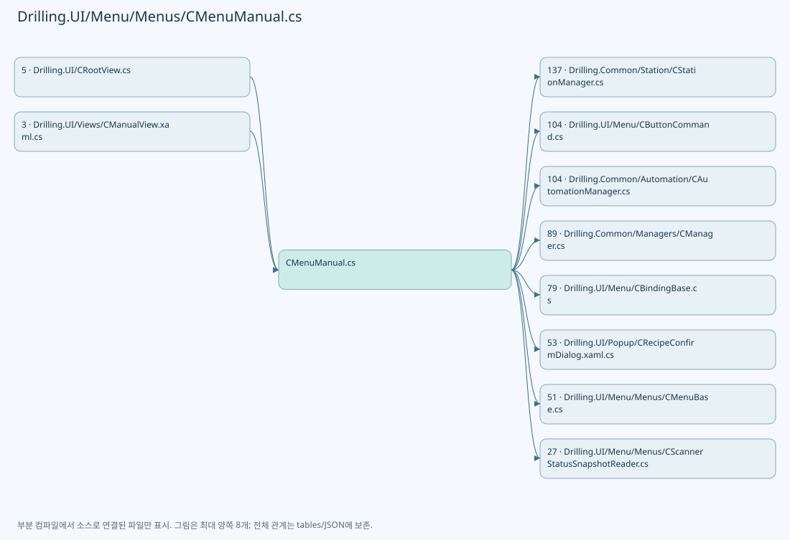

## 네임스페이스·타입·상속

| 타입 | 구분 | 원본 범위 | 선언/상속 |
| --- | --- | --- | --- |
| CMenuManual | ClassDeclaration | 26–6865 | CMenuManual: CMenuBase |
| ST_ACTIVE_DIO_TARGET | RecordStructDeclaration | 1690–1690 | ST_ACTIVE_DIO_TARGET |
| ST_MANUAL_SCRIPT_AXES | RecordStructDeclaration | 1691–1691 | ST_MANUAL_SCRIPT_AXES |
| ST_MANUAL_SCRIPT_Z_AXIS | RecordStructDeclaration | 1692–1692 | ST_MANUAL_SCRIPT_Z_AXIS |
| ST_CONTROLLER_HOME_TASK | RecordDeclaration | 1693–1693 | ST_CONTROLLER_HOME_TASK |
| ST_CONTROLLER_HOME_RUN | RecordDeclaration | 1694–1694 | ST_CONTROLLER_HOME_RUN |
| ST_RESET_SEQUENCE_AXIS_TARGET | RecordDeclaration | 1695–1695 | ST_RESET_SEQUENCE_AXIS_TARGET |
| ST_RESET_SEQUENCE_DIO_TARGET | RecordDeclaration | 1696–1696 | ST_RESET_SEQUENCE_DIO_TARGET |
| ST_MANUAL_SCAN_POSITION | RecordDeclaration | 4276–4281 | ST_MANUAL_SCAN_POSITION |
| CManualShapeScanRun | ClassDeclaration | 4607–4612 | CManualShapeScanRun |
| ST_MANUAL_SHAPE_SCAN_ROUTE | RecordDeclaration | 4614–4614 | ST_MANUAL_SHAPE_SCAN_ROUTE |
| ST_MANUAL_SHAPE_SCAN_PROGRAM | RecordDeclaration | 4615–4619 | ST_MANUAL_SHAPE_SCAN_PROGRAM |
| ST_MANUAL_LASER_OFF_TARGET | RecordDeclaration | 4945–4948 | ST_MANUAL_LASER_OFF_TARGET |
| CManualMofAlignPanel | ClassDeclaration | 6867–7019 | CManualMofAlignPanel: INotifyPropertyChanged |
| ST_MANUAL_MOF_ALIGN_STATE | RecordDeclaration | 7021–7021 | ST_MANUAL_MOF_ALIGN_STATE |
| CManualMofPreviewPanel | ClassDeclaration | 7023–7087 | CManualMofPreviewPanel: INotifyPropertyChanged |
| CManualMofRunPanel | ClassDeclaration | 7089–7241 | CManualMofRunPanel: INotifyPropertyChanged |
| CManualMofActionCard | ClassDeclaration | 7243–7274 | CManualMofActionCard: INotifyPropertyChanged |
| CManualMofStagePanel | ClassDeclaration | 7276–7503 | CManualMofStagePanel: INotifyPropertyChanged |
| ValueKind | EnumDeclaration | 7413–7418 | ValueKind |
| ST_MANUAL_MOF_STAGE_VALUE | RecordDeclaration | 7505–7505 | ST_MANUAL_MOF_STAGE_VALUE |
| CManualScanAssignments | ClassDeclaration | 7506–7561 | CManualScanAssignments: INotifyPropertyChanged |
| CManualScanAssignment | ClassDeclaration | 7563–7617 | CManualScanAssignment: INotifyPropertyChanged |
| CManualScannerSnapshotReader | ClassDeclaration | 7620–7811 | CManualScannerSnapshotReader |
| CManualStageMotionPollingService | ClassDeclaration | 7813–7884 | CManualStageMotionPollingService: CtrlThread |
| ST_MANUAL_STAGE_MOTION_VALUE | RecordDeclaration | 7886–7886 | ST_MANUAL_STAGE_MOTION_VALUE |
| ST_MANUAL_CONTROLLER_HEAD | ClassDeclaration | 7887–7971 | ST_MANUAL_CONTROLLER_HEAD: INotifyPropertyChanged |
| ST_MANUAL_HOME_SPEED_TARGET | RecordDeclaration | 7973–7973 | ST_MANUAL_HOME_SPEED_TARGET |
| ST_MANUAL_HOME_SPEED_HEAD | RecordDeclaration | 7974–7977 | ST_MANUAL_HOME_SPEED_HEAD |
| CManualHomeSpeedPanel | ClassDeclaration | 7980–8110 | CManualHomeSpeedPanel: INotifyPropertyChanged |
| CManualHomeSpeedAxis | ClassDeclaration | 8112–8209 | CManualHomeSpeedAxis: INotifyPropertyChanged |
| ST_MANUAL_HEAD_GROUP | RecordDeclaration | 8211–8211 | ST_MANUAL_HEAD_GROUP |
| ST_MANUAL_HEAD_CARD | RecordDeclaration | 8212–8229 | ST_MANUAL_HEAD_CARD |
| ST_MANUAL_SETTING_FILE | RecordDeclaration | 8231–8231 | ST_MANUAL_SETTING_FILE |
| ST_MANUAL_DIO_TARGET | RecordDeclaration | 8232–8232 | ST_MANUAL_DIO_TARGET |
| ST_MANUAL_VISION_PROTOCOL_COMMAND | RecordDeclaration | 8233–8239 | ST_MANUAL_VISION_PROTOCOL_COMMAND |
| ST_MANUAL_VISION_MARK_SEARCH | ClassDeclaration | 8241–8346 | ST_MANUAL_VISION_MARK_SEARCH: CBindingBase |
| ST_MANUAL_SCANNER_AXIS | RecordDeclaration | 8348–8430 | ST_MANUAL_SCANNER_AXIS |
| ST_MANUAL_STAGE_AXIS | ClassDeclaration | 8432–8554 | ST_MANUAL_STAGE_AXIS: CBindingBase |
| ST_MANUAL_PARAMETER | ClassDeclaration | 8556–8617 | ST_MANUAL_PARAMETER: CBindingBase |
| ST_MANUAL_COMMAND_STATE | ClassDeclaration | 8619–8673 | ST_MANUAL_COMMAND_STATE: CBindingBase |
| CManualMotionPanel | ClassDeclaration | 8675–8742 | CManualMotionPanel: INotifyPropertyChanged |
| CManualMotionAxis | ClassDeclaration | 8744–8784 | CManualMotionAxis: INotifyPropertyChanged |

## 멤버 빠른 목록

| 이름 | 종류 | 범위 | 서명 |
| --- | --- | --- | --- |
| _controllerHeadCache | FieldDeclaration | L29–29 | System.Collections.Generic.Dictionary<int, Drilling.UI.Menu.Menus.ST_MANUAL_CONTROLLER_HEAD> Drilling.UI.Menu.Menus.CMenuManual._controllerHeadCache |
| ManualControllerHeads | PropertyDeclaration | L30–30 | System.Collections.Generic.IReadOnlyList<Drilling.UI.Menu.Menus.ST_MANUAL_CONTROLLER_HEAD> Drilling.UI.Menu.Menus.CMenuManual.ManualControllerHeads |
| get_ManualControllerHeads | GetAccessorDeclaration | L30–30 | System.Collections.Generic.IReadOnlyList<Drilling.UI.Menu.Menus.ST_MANUAL_CONTROLLER_HEAD> Drilling.UI.Menu.Menus.CMenuManual.ManualControllerHeads.get |
| set_ManualControllerHeads | SetAccessorDeclaration | L30–30 | void Drilling.UI.Menu.Menus.CMenuManual.ManualControllerHeads.set |
| _scannerAxisClearFaultCommand | FieldDeclaration | L32–32 | Drilling.UI.Menu.CButtonCommand? Drilling.UI.Menu.Menus.CMenuManual._scannerAxisClearFaultCommand |
| _clearingAxisFaults | FieldDeclaration | L33–33 | System.Collections.Generic.HashSet<(int Controller, string Axis)>? Drilling.UI.Menu.Menus.CMenuManual._clearingAxisFaults |
| _homeSpeedPanel | FieldDeclaration | L34–34 | Drilling.UI.Menu.Menus.CManualHomeSpeedPanel? Drilling.UI.Menu.Menus.CMenuManual._homeSpeedPanel |
| _homeSpeedController | FieldDeclaration | L35–35 | int? Drilling.UI.Menu.Menus.CMenuManual._homeSpeedController |
| _homeSpeedDialog | FieldDeclaration | L36–36 | Drilling.UI.Popup.CManualHomeSpeedDialog? Drilling.UI.Menu.Menus.CMenuManual._homeSpeedDialog |
| _openHomeSpeedSettingsCommand | FieldDeclaration | L37–37 | Drilling.UI.Menu.CButtonCommand? Drilling.UI.Menu.Menus.CMenuManual._openHomeSpeedSettingsCommand |
| _readAutomationStatus | FieldDeclaration | L38–38 | System.Func<Drilling.Common.Station.ST_STATION_PROCESS_STATUS, System.Collections.Generic.IReadOnlyDictionary<string, string>, System.Threading.CancellationToken, System.Collections.Generic.IReadOnlyList<Drilling.UI.Menu.Menus.ST_AUTOMATION_CONTROLLER_STATUS_ITEM>>? Drilling.UI.Menu.Menus.CMenuManual._readAutomationStatus |
| _automationStatusParameters | FieldDeclaration | L39–39 | System.Collections.Generic.IReadOnlyDictionary<string, string> Drilling.UI.Menu.Menus.CMenuManual._automationStatusParameters |
| AutomationControllerStatusItems | PropertyDeclaration | L40–40 | System.Collections.Generic.IReadOnlyList<Drilling.UI.Menu.Menus.ST_AUTOMATION_CONTROLLER_STATUS_ITEM> Drilling.UI.Menu.Menus.CMenuManual.AutomationControllerStatusItems |
| get_AutomationControllerStatusItems | GetAccessorDeclaration | L40–40 | System.Collections.Generic.IReadOnlyList<Drilling.UI.Menu.Menus.ST_AUTOMATION_CONTROLLER_STATUS_ITEM> Drilling.UI.Menu.Menus.CMenuManual.AutomationControllerStatusItems.get |
| set_AutomationControllerStatusItems | SetAccessorDeclaration | L40–40 | void Drilling.UI.Menu.Menus.CMenuManual.AutomationControllerStatusItems.set |
| _mofDisableBusy | FieldDeclaration | L42–42 | bool Drilling.UI.Menu.Menus.CMenuManual._mofDisableBusy |
| MofPreview | PropertyDeclaration | L43–43 | Drilling.UI.Menu.Menus.CManualMofPreviewPanel Drilling.UI.Menu.Menus.CMenuManual.MofPreview |
| get_MofPreview | GetAccessorDeclaration | L43–43 | Drilling.UI.Menu.Menus.CManualMofPreviewPanel Drilling.UI.Menu.Menus.CMenuManual.MofPreview.get |
| ManualTaskIndex | FieldDeclaration | L45–45 | int Drilling.UI.Menu.Menus.CMenuManual.ManualTaskIndex |
| SettingFilesPageSize | FieldDeclaration | L46–46 | int Drilling.UI.Menu.Menus.CMenuManual.SettingFilesPageSize |
| UnconfiguredScannerDioNo | FieldDeclaration | L47–47 | int Drilling.UI.Menu.Menus.CMenuManual.UnconfiguredScannerDioNo |
| ResetSequenceResetTimeout | FieldDeclaration | L48–48 | System.TimeSpan Drilling.UI.Menu.Menus.CMenuManual.ResetSequenceResetTimeout |
| ResetSequenceEnableTimeout | FieldDeclaration | L49–49 | System.TimeSpan Drilling.UI.Menu.Menus.CMenuManual.ResetSequenceEnableTimeout |
| ResetSequenceHomeTimeout | FieldDeclaration | L50–50 | System.TimeSpan Drilling.UI.Menu.Menus.CMenuManual.ResetSequenceHomeTimeout |
| ResetSequenceDioTimeout | FieldDeclaration | L51–51 | System.TimeSpan Drilling.UI.Menu.Menus.CMenuManual.ResetSequenceDioTimeout |
| ResetSequenceCommandTimeout | FieldDeclaration | L52–52 | System.TimeSpan Drilling.UI.Menu.Menus.CMenuManual.ResetSequenceCommandTimeout |
| ResetSequencePollInterval | FieldDeclaration | L53–53 | System.TimeSpan Drilling.UI.Menu.Menus.CMenuManual.ResetSequencePollInterval |
| _manager | FieldDeclaration | L54–54 | Drilling.Common.Managers.CManager Drilling.UI.Menu.Menus.CMenuManual._manager |
| _scanFile | FieldDeclaration | L55–55 | Drilling.Common.Managers.CManualScanFileBase Drilling.UI.Menu.Menus.CMenuManual._scanFile |
| _scriptFile | FieldDeclaration | L56–56 | Drilling.Common.Station.CAutomationScriptFileBase Drilling.UI.Menu.Menus.CMenuManual._scriptFile |
| _scannerStatusSnapshotReader | FieldDeclaration | L57–57 | Drilling.UI.Menu.Menus.CManualScannerSnapshotReader Drilling.UI.Menu.Menus.CMenuManual._scannerStatusSnapshotReader |
| _stageMotionPollingService | FieldDeclaration | L58–58 | Drilling.UI.Menu.Menus.CManualStageMotionPollingService Drilling.UI.Menu.Menus.CMenuManual._stageMotionPollingService |
| _selectedHeadNoProvider | FieldDeclaration | L59–59 | System.Func<int> Drilling.UI.Menu.Menus.CMenuManual._selectedHeadNoProvider |
| _selectedRecipeIdProvider | FieldDeclaration | L60–60 | System.Func<string> Drilling.UI.Menu.Menus.CMenuManual._selectedRecipeIdProvider |
| _selectedSettingNameProvider | FieldDeclaration | L61–61 | System.Func<string> Drilling.UI.Menu.Menus.CMenuManual._selectedSettingNameProvider |
| _selectedSettingNameSetter | FieldDeclaration | L62–62 | System.Action<string> Drilling.UI.Menu.Menus.CMenuManual._selectedSettingNameSetter |
| _setStatusMessage | FieldDeclaration | L63–63 | System.Action<string> Drilling.UI.Menu.Menus.CMenuManual._setStatusMessage |
| _refreshShellStatus | FieldDeclaration | L64–64 | System.Action Drilling.UI.Menu.Menus.CMenuManual._refreshShellStatus |
| _refreshCurrentScreen | FieldDeclaration | L65–65 | System.Func<System.Threading.Tasks.Task> Drilling.UI.Menu.Menus.CMenuManual._refreshCurrentScreen |
| _menuLifetimeSync | FieldDeclaration | L66–66 | object Drilling.UI.Menu.Menus.CMenuManual._menuLifetimeSync |
| _menuLifetimeCancellation | FieldDeclaration | L67–67 | System.Threading.CancellationTokenSource Drilling.UI.Menu.Menus.CMenuManual._menuLifetimeCancellation |
| _statusPollingCancellation | FieldDeclaration | L68–68 | System.Threading.CancellationTokenSource? Drilling.UI.Menu.Menus.CMenuManual._statusPollingCancellation |
| _targetGx | FieldDeclaration | L69–69 | string Drilling.UI.Menu.Menus.CMenuManual._targetGx |
| _targetGy | FieldDeclaration | L70–70 | string Drilling.UI.Menu.Menus.CMenuManual._targetGy |
| _targetGz | FieldDeclaration | L71–71 | string Drilling.UI.Menu.Menus.CMenuManual._targetGz |
| _lastBuiltHeadNo | FieldDeclaration | L72–72 | int Drilling.UI.Menu.Menus.CMenuManual._lastBuiltHeadNo |
| _laserState | FieldDeclaration | L73–73 | string Drilling.UI.Menu.Menus.CMenuManual._laserState |
| _centerState | FieldDeclaration | L74–74 | string Drilling.UI.Menu.Menus.CMenuManual._centerState |
| _lastCommand | FieldDeclaration | L75–75 | string Drilling.UI.Menu.Menus.CMenuManual._lastCommand |
| _lastResult | FieldDeclaration | L76–76 | string Drilling.UI.Menu.Menus.CMenuManual._lastResult |
| _lastManualScriptAutomationNo | FieldDeclaration | L77–77 | int? Drilling.UI.Menu.Menus.CMenuManual._lastManualScriptAutomationNo |
| _lastLoadedSettingName | FieldDeclaration | L78–78 | string Drilling.UI.Menu.Menus.CMenuManual._lastLoadedSettingName |
| _lastSettingListSelectedName | FieldDeclaration | L79–79 | string Drilling.UI.Menu.Menus.CMenuManual._lastSettingListSelectedName |
| _settingFilesPageText | FieldDeclaration | L80–80 | string Drilling.UI.Menu.Menus.CMenuManual._settingFilesPageText |
| _settingFilesPageIndex | FieldDeclaration | L81–81 | int Drilling.UI.Menu.Menus.CMenuManual._settingFilesPageIndex |
| _settingFilesPageCount | FieldDeclaration | L82–82 | int Drilling.UI.Menu.Menus.CMenuManual._settingFilesPageCount |
| _manualScannerOptionSettings | FieldDeclaration | L83–83 | System.Collections.Generic.IReadOnlyList<Drilling.Common.Managers.ST_SYSTEM_PARAMETER> Drilling.UI.Menu.Menus.CMenuManual._manualScannerOptionSettings |
| _headGroups | FieldDeclaration | L84–84 | System.Collections.Generic.IReadOnlyList<Drilling.UI.Menu.Menus.ST_MANUAL_HEAD_GROUP> Drilling.UI.Menu.Menus.CMenuManual._headGroups |
| _settingFiles | FieldDeclaration | L85–85 | System.Collections.Generic.IReadOnlyList<Drilling.UI.Menu.Menus.ST_MANUAL_SETTING_FILE> Drilling.UI.Menu.Menus.CMenuManual._settingFiles |
| _shapeSize | FieldDeclaration | L86–86 | string Drilling.UI.Menu.Menus.CMenuManual._shapeSize |
| _shapeOffsetX | FieldDeclaration | L87–87 | string Drilling.UI.Menu.Menus.CMenuManual._shapeOffsetX |
| _shapeOffsetY | FieldDeclaration | L88–88 | string Drilling.UI.Menu.Menus.CMenuManual._shapeOffsetY |
| _shapeDirection | FieldDeclaration | L89–89 | string Drilling.UI.Menu.Menus.CMenuManual._shapeDirection |
| _shapeName | FieldDeclaration | L90–90 | string Drilling.UI.Menu.Menus.CMenuManual._shapeName |
| _gridRowLines | FieldDeclaration | L91–91 | string Drilling.UI.Menu.Menus.CMenuManual._gridRowLines |
| _gridColLines | FieldDeclaration | L92–92 | string Drilling.UI.Menu.Menus.CMenuManual._gridColLines |
| _laserOnMode | FieldDeclaration | L93–93 | string Drilling.UI.Menu.Menus.CMenuManual._laserOnMode |
| _laserOnTimeMsec | FieldDeclaration | L94–94 | string Drilling.UI.Menu.Menus.CMenuManual._laserOnTimeMsec |
| _laserShotCount | FieldDeclaration | L95–95 | string Drilling.UI.Menu.Menus.CMenuManual._laserShotCount |
| _laserRepeatCount | FieldDeclaration | L96–96 | string Drilling.UI.Menu.Menus.CMenuManual._laserRepeatCount |
| _laserRepeatDelayTimeMsec | FieldDeclaration | L97–97 | string Drilling.UI.Menu.Menus.CMenuManual._laserRepeatDelayTimeMsec |
| _laserActionPower | FieldDeclaration | L98–98 | string Drilling.UI.Menu.Menus.CMenuManual._laserActionPower |
| _laserActionFrequency | FieldDeclaration | L99–99 | string Drilling.UI.Menu.Menus.CMenuManual._laserActionFrequency |
| _dioAddress | FieldDeclaration | L100–100 | string Drilling.UI.Menu.Menus.CMenuManual._dioAddress |
| _dioAxisName | FieldDeclaration | L101–101 | string Drilling.UI.Menu.Menus.CMenuManual._dioAxisName |
| _dioNo | FieldDeclaration | L102–102 | string Drilling.UI.Menu.Menus.CMenuManual._dioNo |
| _dioCurrentValue | FieldDeclaration | L103–103 | string Drilling.UI.Menu.Menus.CMenuManual._dioCurrentValue |
| _dioLastResult | FieldDeclaration | L104–104 | string Drilling.UI.Menu.Menus.CMenuManual._dioLastResult |
| _dioAutomationNo | FieldDeclaration | L105–105 | int Drilling.UI.Menu.Menus.CMenuManual._dioAutomationNo |
| _dioGeneration | FieldDeclaration | L106–106 | long Drilling.UI.Menu.Menus.CMenuManual._dioGeneration |
| _scannerAxes | FieldDeclaration | L107–107 | System.Collections.Generic.IReadOnlyList<Drilling.UI.Menu.Menus.ST_MANUAL_SCANNER_AXIS> Drilling.UI.Menu.Menus.CMenuManual._scannerAxes |
| _hasScannerTargetSnapshot | FieldDeclaration | L108–108 | bool Drilling.UI.Menu.Menus.CMenuManual._hasScannerTargetSnapshot |
| _isDioTargetReady | FieldDeclaration | L109–109 | bool Drilling.UI.Menu.Menus.CMenuManual._isDioTargetReady |
| _isDioControlBusy | FieldDeclaration | L110–110 | bool Drilling.UI.Menu.Menus.CMenuManual._isDioControlBusy |
| _isScannerWorkspace | FieldDeclaration | L111–111 | bool Drilling.UI.Menu.Menus.CMenuManual._isScannerWorkspace |
| _isReviewWorkspace | FieldDeclaration | L112–112 | bool Drilling.UI.Menu.Menus.CMenuManual._isReviewWorkspace |
| _selectedStageAxis | FieldDeclaration | L113–113 | Drilling.UI.Menu.Menus.ST_MANUAL_STAGE_AXIS Drilling.UI.Menu.Menus.CMenuManual._selectedStageAxis |
| _selectedVisionProtocolCommand | FieldDeclaration | L114–114 | Drilling.UI.Menu.Menus.ST_MANUAL_VISION_PROTOCOL_COMMAND Drilling.UI.Menu.Menus.CMenuManual._selectedVisionProtocolCommand |
| _visionProtocolInspectionType | FieldDeclaration | L115–115 | string Drilling.UI.Menu.Menus.CMenuManual._visionProtocolInspectionType |
| _visionProtocolEndpoint | FieldDeclaration | L116–116 | string Drilling.UI.Menu.Menus.CMenuManual._visionProtocolEndpoint |
| _visionProtocolStatus | FieldDeclaration | L117–117 | string Drilling.UI.Menu.Menus.CMenuManual._visionProtocolStatus |
| _visionProtocolKeepAlive | FieldDeclaration | L118–118 | string Drilling.UI.Menu.Menus.CMenuManual._visionProtocolKeepAlive |
| _isVisionProtocolBusy | FieldDeclaration | L119–119 | bool Drilling.UI.Menu.Menus.CMenuManual._isVisionProtocolBusy |
| ManualSettings | PropertyDeclaration | L120–120 | System.Collections.Generic.IReadOnlyList<Drilling.UI.Menu.Menus.ST_DISPLAY_ITEM> Drilling.UI.Menu.Menus.CMenuManual.ManualSettings |
| get_ManualSettings | GetAccessorDeclaration | L120–120 | System.Collections.Generic.IReadOnlyList<Drilling.UI.Menu.Menus.ST_DISPLAY_ITEM> Drilling.UI.Menu.Menus.CMenuManual.ManualSettings.get |
| set_ManualSettings | SetAccessorDeclaration | L120–120 | void Drilling.UI.Menu.Menus.CMenuManual.ManualSettings.set |
| SelectedHeadItems | PropertyDeclaration | L121–121 | System.Collections.Generic.IReadOnlyList<Drilling.UI.Menu.Menus.ST_DISPLAY_ITEM> Drilling.UI.Menu.Menus.CMenuManual.SelectedHeadItems |
| get_SelectedHeadItems | GetAccessorDeclaration | L121–121 | System.Collections.Generic.IReadOnlyList<Drilling.UI.Menu.Menus.ST_DISPLAY_ITEM> Drilling.UI.Menu.Menus.CMenuManual.SelectedHeadItems.get |
| set_SelectedHeadItems | SetAccessorDeclaration | L121–121 | void Drilling.UI.Menu.Menus.CMenuManual.SelectedHeadItems.set |
| PositionMoveItems | PropertyDeclaration | L122–122 | System.Collections.Generic.IReadOnlyList<Drilling.UI.Menu.Menus.ST_DISPLAY_ITEM> Drilling.UI.Menu.Menus.CMenuManual.PositionMoveItems |
| get_PositionMoveItems | GetAccessorDeclaration | L122–122 | System.Collections.Generic.IReadOnlyList<Drilling.UI.Menu.Menus.ST_DISPLAY_ITEM> Drilling.UI.Menu.Menus.CMenuManual.PositionMoveItems.get |
| set_PositionMoveItems | SetAccessorDeclaration | L122–122 | void Drilling.UI.Menu.Menus.CMenuManual.PositionMoveItems.set |
| ShapeScanItems | PropertyDeclaration | L123–123 | System.Collections.Generic.IReadOnlyList<Drilling.UI.Menu.Menus.ST_DISPLAY_ITEM> Drilling.UI.Menu.Menus.CMenuManual.ShapeScanItems |
| get_ShapeScanItems | GetAccessorDeclaration | L123–123 | System.Collections.Generic.IReadOnlyList<Drilling.UI.Menu.Menus.ST_DISPLAY_ITEM> Drilling.UI.Menu.Menus.CMenuManual.ShapeScanItems.get |
| set_ShapeScanItems | SetAccessorDeclaration | L123–123 | void Drilling.UI.Menu.Menus.CMenuManual.ShapeScanItems.set |
| CommandStateItems | PropertyDeclaration | L124–124 | System.Collections.Generic.IReadOnlyList<Drilling.UI.Menu.Menus.ST_DISPLAY_ITEM> Drilling.UI.Menu.Menus.CMenuManual.CommandStateItems |
| get_CommandStateItems | GetAccessorDeclaration | L124–124 | System.Collections.Generic.IReadOnlyList<Drilling.UI.Menu.Menus.ST_DISPLAY_ITEM> Drilling.UI.Menu.Menus.CMenuManual.CommandStateItems.get |
| set_CommandStateItems | SetAccessorDeclaration | L124–124 | void Drilling.UI.Menu.Menus.CMenuManual.CommandStateItems.set |
| SelectedHead | PropertyDeclaration | L125–125 | string Drilling.UI.Menu.Menus.CMenuManual.SelectedHead |
| get_SelectedHead | GetAccessorDeclaration | L125–125 | string Drilling.UI.Menu.Menus.CMenuManual.SelectedHead.get |
| set_SelectedHead | SetAccessorDeclaration | L125–125 | void Drilling.UI.Menu.Menus.CMenuManual.SelectedHead.set |
| LoadedSettingName | PropertyDeclaration | L126–126 | string Drilling.UI.Menu.Menus.CMenuManual.LoadedSettingName |
| get_LoadedSettingName | GetAccessorDeclaration | L126–126 | string Drilling.UI.Menu.Menus.CMenuManual.LoadedSettingName.get |
| set_LoadedSettingName | SetAccessorDeclaration | L126–126 | void Drilling.UI.Menu.Menus.CMenuManual.LoadedSettingName.set |
| LoadedSettingPath | PropertyDeclaration | L127–127 | string Drilling.UI.Menu.Menus.CMenuManual.LoadedSettingPath |
| get_LoadedSettingPath | GetAccessorDeclaration | L127–127 | string Drilling.UI.Menu.Menus.CMenuManual.LoadedSettingPath.get |
| set_LoadedSettingPath | SetAccessorDeclaration | L127–127 | void Drilling.UI.Menu.Menus.CMenuManual.LoadedSettingPath.set |
| HeadCards | PropertyDeclaration | L128–128 | System.Collections.Generic.IReadOnlyList<Drilling.UI.Menu.Menus.ST_MANUAL_HEAD_CARD> Drilling.UI.Menu.Menus.CMenuManual.HeadCards |
| get_HeadCards | GetAccessorDeclaration | L128–128 | System.Collections.Generic.IReadOnlyList<Drilling.UI.Menu.Menus.ST_MANUAL_HEAD_CARD> Drilling.UI.Menu.Menus.CMenuManual.HeadCards.get |
| set_HeadCards | SetAccessorDeclaration | L128–128 | void Drilling.UI.Menu.Menus.CMenuManual.HeadCards.set |
| SettingParameters | PropertyDeclaration | L129–129 | System.Collections.Generic.IReadOnlyList<Drilling.UI.Menu.Menus.ST_MANUAL_PARAMETER> Drilling.UI.Menu.Menus.CMenuManual.SettingParameters |
| get_SettingParameters | GetAccessorDeclaration | L129–129 | System.Collections.Generic.IReadOnlyList<Drilling.UI.Menu.Menus.ST_MANUAL_PARAMETER> Drilling.UI.Menu.Menus.CMenuManual.SettingParameters.get |
| set_SettingParameters | SetAccessorDeclaration | L129–129 | void Drilling.UI.Menu.Menus.CMenuManual.SettingParameters.set |
| CommandStateRows | PropertyDeclaration | L130–130 | System.Collections.Generic.IReadOnlyList<Drilling.UI.Menu.Menus.ST_MANUAL_COMMAND_STATE> Drilling.UI.Menu.Menus.CMenuManual.CommandStateRows |
| get_CommandStateRows | GetAccessorDeclaration | L130–130 | System.Collections.Generic.IReadOnlyList<Drilling.UI.Menu.Menus.ST_MANUAL_COMMAND_STATE> Drilling.UI.Menu.Menus.CMenuManual.CommandStateRows.get |
| set_CommandStateRows | SetAccessorDeclaration | L130–130 | void Drilling.UI.Menu.Menus.CMenuManual.CommandStateRows.set |
| VisionProtocolLogs | PropertyDeclaration | L131–131 | System.Collections.ObjectModel.ObservableCollection<string> Drilling.UI.Menu.Menus.CMenuManual.VisionProtocolLogs |
| get_VisionProtocolLogs | GetAccessorDeclaration | L131–131 | System.Collections.ObjectModel.ObservableCollection<string> Drilling.UI.Menu.Menus.CMenuManual.VisionProtocolLogs.get |
| VisionProtocolMarkRows | PropertyDeclaration | L132–132 | System.Collections.ObjectModel.ObservableCollection<Drilling.UI.Menu.Menus.ST_MANUAL_VISION_MARK_SEARCH> Drilling.UI.Menu.Menus.CMenuManual.VisionProtocolMarkRows |
| get_VisionProtocolMarkRows | GetAccessorDeclaration | L132–132 | System.Collections.ObjectModel.ObservableCollection<Drilling.UI.Menu.Menus.ST_MANUAL_VISION_MARK_SEARCH> Drilling.UI.Menu.Menus.CMenuManual.VisionProtocolMarkRows.get |
| _mofAlign | FieldDeclaration | L134–134 | Drilling.UI.Menu.Menus.CManualMofAlignPanel? Drilling.UI.Menu.Menus.CMenuManual._mofAlign |
| _mofStage | FieldDeclaration | L135–135 | Drilling.UI.Menu.Menus.CManualMofStagePanel? Drilling.UI.Menu.Menus.CMenuManual._mofStage |
| _manualStageMoveOperation | FieldDeclaration | L136–136 | Drilling.UI.Menu.Menus.CManualStageMoveOperation? Drilling.UI.Menu.Menus.CMenuManual._manualStageMoveOperation |
| IsManualStageMovePending | PropertyDeclaration | L137–137 | bool Drilling.UI.Menu.Menus.CMenuManual.IsManualStageMovePending |
| _mofRun | FieldDeclaration | L138–138 | Drilling.UI.Menu.Menus.CManualMofRunPanel? Drilling.UI.Menu.Menus.CMenuManual._mofRun |
| _manualMofShiftOffsetProvider | FieldDeclaration | L139–139 | System.Func<(double X, double Y)> Drilling.UI.Menu.Menus.CMenuManual._manualMofShiftOffsetProvider |
| _motionPanel | FieldDeclaration | L140–140 | Drilling.UI.Menu.Menus.CManualMotionPanel? Drilling.UI.Menu.Menus.CMenuManual._motionPanel |
| _motionSession | FieldDeclaration | L141–141 | Drilling.Common.Automation.CManualMotionSession? Drilling.UI.Menu.Menus.CMenuManual._motionSession |
| _manualMotionTargets | FieldDeclaration | L142–142 | System.Collections.Generic.HashSet<(int Controller, string Axis)> Drilling.UI.Menu.Menus.CMenuManual._manualMotionTargets |
| _stoppingMotionJog | FieldDeclaration | L143–143 | bool Drilling.UI.Menu.Menus.CMenuManual._stoppingMotionJog |
| _motionErrorOpen | FieldDeclaration | L144–144 | bool Drilling.UI.Menu.Menus.CMenuManual._motionErrorOpen |
| _manualMotionScriptCancellation | FieldDeclaration | L145–145 | System.Threading.CancellationTokenSource? Drilling.UI.Menu.Menus.CMenuManual._manualMotionScriptCancellation |
| _manualMotionScriptTask | FieldDeclaration | L146–146 | (int Controller, int Task)? Drilling.UI.Menu.Menus.CMenuManual._manualMotionScriptTask |
| _manualMotionStopPending | FieldDeclaration | L147–147 | bool Drilling.UI.Menu.Menus.CMenuManual._manualMotionStopPending |
| _scanAssignments | FieldDeclaration | L148–148 | Drilling.UI.Menu.Menus.CManualScanAssignments? Drilling.UI.Menu.Menus.CMenuManual._scanAssignments |
| _manualScanSettingNames | FieldDeclaration | L149–149 | System.Collections.Generic.IReadOnlyList<string> Drilling.UI.Menu.Menus.CMenuManual._manualScanSettingNames |
| _activeManualShapeScan | FieldDeclaration | L150–150 | Drilling.UI.Menu.Menus.CMenuManual.CManualShapeScanRun? Drilling.UI.Menu.Menus.CMenuManual._activeManualShapeScan |
| _manualShapeScanPendingStops | FieldDeclaration | L151–151 | System.Collections.Generic.IReadOnlyList<Drilling.UI.Menu.Menus.CMenuManual.ST_MANUAL_SHAPE_SCAN_PROGRAM>? Drilling.UI.Menu.Menus.CMenuManual._manualShapeScanPendingStops |
| _manualShapeScanAttenuatorPositioning | FieldDeclaration | L152–152 | Drilling.Common.Interface.CAttenuatorPositioningService? Drilling.UI.Menu.Menus.CMenuManual._manualShapeScanAttenuatorPositioning |
| _manualShapeScanStopInProgress | FieldDeclaration | L153–153 | bool Drilling.UI.Menu.Menus.CMenuManual._manualShapeScanStopInProgress |
| _activeManualLaserAction | FieldDeclaration | L154–154 | Drilling.UI.Menu.Menus.CMenuManual.CManualShapeScanRun? Drilling.UI.Menu.Menus.CMenuManual._activeManualLaserAction |
| _manualLaserOffInProgress | FieldDeclaration | L155–155 | bool Drilling.UI.Menu.Menus.CMenuManual._manualLaserOffInProgress |
| _manualLaserOffUnconfirmed | FieldDeclaration | L156–156 | bool Drilling.UI.Menu.Menus.CMenuManual._manualLaserOffUnconfirmed |
| _manualLaserOffPendingTargets | FieldDeclaration | L157–157 | System.Collections.Generic.IReadOnlyList<Drilling.UI.Menu.Menus.CMenuManual.ST_MANUAL_LASER_OFF_TARGET> Drilling.UI.Menu.Menus.CMenuManual._manualLaserOffPendingTargets |
| _manualControlTab | FieldDeclaration | L158–158 | string Drilling.UI.Menu.Menus.CMenuManual._manualControlTab |
| _selectedManualHeadNos | FieldDeclaration | L159–159 | System.Collections.Generic.HashSet<int> Drilling.UI.Menu.Menus.CMenuManual._selectedManualHeadNos |
| _manualHeadSelectionInitialized | FieldDeclaration | L160–160 | bool Drilling.UI.Menu.Menus.CMenuManual._manualHeadSelectionInitialized |
| _selectFocusedHeadCommand | FieldDeclaration | L161–161 | Drilling.UI.Menu.CButtonCommand Drilling.UI.Menu.Menus.CMenuManual._selectFocusedHeadCommand |
| _powerMeasurePanel | FieldDeclaration | L162–162 | Drilling.UI.Menu.Menus.CManualPowerMeasurePanel? Drilling.UI.Menu.Menus.CMenuManual._powerMeasurePanel |
| .ctor | ConstructorDeclaration | L165–425 | Drilling.UI.Menu.Menus.CMenuManual.CMenuManual(Drilling.Common.Managers.CManager, Drilling.Common.Managers.CManualScanFileBase, Drilling.Common.Station.CAutomationScriptFileBase, System.Func<int>, System.Func<string>, System.Func<string>, System.Action<string>, Drilling.UI.Menu.CButtonCommand, System.Action<string>, System.Action, System.Func<System.Threading.Tasks.Task>, System.Func<(double X, double Y)>?) |
| SelectSettingCallback | LocalFunctionStatement | L199–202 | void SelectSettingCallback(object?) |
| ShowPreviousSettingPageCallback | LocalFunctionStatement | L205–208 | void ShowPreviousSettingPageCallback(object?) |
| CanShowPreviousSettingPageCallback | LocalFunctionStatement | L210–213 | bool CanShowPreviousSettingPageCallback(object?) |
| ShowNextSettingPageCallback | LocalFunctionStatement | L216–219 | void ShowNextSettingPageCallback(object?) |
| CanShowNextSettingPageCallback | LocalFunctionStatement | L221–224 | bool CanShowNextSettingPageCallback(object?) |
| CreateSettingCallback | LocalFunctionStatement | L227–230 | void CreateSettingCallback(object?) |
| DeleteSettingCallback | LocalFunctionStatement | L233–236 | void DeleteSettingCallback(object?) |
| RenameSettingCallback | LocalFunctionStatement | L239–242 | void RenameSettingCallback(object?) |
| SaveSettingCallback | LocalFunctionStatement | L245–248 | void SaveSettingCallback(object?) |
| CenterMoveCallback | LocalFunctionStatement | L251–254 | void CenterMoveCallback(object?) |
| PositionMoveCallback | LocalFunctionStatement | L257–260 | void PositionMoveCallback(object?) |
| ZPositionMoveCallback | LocalFunctionStatement | L263–266 | void ZPositionMoveCallback(object?) |
| MoveStopCallback | LocalFunctionStatement | L269–272 | void MoveStopCallback(object?) |
| SelectShapeCallback | LocalFunctionStatement | L275–278 | void SelectShapeCallback(object?) |
| ShapeStartCallback | LocalFunctionStatement | L281–284 | void ShapeStartCallback(object?) |
| ShapeStopCallback | LocalFunctionStatement | L287–290 | void ShapeStopCallback(object?) |
| LaserOnCallback | LocalFunctionStatement | L293–296 | void LaserOnCallback(object?) |
| LaserOffCallback | LocalFunctionStatement | L299–302 | void LaserOffCallback(object?) |
| CenterOnCallback | LocalFunctionStatement | L305–308 | void CenterOnCallback(object?) |
| DioReadCallback | LocalFunctionStatement | L311–314 | void DioReadCallback(object?) |
| DioOnCallback | LocalFunctionStatement | L317–320 | void DioOnCallback(object?) |
| DioOffCallback | LocalFunctionStatement | L323–326 | void DioOffCallback(object?) |
| ScannerAxisHomeCallback | LocalFunctionStatement | L329–332 | void ScannerAxisHomeCallback(object?) |
| ScannerAxisEnableCallback | LocalFunctionStatement | L335–338 | void ScannerAxisEnableCallback(object?) |
| ScannerAxisDisableCallback | LocalFunctionStatement | L341–344 | void ScannerAxisDisableCallback(object?) |
| ResetAutomationControllerCallback | LocalFunctionStatement | L347–350 | void ResetAutomationControllerCallback(object?) |
| HomeAutomationControllerAxesCallback | LocalFunctionStatement | L353–356 | void HomeAutomationControllerAxesCallback(object?) |
| DisableControllerMofCallback | LocalFunctionStatement | L359–359 | void DisableControllerMofCallback(object?) |
| SendVisionProtocolCallback | LocalFunctionStatement | L377–380 | void SendVisionProtocolCallback(object?) |
| CanSendVisionProtocol | LocalFunctionStatement | L391–394 | bool CanSendVisionProtocol(object?) |
| RefreshVisionProtocolCallback | LocalFunctionStatement | L396–399 | void RefreshVisionProtocolCallback(object?) |
| ClearVisionProtocolLogCallback | LocalFunctionStatement | L401–404 | void ClearVisionProtocolLogCallback(object?) |
| AddVisionProtocolMarkCallback | LocalFunctionStatement | L406–409 | void AddVisionProtocolMarkCallback(object?) |
| CanAddVisionProtocolMark | LocalFunctionStatement | L411–414 | bool CanAddVisionProtocolMark(object?) |
| RemoveVisionProtocolMarkCallback | LocalFunctionStatement | L416–419 | void RemoveVisionProtocolMarkCallback(object?) |
| CanRemoveVisionProtocolMark | LocalFunctionStatement | L421–424 | bool CanRemoveVisionProtocolMark(object?) |
| Review | PropertyDeclaration | L429–429 | Drilling.UI.Menu.Menus.CMenuReview? Drilling.UI.Menu.Menus.CMenuManual.Review |
| get_Review | GetAccessorDeclaration | L429–429 | Drilling.UI.Menu.Menus.CMenuReview? Drilling.UI.Menu.Menus.CMenuManual.Review.get |
| set_Review | SetAccessorDeclaration | L429–429 | void Drilling.UI.Menu.Menus.CMenuManual.Review.set |
| IsReviewWorkspace | PropertyDeclaration | L430–430 | bool Drilling.UI.Menu.Menus.CMenuManual.IsReviewWorkspace |
| Menu | PropertyDeclaration | L432–438 | Drilling.UI.Menu.Menus.EN_MENU Drilling.UI.Menu.Menus.CMenuManual.Menu |
| get_Menu | GetAccessorDeclaration | L434–437 | Drilling.UI.Menu.Menus.EN_MENU Drilling.UI.Menu.Menus.CMenuManual.Menu.get |
| StopScannerStatusPolling | MethodDeclaration | L440–447 | void Drilling.UI.Menu.Menus.CMenuManual.StopScannerStatusPolling() |
| TargetGx | PropertyDeclaration | L449–460 | string Drilling.UI.Menu.Menus.CMenuManual.TargetGx |
| get_TargetGx | GetAccessorDeclaration | L451–454 | string Drilling.UI.Menu.Menus.CMenuManual.TargetGx.get |
| set_TargetGx | SetAccessorDeclaration | L456–459 | void Drilling.UI.Menu.Menus.CMenuManual.TargetGx.set |
| TargetGy | PropertyDeclaration | L462–473 | string Drilling.UI.Menu.Menus.CMenuManual.TargetGy |
| get_TargetGy | GetAccessorDeclaration | L464–467 | string Drilling.UI.Menu.Menus.CMenuManual.TargetGy.get |
| set_TargetGy | SetAccessorDeclaration | L469–472 | void Drilling.UI.Menu.Menus.CMenuManual.TargetGy.set |
| TargetGz | PropertyDeclaration | L475–486 | string Drilling.UI.Menu.Menus.CMenuManual.TargetGz |
| get_TargetGz | GetAccessorDeclaration | L477–480 | string Drilling.UI.Menu.Menus.CMenuManual.TargetGz.get |
| set_TargetGz | SetAccessorDeclaration | L482–485 | void Drilling.UI.Menu.Menus.CMenuManual.TargetGz.set |
| IsZPositionMoveEnabled | PropertyDeclaration | L488–494 | bool Drilling.UI.Menu.Menus.CMenuManual.IsZPositionMoveEnabled |
| get_IsZPositionMoveEnabled | GetAccessorDeclaration | L490–493 | bool Drilling.UI.Menu.Menus.CMenuManual.IsZPositionMoveEnabled.get |
| ShapeSize | PropertyDeclaration | L496–507 | string Drilling.UI.Menu.Menus.CMenuManual.ShapeSize |
| get_ShapeSize | GetAccessorDeclaration | L498–501 | string Drilling.UI.Menu.Menus.CMenuManual.ShapeSize.get |
| set_ShapeSize | SetAccessorDeclaration | L503–506 | void Drilling.UI.Menu.Menus.CMenuManual.ShapeSize.set |
| ShapeOffsetX | PropertyDeclaration | L509–520 | string Drilling.UI.Menu.Menus.CMenuManual.ShapeOffsetX |
| get_ShapeOffsetX | GetAccessorDeclaration | L511–514 | string Drilling.UI.Menu.Menus.CMenuManual.ShapeOffsetX.get |
| set_ShapeOffsetX | SetAccessorDeclaration | L516–519 | void Drilling.UI.Menu.Menus.CMenuManual.ShapeOffsetX.set |
| ShapeOffsetY | PropertyDeclaration | L522–533 | string Drilling.UI.Menu.Menus.CMenuManual.ShapeOffsetY |
| get_ShapeOffsetY | GetAccessorDeclaration | L524–527 | string Drilling.UI.Menu.Menus.CMenuManual.ShapeOffsetY.get |
| set_ShapeOffsetY | SetAccessorDeclaration | L529–532 | void Drilling.UI.Menu.Menus.CMenuManual.ShapeOffsetY.set |
| ShapeDirection | PropertyDeclaration | L535–546 | string Drilling.UI.Menu.Menus.CMenuManual.ShapeDirection |
| get_ShapeDirection | GetAccessorDeclaration | L537–540 | string Drilling.UI.Menu.Menus.CMenuManual.ShapeDirection.get |
| set_ShapeDirection | SetAccessorDeclaration | L542–545 | void Drilling.UI.Menu.Menus.CMenuManual.ShapeDirection.set |
| ShapeName | PropertyDeclaration | L548–559 | string Drilling.UI.Menu.Menus.CMenuManual.ShapeName |
| get_ShapeName | GetAccessorDeclaration | L550–553 | string Drilling.UI.Menu.Menus.CMenuManual.ShapeName.get |
| set_ShapeName | SetAccessorDeclaration | L555–558 | void Drilling.UI.Menu.Menus.CMenuManual.ShapeName.set |
| GridRowLines | PropertyDeclaration | L561–572 | string Drilling.UI.Menu.Menus.CMenuManual.GridRowLines |
| get_GridRowLines | GetAccessorDeclaration | L563–566 | string Drilling.UI.Menu.Menus.CMenuManual.GridRowLines.get |
| set_GridRowLines | SetAccessorDeclaration | L568–571 | void Drilling.UI.Menu.Menus.CMenuManual.GridRowLines.set |
| GridColLines | PropertyDeclaration | L574–585 | string Drilling.UI.Menu.Menus.CMenuManual.GridColLines |
| get_GridColLines | GetAccessorDeclaration | L576–579 | string Drilling.UI.Menu.Menus.CMenuManual.GridColLines.get |
| set_GridColLines | SetAccessorDeclaration | L581–584 | void Drilling.UI.Menu.Menus.CMenuManual.GridColLines.set |
| LaserOnMode | PropertyDeclaration | L587–604 | string Drilling.UI.Menu.Menus.CMenuManual.LaserOnMode |
| get_LaserOnMode | GetAccessorDeclaration | L589–592 | string Drilling.UI.Menu.Menus.CMenuManual.LaserOnMode.get |
| set_LaserOnMode | SetAccessorDeclaration | L594–603 | void Drilling.UI.Menu.Menus.CMenuManual.LaserOnMode.set |
| IsLaserTimeMode | PropertyDeclaration | L606–612 | bool Drilling.UI.Menu.Menus.CMenuManual.IsLaserTimeMode |
| get_IsLaserTimeMode | GetAccessorDeclaration | L608–611 | bool Drilling.UI.Menu.Menus.CMenuManual.IsLaserTimeMode.get |
| IsLaserCountMode | PropertyDeclaration | L614–620 | bool Drilling.UI.Menu.Menus.CMenuManual.IsLaserCountMode |
| get_IsLaserCountMode | GetAccessorDeclaration | L616–619 | bool Drilling.UI.Menu.Menus.CMenuManual.IsLaserCountMode.get |
| LaserOnTimeMsec | PropertyDeclaration | L622–633 | string Drilling.UI.Menu.Menus.CMenuManual.LaserOnTimeMsec |
| get_LaserOnTimeMsec | GetAccessorDeclaration | L624–627 | string Drilling.UI.Menu.Menus.CMenuManual.LaserOnTimeMsec.get |
| set_LaserOnTimeMsec | SetAccessorDeclaration | L629–632 | void Drilling.UI.Menu.Menus.CMenuManual.LaserOnTimeMsec.set |
| LaserShotCount | PropertyDeclaration | L635–646 | string Drilling.UI.Menu.Menus.CMenuManual.LaserShotCount |
| get_LaserShotCount | GetAccessorDeclaration | L637–640 | string Drilling.UI.Menu.Menus.CMenuManual.LaserShotCount.get |
| set_LaserShotCount | SetAccessorDeclaration | L642–645 | void Drilling.UI.Menu.Menus.CMenuManual.LaserShotCount.set |
| LaserRepeatCount | PropertyDeclaration | L648–648 | string Drilling.UI.Menu.Menus.CMenuManual.LaserRepeatCount |
| get_LaserRepeatCount | GetAccessorDeclaration | L648–648 | string Drilling.UI.Menu.Menus.CMenuManual.LaserRepeatCount.get |
| set_LaserRepeatCount | SetAccessorDeclaration | L648–648 | void Drilling.UI.Menu.Menus.CMenuManual.LaserRepeatCount.set |
| LaserRepeatDelayTimeMsec | PropertyDeclaration | L649–649 | string Drilling.UI.Menu.Menus.CMenuManual.LaserRepeatDelayTimeMsec |
| get_LaserRepeatDelayTimeMsec | GetAccessorDeclaration | L649–649 | string Drilling.UI.Menu.Menus.CMenuManual.LaserRepeatDelayTimeMsec.get |
| set_LaserRepeatDelayTimeMsec | SetAccessorDeclaration | L649–649 | void Drilling.UI.Menu.Menus.CMenuManual.LaserRepeatDelayTimeMsec.set |
| HeadGroups | PropertyDeclaration | L651–662 | System.Collections.Generic.IReadOnlyList<Drilling.UI.Menu.Menus.ST_MANUAL_HEAD_GROUP> Drilling.UI.Menu.Menus.CMenuManual.HeadGroups |
| get_HeadGroups | GetAccessorDeclaration | L653–656 | System.Collections.Generic.IReadOnlyList<Drilling.UI.Menu.Menus.ST_MANUAL_HEAD_GROUP> Drilling.UI.Menu.Menus.CMenuManual.HeadGroups.get |
| set_HeadGroups | SetAccessorDeclaration | L658–661 | void Drilling.UI.Menu.Menus.CMenuManual.HeadGroups.set |
| SettingFiles | PropertyDeclaration | L664–675 | System.Collections.Generic.IReadOnlyList<Drilling.UI.Menu.Menus.ST_MANUAL_SETTING_FILE> Drilling.UI.Menu.Menus.CMenuManual.SettingFiles |
| get_SettingFiles | GetAccessorDeclaration | L666–669 | System.Collections.Generic.IReadOnlyList<Drilling.UI.Menu.Menus.ST_MANUAL_SETTING_FILE> Drilling.UI.Menu.Menus.CMenuManual.SettingFiles.get |
| set_SettingFiles | SetAccessorDeclaration | L671–674 | void Drilling.UI.Menu.Menus.CMenuManual.SettingFiles.set |
| SettingFilesPageText | PropertyDeclaration | L677–688 | string Drilling.UI.Menu.Menus.CMenuManual.SettingFilesPageText |
| get_SettingFilesPageText | GetAccessorDeclaration | L679–682 | string Drilling.UI.Menu.Menus.CMenuManual.SettingFilesPageText.get |
| set_SettingFilesPageText | SetAccessorDeclaration | L684–687 | void Drilling.UI.Menu.Menus.CMenuManual.SettingFilesPageText.set |
| ScannerAxes | PropertyDeclaration | L690–704 | System.Collections.Generic.IReadOnlyList<Drilling.UI.Menu.Menus.ST_MANUAL_SCANNER_AXIS> Drilling.UI.Menu.Menus.CMenuManual.ScannerAxes |
| get_ScannerAxes | GetAccessorDeclaration | L692–695 | System.Collections.Generic.IReadOnlyList<Drilling.UI.Menu.Menus.ST_MANUAL_SCANNER_AXIS> Drilling.UI.Menu.Menus.CMenuManual.ScannerAxes.get |
| set_ScannerAxes | SetAccessorDeclaration | L697–703 | void Drilling.UI.Menu.Menus.CMenuManual.ScannerAxes.set |
| StageAxes | PropertyDeclaration | L706–706 | System.Collections.Generic.IReadOnlyList<Drilling.UI.Menu.Menus.ST_MANUAL_STAGE_AXIS> Drilling.UI.Menu.Menus.CMenuManual.StageAxes |
| get_StageAxes | GetAccessorDeclaration | L706–706 | System.Collections.Generic.IReadOnlyList<Drilling.UI.Menu.Menus.ST_MANUAL_STAGE_AXIS> Drilling.UI.Menu.Menus.CMenuManual.StageAxes.get |
| SelectedStageAxis | PropertyDeclaration | L708–722 | Drilling.UI.Menu.Menus.ST_MANUAL_STAGE_AXIS Drilling.UI.Menu.Menus.CMenuManual.SelectedStageAxis |
| get_SelectedStageAxis | GetAccessorDeclaration | L710–713 | Drilling.UI.Menu.Menus.ST_MANUAL_STAGE_AXIS Drilling.UI.Menu.Menus.CMenuManual.SelectedStageAxis.get |
| set_SelectedStageAxis | SetAccessorDeclaration | L715–721 | void Drilling.UI.Menu.Menus.CMenuManual.SelectedStageAxis.set |
| DioAddress | PropertyDeclaration | L724–735 | string Drilling.UI.Menu.Menus.CMenuManual.DioAddress |
| get_DioAddress | GetAccessorDeclaration | L726–729 | string Drilling.UI.Menu.Menus.CMenuManual.DioAddress.get |
| set_DioAddress | SetAccessorDeclaration | L731–734 | void Drilling.UI.Menu.Menus.CMenuManual.DioAddress.set |
| DioAxisName | PropertyDeclaration | L737–748 | string Drilling.UI.Menu.Menus.CMenuManual.DioAxisName |
| get_DioAxisName | GetAccessorDeclaration | L739–742 | string Drilling.UI.Menu.Menus.CMenuManual.DioAxisName.get |
| set_DioAxisName | SetAccessorDeclaration | L744–747 | void Drilling.UI.Menu.Menus.CMenuManual.DioAxisName.set |
| DioNo | PropertyDeclaration | L750–761 | string Drilling.UI.Menu.Menus.CMenuManual.DioNo |
| get_DioNo | GetAccessorDeclaration | L752–755 | string Drilling.UI.Menu.Menus.CMenuManual.DioNo.get |
| set_DioNo | SetAccessorDeclaration | L757–760 | void Drilling.UI.Menu.Menus.CMenuManual.DioNo.set |
| DioCurrentValue | PropertyDeclaration | L763–778 | string Drilling.UI.Menu.Menus.CMenuManual.DioCurrentValue |
| get_DioCurrentValue | GetAccessorDeclaration | L765–768 | string Drilling.UI.Menu.Menus.CMenuManual.DioCurrentValue.get |
| set_DioCurrentValue | SetAccessorDeclaration | L770–777 | void Drilling.UI.Menu.Menus.CMenuManual.DioCurrentValue.set |
| IsDioOn | PropertyDeclaration | L780–786 | bool Drilling.UI.Menu.Menus.CMenuManual.IsDioOn |
| get_IsDioOn | GetAccessorDeclaration | L782–785 | bool Drilling.UI.Menu.Menus.CMenuManual.IsDioOn.get |
| IsDioOff | PropertyDeclaration | L788–794 | bool Drilling.UI.Menu.Menus.CMenuManual.IsDioOff |
| get_IsDioOff | GetAccessorDeclaration | L790–793 | bool Drilling.UI.Menu.Menus.CMenuManual.IsDioOff.get |
| IsDioTargetReady | PropertyDeclaration | L796–810 | bool Drilling.UI.Menu.Menus.CMenuManual.IsDioTargetReady |
| get_IsDioTargetReady | GetAccessorDeclaration | L798–801 | bool Drilling.UI.Menu.Menus.CMenuManual.IsDioTargetReady.get |
| set_IsDioTargetReady | SetAccessorDeclaration | L803–809 | void Drilling.UI.Menu.Menus.CMenuManual.IsDioTargetReady.set |
| IsDioControlEnabled | PropertyDeclaration | L812–818 | bool Drilling.UI.Menu.Menus.CMenuManual.IsDioControlEnabled |
| get_IsDioControlEnabled | GetAccessorDeclaration | L814–817 | bool Drilling.UI.Menu.Menus.CMenuManual.IsDioControlEnabled.get |
| DioLastResult | PropertyDeclaration | L820–831 | string Drilling.UI.Menu.Menus.CMenuManual.DioLastResult |
| get_DioLastResult | GetAccessorDeclaration | L822–825 | string Drilling.UI.Menu.Menus.CMenuManual.DioLastResult.get |
| set_DioLastResult | SetAccessorDeclaration | L827–830 | void Drilling.UI.Menu.Menus.CMenuManual.DioLastResult.set |
| IsDioControlBusy | PropertyDeclaration | L833–847 | bool Drilling.UI.Menu.Menus.CMenuManual.IsDioControlBusy |
| get_IsDioControlBusy | GetAccessorDeclaration | L835–838 | bool Drilling.UI.Menu.Menus.CMenuManual.IsDioControlBusy.get |
| set_IsDioControlBusy | SetAccessorDeclaration | L840–846 | void Drilling.UI.Menu.Menus.CMenuManual.IsDioControlBusy.set |
| IsScannerWorkspace | PropertyDeclaration | L849–863 | bool Drilling.UI.Menu.Menus.CMenuManual.IsScannerWorkspace |
| get_IsScannerWorkspace | GetAccessorDeclaration | L851–854 | bool Drilling.UI.Menu.Menus.CMenuManual.IsScannerWorkspace.get |
| set_IsScannerWorkspace | SetAccessorDeclaration | L856–862 | void Drilling.UI.Menu.Menus.CMenuManual.IsScannerWorkspace.set |
| IsStageVisionWorkspace | PropertyDeclaration | L865–871 | bool Drilling.UI.Menu.Menus.CMenuManual.IsStageVisionWorkspace |
| get_IsStageVisionWorkspace | GetAccessorDeclaration | L867–870 | bool Drilling.UI.Menu.Menus.CMenuManual.IsStageVisionWorkspace.get |
| VisionProtocolCommands | PropertyDeclaration | L873–873 | System.Collections.Generic.IReadOnlyList<Drilling.UI.Menu.Menus.ST_MANUAL_VISION_PROTOCOL_COMMAND> Drilling.UI.Menu.Menus.CMenuManual.VisionProtocolCommands |
| get_VisionProtocolCommands | GetAccessorDeclaration | L873–873 | System.Collections.Generic.IReadOnlyList<Drilling.UI.Menu.Menus.ST_MANUAL_VISION_PROTOCOL_COMMAND> Drilling.UI.Menu.Menus.CMenuManual.VisionProtocolCommands.get |
| SelectedVisionProtocolCommand | PropertyDeclaration | L875–889 | Drilling.UI.Menu.Menus.ST_MANUAL_VISION_PROTOCOL_COMMAND Drilling.UI.Menu.Menus.CMenuManual.SelectedVisionProtocolCommand |
| get_SelectedVisionProtocolCommand | GetAccessorDeclaration | L877–880 | Drilling.UI.Menu.Menus.ST_MANUAL_VISION_PROTOCOL_COMMAND Drilling.UI.Menu.Menus.CMenuManual.SelectedVisionProtocolCommand.get |
| set_SelectedVisionProtocolCommand | SetAccessorDeclaration | L882–888 | void Drilling.UI.Menu.Menus.CMenuManual.SelectedVisionProtocolCommand.set |
| VisionProtocolCommandDescription | PropertyDeclaration | L891–897 | string Drilling.UI.Menu.Menus.CMenuManual.VisionProtocolCommandDescription |
| get_VisionProtocolCommandDescription | GetAccessorDeclaration | L893–896 | string Drilling.UI.Menu.Menus.CMenuManual.VisionProtocolCommandDescription.get |
| VisionProtocolUsesMarkRows | PropertyDeclaration | L899–905 | bool Drilling.UI.Menu.Menus.CMenuManual.VisionProtocolUsesMarkRows |
| get_VisionProtocolUsesMarkRows | GetAccessorDeclaration | L901–904 | bool Drilling.UI.Menu.Menus.CMenuManual.VisionProtocolUsesMarkRows.get |
| VisionProtocolIsFlyingReady | PropertyDeclaration | L907–913 | bool Drilling.UI.Menu.Menus.CMenuManual.VisionProtocolIsFlyingReady |
| get_VisionProtocolIsFlyingReady | GetAccessorDeclaration | L909–912 | bool Drilling.UI.Menu.Menus.CMenuManual.VisionProtocolIsFlyingReady.get |
| VisionProtocolHasNoArguments | PropertyDeclaration | L915–921 | bool Drilling.UI.Menu.Menus.CMenuManual.VisionProtocolHasNoArguments |
| get_VisionProtocolHasNoArguments | GetAccessorDeclaration | L917–920 | bool Drilling.UI.Menu.Menus.CMenuManual.VisionProtocolHasNoArguments.get |
| VisionProtocolInspectionType | PropertyDeclaration | L923–937 | string Drilling.UI.Menu.Menus.CMenuManual.VisionProtocolInspectionType |
| get_VisionProtocolInspectionType | GetAccessorDeclaration | L925–928 | string Drilling.UI.Menu.Menus.CMenuManual.VisionProtocolInspectionType.get |
| set_VisionProtocolInspectionType | SetAccessorDeclaration | L930–936 | void Drilling.UI.Menu.Menus.CMenuManual.VisionProtocolInspectionType.set |
| VisionProtocolRequestPreview | PropertyDeclaration | L939–945 | string Drilling.UI.Menu.Menus.CMenuManual.VisionProtocolRequestPreview |
| get_VisionProtocolRequestPreview | GetAccessorDeclaration | L941–944 | string Drilling.UI.Menu.Menus.CMenuManual.VisionProtocolRequestPreview.get |
| VisionProtocolMarkRowCountText | PropertyDeclaration | L947–953 | string Drilling.UI.Menu.Menus.CMenuManual.VisionProtocolMarkRowCountText |
| get_VisionProtocolMarkRowCountText | GetAccessorDeclaration | L949–952 | string Drilling.UI.Menu.Menus.CMenuManual.VisionProtocolMarkRowCountText.get |
| VisionProtocolEndpoint | PropertyDeclaration | L955–966 | string Drilling.UI.Menu.Menus.CMenuManual.VisionProtocolEndpoint |
| get_VisionProtocolEndpoint | GetAccessorDeclaration | L957–960 | string Drilling.UI.Menu.Menus.CMenuManual.VisionProtocolEndpoint.get |
| set_VisionProtocolEndpoint | SetAccessorDeclaration | L962–965 | void Drilling.UI.Menu.Menus.CMenuManual.VisionProtocolEndpoint.set |
| VisionProtocolStatus | PropertyDeclaration | L968–979 | string Drilling.UI.Menu.Menus.CMenuManual.VisionProtocolStatus |
| get_VisionProtocolStatus | GetAccessorDeclaration | L970–973 | string Drilling.UI.Menu.Menus.CMenuManual.VisionProtocolStatus.get |
| set_VisionProtocolStatus | SetAccessorDeclaration | L975–978 | void Drilling.UI.Menu.Menus.CMenuManual.VisionProtocolStatus.set |
| VisionProtocolKeepAlive | PropertyDeclaration | L981–992 | string Drilling.UI.Menu.Menus.CMenuManual.VisionProtocolKeepAlive |
| get_VisionProtocolKeepAlive | GetAccessorDeclaration | L983–986 | string Drilling.UI.Menu.Menus.CMenuManual.VisionProtocolKeepAlive.get |
| set_VisionProtocolKeepAlive | SetAccessorDeclaration | L988–991 | void Drilling.UI.Menu.Menus.CMenuManual.VisionProtocolKeepAlive.set |
| IsVisionProtocolBusy | PropertyDeclaration | L994–1008 | bool Drilling.UI.Menu.Menus.CMenuManual.IsVisionProtocolBusy |
| get_IsVisionProtocolBusy | GetAccessorDeclaration | L996–999 | bool Drilling.UI.Menu.Menus.CMenuManual.IsVisionProtocolBusy.get |
| set_IsVisionProtocolBusy | SetAccessorDeclaration | L1001–1007 | void Drilling.UI.Menu.Menus.CMenuManual.IsVisionProtocolBusy.set |
| SelectHeadCommand | PropertyDeclaration | L1010–1010 | Drilling.UI.Menu.CButtonCommand Drilling.UI.Menu.Menus.CMenuManual.SelectHeadCommand |
| get_SelectHeadCommand | GetAccessorDeclaration | L1010–1010 | Drilling.UI.Menu.CButtonCommand Drilling.UI.Menu.Menus.CMenuManual.SelectHeadCommand.get |
| SelectSettingCommand | PropertyDeclaration | L1011–1011 | Drilling.UI.Menu.CButtonCommand Drilling.UI.Menu.Menus.CMenuManual.SelectSettingCommand |
| get_SelectSettingCommand | GetAccessorDeclaration | L1011–1011 | Drilling.UI.Menu.CButtonCommand Drilling.UI.Menu.Menus.CMenuManual.SelectSettingCommand.get |
| PreviousSettingPageCommand | PropertyDeclaration | L1012–1012 | Drilling.UI.Menu.CButtonCommand Drilling.UI.Menu.Menus.CMenuManual.PreviousSettingPageCommand |
| get_PreviousSettingPageCommand | GetAccessorDeclaration | L1012–1012 | Drilling.UI.Menu.CButtonCommand Drilling.UI.Menu.Menus.CMenuManual.PreviousSettingPageCommand.get |
| NextSettingPageCommand | PropertyDeclaration | L1013–1013 | Drilling.UI.Menu.CButtonCommand Drilling.UI.Menu.Menus.CMenuManual.NextSettingPageCommand |
| get_NextSettingPageCommand | GetAccessorDeclaration | L1013–1013 | Drilling.UI.Menu.CButtonCommand Drilling.UI.Menu.Menus.CMenuManual.NextSettingPageCommand.get |
| CreateCommand | PropertyDeclaration | L1014–1014 | Drilling.UI.Menu.CButtonCommand Drilling.UI.Menu.Menus.CMenuManual.CreateCommand |
| get_CreateCommand | GetAccessorDeclaration | L1014–1014 | Drilling.UI.Menu.CButtonCommand Drilling.UI.Menu.Menus.CMenuManual.CreateCommand.get |
| DeleteCommand | PropertyDeclaration | L1015–1015 | Drilling.UI.Menu.CButtonCommand Drilling.UI.Menu.Menus.CMenuManual.DeleteCommand |
| get_DeleteCommand | GetAccessorDeclaration | L1015–1015 | Drilling.UI.Menu.CButtonCommand Drilling.UI.Menu.Menus.CMenuManual.DeleteCommand.get |
| RenameCommand | PropertyDeclaration | L1016–1016 | Drilling.UI.Menu.CButtonCommand Drilling.UI.Menu.Menus.CMenuManual.RenameCommand |
| get_RenameCommand | GetAccessorDeclaration | L1016–1016 | Drilling.UI.Menu.CButtonCommand Drilling.UI.Menu.Menus.CMenuManual.RenameCommand.get |
| SaveCommand | PropertyDeclaration | L1017–1017 | Drilling.UI.Menu.CButtonCommand Drilling.UI.Menu.Menus.CMenuManual.SaveCommand |
| get_SaveCommand | GetAccessorDeclaration | L1017–1017 | Drilling.UI.Menu.CButtonCommand Drilling.UI.Menu.Menus.CMenuManual.SaveCommand.get |
| CenterMoveCommand | PropertyDeclaration | L1018–1018 | Drilling.UI.Menu.CButtonCommand Drilling.UI.Menu.Menus.CMenuManual.CenterMoveCommand |
| get_CenterMoveCommand | GetAccessorDeclaration | L1018–1018 | Drilling.UI.Menu.CButtonCommand Drilling.UI.Menu.Menus.CMenuManual.CenterMoveCommand.get |
| PositionMoveCommand | PropertyDeclaration | L1019–1019 | Drilling.UI.Menu.CButtonCommand Drilling.UI.Menu.Menus.CMenuManual.PositionMoveCommand |
| get_PositionMoveCommand | GetAccessorDeclaration | L1019–1019 | Drilling.UI.Menu.CButtonCommand Drilling.UI.Menu.Menus.CMenuManual.PositionMoveCommand.get |
| ZPositionMoveCommand | PropertyDeclaration | L1020–1020 | Drilling.UI.Menu.CButtonCommand Drilling.UI.Menu.Menus.CMenuManual.ZPositionMoveCommand |
| get_ZPositionMoveCommand | GetAccessorDeclaration | L1020–1020 | Drilling.UI.Menu.CButtonCommand Drilling.UI.Menu.Menus.CMenuManual.ZPositionMoveCommand.get |
| MoveStopCommand | PropertyDeclaration | L1021–1021 | Drilling.UI.Menu.CButtonCommand Drilling.UI.Menu.Menus.CMenuManual.MoveStopCommand |
| get_MoveStopCommand | GetAccessorDeclaration | L1021–1021 | Drilling.UI.Menu.CButtonCommand Drilling.UI.Menu.Menus.CMenuManual.MoveStopCommand.get |
| SelectShapeCommand | PropertyDeclaration | L1022–1022 | Drilling.UI.Menu.CButtonCommand Drilling.UI.Menu.Menus.CMenuManual.SelectShapeCommand |
| get_SelectShapeCommand | GetAccessorDeclaration | L1022–1022 | Drilling.UI.Menu.CButtonCommand Drilling.UI.Menu.Menus.CMenuManual.SelectShapeCommand.get |
| ShapeStartCommand | PropertyDeclaration | L1023–1023 | Drilling.UI.Menu.CButtonCommand Drilling.UI.Menu.Menus.CMenuManual.ShapeStartCommand |
| get_ShapeStartCommand | GetAccessorDeclaration | L1023–1023 | Drilling.UI.Menu.CButtonCommand Drilling.UI.Menu.Menus.CMenuManual.ShapeStartCommand.get |
| ShapeStopCommand | PropertyDeclaration | L1024–1024 | Drilling.UI.Menu.CButtonCommand Drilling.UI.Menu.Menus.CMenuManual.ShapeStopCommand |
| get_ShapeStopCommand | GetAccessorDeclaration | L1024–1024 | Drilling.UI.Menu.CButtonCommand Drilling.UI.Menu.Menus.CMenuManual.ShapeStopCommand.get |
| LaserOnCommand | PropertyDeclaration | L1025–1025 | Drilling.UI.Menu.CButtonCommand Drilling.UI.Menu.Menus.CMenuManual.LaserOnCommand |
| get_LaserOnCommand | GetAccessorDeclaration | L1025–1025 | Drilling.UI.Menu.CButtonCommand Drilling.UI.Menu.Menus.CMenuManual.LaserOnCommand.get |
| LaserOffCommand | PropertyDeclaration | L1026–1026 | Drilling.UI.Menu.CButtonCommand Drilling.UI.Menu.Menus.CMenuManual.LaserOffCommand |
| get_LaserOffCommand | GetAccessorDeclaration | L1026–1026 | Drilling.UI.Menu.CButtonCommand Drilling.UI.Menu.Menus.CMenuManual.LaserOffCommand.get |
| CenterOnCommand | PropertyDeclaration | L1027–1027 | Drilling.UI.Menu.CButtonCommand Drilling.UI.Menu.Menus.CMenuManual.CenterOnCommand |
| get_CenterOnCommand | GetAccessorDeclaration | L1027–1027 | Drilling.UI.Menu.CButtonCommand Drilling.UI.Menu.Menus.CMenuManual.CenterOnCommand.get |
| DioReadCommand | PropertyDeclaration | L1028–1028 | Drilling.UI.Menu.CButtonCommand Drilling.UI.Menu.Menus.CMenuManual.DioReadCommand |
| get_DioReadCommand | GetAccessorDeclaration | L1028–1028 | Drilling.UI.Menu.CButtonCommand Drilling.UI.Menu.Menus.CMenuManual.DioReadCommand.get |
| DioOnCommand | PropertyDeclaration | L1029–1029 | Drilling.UI.Menu.CButtonCommand Drilling.UI.Menu.Menus.CMenuManual.DioOnCommand |
| get_DioOnCommand | GetAccessorDeclaration | L1029–1029 | Drilling.UI.Menu.CButtonCommand Drilling.UI.Menu.Menus.CMenuManual.DioOnCommand.get |
| DioOffCommand | PropertyDeclaration | L1030–1030 | Drilling.UI.Menu.CButtonCommand Drilling.UI.Menu.Menus.CMenuManual.DioOffCommand |
| get_DioOffCommand | GetAccessorDeclaration | L1030–1030 | Drilling.UI.Menu.CButtonCommand Drilling.UI.Menu.Menus.CMenuManual.DioOffCommand.get |
| ScannerAxisHomeCommand | PropertyDeclaration | L1031–1031 | Drilling.UI.Menu.CButtonCommand Drilling.UI.Menu.Menus.CMenuManual.ScannerAxisHomeCommand |
| get_ScannerAxisHomeCommand | GetAccessorDeclaration | L1031–1031 | Drilling.UI.Menu.CButtonCommand Drilling.UI.Menu.Menus.CMenuManual.ScannerAxisHomeCommand.get |
| ScannerAxisEnableCommand | PropertyDeclaration | L1032–1032 | Drilling.UI.Menu.CButtonCommand Drilling.UI.Menu.Menus.CMenuManual.ScannerAxisEnableCommand |
| get_ScannerAxisEnableCommand | GetAccessorDeclaration | L1032–1032 | Drilling.UI.Menu.CButtonCommand Drilling.UI.Menu.Menus.CMenuManual.ScannerAxisEnableCommand.get |
| ScannerAxisDisableCommand | PropertyDeclaration | L1033–1033 | Drilling.UI.Menu.CButtonCommand Drilling.UI.Menu.Menus.CMenuManual.ScannerAxisDisableCommand |
| get_ScannerAxisDisableCommand | GetAccessorDeclaration | L1033–1033 | Drilling.UI.Menu.CButtonCommand Drilling.UI.Menu.Menus.CMenuManual.ScannerAxisDisableCommand.get |
| ResetAutomationControllerCommand | PropertyDeclaration | L1034–1034 | Drilling.UI.Menu.CButtonCommand Drilling.UI.Menu.Menus.CMenuManual.ResetAutomationControllerCommand |
| get_ResetAutomationControllerCommand | GetAccessorDeclaration | L1034–1034 | Drilling.UI.Menu.CButtonCommand Drilling.UI.Menu.Menus.CMenuManual.ResetAutomationControllerCommand.get |
| HomeAutomationControllerAxesCommand | PropertyDeclaration | L1035–1035 | Drilling.UI.Menu.CButtonCommand Drilling.UI.Menu.Menus.CMenuManual.HomeAutomationControllerAxesCommand |
| get_HomeAutomationControllerAxesCommand | GetAccessorDeclaration | L1035–1035 | Drilling.UI.Menu.CButtonCommand Drilling.UI.Menu.Menus.CMenuManual.HomeAutomationControllerAxesCommand.get |
| DisableControllerMofCommand | PropertyDeclaration | L1036–1036 | Drilling.UI.Menu.CButtonCommand Drilling.UI.Menu.Menus.CMenuManual.DisableControllerMofCommand |
| get_DisableControllerMofCommand | GetAccessorDeclaration | L1036–1036 | Drilling.UI.Menu.CButtonCommand Drilling.UI.Menu.Menus.CMenuManual.DisableControllerMofCommand.get |
| ShowResetSequenceCommand | PropertyDeclaration | L1037–1037 | Drilling.UI.Menu.CButtonCommand Drilling.UI.Menu.Menus.CMenuManual.ShowResetSequenceCommand |
| get_ShowResetSequenceCommand | GetAccessorDeclaration | L1037–1037 | Drilling.UI.Menu.CButtonCommand Drilling.UI.Menu.Menus.CMenuManual.ShowResetSequenceCommand.get |
| SelectManualWorkspaceCommand | PropertyDeclaration | L1038–1038 | Drilling.UI.Menu.CButtonCommand Drilling.UI.Menu.Menus.CMenuManual.SelectManualWorkspaceCommand |
| get_SelectManualWorkspaceCommand | GetAccessorDeclaration | L1038–1038 | Drilling.UI.Menu.CButtonCommand Drilling.UI.Menu.Menus.CMenuManual.SelectManualWorkspaceCommand.get |
| SelectStageAxisCommand | PropertyDeclaration | L1039–1039 | Drilling.UI.Menu.CButtonCommand Drilling.UI.Menu.Menus.CMenuManual.SelectStageAxisCommand |
| get_SelectStageAxisCommand | GetAccessorDeclaration | L1039–1039 | Drilling.UI.Menu.CButtonCommand Drilling.UI.Menu.Menus.CMenuManual.SelectStageAxisCommand.get |
| StageAbsMoveCommand | PropertyDeclaration | L1040–1040 | Drilling.UI.Menu.CButtonCommand Drilling.UI.Menu.Menus.CMenuManual.StageAbsMoveCommand |
| get_StageAbsMoveCommand | GetAccessorDeclaration | L1040–1040 | Drilling.UI.Menu.CButtonCommand Drilling.UI.Menu.Menus.CMenuManual.StageAbsMoveCommand.get |
| StageRelMoveCommand | PropertyDeclaration | L1041–1041 | Drilling.UI.Menu.CButtonCommand Drilling.UI.Menu.Menus.CMenuManual.StageRelMoveCommand |
| get_StageRelMoveCommand | GetAccessorDeclaration | L1041–1041 | Drilling.UI.Menu.CButtonCommand Drilling.UI.Menu.Menus.CMenuManual.StageRelMoveCommand.get |
| StageHomeCommand | PropertyDeclaration | L1042–1042 | Drilling.UI.Menu.CButtonCommand Drilling.UI.Menu.Menus.CMenuManual.StageHomeCommand |
| get_StageHomeCommand | GetAccessorDeclaration | L1042–1042 | Drilling.UI.Menu.CButtonCommand Drilling.UI.Menu.Menus.CMenuManual.StageHomeCommand.get |
| StageStopCommand | PropertyDeclaration | L1043–1043 | Drilling.UI.Menu.CButtonCommand Drilling.UI.Menu.Menus.CMenuManual.StageStopCommand |
| get_StageStopCommand | GetAccessorDeclaration | L1043–1043 | Drilling.UI.Menu.CButtonCommand Drilling.UI.Menu.Menus.CMenuManual.StageStopCommand.get |
| VisionProtocolSendCommand | PropertyDeclaration | L1044–1044 | Drilling.UI.Menu.CButtonCommand Drilling.UI.Menu.Menus.CMenuManual.VisionProtocolSendCommand |
| get_VisionProtocolSendCommand | GetAccessorDeclaration | L1044–1044 | Drilling.UI.Menu.CButtonCommand Drilling.UI.Menu.Menus.CMenuManual.VisionProtocolSendCommand.get |
| VisionProtocolRefreshCommand | PropertyDeclaration | L1045–1045 | Drilling.UI.Menu.CButtonCommand Drilling.UI.Menu.Menus.CMenuManual.VisionProtocolRefreshCommand |
| get_VisionProtocolRefreshCommand | GetAccessorDeclaration | L1045–1045 | Drilling.UI.Menu.CButtonCommand Drilling.UI.Menu.Menus.CMenuManual.VisionProtocolRefreshCommand.get |
| VisionProtocolClearLogCommand | PropertyDeclaration | L1046–1046 | Drilling.UI.Menu.CButtonCommand Drilling.UI.Menu.Menus.CMenuManual.VisionProtocolClearLogCommand |
| get_VisionProtocolClearLogCommand | GetAccessorDeclaration | L1046–1046 | Drilling.UI.Menu.CButtonCommand Drilling.UI.Menu.Menus.CMenuManual.VisionProtocolClearLogCommand.get |
| VisionProtocolAddMarkCommand | PropertyDeclaration | L1047–1047 | Drilling.UI.Menu.CButtonCommand Drilling.UI.Menu.Menus.CMenuManual.VisionProtocolAddMarkCommand |
| get_VisionProtocolAddMarkCommand | GetAccessorDeclaration | L1047–1047 | Drilling.UI.Menu.CButtonCommand Drilling.UI.Menu.Menus.CMenuManual.VisionProtocolAddMarkCommand.get |
| VisionProtocolRemoveMarkCommand | PropertyDeclaration | L1048–1048 | Drilling.UI.Menu.CButtonCommand Drilling.UI.Menu.Menus.CMenuManual.VisionProtocolRemoveMarkCommand |
| get_VisionProtocolRemoveMarkCommand | GetAccessorDeclaration | L1048–1048 | Drilling.UI.Menu.CButtonCommand Drilling.UI.Menu.Menus.CMenuManual.VisionProtocolRemoveMarkCommand.get |
| OnActivated | MethodDeclaration | L1050–1060 | void Drilling.UI.Menu.Menus.CMenuManual.OnActivated() |
| OnDeactivated | MethodDeclaration | L1062–1071 | void Drilling.UI.Menu.Menus.CMenuManual.OnDeactivated() |
| Build | MethodDeclaration | L1073–1202 | System.Threading.Tasks.Task<Drilling.UI.Menu.Menus.CScreenViewModel> Drilling.UI.Menu.Menus.CMenuManual.Build(System.Threading.CancellationToken) |
| IsSelectedHeadCard | LocalFunctionStatement | L1101–1104 | bool IsSelectedHeadCard(Drilling.UI.Menu.Menus.ST_MANUAL_HEAD_CARD) |
| ReadOptionalHeadSettingInt | MethodDeclaration | L1204–1207 | int Drilling.UI.Menu.Menus.CMenuManual.ReadOptionalHeadSettingInt(System.Collections.Generic.IReadOnlyList<Drilling.Common.Managers.ST_SYSTEM_PARAMETER>, int, int, params string[]) |
| ReadRequiredHeadSettingInt | MethodDeclaration | L1209–1217 | int Drilling.UI.Menu.Menus.CMenuManual.ReadRequiredHeadSettingInt(System.Collections.Generic.IReadOnlyList<Drilling.Common.Managers.ST_SYSTEM_PARAMETER>, int, params string[]) |
| TryFindHeadSetting | MethodDeclaration | L1219–1242 | bool Drilling.UI.Menu.Menus.CMenuManual.TryFindHeadSetting(System.Collections.Generic.IReadOnlyList<Drilling.Common.Managers.ST_SYSTEM_PARAMETER>, int, System.Collections.Generic.IReadOnlyList<string>, out string, out string) |
| MatchesHeadSettingKey | LocalFunctionStatement | L1225–1228 | bool MatchesHeadSettingKey(Drilling.Common.Managers.ST_SYSTEM_PARAMETER) |
| ParseHeadSettingInt | MethodDeclaration | L1244–1257 | int Drilling.UI.Menu.Menus.CMenuManual.ParseHeadSettingInt(int, string, string) |
| ReadHeadSettingText | MethodDeclaration | L1259–1278 | string Drilling.UI.Menu.Menus.CMenuManual.ReadHeadSettingText(System.Collections.Generic.IReadOnlyList<Drilling.Common.Managers.ST_SYSTEM_PARAMETER>, string, int, params string[]) |
| MatchesHeadSettingKey | LocalFunctionStatement | L1265–1268 | bool MatchesHeadSettingKey(Drilling.Common.Managers.ST_SYSTEM_PARAMETER) |
| TryBlockManualAutomationCommand | MethodDeclaration | L1280–1327 | bool Drilling.UI.Menu.Menus.CMenuManual.TryBlockManualAutomationCommand(string) |
| IsAutoProcessRunning | MethodDeclaration | L1329–1340 | bool Drilling.UI.Menu.Menus.CMenuManual.IsAutoProcessRunning() |
| ContainsAutomationFailureToken | MethodDeclaration | L1342–1354 | bool Drilling.UI.Menu.Menus.CMenuManual.ContainsAutomationFailureToken(string) |
| FormatAutomationFailureResponse | MethodDeclaration | L1356–1370 | string Drilling.UI.Menu.Menus.CMenuManual.FormatAutomationFailureResponse(string) |
| IsAutomationFailureToken | MethodDeclaration | L1372–1375 | bool Drilling.UI.Menu.Menus.CMenuManual.IsAutomationFailureToken(string) |
| ReadManualParamFromScreen | MethodDeclaration | L1377–1402 | Drilling.Common.Managers.ST_MANUAL_SCAN_PARAM Drilling.UI.Menu.Menus.CMenuManual.ReadManualParamFromScreen() |
| Apply | MethodDeclaration | L1404–1434 | void Drilling.UI.Menu.Menus.CMenuManual.Apply(System.Collections.Generic.IReadOnlyList<Drilling.UI.Menu.Menus.ST_DISPLAY_ITEM>, System.Collections.Generic.IReadOnlyList<Drilling.UI.Menu.Menus.ST_DISPLAY_ITEM>, System.Collections.Generic.IReadOnlyList<Drilling.UI.Menu.Menus.ST_DISPLAY_ITEM>, System.Collections.Generic.IReadOnlyList<Drilling.UI.Menu.Menus.ST_DISPLAY_ITEM>, System.Collections.Generic.IReadOnlyList<Drilling.UI.Menu.Menus.ST_DISPLAY_ITEM>, string, string, string, System.Collections.Generic.IReadOnlyList<Drilling.UI.Menu.Menus.ST_MANUAL_HEAD_CARD>, System.Collections.Generic.IReadOnlyList<Drilling.UI.Menu.Menus.ST_MANUAL_SETTING_FILE>, System.Collections.Generic.IReadOnlyList<Drilling.UI.Menu.Menus.ST_MANUAL_PARAMETER>, System.Collections.Generic.IReadOnlyList<Drilling.UI.Menu.Menus.ST_MANUAL_COMMAND_STATE>, System.Collections.Generic.IReadOnlyList<Drilling.UI.Menu.Menus.ST_MANUAL_SCANNER_AXIS>) |
| BuildManualSettings | MethodDeclaration | L1436–1446 | System.Collections.Generic.IReadOnlyList<Drilling.UI.Menu.Menus.ST_DISPLAY_ITEM> Drilling.UI.Menu.Menus.CMenuManual.BuildManualSettings(Drilling.Common.Managers.ST_MANUAL_SCAN_PARAM) |
| ReadEnabledManualScannerHeadNo | MethodDeclaration | L1448–1459 | int Drilling.UI.Menu.Menus.CMenuManual.ReadEnabledManualScannerHeadNo(System.Threading.CancellationToken) |
| ReadManualHeadAutomationNo | MethodDeclaration | L1461–1464 | int Drilling.UI.Menu.Menus.CMenuManual.ReadManualHeadAutomationNo(System.Collections.Generic.IReadOnlyList<Drilling.Common.Managers.ST_SYSTEM_PARAMETER>, int) |
| ReadManualHeadAutomationTaskNo | MethodDeclaration | L1466–1470 | int Drilling.UI.Menu.Menus.CMenuManual.ReadManualHeadAutomationTaskNo(System.Collections.Generic.IReadOnlyList<Drilling.Common.Managers.ST_SYSTEM_PARAMETER>, int) |
| FormatControllerHomeRunSummary | MethodDeclaration | L1472–1481 | string Drilling.UI.Menu.Menus.CMenuManual.FormatControllerHomeRunSummary(System.Collections.Generic.IReadOnlyList<Drilling.UI.Menu.Menus.CMenuManual.ST_CONTROLLER_HOME_RUN>) |
| ValidateManualScanParameters | MethodDeclaration | L1483–1539 | void Drilling.UI.Menu.Menus.CMenuManual.ValidateManualScanParameters(Drilling.Common.Managers.ST_MANUAL_SCAN_PARAM, System.Collections.Generic.IReadOnlyList<Drilling.Common.Managers.ST_MANUAL_SCAN_FORM>) |
| BuildCommandStateRows | MethodDeclaration | L1541–1576 | System.Collections.Generic.IReadOnlyList<Drilling.UI.Menu.Menus.ST_MANUAL_COMMAND_STATE> Drilling.UI.Menu.Menus.CMenuManual.BuildCommandStateRows(Drilling.UI.Menu.Menus.ST_MANUAL_HEAD_CARD) |
| SetLaserActionPower | LocalFunctionStatement | L1543–1546 | void SetLaserActionPower(string) |
| SetLaserActionFrequency | LocalFunctionStatement | L1548–1551 | void SetLaserActionFrequency(string) |
| SetLaserOnMode | LocalFunctionStatement | L1553–1556 | void SetLaserOnMode(string) |
| SetLaserOnTimeMsec | LocalFunctionStatement | L1558–1561 | void SetLaserOnTimeMsec(string) |
| SetLaserShotCount | LocalFunctionStatement | L1563–1566 | void SetLaserShotCount(string) |
| ReadManualDouble | MethodDeclaration | L1578–1589 | double Drilling.UI.Menu.Menus.CMenuManual.ReadManualDouble(string) |
| ReadRequiredDouble | MethodDeclaration | L1591–1599 | double Drilling.UI.Menu.Menus.CMenuManual.ReadRequiredDouble(string, string) |
| ShowManualWarning | MethodDeclaration | L1601–1604 | void Drilling.UI.Menu.Menus.CMenuManual.ShowManualWarning(string) |
| GetActiveWindow | MethodDeclaration | L1606–1609 | Window? Drilling.UI.Menu.Menus.CMenuManual.GetActiveWindow() |
| FormatDouble | MethodDeclaration | L1611–1615 | string Drilling.UI.Menu.Menus.CMenuManual.FormatDouble(double, int) |
| LoadSelectedRecipe | MethodDeclaration | L1617–1641 | System.Threading.Tasks.Task<Drilling.Common.Managers.ST_RECIPE_DEFINITION?> Drilling.UI.Menu.Menus.CMenuManual.LoadSelectedRecipe(System.Threading.CancellationToken) |
| ReadHeadRecipeDouble | MethodDeclaration | L1643–1669 | double Drilling.UI.Menu.Menus.CMenuManual.ReadHeadRecipeDouble(Drilling.Common.Managers.ST_RECIPE_DEFINITION?, int, double, params string[]) |
| IsConfiguredScannerAxisName | MethodDeclaration | L1671–1688 | bool Drilling.UI.Menu.Menus.CMenuManual.IsConfiguredScannerAxisName(string) |
| RefreshManualControllerHeads | MethodDeclaration | L1699–1737 | void Drilling.UI.Menu.Menus.CMenuManual.RefreshManualControllerHeads() |
| RunHeadDioCommand | MethodDeclaration | L1739–1770 | System.Threading.Tasks.Task Drilling.UI.Menu.Menus.CMenuManual.RunHeadDioCommand(int, bool?) |
| ClearingAxisFaults | PropertyDeclaration | L1772–1772 | System.Collections.Generic.HashSet<(int Controller, string Axis)> Drilling.UI.Menu.Menus.CMenuManual.ClearingAxisFaults |
| ScannerAxisClearFaultCommand | PropertyDeclaration | L1773–1777 | Drilling.UI.Menu.CButtonCommand Drilling.UI.Menu.Menus.CMenuManual.ScannerAxisClearFaultCommand |
| ClearScannerAxisFault | MethodDeclaration | L1779–1827 | System.Threading.Tasks.Task Drilling.UI.Menu.Menus.CMenuManual.ClearScannerAxisFault(Drilling.UI.Menu.Menus.ST_MANUAL_SCANNER_AXIS) |
| OpenHomeSpeedSettingsCommand | PropertyDeclaration | L1829–1829 | Drilling.UI.Menu.CButtonCommand Drilling.UI.Menu.Menus.CMenuManual.OpenHomeSpeedSettingsCommand |
| HomeSpeedPanel | PropertyDeclaration | L1830–1840 | Drilling.UI.Menu.Menus.CManualHomeSpeedPanel Drilling.UI.Menu.Menus.CMenuManual.HomeSpeedPanel |
| OpenHomeSpeedSettings | MethodDeclaration | L1842–1865 | void Drilling.UI.Menu.Menus.CMenuManual.OpenHomeSpeedSettings(object?) |
| RefreshManualHomeSpeedTargets | MethodDeclaration | L1867–1880 | void Drilling.UI.Menu.Menus.CMenuManual.RefreshManualHomeSpeedTargets() |
| SaveManualHomeSpeed | MethodDeclaration | L1882–1893 | System.Threading.Tasks.Task<double> Drilling.UI.Menu.Menus.CMenuManual.SaveManualHomeSpeed(Drilling.UI.Menu.Menus.ST_MANUAL_HOME_SPEED_TARGET, double) |
| ConfigureAutomationStatusReader | MethodDeclaration | L1895–1895 | void Drilling.UI.Menu.Menus.CMenuManual.ConfigureAutomationStatusReader(System.Func<Drilling.Common.Station.ST_STATION_PROCESS_STATUS, System.Collections.Generic.IReadOnlyDictionary<string, string>, System.Threading.CancellationToken, System.Collections.Generic.IReadOnlyList<Drilling.UI.Menu.Menus.ST_AUTOMATION_CONTROLLER_STATUS_ITEM>>) |
| SetAutomationStatusInputs | MethodDeclaration | L1896–1905 | void Drilling.UI.Menu.Menus.CMenuManual.SetAutomationStatusInputs(Drilling.Common.Managers.ST_RECIPE_DEFINITION?, System.Collections.Generic.IReadOnlyList<Drilling.Common.Managers.ST_SYSTEM_PARAMETER>) |
| RefreshAutomationStatusSnapshot | MethodDeclaration | L1907–1916 | void Drilling.UI.Menu.Menus.CMenuManual.RefreshAutomationStatusSnapshot() |
| PrepareResetRecipeZMoves | MethodDeclaration | L1918–1924 | System.Threading.Tasks.Task<System.Collections.Generic.IReadOnlyDictionary<int, System.Collections.Generic.IReadOnlyList<Drilling.Common.Automation.ST_AUTOMATION_ABSOLUTE_MOVE_TARGET>>> Drilling.UI.Menu.Menus.CMenuManual.PrepareResetRecipeZMoves(System.Collections.Generic.IReadOnlyList<Drilling.Common.Managers.ST_SYSTEM_PARAMETER>, System.Collections.Generic.IReadOnlyList<Drilling.UI.Popup.ST_CONTROLLER_RESET_SEQUENCE_TARGET_OPTION>, System.Threading.CancellationToken) |
| LoadExactMotionRecipe | MethodDeclaration | L1926–1935 | System.Threading.Tasks.Task<Drilling.Common.Managers.ST_RECIPE_DEFINITION> Drilling.UI.Menu.Menus.CMenuManual.LoadExactMotionRecipe(System.Threading.CancellationToken) |
| BuildResetRecipeZMoves | MethodDeclaration | L1937–1964 | System.Collections.Generic.IReadOnlyList<Drilling.Common.Automation.ST_AUTOMATION_ABSOLUTE_MOVE_TARGET> Drilling.UI.Menu.Menus.CMenuManual.BuildResetRecipeZMoves(System.Collections.Generic.IReadOnlyList<Drilling.Common.Managers.ST_SYSTEM_PARAMETER>, Drilling.Common.Managers.ST_RECIPE_DEFINITION?, int) |
| ReadMotionRecipeValue | MethodDeclaration | L1966–1976 | double Drilling.UI.Menu.Menus.CMenuManual.ReadMotionRecipeValue(Drilling.Common.Managers.ST_RECIPE_DEFINITION?, int, string, double) |
| DisableControllerMof | MethodDeclaration | L1978–2061 | System.Threading.Tasks.Task Drilling.UI.Menu.Menus.CMenuManual.DisableControllerMof(object?) |
| FilterMofAxes | MethodDeclaration | L2063–2075 | System.Collections.Generic.IReadOnlyList<string> Drilling.UI.Menu.Menus.CMenuManual.FilterMofAxes(System.Collections.Generic.IReadOnlyList<string>, System.Collections.Generic.IReadOnlyList<Drilling.Common.Managers.ST_SYSTEM_PARAMETER>, int) |
| BuildMofDisableScriptLines | MethodDeclaration | L2077–2094 | System.Collections.Generic.IReadOnlyList<string> Drilling.UI.Menu.Menus.CMenuManual.BuildMofDisableScriptLines(System.Collections.Generic.IReadOnlyList<string>) |
| RefreshScannerStatusSnapshot | MethodDeclaration | L2096–2147 | void Drilling.UI.Menu.Menus.CMenuManual.RefreshScannerStatusSnapshot() |
| IsSelectedHeadCard | LocalFunctionStatement | L2112–2115 | bool IsSelectedHeadCard(Drilling.UI.Menu.Menus.ST_MANUAL_HEAD_CARD) |
| HomeScannerAxis | MethodDeclaration | L2149–2152 | System.Threading.Tasks.Task Drilling.UI.Menu.Menus.CMenuManual.HomeScannerAxis(object?) |
| EnableScannerAxis | MethodDeclaration | L2154–2157 | System.Threading.Tasks.Task Drilling.UI.Menu.Menus.CMenuManual.EnableScannerAxis(object?) |
| DisableScannerAxis | MethodDeclaration | L2159–2162 | System.Threading.Tasks.Task Drilling.UI.Menu.Menus.CMenuManual.DisableScannerAxis(object?) |
| ShowResetSequenceDialog | MethodDeclaration | L2164–2176 | void Drilling.UI.Menu.Menus.CMenuManual.ShowResetSequenceDialog(object?) |
| ResetAutomationController | MethodDeclaration | L2178–2230 | System.Threading.Tasks.Task Drilling.UI.Menu.Menus.CMenuManual.ResetAutomationController(object?, System.Threading.CancellationToken) |
| BuildResetSequenceTargetOptions | MethodDeclaration | L2232–2246 | System.Collections.Generic.IReadOnlyList<Drilling.UI.Popup.ST_CONTROLLER_RESET_SEQUENCE_TARGET_OPTION> Drilling.UI.Menu.Menus.CMenuManual.BuildResetSequenceTargetOptions() |
| SelectInterfaceNumber | LocalFunctionStatement | L2234–2237 | int SelectInterfaceNumber(Drilling.Common.Interface.ST_INTERFACE_DATA) |
| FormatControllerName | LocalFunctionStatement | L2239–2243 | string FormatControllerName(Drilling.Common.Interface.ST_INTERFACE_DATA) |
| ExecuteResetSequence | MethodDeclaration | L2248–2324 | System.Threading.Tasks.Task Drilling.UI.Menu.Menus.CMenuManual.ExecuteResetSequence(Drilling.UI.Popup.CControllerResetSequenceDialog, System.Collections.Generic.IReadOnlyList<Drilling.UI.Popup.ST_CONTROLLER_RESET_SEQUENCE_TARGET_OPTION>, System.Func<bool>, System.Threading.CancellationToken) |
| ExecuteResetSequenceStep | MethodDeclaration | L2326–2345 | System.Threading.Tasks.Task Drilling.UI.Menu.Menus.CMenuManual.ExecuteResetSequenceStep(Drilling.UI.Popup.CControllerResetSequenceDialog, Drilling.UI.Popup.ST_CONTROLLER_RESET_SEQUENCE_TARGET_OPTION, int, string, System.Func<System.Threading.Tasks.Task>) |
| ResetSequenceController | MethodDeclaration | L2347–2357 | System.Threading.Tasks.Task Drilling.UI.Menu.Menus.CMenuManual.ResetSequenceController(Drilling.UI.Popup.ST_CONTROLLER_RESET_SEQUENCE_TARGET_OPTION, System.Threading.CancellationToken) |
| WaitControllerReady | MethodDeclaration | L2359–2381 | System.Threading.Tasks.Task Drilling.UI.Menu.Menus.CMenuManual.WaitControllerReady(Drilling.UI.Popup.ST_CONTROLLER_RESET_SEQUENCE_TARGET_OPTION, System.Threading.CancellationToken) |
| ResetSequenceEnableAxes | MethodDeclaration | L2383–2397 | System.Threading.Tasks.Task Drilling.UI.Menu.Menus.CMenuManual.ResetSequenceEnableAxes(Drilling.UI.Popup.ST_CONTROLLER_RESET_SEQUENCE_TARGET_OPTION, System.Collections.Generic.IReadOnlyList<Drilling.UI.Menu.Menus.CMenuManual.ST_RESET_SEQUENCE_AXIS_TARGET>, System.Threading.CancellationToken) |
| ResetSequenceHomeAxes | MethodDeclaration | L2399–2413 | System.Threading.Tasks.Task Drilling.UI.Menu.Menus.CMenuManual.ResetSequenceHomeAxes(Drilling.UI.Popup.ST_CONTROLLER_RESET_SEQUENCE_TARGET_OPTION, System.Collections.Generic.IReadOnlyList<Drilling.UI.Menu.Menus.CMenuManual.ST_RESET_SEQUENCE_AXIS_TARGET>, System.Threading.CancellationToken) |
| WaitAxesReady | MethodDeclaration | L2415–2452 | System.Threading.Tasks.Task Drilling.UI.Menu.Menus.CMenuManual.WaitAxesReady(Drilling.UI.Popup.ST_CONTROLLER_RESET_SEQUENCE_TARGET_OPTION, System.Collections.Generic.IReadOnlyList<Drilling.UI.Menu.Menus.CMenuManual.ST_RESET_SEQUENCE_AXIS_TARGET>, System.Func<Drilling.Common.Automation.ST_AUTOMATION_AXIS_STATUS, bool>, string, System.TimeSpan, System.Threading.CancellationToken) |
| ReadAxisStatusWithTimeout | MethodDeclaration | L2454–2457 | System.Threading.Tasks.Task<Drilling.Common.Automation.ST_AUTOMATION_AXIS_STATUS> Drilling.UI.Menu.Menus.CMenuManual.ReadAxisStatusWithTimeout(Drilling.UI.Menu.Menus.CMenuManual.ST_RESET_SEQUENCE_AXIS_TARGET, System.Threading.CancellationToken) |
| ResetSequenceDioOn | MethodDeclaration | L2459–2484 | System.Threading.Tasks.Task Drilling.UI.Menu.Menus.CMenuManual.ResetSequenceDioOn(Drilling.UI.Popup.ST_CONTROLLER_RESET_SEQUENCE_TARGET_OPTION, System.Collections.Generic.IReadOnlyList<Drilling.UI.Menu.Menus.CMenuManual.ST_RESET_SEQUENCE_DIO_TARGET>, System.Threading.CancellationToken) |
| WithTimeout | MethodDeclaration | L2486–2498 | System.Threading.Tasks.Task<T> Drilling.UI.Menu.Menus.CMenuManual.WithTimeout<T>(System.Func<System.Threading.CancellationToken, System.Threading.Tasks.Task<T>>, System.TimeSpan, System.Threading.CancellationToken) |
| BuildResetSequenceAxisTargets | MethodDeclaration | L2500–2535 | System.Collections.Generic.IReadOnlyList<Drilling.UI.Menu.Menus.CMenuManual.ST_RESET_SEQUENCE_AXIS_TARGET> Drilling.UI.Menu.Menus.CMenuManual.BuildResetSequenceAxisTargets(System.Collections.Generic.IReadOnlyList<Drilling.Common.Managers.ST_SYSTEM_PARAMETER>, int) |
| BuildResetSequenceDioTargets | MethodDeclaration | L2537–2565 | System.Collections.Generic.IReadOnlyList<Drilling.UI.Menu.Menus.CMenuManual.ST_RESET_SEQUENCE_DIO_TARGET> Drilling.UI.Menu.Menus.CMenuManual.BuildResetSequenceDioTargets(System.Collections.Generic.IReadOnlyList<Drilling.Common.Managers.ST_SYSTEM_PARAMETER>, int) |
| HomeAutomationControllerAxes | MethodDeclaration | L2567–2692 | System.Threading.Tasks.Task Drilling.UI.Menu.Menus.CMenuManual.HomeAutomationControllerAxes(object?, System.Threading.CancellationToken) |
| ExecuteScannerAxisCommand | MethodDeclaration | L2694–2779 | System.Threading.Tasks.Task Drilling.UI.Menu.Menus.CMenuManual.ExecuteScannerAxisCommand(object?, string, System.Threading.CancellationToken) |
| ResolveDioTarget | MethodDeclaration | L2781–2781 | System.Threading.Tasks.Task<Drilling.UI.Menu.Menus.ST_MANUAL_DIO_TARGET> Drilling.UI.Menu.Menus.CMenuManual.ResolveDioTarget(int, System.Threading.CancellationToken) |
| CreateManualDioTarget | MethodDeclaration | L2782–2798 | Drilling.UI.Menu.Menus.ST_MANUAL_DIO_TARGET Drilling.UI.Menu.Menus.CMenuManual.CreateManualDioTarget(System.Collections.Generic.IReadOnlyList<Drilling.Common.Managers.ST_SYSTEM_PARAMETER>, int) |
| ApplyDioTarget | MethodDeclaration | L2800–2808 | void Drilling.UI.Menu.Menus.CMenuManual.ApplyDioTarget(Drilling.UI.Menu.Menus.ST_MANUAL_DIO_TARGET) |
| InvalidateDioTarget | MethodDeclaration | L2810–2819 | void Drilling.UI.Menu.Menus.CMenuManual.InvalidateDioTarget(string) |
| BeginDioTargetRefresh | MethodDeclaration | L2821–2826 | long Drilling.UI.Menu.Menus.CMenuManual.BeginDioTargetRefresh(string) |
| IsCurrentDioGeneration | MethodDeclaration | L2828–2831 | bool Drilling.UI.Menu.Menus.CMenuManual.IsCurrentDioGeneration(long) |
| ValidateDioAxisNo | MethodDeclaration | L2833–2839 | void Drilling.UI.Menu.Menus.CMenuManual.ValidateDioAxisNo(int, int) |
| ValidateDioNo | MethodDeclaration | L2841–2852 | void Drilling.UI.Menu.Menus.CMenuManual.ValidateDioNo(int, int) |
| RefreshDioState | MethodDeclaration | L2854–2921 | System.Threading.Tasks.Task Drilling.UI.Menu.Menus.CMenuManual.RefreshDioState(string, bool, bool, long?, System.Threading.CancellationToken) |
| SetDioOutput | MethodDeclaration | L2923–2970 | System.Threading.Tasks.Task Drilling.UI.Menu.Menus.CMenuManual.SetDioOutput(bool, System.Threading.CancellationToken) |
| TryBeginDioCommand | MethodDeclaration | L2972–3056 | bool Drilling.UI.Menu.Menus.CMenuManual.TryBeginDioCommand(string, bool, bool, string, long?, out Drilling.UI.Menu.Menus.CMenuManual.ST_ACTIVE_DIO_TARGET) |
| ReadDioValueFromResponse | MethodDeclaration | L3058–3078 | string Drilling.UI.Menu.Menus.CMenuManual.ReadDioValueFromResponse(string) |
| IsOnOffToken | LocalFunctionStatement | L3066–3069 | bool IsOnOffToken(string) |
| ReadManualScannerAxesSnapshot | MethodDeclaration | L3080–3090 | System.Collections.Generic.IReadOnlyList<Drilling.UI.Menu.Menus.ST_MANUAL_SCANNER_AXIS> Drilling.UI.Menu.Menus.CMenuManual.ReadManualScannerAxesSnapshot(System.Collections.Generic.IReadOnlyList<Drilling.Common.Managers.ST_SYSTEM_PARAMETER>, int) |
| BuildControllerHomeTasks | MethodDeclaration | L3092–3156 | System.Collections.Generic.IReadOnlyList<Drilling.UI.Menu.Menus.CMenuManual.ST_CONTROLLER_HOME_TASK> Drilling.UI.Menu.Menus.CMenuManual.BuildControllerHomeTasks(System.Collections.Generic.IReadOnlyList<Drilling.Common.Managers.ST_SYSTEM_PARAMETER>, int) |
| FormatControllerHomeAxisList | MethodDeclaration | L3158–3170 | string Drilling.UI.Menu.Menus.CMenuManual.FormatControllerHomeAxisList(System.Collections.Generic.IReadOnlyList<Drilling.UI.Menu.Menus.CMenuManual.ST_CONTROLLER_HOME_TASK>) |
| FormatControllerHomeTaskSummary | MethodDeclaration | L3172–3181 | string Drilling.UI.Menu.Menus.CMenuManual.FormatControllerHomeTaskSummary(System.Collections.Generic.IReadOnlyList<Drilling.UI.Menu.Menus.CMenuManual.ST_CONTROLLER_HOME_TASK>) |
| BuildControllerHomeScriptFileName | MethodDeclaration | L3183–3186 | string Drilling.UI.Menu.Menus.CMenuManual.BuildControllerHomeScriptFileName(Drilling.UI.Menu.Menus.CMenuManual.ST_CONTROLLER_HOME_TASK) |
| FormatControllerHomeHeadSummary | MethodDeclaration | L3188–3202 | string Drilling.UI.Menu.Menus.CMenuManual.FormatControllerHomeHeadSummary(System.Collections.Generic.IReadOnlyList<int>) |
| ReadScannerAxisTarget | MethodDeclaration | L3204–3215 | string Drilling.UI.Menu.Menus.CMenuManual.ReadScannerAxisTarget(System.Collections.Generic.IReadOnlyList<Drilling.UI.Menu.Menus.ST_MANUAL_SCANNER_AXIS>, string, string) |
| ReadScannerAxisReference | MethodDeclaration | L3217–3228 | string Drilling.UI.Menu.Menus.CMenuManual.ReadScannerAxisReference(System.Collections.Generic.IReadOnlyList<Drilling.UI.Menu.Menus.ST_MANUAL_SCANNER_AXIS>, string, string) |
| FindScannerAxis | MethodDeclaration | L3230–3241 | Drilling.UI.Menu.Menus.ST_MANUAL_SCANNER_AXIS? Drilling.UI.Menu.Menus.CMenuManual.FindScannerAxis(System.Collections.Generic.IReadOnlyList<Drilling.UI.Menu.Menus.ST_MANUAL_SCANNER_AXIS>, string) |
| IsScannerAxisAvailable | MethodDeclaration | L3243–3247 | bool Drilling.UI.Menu.Menus.CMenuManual.IsScannerAxisAvailable(System.Collections.Generic.IReadOnlyList<Drilling.UI.Menu.Menus.ST_MANUAL_SCANNER_AXIS>, string) |
| FindScannerAxisDefinition | MethodDeclaration | L3249–3261 | Drilling.Common.Automation.ST_SCANNER_AXIS_SETTING? Drilling.UI.Menu.Menus.CMenuManual.FindScannerAxisDefinition(System.Collections.Generic.IReadOnlyList<Drilling.Common.Managers.ST_SYSTEM_PARAMETER>, int, string) |
| MofAlign | PropertyDeclaration | L3265–3272 | Drilling.UI.Menu.Menus.CManualMofAlignPanel Drilling.UI.Menu.Menus.CMenuManual.MofAlign |
| ManualStageMoveOperation | PropertyDeclaration | L3273–3283 | Drilling.UI.Menu.Menus.CManualStageMoveOperation Drilling.UI.Menu.Menus.CMenuManual.ManualStageMoveOperation |
| ManualStageDeviceNo | MethodDeclaration | L3285–3286 | int Drilling.UI.Menu.Menus.CMenuManual.ManualStageDeviceNo() |
| CheckManualStageMoveAllowed | MethodDeclaration | L3288–3301 | bool Drilling.UI.Menu.Menus.CMenuManual.CheckManualStageMoveAllowed() |
| MofStage | PropertyDeclaration | L3303–3312 | Drilling.UI.Menu.Menus.CManualMofStagePanel Drilling.UI.Menu.Menus.CMenuManual.MofStage |
| ReadMofStageConnectionState | MethodDeclaration | L3314–3320 | Drilling.Common.Interface.EN_COMM_STATE Drilling.UI.Menu.Menus.CMenuManual.ReadMofStageConnectionState() |
| RefreshMofStageSnapshot | MethodDeclaration | L3322–3329 | void Drilling.UI.Menu.Menus.CMenuManual.RefreshMofStageSnapshot() |
| MofRun | PropertyDeclaration | L3331–3338 | Drilling.UI.Menu.Menus.CManualMofRunPanel Drilling.UI.Menu.Menus.CMenuManual.MofRun |
| RunManualMof | MethodDeclaration | L3340–3397 | void Drilling.UI.Menu.Menus.CMenuManual.RunManualMof() |
| StopManualMof | MethodDeclaration | L3399–3415 | void Drilling.UI.Menu.Menus.CMenuManual.StopManualMof() |
| MotionPanel | PropertyDeclaration | L3419–3419 | Drilling.UI.Menu.Menus.CManualMotionPanel Drilling.UI.Menu.Menus.CMenuManual.MotionPanel |
| MotionSession | PropertyDeclaration | L3420–3420 | Drilling.Common.Automation.CManualMotionSession Drilling.UI.Menu.Menus.CMenuManual.MotionSession |
| IsMotionConfirmationOpen | PropertyDeclaration | L3421–3421 | bool Drilling.UI.Menu.Menus.CMenuManual.IsMotionConfirmationOpen |
| get_IsMotionConfirmationOpen | GetAccessorDeclaration | L3421–3421 | bool Drilling.UI.Menu.Menus.CMenuManual.IsMotionConfirmationOpen.get |
| set_IsMotionConfirmationOpen | SetAccessorDeclaration | L3421–3421 | void Drilling.UI.Menu.Menus.CMenuManual.IsMotionConfirmationOpen.set |
| StopMotionJog | MethodDeclaration | L3423–3446 | System.Threading.Tasks.Task Drilling.UI.Menu.Menus.CMenuManual.StopMotionJog() |
| MotionError | MethodDeclaration | L3448–3462 | void Drilling.UI.Menu.Menus.CMenuManual.MotionError(System.Exception) |
| ValidateMotionAxis | MethodDeclaration | L3464–3479 | Drilling.Common.Automation.ST_SCANNER_AXIS_SETTING Drilling.UI.Menu.Menus.CMenuManual.ValidateMotionAxis(int, string, string) |
| RunMotion | MethodDeclaration | L3481–3558 | System.Threading.Tasks.Task Drilling.UI.Menu.Menus.CMenuManual.RunMotion(Drilling.UI.Menu.Menus.CManualMotionAxis, string) |
| StartMotionJog | MethodDeclaration | L3560–3590 | System.Threading.Tasks.Task Drilling.UI.Menu.Menus.CMenuManual.StartMotionJog(Drilling.UI.Menu.Menus.CManualMotionAxis, int) |
| StopAllManualMotion | MethodDeclaration | L3592–3645 | System.Threading.Tasks.Task Drilling.UI.Menu.Menus.CMenuManual.StopAllManualMotion() |
| IsManualMotionScriptActive | PropertyDeclaration | L3647–3647 | bool Drilling.UI.Menu.Menus.CMenuManual.IsManualMotionScriptActive |
| RunMotionScript | MethodDeclaration | L3649–3759 | System.Threading.Tasks.Task Drilling.UI.Menu.Menus.CMenuManual.RunMotionScript(Drilling.UI.Menu.Menus.CManualMotionAxis, string) |
| AppendMotionPositionScript | MethodDeclaration | L3761–3779 | void Drilling.UI.Menu.Menus.CMenuManual.AppendMotionPositionScript(Drilling.Common.Station.CAutomation1ScriptBase, string, string, string, double, double, double) |
| EnsureMotionScriptTaskReady | MethodDeclaration | L3781–3787 | System.Threading.Tasks.Task Drilling.UI.Menu.Menus.CMenuManual.EnsureMotionScriptTaskReady(int, int, System.Threading.CancellationToken) |
| WaitMotionScriptFinished | MethodDeclaration | L3789–3816 | System.Threading.Tasks.Task Drilling.UI.Menu.Menus.CMenuManual.WaitMotionScriptFinished(string, int, int, long, System.Threading.CancellationToken) |
| ReadMotionTaskState | MethodDeclaration | L3818–3824 | string Drilling.UI.Menu.Menus.CMenuManual.ReadMotionTaskState(string, int) |
| StopMotionScriptTask | MethodDeclaration | L3826–3833 | System.Threading.Tasks.Task Drilling.UI.Menu.Menus.CMenuManual.StopMotionScriptTask() |
| StopStageMotionPolling | MethodDeclaration | L3835–3850 | void Drilling.UI.Menu.Menus.CMenuManual.StopStageMotionPolling() |
| RefreshStageMotionSnapshot | MethodDeclaration | L3852–3867 | void Drilling.UI.Menu.Menus.CMenuManual.RefreshStageMotionSnapshot() |
| SelectStageAxis | MethodDeclaration | L3869–3877 | void Drilling.UI.Menu.Menus.CMenuManual.SelectStageAxis(object?) |
| StageAbsMove | MethodDeclaration | L3879–3882 | void Drilling.UI.Menu.Menus.CMenuManual.StageAbsMove(object?) |
| StageRelMove | MethodDeclaration | L3884–3887 | void Drilling.UI.Menu.Menus.CMenuManual.StageRelMove(object?) |
| ExecuteMotionMove | MethodDeclaration | L3889–3942 | System.Threading.Tasks.Task Drilling.UI.Menu.Menus.CMenuManual.ExecuteMotionMove(string, string) |
| StageStop | MethodDeclaration | L3944–3950 | void Drilling.UI.Menu.Menus.CMenuManual.StageStop(object?) |
| StageHome | MethodDeclaration | L3952–3962 | void Drilling.UI.Menu.Menus.CMenuManual.StageHome(object?) |
| RefreshStageAxisSelection | MethodDeclaration | L3964–3970 | void Drilling.UI.Menu.Menus.CMenuManual.RefreshStageAxisSelection() |
| CenterMove | MethodDeclaration | L3972–3986 | System.Threading.Tasks.Task Drilling.UI.Menu.Menus.CMenuManual.CenterMove() |
| AppendCenterMoveScript | LocalFunctionStatement | L3979–3983 | void AppendCenterMoveScript(Drilling.Common.Station.CAutomation1ScriptBase, Drilling.Common.Managers.ST_MANUAL_SCAN_PARAM) |
| PositionMove | MethodDeclaration | L3988–4020 | System.Threading.Tasks.Task Drilling.UI.Menu.Menus.CMenuManual.PositionMove() |
| AppendPositionMoveScript | LocalFunctionStatement | L4011–4017 | void AppendPositionMoveScript(Drilling.Common.Station.CAutomation1ScriptBase, Drilling.Common.Managers.ST_MANUAL_SCAN_PARAM) |
| ZPositionMove | MethodDeclaration | L4022–4081 | System.Threading.Tasks.Task Drilling.UI.Menu.Menus.CMenuManual.ZPositionMove() |
| MoveStop | MethodDeclaration | L4083–4086 | System.Threading.Tasks.Task Drilling.UI.Menu.Menus.CMenuManual.MoveStop() |
| RunManualZPositionScript | MethodDeclaration | L4088–4140 | System.Threading.Tasks.Task Drilling.UI.Menu.Menus.CMenuManual.RunManualZPositionScript(int, Drilling.UI.Menu.Menus.CMenuManual.ST_MANUAL_SCRIPT_Z_AXIS, double, double, double, System.Threading.CancellationToken) |
| AppendManualZMoveScript | MethodDeclaration | L4142–4154 | void Drilling.UI.Menu.Menus.CMenuManual.AppendManualZMoveScript(Drilling.Common.Station.CAutomation1ScriptBase, string, double, double, double) |
| ReadManualScriptZAxis | MethodDeclaration | L4156–4176 | Drilling.UI.Menu.Menus.CMenuManual.ST_MANUAL_SCRIPT_Z_AXIS Drilling.UI.Menu.Menus.CMenuManual.ReadManualScriptZAxis(int, System.Threading.CancellationToken) |
| HasReadableScannerPosition | MethodDeclaration | L4178–4189 | bool Drilling.UI.Menu.Menus.CMenuManual.HasReadableScannerPosition(System.Collections.Generic.IReadOnlyList<Drilling.UI.Menu.Menus.ST_MANUAL_SCANNER_AXIS>) |
| ScanAssignments | PropertyDeclaration | L4193–4193 | Drilling.UI.Menu.Menus.CManualScanAssignments Drilling.UI.Menu.Menus.CMenuManual.ScanAssignments |
| RefreshManualScanAssignments | MethodDeclaration | L4195–4195 | void Drilling.UI.Menu.Menus.CMenuManual.RefreshManualScanAssignments() |
| ReadAssignedManualScanParam | MethodDeclaration | L4196–4196 | System.Threading.Tasks.Task<Drilling.Common.Managers.ST_MANUAL_SCAN_PARAM> Drilling.UI.Menu.Menus.CMenuManual.ReadAssignedManualScanParam(int, System.Threading.CancellationToken) |
| ReadAssignedManualScanParamCore | MethodDeclaration | L4197–4213 | System.Threading.Tasks.Task<Drilling.Common.Managers.ST_MANUAL_SCAN_PARAM> Drilling.UI.Menu.Menus.CMenuManual.ReadAssignedManualScanParamCore(int, System.Threading.CancellationToken, bool) |
| CaptureManualScanOrigins | MethodDeclaration | L4215–4243 | System.Collections.Generic.IReadOnlyDictionary<int, (double X, double Y)> Drilling.UI.Menu.Menus.CMenuManual.CaptureManualScanOrigins(System.Collections.Generic.IReadOnlyList<Drilling.UI.Menu.Menus.CMenuManual.ST_MANUAL_SHAPE_SCAN_ROUTE>, System.Collections.Generic.IReadOnlyList<Drilling.Common.Managers.ST_SYSTEM_PARAMETER>, bool) |
| ReadPosition | LocalFunctionStatement | L4230–4237 | double ReadPosition(string) |
| ResolveManualScanPosition | MethodDeclaration | L4245–4258 | Drilling.UI.Menu.Menus.CMenuManual.ST_MANUAL_SCAN_POSITION Drilling.UI.Menu.Menus.CMenuManual.ResolveManualScanPosition(Drilling.UI.Menu.Menus.CMenuManual.ST_MANUAL_SHAPE_SCAN_ROUTE, System.Collections.Generic.IReadOnlyList<Drilling.Common.Managers.ST_SYSTEM_PARAMETER>, Drilling.Common.Managers.ST_MANUAL_SCAN_PARAM, (double X, double Y), bool) |
| BuildManualScanConfirmation | MethodDeclaration | L4260–4273 | string Drilling.UI.Menu.Menus.CMenuManual.BuildManualScanConfirmation(System.Collections.Generic.IReadOnlyList<Drilling.UI.Menu.Menus.CMenuManual.ST_MANUAL_SHAPE_SCAN_PROGRAM>, bool) |
| Coordinate | MethodDeclaration | L4275–4275 | string Drilling.UI.Menu.Menus.CMenuManual.Coordinate(double) |
| TargetX | PropertyDeclaration | L4278–4278 | double Drilling.UI.Menu.Menus.CMenuManual.ST_MANUAL_SCAN_POSITION.TargetX |
| TargetY | PropertyDeclaration | L4279–4279 | double Drilling.UI.Menu.Menus.CMenuManual.ST_MANUAL_SCAN_POSITION.TargetY |
| ScriptComment | PropertyDeclaration | L4280–4280 | string Drilling.UI.Menu.Menus.CMenuManual.ST_MANUAL_SCAN_POSITION.ScriptComment |
| IsManualShapeScanActive | PropertyDeclaration | L4283–4283 | bool Drilling.UI.Menu.Menus.CMenuManual.IsManualShapeScanActive |
| RunSelectedManualShapeScans | MethodDeclaration | L4285–4335 | System.Threading.Tasks.Task Drilling.UI.Menu.Menus.CMenuManual.RunSelectedManualShapeScans(bool) |
| StopSelectedManualShapeScans | MethodDeclaration | L4337–4389 | System.Threading.Tasks.Task Drilling.UI.Menu.Menus.CMenuManual.StopSelectedManualShapeScans() |
| PrepareManualShapeScanPrograms | MethodDeclaration | L4391–4432 | System.Threading.Tasks.Task<System.Collections.Generic.IReadOnlyList<Drilling.UI.Menu.Menus.CMenuManual.ST_MANUAL_SHAPE_SCAN_PROGRAM>> Drilling.UI.Menu.Menus.CMenuManual.PrepareManualShapeScanPrograms(System.Threading.CancellationToken, bool) |
| BuildManualShapeScanRoutes | MethodDeclaration | L4434–4472 | System.Collections.Generic.IReadOnlyList<Drilling.UI.Menu.Menus.CMenuManual.ST_MANUAL_SHAPE_SCAN_ROUTE> Drilling.UI.Menu.Menus.CMenuManual.BuildManualShapeScanRoutes(System.Collections.Generic.IReadOnlyList<Drilling.Common.Managers.ST_SYSTEM_PARAMETER>, System.Collections.Generic.IReadOnlyList<int>) |
| EnsureManualShapeScanTasksReady | MethodDeclaration | L4474–4483 | System.Threading.Tasks.Task Drilling.UI.Menu.Menus.CMenuManual.EnsureManualShapeScanTasksReady(System.Collections.Generic.IReadOnlyList<Drilling.UI.Menu.Menus.CMenuManual.ST_MANUAL_SHAPE_SCAN_PROGRAM>, System.Threading.CancellationToken) |
| ExecuteManualShapeScanPrograms | MethodDeclaration | L4485–4539 | System.Threading.Tasks.Task Drilling.UI.Menu.Menus.CMenuManual.ExecuteManualShapeScanPrograms(System.Collections.Generic.IReadOnlyList<Drilling.UI.Menu.Menus.CMenuManual.ST_MANUAL_SHAPE_SCAN_PROGRAM>, System.Threading.CancellationToken) |
| Monitor | LocalFunctionStatement | L4516–4527 | System.Threading.Tasks.Task Monitor(Drilling.UI.Menu.Menus.CMenuManual.ST_MANUAL_SHAPE_SCAN_PROGRAM, string) |
| EnsureManualShapeScanAutoStopped | MethodDeclaration | L4541–4545 | void Drilling.UI.Menu.Menus.CMenuManual.EnsureManualShapeScanAutoStopped() |
| PrepareManualShapeScanAttenuators | MethodDeclaration | L4547–4561 | System.Threading.Tasks.Task Drilling.UI.Menu.Menus.CMenuManual.PrepareManualShapeScanAttenuators(System.Collections.Generic.IReadOnlyList<Drilling.UI.Menu.Menus.CMenuManual.ST_MANUAL_SHAPE_SCAN_PROGRAM>, System.Threading.CancellationToken) |
| StopManualShapeScanPrograms | MethodDeclaration | L4563–4605 | System.Threading.Tasks.Task<System.Collections.Generic.IReadOnlyList<string>> Drilling.UI.Menu.Menus.CMenuManual.StopManualShapeScanPrograms(System.Collections.Generic.IReadOnlyList<Drilling.UI.Menu.Menus.CMenuManual.ST_MANUAL_SHAPE_SCAN_PROGRAM>) |
| Cancellation | PropertyDeclaration | L4609–4609 | System.Threading.CancellationTokenSource Drilling.UI.Menu.Menus.CMenuManual.CManualShapeScanRun.Cancellation |
| get_Cancellation | GetAccessorDeclaration | L4609–4609 | System.Threading.CancellationTokenSource Drilling.UI.Menu.Menus.CMenuManual.CManualShapeScanRun.Cancellation.get |
| Completed | PropertyDeclaration | L4610–4610 | System.Threading.Tasks.TaskCompletionSource Drilling.UI.Menu.Menus.CMenuManual.CManualShapeScanRun.Completed |
| get_Completed | GetAccessorDeclaration | L4610–4610 | System.Threading.Tasks.TaskCompletionSource Drilling.UI.Menu.Menus.CMenuManual.CManualShapeScanRun.Completed.get |
| Programs | PropertyDeclaration | L4611–4611 | System.Collections.Generic.IReadOnlyList<Drilling.UI.Menu.Menus.CMenuManual.ST_MANUAL_SHAPE_SCAN_PROGRAM> Drilling.UI.Menu.Menus.CMenuManual.CManualShapeScanRun.Programs |
| get_Programs | GetAccessorDeclaration | L4611–4611 | System.Collections.Generic.IReadOnlyList<Drilling.UI.Menu.Menus.CMenuManual.ST_MANUAL_SHAPE_SCAN_PROGRAM> Drilling.UI.Menu.Menus.CMenuManual.CManualShapeScanRun.Programs.get |
| set_Programs | SetAccessorDeclaration | L4611–4611 | void Drilling.UI.Menu.Menus.CMenuManual.CManualShapeScanRun.Programs.set |
| LaserAxis | PropertyDeclaration | L4617–4617 | string Drilling.UI.Menu.Menus.CMenuManual.ST_MANUAL_SHAPE_SCAN_PROGRAM.LaserAxis |
| get_LaserAxis | GetAccessorDeclaration | L4617–4617 | string Drilling.UI.Menu.Menus.CMenuManual.ST_MANUAL_SHAPE_SCAN_PROGRAM.LaserAxis.get |
| set_LaserAxis | InitAccessorDeclaration | L4617–4617 | void Drilling.UI.Menu.Menus.CMenuManual.ST_MANUAL_SHAPE_SCAN_PROGRAM.LaserAxis.init |
| Position | PropertyDeclaration | L4618–4618 | Drilling.UI.Menu.Menus.CMenuManual.ST_MANUAL_SCAN_POSITION? Drilling.UI.Menu.Menus.CMenuManual.ST_MANUAL_SHAPE_SCAN_PROGRAM.Position |
| get_Position | GetAccessorDeclaration | L4618–4618 | Drilling.UI.Menu.Menus.CMenuManual.ST_MANUAL_SCAN_POSITION? Drilling.UI.Menu.Menus.CMenuManual.ST_MANUAL_SHAPE_SCAN_PROGRAM.Position.get |
| set_Position | InitAccessorDeclaration | L4618–4618 | void Drilling.UI.Menu.Menus.CMenuManual.ST_MANUAL_SHAPE_SCAN_PROGRAM.Position.init |
| IsManualLaserActionActive | PropertyDeclaration | L4621–4621 | bool Drilling.UI.Menu.Menus.CMenuManual.IsManualLaserActionActive |
| RunSelectedManualLaserActions | MethodDeclaration | L4623–4672 | System.Threading.Tasks.Task Drilling.UI.Menu.Menus.CMenuManual.RunSelectedManualLaserActions(bool) |
| PrepareManualLaserActionPrograms | MethodDeclaration | L4674–4707 | System.Threading.Tasks.Task<System.Collections.Generic.IReadOnlyList<Drilling.UI.Menu.Menus.CMenuManual.ST_MANUAL_SHAPE_SCAN_PROGRAM>> Drilling.UI.Menu.Menus.CMenuManual.PrepareManualLaserActionPrograms(System.Threading.CancellationToken, bool) |
| ValidateSavedManualLaserActionSettings | MethodDeclaration | L4709–4727 | void Drilling.UI.Menu.Menus.CMenuManual.ValidateSavedManualLaserActionSettings(Drilling.Common.Managers.ST_MANUAL_SCAN_PARAM) |
| ApplySavedManualLaserActionSetup | MethodDeclaration | L4729–4739 | void Drilling.UI.Menu.Menus.CMenuManual.ApplySavedManualLaserActionSetup(Drilling.Common.Station.CAutomation1ScriptBase, Drilling.Common.Managers.ST_MANUAL_SCAN_PARAM) |
| AppendSavedManualLaserOnScript | MethodDeclaration | L4741–4765 | void Drilling.UI.Menu.Menus.CMenuManual.AppendSavedManualLaserOnScript(Drilling.Common.Station.CAutomation1ScriptBase, Drilling.Common.Managers.ST_MANUAL_SCAN_PARAM) |
| Cycle | LocalFunctionStatement | L4747–4754 | void Cycle() |
| StopAllManualLasers | MethodDeclaration | L4767–4844 | System.Threading.Tasks.Task Drilling.UI.Menu.Menus.CMenuManual.StopAllManualLasers() |
| BuildManualLaserOffTargets | MethodDeclaration | L4846–4872 | System.Collections.Generic.IReadOnlyList<Drilling.UI.Menu.Menus.CMenuManual.ST_MANUAL_LASER_OFF_TARGET> Drilling.UI.Menu.Menus.CMenuManual.BuildManualLaserOffTargets(System.Collections.Generic.IReadOnlyList<Drilling.Common.Managers.ST_SYSTEM_PARAMETER>) |
| ForceManualLasersOff | MethodDeclaration | L4874–4943 | System.Threading.Tasks.Task<System.Collections.Generic.IReadOnlyList<string>> Drilling.UI.Menu.Menus.CMenuManual.ForceManualLasersOff(System.Collections.Generic.IReadOnlyList<Drilling.UI.Menu.Menus.CMenuManual.ST_MANUAL_LASER_OFF_TARGET>, System.Threading.CancellationToken) |
| ConfigurationError | PropertyDeclaration | L4947–4947 | string Drilling.UI.Menu.Menus.CMenuManual.ST_MANUAL_LASER_OFF_TARGET.ConfigurationError |
| get_ConfigurationError | GetAccessorDeclaration | L4947–4947 | string Drilling.UI.Menu.Menus.CMenuManual.ST_MANUAL_LASER_OFF_TARGET.ConfigurationError.get |
| set_ConfigurationError | InitAccessorDeclaration | L4947–4947 | void Drilling.UI.Menu.Menus.CMenuManual.ST_MANUAL_LASER_OFF_TARGET.ConfigurationError.init |
| ShowPreviousSettingPage | MethodDeclaration | L4950–4960 | System.Threading.Tasks.Task Drilling.UI.Menu.Menus.CMenuManual.ShowPreviousSettingPage() |
| ShowNextSettingPage | MethodDeclaration | L4962–4972 | System.Threading.Tasks.Task Drilling.UI.Menu.Menus.CMenuManual.ShowNextSettingPage() |
| CanShowPreviousSettingPage | MethodDeclaration | L4974–4977 | bool Drilling.UI.Menu.Menus.CMenuManual.CanShowPreviousSettingPage() |
| CanShowNextSettingPage | MethodDeclaration | L4979–4982 | bool Drilling.UI.Menu.Menus.CMenuManual.CanShowNextSettingPage() |
| NotifySettingFilesPageCommands | MethodDeclaration | L4984–4988 | void Drilling.UI.Menu.Menus.CMenuManual.NotifySettingFilesPageCommands() |
| SelectSetting | MethodDeclaration | L4990–5002 | System.Threading.Tasks.Task Drilling.UI.Menu.Menus.CMenuManual.SelectSetting(object?) |
| Create | MethodDeclaration | L5004–5042 | System.Threading.Tasks.Task Drilling.UI.Menu.Menus.CMenuManual.Create() |
| ValidateNewSettingNameCallback | LocalFunctionStatement | L5007–5010 | string ValidateNewSettingNameCallback(string) |
| Save | MethodDeclaration | L5044–5074 | System.Threading.Tasks.Task Drilling.UI.Menu.Menus.CMenuManual.Save() |
| Rename | MethodDeclaration | L5076–5138 | System.Threading.Tasks.Task Drilling.UI.Menu.Menus.CMenuManual.Rename() |
| ValidateRenamedSettingNameCallback | LocalFunctionStatement | L5086–5089 | string ValidateRenamedSettingNameCallback(string) |
| TrySaveSetting | MethodDeclaration | L5140–5158 | System.Threading.Tasks.Task<bool> Drilling.UI.Menu.Menus.CMenuManual.TrySaveSetting(string, Drilling.Common.Managers.ST_MANUAL_SCAN_PARAM) |
| Delete | MethodDeclaration | L5160–5182 | System.Threading.Tasks.Task Drilling.UI.Menu.Menus.CMenuManual.Delete() |
| SelectShape | MethodDeclaration | L5184–5192 | System.Threading.Tasks.Task Drilling.UI.Menu.Menus.CMenuManual.SelectShape(object?) |
| ShapeStart | MethodDeclaration | L5194–5197 | System.Threading.Tasks.Task Drilling.UI.Menu.Menus.CMenuManual.ShapeStart(bool) |
| ShapeStop | MethodDeclaration | L5199–5202 | System.Threading.Tasks.Task Drilling.UI.Menu.Menus.CMenuManual.ShapeStop() |
| LaserOn | MethodDeclaration | L5204–5207 | System.Threading.Tasks.Task Drilling.UI.Menu.Menus.CMenuManual.LaserOn(bool) |
| AppendLaserOnScript | MethodDeclaration | L5209–5247 | void Drilling.UI.Menu.Menus.CMenuManual.AppendLaserOnScript(Drilling.Common.Station.CAutomation1ScriptBase, Drilling.Common.Managers.ST_MANUAL_SCAN_PARAM) |
| AppendLaserCycle | LocalFunctionStatement | L5224–5231 | void AppendLaserCycle() |
| LaserOff | MethodDeclaration | L5249–5252 | System.Threading.Tasks.Task Drilling.UI.Menu.Menus.CMenuManual.LaserOff() |
| CenterOn | MethodDeclaration | L5254–5280 | System.Threading.Tasks.Task Drilling.UI.Menu.Menus.CMenuManual.CenterOn() |
| AppendCenterOnScript | LocalFunctionStatement | L5261–5272 | void AppendCenterOnScript(Drilling.Common.Station.CAutomation1ScriptBase, Drilling.Common.Managers.ST_MANUAL_SCAN_PARAM) |
| RunManualScript | MethodDeclaration | L5282–5360 | System.Threading.Tasks.Task Drilling.UI.Menu.Menus.CMenuManual.RunManualScript(string, System.Action<Drilling.Common.Station.CAutomation1ScriptBase, Drilling.Common.Managers.ST_MANUAL_SCAN_PARAM>, System.Action<Drilling.Common.Station.CAutomation1ScriptBase, Drilling.Common.Managers.ST_MANUAL_SCAN_PARAM>?, string?, System.Threading.CancellationToken) |
| SetManualScriptAxes | MethodDeclaration | L5362–5366 | void Drilling.UI.Menu.Menus.CMenuManual.SetManualScriptAxes(Drilling.Common.Station.CAutomation1ScriptBase, int, System.Threading.CancellationToken) |
| ReadManualScriptAxes | MethodDeclaration | L5368–5392 | Drilling.UI.Menu.Menus.CMenuManual.ST_MANUAL_SCRIPT_AXES Drilling.UI.Menu.Menus.CMenuManual.ReadManualScriptAxes(int, System.Threading.CancellationToken) |
| StopManualTask | MethodDeclaration | L5394–5450 | System.Threading.Tasks.Task Drilling.UI.Menu.Menus.CMenuManual.StopManualTask(string, System.Threading.CancellationToken) |
| CreateStatusPollingCancellation | MethodDeclaration | L5452–5461 | System.Threading.CancellationTokenSource Drilling.UI.Menu.Menus.CMenuManual.CreateStatusPollingCancellation(System.Threading.CancellationToken) |
| CancelStatusPolling | MethodDeclaration | L5463–5471 | void Drilling.UI.Menu.Menus.CMenuManual.CancelStatusPolling() |
| ReleaseStatusPollingCancellation | MethodDeclaration | L5473–5485 | void Drilling.UI.Menu.Menus.CMenuManual.ReleaseStatusPollingCancellation(System.Threading.CancellationTokenSource) |
| WaitManualTaskCompleted | MethodDeclaration | L5487–5518 | System.Threading.Tasks.Task Drilling.UI.Menu.Menus.CMenuManual.WaitManualTaskCompleted(string, bool, int, int, System.Threading.CancellationToken) |
| RefreshCommandStateRows | MethodDeclaration | L5520–5547 | void Drilling.UI.Menu.Menus.CMenuManual.RefreshCommandStateRows() |
| IsSelectedHeadCard | LocalFunctionStatement | L5522–5525 | bool IsSelectedHeadCard(Drilling.UI.Menu.Menus.ST_MANUAL_HEAD_CARD) |
| IsFallbackSelectedHeadCard | LocalFunctionStatement | L5528–5531 | bool IsFallbackSelectedHeadCard(Drilling.UI.Menu.Menus.ST_MANUAL_HEAD_CARD) |
| ApplyManualScriptSetup | MethodDeclaration | L5549–5557 | void Drilling.UI.Menu.Menus.CMenuManual.ApplyManualScriptSetup(Drilling.Common.Station.CAutomation1ScriptBase, Drilling.Common.Managers.ST_MANUAL_SCAN_PARAM) |
| ApplyLaserActionScriptSetup | MethodDeclaration | L5559–5562 | void Drilling.UI.Menu.Menus.CMenuManual.ApplyLaserActionScriptSetup(Drilling.Common.Station.CAutomation1ScriptBase, Drilling.Common.Managers.ST_MANUAL_SCAN_PARAM) |
| ApplyManualLaserOffScriptSetup | MethodDeclaration | L5564–5567 | void Drilling.UI.Menu.Menus.CMenuManual.ApplyManualLaserOffScriptSetup(Drilling.Common.Station.CAutomation1ScriptBase, Drilling.Common.Managers.ST_MANUAL_SCAN_PARAM) |
| ApplyManualFigureScanSetup | MethodDeclaration | L5569–5582 | void Drilling.UI.Menu.Menus.CMenuManual.ApplyManualFigureScanSetup(Drilling.Common.Station.CAutomation1ScriptBase, Drilling.Common.Managers.ST_MANUAL_SCAN_PARAM) |
| AppendManualSettingComment | MethodDeclaration | L5584–5592 | void Drilling.UI.Menu.Menus.CMenuManual.AppendManualSettingComment(Drilling.Common.Station.CAutomation1ScriptBase, Drilling.Common.Managers.ST_MANUAL_SCAN_PARAM) |
| AppendShape | MethodDeclaration | L5594–5624 | void Drilling.UI.Menu.Menus.CMenuManual.AppendShape(Drilling.Common.Station.CAutomation1ScriptBase, Drilling.Common.Managers.ST_MANUAL_SCAN_PARAM) |
| DrawGrid | MethodDeclaration | L5626–5659 | void Drilling.UI.Menu.Menus.CMenuManual.DrawGrid(Drilling.Common.Station.CAutomation1ScriptBase, double, double, double, int, int, double, double) |
| DrawLine | MethodDeclaration | L5661–5667 | void Drilling.UI.Menu.Menus.CMenuManual.DrawLine(Drilling.Common.Station.CAutomation1ScriptBase, double, double, double, double, double, double) |
| DrawRect | MethodDeclaration | L5669–5688 | void Drilling.UI.Menu.Menus.CMenuManual.DrawRect(Drilling.Common.Station.CAutomation1ScriptBase, double, double, double, string, double, double) |
| DrawCircle | MethodDeclaration | L5690–5704 | void Drilling.UI.Menu.Menus.CMenuManual.DrawCircle(Drilling.Common.Station.CAutomation1ScriptBase, double, double, double, string, double, double) |
| EnsureAutomationResponse | MethodDeclaration | L5706–5717 | void Drilling.UI.Menu.Menus.CMenuManual.EnsureAutomationResponse(string, string) |
| TryReadManualParamFromScreen | MethodDeclaration | L5719–5733 | bool Drilling.UI.Menu.Menus.CMenuManual.TryReadManualParamFromScreen(out Drilling.Common.Managers.ST_MANUAL_SCAN_PARAM, out string) |
| ResolveSelectedSettingName | MethodDeclaration | L5735–5754 | string Drilling.UI.Menu.Menus.CMenuManual.ResolveSelectedSettingName(System.Collections.Generic.IReadOnlyList<string>, string) |
| MatchesSelectedSettingName | LocalFunctionStatement | L5743–5746 | bool MatchesSelectedSettingName(string) |
| MatchesDefaultSettingName | LocalFunctionStatement | L5748–5751 | bool MatchesDefaultSettingName(string) |
| SyncSettingFilesPage | MethodDeclaration | L5756–5790 | void Drilling.UI.Menu.Menus.CMenuManual.SyncSettingFilesPage(System.Collections.Generic.IReadOnlyList<string>, string) |
| GetSettingFilesPageCount | MethodDeclaration | L5792–5800 | int Drilling.UI.Menu.Menus.CMenuManual.GetSettingFilesPageCount(int) |
| FindSettingNameIndex | MethodDeclaration | L5802–5813 | int Drilling.UI.Menu.Menus.CMenuManual.FindSettingNameIndex(System.Collections.Generic.IReadOnlyList<string>, string) |
| OrderSettingNames | MethodDeclaration | L5815–5825 | System.Collections.Generic.IReadOnlyList<string> Drilling.UI.Menu.Menus.CMenuManual.OrderSettingNames(System.Collections.Generic.IReadOnlyList<string>) |
| BuildSettingFiles | MethodDeclaration | L5827–5844 | System.Collections.Generic.IReadOnlyList<Drilling.UI.Menu.Menus.ST_MANUAL_SETTING_FILE> Drilling.UI.Menu.Menus.CMenuManual.BuildSettingFiles(System.Collections.Generic.IReadOnlyList<string>, string, int) |
| BuildSettingParameters | MethodDeclaration | L5846–5902 | System.Collections.Generic.IReadOnlyList<Drilling.UI.Menu.Menus.ST_MANUAL_PARAMETER> Drilling.UI.Menu.Menus.CMenuManual.BuildSettingParameters(Drilling.Common.Managers.ST_MANUAL_SCAN_PARAM, System.Collections.Generic.IReadOnlyList<Drilling.Common.Managers.ST_MANUAL_SCAN_FORM>) |
| IsVisibleManualParameter | LocalFunctionStatement | L5886–5889 | bool IsVisibleManualParameter(Drilling.Common.Managers.ST_MANUAL_SCAN_FORM) |
| SelectManualParameterDisplayOrder | LocalFunctionStatement | L5891–5894 | int SelectManualParameterDisplayOrder(Drilling.Common.Managers.ST_MANUAL_SCAN_FORM) |
| BuildManualParameterRow | LocalFunctionStatement | L5896–5899 | Drilling.UI.Menu.Menus.ST_MANUAL_PARAMETER BuildManualParameterRow(Drilling.Common.Managers.ST_MANUAL_SCAN_FORM) |
| ReadLaserMoveDelaySeconds | MethodDeclaration | L5904–5918 | double Drilling.UI.Menu.Menus.CMenuManual.ReadLaserMoveDelaySeconds(Drilling.Common.Managers.ST_MANUAL_SCAN_PARAM) |
| ReadLaserActionSettings | MethodDeclaration | L5920–5929 | Drilling.Common.Managers.ST_MANUAL_SCAN_PARAM Drilling.UI.Menu.Menus.CMenuManual.ReadLaserActionSettings(Drilling.Common.Managers.ST_MANUAL_SCAN_PARAM) |
| ReadLaserOnTimeMsec | MethodDeclaration | L5931–5934 | double Drilling.UI.Menu.Menus.CMenuManual.ReadLaserOnTimeMsec() |
| ReadLaserShotCount | MethodDeclaration | L5936–5944 | int Drilling.UI.Menu.Menus.CMenuManual.ReadLaserShotCount() |
| ReadGridLineCount | MethodDeclaration | L5946–5959 | int Drilling.UI.Menu.Menus.CMenuManual.ReadGridLineCount(string, string) |
| ReadManualInt | MethodDeclaration | L5961–5972 | int Drilling.UI.Menu.Menus.CMenuManual.ReadManualInt(string) |
| ReadManualText | MethodDeclaration | L5974–5993 | string Drilling.UI.Menu.Menus.CMenuManual.ReadManualText(string, string) |
| MatchesManualParameterDisplayName | LocalFunctionStatement | L5976–5979 | bool MatchesManualParameterDisplayName(Drilling.UI.Menu.Menus.ST_MANUAL_PARAMETER) |
| FindManualParameter | MethodDeclaration | L5995–6003 | Drilling.UI.Menu.Menus.ST_MANUAL_PARAMETER Drilling.UI.Menu.Menus.CMenuManual.FindManualParameter(string) |
| MatchesManualParameterName | LocalFunctionStatement | L5997–6000 | bool MatchesManualParameterName(Drilling.UI.Menu.Menus.ST_MANUAL_PARAMETER) |
| ReadManualText | MethodDeclaration | L6005–6019 | string Drilling.UI.Menu.Menus.CMenuManual.ReadManualText(Drilling.UI.Menu.Menus.ST_MANUAL_PARAMETER, string) |
| ValidateManualParameterRange | MethodDeclaration | L6021–6032 | void Drilling.UI.Menu.Menus.CMenuManual.ValidateManualParameterRange(Drilling.UI.Menu.Menus.ST_MANUAL_PARAMETER, double) |
| CreateFallbackManualParam | MethodDeclaration | L6034–6037 | Drilling.Common.Managers.ST_MANUAL_SCAN_PARAM Drilling.UI.Menu.Menus.CMenuManual.CreateFallbackManualParam() |
| NormalizeLaserOnMode | MethodDeclaration | L6039–6042 | string Drilling.UI.Menu.Menus.CMenuManual.NormalizeLaserOnMode(string?) |
| IsLaserTimeModeValue | MethodDeclaration | L6044–6047 | bool Drilling.UI.Menu.Menus.CMenuManual.IsLaserTimeModeValue(string?) |
| GetManualSettingNameFromParameter | MethodDeclaration | L6049–6058 | string Drilling.UI.Menu.Menus.CMenuManual.GetManualSettingNameFromParameter(object?) |
| ShowManualSettingNameDialog | MethodDeclaration | L6060–6067 | string? Drilling.UI.Menu.Menus.CMenuManual.ShowManualSettingNameDialog(string, string, string, System.Func<string, string>?) |
| ConfirmManualSettingDelete | MethodDeclaration | L6069–6076 | bool Drilling.UI.Menu.Menus.CMenuManual.ConfirmManualSettingDelete(string) |
| NormalizeManualSettingNameInput | MethodDeclaration | L6078–6088 | string Drilling.UI.Menu.Menus.CMenuManual.NormalizeManualSettingNameInput(string) |
| ValidateManualSettingName | MethodDeclaration | L6090–6148 | string Drilling.UI.Menu.Menus.CMenuManual.ValidateManualSettingName(string, System.Collections.Generic.IReadOnlyList<string>, string) |
| IsDuplicateSettingName | LocalFunctionStatement | L6141–6144 | bool IsDuplicateSettingName(string) |
| NormalizeSettingName | MethodDeclaration | L6150–6159 | string Drilling.UI.Menu.Menus.CMenuManual.NormalizeSettingName(string) |
| NormalizeScriptName | MethodDeclaration | L6161–6170 | string Drilling.UI.Menu.Menus.CMenuManual.NormalizeScriptName(string) |
| IsValidScriptNameCharacter | LocalFunctionStatement | L6163–6166 | bool IsValidScriptNameCharacter(char) |
| BuildShapeScanScriptName | MethodDeclaration | L6172–6176 | string Drilling.UI.Menu.Menus.CMenuManual.BuildShapeScanScriptName(int, string) |
| NormalizeShapeName | MethodDeclaration | L6178–6190 | string Drilling.UI.Menu.Menus.CMenuManual.NormalizeShapeName(string) |
| SelectManualControlTabCommand | PropertyDeclaration | L6194–6194 | Drilling.UI.Menu.CButtonCommand Drilling.UI.Menu.Menus.CMenuManual.SelectManualControlTabCommand |
| get_SelectManualControlTabCommand | GetAccessorDeclaration | L6194–6194 | Drilling.UI.Menu.CButtonCommand Drilling.UI.Menu.Menus.CMenuManual.SelectManualControlTabCommand.get |
| IsManualControllerTab | PropertyDeclaration | L6195–6195 | bool Drilling.UI.Menu.Menus.CMenuManual.IsManualControllerTab |
| IsManualMotionTab | PropertyDeclaration | L6196–6196 | bool Drilling.UI.Menu.Menus.CMenuManual.IsManualMotionTab |
| IsManualScanTab | PropertyDeclaration | L6197–6197 | bool Drilling.UI.Menu.Menus.CMenuManual.IsManualScanTab |
| IsManualPowerMeasureTab | PropertyDeclaration | L6198–6198 | bool Drilling.UI.Menu.Menus.CMenuManual.IsManualPowerMeasureTab |
| IsManualMofTab | PropertyDeclaration | L6199–6199 | bool Drilling.UI.Menu.Menus.CMenuManual.IsManualMofTab |
| IsManualStageReviewTab | PropertyDeclaration | L6200–6200 | bool Drilling.UI.Menu.Menus.CMenuManual.IsManualStageReviewTab |
| SelectManualControlTab | MethodDeclaration | L6202–6223 | void Drilling.UI.Menu.Menus.CMenuManual.SelectManualControlTab(object?) |
| SelectedManualHeadNos | PropertyDeclaration | L6225–6225 | System.Collections.Generic.IReadOnlyList<int> Drilling.UI.Menu.Menus.CMenuManual.SelectedManualHeadNos |
| SelectManualHeadsCommand | PropertyDeclaration | L6226–6226 | Drilling.UI.Menu.CButtonCommand Drilling.UI.Menu.Menus.CMenuManual.SelectManualHeadsCommand |
| get_SelectManualHeadsCommand | GetAccessorDeclaration | L6226–6226 | Drilling.UI.Menu.CButtonCommand Drilling.UI.Menu.Menus.CMenuManual.SelectManualHeadsCommand.get |
| SelectManualHeads | MethodDeclaration | L6228–6245 | void Drilling.UI.Menu.Menus.CMenuManual.SelectManualHeads(object?) |
| ToggleManualHead | MethodDeclaration | L6247–6264 | void Drilling.UI.Menu.Menus.CMenuManual.ToggleManualHead(object?) |
| ApplyManualHeadSelection | MethodDeclaration | L6266–6286 | System.Collections.Generic.IReadOnlyList<Drilling.UI.Menu.Menus.ST_MANUAL_HEAD_CARD> Drilling.UI.Menu.Menus.CMenuManual.ApplyManualHeadSelection(System.Collections.Generic.IReadOnlyList<Drilling.UI.Menu.Menus.ST_MANUAL_HEAD_CARD>, int) |
| PowerMeasurePanel | PropertyDeclaration | L6288–6328 | Drilling.UI.Menu.Menus.CManualPowerMeasurePanel Drilling.UI.Menu.Menus.CMenuManual.PowerMeasurePanel |
| get_PowerMeasurePanel | GetAccessorDeclaration | L6290–6327 | Drilling.UI.Menu.Menus.CManualPowerMeasurePanel Drilling.UI.Menu.Menus.CMenuManual.PowerMeasurePanel.get |
| RefreshPowerMeasurePanel | MethodDeclaration | L6330–6330 | void Drilling.UI.Menu.Menus.CMenuManual.RefreshPowerMeasurePanel() |
| StopForHeavyAlarm | MethodDeclaration | L6331–6393 | System.Threading.Tasks.Task Drilling.UI.Menu.Menus.CMenuManual.StopForHeavyAlarm() |
| Attempt | LocalFunctionStatement | L6341–6351 | System.Threading.Tasks.Task Attempt(System.Func<System.Threading.Tasks.Task>) |
| ConfigureReview | MethodDeclaration | L6395–6395 | void Drilling.UI.Menu.Menus.CMenuManual.ConfigureReview(Drilling.UI.Menu.Menus.CMenuReview) |
| SelectManualWorkspace | MethodDeclaration | L6396–6423 | void Drilling.UI.Menu.Menus.CMenuManual.SelectManualWorkspace(object?) |
| SendVisionProtocolCommand | MethodDeclaration | L6425–6485 | System.Threading.Tasks.Task Drilling.UI.Menu.Menus.CMenuManual.SendVisionProtocolCommand() |
| SelectInterfaceNumber | LocalFunctionStatement | L6433–6436 | int SelectInterfaceNumber(Drilling.Common.Interface.ST_INTERFACE_DATA) |
| ResetVisionProtocolInputs | MethodDeclaration | L6487–6502 | void Drilling.UI.Menu.Menus.CMenuManual.ResetVisionProtocolInputs() |
| AddVisionProtocolMarkRow | MethodDeclaration | L6504–6513 | void Drilling.UI.Menu.Menus.CMenuManual.AddVisionProtocolMarkRow() |
| RemoveVisionProtocolMarkRow | MethodDeclaration | L6515–6524 | void Drilling.UI.Menu.Menus.CMenuManual.RemoveVisionProtocolMarkRow() |
| CreateVisionProtocolMarkRow | MethodDeclaration | L6526–6529 | Drilling.UI.Menu.Menus.ST_MANUAL_VISION_MARK_SEARCH Drilling.UI.Menu.Menus.CMenuManual.CreateVisionProtocolMarkRow() |
| NotifyVisionProtocolInputChanged | MethodDeclaration | L6531–6537 | void Drilling.UI.Menu.Menus.CMenuManual.NotifyVisionProtocolInputChanged() |
| BuildVisionProtocolFunction | MethodDeclaration | L6539–6565 | string Drilling.UI.Menu.Menus.CMenuManual.BuildVisionProtocolFunction(bool) |
| BuildVisionProtocolMarkSearch | MethodDeclaration | L6567–6578 | string Drilling.UI.Menu.Menus.CMenuManual.BuildVisionProtocolMarkSearch(Drilling.UI.Menu.Menus.ST_MANUAL_VISION_MARK_SEARCH, bool) |
| NormalizeVisionProtocolInteger | MethodDeclaration | L6580–6589 | string Drilling.UI.Menu.Menus.CMenuManual.NormalizeVisionProtocolInteger(string, string, bool) |
| RefreshVisionProtocolStatus | MethodDeclaration | L6591–6624 | void Drilling.UI.Menu.Menus.CMenuManual.RefreshVisionProtocolStatus(bool) |
| SelectStatusNumber | LocalFunctionStatement | L6593–6596 | int SelectStatusNumber(Drilling.Common.Interface.ST_INTERFACE_COMM_STATUS) |
| GetVisionProtocolCommunicationStatus | MethodDeclaration | L6626–6637 | Drilling.Common.Interface.ST_INTERFACE_COMM_STATUS? Drilling.UI.Menu.Menus.CMenuManual.GetVisionProtocolCommunicationStatus(int) |
| GetPrimaryVisionProtocolCommunicationStatus | MethodDeclaration | L6639–6651 | Drilling.Common.Interface.ST_INTERFACE_COMM_STATUS? Drilling.UI.Menu.Menus.CMenuManual.GetPrimaryVisionProtocolCommunicationStatus() |
| OnVisionProtocolTrace | MethodDeclaration | L6653–6673 | void Drilling.UI.Menu.Menus.CMenuManual.OnVisionProtocolTrace(Drilling.Common.Interface.ST_INTERFACE_PROTOCOL_TRACE) |
| ApplyVisionProtocolTraceCallback | LocalFunctionStatement | L6667–6670 | void ApplyVisionProtocolTraceCallback() |
| ApplyVisionProtocolTrace | MethodDeclaration | L6675–6704 | void Drilling.UI.Menu.Menus.CMenuManual.ApplyVisionProtocolTrace(Drilling.Common.Interface.ST_INTERFACE_PROTOCOL_TRACE) |
| AppendVisionProtocolLog | MethodDeclaration | L6706–6709 | void Drilling.UI.Menu.Menus.CMenuManual.AppendVisionProtocolLog(string, string) |
| AppendVisionProtocolPacketLog | MethodDeclaration | L6711–6719 | void Drilling.UI.Menu.Menus.CMenuManual.AppendVisionProtocolPacketLog(System.DateTimeOffset, string) |
| AddVisionProtocolLogLine | MethodDeclaration | L6721–6731 | void Drilling.UI.Menu.Menus.CMenuManual.AddVisionProtocolLogLine(string) |
| BuildSelectedHeadItems | MethodDeclaration | L6733–6743 | System.Collections.Generic.IReadOnlyList<Drilling.UI.Menu.Menus.ST_DISPLAY_ITEM> Drilling.UI.Menu.Menus.CMenuManual.BuildSelectedHeadItems(Drilling.UI.Menu.Menus.ST_MANUAL_HEAD_CARD) |
| BuildHeadCards | MethodDeclaration | L6745–6757 | System.Collections.Generic.IReadOnlyList<Drilling.UI.Menu.Menus.ST_MANUAL_HEAD_CARD> Drilling.UI.Menu.Menus.CMenuManual.BuildHeadCards(int, System.Collections.Generic.IReadOnlyList<Drilling.Common.Managers.ST_SYSTEM_PARAMETER>, System.Collections.Generic.IReadOnlyList<Drilling.UI.Menu.Menus.ST_MANUAL_SCANNER_AXIS>) |
| NormalizeManualScannerHeadNo | MethodDeclaration | L6759–6763 | int Drilling.UI.Menu.Menus.CMenuManual.NormalizeManualScannerHeadNo(System.Collections.Generic.IReadOnlyList<Drilling.Common.Managers.ST_SYSTEM_PARAMETER>, int) |
| BuildHeadGroups | MethodDeclaration | L6765–6787 | System.Collections.Generic.IReadOnlyList<Drilling.UI.Menu.Menus.ST_MANUAL_HEAD_GROUP> Drilling.UI.Menu.Menus.CMenuManual.BuildHeadGroups(System.Collections.Generic.IReadOnlyList<Drilling.UI.Menu.Menus.ST_MANUAL_HEAD_CARD>) |
| Head | MethodDeclaration | L6789–6797 | Drilling.UI.Menu.Menus.ST_MANUAL_HEAD_CARD Drilling.UI.Menu.Menus.CMenuManual.Head(int, int, int, System.Collections.Generic.IReadOnlyList<Drilling.Common.Managers.ST_SYSTEM_PARAMETER>, System.Collections.Generic.IReadOnlyList<Drilling.UI.Menu.Menus.ST_MANUAL_SCANNER_AXIS>) |
| FormatHeadAxisSummary | MethodDeclaration | L6799–6828 | string Drilling.UI.Menu.Menus.CMenuManual.FormatHeadAxisSummary(int, string, System.Collections.Generic.IReadOnlyList<Drilling.Common.Automation.ST_SCANNER_AXIS_SETTING>, System.Collections.Generic.IReadOnlyList<Drilling.UI.Menu.Menus.ST_MANUAL_SCANNER_AXIS>) |
| FormatManualHeadState | MethodDeclaration | L6830–6858 | string Drilling.UI.Menu.Menus.CMenuManual.FormatManualHeadState(System.Collections.Generic.IReadOnlyList<Drilling.UI.Menu.Menus.ST_MANUAL_SCANNER_AXIS>) |
| IsManualScannerAxisNotUsed | MethodDeclaration | L6860–6863 | bool Drilling.UI.Menu.Menus.CMenuManual.IsManualScannerAxisNotUsed(Drilling.UI.Menu.Menus.ST_MANUAL_SCANNER_AXIS) |
| RequestId | FieldDeclaration | L6869–6869 | string Drilling.UI.Menu.Menus.CManualMofAlignPanel.RequestId |
| AvailableId | FieldDeclaration | L6870–6870 | string Drilling.UI.Menu.Menus.CManualMofAlignPanel.AvailableId |
| CompleteId | FieldDeclaration | L6871–6871 | string Drilling.UI.Menu.Menus.CManualMofAlignPanel.CompleteId |
| _melsec | FieldDeclaration | L6872–6872 | Drilling.Common.Interface.CMelsec Drilling.UI.Menu.Menus.CManualMofAlignPanel._melsec |
| _confirm | FieldDeclaration | L6873–6873 | System.Func<bool> Drilling.UI.Menu.Menus.CManualMofAlignPanel._confirm |
| _warning | FieldDeclaration | L6874–6874 | System.Action<string> Drilling.UI.Menu.Menus.CManualMofAlignPanel._warning |
| _status | FieldDeclaration | L6875–6875 | System.Action<string> Drilling.UI.Menu.Menus.CManualMofAlignPanel._status |
| _isBlocked | FieldDeclaration | L6876–6876 | System.Func<bool> Drilling.UI.Menu.Menus.CManualMofAlignPanel._isBlocked |
| _reportFailure | FieldDeclaration | L6877–6877 | System.Action<Drilling.Common.Alarm.CSequenceFailureException>? Drilling.UI.Menu.Menus.CManualMofAlignPanel._reportFailure |
| _busy | FieldDeclaration | L6878–6878 | bool Drilling.UI.Menu.Menus.CManualMofAlignPanel._busy |
| .ctor | ConstructorDeclaration | L6879–6886 | Drilling.UI.Menu.Menus.CManualMofAlignPanel.CManualMofAlignPanel(Drilling.Common.Interface.CMelsec, System.Func<bool>, System.Action<string>, System.Action<string>, System.Func<bool>, System.Action<Drilling.Common.Alarm.CSequenceFailureException>?) |
| PropertyChanged | EventFieldDeclaration | L6888–6888 | System.ComponentModel.PropertyChangedEventHandler? Drilling.UI.Menu.Menus.CManualMofAlignPanel.PropertyChanged |
| RequestCommand | PropertyDeclaration | L6889–6889 | Drilling.UI.Menu.CButtonCommand Drilling.UI.Menu.Menus.CManualMofAlignPanel.RequestCommand |
| get_RequestCommand | GetAccessorDeclaration | L6889–6889 | Drilling.UI.Menu.CButtonCommand Drilling.UI.Menu.Menus.CManualMofAlignPanel.RequestCommand.get |
| CancelRequestCommand | PropertyDeclaration | L6890–6890 | Drilling.UI.Menu.CButtonCommand Drilling.UI.Menu.Menus.CManualMofAlignPanel.CancelRequestCommand |
| get_CancelRequestCommand | GetAccessorDeclaration | L6890–6890 | Drilling.UI.Menu.CButtonCommand Drilling.UI.Menu.Menus.CManualMofAlignPanel.CancelRequestCommand.get |
| Availability | PropertyDeclaration | L6891–6891 | Drilling.UI.Menu.Menus.ST_MANUAL_MOF_ALIGN_STATE Drilling.UI.Menu.Menus.CManualMofAlignPanel.Availability |
| get_Availability | GetAccessorDeclaration | L6891–6891 | Drilling.UI.Menu.Menus.ST_MANUAL_MOF_ALIGN_STATE Drilling.UI.Menu.Menus.CManualMofAlignPanel.Availability.get |
| set_Availability | SetAccessorDeclaration | L6891–6891 | void Drilling.UI.Menu.Menus.CManualMofAlignPanel.Availability.set |
| Completion | PropertyDeclaration | L6892–6892 | Drilling.UI.Menu.Menus.ST_MANUAL_MOF_ALIGN_STATE Drilling.UI.Menu.Menus.CManualMofAlignPanel.Completion |
| get_Completion | GetAccessorDeclaration | L6892–6892 | Drilling.UI.Menu.Menus.ST_MANUAL_MOF_ALIGN_STATE Drilling.UI.Menu.Menus.CManualMofAlignPanel.Completion.get |
| set_Completion | SetAccessorDeclaration | L6892–6892 | void Drilling.UI.Menu.Menus.CManualMofAlignPanel.Completion.set |
| Request | PropertyDeclaration | L6893–6893 | Drilling.UI.Menu.Menus.ST_MANUAL_MOF_ALIGN_STATE Drilling.UI.Menu.Menus.CManualMofAlignPanel.Request |
| get_Request | GetAccessorDeclaration | L6893–6893 | Drilling.UI.Menu.Menus.ST_MANUAL_MOF_ALIGN_STATE Drilling.UI.Menu.Menus.CManualMofAlignPanel.Request.get |
| set_Request | SetAccessorDeclaration | L6893–6893 | void Drilling.UI.Menu.Menus.CManualMofAlignPanel.Request.set |
| IsRequested | PropertyDeclaration | L6894–6894 | bool Drilling.UI.Menu.Menus.CManualMofAlignPanel.IsRequested |
| CanRequest | PropertyDeclaration | L6895–6895 | bool Drilling.UI.Menu.Menus.CManualMofAlignPanel.CanRequest |
| Pending | PropertyDeclaration | L6896–6896 | Drilling.UI.Menu.Menus.ST_MANUAL_MOF_ALIGN_STATE Drilling.UI.Menu.Menus.CManualMofAlignPanel.Pending |
| UpdateSnapshot | MethodDeclaration | L6899–6940 | void Drilling.UI.Menu.Menus.CManualMofAlignPanel.UpdateSnapshot(System.Collections.Generic.IReadOnlyList<Drilling.Common.Interface.ST_MELSEC_MAP_DATA>, System.Collections.Generic.IReadOnlyDictionary<string, Drilling.Common.Interface.ST_MELSEC_CACHED_VALUE>) |
| Read | LocalFunctionStatement | L6911–6939 | Drilling.UI.Menu.Menus.ST_MANUAL_MOF_ALIGN_STATE Read(string, string, string) |
| RequestAsync | MethodDeclaration | L6942–6980 | System.Threading.Tasks.Task Drilling.UI.Menu.Menus.CManualMofAlignPanel.RequestAsync() |
| CancelRequestAsync | MethodDeclaration | L6982–7005 | System.Threading.Tasks.Task Drilling.UI.Menu.Menus.CManualMofAlignPanel.CancelRequestAsync() |
| SetBusy | MethodDeclaration | L7007–7012 | void Drilling.UI.Menu.Menus.CManualMofAlignPanel.SetBusy(bool) |
| RefreshSnapshot | MethodDeclaration | L7014–7018 | void Drilling.UI.Menu.Menus.CManualMofAlignPanel.RefreshSnapshot() |
| _selectedHeadNos | FieldDeclaration | L7025–7025 | System.Collections.Generic.HashSet<int> Drilling.UI.Menu.Menus.CManualMofPreviewPanel._selectedHeadNos |
| _parameters | FieldDeclaration | L7026–7026 | System.Collections.Generic.IReadOnlyDictionary<string, string> Drilling.UI.Menu.Menus.CManualMofPreviewPanel._parameters |
| _layout | FieldDeclaration | L7027–7027 | Drilling.UI.Menu.Menus.ST_PREVIEW_HEAD_LAYOUT? Drilling.UI.Menu.Menus.CManualMofPreviewPanel._layout |
| _enabledHeadNos | FieldDeclaration | L7028–7028 | System.Collections.Generic.IReadOnlyList<int> Drilling.UI.Menu.Menus.CManualMofPreviewPanel._enabledHeadNos |
| PropertyChanged | EventFieldDeclaration | L7029–7029 | System.ComponentModel.PropertyChangedEventHandler? Drilling.UI.Menu.Menus.CManualMofPreviewPanel.PropertyChanged |
| OddHeadPreviews | PropertyDeclaration | L7030–7030 | System.Collections.Generic.IReadOnlyList<Drilling.UI.Menu.Menus.ST_HEAD_PREVIEW> Drilling.UI.Menu.Menus.CManualMofPreviewPanel.OddHeadPreviews |
| get_OddHeadPreviews | GetAccessorDeclaration | L7030–7030 | System.Collections.Generic.IReadOnlyList<Drilling.UI.Menu.Menus.ST_HEAD_PREVIEW> Drilling.UI.Menu.Menus.CManualMofPreviewPanel.OddHeadPreviews.get |
| set_OddHeadPreviews | SetAccessorDeclaration | L7030–7030 | void Drilling.UI.Menu.Menus.CManualMofPreviewPanel.OddHeadPreviews.set |
| EvenHeadPreviews | PropertyDeclaration | L7031–7031 | System.Collections.Generic.IReadOnlyList<Drilling.UI.Menu.Menus.ST_HEAD_PREVIEW> Drilling.UI.Menu.Menus.CManualMofPreviewPanel.EvenHeadPreviews |
| get_EvenHeadPreviews | GetAccessorDeclaration | L7031–7031 | System.Collections.Generic.IReadOnlyList<Drilling.UI.Menu.Menus.ST_HEAD_PREVIEW> Drilling.UI.Menu.Menus.CManualMofPreviewPanel.EvenHeadPreviews.get |
| set_EvenHeadPreviews | SetAccessorDeclaration | L7031–7031 | void Drilling.UI.Menu.Menus.CManualMofPreviewPanel.EvenHeadPreviews.set |
| HeadAssignmentAreas | PropertyDeclaration | L7032–7032 | System.Collections.Generic.IReadOnlyList<Drilling.UI.Menu.Menus.ST_HEAD_ASSIGNMENT_AREA> Drilling.UI.Menu.Menus.CManualMofPreviewPanel.HeadAssignmentAreas |
| get_HeadAssignmentAreas | GetAccessorDeclaration | L7032–7032 | System.Collections.Generic.IReadOnlyList<Drilling.UI.Menu.Menus.ST_HEAD_ASSIGNMENT_AREA> Drilling.UI.Menu.Menus.CManualMofPreviewPanel.HeadAssignmentAreas.get |
| set_HeadAssignmentAreas | SetAccessorDeclaration | L7032–7032 | void Drilling.UI.Menu.Menus.CManualMofPreviewPanel.HeadAssignmentAreas.set |
| GlassFrame | PropertyDeclaration | L7033–7033 | Drilling.UI.Menu.Menus.ST_GLASS_PREVIEW_FRAME Drilling.UI.Menu.Menus.CManualMofPreviewPanel.GlassFrame |
| get_GlassFrame | GetAccessorDeclaration | L7033–7033 | Drilling.UI.Menu.Menus.ST_GLASS_PREVIEW_FRAME Drilling.UI.Menu.Menus.CManualMofPreviewPanel.GlassFrame.get |
| set_GlassFrame | SetAccessorDeclaration | L7033–7033 | void Drilling.UI.Menu.Menus.CManualMofPreviewPanel.GlassFrame.set |
| PreviewContentWidth | PropertyDeclaration | L7036–7036 | double Drilling.UI.Menu.Menus.CManualMofPreviewPanel.PreviewContentWidth |
| PreviewContentHeight | PropertyDeclaration | L7037–7037 | double Drilling.UI.Menu.Menus.CManualMofPreviewPanel.PreviewContentHeight |
| PreviewContentLeft | PropertyDeclaration | L7038–7038 | double Drilling.UI.Menu.Menus.CManualMofPreviewPanel.PreviewContentLeft |
| PreviewContentTop | PropertyDeclaration | L7039–7039 | double Drilling.UI.Menu.Menus.CManualMofPreviewPanel.PreviewContentTop |
| GlassPreviewSummary | PropertyDeclaration | L7040–7040 | string Drilling.UI.Menu.Menus.CManualMofPreviewPanel.GlassPreviewSummary |
| get_GlassPreviewSummary | GetAccessorDeclaration | L7040–7040 | string Drilling.UI.Menu.Menus.CManualMofPreviewPanel.GlassPreviewSummary.get |
| set_GlassPreviewSummary | SetAccessorDeclaration | L7040–7040 | void Drilling.UI.Menu.Menus.CManualMofPreviewPanel.GlassPreviewSummary.set |
| RecipePreviewImage | PropertyDeclaration | L7041–7041 | ImageSource? Drilling.UI.Menu.Menus.CManualMofPreviewPanel.RecipePreviewImage |
| get_RecipePreviewImage | GetAccessorDeclaration | L7041–7041 | ImageSource? Drilling.UI.Menu.Menus.CManualMofPreviewPanel.RecipePreviewImage.get |
| set_RecipePreviewImage | SetAccessorDeclaration | L7041–7041 | void Drilling.UI.Menu.Menus.CManualMofPreviewPanel.RecipePreviewImage.set |
| CellPreviewLabels | PropertyDeclaration | L7042–7042 | System.Collections.Generic.IReadOnlyList<Drilling.UI.Menu.Menus.ST_CELL_PREVIEW_LABEL> Drilling.UI.Menu.Menus.CManualMofPreviewPanel.CellPreviewLabels |
| get_CellPreviewLabels | GetAccessorDeclaration | L7042–7042 | System.Collections.Generic.IReadOnlyList<Drilling.UI.Menu.Menus.ST_CELL_PREVIEW_LABEL> Drilling.UI.Menu.Menus.CManualMofPreviewPanel.CellPreviewLabels.get |
| set_CellPreviewLabels | SetAccessorDeclaration | L7042–7042 | void Drilling.UI.Menu.Menus.CManualMofPreviewPanel.CellPreviewLabels.set |
| Update | MethodDeclaration | L7044–7059 | void Drilling.UI.Menu.Menus.CManualMofPreviewPanel.Update(Drilling.Common.Managers.ST_RECIPE_DEFINITION?, System.Collections.Generic.IReadOnlyList<Drilling.Common.Managers.ST_SYSTEM_PARAMETER>) |
| SetSelectedHeads | MethodDeclaration | L7061–7069 | void Drilling.UI.Menu.Menus.CManualMofPreviewPanel.SetSelectedHeads(System.Collections.Generic.IEnumerable<int>) |
| Rebuild | MethodDeclaration | L7071–7086 | void Drilling.UI.Menu.Menus.CManualMofPreviewPanel.Rebuild() |
| _readSnapshot | FieldDeclaration | L7091–7091 | System.Func<System.Collections.Generic.IReadOnlyDictionary<string, string>, System.Collections.Generic.IReadOnlySet<int>, System.Collections.Generic.IReadOnlyList<Drilling.Common.InterLock.ST_INTERLOCK_ITEM>>? Drilling.UI.Menu.Menus.CManualMofRunPanel._readSnapshot |
| _showList | FieldDeclaration | L7092–7092 | System.Action<Drilling.UI.Menu.Menus.ST_INTERLOCK_GROUP> Drilling.UI.Menu.Menus.CManualMofRunPanel._showList |
| _status | FieldDeclaration | L7093–7093 | System.Action<string> Drilling.UI.Menu.Menus.CManualMofRunPanel._status |
| _execution | FieldDeclaration | L7094–7094 | System.Func<Drilling.Common.Station.ST_MANUAL_MOF_STATUS>? Drilling.UI.Menu.Menus.CManualMofRunPanel._execution |
| _requesting | FieldDeclaration | L7095–7095 | bool Drilling.UI.Menu.Menus.CManualMofRunPanel._requesting |
| IsRunning | PropertyDeclaration | L7096–7096 | bool Drilling.UI.Menu.Menus.CManualMofRunPanel.IsRunning |
| get_IsRunning | GetAccessorDeclaration | L7096–7096 | bool Drilling.UI.Menu.Menus.CManualMofRunPanel.IsRunning.get |
| set_IsRunning | SetAccessorDeclaration | L7096–7096 | void Drilling.UI.Menu.Menus.CManualMofRunPanel.IsRunning.set |
| RequiresStop | PropertyDeclaration | L7097–7097 | bool Drilling.UI.Menu.Menus.CManualMofRunPanel.RequiresStop |
| get_RequiresStop | GetAccessorDeclaration | L7097–7097 | bool Drilling.UI.Menu.Menus.CManualMofRunPanel.RequiresStop.get |
| set_RequiresStop | SetAccessorDeclaration | L7097–7097 | void Drilling.UI.Menu.Menus.CManualMofRunPanel.RequiresStop.set |
| IsBusy | PropertyDeclaration | L7098–7098 | bool Drilling.UI.Menu.Menus.CManualMofRunPanel.IsBusy |
| Message | PropertyDeclaration | L7099–7099 | string Drilling.UI.Menu.Menus.CManualMofRunPanel.Message |
| get_Message | GetAccessorDeclaration | L7099–7099 | string Drilling.UI.Menu.Menus.CManualMofRunPanel.Message.get |
| set_Message | SetAccessorDeclaration | L7099–7099 | void Drilling.UI.Menu.Menus.CManualMofRunPanel.Message.set |
| ScriptDirectory | PropertyDeclaration | L7100–7100 | string Drilling.UI.Menu.Menus.CManualMofRunPanel.ScriptDirectory |
| get_ScriptDirectory | GetAccessorDeclaration | L7100–7100 | string Drilling.UI.Menu.Menus.CManualMofRunPanel.ScriptDirectory.get |
| set_ScriptDirectory | SetAccessorDeclaration | L7100–7100 | void Drilling.UI.Menu.Menus.CManualMofRunPanel.ScriptDirectory.set |
| Actions | PropertyDeclaration | L7101–7101 | System.Collections.Generic.IReadOnlyList<Drilling.UI.Menu.Menus.CManualMofActionCard> Drilling.UI.Menu.Menus.CManualMofRunPanel.Actions |
| get_Actions | GetAccessorDeclaration | L7101–7101 | System.Collections.Generic.IReadOnlyList<Drilling.UI.Menu.Menus.CManualMofActionCard> Drilling.UI.Menu.Menus.CManualMofRunPanel.Actions.get |
| _parameters | FieldDeclaration | L7103–7103 | System.Collections.Generic.IReadOnlyDictionary<string, string> Drilling.UI.Menu.Menus.CManualMofRunPanel._parameters |
| _selectedHeads | FieldDeclaration | L7104–7104 | System.Collections.Generic.HashSet<int> Drilling.UI.Menu.Menus.CManualMofRunPanel._selectedHeads |
| _items | FieldDeclaration | L7105–7105 | System.Collections.Generic.IReadOnlyList<Drilling.Common.InterLock.ST_INTERLOCK_ITEM> Drilling.UI.Menu.Menus.CManualMofRunPanel._items |
| _hasSnapshot | FieldDeclaration | L7106–7106 | bool Drilling.UI.Menu.Menus.CManualMofRunPanel._hasSnapshot |
| .ctor | ConstructorDeclaration | L7107–7131 | Drilling.UI.Menu.Menus.CManualMofRunPanel.CManualMofRunPanel(System.Func<System.Collections.Generic.IReadOnlyDictionary<string, string>, System.Collections.Generic.IReadOnlySet<int>, System.Collections.Generic.IReadOnlyList<Drilling.Common.InterLock.ST_INTERLOCK_ITEM>>?, System.Action<Drilling.UI.Menu.Menus.ST_INTERLOCK_GROUP>?, System.Action<string>?, System.Action?, System.Action?, System.Func<Drilling.Common.Station.ST_MANUAL_MOF_STATUS>?) |
| PropertyChanged | EventFieldDeclaration | L7133–7133 | System.ComponentModel.PropertyChangedEventHandler? Drilling.UI.Menu.Menus.CManualMofRunPanel.PropertyChanged |
| InterlockListCommand | PropertyDeclaration | L7134–7134 | Drilling.UI.Menu.CButtonCommand Drilling.UI.Menu.Menus.CManualMofRunPanel.InterlockListCommand |
| get_InterlockListCommand | GetAccessorDeclaration | L7134–7134 | Drilling.UI.Menu.CButtonCommand Drilling.UI.Menu.Menus.CManualMofRunPanel.InterlockListCommand.get |
| RunCommand | PropertyDeclaration | L7135–7135 | Drilling.UI.Menu.CButtonCommand Drilling.UI.Menu.Menus.CManualMofRunPanel.RunCommand |
| get_RunCommand | GetAccessorDeclaration | L7135–7135 | Drilling.UI.Menu.CButtonCommand Drilling.UI.Menu.Menus.CManualMofRunPanel.RunCommand.get |
| StopCommand | PropertyDeclaration | L7136–7136 | Drilling.UI.Menu.CButtonCommand Drilling.UI.Menu.Menus.CManualMofRunPanel.StopCommand |
| get_StopCommand | GetAccessorDeclaration | L7136–7136 | Drilling.UI.Menu.CButtonCommand Drilling.UI.Menu.Menus.CManualMofRunPanel.StopCommand.get |
| State | PropertyDeclaration | L7137–7137 | string Drilling.UI.Menu.Menus.CManualMofRunPanel.State |
| StateBackground | PropertyDeclaration | L7138–7138 | Brush Drilling.UI.Menu.Menus.CManualMofRunPanel.StateBackground |
| CanRun | PropertyDeclaration | L7139–7139 | bool Drilling.UI.Menu.Menus.CManualMofRunPanel.CanRun |
| SelectionText | PropertyDeclaration | L7140–7140 | string Drilling.UI.Menu.Menus.CManualMofRunPanel.SelectionText |
| Details | PropertyDeclaration | L7141–7141 | System.Collections.Generic.IReadOnlyList<Drilling.UI.Menu.Menus.ST_INTERLOCK_DETAIL> Drilling.UI.Menu.Menus.CManualMofRunPanel.Details |
| SetInputs | MethodDeclaration | L7143–7159 | void Drilling.UI.Menu.Menus.CManualMofRunPanel.SetInputs(Drilling.Common.Managers.ST_RECIPE_DEFINITION?, System.Collections.Generic.IReadOnlyList<Drilling.Common.Managers.ST_SYSTEM_PARAMETER>, System.Collections.Generic.IEnumerable<int>) |
| SetSelectedHeads | MethodDeclaration | L7161–7170 | void Drilling.UI.Menu.Menus.CManualMofRunPanel.SetSelectedHeads(System.Collections.Generic.IEnumerable<int>) |
| SetRequesting | MethodDeclaration | L7172–7177 | void Drilling.UI.Menu.Menus.CManualMofRunPanel.SetRequesting(bool) |
| RefreshExecution | MethodDeclaration | L7179–7193 | void Drilling.UI.Menu.Menus.CManualMofRunPanel.RefreshExecution() |
| Refresh | MethodDeclaration | L7195–7227 | void Drilling.UI.Menu.Menus.CManualMofRunPanel.Refresh() |
| OpenList | MethodDeclaration | L7229–7233 | void Drilling.UI.Menu.Menus.CManualMofRunPanel.OpenList() |
| Notify | MethodDeclaration | L7235–7240 | void Drilling.UI.Menu.Menus.CManualMofRunPanel.Notify() |
| _status | FieldDeclaration | L7245–7245 | Drilling.Common.Station.ST_SEQUENCE_ACTION_STATUS? Drilling.UI.Menu.Menus.CManualMofActionCard._status |
| PropertyChanged | EventFieldDeclaration | L7246–7246 | System.ComponentModel.PropertyChangedEventHandler? Drilling.UI.Menu.Menus.CManualMofActionCard.PropertyChanged |
| Id | PropertyDeclaration | L7247–7247 | string Drilling.UI.Menu.Menus.CManualMofActionCard.Id |
| get_Id | GetAccessorDeclaration | L7247–7247 | string Drilling.UI.Menu.Menus.CManualMofActionCard.Id.get |
| Title | PropertyDeclaration | L7248–7248 | string Drilling.UI.Menu.Menus.CManualMofActionCard.Title |
| get_Title | GetAccessorDeclaration | L7248–7248 | string Drilling.UI.Menu.Menus.CManualMofActionCard.Title.get |
| IsRunning | PropertyDeclaration | L7249–7249 | bool Drilling.UI.Menu.Menus.CManualMofActionCard.IsRunning |
| Detail | PropertyDeclaration | L7250–7250 | string Drilling.UI.Menu.Menus.CManualMofActionCard.Detail |
| State | PropertyDeclaration | L7251–7258 | string Drilling.UI.Menu.Menus.CManualMofActionCard.State |
| Background | PropertyDeclaration | L7259–7265 | Brush Drilling.UI.Menu.Menus.CManualMofActionCard.Background |
| Update | MethodDeclaration | L7267–7273 | void Drilling.UI.Menu.Menus.CManualMofActionCard.Update(Drilling.Common.Station.ST_SEQUENCE_ACTION_STATUS?) |
| _readConnectionState | FieldDeclaration | L7279–7279 | System.Func<Drilling.Common.Interface.EN_COMM_STATE> Drilling.UI.Menu.Menus.CManualMofStagePanel._readConnectionState |
| _simulation | FieldDeclaration | L7280–7280 | System.Func<Drilling.Common.Motion.CManualStageMotionSimulation>? Drilling.UI.Menu.Menus.CManualMofStagePanel._simulation |
| _refresh | FieldDeclaration | L7281–7281 | System.Action Drilling.UI.Menu.Menus.CManualMofStagePanel._refresh |
| _confirm | FieldDeclaration | L7282–7282 | System.Func<string, bool> Drilling.UI.Menu.Menus.CManualMofStagePanel._confirm |
| _warn | FieldDeclaration | L7283–7283 | System.Action<string> Drilling.UI.Menu.Menus.CManualMofStagePanel._warn |
| _status | FieldDeclaration | L7284–7284 | System.Action<string> Drilling.UI.Menu.Menus.CManualMofStagePanel._status |
| _isBlocked | FieldDeclaration | L7285–7285 | System.Func<bool> Drilling.UI.Menu.Menus.CManualMofStagePanel._isBlocked |
| _stageMove | FieldDeclaration | L7286–7286 | Drilling.UI.Menu.Menus.CManualStageMoveOperation? Drilling.UI.Menu.Menus.CManualMofStagePanel._stageMove |
| _connectionState | FieldDeclaration | L7287–7287 | Drilling.Common.Interface.EN_COMM_STATE Drilling.UI.Menu.Menus.CManualMofStagePanel._connectionState |
| _confirming | FieldDeclaration | L7288–7288 | bool Drilling.UI.Menu.Menus.CManualMofStagePanel._confirming |
| _generation | FieldDeclaration | L7289–7289 | int Drilling.UI.Menu.Menus.CManualMofStagePanel._generation |
| _targetPosition | FieldDeclaration | L7290–7290 | double? Drilling.UI.Menu.Menus.CManualMofStagePanel._targetPosition |
| _targetSpeed | FieldDeclaration | L7291–7291 | double? Drilling.UI.Menu.Menus.CManualMofStagePanel._targetSpeed |
| PropertyChanged | EventFieldDeclaration | L7292–7292 | System.ComponentModel.PropertyChangedEventHandler? Drilling.UI.Menu.Menus.CManualMofStagePanel.PropertyChanged |
| TargetPosition | PropertyDeclaration | L7293–7293 | string Drilling.UI.Menu.Menus.CManualMofStagePanel.TargetPosition |
| get_TargetPosition | GetAccessorDeclaration | L7293–7293 | string Drilling.UI.Menu.Menus.CManualMofStagePanel.TargetPosition.get |
| set_TargetPosition | SetAccessorDeclaration | L7293–7293 | void Drilling.UI.Menu.Menus.CManualMofStagePanel.TargetPosition.set |
| TargetSpeed | PropertyDeclaration | L7294–7294 | string Drilling.UI.Menu.Menus.CManualMofStagePanel.TargetSpeed |
| get_TargetSpeed | GetAccessorDeclaration | L7294–7294 | string Drilling.UI.Menu.Menus.CManualMofStagePanel.TargetSpeed.get |
| set_TargetSpeed | SetAccessorDeclaration | L7294–7294 | void Drilling.UI.Menu.Menus.CManualMofStagePanel.TargetSpeed.set |
| TargetSpeedSource | PropertyDeclaration | L7295–7295 | string Drilling.UI.Menu.Menus.CManualMofStagePanel.TargetSpeedSource |
| get_TargetSpeedSource | GetAccessorDeclaration | L7295–7295 | string Drilling.UI.Menu.Menus.CManualMofStagePanel.TargetSpeedSource.get |
| set_TargetSpeedSource | SetAccessorDeclaration | L7295–7295 | void Drilling.UI.Menu.Menus.CManualMofStagePanel.TargetSpeedSource.set |
| CurrentPosition | PropertyDeclaration | L7296–7296 | Drilling.UI.Menu.Menus.ST_MANUAL_MOF_STAGE_VALUE Drilling.UI.Menu.Menus.CManualMofStagePanel.CurrentPosition |
| get_CurrentPosition | GetAccessorDeclaration | L7296–7296 | Drilling.UI.Menu.Menus.ST_MANUAL_MOF_STAGE_VALUE Drilling.UI.Menu.Menus.CManualMofStagePanel.CurrentPosition.get |
| set_CurrentPosition | SetAccessorDeclaration | L7296–7296 | void Drilling.UI.Menu.Menus.CManualMofStagePanel.CurrentPosition.set |
| CurrentSpeed | PropertyDeclaration | L7297–7297 | Drilling.UI.Menu.Menus.ST_MANUAL_MOF_STAGE_VALUE Drilling.UI.Menu.Menus.CManualMofStagePanel.CurrentSpeed |
| get_CurrentSpeed | GetAccessorDeclaration | L7297–7297 | Drilling.UI.Menu.Menus.ST_MANUAL_MOF_STAGE_VALUE Drilling.UI.Menu.Menus.CManualMofStagePanel.CurrentSpeed.get |
| set_CurrentSpeed | SetAccessorDeclaration | L7297–7297 | void Drilling.UI.Menu.Menus.CManualMofStagePanel.CurrentSpeed.set |
| Busy | PropertyDeclaration | L7298–7298 | Drilling.UI.Menu.Menus.ST_MANUAL_MOF_STAGE_VALUE Drilling.UI.Menu.Menus.CManualMofStagePanel.Busy |
| get_Busy | GetAccessorDeclaration | L7298–7298 | Drilling.UI.Menu.Menus.ST_MANUAL_MOF_STAGE_VALUE Drilling.UI.Menu.Menus.CManualMofStagePanel.Busy.get |
| set_Busy | SetAccessorDeclaration | L7298–7298 | void Drilling.UI.Menu.Menus.CManualMofStagePanel.Busy.set |
| AlarmCode | PropertyDeclaration | L7299–7299 | Drilling.UI.Menu.Menus.ST_MANUAL_MOF_STAGE_VALUE Drilling.UI.Menu.Menus.CManualMofStagePanel.AlarmCode |
| get_AlarmCode | GetAccessorDeclaration | L7299–7299 | Drilling.UI.Menu.Menus.ST_MANUAL_MOF_STAGE_VALUE Drilling.UI.Menu.Menus.CManualMofStagePanel.AlarmCode.get |
| set_AlarmCode | SetAccessorDeclaration | L7299–7299 | void Drilling.UI.Menu.Menus.CManualMofStagePanel.AlarmCode.set |
| WarningCode | PropertyDeclaration | L7300–7300 | Drilling.UI.Menu.Menus.ST_MANUAL_MOF_STAGE_VALUE Drilling.UI.Menu.Menus.CManualMofStagePanel.WarningCode |
| get_WarningCode | GetAccessorDeclaration | L7300–7300 | Drilling.UI.Menu.Menus.ST_MANUAL_MOF_STAGE_VALUE Drilling.UI.Menu.Menus.CManualMofStagePanel.WarningCode.get |
| set_WarningCode | SetAccessorDeclaration | L7300–7300 | void Drilling.UI.Menu.Menus.CManualMofStagePanel.WarningCode.set |
| .ctor | ConstructorDeclaration | L7304–7332 | Drilling.UI.Menu.Menus.CManualMofStagePanel.CManualMofStagePanel(System.Func<Drilling.Common.Interface.EN_COMM_STATE>?, System.Func<Drilling.Common.Motion.CManualStageMotionSimulation>?, System.Action?, System.Func<string, bool>?, System.Action<string>?, System.Action<string>?, System.Func<bool>?, Drilling.UI.Menu.Menus.CManualStageMoveOperation?) |
| IsAtTarget | PropertyDeclaration | L7336–7336 | bool? Drilling.UI.Menu.Menus.CManualMofStagePanel.IsAtTarget |
| PositionComparison | PropertyDeclaration | L7337–7342 | string Drilling.UI.Menu.Menus.CManualMofStagePanel.PositionComparison |
| Missing | PropertyDeclaration | L7343–7343 | Drilling.UI.Menu.Menus.ST_MANUAL_MOF_STAGE_VALUE Drilling.UI.Menu.Menus.CManualMofStagePanel.Missing |
| UpdateTargets | MethodDeclaration | L7345–7353 | void Drilling.UI.Menu.Menus.CManualMofStagePanel.UpdateTargets(Drilling.Common.Managers.ST_RECIPE_DEFINITION?, System.Collections.Generic.IReadOnlyList<Drilling.Common.Managers.ST_SYSTEM_PARAMETER>) |
| UpdateSnapshot | MethodDeclaration | L7355–7402 | void Drilling.UI.Menu.Menus.CManualMofStagePanel.UpdateSnapshot(System.Collections.Generic.IReadOnlyList<Drilling.Common.Interface.ST_MELSEC_MAP_DATA>, System.Collections.Generic.IReadOnlyDictionary<string, Drilling.Common.Interface.ST_MELSEC_CACHED_VALUE>) |
| Read | LocalFunctionStatement | L7368–7401 | Drilling.UI.Menu.Menus.ST_MANUAL_MOF_STAGE_VALUE Read(string, Drilling.UI.Menu.Menus.CManualMofStagePanel.ValueKind) |
| ParseTarget | MethodDeclaration | L7404–7404 | double? Drilling.UI.Menu.Menus.CManualMofStagePanel.ParseTarget(string?) |
| FormatTarget | MethodDeclaration | L7405–7405 | string Drilling.UI.Menu.Menus.CManualMofStagePanel.FormatTarget(double?) |
| NotifyStateChanged | MethodDeclaration | L7406–7411 | void Drilling.UI.Menu.Menus.CManualMofStagePanel.NotifyStateChanged() |
| Number | EnumMemberDeclaration | L7415–7415 | Drilling.UI.Menu.Menus.CManualMofStagePanel.ValueKind.Number |
| Flag | EnumMemberDeclaration | L7416–7416 | Drilling.UI.Menu.Menus.CManualMofStagePanel.ValueKind.Flag |
| Code | EnumMemberDeclaration | L7417–7417 | Drilling.UI.Menu.Menus.CManualMofStagePanel.ValueKind.Code |
| MoveCommand | PropertyDeclaration | L7422–7422 | Drilling.UI.Menu.CButtonCommand Drilling.UI.Menu.Menus.CManualMofStagePanel.MoveCommand |
| get_MoveCommand | GetAccessorDeclaration | L7422–7422 | Drilling.UI.Menu.CButtonCommand Drilling.UI.Menu.Menus.CManualMofStagePanel.MoveCommand.get |
| StopCommand | PropertyDeclaration | L7423–7423 | Drilling.UI.Menu.CButtonCommand Drilling.UI.Menu.Menus.CManualMofStagePanel.StopCommand |
| get_StopCommand | GetAccessorDeclaration | L7423–7423 | Drilling.UI.Menu.CButtonCommand Drilling.UI.Menu.Menus.CManualMofStagePanel.StopCommand.get |
| IsSimulation | PropertyDeclaration | L7424–7424 | bool Drilling.UI.Menu.Menus.CManualMofStagePanel.IsSimulation |
| HasMoveConnection | PropertyDeclaration | L7425–7425 | bool Drilling.UI.Menu.Menus.CManualMofStagePanel.HasMoveConnection |
| CanStop | PropertyDeclaration | L7426–7426 | bool Drilling.UI.Menu.Menus.CManualMofStagePanel.CanStop |
| CanMove | PropertyDeclaration | L7427–7429 | bool Drilling.UI.Menu.Menus.CManualMofStagePanel.CanMove |
| MotionMode | PropertyDeclaration | L7430–7435 | string Drilling.UI.Menu.Menus.CManualMofStagePanel.MotionMode |
| ModeBackground | PropertyDeclaration | L7436–7441 | Brush Drilling.UI.Menu.Menus.CManualMofStagePanel.ModeBackground |
| Move | MethodDeclaration | L7443–7488 | System.Threading.Tasks.Task Drilling.UI.Menu.Menus.CManualMofStagePanel.Move() |
| Stop | MethodDeclaration | L7490–7501 | void Drilling.UI.Menu.Menus.CManualMofStagePanel.Stop() |
| _headCache | FieldDeclaration | L7508–7508 | System.Collections.Generic.Dictionary<int, Drilling.UI.Menu.Menus.CManualScanAssignment> Drilling.UI.Menu.Menus.CManualScanAssignments._headCache |
| _settingNames | FieldDeclaration | L7509–7509 | System.Collections.Generic.IReadOnlyList<string> Drilling.UI.Menu.Menus.CManualScanAssignments._settingNames |
| PropertyChanged | EventFieldDeclaration | L7510–7510 | System.ComponentModel.PropertyChangedEventHandler? Drilling.UI.Menu.Menus.CManualScanAssignments.PropertyChanged |
| Heads | PropertyDeclaration | L7511–7511 | System.Collections.Generic.IReadOnlyList<Drilling.UI.Menu.Menus.CManualScanAssignment> Drilling.UI.Menu.Menus.CManualScanAssignments.Heads |
| get_Heads | GetAccessorDeclaration | L7511–7511 | System.Collections.Generic.IReadOnlyList<Drilling.UI.Menu.Menus.CManualScanAssignment> Drilling.UI.Menu.Menus.CManualScanAssignments.Heads.get |
| set_Heads | SetAccessorDeclaration | L7511–7511 | void Drilling.UI.Menu.Menus.CManualScanAssignments.Heads.set |
| Update | MethodDeclaration | L7513–7535 | void Drilling.UI.Menu.Menus.CManualScanAssignments.Update(System.Collections.Generic.IReadOnlyList<int>, System.Collections.Generic.IReadOnlyList<string>, string) |
| RenameSetting | MethodDeclaration | L7538–7547 | void Drilling.UI.Menu.Menus.CManualScanAssignments.RenameSetting(string, string) |
| GetSettingName | MethodDeclaration | L7549–7549 | string Drilling.UI.Menu.Menus.CManualScanAssignments.GetSettingName(int) |
| NormalizeNames | MethodDeclaration | L7550–7550 | System.Collections.Generic.IReadOnlyList<string> Drilling.UI.Menu.Menus.CManualScanAssignments.NormalizeNames(System.Collections.Generic.IReadOnlyList<string>) |
| NormalizeName | MethodDeclaration | L7551–7560 | string Drilling.UI.Menu.Menus.CManualScanAssignments.NormalizeName(string?) |
| _selectedSettingName | FieldDeclaration | L7565–7565 | string Drilling.UI.Menu.Menus.CManualScanAssignment._selectedSettingName |
| PropertyChanged | EventFieldDeclaration | L7566–7566 | System.ComponentModel.PropertyChangedEventHandler? Drilling.UI.Menu.Menus.CManualScanAssignment.PropertyChanged |
| HeadNo | PropertyDeclaration | L7567–7567 | int Drilling.UI.Menu.Menus.CManualScanAssignment.HeadNo |
| get_HeadNo | GetAccessorDeclaration | L7567–7567 | int Drilling.UI.Menu.Menus.CManualScanAssignment.HeadNo.get |
| HeadName | PropertyDeclaration | L7568–7568 | string Drilling.UI.Menu.Menus.CManualScanAssignment.HeadName |
| SettingNames | PropertyDeclaration | L7569–7569 | System.Collections.Generic.IReadOnlyList<string> Drilling.UI.Menu.Menus.CManualScanAssignment.SettingNames |
| get_SettingNames | GetAccessorDeclaration | L7569–7569 | System.Collections.Generic.IReadOnlyList<string> Drilling.UI.Menu.Menus.CManualScanAssignment.SettingNames.get |
| set_SettingNames | SetAccessorDeclaration | L7569–7569 | void Drilling.UI.Menu.Menus.CManualScanAssignment.SettingNames.set |
| SelectedSettingName | PropertyDeclaration | L7571–7584 | string Drilling.UI.Menu.Menus.CManualScanAssignment.SelectedSettingName |
| get_SelectedSettingName | GetAccessorDeclaration | L7573–7573 | string Drilling.UI.Menu.Menus.CManualScanAssignment.SelectedSettingName.get |
| set_SelectedSettingName | SetAccessorDeclaration | L7574–7583 | void Drilling.UI.Menu.Menus.CManualScanAssignment.SelectedSettingName.set |
| .ctor | ConstructorDeclaration | L7586–7591 | Drilling.UI.Menu.Menus.CManualScanAssignment.CManualScanAssignment(int, System.Collections.Generic.IReadOnlyList<string>, string) |
| UpdateAvailableSettings | MethodDeclaration | L7593–7603 | void Drilling.UI.Menu.Menus.CManualScanAssignment.UpdateAvailableSettings(System.Collections.Generic.IReadOnlyList<string>) |
| RenameSetting | MethodDeclaration | L7605–7613 | void Drilling.UI.Menu.Menus.CManualScanAssignment.RenameSetting(string, string, System.Collections.Generic.IReadOnlyList<string>) |
| FindSetting | MethodDeclaration | L7615–7615 | string? Drilling.UI.Menu.Menus.CManualScanAssignment.FindSetting(string?) |
| Notify | MethodDeclaration | L7616–7616 | void Drilling.UI.Menu.Menus.CManualScanAssignment.Notify(string) |
| _snapshotLock | FieldDeclaration | L7622–7622 | object Drilling.UI.Menu.Menus.CManualScannerSnapshotReader._snapshotLock |
| _snapshot | FieldDeclaration | L7623–7623 | System.Collections.Generic.IReadOnlyList<Drilling.UI.Menu.Menus.ST_MANUAL_SCANNER_AXIS> Drilling.UI.Menu.Menus.CManualScannerSnapshotReader._snapshot |
| _axisDefinitions | FieldDeclaration | L7624–7624 | System.Collections.Generic.IReadOnlyList<Drilling.Common.Automation.ST_SCANNER_AXIS_SETTING> Drilling.UI.Menu.Menus.CManualScannerSnapshotReader._axisDefinitions |
| _selectedHeadNos | FieldDeclaration | L7625–7625 | int[] Drilling.UI.Menu.Menus.CManualScannerSnapshotReader._selectedHeadNos |
| _selectionGeneration | FieldDeclaration | L7626–7626 | long Drilling.UI.Menu.Menus.CManualScannerSnapshotReader._selectionGeneration |
| SelectHead | MethodDeclaration | L7627–7627 | void Drilling.UI.Menu.Menus.CManualScannerSnapshotReader.SelectHead(int, System.Collections.Generic.IReadOnlyList<Drilling.Common.Managers.ST_SYSTEM_PARAMETER>) |
| SelectHeads | MethodDeclaration | L7628–7644 | void Drilling.UI.Menu.Menus.CManualScannerSnapshotReader.SelectHeads(System.Collections.Generic.IEnumerable<int>, System.Collections.Generic.IReadOnlyList<Drilling.Common.Managers.ST_SYSTEM_PARAMETER>) |
| GetSnapshot | MethodDeclaration | L7646–7651 | System.Collections.Generic.IReadOnlyList<Drilling.UI.Menu.Menus.ST_MANUAL_SCANNER_AXIS> Drilling.UI.Menu.Menus.CManualScannerSnapshotReader.GetSnapshot() |
| BuildFallbackAxes | MethodDeclaration | L7653–7656 | System.Collections.Generic.IReadOnlyList<Drilling.UI.Menu.Menus.ST_MANUAL_SCANNER_AXIS> Drilling.UI.Menu.Menus.CManualScannerSnapshotReader.BuildFallbackAxes(System.Collections.Generic.IReadOnlyList<Drilling.Common.Managers.ST_SYSTEM_PARAMETER>, int) |
| BuildFallbackAxes | MethodDeclaration | L7658–7676 | System.Collections.Generic.IReadOnlyList<Drilling.UI.Menu.Menus.ST_MANUAL_SCANNER_AXIS> Drilling.UI.Menu.Menus.CManualScannerSnapshotReader.BuildFallbackAxes(System.Collections.Generic.IReadOnlyList<Drilling.Common.Managers.ST_SYSTEM_PARAMETER>, int, string, string) |
| RefreshSnapshot | MethodDeclaration | L7678–7710 | void Drilling.UI.Menu.Menus.CManualScannerSnapshotReader.RefreshSnapshot(System.Threading.CancellationToken) |
| BuildManualScannerAxis | MethodDeclaration | L7712–7743 | Drilling.UI.Menu.Menus.ST_MANUAL_SCANNER_AXIS Drilling.UI.Menu.Menus.CManualScannerSnapshotReader.BuildManualScannerAxis(Drilling.Common.Automation.ST_SCANNER_AXIS_SETTING, System.Threading.CancellationToken) |
| CreateManualScannerAxis | MethodDeclaration | L7745–7764 | Drilling.UI.Menu.Menus.ST_MANUAL_SCANNER_AXIS Drilling.UI.Menu.Menus.CManualScannerSnapshotReader.CreateManualScannerAxis(Drilling.Common.Automation.ST_SCANNER_AXIS_SETTING, string, string, Drilling.Common.Automation.ST_AUTOMATION_AXIS_STATUS) |
| CreatePollingErrorSnapshot | MethodDeclaration | L7766–7772 | System.Collections.Generic.IReadOnlyList<Drilling.UI.Menu.Menus.ST_MANUAL_SCANNER_AXIS> Drilling.UI.Menu.Menus.CManualScannerSnapshotReader.CreatePollingErrorSnapshot(int, string) |
| IsSameAxisDefinitions | MethodDeclaration | L7774–7790 | bool Drilling.UI.Menu.Menus.CManualScannerSnapshotReader.IsSameAxisDefinitions(System.Collections.Generic.IReadOnlyList<Drilling.Common.Automation.ST_SCANNER_AXIS_SETTING>, System.Collections.Generic.IReadOnlyList<Drilling.Common.Automation.ST_SCANNER_AXIS_SETTING>) |
| NormalizeHeadNo | MethodDeclaration | L7792–7795 | int Drilling.UI.Menu.Menus.CManualScannerSnapshotReader.NormalizeHeadNo(int) |
| FormatScannerPosition | MethodDeclaration | L7797–7805 | string Drilling.UI.Menu.Menus.CManualScannerSnapshotReader.FormatScannerPosition(double) |
| FormatExtendedScannerPosition | MethodDeclaration | L7807–7810 | string Drilling.UI.Menu.Menus.CManualScannerSnapshotReader.FormatExtendedScannerPosition(double, bool) |
| PollInterval | FieldDeclaration | L7815–7815 | System.TimeSpan Drilling.UI.Menu.Menus.CManualStageMotionPollingService.PollInterval |
| _snapshotLock | FieldDeclaration | L7816–7816 | object Drilling.UI.Menu.Menus.CManualStageMotionPollingService._snapshotLock |
| _snapshot | FieldDeclaration | L7817–7817 | System.Collections.Generic.IReadOnlyDictionary<string, Drilling.UI.Menu.Menus.ST_MANUAL_STAGE_MOTION_VALUE> Drilling.UI.Menu.Menus.CManualStageMotionPollingService._snapshot |
| _axes | FieldDeclaration | L7818–7818 | System.Collections.Generic.IReadOnlyList<Drilling.UI.Menu.Menus.ST_MANUAL_STAGE_AXIS> Drilling.UI.Menu.Menus.CManualStageMotionPollingService._axes |
| SelectAxes | MethodDeclaration | L7819–7825 | void Drilling.UI.Menu.Menus.CManualStageMotionPollingService.SelectAxes(System.Collections.Generic.IReadOnlyList<Drilling.UI.Menu.Menus.ST_MANUAL_STAGE_AXIS>) |
| Start | MethodDeclaration | L7827–7830 | void Drilling.UI.Menu.Menus.CManualStageMotionPollingService.Start() |
| GetSnapshot | MethodDeclaration | L7832–7838 | System.Collections.Generic.IReadOnlyDictionary<string, Drilling.UI.Menu.Menus.ST_MANUAL_STAGE_MOTION_VALUE> Drilling.UI.Menu.Menus.CManualStageMotionPollingService.GetSnapshot() |
| Run | MethodDeclaration | L7840–7878 | void Drilling.UI.Menu.Menus.CManualStageMotionPollingService.Run() |
| FormatDouble | MethodDeclaration | L7880–7883 | string Drilling.UI.Menu.Menus.CManualStageMotionPollingService.FormatDouble(double) |
| PropertyChanged | EventFieldDeclaration | L7889–7889 | System.ComponentModel.PropertyChangedEventHandler? Drilling.UI.Menu.Menus.ST_MANUAL_CONTROLLER_HEAD.PropertyChanged |
| HeadNo | PropertyDeclaration | L7890–7890 | int Drilling.UI.Menu.Menus.ST_MANUAL_CONTROLLER_HEAD.HeadNo |
| get_HeadNo | GetAccessorDeclaration | L7890–7890 | int Drilling.UI.Menu.Menus.ST_MANUAL_CONTROLLER_HEAD.HeadNo.get |
| HeadName | PropertyDeclaration | L7891–7891 | string Drilling.UI.Menu.Menus.ST_MANUAL_CONTROLLER_HEAD.HeadName |
| Axes | PropertyDeclaration | L7892–7892 | System.Collections.Generic.IReadOnlyList<Drilling.UI.Menu.Menus.ST_MANUAL_SCANNER_AXIS> Drilling.UI.Menu.Menus.ST_MANUAL_CONTROLLER_HEAD.Axes |
| get_Axes | GetAccessorDeclaration | L7892–7892 | System.Collections.Generic.IReadOnlyList<Drilling.UI.Menu.Menus.ST_MANUAL_SCANNER_AXIS> Drilling.UI.Menu.Menus.ST_MANUAL_CONTROLLER_HEAD.Axes.get |
| set_Axes | SetAccessorDeclaration | L7892–7892 | void Drilling.UI.Menu.Menus.ST_MANUAL_CONTROLLER_HEAD.Axes.set |
| XAxis | PropertyDeclaration | L7893–7893 | Drilling.UI.Menu.Menus.ST_MANUAL_SCANNER_AXIS? Drilling.UI.Menu.Menus.ST_MANUAL_CONTROLLER_HEAD.XAxis |
| YAxis | PropertyDeclaration | L7894–7894 | Drilling.UI.Menu.Menus.ST_MANUAL_SCANNER_AXIS? Drilling.UI.Menu.Menus.ST_MANUAL_CONTROLLER_HEAD.YAxis |
| ZAxis | PropertyDeclaration | L7895–7895 | Drilling.UI.Menu.Menus.ST_MANUAL_SCANNER_AXIS? Drilling.UI.Menu.Menus.ST_MANUAL_CONTROLLER_HEAD.ZAxis |
| XCurrentPosition | PropertyDeclaration | L7896–7896 | string Drilling.UI.Menu.Menus.ST_MANUAL_CONTROLLER_HEAD.XCurrentPosition |
| YCurrentPosition | PropertyDeclaration | L7897–7897 | string Drilling.UI.Menu.Menus.ST_MANUAL_CONTROLLER_HEAD.YCurrentPosition |
| ZCurrentPosition | PropertyDeclaration | L7898–7898 | string Drilling.UI.Menu.Menus.ST_MANUAL_CONTROLLER_HEAD.ZCurrentPosition |
| FormatCurrentPosition | MethodDeclaration | L7900–7900 | string Drilling.UI.Menu.Menus.ST_MANUAL_CONTROLLER_HEAD.FormatCurrentPosition(Drilling.UI.Menu.Menus.ST_MANUAL_SCANNER_AXIS?) |
| DioTarget | PropertyDeclaration | L7901–7901 | Drilling.UI.Menu.Menus.ST_MANUAL_DIO_TARGET? Drilling.UI.Menu.Menus.ST_MANUAL_CONTROLLER_HEAD.DioTarget |
| get_DioTarget | GetAccessorDeclaration | L7901–7901 | Drilling.UI.Menu.Menus.ST_MANUAL_DIO_TARGET? Drilling.UI.Menu.Menus.ST_MANUAL_CONTROLLER_HEAD.DioTarget.get |
| set_DioTarget | SetAccessorDeclaration | L7901–7901 | void Drilling.UI.Menu.Menus.ST_MANUAL_CONTROLLER_HEAD.DioTarget.set |
| DioAxisName | PropertyDeclaration | L7902–7902 | string Drilling.UI.Menu.Menus.ST_MANUAL_CONTROLLER_HEAD.DioAxisName |
| DioNo | PropertyDeclaration | L7903–7903 | string Drilling.UI.Menu.Menus.ST_MANUAL_CONTROLLER_HEAD.DioNo |
| DioState | PropertyDeclaration | L7904–7904 | string Drilling.UI.Menu.Menus.ST_MANUAL_CONTROLLER_HEAD.DioState |
| get_DioState | GetAccessorDeclaration | L7904–7904 | string Drilling.UI.Menu.Menus.ST_MANUAL_CONTROLLER_HEAD.DioState.get |
| set_DioState | SetAccessorDeclaration | L7904–7904 | void Drilling.UI.Menu.Menus.ST_MANUAL_CONTROLLER_HEAD.DioState.set |
| DioDetail | PropertyDeclaration | L7905–7905 | string Drilling.UI.Menu.Menus.ST_MANUAL_CONTROLLER_HEAD.DioDetail |
| get_DioDetail | GetAccessorDeclaration | L7905–7905 | string Drilling.UI.Menu.Menus.ST_MANUAL_CONTROLLER_HEAD.DioDetail.get |
| set_DioDetail | SetAccessorDeclaration | L7905–7905 | void Drilling.UI.Menu.Menus.ST_MANUAL_CONTROLLER_HEAD.DioDetail.set |
| IsDioBusy | PropertyDeclaration | L7906–7906 | bool Drilling.UI.Menu.Menus.ST_MANUAL_CONTROLLER_HEAD.IsDioBusy |
| get_IsDioBusy | GetAccessorDeclaration | L7906–7906 | bool Drilling.UI.Menu.Menus.ST_MANUAL_CONTROLLER_HEAD.IsDioBusy.get |
| set_IsDioBusy | SetAccessorDeclaration | L7906–7906 | void Drilling.UI.Menu.Menus.ST_MANUAL_CONTROLLER_HEAD.IsDioBusy.set |
| CanControlDio | PropertyDeclaration | L7907–7907 | bool Drilling.UI.Menu.Menus.ST_MANUAL_CONTROLLER_HEAD.CanControlDio |
| DioBackground | PropertyDeclaration | L7908–7908 | Brush Drilling.UI.Menu.Menus.ST_MANUAL_CONTROLLER_HEAD.DioBackground |
| ReadDioCommand | PropertyDeclaration | L7909–7909 | Drilling.UI.Menu.CButtonCommand Drilling.UI.Menu.Menus.ST_MANUAL_CONTROLLER_HEAD.ReadDioCommand |
| get_ReadDioCommand | GetAccessorDeclaration | L7909–7909 | Drilling.UI.Menu.CButtonCommand Drilling.UI.Menu.Menus.ST_MANUAL_CONTROLLER_HEAD.ReadDioCommand.get |
| DioOnCommand | PropertyDeclaration | L7910–7910 | Drilling.UI.Menu.CButtonCommand Drilling.UI.Menu.Menus.ST_MANUAL_CONTROLLER_HEAD.DioOnCommand |
| get_DioOnCommand | GetAccessorDeclaration | L7910–7910 | Drilling.UI.Menu.CButtonCommand Drilling.UI.Menu.Menus.ST_MANUAL_CONTROLLER_HEAD.DioOnCommand.get |
| DioOffCommand | PropertyDeclaration | L7911–7911 | Drilling.UI.Menu.CButtonCommand Drilling.UI.Menu.Menus.ST_MANUAL_CONTROLLER_HEAD.DioOffCommand |
| get_DioOffCommand | GetAccessorDeclaration | L7911–7911 | Drilling.UI.Menu.CButtonCommand Drilling.UI.Menu.Menus.ST_MANUAL_CONTROLLER_HEAD.DioOffCommand.get |
| .ctor | ConstructorDeclaration | L7913–7919 | Drilling.UI.Menu.Menus.ST_MANUAL_CONTROLLER_HEAD.ST_MANUAL_CONTROLLER_HEAD(int, System.Func<bool?, System.Threading.Tasks.Task>) |
| SetAxes | MethodDeclaration | L7921–7939 | void Drilling.UI.Menu.Menus.ST_MANUAL_CONTROLLER_HEAD.SetAxes(System.Collections.Generic.IReadOnlyList<Drilling.UI.Menu.Menus.ST_MANUAL_SCANNER_AXIS>) |
| SetTarget | MethodDeclaration | L7941–7949 | void Drilling.UI.Menu.Menus.ST_MANUAL_CONTROLLER_HEAD.SetTarget(Drilling.UI.Menu.Menus.ST_MANUAL_DIO_TARGET?, string) |
| SetDioState | MethodDeclaration | L7951–7956 | void Drilling.UI.Menu.Menus.ST_MANUAL_CONTROLLER_HEAD.SetDioState(string, string) |
| SetBusy | MethodDeclaration | L7958–7962 | void Drilling.UI.Menu.Menus.ST_MANUAL_CONTROLLER_HEAD.SetBusy(bool) |
| NotifyDio | MethodDeclaration | L7964–7970 | void Drilling.UI.Menu.Menus.ST_MANUAL_CONTROLLER_HEAD.NotifyDio() |
| HeadName | PropertyDeclaration | L7976–7976 | string Drilling.UI.Menu.Menus.ST_MANUAL_HOME_SPEED_HEAD.HeadName |
| _snapshot | FieldDeclaration | L7982–7982 | System.Func<int, System.Collections.Generic.IReadOnlyList<string>, Drilling.Common.Automation.ST_AUTOMATION_STATUS_SNAPSHOT<System.Collections.Generic.IReadOnlyDictionary<string, double>>> Drilling.UI.Menu.Menus.CManualHomeSpeedPanel._snapshot |
| _requestRefresh | FieldDeclaration | L7983–7983 | System.Action<int> Drilling.UI.Menu.Menus.CManualHomeSpeedPanel._requestRefresh |
| _save | FieldDeclaration | L7984–7984 | System.Func<Drilling.UI.Menu.Menus.ST_MANUAL_HOME_SPEED_TARGET, double, System.Threading.Tasks.Task<double>> Drilling.UI.Menu.Menus.CManualHomeSpeedPanel._save |
| _warning | FieldDeclaration | L7985–7985 | System.Action<string> Drilling.UI.Menu.Menus.CManualHomeSpeedPanel._warning |
| _completed | FieldDeclaration | L7986–7986 | System.Action<string> Drilling.UI.Menu.Menus.CManualHomeSpeedPanel._completed |
| _targets | FieldDeclaration | L7987–7987 | System.Collections.Generic.IReadOnlyList<Drilling.UI.Menu.Menus.ST_MANUAL_HOME_SPEED_TARGET> Drilling.UI.Menu.Menus.CManualHomeSpeedPanel._targets |
| _cache | FieldDeclaration | L7988–7988 | System.Collections.Generic.Dictionary<Drilling.UI.Menu.Menus.ST_MANUAL_HOME_SPEED_TARGET, Drilling.UI.Menu.Menus.CManualHomeSpeedAxis> Drilling.UI.Menu.Menus.CManualHomeSpeedPanel._cache |
| _active | FieldDeclaration | L7989–7989 | bool Drilling.UI.Menu.Menus.CManualHomeSpeedPanel._active |
| PropertyChanged | EventFieldDeclaration | L7990–7990 | System.ComponentModel.PropertyChangedEventHandler? Drilling.UI.Menu.Menus.CManualHomeSpeedPanel.PropertyChanged |
| Heads | PropertyDeclaration | L7991–7991 | System.Collections.Generic.IReadOnlyList<Drilling.UI.Menu.Menus.ST_MANUAL_HOME_SPEED_HEAD> Drilling.UI.Menu.Menus.CManualHomeSpeedPanel.Heads |
| get_Heads | GetAccessorDeclaration | L7991–7991 | System.Collections.Generic.IReadOnlyList<Drilling.UI.Menu.Menus.ST_MANUAL_HOME_SPEED_HEAD> Drilling.UI.Menu.Menus.CManualHomeSpeedPanel.Heads.get |
| set_Heads | SetAccessorDeclaration | L7991–7991 | void Drilling.UI.Menu.Menus.CManualHomeSpeedPanel.Heads.set |
| RefreshCommand | PropertyDeclaration | L7992–7992 | Drilling.UI.Menu.CButtonCommand Drilling.UI.Menu.Menus.CManualHomeSpeedPanel.RefreshCommand |
| get_RefreshCommand | GetAccessorDeclaration | L7992–7992 | Drilling.UI.Menu.CButtonCommand Drilling.UI.Menu.Menus.CManualHomeSpeedPanel.RefreshCommand.get |
| .ctor | ConstructorDeclaration | L7994–8008 | Drilling.UI.Menu.Menus.CManualHomeSpeedPanel.CManualHomeSpeedPanel(System.Func<int, System.Collections.Generic.IReadOnlyList<string>, Drilling.Common.Automation.ST_AUTOMATION_STATUS_SNAPSHOT<System.Collections.Generic.IReadOnlyDictionary<string, double>>>, System.Action<int>, System.Func<Drilling.UI.Menu.Menus.ST_MANUAL_HOME_SPEED_TARGET, double, System.Threading.Tasks.Task<double>>, System.Action<string>, System.Action<string>) |
| Rows | PropertyDeclaration | L8010–8010 | System.Collections.Generic.IEnumerable<Drilling.UI.Menu.Menus.CManualHomeSpeedAxis> Drilling.UI.Menu.Menus.CManualHomeSpeedPanel.Rows |
| UpdateTargets | MethodDeclaration | L8012–8028 | void Drilling.UI.Menu.Menus.CManualHomeSpeedPanel.UpdateTargets(System.Collections.Generic.IReadOnlyList<Drilling.UI.Menu.Menus.ST_MANUAL_HOME_SPEED_TARGET>) |
| SetActive | MethodDeclaration | L8030–8039 | void Drilling.UI.Menu.Menus.CManualHomeSpeedPanel.SetActive(bool) |
| Refresh | MethodDeclaration | L8041–8048 | void Drilling.UI.Menu.Menus.CManualHomeSpeedPanel.Refresh() |
| ApplySnapshots | MethodDeclaration | L8050–8074 | void Drilling.UI.Menu.Menus.CManualHomeSpeedPanel.ApplySnapshots() |
| Save | MethodDeclaration | L8076–8109 | System.Threading.Tasks.Task Drilling.UI.Menu.Menus.CManualHomeSpeedPanel.Save(Drilling.UI.Menu.Menus.CManualHomeSpeedAxis) |
| _saved | FieldDeclaration | L8114–8114 | double? Drilling.UI.Menu.Menus.CManualHomeSpeedAxis._saved |
| _input | FieldDeclaration | L8115–8115 | string Drilling.UI.Menu.Menus.CManualHomeSpeedAxis._input |
| _dirty | FieldDeclaration | L8116–8116 | bool Drilling.UI.Menu.Menus.CManualHomeSpeedAxis._dirty |
| _active | FieldDeclaration | L8117–8117 | bool Drilling.UI.Menu.Menus.CManualHomeSpeedAxis._active |
| _state | FieldDeclaration | L8118–8118 | string Drilling.UI.Menu.Menus.CManualHomeSpeedAxis._state |
| PropertyChanged | EventFieldDeclaration | L8119–8119 | System.ComponentModel.PropertyChangedEventHandler? Drilling.UI.Menu.Menus.CManualHomeSpeedAxis.PropertyChanged |
| Target | PropertyDeclaration | L8120–8120 | Drilling.UI.Menu.Menus.ST_MANUAL_HOME_SPEED_TARGET Drilling.UI.Menu.Menus.CManualHomeSpeedAxis.Target |
| get_Target | GetAccessorDeclaration | L8120–8120 | Drilling.UI.Menu.Menus.ST_MANUAL_HOME_SPEED_TARGET Drilling.UI.Menu.Menus.CManualHomeSpeedAxis.Target.get |
| AxisName | PropertyDeclaration | L8121–8121 | string Drilling.UI.Menu.Menus.CManualHomeSpeedAxis.AxisName |
| SavedValue | PropertyDeclaration | L8122–8122 | string Drilling.UI.Menu.Menus.CManualHomeSpeedAxis.SavedValue |
| NewValue | PropertyDeclaration | L8124–8133 | string Drilling.UI.Menu.Menus.CManualHomeSpeedAxis.NewValue |
| get_NewValue | GetAccessorDeclaration | L8126–8126 | string Drilling.UI.Menu.Menus.CManualHomeSpeedAxis.NewValue.get |
| set_NewValue | SetAccessorDeclaration | L8127–8132 | void Drilling.UI.Menu.Menus.CManualHomeSpeedAxis.NewValue.set |
| Error | PropertyDeclaration | L8135–8135 | string Drilling.UI.Menu.Menus.CManualHomeSpeedAxis.Error |
| get_Error | GetAccessorDeclaration | L8135–8135 | string Drilling.UI.Menu.Menus.CManualHomeSpeedAxis.Error.get |
| set_Error | SetAccessorDeclaration | L8135–8135 | void Drilling.UI.Menu.Menus.CManualHomeSpeedAxis.Error.set |
| SpeedUnit | PropertyDeclaration | L8136–8136 | string Drilling.UI.Menu.Menus.CManualHomeSpeedAxis.SpeedUnit |
| get_SpeedUnit | GetAccessorDeclaration | L8136–8136 | string Drilling.UI.Menu.Menus.CManualHomeSpeedAxis.SpeedUnit.get |
| set_SpeedUnit | SetAccessorDeclaration | L8136–8136 | void Drilling.UI.Menu.Menus.CManualHomeSpeedAxis.SpeedUnit.set |
| IsSaving | PropertyDeclaration | L8137–8137 | bool Drilling.UI.Menu.Menus.CManualHomeSpeedAxis.IsSaving |
| get_IsSaving | GetAccessorDeclaration | L8137–8137 | bool Drilling.UI.Menu.Menus.CManualHomeSpeedAxis.IsSaving.get |
| set_IsSaving | SetAccessorDeclaration | L8137–8137 | void Drilling.UI.Menu.Menus.CManualHomeSpeedAxis.IsSaving.set |
| IsLoading | PropertyDeclaration | L8138–8138 | bool Drilling.UI.Menu.Menus.CManualHomeSpeedAxis.IsLoading |
| get_IsLoading | GetAccessorDeclaration | L8138–8138 | bool Drilling.UI.Menu.Menus.CManualHomeSpeedAxis.IsLoading.get |
| set_IsLoading | SetAccessorDeclaration | L8138–8138 | void Drilling.UI.Menu.Menus.CManualHomeSpeedAxis.IsLoading.set |
| CanSet | PropertyDeclaration | L8139–8139 | bool Drilling.UI.Menu.Menus.CManualHomeSpeedAxis.CanSet |
| SetCommand | PropertyDeclaration | L8140–8140 | Drilling.UI.Menu.CButtonCommand Drilling.UI.Menu.Menus.CManualHomeSpeedAxis.SetCommand |
| get_SetCommand | GetAccessorDeclaration | L8140–8140 | Drilling.UI.Menu.CButtonCommand Drilling.UI.Menu.Menus.CManualHomeSpeedAxis.SetCommand.get |
| .ctor | ConstructorDeclaration | L8142–8148 | Drilling.UI.Menu.Menus.CManualHomeSpeedAxis.CManualHomeSpeedAxis(Drilling.UI.Menu.Menus.ST_MANUAL_HOME_SPEED_TARGET, System.Func<Drilling.UI.Menu.Menus.CManualHomeSpeedAxis, System.Threading.Tasks.Task>) |
| SetActive | MethodDeclaration | L8150–8154 | void Drilling.UI.Menu.Menus.CManualHomeSpeedAxis.SetActive(bool) |
| SetUnit | MethodDeclaration | L8156–8162 | void Drilling.UI.Menu.Menus.CManualHomeSpeedAxis.SetUnit(string) |
| SetSaving | MethodDeclaration | L8164–8168 | void Drilling.UI.Menu.Menus.CManualHomeSpeedAxis.SetSaving(bool) |
| SetSaved | MethodDeclaration | L8170–8184 | void Drilling.UI.Menu.Menus.CManualHomeSpeedAxis.SetSaved(double, bool) |
| AcceptSavedInput | MethodDeclaration | L8186–8191 | void Drilling.UI.Menu.Menus.CManualHomeSpeedAxis.AcceptSavedInput(double) |
| SetSnapshotState | MethodDeclaration | L8193–8202 | void Drilling.UI.Menu.Menus.CManualHomeSpeedAxis.SetSnapshotState(string, string) |
| Notify | MethodDeclaration | L8204–8208 | void Drilling.UI.Menu.Menus.CManualHomeSpeedAxis.Notify() |
| StateBrush | PropertyDeclaration | L8214–8220 | Brush Drilling.UI.Menu.Menus.ST_MANUAL_HEAD_CARD.StateBrush |
| get_StateBrush | GetAccessorDeclaration | L8216–8219 | Brush Drilling.UI.Menu.Menus.ST_MANUAL_HEAD_CARD.StateBrush.get |
| TextBrush | PropertyDeclaration | L8222–8228 | Brush Drilling.UI.Menu.Menus.ST_MANUAL_HEAD_CARD.TextBrush |
| get_TextBrush | GetAccessorDeclaration | L8224–8227 | Brush Drilling.UI.Menu.Menus.ST_MANUAL_HEAD_CARD.TextBrush.get |
| ToString | MethodDeclaration | L8235–8238 | string Drilling.UI.Menu.Menus.ST_MANUAL_VISION_PROTOCOL_COMMAND.ToString() |
| _valueChanged | FieldDeclaration | L8243–8243 | System.Action Drilling.UI.Menu.Menus.ST_MANUAL_VISION_MARK_SEARCH._valueChanged |
| _cellNo | FieldDeclaration | L8244–8244 | string Drilling.UI.Menu.Menus.ST_MANUAL_VISION_MARK_SEARCH._cellNo |
| _doeNo | FieldDeclaration | L8245–8245 | string Drilling.UI.Menu.Menus.ST_MANUAL_VISION_MARK_SEARCH._doeNo |
| _lineNo | FieldDeclaration | L8246–8246 | string Drilling.UI.Menu.Menus.ST_MANUAL_VISION_MARK_SEARCH._lineNo |
| _indexX | FieldDeclaration | L8247–8247 | string Drilling.UI.Menu.Menus.ST_MANUAL_VISION_MARK_SEARCH._indexX |
| _indexY | FieldDeclaration | L8248–8248 | string Drilling.UI.Menu.Menus.ST_MANUAL_VISION_MARK_SEARCH._indexY |
| _headNo | FieldDeclaration | L8249–8249 | string Drilling.UI.Menu.Menus.ST_MANUAL_VISION_MARK_SEARCH._headNo |
| .ctor | ConstructorDeclaration | L8250–8259 | Drilling.UI.Menu.Menus.ST_MANUAL_VISION_MARK_SEARCH.ST_MANUAL_VISION_MARK_SEARCH(string, string, string, string, string, string, System.Action) |
| CellNo | PropertyDeclaration | L8261–8272 | string Drilling.UI.Menu.Menus.ST_MANUAL_VISION_MARK_SEARCH.CellNo |
| get_CellNo | GetAccessorDeclaration | L8263–8266 | string Drilling.UI.Menu.Menus.ST_MANUAL_VISION_MARK_SEARCH.CellNo.get |
| set_CellNo | SetAccessorDeclaration | L8268–8271 | void Drilling.UI.Menu.Menus.ST_MANUAL_VISION_MARK_SEARCH.CellNo.set |
| DoeNo | PropertyDeclaration | L8274–8285 | string Drilling.UI.Menu.Menus.ST_MANUAL_VISION_MARK_SEARCH.DoeNo |
| get_DoeNo | GetAccessorDeclaration | L8276–8279 | string Drilling.UI.Menu.Menus.ST_MANUAL_VISION_MARK_SEARCH.DoeNo.get |
| set_DoeNo | SetAccessorDeclaration | L8281–8284 | void Drilling.UI.Menu.Menus.ST_MANUAL_VISION_MARK_SEARCH.DoeNo.set |
| LineNo | PropertyDeclaration | L8287–8298 | string Drilling.UI.Menu.Menus.ST_MANUAL_VISION_MARK_SEARCH.LineNo |
| get_LineNo | GetAccessorDeclaration | L8289–8292 | string Drilling.UI.Menu.Menus.ST_MANUAL_VISION_MARK_SEARCH.LineNo.get |
| set_LineNo | SetAccessorDeclaration | L8294–8297 | void Drilling.UI.Menu.Menus.ST_MANUAL_VISION_MARK_SEARCH.LineNo.set |
| IndexX | PropertyDeclaration | L8300–8311 | string Drilling.UI.Menu.Menus.ST_MANUAL_VISION_MARK_SEARCH.IndexX |
| get_IndexX | GetAccessorDeclaration | L8302–8305 | string Drilling.UI.Menu.Menus.ST_MANUAL_VISION_MARK_SEARCH.IndexX.get |
| set_IndexX | SetAccessorDeclaration | L8307–8310 | void Drilling.UI.Menu.Menus.ST_MANUAL_VISION_MARK_SEARCH.IndexX.set |
| IndexY | PropertyDeclaration | L8313–8324 | string Drilling.UI.Menu.Menus.ST_MANUAL_VISION_MARK_SEARCH.IndexY |
| get_IndexY | GetAccessorDeclaration | L8315–8318 | string Drilling.UI.Menu.Menus.ST_MANUAL_VISION_MARK_SEARCH.IndexY.get |
| set_IndexY | SetAccessorDeclaration | L8320–8323 | void Drilling.UI.Menu.Menus.ST_MANUAL_VISION_MARK_SEARCH.IndexY.set |
| HeadNo | PropertyDeclaration | L8326–8337 | string Drilling.UI.Menu.Menus.ST_MANUAL_VISION_MARK_SEARCH.HeadNo |
| get_HeadNo | GetAccessorDeclaration | L8328–8331 | string Drilling.UI.Menu.Menus.ST_MANUAL_VISION_MARK_SEARCH.HeadNo.get |
| set_HeadNo | SetAccessorDeclaration | L8333–8336 | void Drilling.UI.Menu.Menus.ST_MANUAL_VISION_MARK_SEARCH.HeadNo.set |
| SetValue | MethodDeclaration | L8339–8345 | void Drilling.UI.Menu.Menus.ST_MANUAL_VISION_MARK_SEARCH.SetValue(ref string, string) |
| FaultMask | PropertyDeclaration | L8363–8363 | long? Drilling.UI.Menu.Menus.ST_MANUAL_SCANNER_AXIS.FaultMask |
| get_FaultMask | GetAccessorDeclaration | L8363–8363 | long? Drilling.UI.Menu.Menus.ST_MANUAL_SCANNER_AXIS.FaultMask.get |
| set_FaultMask | InitAccessorDeclaration | L8363–8363 | void Drilling.UI.Menu.Menus.ST_MANUAL_SCANNER_AXIS.FaultMask.init |
| FaultState | PropertyDeclaration | L8364–8370 | string Drilling.UI.Menu.Menus.ST_MANUAL_SCANNER_AXIS.FaultState |
| FaultDetail | PropertyDeclaration | L8371–8371 | string Drilling.UI.Menu.Menus.ST_MANUAL_SCANNER_AXIS.FaultDetail |
| FaultBrush | PropertyDeclaration | L8372–8372 | Brush Drilling.UI.Menu.Menus.ST_MANUAL_SCANNER_AXIS.FaultBrush |
| CanClearFault | PropertyDeclaration | L8373–8373 | bool Drilling.UI.Menu.Menus.ST_MANUAL_SCANNER_AXIS.CanClearFault |
| AxisTitle | PropertyDeclaration | L8375–8386 | string Drilling.UI.Menu.Menus.ST_MANUAL_SCANNER_AXIS.AxisTitle |
| get_AxisTitle | GetAccessorDeclaration | L8377–8385 | string Drilling.UI.Menu.Menus.ST_MANUAL_SCANNER_AXIS.AxisTitle.get |
| IsControlEnabled | PropertyDeclaration | L8388–8394 | bool Drilling.UI.Menu.Menus.ST_MANUAL_SCANNER_AXIS.IsControlEnabled |
| get_IsControlEnabled | GetAccessorDeclaration | L8390–8393 | bool Drilling.UI.Menu.Menus.ST_MANUAL_SCANNER_AXIS.IsControlEnabled.get |
| EnableBrush | PropertyDeclaration | L8396–8402 | Brush Drilling.UI.Menu.Menus.ST_MANUAL_SCANNER_AXIS.EnableBrush |
| get_EnableBrush | GetAccessorDeclaration | L8398–8401 | Brush Drilling.UI.Menu.Menus.ST_MANUAL_SCANNER_AXIS.EnableBrush.get |
| HomeBrush | PropertyDeclaration | L8404–8410 | Brush Drilling.UI.Menu.Menus.ST_MANUAL_SCANNER_AXIS.HomeBrush |
| get_HomeBrush | GetAccessorDeclaration | L8406–8409 | Brush Drilling.UI.Menu.Menus.ST_MANUAL_SCANNER_AXIS.HomeBrush.get |
| ErrorBrush | PropertyDeclaration | L8412–8418 | Brush Drilling.UI.Menu.Menus.ST_MANUAL_SCANNER_AXIS.ErrorBrush |
| get_ErrorBrush | GetAccessorDeclaration | L8414–8417 | Brush Drilling.UI.Menu.Menus.ST_MANUAL_SCANNER_AXIS.ErrorBrush.get |
| ScannerStateBrush | MethodDeclaration | L8420–8429 | Brush Drilling.UI.Menu.Menus.ST_MANUAL_SCANNER_AXIS.ScannerStateBrush(string) |
| _currentPosition | FieldDeclaration | L8434–8434 | string Drilling.UI.Menu.Menus.ST_MANUAL_STAGE_AXIS._currentPosition |
| _currentSpeed | FieldDeclaration | L8435–8435 | string Drilling.UI.Menu.Menus.ST_MANUAL_STAGE_AXIS._currentSpeed |
| _isSelected | FieldDeclaration | L8436–8436 | bool Drilling.UI.Menu.Menus.ST_MANUAL_STAGE_AXIS._isSelected |
| _status | FieldDeclaration | L8437–8437 | string Drilling.UI.Menu.Menus.ST_MANUAL_STAGE_AXIS._status |
| _statusMessage | FieldDeclaration | L8438–8438 | string Drilling.UI.Menu.Menus.ST_MANUAL_STAGE_AXIS._statusMessage |
| _targetPosition | FieldDeclaration | L8439–8439 | string Drilling.UI.Menu.Menus.ST_MANUAL_STAGE_AXIS._targetPosition |
| _targetSpeed | FieldDeclaration | L8440–8440 | string Drilling.UI.Menu.Menus.ST_MANUAL_STAGE_AXIS._targetSpeed |
| .ctor | ConstructorDeclaration | L8441–8448 | Drilling.UI.Menu.Menus.ST_MANUAL_STAGE_AXIS.ST_MANUAL_STAGE_AXIS(string, string, string, string, string) |
| Key | PropertyDeclaration | L8450–8450 | string Drilling.UI.Menu.Menus.ST_MANUAL_STAGE_AXIS.Key |
| get_Key | GetAccessorDeclaration | L8450–8450 | string Drilling.UI.Menu.Menus.ST_MANUAL_STAGE_AXIS.Key.get |
| DisplayName | PropertyDeclaration | L8451–8451 | string Drilling.UI.Menu.Menus.ST_MANUAL_STAGE_AXIS.DisplayName |
| get_DisplayName | GetAccessorDeclaration | L8451–8451 | string Drilling.UI.Menu.Menus.ST_MANUAL_STAGE_AXIS.DisplayName.get |
| Unit | PropertyDeclaration | L8452–8452 | string Drilling.UI.Menu.Menus.ST_MANUAL_STAGE_AXIS.Unit |
| get_Unit | GetAccessorDeclaration | L8452–8452 | string Drilling.UI.Menu.Menus.ST_MANUAL_STAGE_AXIS.Unit.get |
| ReadPositionId | PropertyDeclaration | L8453–8453 | string Drilling.UI.Menu.Menus.ST_MANUAL_STAGE_AXIS.ReadPositionId |
| get_ReadPositionId | GetAccessorDeclaration | L8453–8453 | string Drilling.UI.Menu.Menus.ST_MANUAL_STAGE_AXIS.ReadPositionId.get |
| WritePositionId | PropertyDeclaration | L8454–8454 | string Drilling.UI.Menu.Menus.ST_MANUAL_STAGE_AXIS.WritePositionId |
| get_WritePositionId | GetAccessorDeclaration | L8454–8454 | string Drilling.UI.Menu.Menus.ST_MANUAL_STAGE_AXIS.WritePositionId.get |
| SpeedUnit | PropertyDeclaration | L8456–8462 | string Drilling.UI.Menu.Menus.ST_MANUAL_STAGE_AXIS.SpeedUnit |
| get_SpeedUnit | GetAccessorDeclaration | L8458–8461 | string Drilling.UI.Menu.Menus.ST_MANUAL_STAGE_AXIS.SpeedUnit.get |
| IsSelected | PropertyDeclaration | L8464–8475 | bool Drilling.UI.Menu.Menus.ST_MANUAL_STAGE_AXIS.IsSelected |
| get_IsSelected | GetAccessorDeclaration | L8466–8469 | bool Drilling.UI.Menu.Menus.ST_MANUAL_STAGE_AXIS.IsSelected.get |
| set_IsSelected | SetAccessorDeclaration | L8471–8474 | void Drilling.UI.Menu.Menus.ST_MANUAL_STAGE_AXIS.IsSelected.set |
| CurrentPosition | PropertyDeclaration | L8477–8488 | string Drilling.UI.Menu.Menus.ST_MANUAL_STAGE_AXIS.CurrentPosition |
| get_CurrentPosition | GetAccessorDeclaration | L8479–8482 | string Drilling.UI.Menu.Menus.ST_MANUAL_STAGE_AXIS.CurrentPosition.get |
| set_CurrentPosition | SetAccessorDeclaration | L8484–8487 | void Drilling.UI.Menu.Menus.ST_MANUAL_STAGE_AXIS.CurrentPosition.set |
| CurrentSpeed | PropertyDeclaration | L8490–8501 | string Drilling.UI.Menu.Menus.ST_MANUAL_STAGE_AXIS.CurrentSpeed |
| get_CurrentSpeed | GetAccessorDeclaration | L8492–8495 | string Drilling.UI.Menu.Menus.ST_MANUAL_STAGE_AXIS.CurrentSpeed.get |
| set_CurrentSpeed | SetAccessorDeclaration | L8497–8500 | void Drilling.UI.Menu.Menus.ST_MANUAL_STAGE_AXIS.CurrentSpeed.set |
| Status | PropertyDeclaration | L8503–8514 | string Drilling.UI.Menu.Menus.ST_MANUAL_STAGE_AXIS.Status |
| get_Status | GetAccessorDeclaration | L8505–8508 | string Drilling.UI.Menu.Menus.ST_MANUAL_STAGE_AXIS.Status.get |
| set_Status | SetAccessorDeclaration | L8510–8513 | void Drilling.UI.Menu.Menus.ST_MANUAL_STAGE_AXIS.Status.set |
| StatusMessage | PropertyDeclaration | L8516–8527 | string Drilling.UI.Menu.Menus.ST_MANUAL_STAGE_AXIS.StatusMessage |
| get_StatusMessage | GetAccessorDeclaration | L8518–8521 | string Drilling.UI.Menu.Menus.ST_MANUAL_STAGE_AXIS.StatusMessage.get |
| set_StatusMessage | SetAccessorDeclaration | L8523–8526 | void Drilling.UI.Menu.Menus.ST_MANUAL_STAGE_AXIS.StatusMessage.set |
| TargetPosition | PropertyDeclaration | L8529–8540 | string Drilling.UI.Menu.Menus.ST_MANUAL_STAGE_AXIS.TargetPosition |
| get_TargetPosition | GetAccessorDeclaration | L8531–8534 | string Drilling.UI.Menu.Menus.ST_MANUAL_STAGE_AXIS.TargetPosition.get |
| set_TargetPosition | SetAccessorDeclaration | L8536–8539 | void Drilling.UI.Menu.Menus.ST_MANUAL_STAGE_AXIS.TargetPosition.set |
| TargetSpeed | PropertyDeclaration | L8542–8553 | string Drilling.UI.Menu.Menus.ST_MANUAL_STAGE_AXIS.TargetSpeed |
| get_TargetSpeed | GetAccessorDeclaration | L8544–8547 | string Drilling.UI.Menu.Menus.ST_MANUAL_STAGE_AXIS.TargetSpeed.get |
| set_TargetSpeed | SetAccessorDeclaration | L8549–8552 | void Drilling.UI.Menu.Menus.ST_MANUAL_STAGE_AXIS.TargetSpeed.set |
| ShapeOptions | PropertyDeclaration | L8558–8558 | System.Collections.Generic.IReadOnlyList<string> Drilling.UI.Menu.Menus.ST_MANUAL_PARAMETER.ShapeOptions |
| get_ShapeOptions | GetAccessorDeclaration | L8558–8558 | System.Collections.Generic.IReadOnlyList<string> Drilling.UI.Menu.Menus.ST_MANUAL_PARAMETER.ShapeOptions.get |
| DirectionOptions | PropertyDeclaration | L8559–8559 | System.Collections.Generic.IReadOnlyList<string> Drilling.UI.Menu.Menus.ST_MANUAL_PARAMETER.DirectionOptions |
| get_DirectionOptions | GetAccessorDeclaration | L8559–8559 | System.Collections.Generic.IReadOnlyList<string> Drilling.UI.Menu.Menus.ST_MANUAL_PARAMETER.DirectionOptions.get |
| LaserModeOptions | PropertyDeclaration | L8560–8560 | System.Collections.Generic.IReadOnlyList<string> Drilling.UI.Menu.Menus.ST_MANUAL_PARAMETER.LaserModeOptions |
| get_LaserModeOptions | GetAccessorDeclaration | L8560–8560 | System.Collections.Generic.IReadOnlyList<string> Drilling.UI.Menu.Menus.ST_MANUAL_PARAMETER.LaserModeOptions.get |
| _value | FieldDeclaration | L8562–8562 | string Drilling.UI.Menu.Menus.ST_MANUAL_PARAMETER._value |
| .ctor | ConstructorDeclaration | L8563–8572 | Drilling.UI.Menu.Menus.ST_MANUAL_PARAMETER.ST_MANUAL_PARAMETER(string, string, string, string, Drilling.Common.Managers.EN_RECIPE_DATA_TYPE, double, double) |
| Key | PropertyDeclaration | L8574–8574 | string Drilling.UI.Menu.Menus.ST_MANUAL_PARAMETER.Key |
| get_Key | GetAccessorDeclaration | L8574–8574 | string Drilling.UI.Menu.Menus.ST_MANUAL_PARAMETER.Key.get |
| Parameter | PropertyDeclaration | L8575–8575 | string Drilling.UI.Menu.Menus.ST_MANUAL_PARAMETER.Parameter |
| get_Parameter | GetAccessorDeclaration | L8575–8575 | string Drilling.UI.Menu.Menus.ST_MANUAL_PARAMETER.Parameter.get |
| Value | PropertyDeclaration | L8577–8588 | string Drilling.UI.Menu.Menus.ST_MANUAL_PARAMETER.Value |
| get_Value | GetAccessorDeclaration | L8579–8582 | string Drilling.UI.Menu.Menus.ST_MANUAL_PARAMETER.Value.get |
| set_Value | SetAccessorDeclaration | L8584–8587 | void Drilling.UI.Menu.Menus.ST_MANUAL_PARAMETER.Value.set |
| Unit | PropertyDeclaration | L8590–8590 | string Drilling.UI.Menu.Menus.ST_MANUAL_PARAMETER.Unit |
| get_Unit | GetAccessorDeclaration | L8590–8590 | string Drilling.UI.Menu.Menus.ST_MANUAL_PARAMETER.Unit.get |
| DataType | PropertyDeclaration | L8591–8591 | Drilling.Common.Managers.EN_RECIPE_DATA_TYPE Drilling.UI.Menu.Menus.ST_MANUAL_PARAMETER.DataType |
| get_DataType | GetAccessorDeclaration | L8591–8591 | Drilling.Common.Managers.EN_RECIPE_DATA_TYPE Drilling.UI.Menu.Menus.ST_MANUAL_PARAMETER.DataType.get |
| UsesSelectionEditor | PropertyDeclaration | L8593–8599 | bool Drilling.UI.Menu.Menus.ST_MANUAL_PARAMETER.UsesSelectionEditor |
| get_UsesSelectionEditor | GetAccessorDeclaration | L8595–8598 | bool Drilling.UI.Menu.Menus.ST_MANUAL_PARAMETER.UsesSelectionEditor.get |
| ValueOptions | PropertyDeclaration | L8601–8613 | System.Collections.Generic.IReadOnlyList<string> Drilling.UI.Menu.Menus.ST_MANUAL_PARAMETER.ValueOptions |
| get_ValueOptions | GetAccessorDeclaration | L8603–8612 | System.Collections.Generic.IReadOnlyList<string> Drilling.UI.Menu.Menus.ST_MANUAL_PARAMETER.ValueOptions.get |
| Min | PropertyDeclaration | L8615–8615 | double Drilling.UI.Menu.Menus.ST_MANUAL_PARAMETER.Min |
| get_Min | GetAccessorDeclaration | L8615–8615 | double Drilling.UI.Menu.Menus.ST_MANUAL_PARAMETER.Min.get |
| Max | PropertyDeclaration | L8616–8616 | double Drilling.UI.Menu.Menus.ST_MANUAL_PARAMETER.Max |
| get_Max | GetAccessorDeclaration | L8616–8616 | double Drilling.UI.Menu.Menus.ST_MANUAL_PARAMETER.Max.get |
| _valueChanged | FieldDeclaration | L8621–8621 | System.Action<string>? Drilling.UI.Menu.Menus.ST_MANUAL_COMMAND_STATE._valueChanged |
| _normalizeValue | FieldDeclaration | L8622–8622 | System.Func<string, string>? Drilling.UI.Menu.Menus.ST_MANUAL_COMMAND_STATE._normalizeValue |
| _value | FieldDeclaration | L8623–8623 | string Drilling.UI.Menu.Menus.ST_MANUAL_COMMAND_STATE._value |
| .ctor | ConstructorDeclaration | L8624–8632 | Drilling.UI.Menu.Menus.ST_MANUAL_COMMAND_STATE.ST_MANUAL_COMMAND_STATE(string, string, string, bool, System.Action<string>?, System.Func<string, string>?) |
| Name | PropertyDeclaration | L8634–8634 | string Drilling.UI.Menu.Menus.ST_MANUAL_COMMAND_STATE.Name |
| get_Name | GetAccessorDeclaration | L8634–8634 | string Drilling.UI.Menu.Menus.ST_MANUAL_COMMAND_STATE.Name.get |
| Value | PropertyDeclaration | L8636–8651 | string Drilling.UI.Menu.Menus.ST_MANUAL_COMMAND_STATE.Value |
| get_Value | GetAccessorDeclaration | L8638–8641 | string Drilling.UI.Menu.Menus.ST_MANUAL_COMMAND_STATE.Value.get |
| set_Value | SetAccessorDeclaration | L8643–8650 | void Drilling.UI.Menu.Menus.ST_MANUAL_COMMAND_STATE.Value.set |
| Unit | PropertyDeclaration | L8653–8653 | string Drilling.UI.Menu.Menus.ST_MANUAL_COMMAND_STATE.Unit |
| get_Unit | GetAccessorDeclaration | L8653–8653 | string Drilling.UI.Menu.Menus.ST_MANUAL_COMMAND_STATE.Unit.get |
| IsEditable | PropertyDeclaration | L8654–8654 | bool Drilling.UI.Menu.Menus.ST_MANUAL_COMMAND_STATE.IsEditable |
| get_IsEditable | GetAccessorDeclaration | L8654–8654 | bool Drilling.UI.Menu.Menus.ST_MANUAL_COMMAND_STATE.IsEditable.get |
| IsReadOnly | PropertyDeclaration | L8656–8662 | bool Drilling.UI.Menu.Menus.ST_MANUAL_COMMAND_STATE.IsReadOnly |
| get_IsReadOnly | GetAccessorDeclaration | L8658–8661 | bool Drilling.UI.Menu.Menus.ST_MANUAL_COMMAND_STATE.IsReadOnly.get |
| UsesSelectionEditor | PropertyDeclaration | L8664–8670 | bool Drilling.UI.Menu.Menus.ST_MANUAL_COMMAND_STATE.UsesSelectionEditor |
| get_UsesSelectionEditor | GetAccessorDeclaration | L8666–8669 | bool Drilling.UI.Menu.Menus.ST_MANUAL_COMMAND_STATE.UsesSelectionEditor.get |
| ValueOptions | PropertyDeclaration | L8672–8672 | System.Collections.Generic.IReadOnlyList<string> Drilling.UI.Menu.Menus.ST_MANUAL_COMMAND_STATE.ValueOptions |
| get_ValueOptions | GetAccessorDeclaration | L8672–8672 | System.Collections.Generic.IReadOnlyList<string> Drilling.UI.Menu.Menus.ST_MANUAL_COMMAND_STATE.ValueOptions.get |
| _owner | FieldDeclaration | L8677–8677 | Drilling.UI.Menu.Menus.CMenuManual Drilling.UI.Menu.Menus.CManualMotionPanel._owner |
| _selectedHead | FieldDeclaration | L8678–8678 | Drilling.UI.Menu.Menus.ST_MANUAL_CONTROLLER_HEAD? Drilling.UI.Menu.Menus.CManualMotionPanel._selectedHead |
| PropertyChanged | EventFieldDeclaration | L8679–8679 | System.ComponentModel.PropertyChangedEventHandler? Drilling.UI.Menu.Menus.CManualMotionPanel.PropertyChanged |
| Axes | PropertyDeclaration | L8680–8680 | System.Collections.Generic.IReadOnlyList<Drilling.UI.Menu.Menus.CManualMotionAxis> Drilling.UI.Menu.Menus.CManualMotionPanel.Axes |
| get_Axes | GetAccessorDeclaration | L8680–8680 | System.Collections.Generic.IReadOnlyList<Drilling.UI.Menu.Menus.CManualMotionAxis> Drilling.UI.Menu.Menus.CManualMotionPanel.Axes.get |
| SelectedHead | PropertyDeclaration | L8682–8699 | Drilling.UI.Menu.Menus.ST_MANUAL_CONTROLLER_HEAD? Drilling.UI.Menu.Menus.CManualMotionPanel.SelectedHead |
| get_SelectedHead | GetAccessorDeclaration | L8684–8684 | Drilling.UI.Menu.Menus.ST_MANUAL_CONTROLLER_HEAD? Drilling.UI.Menu.Menus.CManualMotionPanel.SelectedHead.get |
| set_SelectedHead | SetAccessorDeclaration | L8685–8698 | void Drilling.UI.Menu.Menus.CManualMotionPanel.SelectedHead.set |
| Title | PropertyDeclaration | L8701–8701 | string Drilling.UI.Menu.Menus.CManualMotionPanel.Title |
| CenterCommand | PropertyDeclaration | L8702–8702 | Drilling.UI.Menu.CButtonCommand Drilling.UI.Menu.Menus.CManualMotionPanel.CenterCommand |
| get_CenterCommand | GetAccessorDeclaration | L8702–8702 | Drilling.UI.Menu.CButtonCommand Drilling.UI.Menu.Menus.CManualMotionPanel.CenterCommand.get |
| RecipeCommand | PropertyDeclaration | L8703–8703 | Drilling.UI.Menu.CButtonCommand Drilling.UI.Menu.Menus.CManualMotionPanel.RecipeCommand |
| get_RecipeCommand | GetAccessorDeclaration | L8703–8703 | Drilling.UI.Menu.CButtonCommand Drilling.UI.Menu.Menus.CManualMotionPanel.RecipeCommand.get |
| StopCommand | PropertyDeclaration | L8704–8704 | Drilling.UI.Menu.CButtonCommand Drilling.UI.Menu.Menus.CManualMotionPanel.StopCommand |
| get_StopCommand | GetAccessorDeclaration | L8704–8704 | Drilling.UI.Menu.CButtonCommand Drilling.UI.Menu.Menus.CManualMotionPanel.StopCommand.get |
| .ctor | ConstructorDeclaration | L8706–8718 | Drilling.UI.Menu.Menus.CManualMotionPanel.CManualMotionPanel(Drilling.UI.Menu.Menus.CMenuManual) |
| HeadChanged | MethodDeclaration | L8720–8724 | void Drilling.UI.Menu.Menus.CManualMotionPanel.HeadChanged(object?, System.ComponentModel.PropertyChangedEventArgs) |
| RefreshAxes | MethodDeclaration | L8726–8732 | void Drilling.UI.Menu.Menus.CManualMotionPanel.RefreshAxes() |
| RefreshHeads | MethodDeclaration | L8734–8738 | void Drilling.UI.Menu.Menus.CManualMotionPanel.RefreshHeads(System.Collections.Generic.IReadOnlyList<Drilling.UI.Menu.Menus.ST_MANUAL_CONTROLLER_HEAD>) |
| CancelPendingAndStopJog | MethodDeclaration | L8740–8740 | System.Threading.Tasks.Task Drilling.UI.Menu.Menus.CManualMotionPanel.CancelPendingAndStopJog() |
| IsConfirmationOpen | PropertyDeclaration | L8741–8741 | bool Drilling.UI.Menu.Menus.CManualMotionPanel.IsConfirmationOpen |
| _owner | FieldDeclaration | L8746–8746 | Drilling.UI.Menu.Menus.CMenuManual Drilling.UI.Menu.Menus.CManualMotionAxis._owner |
| _axis | FieldDeclaration | L8747–8747 | Drilling.UI.Menu.Menus.ST_MANUAL_SCANNER_AXIS? Drilling.UI.Menu.Menus.CManualMotionAxis._axis |
| PropertyChanged | EventFieldDeclaration | L8748–8748 | System.ComponentModel.PropertyChangedEventHandler? Drilling.UI.Menu.Menus.CManualMotionAxis.PropertyChanged |
| Role | PropertyDeclaration | L8749–8749 | string Drilling.UI.Menu.Menus.CManualMotionAxis.Role |
| get_Role | GetAccessorDeclaration | L8749–8749 | string Drilling.UI.Menu.Menus.CManualMotionAxis.Role.get |
| AxisName | PropertyDeclaration | L8750–8750 | string Drilling.UI.Menu.Menus.CManualMotionAxis.AxisName |
| CanMove | PropertyDeclaration | L8751–8751 | bool Drilling.UI.Menu.Menus.CManualMotionAxis.CanMove |
| Absolute | PropertyDeclaration | L8752–8752 | string Drilling.UI.Menu.Menus.CManualMotionAxis.Absolute |
| get_Absolute | GetAccessorDeclaration | L8752–8752 | string Drilling.UI.Menu.Menus.CManualMotionAxis.Absolute.get |
| set_Absolute | SetAccessorDeclaration | L8752–8752 | void Drilling.UI.Menu.Menus.CManualMotionAxis.Absolute.set |
| Relative | PropertyDeclaration | L8753–8753 | string Drilling.UI.Menu.Menus.CManualMotionAxis.Relative |
| get_Relative | GetAccessorDeclaration | L8753–8753 | string Drilling.UI.Menu.Menus.CManualMotionAxis.Relative.get |
| set_Relative | SetAccessorDeclaration | L8753–8753 | void Drilling.UI.Menu.Menus.CManualMotionAxis.Relative.set |
| AbsoluteCommand | PropertyDeclaration | L8754–8754 | Drilling.UI.Menu.CButtonCommand Drilling.UI.Menu.Menus.CManualMotionAxis.AbsoluteCommand |
| get_AbsoluteCommand | GetAccessorDeclaration | L8754–8754 | Drilling.UI.Menu.CButtonCommand Drilling.UI.Menu.Menus.CManualMotionAxis.AbsoluteCommand.get |
| RelativeCommand | PropertyDeclaration | L8755–8755 | Drilling.UI.Menu.CButtonCommand Drilling.UI.Menu.Menus.CManualMotionAxis.RelativeCommand |
| get_RelativeCommand | GetAccessorDeclaration | L8755–8755 | Drilling.UI.Menu.CButtonCommand Drilling.UI.Menu.Menus.CManualMotionAxis.RelativeCommand.get |
| .ctor | ConstructorDeclaration | L8757–8763 | Drilling.UI.Menu.Menus.CManualMotionAxis.CManualMotionAxis(Drilling.UI.Menu.Menus.CMenuManual, string) |
| StartJog | MethodDeclaration | L8765–8765 | System.Threading.Tasks.Task Drilling.UI.Menu.Menus.CManualMotionAxis.StartJog(int) |
| StopJog | MethodDeclaration | L8766–8766 | System.Threading.Tasks.Task Drilling.UI.Menu.Menus.CManualMotionAxis.StopJog() |
| SetAxis | MethodDeclaration | L8767–8783 | void Drilling.UI.Menu.Menus.CManualMotionAxis.SetAxis(Drilling.UI.Menu.Menus.ST_MANUAL_SCANNER_AXIS?) |

## 멤버별 상세 계약·호출·처리 해설

### FieldDeclaration `_controllerHeadCache` · L29–29

[Drilling.UI/Menu/Menus/CMenuManual.cs:29–29](https://github.com/kjuws10-rgb/A3Drilling/blob/5aee8e58439c9b455cae7c9593c9be986c3e682e/Drilling.UI/Menu/Menus/CMenuManual.cs#L29-L29)

| 항목 | 실제 추출 값 |
| --- | --- |
| 서명 | System.Collections.Generic.Dictionary<int, Drilling.UI.Menu.Menus.ST_MANUAL_CONTROLLER_HEAD> Drilling.UI.Menu.Menus.CMenuManual._controllerHeadCache |
| 접근/수식자 | Private / private, readonly |
| 반환/값 타입 | System.Collections.Generic.Dictionary<int, Drilling.UI.Menu.Menus.ST_MANUAL_CONTROLLER_HEAD> |
| 소속 타입 | NamedType:Drilling.UI.Menu.Menus.CMenuManual |

현재 부분 분석에서 직접 연결된 호출자는 없습니다. XAML/이벤트/인터페이스·델리게이트·외부 진입을 추가 확인해야 하며, 미사용으로 판정한 것이 아닙니다.

본문의 실제 연산·분기·예외·반환 순서(원문 위치 순):

| 원본 행 | 종류 | 주석 해설 |
| --- | --- | --- |
| 29 | variable-initializer | 변수의 초기값을 지정합니다: _controllerHeadCache = [] |

변경 전 점검: 입력/반환 타입, 위 호출자, 예외/취소 경로, 공유 상태와 저장·전송 소비자를 함께 확인합니다. 값의 단위나 물리 방향을 이름만으로 확정하지 않습니다.

### PropertyDeclaration `ManualControllerHeads` · L30–30

[Drilling.UI/Menu/Menus/CMenuManual.cs:30–30](https://github.com/kjuws10-rgb/A3Drilling/blob/5aee8e58439c9b455cae7c9593c9be986c3e682e/Drilling.UI/Menu/Menus/CMenuManual.cs#L30-L30)

| 항목 | 실제 추출 값 |
| --- | --- |
| 서명 | System.Collections.Generic.IReadOnlyList<Drilling.UI.Menu.Menus.ST_MANUAL_CONTROLLER_HEAD> Drilling.UI.Menu.Menus.CMenuManual.ManualControllerHeads |
| 접근/수식자 | Public / public |
| 반환/값 타입 | System.Collections.Generic.IReadOnlyList<Drilling.UI.Menu.Menus.ST_MANUAL_CONTROLLER_HEAD> |
| 소속 타입 | NamedType:Drilling.UI.Menu.Menus.CMenuManual |

현재 부분 분석에서 직접 연결된 호출자는 없습니다. XAML/이벤트/인터페이스·델리게이트·외부 진입을 추가 확인해야 하며, 미사용으로 판정한 것이 아닙니다.

변경 전 점검: 입력/반환 타입, 위 호출자, 예외/취소 경로, 공유 상태와 저장·전송 소비자를 함께 확인합니다. 값의 단위나 물리 방향을 이름만으로 확정하지 않습니다.

### GetAccessorDeclaration `get_ManualControllerHeads` · L30–30

[Drilling.UI/Menu/Menus/CMenuManual.cs:30–30](https://github.com/kjuws10-rgb/A3Drilling/blob/5aee8e58439c9b455cae7c9593c9be986c3e682e/Drilling.UI/Menu/Menus/CMenuManual.cs#L30-L30)

| 항목 | 실제 추출 값 |
| --- | --- |
| 서명 | System.Collections.Generic.IReadOnlyList<Drilling.UI.Menu.Menus.ST_MANUAL_CONTROLLER_HEAD> Drilling.UI.Menu.Menus.CMenuManual.ManualControllerHeads.get |
| 접근/수식자 | Public / get |
| 반환/값 타입 | System.Collections.Generic.IReadOnlyList<Drilling.UI.Menu.Menus.ST_MANUAL_CONTROLLER_HEAD> |
| 소속 타입 | NamedType:Drilling.UI.Menu.Menus.CMenuManual |

현재 부분 분석에서 직접 연결된 호출자는 없습니다. XAML/이벤트/인터페이스·델리게이트·외부 진입을 추가 확인해야 하며, 미사용으로 판정한 것이 아닙니다.

변경 전 점검: 입력/반환 타입, 위 호출자, 예외/취소 경로, 공유 상태와 저장·전송 소비자를 함께 확인합니다. 값의 단위나 물리 방향을 이름만으로 확정하지 않습니다.

### SetAccessorDeclaration `set_ManualControllerHeads` · L30–30

[Drilling.UI/Menu/Menus/CMenuManual.cs:30–30](https://github.com/kjuws10-rgb/A3Drilling/blob/5aee8e58439c9b455cae7c9593c9be986c3e682e/Drilling.UI/Menu/Menus/CMenuManual.cs#L30-L30)

| 항목 | 실제 추출 값 |
| --- | --- |
| 서명 | void Drilling.UI.Menu.Menus.CMenuManual.ManualControllerHeads.set |
| 접근/수식자 | Private / private, set |
| 반환/값 타입 | void |
| 소속 타입 | NamedType:Drilling.UI.Menu.Menus.CMenuManual |

입력 계약:

| 이름 | 타입 | 전달 | 선택/기본값 |
| --- | --- | --- | --- |
| value | System.Collections.Generic.IReadOnlyList<Drilling.UI.Menu.Menus.ST_MANUAL_CONTROLLER_HEAD> | None | False /  |

현재 부분 분석에서 직접 연결된 호출자는 없습니다. XAML/이벤트/인터페이스·델리게이트·외부 진입을 추가 확인해야 하며, 미사용으로 판정한 것이 아닙니다.

변경 전 점검: 입력/반환 타입, 위 호출자, 예외/취소 경로, 공유 상태와 저장·전송 소비자를 함께 확인합니다. 값의 단위나 물리 방향을 이름만으로 확정하지 않습니다.

### FieldDeclaration `_scannerAxisClearFaultCommand` · L32–32

[Drilling.UI/Menu/Menus/CMenuManual.cs:32–32](https://github.com/kjuws10-rgb/A3Drilling/blob/5aee8e58439c9b455cae7c9593c9be986c3e682e/Drilling.UI/Menu/Menus/CMenuManual.cs#L32-L32)

| 항목 | 실제 추출 값 |
| --- | --- |
| 서명 | Drilling.UI.Menu.CButtonCommand? Drilling.UI.Menu.Menus.CMenuManual._scannerAxisClearFaultCommand |
| 접근/수식자 | Private / private |
| 반환/값 타입 | Drilling.UI.Menu.CButtonCommand? |
| 소속 타입 | NamedType:Drilling.UI.Menu.Menus.CMenuManual |

현재 부분 분석에서 직접 연결된 호출자는 없습니다. XAML/이벤트/인터페이스·델리게이트·외부 진입을 추가 확인해야 하며, 미사용으로 판정한 것이 아닙니다.

변경 전 점검: 입력/반환 타입, 위 호출자, 예외/취소 경로, 공유 상태와 저장·전송 소비자를 함께 확인합니다. 값의 단위나 물리 방향을 이름만으로 확정하지 않습니다.

### FieldDeclaration `_clearingAxisFaults` · L33–33

[Drilling.UI/Menu/Menus/CMenuManual.cs:33–33](https://github.com/kjuws10-rgb/A3Drilling/blob/5aee8e58439c9b455cae7c9593c9be986c3e682e/Drilling.UI/Menu/Menus/CMenuManual.cs#L33-L33)

| 항목 | 실제 추출 값 |
| --- | --- |
| 서명 | System.Collections.Generic.HashSet<(int Controller, string Axis)>? Drilling.UI.Menu.Menus.CMenuManual._clearingAxisFaults |
| 접근/수식자 | Private / private |
| 반환/값 타입 | System.Collections.Generic.HashSet<(int Controller, string Axis)>? |
| 소속 타입 | NamedType:Drilling.UI.Menu.Menus.CMenuManual |

현재 부분 분석에서 직접 연결된 호출자는 없습니다. XAML/이벤트/인터페이스·델리게이트·외부 진입을 추가 확인해야 하며, 미사용으로 판정한 것이 아닙니다.

변경 전 점검: 입력/반환 타입, 위 호출자, 예외/취소 경로, 공유 상태와 저장·전송 소비자를 함께 확인합니다. 값의 단위나 물리 방향을 이름만으로 확정하지 않습니다.

### FieldDeclaration `_homeSpeedPanel` · L34–34

[Drilling.UI/Menu/Menus/CMenuManual.cs:34–34](https://github.com/kjuws10-rgb/A3Drilling/blob/5aee8e58439c9b455cae7c9593c9be986c3e682e/Drilling.UI/Menu/Menus/CMenuManual.cs#L34-L34)

| 항목 | 실제 추출 값 |
| --- | --- |
| 서명 | Drilling.UI.Menu.Menus.CManualHomeSpeedPanel? Drilling.UI.Menu.Menus.CMenuManual._homeSpeedPanel |
| 접근/수식자 | Private / private |
| 반환/값 타입 | Drilling.UI.Menu.Menus.CManualHomeSpeedPanel? |
| 소속 타입 | NamedType:Drilling.UI.Menu.Menus.CMenuManual |

현재 부분 분석에서 직접 연결된 호출자는 없습니다. XAML/이벤트/인터페이스·델리게이트·외부 진입을 추가 확인해야 하며, 미사용으로 판정한 것이 아닙니다.

변경 전 점검: 입력/반환 타입, 위 호출자, 예외/취소 경로, 공유 상태와 저장·전송 소비자를 함께 확인합니다. 값의 단위나 물리 방향을 이름만으로 확정하지 않습니다.

### FieldDeclaration `_homeSpeedController` · L35–35

[Drilling.UI/Menu/Menus/CMenuManual.cs:35–35](https://github.com/kjuws10-rgb/A3Drilling/blob/5aee8e58439c9b455cae7c9593c9be986c3e682e/Drilling.UI/Menu/Menus/CMenuManual.cs#L35-L35)

| 항목 | 실제 추출 값 |
| --- | --- |
| 서명 | int? Drilling.UI.Menu.Menus.CMenuManual._homeSpeedController |
| 접근/수식자 | Private / private |
| 반환/값 타입 | int? |
| 소속 타입 | NamedType:Drilling.UI.Menu.Menus.CMenuManual |

현재 부분 분석에서 직접 연결된 호출자는 없습니다. XAML/이벤트/인터페이스·델리게이트·외부 진입을 추가 확인해야 하며, 미사용으로 판정한 것이 아닙니다.

변경 전 점검: 입력/반환 타입, 위 호출자, 예외/취소 경로, 공유 상태와 저장·전송 소비자를 함께 확인합니다. 값의 단위나 물리 방향을 이름만으로 확정하지 않습니다.

### FieldDeclaration `_homeSpeedDialog` · L36–36

[Drilling.UI/Menu/Menus/CMenuManual.cs:36–36](https://github.com/kjuws10-rgb/A3Drilling/blob/5aee8e58439c9b455cae7c9593c9be986c3e682e/Drilling.UI/Menu/Menus/CMenuManual.cs#L36-L36)

| 항목 | 실제 추출 값 |
| --- | --- |
| 서명 | Drilling.UI.Popup.CManualHomeSpeedDialog? Drilling.UI.Menu.Menus.CMenuManual._homeSpeedDialog |
| 접근/수식자 | Private / private |
| 반환/값 타입 | Drilling.UI.Popup.CManualHomeSpeedDialog? |
| 소속 타입 | NamedType:Drilling.UI.Menu.Menus.CMenuManual |

현재 부분 분석에서 직접 연결된 호출자는 없습니다. XAML/이벤트/인터페이스·델리게이트·외부 진입을 추가 확인해야 하며, 미사용으로 판정한 것이 아닙니다.

변경 전 점검: 입력/반환 타입, 위 호출자, 예외/취소 경로, 공유 상태와 저장·전송 소비자를 함께 확인합니다. 값의 단위나 물리 방향을 이름만으로 확정하지 않습니다.

### FieldDeclaration `_openHomeSpeedSettingsCommand` · L37–37

[Drilling.UI/Menu/Menus/CMenuManual.cs:37–37](https://github.com/kjuws10-rgb/A3Drilling/blob/5aee8e58439c9b455cae7c9593c9be986c3e682e/Drilling.UI/Menu/Menus/CMenuManual.cs#L37-L37)

| 항목 | 실제 추출 값 |
| --- | --- |
| 서명 | Drilling.UI.Menu.CButtonCommand? Drilling.UI.Menu.Menus.CMenuManual._openHomeSpeedSettingsCommand |
| 접근/수식자 | Private / private |
| 반환/값 타입 | Drilling.UI.Menu.CButtonCommand? |
| 소속 타입 | NamedType:Drilling.UI.Menu.Menus.CMenuManual |

현재 부분 분석에서 직접 연결된 호출자는 없습니다. XAML/이벤트/인터페이스·델리게이트·외부 진입을 추가 확인해야 하며, 미사용으로 판정한 것이 아닙니다.

변경 전 점검: 입력/반환 타입, 위 호출자, 예외/취소 경로, 공유 상태와 저장·전송 소비자를 함께 확인합니다. 값의 단위나 물리 방향을 이름만으로 확정하지 않습니다.

### FieldDeclaration `_readAutomationStatus` · L38–38

[Drilling.UI/Menu/Menus/CMenuManual.cs:38–38](https://github.com/kjuws10-rgb/A3Drilling/blob/5aee8e58439c9b455cae7c9593c9be986c3e682e/Drilling.UI/Menu/Menus/CMenuManual.cs#L38-L38)

| 항목 | 실제 추출 값 |
| --- | --- |
| 서명 | System.Func<Drilling.Common.Station.ST_STATION_PROCESS_STATUS, System.Collections.Generic.IReadOnlyDictionary<string, string>, System.Threading.CancellationToken, System.Collections.Generic.IReadOnlyList<Drilling.UI.Menu.Menus.ST_AUTOMATION_CONTROLLER_STATUS_ITEM>>? Drilling.UI.Menu.Menus.CMenuManual._readAutomationStatus |
| 접근/수식자 | Private / private |
| 반환/값 타입 | System.Func<Drilling.Common.Station.ST_STATION_PROCESS_STATUS, System.Collections.Generic.IReadOnlyDictionary<string, string>, System.Threading.CancellationToken, System.Collections.Generic.IReadOnlyList<Drilling.UI.Menu.Menus.ST_AUTOMATION_CONTROLLER_STATUS_ITEM>>? |
| 소속 타입 | NamedType:Drilling.UI.Menu.Menus.CMenuManual |

현재 부분 분석에서 직접 연결된 호출자는 없습니다. XAML/이벤트/인터페이스·델리게이트·외부 진입을 추가 확인해야 하며, 미사용으로 판정한 것이 아닙니다.

변경 전 점검: 입력/반환 타입, 위 호출자, 예외/취소 경로, 공유 상태와 저장·전송 소비자를 함께 확인합니다. 값의 단위나 물리 방향을 이름만으로 확정하지 않습니다.

### FieldDeclaration `_automationStatusParameters` · L39–39

[Drilling.UI/Menu/Menus/CMenuManual.cs:39–39](https://github.com/kjuws10-rgb/A3Drilling/blob/5aee8e58439c9b455cae7c9593c9be986c3e682e/Drilling.UI/Menu/Menus/CMenuManual.cs#L39-L39)

| 항목 | 실제 추출 값 |
| --- | --- |
| 서명 | System.Collections.Generic.IReadOnlyDictionary<string, string> Drilling.UI.Menu.Menus.CMenuManual._automationStatusParameters |
| 접근/수식자 | Private / private |
| 반환/값 타입 | System.Collections.Generic.IReadOnlyDictionary<string, string> |
| 소속 타입 | NamedType:Drilling.UI.Menu.Menus.CMenuManual |

현재 부분 분석에서 직접 연결된 호출자는 없습니다. XAML/이벤트/인터페이스·델리게이트·외부 진입을 추가 확인해야 하며, 미사용으로 판정한 것이 아닙니다.

호출하는 대상과 해석 범위:

| 원본 행 | 표현식 | 분석 상태 | 대상/소스 위치 |
| --- | --- | --- | --- |
| 39 | new Dictionary<string, string> | resolved | System.Collections.Generic.Dictionary<string, string>.Dictionary() |

본문의 실제 연산·분기·예외·반환 순서(원문 위치 순):

| 원본 행 | 종류 | 주석 해설 |
| --- | --- | --- |
| 39 | call | 함수·델리게이트 또는 객체 생성자를 호출합니다: new Dictionary<string, string>() |
| 39 | variable-initializer | 변수의 초기값을 지정합니다: _automationStatusParameters = new Dictionary<string, string>() |

변경 전 점검: 입력/반환 타입, 위 호출자, 예외/취소 경로, 공유 상태와 저장·전송 소비자를 함께 확인합니다. 값의 단위나 물리 방향을 이름만으로 확정하지 않습니다.

### PropertyDeclaration `AutomationControllerStatusItems` · L40–40

[Drilling.UI/Menu/Menus/CMenuManual.cs:40–40](https://github.com/kjuws10-rgb/A3Drilling/blob/5aee8e58439c9b455cae7c9593c9be986c3e682e/Drilling.UI/Menu/Menus/CMenuManual.cs#L40-L40)

| 항목 | 실제 추출 값 |
| --- | --- |
| 서명 | System.Collections.Generic.IReadOnlyList<Drilling.UI.Menu.Menus.ST_AUTOMATION_CONTROLLER_STATUS_ITEM> Drilling.UI.Menu.Menus.CMenuManual.AutomationControllerStatusItems |
| 접근/수식자 | Public / public |
| 반환/값 타입 | System.Collections.Generic.IReadOnlyList<Drilling.UI.Menu.Menus.ST_AUTOMATION_CONTROLLER_STATUS_ITEM> |
| 소속 타입 | NamedType:Drilling.UI.Menu.Menus.CMenuManual |

현재 부분 분석에서 직접 연결된 호출자는 없습니다. XAML/이벤트/인터페이스·델리게이트·외부 진입을 추가 확인해야 하며, 미사용으로 판정한 것이 아닙니다.

변경 전 점검: 입력/반환 타입, 위 호출자, 예외/취소 경로, 공유 상태와 저장·전송 소비자를 함께 확인합니다. 값의 단위나 물리 방향을 이름만으로 확정하지 않습니다.

### GetAccessorDeclaration `get_AutomationControllerStatusItems` · L40–40

[Drilling.UI/Menu/Menus/CMenuManual.cs:40–40](https://github.com/kjuws10-rgb/A3Drilling/blob/5aee8e58439c9b455cae7c9593c9be986c3e682e/Drilling.UI/Menu/Menus/CMenuManual.cs#L40-L40)

| 항목 | 실제 추출 값 |
| --- | --- |
| 서명 | System.Collections.Generic.IReadOnlyList<Drilling.UI.Menu.Menus.ST_AUTOMATION_CONTROLLER_STATUS_ITEM> Drilling.UI.Menu.Menus.CMenuManual.AutomationControllerStatusItems.get |
| 접근/수식자 | Public / get |
| 반환/값 타입 | System.Collections.Generic.IReadOnlyList<Drilling.UI.Menu.Menus.ST_AUTOMATION_CONTROLLER_STATUS_ITEM> |
| 소속 타입 | NamedType:Drilling.UI.Menu.Menus.CMenuManual |

현재 부분 분석에서 직접 연결된 호출자는 없습니다. XAML/이벤트/인터페이스·델리게이트·외부 진입을 추가 확인해야 하며, 미사용으로 판정한 것이 아닙니다.

변경 전 점검: 입력/반환 타입, 위 호출자, 예외/취소 경로, 공유 상태와 저장·전송 소비자를 함께 확인합니다. 값의 단위나 물리 방향을 이름만으로 확정하지 않습니다.

### SetAccessorDeclaration `set_AutomationControllerStatusItems` · L40–40

[Drilling.UI/Menu/Menus/CMenuManual.cs:40–40](https://github.com/kjuws10-rgb/A3Drilling/blob/5aee8e58439c9b455cae7c9593c9be986c3e682e/Drilling.UI/Menu/Menus/CMenuManual.cs#L40-L40)

| 항목 | 실제 추출 값 |
| --- | --- |
| 서명 | void Drilling.UI.Menu.Menus.CMenuManual.AutomationControllerStatusItems.set |
| 접근/수식자 | Private / private, set |
| 반환/값 타입 | void |
| 소속 타입 | NamedType:Drilling.UI.Menu.Menus.CMenuManual |

입력 계약:

| 이름 | 타입 | 전달 | 선택/기본값 |
| --- | --- | --- | --- |
| value | System.Collections.Generic.IReadOnlyList<Drilling.UI.Menu.Menus.ST_AUTOMATION_CONTROLLER_STATUS_ITEM> | None | False /  |

현재 부분 분석에서 직접 연결된 호출자는 없습니다. XAML/이벤트/인터페이스·델리게이트·외부 진입을 추가 확인해야 하며, 미사용으로 판정한 것이 아닙니다.

변경 전 점검: 입력/반환 타입, 위 호출자, 예외/취소 경로, 공유 상태와 저장·전송 소비자를 함께 확인합니다. 값의 단위나 물리 방향을 이름만으로 확정하지 않습니다.

### FieldDeclaration `_mofDisableBusy` · L42–42

[Drilling.UI/Menu/Menus/CMenuManual.cs:42–42](https://github.com/kjuws10-rgb/A3Drilling/blob/5aee8e58439c9b455cae7c9593c9be986c3e682e/Drilling.UI/Menu/Menus/CMenuManual.cs#L42-L42)

| 항목 | 실제 추출 값 |
| --- | --- |
| 서명 | bool Drilling.UI.Menu.Menus.CMenuManual._mofDisableBusy |
| 접근/수식자 | Private / private |
| 반환/값 타입 | bool |
| 소속 타입 | NamedType:Drilling.UI.Menu.Menus.CMenuManual |

현재 부분 분석에서 직접 연결된 호출자는 없습니다. XAML/이벤트/인터페이스·델리게이트·외부 진입을 추가 확인해야 하며, 미사용으로 판정한 것이 아닙니다.

변경 전 점검: 입력/반환 타입, 위 호출자, 예외/취소 경로, 공유 상태와 저장·전송 소비자를 함께 확인합니다. 값의 단위나 물리 방향을 이름만으로 확정하지 않습니다.

### PropertyDeclaration `MofPreview` · L43–43

[Drilling.UI/Menu/Menus/CMenuManual.cs:43–43](https://github.com/kjuws10-rgb/A3Drilling/blob/5aee8e58439c9b455cae7c9593c9be986c3e682e/Drilling.UI/Menu/Menus/CMenuManual.cs#L43-L43)

| 항목 | 실제 추출 값 |
| --- | --- |
| 서명 | Drilling.UI.Menu.Menus.CManualMofPreviewPanel Drilling.UI.Menu.Menus.CMenuManual.MofPreview |
| 접근/수식자 | Public / public |
| 반환/값 타입 | Drilling.UI.Menu.Menus.CManualMofPreviewPanel |
| 소속 타입 | NamedType:Drilling.UI.Menu.Menus.CMenuManual |

현재 부분 분석에서 직접 연결된 호출자는 없습니다. XAML/이벤트/인터페이스·델리게이트·외부 진입을 추가 확인해야 하며, 미사용으로 판정한 것이 아닙니다.

호출하는 대상과 해석 범위:

| 원본 행 | 표현식 | 분석 상태 | 대상/소스 위치 |
| --- | --- | --- | --- |
| 43 | new | resolved | Drilling.UI.Menu.Menus.CManualMofPreviewPanel.CManualMofPreviewPanel() · Drilling.UI/Menu/Menus/CMenuManual.cs:7023 |

본문의 실제 연산·분기·예외·반환 순서(원문 위치 순):

| 원본 행 | 종류 | 주석 해설 |
| --- | --- | --- |
| 43 | call | 함수·델리게이트 또는 객체 생성자를 호출합니다: new() |

변경 전 점검: 입력/반환 타입, 위 호출자, 예외/취소 경로, 공유 상태와 저장·전송 소비자를 함께 확인합니다. 값의 단위나 물리 방향을 이름만으로 확정하지 않습니다.

### GetAccessorDeclaration `get_MofPreview` · L43–43

[Drilling.UI/Menu/Menus/CMenuManual.cs:43–43](https://github.com/kjuws10-rgb/A3Drilling/blob/5aee8e58439c9b455cae7c9593c9be986c3e682e/Drilling.UI/Menu/Menus/CMenuManual.cs#L43-L43)

| 항목 | 실제 추출 값 |
| --- | --- |
| 서명 | Drilling.UI.Menu.Menus.CManualMofPreviewPanel Drilling.UI.Menu.Menus.CMenuManual.MofPreview.get |
| 접근/수식자 | Public / get |
| 반환/값 타입 | Drilling.UI.Menu.Menus.CManualMofPreviewPanel |
| 소속 타입 | NamedType:Drilling.UI.Menu.Menus.CMenuManual |

현재 부분 분석에서 직접 연결된 호출자는 없습니다. XAML/이벤트/인터페이스·델리게이트·외부 진입을 추가 확인해야 하며, 미사용으로 판정한 것이 아닙니다.

변경 전 점검: 입력/반환 타입, 위 호출자, 예외/취소 경로, 공유 상태와 저장·전송 소비자를 함께 확인합니다. 값의 단위나 물리 방향을 이름만으로 확정하지 않습니다.

### FieldDeclaration `ManualTaskIndex` · L45–45

[Drilling.UI/Menu/Menus/CMenuManual.cs:45–45](https://github.com/kjuws10-rgb/A3Drilling/blob/5aee8e58439c9b455cae7c9593c9be986c3e682e/Drilling.UI/Menu/Menus/CMenuManual.cs#L45-L45)

| 항목 | 실제 추출 값 |
| --- | --- |
| 서명 | int Drilling.UI.Menu.Menus.CMenuManual.ManualTaskIndex |
| 접근/수식자 | Private / private, const |
| 반환/값 타입 | int |
| 소속 타입 | NamedType:Drilling.UI.Menu.Menus.CMenuManual |

현재 부분 분석에서 직접 연결된 호출자는 없습니다. XAML/이벤트/인터페이스·델리게이트·외부 진입을 추가 확인해야 하며, 미사용으로 판정한 것이 아닙니다.

본문의 실제 연산·분기·예외·반환 순서(원문 위치 순):

| 원본 행 | 종류 | 주석 해설 |
| --- | --- | --- |
| 45 | variable-initializer | 변수의 초기값을 지정합니다: ManualTaskIndex = 1 |

변경 전 점검: 입력/반환 타입, 위 호출자, 예외/취소 경로, 공유 상태와 저장·전송 소비자를 함께 확인합니다. 값의 단위나 물리 방향을 이름만으로 확정하지 않습니다.

### FieldDeclaration `SettingFilesPageSize` · L46–46

[Drilling.UI/Menu/Menus/CMenuManual.cs:46–46](https://github.com/kjuws10-rgb/A3Drilling/blob/5aee8e58439c9b455cae7c9593c9be986c3e682e/Drilling.UI/Menu/Menus/CMenuManual.cs#L46-L46)

| 항목 | 실제 추출 값 |
| --- | --- |
| 서명 | int Drilling.UI.Menu.Menus.CMenuManual.SettingFilesPageSize |
| 접근/수식자 | Private / private, const |
| 반환/값 타입 | int |
| 소속 타입 | NamedType:Drilling.UI.Menu.Menus.CMenuManual |

현재 부분 분석에서 직접 연결된 호출자는 없습니다. XAML/이벤트/인터페이스·델리게이트·외부 진입을 추가 확인해야 하며, 미사용으로 판정한 것이 아닙니다.

본문의 실제 연산·분기·예외·반환 순서(원문 위치 순):

| 원본 행 | 종류 | 주석 해설 |
| --- | --- | --- |
| 46 | variable-initializer | 변수의 초기값을 지정합니다: SettingFilesPageSize = 3 |

변경 전 점검: 입력/반환 타입, 위 호출자, 예외/취소 경로, 공유 상태와 저장·전송 소비자를 함께 확인합니다. 값의 단위나 물리 방향을 이름만으로 확정하지 않습니다.

### FieldDeclaration `UnconfiguredScannerDioNo` · L47–47

[Drilling.UI/Menu/Menus/CMenuManual.cs:47–47](https://github.com/kjuws10-rgb/A3Drilling/blob/5aee8e58439c9b455cae7c9593c9be986c3e682e/Drilling.UI/Menu/Menus/CMenuManual.cs#L47-L47)

| 항목 | 실제 추출 값 |
| --- | --- |
| 서명 | int Drilling.UI.Menu.Menus.CMenuManual.UnconfiguredScannerDioNo |
| 접근/수식자 | Private / private, const |
| 반환/값 타입 | int |
| 소속 타입 | NamedType:Drilling.UI.Menu.Menus.CMenuManual |

현재 부분 분석에서 직접 연결된 호출자는 없습니다. XAML/이벤트/인터페이스·델리게이트·외부 진입을 추가 확인해야 하며, 미사용으로 판정한 것이 아닙니다.

본문의 실제 연산·분기·예외·반환 순서(원문 위치 순):

| 원본 행 | 종류 | 주석 해설 |
| --- | --- | --- |
| 47 | variable-initializer | 변수의 초기값을 지정합니다: UnconfiguredScannerDioNo = -1 |

변경 전 점검: 입력/반환 타입, 위 호출자, 예외/취소 경로, 공유 상태와 저장·전송 소비자를 함께 확인합니다. 값의 단위나 물리 방향을 이름만으로 확정하지 않습니다.

### FieldDeclaration `ResetSequenceResetTimeout` · L48–48

[Drilling.UI/Menu/Menus/CMenuManual.cs:48–48](https://github.com/kjuws10-rgb/A3Drilling/blob/5aee8e58439c9b455cae7c9593c9be986c3e682e/Drilling.UI/Menu/Menus/CMenuManual.cs#L48-L48)

| 항목 | 실제 추출 값 |
| --- | --- |
| 서명 | System.TimeSpan Drilling.UI.Menu.Menus.CMenuManual.ResetSequenceResetTimeout |
| 접근/수식자 | Private / private, static, readonly |
| 반환/값 타입 | System.TimeSpan |
| 소속 타입 | NamedType:Drilling.UI.Menu.Menus.CMenuManual |

현재 부분 분석에서 직접 연결된 호출자는 없습니다. XAML/이벤트/인터페이스·델리게이트·외부 진입을 추가 확인해야 하며, 미사용으로 판정한 것이 아닙니다.

호출하는 대상과 해석 범위:

| 원본 행 | 표현식 | 분석 상태 | 대상/소스 위치 |
| --- | --- | --- | --- |
| 48 | TimeSpan.FromSeconds | resolved | System.TimeSpan System.TimeSpan.FromSeconds(long) |

본문의 실제 연산·분기·예외·반환 순서(원문 위치 순):

| 원본 행 | 종류 | 주석 해설 |
| --- | --- | --- |
| 48 | call | 함수·델리게이트 또는 객체 생성자를 호출합니다: TimeSpan.FromSeconds(10) |
| 48 | variable-initializer | 변수의 초기값을 지정합니다: ResetSequenceResetTimeout = TimeSpan.FromSeconds(10) |

변경 전 점검: 입력/반환 타입, 위 호출자, 예외/취소 경로, 공유 상태와 저장·전송 소비자를 함께 확인합니다. 값의 단위나 물리 방향을 이름만으로 확정하지 않습니다.

### FieldDeclaration `ResetSequenceEnableTimeout` · L49–49

[Drilling.UI/Menu/Menus/CMenuManual.cs:49–49](https://github.com/kjuws10-rgb/A3Drilling/blob/5aee8e58439c9b455cae7c9593c9be986c3e682e/Drilling.UI/Menu/Menus/CMenuManual.cs#L49-L49)

| 항목 | 실제 추출 값 |
| --- | --- |
| 서명 | System.TimeSpan Drilling.UI.Menu.Menus.CMenuManual.ResetSequenceEnableTimeout |
| 접근/수식자 | Private / private, static, readonly |
| 반환/값 타입 | System.TimeSpan |
| 소속 타입 | NamedType:Drilling.UI.Menu.Menus.CMenuManual |

현재 부분 분석에서 직접 연결된 호출자는 없습니다. XAML/이벤트/인터페이스·델리게이트·외부 진입을 추가 확인해야 하며, 미사용으로 판정한 것이 아닙니다.

호출하는 대상과 해석 범위:

| 원본 행 | 표현식 | 분석 상태 | 대상/소스 위치 |
| --- | --- | --- | --- |
| 49 | TimeSpan.FromSeconds | resolved | System.TimeSpan System.TimeSpan.FromSeconds(long) |

본문의 실제 연산·분기·예외·반환 순서(원문 위치 순):

| 원본 행 | 종류 | 주석 해설 |
| --- | --- | --- |
| 49 | call | 함수·델리게이트 또는 객체 생성자를 호출합니다: TimeSpan.FromSeconds(10) |
| 49 | variable-initializer | 변수의 초기값을 지정합니다: ResetSequenceEnableTimeout = TimeSpan.FromSeconds(10) |

변경 전 점검: 입력/반환 타입, 위 호출자, 예외/취소 경로, 공유 상태와 저장·전송 소비자를 함께 확인합니다. 값의 단위나 물리 방향을 이름만으로 확정하지 않습니다.

### FieldDeclaration `ResetSequenceHomeTimeout` · L50–50

[Drilling.UI/Menu/Menus/CMenuManual.cs:50–50](https://github.com/kjuws10-rgb/A3Drilling/blob/5aee8e58439c9b455cae7c9593c9be986c3e682e/Drilling.UI/Menu/Menus/CMenuManual.cs#L50-L50)

| 항목 | 실제 추출 값 |
| --- | --- |
| 서명 | System.TimeSpan Drilling.UI.Menu.Menus.CMenuManual.ResetSequenceHomeTimeout |
| 접근/수식자 | Private / private, static, readonly |
| 반환/값 타입 | System.TimeSpan |
| 소속 타입 | NamedType:Drilling.UI.Menu.Menus.CMenuManual |

현재 부분 분석에서 직접 연결된 호출자는 없습니다. XAML/이벤트/인터페이스·델리게이트·외부 진입을 추가 확인해야 하며, 미사용으로 판정한 것이 아닙니다.

호출하는 대상과 해석 범위:

| 원본 행 | 표현식 | 분석 상태 | 대상/소스 위치 |
| --- | --- | --- | --- |
| 50 | TimeSpan.FromSeconds | resolved | System.TimeSpan System.TimeSpan.FromSeconds(long) |

본문의 실제 연산·분기·예외·반환 순서(원문 위치 순):

| 원본 행 | 종류 | 주석 해설 |
| --- | --- | --- |
| 50 | call | 함수·델리게이트 또는 객체 생성자를 호출합니다: TimeSpan.FromSeconds(60) |
| 50 | variable-initializer | 변수의 초기값을 지정합니다: ResetSequenceHomeTimeout = TimeSpan.FromSeconds(60) |

변경 전 점검: 입력/반환 타입, 위 호출자, 예외/취소 경로, 공유 상태와 저장·전송 소비자를 함께 확인합니다. 값의 단위나 물리 방향을 이름만으로 확정하지 않습니다.

### FieldDeclaration `ResetSequenceDioTimeout` · L51–51

[Drilling.UI/Menu/Menus/CMenuManual.cs:51–51](https://github.com/kjuws10-rgb/A3Drilling/blob/5aee8e58439c9b455cae7c9593c9be986c3e682e/Drilling.UI/Menu/Menus/CMenuManual.cs#L51-L51)

| 항목 | 실제 추출 값 |
| --- | --- |
| 서명 | System.TimeSpan Drilling.UI.Menu.Menus.CMenuManual.ResetSequenceDioTimeout |
| 접근/수식자 | Private / private, static, readonly |
| 반환/값 타입 | System.TimeSpan |
| 소속 타입 | NamedType:Drilling.UI.Menu.Menus.CMenuManual |

현재 부분 분석에서 직접 연결된 호출자는 없습니다. XAML/이벤트/인터페이스·델리게이트·외부 진입을 추가 확인해야 하며, 미사용으로 판정한 것이 아닙니다.

호출하는 대상과 해석 범위:

| 원본 행 | 표현식 | 분석 상태 | 대상/소스 위치 |
| --- | --- | --- | --- |
| 51 | TimeSpan.FromSeconds | resolved | System.TimeSpan System.TimeSpan.FromSeconds(long) |

본문의 실제 연산·분기·예외·반환 순서(원문 위치 순):

| 원본 행 | 종류 | 주석 해설 |
| --- | --- | --- |
| 51 | call | 함수·델리게이트 또는 객체 생성자를 호출합니다: TimeSpan.FromSeconds(5) |
| 51 | variable-initializer | 변수의 초기값을 지정합니다: ResetSequenceDioTimeout = TimeSpan.FromSeconds(5) |

변경 전 점검: 입력/반환 타입, 위 호출자, 예외/취소 경로, 공유 상태와 저장·전송 소비자를 함께 확인합니다. 값의 단위나 물리 방향을 이름만으로 확정하지 않습니다.

### FieldDeclaration `ResetSequenceCommandTimeout` · L52–52

[Drilling.UI/Menu/Menus/CMenuManual.cs:52–52](https://github.com/kjuws10-rgb/A3Drilling/blob/5aee8e58439c9b455cae7c9593c9be986c3e682e/Drilling.UI/Menu/Menus/CMenuManual.cs#L52-L52)

| 항목 | 실제 추출 값 |
| --- | --- |
| 서명 | System.TimeSpan Drilling.UI.Menu.Menus.CMenuManual.ResetSequenceCommandTimeout |
| 접근/수식자 | Private / private, static, readonly |
| 반환/값 타입 | System.TimeSpan |
| 소속 타입 | NamedType:Drilling.UI.Menu.Menus.CMenuManual |

현재 부분 분석에서 직접 연결된 호출자는 없습니다. XAML/이벤트/인터페이스·델리게이트·외부 진입을 추가 확인해야 하며, 미사용으로 판정한 것이 아닙니다.

호출하는 대상과 해석 범위:

| 원본 행 | 표현식 | 분석 상태 | 대상/소스 위치 |
| --- | --- | --- | --- |
| 52 | TimeSpan.FromSeconds | resolved | System.TimeSpan System.TimeSpan.FromSeconds(long) |

본문의 실제 연산·분기·예외·반환 순서(원문 위치 순):

| 원본 행 | 종류 | 주석 해설 |
| --- | --- | --- |
| 52 | call | 함수·델리게이트 또는 객체 생성자를 호출합니다: TimeSpan.FromSeconds(5) |
| 52 | variable-initializer | 변수의 초기값을 지정합니다: ResetSequenceCommandTimeout = TimeSpan.FromSeconds(5) |

변경 전 점검: 입력/반환 타입, 위 호출자, 예외/취소 경로, 공유 상태와 저장·전송 소비자를 함께 확인합니다. 값의 단위나 물리 방향을 이름만으로 확정하지 않습니다.

### FieldDeclaration `ResetSequencePollInterval` · L53–53

[Drilling.UI/Menu/Menus/CMenuManual.cs:53–53](https://github.com/kjuws10-rgb/A3Drilling/blob/5aee8e58439c9b455cae7c9593c9be986c3e682e/Drilling.UI/Menu/Menus/CMenuManual.cs#L53-L53)

| 항목 | 실제 추출 값 |
| --- | --- |
| 서명 | System.TimeSpan Drilling.UI.Menu.Menus.CMenuManual.ResetSequencePollInterval |
| 접근/수식자 | Private / private, static, readonly |
| 반환/값 타입 | System.TimeSpan |
| 소속 타입 | NamedType:Drilling.UI.Menu.Menus.CMenuManual |

현재 부분 분석에서 직접 연결된 호출자는 없습니다. XAML/이벤트/인터페이스·델리게이트·외부 진입을 추가 확인해야 하며, 미사용으로 판정한 것이 아닙니다.

호출하는 대상과 해석 범위:

| 원본 행 | 표현식 | 분석 상태 | 대상/소스 위치 |
| --- | --- | --- | --- |
| 53 | TimeSpan.FromMilliseconds | resolved | System.TimeSpan System.TimeSpan.FromMilliseconds(long) |

본문의 실제 연산·분기·예외·반환 순서(원문 위치 순):

| 원본 행 | 종류 | 주석 해설 |
| --- | --- | --- |
| 53 | call | 함수·델리게이트 또는 객체 생성자를 호출합니다: TimeSpan.FromMilliseconds(500) |
| 53 | variable-initializer | 변수의 초기값을 지정합니다: ResetSequencePollInterval = TimeSpan.FromMilliseconds(500) |

변경 전 점검: 입력/반환 타입, 위 호출자, 예외/취소 경로, 공유 상태와 저장·전송 소비자를 함께 확인합니다. 값의 단위나 물리 방향을 이름만으로 확정하지 않습니다.

### FieldDeclaration `_manager` · L54–54

[Drilling.UI/Menu/Menus/CMenuManual.cs:54–54](https://github.com/kjuws10-rgb/A3Drilling/blob/5aee8e58439c9b455cae7c9593c9be986c3e682e/Drilling.UI/Menu/Menus/CMenuManual.cs#L54-L54)

| 항목 | 실제 추출 값 |
| --- | --- |
| 서명 | Drilling.Common.Managers.CManager Drilling.UI.Menu.Menus.CMenuManual._manager |
| 접근/수식자 | Private / private, readonly |
| 반환/값 타입 | Drilling.Common.Managers.CManager |
| 소속 타입 | NamedType:Drilling.UI.Menu.Menus.CMenuManual |

현재 부분 분석에서 직접 연결된 호출자는 없습니다. XAML/이벤트/인터페이스·델리게이트·외부 진입을 추가 확인해야 하며, 미사용으로 판정한 것이 아닙니다.

변경 전 점검: 입력/반환 타입, 위 호출자, 예외/취소 경로, 공유 상태와 저장·전송 소비자를 함께 확인합니다. 값의 단위나 물리 방향을 이름만으로 확정하지 않습니다.

### FieldDeclaration `_scanFile` · L55–55

[Drilling.UI/Menu/Menus/CMenuManual.cs:55–55](https://github.com/kjuws10-rgb/A3Drilling/blob/5aee8e58439c9b455cae7c9593c9be986c3e682e/Drilling.UI/Menu/Menus/CMenuManual.cs#L55-L55)

| 항목 | 실제 추출 값 |
| --- | --- |
| 서명 | Drilling.Common.Managers.CManualScanFileBase Drilling.UI.Menu.Menus.CMenuManual._scanFile |
| 접근/수식자 | Private / private, readonly |
| 반환/값 타입 | Drilling.Common.Managers.CManualScanFileBase |
| 소속 타입 | NamedType:Drilling.UI.Menu.Menus.CMenuManual |

현재 부분 분석에서 직접 연결된 호출자는 없습니다. XAML/이벤트/인터페이스·델리게이트·외부 진입을 추가 확인해야 하며, 미사용으로 판정한 것이 아닙니다.

변경 전 점검: 입력/반환 타입, 위 호출자, 예외/취소 경로, 공유 상태와 저장·전송 소비자를 함께 확인합니다. 값의 단위나 물리 방향을 이름만으로 확정하지 않습니다.

### FieldDeclaration `_scriptFile` · L56–56

[Drilling.UI/Menu/Menus/CMenuManual.cs:56–56](https://github.com/kjuws10-rgb/A3Drilling/blob/5aee8e58439c9b455cae7c9593c9be986c3e682e/Drilling.UI/Menu/Menus/CMenuManual.cs#L56-L56)

| 항목 | 실제 추출 값 |
| --- | --- |
| 서명 | Drilling.Common.Station.CAutomationScriptFileBase Drilling.UI.Menu.Menus.CMenuManual._scriptFile |
| 접근/수식자 | Private / private, readonly |
| 반환/값 타입 | Drilling.Common.Station.CAutomationScriptFileBase |
| 소속 타입 | NamedType:Drilling.UI.Menu.Menus.CMenuManual |

현재 부분 분석에서 직접 연결된 호출자는 없습니다. XAML/이벤트/인터페이스·델리게이트·외부 진입을 추가 확인해야 하며, 미사용으로 판정한 것이 아닙니다.

변경 전 점검: 입력/반환 타입, 위 호출자, 예외/취소 경로, 공유 상태와 저장·전송 소비자를 함께 확인합니다. 값의 단위나 물리 방향을 이름만으로 확정하지 않습니다.

### FieldDeclaration `_scannerStatusSnapshotReader` · L57–57

[Drilling.UI/Menu/Menus/CMenuManual.cs:57–57](https://github.com/kjuws10-rgb/A3Drilling/blob/5aee8e58439c9b455cae7c9593c9be986c3e682e/Drilling.UI/Menu/Menus/CMenuManual.cs#L57-L57)

| 항목 | 실제 추출 값 |
| --- | --- |
| 서명 | Drilling.UI.Menu.Menus.CManualScannerSnapshotReader Drilling.UI.Menu.Menus.CMenuManual._scannerStatusSnapshotReader |
| 접근/수식자 | Private / private, readonly |
| 반환/값 타입 | Drilling.UI.Menu.Menus.CManualScannerSnapshotReader |
| 소속 타입 | NamedType:Drilling.UI.Menu.Menus.CMenuManual |

현재 부분 분석에서 직접 연결된 호출자는 없습니다. XAML/이벤트/인터페이스·델리게이트·외부 진입을 추가 확인해야 하며, 미사용으로 판정한 것이 아닙니다.

변경 전 점검: 입력/반환 타입, 위 호출자, 예외/취소 경로, 공유 상태와 저장·전송 소비자를 함께 확인합니다. 값의 단위나 물리 방향을 이름만으로 확정하지 않습니다.

### FieldDeclaration `_stageMotionPollingService` · L58–58

[Drilling.UI/Menu/Menus/CMenuManual.cs:58–58](https://github.com/kjuws10-rgb/A3Drilling/blob/5aee8e58439c9b455cae7c9593c9be986c3e682e/Drilling.UI/Menu/Menus/CMenuManual.cs#L58-L58)

| 항목 | 실제 추출 값 |
| --- | --- |
| 서명 | Drilling.UI.Menu.Menus.CManualStageMotionPollingService Drilling.UI.Menu.Menus.CMenuManual._stageMotionPollingService |
| 접근/수식자 | Private / private, readonly |
| 반환/값 타입 | Drilling.UI.Menu.Menus.CManualStageMotionPollingService |
| 소속 타입 | NamedType:Drilling.UI.Menu.Menus.CMenuManual |

현재 부분 분석에서 직접 연결된 호출자는 없습니다. XAML/이벤트/인터페이스·델리게이트·외부 진입을 추가 확인해야 하며, 미사용으로 판정한 것이 아닙니다.

변경 전 점검: 입력/반환 타입, 위 호출자, 예외/취소 경로, 공유 상태와 저장·전송 소비자를 함께 확인합니다. 값의 단위나 물리 방향을 이름만으로 확정하지 않습니다.

### FieldDeclaration `_selectedHeadNoProvider` · L59–59

[Drilling.UI/Menu/Menus/CMenuManual.cs:59–59](https://github.com/kjuws10-rgb/A3Drilling/blob/5aee8e58439c9b455cae7c9593c9be986c3e682e/Drilling.UI/Menu/Menus/CMenuManual.cs#L59-L59)

| 항목 | 실제 추출 값 |
| --- | --- |
| 서명 | System.Func<int> Drilling.UI.Menu.Menus.CMenuManual._selectedHeadNoProvider |
| 접근/수식자 | Private / private, readonly |
| 반환/값 타입 | System.Func<int> |
| 소속 타입 | NamedType:Drilling.UI.Menu.Menus.CMenuManual |

현재 부분 분석에서 직접 연결된 호출자는 없습니다. XAML/이벤트/인터페이스·델리게이트·외부 진입을 추가 확인해야 하며, 미사용으로 판정한 것이 아닙니다.

변경 전 점검: 입력/반환 타입, 위 호출자, 예외/취소 경로, 공유 상태와 저장·전송 소비자를 함께 확인합니다. 값의 단위나 물리 방향을 이름만으로 확정하지 않습니다.

### FieldDeclaration `_selectedRecipeIdProvider` · L60–60

[Drilling.UI/Menu/Menus/CMenuManual.cs:60–60](https://github.com/kjuws10-rgb/A3Drilling/blob/5aee8e58439c9b455cae7c9593c9be986c3e682e/Drilling.UI/Menu/Menus/CMenuManual.cs#L60-L60)

| 항목 | 실제 추출 값 |
| --- | --- |
| 서명 | System.Func<string> Drilling.UI.Menu.Menus.CMenuManual._selectedRecipeIdProvider |
| 접근/수식자 | Private / private, readonly |
| 반환/값 타입 | System.Func<string> |
| 소속 타입 | NamedType:Drilling.UI.Menu.Menus.CMenuManual |

현재 부분 분석에서 직접 연결된 호출자는 없습니다. XAML/이벤트/인터페이스·델리게이트·외부 진입을 추가 확인해야 하며, 미사용으로 판정한 것이 아닙니다.

변경 전 점검: 입력/반환 타입, 위 호출자, 예외/취소 경로, 공유 상태와 저장·전송 소비자를 함께 확인합니다. 값의 단위나 물리 방향을 이름만으로 확정하지 않습니다.

### FieldDeclaration `_selectedSettingNameProvider` · L61–61

[Drilling.UI/Menu/Menus/CMenuManual.cs:61–61](https://github.com/kjuws10-rgb/A3Drilling/blob/5aee8e58439c9b455cae7c9593c9be986c3e682e/Drilling.UI/Menu/Menus/CMenuManual.cs#L61-L61)

| 항목 | 실제 추출 값 |
| --- | --- |
| 서명 | System.Func<string> Drilling.UI.Menu.Menus.CMenuManual._selectedSettingNameProvider |
| 접근/수식자 | Private / private, readonly |
| 반환/값 타입 | System.Func<string> |
| 소속 타입 | NamedType:Drilling.UI.Menu.Menus.CMenuManual |

현재 부분 분석에서 직접 연결된 호출자는 없습니다. XAML/이벤트/인터페이스·델리게이트·외부 진입을 추가 확인해야 하며, 미사용으로 판정한 것이 아닙니다.

변경 전 점검: 입력/반환 타입, 위 호출자, 예외/취소 경로, 공유 상태와 저장·전송 소비자를 함께 확인합니다. 값의 단위나 물리 방향을 이름만으로 확정하지 않습니다.

### FieldDeclaration `_selectedSettingNameSetter` · L62–62

[Drilling.UI/Menu/Menus/CMenuManual.cs:62–62](https://github.com/kjuws10-rgb/A3Drilling/blob/5aee8e58439c9b455cae7c9593c9be986c3e682e/Drilling.UI/Menu/Menus/CMenuManual.cs#L62-L62)

| 항목 | 실제 추출 값 |
| --- | --- |
| 서명 | System.Action<string> Drilling.UI.Menu.Menus.CMenuManual._selectedSettingNameSetter |
| 접근/수식자 | Private / private, readonly |
| 반환/값 타입 | System.Action<string> |
| 소속 타입 | NamedType:Drilling.UI.Menu.Menus.CMenuManual |

현재 부분 분석에서 직접 연결된 호출자는 없습니다. XAML/이벤트/인터페이스·델리게이트·외부 진입을 추가 확인해야 하며, 미사용으로 판정한 것이 아닙니다.

변경 전 점검: 입력/반환 타입, 위 호출자, 예외/취소 경로, 공유 상태와 저장·전송 소비자를 함께 확인합니다. 값의 단위나 물리 방향을 이름만으로 확정하지 않습니다.

### FieldDeclaration `_setStatusMessage` · L63–63

[Drilling.UI/Menu/Menus/CMenuManual.cs:63–63](https://github.com/kjuws10-rgb/A3Drilling/blob/5aee8e58439c9b455cae7c9593c9be986c3e682e/Drilling.UI/Menu/Menus/CMenuManual.cs#L63-L63)

| 항목 | 실제 추출 값 |
| --- | --- |
| 서명 | System.Action<string> Drilling.UI.Menu.Menus.CMenuManual._setStatusMessage |
| 접근/수식자 | Private / private, readonly |
| 반환/값 타입 | System.Action<string> |
| 소속 타입 | NamedType:Drilling.UI.Menu.Menus.CMenuManual |

현재 부분 분석에서 직접 연결된 호출자는 없습니다. XAML/이벤트/인터페이스·델리게이트·외부 진입을 추가 확인해야 하며, 미사용으로 판정한 것이 아닙니다.

변경 전 점검: 입력/반환 타입, 위 호출자, 예외/취소 경로, 공유 상태와 저장·전송 소비자를 함께 확인합니다. 값의 단위나 물리 방향을 이름만으로 확정하지 않습니다.

### FieldDeclaration `_refreshShellStatus` · L64–64

[Drilling.UI/Menu/Menus/CMenuManual.cs:64–64](https://github.com/kjuws10-rgb/A3Drilling/blob/5aee8e58439c9b455cae7c9593c9be986c3e682e/Drilling.UI/Menu/Menus/CMenuManual.cs#L64-L64)

| 항목 | 실제 추출 값 |
| --- | --- |
| 서명 | System.Action Drilling.UI.Menu.Menus.CMenuManual._refreshShellStatus |
| 접근/수식자 | Private / private, readonly |
| 반환/값 타입 | System.Action |
| 소속 타입 | NamedType:Drilling.UI.Menu.Menus.CMenuManual |

현재 부분 분석에서 직접 연결된 호출자는 없습니다. XAML/이벤트/인터페이스·델리게이트·외부 진입을 추가 확인해야 하며, 미사용으로 판정한 것이 아닙니다.

변경 전 점검: 입력/반환 타입, 위 호출자, 예외/취소 경로, 공유 상태와 저장·전송 소비자를 함께 확인합니다. 값의 단위나 물리 방향을 이름만으로 확정하지 않습니다.

### FieldDeclaration `_refreshCurrentScreen` · L65–65

[Drilling.UI/Menu/Menus/CMenuManual.cs:65–65](https://github.com/kjuws10-rgb/A3Drilling/blob/5aee8e58439c9b455cae7c9593c9be986c3e682e/Drilling.UI/Menu/Menus/CMenuManual.cs#L65-L65)

| 항목 | 실제 추출 값 |
| --- | --- |
| 서명 | System.Func<System.Threading.Tasks.Task> Drilling.UI.Menu.Menus.CMenuManual._refreshCurrentScreen |
| 접근/수식자 | Private / private, readonly |
| 반환/값 타입 | System.Func<System.Threading.Tasks.Task> |
| 소속 타입 | NamedType:Drilling.UI.Menu.Menus.CMenuManual |

현재 부분 분석에서 직접 연결된 호출자는 없습니다. XAML/이벤트/인터페이스·델리게이트·외부 진입을 추가 확인해야 하며, 미사용으로 판정한 것이 아닙니다.

변경 전 점검: 입력/반환 타입, 위 호출자, 예외/취소 경로, 공유 상태와 저장·전송 소비자를 함께 확인합니다. 값의 단위나 물리 방향을 이름만으로 확정하지 않습니다.

### FieldDeclaration `_menuLifetimeSync` · L66–66

[Drilling.UI/Menu/Menus/CMenuManual.cs:66–66](https://github.com/kjuws10-rgb/A3Drilling/blob/5aee8e58439c9b455cae7c9593c9be986c3e682e/Drilling.UI/Menu/Menus/CMenuManual.cs#L66-L66)

| 항목 | 실제 추출 값 |
| --- | --- |
| 서명 | object Drilling.UI.Menu.Menus.CMenuManual._menuLifetimeSync |
| 접근/수식자 | Private / private, readonly |
| 반환/값 타입 | object |
| 소속 타입 | NamedType:Drilling.UI.Menu.Menus.CMenuManual |

현재 부분 분석에서 직접 연결된 호출자는 없습니다. XAML/이벤트/인터페이스·델리게이트·외부 진입을 추가 확인해야 하며, 미사용으로 판정한 것이 아닙니다.

호출하는 대상과 해석 범위:

| 원본 행 | 표현식 | 분석 상태 | 대상/소스 위치 |
| --- | --- | --- | --- |
| 66 | new | resolved | object.Object() |

본문의 실제 연산·분기·예외·반환 순서(원문 위치 순):

| 원본 행 | 종류 | 주석 해설 |
| --- | --- | --- |
| 66 | call | 함수·델리게이트 또는 객체 생성자를 호출합니다: new() |
| 66 | variable-initializer | 변수의 초기값을 지정합니다: _menuLifetimeSync = new() |

변경 전 점검: 입력/반환 타입, 위 호출자, 예외/취소 경로, 공유 상태와 저장·전송 소비자를 함께 확인합니다. 값의 단위나 물리 방향을 이름만으로 확정하지 않습니다.

### FieldDeclaration `_menuLifetimeCancellation` · L67–67

[Drilling.UI/Menu/Menus/CMenuManual.cs:67–67](https://github.com/kjuws10-rgb/A3Drilling/blob/5aee8e58439c9b455cae7c9593c9be986c3e682e/Drilling.UI/Menu/Menus/CMenuManual.cs#L67-L67)

| 항목 | 실제 추출 값 |
| --- | --- |
| 서명 | System.Threading.CancellationTokenSource Drilling.UI.Menu.Menus.CMenuManual._menuLifetimeCancellation |
| 접근/수식자 | Private / private |
| 반환/값 타입 | System.Threading.CancellationTokenSource |
| 소속 타입 | NamedType:Drilling.UI.Menu.Menus.CMenuManual |

현재 부분 분석에서 직접 연결된 호출자는 없습니다. XAML/이벤트/인터페이스·델리게이트·외부 진입을 추가 확인해야 하며, 미사용으로 판정한 것이 아닙니다.

호출하는 대상과 해석 범위:

| 원본 행 | 표현식 | 분석 상태 | 대상/소스 위치 |
| --- | --- | --- | --- |
| 67 | new | resolved | System.Threading.CancellationTokenSource.CancellationTokenSource() |

본문의 실제 연산·분기·예외·반환 순서(원문 위치 순):

| 원본 행 | 종류 | 주석 해설 |
| --- | --- | --- |
| 67 | call | 함수·델리게이트 또는 객체 생성자를 호출합니다: new() |
| 67 | variable-initializer | 변수의 초기값을 지정합니다: _menuLifetimeCancellation = new() |

변경 전 점검: 입력/반환 타입, 위 호출자, 예외/취소 경로, 공유 상태와 저장·전송 소비자를 함께 확인합니다. 값의 단위나 물리 방향을 이름만으로 확정하지 않습니다.

### FieldDeclaration `_statusPollingCancellation` · L68–68

[Drilling.UI/Menu/Menus/CMenuManual.cs:68–68](https://github.com/kjuws10-rgb/A3Drilling/blob/5aee8e58439c9b455cae7c9593c9be986c3e682e/Drilling.UI/Menu/Menus/CMenuManual.cs#L68-L68)

| 항목 | 실제 추출 값 |
| --- | --- |
| 서명 | System.Threading.CancellationTokenSource? Drilling.UI.Menu.Menus.CMenuManual._statusPollingCancellation |
| 접근/수식자 | Private / private |
| 반환/값 타입 | System.Threading.CancellationTokenSource? |
| 소속 타입 | NamedType:Drilling.UI.Menu.Menus.CMenuManual |

현재 부분 분석에서 직접 연결된 호출자는 없습니다. XAML/이벤트/인터페이스·델리게이트·외부 진입을 추가 확인해야 하며, 미사용으로 판정한 것이 아닙니다.

변경 전 점검: 입력/반환 타입, 위 호출자, 예외/취소 경로, 공유 상태와 저장·전송 소비자를 함께 확인합니다. 값의 단위나 물리 방향을 이름만으로 확정하지 않습니다.

### FieldDeclaration `_targetGx` · L69–69

[Drilling.UI/Menu/Menus/CMenuManual.cs:69–69](https://github.com/kjuws10-rgb/A3Drilling/blob/5aee8e58439c9b455cae7c9593c9be986c3e682e/Drilling.UI/Menu/Menus/CMenuManual.cs#L69-L69)

| 항목 | 실제 추출 값 |
| --- | --- |
| 서명 | string Drilling.UI.Menu.Menus.CMenuManual._targetGx |
| 접근/수식자 | Private / private |
| 반환/값 타입 | string |
| 소속 타입 | NamedType:Drilling.UI.Menu.Menus.CMenuManual |

현재 부분 분석에서 직접 연결된 호출자는 없습니다. XAML/이벤트/인터페이스·델리게이트·외부 진입을 추가 확인해야 하며, 미사용으로 판정한 것이 아닙니다.

본문의 실제 연산·분기·예외·반환 순서(원문 위치 순):

| 원본 행 | 종류 | 주석 해설 |
| --- | --- | --- |
| 69 | variable-initializer | 변수의 초기값을 지정합니다: _targetGx = "" |

변경 전 점검: 입력/반환 타입, 위 호출자, 예외/취소 경로, 공유 상태와 저장·전송 소비자를 함께 확인합니다. 값의 단위나 물리 방향을 이름만으로 확정하지 않습니다.

### FieldDeclaration `_targetGy` · L70–70

[Drilling.UI/Menu/Menus/CMenuManual.cs:70–70](https://github.com/kjuws10-rgb/A3Drilling/blob/5aee8e58439c9b455cae7c9593c9be986c3e682e/Drilling.UI/Menu/Menus/CMenuManual.cs#L70-L70)

| 항목 | 실제 추출 값 |
| --- | --- |
| 서명 | string Drilling.UI.Menu.Menus.CMenuManual._targetGy |
| 접근/수식자 | Private / private |
| 반환/값 타입 | string |
| 소속 타입 | NamedType:Drilling.UI.Menu.Menus.CMenuManual |

현재 부분 분석에서 직접 연결된 호출자는 없습니다. XAML/이벤트/인터페이스·델리게이트·외부 진입을 추가 확인해야 하며, 미사용으로 판정한 것이 아닙니다.

본문의 실제 연산·분기·예외·반환 순서(원문 위치 순):

| 원본 행 | 종류 | 주석 해설 |
| --- | --- | --- |
| 70 | variable-initializer | 변수의 초기값을 지정합니다: _targetGy = "" |

변경 전 점검: 입력/반환 타입, 위 호출자, 예외/취소 경로, 공유 상태와 저장·전송 소비자를 함께 확인합니다. 값의 단위나 물리 방향을 이름만으로 확정하지 않습니다.

### FieldDeclaration `_targetGz` · L71–71

[Drilling.UI/Menu/Menus/CMenuManual.cs:71–71](https://github.com/kjuws10-rgb/A3Drilling/blob/5aee8e58439c9b455cae7c9593c9be986c3e682e/Drilling.UI/Menu/Menus/CMenuManual.cs#L71-L71)

| 항목 | 실제 추출 값 |
| --- | --- |
| 서명 | string Drilling.UI.Menu.Menus.CMenuManual._targetGz |
| 접근/수식자 | Private / private |
| 반환/값 타입 | string |
| 소속 타입 | NamedType:Drilling.UI.Menu.Menus.CMenuManual |

현재 부분 분석에서 직접 연결된 호출자는 없습니다. XAML/이벤트/인터페이스·델리게이트·외부 진입을 추가 확인해야 하며, 미사용으로 판정한 것이 아닙니다.

본문의 실제 연산·분기·예외·반환 순서(원문 위치 순):

| 원본 행 | 종류 | 주석 해설 |
| --- | --- | --- |
| 71 | variable-initializer | 변수의 초기값을 지정합니다: _targetGz = "" |

변경 전 점검: 입력/반환 타입, 위 호출자, 예외/취소 경로, 공유 상태와 저장·전송 소비자를 함께 확인합니다. 값의 단위나 물리 방향을 이름만으로 확정하지 않습니다.

### FieldDeclaration `_lastBuiltHeadNo` · L72–72

[Drilling.UI/Menu/Menus/CMenuManual.cs:72–72](https://github.com/kjuws10-rgb/A3Drilling/blob/5aee8e58439c9b455cae7c9593c9be986c3e682e/Drilling.UI/Menu/Menus/CMenuManual.cs#L72-L72)

| 항목 | 실제 추출 값 |
| --- | --- |
| 서명 | int Drilling.UI.Menu.Menus.CMenuManual._lastBuiltHeadNo |
| 접근/수식자 | Private / private |
| 반환/값 타입 | int |
| 소속 타입 | NamedType:Drilling.UI.Menu.Menus.CMenuManual |

현재 부분 분석에서 직접 연결된 호출자는 없습니다. XAML/이벤트/인터페이스·델리게이트·외부 진입을 추가 확인해야 하며, 미사용으로 판정한 것이 아닙니다.

변경 전 점검: 입력/반환 타입, 위 호출자, 예외/취소 경로, 공유 상태와 저장·전송 소비자를 함께 확인합니다. 값의 단위나 물리 방향을 이름만으로 확정하지 않습니다.

### FieldDeclaration `_laserState` · L73–73

[Drilling.UI/Menu/Menus/CMenuManual.cs:73–73](https://github.com/kjuws10-rgb/A3Drilling/blob/5aee8e58439c9b455cae7c9593c9be986c3e682e/Drilling.UI/Menu/Menus/CMenuManual.cs#L73-L73)

| 항목 | 실제 추출 값 |
| --- | --- |
| 서명 | string Drilling.UI.Menu.Menus.CMenuManual._laserState |
| 접근/수식자 | Private / private |
| 반환/값 타입 | string |
| 소속 타입 | NamedType:Drilling.UI.Menu.Menus.CMenuManual |

현재 부분 분석에서 직접 연결된 호출자는 없습니다. XAML/이벤트/인터페이스·델리게이트·외부 진입을 추가 확인해야 하며, 미사용으로 판정한 것이 아닙니다.

본문의 실제 연산·분기·예외·반환 순서(원문 위치 순):

| 원본 행 | 종류 | 주석 해설 |
| --- | --- | --- |
| 73 | variable-initializer | 변수의 초기값을 지정합니다: _laserState = "OFF" |

변경 전 점검: 입력/반환 타입, 위 호출자, 예외/취소 경로, 공유 상태와 저장·전송 소비자를 함께 확인합니다. 값의 단위나 물리 방향을 이름만으로 확정하지 않습니다.

### FieldDeclaration `_centerState` · L74–74

[Drilling.UI/Menu/Menus/CMenuManual.cs:74–74](https://github.com/kjuws10-rgb/A3Drilling/blob/5aee8e58439c9b455cae7c9593c9be986c3e682e/Drilling.UI/Menu/Menus/CMenuManual.cs#L74-L74)

| 항목 | 실제 추출 값 |
| --- | --- |
| 서명 | string Drilling.UI.Menu.Menus.CMenuManual._centerState |
| 접근/수식자 | Private / private |
| 반환/값 타입 | string |
| 소속 타입 | NamedType:Drilling.UI.Menu.Menus.CMenuManual |

현재 부분 분석에서 직접 연결된 호출자는 없습니다. XAML/이벤트/인터페이스·델리게이트·외부 진입을 추가 확인해야 하며, 미사용으로 판정한 것이 아닙니다.

본문의 실제 연산·분기·예외·반환 순서(원문 위치 순):

| 원본 행 | 종류 | 주석 해설 |
| --- | --- | --- |
| 74 | variable-initializer | 변수의 초기값을 지정합니다: _centerState = "OFF" |

변경 전 점검: 입력/반환 타입, 위 호출자, 예외/취소 경로, 공유 상태와 저장·전송 소비자를 함께 확인합니다. 값의 단위나 물리 방향을 이름만으로 확정하지 않습니다.

### FieldDeclaration `_lastCommand` · L75–75

[Drilling.UI/Menu/Menus/CMenuManual.cs:75–75](https://github.com/kjuws10-rgb/A3Drilling/blob/5aee8e58439c9b455cae7c9593c9be986c3e682e/Drilling.UI/Menu/Menus/CMenuManual.cs#L75-L75)

| 항목 | 실제 추출 값 |
| --- | --- |
| 서명 | string Drilling.UI.Menu.Menus.CMenuManual._lastCommand |
| 접근/수식자 | Private / private |
| 반환/값 타입 | string |
| 소속 타입 | NamedType:Drilling.UI.Menu.Menus.CMenuManual |

현재 부분 분석에서 직접 연결된 호출자는 없습니다. XAML/이벤트/인터페이스·델리게이트·외부 진입을 추가 확인해야 하며, 미사용으로 판정한 것이 아닙니다.

본문의 실제 연산·분기·예외·반환 순서(원문 위치 순):

| 원본 행 | 종류 | 주석 해설 |
| --- | --- | --- |
| 75 | variable-initializer | 변수의 초기값을 지정합니다: _lastCommand = "-" |

변경 전 점검: 입력/반환 타입, 위 호출자, 예외/취소 경로, 공유 상태와 저장·전송 소비자를 함께 확인합니다. 값의 단위나 물리 방향을 이름만으로 확정하지 않습니다.

### FieldDeclaration `_lastResult` · L76–76

[Drilling.UI/Menu/Menus/CMenuManual.cs:76–76](https://github.com/kjuws10-rgb/A3Drilling/blob/5aee8e58439c9b455cae7c9593c9be986c3e682e/Drilling.UI/Menu/Menus/CMenuManual.cs#L76-L76)

| 항목 | 실제 추출 값 |
| --- | --- |
| 서명 | string Drilling.UI.Menu.Menus.CMenuManual._lastResult |
| 접근/수식자 | Private / private |
| 반환/값 타입 | string |
| 소속 타입 | NamedType:Drilling.UI.Menu.Menus.CMenuManual |

현재 부분 분석에서 직접 연결된 호출자는 없습니다. XAML/이벤트/인터페이스·델리게이트·외부 진입을 추가 확인해야 하며, 미사용으로 판정한 것이 아닙니다.

본문의 실제 연산·분기·예외·반환 순서(원문 위치 순):

| 원본 행 | 종류 | 주석 해설 |
| --- | --- | --- |
| 76 | variable-initializer | 변수의 초기값을 지정합니다: _lastResult = "Ready" |

변경 전 점검: 입력/반환 타입, 위 호출자, 예외/취소 경로, 공유 상태와 저장·전송 소비자를 함께 확인합니다. 값의 단위나 물리 방향을 이름만으로 확정하지 않습니다.

### FieldDeclaration `_lastManualScriptAutomationNo` · L77–77

[Drilling.UI/Menu/Menus/CMenuManual.cs:77–77](https://github.com/kjuws10-rgb/A3Drilling/blob/5aee8e58439c9b455cae7c9593c9be986c3e682e/Drilling.UI/Menu/Menus/CMenuManual.cs#L77-L77)

| 항목 | 실제 추출 값 |
| --- | --- |
| 서명 | int? Drilling.UI.Menu.Menus.CMenuManual._lastManualScriptAutomationNo |
| 접근/수식자 | Private / private |
| 반환/값 타입 | int? |
| 소속 타입 | NamedType:Drilling.UI.Menu.Menus.CMenuManual |

현재 부분 분석에서 직접 연결된 호출자는 없습니다. XAML/이벤트/인터페이스·델리게이트·외부 진입을 추가 확인해야 하며, 미사용으로 판정한 것이 아닙니다.

변경 전 점검: 입력/반환 타입, 위 호출자, 예외/취소 경로, 공유 상태와 저장·전송 소비자를 함께 확인합니다. 값의 단위나 물리 방향을 이름만으로 확정하지 않습니다.

### FieldDeclaration `_lastLoadedSettingName` · L78–78

[Drilling.UI/Menu/Menus/CMenuManual.cs:78–78](https://github.com/kjuws10-rgb/A3Drilling/blob/5aee8e58439c9b455cae7c9593c9be986c3e682e/Drilling.UI/Menu/Menus/CMenuManual.cs#L78-L78)

| 항목 | 실제 추출 값 |
| --- | --- |
| 서명 | string Drilling.UI.Menu.Menus.CMenuManual._lastLoadedSettingName |
| 접근/수식자 | Private / private |
| 반환/값 타입 | string |
| 소속 타입 | NamedType:Drilling.UI.Menu.Menus.CMenuManual |

현재 부분 분석에서 직접 연결된 호출자는 없습니다. XAML/이벤트/인터페이스·델리게이트·외부 진입을 추가 확인해야 하며, 미사용으로 판정한 것이 아닙니다.

본문의 실제 연산·분기·예외·반환 순서(원문 위치 순):

| 원본 행 | 종류 | 주석 해설 |
| --- | --- | --- |
| 78 | variable-initializer | 변수의 초기값을 지정합니다: _lastLoadedSettingName = "" |

변경 전 점검: 입력/반환 타입, 위 호출자, 예외/취소 경로, 공유 상태와 저장·전송 소비자를 함께 확인합니다. 값의 단위나 물리 방향을 이름만으로 확정하지 않습니다.

### FieldDeclaration `_lastSettingListSelectedName` · L79–79

[Drilling.UI/Menu/Menus/CMenuManual.cs:79–79](https://github.com/kjuws10-rgb/A3Drilling/blob/5aee8e58439c9b455cae7c9593c9be986c3e682e/Drilling.UI/Menu/Menus/CMenuManual.cs#L79-L79)

| 항목 | 실제 추출 값 |
| --- | --- |
| 서명 | string Drilling.UI.Menu.Menus.CMenuManual._lastSettingListSelectedName |
| 접근/수식자 | Private / private |
| 반환/값 타입 | string |
| 소속 타입 | NamedType:Drilling.UI.Menu.Menus.CMenuManual |

현재 부분 분석에서 직접 연결된 호출자는 없습니다. XAML/이벤트/인터페이스·델리게이트·외부 진입을 추가 확인해야 하며, 미사용으로 판정한 것이 아닙니다.

본문의 실제 연산·분기·예외·반환 순서(원문 위치 순):

| 원본 행 | 종류 | 주석 해설 |
| --- | --- | --- |
| 79 | variable-initializer | 변수의 초기값을 지정합니다: _lastSettingListSelectedName = "" |

변경 전 점검: 입력/반환 타입, 위 호출자, 예외/취소 경로, 공유 상태와 저장·전송 소비자를 함께 확인합니다. 값의 단위나 물리 방향을 이름만으로 확정하지 않습니다.

### FieldDeclaration `_settingFilesPageText` · L80–80

[Drilling.UI/Menu/Menus/CMenuManual.cs:80–80](https://github.com/kjuws10-rgb/A3Drilling/blob/5aee8e58439c9b455cae7c9593c9be986c3e682e/Drilling.UI/Menu/Menus/CMenuManual.cs#L80-L80)

| 항목 | 실제 추출 값 |
| --- | --- |
| 서명 | string Drilling.UI.Menu.Menus.CMenuManual._settingFilesPageText |
| 접근/수식자 | Private / private |
| 반환/값 타입 | string |
| 소속 타입 | NamedType:Drilling.UI.Menu.Menus.CMenuManual |

현재 부분 분석에서 직접 연결된 호출자는 없습니다. XAML/이벤트/인터페이스·델리게이트·외부 진입을 추가 확인해야 하며, 미사용으로 판정한 것이 아닙니다.

본문의 실제 연산·분기·예외·반환 순서(원문 위치 순):

| 원본 행 | 종류 | 주석 해설 |
| --- | --- | --- |
| 80 | variable-initializer | 변수의 초기값을 지정합니다: _settingFilesPageText = "PAGE 0 / 0" |

변경 전 점검: 입력/반환 타입, 위 호출자, 예외/취소 경로, 공유 상태와 저장·전송 소비자를 함께 확인합니다. 값의 단위나 물리 방향을 이름만으로 확정하지 않습니다.

### FieldDeclaration `_settingFilesPageIndex` · L81–81

[Drilling.UI/Menu/Menus/CMenuManual.cs:81–81](https://github.com/kjuws10-rgb/A3Drilling/blob/5aee8e58439c9b455cae7c9593c9be986c3e682e/Drilling.UI/Menu/Menus/CMenuManual.cs#L81-L81)

| 항목 | 실제 추출 값 |
| --- | --- |
| 서명 | int Drilling.UI.Menu.Menus.CMenuManual._settingFilesPageIndex |
| 접근/수식자 | Private / private |
| 반환/값 타입 | int |
| 소속 타입 | NamedType:Drilling.UI.Menu.Menus.CMenuManual |

현재 부분 분석에서 직접 연결된 호출자는 없습니다. XAML/이벤트/인터페이스·델리게이트·외부 진입을 추가 확인해야 하며, 미사용으로 판정한 것이 아닙니다.

변경 전 점검: 입력/반환 타입, 위 호출자, 예외/취소 경로, 공유 상태와 저장·전송 소비자를 함께 확인합니다. 값의 단위나 물리 방향을 이름만으로 확정하지 않습니다.

### FieldDeclaration `_settingFilesPageCount` · L82–82

[Drilling.UI/Menu/Menus/CMenuManual.cs:82–82](https://github.com/kjuws10-rgb/A3Drilling/blob/5aee8e58439c9b455cae7c9593c9be986c3e682e/Drilling.UI/Menu/Menus/CMenuManual.cs#L82-L82)

| 항목 | 실제 추출 값 |
| --- | --- |
| 서명 | int Drilling.UI.Menu.Menus.CMenuManual._settingFilesPageCount |
| 접근/수식자 | Private / private |
| 반환/값 타입 | int |
| 소속 타입 | NamedType:Drilling.UI.Menu.Menus.CMenuManual |

현재 부분 분석에서 직접 연결된 호출자는 없습니다. XAML/이벤트/인터페이스·델리게이트·외부 진입을 추가 확인해야 하며, 미사용으로 판정한 것이 아닙니다.

변경 전 점검: 입력/반환 타입, 위 호출자, 예외/취소 경로, 공유 상태와 저장·전송 소비자를 함께 확인합니다. 값의 단위나 물리 방향을 이름만으로 확정하지 않습니다.

### FieldDeclaration `_manualScannerOptionSettings` · L83–83

[Drilling.UI/Menu/Menus/CMenuManual.cs:83–83](https://github.com/kjuws10-rgb/A3Drilling/blob/5aee8e58439c9b455cae7c9593c9be986c3e682e/Drilling.UI/Menu/Menus/CMenuManual.cs#L83-L83)

| 항목 | 실제 추출 값 |
| --- | --- |
| 서명 | System.Collections.Generic.IReadOnlyList<Drilling.Common.Managers.ST_SYSTEM_PARAMETER> Drilling.UI.Menu.Menus.CMenuManual._manualScannerOptionSettings |
| 접근/수식자 | Private / private |
| 반환/값 타입 | System.Collections.Generic.IReadOnlyList<Drilling.Common.Managers.ST_SYSTEM_PARAMETER> |
| 소속 타입 | NamedType:Drilling.UI.Menu.Menus.CMenuManual |

현재 부분 분석에서 직접 연결된 호출자는 없습니다. XAML/이벤트/인터페이스·델리게이트·외부 진입을 추가 확인해야 하며, 미사용으로 판정한 것이 아닙니다.

본문의 실제 연산·분기·예외·반환 순서(원문 위치 순):

| 원본 행 | 종류 | 주석 해설 |
| --- | --- | --- |
| 83 | variable-initializer | 변수의 초기값을 지정합니다: _manualScannerOptionSettings = [] |

변경 전 점검: 입력/반환 타입, 위 호출자, 예외/취소 경로, 공유 상태와 저장·전송 소비자를 함께 확인합니다. 값의 단위나 물리 방향을 이름만으로 확정하지 않습니다.

### FieldDeclaration `_headGroups` · L84–84

[Drilling.UI/Menu/Menus/CMenuManual.cs:84–84](https://github.com/kjuws10-rgb/A3Drilling/blob/5aee8e58439c9b455cae7c9593c9be986c3e682e/Drilling.UI/Menu/Menus/CMenuManual.cs#L84-L84)

| 항목 | 실제 추출 값 |
| --- | --- |
| 서명 | System.Collections.Generic.IReadOnlyList<Drilling.UI.Menu.Menus.ST_MANUAL_HEAD_GROUP> Drilling.UI.Menu.Menus.CMenuManual._headGroups |
| 접근/수식자 | Private / private |
| 반환/값 타입 | System.Collections.Generic.IReadOnlyList<Drilling.UI.Menu.Menus.ST_MANUAL_HEAD_GROUP> |
| 소속 타입 | NamedType:Drilling.UI.Menu.Menus.CMenuManual |

현재 부분 분석에서 직접 연결된 호출자는 없습니다. XAML/이벤트/인터페이스·델리게이트·외부 진입을 추가 확인해야 하며, 미사용으로 판정한 것이 아닙니다.

본문의 실제 연산·분기·예외·반환 순서(원문 위치 순):

| 원본 행 | 종류 | 주석 해설 |
| --- | --- | --- |
| 84 | variable-initializer | 변수의 초기값을 지정합니다: _headGroups = [] |

변경 전 점검: 입력/반환 타입, 위 호출자, 예외/취소 경로, 공유 상태와 저장·전송 소비자를 함께 확인합니다. 값의 단위나 물리 방향을 이름만으로 확정하지 않습니다.

### FieldDeclaration `_settingFiles` · L85–85

[Drilling.UI/Menu/Menus/CMenuManual.cs:85–85](https://github.com/kjuws10-rgb/A3Drilling/blob/5aee8e58439c9b455cae7c9593c9be986c3e682e/Drilling.UI/Menu/Menus/CMenuManual.cs#L85-L85)

| 항목 | 실제 추출 값 |
| --- | --- |
| 서명 | System.Collections.Generic.IReadOnlyList<Drilling.UI.Menu.Menus.ST_MANUAL_SETTING_FILE> Drilling.UI.Menu.Menus.CMenuManual._settingFiles |
| 접근/수식자 | Private / private |
| 반환/값 타입 | System.Collections.Generic.IReadOnlyList<Drilling.UI.Menu.Menus.ST_MANUAL_SETTING_FILE> |
| 소속 타입 | NamedType:Drilling.UI.Menu.Menus.CMenuManual |

현재 부분 분석에서 직접 연결된 호출자는 없습니다. XAML/이벤트/인터페이스·델리게이트·외부 진입을 추가 확인해야 하며, 미사용으로 판정한 것이 아닙니다.

본문의 실제 연산·분기·예외·반환 순서(원문 위치 순):

| 원본 행 | 종류 | 주석 해설 |
| --- | --- | --- |
| 85 | variable-initializer | 변수의 초기값을 지정합니다: _settingFiles = [] |

변경 전 점검: 입력/반환 타입, 위 호출자, 예외/취소 경로, 공유 상태와 저장·전송 소비자를 함께 확인합니다. 값의 단위나 물리 방향을 이름만으로 확정하지 않습니다.

### FieldDeclaration `_shapeSize` · L86–86

[Drilling.UI/Menu/Menus/CMenuManual.cs:86–86](https://github.com/kjuws10-rgb/A3Drilling/blob/5aee8e58439c9b455cae7c9593c9be986c3e682e/Drilling.UI/Menu/Menus/CMenuManual.cs#L86-L86)

| 항목 | 실제 추출 값 |
| --- | --- |
| 서명 | string Drilling.UI.Menu.Menus.CMenuManual._shapeSize |
| 접근/수식자 | Private / private |
| 반환/값 타입 | string |
| 소속 타입 | NamedType:Drilling.UI.Menu.Menus.CMenuManual |

현재 부분 분석에서 직접 연결된 호출자는 없습니다. XAML/이벤트/인터페이스·델리게이트·외부 진입을 추가 확인해야 하며, 미사용으로 판정한 것이 아닙니다.

본문의 실제 연산·분기·예외·반환 순서(원문 위치 순):

| 원본 행 | 종류 | 주석 해설 |
| --- | --- | --- |
| 86 | variable-initializer | 변수의 초기값을 지정합니다: _shapeSize = "10.000" |

변경 전 점검: 입력/반환 타입, 위 호출자, 예외/취소 경로, 공유 상태와 저장·전송 소비자를 함께 확인합니다. 값의 단위나 물리 방향을 이름만으로 확정하지 않습니다.

### FieldDeclaration `_shapeOffsetX` · L87–87

[Drilling.UI/Menu/Menus/CMenuManual.cs:87–87](https://github.com/kjuws10-rgb/A3Drilling/blob/5aee8e58439c9b455cae7c9593c9be986c3e682e/Drilling.UI/Menu/Menus/CMenuManual.cs#L87-L87)

| 항목 | 실제 추출 값 |
| --- | --- |
| 서명 | string Drilling.UI.Menu.Menus.CMenuManual._shapeOffsetX |
| 접근/수식자 | Private / private |
| 반환/값 타입 | string |
| 소속 타입 | NamedType:Drilling.UI.Menu.Menus.CMenuManual |

현재 부분 분석에서 직접 연결된 호출자는 없습니다. XAML/이벤트/인터페이스·델리게이트·외부 진입을 추가 확인해야 하며, 미사용으로 판정한 것이 아닙니다.

본문의 실제 연산·분기·예외·반환 순서(원문 위치 순):

| 원본 행 | 종류 | 주석 해설 |
| --- | --- | --- |
| 87 | variable-initializer | 변수의 초기값을 지정합니다: _shapeOffsetX = "0.000" |

변경 전 점검: 입력/반환 타입, 위 호출자, 예외/취소 경로, 공유 상태와 저장·전송 소비자를 함께 확인합니다. 값의 단위나 물리 방향을 이름만으로 확정하지 않습니다.

### FieldDeclaration `_shapeOffsetY` · L88–88

[Drilling.UI/Menu/Menus/CMenuManual.cs:88–88](https://github.com/kjuws10-rgb/A3Drilling/blob/5aee8e58439c9b455cae7c9593c9be986c3e682e/Drilling.UI/Menu/Menus/CMenuManual.cs#L88-L88)

| 항목 | 실제 추출 값 |
| --- | --- |
| 서명 | string Drilling.UI.Menu.Menus.CMenuManual._shapeOffsetY |
| 접근/수식자 | Private / private |
| 반환/값 타입 | string |
| 소속 타입 | NamedType:Drilling.UI.Menu.Menus.CMenuManual |

현재 부분 분석에서 직접 연결된 호출자는 없습니다. XAML/이벤트/인터페이스·델리게이트·외부 진입을 추가 확인해야 하며, 미사용으로 판정한 것이 아닙니다.

본문의 실제 연산·분기·예외·반환 순서(원문 위치 순):

| 원본 행 | 종류 | 주석 해설 |
| --- | --- | --- |
| 88 | variable-initializer | 변수의 초기값을 지정합니다: _shapeOffsetY = "0.000" |

변경 전 점검: 입력/반환 타입, 위 호출자, 예외/취소 경로, 공유 상태와 저장·전송 소비자를 함께 확인합니다. 값의 단위나 물리 방향을 이름만으로 확정하지 않습니다.

### FieldDeclaration `_shapeDirection` · L89–89

[Drilling.UI/Menu/Menus/CMenuManual.cs:89–89](https://github.com/kjuws10-rgb/A3Drilling/blob/5aee8e58439c9b455cae7c9593c9be986c3e682e/Drilling.UI/Menu/Menus/CMenuManual.cs#L89-L89)

| 항목 | 실제 추출 값 |
| --- | --- |
| 서명 | string Drilling.UI.Menu.Menus.CMenuManual._shapeDirection |
| 접근/수식자 | Private / private |
| 반환/값 타입 | string |
| 소속 타입 | NamedType:Drilling.UI.Menu.Menus.CMenuManual |

현재 부분 분석에서 직접 연결된 호출자는 없습니다. XAML/이벤트/인터페이스·델리게이트·외부 진입을 추가 확인해야 하며, 미사용으로 판정한 것이 아닙니다.

본문의 실제 연산·분기·예외·반환 순서(원문 위치 순):

| 원본 행 | 종류 | 주석 해설 |
| --- | --- | --- |
| 89 | variable-initializer | 변수의 초기값을 지정합니다: _shapeDirection = "CW" |

변경 전 점검: 입력/반환 타입, 위 호출자, 예외/취소 경로, 공유 상태와 저장·전송 소비자를 함께 확인합니다. 값의 단위나 물리 방향을 이름만으로 확정하지 않습니다.

### FieldDeclaration `_shapeName` · L90–90

[Drilling.UI/Menu/Menus/CMenuManual.cs:90–90](https://github.com/kjuws10-rgb/A3Drilling/blob/5aee8e58439c9b455cae7c9593c9be986c3e682e/Drilling.UI/Menu/Menus/CMenuManual.cs#L90-L90)

| 항목 | 실제 추출 값 |
| --- | --- |
| 서명 | string Drilling.UI.Menu.Menus.CMenuManual._shapeName |
| 접근/수식자 | Private / private |
| 반환/값 타입 | string |
| 소속 타입 | NamedType:Drilling.UI.Menu.Menus.CMenuManual |

현재 부분 분석에서 직접 연결된 호출자는 없습니다. XAML/이벤트/인터페이스·델리게이트·외부 진입을 추가 확인해야 하며, 미사용으로 판정한 것이 아닙니다.

본문의 실제 연산·분기·예외·반환 순서(원문 위치 순):

| 원본 행 | 종류 | 주석 해설 |
| --- | --- | --- |
| 90 | variable-initializer | 변수의 초기값을 지정합니다: _shapeName = "Circle" |

변경 전 점검: 입력/반환 타입, 위 호출자, 예외/취소 경로, 공유 상태와 저장·전송 소비자를 함께 확인합니다. 값의 단위나 물리 방향을 이름만으로 확정하지 않습니다.

### FieldDeclaration `_gridRowLines` · L91–91

[Drilling.UI/Menu/Menus/CMenuManual.cs:91–91](https://github.com/kjuws10-rgb/A3Drilling/blob/5aee8e58439c9b455cae7c9593c9be986c3e682e/Drilling.UI/Menu/Menus/CMenuManual.cs#L91-L91)

| 항목 | 실제 추출 값 |
| --- | --- |
| 서명 | string Drilling.UI.Menu.Menus.CMenuManual._gridRowLines |
| 접근/수식자 | Private / private |
| 반환/값 타입 | string |
| 소속 타입 | NamedType:Drilling.UI.Menu.Menus.CMenuManual |

현재 부분 분석에서 직접 연결된 호출자는 없습니다. XAML/이벤트/인터페이스·델리게이트·외부 진입을 추가 확인해야 하며, 미사용으로 판정한 것이 아닙니다.

본문의 실제 연산·분기·예외·반환 순서(원문 위치 순):

| 원본 행 | 종류 | 주석 해설 |
| --- | --- | --- |
| 91 | variable-initializer | 변수의 초기값을 지정합니다: _gridRowLines = "5" |

변경 전 점검: 입력/반환 타입, 위 호출자, 예외/취소 경로, 공유 상태와 저장·전송 소비자를 함께 확인합니다. 값의 단위나 물리 방향을 이름만으로 확정하지 않습니다.

### FieldDeclaration `_gridColLines` · L92–92

[Drilling.UI/Menu/Menus/CMenuManual.cs:92–92](https://github.com/kjuws10-rgb/A3Drilling/blob/5aee8e58439c9b455cae7c9593c9be986c3e682e/Drilling.UI/Menu/Menus/CMenuManual.cs#L92-L92)

| 항목 | 실제 추출 값 |
| --- | --- |
| 서명 | string Drilling.UI.Menu.Menus.CMenuManual._gridColLines |
| 접근/수식자 | Private / private |
| 반환/값 타입 | string |
| 소속 타입 | NamedType:Drilling.UI.Menu.Menus.CMenuManual |

현재 부분 분석에서 직접 연결된 호출자는 없습니다. XAML/이벤트/인터페이스·델리게이트·외부 진입을 추가 확인해야 하며, 미사용으로 판정한 것이 아닙니다.

본문의 실제 연산·분기·예외·반환 순서(원문 위치 순):

| 원본 행 | 종류 | 주석 해설 |
| --- | --- | --- |
| 92 | variable-initializer | 변수의 초기값을 지정합니다: _gridColLines = "5" |

변경 전 점검: 입력/반환 타입, 위 호출자, 예외/취소 경로, 공유 상태와 저장·전송 소비자를 함께 확인합니다. 값의 단위나 물리 방향을 이름만으로 확정하지 않습니다.

### FieldDeclaration `_laserOnMode` · L93–93

[Drilling.UI/Menu/Menus/CMenuManual.cs:93–93](https://github.com/kjuws10-rgb/A3Drilling/blob/5aee8e58439c9b455cae7c9593c9be986c3e682e/Drilling.UI/Menu/Menus/CMenuManual.cs#L93-L93)

| 항목 | 실제 추출 값 |
| --- | --- |
| 서명 | string Drilling.UI.Menu.Menus.CMenuManual._laserOnMode |
| 접근/수식자 | Private / private |
| 반환/값 타입 | string |
| 소속 타입 | NamedType:Drilling.UI.Menu.Menus.CMenuManual |

현재 부분 분석에서 직접 연결된 호출자는 없습니다. XAML/이벤트/인터페이스·델리게이트·외부 진입을 추가 확인해야 하며, 미사용으로 판정한 것이 아닙니다.

본문의 실제 연산·분기·예외·반환 순서(원문 위치 순):

| 원본 행 | 종류 | 주석 해설 |
| --- | --- | --- |
| 93 | variable-initializer | 변수의 초기값을 지정합니다: _laserOnMode = "TIME" |

변경 전 점검: 입력/반환 타입, 위 호출자, 예외/취소 경로, 공유 상태와 저장·전송 소비자를 함께 확인합니다. 값의 단위나 물리 방향을 이름만으로 확정하지 않습니다.

### FieldDeclaration `_laserOnTimeMsec` · L94–94

[Drilling.UI/Menu/Menus/CMenuManual.cs:94–94](https://github.com/kjuws10-rgb/A3Drilling/blob/5aee8e58439c9b455cae7c9593c9be986c3e682e/Drilling.UI/Menu/Menus/CMenuManual.cs#L94-L94)

| 항목 | 실제 추출 값 |
| --- | --- |
| 서명 | string Drilling.UI.Menu.Menus.CMenuManual._laserOnTimeMsec |
| 접근/수식자 | Private / private |
| 반환/값 타입 | string |
| 소속 타입 | NamedType:Drilling.UI.Menu.Menus.CMenuManual |

현재 부분 분석에서 직접 연결된 호출자는 없습니다. XAML/이벤트/인터페이스·델리게이트·외부 진입을 추가 확인해야 하며, 미사용으로 판정한 것이 아닙니다.

본문의 실제 연산·분기·예외·반환 순서(원문 위치 순):

| 원본 행 | 종류 | 주석 해설 |
| --- | --- | --- |
| 94 | variable-initializer | 변수의 초기값을 지정합니다: _laserOnTimeMsec = "1000" |

변경 전 점검: 입력/반환 타입, 위 호출자, 예외/취소 경로, 공유 상태와 저장·전송 소비자를 함께 확인합니다. 값의 단위나 물리 방향을 이름만으로 확정하지 않습니다.

### FieldDeclaration `_laserShotCount` · L95–95

[Drilling.UI/Menu/Menus/CMenuManual.cs:95–95](https://github.com/kjuws10-rgb/A3Drilling/blob/5aee8e58439c9b455cae7c9593c9be986c3e682e/Drilling.UI/Menu/Menus/CMenuManual.cs#L95-L95)

| 항목 | 실제 추출 값 |
| --- | --- |
| 서명 | string Drilling.UI.Menu.Menus.CMenuManual._laserShotCount |
| 접근/수식자 | Private / private |
| 반환/값 타입 | string |
| 소속 타입 | NamedType:Drilling.UI.Menu.Menus.CMenuManual |

현재 부분 분석에서 직접 연결된 호출자는 없습니다. XAML/이벤트/인터페이스·델리게이트·외부 진입을 추가 확인해야 하며, 미사용으로 판정한 것이 아닙니다.

본문의 실제 연산·분기·예외·반환 순서(원문 위치 순):

| 원본 행 | 종류 | 주석 해설 |
| --- | --- | --- |
| 95 | variable-initializer | 변수의 초기값을 지정합니다: _laserShotCount = "1" |

변경 전 점검: 입력/반환 타입, 위 호출자, 예외/취소 경로, 공유 상태와 저장·전송 소비자를 함께 확인합니다. 값의 단위나 물리 방향을 이름만으로 확정하지 않습니다.

### FieldDeclaration `_laserRepeatCount` · L96–96

[Drilling.UI/Menu/Menus/CMenuManual.cs:96–96](https://github.com/kjuws10-rgb/A3Drilling/blob/5aee8e58439c9b455cae7c9593c9be986c3e682e/Drilling.UI/Menu/Menus/CMenuManual.cs#L96-L96)

| 항목 | 실제 추출 값 |
| --- | --- |
| 서명 | string Drilling.UI.Menu.Menus.CMenuManual._laserRepeatCount |
| 접근/수식자 | Private / private |
| 반환/값 타입 | string |
| 소속 타입 | NamedType:Drilling.UI.Menu.Menus.CMenuManual |

현재 부분 분석에서 직접 연결된 호출자는 없습니다. XAML/이벤트/인터페이스·델리게이트·외부 진입을 추가 확인해야 하며, 미사용으로 판정한 것이 아닙니다.

본문의 실제 연산·분기·예외·반환 순서(원문 위치 순):

| 원본 행 | 종류 | 주석 해설 |
| --- | --- | --- |
| 96 | variable-initializer | 변수의 초기값을 지정합니다: _laserRepeatCount = "1" |

변경 전 점검: 입력/반환 타입, 위 호출자, 예외/취소 경로, 공유 상태와 저장·전송 소비자를 함께 확인합니다. 값의 단위나 물리 방향을 이름만으로 확정하지 않습니다.

### FieldDeclaration `_laserRepeatDelayTimeMsec` · L97–97

[Drilling.UI/Menu/Menus/CMenuManual.cs:97–97](https://github.com/kjuws10-rgb/A3Drilling/blob/5aee8e58439c9b455cae7c9593c9be986c3e682e/Drilling.UI/Menu/Menus/CMenuManual.cs#L97-L97)

| 항목 | 실제 추출 값 |
| --- | --- |
| 서명 | string Drilling.UI.Menu.Menus.CMenuManual._laserRepeatDelayTimeMsec |
| 접근/수식자 | Private / private |
| 반환/값 타입 | string |
| 소속 타입 | NamedType:Drilling.UI.Menu.Menus.CMenuManual |

현재 부분 분석에서 직접 연결된 호출자는 없습니다. XAML/이벤트/인터페이스·델리게이트·외부 진입을 추가 확인해야 하며, 미사용으로 판정한 것이 아닙니다.

본문의 실제 연산·분기·예외·반환 순서(원문 위치 순):

| 원본 행 | 종류 | 주석 해설 |
| --- | --- | --- |
| 97 | variable-initializer | 변수의 초기값을 지정합니다: _laserRepeatDelayTimeMsec = "0" |

변경 전 점검: 입력/반환 타입, 위 호출자, 예외/취소 경로, 공유 상태와 저장·전송 소비자를 함께 확인합니다. 값의 단위나 물리 방향을 이름만으로 확정하지 않습니다.

### FieldDeclaration `_laserActionPower` · L98–98

[Drilling.UI/Menu/Menus/CMenuManual.cs:98–98](https://github.com/kjuws10-rgb/A3Drilling/blob/5aee8e58439c9b455cae7c9593c9be986c3e682e/Drilling.UI/Menu/Menus/CMenuManual.cs#L98-L98)

| 항목 | 실제 추출 값 |
| --- | --- |
| 서명 | string Drilling.UI.Menu.Menus.CMenuManual._laserActionPower |
| 접근/수식자 | Private / private |
| 반환/값 타입 | string |
| 소속 타입 | NamedType:Drilling.UI.Menu.Menus.CMenuManual |

현재 부분 분석에서 직접 연결된 호출자는 없습니다. XAML/이벤트/인터페이스·델리게이트·외부 진입을 추가 확인해야 하며, 미사용으로 판정한 것이 아닙니다.

본문의 실제 연산·분기·예외·반환 순서(원문 위치 순):

| 원본 행 | 종류 | 주석 해설 |
| --- | --- | --- |
| 98 | variable-initializer | 변수의 초기값을 지정합니다: _laserActionPower = "1.00" |

변경 전 점검: 입력/반환 타입, 위 호출자, 예외/취소 경로, 공유 상태와 저장·전송 소비자를 함께 확인합니다. 값의 단위나 물리 방향을 이름만으로 확정하지 않습니다.

### FieldDeclaration `_laserActionFrequency` · L99–99

[Drilling.UI/Menu/Menus/CMenuManual.cs:99–99](https://github.com/kjuws10-rgb/A3Drilling/blob/5aee8e58439c9b455cae7c9593c9be986c3e682e/Drilling.UI/Menu/Menus/CMenuManual.cs#L99-L99)

| 항목 | 실제 추출 값 |
| --- | --- |
| 서명 | string Drilling.UI.Menu.Menus.CMenuManual._laserActionFrequency |
| 접근/수식자 | Private / private |
| 반환/값 타입 | string |
| 소속 타입 | NamedType:Drilling.UI.Menu.Menus.CMenuManual |

현재 부분 분석에서 직접 연결된 호출자는 없습니다. XAML/이벤트/인터페이스·델리게이트·외부 진입을 추가 확인해야 하며, 미사용으로 판정한 것이 아닙니다.

본문의 실제 연산·분기·예외·반환 순서(원문 위치 순):

| 원본 행 | 종류 | 주석 해설 |
| --- | --- | --- |
| 99 | variable-initializer | 변수의 초기값을 지정합니다: _laserActionFrequency = "20.000" |

변경 전 점검: 입력/반환 타입, 위 호출자, 예외/취소 경로, 공유 상태와 저장·전송 소비자를 함께 확인합니다. 값의 단위나 물리 방향을 이름만으로 확정하지 않습니다.

### FieldDeclaration `_dioAddress` · L100–100

[Drilling.UI/Menu/Menus/CMenuManual.cs:100–100](https://github.com/kjuws10-rgb/A3Drilling/blob/5aee8e58439c9b455cae7c9593c9be986c3e682e/Drilling.UI/Menu/Menus/CMenuManual.cs#L100-L100)

| 항목 | 실제 추출 값 |
| --- | --- |
| 서명 | string Drilling.UI.Menu.Menus.CMenuManual._dioAddress |
| 접근/수식자 | Private / private |
| 반환/값 타입 | string |
| 소속 타입 | NamedType:Drilling.UI.Menu.Menus.CMenuManual |

현재 부분 분석에서 직접 연결된 호출자는 없습니다. XAML/이벤트/인터페이스·델리게이트·외부 진입을 추가 확인해야 하며, 미사용으로 판정한 것이 아닙니다.

본문의 실제 연산·분기·예외·반환 순서(원문 위치 순):

| 원본 행 | 종류 | 주석 해설 |
| --- | --- | --- |
| 100 | variable-initializer | 변수의 초기값을 지정합니다: _dioAddress = "" |

변경 전 점검: 입력/반환 타입, 위 호출자, 예외/취소 경로, 공유 상태와 저장·전송 소비자를 함께 확인합니다. 값의 단위나 물리 방향을 이름만으로 확정하지 않습니다.

### FieldDeclaration `_dioAxisName` · L101–101

[Drilling.UI/Menu/Menus/CMenuManual.cs:101–101](https://github.com/kjuws10-rgb/A3Drilling/blob/5aee8e58439c9b455cae7c9593c9be986c3e682e/Drilling.UI/Menu/Menus/CMenuManual.cs#L101-L101)

| 항목 | 실제 추출 값 |
| --- | --- |
| 서명 | string Drilling.UI.Menu.Menus.CMenuManual._dioAxisName |
| 접근/수식자 | Private / private |
| 반환/값 타입 | string |
| 소속 타입 | NamedType:Drilling.UI.Menu.Menus.CMenuManual |

현재 부분 분석에서 직접 연결된 호출자는 없습니다. XAML/이벤트/인터페이스·델리게이트·외부 진입을 추가 확인해야 하며, 미사용으로 판정한 것이 아닙니다.

본문의 실제 연산·분기·예외·반환 순서(원문 위치 순):

| 원본 행 | 종류 | 주석 해설 |
| --- | --- | --- |
| 101 | variable-initializer | 변수의 초기값을 지정합니다: _dioAxisName = "-" |

변경 전 점검: 입력/반환 타입, 위 호출자, 예외/취소 경로, 공유 상태와 저장·전송 소비자를 함께 확인합니다. 값의 단위나 물리 방향을 이름만으로 확정하지 않습니다.

### FieldDeclaration `_dioNo` · L102–102

[Drilling.UI/Menu/Menus/CMenuManual.cs:102–102](https://github.com/kjuws10-rgb/A3Drilling/blob/5aee8e58439c9b455cae7c9593c9be986c3e682e/Drilling.UI/Menu/Menus/CMenuManual.cs#L102-L102)

| 항목 | 실제 추출 값 |
| --- | --- |
| 서명 | string Drilling.UI.Menu.Menus.CMenuManual._dioNo |
| 접근/수식자 | Private / private |
| 반환/값 타입 | string |
| 소속 타입 | NamedType:Drilling.UI.Menu.Menus.CMenuManual |

현재 부분 분석에서 직접 연결된 호출자는 없습니다. XAML/이벤트/인터페이스·델리게이트·외부 진입을 추가 확인해야 하며, 미사용으로 판정한 것이 아닙니다.

본문의 실제 연산·분기·예외·반환 순서(원문 위치 순):

| 원본 행 | 종류 | 주석 해설 |
| --- | --- | --- |
| 102 | variable-initializer | 변수의 초기값을 지정합니다: _dioNo = "-" |

변경 전 점검: 입력/반환 타입, 위 호출자, 예외/취소 경로, 공유 상태와 저장·전송 소비자를 함께 확인합니다. 값의 단위나 물리 방향을 이름만으로 확정하지 않습니다.

### FieldDeclaration `_dioCurrentValue` · L103–103

[Drilling.UI/Menu/Menus/CMenuManual.cs:103–103](https://github.com/kjuws10-rgb/A3Drilling/blob/5aee8e58439c9b455cae7c9593c9be986c3e682e/Drilling.UI/Menu/Menus/CMenuManual.cs#L103-L103)

| 항목 | 실제 추출 값 |
| --- | --- |
| 서명 | string Drilling.UI.Menu.Menus.CMenuManual._dioCurrentValue |
| 접근/수식자 | Private / private |
| 반환/값 타입 | string |
| 소속 타입 | NamedType:Drilling.UI.Menu.Menus.CMenuManual |

현재 부분 분석에서 직접 연결된 호출자는 없습니다. XAML/이벤트/인터페이스·델리게이트·외부 진입을 추가 확인해야 하며, 미사용으로 판정한 것이 아닙니다.

본문의 실제 연산·분기·예외·반환 순서(원문 위치 순):

| 원본 행 | 종류 | 주석 해설 |
| --- | --- | --- |
| 103 | variable-initializer | 변수의 초기값을 지정합니다: _dioCurrentValue = "UNKNOWN" |

변경 전 점검: 입력/반환 타입, 위 호출자, 예외/취소 경로, 공유 상태와 저장·전송 소비자를 함께 확인합니다. 값의 단위나 물리 방향을 이름만으로 확정하지 않습니다.

### FieldDeclaration `_dioLastResult` · L104–104

[Drilling.UI/Menu/Menus/CMenuManual.cs:104–104](https://github.com/kjuws10-rgb/A3Drilling/blob/5aee8e58439c9b455cae7c9593c9be986c3e682e/Drilling.UI/Menu/Menus/CMenuManual.cs#L104-L104)

| 항목 | 실제 추출 값 |
| --- | --- |
| 서명 | string Drilling.UI.Menu.Menus.CMenuManual._dioLastResult |
| 접근/수식자 | Private / private |
| 반환/값 타입 | string |
| 소속 타입 | NamedType:Drilling.UI.Menu.Menus.CMenuManual |

현재 부분 분석에서 직접 연결된 호출자는 없습니다. XAML/이벤트/인터페이스·델리게이트·외부 진입을 추가 확인해야 하며, 미사용으로 판정한 것이 아닙니다.

본문의 실제 연산·분기·예외·반환 순서(원문 위치 순):

| 원본 행 | 종류 | 주석 해설 |
| --- | --- | --- |
| 104 | variable-initializer | 변수의 초기값을 지정합니다: _dioLastResult = "Ready" |

변경 전 점검: 입력/반환 타입, 위 호출자, 예외/취소 경로, 공유 상태와 저장·전송 소비자를 함께 확인합니다. 값의 단위나 물리 방향을 이름만으로 확정하지 않습니다.

### FieldDeclaration `_dioAutomationNo` · L105–105

[Drilling.UI/Menu/Menus/CMenuManual.cs:105–105](https://github.com/kjuws10-rgb/A3Drilling/blob/5aee8e58439c9b455cae7c9593c9be986c3e682e/Drilling.UI/Menu/Menus/CMenuManual.cs#L105-L105)

| 항목 | 실제 추출 값 |
| --- | --- |
| 서명 | int Drilling.UI.Menu.Menus.CMenuManual._dioAutomationNo |
| 접근/수식자 | Private / private |
| 반환/값 타입 | int |
| 소속 타입 | NamedType:Drilling.UI.Menu.Menus.CMenuManual |

현재 부분 분석에서 직접 연결된 호출자는 없습니다. XAML/이벤트/인터페이스·델리게이트·외부 진입을 추가 확인해야 하며, 미사용으로 판정한 것이 아닙니다.

변경 전 점검: 입력/반환 타입, 위 호출자, 예외/취소 경로, 공유 상태와 저장·전송 소비자를 함께 확인합니다. 값의 단위나 물리 방향을 이름만으로 확정하지 않습니다.

### FieldDeclaration `_dioGeneration` · L106–106

[Drilling.UI/Menu/Menus/CMenuManual.cs:106–106](https://github.com/kjuws10-rgb/A3Drilling/blob/5aee8e58439c9b455cae7c9593c9be986c3e682e/Drilling.UI/Menu/Menus/CMenuManual.cs#L106-L106)

| 항목 | 실제 추출 값 |
| --- | --- |
| 서명 | long Drilling.UI.Menu.Menus.CMenuManual._dioGeneration |
| 접근/수식자 | Private / private |
| 반환/값 타입 | long |
| 소속 타입 | NamedType:Drilling.UI.Menu.Menus.CMenuManual |

현재 부분 분석에서 직접 연결된 호출자는 없습니다. XAML/이벤트/인터페이스·델리게이트·외부 진입을 추가 확인해야 하며, 미사용으로 판정한 것이 아닙니다.

변경 전 점검: 입력/반환 타입, 위 호출자, 예외/취소 경로, 공유 상태와 저장·전송 소비자를 함께 확인합니다. 값의 단위나 물리 방향을 이름만으로 확정하지 않습니다.

### FieldDeclaration `_scannerAxes` · L107–107

[Drilling.UI/Menu/Menus/CMenuManual.cs:107–107](https://github.com/kjuws10-rgb/A3Drilling/blob/5aee8e58439c9b455cae7c9593c9be986c3e682e/Drilling.UI/Menu/Menus/CMenuManual.cs#L107-L107)

| 항목 | 실제 추출 값 |
| --- | --- |
| 서명 | System.Collections.Generic.IReadOnlyList<Drilling.UI.Menu.Menus.ST_MANUAL_SCANNER_AXIS> Drilling.UI.Menu.Menus.CMenuManual._scannerAxes |
| 접근/수식자 | Private / private |
| 반환/값 타입 | System.Collections.Generic.IReadOnlyList<Drilling.UI.Menu.Menus.ST_MANUAL_SCANNER_AXIS> |
| 소속 타입 | NamedType:Drilling.UI.Menu.Menus.CMenuManual |

현재 부분 분석에서 직접 연결된 호출자는 없습니다. XAML/이벤트/인터페이스·델리게이트·외부 진입을 추가 확인해야 하며, 미사용으로 판정한 것이 아닙니다.

본문의 실제 연산·분기·예외·반환 순서(원문 위치 순):

| 원본 행 | 종류 | 주석 해설 |
| --- | --- | --- |
| 107 | variable-initializer | 변수의 초기값을 지정합니다: _scannerAxes = [] |

변경 전 점검: 입력/반환 타입, 위 호출자, 예외/취소 경로, 공유 상태와 저장·전송 소비자를 함께 확인합니다. 값의 단위나 물리 방향을 이름만으로 확정하지 않습니다.

### FieldDeclaration `_hasScannerTargetSnapshot` · L108–108

[Drilling.UI/Menu/Menus/CMenuManual.cs:108–108](https://github.com/kjuws10-rgb/A3Drilling/blob/5aee8e58439c9b455cae7c9593c9be986c3e682e/Drilling.UI/Menu/Menus/CMenuManual.cs#L108-L108)

| 항목 | 실제 추출 값 |
| --- | --- |
| 서명 | bool Drilling.UI.Menu.Menus.CMenuManual._hasScannerTargetSnapshot |
| 접근/수식자 | Private / private |
| 반환/값 타입 | bool |
| 소속 타입 | NamedType:Drilling.UI.Menu.Menus.CMenuManual |

현재 부분 분석에서 직접 연결된 호출자는 없습니다. XAML/이벤트/인터페이스·델리게이트·외부 진입을 추가 확인해야 하며, 미사용으로 판정한 것이 아닙니다.

변경 전 점검: 입력/반환 타입, 위 호출자, 예외/취소 경로, 공유 상태와 저장·전송 소비자를 함께 확인합니다. 값의 단위나 물리 방향을 이름만으로 확정하지 않습니다.

### FieldDeclaration `_isDioTargetReady` · L109–109

[Drilling.UI/Menu/Menus/CMenuManual.cs:109–109](https://github.com/kjuws10-rgb/A3Drilling/blob/5aee8e58439c9b455cae7c9593c9be986c3e682e/Drilling.UI/Menu/Menus/CMenuManual.cs#L109-L109)

| 항목 | 실제 추출 값 |
| --- | --- |
| 서명 | bool Drilling.UI.Menu.Menus.CMenuManual._isDioTargetReady |
| 접근/수식자 | Private / private |
| 반환/값 타입 | bool |
| 소속 타입 | NamedType:Drilling.UI.Menu.Menus.CMenuManual |

현재 부분 분석에서 직접 연결된 호출자는 없습니다. XAML/이벤트/인터페이스·델리게이트·외부 진입을 추가 확인해야 하며, 미사용으로 판정한 것이 아닙니다.

변경 전 점검: 입력/반환 타입, 위 호출자, 예외/취소 경로, 공유 상태와 저장·전송 소비자를 함께 확인합니다. 값의 단위나 물리 방향을 이름만으로 확정하지 않습니다.

### FieldDeclaration `_isDioControlBusy` · L110–110

[Drilling.UI/Menu/Menus/CMenuManual.cs:110–110](https://github.com/kjuws10-rgb/A3Drilling/blob/5aee8e58439c9b455cae7c9593c9be986c3e682e/Drilling.UI/Menu/Menus/CMenuManual.cs#L110-L110)

| 항목 | 실제 추출 값 |
| --- | --- |
| 서명 | bool Drilling.UI.Menu.Menus.CMenuManual._isDioControlBusy |
| 접근/수식자 | Private / private |
| 반환/값 타입 | bool |
| 소속 타입 | NamedType:Drilling.UI.Menu.Menus.CMenuManual |

현재 부분 분석에서 직접 연결된 호출자는 없습니다. XAML/이벤트/인터페이스·델리게이트·외부 진입을 추가 확인해야 하며, 미사용으로 판정한 것이 아닙니다.

변경 전 점검: 입력/반환 타입, 위 호출자, 예외/취소 경로, 공유 상태와 저장·전송 소비자를 함께 확인합니다. 값의 단위나 물리 방향을 이름만으로 확정하지 않습니다.

### FieldDeclaration `_isScannerWorkspace` · L111–111

[Drilling.UI/Menu/Menus/CMenuManual.cs:111–111](https://github.com/kjuws10-rgb/A3Drilling/blob/5aee8e58439c9b455cae7c9593c9be986c3e682e/Drilling.UI/Menu/Menus/CMenuManual.cs#L111-L111)

| 항목 | 실제 추출 값 |
| --- | --- |
| 서명 | bool Drilling.UI.Menu.Menus.CMenuManual._isScannerWorkspace |
| 접근/수식자 | Private / private |
| 반환/값 타입 | bool |
| 소속 타입 | NamedType:Drilling.UI.Menu.Menus.CMenuManual |

현재 부분 분석에서 직접 연결된 호출자는 없습니다. XAML/이벤트/인터페이스·델리게이트·외부 진입을 추가 확인해야 하며, 미사용으로 판정한 것이 아닙니다.

본문의 실제 연산·분기·예외·반환 순서(원문 위치 순):

| 원본 행 | 종류 | 주석 해설 |
| --- | --- | --- |
| 111 | variable-initializer | 변수의 초기값을 지정합니다: _isScannerWorkspace = true |

변경 전 점검: 입력/반환 타입, 위 호출자, 예외/취소 경로, 공유 상태와 저장·전송 소비자를 함께 확인합니다. 값의 단위나 물리 방향을 이름만으로 확정하지 않습니다.

### FieldDeclaration `_isReviewWorkspace` · L112–112

[Drilling.UI/Menu/Menus/CMenuManual.cs:112–112](https://github.com/kjuws10-rgb/A3Drilling/blob/5aee8e58439c9b455cae7c9593c9be986c3e682e/Drilling.UI/Menu/Menus/CMenuManual.cs#L112-L112)

| 항목 | 실제 추출 값 |
| --- | --- |
| 서명 | bool Drilling.UI.Menu.Menus.CMenuManual._isReviewWorkspace |
| 접근/수식자 | Private / private |
| 반환/값 타입 | bool |
| 소속 타입 | NamedType:Drilling.UI.Menu.Menus.CMenuManual |

현재 부분 분석에서 직접 연결된 호출자는 없습니다. XAML/이벤트/인터페이스·델리게이트·외부 진입을 추가 확인해야 하며, 미사용으로 판정한 것이 아닙니다.

변경 전 점검: 입력/반환 타입, 위 호출자, 예외/취소 경로, 공유 상태와 저장·전송 소비자를 함께 확인합니다. 값의 단위나 물리 방향을 이름만으로 확정하지 않습니다.

### FieldDeclaration `_selectedStageAxis` · L113–113

[Drilling.UI/Menu/Menus/CMenuManual.cs:113–113](https://github.com/kjuws10-rgb/A3Drilling/blob/5aee8e58439c9b455cae7c9593c9be986c3e682e/Drilling.UI/Menu/Menus/CMenuManual.cs#L113-L113)

| 항목 | 실제 추출 값 |
| --- | --- |
| 서명 | Drilling.UI.Menu.Menus.ST_MANUAL_STAGE_AXIS Drilling.UI.Menu.Menus.CMenuManual._selectedStageAxis |
| 접근/수식자 | Private / private |
| 반환/값 타입 | Drilling.UI.Menu.Menus.ST_MANUAL_STAGE_AXIS |
| 소속 타입 | NamedType:Drilling.UI.Menu.Menus.CMenuManual |

현재 부분 분석에서 직접 연결된 호출자는 없습니다. XAML/이벤트/인터페이스·델리게이트·외부 진입을 추가 확인해야 하며, 미사용으로 판정한 것이 아닙니다.

본문의 실제 연산·분기·예외·반환 순서(원문 위치 순):

| 원본 행 | 종류 | 주석 해설 |
| --- | --- | --- |
| 113 | variable-initializer | 변수의 초기값을 지정합니다: _selectedStageAxis = null ! |

변경 전 점검: 입력/반환 타입, 위 호출자, 예외/취소 경로, 공유 상태와 저장·전송 소비자를 함께 확인합니다. 값의 단위나 물리 방향을 이름만으로 확정하지 않습니다.

### FieldDeclaration `_selectedVisionProtocolCommand` · L114–114

[Drilling.UI/Menu/Menus/CMenuManual.cs:114–114](https://github.com/kjuws10-rgb/A3Drilling/blob/5aee8e58439c9b455cae7c9593c9be986c3e682e/Drilling.UI/Menu/Menus/CMenuManual.cs#L114-L114)

| 항목 | 실제 추출 값 |
| --- | --- |
| 서명 | Drilling.UI.Menu.Menus.ST_MANUAL_VISION_PROTOCOL_COMMAND Drilling.UI.Menu.Menus.CMenuManual._selectedVisionProtocolCommand |
| 접근/수식자 | Private / private |
| 반환/값 타입 | Drilling.UI.Menu.Menus.ST_MANUAL_VISION_PROTOCOL_COMMAND |
| 소속 타입 | NamedType:Drilling.UI.Menu.Menus.CMenuManual |

현재 부분 분석에서 직접 연결된 호출자는 없습니다. XAML/이벤트/인터페이스·델리게이트·외부 진입을 추가 확인해야 하며, 미사용으로 판정한 것이 아닙니다.

본문의 실제 연산·분기·예외·반환 순서(원문 위치 순):

| 원본 행 | 종류 | 주석 해설 |
| --- | --- | --- |
| 114 | variable-initializer | 변수의 초기값을 지정합니다: _selectedVisionProtocolCommand = null ! |

변경 전 점검: 입력/반환 타입, 위 호출자, 예외/취소 경로, 공유 상태와 저장·전송 소비자를 함께 확인합니다. 값의 단위나 물리 방향을 이름만으로 확정하지 않습니다.

### FieldDeclaration `_visionProtocolInspectionType` · L115–115

[Drilling.UI/Menu/Menus/CMenuManual.cs:115–115](https://github.com/kjuws10-rgb/A3Drilling/blob/5aee8e58439c9b455cae7c9593c9be986c3e682e/Drilling.UI/Menu/Menus/CMenuManual.cs#L115-L115)

| 항목 | 실제 추출 값 |
| --- | --- |
| 서명 | string Drilling.UI.Menu.Menus.CMenuManual._visionProtocolInspectionType |
| 접근/수식자 | Private / private |
| 반환/값 타입 | string |
| 소속 타입 | NamedType:Drilling.UI.Menu.Menus.CMenuManual |

현재 부분 분석에서 직접 연결된 호출자는 없습니다. XAML/이벤트/인터페이스·델리게이트·외부 진입을 추가 확인해야 하며, 미사용으로 판정한 것이 아닙니다.

본문의 실제 연산·분기·예외·반환 순서(원문 위치 순):

| 원본 행 | 종류 | 주석 해설 |
| --- | --- | --- |
| 115 | variable-initializer | 변수의 초기값을 지정합니다: _visionProtocolInspectionType = "0" |

변경 전 점검: 입력/반환 타입, 위 호출자, 예외/취소 경로, 공유 상태와 저장·전송 소비자를 함께 확인합니다. 값의 단위나 물리 방향을 이름만으로 확정하지 않습니다.

### FieldDeclaration `_visionProtocolEndpoint` · L116–116

[Drilling.UI/Menu/Menus/CMenuManual.cs:116–116](https://github.com/kjuws10-rgb/A3Drilling/blob/5aee8e58439c9b455cae7c9593c9be986c3e682e/Drilling.UI/Menu/Menus/CMenuManual.cs#L116-L116)

| 항목 | 실제 추출 값 |
| --- | --- |
| 서명 | string Drilling.UI.Menu.Menus.CMenuManual._visionProtocolEndpoint |
| 접근/수식자 | Private / private |
| 반환/값 타입 | string |
| 소속 타입 | NamedType:Drilling.UI.Menu.Menus.CMenuManual |

현재 부분 분석에서 직접 연결된 호출자는 없습니다. XAML/이벤트/인터페이스·델리게이트·외부 진입을 추가 확인해야 하며, 미사용으로 판정한 것이 아닙니다.

본문의 실제 연산·분기·예외·반환 순서(원문 위치 순):

| 원본 행 | 종류 | 주석 해설 |
| --- | --- | --- |
| 116 | variable-initializer | 변수의 초기값을 지정합니다: _visionProtocolEndpoint = "-" |

변경 전 점검: 입력/반환 타입, 위 호출자, 예외/취소 경로, 공유 상태와 저장·전송 소비자를 함께 확인합니다. 값의 단위나 물리 방향을 이름만으로 확정하지 않습니다.

### FieldDeclaration `_visionProtocolStatus` · L117–117

[Drilling.UI/Menu/Menus/CMenuManual.cs:117–117](https://github.com/kjuws10-rgb/A3Drilling/blob/5aee8e58439c9b455cae7c9593c9be986c3e682e/Drilling.UI/Menu/Menus/CMenuManual.cs#L117-L117)

| 항목 | 실제 추출 값 |
| --- | --- |
| 서명 | string Drilling.UI.Menu.Menus.CMenuManual._visionProtocolStatus |
| 접근/수식자 | Private / private |
| 반환/값 타입 | string |
| 소속 타입 | NamedType:Drilling.UI.Menu.Menus.CMenuManual |

현재 부분 분석에서 직접 연결된 호출자는 없습니다. XAML/이벤트/인터페이스·델리게이트·외부 진입을 추가 확인해야 하며, 미사용으로 판정한 것이 아닙니다.

본문의 실제 연산·분기·예외·반환 순서(원문 위치 순):

| 원본 행 | 종류 | 주석 해설 |
| --- | --- | --- |
| 117 | variable-initializer | 변수의 초기값을 지정합니다: _visionProtocolStatus = "NOT CONFIGURED" |

변경 전 점검: 입력/반환 타입, 위 호출자, 예외/취소 경로, 공유 상태와 저장·전송 소비자를 함께 확인합니다. 값의 단위나 물리 방향을 이름만으로 확정하지 않습니다.

### FieldDeclaration `_visionProtocolKeepAlive` · L118–118

[Drilling.UI/Menu/Menus/CMenuManual.cs:118–118](https://github.com/kjuws10-rgb/A3Drilling/blob/5aee8e58439c9b455cae7c9593c9be986c3e682e/Drilling.UI/Menu/Menus/CMenuManual.cs#L118-L118)

| 항목 | 실제 추출 값 |
| --- | --- |
| 서명 | string Drilling.UI.Menu.Menus.CMenuManual._visionProtocolKeepAlive |
| 접근/수식자 | Private / private |
| 반환/값 타입 | string |
| 소속 타입 | NamedType:Drilling.UI.Menu.Menus.CMenuManual |

현재 부분 분석에서 직접 연결된 호출자는 없습니다. XAML/이벤트/인터페이스·델리게이트·외부 진입을 추가 확인해야 하며, 미사용으로 판정한 것이 아닙니다.

본문의 실제 연산·분기·예외·반환 순서(원문 위치 순):

| 원본 행 | 종류 | 주석 해설 |
| --- | --- | --- |
| 118 | variable-initializer | 변수의 초기값을 지정합니다: _visionProtocolKeepAlive = "WAITING" |

변경 전 점검: 입력/반환 타입, 위 호출자, 예외/취소 경로, 공유 상태와 저장·전송 소비자를 함께 확인합니다. 값의 단위나 물리 방향을 이름만으로 확정하지 않습니다.

### FieldDeclaration `_isVisionProtocolBusy` · L119–119

[Drilling.UI/Menu/Menus/CMenuManual.cs:119–119](https://github.com/kjuws10-rgb/A3Drilling/blob/5aee8e58439c9b455cae7c9593c9be986c3e682e/Drilling.UI/Menu/Menus/CMenuManual.cs#L119-L119)

| 항목 | 실제 추출 값 |
| --- | --- |
| 서명 | bool Drilling.UI.Menu.Menus.CMenuManual._isVisionProtocolBusy |
| 접근/수식자 | Private / private |
| 반환/값 타입 | bool |
| 소속 타입 | NamedType:Drilling.UI.Menu.Menus.CMenuManual |

현재 부분 분석에서 직접 연결된 호출자는 없습니다. XAML/이벤트/인터페이스·델리게이트·외부 진입을 추가 확인해야 하며, 미사용으로 판정한 것이 아닙니다.

변경 전 점검: 입력/반환 타입, 위 호출자, 예외/취소 경로, 공유 상태와 저장·전송 소비자를 함께 확인합니다. 값의 단위나 물리 방향을 이름만으로 확정하지 않습니다.

### PropertyDeclaration `ManualSettings` · L120–120

[Drilling.UI/Menu/Menus/CMenuManual.cs:120–120](https://github.com/kjuws10-rgb/A3Drilling/blob/5aee8e58439c9b455cae7c9593c9be986c3e682e/Drilling.UI/Menu/Menus/CMenuManual.cs#L120-L120)

| 항목 | 실제 추출 값 |
| --- | --- |
| 서명 | System.Collections.Generic.IReadOnlyList<Drilling.UI.Menu.Menus.ST_DISPLAY_ITEM> Drilling.UI.Menu.Menus.CMenuManual.ManualSettings |
| 접근/수식자 | Public / public |
| 반환/값 타입 | System.Collections.Generic.IReadOnlyList<Drilling.UI.Menu.Menus.ST_DISPLAY_ITEM> |
| 소속 타입 | NamedType:Drilling.UI.Menu.Menus.CMenuManual |

현재 부분 분석에서 직접 연결된 호출자는 없습니다. XAML/이벤트/인터페이스·델리게이트·외부 진입을 추가 확인해야 하며, 미사용으로 판정한 것이 아닙니다.

변경 전 점검: 입력/반환 타입, 위 호출자, 예외/취소 경로, 공유 상태와 저장·전송 소비자를 함께 확인합니다. 값의 단위나 물리 방향을 이름만으로 확정하지 않습니다.

### GetAccessorDeclaration `get_ManualSettings` · L120–120

[Drilling.UI/Menu/Menus/CMenuManual.cs:120–120](https://github.com/kjuws10-rgb/A3Drilling/blob/5aee8e58439c9b455cae7c9593c9be986c3e682e/Drilling.UI/Menu/Menus/CMenuManual.cs#L120-L120)

| 항목 | 실제 추출 값 |
| --- | --- |
| 서명 | System.Collections.Generic.IReadOnlyList<Drilling.UI.Menu.Menus.ST_DISPLAY_ITEM> Drilling.UI.Menu.Menus.CMenuManual.ManualSettings.get |
| 접근/수식자 | Public / get |
| 반환/값 타입 | System.Collections.Generic.IReadOnlyList<Drilling.UI.Menu.Menus.ST_DISPLAY_ITEM> |
| 소속 타입 | NamedType:Drilling.UI.Menu.Menus.CMenuManual |

현재 부분 분석에서 직접 연결된 호출자는 없습니다. XAML/이벤트/인터페이스·델리게이트·외부 진입을 추가 확인해야 하며, 미사용으로 판정한 것이 아닙니다.

변경 전 점검: 입력/반환 타입, 위 호출자, 예외/취소 경로, 공유 상태와 저장·전송 소비자를 함께 확인합니다. 값의 단위나 물리 방향을 이름만으로 확정하지 않습니다.

### SetAccessorDeclaration `set_ManualSettings` · L120–120

[Drilling.UI/Menu/Menus/CMenuManual.cs:120–120](https://github.com/kjuws10-rgb/A3Drilling/blob/5aee8e58439c9b455cae7c9593c9be986c3e682e/Drilling.UI/Menu/Menus/CMenuManual.cs#L120-L120)

| 항목 | 실제 추출 값 |
| --- | --- |
| 서명 | void Drilling.UI.Menu.Menus.CMenuManual.ManualSettings.set |
| 접근/수식자 | Private / private, set |
| 반환/값 타입 | void |
| 소속 타입 | NamedType:Drilling.UI.Menu.Menus.CMenuManual |

입력 계약:

| 이름 | 타입 | 전달 | 선택/기본값 |
| --- | --- | --- | --- |
| value | System.Collections.Generic.IReadOnlyList<Drilling.UI.Menu.Menus.ST_DISPLAY_ITEM> | None | False /  |

현재 부분 분석에서 직접 연결된 호출자는 없습니다. XAML/이벤트/인터페이스·델리게이트·외부 진입을 추가 확인해야 하며, 미사용으로 판정한 것이 아닙니다.

변경 전 점검: 입력/반환 타입, 위 호출자, 예외/취소 경로, 공유 상태와 저장·전송 소비자를 함께 확인합니다. 값의 단위나 물리 방향을 이름만으로 확정하지 않습니다.

### PropertyDeclaration `SelectedHeadItems` · L121–121

[Drilling.UI/Menu/Menus/CMenuManual.cs:121–121](https://github.com/kjuws10-rgb/A3Drilling/blob/5aee8e58439c9b455cae7c9593c9be986c3e682e/Drilling.UI/Menu/Menus/CMenuManual.cs#L121-L121)

| 항목 | 실제 추출 값 |
| --- | --- |
| 서명 | System.Collections.Generic.IReadOnlyList<Drilling.UI.Menu.Menus.ST_DISPLAY_ITEM> Drilling.UI.Menu.Menus.CMenuManual.SelectedHeadItems |
| 접근/수식자 | Public / public |
| 반환/값 타입 | System.Collections.Generic.IReadOnlyList<Drilling.UI.Menu.Menus.ST_DISPLAY_ITEM> |
| 소속 타입 | NamedType:Drilling.UI.Menu.Menus.CMenuManual |

현재 부분 분석에서 직접 연결된 호출자는 없습니다. XAML/이벤트/인터페이스·델리게이트·외부 진입을 추가 확인해야 하며, 미사용으로 판정한 것이 아닙니다.

변경 전 점검: 입력/반환 타입, 위 호출자, 예외/취소 경로, 공유 상태와 저장·전송 소비자를 함께 확인합니다. 값의 단위나 물리 방향을 이름만으로 확정하지 않습니다.

### GetAccessorDeclaration `get_SelectedHeadItems` · L121–121

[Drilling.UI/Menu/Menus/CMenuManual.cs:121–121](https://github.com/kjuws10-rgb/A3Drilling/blob/5aee8e58439c9b455cae7c9593c9be986c3e682e/Drilling.UI/Menu/Menus/CMenuManual.cs#L121-L121)

| 항목 | 실제 추출 값 |
| --- | --- |
| 서명 | System.Collections.Generic.IReadOnlyList<Drilling.UI.Menu.Menus.ST_DISPLAY_ITEM> Drilling.UI.Menu.Menus.CMenuManual.SelectedHeadItems.get |
| 접근/수식자 | Public / get |
| 반환/값 타입 | System.Collections.Generic.IReadOnlyList<Drilling.UI.Menu.Menus.ST_DISPLAY_ITEM> |
| 소속 타입 | NamedType:Drilling.UI.Menu.Menus.CMenuManual |

현재 부분 분석에서 직접 연결된 호출자는 없습니다. XAML/이벤트/인터페이스·델리게이트·외부 진입을 추가 확인해야 하며, 미사용으로 판정한 것이 아닙니다.

변경 전 점검: 입력/반환 타입, 위 호출자, 예외/취소 경로, 공유 상태와 저장·전송 소비자를 함께 확인합니다. 값의 단위나 물리 방향을 이름만으로 확정하지 않습니다.

### SetAccessorDeclaration `set_SelectedHeadItems` · L121–121

[Drilling.UI/Menu/Menus/CMenuManual.cs:121–121](https://github.com/kjuws10-rgb/A3Drilling/blob/5aee8e58439c9b455cae7c9593c9be986c3e682e/Drilling.UI/Menu/Menus/CMenuManual.cs#L121-L121)

| 항목 | 실제 추출 값 |
| --- | --- |
| 서명 | void Drilling.UI.Menu.Menus.CMenuManual.SelectedHeadItems.set |
| 접근/수식자 | Private / private, set |
| 반환/값 타입 | void |
| 소속 타입 | NamedType:Drilling.UI.Menu.Menus.CMenuManual |

입력 계약:

| 이름 | 타입 | 전달 | 선택/기본값 |
| --- | --- | --- | --- |
| value | System.Collections.Generic.IReadOnlyList<Drilling.UI.Menu.Menus.ST_DISPLAY_ITEM> | None | False /  |

현재 부분 분석에서 직접 연결된 호출자는 없습니다. XAML/이벤트/인터페이스·델리게이트·외부 진입을 추가 확인해야 하며, 미사용으로 판정한 것이 아닙니다.

변경 전 점검: 입력/반환 타입, 위 호출자, 예외/취소 경로, 공유 상태와 저장·전송 소비자를 함께 확인합니다. 값의 단위나 물리 방향을 이름만으로 확정하지 않습니다.

### PropertyDeclaration `PositionMoveItems` · L122–122

[Drilling.UI/Menu/Menus/CMenuManual.cs:122–122](https://github.com/kjuws10-rgb/A3Drilling/blob/5aee8e58439c9b455cae7c9593c9be986c3e682e/Drilling.UI/Menu/Menus/CMenuManual.cs#L122-L122)

| 항목 | 실제 추출 값 |
| --- | --- |
| 서명 | System.Collections.Generic.IReadOnlyList<Drilling.UI.Menu.Menus.ST_DISPLAY_ITEM> Drilling.UI.Menu.Menus.CMenuManual.PositionMoveItems |
| 접근/수식자 | Public / public |
| 반환/값 타입 | System.Collections.Generic.IReadOnlyList<Drilling.UI.Menu.Menus.ST_DISPLAY_ITEM> |
| 소속 타입 | NamedType:Drilling.UI.Menu.Menus.CMenuManual |

현재 부분 분석에서 직접 연결된 호출자는 없습니다. XAML/이벤트/인터페이스·델리게이트·외부 진입을 추가 확인해야 하며, 미사용으로 판정한 것이 아닙니다.

변경 전 점검: 입력/반환 타입, 위 호출자, 예외/취소 경로, 공유 상태와 저장·전송 소비자를 함께 확인합니다. 값의 단위나 물리 방향을 이름만으로 확정하지 않습니다.

### GetAccessorDeclaration `get_PositionMoveItems` · L122–122

[Drilling.UI/Menu/Menus/CMenuManual.cs:122–122](https://github.com/kjuws10-rgb/A3Drilling/blob/5aee8e58439c9b455cae7c9593c9be986c3e682e/Drilling.UI/Menu/Menus/CMenuManual.cs#L122-L122)

| 항목 | 실제 추출 값 |
| --- | --- |
| 서명 | System.Collections.Generic.IReadOnlyList<Drilling.UI.Menu.Menus.ST_DISPLAY_ITEM> Drilling.UI.Menu.Menus.CMenuManual.PositionMoveItems.get |
| 접근/수식자 | Public / get |
| 반환/값 타입 | System.Collections.Generic.IReadOnlyList<Drilling.UI.Menu.Menus.ST_DISPLAY_ITEM> |
| 소속 타입 | NamedType:Drilling.UI.Menu.Menus.CMenuManual |

현재 부분 분석에서 직접 연결된 호출자는 없습니다. XAML/이벤트/인터페이스·델리게이트·외부 진입을 추가 확인해야 하며, 미사용으로 판정한 것이 아닙니다.

변경 전 점검: 입력/반환 타입, 위 호출자, 예외/취소 경로, 공유 상태와 저장·전송 소비자를 함께 확인합니다. 값의 단위나 물리 방향을 이름만으로 확정하지 않습니다.

### SetAccessorDeclaration `set_PositionMoveItems` · L122–122

[Drilling.UI/Menu/Menus/CMenuManual.cs:122–122](https://github.com/kjuws10-rgb/A3Drilling/blob/5aee8e58439c9b455cae7c9593c9be986c3e682e/Drilling.UI/Menu/Menus/CMenuManual.cs#L122-L122)

| 항목 | 실제 추출 값 |
| --- | --- |
| 서명 | void Drilling.UI.Menu.Menus.CMenuManual.PositionMoveItems.set |
| 접근/수식자 | Private / private, set |
| 반환/값 타입 | void |
| 소속 타입 | NamedType:Drilling.UI.Menu.Menus.CMenuManual |

입력 계약:

| 이름 | 타입 | 전달 | 선택/기본값 |
| --- | --- | --- | --- |
| value | System.Collections.Generic.IReadOnlyList<Drilling.UI.Menu.Menus.ST_DISPLAY_ITEM> | None | False /  |

현재 부분 분석에서 직접 연결된 호출자는 없습니다. XAML/이벤트/인터페이스·델리게이트·외부 진입을 추가 확인해야 하며, 미사용으로 판정한 것이 아닙니다.

변경 전 점검: 입력/반환 타입, 위 호출자, 예외/취소 경로, 공유 상태와 저장·전송 소비자를 함께 확인합니다. 값의 단위나 물리 방향을 이름만으로 확정하지 않습니다.

### PropertyDeclaration `ShapeScanItems` · L123–123

[Drilling.UI/Menu/Menus/CMenuManual.cs:123–123](https://github.com/kjuws10-rgb/A3Drilling/blob/5aee8e58439c9b455cae7c9593c9be986c3e682e/Drilling.UI/Menu/Menus/CMenuManual.cs#L123-L123)

| 항목 | 실제 추출 값 |
| --- | --- |
| 서명 | System.Collections.Generic.IReadOnlyList<Drilling.UI.Menu.Menus.ST_DISPLAY_ITEM> Drilling.UI.Menu.Menus.CMenuManual.ShapeScanItems |
| 접근/수식자 | Public / public |
| 반환/값 타입 | System.Collections.Generic.IReadOnlyList<Drilling.UI.Menu.Menus.ST_DISPLAY_ITEM> |
| 소속 타입 | NamedType:Drilling.UI.Menu.Menus.CMenuManual |

현재 부분 분석에서 직접 연결된 호출자는 없습니다. XAML/이벤트/인터페이스·델리게이트·외부 진입을 추가 확인해야 하며, 미사용으로 판정한 것이 아닙니다.

변경 전 점검: 입력/반환 타입, 위 호출자, 예외/취소 경로, 공유 상태와 저장·전송 소비자를 함께 확인합니다. 값의 단위나 물리 방향을 이름만으로 확정하지 않습니다.

### GetAccessorDeclaration `get_ShapeScanItems` · L123–123

[Drilling.UI/Menu/Menus/CMenuManual.cs:123–123](https://github.com/kjuws10-rgb/A3Drilling/blob/5aee8e58439c9b455cae7c9593c9be986c3e682e/Drilling.UI/Menu/Menus/CMenuManual.cs#L123-L123)

| 항목 | 실제 추출 값 |
| --- | --- |
| 서명 | System.Collections.Generic.IReadOnlyList<Drilling.UI.Menu.Menus.ST_DISPLAY_ITEM> Drilling.UI.Menu.Menus.CMenuManual.ShapeScanItems.get |
| 접근/수식자 | Public / get |
| 반환/값 타입 | System.Collections.Generic.IReadOnlyList<Drilling.UI.Menu.Menus.ST_DISPLAY_ITEM> |
| 소속 타입 | NamedType:Drilling.UI.Menu.Menus.CMenuManual |

현재 부분 분석에서 직접 연결된 호출자는 없습니다. XAML/이벤트/인터페이스·델리게이트·외부 진입을 추가 확인해야 하며, 미사용으로 판정한 것이 아닙니다.

변경 전 점검: 입력/반환 타입, 위 호출자, 예외/취소 경로, 공유 상태와 저장·전송 소비자를 함께 확인합니다. 값의 단위나 물리 방향을 이름만으로 확정하지 않습니다.

### SetAccessorDeclaration `set_ShapeScanItems` · L123–123

[Drilling.UI/Menu/Menus/CMenuManual.cs:123–123](https://github.com/kjuws10-rgb/A3Drilling/blob/5aee8e58439c9b455cae7c9593c9be986c3e682e/Drilling.UI/Menu/Menus/CMenuManual.cs#L123-L123)

| 항목 | 실제 추출 값 |
| --- | --- |
| 서명 | void Drilling.UI.Menu.Menus.CMenuManual.ShapeScanItems.set |
| 접근/수식자 | Private / private, set |
| 반환/값 타입 | void |
| 소속 타입 | NamedType:Drilling.UI.Menu.Menus.CMenuManual |

입력 계약:

| 이름 | 타입 | 전달 | 선택/기본값 |
| --- | --- | --- | --- |
| value | System.Collections.Generic.IReadOnlyList<Drilling.UI.Menu.Menus.ST_DISPLAY_ITEM> | None | False /  |

현재 부분 분석에서 직접 연결된 호출자는 없습니다. XAML/이벤트/인터페이스·델리게이트·외부 진입을 추가 확인해야 하며, 미사용으로 판정한 것이 아닙니다.

변경 전 점검: 입력/반환 타입, 위 호출자, 예외/취소 경로, 공유 상태와 저장·전송 소비자를 함께 확인합니다. 값의 단위나 물리 방향을 이름만으로 확정하지 않습니다.

### PropertyDeclaration `CommandStateItems` · L124–124

[Drilling.UI/Menu/Menus/CMenuManual.cs:124–124](https://github.com/kjuws10-rgb/A3Drilling/blob/5aee8e58439c9b455cae7c9593c9be986c3e682e/Drilling.UI/Menu/Menus/CMenuManual.cs#L124-L124)

| 항목 | 실제 추출 값 |
| --- | --- |
| 서명 | System.Collections.Generic.IReadOnlyList<Drilling.UI.Menu.Menus.ST_DISPLAY_ITEM> Drilling.UI.Menu.Menus.CMenuManual.CommandStateItems |
| 접근/수식자 | Public / public |
| 반환/값 타입 | System.Collections.Generic.IReadOnlyList<Drilling.UI.Menu.Menus.ST_DISPLAY_ITEM> |
| 소속 타입 | NamedType:Drilling.UI.Menu.Menus.CMenuManual |

현재 부분 분석에서 직접 연결된 호출자는 없습니다. XAML/이벤트/인터페이스·델리게이트·외부 진입을 추가 확인해야 하며, 미사용으로 판정한 것이 아닙니다.

변경 전 점검: 입력/반환 타입, 위 호출자, 예외/취소 경로, 공유 상태와 저장·전송 소비자를 함께 확인합니다. 값의 단위나 물리 방향을 이름만으로 확정하지 않습니다.

### GetAccessorDeclaration `get_CommandStateItems` · L124–124

[Drilling.UI/Menu/Menus/CMenuManual.cs:124–124](https://github.com/kjuws10-rgb/A3Drilling/blob/5aee8e58439c9b455cae7c9593c9be986c3e682e/Drilling.UI/Menu/Menus/CMenuManual.cs#L124-L124)

| 항목 | 실제 추출 값 |
| --- | --- |
| 서명 | System.Collections.Generic.IReadOnlyList<Drilling.UI.Menu.Menus.ST_DISPLAY_ITEM> Drilling.UI.Menu.Menus.CMenuManual.CommandStateItems.get |
| 접근/수식자 | Public / get |
| 반환/값 타입 | System.Collections.Generic.IReadOnlyList<Drilling.UI.Menu.Menus.ST_DISPLAY_ITEM> |
| 소속 타입 | NamedType:Drilling.UI.Menu.Menus.CMenuManual |

현재 부분 분석에서 직접 연결된 호출자는 없습니다. XAML/이벤트/인터페이스·델리게이트·외부 진입을 추가 확인해야 하며, 미사용으로 판정한 것이 아닙니다.

변경 전 점검: 입력/반환 타입, 위 호출자, 예외/취소 경로, 공유 상태와 저장·전송 소비자를 함께 확인합니다. 값의 단위나 물리 방향을 이름만으로 확정하지 않습니다.

### SetAccessorDeclaration `set_CommandStateItems` · L124–124

[Drilling.UI/Menu/Menus/CMenuManual.cs:124–124](https://github.com/kjuws10-rgb/A3Drilling/blob/5aee8e58439c9b455cae7c9593c9be986c3e682e/Drilling.UI/Menu/Menus/CMenuManual.cs#L124-L124)

| 항목 | 실제 추출 값 |
| --- | --- |
| 서명 | void Drilling.UI.Menu.Menus.CMenuManual.CommandStateItems.set |
| 접근/수식자 | Private / private, set |
| 반환/값 타입 | void |
| 소속 타입 | NamedType:Drilling.UI.Menu.Menus.CMenuManual |

입력 계약:

| 이름 | 타입 | 전달 | 선택/기본값 |
| --- | --- | --- | --- |
| value | System.Collections.Generic.IReadOnlyList<Drilling.UI.Menu.Menus.ST_DISPLAY_ITEM> | None | False /  |

현재 부분 분석에서 직접 연결된 호출자는 없습니다. XAML/이벤트/인터페이스·델리게이트·외부 진입을 추가 확인해야 하며, 미사용으로 판정한 것이 아닙니다.

변경 전 점검: 입력/반환 타입, 위 호출자, 예외/취소 경로, 공유 상태와 저장·전송 소비자를 함께 확인합니다. 값의 단위나 물리 방향을 이름만으로 확정하지 않습니다.

### PropertyDeclaration `SelectedHead` · L125–125

[Drilling.UI/Menu/Menus/CMenuManual.cs:125–125](https://github.com/kjuws10-rgb/A3Drilling/blob/5aee8e58439c9b455cae7c9593c9be986c3e682e/Drilling.UI/Menu/Menus/CMenuManual.cs#L125-L125)

| 항목 | 실제 추출 값 |
| --- | --- |
| 서명 | string Drilling.UI.Menu.Menus.CMenuManual.SelectedHead |
| 접근/수식자 | Public / public |
| 반환/값 타입 | string |
| 소속 타입 | NamedType:Drilling.UI.Menu.Menus.CMenuManual |

현재 부분 분석에서 직접 연결된 호출자는 없습니다. XAML/이벤트/인터페이스·델리게이트·외부 진입을 추가 확인해야 하며, 미사용으로 판정한 것이 아닙니다.

변경 전 점검: 입력/반환 타입, 위 호출자, 예외/취소 경로, 공유 상태와 저장·전송 소비자를 함께 확인합니다. 값의 단위나 물리 방향을 이름만으로 확정하지 않습니다.

### GetAccessorDeclaration `get_SelectedHead` · L125–125

[Drilling.UI/Menu/Menus/CMenuManual.cs:125–125](https://github.com/kjuws10-rgb/A3Drilling/blob/5aee8e58439c9b455cae7c9593c9be986c3e682e/Drilling.UI/Menu/Menus/CMenuManual.cs#L125-L125)

| 항목 | 실제 추출 값 |
| --- | --- |
| 서명 | string Drilling.UI.Menu.Menus.CMenuManual.SelectedHead.get |
| 접근/수식자 | Public / get |
| 반환/값 타입 | string |
| 소속 타입 | NamedType:Drilling.UI.Menu.Menus.CMenuManual |

현재 부분 분석에서 직접 연결된 호출자는 없습니다. XAML/이벤트/인터페이스·델리게이트·외부 진입을 추가 확인해야 하며, 미사용으로 판정한 것이 아닙니다.

변경 전 점검: 입력/반환 타입, 위 호출자, 예외/취소 경로, 공유 상태와 저장·전송 소비자를 함께 확인합니다. 값의 단위나 물리 방향을 이름만으로 확정하지 않습니다.

### SetAccessorDeclaration `set_SelectedHead` · L125–125

[Drilling.UI/Menu/Menus/CMenuManual.cs:125–125](https://github.com/kjuws10-rgb/A3Drilling/blob/5aee8e58439c9b455cae7c9593c9be986c3e682e/Drilling.UI/Menu/Menus/CMenuManual.cs#L125-L125)

| 항목 | 실제 추출 값 |
| --- | --- |
| 서명 | void Drilling.UI.Menu.Menus.CMenuManual.SelectedHead.set |
| 접근/수식자 | Private / private, set |
| 반환/값 타입 | void |
| 소속 타입 | NamedType:Drilling.UI.Menu.Menus.CMenuManual |

입력 계약:

| 이름 | 타입 | 전달 | 선택/기본값 |
| --- | --- | --- | --- |
| value | string | None | False /  |

현재 부분 분석에서 직접 연결된 호출자는 없습니다. XAML/이벤트/인터페이스·델리게이트·외부 진입을 추가 확인해야 하며, 미사용으로 판정한 것이 아닙니다.

변경 전 점검: 입력/반환 타입, 위 호출자, 예외/취소 경로, 공유 상태와 저장·전송 소비자를 함께 확인합니다. 값의 단위나 물리 방향을 이름만으로 확정하지 않습니다.

### PropertyDeclaration `LoadedSettingName` · L126–126

[Drilling.UI/Menu/Menus/CMenuManual.cs:126–126](https://github.com/kjuws10-rgb/A3Drilling/blob/5aee8e58439c9b455cae7c9593c9be986c3e682e/Drilling.UI/Menu/Menus/CMenuManual.cs#L126-L126)

| 항목 | 실제 추출 값 |
| --- | --- |
| 서명 | string Drilling.UI.Menu.Menus.CMenuManual.LoadedSettingName |
| 접근/수식자 | Public / public |
| 반환/값 타입 | string |
| 소속 타입 | NamedType:Drilling.UI.Menu.Menus.CMenuManual |

현재 부분 분석에서 직접 연결된 호출자는 없습니다. XAML/이벤트/인터페이스·델리게이트·외부 진입을 추가 확인해야 하며, 미사용으로 판정한 것이 아닙니다.

변경 전 점검: 입력/반환 타입, 위 호출자, 예외/취소 경로, 공유 상태와 저장·전송 소비자를 함께 확인합니다. 값의 단위나 물리 방향을 이름만으로 확정하지 않습니다.

### GetAccessorDeclaration `get_LoadedSettingName` · L126–126

[Drilling.UI/Menu/Menus/CMenuManual.cs:126–126](https://github.com/kjuws10-rgb/A3Drilling/blob/5aee8e58439c9b455cae7c9593c9be986c3e682e/Drilling.UI/Menu/Menus/CMenuManual.cs#L126-L126)

| 항목 | 실제 추출 값 |
| --- | --- |
| 서명 | string Drilling.UI.Menu.Menus.CMenuManual.LoadedSettingName.get |
| 접근/수식자 | Public / get |
| 반환/값 타입 | string |
| 소속 타입 | NamedType:Drilling.UI.Menu.Menus.CMenuManual |

현재 부분 분석에서 직접 연결된 호출자는 없습니다. XAML/이벤트/인터페이스·델리게이트·외부 진입을 추가 확인해야 하며, 미사용으로 판정한 것이 아닙니다.

변경 전 점검: 입력/반환 타입, 위 호출자, 예외/취소 경로, 공유 상태와 저장·전송 소비자를 함께 확인합니다. 값의 단위나 물리 방향을 이름만으로 확정하지 않습니다.

### SetAccessorDeclaration `set_LoadedSettingName` · L126–126

[Drilling.UI/Menu/Menus/CMenuManual.cs:126–126](https://github.com/kjuws10-rgb/A3Drilling/blob/5aee8e58439c9b455cae7c9593c9be986c3e682e/Drilling.UI/Menu/Menus/CMenuManual.cs#L126-L126)

| 항목 | 실제 추출 값 |
| --- | --- |
| 서명 | void Drilling.UI.Menu.Menus.CMenuManual.LoadedSettingName.set |
| 접근/수식자 | Private / private, set |
| 반환/값 타입 | void |
| 소속 타입 | NamedType:Drilling.UI.Menu.Menus.CMenuManual |

입력 계약:

| 이름 | 타입 | 전달 | 선택/기본값 |
| --- | --- | --- | --- |
| value | string | None | False /  |

현재 부분 분석에서 직접 연결된 호출자는 없습니다. XAML/이벤트/인터페이스·델리게이트·외부 진입을 추가 확인해야 하며, 미사용으로 판정한 것이 아닙니다.

변경 전 점검: 입력/반환 타입, 위 호출자, 예외/취소 경로, 공유 상태와 저장·전송 소비자를 함께 확인합니다. 값의 단위나 물리 방향을 이름만으로 확정하지 않습니다.

### PropertyDeclaration `LoadedSettingPath` · L127–127

[Drilling.UI/Menu/Menus/CMenuManual.cs:127–127](https://github.com/kjuws10-rgb/A3Drilling/blob/5aee8e58439c9b455cae7c9593c9be986c3e682e/Drilling.UI/Menu/Menus/CMenuManual.cs#L127-L127)

| 항목 | 실제 추출 값 |
| --- | --- |
| 서명 | string Drilling.UI.Menu.Menus.CMenuManual.LoadedSettingPath |
| 접근/수식자 | Public / public |
| 반환/값 타입 | string |
| 소속 타입 | NamedType:Drilling.UI.Menu.Menus.CMenuManual |

현재 부분 분석에서 직접 연결된 호출자는 없습니다. XAML/이벤트/인터페이스·델리게이트·외부 진입을 추가 확인해야 하며, 미사용으로 판정한 것이 아닙니다.

변경 전 점검: 입력/반환 타입, 위 호출자, 예외/취소 경로, 공유 상태와 저장·전송 소비자를 함께 확인합니다. 값의 단위나 물리 방향을 이름만으로 확정하지 않습니다.

### GetAccessorDeclaration `get_LoadedSettingPath` · L127–127

[Drilling.UI/Menu/Menus/CMenuManual.cs:127–127](https://github.com/kjuws10-rgb/A3Drilling/blob/5aee8e58439c9b455cae7c9593c9be986c3e682e/Drilling.UI/Menu/Menus/CMenuManual.cs#L127-L127)

| 항목 | 실제 추출 값 |
| --- | --- |
| 서명 | string Drilling.UI.Menu.Menus.CMenuManual.LoadedSettingPath.get |
| 접근/수식자 | Public / get |
| 반환/값 타입 | string |
| 소속 타입 | NamedType:Drilling.UI.Menu.Menus.CMenuManual |

현재 부분 분석에서 직접 연결된 호출자는 없습니다. XAML/이벤트/인터페이스·델리게이트·외부 진입을 추가 확인해야 하며, 미사용으로 판정한 것이 아닙니다.

변경 전 점검: 입력/반환 타입, 위 호출자, 예외/취소 경로, 공유 상태와 저장·전송 소비자를 함께 확인합니다. 값의 단위나 물리 방향을 이름만으로 확정하지 않습니다.

### SetAccessorDeclaration `set_LoadedSettingPath` · L127–127

[Drilling.UI/Menu/Menus/CMenuManual.cs:127–127](https://github.com/kjuws10-rgb/A3Drilling/blob/5aee8e58439c9b455cae7c9593c9be986c3e682e/Drilling.UI/Menu/Menus/CMenuManual.cs#L127-L127)

| 항목 | 실제 추출 값 |
| --- | --- |
| 서명 | void Drilling.UI.Menu.Menus.CMenuManual.LoadedSettingPath.set |
| 접근/수식자 | Private / private, set |
| 반환/값 타입 | void |
| 소속 타입 | NamedType:Drilling.UI.Menu.Menus.CMenuManual |

입력 계약:

| 이름 | 타입 | 전달 | 선택/기본값 |
| --- | --- | --- | --- |
| value | string | None | False /  |

현재 부분 분석에서 직접 연결된 호출자는 없습니다. XAML/이벤트/인터페이스·델리게이트·외부 진입을 추가 확인해야 하며, 미사용으로 판정한 것이 아닙니다.

변경 전 점검: 입력/반환 타입, 위 호출자, 예외/취소 경로, 공유 상태와 저장·전송 소비자를 함께 확인합니다. 값의 단위나 물리 방향을 이름만으로 확정하지 않습니다.

### PropertyDeclaration `HeadCards` · L128–128

[Drilling.UI/Menu/Menus/CMenuManual.cs:128–128](https://github.com/kjuws10-rgb/A3Drilling/blob/5aee8e58439c9b455cae7c9593c9be986c3e682e/Drilling.UI/Menu/Menus/CMenuManual.cs#L128-L128)

| 항목 | 실제 추출 값 |
| --- | --- |
| 서명 | System.Collections.Generic.IReadOnlyList<Drilling.UI.Menu.Menus.ST_MANUAL_HEAD_CARD> Drilling.UI.Menu.Menus.CMenuManual.HeadCards |
| 접근/수식자 | Public / public |
| 반환/값 타입 | System.Collections.Generic.IReadOnlyList<Drilling.UI.Menu.Menus.ST_MANUAL_HEAD_CARD> |
| 소속 타입 | NamedType:Drilling.UI.Menu.Menus.CMenuManual |

현재 부분 분석에서 직접 연결된 호출자는 없습니다. XAML/이벤트/인터페이스·델리게이트·외부 진입을 추가 확인해야 하며, 미사용으로 판정한 것이 아닙니다.

변경 전 점검: 입력/반환 타입, 위 호출자, 예외/취소 경로, 공유 상태와 저장·전송 소비자를 함께 확인합니다. 값의 단위나 물리 방향을 이름만으로 확정하지 않습니다.

### GetAccessorDeclaration `get_HeadCards` · L128–128

[Drilling.UI/Menu/Menus/CMenuManual.cs:128–128](https://github.com/kjuws10-rgb/A3Drilling/blob/5aee8e58439c9b455cae7c9593c9be986c3e682e/Drilling.UI/Menu/Menus/CMenuManual.cs#L128-L128)

| 항목 | 실제 추출 값 |
| --- | --- |
| 서명 | System.Collections.Generic.IReadOnlyList<Drilling.UI.Menu.Menus.ST_MANUAL_HEAD_CARD> Drilling.UI.Menu.Menus.CMenuManual.HeadCards.get |
| 접근/수식자 | Public / get |
| 반환/값 타입 | System.Collections.Generic.IReadOnlyList<Drilling.UI.Menu.Menus.ST_MANUAL_HEAD_CARD> |
| 소속 타입 | NamedType:Drilling.UI.Menu.Menus.CMenuManual |

현재 부분 분석에서 직접 연결된 호출자는 없습니다. XAML/이벤트/인터페이스·델리게이트·외부 진입을 추가 확인해야 하며, 미사용으로 판정한 것이 아닙니다.

변경 전 점검: 입력/반환 타입, 위 호출자, 예외/취소 경로, 공유 상태와 저장·전송 소비자를 함께 확인합니다. 값의 단위나 물리 방향을 이름만으로 확정하지 않습니다.

### SetAccessorDeclaration `set_HeadCards` · L128–128

[Drilling.UI/Menu/Menus/CMenuManual.cs:128–128](https://github.com/kjuws10-rgb/A3Drilling/blob/5aee8e58439c9b455cae7c9593c9be986c3e682e/Drilling.UI/Menu/Menus/CMenuManual.cs#L128-L128)

| 항목 | 실제 추출 값 |
| --- | --- |
| 서명 | void Drilling.UI.Menu.Menus.CMenuManual.HeadCards.set |
| 접근/수식자 | Private / private, set |
| 반환/값 타입 | void |
| 소속 타입 | NamedType:Drilling.UI.Menu.Menus.CMenuManual |

입력 계약:

| 이름 | 타입 | 전달 | 선택/기본값 |
| --- | --- | --- | --- |
| value | System.Collections.Generic.IReadOnlyList<Drilling.UI.Menu.Menus.ST_MANUAL_HEAD_CARD> | None | False /  |

현재 부분 분석에서 직접 연결된 호출자는 없습니다. XAML/이벤트/인터페이스·델리게이트·외부 진입을 추가 확인해야 하며, 미사용으로 판정한 것이 아닙니다.

변경 전 점검: 입력/반환 타입, 위 호출자, 예외/취소 경로, 공유 상태와 저장·전송 소비자를 함께 확인합니다. 값의 단위나 물리 방향을 이름만으로 확정하지 않습니다.

### PropertyDeclaration `SettingParameters` · L129–129

[Drilling.UI/Menu/Menus/CMenuManual.cs:129–129](https://github.com/kjuws10-rgb/A3Drilling/blob/5aee8e58439c9b455cae7c9593c9be986c3e682e/Drilling.UI/Menu/Menus/CMenuManual.cs#L129-L129)

| 항목 | 실제 추출 값 |
| --- | --- |
| 서명 | System.Collections.Generic.IReadOnlyList<Drilling.UI.Menu.Menus.ST_MANUAL_PARAMETER> Drilling.UI.Menu.Menus.CMenuManual.SettingParameters |
| 접근/수식자 | Public / public |
| 반환/값 타입 | System.Collections.Generic.IReadOnlyList<Drilling.UI.Menu.Menus.ST_MANUAL_PARAMETER> |
| 소속 타입 | NamedType:Drilling.UI.Menu.Menus.CMenuManual |

현재 부분 분석에서 직접 연결된 호출자는 없습니다. XAML/이벤트/인터페이스·델리게이트·외부 진입을 추가 확인해야 하며, 미사용으로 판정한 것이 아닙니다.

변경 전 점검: 입력/반환 타입, 위 호출자, 예외/취소 경로, 공유 상태와 저장·전송 소비자를 함께 확인합니다. 값의 단위나 물리 방향을 이름만으로 확정하지 않습니다.

### GetAccessorDeclaration `get_SettingParameters` · L129–129

[Drilling.UI/Menu/Menus/CMenuManual.cs:129–129](https://github.com/kjuws10-rgb/A3Drilling/blob/5aee8e58439c9b455cae7c9593c9be986c3e682e/Drilling.UI/Menu/Menus/CMenuManual.cs#L129-L129)

| 항목 | 실제 추출 값 |
| --- | --- |
| 서명 | System.Collections.Generic.IReadOnlyList<Drilling.UI.Menu.Menus.ST_MANUAL_PARAMETER> Drilling.UI.Menu.Menus.CMenuManual.SettingParameters.get |
| 접근/수식자 | Public / get |
| 반환/값 타입 | System.Collections.Generic.IReadOnlyList<Drilling.UI.Menu.Menus.ST_MANUAL_PARAMETER> |
| 소속 타입 | NamedType:Drilling.UI.Menu.Menus.CMenuManual |

현재 부분 분석에서 직접 연결된 호출자는 없습니다. XAML/이벤트/인터페이스·델리게이트·외부 진입을 추가 확인해야 하며, 미사용으로 판정한 것이 아닙니다.

변경 전 점검: 입력/반환 타입, 위 호출자, 예외/취소 경로, 공유 상태와 저장·전송 소비자를 함께 확인합니다. 값의 단위나 물리 방향을 이름만으로 확정하지 않습니다.

### SetAccessorDeclaration `set_SettingParameters` · L129–129

[Drilling.UI/Menu/Menus/CMenuManual.cs:129–129](https://github.com/kjuws10-rgb/A3Drilling/blob/5aee8e58439c9b455cae7c9593c9be986c3e682e/Drilling.UI/Menu/Menus/CMenuManual.cs#L129-L129)

| 항목 | 실제 추출 값 |
| --- | --- |
| 서명 | void Drilling.UI.Menu.Menus.CMenuManual.SettingParameters.set |
| 접근/수식자 | Private / private, set |
| 반환/값 타입 | void |
| 소속 타입 | NamedType:Drilling.UI.Menu.Menus.CMenuManual |

입력 계약:

| 이름 | 타입 | 전달 | 선택/기본값 |
| --- | --- | --- | --- |
| value | System.Collections.Generic.IReadOnlyList<Drilling.UI.Menu.Menus.ST_MANUAL_PARAMETER> | None | False /  |

현재 부분 분석에서 직접 연결된 호출자는 없습니다. XAML/이벤트/인터페이스·델리게이트·외부 진입을 추가 확인해야 하며, 미사용으로 판정한 것이 아닙니다.

변경 전 점검: 입력/반환 타입, 위 호출자, 예외/취소 경로, 공유 상태와 저장·전송 소비자를 함께 확인합니다. 값의 단위나 물리 방향을 이름만으로 확정하지 않습니다.

### PropertyDeclaration `CommandStateRows` · L130–130

[Drilling.UI/Menu/Menus/CMenuManual.cs:130–130](https://github.com/kjuws10-rgb/A3Drilling/blob/5aee8e58439c9b455cae7c9593c9be986c3e682e/Drilling.UI/Menu/Menus/CMenuManual.cs#L130-L130)

| 항목 | 실제 추출 값 |
| --- | --- |
| 서명 | System.Collections.Generic.IReadOnlyList<Drilling.UI.Menu.Menus.ST_MANUAL_COMMAND_STATE> Drilling.UI.Menu.Menus.CMenuManual.CommandStateRows |
| 접근/수식자 | Public / public |
| 반환/값 타입 | System.Collections.Generic.IReadOnlyList<Drilling.UI.Menu.Menus.ST_MANUAL_COMMAND_STATE> |
| 소속 타입 | NamedType:Drilling.UI.Menu.Menus.CMenuManual |

현재 부분 분석에서 직접 연결된 호출자는 없습니다. XAML/이벤트/인터페이스·델리게이트·외부 진입을 추가 확인해야 하며, 미사용으로 판정한 것이 아닙니다.

변경 전 점검: 입력/반환 타입, 위 호출자, 예외/취소 경로, 공유 상태와 저장·전송 소비자를 함께 확인합니다. 값의 단위나 물리 방향을 이름만으로 확정하지 않습니다.

### GetAccessorDeclaration `get_CommandStateRows` · L130–130

[Drilling.UI/Menu/Menus/CMenuManual.cs:130–130](https://github.com/kjuws10-rgb/A3Drilling/blob/5aee8e58439c9b455cae7c9593c9be986c3e682e/Drilling.UI/Menu/Menus/CMenuManual.cs#L130-L130)

| 항목 | 실제 추출 값 |
| --- | --- |
| 서명 | System.Collections.Generic.IReadOnlyList<Drilling.UI.Menu.Menus.ST_MANUAL_COMMAND_STATE> Drilling.UI.Menu.Menus.CMenuManual.CommandStateRows.get |
| 접근/수식자 | Public / get |
| 반환/값 타입 | System.Collections.Generic.IReadOnlyList<Drilling.UI.Menu.Menus.ST_MANUAL_COMMAND_STATE> |
| 소속 타입 | NamedType:Drilling.UI.Menu.Menus.CMenuManual |

현재 부분 분석에서 직접 연결된 호출자는 없습니다. XAML/이벤트/인터페이스·델리게이트·외부 진입을 추가 확인해야 하며, 미사용으로 판정한 것이 아닙니다.

변경 전 점검: 입력/반환 타입, 위 호출자, 예외/취소 경로, 공유 상태와 저장·전송 소비자를 함께 확인합니다. 값의 단위나 물리 방향을 이름만으로 확정하지 않습니다.

### SetAccessorDeclaration `set_CommandStateRows` · L130–130

[Drilling.UI/Menu/Menus/CMenuManual.cs:130–130](https://github.com/kjuws10-rgb/A3Drilling/blob/5aee8e58439c9b455cae7c9593c9be986c3e682e/Drilling.UI/Menu/Menus/CMenuManual.cs#L130-L130)

| 항목 | 실제 추출 값 |
| --- | --- |
| 서명 | void Drilling.UI.Menu.Menus.CMenuManual.CommandStateRows.set |
| 접근/수식자 | Private / private, set |
| 반환/값 타입 | void |
| 소속 타입 | NamedType:Drilling.UI.Menu.Menus.CMenuManual |

입력 계약:

| 이름 | 타입 | 전달 | 선택/기본값 |
| --- | --- | --- | --- |
| value | System.Collections.Generic.IReadOnlyList<Drilling.UI.Menu.Menus.ST_MANUAL_COMMAND_STATE> | None | False /  |

현재 부분 분석에서 직접 연결된 호출자는 없습니다. XAML/이벤트/인터페이스·델리게이트·외부 진입을 추가 확인해야 하며, 미사용으로 판정한 것이 아닙니다.

변경 전 점검: 입력/반환 타입, 위 호출자, 예외/취소 경로, 공유 상태와 저장·전송 소비자를 함께 확인합니다. 값의 단위나 물리 방향을 이름만으로 확정하지 않습니다.

### PropertyDeclaration `VisionProtocolLogs` · L131–131

[Drilling.UI/Menu/Menus/CMenuManual.cs:131–131](https://github.com/kjuws10-rgb/A3Drilling/blob/5aee8e58439c9b455cae7c9593c9be986c3e682e/Drilling.UI/Menu/Menus/CMenuManual.cs#L131-L131)

| 항목 | 실제 추출 값 |
| --- | --- |
| 서명 | System.Collections.ObjectModel.ObservableCollection<string> Drilling.UI.Menu.Menus.CMenuManual.VisionProtocolLogs |
| 접근/수식자 | Public / public |
| 반환/값 타입 | System.Collections.ObjectModel.ObservableCollection<string> |
| 소속 타입 | NamedType:Drilling.UI.Menu.Menus.CMenuManual |

현재 부분 분석에서 직접 연결된 호출자는 없습니다. XAML/이벤트/인터페이스·델리게이트·외부 진입을 추가 확인해야 하며, 미사용으로 판정한 것이 아닙니다.

변경 전 점검: 입력/반환 타입, 위 호출자, 예외/취소 경로, 공유 상태와 저장·전송 소비자를 함께 확인합니다. 값의 단위나 물리 방향을 이름만으로 확정하지 않습니다.

### GetAccessorDeclaration `get_VisionProtocolLogs` · L131–131

[Drilling.UI/Menu/Menus/CMenuManual.cs:131–131](https://github.com/kjuws10-rgb/A3Drilling/blob/5aee8e58439c9b455cae7c9593c9be986c3e682e/Drilling.UI/Menu/Menus/CMenuManual.cs#L131-L131)

| 항목 | 실제 추출 값 |
| --- | --- |
| 서명 | System.Collections.ObjectModel.ObservableCollection<string> Drilling.UI.Menu.Menus.CMenuManual.VisionProtocolLogs.get |
| 접근/수식자 | Public / get |
| 반환/값 타입 | System.Collections.ObjectModel.ObservableCollection<string> |
| 소속 타입 | NamedType:Drilling.UI.Menu.Menus.CMenuManual |

현재 부분 분석에서 직접 연결된 호출자는 없습니다. XAML/이벤트/인터페이스·델리게이트·외부 진입을 추가 확인해야 하며, 미사용으로 판정한 것이 아닙니다.

변경 전 점검: 입력/반환 타입, 위 호출자, 예외/취소 경로, 공유 상태와 저장·전송 소비자를 함께 확인합니다. 값의 단위나 물리 방향을 이름만으로 확정하지 않습니다.

### PropertyDeclaration `VisionProtocolMarkRows` · L132–132

[Drilling.UI/Menu/Menus/CMenuManual.cs:132–132](https://github.com/kjuws10-rgb/A3Drilling/blob/5aee8e58439c9b455cae7c9593c9be986c3e682e/Drilling.UI/Menu/Menus/CMenuManual.cs#L132-L132)

| 항목 | 실제 추출 값 |
| --- | --- |
| 서명 | System.Collections.ObjectModel.ObservableCollection<Drilling.UI.Menu.Menus.ST_MANUAL_VISION_MARK_SEARCH> Drilling.UI.Menu.Menus.CMenuManual.VisionProtocolMarkRows |
| 접근/수식자 | Public / public |
| 반환/값 타입 | System.Collections.ObjectModel.ObservableCollection<Drilling.UI.Menu.Menus.ST_MANUAL_VISION_MARK_SEARCH> |
| 소속 타입 | NamedType:Drilling.UI.Menu.Menus.CMenuManual |

현재 부분 분석에서 직접 연결된 호출자는 없습니다. XAML/이벤트/인터페이스·델리게이트·외부 진입을 추가 확인해야 하며, 미사용으로 판정한 것이 아닙니다.

변경 전 점검: 입력/반환 타입, 위 호출자, 예외/취소 경로, 공유 상태와 저장·전송 소비자를 함께 확인합니다. 값의 단위나 물리 방향을 이름만으로 확정하지 않습니다.

### GetAccessorDeclaration `get_VisionProtocolMarkRows` · L132–132

[Drilling.UI/Menu/Menus/CMenuManual.cs:132–132](https://github.com/kjuws10-rgb/A3Drilling/blob/5aee8e58439c9b455cae7c9593c9be986c3e682e/Drilling.UI/Menu/Menus/CMenuManual.cs#L132-L132)

| 항목 | 실제 추출 값 |
| --- | --- |
| 서명 | System.Collections.ObjectModel.ObservableCollection<Drilling.UI.Menu.Menus.ST_MANUAL_VISION_MARK_SEARCH> Drilling.UI.Menu.Menus.CMenuManual.VisionProtocolMarkRows.get |
| 접근/수식자 | Public / get |
| 반환/값 타입 | System.Collections.ObjectModel.ObservableCollection<Drilling.UI.Menu.Menus.ST_MANUAL_VISION_MARK_SEARCH> |
| 소속 타입 | NamedType:Drilling.UI.Menu.Menus.CMenuManual |

현재 부분 분석에서 직접 연결된 호출자는 없습니다. XAML/이벤트/인터페이스·델리게이트·외부 진입을 추가 확인해야 하며, 미사용으로 판정한 것이 아닙니다.

변경 전 점검: 입력/반환 타입, 위 호출자, 예외/취소 경로, 공유 상태와 저장·전송 소비자를 함께 확인합니다. 값의 단위나 물리 방향을 이름만으로 확정하지 않습니다.

### FieldDeclaration `_mofAlign` · L134–134

[Drilling.UI/Menu/Menus/CMenuManual.cs:134–134](https://github.com/kjuws10-rgb/A3Drilling/blob/5aee8e58439c9b455cae7c9593c9be986c3e682e/Drilling.UI/Menu/Menus/CMenuManual.cs#L134-L134)

| 항목 | 실제 추출 값 |
| --- | --- |
| 서명 | Drilling.UI.Menu.Menus.CManualMofAlignPanel? Drilling.UI.Menu.Menus.CMenuManual._mofAlign |
| 접근/수식자 | Private / private |
| 반환/값 타입 | Drilling.UI.Menu.Menus.CManualMofAlignPanel? |
| 소속 타입 | NamedType:Drilling.UI.Menu.Menus.CMenuManual |

현재 부분 분석에서 직접 연결된 호출자는 없습니다. XAML/이벤트/인터페이스·델리게이트·외부 진입을 추가 확인해야 하며, 미사용으로 판정한 것이 아닙니다.

변경 전 점검: 입력/반환 타입, 위 호출자, 예외/취소 경로, 공유 상태와 저장·전송 소비자를 함께 확인합니다. 값의 단위나 물리 방향을 이름만으로 확정하지 않습니다.

### FieldDeclaration `_mofStage` · L135–135

[Drilling.UI/Menu/Menus/CMenuManual.cs:135–135](https://github.com/kjuws10-rgb/A3Drilling/blob/5aee8e58439c9b455cae7c9593c9be986c3e682e/Drilling.UI/Menu/Menus/CMenuManual.cs#L135-L135)

| 항목 | 실제 추출 값 |
| --- | --- |
| 서명 | Drilling.UI.Menu.Menus.CManualMofStagePanel? Drilling.UI.Menu.Menus.CMenuManual._mofStage |
| 접근/수식자 | Private / private |
| 반환/값 타입 | Drilling.UI.Menu.Menus.CManualMofStagePanel? |
| 소속 타입 | NamedType:Drilling.UI.Menu.Menus.CMenuManual |

현재 부분 분석에서 직접 연결된 호출자는 없습니다. XAML/이벤트/인터페이스·델리게이트·외부 진입을 추가 확인해야 하며, 미사용으로 판정한 것이 아닙니다.

변경 전 점검: 입력/반환 타입, 위 호출자, 예외/취소 경로, 공유 상태와 저장·전송 소비자를 함께 확인합니다. 값의 단위나 물리 방향을 이름만으로 확정하지 않습니다.

### FieldDeclaration `_manualStageMoveOperation` · L136–136

[Drilling.UI/Menu/Menus/CMenuManual.cs:136–136](https://github.com/kjuws10-rgb/A3Drilling/blob/5aee8e58439c9b455cae7c9593c9be986c3e682e/Drilling.UI/Menu/Menus/CMenuManual.cs#L136-L136)

| 항목 | 실제 추출 값 |
| --- | --- |
| 서명 | Drilling.UI.Menu.Menus.CManualStageMoveOperation? Drilling.UI.Menu.Menus.CMenuManual._manualStageMoveOperation |
| 접근/수식자 | Private / private |
| 반환/값 타입 | Drilling.UI.Menu.Menus.CManualStageMoveOperation? |
| 소속 타입 | NamedType:Drilling.UI.Menu.Menus.CMenuManual |

현재 부분 분석에서 직접 연결된 호출자는 없습니다. XAML/이벤트/인터페이스·델리게이트·외부 진입을 추가 확인해야 하며, 미사용으로 판정한 것이 아닙니다.

변경 전 점검: 입력/반환 타입, 위 호출자, 예외/취소 경로, 공유 상태와 저장·전송 소비자를 함께 확인합니다. 값의 단위나 물리 방향을 이름만으로 확정하지 않습니다.

### PropertyDeclaration `IsManualStageMovePending` · L137–137

[Drilling.UI/Menu/Menus/CMenuManual.cs:137–137](https://github.com/kjuws10-rgb/A3Drilling/blob/5aee8e58439c9b455cae7c9593c9be986c3e682e/Drilling.UI/Menu/Menus/CMenuManual.cs#L137-L137)

| 항목 | 실제 추출 값 |
| --- | --- |
| 서명 | bool Drilling.UI.Menu.Menus.CMenuManual.IsManualStageMovePending |
| 접근/수식자 | Public / public |
| 반환/값 타입 | bool |
| 소속 타입 | NamedType:Drilling.UI.Menu.Menus.CMenuManual |

현재 부분 분석에서 직접 연결된 호출자는 없습니다. XAML/이벤트/인터페이스·델리게이트·외부 진입을 추가 확인해야 하며, 미사용으로 판정한 것이 아닙니다.

변경 전 점검: 입력/반환 타입, 위 호출자, 예외/취소 경로, 공유 상태와 저장·전송 소비자를 함께 확인합니다. 값의 단위나 물리 방향을 이름만으로 확정하지 않습니다.

### FieldDeclaration `_mofRun` · L138–138

[Drilling.UI/Menu/Menus/CMenuManual.cs:138–138](https://github.com/kjuws10-rgb/A3Drilling/blob/5aee8e58439c9b455cae7c9593c9be986c3e682e/Drilling.UI/Menu/Menus/CMenuManual.cs#L138-L138)

| 항목 | 실제 추출 값 |
| --- | --- |
| 서명 | Drilling.UI.Menu.Menus.CManualMofRunPanel? Drilling.UI.Menu.Menus.CMenuManual._mofRun |
| 접근/수식자 | Private / private |
| 반환/값 타입 | Drilling.UI.Menu.Menus.CManualMofRunPanel? |
| 소속 타입 | NamedType:Drilling.UI.Menu.Menus.CMenuManual |

현재 부분 분석에서 직접 연결된 호출자는 없습니다. XAML/이벤트/인터페이스·델리게이트·외부 진입을 추가 확인해야 하며, 미사용으로 판정한 것이 아닙니다.

변경 전 점검: 입력/반환 타입, 위 호출자, 예외/취소 경로, 공유 상태와 저장·전송 소비자를 함께 확인합니다. 값의 단위나 물리 방향을 이름만으로 확정하지 않습니다.

### FieldDeclaration `_manualMofShiftOffsetProvider` · L139–139

[Drilling.UI/Menu/Menus/CMenuManual.cs:139–139](https://github.com/kjuws10-rgb/A3Drilling/blob/5aee8e58439c9b455cae7c9593c9be986c3e682e/Drilling.UI/Menu/Menus/CMenuManual.cs#L139-L139)

| 항목 | 실제 추출 값 |
| --- | --- |
| 서명 | System.Func<(double X, double Y)> Drilling.UI.Menu.Menus.CMenuManual._manualMofShiftOffsetProvider |
| 접근/수식자 | Private / private, readonly |
| 반환/값 타입 | System.Func<(double X, double Y)> |
| 소속 타입 | NamedType:Drilling.UI.Menu.Menus.CMenuManual |

현재 부분 분석에서 직접 연결된 호출자는 없습니다. XAML/이벤트/인터페이스·델리게이트·외부 진입을 추가 확인해야 하며, 미사용으로 판정한 것이 아닙니다.

변경 전 점검: 입력/반환 타입, 위 호출자, 예외/취소 경로, 공유 상태와 저장·전송 소비자를 함께 확인합니다. 값의 단위나 물리 방향을 이름만으로 확정하지 않습니다.

### FieldDeclaration `_motionPanel` · L140–140

[Drilling.UI/Menu/Menus/CMenuManual.cs:140–140](https://github.com/kjuws10-rgb/A3Drilling/blob/5aee8e58439c9b455cae7c9593c9be986c3e682e/Drilling.UI/Menu/Menus/CMenuManual.cs#L140-L140)

| 항목 | 실제 추출 값 |
| --- | --- |
| 서명 | Drilling.UI.Menu.Menus.CManualMotionPanel? Drilling.UI.Menu.Menus.CMenuManual._motionPanel |
| 접근/수식자 | Private / private |
| 반환/값 타입 | Drilling.UI.Menu.Menus.CManualMotionPanel? |
| 소속 타입 | NamedType:Drilling.UI.Menu.Menus.CMenuManual |

현재 부분 분석에서 직접 연결된 호출자는 없습니다. XAML/이벤트/인터페이스·델리게이트·외부 진입을 추가 확인해야 하며, 미사용으로 판정한 것이 아닙니다.

변경 전 점검: 입력/반환 타입, 위 호출자, 예외/취소 경로, 공유 상태와 저장·전송 소비자를 함께 확인합니다. 값의 단위나 물리 방향을 이름만으로 확정하지 않습니다.

### FieldDeclaration `_motionSession` · L141–141

[Drilling.UI/Menu/Menus/CMenuManual.cs:141–141](https://github.com/kjuws10-rgb/A3Drilling/blob/5aee8e58439c9b455cae7c9593c9be986c3e682e/Drilling.UI/Menu/Menus/CMenuManual.cs#L141-L141)

| 항목 | 실제 추출 값 |
| --- | --- |
| 서명 | Drilling.Common.Automation.CManualMotionSession? Drilling.UI.Menu.Menus.CMenuManual._motionSession |
| 접근/수식자 | Private / private |
| 반환/값 타입 | Drilling.Common.Automation.CManualMotionSession? |
| 소속 타입 | NamedType:Drilling.UI.Menu.Menus.CMenuManual |

현재 부분 분석에서 직접 연결된 호출자는 없습니다. XAML/이벤트/인터페이스·델리게이트·외부 진입을 추가 확인해야 하며, 미사용으로 판정한 것이 아닙니다.

변경 전 점검: 입력/반환 타입, 위 호출자, 예외/취소 경로, 공유 상태와 저장·전송 소비자를 함께 확인합니다. 값의 단위나 물리 방향을 이름만으로 확정하지 않습니다.

### FieldDeclaration `_manualMotionTargets` · L142–142

[Drilling.UI/Menu/Menus/CMenuManual.cs:142–142](https://github.com/kjuws10-rgb/A3Drilling/blob/5aee8e58439c9b455cae7c9593c9be986c3e682e/Drilling.UI/Menu/Menus/CMenuManual.cs#L142-L142)

| 항목 | 실제 추출 값 |
| --- | --- |
| 서명 | System.Collections.Generic.HashSet<(int Controller, string Axis)> Drilling.UI.Menu.Menus.CMenuManual._manualMotionTargets |
| 접근/수식자 | Private / private, readonly |
| 반환/값 타입 | System.Collections.Generic.HashSet<(int Controller, string Axis)> |
| 소속 타입 | NamedType:Drilling.UI.Menu.Menus.CMenuManual |

현재 부분 분석에서 직접 연결된 호출자는 없습니다. XAML/이벤트/인터페이스·델리게이트·외부 진입을 추가 확인해야 하며, 미사용으로 판정한 것이 아닙니다.

본문의 실제 연산·분기·예외·반환 순서(원문 위치 순):

| 원본 행 | 종류 | 주석 해설 |
| --- | --- | --- |
| 142 | variable-initializer | 변수의 초기값을 지정합니다: _manualMotionTargets = [] |

변경 전 점검: 입력/반환 타입, 위 호출자, 예외/취소 경로, 공유 상태와 저장·전송 소비자를 함께 확인합니다. 값의 단위나 물리 방향을 이름만으로 확정하지 않습니다.

### FieldDeclaration `_stoppingMotionJog` · L143–143

[Drilling.UI/Menu/Menus/CMenuManual.cs:143–143](https://github.com/kjuws10-rgb/A3Drilling/blob/5aee8e58439c9b455cae7c9593c9be986c3e682e/Drilling.UI/Menu/Menus/CMenuManual.cs#L143-L143)

| 항목 | 실제 추출 값 |
| --- | --- |
| 서명 | bool Drilling.UI.Menu.Menus.CMenuManual._stoppingMotionJog |
| 접근/수식자 | Private / private |
| 반환/값 타입 | bool |
| 소속 타입 | NamedType:Drilling.UI.Menu.Menus.CMenuManual |

현재 부분 분석에서 직접 연결된 호출자는 없습니다. XAML/이벤트/인터페이스·델리게이트·외부 진입을 추가 확인해야 하며, 미사용으로 판정한 것이 아닙니다.

변경 전 점검: 입력/반환 타입, 위 호출자, 예외/취소 경로, 공유 상태와 저장·전송 소비자를 함께 확인합니다. 값의 단위나 물리 방향을 이름만으로 확정하지 않습니다.

### FieldDeclaration `_motionErrorOpen` · L144–144

[Drilling.UI/Menu/Menus/CMenuManual.cs:144–144](https://github.com/kjuws10-rgb/A3Drilling/blob/5aee8e58439c9b455cae7c9593c9be986c3e682e/Drilling.UI/Menu/Menus/CMenuManual.cs#L144-L144)

| 항목 | 실제 추출 값 |
| --- | --- |
| 서명 | bool Drilling.UI.Menu.Menus.CMenuManual._motionErrorOpen |
| 접근/수식자 | Private / private |
| 반환/값 타입 | bool |
| 소속 타입 | NamedType:Drilling.UI.Menu.Menus.CMenuManual |

현재 부분 분석에서 직접 연결된 호출자는 없습니다. XAML/이벤트/인터페이스·델리게이트·외부 진입을 추가 확인해야 하며, 미사용으로 판정한 것이 아닙니다.

변경 전 점검: 입력/반환 타입, 위 호출자, 예외/취소 경로, 공유 상태와 저장·전송 소비자를 함께 확인합니다. 값의 단위나 물리 방향을 이름만으로 확정하지 않습니다.

### FieldDeclaration `_manualMotionScriptCancellation` · L145–145

[Drilling.UI/Menu/Menus/CMenuManual.cs:145–145](https://github.com/kjuws10-rgb/A3Drilling/blob/5aee8e58439c9b455cae7c9593c9be986c3e682e/Drilling.UI/Menu/Menus/CMenuManual.cs#L145-L145)

| 항목 | 실제 추출 값 |
| --- | --- |
| 서명 | System.Threading.CancellationTokenSource? Drilling.UI.Menu.Menus.CMenuManual._manualMotionScriptCancellation |
| 접근/수식자 | Private / private |
| 반환/값 타입 | System.Threading.CancellationTokenSource? |
| 소속 타입 | NamedType:Drilling.UI.Menu.Menus.CMenuManual |

현재 부분 분석에서 직접 연결된 호출자는 없습니다. XAML/이벤트/인터페이스·델리게이트·외부 진입을 추가 확인해야 하며, 미사용으로 판정한 것이 아닙니다.

변경 전 점검: 입력/반환 타입, 위 호출자, 예외/취소 경로, 공유 상태와 저장·전송 소비자를 함께 확인합니다. 값의 단위나 물리 방향을 이름만으로 확정하지 않습니다.

### FieldDeclaration `_manualMotionScriptTask` · L146–146

[Drilling.UI/Menu/Menus/CMenuManual.cs:146–146](https://github.com/kjuws10-rgb/A3Drilling/blob/5aee8e58439c9b455cae7c9593c9be986c3e682e/Drilling.UI/Menu/Menus/CMenuManual.cs#L146-L146)

| 항목 | 실제 추출 값 |
| --- | --- |
| 서명 | (int Controller, int Task)? Drilling.UI.Menu.Menus.CMenuManual._manualMotionScriptTask |
| 접근/수식자 | Private / private |
| 반환/값 타입 | (int Controller, int Task)? |
| 소속 타입 | NamedType:Drilling.UI.Menu.Menus.CMenuManual |

현재 부분 분석에서 직접 연결된 호출자는 없습니다. XAML/이벤트/인터페이스·델리게이트·외부 진입을 추가 확인해야 하며, 미사용으로 판정한 것이 아닙니다.

변경 전 점검: 입력/반환 타입, 위 호출자, 예외/취소 경로, 공유 상태와 저장·전송 소비자를 함께 확인합니다. 값의 단위나 물리 방향을 이름만으로 확정하지 않습니다.

### FieldDeclaration `_manualMotionStopPending` · L147–147

[Drilling.UI/Menu/Menus/CMenuManual.cs:147–147](https://github.com/kjuws10-rgb/A3Drilling/blob/5aee8e58439c9b455cae7c9593c9be986c3e682e/Drilling.UI/Menu/Menus/CMenuManual.cs#L147-L147)

| 항목 | 실제 추출 값 |
| --- | --- |
| 서명 | bool Drilling.UI.Menu.Menus.CMenuManual._manualMotionStopPending |
| 접근/수식자 | Private / private |
| 반환/값 타입 | bool |
| 소속 타입 | NamedType:Drilling.UI.Menu.Menus.CMenuManual |

현재 부분 분석에서 직접 연결된 호출자는 없습니다. XAML/이벤트/인터페이스·델리게이트·외부 진입을 추가 확인해야 하며, 미사용으로 판정한 것이 아닙니다.

변경 전 점검: 입력/반환 타입, 위 호출자, 예외/취소 경로, 공유 상태와 저장·전송 소비자를 함께 확인합니다. 값의 단위나 물리 방향을 이름만으로 확정하지 않습니다.

### FieldDeclaration `_scanAssignments` · L148–148

[Drilling.UI/Menu/Menus/CMenuManual.cs:148–148](https://github.com/kjuws10-rgb/A3Drilling/blob/5aee8e58439c9b455cae7c9593c9be986c3e682e/Drilling.UI/Menu/Menus/CMenuManual.cs#L148-L148)

| 항목 | 실제 추출 값 |
| --- | --- |
| 서명 | Drilling.UI.Menu.Menus.CManualScanAssignments? Drilling.UI.Menu.Menus.CMenuManual._scanAssignments |
| 접근/수식자 | Private / private |
| 반환/값 타입 | Drilling.UI.Menu.Menus.CManualScanAssignments? |
| 소속 타입 | NamedType:Drilling.UI.Menu.Menus.CMenuManual |

현재 부분 분석에서 직접 연결된 호출자는 없습니다. XAML/이벤트/인터페이스·델리게이트·외부 진입을 추가 확인해야 하며, 미사용으로 판정한 것이 아닙니다.

변경 전 점검: 입력/반환 타입, 위 호출자, 예외/취소 경로, 공유 상태와 저장·전송 소비자를 함께 확인합니다. 값의 단위나 물리 방향을 이름만으로 확정하지 않습니다.

### FieldDeclaration `_manualScanSettingNames` · L149–149

[Drilling.UI/Menu/Menus/CMenuManual.cs:149–149](https://github.com/kjuws10-rgb/A3Drilling/blob/5aee8e58439c9b455cae7c9593c9be986c3e682e/Drilling.UI/Menu/Menus/CMenuManual.cs#L149-L149)

| 항목 | 실제 추출 값 |
| --- | --- |
| 서명 | System.Collections.Generic.IReadOnlyList<string> Drilling.UI.Menu.Menus.CMenuManual._manualScanSettingNames |
| 접근/수식자 | Private / private |
| 반환/값 타입 | System.Collections.Generic.IReadOnlyList<string> |
| 소속 타입 | NamedType:Drilling.UI.Menu.Menus.CMenuManual |

현재 부분 분석에서 직접 연결된 호출자는 없습니다. XAML/이벤트/인터페이스·델리게이트·외부 진입을 추가 확인해야 하며, 미사용으로 판정한 것이 아닙니다.

본문의 실제 연산·분기·예외·반환 순서(원문 위치 순):

| 원본 행 | 종류 | 주석 해설 |
| --- | --- | --- |
| 149 | variable-initializer | 변수의 초기값을 지정합니다: _manualScanSettingNames = [] |

변경 전 점검: 입력/반환 타입, 위 호출자, 예외/취소 경로, 공유 상태와 저장·전송 소비자를 함께 확인합니다. 값의 단위나 물리 방향을 이름만으로 확정하지 않습니다.

### FieldDeclaration `_activeManualShapeScan` · L150–150

[Drilling.UI/Menu/Menus/CMenuManual.cs:150–150](https://github.com/kjuws10-rgb/A3Drilling/blob/5aee8e58439c9b455cae7c9593c9be986c3e682e/Drilling.UI/Menu/Menus/CMenuManual.cs#L150-L150)

| 항목 | 실제 추출 값 |
| --- | --- |
| 서명 | Drilling.UI.Menu.Menus.CMenuManual.CManualShapeScanRun? Drilling.UI.Menu.Menus.CMenuManual._activeManualShapeScan |
| 접근/수식자 | Private / private |
| 반환/값 타입 | Drilling.UI.Menu.Menus.CMenuManual.CManualShapeScanRun? |
| 소속 타입 | NamedType:Drilling.UI.Menu.Menus.CMenuManual |

현재 부분 분석에서 직접 연결된 호출자는 없습니다. XAML/이벤트/인터페이스·델리게이트·외부 진입을 추가 확인해야 하며, 미사용으로 판정한 것이 아닙니다.

변경 전 점검: 입력/반환 타입, 위 호출자, 예외/취소 경로, 공유 상태와 저장·전송 소비자를 함께 확인합니다. 값의 단위나 물리 방향을 이름만으로 확정하지 않습니다.

### FieldDeclaration `_manualShapeScanPendingStops` · L151–151

[Drilling.UI/Menu/Menus/CMenuManual.cs:151–151](https://github.com/kjuws10-rgb/A3Drilling/blob/5aee8e58439c9b455cae7c9593c9be986c3e682e/Drilling.UI/Menu/Menus/CMenuManual.cs#L151-L151)

| 항목 | 실제 추출 값 |
| --- | --- |
| 서명 | System.Collections.Generic.IReadOnlyList<Drilling.UI.Menu.Menus.CMenuManual.ST_MANUAL_SHAPE_SCAN_PROGRAM>? Drilling.UI.Menu.Menus.CMenuManual._manualShapeScanPendingStops |
| 접근/수식자 | Private / private |
| 반환/값 타입 | System.Collections.Generic.IReadOnlyList<Drilling.UI.Menu.Menus.CMenuManual.ST_MANUAL_SHAPE_SCAN_PROGRAM>? |
| 소속 타입 | NamedType:Drilling.UI.Menu.Menus.CMenuManual |

현재 부분 분석에서 직접 연결된 호출자는 없습니다. XAML/이벤트/인터페이스·델리게이트·외부 진입을 추가 확인해야 하며, 미사용으로 판정한 것이 아닙니다.

변경 전 점검: 입력/반환 타입, 위 호출자, 예외/취소 경로, 공유 상태와 저장·전송 소비자를 함께 확인합니다. 값의 단위나 물리 방향을 이름만으로 확정하지 않습니다.

### FieldDeclaration `_manualShapeScanAttenuatorPositioning` · L152–152

[Drilling.UI/Menu/Menus/CMenuManual.cs:152–152](https://github.com/kjuws10-rgb/A3Drilling/blob/5aee8e58439c9b455cae7c9593c9be986c3e682e/Drilling.UI/Menu/Menus/CMenuManual.cs#L152-L152)

| 항목 | 실제 추출 값 |
| --- | --- |
| 서명 | Drilling.Common.Interface.CAttenuatorPositioningService? Drilling.UI.Menu.Menus.CMenuManual._manualShapeScanAttenuatorPositioning |
| 접근/수식자 | Private / private |
| 반환/값 타입 | Drilling.Common.Interface.CAttenuatorPositioningService? |
| 소속 타입 | NamedType:Drilling.UI.Menu.Menus.CMenuManual |

현재 부분 분석에서 직접 연결된 호출자는 없습니다. XAML/이벤트/인터페이스·델리게이트·외부 진입을 추가 확인해야 하며, 미사용으로 판정한 것이 아닙니다.

변경 전 점검: 입력/반환 타입, 위 호출자, 예외/취소 경로, 공유 상태와 저장·전송 소비자를 함께 확인합니다. 값의 단위나 물리 방향을 이름만으로 확정하지 않습니다.

### FieldDeclaration `_manualShapeScanStopInProgress` · L153–153

[Drilling.UI/Menu/Menus/CMenuManual.cs:153–153](https://github.com/kjuws10-rgb/A3Drilling/blob/5aee8e58439c9b455cae7c9593c9be986c3e682e/Drilling.UI/Menu/Menus/CMenuManual.cs#L153-L153)

| 항목 | 실제 추출 값 |
| --- | --- |
| 서명 | bool Drilling.UI.Menu.Menus.CMenuManual._manualShapeScanStopInProgress |
| 접근/수식자 | Private / private |
| 반환/값 타입 | bool |
| 소속 타입 | NamedType:Drilling.UI.Menu.Menus.CMenuManual |

현재 부분 분석에서 직접 연결된 호출자는 없습니다. XAML/이벤트/인터페이스·델리게이트·외부 진입을 추가 확인해야 하며, 미사용으로 판정한 것이 아닙니다.

변경 전 점검: 입력/반환 타입, 위 호출자, 예외/취소 경로, 공유 상태와 저장·전송 소비자를 함께 확인합니다. 값의 단위나 물리 방향을 이름만으로 확정하지 않습니다.

### FieldDeclaration `_activeManualLaserAction` · L154–154

[Drilling.UI/Menu/Menus/CMenuManual.cs:154–154](https://github.com/kjuws10-rgb/A3Drilling/blob/5aee8e58439c9b455cae7c9593c9be986c3e682e/Drilling.UI/Menu/Menus/CMenuManual.cs#L154-L154)

| 항목 | 실제 추출 값 |
| --- | --- |
| 서명 | Drilling.UI.Menu.Menus.CMenuManual.CManualShapeScanRun? Drilling.UI.Menu.Menus.CMenuManual._activeManualLaserAction |
| 접근/수식자 | Private / private |
| 반환/값 타입 | Drilling.UI.Menu.Menus.CMenuManual.CManualShapeScanRun? |
| 소속 타입 | NamedType:Drilling.UI.Menu.Menus.CMenuManual |

현재 부분 분석에서 직접 연결된 호출자는 없습니다. XAML/이벤트/인터페이스·델리게이트·외부 진입을 추가 확인해야 하며, 미사용으로 판정한 것이 아닙니다.

변경 전 점검: 입력/반환 타입, 위 호출자, 예외/취소 경로, 공유 상태와 저장·전송 소비자를 함께 확인합니다. 값의 단위나 물리 방향을 이름만으로 확정하지 않습니다.

### FieldDeclaration `_manualLaserOffInProgress` · L155–155

[Drilling.UI/Menu/Menus/CMenuManual.cs:155–155](https://github.com/kjuws10-rgb/A3Drilling/blob/5aee8e58439c9b455cae7c9593c9be986c3e682e/Drilling.UI/Menu/Menus/CMenuManual.cs#L155-L155)

| 항목 | 실제 추출 값 |
| --- | --- |
| 서명 | bool Drilling.UI.Menu.Menus.CMenuManual._manualLaserOffInProgress |
| 접근/수식자 | Private / private |
| 반환/값 타입 | bool |
| 소속 타입 | NamedType:Drilling.UI.Menu.Menus.CMenuManual |

현재 부분 분석에서 직접 연결된 호출자는 없습니다. XAML/이벤트/인터페이스·델리게이트·외부 진입을 추가 확인해야 하며, 미사용으로 판정한 것이 아닙니다.

변경 전 점검: 입력/반환 타입, 위 호출자, 예외/취소 경로, 공유 상태와 저장·전송 소비자를 함께 확인합니다. 값의 단위나 물리 방향을 이름만으로 확정하지 않습니다.

### FieldDeclaration `_manualLaserOffUnconfirmed` · L156–156

[Drilling.UI/Menu/Menus/CMenuManual.cs:156–156](https://github.com/kjuws10-rgb/A3Drilling/blob/5aee8e58439c9b455cae7c9593c9be986c3e682e/Drilling.UI/Menu/Menus/CMenuManual.cs#L156-L156)

| 항목 | 실제 추출 값 |
| --- | --- |
| 서명 | bool Drilling.UI.Menu.Menus.CMenuManual._manualLaserOffUnconfirmed |
| 접근/수식자 | Private / private |
| 반환/값 타입 | bool |
| 소속 타입 | NamedType:Drilling.UI.Menu.Menus.CMenuManual |

현재 부분 분석에서 직접 연결된 호출자는 없습니다. XAML/이벤트/인터페이스·델리게이트·외부 진입을 추가 확인해야 하며, 미사용으로 판정한 것이 아닙니다.

변경 전 점검: 입력/반환 타입, 위 호출자, 예외/취소 경로, 공유 상태와 저장·전송 소비자를 함께 확인합니다. 값의 단위나 물리 방향을 이름만으로 확정하지 않습니다.

### FieldDeclaration `_manualLaserOffPendingTargets` · L157–157

[Drilling.UI/Menu/Menus/CMenuManual.cs:157–157](https://github.com/kjuws10-rgb/A3Drilling/blob/5aee8e58439c9b455cae7c9593c9be986c3e682e/Drilling.UI/Menu/Menus/CMenuManual.cs#L157-L157)

| 항목 | 실제 추출 값 |
| --- | --- |
| 서명 | System.Collections.Generic.IReadOnlyList<Drilling.UI.Menu.Menus.CMenuManual.ST_MANUAL_LASER_OFF_TARGET> Drilling.UI.Menu.Menus.CMenuManual._manualLaserOffPendingTargets |
| 접근/수식자 | Private / private |
| 반환/값 타입 | System.Collections.Generic.IReadOnlyList<Drilling.UI.Menu.Menus.CMenuManual.ST_MANUAL_LASER_OFF_TARGET> |
| 소속 타입 | NamedType:Drilling.UI.Menu.Menus.CMenuManual |

현재 부분 분석에서 직접 연결된 호출자는 없습니다. XAML/이벤트/인터페이스·델리게이트·외부 진입을 추가 확인해야 하며, 미사용으로 판정한 것이 아닙니다.

본문의 실제 연산·분기·예외·반환 순서(원문 위치 순):

| 원본 행 | 종류 | 주석 해설 |
| --- | --- | --- |
| 157 | variable-initializer | 변수의 초기값을 지정합니다: _manualLaserOffPendingTargets = [] |

변경 전 점검: 입력/반환 타입, 위 호출자, 예외/취소 경로, 공유 상태와 저장·전송 소비자를 함께 확인합니다. 값의 단위나 물리 방향을 이름만으로 확정하지 않습니다.

### FieldDeclaration `_manualControlTab` · L158–158

[Drilling.UI/Menu/Menus/CMenuManual.cs:158–158](https://github.com/kjuws10-rgb/A3Drilling/blob/5aee8e58439c9b455cae7c9593c9be986c3e682e/Drilling.UI/Menu/Menus/CMenuManual.cs#L158-L158)

| 항목 | 실제 추출 값 |
| --- | --- |
| 서명 | string Drilling.UI.Menu.Menus.CMenuManual._manualControlTab |
| 접근/수식자 | Private / private |
| 반환/값 타입 | string |
| 소속 타입 | NamedType:Drilling.UI.Menu.Menus.CMenuManual |

현재 부분 분석에서 직접 연결된 호출자는 없습니다. XAML/이벤트/인터페이스·델리게이트·외부 진입을 추가 확인해야 하며, 미사용으로 판정한 것이 아닙니다.

본문의 실제 연산·분기·예외·반환 순서(원문 위치 순):

| 원본 행 | 종류 | 주석 해설 |
| --- | --- | --- |
| 158 | variable-initializer | 변수의 초기값을 지정합니다: _manualControlTab = "CONTROLLER" |

변경 전 점검: 입력/반환 타입, 위 호출자, 예외/취소 경로, 공유 상태와 저장·전송 소비자를 함께 확인합니다. 값의 단위나 물리 방향을 이름만으로 확정하지 않습니다.

### FieldDeclaration `_selectedManualHeadNos` · L159–159

[Drilling.UI/Menu/Menus/CMenuManual.cs:159–159](https://github.com/kjuws10-rgb/A3Drilling/blob/5aee8e58439c9b455cae7c9593c9be986c3e682e/Drilling.UI/Menu/Menus/CMenuManual.cs#L159-L159)

| 항목 | 실제 추출 값 |
| --- | --- |
| 서명 | System.Collections.Generic.HashSet<int> Drilling.UI.Menu.Menus.CMenuManual._selectedManualHeadNos |
| 접근/수식자 | Private / private, readonly |
| 반환/값 타입 | System.Collections.Generic.HashSet<int> |
| 소속 타입 | NamedType:Drilling.UI.Menu.Menus.CMenuManual |

현재 부분 분석에서 직접 연결된 호출자는 없습니다. XAML/이벤트/인터페이스·델리게이트·외부 진입을 추가 확인해야 하며, 미사용으로 판정한 것이 아닙니다.

본문의 실제 연산·분기·예외·반환 순서(원문 위치 순):

| 원본 행 | 종류 | 주석 해설 |
| --- | --- | --- |
| 159 | variable-initializer | 변수의 초기값을 지정합니다: _selectedManualHeadNos = [] |

변경 전 점검: 입력/반환 타입, 위 호출자, 예외/취소 경로, 공유 상태와 저장·전송 소비자를 함께 확인합니다. 값의 단위나 물리 방향을 이름만으로 확정하지 않습니다.

### FieldDeclaration `_manualHeadSelectionInitialized` · L160–160

[Drilling.UI/Menu/Menus/CMenuManual.cs:160–160](https://github.com/kjuws10-rgb/A3Drilling/blob/5aee8e58439c9b455cae7c9593c9be986c3e682e/Drilling.UI/Menu/Menus/CMenuManual.cs#L160-L160)

| 항목 | 실제 추출 값 |
| --- | --- |
| 서명 | bool Drilling.UI.Menu.Menus.CMenuManual._manualHeadSelectionInitialized |
| 접근/수식자 | Private / private |
| 반환/값 타입 | bool |
| 소속 타입 | NamedType:Drilling.UI.Menu.Menus.CMenuManual |

현재 부분 분석에서 직접 연결된 호출자는 없습니다. XAML/이벤트/인터페이스·델리게이트·외부 진입을 추가 확인해야 하며, 미사용으로 판정한 것이 아닙니다.

변경 전 점검: 입력/반환 타입, 위 호출자, 예외/취소 경로, 공유 상태와 저장·전송 소비자를 함께 확인합니다. 값의 단위나 물리 방향을 이름만으로 확정하지 않습니다.

### FieldDeclaration `_selectFocusedHeadCommand` · L161–161

[Drilling.UI/Menu/Menus/CMenuManual.cs:161–161](https://github.com/kjuws10-rgb/A3Drilling/blob/5aee8e58439c9b455cae7c9593c9be986c3e682e/Drilling.UI/Menu/Menus/CMenuManual.cs#L161-L161)

| 항목 | 실제 추출 값 |
| --- | --- |
| 서명 | Drilling.UI.Menu.CButtonCommand Drilling.UI.Menu.Menus.CMenuManual._selectFocusedHeadCommand |
| 접근/수식자 | Private / private |
| 반환/값 타입 | Drilling.UI.Menu.CButtonCommand |
| 소속 타입 | NamedType:Drilling.UI.Menu.Menus.CMenuManual |

현재 부분 분석에서 직접 연결된 호출자는 없습니다. XAML/이벤트/인터페이스·델리게이트·외부 진입을 추가 확인해야 하며, 미사용으로 판정한 것이 아닙니다.

본문의 실제 연산·분기·예외·반환 순서(원문 위치 순):

| 원본 행 | 종류 | 주석 해설 |
| --- | --- | --- |
| 161 | variable-initializer | 변수의 초기값을 지정합니다: _selectFocusedHeadCommand = CButtonCommand.NoOp |

변경 전 점검: 입력/반환 타입, 위 호출자, 예외/취소 경로, 공유 상태와 저장·전송 소비자를 함께 확인합니다. 값의 단위나 물리 방향을 이름만으로 확정하지 않습니다.

### FieldDeclaration `_powerMeasurePanel` · L162–162

[Drilling.UI/Menu/Menus/CMenuManual.cs:162–162](https://github.com/kjuws10-rgb/A3Drilling/blob/5aee8e58439c9b455cae7c9593c9be986c3e682e/Drilling.UI/Menu/Menus/CMenuManual.cs#L162-L162)

| 항목 | 실제 추출 값 |
| --- | --- |
| 서명 | Drilling.UI.Menu.Menus.CManualPowerMeasurePanel? Drilling.UI.Menu.Menus.CMenuManual._powerMeasurePanel |
| 접근/수식자 | Private / private |
| 반환/값 타입 | Drilling.UI.Menu.Menus.CManualPowerMeasurePanel? |
| 소속 타입 | NamedType:Drilling.UI.Menu.Menus.CMenuManual |

현재 부분 분석에서 직접 연결된 호출자는 없습니다. XAML/이벤트/인터페이스·델리게이트·외부 진입을 추가 확인해야 하며, 미사용으로 판정한 것이 아닙니다.

변경 전 점검: 입력/반환 타입, 위 호출자, 예외/취소 경로, 공유 상태와 저장·전송 소비자를 함께 확인합니다. 값의 단위나 물리 방향을 이름만으로 확정하지 않습니다.

### ConstructorDeclaration `.ctor` · L165–425

[Drilling.UI/Menu/Menus/CMenuManual.cs:165–425](https://github.com/kjuws10-rgb/A3Drilling/blob/5aee8e58439c9b455cae7c9593c9be986c3e682e/Drilling.UI/Menu/Menus/CMenuManual.cs#L165-L425)

| 항목 | 실제 추출 값 |
| --- | --- |
| 서명 | Drilling.UI.Menu.Menus.CMenuManual.CMenuManual(Drilling.Common.Managers.CManager, Drilling.Common.Managers.CManualScanFileBase, Drilling.Common.Station.CAutomationScriptFileBase, System.Func<int>, System.Func<string>, System.Func<string>, System.Action<string>, Drilling.UI.Menu.CButtonCommand, System.Action<string>, System.Action, System.Func<System.Threading.Tasks.Task>, System.Func<(double X, double Y)>?) |
| 접근/수식자 | Public / public |
| 반환/값 타입 | void |
| 소속 타입 | NamedType:Drilling.UI.Menu.Menus.CMenuManual |

입력 계약:

| 이름 | 타입 | 전달 | 선택/기본값 |
| --- | --- | --- | --- |
| manager | Drilling.Common.Managers.CManager | None | False /  |
| scanFile | Drilling.Common.Managers.CManualScanFileBase | None | False /  |
| scriptFile | Drilling.Common.Station.CAutomationScriptFileBase | None | False /  |
| selectedHeadNoProvider | System.Func<int> | None | False /  |
| selectedRecipeIdProvider | System.Func<string> | None | False /  |
| selectedSettingNameProvider | System.Func<string> | None | False /  |
| selectedSettingNameSetter | System.Action<string> | None | False /  |
| selectHeadCommand | Drilling.UI.Menu.CButtonCommand | None | False /  |
| setStatusMessage | System.Action<string> | None | False /  |
| refreshShellStatus | System.Action | None | False /  |
| refreshCurrentScreen | System.Func<System.Threading.Tasks.Task> | None | False /  |
| manualMofShiftOffsetProvider | System.Func<(double X, double Y)>? | None | True / null |

정적 호출자로 확인된 위치:

| 호출 파일/행 | 호출 표현식 | 런타임 분기 가능 |
| --- | --- | --- |
| [Drilling.UI/CRootView.cs:2196–2209](https://github.com/kjuws10-rgb/A3Drilling/blob/5aee8e58439c9b455cae7c9593c9be986c3e682e/Drilling.UI/CRootView.cs#L2196-L2209) | new CMenuManual | False |

호출하는 대상과 해석 범위:

| 원본 행 | 표현식 | 분석 상태 | 대상/소스 위치 |
| --- | --- | --- | --- |
| 184 | new CManualScannerSnapshotReader | resolved | Drilling.UI.Menu.Menus.CManualScannerSnapshotReader.CManualScannerSnapshotReader(Drilling.Common.Automation.CAutomationManager) · Drilling.UI/Menu/Menus/CMenuManual.cs:7620 |
| 184 | _manager.Automation | resolved | Drilling.Common.Automation.CAutomationManager Drilling.Common.Managers.CManager.Automation() · Drilling.Common/Managers/CManager.cs:352 |
| 185 | new CManualStageMotionPollingService | resolved | Drilling.UI.Menu.Menus.CManualStageMotionPollingService.CManualStageMotionPollingService(Drilling.Common.Interface.CMelsec) · Drilling.UI/Menu/Menus/CMenuManual.cs:7813 |
| 185 | _manager.Interface | resolved | Drilling.Common.Interface.CInterfaceManager Drilling.Common.Managers.CManager.Interface() · Drilling.Common/Managers/CManager.cs:347 |
| 193 | _manager.Interface | resolved | Drilling.Common.Interface.CInterfaceManager Drilling.Common.Managers.CManager.Interface() · Drilling.Common/Managers/CManager.cs:347 |
| 195 | new CButtonCommand | resolved | Drilling.UI.Menu.CButtonCommand.CButtonCommand(System.Action<object?>, System.Predicate<object?>?) · Drilling.UI/Menu/CButtonCommand.cs:9 |
| 195 | selectHeadCommand.CanExecute | resolved | bool Drilling.UI.Menu.CButtonCommand.CanExecute(object?) · Drilling.UI/Menu/CButtonCommand.cs:14 |
| 196 | new CButtonCommand | resolved | Drilling.UI.Menu.CButtonCommand.CButtonCommand(System.Action<object?>, System.Predicate<object?>?) · Drilling.UI/Menu/CButtonCommand.cs:9 |
| 196 | selectHeadCommand.CanExecute | resolved | bool Drilling.UI.Menu.CButtonCommand.CanExecute(object?) · Drilling.UI/Menu/CButtonCommand.cs:14 |
| 197 | SelectManualHeadsCommand.NotifyCanExecuteChanged | resolved | void Drilling.UI.Menu.CButtonCommand.NotifyCanExecuteChanged() · Drilling.UI/Menu/CButtonCommand.cs:24 |
| 198 | new CButtonCommand | resolved | Drilling.UI.Menu.CButtonCommand.CButtonCommand(System.Action<object?>, System.Predicate<object?>?) · Drilling.UI/Menu/CButtonCommand.cs:9 |
| 204 | new CButtonCommand | resolved | Drilling.UI.Menu.CButtonCommand.CButtonCommand(System.Action<object?>, System.Predicate<object?>?) · Drilling.UI/Menu/CButtonCommand.cs:9 |
| 215 | new CButtonCommand | resolved | Drilling.UI.Menu.CButtonCommand.CButtonCommand(System.Action<object?>, System.Predicate<object?>?) · Drilling.UI/Menu/CButtonCommand.cs:9 |
| 226 | new CButtonCommand | resolved | Drilling.UI.Menu.CButtonCommand.CButtonCommand(System.Action<object?>, System.Predicate<object?>?) · Drilling.UI/Menu/CButtonCommand.cs:9 |
| 232 | new CButtonCommand | resolved | Drilling.UI.Menu.CButtonCommand.CButtonCommand(System.Action<object?>, System.Predicate<object?>?) · Drilling.UI/Menu/CButtonCommand.cs:9 |
| 238 | new CButtonCommand | resolved | Drilling.UI.Menu.CButtonCommand.CButtonCommand(System.Action<object?>, System.Predicate<object?>?) · Drilling.UI/Menu/CButtonCommand.cs:9 |
| 244 | new CButtonCommand | resolved | Drilling.UI.Menu.CButtonCommand.CButtonCommand(System.Action<object?>, System.Predicate<object?>?) · Drilling.UI/Menu/CButtonCommand.cs:9 |
| 250 | new CButtonCommand | resolved | Drilling.UI.Menu.CButtonCommand.CButtonCommand(System.Action<object?>, System.Predicate<object?>?) · Drilling.UI/Menu/CButtonCommand.cs:9 |
| 256 | new CButtonCommand | resolved | Drilling.UI.Menu.CButtonCommand.CButtonCommand(System.Action<object?>, System.Predicate<object?>?) · Drilling.UI/Menu/CButtonCommand.cs:9 |
| 262 | new CButtonCommand | resolved | Drilling.UI.Menu.CButtonCommand.CButtonCommand(System.Action<object?>, System.Predicate<object?>?) · Drilling.UI/Menu/CButtonCommand.cs:9 |
| 268 | new CButtonCommand | resolved | Drilling.UI.Menu.CButtonCommand.CButtonCommand(System.Action<object?>, System.Predicate<object?>?) · Drilling.UI/Menu/CButtonCommand.cs:9 |
| 274 | new CButtonCommand | resolved | Drilling.UI.Menu.CButtonCommand.CButtonCommand(System.Action<object?>, System.Predicate<object?>?) · Drilling.UI/Menu/CButtonCommand.cs:9 |
| 280 | new CButtonCommand | resolved | Drilling.UI.Menu.CButtonCommand.CButtonCommand(System.Action<object?>, System.Predicate<object?>?) · Drilling.UI/Menu/CButtonCommand.cs:9 |
| 286 | new CButtonCommand | resolved | Drilling.UI.Menu.CButtonCommand.CButtonCommand(System.Action<object?>, System.Predicate<object?>?) · Drilling.UI/Menu/CButtonCommand.cs:9 |
| 292 | new CButtonCommand | resolved | Drilling.UI.Menu.CButtonCommand.CButtonCommand(System.Action<object?>, System.Predicate<object?>?) · Drilling.UI/Menu/CButtonCommand.cs:9 |
| 298 | new CButtonCommand | resolved | Drilling.UI.Menu.CButtonCommand.CButtonCommand(System.Action<object?>, System.Predicate<object?>?) · Drilling.UI/Menu/CButtonCommand.cs:9 |
| 304 | new CButtonCommand | resolved | Drilling.UI.Menu.CButtonCommand.CButtonCommand(System.Action<object?>, System.Predicate<object?>?) · Drilling.UI/Menu/CButtonCommand.cs:9 |
| 310 | new CButtonCommand | resolved | Drilling.UI.Menu.CButtonCommand.CButtonCommand(System.Action<object?>, System.Predicate<object?>?) · Drilling.UI/Menu/CButtonCommand.cs:9 |
| 316 | new CButtonCommand | resolved | Drilling.UI.Menu.CButtonCommand.CButtonCommand(System.Action<object?>, System.Predicate<object?>?) · Drilling.UI/Menu/CButtonCommand.cs:9 |
| 322 | new CButtonCommand | resolved | Drilling.UI.Menu.CButtonCommand.CButtonCommand(System.Action<object?>, System.Predicate<object?>?) · Drilling.UI/Menu/CButtonCommand.cs:9 |
| 328 | new CButtonCommand | resolved | Drilling.UI.Menu.CButtonCommand.CButtonCommand(System.Action<object?>, System.Predicate<object?>?) · Drilling.UI/Menu/CButtonCommand.cs:9 |
| 334 | new CButtonCommand | resolved | Drilling.UI.Menu.CButtonCommand.CButtonCommand(System.Action<object?>, System.Predicate<object?>?) · Drilling.UI/Menu/CButtonCommand.cs:9 |
| 340 | new CButtonCommand | resolved | Drilling.UI.Menu.CButtonCommand.CButtonCommand(System.Action<object?>, System.Predicate<object?>?) · Drilling.UI/Menu/CButtonCommand.cs:9 |
| 346 | new CButtonCommand | resolved | Drilling.UI.Menu.CButtonCommand.CButtonCommand(System.Action<object?>, System.Predicate<object?>?) · Drilling.UI/Menu/CButtonCommand.cs:9 |
| 352 | new CButtonCommand | resolved | Drilling.UI.Menu.CButtonCommand.CButtonCommand(System.Action<object?>, System.Predicate<object?>?) · Drilling.UI/Menu/CButtonCommand.cs:9 |
| 358 | new CButtonCommand | resolved | Drilling.UI.Menu.CButtonCommand.CButtonCommand(System.Action<object?>, System.Predicate<object?>?) · Drilling.UI/Menu/CButtonCommand.cs:9 |
| 360 | new CButtonCommand | resolved | Drilling.UI.Menu.CButtonCommand.CButtonCommand(System.Action<object?>, System.Predicate<object?>?) · Drilling.UI/Menu/CButtonCommand.cs:9 |
| 361 | new CButtonCommand | resolved | Drilling.UI.Menu.CButtonCommand.CButtonCommand(System.Action<object?>, System.Predicate<object?>?) · Drilling.UI/Menu/CButtonCommand.cs:9 |
| 362 | new CButtonCommand | resolved | Drilling.UI.Menu.CButtonCommand.CButtonCommand(System.Action<object?>, System.Predicate<object?>?) · Drilling.UI/Menu/CButtonCommand.cs:9 |
| 363 | new CButtonCommand | resolved | Drilling.UI.Menu.CButtonCommand.CButtonCommand(System.Action<object?>, System.Predicate<object?>?) · Drilling.UI/Menu/CButtonCommand.cs:9 |
| 364 | new CButtonCommand | resolved | Drilling.UI.Menu.CButtonCommand.CButtonCommand(System.Action<object?>, System.Predicate<object?>?) · Drilling.UI/Menu/CButtonCommand.cs:9 |
| 365 | new CButtonCommand | resolved | Drilling.UI.Menu.CButtonCommand.CButtonCommand(System.Action<object?>, System.Predicate<object?>?) · Drilling.UI/Menu/CButtonCommand.cs:9 |
| 366 | new CButtonCommand | resolved | Drilling.UI.Menu.CButtonCommand.CButtonCommand(System.Action<object?>, System.Predicate<object?>?) · Drilling.UI/Menu/CButtonCommand.cs:9 |
| 367 | new CButtonCommand | resolved | Drilling.UI.Menu.CButtonCommand.CButtonCommand(System.Action<object?>, System.Predicate<object?>?) · Drilling.UI/Menu/CButtonCommand.cs:9 |
| 369 | new | resolved | Drilling.UI.Menu.Menus.ST_MANUAL_VISION_PROTOCOL_COMMAND.ST_MANUAL_VISION_PROTOCOL_COMMAND(string, string, string) · Drilling.UI/Menu/Menus/CMenuManual.cs:8233 |
| 370 | new | resolved | Drilling.UI.Menu.Menus.ST_MANUAL_VISION_PROTOCOL_COMMAND.ST_MANUAL_VISION_PROTOCOL_COMMAND(string, string, string) · Drilling.UI/Menu/Menus/CMenuManual.cs:8233 |
| 371 | new | resolved | Drilling.UI.Menu.Menus.ST_MANUAL_VISION_PROTOCOL_COMMAND.ST_MANUAL_VISION_PROTOCOL_COMMAND(string, string, string) · Drilling.UI/Menu/Menus/CMenuManual.cs:8233 |
| 372 | new | resolved | Drilling.UI.Menu.Menus.ST_MANUAL_VISION_PROTOCOL_COMMAND.ST_MANUAL_VISION_PROTOCOL_COMMAND(string, string, string) · Drilling.UI/Menu/Menus/CMenuManual.cs:8233 |
| 373 | new | resolved | Drilling.UI.Menu.Menus.ST_MANUAL_VISION_PROTOCOL_COMMAND.ST_MANUAL_VISION_PROTOCOL_COMMAND(string, string, string) · Drilling.UI/Menu/Menus/CMenuManual.cs:8233 |
| 374 | new | resolved | Drilling.UI.Menu.Menus.ST_MANUAL_VISION_PROTOCOL_COMMAND.ST_MANUAL_VISION_PROTOCOL_COMMAND(string, string, string) · Drilling.UI/Menu/Menus/CMenuManual.cs:8233 |
| 382 | new CButtonCommand | resolved | Drilling.UI.Menu.CButtonCommand.CButtonCommand(System.Action<object?>, System.Predicate<object?>?) · Drilling.UI/Menu/CButtonCommand.cs:9 |
| 383 | new CButtonCommand | resolved | Drilling.UI.Menu.CButtonCommand.CButtonCommand(System.Action<object?>, System.Predicate<object?>?) · Drilling.UI/Menu/CButtonCommand.cs:9 |
| 384 | new CButtonCommand | resolved | Drilling.UI.Menu.CButtonCommand.CButtonCommand(System.Action<object?>, System.Predicate<object?>?) · Drilling.UI/Menu/CButtonCommand.cs:9 |
| 385 | new CButtonCommand | resolved | Drilling.UI.Menu.CButtonCommand.CButtonCommand(System.Action<object?>, System.Predicate<object?>?) · Drilling.UI/Menu/CButtonCommand.cs:9 |
| 386 | new CButtonCommand | resolved | Drilling.UI.Menu.CButtonCommand.CButtonCommand(System.Action<object?>, System.Predicate<object?>?) · Drilling.UI/Menu/CButtonCommand.cs:9 |
| 387 | ResetVisionProtocolInputs | resolved | void Drilling.UI.Menu.Menus.CMenuManual.ResetVisionProtocolInputs() · Drilling.UI/Menu/Menus/CMenuManual.cs:6487 |
| 388 | new | resolved | Drilling.UI.Menu.Menus.ST_MANUAL_STAGE_AXIS.ST_MANUAL_STAGE_AXIS(string, string, string, string, string) · Drilling.UI/Menu/Menus/CMenuManual.cs:8441 |
| 388 | new | resolved | Drilling.UI.Menu.Menus.ST_MANUAL_STAGE_AXIS.ST_MANUAL_STAGE_AXIS(string, string, string, string, string) · Drilling.UI/Menu/Menus/CMenuManual.cs:8441 |
| 390 | _stageMotionPollingService.SelectAxes | resolved | void Drilling.UI.Menu.Menus.CManualStageMotionPollingService.SelectAxes(System.Collections.Generic.IReadOnlyList<Drilling.UI.Menu.Menus.ST_MANUAL_STAGE_AXIS>) · Drilling.UI/Menu/Menus/CMenuManual.cs:7819 |

본문의 실제 연산·분기·예외·반환 순서(원문 위치 순):

| 원본 행 | 종류 | 주석 해설 |
| --- | --- | --- |
| 180 | assignment | 값을 대상에 대입합니다: _manager = manager |
| 181 | assignment | 값을 대상에 대입합니다: _manualMofShiftOffsetProvider = manualMofShiftOffsetProvider ?? (() => (0, 0)) |
| 182 | assignment | 값을 대상에 대입합니다: _scanFile = scanFile |
| 183 | assignment | 값을 대상에 대입합니다: _scriptFile = scriptFile |
| 184 | assignment | 값을 대상에 대입합니다: _scannerStatusSnapshotReader = new CManualScannerSnapshotReader(_manager.Automation()) |
| 184 | call | 함수·델리게이트 또는 객체 생성자를 호출합니다: new CManualScannerSnapshotReader(_manager.Automation()) |
| 184 | call | 함수·델리게이트 또는 객체 생성자를 호출합니다: _manager.Automation() |
| 185 | assignment | 값을 대상에 대입합니다: _stageMotionPollingService = new CManualStageMotionPollingService(_manager.Interface().Melsec) |
| 185 | call | 함수·델리게이트 또는 객체 생성자를 호출합니다: new CManualStageMotionPollingService(_manager.Interface().Melsec) |
| 185 | call | 함수·델리게이트 또는 객체 생성자를 호출합니다: _manager.Interface() |
| 186 | assignment | 값을 대상에 대입합니다: _selectedHeadNoProvider = selectedHeadNoProvider |
| 187 | assignment | 값을 대상에 대입합니다: _selectedRecipeIdProvider = selectedRecipeIdProvider |
| 188 | assignment | 값을 대상에 대입합니다: _selectedSettingNameProvider = selectedSettingNameProvider |
| 189 | assignment | 값을 대상에 대입합니다: _selectedSettingNameSetter = selectedSettingNameSetter |
| 190 | assignment | 값을 대상에 대입합니다: _setStatusMessage = setStatusMessage |
| 191 | assignment | 값을 대상에 대입합니다: _refreshShellStatus = refreshShellStatus |
| 192 | assignment | 값을 대상에 대입합니다: _refreshCurrentScreen = refreshCurrentScreen |
| 193 | call | 함수·델리게이트 또는 객체 생성자를 호출합니다: _manager.Interface() |
| 193 | compound-assignment-or-event-subscription | 복합 대입 또는 이벤트 구독/해지 표현입니다: _manager.Interface().ProtocolTrace += OnVisionProtocolTrace |
| 194 | assignment | 값을 대상에 대입합니다: _selectFocusedHeadCommand = selectHeadCommand |
| 195 | assignment | 값을 대상에 대입합니다: SelectHeadCommand = new CButtonCommand(ToggleManualHead, parameter => _powerMeasurePanel?.IsRunning != true && _mofRun?.IsBusy != true && selectHeadCommand.CanExecute(parameter)) |
| 195 | call | 함수·델리게이트 또는 객체 생성자를 호출합니다: new CButtonCommand(ToggleManualHead, parameter => _powerMeasurePanel?.IsRunning != true && _mofRun?.IsBusy != true && selectHeadCommand.CanExecute(parameter)) |
| 195 | call | 함수·델리게이트 또는 객체 생성자를 호출합니다: selectHeadCommand.CanExecute(parameter) |
| 196 | assignment | 값을 대상에 대입합니다: SelectManualHeadsCommand = new CButtonCommand(SelectManualHeads, _ => _powerMeasurePanel?.IsRunning != true && _mofRun?.IsBusy != true && selectHeadCommand.CanExecute(null)) |
| 196 | call | 함수·델리게이트 또는 객체 생성자를 호출합니다: new CButtonCommand(SelectManualHeads, _ => _powerMeasurePanel?.IsRunning != true && _mofRun?.IsBusy != true && selectHeadCommand.CanExecute(null)) |
| 196 | call | 함수·델리게이트 또는 객체 생성자를 호출합니다: selectHeadCommand.CanExecute(null) |
| 197 | call | 함수·델리게이트 또는 객체 생성자를 호출합니다: SelectManualHeadsCommand.NotifyCanExecuteChanged() |
| 197 | compound-assignment-or-event-subscription | 복합 대입 또는 이벤트 구독/해지 표현입니다: selectHeadCommand.CanExecuteChanged += (_, _) => SelectManualHeadsCommand.NotifyCanExecuteChanged() |
| 198 | assignment | 값을 대상에 대입합니다: SelectManualControlTabCommand = new CButtonCommand(SelectManualControlTab) |
| 198 | call | 함수·델리게이트 또는 객체 생성자를 호출합니다: new CButtonCommand(SelectManualControlTab) |
| 204 | assignment | 값을 대상에 대입합니다: SelectSettingCommand = new CButtonCommand(SelectSettingCallback) |
| 204 | call | 함수·델리게이트 또는 객체 생성자를 호출합니다: new CButtonCommand(SelectSettingCallback) |
| 215 | assignment | 값을 대상에 대입합니다: PreviousSettingPageCommand = new CButtonCommand(ShowPreviousSettingPageCallback, CanShowPreviousSettingPageCallback) |
| 215 | call | 함수·델리게이트 또는 객체 생성자를 호출합니다: new CButtonCommand(ShowPreviousSettingPageCallback, CanShowPreviousSettingPageCallback) |
| 226 | assignment | 값을 대상에 대입합니다: NextSettingPageCommand = new CButtonCommand(ShowNextSettingPageCallback, CanShowNextSettingPageCallback) |
| 226 | call | 함수·델리게이트 또는 객체 생성자를 호출합니다: new CButtonCommand(ShowNextSettingPageCallback, CanShowNextSettingPageCallback) |
| 232 | assignment | 값을 대상에 대입합니다: CreateCommand = new CButtonCommand(CreateSettingCallback) |
| 232 | call | 함수·델리게이트 또는 객체 생성자를 호출합니다: new CButtonCommand(CreateSettingCallback) |
| 238 | assignment | 값을 대상에 대입합니다: DeleteCommand = new CButtonCommand(DeleteSettingCallback) |
| 238 | call | 함수·델리게이트 또는 객체 생성자를 호출합니다: new CButtonCommand(DeleteSettingCallback) |
| 244 | assignment | 값을 대상에 대입합니다: RenameCommand = new CButtonCommand(RenameSettingCallback) |
| 244 | call | 함수·델리게이트 또는 객체 생성자를 호출합니다: new CButtonCommand(RenameSettingCallback) |
| 250 | assignment | 값을 대상에 대입합니다: SaveCommand = new CButtonCommand(SaveSettingCallback) |
| 250 | call | 함수·델리게이트 또는 객체 생성자를 호출합니다: new CButtonCommand(SaveSettingCallback) |
| 256 | assignment | 값을 대상에 대입합니다: CenterMoveCommand = new CButtonCommand(CenterMoveCallback) |
| 256 | call | 함수·델리게이트 또는 객체 생성자를 호출합니다: new CButtonCommand(CenterMoveCallback) |
| 262 | assignment | 값을 대상에 대입합니다: PositionMoveCommand = new CButtonCommand(PositionMoveCallback) |
| 262 | call | 함수·델리게이트 또는 객체 생성자를 호출합니다: new CButtonCommand(PositionMoveCallback) |
| 268 | assignment | 값을 대상에 대입합니다: ZPositionMoveCommand = new CButtonCommand(ZPositionMoveCallback) |
| 268 | call | 함수·델리게이트 또는 객체 생성자를 호출합니다: new CButtonCommand(ZPositionMoveCallback) |
| 274 | assignment | 값을 대상에 대입합니다: MoveStopCommand = new CButtonCommand(MoveStopCallback) |
| 274 | call | 함수·델리게이트 또는 객체 생성자를 호출합니다: new CButtonCommand(MoveStopCallback) |
| 280 | assignment | 값을 대상에 대입합니다: SelectShapeCommand = new CButtonCommand(SelectShapeCallback) |
| 280 | call | 함수·델리게이트 또는 객체 생성자를 호출합니다: new CButtonCommand(SelectShapeCallback) |
| 286 | assignment | 값을 대상에 대입합니다: ShapeStartCommand = new CButtonCommand(ShapeStartCallback) |
| 286 | call | 함수·델리게이트 또는 객체 생성자를 호출합니다: new CButtonCommand(ShapeStartCallback) |
| 292 | assignment | 값을 대상에 대입합니다: ShapeStopCommand = new CButtonCommand(ShapeStopCallback) |
| 292 | call | 함수·델리게이트 또는 객체 생성자를 호출합니다: new CButtonCommand(ShapeStopCallback) |
| 298 | assignment | 값을 대상에 대입합니다: LaserOnCommand = new CButtonCommand(LaserOnCallback) |
| 298 | call | 함수·델리게이트 또는 객체 생성자를 호출합니다: new CButtonCommand(LaserOnCallback) |
| 304 | assignment | 값을 대상에 대입합니다: LaserOffCommand = new CButtonCommand(LaserOffCallback) |
| 304 | call | 함수·델리게이트 또는 객체 생성자를 호출합니다: new CButtonCommand(LaserOffCallback) |
| 310 | assignment | 값을 대상에 대입합니다: CenterOnCommand = new CButtonCommand(CenterOnCallback) |
| 310 | call | 함수·델리게이트 또는 객체 생성자를 호출합니다: new CButtonCommand(CenterOnCallback) |
| 316 | assignment | 값을 대상에 대입합니다: DioReadCommand = new CButtonCommand(DioReadCallback) |
| 316 | call | 함수·델리게이트 또는 객체 생성자를 호출합니다: new CButtonCommand(DioReadCallback) |
| 322 | assignment | 값을 대상에 대입합니다: DioOnCommand = new CButtonCommand(DioOnCallback) |
| 322 | call | 함수·델리게이트 또는 객체 생성자를 호출합니다: new CButtonCommand(DioOnCallback) |
| 328 | assignment | 값을 대상에 대입합니다: DioOffCommand = new CButtonCommand(DioOffCallback) |
| 328 | call | 함수·델리게이트 또는 객체 생성자를 호출합니다: new CButtonCommand(DioOffCallback) |
| 334 | assignment | 값을 대상에 대입합니다: ScannerAxisHomeCommand = new CButtonCommand(ScannerAxisHomeCallback) |
| 334 | call | 함수·델리게이트 또는 객체 생성자를 호출합니다: new CButtonCommand(ScannerAxisHomeCallback) |
| 340 | assignment | 값을 대상에 대입합니다: ScannerAxisEnableCommand = new CButtonCommand(ScannerAxisEnableCallback) |
| 340 | call | 함수·델리게이트 또는 객체 생성자를 호출합니다: new CButtonCommand(ScannerAxisEnableCallback) |
| 346 | assignment | 값을 대상에 대입합니다: ScannerAxisDisableCommand = new CButtonCommand(ScannerAxisDisableCallback) |
| 346 | call | 함수·델리게이트 또는 객체 생성자를 호출합니다: new CButtonCommand(ScannerAxisDisableCallback) |
| 352 | assignment | 값을 대상에 대입합니다: ResetAutomationControllerCommand = new CButtonCommand(ResetAutomationControllerCallback) |
| 352 | call | 함수·델리게이트 또는 객체 생성자를 호출합니다: new CButtonCommand(ResetAutomationControllerCallback) |
| 358 | assignment | 값을 대상에 대입합니다: HomeAutomationControllerAxesCommand = new CButtonCommand(HomeAutomationControllerAxesCallback) |
| 358 | call | 함수·델리게이트 또는 객체 생성자를 호출합니다: new CButtonCommand(HomeAutomationControllerAxesCallback) |
| 360 | assignment | 값을 대상에 대입합니다: DisableControllerMofCommand = new CButtonCommand(DisableControllerMofCallback) |
| 360 | call | 함수·델리게이트 또는 객체 생성자를 호출합니다: new CButtonCommand(DisableControllerMofCallback) |
| 361 | assignment | 값을 대상에 대입합니다: ShowResetSequenceCommand = new CButtonCommand(ShowResetSequenceDialog) |
| 361 | call | 함수·델리게이트 또는 객체 생성자를 호출합니다: new CButtonCommand(ShowResetSequenceDialog) |
| 362 | assignment | 값을 대상에 대입합니다: SelectManualWorkspaceCommand = new CButtonCommand(SelectManualWorkspace) |
| 362 | call | 함수·델리게이트 또는 객체 생성자를 호출합니다: new CButtonCommand(SelectManualWorkspace) |
| 363 | assignment | 값을 대상에 대입합니다: SelectStageAxisCommand = new CButtonCommand(SelectStageAxis) |
| 363 | call | 함수·델리게이트 또는 객체 생성자를 호출합니다: new CButtonCommand(SelectStageAxis) |
| 364 | assignment | 값을 대상에 대입합니다: StageAbsMoveCommand = new CButtonCommand(StageAbsMove) |
| 364 | call | 함수·델리게이트 또는 객체 생성자를 호출합니다: new CButtonCommand(StageAbsMove) |
| 365 | assignment | 값을 대상에 대입합니다: StageRelMoveCommand = new CButtonCommand(StageRelMove) |
| 365 | call | 함수·델리게이트 또는 객체 생성자를 호출합니다: new CButtonCommand(StageRelMove) |
| 366 | assignment | 값을 대상에 대입합니다: StageHomeCommand = new CButtonCommand(StageHome) |
| 366 | call | 함수·델리게이트 또는 객체 생성자를 호출합니다: new CButtonCommand(StageHome) |
| 367 | assignment | 값을 대상에 대입합니다: StageStopCommand = new CButtonCommand(StageStop) |
| 367 | call | 함수·델리게이트 또는 객체 생성자를 호출합니다: new CButtonCommand(StageStop) |
| 368 | assignment | 값을 대상에 대입합니다: VisionProtocolCommands = [ new("1000 &#124; Mark Find Single", "MARK_FIND_SINGLE", "지정한 Shot 1개의 Mark/Hole 위치를 Vision에 요청합니다."), new("1001 &#124; Flying Ready", "FLYING_READY", "Flying 검사 전에 대상 목록을 전달합니다. 필요한 수만큼 Mark 행을 추가하세요."), new("1002 |
| 369 | call | 함수·델리게이트 또는 객체 생성자를 호출합니다: new("1000 &#124; Mark Find Single", "MARK_FIND_SINGLE", "지정한 Shot 1개의 Mark/Hole 위치를 Vision에 요청합니다.") |
| 370 | call | 함수·델리게이트 또는 객체 생성자를 호출합니다: new("1001 &#124; Flying Ready", "FLYING_READY", "Flying 검사 전에 대상 목록을 전달합니다. 필요한 수만큼 Mark 행을 추가하세요.") |
| 371 | call | 함수·델리게이트 또는 객체 생성자를 호출합니다: new("1002 &#124; Flying Move Done", "FLYING_MOVE_DONE", "Flying 이동 완료를 Vision에 알립니다. 입력값이 없습니다.") |
| 372 | call | 함수·델리게이트 또는 객체 생성자를 호출합니다: new("1003 &#124; Mark Find Line", "MARK_FIND_LINE", "한 Line의 Mark 검사 결과를 요청합니다. 입력값이 없습니다.") |
| 373 | call | 함수·델리게이트 또는 객체 생성자를 호출합니다: new("1010 &#124; Mark Find Setting Single", "MARK_FIND_SETTING_SINGLE", "Setup 시 등록된 Single Mark를 확인합니다. 입력값이 없습니다.") |
| 374 | call | 함수·델리게이트 또는 객체 생성자를 호출합니다: new("1900 &#124; Keep-Alive Request", "KEEP_ALIVE_REQUEST", "Vision 연결 확인용 Keep-Alive 요청을 전송합니다. 입력값이 없으며 UID는 0입니다.") |
| 376 | assignment | 값을 대상에 대입합니다: _selectedVisionProtocolCommand = VisionProtocolCommands[0] |
| 382 | assignment | 값을 대상에 대입합니다: VisionProtocolSendCommand = new CButtonCommand(SendVisionProtocolCallback, CanSendVisionProtocol) |
| 382 | call | 함수·델리게이트 또는 객체 생성자를 호출합니다: new CButtonCommand(SendVisionProtocolCallback, CanSendVisionProtocol) |
| 383 | assignment | 값을 대상에 대입합니다: VisionProtocolRefreshCommand = new CButtonCommand(RefreshVisionProtocolCallback) |
| 383 | call | 함수·델리게이트 또는 객체 생성자를 호출합니다: new CButtonCommand(RefreshVisionProtocolCallback) |
| 384 | assignment | 값을 대상에 대입합니다: VisionProtocolClearLogCommand = new CButtonCommand(ClearVisionProtocolLogCallback) |
| 384 | call | 함수·델리게이트 또는 객체 생성자를 호출합니다: new CButtonCommand(ClearVisionProtocolLogCallback) |
| 385 | assignment | 값을 대상에 대입합니다: VisionProtocolAddMarkCommand = new CButtonCommand(AddVisionProtocolMarkCallback, CanAddVisionProtocolMark) |
| 385 | call | 함수·델리게이트 또는 객체 생성자를 호출합니다: new CButtonCommand(AddVisionProtocolMarkCallback, CanAddVisionProtocolMark) |
| 386 | assignment | 값을 대상에 대입합니다: VisionProtocolRemoveMarkCommand = new CButtonCommand(RemoveVisionProtocolMarkCallback, CanRemoveVisionProtocolMark) |
| 386 | call | 함수·델리게이트 또는 객체 생성자를 호출합니다: new CButtonCommand(RemoveVisionProtocolMarkCallback, CanRemoveVisionProtocolMark) |
| 387 | call | 함수·델리게이트 또는 객체 생성자를 호출합니다: ResetVisionProtocolInputs() |
| 388 | assignment | 값을 대상에 대입합니다: StageAxes = [new("STAGE_Y", "STAGE Y", "mm", "EC_SET_ALIGN_STAGE_Y1_POS_READ", "EC_SET_ALIGN_STAGE_Y1_POS_WRITE"), new("CAMERA_X", "REVIEW X", "mm", "EC_SET_ALIGN_STAGE_X1_POS_READ", "EC_SET_ALIGN_STAGE_X1_POS_WRITE")] |
| 388 | call | 함수·델리게이트 또는 객체 생성자를 호출합니다: new("STAGE_Y", "STAGE Y", "mm", "EC_SET_ALIGN_STAGE_Y1_POS_READ", "EC_SET_ALIGN_STAGE_Y1_POS_WRITE") |
| 388 | call | 함수·델리게이트 또는 객체 생성자를 호출합니다: new("CAMERA_X", "REVIEW X", "mm", "EC_SET_ALIGN_STAGE_X1_POS_READ", "EC_SET_ALIGN_STAGE_X1_POS_WRITE") |
| 389 | assignment | 값을 대상에 대입합니다: SelectedStageAxis = StageAxes[0] |
| 390 | call | 함수·델리게이트 또는 객체 생성자를 호출합니다: _stageMotionPollingService.SelectAxes(StageAxes) |

변경 전 점검: 입력/반환 타입, 위 호출자, 예외/취소 경로, 공유 상태와 저장·전송 소비자를 함께 확인합니다. 값의 단위나 물리 방향을 이름만으로 확정하지 않습니다.

### LocalFunctionStatement `SelectSettingCallback` · L199–202

[Drilling.UI/Menu/Menus/CMenuManual.cs:199–202](https://github.com/kjuws10-rgb/A3Drilling/blob/5aee8e58439c9b455cae7c9593c9be986c3e682e/Drilling.UI/Menu/Menus/CMenuManual.cs#L199-L202)

| 항목 | 실제 추출 값 |
| --- | --- |
| 서명 | void SelectSettingCallback(object?) |
| 접근/수식자 | Private / async |
| 반환/값 타입 | void |
| 소속 타입 | NamedType:Drilling.UI.Menu.Menus.CMenuManual |

입력 계약:

| 이름 | 타입 | 전달 | 선택/기본값 |
| --- | --- | --- | --- |
| parameter | object? | None | False /  |

현재 부분 분석에서 직접 연결된 호출자는 없습니다. XAML/이벤트/인터페이스·델리게이트·외부 진입을 추가 확인해야 하며, 미사용으로 판정한 것이 아닙니다.

호출하는 대상과 해석 범위:

| 원본 행 | 표현식 | 분석 상태 | 대상/소스 위치 |
| --- | --- | --- | --- |
| 201 | SelectSetting | resolved | System.Threading.Tasks.Task Drilling.UI.Menu.Menus.CMenuManual.SelectSetting(object?) · Drilling.UI/Menu/Menus/CMenuManual.cs:4990 |

본문의 실제 연산·분기·예외·반환 순서(원문 위치 순):

| 원본 행 | 종류 | 주석 해설 |
| --- | --- | --- |
| 201 | await | 비동기 완료를 기다립니다: await SelectSetting(parameter) |
| 201 | call | 함수·델리게이트 또는 객체 생성자를 호출합니다: SelectSetting(parameter) |

변경 전 점검: 입력/반환 타입, 위 호출자, 예외/취소 경로, 공유 상태와 저장·전송 소비자를 함께 확인합니다. 값의 단위나 물리 방향을 이름만으로 확정하지 않습니다.

### LocalFunctionStatement `ShowPreviousSettingPageCallback` · L205–208

[Drilling.UI/Menu/Menus/CMenuManual.cs:205–208](https://github.com/kjuws10-rgb/A3Drilling/blob/5aee8e58439c9b455cae7c9593c9be986c3e682e/Drilling.UI/Menu/Menus/CMenuManual.cs#L205-L208)

| 항목 | 실제 추출 값 |
| --- | --- |
| 서명 | void ShowPreviousSettingPageCallback(object?) |
| 접근/수식자 | Private / async |
| 반환/값 타입 | void |
| 소속 타입 | NamedType:Drilling.UI.Menu.Menus.CMenuManual |

입력 계약:

| 이름 | 타입 | 전달 | 선택/기본값 |
| --- | --- | --- | --- |
| arg0 | object? | None | False /  |

현재 부분 분석에서 직접 연결된 호출자는 없습니다. XAML/이벤트/인터페이스·델리게이트·외부 진입을 추가 확인해야 하며, 미사용으로 판정한 것이 아닙니다.

호출하는 대상과 해석 범위:

| 원본 행 | 표현식 | 분석 상태 | 대상/소스 위치 |
| --- | --- | --- | --- |
| 207 | ShowPreviousSettingPage | resolved | System.Threading.Tasks.Task Drilling.UI.Menu.Menus.CMenuManual.ShowPreviousSettingPage() · Drilling.UI/Menu/Menus/CMenuManual.cs:4950 |

본문의 실제 연산·분기·예외·반환 순서(원문 위치 순):

| 원본 행 | 종류 | 주석 해설 |
| --- | --- | --- |
| 207 | await | 비동기 완료를 기다립니다: await ShowPreviousSettingPage() |
| 207 | call | 함수·델리게이트 또는 객체 생성자를 호출합니다: ShowPreviousSettingPage() |

변경 전 점검: 입력/반환 타입, 위 호출자, 예외/취소 경로, 공유 상태와 저장·전송 소비자를 함께 확인합니다. 값의 단위나 물리 방향을 이름만으로 확정하지 않습니다.

### LocalFunctionStatement `CanShowPreviousSettingPageCallback` · L210–213

[Drilling.UI/Menu/Menus/CMenuManual.cs:210–213](https://github.com/kjuws10-rgb/A3Drilling/blob/5aee8e58439c9b455cae7c9593c9be986c3e682e/Drilling.UI/Menu/Menus/CMenuManual.cs#L210-L213)

| 항목 | 실제 추출 값 |
| --- | --- |
| 서명 | bool CanShowPreviousSettingPageCallback(object?) |
| 접근/수식자 | Private /  |
| 반환/값 타입 | bool |
| 소속 타입 | NamedType:Drilling.UI.Menu.Menus.CMenuManual |

입력 계약:

| 이름 | 타입 | 전달 | 선택/기본값 |
| --- | --- | --- | --- |
| arg0 | object? | None | False /  |

현재 부분 분석에서 직접 연결된 호출자는 없습니다. XAML/이벤트/인터페이스·델리게이트·외부 진입을 추가 확인해야 하며, 미사용으로 판정한 것이 아닙니다.

호출하는 대상과 해석 범위:

| 원본 행 | 표현식 | 분석 상태 | 대상/소스 위치 |
| --- | --- | --- | --- |
| 212 | CanShowPreviousSettingPage | resolved | bool Drilling.UI.Menu.Menus.CMenuManual.CanShowPreviousSettingPage() · Drilling.UI/Menu/Menus/CMenuManual.cs:4974 |

본문의 실제 연산·분기·예외·반환 순서(원문 위치 순):

| 원본 행 | 종류 | 주석 해설 |
| --- | --- | --- |
| 212 | call | 함수·델리게이트 또는 객체 생성자를 호출합니다: CanShowPreviousSettingPage() |
| 212 | return | 호출자에게 값 또는 제어를 반환합니다: return CanShowPreviousSettingPage(); |

변경 전 점검: 입력/반환 타입, 위 호출자, 예외/취소 경로, 공유 상태와 저장·전송 소비자를 함께 확인합니다. 값의 단위나 물리 방향을 이름만으로 확정하지 않습니다.

### LocalFunctionStatement `ShowNextSettingPageCallback` · L216–219

[Drilling.UI/Menu/Menus/CMenuManual.cs:216–219](https://github.com/kjuws10-rgb/A3Drilling/blob/5aee8e58439c9b455cae7c9593c9be986c3e682e/Drilling.UI/Menu/Menus/CMenuManual.cs#L216-L219)

| 항목 | 실제 추출 값 |
| --- | --- |
| 서명 | void ShowNextSettingPageCallback(object?) |
| 접근/수식자 | Private / async |
| 반환/값 타입 | void |
| 소속 타입 | NamedType:Drilling.UI.Menu.Menus.CMenuManual |

입력 계약:

| 이름 | 타입 | 전달 | 선택/기본값 |
| --- | --- | --- | --- |
| arg0 | object? | None | False /  |

현재 부분 분석에서 직접 연결된 호출자는 없습니다. XAML/이벤트/인터페이스·델리게이트·외부 진입을 추가 확인해야 하며, 미사용으로 판정한 것이 아닙니다.

호출하는 대상과 해석 범위:

| 원본 행 | 표현식 | 분석 상태 | 대상/소스 위치 |
| --- | --- | --- | --- |
| 218 | ShowNextSettingPage | resolved | System.Threading.Tasks.Task Drilling.UI.Menu.Menus.CMenuManual.ShowNextSettingPage() · Drilling.UI/Menu/Menus/CMenuManual.cs:4962 |

본문의 실제 연산·분기·예외·반환 순서(원문 위치 순):

| 원본 행 | 종류 | 주석 해설 |
| --- | --- | --- |
| 218 | await | 비동기 완료를 기다립니다: await ShowNextSettingPage() |
| 218 | call | 함수·델리게이트 또는 객체 생성자를 호출합니다: ShowNextSettingPage() |

변경 전 점검: 입력/반환 타입, 위 호출자, 예외/취소 경로, 공유 상태와 저장·전송 소비자를 함께 확인합니다. 값의 단위나 물리 방향을 이름만으로 확정하지 않습니다.

### LocalFunctionStatement `CanShowNextSettingPageCallback` · L221–224

[Drilling.UI/Menu/Menus/CMenuManual.cs:221–224](https://github.com/kjuws10-rgb/A3Drilling/blob/5aee8e58439c9b455cae7c9593c9be986c3e682e/Drilling.UI/Menu/Menus/CMenuManual.cs#L221-L224)

| 항목 | 실제 추출 값 |
| --- | --- |
| 서명 | bool CanShowNextSettingPageCallback(object?) |
| 접근/수식자 | Private /  |
| 반환/값 타입 | bool |
| 소속 타입 | NamedType:Drilling.UI.Menu.Menus.CMenuManual |

입력 계약:

| 이름 | 타입 | 전달 | 선택/기본값 |
| --- | --- | --- | --- |
| arg0 | object? | None | False /  |

현재 부분 분석에서 직접 연결된 호출자는 없습니다. XAML/이벤트/인터페이스·델리게이트·외부 진입을 추가 확인해야 하며, 미사용으로 판정한 것이 아닙니다.

호출하는 대상과 해석 범위:

| 원본 행 | 표현식 | 분석 상태 | 대상/소스 위치 |
| --- | --- | --- | --- |
| 223 | CanShowNextSettingPage | resolved | bool Drilling.UI.Menu.Menus.CMenuManual.CanShowNextSettingPage() · Drilling.UI/Menu/Menus/CMenuManual.cs:4979 |

본문의 실제 연산·분기·예외·반환 순서(원문 위치 순):

| 원본 행 | 종류 | 주석 해설 |
| --- | --- | --- |
| 223 | call | 함수·델리게이트 또는 객체 생성자를 호출합니다: CanShowNextSettingPage() |
| 223 | return | 호출자에게 값 또는 제어를 반환합니다: return CanShowNextSettingPage(); |

변경 전 점검: 입력/반환 타입, 위 호출자, 예외/취소 경로, 공유 상태와 저장·전송 소비자를 함께 확인합니다. 값의 단위나 물리 방향을 이름만으로 확정하지 않습니다.

### LocalFunctionStatement `CreateSettingCallback` · L227–230

[Drilling.UI/Menu/Menus/CMenuManual.cs:227–230](https://github.com/kjuws10-rgb/A3Drilling/blob/5aee8e58439c9b455cae7c9593c9be986c3e682e/Drilling.UI/Menu/Menus/CMenuManual.cs#L227-L230)

| 항목 | 실제 추출 값 |
| --- | --- |
| 서명 | void CreateSettingCallback(object?) |
| 접근/수식자 | Private / async |
| 반환/값 타입 | void |
| 소속 타입 | NamedType:Drilling.UI.Menu.Menus.CMenuManual |

입력 계약:

| 이름 | 타입 | 전달 | 선택/기본값 |
| --- | --- | --- | --- |
| arg0 | object? | None | False /  |

현재 부분 분석에서 직접 연결된 호출자는 없습니다. XAML/이벤트/인터페이스·델리게이트·외부 진입을 추가 확인해야 하며, 미사용으로 판정한 것이 아닙니다.

호출하는 대상과 해석 범위:

| 원본 행 | 표현식 | 분석 상태 | 대상/소스 위치 |
| --- | --- | --- | --- |
| 229 | Create | resolved | System.Threading.Tasks.Task Drilling.UI.Menu.Menus.CMenuManual.Create() · Drilling.UI/Menu/Menus/CMenuManual.cs:5004 |

본문의 실제 연산·분기·예외·반환 순서(원문 위치 순):

| 원본 행 | 종류 | 주석 해설 |
| --- | --- | --- |
| 229 | await | 비동기 완료를 기다립니다: await Create() |
| 229 | call | 함수·델리게이트 또는 객체 생성자를 호출합니다: Create() |

변경 전 점검: 입력/반환 타입, 위 호출자, 예외/취소 경로, 공유 상태와 저장·전송 소비자를 함께 확인합니다. 값의 단위나 물리 방향을 이름만으로 확정하지 않습니다.

### LocalFunctionStatement `DeleteSettingCallback` · L233–236

[Drilling.UI/Menu/Menus/CMenuManual.cs:233–236](https://github.com/kjuws10-rgb/A3Drilling/blob/5aee8e58439c9b455cae7c9593c9be986c3e682e/Drilling.UI/Menu/Menus/CMenuManual.cs#L233-L236)

| 항목 | 실제 추출 값 |
| --- | --- |
| 서명 | void DeleteSettingCallback(object?) |
| 접근/수식자 | Private / async |
| 반환/값 타입 | void |
| 소속 타입 | NamedType:Drilling.UI.Menu.Menus.CMenuManual |

입력 계약:

| 이름 | 타입 | 전달 | 선택/기본값 |
| --- | --- | --- | --- |
| arg0 | object? | None | False /  |

현재 부분 분석에서 직접 연결된 호출자는 없습니다. XAML/이벤트/인터페이스·델리게이트·외부 진입을 추가 확인해야 하며, 미사용으로 판정한 것이 아닙니다.

호출하는 대상과 해석 범위:

| 원본 행 | 표현식 | 분석 상태 | 대상/소스 위치 |
| --- | --- | --- | --- |
| 235 | Delete | resolved | System.Threading.Tasks.Task Drilling.UI.Menu.Menus.CMenuManual.Delete() · Drilling.UI/Menu/Menus/CMenuManual.cs:5160 |

본문의 실제 연산·분기·예외·반환 순서(원문 위치 순):

| 원본 행 | 종류 | 주석 해설 |
| --- | --- | --- |
| 235 | await | 비동기 완료를 기다립니다: await Delete() |
| 235 | call | 함수·델리게이트 또는 객체 생성자를 호출합니다: Delete() |

변경 전 점검: 입력/반환 타입, 위 호출자, 예외/취소 경로, 공유 상태와 저장·전송 소비자를 함께 확인합니다. 값의 단위나 물리 방향을 이름만으로 확정하지 않습니다.

### LocalFunctionStatement `RenameSettingCallback` · L239–242

[Drilling.UI/Menu/Menus/CMenuManual.cs:239–242](https://github.com/kjuws10-rgb/A3Drilling/blob/5aee8e58439c9b455cae7c9593c9be986c3e682e/Drilling.UI/Menu/Menus/CMenuManual.cs#L239-L242)

| 항목 | 실제 추출 값 |
| --- | --- |
| 서명 | void RenameSettingCallback(object?) |
| 접근/수식자 | Private / async |
| 반환/값 타입 | void |
| 소속 타입 | NamedType:Drilling.UI.Menu.Menus.CMenuManual |

입력 계약:

| 이름 | 타입 | 전달 | 선택/기본값 |
| --- | --- | --- | --- |
| arg0 | object? | None | False /  |

현재 부분 분석에서 직접 연결된 호출자는 없습니다. XAML/이벤트/인터페이스·델리게이트·외부 진입을 추가 확인해야 하며, 미사용으로 판정한 것이 아닙니다.

호출하는 대상과 해석 범위:

| 원본 행 | 표현식 | 분석 상태 | 대상/소스 위치 |
| --- | --- | --- | --- |
| 241 | Rename | resolved | System.Threading.Tasks.Task Drilling.UI.Menu.Menus.CMenuManual.Rename() · Drilling.UI/Menu/Menus/CMenuManual.cs:5076 |

본문의 실제 연산·분기·예외·반환 순서(원문 위치 순):

| 원본 행 | 종류 | 주석 해설 |
| --- | --- | --- |
| 241 | await | 비동기 완료를 기다립니다: await Rename() |
| 241 | call | 함수·델리게이트 또는 객체 생성자를 호출합니다: Rename() |

변경 전 점검: 입력/반환 타입, 위 호출자, 예외/취소 경로, 공유 상태와 저장·전송 소비자를 함께 확인합니다. 값의 단위나 물리 방향을 이름만으로 확정하지 않습니다.

### LocalFunctionStatement `SaveSettingCallback` · L245–248

[Drilling.UI/Menu/Menus/CMenuManual.cs:245–248](https://github.com/kjuws10-rgb/A3Drilling/blob/5aee8e58439c9b455cae7c9593c9be986c3e682e/Drilling.UI/Menu/Menus/CMenuManual.cs#L245-L248)

| 항목 | 실제 추출 값 |
| --- | --- |
| 서명 | void SaveSettingCallback(object?) |
| 접근/수식자 | Private / async |
| 반환/값 타입 | void |
| 소속 타입 | NamedType:Drilling.UI.Menu.Menus.CMenuManual |

입력 계약:

| 이름 | 타입 | 전달 | 선택/기본값 |
| --- | --- | --- | --- |
| arg0 | object? | None | False /  |

현재 부분 분석에서 직접 연결된 호출자는 없습니다. XAML/이벤트/인터페이스·델리게이트·외부 진입을 추가 확인해야 하며, 미사용으로 판정한 것이 아닙니다.

호출하는 대상과 해석 범위:

| 원본 행 | 표현식 | 분석 상태 | 대상/소스 위치 |
| --- | --- | --- | --- |
| 247 | Save | resolved | System.Threading.Tasks.Task Drilling.UI.Menu.Menus.CMenuManual.Save() · Drilling.UI/Menu/Menus/CMenuManual.cs:5044 |

본문의 실제 연산·분기·예외·반환 순서(원문 위치 순):

| 원본 행 | 종류 | 주석 해설 |
| --- | --- | --- |
| 247 | await | 비동기 완료를 기다립니다: await Save() |
| 247 | call | 함수·델리게이트 또는 객체 생성자를 호출합니다: Save() |

변경 전 점검: 입력/반환 타입, 위 호출자, 예외/취소 경로, 공유 상태와 저장·전송 소비자를 함께 확인합니다. 값의 단위나 물리 방향을 이름만으로 확정하지 않습니다.

### LocalFunctionStatement `CenterMoveCallback` · L251–254

[Drilling.UI/Menu/Menus/CMenuManual.cs:251–254](https://github.com/kjuws10-rgb/A3Drilling/blob/5aee8e58439c9b455cae7c9593c9be986c3e682e/Drilling.UI/Menu/Menus/CMenuManual.cs#L251-L254)

| 항목 | 실제 추출 값 |
| --- | --- |
| 서명 | void CenterMoveCallback(object?) |
| 접근/수식자 | Private / async |
| 반환/값 타입 | void |
| 소속 타입 | NamedType:Drilling.UI.Menu.Menus.CMenuManual |

입력 계약:

| 이름 | 타입 | 전달 | 선택/기본값 |
| --- | --- | --- | --- |
| arg0 | object? | None | False /  |

현재 부분 분석에서 직접 연결된 호출자는 없습니다. XAML/이벤트/인터페이스·델리게이트·외부 진입을 추가 확인해야 하며, 미사용으로 판정한 것이 아닙니다.

호출하는 대상과 해석 범위:

| 원본 행 | 표현식 | 분석 상태 | 대상/소스 위치 |
| --- | --- | --- | --- |
| 253 | CenterMove | resolved | System.Threading.Tasks.Task Drilling.UI.Menu.Menus.CMenuManual.CenterMove() · Drilling.UI/Menu/Menus/CMenuManual.cs:3972 |

본문의 실제 연산·분기·예외·반환 순서(원문 위치 순):

| 원본 행 | 종류 | 주석 해설 |
| --- | --- | --- |
| 253 | await | 비동기 완료를 기다립니다: await CenterMove() |
| 253 | call | 함수·델리게이트 또는 객체 생성자를 호출합니다: CenterMove() |

변경 전 점검: 입력/반환 타입, 위 호출자, 예외/취소 경로, 공유 상태와 저장·전송 소비자를 함께 확인합니다. 값의 단위나 물리 방향을 이름만으로 확정하지 않습니다.

### LocalFunctionStatement `PositionMoveCallback` · L257–260

[Drilling.UI/Menu/Menus/CMenuManual.cs:257–260](https://github.com/kjuws10-rgb/A3Drilling/blob/5aee8e58439c9b455cae7c9593c9be986c3e682e/Drilling.UI/Menu/Menus/CMenuManual.cs#L257-L260)

| 항목 | 실제 추출 값 |
| --- | --- |
| 서명 | void PositionMoveCallback(object?) |
| 접근/수식자 | Private / async |
| 반환/값 타입 | void |
| 소속 타입 | NamedType:Drilling.UI.Menu.Menus.CMenuManual |

입력 계약:

| 이름 | 타입 | 전달 | 선택/기본값 |
| --- | --- | --- | --- |
| arg0 | object? | None | False /  |

현재 부분 분석에서 직접 연결된 호출자는 없습니다. XAML/이벤트/인터페이스·델리게이트·외부 진입을 추가 확인해야 하며, 미사용으로 판정한 것이 아닙니다.

호출하는 대상과 해석 범위:

| 원본 행 | 표현식 | 분석 상태 | 대상/소스 위치 |
| --- | --- | --- | --- |
| 259 | PositionMove | resolved | System.Threading.Tasks.Task Drilling.UI.Menu.Menus.CMenuManual.PositionMove() · Drilling.UI/Menu/Menus/CMenuManual.cs:3988 |

본문의 실제 연산·분기·예외·반환 순서(원문 위치 순):

| 원본 행 | 종류 | 주석 해설 |
| --- | --- | --- |
| 259 | await | 비동기 완료를 기다립니다: await PositionMove() |
| 259 | call | 함수·델리게이트 또는 객체 생성자를 호출합니다: PositionMove() |

변경 전 점검: 입력/반환 타입, 위 호출자, 예외/취소 경로, 공유 상태와 저장·전송 소비자를 함께 확인합니다. 값의 단위나 물리 방향을 이름만으로 확정하지 않습니다.

### LocalFunctionStatement `ZPositionMoveCallback` · L263–266

[Drilling.UI/Menu/Menus/CMenuManual.cs:263–266](https://github.com/kjuws10-rgb/A3Drilling/blob/5aee8e58439c9b455cae7c9593c9be986c3e682e/Drilling.UI/Menu/Menus/CMenuManual.cs#L263-L266)

| 항목 | 실제 추출 값 |
| --- | --- |
| 서명 | void ZPositionMoveCallback(object?) |
| 접근/수식자 | Private / async |
| 반환/값 타입 | void |
| 소속 타입 | NamedType:Drilling.UI.Menu.Menus.CMenuManual |

입력 계약:

| 이름 | 타입 | 전달 | 선택/기본값 |
| --- | --- | --- | --- |
| arg0 | object? | None | False /  |

현재 부분 분석에서 직접 연결된 호출자는 없습니다. XAML/이벤트/인터페이스·델리게이트·외부 진입을 추가 확인해야 하며, 미사용으로 판정한 것이 아닙니다.

호출하는 대상과 해석 범위:

| 원본 행 | 표현식 | 분석 상태 | 대상/소스 위치 |
| --- | --- | --- | --- |
| 265 | ZPositionMove | resolved | System.Threading.Tasks.Task Drilling.UI.Menu.Menus.CMenuManual.ZPositionMove() · Drilling.UI/Menu/Menus/CMenuManual.cs:4022 |

본문의 실제 연산·분기·예외·반환 순서(원문 위치 순):

| 원본 행 | 종류 | 주석 해설 |
| --- | --- | --- |
| 265 | await | 비동기 완료를 기다립니다: await ZPositionMove() |
| 265 | call | 함수·델리게이트 또는 객체 생성자를 호출합니다: ZPositionMove() |

변경 전 점검: 입력/반환 타입, 위 호출자, 예외/취소 경로, 공유 상태와 저장·전송 소비자를 함께 확인합니다. 값의 단위나 물리 방향을 이름만으로 확정하지 않습니다.

### LocalFunctionStatement `MoveStopCallback` · L269–272

[Drilling.UI/Menu/Menus/CMenuManual.cs:269–272](https://github.com/kjuws10-rgb/A3Drilling/blob/5aee8e58439c9b455cae7c9593c9be986c3e682e/Drilling.UI/Menu/Menus/CMenuManual.cs#L269-L272)

| 항목 | 실제 추출 값 |
| --- | --- |
| 서명 | void MoveStopCallback(object?) |
| 접근/수식자 | Private / async |
| 반환/값 타입 | void |
| 소속 타입 | NamedType:Drilling.UI.Menu.Menus.CMenuManual |

입력 계약:

| 이름 | 타입 | 전달 | 선택/기본값 |
| --- | --- | --- | --- |
| arg0 | object? | None | False /  |

현재 부분 분석에서 직접 연결된 호출자는 없습니다. XAML/이벤트/인터페이스·델리게이트·외부 진입을 추가 확인해야 하며, 미사용으로 판정한 것이 아닙니다.

호출하는 대상과 해석 범위:

| 원본 행 | 표현식 | 분석 상태 | 대상/소스 위치 |
| --- | --- | --- | --- |
| 271 | MoveStop | resolved | System.Threading.Tasks.Task Drilling.UI.Menu.Menus.CMenuManual.MoveStop() · Drilling.UI/Menu/Menus/CMenuManual.cs:4083 |

본문의 실제 연산·분기·예외·반환 순서(원문 위치 순):

| 원본 행 | 종류 | 주석 해설 |
| --- | --- | --- |
| 271 | await | 비동기 완료를 기다립니다: await MoveStop() |
| 271 | call | 함수·델리게이트 또는 객체 생성자를 호출합니다: MoveStop() |

변경 전 점검: 입력/반환 타입, 위 호출자, 예외/취소 경로, 공유 상태와 저장·전송 소비자를 함께 확인합니다. 값의 단위나 물리 방향을 이름만으로 확정하지 않습니다.

### LocalFunctionStatement `SelectShapeCallback` · L275–278

[Drilling.UI/Menu/Menus/CMenuManual.cs:275–278](https://github.com/kjuws10-rgb/A3Drilling/blob/5aee8e58439c9b455cae7c9593c9be986c3e682e/Drilling.UI/Menu/Menus/CMenuManual.cs#L275-L278)

| 항목 | 실제 추출 값 |
| --- | --- |
| 서명 | void SelectShapeCallback(object?) |
| 접근/수식자 | Private / async |
| 반환/값 타입 | void |
| 소속 타입 | NamedType:Drilling.UI.Menu.Menus.CMenuManual |

입력 계약:

| 이름 | 타입 | 전달 | 선택/기본값 |
| --- | --- | --- | --- |
| parameter | object? | None | False /  |

현재 부분 분석에서 직접 연결된 호출자는 없습니다. XAML/이벤트/인터페이스·델리게이트·외부 진입을 추가 확인해야 하며, 미사용으로 판정한 것이 아닙니다.

호출하는 대상과 해석 범위:

| 원본 행 | 표현식 | 분석 상태 | 대상/소스 위치 |
| --- | --- | --- | --- |
| 277 | SelectShape | resolved | System.Threading.Tasks.Task Drilling.UI.Menu.Menus.CMenuManual.SelectShape(object?) · Drilling.UI/Menu/Menus/CMenuManual.cs:5184 |

본문의 실제 연산·분기·예외·반환 순서(원문 위치 순):

| 원본 행 | 종류 | 주석 해설 |
| --- | --- | --- |
| 277 | await | 비동기 완료를 기다립니다: await SelectShape(parameter) |
| 277 | call | 함수·델리게이트 또는 객체 생성자를 호출합니다: SelectShape(parameter) |

변경 전 점검: 입력/반환 타입, 위 호출자, 예외/취소 경로, 공유 상태와 저장·전송 소비자를 함께 확인합니다. 값의 단위나 물리 방향을 이름만으로 확정하지 않습니다.

### LocalFunctionStatement `ShapeStartCallback` · L281–284

[Drilling.UI/Menu/Menus/CMenuManual.cs:281–284](https://github.com/kjuws10-rgb/A3Drilling/blob/5aee8e58439c9b455cae7c9593c9be986c3e682e/Drilling.UI/Menu/Menus/CMenuManual.cs#L281-L284)

| 항목 | 실제 추출 값 |
| --- | --- |
| 서명 | void ShapeStartCallback(object?) |
| 접근/수식자 | Private / async |
| 반환/값 타입 | void |
| 소속 타입 | NamedType:Drilling.UI.Menu.Menus.CMenuManual |

입력 계약:

| 이름 | 타입 | 전달 | 선택/기본값 |
| --- | --- | --- | --- |
| arg0 | object? | None | False /  |

현재 부분 분석에서 직접 연결된 호출자는 없습니다. XAML/이벤트/인터페이스·델리게이트·외부 진입을 추가 확인해야 하며, 미사용으로 판정한 것이 아닙니다.

호출하는 대상과 해석 범위:

| 원본 행 | 표현식 | 분석 상태 | 대상/소스 위치 |
| --- | --- | --- | --- |
| 283 | ShapeStart | resolved | System.Threading.Tasks.Task Drilling.UI.Menu.Menus.CMenuManual.ShapeStart(bool) · Drilling.UI/Menu/Menus/CMenuManual.cs:5194 |
| 283 | string.Equals | resolved | bool string.Equals(string?, string?, System.StringComparison) |
| 283 | .ToString | resolved · 동적 구현 선택 가능 | string? object.ToString() |

본문의 실제 연산·분기·예외·반환 순서(원문 위치 순):

| 원본 행 | 종류 | 주석 해설 |
| --- | --- | --- |
| 283 | await | 비동기 완료를 기다립니다: await ShapeStart(string.Equals(arg0?.ToString(), "CURPOS", StringComparison.OrdinalIgnoreCase)) |
| 283 | call | 함수·델리게이트 또는 객체 생성자를 호출합니다: ShapeStart(string.Equals(arg0?.ToString(), "CURPOS", StringComparison.OrdinalIgnoreCase)) |
| 283 | call | 함수·델리게이트 또는 객체 생성자를 호출합니다: string.Equals(arg0?.ToString(), "CURPOS", StringComparison.OrdinalIgnoreCase) |
| 283 | call | 함수·델리게이트 또는 객체 생성자를 호출합니다: .ToString() |

변경 전 점검: 입력/반환 타입, 위 호출자, 예외/취소 경로, 공유 상태와 저장·전송 소비자를 함께 확인합니다. 값의 단위나 물리 방향을 이름만으로 확정하지 않습니다.

### LocalFunctionStatement `ShapeStopCallback` · L287–290

[Drilling.UI/Menu/Menus/CMenuManual.cs:287–290](https://github.com/kjuws10-rgb/A3Drilling/blob/5aee8e58439c9b455cae7c9593c9be986c3e682e/Drilling.UI/Menu/Menus/CMenuManual.cs#L287-L290)

| 항목 | 실제 추출 값 |
| --- | --- |
| 서명 | void ShapeStopCallback(object?) |
| 접근/수식자 | Private / async |
| 반환/값 타입 | void |
| 소속 타입 | NamedType:Drilling.UI.Menu.Menus.CMenuManual |

입력 계약:

| 이름 | 타입 | 전달 | 선택/기본값 |
| --- | --- | --- | --- |
| arg0 | object? | None | False /  |

현재 부분 분석에서 직접 연결된 호출자는 없습니다. XAML/이벤트/인터페이스·델리게이트·외부 진입을 추가 확인해야 하며, 미사용으로 판정한 것이 아닙니다.

호출하는 대상과 해석 범위:

| 원본 행 | 표현식 | 분석 상태 | 대상/소스 위치 |
| --- | --- | --- | --- |
| 289 | ShapeStop | resolved | System.Threading.Tasks.Task Drilling.UI.Menu.Menus.CMenuManual.ShapeStop() · Drilling.UI/Menu/Menus/CMenuManual.cs:5199 |

본문의 실제 연산·분기·예외·반환 순서(원문 위치 순):

| 원본 행 | 종류 | 주석 해설 |
| --- | --- | --- |
| 289 | await | 비동기 완료를 기다립니다: await ShapeStop() |
| 289 | call | 함수·델리게이트 또는 객체 생성자를 호출합니다: ShapeStop() |

변경 전 점검: 입력/반환 타입, 위 호출자, 예외/취소 경로, 공유 상태와 저장·전송 소비자를 함께 확인합니다. 값의 단위나 물리 방향을 이름만으로 확정하지 않습니다.

### LocalFunctionStatement `LaserOnCallback` · L293–296

[Drilling.UI/Menu/Menus/CMenuManual.cs:293–296](https://github.com/kjuws10-rgb/A3Drilling/blob/5aee8e58439c9b455cae7c9593c9be986c3e682e/Drilling.UI/Menu/Menus/CMenuManual.cs#L293-L296)

| 항목 | 실제 추출 값 |
| --- | --- |
| 서명 | void LaserOnCallback(object?) |
| 접근/수식자 | Private / async |
| 반환/값 타입 | void |
| 소속 타입 | NamedType:Drilling.UI.Menu.Menus.CMenuManual |

입력 계약:

| 이름 | 타입 | 전달 | 선택/기본값 |
| --- | --- | --- | --- |
| arg0 | object? | None | False /  |

현재 부분 분석에서 직접 연결된 호출자는 없습니다. XAML/이벤트/인터페이스·델리게이트·외부 진입을 추가 확인해야 하며, 미사용으로 판정한 것이 아닙니다.

호출하는 대상과 해석 범위:

| 원본 행 | 표현식 | 분석 상태 | 대상/소스 위치 |
| --- | --- | --- | --- |
| 295 | LaserOn | resolved | System.Threading.Tasks.Task Drilling.UI.Menu.Menus.CMenuManual.LaserOn(bool) · Drilling.UI/Menu/Menus/CMenuManual.cs:5204 |
| 295 | string.Equals | resolved | bool string.Equals(string?, string?, System.StringComparison) |
| 295 | .ToString | resolved · 동적 구현 선택 가능 | string? object.ToString() |

본문의 실제 연산·분기·예외·반환 순서(원문 위치 순):

| 원본 행 | 종류 | 주석 해설 |
| --- | --- | --- |
| 295 | await | 비동기 완료를 기다립니다: await LaserOn(string.Equals(arg0?.ToString(), "CURPOS", StringComparison.OrdinalIgnoreCase)) |
| 295 | call | 함수·델리게이트 또는 객체 생성자를 호출합니다: LaserOn(string.Equals(arg0?.ToString(), "CURPOS", StringComparison.OrdinalIgnoreCase)) |
| 295 | call | 함수·델리게이트 또는 객체 생성자를 호출합니다: string.Equals(arg0?.ToString(), "CURPOS", StringComparison.OrdinalIgnoreCase) |
| 295 | call | 함수·델리게이트 또는 객체 생성자를 호출합니다: .ToString() |

변경 전 점검: 입력/반환 타입, 위 호출자, 예외/취소 경로, 공유 상태와 저장·전송 소비자를 함께 확인합니다. 값의 단위나 물리 방향을 이름만으로 확정하지 않습니다.

### LocalFunctionStatement `LaserOffCallback` · L299–302

[Drilling.UI/Menu/Menus/CMenuManual.cs:299–302](https://github.com/kjuws10-rgb/A3Drilling/blob/5aee8e58439c9b455cae7c9593c9be986c3e682e/Drilling.UI/Menu/Menus/CMenuManual.cs#L299-L302)

| 항목 | 실제 추출 값 |
| --- | --- |
| 서명 | void LaserOffCallback(object?) |
| 접근/수식자 | Private / async |
| 반환/값 타입 | void |
| 소속 타입 | NamedType:Drilling.UI.Menu.Menus.CMenuManual |

입력 계약:

| 이름 | 타입 | 전달 | 선택/기본값 |
| --- | --- | --- | --- |
| arg0 | object? | None | False /  |

현재 부분 분석에서 직접 연결된 호출자는 없습니다. XAML/이벤트/인터페이스·델리게이트·외부 진입을 추가 확인해야 하며, 미사용으로 판정한 것이 아닙니다.

호출하는 대상과 해석 범위:

| 원본 행 | 표현식 | 분석 상태 | 대상/소스 위치 |
| --- | --- | --- | --- |
| 301 | LaserOff | resolved | System.Threading.Tasks.Task Drilling.UI.Menu.Menus.CMenuManual.LaserOff() · Drilling.UI/Menu/Menus/CMenuManual.cs:5249 |

본문의 실제 연산·분기·예외·반환 순서(원문 위치 순):

| 원본 행 | 종류 | 주석 해설 |
| --- | --- | --- |
| 301 | await | 비동기 완료를 기다립니다: await LaserOff() |
| 301 | call | 함수·델리게이트 또는 객체 생성자를 호출합니다: LaserOff() |

변경 전 점검: 입력/반환 타입, 위 호출자, 예외/취소 경로, 공유 상태와 저장·전송 소비자를 함께 확인합니다. 값의 단위나 물리 방향을 이름만으로 확정하지 않습니다.

### LocalFunctionStatement `CenterOnCallback` · L305–308

[Drilling.UI/Menu/Menus/CMenuManual.cs:305–308](https://github.com/kjuws10-rgb/A3Drilling/blob/5aee8e58439c9b455cae7c9593c9be986c3e682e/Drilling.UI/Menu/Menus/CMenuManual.cs#L305-L308)

| 항목 | 실제 추출 값 |
| --- | --- |
| 서명 | void CenterOnCallback(object?) |
| 접근/수식자 | Private / async |
| 반환/값 타입 | void |
| 소속 타입 | NamedType:Drilling.UI.Menu.Menus.CMenuManual |

입력 계약:

| 이름 | 타입 | 전달 | 선택/기본값 |
| --- | --- | --- | --- |
| arg0 | object? | None | False /  |

현재 부분 분석에서 직접 연결된 호출자는 없습니다. XAML/이벤트/인터페이스·델리게이트·외부 진입을 추가 확인해야 하며, 미사용으로 판정한 것이 아닙니다.

호출하는 대상과 해석 범위:

| 원본 행 | 표현식 | 분석 상태 | 대상/소스 위치 |
| --- | --- | --- | --- |
| 307 | CenterOn | resolved | System.Threading.Tasks.Task Drilling.UI.Menu.Menus.CMenuManual.CenterOn() · Drilling.UI/Menu/Menus/CMenuManual.cs:5254 |

본문의 실제 연산·분기·예외·반환 순서(원문 위치 순):

| 원본 행 | 종류 | 주석 해설 |
| --- | --- | --- |
| 307 | await | 비동기 완료를 기다립니다: await CenterOn() |
| 307 | call | 함수·델리게이트 또는 객체 생성자를 호출합니다: CenterOn() |

변경 전 점검: 입력/반환 타입, 위 호출자, 예외/취소 경로, 공유 상태와 저장·전송 소비자를 함께 확인합니다. 값의 단위나 물리 방향을 이름만으로 확정하지 않습니다.

### LocalFunctionStatement `DioReadCallback` · L311–314

[Drilling.UI/Menu/Menus/CMenuManual.cs:311–314](https://github.com/kjuws10-rgb/A3Drilling/blob/5aee8e58439c9b455cae7c9593c9be986c3e682e/Drilling.UI/Menu/Menus/CMenuManual.cs#L311-L314)

| 항목 | 실제 추출 값 |
| --- | --- |
| 서명 | void DioReadCallback(object?) |
| 접근/수식자 | Private / async |
| 반환/값 타입 | void |
| 소속 타입 | NamedType:Drilling.UI.Menu.Menus.CMenuManual |

입력 계약:

| 이름 | 타입 | 전달 | 선택/기본값 |
| --- | --- | --- | --- |
| arg0 | object? | None | False /  |

현재 부분 분석에서 직접 연결된 호출자는 없습니다. XAML/이벤트/인터페이스·델리게이트·외부 진입을 추가 확인해야 하며, 미사용으로 판정한 것이 아닙니다.

호출하는 대상과 해석 범위:

| 원본 행 | 표현식 | 분석 상태 | 대상/소스 위치 |
| --- | --- | --- | --- |
| 313 | RefreshDioState | resolved | System.Threading.Tasks.Task Drilling.UI.Menu.Menus.CMenuManual.RefreshDioState(string, bool, bool, long?, System.Threading.CancellationToken) · Drilling.UI/Menu/Menus/CMenuManual.cs:2854 |

본문의 실제 연산·분기·예외·반환 순서(원문 위치 순):

| 원본 행 | 종류 | 주석 해설 |
| --- | --- | --- |
| 313 | await | 비동기 완료를 기다립니다: await RefreshDioState() |
| 313 | call | 함수·델리게이트 또는 객체 생성자를 호출합니다: RefreshDioState() |

변경 전 점검: 입력/반환 타입, 위 호출자, 예외/취소 경로, 공유 상태와 저장·전송 소비자를 함께 확인합니다. 값의 단위나 물리 방향을 이름만으로 확정하지 않습니다.

### LocalFunctionStatement `DioOnCallback` · L317–320

[Drilling.UI/Menu/Menus/CMenuManual.cs:317–320](https://github.com/kjuws10-rgb/A3Drilling/blob/5aee8e58439c9b455cae7c9593c9be986c3e682e/Drilling.UI/Menu/Menus/CMenuManual.cs#L317-L320)

| 항목 | 실제 추출 값 |
| --- | --- |
| 서명 | void DioOnCallback(object?) |
| 접근/수식자 | Private / async |
| 반환/값 타입 | void |
| 소속 타입 | NamedType:Drilling.UI.Menu.Menus.CMenuManual |

입력 계약:

| 이름 | 타입 | 전달 | 선택/기본값 |
| --- | --- | --- | --- |
| arg0 | object? | None | False /  |

현재 부분 분석에서 직접 연결된 호출자는 없습니다. XAML/이벤트/인터페이스·델리게이트·외부 진입을 추가 확인해야 하며, 미사용으로 판정한 것이 아닙니다.

호출하는 대상과 해석 범위:

| 원본 행 | 표현식 | 분석 상태 | 대상/소스 위치 |
| --- | --- | --- | --- |
| 319 | SetDioOutput | resolved | System.Threading.Tasks.Task Drilling.UI.Menu.Menus.CMenuManual.SetDioOutput(bool, System.Threading.CancellationToken) · Drilling.UI/Menu/Menus/CMenuManual.cs:2923 |

본문의 실제 연산·분기·예외·반환 순서(원문 위치 순):

| 원본 행 | 종류 | 주석 해설 |
| --- | --- | --- |
| 319 | await | 비동기 완료를 기다립니다: await SetDioOutput(true) |
| 319 | call | 함수·델리게이트 또는 객체 생성자를 호출합니다: SetDioOutput(true) |

변경 전 점검: 입력/반환 타입, 위 호출자, 예외/취소 경로, 공유 상태와 저장·전송 소비자를 함께 확인합니다. 값의 단위나 물리 방향을 이름만으로 확정하지 않습니다.

### LocalFunctionStatement `DioOffCallback` · L323–326

[Drilling.UI/Menu/Menus/CMenuManual.cs:323–326](https://github.com/kjuws10-rgb/A3Drilling/blob/5aee8e58439c9b455cae7c9593c9be986c3e682e/Drilling.UI/Menu/Menus/CMenuManual.cs#L323-L326)

| 항목 | 실제 추출 값 |
| --- | --- |
| 서명 | void DioOffCallback(object?) |
| 접근/수식자 | Private / async |
| 반환/값 타입 | void |
| 소속 타입 | NamedType:Drilling.UI.Menu.Menus.CMenuManual |

입력 계약:

| 이름 | 타입 | 전달 | 선택/기본값 |
| --- | --- | --- | --- |
| arg0 | object? | None | False /  |

현재 부분 분석에서 직접 연결된 호출자는 없습니다. XAML/이벤트/인터페이스·델리게이트·외부 진입을 추가 확인해야 하며, 미사용으로 판정한 것이 아닙니다.

호출하는 대상과 해석 범위:

| 원본 행 | 표현식 | 분석 상태 | 대상/소스 위치 |
| --- | --- | --- | --- |
| 325 | SetDioOutput | resolved | System.Threading.Tasks.Task Drilling.UI.Menu.Menus.CMenuManual.SetDioOutput(bool, System.Threading.CancellationToken) · Drilling.UI/Menu/Menus/CMenuManual.cs:2923 |

본문의 실제 연산·분기·예외·반환 순서(원문 위치 순):

| 원본 행 | 종류 | 주석 해설 |
| --- | --- | --- |
| 325 | await | 비동기 완료를 기다립니다: await SetDioOutput(false) |
| 325 | call | 함수·델리게이트 또는 객체 생성자를 호출합니다: SetDioOutput(false) |

변경 전 점검: 입력/반환 타입, 위 호출자, 예외/취소 경로, 공유 상태와 저장·전송 소비자를 함께 확인합니다. 값의 단위나 물리 방향을 이름만으로 확정하지 않습니다.

### LocalFunctionStatement `ScannerAxisHomeCallback` · L329–332

[Drilling.UI/Menu/Menus/CMenuManual.cs:329–332](https://github.com/kjuws10-rgb/A3Drilling/blob/5aee8e58439c9b455cae7c9593c9be986c3e682e/Drilling.UI/Menu/Menus/CMenuManual.cs#L329-L332)

| 항목 | 실제 추출 값 |
| --- | --- |
| 서명 | void ScannerAxisHomeCallback(object?) |
| 접근/수식자 | Private / async |
| 반환/값 타입 | void |
| 소속 타입 | NamedType:Drilling.UI.Menu.Menus.CMenuManual |

입력 계약:

| 이름 | 타입 | 전달 | 선택/기본값 |
| --- | --- | --- | --- |
| parameter | object? | None | False /  |

현재 부분 분석에서 직접 연결된 호출자는 없습니다. XAML/이벤트/인터페이스·델리게이트·외부 진입을 추가 확인해야 하며, 미사용으로 판정한 것이 아닙니다.

호출하는 대상과 해석 범위:

| 원본 행 | 표현식 | 분석 상태 | 대상/소스 위치 |
| --- | --- | --- | --- |
| 331 | HomeScannerAxis | resolved | System.Threading.Tasks.Task Drilling.UI.Menu.Menus.CMenuManual.HomeScannerAxis(object?) · Drilling.UI/Menu/Menus/CMenuManual.cs:2149 |

본문의 실제 연산·분기·예외·반환 순서(원문 위치 순):

| 원본 행 | 종류 | 주석 해설 |
| --- | --- | --- |
| 331 | await | 비동기 완료를 기다립니다: await HomeScannerAxis(parameter) |
| 331 | call | 함수·델리게이트 또는 객체 생성자를 호출합니다: HomeScannerAxis(parameter) |

변경 전 점검: 입력/반환 타입, 위 호출자, 예외/취소 경로, 공유 상태와 저장·전송 소비자를 함께 확인합니다. 값의 단위나 물리 방향을 이름만으로 확정하지 않습니다.

### LocalFunctionStatement `ScannerAxisEnableCallback` · L335–338

[Drilling.UI/Menu/Menus/CMenuManual.cs:335–338](https://github.com/kjuws10-rgb/A3Drilling/blob/5aee8e58439c9b455cae7c9593c9be986c3e682e/Drilling.UI/Menu/Menus/CMenuManual.cs#L335-L338)

| 항목 | 실제 추출 값 |
| --- | --- |
| 서명 | void ScannerAxisEnableCallback(object?) |
| 접근/수식자 | Private / async |
| 반환/값 타입 | void |
| 소속 타입 | NamedType:Drilling.UI.Menu.Menus.CMenuManual |

입력 계약:

| 이름 | 타입 | 전달 | 선택/기본값 |
| --- | --- | --- | --- |
| parameter | object? | None | False /  |

현재 부분 분석에서 직접 연결된 호출자는 없습니다. XAML/이벤트/인터페이스·델리게이트·외부 진입을 추가 확인해야 하며, 미사용으로 판정한 것이 아닙니다.

호출하는 대상과 해석 범위:

| 원본 행 | 표현식 | 분석 상태 | 대상/소스 위치 |
| --- | --- | --- | --- |
| 337 | EnableScannerAxis | resolved | System.Threading.Tasks.Task Drilling.UI.Menu.Menus.CMenuManual.EnableScannerAxis(object?) · Drilling.UI/Menu/Menus/CMenuManual.cs:2154 |

본문의 실제 연산·분기·예외·반환 순서(원문 위치 순):

| 원본 행 | 종류 | 주석 해설 |
| --- | --- | --- |
| 337 | await | 비동기 완료를 기다립니다: await EnableScannerAxis(parameter) |
| 337 | call | 함수·델리게이트 또는 객체 생성자를 호출합니다: EnableScannerAxis(parameter) |

변경 전 점검: 입력/반환 타입, 위 호출자, 예외/취소 경로, 공유 상태와 저장·전송 소비자를 함께 확인합니다. 값의 단위나 물리 방향을 이름만으로 확정하지 않습니다.

### LocalFunctionStatement `ScannerAxisDisableCallback` · L341–344

[Drilling.UI/Menu/Menus/CMenuManual.cs:341–344](https://github.com/kjuws10-rgb/A3Drilling/blob/5aee8e58439c9b455cae7c9593c9be986c3e682e/Drilling.UI/Menu/Menus/CMenuManual.cs#L341-L344)

| 항목 | 실제 추출 값 |
| --- | --- |
| 서명 | void ScannerAxisDisableCallback(object?) |
| 접근/수식자 | Private / async |
| 반환/값 타입 | void |
| 소속 타입 | NamedType:Drilling.UI.Menu.Menus.CMenuManual |

입력 계약:

| 이름 | 타입 | 전달 | 선택/기본값 |
| --- | --- | --- | --- |
| parameter | object? | None | False /  |

현재 부분 분석에서 직접 연결된 호출자는 없습니다. XAML/이벤트/인터페이스·델리게이트·외부 진입을 추가 확인해야 하며, 미사용으로 판정한 것이 아닙니다.

호출하는 대상과 해석 범위:

| 원본 행 | 표현식 | 분석 상태 | 대상/소스 위치 |
| --- | --- | --- | --- |
| 343 | DisableScannerAxis | resolved | System.Threading.Tasks.Task Drilling.UI.Menu.Menus.CMenuManual.DisableScannerAxis(object?) · Drilling.UI/Menu/Menus/CMenuManual.cs:2159 |

본문의 실제 연산·분기·예외·반환 순서(원문 위치 순):

| 원본 행 | 종류 | 주석 해설 |
| --- | --- | --- |
| 343 | await | 비동기 완료를 기다립니다: await DisableScannerAxis(parameter) |
| 343 | call | 함수·델리게이트 또는 객체 생성자를 호출합니다: DisableScannerAxis(parameter) |

변경 전 점검: 입력/반환 타입, 위 호출자, 예외/취소 경로, 공유 상태와 저장·전송 소비자를 함께 확인합니다. 값의 단위나 물리 방향을 이름만으로 확정하지 않습니다.

### LocalFunctionStatement `ResetAutomationControllerCallback` · L347–350

[Drilling.UI/Menu/Menus/CMenuManual.cs:347–350](https://github.com/kjuws10-rgb/A3Drilling/blob/5aee8e58439c9b455cae7c9593c9be986c3e682e/Drilling.UI/Menu/Menus/CMenuManual.cs#L347-L350)

| 항목 | 실제 추출 값 |
| --- | --- |
| 서명 | void ResetAutomationControllerCallback(object?) |
| 접근/수식자 | Private / async |
| 반환/값 타입 | void |
| 소속 타입 | NamedType:Drilling.UI.Menu.Menus.CMenuManual |

입력 계약:

| 이름 | 타입 | 전달 | 선택/기본값 |
| --- | --- | --- | --- |
| parameter | object? | None | False /  |

현재 부분 분석에서 직접 연결된 호출자는 없습니다. XAML/이벤트/인터페이스·델리게이트·외부 진입을 추가 확인해야 하며, 미사용으로 판정한 것이 아닙니다.

호출하는 대상과 해석 범위:

| 원본 행 | 표현식 | 분석 상태 | 대상/소스 위치 |
| --- | --- | --- | --- |
| 349 | ResetAutomationController | resolved | System.Threading.Tasks.Task Drilling.UI.Menu.Menus.CMenuManual.ResetAutomationController(object?, System.Threading.CancellationToken) · Drilling.UI/Menu/Menus/CMenuManual.cs:2178 |

본문의 실제 연산·분기·예외·반환 순서(원문 위치 순):

| 원본 행 | 종류 | 주석 해설 |
| --- | --- | --- |
| 349 | await | 비동기 완료를 기다립니다: await ResetAutomationController(parameter) |
| 349 | call | 함수·델리게이트 또는 객체 생성자를 호출합니다: ResetAutomationController(parameter) |

변경 전 점검: 입력/반환 타입, 위 호출자, 예외/취소 경로, 공유 상태와 저장·전송 소비자를 함께 확인합니다. 값의 단위나 물리 방향을 이름만으로 확정하지 않습니다.

### LocalFunctionStatement `HomeAutomationControllerAxesCallback` · L353–356

[Drilling.UI/Menu/Menus/CMenuManual.cs:353–356](https://github.com/kjuws10-rgb/A3Drilling/blob/5aee8e58439c9b455cae7c9593c9be986c3e682e/Drilling.UI/Menu/Menus/CMenuManual.cs#L353-L356)

| 항목 | 실제 추출 값 |
| --- | --- |
| 서명 | void HomeAutomationControllerAxesCallback(object?) |
| 접근/수식자 | Private / async |
| 반환/값 타입 | void |
| 소속 타입 | NamedType:Drilling.UI.Menu.Menus.CMenuManual |

입력 계약:

| 이름 | 타입 | 전달 | 선택/기본값 |
| --- | --- | --- | --- |
| parameter | object? | None | False /  |

현재 부분 분석에서 직접 연결된 호출자는 없습니다. XAML/이벤트/인터페이스·델리게이트·외부 진입을 추가 확인해야 하며, 미사용으로 판정한 것이 아닙니다.

호출하는 대상과 해석 범위:

| 원본 행 | 표현식 | 분석 상태 | 대상/소스 위치 |
| --- | --- | --- | --- |
| 355 | HomeAutomationControllerAxes | resolved | System.Threading.Tasks.Task Drilling.UI.Menu.Menus.CMenuManual.HomeAutomationControllerAxes(object?, System.Threading.CancellationToken) · Drilling.UI/Menu/Menus/CMenuManual.cs:2567 |

본문의 실제 연산·분기·예외·반환 순서(원문 위치 순):

| 원본 행 | 종류 | 주석 해설 |
| --- | --- | --- |
| 355 | await | 비동기 완료를 기다립니다: await HomeAutomationControllerAxes(parameter) |
| 355 | call | 함수·델리게이트 또는 객체 생성자를 호출합니다: HomeAutomationControllerAxes(parameter) |

변경 전 점검: 입력/반환 타입, 위 호출자, 예외/취소 경로, 공유 상태와 저장·전송 소비자를 함께 확인합니다. 값의 단위나 물리 방향을 이름만으로 확정하지 않습니다.

### LocalFunctionStatement `DisableControllerMofCallback` · L359–359

[Drilling.UI/Menu/Menus/CMenuManual.cs:359–359](https://github.com/kjuws10-rgb/A3Drilling/blob/5aee8e58439c9b455cae7c9593c9be986c3e682e/Drilling.UI/Menu/Menus/CMenuManual.cs#L359-L359)

| 항목 | 실제 추출 값 |
| --- | --- |
| 서명 | void DisableControllerMofCallback(object?) |
| 접근/수식자 | Private / async |
| 반환/값 타입 | void |
| 소속 타입 | NamedType:Drilling.UI.Menu.Menus.CMenuManual |

입력 계약:

| 이름 | 타입 | 전달 | 선택/기본값 |
| --- | --- | --- | --- |
| parameter | object? | None | False /  |

현재 부분 분석에서 직접 연결된 호출자는 없습니다. XAML/이벤트/인터페이스·델리게이트·외부 진입을 추가 확인해야 하며, 미사용으로 판정한 것이 아닙니다.

호출하는 대상과 해석 범위:

| 원본 행 | 표현식 | 분석 상태 | 대상/소스 위치 |
| --- | --- | --- | --- |
| 359 | DisableControllerMof | resolved | System.Threading.Tasks.Task Drilling.UI.Menu.Menus.CMenuManual.DisableControllerMof(object?) · Drilling.UI/Menu/Menus/CMenuManual.cs:1978 |

본문의 실제 연산·분기·예외·반환 순서(원문 위치 순):

| 원본 행 | 종류 | 주석 해설 |
| --- | --- | --- |
| 359 | await | 비동기 완료를 기다립니다: await DisableControllerMof(parameter) |
| 359 | call | 함수·델리게이트 또는 객체 생성자를 호출합니다: DisableControllerMof(parameter) |

변경 전 점검: 입력/반환 타입, 위 호출자, 예외/취소 경로, 공유 상태와 저장·전송 소비자를 함께 확인합니다. 값의 단위나 물리 방향을 이름만으로 확정하지 않습니다.

### LocalFunctionStatement `SendVisionProtocolCallback` · L377–380

[Drilling.UI/Menu/Menus/CMenuManual.cs:377–380](https://github.com/kjuws10-rgb/A3Drilling/blob/5aee8e58439c9b455cae7c9593c9be986c3e682e/Drilling.UI/Menu/Menus/CMenuManual.cs#L377-L380)

| 항목 | 실제 추출 값 |
| --- | --- |
| 서명 | void SendVisionProtocolCallback(object?) |
| 접근/수식자 | Private / async |
| 반환/값 타입 | void |
| 소속 타입 | NamedType:Drilling.UI.Menu.Menus.CMenuManual |

입력 계약:

| 이름 | 타입 | 전달 | 선택/기본값 |
| --- | --- | --- | --- |
| _ | object? | None | False /  |

현재 부분 분석에서 직접 연결된 호출자는 없습니다. XAML/이벤트/인터페이스·델리게이트·외부 진입을 추가 확인해야 하며, 미사용으로 판정한 것이 아닙니다.

호출하는 대상과 해석 범위:

| 원본 행 | 표현식 | 분석 상태 | 대상/소스 위치 |
| --- | --- | --- | --- |
| 379 | SendVisionProtocolCommand | resolved | System.Threading.Tasks.Task Drilling.UI.Menu.Menus.CMenuManual.SendVisionProtocolCommand() · Drilling.UI/Menu/Menus/CMenuManual.cs:6425 |

본문의 실제 연산·분기·예외·반환 순서(원문 위치 순):

| 원본 행 | 종류 | 주석 해설 |
| --- | --- | --- |
| 379 | await | 비동기 완료를 기다립니다: await SendVisionProtocolCommand() |
| 379 | call | 함수·델리게이트 또는 객체 생성자를 호출합니다: SendVisionProtocolCommand() |

변경 전 점검: 입력/반환 타입, 위 호출자, 예외/취소 경로, 공유 상태와 저장·전송 소비자를 함께 확인합니다. 값의 단위나 물리 방향을 이름만으로 확정하지 않습니다.

### LocalFunctionStatement `CanSendVisionProtocol` · L391–394

[Drilling.UI/Menu/Menus/CMenuManual.cs:391–394](https://github.com/kjuws10-rgb/A3Drilling/blob/5aee8e58439c9b455cae7c9593c9be986c3e682e/Drilling.UI/Menu/Menus/CMenuManual.cs#L391-L394)

| 항목 | 실제 추출 값 |
| --- | --- |
| 서명 | bool CanSendVisionProtocol(object?) |
| 접근/수식자 | Private /  |
| 반환/값 타입 | bool |
| 소속 타입 | NamedType:Drilling.UI.Menu.Menus.CMenuManual |

입력 계약:

| 이름 | 타입 | 전달 | 선택/기본값 |
| --- | --- | --- | --- |
| _ | object? | None | False /  |

현재 부분 분석에서 직접 연결된 호출자는 없습니다. XAML/이벤트/인터페이스·델리게이트·외부 진입을 추가 확인해야 하며, 미사용으로 판정한 것이 아닙니다.

본문의 실제 연산·분기·예외·반환 순서(원문 위치 순):

| 원본 행 | 종류 | 주석 해설 |
| --- | --- | --- |
| 393 | return | 호출자에게 값 또는 제어를 반환합니다: return !IsVisionProtocolBusy; |

변경 전 점검: 입력/반환 타입, 위 호출자, 예외/취소 경로, 공유 상태와 저장·전송 소비자를 함께 확인합니다. 값의 단위나 물리 방향을 이름만으로 확정하지 않습니다.

### LocalFunctionStatement `RefreshVisionProtocolCallback` · L396–399

[Drilling.UI/Menu/Menus/CMenuManual.cs:396–399](https://github.com/kjuws10-rgb/A3Drilling/blob/5aee8e58439c9b455cae7c9593c9be986c3e682e/Drilling.UI/Menu/Menus/CMenuManual.cs#L396-L399)

| 항목 | 실제 추출 값 |
| --- | --- |
| 서명 | void RefreshVisionProtocolCallback(object?) |
| 접근/수식자 | Private /  |
| 반환/값 타입 | void |
| 소속 타입 | NamedType:Drilling.UI.Menu.Menus.CMenuManual |

입력 계약:

| 이름 | 타입 | 전달 | 선택/기본값 |
| --- | --- | --- | --- |
| _ | object? | None | False /  |

현재 부분 분석에서 직접 연결된 호출자는 없습니다. XAML/이벤트/인터페이스·델리게이트·외부 진입을 추가 확인해야 하며, 미사용으로 판정한 것이 아닙니다.

호출하는 대상과 해석 범위:

| 원본 행 | 표현식 | 분석 상태 | 대상/소스 위치 |
| --- | --- | --- | --- |
| 398 | RefreshVisionProtocolStatus | resolved | void Drilling.UI.Menu.Menus.CMenuManual.RefreshVisionProtocolStatus(bool) · Drilling.UI/Menu/Menus/CMenuManual.cs:6591 |

본문의 실제 연산·분기·예외·반환 순서(원문 위치 순):

| 원본 행 | 종류 | 주석 해설 |
| --- | --- | --- |
| 398 | call | 함수·델리게이트 또는 객체 생성자를 호출합니다: RefreshVisionProtocolStatus(writeLog: true) |

변경 전 점검: 입력/반환 타입, 위 호출자, 예외/취소 경로, 공유 상태와 저장·전송 소비자를 함께 확인합니다. 값의 단위나 물리 방향을 이름만으로 확정하지 않습니다.

### LocalFunctionStatement `ClearVisionProtocolLogCallback` · L401–404

[Drilling.UI/Menu/Menus/CMenuManual.cs:401–404](https://github.com/kjuws10-rgb/A3Drilling/blob/5aee8e58439c9b455cae7c9593c9be986c3e682e/Drilling.UI/Menu/Menus/CMenuManual.cs#L401-L404)

| 항목 | 실제 추출 값 |
| --- | --- |
| 서명 | void ClearVisionProtocolLogCallback(object?) |
| 접근/수식자 | Private /  |
| 반환/값 타입 | void |
| 소속 타입 | NamedType:Drilling.UI.Menu.Menus.CMenuManual |

입력 계약:

| 이름 | 타입 | 전달 | 선택/기본값 |
| --- | --- | --- | --- |
| _ | object? | None | False /  |

현재 부분 분석에서 직접 연결된 호출자는 없습니다. XAML/이벤트/인터페이스·델리게이트·외부 진입을 추가 확인해야 하며, 미사용으로 판정한 것이 아닙니다.

호출하는 대상과 해석 범위:

| 원본 행 | 표현식 | 분석 상태 | 대상/소스 위치 |
| --- | --- | --- | --- |
| 403 | VisionProtocolLogs.Clear | resolved | void System.Collections.ObjectModel.Collection<string>.Clear() |

본문의 실제 연산·분기·예외·반환 순서(원문 위치 순):

| 원본 행 | 종류 | 주석 해설 |
| --- | --- | --- |
| 403 | call | 함수·델리게이트 또는 객체 생성자를 호출합니다: VisionProtocolLogs.Clear() |

변경 전 점검: 입력/반환 타입, 위 호출자, 예외/취소 경로, 공유 상태와 저장·전송 소비자를 함께 확인합니다. 값의 단위나 물리 방향을 이름만으로 확정하지 않습니다.

### LocalFunctionStatement `AddVisionProtocolMarkCallback` · L406–409

[Drilling.UI/Menu/Menus/CMenuManual.cs:406–409](https://github.com/kjuws10-rgb/A3Drilling/blob/5aee8e58439c9b455cae7c9593c9be986c3e682e/Drilling.UI/Menu/Menus/CMenuManual.cs#L406-L409)

| 항목 | 실제 추출 값 |
| --- | --- |
| 서명 | void AddVisionProtocolMarkCallback(object?) |
| 접근/수식자 | Private /  |
| 반환/값 타입 | void |
| 소속 타입 | NamedType:Drilling.UI.Menu.Menus.CMenuManual |

입력 계약:

| 이름 | 타입 | 전달 | 선택/기본값 |
| --- | --- | --- | --- |
| _ | object? | None | False /  |

현재 부분 분석에서 직접 연결된 호출자는 없습니다. XAML/이벤트/인터페이스·델리게이트·외부 진입을 추가 확인해야 하며, 미사용으로 판정한 것이 아닙니다.

호출하는 대상과 해석 범위:

| 원본 행 | 표현식 | 분석 상태 | 대상/소스 위치 |
| --- | --- | --- | --- |
| 408 | AddVisionProtocolMarkRow | resolved | void Drilling.UI.Menu.Menus.CMenuManual.AddVisionProtocolMarkRow() · Drilling.UI/Menu/Menus/CMenuManual.cs:6504 |

본문의 실제 연산·분기·예외·반환 순서(원문 위치 순):

| 원본 행 | 종류 | 주석 해설 |
| --- | --- | --- |
| 408 | call | 함수·델리게이트 또는 객체 생성자를 호출합니다: AddVisionProtocolMarkRow() |

변경 전 점검: 입력/반환 타입, 위 호출자, 예외/취소 경로, 공유 상태와 저장·전송 소비자를 함께 확인합니다. 값의 단위나 물리 방향을 이름만으로 확정하지 않습니다.

### LocalFunctionStatement `CanAddVisionProtocolMark` · L411–414

[Drilling.UI/Menu/Menus/CMenuManual.cs:411–414](https://github.com/kjuws10-rgb/A3Drilling/blob/5aee8e58439c9b455cae7c9593c9be986c3e682e/Drilling.UI/Menu/Menus/CMenuManual.cs#L411-L414)

| 항목 | 실제 추출 값 |
| --- | --- |
| 서명 | bool CanAddVisionProtocolMark(object?) |
| 접근/수식자 | Private /  |
| 반환/값 타입 | bool |
| 소속 타입 | NamedType:Drilling.UI.Menu.Menus.CMenuManual |

입력 계약:

| 이름 | 타입 | 전달 | 선택/기본값 |
| --- | --- | --- | --- |
| _ | object? | None | False /  |

현재 부분 분석에서 직접 연결된 호출자는 없습니다. XAML/이벤트/인터페이스·델리게이트·외부 진입을 추가 확인해야 하며, 미사용으로 판정한 것이 아닙니다.

본문의 실제 연산·분기·예외·반환 순서(원문 위치 순):

| 원본 행 | 종류 | 주석 해설 |
| --- | --- | --- |
| 413 | return | 호출자에게 값 또는 제어를 반환합니다: return VisionProtocolMarkRows.Count < CVisionProtocol.MaximumMarkCount; |

변경 전 점검: 입력/반환 타입, 위 호출자, 예외/취소 경로, 공유 상태와 저장·전송 소비자를 함께 확인합니다. 값의 단위나 물리 방향을 이름만으로 확정하지 않습니다.

### LocalFunctionStatement `RemoveVisionProtocolMarkCallback` · L416–419

[Drilling.UI/Menu/Menus/CMenuManual.cs:416–419](https://github.com/kjuws10-rgb/A3Drilling/blob/5aee8e58439c9b455cae7c9593c9be986c3e682e/Drilling.UI/Menu/Menus/CMenuManual.cs#L416-L419)

| 항목 | 실제 추출 값 |
| --- | --- |
| 서명 | void RemoveVisionProtocolMarkCallback(object?) |
| 접근/수식자 | Private /  |
| 반환/값 타입 | void |
| 소속 타입 | NamedType:Drilling.UI.Menu.Menus.CMenuManual |

입력 계약:

| 이름 | 타입 | 전달 | 선택/기본값 |
| --- | --- | --- | --- |
| _ | object? | None | False /  |

현재 부분 분석에서 직접 연결된 호출자는 없습니다. XAML/이벤트/인터페이스·델리게이트·외부 진입을 추가 확인해야 하며, 미사용으로 판정한 것이 아닙니다.

호출하는 대상과 해석 범위:

| 원본 행 | 표현식 | 분석 상태 | 대상/소스 위치 |
| --- | --- | --- | --- |
| 418 | RemoveVisionProtocolMarkRow | resolved | void Drilling.UI.Menu.Menus.CMenuManual.RemoveVisionProtocolMarkRow() · Drilling.UI/Menu/Menus/CMenuManual.cs:6515 |

본문의 실제 연산·분기·예외·반환 순서(원문 위치 순):

| 원본 행 | 종류 | 주석 해설 |
| --- | --- | --- |
| 418 | call | 함수·델리게이트 또는 객체 생성자를 호출합니다: RemoveVisionProtocolMarkRow() |

변경 전 점검: 입력/반환 타입, 위 호출자, 예외/취소 경로, 공유 상태와 저장·전송 소비자를 함께 확인합니다. 값의 단위나 물리 방향을 이름만으로 확정하지 않습니다.

### LocalFunctionStatement `CanRemoveVisionProtocolMark` · L421–424

[Drilling.UI/Menu/Menus/CMenuManual.cs:421–424](https://github.com/kjuws10-rgb/A3Drilling/blob/5aee8e58439c9b455cae7c9593c9be986c3e682e/Drilling.UI/Menu/Menus/CMenuManual.cs#L421-L424)

| 항목 | 실제 추출 값 |
| --- | --- |
| 서명 | bool CanRemoveVisionProtocolMark(object?) |
| 접근/수식자 | Private /  |
| 반환/값 타입 | bool |
| 소속 타입 | NamedType:Drilling.UI.Menu.Menus.CMenuManual |

입력 계약:

| 이름 | 타입 | 전달 | 선택/기본값 |
| --- | --- | --- | --- |
| _ | object? | None | False /  |

현재 부분 분석에서 직접 연결된 호출자는 없습니다. XAML/이벤트/인터페이스·델리게이트·외부 진입을 추가 확인해야 하며, 미사용으로 판정한 것이 아닙니다.

본문의 실제 연산·분기·예외·반환 순서(원문 위치 순):

| 원본 행 | 종류 | 주석 해설 |
| --- | --- | --- |
| 423 | return | 호출자에게 값 또는 제어를 반환합니다: return VisionProtocolMarkRows.Count > 0; |

변경 전 점검: 입력/반환 타입, 위 호출자, 예외/취소 경로, 공유 상태와 저장·전송 소비자를 함께 확인합니다. 값의 단위나 물리 방향을 이름만으로 확정하지 않습니다.

### PropertyDeclaration `Review` · L429–429

[Drilling.UI/Menu/Menus/CMenuManual.cs:429–429](https://github.com/kjuws10-rgb/A3Drilling/blob/5aee8e58439c9b455cae7c9593c9be986c3e682e/Drilling.UI/Menu/Menus/CMenuManual.cs#L429-L429)

| 항목 | 실제 추출 값 |
| --- | --- |
| 서명 | Drilling.UI.Menu.Menus.CMenuReview? Drilling.UI.Menu.Menus.CMenuManual.Review |
| 접근/수식자 | Public / public |
| 반환/값 타입 | Drilling.UI.Menu.Menus.CMenuReview? |
| 소속 타입 | NamedType:Drilling.UI.Menu.Menus.CMenuManual |

현재 부분 분석에서 직접 연결된 호출자는 없습니다. XAML/이벤트/인터페이스·델리게이트·외부 진입을 추가 확인해야 하며, 미사용으로 판정한 것이 아닙니다.

변경 전 점검: 입력/반환 타입, 위 호출자, 예외/취소 경로, 공유 상태와 저장·전송 소비자를 함께 확인합니다. 값의 단위나 물리 방향을 이름만으로 확정하지 않습니다.

### GetAccessorDeclaration `get_Review` · L429–429

[Drilling.UI/Menu/Menus/CMenuManual.cs:429–429](https://github.com/kjuws10-rgb/A3Drilling/blob/5aee8e58439c9b455cae7c9593c9be986c3e682e/Drilling.UI/Menu/Menus/CMenuManual.cs#L429-L429)

| 항목 | 실제 추출 값 |
| --- | --- |
| 서명 | Drilling.UI.Menu.Menus.CMenuReview? Drilling.UI.Menu.Menus.CMenuManual.Review.get |
| 접근/수식자 | Public / get |
| 반환/값 타입 | Drilling.UI.Menu.Menus.CMenuReview? |
| 소속 타입 | NamedType:Drilling.UI.Menu.Menus.CMenuManual |

현재 부분 분석에서 직접 연결된 호출자는 없습니다. XAML/이벤트/인터페이스·델리게이트·외부 진입을 추가 확인해야 하며, 미사용으로 판정한 것이 아닙니다.

변경 전 점검: 입력/반환 타입, 위 호출자, 예외/취소 경로, 공유 상태와 저장·전송 소비자를 함께 확인합니다. 값의 단위나 물리 방향을 이름만으로 확정하지 않습니다.

### SetAccessorDeclaration `set_Review` · L429–429

[Drilling.UI/Menu/Menus/CMenuManual.cs:429–429](https://github.com/kjuws10-rgb/A3Drilling/blob/5aee8e58439c9b455cae7c9593c9be986c3e682e/Drilling.UI/Menu/Menus/CMenuManual.cs#L429-L429)

| 항목 | 실제 추출 값 |
| --- | --- |
| 서명 | void Drilling.UI.Menu.Menus.CMenuManual.Review.set |
| 접근/수식자 | Private / private, set |
| 반환/값 타입 | void |
| 소속 타입 | NamedType:Drilling.UI.Menu.Menus.CMenuManual |

입력 계약:

| 이름 | 타입 | 전달 | 선택/기본값 |
| --- | --- | --- | --- |
| value | Drilling.UI.Menu.Menus.CMenuReview? | None | False /  |

현재 부분 분석에서 직접 연결된 호출자는 없습니다. XAML/이벤트/인터페이스·델리게이트·외부 진입을 추가 확인해야 하며, 미사용으로 판정한 것이 아닙니다.

변경 전 점검: 입력/반환 타입, 위 호출자, 예외/취소 경로, 공유 상태와 저장·전송 소비자를 함께 확인합니다. 값의 단위나 물리 방향을 이름만으로 확정하지 않습니다.

### PropertyDeclaration `IsReviewWorkspace` · L430–430

[Drilling.UI/Menu/Menus/CMenuManual.cs:430–430](https://github.com/kjuws10-rgb/A3Drilling/blob/5aee8e58439c9b455cae7c9593c9be986c3e682e/Drilling.UI/Menu/Menus/CMenuManual.cs#L430-L430)

| 항목 | 실제 추출 값 |
| --- | --- |
| 서명 | bool Drilling.UI.Menu.Menus.CMenuManual.IsReviewWorkspace |
| 접근/수식자 | Public / public |
| 반환/값 타입 | bool |
| 소속 타입 | NamedType:Drilling.UI.Menu.Menus.CMenuManual |

현재 부분 분석에서 직접 연결된 호출자는 없습니다. XAML/이벤트/인터페이스·델리게이트·외부 진입을 추가 확인해야 하며, 미사용으로 판정한 것이 아닙니다.

변경 전 점검: 입력/반환 타입, 위 호출자, 예외/취소 경로, 공유 상태와 저장·전송 소비자를 함께 확인합니다. 값의 단위나 물리 방향을 이름만으로 확정하지 않습니다.

### PropertyDeclaration `Menu` · L432–438

[Drilling.UI/Menu/Menus/CMenuManual.cs:432–438](https://github.com/kjuws10-rgb/A3Drilling/blob/5aee8e58439c9b455cae7c9593c9be986c3e682e/Drilling.UI/Menu/Menus/CMenuManual.cs#L432-L438)

| 항목 | 실제 추출 값 |
| --- | --- |
| 서명 | Drilling.UI.Menu.Menus.EN_MENU Drilling.UI.Menu.Menus.CMenuManual.Menu |
| 접근/수식자 | Public / public, override |
| 반환/값 타입 | Drilling.UI.Menu.Menus.EN_MENU |
| 소속 타입 | NamedType:Drilling.UI.Menu.Menus.CMenuManual |

현재 부분 분석에서 직접 연결된 호출자는 없습니다. XAML/이벤트/인터페이스·델리게이트·외부 진입을 추가 확인해야 하며, 미사용으로 판정한 것이 아닙니다.

변경 전 점검: 입력/반환 타입, 위 호출자, 예외/취소 경로, 공유 상태와 저장·전송 소비자를 함께 확인합니다. 값의 단위나 물리 방향을 이름만으로 확정하지 않습니다.

### GetAccessorDeclaration `get_Menu` · L434–437

[Drilling.UI/Menu/Menus/CMenuManual.cs:434–437](https://github.com/kjuws10-rgb/A3Drilling/blob/5aee8e58439c9b455cae7c9593c9be986c3e682e/Drilling.UI/Menu/Menus/CMenuManual.cs#L434-L437)

| 항목 | 실제 추출 값 |
| --- | --- |
| 서명 | Drilling.UI.Menu.Menus.EN_MENU Drilling.UI.Menu.Menus.CMenuManual.Menu.get |
| 접근/수식자 | Public / get |
| 반환/값 타입 | Drilling.UI.Menu.Menus.EN_MENU |
| 소속 타입 | NamedType:Drilling.UI.Menu.Menus.CMenuManual |

현재 부분 분석에서 직접 연결된 호출자는 없습니다. XAML/이벤트/인터페이스·델리게이트·외부 진입을 추가 확인해야 하며, 미사용으로 판정한 것이 아닙니다.

본문의 실제 연산·분기·예외·반환 순서(원문 위치 순):

| 원본 행 | 종류 | 주석 해설 |
| --- | --- | --- |
| 436 | return | 호출자에게 값 또는 제어를 반환합니다: return EN_MENU.Manual; |

변경 전 점검: 입력/반환 타입, 위 호출자, 예외/취소 경로, 공유 상태와 저장·전송 소비자를 함께 확인합니다. 값의 단위나 물리 방향을 이름만으로 확정하지 않습니다.

### MethodDeclaration `StopScannerStatusPolling` · L440–447

[Drilling.UI/Menu/Menus/CMenuManual.cs:440–447](https://github.com/kjuws10-rgb/A3Drilling/blob/5aee8e58439c9b455cae7c9593c9be986c3e682e/Drilling.UI/Menu/Menus/CMenuManual.cs#L440-L447)

| 항목 | 실제 추출 값 |
| --- | --- |
| 서명 | void Drilling.UI.Menu.Menus.CMenuManual.StopScannerStatusPolling() |
| 접근/수식자 | Public / public |
| 반환/값 타입 | void |
| 소속 타입 | NamedType:Drilling.UI.Menu.Menus.CMenuManual |

정적 호출자로 확인된 위치:

| 호출 파일/행 | 호출 표현식 | 런타임 분기 가능 |
| --- | --- | --- |
| [Drilling.UI/CRootView.cs:946–946](https://github.com/kjuws10-rgb/A3Drilling/blob/5aee8e58439c9b455cae7c9593c9be986c3e682e/Drilling.UI/CRootView.cs#L946-L946) | manualMenu.StopScannerStatusPolling | False |

호출하는 대상과 해석 범위:

| 원본 행 | 표현식 | 분석 상태 | 대상/소스 위치 |
| --- | --- | --- | --- |
| 442 | .Stop | resolved | void Drilling.UI.Menu.Menus.CManualStageMoveOperation.Stop() · Drilling.UI/Menu/Menus/CManualPowerStagePanel.cs:61 |
| 443 | _manager.Station | resolved | Drilling.Common.Station.CStationManager Drilling.Common.Managers.CManager.Station() · Drilling.Common/Managers/CManager.cs:322 |
| 444 | .StageMotion.Stop | resolved | void Drilling.UI.Menu.Menus.CManualPowerStagePanel.Stop(bool) · Drilling.UI/Menu/Menus/CManualPowerStagePanel.cs:250 |
| 445 | .StageMotion.SetActive | resolved | void Drilling.UI.Menu.Menus.CManualPowerStagePanel.SetActive(bool) · Drilling.UI/Menu/Menus/CManualPowerStagePanel.cs:142 |
| 446 | StopStageMotionPolling | resolved | void Drilling.UI.Menu.Menus.CMenuManual.StopStageMotionPolling() · Drilling.UI/Menu/Menus/CMenuManual.cs:3835 |

본문의 실제 연산·분기·예외·반환 순서(원문 위치 순):

| 원본 행 | 종류 | 주석 해설 |
| --- | --- | --- |
| 442 | call | 함수·델리게이트 또는 객체 생성자를 호출합니다: .Stop() |
| 443 | call | 함수·델리게이트 또는 객체 생성자를 호출합니다: _manager.Station() |
| 443 | if | 조건에 따라 분기합니다: if (_manager.Station().ManualMofStatus.IsRunning != true) |
| 444 | call | 함수·델리게이트 또는 객체 생성자를 호출합니다: .StageMotion.Stop() |
| 445 | call | 함수·델리게이트 또는 객체 생성자를 호출합니다: .StageMotion.SetActive(false) |
| 446 | call | 함수·델리게이트 또는 객체 생성자를 호출합니다: StopStageMotionPolling() |

제어 구문의 포함 구조(실제 실행 순서/CFG가 아닌 구문 탐색 그림):

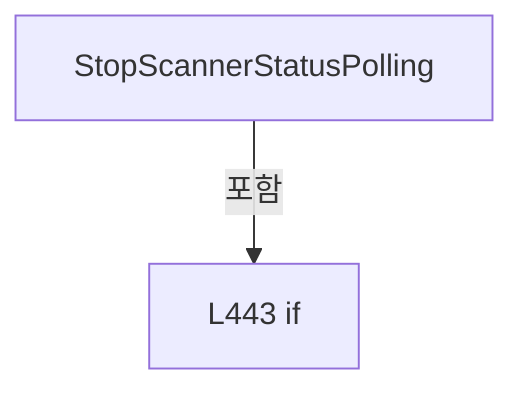

변경 전 점검: 입력/반환 타입, 위 호출자, 예외/취소 경로, 공유 상태와 저장·전송 소비자를 함께 확인합니다. 값의 단위나 물리 방향을 이름만으로 확정하지 않습니다.

### PropertyDeclaration `TargetGx` · L449–460

[Drilling.UI/Menu/Menus/CMenuManual.cs:449–460](https://github.com/kjuws10-rgb/A3Drilling/blob/5aee8e58439c9b455cae7c9593c9be986c3e682e/Drilling.UI/Menu/Menus/CMenuManual.cs#L449-L460)

| 항목 | 실제 추출 값 |
| --- | --- |
| 서명 | string Drilling.UI.Menu.Menus.CMenuManual.TargetGx |
| 접근/수식자 | Public / public |
| 반환/값 타입 | string |
| 소속 타입 | NamedType:Drilling.UI.Menu.Menus.CMenuManual |

현재 부분 분석에서 직접 연결된 호출자는 없습니다. XAML/이벤트/인터페이스·델리게이트·외부 진입을 추가 확인해야 하며, 미사용으로 판정한 것이 아닙니다.

변경 전 점검: 입력/반환 타입, 위 호출자, 예외/취소 경로, 공유 상태와 저장·전송 소비자를 함께 확인합니다. 값의 단위나 물리 방향을 이름만으로 확정하지 않습니다.

### GetAccessorDeclaration `get_TargetGx` · L451–454

[Drilling.UI/Menu/Menus/CMenuManual.cs:451–454](https://github.com/kjuws10-rgb/A3Drilling/blob/5aee8e58439c9b455cae7c9593c9be986c3e682e/Drilling.UI/Menu/Menus/CMenuManual.cs#L451-L454)

| 항목 | 실제 추출 값 |
| --- | --- |
| 서명 | string Drilling.UI.Menu.Menus.CMenuManual.TargetGx.get |
| 접근/수식자 | Public / get |
| 반환/값 타입 | string |
| 소속 타입 | NamedType:Drilling.UI.Menu.Menus.CMenuManual |

현재 부분 분석에서 직접 연결된 호출자는 없습니다. XAML/이벤트/인터페이스·델리게이트·외부 진입을 추가 확인해야 하며, 미사용으로 판정한 것이 아닙니다.

본문의 실제 연산·분기·예외·반환 순서(원문 위치 순):

| 원본 행 | 종류 | 주석 해설 |
| --- | --- | --- |
| 453 | return | 호출자에게 값 또는 제어를 반환합니다: return _targetGx; |

변경 전 점검: 입력/반환 타입, 위 호출자, 예외/취소 경로, 공유 상태와 저장·전송 소비자를 함께 확인합니다. 값의 단위나 물리 방향을 이름만으로 확정하지 않습니다.

### SetAccessorDeclaration `set_TargetGx` · L456–459

[Drilling.UI/Menu/Menus/CMenuManual.cs:456–459](https://github.com/kjuws10-rgb/A3Drilling/blob/5aee8e58439c9b455cae7c9593c9be986c3e682e/Drilling.UI/Menu/Menus/CMenuManual.cs#L456-L459)

| 항목 | 실제 추출 값 |
| --- | --- |
| 서명 | void Drilling.UI.Menu.Menus.CMenuManual.TargetGx.set |
| 접근/수식자 | Public / set |
| 반환/값 타입 | void |
| 소속 타입 | NamedType:Drilling.UI.Menu.Menus.CMenuManual |

입력 계약:

| 이름 | 타입 | 전달 | 선택/기본값 |
| --- | --- | --- | --- |
| value | string | None | False /  |

현재 부분 분석에서 직접 연결된 호출자는 없습니다. XAML/이벤트/인터페이스·델리게이트·외부 진입을 추가 확인해야 하며, 미사용으로 판정한 것이 아닙니다.

호출하는 대상과 해석 범위:

| 원본 행 | 표현식 | 분석 상태 | 대상/소스 위치 |
| --- | --- | --- | --- |
| 458 | SetProperty | resolved | bool Drilling.UI.Menu.CBindingBase.SetProperty<string>(ref string, string, string?) · Drilling.UI/Menu/CBindingBase.cs:735 |

본문의 실제 연산·분기·예외·반환 순서(원문 위치 순):

| 원본 행 | 종류 | 주석 해설 |
| --- | --- | --- |
| 458 | call | 함수·델리게이트 또는 객체 생성자를 호출합니다: SetProperty(ref _targetGx, value) |

변경 전 점검: 입력/반환 타입, 위 호출자, 예외/취소 경로, 공유 상태와 저장·전송 소비자를 함께 확인합니다. 값의 단위나 물리 방향을 이름만으로 확정하지 않습니다.

### PropertyDeclaration `TargetGy` · L462–473

[Drilling.UI/Menu/Menus/CMenuManual.cs:462–473](https://github.com/kjuws10-rgb/A3Drilling/blob/5aee8e58439c9b455cae7c9593c9be986c3e682e/Drilling.UI/Menu/Menus/CMenuManual.cs#L462-L473)

| 항목 | 실제 추출 값 |
| --- | --- |
| 서명 | string Drilling.UI.Menu.Menus.CMenuManual.TargetGy |
| 접근/수식자 | Public / public |
| 반환/값 타입 | string |
| 소속 타입 | NamedType:Drilling.UI.Menu.Menus.CMenuManual |

현재 부분 분석에서 직접 연결된 호출자는 없습니다. XAML/이벤트/인터페이스·델리게이트·외부 진입을 추가 확인해야 하며, 미사용으로 판정한 것이 아닙니다.

변경 전 점검: 입력/반환 타입, 위 호출자, 예외/취소 경로, 공유 상태와 저장·전송 소비자를 함께 확인합니다. 값의 단위나 물리 방향을 이름만으로 확정하지 않습니다.

### GetAccessorDeclaration `get_TargetGy` · L464–467

[Drilling.UI/Menu/Menus/CMenuManual.cs:464–467](https://github.com/kjuws10-rgb/A3Drilling/blob/5aee8e58439c9b455cae7c9593c9be986c3e682e/Drilling.UI/Menu/Menus/CMenuManual.cs#L464-L467)

| 항목 | 실제 추출 값 |
| --- | --- |
| 서명 | string Drilling.UI.Menu.Menus.CMenuManual.TargetGy.get |
| 접근/수식자 | Public / get |
| 반환/값 타입 | string |
| 소속 타입 | NamedType:Drilling.UI.Menu.Menus.CMenuManual |

현재 부분 분석에서 직접 연결된 호출자는 없습니다. XAML/이벤트/인터페이스·델리게이트·외부 진입을 추가 확인해야 하며, 미사용으로 판정한 것이 아닙니다.

본문의 실제 연산·분기·예외·반환 순서(원문 위치 순):

| 원본 행 | 종류 | 주석 해설 |
| --- | --- | --- |
| 466 | return | 호출자에게 값 또는 제어를 반환합니다: return _targetGy; |

변경 전 점검: 입력/반환 타입, 위 호출자, 예외/취소 경로, 공유 상태와 저장·전송 소비자를 함께 확인합니다. 값의 단위나 물리 방향을 이름만으로 확정하지 않습니다.

### SetAccessorDeclaration `set_TargetGy` · L469–472

[Drilling.UI/Menu/Menus/CMenuManual.cs:469–472](https://github.com/kjuws10-rgb/A3Drilling/blob/5aee8e58439c9b455cae7c9593c9be986c3e682e/Drilling.UI/Menu/Menus/CMenuManual.cs#L469-L472)

| 항목 | 실제 추출 값 |
| --- | --- |
| 서명 | void Drilling.UI.Menu.Menus.CMenuManual.TargetGy.set |
| 접근/수식자 | Public / set |
| 반환/값 타입 | void |
| 소속 타입 | NamedType:Drilling.UI.Menu.Menus.CMenuManual |

입력 계약:

| 이름 | 타입 | 전달 | 선택/기본값 |
| --- | --- | --- | --- |
| value | string | None | False /  |

현재 부분 분석에서 직접 연결된 호출자는 없습니다. XAML/이벤트/인터페이스·델리게이트·외부 진입을 추가 확인해야 하며, 미사용으로 판정한 것이 아닙니다.

호출하는 대상과 해석 범위:

| 원본 행 | 표현식 | 분석 상태 | 대상/소스 위치 |
| --- | --- | --- | --- |
| 471 | SetProperty | resolved | bool Drilling.UI.Menu.CBindingBase.SetProperty<string>(ref string, string, string?) · Drilling.UI/Menu/CBindingBase.cs:735 |

본문의 실제 연산·분기·예외·반환 순서(원문 위치 순):

| 원본 행 | 종류 | 주석 해설 |
| --- | --- | --- |
| 471 | call | 함수·델리게이트 또는 객체 생성자를 호출합니다: SetProperty(ref _targetGy, value) |

변경 전 점검: 입력/반환 타입, 위 호출자, 예외/취소 경로, 공유 상태와 저장·전송 소비자를 함께 확인합니다. 값의 단위나 물리 방향을 이름만으로 확정하지 않습니다.

### PropertyDeclaration `TargetGz` · L475–486

[Drilling.UI/Menu/Menus/CMenuManual.cs:475–486](https://github.com/kjuws10-rgb/A3Drilling/blob/5aee8e58439c9b455cae7c9593c9be986c3e682e/Drilling.UI/Menu/Menus/CMenuManual.cs#L475-L486)

| 항목 | 실제 추출 값 |
| --- | --- |
| 서명 | string Drilling.UI.Menu.Menus.CMenuManual.TargetGz |
| 접근/수식자 | Public / public |
| 반환/값 타입 | string |
| 소속 타입 | NamedType:Drilling.UI.Menu.Menus.CMenuManual |

현재 부분 분석에서 직접 연결된 호출자는 없습니다. XAML/이벤트/인터페이스·델리게이트·외부 진입을 추가 확인해야 하며, 미사용으로 판정한 것이 아닙니다.

변경 전 점검: 입력/반환 타입, 위 호출자, 예외/취소 경로, 공유 상태와 저장·전송 소비자를 함께 확인합니다. 값의 단위나 물리 방향을 이름만으로 확정하지 않습니다.

### GetAccessorDeclaration `get_TargetGz` · L477–480

[Drilling.UI/Menu/Menus/CMenuManual.cs:477–480](https://github.com/kjuws10-rgb/A3Drilling/blob/5aee8e58439c9b455cae7c9593c9be986c3e682e/Drilling.UI/Menu/Menus/CMenuManual.cs#L477-L480)

| 항목 | 실제 추출 값 |
| --- | --- |
| 서명 | string Drilling.UI.Menu.Menus.CMenuManual.TargetGz.get |
| 접근/수식자 | Public / get |
| 반환/값 타입 | string |
| 소속 타입 | NamedType:Drilling.UI.Menu.Menus.CMenuManual |

현재 부분 분석에서 직접 연결된 호출자는 없습니다. XAML/이벤트/인터페이스·델리게이트·외부 진입을 추가 확인해야 하며, 미사용으로 판정한 것이 아닙니다.

본문의 실제 연산·분기·예외·반환 순서(원문 위치 순):

| 원본 행 | 종류 | 주석 해설 |
| --- | --- | --- |
| 479 | return | 호출자에게 값 또는 제어를 반환합니다: return _targetGz; |

변경 전 점검: 입력/반환 타입, 위 호출자, 예외/취소 경로, 공유 상태와 저장·전송 소비자를 함께 확인합니다. 값의 단위나 물리 방향을 이름만으로 확정하지 않습니다.

### SetAccessorDeclaration `set_TargetGz` · L482–485

[Drilling.UI/Menu/Menus/CMenuManual.cs:482–485](https://github.com/kjuws10-rgb/A3Drilling/blob/5aee8e58439c9b455cae7c9593c9be986c3e682e/Drilling.UI/Menu/Menus/CMenuManual.cs#L482-L485)

| 항목 | 실제 추출 값 |
| --- | --- |
| 서명 | void Drilling.UI.Menu.Menus.CMenuManual.TargetGz.set |
| 접근/수식자 | Public / set |
| 반환/값 타입 | void |
| 소속 타입 | NamedType:Drilling.UI.Menu.Menus.CMenuManual |

입력 계약:

| 이름 | 타입 | 전달 | 선택/기본값 |
| --- | --- | --- | --- |
| value | string | None | False /  |

현재 부분 분석에서 직접 연결된 호출자는 없습니다. XAML/이벤트/인터페이스·델리게이트·외부 진입을 추가 확인해야 하며, 미사용으로 판정한 것이 아닙니다.

호출하는 대상과 해석 범위:

| 원본 행 | 표현식 | 분석 상태 | 대상/소스 위치 |
| --- | --- | --- | --- |
| 484 | SetProperty | resolved | bool Drilling.UI.Menu.CBindingBase.SetProperty<string>(ref string, string, string?) · Drilling.UI/Menu/CBindingBase.cs:735 |

본문의 실제 연산·분기·예외·반환 순서(원문 위치 순):

| 원본 행 | 종류 | 주석 해설 |
| --- | --- | --- |
| 484 | call | 함수·델리게이트 또는 객체 생성자를 호출합니다: SetProperty(ref _targetGz, value) |

변경 전 점검: 입력/반환 타입, 위 호출자, 예외/취소 경로, 공유 상태와 저장·전송 소비자를 함께 확인합니다. 값의 단위나 물리 방향을 이름만으로 확정하지 않습니다.

### PropertyDeclaration `IsZPositionMoveEnabled` · L488–494

[Drilling.UI/Menu/Menus/CMenuManual.cs:488–494](https://github.com/kjuws10-rgb/A3Drilling/blob/5aee8e58439c9b455cae7c9593c9be986c3e682e/Drilling.UI/Menu/Menus/CMenuManual.cs#L488-L494)

| 항목 | 실제 추출 값 |
| --- | --- |
| 서명 | bool Drilling.UI.Menu.Menus.CMenuManual.IsZPositionMoveEnabled |
| 접근/수식자 | Public / public |
| 반환/값 타입 | bool |
| 소속 타입 | NamedType:Drilling.UI.Menu.Menus.CMenuManual |

현재 부분 분석에서 직접 연결된 호출자는 없습니다. XAML/이벤트/인터페이스·델리게이트·외부 진입을 추가 확인해야 하며, 미사용으로 판정한 것이 아닙니다.

변경 전 점검: 입력/반환 타입, 위 호출자, 예외/취소 경로, 공유 상태와 저장·전송 소비자를 함께 확인합니다. 값의 단위나 물리 방향을 이름만으로 확정하지 않습니다.

### GetAccessorDeclaration `get_IsZPositionMoveEnabled` · L490–493

[Drilling.UI/Menu/Menus/CMenuManual.cs:490–493](https://github.com/kjuws10-rgb/A3Drilling/blob/5aee8e58439c9b455cae7c9593c9be986c3e682e/Drilling.UI/Menu/Menus/CMenuManual.cs#L490-L493)

| 항목 | 실제 추출 값 |
| --- | --- |
| 서명 | bool Drilling.UI.Menu.Menus.CMenuManual.IsZPositionMoveEnabled.get |
| 접근/수식자 | Public / get |
| 반환/값 타입 | bool |
| 소속 타입 | NamedType:Drilling.UI.Menu.Menus.CMenuManual |

현재 부분 분석에서 직접 연결된 호출자는 없습니다. XAML/이벤트/인터페이스·델리게이트·외부 진입을 추가 확인해야 하며, 미사용으로 판정한 것이 아닙니다.

호출하는 대상과 해석 범위:

| 원본 행 | 표현식 | 분석 상태 | 대상/소스 위치 |
| --- | --- | --- | --- |
| 492 | IsScannerAxisAvailable | resolved | bool Drilling.UI.Menu.Menus.CMenuManual.IsScannerAxisAvailable(System.Collections.Generic.IReadOnlyList<Drilling.UI.Menu.Menus.ST_MANUAL_SCANNER_AXIS>, string) · Drilling.UI/Menu/Menus/CMenuManual.cs:3243 |

본문의 실제 연산·분기·예외·반환 순서(원문 위치 순):

| 원본 행 | 종류 | 주석 해설 |
| --- | --- | --- |
| 492 | call | 함수·델리게이트 또는 객체 생성자를 호출합니다: IsScannerAxisAvailable(ScannerAxes, "Z") |
| 492 | return | 호출자에게 값 또는 제어를 반환합니다: return IsScannerAxisAvailable(ScannerAxes, "Z"); |

변경 전 점검: 입력/반환 타입, 위 호출자, 예외/취소 경로, 공유 상태와 저장·전송 소비자를 함께 확인합니다. 값의 단위나 물리 방향을 이름만으로 확정하지 않습니다.

### PropertyDeclaration `ShapeSize` · L496–507

[Drilling.UI/Menu/Menus/CMenuManual.cs:496–507](https://github.com/kjuws10-rgb/A3Drilling/blob/5aee8e58439c9b455cae7c9593c9be986c3e682e/Drilling.UI/Menu/Menus/CMenuManual.cs#L496-L507)

| 항목 | 실제 추출 값 |
| --- | --- |
| 서명 | string Drilling.UI.Menu.Menus.CMenuManual.ShapeSize |
| 접근/수식자 | Public / public |
| 반환/값 타입 | string |
| 소속 타입 | NamedType:Drilling.UI.Menu.Menus.CMenuManual |

현재 부분 분석에서 직접 연결된 호출자는 없습니다. XAML/이벤트/인터페이스·델리게이트·외부 진입을 추가 확인해야 하며, 미사용으로 판정한 것이 아닙니다.

변경 전 점검: 입력/반환 타입, 위 호출자, 예외/취소 경로, 공유 상태와 저장·전송 소비자를 함께 확인합니다. 값의 단위나 물리 방향을 이름만으로 확정하지 않습니다.

### GetAccessorDeclaration `get_ShapeSize` · L498–501

[Drilling.UI/Menu/Menus/CMenuManual.cs:498–501](https://github.com/kjuws10-rgb/A3Drilling/blob/5aee8e58439c9b455cae7c9593c9be986c3e682e/Drilling.UI/Menu/Menus/CMenuManual.cs#L498-L501)

| 항목 | 실제 추출 값 |
| --- | --- |
| 서명 | string Drilling.UI.Menu.Menus.CMenuManual.ShapeSize.get |
| 접근/수식자 | Public / get |
| 반환/값 타입 | string |
| 소속 타입 | NamedType:Drilling.UI.Menu.Menus.CMenuManual |

현재 부분 분석에서 직접 연결된 호출자는 없습니다. XAML/이벤트/인터페이스·델리게이트·외부 진입을 추가 확인해야 하며, 미사용으로 판정한 것이 아닙니다.

본문의 실제 연산·분기·예외·반환 순서(원문 위치 순):

| 원본 행 | 종류 | 주석 해설 |
| --- | --- | --- |
| 500 | return | 호출자에게 값 또는 제어를 반환합니다: return _shapeSize; |

변경 전 점검: 입력/반환 타입, 위 호출자, 예외/취소 경로, 공유 상태와 저장·전송 소비자를 함께 확인합니다. 값의 단위나 물리 방향을 이름만으로 확정하지 않습니다.

### SetAccessorDeclaration `set_ShapeSize` · L503–506

[Drilling.UI/Menu/Menus/CMenuManual.cs:503–506](https://github.com/kjuws10-rgb/A3Drilling/blob/5aee8e58439c9b455cae7c9593c9be986c3e682e/Drilling.UI/Menu/Menus/CMenuManual.cs#L503-L506)

| 항목 | 실제 추출 값 |
| --- | --- |
| 서명 | void Drilling.UI.Menu.Menus.CMenuManual.ShapeSize.set |
| 접근/수식자 | Public / set |
| 반환/값 타입 | void |
| 소속 타입 | NamedType:Drilling.UI.Menu.Menus.CMenuManual |

입력 계약:

| 이름 | 타입 | 전달 | 선택/기본값 |
| --- | --- | --- | --- |
| value | string | None | False /  |

현재 부분 분석에서 직접 연결된 호출자는 없습니다. XAML/이벤트/인터페이스·델리게이트·외부 진입을 추가 확인해야 하며, 미사용으로 판정한 것이 아닙니다.

호출하는 대상과 해석 범위:

| 원본 행 | 표현식 | 분석 상태 | 대상/소스 위치 |
| --- | --- | --- | --- |
| 505 | SetProperty | resolved | bool Drilling.UI.Menu.CBindingBase.SetProperty<string>(ref string, string, string?) · Drilling.UI/Menu/CBindingBase.cs:735 |

본문의 실제 연산·분기·예외·반환 순서(원문 위치 순):

| 원본 행 | 종류 | 주석 해설 |
| --- | --- | --- |
| 505 | call | 함수·델리게이트 또는 객체 생성자를 호출합니다: SetProperty(ref _shapeSize, value) |

변경 전 점검: 입력/반환 타입, 위 호출자, 예외/취소 경로, 공유 상태와 저장·전송 소비자를 함께 확인합니다. 값의 단위나 물리 방향을 이름만으로 확정하지 않습니다.

### PropertyDeclaration `ShapeOffsetX` · L509–520

[Drilling.UI/Menu/Menus/CMenuManual.cs:509–520](https://github.com/kjuws10-rgb/A3Drilling/blob/5aee8e58439c9b455cae7c9593c9be986c3e682e/Drilling.UI/Menu/Menus/CMenuManual.cs#L509-L520)

| 항목 | 실제 추출 값 |
| --- | --- |
| 서명 | string Drilling.UI.Menu.Menus.CMenuManual.ShapeOffsetX |
| 접근/수식자 | Public / public |
| 반환/값 타입 | string |
| 소속 타입 | NamedType:Drilling.UI.Menu.Menus.CMenuManual |

현재 부분 분석에서 직접 연결된 호출자는 없습니다. XAML/이벤트/인터페이스·델리게이트·외부 진입을 추가 확인해야 하며, 미사용으로 판정한 것이 아닙니다.

변경 전 점검: 입력/반환 타입, 위 호출자, 예외/취소 경로, 공유 상태와 저장·전송 소비자를 함께 확인합니다. 값의 단위나 물리 방향을 이름만으로 확정하지 않습니다.

### GetAccessorDeclaration `get_ShapeOffsetX` · L511–514

[Drilling.UI/Menu/Menus/CMenuManual.cs:511–514](https://github.com/kjuws10-rgb/A3Drilling/blob/5aee8e58439c9b455cae7c9593c9be986c3e682e/Drilling.UI/Menu/Menus/CMenuManual.cs#L511-L514)

| 항목 | 실제 추출 값 |
| --- | --- |
| 서명 | string Drilling.UI.Menu.Menus.CMenuManual.ShapeOffsetX.get |
| 접근/수식자 | Public / get |
| 반환/값 타입 | string |
| 소속 타입 | NamedType:Drilling.UI.Menu.Menus.CMenuManual |

현재 부분 분석에서 직접 연결된 호출자는 없습니다. XAML/이벤트/인터페이스·델리게이트·외부 진입을 추가 확인해야 하며, 미사용으로 판정한 것이 아닙니다.

본문의 실제 연산·분기·예외·반환 순서(원문 위치 순):

| 원본 행 | 종류 | 주석 해설 |
| --- | --- | --- |
| 513 | return | 호출자에게 값 또는 제어를 반환합니다: return _shapeOffsetX; |

변경 전 점검: 입력/반환 타입, 위 호출자, 예외/취소 경로, 공유 상태와 저장·전송 소비자를 함께 확인합니다. 값의 단위나 물리 방향을 이름만으로 확정하지 않습니다.

### SetAccessorDeclaration `set_ShapeOffsetX` · L516–519

[Drilling.UI/Menu/Menus/CMenuManual.cs:516–519](https://github.com/kjuws10-rgb/A3Drilling/blob/5aee8e58439c9b455cae7c9593c9be986c3e682e/Drilling.UI/Menu/Menus/CMenuManual.cs#L516-L519)

| 항목 | 실제 추출 값 |
| --- | --- |
| 서명 | void Drilling.UI.Menu.Menus.CMenuManual.ShapeOffsetX.set |
| 접근/수식자 | Public / set |
| 반환/값 타입 | void |
| 소속 타입 | NamedType:Drilling.UI.Menu.Menus.CMenuManual |

입력 계약:

| 이름 | 타입 | 전달 | 선택/기본값 |
| --- | --- | --- | --- |
| value | string | None | False /  |

현재 부분 분석에서 직접 연결된 호출자는 없습니다. XAML/이벤트/인터페이스·델리게이트·외부 진입을 추가 확인해야 하며, 미사용으로 판정한 것이 아닙니다.

호출하는 대상과 해석 범위:

| 원본 행 | 표현식 | 분석 상태 | 대상/소스 위치 |
| --- | --- | --- | --- |
| 518 | SetProperty | resolved | bool Drilling.UI.Menu.CBindingBase.SetProperty<string>(ref string, string, string?) · Drilling.UI/Menu/CBindingBase.cs:735 |

본문의 실제 연산·분기·예외·반환 순서(원문 위치 순):

| 원본 행 | 종류 | 주석 해설 |
| --- | --- | --- |
| 518 | call | 함수·델리게이트 또는 객체 생성자를 호출합니다: SetProperty(ref _shapeOffsetX, value) |

변경 전 점검: 입력/반환 타입, 위 호출자, 예외/취소 경로, 공유 상태와 저장·전송 소비자를 함께 확인합니다. 값의 단위나 물리 방향을 이름만으로 확정하지 않습니다.

### PropertyDeclaration `ShapeOffsetY` · L522–533

[Drilling.UI/Menu/Menus/CMenuManual.cs:522–533](https://github.com/kjuws10-rgb/A3Drilling/blob/5aee8e58439c9b455cae7c9593c9be986c3e682e/Drilling.UI/Menu/Menus/CMenuManual.cs#L522-L533)

| 항목 | 실제 추출 값 |
| --- | --- |
| 서명 | string Drilling.UI.Menu.Menus.CMenuManual.ShapeOffsetY |
| 접근/수식자 | Public / public |
| 반환/값 타입 | string |
| 소속 타입 | NamedType:Drilling.UI.Menu.Menus.CMenuManual |

현재 부분 분석에서 직접 연결된 호출자는 없습니다. XAML/이벤트/인터페이스·델리게이트·외부 진입을 추가 확인해야 하며, 미사용으로 판정한 것이 아닙니다.

변경 전 점검: 입력/반환 타입, 위 호출자, 예외/취소 경로, 공유 상태와 저장·전송 소비자를 함께 확인합니다. 값의 단위나 물리 방향을 이름만으로 확정하지 않습니다.

### GetAccessorDeclaration `get_ShapeOffsetY` · L524–527

[Drilling.UI/Menu/Menus/CMenuManual.cs:524–527](https://github.com/kjuws10-rgb/A3Drilling/blob/5aee8e58439c9b455cae7c9593c9be986c3e682e/Drilling.UI/Menu/Menus/CMenuManual.cs#L524-L527)

| 항목 | 실제 추출 값 |
| --- | --- |
| 서명 | string Drilling.UI.Menu.Menus.CMenuManual.ShapeOffsetY.get |
| 접근/수식자 | Public / get |
| 반환/값 타입 | string |
| 소속 타입 | NamedType:Drilling.UI.Menu.Menus.CMenuManual |

현재 부분 분석에서 직접 연결된 호출자는 없습니다. XAML/이벤트/인터페이스·델리게이트·외부 진입을 추가 확인해야 하며, 미사용으로 판정한 것이 아닙니다.

본문의 실제 연산·분기·예외·반환 순서(원문 위치 순):

| 원본 행 | 종류 | 주석 해설 |
| --- | --- | --- |
| 526 | return | 호출자에게 값 또는 제어를 반환합니다: return _shapeOffsetY; |

변경 전 점검: 입력/반환 타입, 위 호출자, 예외/취소 경로, 공유 상태와 저장·전송 소비자를 함께 확인합니다. 값의 단위나 물리 방향을 이름만으로 확정하지 않습니다.

### SetAccessorDeclaration `set_ShapeOffsetY` · L529–532

[Drilling.UI/Menu/Menus/CMenuManual.cs:529–532](https://github.com/kjuws10-rgb/A3Drilling/blob/5aee8e58439c9b455cae7c9593c9be986c3e682e/Drilling.UI/Menu/Menus/CMenuManual.cs#L529-L532)

| 항목 | 실제 추출 값 |
| --- | --- |
| 서명 | void Drilling.UI.Menu.Menus.CMenuManual.ShapeOffsetY.set |
| 접근/수식자 | Public / set |
| 반환/값 타입 | void |
| 소속 타입 | NamedType:Drilling.UI.Menu.Menus.CMenuManual |

입력 계약:

| 이름 | 타입 | 전달 | 선택/기본값 |
| --- | --- | --- | --- |
| value | string | None | False /  |

현재 부분 분석에서 직접 연결된 호출자는 없습니다. XAML/이벤트/인터페이스·델리게이트·외부 진입을 추가 확인해야 하며, 미사용으로 판정한 것이 아닙니다.

호출하는 대상과 해석 범위:

| 원본 행 | 표현식 | 분석 상태 | 대상/소스 위치 |
| --- | --- | --- | --- |
| 531 | SetProperty | resolved | bool Drilling.UI.Menu.CBindingBase.SetProperty<string>(ref string, string, string?) · Drilling.UI/Menu/CBindingBase.cs:735 |

본문의 실제 연산·분기·예외·반환 순서(원문 위치 순):

| 원본 행 | 종류 | 주석 해설 |
| --- | --- | --- |
| 531 | call | 함수·델리게이트 또는 객체 생성자를 호출합니다: SetProperty(ref _shapeOffsetY, value) |

변경 전 점검: 입력/반환 타입, 위 호출자, 예외/취소 경로, 공유 상태와 저장·전송 소비자를 함께 확인합니다. 값의 단위나 물리 방향을 이름만으로 확정하지 않습니다.

### PropertyDeclaration `ShapeDirection` · L535–546

[Drilling.UI/Menu/Menus/CMenuManual.cs:535–546](https://github.com/kjuws10-rgb/A3Drilling/blob/5aee8e58439c9b455cae7c9593c9be986c3e682e/Drilling.UI/Menu/Menus/CMenuManual.cs#L535-L546)

| 항목 | 실제 추출 값 |
| --- | --- |
| 서명 | string Drilling.UI.Menu.Menus.CMenuManual.ShapeDirection |
| 접근/수식자 | Public / public |
| 반환/값 타입 | string |
| 소속 타입 | NamedType:Drilling.UI.Menu.Menus.CMenuManual |

현재 부분 분석에서 직접 연결된 호출자는 없습니다. XAML/이벤트/인터페이스·델리게이트·외부 진입을 추가 확인해야 하며, 미사용으로 판정한 것이 아닙니다.

변경 전 점검: 입력/반환 타입, 위 호출자, 예외/취소 경로, 공유 상태와 저장·전송 소비자를 함께 확인합니다. 값의 단위나 물리 방향을 이름만으로 확정하지 않습니다.

### GetAccessorDeclaration `get_ShapeDirection` · L537–540

[Drilling.UI/Menu/Menus/CMenuManual.cs:537–540](https://github.com/kjuws10-rgb/A3Drilling/blob/5aee8e58439c9b455cae7c9593c9be986c3e682e/Drilling.UI/Menu/Menus/CMenuManual.cs#L537-L540)

| 항목 | 실제 추출 값 |
| --- | --- |
| 서명 | string Drilling.UI.Menu.Menus.CMenuManual.ShapeDirection.get |
| 접근/수식자 | Public / get |
| 반환/값 타입 | string |
| 소속 타입 | NamedType:Drilling.UI.Menu.Menus.CMenuManual |

현재 부분 분석에서 직접 연결된 호출자는 없습니다. XAML/이벤트/인터페이스·델리게이트·외부 진입을 추가 확인해야 하며, 미사용으로 판정한 것이 아닙니다.

본문의 실제 연산·분기·예외·반환 순서(원문 위치 순):

| 원본 행 | 종류 | 주석 해설 |
| --- | --- | --- |
| 539 | return | 호출자에게 값 또는 제어를 반환합니다: return _shapeDirection; |

변경 전 점검: 입력/반환 타입, 위 호출자, 예외/취소 경로, 공유 상태와 저장·전송 소비자를 함께 확인합니다. 값의 단위나 물리 방향을 이름만으로 확정하지 않습니다.

### SetAccessorDeclaration `set_ShapeDirection` · L542–545

[Drilling.UI/Menu/Menus/CMenuManual.cs:542–545](https://github.com/kjuws10-rgb/A3Drilling/blob/5aee8e58439c9b455cae7c9593c9be986c3e682e/Drilling.UI/Menu/Menus/CMenuManual.cs#L542-L545)

| 항목 | 실제 추출 값 |
| --- | --- |
| 서명 | void Drilling.UI.Menu.Menus.CMenuManual.ShapeDirection.set |
| 접근/수식자 | Public / set |
| 반환/값 타입 | void |
| 소속 타입 | NamedType:Drilling.UI.Menu.Menus.CMenuManual |

입력 계약:

| 이름 | 타입 | 전달 | 선택/기본값 |
| --- | --- | --- | --- |
| value | string | None | False /  |

현재 부분 분석에서 직접 연결된 호출자는 없습니다. XAML/이벤트/인터페이스·델리게이트·외부 진입을 추가 확인해야 하며, 미사용으로 판정한 것이 아닙니다.

호출하는 대상과 해석 범위:

| 원본 행 | 표현식 | 분석 상태 | 대상/소스 위치 |
| --- | --- | --- | --- |
| 544 | SetProperty | resolved | bool Drilling.UI.Menu.CBindingBase.SetProperty<string>(ref string, string, string?) · Drilling.UI/Menu/CBindingBase.cs:735 |

본문의 실제 연산·분기·예외·반환 순서(원문 위치 순):

| 원본 행 | 종류 | 주석 해설 |
| --- | --- | --- |
| 544 | call | 함수·델리게이트 또는 객체 생성자를 호출합니다: SetProperty(ref _shapeDirection, value) |

변경 전 점검: 입력/반환 타입, 위 호출자, 예외/취소 경로, 공유 상태와 저장·전송 소비자를 함께 확인합니다. 값의 단위나 물리 방향을 이름만으로 확정하지 않습니다.

### PropertyDeclaration `ShapeName` · L548–559

[Drilling.UI/Menu/Menus/CMenuManual.cs:548–559](https://github.com/kjuws10-rgb/A3Drilling/blob/5aee8e58439c9b455cae7c9593c9be986c3e682e/Drilling.UI/Menu/Menus/CMenuManual.cs#L548-L559)

| 항목 | 실제 추출 값 |
| --- | --- |
| 서명 | string Drilling.UI.Menu.Menus.CMenuManual.ShapeName |
| 접근/수식자 | Public / public |
| 반환/값 타입 | string |
| 소속 타입 | NamedType:Drilling.UI.Menu.Menus.CMenuManual |

현재 부분 분석에서 직접 연결된 호출자는 없습니다. XAML/이벤트/인터페이스·델리게이트·외부 진입을 추가 확인해야 하며, 미사용으로 판정한 것이 아닙니다.

변경 전 점검: 입력/반환 타입, 위 호출자, 예외/취소 경로, 공유 상태와 저장·전송 소비자를 함께 확인합니다. 값의 단위나 물리 방향을 이름만으로 확정하지 않습니다.

### GetAccessorDeclaration `get_ShapeName` · L550–553

[Drilling.UI/Menu/Menus/CMenuManual.cs:550–553](https://github.com/kjuws10-rgb/A3Drilling/blob/5aee8e58439c9b455cae7c9593c9be986c3e682e/Drilling.UI/Menu/Menus/CMenuManual.cs#L550-L553)

| 항목 | 실제 추출 값 |
| --- | --- |
| 서명 | string Drilling.UI.Menu.Menus.CMenuManual.ShapeName.get |
| 접근/수식자 | Public / get |
| 반환/값 타입 | string |
| 소속 타입 | NamedType:Drilling.UI.Menu.Menus.CMenuManual |

현재 부분 분석에서 직접 연결된 호출자는 없습니다. XAML/이벤트/인터페이스·델리게이트·외부 진입을 추가 확인해야 하며, 미사용으로 판정한 것이 아닙니다.

본문의 실제 연산·분기·예외·반환 순서(원문 위치 순):

| 원본 행 | 종류 | 주석 해설 |
| --- | --- | --- |
| 552 | return | 호출자에게 값 또는 제어를 반환합니다: return _shapeName; |

변경 전 점검: 입력/반환 타입, 위 호출자, 예외/취소 경로, 공유 상태와 저장·전송 소비자를 함께 확인합니다. 값의 단위나 물리 방향을 이름만으로 확정하지 않습니다.

### SetAccessorDeclaration `set_ShapeName` · L555–558

[Drilling.UI/Menu/Menus/CMenuManual.cs:555–558](https://github.com/kjuws10-rgb/A3Drilling/blob/5aee8e58439c9b455cae7c9593c9be986c3e682e/Drilling.UI/Menu/Menus/CMenuManual.cs#L555-L558)

| 항목 | 실제 추출 값 |
| --- | --- |
| 서명 | void Drilling.UI.Menu.Menus.CMenuManual.ShapeName.set |
| 접근/수식자 | Public / set |
| 반환/값 타입 | void |
| 소속 타입 | NamedType:Drilling.UI.Menu.Menus.CMenuManual |

입력 계약:

| 이름 | 타입 | 전달 | 선택/기본값 |
| --- | --- | --- | --- |
| value | string | None | False /  |

현재 부분 분석에서 직접 연결된 호출자는 없습니다. XAML/이벤트/인터페이스·델리게이트·외부 진입을 추가 확인해야 하며, 미사용으로 판정한 것이 아닙니다.

호출하는 대상과 해석 범위:

| 원본 행 | 표현식 | 분석 상태 | 대상/소스 위치 |
| --- | --- | --- | --- |
| 557 | SetProperty | resolved | bool Drilling.UI.Menu.CBindingBase.SetProperty<string>(ref string, string, string?) · Drilling.UI/Menu/CBindingBase.cs:735 |
| 557 | NormalizeShapeName | resolved | string Drilling.UI.Menu.Menus.CMenuManual.NormalizeShapeName(string) · Drilling.UI/Menu/Menus/CMenuManual.cs:6178 |

본문의 실제 연산·분기·예외·반환 순서(원문 위치 순):

| 원본 행 | 종류 | 주석 해설 |
| --- | --- | --- |
| 557 | call | 함수·델리게이트 또는 객체 생성자를 호출합니다: SetProperty(ref _shapeName, NormalizeShapeName(value)) |
| 557 | call | 함수·델리게이트 또는 객체 생성자를 호출합니다: NormalizeShapeName(value) |

변경 전 점검: 입력/반환 타입, 위 호출자, 예외/취소 경로, 공유 상태와 저장·전송 소비자를 함께 확인합니다. 값의 단위나 물리 방향을 이름만으로 확정하지 않습니다.

### PropertyDeclaration `GridRowLines` · L561–572

[Drilling.UI/Menu/Menus/CMenuManual.cs:561–572](https://github.com/kjuws10-rgb/A3Drilling/blob/5aee8e58439c9b455cae7c9593c9be986c3e682e/Drilling.UI/Menu/Menus/CMenuManual.cs#L561-L572)

| 항목 | 실제 추출 값 |
| --- | --- |
| 서명 | string Drilling.UI.Menu.Menus.CMenuManual.GridRowLines |
| 접근/수식자 | Public / public |
| 반환/값 타입 | string |
| 소속 타입 | NamedType:Drilling.UI.Menu.Menus.CMenuManual |

현재 부분 분석에서 직접 연결된 호출자는 없습니다. XAML/이벤트/인터페이스·델리게이트·외부 진입을 추가 확인해야 하며, 미사용으로 판정한 것이 아닙니다.

변경 전 점검: 입력/반환 타입, 위 호출자, 예외/취소 경로, 공유 상태와 저장·전송 소비자를 함께 확인합니다. 값의 단위나 물리 방향을 이름만으로 확정하지 않습니다.

### GetAccessorDeclaration `get_GridRowLines` · L563–566

[Drilling.UI/Menu/Menus/CMenuManual.cs:563–566](https://github.com/kjuws10-rgb/A3Drilling/blob/5aee8e58439c9b455cae7c9593c9be986c3e682e/Drilling.UI/Menu/Menus/CMenuManual.cs#L563-L566)

| 항목 | 실제 추출 값 |
| --- | --- |
| 서명 | string Drilling.UI.Menu.Menus.CMenuManual.GridRowLines.get |
| 접근/수식자 | Public / get |
| 반환/값 타입 | string |
| 소속 타입 | NamedType:Drilling.UI.Menu.Menus.CMenuManual |

현재 부분 분석에서 직접 연결된 호출자는 없습니다. XAML/이벤트/인터페이스·델리게이트·외부 진입을 추가 확인해야 하며, 미사용으로 판정한 것이 아닙니다.

본문의 실제 연산·분기·예외·반환 순서(원문 위치 순):

| 원본 행 | 종류 | 주석 해설 |
| --- | --- | --- |
| 565 | return | 호출자에게 값 또는 제어를 반환합니다: return _gridRowLines; |

변경 전 점검: 입력/반환 타입, 위 호출자, 예외/취소 경로, 공유 상태와 저장·전송 소비자를 함께 확인합니다. 값의 단위나 물리 방향을 이름만으로 확정하지 않습니다.

### SetAccessorDeclaration `set_GridRowLines` · L568–571

[Drilling.UI/Menu/Menus/CMenuManual.cs:568–571](https://github.com/kjuws10-rgb/A3Drilling/blob/5aee8e58439c9b455cae7c9593c9be986c3e682e/Drilling.UI/Menu/Menus/CMenuManual.cs#L568-L571)

| 항목 | 실제 추출 값 |
| --- | --- |
| 서명 | void Drilling.UI.Menu.Menus.CMenuManual.GridRowLines.set |
| 접근/수식자 | Public / set |
| 반환/값 타입 | void |
| 소속 타입 | NamedType:Drilling.UI.Menu.Menus.CMenuManual |

입력 계약:

| 이름 | 타입 | 전달 | 선택/기본값 |
| --- | --- | --- | --- |
| value | string | None | False /  |

현재 부분 분석에서 직접 연결된 호출자는 없습니다. XAML/이벤트/인터페이스·델리게이트·외부 진입을 추가 확인해야 하며, 미사용으로 판정한 것이 아닙니다.

호출하는 대상과 해석 범위:

| 원본 행 | 표현식 | 분석 상태 | 대상/소스 위치 |
| --- | --- | --- | --- |
| 570 | SetProperty | resolved | bool Drilling.UI.Menu.CBindingBase.SetProperty<string>(ref string, string, string?) · Drilling.UI/Menu/CBindingBase.cs:735 |

본문의 실제 연산·분기·예외·반환 순서(원문 위치 순):

| 원본 행 | 종류 | 주석 해설 |
| --- | --- | --- |
| 570 | call | 함수·델리게이트 또는 객체 생성자를 호출합니다: SetProperty(ref _gridRowLines, value) |

변경 전 점검: 입력/반환 타입, 위 호출자, 예외/취소 경로, 공유 상태와 저장·전송 소비자를 함께 확인합니다. 값의 단위나 물리 방향을 이름만으로 확정하지 않습니다.

### PropertyDeclaration `GridColLines` · L574–585

[Drilling.UI/Menu/Menus/CMenuManual.cs:574–585](https://github.com/kjuws10-rgb/A3Drilling/blob/5aee8e58439c9b455cae7c9593c9be986c3e682e/Drilling.UI/Menu/Menus/CMenuManual.cs#L574-L585)

| 항목 | 실제 추출 값 |
| --- | --- |
| 서명 | string Drilling.UI.Menu.Menus.CMenuManual.GridColLines |
| 접근/수식자 | Public / public |
| 반환/값 타입 | string |
| 소속 타입 | NamedType:Drilling.UI.Menu.Menus.CMenuManual |

현재 부분 분석에서 직접 연결된 호출자는 없습니다. XAML/이벤트/인터페이스·델리게이트·외부 진입을 추가 확인해야 하며, 미사용으로 판정한 것이 아닙니다.

변경 전 점검: 입력/반환 타입, 위 호출자, 예외/취소 경로, 공유 상태와 저장·전송 소비자를 함께 확인합니다. 값의 단위나 물리 방향을 이름만으로 확정하지 않습니다.

### GetAccessorDeclaration `get_GridColLines` · L576–579

[Drilling.UI/Menu/Menus/CMenuManual.cs:576–579](https://github.com/kjuws10-rgb/A3Drilling/blob/5aee8e58439c9b455cae7c9593c9be986c3e682e/Drilling.UI/Menu/Menus/CMenuManual.cs#L576-L579)

| 항목 | 실제 추출 값 |
| --- | --- |
| 서명 | string Drilling.UI.Menu.Menus.CMenuManual.GridColLines.get |
| 접근/수식자 | Public / get |
| 반환/값 타입 | string |
| 소속 타입 | NamedType:Drilling.UI.Menu.Menus.CMenuManual |

현재 부분 분석에서 직접 연결된 호출자는 없습니다. XAML/이벤트/인터페이스·델리게이트·외부 진입을 추가 확인해야 하며, 미사용으로 판정한 것이 아닙니다.

본문의 실제 연산·분기·예외·반환 순서(원문 위치 순):

| 원본 행 | 종류 | 주석 해설 |
| --- | --- | --- |
| 578 | return | 호출자에게 값 또는 제어를 반환합니다: return _gridColLines; |

변경 전 점검: 입력/반환 타입, 위 호출자, 예외/취소 경로, 공유 상태와 저장·전송 소비자를 함께 확인합니다. 값의 단위나 물리 방향을 이름만으로 확정하지 않습니다.

### SetAccessorDeclaration `set_GridColLines` · L581–584

[Drilling.UI/Menu/Menus/CMenuManual.cs:581–584](https://github.com/kjuws10-rgb/A3Drilling/blob/5aee8e58439c9b455cae7c9593c9be986c3e682e/Drilling.UI/Menu/Menus/CMenuManual.cs#L581-L584)

| 항목 | 실제 추출 값 |
| --- | --- |
| 서명 | void Drilling.UI.Menu.Menus.CMenuManual.GridColLines.set |
| 접근/수식자 | Public / set |
| 반환/값 타입 | void |
| 소속 타입 | NamedType:Drilling.UI.Menu.Menus.CMenuManual |

입력 계약:

| 이름 | 타입 | 전달 | 선택/기본값 |
| --- | --- | --- | --- |
| value | string | None | False /  |

현재 부분 분석에서 직접 연결된 호출자는 없습니다. XAML/이벤트/인터페이스·델리게이트·외부 진입을 추가 확인해야 하며, 미사용으로 판정한 것이 아닙니다.

호출하는 대상과 해석 범위:

| 원본 행 | 표현식 | 분석 상태 | 대상/소스 위치 |
| --- | --- | --- | --- |
| 583 | SetProperty | resolved | bool Drilling.UI.Menu.CBindingBase.SetProperty<string>(ref string, string, string?) · Drilling.UI/Menu/CBindingBase.cs:735 |

본문의 실제 연산·분기·예외·반환 순서(원문 위치 순):

| 원본 행 | 종류 | 주석 해설 |
| --- | --- | --- |
| 583 | call | 함수·델리게이트 또는 객체 생성자를 호출합니다: SetProperty(ref _gridColLines, value) |

변경 전 점검: 입력/반환 타입, 위 호출자, 예외/취소 경로, 공유 상태와 저장·전송 소비자를 함께 확인합니다. 값의 단위나 물리 방향을 이름만으로 확정하지 않습니다.

### PropertyDeclaration `LaserOnMode` · L587–604

[Drilling.UI/Menu/Menus/CMenuManual.cs:587–604](https://github.com/kjuws10-rgb/A3Drilling/blob/5aee8e58439c9b455cae7c9593c9be986c3e682e/Drilling.UI/Menu/Menus/CMenuManual.cs#L587-L604)

| 항목 | 실제 추출 값 |
| --- | --- |
| 서명 | string Drilling.UI.Menu.Menus.CMenuManual.LaserOnMode |
| 접근/수식자 | Public / public |
| 반환/값 타입 | string |
| 소속 타입 | NamedType:Drilling.UI.Menu.Menus.CMenuManual |

현재 부분 분석에서 직접 연결된 호출자는 없습니다. XAML/이벤트/인터페이스·델리게이트·외부 진입을 추가 확인해야 하며, 미사용으로 판정한 것이 아닙니다.

변경 전 점검: 입력/반환 타입, 위 호출자, 예외/취소 경로, 공유 상태와 저장·전송 소비자를 함께 확인합니다. 값의 단위나 물리 방향을 이름만으로 확정하지 않습니다.

### GetAccessorDeclaration `get_LaserOnMode` · L589–592

[Drilling.UI/Menu/Menus/CMenuManual.cs:589–592](https://github.com/kjuws10-rgb/A3Drilling/blob/5aee8e58439c9b455cae7c9593c9be986c3e682e/Drilling.UI/Menu/Menus/CMenuManual.cs#L589-L592)

| 항목 | 실제 추출 값 |
| --- | --- |
| 서명 | string Drilling.UI.Menu.Menus.CMenuManual.LaserOnMode.get |
| 접근/수식자 | Public / get |
| 반환/값 타입 | string |
| 소속 타입 | NamedType:Drilling.UI.Menu.Menus.CMenuManual |

현재 부분 분석에서 직접 연결된 호출자는 없습니다. XAML/이벤트/인터페이스·델리게이트·외부 진입을 추가 확인해야 하며, 미사용으로 판정한 것이 아닙니다.

본문의 실제 연산·분기·예외·반환 순서(원문 위치 순):

| 원본 행 | 종류 | 주석 해설 |
| --- | --- | --- |
| 591 | return | 호출자에게 값 또는 제어를 반환합니다: return _laserOnMode; |

변경 전 점검: 입력/반환 타입, 위 호출자, 예외/취소 경로, 공유 상태와 저장·전송 소비자를 함께 확인합니다. 값의 단위나 물리 방향을 이름만으로 확정하지 않습니다.

### SetAccessorDeclaration `set_LaserOnMode` · L594–603

[Drilling.UI/Menu/Menus/CMenuManual.cs:594–603](https://github.com/kjuws10-rgb/A3Drilling/blob/5aee8e58439c9b455cae7c9593c9be986c3e682e/Drilling.UI/Menu/Menus/CMenuManual.cs#L594-L603)

| 항목 | 실제 추출 값 |
| --- | --- |
| 서명 | void Drilling.UI.Menu.Menus.CMenuManual.LaserOnMode.set |
| 접근/수식자 | Public / set |
| 반환/값 타입 | void |
| 소속 타입 | NamedType:Drilling.UI.Menu.Menus.CMenuManual |

입력 계약:

| 이름 | 타입 | 전달 | 선택/기본값 |
| --- | --- | --- | --- |
| value | string | None | False /  |

현재 부분 분석에서 직접 연결된 호출자는 없습니다. XAML/이벤트/인터페이스·델리게이트·외부 진입을 추가 확인해야 하며, 미사용으로 판정한 것이 아닙니다.

호출하는 대상과 해석 범위:

| 원본 행 | 표현식 | 분석 상태 | 대상/소스 위치 |
| --- | --- | --- | --- |
| 596 | NormalizeLaserOnMode | resolved | string Drilling.UI.Menu.Menus.CMenuManual.NormalizeLaserOnMode(string?) · Drilling.UI/Menu/Menus/CMenuManual.cs:6039 |
| 597 | SetProperty | resolved | bool Drilling.UI.Menu.CBindingBase.SetProperty<string>(ref string, string, string?) · Drilling.UI/Menu/CBindingBase.cs:735 |
| 599 | OnPropertyChanged | resolved | void Drilling.UI.Menu.CBindingBase.OnPropertyChanged(string?) · Drilling.UI/Menu/CBindingBase.cs:759 |
| 599 | nameof | unresolved | None |
| 600 | OnPropertyChanged | resolved | void Drilling.UI.Menu.CBindingBase.OnPropertyChanged(string?) · Drilling.UI/Menu/CBindingBase.cs:759 |
| 600 | nameof | unresolved | None |
| 601 | RefreshCommandStateRows | resolved | void Drilling.UI.Menu.Menus.CMenuManual.RefreshCommandStateRows() · Drilling.UI/Menu/Menus/CMenuManual.cs:5520 |

본문의 실제 연산·분기·예외·반환 순서(원문 위치 순):

| 원본 행 | 종류 | 주석 해설 |
| --- | --- | --- |
| 596 | call | 함수·델리게이트 또는 객체 생성자를 호출합니다: NormalizeLaserOnMode(value) |
| 596 | local-declaration | 지역 변수를 선언합니다: var normalizedValue = NormalizeLaserOnMode(value); |
| 596 | variable-initializer | 변수의 초기값을 지정합니다: normalizedValue = NormalizeLaserOnMode(value) |
| 597 | call | 함수·델리게이트 또는 객체 생성자를 호출합니다: SetProperty(ref _laserOnMode, normalizedValue) |
| 597 | if | 조건에 따라 분기합니다: if (SetProperty(ref _laserOnMode, normalizedValue)) |
| 599 | call | 함수·델리게이트 또는 객체 생성자를 호출합니다: OnPropertyChanged(nameof(IsLaserTimeMode)) |
| 599 | call | 함수·델리게이트 또는 객체 생성자를 호출합니다: nameof(IsLaserTimeMode) |
| 600 | call | 함수·델리게이트 또는 객체 생성자를 호출합니다: OnPropertyChanged(nameof(IsLaserCountMode)) |
| 600 | call | 함수·델리게이트 또는 객체 생성자를 호출합니다: nameof(IsLaserCountMode) |
| 601 | call | 함수·델리게이트 또는 객체 생성자를 호출합니다: RefreshCommandStateRows() |

제어 구문의 포함 구조(실제 실행 순서/CFG가 아닌 구문 탐색 그림):

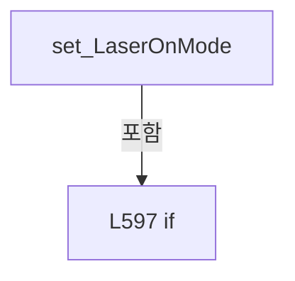

변경 전 점검: 입력/반환 타입, 위 호출자, 예외/취소 경로, 공유 상태와 저장·전송 소비자를 함께 확인합니다. 값의 단위나 물리 방향을 이름만으로 확정하지 않습니다.

### PropertyDeclaration `IsLaserTimeMode` · L606–612

[Drilling.UI/Menu/Menus/CMenuManual.cs:606–612](https://github.com/kjuws10-rgb/A3Drilling/blob/5aee8e58439c9b455cae7c9593c9be986c3e682e/Drilling.UI/Menu/Menus/CMenuManual.cs#L606-L612)

| 항목 | 실제 추출 값 |
| --- | --- |
| 서명 | bool Drilling.UI.Menu.Menus.CMenuManual.IsLaserTimeMode |
| 접근/수식자 | Public / public |
| 반환/값 타입 | bool |
| 소속 타입 | NamedType:Drilling.UI.Menu.Menus.CMenuManual |

현재 부분 분석에서 직접 연결된 호출자는 없습니다. XAML/이벤트/인터페이스·델리게이트·외부 진입을 추가 확인해야 하며, 미사용으로 판정한 것이 아닙니다.

변경 전 점검: 입력/반환 타입, 위 호출자, 예외/취소 경로, 공유 상태와 저장·전송 소비자를 함께 확인합니다. 값의 단위나 물리 방향을 이름만으로 확정하지 않습니다.

### GetAccessorDeclaration `get_IsLaserTimeMode` · L608–611

[Drilling.UI/Menu/Menus/CMenuManual.cs:608–611](https://github.com/kjuws10-rgb/A3Drilling/blob/5aee8e58439c9b455cae7c9593c9be986c3e682e/Drilling.UI/Menu/Menus/CMenuManual.cs#L608-L611)

| 항목 | 실제 추출 값 |
| --- | --- |
| 서명 | bool Drilling.UI.Menu.Menus.CMenuManual.IsLaserTimeMode.get |
| 접근/수식자 | Public / get |
| 반환/값 타입 | bool |
| 소속 타입 | NamedType:Drilling.UI.Menu.Menus.CMenuManual |

현재 부분 분석에서 직접 연결된 호출자는 없습니다. XAML/이벤트/인터페이스·델리게이트·외부 진입을 추가 확인해야 하며, 미사용으로 판정한 것이 아닙니다.

호출하는 대상과 해석 범위:

| 원본 행 | 표현식 | 분석 상태 | 대상/소스 위치 |
| --- | --- | --- | --- |
| 610 | IsLaserTimeModeValue | resolved | bool Drilling.UI.Menu.Menus.CMenuManual.IsLaserTimeModeValue(string?) · Drilling.UI/Menu/Menus/CMenuManual.cs:6044 |

본문의 실제 연산·분기·예외·반환 순서(원문 위치 순):

| 원본 행 | 종류 | 주석 해설 |
| --- | --- | --- |
| 610 | call | 함수·델리게이트 또는 객체 생성자를 호출합니다: IsLaserTimeModeValue(LaserOnMode) |
| 610 | return | 호출자에게 값 또는 제어를 반환합니다: return IsLaserTimeModeValue(LaserOnMode); |

변경 전 점검: 입력/반환 타입, 위 호출자, 예외/취소 경로, 공유 상태와 저장·전송 소비자를 함께 확인합니다. 값의 단위나 물리 방향을 이름만으로 확정하지 않습니다.

### PropertyDeclaration `IsLaserCountMode` · L614–620

[Drilling.UI/Menu/Menus/CMenuManual.cs:614–620](https://github.com/kjuws10-rgb/A3Drilling/blob/5aee8e58439c9b455cae7c9593c9be986c3e682e/Drilling.UI/Menu/Menus/CMenuManual.cs#L614-L620)

| 항목 | 실제 추출 값 |
| --- | --- |
| 서명 | bool Drilling.UI.Menu.Menus.CMenuManual.IsLaserCountMode |
| 접근/수식자 | Public / public |
| 반환/값 타입 | bool |
| 소속 타입 | NamedType:Drilling.UI.Menu.Menus.CMenuManual |

현재 부분 분석에서 직접 연결된 호출자는 없습니다. XAML/이벤트/인터페이스·델리게이트·외부 진입을 추가 확인해야 하며, 미사용으로 판정한 것이 아닙니다.

변경 전 점검: 입력/반환 타입, 위 호출자, 예외/취소 경로, 공유 상태와 저장·전송 소비자를 함께 확인합니다. 값의 단위나 물리 방향을 이름만으로 확정하지 않습니다.

### GetAccessorDeclaration `get_IsLaserCountMode` · L616–619

[Drilling.UI/Menu/Menus/CMenuManual.cs:616–619](https://github.com/kjuws10-rgb/A3Drilling/blob/5aee8e58439c9b455cae7c9593c9be986c3e682e/Drilling.UI/Menu/Menus/CMenuManual.cs#L616-L619)

| 항목 | 실제 추출 값 |
| --- | --- |
| 서명 | bool Drilling.UI.Menu.Menus.CMenuManual.IsLaserCountMode.get |
| 접근/수식자 | Public / get |
| 반환/값 타입 | bool |
| 소속 타입 | NamedType:Drilling.UI.Menu.Menus.CMenuManual |

현재 부분 분석에서 직접 연결된 호출자는 없습니다. XAML/이벤트/인터페이스·델리게이트·외부 진입을 추가 확인해야 하며, 미사용으로 판정한 것이 아닙니다.

본문의 실제 연산·분기·예외·반환 순서(원문 위치 순):

| 원본 행 | 종류 | 주석 해설 |
| --- | --- | --- |
| 618 | return | 호출자에게 값 또는 제어를 반환합니다: return !IsLaserTimeMode; |

변경 전 점검: 입력/반환 타입, 위 호출자, 예외/취소 경로, 공유 상태와 저장·전송 소비자를 함께 확인합니다. 값의 단위나 물리 방향을 이름만으로 확정하지 않습니다.

### PropertyDeclaration `LaserOnTimeMsec` · L622–633

[Drilling.UI/Menu/Menus/CMenuManual.cs:622–633](https://github.com/kjuws10-rgb/A3Drilling/blob/5aee8e58439c9b455cae7c9593c9be986c3e682e/Drilling.UI/Menu/Menus/CMenuManual.cs#L622-L633)

| 항목 | 실제 추출 값 |
| --- | --- |
| 서명 | string Drilling.UI.Menu.Menus.CMenuManual.LaserOnTimeMsec |
| 접근/수식자 | Public / public |
| 반환/값 타입 | string |
| 소속 타입 | NamedType:Drilling.UI.Menu.Menus.CMenuManual |

현재 부분 분석에서 직접 연결된 호출자는 없습니다. XAML/이벤트/인터페이스·델리게이트·외부 진입을 추가 확인해야 하며, 미사용으로 판정한 것이 아닙니다.

변경 전 점검: 입력/반환 타입, 위 호출자, 예외/취소 경로, 공유 상태와 저장·전송 소비자를 함께 확인합니다. 값의 단위나 물리 방향을 이름만으로 확정하지 않습니다.

### GetAccessorDeclaration `get_LaserOnTimeMsec` · L624–627

[Drilling.UI/Menu/Menus/CMenuManual.cs:624–627](https://github.com/kjuws10-rgb/A3Drilling/blob/5aee8e58439c9b455cae7c9593c9be986c3e682e/Drilling.UI/Menu/Menus/CMenuManual.cs#L624-L627)

| 항목 | 실제 추출 값 |
| --- | --- |
| 서명 | string Drilling.UI.Menu.Menus.CMenuManual.LaserOnTimeMsec.get |
| 접근/수식자 | Public / get |
| 반환/값 타입 | string |
| 소속 타입 | NamedType:Drilling.UI.Menu.Menus.CMenuManual |

현재 부분 분석에서 직접 연결된 호출자는 없습니다. XAML/이벤트/인터페이스·델리게이트·외부 진입을 추가 확인해야 하며, 미사용으로 판정한 것이 아닙니다.

본문의 실제 연산·분기·예외·반환 순서(원문 위치 순):

| 원본 행 | 종류 | 주석 해설 |
| --- | --- | --- |
| 626 | return | 호출자에게 값 또는 제어를 반환합니다: return _laserOnTimeMsec; |

변경 전 점검: 입력/반환 타입, 위 호출자, 예외/취소 경로, 공유 상태와 저장·전송 소비자를 함께 확인합니다. 값의 단위나 물리 방향을 이름만으로 확정하지 않습니다.

### SetAccessorDeclaration `set_LaserOnTimeMsec` · L629–632

[Drilling.UI/Menu/Menus/CMenuManual.cs:629–632](https://github.com/kjuws10-rgb/A3Drilling/blob/5aee8e58439c9b455cae7c9593c9be986c3e682e/Drilling.UI/Menu/Menus/CMenuManual.cs#L629-L632)

| 항목 | 실제 추출 값 |
| --- | --- |
| 서명 | void Drilling.UI.Menu.Menus.CMenuManual.LaserOnTimeMsec.set |
| 접근/수식자 | Public / set |
| 반환/값 타입 | void |
| 소속 타입 | NamedType:Drilling.UI.Menu.Menus.CMenuManual |

입력 계약:

| 이름 | 타입 | 전달 | 선택/기본값 |
| --- | --- | --- | --- |
| value | string | None | False /  |

현재 부분 분석에서 직접 연결된 호출자는 없습니다. XAML/이벤트/인터페이스·델리게이트·외부 진입을 추가 확인해야 하며, 미사용으로 판정한 것이 아닙니다.

호출하는 대상과 해석 범위:

| 원본 행 | 표현식 | 분석 상태 | 대상/소스 위치 |
| --- | --- | --- | --- |
| 631 | SetProperty | resolved | bool Drilling.UI.Menu.CBindingBase.SetProperty<string>(ref string, string, string?) · Drilling.UI/Menu/CBindingBase.cs:735 |

본문의 실제 연산·분기·예외·반환 순서(원문 위치 순):

| 원본 행 | 종류 | 주석 해설 |
| --- | --- | --- |
| 631 | call | 함수·델리게이트 또는 객체 생성자를 호출합니다: SetProperty(ref _laserOnTimeMsec, value) |

변경 전 점검: 입력/반환 타입, 위 호출자, 예외/취소 경로, 공유 상태와 저장·전송 소비자를 함께 확인합니다. 값의 단위나 물리 방향을 이름만으로 확정하지 않습니다.

### PropertyDeclaration `LaserShotCount` · L635–646

[Drilling.UI/Menu/Menus/CMenuManual.cs:635–646](https://github.com/kjuws10-rgb/A3Drilling/blob/5aee8e58439c9b455cae7c9593c9be986c3e682e/Drilling.UI/Menu/Menus/CMenuManual.cs#L635-L646)

| 항목 | 실제 추출 값 |
| --- | --- |
| 서명 | string Drilling.UI.Menu.Menus.CMenuManual.LaserShotCount |
| 접근/수식자 | Public / public |
| 반환/값 타입 | string |
| 소속 타입 | NamedType:Drilling.UI.Menu.Menus.CMenuManual |

현재 부분 분석에서 직접 연결된 호출자는 없습니다. XAML/이벤트/인터페이스·델리게이트·외부 진입을 추가 확인해야 하며, 미사용으로 판정한 것이 아닙니다.

변경 전 점검: 입력/반환 타입, 위 호출자, 예외/취소 경로, 공유 상태와 저장·전송 소비자를 함께 확인합니다. 값의 단위나 물리 방향을 이름만으로 확정하지 않습니다.

### GetAccessorDeclaration `get_LaserShotCount` · L637–640

[Drilling.UI/Menu/Menus/CMenuManual.cs:637–640](https://github.com/kjuws10-rgb/A3Drilling/blob/5aee8e58439c9b455cae7c9593c9be986c3e682e/Drilling.UI/Menu/Menus/CMenuManual.cs#L637-L640)

| 항목 | 실제 추출 값 |
| --- | --- |
| 서명 | string Drilling.UI.Menu.Menus.CMenuManual.LaserShotCount.get |
| 접근/수식자 | Public / get |
| 반환/값 타입 | string |
| 소속 타입 | NamedType:Drilling.UI.Menu.Menus.CMenuManual |

현재 부분 분석에서 직접 연결된 호출자는 없습니다. XAML/이벤트/인터페이스·델리게이트·외부 진입을 추가 확인해야 하며, 미사용으로 판정한 것이 아닙니다.

본문의 실제 연산·분기·예외·반환 순서(원문 위치 순):

| 원본 행 | 종류 | 주석 해설 |
| --- | --- | --- |
| 639 | return | 호출자에게 값 또는 제어를 반환합니다: return _laserShotCount; |

변경 전 점검: 입력/반환 타입, 위 호출자, 예외/취소 경로, 공유 상태와 저장·전송 소비자를 함께 확인합니다. 값의 단위나 물리 방향을 이름만으로 확정하지 않습니다.

### SetAccessorDeclaration `set_LaserShotCount` · L642–645

[Drilling.UI/Menu/Menus/CMenuManual.cs:642–645](https://github.com/kjuws10-rgb/A3Drilling/blob/5aee8e58439c9b455cae7c9593c9be986c3e682e/Drilling.UI/Menu/Menus/CMenuManual.cs#L642-L645)

| 항목 | 실제 추출 값 |
| --- | --- |
| 서명 | void Drilling.UI.Menu.Menus.CMenuManual.LaserShotCount.set |
| 접근/수식자 | Public / set |
| 반환/값 타입 | void |
| 소속 타입 | NamedType:Drilling.UI.Menu.Menus.CMenuManual |

입력 계약:

| 이름 | 타입 | 전달 | 선택/기본값 |
| --- | --- | --- | --- |
| value | string | None | False /  |

현재 부분 분석에서 직접 연결된 호출자는 없습니다. XAML/이벤트/인터페이스·델리게이트·외부 진입을 추가 확인해야 하며, 미사용으로 판정한 것이 아닙니다.

호출하는 대상과 해석 범위:

| 원본 행 | 표현식 | 분석 상태 | 대상/소스 위치 |
| --- | --- | --- | --- |
| 644 | SetProperty | resolved | bool Drilling.UI.Menu.CBindingBase.SetProperty<string>(ref string, string, string?) · Drilling.UI/Menu/CBindingBase.cs:735 |

본문의 실제 연산·분기·예외·반환 순서(원문 위치 순):

| 원본 행 | 종류 | 주석 해설 |
| --- | --- | --- |
| 644 | call | 함수·델리게이트 또는 객체 생성자를 호출합니다: SetProperty(ref _laserShotCount, value) |

변경 전 점검: 입력/반환 타입, 위 호출자, 예외/취소 경로, 공유 상태와 저장·전송 소비자를 함께 확인합니다. 값의 단위나 물리 방향을 이름만으로 확정하지 않습니다.

### PropertyDeclaration `LaserRepeatCount` · L648–648

[Drilling.UI/Menu/Menus/CMenuManual.cs:648–648](https://github.com/kjuws10-rgb/A3Drilling/blob/5aee8e58439c9b455cae7c9593c9be986c3e682e/Drilling.UI/Menu/Menus/CMenuManual.cs#L648-L648)

| 항목 | 실제 추출 값 |
| --- | --- |
| 서명 | string Drilling.UI.Menu.Menus.CMenuManual.LaserRepeatCount |
| 접근/수식자 | Public / public |
| 반환/값 타입 | string |
| 소속 타입 | NamedType:Drilling.UI.Menu.Menus.CMenuManual |

현재 부분 분석에서 직접 연결된 호출자는 없습니다. XAML/이벤트/인터페이스·델리게이트·외부 진입을 추가 확인해야 하며, 미사용으로 판정한 것이 아닙니다.

변경 전 점검: 입력/반환 타입, 위 호출자, 예외/취소 경로, 공유 상태와 저장·전송 소비자를 함께 확인합니다. 값의 단위나 물리 방향을 이름만으로 확정하지 않습니다.

### GetAccessorDeclaration `get_LaserRepeatCount` · L648–648

[Drilling.UI/Menu/Menus/CMenuManual.cs:648–648](https://github.com/kjuws10-rgb/A3Drilling/blob/5aee8e58439c9b455cae7c9593c9be986c3e682e/Drilling.UI/Menu/Menus/CMenuManual.cs#L648-L648)

| 항목 | 실제 추출 값 |
| --- | --- |
| 서명 | string Drilling.UI.Menu.Menus.CMenuManual.LaserRepeatCount.get |
| 접근/수식자 | Public / get |
| 반환/값 타입 | string |
| 소속 타입 | NamedType:Drilling.UI.Menu.Menus.CMenuManual |

현재 부분 분석에서 직접 연결된 호출자는 없습니다. XAML/이벤트/인터페이스·델리게이트·외부 진입을 추가 확인해야 하며, 미사용으로 판정한 것이 아닙니다.

변경 전 점검: 입력/반환 타입, 위 호출자, 예외/취소 경로, 공유 상태와 저장·전송 소비자를 함께 확인합니다. 값의 단위나 물리 방향을 이름만으로 확정하지 않습니다.

### SetAccessorDeclaration `set_LaserRepeatCount` · L648–648

[Drilling.UI/Menu/Menus/CMenuManual.cs:648–648](https://github.com/kjuws10-rgb/A3Drilling/blob/5aee8e58439c9b455cae7c9593c9be986c3e682e/Drilling.UI/Menu/Menus/CMenuManual.cs#L648-L648)

| 항목 | 실제 추출 값 |
| --- | --- |
| 서명 | void Drilling.UI.Menu.Menus.CMenuManual.LaserRepeatCount.set |
| 접근/수식자 | Public / set |
| 반환/값 타입 | void |
| 소속 타입 | NamedType:Drilling.UI.Menu.Menus.CMenuManual |

입력 계약:

| 이름 | 타입 | 전달 | 선택/기본값 |
| --- | --- | --- | --- |
| value | string | None | False /  |

현재 부분 분석에서 직접 연결된 호출자는 없습니다. XAML/이벤트/인터페이스·델리게이트·외부 진입을 추가 확인해야 하며, 미사용으로 판정한 것이 아닙니다.

호출하는 대상과 해석 범위:

| 원본 행 | 표현식 | 분석 상태 | 대상/소스 위치 |
| --- | --- | --- | --- |
| 648 | SetProperty | resolved | bool Drilling.UI.Menu.CBindingBase.SetProperty<string>(ref string, string, string?) · Drilling.UI/Menu/CBindingBase.cs:735 |

본문의 실제 연산·분기·예외·반환 순서(원문 위치 순):

| 원본 행 | 종류 | 주석 해설 |
| --- | --- | --- |
| 648 | call | 함수·델리게이트 또는 객체 생성자를 호출합니다: SetProperty(ref _laserRepeatCount, value) |

변경 전 점검: 입력/반환 타입, 위 호출자, 예외/취소 경로, 공유 상태와 저장·전송 소비자를 함께 확인합니다. 값의 단위나 물리 방향을 이름만으로 확정하지 않습니다.

### PropertyDeclaration `LaserRepeatDelayTimeMsec` · L649–649

[Drilling.UI/Menu/Menus/CMenuManual.cs:649–649](https://github.com/kjuws10-rgb/A3Drilling/blob/5aee8e58439c9b455cae7c9593c9be986c3e682e/Drilling.UI/Menu/Menus/CMenuManual.cs#L649-L649)

| 항목 | 실제 추출 값 |
| --- | --- |
| 서명 | string Drilling.UI.Menu.Menus.CMenuManual.LaserRepeatDelayTimeMsec |
| 접근/수식자 | Public / public |
| 반환/값 타입 | string |
| 소속 타입 | NamedType:Drilling.UI.Menu.Menus.CMenuManual |

현재 부분 분석에서 직접 연결된 호출자는 없습니다. XAML/이벤트/인터페이스·델리게이트·외부 진입을 추가 확인해야 하며, 미사용으로 판정한 것이 아닙니다.

변경 전 점검: 입력/반환 타입, 위 호출자, 예외/취소 경로, 공유 상태와 저장·전송 소비자를 함께 확인합니다. 값의 단위나 물리 방향을 이름만으로 확정하지 않습니다.

### GetAccessorDeclaration `get_LaserRepeatDelayTimeMsec` · L649–649

[Drilling.UI/Menu/Menus/CMenuManual.cs:649–649](https://github.com/kjuws10-rgb/A3Drilling/blob/5aee8e58439c9b455cae7c9593c9be986c3e682e/Drilling.UI/Menu/Menus/CMenuManual.cs#L649-L649)

| 항목 | 실제 추출 값 |
| --- | --- |
| 서명 | string Drilling.UI.Menu.Menus.CMenuManual.LaserRepeatDelayTimeMsec.get |
| 접근/수식자 | Public / get |
| 반환/값 타입 | string |
| 소속 타입 | NamedType:Drilling.UI.Menu.Menus.CMenuManual |

현재 부분 분석에서 직접 연결된 호출자는 없습니다. XAML/이벤트/인터페이스·델리게이트·외부 진입을 추가 확인해야 하며, 미사용으로 판정한 것이 아닙니다.

변경 전 점검: 입력/반환 타입, 위 호출자, 예외/취소 경로, 공유 상태와 저장·전송 소비자를 함께 확인합니다. 값의 단위나 물리 방향을 이름만으로 확정하지 않습니다.

### SetAccessorDeclaration `set_LaserRepeatDelayTimeMsec` · L649–649

[Drilling.UI/Menu/Menus/CMenuManual.cs:649–649](https://github.com/kjuws10-rgb/A3Drilling/blob/5aee8e58439c9b455cae7c9593c9be986c3e682e/Drilling.UI/Menu/Menus/CMenuManual.cs#L649-L649)

| 항목 | 실제 추출 값 |
| --- | --- |
| 서명 | void Drilling.UI.Menu.Menus.CMenuManual.LaserRepeatDelayTimeMsec.set |
| 접근/수식자 | Public / set |
| 반환/값 타입 | void |
| 소속 타입 | NamedType:Drilling.UI.Menu.Menus.CMenuManual |

입력 계약:

| 이름 | 타입 | 전달 | 선택/기본값 |
| --- | --- | --- | --- |
| value | string | None | False /  |

현재 부분 분석에서 직접 연결된 호출자는 없습니다. XAML/이벤트/인터페이스·델리게이트·외부 진입을 추가 확인해야 하며, 미사용으로 판정한 것이 아닙니다.

호출하는 대상과 해석 범위:

| 원본 행 | 표현식 | 분석 상태 | 대상/소스 위치 |
| --- | --- | --- | --- |
| 649 | SetProperty | resolved | bool Drilling.UI.Menu.CBindingBase.SetProperty<string>(ref string, string, string?) · Drilling.UI/Menu/CBindingBase.cs:735 |

본문의 실제 연산·분기·예외·반환 순서(원문 위치 순):

| 원본 행 | 종류 | 주석 해설 |
| --- | --- | --- |
| 649 | call | 함수·델리게이트 또는 객체 생성자를 호출합니다: SetProperty(ref _laserRepeatDelayTimeMsec, value) |

변경 전 점검: 입력/반환 타입, 위 호출자, 예외/취소 경로, 공유 상태와 저장·전송 소비자를 함께 확인합니다. 값의 단위나 물리 방향을 이름만으로 확정하지 않습니다.

### PropertyDeclaration `HeadGroups` · L651–662

[Drilling.UI/Menu/Menus/CMenuManual.cs:651–662](https://github.com/kjuws10-rgb/A3Drilling/blob/5aee8e58439c9b455cae7c9593c9be986c3e682e/Drilling.UI/Menu/Menus/CMenuManual.cs#L651-L662)

| 항목 | 실제 추출 값 |
| --- | --- |
| 서명 | System.Collections.Generic.IReadOnlyList<Drilling.UI.Menu.Menus.ST_MANUAL_HEAD_GROUP> Drilling.UI.Menu.Menus.CMenuManual.HeadGroups |
| 접근/수식자 | Public / public |
| 반환/값 타입 | System.Collections.Generic.IReadOnlyList<Drilling.UI.Menu.Menus.ST_MANUAL_HEAD_GROUP> |
| 소속 타입 | NamedType:Drilling.UI.Menu.Menus.CMenuManual |

현재 부분 분석에서 직접 연결된 호출자는 없습니다. XAML/이벤트/인터페이스·델리게이트·외부 진입을 추가 확인해야 하며, 미사용으로 판정한 것이 아닙니다.

변경 전 점검: 입력/반환 타입, 위 호출자, 예외/취소 경로, 공유 상태와 저장·전송 소비자를 함께 확인합니다. 값의 단위나 물리 방향을 이름만으로 확정하지 않습니다.

### GetAccessorDeclaration `get_HeadGroups` · L653–656

[Drilling.UI/Menu/Menus/CMenuManual.cs:653–656](https://github.com/kjuws10-rgb/A3Drilling/blob/5aee8e58439c9b455cae7c9593c9be986c3e682e/Drilling.UI/Menu/Menus/CMenuManual.cs#L653-L656)

| 항목 | 실제 추출 값 |
| --- | --- |
| 서명 | System.Collections.Generic.IReadOnlyList<Drilling.UI.Menu.Menus.ST_MANUAL_HEAD_GROUP> Drilling.UI.Menu.Menus.CMenuManual.HeadGroups.get |
| 접근/수식자 | Public / get |
| 반환/값 타입 | System.Collections.Generic.IReadOnlyList<Drilling.UI.Menu.Menus.ST_MANUAL_HEAD_GROUP> |
| 소속 타입 | NamedType:Drilling.UI.Menu.Menus.CMenuManual |

현재 부분 분석에서 직접 연결된 호출자는 없습니다. XAML/이벤트/인터페이스·델리게이트·외부 진입을 추가 확인해야 하며, 미사용으로 판정한 것이 아닙니다.

본문의 실제 연산·분기·예외·반환 순서(원문 위치 순):

| 원본 행 | 종류 | 주석 해설 |
| --- | --- | --- |
| 655 | return | 호출자에게 값 또는 제어를 반환합니다: return _headGroups; |

변경 전 점검: 입력/반환 타입, 위 호출자, 예외/취소 경로, 공유 상태와 저장·전송 소비자를 함께 확인합니다. 값의 단위나 물리 방향을 이름만으로 확정하지 않습니다.

### SetAccessorDeclaration `set_HeadGroups` · L658–661

[Drilling.UI/Menu/Menus/CMenuManual.cs:658–661](https://github.com/kjuws10-rgb/A3Drilling/blob/5aee8e58439c9b455cae7c9593c9be986c3e682e/Drilling.UI/Menu/Menus/CMenuManual.cs#L658-L661)

| 항목 | 실제 추출 값 |
| --- | --- |
| 서명 | void Drilling.UI.Menu.Menus.CMenuManual.HeadGroups.set |
| 접근/수식자 | Private / private, set |
| 반환/값 타입 | void |
| 소속 타입 | NamedType:Drilling.UI.Menu.Menus.CMenuManual |

입력 계약:

| 이름 | 타입 | 전달 | 선택/기본값 |
| --- | --- | --- | --- |
| value | System.Collections.Generic.IReadOnlyList<Drilling.UI.Menu.Menus.ST_MANUAL_HEAD_GROUP> | None | False /  |

현재 부분 분석에서 직접 연결된 호출자는 없습니다. XAML/이벤트/인터페이스·델리게이트·외부 진입을 추가 확인해야 하며, 미사용으로 판정한 것이 아닙니다.

호출하는 대상과 해석 범위:

| 원본 행 | 표현식 | 분석 상태 | 대상/소스 위치 |
| --- | --- | --- | --- |
| 660 | SetSequenceProperty | resolved | bool Drilling.UI.Menu.CBindingBase.SetSequenceProperty<Drilling.UI.Menu.Menus.ST_MANUAL_HEAD_GROUP>(ref System.Collections.Generic.IReadOnlyList<Drilling.UI.Menu.Menus.ST_MANUAL_HEAD_GROUP>, System.Collections.Generic.IReadOnlyList<Drilling.UI.Menu.Menus.ST_MANUAL_HEAD_GROUP>, string?) · Drilling.UI/Menu/CBindingBase.cs:747 |

본문의 실제 연산·분기·예외·반환 순서(원문 위치 순):

| 원본 행 | 종류 | 주석 해설 |
| --- | --- | --- |
| 660 | call | 함수·델리게이트 또는 객체 생성자를 호출합니다: SetSequenceProperty(ref _headGroups, value) |

변경 전 점검: 입력/반환 타입, 위 호출자, 예외/취소 경로, 공유 상태와 저장·전송 소비자를 함께 확인합니다. 값의 단위나 물리 방향을 이름만으로 확정하지 않습니다.

### PropertyDeclaration `SettingFiles` · L664–675

[Drilling.UI/Menu/Menus/CMenuManual.cs:664–675](https://github.com/kjuws10-rgb/A3Drilling/blob/5aee8e58439c9b455cae7c9593c9be986c3e682e/Drilling.UI/Menu/Menus/CMenuManual.cs#L664-L675)

| 항목 | 실제 추출 값 |
| --- | --- |
| 서명 | System.Collections.Generic.IReadOnlyList<Drilling.UI.Menu.Menus.ST_MANUAL_SETTING_FILE> Drilling.UI.Menu.Menus.CMenuManual.SettingFiles |
| 접근/수식자 | Public / public |
| 반환/값 타입 | System.Collections.Generic.IReadOnlyList<Drilling.UI.Menu.Menus.ST_MANUAL_SETTING_FILE> |
| 소속 타입 | NamedType:Drilling.UI.Menu.Menus.CMenuManual |

현재 부분 분석에서 직접 연결된 호출자는 없습니다. XAML/이벤트/인터페이스·델리게이트·외부 진입을 추가 확인해야 하며, 미사용으로 판정한 것이 아닙니다.

변경 전 점검: 입력/반환 타입, 위 호출자, 예외/취소 경로, 공유 상태와 저장·전송 소비자를 함께 확인합니다. 값의 단위나 물리 방향을 이름만으로 확정하지 않습니다.

### GetAccessorDeclaration `get_SettingFiles` · L666–669

[Drilling.UI/Menu/Menus/CMenuManual.cs:666–669](https://github.com/kjuws10-rgb/A3Drilling/blob/5aee8e58439c9b455cae7c9593c9be986c3e682e/Drilling.UI/Menu/Menus/CMenuManual.cs#L666-L669)

| 항목 | 실제 추출 값 |
| --- | --- |
| 서명 | System.Collections.Generic.IReadOnlyList<Drilling.UI.Menu.Menus.ST_MANUAL_SETTING_FILE> Drilling.UI.Menu.Menus.CMenuManual.SettingFiles.get |
| 접근/수식자 | Public / get |
| 반환/값 타입 | System.Collections.Generic.IReadOnlyList<Drilling.UI.Menu.Menus.ST_MANUAL_SETTING_FILE> |
| 소속 타입 | NamedType:Drilling.UI.Menu.Menus.CMenuManual |

현재 부분 분석에서 직접 연결된 호출자는 없습니다. XAML/이벤트/인터페이스·델리게이트·외부 진입을 추가 확인해야 하며, 미사용으로 판정한 것이 아닙니다.

본문의 실제 연산·분기·예외·반환 순서(원문 위치 순):

| 원본 행 | 종류 | 주석 해설 |
| --- | --- | --- |
| 668 | return | 호출자에게 값 또는 제어를 반환합니다: return _settingFiles; |

변경 전 점검: 입력/반환 타입, 위 호출자, 예외/취소 경로, 공유 상태와 저장·전송 소비자를 함께 확인합니다. 값의 단위나 물리 방향을 이름만으로 확정하지 않습니다.

### SetAccessorDeclaration `set_SettingFiles` · L671–674

[Drilling.UI/Menu/Menus/CMenuManual.cs:671–674](https://github.com/kjuws10-rgb/A3Drilling/blob/5aee8e58439c9b455cae7c9593c9be986c3e682e/Drilling.UI/Menu/Menus/CMenuManual.cs#L671-L674)

| 항목 | 실제 추출 값 |
| --- | --- |
| 서명 | void Drilling.UI.Menu.Menus.CMenuManual.SettingFiles.set |
| 접근/수식자 | Private / private, set |
| 반환/값 타입 | void |
| 소속 타입 | NamedType:Drilling.UI.Menu.Menus.CMenuManual |

입력 계약:

| 이름 | 타입 | 전달 | 선택/기본값 |
| --- | --- | --- | --- |
| value | System.Collections.Generic.IReadOnlyList<Drilling.UI.Menu.Menus.ST_MANUAL_SETTING_FILE> | None | False /  |

현재 부분 분석에서 직접 연결된 호출자는 없습니다. XAML/이벤트/인터페이스·델리게이트·외부 진입을 추가 확인해야 하며, 미사용으로 판정한 것이 아닙니다.

호출하는 대상과 해석 범위:

| 원본 행 | 표현식 | 분석 상태 | 대상/소스 위치 |
| --- | --- | --- | --- |
| 673 | SetSequenceProperty | resolved | bool Drilling.UI.Menu.CBindingBase.SetSequenceProperty<Drilling.UI.Menu.Menus.ST_MANUAL_SETTING_FILE>(ref System.Collections.Generic.IReadOnlyList<Drilling.UI.Menu.Menus.ST_MANUAL_SETTING_FILE>, System.Collections.Generic.IReadOnlyList<Drilling.UI.Menu.Menus.ST_MANUAL_SETTING_FILE>, string?) · Drilling.UI/Menu/CBindingBase.cs:747 |

본문의 실제 연산·분기·예외·반환 순서(원문 위치 순):

| 원본 행 | 종류 | 주석 해설 |
| --- | --- | --- |
| 673 | call | 함수·델리게이트 또는 객체 생성자를 호출합니다: SetSequenceProperty(ref _settingFiles, value) |

변경 전 점검: 입력/반환 타입, 위 호출자, 예외/취소 경로, 공유 상태와 저장·전송 소비자를 함께 확인합니다. 값의 단위나 물리 방향을 이름만으로 확정하지 않습니다.

### PropertyDeclaration `SettingFilesPageText` · L677–688

[Drilling.UI/Menu/Menus/CMenuManual.cs:677–688](https://github.com/kjuws10-rgb/A3Drilling/blob/5aee8e58439c9b455cae7c9593c9be986c3e682e/Drilling.UI/Menu/Menus/CMenuManual.cs#L677-L688)

| 항목 | 실제 추출 값 |
| --- | --- |
| 서명 | string Drilling.UI.Menu.Menus.CMenuManual.SettingFilesPageText |
| 접근/수식자 | Public / public |
| 반환/값 타입 | string |
| 소속 타입 | NamedType:Drilling.UI.Menu.Menus.CMenuManual |

현재 부분 분석에서 직접 연결된 호출자는 없습니다. XAML/이벤트/인터페이스·델리게이트·외부 진입을 추가 확인해야 하며, 미사용으로 판정한 것이 아닙니다.

변경 전 점검: 입력/반환 타입, 위 호출자, 예외/취소 경로, 공유 상태와 저장·전송 소비자를 함께 확인합니다. 값의 단위나 물리 방향을 이름만으로 확정하지 않습니다.

### GetAccessorDeclaration `get_SettingFilesPageText` · L679–682

[Drilling.UI/Menu/Menus/CMenuManual.cs:679–682](https://github.com/kjuws10-rgb/A3Drilling/blob/5aee8e58439c9b455cae7c9593c9be986c3e682e/Drilling.UI/Menu/Menus/CMenuManual.cs#L679-L682)

| 항목 | 실제 추출 값 |
| --- | --- |
| 서명 | string Drilling.UI.Menu.Menus.CMenuManual.SettingFilesPageText.get |
| 접근/수식자 | Public / get |
| 반환/값 타입 | string |
| 소속 타입 | NamedType:Drilling.UI.Menu.Menus.CMenuManual |

현재 부분 분석에서 직접 연결된 호출자는 없습니다. XAML/이벤트/인터페이스·델리게이트·외부 진입을 추가 확인해야 하며, 미사용으로 판정한 것이 아닙니다.

본문의 실제 연산·분기·예외·반환 순서(원문 위치 순):

| 원본 행 | 종류 | 주석 해설 |
| --- | --- | --- |
| 681 | return | 호출자에게 값 또는 제어를 반환합니다: return _settingFilesPageText; |

변경 전 점검: 입력/반환 타입, 위 호출자, 예외/취소 경로, 공유 상태와 저장·전송 소비자를 함께 확인합니다. 값의 단위나 물리 방향을 이름만으로 확정하지 않습니다.

### SetAccessorDeclaration `set_SettingFilesPageText` · L684–687

[Drilling.UI/Menu/Menus/CMenuManual.cs:684–687](https://github.com/kjuws10-rgb/A3Drilling/blob/5aee8e58439c9b455cae7c9593c9be986c3e682e/Drilling.UI/Menu/Menus/CMenuManual.cs#L684-L687)

| 항목 | 실제 추출 값 |
| --- | --- |
| 서명 | void Drilling.UI.Menu.Menus.CMenuManual.SettingFilesPageText.set |
| 접근/수식자 | Private / private, set |
| 반환/값 타입 | void |
| 소속 타입 | NamedType:Drilling.UI.Menu.Menus.CMenuManual |

입력 계약:

| 이름 | 타입 | 전달 | 선택/기본값 |
| --- | --- | --- | --- |
| value | string | None | False /  |

현재 부분 분석에서 직접 연결된 호출자는 없습니다. XAML/이벤트/인터페이스·델리게이트·외부 진입을 추가 확인해야 하며, 미사용으로 판정한 것이 아닙니다.

호출하는 대상과 해석 범위:

| 원본 행 | 표현식 | 분석 상태 | 대상/소스 위치 |
| --- | --- | --- | --- |
| 686 | SetProperty | resolved | bool Drilling.UI.Menu.CBindingBase.SetProperty<string>(ref string, string, string?) · Drilling.UI/Menu/CBindingBase.cs:735 |

본문의 실제 연산·분기·예외·반환 순서(원문 위치 순):

| 원본 행 | 종류 | 주석 해설 |
| --- | --- | --- |
| 686 | call | 함수·델리게이트 또는 객체 생성자를 호출합니다: SetProperty(ref _settingFilesPageText, value) |

변경 전 점검: 입력/반환 타입, 위 호출자, 예외/취소 경로, 공유 상태와 저장·전송 소비자를 함께 확인합니다. 값의 단위나 물리 방향을 이름만으로 확정하지 않습니다.

### PropertyDeclaration `ScannerAxes` · L690–704

[Drilling.UI/Menu/Menus/CMenuManual.cs:690–704](https://github.com/kjuws10-rgb/A3Drilling/blob/5aee8e58439c9b455cae7c9593c9be986c3e682e/Drilling.UI/Menu/Menus/CMenuManual.cs#L690-L704)

| 항목 | 실제 추출 값 |
| --- | --- |
| 서명 | System.Collections.Generic.IReadOnlyList<Drilling.UI.Menu.Menus.ST_MANUAL_SCANNER_AXIS> Drilling.UI.Menu.Menus.CMenuManual.ScannerAxes |
| 접근/수식자 | Public / public |
| 반환/값 타입 | System.Collections.Generic.IReadOnlyList<Drilling.UI.Menu.Menus.ST_MANUAL_SCANNER_AXIS> |
| 소속 타입 | NamedType:Drilling.UI.Menu.Menus.CMenuManual |

현재 부분 분석에서 직접 연결된 호출자는 없습니다. XAML/이벤트/인터페이스·델리게이트·외부 진입을 추가 확인해야 하며, 미사용으로 판정한 것이 아닙니다.

변경 전 점검: 입력/반환 타입, 위 호출자, 예외/취소 경로, 공유 상태와 저장·전송 소비자를 함께 확인합니다. 값의 단위나 물리 방향을 이름만으로 확정하지 않습니다.

### GetAccessorDeclaration `get_ScannerAxes` · L692–695

[Drilling.UI/Menu/Menus/CMenuManual.cs:692–695](https://github.com/kjuws10-rgb/A3Drilling/blob/5aee8e58439c9b455cae7c9593c9be986c3e682e/Drilling.UI/Menu/Menus/CMenuManual.cs#L692-L695)

| 항목 | 실제 추출 값 |
| --- | --- |
| 서명 | System.Collections.Generic.IReadOnlyList<Drilling.UI.Menu.Menus.ST_MANUAL_SCANNER_AXIS> Drilling.UI.Menu.Menus.CMenuManual.ScannerAxes.get |
| 접근/수식자 | Public / get |
| 반환/값 타입 | System.Collections.Generic.IReadOnlyList<Drilling.UI.Menu.Menus.ST_MANUAL_SCANNER_AXIS> |
| 소속 타입 | NamedType:Drilling.UI.Menu.Menus.CMenuManual |

현재 부분 분석에서 직접 연결된 호출자는 없습니다. XAML/이벤트/인터페이스·델리게이트·외부 진입을 추가 확인해야 하며, 미사용으로 판정한 것이 아닙니다.

본문의 실제 연산·분기·예외·반환 순서(원문 위치 순):

| 원본 행 | 종류 | 주석 해설 |
| --- | --- | --- |
| 694 | return | 호출자에게 값 또는 제어를 반환합니다: return _scannerAxes; |

변경 전 점검: 입력/반환 타입, 위 호출자, 예외/취소 경로, 공유 상태와 저장·전송 소비자를 함께 확인합니다. 값의 단위나 물리 방향을 이름만으로 확정하지 않습니다.

### SetAccessorDeclaration `set_ScannerAxes` · L697–703

[Drilling.UI/Menu/Menus/CMenuManual.cs:697–703](https://github.com/kjuws10-rgb/A3Drilling/blob/5aee8e58439c9b455cae7c9593c9be986c3e682e/Drilling.UI/Menu/Menus/CMenuManual.cs#L697-L703)

| 항목 | 실제 추출 값 |
| --- | --- |
| 서명 | void Drilling.UI.Menu.Menus.CMenuManual.ScannerAxes.set |
| 접근/수식자 | Private / private, set |
| 반환/값 타입 | void |
| 소속 타입 | NamedType:Drilling.UI.Menu.Menus.CMenuManual |

입력 계약:

| 이름 | 타입 | 전달 | 선택/기본값 |
| --- | --- | --- | --- |
| value | System.Collections.Generic.IReadOnlyList<Drilling.UI.Menu.Menus.ST_MANUAL_SCANNER_AXIS> | None | False /  |

현재 부분 분석에서 직접 연결된 호출자는 없습니다. XAML/이벤트/인터페이스·델리게이트·외부 진입을 추가 확인해야 하며, 미사용으로 판정한 것이 아닙니다.

호출하는 대상과 해석 범위:

| 원본 행 | 표현식 | 분석 상태 | 대상/소스 위치 |
| --- | --- | --- | --- |
| 699 | SetSequenceProperty | resolved | bool Drilling.UI.Menu.CBindingBase.SetSequenceProperty<Drilling.UI.Menu.Menus.ST_MANUAL_SCANNER_AXIS>(ref System.Collections.Generic.IReadOnlyList<Drilling.UI.Menu.Menus.ST_MANUAL_SCANNER_AXIS>, System.Collections.Generic.IReadOnlyList<Drilling.UI.Menu.Menus.ST_MANUAL_SCANNER_AXIS>, string?) · Drilling.UI/Menu/CBindingBase.cs:747 |
| 701 | OnPropertyChanged | resolved | void Drilling.UI.Menu.CBindingBase.OnPropertyChanged(string?) · Drilling.UI/Menu/CBindingBase.cs:759 |
| 701 | nameof | unresolved | None |

본문의 실제 연산·분기·예외·반환 순서(원문 위치 순):

| 원본 행 | 종류 | 주석 해설 |
| --- | --- | --- |
| 699 | call | 함수·델리게이트 또는 객체 생성자를 호출합니다: SetSequenceProperty(ref _scannerAxes, value) |
| 699 | if | 조건에 따라 분기합니다: if (SetSequenceProperty(ref _scannerAxes, value)) |
| 701 | call | 함수·델리게이트 또는 객체 생성자를 호출합니다: OnPropertyChanged(nameof(IsZPositionMoveEnabled)) |
| 701 | call | 함수·델리게이트 또는 객체 생성자를 호출합니다: nameof(IsZPositionMoveEnabled) |

제어 구문의 포함 구조(실제 실행 순서/CFG가 아닌 구문 탐색 그림):

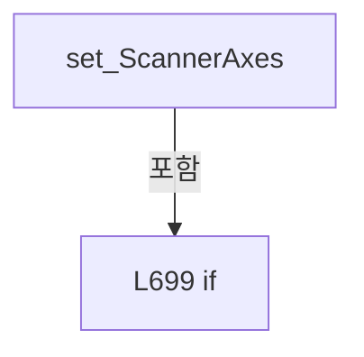

변경 전 점검: 입력/반환 타입, 위 호출자, 예외/취소 경로, 공유 상태와 저장·전송 소비자를 함께 확인합니다. 값의 단위나 물리 방향을 이름만으로 확정하지 않습니다.

### PropertyDeclaration `StageAxes` · L706–706

[Drilling.UI/Menu/Menus/CMenuManual.cs:706–706](https://github.com/kjuws10-rgb/A3Drilling/blob/5aee8e58439c9b455cae7c9593c9be986c3e682e/Drilling.UI/Menu/Menus/CMenuManual.cs#L706-L706)

| 항목 | 실제 추출 값 |
| --- | --- |
| 서명 | System.Collections.Generic.IReadOnlyList<Drilling.UI.Menu.Menus.ST_MANUAL_STAGE_AXIS> Drilling.UI.Menu.Menus.CMenuManual.StageAxes |
| 접근/수식자 | Public / public |
| 반환/값 타입 | System.Collections.Generic.IReadOnlyList<Drilling.UI.Menu.Menus.ST_MANUAL_STAGE_AXIS> |
| 소속 타입 | NamedType:Drilling.UI.Menu.Menus.CMenuManual |

현재 부분 분석에서 직접 연결된 호출자는 없습니다. XAML/이벤트/인터페이스·델리게이트·외부 진입을 추가 확인해야 하며, 미사용으로 판정한 것이 아닙니다.

변경 전 점검: 입력/반환 타입, 위 호출자, 예외/취소 경로, 공유 상태와 저장·전송 소비자를 함께 확인합니다. 값의 단위나 물리 방향을 이름만으로 확정하지 않습니다.

### GetAccessorDeclaration `get_StageAxes` · L706–706

[Drilling.UI/Menu/Menus/CMenuManual.cs:706–706](https://github.com/kjuws10-rgb/A3Drilling/blob/5aee8e58439c9b455cae7c9593c9be986c3e682e/Drilling.UI/Menu/Menus/CMenuManual.cs#L706-L706)

| 항목 | 실제 추출 값 |
| --- | --- |
| 서명 | System.Collections.Generic.IReadOnlyList<Drilling.UI.Menu.Menus.ST_MANUAL_STAGE_AXIS> Drilling.UI.Menu.Menus.CMenuManual.StageAxes.get |
| 접근/수식자 | Public / get |
| 반환/값 타입 | System.Collections.Generic.IReadOnlyList<Drilling.UI.Menu.Menus.ST_MANUAL_STAGE_AXIS> |
| 소속 타입 | NamedType:Drilling.UI.Menu.Menus.CMenuManual |

현재 부분 분석에서 직접 연결된 호출자는 없습니다. XAML/이벤트/인터페이스·델리게이트·외부 진입을 추가 확인해야 하며, 미사용으로 판정한 것이 아닙니다.

변경 전 점검: 입력/반환 타입, 위 호출자, 예외/취소 경로, 공유 상태와 저장·전송 소비자를 함께 확인합니다. 값의 단위나 물리 방향을 이름만으로 확정하지 않습니다.

### PropertyDeclaration `SelectedStageAxis` · L708–722

[Drilling.UI/Menu/Menus/CMenuManual.cs:708–722](https://github.com/kjuws10-rgb/A3Drilling/blob/5aee8e58439c9b455cae7c9593c9be986c3e682e/Drilling.UI/Menu/Menus/CMenuManual.cs#L708-L722)

| 항목 | 실제 추출 값 |
| --- | --- |
| 서명 | Drilling.UI.Menu.Menus.ST_MANUAL_STAGE_AXIS Drilling.UI.Menu.Menus.CMenuManual.SelectedStageAxis |
| 접근/수식자 | Public / public |
| 반환/값 타입 | Drilling.UI.Menu.Menus.ST_MANUAL_STAGE_AXIS |
| 소속 타입 | NamedType:Drilling.UI.Menu.Menus.CMenuManual |

현재 부분 분석에서 직접 연결된 호출자는 없습니다. XAML/이벤트/인터페이스·델리게이트·외부 진입을 추가 확인해야 하며, 미사용으로 판정한 것이 아닙니다.

변경 전 점검: 입력/반환 타입, 위 호출자, 예외/취소 경로, 공유 상태와 저장·전송 소비자를 함께 확인합니다. 값의 단위나 물리 방향을 이름만으로 확정하지 않습니다.

### GetAccessorDeclaration `get_SelectedStageAxis` · L710–713

[Drilling.UI/Menu/Menus/CMenuManual.cs:710–713](https://github.com/kjuws10-rgb/A3Drilling/blob/5aee8e58439c9b455cae7c9593c9be986c3e682e/Drilling.UI/Menu/Menus/CMenuManual.cs#L710-L713)

| 항목 | 실제 추출 값 |
| --- | --- |
| 서명 | Drilling.UI.Menu.Menus.ST_MANUAL_STAGE_AXIS Drilling.UI.Menu.Menus.CMenuManual.SelectedStageAxis.get |
| 접근/수식자 | Public / get |
| 반환/값 타입 | Drilling.UI.Menu.Menus.ST_MANUAL_STAGE_AXIS |
| 소속 타입 | NamedType:Drilling.UI.Menu.Menus.CMenuManual |

현재 부분 분석에서 직접 연결된 호출자는 없습니다. XAML/이벤트/인터페이스·델리게이트·외부 진입을 추가 확인해야 하며, 미사용으로 판정한 것이 아닙니다.

본문의 실제 연산·분기·예외·반환 순서(원문 위치 순):

| 원본 행 | 종류 | 주석 해설 |
| --- | --- | --- |
| 712 | return | 호출자에게 값 또는 제어를 반환합니다: return _selectedStageAxis; |

변경 전 점검: 입력/반환 타입, 위 호출자, 예외/취소 경로, 공유 상태와 저장·전송 소비자를 함께 확인합니다. 값의 단위나 물리 방향을 이름만으로 확정하지 않습니다.

### SetAccessorDeclaration `set_SelectedStageAxis` · L715–721

[Drilling.UI/Menu/Menus/CMenuManual.cs:715–721](https://github.com/kjuws10-rgb/A3Drilling/blob/5aee8e58439c9b455cae7c9593c9be986c3e682e/Drilling.UI/Menu/Menus/CMenuManual.cs#L715-L721)

| 항목 | 실제 추출 값 |
| --- | --- |
| 서명 | void Drilling.UI.Menu.Menus.CMenuManual.SelectedStageAxis.set |
| 접근/수식자 | Private / private, set |
| 반환/값 타입 | void |
| 소속 타입 | NamedType:Drilling.UI.Menu.Menus.CMenuManual |

입력 계약:

| 이름 | 타입 | 전달 | 선택/기본값 |
| --- | --- | --- | --- |
| value | Drilling.UI.Menu.Menus.ST_MANUAL_STAGE_AXIS | None | False /  |

현재 부분 분석에서 직접 연결된 호출자는 없습니다. XAML/이벤트/인터페이스·델리게이트·외부 진입을 추가 확인해야 하며, 미사용으로 판정한 것이 아닙니다.

호출하는 대상과 해석 범위:

| 원본 행 | 표현식 | 분석 상태 | 대상/소스 위치 |
| --- | --- | --- | --- |
| 717 | SetProperty | resolved | bool Drilling.UI.Menu.CBindingBase.SetProperty<Drilling.UI.Menu.Menus.ST_MANUAL_STAGE_AXIS>(ref Drilling.UI.Menu.Menus.ST_MANUAL_STAGE_AXIS, Drilling.UI.Menu.Menus.ST_MANUAL_STAGE_AXIS, string?) · Drilling.UI/Menu/CBindingBase.cs:735 |
| 719 | RefreshStageAxisSelection | resolved | void Drilling.UI.Menu.Menus.CMenuManual.RefreshStageAxisSelection() · Drilling.UI/Menu/Menus/CMenuManual.cs:3964 |

본문의 실제 연산·분기·예외·반환 순서(원문 위치 순):

| 원본 행 | 종류 | 주석 해설 |
| --- | --- | --- |
| 717 | call | 함수·델리게이트 또는 객체 생성자를 호출합니다: SetProperty(ref _selectedStageAxis, value) |
| 717 | if | 조건에 따라 분기합니다: if (SetProperty(ref _selectedStageAxis, value)) |
| 719 | call | 함수·델리게이트 또는 객체 생성자를 호출합니다: RefreshStageAxisSelection() |

제어 구문의 포함 구조(실제 실행 순서/CFG가 아닌 구문 탐색 그림):

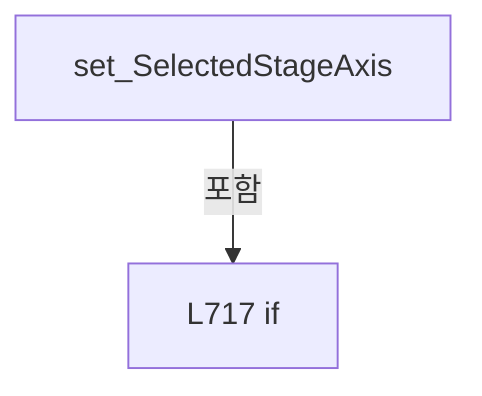

변경 전 점검: 입력/반환 타입, 위 호출자, 예외/취소 경로, 공유 상태와 저장·전송 소비자를 함께 확인합니다. 값의 단위나 물리 방향을 이름만으로 확정하지 않습니다.

### PropertyDeclaration `DioAddress` · L724–735

[Drilling.UI/Menu/Menus/CMenuManual.cs:724–735](https://github.com/kjuws10-rgb/A3Drilling/blob/5aee8e58439c9b455cae7c9593c9be986c3e682e/Drilling.UI/Menu/Menus/CMenuManual.cs#L724-L735)

| 항목 | 실제 추출 값 |
| --- | --- |
| 서명 | string Drilling.UI.Menu.Menus.CMenuManual.DioAddress |
| 접근/수식자 | Public / public |
| 반환/값 타입 | string |
| 소속 타입 | NamedType:Drilling.UI.Menu.Menus.CMenuManual |

현재 부분 분석에서 직접 연결된 호출자는 없습니다. XAML/이벤트/인터페이스·델리게이트·외부 진입을 추가 확인해야 하며, 미사용으로 판정한 것이 아닙니다.

변경 전 점검: 입력/반환 타입, 위 호출자, 예외/취소 경로, 공유 상태와 저장·전송 소비자를 함께 확인합니다. 값의 단위나 물리 방향을 이름만으로 확정하지 않습니다.

### GetAccessorDeclaration `get_DioAddress` · L726–729

[Drilling.UI/Menu/Menus/CMenuManual.cs:726–729](https://github.com/kjuws10-rgb/A3Drilling/blob/5aee8e58439c9b455cae7c9593c9be986c3e682e/Drilling.UI/Menu/Menus/CMenuManual.cs#L726-L729)

| 항목 | 실제 추출 값 |
| --- | --- |
| 서명 | string Drilling.UI.Menu.Menus.CMenuManual.DioAddress.get |
| 접근/수식자 | Public / get |
| 반환/값 타입 | string |
| 소속 타입 | NamedType:Drilling.UI.Menu.Menus.CMenuManual |

현재 부분 분석에서 직접 연결된 호출자는 없습니다. XAML/이벤트/인터페이스·델리게이트·외부 진입을 추가 확인해야 하며, 미사용으로 판정한 것이 아닙니다.

본문의 실제 연산·분기·예외·반환 순서(원문 위치 순):

| 원본 행 | 종류 | 주석 해설 |
| --- | --- | --- |
| 728 | return | 호출자에게 값 또는 제어를 반환합니다: return _dioAddress; |

변경 전 점검: 입력/반환 타입, 위 호출자, 예외/취소 경로, 공유 상태와 저장·전송 소비자를 함께 확인합니다. 값의 단위나 물리 방향을 이름만으로 확정하지 않습니다.

### SetAccessorDeclaration `set_DioAddress` · L731–734

[Drilling.UI/Menu/Menus/CMenuManual.cs:731–734](https://github.com/kjuws10-rgb/A3Drilling/blob/5aee8e58439c9b455cae7c9593c9be986c3e682e/Drilling.UI/Menu/Menus/CMenuManual.cs#L731-L734)

| 항목 | 실제 추출 값 |
| --- | --- |
| 서명 | void Drilling.UI.Menu.Menus.CMenuManual.DioAddress.set |
| 접근/수식자 | Private / private, set |
| 반환/값 타입 | void |
| 소속 타입 | NamedType:Drilling.UI.Menu.Menus.CMenuManual |

입력 계약:

| 이름 | 타입 | 전달 | 선택/기본값 |
| --- | --- | --- | --- |
| value | string | None | False /  |

현재 부분 분석에서 직접 연결된 호출자는 없습니다. XAML/이벤트/인터페이스·델리게이트·외부 진입을 추가 확인해야 하며, 미사용으로 판정한 것이 아닙니다.

호출하는 대상과 해석 범위:

| 원본 행 | 표현식 | 분석 상태 | 대상/소스 위치 |
| --- | --- | --- | --- |
| 733 | SetProperty | resolved | bool Drilling.UI.Menu.CBindingBase.SetProperty<string>(ref string, string, string?) · Drilling.UI/Menu/CBindingBase.cs:735 |

본문의 실제 연산·분기·예외·반환 순서(원문 위치 순):

| 원본 행 | 종류 | 주석 해설 |
| --- | --- | --- |
| 733 | call | 함수·델리게이트 또는 객체 생성자를 호출합니다: SetProperty(ref _dioAddress, value) |

변경 전 점검: 입력/반환 타입, 위 호출자, 예외/취소 경로, 공유 상태와 저장·전송 소비자를 함께 확인합니다. 값의 단위나 물리 방향을 이름만으로 확정하지 않습니다.

### PropertyDeclaration `DioAxisName` · L737–748

[Drilling.UI/Menu/Menus/CMenuManual.cs:737–748](https://github.com/kjuws10-rgb/A3Drilling/blob/5aee8e58439c9b455cae7c9593c9be986c3e682e/Drilling.UI/Menu/Menus/CMenuManual.cs#L737-L748)

| 항목 | 실제 추출 값 |
| --- | --- |
| 서명 | string Drilling.UI.Menu.Menus.CMenuManual.DioAxisName |
| 접근/수식자 | Public / public |
| 반환/값 타입 | string |
| 소속 타입 | NamedType:Drilling.UI.Menu.Menus.CMenuManual |

현재 부분 분석에서 직접 연결된 호출자는 없습니다. XAML/이벤트/인터페이스·델리게이트·외부 진입을 추가 확인해야 하며, 미사용으로 판정한 것이 아닙니다.

변경 전 점검: 입력/반환 타입, 위 호출자, 예외/취소 경로, 공유 상태와 저장·전송 소비자를 함께 확인합니다. 값의 단위나 물리 방향을 이름만으로 확정하지 않습니다.

### GetAccessorDeclaration `get_DioAxisName` · L739–742

[Drilling.UI/Menu/Menus/CMenuManual.cs:739–742](https://github.com/kjuws10-rgb/A3Drilling/blob/5aee8e58439c9b455cae7c9593c9be986c3e682e/Drilling.UI/Menu/Menus/CMenuManual.cs#L739-L742)

| 항목 | 실제 추출 값 |
| --- | --- |
| 서명 | string Drilling.UI.Menu.Menus.CMenuManual.DioAxisName.get |
| 접근/수식자 | Public / get |
| 반환/값 타입 | string |
| 소속 타입 | NamedType:Drilling.UI.Menu.Menus.CMenuManual |

현재 부분 분석에서 직접 연결된 호출자는 없습니다. XAML/이벤트/인터페이스·델리게이트·외부 진입을 추가 확인해야 하며, 미사용으로 판정한 것이 아닙니다.

본문의 실제 연산·분기·예외·반환 순서(원문 위치 순):

| 원본 행 | 종류 | 주석 해설 |
| --- | --- | --- |
| 741 | return | 호출자에게 값 또는 제어를 반환합니다: return _dioAxisName; |

변경 전 점검: 입력/반환 타입, 위 호출자, 예외/취소 경로, 공유 상태와 저장·전송 소비자를 함께 확인합니다. 값의 단위나 물리 방향을 이름만으로 확정하지 않습니다.

### SetAccessorDeclaration `set_DioAxisName` · L744–747

[Drilling.UI/Menu/Menus/CMenuManual.cs:744–747](https://github.com/kjuws10-rgb/A3Drilling/blob/5aee8e58439c9b455cae7c9593c9be986c3e682e/Drilling.UI/Menu/Menus/CMenuManual.cs#L744-L747)

| 항목 | 실제 추출 값 |
| --- | --- |
| 서명 | void Drilling.UI.Menu.Menus.CMenuManual.DioAxisName.set |
| 접근/수식자 | Private / private, set |
| 반환/값 타입 | void |
| 소속 타입 | NamedType:Drilling.UI.Menu.Menus.CMenuManual |

입력 계약:

| 이름 | 타입 | 전달 | 선택/기본값 |
| --- | --- | --- | --- |
| value | string | None | False /  |

현재 부분 분석에서 직접 연결된 호출자는 없습니다. XAML/이벤트/인터페이스·델리게이트·외부 진입을 추가 확인해야 하며, 미사용으로 판정한 것이 아닙니다.

호출하는 대상과 해석 범위:

| 원본 행 | 표현식 | 분석 상태 | 대상/소스 위치 |
| --- | --- | --- | --- |
| 746 | SetProperty | resolved | bool Drilling.UI.Menu.CBindingBase.SetProperty<string>(ref string, string, string?) · Drilling.UI/Menu/CBindingBase.cs:735 |

본문의 실제 연산·분기·예외·반환 순서(원문 위치 순):

| 원본 행 | 종류 | 주석 해설 |
| --- | --- | --- |
| 746 | call | 함수·델리게이트 또는 객체 생성자를 호출합니다: SetProperty(ref _dioAxisName, value) |

변경 전 점검: 입력/반환 타입, 위 호출자, 예외/취소 경로, 공유 상태와 저장·전송 소비자를 함께 확인합니다. 값의 단위나 물리 방향을 이름만으로 확정하지 않습니다.

### PropertyDeclaration `DioNo` · L750–761

[Drilling.UI/Menu/Menus/CMenuManual.cs:750–761](https://github.com/kjuws10-rgb/A3Drilling/blob/5aee8e58439c9b455cae7c9593c9be986c3e682e/Drilling.UI/Menu/Menus/CMenuManual.cs#L750-L761)

| 항목 | 실제 추출 값 |
| --- | --- |
| 서명 | string Drilling.UI.Menu.Menus.CMenuManual.DioNo |
| 접근/수식자 | Public / public |
| 반환/값 타입 | string |
| 소속 타입 | NamedType:Drilling.UI.Menu.Menus.CMenuManual |

현재 부분 분석에서 직접 연결된 호출자는 없습니다. XAML/이벤트/인터페이스·델리게이트·외부 진입을 추가 확인해야 하며, 미사용으로 판정한 것이 아닙니다.

변경 전 점검: 입력/반환 타입, 위 호출자, 예외/취소 경로, 공유 상태와 저장·전송 소비자를 함께 확인합니다. 값의 단위나 물리 방향을 이름만으로 확정하지 않습니다.

### GetAccessorDeclaration `get_DioNo` · L752–755

[Drilling.UI/Menu/Menus/CMenuManual.cs:752–755](https://github.com/kjuws10-rgb/A3Drilling/blob/5aee8e58439c9b455cae7c9593c9be986c3e682e/Drilling.UI/Menu/Menus/CMenuManual.cs#L752-L755)

| 항목 | 실제 추출 값 |
| --- | --- |
| 서명 | string Drilling.UI.Menu.Menus.CMenuManual.DioNo.get |
| 접근/수식자 | Public / get |
| 반환/값 타입 | string |
| 소속 타입 | NamedType:Drilling.UI.Menu.Menus.CMenuManual |

현재 부분 분석에서 직접 연결된 호출자는 없습니다. XAML/이벤트/인터페이스·델리게이트·외부 진입을 추가 확인해야 하며, 미사용으로 판정한 것이 아닙니다.

본문의 실제 연산·분기·예외·반환 순서(원문 위치 순):

| 원본 행 | 종류 | 주석 해설 |
| --- | --- | --- |
| 754 | return | 호출자에게 값 또는 제어를 반환합니다: return _dioNo; |

변경 전 점검: 입력/반환 타입, 위 호출자, 예외/취소 경로, 공유 상태와 저장·전송 소비자를 함께 확인합니다. 값의 단위나 물리 방향을 이름만으로 확정하지 않습니다.

### SetAccessorDeclaration `set_DioNo` · L757–760

[Drilling.UI/Menu/Menus/CMenuManual.cs:757–760](https://github.com/kjuws10-rgb/A3Drilling/blob/5aee8e58439c9b455cae7c9593c9be986c3e682e/Drilling.UI/Menu/Menus/CMenuManual.cs#L757-L760)

| 항목 | 실제 추출 값 |
| --- | --- |
| 서명 | void Drilling.UI.Menu.Menus.CMenuManual.DioNo.set |
| 접근/수식자 | Private / private, set |
| 반환/값 타입 | void |
| 소속 타입 | NamedType:Drilling.UI.Menu.Menus.CMenuManual |

입력 계약:

| 이름 | 타입 | 전달 | 선택/기본값 |
| --- | --- | --- | --- |
| value | string | None | False /  |

현재 부분 분석에서 직접 연결된 호출자는 없습니다. XAML/이벤트/인터페이스·델리게이트·외부 진입을 추가 확인해야 하며, 미사용으로 판정한 것이 아닙니다.

호출하는 대상과 해석 범위:

| 원본 행 | 표현식 | 분석 상태 | 대상/소스 위치 |
| --- | --- | --- | --- |
| 759 | SetProperty | resolved | bool Drilling.UI.Menu.CBindingBase.SetProperty<string>(ref string, string, string?) · Drilling.UI/Menu/CBindingBase.cs:735 |

본문의 실제 연산·분기·예외·반환 순서(원문 위치 순):

| 원본 행 | 종류 | 주석 해설 |
| --- | --- | --- |
| 759 | call | 함수·델리게이트 또는 객체 생성자를 호출합니다: SetProperty(ref _dioNo, value) |

변경 전 점검: 입력/반환 타입, 위 호출자, 예외/취소 경로, 공유 상태와 저장·전송 소비자를 함께 확인합니다. 값의 단위나 물리 방향을 이름만으로 확정하지 않습니다.

### PropertyDeclaration `DioCurrentValue` · L763–778

[Drilling.UI/Menu/Menus/CMenuManual.cs:763–778](https://github.com/kjuws10-rgb/A3Drilling/blob/5aee8e58439c9b455cae7c9593c9be986c3e682e/Drilling.UI/Menu/Menus/CMenuManual.cs#L763-L778)

| 항목 | 실제 추출 값 |
| --- | --- |
| 서명 | string Drilling.UI.Menu.Menus.CMenuManual.DioCurrentValue |
| 접근/수식자 | Public / public |
| 반환/값 타입 | string |
| 소속 타입 | NamedType:Drilling.UI.Menu.Menus.CMenuManual |

현재 부분 분석에서 직접 연결된 호출자는 없습니다. XAML/이벤트/인터페이스·델리게이트·외부 진입을 추가 확인해야 하며, 미사용으로 판정한 것이 아닙니다.

변경 전 점검: 입력/반환 타입, 위 호출자, 예외/취소 경로, 공유 상태와 저장·전송 소비자를 함께 확인합니다. 값의 단위나 물리 방향을 이름만으로 확정하지 않습니다.

### GetAccessorDeclaration `get_DioCurrentValue` · L765–768

[Drilling.UI/Menu/Menus/CMenuManual.cs:765–768](https://github.com/kjuws10-rgb/A3Drilling/blob/5aee8e58439c9b455cae7c9593c9be986c3e682e/Drilling.UI/Menu/Menus/CMenuManual.cs#L765-L768)

| 항목 | 실제 추출 값 |
| --- | --- |
| 서명 | string Drilling.UI.Menu.Menus.CMenuManual.DioCurrentValue.get |
| 접근/수식자 | Public / get |
| 반환/값 타입 | string |
| 소속 타입 | NamedType:Drilling.UI.Menu.Menus.CMenuManual |

현재 부분 분석에서 직접 연결된 호출자는 없습니다. XAML/이벤트/인터페이스·델리게이트·외부 진입을 추가 확인해야 하며, 미사용으로 판정한 것이 아닙니다.

본문의 실제 연산·분기·예외·반환 순서(원문 위치 순):

| 원본 행 | 종류 | 주석 해설 |
| --- | --- | --- |
| 767 | return | 호출자에게 값 또는 제어를 반환합니다: return _dioCurrentValue; |

변경 전 점검: 입력/반환 타입, 위 호출자, 예외/취소 경로, 공유 상태와 저장·전송 소비자를 함께 확인합니다. 값의 단위나 물리 방향을 이름만으로 확정하지 않습니다.

### SetAccessorDeclaration `set_DioCurrentValue` · L770–777

[Drilling.UI/Menu/Menus/CMenuManual.cs:770–777](https://github.com/kjuws10-rgb/A3Drilling/blob/5aee8e58439c9b455cae7c9593c9be986c3e682e/Drilling.UI/Menu/Menus/CMenuManual.cs#L770-L777)

| 항목 | 실제 추출 값 |
| --- | --- |
| 서명 | void Drilling.UI.Menu.Menus.CMenuManual.DioCurrentValue.set |
| 접근/수식자 | Private / private, set |
| 반환/값 타입 | void |
| 소속 타입 | NamedType:Drilling.UI.Menu.Menus.CMenuManual |

입력 계약:

| 이름 | 타입 | 전달 | 선택/기본값 |
| --- | --- | --- | --- |
| value | string | None | False /  |

현재 부분 분석에서 직접 연결된 호출자는 없습니다. XAML/이벤트/인터페이스·델리게이트·외부 진입을 추가 확인해야 하며, 미사용으로 판정한 것이 아닙니다.

호출하는 대상과 해석 범위:

| 원본 행 | 표현식 | 분석 상태 | 대상/소스 위치 |
| --- | --- | --- | --- |
| 772 | SetProperty | resolved | bool Drilling.UI.Menu.CBindingBase.SetProperty<string>(ref string, string, string?) · Drilling.UI/Menu/CBindingBase.cs:735 |
| 774 | OnPropertyChanged | resolved | void Drilling.UI.Menu.CBindingBase.OnPropertyChanged(string?) · Drilling.UI/Menu/CBindingBase.cs:759 |
| 774 | nameof | unresolved | None |
| 775 | OnPropertyChanged | resolved | void Drilling.UI.Menu.CBindingBase.OnPropertyChanged(string?) · Drilling.UI/Menu/CBindingBase.cs:759 |
| 775 | nameof | unresolved | None |

본문의 실제 연산·분기·예외·반환 순서(원문 위치 순):

| 원본 행 | 종류 | 주석 해설 |
| --- | --- | --- |
| 772 | call | 함수·델리게이트 또는 객체 생성자를 호출합니다: SetProperty(ref _dioCurrentValue, value) |
| 772 | if | 조건에 따라 분기합니다: if (SetProperty(ref _dioCurrentValue, value)) |
| 774 | call | 함수·델리게이트 또는 객체 생성자를 호출합니다: OnPropertyChanged(nameof(IsDioOn)) |
| 774 | call | 함수·델리게이트 또는 객체 생성자를 호출합니다: nameof(IsDioOn) |
| 775 | call | 함수·델리게이트 또는 객체 생성자를 호출합니다: OnPropertyChanged(nameof(IsDioOff)) |
| 775 | call | 함수·델리게이트 또는 객체 생성자를 호출합니다: nameof(IsDioOff) |

제어 구문의 포함 구조(실제 실행 순서/CFG가 아닌 구문 탐색 그림):

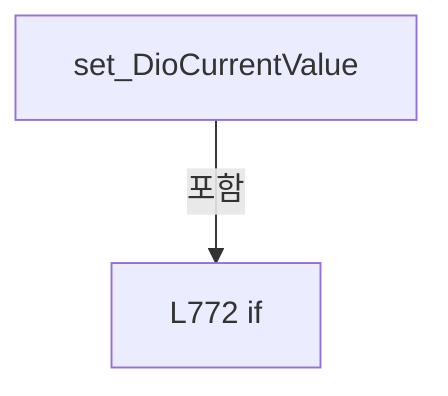

변경 전 점검: 입력/반환 타입, 위 호출자, 예외/취소 경로, 공유 상태와 저장·전송 소비자를 함께 확인합니다. 값의 단위나 물리 방향을 이름만으로 확정하지 않습니다.

### PropertyDeclaration `IsDioOn` · L780–786

[Drilling.UI/Menu/Menus/CMenuManual.cs:780–786](https://github.com/kjuws10-rgb/A3Drilling/blob/5aee8e58439c9b455cae7c9593c9be986c3e682e/Drilling.UI/Menu/Menus/CMenuManual.cs#L780-L786)

| 항목 | 실제 추출 값 |
| --- | --- |
| 서명 | bool Drilling.UI.Menu.Menus.CMenuManual.IsDioOn |
| 접근/수식자 | Public / public |
| 반환/값 타입 | bool |
| 소속 타입 | NamedType:Drilling.UI.Menu.Menus.CMenuManual |

현재 부분 분석에서 직접 연결된 호출자는 없습니다. XAML/이벤트/인터페이스·델리게이트·외부 진입을 추가 확인해야 하며, 미사용으로 판정한 것이 아닙니다.

변경 전 점검: 입력/반환 타입, 위 호출자, 예외/취소 경로, 공유 상태와 저장·전송 소비자를 함께 확인합니다. 값의 단위나 물리 방향을 이름만으로 확정하지 않습니다.

### GetAccessorDeclaration `get_IsDioOn` · L782–785

[Drilling.UI/Menu/Menus/CMenuManual.cs:782–785](https://github.com/kjuws10-rgb/A3Drilling/blob/5aee8e58439c9b455cae7c9593c9be986c3e682e/Drilling.UI/Menu/Menus/CMenuManual.cs#L782-L785)

| 항목 | 실제 추출 값 |
| --- | --- |
| 서명 | bool Drilling.UI.Menu.Menus.CMenuManual.IsDioOn.get |
| 접근/수식자 | Public / get |
| 반환/값 타입 | bool |
| 소속 타입 | NamedType:Drilling.UI.Menu.Menus.CMenuManual |

현재 부분 분석에서 직접 연결된 호출자는 없습니다. XAML/이벤트/인터페이스·델리게이트·외부 진입을 추가 확인해야 하며, 미사용으로 판정한 것이 아닙니다.

호출하는 대상과 해석 범위:

| 원본 행 | 표현식 | 분석 상태 | 대상/소스 위치 |
| --- | --- | --- | --- |
| 784 | DioCurrentValue.Equals | resolved | bool string.Equals(string?, System.StringComparison) |

본문의 실제 연산·분기·예외·반환 순서(원문 위치 순):

| 원본 행 | 종류 | 주석 해설 |
| --- | --- | --- |
| 784 | call | 함수·델리게이트 또는 객체 생성자를 호출합니다: DioCurrentValue.Equals("ON", StringComparison.OrdinalIgnoreCase) |
| 784 | return | 호출자에게 값 또는 제어를 반환합니다: return DioCurrentValue.Equals("ON", StringComparison.OrdinalIgnoreCase); |

변경 전 점검: 입력/반환 타입, 위 호출자, 예외/취소 경로, 공유 상태와 저장·전송 소비자를 함께 확인합니다. 값의 단위나 물리 방향을 이름만으로 확정하지 않습니다.

### PropertyDeclaration `IsDioOff` · L788–794

[Drilling.UI/Menu/Menus/CMenuManual.cs:788–794](https://github.com/kjuws10-rgb/A3Drilling/blob/5aee8e58439c9b455cae7c9593c9be986c3e682e/Drilling.UI/Menu/Menus/CMenuManual.cs#L788-L794)

| 항목 | 실제 추출 값 |
| --- | --- |
| 서명 | bool Drilling.UI.Menu.Menus.CMenuManual.IsDioOff |
| 접근/수식자 | Public / public |
| 반환/값 타입 | bool |
| 소속 타입 | NamedType:Drilling.UI.Menu.Menus.CMenuManual |

현재 부분 분석에서 직접 연결된 호출자는 없습니다. XAML/이벤트/인터페이스·델리게이트·외부 진입을 추가 확인해야 하며, 미사용으로 판정한 것이 아닙니다.

변경 전 점검: 입력/반환 타입, 위 호출자, 예외/취소 경로, 공유 상태와 저장·전송 소비자를 함께 확인합니다. 값의 단위나 물리 방향을 이름만으로 확정하지 않습니다.

### GetAccessorDeclaration `get_IsDioOff` · L790–793

[Drilling.UI/Menu/Menus/CMenuManual.cs:790–793](https://github.com/kjuws10-rgb/A3Drilling/blob/5aee8e58439c9b455cae7c9593c9be986c3e682e/Drilling.UI/Menu/Menus/CMenuManual.cs#L790-L793)

| 항목 | 실제 추출 값 |
| --- | --- |
| 서명 | bool Drilling.UI.Menu.Menus.CMenuManual.IsDioOff.get |
| 접근/수식자 | Public / get |
| 반환/값 타입 | bool |
| 소속 타입 | NamedType:Drilling.UI.Menu.Menus.CMenuManual |

현재 부분 분석에서 직접 연결된 호출자는 없습니다. XAML/이벤트/인터페이스·델리게이트·외부 진입을 추가 확인해야 하며, 미사용으로 판정한 것이 아닙니다.

호출하는 대상과 해석 범위:

| 원본 행 | 표현식 | 분석 상태 | 대상/소스 위치 |
| --- | --- | --- | --- |
| 792 | DioCurrentValue.Equals | resolved | bool string.Equals(string?, System.StringComparison) |

본문의 실제 연산·분기·예외·반환 순서(원문 위치 순):

| 원본 행 | 종류 | 주석 해설 |
| --- | --- | --- |
| 792 | call | 함수·델리게이트 또는 객체 생성자를 호출합니다: DioCurrentValue.Equals("OFF", StringComparison.OrdinalIgnoreCase) |
| 792 | return | 호출자에게 값 또는 제어를 반환합니다: return DioCurrentValue.Equals("OFF", StringComparison.OrdinalIgnoreCase); |

변경 전 점검: 입력/반환 타입, 위 호출자, 예외/취소 경로, 공유 상태와 저장·전송 소비자를 함께 확인합니다. 값의 단위나 물리 방향을 이름만으로 확정하지 않습니다.

### PropertyDeclaration `IsDioTargetReady` · L796–810

[Drilling.UI/Menu/Menus/CMenuManual.cs:796–810](https://github.com/kjuws10-rgb/A3Drilling/blob/5aee8e58439c9b455cae7c9593c9be986c3e682e/Drilling.UI/Menu/Menus/CMenuManual.cs#L796-L810)

| 항목 | 실제 추출 값 |
| --- | --- |
| 서명 | bool Drilling.UI.Menu.Menus.CMenuManual.IsDioTargetReady |
| 접근/수식자 | Public / public |
| 반환/값 타입 | bool |
| 소속 타입 | NamedType:Drilling.UI.Menu.Menus.CMenuManual |

현재 부분 분석에서 직접 연결된 호출자는 없습니다. XAML/이벤트/인터페이스·델리게이트·외부 진입을 추가 확인해야 하며, 미사용으로 판정한 것이 아닙니다.

변경 전 점검: 입력/반환 타입, 위 호출자, 예외/취소 경로, 공유 상태와 저장·전송 소비자를 함께 확인합니다. 값의 단위나 물리 방향을 이름만으로 확정하지 않습니다.

### GetAccessorDeclaration `get_IsDioTargetReady` · L798–801

[Drilling.UI/Menu/Menus/CMenuManual.cs:798–801](https://github.com/kjuws10-rgb/A3Drilling/blob/5aee8e58439c9b455cae7c9593c9be986c3e682e/Drilling.UI/Menu/Menus/CMenuManual.cs#L798-L801)

| 항목 | 실제 추출 값 |
| --- | --- |
| 서명 | bool Drilling.UI.Menu.Menus.CMenuManual.IsDioTargetReady.get |
| 접근/수식자 | Public / get |
| 반환/값 타입 | bool |
| 소속 타입 | NamedType:Drilling.UI.Menu.Menus.CMenuManual |

현재 부분 분석에서 직접 연결된 호출자는 없습니다. XAML/이벤트/인터페이스·델리게이트·외부 진입을 추가 확인해야 하며, 미사용으로 판정한 것이 아닙니다.

본문의 실제 연산·분기·예외·반환 순서(원문 위치 순):

| 원본 행 | 종류 | 주석 해설 |
| --- | --- | --- |
| 800 | return | 호출자에게 값 또는 제어를 반환합니다: return _isDioTargetReady; |

변경 전 점검: 입력/반환 타입, 위 호출자, 예외/취소 경로, 공유 상태와 저장·전송 소비자를 함께 확인합니다. 값의 단위나 물리 방향을 이름만으로 확정하지 않습니다.

### SetAccessorDeclaration `set_IsDioTargetReady` · L803–809

[Drilling.UI/Menu/Menus/CMenuManual.cs:803–809](https://github.com/kjuws10-rgb/A3Drilling/blob/5aee8e58439c9b455cae7c9593c9be986c3e682e/Drilling.UI/Menu/Menus/CMenuManual.cs#L803-L809)

| 항목 | 실제 추출 값 |
| --- | --- |
| 서명 | void Drilling.UI.Menu.Menus.CMenuManual.IsDioTargetReady.set |
| 접근/수식자 | Private / private, set |
| 반환/값 타입 | void |
| 소속 타입 | NamedType:Drilling.UI.Menu.Menus.CMenuManual |

입력 계약:

| 이름 | 타입 | 전달 | 선택/기본값 |
| --- | --- | --- | --- |
| value | bool | None | False /  |

현재 부분 분석에서 직접 연결된 호출자는 없습니다. XAML/이벤트/인터페이스·델리게이트·외부 진입을 추가 확인해야 하며, 미사용으로 판정한 것이 아닙니다.

호출하는 대상과 해석 범위:

| 원본 행 | 표현식 | 분석 상태 | 대상/소스 위치 |
| --- | --- | --- | --- |
| 805 | SetProperty | resolved | bool Drilling.UI.Menu.CBindingBase.SetProperty<bool>(ref bool, bool, string?) · Drilling.UI/Menu/CBindingBase.cs:735 |
| 807 | OnPropertyChanged | resolved | void Drilling.UI.Menu.CBindingBase.OnPropertyChanged(string?) · Drilling.UI/Menu/CBindingBase.cs:759 |
| 807 | nameof | unresolved | None |

본문의 실제 연산·분기·예외·반환 순서(원문 위치 순):

| 원본 행 | 종류 | 주석 해설 |
| --- | --- | --- |
| 805 | call | 함수·델리게이트 또는 객체 생성자를 호출합니다: SetProperty(ref _isDioTargetReady, value) |
| 805 | if | 조건에 따라 분기합니다: if (SetProperty(ref _isDioTargetReady, value)) |
| 807 | call | 함수·델리게이트 또는 객체 생성자를 호출합니다: OnPropertyChanged(nameof(IsDioControlEnabled)) |
| 807 | call | 함수·델리게이트 또는 객체 생성자를 호출합니다: nameof(IsDioControlEnabled) |

제어 구문의 포함 구조(실제 실행 순서/CFG가 아닌 구문 탐색 그림):

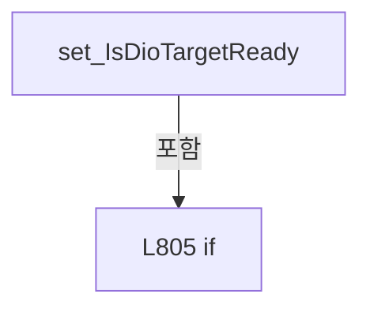

변경 전 점검: 입력/반환 타입, 위 호출자, 예외/취소 경로, 공유 상태와 저장·전송 소비자를 함께 확인합니다. 값의 단위나 물리 방향을 이름만으로 확정하지 않습니다.

### PropertyDeclaration `IsDioControlEnabled` · L812–818

[Drilling.UI/Menu/Menus/CMenuManual.cs:812–818](https://github.com/kjuws10-rgb/A3Drilling/blob/5aee8e58439c9b455cae7c9593c9be986c3e682e/Drilling.UI/Menu/Menus/CMenuManual.cs#L812-L818)

| 항목 | 실제 추출 값 |
| --- | --- |
| 서명 | bool Drilling.UI.Menu.Menus.CMenuManual.IsDioControlEnabled |
| 접근/수식자 | Public / public |
| 반환/값 타입 | bool |
| 소속 타입 | NamedType:Drilling.UI.Menu.Menus.CMenuManual |

현재 부분 분석에서 직접 연결된 호출자는 없습니다. XAML/이벤트/인터페이스·델리게이트·외부 진입을 추가 확인해야 하며, 미사용으로 판정한 것이 아닙니다.

변경 전 점검: 입력/반환 타입, 위 호출자, 예외/취소 경로, 공유 상태와 저장·전송 소비자를 함께 확인합니다. 값의 단위나 물리 방향을 이름만으로 확정하지 않습니다.

### GetAccessorDeclaration `get_IsDioControlEnabled` · L814–817

[Drilling.UI/Menu/Menus/CMenuManual.cs:814–817](https://github.com/kjuws10-rgb/A3Drilling/blob/5aee8e58439c9b455cae7c9593c9be986c3e682e/Drilling.UI/Menu/Menus/CMenuManual.cs#L814-L817)

| 항목 | 실제 추출 값 |
| --- | --- |
| 서명 | bool Drilling.UI.Menu.Menus.CMenuManual.IsDioControlEnabled.get |
| 접근/수식자 | Public / get |
| 반환/값 타입 | bool |
| 소속 타입 | NamedType:Drilling.UI.Menu.Menus.CMenuManual |

현재 부분 분석에서 직접 연결된 호출자는 없습니다. XAML/이벤트/인터페이스·델리게이트·외부 진입을 추가 확인해야 하며, 미사용으로 판정한 것이 아닙니다.

본문의 실제 연산·분기·예외·반환 순서(원문 위치 순):

| 원본 행 | 종류 | 주석 해설 |
| --- | --- | --- |
| 816 | return | 호출자에게 값 또는 제어를 반환합니다: return IsDioTargetReady && !IsDioControlBusy; |

변경 전 점검: 입력/반환 타입, 위 호출자, 예외/취소 경로, 공유 상태와 저장·전송 소비자를 함께 확인합니다. 값의 단위나 물리 방향을 이름만으로 확정하지 않습니다.

### PropertyDeclaration `DioLastResult` · L820–831

[Drilling.UI/Menu/Menus/CMenuManual.cs:820–831](https://github.com/kjuws10-rgb/A3Drilling/blob/5aee8e58439c9b455cae7c9593c9be986c3e682e/Drilling.UI/Menu/Menus/CMenuManual.cs#L820-L831)

| 항목 | 실제 추출 값 |
| --- | --- |
| 서명 | string Drilling.UI.Menu.Menus.CMenuManual.DioLastResult |
| 접근/수식자 | Public / public |
| 반환/값 타입 | string |
| 소속 타입 | NamedType:Drilling.UI.Menu.Menus.CMenuManual |

현재 부분 분석에서 직접 연결된 호출자는 없습니다. XAML/이벤트/인터페이스·델리게이트·외부 진입을 추가 확인해야 하며, 미사용으로 판정한 것이 아닙니다.

변경 전 점검: 입력/반환 타입, 위 호출자, 예외/취소 경로, 공유 상태와 저장·전송 소비자를 함께 확인합니다. 값의 단위나 물리 방향을 이름만으로 확정하지 않습니다.

### GetAccessorDeclaration `get_DioLastResult` · L822–825

[Drilling.UI/Menu/Menus/CMenuManual.cs:822–825](https://github.com/kjuws10-rgb/A3Drilling/blob/5aee8e58439c9b455cae7c9593c9be986c3e682e/Drilling.UI/Menu/Menus/CMenuManual.cs#L822-L825)

| 항목 | 실제 추출 값 |
| --- | --- |
| 서명 | string Drilling.UI.Menu.Menus.CMenuManual.DioLastResult.get |
| 접근/수식자 | Public / get |
| 반환/값 타입 | string |
| 소속 타입 | NamedType:Drilling.UI.Menu.Menus.CMenuManual |

현재 부분 분석에서 직접 연결된 호출자는 없습니다. XAML/이벤트/인터페이스·델리게이트·외부 진입을 추가 확인해야 하며, 미사용으로 판정한 것이 아닙니다.

본문의 실제 연산·분기·예외·반환 순서(원문 위치 순):

| 원본 행 | 종류 | 주석 해설 |
| --- | --- | --- |
| 824 | return | 호출자에게 값 또는 제어를 반환합니다: return _dioLastResult; |

변경 전 점검: 입력/반환 타입, 위 호출자, 예외/취소 경로, 공유 상태와 저장·전송 소비자를 함께 확인합니다. 값의 단위나 물리 방향을 이름만으로 확정하지 않습니다.

### SetAccessorDeclaration `set_DioLastResult` · L827–830

[Drilling.UI/Menu/Menus/CMenuManual.cs:827–830](https://github.com/kjuws10-rgb/A3Drilling/blob/5aee8e58439c9b455cae7c9593c9be986c3e682e/Drilling.UI/Menu/Menus/CMenuManual.cs#L827-L830)

| 항목 | 실제 추출 값 |
| --- | --- |
| 서명 | void Drilling.UI.Menu.Menus.CMenuManual.DioLastResult.set |
| 접근/수식자 | Private / private, set |
| 반환/값 타입 | void |
| 소속 타입 | NamedType:Drilling.UI.Menu.Menus.CMenuManual |

입력 계약:

| 이름 | 타입 | 전달 | 선택/기본값 |
| --- | --- | --- | --- |
| value | string | None | False /  |

현재 부분 분석에서 직접 연결된 호출자는 없습니다. XAML/이벤트/인터페이스·델리게이트·외부 진입을 추가 확인해야 하며, 미사용으로 판정한 것이 아닙니다.

호출하는 대상과 해석 범위:

| 원본 행 | 표현식 | 분석 상태 | 대상/소스 위치 |
| --- | --- | --- | --- |
| 829 | SetProperty | resolved | bool Drilling.UI.Menu.CBindingBase.SetProperty<string>(ref string, string, string?) · Drilling.UI/Menu/CBindingBase.cs:735 |

본문의 실제 연산·분기·예외·반환 순서(원문 위치 순):

| 원본 행 | 종류 | 주석 해설 |
| --- | --- | --- |
| 829 | call | 함수·델리게이트 또는 객체 생성자를 호출합니다: SetProperty(ref _dioLastResult, value) |

변경 전 점검: 입력/반환 타입, 위 호출자, 예외/취소 경로, 공유 상태와 저장·전송 소비자를 함께 확인합니다. 값의 단위나 물리 방향을 이름만으로 확정하지 않습니다.

### PropertyDeclaration `IsDioControlBusy` · L833–847

[Drilling.UI/Menu/Menus/CMenuManual.cs:833–847](https://github.com/kjuws10-rgb/A3Drilling/blob/5aee8e58439c9b455cae7c9593c9be986c3e682e/Drilling.UI/Menu/Menus/CMenuManual.cs#L833-L847)

| 항목 | 실제 추출 값 |
| --- | --- |
| 서명 | bool Drilling.UI.Menu.Menus.CMenuManual.IsDioControlBusy |
| 접근/수식자 | Public / public |
| 반환/값 타입 | bool |
| 소속 타입 | NamedType:Drilling.UI.Menu.Menus.CMenuManual |

현재 부분 분석에서 직접 연결된 호출자는 없습니다. XAML/이벤트/인터페이스·델리게이트·외부 진입을 추가 확인해야 하며, 미사용으로 판정한 것이 아닙니다.

변경 전 점검: 입력/반환 타입, 위 호출자, 예외/취소 경로, 공유 상태와 저장·전송 소비자를 함께 확인합니다. 값의 단위나 물리 방향을 이름만으로 확정하지 않습니다.

### GetAccessorDeclaration `get_IsDioControlBusy` · L835–838

[Drilling.UI/Menu/Menus/CMenuManual.cs:835–838](https://github.com/kjuws10-rgb/A3Drilling/blob/5aee8e58439c9b455cae7c9593c9be986c3e682e/Drilling.UI/Menu/Menus/CMenuManual.cs#L835-L838)

| 항목 | 실제 추출 값 |
| --- | --- |
| 서명 | bool Drilling.UI.Menu.Menus.CMenuManual.IsDioControlBusy.get |
| 접근/수식자 | Public / get |
| 반환/값 타입 | bool |
| 소속 타입 | NamedType:Drilling.UI.Menu.Menus.CMenuManual |

현재 부분 분석에서 직접 연결된 호출자는 없습니다. XAML/이벤트/인터페이스·델리게이트·외부 진입을 추가 확인해야 하며, 미사용으로 판정한 것이 아닙니다.

본문의 실제 연산·분기·예외·반환 순서(원문 위치 순):

| 원본 행 | 종류 | 주석 해설 |
| --- | --- | --- |
| 837 | return | 호출자에게 값 또는 제어를 반환합니다: return _isDioControlBusy; |

변경 전 점검: 입력/반환 타입, 위 호출자, 예외/취소 경로, 공유 상태와 저장·전송 소비자를 함께 확인합니다. 값의 단위나 물리 방향을 이름만으로 확정하지 않습니다.

### SetAccessorDeclaration `set_IsDioControlBusy` · L840–846

[Drilling.UI/Menu/Menus/CMenuManual.cs:840–846](https://github.com/kjuws10-rgb/A3Drilling/blob/5aee8e58439c9b455cae7c9593c9be986c3e682e/Drilling.UI/Menu/Menus/CMenuManual.cs#L840-L846)

| 항목 | 실제 추출 값 |
| --- | --- |
| 서명 | void Drilling.UI.Menu.Menus.CMenuManual.IsDioControlBusy.set |
| 접근/수식자 | Private / private, set |
| 반환/값 타입 | void |
| 소속 타입 | NamedType:Drilling.UI.Menu.Menus.CMenuManual |

입력 계약:

| 이름 | 타입 | 전달 | 선택/기본값 |
| --- | --- | --- | --- |
| value | bool | None | False /  |

현재 부분 분석에서 직접 연결된 호출자는 없습니다. XAML/이벤트/인터페이스·델리게이트·외부 진입을 추가 확인해야 하며, 미사용으로 판정한 것이 아닙니다.

호출하는 대상과 해석 범위:

| 원본 행 | 표현식 | 분석 상태 | 대상/소스 위치 |
| --- | --- | --- | --- |
| 842 | SetProperty | resolved | bool Drilling.UI.Menu.CBindingBase.SetProperty<bool>(ref bool, bool, string?) · Drilling.UI/Menu/CBindingBase.cs:735 |
| 844 | OnPropertyChanged | resolved | void Drilling.UI.Menu.CBindingBase.OnPropertyChanged(string?) · Drilling.UI/Menu/CBindingBase.cs:759 |
| 844 | nameof | unresolved | None |

본문의 실제 연산·분기·예외·반환 순서(원문 위치 순):

| 원본 행 | 종류 | 주석 해설 |
| --- | --- | --- |
| 842 | call | 함수·델리게이트 또는 객체 생성자를 호출합니다: SetProperty(ref _isDioControlBusy, value) |
| 842 | if | 조건에 따라 분기합니다: if (SetProperty(ref _isDioControlBusy, value)) |
| 844 | call | 함수·델리게이트 또는 객체 생성자를 호출합니다: OnPropertyChanged(nameof(IsDioControlEnabled)) |
| 844 | call | 함수·델리게이트 또는 객체 생성자를 호출합니다: nameof(IsDioControlEnabled) |

제어 구문의 포함 구조(실제 실행 순서/CFG가 아닌 구문 탐색 그림):

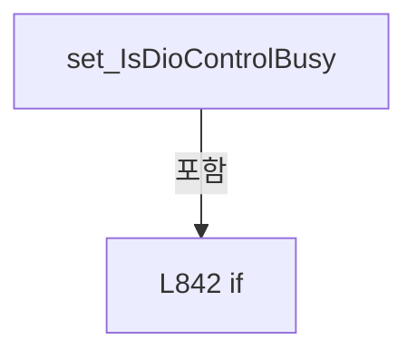

변경 전 점검: 입력/반환 타입, 위 호출자, 예외/취소 경로, 공유 상태와 저장·전송 소비자를 함께 확인합니다. 값의 단위나 물리 방향을 이름만으로 확정하지 않습니다.

### PropertyDeclaration `IsScannerWorkspace` · L849–863

[Drilling.UI/Menu/Menus/CMenuManual.cs:849–863](https://github.com/kjuws10-rgb/A3Drilling/blob/5aee8e58439c9b455cae7c9593c9be986c3e682e/Drilling.UI/Menu/Menus/CMenuManual.cs#L849-L863)

| 항목 | 실제 추출 값 |
| --- | --- |
| 서명 | bool Drilling.UI.Menu.Menus.CMenuManual.IsScannerWorkspace |
| 접근/수식자 | Public / public |
| 반환/값 타입 | bool |
| 소속 타입 | NamedType:Drilling.UI.Menu.Menus.CMenuManual |

현재 부분 분석에서 직접 연결된 호출자는 없습니다. XAML/이벤트/인터페이스·델리게이트·외부 진입을 추가 확인해야 하며, 미사용으로 판정한 것이 아닙니다.

변경 전 점검: 입력/반환 타입, 위 호출자, 예외/취소 경로, 공유 상태와 저장·전송 소비자를 함께 확인합니다. 값의 단위나 물리 방향을 이름만으로 확정하지 않습니다.

### GetAccessorDeclaration `get_IsScannerWorkspace` · L851–854

[Drilling.UI/Menu/Menus/CMenuManual.cs:851–854](https://github.com/kjuws10-rgb/A3Drilling/blob/5aee8e58439c9b455cae7c9593c9be986c3e682e/Drilling.UI/Menu/Menus/CMenuManual.cs#L851-L854)

| 항목 | 실제 추출 값 |
| --- | --- |
| 서명 | bool Drilling.UI.Menu.Menus.CMenuManual.IsScannerWorkspace.get |
| 접근/수식자 | Public / get |
| 반환/값 타입 | bool |
| 소속 타입 | NamedType:Drilling.UI.Menu.Menus.CMenuManual |

현재 부분 분석에서 직접 연결된 호출자는 없습니다. XAML/이벤트/인터페이스·델리게이트·외부 진입을 추가 확인해야 하며, 미사용으로 판정한 것이 아닙니다.

본문의 실제 연산·분기·예외·반환 순서(원문 위치 순):

| 원본 행 | 종류 | 주석 해설 |
| --- | --- | --- |
| 853 | return | 호출자에게 값 또는 제어를 반환합니다: return _isScannerWorkspace; |

변경 전 점검: 입력/반환 타입, 위 호출자, 예외/취소 경로, 공유 상태와 저장·전송 소비자를 함께 확인합니다. 값의 단위나 물리 방향을 이름만으로 확정하지 않습니다.

### SetAccessorDeclaration `set_IsScannerWorkspace` · L856–862

[Drilling.UI/Menu/Menus/CMenuManual.cs:856–862](https://github.com/kjuws10-rgb/A3Drilling/blob/5aee8e58439c9b455cae7c9593c9be986c3e682e/Drilling.UI/Menu/Menus/CMenuManual.cs#L856-L862)

| 항목 | 실제 추출 값 |
| --- | --- |
| 서명 | void Drilling.UI.Menu.Menus.CMenuManual.IsScannerWorkspace.set |
| 접근/수식자 | Private / private, set |
| 반환/값 타입 | void |
| 소속 타입 | NamedType:Drilling.UI.Menu.Menus.CMenuManual |

입력 계약:

| 이름 | 타입 | 전달 | 선택/기본값 |
| --- | --- | --- | --- |
| value | bool | None | False /  |

현재 부분 분석에서 직접 연결된 호출자는 없습니다. XAML/이벤트/인터페이스·델리게이트·외부 진입을 추가 확인해야 하며, 미사용으로 판정한 것이 아닙니다.

호출하는 대상과 해석 범위:

| 원본 행 | 표현식 | 분석 상태 | 대상/소스 위치 |
| --- | --- | --- | --- |
| 858 | SetProperty | resolved | bool Drilling.UI.Menu.CBindingBase.SetProperty<bool>(ref bool, bool, string?) · Drilling.UI/Menu/CBindingBase.cs:735 |
| 860 | OnPropertyChanged | resolved | void Drilling.UI.Menu.CBindingBase.OnPropertyChanged(string?) · Drilling.UI/Menu/CBindingBase.cs:759 |
| 860 | nameof | unresolved | None |

본문의 실제 연산·분기·예외·반환 순서(원문 위치 순):

| 원본 행 | 종류 | 주석 해설 |
| --- | --- | --- |
| 858 | call | 함수·델리게이트 또는 객체 생성자를 호출합니다: SetProperty(ref _isScannerWorkspace, value) |
| 858 | if | 조건에 따라 분기합니다: if (SetProperty(ref _isScannerWorkspace, value)) |
| 860 | call | 함수·델리게이트 또는 객체 생성자를 호출합니다: OnPropertyChanged(nameof(IsStageVisionWorkspace)) |
| 860 | call | 함수·델리게이트 또는 객체 생성자를 호출합니다: nameof(IsStageVisionWorkspace) |

제어 구문의 포함 구조(실제 실행 순서/CFG가 아닌 구문 탐색 그림):

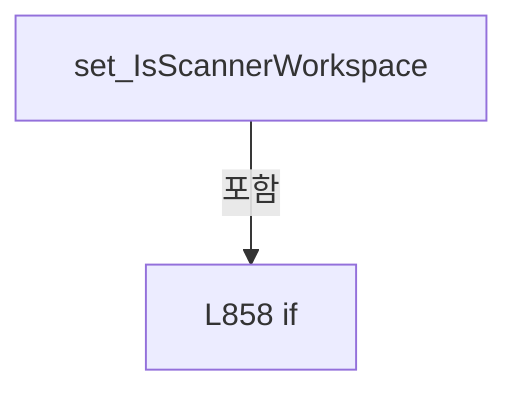

변경 전 점검: 입력/반환 타입, 위 호출자, 예외/취소 경로, 공유 상태와 저장·전송 소비자를 함께 확인합니다. 값의 단위나 물리 방향을 이름만으로 확정하지 않습니다.

### PropertyDeclaration `IsStageVisionWorkspace` · L865–871

[Drilling.UI/Menu/Menus/CMenuManual.cs:865–871](https://github.com/kjuws10-rgb/A3Drilling/blob/5aee8e58439c9b455cae7c9593c9be986c3e682e/Drilling.UI/Menu/Menus/CMenuManual.cs#L865-L871)

| 항목 | 실제 추출 값 |
| --- | --- |
| 서명 | bool Drilling.UI.Menu.Menus.CMenuManual.IsStageVisionWorkspace |
| 접근/수식자 | Public / public |
| 반환/값 타입 | bool |
| 소속 타입 | NamedType:Drilling.UI.Menu.Menus.CMenuManual |

현재 부분 분석에서 직접 연결된 호출자는 없습니다. XAML/이벤트/인터페이스·델리게이트·외부 진입을 추가 확인해야 하며, 미사용으로 판정한 것이 아닙니다.

변경 전 점검: 입력/반환 타입, 위 호출자, 예외/취소 경로, 공유 상태와 저장·전송 소비자를 함께 확인합니다. 값의 단위나 물리 방향을 이름만으로 확정하지 않습니다.

### GetAccessorDeclaration `get_IsStageVisionWorkspace` · L867–870

[Drilling.UI/Menu/Menus/CMenuManual.cs:867–870](https://github.com/kjuws10-rgb/A3Drilling/blob/5aee8e58439c9b455cae7c9593c9be986c3e682e/Drilling.UI/Menu/Menus/CMenuManual.cs#L867-L870)

| 항목 | 실제 추출 값 |
| --- | --- |
| 서명 | bool Drilling.UI.Menu.Menus.CMenuManual.IsStageVisionWorkspace.get |
| 접근/수식자 | Public / get |
| 반환/값 타입 | bool |
| 소속 타입 | NamedType:Drilling.UI.Menu.Menus.CMenuManual |

현재 부분 분석에서 직접 연결된 호출자는 없습니다. XAML/이벤트/인터페이스·델리게이트·외부 진입을 추가 확인해야 하며, 미사용으로 판정한 것이 아닙니다.

본문의 실제 연산·분기·예외·반환 순서(원문 위치 순):

| 원본 행 | 종류 | 주석 해설 |
| --- | --- | --- |
| 869 | return | 호출자에게 값 또는 제어를 반환합니다: return !IsScannerWorkspace && !IsReviewWorkspace; |

변경 전 점검: 입력/반환 타입, 위 호출자, 예외/취소 경로, 공유 상태와 저장·전송 소비자를 함께 확인합니다. 값의 단위나 물리 방향을 이름만으로 확정하지 않습니다.

### PropertyDeclaration `VisionProtocolCommands` · L873–873

[Drilling.UI/Menu/Menus/CMenuManual.cs:873–873](https://github.com/kjuws10-rgb/A3Drilling/blob/5aee8e58439c9b455cae7c9593c9be986c3e682e/Drilling.UI/Menu/Menus/CMenuManual.cs#L873-L873)

| 항목 | 실제 추출 값 |
| --- | --- |
| 서명 | System.Collections.Generic.IReadOnlyList<Drilling.UI.Menu.Menus.ST_MANUAL_VISION_PROTOCOL_COMMAND> Drilling.UI.Menu.Menus.CMenuManual.VisionProtocolCommands |
| 접근/수식자 | Public / public |
| 반환/값 타입 | System.Collections.Generic.IReadOnlyList<Drilling.UI.Menu.Menus.ST_MANUAL_VISION_PROTOCOL_COMMAND> |
| 소속 타입 | NamedType:Drilling.UI.Menu.Menus.CMenuManual |

현재 부분 분석에서 직접 연결된 호출자는 없습니다. XAML/이벤트/인터페이스·델리게이트·외부 진입을 추가 확인해야 하며, 미사용으로 판정한 것이 아닙니다.

변경 전 점검: 입력/반환 타입, 위 호출자, 예외/취소 경로, 공유 상태와 저장·전송 소비자를 함께 확인합니다. 값의 단위나 물리 방향을 이름만으로 확정하지 않습니다.

### GetAccessorDeclaration `get_VisionProtocolCommands` · L873–873

[Drilling.UI/Menu/Menus/CMenuManual.cs:873–873](https://github.com/kjuws10-rgb/A3Drilling/blob/5aee8e58439c9b455cae7c9593c9be986c3e682e/Drilling.UI/Menu/Menus/CMenuManual.cs#L873-L873)

| 항목 | 실제 추출 값 |
| --- | --- |
| 서명 | System.Collections.Generic.IReadOnlyList<Drilling.UI.Menu.Menus.ST_MANUAL_VISION_PROTOCOL_COMMAND> Drilling.UI.Menu.Menus.CMenuManual.VisionProtocolCommands.get |
| 접근/수식자 | Public / get |
| 반환/값 타입 | System.Collections.Generic.IReadOnlyList<Drilling.UI.Menu.Menus.ST_MANUAL_VISION_PROTOCOL_COMMAND> |
| 소속 타입 | NamedType:Drilling.UI.Menu.Menus.CMenuManual |

현재 부분 분석에서 직접 연결된 호출자는 없습니다. XAML/이벤트/인터페이스·델리게이트·외부 진입을 추가 확인해야 하며, 미사용으로 판정한 것이 아닙니다.

변경 전 점검: 입력/반환 타입, 위 호출자, 예외/취소 경로, 공유 상태와 저장·전송 소비자를 함께 확인합니다. 값의 단위나 물리 방향을 이름만으로 확정하지 않습니다.

### PropertyDeclaration `SelectedVisionProtocolCommand` · L875–889

[Drilling.UI/Menu/Menus/CMenuManual.cs:875–889](https://github.com/kjuws10-rgb/A3Drilling/blob/5aee8e58439c9b455cae7c9593c9be986c3e682e/Drilling.UI/Menu/Menus/CMenuManual.cs#L875-L889)

| 항목 | 실제 추출 값 |
| --- | --- |
| 서명 | Drilling.UI.Menu.Menus.ST_MANUAL_VISION_PROTOCOL_COMMAND Drilling.UI.Menu.Menus.CMenuManual.SelectedVisionProtocolCommand |
| 접근/수식자 | Public / public |
| 반환/값 타입 | Drilling.UI.Menu.Menus.ST_MANUAL_VISION_PROTOCOL_COMMAND |
| 소속 타입 | NamedType:Drilling.UI.Menu.Menus.CMenuManual |

현재 부분 분석에서 직접 연결된 호출자는 없습니다. XAML/이벤트/인터페이스·델리게이트·외부 진입을 추가 확인해야 하며, 미사용으로 판정한 것이 아닙니다.

변경 전 점검: 입력/반환 타입, 위 호출자, 예외/취소 경로, 공유 상태와 저장·전송 소비자를 함께 확인합니다. 값의 단위나 물리 방향을 이름만으로 확정하지 않습니다.

### GetAccessorDeclaration `get_SelectedVisionProtocolCommand` · L877–880

[Drilling.UI/Menu/Menus/CMenuManual.cs:877–880](https://github.com/kjuws10-rgb/A3Drilling/blob/5aee8e58439c9b455cae7c9593c9be986c3e682e/Drilling.UI/Menu/Menus/CMenuManual.cs#L877-L880)

| 항목 | 실제 추출 값 |
| --- | --- |
| 서명 | Drilling.UI.Menu.Menus.ST_MANUAL_VISION_PROTOCOL_COMMAND Drilling.UI.Menu.Menus.CMenuManual.SelectedVisionProtocolCommand.get |
| 접근/수식자 | Public / get |
| 반환/값 타입 | Drilling.UI.Menu.Menus.ST_MANUAL_VISION_PROTOCOL_COMMAND |
| 소속 타입 | NamedType:Drilling.UI.Menu.Menus.CMenuManual |

현재 부분 분석에서 직접 연결된 호출자는 없습니다. XAML/이벤트/인터페이스·델리게이트·외부 진입을 추가 확인해야 하며, 미사용으로 판정한 것이 아닙니다.

본문의 실제 연산·분기·예외·반환 순서(원문 위치 순):

| 원본 행 | 종류 | 주석 해설 |
| --- | --- | --- |
| 879 | return | 호출자에게 값 또는 제어를 반환합니다: return _selectedVisionProtocolCommand; |

변경 전 점검: 입력/반환 타입, 위 호출자, 예외/취소 경로, 공유 상태와 저장·전송 소비자를 함께 확인합니다. 값의 단위나 물리 방향을 이름만으로 확정하지 않습니다.

### SetAccessorDeclaration `set_SelectedVisionProtocolCommand` · L882–888

[Drilling.UI/Menu/Menus/CMenuManual.cs:882–888](https://github.com/kjuws10-rgb/A3Drilling/blob/5aee8e58439c9b455cae7c9593c9be986c3e682e/Drilling.UI/Menu/Menus/CMenuManual.cs#L882-L888)

| 항목 | 실제 추출 값 |
| --- | --- |
| 서명 | void Drilling.UI.Menu.Menus.CMenuManual.SelectedVisionProtocolCommand.set |
| 접근/수식자 | Public / set |
| 반환/값 타입 | void |
| 소속 타입 | NamedType:Drilling.UI.Menu.Menus.CMenuManual |

입력 계약:

| 이름 | 타입 | 전달 | 선택/기본값 |
| --- | --- | --- | --- |
| value | Drilling.UI.Menu.Menus.ST_MANUAL_VISION_PROTOCOL_COMMAND | None | False /  |

현재 부분 분석에서 직접 연결된 호출자는 없습니다. XAML/이벤트/인터페이스·델리게이트·외부 진입을 추가 확인해야 하며, 미사용으로 판정한 것이 아닙니다.

호출하는 대상과 해석 범위:

| 원본 행 | 표현식 | 분석 상태 | 대상/소스 위치 |
| --- | --- | --- | --- |
| 884 | SetProperty | resolved | bool Drilling.UI.Menu.CBindingBase.SetProperty<Drilling.UI.Menu.Menus.ST_MANUAL_VISION_PROTOCOL_COMMAND>(ref Drilling.UI.Menu.Menus.ST_MANUAL_VISION_PROTOCOL_COMMAND, Drilling.UI.Menu.Menus.ST_MANUAL_VISION_PROTOCOL_COMMAND, string?) · Drilling.UI/Menu/CBindingBase.cs:735 |
| 886 | ResetVisionProtocolInputs | resolved | void Drilling.UI.Menu.Menus.CMenuManual.ResetVisionProtocolInputs() · Drilling.UI/Menu/Menus/CMenuManual.cs:6487 |

본문의 실제 연산·분기·예외·반환 순서(원문 위치 순):

| 원본 행 | 종류 | 주석 해설 |
| --- | --- | --- |
| 884 | call | 함수·델리게이트 또는 객체 생성자를 호출합니다: SetProperty(ref _selectedVisionProtocolCommand, value) |
| 884 | if | 조건에 따라 분기합니다: if (value is not null && SetProperty(ref _selectedVisionProtocolCommand, value)) |
| 886 | call | 함수·델리게이트 또는 객체 생성자를 호출합니다: ResetVisionProtocolInputs() |

제어 구문의 포함 구조(실제 실행 순서/CFG가 아닌 구문 탐색 그림):

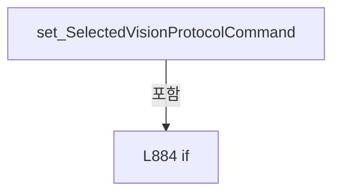

변경 전 점검: 입력/반환 타입, 위 호출자, 예외/취소 경로, 공유 상태와 저장·전송 소비자를 함께 확인합니다. 값의 단위나 물리 방향을 이름만으로 확정하지 않습니다.

### PropertyDeclaration `VisionProtocolCommandDescription` · L891–897

[Drilling.UI/Menu/Menus/CMenuManual.cs:891–897](https://github.com/kjuws10-rgb/A3Drilling/blob/5aee8e58439c9b455cae7c9593c9be986c3e682e/Drilling.UI/Menu/Menus/CMenuManual.cs#L891-L897)

| 항목 | 실제 추출 값 |
| --- | --- |
| 서명 | string Drilling.UI.Menu.Menus.CMenuManual.VisionProtocolCommandDescription |
| 접근/수식자 | Public / public |
| 반환/값 타입 | string |
| 소속 타입 | NamedType:Drilling.UI.Menu.Menus.CMenuManual |

현재 부분 분석에서 직접 연결된 호출자는 없습니다. XAML/이벤트/인터페이스·델리게이트·외부 진입을 추가 확인해야 하며, 미사용으로 판정한 것이 아닙니다.

변경 전 점검: 입력/반환 타입, 위 호출자, 예외/취소 경로, 공유 상태와 저장·전송 소비자를 함께 확인합니다. 값의 단위나 물리 방향을 이름만으로 확정하지 않습니다.

### GetAccessorDeclaration `get_VisionProtocolCommandDescription` · L893–896

[Drilling.UI/Menu/Menus/CMenuManual.cs:893–896](https://github.com/kjuws10-rgb/A3Drilling/blob/5aee8e58439c9b455cae7c9593c9be986c3e682e/Drilling.UI/Menu/Menus/CMenuManual.cs#L893-L896)

| 항목 | 실제 추출 값 |
| --- | --- |
| 서명 | string Drilling.UI.Menu.Menus.CMenuManual.VisionProtocolCommandDescription.get |
| 접근/수식자 | Public / get |
| 반환/값 타입 | string |
| 소속 타입 | NamedType:Drilling.UI.Menu.Menus.CMenuManual |

현재 부분 분석에서 직접 연결된 호출자는 없습니다. XAML/이벤트/인터페이스·델리게이트·외부 진입을 추가 확인해야 하며, 미사용으로 판정한 것이 아닙니다.

본문의 실제 연산·분기·예외·반환 순서(원문 위치 순):

| 원본 행 | 종류 | 주석 해설 |
| --- | --- | --- |
| 895 | return | 호출자에게 값 또는 제어를 반환합니다: return SelectedVisionProtocolCommand.Description; |

변경 전 점검: 입력/반환 타입, 위 호출자, 예외/취소 경로, 공유 상태와 저장·전송 소비자를 함께 확인합니다. 값의 단위나 물리 방향을 이름만으로 확정하지 않습니다.

### PropertyDeclaration `VisionProtocolUsesMarkRows` · L899–905

[Drilling.UI/Menu/Menus/CMenuManual.cs:899–905](https://github.com/kjuws10-rgb/A3Drilling/blob/5aee8e58439c9b455cae7c9593c9be986c3e682e/Drilling.UI/Menu/Menus/CMenuManual.cs#L899-L905)

| 항목 | 실제 추출 값 |
| --- | --- |
| 서명 | bool Drilling.UI.Menu.Menus.CMenuManual.VisionProtocolUsesMarkRows |
| 접근/수식자 | Public / public |
| 반환/값 타입 | bool |
| 소속 타입 | NamedType:Drilling.UI.Menu.Menus.CMenuManual |

현재 부분 분석에서 직접 연결된 호출자는 없습니다. XAML/이벤트/인터페이스·델리게이트·외부 진입을 추가 확인해야 하며, 미사용으로 판정한 것이 아닙니다.

변경 전 점검: 입력/반환 타입, 위 호출자, 예외/취소 경로, 공유 상태와 저장·전송 소비자를 함께 확인합니다. 값의 단위나 물리 방향을 이름만으로 확정하지 않습니다.

### GetAccessorDeclaration `get_VisionProtocolUsesMarkRows` · L901–904

[Drilling.UI/Menu/Menus/CMenuManual.cs:901–904](https://github.com/kjuws10-rgb/A3Drilling/blob/5aee8e58439c9b455cae7c9593c9be986c3e682e/Drilling.UI/Menu/Menus/CMenuManual.cs#L901-L904)

| 항목 | 실제 추출 값 |
| --- | --- |
| 서명 | bool Drilling.UI.Menu.Menus.CMenuManual.VisionProtocolUsesMarkRows.get |
| 접근/수식자 | Public / get |
| 반환/값 타입 | bool |
| 소속 타입 | NamedType:Drilling.UI.Menu.Menus.CMenuManual |

현재 부분 분석에서 직접 연결된 호출자는 없습니다. XAML/이벤트/인터페이스·델리게이트·외부 진입을 추가 확인해야 하며, 미사용으로 판정한 것이 아닙니다.

본문의 실제 연산·분기·예외·반환 순서(원문 위치 순):

| 원본 행 | 종류 | 주석 해설 |
| --- | --- | --- |
| 903 | return | 호출자에게 값 또는 제어를 반환합니다: return SelectedVisionProtocolCommand.CommandText is "MARK_FIND_SINGLE" or "FLYING_READY"; |

변경 전 점검: 입력/반환 타입, 위 호출자, 예외/취소 경로, 공유 상태와 저장·전송 소비자를 함께 확인합니다. 값의 단위나 물리 방향을 이름만으로 확정하지 않습니다.

### PropertyDeclaration `VisionProtocolIsFlyingReady` · L907–913

[Drilling.UI/Menu/Menus/CMenuManual.cs:907–913](https://github.com/kjuws10-rgb/A3Drilling/blob/5aee8e58439c9b455cae7c9593c9be986c3e682e/Drilling.UI/Menu/Menus/CMenuManual.cs#L907-L913)

| 항목 | 실제 추출 값 |
| --- | --- |
| 서명 | bool Drilling.UI.Menu.Menus.CMenuManual.VisionProtocolIsFlyingReady |
| 접근/수식자 | Public / public |
| 반환/값 타입 | bool |
| 소속 타입 | NamedType:Drilling.UI.Menu.Menus.CMenuManual |

현재 부분 분석에서 직접 연결된 호출자는 없습니다. XAML/이벤트/인터페이스·델리게이트·외부 진입을 추가 확인해야 하며, 미사용으로 판정한 것이 아닙니다.

변경 전 점검: 입력/반환 타입, 위 호출자, 예외/취소 경로, 공유 상태와 저장·전송 소비자를 함께 확인합니다. 값의 단위나 물리 방향을 이름만으로 확정하지 않습니다.

### GetAccessorDeclaration `get_VisionProtocolIsFlyingReady` · L909–912

[Drilling.UI/Menu/Menus/CMenuManual.cs:909–912](https://github.com/kjuws10-rgb/A3Drilling/blob/5aee8e58439c9b455cae7c9593c9be986c3e682e/Drilling.UI/Menu/Menus/CMenuManual.cs#L909-L912)

| 항목 | 실제 추출 값 |
| --- | --- |
| 서명 | bool Drilling.UI.Menu.Menus.CMenuManual.VisionProtocolIsFlyingReady.get |
| 접근/수식자 | Public / get |
| 반환/값 타입 | bool |
| 소속 타입 | NamedType:Drilling.UI.Menu.Menus.CMenuManual |

현재 부분 분석에서 직접 연결된 호출자는 없습니다. XAML/이벤트/인터페이스·델리게이트·외부 진입을 추가 확인해야 하며, 미사용으로 판정한 것이 아닙니다.

본문의 실제 연산·분기·예외·반환 순서(원문 위치 순):

| 원본 행 | 종류 | 주석 해설 |
| --- | --- | --- |
| 911 | return | 호출자에게 값 또는 제어를 반환합니다: return SelectedVisionProtocolCommand.CommandText == "FLYING_READY"; |

변경 전 점검: 입력/반환 타입, 위 호출자, 예외/취소 경로, 공유 상태와 저장·전송 소비자를 함께 확인합니다. 값의 단위나 물리 방향을 이름만으로 확정하지 않습니다.

### PropertyDeclaration `VisionProtocolHasNoArguments` · L915–921

[Drilling.UI/Menu/Menus/CMenuManual.cs:915–921](https://github.com/kjuws10-rgb/A3Drilling/blob/5aee8e58439c9b455cae7c9593c9be986c3e682e/Drilling.UI/Menu/Menus/CMenuManual.cs#L915-L921)

| 항목 | 실제 추출 값 |
| --- | --- |
| 서명 | bool Drilling.UI.Menu.Menus.CMenuManual.VisionProtocolHasNoArguments |
| 접근/수식자 | Public / public |
| 반환/값 타입 | bool |
| 소속 타입 | NamedType:Drilling.UI.Menu.Menus.CMenuManual |

현재 부분 분석에서 직접 연결된 호출자는 없습니다. XAML/이벤트/인터페이스·델리게이트·외부 진입을 추가 확인해야 하며, 미사용으로 판정한 것이 아닙니다.

변경 전 점검: 입력/반환 타입, 위 호출자, 예외/취소 경로, 공유 상태와 저장·전송 소비자를 함께 확인합니다. 값의 단위나 물리 방향을 이름만으로 확정하지 않습니다.

### GetAccessorDeclaration `get_VisionProtocolHasNoArguments` · L917–920

[Drilling.UI/Menu/Menus/CMenuManual.cs:917–920](https://github.com/kjuws10-rgb/A3Drilling/blob/5aee8e58439c9b455cae7c9593c9be986c3e682e/Drilling.UI/Menu/Menus/CMenuManual.cs#L917-L920)

| 항목 | 실제 추출 값 |
| --- | --- |
| 서명 | bool Drilling.UI.Menu.Menus.CMenuManual.VisionProtocolHasNoArguments.get |
| 접근/수식자 | Public / get |
| 반환/값 타입 | bool |
| 소속 타입 | NamedType:Drilling.UI.Menu.Menus.CMenuManual |

현재 부분 분석에서 직접 연결된 호출자는 없습니다. XAML/이벤트/인터페이스·델리게이트·외부 진입을 추가 확인해야 하며, 미사용으로 판정한 것이 아닙니다.

본문의 실제 연산·분기·예외·반환 순서(원문 위치 순):

| 원본 행 | 종류 | 주석 해설 |
| --- | --- | --- |
| 919 | return | 호출자에게 값 또는 제어를 반환합니다: return !VisionProtocolUsesMarkRows; |

변경 전 점검: 입력/반환 타입, 위 호출자, 예외/취소 경로, 공유 상태와 저장·전송 소비자를 함께 확인합니다. 값의 단위나 물리 방향을 이름만으로 확정하지 않습니다.

### PropertyDeclaration `VisionProtocolInspectionType` · L923–937

[Drilling.UI/Menu/Menus/CMenuManual.cs:923–937](https://github.com/kjuws10-rgb/A3Drilling/blob/5aee8e58439c9b455cae7c9593c9be986c3e682e/Drilling.UI/Menu/Menus/CMenuManual.cs#L923-L937)

| 항목 | 실제 추출 값 |
| --- | --- |
| 서명 | string Drilling.UI.Menu.Menus.CMenuManual.VisionProtocolInspectionType |
| 접근/수식자 | Public / public |
| 반환/값 타입 | string |
| 소속 타입 | NamedType:Drilling.UI.Menu.Menus.CMenuManual |

현재 부분 분석에서 직접 연결된 호출자는 없습니다. XAML/이벤트/인터페이스·델리게이트·외부 진입을 추가 확인해야 하며, 미사용으로 판정한 것이 아닙니다.

변경 전 점검: 입력/반환 타입, 위 호출자, 예외/취소 경로, 공유 상태와 저장·전송 소비자를 함께 확인합니다. 값의 단위나 물리 방향을 이름만으로 확정하지 않습니다.

### GetAccessorDeclaration `get_VisionProtocolInspectionType` · L925–928

[Drilling.UI/Menu/Menus/CMenuManual.cs:925–928](https://github.com/kjuws10-rgb/A3Drilling/blob/5aee8e58439c9b455cae7c9593c9be986c3e682e/Drilling.UI/Menu/Menus/CMenuManual.cs#L925-L928)

| 항목 | 실제 추출 값 |
| --- | --- |
| 서명 | string Drilling.UI.Menu.Menus.CMenuManual.VisionProtocolInspectionType.get |
| 접근/수식자 | Public / get |
| 반환/값 타입 | string |
| 소속 타입 | NamedType:Drilling.UI.Menu.Menus.CMenuManual |

현재 부분 분석에서 직접 연결된 호출자는 없습니다. XAML/이벤트/인터페이스·델리게이트·외부 진입을 추가 확인해야 하며, 미사용으로 판정한 것이 아닙니다.

본문의 실제 연산·분기·예외·반환 순서(원문 위치 순):

| 원본 행 | 종류 | 주석 해설 |
| --- | --- | --- |
| 927 | return | 호출자에게 값 또는 제어를 반환합니다: return _visionProtocolInspectionType; |

변경 전 점검: 입력/반환 타입, 위 호출자, 예외/취소 경로, 공유 상태와 저장·전송 소비자를 함께 확인합니다. 값의 단위나 물리 방향을 이름만으로 확정하지 않습니다.

### SetAccessorDeclaration `set_VisionProtocolInspectionType` · L930–936

[Drilling.UI/Menu/Menus/CMenuManual.cs:930–936](https://github.com/kjuws10-rgb/A3Drilling/blob/5aee8e58439c9b455cae7c9593c9be986c3e682e/Drilling.UI/Menu/Menus/CMenuManual.cs#L930-L936)

| 항목 | 실제 추출 값 |
| --- | --- |
| 서명 | void Drilling.UI.Menu.Menus.CMenuManual.VisionProtocolInspectionType.set |
| 접근/수식자 | Public / set |
| 반환/값 타입 | void |
| 소속 타입 | NamedType:Drilling.UI.Menu.Menus.CMenuManual |

입력 계약:

| 이름 | 타입 | 전달 | 선택/기본값 |
| --- | --- | --- | --- |
| value | string | None | False /  |

현재 부분 분석에서 직접 연결된 호출자는 없습니다. XAML/이벤트/인터페이스·델리게이트·외부 진입을 추가 확인해야 하며, 미사용으로 판정한 것이 아닙니다.

호출하는 대상과 해석 범위:

| 원본 행 | 표현식 | 분석 상태 | 대상/소스 위치 |
| --- | --- | --- | --- |
| 932 | SetProperty | resolved | bool Drilling.UI.Menu.CBindingBase.SetProperty<string>(ref string, string, string?) · Drilling.UI/Menu/CBindingBase.cs:735 |
| 934 | OnPropertyChanged | resolved | void Drilling.UI.Menu.CBindingBase.OnPropertyChanged(string?) · Drilling.UI/Menu/CBindingBase.cs:759 |
| 934 | nameof | unresolved | None |

본문의 실제 연산·분기·예외·반환 순서(원문 위치 순):

| 원본 행 | 종류 | 주석 해설 |
| --- | --- | --- |
| 932 | call | 함수·델리게이트 또는 객체 생성자를 호출합니다: SetProperty(ref _visionProtocolInspectionType, value ?? "") |
| 932 | if | 조건에 따라 분기합니다: if (SetProperty(ref _visionProtocolInspectionType, value ?? "")) |
| 934 | call | 함수·델리게이트 또는 객체 생성자를 호출합니다: OnPropertyChanged(nameof(VisionProtocolRequestPreview)) |
| 934 | call | 함수·델리게이트 또는 객체 생성자를 호출합니다: nameof(VisionProtocolRequestPreview) |

제어 구문의 포함 구조(실제 실행 순서/CFG가 아닌 구문 탐색 그림):

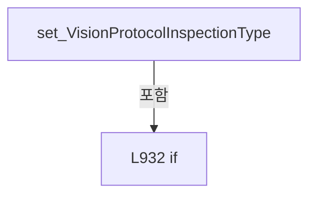

변경 전 점검: 입력/반환 타입, 위 호출자, 예외/취소 경로, 공유 상태와 저장·전송 소비자를 함께 확인합니다. 값의 단위나 물리 방향을 이름만으로 확정하지 않습니다.

### PropertyDeclaration `VisionProtocolRequestPreview` · L939–945

[Drilling.UI/Menu/Menus/CMenuManual.cs:939–945](https://github.com/kjuws10-rgb/A3Drilling/blob/5aee8e58439c9b455cae7c9593c9be986c3e682e/Drilling.UI/Menu/Menus/CMenuManual.cs#L939-L945)

| 항목 | 실제 추출 값 |
| --- | --- |
| 서명 | string Drilling.UI.Menu.Menus.CMenuManual.VisionProtocolRequestPreview |
| 접근/수식자 | Public / public |
| 반환/값 타입 | string |
| 소속 타입 | NamedType:Drilling.UI.Menu.Menus.CMenuManual |

현재 부분 분석에서 직접 연결된 호출자는 없습니다. XAML/이벤트/인터페이스·델리게이트·외부 진입을 추가 확인해야 하며, 미사용으로 판정한 것이 아닙니다.

변경 전 점검: 입력/반환 타입, 위 호출자, 예외/취소 경로, 공유 상태와 저장·전송 소비자를 함께 확인합니다. 값의 단위나 물리 방향을 이름만으로 확정하지 않습니다.

### GetAccessorDeclaration `get_VisionProtocolRequestPreview` · L941–944

[Drilling.UI/Menu/Menus/CMenuManual.cs:941–944](https://github.com/kjuws10-rgb/A3Drilling/blob/5aee8e58439c9b455cae7c9593c9be986c3e682e/Drilling.UI/Menu/Menus/CMenuManual.cs#L941-L944)

| 항목 | 실제 추출 값 |
| --- | --- |
| 서명 | string Drilling.UI.Menu.Menus.CMenuManual.VisionProtocolRequestPreview.get |
| 접근/수식자 | Public / get |
| 반환/값 타입 | string |
| 소속 타입 | NamedType:Drilling.UI.Menu.Menus.CMenuManual |

현재 부분 분석에서 직접 연결된 호출자는 없습니다. XAML/이벤트/인터페이스·델리게이트·외부 진입을 추가 확인해야 하며, 미사용으로 판정한 것이 아닙니다.

호출하는 대상과 해석 범위:

| 원본 행 | 표현식 | 분석 상태 | 대상/소스 위치 |
| --- | --- | --- | --- |
| 943 | BuildVisionProtocolFunction | resolved | string Drilling.UI.Menu.Menus.CMenuManual.BuildVisionProtocolFunction(bool) · Drilling.UI/Menu/Menus/CMenuManual.cs:6539 |

본문의 실제 연산·분기·예외·반환 순서(원문 위치 순):

| 원본 행 | 종류 | 주석 해설 |
| --- | --- | --- |
| 943 | call | 함수·델리게이트 또는 객체 생성자를 호출합니다: BuildVisionProtocolFunction(validate: false) |
| 943 | return | 호출자에게 값 또는 제어를 반환합니다: return BuildVisionProtocolFunction(validate: false); |

변경 전 점검: 입력/반환 타입, 위 호출자, 예외/취소 경로, 공유 상태와 저장·전송 소비자를 함께 확인합니다. 값의 단위나 물리 방향을 이름만으로 확정하지 않습니다.

### PropertyDeclaration `VisionProtocolMarkRowCountText` · L947–953

[Drilling.UI/Menu/Menus/CMenuManual.cs:947–953](https://github.com/kjuws10-rgb/A3Drilling/blob/5aee8e58439c9b455cae7c9593c9be986c3e682e/Drilling.UI/Menu/Menus/CMenuManual.cs#L947-L953)

| 항목 | 실제 추출 값 |
| --- | --- |
| 서명 | string Drilling.UI.Menu.Menus.CMenuManual.VisionProtocolMarkRowCountText |
| 접근/수식자 | Public / public |
| 반환/값 타입 | string |
| 소속 타입 | NamedType:Drilling.UI.Menu.Menus.CMenuManual |

현재 부분 분석에서 직접 연결된 호출자는 없습니다. XAML/이벤트/인터페이스·델리게이트·외부 진입을 추가 확인해야 하며, 미사용으로 판정한 것이 아닙니다.

변경 전 점검: 입력/반환 타입, 위 호출자, 예외/취소 경로, 공유 상태와 저장·전송 소비자를 함께 확인합니다. 값의 단위나 물리 방향을 이름만으로 확정하지 않습니다.

### GetAccessorDeclaration `get_VisionProtocolMarkRowCountText` · L949–952

[Drilling.UI/Menu/Menus/CMenuManual.cs:949–952](https://github.com/kjuws10-rgb/A3Drilling/blob/5aee8e58439c9b455cae7c9593c9be986c3e682e/Drilling.UI/Menu/Menus/CMenuManual.cs#L949-L952)

| 항목 | 실제 추출 값 |
| --- | --- |
| 서명 | string Drilling.UI.Menu.Menus.CMenuManual.VisionProtocolMarkRowCountText.get |
| 접근/수식자 | Public / get |
| 반환/값 타입 | string |
| 소속 타입 | NamedType:Drilling.UI.Menu.Menus.CMenuManual |

현재 부분 분석에서 직접 연결된 호출자는 없습니다. XAML/이벤트/인터페이스·델리게이트·외부 진입을 추가 확인해야 하며, 미사용으로 판정한 것이 아닙니다.

본문의 실제 연산·분기·예외·반환 순서(원문 위치 순):

| 원본 행 | 종류 | 주석 해설 |
| --- | --- | --- |
| 951 | return | 호출자에게 값 또는 제어를 반환합니다: return $"MARK {VisionProtocolMarkRows.Count} / {CVisionProtocol.MaximumMarkCount}"; |

변경 전 점검: 입력/반환 타입, 위 호출자, 예외/취소 경로, 공유 상태와 저장·전송 소비자를 함께 확인합니다. 값의 단위나 물리 방향을 이름만으로 확정하지 않습니다.

### PropertyDeclaration `VisionProtocolEndpoint` · L955–966

[Drilling.UI/Menu/Menus/CMenuManual.cs:955–966](https://github.com/kjuws10-rgb/A3Drilling/blob/5aee8e58439c9b455cae7c9593c9be986c3e682e/Drilling.UI/Menu/Menus/CMenuManual.cs#L955-L966)

| 항목 | 실제 추출 값 |
| --- | --- |
| 서명 | string Drilling.UI.Menu.Menus.CMenuManual.VisionProtocolEndpoint |
| 접근/수식자 | Public / public |
| 반환/값 타입 | string |
| 소속 타입 | NamedType:Drilling.UI.Menu.Menus.CMenuManual |

현재 부분 분석에서 직접 연결된 호출자는 없습니다. XAML/이벤트/인터페이스·델리게이트·외부 진입을 추가 확인해야 하며, 미사용으로 판정한 것이 아닙니다.

변경 전 점검: 입력/반환 타입, 위 호출자, 예외/취소 경로, 공유 상태와 저장·전송 소비자를 함께 확인합니다. 값의 단위나 물리 방향을 이름만으로 확정하지 않습니다.

### GetAccessorDeclaration `get_VisionProtocolEndpoint` · L957–960

[Drilling.UI/Menu/Menus/CMenuManual.cs:957–960](https://github.com/kjuws10-rgb/A3Drilling/blob/5aee8e58439c9b455cae7c9593c9be986c3e682e/Drilling.UI/Menu/Menus/CMenuManual.cs#L957-L960)

| 항목 | 실제 추출 값 |
| --- | --- |
| 서명 | string Drilling.UI.Menu.Menus.CMenuManual.VisionProtocolEndpoint.get |
| 접근/수식자 | Public / get |
| 반환/값 타입 | string |
| 소속 타입 | NamedType:Drilling.UI.Menu.Menus.CMenuManual |

현재 부분 분석에서 직접 연결된 호출자는 없습니다. XAML/이벤트/인터페이스·델리게이트·외부 진입을 추가 확인해야 하며, 미사용으로 판정한 것이 아닙니다.

본문의 실제 연산·분기·예외·반환 순서(원문 위치 순):

| 원본 행 | 종류 | 주석 해설 |
| --- | --- | --- |
| 959 | return | 호출자에게 값 또는 제어를 반환합니다: return _visionProtocolEndpoint; |

변경 전 점검: 입력/반환 타입, 위 호출자, 예외/취소 경로, 공유 상태와 저장·전송 소비자를 함께 확인합니다. 값의 단위나 물리 방향을 이름만으로 확정하지 않습니다.

### SetAccessorDeclaration `set_VisionProtocolEndpoint` · L962–965

[Drilling.UI/Menu/Menus/CMenuManual.cs:962–965](https://github.com/kjuws10-rgb/A3Drilling/blob/5aee8e58439c9b455cae7c9593c9be986c3e682e/Drilling.UI/Menu/Menus/CMenuManual.cs#L962-L965)

| 항목 | 실제 추출 값 |
| --- | --- |
| 서명 | void Drilling.UI.Menu.Menus.CMenuManual.VisionProtocolEndpoint.set |
| 접근/수식자 | Private / private, set |
| 반환/값 타입 | void |
| 소속 타입 | NamedType:Drilling.UI.Menu.Menus.CMenuManual |

입력 계약:

| 이름 | 타입 | 전달 | 선택/기본값 |
| --- | --- | --- | --- |
| value | string | None | False /  |

현재 부분 분석에서 직접 연결된 호출자는 없습니다. XAML/이벤트/인터페이스·델리게이트·외부 진입을 추가 확인해야 하며, 미사용으로 판정한 것이 아닙니다.

호출하는 대상과 해석 범위:

| 원본 행 | 표현식 | 분석 상태 | 대상/소스 위치 |
| --- | --- | --- | --- |
| 964 | SetProperty | resolved | bool Drilling.UI.Menu.CBindingBase.SetProperty<string>(ref string, string, string?) · Drilling.UI/Menu/CBindingBase.cs:735 |

본문의 실제 연산·분기·예외·반환 순서(원문 위치 순):

| 원본 행 | 종류 | 주석 해설 |
| --- | --- | --- |
| 964 | call | 함수·델리게이트 또는 객체 생성자를 호출합니다: SetProperty(ref _visionProtocolEndpoint, value) |

변경 전 점검: 입력/반환 타입, 위 호출자, 예외/취소 경로, 공유 상태와 저장·전송 소비자를 함께 확인합니다. 값의 단위나 물리 방향을 이름만으로 확정하지 않습니다.

### PropertyDeclaration `VisionProtocolStatus` · L968–979

[Drilling.UI/Menu/Menus/CMenuManual.cs:968–979](https://github.com/kjuws10-rgb/A3Drilling/blob/5aee8e58439c9b455cae7c9593c9be986c3e682e/Drilling.UI/Menu/Menus/CMenuManual.cs#L968-L979)

| 항목 | 실제 추출 값 |
| --- | --- |
| 서명 | string Drilling.UI.Menu.Menus.CMenuManual.VisionProtocolStatus |
| 접근/수식자 | Public / public |
| 반환/값 타입 | string |
| 소속 타입 | NamedType:Drilling.UI.Menu.Menus.CMenuManual |

현재 부분 분석에서 직접 연결된 호출자는 없습니다. XAML/이벤트/인터페이스·델리게이트·외부 진입을 추가 확인해야 하며, 미사용으로 판정한 것이 아닙니다.

변경 전 점검: 입력/반환 타입, 위 호출자, 예외/취소 경로, 공유 상태와 저장·전송 소비자를 함께 확인합니다. 값의 단위나 물리 방향을 이름만으로 확정하지 않습니다.

### GetAccessorDeclaration `get_VisionProtocolStatus` · L970–973

[Drilling.UI/Menu/Menus/CMenuManual.cs:970–973](https://github.com/kjuws10-rgb/A3Drilling/blob/5aee8e58439c9b455cae7c9593c9be986c3e682e/Drilling.UI/Menu/Menus/CMenuManual.cs#L970-L973)

| 항목 | 실제 추출 값 |
| --- | --- |
| 서명 | string Drilling.UI.Menu.Menus.CMenuManual.VisionProtocolStatus.get |
| 접근/수식자 | Public / get |
| 반환/값 타입 | string |
| 소속 타입 | NamedType:Drilling.UI.Menu.Menus.CMenuManual |

현재 부분 분석에서 직접 연결된 호출자는 없습니다. XAML/이벤트/인터페이스·델리게이트·외부 진입을 추가 확인해야 하며, 미사용으로 판정한 것이 아닙니다.

본문의 실제 연산·분기·예외·반환 순서(원문 위치 순):

| 원본 행 | 종류 | 주석 해설 |
| --- | --- | --- |
| 972 | return | 호출자에게 값 또는 제어를 반환합니다: return _visionProtocolStatus; |

변경 전 점검: 입력/반환 타입, 위 호출자, 예외/취소 경로, 공유 상태와 저장·전송 소비자를 함께 확인합니다. 값의 단위나 물리 방향을 이름만으로 확정하지 않습니다.

### SetAccessorDeclaration `set_VisionProtocolStatus` · L975–978

[Drilling.UI/Menu/Menus/CMenuManual.cs:975–978](https://github.com/kjuws10-rgb/A3Drilling/blob/5aee8e58439c9b455cae7c9593c9be986c3e682e/Drilling.UI/Menu/Menus/CMenuManual.cs#L975-L978)

| 항목 | 실제 추출 값 |
| --- | --- |
| 서명 | void Drilling.UI.Menu.Menus.CMenuManual.VisionProtocolStatus.set |
| 접근/수식자 | Private / private, set |
| 반환/값 타입 | void |
| 소속 타입 | NamedType:Drilling.UI.Menu.Menus.CMenuManual |

입력 계약:

| 이름 | 타입 | 전달 | 선택/기본값 |
| --- | --- | --- | --- |
| value | string | None | False /  |

현재 부분 분석에서 직접 연결된 호출자는 없습니다. XAML/이벤트/인터페이스·델리게이트·외부 진입을 추가 확인해야 하며, 미사용으로 판정한 것이 아닙니다.

호출하는 대상과 해석 범위:

| 원본 행 | 표현식 | 분석 상태 | 대상/소스 위치 |
| --- | --- | --- | --- |
| 977 | SetProperty | resolved | bool Drilling.UI.Menu.CBindingBase.SetProperty<string>(ref string, string, string?) · Drilling.UI/Menu/CBindingBase.cs:735 |

본문의 실제 연산·분기·예외·반환 순서(원문 위치 순):

| 원본 행 | 종류 | 주석 해설 |
| --- | --- | --- |
| 977 | call | 함수·델리게이트 또는 객체 생성자를 호출합니다: SetProperty(ref _visionProtocolStatus, value) |

변경 전 점검: 입력/반환 타입, 위 호출자, 예외/취소 경로, 공유 상태와 저장·전송 소비자를 함께 확인합니다. 값의 단위나 물리 방향을 이름만으로 확정하지 않습니다.

### PropertyDeclaration `VisionProtocolKeepAlive` · L981–992

[Drilling.UI/Menu/Menus/CMenuManual.cs:981–992](https://github.com/kjuws10-rgb/A3Drilling/blob/5aee8e58439c9b455cae7c9593c9be986c3e682e/Drilling.UI/Menu/Menus/CMenuManual.cs#L981-L992)

| 항목 | 실제 추출 값 |
| --- | --- |
| 서명 | string Drilling.UI.Menu.Menus.CMenuManual.VisionProtocolKeepAlive |
| 접근/수식자 | Public / public |
| 반환/값 타입 | string |
| 소속 타입 | NamedType:Drilling.UI.Menu.Menus.CMenuManual |

현재 부분 분석에서 직접 연결된 호출자는 없습니다. XAML/이벤트/인터페이스·델리게이트·외부 진입을 추가 확인해야 하며, 미사용으로 판정한 것이 아닙니다.

변경 전 점검: 입력/반환 타입, 위 호출자, 예외/취소 경로, 공유 상태와 저장·전송 소비자를 함께 확인합니다. 값의 단위나 물리 방향을 이름만으로 확정하지 않습니다.

### GetAccessorDeclaration `get_VisionProtocolKeepAlive` · L983–986

[Drilling.UI/Menu/Menus/CMenuManual.cs:983–986](https://github.com/kjuws10-rgb/A3Drilling/blob/5aee8e58439c9b455cae7c9593c9be986c3e682e/Drilling.UI/Menu/Menus/CMenuManual.cs#L983-L986)

| 항목 | 실제 추출 값 |
| --- | --- |
| 서명 | string Drilling.UI.Menu.Menus.CMenuManual.VisionProtocolKeepAlive.get |
| 접근/수식자 | Public / get |
| 반환/값 타입 | string |
| 소속 타입 | NamedType:Drilling.UI.Menu.Menus.CMenuManual |

현재 부분 분석에서 직접 연결된 호출자는 없습니다. XAML/이벤트/인터페이스·델리게이트·외부 진입을 추가 확인해야 하며, 미사용으로 판정한 것이 아닙니다.

본문의 실제 연산·분기·예외·반환 순서(원문 위치 순):

| 원본 행 | 종류 | 주석 해설 |
| --- | --- | --- |
| 985 | return | 호출자에게 값 또는 제어를 반환합니다: return _visionProtocolKeepAlive; |

변경 전 점검: 입력/반환 타입, 위 호출자, 예외/취소 경로, 공유 상태와 저장·전송 소비자를 함께 확인합니다. 값의 단위나 물리 방향을 이름만으로 확정하지 않습니다.

### SetAccessorDeclaration `set_VisionProtocolKeepAlive` · L988–991

[Drilling.UI/Menu/Menus/CMenuManual.cs:988–991](https://github.com/kjuws10-rgb/A3Drilling/blob/5aee8e58439c9b455cae7c9593c9be986c3e682e/Drilling.UI/Menu/Menus/CMenuManual.cs#L988-L991)

| 항목 | 실제 추출 값 |
| --- | --- |
| 서명 | void Drilling.UI.Menu.Menus.CMenuManual.VisionProtocolKeepAlive.set |
| 접근/수식자 | Private / private, set |
| 반환/값 타입 | void |
| 소속 타입 | NamedType:Drilling.UI.Menu.Menus.CMenuManual |

입력 계약:

| 이름 | 타입 | 전달 | 선택/기본값 |
| --- | --- | --- | --- |
| value | string | None | False /  |

현재 부분 분석에서 직접 연결된 호출자는 없습니다. XAML/이벤트/인터페이스·델리게이트·외부 진입을 추가 확인해야 하며, 미사용으로 판정한 것이 아닙니다.

호출하는 대상과 해석 범위:

| 원본 행 | 표현식 | 분석 상태 | 대상/소스 위치 |
| --- | --- | --- | --- |
| 990 | SetProperty | resolved | bool Drilling.UI.Menu.CBindingBase.SetProperty<string>(ref string, string, string?) · Drilling.UI/Menu/CBindingBase.cs:735 |

본문의 실제 연산·분기·예외·반환 순서(원문 위치 순):

| 원본 행 | 종류 | 주석 해설 |
| --- | --- | --- |
| 990 | call | 함수·델리게이트 또는 객체 생성자를 호출합니다: SetProperty(ref _visionProtocolKeepAlive, value) |

변경 전 점검: 입력/반환 타입, 위 호출자, 예외/취소 경로, 공유 상태와 저장·전송 소비자를 함께 확인합니다. 값의 단위나 물리 방향을 이름만으로 확정하지 않습니다.

### PropertyDeclaration `IsVisionProtocolBusy` · L994–1008

[Drilling.UI/Menu/Menus/CMenuManual.cs:994–1008](https://github.com/kjuws10-rgb/A3Drilling/blob/5aee8e58439c9b455cae7c9593c9be986c3e682e/Drilling.UI/Menu/Menus/CMenuManual.cs#L994-L1008)

| 항목 | 실제 추출 값 |
| --- | --- |
| 서명 | bool Drilling.UI.Menu.Menus.CMenuManual.IsVisionProtocolBusy |
| 접근/수식자 | Public / public |
| 반환/값 타입 | bool |
| 소속 타입 | NamedType:Drilling.UI.Menu.Menus.CMenuManual |

현재 부분 분석에서 직접 연결된 호출자는 없습니다. XAML/이벤트/인터페이스·델리게이트·외부 진입을 추가 확인해야 하며, 미사용으로 판정한 것이 아닙니다.

변경 전 점검: 입력/반환 타입, 위 호출자, 예외/취소 경로, 공유 상태와 저장·전송 소비자를 함께 확인합니다. 값의 단위나 물리 방향을 이름만으로 확정하지 않습니다.

### GetAccessorDeclaration `get_IsVisionProtocolBusy` · L996–999

[Drilling.UI/Menu/Menus/CMenuManual.cs:996–999](https://github.com/kjuws10-rgb/A3Drilling/blob/5aee8e58439c9b455cae7c9593c9be986c3e682e/Drilling.UI/Menu/Menus/CMenuManual.cs#L996-L999)

| 항목 | 실제 추출 값 |
| --- | --- |
| 서명 | bool Drilling.UI.Menu.Menus.CMenuManual.IsVisionProtocolBusy.get |
| 접근/수식자 | Public / get |
| 반환/값 타입 | bool |
| 소속 타입 | NamedType:Drilling.UI.Menu.Menus.CMenuManual |

현재 부분 분석에서 직접 연결된 호출자는 없습니다. XAML/이벤트/인터페이스·델리게이트·외부 진입을 추가 확인해야 하며, 미사용으로 판정한 것이 아닙니다.

본문의 실제 연산·분기·예외·반환 순서(원문 위치 순):

| 원본 행 | 종류 | 주석 해설 |
| --- | --- | --- |
| 998 | return | 호출자에게 값 또는 제어를 반환합니다: return _isVisionProtocolBusy; |

변경 전 점검: 입력/반환 타입, 위 호출자, 예외/취소 경로, 공유 상태와 저장·전송 소비자를 함께 확인합니다. 값의 단위나 물리 방향을 이름만으로 확정하지 않습니다.

### SetAccessorDeclaration `set_IsVisionProtocolBusy` · L1001–1007

[Drilling.UI/Menu/Menus/CMenuManual.cs:1001–1007](https://github.com/kjuws10-rgb/A3Drilling/blob/5aee8e58439c9b455cae7c9593c9be986c3e682e/Drilling.UI/Menu/Menus/CMenuManual.cs#L1001-L1007)

| 항목 | 실제 추출 값 |
| --- | --- |
| 서명 | void Drilling.UI.Menu.Menus.CMenuManual.IsVisionProtocolBusy.set |
| 접근/수식자 | Private / private, set |
| 반환/값 타입 | void |
| 소속 타입 | NamedType:Drilling.UI.Menu.Menus.CMenuManual |

입력 계약:

| 이름 | 타입 | 전달 | 선택/기본값 |
| --- | --- | --- | --- |
| value | bool | None | False /  |

현재 부분 분석에서 직접 연결된 호출자는 없습니다. XAML/이벤트/인터페이스·델리게이트·외부 진입을 추가 확인해야 하며, 미사용으로 판정한 것이 아닙니다.

호출하는 대상과 해석 범위:

| 원본 행 | 표현식 | 분석 상태 | 대상/소스 위치 |
| --- | --- | --- | --- |
| 1003 | SetProperty | resolved | bool Drilling.UI.Menu.CBindingBase.SetProperty<bool>(ref bool, bool, string?) · Drilling.UI/Menu/CBindingBase.cs:735 |
| 1005 | VisionProtocolSendCommand.NotifyCanExecuteChanged | resolved | void Drilling.UI.Menu.CButtonCommand.NotifyCanExecuteChanged() · Drilling.UI/Menu/CButtonCommand.cs:24 |

본문의 실제 연산·분기·예외·반환 순서(원문 위치 순):

| 원본 행 | 종류 | 주석 해설 |
| --- | --- | --- |
| 1003 | call | 함수·델리게이트 또는 객체 생성자를 호출합니다: SetProperty(ref _isVisionProtocolBusy, value) |
| 1003 | if | 조건에 따라 분기합니다: if (SetProperty(ref _isVisionProtocolBusy, value)) |
| 1005 | call | 함수·델리게이트 또는 객체 생성자를 호출합니다: VisionProtocolSendCommand.NotifyCanExecuteChanged() |

제어 구문의 포함 구조(실제 실행 순서/CFG가 아닌 구문 탐색 그림):

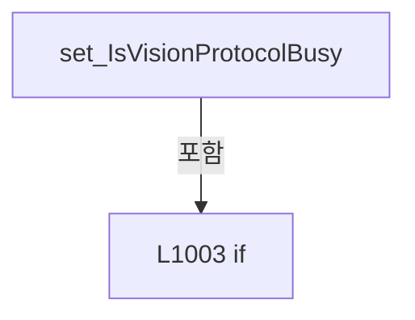

변경 전 점검: 입력/반환 타입, 위 호출자, 예외/취소 경로, 공유 상태와 저장·전송 소비자를 함께 확인합니다. 값의 단위나 물리 방향을 이름만으로 확정하지 않습니다.

### PropertyDeclaration `SelectHeadCommand` · L1010–1010

[Drilling.UI/Menu/Menus/CMenuManual.cs:1010–1010](https://github.com/kjuws10-rgb/A3Drilling/blob/5aee8e58439c9b455cae7c9593c9be986c3e682e/Drilling.UI/Menu/Menus/CMenuManual.cs#L1010-L1010)

| 항목 | 실제 추출 값 |
| --- | --- |
| 서명 | Drilling.UI.Menu.CButtonCommand Drilling.UI.Menu.Menus.CMenuManual.SelectHeadCommand |
| 접근/수식자 | Public / public |
| 반환/값 타입 | Drilling.UI.Menu.CButtonCommand |
| 소속 타입 | NamedType:Drilling.UI.Menu.Menus.CMenuManual |

현재 부분 분석에서 직접 연결된 호출자는 없습니다. XAML/이벤트/인터페이스·델리게이트·외부 진입을 추가 확인해야 하며, 미사용으로 판정한 것이 아닙니다.

변경 전 점검: 입력/반환 타입, 위 호출자, 예외/취소 경로, 공유 상태와 저장·전송 소비자를 함께 확인합니다. 값의 단위나 물리 방향을 이름만으로 확정하지 않습니다.

### GetAccessorDeclaration `get_SelectHeadCommand` · L1010–1010

[Drilling.UI/Menu/Menus/CMenuManual.cs:1010–1010](https://github.com/kjuws10-rgb/A3Drilling/blob/5aee8e58439c9b455cae7c9593c9be986c3e682e/Drilling.UI/Menu/Menus/CMenuManual.cs#L1010-L1010)

| 항목 | 실제 추출 값 |
| --- | --- |
| 서명 | Drilling.UI.Menu.CButtonCommand Drilling.UI.Menu.Menus.CMenuManual.SelectHeadCommand.get |
| 접근/수식자 | Public / get |
| 반환/값 타입 | Drilling.UI.Menu.CButtonCommand |
| 소속 타입 | NamedType:Drilling.UI.Menu.Menus.CMenuManual |

현재 부분 분석에서 직접 연결된 호출자는 없습니다. XAML/이벤트/인터페이스·델리게이트·외부 진입을 추가 확인해야 하며, 미사용으로 판정한 것이 아닙니다.

변경 전 점검: 입력/반환 타입, 위 호출자, 예외/취소 경로, 공유 상태와 저장·전송 소비자를 함께 확인합니다. 값의 단위나 물리 방향을 이름만으로 확정하지 않습니다.

### PropertyDeclaration `SelectSettingCommand` · L1011–1011

[Drilling.UI/Menu/Menus/CMenuManual.cs:1011–1011](https://github.com/kjuws10-rgb/A3Drilling/blob/5aee8e58439c9b455cae7c9593c9be986c3e682e/Drilling.UI/Menu/Menus/CMenuManual.cs#L1011-L1011)

| 항목 | 실제 추출 값 |
| --- | --- |
| 서명 | Drilling.UI.Menu.CButtonCommand Drilling.UI.Menu.Menus.CMenuManual.SelectSettingCommand |
| 접근/수식자 | Public / public |
| 반환/값 타입 | Drilling.UI.Menu.CButtonCommand |
| 소속 타입 | NamedType:Drilling.UI.Menu.Menus.CMenuManual |

현재 부분 분석에서 직접 연결된 호출자는 없습니다. XAML/이벤트/인터페이스·델리게이트·외부 진입을 추가 확인해야 하며, 미사용으로 판정한 것이 아닙니다.

변경 전 점검: 입력/반환 타입, 위 호출자, 예외/취소 경로, 공유 상태와 저장·전송 소비자를 함께 확인합니다. 값의 단위나 물리 방향을 이름만으로 확정하지 않습니다.

### GetAccessorDeclaration `get_SelectSettingCommand` · L1011–1011

[Drilling.UI/Menu/Menus/CMenuManual.cs:1011–1011](https://github.com/kjuws10-rgb/A3Drilling/blob/5aee8e58439c9b455cae7c9593c9be986c3e682e/Drilling.UI/Menu/Menus/CMenuManual.cs#L1011-L1011)

| 항목 | 실제 추출 값 |
| --- | --- |
| 서명 | Drilling.UI.Menu.CButtonCommand Drilling.UI.Menu.Menus.CMenuManual.SelectSettingCommand.get |
| 접근/수식자 | Public / get |
| 반환/값 타입 | Drilling.UI.Menu.CButtonCommand |
| 소속 타입 | NamedType:Drilling.UI.Menu.Menus.CMenuManual |

현재 부분 분석에서 직접 연결된 호출자는 없습니다. XAML/이벤트/인터페이스·델리게이트·외부 진입을 추가 확인해야 하며, 미사용으로 판정한 것이 아닙니다.

변경 전 점검: 입력/반환 타입, 위 호출자, 예외/취소 경로, 공유 상태와 저장·전송 소비자를 함께 확인합니다. 값의 단위나 물리 방향을 이름만으로 확정하지 않습니다.

### PropertyDeclaration `PreviousSettingPageCommand` · L1012–1012

[Drilling.UI/Menu/Menus/CMenuManual.cs:1012–1012](https://github.com/kjuws10-rgb/A3Drilling/blob/5aee8e58439c9b455cae7c9593c9be986c3e682e/Drilling.UI/Menu/Menus/CMenuManual.cs#L1012-L1012)

| 항목 | 실제 추출 값 |
| --- | --- |
| 서명 | Drilling.UI.Menu.CButtonCommand Drilling.UI.Menu.Menus.CMenuManual.PreviousSettingPageCommand |
| 접근/수식자 | Public / public |
| 반환/값 타입 | Drilling.UI.Menu.CButtonCommand |
| 소속 타입 | NamedType:Drilling.UI.Menu.Menus.CMenuManual |

현재 부분 분석에서 직접 연결된 호출자는 없습니다. XAML/이벤트/인터페이스·델리게이트·외부 진입을 추가 확인해야 하며, 미사용으로 판정한 것이 아닙니다.

변경 전 점검: 입력/반환 타입, 위 호출자, 예외/취소 경로, 공유 상태와 저장·전송 소비자를 함께 확인합니다. 값의 단위나 물리 방향을 이름만으로 확정하지 않습니다.

### GetAccessorDeclaration `get_PreviousSettingPageCommand` · L1012–1012

[Drilling.UI/Menu/Menus/CMenuManual.cs:1012–1012](https://github.com/kjuws10-rgb/A3Drilling/blob/5aee8e58439c9b455cae7c9593c9be986c3e682e/Drilling.UI/Menu/Menus/CMenuManual.cs#L1012-L1012)

| 항목 | 실제 추출 값 |
| --- | --- |
| 서명 | Drilling.UI.Menu.CButtonCommand Drilling.UI.Menu.Menus.CMenuManual.PreviousSettingPageCommand.get |
| 접근/수식자 | Public / get |
| 반환/값 타입 | Drilling.UI.Menu.CButtonCommand |
| 소속 타입 | NamedType:Drilling.UI.Menu.Menus.CMenuManual |

현재 부분 분석에서 직접 연결된 호출자는 없습니다. XAML/이벤트/인터페이스·델리게이트·외부 진입을 추가 확인해야 하며, 미사용으로 판정한 것이 아닙니다.

변경 전 점검: 입력/반환 타입, 위 호출자, 예외/취소 경로, 공유 상태와 저장·전송 소비자를 함께 확인합니다. 값의 단위나 물리 방향을 이름만으로 확정하지 않습니다.

### PropertyDeclaration `NextSettingPageCommand` · L1013–1013

[Drilling.UI/Menu/Menus/CMenuManual.cs:1013–1013](https://github.com/kjuws10-rgb/A3Drilling/blob/5aee8e58439c9b455cae7c9593c9be986c3e682e/Drilling.UI/Menu/Menus/CMenuManual.cs#L1013-L1013)

| 항목 | 실제 추출 값 |
| --- | --- |
| 서명 | Drilling.UI.Menu.CButtonCommand Drilling.UI.Menu.Menus.CMenuManual.NextSettingPageCommand |
| 접근/수식자 | Public / public |
| 반환/값 타입 | Drilling.UI.Menu.CButtonCommand |
| 소속 타입 | NamedType:Drilling.UI.Menu.Menus.CMenuManual |

현재 부분 분석에서 직접 연결된 호출자는 없습니다. XAML/이벤트/인터페이스·델리게이트·외부 진입을 추가 확인해야 하며, 미사용으로 판정한 것이 아닙니다.

변경 전 점검: 입력/반환 타입, 위 호출자, 예외/취소 경로, 공유 상태와 저장·전송 소비자를 함께 확인합니다. 값의 단위나 물리 방향을 이름만으로 확정하지 않습니다.

### GetAccessorDeclaration `get_NextSettingPageCommand` · L1013–1013

[Drilling.UI/Menu/Menus/CMenuManual.cs:1013–1013](https://github.com/kjuws10-rgb/A3Drilling/blob/5aee8e58439c9b455cae7c9593c9be986c3e682e/Drilling.UI/Menu/Menus/CMenuManual.cs#L1013-L1013)

| 항목 | 실제 추출 값 |
| --- | --- |
| 서명 | Drilling.UI.Menu.CButtonCommand Drilling.UI.Menu.Menus.CMenuManual.NextSettingPageCommand.get |
| 접근/수식자 | Public / get |
| 반환/값 타입 | Drilling.UI.Menu.CButtonCommand |
| 소속 타입 | NamedType:Drilling.UI.Menu.Menus.CMenuManual |

현재 부분 분석에서 직접 연결된 호출자는 없습니다. XAML/이벤트/인터페이스·델리게이트·외부 진입을 추가 확인해야 하며, 미사용으로 판정한 것이 아닙니다.

변경 전 점검: 입력/반환 타입, 위 호출자, 예외/취소 경로, 공유 상태와 저장·전송 소비자를 함께 확인합니다. 값의 단위나 물리 방향을 이름만으로 확정하지 않습니다.

### PropertyDeclaration `CreateCommand` · L1014–1014

[Drilling.UI/Menu/Menus/CMenuManual.cs:1014–1014](https://github.com/kjuws10-rgb/A3Drilling/blob/5aee8e58439c9b455cae7c9593c9be986c3e682e/Drilling.UI/Menu/Menus/CMenuManual.cs#L1014-L1014)

| 항목 | 실제 추출 값 |
| --- | --- |
| 서명 | Drilling.UI.Menu.CButtonCommand Drilling.UI.Menu.Menus.CMenuManual.CreateCommand |
| 접근/수식자 | Public / public |
| 반환/값 타입 | Drilling.UI.Menu.CButtonCommand |
| 소속 타입 | NamedType:Drilling.UI.Menu.Menus.CMenuManual |

현재 부분 분석에서 직접 연결된 호출자는 없습니다. XAML/이벤트/인터페이스·델리게이트·외부 진입을 추가 확인해야 하며, 미사용으로 판정한 것이 아닙니다.

변경 전 점검: 입력/반환 타입, 위 호출자, 예외/취소 경로, 공유 상태와 저장·전송 소비자를 함께 확인합니다. 값의 단위나 물리 방향을 이름만으로 확정하지 않습니다.

### GetAccessorDeclaration `get_CreateCommand` · L1014–1014

[Drilling.UI/Menu/Menus/CMenuManual.cs:1014–1014](https://github.com/kjuws10-rgb/A3Drilling/blob/5aee8e58439c9b455cae7c9593c9be986c3e682e/Drilling.UI/Menu/Menus/CMenuManual.cs#L1014-L1014)

| 항목 | 실제 추출 값 |
| --- | --- |
| 서명 | Drilling.UI.Menu.CButtonCommand Drilling.UI.Menu.Menus.CMenuManual.CreateCommand.get |
| 접근/수식자 | Public / get |
| 반환/값 타입 | Drilling.UI.Menu.CButtonCommand |
| 소속 타입 | NamedType:Drilling.UI.Menu.Menus.CMenuManual |

현재 부분 분석에서 직접 연결된 호출자는 없습니다. XAML/이벤트/인터페이스·델리게이트·외부 진입을 추가 확인해야 하며, 미사용으로 판정한 것이 아닙니다.

변경 전 점검: 입력/반환 타입, 위 호출자, 예외/취소 경로, 공유 상태와 저장·전송 소비자를 함께 확인합니다. 값의 단위나 물리 방향을 이름만으로 확정하지 않습니다.

### PropertyDeclaration `DeleteCommand` · L1015–1015

[Drilling.UI/Menu/Menus/CMenuManual.cs:1015–1015](https://github.com/kjuws10-rgb/A3Drilling/blob/5aee8e58439c9b455cae7c9593c9be986c3e682e/Drilling.UI/Menu/Menus/CMenuManual.cs#L1015-L1015)

| 항목 | 실제 추출 값 |
| --- | --- |
| 서명 | Drilling.UI.Menu.CButtonCommand Drilling.UI.Menu.Menus.CMenuManual.DeleteCommand |
| 접근/수식자 | Public / public |
| 반환/값 타입 | Drilling.UI.Menu.CButtonCommand |
| 소속 타입 | NamedType:Drilling.UI.Menu.Menus.CMenuManual |

현재 부분 분석에서 직접 연결된 호출자는 없습니다. XAML/이벤트/인터페이스·델리게이트·외부 진입을 추가 확인해야 하며, 미사용으로 판정한 것이 아닙니다.

변경 전 점검: 입력/반환 타입, 위 호출자, 예외/취소 경로, 공유 상태와 저장·전송 소비자를 함께 확인합니다. 값의 단위나 물리 방향을 이름만으로 확정하지 않습니다.

### GetAccessorDeclaration `get_DeleteCommand` · L1015–1015

[Drilling.UI/Menu/Menus/CMenuManual.cs:1015–1015](https://github.com/kjuws10-rgb/A3Drilling/blob/5aee8e58439c9b455cae7c9593c9be986c3e682e/Drilling.UI/Menu/Menus/CMenuManual.cs#L1015-L1015)

| 항목 | 실제 추출 값 |
| --- | --- |
| 서명 | Drilling.UI.Menu.CButtonCommand Drilling.UI.Menu.Menus.CMenuManual.DeleteCommand.get |
| 접근/수식자 | Public / get |
| 반환/값 타입 | Drilling.UI.Menu.CButtonCommand |
| 소속 타입 | NamedType:Drilling.UI.Menu.Menus.CMenuManual |

현재 부분 분석에서 직접 연결된 호출자는 없습니다. XAML/이벤트/인터페이스·델리게이트·외부 진입을 추가 확인해야 하며, 미사용으로 판정한 것이 아닙니다.

변경 전 점검: 입력/반환 타입, 위 호출자, 예외/취소 경로, 공유 상태와 저장·전송 소비자를 함께 확인합니다. 값의 단위나 물리 방향을 이름만으로 확정하지 않습니다.

### PropertyDeclaration `RenameCommand` · L1016–1016

[Drilling.UI/Menu/Menus/CMenuManual.cs:1016–1016](https://github.com/kjuws10-rgb/A3Drilling/blob/5aee8e58439c9b455cae7c9593c9be986c3e682e/Drilling.UI/Menu/Menus/CMenuManual.cs#L1016-L1016)

| 항목 | 실제 추출 값 |
| --- | --- |
| 서명 | Drilling.UI.Menu.CButtonCommand Drilling.UI.Menu.Menus.CMenuManual.RenameCommand |
| 접근/수식자 | Public / public |
| 반환/값 타입 | Drilling.UI.Menu.CButtonCommand |
| 소속 타입 | NamedType:Drilling.UI.Menu.Menus.CMenuManual |

현재 부분 분석에서 직접 연결된 호출자는 없습니다. XAML/이벤트/인터페이스·델리게이트·외부 진입을 추가 확인해야 하며, 미사용으로 판정한 것이 아닙니다.

변경 전 점검: 입력/반환 타입, 위 호출자, 예외/취소 경로, 공유 상태와 저장·전송 소비자를 함께 확인합니다. 값의 단위나 물리 방향을 이름만으로 확정하지 않습니다.

### GetAccessorDeclaration `get_RenameCommand` · L1016–1016

[Drilling.UI/Menu/Menus/CMenuManual.cs:1016–1016](https://github.com/kjuws10-rgb/A3Drilling/blob/5aee8e58439c9b455cae7c9593c9be986c3e682e/Drilling.UI/Menu/Menus/CMenuManual.cs#L1016-L1016)

| 항목 | 실제 추출 값 |
| --- | --- |
| 서명 | Drilling.UI.Menu.CButtonCommand Drilling.UI.Menu.Menus.CMenuManual.RenameCommand.get |
| 접근/수식자 | Public / get |
| 반환/값 타입 | Drilling.UI.Menu.CButtonCommand |
| 소속 타입 | NamedType:Drilling.UI.Menu.Menus.CMenuManual |

현재 부분 분석에서 직접 연결된 호출자는 없습니다. XAML/이벤트/인터페이스·델리게이트·외부 진입을 추가 확인해야 하며, 미사용으로 판정한 것이 아닙니다.

변경 전 점검: 입력/반환 타입, 위 호출자, 예외/취소 경로, 공유 상태와 저장·전송 소비자를 함께 확인합니다. 값의 단위나 물리 방향을 이름만으로 확정하지 않습니다.

### PropertyDeclaration `SaveCommand` · L1017–1017

[Drilling.UI/Menu/Menus/CMenuManual.cs:1017–1017](https://github.com/kjuws10-rgb/A3Drilling/blob/5aee8e58439c9b455cae7c9593c9be986c3e682e/Drilling.UI/Menu/Menus/CMenuManual.cs#L1017-L1017)

| 항목 | 실제 추출 값 |
| --- | --- |
| 서명 | Drilling.UI.Menu.CButtonCommand Drilling.UI.Menu.Menus.CMenuManual.SaveCommand |
| 접근/수식자 | Public / public |
| 반환/값 타입 | Drilling.UI.Menu.CButtonCommand |
| 소속 타입 | NamedType:Drilling.UI.Menu.Menus.CMenuManual |

현재 부분 분석에서 직접 연결된 호출자는 없습니다. XAML/이벤트/인터페이스·델리게이트·외부 진입을 추가 확인해야 하며, 미사용으로 판정한 것이 아닙니다.

변경 전 점검: 입력/반환 타입, 위 호출자, 예외/취소 경로, 공유 상태와 저장·전송 소비자를 함께 확인합니다. 값의 단위나 물리 방향을 이름만으로 확정하지 않습니다.

### GetAccessorDeclaration `get_SaveCommand` · L1017–1017

[Drilling.UI/Menu/Menus/CMenuManual.cs:1017–1017](https://github.com/kjuws10-rgb/A3Drilling/blob/5aee8e58439c9b455cae7c9593c9be986c3e682e/Drilling.UI/Menu/Menus/CMenuManual.cs#L1017-L1017)

| 항목 | 실제 추출 값 |
| --- | --- |
| 서명 | Drilling.UI.Menu.CButtonCommand Drilling.UI.Menu.Menus.CMenuManual.SaveCommand.get |
| 접근/수식자 | Public / get |
| 반환/값 타입 | Drilling.UI.Menu.CButtonCommand |
| 소속 타입 | NamedType:Drilling.UI.Menu.Menus.CMenuManual |

현재 부분 분석에서 직접 연결된 호출자는 없습니다. XAML/이벤트/인터페이스·델리게이트·외부 진입을 추가 확인해야 하며, 미사용으로 판정한 것이 아닙니다.

변경 전 점검: 입력/반환 타입, 위 호출자, 예외/취소 경로, 공유 상태와 저장·전송 소비자를 함께 확인합니다. 값의 단위나 물리 방향을 이름만으로 확정하지 않습니다.

### PropertyDeclaration `CenterMoveCommand` · L1018–1018

[Drilling.UI/Menu/Menus/CMenuManual.cs:1018–1018](https://github.com/kjuws10-rgb/A3Drilling/blob/5aee8e58439c9b455cae7c9593c9be986c3e682e/Drilling.UI/Menu/Menus/CMenuManual.cs#L1018-L1018)

| 항목 | 실제 추출 값 |
| --- | --- |
| 서명 | Drilling.UI.Menu.CButtonCommand Drilling.UI.Menu.Menus.CMenuManual.CenterMoveCommand |
| 접근/수식자 | Public / public |
| 반환/값 타입 | Drilling.UI.Menu.CButtonCommand |
| 소속 타입 | NamedType:Drilling.UI.Menu.Menus.CMenuManual |

현재 부분 분석에서 직접 연결된 호출자는 없습니다. XAML/이벤트/인터페이스·델리게이트·외부 진입을 추가 확인해야 하며, 미사용으로 판정한 것이 아닙니다.

변경 전 점검: 입력/반환 타입, 위 호출자, 예외/취소 경로, 공유 상태와 저장·전송 소비자를 함께 확인합니다. 값의 단위나 물리 방향을 이름만으로 확정하지 않습니다.

### GetAccessorDeclaration `get_CenterMoveCommand` · L1018–1018

[Drilling.UI/Menu/Menus/CMenuManual.cs:1018–1018](https://github.com/kjuws10-rgb/A3Drilling/blob/5aee8e58439c9b455cae7c9593c9be986c3e682e/Drilling.UI/Menu/Menus/CMenuManual.cs#L1018-L1018)

| 항목 | 실제 추출 값 |
| --- | --- |
| 서명 | Drilling.UI.Menu.CButtonCommand Drilling.UI.Menu.Menus.CMenuManual.CenterMoveCommand.get |
| 접근/수식자 | Public / get |
| 반환/값 타입 | Drilling.UI.Menu.CButtonCommand |
| 소속 타입 | NamedType:Drilling.UI.Menu.Menus.CMenuManual |

현재 부분 분석에서 직접 연결된 호출자는 없습니다. XAML/이벤트/인터페이스·델리게이트·외부 진입을 추가 확인해야 하며, 미사용으로 판정한 것이 아닙니다.

변경 전 점검: 입력/반환 타입, 위 호출자, 예외/취소 경로, 공유 상태와 저장·전송 소비자를 함께 확인합니다. 값의 단위나 물리 방향을 이름만으로 확정하지 않습니다.

### PropertyDeclaration `PositionMoveCommand` · L1019–1019

[Drilling.UI/Menu/Menus/CMenuManual.cs:1019–1019](https://github.com/kjuws10-rgb/A3Drilling/blob/5aee8e58439c9b455cae7c9593c9be986c3e682e/Drilling.UI/Menu/Menus/CMenuManual.cs#L1019-L1019)

| 항목 | 실제 추출 값 |
| --- | --- |
| 서명 | Drilling.UI.Menu.CButtonCommand Drilling.UI.Menu.Menus.CMenuManual.PositionMoveCommand |
| 접근/수식자 | Public / public |
| 반환/값 타입 | Drilling.UI.Menu.CButtonCommand |
| 소속 타입 | NamedType:Drilling.UI.Menu.Menus.CMenuManual |

현재 부분 분석에서 직접 연결된 호출자는 없습니다. XAML/이벤트/인터페이스·델리게이트·외부 진입을 추가 확인해야 하며, 미사용으로 판정한 것이 아닙니다.

변경 전 점검: 입력/반환 타입, 위 호출자, 예외/취소 경로, 공유 상태와 저장·전송 소비자를 함께 확인합니다. 값의 단위나 물리 방향을 이름만으로 확정하지 않습니다.

### GetAccessorDeclaration `get_PositionMoveCommand` · L1019–1019

[Drilling.UI/Menu/Menus/CMenuManual.cs:1019–1019](https://github.com/kjuws10-rgb/A3Drilling/blob/5aee8e58439c9b455cae7c9593c9be986c3e682e/Drilling.UI/Menu/Menus/CMenuManual.cs#L1019-L1019)

| 항목 | 실제 추출 값 |
| --- | --- |
| 서명 | Drilling.UI.Menu.CButtonCommand Drilling.UI.Menu.Menus.CMenuManual.PositionMoveCommand.get |
| 접근/수식자 | Public / get |
| 반환/값 타입 | Drilling.UI.Menu.CButtonCommand |
| 소속 타입 | NamedType:Drilling.UI.Menu.Menus.CMenuManual |

현재 부분 분석에서 직접 연결된 호출자는 없습니다. XAML/이벤트/인터페이스·델리게이트·외부 진입을 추가 확인해야 하며, 미사용으로 판정한 것이 아닙니다.

변경 전 점검: 입력/반환 타입, 위 호출자, 예외/취소 경로, 공유 상태와 저장·전송 소비자를 함께 확인합니다. 값의 단위나 물리 방향을 이름만으로 확정하지 않습니다.

### PropertyDeclaration `ZPositionMoveCommand` · L1020–1020

[Drilling.UI/Menu/Menus/CMenuManual.cs:1020–1020](https://github.com/kjuws10-rgb/A3Drilling/blob/5aee8e58439c9b455cae7c9593c9be986c3e682e/Drilling.UI/Menu/Menus/CMenuManual.cs#L1020-L1020)

| 항목 | 실제 추출 값 |
| --- | --- |
| 서명 | Drilling.UI.Menu.CButtonCommand Drilling.UI.Menu.Menus.CMenuManual.ZPositionMoveCommand |
| 접근/수식자 | Public / public |
| 반환/값 타입 | Drilling.UI.Menu.CButtonCommand |
| 소속 타입 | NamedType:Drilling.UI.Menu.Menus.CMenuManual |

현재 부분 분석에서 직접 연결된 호출자는 없습니다. XAML/이벤트/인터페이스·델리게이트·외부 진입을 추가 확인해야 하며, 미사용으로 판정한 것이 아닙니다.

변경 전 점검: 입력/반환 타입, 위 호출자, 예외/취소 경로, 공유 상태와 저장·전송 소비자를 함께 확인합니다. 값의 단위나 물리 방향을 이름만으로 확정하지 않습니다.

### GetAccessorDeclaration `get_ZPositionMoveCommand` · L1020–1020

[Drilling.UI/Menu/Menus/CMenuManual.cs:1020–1020](https://github.com/kjuws10-rgb/A3Drilling/blob/5aee8e58439c9b455cae7c9593c9be986c3e682e/Drilling.UI/Menu/Menus/CMenuManual.cs#L1020-L1020)

| 항목 | 실제 추출 값 |
| --- | --- |
| 서명 | Drilling.UI.Menu.CButtonCommand Drilling.UI.Menu.Menus.CMenuManual.ZPositionMoveCommand.get |
| 접근/수식자 | Public / get |
| 반환/값 타입 | Drilling.UI.Menu.CButtonCommand |
| 소속 타입 | NamedType:Drilling.UI.Menu.Menus.CMenuManual |

현재 부분 분석에서 직접 연결된 호출자는 없습니다. XAML/이벤트/인터페이스·델리게이트·외부 진입을 추가 확인해야 하며, 미사용으로 판정한 것이 아닙니다.

변경 전 점검: 입력/반환 타입, 위 호출자, 예외/취소 경로, 공유 상태와 저장·전송 소비자를 함께 확인합니다. 값의 단위나 물리 방향을 이름만으로 확정하지 않습니다.

### PropertyDeclaration `MoveStopCommand` · L1021–1021

[Drilling.UI/Menu/Menus/CMenuManual.cs:1021–1021](https://github.com/kjuws10-rgb/A3Drilling/blob/5aee8e58439c9b455cae7c9593c9be986c3e682e/Drilling.UI/Menu/Menus/CMenuManual.cs#L1021-L1021)

| 항목 | 실제 추출 값 |
| --- | --- |
| 서명 | Drilling.UI.Menu.CButtonCommand Drilling.UI.Menu.Menus.CMenuManual.MoveStopCommand |
| 접근/수식자 | Public / public |
| 반환/값 타입 | Drilling.UI.Menu.CButtonCommand |
| 소속 타입 | NamedType:Drilling.UI.Menu.Menus.CMenuManual |

현재 부분 분석에서 직접 연결된 호출자는 없습니다. XAML/이벤트/인터페이스·델리게이트·외부 진입을 추가 확인해야 하며, 미사용으로 판정한 것이 아닙니다.

변경 전 점검: 입력/반환 타입, 위 호출자, 예외/취소 경로, 공유 상태와 저장·전송 소비자를 함께 확인합니다. 값의 단위나 물리 방향을 이름만으로 확정하지 않습니다.

### GetAccessorDeclaration `get_MoveStopCommand` · L1021–1021

[Drilling.UI/Menu/Menus/CMenuManual.cs:1021–1021](https://github.com/kjuws10-rgb/A3Drilling/blob/5aee8e58439c9b455cae7c9593c9be986c3e682e/Drilling.UI/Menu/Menus/CMenuManual.cs#L1021-L1021)

| 항목 | 실제 추출 값 |
| --- | --- |
| 서명 | Drilling.UI.Menu.CButtonCommand Drilling.UI.Menu.Menus.CMenuManual.MoveStopCommand.get |
| 접근/수식자 | Public / get |
| 반환/값 타입 | Drilling.UI.Menu.CButtonCommand |
| 소속 타입 | NamedType:Drilling.UI.Menu.Menus.CMenuManual |

현재 부분 분석에서 직접 연결된 호출자는 없습니다. XAML/이벤트/인터페이스·델리게이트·외부 진입을 추가 확인해야 하며, 미사용으로 판정한 것이 아닙니다.

변경 전 점검: 입력/반환 타입, 위 호출자, 예외/취소 경로, 공유 상태와 저장·전송 소비자를 함께 확인합니다. 값의 단위나 물리 방향을 이름만으로 확정하지 않습니다.

### PropertyDeclaration `SelectShapeCommand` · L1022–1022

[Drilling.UI/Menu/Menus/CMenuManual.cs:1022–1022](https://github.com/kjuws10-rgb/A3Drilling/blob/5aee8e58439c9b455cae7c9593c9be986c3e682e/Drilling.UI/Menu/Menus/CMenuManual.cs#L1022-L1022)

| 항목 | 실제 추출 값 |
| --- | --- |
| 서명 | Drilling.UI.Menu.CButtonCommand Drilling.UI.Menu.Menus.CMenuManual.SelectShapeCommand |
| 접근/수식자 | Public / public |
| 반환/값 타입 | Drilling.UI.Menu.CButtonCommand |
| 소속 타입 | NamedType:Drilling.UI.Menu.Menus.CMenuManual |

현재 부분 분석에서 직접 연결된 호출자는 없습니다. XAML/이벤트/인터페이스·델리게이트·외부 진입을 추가 확인해야 하며, 미사용으로 판정한 것이 아닙니다.

변경 전 점검: 입력/반환 타입, 위 호출자, 예외/취소 경로, 공유 상태와 저장·전송 소비자를 함께 확인합니다. 값의 단위나 물리 방향을 이름만으로 확정하지 않습니다.

### GetAccessorDeclaration `get_SelectShapeCommand` · L1022–1022

[Drilling.UI/Menu/Menus/CMenuManual.cs:1022–1022](https://github.com/kjuws10-rgb/A3Drilling/blob/5aee8e58439c9b455cae7c9593c9be986c3e682e/Drilling.UI/Menu/Menus/CMenuManual.cs#L1022-L1022)

| 항목 | 실제 추출 값 |
| --- | --- |
| 서명 | Drilling.UI.Menu.CButtonCommand Drilling.UI.Menu.Menus.CMenuManual.SelectShapeCommand.get |
| 접근/수식자 | Public / get |
| 반환/값 타입 | Drilling.UI.Menu.CButtonCommand |
| 소속 타입 | NamedType:Drilling.UI.Menu.Menus.CMenuManual |

현재 부분 분석에서 직접 연결된 호출자는 없습니다. XAML/이벤트/인터페이스·델리게이트·외부 진입을 추가 확인해야 하며, 미사용으로 판정한 것이 아닙니다.

변경 전 점검: 입력/반환 타입, 위 호출자, 예외/취소 경로, 공유 상태와 저장·전송 소비자를 함께 확인합니다. 값의 단위나 물리 방향을 이름만으로 확정하지 않습니다.

### PropertyDeclaration `ShapeStartCommand` · L1023–1023

[Drilling.UI/Menu/Menus/CMenuManual.cs:1023–1023](https://github.com/kjuws10-rgb/A3Drilling/blob/5aee8e58439c9b455cae7c9593c9be986c3e682e/Drilling.UI/Menu/Menus/CMenuManual.cs#L1023-L1023)

| 항목 | 실제 추출 값 |
| --- | --- |
| 서명 | Drilling.UI.Menu.CButtonCommand Drilling.UI.Menu.Menus.CMenuManual.ShapeStartCommand |
| 접근/수식자 | Public / public |
| 반환/값 타입 | Drilling.UI.Menu.CButtonCommand |
| 소속 타입 | NamedType:Drilling.UI.Menu.Menus.CMenuManual |

현재 부분 분석에서 직접 연결된 호출자는 없습니다. XAML/이벤트/인터페이스·델리게이트·외부 진입을 추가 확인해야 하며, 미사용으로 판정한 것이 아닙니다.

변경 전 점검: 입력/반환 타입, 위 호출자, 예외/취소 경로, 공유 상태와 저장·전송 소비자를 함께 확인합니다. 값의 단위나 물리 방향을 이름만으로 확정하지 않습니다.

### GetAccessorDeclaration `get_ShapeStartCommand` · L1023–1023

[Drilling.UI/Menu/Menus/CMenuManual.cs:1023–1023](https://github.com/kjuws10-rgb/A3Drilling/blob/5aee8e58439c9b455cae7c9593c9be986c3e682e/Drilling.UI/Menu/Menus/CMenuManual.cs#L1023-L1023)

| 항목 | 실제 추출 값 |
| --- | --- |
| 서명 | Drilling.UI.Menu.CButtonCommand Drilling.UI.Menu.Menus.CMenuManual.ShapeStartCommand.get |
| 접근/수식자 | Public / get |
| 반환/값 타입 | Drilling.UI.Menu.CButtonCommand |
| 소속 타입 | NamedType:Drilling.UI.Menu.Menus.CMenuManual |

현재 부분 분석에서 직접 연결된 호출자는 없습니다. XAML/이벤트/인터페이스·델리게이트·외부 진입을 추가 확인해야 하며, 미사용으로 판정한 것이 아닙니다.

변경 전 점검: 입력/반환 타입, 위 호출자, 예외/취소 경로, 공유 상태와 저장·전송 소비자를 함께 확인합니다. 값의 단위나 물리 방향을 이름만으로 확정하지 않습니다.

### PropertyDeclaration `ShapeStopCommand` · L1024–1024

[Drilling.UI/Menu/Menus/CMenuManual.cs:1024–1024](https://github.com/kjuws10-rgb/A3Drilling/blob/5aee8e58439c9b455cae7c9593c9be986c3e682e/Drilling.UI/Menu/Menus/CMenuManual.cs#L1024-L1024)

| 항목 | 실제 추출 값 |
| --- | --- |
| 서명 | Drilling.UI.Menu.CButtonCommand Drilling.UI.Menu.Menus.CMenuManual.ShapeStopCommand |
| 접근/수식자 | Public / public |
| 반환/값 타입 | Drilling.UI.Menu.CButtonCommand |
| 소속 타입 | NamedType:Drilling.UI.Menu.Menus.CMenuManual |

현재 부분 분석에서 직접 연결된 호출자는 없습니다. XAML/이벤트/인터페이스·델리게이트·외부 진입을 추가 확인해야 하며, 미사용으로 판정한 것이 아닙니다.

변경 전 점검: 입력/반환 타입, 위 호출자, 예외/취소 경로, 공유 상태와 저장·전송 소비자를 함께 확인합니다. 값의 단위나 물리 방향을 이름만으로 확정하지 않습니다.

### GetAccessorDeclaration `get_ShapeStopCommand` · L1024–1024

[Drilling.UI/Menu/Menus/CMenuManual.cs:1024–1024](https://github.com/kjuws10-rgb/A3Drilling/blob/5aee8e58439c9b455cae7c9593c9be986c3e682e/Drilling.UI/Menu/Menus/CMenuManual.cs#L1024-L1024)

| 항목 | 실제 추출 값 |
| --- | --- |
| 서명 | Drilling.UI.Menu.CButtonCommand Drilling.UI.Menu.Menus.CMenuManual.ShapeStopCommand.get |
| 접근/수식자 | Public / get |
| 반환/값 타입 | Drilling.UI.Menu.CButtonCommand |
| 소속 타입 | NamedType:Drilling.UI.Menu.Menus.CMenuManual |

현재 부분 분석에서 직접 연결된 호출자는 없습니다. XAML/이벤트/인터페이스·델리게이트·외부 진입을 추가 확인해야 하며, 미사용으로 판정한 것이 아닙니다.

변경 전 점검: 입력/반환 타입, 위 호출자, 예외/취소 경로, 공유 상태와 저장·전송 소비자를 함께 확인합니다. 값의 단위나 물리 방향을 이름만으로 확정하지 않습니다.

### PropertyDeclaration `LaserOnCommand` · L1025–1025

[Drilling.UI/Menu/Menus/CMenuManual.cs:1025–1025](https://github.com/kjuws10-rgb/A3Drilling/blob/5aee8e58439c9b455cae7c9593c9be986c3e682e/Drilling.UI/Menu/Menus/CMenuManual.cs#L1025-L1025)

| 항목 | 실제 추출 값 |
| --- | --- |
| 서명 | Drilling.UI.Menu.CButtonCommand Drilling.UI.Menu.Menus.CMenuManual.LaserOnCommand |
| 접근/수식자 | Public / public |
| 반환/값 타입 | Drilling.UI.Menu.CButtonCommand |
| 소속 타입 | NamedType:Drilling.UI.Menu.Menus.CMenuManual |

현재 부분 분석에서 직접 연결된 호출자는 없습니다. XAML/이벤트/인터페이스·델리게이트·외부 진입을 추가 확인해야 하며, 미사용으로 판정한 것이 아닙니다.

변경 전 점검: 입력/반환 타입, 위 호출자, 예외/취소 경로, 공유 상태와 저장·전송 소비자를 함께 확인합니다. 값의 단위나 물리 방향을 이름만으로 확정하지 않습니다.

### GetAccessorDeclaration `get_LaserOnCommand` · L1025–1025

[Drilling.UI/Menu/Menus/CMenuManual.cs:1025–1025](https://github.com/kjuws10-rgb/A3Drilling/blob/5aee8e58439c9b455cae7c9593c9be986c3e682e/Drilling.UI/Menu/Menus/CMenuManual.cs#L1025-L1025)

| 항목 | 실제 추출 값 |
| --- | --- |
| 서명 | Drilling.UI.Menu.CButtonCommand Drilling.UI.Menu.Menus.CMenuManual.LaserOnCommand.get |
| 접근/수식자 | Public / get |
| 반환/값 타입 | Drilling.UI.Menu.CButtonCommand |
| 소속 타입 | NamedType:Drilling.UI.Menu.Menus.CMenuManual |

현재 부분 분석에서 직접 연결된 호출자는 없습니다. XAML/이벤트/인터페이스·델리게이트·외부 진입을 추가 확인해야 하며, 미사용으로 판정한 것이 아닙니다.

변경 전 점검: 입력/반환 타입, 위 호출자, 예외/취소 경로, 공유 상태와 저장·전송 소비자를 함께 확인합니다. 값의 단위나 물리 방향을 이름만으로 확정하지 않습니다.

### PropertyDeclaration `LaserOffCommand` · L1026–1026

[Drilling.UI/Menu/Menus/CMenuManual.cs:1026–1026](https://github.com/kjuws10-rgb/A3Drilling/blob/5aee8e58439c9b455cae7c9593c9be986c3e682e/Drilling.UI/Menu/Menus/CMenuManual.cs#L1026-L1026)

| 항목 | 실제 추출 값 |
| --- | --- |
| 서명 | Drilling.UI.Menu.CButtonCommand Drilling.UI.Menu.Menus.CMenuManual.LaserOffCommand |
| 접근/수식자 | Public / public |
| 반환/값 타입 | Drilling.UI.Menu.CButtonCommand |
| 소속 타입 | NamedType:Drilling.UI.Menu.Menus.CMenuManual |

현재 부분 분석에서 직접 연결된 호출자는 없습니다. XAML/이벤트/인터페이스·델리게이트·외부 진입을 추가 확인해야 하며, 미사용으로 판정한 것이 아닙니다.

변경 전 점검: 입력/반환 타입, 위 호출자, 예외/취소 경로, 공유 상태와 저장·전송 소비자를 함께 확인합니다. 값의 단위나 물리 방향을 이름만으로 확정하지 않습니다.

### GetAccessorDeclaration `get_LaserOffCommand` · L1026–1026

[Drilling.UI/Menu/Menus/CMenuManual.cs:1026–1026](https://github.com/kjuws10-rgb/A3Drilling/blob/5aee8e58439c9b455cae7c9593c9be986c3e682e/Drilling.UI/Menu/Menus/CMenuManual.cs#L1026-L1026)

| 항목 | 실제 추출 값 |
| --- | --- |
| 서명 | Drilling.UI.Menu.CButtonCommand Drilling.UI.Menu.Menus.CMenuManual.LaserOffCommand.get |
| 접근/수식자 | Public / get |
| 반환/값 타입 | Drilling.UI.Menu.CButtonCommand |
| 소속 타입 | NamedType:Drilling.UI.Menu.Menus.CMenuManual |

현재 부분 분석에서 직접 연결된 호출자는 없습니다. XAML/이벤트/인터페이스·델리게이트·외부 진입을 추가 확인해야 하며, 미사용으로 판정한 것이 아닙니다.

변경 전 점검: 입력/반환 타입, 위 호출자, 예외/취소 경로, 공유 상태와 저장·전송 소비자를 함께 확인합니다. 값의 단위나 물리 방향을 이름만으로 확정하지 않습니다.

### PropertyDeclaration `CenterOnCommand` · L1027–1027

[Drilling.UI/Menu/Menus/CMenuManual.cs:1027–1027](https://github.com/kjuws10-rgb/A3Drilling/blob/5aee8e58439c9b455cae7c9593c9be986c3e682e/Drilling.UI/Menu/Menus/CMenuManual.cs#L1027-L1027)

| 항목 | 실제 추출 값 |
| --- | --- |
| 서명 | Drilling.UI.Menu.CButtonCommand Drilling.UI.Menu.Menus.CMenuManual.CenterOnCommand |
| 접근/수식자 | Public / public |
| 반환/값 타입 | Drilling.UI.Menu.CButtonCommand |
| 소속 타입 | NamedType:Drilling.UI.Menu.Menus.CMenuManual |

현재 부분 분석에서 직접 연결된 호출자는 없습니다. XAML/이벤트/인터페이스·델리게이트·외부 진입을 추가 확인해야 하며, 미사용으로 판정한 것이 아닙니다.

변경 전 점검: 입력/반환 타입, 위 호출자, 예외/취소 경로, 공유 상태와 저장·전송 소비자를 함께 확인합니다. 값의 단위나 물리 방향을 이름만으로 확정하지 않습니다.

### GetAccessorDeclaration `get_CenterOnCommand` · L1027–1027

[Drilling.UI/Menu/Menus/CMenuManual.cs:1027–1027](https://github.com/kjuws10-rgb/A3Drilling/blob/5aee8e58439c9b455cae7c9593c9be986c3e682e/Drilling.UI/Menu/Menus/CMenuManual.cs#L1027-L1027)

| 항목 | 실제 추출 값 |
| --- | --- |
| 서명 | Drilling.UI.Menu.CButtonCommand Drilling.UI.Menu.Menus.CMenuManual.CenterOnCommand.get |
| 접근/수식자 | Public / get |
| 반환/값 타입 | Drilling.UI.Menu.CButtonCommand |
| 소속 타입 | NamedType:Drilling.UI.Menu.Menus.CMenuManual |

현재 부분 분석에서 직접 연결된 호출자는 없습니다. XAML/이벤트/인터페이스·델리게이트·외부 진입을 추가 확인해야 하며, 미사용으로 판정한 것이 아닙니다.

변경 전 점검: 입력/반환 타입, 위 호출자, 예외/취소 경로, 공유 상태와 저장·전송 소비자를 함께 확인합니다. 값의 단위나 물리 방향을 이름만으로 확정하지 않습니다.

### PropertyDeclaration `DioReadCommand` · L1028–1028

[Drilling.UI/Menu/Menus/CMenuManual.cs:1028–1028](https://github.com/kjuws10-rgb/A3Drilling/blob/5aee8e58439c9b455cae7c9593c9be986c3e682e/Drilling.UI/Menu/Menus/CMenuManual.cs#L1028-L1028)

| 항목 | 실제 추출 값 |
| --- | --- |
| 서명 | Drilling.UI.Menu.CButtonCommand Drilling.UI.Menu.Menus.CMenuManual.DioReadCommand |
| 접근/수식자 | Public / public |
| 반환/값 타입 | Drilling.UI.Menu.CButtonCommand |
| 소속 타입 | NamedType:Drilling.UI.Menu.Menus.CMenuManual |

현재 부분 분석에서 직접 연결된 호출자는 없습니다. XAML/이벤트/인터페이스·델리게이트·외부 진입을 추가 확인해야 하며, 미사용으로 판정한 것이 아닙니다.

변경 전 점검: 입력/반환 타입, 위 호출자, 예외/취소 경로, 공유 상태와 저장·전송 소비자를 함께 확인합니다. 값의 단위나 물리 방향을 이름만으로 확정하지 않습니다.

### GetAccessorDeclaration `get_DioReadCommand` · L1028–1028

[Drilling.UI/Menu/Menus/CMenuManual.cs:1028–1028](https://github.com/kjuws10-rgb/A3Drilling/blob/5aee8e58439c9b455cae7c9593c9be986c3e682e/Drilling.UI/Menu/Menus/CMenuManual.cs#L1028-L1028)

| 항목 | 실제 추출 값 |
| --- | --- |
| 서명 | Drilling.UI.Menu.CButtonCommand Drilling.UI.Menu.Menus.CMenuManual.DioReadCommand.get |
| 접근/수식자 | Public / get |
| 반환/값 타입 | Drilling.UI.Menu.CButtonCommand |
| 소속 타입 | NamedType:Drilling.UI.Menu.Menus.CMenuManual |

현재 부분 분석에서 직접 연결된 호출자는 없습니다. XAML/이벤트/인터페이스·델리게이트·외부 진입을 추가 확인해야 하며, 미사용으로 판정한 것이 아닙니다.

변경 전 점검: 입력/반환 타입, 위 호출자, 예외/취소 경로, 공유 상태와 저장·전송 소비자를 함께 확인합니다. 값의 단위나 물리 방향을 이름만으로 확정하지 않습니다.

### PropertyDeclaration `DioOnCommand` · L1029–1029

[Drilling.UI/Menu/Menus/CMenuManual.cs:1029–1029](https://github.com/kjuws10-rgb/A3Drilling/blob/5aee8e58439c9b455cae7c9593c9be986c3e682e/Drilling.UI/Menu/Menus/CMenuManual.cs#L1029-L1029)

| 항목 | 실제 추출 값 |
| --- | --- |
| 서명 | Drilling.UI.Menu.CButtonCommand Drilling.UI.Menu.Menus.CMenuManual.DioOnCommand |
| 접근/수식자 | Public / public |
| 반환/값 타입 | Drilling.UI.Menu.CButtonCommand |
| 소속 타입 | NamedType:Drilling.UI.Menu.Menus.CMenuManual |

현재 부분 분석에서 직접 연결된 호출자는 없습니다. XAML/이벤트/인터페이스·델리게이트·외부 진입을 추가 확인해야 하며, 미사용으로 판정한 것이 아닙니다.

변경 전 점검: 입력/반환 타입, 위 호출자, 예외/취소 경로, 공유 상태와 저장·전송 소비자를 함께 확인합니다. 값의 단위나 물리 방향을 이름만으로 확정하지 않습니다.

### GetAccessorDeclaration `get_DioOnCommand` · L1029–1029

[Drilling.UI/Menu/Menus/CMenuManual.cs:1029–1029](https://github.com/kjuws10-rgb/A3Drilling/blob/5aee8e58439c9b455cae7c9593c9be986c3e682e/Drilling.UI/Menu/Menus/CMenuManual.cs#L1029-L1029)

| 항목 | 실제 추출 값 |
| --- | --- |
| 서명 | Drilling.UI.Menu.CButtonCommand Drilling.UI.Menu.Menus.CMenuManual.DioOnCommand.get |
| 접근/수식자 | Public / get |
| 반환/값 타입 | Drilling.UI.Menu.CButtonCommand |
| 소속 타입 | NamedType:Drilling.UI.Menu.Menus.CMenuManual |

현재 부분 분석에서 직접 연결된 호출자는 없습니다. XAML/이벤트/인터페이스·델리게이트·외부 진입을 추가 확인해야 하며, 미사용으로 판정한 것이 아닙니다.

변경 전 점검: 입력/반환 타입, 위 호출자, 예외/취소 경로, 공유 상태와 저장·전송 소비자를 함께 확인합니다. 값의 단위나 물리 방향을 이름만으로 확정하지 않습니다.

### PropertyDeclaration `DioOffCommand` · L1030–1030

[Drilling.UI/Menu/Menus/CMenuManual.cs:1030–1030](https://github.com/kjuws10-rgb/A3Drilling/blob/5aee8e58439c9b455cae7c9593c9be986c3e682e/Drilling.UI/Menu/Menus/CMenuManual.cs#L1030-L1030)

| 항목 | 실제 추출 값 |
| --- | --- |
| 서명 | Drilling.UI.Menu.CButtonCommand Drilling.UI.Menu.Menus.CMenuManual.DioOffCommand |
| 접근/수식자 | Public / public |
| 반환/값 타입 | Drilling.UI.Menu.CButtonCommand |
| 소속 타입 | NamedType:Drilling.UI.Menu.Menus.CMenuManual |

현재 부분 분석에서 직접 연결된 호출자는 없습니다. XAML/이벤트/인터페이스·델리게이트·외부 진입을 추가 확인해야 하며, 미사용으로 판정한 것이 아닙니다.

변경 전 점검: 입력/반환 타입, 위 호출자, 예외/취소 경로, 공유 상태와 저장·전송 소비자를 함께 확인합니다. 값의 단위나 물리 방향을 이름만으로 확정하지 않습니다.

### GetAccessorDeclaration `get_DioOffCommand` · L1030–1030

[Drilling.UI/Menu/Menus/CMenuManual.cs:1030–1030](https://github.com/kjuws10-rgb/A3Drilling/blob/5aee8e58439c9b455cae7c9593c9be986c3e682e/Drilling.UI/Menu/Menus/CMenuManual.cs#L1030-L1030)

| 항목 | 실제 추출 값 |
| --- | --- |
| 서명 | Drilling.UI.Menu.CButtonCommand Drilling.UI.Menu.Menus.CMenuManual.DioOffCommand.get |
| 접근/수식자 | Public / get |
| 반환/값 타입 | Drilling.UI.Menu.CButtonCommand |
| 소속 타입 | NamedType:Drilling.UI.Menu.Menus.CMenuManual |

현재 부분 분석에서 직접 연결된 호출자는 없습니다. XAML/이벤트/인터페이스·델리게이트·외부 진입을 추가 확인해야 하며, 미사용으로 판정한 것이 아닙니다.

변경 전 점검: 입력/반환 타입, 위 호출자, 예외/취소 경로, 공유 상태와 저장·전송 소비자를 함께 확인합니다. 값의 단위나 물리 방향을 이름만으로 확정하지 않습니다.

### PropertyDeclaration `ScannerAxisHomeCommand` · L1031–1031

[Drilling.UI/Menu/Menus/CMenuManual.cs:1031–1031](https://github.com/kjuws10-rgb/A3Drilling/blob/5aee8e58439c9b455cae7c9593c9be986c3e682e/Drilling.UI/Menu/Menus/CMenuManual.cs#L1031-L1031)

| 항목 | 실제 추출 값 |
| --- | --- |
| 서명 | Drilling.UI.Menu.CButtonCommand Drilling.UI.Menu.Menus.CMenuManual.ScannerAxisHomeCommand |
| 접근/수식자 | Public / public |
| 반환/값 타입 | Drilling.UI.Menu.CButtonCommand |
| 소속 타입 | NamedType:Drilling.UI.Menu.Menus.CMenuManual |

현재 부분 분석에서 직접 연결된 호출자는 없습니다. XAML/이벤트/인터페이스·델리게이트·외부 진입을 추가 확인해야 하며, 미사용으로 판정한 것이 아닙니다.

변경 전 점검: 입력/반환 타입, 위 호출자, 예외/취소 경로, 공유 상태와 저장·전송 소비자를 함께 확인합니다. 값의 단위나 물리 방향을 이름만으로 확정하지 않습니다.

### GetAccessorDeclaration `get_ScannerAxisHomeCommand` · L1031–1031

[Drilling.UI/Menu/Menus/CMenuManual.cs:1031–1031](https://github.com/kjuws10-rgb/A3Drilling/blob/5aee8e58439c9b455cae7c9593c9be986c3e682e/Drilling.UI/Menu/Menus/CMenuManual.cs#L1031-L1031)

| 항목 | 실제 추출 값 |
| --- | --- |
| 서명 | Drilling.UI.Menu.CButtonCommand Drilling.UI.Menu.Menus.CMenuManual.ScannerAxisHomeCommand.get |
| 접근/수식자 | Public / get |
| 반환/값 타입 | Drilling.UI.Menu.CButtonCommand |
| 소속 타입 | NamedType:Drilling.UI.Menu.Menus.CMenuManual |

현재 부분 분석에서 직접 연결된 호출자는 없습니다. XAML/이벤트/인터페이스·델리게이트·외부 진입을 추가 확인해야 하며, 미사용으로 판정한 것이 아닙니다.

변경 전 점검: 입력/반환 타입, 위 호출자, 예외/취소 경로, 공유 상태와 저장·전송 소비자를 함께 확인합니다. 값의 단위나 물리 방향을 이름만으로 확정하지 않습니다.

### PropertyDeclaration `ScannerAxisEnableCommand` · L1032–1032

[Drilling.UI/Menu/Menus/CMenuManual.cs:1032–1032](https://github.com/kjuws10-rgb/A3Drilling/blob/5aee8e58439c9b455cae7c9593c9be986c3e682e/Drilling.UI/Menu/Menus/CMenuManual.cs#L1032-L1032)

| 항목 | 실제 추출 값 |
| --- | --- |
| 서명 | Drilling.UI.Menu.CButtonCommand Drilling.UI.Menu.Menus.CMenuManual.ScannerAxisEnableCommand |
| 접근/수식자 | Public / public |
| 반환/값 타입 | Drilling.UI.Menu.CButtonCommand |
| 소속 타입 | NamedType:Drilling.UI.Menu.Menus.CMenuManual |

현재 부분 분석에서 직접 연결된 호출자는 없습니다. XAML/이벤트/인터페이스·델리게이트·외부 진입을 추가 확인해야 하며, 미사용으로 판정한 것이 아닙니다.

변경 전 점검: 입력/반환 타입, 위 호출자, 예외/취소 경로, 공유 상태와 저장·전송 소비자를 함께 확인합니다. 값의 단위나 물리 방향을 이름만으로 확정하지 않습니다.

### GetAccessorDeclaration `get_ScannerAxisEnableCommand` · L1032–1032

[Drilling.UI/Menu/Menus/CMenuManual.cs:1032–1032](https://github.com/kjuws10-rgb/A3Drilling/blob/5aee8e58439c9b455cae7c9593c9be986c3e682e/Drilling.UI/Menu/Menus/CMenuManual.cs#L1032-L1032)

| 항목 | 실제 추출 값 |
| --- | --- |
| 서명 | Drilling.UI.Menu.CButtonCommand Drilling.UI.Menu.Menus.CMenuManual.ScannerAxisEnableCommand.get |
| 접근/수식자 | Public / get |
| 반환/값 타입 | Drilling.UI.Menu.CButtonCommand |
| 소속 타입 | NamedType:Drilling.UI.Menu.Menus.CMenuManual |

현재 부분 분석에서 직접 연결된 호출자는 없습니다. XAML/이벤트/인터페이스·델리게이트·외부 진입을 추가 확인해야 하며, 미사용으로 판정한 것이 아닙니다.

변경 전 점검: 입력/반환 타입, 위 호출자, 예외/취소 경로, 공유 상태와 저장·전송 소비자를 함께 확인합니다. 값의 단위나 물리 방향을 이름만으로 확정하지 않습니다.

### PropertyDeclaration `ScannerAxisDisableCommand` · L1033–1033

[Drilling.UI/Menu/Menus/CMenuManual.cs:1033–1033](https://github.com/kjuws10-rgb/A3Drilling/blob/5aee8e58439c9b455cae7c9593c9be986c3e682e/Drilling.UI/Menu/Menus/CMenuManual.cs#L1033-L1033)

| 항목 | 실제 추출 값 |
| --- | --- |
| 서명 | Drilling.UI.Menu.CButtonCommand Drilling.UI.Menu.Menus.CMenuManual.ScannerAxisDisableCommand |
| 접근/수식자 | Public / public |
| 반환/값 타입 | Drilling.UI.Menu.CButtonCommand |
| 소속 타입 | NamedType:Drilling.UI.Menu.Menus.CMenuManual |

현재 부분 분석에서 직접 연결된 호출자는 없습니다. XAML/이벤트/인터페이스·델리게이트·외부 진입을 추가 확인해야 하며, 미사용으로 판정한 것이 아닙니다.

변경 전 점검: 입력/반환 타입, 위 호출자, 예외/취소 경로, 공유 상태와 저장·전송 소비자를 함께 확인합니다. 값의 단위나 물리 방향을 이름만으로 확정하지 않습니다.

### GetAccessorDeclaration `get_ScannerAxisDisableCommand` · L1033–1033

[Drilling.UI/Menu/Menus/CMenuManual.cs:1033–1033](https://github.com/kjuws10-rgb/A3Drilling/blob/5aee8e58439c9b455cae7c9593c9be986c3e682e/Drilling.UI/Menu/Menus/CMenuManual.cs#L1033-L1033)

| 항목 | 실제 추출 값 |
| --- | --- |
| 서명 | Drilling.UI.Menu.CButtonCommand Drilling.UI.Menu.Menus.CMenuManual.ScannerAxisDisableCommand.get |
| 접근/수식자 | Public / get |
| 반환/값 타입 | Drilling.UI.Menu.CButtonCommand |
| 소속 타입 | NamedType:Drilling.UI.Menu.Menus.CMenuManual |

현재 부분 분석에서 직접 연결된 호출자는 없습니다. XAML/이벤트/인터페이스·델리게이트·외부 진입을 추가 확인해야 하며, 미사용으로 판정한 것이 아닙니다.

변경 전 점검: 입력/반환 타입, 위 호출자, 예외/취소 경로, 공유 상태와 저장·전송 소비자를 함께 확인합니다. 값의 단위나 물리 방향을 이름만으로 확정하지 않습니다.

### PropertyDeclaration `ResetAutomationControllerCommand` · L1034–1034

[Drilling.UI/Menu/Menus/CMenuManual.cs:1034–1034](https://github.com/kjuws10-rgb/A3Drilling/blob/5aee8e58439c9b455cae7c9593c9be986c3e682e/Drilling.UI/Menu/Menus/CMenuManual.cs#L1034-L1034)

| 항목 | 실제 추출 값 |
| --- | --- |
| 서명 | Drilling.UI.Menu.CButtonCommand Drilling.UI.Menu.Menus.CMenuManual.ResetAutomationControllerCommand |
| 접근/수식자 | Public / public |
| 반환/값 타입 | Drilling.UI.Menu.CButtonCommand |
| 소속 타입 | NamedType:Drilling.UI.Menu.Menus.CMenuManual |

현재 부분 분석에서 직접 연결된 호출자는 없습니다. XAML/이벤트/인터페이스·델리게이트·외부 진입을 추가 확인해야 하며, 미사용으로 판정한 것이 아닙니다.

변경 전 점검: 입력/반환 타입, 위 호출자, 예외/취소 경로, 공유 상태와 저장·전송 소비자를 함께 확인합니다. 값의 단위나 물리 방향을 이름만으로 확정하지 않습니다.

### GetAccessorDeclaration `get_ResetAutomationControllerCommand` · L1034–1034

[Drilling.UI/Menu/Menus/CMenuManual.cs:1034–1034](https://github.com/kjuws10-rgb/A3Drilling/blob/5aee8e58439c9b455cae7c9593c9be986c3e682e/Drilling.UI/Menu/Menus/CMenuManual.cs#L1034-L1034)

| 항목 | 실제 추출 값 |
| --- | --- |
| 서명 | Drilling.UI.Menu.CButtonCommand Drilling.UI.Menu.Menus.CMenuManual.ResetAutomationControllerCommand.get |
| 접근/수식자 | Public / get |
| 반환/값 타입 | Drilling.UI.Menu.CButtonCommand |
| 소속 타입 | NamedType:Drilling.UI.Menu.Menus.CMenuManual |

현재 부분 분석에서 직접 연결된 호출자는 없습니다. XAML/이벤트/인터페이스·델리게이트·외부 진입을 추가 확인해야 하며, 미사용으로 판정한 것이 아닙니다.

변경 전 점검: 입력/반환 타입, 위 호출자, 예외/취소 경로, 공유 상태와 저장·전송 소비자를 함께 확인합니다. 값의 단위나 물리 방향을 이름만으로 확정하지 않습니다.

### PropertyDeclaration `HomeAutomationControllerAxesCommand` · L1035–1035

[Drilling.UI/Menu/Menus/CMenuManual.cs:1035–1035](https://github.com/kjuws10-rgb/A3Drilling/blob/5aee8e58439c9b455cae7c9593c9be986c3e682e/Drilling.UI/Menu/Menus/CMenuManual.cs#L1035-L1035)

| 항목 | 실제 추출 값 |
| --- | --- |
| 서명 | Drilling.UI.Menu.CButtonCommand Drilling.UI.Menu.Menus.CMenuManual.HomeAutomationControllerAxesCommand |
| 접근/수식자 | Public / public |
| 반환/값 타입 | Drilling.UI.Menu.CButtonCommand |
| 소속 타입 | NamedType:Drilling.UI.Menu.Menus.CMenuManual |

현재 부분 분석에서 직접 연결된 호출자는 없습니다. XAML/이벤트/인터페이스·델리게이트·외부 진입을 추가 확인해야 하며, 미사용으로 판정한 것이 아닙니다.

변경 전 점검: 입력/반환 타입, 위 호출자, 예외/취소 경로, 공유 상태와 저장·전송 소비자를 함께 확인합니다. 값의 단위나 물리 방향을 이름만으로 확정하지 않습니다.

### GetAccessorDeclaration `get_HomeAutomationControllerAxesCommand` · L1035–1035

[Drilling.UI/Menu/Menus/CMenuManual.cs:1035–1035](https://github.com/kjuws10-rgb/A3Drilling/blob/5aee8e58439c9b455cae7c9593c9be986c3e682e/Drilling.UI/Menu/Menus/CMenuManual.cs#L1035-L1035)

| 항목 | 실제 추출 값 |
| --- | --- |
| 서명 | Drilling.UI.Menu.CButtonCommand Drilling.UI.Menu.Menus.CMenuManual.HomeAutomationControllerAxesCommand.get |
| 접근/수식자 | Public / get |
| 반환/값 타입 | Drilling.UI.Menu.CButtonCommand |
| 소속 타입 | NamedType:Drilling.UI.Menu.Menus.CMenuManual |

현재 부분 분석에서 직접 연결된 호출자는 없습니다. XAML/이벤트/인터페이스·델리게이트·외부 진입을 추가 확인해야 하며, 미사용으로 판정한 것이 아닙니다.

변경 전 점검: 입력/반환 타입, 위 호출자, 예외/취소 경로, 공유 상태와 저장·전송 소비자를 함께 확인합니다. 값의 단위나 물리 방향을 이름만으로 확정하지 않습니다.

### PropertyDeclaration `DisableControllerMofCommand` · L1036–1036

[Drilling.UI/Menu/Menus/CMenuManual.cs:1036–1036](https://github.com/kjuws10-rgb/A3Drilling/blob/5aee8e58439c9b455cae7c9593c9be986c3e682e/Drilling.UI/Menu/Menus/CMenuManual.cs#L1036-L1036)

| 항목 | 실제 추출 값 |
| --- | --- |
| 서명 | Drilling.UI.Menu.CButtonCommand Drilling.UI.Menu.Menus.CMenuManual.DisableControllerMofCommand |
| 접근/수식자 | Public / public |
| 반환/값 타입 | Drilling.UI.Menu.CButtonCommand |
| 소속 타입 | NamedType:Drilling.UI.Menu.Menus.CMenuManual |

현재 부분 분석에서 직접 연결된 호출자는 없습니다. XAML/이벤트/인터페이스·델리게이트·외부 진입을 추가 확인해야 하며, 미사용으로 판정한 것이 아닙니다.

변경 전 점검: 입력/반환 타입, 위 호출자, 예외/취소 경로, 공유 상태와 저장·전송 소비자를 함께 확인합니다. 값의 단위나 물리 방향을 이름만으로 확정하지 않습니다.

### GetAccessorDeclaration `get_DisableControllerMofCommand` · L1036–1036

[Drilling.UI/Menu/Menus/CMenuManual.cs:1036–1036](https://github.com/kjuws10-rgb/A3Drilling/blob/5aee8e58439c9b455cae7c9593c9be986c3e682e/Drilling.UI/Menu/Menus/CMenuManual.cs#L1036-L1036)

| 항목 | 실제 추출 값 |
| --- | --- |
| 서명 | Drilling.UI.Menu.CButtonCommand Drilling.UI.Menu.Menus.CMenuManual.DisableControllerMofCommand.get |
| 접근/수식자 | Public / get |
| 반환/값 타입 | Drilling.UI.Menu.CButtonCommand |
| 소속 타입 | NamedType:Drilling.UI.Menu.Menus.CMenuManual |

현재 부분 분석에서 직접 연결된 호출자는 없습니다. XAML/이벤트/인터페이스·델리게이트·외부 진입을 추가 확인해야 하며, 미사용으로 판정한 것이 아닙니다.

변경 전 점검: 입력/반환 타입, 위 호출자, 예외/취소 경로, 공유 상태와 저장·전송 소비자를 함께 확인합니다. 값의 단위나 물리 방향을 이름만으로 확정하지 않습니다.

### PropertyDeclaration `ShowResetSequenceCommand` · L1037–1037

[Drilling.UI/Menu/Menus/CMenuManual.cs:1037–1037](https://github.com/kjuws10-rgb/A3Drilling/blob/5aee8e58439c9b455cae7c9593c9be986c3e682e/Drilling.UI/Menu/Menus/CMenuManual.cs#L1037-L1037)

| 항목 | 실제 추출 값 |
| --- | --- |
| 서명 | Drilling.UI.Menu.CButtonCommand Drilling.UI.Menu.Menus.CMenuManual.ShowResetSequenceCommand |
| 접근/수식자 | Public / public |
| 반환/값 타입 | Drilling.UI.Menu.CButtonCommand |
| 소속 타입 | NamedType:Drilling.UI.Menu.Menus.CMenuManual |

현재 부분 분석에서 직접 연결된 호출자는 없습니다. XAML/이벤트/인터페이스·델리게이트·외부 진입을 추가 확인해야 하며, 미사용으로 판정한 것이 아닙니다.

변경 전 점검: 입력/반환 타입, 위 호출자, 예외/취소 경로, 공유 상태와 저장·전송 소비자를 함께 확인합니다. 값의 단위나 물리 방향을 이름만으로 확정하지 않습니다.

### GetAccessorDeclaration `get_ShowResetSequenceCommand` · L1037–1037

[Drilling.UI/Menu/Menus/CMenuManual.cs:1037–1037](https://github.com/kjuws10-rgb/A3Drilling/blob/5aee8e58439c9b455cae7c9593c9be986c3e682e/Drilling.UI/Menu/Menus/CMenuManual.cs#L1037-L1037)

| 항목 | 실제 추출 값 |
| --- | --- |
| 서명 | Drilling.UI.Menu.CButtonCommand Drilling.UI.Menu.Menus.CMenuManual.ShowResetSequenceCommand.get |
| 접근/수식자 | Public / get |
| 반환/값 타입 | Drilling.UI.Menu.CButtonCommand |
| 소속 타입 | NamedType:Drilling.UI.Menu.Menus.CMenuManual |

현재 부분 분석에서 직접 연결된 호출자는 없습니다. XAML/이벤트/인터페이스·델리게이트·외부 진입을 추가 확인해야 하며, 미사용으로 판정한 것이 아닙니다.

변경 전 점검: 입력/반환 타입, 위 호출자, 예외/취소 경로, 공유 상태와 저장·전송 소비자를 함께 확인합니다. 값의 단위나 물리 방향을 이름만으로 확정하지 않습니다.

### PropertyDeclaration `SelectManualWorkspaceCommand` · L1038–1038

[Drilling.UI/Menu/Menus/CMenuManual.cs:1038–1038](https://github.com/kjuws10-rgb/A3Drilling/blob/5aee8e58439c9b455cae7c9593c9be986c3e682e/Drilling.UI/Menu/Menus/CMenuManual.cs#L1038-L1038)

| 항목 | 실제 추출 값 |
| --- | --- |
| 서명 | Drilling.UI.Menu.CButtonCommand Drilling.UI.Menu.Menus.CMenuManual.SelectManualWorkspaceCommand |
| 접근/수식자 | Public / public |
| 반환/값 타입 | Drilling.UI.Menu.CButtonCommand |
| 소속 타입 | NamedType:Drilling.UI.Menu.Menus.CMenuManual |

현재 부분 분석에서 직접 연결된 호출자는 없습니다. XAML/이벤트/인터페이스·델리게이트·외부 진입을 추가 확인해야 하며, 미사용으로 판정한 것이 아닙니다.

변경 전 점검: 입력/반환 타입, 위 호출자, 예외/취소 경로, 공유 상태와 저장·전송 소비자를 함께 확인합니다. 값의 단위나 물리 방향을 이름만으로 확정하지 않습니다.

### GetAccessorDeclaration `get_SelectManualWorkspaceCommand` · L1038–1038

[Drilling.UI/Menu/Menus/CMenuManual.cs:1038–1038](https://github.com/kjuws10-rgb/A3Drilling/blob/5aee8e58439c9b455cae7c9593c9be986c3e682e/Drilling.UI/Menu/Menus/CMenuManual.cs#L1038-L1038)

| 항목 | 실제 추출 값 |
| --- | --- |
| 서명 | Drilling.UI.Menu.CButtonCommand Drilling.UI.Menu.Menus.CMenuManual.SelectManualWorkspaceCommand.get |
| 접근/수식자 | Public / get |
| 반환/값 타입 | Drilling.UI.Menu.CButtonCommand |
| 소속 타입 | NamedType:Drilling.UI.Menu.Menus.CMenuManual |

현재 부분 분석에서 직접 연결된 호출자는 없습니다. XAML/이벤트/인터페이스·델리게이트·외부 진입을 추가 확인해야 하며, 미사용으로 판정한 것이 아닙니다.

변경 전 점검: 입력/반환 타입, 위 호출자, 예외/취소 경로, 공유 상태와 저장·전송 소비자를 함께 확인합니다. 값의 단위나 물리 방향을 이름만으로 확정하지 않습니다.

### PropertyDeclaration `SelectStageAxisCommand` · L1039–1039

[Drilling.UI/Menu/Menus/CMenuManual.cs:1039–1039](https://github.com/kjuws10-rgb/A3Drilling/blob/5aee8e58439c9b455cae7c9593c9be986c3e682e/Drilling.UI/Menu/Menus/CMenuManual.cs#L1039-L1039)

| 항목 | 실제 추출 값 |
| --- | --- |
| 서명 | Drilling.UI.Menu.CButtonCommand Drilling.UI.Menu.Menus.CMenuManual.SelectStageAxisCommand |
| 접근/수식자 | Public / public |
| 반환/값 타입 | Drilling.UI.Menu.CButtonCommand |
| 소속 타입 | NamedType:Drilling.UI.Menu.Menus.CMenuManual |

현재 부분 분석에서 직접 연결된 호출자는 없습니다. XAML/이벤트/인터페이스·델리게이트·외부 진입을 추가 확인해야 하며, 미사용으로 판정한 것이 아닙니다.

변경 전 점검: 입력/반환 타입, 위 호출자, 예외/취소 경로, 공유 상태와 저장·전송 소비자를 함께 확인합니다. 값의 단위나 물리 방향을 이름만으로 확정하지 않습니다.

### GetAccessorDeclaration `get_SelectStageAxisCommand` · L1039–1039

[Drilling.UI/Menu/Menus/CMenuManual.cs:1039–1039](https://github.com/kjuws10-rgb/A3Drilling/blob/5aee8e58439c9b455cae7c9593c9be986c3e682e/Drilling.UI/Menu/Menus/CMenuManual.cs#L1039-L1039)

| 항목 | 실제 추출 값 |
| --- | --- |
| 서명 | Drilling.UI.Menu.CButtonCommand Drilling.UI.Menu.Menus.CMenuManual.SelectStageAxisCommand.get |
| 접근/수식자 | Public / get |
| 반환/값 타입 | Drilling.UI.Menu.CButtonCommand |
| 소속 타입 | NamedType:Drilling.UI.Menu.Menus.CMenuManual |

현재 부분 분석에서 직접 연결된 호출자는 없습니다. XAML/이벤트/인터페이스·델리게이트·외부 진입을 추가 확인해야 하며, 미사용으로 판정한 것이 아닙니다.

변경 전 점검: 입력/반환 타입, 위 호출자, 예외/취소 경로, 공유 상태와 저장·전송 소비자를 함께 확인합니다. 값의 단위나 물리 방향을 이름만으로 확정하지 않습니다.

### PropertyDeclaration `StageAbsMoveCommand` · L1040–1040

[Drilling.UI/Menu/Menus/CMenuManual.cs:1040–1040](https://github.com/kjuws10-rgb/A3Drilling/blob/5aee8e58439c9b455cae7c9593c9be986c3e682e/Drilling.UI/Menu/Menus/CMenuManual.cs#L1040-L1040)

| 항목 | 실제 추출 값 |
| --- | --- |
| 서명 | Drilling.UI.Menu.CButtonCommand Drilling.UI.Menu.Menus.CMenuManual.StageAbsMoveCommand |
| 접근/수식자 | Public / public |
| 반환/값 타입 | Drilling.UI.Menu.CButtonCommand |
| 소속 타입 | NamedType:Drilling.UI.Menu.Menus.CMenuManual |

현재 부분 분석에서 직접 연결된 호출자는 없습니다. XAML/이벤트/인터페이스·델리게이트·외부 진입을 추가 확인해야 하며, 미사용으로 판정한 것이 아닙니다.

변경 전 점검: 입력/반환 타입, 위 호출자, 예외/취소 경로, 공유 상태와 저장·전송 소비자를 함께 확인합니다. 값의 단위나 물리 방향을 이름만으로 확정하지 않습니다.

### GetAccessorDeclaration `get_StageAbsMoveCommand` · L1040–1040

[Drilling.UI/Menu/Menus/CMenuManual.cs:1040–1040](https://github.com/kjuws10-rgb/A3Drilling/blob/5aee8e58439c9b455cae7c9593c9be986c3e682e/Drilling.UI/Menu/Menus/CMenuManual.cs#L1040-L1040)

| 항목 | 실제 추출 값 |
| --- | --- |
| 서명 | Drilling.UI.Menu.CButtonCommand Drilling.UI.Menu.Menus.CMenuManual.StageAbsMoveCommand.get |
| 접근/수식자 | Public / get |
| 반환/값 타입 | Drilling.UI.Menu.CButtonCommand |
| 소속 타입 | NamedType:Drilling.UI.Menu.Menus.CMenuManual |

현재 부분 분석에서 직접 연결된 호출자는 없습니다. XAML/이벤트/인터페이스·델리게이트·외부 진입을 추가 확인해야 하며, 미사용으로 판정한 것이 아닙니다.

변경 전 점검: 입력/반환 타입, 위 호출자, 예외/취소 경로, 공유 상태와 저장·전송 소비자를 함께 확인합니다. 값의 단위나 물리 방향을 이름만으로 확정하지 않습니다.

### PropertyDeclaration `StageRelMoveCommand` · L1041–1041

[Drilling.UI/Menu/Menus/CMenuManual.cs:1041–1041](https://github.com/kjuws10-rgb/A3Drilling/blob/5aee8e58439c9b455cae7c9593c9be986c3e682e/Drilling.UI/Menu/Menus/CMenuManual.cs#L1041-L1041)

| 항목 | 실제 추출 값 |
| --- | --- |
| 서명 | Drilling.UI.Menu.CButtonCommand Drilling.UI.Menu.Menus.CMenuManual.StageRelMoveCommand |
| 접근/수식자 | Public / public |
| 반환/값 타입 | Drilling.UI.Menu.CButtonCommand |
| 소속 타입 | NamedType:Drilling.UI.Menu.Menus.CMenuManual |

현재 부분 분석에서 직접 연결된 호출자는 없습니다. XAML/이벤트/인터페이스·델리게이트·외부 진입을 추가 확인해야 하며, 미사용으로 판정한 것이 아닙니다.

변경 전 점검: 입력/반환 타입, 위 호출자, 예외/취소 경로, 공유 상태와 저장·전송 소비자를 함께 확인합니다. 값의 단위나 물리 방향을 이름만으로 확정하지 않습니다.

### GetAccessorDeclaration `get_StageRelMoveCommand` · L1041–1041

[Drilling.UI/Menu/Menus/CMenuManual.cs:1041–1041](https://github.com/kjuws10-rgb/A3Drilling/blob/5aee8e58439c9b455cae7c9593c9be986c3e682e/Drilling.UI/Menu/Menus/CMenuManual.cs#L1041-L1041)

| 항목 | 실제 추출 값 |
| --- | --- |
| 서명 | Drilling.UI.Menu.CButtonCommand Drilling.UI.Menu.Menus.CMenuManual.StageRelMoveCommand.get |
| 접근/수식자 | Public / get |
| 반환/값 타입 | Drilling.UI.Menu.CButtonCommand |
| 소속 타입 | NamedType:Drilling.UI.Menu.Menus.CMenuManual |

현재 부분 분석에서 직접 연결된 호출자는 없습니다. XAML/이벤트/인터페이스·델리게이트·외부 진입을 추가 확인해야 하며, 미사용으로 판정한 것이 아닙니다.

변경 전 점검: 입력/반환 타입, 위 호출자, 예외/취소 경로, 공유 상태와 저장·전송 소비자를 함께 확인합니다. 값의 단위나 물리 방향을 이름만으로 확정하지 않습니다.

### PropertyDeclaration `StageHomeCommand` · L1042–1042

[Drilling.UI/Menu/Menus/CMenuManual.cs:1042–1042](https://github.com/kjuws10-rgb/A3Drilling/blob/5aee8e58439c9b455cae7c9593c9be986c3e682e/Drilling.UI/Menu/Menus/CMenuManual.cs#L1042-L1042)

| 항목 | 실제 추출 값 |
| --- | --- |
| 서명 | Drilling.UI.Menu.CButtonCommand Drilling.UI.Menu.Menus.CMenuManual.StageHomeCommand |
| 접근/수식자 | Public / public |
| 반환/값 타입 | Drilling.UI.Menu.CButtonCommand |
| 소속 타입 | NamedType:Drilling.UI.Menu.Menus.CMenuManual |

현재 부분 분석에서 직접 연결된 호출자는 없습니다. XAML/이벤트/인터페이스·델리게이트·외부 진입을 추가 확인해야 하며, 미사용으로 판정한 것이 아닙니다.

변경 전 점검: 입력/반환 타입, 위 호출자, 예외/취소 경로, 공유 상태와 저장·전송 소비자를 함께 확인합니다. 값의 단위나 물리 방향을 이름만으로 확정하지 않습니다.

### GetAccessorDeclaration `get_StageHomeCommand` · L1042–1042

[Drilling.UI/Menu/Menus/CMenuManual.cs:1042–1042](https://github.com/kjuws10-rgb/A3Drilling/blob/5aee8e58439c9b455cae7c9593c9be986c3e682e/Drilling.UI/Menu/Menus/CMenuManual.cs#L1042-L1042)

| 항목 | 실제 추출 값 |
| --- | --- |
| 서명 | Drilling.UI.Menu.CButtonCommand Drilling.UI.Menu.Menus.CMenuManual.StageHomeCommand.get |
| 접근/수식자 | Public / get |
| 반환/값 타입 | Drilling.UI.Menu.CButtonCommand |
| 소속 타입 | NamedType:Drilling.UI.Menu.Menus.CMenuManual |

현재 부분 분석에서 직접 연결된 호출자는 없습니다. XAML/이벤트/인터페이스·델리게이트·외부 진입을 추가 확인해야 하며, 미사용으로 판정한 것이 아닙니다.

변경 전 점검: 입력/반환 타입, 위 호출자, 예외/취소 경로, 공유 상태와 저장·전송 소비자를 함께 확인합니다. 값의 단위나 물리 방향을 이름만으로 확정하지 않습니다.

### PropertyDeclaration `StageStopCommand` · L1043–1043

[Drilling.UI/Menu/Menus/CMenuManual.cs:1043–1043](https://github.com/kjuws10-rgb/A3Drilling/blob/5aee8e58439c9b455cae7c9593c9be986c3e682e/Drilling.UI/Menu/Menus/CMenuManual.cs#L1043-L1043)

| 항목 | 실제 추출 값 |
| --- | --- |
| 서명 | Drilling.UI.Menu.CButtonCommand Drilling.UI.Menu.Menus.CMenuManual.StageStopCommand |
| 접근/수식자 | Public / public |
| 반환/값 타입 | Drilling.UI.Menu.CButtonCommand |
| 소속 타입 | NamedType:Drilling.UI.Menu.Menus.CMenuManual |

현재 부분 분석에서 직접 연결된 호출자는 없습니다. XAML/이벤트/인터페이스·델리게이트·외부 진입을 추가 확인해야 하며, 미사용으로 판정한 것이 아닙니다.

변경 전 점검: 입력/반환 타입, 위 호출자, 예외/취소 경로, 공유 상태와 저장·전송 소비자를 함께 확인합니다. 값의 단위나 물리 방향을 이름만으로 확정하지 않습니다.

### GetAccessorDeclaration `get_StageStopCommand` · L1043–1043

[Drilling.UI/Menu/Menus/CMenuManual.cs:1043–1043](https://github.com/kjuws10-rgb/A3Drilling/blob/5aee8e58439c9b455cae7c9593c9be986c3e682e/Drilling.UI/Menu/Menus/CMenuManual.cs#L1043-L1043)

| 항목 | 실제 추출 값 |
| --- | --- |
| 서명 | Drilling.UI.Menu.CButtonCommand Drilling.UI.Menu.Menus.CMenuManual.StageStopCommand.get |
| 접근/수식자 | Public / get |
| 반환/값 타입 | Drilling.UI.Menu.CButtonCommand |
| 소속 타입 | NamedType:Drilling.UI.Menu.Menus.CMenuManual |

현재 부분 분석에서 직접 연결된 호출자는 없습니다. XAML/이벤트/인터페이스·델리게이트·외부 진입을 추가 확인해야 하며, 미사용으로 판정한 것이 아닙니다.

변경 전 점검: 입력/반환 타입, 위 호출자, 예외/취소 경로, 공유 상태와 저장·전송 소비자를 함께 확인합니다. 값의 단위나 물리 방향을 이름만으로 확정하지 않습니다.

### PropertyDeclaration `VisionProtocolSendCommand` · L1044–1044

[Drilling.UI/Menu/Menus/CMenuManual.cs:1044–1044](https://github.com/kjuws10-rgb/A3Drilling/blob/5aee8e58439c9b455cae7c9593c9be986c3e682e/Drilling.UI/Menu/Menus/CMenuManual.cs#L1044-L1044)

| 항목 | 실제 추출 값 |
| --- | --- |
| 서명 | Drilling.UI.Menu.CButtonCommand Drilling.UI.Menu.Menus.CMenuManual.VisionProtocolSendCommand |
| 접근/수식자 | Public / public |
| 반환/값 타입 | Drilling.UI.Menu.CButtonCommand |
| 소속 타입 | NamedType:Drilling.UI.Menu.Menus.CMenuManual |

현재 부분 분석에서 직접 연결된 호출자는 없습니다. XAML/이벤트/인터페이스·델리게이트·외부 진입을 추가 확인해야 하며, 미사용으로 판정한 것이 아닙니다.

변경 전 점검: 입력/반환 타입, 위 호출자, 예외/취소 경로, 공유 상태와 저장·전송 소비자를 함께 확인합니다. 값의 단위나 물리 방향을 이름만으로 확정하지 않습니다.

### GetAccessorDeclaration `get_VisionProtocolSendCommand` · L1044–1044

[Drilling.UI/Menu/Menus/CMenuManual.cs:1044–1044](https://github.com/kjuws10-rgb/A3Drilling/blob/5aee8e58439c9b455cae7c9593c9be986c3e682e/Drilling.UI/Menu/Menus/CMenuManual.cs#L1044-L1044)

| 항목 | 실제 추출 값 |
| --- | --- |
| 서명 | Drilling.UI.Menu.CButtonCommand Drilling.UI.Menu.Menus.CMenuManual.VisionProtocolSendCommand.get |
| 접근/수식자 | Public / get |
| 반환/값 타입 | Drilling.UI.Menu.CButtonCommand |
| 소속 타입 | NamedType:Drilling.UI.Menu.Menus.CMenuManual |

현재 부분 분석에서 직접 연결된 호출자는 없습니다. XAML/이벤트/인터페이스·델리게이트·외부 진입을 추가 확인해야 하며, 미사용으로 판정한 것이 아닙니다.

변경 전 점검: 입력/반환 타입, 위 호출자, 예외/취소 경로, 공유 상태와 저장·전송 소비자를 함께 확인합니다. 값의 단위나 물리 방향을 이름만으로 확정하지 않습니다.

### PropertyDeclaration `VisionProtocolRefreshCommand` · L1045–1045

[Drilling.UI/Menu/Menus/CMenuManual.cs:1045–1045](https://github.com/kjuws10-rgb/A3Drilling/blob/5aee8e58439c9b455cae7c9593c9be986c3e682e/Drilling.UI/Menu/Menus/CMenuManual.cs#L1045-L1045)

| 항목 | 실제 추출 값 |
| --- | --- |
| 서명 | Drilling.UI.Menu.CButtonCommand Drilling.UI.Menu.Menus.CMenuManual.VisionProtocolRefreshCommand |
| 접근/수식자 | Public / public |
| 반환/값 타입 | Drilling.UI.Menu.CButtonCommand |
| 소속 타입 | NamedType:Drilling.UI.Menu.Menus.CMenuManual |

현재 부분 분석에서 직접 연결된 호출자는 없습니다. XAML/이벤트/인터페이스·델리게이트·외부 진입을 추가 확인해야 하며, 미사용으로 판정한 것이 아닙니다.

변경 전 점검: 입력/반환 타입, 위 호출자, 예외/취소 경로, 공유 상태와 저장·전송 소비자를 함께 확인합니다. 값의 단위나 물리 방향을 이름만으로 확정하지 않습니다.

### GetAccessorDeclaration `get_VisionProtocolRefreshCommand` · L1045–1045

[Drilling.UI/Menu/Menus/CMenuManual.cs:1045–1045](https://github.com/kjuws10-rgb/A3Drilling/blob/5aee8e58439c9b455cae7c9593c9be986c3e682e/Drilling.UI/Menu/Menus/CMenuManual.cs#L1045-L1045)

| 항목 | 실제 추출 값 |
| --- | --- |
| 서명 | Drilling.UI.Menu.CButtonCommand Drilling.UI.Menu.Menus.CMenuManual.VisionProtocolRefreshCommand.get |
| 접근/수식자 | Public / get |
| 반환/값 타입 | Drilling.UI.Menu.CButtonCommand |
| 소속 타입 | NamedType:Drilling.UI.Menu.Menus.CMenuManual |

현재 부분 분석에서 직접 연결된 호출자는 없습니다. XAML/이벤트/인터페이스·델리게이트·외부 진입을 추가 확인해야 하며, 미사용으로 판정한 것이 아닙니다.

변경 전 점검: 입력/반환 타입, 위 호출자, 예외/취소 경로, 공유 상태와 저장·전송 소비자를 함께 확인합니다. 값의 단위나 물리 방향을 이름만으로 확정하지 않습니다.

### PropertyDeclaration `VisionProtocolClearLogCommand` · L1046–1046

[Drilling.UI/Menu/Menus/CMenuManual.cs:1046–1046](https://github.com/kjuws10-rgb/A3Drilling/blob/5aee8e58439c9b455cae7c9593c9be986c3e682e/Drilling.UI/Menu/Menus/CMenuManual.cs#L1046-L1046)

| 항목 | 실제 추출 값 |
| --- | --- |
| 서명 | Drilling.UI.Menu.CButtonCommand Drilling.UI.Menu.Menus.CMenuManual.VisionProtocolClearLogCommand |
| 접근/수식자 | Public / public |
| 반환/값 타입 | Drilling.UI.Menu.CButtonCommand |
| 소속 타입 | NamedType:Drilling.UI.Menu.Menus.CMenuManual |

현재 부분 분석에서 직접 연결된 호출자는 없습니다. XAML/이벤트/인터페이스·델리게이트·외부 진입을 추가 확인해야 하며, 미사용으로 판정한 것이 아닙니다.

변경 전 점검: 입력/반환 타입, 위 호출자, 예외/취소 경로, 공유 상태와 저장·전송 소비자를 함께 확인합니다. 값의 단위나 물리 방향을 이름만으로 확정하지 않습니다.

### GetAccessorDeclaration `get_VisionProtocolClearLogCommand` · L1046–1046

[Drilling.UI/Menu/Menus/CMenuManual.cs:1046–1046](https://github.com/kjuws10-rgb/A3Drilling/blob/5aee8e58439c9b455cae7c9593c9be986c3e682e/Drilling.UI/Menu/Menus/CMenuManual.cs#L1046-L1046)

| 항목 | 실제 추출 값 |
| --- | --- |
| 서명 | Drilling.UI.Menu.CButtonCommand Drilling.UI.Menu.Menus.CMenuManual.VisionProtocolClearLogCommand.get |
| 접근/수식자 | Public / get |
| 반환/값 타입 | Drilling.UI.Menu.CButtonCommand |
| 소속 타입 | NamedType:Drilling.UI.Menu.Menus.CMenuManual |

현재 부분 분석에서 직접 연결된 호출자는 없습니다. XAML/이벤트/인터페이스·델리게이트·외부 진입을 추가 확인해야 하며, 미사용으로 판정한 것이 아닙니다.

변경 전 점검: 입력/반환 타입, 위 호출자, 예외/취소 경로, 공유 상태와 저장·전송 소비자를 함께 확인합니다. 값의 단위나 물리 방향을 이름만으로 확정하지 않습니다.

### PropertyDeclaration `VisionProtocolAddMarkCommand` · L1047–1047

[Drilling.UI/Menu/Menus/CMenuManual.cs:1047–1047](https://github.com/kjuws10-rgb/A3Drilling/blob/5aee8e58439c9b455cae7c9593c9be986c3e682e/Drilling.UI/Menu/Menus/CMenuManual.cs#L1047-L1047)

| 항목 | 실제 추출 값 |
| --- | --- |
| 서명 | Drilling.UI.Menu.CButtonCommand Drilling.UI.Menu.Menus.CMenuManual.VisionProtocolAddMarkCommand |
| 접근/수식자 | Public / public |
| 반환/값 타입 | Drilling.UI.Menu.CButtonCommand |
| 소속 타입 | NamedType:Drilling.UI.Menu.Menus.CMenuManual |

현재 부분 분석에서 직접 연결된 호출자는 없습니다. XAML/이벤트/인터페이스·델리게이트·외부 진입을 추가 확인해야 하며, 미사용으로 판정한 것이 아닙니다.

변경 전 점검: 입력/반환 타입, 위 호출자, 예외/취소 경로, 공유 상태와 저장·전송 소비자를 함께 확인합니다. 값의 단위나 물리 방향을 이름만으로 확정하지 않습니다.

### GetAccessorDeclaration `get_VisionProtocolAddMarkCommand` · L1047–1047

[Drilling.UI/Menu/Menus/CMenuManual.cs:1047–1047](https://github.com/kjuws10-rgb/A3Drilling/blob/5aee8e58439c9b455cae7c9593c9be986c3e682e/Drilling.UI/Menu/Menus/CMenuManual.cs#L1047-L1047)

| 항목 | 실제 추출 값 |
| --- | --- |
| 서명 | Drilling.UI.Menu.CButtonCommand Drilling.UI.Menu.Menus.CMenuManual.VisionProtocolAddMarkCommand.get |
| 접근/수식자 | Public / get |
| 반환/값 타입 | Drilling.UI.Menu.CButtonCommand |
| 소속 타입 | NamedType:Drilling.UI.Menu.Menus.CMenuManual |

현재 부분 분석에서 직접 연결된 호출자는 없습니다. XAML/이벤트/인터페이스·델리게이트·외부 진입을 추가 확인해야 하며, 미사용으로 판정한 것이 아닙니다.

변경 전 점검: 입력/반환 타입, 위 호출자, 예외/취소 경로, 공유 상태와 저장·전송 소비자를 함께 확인합니다. 값의 단위나 물리 방향을 이름만으로 확정하지 않습니다.

### PropertyDeclaration `VisionProtocolRemoveMarkCommand` · L1048–1048

[Drilling.UI/Menu/Menus/CMenuManual.cs:1048–1048](https://github.com/kjuws10-rgb/A3Drilling/blob/5aee8e58439c9b455cae7c9593c9be986c3e682e/Drilling.UI/Menu/Menus/CMenuManual.cs#L1048-L1048)

| 항목 | 실제 추출 값 |
| --- | --- |
| 서명 | Drilling.UI.Menu.CButtonCommand Drilling.UI.Menu.Menus.CMenuManual.VisionProtocolRemoveMarkCommand |
| 접근/수식자 | Public / public |
| 반환/값 타입 | Drilling.UI.Menu.CButtonCommand |
| 소속 타입 | NamedType:Drilling.UI.Menu.Menus.CMenuManual |

현재 부분 분석에서 직접 연결된 호출자는 없습니다. XAML/이벤트/인터페이스·델리게이트·외부 진입을 추가 확인해야 하며, 미사용으로 판정한 것이 아닙니다.

변경 전 점검: 입력/반환 타입, 위 호출자, 예외/취소 경로, 공유 상태와 저장·전송 소비자를 함께 확인합니다. 값의 단위나 물리 방향을 이름만으로 확정하지 않습니다.

### GetAccessorDeclaration `get_VisionProtocolRemoveMarkCommand` · L1048–1048

[Drilling.UI/Menu/Menus/CMenuManual.cs:1048–1048](https://github.com/kjuws10-rgb/A3Drilling/blob/5aee8e58439c9b455cae7c9593c9be986c3e682e/Drilling.UI/Menu/Menus/CMenuManual.cs#L1048-L1048)

| 항목 | 실제 추출 값 |
| --- | --- |
| 서명 | Drilling.UI.Menu.CButtonCommand Drilling.UI.Menu.Menus.CMenuManual.VisionProtocolRemoveMarkCommand.get |
| 접근/수식자 | Public / get |
| 반환/값 타입 | Drilling.UI.Menu.CButtonCommand |
| 소속 타입 | NamedType:Drilling.UI.Menu.Menus.CMenuManual |

현재 부분 분석에서 직접 연결된 호출자는 없습니다. XAML/이벤트/인터페이스·델리게이트·외부 진입을 추가 확인해야 하며, 미사용으로 판정한 것이 아닙니다.

변경 전 점검: 입력/반환 타입, 위 호출자, 예외/취소 경로, 공유 상태와 저장·전송 소비자를 함께 확인합니다. 값의 단위나 물리 방향을 이름만으로 확정하지 않습니다.

### MethodDeclaration `OnActivated` · L1050–1060

[Drilling.UI/Menu/Menus/CMenuManual.cs:1050–1060](https://github.com/kjuws10-rgb/A3Drilling/blob/5aee8e58439c9b455cae7c9593c9be986c3e682e/Drilling.UI/Menu/Menus/CMenuManual.cs#L1050-L1060)

| 항목 | 실제 추출 값 |
| --- | --- |
| 서명 | void Drilling.UI.Menu.Menus.CMenuManual.OnActivated() |
| 접근/수식자 | Public / public, override |
| 반환/값 타입 | void |
| 소속 타입 | NamedType:Drilling.UI.Menu.Menus.CMenuManual |

현재 부분 분석에서 직접 연결된 호출자는 없습니다. XAML/이벤트/인터페이스·델리게이트·외부 진입을 추가 확인해야 하며, 미사용으로 판정한 것이 아닙니다.

호출하는 대상과 해석 범위:

| 원본 행 | 표현식 | 분석 상태 | 대상/소스 위치 |
| --- | --- | --- | --- |
| 1056 | _menuLifetimeCancellation.Dispose | resolved | void System.Threading.CancellationTokenSource.Dispose() |
| 1057 | new CancellationTokenSource | resolved | System.Threading.CancellationTokenSource.CancellationTokenSource() |

본문의 실제 연산·분기·예외·반환 순서(원문 위치 순):

| 원본 행 | 종류 | 주석 해설 |
| --- | --- | --- |
| 1052 | lock | 공유 상태의 임계 구역에 진입합니다: lock (_menuLifetimeSync) |
| 1054 | if | 조건에 따라 분기합니다: if (_menuLifetimeCancellation.IsCancellationRequested) |
| 1056 | call | 함수·델리게이트 또는 객체 생성자를 호출합니다: _menuLifetimeCancellation.Dispose() |
| 1057 | assignment | 값을 대상에 대입합니다: _menuLifetimeCancellation = new CancellationTokenSource() |
| 1057 | call | 함수·델리게이트 또는 객체 생성자를 호출합니다: new CancellationTokenSource() |

제어 구문의 포함 구조(실제 실행 순서/CFG가 아닌 구문 탐색 그림):

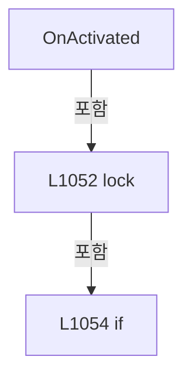

변경 전 점검: 입력/반환 타입, 위 호출자, 예외/취소 경로, 공유 상태와 저장·전송 소비자를 함께 확인합니다. 값의 단위나 물리 방향을 이름만으로 확정하지 않습니다.

### MethodDeclaration `OnDeactivated` · L1062–1071

[Drilling.UI/Menu/Menus/CMenuManual.cs:1062–1071](https://github.com/kjuws10-rgb/A3Drilling/blob/5aee8e58439c9b455cae7c9593c9be986c3e682e/Drilling.UI/Menu/Menus/CMenuManual.cs#L1062-L1071)

| 항목 | 실제 추출 값 |
| --- | --- |
| 서명 | void Drilling.UI.Menu.Menus.CMenuManual.OnDeactivated() |
| 접근/수식자 | Public / public, override |
| 반환/값 타입 | void |
| 소속 타입 | NamedType:Drilling.UI.Menu.Menus.CMenuManual |

현재 부분 분석에서 직접 연결된 호출자는 없습니다. XAML/이벤트/인터페이스·델리게이트·외부 진입을 추가 확인해야 하며, 미사용으로 판정한 것이 아닙니다.

호출하는 대상과 해석 범위:

| 원본 행 | 표현식 | 분석 상태 | 대상/소스 위치 |
| --- | --- | --- | --- |
| 1066 | _menuLifetimeCancellation.Cancel | resolved | void System.Threading.CancellationTokenSource.Cancel() |
| 1067 | .Cancel | resolved | void System.Threading.CancellationTokenSource.Cancel() |
| 1068 | .Dispose | resolved | void System.Threading.CancellationTokenSource.Dispose() |

본문의 실제 연산·분기·예외·반환 순서(원문 위치 순):

| 원본 행 | 종류 | 주석 해설 |
| --- | --- | --- |
| 1064 | lock | 공유 상태의 임계 구역에 진입합니다: lock (_menuLifetimeSync) |
| 1066 | call | 함수·델리게이트 또는 객체 생성자를 호출합니다: _menuLifetimeCancellation.Cancel() |
| 1067 | call | 함수·델리게이트 또는 객체 생성자를 호출합니다: .Cancel() |
| 1068 | call | 함수·델리게이트 또는 객체 생성자를 호출합니다: .Dispose() |
| 1069 | assignment | 값을 대상에 대입합니다: _statusPollingCancellation = null |

제어 구문의 포함 구조(실제 실행 순서/CFG가 아닌 구문 탐색 그림):

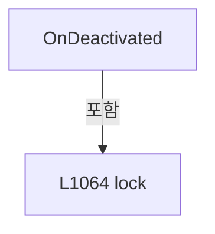

변경 전 점검: 입력/반환 타입, 위 호출자, 예외/취소 경로, 공유 상태와 저장·전송 소비자를 함께 확인합니다. 값의 단위나 물리 방향을 이름만으로 확정하지 않습니다.

### MethodDeclaration `Build` · L1073–1202

[Drilling.UI/Menu/Menus/CMenuManual.cs:1073–1202](https://github.com/kjuws10-rgb/A3Drilling/blob/5aee8e58439c9b455cae7c9593c9be986c3e682e/Drilling.UI/Menu/Menus/CMenuManual.cs#L1073-L1202)

| 항목 | 실제 추출 값 |
| --- | --- |
| 서명 | System.Threading.Tasks.Task<Drilling.UI.Menu.Menus.CScreenViewModel> Drilling.UI.Menu.Menus.CMenuManual.Build(System.Threading.CancellationToken) |
| 접근/수식자 | Public / public, override, async |
| 반환/값 타입 | System.Threading.Tasks.Task<Drilling.UI.Menu.Menus.CScreenViewModel> |
| 소속 타입 | NamedType:Drilling.UI.Menu.Menus.CMenuManual |

입력 계약:

| 이름 | 타입 | 전달 | 선택/기본값 |
| --- | --- | --- | --- |
| cancellationToken | System.Threading.CancellationToken | None | True / null |

현재 부분 분석에서 직접 연결된 호출자는 없습니다. XAML/이벤트/인터페이스·델리게이트·외부 진입을 추가 확인해야 하며, 미사용으로 판정한 것이 아닙니다.

호출하는 대상과 해석 범위:

| 원본 행 | 표현식 | 분석 상태 | 대상/소스 위치 |
| --- | --- | --- | --- |
| 1077 | Review.Build | resolved · 동적 구현 선택 가능 | System.Threading.Tasks.Task<Drilling.UI.Menu.Menus.CScreenViewModel> Drilling.UI.Menu.Menus.CMenuReview.Build(System.Threading.CancellationToken) · Drilling.UI/Menu/Menus/CMenuReview.cs:381 |
| 1078 | new CScreenViewModel | resolved | Drilling.UI.Menu.Menus.CScreenViewModel.CScreenViewModel(Drilling.UI.Menu.Menus.EN_MENU, string, string, System.Collections.Generic.IReadOnlyList<Drilling.UI.Menu.Menus.ST_DISPLAY_ITEM>, System.Collections.Generic.IReadOnlyList<Drilling.UI.Menu.Menus.ST_SCREEN_SECTION>, bool, Drilling.UI.Menu.Menus.CMenuMain?, Drilling.UI.Menu.Menus.CMenuManual?, Drilling.UI.Menu.Menus.CMenuRecipe?, Drilling.UI.Menu.Menus.CMenuSetting?, Drilling.UI.Menu.Menus.CMenuAlarm?, Drilling.UI.Menu.Menus.CMenuMonitor?, Drilling.UI.Menu.Menus.CMenuReview?, Drilling.UI.Menu.Menus.CMenuCorrection?, Drilling.UI.Menu.Menus.CMenuPm?) · Drilling.UI/Menu/Menus/CMenuBase.cs:411 |
| 1081 | _scanFile.List | resolved | System.Threading.Tasks.Task<System.Collections.Generic.IReadOnlyList<string>> Drilling.Common.Managers.CManualScanFileBase.List(System.Threading.CancellationToken) · Drilling.Common/Managers/CManager.cs:773 |
| 1082 | OrderSettingNames | resolved | System.Collections.Generic.IReadOnlyList<string> Drilling.UI.Menu.Menus.CMenuManual.OrderSettingNames(System.Collections.Generic.IReadOnlyList<string>) · Drilling.UI/Menu/Menus/CMenuManual.cs:5815 |
| 1084 | _scanFile.LoadForm | resolved | System.Threading.Tasks.Task<System.Collections.Generic.IReadOnlyList<Drilling.Common.Managers.ST_MANUAL_SCAN_FORM>> Drilling.Common.Managers.CManualScanFileBase.LoadForm(System.Threading.CancellationToken) · Drilling.Common/Managers/CManager.cs:774 |
| 1085 | ResolveSelectedSettingName | resolved | string Drilling.UI.Menu.Menus.CMenuManual.ResolveSelectedSettingName(System.Collections.Generic.IReadOnlyList<string>, string) · Drilling.UI/Menu/Menus/CMenuManual.cs:5735 |
| 1085 | _selectedSettingNameProvider | resolved · 동적 구현 선택 가능 | string System.Func<string>.Invoke() |
| 1086 | _scanFile.Load | resolved | System.Threading.Tasks.Task<Drilling.Common.Managers.ST_MANUAL_SCAN_PARAM> Drilling.Common.Managers.CManualScanFileBase.Load(string, System.Threading.CancellationToken) · Drilling.Common/Managers/CManager.cs:776 |
| 1087 | SyncSettingFilesPage | resolved | void Drilling.UI.Menu.Menus.CMenuManual.SyncSettingFilesPage(System.Collections.Generic.IReadOnlyList<string>, string) · Drilling.UI/Menu/Menus/CMenuManual.cs:5756 |
| 1088 | _selectedHeadNoProvider | resolved · 동적 구현 선택 가능 | int System.Func<int>.Invoke() |
| 1089 | _manager.Setting().LoadSection | resolved | System.Collections.Generic.IReadOnlyList<Drilling.Common.Managers.ST_SYSTEM_PARAMETER> Drilling.Common.Managers.CSettingManager.LoadSection(Drilling.Common.Managers.EN_SETTING_TAB, System.Threading.CancellationToken) · Drilling.Common/Managers/CSettingManager.cs:26 |
| 1089 | _manager.Setting | resolved | Drilling.Common.Managers.CSettingManager Drilling.Common.Managers.CManager.Setting() · Drilling.Common/Managers/CManager.cs:332 |
| 1091 | NormalizeManualScannerHeadNo | resolved | int Drilling.UI.Menu.Menus.CMenuManual.NormalizeManualScannerHeadNo(System.Collections.Generic.IReadOnlyList<Drilling.Common.Managers.ST_SYSTEM_PARAMETER>, int) · Drilling.UI/Menu/Menus/CMenuManual.cs:6759 |
| 1091 | Math.Clamp | resolved | int System.Math.Clamp(int, int, int) |
| 1092 | ReadManualScannerAxesSnapshot | resolved | System.Collections.Generic.IReadOnlyList<Drilling.UI.Menu.Menus.ST_MANUAL_SCANNER_AXIS> Drilling.UI.Menu.Menus.CMenuManual.ReadManualScannerAxesSnapshot(System.Collections.Generic.IReadOnlyList<Drilling.Common.Managers.ST_SYSTEM_PARAMETER>, int) · Drilling.UI/Menu/Menus/CMenuManual.cs:3080 |
| 1093 | ApplyManualHeadSelection | resolved | System.Collections.Generic.IReadOnlyList<Drilling.UI.Menu.Menus.ST_MANUAL_HEAD_CARD> Drilling.UI.Menu.Menus.CMenuManual.ApplyManualHeadSelection(System.Collections.Generic.IReadOnlyList<Drilling.UI.Menu.Menus.ST_MANUAL_HEAD_CARD>, int) · Drilling.UI/Menu/Menus/CMenuManual.cs:6266 |
| 1093 | BuildHeadCards | resolved | System.Collections.Generic.IReadOnlyList<Drilling.UI.Menu.Menus.ST_MANUAL_HEAD_CARD> Drilling.UI.Menu.Menus.CMenuManual.BuildHeadCards(int, System.Collections.Generic.IReadOnlyList<Drilling.Common.Managers.ST_SYSTEM_PARAMETER>, System.Collections.Generic.IReadOnlyList<Drilling.UI.Menu.Menus.ST_MANUAL_SCANNER_AXIS>) · Drilling.UI/Menu/Menus/CMenuManual.cs:6745 |
| 1094 | LoadSelectedRecipe | resolved | System.Threading.Tasks.Task<Drilling.Common.Managers.ST_RECIPE_DEFINITION?> Drilling.UI.Menu.Menus.CMenuManual.LoadSelectedRecipe(System.Threading.CancellationToken) · Drilling.UI/Menu/Menus/CMenuManual.cs:1617 |
| 1095 | MofPreview.Update | resolved | void Drilling.UI.Menu.Menus.CManualMofPreviewPanel.Update(Drilling.Common.Managers.ST_RECIPE_DEFINITION?, System.Collections.Generic.IReadOnlyList<Drilling.Common.Managers.ST_SYSTEM_PARAMETER>) · Drilling.UI/Menu/Menus/CMenuManual.cs:7044 |
| 1096 | MofStage.UpdateTargets | resolved | void Drilling.UI.Menu.Menus.CManualMofStagePanel.UpdateTargets(Drilling.Common.Managers.ST_RECIPE_DEFINITION?, System.Collections.Generic.IReadOnlyList<Drilling.Common.Managers.ST_SYSTEM_PARAMETER>) · Drilling.UI/Menu/Menus/CMenuManual.cs:7345 |
| 1096 | _manager.Setting().LoadSection | resolved | System.Collections.Generic.IReadOnlyList<Drilling.Common.Managers.ST_SYSTEM_PARAMETER> Drilling.Common.Managers.CSettingManager.LoadSection(Drilling.Common.Managers.EN_SETTING_TAB, System.Threading.CancellationToken) · Drilling.Common/Managers/CSettingManager.cs:26 |
| 1096 | _manager.Setting | resolved | Drilling.Common.Managers.CSettingManager Drilling.Common.Managers.CManager.Setting() · Drilling.Common/Managers/CManager.cs:332 |
| 1097 | MofRun.SetInputs | resolved | void Drilling.UI.Menu.Menus.CManualMofRunPanel.SetInputs(Drilling.Common.Managers.ST_RECIPE_DEFINITION?, System.Collections.Generic.IReadOnlyList<Drilling.Common.Managers.ST_SYSTEM_PARAMETER>, System.Collections.Generic.IEnumerable<int>) · Drilling.UI/Menu/Menus/CMenuManual.cs:7143 |
| 1098 | SetAutomationStatusInputs | resolved | void Drilling.UI.Menu.Menus.CMenuManual.SetAutomationStatusInputs(Drilling.Common.Managers.ST_RECIPE_DEFINITION?, System.Collections.Generic.IReadOnlyList<Drilling.Common.Managers.ST_SYSTEM_PARAMETER>) · Drilling.UI/Menu/Menus/CMenuManual.cs:1896 |
| 1099 | RefreshMofStageSnapshot | resolved | void Drilling.UI.Menu.Menus.CMenuManual.RefreshMofStageSnapshot() · Drilling.UI/Menu/Menus/CMenuManual.cs:3322 |
| 1100 | RefreshAutomationStatusSnapshot | resolved | void Drilling.UI.Menu.Menus.CMenuManual.RefreshAutomationStatusSnapshot() · Drilling.UI/Menu/Menus/CMenuManual.cs:1907 |
| 1106 | headCards.First | resolved | Drilling.UI.Menu.Menus.ST_MANUAL_HEAD_CARD System.Collections.Generic.IEnumerable<Drilling.UI.Menu.Menus.ST_MANUAL_HEAD_CARD>.First<Drilling.UI.Menu.Menus.ST_MANUAL_HEAD_CARD>(System.Func<Drilling.UI.Menu.Menus.ST_MANUAL_HEAD_CARD, bool>) |
| 1107 | ReadScannerAxisReference | resolved | string Drilling.UI.Menu.Menus.CMenuManual.ReadScannerAxisReference(System.Collections.Generic.IReadOnlyList<Drilling.UI.Menu.Menus.ST_MANUAL_SCANNER_AXIS>, string, string) · Drilling.UI/Menu/Menus/CMenuManual.cs:3217 |
| 1108 | ReadScannerAxisReference | resolved | string Drilling.UI.Menu.Menus.CMenuManual.ReadScannerAxisReference(System.Collections.Generic.IReadOnlyList<Drilling.UI.Menu.Menus.ST_MANUAL_SCANNER_AXIS>, string, string) · Drilling.UI/Menu/Menus/CMenuManual.cs:3217 |
| 1109 | ReadScannerAxisReference | resolved | string Drilling.UI.Menu.Menus.CMenuManual.ReadScannerAxisReference(System.Collections.Generic.IReadOnlyList<Drilling.UI.Menu.Menus.ST_MANUAL_SCANNER_AXIS>, string, string) · Drilling.UI/Menu/Menus/CMenuManual.cs:3217 |
| 1110 | IsScannerAxisAvailable | resolved | bool Drilling.UI.Menu.Menus.CMenuManual.IsScannerAxisAvailable(System.Collections.Generic.IReadOnlyList<Drilling.UI.Menu.Menus.ST_MANUAL_SCANNER_AXIS>, string) · Drilling.UI/Menu/Menus/CMenuManual.cs:3243 |
| 1111 | FormatDouble | resolved | string Drilling.UI.Menu.Menus.CMenuManual.FormatDouble(double, int) · Drilling.UI/Menu/Menus/CMenuManual.cs:1611 |
| 1111 | ReadHeadRecipeDouble | resolved | double Drilling.UI.Menu.Menus.CMenuManual.ReadHeadRecipeDouble(Drilling.Common.Managers.ST_RECIPE_DEFINITION?, int, double, params string[]) · Drilling.UI/Menu/Menus/CMenuManual.cs:1643 |
| 1112 | string.IsNullOrWhiteSpace | resolved | bool string.IsNullOrWhiteSpace(string?) |
| 1112 | string.IsNullOrWhiteSpace | resolved | bool string.IsNullOrWhiteSpace(string?) |
| 1115 | ReadScannerAxisTarget | resolved | string Drilling.UI.Menu.Menus.CMenuManual.ReadScannerAxisTarget(System.Collections.Generic.IReadOnlyList<Drilling.UI.Menu.Menus.ST_MANUAL_SCANNER_AXIS>, string, string) · Drilling.UI/Menu/Menus/CMenuManual.cs:3204 |
| 1116 | ReadScannerAxisTarget | resolved | string Drilling.UI.Menu.Menus.CMenuManual.ReadScannerAxisTarget(System.Collections.Generic.IReadOnlyList<Drilling.UI.Menu.Menus.ST_MANUAL_SCANNER_AXIS>, string, string) · Drilling.UI/Menu/Menus/CMenuManual.cs:3204 |
| 1118 | HasReadableScannerPosition | resolved | bool Drilling.UI.Menu.Menus.CMenuManual.HasReadableScannerPosition(System.Collections.Generic.IReadOnlyList<Drilling.UI.Menu.Menus.ST_MANUAL_SCANNER_AXIS>) · Drilling.UI/Menu/Menus/CMenuManual.cs:4178 |
| 1125 | string.IsNullOrWhiteSpace | resolved | bool string.IsNullOrWhiteSpace(string?) |
| 1125 | TargetGz.Equals | resolved | bool string.Equals(string?, System.StringComparison) |
| 1127 | ReadScannerAxisTarget | resolved | string Drilling.UI.Menu.Menus.CMenuManual.ReadScannerAxisTarget(System.Collections.Generic.IReadOnlyList<Drilling.UI.Menu.Menus.ST_MANUAL_SCANNER_AXIS>, string, string) · Drilling.UI/Menu/Menus/CMenuManual.cs:3204 |
| 1130 | _lastLoadedSettingName.Equals | resolved | bool string.Equals(string?, System.StringComparison) |
| 1132 | FormatDouble | resolved | string Drilling.UI.Menu.Menus.CMenuManual.FormatDouble(double, int) · Drilling.UI/Menu/Menus/CMenuManual.cs:1611 |
| 1133 | FormatDouble | resolved | string Drilling.UI.Menu.Menus.CMenuManual.FormatDouble(double, int) · Drilling.UI/Menu/Menus/CMenuManual.cs:1611 |
| 1134 | FormatDouble | resolved | string Drilling.UI.Menu.Menus.CMenuManual.FormatDouble(double, int) · Drilling.UI/Menu/Menus/CMenuManual.cs:1611 |
| 1135 | string.IsNullOrWhiteSpace | resolved | bool string.IsNullOrWhiteSpace(string?) |
| 1137 | settings.GridRowLines.ToString | resolved | string int.ToString(System.IFormatProvider?) |
| 1138 | settings.GridColLines.ToString | resolved | string int.ToString(System.IFormatProvider?) |
| 1142 | BeginDioTargetRefresh | resolved | long Drilling.UI.Menu.Menus.CMenuManual.BeginDioTargetRefresh(string) · Drilling.UI/Menu/Menus/CMenuManual.cs:2821 |
| 1145 | ResolveDioTarget | resolved | System.Threading.Tasks.Task<Drilling.UI.Menu.Menus.ST_MANUAL_DIO_TARGET> Drilling.UI.Menu.Menus.CMenuManual.ResolveDioTarget(int, System.Threading.CancellationToken) · Drilling.UI/Menu/Menus/CMenuManual.cs:2781 |
| 1146 | IsCurrentDioGeneration | resolved | bool Drilling.UI.Menu.Menus.CMenuManual.IsCurrentDioGeneration(long) · Drilling.UI/Menu/Menus/CMenuManual.cs:2828 |
| 1148 | ApplyDioTarget | resolved | void Drilling.UI.Menu.Menus.CMenuManual.ApplyDioTarget(Drilling.UI.Menu.Menus.ST_MANUAL_DIO_TARGET) · Drilling.UI/Menu/Menus/CMenuManual.cs:2800 |
| 1153 | IsCurrentDioGeneration | resolved | bool Drilling.UI.Menu.Menus.CMenuManual.IsCurrentDioGeneration(long) · Drilling.UI/Menu/Menus/CMenuManual.cs:2828 |
| 1155 | InvalidateDioTarget | resolved | void Drilling.UI.Menu.Menus.CMenuManual.InvalidateDioTarget(string) · Drilling.UI/Menu/Menus/CMenuManual.cs:2810 |
| 1159 | Apply | resolved | void Drilling.UI.Menu.Menus.CMenuManual.Apply(System.Collections.Generic.IReadOnlyList<Drilling.UI.Menu.Menus.ST_DISPLAY_ITEM>, System.Collections.Generic.IReadOnlyList<Drilling.UI.Menu.Menus.ST_DISPLAY_ITEM>, System.Collections.Generic.IReadOnlyList<Drilling.UI.Menu.Menus.ST_DISPLAY_ITEM>, System.Collections.Generic.IReadOnlyList<Drilling.UI.Menu.Menus.ST_DISPLAY_ITEM>, System.Collections.Generic.IReadOnlyList<Drilling.UI.Menu.Menus.ST_DISPLAY_ITEM>, string, string, string, System.Collections.Generic.IReadOnlyList<Drilling.UI.Menu.Menus.ST_MANUAL_HEAD_CARD>, System.Collections.Generic.IReadOnlyList<Drilling.UI.Menu.Menus.ST_MANUAL_SETTING_FILE>, System.Collections.Generic.IReadOnlyList<Drilling.UI.Menu.Menus.ST_MANUAL_PARAMETER>, System.Collections.Generic.IReadOnlyList<Drilling.UI.Menu.Menus.ST_MANUAL_COMMAND_STATE>, System.Collections.Generic.IReadOnlyList<Drilling.UI.Menu.Menus.ST_MANUAL_SCANNER_AXIS>) · Drilling.UI/Menu/Menus/CMenuManual.cs:1404 |
| 1160 | BuildManualSettings | resolved | System.Collections.Generic.IReadOnlyList<Drilling.UI.Menu.Menus.ST_DISPLAY_ITEM> Drilling.UI.Menu.Menus.CMenuManual.BuildManualSettings(Drilling.Common.Managers.ST_MANUAL_SCAN_PARAM) · Drilling.UI/Menu/Menus/CMenuManual.cs:1436 |
| 1161 | BuildSelectedHeadItems | resolved | System.Collections.Generic.IReadOnlyList<Drilling.UI.Menu.Menus.ST_DISPLAY_ITEM> Drilling.UI.Menu.Menus.CMenuManual.BuildSelectedHeadItems(Drilling.UI.Menu.Menus.ST_MANUAL_HEAD_CARD) · Drilling.UI/Menu/Menus/CMenuManual.cs:6733 |
| 1163 | new | resolved | Drilling.UI.Menu.Menus.ST_DISPLAY_ITEM.ST_DISPLAY_ITEM(string, string, string) · Drilling.UI/Menu/Menus/CMenuBase.cs:43 |
| 1164 | new | resolved | Drilling.UI.Menu.Menus.ST_DISPLAY_ITEM.ST_DISPLAY_ITEM(string, string, string) · Drilling.UI/Menu/Menus/CMenuBase.cs:43 |
| 1165 | new | resolved | Drilling.UI.Menu.Menus.ST_DISPLAY_ITEM.ST_DISPLAY_ITEM(string, string, string) · Drilling.UI/Menu/Menus/CMenuBase.cs:43 |
| 1166 | new | resolved | Drilling.UI.Menu.Menus.ST_DISPLAY_ITEM.ST_DISPLAY_ITEM(string, string, string) · Drilling.UI/Menu/Menus/CMenuBase.cs:43 |
| 1167 | new | resolved | Drilling.UI.Menu.Menus.ST_DISPLAY_ITEM.ST_DISPLAY_ITEM(string, string, string) · Drilling.UI/Menu/Menus/CMenuBase.cs:43 |
| 1168 | new | resolved | Drilling.UI.Menu.Menus.ST_DISPLAY_ITEM.ST_DISPLAY_ITEM(string, string, string) · Drilling.UI/Menu/Menus/CMenuBase.cs:43 |
| 1169 | new | resolved | Drilling.UI.Menu.Menus.ST_DISPLAY_ITEM.ST_DISPLAY_ITEM(string, string, string) · Drilling.UI/Menu/Menus/CMenuBase.cs:43 |
| 1172 | new | resolved | Drilling.UI.Menu.Menus.ST_DISPLAY_ITEM.ST_DISPLAY_ITEM(string, string, string) · Drilling.UI/Menu/Menus/CMenuBase.cs:43 |
| 1173 | new | resolved | Drilling.UI.Menu.Menus.ST_DISPLAY_ITEM.ST_DISPLAY_ITEM(string, string, string) · Drilling.UI/Menu/Menus/CMenuBase.cs:43 |
| 1174 | new | resolved | Drilling.UI.Menu.Menus.ST_DISPLAY_ITEM.ST_DISPLAY_ITEM(string, string, string) · Drilling.UI/Menu/Menus/CMenuBase.cs:43 |
| 1175 | new | resolved | Drilling.UI.Menu.Menus.ST_DISPLAY_ITEM.ST_DISPLAY_ITEM(string, string, string) · Drilling.UI/Menu/Menus/CMenuBase.cs:43 |
| 1176 | new | resolved | Drilling.UI.Menu.Menus.ST_DISPLAY_ITEM.ST_DISPLAY_ITEM(string, string, string) · Drilling.UI/Menu/Menus/CMenuBase.cs:43 |
| 1177 | new | resolved | Drilling.UI.Menu.Menus.ST_DISPLAY_ITEM.ST_DISPLAY_ITEM(string, string, string) · Drilling.UI/Menu/Menus/CMenuBase.cs:43 |
| 1178 | new | resolved | Drilling.UI.Menu.Menus.ST_DISPLAY_ITEM.ST_DISPLAY_ITEM(string, string, string) · Drilling.UI/Menu/Menus/CMenuBase.cs:43 |
| 1179 | new | resolved | Drilling.UI.Menu.Menus.ST_DISPLAY_ITEM.ST_DISPLAY_ITEM(string, string, string) · Drilling.UI/Menu/Menus/CMenuBase.cs:43 |
| 1180 | new | resolved | Drilling.UI.Menu.Menus.ST_DISPLAY_ITEM.ST_DISPLAY_ITEM(string, string, string) · Drilling.UI/Menu/Menus/CMenuBase.cs:43 |
| 1182 | new | resolved | Drilling.UI.Menu.Menus.ST_DISPLAY_ITEM.ST_DISPLAY_ITEM(string, string, string) · Drilling.UI/Menu/Menus/CMenuBase.cs:43 |
| 1182 | new | resolved | Drilling.UI.Menu.Menus.ST_DISPLAY_ITEM.ST_DISPLAY_ITEM(string, string, string) · Drilling.UI/Menu/Menus/CMenuBase.cs:43 |
| 1182 | new | resolved | Drilling.UI.Menu.Menus.ST_DISPLAY_ITEM.ST_DISPLAY_ITEM(string, string, string) · Drilling.UI/Menu/Menus/CMenuBase.cs:43 |
| 1182 | new | resolved | Drilling.UI.Menu.Menus.ST_DISPLAY_ITEM.ST_DISPLAY_ITEM(string, string, string) · Drilling.UI/Menu/Menus/CMenuBase.cs:43 |
| 1187 | BuildSettingFiles | resolved | System.Collections.Generic.IReadOnlyList<Drilling.UI.Menu.Menus.ST_MANUAL_SETTING_FILE> Drilling.UI.Menu.Menus.CMenuManual.BuildSettingFiles(System.Collections.Generic.IReadOnlyList<string>, string, int) · Drilling.UI/Menu/Menus/CMenuManual.cs:5827 |
| 1188 | BuildSettingParameters | resolved | System.Collections.Generic.IReadOnlyList<Drilling.UI.Menu.Menus.ST_MANUAL_PARAMETER> Drilling.UI.Menu.Menus.CMenuManual.BuildSettingParameters(Drilling.Common.Managers.ST_MANUAL_SCAN_PARAM, System.Collections.Generic.IReadOnlyList<Drilling.Common.Managers.ST_MANUAL_SCAN_FORM>) · Drilling.UI/Menu/Menus/CMenuManual.cs:5846 |
| 1189 | BuildCommandStateRows | resolved | System.Collections.Generic.IReadOnlyList<Drilling.UI.Menu.Menus.ST_MANUAL_COMMAND_STATE> Drilling.UI.Menu.Menus.CMenuManual.BuildCommandStateRows(Drilling.UI.Menu.Menus.ST_MANUAL_HEAD_CARD) · Drilling.UI/Menu/Menus/CMenuManual.cs:1541 |
| 1192 | RefreshManualControllerHeads | resolved | void Drilling.UI.Menu.Menus.CMenuManual.RefreshManualControllerHeads() · Drilling.UI/Menu/Menus/CMenuManual.cs:1699 |
| 1193 | RefreshVisionProtocolStatus | resolved | void Drilling.UI.Menu.Menus.CMenuManual.RefreshVisionProtocolStatus(bool) · Drilling.UI/Menu/Menus/CMenuManual.cs:6591 |
| 1194 | new CScreenViewModel | resolved | Drilling.UI.Menu.Menus.CScreenViewModel.CScreenViewModel(Drilling.UI.Menu.Menus.EN_MENU, string, string, System.Collections.Generic.IReadOnlyList<Drilling.UI.Menu.Menus.ST_DISPLAY_ITEM>, System.Collections.Generic.IReadOnlyList<Drilling.UI.Menu.Menus.ST_SCREEN_SECTION>, bool, Drilling.UI.Menu.Menus.CMenuMain?, Drilling.UI.Menu.Menus.CMenuManual?, Drilling.UI.Menu.Menus.CMenuRecipe?, Drilling.UI.Menu.Menus.CMenuSetting?, Drilling.UI.Menu.Menus.CMenuAlarm?, Drilling.UI.Menu.Menus.CMenuMonitor?, Drilling.UI.Menu.Menus.CMenuReview?, Drilling.UI.Menu.Menus.CMenuCorrection?, Drilling.UI.Menu.Menus.CMenuPm?) · Drilling.UI/Menu/Menus/CMenuBase.cs:411 |
| 1198 | new | resolved | Drilling.UI.Menu.Menus.ST_DISPLAY_ITEM.ST_DISPLAY_ITEM(string, string, string) · Drilling.UI/Menu/Menus/CMenuBase.cs:43 |
| 1198 | new | resolved | Drilling.UI.Menu.Menus.ST_DISPLAY_ITEM.ST_DISPLAY_ITEM(string, string, string) · Drilling.UI/Menu/Menus/CMenuBase.cs:43 |
| 1198 | new | resolved | Drilling.UI.Menu.Menus.ST_DISPLAY_ITEM.ST_DISPLAY_ITEM(string, string, string) · Drilling.UI/Menu/Menus/CMenuBase.cs:43 |
| 1199 | new | resolved | Drilling.UI.Menu.Menus.ST_SCREEN_SECTION.ST_SCREEN_SECTION(string, System.Collections.Generic.IReadOnlyList<Drilling.UI.Menu.Menus.ST_DISPLAY_ITEM>) · Drilling.UI/Menu/Menus/CMenuBase.cs:410 |
| 1199 | BuildManualSettings | resolved | System.Collections.Generic.IReadOnlyList<Drilling.UI.Menu.Menus.ST_DISPLAY_ITEM> Drilling.UI.Menu.Menus.CMenuManual.BuildManualSettings(Drilling.Common.Managers.ST_MANUAL_SCAN_PARAM) · Drilling.UI/Menu/Menus/CMenuManual.cs:1436 |
| 1199 | new | resolved | Drilling.UI.Menu.Menus.ST_SCREEN_SECTION.ST_SCREEN_SECTION(string, System.Collections.Generic.IReadOnlyList<Drilling.UI.Menu.Menus.ST_DISPLAY_ITEM>) · Drilling.UI/Menu/Menus/CMenuBase.cs:410 |
| 1199 | new | resolved | Drilling.UI.Menu.Menus.ST_DISPLAY_ITEM.ST_DISPLAY_ITEM(string, string, string) · Drilling.UI/Menu/Menus/CMenuBase.cs:43 |
| 1199 | new | resolved | Drilling.UI.Menu.Menus.ST_DISPLAY_ITEM.ST_DISPLAY_ITEM(string, string, string) · Drilling.UI/Menu/Menus/CMenuBase.cs:43 |
| 1199 | new | resolved | Drilling.UI.Menu.Menus.ST_DISPLAY_ITEM.ST_DISPLAY_ITEM(string, string, string) · Drilling.UI/Menu/Menus/CMenuBase.cs:43 |
| 1199 | new | resolved | Drilling.UI.Menu.Menus.ST_DISPLAY_ITEM.ST_DISPLAY_ITEM(string, string, string) · Drilling.UI/Menu/Menus/CMenuBase.cs:43 |

본문의 실제 연산·분기·예외·반환 순서(원문 위치 순):

| 원본 행 | 종류 | 주석 해설 |
| --- | --- | --- |
| 1075 | if | 조건에 따라 분기합니다: if (IsReviewWorkspace && Review is not null) |
| 1077 | await | 비동기 완료를 기다립니다: await Review.Build(cancellationToken) |
| 1077 | call | 함수·델리게이트 또는 객체 생성자를 호출합니다: Review.Build(cancellationToken) |
| 1078 | call | 함수·델리게이트 또는 객체 생성자를 호출합니다: new CScreenViewModel(EN_MENU.Manual, "MANUAL / CONTROL", "Review inspection operation.", [], [], manual: this) |
| 1078 | return | 호출자에게 값 또는 제어를 반환합니다: return new CScreenViewModel(EN_MENU.Manual, "MANUAL / CONTROL", "Review inspection operation.", [], [], manual: this); |
| 1081 | await | 비동기 완료를 기다립니다: await _scanFile.List(cancellationToken) |
| 1081 | call | 함수·델리게이트 또는 객체 생성자를 호출합니다: _scanFile.List(cancellationToken) |
| 1081 | local-declaration | 지역 변수를 선언합니다: var settingNames = await _scanFile.List(cancellationToken); |
| 1081 | variable-initializer | 변수의 초기값을 지정합니다: settingNames = await _scanFile.List(cancellationToken) |
| 1082 | call | 함수·델리게이트 또는 객체 생성자를 호출합니다: OrderSettingNames(settingNames) |
| 1082 | local-declaration | 지역 변수를 선언합니다: var orderedSettingNames = OrderSettingNames(settingNames); |
| 1082 | variable-initializer | 변수의 초기값을 지정합니다: orderedSettingNames = OrderSettingNames(settingNames) |
| 1083 | assignment | 값을 대상에 대입합니다: _manualScanSettingNames = orderedSettingNames |
| 1084 | await | 비동기 완료를 기다립니다: await _scanFile.LoadForm(cancellationToken) |
| 1084 | call | 함수·델리게이트 또는 객체 생성자를 호출합니다: _scanFile.LoadForm(cancellationToken) |
| 1084 | local-declaration | 지역 변수를 선언합니다: var formItems = await _scanFile.LoadForm(cancellationToken); |
| 1084 | variable-initializer | 변수의 초기값을 지정합니다: formItems = await _scanFile.LoadForm(cancellationToken) |
| 1085 | call | 함수·델리게이트 또는 객체 생성자를 호출합니다: ResolveSelectedSettingName(orderedSettingNames, _selectedSettingNameProvider()) |
| 1085 | call | 함수·델리게이트 또는 객체 생성자를 호출합니다: _selectedSettingNameProvider() |
| 1085 | local-declaration | 지역 변수를 선언합니다: var selectedSettingName = ResolveSelectedSettingName(orderedSettingNames, _selectedSettingNameProvider()); |
| 1085 | variable-initializer | 변수의 초기값을 지정합니다: selectedSettingName = ResolveSelectedSettingName(orderedSettingNames, _selectedSettingNameProvider()) |
| 1086 | await | 비동기 완료를 기다립니다: await _scanFile.Load(selectedSettingName, cancellationToken) |
| 1086 | call | 함수·델리게이트 또는 객체 생성자를 호출합니다: _scanFile.Load(selectedSettingName, cancellationToken) |
| 1086 | local-declaration | 지역 변수를 선언합니다: var settings = await _scanFile.Load(selectedSettingName, cancellationToken); |
| 1086 | variable-initializer | 변수의 초기값을 지정합니다: settings = await _scanFile.Load(selectedSettingName, cancellationToken) |
| 1087 | call | 함수·델리게이트 또는 객체 생성자를 호출합니다: SyncSettingFilesPage(orderedSettingNames, selectedSettingName) |
| 1088 | call | 함수·델리게이트 또는 객체 생성자를 호출합니다: _selectedHeadNoProvider() |
| 1088 | local-declaration | 지역 변수를 선언합니다: var selectedHeadNoRaw = _selectedHeadNoProvider(); |
| 1088 | variable-initializer | 변수의 초기값을 지정합니다: selectedHeadNoRaw = _selectedHeadNoProvider() |
| 1089 | call | 함수·델리게이트 또는 객체 생성자를 호출합니다: _manager.Setting().LoadSection(EN_SETTING_TAB.Option, cancellationToken) |
| 1089 | call | 함수·델리게이트 또는 객체 생성자를 호출합니다: _manager.Setting() |
| 1089 | local-declaration | 지역 변수를 선언합니다: var optionSettings = _manager.Setting().LoadSection(EN_SETTING_TAB.Option, cancellationToken); |
| 1089 | variable-initializer | 변수의 초기값을 지정합니다: optionSettings = _manager.Setting().LoadSection(EN_SETTING_TAB.Option, cancellationToken) |
| 1090 | assignment | 값을 대상에 대입합니다: _manualScannerOptionSettings = optionSettings |
| 1091 | call | 함수·델리게이트 또는 객체 생성자를 호출합니다: NormalizeManualScannerHeadNo(optionSettings, Math.Clamp(selectedHeadNoRaw, 1, 8)) |
| 1091 | call | 함수·델리게이트 또는 객체 생성자를 호출합니다: Math.Clamp(selectedHeadNoRaw, 1, 8) |
| 1091 | local-declaration | 지역 변수를 선언합니다: var selectedHeadNo = NormalizeManualScannerHeadNo(optionSettings, Math.Clamp(selectedHeadNoRaw, 1, 8)); |
| 1091 | variable-initializer | 변수의 초기값을 지정합니다: selectedHeadNo = NormalizeManualScannerHeadNo(optionSettings, Math.Clamp(selectedHeadNoRaw, 1, 8)) |
| 1092 | call | 함수·델리게이트 또는 객체 생성자를 호출합니다: ReadManualScannerAxesSnapshot(optionSettings, selectedHeadNo) |
| 1092 | local-declaration | 지역 변수를 선언합니다: var scannerAxes = ReadManualScannerAxesSnapshot(optionSettings, selectedHeadNo); |
| 1092 | variable-initializer | 변수의 초기값을 지정합니다: scannerAxes = ReadManualScannerAxesSnapshot(optionSettings, selectedHeadNo) |
| 1093 | call | 함수·델리게이트 또는 객체 생성자를 호출합니다: ApplyManualHeadSelection(BuildHeadCards(selectedHeadNo, optionSettings, scannerAxes), selectedHeadNo) |
| 1093 | call | 함수·델리게이트 또는 객체 생성자를 호출합니다: BuildHeadCards(selectedHeadNo, optionSettings, scannerAxes) |
| 1093 | local-declaration | 지역 변수를 선언합니다: var headCards = ApplyManualHeadSelection(BuildHeadCards(selectedHeadNo, optionSettings, scannerAxes), selectedHeadNo); |
| 1093 | variable-initializer | 변수의 초기값을 지정합니다: headCards = ApplyManualHeadSelection(BuildHeadCards(selectedHeadNo, optionSettings, scannerAxes), selectedHeadNo) |
| 1094 | await | 비동기 완료를 기다립니다: await LoadSelectedRecipe(cancellationToken) |
| 1094 | call | 함수·델리게이트 또는 객체 생성자를 호출합니다: LoadSelectedRecipe(cancellationToken) |
| 1094 | local-declaration | 지역 변수를 선언합니다: var selectedRecipe = await LoadSelectedRecipe(cancellationToken); |
| 1094 | variable-initializer | 변수의 초기값을 지정합니다: selectedRecipe = await LoadSelectedRecipe(cancellationToken) |
| 1095 | call | 함수·델리게이트 또는 객체 생성자를 호출합니다: MofPreview.Update(selectedRecipe, optionSettings) |
| 1096 | call | 함수·델리게이트 또는 객체 생성자를 호출합니다: MofStage.UpdateTargets(selectedRecipe, _manager.Setting().LoadSection(EN_SETTING_TAB.Motor, cancellationToken)) |
| 1096 | call | 함수·델리게이트 또는 객체 생성자를 호출합니다: _manager.Setting().LoadSection(EN_SETTING_TAB.Motor, cancellationToken) |
| 1096 | call | 함수·델리게이트 또는 객체 생성자를 호출합니다: _manager.Setting() |
| 1097 | call | 함수·델리게이트 또는 객체 생성자를 호출합니다: MofRun.SetInputs(selectedRecipe, optionSettings, SelectedManualHeadNos) |
| 1098 | call | 함수·델리게이트 또는 객체 생성자를 호출합니다: SetAutomationStatusInputs(selectedRecipe, optionSettings) |
| 1099 | call | 함수·델리게이트 또는 객체 생성자를 호출합니다: RefreshMofStageSnapshot() |
| 1100 | call | 함수·델리게이트 또는 객체 생성자를 호출합니다: RefreshAutomationStatusSnapshot() |
| 1106 | call | 함수·델리게이트 또는 객체 생성자를 호출합니다: headCards.First(IsSelectedHeadCard) |
| 1106 | local-declaration | 지역 변수를 선언합니다: var selectedHead = headCards.First(IsSelectedHeadCard); |
| 1106 | variable-initializer | 변수의 초기값을 지정합니다: selectedHead = headCards.First(IsSelectedHeadCard) |
| 1107 | call | 함수·델리게이트 또는 객체 생성자를 호출합니다: ReadScannerAxisReference(scannerAxes, "X", "X") |
| 1107 | local-declaration | 지역 변수를 선언합니다: var xAxisReference = ReadScannerAxisReference(scannerAxes, "X", "X"); |
| 1107 | variable-initializer | 변수의 초기값을 지정합니다: xAxisReference = ReadScannerAxisReference(scannerAxes, "X", "X") |
| 1108 | call | 함수·델리게이트 또는 객체 생성자를 호출합니다: ReadScannerAxisReference(scannerAxes, "Y", "Y") |
| 1108 | local-declaration | 지역 변수를 선언합니다: var yAxisReference = ReadScannerAxisReference(scannerAxes, "Y", "Y"); |
| 1108 | variable-initializer | 변수의 초기값을 지정합니다: yAxisReference = ReadScannerAxisReference(scannerAxes, "Y", "Y") |
| 1109 | call | 함수·델리게이트 또는 객체 생성자를 호출합니다: ReadScannerAxisReference(scannerAxes, "Z", "Z") |
| 1109 | local-declaration | 지역 변수를 선언합니다: var zAxisReference = ReadScannerAxisReference(scannerAxes, "Z", "Z"); |
| 1109 | variable-initializer | 변수의 초기값을 지정합니다: zAxisReference = ReadScannerAxisReference(scannerAxes, "Z", "Z") |
| 1110 | call | 함수·델리게이트 또는 객체 생성자를 호출합니다: IsScannerAxisAvailable(scannerAxes, "Z") |
| 1110 | local-declaration | 지역 변수를 선언합니다: var isZAxisAvailable = IsScannerAxisAvailable(scannerAxes, "Z"); |
| 1110 | variable-initializer | 변수의 초기값을 지정합니다: isZAxisAvailable = IsScannerAxisAvailable(scannerAxes, "Z") |
| 1111 | call | 함수·델리게이트 또는 객체 생성자를 호출합니다: FormatDouble(ReadHeadRecipeDouble(selectedRecipe, selectedHeadNo, 0.0, "DOE_Z_POSITION"), 3) |
| 1111 | call | 함수·델리게이트 또는 객체 생성자를 호출합니다: ReadHeadRecipeDouble(selectedRecipe, selectedHeadNo, 0.0, "DOE_Z_POSITION") |
| 1111 | conditional-expression | 조건에 따라 결과식을 선택합니다: isZAxisAvailable ? FormatDouble(ReadHeadRecipeDouble(selectedRecipe, selectedHeadNo, 0.0, "DOE_Z_POSITION"), 3) : "NOT USE" |
| 1111 | local-declaration | 지역 변수를 선언합니다: var zTargetDefault = isZAxisAvailable ? FormatDouble(ReadHeadRecipeDouble(selectedRecipe, selectedHeadNo, 0.0, "DOE_Z_POSITION"), 3) : "NOT USE"; |
| 1111 | variable-initializer | 변수의 초기값을 지정합니다: zTargetDefault = isZAxisAvailable ? FormatDouble(ReadHeadRecipeDouble(selectedRecipe, selectedHeadNo, 0.0, "DOE_Z_POSITION"), 3) : "NOT USE" |
| 1112 | call | 함수·델리게이트 또는 객체 생성자를 호출합니다: string.IsNullOrWhiteSpace(TargetGx) |
| 1112 | call | 함수·델리게이트 또는 객체 생성자를 호출합니다: string.IsNullOrWhiteSpace(TargetGy) |
| 1112 | local-declaration | 지역 변수를 선언합니다: var shouldRefreshPositionTargets = _lastBuiltHeadNo != selectedHeadNo &#124;&#124; string.IsNullOrWhiteSpace(TargetGx) &#124;&#124; string.IsNullOrWhiteSpace(TargetGy); |
| 1112 | variable-initializer | 변수의 초기값을 지정합니다: shouldRefreshPositionTargets = _lastBuiltHeadNo != selectedHeadNo &#124;&#124; string.IsNullOrWhiteSpace(TargetGx) &#124;&#124; string.IsNullOrWhiteSpace(TargetGy) |
| 1113 | if | 조건에 따라 분기합니다: if (shouldRefreshPositionTargets) |
| 1115 | assignment | 값을 대상에 대입합니다: TargetGx = ReadScannerAxisTarget(scannerAxes, "X") |
| 1115 | call | 함수·델리게이트 또는 객체 생성자를 호출합니다: ReadScannerAxisTarget(scannerAxes, "X") |
| 1116 | assignment | 값을 대상에 대입합니다: TargetGy = ReadScannerAxisTarget(scannerAxes, "Y") |
| 1116 | call | 함수·델리게이트 또는 객체 생성자를 호출합니다: ReadScannerAxisTarget(scannerAxes, "Y") |
| 1117 | assignment | 값을 대상에 대입합니다: _lastBuiltHeadNo = selectedHeadNo |
| 1118 | assignment | 값을 대상에 대입합니다: _hasScannerTargetSnapshot = HasReadableScannerPosition(scannerAxes) |
| 1118 | call | 함수·델리게이트 또는 객체 생성자를 호출합니다: HasReadableScannerPosition(scannerAxes) |
| 1121 | if | 조건에 따라 분기합니다: if (!isZAxisAvailable) |
| 1123 | assignment | 값을 대상에 대입합니다: TargetGz = "NOT USE" |
| 1125 | call | 함수·델리게이트 또는 객체 생성자를 호출합니다: string.IsNullOrWhiteSpace(TargetGz) |
| 1125 | call | 함수·델리게이트 또는 객체 생성자를 호출합니다: TargetGz.Equals("NOT USE", StringComparison.OrdinalIgnoreCase) |
| 1125 | else | 앞 조건이 거짓인 경로입니다: else |
| 1125 | if | 조건에 따라 분기합니다: if (shouldRefreshPositionTargets &#124;&#124; string.IsNullOrWhiteSpace(TargetGz) &#124;&#124; TargetGz.Equals("NOT USE", StringComparison.OrdinalIgnoreCase)) |
| 1127 | assignment | 값을 대상에 대입합니다: TargetGz = ReadScannerAxisTarget(scannerAxes, "Z", zTargetDefault) |
| 1127 | call | 함수·델리게이트 또는 객체 생성자를 호출합니다: ReadScannerAxisTarget(scannerAxes, "Z", zTargetDefault) |
| 1130 | call | 함수·델리게이트 또는 객체 생성자를 호출합니다: _lastLoadedSettingName.Equals(selectedSettingName, StringComparison.OrdinalIgnoreCase) |
| 1130 | if | 조건에 따라 분기합니다: if (!_lastLoadedSettingName.Equals(selectedSettingName, StringComparison.OrdinalIgnoreCase)) |
| 1132 | assignment | 값을 대상에 대입합니다: ShapeSize = FormatDouble(settings.ShapeSize, 3) |
| 1132 | call | 함수·델리게이트 또는 객체 생성자를 호출합니다: FormatDouble(settings.ShapeSize, 3) |
| 1133 | assignment | 값을 대상에 대입합니다: ShapeOffsetX = FormatDouble(settings.OffsetX, 3) |
| 1133 | call | 함수·델리게이트 또는 객체 생성자를 호출합니다: FormatDouble(settings.OffsetX, 3) |
| 1134 | assignment | 값을 대상에 대입합니다: ShapeOffsetY = FormatDouble(settings.OffsetY, 3) |
| 1134 | call | 함수·델리게이트 또는 객체 생성자를 호출합니다: FormatDouble(settings.OffsetY, 3) |
| 1135 | assignment | 값을 대상에 대입합니다: ShapeDirection = string.IsNullOrWhiteSpace(settings.Direction) ? "CW" : settings.Direction |
| 1135 | call | 함수·델리게이트 또는 객체 생성자를 호출합니다: string.IsNullOrWhiteSpace(settings.Direction) |
| 1135 | conditional-expression | 조건에 따라 결과식을 선택합니다: string.IsNullOrWhiteSpace(settings.Direction) ? "CW" : settings.Direction |
| 1136 | assignment | 값을 대상에 대입합니다: ShapeName = settings.ShapeName |
| 1137 | assignment | 값을 대상에 대입합니다: GridRowLines = settings.GridRowLines.ToString(CultureInfo.InvariantCulture) |
| 1137 | call | 함수·델리게이트 또는 객체 생성자를 호출합니다: settings.GridRowLines.ToString(CultureInfo.InvariantCulture) |
| 1138 | assignment | 값을 대상에 대입합니다: GridColLines = settings.GridColLines.ToString(CultureInfo.InvariantCulture) |
| 1138 | call | 함수·델리게이트 또는 객체 생성자를 호출합니다: settings.GridColLines.ToString(CultureInfo.InvariantCulture) |
| 1139 | assignment | 값을 대상에 대입합니다: _lastLoadedSettingName = selectedSettingName |
| 1142 | call | 함수·델리게이트 또는 객체 생성자를 호출합니다: BeginDioTargetRefresh("Loading") |
| 1142 | local-declaration | 지역 변수를 선언합니다: var dioGeneration = BeginDioTargetRefresh("Loading"); |
| 1142 | variable-initializer | 변수의 초기값을 지정합니다: dioGeneration = BeginDioTargetRefresh("Loading") |
| 1143 | try | 예외 처리 범위입니다: try |
| 1145 | await | 비동기 완료를 기다립니다: await ResolveDioTarget(selectedHeadNo, cancellationToken) |
| 1145 | call | 함수·델리게이트 또는 객체 생성자를 호출합니다: ResolveDioTarget(selectedHeadNo, cancellationToken) |
| 1145 | local-declaration | 지역 변수를 선언합니다: var dioTarget = await ResolveDioTarget(selectedHeadNo, cancellationToken); |
| 1145 | variable-initializer | 변수의 초기값을 지정합니다: dioTarget = await ResolveDioTarget(selectedHeadNo, cancellationToken) |
| 1146 | call | 함수·델리게이트 또는 객체 생성자를 호출합니다: IsCurrentDioGeneration(dioGeneration) |
| 1146 | if | 조건에 따라 분기합니다: if (IsCurrentDioGeneration(dioGeneration)) |
| 1148 | call | 함수·델리게이트 또는 객체 생성자를 호출합니다: ApplyDioTarget(dioTarget) |
| 1151 | catch | 지정 예외를 처리합니다: catch (Exception exception) when (exception is InvalidOperationException or InvalidDataException or IOException or TimeoutException or KeyNotFoundException) |
| 1153 | call | 함수·델리게이트 또는 객체 생성자를 호출합니다: IsCurrentDioGeneration(dioGeneration) |
| 1153 | if | 조건에 따라 분기합니다: if (IsCurrentDioGeneration(dioGeneration)) |
| 1155 | call | 함수·델리게이트 또는 객체 생성자를 호출합니다: InvalidateDioTarget($"ERROR: {exception.Message}") |
| 1159 | call | 함수·델리게이트 또는 객체 생성자를 호출합니다: Apply( BuildManualSettings(settings), BuildSelectedHeadItems(selectedHead), [ new("Center Move", "Ready"), new("Position Move", $"{xAxisReference}/{yAxisReference} Target"), new("Z Move", $"{zAxisReference} Target"), new… |
| 1160 | call | 함수·델리게이트 또는 객체 생성자를 호출합니다: BuildManualSettings(settings) |
| 1161 | call | 함수·델리게이트 또는 객체 생성자를 호출합니다: BuildSelectedHeadItems(selectedHead) |
| 1163 | call | 함수·델리게이트 또는 객체 생성자를 호출합니다: new("Center Move", "Ready") |
| 1164 | call | 함수·델리게이트 또는 객체 생성자를 호출합니다: new("Position Move", $"{xAxisReference}/{yAxisReference} Target") |
| 1165 | call | 함수·델리게이트 또는 객체 생성자를 호출합니다: new("Z Move", $"{zAxisReference} Target") |
| 1166 | call | 함수·델리게이트 또는 객체 생성자를 호출합니다: new("Move Stop", "Ready") |
| 1167 | call | 함수·델리게이트 또는 객체 생성자를 호출합니다: new($"{xAxisReference} Target", TargetGx, "mm") |
| 1168 | call | 함수·델리게이트 또는 객체 생성자를 호출합니다: new($"{yAxisReference} Target", TargetGy, "mm") |
| 1169 | call | 함수·델리게이트 또는 객체 생성자를 호출합니다: new($"{zAxisReference} Target", TargetGz, "mm") |
| 1172 | call | 함수·델리게이트 또는 객체 생성자를 호출합니다: new("Shape Size", ShapeSize, "mm") |
| 1173 | call | 함수·델리게이트 또는 객체 생성자를 호출합니다: new("Offset X", ShapeOffsetX, "mm") |
| 1174 | call | 함수·델리게이트 또는 객체 생성자를 호출합니다: new("Offset Y", ShapeOffsetY, "mm") |
| 1175 | call | 함수·델리게이트 또는 객체 생성자를 호출합니다: new("Direction", ShapeDirection) |
| 1176 | call | 함수·델리게이트 또는 객체 생성자를 호출합니다: new("Shape", ShapeName) |
| 1177 | call | 함수·델리게이트 또는 객체 생성자를 호출합니다: new("Grid Row Lines", GridRowLines, "ea") |
| 1178 | call | 함수·델리게이트 또는 객체 생성자를 호출합니다: new("Grid Col Lines", GridColLines, "ea") |
| 1179 | call | 함수·델리게이트 또는 객체 생성자를 호출합니다: new("Start", "Ready") |
| 1180 | call | 함수·델리게이트 또는 객체 생성자를 호출합니다: new("Stop", "Ready") |
| 1182 | call | 함수·델리게이트 또는 객체 생성자를 호출합니다: new("Laser", _laserState) |
| 1182 | call | 함수·델리게이트 또는 객체 생성자를 호출합니다: new("CENTER", _centerState) |
| 1182 | call | 함수·델리게이트 또는 객체 생성자를 호출합니다: new("Last Command", _lastCommand) |
| 1182 | call | 함수·델리게이트 또는 객체 생성자를 호출합니다: new("Result", _lastResult) |
| 1187 | call | 함수·델리게이트 또는 객체 생성자를 호출합니다: BuildSettingFiles(orderedSettingNames, selectedSettingName, _settingFilesPageIndex) |
| 1188 | call | 함수·델리게이트 또는 객체 생성자를 호출합니다: BuildSettingParameters(settings, formItems) |
| 1189 | call | 함수·델리게이트 또는 객체 생성자를 호출합니다: BuildCommandStateRows(selectedHead) |
| 1192 | call | 함수·델리게이트 또는 객체 생성자를 호출합니다: RefreshManualControllerHeads() |
| 1193 | call | 함수·델리게이트 또는 객체 생성자를 호출합니다: RefreshVisionProtocolStatus(writeLog: false) |
| 1194 | call | 함수·델리게이트 또는 객체 생성자를 호출합니다: new CScreenViewModel( EN_MENU.Manual, "MANUAL / CONTROL", "Scanner, stage and protocol test operation.", [new("Selected Head", selectedHead.HeadName), new("Mode", "Manual"), new("Laser", _laserState)], [new("Manual Setti… |
| 1194 | return | 호출자에게 값 또는 제어를 반환합니다: return new CScreenViewModel( EN_MENU.Manual, "MANUAL / CONTROL", "Scanner, stage and protocol test operation.", [new("Selected Head", selectedHead.HeadName), new("Mode", "Manual"), new("Laser", _laserState)], [new("Manual Setting" |
| 1198 | call | 함수·델리게이트 또는 객체 생성자를 호출합니다: new("Selected Head", selectedHead.HeadName) |
| 1198 | call | 함수·델리게이트 또는 객체 생성자를 호출합니다: new("Mode", "Manual") |
| 1198 | call | 함수·델리게이트 또는 객체 생성자를 호출합니다: new("Laser", _laserState) |
| 1199 | call | 함수·델리게이트 또는 객체 생성자를 호출합니다: new("Manual Setting", BuildManualSettings(settings)) |
| 1199 | call | 함수·델리게이트 또는 객체 생성자를 호출합니다: BuildManualSettings(settings) |
| 1199 | call | 함수·델리게이트 또는 객체 생성자를 호출합니다: new("Position Move", [new("Center Move", "Ready"), new("Position Move", $"{xAxisReference}/{yAxisReference} target input"), new("Z Move", $"{zAxisReference} target input"), new("Move Stop", "Ready")]) |
| 1199 | call | 함수·델리게이트 또는 객체 생성자를 호출합니다: new("Center Move", "Ready") |
| 1199 | call | 함수·델리게이트 또는 객체 생성자를 호출합니다: new("Position Move", $"{xAxisReference}/{yAxisReference} target input") |
| 1199 | call | 함수·델리게이트 또는 객체 생성자를 호출합니다: new("Z Move", $"{zAxisReference} target input") |
| 1199 | call | 함수·델리게이트 또는 객체 생성자를 호출합니다: new("Move Stop", "Ready") |

제어 구문의 포함 구조(실제 실행 순서/CFG가 아닌 구문 탐색 그림):

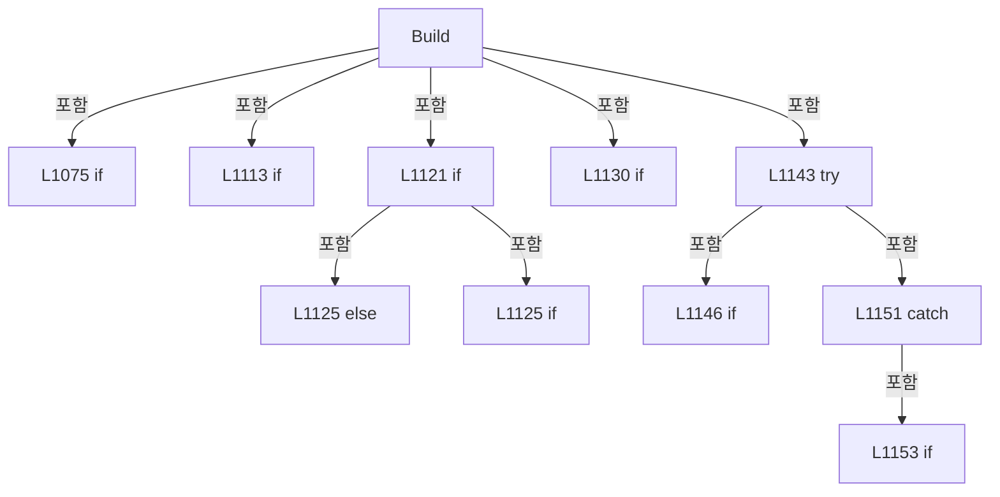

변경 전 점검: 입력/반환 타입, 위 호출자, 예외/취소 경로, 공유 상태와 저장·전송 소비자를 함께 확인합니다. 값의 단위나 물리 방향을 이름만으로 확정하지 않습니다.

### LocalFunctionStatement `IsSelectedHeadCard` · L1101–1104

[Drilling.UI/Menu/Menus/CMenuManual.cs:1101–1104](https://github.com/kjuws10-rgb/A3Drilling/blob/5aee8e58439c9b455cae7c9593c9be986c3e682e/Drilling.UI/Menu/Menus/CMenuManual.cs#L1101-L1104)

| 항목 | 실제 추출 값 |
| --- | --- |
| 서명 | bool IsSelectedHeadCard(Drilling.UI.Menu.Menus.ST_MANUAL_HEAD_CARD) |
| 접근/수식자 | Private /  |
| 반환/값 타입 | bool |
| 소속 타입 | NamedType:Drilling.UI.Menu.Menus.CMenuManual |

입력 계약:

| 이름 | 타입 | 전달 | 선택/기본값 |
| --- | --- | --- | --- |
| head | Drilling.UI.Menu.Menus.ST_MANUAL_HEAD_CARD | None | False /  |

현재 부분 분석에서 직접 연결된 호출자는 없습니다. XAML/이벤트/인터페이스·델리게이트·외부 진입을 추가 확인해야 하며, 미사용으로 판정한 것이 아닙니다.

본문의 실제 연산·분기·예외·반환 순서(원문 위치 순):

| 원본 행 | 종류 | 주석 해설 |
| --- | --- | --- |
| 1103 | return | 호출자에게 값 또는 제어를 반환합니다: return head.HeadNo == selectedHeadNo; |

변경 전 점검: 입력/반환 타입, 위 호출자, 예외/취소 경로, 공유 상태와 저장·전송 소비자를 함께 확인합니다. 값의 단위나 물리 방향을 이름만으로 확정하지 않습니다.

### MethodDeclaration `ReadOptionalHeadSettingInt` · L1204–1207

[Drilling.UI/Menu/Menus/CMenuManual.cs:1204–1207](https://github.com/kjuws10-rgb/A3Drilling/blob/5aee8e58439c9b455cae7c9593c9be986c3e682e/Drilling.UI/Menu/Menus/CMenuManual.cs#L1204-L1207)

| 항목 | 실제 추출 값 |
| --- | --- |
| 서명 | int Drilling.UI.Menu.Menus.CMenuManual.ReadOptionalHeadSettingInt(System.Collections.Generic.IReadOnlyList<Drilling.Common.Managers.ST_SYSTEM_PARAMETER>, int, int, params string[]) |
| 접근/수식자 | Private / private, static |
| 반환/값 타입 | int |
| 소속 타입 | NamedType:Drilling.UI.Menu.Menus.CMenuManual |

입력 계약:

| 이름 | 타입 | 전달 | 선택/기본값 |
| --- | --- | --- | --- |
| settings | System.Collections.Generic.IReadOnlyList<Drilling.Common.Managers.ST_SYSTEM_PARAMETER> | None | False /  |
| defaultValue | int | None | False /  |
| headNo | int | None | False /  |
| suffixes | string[] | None | False /  |

정적 호출자로 확인된 위치:

| 호출 파일/행 | 호출 표현식 | 런타임 분기 가능 |
| --- | --- | --- |
| [Drilling.UI/Menu/Menus/CMenuManual.cs:1463–1463](https://github.com/kjuws10-rgb/A3Drilling/blob/5aee8e58439c9b455cae7c9593c9be986c3e682e/Drilling.UI/Menu/Menus/CMenuManual.cs#L1463-L1463) | ReadOptionalHeadSettingInt | False |
| [Drilling.UI/Menu/Menus/CMenuManual.cs:1469–1469](https://github.com/kjuws10-rgb/A3Drilling/blob/5aee8e58439c9b455cae7c9593c9be986c3e682e/Drilling.UI/Menu/Menus/CMenuManual.cs#L1469-L1469) | ReadOptionalHeadSettingInt | False |
| [Drilling.UI/Menu/Menus/CMenuManual.cs:2551–2551](https://github.com/kjuws10-rgb/A3Drilling/blob/5aee8e58439c9b455cae7c9593c9be986c3e682e/Drilling.UI/Menu/Menus/CMenuManual.cs#L2551-L2551) | ReadOptionalHeadSettingInt | False |
| [Drilling.UI/Menu/Menus/CMenuManual.cs:2789–2789](https://github.com/kjuws10-rgb/A3Drilling/blob/5aee8e58439c9b455cae7c9593c9be986c3e682e/Drilling.UI/Menu/Menus/CMenuManual.cs#L2789-L2789) | ReadOptionalHeadSettingInt | False |
| [Drilling.UI/Menu/Menus/CMenuManual.cs:2791–2791](https://github.com/kjuws10-rgb/A3Drilling/blob/5aee8e58439c9b455cae7c9593c9be986c3e682e/Drilling.UI/Menu/Menus/CMenuManual.cs#L2791-L2791) | ReadOptionalHeadSettingInt | False |

호출하는 대상과 해석 범위:

| 원본 행 | 표현식 | 분석 상태 | 대상/소스 위치 |
| --- | --- | --- | --- |
| 1206 | TryFindHeadSetting | resolved | bool Drilling.UI.Menu.Menus.CMenuManual.TryFindHeadSetting(System.Collections.Generic.IReadOnlyList<Drilling.Common.Managers.ST_SYSTEM_PARAMETER>, int, System.Collections.Generic.IReadOnlyList<string>, out string, out string) · Drilling.UI/Menu/Menus/CMenuManual.cs:1219 |
| 1206 | ParseHeadSettingInt | resolved | int Drilling.UI.Menu.Menus.CMenuManual.ParseHeadSettingInt(int, string, string) · Drilling.UI/Menu/Menus/CMenuManual.cs:1244 |

본문의 실제 연산·분기·예외·반환 순서(원문 위치 순):

| 원본 행 | 종류 | 주석 해설 |
| --- | --- | --- |
| 1206 | call | 함수·델리게이트 또는 객체 생성자를 호출합니다: TryFindHeadSetting(settings, headNo, suffixes, out var key, out var value) |
| 1206 | call | 함수·델리게이트 또는 객체 생성자를 호출합니다: ParseHeadSettingInt(headNo, key, value) |
| 1206 | conditional-expression | 조건에 따라 결과식을 선택합니다: TryFindHeadSetting(settings, headNo, suffixes, out var key, out var value) ? ParseHeadSettingInt(headNo, key, value) : defaultValue |
| 1206 | return | 호출자에게 값 또는 제어를 반환합니다: return TryFindHeadSetting(settings, headNo, suffixes, out var key, out var value) ? ParseHeadSettingInt(headNo, key, value) : defaultValue; |

변경 전 점검: 입력/반환 타입, 위 호출자, 예외/취소 경로, 공유 상태와 저장·전송 소비자를 함께 확인합니다. 값의 단위나 물리 방향을 이름만으로 확정하지 않습니다.

### MethodDeclaration `ReadRequiredHeadSettingInt` · L1209–1217

[Drilling.UI/Menu/Menus/CMenuManual.cs:1209–1217](https://github.com/kjuws10-rgb/A3Drilling/blob/5aee8e58439c9b455cae7c9593c9be986c3e682e/Drilling.UI/Menu/Menus/CMenuManual.cs#L1209-L1217)

| 항목 | 실제 추출 값 |
| --- | --- |
| 서명 | int Drilling.UI.Menu.Menus.CMenuManual.ReadRequiredHeadSettingInt(System.Collections.Generic.IReadOnlyList<Drilling.Common.Managers.ST_SYSTEM_PARAMETER>, int, params string[]) |
| 접근/수식자 | Private / private, static |
| 반환/값 타입 | int |
| 소속 타입 | NamedType:Drilling.UI.Menu.Menus.CMenuManual |

입력 계약:

| 이름 | 타입 | 전달 | 선택/기본값 |
| --- | --- | --- | --- |
| settings | System.Collections.Generic.IReadOnlyList<Drilling.Common.Managers.ST_SYSTEM_PARAMETER> | None | False /  |
| headNo | int | None | False /  |
| suffixes | string[] | None | False /  |

정적 호출자로 확인된 위치:

| 호출 파일/행 | 호출 표현식 | 런타임 분기 가능 |
| --- | --- | --- |
| [Drilling.UI/Menu/Menus/CMenuManual.cs:2553–2553](https://github.com/kjuws10-rgb/A3Drilling/blob/5aee8e58439c9b455cae7c9593c9be986c3e682e/Drilling.UI/Menu/Menus/CMenuManual.cs#L2553-L2553) | ReadRequiredHeadSettingInt | False |
| [Drilling.UI/Menu/Menus/CMenuManual.cs:2794–2794](https://github.com/kjuws10-rgb/A3Drilling/blob/5aee8e58439c9b455cae7c9593c9be986c3e682e/Drilling.UI/Menu/Menus/CMenuManual.cs#L2794-L2794) | ReadRequiredHeadSettingInt | False |

호출하는 대상과 해석 범위:

| 원본 행 | 표현식 | 분석 상태 | 대상/소스 위치 |
| --- | --- | --- | --- |
| 1211 | TryFindHeadSetting | resolved | bool Drilling.UI.Menu.Menus.CMenuManual.TryFindHeadSetting(System.Collections.Generic.IReadOnlyList<Drilling.Common.Managers.ST_SYSTEM_PARAMETER>, int, System.Collections.Generic.IReadOnlyList<string>, out string, out string) · Drilling.UI/Menu/Menus/CMenuManual.cs:1219 |
| 1213 | new InvalidOperationException | resolved | System.InvalidOperationException.InvalidOperationException(string?) |
| 1216 | ParseHeadSettingInt | resolved | int Drilling.UI.Menu.Menus.CMenuManual.ParseHeadSettingInt(int, string, string) · Drilling.UI/Menu/Menus/CMenuManual.cs:1244 |

본문의 실제 연산·분기·예외·반환 순서(원문 위치 순):

| 원본 행 | 종류 | 주석 해설 |
| --- | --- | --- |
| 1211 | call | 함수·델리게이트 또는 객체 생성자를 호출합니다: TryFindHeadSetting(settings, headNo, suffixes, out var key, out var value) |
| 1211 | if | 조건에 따라 분기합니다: if (!TryFindHeadSetting(settings, headNo, suffixes, out var key, out var value)) |
| 1213 | call | 함수·델리게이트 또는 객체 생성자를 호출합니다: new InvalidOperationException($"H{headNo:00} scanner DIO number is not configured.") |
| 1213 | throw | 예외를 발생/전달합니다: throw new InvalidOperationException($"H{headNo:00} scanner DIO number is not configured."); |
| 1216 | call | 함수·델리게이트 또는 객체 생성자를 호출합니다: ParseHeadSettingInt(headNo, key, value) |
| 1216 | return | 호출자에게 값 또는 제어를 반환합니다: return ParseHeadSettingInt(headNo, key, value); |

제어 구문의 포함 구조(실제 실행 순서/CFG가 아닌 구문 탐색 그림):

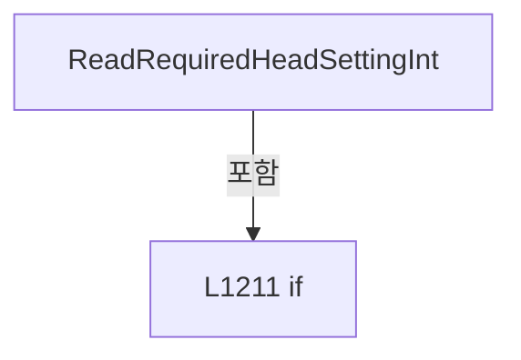

변경 전 점검: 입력/반환 타입, 위 호출자, 예외/취소 경로, 공유 상태와 저장·전송 소비자를 함께 확인합니다. 값의 단위나 물리 방향을 이름만으로 확정하지 않습니다.

### MethodDeclaration `TryFindHeadSetting` · L1219–1242

[Drilling.UI/Menu/Menus/CMenuManual.cs:1219–1242](https://github.com/kjuws10-rgb/A3Drilling/blob/5aee8e58439c9b455cae7c9593c9be986c3e682e/Drilling.UI/Menu/Menus/CMenuManual.cs#L1219-L1242)

| 항목 | 실제 추출 값 |
| --- | --- |
| 서명 | bool Drilling.UI.Menu.Menus.CMenuManual.TryFindHeadSetting(System.Collections.Generic.IReadOnlyList<Drilling.Common.Managers.ST_SYSTEM_PARAMETER>, int, System.Collections.Generic.IReadOnlyList<string>, out string, out string) |
| 접근/수식자 | Private / private, static |
| 반환/값 타입 | bool |
| 소속 타입 | NamedType:Drilling.UI.Menu.Menus.CMenuManual |

입력 계약:

| 이름 | 타입 | 전달 | 선택/기본값 |
| --- | --- | --- | --- |
| settings | System.Collections.Generic.IReadOnlyList<Drilling.Common.Managers.ST_SYSTEM_PARAMETER> | None | False /  |
| headNo | int | None | False /  |
| suffixes | System.Collections.Generic.IReadOnlyList<string> | None | False /  |
| key | string | Out | False /  |
| value | string | Out | False /  |

정적 호출자로 확인된 위치:

| 호출 파일/행 | 호출 표현식 | 런타임 분기 가능 |
| --- | --- | --- |
| [Drilling.UI/Menu/Menus/CMenuManual.cs:1206–1206](https://github.com/kjuws10-rgb/A3Drilling/blob/5aee8e58439c9b455cae7c9593c9be986c3e682e/Drilling.UI/Menu/Menus/CMenuManual.cs#L1206-L1206) | TryFindHeadSetting | False |
| [Drilling.UI/Menu/Menus/CMenuManual.cs:1211–1211](https://github.com/kjuws10-rgb/A3Drilling/blob/5aee8e58439c9b455cae7c9593c9be986c3e682e/Drilling.UI/Menu/Menus/CMenuManual.cs#L1211-L1211) | TryFindHeadSetting | False |

호출하는 대상과 해석 범위:

| 원본 행 | 표현식 | 분석 상태 | 대상/소스 위치 |
| --- | --- | --- | --- |
| 1230 | settings.FirstOrDefault | resolved | Drilling.Common.Managers.ST_SYSTEM_PARAMETER? System.Collections.Generic.IEnumerable<Drilling.Common.Managers.ST_SYSTEM_PARAMETER>.FirstOrDefault<Drilling.Common.Managers.ST_SYSTEM_PARAMETER>(System.Func<Drilling.Common.Managers.ST_SYSTEM_PARAMETER, bool>) |

본문의 실제 연산·분기·예외·반환 순서(원문 위치 순):

| 원본 행 | 종류 | 주석 해설 |
| --- | --- | --- |
| 1221 | local-declaration | 지역 변수를 선언합니다: var prefix = $"H{headNo:00}_"; |
| 1221 | variable-initializer | 변수의 초기값을 지정합니다: prefix = $"H{headNo:00}_" |
| 1222 | foreach | 컬렉션 요소를 순회합니다: foreach (var suffix in suffixes) |
| 1224 | local-declaration | 지역 변수를 선언합니다: var searchKey = prefix + suffix; |
| 1224 | variable-initializer | 변수의 초기값을 지정합니다: searchKey = prefix + suffix |
| 1230 | call | 함수·델리게이트 또는 객체 생성자를 호출합니다: settings.FirstOrDefault(MatchesHeadSettingKey) |
| 1230 | local-declaration | 지역 변수를 선언합니다: var setting = settings.FirstOrDefault(MatchesHeadSettingKey); |
| 1230 | variable-initializer | 변수의 초기값을 지정합니다: setting = settings.FirstOrDefault(MatchesHeadSettingKey) |
| 1231 | if | 조건에 따라 분기합니다: if (setting is not null) |
| 1233 | assignment | 값을 대상에 대입합니다: key = searchKey |
| 1234 | assignment | 값을 대상에 대입합니다: value = setting.Value |
| 1235 | return | 호출자에게 값 또는 제어를 반환합니다: return true; |
| 1239 | assignment | 값을 대상에 대입합니다: key = "" |
| 1240 | assignment | 값을 대상에 대입합니다: value = "" |
| 1241 | return | 호출자에게 값 또는 제어를 반환합니다: return false; |

제어 구문의 포함 구조(실제 실행 순서/CFG가 아닌 구문 탐색 그림):

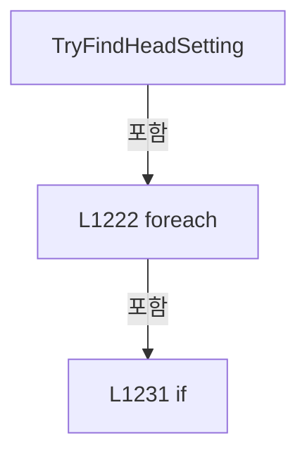

변경 전 점검: 입력/반환 타입, 위 호출자, 예외/취소 경로, 공유 상태와 저장·전송 소비자를 함께 확인합니다. 값의 단위나 물리 방향을 이름만으로 확정하지 않습니다.

### LocalFunctionStatement `MatchesHeadSettingKey` · L1225–1228

[Drilling.UI/Menu/Menus/CMenuManual.cs:1225–1228](https://github.com/kjuws10-rgb/A3Drilling/blob/5aee8e58439c9b455cae7c9593c9be986c3e682e/Drilling.UI/Menu/Menus/CMenuManual.cs#L1225-L1228)

| 항목 | 실제 추출 값 |
| --- | --- |
| 서명 | bool MatchesHeadSettingKey(Drilling.Common.Managers.ST_SYSTEM_PARAMETER) |
| 접근/수식자 | Private /  |
| 반환/값 타입 | bool |
| 소속 타입 | NamedType:Drilling.UI.Menu.Menus.CMenuManual |

입력 계약:

| 이름 | 타입 | 전달 | 선택/기본값 |
| --- | --- | --- | --- |
| item | Drilling.Common.Managers.ST_SYSTEM_PARAMETER | None | False /  |

현재 부분 분석에서 직접 연결된 호출자는 없습니다. XAML/이벤트/인터페이스·델리게이트·외부 진입을 추가 확인해야 하며, 미사용으로 판정한 것이 아닙니다.

호출하는 대상과 해석 범위:

| 원본 행 | 표현식 | 분석 상태 | 대상/소스 위치 |
| --- | --- | --- | --- |
| 1227 | searchKey.Equals | resolved | bool string.Equals(string?, System.StringComparison) |
| 1227 | searchKey.Equals | resolved | bool string.Equals(string?, System.StringComparison) |

본문의 실제 연산·분기·예외·반환 순서(원문 위치 순):

| 원본 행 | 종류 | 주석 해설 |
| --- | --- | --- |
| 1227 | call | 함수·델리게이트 또는 객체 생성자를 호출합니다: searchKey.Equals(item.Key, StringComparison.OrdinalIgnoreCase) |
| 1227 | call | 함수·델리게이트 또는 객체 생성자를 호출합니다: searchKey.Equals(item.Name, StringComparison.OrdinalIgnoreCase) |
| 1227 | return | 호출자에게 값 또는 제어를 반환합니다: return searchKey.Equals(item.Key, StringComparison.OrdinalIgnoreCase) &#124;&#124; searchKey.Equals(item.Name, StringComparison.OrdinalIgnoreCase); |

변경 전 점검: 입력/반환 타입, 위 호출자, 예외/취소 경로, 공유 상태와 저장·전송 소비자를 함께 확인합니다. 값의 단위나 물리 방향을 이름만으로 확정하지 않습니다.

### MethodDeclaration `ParseHeadSettingInt` · L1244–1257

[Drilling.UI/Menu/Menus/CMenuManual.cs:1244–1257](https://github.com/kjuws10-rgb/A3Drilling/blob/5aee8e58439c9b455cae7c9593c9be986c3e682e/Drilling.UI/Menu/Menus/CMenuManual.cs#L1244-L1257)

| 항목 | 실제 추출 값 |
| --- | --- |
| 서명 | int Drilling.UI.Menu.Menus.CMenuManual.ParseHeadSettingInt(int, string, string) |
| 접근/수식자 | Private / private, static |
| 반환/값 타입 | int |
| 소속 타입 | NamedType:Drilling.UI.Menu.Menus.CMenuManual |

입력 계약:

| 이름 | 타입 | 전달 | 선택/기본값 |
| --- | --- | --- | --- |
| headNo | int | None | False /  |
| key | string | None | False /  |
| value | string | None | False /  |

정적 호출자로 확인된 위치:

| 호출 파일/행 | 호출 표현식 | 런타임 분기 가능 |
| --- | --- | --- |
| [Drilling.UI/Menu/Menus/CMenuManual.cs:1206–1206](https://github.com/kjuws10-rgb/A3Drilling/blob/5aee8e58439c9b455cae7c9593c9be986c3e682e/Drilling.UI/Menu/Menus/CMenuManual.cs#L1206-L1206) | ParseHeadSettingInt | False |
| [Drilling.UI/Menu/Menus/CMenuManual.cs:1216–1216](https://github.com/kjuws10-rgb/A3Drilling/blob/5aee8e58439c9b455cae7c9593c9be986c3e682e/Drilling.UI/Menu/Menus/CMenuManual.cs#L1216-L1216) | ParseHeadSettingInt | False |

호출하는 대상과 해석 범위:

| 원본 행 | 표현식 | 분석 상태 | 대상/소스 위치 |
| --- | --- | --- | --- |
| 1246 | string.IsNullOrWhiteSpace | resolved | bool string.IsNullOrWhiteSpace(string?) |
| 1248 | new InvalidOperationException | resolved | System.InvalidOperationException.InvalidOperationException(string?) |
| 1251 | int.TryParse | resolved | bool int.TryParse(string?, System.Globalization.NumberStyles, System.IFormatProvider?, out int) |
| 1251 | value.Trim | resolved | string string.Trim() |
| 1253 | new InvalidOperationException | resolved | System.InvalidOperationException.InvalidOperationException(string?) |

본문의 실제 연산·분기·예외·반환 순서(원문 위치 순):

| 원본 행 | 종류 | 주석 해설 |
| --- | --- | --- |
| 1246 | call | 함수·델리게이트 또는 객체 생성자를 호출합니다: string.IsNullOrWhiteSpace(value) |
| 1246 | if | 조건에 따라 분기합니다: if (string.IsNullOrWhiteSpace(value)) |
| 1248 | call | 함수·델리게이트 또는 객체 생성자를 호출합니다: new InvalidOperationException($"H{headNo:00} setting {key} is empty.") |
| 1248 | throw | 예외를 발생/전달합니다: throw new InvalidOperationException($"H{headNo:00} setting {key} is empty."); |
| 1251 | call | 함수·델리게이트 또는 객체 생성자를 호출합니다: int.TryParse(value.Trim(), NumberStyles.Integer, CultureInfo.InvariantCulture, out var parsed) |
| 1251 | call | 함수·델리게이트 또는 객체 생성자를 호출합니다: value.Trim() |
| 1251 | if | 조건에 따라 분기합니다: if (!int.TryParse(value.Trim(), NumberStyles.Integer, CultureInfo.InvariantCulture, out var parsed)) |
| 1253 | call | 함수·델리게이트 또는 객체 생성자를 호출합니다: new InvalidOperationException($"H{headNo:00} setting {key} must be an integer. Value={value}") |
| 1253 | throw | 예외를 발생/전달합니다: throw new InvalidOperationException($"H{headNo:00} setting {key} must be an integer. Value={value}"); |
| 1256 | return | 호출자에게 값 또는 제어를 반환합니다: return parsed; |

제어 구문의 포함 구조(실제 실행 순서/CFG가 아닌 구문 탐색 그림):

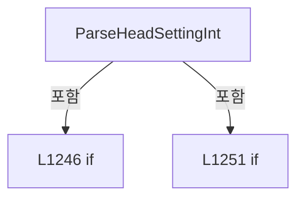

변경 전 점검: 입력/반환 타입, 위 호출자, 예외/취소 경로, 공유 상태와 저장·전송 소비자를 함께 확인합니다. 값의 단위나 물리 방향을 이름만으로 확정하지 않습니다.

### MethodDeclaration `ReadHeadSettingText` · L1259–1278

[Drilling.UI/Menu/Menus/CMenuManual.cs:1259–1278](https://github.com/kjuws10-rgb/A3Drilling/blob/5aee8e58439c9b455cae7c9593c9be986c3e682e/Drilling.UI/Menu/Menus/CMenuManual.cs#L1259-L1278)

| 항목 | 실제 추출 값 |
| --- | --- |
| 서명 | string Drilling.UI.Menu.Menus.CMenuManual.ReadHeadSettingText(System.Collections.Generic.IReadOnlyList<Drilling.Common.Managers.ST_SYSTEM_PARAMETER>, string, int, params string[]) |
| 접근/수식자 | Private / private, static |
| 반환/값 타입 | string |
| 소속 타입 | NamedType:Drilling.UI.Menu.Menus.CMenuManual |

입력 계약:

| 이름 | 타입 | 전달 | 선택/기본값 |
| --- | --- | --- | --- |
| settings | System.Collections.Generic.IReadOnlyList<Drilling.Common.Managers.ST_SYSTEM_PARAMETER> | None | False /  |
| defaultValue | string | None | False /  |
| headNo | int | None | False /  |
| suffixes | string[] | None | False /  |

정적 호출자로 확인된 위치:

| 호출 파일/행 | 호출 표현식 | 런타임 분기 가능 |
| --- | --- | --- |
| [Drilling.UI/Menu/Menus/CMenuManual.cs:2792–2792](https://github.com/kjuws10-rgb/A3Drilling/blob/5aee8e58439c9b455cae7c9593c9be986c3e682e/Drilling.UI/Menu/Menus/CMenuManual.cs#L2792-L2792) | ReadHeadSettingText | False |
| [Drilling.UI/Menu/Menus/CMenuManual.cs:4852–4852](https://github.com/kjuws10-rgb/A3Drilling/blob/5aee8e58439c9b455cae7c9593c9be986c3e682e/Drilling.UI/Menu/Menus/CMenuManual.cs#L4852-L4852) | ReadHeadSettingText | False |

호출하는 대상과 해석 범위:

| 원본 행 | 표현식 | 분석 상태 | 대상/소스 위치 |
| --- | --- | --- | --- |
| 1270 | settings.FirstOrDefault | resolved | Drilling.Common.Managers.ST_SYSTEM_PARAMETER? System.Collections.Generic.IEnumerable<Drilling.Common.Managers.ST_SYSTEM_PARAMETER>.FirstOrDefault<Drilling.Common.Managers.ST_SYSTEM_PARAMETER>(System.Func<Drilling.Common.Managers.ST_SYSTEM_PARAMETER, bool>) |
| 1271 | string.IsNullOrWhiteSpace | resolved | bool string.IsNullOrWhiteSpace(string?) |
| 1273 | setting.Value.Trim | resolved | string string.Trim() |

본문의 실제 연산·분기·예외·반환 순서(원문 위치 순):

| 원본 행 | 종류 | 주석 해설 |
| --- | --- | --- |
| 1261 | local-declaration | 지역 변수를 선언합니다: var prefix = $"H{headNo:00}_"; |
| 1261 | variable-initializer | 변수의 초기값을 지정합니다: prefix = $"H{headNo:00}_" |
| 1262 | foreach | 컬렉션 요소를 순회합니다: foreach (var suffix in suffixes) |
| 1264 | local-declaration | 지역 변수를 선언합니다: var key = prefix + suffix; |
| 1264 | variable-initializer | 변수의 초기값을 지정합니다: key = prefix + suffix |
| 1270 | call | 함수·델리게이트 또는 객체 생성자를 호출합니다: settings.FirstOrDefault(MatchesHeadSettingKey) |
| 1270 | local-declaration | 지역 변수를 선언합니다: var setting = settings.FirstOrDefault(MatchesHeadSettingKey); |
| 1270 | variable-initializer | 변수의 초기값을 지정합니다: setting = settings.FirstOrDefault(MatchesHeadSettingKey) |
| 1271 | call | 함수·델리게이트 또는 객체 생성자를 호출합니다: string.IsNullOrWhiteSpace(setting.Value) |
| 1271 | if | 조건에 따라 분기합니다: if (setting is not null && !string.IsNullOrWhiteSpace(setting.Value)) |
| 1273 | call | 함수·델리게이트 또는 객체 생성자를 호출합니다: setting.Value.Trim() |
| 1273 | return | 호출자에게 값 또는 제어를 반환합니다: return setting.Value.Trim(); |
| 1277 | return | 호출자에게 값 또는 제어를 반환합니다: return defaultValue; |

제어 구문의 포함 구조(실제 실행 순서/CFG가 아닌 구문 탐색 그림):

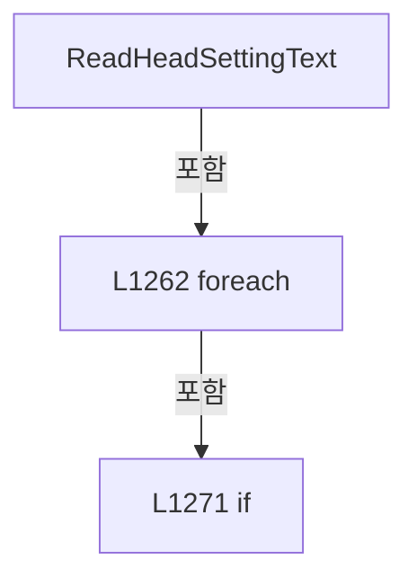

변경 전 점검: 입력/반환 타입, 위 호출자, 예외/취소 경로, 공유 상태와 저장·전송 소비자를 함께 확인합니다. 값의 단위나 물리 방향을 이름만으로 확정하지 않습니다.

### LocalFunctionStatement `MatchesHeadSettingKey` · L1265–1268

[Drilling.UI/Menu/Menus/CMenuManual.cs:1265–1268](https://github.com/kjuws10-rgb/A3Drilling/blob/5aee8e58439c9b455cae7c9593c9be986c3e682e/Drilling.UI/Menu/Menus/CMenuManual.cs#L1265-L1268)

| 항목 | 실제 추출 값 |
| --- | --- |
| 서명 | bool MatchesHeadSettingKey(Drilling.Common.Managers.ST_SYSTEM_PARAMETER) |
| 접근/수식자 | Private /  |
| 반환/값 타입 | bool |
| 소속 타입 | NamedType:Drilling.UI.Menu.Menus.CMenuManual |

입력 계약:

| 이름 | 타입 | 전달 | 선택/기본값 |
| --- | --- | --- | --- |
| item | Drilling.Common.Managers.ST_SYSTEM_PARAMETER | None | False /  |

현재 부분 분석에서 직접 연결된 호출자는 없습니다. XAML/이벤트/인터페이스·델리게이트·외부 진입을 추가 확인해야 하며, 미사용으로 판정한 것이 아닙니다.

호출하는 대상과 해석 범위:

| 원본 행 | 표현식 | 분석 상태 | 대상/소스 위치 |
| --- | --- | --- | --- |
| 1267 | key.Equals | resolved | bool string.Equals(string?, System.StringComparison) |
| 1267 | key.Equals | resolved | bool string.Equals(string?, System.StringComparison) |

본문의 실제 연산·분기·예외·반환 순서(원문 위치 순):

| 원본 행 | 종류 | 주석 해설 |
| --- | --- | --- |
| 1267 | call | 함수·델리게이트 또는 객체 생성자를 호출합니다: key.Equals(item.Key, StringComparison.OrdinalIgnoreCase) |
| 1267 | call | 함수·델리게이트 또는 객체 생성자를 호출합니다: key.Equals(item.Name, StringComparison.OrdinalIgnoreCase) |
| 1267 | return | 호출자에게 값 또는 제어를 반환합니다: return key.Equals(item.Key, StringComparison.OrdinalIgnoreCase) &#124;&#124; key.Equals(item.Name, StringComparison.OrdinalIgnoreCase); |

변경 전 점검: 입력/반환 타입, 위 호출자, 예외/취소 경로, 공유 상태와 저장·전송 소비자를 함께 확인합니다. 값의 단위나 물리 방향을 이름만으로 확정하지 않습니다.

### MethodDeclaration `TryBlockManualAutomationCommand` · L1280–1327

[Drilling.UI/Menu/Menus/CMenuManual.cs:1280–1327](https://github.com/kjuws10-rgb/A3Drilling/blob/5aee8e58439c9b455cae7c9593c9be986c3e682e/Drilling.UI/Menu/Menus/CMenuManual.cs#L1280-L1327)

| 항목 | 실제 추출 값 |
| --- | --- |
| 서명 | bool Drilling.UI.Menu.Menus.CMenuManual.TryBlockManualAutomationCommand(string) |
| 접근/수식자 | Private / private |
| 반환/값 타입 | bool |
| 소속 타입 | NamedType:Drilling.UI.Menu.Menus.CMenuManual |

입력 계약:

| 이름 | 타입 | 전달 | 선택/기본값 |
| --- | --- | --- | --- |
| commandName | string | None | False /  |

정적 호출자로 확인된 위치:

| 호출 파일/행 | 호출 표현식 | 런타임 분기 가능 |
| --- | --- | --- |
| [Drilling.UI/Menu/Menus/CMenuManual.cs:1744–1744](https://github.com/kjuws10-rgb/A3Drilling/blob/5aee8e58439c9b455cae7c9593c9be986c3e682e/Drilling.UI/Menu/Menus/CMenuManual.cs#L1744-L1744) | TryBlockManualAutomationCommand | False |
| [Drilling.UI/Menu/Menus/CMenuManual.cs:1781–1781](https://github.com/kjuws10-rgb/A3Drilling/blob/5aee8e58439c9b455cae7c9593c9be986c3e682e/Drilling.UI/Menu/Menus/CMenuManual.cs#L1781-L1781) | TryBlockManualAutomationCommand | False |
| [Drilling.UI/Menu/Menus/CMenuManual.cs:1792–1792](https://github.com/kjuws10-rgb/A3Drilling/blob/5aee8e58439c9b455cae7c9593c9be986c3e682e/Drilling.UI/Menu/Menus/CMenuManual.cs#L1792-L1792) | TryBlockManualAutomationCommand | False |
| [Drilling.UI/Menu/Menus/CMenuManual.cs:1884–1884](https://github.com/kjuws10-rgb/A3Drilling/blob/5aee8e58439c9b455cae7c9593c9be986c3e682e/Drilling.UI/Menu/Menus/CMenuManual.cs#L1884-L1884) | TryBlockManualAutomationCommand | False |
| [Drilling.UI/Menu/Menus/CMenuManual.cs:1983–1983](https://github.com/kjuws10-rgb/A3Drilling/blob/5aee8e58439c9b455cae7c9593c9be986c3e682e/Drilling.UI/Menu/Menus/CMenuManual.cs#L1983-L1983) | TryBlockManualAutomationCommand | False |
| [Drilling.UI/Menu/Menus/CMenuManual.cs:2002–2002](https://github.com/kjuws10-rgb/A3Drilling/blob/5aee8e58439c9b455cae7c9593c9be986c3e682e/Drilling.UI/Menu/Menus/CMenuManual.cs#L2002-L2002) | TryBlockManualAutomationCommand | False |
| [Drilling.UI/Menu/Menus/CMenuManual.cs:2186–2186](https://github.com/kjuws10-rgb/A3Drilling/blob/5aee8e58439c9b455cae7c9593c9be986c3e682e/Drilling.UI/Menu/Menus/CMenuManual.cs#L2186-L2186) | TryBlockManualAutomationCommand | False |
| [Drilling.UI/Menu/Menus/CMenuManual.cs:2255–2255](https://github.com/kjuws10-rgb/A3Drilling/blob/5aee8e58439c9b455cae7c9593c9be986c3e682e/Drilling.UI/Menu/Menus/CMenuManual.cs#L2255-L2255) | TryBlockManualAutomationCommand | False |
| [Drilling.UI/Menu/Menus/CMenuManual.cs:2575–2575](https://github.com/kjuws10-rgb/A3Drilling/blob/5aee8e58439c9b455cae7c9593c9be986c3e682e/Drilling.UI/Menu/Menus/CMenuManual.cs#L2575-L2575) | TryBlockManualAutomationCommand | False |
| [Drilling.UI/Menu/Menus/CMenuManual.cs:2712–2712](https://github.com/kjuws10-rgb/A3Drilling/blob/5aee8e58439c9b455cae7c9593c9be986c3e682e/Drilling.UI/Menu/Menus/CMenuManual.cs#L2712-L2712) | TryBlockManualAutomationCommand | False |
| [Drilling.UI/Menu/Menus/CMenuManual.cs:3270–3270](https://github.com/kjuws10-rgb/A3Drilling/blob/5aee8e58439c9b455cae7c9593c9be986c3e682e/Drilling.UI/Menu/Menus/CMenuManual.cs#L3270-L3270) | TryBlockManualAutomationCommand | False |
| [Drilling.UI/Menu/Menus/CMenuManual.cs:3290–3290](https://github.com/kjuws10-rgb/A3Drilling/blob/5aee8e58439c9b455cae7c9593c9be986c3e682e/Drilling.UI/Menu/Menus/CMenuManual.cs#L3290-L3290) | TryBlockManualAutomationCommand | False |
| [Drilling.UI/Menu/Menus/CMenuManual.cs:3342–3342](https://github.com/kjuws10-rgb/A3Drilling/blob/5aee8e58439c9b455cae7c9593c9be986c3e682e/Drilling.UI/Menu/Menus/CMenuManual.cs#L3342-L3342) | TryBlockManualAutomationCommand | False |
| [Drilling.UI/Menu/Menus/CMenuManual.cs:3369–3369](https://github.com/kjuws10-rgb/A3Drilling/blob/5aee8e58439c9b455cae7c9593c9be986c3e682e/Drilling.UI/Menu/Menus/CMenuManual.cs#L3369-L3369) | TryBlockManualAutomationCommand | False |
| [Drilling.UI/Menu/Menus/CMenuManual.cs:3466–3466](https://github.com/kjuws10-rgb/A3Drilling/blob/5aee8e58439c9b455cae7c9593c9be986c3e682e/Drilling.UI/Menu/Menus/CMenuManual.cs#L3466-L3466) | TryBlockManualAutomationCommand | False |
| [Drilling.UI/Menu/Menus/CMenuManual.cs:4025–4025](https://github.com/kjuws10-rgb/A3Drilling/blob/5aee8e58439c9b455cae7c9593c9be986c3e682e/Drilling.UI/Menu/Menus/CMenuManual.cs#L4025-L4025) | TryBlockManualAutomationCommand | False |
| [Drilling.UI/Menu/Menus/CMenuManual.cs:4293–4293](https://github.com/kjuws10-rgb/A3Drilling/blob/5aee8e58439c9b455cae7c9593c9be986c3e682e/Drilling.UI/Menu/Menus/CMenuManual.cs#L4293-L4293) | TryBlockManualAutomationCommand | False |
| [Drilling.UI/Menu/Menus/CMenuManual.cs:4304–4304](https://github.com/kjuws10-rgb/A3Drilling/blob/5aee8e58439c9b455cae7c9593c9be986c3e682e/Drilling.UI/Menu/Menus/CMenuManual.cs#L4304-L4304) | TryBlockManualAutomationCommand | False |
| [Drilling.UI/Menu/Menus/CMenuManual.cs:4631–4631](https://github.com/kjuws10-rgb/A3Drilling/blob/5aee8e58439c9b455cae7c9593c9be986c3e682e/Drilling.UI/Menu/Menus/CMenuManual.cs#L4631-L4631) | TryBlockManualAutomationCommand | False |
| [Drilling.UI/Menu/Menus/CMenuManual.cs:5290–5290](https://github.com/kjuws10-rgb/A3Drilling/blob/5aee8e58439c9b455cae7c9593c9be986c3e682e/Drilling.UI/Menu/Menus/CMenuManual.cs#L5290-L5290) | TryBlockManualAutomationCommand | False |
| [Drilling.UI/Menu/Menus/CMenuManual.cs:5396–5396](https://github.com/kjuws10-rgb/A3Drilling/blob/5aee8e58439c9b455cae7c9593c9be986c3e682e/Drilling.UI/Menu/Menus/CMenuManual.cs#L5396-L5396) | TryBlockManualAutomationCommand | False |

호출하는 대상과 해석 범위:

| 원본 행 | 표현식 | 분석 상태 | 대상/소스 위치 |
| --- | --- | --- | --- |
| 1282 | commandName.Contains | resolved | bool string.Contains(string, System.StringComparison) |
| 1282 | commandName.EndsWith | resolved | bool string.EndsWith(string, System.StringComparison) |
| 1282 | commandName.Contains | resolved | bool string.Contains(string, System.StringComparison) |
| 1282 | commandName.Contains | resolved | bool string.Contains(string, System.StringComparison) |
| 1282 | commandName.EndsWith | resolved | bool string.EndsWith(string, System.StringComparison) |
| 1283 | CheckOperationAlarm | resolved | bool Drilling.UI.Menu.Menus.CMenuBase.CheckOperationAlarm(string) · Drilling.UI/Menu/Menus/CMenuBase.cs:15 |
| 1287 | commandName.Equals | resolved | bool string.Equals(string?, System.StringComparison) |
| 1288 | _manager.Interface | resolved | Drilling.Common.Interface.CInterfaceManager Drilling.Common.Managers.CManager.Interface() · Drilling.Common/Managers/CManager.cs:347 |
| 1290 | ShowManualWarning | resolved | void Drilling.UI.Menu.Menus.CMenuManual.ShowManualWarning(string) · Drilling.UI/Menu/Menus/CMenuManual.cs:1601 |
| 1293 | _manager.Station | resolved | Drilling.Common.Station.CStationManager Drilling.Common.Managers.CManager.Station() · Drilling.Common/Managers/CManager.cs:322 |
| 1295 | ShowManualWarning | resolved | void Drilling.UI.Menu.Menus.CMenuManual.ShowManualWarning(string) · Drilling.UI/Menu/Menus/CMenuManual.cs:1601 |
| 1301 | ShowManualWarning | resolved | void Drilling.UI.Menu.Menus.CMenuManual.ShowManualWarning(string) · Drilling.UI/Menu/Menus/CMenuManual.cs:1601 |
| 1306 | commandName.Equals | resolved | bool string.Equals(string?, System.StringComparison) |
| 1306 | commandName.StartsWith | resolved | bool string.StartsWith(string, System.StringComparison) |
| 1306 | commandName.EndsWith | resolved | bool string.EndsWith(string, System.StringComparison) |
| 1307 | commandName.Equals | resolved | bool string.Equals(string?, System.StringComparison) |
| 1310 | _setStatusMessage | resolved · 동적 구현 선택 가능 | void System.Action<string>.Invoke(string) |
| 1311 | ShowManualWarning | resolved | void Drilling.UI.Menu.Menus.CMenuManual.ShowManualWarning(string) · Drilling.UI/Menu/Menus/CMenuManual.cs:1601 |
| 1315 | IsAutoProcessRunning | resolved | bool Drilling.UI.Menu.Menus.CMenuManual.IsAutoProcessRunning() · Drilling.UI/Menu/Menus/CMenuManual.cs:1329 |
| 1323 | RefreshCommandStateRows | resolved | void Drilling.UI.Menu.Menus.CMenuManual.RefreshCommandStateRows() · Drilling.UI/Menu/Menus/CMenuManual.cs:5520 |
| 1324 | _setStatusMessage | resolved · 동적 구현 선택 가능 | void System.Action<string>.Invoke(string) |
| 1325 | _refreshShellStatus | resolved · 동적 구현 선택 가능 | void System.Action.Invoke() |

본문의 실제 연산·분기·예외·반환 순서(원문 위치 순):

| 원본 행 | 종류 | 주석 해설 |
| --- | --- | --- |
| 1282 | call | 함수·델리게이트 또는 객체 생성자를 호출합니다: commandName.Contains("STOP", StringComparison.OrdinalIgnoreCase) |
| 1282 | call | 함수·델리게이트 또는 객체 생성자를 호출합니다: commandName.EndsWith("OFF", StringComparison.OrdinalIgnoreCase) |
| 1282 | call | 함수·델리게이트 또는 객체 생성자를 호출합니다: commandName.Contains("DISABLE", StringComparison.OrdinalIgnoreCase) |
| 1282 | call | 함수·델리게이트 또는 객체 생성자를 호출합니다: commandName.Contains("FAULT_CLEAR", StringComparison.OrdinalIgnoreCase) |
| 1282 | call | 함수·델리게이트 또는 객체 생성자를 호출합니다: commandName.EndsWith("_RESET", StringComparison.OrdinalIgnoreCase) |
| 1282 | local-declaration | 지역 변수를 선언합니다: var recovery = commandName.Contains("STOP", StringComparison.OrdinalIgnoreCase) &#124;&#124; commandName.EndsWith("OFF", StringComparison.OrdinalIgnoreCase) &#124;&#124; commandName.Contains("DISABLE", StringComparison.OrdinalIgnoreCase) &#124;&#124; commandNa |
| 1282 | variable-initializer | 변수의 초기값을 지정합니다: recovery = commandName.Contains("STOP", StringComparison.OrdinalIgnoreCase) &#124;&#124; commandName.EndsWith("OFF", StringComparison.OrdinalIgnoreCase) &#124;&#124; commandName.Contains("DISABLE", StringComparison.OrdinalIgnoreCase) &#124;&#124; commandName.C |
| 1283 | call | 함수·델리게이트 또는 객체 생성자를 호출합니다: CheckOperationAlarm(commandName) |
| 1283 | if | 조건에 따라 분기합니다: if (!recovery && !CheckOperationAlarm(commandName)) |
| 1284 | return | 호출자에게 값 또는 제어를 반환합니다: return true; |
| 1287 | call | 함수·델리게이트 또는 객체 생성자를 호출합니다: commandName.Equals("STAGE_REVIEW_MOVE", StringComparison.OrdinalIgnoreCase) |
| 1287 | if | 조건에 따라 분기합니다: if (!recovery && !commandName.Equals("STAGE_REVIEW_MOVE", StringComparison.OrdinalIgnoreCase) && (IsManualStageMovePending &#124;&#124; _manager.Interface().StageReviewSequences.IsActive)) |
| 1288 | call | 함수·델리게이트 또는 객체 생성자를 호출합니다: _manager.Interface() |
| 1290 | call | 함수·델리게이트 또는 객체 생성자를 호출합니다: ShowManualWarning("Stage/Review 이동이 실행 중이거나 정리 중입니다. 이동 완료 또는 STOP 정리 완료 후 실행해 주세요.") |
| 1291 | return | 호출자에게 값 또는 제어를 반환합니다: return true; |
| 1293 | call | 함수·델리게이트 또는 객체 생성자를 호출합니다: _manager.Station() |
| 1293 | if | 조건에 따라 분기합니다: if (_manager.Station().ManualMofStatus is { IsRunning: true } or { RequiresStop: true }) |
| 1295 | call | 함수·델리게이트 또는 객체 생성자를 호출합니다: ShowManualWarning("MOF 가공이 실행 중이거나 정지가 확인되지 않았습니다. MOF STOP 후 실행해 주세요.") |
| 1296 | return | 호출자에게 값 또는 제어를 반환합니다: return true; |
| 1299 | if | 조건에 따라 분기합니다: if (IsManualMotionScriptActive && commandName is not "MANUAL_MOTION" and not "MOVE_STOP") |
| 1301 | call | 함수·델리게이트 또는 객체 생성자를 호출합니다: ShowManualWarning("수동 이동 스크립트가 실행 중이거나 정지가 확인되지 않았습니다. 완료 또는 MOVE STOP 후 실행해 주세요.") |
| 1302 | return | 호출자에게 값 또는 제어를 반환합니다: return true; |
| 1306 | call | 함수·델리게이트 또는 객체 생성자를 호출합니다: commandName.Equals("SCANNER_FAULT_CLEAR", StringComparison.OrdinalIgnoreCase) |
| 1306 | call | 함수·델리게이트 또는 객체 생성자를 호출합니다: commandName.StartsWith("CONTROLLER_", StringComparison.OrdinalIgnoreCase) |
| 1306 | call | 함수·델리게이트 또는 객체 생성자를 호출합니다: commandName.EndsWith("_RESET", StringComparison.OrdinalIgnoreCase) |
| 1306 | local-declaration | 지역 변수를 선언합니다: var canRecoverStoppedScan = _activeManualShapeScan is null && !_manualShapeScanStopInProgress && _activeManualLaserAction is null && !_manualLaserOffInProgress && (commandName.Equals("SCANNER_FAULT_CLEAR", StringComparison.Ordinal |
| 1306 | variable-initializer | 변수의 초기값을 지정합니다: canRecoverStoppedScan = _activeManualShapeScan is null && !_manualShapeScanStopInProgress && _activeManualLaserAction is null && !_manualLaserOffInProgress && (commandName.Equals("SCANNER_FAULT_CLEAR", StringComparison.OrdinalIgno |
| 1307 | call | 함수·델리게이트 또는 객체 생성자를 호출합니다: commandName.Equals("SHAPE_START", StringComparison.OrdinalIgnoreCase) |
| 1307 | if | 조건에 따라 분기합니다: if (IsManualShapeScanActive && !canRecoverStoppedScan && !commandName.Equals("SHAPE_START", StringComparison.OrdinalIgnoreCase)) |
| 1309 | local-declaration | 지역 변수를 선언합니다: const string scanMessage = "수동 가공이 진행 중이거나 정지가 확인되지 않았습니다. LASER OFF 또는 Scan STOP으로 정지한 후 실행해 주세요."; |
| 1309 | variable-initializer | 변수의 초기값을 지정합니다: scanMessage = "수동 가공이 진행 중이거나 정지가 확인되지 않았습니다. LASER OFF 또는 Scan STOP으로 정지한 후 실행해 주세요." |
| 1310 | call | 함수·델리게이트 또는 객체 생성자를 호출합니다: _setStatusMessage(scanMessage) |
| 1311 | call | 함수·델리게이트 또는 객체 생성자를 호출합니다: ShowManualWarning(scanMessage) |
| 1312 | return | 호출자에게 값 또는 제어를 반환합니다: return true; |
| 1315 | call | 함수·델리게이트 또는 객체 생성자를 호출합니다: IsAutoProcessRunning() |
| 1315 | if | 조건에 따라 분기합니다: if (!IsAutoProcessRunning()) |
| 1317 | return | 호출자에게 값 또는 제어를 반환합니다: return false; |
| 1320 | local-declaration | 지역 변수를 선언합니다: var message = "Auto process is running. Manual Automation1 command is blocked."; |
| 1320 | variable-initializer | 변수의 초기값을 지정합니다: message = "Auto process is running. Manual Automation1 command is blocked." |
| 1321 | assignment | 값을 대상에 대입합니다: _lastCommand = commandName |
| 1322 | assignment | 값을 대상에 대입합니다: _lastResult = message |
| 1323 | call | 함수·델리게이트 또는 객체 생성자를 호출합니다: RefreshCommandStateRows() |
| 1324 | call | 함수·델리게이트 또는 객체 생성자를 호출합니다: _setStatusMessage(message) |
| 1325 | call | 함수·델리게이트 또는 객체 생성자를 호출합니다: _refreshShellStatus() |
| 1326 | return | 호출자에게 값 또는 제어를 반환합니다: return true; |

제어 구문의 포함 구조(실제 실행 순서/CFG가 아닌 구문 탐색 그림):

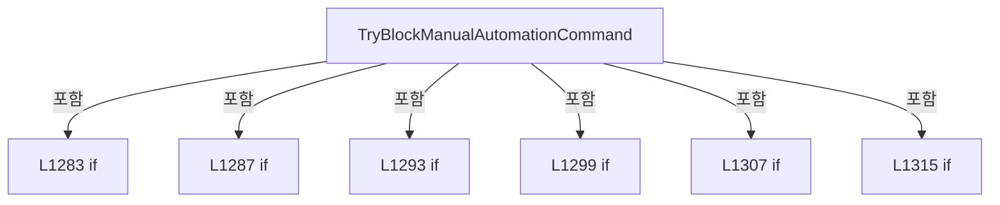

변경 전 점검: 입력/반환 타입, 위 호출자, 예외/취소 경로, 공유 상태와 저장·전송 소비자를 함께 확인합니다. 값의 단위나 물리 방향을 이름만으로 확정하지 않습니다.

### MethodDeclaration `IsAutoProcessRunning` · L1329–1340

[Drilling.UI/Menu/Menus/CMenuManual.cs:1329–1340](https://github.com/kjuws10-rgb/A3Drilling/blob/5aee8e58439c9b455cae7c9593c9be986c3e682e/Drilling.UI/Menu/Menus/CMenuManual.cs#L1329-L1340)

| 항목 | 실제 추출 값 |
| --- | --- |
| 서명 | bool Drilling.UI.Menu.Menus.CMenuManual.IsAutoProcessRunning() |
| 접근/수식자 | Private / private |
| 반환/값 타입 | bool |
| 소속 타입 | NamedType:Drilling.UI.Menu.Menus.CMenuManual |

정적 호출자로 확인된 위치:

| 호출 파일/행 | 호출 표현식 | 런타임 분기 가능 |
| --- | --- | --- |
| [Drilling.UI/Menu/Menus/CMenuManual.cs:1315–1315](https://github.com/kjuws10-rgb/A3Drilling/blob/5aee8e58439c9b455cae7c9593c9be986c3e682e/Drilling.UI/Menu/Menus/CMenuManual.cs#L1315-L1315) | IsAutoProcessRunning | False |
| [Drilling.UI/Menu/Menus/CMenuManual.cs:2980–2980](https://github.com/kjuws10-rgb/A3Drilling/blob/5aee8e58439c9b455cae7c9593c9be986c3e682e/Drilling.UI/Menu/Menus/CMenuManual.cs#L2980-L2980) | IsAutoProcessRunning | False |
| [Drilling.UI/Menu/Menus/CMenuManual.cs:4543–4543](https://github.com/kjuws10-rgb/A3Drilling/blob/5aee8e58439c9b455cae7c9593c9be986c3e682e/Drilling.UI/Menu/Menus/CMenuManual.cs#L4543-L4543) | IsAutoProcessRunning | False |
| [Drilling.UI/Menu/Menus/CMenuManual.cs:4784–4784](https://github.com/kjuws10-rgb/A3Drilling/blob/5aee8e58439c9b455cae7c9593c9be986c3e682e/Drilling.UI/Menu/Menus/CMenuManual.cs#L4784-L4784) | IsAutoProcessRunning | False |

호출하는 대상과 해석 범위:

| 원본 행 | 표현식 | 분석 상태 | 대상/소스 위치 |
| --- | --- | --- | --- |
| 1333 | _manager.Station().GetStatus | resolved | Drilling.Common.Station.ST_STATION_PROCESS_STATUS Drilling.Common.Station.CStationManager.GetStatus(System.Threading.CancellationToken) · Drilling.Common/Station/CStationManager.cs:63 |
| 1333 | _manager.Station | resolved | Drilling.Common.Station.CStationManager Drilling.Common.Managers.CManager.Station() · Drilling.Common/Managers/CManager.cs:322 |

본문의 실제 연산·분기·예외·반환 순서(원문 위치 순):

| 원본 행 | 종류 | 주석 해설 |
| --- | --- | --- |
| 1331 | try | 예외 처리 범위입니다: try |
| 1333 | call | 함수·델리게이트 또는 객체 생성자를 호출합니다: _manager.Station().GetStatus(CancellationToken.None) |
| 1333 | call | 함수·델리게이트 또는 객체 생성자를 호출합니다: _manager.Station() |
| 1333 | local-declaration | 지역 변수를 선언합니다: var snapshot = _manager.Station().GetStatus(CancellationToken.None); |
| 1333 | variable-initializer | 변수의 초기값을 지정합니다: snapshot = _manager.Station().GetStatus(CancellationToken.None) |
| 1334 | return | 호출자에게 값 또는 제어를 반환합니다: return snapshot.ScriptStatus == EN_SCRIPT_STATUS.Running &#124;&#124; snapshot.ProcessStep is EN_PROCESS_STEP.PowerCheck or EN_PROCESS_STEP.Align or EN_PROCESS_STEP.Process or EN_PROCESS_STEP.Inspection; |
| 1336 | catch | 지정 예외를 처리합니다: catch  |
| 1338 | return | 호출자에게 값 또는 제어를 반환합니다: return false; |

제어 구문의 포함 구조(실제 실행 순서/CFG가 아닌 구문 탐색 그림):

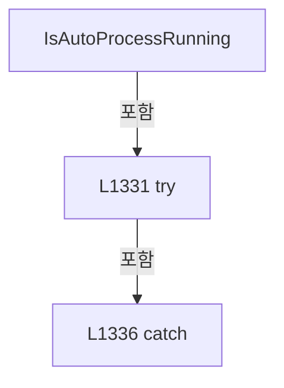

변경 전 점검: 입력/반환 타입, 위 호출자, 예외/취소 경로, 공유 상태와 저장·전송 소비자를 함께 확인합니다. 값의 단위나 물리 방향을 이름만으로 확정하지 않습니다.

### MethodDeclaration `ContainsAutomationFailureToken` · L1342–1354

[Drilling.UI/Menu/Menus/CMenuManual.cs:1342–1354](https://github.com/kjuws10-rgb/A3Drilling/blob/5aee8e58439c9b455cae7c9593c9be986c3e682e/Drilling.UI/Menu/Menus/CMenuManual.cs#L1342-L1354)

| 항목 | 실제 추출 값 |
| --- | --- |
| 서명 | bool Drilling.UI.Menu.Menus.CMenuManual.ContainsAutomationFailureToken(string) |
| 접근/수식자 | Private / private, static |
| 반환/값 타입 | bool |
| 소속 타입 | NamedType:Drilling.UI.Menu.Menus.CMenuManual |

입력 계약:

| 이름 | 타입 | 전달 | 선택/기본값 |
| --- | --- | --- | --- |
| response | string | None | False /  |

정적 호출자로 확인된 위치:

| 호출 파일/행 | 호출 표현식 | 런타임 분기 가능 |
| --- | --- | --- |
| [Drilling.UI/Menu/Menus/CMenuManual.cs:5713–5713](https://github.com/kjuws10-rgb/A3Drilling/blob/5aee8e58439c9b455cae7c9593c9be986c3e682e/Drilling.UI/Menu/Menus/CMenuManual.cs#L5713-L5713) | ContainsAutomationFailureToken | False |

호출하는 대상과 해석 범위:

| 원본 행 | 표현식 | 분석 상태 | 대상/소스 위치 |
| --- | --- | --- | --- |
| 1344 | response.Split | resolved | string[] string.Split(char, System.StringSplitOptions) |
| 1347 | IsAutomationFailureToken | resolved | bool Drilling.UI.Menu.Menus.CMenuManual.IsAutomationFailureToken(string) · Drilling.UI/Menu/Menus/CMenuManual.cs:1372 |

본문의 실제 연산·분기·예외·반환 순서(원문 위치 순):

| 원본 행 | 종류 | 주석 해설 |
| --- | --- | --- |
| 1344 | call | 함수·델리게이트 또는 객체 생성자를 호출합니다: response.Split(':', StringSplitOptions.TrimEntries &#124; StringSplitOptions.RemoveEmptyEntries) |
| 1344 | local-declaration | 지역 변수를 선언합니다: var tokens = response.Split(':', StringSplitOptions.TrimEntries &#124; StringSplitOptions.RemoveEmptyEntries); |
| 1344 | variable-initializer | 변수의 초기값을 지정합니다: tokens = response.Split(':', StringSplitOptions.TrimEntries &#124; StringSplitOptions.RemoveEmptyEntries) |
| 1345 | variable-initializer | 변수의 초기값을 지정합니다: index = 0 |
| 1345 | for | 초기화·조건·증감이 있는 반복입니다: for (var index = 0; index < tokens.Length; index++) |
| 1347 | call | 함수·델리게이트 또는 객체 생성자를 호출합니다: IsAutomationFailureToken(tokens[index]) |
| 1347 | if | 조건에 따라 분기합니다: if (IsAutomationFailureToken(tokens[index])) |
| 1349 | return | 호출자에게 값 또는 제어를 반환합니다: return true; |
| 1353 | return | 호출자에게 값 또는 제어를 반환합니다: return false; |

제어 구문의 포함 구조(실제 실행 순서/CFG가 아닌 구문 탐색 그림):

```mermaid
flowchart TD
 M["ContainsAutomationFailureToken"]
 N0["L1345 for"]
 M -->|포함| N0
 N1["L1347 if"]
 N0 -->|포함| N1
```

변경 전 점검: 입력/반환 타입, 위 호출자, 예외/취소 경로, 공유 상태와 저장·전송 소비자를 함께 확인합니다. 값의 단위나 물리 방향을 이름만으로 확정하지 않습니다.

### MethodDeclaration `FormatAutomationFailureResponse` · L1356–1370

[Drilling.UI/Menu/Menus/CMenuManual.cs:1356–1370](https://github.com/kjuws10-rgb/A3Drilling/blob/5aee8e58439c9b455cae7c9593c9be986c3e682e/Drilling.UI/Menu/Menus/CMenuManual.cs#L1356-L1370)

| 항목 | 실제 추출 값 |
| --- | --- |
| 서명 | string Drilling.UI.Menu.Menus.CMenuManual.FormatAutomationFailureResponse(string) |
| 접근/수식자 | Private / private, static |
| 반환/값 타입 | string |
| 소속 타입 | NamedType:Drilling.UI.Menu.Menus.CMenuManual |

입력 계약:

| 이름 | 타입 | 전달 | 선택/기본값 |
| --- | --- | --- | --- |
| response | string | None | False /  |

정적 호출자로 확인된 위치:

| 호출 파일/행 | 호출 표현식 | 런타임 분기 가능 |
| --- | --- | --- |
| [Drilling.UI/Menu/Menus/CMenuManual.cs:5715–5715](https://github.com/kjuws10-rgb/A3Drilling/blob/5aee8e58439c9b455cae7c9593c9be986c3e682e/Drilling.UI/Menu/Menus/CMenuManual.cs#L5715-L5715) | FormatAutomationFailureResponse | False |

호출하는 대상과 해석 범위:

| 원본 행 | 표현식 | 분석 상태 | 대상/소스 위치 |
| --- | --- | --- | --- |
| 1358 | string.IsNullOrWhiteSpace | resolved | bool string.IsNullOrWhiteSpace(string?) |
| 1363 | response.Trim().Split | resolved | string[] string.Split(char, int, System.StringSplitOptions) |
| 1363 | response.Trim | resolved | string string.Trim() |
| 1364 | fields[0].Equals | resolved | bool string.Equals(string?, System.StringComparison) |
| 1364 | fields[1].Equals | resolved | bool string.Equals(string?, System.StringComparison) |
| 1369 | response.Trim | resolved | string string.Trim() |

본문의 실제 연산·분기·예외·반환 순서(원문 위치 순):

| 원본 행 | 종류 | 주석 해설 |
| --- | --- | --- |
| 1358 | call | 함수·델리게이트 또는 객체 생성자를 호출합니다: string.IsNullOrWhiteSpace(response) |
| 1358 | if | 조건에 따라 분기합니다: if (string.IsNullOrWhiteSpace(response)) |
| 1360 | return | 호출자에게 값 또는 제어를 반환합니다: return "<empty>"; |
| 1363 | call | 함수·델리게이트 또는 객체 생성자를 호출합니다: response.Trim().Split(':', 4, StringSplitOptions.TrimEntries) |
| 1363 | call | 함수·델리게이트 또는 객체 생성자를 호출합니다: response.Trim() |
| 1363 | local-declaration | 지역 변수를 선언합니다: var fields = response.Trim().Split(':', 4, StringSplitOptions.TrimEntries); |
| 1363 | variable-initializer | 변수의 초기값을 지정합니다: fields = response.Trim().Split(':', 4, StringSplitOptions.TrimEntries) |
| 1364 | call | 함수·델리게이트 또는 객체 생성자를 호출합니다: fields[0].Equals("ERROR", StringComparison.OrdinalIgnoreCase) |
| 1364 | call | 함수·델리게이트 또는 객체 생성자를 호출합니다: fields[1].Equals("AUTOMATION1", StringComparison.OrdinalIgnoreCase) |
| 1364 | if | 조건에 따라 분기합니다: if (fields.Length >= 4 && fields[0].Equals("ERROR", StringComparison.OrdinalIgnoreCase) && fields[1].Equals("AUTOMATION1", StringComparison.OrdinalIgnoreCase)) |
| 1366 | return | 호출자에게 값 또는 제어를 반환합니다: return $"{fields[2]}: {fields[3]}"; |
| 1369 | call | 함수·델리게이트 또는 객체 생성자를 호출합니다: response.Trim() |
| 1369 | return | 호출자에게 값 또는 제어를 반환합니다: return response.Trim(); |

제어 구문의 포함 구조(실제 실행 순서/CFG가 아닌 구문 탐색 그림):

```mermaid
flowchart TD
 M["FormatAutomationFailureResponse"]
 N0["L1358 if"]
 M -->|포함| N0
 N1["L1364 if"]
 M -->|포함| N1
```

변경 전 점검: 입력/반환 타입, 위 호출자, 예외/취소 경로, 공유 상태와 저장·전송 소비자를 함께 확인합니다. 값의 단위나 물리 방향을 이름만으로 확정하지 않습니다.

### MethodDeclaration `IsAutomationFailureToken` · L1372–1375

[Drilling.UI/Menu/Menus/CMenuManual.cs:1372–1375](https://github.com/kjuws10-rgb/A3Drilling/blob/5aee8e58439c9b455cae7c9593c9be986c3e682e/Drilling.UI/Menu/Menus/CMenuManual.cs#L1372-L1375)

| 항목 | 실제 추출 값 |
| --- | --- |
| 서명 | bool Drilling.UI.Menu.Menus.CMenuManual.IsAutomationFailureToken(string) |
| 접근/수식자 | Private / private, static |
| 반환/값 타입 | bool |
| 소속 타입 | NamedType:Drilling.UI.Menu.Menus.CMenuManual |

입력 계약:

| 이름 | 타입 | 전달 | 선택/기본값 |
| --- | --- | --- | --- |
| token | string | None | False /  |

정적 호출자로 확인된 위치:

| 호출 파일/행 | 호출 표현식 | 런타임 분기 가능 |
| --- | --- | --- |
| [Drilling.UI/Menu/Menus/CMenuManual.cs:1347–1347](https://github.com/kjuws10-rgb/A3Drilling/blob/5aee8e58439c9b455cae7c9593c9be986c3e682e/Drilling.UI/Menu/Menus/CMenuManual.cs#L1347-L1347) | IsAutomationFailureToken | False |

호출하는 대상과 해석 범위:

| 원본 행 | 표현식 | 분석 상태 | 대상/소스 위치 |
| --- | --- | --- | --- |
| 1374 | token.Equals | resolved | bool string.Equals(string?, System.StringComparison) |
| 1374 | token.Equals | resolved | bool string.Equals(string?, System.StringComparison) |
| 1374 | token.Equals | resolved | bool string.Equals(string?, System.StringComparison) |
| 1374 | token.Equals | resolved | bool string.Equals(string?, System.StringComparison) |
| 1374 | token.Equals | resolved | bool string.Equals(string?, System.StringComparison) |
| 1374 | token.Equals | resolved | bool string.Equals(string?, System.StringComparison) |

본문의 실제 연산·분기·예외·반환 순서(원문 위치 순):

| 원본 행 | 종류 | 주석 해설 |
| --- | --- | --- |
| 1374 | call | 함수·델리게이트 또는 객체 생성자를 호출합니다: token.Equals("ERROR", StringComparison.OrdinalIgnoreCase) |
| 1374 | call | 함수·델리게이트 또는 객체 생성자를 호출합니다: token.Equals("ERR", StringComparison.OrdinalIgnoreCase) |
| 1374 | call | 함수·델리게이트 또는 객체 생성자를 호출합니다: token.Equals("FAIL", StringComparison.OrdinalIgnoreCase) |
| 1374 | call | 함수·델리게이트 또는 객체 생성자를 호출합니다: token.Equals("FAILED", StringComparison.OrdinalIgnoreCase) |
| 1374 | call | 함수·델리게이트 또는 객체 생성자를 호출합니다: token.Equals("NG", StringComparison.OrdinalIgnoreCase) |
| 1374 | call | 함수·델리게이트 또는 객체 생성자를 호출합니다: token.Equals("NAK", StringComparison.OrdinalIgnoreCase) |
| 1374 | return | 호출자에게 값 또는 제어를 반환합니다: return token.Equals("ERROR", StringComparison.OrdinalIgnoreCase) &#124;&#124; token.Equals("ERR", StringComparison.OrdinalIgnoreCase) &#124;&#124; token.Equals("FAIL", StringComparison.OrdinalIgnoreCase) &#124;&#124; token.Equals("FAILED", StringComparison.Ord |

변경 전 점검: 입력/반환 타입, 위 호출자, 예외/취소 경로, 공유 상태와 저장·전송 소비자를 함께 확인합니다. 값의 단위나 물리 방향을 이름만으로 확정하지 않습니다.

### MethodDeclaration `ReadManualParamFromScreen` · L1377–1402

[Drilling.UI/Menu/Menus/CMenuManual.cs:1377–1402](https://github.com/kjuws10-rgb/A3Drilling/blob/5aee8e58439c9b455cae7c9593c9be986c3e682e/Drilling.UI/Menu/Menus/CMenuManual.cs#L1377-L1402)

| 항목 | 실제 추출 값 |
| --- | --- |
| 서명 | Drilling.Common.Managers.ST_MANUAL_SCAN_PARAM Drilling.UI.Menu.Menus.CMenuManual.ReadManualParamFromScreen() |
| 접근/수식자 | Private / private |
| 반환/값 타입 | Drilling.Common.Managers.ST_MANUAL_SCAN_PARAM |
| 소속 타입 | NamedType:Drilling.UI.Menu.Menus.CMenuManual |

정적 호출자로 확인된 위치:

| 호출 파일/행 | 호출 표현식 | 런타임 분기 가능 |
| --- | --- | --- |
| [Drilling.UI/Menu/Menus/CMenuManual.cs:5723–5723](https://github.com/kjuws10-rgb/A3Drilling/blob/5aee8e58439c9b455cae7c9593c9be986c3e682e/Drilling.UI/Menu/Menus/CMenuManual.cs#L5723-L5723) | ReadManualParamFromScreen | False |

호출하는 대상과 해석 범위:

| 원본 행 | 표현식 | 분석 상태 | 대상/소스 위치 |
| --- | --- | --- | --- |
| 1379 | new ST_MANUAL_SCAN_PARAM | resolved | Drilling.Common.Managers.ST_MANUAL_SCAN_PARAM.ST_MANUAL_SCAN_PARAM(double, double, double, string, string, double, double, double, double, double, double, double, double, int, int, int, string, int, double) · Drilling.Common/Managers/CManager.cs:665 |
| 1380 | ReadManualDouble | resolved | double Drilling.UI.Menu.Menus.CMenuManual.ReadManualDouble(string) · Drilling.UI/Menu/Menus/CMenuManual.cs:1578 |
| 1381 | ReadManualDouble | resolved | double Drilling.UI.Menu.Menus.CMenuManual.ReadManualDouble(string) · Drilling.UI/Menu/Menus/CMenuManual.cs:1578 |
| 1382 | ReadManualDouble | resolved | double Drilling.UI.Menu.Menus.CMenuManual.ReadManualDouble(string) · Drilling.UI/Menu/Menus/CMenuManual.cs:1578 |
| 1383 | ReadManualText | resolved | string Drilling.UI.Menu.Menus.CMenuManual.ReadManualText(Drilling.UI.Menu.Menus.ST_MANUAL_PARAMETER, string) · Drilling.UI/Menu/Menus/CMenuManual.cs:6005 |
| 1383 | FindManualParameter | resolved | Drilling.UI.Menu.Menus.ST_MANUAL_PARAMETER Drilling.UI.Menu.Menus.CMenuManual.FindManualParameter(string) · Drilling.UI/Menu/Menus/CMenuManual.cs:5995 |
| 1384 | ReadManualText | resolved | string Drilling.UI.Menu.Menus.CMenuManual.ReadManualText(Drilling.UI.Menu.Menus.ST_MANUAL_PARAMETER, string) · Drilling.UI/Menu/Menus/CMenuManual.cs:6005 |
| 1384 | FindManualParameter | resolved | Drilling.UI.Menu.Menus.ST_MANUAL_PARAMETER Drilling.UI.Menu.Menus.CMenuManual.FindManualParameter(string) · Drilling.UI/Menu/Menus/CMenuManual.cs:5995 |
| 1385 | ReadManualDouble | resolved | double Drilling.UI.Menu.Menus.CMenuManual.ReadManualDouble(string) · Drilling.UI/Menu/Menus/CMenuManual.cs:1578 |
| 1386 | ReadManualDouble | resolved | double Drilling.UI.Menu.Menus.CMenuManual.ReadManualDouble(string) · Drilling.UI/Menu/Menus/CMenuManual.cs:1578 |
| 1387 | ReadManualDouble | resolved | double Drilling.UI.Menu.Menus.CMenuManual.ReadManualDouble(string) · Drilling.UI/Menu/Menus/CMenuManual.cs:1578 |
| 1389 | ReadManualDouble | resolved | double Drilling.UI.Menu.Menus.CMenuManual.ReadManualDouble(string) · Drilling.UI/Menu/Menus/CMenuManual.cs:1578 |
| 1390 | ReadManualDouble | resolved | double Drilling.UI.Menu.Menus.CMenuManual.ReadManualDouble(string) · Drilling.UI/Menu/Menus/CMenuManual.cs:1578 |
| 1391 | ReadManualDouble | resolved | double Drilling.UI.Menu.Menus.CMenuManual.ReadManualDouble(string) · Drilling.UI/Menu/Menus/CMenuManual.cs:1578 |
| 1392 | ReadManualDouble | resolved | double Drilling.UI.Menu.Menus.CMenuManual.ReadManualDouble(string) · Drilling.UI/Menu/Menus/CMenuManual.cs:1578 |
| 1393 | ReadManualInt | resolved | int Drilling.UI.Menu.Menus.CMenuManual.ReadManualInt(string) · Drilling.UI/Menu/Menus/CMenuManual.cs:5961 |
| 1394 | ReadManualInt | resolved | int Drilling.UI.Menu.Menus.CMenuManual.ReadManualInt(string) · Drilling.UI/Menu/Menus/CMenuManual.cs:5961 |
| 1395 | ReadManualInt | resolved | int Drilling.UI.Menu.Menus.CMenuManual.ReadManualInt(string) · Drilling.UI/Menu/Menus/CMenuManual.cs:5961 |
| 1396 | ReadManualText | resolved | string Drilling.UI.Menu.Menus.CMenuManual.ReadManualText(Drilling.UI.Menu.Menus.ST_MANUAL_PARAMETER, string) · Drilling.UI/Menu/Menus/CMenuManual.cs:6005 |
| 1396 | FindManualParameter | resolved | Drilling.UI.Menu.Menus.ST_MANUAL_PARAMETER Drilling.UI.Menu.Menus.CMenuManual.FindManualParameter(string) · Drilling.UI/Menu/Menus/CMenuManual.cs:5995 |
| 1397 | ReadManualInt | resolved | int Drilling.UI.Menu.Menus.CMenuManual.ReadManualInt(string) · Drilling.UI/Menu/Menus/CMenuManual.cs:5961 |
| 1398 | ReadManualDouble | resolved | double Drilling.UI.Menu.Menus.CMenuManual.ReadManualDouble(string) · Drilling.UI/Menu/Menus/CMenuManual.cs:1578 |
| 1400 | ValidateManualScanParameters | resolved | void Drilling.UI.Menu.Menus.CMenuManual.ValidateManualScanParameters(Drilling.Common.Managers.ST_MANUAL_SCAN_PARAM, System.Collections.Generic.IReadOnlyList<Drilling.Common.Managers.ST_MANUAL_SCAN_FORM>) · Drilling.UI/Menu/Menus/CMenuManual.cs:1483 |

본문의 실제 연산·분기·예외·반환 순서(원문 위치 순):

| 원본 행 | 종류 | 주석 해설 |
| --- | --- | --- |
| 1379 | call | 함수·델리게이트 또는 객체 생성자를 호출합니다: new ST_MANUAL_SCAN_PARAM( ReadManualDouble("ShapeSize"), ReadManualDouble("OffsetX"), ReadManualDouble("OffsetY"), ReadManualText(FindManualParameter("Direction")), ReadManualText(FindManualParameter("ShapeName")), ReadM… |
| 1379 | local-declaration | 지역 변수를 선언합니다: var settings = new ST_MANUAL_SCAN_PARAM( ReadManualDouble("ShapeSize"), ReadManualDouble("OffsetX"), ReadManualDouble("OffsetY"), ReadManualText(FindManualParameter("Direction")), ReadManualText(FindManualParameter("ShapeName")),  |
| 1379 | variable-initializer | 변수의 초기값을 지정합니다: settings = new ST_MANUAL_SCAN_PARAM( ReadManualDouble("ShapeSize"), ReadManualDouble("OffsetX"), ReadManualDouble("OffsetY"), ReadManualText(FindManualParameter("Direction")), ReadManualText(FindManualParameter("ShapeName")), Read |
| 1380 | call | 함수·델리게이트 또는 객체 생성자를 호출합니다: ReadManualDouble("ShapeSize") |
| 1381 | call | 함수·델리게이트 또는 객체 생성자를 호출합니다: ReadManualDouble("OffsetX") |
| 1382 | call | 함수·델리게이트 또는 객체 생성자를 호출합니다: ReadManualDouble("OffsetY") |
| 1383 | call | 함수·델리게이트 또는 객체 생성자를 호출합니다: ReadManualText(FindManualParameter("Direction")) |
| 1383 | call | 함수·델리게이트 또는 객체 생성자를 호출합니다: FindManualParameter("Direction") |
| 1384 | call | 함수·델리게이트 또는 객체 생성자를 호출합니다: ReadManualText(FindManualParameter("ShapeName")) |
| 1384 | call | 함수·델리게이트 또는 객체 생성자를 호출합니다: FindManualParameter("ShapeName") |
| 1385 | call | 함수·델리게이트 또는 객체 생성자를 호출합니다: ReadManualDouble("LaserPower") |
| 1386 | call | 함수·델리게이트 또는 객체 생성자를 호출합니다: ReadManualDouble("JumpSpeed") |
| 1387 | call | 함수·델리게이트 또는 객체 생성자를 호출합니다: ReadManualDouble("MarkSpeed") |
| 1389 | call | 함수·델리게이트 또는 객체 생성자를 호출합니다: ReadManualDouble("LaserFrequency") |
| 1390 | call | 함수·델리게이트 또는 객체 생성자를 호출합니다: ReadManualDouble("LaserOnDelay") |
| 1391 | call | 함수·델리게이트 또는 객체 생성자를 호출합니다: ReadManualDouble("LaserOffDelay") |
| 1392 | call | 함수·델리게이트 또는 객체 생성자를 호출합니다: ReadManualDouble("Time") |
| 1393 | call | 함수·델리게이트 또는 객체 생성자를 호출합니다: ReadManualInt("Count") |
| 1394 | call | 함수·델리게이트 또는 객체 생성자를 호출합니다: ReadManualInt("GridRowLines") |
| 1395 | call | 함수·델리게이트 또는 객체 생성자를 호출합니다: ReadManualInt("GridColLines") |
| 1396 | call | 함수·델리게이트 또는 객체 생성자를 호출합니다: ReadManualText(FindManualParameter("LaserOnMode")) |
| 1396 | call | 함수·델리게이트 또는 객체 생성자를 호출합니다: FindManualParameter("LaserOnMode") |
| 1397 | call | 함수·델리게이트 또는 객체 생성자를 호출합니다: ReadManualInt("RepeatCount") |
| 1398 | call | 함수·델리게이트 또는 객체 생성자를 호출합니다: ReadManualDouble("RepeatDelayTime") |
| 1400 | call | 함수·델리게이트 또는 객체 생성자를 호출합니다: ValidateManualScanParameters(settings, []) |
| 1401 | return | 호출자에게 값 또는 제어를 반환합니다: return settings; |

변경 전 점검: 입력/반환 타입, 위 호출자, 예외/취소 경로, 공유 상태와 저장·전송 소비자를 함께 확인합니다. 값의 단위나 물리 방향을 이름만으로 확정하지 않습니다.

### MethodDeclaration `Apply` · L1404–1434

[Drilling.UI/Menu/Menus/CMenuManual.cs:1404–1434](https://github.com/kjuws10-rgb/A3Drilling/blob/5aee8e58439c9b455cae7c9593c9be986c3e682e/Drilling.UI/Menu/Menus/CMenuManual.cs#L1404-L1434)

| 항목 | 실제 추출 값 |
| --- | --- |
| 서명 | void Drilling.UI.Menu.Menus.CMenuManual.Apply(System.Collections.Generic.IReadOnlyList<Drilling.UI.Menu.Menus.ST_DISPLAY_ITEM>, System.Collections.Generic.IReadOnlyList<Drilling.UI.Menu.Menus.ST_DISPLAY_ITEM>, System.Collections.Generic.IReadOnlyList<Drilling.UI.Menu.Menus.ST_DISPLAY_ITEM>, System.Collections.Generic.IReadOnlyList<Drilling.UI.Menu.Menus.ST_DISPLAY_ITEM>, System.Collections.Generic.IReadOnlyList<Drilling.UI.Menu.Menus.ST_DISPLAY_ITEM>, string, string, string, System.Collections.Generic.IReadOnlyList<Drilling.UI.Menu.Menus.ST_MANUAL_HEAD_CARD>, System.Collections.Generic.IReadOnlyList<Drilling.UI.Menu.Menus.ST_MANUAL_SETTING_FILE>, System.Collections.Generic.IReadOnlyList<Drilling.UI.Menu.Menus.ST_MANUAL_PARAMETER>, System.Collections.Generic.IReadOnlyList<Drilling.UI.Menu.Menus.ST_MANUAL_COMMAND_STATE>, System.Collections.Generic.IReadOnlyList<Drilling.UI.Menu.Menus.ST_MANUAL_SCANNER_AXIS>) |
| 접근/수식자 | Private / private |
| 반환/값 타입 | void |
| 소속 타입 | NamedType:Drilling.UI.Menu.Menus.CMenuManual |

입력 계약:

| 이름 | 타입 | 전달 | 선택/기본값 |
| --- | --- | --- | --- |
| manualSettings | System.Collections.Generic.IReadOnlyList<Drilling.UI.Menu.Menus.ST_DISPLAY_ITEM> | None | False /  |
| selectedHeadItems | System.Collections.Generic.IReadOnlyList<Drilling.UI.Menu.Menus.ST_DISPLAY_ITEM> | None | False /  |
| positionMoveItems | System.Collections.Generic.IReadOnlyList<Drilling.UI.Menu.Menus.ST_DISPLAY_ITEM> | None | False /  |
| shapeScanItems | System.Collections.Generic.IReadOnlyList<Drilling.UI.Menu.Menus.ST_DISPLAY_ITEM> | None | False /  |
| commandStateItems | System.Collections.Generic.IReadOnlyList<Drilling.UI.Menu.Menus.ST_DISPLAY_ITEM> | None | False /  |
| selectedHead | string | None | False /  |
| loadedSettingName | string | None | False /  |
| loadedSettingPath | string | None | False /  |
| headCards | System.Collections.Generic.IReadOnlyList<Drilling.UI.Menu.Menus.ST_MANUAL_HEAD_CARD> | None | False /  |
| settingFiles | System.Collections.Generic.IReadOnlyList<Drilling.UI.Menu.Menus.ST_MANUAL_SETTING_FILE> | None | False /  |
| settingParameters | System.Collections.Generic.IReadOnlyList<Drilling.UI.Menu.Menus.ST_MANUAL_PARAMETER> | None | False /  |
| commandStateRows | System.Collections.Generic.IReadOnlyList<Drilling.UI.Menu.Menus.ST_MANUAL_COMMAND_STATE> | None | False /  |
| scannerAxes | System.Collections.Generic.IReadOnlyList<Drilling.UI.Menu.Menus.ST_MANUAL_SCANNER_AXIS> | None | False /  |

정적 호출자로 확인된 위치:

| 호출 파일/행 | 호출 표현식 | 런타임 분기 가능 |
| --- | --- | --- |
| [Drilling.UI/Menu/Menus/CMenuManual.cs:1159–1191](https://github.com/kjuws10-rgb/A3Drilling/blob/5aee8e58439c9b455cae7c9593c9be986c3e682e/Drilling.UI/Menu/Menus/CMenuManual.cs#L1159-L1191) | Apply | False |

호출하는 대상과 해석 범위:

| 원본 행 | 표현식 | 분석 상태 | 대상/소스 위치 |
| --- | --- | --- | --- |
| 1429 | BuildHeadGroups | resolved | System.Collections.Generic.IReadOnlyList<Drilling.UI.Menu.Menus.ST_MANUAL_HEAD_GROUP> Drilling.UI.Menu.Menus.CMenuManual.BuildHeadGroups(System.Collections.Generic.IReadOnlyList<Drilling.UI.Menu.Menus.ST_MANUAL_HEAD_CARD>) · Drilling.UI/Menu/Menus/CMenuManual.cs:6765 |

본문의 실제 연산·분기·예외·반환 순서(원문 위치 순):

| 원본 행 | 종류 | 주석 해설 |
| --- | --- | --- |
| 1420 | assignment | 값을 대상에 대입합니다: ManualSettings = manualSettings |
| 1421 | assignment | 값을 대상에 대입합니다: SelectedHeadItems = selectedHeadItems |
| 1422 | assignment | 값을 대상에 대입합니다: PositionMoveItems = positionMoveItems |
| 1423 | assignment | 값을 대상에 대입합니다: ShapeScanItems = shapeScanItems |
| 1424 | assignment | 값을 대상에 대입합니다: CommandStateItems = commandStateItems |
| 1425 | assignment | 값을 대상에 대입합니다: SelectedHead = selectedHead |
| 1426 | assignment | 값을 대상에 대입합니다: LoadedSettingName = loadedSettingName |
| 1427 | assignment | 값을 대상에 대입합니다: LoadedSettingPath = loadedSettingPath |
| 1428 | assignment | 값을 대상에 대입합니다: HeadCards = headCards |
| 1429 | assignment | 값을 대상에 대입합니다: HeadGroups = BuildHeadGroups(headCards) |
| 1429 | call | 함수·델리게이트 또는 객체 생성자를 호출합니다: BuildHeadGroups(headCards) |
| 1430 | assignment | 값을 대상에 대입합니다: SettingFiles = settingFiles |
| 1431 | assignment | 값을 대상에 대입합니다: SettingParameters = settingParameters |
| 1432 | assignment | 값을 대상에 대입합니다: CommandStateRows = commandStateRows |
| 1433 | assignment | 값을 대상에 대입합니다: ScannerAxes = scannerAxes |

변경 전 점검: 입력/반환 타입, 위 호출자, 예외/취소 경로, 공유 상태와 저장·전송 소비자를 함께 확인합니다. 값의 단위나 물리 방향을 이름만으로 확정하지 않습니다.

### MethodDeclaration `BuildManualSettings` · L1436–1446

[Drilling.UI/Menu/Menus/CMenuManual.cs:1436–1446](https://github.com/kjuws10-rgb/A3Drilling/blob/5aee8e58439c9b455cae7c9593c9be986c3e682e/Drilling.UI/Menu/Menus/CMenuManual.cs#L1436-L1446)

| 항목 | 실제 추출 값 |
| --- | --- |
| 서명 | System.Collections.Generic.IReadOnlyList<Drilling.UI.Menu.Menus.ST_DISPLAY_ITEM> Drilling.UI.Menu.Menus.CMenuManual.BuildManualSettings(Drilling.Common.Managers.ST_MANUAL_SCAN_PARAM) |
| 접근/수식자 | Private / private, static |
| 반환/값 타입 | System.Collections.Generic.IReadOnlyList<Drilling.UI.Menu.Menus.ST_DISPLAY_ITEM> |
| 소속 타입 | NamedType:Drilling.UI.Menu.Menus.CMenuManual |

입력 계약:

| 이름 | 타입 | 전달 | 선택/기본값 |
| --- | --- | --- | --- |
| settings | Drilling.Common.Managers.ST_MANUAL_SCAN_PARAM | None | False /  |

정적 호출자로 확인된 위치:

| 호출 파일/행 | 호출 표현식 | 런타임 분기 가능 |
| --- | --- | --- |
| [Drilling.UI/Menu/Menus/CMenuManual.cs:1160–1160](https://github.com/kjuws10-rgb/A3Drilling/blob/5aee8e58439c9b455cae7c9593c9be986c3e682e/Drilling.UI/Menu/Menus/CMenuManual.cs#L1160-L1160) | BuildManualSettings | False |
| [Drilling.UI/Menu/Menus/CMenuManual.cs:1199–1199](https://github.com/kjuws10-rgb/A3Drilling/blob/5aee8e58439c9b455cae7c9593c9be986c3e682e/Drilling.UI/Menu/Menus/CMenuManual.cs#L1199-L1199) | BuildManualSettings | False |

호출하는 대상과 해석 범위:

| 원본 행 | 표현식 | 분석 상태 | 대상/소스 위치 |
| --- | --- | --- | --- |
| 1439 | new | resolved | Drilling.UI.Menu.Menus.ST_DISPLAY_ITEM.ST_DISPLAY_ITEM(string, string, string) · Drilling.UI/Menu/Menus/CMenuBase.cs:43 |
| 1439 | FormatDouble | resolved | string Drilling.UI.Menu.Menus.CMenuManual.FormatDouble(double, int) · Drilling.UI/Menu/Menus/CMenuManual.cs:1611 |
| 1440 | new | resolved | Drilling.UI.Menu.Menus.ST_DISPLAY_ITEM.ST_DISPLAY_ITEM(string, string, string) · Drilling.UI/Menu/Menus/CMenuBase.cs:43 |
| 1440 | FormatDouble | resolved | string Drilling.UI.Menu.Menus.CMenuManual.FormatDouble(double, int) · Drilling.UI/Menu/Menus/CMenuManual.cs:1611 |
| 1441 | new | resolved | Drilling.UI.Menu.Menus.ST_DISPLAY_ITEM.ST_DISPLAY_ITEM(string, string, string) · Drilling.UI/Menu/Menus/CMenuBase.cs:43 |
| 1441 | FormatDouble | resolved | string Drilling.UI.Menu.Menus.CMenuManual.FormatDouble(double, int) · Drilling.UI/Menu/Menus/CMenuManual.cs:1611 |
| 1442 | new | resolved | Drilling.UI.Menu.Menus.ST_DISPLAY_ITEM.ST_DISPLAY_ITEM(string, string, string) · Drilling.UI/Menu/Menus/CMenuBase.cs:43 |
| 1442 | FormatDouble | resolved | string Drilling.UI.Menu.Menus.CMenuManual.FormatDouble(double, int) · Drilling.UI/Menu/Menus/CMenuManual.cs:1611 |
| 1443 | new | resolved | Drilling.UI.Menu.Menus.ST_DISPLAY_ITEM.ST_DISPLAY_ITEM(string, string, string) · Drilling.UI/Menu/Menus/CMenuBase.cs:43 |
| 1443 | FormatDouble | resolved | string Drilling.UI.Menu.Menus.CMenuManual.FormatDouble(double, int) · Drilling.UI/Menu/Menus/CMenuManual.cs:1611 |
| 1444 | new | resolved | Drilling.UI.Menu.Menus.ST_DISPLAY_ITEM.ST_DISPLAY_ITEM(string, string, string) · Drilling.UI/Menu/Menus/CMenuBase.cs:43 |
| 1444 | FormatDouble | resolved | string Drilling.UI.Menu.Menus.CMenuManual.FormatDouble(double, int) · Drilling.UI/Menu/Menus/CMenuManual.cs:1611 |

본문의 실제 연산·분기·예외·반환 순서(원문 위치 순):

| 원본 행 | 종류 | 주석 해설 |
| --- | --- | --- |
| 1438 | return | 호출자에게 값 또는 제어를 반환합니다: return[ new("Laser Power", FormatDouble(settings.LaserPower, 2), "W"), new("Jump Speed", FormatDouble(settings.JumpSpeed, 3), "m/sec"), new("Mark Speed", FormatDouble(settings.MarkSpeed, 3), "m/sec"), new("Laser Frequency", Format |
| 1439 | call | 함수·델리게이트 또는 객체 생성자를 호출합니다: new("Laser Power", FormatDouble(settings.LaserPower, 2), "W") |
| 1439 | call | 함수·델리게이트 또는 객체 생성자를 호출합니다: FormatDouble(settings.LaserPower, 2) |
| 1440 | call | 함수·델리게이트 또는 객체 생성자를 호출합니다: new("Jump Speed", FormatDouble(settings.JumpSpeed, 3), "m/sec") |
| 1440 | call | 함수·델리게이트 또는 객체 생성자를 호출합니다: FormatDouble(settings.JumpSpeed, 3) |
| 1441 | call | 함수·델리게이트 또는 객체 생성자를 호출합니다: new("Mark Speed", FormatDouble(settings.MarkSpeed, 3), "m/sec") |
| 1441 | call | 함수·델리게이트 또는 객체 생성자를 호출합니다: FormatDouble(settings.MarkSpeed, 3) |
| 1442 | call | 함수·델리게이트 또는 객체 생성자를 호출합니다: new("Laser Frequency", FormatDouble(settings.LaserFrequency, 3), "kHz") |
| 1442 | call | 함수·델리게이트 또는 객체 생성자를 호출합니다: FormatDouble(settings.LaserFrequency, 3) |
| 1443 | call | 함수·델리게이트 또는 객체 생성자를 호출합니다: new("Laser On Delay", FormatDouble(settings.LaserOnDelay, 3), "msec") |
| 1443 | call | 함수·델리게이트 또는 객체 생성자를 호출합니다: FormatDouble(settings.LaserOnDelay, 3) |
| 1444 | call | 함수·델리게이트 또는 객체 생성자를 호출합니다: new("Laser Off Delay", FormatDouble(settings.LaserOffDelay, 3), "msec") |
| 1444 | call | 함수·델리게이트 또는 객체 생성자를 호출합니다: FormatDouble(settings.LaserOffDelay, 3) |

변경 전 점검: 입력/반환 타입, 위 호출자, 예외/취소 경로, 공유 상태와 저장·전송 소비자를 함께 확인합니다. 값의 단위나 물리 방향을 이름만으로 확정하지 않습니다.

### MethodDeclaration `ReadEnabledManualScannerHeadNo` · L1448–1459

[Drilling.UI/Menu/Menus/CMenuManual.cs:1448–1459](https://github.com/kjuws10-rgb/A3Drilling/blob/5aee8e58439c9b455cae7c9593c9be986c3e682e/Drilling.UI/Menu/Menus/CMenuManual.cs#L1448-L1459)

| 항목 | 실제 추출 값 |
| --- | --- |
| 서명 | int Drilling.UI.Menu.Menus.CMenuManual.ReadEnabledManualScannerHeadNo(System.Threading.CancellationToken) |
| 접근/수식자 | Private / private |
| 반환/값 타입 | int |
| 소속 타입 | NamedType:Drilling.UI.Menu.Menus.CMenuManual |

입력 계약:

| 이름 | 타입 | 전달 | 선택/기본값 |
| --- | --- | --- | --- |
| cancellationToken | System.Threading.CancellationToken | None | False /  |

정적 호출자로 확인된 위치:

| 호출 파일/행 | 호출 표현식 | 런타임 분기 가능 |
| --- | --- | --- |
| [Drilling.UI/Menu/Menus/CMenuManual.cs:3993–3993](https://github.com/kjuws10-rgb/A3Drilling/blob/5aee8e58439c9b455cae7c9593c9be986c3e682e/Drilling.UI/Menu/Menus/CMenuManual.cs#L3993-L3993) | ReadEnabledManualScannerHeadNo | False |
| [Drilling.UI/Menu/Menus/CMenuManual.cs:4037–4037](https://github.com/kjuws10-rgb/A3Drilling/blob/5aee8e58439c9b455cae7c9593c9be986c3e682e/Drilling.UI/Menu/Menus/CMenuManual.cs#L4037-L4037) | ReadEnabledManualScannerHeadNo | False |
| [Drilling.UI/Menu/Menus/CMenuManual.cs:5300–5300](https://github.com/kjuws10-rgb/A3Drilling/blob/5aee8e58439c9b455cae7c9593c9be986c3e682e/Drilling.UI/Menu/Menus/CMenuManual.cs#L5300-L5300) | ReadEnabledManualScannerHeadNo | False |

호출하는 대상과 해석 범위:

| 원본 행 | 표현식 | 분석 상태 | 대상/소스 위치 |
| --- | --- | --- | --- |
| 1450 | _manager.Setting().LoadSection | resolved | System.Collections.Generic.IReadOnlyList<Drilling.Common.Managers.ST_SYSTEM_PARAMETER> Drilling.Common.Managers.CSettingManager.LoadSection(Drilling.Common.Managers.EN_SETTING_TAB, System.Threading.CancellationToken) · Drilling.Common/Managers/CSettingManager.cs:26 |
| 1450 | _manager.Setting | resolved | Drilling.Common.Managers.CSettingManager Drilling.Common.Managers.CManager.Setting() · Drilling.Common/Managers/CManager.cs:332 |
| 1451 | CScannerStatusSnapshotReader.BuildEnabledHeadNumbers | resolved | System.Collections.Generic.IReadOnlyList<int> Drilling.UI.Menu.Menus.CScannerStatusSnapshotReader.BuildEnabledHeadNumbers(System.Collections.Generic.IReadOnlyList<Drilling.Common.Managers.ST_SYSTEM_PARAMETER>, int) · Drilling.UI/Menu/Menus/CScannerStatusSnapshotReader.cs:126 |
| 1454 | new InvalidOperationException | resolved | System.InvalidOperationException.InvalidOperationException(string?) |
| 1457 | Math.Clamp | resolved | int System.Math.Clamp(int, int, int) |
| 1457 | _selectedHeadNoProvider | resolved · 동적 구현 선택 가능 | int System.Func<int>.Invoke() |
| 1458 | enabledHeadNos.Contains | resolved | bool System.Collections.Generic.IEnumerable<int>.Contains<int>(int) |

본문의 실제 연산·분기·예외·반환 순서(원문 위치 순):

| 원본 행 | 종류 | 주석 해설 |
| --- | --- | --- |
| 1450 | call | 함수·델리게이트 또는 객체 생성자를 호출합니다: _manager.Setting().LoadSection(EN_SETTING_TAB.Option, cancellationToken) |
| 1450 | call | 함수·델리게이트 또는 객체 생성자를 호출합니다: _manager.Setting() |
| 1450 | local-declaration | 지역 변수를 선언합니다: var optionSettings = _manager.Setting().LoadSection(EN_SETTING_TAB.Option, cancellationToken); |
| 1450 | variable-initializer | 변수의 초기값을 지정합니다: optionSettings = _manager.Setting().LoadSection(EN_SETTING_TAB.Option, cancellationToken) |
| 1451 | call | 함수·델리게이트 또는 객체 생성자를 호출합니다: CScannerStatusSnapshotReader.BuildEnabledHeadNumbers(optionSettings) |
| 1451 | local-declaration | 지역 변수를 선언합니다: var enabledHeadNos = CScannerStatusSnapshotReader.BuildEnabledHeadNumbers(optionSettings); |
| 1451 | variable-initializer | 변수의 초기값을 지정합니다: enabledHeadNos = CScannerStatusSnapshotReader.BuildEnabledHeadNumbers(optionSettings) |
| 1452 | if | 조건에 따라 분기합니다: if (enabledHeadNos.Count == 0) |
| 1454 | call | 함수·델리게이트 또는 객체 생성자를 호출합니다: new InvalidOperationException("No manual scanner head is enabled. Check Hxx_USE option settings.") |
| 1454 | throw | 예외를 발생/전달합니다: throw new InvalidOperationException("No manual scanner head is enabled. Check Hxx_USE option settings."); |
| 1457 | call | 함수·델리게이트 또는 객체 생성자를 호출합니다: Math.Clamp(_selectedHeadNoProvider(), 1, 8) |
| 1457 | call | 함수·델리게이트 또는 객체 생성자를 호출합니다: _selectedHeadNoProvider() |
| 1457 | local-declaration | 지역 변수를 선언합니다: var selectedHeadNo = Math.Clamp(_selectedHeadNoProvider(), 1, 8); |
| 1457 | variable-initializer | 변수의 초기값을 지정합니다: selectedHeadNo = Math.Clamp(_selectedHeadNoProvider(), 1, 8) |
| 1458 | call | 함수·델리게이트 또는 객체 생성자를 호출합니다: enabledHeadNos.Contains(selectedHeadNo) |
| 1458 | conditional-expression | 조건에 따라 결과식을 선택합니다: enabledHeadNos.Contains(selectedHeadNo) ? selectedHeadNo : enabledHeadNos[0] |
| 1458 | return | 호출자에게 값 또는 제어를 반환합니다: return enabledHeadNos.Contains(selectedHeadNo) ? selectedHeadNo : enabledHeadNos[0]; |

제어 구문의 포함 구조(실제 실행 순서/CFG가 아닌 구문 탐색 그림):

```mermaid
flowchart TD
 M["ReadEnabledManualScannerHeadNo"]
 N0["L1452 if"]
 M -->|포함| N0
```

변경 전 점검: 입력/반환 타입, 위 호출자, 예외/취소 경로, 공유 상태와 저장·전송 소비자를 함께 확인합니다. 값의 단위나 물리 방향을 이름만으로 확정하지 않습니다.

### MethodDeclaration `ReadManualHeadAutomationNo` · L1461–1464

[Drilling.UI/Menu/Menus/CMenuManual.cs:1461–1464](https://github.com/kjuws10-rgb/A3Drilling/blob/5aee8e58439c9b455cae7c9593c9be986c3e682e/Drilling.UI/Menu/Menus/CMenuManual.cs#L1461-L1464)

| 항목 | 실제 추출 값 |
| --- | --- |
| 서명 | int Drilling.UI.Menu.Menus.CMenuManual.ReadManualHeadAutomationNo(System.Collections.Generic.IReadOnlyList<Drilling.Common.Managers.ST_SYSTEM_PARAMETER>, int) |
| 접근/수식자 | Private / private, static |
| 반환/값 타입 | int |
| 소속 타입 | NamedType:Drilling.UI.Menu.Menus.CMenuManual |

입력 계약:

| 이름 | 타입 | 전달 | 선택/기본값 |
| --- | --- | --- | --- |
| settings | System.Collections.Generic.IReadOnlyList<Drilling.Common.Managers.ST_SYSTEM_PARAMETER> | None | False /  |
| headNo | int | None | False /  |

정적 호출자로 확인된 위치:

| 호출 파일/행 | 호출 표현식 | 런타임 분기 가능 |
| --- | --- | --- |
| [Drilling.UI/Menu/Menus/CMenuManual.cs:2068–2068](https://github.com/kjuws10-rgb/A3Drilling/blob/5aee8e58439c9b455cae7c9593c9be986c3e682e/Drilling.UI/Menu/Menus/CMenuManual.cs#L2068-L2068) | ReadManualHeadAutomationNo | False |
| [Drilling.UI/Menu/Menus/CMenuManual.cs:2544–2544](https://github.com/kjuws10-rgb/A3Drilling/blob/5aee8e58439c9b455cae7c9593c9be986c3e682e/Drilling.UI/Menu/Menus/CMenuManual.cs#L2544-L2544) | ReadManualHeadAutomationNo | False |
| [Drilling.UI/Menu/Menus/CMenuManual.cs:4446–4446](https://github.com/kjuws10-rgb/A3Drilling/blob/5aee8e58439c9b455cae7c9593c9be986c3e682e/Drilling.UI/Menu/Menus/CMenuManual.cs#L4446-L4446) | ReadManualHeadAutomationNo | False |
| [Drilling.UI/Menu/Menus/CMenuManual.cs:4859–4859](https://github.com/kjuws10-rgb/A3Drilling/blob/5aee8e58439c9b455cae7c9593c9be986c3e682e/Drilling.UI/Menu/Menus/CMenuManual.cs#L4859-L4859) | ReadManualHeadAutomationNo | False |
| [Drilling.UI/Menu/Menus/CMenuManual.cs:5302–5302](https://github.com/kjuws10-rgb/A3Drilling/blob/5aee8e58439c9b455cae7c9593c9be986c3e682e/Drilling.UI/Menu/Menus/CMenuManual.cs#L5302-L5302) | ReadManualHeadAutomationNo | False |
| [Drilling.UI/Menu/Menus/CMenuManual.cs:6752–6752](https://github.com/kjuws10-rgb/A3Drilling/blob/5aee8e58439c9b455cae7c9593c9be986c3e682e/Drilling.UI/Menu/Menus/CMenuManual.cs#L6752-L6752) | ReadManualHeadAutomationNo | False |

호출하는 대상과 해석 범위:

| 원본 행 | 표현식 | 분석 상태 | 대상/소스 위치 |
| --- | --- | --- | --- |
| 1463 | ReadOptionalHeadSettingInt | resolved | int Drilling.UI.Menu.Menus.CMenuManual.ReadOptionalHeadSettingInt(System.Collections.Generic.IReadOnlyList<Drilling.Common.Managers.ST_SYSTEM_PARAMETER>, int, int, params string[]) · Drilling.UI/Menu/Menus/CMenuManual.cs:1204 |

본문의 실제 연산·분기·예외·반환 순서(원문 위치 순):

| 원본 행 | 종류 | 주석 해설 |
| --- | --- | --- |
| 1463 | call | 함수·델리게이트 또는 객체 생성자를 호출합니다: ReadOptionalHeadSettingInt(settings, headNo <= 4 ? 0 : 1, headNo, "AUTOMATION_NO") |
| 1463 | conditional-expression | 조건에 따라 결과식을 선택합니다: headNo <= 4 ? 0 : 1 |
| 1463 | return | 호출자에게 값 또는 제어를 반환합니다: return ReadOptionalHeadSettingInt(settings, headNo <= 4 ? 0 : 1, headNo, "AUTOMATION_NO"); |

변경 전 점검: 입력/반환 타입, 위 호출자, 예외/취소 경로, 공유 상태와 저장·전송 소비자를 함께 확인합니다. 값의 단위나 물리 방향을 이름만으로 확정하지 않습니다.

### MethodDeclaration `ReadManualHeadAutomationTaskNo` · L1466–1470

[Drilling.UI/Menu/Menus/CMenuManual.cs:1466–1470](https://github.com/kjuws10-rgb/A3Drilling/blob/5aee8e58439c9b455cae7c9593c9be986c3e682e/Drilling.UI/Menu/Menus/CMenuManual.cs#L1466-L1470)

| 항목 | 실제 추출 값 |
| --- | --- |
| 서명 | int Drilling.UI.Menu.Menus.CMenuManual.ReadManualHeadAutomationTaskNo(System.Collections.Generic.IReadOnlyList<Drilling.Common.Managers.ST_SYSTEM_PARAMETER>, int) |
| 접근/수식자 | Private / private, static |
| 반환/값 타입 | int |
| 소속 타입 | NamedType:Drilling.UI.Menu.Menus.CMenuManual |

입력 계약:

| 이름 | 타입 | 전달 | 선택/기본값 |
| --- | --- | --- | --- |
| settings | System.Collections.Generic.IReadOnlyList<Drilling.Common.Managers.ST_SYSTEM_PARAMETER> | None | False /  |
| headNo | int | None | False /  |

정적 호출자로 확인된 위치:

| 호출 파일/행 | 호출 표현식 | 런타임 분기 가능 |
| --- | --- | --- |
| [Drilling.UI/Menu/Menus/CMenuManual.cs:3100–3100](https://github.com/kjuws10-rgb/A3Drilling/blob/5aee8e58439c9b455cae7c9593c9be986c3e682e/Drilling.UI/Menu/Menus/CMenuManual.cs#L3100-L3100) | ReadManualHeadAutomationTaskNo | False |
| [Drilling.UI/Menu/Menus/CMenuManual.cs:3660–3660](https://github.com/kjuws10-rgb/A3Drilling/blob/5aee8e58439c9b455cae7c9593c9be986c3e682e/Drilling.UI/Menu/Menus/CMenuManual.cs#L3660-L3660) | ReadManualHeadAutomationTaskNo | False |
| [Drilling.UI/Menu/Menus/CMenuManual.cs:4447–4447](https://github.com/kjuws10-rgb/A3Drilling/blob/5aee8e58439c9b455cae7c9593c9be986c3e682e/Drilling.UI/Menu/Menus/CMenuManual.cs#L4447-L4447) | ReadManualHeadAutomationTaskNo | False |
| [Drilling.UI/Menu/Menus/CMenuManual.cs:4860–4860](https://github.com/kjuws10-rgb/A3Drilling/blob/5aee8e58439c9b455cae7c9593c9be986c3e682e/Drilling.UI/Menu/Menus/CMenuManual.cs#L4860-L4860) | ReadManualHeadAutomationTaskNo | False |

호출하는 대상과 해석 범위:

| 원본 행 | 표현식 | 분석 상태 | 대상/소스 위치 |
| --- | --- | --- | --- |
| 1469 | Math.Max | resolved | int System.Math.Max(int, int) |
| 1469 | ReadOptionalHeadSettingInt | resolved | int Drilling.UI.Menu.Menus.CMenuManual.ReadOptionalHeadSettingInt(System.Collections.Generic.IReadOnlyList<Drilling.Common.Managers.ST_SYSTEM_PARAMETER>, int, int, params string[]) · Drilling.UI/Menu/Menus/CMenuManual.cs:1204 |

본문의 실제 연산·분기·예외·반환 순서(원문 위치 순):

| 원본 행 | 종류 | 주석 해설 |
| --- | --- | --- |
| 1468 | local-declaration | 지역 변수를 선언합니다: var defaultTaskNo = ((headNo - 1) % 4) + 1; |
| 1468 | variable-initializer | 변수의 초기값을 지정합니다: defaultTaskNo = ((headNo - 1) % 4) + 1 |
| 1469 | call | 함수·델리게이트 또는 객체 생성자를 호출합니다: Math.Max(1, ReadOptionalHeadSettingInt(settings, defaultTaskNo, headNo, "AUTOMATION_TASK_NO")) |
| 1469 | call | 함수·델리게이트 또는 객체 생성자를 호출합니다: ReadOptionalHeadSettingInt(settings, defaultTaskNo, headNo, "AUTOMATION_TASK_NO") |
| 1469 | return | 호출자에게 값 또는 제어를 반환합니다: return Math.Max(1, ReadOptionalHeadSettingInt(settings, defaultTaskNo, headNo, "AUTOMATION_TASK_NO")); |

변경 전 점검: 입력/반환 타입, 위 호출자, 예외/취소 경로, 공유 상태와 저장·전송 소비자를 함께 확인합니다. 값의 단위나 물리 방향을 이름만으로 확정하지 않습니다.

### MethodDeclaration `FormatControllerHomeRunSummary` · L1472–1481

[Drilling.UI/Menu/Menus/CMenuManual.cs:1472–1481](https://github.com/kjuws10-rgb/A3Drilling/blob/5aee8e58439c9b455cae7c9593c9be986c3e682e/Drilling.UI/Menu/Menus/CMenuManual.cs#L1472-L1481)

| 항목 | 실제 추출 값 |
| --- | --- |
| 서명 | string Drilling.UI.Menu.Menus.CMenuManual.FormatControllerHomeRunSummary(System.Collections.Generic.IReadOnlyList<Drilling.UI.Menu.Menus.CMenuManual.ST_CONTROLLER_HOME_RUN>) |
| 접근/수식자 | Private / private, static |
| 반환/값 타입 | string |
| 소속 타입 | NamedType:Drilling.UI.Menu.Menus.CMenuManual |

입력 계약:

| 이름 | 타입 | 전달 | 선택/기본값 |
| --- | --- | --- | --- |
| runItems | System.Collections.Generic.IReadOnlyList<Drilling.UI.Menu.Menus.CMenuManual.ST_CONTROLLER_HOME_RUN> | None | False /  |

정적 호출자로 확인된 위치:

| 호출 파일/행 | 호출 표현식 | 런타임 분기 가능 |
| --- | --- | --- |
| [Drilling.UI/Menu/Menus/CMenuManual.cs:2656–2656](https://github.com/kjuws10-rgb/A3Drilling/blob/5aee8e58439c9b455cae7c9593c9be986c3e682e/Drilling.UI/Menu/Menus/CMenuManual.cs#L2656-L2656) | FormatControllerHomeRunSummary | False |
| [Drilling.UI/Menu/Menus/CMenuManual.cs:2674–2674](https://github.com/kjuws10-rgb/A3Drilling/blob/5aee8e58439c9b455cae7c9593c9be986c3e682e/Drilling.UI/Menu/Menus/CMenuManual.cs#L2674-L2674) | FormatControllerHomeRunSummary | False |

호출하는 대상과 해석 범위:

| 원본 행 | 표현식 | 분석 상태 | 대상/소스 위치 |
| --- | --- | --- | --- |
| 1474 | new List<string> | resolved | System.Collections.Generic.List<string>.List(int) |
| 1477 | items.Add | resolved | void System.Collections.Generic.List<string>.Add(string) |
| 1480 | string.Join | resolved | string string.Join(string?, System.Collections.Generic.IEnumerable<string?>) |

본문의 실제 연산·분기·예외·반환 순서(원문 위치 순):

| 원본 행 | 종류 | 주석 해설 |
| --- | --- | --- |
| 1474 | call | 함수·델리게이트 또는 객체 생성자를 호출합니다: new List<string>(runItems.Count) |
| 1474 | local-declaration | 지역 변수를 선언합니다: var items = new List<string>(runItems.Count); |
| 1474 | variable-initializer | 변수의 초기값을 지정합니다: items = new List<string>(runItems.Count) |
| 1475 | foreach | 컬렉션 요소를 순회합니다: foreach (var runItem in runItems) |
| 1477 | call | 함수·델리게이트 또는 객체 생성자를 호출합니다: items.Add($"T{runItem.TaskNo}:{runItem.ScriptFileName}") |
| 1480 | call | 함수·델리게이트 또는 객체 생성자를 호출합니다: string.Join(", ", items) |
| 1480 | return | 호출자에게 값 또는 제어를 반환합니다: return string.Join(", ", items); |

제어 구문의 포함 구조(실제 실행 순서/CFG가 아닌 구문 탐색 그림):

```mermaid
flowchart TD
 M["FormatControllerHomeRunSummary"]
 N0["L1475 foreach"]
 M -->|포함| N0
```

변경 전 점검: 입력/반환 타입, 위 호출자, 예외/취소 경로, 공유 상태와 저장·전송 소비자를 함께 확인합니다. 값의 단위나 물리 방향을 이름만으로 확정하지 않습니다.

### MethodDeclaration `ValidateManualScanParameters` · L1483–1539

[Drilling.UI/Menu/Menus/CMenuManual.cs:1483–1539](https://github.com/kjuws10-rgb/A3Drilling/blob/5aee8e58439c9b455cae7c9593c9be986c3e682e/Drilling.UI/Menu/Menus/CMenuManual.cs#L1483-L1539)

| 항목 | 실제 추출 값 |
| --- | --- |
| 서명 | void Drilling.UI.Menu.Menus.CMenuManual.ValidateManualScanParameters(Drilling.Common.Managers.ST_MANUAL_SCAN_PARAM, System.Collections.Generic.IReadOnlyList<Drilling.Common.Managers.ST_MANUAL_SCAN_FORM>) |
| 접근/수식자 | Private / private, static |
| 반환/값 타입 | void |
| 소속 타입 | NamedType:Drilling.UI.Menu.Menus.CMenuManual |

입력 계약:

| 이름 | 타입 | 전달 | 선택/기본값 |
| --- | --- | --- | --- |
| settings | Drilling.Common.Managers.ST_MANUAL_SCAN_PARAM | None | False /  |
| formItems | System.Collections.Generic.IReadOnlyList<Drilling.Common.Managers.ST_MANUAL_SCAN_FORM> | None | False /  |

정적 호출자로 확인된 위치:

| 호출 파일/행 | 호출 표현식 | 런타임 분기 가능 |
| --- | --- | --- |
| [Drilling.UI/Menu/Menus/CMenuManual.cs:1400–1400](https://github.com/kjuws10-rgb/A3Drilling/blob/5aee8e58439c9b455cae7c9593c9be986c3e682e/Drilling.UI/Menu/Menus/CMenuManual.cs#L1400-L1400) | ValidateManualScanParameters | False |
| [Drilling.UI/Menu/Menus/CMenuManual.cs:4209–4209](https://github.com/kjuws10-rgb/A3Drilling/blob/5aee8e58439c9b455cae7c9593c9be986c3e682e/Drilling.UI/Menu/Menus/CMenuManual.cs#L4209-L4209) | ValidateManualScanParameters | False |

호출하는 대상과 해석 범위:

| 원본 행 | 표현식 | 분석 상태 | 대상/소스 위치 |
| --- | --- | --- | --- |
| 1485 | double.IsFinite | resolved | bool double.IsFinite(double) |
| 1486 | new InvalidDataException | resolved | System.IO.InvalidDataException.InvalidDataException(string?) |
| 1487 | ST_MANUAL_PARAMETER.ShapeOptions.Contains | resolved | bool System.Collections.Generic.IEnumerable<string>.Contains<string>(string, System.Collections.Generic.IEqualityComparer<string>?) |
| 1488 | new InvalidDataException | resolved | System.IO.InvalidDataException.InvalidDataException(string?) |
| 1489 | ST_MANUAL_PARAMETER.DirectionOptions.Contains | resolved | bool System.Collections.Generic.IEnumerable<string>.Contains<string>(string, System.Collections.Generic.IEqualityComparer<string>?) |
| 1490 | new InvalidDataException | resolved | System.IO.InvalidDataException.InvalidDataException(string?) |
| 1492 | new InvalidDataException | resolved | System.IO.InvalidDataException.InvalidDataException(string?) |
| 1493 | ST_MANUAL_PARAMETER.LaserModeOptions.Contains | resolved | bool System.Collections.Generic.IEnumerable<string>.Contains<string>(string, System.Collections.Generic.IEqualityComparer<string>?) |
| 1494 | new InvalidDataException | resolved | System.IO.InvalidDataException.InvalidDataException(string?) |
| 1495 | double.IsFinite | resolved | bool double.IsFinite(double) |
| 1496 | new InvalidDataException | resolved | System.IO.InvalidDataException.InvalidDataException(string?) |
| 1498 | new InvalidDataException | resolved | System.IO.InvalidDataException.InvalidDataException(string?) |
| 1499 | double.IsFinite | resolved | bool double.IsFinite(double) |
| 1500 | new InvalidDataException | resolved | System.IO.InvalidDataException.InvalidDataException(string?) |
| 1514 | double.IsFinite | resolved | bool double.IsFinite(double) |
| 1515 | new InvalidDataException | resolved | System.IO.InvalidDataException.InvalidDataException(string?) |
| 1517 | new InvalidDataException | resolved | System.IO.InvalidDataException.InvalidDataException(string?) |
| 1518 | new Dictionary<string, double> | resolved | System.Collections.Generic.Dictionary<string, double>.Dictionary(System.Collections.Generic.IEqualityComparer<string>?) |
| 1536 | BuildSettingParameters | resolved | System.Collections.Generic.IReadOnlyList<Drilling.UI.Menu.Menus.ST_MANUAL_PARAMETER> Drilling.UI.Menu.Menus.CMenuManual.BuildSettingParameters(Drilling.Common.Managers.ST_MANUAL_SCAN_PARAM, System.Collections.Generic.IReadOnlyList<Drilling.Common.Managers.ST_MANUAL_SCAN_FORM>) · Drilling.UI/Menu/Menus/CMenuManual.cs:5846 |
| 1538 | ValidateManualParameterRange | resolved | void Drilling.UI.Menu.Menus.CMenuManual.ValidateManualParameterRange(Drilling.UI.Menu.Menus.ST_MANUAL_PARAMETER, double) · Drilling.UI/Menu/Menus/CMenuManual.cs:6021 |
| 1538 | numericValues.TryGetValue | resolved | bool System.Collections.Generic.Dictionary<string, double>.TryGetValue(string, out double) |
| 1538 | ReadRequiredDouble | resolved | double Drilling.UI.Menu.Menus.CMenuManual.ReadRequiredDouble(string, string) · Drilling.UI/Menu/Menus/CMenuManual.cs:1591 |

본문의 실제 연산·분기·예외·반환 순서(원문 위치 순):

| 원본 행 | 종류 | 주석 해설 |
| --- | --- | --- |
| 1485 | call | 함수·델리게이트 또는 객체 생성자를 호출합니다: double.IsFinite(settings.ShapeSize) |
| 1485 | if | 조건에 따라 분기합니다: if (!double.IsFinite(settings.ShapeSize) &#124;&#124; settings.ShapeSize <= 0) |
| 1486 | call | 함수·델리게이트 또는 객체 생성자를 호출합니다: new InvalidDataException("Shape Size는 0보다 큰 유한한 값이어야 합니다.") |
| 1486 | throw | 예외를 발생/전달합니다: throw new InvalidDataException("Shape Size는 0보다 큰 유한한 값이어야 합니다."); |
| 1487 | call | 함수·델리게이트 또는 객체 생성자를 호출합니다: ST_MANUAL_PARAMETER.ShapeOptions.Contains(settings.ShapeName, StringComparer.OrdinalIgnoreCase) |
| 1487 | if | 조건에 따라 분기합니다: if (!ST_MANUAL_PARAMETER.ShapeOptions.Contains(settings.ShapeName, StringComparer.OrdinalIgnoreCase)) |
| 1488 | call | 함수·델리게이트 또는 객체 생성자를 호출합니다: new InvalidDataException($"지원하지 않는 Shape Type입니다: {settings.ShapeName}") |
| 1488 | throw | 예외를 발생/전달합니다: throw new InvalidDataException($"지원하지 않는 Shape Type입니다: {settings.ShapeName}"); |
| 1489 | call | 함수·델리게이트 또는 객체 생성자를 호출합니다: ST_MANUAL_PARAMETER.DirectionOptions.Contains(settings.Direction, StringComparer.OrdinalIgnoreCase) |
| 1489 | if | 조건에 따라 분기합니다: if (!ST_MANUAL_PARAMETER.DirectionOptions.Contains(settings.Direction, StringComparer.OrdinalIgnoreCase)) |
| 1490 | call | 함수·델리게이트 또는 객체 생성자를 호출합니다: new InvalidDataException("Direction은 CW 또는 CCW여야 합니다.") |
| 1490 | throw | 예외를 발생/전달합니다: throw new InvalidDataException("Direction은 CW 또는 CCW여야 합니다."); |
| 1491 | if | 조건에 따라 분기합니다: if (settings.GridRowLines < 2 &#124;&#124; settings.GridColLines < 2) |
| 1492 | call | 함수·델리게이트 또는 객체 생성자를 호출합니다: new InvalidDataException("Grid Row Count / Col Count는 2 이상의 정수여야 합니다.") |
| 1492 | throw | 예외를 발생/전달합니다: throw new InvalidDataException("Grid Row Count / Col Count는 2 이상의 정수여야 합니다."); |
| 1493 | call | 함수·델리게이트 또는 객체 생성자를 호출합니다: ST_MANUAL_PARAMETER.LaserModeOptions.Contains(settings.LaserOnMode, StringComparer.OrdinalIgnoreCase) |
| 1493 | if | 조건에 따라 분기합니다: if (!ST_MANUAL_PARAMETER.LaserModeOptions.Contains(settings.LaserOnMode, StringComparer.OrdinalIgnoreCase)) |
| 1494 | call | 함수·델리게이트 또는 객체 생성자를 호출합니다: new InvalidDataException("Mode는 TIME 또는 COUNT여야 합니다.") |
| 1494 | throw | 예외를 발생/전달합니다: throw new InvalidDataException("Mode는 TIME 또는 COUNT여야 합니다."); |
| 1495 | call | 함수·델리게이트 또는 객체 생성자를 호출합니다: double.IsFinite(settings.Time) |
| 1495 | if | 조건에 따라 분기합니다: if (!double.IsFinite(settings.Time) &#124;&#124; settings.Time <= 0) |
| 1496 | call | 함수·델리게이트 또는 객체 생성자를 호출합니다: new InvalidDataException("On Time은 0보다 큰 유한한 값이어야 합니다. (msec)") |
| 1496 | throw | 예외를 발생/전달합니다: throw new InvalidDataException("On Time은 0보다 큰 유한한 값이어야 합니다. (msec)"); |
| 1497 | if | 조건에 따라 분기합니다: if (settings.Count < 1 &#124;&#124; settings.RepeatCount < 1) |
| 1498 | call | 함수·델리게이트 또는 객체 생성자를 호출합니다: new InvalidDataException("Shot Count / Repeat Count는 1 이상의 정수여야 합니다.") |
| 1498 | throw | 예외를 발생/전달합니다: throw new InvalidDataException("Shot Count / Repeat Count는 1 이상의 정수여야 합니다."); |
| 1499 | call | 함수·델리게이트 또는 객체 생성자를 호출합니다: double.IsFinite(settings.RepeatDelayTime) |
| 1499 | if | 조건에 따라 분기합니다: if (!double.IsFinite(settings.RepeatDelayTime) &#124;&#124; settings.RepeatDelayTime < 0) |
| 1500 | call | 함수·델리게이트 또는 객체 생성자를 호출합니다: new InvalidDataException("Repeat Delay Time은 0 이상의 유한한 값이어야 합니다. (msec)") |
| 1500 | throw | 예외를 발생/전달합니다: throw new InvalidDataException("Repeat Delay Time은 0 이상의 유한한 값이어야 합니다. (msec)"); |
| 1501 | foreach | 컬렉션 요소를 순회합니다: foreach (var value in new[] { settings.OffsetX, settings.OffsetY, settings.LaserPower, settings.JumpSpeed, settings.MarkSpeed, settings.LaserFrequency, settings.LaserOnDelay, settings.LaserOffDelay }) |
| 1514 | call | 함수·델리게이트 또는 객체 생성자를 호출합니다: double.IsFinite(value) |
| 1514 | if | 조건에 따라 분기합니다: if (!double.IsFinite(value)) |
| 1515 | call | 함수·델리게이트 또는 객체 생성자를 호출합니다: new InvalidDataException("Scan Parameter는 유한한 숫자여야 합니다.") |
| 1515 | throw | 예외를 발생/전달합니다: throw new InvalidDataException("Scan Parameter는 유한한 숫자여야 합니다."); |
| 1516 | if | 조건에 따라 분기합니다: if (settings.LaserPower < 0 &#124;&#124; settings.JumpSpeed <= 0 &#124;&#124; settings.MarkSpeed <= 0 &#124;&#124; settings.LaserFrequency <= 0 &#124;&#124; settings.LaserOnDelay < 0 &#124;&#124; settings.LaserOffDelay < 0) |
| 1517 | call | 함수·델리게이트 또는 객체 생성자를 호출합니다: new InvalidDataException("레이저 Power·Delay는 0 이상, Speed·Frequency는 0보다 커야 합니다.") |
| 1517 | throw | 예외를 발생/전달합니다: throw new InvalidDataException("레이저 Power·Delay는 0 이상, Speed·Frequency는 0보다 커야 합니다."); |
| 1518 | call | 함수·델리게이트 또는 객체 생성자를 호출합니다: new Dictionary<string, double>(StringComparer.OrdinalIgnoreCase) { ["ShapeSize"] = settings.ShapeSize, ["OffsetX"] = settings.OffsetX, ["OffsetY"] = settings.OffsetY, ["GridRowLines"] = settings.GridRowLines, ["GridColLi… |
| 1518 | local-declaration | 지역 변수를 선언합니다: var numericValues = new Dictionary<string, double>(StringComparer.OrdinalIgnoreCase) { ["ShapeSize"] = settings.ShapeSize, ["OffsetX"] = settings.OffsetX, ["OffsetY"] = settings.OffsetY, ["GridRowLines"] = settings.GridRowLines, [ |
| 1518 | variable-initializer | 변수의 초기값을 지정합니다: numericValues = new Dictionary<string, double>(StringComparer.OrdinalIgnoreCase) { ["ShapeSize"] = settings.ShapeSize, ["OffsetX"] = settings.OffsetX, ["OffsetY"] = settings.OffsetY, ["GridRowLines"] = settings.GridRowLines, ["Gri |
| 1520 | assignment | 값을 대상에 대입합니다: ["ShapeSize"] = settings.ShapeSize |
| 1521 | assignment | 값을 대상에 대입합니다: ["OffsetX"] = settings.OffsetX |
| 1522 | assignment | 값을 대상에 대입합니다: ["OffsetY"] = settings.OffsetY |
| 1523 | assignment | 값을 대상에 대입합니다: ["GridRowLines"] = settings.GridRowLines |
| 1524 | assignment | 값을 대상에 대입합니다: ["GridColLines"] = settings.GridColLines |
| 1525 | assignment | 값을 대상에 대입합니다: ["LaserPower"] = settings.LaserPower |
| 1526 | assignment | 값을 대상에 대입합니다: ["JumpSpeed"] = settings.JumpSpeed |
| 1527 | assignment | 값을 대상에 대입합니다: ["MarkSpeed"] = settings.MarkSpeed |
| 1528 | assignment | 값을 대상에 대입합니다: ["LaserFrequency"] = settings.LaserFrequency |
| 1529 | assignment | 값을 대상에 대입합니다: ["LaserOnDelay"] = settings.LaserOnDelay |
| 1530 | assignment | 값을 대상에 대입합니다: ["LaserOffDelay"] = settings.LaserOffDelay |
| 1531 | assignment | 값을 대상에 대입합니다: ["Time"] = settings.Time |
| 1532 | assignment | 값을 대상에 대입합니다: ["Count"] = settings.Count |
| 1533 | assignment | 값을 대상에 대입합니다: ["RepeatCount"] = settings.RepeatCount |
| 1534 | assignment | 값을 대상에 대입합니다: ["RepeatDelayTime"] = settings.RepeatDelayTime |
| 1536 | call | 함수·델리게이트 또는 객체 생성자를 호출합니다: BuildSettingParameters(settings, formItems) |
| 1536 | foreach | 컬렉션 요소를 순회합니다: foreach (var parameter in BuildSettingParameters(settings, formItems)) |
| 1537 | if | 조건에 따라 분기합니다: if (parameter.DataType is EN_RECIPE_DATA_TYPE.Double or EN_RECIPE_DATA_TYPE.Int) |
| 1538 | call | 함수·델리게이트 또는 객체 생성자를 호출합니다: ValidateManualParameterRange(parameter, numericValues.TryGetValue(parameter.Key, out var value) ? value : ReadRequiredDouble(parameter.Value, parameter.Parameter)) |
| 1538 | call | 함수·델리게이트 또는 객체 생성자를 호출합니다: numericValues.TryGetValue(parameter.Key, out var value) |
| 1538 | call | 함수·델리게이트 또는 객체 생성자를 호출합니다: ReadRequiredDouble(parameter.Value, parameter.Parameter) |
| 1538 | conditional-expression | 조건에 따라 결과식을 선택합니다: numericValues.TryGetValue(parameter.Key, out var value) ? value : ReadRequiredDouble(parameter.Value, parameter.Parameter) |

제어 구문의 포함 구조(실제 실행 순서/CFG가 아닌 구문 탐색 그림):

```mermaid
flowchart TD
 M["ValidateManualScanParameters"]
 N0["L1485 if"]
 M -->|포함| N0
 N1["L1487 if"]
 M -->|포함| N1
 N2["L1489 if"]
 M -->|포함| N2
 N3["L1491 if"]
 M -->|포함| N3
 N4["L1493 if"]
 M -->|포함| N4
 N5["L1495 if"]
 M -->|포함| N5
 N6["L1497 if"]
 M -->|포함| N6
 N7["L1499 if"]
 M -->|포함| N7
 N8["L1501 foreach"]
 M -->|포함| N8
 N9["L1514 if"]
 N8 -->|포함| N9
 N10["L1516 if"]
 M -->|포함| N10
 N11["L1536 foreach"]
 M -->|포함| N11
 N12["L1537 if"]
 N11 -->|포함| N12
```

변경 전 점검: 입력/반환 타입, 위 호출자, 예외/취소 경로, 공유 상태와 저장·전송 소비자를 함께 확인합니다. 값의 단위나 물리 방향을 이름만으로 확정하지 않습니다.

### MethodDeclaration `BuildCommandStateRows` · L1541–1576

[Drilling.UI/Menu/Menus/CMenuManual.cs:1541–1576](https://github.com/kjuws10-rgb/A3Drilling/blob/5aee8e58439c9b455cae7c9593c9be986c3e682e/Drilling.UI/Menu/Menus/CMenuManual.cs#L1541-L1576)

| 항목 | 실제 추출 값 |
| --- | --- |
| 서명 | System.Collections.Generic.IReadOnlyList<Drilling.UI.Menu.Menus.ST_MANUAL_COMMAND_STATE> Drilling.UI.Menu.Menus.CMenuManual.BuildCommandStateRows(Drilling.UI.Menu.Menus.ST_MANUAL_HEAD_CARD) |
| 접근/수식자 | Private / private |
| 반환/값 타입 | System.Collections.Generic.IReadOnlyList<Drilling.UI.Menu.Menus.ST_MANUAL_COMMAND_STATE> |
| 소속 타입 | NamedType:Drilling.UI.Menu.Menus.CMenuManual |

입력 계약:

| 이름 | 타입 | 전달 | 선택/기본값 |
| --- | --- | --- | --- |
| selectedHead | Drilling.UI.Menu.Menus.ST_MANUAL_HEAD_CARD | None | False /  |

정적 호출자로 확인된 위치:

| 호출 파일/행 | 호출 표현식 | 런타임 분기 가능 |
| --- | --- | --- |
| [Drilling.UI/Menu/Menus/CMenuManual.cs:1189–1189](https://github.com/kjuws10-rgb/A3Drilling/blob/5aee8e58439c9b455cae7c9593c9be986c3e682e/Drilling.UI/Menu/Menus/CMenuManual.cs#L1189-L1189) | BuildCommandStateRows | False |
| [Drilling.UI/Menu/Menus/CMenuManual.cs:2140–2140](https://github.com/kjuws10-rgb/A3Drilling/blob/5aee8e58439c9b455cae7c9593c9be986c3e682e/Drilling.UI/Menu/Menus/CMenuManual.cs#L2140-L2140) | BuildCommandStateRows | False |
| [Drilling.UI/Menu/Menus/CMenuManual.cs:5544–5544](https://github.com/kjuws10-rgb/A3Drilling/blob/5aee8e58439c9b455cae7c9593c9be986c3e682e/Drilling.UI/Menu/Menus/CMenuManual.cs#L5544-L5544) | BuildCommandStateRows | False |

호출하는 대상과 해석 범위:

| 원본 행 | 표현식 | 분석 상태 | 대상/소스 위치 |
| --- | --- | --- | --- |
| 1569 | new | resolved | Drilling.UI.Menu.Menus.ST_MANUAL_COMMAND_STATE.ST_MANUAL_COMMAND_STATE(string, string, string, bool, System.Action<string>?, System.Func<string, string>?) · Drilling.UI/Menu/Menus/CMenuManual.cs:8624 |
| 1570 | new | resolved | Drilling.UI.Menu.Menus.ST_MANUAL_COMMAND_STATE.ST_MANUAL_COMMAND_STATE(string, string, string, bool, System.Action<string>?, System.Func<string, string>?) · Drilling.UI/Menu/Menus/CMenuManual.cs:8624 |
| 1571 | new | resolved | Drilling.UI.Menu.Menus.ST_MANUAL_COMMAND_STATE.ST_MANUAL_COMMAND_STATE(string, string, string, bool, System.Action<string>?, System.Func<string, string>?) · Drilling.UI/Menu/Menus/CMenuManual.cs:8624 |
| 1572 | new | resolved | Drilling.UI.Menu.Menus.ST_MANUAL_COMMAND_STATE.ST_MANUAL_COMMAND_STATE(string, string, string, bool, System.Action<string>?, System.Func<string, string>?) · Drilling.UI/Menu/Menus/CMenuManual.cs:8624 |
| 1573 | new | resolved | Drilling.UI.Menu.Menus.ST_MANUAL_COMMAND_STATE.ST_MANUAL_COMMAND_STATE(string, string, string, bool, System.Action<string>?, System.Func<string, string>?) · Drilling.UI/Menu/Menus/CMenuManual.cs:8624 |
| 1574 | new | resolved | Drilling.UI.Menu.Menus.ST_MANUAL_COMMAND_STATE.ST_MANUAL_COMMAND_STATE(string, string, string, bool, System.Action<string>?, System.Func<string, string>?) · Drilling.UI/Menu/Menus/CMenuManual.cs:8624 |

본문의 실제 연산·분기·예외·반환 순서(원문 위치 순):

| 원본 행 | 종류 | 주석 해설 |
| --- | --- | --- |
| 1568 | return | 호출자에게 값 또는 제어를 반환합니다: return[ new("Selected Head", selectedHead.HeadName), new("Laser Power", _laserActionPower, "W", true, SetLaserActionPower), new("Frequency", _laserActionFrequency, "kHz", true, SetLaserActionFrequency), new("Laser On Mode", LaserO |
| 1569 | call | 함수·델리게이트 또는 객체 생성자를 호출합니다: new("Selected Head", selectedHead.HeadName) |
| 1570 | call | 함수·델리게이트 또는 객체 생성자를 호출합니다: new("Laser Power", _laserActionPower, "W", true, SetLaserActionPower) |
| 1571 | call | 함수·델리게이트 또는 객체 생성자를 호출합니다: new("Frequency", _laserActionFrequency, "kHz", true, SetLaserActionFrequency) |
| 1572 | call | 함수·델리게이트 또는 객체 생성자를 호출합니다: new("Laser On Mode", LaserOnMode, "-", true, SetLaserOnMode, NormalizeLaserOnMode) |
| 1573 | call | 함수·델리게이트 또는 객체 생성자를 호출합니다: new("Laser On Time", LaserOnTimeMsec, "msec", true, SetLaserOnTimeMsec) |
| 1574 | call | 함수·델리게이트 또는 객체 생성자를 호출합니다: new("Shot Count", LaserShotCount, "count", true, SetLaserShotCount) |

변경 전 점검: 입력/반환 타입, 위 호출자, 예외/취소 경로, 공유 상태와 저장·전송 소비자를 함께 확인합니다. 값의 단위나 물리 방향을 이름만으로 확정하지 않습니다.

### LocalFunctionStatement `SetLaserActionPower` · L1543–1546

[Drilling.UI/Menu/Menus/CMenuManual.cs:1543–1546](https://github.com/kjuws10-rgb/A3Drilling/blob/5aee8e58439c9b455cae7c9593c9be986c3e682e/Drilling.UI/Menu/Menus/CMenuManual.cs#L1543-L1546)

| 항목 | 실제 추출 값 |
| --- | --- |
| 서명 | void SetLaserActionPower(string) |
| 접근/수식자 | Private /  |
| 반환/값 타입 | void |
| 소속 타입 | NamedType:Drilling.UI.Menu.Menus.CMenuManual |

입력 계약:

| 이름 | 타입 | 전달 | 선택/기본값 |
| --- | --- | --- | --- |
| value | string | None | False /  |

현재 부분 분석에서 직접 연결된 호출자는 없습니다. XAML/이벤트/인터페이스·델리게이트·외부 진입을 추가 확인해야 하며, 미사용으로 판정한 것이 아닙니다.

본문의 실제 연산·분기·예외·반환 순서(원문 위치 순):

| 원본 행 | 종류 | 주석 해설 |
| --- | --- | --- |
| 1545 | assignment | 값을 대상에 대입합니다: _laserActionPower = value |

변경 전 점검: 입력/반환 타입, 위 호출자, 예외/취소 경로, 공유 상태와 저장·전송 소비자를 함께 확인합니다. 값의 단위나 물리 방향을 이름만으로 확정하지 않습니다.

### LocalFunctionStatement `SetLaserActionFrequency` · L1548–1551

[Drilling.UI/Menu/Menus/CMenuManual.cs:1548–1551](https://github.com/kjuws10-rgb/A3Drilling/blob/5aee8e58439c9b455cae7c9593c9be986c3e682e/Drilling.UI/Menu/Menus/CMenuManual.cs#L1548-L1551)

| 항목 | 실제 추출 값 |
| --- | --- |
| 서명 | void SetLaserActionFrequency(string) |
| 접근/수식자 | Private /  |
| 반환/값 타입 | void |
| 소속 타입 | NamedType:Drilling.UI.Menu.Menus.CMenuManual |

입력 계약:

| 이름 | 타입 | 전달 | 선택/기본값 |
| --- | --- | --- | --- |
| value | string | None | False /  |

현재 부분 분석에서 직접 연결된 호출자는 없습니다. XAML/이벤트/인터페이스·델리게이트·외부 진입을 추가 확인해야 하며, 미사용으로 판정한 것이 아닙니다.

본문의 실제 연산·분기·예외·반환 순서(원문 위치 순):

| 원본 행 | 종류 | 주석 해설 |
| --- | --- | --- |
| 1550 | assignment | 값을 대상에 대입합니다: _laserActionFrequency = value |

변경 전 점검: 입력/반환 타입, 위 호출자, 예외/취소 경로, 공유 상태와 저장·전송 소비자를 함께 확인합니다. 값의 단위나 물리 방향을 이름만으로 확정하지 않습니다.

### LocalFunctionStatement `SetLaserOnMode` · L1553–1556

[Drilling.UI/Menu/Menus/CMenuManual.cs:1553–1556](https://github.com/kjuws10-rgb/A3Drilling/blob/5aee8e58439c9b455cae7c9593c9be986c3e682e/Drilling.UI/Menu/Menus/CMenuManual.cs#L1553-L1556)

| 항목 | 실제 추출 값 |
| --- | --- |
| 서명 | void SetLaserOnMode(string) |
| 접근/수식자 | Private /  |
| 반환/값 타입 | void |
| 소속 타입 | NamedType:Drilling.UI.Menu.Menus.CMenuManual |

입력 계약:

| 이름 | 타입 | 전달 | 선택/기본값 |
| --- | --- | --- | --- |
| value | string | None | False /  |

현재 부분 분석에서 직접 연결된 호출자는 없습니다. XAML/이벤트/인터페이스·델리게이트·외부 진입을 추가 확인해야 하며, 미사용으로 판정한 것이 아닙니다.

본문의 실제 연산·분기·예외·반환 순서(원문 위치 순):

| 원본 행 | 종류 | 주석 해설 |
| --- | --- | --- |
| 1555 | assignment | 값을 대상에 대입합니다: LaserOnMode = value |

변경 전 점검: 입력/반환 타입, 위 호출자, 예외/취소 경로, 공유 상태와 저장·전송 소비자를 함께 확인합니다. 값의 단위나 물리 방향을 이름만으로 확정하지 않습니다.

### LocalFunctionStatement `SetLaserOnTimeMsec` · L1558–1561

[Drilling.UI/Menu/Menus/CMenuManual.cs:1558–1561](https://github.com/kjuws10-rgb/A3Drilling/blob/5aee8e58439c9b455cae7c9593c9be986c3e682e/Drilling.UI/Menu/Menus/CMenuManual.cs#L1558-L1561)

| 항목 | 실제 추출 값 |
| --- | --- |
| 서명 | void SetLaserOnTimeMsec(string) |
| 접근/수식자 | Private /  |
| 반환/값 타입 | void |
| 소속 타입 | NamedType:Drilling.UI.Menu.Menus.CMenuManual |

입력 계약:

| 이름 | 타입 | 전달 | 선택/기본값 |
| --- | --- | --- | --- |
| value | string | None | False /  |

현재 부분 분석에서 직접 연결된 호출자는 없습니다. XAML/이벤트/인터페이스·델리게이트·외부 진입을 추가 확인해야 하며, 미사용으로 판정한 것이 아닙니다.

본문의 실제 연산·분기·예외·반환 순서(원문 위치 순):

| 원본 행 | 종류 | 주석 해설 |
| --- | --- | --- |
| 1560 | assignment | 값을 대상에 대입합니다: LaserOnTimeMsec = value |

변경 전 점검: 입력/반환 타입, 위 호출자, 예외/취소 경로, 공유 상태와 저장·전송 소비자를 함께 확인합니다. 값의 단위나 물리 방향을 이름만으로 확정하지 않습니다.

### LocalFunctionStatement `SetLaserShotCount` · L1563–1566

[Drilling.UI/Menu/Menus/CMenuManual.cs:1563–1566](https://github.com/kjuws10-rgb/A3Drilling/blob/5aee8e58439c9b455cae7c9593c9be986c3e682e/Drilling.UI/Menu/Menus/CMenuManual.cs#L1563-L1566)

| 항목 | 실제 추출 값 |
| --- | --- |
| 서명 | void SetLaserShotCount(string) |
| 접근/수식자 | Private /  |
| 반환/값 타입 | void |
| 소속 타입 | NamedType:Drilling.UI.Menu.Menus.CMenuManual |

입력 계약:

| 이름 | 타입 | 전달 | 선택/기본값 |
| --- | --- | --- | --- |
| value | string | None | False /  |

현재 부분 분석에서 직접 연결된 호출자는 없습니다. XAML/이벤트/인터페이스·델리게이트·외부 진입을 추가 확인해야 하며, 미사용으로 판정한 것이 아닙니다.

본문의 실제 연산·분기·예외·반환 순서(원문 위치 순):

| 원본 행 | 종류 | 주석 해설 |
| --- | --- | --- |
| 1565 | assignment | 값을 대상에 대입합니다: LaserShotCount = value |

변경 전 점검: 입력/반환 타입, 위 호출자, 예외/취소 경로, 공유 상태와 저장·전송 소비자를 함께 확인합니다. 값의 단위나 물리 방향을 이름만으로 확정하지 않습니다.

### MethodDeclaration `ReadManualDouble` · L1578–1589

[Drilling.UI/Menu/Menus/CMenuManual.cs:1578–1589](https://github.com/kjuws10-rgb/A3Drilling/blob/5aee8e58439c9b455cae7c9593c9be986c3e682e/Drilling.UI/Menu/Menus/CMenuManual.cs#L1578-L1589)

| 항목 | 실제 추출 값 |
| --- | --- |
| 서명 | double Drilling.UI.Menu.Menus.CMenuManual.ReadManualDouble(string) |
| 접근/수식자 | Private / private |
| 반환/값 타입 | double |
| 소속 타입 | NamedType:Drilling.UI.Menu.Menus.CMenuManual |

입력 계약:

| 이름 | 타입 | 전달 | 선택/기본값 |
| --- | --- | --- | --- |
| parameterName | string | None | False /  |

정적 호출자로 확인된 위치:

| 호출 파일/행 | 호출 표현식 | 런타임 분기 가능 |
| --- | --- | --- |
| [Drilling.UI/Menu/Menus/CMenuManual.cs:1380–1380](https://github.com/kjuws10-rgb/A3Drilling/blob/5aee8e58439c9b455cae7c9593c9be986c3e682e/Drilling.UI/Menu/Menus/CMenuManual.cs#L1380-L1380) | ReadManualDouble | False |
| [Drilling.UI/Menu/Menus/CMenuManual.cs:1381–1381](https://github.com/kjuws10-rgb/A3Drilling/blob/5aee8e58439c9b455cae7c9593c9be986c3e682e/Drilling.UI/Menu/Menus/CMenuManual.cs#L1381-L1381) | ReadManualDouble | False |
| [Drilling.UI/Menu/Menus/CMenuManual.cs:1382–1382](https://github.com/kjuws10-rgb/A3Drilling/blob/5aee8e58439c9b455cae7c9593c9be986c3e682e/Drilling.UI/Menu/Menus/CMenuManual.cs#L1382-L1382) | ReadManualDouble | False |
| [Drilling.UI/Menu/Menus/CMenuManual.cs:1385–1385](https://github.com/kjuws10-rgb/A3Drilling/blob/5aee8e58439c9b455cae7c9593c9be986c3e682e/Drilling.UI/Menu/Menus/CMenuManual.cs#L1385-L1385) | ReadManualDouble | False |
| [Drilling.UI/Menu/Menus/CMenuManual.cs:1386–1386](https://github.com/kjuws10-rgb/A3Drilling/blob/5aee8e58439c9b455cae7c9593c9be986c3e682e/Drilling.UI/Menu/Menus/CMenuManual.cs#L1386-L1386) | ReadManualDouble | False |
| [Drilling.UI/Menu/Menus/CMenuManual.cs:1387–1387](https://github.com/kjuws10-rgb/A3Drilling/blob/5aee8e58439c9b455cae7c9593c9be986c3e682e/Drilling.UI/Menu/Menus/CMenuManual.cs#L1387-L1387) | ReadManualDouble | False |
| [Drilling.UI/Menu/Menus/CMenuManual.cs:1389–1389](https://github.com/kjuws10-rgb/A3Drilling/blob/5aee8e58439c9b455cae7c9593c9be986c3e682e/Drilling.UI/Menu/Menus/CMenuManual.cs#L1389-L1389) | ReadManualDouble | False |
| [Drilling.UI/Menu/Menus/CMenuManual.cs:1390–1390](https://github.com/kjuws10-rgb/A3Drilling/blob/5aee8e58439c9b455cae7c9593c9be986c3e682e/Drilling.UI/Menu/Menus/CMenuManual.cs#L1390-L1390) | ReadManualDouble | False |
| [Drilling.UI/Menu/Menus/CMenuManual.cs:1391–1391](https://github.com/kjuws10-rgb/A3Drilling/blob/5aee8e58439c9b455cae7c9593c9be986c3e682e/Drilling.UI/Menu/Menus/CMenuManual.cs#L1391-L1391) | ReadManualDouble | False |
| [Drilling.UI/Menu/Menus/CMenuManual.cs:1392–1392](https://github.com/kjuws10-rgb/A3Drilling/blob/5aee8e58439c9b455cae7c9593c9be986c3e682e/Drilling.UI/Menu/Menus/CMenuManual.cs#L1392-L1392) | ReadManualDouble | False |
| [Drilling.UI/Menu/Menus/CMenuManual.cs:1398–1398](https://github.com/kjuws10-rgb/A3Drilling/blob/5aee8e58439c9b455cae7c9593c9be986c3e682e/Drilling.UI/Menu/Menus/CMenuManual.cs#L1398-L1398) | ReadManualDouble | False |
| [Drilling.UI/Menu/Menus/CMenuManual.cs:3506–3506](https://github.com/kjuws10-rgb/A3Drilling/blob/5aee8e58439c9b455cae7c9593c9be986c3e682e/Drilling.UI/Menu/Menus/CMenuManual.cs#L3506-L3506) | ReadManualDouble | False |
| [Drilling.UI/Menu/Menus/CMenuManual.cs:3662–3662](https://github.com/kjuws10-rgb/A3Drilling/blob/5aee8e58439c9b455cae7c9593c9be986c3e682e/Drilling.UI/Menu/Menus/CMenuManual.cs#L3662-L3662) | ReadManualDouble | False |

호출하는 대상과 해석 범위:

| 원본 행 | 표현식 | 분석 상태 | 대상/소스 위치 |
| --- | --- | --- | --- |
| 1580 | FindManualParameter | resolved | Drilling.UI.Menu.Menus.ST_MANUAL_PARAMETER Drilling.UI.Menu.Menus.CMenuManual.FindManualParameter(string) · Drilling.UI/Menu/Menus/CMenuManual.cs:5995 |
| 1581 | ReadManualText | resolved | string Drilling.UI.Menu.Menus.CMenuManual.ReadManualText(Drilling.UI.Menu.Menus.ST_MANUAL_PARAMETER, string) · Drilling.UI/Menu/Menus/CMenuManual.cs:6005 |
| 1582 | double.TryParse | resolved | bool double.TryParse(string?, System.Globalization.NumberStyles, System.IFormatProvider?, out double) |
| 1582 | double.IsFinite | resolved | bool double.IsFinite(double) |
| 1584 | ValidateManualParameterRange | resolved | void Drilling.UI.Menu.Menus.CMenuManual.ValidateManualParameterRange(Drilling.UI.Menu.Menus.ST_MANUAL_PARAMETER, double) · Drilling.UI/Menu/Menus/CMenuManual.cs:6021 |
| 1588 | new InvalidDataException | resolved | System.IO.InvalidDataException.InvalidDataException(string?) |

본문의 실제 연산·분기·예외·반환 순서(원문 위치 순):

| 원본 행 | 종류 | 주석 해설 |
| --- | --- | --- |
| 1580 | call | 함수·델리게이트 또는 객체 생성자를 호출합니다: FindManualParameter(parameterName) |
| 1580 | local-declaration | 지역 변수를 선언합니다: var row = FindManualParameter(parameterName); |
| 1580 | variable-initializer | 변수의 초기값을 지정합니다: row = FindManualParameter(parameterName) |
| 1581 | call | 함수·델리게이트 또는 객체 생성자를 호출합니다: ReadManualText(row) |
| 1581 | local-declaration | 지역 변수를 선언합니다: var value = ReadManualText(row); |
| 1581 | variable-initializer | 변수의 초기값을 지정합니다: value = ReadManualText(row) |
| 1582 | call | 함수·델리게이트 또는 객체 생성자를 호출합니다: double.TryParse(value, NumberStyles.Float, CultureInfo.InvariantCulture, out var result) |
| 1582 | call | 함수·델리게이트 또는 객체 생성자를 호출합니다: double.IsFinite(result) |
| 1582 | if | 조건에 따라 분기합니다: if (double.TryParse(value, NumberStyles.Float, CultureInfo.InvariantCulture, out var result) && double.IsFinite(result)) |
| 1584 | call | 함수·델리게이트 또는 객체 생성자를 호출합니다: ValidateManualParameterRange(row, result) |
| 1585 | return | 호출자에게 값 또는 제어를 반환합니다: return result; |
| 1588 | call | 함수·델리게이트 또는 객체 생성자를 호출합니다: new InvalidDataException($"{parameterName} value is not a valid number: {value}") |
| 1588 | throw | 예외를 발생/전달합니다: throw new InvalidDataException($"{parameterName} value is not a valid number: {value}"); |

제어 구문의 포함 구조(실제 실행 순서/CFG가 아닌 구문 탐색 그림):

```mermaid
flowchart TD
 M["ReadManualDouble"]
 N0["L1582 if"]
 M -->|포함| N0
```

변경 전 점검: 입력/반환 타입, 위 호출자, 예외/취소 경로, 공유 상태와 저장·전송 소비자를 함께 확인합니다. 값의 단위나 물리 방향을 이름만으로 확정하지 않습니다.

### MethodDeclaration `ReadRequiredDouble` · L1591–1599

[Drilling.UI/Menu/Menus/CMenuManual.cs:1591–1599](https://github.com/kjuws10-rgb/A3Drilling/blob/5aee8e58439c9b455cae7c9593c9be986c3e682e/Drilling.UI/Menu/Menus/CMenuManual.cs#L1591-L1599)

| 항목 | 실제 추출 값 |
| --- | --- |
| 서명 | double Drilling.UI.Menu.Menus.CMenuManual.ReadRequiredDouble(string, string) |
| 접근/수식자 | Private / private, static |
| 반환/값 타입 | double |
| 소속 타입 | NamedType:Drilling.UI.Menu.Menus.CMenuManual |

입력 계약:

| 이름 | 타입 | 전달 | 선택/기본값 |
| --- | --- | --- | --- |
| value | string | None | False /  |
| name | string | None | False /  |

정적 호출자로 확인된 위치:

| 호출 파일/행 | 호출 표현식 | 런타임 분기 가능 |
| --- | --- | --- |
| [Drilling.UI/Menu/Menus/CMenuManual.cs:1538–1538](https://github.com/kjuws10-rgb/A3Drilling/blob/5aee8e58439c9b455cae7c9593c9be986c3e682e/Drilling.UI/Menu/Menus/CMenuManual.cs#L1538-L1538) | ReadRequiredDouble | False |
| [Drilling.UI/Menu/Menus/CMenuManual.cs:3505–3505](https://github.com/kjuws10-rgb/A3Drilling/blob/5aee8e58439c9b455cae7c9593c9be986c3e682e/Drilling.UI/Menu/Menus/CMenuManual.cs#L3505-L3505) | ReadRequiredDouble | False |
| [Drilling.UI/Menu/Menus/CMenuManual.cs:4013–4013](https://github.com/kjuws10-rgb/A3Drilling/blob/5aee8e58439c9b455cae7c9593c9be986c3e682e/Drilling.UI/Menu/Menus/CMenuManual.cs#L4013-L4013) | ReadRequiredDouble | False |
| [Drilling.UI/Menu/Menus/CMenuManual.cs:4014–4014](https://github.com/kjuws10-rgb/A3Drilling/blob/5aee8e58439c9b455cae7c9593c9be986c3e682e/Drilling.UI/Menu/Menus/CMenuManual.cs#L4014-L4014) | ReadRequiredDouble | False |
| [Drilling.UI/Menu/Menus/CMenuManual.cs:4039–4039](https://github.com/kjuws10-rgb/A3Drilling/blob/5aee8e58439c9b455cae7c9593c9be986c3e682e/Drilling.UI/Menu/Menus/CMenuManual.cs#L4039-L4039) | ReadRequiredDouble | False |
| [Drilling.UI/Menu/Menus/CMenuManual.cs:5216–5216](https://github.com/kjuws10-rgb/A3Drilling/blob/5aee8e58439c9b455cae7c9593c9be986c3e682e/Drilling.UI/Menu/Menus/CMenuManual.cs#L5216-L5216) | ReadRequiredDouble | False |
| [Drilling.UI/Menu/Menus/CMenuManual.cs:5924–5924](https://github.com/kjuws10-rgb/A3Drilling/blob/5aee8e58439c9b455cae7c9593c9be986c3e682e/Drilling.UI/Menu/Menus/CMenuManual.cs#L5924-L5924) | ReadRequiredDouble | False |
| [Drilling.UI/Menu/Menus/CMenuManual.cs:5925–5925](https://github.com/kjuws10-rgb/A3Drilling/blob/5aee8e58439c9b455cae7c9593c9be986c3e682e/Drilling.UI/Menu/Menus/CMenuManual.cs#L5925-L5925) | ReadRequiredDouble | False |
| [Drilling.UI/Menu/Menus/CMenuManual.cs:5933–5933](https://github.com/kjuws10-rgb/A3Drilling/blob/5aee8e58439c9b455cae7c9593c9be986c3e682e/Drilling.UI/Menu/Menus/CMenuManual.cs#L5933-L5933) | ReadRequiredDouble | False |

호출하는 대상과 해석 범위:

| 원본 행 | 표현식 | 분석 상태 | 대상/소스 위치 |
| --- | --- | --- | --- |
| 1593 | double.TryParse | resolved | bool double.TryParse(string?, System.Globalization.NumberStyles, System.IFormatProvider?, out double) |
| 1598 | new InvalidDataException | resolved | System.IO.InvalidDataException.InvalidDataException(string?) |

본문의 실제 연산·분기·예외·반환 순서(원문 위치 순):

| 원본 행 | 종류 | 주석 해설 |
| --- | --- | --- |
| 1593 | call | 함수·델리게이트 또는 객체 생성자를 호출합니다: double.TryParse(value, NumberStyles.Float, CultureInfo.InvariantCulture, out var result) |
| 1593 | if | 조건에 따라 분기합니다: if (double.TryParse(value, NumberStyles.Float, CultureInfo.InvariantCulture, out var result)) |
| 1595 | return | 호출자에게 값 또는 제어를 반환합니다: return result; |
| 1598 | call | 함수·델리게이트 또는 객체 생성자를 호출합니다: new InvalidDataException($"{name} is not a valid number: {value}") |
| 1598 | throw | 예외를 발생/전달합니다: throw new InvalidDataException($"{name} is not a valid number: {value}"); |

제어 구문의 포함 구조(실제 실행 순서/CFG가 아닌 구문 탐색 그림):

```mermaid
flowchart TD
 M["ReadRequiredDouble"]
 N0["L1593 if"]
 M -->|포함| N0
```

변경 전 점검: 입력/반환 타입, 위 호출자, 예외/취소 경로, 공유 상태와 저장·전송 소비자를 함께 확인합니다. 값의 단위나 물리 방향을 이름만으로 확정하지 않습니다.

### MethodDeclaration `ShowManualWarning` · L1601–1604

[Drilling.UI/Menu/Menus/CMenuManual.cs:1601–1604](https://github.com/kjuws10-rgb/A3Drilling/blob/5aee8e58439c9b455cae7c9593c9be986c3e682e/Drilling.UI/Menu/Menus/CMenuManual.cs#L1601-L1604)

| 항목 | 실제 추출 값 |
| --- | --- |
| 서명 | void Drilling.UI.Menu.Menus.CMenuManual.ShowManualWarning(string) |
| 접근/수식자 | Private / private, static |
| 반환/값 타입 | void |
| 소속 타입 | NamedType:Drilling.UI.Menu.Menus.CMenuManual |

입력 계약:

| 이름 | 타입 | 전달 | 선택/기본값 |
| --- | --- | --- | --- |
| message | string | None | False /  |

정적 호출자로 확인된 위치:

| 호출 파일/행 | 호출 표현식 | 런타임 분기 가능 |
| --- | --- | --- |
| [Drilling.UI/Menu/Menus/CMenuManual.cs:1290–1290](https://github.com/kjuws10-rgb/A3Drilling/blob/5aee8e58439c9b455cae7c9593c9be986c3e682e/Drilling.UI/Menu/Menus/CMenuManual.cs#L1290-L1290) | ShowManualWarning | False |
| [Drilling.UI/Menu/Menus/CMenuManual.cs:1295–1295](https://github.com/kjuws10-rgb/A3Drilling/blob/5aee8e58439c9b455cae7c9593c9be986c3e682e/Drilling.UI/Menu/Menus/CMenuManual.cs#L1295-L1295) | ShowManualWarning | False |
| [Drilling.UI/Menu/Menus/CMenuManual.cs:1301–1301](https://github.com/kjuws10-rgb/A3Drilling/blob/5aee8e58439c9b455cae7c9593c9be986c3e682e/Drilling.UI/Menu/Menus/CMenuManual.cs#L1301-L1301) | ShowManualWarning | False |
| [Drilling.UI/Menu/Menus/CMenuManual.cs:1311–1311](https://github.com/kjuws10-rgb/A3Drilling/blob/5aee8e58439c9b455cae7c9593c9be986c3e682e/Drilling.UI/Menu/Menus/CMenuManual.cs#L1311-L1311) | ShowManualWarning | False |
| [Drilling.UI/Menu/Menus/CMenuManual.cs:3297–3297](https://github.com/kjuws10-rgb/A3Drilling/blob/5aee8e58439c9b455cae7c9593c9be986c3e682e/Drilling.UI/Menu/Menus/CMenuManual.cs#L3297-L3297) | ShowManualWarning | False |
| [Drilling.UI/Menu/Menus/CMenuManual.cs:3346–3346](https://github.com/kjuws10-rgb/A3Drilling/blob/5aee8e58439c9b455cae7c9593c9be986c3e682e/Drilling.UI/Menu/Menus/CMenuManual.cs#L3346-L3346) | ShowManualWarning | False |
| [Drilling.UI/Menu/Menus/CMenuManual.cs:3898–3898](https://github.com/kjuws10-rgb/A3Drilling/blob/5aee8e58439c9b455cae7c9593c9be986c3e682e/Drilling.UI/Menu/Menus/CMenuManual.cs#L3898-L3898) | ShowManualWarning | False |
| [Drilling.UI/Menu/Menus/CMenuManual.cs:3906–3906](https://github.com/kjuws10-rgb/A3Drilling/blob/5aee8e58439c9b455cae7c9593c9be986c3e682e/Drilling.UI/Menu/Menus/CMenuManual.cs#L3906-L3906) | ShowManualWarning | False |
| [Drilling.UI/Menu/Menus/CMenuManual.cs:3936–3936](https://github.com/kjuws10-rgb/A3Drilling/blob/5aee8e58439c9b455cae7c9593c9be986c3e682e/Drilling.UI/Menu/Menus/CMenuManual.cs#L3936-L3936) | ShowManualWarning | False |
| [Drilling.UI/Menu/Menus/CMenuManual.cs:5029–5029](https://github.com/kjuws10-rgb/A3Drilling/blob/5aee8e58439c9b455cae7c9593c9be986c3e682e/Drilling.UI/Menu/Menus/CMenuManual.cs#L5029-L5029) | ShowManualWarning | False |
| [Drilling.UI/Menu/Menus/CMenuManual.cs:5060–5060](https://github.com/kjuws10-rgb/A3Drilling/blob/5aee8e58439c9b455cae7c9593c9be986c3e682e/Drilling.UI/Menu/Menus/CMenuManual.cs#L5060-L5060) | ShowManualWarning | False |
| [Drilling.UI/Menu/Menus/CMenuManual.cs:5114–5114](https://github.com/kjuws10-rgb/A3Drilling/blob/5aee8e58439c9b455cae7c9593c9be986c3e682e/Drilling.UI/Menu/Menus/CMenuManual.cs#L5114-L5114) | ShowManualWarning | False |
| [Drilling.UI/Menu/Menus/CMenuManual.cs:5150–5150](https://github.com/kjuws10-rgb/A3Drilling/blob/5aee8e58439c9b455cae7c9593c9be986c3e682e/Drilling.UI/Menu/Menus/CMenuManual.cs#L5150-L5150) | ShowManualWarning | False |
| [Drilling.UI/Menu/Menus/CMenuManual.cs:5353–5353](https://github.com/kjuws10-rgb/A3Drilling/blob/5aee8e58439c9b455cae7c9593c9be986c3e682e/Drilling.UI/Menu/Menus/CMenuManual.cs#L5353-L5353) | ShowManualWarning | False |
| [Drilling.UI/Menu/Menus/CMenuManual.cs:6314–6314](https://github.com/kjuws10-rgb/A3Drilling/blob/5aee8e58439c9b455cae7c9593c9be986c3e682e/Drilling.UI/Menu/Menus/CMenuManual.cs#L6314-L6314) | ShowManualWarning | False |

호출하는 대상과 해석 범위:

| 원본 행 | 표현식 | 분석 상태 | 대상/소스 위치 |
| --- | --- | --- | --- |
| 1603 | MessageBox.Show | unresolved | None |
| 1603 | GetActiveWindow | resolved | Window? Drilling.UI.Menu.Menus.CMenuManual.GetActiveWindow() · Drilling.UI/Menu/Menus/CMenuManual.cs:1606 |

본문의 실제 연산·분기·예외·반환 순서(원문 위치 순):

| 원본 행 | 종류 | 주석 해설 |
| --- | --- | --- |
| 1603 | call | 함수·델리게이트 또는 객체 생성자를 호출합니다: MessageBox.Show(GetActiveWindow(), message, "수동 스캔 경고", MessageBoxButton.OK, MessageBoxImage.Warning) |
| 1603 | call | 함수·델리게이트 또는 객체 생성자를 호출합니다: GetActiveWindow() |

변경 전 점검: 입력/반환 타입, 위 호출자, 예외/취소 경로, 공유 상태와 저장·전송 소비자를 함께 확인합니다. 값의 단위나 물리 방향을 이름만으로 확정하지 않습니다.

### MethodDeclaration `GetActiveWindow` · L1606–1609

[Drilling.UI/Menu/Menus/CMenuManual.cs:1606–1609](https://github.com/kjuws10-rgb/A3Drilling/blob/5aee8e58439c9b455cae7c9593c9be986c3e682e/Drilling.UI/Menu/Menus/CMenuManual.cs#L1606-L1609)

| 항목 | 실제 추출 값 |
| --- | --- |
| 서명 | Window? Drilling.UI.Menu.Menus.CMenuManual.GetActiveWindow() |
| 접근/수식자 | Private / private, static |
| 반환/값 타입 | Window? |
| 소속 타입 | NamedType:Drilling.UI.Menu.Menus.CMenuManual |

정적 호출자로 확인된 위치:

| 호출 파일/행 | 호출 표현식 | 런타임 분기 가능 |
| --- | --- | --- |
| [Drilling.UI/Menu/Menus/CMenuManual.cs:1603–1603](https://github.com/kjuws10-rgb/A3Drilling/blob/5aee8e58439c9b455cae7c9593c9be986c3e682e/Drilling.UI/Menu/Menus/CMenuManual.cs#L1603-L1603) | GetActiveWindow | False |
| [Drilling.UI/Menu/Menus/CMenuManual.cs:2173–2173](https://github.com/kjuws10-rgb/A3Drilling/blob/5aee8e58439c9b455cae7c9593c9be986c3e682e/Drilling.UI/Menu/Menus/CMenuManual.cs#L2173-L2173) | GetActiveWindow | False |
| [Drilling.UI/Menu/Menus/CMenuManual.cs:6064–6064](https://github.com/kjuws10-rgb/A3Drilling/blob/5aee8e58439c9b455cae7c9593c9be986c3e682e/Drilling.UI/Menu/Menus/CMenuManual.cs#L6064-L6064) | GetActiveWindow | False |
| [Drilling.UI/Menu/Menus/CMenuManual.cs:6073–6073](https://github.com/kjuws10-rgb/A3Drilling/blob/5aee8e58439c9b455cae7c9593c9be986c3e682e/Drilling.UI/Menu/Menus/CMenuManual.cs#L6073-L6073) | GetActiveWindow | False |

호출하는 대상과 해석 범위:

| 원본 행 | 표현식 | 분석 상태 | 대상/소스 위치 |
| --- | --- | --- | --- |
| 1608 | .Windows.OfType<Window>().FirstOrDefault | unresolved | None |
| 1608 | .Windows.OfType<Window> | unresolved | None |

본문의 실제 연산·분기·예외·반환 순서(원문 위치 순):

| 원본 행 | 종류 | 주석 해설 |
| --- | --- | --- |
| 1608 | call | 함수·델리게이트 또는 객체 생성자를 호출합니다: .Windows.OfType<Window>().FirstOrDefault(window => window.IsActive) |
| 1608 | call | 함수·델리게이트 또는 객체 생성자를 호출합니다: .Windows.OfType<Window>() |
| 1608 | return | 호출자에게 값 또는 제어를 반환합니다: return Application.Current?.Windows.OfType<Window>().FirstOrDefault(window => window.IsActive); |

변경 전 점검: 입력/반환 타입, 위 호출자, 예외/취소 경로, 공유 상태와 저장·전송 소비자를 함께 확인합니다. 값의 단위나 물리 방향을 이름만으로 확정하지 않습니다.

### MethodDeclaration `FormatDouble` · L1611–1615

[Drilling.UI/Menu/Menus/CMenuManual.cs:1611–1615](https://github.com/kjuws10-rgb/A3Drilling/blob/5aee8e58439c9b455cae7c9593c9be986c3e682e/Drilling.UI/Menu/Menus/CMenuManual.cs#L1611-L1615)

| 항목 | 실제 추출 값 |
| --- | --- |
| 서명 | string Drilling.UI.Menu.Menus.CMenuManual.FormatDouble(double, int) |
| 접근/수식자 | Private / private, static |
| 반환/값 타입 | string |
| 소속 타입 | NamedType:Drilling.UI.Menu.Menus.CMenuManual |

입력 계약:

| 이름 | 타입 | 전달 | 선택/기본값 |
| --- | --- | --- | --- |
| value | double | None | False /  |
| decimals | int | None | False /  |

정적 호출자로 확인된 위치:

| 호출 파일/행 | 호출 표현식 | 런타임 분기 가능 |
| --- | --- | --- |
| [Drilling.UI/Menu/Menus/CMenuManual.cs:1111–1111](https://github.com/kjuws10-rgb/A3Drilling/blob/5aee8e58439c9b455cae7c9593c9be986c3e682e/Drilling.UI/Menu/Menus/CMenuManual.cs#L1111-L1111) | FormatDouble | False |
| [Drilling.UI/Menu/Menus/CMenuManual.cs:1132–1132](https://github.com/kjuws10-rgb/A3Drilling/blob/5aee8e58439c9b455cae7c9593c9be986c3e682e/Drilling.UI/Menu/Menus/CMenuManual.cs#L1132-L1132) | FormatDouble | False |
| [Drilling.UI/Menu/Menus/CMenuManual.cs:1133–1133](https://github.com/kjuws10-rgb/A3Drilling/blob/5aee8e58439c9b455cae7c9593c9be986c3e682e/Drilling.UI/Menu/Menus/CMenuManual.cs#L1133-L1133) | FormatDouble | False |
| [Drilling.UI/Menu/Menus/CMenuManual.cs:1134–1134](https://github.com/kjuws10-rgb/A3Drilling/blob/5aee8e58439c9b455cae7c9593c9be986c3e682e/Drilling.UI/Menu/Menus/CMenuManual.cs#L1134-L1134) | FormatDouble | False |
| [Drilling.UI/Menu/Menus/CMenuManual.cs:1439–1439](https://github.com/kjuws10-rgb/A3Drilling/blob/5aee8e58439c9b455cae7c9593c9be986c3e682e/Drilling.UI/Menu/Menus/CMenuManual.cs#L1439-L1439) | FormatDouble | False |
| [Drilling.UI/Menu/Menus/CMenuManual.cs:1440–1440](https://github.com/kjuws10-rgb/A3Drilling/blob/5aee8e58439c9b455cae7c9593c9be986c3e682e/Drilling.UI/Menu/Menus/CMenuManual.cs#L1440-L1440) | FormatDouble | False |
| [Drilling.UI/Menu/Menus/CMenuManual.cs:1441–1441](https://github.com/kjuws10-rgb/A3Drilling/blob/5aee8e58439c9b455cae7c9593c9be986c3e682e/Drilling.UI/Menu/Menus/CMenuManual.cs#L1441-L1441) | FormatDouble | False |
| [Drilling.UI/Menu/Menus/CMenuManual.cs:1442–1442](https://github.com/kjuws10-rgb/A3Drilling/blob/5aee8e58439c9b455cae7c9593c9be986c3e682e/Drilling.UI/Menu/Menus/CMenuManual.cs#L1442-L1442) | FormatDouble | False |
| [Drilling.UI/Menu/Menus/CMenuManual.cs:1443–1443](https://github.com/kjuws10-rgb/A3Drilling/blob/5aee8e58439c9b455cae7c9593c9be986c3e682e/Drilling.UI/Menu/Menus/CMenuManual.cs#L1443-L1443) | FormatDouble | False |
| [Drilling.UI/Menu/Menus/CMenuManual.cs:1444–1444](https://github.com/kjuws10-rgb/A3Drilling/blob/5aee8e58439c9b455cae7c9593c9be986c3e682e/Drilling.UI/Menu/Menus/CMenuManual.cs#L1444-L1444) | FormatDouble | False |
| [Drilling.UI/Menu/Menus/CMenuManual.cs:4121–4121](https://github.com/kjuws10-rgb/A3Drilling/blob/5aee8e58439c9b455cae7c9593c9be986c3e682e/Drilling.UI/Menu/Menus/CMenuManual.cs#L4121-L4121) | FormatDouble | False |
| [Drilling.UI/Menu/Menus/CMenuManual.cs:4151–4151](https://github.com/kjuws10-rgb/A3Drilling/blob/5aee8e58439c9b455cae7c9593c9be986c3e682e/Drilling.UI/Menu/Menus/CMenuManual.cs#L4151-L4151) | FormatDouble | False |
| [Drilling.UI/Menu/Menus/CMenuManual.cs:4152–4152](https://github.com/kjuws10-rgb/A3Drilling/blob/5aee8e58439c9b455cae7c9593c9be986c3e682e/Drilling.UI/Menu/Menus/CMenuManual.cs#L4152-L4152) | FormatDouble | False |
| [Drilling.UI/Menu/Menus/CMenuManual.cs:4152–4152](https://github.com/kjuws10-rgb/A3Drilling/blob/5aee8e58439c9b455cae7c9593c9be986c3e682e/Drilling.UI/Menu/Menus/CMenuManual.cs#L4152-L4152) | FormatDouble | False |
| [Drilling.UI/Menu/Menus/CMenuManual.cs:5586–5586](https://github.com/kjuws10-rgb/A3Drilling/blob/5aee8e58439c9b455cae7c9593c9be986c3e682e/Drilling.UI/Menu/Menus/CMenuManual.cs#L5586-L5586) | FormatDouble | False |
| [Drilling.UI/Menu/Menus/CMenuManual.cs:5587–5587](https://github.com/kjuws10-rgb/A3Drilling/blob/5aee8e58439c9b455cae7c9593c9be986c3e682e/Drilling.UI/Menu/Menus/CMenuManual.cs#L5587-L5587) | FormatDouble | False |
| [Drilling.UI/Menu/Menus/CMenuManual.cs:5588–5588](https://github.com/kjuws10-rgb/A3Drilling/blob/5aee8e58439c9b455cae7c9593c9be986c3e682e/Drilling.UI/Menu/Menus/CMenuManual.cs#L5588-L5588) | FormatDouble | False |
| [Drilling.UI/Menu/Menus/CMenuManual.cs:5589–5589](https://github.com/kjuws10-rgb/A3Drilling/blob/5aee8e58439c9b455cae7c9593c9be986c3e682e/Drilling.UI/Menu/Menus/CMenuManual.cs#L5589-L5589) | FormatDouble | False |
| [Drilling.UI/Menu/Menus/CMenuManual.cs:5590–5590](https://github.com/kjuws10-rgb/A3Drilling/blob/5aee8e58439c9b455cae7c9593c9be986c3e682e/Drilling.UI/Menu/Menus/CMenuManual.cs#L5590-L5590) | FormatDouble | False |
| [Drilling.UI/Menu/Menus/CMenuManual.cs:5590–5590](https://github.com/kjuws10-rgb/A3Drilling/blob/5aee8e58439c9b455cae7c9593c9be986c3e682e/Drilling.UI/Menu/Menus/CMenuManual.cs#L5590-L5590) | FormatDouble | False |
| [Drilling.UI/Menu/Menus/CMenuManual.cs:5850–5850](https://github.com/kjuws10-rgb/A3Drilling/blob/5aee8e58439c9b455cae7c9593c9be986c3e682e/Drilling.UI/Menu/Menus/CMenuManual.cs#L5850-L5850) | FormatDouble | False |
| [Drilling.UI/Menu/Menus/CMenuManual.cs:5851–5851](https://github.com/kjuws10-rgb/A3Drilling/blob/5aee8e58439c9b455cae7c9593c9be986c3e682e/Drilling.UI/Menu/Menus/CMenuManual.cs#L5851-L5851) | FormatDouble | False |
| [Drilling.UI/Menu/Menus/CMenuManual.cs:5852–5852](https://github.com/kjuws10-rgb/A3Drilling/blob/5aee8e58439c9b455cae7c9593c9be986c3e682e/Drilling.UI/Menu/Menus/CMenuManual.cs#L5852-L5852) | FormatDouble | False |
| [Drilling.UI/Menu/Menus/CMenuManual.cs:5857–5857](https://github.com/kjuws10-rgb/A3Drilling/blob/5aee8e58439c9b455cae7c9593c9be986c3e682e/Drilling.UI/Menu/Menus/CMenuManual.cs#L5857-L5857) | FormatDouble | False |
| [Drilling.UI/Menu/Menus/CMenuManual.cs:5858–5858](https://github.com/kjuws10-rgb/A3Drilling/blob/5aee8e58439c9b455cae7c9593c9be986c3e682e/Drilling.UI/Menu/Menus/CMenuManual.cs#L5858-L5858) | FormatDouble | False |
| [Drilling.UI/Menu/Menus/CMenuManual.cs:5859–5859](https://github.com/kjuws10-rgb/A3Drilling/blob/5aee8e58439c9b455cae7c9593c9be986c3e682e/Drilling.UI/Menu/Menus/CMenuManual.cs#L5859-L5859) | FormatDouble | False |
| [Drilling.UI/Menu/Menus/CMenuManual.cs:5860–5860](https://github.com/kjuws10-rgb/A3Drilling/blob/5aee8e58439c9b455cae7c9593c9be986c3e682e/Drilling.UI/Menu/Menus/CMenuManual.cs#L5860-L5860) | FormatDouble | False |
| [Drilling.UI/Menu/Menus/CMenuManual.cs:5861–5861](https://github.com/kjuws10-rgb/A3Drilling/blob/5aee8e58439c9b455cae7c9593c9be986c3e682e/Drilling.UI/Menu/Menus/CMenuManual.cs#L5861-L5861) | FormatDouble | False |
| [Drilling.UI/Menu/Menus/CMenuManual.cs:5862–5862](https://github.com/kjuws10-rgb/A3Drilling/blob/5aee8e58439c9b455cae7c9593c9be986c3e682e/Drilling.UI/Menu/Menus/CMenuManual.cs#L5862-L5862) | FormatDouble | False |

호출하는 대상과 해석 범위:

| 원본 행 | 표현식 | 분석 상태 | 대상/소스 위치 |
| --- | --- | --- | --- |
| 1613 | new string | resolved | string.String(char, int) |
| 1614 | value.ToString | resolved | string double.ToString(string?, System.IFormatProvider?) |

본문의 실제 연산·분기·예외·반환 순서(원문 위치 순):

| 원본 행 | 종류 | 주석 해설 |
| --- | --- | --- |
| 1613 | call | 함수·델리게이트 또는 객체 생성자를 호출합니다: new string ('0', decimals) |
| 1613 | conditional-expression | 조건에 따라 결과식을 선택합니다: decimals <= 0 ? "0" : $"0.{new string ('0', decimals)}" |
| 1613 | local-declaration | 지역 변수를 선언합니다: var format = decimals <= 0 ? "0" : $"0.{new string ('0', decimals)}"; |
| 1613 | variable-initializer | 변수의 초기값을 지정합니다: format = decimals <= 0 ? "0" : $"0.{new string ('0', decimals)}" |
| 1614 | call | 함수·델리게이트 또는 객체 생성자를 호출합니다: value.ToString(format, CultureInfo.InvariantCulture) |
| 1614 | return | 호출자에게 값 또는 제어를 반환합니다: return value.ToString(format, CultureInfo.InvariantCulture); |

변경 전 점검: 입력/반환 타입, 위 호출자, 예외/취소 경로, 공유 상태와 저장·전송 소비자를 함께 확인합니다. 값의 단위나 물리 방향을 이름만으로 확정하지 않습니다.

### MethodDeclaration `LoadSelectedRecipe` · L1617–1641

[Drilling.UI/Menu/Menus/CMenuManual.cs:1617–1641](https://github.com/kjuws10-rgb/A3Drilling/blob/5aee8e58439c9b455cae7c9593c9be986c3e682e/Drilling.UI/Menu/Menus/CMenuManual.cs#L1617-L1641)

| 항목 | 실제 추출 값 |
| --- | --- |
| 서명 | System.Threading.Tasks.Task<Drilling.Common.Managers.ST_RECIPE_DEFINITION?> Drilling.UI.Menu.Menus.CMenuManual.LoadSelectedRecipe(System.Threading.CancellationToken) |
| 접근/수식자 | Private / private, async |
| 반환/값 타입 | System.Threading.Tasks.Task<Drilling.Common.Managers.ST_RECIPE_DEFINITION?> |
| 소속 타입 | NamedType:Drilling.UI.Menu.Menus.CMenuManual |

입력 계약:

| 이름 | 타입 | 전달 | 선택/기본값 |
| --- | --- | --- | --- |
| cancellationToken | System.Threading.CancellationToken | None | False /  |

정적 호출자로 확인된 위치:

| 호출 파일/행 | 호출 표현식 | 런타임 분기 가능 |
| --- | --- | --- |
| [Drilling.UI/Menu/Menus/CMenuManual.cs:1094–1094](https://github.com/kjuws10-rgb/A3Drilling/blob/5aee8e58439c9b455cae7c9593c9be986c3e682e/Drilling.UI/Menu/Menus/CMenuManual.cs#L1094-L1094) | LoadSelectedRecipe | False |
| [Drilling.UI/Menu/Menus/CMenuManual.cs:1931–1931](https://github.com/kjuws10-rgb/A3Drilling/blob/5aee8e58439c9b455cae7c9593c9be986c3e682e/Drilling.UI/Menu/Menus/CMenuManual.cs#L1931-L1931) | LoadSelectedRecipe | False |
| [Drilling.UI/Menu/Menus/CMenuManual.cs:3356–3356](https://github.com/kjuws10-rgb/A3Drilling/blob/5aee8e58439c9b455cae7c9593c9be986c3e682e/Drilling.UI/Menu/Menus/CMenuManual.cs#L3356-L3356) | LoadSelectedRecipe | False |
| [Drilling.UI/Menu/Menus/CMenuManual.cs:3510–3510](https://github.com/kjuws10-rgb/A3Drilling/blob/5aee8e58439c9b455cae7c9593c9be986c3e682e/Drilling.UI/Menu/Menus/CMenuManual.cs#L3510-L3510) | LoadSelectedRecipe | False |
| [Drilling.UI/Menu/Menus/CMenuManual.cs:4040–4040](https://github.com/kjuws10-rgb/A3Drilling/blob/5aee8e58439c9b455cae7c9593c9be986c3e682e/Drilling.UI/Menu/Menus/CMenuManual.cs#L4040-L4040) | LoadSelectedRecipe | False |
| [Drilling.UI/Menu/Menus/CMenuManual.cs:6306–6306](https://github.com/kjuws10-rgb/A3Drilling/blob/5aee8e58439c9b455cae7c9593c9be986c3e682e/Drilling.UI/Menu/Menus/CMenuManual.cs#L6306-L6306) | LoadSelectedRecipe | False |

호출하는 대상과 해석 범위:

| 원본 행 | 표현식 | 분석 상태 | 대상/소스 위치 |
| --- | --- | --- | --- |
| 1619 | (_selectedRecipeIdProvider() ?? "").Trim | resolved | string string.Trim() |
| 1619 | _selectedRecipeIdProvider | resolved · 동적 구현 선택 가능 | string System.Func<string>.Invoke() |
| 1620 | _manager.Recipe().LoadRecipes | resolved | System.Threading.Tasks.Task<System.Collections.Generic.IReadOnlyList<Drilling.Common.Managers.ST_RECIPE_DEFINITION>> Drilling.Common.Managers.CRecipeManager.LoadRecipes(System.Threading.CancellationToken) · Drilling.Common/Managers/CRecipeManager.cs:40 |
| 1620 | _manager.Recipe | resolved | Drilling.Common.Managers.CRecipeManager Drilling.Common.Managers.CManager.Recipe() · Drilling.Common/Managers/CManager.cs:327 |
| 1621 | string.IsNullOrWhiteSpace | resolved | bool string.IsNullOrWhiteSpace(string?) |
| 1625 | recipe.Id.Equals | resolved | bool string.Equals(string?, System.StringComparison) |
| 1634 | recipe.Id.Equals | resolved | bool string.Equals(string?, System.StringComparison) |

본문의 실제 연산·분기·예외·반환 순서(원문 위치 순):

| 원본 행 | 종류 | 주석 해설 |
| --- | --- | --- |
| 1619 | call | 함수·델리게이트 또는 객체 생성자를 호출합니다: (_selectedRecipeIdProvider() ?? "").Trim() |
| 1619 | call | 함수·델리게이트 또는 객체 생성자를 호출합니다: _selectedRecipeIdProvider() |
| 1619 | local-declaration | 지역 변수를 선언합니다: var selectedRecipeId = (_selectedRecipeIdProvider() ?? "").Trim(); |
| 1619 | variable-initializer | 변수의 초기값을 지정합니다: selectedRecipeId = (_selectedRecipeIdProvider() ?? "").Trim() |
| 1620 | await | 비동기 완료를 기다립니다: await _manager.Recipe().LoadRecipes(cancellationToken) |
| 1620 | call | 함수·델리게이트 또는 객체 생성자를 호출합니다: _manager.Recipe().LoadRecipes(cancellationToken) |
| 1620 | call | 함수·델리게이트 또는 객체 생성자를 호출합니다: _manager.Recipe() |
| 1620 | local-declaration | 지역 변수를 선언합니다: var recipes = await _manager.Recipe().LoadRecipes(cancellationToken); |
| 1620 | variable-initializer | 변수의 초기값을 지정합니다: recipes = await _manager.Recipe().LoadRecipes(cancellationToken) |
| 1621 | call | 함수·델리게이트 또는 객체 생성자를 호출합니다: string.IsNullOrWhiteSpace(selectedRecipeId) |
| 1621 | if | 조건에 따라 분기합니다: if (!string.IsNullOrWhiteSpace(selectedRecipeId)) |
| 1623 | foreach | 컬렉션 요소를 순회합니다: foreach (var recipe in recipes) |
| 1625 | call | 함수·델리게이트 또는 객체 생성자를 호출합니다: recipe.Id.Equals(selectedRecipeId, StringComparison.OrdinalIgnoreCase) |
| 1625 | if | 조건에 따라 분기합니다: if (recipe.Id.Equals(selectedRecipeId, StringComparison.OrdinalIgnoreCase)) |
| 1627 | return | 호출자에게 값 또는 제어를 반환합니다: return recipe; |
| 1632 | foreach | 컬렉션 요소를 순회합니다: foreach (var recipe in recipes) |
| 1634 | call | 함수·델리게이트 또는 객체 생성자를 호출합니다: recipe.Id.Equals("DRILL_A01", StringComparison.OrdinalIgnoreCase) |
| 1634 | if | 조건에 따라 분기합니다: if (recipe.Id.Equals("DRILL_A01", StringComparison.OrdinalIgnoreCase)) |
| 1636 | return | 호출자에게 값 또는 제어를 반환합니다: return recipe; |
| 1640 | conditional-expression | 조건에 따라 결과식을 선택합니다: recipes.Count > 0 ? recipes[0] : null |
| 1640 | return | 호출자에게 값 또는 제어를 반환합니다: return recipes.Count > 0 ? recipes[0] : null; |

제어 구문의 포함 구조(실제 실행 순서/CFG가 아닌 구문 탐색 그림):

```mermaid
flowchart TD
 M["LoadSelectedRecipe"]
 N0["L1621 if"]
 M -->|포함| N0
 N1["L1623 foreach"]
 N0 -->|포함| N1
 N2["L1625 if"]
 N1 -->|포함| N2
 N3["L1632 foreach"]
 M -->|포함| N3
 N4["L1634 if"]
 N3 -->|포함| N4
```

변경 전 점검: 입력/반환 타입, 위 호출자, 예외/취소 경로, 공유 상태와 저장·전송 소비자를 함께 확인합니다. 값의 단위나 물리 방향을 이름만으로 확정하지 않습니다.

### MethodDeclaration `ReadHeadRecipeDouble` · L1643–1669

[Drilling.UI/Menu/Menus/CMenuManual.cs:1643–1669](https://github.com/kjuws10-rgb/A3Drilling/blob/5aee8e58439c9b455cae7c9593c9be986c3e682e/Drilling.UI/Menu/Menus/CMenuManual.cs#L1643-L1669)

| 항목 | 실제 추출 값 |
| --- | --- |
| 서명 | double Drilling.UI.Menu.Menus.CMenuManual.ReadHeadRecipeDouble(Drilling.Common.Managers.ST_RECIPE_DEFINITION?, int, double, params string[]) |
| 접근/수식자 | Private / private, static |
| 반환/값 타입 | double |
| 소속 타입 | NamedType:Drilling.UI.Menu.Menus.CMenuManual |

입력 계약:

| 이름 | 타입 | 전달 | 선택/기본값 |
| --- | --- | --- | --- |
| recipe | Drilling.Common.Managers.ST_RECIPE_DEFINITION? | None | False /  |
| headNo | int | None | False /  |
| defaultValue | double | None | False /  |
| suffixes | string[] | None | False /  |

정적 호출자로 확인된 위치:

| 호출 파일/행 | 호출 표현식 | 런타임 분기 가능 |
| --- | --- | --- |
| [Drilling.UI/Menu/Menus/CMenuManual.cs:1111–1111](https://github.com/kjuws10-rgb/A3Drilling/blob/5aee8e58439c9b455cae7c9593c9be986c3e682e/Drilling.UI/Menu/Menus/CMenuManual.cs#L1111-L1111) | ReadHeadRecipeDouble | False |
| [Drilling.UI/Menu/Menus/CMenuManual.cs:3513–3513](https://github.com/kjuws10-rgb/A3Drilling/blob/5aee8e58439c9b455cae7c9593c9be986c3e682e/Drilling.UI/Menu/Menus/CMenuManual.cs#L3513-L3513) | ReadHeadRecipeDouble | False |
| [Drilling.UI/Menu/Menus/CMenuManual.cs:3515–3515](https://github.com/kjuws10-rgb/A3Drilling/blob/5aee8e58439c9b455cae7c9593c9be986c3e682e/Drilling.UI/Menu/Menus/CMenuManual.cs#L3515-L3515) | ReadHeadRecipeDouble | False |
| [Drilling.UI/Menu/Menus/CMenuManual.cs:4041–4041](https://github.com/kjuws10-rgb/A3Drilling/blob/5aee8e58439c9b455cae7c9593c9be986c3e682e/Drilling.UI/Menu/Menus/CMenuManual.cs#L4041-L4041) | ReadHeadRecipeDouble | False |
| [Drilling.UI/Menu/Menus/CMenuManual.cs:4042–4042](https://github.com/kjuws10-rgb/A3Drilling/blob/5aee8e58439c9b455cae7c9593c9be986c3e682e/Drilling.UI/Menu/Menus/CMenuManual.cs#L4042-L4042) | ReadHeadRecipeDouble | False |

호출하는 대상과 해석 범위:

| 원본 행 | 표현식 | 분석 상태 | 대상/소스 위치 |
| --- | --- | --- | --- |
| 1656 | key.Equals | resolved | bool string.Equals(string?, System.StringComparison) |
| 1656 | key.Equals | resolved | bool string.Equals(string?, System.StringComparison) |
| 1661 | double.TryParse | resolved | bool double.TryParse(string?, System.Globalization.NumberStyles, System.IFormatProvider?, out double) |

본문의 실제 연산·분기·예외·반환 순서(원문 위치 순):

| 원본 행 | 종류 | 주석 해설 |
| --- | --- | --- |
| 1645 | if | 조건에 따라 분기합니다: if (recipe is null) |
| 1647 | return | 호출자에게 값 또는 제어를 반환합니다: return defaultValue; |
| 1650 | local-declaration | 지역 변수를 선언합니다: var prefix = $"H{headNo:00}_"; |
| 1650 | variable-initializer | 변수의 초기값을 지정합니다: prefix = $"H{headNo:00}_" |
| 1651 | foreach | 컬렉션 요소를 순회합니다: foreach (var suffix in suffixes) |
| 1653 | local-declaration | 지역 변수를 선언합니다: var key = prefix + suffix; |
| 1653 | variable-initializer | 변수의 초기값을 지정합니다: key = prefix + suffix |
| 1654 | foreach | 컬렉션 요소를 순회합니다: foreach (var parameter in recipe.Parameters) |
| 1656 | call | 함수·델리게이트 또는 객체 생성자를 호출합니다: key.Equals(parameter.Key, StringComparison.OrdinalIgnoreCase) |
| 1656 | call | 함수·델리게이트 또는 객체 생성자를 호출합니다: key.Equals(parameter.Name, StringComparison.OrdinalIgnoreCase) |
| 1656 | if | 조건에 따라 분기합니다: if (!key.Equals(parameter.Key, StringComparison.OrdinalIgnoreCase) && !key.Equals(parameter.Name, StringComparison.OrdinalIgnoreCase)) |
| 1658 | continue | 다음 반복으로 진행합니다: continue; |
| 1661 | call | 함수·델리게이트 또는 객체 생성자를 호출합니다: double.TryParse(parameter.Value, NumberStyles.Float, CultureInfo.InvariantCulture, out var value) |
| 1661 | if | 조건에 따라 분기합니다: if (double.TryParse(parameter.Value, NumberStyles.Float, CultureInfo.InvariantCulture, out var value)) |
| 1663 | return | 호출자에게 값 또는 제어를 반환합니다: return value; |
| 1668 | return | 호출자에게 값 또는 제어를 반환합니다: return defaultValue; |

제어 구문의 포함 구조(실제 실행 순서/CFG가 아닌 구문 탐색 그림):

```mermaid
flowchart TD
 M["ReadHeadRecipeDouble"]
 N0["L1645 if"]
 M -->|포함| N0
 N1["L1651 foreach"]
 M -->|포함| N1
 N2["L1654 foreach"]
 N1 -->|포함| N2
 N3["L1656 if"]
 N2 -->|포함| N3
 N4["L1661 if"]
 N2 -->|포함| N4
```

변경 전 점검: 입력/반환 타입, 위 호출자, 예외/취소 경로, 공유 상태와 저장·전송 소비자를 함께 확인합니다. 값의 단위나 물리 방향을 이름만으로 확정하지 않습니다.

### MethodDeclaration `IsConfiguredScannerAxisName` · L1671–1688

[Drilling.UI/Menu/Menus/CMenuManual.cs:1671–1688](https://github.com/kjuws10-rgb/A3Drilling/blob/5aee8e58439c9b455cae7c9593c9be986c3e682e/Drilling.UI/Menu/Menus/CMenuManual.cs#L1671-L1688)

| 항목 | 실제 추출 값 |
| --- | --- |
| 서명 | bool Drilling.UI.Menu.Menus.CMenuManual.IsConfiguredScannerAxisName(string) |
| 접근/수식자 | Private / private, static |
| 반환/값 타입 | bool |
| 소속 타입 | NamedType:Drilling.UI.Menu.Menus.CMenuManual |

입력 계약:

| 이름 | 타입 | 전달 | 선택/기본값 |
| --- | --- | --- | --- |
| axisReference | string | None | False /  |

정적 호출자로 확인된 위치:

| 호출 파일/행 | 호출 표현식 | 런타임 분기 가능 |
| --- | --- | --- |
| [Drilling.UI/Menu/Menus/CMenuManual.cs:1945–1945](https://github.com/kjuws10-rgb/A3Drilling/blob/5aee8e58439c9b455cae7c9593c9be986c3e682e/Drilling.UI/Menu/Menus/CMenuManual.cs#L1945-L1945) | IsConfiguredScannerAxisName | False |
| [Drilling.UI/Menu/Menus/CMenuManual.cs:2701–2701](https://github.com/kjuws10-rgb/A3Drilling/blob/5aee8e58439c9b455cae7c9593c9be986c3e682e/Drilling.UI/Menu/Menus/CMenuManual.cs#L2701-L2701) | IsConfiguredScannerAxisName | False |
| [Drilling.UI/Menu/Menus/CMenuManual.cs:3246–3246](https://github.com/kjuws10-rgb/A3Drilling/blob/5aee8e58439c9b455cae7c9593c9be986c3e682e/Drilling.UI/Menu/Menus/CMenuManual.cs#L3246-L3246) | IsConfiguredScannerAxisName | False |
| [Drilling.UI/Menu/Menus/CMenuManual.cs:4170–4170](https://github.com/kjuws10-rgb/A3Drilling/blob/5aee8e58439c9b455cae7c9593c9be986c3e682e/Drilling.UI/Menu/Menus/CMenuManual.cs#L4170-L4170) | IsConfiguredScannerAxisName | False |
| [Drilling.UI/Menu/Menus/CMenuManual.cs:4461–4461](https://github.com/kjuws10-rgb/A3Drilling/blob/5aee8e58439c9b455cae7c9593c9be986c3e682e/Drilling.UI/Menu/Menus/CMenuManual.cs#L4461-L4461) | IsConfiguredScannerAxisName | False |
| [Drilling.UI/Menu/Menus/CMenuManual.cs:4861–4861](https://github.com/kjuws10-rgb/A3Drilling/blob/5aee8e58439c9b455cae7c9593c9be986c3e682e/Drilling.UI/Menu/Menus/CMenuManual.cs#L4861-L4861) | IsConfiguredScannerAxisName | False |
| [Drilling.UI/Menu/Menus/CMenuManual.cs:4882–4882](https://github.com/kjuws10-rgb/A3Drilling/blob/5aee8e58439c9b455cae7c9593c9be986c3e682e/Drilling.UI/Menu/Menus/CMenuManual.cs#L4882-L4882) | IsConfiguredScannerAxisName | False |

호출하는 대상과 해석 범위:

| 원본 행 | 표현식 | 분석 상태 | 대상/소스 위치 |
| --- | --- | --- | --- |
| 1673 | axisReference.Trim | resolved | string string.Trim() |
| 1674 | normalized.Equals | resolved | bool string.Equals(string?, System.StringComparison) |
| 1674 | char.IsAsciiLetter | resolved | bool char.IsAsciiLetter(char) |
| 1681 | char.IsAsciiLetter | resolved | bool char.IsAsciiLetter(char) |
| 1681 | char.IsAsciiDigit | resolved | bool char.IsAsciiDigit(char) |

본문의 실제 연산·분기·예외·반환 순서(원문 위치 순):

| 원본 행 | 종류 | 주석 해설 |
| --- | --- | --- |
| 1673 | call | 함수·델리게이트 또는 객체 생성자를 호출합니다: axisReference.Trim() |
| 1673 | local-declaration | 지역 변수를 선언합니다: var normalized = axisReference.Trim(); |
| 1673 | variable-initializer | 변수의 초기값을 지정합니다: normalized = axisReference.Trim() |
| 1674 | call | 함수·델리게이트 또는 객체 생성자를 호출합니다: normalized.Equals("-", StringComparison.Ordinal) |
| 1674 | call | 함수·델리게이트 또는 객체 생성자를 호출합니다: char.IsAsciiLetter(normalized[0]) |
| 1674 | if | 조건에 따라 분기합니다: if (normalized.Length == 0 &#124;&#124; normalized.Equals("-", StringComparison.Ordinal) &#124;&#124; !char.IsAsciiLetter(normalized[0])) |
| 1676 | return | 호출자에게 값 또는 제어를 반환합니다: return false; |
| 1679 | foreach | 컬렉션 요소를 순회합니다: foreach (var character in normalized) |
| 1681 | call | 함수·델리게이트 또는 객체 생성자를 호출합니다: char.IsAsciiLetter(character) |
| 1681 | call | 함수·델리게이트 또는 객체 생성자를 호출합니다: char.IsAsciiDigit(character) |
| 1681 | if | 조건에 따라 분기합니다: if (!char.IsAsciiLetter(character) && !char.IsAsciiDigit(character) && character != '_') |
| 1683 | return | 호출자에게 값 또는 제어를 반환합니다: return false; |
| 1687 | return | 호출자에게 값 또는 제어를 반환합니다: return true; |

제어 구문의 포함 구조(실제 실행 순서/CFG가 아닌 구문 탐색 그림):

```mermaid
flowchart TD
 M["IsConfiguredScannerAxisName"]
 N0["L1674 if"]
 M -->|포함| N0
 N1["L1679 foreach"]
 M -->|포함| N1
 N2["L1681 if"]
 N1 -->|포함| N2
```

변경 전 점검: 입력/반환 타입, 위 호출자, 예외/취소 경로, 공유 상태와 저장·전송 소비자를 함께 확인합니다. 값의 단위나 물리 방향을 이름만으로 확정하지 않습니다.

### MethodDeclaration `RefreshManualControllerHeads` · L1699–1737

[Drilling.UI/Menu/Menus/CMenuManual.cs:1699–1737](https://github.com/kjuws10-rgb/A3Drilling/blob/5aee8e58439c9b455cae7c9593c9be986c3e682e/Drilling.UI/Menu/Menus/CMenuManual.cs#L1699-L1737)

| 항목 | 실제 추출 값 |
| --- | --- |
| 서명 | void Drilling.UI.Menu.Menus.CMenuManual.RefreshManualControllerHeads() |
| 접근/수식자 | Private / private |
| 반환/값 타입 | void |
| 소속 타입 | NamedType:Drilling.UI.Menu.Menus.CMenuManual |

정적 호출자로 확인된 위치:

| 호출 파일/행 | 호출 표현식 | 런타임 분기 가능 |
| --- | --- | --- |
| [Drilling.UI/Menu/Menus/CMenuManual.cs:1192–1192](https://github.com/kjuws10-rgb/A3Drilling/blob/5aee8e58439c9b455cae7c9593c9be986c3e682e/Drilling.UI/Menu/Menus/CMenuManual.cs#L1192-L1192) | RefreshManualControllerHeads | False |
| [Drilling.UI/Menu/Menus/CMenuManual.cs:2146–2146](https://github.com/kjuws10-rgb/A3Drilling/blob/5aee8e58439c9b455cae7c9593c9be986c3e682e/Drilling.UI/Menu/Menus/CMenuManual.cs#L2146-L2146) | RefreshManualControllerHeads | False |
| [Drilling.UI/Menu/Menus/CMenuManual.cs:6242–6242](https://github.com/kjuws10-rgb/A3Drilling/blob/5aee8e58439c9b455cae7c9593c9be986c3e682e/Drilling.UI/Menu/Menus/CMenuManual.cs#L6242-L6242) | RefreshManualControllerHeads | False |
| [Drilling.UI/Menu/Menus/CMenuManual.cs:6259–6259](https://github.com/kjuws10-rgb/A3Drilling/blob/5aee8e58439c9b455cae7c9593c9be986c3e682e/Drilling.UI/Menu/Menus/CMenuManual.cs#L6259-L6259) | RefreshManualControllerHeads | False |

호출하는 대상과 해석 범위:

| 원본 행 | 표현식 | 분석 상태 | 대상/소스 위치 |
| --- | --- | --- | --- |
| 1702 | .SelectHeads | resolved | void Drilling.UI.Menu.Menus.CManualScannerSnapshotReader.SelectHeads(System.Collections.Generic.IEnumerable<int>, System.Collections.Generic.IReadOnlyList<Drilling.Common.Managers.ST_SYSTEM_PARAMETER>) · Drilling.UI/Menu/Menus/CMenuManual.cs:7628 |
| 1703 | .GetSnapshot | resolved | System.Collections.Generic.IReadOnlyList<Drilling.UI.Menu.Menus.ST_MANUAL_SCANNER_AXIS> Drilling.UI.Menu.Menus.CManualScannerSnapshotReader.GetSnapshot() · Drilling.UI/Menu/Menus/CMenuManual.cs:7646 |
| 1704 | new List<ST_MANUAL_CONTROLLER_HEAD> | resolved | System.Collections.Generic.List<Drilling.UI.Menu.Menus.ST_MANUAL_CONTROLLER_HEAD>.List() |
| 1707 | _controllerHeadCache.TryGetValue | resolved | bool System.Collections.Generic.Dictionary<int, Drilling.UI.Menu.Menus.ST_MANUAL_CONTROLLER_HEAD>.TryGetValue(int, out Drilling.UI.Menu.Menus.ST_MANUAL_CONTROLLER_HEAD) |
| 1709 | new ST_MANUAL_CONTROLLER_HEAD | resolved | Drilling.UI.Menu.Menus.ST_MANUAL_CONTROLLER_HEAD.ST_MANUAL_CONTROLLER_HEAD(int, System.Func<bool?, System.Threading.Tasks.Task>) · Drilling.UI/Menu/Menus/CMenuManual.cs:7913 |
| 1709 | RunHeadDioCommand | resolved | System.Threading.Tasks.Task Drilling.UI.Menu.Menus.CMenuManual.RunHeadDioCommand(int, bool?) · Drilling.UI/Menu/Menus/CMenuManual.cs:1739 |
| 1710 | _controllerHeadCache.Add | resolved | void System.Collections.Generic.Dictionary<int, Drilling.UI.Menu.Menus.ST_MANUAL_CONTROLLER_HEAD>.Add(int, Drilling.UI.Menu.Menus.ST_MANUAL_CONTROLLER_HEAD) |
| 1713 | snapshot.Where(axis => axis.HeadNo == head).ToArray | resolved | Drilling.UI.Menu.Menus.ST_MANUAL_SCANNER_AXIS[] System.Collections.Generic.IEnumerable<Drilling.UI.Menu.Menus.ST_MANUAL_SCANNER_AXIS>.ToArray<Drilling.UI.Menu.Menus.ST_MANUAL_SCANNER_AXIS>() |
| 1713 | snapshot.Where | resolved | System.Collections.Generic.IEnumerable<Drilling.UI.Menu.Menus.ST_MANUAL_SCANNER_AXIS> System.Collections.Generic.IEnumerable<Drilling.UI.Menu.Menus.ST_MANUAL_SCANNER_AXIS>.Where<Drilling.UI.Menu.Menus.ST_MANUAL_SCANNER_AXIS>(System.Func<Drilling.UI.Menu.Menus.ST_MANUAL_SCANNER_AXIS, bool>) |
| 1714 | card.SetAxes | resolved | void Drilling.UI.Menu.Menus.ST_MANUAL_CONTROLLER_HEAD.SetAxes(System.Collections.Generic.IReadOnlyList<Drilling.UI.Menu.Menus.ST_MANUAL_SCANNER_AXIS>) · Drilling.UI/Menu/Menus/CMenuManual.cs:7921 |
| 1714 | CManualScannerSnapshotReader.BuildFallbackAxes | resolved | System.Collections.Generic.IReadOnlyList<Drilling.UI.Menu.Menus.ST_MANUAL_SCANNER_AXIS> Drilling.UI.Menu.Menus.CManualScannerSnapshotReader.BuildFallbackAxes(System.Collections.Generic.IReadOnlyList<Drilling.Common.Managers.ST_SYSTEM_PARAMETER>, int) · Drilling.UI/Menu/Menus/CMenuManual.cs:7653 |
| 1717 | card.SetTarget | resolved | void Drilling.UI.Menu.Menus.ST_MANUAL_CONTROLLER_HEAD.SetTarget(Drilling.UI.Menu.Menus.ST_MANUAL_DIO_TARGET?, string) · Drilling.UI/Menu/Menus/CMenuManual.cs:7941 |
| 1717 | CreateManualDioTarget | resolved | Drilling.UI.Menu.Menus.ST_MANUAL_DIO_TARGET Drilling.UI.Menu.Menus.CMenuManual.CreateManualDioTarget(System.Collections.Generic.IReadOnlyList<Drilling.Common.Managers.ST_SYSTEM_PARAMETER>, int) · Drilling.UI/Menu/Menus/CMenuManual.cs:2782 |
| 1721 | card.SetTarget | resolved | void Drilling.UI.Menu.Menus.ST_MANUAL_CONTROLLER_HEAD.SetTarget(Drilling.UI.Menu.Menus.ST_MANUAL_DIO_TARGET?, string) · Drilling.UI/Menu/Menus/CMenuManual.cs:7941 |
| 1724 | cards.Add | resolved | void System.Collections.Generic.List<Drilling.UI.Menu.Menus.ST_MANUAL_CONTROLLER_HEAD>.Add(Drilling.UI.Menu.Menus.ST_MANUAL_CONTROLLER_HEAD) |
| 1727 | ManualControllerHeads.SequenceEqual | resolved | bool System.Collections.Generic.IEnumerable<Drilling.UI.Menu.Menus.ST_MANUAL_CONTROLLER_HEAD>.SequenceEqual<Drilling.UI.Menu.Menus.ST_MANUAL_CONTROLLER_HEAD>(System.Collections.Generic.IEnumerable<Drilling.UI.Menu.Menus.ST_MANUAL_CONTROLLER_HEAD>) |
| 1730 | OnPropertyChanged | resolved | void Drilling.UI.Menu.CBindingBase.OnPropertyChanged(string?) · Drilling.UI/Menu/CBindingBase.cs:759 |
| 1730 | nameof | unresolved | None |
| 1733 | MotionPanel.RefreshHeads | resolved | void Drilling.UI.Menu.Menus.CManualMotionPanel.RefreshHeads(System.Collections.Generic.IReadOnlyList<Drilling.UI.Menu.Menus.ST_MANUAL_CONTROLLER_HEAD>) · Drilling.UI/Menu/Menus/CMenuManual.cs:8734 |
| 1734 | RefreshManualHomeSpeedTargets | resolved | void Drilling.UI.Menu.Menus.CMenuManual.RefreshManualHomeSpeedTargets() · Drilling.UI/Menu/Menus/CMenuManual.cs:1867 |
| 1735 | RefreshManualScanAssignments | resolved | void Drilling.UI.Menu.Menus.CMenuManual.RefreshManualScanAssignments() · Drilling.UI/Menu/Menus/CMenuManual.cs:4195 |
| 1736 | RefreshPowerMeasurePanel | resolved | void Drilling.UI.Menu.Menus.CMenuManual.RefreshPowerMeasurePanel() · Drilling.UI/Menu/Menus/CMenuManual.cs:6330 |

본문의 실제 연산·분기·예외·반환 순서(원문 위치 순):

| 원본 행 | 종류 | 주석 해설 |
| --- | --- | --- |
| 1701 | local-declaration | 지역 변수를 선언합니다: var heads = SelectedManualHeadNos; |
| 1701 | variable-initializer | 변수의 초기값을 지정합니다: heads = SelectedManualHeadNos |
| 1702 | call | 함수·델리게이트 또는 객체 생성자를 호출합니다: .SelectHeads(heads, _manualScannerOptionSettings) |
| 1703 | call | 함수·델리게이트 또는 객체 생성자를 호출합니다: .GetSnapshot() |
| 1703 | local-declaration | 지역 변수를 선언합니다: var snapshot = _scannerStatusSnapshotReader?.GetSnapshot() ?? []; |
| 1703 | variable-initializer | 변수의 초기값을 지정합니다: snapshot = _scannerStatusSnapshotReader?.GetSnapshot() ?? [] |
| 1704 | call | 함수·델리게이트 또는 객체 생성자를 호출합니다: new List<ST_MANUAL_CONTROLLER_HEAD>() |
| 1704 | local-declaration | 지역 변수를 선언합니다: var cards = new List<ST_MANUAL_CONTROLLER_HEAD>(); |
| 1704 | variable-initializer | 변수의 초기값을 지정합니다: cards = new List<ST_MANUAL_CONTROLLER_HEAD>() |
| 1705 | foreach | 컬렉션 요소를 순회합니다: foreach (var head in heads) |
| 1707 | call | 함수·델리게이트 또는 객체 생성자를 호출합니다: _controllerHeadCache.TryGetValue(head, out var card) |
| 1707 | if | 조건에 따라 분기합니다: if (!_controllerHeadCache.TryGetValue(head, out var card)) |
| 1709 | assignment | 값을 대상에 대입합니다: card = new ST_MANUAL_CONTROLLER_HEAD(head, value => RunHeadDioCommand(head, value)) |
| 1709 | call | 함수·델리게이트 또는 객체 생성자를 호출합니다: new ST_MANUAL_CONTROLLER_HEAD(head, value => RunHeadDioCommand(head, value)) |
| 1709 | call | 함수·델리게이트 또는 객체 생성자를 호출합니다: RunHeadDioCommand(head, value) |
| 1710 | call | 함수·델리게이트 또는 객체 생성자를 호출합니다: _controllerHeadCache.Add(head, card) |
| 1713 | call | 함수·델리게이트 또는 객체 생성자를 호출합니다: snapshot.Where(axis => axis.HeadNo == head).ToArray() |
| 1713 | call | 함수·델리게이트 또는 객체 생성자를 호출합니다: snapshot.Where(axis => axis.HeadNo == head) |
| 1713 | local-declaration | 지역 변수를 선언합니다: var axes = snapshot.Where(axis => axis.HeadNo == head).ToArray(); |
| 1713 | variable-initializer | 변수의 초기값을 지정합니다: axes = snapshot.Where(axis => axis.HeadNo == head).ToArray() |
| 1714 | call | 함수·델리게이트 또는 객체 생성자를 호출합니다: card.SetAxes(axes.Length > 0 ? axes : CManualScannerSnapshotReader.BuildFallbackAxes(_manualScannerOptionSettings, head)) |
| 1714 | call | 함수·델리게이트 또는 객체 생성자를 호출합니다: CManualScannerSnapshotReader.BuildFallbackAxes(_manualScannerOptionSettings, head) |
| 1714 | conditional-expression | 조건에 따라 결과식을 선택합니다: axes.Length > 0 ? axes : CManualScannerSnapshotReader.BuildFallbackAxes(_manualScannerOptionSettings, head) |
| 1715 | try | 예외 처리 범위입니다: try |
| 1717 | call | 함수·델리게이트 또는 객체 생성자를 호출합니다: card.SetTarget(CreateManualDioTarget(_manualScannerOptionSettings, head), "") |
| 1717 | call | 함수·델리게이트 또는 객체 생성자를 호출합니다: CreateManualDioTarget(_manualScannerOptionSettings, head) |
| 1719 | catch | 지정 예외를 처리합니다: catch (Exception exception) when (exception is InvalidOperationException or InvalidDataException) |
| 1721 | call | 함수·델리게이트 또는 객체 생성자를 호출합니다: card.SetTarget(null, exception.Message) |
| 1724 | call | 함수·델리게이트 또는 객체 생성자를 호출합니다: cards.Add(card) |
| 1727 | call | 함수·델리게이트 또는 객체 생성자를 호출합니다: ManualControllerHeads.SequenceEqual(cards) |
| 1727 | if | 조건에 따라 분기합니다: if (!ManualControllerHeads.SequenceEqual(cards)) |
| 1729 | assignment | 값을 대상에 대입합니다: ManualControllerHeads = cards |
| 1730 | call | 함수·델리게이트 또는 객체 생성자를 호출합니다: OnPropertyChanged(nameof(ManualControllerHeads)) |
| 1730 | call | 함수·델리게이트 또는 객체 생성자를 호출합니다: nameof(ManualControllerHeads) |
| 1733 | call | 함수·델리게이트 또는 객체 생성자를 호출합니다: MotionPanel.RefreshHeads(ManualControllerHeads) |
| 1734 | call | 함수·델리게이트 또는 객체 생성자를 호출합니다: RefreshManualHomeSpeedTargets() |
| 1735 | call | 함수·델리게이트 또는 객체 생성자를 호출합니다: RefreshManualScanAssignments() |
| 1736 | call | 함수·델리게이트 또는 객체 생성자를 호출합니다: RefreshPowerMeasurePanel() |

제어 구문의 포함 구조(실제 실행 순서/CFG가 아닌 구문 탐색 그림):

```mermaid
flowchart TD
 M["RefreshManualControllerHeads"]
 N0["L1705 foreach"]
 M -->|포함| N0
 N1["L1707 if"]
 N0 -->|포함| N1
 N2["L1715 try"]
 N0 -->|포함| N2
 N3["L1719 catch"]
 N2 -->|포함| N3
 N4["L1727 if"]
 M -->|포함| N4
```

변경 전 점검: 입력/반환 타입, 위 호출자, 예외/취소 경로, 공유 상태와 저장·전송 소비자를 함께 확인합니다. 값의 단위나 물리 방향을 이름만으로 확정하지 않습니다.

### MethodDeclaration `RunHeadDioCommand` · L1739–1770

[Drilling.UI/Menu/Menus/CMenuManual.cs:1739–1770](https://github.com/kjuws10-rgb/A3Drilling/blob/5aee8e58439c9b455cae7c9593c9be986c3e682e/Drilling.UI/Menu/Menus/CMenuManual.cs#L1739-L1770)

| 항목 | 실제 추출 값 |
| --- | --- |
| 서명 | System.Threading.Tasks.Task Drilling.UI.Menu.Menus.CMenuManual.RunHeadDioCommand(int, bool?) |
| 접근/수식자 | Private / private, async |
| 반환/값 타입 | System.Threading.Tasks.Task |
| 소속 타입 | NamedType:Drilling.UI.Menu.Menus.CMenuManual |

입력 계약:

| 이름 | 타입 | 전달 | 선택/기본값 |
| --- | --- | --- | --- |
| headNo | int | None | False /  |
| output | bool? | None | False /  |

정적 호출자로 확인된 위치:

| 호출 파일/행 | 호출 표현식 | 런타임 분기 가능 |
| --- | --- | --- |
| [Drilling.UI/Menu/Menus/CMenuManual.cs:1709–1709](https://github.com/kjuws10-rgb/A3Drilling/blob/5aee8e58439c9b455cae7c9593c9be986c3e682e/Drilling.UI/Menu/Menus/CMenuManual.cs#L1709-L1709) | RunHeadDioCommand | False |

호출하는 대상과 해석 범위:

| 원본 행 | 표현식 | 분석 상태 | 대상/소스 위치 |
| --- | --- | --- | --- |
| 1741 | _selectedManualHeadNos.Contains | resolved | bool System.Collections.Generic.HashSet<int>.Contains(int) |
| 1741 | _controllerHeadCache.TryGetValue | resolved | bool System.Collections.Generic.Dictionary<int, Drilling.UI.Menu.Menus.ST_MANUAL_CONTROLLER_HEAD>.TryGetValue(int, out Drilling.UI.Menu.Menus.ST_MANUAL_CONTROLLER_HEAD) |
| 1744 | TryBlockManualAutomationCommand | resolved | bool Drilling.UI.Menu.Menus.CMenuManual.TryBlockManualAutomationCommand(string) · Drilling.UI/Menu/Menus/CMenuManual.cs:1280 |
| 1746 | card.SetBusy | resolved | void Drilling.UI.Menu.Menus.ST_MANUAL_CONTROLLER_HEAD.SetBusy(bool) · Drilling.UI/Menu/Menus/CMenuManual.cs:7958 |
| 1749 | _manager.Setting().LoadSection | resolved | System.Collections.Generic.IReadOnlyList<Drilling.Common.Managers.ST_SYSTEM_PARAMETER> Drilling.Common.Managers.CSettingManager.LoadSection(Drilling.Common.Managers.EN_SETTING_TAB, System.Threading.CancellationToken) · Drilling.Common/Managers/CSettingManager.cs:26 |
| 1749 | _manager.Setting | resolved | Drilling.Common.Managers.CSettingManager Drilling.Common.Managers.CManager.Setting() · Drilling.Common/Managers/CManager.cs:332 |
| 1750 | CScannerStatusSnapshotReader.BuildEnabledHeadNumbers(settings).Contains | resolved | bool System.Collections.Generic.IEnumerable<int>.Contains<int>(int) |
| 1750 | CScannerStatusSnapshotReader.BuildEnabledHeadNumbers | resolved | System.Collections.Generic.IReadOnlyList<int> Drilling.UI.Menu.Menus.CScannerStatusSnapshotReader.BuildEnabledHeadNumbers(System.Collections.Generic.IReadOnlyList<Drilling.Common.Managers.ST_SYSTEM_PARAMETER>, int) · Drilling.UI/Menu/Menus/CScannerStatusSnapshotReader.cs:126 |
| 1750 | CreateManualDioTarget | resolved | Drilling.UI.Menu.Menus.ST_MANUAL_DIO_TARGET Drilling.UI.Menu.Menus.CMenuManual.CreateManualDioTarget(System.Collections.Generic.IReadOnlyList<Drilling.Common.Managers.ST_SYSTEM_PARAMETER>, int) · Drilling.UI/Menu/Menus/CMenuManual.cs:2782 |
| 1751 | new InvalidOperationException | resolved | System.InvalidOperationException.InvalidOperationException(string?) |
| 1752 | _manager.automation.SetIo | resolved | System.Threading.Tasks.Task<string> Drilling.Common.Automation.CAutomationManager.SetIo(string, bool, int, System.Threading.CancellationToken) · Drilling.Common/Automation/CAutomationManager.cs:103 |
| 1752 | _manager.automation.ReadIo | resolved | System.Threading.Tasks.Task<string> Drilling.Common.Automation.CAutomationManager.ReadIo(string, int, System.Threading.CancellationToken) · Drilling.Common/Automation/CAutomationManager.cs:97 |
| 1753 | EnsureAutomationResponse | resolved | void Drilling.UI.Menu.Menus.CMenuManual.EnsureAutomationResponse(string, string) · Drilling.UI/Menu/Menus/CMenuManual.cs:5706 |
| 1754 | ReadDioValueFromResponse | resolved | string Drilling.UI.Menu.Menus.CMenuManual.ReadDioValueFromResponse(string) · Drilling.UI/Menu/Menus/CMenuManual.cs:3058 |
| 1756 | card.SetDioState | resolved | void Drilling.UI.Menu.Menus.ST_MANUAL_CONTROLLER_HEAD.SetDioState(string, string) · Drilling.UI/Menu/Menus/CMenuManual.cs:7951 |
| 1757 | _setStatusMessage | resolved · 동적 구현 선택 가능 | void System.Action<string>.Invoke(string) |
| 1762 | card.SetDioState | resolved | void Drilling.UI.Menu.Menus.ST_MANUAL_CONTROLLER_HEAD.SetDioState(string, string) · Drilling.UI/Menu/Menus/CMenuManual.cs:7951 |
| 1763 | _setStatusMessage | resolved · 동적 구현 선택 가능 | void System.Action<string>.Invoke(string) |
| 1767 | card.SetBusy | resolved | void Drilling.UI.Menu.Menus.ST_MANUAL_CONTROLLER_HEAD.SetBusy(bool) · Drilling.UI/Menu/Menus/CMenuManual.cs:7958 |
| 1768 | _refreshShellStatus | resolved · 동적 구현 선택 가능 | void System.Action.Invoke() |

본문의 실제 연산·분기·예외·반환 순서(원문 위치 순):

| 원본 행 | 종류 | 주석 해설 |
| --- | --- | --- |
| 1741 | call | 함수·델리게이트 또는 객체 생성자를 호출합니다: _selectedManualHeadNos.Contains(headNo) |
| 1741 | call | 함수·델리게이트 또는 객체 생성자를 호출합니다: _controllerHeadCache.TryGetValue(headNo, out var card) |
| 1741 | if | 조건에 따라 분기합니다: if (!_selectedManualHeadNos.Contains(headNo) &#124;&#124; !_controllerHeadCache.TryGetValue(headNo, out var card) &#124;&#124; !card.CanControlDio &#124;&#124; card.DioTarget is not { } target) |
| 1742 | return | 호출자에게 값 또는 제어를 반환합니다: return; |
| 1743 | conditional-expression | 조건에 따라 결과식을 선택합니다: output.HasValue ? output.Value ? "DIO_ON" : "DIO_OFF" : "DIO_READ" |
| 1743 | conditional-expression | 조건에 따라 결과식을 선택합니다: output.Value ? "DIO_ON" : "DIO_OFF" |
| 1743 | local-declaration | 지역 변수를 선언합니다: var command = output.HasValue ? output.Value ? "DIO_ON" : "DIO_OFF" : "DIO_READ"; |
| 1743 | variable-initializer | 변수의 초기값을 지정합니다: command = output.HasValue ? output.Value ? "DIO_ON" : "DIO_OFF" : "DIO_READ" |
| 1744 | call | 함수·델리게이트 또는 객체 생성자를 호출합니다: TryBlockManualAutomationCommand(command) |
| 1744 | if | 조건에 따라 분기합니다: if (TryBlockManualAutomationCommand(command)) |
| 1745 | return | 호출자에게 값 또는 제어를 반환합니다: return; |
| 1746 | call | 함수·델리게이트 또는 객체 생성자를 호출합니다: card.SetBusy(true) |
| 1747 | try | 예외 처리 범위입니다: try |
| 1749 | call | 함수·델리게이트 또는 객체 생성자를 호출합니다: _manager.Setting().LoadSection(EN_SETTING_TAB.Option) |
| 1749 | call | 함수·델리게이트 또는 객체 생성자를 호출합니다: _manager.Setting() |
| 1749 | local-declaration | 지역 변수를 선언합니다: var settings = _manager.Setting().LoadSection(EN_SETTING_TAB.Option); |
| 1749 | variable-initializer | 변수의 초기값을 지정합니다: settings = _manager.Setting().LoadSection(EN_SETTING_TAB.Option) |
| 1750 | call | 함수·델리게이트 또는 객체 생성자를 호출합니다: CScannerStatusSnapshotReader.BuildEnabledHeadNumbers(settings).Contains(headNo) |
| 1750 | call | 함수·델리게이트 또는 객체 생성자를 호출합니다: CScannerStatusSnapshotReader.BuildEnabledHeadNumbers(settings) |
| 1750 | call | 함수·델리게이트 또는 객체 생성자를 호출합니다: CreateManualDioTarget(settings, headNo) |
| 1750 | if | 조건에 따라 분기합니다: if (!CScannerStatusSnapshotReader.BuildEnabledHeadNumbers(settings).Contains(headNo) &#124;&#124; CreateManualDioTarget(settings, headNo) != target) |
| 1751 | call | 함수·델리게이트 또는 객체 생성자를 호출합니다: new InvalidOperationException("Head 또는 DIO 설정이 변경되었습니다. 다시 선택해 주세요.") |
| 1751 | throw | 예외를 발생/전달합니다: throw new InvalidOperationException("Head 또는 DIO 설정이 변경되었습니다. 다시 선택해 주세요."); |
| 1752 | await | 비동기 완료를 기다립니다: await _manager.automation.SetIo(target.Address, output.Value, target.AutomationNo) |
| 1752 | await | 비동기 완료를 기다립니다: await _manager.automation.ReadIo(target.Address, target.AutomationNo) |
| 1752 | call | 함수·델리게이트 또는 객체 생성자를 호출합니다: _manager.automation.SetIo(target.Address, output.Value, target.AutomationNo) |
| 1752 | call | 함수·델리게이트 또는 객체 생성자를 호출합니다: _manager.automation.ReadIo(target.Address, target.AutomationNo) |
| 1752 | conditional-expression | 조건에 따라 결과식을 선택합니다: output.HasValue ? await _manager.automation.SetIo(target.Address, output.Value, target.AutomationNo) : await _manager.automation.ReadIo(target.Address, target.AutomationNo) |
| 1752 | local-declaration | 지역 변수를 선언합니다: var response = output.HasValue ? await _manager.automation.SetIo(target.Address, output.Value, target.AutomationNo) : await _manager.automation.ReadIo(target.Address, target.AutomationNo); |
| 1752 | variable-initializer | 변수의 초기값을 지정합니다: response = output.HasValue ? await _manager.automation.SetIo(target.Address, output.Value, target.AutomationNo) : await _manager.automation.ReadIo(target.Address, target.AutomationNo) |
| 1753 | call | 함수·델리게이트 또는 객체 생성자를 호출합니다: EnsureAutomationResponse(response, $"H{headNo:00} {command}") |
| 1754 | call | 함수·델리게이트 또는 객체 생성자를 호출합니다: ReadDioValueFromResponse(response) |
| 1754 | local-declaration | 지역 변수를 선언합니다: var value = ReadDioValueFromResponse(response); |
| 1754 | variable-initializer | 변수의 초기값을 지정합니다: value = ReadDioValueFromResponse(response) |
| 1755 | if | 조건에 따라 분기합니다: if (card.DioTarget == target) |
| 1756 | call | 함수·델리게이트 또는 객체 생성자를 호출합니다: card.SetDioState(value, $"Current {value}") |
| 1757 | call | 함수·델리게이트 또는 객체 생성자를 호출합니다: _setStatusMessage($"H{headNo:00} {command} · {target.Address}: {value}") |
| 1759 | catch | 지정 예외를 처리합니다: catch (Exception exception) when (exception is InvalidOperationException or IOException or TimeoutException or KeyNotFoundException) |
| 1761 | if | 조건에 따라 분기합니다: if (card.DioTarget == target) |
| 1762 | call | 함수·델리게이트 또는 객체 생성자를 호출합니다: card.SetDioState("UNKNOWN", exception.Message) |
| 1763 | call | 함수·델리게이트 또는 객체 생성자를 호출합니다: _setStatusMessage($"H{headNo:00} {command} failed. {exception.Message}") |
| 1765 | finally | 종료 정리 구간입니다: finally |
| 1767 | call | 함수·델리게이트 또는 객체 생성자를 호출합니다: card.SetBusy(false) |
| 1768 | call | 함수·델리게이트 또는 객체 생성자를 호출합니다: _refreshShellStatus() |

제어 구문의 포함 구조(실제 실행 순서/CFG가 아닌 구문 탐색 그림):

```mermaid
flowchart TD
 M["RunHeadDioCommand"]
 N0["L1741 if"]
 M -->|포함| N0
 N1["L1744 if"]
 M -->|포함| N1
 N2["L1747 try"]
 M -->|포함| N2
 N3["L1750 if"]
 N2 -->|포함| N3
 N4["L1755 if"]
 N2 -->|포함| N4
 N5["L1759 catch"]
 N2 -->|포함| N5
 N6["L1761 if"]
 N5 -->|포함| N6
 N7["L1765 finally"]
 N2 -->|포함| N7
```

변경 전 점검: 입력/반환 타입, 위 호출자, 예외/취소 경로, 공유 상태와 저장·전송 소비자를 함께 확인합니다. 값의 단위나 물리 방향을 이름만으로 확정하지 않습니다.

### PropertyDeclaration `ClearingAxisFaults` · L1772–1772

[Drilling.UI/Menu/Menus/CMenuManual.cs:1772–1772](https://github.com/kjuws10-rgb/A3Drilling/blob/5aee8e58439c9b455cae7c9593c9be986c3e682e/Drilling.UI/Menu/Menus/CMenuManual.cs#L1772-L1772)

| 항목 | 실제 추출 값 |
| --- | --- |
| 서명 | System.Collections.Generic.HashSet<(int Controller, string Axis)> Drilling.UI.Menu.Menus.CMenuManual.ClearingAxisFaults |
| 접근/수식자 | Private / private |
| 반환/값 타입 | System.Collections.Generic.HashSet<(int Controller, string Axis)> |
| 소속 타입 | NamedType:Drilling.UI.Menu.Menus.CMenuManual |

현재 부분 분석에서 직접 연결된 호출자는 없습니다. XAML/이벤트/인터페이스·델리게이트·외부 진입을 추가 확인해야 하며, 미사용으로 판정한 것이 아닙니다.

본문의 실제 연산·분기·예외·반환 순서(원문 위치 순):

| 원본 행 | 종류 | 주석 해설 |
| --- | --- | --- |
| 1772 | assignment | 값을 대상에 대입합니다: _clearingAxisFaults ??= [] |

변경 전 점검: 입력/반환 타입, 위 호출자, 예외/취소 경로, 공유 상태와 저장·전송 소비자를 함께 확인합니다. 값의 단위나 물리 방향을 이름만으로 확정하지 않습니다.

### PropertyDeclaration `ScannerAxisClearFaultCommand` · L1773–1777

[Drilling.UI/Menu/Menus/CMenuManual.cs:1773–1777](https://github.com/kjuws10-rgb/A3Drilling/blob/5aee8e58439c9b455cae7c9593c9be986c3e682e/Drilling.UI/Menu/Menus/CMenuManual.cs#L1773-L1777)

| 항목 | 실제 추출 값 |
| --- | --- |
| 서명 | Drilling.UI.Menu.CButtonCommand Drilling.UI.Menu.Menus.CMenuManual.ScannerAxisClearFaultCommand |
| 접근/수식자 | Public / public |
| 반환/값 타입 | Drilling.UI.Menu.CButtonCommand |
| 소속 타입 | NamedType:Drilling.UI.Menu.Menus.CMenuManual |

현재 부분 분석에서 직접 연결된 호출자는 없습니다. XAML/이벤트/인터페이스·델리게이트·외부 진입을 추가 확인해야 하며, 미사용으로 판정한 것이 아닙니다.

호출하는 대상과 해석 범위:

| 원본 행 | 표현식 | 분석 상태 | 대상/소스 위치 |
| --- | --- | --- | --- |
| 1773 | new | resolved | Drilling.UI.Menu.CButtonCommand.CButtonCommand(System.Action<object?>, System.Predicate<object?>?) · Drilling.UI/Menu/CButtonCommand.cs:9 |
| 1776 | ClearScannerAxisFault | resolved | System.Threading.Tasks.Task Drilling.UI.Menu.Menus.CMenuManual.ClearScannerAxisFault(Drilling.UI.Menu.Menus.ST_MANUAL_SCANNER_AXIS) · Drilling.UI/Menu/Menus/CMenuManual.cs:1779 |
| 1777 | ClearingAxisFaults.Contains | resolved | bool System.Collections.Generic.HashSet<(int Controller, string Axis)>.Contains((int Controller, string Axis)) |

본문의 실제 연산·분기·예외·반환 순서(원문 위치 순):

| 원본 행 | 종류 | 주석 해설 |
| --- | --- | --- |
| 1773 | assignment | 값을 대상에 대입합니다: _scannerAxisClearFaultCommand ??= new(async value => { if (value is ST_MANUAL_SCANNER_AXIS axis) await ClearScannerAxisFault(axis); }, value => value is ST_MANUAL_SCANNER_AXIS { CanClearFault: true } axis && !ClearingAxisFaults.Co |
| 1773 | call | 함수·델리게이트 또는 객체 생성자를 호출합니다: new(async value => { if (value is ST_MANUAL_SCANNER_AXIS axis) await ClearScannerAxisFault(axis); }, value => value is ST_MANUAL_SCANNER_AXIS { CanClearFault: true } axis && !ClearingAxisFaults.Contains((axis.AutomationN… |
| 1775 | if | 조건에 따라 분기합니다: if (value is ST_MANUAL_SCANNER_AXIS axis) |
| 1776 | await | 비동기 완료를 기다립니다: await ClearScannerAxisFault(axis) |
| 1776 | call | 함수·델리게이트 또는 객체 생성자를 호출합니다: ClearScannerAxisFault(axis) |
| 1777 | call | 함수·델리게이트 또는 객체 생성자를 호출합니다: ClearingAxisFaults.Contains((axis.AutomationNo, axis.AxisReference)) |

제어 구문의 포함 구조(실제 실행 순서/CFG가 아닌 구문 탐색 그림):

```mermaid
flowchart TD
 M["ScannerAxisClearFaultCommand"]
 N0["L1775 if"]
 M -->|포함| N0
```

변경 전 점검: 입력/반환 타입, 위 호출자, 예외/취소 경로, 공유 상태와 저장·전송 소비자를 함께 확인합니다. 값의 단위나 물리 방향을 이름만으로 확정하지 않습니다.

### MethodDeclaration `ClearScannerAxisFault` · L1779–1827

[Drilling.UI/Menu/Menus/CMenuManual.cs:1779–1827](https://github.com/kjuws10-rgb/A3Drilling/blob/5aee8e58439c9b455cae7c9593c9be986c3e682e/Drilling.UI/Menu/Menus/CMenuManual.cs#L1779-L1827)

| 항목 | 실제 추출 값 |
| --- | --- |
| 서명 | System.Threading.Tasks.Task Drilling.UI.Menu.Menus.CMenuManual.ClearScannerAxisFault(Drilling.UI.Menu.Menus.ST_MANUAL_SCANNER_AXIS) |
| 접근/수식자 | Private / private, async |
| 반환/값 타입 | System.Threading.Tasks.Task |
| 소속 타입 | NamedType:Drilling.UI.Menu.Menus.CMenuManual |

입력 계약:

| 이름 | 타입 | 전달 | 선택/기본값 |
| --- | --- | --- | --- |
| axis | Drilling.UI.Menu.Menus.ST_MANUAL_SCANNER_AXIS | None | False /  |

정적 호출자로 확인된 위치:

| 호출 파일/행 | 호출 표현식 | 런타임 분기 가능 |
| --- | --- | --- |
| [Drilling.UI/Menu/Menus/CMenuManual.cs:1776–1776](https://github.com/kjuws10-rgb/A3Drilling/blob/5aee8e58439c9b455cae7c9593c9be986c3e682e/Drilling.UI/Menu/Menus/CMenuManual.cs#L1776-L1776) | ClearScannerAxisFault | False |

호출하는 대상과 해석 범위:

| 원본 행 | 표현식 | 분석 상태 | 대상/소스 위치 |
| --- | --- | --- | --- |
| 1781 | TryBlockManualAutomationCommand | resolved | bool Drilling.UI.Menu.Menus.CMenuManual.TryBlockManualAutomationCommand(string) · Drilling.UI/Menu/Menus/CMenuManual.cs:1280 |
| 1784 | ClearingAxisFaults.Add | resolved | bool System.Collections.Generic.HashSet<(int Controller, string Axis)>.Add((int Controller, string Axis)) |
| 1786 | ScannerAxisClearFaultCommand.NotifyCanExecuteChanged | resolved | void Drilling.UI.Menu.CButtonCommand.NotifyCanExecuteChanged() · Drilling.UI/Menu/CButtonCommand.cs:24 |
| 1789 | CAutomationAxisFault.HasLimitFault | resolved | bool Drilling.Common.Automation.CAutomationAxisFault.HasLimitFault(long) · Drilling.Common/Automation/CAutomationManager.cs:1416 |
| 1790 | CRecipeConfirmDialog.ShowConfirmation | resolved | bool Drilling.UI.Popup.CRecipeConfirmDialog.ShowConfirmation(string, string, string, bool) · Drilling.UI/Popup/CRecipeConfirmDialog.xaml.cs:11 |
| 1792 | TryBlockManualAutomationCommand | resolved | bool Drilling.UI.Menu.Menus.CMenuManual.TryBlockManualAutomationCommand(string) · Drilling.UI/Menu/Menus/CMenuManual.cs:1280 |
| 1794 | _manager.Setting().LoadSection | resolved | System.Collections.Generic.IReadOnlyList<Drilling.Common.Managers.ST_SYSTEM_PARAMETER> Drilling.Common.Managers.CSettingManager.LoadSection(Drilling.Common.Managers.EN_SETTING_TAB, System.Threading.CancellationToken) · Drilling.Common/Managers/CSettingManager.cs:26 |
| 1794 | _manager.Setting | resolved | Drilling.Common.Managers.CSettingManager Drilling.Common.Managers.CManager.Setting() · Drilling.Common/Managers/CManager.cs:332 |
| 1795 | CScannerStatusSnapshotReader.BuildAxisDefinitions(settings, axis.HeadNo).SingleOrDefault | resolved | Drilling.Common.Automation.ST_SCANNER_AXIS_SETTING System.Collections.Generic.IEnumerable<Drilling.Common.Automation.ST_SCANNER_AXIS_SETTING>.SingleOrDefault<Drilling.Common.Automation.ST_SCANNER_AXIS_SETTING>(System.Func<Drilling.Common.Automation.ST_SCANNER_AXIS_SETTING, bool>) |
| 1795 | CScannerStatusSnapshotReader.BuildAxisDefinitions | resolved | System.Collections.Generic.IReadOnlyList<Drilling.Common.Automation.ST_SCANNER_AXIS_SETTING> Drilling.UI.Menu.Menus.CScannerStatusSnapshotReader.BuildAxisDefinitions(System.Collections.Generic.IReadOnlyList<Drilling.Common.Managers.ST_SYSTEM_PARAMETER>, int) · Drilling.UI/Menu/Menus/CScannerStatusSnapshotReader.cs:120 |
| 1796 | SelectedManualHeadNos.Contains | resolved | bool System.Collections.Generic.IEnumerable<int>.Contains<int>(int) |
| 1796 | string.IsNullOrEmpty | resolved | bool string.IsNullOrEmpty(string?) |
| 1797 | new InvalidOperationException | resolved | System.InvalidOperationException.InvalidOperationException(string?) |
| 1798 | _manager.automation.IsSimul | resolved | bool Drilling.Common.Automation.CAutomationManager.IsSimul(int) · Drilling.Common/Automation/CAutomationManager.cs:63 |
| 1798 | _manager.automation.IsConnect | resolved | bool Drilling.Common.Automation.CAutomationManager.IsConnect(int) · Drilling.Common/Automation/CAutomationManager.cs:58 |
| 1799 | new InvalidOperationException | resolved | System.InvalidOperationException.InvalidOperationException(string?) |
| 1800 | _manager.automation.StatusSnapshots.GetAxis | resolved | Drilling.Common.Automation.ST_AUTOMATION_STATUS_SNAPSHOT<Drilling.Common.Automation.ST_AUTOMATION_AXIS_STATUS> Drilling.Common.Automation.CAutomationStatusSnapshotService.GetAxis(string, int, int, bool) · Drilling.Common/Automation/CAutomationStatusSnapshotService.cs:23 |
| 1801 | CAutomationAxisFault.ParseMask | resolved | long? Drilling.Common.Automation.CAutomationAxisFault.ParseMask(string) · Drilling.Common/Automation/CAutomationManager.cs:1405 |
| 1803 | new InvalidOperationException | resolved | System.InvalidOperationException.InvalidOperationException(string?) |
| 1804 | CAutomationAxisFault.RequiresReset | resolved | bool Drilling.Common.Automation.CAutomationAxisFault.RequiresReset(long) · Drilling.Common/Automation/CAutomationManager.cs:1415 |
| 1805 | new InvalidOperationException | resolved | System.InvalidOperationException.InvalidOperationException(string?) |
| 1808 | _setStatusMessage | resolved · 동적 구현 선택 가능 | void System.Action<string>.Invoke(string) |
| 1812 | EnsureAutomationResponse | resolved | void Drilling.UI.Menu.Menus.CMenuManual.EnsureAutomationResponse(string, string) · Drilling.UI/Menu/Menus/CMenuManual.cs:5706 |
| 1812 | _manager.automation.ResetAlarm | resolved | System.Threading.Tasks.Task<string> Drilling.Common.Automation.CAutomationManager.ResetAlarm(string, int, System.Threading.CancellationToken) · Drilling.Common/Automation/CAutomationManager.cs:237 |
| 1814 | _setStatusMessage | resolved · 동적 구현 선택 가능 | void System.Action<string>.Invoke(string) |
| 1818 | _setStatusMessage | resolved · 동적 구현 선택 가능 | void System.Action<string>.Invoke(string) |
| 1819 | CRecipeConfirmDialog.ShowWarning | resolved | void Drilling.UI.Popup.CRecipeConfirmDialog.ShowWarning(string, string, Window?) · Drilling.UI/Popup/CRecipeConfirmDialog.xaml.cs:86 |
| 1823 | ClearingAxisFaults.Remove | resolved | bool System.Collections.Generic.HashSet<(int Controller, string Axis)>.Remove((int Controller, string Axis)) |
| 1824 | ScannerAxisClearFaultCommand.NotifyCanExecuteChanged | resolved | void Drilling.UI.Menu.CButtonCommand.NotifyCanExecuteChanged() · Drilling.UI/Menu/CButtonCommand.cs:24 |
| 1825 | _refreshShellStatus | resolved · 동적 구현 선택 가능 | void System.Action.Invoke() |

본문의 실제 연산·분기·예외·반환 순서(원문 위치 순):

| 원본 행 | 종류 | 주석 해설 |
| --- | --- | --- |
| 1781 | call | 함수·델리게이트 또는 객체 생성자를 호출합니다: TryBlockManualAutomationCommand("SCANNER_FAULT_CLEAR") |
| 1781 | if | 조건에 따라 분기합니다: if (!axis.CanClearFault &#124;&#124; TryBlockManualAutomationCommand("SCANNER_FAULT_CLEAR")) |
| 1782 | return | 호출자에게 값 또는 제어를 반환합니다: return; |
| 1783 | local-declaration | 지역 변수를 선언합니다: var key = (axis.AutomationNo, axis.AxisReference); |
| 1783 | variable-initializer | 변수의 초기값을 지정합니다: key = (axis.AutomationNo, axis.AxisReference) |
| 1784 | call | 함수·델리게이트 또는 객체 생성자를 호출합니다: ClearingAxisFaults.Add(key) |
| 1784 | if | 조건에 따라 분기합니다: if (!ClearingAxisFaults.Add(key)) |
| 1785 | return | 호출자에게 값 또는 제어를 반환합니다: return; |
| 1786 | call | 함수·델리게이트 또는 객체 생성자를 호출합니다: ScannerAxisClearFaultCommand.NotifyCanExecuteChanged() |
| 1787 | try | 예외 처리 범위입니다: try |
| 1789 | call | 함수·델리게이트 또는 객체 생성자를 호출합니다: CAutomationAxisFault.HasLimitFault(axis.FaultMask!.Value) |
| 1789 | conditional-expression | 조건에 따라 결과식을 선택합니다: CAutomationAxisFault.HasLimitFault(axis.FaultMask!.Value) ? "\n리미트 오류는 컨트롤러 설정에 따라 CLEAR 시 축이 리미트 밖으로 이동할 수 있습니다." : "" |
| 1789 | local-declaration | 지역 변수를 선언합니다: var limitNote = CAutomationAxisFault.HasLimitFault(axis.FaultMask!.Value) ? "\n리미트 오류는 컨트롤러 설정에 따라 CLEAR 시 축이 리미트 밖으로 이동할 수 있습니다." : ""; |
| 1789 | variable-initializer | 변수의 초기값을 지정합니다: limitNote = CAutomationAxisFault.HasLimitFault(axis.FaultMask!.Value) ? "\n리미트 오류는 컨트롤러 설정에 따라 CLEAR 시 축이 리미트 밖으로 이동할 수 있습니다." : "" |
| 1790 | call | 함수·델리게이트 또는 객체 생성자를 호출합니다: CRecipeConfirmDialog.ShowConfirmation("축 FAULT CLEAR", $"{axis.Head} / {axis.AxisReference}\n{axis.FaultDetail}{limitNote}\n\n해당 축의 Fault를 해제하시겠습니까?", "CLEAR") |
| 1790 | if | 조건에 따라 분기합니다: if (!CRecipeConfirmDialog.ShowConfirmation("축 FAULT CLEAR", $"{axis.Head} / {axis.AxisReference}\n{axis.FaultDetail}{limitNote}\n\n해당 축의 Fault를 해제하시겠습니까?", "CLEAR")) |
| 1791 | return | 호출자에게 값 또는 제어를 반환합니다: return; |
| 1792 | call | 함수·델리게이트 또는 객체 생성자를 호출합니다: TryBlockManualAutomationCommand("SCANNER_FAULT_CLEAR") |
| 1792 | if | 조건에 따라 분기합니다: if (TryBlockManualAutomationCommand("SCANNER_FAULT_CLEAR")) |
| 1793 | return | 호출자에게 값 또는 제어를 반환합니다: return; |
| 1794 | call | 함수·델리게이트 또는 객체 생성자를 호출합니다: _manager.Setting().LoadSection(EN_SETTING_TAB.Option) |
| 1794 | call | 함수·델리게이트 또는 객체 생성자를 호출합니다: _manager.Setting() |
| 1794 | local-declaration | 지역 변수를 선언합니다: var settings = _manager.Setting().LoadSection(EN_SETTING_TAB.Option); |
| 1794 | variable-initializer | 변수의 초기값을 지정합니다: settings = _manager.Setting().LoadSection(EN_SETTING_TAB.Option) |
| 1795 | call | 함수·델리게이트 또는 객체 생성자를 호출합니다: CScannerStatusSnapshotReader.BuildAxisDefinitions(settings, axis.HeadNo).SingleOrDefault(item => item.AxisName == axis.AxisRole) |
| 1795 | call | 함수·델리게이트 또는 객체 생성자를 호출합니다: CScannerStatusSnapshotReader.BuildAxisDefinitions(settings, axis.HeadNo) |
| 1795 | local-declaration | 지역 변수를 선언합니다: var current = CScannerStatusSnapshotReader.BuildAxisDefinitions(settings, axis.HeadNo).SingleOrDefault(item => item.AxisName == axis.AxisRole); |
| 1795 | variable-initializer | 변수의 초기값을 지정합니다: current = CScannerStatusSnapshotReader.BuildAxisDefinitions(settings, axis.HeadNo).SingleOrDefault(item => item.AxisName == axis.AxisRole) |
| 1796 | call | 함수·델리게이트 또는 객체 생성자를 호출합니다: SelectedManualHeadNos.Contains(axis.HeadNo) |
| 1796 | call | 함수·델리게이트 또는 객체 생성자를 호출합니다: string.IsNullOrEmpty(current.ConfigurationError) |
| 1796 | if | 조건에 따라 분기합니다: if (!IsManualControllerTab &#124;&#124; !SelectedManualHeadNos.Contains(axis.HeadNo) &#124;&#124; !current.IsUsed &#124;&#124; current.AutomationNo != axis.AutomationNo &#124;&#124; current.AxisReference != axis.AxisReference &#124;&#124; !string.IsNullOrEmpty(current.Confi…) |
| 1797 | call | 함수·델리게이트 또는 객체 생성자를 호출합니다: new InvalidOperationException("Head 또는 축 설정이 변경되었습니다. 다시 선택해 주세요.") |
| 1797 | throw | 예외를 발생/전달합니다: throw new InvalidOperationException("Head 또는 축 설정이 변경되었습니다. 다시 선택해 주세요."); |
| 1798 | call | 함수·델리게이트 또는 객체 생성자를 호출합니다: _manager.automation.IsSimul(axis.AutomationNo) |
| 1798 | call | 함수·델리게이트 또는 객체 생성자를 호출합니다: _manager.automation.IsConnect(axis.AutomationNo) |
| 1798 | if | 조건에 따라 분기합니다: if (!_manager.automation.IsSimul(axis.AutomationNo) && !_manager.automation.IsConnect(axis.AutomationNo)) |
| 1799 | call | 함수·델리게이트 또는 객체 생성자를 호출합니다: new InvalidOperationException("Automation 장비가 연결되어 있지 않습니다.") |
| 1799 | throw | 예외를 발생/전달합니다: throw new InvalidOperationException("Automation 장비가 연결되어 있지 않습니다."); |
| 1800 | call | 함수·델리게이트 또는 객체 생성자를 호출합니다: _manager.automation.StatusSnapshots.GetAxis(axis.AxisReference, axis.AutomationNo, current.AioNo, current.ReadExtendedStatus) |
| 1800 | local-declaration | 지역 변수를 선언합니다: var snapshot = _manager.automation.StatusSnapshots.GetAxis(axis.AxisReference, axis.AutomationNo, current.AioNo, current.ReadExtendedStatus); |
| 1800 | variable-initializer | 변수의 초기값을 지정합니다: snapshot = _manager.automation.StatusSnapshots.GetAxis(axis.AxisReference, axis.AutomationNo, current.AioNo, current.ReadExtendedStatus) |
| 1801 | call | 함수·델리게이트 또는 객체 생성자를 호출합니다: CAutomationAxisFault.ParseMask(status.Fault) |
| 1801 | conditional-expression | 조건에 따라 결과식을 선택합니다: snapshot.Value is { } status ? CAutomationAxisFault.ParseMask(status.Fault) : null |
| 1801 | local-declaration | 지역 변수를 선언합니다: var mask = snapshot.Value is { } status ? CAutomationAxisFault.ParseMask(status.Fault) : null; |
| 1801 | variable-initializer | 변수의 초기값을 지정합니다: mask = snapshot.Value is { } status ? CAutomationAxisFault.ParseMask(status.Fault) : null |
| 1802 | if | 조건에 따라 분기합니다: if (!mask.HasValue) |
| 1803 | call | 함수·델리게이트 또는 객체 생성자를 호출합니다: new InvalidOperationException("현재 축 Fault 상태를 확인할 수 없습니다. 상태 갱신 후 다시 시도해 주세요.") |
| 1803 | throw | 예외를 발생/전달합니다: throw new InvalidOperationException("현재 축 Fault 상태를 확인할 수 없습니다. 상태 갱신 후 다시 시도해 주세요."); |
| 1804 | call | 함수·델리게이트 또는 객체 생성자를 호출합니다: CAutomationAxisFault.RequiresReset(mask.Value) |
| 1804 | if | 조건에 따라 분기합니다: if (CAutomationAxisFault.RequiresReset(mask.Value)) |
| 1805 | call | 함수·델리게이트 또는 객체 생성자를 호출합니다: new InvalidOperationException("InternalFault는 축 CLEAR로 해제할 수 없습니다. 컨트롤러 RESET이 필요합니다.") |
| 1805 | throw | 예외를 발생/전달합니다: throw new InvalidOperationException("InternalFault는 축 CLEAR로 해제할 수 없습니다. 컨트롤러 RESET이 필요합니다."); |
| 1806 | if | 조건에 따라 분기합니다: if (mask.Value == 0) |
| 1808 | call | 함수·델리게이트 또는 객체 생성자를 호출합니다: _setStatusMessage($"{axis.Head} / {axis.AxisReference}: 활성 Fault가 없습니다.") |
| 1809 | return | 호출자에게 값 또는 제어를 반환합니다: return; |
| 1812 | await | 비동기 완료를 기다립니다: await _manager.automation.ResetAlarm(axis.AxisReference, axis.AutomationNo) |
| 1812 | call | 함수·델리게이트 또는 객체 생성자를 호출합니다: EnsureAutomationResponse(await _manager.automation.ResetAlarm(axis.AxisReference, axis.AutomationNo), "FAULT CLEAR") |
| 1812 | call | 함수·델리게이트 또는 객체 생성자를 호출합니다: _manager.automation.ResetAlarm(axis.AxisReference, axis.AutomationNo) |
| 1814 | call | 함수·델리게이트 또는 객체 생성자를 호출합니다: _setStatusMessage($"{axis.Head} / {axis.AxisReference}: FAULT CLEAR 명령 전송. 해제 결과는 상태 갱신 시 표시됩니다.") |
| 1816 | catch | 지정 예외를 처리합니다: catch (Exception exception) |
| 1818 | call | 함수·델리게이트 또는 객체 생성자를 호출합니다: _setStatusMessage($"{axis.Head} / {axis.AxisReference}: FAULT CLEAR 실패. {exception.Message}") |
| 1819 | call | 함수·델리게이트 또는 객체 생성자를 호출합니다: CRecipeConfirmDialog.ShowWarning("축 FAULT CLEAR 실패", exception.Message) |
| 1821 | finally | 종료 정리 구간입니다: finally |
| 1823 | call | 함수·델리게이트 또는 객체 생성자를 호출합니다: ClearingAxisFaults.Remove(key) |
| 1824 | call | 함수·델리게이트 또는 객체 생성자를 호출합니다: ScannerAxisClearFaultCommand.NotifyCanExecuteChanged() |
| 1825 | call | 함수·델리게이트 또는 객체 생성자를 호출합니다: _refreshShellStatus() |

제어 구문의 포함 구조(실제 실행 순서/CFG가 아닌 구문 탐색 그림):

```mermaid
flowchart TD
 M["ClearScannerAxisFault"]
 N0["L1781 if"]
 M -->|포함| N0
 N1["L1784 if"]
 M -->|포함| N1
 N2["L1787 try"]
 M -->|포함| N2
 N3["L1790 if"]
 N2 -->|포함| N3
 N4["L1792 if"]
 N2 -->|포함| N4
 N5["L1796 if"]
 N2 -->|포함| N5
 N6["L1798 if"]
 N2 -->|포함| N6
 N7["L1802 if"]
 N2 -->|포함| N7
 N8["L1804 if"]
 N2 -->|포함| N8
 N9["L1806 if"]
 N2 -->|포함| N9
 N10["L1816 catch"]
 N2 -->|포함| N10
 N11["L1821 finally"]
 N2 -->|포함| N11
```

변경 전 점검: 입력/반환 타입, 위 호출자, 예외/취소 경로, 공유 상태와 저장·전송 소비자를 함께 확인합니다. 값의 단위나 물리 방향을 이름만으로 확정하지 않습니다.

### PropertyDeclaration `OpenHomeSpeedSettingsCommand` · L1829–1829

[Drilling.UI/Menu/Menus/CMenuManual.cs:1829–1829](https://github.com/kjuws10-rgb/A3Drilling/blob/5aee8e58439c9b455cae7c9593c9be986c3e682e/Drilling.UI/Menu/Menus/CMenuManual.cs#L1829-L1829)

| 항목 | 실제 추출 값 |
| --- | --- |
| 서명 | Drilling.UI.Menu.CButtonCommand Drilling.UI.Menu.Menus.CMenuManual.OpenHomeSpeedSettingsCommand |
| 접근/수식자 | Public / public |
| 반환/값 타입 | Drilling.UI.Menu.CButtonCommand |
| 소속 타입 | NamedType:Drilling.UI.Menu.Menus.CMenuManual |

현재 부분 분석에서 직접 연결된 호출자는 없습니다. XAML/이벤트/인터페이스·델리게이트·외부 진입을 추가 확인해야 하며, 미사용으로 판정한 것이 아닙니다.

호출하는 대상과 해석 범위:

| 원본 행 | 표현식 | 분석 상태 | 대상/소스 위치 |
| --- | --- | --- | --- |
| 1829 | new | resolved | Drilling.UI.Menu.CButtonCommand.CButtonCommand(System.Action<object?>, System.Predicate<object?>?) · Drilling.UI/Menu/CButtonCommand.cs:9 |
| 1829 | group.Heads.Any | resolved | bool System.Collections.Generic.IEnumerable<Drilling.UI.Menu.Menus.ST_MANUAL_HEAD_CARD>.Any<Drilling.UI.Menu.Menus.ST_MANUAL_HEAD_CARD>(System.Func<Drilling.UI.Menu.Menus.ST_MANUAL_HEAD_CARD, bool>) |
| 1829 | SelectedManualHeadNos.Contains | resolved | bool System.Collections.Generic.IEnumerable<int>.Contains<int>(int) |

본문의 실제 연산·분기·예외·반환 순서(원문 위치 순):

| 원본 행 | 종류 | 주석 해설 |
| --- | --- | --- |
| 1829 | assignment | 값을 대상에 대입합니다: _openHomeSpeedSettingsCommand ??= new(OpenHomeSpeedSettings, value => _homeSpeedDialog is null && value is ST_MANUAL_HEAD_GROUP group && group.Heads.Any(head => SelectedManualHeadNos.Contains(head.HeadNo))) |
| 1829 | call | 함수·델리게이트 또는 객체 생성자를 호출합니다: new(OpenHomeSpeedSettings, value => _homeSpeedDialog is null && value is ST_MANUAL_HEAD_GROUP group && group.Heads.Any(head => SelectedManualHeadNos.Contains(head.HeadNo))) |
| 1829 | call | 함수·델리게이트 또는 객체 생성자를 호출합니다: group.Heads.Any(head => SelectedManualHeadNos.Contains(head.HeadNo)) |
| 1829 | call | 함수·델리게이트 또는 객체 생성자를 호출합니다: SelectedManualHeadNos.Contains(head.HeadNo) |

변경 전 점검: 입력/반환 타입, 위 호출자, 예외/취소 경로, 공유 상태와 저장·전송 소비자를 함께 확인합니다. 값의 단위나 물리 방향을 이름만으로 확정하지 않습니다.

### PropertyDeclaration `HomeSpeedPanel` · L1830–1840

[Drilling.UI/Menu/Menus/CMenuManual.cs:1830–1840](https://github.com/kjuws10-rgb/A3Drilling/blob/5aee8e58439c9b455cae7c9593c9be986c3e682e/Drilling.UI/Menu/Menus/CMenuManual.cs#L1830-L1840)

| 항목 | 실제 추출 값 |
| --- | --- |
| 서명 | Drilling.UI.Menu.Menus.CManualHomeSpeedPanel Drilling.UI.Menu.Menus.CMenuManual.HomeSpeedPanel |
| 접근/수식자 | Public / public |
| 반환/값 타입 | Drilling.UI.Menu.Menus.CManualHomeSpeedPanel |
| 소속 타입 | NamedType:Drilling.UI.Menu.Menus.CMenuManual |

현재 부분 분석에서 직접 연결된 호출자는 없습니다. XAML/이벤트/인터페이스·델리게이트·외부 진입을 추가 확인해야 하며, 미사용으로 판정한 것이 아닙니다.

호출하는 대상과 해석 범위:

| 원본 행 | 표현식 | 분석 상태 | 대상/소스 위치 |
| --- | --- | --- | --- |
| 1830 | new | candidate | OverloadResolutionFailure |
| 1831 | _manager.automation.StatusSnapshots.GetConfiguredHomeSpeeds | resolved | Drilling.Common.Automation.ST_AUTOMATION_STATUS_SNAPSHOT<System.Collections.Generic.IReadOnlyDictionary<string, double>> Drilling.Common.Automation.CAutomationStatusSnapshotService.GetConfiguredHomeSpeeds(System.Collections.Generic.IReadOnlyList<string>, int) · Drilling.Common/Automation/CAutomationStatusSnapshotService.cs:207 |
| 1832 | _manager.automation.StatusSnapshots.RequestConfiguredHomeSpeedsRefresh | resolved | void Drilling.Common.Automation.CAutomationStatusSnapshotService.RequestConfiguredHomeSpeedsRefresh(int) · Drilling.Common/Automation/CAutomationStatusSnapshotService.cs:241 |
| 1834 | CRecipeConfirmDialog.ShowWarning | candidate | OverloadResolutionFailure |
| 1837 | _setStatusMessage | resolved · 동적 구현 선택 가능 | void System.Action<string>.Invoke(string) |
| 1838 | CRecipeConfirmDialog.ShowCompletion | candidate | OverloadResolutionFailure |

본문의 실제 연산·분기·예외·반환 순서(원문 위치 순):

| 원본 행 | 종류 | 주석 해설 |
| --- | --- | --- |
| 1830 | assignment | 값을 대상에 대입합니다: _homeSpeedPanel ??= new( (controller, axes) => _manager.automation.StatusSnapshots.GetConfiguredHomeSpeeds(axes, controller), controller => _manager.automation.StatusSnapshots.RequestConfiguredHomeSpeedsRefresh(controller), SaveMa |
| 1830 | call | 함수·델리게이트 또는 객체 생성자를 호출합니다: new( (controller, axes) => _manager.automation.StatusSnapshots.GetConfiguredHomeSpeeds(axes, controller), controller => _manager.automation.StatusSnapshots.RequestConfiguredHomeSpeedsRefresh(controller), SaveManualHomeSp… |
| 1831 | call | 함수·델리게이트 또는 객체 생성자를 호출합니다: _manager.automation.StatusSnapshots.GetConfiguredHomeSpeeds(axes, controller) |
| 1832 | call | 함수·델리게이트 또는 객체 생성자를 호출합니다: _manager.automation.StatusSnapshots.RequestConfiguredHomeSpeedsRefresh(controller) |
| 1834 | call | 함수·델리게이트 또는 객체 생성자를 호출합니다: CRecipeConfirmDialog.ShowWarning("HOME SPEED SET", message, _homeSpeedDialog is { IsVisible: true } ? _homeSpeedDialog : null) |
| 1834 | conditional-expression | 조건에 따라 결과식을 선택합니다: _homeSpeedDialog is { IsVisible: true } ? _homeSpeedDialog : null |
| 1837 | call | 함수·델리게이트 또는 객체 생성자를 호출합니다: _setStatusMessage(message) |
| 1838 | call | 함수·델리게이트 또는 객체 생성자를 호출합니다: CRecipeConfirmDialog.ShowCompletion("HOME SPEED 저장 완료", message, _homeSpeedDialog is { IsVisible: true } ? _homeSpeedDialog : null) |
| 1838 | conditional-expression | 조건에 따라 결과식을 선택합니다: _homeSpeedDialog is { IsVisible: true } ? _homeSpeedDialog : null |

변경 전 점검: 입력/반환 타입, 위 호출자, 예외/취소 경로, 공유 상태와 저장·전송 소비자를 함께 확인합니다. 값의 단위나 물리 방향을 이름만으로 확정하지 않습니다.

### MethodDeclaration `OpenHomeSpeedSettings` · L1842–1865

[Drilling.UI/Menu/Menus/CMenuManual.cs:1842–1865](https://github.com/kjuws10-rgb/A3Drilling/blob/5aee8e58439c9b455cae7c9593c9be986c3e682e/Drilling.UI/Menu/Menus/CMenuManual.cs#L1842-L1865)

| 항목 | 실제 추출 값 |
| --- | --- |
| 서명 | void Drilling.UI.Menu.Menus.CMenuManual.OpenHomeSpeedSettings(object?) |
| 접근/수식자 | Private / private |
| 반환/값 타입 | void |
| 소속 타입 | NamedType:Drilling.UI.Menu.Menus.CMenuManual |

입력 계약:

| 이름 | 타입 | 전달 | 선택/기본값 |
| --- | --- | --- | --- |
| parameter | object? | None | False /  |

현재 부분 분석에서 직접 연결된 호출자는 없습니다. XAML/이벤트/인터페이스·델리게이트·외부 진입을 추가 확인해야 하며, 미사용으로 판정한 것이 아닙니다.

호출하는 대상과 해석 범위:

| 원본 행 | 표현식 | 분석 상태 | 대상/소스 위치 |
| --- | --- | --- | --- |
| 1849 | RefreshManualHomeSpeedTargets | resolved | void Drilling.UI.Menu.Menus.CMenuManual.RefreshManualHomeSpeedTargets() · Drilling.UI/Menu/Menus/CMenuManual.cs:1867 |
| 1850 | new CManualHomeSpeedDialog | resolved | Drilling.UI.Popup.CManualHomeSpeedDialog.CManualHomeSpeedDialog(string, Drilling.UI.Menu.Menus.CManualHomeSpeedPanel) · Drilling.UI/Popup/CManualHomeSpeedDialog.xaml.cs:11 |
| 1855 | OpenHomeSpeedSettingsCommand.NotifyCanExecuteChanged | resolved | void Drilling.UI.Menu.CButtonCommand.NotifyCanExecuteChanged() · Drilling.UI/Menu/CButtonCommand.cs:24 |
| 1856 | dialog.ShowDialog | unresolved | None |
| 1862 | HomeSpeedPanel.SetActive | resolved | void Drilling.UI.Menu.Menus.CManualHomeSpeedPanel.SetActive(bool) · Drilling.UI/Menu/Menus/CMenuManual.cs:8030 |
| 1863 | OpenHomeSpeedSettingsCommand.NotifyCanExecuteChanged | resolved | void Drilling.UI.Menu.CButtonCommand.NotifyCanExecuteChanged() · Drilling.UI/Menu/CButtonCommand.cs:24 |

본문의 실제 연산·분기·예외·반환 순서(원문 위치 순):

| 원본 행 | 종류 | 주석 해설 |
| --- | --- | --- |
| 1844 | if | 조건에 따라 분기합니다: if (parameter is not ST_MANUAL_HEAD_GROUP group &#124;&#124; _homeSpeedDialog is not null) |
| 1845 | return | 호출자에게 값 또는 제어를 반환합니다: return; |
| 1846 | try | 예외 처리 범위입니다: try |
| 1848 | assignment | 값을 대상에 대입합니다: _homeSpeedController = group.AutomationNo |
| 1849 | call | 함수·델리게이트 또는 객체 생성자를 호출합니다: RefreshManualHomeSpeedTargets() |
| 1850 | call | 함수·델리게이트 또는 객체 생성자를 호출합니다: new CManualHomeSpeedDialog(group.Title, HomeSpeedPanel) { Owner = Application.Current?.MainWindow } |
| 1850 | local-declaration | 지역 변수를 선언합니다: var dialog = new CManualHomeSpeedDialog(group.Title, HomeSpeedPanel) { Owner = Application.Current?.MainWindow }; |
| 1850 | variable-initializer | 변수의 초기값을 지정합니다: dialog = new CManualHomeSpeedDialog(group.Title, HomeSpeedPanel) { Owner = Application.Current?.MainWindow } |
| 1852 | assignment | 값을 대상에 대입합니다: Owner = Application.Current?.MainWindow |
| 1854 | assignment | 값을 대상에 대입합니다: _homeSpeedDialog = dialog |
| 1855 | call | 함수·델리게이트 또는 객체 생성자를 호출합니다: OpenHomeSpeedSettingsCommand.NotifyCanExecuteChanged() |
| 1856 | call | 함수·델리게이트 또는 객체 생성자를 호출합니다: dialog.ShowDialog() |
| 1858 | finally | 종료 정리 구간입니다: finally |
| 1860 | assignment | 값을 대상에 대입합니다: _homeSpeedDialog = null |
| 1861 | assignment | 값을 대상에 대입합니다: _homeSpeedController = null |
| 1862 | call | 함수·델리게이트 또는 객체 생성자를 호출합니다: HomeSpeedPanel.SetActive(false) |
| 1863 | call | 함수·델리게이트 또는 객체 생성자를 호출합니다: OpenHomeSpeedSettingsCommand.NotifyCanExecuteChanged() |

제어 구문의 포함 구조(실제 실행 순서/CFG가 아닌 구문 탐색 그림):

```mermaid
flowchart TD
 M["OpenHomeSpeedSettings"]
 N0["L1844 if"]
 M -->|포함| N0
 N1["L1846 try"]
 M -->|포함| N1
 N2["L1858 finally"]
 N1 -->|포함| N2
```

변경 전 점검: 입력/반환 타입, 위 호출자, 예외/취소 경로, 공유 상태와 저장·전송 소비자를 함께 확인합니다. 값의 단위나 물리 방향을 이름만으로 확정하지 않습니다.

### MethodDeclaration `RefreshManualHomeSpeedTargets` · L1867–1880

[Drilling.UI/Menu/Menus/CMenuManual.cs:1867–1880](https://github.com/kjuws10-rgb/A3Drilling/blob/5aee8e58439c9b455cae7c9593c9be986c3e682e/Drilling.UI/Menu/Menus/CMenuManual.cs#L1867-L1880)

| 항목 | 실제 추출 값 |
| --- | --- |
| 서명 | void Drilling.UI.Menu.Menus.CMenuManual.RefreshManualHomeSpeedTargets() |
| 접근/수식자 | Private / private |
| 반환/값 타입 | void |
| 소속 타입 | NamedType:Drilling.UI.Menu.Menus.CMenuManual |

정적 호출자로 확인된 위치:

| 호출 파일/행 | 호출 표현식 | 런타임 분기 가능 |
| --- | --- | --- |
| [Drilling.UI/Menu/Menus/CMenuManual.cs:1734–1734](https://github.com/kjuws10-rgb/A3Drilling/blob/5aee8e58439c9b455cae7c9593c9be986c3e682e/Drilling.UI/Menu/Menus/CMenuManual.cs#L1734-L1734) | RefreshManualHomeSpeedTargets | False |
| [Drilling.UI/Menu/Menus/CMenuManual.cs:1849–1849](https://github.com/kjuws10-rgb/A3Drilling/blob/5aee8e58439c9b455cae7c9593c9be986c3e682e/Drilling.UI/Menu/Menus/CMenuManual.cs#L1849-L1849) | RefreshManualHomeSpeedTargets | False |

호출하는 대상과 해석 범위:

| 원본 행 | 표현식 | 분석 상태 | 대상/소스 위치 |
| --- | --- | --- | --- |
| 1869 | .NotifyCanExecuteChanged | resolved | void Drilling.UI.Menu.CButtonCommand.NotifyCanExecuteChanged() · Drilling.UI/Menu/CButtonCommand.cs:24 |
| 1872 | .SetActive | resolved | void Drilling.UI.Menu.Menus.CManualHomeSpeedPanel.SetActive(bool) · Drilling.UI/Menu/Menus/CMenuManual.cs:8030 |
| 1876 | SelectedManualHeadNos.SelectMany(head => CScannerStatusSnapshotReader.BuildAxisDefinitions(_manualScannerOptionSettings, head)).Where(axis => axis.AutomationNo == controller).Select(axis => new ST_MANUAL_HOME_SPEED_TARGET(axis.HeadNo, axis.AutomationNo, axis.AxisName, axis.AxisReference, axis.IsUsed && string.IsNullOrEmpty(axis.ConfigurationError),… | resolved | Drilling.UI.Menu.Menus.ST_MANUAL_HOME_SPEED_TARGET[] System.Collections.Generic.IEnumerable<Drilling.UI.Menu.Menus.ST_MANUAL_HOME_SPEED_TARGET>.ToArray<Drilling.UI.Menu.Menus.ST_MANUAL_HOME_SPEED_TARGET>() |
| 1876 | SelectedManualHeadNos.SelectMany(head => CScannerStatusSnapshotReader.BuildAxisDefinitions(_manualScannerOptionSettings, head)).Where(axis => axis.AutomationNo == controller).Select | resolved | System.Collections.Generic.IEnumerable<Drilling.UI.Menu.Menus.ST_MANUAL_HOME_SPEED_TARGET> System.Collections.Generic.IEnumerable<Drilling.Common.Automation.ST_SCANNER_AXIS_SETTING>.Select<Drilling.Common.Automation.ST_SCANNER_AXIS_SETTING, Drilling.UI.Menu.Menus.ST_MANUAL_HOME_SPEED_TARGET>(System.Func<Drilling.Common.Automation.ST_SCANNER_AXIS_SETTING, Drilling.UI.Menu.Menus.ST_MANUAL_HOME_SPEED_TARGET>) |
| 1876 | SelectedManualHeadNos.SelectMany(head => CScannerStatusSnapshotReader.BuildAxisDefinitions(_manualScannerOptionSettings, head)).Where | resolved | System.Collections.Generic.IEnumerable<Drilling.Common.Automation.ST_SCANNER_AXIS_SETTING> System.Collections.Generic.IEnumerable<Drilling.Common.Automation.ST_SCANNER_AXIS_SETTING>.Where<Drilling.Common.Automation.ST_SCANNER_AXIS_SETTING>(System.Func<Drilling.Common.Automation.ST_SCANNER_AXIS_SETTING, bool>) |
| 1876 | SelectedManualHeadNos.SelectMany | resolved | System.Collections.Generic.IEnumerable<Drilling.Common.Automation.ST_SCANNER_AXIS_SETTING> System.Collections.Generic.IEnumerable<int>.SelectMany<int, Drilling.Common.Automation.ST_SCANNER_AXIS_SETTING>(System.Func<int, System.Collections.Generic.IEnumerable<Drilling.Common.Automation.ST_SCANNER_AXIS_SETTING>>) |
| 1876 | CScannerStatusSnapshotReader.BuildAxisDefinitions | resolved | System.Collections.Generic.IReadOnlyList<Drilling.Common.Automation.ST_SCANNER_AXIS_SETTING> Drilling.UI.Menu.Menus.CScannerStatusSnapshotReader.BuildAxisDefinitions(System.Collections.Generic.IReadOnlyList<Drilling.Common.Managers.ST_SYSTEM_PARAMETER>, int) · Drilling.UI/Menu/Menus/CScannerStatusSnapshotReader.cs:120 |
| 1876 | new ST_MANUAL_HOME_SPEED_TARGET | resolved | Drilling.UI.Menu.Menus.ST_MANUAL_HOME_SPEED_TARGET.ST_MANUAL_HOME_SPEED_TARGET(int, int, string, string, bool, string) · Drilling.UI/Menu/Menus/CMenuManual.cs:7973 |
| 1876 | string.IsNullOrEmpty | resolved | bool string.IsNullOrEmpty(string?) |
| 1877 | HomeSpeedPanel.UpdateTargets | resolved | void Drilling.UI.Menu.Menus.CManualHomeSpeedPanel.UpdateTargets(System.Collections.Generic.IReadOnlyList<Drilling.UI.Menu.Menus.ST_MANUAL_HOME_SPEED_TARGET>) · Drilling.UI/Menu/Menus/CMenuManual.cs:8012 |
| 1878 | HomeSpeedPanel.SetActive | resolved | void Drilling.UI.Menu.Menus.CManualHomeSpeedPanel.SetActive(bool) · Drilling.UI/Menu/Menus/CMenuManual.cs:8030 |
| 1879 | HomeSpeedPanel.ApplySnapshots | resolved | void Drilling.UI.Menu.Menus.CManualHomeSpeedPanel.ApplySnapshots() · Drilling.UI/Menu/Menus/CMenuManual.cs:8050 |

본문의 실제 연산·분기·예외·반환 순서(원문 위치 순):

| 원본 행 | 종류 | 주석 해설 |
| --- | --- | --- |
| 1869 | call | 함수·델리게이트 또는 객체 생성자를 호출합니다: .NotifyCanExecuteChanged() |
| 1870 | if | 조건에 따라 분기합니다: if (_homeSpeedController is not { } controller) |
| 1872 | call | 함수·델리게이트 또는 객체 생성자를 호출합니다: .SetActive(false) |
| 1873 | return | 호출자에게 값 또는 제어를 반환합니다: return; |
| 1876 | call | 함수·델리게이트 또는 객체 생성자를 호출합니다: SelectedManualHeadNos.SelectMany(head => CScannerStatusSnapshotReader.BuildAxisDefinitions(_manualScannerOptionSettings, head)).Where(axis => axis.AutomationNo == controller).Select(axis => new ST_MANUAL_HOME_SPEED_TARGE… |
| 1876 | call | 함수·델리게이트 또는 객체 생성자를 호출합니다: SelectedManualHeadNos.SelectMany(head => CScannerStatusSnapshotReader.BuildAxisDefinitions(_manualScannerOptionSettings, head)).Where(axis => axis.AutomationNo == controller).Select(axis => new ST_MANUAL_HOME_SPEED_TARGE… |
| 1876 | call | 함수·델리게이트 또는 객체 생성자를 호출합니다: SelectedManualHeadNos.SelectMany(head => CScannerStatusSnapshotReader.BuildAxisDefinitions(_manualScannerOptionSettings, head)).Where(axis => axis.AutomationNo == controller) |
| 1876 | call | 함수·델리게이트 또는 객체 생성자를 호출합니다: SelectedManualHeadNos.SelectMany(head => CScannerStatusSnapshotReader.BuildAxisDefinitions(_manualScannerOptionSettings, head)) |
| 1876 | call | 함수·델리게이트 또는 객체 생성자를 호출합니다: CScannerStatusSnapshotReader.BuildAxisDefinitions(_manualScannerOptionSettings, head) |
| 1876 | call | 함수·델리게이트 또는 객체 생성자를 호출합니다: new ST_MANUAL_HOME_SPEED_TARGET(axis.HeadNo, axis.AutomationNo, axis.AxisName, axis.AxisReference, axis.IsUsed && string.IsNullOrEmpty(axis.ConfigurationError), axis.IsUsed ? axis.ConfigurationError : "NOT USE") |
| 1876 | call | 함수·델리게이트 또는 객체 생성자를 호출합니다: string.IsNullOrEmpty(axis.ConfigurationError) |
| 1876 | conditional-expression | 조건에 따라 결과식을 선택합니다: axis.IsUsed ? axis.ConfigurationError : "NOT USE" |
| 1876 | local-declaration | 지역 변수를 선언합니다: var targets = SelectedManualHeadNos.SelectMany(head => CScannerStatusSnapshotReader.BuildAxisDefinitions(_manualScannerOptionSettings, head)).Where(axis => axis.AutomationNo == controller).Select(axis => new ST_MANUAL_HOME_SPEED_T |
| 1876 | variable-initializer | 변수의 초기값을 지정합니다: targets = SelectedManualHeadNos.SelectMany(head => CScannerStatusSnapshotReader.BuildAxisDefinitions(_manualScannerOptionSettings, head)).Where(axis => axis.AutomationNo == controller).Select(axis => new ST_MANUAL_HOME_SPEED_TARGE |
| 1877 | call | 함수·델리게이트 또는 객체 생성자를 호출합니다: HomeSpeedPanel.UpdateTargets(targets) |
| 1878 | call | 함수·델리게이트 또는 객체 생성자를 호출합니다: HomeSpeedPanel.SetActive(IsManualControllerTab && IsScannerWorkspace) |
| 1879 | call | 함수·델리게이트 또는 객체 생성자를 호출합니다: HomeSpeedPanel.ApplySnapshots() |

제어 구문의 포함 구조(실제 실행 순서/CFG가 아닌 구문 탐색 그림):

```mermaid
flowchart TD
 M["RefreshManualHomeSpeedTargets"]
 N0["L1870 if"]
 M -->|포함| N0
```

변경 전 점검: 입력/반환 타입, 위 호출자, 예외/취소 경로, 공유 상태와 저장·전송 소비자를 함께 확인합니다. 값의 단위나 물리 방향을 이름만으로 확정하지 않습니다.

### MethodDeclaration `SaveManualHomeSpeed` · L1882–1893

[Drilling.UI/Menu/Menus/CMenuManual.cs:1882–1893](https://github.com/kjuws10-rgb/A3Drilling/blob/5aee8e58439c9b455cae7c9593c9be986c3e682e/Drilling.UI/Menu/Menus/CMenuManual.cs#L1882-L1893)

| 항목 | 실제 추출 값 |
| --- | --- |
| 서명 | System.Threading.Tasks.Task<double> Drilling.UI.Menu.Menus.CMenuManual.SaveManualHomeSpeed(Drilling.UI.Menu.Menus.ST_MANUAL_HOME_SPEED_TARGET, double) |
| 접근/수식자 | Private / private, async |
| 반환/값 타입 | System.Threading.Tasks.Task<double> |
| 소속 타입 | NamedType:Drilling.UI.Menu.Menus.CMenuManual |

입력 계약:

| 이름 | 타입 | 전달 | 선택/기본값 |
| --- | --- | --- | --- |
| target | Drilling.UI.Menu.Menus.ST_MANUAL_HOME_SPEED_TARGET | None | False /  |
| speed | double | None | False /  |

현재 부분 분석에서 직접 연결된 호출자는 없습니다. XAML/이벤트/인터페이스·델리게이트·외부 진입을 추가 확인해야 하며, 미사용으로 판정한 것이 아닙니다.

호출하는 대상과 해석 범위:

| 원본 행 | 표현식 | 분석 상태 | 대상/소스 위치 |
| --- | --- | --- | --- |
| 1884 | TryBlockManualAutomationCommand | resolved | bool Drilling.UI.Menu.Menus.CMenuManual.TryBlockManualAutomationCommand(string) · Drilling.UI/Menu/Menus/CMenuManual.cs:1280 |
| 1885 | new InvalidOperationException | resolved | System.InvalidOperationException.InvalidOperationException(string?) |
| 1886 | _manager.Setting().LoadSection | resolved | System.Collections.Generic.IReadOnlyList<Drilling.Common.Managers.ST_SYSTEM_PARAMETER> Drilling.Common.Managers.CSettingManager.LoadSection(Drilling.Common.Managers.EN_SETTING_TAB, System.Threading.CancellationToken) · Drilling.Common/Managers/CSettingManager.cs:26 |
| 1886 | _manager.Setting | resolved | Drilling.Common.Managers.CSettingManager Drilling.Common.Managers.CManager.Setting() · Drilling.Common/Managers/CManager.cs:332 |
| 1887 | CScannerStatusSnapshotReader.BuildAxisDefinitions(settings, target.HeadNo).SingleOrDefault | resolved | Drilling.Common.Automation.ST_SCANNER_AXIS_SETTING System.Collections.Generic.IEnumerable<Drilling.Common.Automation.ST_SCANNER_AXIS_SETTING>.SingleOrDefault<Drilling.Common.Automation.ST_SCANNER_AXIS_SETTING>(System.Func<Drilling.Common.Automation.ST_SCANNER_AXIS_SETTING, bool>) |
| 1887 | CScannerStatusSnapshotReader.BuildAxisDefinitions | resolved | System.Collections.Generic.IReadOnlyList<Drilling.Common.Automation.ST_SCANNER_AXIS_SETTING> Drilling.UI.Menu.Menus.CScannerStatusSnapshotReader.BuildAxisDefinitions(System.Collections.Generic.IReadOnlyList<Drilling.Common.Managers.ST_SYSTEM_PARAMETER>, int) · Drilling.UI/Menu/Menus/CScannerStatusSnapshotReader.cs:120 |
| 1888 | SelectedManualHeadNos.Contains | resolved | bool System.Collections.Generic.IEnumerable<int>.Contains<int>(int) |
| 1888 | string.IsNullOrEmpty | resolved | bool string.IsNullOrEmpty(string?) |
| 1889 | new InvalidOperationException | resolved | System.InvalidOperationException.InvalidOperationException(string?) |
| 1890 | _manager.automation.IsSimul | resolved | bool Drilling.Common.Automation.CAutomationManager.IsSimul(int) · Drilling.Common/Automation/CAutomationManager.cs:63 |
| 1890 | _manager.automation.IsConnect | resolved | bool Drilling.Common.Automation.CAutomationManager.IsConnect(int) · Drilling.Common/Automation/CAutomationManager.cs:58 |
| 1891 | new InvalidOperationException | resolved | System.InvalidOperationException.InvalidOperationException(string?) |
| 1892 | _manager.automation.SetConfiguredHomeSpeed | resolved · 동적 구현 선택 가능 | System.Threading.Tasks.Task<double> Drilling.Common.Automation.CAutomationManager.SetConfiguredHomeSpeed(string, double, int, System.Threading.CancellationToken) · Drilling.Common/Automation/CAutomationManager.cs:1191 |

본문의 실제 연산·분기·예외·반환 순서(원문 위치 순):

| 원본 행 | 종류 | 주석 해설 |
| --- | --- | --- |
| 1884 | call | 함수·델리게이트 또는 객체 생성자를 호출합니다: TryBlockManualAutomationCommand("HOME_SPEED_SET") |
| 1884 | if | 조건에 따라 분기합니다: if (TryBlockManualAutomationCommand("HOME_SPEED_SET")) |
| 1885 | call | 함수·델리게이트 또는 객체 생성자를 호출합니다: new InvalidOperationException("자동 운전 중에는 홈 속도를 저장할 수 없습니다.") |
| 1885 | throw | 예외를 발생/전달합니다: throw new InvalidOperationException("자동 운전 중에는 홈 속도를 저장할 수 없습니다."); |
| 1886 | call | 함수·델리게이트 또는 객체 생성자를 호출합니다: _manager.Setting().LoadSection(EN_SETTING_TAB.Option) |
| 1886 | call | 함수·델리게이트 또는 객체 생성자를 호출합니다: _manager.Setting() |
| 1886 | local-declaration | 지역 변수를 선언합니다: var settings = _manager.Setting().LoadSection(EN_SETTING_TAB.Option); |
| 1886 | variable-initializer | 변수의 초기값을 지정합니다: settings = _manager.Setting().LoadSection(EN_SETTING_TAB.Option) |
| 1887 | call | 함수·델리게이트 또는 객체 생성자를 호출합니다: CScannerStatusSnapshotReader.BuildAxisDefinitions(settings, target.HeadNo).SingleOrDefault(axis => axis.AxisName == target.Role) |
| 1887 | call | 함수·델리게이트 또는 객체 생성자를 호출합니다: CScannerStatusSnapshotReader.BuildAxisDefinitions(settings, target.HeadNo) |
| 1887 | local-declaration | 지역 변수를 선언합니다: var current = CScannerStatusSnapshotReader.BuildAxisDefinitions(settings, target.HeadNo).SingleOrDefault(axis => axis.AxisName == target.Role); |
| 1887 | variable-initializer | 변수의 초기값을 지정합니다: current = CScannerStatusSnapshotReader.BuildAxisDefinitions(settings, target.HeadNo).SingleOrDefault(axis => axis.AxisName == target.Role) |
| 1888 | call | 함수·델리게이트 또는 객체 생성자를 호출합니다: SelectedManualHeadNos.Contains(target.HeadNo) |
| 1888 | call | 함수·델리게이트 또는 객체 생성자를 호출합니다: string.IsNullOrEmpty(current.ConfigurationError) |
| 1888 | if | 조건에 따라 분기합니다: if (_homeSpeedController != target.Controller &#124;&#124; !IsManualControllerTab &#124;&#124; !IsScannerWorkspace &#124;&#124; !SelectedManualHeadNos.Contains(target.HeadNo) &#124;&#124; !current.IsUsed &#124;&#124; !string.IsNullOrEmpty(current.ConfigurationError) &#124;&#124; curr…) |
| 1889 | call | 함수·델리게이트 또는 객체 생성자를 호출합니다: new InvalidOperationException("Head 또는 축 설정이 변경되었습니다. 다시 선택해 주세요.") |
| 1889 | throw | 예외를 발생/전달합니다: throw new InvalidOperationException("Head 또는 축 설정이 변경되었습니다. 다시 선택해 주세요."); |
| 1890 | call | 함수·델리게이트 또는 객체 생성자를 호출합니다: _manager.automation.IsSimul(target.Controller) |
| 1890 | call | 함수·델리게이트 또는 객체 생성자를 호출합니다: _manager.automation.IsConnect(target.Controller) |
| 1890 | if | 조건에 따라 분기합니다: if (!_manager.automation.IsSimul(target.Controller) && !_manager.automation.IsConnect(target.Controller)) |
| 1891 | call | 함수·델리게이트 또는 객체 생성자를 호출합니다: new InvalidOperationException($"Automation {target.Controller}: OFFLINE") |
| 1891 | throw | 예외를 발생/전달합니다: throw new InvalidOperationException($"Automation {target.Controller}: OFFLINE"); |
| 1892 | await | 비동기 완료를 기다립니다: await _manager.automation.SetConfiguredHomeSpeed(target.AxisName, speed, target.Controller) |
| 1892 | call | 함수·델리게이트 또는 객체 생성자를 호출합니다: _manager.automation.SetConfiguredHomeSpeed(target.AxisName, speed, target.Controller) |
| 1892 | return | 호출자에게 값 또는 제어를 반환합니다: return await _manager.automation.SetConfiguredHomeSpeed(target.AxisName, speed, target.Controller); |

제어 구문의 포함 구조(실제 실행 순서/CFG가 아닌 구문 탐색 그림):

```mermaid
flowchart TD
 M["SaveManualHomeSpeed"]
 N0["L1884 if"]
 M -->|포함| N0
 N1["L1888 if"]
 M -->|포함| N1
 N2["L1890 if"]
 M -->|포함| N2
```

변경 전 점검: 입력/반환 타입, 위 호출자, 예외/취소 경로, 공유 상태와 저장·전송 소비자를 함께 확인합니다. 값의 단위나 물리 방향을 이름만으로 확정하지 않습니다.

### MethodDeclaration `ConfigureAutomationStatusReader` · L1895–1895

[Drilling.UI/Menu/Menus/CMenuManual.cs:1895–1895](https://github.com/kjuws10-rgb/A3Drilling/blob/5aee8e58439c9b455cae7c9593c9be986c3e682e/Drilling.UI/Menu/Menus/CMenuManual.cs#L1895-L1895)

| 항목 | 실제 추출 값 |
| --- | --- |
| 서명 | void Drilling.UI.Menu.Menus.CMenuManual.ConfigureAutomationStatusReader(System.Func<Drilling.Common.Station.ST_STATION_PROCESS_STATUS, System.Collections.Generic.IReadOnlyDictionary<string, string>, System.Threading.CancellationToken, System.Collections.Generic.IReadOnlyList<Drilling.UI.Menu.Menus.ST_AUTOMATION_CONTROLLER_STATUS_ITEM>>) |
| 접근/수식자 | Internal / internal |
| 반환/값 타입 | void |
| 소속 타입 | NamedType:Drilling.UI.Menu.Menus.CMenuManual |

입력 계약:

| 이름 | 타입 | 전달 | 선택/기본값 |
| --- | --- | --- | --- |
| read | System.Func<Drilling.Common.Station.ST_STATION_PROCESS_STATUS, System.Collections.Generic.IReadOnlyDictionary<string, string>, System.Threading.CancellationToken, System.Collections.Generic.IReadOnlyList<Drilling.UI.Menu.Menus.ST_AUTOMATION_CONTROLLER_STATUS_ITEM>> | None | False /  |

정적 호출자로 확인된 위치:

| 호출 파일/행 | 호출 표현식 | 런타임 분기 가능 |
| --- | --- | --- |
| [Drilling.UI/CRootView.cs:2267–2267](https://github.com/kjuws10-rgb/A3Drilling/blob/5aee8e58439c9b455cae7c9593c9be986c3e682e/Drilling.UI/CRootView.cs#L2267-L2267) | menus.OfType<CMenuManual>().Single().ConfigureAutomationStatusReader | False |

본문의 실제 연산·분기·예외·반환 순서(원문 위치 순):

| 원본 행 | 종류 | 주석 해설 |
| --- | --- | --- |
| 1895 | assignment | 값을 대상에 대입합니다: _readAutomationStatus = read |

변경 전 점검: 입력/반환 타입, 위 호출자, 예외/취소 경로, 공유 상태와 저장·전송 소비자를 함께 확인합니다. 값의 단위나 물리 방향을 이름만으로 확정하지 않습니다.

### MethodDeclaration `SetAutomationStatusInputs` · L1896–1905

[Drilling.UI/Menu/Menus/CMenuManual.cs:1896–1905](https://github.com/kjuws10-rgb/A3Drilling/blob/5aee8e58439c9b455cae7c9593c9be986c3e682e/Drilling.UI/Menu/Menus/CMenuManual.cs#L1896-L1905)

| 항목 | 실제 추출 값 |
| --- | --- |
| 서명 | void Drilling.UI.Menu.Menus.CMenuManual.SetAutomationStatusInputs(Drilling.Common.Managers.ST_RECIPE_DEFINITION?, System.Collections.Generic.IReadOnlyList<Drilling.Common.Managers.ST_SYSTEM_PARAMETER>) |
| 접근/수식자 | Private / private |
| 반환/값 타입 | void |
| 소속 타입 | NamedType:Drilling.UI.Menu.Menus.CMenuManual |

입력 계약:

| 이름 | 타입 | 전달 | 선택/기본값 |
| --- | --- | --- | --- |
| recipe | Drilling.Common.Managers.ST_RECIPE_DEFINITION? | None | False /  |
| settings | System.Collections.Generic.IReadOnlyList<Drilling.Common.Managers.ST_SYSTEM_PARAMETER> | None | False /  |

정적 호출자로 확인된 위치:

| 호출 파일/행 | 호출 표현식 | 런타임 분기 가능 |
| --- | --- | --- |
| [Drilling.UI/Menu/Menus/CMenuManual.cs:1098–1098](https://github.com/kjuws10-rgb/A3Drilling/blob/5aee8e58439c9b455cae7c9593c9be986c3e682e/Drilling.UI/Menu/Menus/CMenuManual.cs#L1098-L1098) | SetAutomationStatusInputs | False |

호출하는 대상과 해석 범위:

| 원본 행 | 표현식 | 분석 상태 | 대상/소스 위치 |
| --- | --- | --- | --- |
| 1898 | new Dictionary<string, string> | resolved | System.Collections.Generic.Dictionary<string, string>.Dictionary(System.Collections.Generic.IEqualityComparer<string>?) |
| 1900 | recipe.Parameters.Where | resolved | System.Collections.Generic.IEnumerable<Drilling.Common.Managers.ST_RECIPE_PARAMETER> System.Collections.Generic.IEnumerable<Drilling.Common.Managers.ST_RECIPE_PARAMETER>.Where<Drilling.Common.Managers.ST_RECIPE_PARAMETER>(System.Func<Drilling.Common.Managers.ST_RECIPE_PARAMETER, bool>) |
| 1900 | string.IsNullOrWhiteSpace | resolved | bool string.IsNullOrWhiteSpace(string?) |
| 1902 | settings.Where | resolved | System.Collections.Generic.IEnumerable<Drilling.Common.Managers.ST_SYSTEM_PARAMETER> System.Collections.Generic.IEnumerable<Drilling.Common.Managers.ST_SYSTEM_PARAMETER>.Where<Drilling.Common.Managers.ST_SYSTEM_PARAMETER>(System.Func<Drilling.Common.Managers.ST_SYSTEM_PARAMETER, bool>) |
| 1902 | string.IsNullOrWhiteSpace | resolved | bool string.IsNullOrWhiteSpace(string?) |

본문의 실제 연산·분기·예외·반환 순서(원문 위치 순):

| 원본 행 | 종류 | 주석 해설 |
| --- | --- | --- |
| 1898 | call | 함수·델리게이트 또는 객체 생성자를 호출합니다: new Dictionary<string, string>(StringComparer.OrdinalIgnoreCase) |
| 1898 | local-declaration | 지역 변수를 선언합니다: var parameters = new Dictionary<string, string>(StringComparer.OrdinalIgnoreCase); |
| 1898 | variable-initializer | 변수의 초기값을 지정합니다: parameters = new Dictionary<string, string>(StringComparer.OrdinalIgnoreCase) |
| 1899 | if | 조건에 따라 분기합니다: if (recipe is not null) |
| 1900 | call | 함수·델리게이트 또는 객체 생성자를 호출합니다: recipe.Parameters.Where(item => !string.IsNullOrWhiteSpace(item.Key)) |
| 1900 | call | 함수·델리게이트 또는 객체 생성자를 호출합니다: string.IsNullOrWhiteSpace(item.Key) |
| 1900 | foreach | 컬렉션 요소를 순회합니다: foreach (var item in recipe.Parameters.Where(item => !string.IsNullOrWhiteSpace(item.Key))) |
| 1901 | assignment | 값을 대상에 대입합니다: parameters[item.Key] = item.Value |
| 1902 | call | 함수·델리게이트 또는 객체 생성자를 호출합니다: settings.Where(item => !string.IsNullOrWhiteSpace(item.Key)) |
| 1902 | call | 함수·델리게이트 또는 객체 생성자를 호출합니다: string.IsNullOrWhiteSpace(item.Key) |
| 1902 | foreach | 컬렉션 요소를 순회합니다: foreach (var item in settings.Where(item => !string.IsNullOrWhiteSpace(item.Key))) |
| 1903 | assignment | 값을 대상에 대입합니다: parameters[item.Key] = item.Value |
| 1904 | assignment | 값을 대상에 대입합니다: _automationStatusParameters = parameters |

제어 구문의 포함 구조(실제 실행 순서/CFG가 아닌 구문 탐색 그림):

```mermaid
flowchart TD
 M["SetAutomationStatusInputs"]
 N0["L1899 if"]
 M -->|포함| N0
 N1["L1900 foreach"]
 N0 -->|포함| N1
 N2["L1902 foreach"]
 M -->|포함| N2
```

변경 전 점검: 입력/반환 타입, 위 호출자, 예외/취소 경로, 공유 상태와 저장·전송 소비자를 함께 확인합니다. 값의 단위나 물리 방향을 이름만으로 확정하지 않습니다.

### MethodDeclaration `RefreshAutomationStatusSnapshot` · L1907–1916

[Drilling.UI/Menu/Menus/CMenuManual.cs:1907–1916](https://github.com/kjuws10-rgb/A3Drilling/blob/5aee8e58439c9b455cae7c9593c9be986c3e682e/Drilling.UI/Menu/Menus/CMenuManual.cs#L1907-L1916)

| 항목 | 실제 추출 값 |
| --- | --- |
| 서명 | void Drilling.UI.Menu.Menus.CMenuManual.RefreshAutomationStatusSnapshot() |
| 접근/수식자 | Private / private |
| 반환/값 타입 | void |
| 소속 타입 | NamedType:Drilling.UI.Menu.Menus.CMenuManual |

정적 호출자로 확인된 위치:

| 호출 파일/행 | 호출 표현식 | 런타임 분기 가능 |
| --- | --- | --- |
| [Drilling.UI/Menu/Menus/CMenuManual.cs:1100–1100](https://github.com/kjuws10-rgb/A3Drilling/blob/5aee8e58439c9b455cae7c9593c9be986c3e682e/Drilling.UI/Menu/Menus/CMenuManual.cs#L1100-L1100) | RefreshAutomationStatusSnapshot | False |
| [Drilling.UI/Menu/Menus/CMenuManual.cs:2103–2103](https://github.com/kjuws10-rgb/A3Drilling/blob/5aee8e58439c9b455cae7c9593c9be986c3e682e/Drilling.UI/Menu/Menus/CMenuManual.cs#L2103-L2103) | RefreshAutomationStatusSnapshot | False |
| [Drilling.UI/Menu/Menus/CMenuManual.cs:6222–6222](https://github.com/kjuws10-rgb/A3Drilling/blob/5aee8e58439c9b455cae7c9593c9be986c3e682e/Drilling.UI/Menu/Menus/CMenuManual.cs#L6222-L6222) | RefreshAutomationStatusSnapshot | False |

호출하는 대상과 해석 범위:

| 원본 행 | 표현식 | 분석 상태 | 대상/소스 위치 |
| --- | --- | --- | --- |
| 1911 | _readAutomationStatus | resolved · 동적 구현 선택 가능 | System.Collections.Generic.IReadOnlyList<Drilling.UI.Menu.Menus.ST_AUTOMATION_CONTROLLER_STATUS_ITEM> System.Func<Drilling.Common.Station.ST_STATION_PROCESS_STATUS, System.Collections.Generic.IReadOnlyDictionary<string, string>, System.Threading.CancellationToken, System.Collections.Generic.IReadOnlyList<Drilling.UI.Menu.Menus.ST_AUTOMATION_CONTROLLER_STATUS_ITEM>>.Invoke(Drilling.Common.Station.ST_STATION_PROCESS_STATUS, System.Collections.Generic.IReadOnlyDictionary<string, string>, System.Threading.CancellationToken) |
| 1911 | _manager.Station().GetStatus | resolved | Drilling.Common.Station.ST_STATION_PROCESS_STATUS Drilling.Common.Station.CStationManager.GetStatus(System.Threading.CancellationToken) · Drilling.Common/Station/CStationManager.cs:63 |
| 1911 | _manager.Station | resolved | Drilling.Common.Station.CStationManager Drilling.Common.Managers.CManager.Station() · Drilling.Common/Managers/CManager.cs:322 |
| 1912 | AutomationControllerStatusItems.Zip(next).All | resolved | bool System.Collections.Generic.IEnumerable<(Drilling.UI.Menu.Menus.ST_AUTOMATION_CONTROLLER_STATUS_ITEM First, Drilling.UI.Menu.Menus.ST_AUTOMATION_CONTROLLER_STATUS_ITEM Second)>.All<(Drilling.UI.Menu.Menus.ST_AUTOMATION_CONTROLLER_STATUS_ITEM First, Drilling.UI.Menu.Menus.ST_AUTOMATION_CONTROLLER_STATUS_ITEM Second)>(System.Func<(Drilling.UI.Menu.Menus.ST_AUTOMATION_CONTROLLER_STATUS_ITEM First, Drilling.UI.Menu.Menus.ST_AUTOMATION_CONTROLLER_STATUS_ITEM Second), bool>) |
| 1912 | AutomationControllerStatusItems.Zip | resolved | System.Collections.Generic.IEnumerable<(Drilling.UI.Menu.Menus.ST_AUTOMATION_CONTROLLER_STATUS_ITEM First, Drilling.UI.Menu.Menus.ST_AUTOMATION_CONTROLLER_STATUS_ITEM Second)> System.Collections.Generic.IEnumerable<Drilling.UI.Menu.Menus.ST_AUTOMATION_CONTROLLER_STATUS_ITEM>.Zip<Drilling.UI.Menu.Menus.ST_AUTOMATION_CONTROLLER_STATUS_ITEM, Drilling.UI.Menu.Menus.ST_AUTOMATION_CONTROLLER_STATUS_ITEM>(System.Collections.Generic.IEnumerable<Drilling.UI.Menu.Menus.ST_AUTOMATION_CONTROLLER_STATUS_ITEM>) |
| 1912 | pair.First.Tasks.SequenceEqual | resolved | bool System.Collections.Generic.IEnumerable<Drilling.UI.Menu.Menus.ST_SCRIPT_TASK_STATUS_ITEM>.SequenceEqual<Drilling.UI.Menu.Menus.ST_SCRIPT_TASK_STATUS_ITEM>(System.Collections.Generic.IEnumerable<Drilling.UI.Menu.Menus.ST_SCRIPT_TASK_STATUS_ITEM>) |
| 1915 | OnPropertyChanged | resolved | void Drilling.UI.Menu.CBindingBase.OnPropertyChanged(string?) · Drilling.UI/Menu/CBindingBase.cs:759 |
| 1915 | nameof | unresolved | None |

본문의 실제 연산·분기·예외·반환 순서(원문 위치 순):

| 원본 행 | 종류 | 주석 해설 |
| --- | --- | --- |
| 1909 | if | 조건에 따라 분기합니다: if (_readAutomationStatus is null) |
| 1910 | return | 호출자에게 값 또는 제어를 반환합니다: return; |
| 1911 | call | 함수·델리게이트 또는 객체 생성자를 호출합니다: _readAutomationStatus(_manager.Station().GetStatus(), _automationStatusParameters, CancellationToken.None) |
| 1911 | call | 함수·델리게이트 또는 객체 생성자를 호출합니다: _manager.Station().GetStatus() |
| 1911 | call | 함수·델리게이트 또는 객체 생성자를 호출합니다: _manager.Station() |
| 1911 | local-declaration | 지역 변수를 선언합니다: var next = _readAutomationStatus(_manager.Station().GetStatus(), _automationStatusParameters, CancellationToken.None); |
| 1911 | variable-initializer | 변수의 초기값을 지정합니다: next = _readAutomationStatus(_manager.Station().GetStatus(), _automationStatusParameters, CancellationToken.None) |
| 1912 | call | 함수·델리게이트 또는 객체 생성자를 호출합니다: AutomationControllerStatusItems.Zip(next).All(pair => pair.First.AutomationNo == pair.Second.AutomationNo && pair.First.State == pair.Second.State && pair.First.CpuUsagePercent == pair.Second.CpuUsagePercent && pair.Firs… |
| 1912 | call | 함수·델리게이트 또는 객체 생성자를 호출합니다: AutomationControllerStatusItems.Zip(next) |
| 1912 | call | 함수·델리게이트 또는 객체 생성자를 호출합니다: pair.First.Tasks.SequenceEqual(pair.Second.Tasks) |
| 1912 | if | 조건에 따라 분기합니다: if (AutomationControllerStatusItems.Count == next.Count && AutomationControllerStatusItems.Zip(next).All(pair => pair.First.AutomationNo == pair.Second.AutomationNo && pair.First.State == pair.Second.State && pair.First.CpuU…) |
| 1913 | return | 호출자에게 값 또는 제어를 반환합니다: return; |
| 1914 | assignment | 값을 대상에 대입합니다: AutomationControllerStatusItems = next |
| 1915 | call | 함수·델리게이트 또는 객체 생성자를 호출합니다: OnPropertyChanged(nameof(AutomationControllerStatusItems)) |
| 1915 | call | 함수·델리게이트 또는 객체 생성자를 호출합니다: nameof(AutomationControllerStatusItems) |

제어 구문의 포함 구조(실제 실행 순서/CFG가 아닌 구문 탐색 그림):

```mermaid
flowchart TD
 M["RefreshAutomationStatusSnapshot"]
 N0["L1909 if"]
 M -->|포함| N0
 N1["L1912 if"]
 M -->|포함| N1
```

변경 전 점검: 입력/반환 타입, 위 호출자, 예외/취소 경로, 공유 상태와 저장·전송 소비자를 함께 확인합니다. 값의 단위나 물리 방향을 이름만으로 확정하지 않습니다.

### MethodDeclaration `PrepareResetRecipeZMoves` · L1918–1924

[Drilling.UI/Menu/Menus/CMenuManual.cs:1918–1924](https://github.com/kjuws10-rgb/A3Drilling/blob/5aee8e58439c9b455cae7c9593c9be986c3e682e/Drilling.UI/Menu/Menus/CMenuManual.cs#L1918-L1924)

| 항목 | 실제 추출 값 |
| --- | --- |
| 서명 | System.Threading.Tasks.Task<System.Collections.Generic.IReadOnlyDictionary<int, System.Collections.Generic.IReadOnlyList<Drilling.Common.Automation.ST_AUTOMATION_ABSOLUTE_MOVE_TARGET>>> Drilling.UI.Menu.Menus.CMenuManual.PrepareResetRecipeZMoves(System.Collections.Generic.IReadOnlyList<Drilling.Common.Managers.ST_SYSTEM_PARAMETER>, System.Collections.Generic.IReadOnlyList<Drilling.UI.Popup.ST_CONTROLLER_RESET_SEQUENCE_TARGET_OPTION>, System.Threading.CancellationToken) |
| 접근/수식자 | Private / private, async |
| 반환/값 타입 | System.Threading.Tasks.Task<System.Collections.Generic.IReadOnlyDictionary<int, System.Collections.Generic.IReadOnlyList<Drilling.Common.Automation.ST_AUTOMATION_ABSOLUTE_MOVE_TARGET>>> |
| 소속 타입 | NamedType:Drilling.UI.Menu.Menus.CMenuManual |

입력 계약:

| 이름 | 타입 | 전달 | 선택/기본값 |
| --- | --- | --- | --- |
| settings | System.Collections.Generic.IReadOnlyList<Drilling.Common.Managers.ST_SYSTEM_PARAMETER> | None | False /  |
| controllers | System.Collections.Generic.IReadOnlyList<Drilling.UI.Popup.ST_CONTROLLER_RESET_SEQUENCE_TARGET_OPTION> | None | False /  |
| cancellationToken | System.Threading.CancellationToken | None | False /  |

정적 호출자로 확인된 위치:

| 호출 파일/행 | 호출 표현식 | 런타임 분기 가능 |
| --- | --- | --- |
| [Drilling.UI/Menu/Menus/CMenuManual.cs:2262–2262](https://github.com/kjuws10-rgb/A3Drilling/blob/5aee8e58439c9b455cae7c9593c9be986c3e682e/Drilling.UI/Menu/Menus/CMenuManual.cs#L2262-L2262) | PrepareResetRecipeZMoves | False |

호출하는 대상과 해석 범위:

| 원본 행 | 표현식 | 분석 상태 | 대상/소스 위치 |
| --- | --- | --- | --- |
| 1920 | controllers.Select(controller => controller.AutomationNo).ToHashSet | resolved | System.Collections.Generic.HashSet<int> System.Collections.Generic.IEnumerable<int>.ToHashSet<int>() |
| 1920 | controllers.Select | resolved | System.Collections.Generic.IEnumerable<int> System.Collections.Generic.IEnumerable<Drilling.UI.Popup.ST_CONTROLLER_RESET_SEQUENCE_TARGET_OPTION>.Select<Drilling.UI.Popup.ST_CONTROLLER_RESET_SEQUENCE_TARGET_OPTION, int>(System.Func<Drilling.UI.Popup.ST_CONTROLLER_RESET_SEQUENCE_TARGET_OPTION, int>) |
| 1921 | CScannerStatusSnapshotReader.BuildEnabledHeadNumbers(settings).SelectMany(head => CScannerStatusSnapshotReader.BuildAxisDefinitions(settings, head)).Any | resolved | bool System.Collections.Generic.IEnumerable<Drilling.Common.Automation.ST_SCANNER_AXIS_SETTING>.Any<Drilling.Common.Automation.ST_SCANNER_AXIS_SETTING>(System.Func<Drilling.Common.Automation.ST_SCANNER_AXIS_SETTING, bool>) |
| 1921 | CScannerStatusSnapshotReader.BuildEnabledHeadNumbers(settings).SelectMany | resolved | System.Collections.Generic.IEnumerable<Drilling.Common.Automation.ST_SCANNER_AXIS_SETTING> System.Collections.Generic.IEnumerable<int>.SelectMany<int, Drilling.Common.Automation.ST_SCANNER_AXIS_SETTING>(System.Func<int, System.Collections.Generic.IEnumerable<Drilling.Common.Automation.ST_SCANNER_AXIS_SETTING>>) |
| 1921 | CScannerStatusSnapshotReader.BuildEnabledHeadNumbers | resolved | System.Collections.Generic.IReadOnlyList<int> Drilling.UI.Menu.Menus.CScannerStatusSnapshotReader.BuildEnabledHeadNumbers(System.Collections.Generic.IReadOnlyList<Drilling.Common.Managers.ST_SYSTEM_PARAMETER>, int) · Drilling.UI/Menu/Menus/CScannerStatusSnapshotReader.cs:126 |
| 1921 | CScannerStatusSnapshotReader.BuildAxisDefinitions | resolved | System.Collections.Generic.IReadOnlyList<Drilling.Common.Automation.ST_SCANNER_AXIS_SETTING> Drilling.UI.Menu.Menus.CScannerStatusSnapshotReader.BuildAxisDefinitions(System.Collections.Generic.IReadOnlyList<Drilling.Common.Managers.ST_SYSTEM_PARAMETER>, int) · Drilling.UI/Menu/Menus/CScannerStatusSnapshotReader.cs:120 |
| 1921 | selectedControllers.Contains | resolved | bool System.Collections.Generic.HashSet<int>.Contains(int) |
| 1922 | LoadExactMotionRecipe | resolved | System.Threading.Tasks.Task<Drilling.Common.Managers.ST_RECIPE_DEFINITION> Drilling.UI.Menu.Menus.CMenuManual.LoadExactMotionRecipe(System.Threading.CancellationToken) · Drilling.UI/Menu/Menus/CMenuManual.cs:1926 |
| 1923 | controllers.ToDictionary | resolved | System.Collections.Generic.Dictionary<int, System.Collections.Generic.IReadOnlyList<Drilling.Common.Automation.ST_AUTOMATION_ABSOLUTE_MOVE_TARGET>> System.Collections.Generic.IEnumerable<Drilling.UI.Popup.ST_CONTROLLER_RESET_SEQUENCE_TARGET_OPTION>.ToDictionary<Drilling.UI.Popup.ST_CONTROLLER_RESET_SEQUENCE_TARGET_OPTION, int, System.Collections.Generic.IReadOnlyList<Drilling.Common.Automation.ST_AUTOMATION_ABSOLUTE_MOVE_TARGET>>(System.Func<Drilling.UI.Popup.ST_CONTROLLER_RESET_SEQUENCE_TARGET_OPTION, int>, System.Func<Drilling.UI.Popup.ST_CONTROLLER_RESET_SEQUENCE_TARGET_OPTION, System.Collections.Generic.IReadOnlyList<Drilling.Common.Automation.ST_AUTOMATION_ABSOLUTE_MOVE_TARGET>>) |
| 1923 | BuildResetRecipeZMoves | resolved | System.Collections.Generic.IReadOnlyList<Drilling.Common.Automation.ST_AUTOMATION_ABSOLUTE_MOVE_TARGET> Drilling.UI.Menu.Menus.CMenuManual.BuildResetRecipeZMoves(System.Collections.Generic.IReadOnlyList<Drilling.Common.Managers.ST_SYSTEM_PARAMETER>, Drilling.Common.Managers.ST_RECIPE_DEFINITION?, int) · Drilling.UI/Menu/Menus/CMenuManual.cs:1937 |

본문의 실제 연산·분기·예외·반환 순서(원문 위치 순):

| 원본 행 | 종류 | 주석 해설 |
| --- | --- | --- |
| 1920 | call | 함수·델리게이트 또는 객체 생성자를 호출합니다: controllers.Select(controller => controller.AutomationNo).ToHashSet() |
| 1920 | call | 함수·델리게이트 또는 객체 생성자를 호출합니다: controllers.Select(controller => controller.AutomationNo) |
| 1920 | local-declaration | 지역 변수를 선언합니다: var selectedControllers = controllers.Select(controller => controller.AutomationNo).ToHashSet(); |
| 1920 | variable-initializer | 변수의 초기값을 지정합니다: selectedControllers = controllers.Select(controller => controller.AutomationNo).ToHashSet() |
| 1921 | call | 함수·델리게이트 또는 객체 생성자를 호출합니다: CScannerStatusSnapshotReader.BuildEnabledHeadNumbers(settings).SelectMany(head => CScannerStatusSnapshotReader.BuildAxisDefinitions(settings, head)).Any(axis => axis.AxisName == "Z" && axis.IsUsed && selectedControllers.… |
| 1921 | call | 함수·델리게이트 또는 객체 생성자를 호출합니다: CScannerStatusSnapshotReader.BuildEnabledHeadNumbers(settings).SelectMany(head => CScannerStatusSnapshotReader.BuildAxisDefinitions(settings, head)) |
| 1921 | call | 함수·델리게이트 또는 객체 생성자를 호출합니다: CScannerStatusSnapshotReader.BuildEnabledHeadNumbers(settings) |
| 1921 | call | 함수·델리게이트 또는 객체 생성자를 호출합니다: CScannerStatusSnapshotReader.BuildAxisDefinitions(settings, head) |
| 1921 | call | 함수·델리게이트 또는 객체 생성자를 호출합니다: selectedControllers.Contains(axis.AutomationNo) |
| 1921 | local-declaration | 지역 변수를 선언합니다: var hasZ = CScannerStatusSnapshotReader.BuildEnabledHeadNumbers(settings).SelectMany(head => CScannerStatusSnapshotReader.BuildAxisDefinitions(settings, head)).Any(axis => axis.AxisName == "Z" && axis.IsUsed && selectedControllers |
| 1921 | variable-initializer | 변수의 초기값을 지정합니다: hasZ = CScannerStatusSnapshotReader.BuildEnabledHeadNumbers(settings).SelectMany(head => CScannerStatusSnapshotReader.BuildAxisDefinitions(settings, head)).Any(axis => axis.AxisName == "Z" && axis.IsUsed && selectedControllers.Con |
| 1922 | await | 비동기 완료를 기다립니다: await LoadExactMotionRecipe(cancellationToken) |
| 1922 | call | 함수·델리게이트 또는 객체 생성자를 호출합니다: LoadExactMotionRecipe(cancellationToken) |
| 1922 | conditional-expression | 조건에 따라 결과식을 선택합니다: hasZ ? await LoadExactMotionRecipe(cancellationToken) : null |
| 1922 | local-declaration | 지역 변수를 선언합니다: var recipe = hasZ ? await LoadExactMotionRecipe(cancellationToken) : null; |
| 1922 | variable-initializer | 변수의 초기값을 지정합니다: recipe = hasZ ? await LoadExactMotionRecipe(cancellationToken) : null |
| 1923 | call | 함수·델리게이트 또는 객체 생성자를 호출합니다: controllers.ToDictionary(controller => controller.AutomationNo, controller => BuildResetRecipeZMoves(settings, recipe, controller.AutomationNo)) |
| 1923 | call | 함수·델리게이트 또는 객체 생성자를 호출합니다: BuildResetRecipeZMoves(settings, recipe, controller.AutomationNo) |
| 1923 | return | 호출자에게 값 또는 제어를 반환합니다: return controllers.ToDictionary(controller => controller.AutomationNo, controller => BuildResetRecipeZMoves(settings, recipe, controller.AutomationNo)); |

변경 전 점검: 입력/반환 타입, 위 호출자, 예외/취소 경로, 공유 상태와 저장·전송 소비자를 함께 확인합니다. 값의 단위나 물리 방향을 이름만으로 확정하지 않습니다.

### MethodDeclaration `LoadExactMotionRecipe` · L1926–1935

[Drilling.UI/Menu/Menus/CMenuManual.cs:1926–1935](https://github.com/kjuws10-rgb/A3Drilling/blob/5aee8e58439c9b455cae7c9593c9be986c3e682e/Drilling.UI/Menu/Menus/CMenuManual.cs#L1926-L1935)

| 항목 | 실제 추출 값 |
| --- | --- |
| 서명 | System.Threading.Tasks.Task<Drilling.Common.Managers.ST_RECIPE_DEFINITION> Drilling.UI.Menu.Menus.CMenuManual.LoadExactMotionRecipe(System.Threading.CancellationToken) |
| 접근/수식자 | Private / private, async |
| 반환/값 타입 | System.Threading.Tasks.Task<Drilling.Common.Managers.ST_RECIPE_DEFINITION> |
| 소속 타입 | NamedType:Drilling.UI.Menu.Menus.CMenuManual |

입력 계약:

| 이름 | 타입 | 전달 | 선택/기본값 |
| --- | --- | --- | --- |
| cancellationToken | System.Threading.CancellationToken | None | False /  |

정적 호출자로 확인된 위치:

| 호출 파일/행 | 호출 표현식 | 런타임 분기 가능 |
| --- | --- | --- |
| [Drilling.UI/Menu/Menus/CMenuManual.cs:1922–1922](https://github.com/kjuws10-rgb/A3Drilling/blob/5aee8e58439c9b455cae7c9593c9be986c3e682e/Drilling.UI/Menu/Menus/CMenuManual.cs#L1922-L1922) | LoadExactMotionRecipe | False |
| [Drilling.UI/Menu/Menus/CMenuManual.cs:3666–3666](https://github.com/kjuws10-rgb/A3Drilling/blob/5aee8e58439c9b455cae7c9593c9be986c3e682e/Drilling.UI/Menu/Menus/CMenuManual.cs#L3666-L3666) | LoadExactMotionRecipe | False |

호출하는 대상과 해석 범위:

| 원본 행 | 표현식 | 분석 상태 | 대상/소스 위치 |
| --- | --- | --- | --- |
| 1928 | (_selectedRecipeIdProvider() ?? "").Trim | resolved | string string.Trim() |
| 1928 | _selectedRecipeIdProvider | resolved · 동적 구현 선택 가능 | string System.Func<string>.Invoke() |
| 1930 | new InvalidOperationException | resolved | System.InvalidOperationException.InvalidOperationException(string?) |
| 1931 | LoadSelectedRecipe | resolved | System.Threading.Tasks.Task<Drilling.Common.Managers.ST_RECIPE_DEFINITION?> Drilling.UI.Menu.Menus.CMenuManual.LoadSelectedRecipe(System.Threading.CancellationToken) · Drilling.UI/Menu/Menus/CMenuManual.cs:1617 |
| 1932 | recipe.Id.Equals | resolved | bool string.Equals(string?, System.StringComparison) |
| 1932 | recipeId.Equals | resolved | bool string.Equals(string?, System.StringComparison) |
| 1932 | (_selectedRecipeIdProvider() ?? "").Trim | resolved | string string.Trim() |
| 1932 | _selectedRecipeIdProvider | resolved · 동적 구현 선택 가능 | string System.Func<string>.Invoke() |
| 1933 | new InvalidOperationException | resolved | System.InvalidOperationException.InvalidOperationException(string?) |

본문의 실제 연산·분기·예외·반환 순서(원문 위치 순):

| 원본 행 | 종류 | 주석 해설 |
| --- | --- | --- |
| 1928 | call | 함수·델리게이트 또는 객체 생성자를 호출합니다: (_selectedRecipeIdProvider() ?? "").Trim() |
| 1928 | call | 함수·델리게이트 또는 객체 생성자를 호출합니다: _selectedRecipeIdProvider() |
| 1928 | local-declaration | 지역 변수를 선언합니다: var recipeId = (_selectedRecipeIdProvider() ?? "").Trim(); |
| 1928 | variable-initializer | 변수의 초기값을 지정합니다: recipeId = (_selectedRecipeIdProvider() ?? "").Trim() |
| 1929 | if | 조건에 따라 분기합니다: if (recipeId.Length == 0) |
| 1930 | call | 함수·델리게이트 또는 객체 생성자를 호출합니다: new InvalidOperationException("DOE Z 이동에 사용할 Recipe를 선택해 주세요.") |
| 1930 | throw | 예외를 발생/전달합니다: throw new InvalidOperationException("DOE Z 이동에 사용할 Recipe를 선택해 주세요."); |
| 1931 | await | 비동기 완료를 기다립니다: await LoadSelectedRecipe(cancellationToken) |
| 1931 | call | 함수·델리게이트 또는 객체 생성자를 호출합니다: LoadSelectedRecipe(cancellationToken) |
| 1931 | local-declaration | 지역 변수를 선언합니다: var recipe = await LoadSelectedRecipe(cancellationToken); |
| 1931 | variable-initializer | 변수의 초기값을 지정합니다: recipe = await LoadSelectedRecipe(cancellationToken) |
| 1932 | call | 함수·델리게이트 또는 객체 생성자를 호출합니다: recipe.Id.Equals(recipeId, StringComparison.OrdinalIgnoreCase) |
| 1932 | call | 함수·델리게이트 또는 객체 생성자를 호출합니다: recipeId.Equals((_selectedRecipeIdProvider() ?? "").Trim(), StringComparison.OrdinalIgnoreCase) |
| 1932 | call | 함수·델리게이트 또는 객체 생성자를 호출합니다: (_selectedRecipeIdProvider() ?? "").Trim() |
| 1932 | call | 함수·델리게이트 또는 객체 생성자를 호출합니다: _selectedRecipeIdProvider() |
| 1932 | if | 조건에 따라 분기합니다: if (recipe is null &#124;&#124; !recipe.Id.Equals(recipeId, StringComparison.OrdinalIgnoreCase) &#124;&#124; !recipeId.Equals((_selectedRecipeIdProvider() ?? "").Trim(), StringComparison.OrdinalIgnoreCase)) |
| 1933 | call | 함수·델리게이트 또는 객체 생성자를 호출합니다: new InvalidOperationException("선택된 Recipe가 변경되었거나 Recipe를 불러올 수 없습니다.") |
| 1933 | throw | 예외를 발생/전달합니다: throw new InvalidOperationException("선택된 Recipe가 변경되었거나 Recipe를 불러올 수 없습니다."); |
| 1934 | return | 호출자에게 값 또는 제어를 반환합니다: return recipe; |

제어 구문의 포함 구조(실제 실행 순서/CFG가 아닌 구문 탐색 그림):

```mermaid
flowchart TD
 M["LoadExactMotionRecipe"]
 N0["L1929 if"]
 M -->|포함| N0
 N1["L1932 if"]
 M -->|포함| N1
```

변경 전 점검: 입력/반환 타입, 위 호출자, 예외/취소 경로, 공유 상태와 저장·전송 소비자를 함께 확인합니다. 값의 단위나 물리 방향을 이름만으로 확정하지 않습니다.

### MethodDeclaration `BuildResetRecipeZMoves` · L1937–1964

[Drilling.UI/Menu/Menus/CMenuManual.cs:1937–1964](https://github.com/kjuws10-rgb/A3Drilling/blob/5aee8e58439c9b455cae7c9593c9be986c3e682e/Drilling.UI/Menu/Menus/CMenuManual.cs#L1937-L1964)

| 항목 | 실제 추출 값 |
| --- | --- |
| 서명 | System.Collections.Generic.IReadOnlyList<Drilling.Common.Automation.ST_AUTOMATION_ABSOLUTE_MOVE_TARGET> Drilling.UI.Menu.Menus.CMenuManual.BuildResetRecipeZMoves(System.Collections.Generic.IReadOnlyList<Drilling.Common.Managers.ST_SYSTEM_PARAMETER>, Drilling.Common.Managers.ST_RECIPE_DEFINITION?, int) |
| 접근/수식자 | Private / private, static |
| 반환/값 타입 | System.Collections.Generic.IReadOnlyList<Drilling.Common.Automation.ST_AUTOMATION_ABSOLUTE_MOVE_TARGET> |
| 소속 타입 | NamedType:Drilling.UI.Menu.Menus.CMenuManual |

입력 계약:

| 이름 | 타입 | 전달 | 선택/기본값 |
| --- | --- | --- | --- |
| settings | System.Collections.Generic.IReadOnlyList<Drilling.Common.Managers.ST_SYSTEM_PARAMETER> | None | False /  |
| recipe | Drilling.Common.Managers.ST_RECIPE_DEFINITION? | None | False /  |
| controller | int | None | False /  |

정적 호출자로 확인된 위치:

| 호출 파일/행 | 호출 표현식 | 런타임 분기 가능 |
| --- | --- | --- |
| [Drilling.UI/Menu/Menus/CMenuManual.cs:1923–1923](https://github.com/kjuws10-rgb/A3Drilling/blob/5aee8e58439c9b455cae7c9593c9be986c3e682e/Drilling.UI/Menu/Menus/CMenuManual.cs#L1923-L1923) | BuildResetRecipeZMoves | False |

호출하는 대상과 해석 범위:

| 원본 행 | 표현식 | 분석 상태 | 대상/소스 위치 |
| --- | --- | --- | --- |
| 1939 | new List<ST_AUTOMATION_ABSOLUTE_MOVE_TARGET> | resolved | System.Collections.Generic.List<Drilling.Common.Automation.ST_AUTOMATION_ABSOLUTE_MOVE_TARGET>.List() |
| 1940 | CScannerStatusSnapshotReader.BuildEnabledHeadNumbers | resolved | System.Collections.Generic.IReadOnlyList<int> Drilling.UI.Menu.Menus.CScannerStatusSnapshotReader.BuildEnabledHeadNumbers(System.Collections.Generic.IReadOnlyList<Drilling.Common.Managers.ST_SYSTEM_PARAMETER>, int) · Drilling.UI/Menu/Menus/CScannerStatusSnapshotReader.cs:126 |
| 1942 | CScannerStatusSnapshotReader.BuildAxisDefinitions(settings, head).FirstOrDefault | resolved | Drilling.Common.Automation.ST_SCANNER_AXIS_SETTING System.Collections.Generic.IEnumerable<Drilling.Common.Automation.ST_SCANNER_AXIS_SETTING>.FirstOrDefault<Drilling.Common.Automation.ST_SCANNER_AXIS_SETTING>(System.Func<Drilling.Common.Automation.ST_SCANNER_AXIS_SETTING, bool>) |
| 1942 | CScannerStatusSnapshotReader.BuildAxisDefinitions | resolved | System.Collections.Generic.IReadOnlyList<Drilling.Common.Automation.ST_SCANNER_AXIS_SETTING> Drilling.UI.Menu.Menus.CScannerStatusSnapshotReader.BuildAxisDefinitions(System.Collections.Generic.IReadOnlyList<Drilling.Common.Managers.ST_SYSTEM_PARAMETER>, int) · Drilling.UI/Menu/Menus/CScannerStatusSnapshotReader.cs:120 |
| 1945 | IsConfiguredScannerAxisName | resolved | bool Drilling.UI.Menu.Menus.CMenuManual.IsConfiguredScannerAxisName(string) · Drilling.UI/Menu/Menus/CMenuManual.cs:1671 |
| 1946 | new InvalidDataException | resolved | System.IO.InvalidDataException.InvalidDataException(string?) |
| 1947 | ReadMotionRecipeValue | resolved | double Drilling.UI.Menu.Menus.CMenuManual.ReadMotionRecipeValue(Drilling.Common.Managers.ST_RECIPE_DEFINITION?, int, string, double) · Drilling.UI/Menu/Menus/CMenuManual.cs:1966 |
| 1948 | ReadMotionRecipeValue | resolved | double Drilling.UI.Menu.Menus.CMenuManual.ReadMotionRecipeValue(Drilling.Common.Managers.ST_RECIPE_DEFINITION?, int, string, double) · Drilling.UI/Menu/Menus/CMenuManual.cs:1966 |
| 1950 | new InvalidDataException | resolved | System.IO.InvalidDataException.InvalidDataException(string?) |
| 1951 | new ST_AUTOMATION_ABSOLUTE_MOVE_TARGET | resolved | Drilling.Common.Automation.ST_AUTOMATION_ABSOLUTE_MOVE_TARGET.ST_AUTOMATION_ABSOLUTE_MOVE_TARGET(string, int, string, int, bool, double, double) · Drilling.Common/Automation/CAutomationManager.cs:1533 |
| 1952 | moves.FirstOrDefault | resolved | Drilling.Common.Automation.ST_AUTOMATION_ABSOLUTE_MOVE_TARGET? System.Collections.Generic.IEnumerable<Drilling.Common.Automation.ST_AUTOMATION_ABSOLUTE_MOVE_TARGET>.FirstOrDefault<Drilling.Common.Automation.ST_AUTOMATION_ABSOLUTE_MOVE_TARGET>(System.Func<Drilling.Common.Automation.ST_AUTOMATION_ABSOLUTE_MOVE_TARGET, bool>) |
| 1952 | existing.AxisReference.Equals | resolved | bool string.Equals(string?, System.StringComparison) |
| 1956 | new InvalidDataException | resolved | System.IO.InvalidDataException.InvalidDataException(string?) |
| 1960 | moves.Add | resolved | void System.Collections.Generic.List<Drilling.Common.Automation.ST_AUTOMATION_ABSOLUTE_MOVE_TARGET>.Add(Drilling.Common.Automation.ST_AUTOMATION_ABSOLUTE_MOVE_TARGET) |

본문의 실제 연산·분기·예외·반환 순서(원문 위치 순):

| 원본 행 | 종류 | 주석 해설 |
| --- | --- | --- |
| 1939 | call | 함수·델리게이트 또는 객체 생성자를 호출합니다: new List<ST_AUTOMATION_ABSOLUTE_MOVE_TARGET>() |
| 1939 | local-declaration | 지역 변수를 선언합니다: var moves = new List<ST_AUTOMATION_ABSOLUTE_MOVE_TARGET>(); |
| 1939 | variable-initializer | 변수의 초기값을 지정합니다: moves = new List<ST_AUTOMATION_ABSOLUTE_MOVE_TARGET>() |
| 1940 | call | 함수·델리게이트 또는 객체 생성자를 호출합니다: CScannerStatusSnapshotReader.BuildEnabledHeadNumbers(settings) |
| 1940 | foreach | 컬렉션 요소를 순회합니다: foreach (var head in CScannerStatusSnapshotReader.BuildEnabledHeadNumbers(settings)) |
| 1942 | call | 함수·델리게이트 또는 객체 생성자를 호출합니다: CScannerStatusSnapshotReader.BuildAxisDefinitions(settings, head).FirstOrDefault(axis => axis.AxisName == "Z" && axis.IsUsed && axis.AutomationNo == controller) |
| 1942 | call | 함수·델리게이트 또는 객체 생성자를 호출합니다: CScannerStatusSnapshotReader.BuildAxisDefinitions(settings, head) |
| 1942 | local-declaration | 지역 변수를 선언합니다: var axis = CScannerStatusSnapshotReader.BuildAxisDefinitions(settings, head).FirstOrDefault(axis => axis.AxisName == "Z" && axis.IsUsed && axis.AutomationNo == controller); |
| 1942 | variable-initializer | 변수의 초기값을 지정합니다: axis = CScannerStatusSnapshotReader.BuildAxisDefinitions(settings, head).FirstOrDefault(axis => axis.AxisName == "Z" && axis.IsUsed && axis.AutomationNo == controller) |
| 1943 | if | 조건에 따라 분기합니다: if (!axis.IsUsed) |
| 1944 | continue | 다음 반복으로 진행합니다: continue; |
| 1945 | call | 함수·델리게이트 또는 객체 생성자를 호출합니다: IsConfiguredScannerAxisName(axis.AxisReference) |
| 1945 | if | 조건에 따라 분기합니다: if (axis.ConfigurationError.Length > 0 &#124;&#124; !IsConfiguredScannerAxisName(axis.AxisReference)) |
| 1946 | call | 함수·델리게이트 또는 객체 생성자를 호출합니다: new InvalidDataException($"HEAD {head:00} DOE Z축 설정을 확인해 주세요. {axis.ConfigurationError}") |
| 1946 | throw | 예외를 발생/전달합니다: throw new InvalidDataException($"HEAD {head:00} DOE Z축 설정을 확인해 주세요. {axis.ConfigurationError}"); |
| 1947 | call | 함수·델리게이트 또는 객체 생성자를 호출합니다: ReadMotionRecipeValue(recipe, head, "DOE_Z_POSITION", double.NaN) |
| 1947 | local-declaration | 지역 변수를 선언합니다: var position = ReadMotionRecipeValue(recipe, head, "DOE_Z_POSITION", double.NaN); |
| 1947 | variable-initializer | 변수의 초기값을 지정합니다: position = ReadMotionRecipeValue(recipe, head, "DOE_Z_POSITION", double.NaN) |
| 1948 | call | 함수·델리게이트 또는 객체 생성자를 호출합니다: ReadMotionRecipeValue(recipe, head, "SCANNER_Z_SPEED", 1.0) |
| 1948 | local-declaration | 지역 변수를 선언합니다: var speed = ReadMotionRecipeValue(recipe, head, "SCANNER_Z_SPEED", 1.0); |
| 1948 | variable-initializer | 변수의 초기값을 지정합니다: speed = ReadMotionRecipeValue(recipe, head, "SCANNER_Z_SPEED", 1.0) |
| 1949 | if | 조건에 따라 분기합니다: if (speed <= 0) |
| 1950 | call | 함수·델리게이트 또는 객체 생성자를 호출합니다: new InvalidDataException($"HEAD {head:00} Scanner Z Speed는 0보다 커야 합니다.") |
| 1950 | throw | 예외를 발생/전달합니다: throw new InvalidDataException($"HEAD {head:00} Scanner Z Speed는 0보다 커야 합니다."); |
| 1951 | call | 함수·델리게이트 또는 객체 생성자를 호출합니다: new ST_AUTOMATION_ABSOLUTE_MOVE_TARGET($"HEAD {head:00} / {axis.AxisReference}", controller, axis.AxisReference, axis.AioNo, axis.ReadExtendedStatus, position, speed) |
| 1951 | local-declaration | 지역 변수를 선언합니다: var move = new ST_AUTOMATION_ABSOLUTE_MOVE_TARGET($"HEAD {head:00} / {axis.AxisReference}", controller, axis.AxisReference, axis.AioNo, axis.ReadExtendedStatus, position, speed); |
| 1951 | variable-initializer | 변수의 초기값을 지정합니다: move = new ST_AUTOMATION_ABSOLUTE_MOVE_TARGET($"HEAD {head:00} / {axis.AxisReference}", controller, axis.AxisReference, axis.AioNo, axis.ReadExtendedStatus, position, speed) |
| 1952 | call | 함수·델리게이트 또는 객체 생성자를 호출합니다: moves.FirstOrDefault(existing => existing.AxisReference.Equals(move.AxisReference, StringComparison.OrdinalIgnoreCase)) |
| 1952 | call | 함수·델리게이트 또는 객체 생성자를 호출합니다: existing.AxisReference.Equals(move.AxisReference, StringComparison.OrdinalIgnoreCase) |
| 1952 | local-declaration | 지역 변수를 선언합니다: var duplicate = moves.FirstOrDefault(existing => existing.AxisReference.Equals(move.AxisReference, StringComparison.OrdinalIgnoreCase)); |
| 1952 | variable-initializer | 변수의 초기값을 지정합니다: duplicate = moves.FirstOrDefault(existing => existing.AxisReference.Equals(move.AxisReference, StringComparison.OrdinalIgnoreCase)) |
| 1953 | if | 조건에 따라 분기합니다: if (duplicate is not null) |
| 1955 | if | 조건에 따라 분기합니다: if (duplicate.Position != move.Position &#124;&#124; duplicate.Speed != move.Speed) |
| 1956 | call | 함수·델리게이트 또는 객체 생성자를 호출합니다: new InvalidDataException($"{duplicate.Label}와 {move.Label}에 동일 축의 서로 다른 Recipe 이동값이 지정되어 있습니다.") |
| 1956 | throw | 예외를 발생/전달합니다: throw new InvalidDataException($"{duplicate.Label}와 {move.Label}에 동일 축의 서로 다른 Recipe 이동값이 지정되어 있습니다."); |
| 1957 | continue | 다음 반복으로 진행합니다: continue; |
| 1960 | call | 함수·델리게이트 또는 객체 생성자를 호출합니다: moves.Add(move) |
| 1963 | return | 호출자에게 값 또는 제어를 반환합니다: return moves; |

제어 구문의 포함 구조(실제 실행 순서/CFG가 아닌 구문 탐색 그림):

```mermaid
flowchart TD
 M["BuildResetRecipeZMoves"]
 N0["L1940 foreach"]
 M -->|포함| N0
 N1["L1943 if"]
 N0 -->|포함| N1
 N2["L1945 if"]
 N0 -->|포함| N2
 N3["L1949 if"]
 N0 -->|포함| N3
 N4["L1953 if"]
 N0 -->|포함| N4
 N5["L1955 if"]
 N4 -->|포함| N5
```

변경 전 점검: 입력/반환 타입, 위 호출자, 예외/취소 경로, 공유 상태와 저장·전송 소비자를 함께 확인합니다. 값의 단위나 물리 방향을 이름만으로 확정하지 않습니다.

### MethodDeclaration `ReadMotionRecipeValue` · L1966–1976

[Drilling.UI/Menu/Menus/CMenuManual.cs:1966–1976](https://github.com/kjuws10-rgb/A3Drilling/blob/5aee8e58439c9b455cae7c9593c9be986c3e682e/Drilling.UI/Menu/Menus/CMenuManual.cs#L1966-L1976)

| 항목 | 실제 추출 값 |
| --- | --- |
| 서명 | double Drilling.UI.Menu.Menus.CMenuManual.ReadMotionRecipeValue(Drilling.Common.Managers.ST_RECIPE_DEFINITION?, int, string, double) |
| 접근/수식자 | Private / private, static |
| 반환/값 타입 | double |
| 소속 타입 | NamedType:Drilling.UI.Menu.Menus.CMenuManual |

입력 계약:

| 이름 | 타입 | 전달 | 선택/기본값 |
| --- | --- | --- | --- |
| recipe | Drilling.Common.Managers.ST_RECIPE_DEFINITION? | None | False /  |
| head | int | None | False /  |
| suffix | string | None | False /  |
| defaultValue | double | None | False /  |

정적 호출자로 확인된 위치:

| 호출 파일/행 | 호출 표현식 | 런타임 분기 가능 |
| --- | --- | --- |
| [Drilling.UI/Menu/Menus/CMenuManual.cs:1947–1947](https://github.com/kjuws10-rgb/A3Drilling/blob/5aee8e58439c9b455cae7c9593c9be986c3e682e/Drilling.UI/Menu/Menus/CMenuManual.cs#L1947-L1947) | ReadMotionRecipeValue | False |
| [Drilling.UI/Menu/Menus/CMenuManual.cs:1948–1948](https://github.com/kjuws10-rgb/A3Drilling/blob/5aee8e58439c9b455cae7c9593c9be986c3e682e/Drilling.UI/Menu/Menus/CMenuManual.cs#L1948-L1948) | ReadMotionRecipeValue | False |
| [Drilling.UI/Menu/Menus/CMenuManual.cs:3667–3667](https://github.com/kjuws10-rgb/A3Drilling/blob/5aee8e58439c9b455cae7c9593c9be986c3e682e/Drilling.UI/Menu/Menus/CMenuManual.cs#L3667-L3667) | ReadMotionRecipeValue | False |
| [Drilling.UI/Menu/Menus/CMenuManual.cs:3668–3668](https://github.com/kjuws10-rgb/A3Drilling/blob/5aee8e58439c9b455cae7c9593c9be986c3e682e/Drilling.UI/Menu/Menus/CMenuManual.cs#L3668-L3668) | ReadMotionRecipeValue | False |
| [Drilling.UI/Menu/Menus/CMenuManual.cs:3669–3669](https://github.com/kjuws10-rgb/A3Drilling/blob/5aee8e58439c9b455cae7c9593c9be986c3e682e/Drilling.UI/Menu/Menus/CMenuManual.cs#L3669-L3669) | ReadMotionRecipeValue | False |

호출하는 대상과 해석 범위:

| 원본 행 | 표현식 | 분석 상태 | 대상/소스 위치 |
| --- | --- | --- | --- |
| 1969 | new InvalidDataException | resolved | System.IO.InvalidDataException.InvalidDataException(string?) |
| 1971 | recipe.Parameters.FirstOrDefault | resolved | Drilling.Common.Managers.ST_RECIPE_PARAMETER? System.Collections.Generic.IEnumerable<Drilling.Common.Managers.ST_RECIPE_PARAMETER>.FirstOrDefault<Drilling.Common.Managers.ST_RECIPE_PARAMETER>(System.Func<Drilling.Common.Managers.ST_RECIPE_PARAMETER, bool>) |
| 1971 | key.Equals | resolved | bool string.Equals(string?, System.StringComparison) |
| 1971 | key.Equals | resolved | bool string.Equals(string?, System.StringComparison) |
| 1973 | double.TryParse | resolved | bool double.TryParse(string?, System.Globalization.NumberStyles, System.IFormatProvider?, out double) |
| 1973 | double.IsFinite | resolved | bool double.IsFinite(double) |
| 1974 | new InvalidDataException | resolved | System.IO.InvalidDataException.InvalidDataException(string?) |

본문의 실제 연산·분기·예외·반환 순서(원문 위치 순):

| 원본 행 | 종류 | 주석 해설 |
| --- | --- | --- |
| 1968 | if | 조건에 따라 분기합니다: if (recipe is null) |
| 1969 | call | 함수·델리게이트 또는 객체 생성자를 호출합니다: new InvalidDataException("선택된 Recipe를 불러올 수 없습니다.") |
| 1969 | throw | 예외를 발생/전달합니다: throw new InvalidDataException("선택된 Recipe를 불러올 수 없습니다."); |
| 1970 | local-declaration | 지역 변수를 선언합니다: var key = $"H{head:00}_{suffix}"; |
| 1970 | variable-initializer | 변수의 초기값을 지정합니다: key = $"H{head:00}_{suffix}" |
| 1971 | call | 함수·델리게이트 또는 객체 생성자를 호출합니다: recipe.Parameters.FirstOrDefault(p => key.Equals(p.Key, StringComparison.OrdinalIgnoreCase) &#124;&#124; key.Equals(p.Name, StringComparison.OrdinalIgnoreCase)) |
| 1971 | call | 함수·델리게이트 또는 객체 생성자를 호출합니다: key.Equals(p.Key, StringComparison.OrdinalIgnoreCase) |
| 1971 | call | 함수·델리게이트 또는 객체 생성자를 호출합니다: key.Equals(p.Name, StringComparison.OrdinalIgnoreCase) |
| 1971 | local-declaration | 지역 변수를 선언합니다: var parameter = recipe.Parameters.FirstOrDefault(p => key.Equals(p.Key, StringComparison.OrdinalIgnoreCase) &#124;&#124; key.Equals(p.Name, StringComparison.OrdinalIgnoreCase)); |
| 1971 | variable-initializer | 변수의 초기값을 지정합니다: parameter = recipe.Parameters.FirstOrDefault(p => key.Equals(p.Key, StringComparison.OrdinalIgnoreCase) &#124;&#124; key.Equals(p.Name, StringComparison.OrdinalIgnoreCase)) |
| 1972 | local-declaration | 지역 변수를 선언합니다: var value = defaultValue; |
| 1972 | variable-initializer | 변수의 초기값을 지정합니다: value = defaultValue |
| 1973 | call | 함수·델리게이트 또는 객체 생성자를 호출합니다: double.TryParse(parameter.Value, NumberStyles.Float, CultureInfo.InvariantCulture, out value) |
| 1973 | call | 함수·델리게이트 또는 객체 생성자를 호출합니다: double.IsFinite(value) |
| 1973 | if | 조건에 따라 분기합니다: if (parameter is not null && !double.TryParse(parameter.Value, NumberStyles.Float, CultureInfo.InvariantCulture, out value) &#124;&#124; !double.IsFinite(value)) |
| 1974 | call | 함수·델리게이트 또는 객체 생성자를 호출합니다: new InvalidDataException($"Recipe {recipe.Id}: {key} 값을 확인해 주세요.") |
| 1974 | throw | 예외를 발생/전달합니다: throw new InvalidDataException($"Recipe {recipe.Id}: {key} 값을 확인해 주세요."); |
| 1975 | return | 호출자에게 값 또는 제어를 반환합니다: return value; |

제어 구문의 포함 구조(실제 실행 순서/CFG가 아닌 구문 탐색 그림):

```mermaid
flowchart TD
 M["ReadMotionRecipeValue"]
 N0["L1968 if"]
 M -->|포함| N0
 N1["L1973 if"]
 M -->|포함| N1
```

변경 전 점검: 입력/반환 타입, 위 호출자, 예외/취소 경로, 공유 상태와 저장·전송 소비자를 함께 확인합니다. 값의 단위나 물리 방향을 이름만으로 확정하지 않습니다.

### MethodDeclaration `DisableControllerMof` · L1978–2061

[Drilling.UI/Menu/Menus/CMenuManual.cs:1978–2061](https://github.com/kjuws10-rgb/A3Drilling/blob/5aee8e58439c9b455cae7c9593c9be986c3e682e/Drilling.UI/Menu/Menus/CMenuManual.cs#L1978-L2061)

| 항목 | 실제 추출 값 |
| --- | --- |
| 서명 | System.Threading.Tasks.Task Drilling.UI.Menu.Menus.CMenuManual.DisableControllerMof(object?) |
| 접근/수식자 | Private / private, async |
| 반환/값 타입 | System.Threading.Tasks.Task |
| 소속 타입 | NamedType:Drilling.UI.Menu.Menus.CMenuManual |

입력 계약:

| 이름 | 타입 | 전달 | 선택/기본값 |
| --- | --- | --- | --- |
| parameter | object? | None | False /  |

정적 호출자로 확인된 위치:

| 호출 파일/행 | 호출 표현식 | 런타임 분기 가능 |
| --- | --- | --- |
| [Drilling.UI/Menu/Menus/CMenuManual.cs:359–359](https://github.com/kjuws10-rgb/A3Drilling/blob/5aee8e58439c9b455cae7c9593c9be986c3e682e/Drilling.UI/Menu/Menus/CMenuManual.cs#L359-L359) | DisableControllerMof | False |

호출하는 대상과 해석 범위:

| 원본 행 | 표현식 | 분석 상태 | 대상/소스 위치 |
| --- | --- | --- | --- |
| 1983 | TryBlockManualAutomationCommand | resolved | bool Drilling.UI.Menu.Menus.CMenuManual.TryBlockManualAutomationCommand(string) · Drilling.UI/Menu/Menus/CMenuManual.cs:1280 |
| 1988 | _manager.automation.IsSimul | resolved | bool Drilling.Common.Automation.CAutomationManager.IsSimul(int) · Drilling.Common/Automation/CAutomationManager.cs:63 |
| 1989 | _manager.automation.IsConnect | resolved | bool Drilling.Common.Automation.CAutomationManager.IsConnect(int) · Drilling.Common/Automation/CAutomationManager.cs:58 |
| 1990 | new InvalidOperationException | resolved | System.InvalidOperationException.InvalidOperationException(string?) |
| 1991 | _manager.Setting().LoadSection | resolved | System.Collections.Generic.IReadOnlyList<Drilling.Common.Managers.ST_SYSTEM_PARAMETER> Drilling.Common.Managers.CSettingManager.LoadSection(Drilling.Common.Managers.EN_SETTING_TAB, System.Threading.CancellationToken) · Drilling.Common/Managers/CSettingManager.cs:26 |
| 1991 | _manager.Setting | resolved | Drilling.Common.Managers.CSettingManager Drilling.Common.Managers.CManager.Setting() · Drilling.Common/Managers/CManager.cs:332 |
| 1992 | BuildControllerHomeTasks(settings, group.AutomationNo).SelectMany(task => task.AxisReferences).Distinct(StringComparer.OrdinalIgnoreCase).ToArray | resolved | string[] System.Collections.Generic.IEnumerable<string>.ToArray<string>() |
| 1992 | BuildControllerHomeTasks(settings, group.AutomationNo).SelectMany(task => task.AxisReferences).Distinct | resolved | System.Collections.Generic.IEnumerable<string> System.Collections.Generic.IEnumerable<string>.Distinct<string>(System.Collections.Generic.IEqualityComparer<string>?) |
| 1992 | BuildControllerHomeTasks(settings, group.AutomationNo).SelectMany | resolved | System.Collections.Generic.IEnumerable<string> System.Collections.Generic.IEnumerable<Drilling.UI.Menu.Menus.CMenuManual.ST_CONTROLLER_HOME_TASK>.SelectMany<Drilling.UI.Menu.Menus.CMenuManual.ST_CONTROLLER_HOME_TASK, string>(System.Func<Drilling.UI.Menu.Menus.CMenuManual.ST_CONTROLLER_HOME_TASK, System.Collections.Generic.IEnumerable<string>>) |
| 1992 | BuildControllerHomeTasks | resolved | System.Collections.Generic.IReadOnlyList<Drilling.UI.Menu.Menus.CMenuManual.ST_CONTROLLER_HOME_TASK> Drilling.UI.Menu.Menus.CMenuManual.BuildControllerHomeTasks(System.Collections.Generic.IReadOnlyList<Drilling.Common.Managers.ST_SYSTEM_PARAMETER>, int) · Drilling.UI/Menu/Menus/CMenuManual.cs:3092 |
| 1992 | _manager.automation.ReadControllerAxes | resolved | System.Threading.Tasks.Task<System.Collections.Generic.IReadOnlyList<string>> Drilling.Common.Automation.CAutomationManager.ReadControllerAxes(int, System.Threading.CancellationToken) · Drilling.Common/Automation/CAutomationManager.cs:73 |
| 1993 | FilterMofAxes | resolved | System.Collections.Generic.IReadOnlyList<string> Drilling.UI.Menu.Menus.CMenuManual.FilterMofAxes(System.Collections.Generic.IReadOnlyList<string>, System.Collections.Generic.IReadOnlyList<Drilling.Common.Managers.ST_SYSTEM_PARAMETER>, int) · Drilling.UI/Menu/Menus/CMenuManual.cs:2063 |
| 1995 | new InvalidOperationException | resolved | System.InvalidOperationException.InvalidOperationException(string?) |
| 1996 | new CMofDisableDialog | resolved | Drilling.UI.Popup.CMofDisableDialog.CMofDisableDialog(string, System.Collections.Generic.IReadOnlyList<string>) · Drilling.UI/Popup/CMofDisableDialog.xaml.cs:11 |
| 2000 | dialog.ShowDialog | unresolved | None |
| 2002 | TryBlockManualAutomationCommand | resolved | bool Drilling.UI.Menu.Menus.CMenuManual.TryBlockManualAutomationCommand(string) · Drilling.UI/Menu/Menus/CMenuManual.cs:1280 |
| 2006 | _manager.automation.ReadControllerAxes | resolved | System.Threading.Tasks.Task<System.Collections.Generic.IReadOnlyList<string>> Drilling.Common.Automation.CAutomationManager.ReadControllerAxes(int, System.Threading.CancellationToken) · Drilling.Common/Automation/CAutomationManager.cs:73 |
| 2007 | FilterMofAxes | resolved | System.Collections.Generic.IReadOnlyList<string> Drilling.UI.Menu.Menus.CMenuManual.FilterMofAxes(System.Collections.Generic.IReadOnlyList<string>, System.Collections.Generic.IReadOnlyList<Drilling.Common.Managers.ST_SYSTEM_PARAMETER>, int) · Drilling.UI/Menu/Menus/CMenuManual.cs:2063 |
| 2007 | _manager.Setting().LoadSection | resolved | System.Collections.Generic.IReadOnlyList<Drilling.Common.Managers.ST_SYSTEM_PARAMETER> Drilling.Common.Managers.CSettingManager.LoadSection(Drilling.Common.Managers.EN_SETTING_TAB, System.Threading.CancellationToken) · Drilling.Common/Managers/CSettingManager.cs:26 |
| 2007 | _manager.Setting | resolved | Drilling.Common.Managers.CSettingManager Drilling.Common.Managers.CManager.Setting() · Drilling.Common/Managers/CManager.cs:332 |
| 2008 | selected.Any | resolved | bool System.Collections.Generic.IEnumerable<string>.Any<string>(System.Func<string, bool>) |
| 2008 | currentAxes.Contains | resolved | bool System.Collections.Generic.IEnumerable<string>.Contains<string>(string, System.Collections.Generic.IEqualityComparer<string>?) |
| 2009 | new InvalidOperationException | resolved | System.InvalidOperationException.InvalidOperationException(string?) |
| 2010 | _manager.automation.ReadTaskStatus | resolved · 동적 구현 선택 가능 | System.Threading.Tasks.Task<string> Drilling.Common.Automation.CAutomationManager.ReadTaskStatus(int, int, System.Threading.CancellationToken) · Drilling.Common/Automation/CAutomationManager.cs:523 |
| 2011 | taskStatus.Split | resolved | string[] string.Split(char, System.StringSplitOptions) |
| 2012 | fields[3].Equals | resolved | bool string.Equals(string?, System.StringComparison) |
| 2012 | fields[3].Equals | resolved | bool string.Equals(string?, System.StringComparison) |
| 2013 | new InvalidOperationException | resolved | System.InvalidOperationException.InvalidOperationException(string?) |
| 2014 | BuildMofDisableScriptLines | resolved | System.Collections.Generic.IReadOnlyList<string> Drilling.UI.Menu.Menus.CMenuManual.BuildMofDisableScriptLines(System.Collections.Generic.IReadOnlyList<string>) · Drilling.UI/Menu/Menus/CMenuManual.cs:2077 |
| 2015 | _scriptFile.Create | resolved | Drilling.Common.Station.CAutomation1ScriptBase Drilling.Common.Station.CAutomationScriptFileBase.Create(string?) · Drilling.Common/Station/CStationManager.cs:485 |
| 2017 | script.AddLine | resolved | void Drilling.Common.Station.CAutomation1ScriptBase.AddLine(string) · Drilling.Common/Station/CStationManager.cs:362 |
| 2018 | script.Save | resolved | Drilling.Common.Station.ST_SCRIPT_BUILD_RESULT Drilling.Common.Station.CAutomation1ScriptBase.Save(System.Threading.CancellationToken) · Drilling.Common/Station/CStationManager.cs:478 |
| 2019 | CancelStatusPolling | resolved | void Drilling.UI.Menu.Menus.CMenuManual.CancelStatusPolling() · Drilling.UI/Menu/Menus/CMenuManual.cs:5463 |
| 2022 | RefreshCommandStateRows | resolved | void Drilling.UI.Menu.Menus.CMenuManual.RefreshCommandStateRows() · Drilling.UI/Menu/Menus/CMenuManual.cs:5520 |
| 2023 | _manager.automation.UploadScript | resolved · 동적 구현 선택 가능 | System.Threading.Tasks.Task<string> Drilling.Common.Automation.CAutomationManager.UploadScript(string, string, int, System.Threading.CancellationToken) · Drilling.Common/Automation/CAutomationManager.cs:315 |
| 2024 | EnsureAutomationResponse | resolved | void Drilling.UI.Menu.Menus.CMenuManual.EnsureAutomationResponse(string, string) · Drilling.UI/Menu/Menus/CMenuManual.cs:5706 |
| 2025 | _manager.automation.RunScriptIfIdle | resolved | System.Threading.Tasks.Task<string> Drilling.Common.Automation.CAutomationManager.RunScriptIfIdle(string, int, int, System.Threading.CancellationToken) · Drilling.Common/Automation/CAutomationManager.cs:336 |
| 2026 | EnsureAutomationResponse | resolved | void Drilling.UI.Menu.Menus.CMenuManual.EnsureAutomationResponse(string, string) · Drilling.UI/Menu/Menus/CMenuManual.cs:5706 |
| 2027 | new CancellationTokenSource | resolved | System.Threading.CancellationTokenSource.CancellationTokenSource(System.TimeSpan) |
| 2027 | TimeSpan.FromSeconds | resolved | System.TimeSpan System.TimeSpan.FromSeconds(long) |
| 2028 | CreateStatusPollingCancellation | resolved | System.Threading.CancellationTokenSource Drilling.UI.Menu.Menus.CMenuManual.CreateStatusPollingCancellation(System.Threading.CancellationToken) · Drilling.UI/Menu/Menus/CMenuManual.cs:5452 |
| 2031 | WaitManualTaskCompleted | resolved | System.Threading.Tasks.Task Drilling.UI.Menu.Menus.CMenuManual.WaitManualTaskCompleted(string, bool, int, int, System.Threading.CancellationToken) · Drilling.UI/Menu/Menus/CMenuManual.cs:5487 |
| 2035 | ReleaseStatusPollingCancellation | resolved | void Drilling.UI.Menu.Menus.CMenuManual.ReleaseStatusPollingCancellation(System.Threading.CancellationTokenSource) · Drilling.UI/Menu/Menus/CMenuManual.cs:5473 |
| 2039 | string.Join | resolved | string string.Join(string?, System.Collections.Generic.IEnumerable<string?>) |
| 2040 | _setStatusMessage | resolved · 동적 구현 선택 가능 | void System.Action<string>.Invoke(string) |
| 2041 | CRecipeConfirmDialog.ShowCompletion | resolved | void Drilling.UI.Popup.CRecipeConfirmDialog.ShowCompletion(string, string, Window?) · Drilling.UI/Popup/CRecipeConfirmDialog.xaml.cs:81 |
| 2046 | _setStatusMessage | resolved · 동적 구현 선택 가능 | void System.Action<string>.Invoke(string) |
| 2051 | _setStatusMessage | resolved · 동적 구현 선택 가능 | void System.Action<string>.Invoke(string) |
| 2052 | CRecipeConfirmDialog.ShowWarning | resolved | void Drilling.UI.Popup.CRecipeConfirmDialog.ShowWarning(string, string, Window?) · Drilling.UI/Popup/CRecipeConfirmDialog.xaml.cs:86 |
| 2057 | RefreshCommandStateRows | resolved | void Drilling.UI.Menu.Menus.CMenuManual.RefreshCommandStateRows() · Drilling.UI/Menu/Menus/CMenuManual.cs:5520 |
| 2058 | _refreshShellStatus | resolved · 동적 구현 선택 가능 | void System.Action.Invoke() |
| 2059 | _refreshCurrentScreen | resolved · 동적 구현 선택 가능 | System.Threading.Tasks.Task System.Func<System.Threading.Tasks.Task>.Invoke() |

본문의 실제 연산·분기·예외·반환 순서(원문 위치 순):

| 원본 행 | 종류 | 주석 해설 |
| --- | --- | --- |
| 1980 | if | 조건에 따라 분기합니다: if (parameter is not ST_MANUAL_HEAD_GROUP group &#124;&#124; _mofDisableBusy) |
| 1981 | return | 호출자에게 값 또는 제어를 반환합니다: return; |
| 1982 | local-declaration | 지역 변수를 선언합니다: var commandName = $"CONTROLLER_{group.AutomationNo + 1}_MOF_DISABLE"; |
| 1982 | variable-initializer | 변수의 초기값을 지정합니다: commandName = $"CONTROLLER_{group.AutomationNo + 1}_MOF_DISABLE" |
| 1983 | call | 함수·델리게이트 또는 객체 생성자를 호출합니다: TryBlockManualAutomationCommand(commandName) |
| 1983 | if | 조건에 따라 분기합니다: if (TryBlockManualAutomationCommand(commandName)) |
| 1984 | return | 호출자에게 값 또는 제어를 반환합니다: return; |
| 1985 | assignment | 값을 대상에 대입합니다: _mofDisableBusy = true |
| 1986 | try | 예외 처리 범위입니다: try |
| 1988 | call | 함수·델리게이트 또는 객체 생성자를 호출합니다: _manager.automation.IsSimul(group.AutomationNo) |
| 1988 | local-declaration | 지역 변수를 선언합니다: var simulation = _manager.automation.IsSimul(group.AutomationNo); |
| 1988 | variable-initializer | 변수의 초기값을 지정합니다: simulation = _manager.automation.IsSimul(group.AutomationNo) |
| 1989 | call | 함수·델리게이트 또는 객체 생성자를 호출합니다: _manager.automation.IsConnect(group.AutomationNo) |
| 1989 | if | 조건에 따라 분기합니다: if (!simulation && !_manager.automation.IsConnect(group.AutomationNo)) |
| 1990 | call | 함수·델리게이트 또는 객체 생성자를 호출합니다: new InvalidOperationException($"{group.Title} Automation 장비가 연결되어 있지 않습니다.") |
| 1990 | throw | 예외를 발생/전달합니다: throw new InvalidOperationException($"{group.Title} Automation 장비가 연결되어 있지 않습니다."); |
| 1991 | call | 함수·델리게이트 또는 객체 생성자를 호출합니다: _manager.Setting().LoadSection(EN_SETTING_TAB.Option) |
| 1991 | call | 함수·델리게이트 또는 객체 생성자를 호출합니다: _manager.Setting() |
| 1991 | local-declaration | 지역 변수를 선언합니다: var settings = _manager.Setting().LoadSection(EN_SETTING_TAB.Option); |
| 1991 | variable-initializer | 변수의 초기값을 지정합니다: settings = _manager.Setting().LoadSection(EN_SETTING_TAB.Option) |
| 1992 | await | 비동기 완료를 기다립니다: await _manager.automation.ReadControllerAxes(group.AutomationNo) |
| 1992 | call | 함수·델리게이트 또는 객체 생성자를 호출합니다: BuildControllerHomeTasks(settings, group.AutomationNo).SelectMany(task => task.AxisReferences).Distinct(StringComparer.OrdinalIgnoreCase).ToArray() |
| 1992 | call | 함수·델리게이트 또는 객체 생성자를 호출합니다: BuildControllerHomeTasks(settings, group.AutomationNo).SelectMany(task => task.AxisReferences).Distinct(StringComparer.OrdinalIgnoreCase) |
| 1992 | call | 함수·델리게이트 또는 객체 생성자를 호출합니다: BuildControllerHomeTasks(settings, group.AutomationNo).SelectMany(task => task.AxisReferences) |
| 1992 | call | 함수·델리게이트 또는 객체 생성자를 호출합니다: BuildControllerHomeTasks(settings, group.AutomationNo) |
| 1992 | call | 함수·델리게이트 또는 객체 생성자를 호출합니다: _manager.automation.ReadControllerAxes(group.AutomationNo) |
| 1992 | conditional-expression | 조건에 따라 결과식을 선택합니다: simulation ? BuildControllerHomeTasks(settings, group.AutomationNo).SelectMany(task => task.AxisReferences).Distinct(StringComparer.OrdinalIgnoreCase).ToArray() : await _manager.automation.ReadControllerAxes(group.AutomationNo) |
| 1992 | local-declaration | 지역 변수를 선언합니다: IReadOnlyList<string> axes = simulation ? BuildControllerHomeTasks(settings, group.AutomationNo).SelectMany(task => task.AxisReferences).Distinct(StringComparer.OrdinalIgnoreCase).ToArray() : await _manager.automation.ReadControll |
| 1992 | variable-initializer | 변수의 초기값을 지정합니다: axes = simulation ? BuildControllerHomeTasks(settings, group.AutomationNo).SelectMany(task => task.AxisReferences).Distinct(StringComparer.OrdinalIgnoreCase).ToArray() : await _manager.automation.ReadControllerAxes(group.Automatio |
| 1993 | assignment | 값을 대상에 대입합니다: axes = FilterMofAxes(axes, settings, group.AutomationNo) |
| 1993 | call | 함수·델리게이트 또는 객체 생성자를 호출합니다: FilterMofAxes(axes, settings, group.AutomationNo) |
| 1994 | if | 조건에 따라 분기합니다: if (axes.Count == 0) |
| 1995 | call | 함수·델리게이트 또는 객체 생성자를 호출합니다: new InvalidOperationException("컨트롤러에 표시할 축이 없습니다.") |
| 1995 | throw | 예외를 발생/전달합니다: throw new InvalidOperationException("컨트롤러에 표시할 축이 없습니다."); |
| 1996 | call | 함수·델리게이트 또는 객체 생성자를 호출합니다: new CMofDisableDialog(group.Title, axes) { Owner = Application.Current?.MainWindow } |
| 1996 | local-declaration | 지역 변수를 선언합니다: var dialog = new CMofDisableDialog(group.Title, axes) { Owner = Application.Current?.MainWindow }; |
| 1996 | variable-initializer | 변수의 초기값을 지정합니다: dialog = new CMofDisableDialog(group.Title, axes) { Owner = Application.Current?.MainWindow } |
| 1998 | assignment | 값을 대상에 대입합니다: Owner = Application.Current?.MainWindow |
| 2000 | call | 함수·델리게이트 또는 객체 생성자를 호출합니다: dialog.ShowDialog() |
| 2000 | if | 조건에 따라 분기합니다: if (dialog.ShowDialog() != true) |
| 2001 | return | 호출자에게 값 또는 제어를 반환합니다: return; |
| 2002 | call | 함수·델리게이트 또는 객체 생성자를 호출합니다: TryBlockManualAutomationCommand(commandName) |
| 2002 | if | 조건에 따라 분기합니다: if (TryBlockManualAutomationCommand(commandName)) |
| 2003 | return | 호출자에게 값 또는 제어를 반환합니다: return; |
| 2004 | local-declaration | 지역 변수를 선언합니다: var selected = dialog.SelectedAxes; |
| 2004 | variable-initializer | 변수의 초기값을 지정합니다: selected = dialog.SelectedAxes |
| 2006 | await | 비동기 완료를 기다립니다: await _manager.automation.ReadControllerAxes(group.AutomationNo) |
| 2006 | call | 함수·델리게이트 또는 객체 생성자를 호출합니다: _manager.automation.ReadControllerAxes(group.AutomationNo) |
| 2006 | conditional-expression | 조건에 따라 결과식을 선택합니다: simulation ? axes : await _manager.automation.ReadControllerAxes(group.AutomationNo) |
| 2006 | local-declaration | 지역 변수를 선언합니다: var currentAxes = simulation ? axes : await _manager.automation.ReadControllerAxes(group.AutomationNo); |
| 2006 | variable-initializer | 변수의 초기값을 지정합니다: currentAxes = simulation ? axes : await _manager.automation.ReadControllerAxes(group.AutomationNo) |
| 2007 | assignment | 값을 대상에 대입합니다: currentAxes = FilterMofAxes(currentAxes, _manager.Setting().LoadSection(EN_SETTING_TAB.Option), group.AutomationNo) |
| 2007 | call | 함수·델리게이트 또는 객체 생성자를 호출합니다: FilterMofAxes(currentAxes, _manager.Setting().LoadSection(EN_SETTING_TAB.Option), group.AutomationNo) |
| 2007 | call | 함수·델리게이트 또는 객체 생성자를 호출합니다: _manager.Setting().LoadSection(EN_SETTING_TAB.Option) |
| 2007 | call | 함수·델리게이트 또는 객체 생성자를 호출합니다: _manager.Setting() |
| 2008 | call | 함수·델리게이트 또는 객체 생성자를 호출합니다: selected.Any(axis => !currentAxes.Contains(axis, StringComparer.OrdinalIgnoreCase)) |
| 2008 | call | 함수·델리게이트 또는 객체 생성자를 호출합니다: currentAxes.Contains(axis, StringComparer.OrdinalIgnoreCase) |
| 2008 | if | 조건에 따라 분기합니다: if (selected.Any(axis => !currentAxes.Contains(axis, StringComparer.OrdinalIgnoreCase))) |
| 2009 | call | 함수·델리게이트 또는 객체 생성자를 호출합니다: new InvalidOperationException("컨트롤러 축 구성이 변경되었습니다. 창을 다시 열어 선택하세요.") |
| 2009 | throw | 예외를 발생/전달합니다: throw new InvalidOperationException("컨트롤러 축 구성이 변경되었습니다. 창을 다시 열어 선택하세요."); |
| 2010 | await | 비동기 완료를 기다립니다: await _manager.automation.ReadTaskStatus(1, group.AutomationNo) |
| 2010 | call | 함수·델리게이트 또는 객체 생성자를 호출합니다: _manager.automation.ReadTaskStatus(1, group.AutomationNo) |
| 2010 | local-declaration | 지역 변수를 선언합니다: var taskStatus = await _manager.automation.ReadTaskStatus(1, group.AutomationNo); |
| 2010 | variable-initializer | 변수의 초기값을 지정합니다: taskStatus = await _manager.automation.ReadTaskStatus(1, group.AutomationNo) |
| 2011 | call | 함수·델리게이트 또는 객체 생성자를 호출합니다: taskStatus.Split(':') |
| 2011 | local-declaration | 지역 변수를 선언합니다: var fields = taskStatus.Split(':'); |
| 2011 | variable-initializer | 변수의 초기값을 지정합니다: fields = taskStatus.Split(':') |
| 2012 | call | 함수·델리게이트 또는 객체 생성자를 호출합니다: fields[3].Equals("Idle", StringComparison.OrdinalIgnoreCase) |
| 2012 | call | 함수·델리게이트 또는 객체 생성자를 호출합니다: fields[3].Equals("ProgramComplete", StringComparison.OrdinalIgnoreCase) |
| 2012 | if | 조건에 따라 분기합니다: if (fields.Length < 4 &#124;&#124; fields[0] != "OK" &#124;&#124; fields[1] != "TASK" &#124;&#124; fields[2] != "1" &#124;&#124; !(fields[3].Equals("Idle", StringComparison.OrdinalIgnoreCase) &#124;&#124; fields[3].Equals("ProgramComplete", StringComparison.OrdinalIgnoreCas…) |
| 2013 | call | 함수·델리게이트 또는 객체 생성자를 호출합니다: new InvalidOperationException($"Task 1이 실행 가능한 대기 상태가 아닙니다. {taskStatus}") |
| 2013 | throw | 예외를 발생/전달합니다: throw new InvalidOperationException($"Task 1이 실행 가능한 대기 상태가 아닙니다. {taskStatus}"); |
| 2014 | call | 함수·델리게이트 또는 객체 생성자를 호출합니다: BuildMofDisableScriptLines(selected) |
| 2014 | local-declaration | 지역 변수를 선언합니다: var lines = BuildMofDisableScriptLines(selected); |
| 2014 | variable-initializer | 변수의 초기값을 지정합니다: lines = BuildMofDisableScriptLines(selected) |
| 2015 | call | 함수·델리게이트 또는 객체 생성자를 호출합니다: _scriptFile.Create("MANUAL_MOF_DISABLE.ascript") |
| 2015 | local-declaration | 지역 변수를 선언합니다: var script = _scriptFile.Create("MANUAL_MOF_DISABLE.ascript"); |
| 2015 | variable-initializer | 변수의 초기값을 지정합니다: script = _scriptFile.Create("MANUAL_MOF_DISABLE.ascript") |
| 2016 | foreach | 컬렉션 요소를 순회합니다: foreach (var line in lines) |
| 2017 | call | 함수·델리게이트 또는 객체 생성자를 호출합니다: script.AddLine(line) |
| 2018 | call | 함수·델리게이트 또는 객체 생성자를 호출합니다: script.Save() |
| 2018 | local-declaration | 지역 변수를 선언합니다: var saved = script.Save(); |
| 2018 | variable-initializer | 변수의 초기값을 지정합니다: saved = script.Save() |
| 2019 | call | 함수·델리게이트 또는 객체 생성자를 호출합니다: CancelStatusPolling() |
| 2020 | assignment | 값을 대상에 대입합니다: _lastCommand = commandName |
| 2021 | assignment | 값을 대상에 대입합니다: _lastResult = "Running Task 1" |
| 2022 | call | 함수·델리게이트 또는 객체 생성자를 호출합니다: RefreshCommandStateRows() |
| 2023 | await | 비동기 완료를 기다립니다: await _manager.automation.UploadScript(saved.FilePath, saved.FileName, group.AutomationNo) |
| 2023 | call | 함수·델리게이트 또는 객체 생성자를 호출합니다: _manager.automation.UploadScript(saved.FilePath, saved.FileName, group.AutomationNo) |
| 2023 | local-declaration | 지역 변수를 선언합니다: var upload = await _manager.automation.UploadScript(saved.FilePath, saved.FileName, group.AutomationNo); |
| 2023 | variable-initializer | 변수의 초기값을 지정합니다: upload = await _manager.automation.UploadScript(saved.FilePath, saved.FileName, group.AutomationNo) |
| 2024 | call | 함수·델리게이트 또는 객체 생성자를 호출합니다: EnsureAutomationResponse(upload, "MOF Disable upload") |
| 2025 | await | 비동기 완료를 기다립니다: await _manager.automation.RunScriptIfIdle(saved.FileName, 1, group.AutomationNo) |
| 2025 | call | 함수·델리게이트 또는 객체 생성자를 호출합니다: _manager.automation.RunScriptIfIdle(saved.FileName, 1, group.AutomationNo) |
| 2025 | local-declaration | 지역 변수를 선언합니다: var response = await _manager.automation.RunScriptIfIdle(saved.FileName, 1, group.AutomationNo); |
| 2025 | variable-initializer | 변수의 초기값을 지정합니다: response = await _manager.automation.RunScriptIfIdle(saved.FileName, 1, group.AutomationNo) |
| 2026 | call | 함수·델리게이트 또는 객체 생성자를 호출합니다: EnsureAutomationResponse(response, "MOF Disable run Task 1") |
| 2027 | call | 함수·델리게이트 또는 객체 생성자를 호출합니다: new CancellationTokenSource(TimeSpan.FromSeconds(30)) |
| 2027 | call | 함수·델리게이트 또는 객체 생성자를 호출합니다: TimeSpan.FromSeconds(30) |
| 2027 | using-declaration | 정리할 자원을 선언합니다: using var timeout = new CancellationTokenSource(TimeSpan.FromSeconds(30)); |
| 2027 | variable-initializer | 변수의 초기값을 지정합니다: timeout = new CancellationTokenSource(TimeSpan.FromSeconds(30)) |
| 2028 | call | 함수·델리게이트 또는 객체 생성자를 호출합니다: CreateStatusPollingCancellation(timeout.Token) |
| 2028 | local-declaration | 지역 변수를 선언합니다: var polling = CreateStatusPollingCancellation(timeout.Token); |
| 2028 | variable-initializer | 변수의 초기값을 지정합니다: polling = CreateStatusPollingCancellation(timeout.Token) |
| 2029 | try | 예외 처리 범위입니다: try |
| 2031 | await | 비동기 완료를 기다립니다: await WaitManualTaskCompleted(response, requireExecutionStart: false, automationNo: group.AutomationNo, taskNo: 1, cancellationToken: polling.Token) |
| 2031 | call | 함수·델리게이트 또는 객체 생성자를 호출합니다: WaitManualTaskCompleted(response, requireExecutionStart: false, automationNo: group.AutomationNo, taskNo: 1, cancellationToken: polling.Token) |
| 2033 | finally | 종료 정리 구간입니다: finally |
| 2035 | call | 함수·델리게이트 또는 객체 생성자를 호출합니다: ReleaseStatusPollingCancellation(polling) |
| 2038 | assignment | 값을 대상에 대입합니다: _lastResult = "MOF Disable completed" |
| 2039 | call | 함수·델리게이트 또는 객체 생성자를 호출합니다: string.Join(", ", selected) |
| 2039 | local-declaration | 지역 변수를 선언합니다: var message = $"{group.Title} MOF 해제 완료: {string.Join(", ", selected)}"; |
| 2039 | variable-initializer | 변수의 초기값을 지정합니다: message = $"{group.Title} MOF 해제 완료: {string.Join(", ", selected)}" |
| 2040 | call | 함수·델리게이트 또는 객체 생성자를 호출합니다: _setStatusMessage(message) |
| 2041 | call | 함수·델리게이트 또는 객체 생성자를 호출합니다: CRecipeConfirmDialog.ShowCompletion("MOF Disable", message) |
| 2043 | catch | 지정 예외를 처리합니다: catch (OperationCanceledException) |
| 2045 | assignment | 값을 대상에 대입합니다: _lastResult = "MOF Disable completion check cancelled" |
| 2046 | call | 함수·델리게이트 또는 객체 생성자를 호출합니다: _setStatusMessage("MOF 해제 완료 확인이 중단되었습니다. 컨트롤러의 Task 1 상태를 확인하세요.") |
| 2048 | catch | 지정 예외를 처리합니다: catch (Exception exception) |
| 2050 | assignment | 값을 대상에 대입합니다: _lastResult = $"ERROR: {exception.Message}" |
| 2051 | call | 함수·델리게이트 또는 객체 생성자를 호출합니다: _setStatusMessage($"{group.Title} MOF 해제 실패: {exception.Message}") |
| 2052 | call | 함수·델리게이트 또는 객체 생성자를 호출합니다: CRecipeConfirmDialog.ShowWarning("MOF Disable 실패", exception.Message) |
| 2054 | finally | 종료 정리 구간입니다: finally |
| 2056 | assignment | 값을 대상에 대입합니다: _mofDisableBusy = false |
| 2057 | call | 함수·델리게이트 또는 객체 생성자를 호출합니다: RefreshCommandStateRows() |
| 2058 | call | 함수·델리게이트 또는 객체 생성자를 호출합니다: _refreshShellStatus() |
| 2059 | await | 비동기 완료를 기다립니다: await _refreshCurrentScreen() |
| 2059 | call | 함수·델리게이트 또는 객체 생성자를 호출합니다: _refreshCurrentScreen() |

제어 구문의 포함 구조(실제 실행 순서/CFG가 아닌 구문 탐색 그림):

```mermaid
flowchart TD
 M["DisableControllerMof"]
 N0["L1980 if"]
 M -->|포함| N0
 N1["L1983 if"]
 M -->|포함| N1
 N2["L1986 try"]
 M -->|포함| N2
 N3["L1989 if"]
 N2 -->|포함| N3
 N4["L1994 if"]
 N2 -->|포함| N4
 N5["L2000 if"]
 N2 -->|포함| N5
 N6["L2002 if"]
 N2 -->|포함| N6
 N7["L2008 if"]
 N2 -->|포함| N7
 N8["L2012 if"]
 N2 -->|포함| N8
 N9["L2016 foreach"]
 N2 -->|포함| N9
 N10["L2029 try"]
 N2 -->|포함| N10
 N11["L2033 finally"]
 N10 -->|포함| N11
 N12["L2043 catch"]
 N2 -->|포함| N12
 N13["L2048 catch"]
 N2 -->|포함| N13
 N14["L2054 finally"]
 N2 -->|포함| N14
```

변경 전 점검: 입력/반환 타입, 위 호출자, 예외/취소 경로, 공유 상태와 저장·전송 소비자를 함께 확인합니다. 값의 단위나 물리 방향을 이름만으로 확정하지 않습니다.

### MethodDeclaration `FilterMofAxes` · L2063–2075

[Drilling.UI/Menu/Menus/CMenuManual.cs:2063–2075](https://github.com/kjuws10-rgb/A3Drilling/blob/5aee8e58439c9b455cae7c9593c9be986c3e682e/Drilling.UI/Menu/Menus/CMenuManual.cs#L2063-L2075)

| 항목 | 실제 추출 값 |
| --- | --- |
| 서명 | System.Collections.Generic.IReadOnlyList<string> Drilling.UI.Menu.Menus.CMenuManual.FilterMofAxes(System.Collections.Generic.IReadOnlyList<string>, System.Collections.Generic.IReadOnlyList<Drilling.Common.Managers.ST_SYSTEM_PARAMETER>, int) |
| 접근/수식자 | Internal / internal, static |
| 반환/값 타입 | System.Collections.Generic.IReadOnlyList<string> |
| 소속 타입 | NamedType:Drilling.UI.Menu.Menus.CMenuManual |

입력 계약:

| 이름 | 타입 | 전달 | 선택/기본값 |
| --- | --- | --- | --- |
| axes | System.Collections.Generic.IReadOnlyList<string> | None | False /  |
| settings | System.Collections.Generic.IReadOnlyList<Drilling.Common.Managers.ST_SYSTEM_PARAMETER> | None | False /  |
| automationNo | int | None | False /  |

정적 호출자로 확인된 위치:

| 호출 파일/행 | 호출 표현식 | 런타임 분기 가능 |
| --- | --- | --- |
| [Drilling.UI/Menu/Menus/CMenuManual.cs:1993–1993](https://github.com/kjuws10-rgb/A3Drilling/blob/5aee8e58439c9b455cae7c9593c9be986c3e682e/Drilling.UI/Menu/Menus/CMenuManual.cs#L1993-L1993) | FilterMofAxes | False |
| [Drilling.UI/Menu/Menus/CMenuManual.cs:2007–2007](https://github.com/kjuws10-rgb/A3Drilling/blob/5aee8e58439c9b455cae7c9593c9be986c3e682e/Drilling.UI/Menu/Menus/CMenuManual.cs#L2007-L2007) | FilterMofAxes | False |

호출하는 대상과 해석 범위:

| 원본 행 | 표현식 | 분석 상태 | 대상/소스 위치 |
| --- | --- | --- | --- |
| 2065 | new HashSet<string> | resolved | System.Collections.Generic.HashSet<string>.HashSet(System.Collections.Generic.IEqualityComparer<string>?) |
| 2068 | ReadManualHeadAutomationNo | resolved | int Drilling.UI.Menu.Menus.CMenuManual.ReadManualHeadAutomationNo(System.Collections.Generic.IReadOnlyList<Drilling.Common.Managers.ST_SYSTEM_PARAMETER>, int) · Drilling.UI/Menu/Menus/CMenuManual.cs:1461 |
| 2070 | settings.Where | resolved | System.Collections.Generic.IEnumerable<Drilling.Common.Managers.ST_SYSTEM_PARAMETER> System.Collections.Generic.IEnumerable<Drilling.Common.Managers.ST_SYSTEM_PARAMETER>.Where<Drilling.Common.Managers.ST_SYSTEM_PARAMETER>(System.Func<Drilling.Common.Managers.ST_SYSTEM_PARAMETER, bool>) |
| 2070 | item.Key.Equals | resolved | bool string.Equals(string?, System.StringComparison) |
| 2070 | item.Key.Equals | resolved | bool string.Equals(string?, System.StringComparison) |
| 2071 | zAxes.Add | resolved | bool System.Collections.Generic.HashSet<string>.Add(string) |
| 2071 | setting.Value.Trim | resolved | string string.Trim() |
| 2074 | axes.Where(axis => !zAxes.Contains(axis.Trim()) && !Regex.IsMatch(axis.Trim(), @"\AG?Z(?:_?[0-9]+)?\z", RegexOptions.IgnoreCase)).ToArray | resolved | string[] System.Collections.Generic.IEnumerable<string>.ToArray<string>() |
| 2074 | axes.Where | resolved | System.Collections.Generic.IEnumerable<string> System.Collections.Generic.IEnumerable<string>.Where<string>(System.Func<string, bool>) |
| 2074 | zAxes.Contains | resolved | bool System.Collections.Generic.HashSet<string>.Contains(string) |
| 2074 | axis.Trim | resolved | string string.Trim() |
| 2074 | Regex.IsMatch | resolved | bool System.Text.RegularExpressions.Regex.IsMatch(string, string, System.Text.RegularExpressions.RegexOptions) |
| 2074 | axis.Trim | resolved | string string.Trim() |

본문의 실제 연산·분기·예외·반환 순서(원문 위치 순):

| 원본 행 | 종류 | 주석 해설 |
| --- | --- | --- |
| 2065 | call | 함수·델리게이트 또는 객체 생성자를 호출합니다: new HashSet<string>(StringComparer.OrdinalIgnoreCase) |
| 2065 | local-declaration | 지역 변수를 선언합니다: var zAxes = new HashSet<string>(StringComparer.OrdinalIgnoreCase); |
| 2065 | variable-initializer | 변수의 초기값을 지정합니다: zAxes = new HashSet<string>(StringComparer.OrdinalIgnoreCase) |
| 2066 | variable-initializer | 변수의 초기값을 지정합니다: head = 1 |
| 2066 | for | 초기화·조건·증감이 있는 반복입니다: for (var head = 1; head <= 8; head++) |
| 2068 | call | 함수·델리게이트 또는 객체 생성자를 호출합니다: ReadManualHeadAutomationNo(settings, head) |
| 2068 | if | 조건에 따라 분기합니다: if (ReadManualHeadAutomationNo(settings, head) != automationNo) |
| 2069 | continue | 다음 반복으로 진행합니다: continue; |
| 2070 | call | 함수·델리게이트 또는 객체 생성자를 호출합니다: settings.Where(item => item.Key.Equals($"H{head:00}_SCANNER_Z_AXIS", StringComparison.OrdinalIgnoreCase) &#124;&#124; item.Key.Equals($"H{head:00}_Z_AXIS", StringComparison.OrdinalIgnoreCase)) |
| 2070 | call | 함수·델리게이트 또는 객체 생성자를 호출합니다: item.Key.Equals($"H{head:00}_SCANNER_Z_AXIS", StringComparison.OrdinalIgnoreCase) |
| 2070 | call | 함수·델리게이트 또는 객체 생성자를 호출합니다: item.Key.Equals($"H{head:00}_Z_AXIS", StringComparison.OrdinalIgnoreCase) |
| 2070 | foreach | 컬렉션 요소를 순회합니다: foreach (var setting in settings.Where(item => item.Key.Equals($"H{head:00}_SCANNER_Z_AXIS", StringComparison.OrdinalIgnoreCase) &#124;&#124; item.Key.Equals($"H{head:00}_Z_AXIS", StringComparison.OrdinalIgnoreCase))) |
| 2071 | call | 함수·델리게이트 또는 객체 생성자를 호출합니다: zAxes.Add(setting.Value.Trim()) |
| 2071 | call | 함수·델리게이트 또는 객체 생성자를 호출합니다: setting.Value.Trim() |
| 2074 | call | 함수·델리게이트 또는 객체 생성자를 호출합니다: axes.Where(axis => !zAxes.Contains(axis.Trim()) && !Regex.IsMatch(axis.Trim(), @"\AG?Z(?:_?[0-9]+)?\z", RegexOptions.IgnoreCase)).ToArray() |
| 2074 | call | 함수·델리게이트 또는 객체 생성자를 호출합니다: axes.Where(axis => !zAxes.Contains(axis.Trim()) && !Regex.IsMatch(axis.Trim(), @"\AG?Z(?:_?[0-9]+)?\z", RegexOptions.IgnoreCase)) |
| 2074 | call | 함수·델리게이트 또는 객체 생성자를 호출합니다: zAxes.Contains(axis.Trim()) |
| 2074 | call | 함수·델리게이트 또는 객체 생성자를 호출합니다: axis.Trim() |
| 2074 | call | 함수·델리게이트 또는 객체 생성자를 호출합니다: Regex.IsMatch(axis.Trim(), @"\AG?Z(?:_?[0-9]+)?\z", RegexOptions.IgnoreCase) |
| 2074 | call | 함수·델리게이트 또는 객체 생성자를 호출합니다: axis.Trim() |
| 2074 | return | 호출자에게 값 또는 제어를 반환합니다: return axes.Where(axis => !zAxes.Contains(axis.Trim()) && !Regex.IsMatch(axis.Trim(), @"\AG?Z(?:_?[0-9]+)?\z", RegexOptions.IgnoreCase)).ToArray(); |

제어 구문의 포함 구조(실제 실행 순서/CFG가 아닌 구문 탐색 그림):

```mermaid
flowchart TD
 M["FilterMofAxes"]
 N0["L2066 for"]
 M -->|포함| N0
 N1["L2068 if"]
 N0 -->|포함| N1
 N2["L2070 foreach"]
 N0 -->|포함| N2
```

변경 전 점검: 입력/반환 타입, 위 호출자, 예외/취소 경로, 공유 상태와 저장·전송 소비자를 함께 확인합니다. 값의 단위나 물리 방향을 이름만으로 확정하지 않습니다.

### MethodDeclaration `BuildMofDisableScriptLines` · L2077–2094

[Drilling.UI/Menu/Menus/CMenuManual.cs:2077–2094](https://github.com/kjuws10-rgb/A3Drilling/blob/5aee8e58439c9b455cae7c9593c9be986c3e682e/Drilling.UI/Menu/Menus/CMenuManual.cs#L2077-L2094)

| 항목 | 실제 추출 값 |
| --- | --- |
| 서명 | System.Collections.Generic.IReadOnlyList<string> Drilling.UI.Menu.Menus.CMenuManual.BuildMofDisableScriptLines(System.Collections.Generic.IReadOnlyList<string>) |
| 접근/수식자 | Internal / internal, static |
| 반환/값 타입 | System.Collections.Generic.IReadOnlyList<string> |
| 소속 타입 | NamedType:Drilling.UI.Menu.Menus.CMenuManual |

입력 계약:

| 이름 | 타입 | 전달 | 선택/기본값 |
| --- | --- | --- | --- |
| selectedAxes | System.Collections.Generic.IReadOnlyList<string> | None | False /  |

정적 호출자로 확인된 위치:

| 호출 파일/행 | 호출 표현식 | 런타임 분기 가능 |
| --- | --- | --- |
| [Drilling.UI/Menu/Menus/CMenuManual.cs:2014–2014](https://github.com/kjuws10-rgb/A3Drilling/blob/5aee8e58439c9b455cae7c9593c9be986c3e682e/Drilling.UI/Menu/Menus/CMenuManual.cs#L2014-L2014) | BuildMofDisableScriptLines | False |

호출하는 대상과 해석 범위:

| 원본 행 | 표현식 | 분석 상태 | 대상/소스 위치 |
| --- | --- | --- | --- |
| 2080 | new InvalidDataException | resolved | System.IO.InvalidDataException.InvalidDataException(string?) |
| 2081 | new List<string> | resolved | System.Collections.Generic.List<string>.List() |
| 2085 | selectedAxes.Distinct | resolved | System.Collections.Generic.IEnumerable<string> System.Collections.Generic.IEnumerable<string>.Distinct<string>(System.Collections.Generic.IEqualityComparer<string>?) |
| 2087 | Regex.IsMatch | resolved | bool System.Text.RegularExpressions.Regex.IsMatch(string, string) |
| 2088 | new InvalidDataException | resolved | System.IO.InvalidDataException.InvalidDataException(string?) |
| 2089 | lines.Add | resolved | void System.Collections.Generic.List<string>.Add(string) |
| 2092 | lines.Add | resolved | void System.Collections.Generic.List<string>.Add(string) |

본문의 실제 연산·분기·예외·반환 순서(원문 위치 순):

| 원본 행 | 종류 | 주석 해설 |
| --- | --- | --- |
| 2079 | if | 조건에 따라 분기합니다: if (selectedAxes.Count == 0) |
| 2080 | call | 함수·델리게이트 또는 객체 생성자를 호출합니다: new InvalidDataException("MOF를 해제할 축을 선택하세요.") |
| 2080 | throw | 예외를 발생/전달합니다: throw new InvalidDataException("MOF를 해제할 축을 선택하세요."); |
| 2081 | call | 함수·델리게이트 또는 객체 생성자를 호출합니다: new List<string> { "Program" } |
| 2081 | local-declaration | 지역 변수를 선언합니다: var lines = new List<string> { "Program" }; |
| 2081 | variable-initializer | 변수의 초기값을 지정합니다: lines = new List<string> { "Program" } |
| 2085 | call | 함수·델리게이트 또는 객체 생성자를 호출합니다: selectedAxes.Distinct(StringComparer.OrdinalIgnoreCase) |
| 2085 | foreach | 컬렉션 요소를 순회합니다: foreach (var axis in selectedAxes.Distinct(StringComparer.OrdinalIgnoreCase)) |
| 2087 | call | 함수·델리게이트 또는 객체 생성자를 호출합니다: Regex.IsMatch(axis, @"\A(?:[A-Za-z_][A-Za-z0-9_]*&#124;[0-9]+)\z") |
| 2087 | if | 조건에 따라 분기합니다: if (!Regex.IsMatch(axis, @"\A(?:[A-Za-z_][A-Za-z0-9_]*&#124;[0-9]+)\z")) |
| 2088 | call | 함수·델리게이트 또는 객체 생성자를 호출합니다: new InvalidDataException($"스크립트에서 사용할 수 없는 축 이름입니다: {axis}") |
| 2088 | throw | 예외를 발생/전달합니다: throw new InvalidDataException($"스크립트에서 사용할 수 없는 축 이름입니다: {axis}"); |
| 2089 | call | 함수·델리게이트 또는 객체 생성자를 호출합니다: lines.Add($"GalvoEncoderScaleFactorSet({axis}, 0)") |
| 2092 | call | 함수·델리게이트 또는 객체 생성자를 호출합니다: lines.Add("End") |
| 2093 | return | 호출자에게 값 또는 제어를 반환합니다: return lines; |

제어 구문의 포함 구조(실제 실행 순서/CFG가 아닌 구문 탐색 그림):

```mermaid
flowchart TD
 M["BuildMofDisableScriptLines"]
 N0["L2079 if"]
 M -->|포함| N0
 N1["L2085 foreach"]
 M -->|포함| N1
 N2["L2087 if"]
 N1 -->|포함| N2
```

변경 전 점검: 입력/반환 타입, 위 호출자, 예외/취소 경로, 공유 상태와 저장·전송 소비자를 함께 확인합니다. 값의 단위나 물리 방향을 이름만으로 확정하지 않습니다.

### MethodDeclaration `RefreshScannerStatusSnapshot` · L2096–2147

[Drilling.UI/Menu/Menus/CMenuManual.cs:2096–2147](https://github.com/kjuws10-rgb/A3Drilling/blob/5aee8e58439c9b455cae7c9593c9be986c3e682e/Drilling.UI/Menu/Menus/CMenuManual.cs#L2096-L2147)

| 항목 | 실제 추출 값 |
| --- | --- |
| 서명 | void Drilling.UI.Menu.Menus.CMenuManual.RefreshScannerStatusSnapshot() |
| 접근/수식자 | Public / public |
| 반환/값 타입 | void |
| 소속 타입 | NamedType:Drilling.UI.Menu.Menus.CMenuManual |

정적 호출자로 확인된 위치:

| 호출 파일/행 | 호출 표현식 | 런타임 분기 가능 |
| --- | --- | --- |
| [Drilling.UI/CRootView.cs:888–888](https://github.com/kjuws10-rgb/A3Drilling/blob/5aee8e58439c9b455cae7c9593c9be986c3e682e/Drilling.UI/CRootView.cs#L888-L888) | manualMenu.RefreshScannerStatusSnapshot | False |

호출하는 대상과 해석 범위:

| 원본 행 | 표현식 | 분석 상태 | 대상/소스 위치 |
| --- | --- | --- | --- |
| 2101 | RefreshMofStageSnapshot | resolved | void Drilling.UI.Menu.Menus.CMenuManual.RefreshMofStageSnapshot() · Drilling.UI/Menu/Menus/CMenuManual.cs:3322 |
| 2103 | RefreshAutomationStatusSnapshot | resolved | void Drilling.UI.Menu.Menus.CMenuManual.RefreshAutomationStatusSnapshot() · Drilling.UI/Menu/Menus/CMenuManual.cs:1907 |
| 2109 | NormalizeManualScannerHeadNo | resolved | int Drilling.UI.Menu.Menus.CMenuManual.NormalizeManualScannerHeadNo(System.Collections.Generic.IReadOnlyList<Drilling.Common.Managers.ST_SYSTEM_PARAMETER>, int) · Drilling.UI/Menu/Menus/CMenuManual.cs:6759 |
| 2109 | Math.Clamp | resolved | int System.Math.Clamp(int, int, int) |
| 2109 | _selectedHeadNoProvider | resolved · 동적 구현 선택 가능 | int System.Func<int>.Invoke() |
| 2110 | ReadManualScannerAxesSnapshot | resolved | System.Collections.Generic.IReadOnlyList<Drilling.UI.Menu.Menus.ST_MANUAL_SCANNER_AXIS> Drilling.UI.Menu.Menus.CMenuManual.ReadManualScannerAxesSnapshot(System.Collections.Generic.IReadOnlyList<Drilling.Common.Managers.ST_SYSTEM_PARAMETER>, int) · Drilling.UI/Menu/Menus/CMenuManual.cs:3080 |
| 2111 | ApplyManualHeadSelection | resolved | System.Collections.Generic.IReadOnlyList<Drilling.UI.Menu.Menus.ST_MANUAL_HEAD_CARD> Drilling.UI.Menu.Menus.CMenuManual.ApplyManualHeadSelection(System.Collections.Generic.IReadOnlyList<Drilling.UI.Menu.Menus.ST_MANUAL_HEAD_CARD>, int) · Drilling.UI/Menu/Menus/CMenuManual.cs:6266 |
| 2111 | BuildHeadCards | resolved | System.Collections.Generic.IReadOnlyList<Drilling.UI.Menu.Menus.ST_MANUAL_HEAD_CARD> Drilling.UI.Menu.Menus.CMenuManual.BuildHeadCards(int, System.Collections.Generic.IReadOnlyList<Drilling.Common.Managers.ST_SYSTEM_PARAMETER>, System.Collections.Generic.IReadOnlyList<Drilling.UI.Menu.Menus.ST_MANUAL_SCANNER_AXIS>) · Drilling.UI/Menu/Menus/CMenuManual.cs:6745 |
| 2117 | headCards.FirstOrDefault | resolved | Drilling.UI.Menu.Menus.ST_MANUAL_HEAD_CARD? System.Collections.Generic.IEnumerable<Drilling.UI.Menu.Menus.ST_MANUAL_HEAD_CARD>.FirstOrDefault<Drilling.UI.Menu.Menus.ST_MANUAL_HEAD_CARD>(System.Func<Drilling.UI.Menu.Menus.ST_MANUAL_HEAD_CARD, bool>) |
| 2117 | new ST_MANUAL_HEAD_CARD | resolved | Drilling.UI.Menu.Menus.ST_MANUAL_HEAD_CARD.ST_MANUAL_HEAD_CARD(int, string, string, string, string, string, bool, bool, int) · Drilling.UI/Menu/Menus/CMenuManual.cs:8212 |
| 2118 | HasReadableScannerPosition | resolved | bool Drilling.UI.Menu.Menus.CMenuManual.HasReadableScannerPosition(System.Collections.Generic.IReadOnlyList<Drilling.UI.Menu.Menus.ST_MANUAL_SCANNER_AXIS>) · Drilling.UI/Menu/Menus/CMenuManual.cs:4178 |
| 2120 | ReadScannerAxisTarget | resolved | string Drilling.UI.Menu.Menus.CMenuManual.ReadScannerAxisTarget(System.Collections.Generic.IReadOnlyList<Drilling.UI.Menu.Menus.ST_MANUAL_SCANNER_AXIS>, string, string) · Drilling.UI/Menu/Menus/CMenuManual.cs:3204 |
| 2121 | ReadScannerAxisTarget | resolved | string Drilling.UI.Menu.Menus.CMenuManual.ReadScannerAxisTarget(System.Collections.Generic.IReadOnlyList<Drilling.UI.Menu.Menus.ST_MANUAL_SCANNER_AXIS>, string, string) · Drilling.UI/Menu/Menus/CMenuManual.cs:3204 |
| 2122 | ReadScannerAxisTarget | resolved | string Drilling.UI.Menu.Menus.CMenuManual.ReadScannerAxisTarget(System.Collections.Generic.IReadOnlyList<Drilling.UI.Menu.Menus.ST_MANUAL_SCANNER_AXIS>, string, string) · Drilling.UI/Menu/Menus/CMenuManual.cs:3204 |
| 2122 | IsScannerAxisAvailable | resolved | bool Drilling.UI.Menu.Menus.CMenuManual.IsScannerAxisAvailable(System.Collections.Generic.IReadOnlyList<Drilling.UI.Menu.Menus.ST_MANUAL_SCANNER_AXIS>, string) · Drilling.UI/Menu/Menus/CMenuManual.cs:3243 |
| 2127 | BuildHeadGroups | resolved | System.Collections.Generic.IReadOnlyList<Drilling.UI.Menu.Menus.ST_MANUAL_HEAD_GROUP> Drilling.UI.Menu.Menus.CMenuManual.BuildHeadGroups(System.Collections.Generic.IReadOnlyList<Drilling.UI.Menu.Menus.ST_MANUAL_HEAD_CARD>) · Drilling.UI/Menu/Menus/CMenuManual.cs:6765 |
| 2128 | BuildSelectedHeadItems | resolved | System.Collections.Generic.IReadOnlyList<Drilling.UI.Menu.Menus.ST_DISPLAY_ITEM> Drilling.UI.Menu.Menus.CMenuManual.BuildSelectedHeadItems(Drilling.UI.Menu.Menus.ST_MANUAL_HEAD_CARD) · Drilling.UI/Menu/Menus/CMenuManual.cs:6733 |
| 2133 | RefreshStageMotionSnapshot | resolved | void Drilling.UI.Menu.Menus.CMenuManual.RefreshStageMotionSnapshot() · Drilling.UI/Menu/Menus/CMenuManual.cs:3852 |
| 2137 | StopStageMotionPolling | resolved | void Drilling.UI.Menu.Menus.CMenuManual.StopStageMotionPolling() · Drilling.UI/Menu/Menus/CMenuManual.cs:3835 |
| 2140 | BuildCommandStateRows | resolved | System.Collections.Generic.IReadOnlyList<Drilling.UI.Menu.Menus.ST_MANUAL_COMMAND_STATE> Drilling.UI.Menu.Menus.CMenuManual.BuildCommandStateRows(Drilling.UI.Menu.Menus.ST_MANUAL_HEAD_CARD) · Drilling.UI/Menu/Menus/CMenuManual.cs:1541 |
| 2141 | OnPropertyChanged | resolved | void Drilling.UI.Menu.CBindingBase.OnPropertyChanged(string?) · Drilling.UI/Menu/CBindingBase.cs:759 |
| 2141 | nameof | unresolved | None |
| 2142 | OnPropertyChanged | resolved | void Drilling.UI.Menu.CBindingBase.OnPropertyChanged(string?) · Drilling.UI/Menu/CBindingBase.cs:759 |
| 2142 | nameof | unresolved | None |
| 2143 | OnPropertyChanged | resolved | void Drilling.UI.Menu.CBindingBase.OnPropertyChanged(string?) · Drilling.UI/Menu/CBindingBase.cs:759 |
| 2143 | nameof | unresolved | None |
| 2144 | OnPropertyChanged | resolved | void Drilling.UI.Menu.CBindingBase.OnPropertyChanged(string?) · Drilling.UI/Menu/CBindingBase.cs:759 |
| 2144 | nameof | unresolved | None |
| 2145 | OnPropertyChanged | resolved | void Drilling.UI.Menu.CBindingBase.OnPropertyChanged(string?) · Drilling.UI/Menu/CBindingBase.cs:759 |
| 2145 | nameof | unresolved | None |
| 2146 | RefreshManualControllerHeads | resolved | void Drilling.UI.Menu.Menus.CMenuManual.RefreshManualControllerHeads() · Drilling.UI/Menu/Menus/CMenuManual.cs:1699 |

본문의 실제 연산·분기·예외·반환 순서(원문 위치 순):

| 원본 행 | 종류 | 주석 해설 |
| --- | --- | --- |
| 2098 | if | 조건에 따라 분기합니다: if (IsReviewWorkspace) |
| 2099 | return | 호출자에게 값 또는 제어를 반환합니다: return; |
| 2100 | if | 조건에 따라 분기합니다: if (IsScannerWorkspace && IsManualMofTab) |
| 2101 | call | 함수·델리게이트 또는 객체 생성자를 호출합니다: RefreshMofStageSnapshot() |
| 2102 | if | 조건에 따라 분기합니다: if (IsScannerWorkspace && (IsManualScanTab &#124;&#124; IsManualMofTab)) |
| 2103 | call | 함수·델리게이트 또는 객체 생성자를 호출합니다: RefreshAutomationStatusSnapshot() |
| 2104 | if | 조건에 따라 분기합니다: if (_manualScannerOptionSettings.Count == 0) |
| 2106 | return | 호출자에게 값 또는 제어를 반환합니다: return; |
| 2109 | call | 함수·델리게이트 또는 객체 생성자를 호출합니다: NormalizeManualScannerHeadNo(_manualScannerOptionSettings, Math.Clamp(_selectedHeadNoProvider(), 1, 8)) |
| 2109 | call | 함수·델리게이트 또는 객체 생성자를 호출합니다: Math.Clamp(_selectedHeadNoProvider(), 1, 8) |
| 2109 | call | 함수·델리게이트 또는 객체 생성자를 호출합니다: _selectedHeadNoProvider() |
| 2109 | local-declaration | 지역 변수를 선언합니다: var selectedHeadNo = NormalizeManualScannerHeadNo(_manualScannerOptionSettings, Math.Clamp(_selectedHeadNoProvider(), 1, 8)); |
| 2109 | variable-initializer | 변수의 초기값을 지정합니다: selectedHeadNo = NormalizeManualScannerHeadNo(_manualScannerOptionSettings, Math.Clamp(_selectedHeadNoProvider(), 1, 8)) |
| 2110 | call | 함수·델리게이트 또는 객체 생성자를 호출합니다: ReadManualScannerAxesSnapshot(_manualScannerOptionSettings, selectedHeadNo) |
| 2110 | local-declaration | 지역 변수를 선언합니다: var scannerAxes = ReadManualScannerAxesSnapshot(_manualScannerOptionSettings, selectedHeadNo); |
| 2110 | variable-initializer | 변수의 초기값을 지정합니다: scannerAxes = ReadManualScannerAxesSnapshot(_manualScannerOptionSettings, selectedHeadNo) |
| 2111 | call | 함수·델리게이트 또는 객체 생성자를 호출합니다: ApplyManualHeadSelection(BuildHeadCards(selectedHeadNo, _manualScannerOptionSettings, scannerAxes), selectedHeadNo) |
| 2111 | call | 함수·델리게이트 또는 객체 생성자를 호출합니다: BuildHeadCards(selectedHeadNo, _manualScannerOptionSettings, scannerAxes) |
| 2111 | local-declaration | 지역 변수를 선언합니다: var headCards = ApplyManualHeadSelection(BuildHeadCards(selectedHeadNo, _manualScannerOptionSettings, scannerAxes), selectedHeadNo); |
| 2111 | variable-initializer | 변수의 초기값을 지정합니다: headCards = ApplyManualHeadSelection(BuildHeadCards(selectedHeadNo, _manualScannerOptionSettings, scannerAxes), selectedHeadNo) |
| 2117 | call | 함수·델리게이트 또는 객체 생성자를 호출합니다: headCards.FirstOrDefault(IsSelectedHeadCard) |
| 2117 | call | 함수·델리게이트 또는 객체 생성자를 호출합니다: new ST_MANUAL_HEAD_CARD(selectedHeadNo, $"H{selectedHeadNo:00}", "X -", "Y -", "Z -", "Disabled", true) |
| 2117 | local-declaration | 지역 변수를 선언합니다: var selectedHead = headCards.FirstOrDefault(IsSelectedHeadCard) ?? new ST_MANUAL_HEAD_CARD(selectedHeadNo, $"H{selectedHeadNo:00}", "X -", "Y -", "Z -", "Disabled", true); |
| 2117 | variable-initializer | 변수의 초기값을 지정합니다: selectedHead = headCards.FirstOrDefault(IsSelectedHeadCard) ?? new ST_MANUAL_HEAD_CARD(selectedHeadNo, $"H{selectedHeadNo:00}", "X -", "Y -", "Z -", "Disabled", true) |
| 2118 | call | 함수·델리게이트 또는 객체 생성자를 호출합니다: HasReadableScannerPosition(scannerAxes) |
| 2118 | if | 조건에 따라 분기합니다: if (!_hasScannerTargetSnapshot && HasReadableScannerPosition(scannerAxes)) |
| 2120 | assignment | 값을 대상에 대입합니다: TargetGx = ReadScannerAxisTarget(scannerAxes, "X") |
| 2120 | call | 함수·델리게이트 또는 객체 생성자를 호출합니다: ReadScannerAxisTarget(scannerAxes, "X") |
| 2121 | assignment | 값을 대상에 대입합니다: TargetGy = ReadScannerAxisTarget(scannerAxes, "Y") |
| 2121 | call | 함수·델리게이트 또는 객체 생성자를 호출합니다: ReadScannerAxisTarget(scannerAxes, "Y") |
| 2122 | assignment | 값을 대상에 대입합니다: TargetGz = ReadScannerAxisTarget(scannerAxes, "Z", IsScannerAxisAvailable(scannerAxes, "Z") ? TargetGz : "NOT USE") |
| 2122 | call | 함수·델리게이트 또는 객체 생성자를 호출합니다: ReadScannerAxisTarget(scannerAxes, "Z", IsScannerAxisAvailable(scannerAxes, "Z") ? TargetGz : "NOT USE") |
| 2122 | call | 함수·델리게이트 또는 객체 생성자를 호출합니다: IsScannerAxisAvailable(scannerAxes, "Z") |
| 2122 | conditional-expression | 조건에 따라 결과식을 선택합니다: IsScannerAxisAvailable(scannerAxes, "Z") ? TargetGz : "NOT USE" |
| 2123 | assignment | 값을 대상에 대입합니다: _hasScannerTargetSnapshot = true |
| 2126 | assignment | 값을 대상에 대입합니다: HeadCards = headCards |
| 2127 | assignment | 값을 대상에 대입합니다: HeadGroups = BuildHeadGroups(headCards) |
| 2127 | call | 함수·델리게이트 또는 객체 생성자를 호출합니다: BuildHeadGroups(headCards) |
| 2128 | assignment | 값을 대상에 대입합니다: SelectedHeadItems = BuildSelectedHeadItems(selectedHead) |
| 2128 | call | 함수·델리게이트 또는 객체 생성자를 호출합니다: BuildSelectedHeadItems(selectedHead) |
| 2129 | assignment | 값을 대상에 대입합니다: SelectedHead = selectedHead.HeadName |
| 2130 | assignment | 값을 대상에 대입합니다: ScannerAxes = scannerAxes |
| 2131 | if | 조건에 따라 분기합니다: if (IsStageVisionWorkspace) |
| 2133 | call | 함수·델리게이트 또는 객체 생성자를 호출합니다: RefreshStageMotionSnapshot() |
| 2135 | else | 앞 조건이 거짓인 경로입니다: else |
| 2137 | call | 함수·델리게이트 또는 객체 생성자를 호출합니다: StopStageMotionPolling() |
| 2140 | assignment | 값을 대상에 대입합니다: CommandStateRows = BuildCommandStateRows(selectedHead) |
| 2140 | call | 함수·델리게이트 또는 객체 생성자를 호출합니다: BuildCommandStateRows(selectedHead) |
| 2141 | call | 함수·델리게이트 또는 객체 생성자를 호출합니다: OnPropertyChanged(nameof(HeadCards)) |
| 2141 | call | 함수·델리게이트 또는 객체 생성자를 호출합니다: nameof(HeadCards) |
| 2142 | call | 함수·델리게이트 또는 객체 생성자를 호출합니다: OnPropertyChanged(nameof(SelectedHeadItems)) |
| 2142 | call | 함수·델리게이트 또는 객체 생성자를 호출합니다: nameof(SelectedHeadItems) |
| 2143 | call | 함수·델리게이트 또는 객체 생성자를 호출합니다: OnPropertyChanged(nameof(SelectedHead)) |
| 2143 | call | 함수·델리게이트 또는 객체 생성자를 호출합니다: nameof(SelectedHead) |
| 2144 | call | 함수·델리게이트 또는 객체 생성자를 호출합니다: OnPropertyChanged(nameof(CommandStateRows)) |
| 2144 | call | 함수·델리게이트 또는 객체 생성자를 호출합니다: nameof(CommandStateRows) |
| 2145 | call | 함수·델리게이트 또는 객체 생성자를 호출합니다: OnPropertyChanged(nameof(IsZPositionMoveEnabled)) |
| 2145 | call | 함수·델리게이트 또는 객체 생성자를 호출합니다: nameof(IsZPositionMoveEnabled) |
| 2146 | call | 함수·델리게이트 또는 객체 생성자를 호출합니다: RefreshManualControllerHeads() |

제어 구문의 포함 구조(실제 실행 순서/CFG가 아닌 구문 탐색 그림):

```mermaid
flowchart TD
 M["RefreshScannerStatusSnapshot"]
 N0["L2098 if"]
 M -->|포함| N0
 N1["L2100 if"]
 M -->|포함| N1
 N2["L2102 if"]
 M -->|포함| N2
 N3["L2104 if"]
 M -->|포함| N3
 N4["L2118 if"]
 M -->|포함| N4
 N5["L2131 if"]
 M -->|포함| N5
 N6["L2135 else"]
 N5 -->|포함| N6
```

변경 전 점검: 입력/반환 타입, 위 호출자, 예외/취소 경로, 공유 상태와 저장·전송 소비자를 함께 확인합니다. 값의 단위나 물리 방향을 이름만으로 확정하지 않습니다.

### LocalFunctionStatement `IsSelectedHeadCard` · L2112–2115

[Drilling.UI/Menu/Menus/CMenuManual.cs:2112–2115](https://github.com/kjuws10-rgb/A3Drilling/blob/5aee8e58439c9b455cae7c9593c9be986c3e682e/Drilling.UI/Menu/Menus/CMenuManual.cs#L2112-L2115)

| 항목 | 실제 추출 값 |
| --- | --- |
| 서명 | bool IsSelectedHeadCard(Drilling.UI.Menu.Menus.ST_MANUAL_HEAD_CARD) |
| 접근/수식자 | Private /  |
| 반환/값 타입 | bool |
| 소속 타입 | NamedType:Drilling.UI.Menu.Menus.CMenuManual |

입력 계약:

| 이름 | 타입 | 전달 | 선택/기본값 |
| --- | --- | --- | --- |
| head | Drilling.UI.Menu.Menus.ST_MANUAL_HEAD_CARD | None | False /  |

현재 부분 분석에서 직접 연결된 호출자는 없습니다. XAML/이벤트/인터페이스·델리게이트·외부 진입을 추가 확인해야 하며, 미사용으로 판정한 것이 아닙니다.

본문의 실제 연산·분기·예외·반환 순서(원문 위치 순):

| 원본 행 | 종류 | 주석 해설 |
| --- | --- | --- |
| 2114 | return | 호출자에게 값 또는 제어를 반환합니다: return head.HeadNo == selectedHeadNo; |

변경 전 점검: 입력/반환 타입, 위 호출자, 예외/취소 경로, 공유 상태와 저장·전송 소비자를 함께 확인합니다. 값의 단위나 물리 방향을 이름만으로 확정하지 않습니다.

### MethodDeclaration `HomeScannerAxis` · L2149–2152

[Drilling.UI/Menu/Menus/CMenuManual.cs:2149–2152](https://github.com/kjuws10-rgb/A3Drilling/blob/5aee8e58439c9b455cae7c9593c9be986c3e682e/Drilling.UI/Menu/Menus/CMenuManual.cs#L2149-L2152)

| 항목 | 실제 추출 값 |
| --- | --- |
| 서명 | System.Threading.Tasks.Task Drilling.UI.Menu.Menus.CMenuManual.HomeScannerAxis(object?) |
| 접근/수식자 | Private / private, async |
| 반환/값 타입 | System.Threading.Tasks.Task |
| 소속 타입 | NamedType:Drilling.UI.Menu.Menus.CMenuManual |

입력 계약:

| 이름 | 타입 | 전달 | 선택/기본값 |
| --- | --- | --- | --- |
| parameter | object? | None | False /  |

정적 호출자로 확인된 위치:

| 호출 파일/행 | 호출 표현식 | 런타임 분기 가능 |
| --- | --- | --- |
| [Drilling.UI/Menu/Menus/CMenuManual.cs:331–331](https://github.com/kjuws10-rgb/A3Drilling/blob/5aee8e58439c9b455cae7c9593c9be986c3e682e/Drilling.UI/Menu/Menus/CMenuManual.cs#L331-L331) | HomeScannerAxis | False |

호출하는 대상과 해석 범위:

| 원본 행 | 표현식 | 분석 상태 | 대상/소스 위치 |
| --- | --- | --- | --- |
| 2151 | ExecuteScannerAxisCommand | resolved | System.Threading.Tasks.Task Drilling.UI.Menu.Menus.CMenuManual.ExecuteScannerAxisCommand(object?, string, System.Threading.CancellationToken) · Drilling.UI/Menu/Menus/CMenuManual.cs:2694 |

본문의 실제 연산·분기·예외·반환 순서(원문 위치 순):

| 원본 행 | 종류 | 주석 해설 |
| --- | --- | --- |
| 2151 | await | 비동기 완료를 기다립니다: await ExecuteScannerAxisCommand(parameter, "HOME") |
| 2151 | call | 함수·델리게이트 또는 객체 생성자를 호출합니다: ExecuteScannerAxisCommand(parameter, "HOME") |

변경 전 점검: 입력/반환 타입, 위 호출자, 예외/취소 경로, 공유 상태와 저장·전송 소비자를 함께 확인합니다. 값의 단위나 물리 방향을 이름만으로 확정하지 않습니다.

### MethodDeclaration `EnableScannerAxis` · L2154–2157

[Drilling.UI/Menu/Menus/CMenuManual.cs:2154–2157](https://github.com/kjuws10-rgb/A3Drilling/blob/5aee8e58439c9b455cae7c9593c9be986c3e682e/Drilling.UI/Menu/Menus/CMenuManual.cs#L2154-L2157)

| 항목 | 실제 추출 값 |
| --- | --- |
| 서명 | System.Threading.Tasks.Task Drilling.UI.Menu.Menus.CMenuManual.EnableScannerAxis(object?) |
| 접근/수식자 | Private / private, async |
| 반환/값 타입 | System.Threading.Tasks.Task |
| 소속 타입 | NamedType:Drilling.UI.Menu.Menus.CMenuManual |

입력 계약:

| 이름 | 타입 | 전달 | 선택/기본값 |
| --- | --- | --- | --- |
| parameter | object? | None | False /  |

정적 호출자로 확인된 위치:

| 호출 파일/행 | 호출 표현식 | 런타임 분기 가능 |
| --- | --- | --- |
| [Drilling.UI/Menu/Menus/CMenuManual.cs:337–337](https://github.com/kjuws10-rgb/A3Drilling/blob/5aee8e58439c9b455cae7c9593c9be986c3e682e/Drilling.UI/Menu/Menus/CMenuManual.cs#L337-L337) | EnableScannerAxis | False |

호출하는 대상과 해석 범위:

| 원본 행 | 표현식 | 분석 상태 | 대상/소스 위치 |
| --- | --- | --- | --- |
| 2156 | ExecuteScannerAxisCommand | resolved | System.Threading.Tasks.Task Drilling.UI.Menu.Menus.CMenuManual.ExecuteScannerAxisCommand(object?, string, System.Threading.CancellationToken) · Drilling.UI/Menu/Menus/CMenuManual.cs:2694 |

본문의 실제 연산·분기·예외·반환 순서(원문 위치 순):

| 원본 행 | 종류 | 주석 해설 |
| --- | --- | --- |
| 2156 | await | 비동기 완료를 기다립니다: await ExecuteScannerAxisCommand(parameter, "ENABLE") |
| 2156 | call | 함수·델리게이트 또는 객체 생성자를 호출합니다: ExecuteScannerAxisCommand(parameter, "ENABLE") |

변경 전 점검: 입력/반환 타입, 위 호출자, 예외/취소 경로, 공유 상태와 저장·전송 소비자를 함께 확인합니다. 값의 단위나 물리 방향을 이름만으로 확정하지 않습니다.

### MethodDeclaration `DisableScannerAxis` · L2159–2162

[Drilling.UI/Menu/Menus/CMenuManual.cs:2159–2162](https://github.com/kjuws10-rgb/A3Drilling/blob/5aee8e58439c9b455cae7c9593c9be986c3e682e/Drilling.UI/Menu/Menus/CMenuManual.cs#L2159-L2162)

| 항목 | 실제 추출 값 |
| --- | --- |
| 서명 | System.Threading.Tasks.Task Drilling.UI.Menu.Menus.CMenuManual.DisableScannerAxis(object?) |
| 접근/수식자 | Private / private, async |
| 반환/값 타입 | System.Threading.Tasks.Task |
| 소속 타입 | NamedType:Drilling.UI.Menu.Menus.CMenuManual |

입력 계약:

| 이름 | 타입 | 전달 | 선택/기본값 |
| --- | --- | --- | --- |
| parameter | object? | None | False /  |

정적 호출자로 확인된 위치:

| 호출 파일/행 | 호출 표현식 | 런타임 분기 가능 |
| --- | --- | --- |
| [Drilling.UI/Menu/Menus/CMenuManual.cs:343–343](https://github.com/kjuws10-rgb/A3Drilling/blob/5aee8e58439c9b455cae7c9593c9be986c3e682e/Drilling.UI/Menu/Menus/CMenuManual.cs#L343-L343) | DisableScannerAxis | False |

호출하는 대상과 해석 범위:

| 원본 행 | 표현식 | 분석 상태 | 대상/소스 위치 |
| --- | --- | --- | --- |
| 2161 | ExecuteScannerAxisCommand | resolved | System.Threading.Tasks.Task Drilling.UI.Menu.Menus.CMenuManual.ExecuteScannerAxisCommand(object?, string, System.Threading.CancellationToken) · Drilling.UI/Menu/Menus/CMenuManual.cs:2694 |

본문의 실제 연산·분기·예외·반환 순서(원문 위치 순):

| 원본 행 | 종류 | 주석 해설 |
| --- | --- | --- |
| 2161 | await | 비동기 완료를 기다립니다: await ExecuteScannerAxisCommand(parameter, "DISABLE") |
| 2161 | call | 함수·델리게이트 또는 객체 생성자를 호출합니다: ExecuteScannerAxisCommand(parameter, "DISABLE") |

변경 전 점검: 입력/반환 타입, 위 호출자, 예외/취소 경로, 공유 상태와 저장·전송 소비자를 함께 확인합니다. 값의 단위나 물리 방향을 이름만으로 확정하지 않습니다.

### MethodDeclaration `ShowResetSequenceDialog` · L2164–2176

[Drilling.UI/Menu/Menus/CMenuManual.cs:2164–2176](https://github.com/kjuws10-rgb/A3Drilling/blob/5aee8e58439c9b455cae7c9593c9be986c3e682e/Drilling.UI/Menu/Menus/CMenuManual.cs#L2164-L2176)

| 항목 | 실제 추출 값 |
| --- | --- |
| 서명 | void Drilling.UI.Menu.Menus.CMenuManual.ShowResetSequenceDialog(object?) |
| 접근/수식자 | Private / private |
| 반환/값 타입 | void |
| 소속 타입 | NamedType:Drilling.UI.Menu.Menus.CMenuManual |

입력 계약:

| 이름 | 타입 | 전달 | 선택/기본값 |
| --- | --- | --- | --- |
| parameter | object? | None | False /  |

현재 부분 분석에서 직접 연결된 호출자는 없습니다. XAML/이벤트/인터페이스·델리게이트·외부 진입을 추가 확인해야 하며, 미사용으로 판정한 것이 아닙니다.

호출하는 대상과 해석 범위:

| 원본 행 | 표현식 | 분석 상태 | 대상/소스 위치 |
| --- | --- | --- | --- |
| 2171 | new CControllerResetSequenceDialog | resolved | Drilling.UI.Popup.CControllerResetSequenceDialog.CControllerResetSequenceDialog(System.Collections.Generic.IReadOnlyList<Drilling.UI.Popup.ST_CONTROLLER_RESET_SEQUENCE_TARGET_OPTION>, System.Func<Drilling.UI.Popup.CControllerResetSequenceDialog, System.Collections.Generic.IReadOnlyList<Drilling.UI.Popup.ST_CONTROLLER_RESET_SEQUENCE_TARGET_OPTION>, System.Func<bool>, System.Threading.CancellationToken, System.Threading.Tasks.Task>) · Drilling.UI/Popup/CControllerResetSequenceDialog.xaml.cs:16 |
| 2171 | BuildResetSequenceTargetOptions | resolved | System.Collections.Generic.IReadOnlyList<Drilling.UI.Popup.ST_CONTROLLER_RESET_SEQUENCE_TARGET_OPTION> Drilling.UI.Menu.Menus.CMenuManual.BuildResetSequenceTargetOptions() · Drilling.UI/Menu/Menus/CMenuManual.cs:2232 |
| 2173 | GetActiveWindow | resolved | Window? Drilling.UI.Menu.Menus.CMenuManual.GetActiveWindow() · Drilling.UI/Menu/Menus/CMenuManual.cs:1606 |
| 2175 | dialog.ShowDialog | unresolved | None |

본문의 실제 연산·분기·예외·반환 순서(원문 위치 순):

| 원본 행 | 종류 | 주석 해설 |
| --- | --- | --- |
| 2166 | if | 조건에 따라 분기합니다: if (!IsScannerWorkspace) |
| 2168 | return | 호출자에게 값 또는 제어를 반환합니다: return; |
| 2171 | call | 함수·델리게이트 또는 객체 생성자를 호출합니다: BuildResetSequenceTargetOptions() |
| 2171 | call | 함수·델리게이트 또는 객체 생성자를 호출합니다: new CControllerResetSequenceDialog(BuildResetSequenceTargetOptions(), ExecuteResetSequence) { Owner = GetActiveWindow() } |
| 2171 | local-declaration | 지역 변수를 선언합니다: var dialog = new CControllerResetSequenceDialog(BuildResetSequenceTargetOptions(), ExecuteResetSequence) { Owner = GetActiveWindow() }; |
| 2171 | variable-initializer | 변수의 초기값을 지정합니다: dialog = new CControllerResetSequenceDialog(BuildResetSequenceTargetOptions(), ExecuteResetSequence) { Owner = GetActiveWindow() } |
| 2173 | assignment | 값을 대상에 대입합니다: Owner = GetActiveWindow() |
| 2173 | call | 함수·델리게이트 또는 객체 생성자를 호출합니다: GetActiveWindow() |
| 2175 | call | 함수·델리게이트 또는 객체 생성자를 호출합니다: dialog.ShowDialog() |

제어 구문의 포함 구조(실제 실행 순서/CFG가 아닌 구문 탐색 그림):

```mermaid
flowchart TD
 M["ShowResetSequenceDialog"]
 N0["L2166 if"]
 M -->|포함| N0
```

변경 전 점검: 입력/반환 타입, 위 호출자, 예외/취소 경로, 공유 상태와 저장·전송 소비자를 함께 확인합니다. 값의 단위나 물리 방향을 이름만으로 확정하지 않습니다.

### MethodDeclaration `ResetAutomationController` · L2178–2230

[Drilling.UI/Menu/Menus/CMenuManual.cs:2178–2230](https://github.com/kjuws10-rgb/A3Drilling/blob/5aee8e58439c9b455cae7c9593c9be986c3e682e/Drilling.UI/Menu/Menus/CMenuManual.cs#L2178-L2230)

| 항목 | 실제 추출 값 |
| --- | --- |
| 서명 | System.Threading.Tasks.Task Drilling.UI.Menu.Menus.CMenuManual.ResetAutomationController(object?, System.Threading.CancellationToken) |
| 접근/수식자 | Private / private, async |
| 반환/값 타입 | System.Threading.Tasks.Task |
| 소속 타입 | NamedType:Drilling.UI.Menu.Menus.CMenuManual |

입력 계약:

| 이름 | 타입 | 전달 | 선택/기본값 |
| --- | --- | --- | --- |
| parameter | object? | None | False /  |
| cancellationToken | System.Threading.CancellationToken | None | True / null |

정적 호출자로 확인된 위치:

| 호출 파일/행 | 호출 표현식 | 런타임 분기 가능 |
| --- | --- | --- |
| [Drilling.UI/Menu/Menus/CMenuManual.cs:349–349](https://github.com/kjuws10-rgb/A3Drilling/blob/5aee8e58439c9b455cae7c9593c9be986c3e682e/Drilling.UI/Menu/Menus/CMenuManual.cs#L349-L349) | ResetAutomationController | False |

호출하는 대상과 해석 범위:

| 원본 행 | 표현식 | 분석 상태 | 대상/소스 위치 |
| --- | --- | --- | --- |
| 2186 | TryBlockManualAutomationCommand | resolved | bool Drilling.UI.Menu.Menus.CMenuManual.TryBlockManualAutomationCommand(string) · Drilling.UI/Menu/Menus/CMenuManual.cs:1280 |
| 2191 | _manager.automation.IsSimul | resolved | bool Drilling.Common.Automation.CAutomationManager.IsSimul(int) · Drilling.Common/Automation/CAutomationManager.cs:63 |
| 2191 | _manager.automation.IsConnect | resolved | bool Drilling.Common.Automation.CAutomationManager.IsConnect(int) · Drilling.Common/Automation/CAutomationManager.cs:58 |
| 2195 | _setStatusMessage | resolved · 동적 구현 선택 가능 | void System.Action<string>.Invoke(string) |
| 2196 | RefreshCommandStateRows | resolved | void Drilling.UI.Menu.Menus.CMenuManual.RefreshCommandStateRows() · Drilling.UI/Menu/Menus/CMenuManual.cs:5520 |
| 2197 | _refreshShellStatus | resolved · 동적 구현 선택 가능 | void System.Action.Invoke() |
| 2198 | CRecipeConfirmDialog.ShowWarning | resolved | void Drilling.UI.Popup.CRecipeConfirmDialog.ShowWarning(string, string, Window?) · Drilling.UI/Popup/CRecipeConfirmDialog.xaml.cs:86 |
| 2202 | CRecipeConfirmDialog.ShowConfirmation | resolved | bool Drilling.UI.Popup.CRecipeConfirmDialog.ShowConfirmation(string, string, string, bool) · Drilling.UI/Popup/CRecipeConfirmDialog.xaml.cs:11 |
| 2209 | RefreshCommandStateRows | resolved | void Drilling.UI.Menu.Menus.CMenuManual.RefreshCommandStateRows() · Drilling.UI/Menu/Menus/CMenuManual.cs:5520 |
| 2210 | _refreshShellStatus | resolved · 동적 구현 선택 가능 | void System.Action.Invoke() |
| 2213 | _manager.automation.ResetController | resolved | System.Threading.Tasks.Task<string> Drilling.Common.Automation.CAutomationManager.ResetController(int, System.Threading.CancellationToken) · Drilling.Common/Automation/CAutomationManager.cs:87 |
| 2214 | EnsureAutomationResponse | resolved | void Drilling.UI.Menu.Menus.CMenuManual.EnsureAutomationResponse(string, string) · Drilling.UI/Menu/Menus/CMenuManual.cs:5706 |
| 2216 | _setStatusMessage | resolved · 동적 구현 선택 가능 | void System.Action<string>.Invoke(string) |
| 2217 | RefreshCommandStateRows | resolved | void Drilling.UI.Menu.Menus.CMenuManual.RefreshCommandStateRows() · Drilling.UI/Menu/Menus/CMenuManual.cs:5520 |
| 2218 | _refreshShellStatus | resolved · 동적 구현 선택 가능 | void System.Action.Invoke() |
| 2219 | _refreshCurrentScreen | resolved · 동적 구현 선택 가능 | System.Threading.Tasks.Task System.Func<System.Threading.Tasks.Task>.Invoke() |
| 2224 | _setStatusMessage | resolved · 동적 구현 선택 가능 | void System.Action<string>.Invoke(string) |
| 2225 | RefreshCommandStateRows | resolved | void Drilling.UI.Menu.Menus.CMenuManual.RefreshCommandStateRows() · Drilling.UI/Menu/Menus/CMenuManual.cs:5520 |
| 2226 | _refreshShellStatus | resolved · 동적 구현 선택 가능 | void System.Action.Invoke() |
| 2227 | _refreshCurrentScreen | resolved · 동적 구현 선택 가능 | System.Threading.Tasks.Task System.Func<System.Threading.Tasks.Task>.Invoke() |
| 2228 | CRecipeConfirmDialog.ShowWarning | resolved | void Drilling.UI.Popup.CRecipeConfirmDialog.ShowWarning(string, string, Window?) · Drilling.UI/Popup/CRecipeConfirmDialog.xaml.cs:86 |

본문의 실제 연산·분기·예외·반환 순서(원문 위치 순):

| 원본 행 | 종류 | 주석 해설 |
| --- | --- | --- |
| 2180 | if | 조건에 따라 분기합니다: if (parameter is not ST_MANUAL_HEAD_GROUP group) |
| 2182 | return | 호출자에게 값 또는 제어를 반환합니다: return; |
| 2185 | local-declaration | 지역 변수를 선언합니다: var commandName = $"CONTROLLER_{group.AutomationNo + 1}_RESET"; |
| 2185 | variable-initializer | 변수의 초기값을 지정합니다: commandName = $"CONTROLLER_{group.AutomationNo + 1}_RESET" |
| 2186 | call | 함수·델리게이트 또는 객체 생성자를 호출합니다: TryBlockManualAutomationCommand(commandName) |
| 2186 | if | 조건에 따라 분기합니다: if (TryBlockManualAutomationCommand(commandName)) |
| 2188 | return | 호출자에게 값 또는 제어를 반환합니다: return; |
| 2191 | call | 함수·델리게이트 또는 객체 생성자를 호출합니다: _manager.automation.IsSimul(group.AutomationNo) |
| 2191 | call | 함수·델리게이트 또는 객체 생성자를 호출합니다: _manager.automation.IsConnect(group.AutomationNo) |
| 2191 | if | 조건에 따라 분기합니다: if (!_manager.automation.IsSimul(group.AutomationNo) && !_manager.automation.IsConnect(group.AutomationNo)) |
| 2193 | assignment | 값을 대상에 대입합니다: _lastCommand = commandName |
| 2194 | assignment | 값을 대상에 대입합니다: _lastResult = "OFFLINE" |
| 2195 | call | 함수·델리게이트 또는 객체 생성자를 호출합니다: _setStatusMessage($"{group.Title} reset failed. Automation is offline.") |
| 2196 | call | 함수·델리게이트 또는 객체 생성자를 호출합니다: RefreshCommandStateRows() |
| 2197 | call | 함수·델리게이트 또는 객체 생성자를 호출합니다: _refreshShellStatus() |
| 2198 | call | 함수·델리게이트 또는 객체 생성자를 호출합니다: CRecipeConfirmDialog.ShowWarning("컨트롤러 리셋 실패", $"{group.Title} Automation 장비가 연결되어 있지 않아 리셋을 실행할 수 없습니다.") |
| 2199 | return | 호출자에게 값 또는 제어를 반환합니다: return; |
| 2202 | call | 함수·델리게이트 또는 객체 생성자를 호출합니다: CRecipeConfirmDialog.ShowConfirmation("컨트롤러 리셋", $"{group.Title} 컨트롤러를 리셋하시겠습니까?\n축 Enable과 Home 상태가 해제될 수 있습니다.") |
| 2202 | if | 조건에 따라 분기합니다: if (!CRecipeConfirmDialog.ShowConfirmation("컨트롤러 리셋", $"{group.Title} 컨트롤러를 리셋하시겠습니까?\n축 Enable과 Home 상태가 해제될 수 있습니다.")) |
| 2204 | return | 호출자에게 값 또는 제어를 반환합니다: return; |
| 2207 | assignment | 값을 대상에 대입합니다: _lastCommand = commandName |
| 2208 | assignment | 값을 대상에 대입합니다: _lastResult = "Sending" |
| 2209 | call | 함수·델리게이트 또는 객체 생성자를 호출합니다: RefreshCommandStateRows() |
| 2210 | call | 함수·델리게이트 또는 객체 생성자를 호출합니다: _refreshShellStatus() |
| 2211 | try | 예외 처리 범위입니다: try |
| 2213 | await | 비동기 완료를 기다립니다: await _manager.automation.ResetController(group.AutomationNo, cancellationToken) |
| 2213 | call | 함수·델리게이트 또는 객체 생성자를 호출합니다: _manager.automation.ResetController(group.AutomationNo, cancellationToken) |
| 2213 | local-declaration | 지역 변수를 선언합니다: var response = await _manager.automation.ResetController(group.AutomationNo, cancellationToken); |
| 2213 | variable-initializer | 변수의 초기값을 지정합니다: response = await _manager.automation.ResetController(group.AutomationNo, cancellationToken) |
| 2214 | call | 함수·델리게이트 또는 객체 생성자를 호출합니다: EnsureAutomationResponse(response, $"{group.Title} reset") |
| 2215 | assignment | 값을 대상에 대입합니다: _lastResult = $"OK: {group.Title}" |
| 2216 | call | 함수·델리게이트 또는 객체 생성자를 호출합니다: _setStatusMessage($"{group.Title} reset command OK.") |
| 2217 | call | 함수·델리게이트 또는 객체 생성자를 호출합니다: RefreshCommandStateRows() |
| 2218 | call | 함수·델리게이트 또는 객체 생성자를 호출합니다: _refreshShellStatus() |
| 2219 | await | 비동기 완료를 기다립니다: await _refreshCurrentScreen() |
| 2219 | call | 함수·델리게이트 또는 객체 생성자를 호출합니다: _refreshCurrentScreen() |
| 2221 | catch | 지정 예외를 처리합니다: catch (Exception exception) when (exception is InvalidOperationException or IOException or TimeoutException or KeyNotFoundException) |
| 2223 | assignment | 값을 대상에 대입합니다: _lastResult = $"ERROR: {exception.Message}" |
| 2224 | call | 함수·델리게이트 또는 객체 생성자를 호출합니다: _setStatusMessage($"{group.Title} reset failed. {exception.Message}") |
| 2225 | call | 함수·델리게이트 또는 객체 생성자를 호출합니다: RefreshCommandStateRows() |
| 2226 | call | 함수·델리게이트 또는 객체 생성자를 호출합니다: _refreshShellStatus() |
| 2227 | await | 비동기 완료를 기다립니다: await _refreshCurrentScreen() |
| 2227 | call | 함수·델리게이트 또는 객체 생성자를 호출합니다: _refreshCurrentScreen() |
| 2228 | call | 함수·델리게이트 또는 객체 생성자를 호출합니다: CRecipeConfirmDialog.ShowWarning("컨트롤러 리셋 실패", $"{group.Title} 리셋 명령을 완료하지 못했습니다.\n{exception.Message}") |

제어 구문의 포함 구조(실제 실행 순서/CFG가 아닌 구문 탐색 그림):

```mermaid
flowchart TD
 M["ResetAutomationController"]
 N0["L2180 if"]
 M -->|포함| N0
 N1["L2186 if"]
 M -->|포함| N1
 N2["L2191 if"]
 M -->|포함| N2
 N3["L2202 if"]
 M -->|포함| N3
 N4["L2211 try"]
 M -->|포함| N4
 N5["L2221 catch"]
 N4 -->|포함| N5
```

변경 전 점검: 입력/반환 타입, 위 호출자, 예외/취소 경로, 공유 상태와 저장·전송 소비자를 함께 확인합니다. 값의 단위나 물리 방향을 이름만으로 확정하지 않습니다.

### MethodDeclaration `BuildResetSequenceTargetOptions` · L2232–2246

[Drilling.UI/Menu/Menus/CMenuManual.cs:2232–2246](https://github.com/kjuws10-rgb/A3Drilling/blob/5aee8e58439c9b455cae7c9593c9be986c3e682e/Drilling.UI/Menu/Menus/CMenuManual.cs#L2232-L2246)

| 항목 | 실제 추출 값 |
| --- | --- |
| 서명 | System.Collections.Generic.IReadOnlyList<Drilling.UI.Popup.ST_CONTROLLER_RESET_SEQUENCE_TARGET_OPTION> Drilling.UI.Menu.Menus.CMenuManual.BuildResetSequenceTargetOptions() |
| 접근/수식자 | Private / private |
| 반환/값 타입 | System.Collections.Generic.IReadOnlyList<Drilling.UI.Popup.ST_CONTROLLER_RESET_SEQUENCE_TARGET_OPTION> |
| 소속 타입 | NamedType:Drilling.UI.Menu.Menus.CMenuManual |

정적 호출자로 확인된 위치:

| 호출 파일/행 | 호출 표현식 | 런타임 분기 가능 |
| --- | --- | --- |
| [Drilling.UI/Menu/Menus/CMenuManual.cs:2171–2171](https://github.com/kjuws10-rgb/A3Drilling/blob/5aee8e58439c9b455cae7c9593c9be986c3e682e/Drilling.UI/Menu/Menus/CMenuManual.cs#L2171-L2171) | BuildResetSequenceTargetOptions | False |

호출하는 대상과 해석 범위:

| 원본 행 | 표현식 | 분석 상태 | 대상/소스 위치 |
| --- | --- | --- | --- |
| 2245 | _manager.Interface().GetInterfaceList(EN_EQP_MODULE.Automation1).OrderBy(SelectInterfaceNumber).Select(data => new ST_CONTROLLER_RESET_SEQUENCE_TARGET_OPTION(FormatControllerName(data), data.Number, false)).ToArray | resolved | Drilling.UI.Popup.ST_CONTROLLER_RESET_SEQUENCE_TARGET_OPTION[] System.Collections.Generic.IEnumerable<Drilling.UI.Popup.ST_CONTROLLER_RESET_SEQUENCE_TARGET_OPTION>.ToArray<Drilling.UI.Popup.ST_CONTROLLER_RESET_SEQUENCE_TARGET_OPTION>() |
| 2245 | _manager.Interface().GetInterfaceList(EN_EQP_MODULE.Automation1).OrderBy(SelectInterfaceNumber).Select | resolved | System.Collections.Generic.IEnumerable<Drilling.UI.Popup.ST_CONTROLLER_RESET_SEQUENCE_TARGET_OPTION> System.Collections.Generic.IEnumerable<Drilling.Common.Interface.ST_INTERFACE_DATA>.Select<Drilling.Common.Interface.ST_INTERFACE_DATA, Drilling.UI.Popup.ST_CONTROLLER_RESET_SEQUENCE_TARGET_OPTION>(System.Func<Drilling.Common.Interface.ST_INTERFACE_DATA, Drilling.UI.Popup.ST_CONTROLLER_RESET_SEQUENCE_TARGET_OPTION>) |
| 2245 | _manager.Interface().GetInterfaceList(EN_EQP_MODULE.Automation1).OrderBy | resolved | System.Linq.IOrderedEnumerable<Drilling.Common.Interface.ST_INTERFACE_DATA> System.Collections.Generic.IEnumerable<Drilling.Common.Interface.ST_INTERFACE_DATA>.OrderBy<Drilling.Common.Interface.ST_INTERFACE_DATA, int>(System.Func<Drilling.Common.Interface.ST_INTERFACE_DATA, int>) |
| 2245 | _manager.Interface().GetInterfaceList | resolved | System.Collections.Generic.IReadOnlyList<Drilling.Common.Interface.ST_INTERFACE_DATA> Drilling.Common.Interface.CInterfaceManager.GetInterfaceList(Drilling.Common.Interface.EN_EQP_MODULE?) · Drilling.Common/Interface/CInterfaceManager.cs:442 |
| 2245 | _manager.Interface | resolved | Drilling.Common.Interface.CInterfaceManager Drilling.Common.Managers.CManager.Interface() · Drilling.Common/Managers/CManager.cs:347 |
| 2245 | new ST_CONTROLLER_RESET_SEQUENCE_TARGET_OPTION | resolved | Drilling.UI.Popup.ST_CONTROLLER_RESET_SEQUENCE_TARGET_OPTION.ST_CONTROLLER_RESET_SEQUENCE_TARGET_OPTION(string, int, bool) · Drilling.UI/Popup/CControllerResetSequenceDialog.xaml.cs:236 |
| 2245 | FormatControllerName | resolved | string FormatControllerName(Drilling.Common.Interface.ST_INTERFACE_DATA) · Drilling.UI/Menu/Menus/CMenuManual.cs:2239 |

본문의 실제 연산·분기·예외·반환 순서(원문 위치 순):

| 원본 행 | 종류 | 주석 해설 |
| --- | --- | --- |
| 2245 | call | 함수·델리게이트 또는 객체 생성자를 호출합니다: _manager.Interface().GetInterfaceList(EN_EQP_MODULE.Automation1).OrderBy(SelectInterfaceNumber).Select(data => new ST_CONTROLLER_RESET_SEQUENCE_TARGET_OPTION(FormatControllerName(data), data.Number, false)).ToArray() |
| 2245 | call | 함수·델리게이트 또는 객체 생성자를 호출합니다: _manager.Interface().GetInterfaceList(EN_EQP_MODULE.Automation1).OrderBy(SelectInterfaceNumber).Select(data => new ST_CONTROLLER_RESET_SEQUENCE_TARGET_OPTION(FormatControllerName(data), data.Number, false)) |
| 2245 | call | 함수·델리게이트 또는 객체 생성자를 호출합니다: _manager.Interface().GetInterfaceList(EN_EQP_MODULE.Automation1).OrderBy(SelectInterfaceNumber) |
| 2245 | call | 함수·델리게이트 또는 객체 생성자를 호출합니다: _manager.Interface().GetInterfaceList(EN_EQP_MODULE.Automation1) |
| 2245 | call | 함수·델리게이트 또는 객체 생성자를 호출합니다: _manager.Interface() |
| 2245 | call | 함수·델리게이트 또는 객체 생성자를 호출합니다: new ST_CONTROLLER_RESET_SEQUENCE_TARGET_OPTION(FormatControllerName(data), data.Number, false) |
| 2245 | call | 함수·델리게이트 또는 객체 생성자를 호출합니다: FormatControllerName(data) |
| 2245 | return | 호출자에게 값 또는 제어를 반환합니다: return _manager.Interface().GetInterfaceList(EN_EQP_MODULE.Automation1).OrderBy(SelectInterfaceNumber).Select(data => new ST_CONTROLLER_RESET_SEQUENCE_TARGET_OPTION(FormatControllerName(data), data.Number, false)).ToArray(); |

변경 전 점검: 입력/반환 타입, 위 호출자, 예외/취소 경로, 공유 상태와 저장·전송 소비자를 함께 확인합니다. 값의 단위나 물리 방향을 이름만으로 확정하지 않습니다.

### LocalFunctionStatement `SelectInterfaceNumber` · L2234–2237

[Drilling.UI/Menu/Menus/CMenuManual.cs:2234–2237](https://github.com/kjuws10-rgb/A3Drilling/blob/5aee8e58439c9b455cae7c9593c9be986c3e682e/Drilling.UI/Menu/Menus/CMenuManual.cs#L2234-L2237)

| 항목 | 실제 추출 값 |
| --- | --- |
| 서명 | int SelectInterfaceNumber(Drilling.Common.Interface.ST_INTERFACE_DATA) |
| 접근/수식자 | Private /  |
| 반환/값 타입 | int |
| 소속 타입 | NamedType:Drilling.UI.Menu.Menus.CMenuManual |

입력 계약:

| 이름 | 타입 | 전달 | 선택/기본값 |
| --- | --- | --- | --- |
| data | Drilling.Common.Interface.ST_INTERFACE_DATA | None | False /  |

현재 부분 분석에서 직접 연결된 호출자는 없습니다. XAML/이벤트/인터페이스·델리게이트·외부 진입을 추가 확인해야 하며, 미사용으로 판정한 것이 아닙니다.

본문의 실제 연산·분기·예외·반환 순서(원문 위치 순):

| 원본 행 | 종류 | 주석 해설 |
| --- | --- | --- |
| 2236 | return | 호출자에게 값 또는 제어를 반환합니다: return data.Number; |

변경 전 점검: 입력/반환 타입, 위 호출자, 예외/취소 경로, 공유 상태와 저장·전송 소비자를 함께 확인합니다. 값의 단위나 물리 방향을 이름만으로 확정하지 않습니다.

### LocalFunctionStatement `FormatControllerName` · L2239–2243

[Drilling.UI/Menu/Menus/CMenuManual.cs:2239–2243](https://github.com/kjuws10-rgb/A3Drilling/blob/5aee8e58439c9b455cae7c9593c9be986c3e682e/Drilling.UI/Menu/Menus/CMenuManual.cs#L2239-L2243)

| 항목 | 실제 추출 값 |
| --- | --- |
| 서명 | string FormatControllerName(Drilling.Common.Interface.ST_INTERFACE_DATA) |
| 접근/수식자 | Private /  |
| 반환/값 타입 | string |
| 소속 타입 | NamedType:Drilling.UI.Menu.Menus.CMenuManual |

입력 계약:

| 이름 | 타입 | 전달 | 선택/기본값 |
| --- | --- | --- | --- |
| data | Drilling.Common.Interface.ST_INTERFACE_DATA | None | False /  |

정적 호출자로 확인된 위치:

| 호출 파일/행 | 호출 표현식 | 런타임 분기 가능 |
| --- | --- | --- |
| [Drilling.UI/Menu/Menus/CMenuManual.cs:2245–2245](https://github.com/kjuws10-rgb/A3Drilling/blob/5aee8e58439c9b455cae7c9593c9be986c3e682e/Drilling.UI/Menu/Menus/CMenuManual.cs#L2245-L2245) | FormatControllerName | False |

호출하는 대상과 해석 범위:

| 원본 행 | 표현식 | 분석 상태 | 대상/소스 위치 |
| --- | --- | --- | --- |
| 2242 | string.IsNullOrWhiteSpace | resolved | bool string.IsNullOrWhiteSpace(string?) |

본문의 실제 연산·분기·예외·반환 순서(원문 위치 순):

| 원본 행 | 종류 | 주석 해설 |
| --- | --- | --- |
| 2241 | local-declaration | 지역 변수를 선언합니다: var controllerName = $"CONTROLLER {data.Number + 1}"; |
| 2241 | variable-initializer | 변수의 초기값을 지정합니다: controllerName = $"CONTROLLER {data.Number + 1}" |
| 2242 | call | 함수·델리게이트 또는 객체 생성자를 호출합니다: string.IsNullOrWhiteSpace(data.NickName) |
| 2242 | conditional-expression | 조건에 따라 결과식을 선택합니다: string.IsNullOrWhiteSpace(data.NickName) ? controllerName : $"{controllerName} ({data.NickName})" |
| 2242 | return | 호출자에게 값 또는 제어를 반환합니다: return string.IsNullOrWhiteSpace(data.NickName) ? controllerName : $"{controllerName} ({data.NickName})"; |

변경 전 점검: 입력/반환 타입, 위 호출자, 예외/취소 경로, 공유 상태와 저장·전송 소비자를 함께 확인합니다. 값의 단위나 물리 방향을 이름만으로 확정하지 않습니다.

### MethodDeclaration `ExecuteResetSequence` · L2248–2324

[Drilling.UI/Menu/Menus/CMenuManual.cs:2248–2324](https://github.com/kjuws10-rgb/A3Drilling/blob/5aee8e58439c9b455cae7c9593c9be986c3e682e/Drilling.UI/Menu/Menus/CMenuManual.cs#L2248-L2324)

| 항목 | 실제 추출 값 |
| --- | --- |
| 서명 | System.Threading.Tasks.Task Drilling.UI.Menu.Menus.CMenuManual.ExecuteResetSequence(Drilling.UI.Popup.CControllerResetSequenceDialog, System.Collections.Generic.IReadOnlyList<Drilling.UI.Popup.ST_CONTROLLER_RESET_SEQUENCE_TARGET_OPTION>, System.Func<bool>, System.Threading.CancellationToken) |
| 접근/수식자 | Private / private, async |
| 반환/값 타입 | System.Threading.Tasks.Task |
| 소속 타입 | NamedType:Drilling.UI.Menu.Menus.CMenuManual |

입력 계약:

| 이름 | 타입 | 전달 | 선택/기본값 |
| --- | --- | --- | --- |
| dialog | Drilling.UI.Popup.CControllerResetSequenceDialog | None | False /  |
| controllers | System.Collections.Generic.IReadOnlyList<Drilling.UI.Popup.ST_CONTROLLER_RESET_SEQUENCE_TARGET_OPTION> | None | False /  |
| isStopRequested | System.Func<bool> | None | False /  |
| cancellationToken | System.Threading.CancellationToken | None | False /  |

현재 부분 분석에서 직접 연결된 호출자는 없습니다. XAML/이벤트/인터페이스·델리게이트·외부 진입을 추가 확인해야 하며, 미사용으로 판정한 것이 아닙니다.

호출하는 대상과 해석 범위:

| 원본 행 | 표현식 | 분석 상태 | 대상/소스 위치 |
| --- | --- | --- | --- |
| 2255 | TryBlockManualAutomationCommand | resolved | bool Drilling.UI.Menu.Menus.CMenuManual.TryBlockManualAutomationCommand(string) · Drilling.UI/Menu/Menus/CMenuManual.cs:1280 |
| 2257 | new InvalidOperationException | resolved | System.InvalidOperationException.InvalidOperationException(string?) |
| 2260 | _manager.Setting().LoadSection | resolved | System.Collections.Generic.IReadOnlyList<Drilling.Common.Managers.ST_SYSTEM_PARAMETER> Drilling.Common.Managers.CSettingManager.LoadSection(Drilling.Common.Managers.EN_SETTING_TAB, System.Threading.CancellationToken) · Drilling.Common/Managers/CSettingManager.cs:26 |
| 2260 | _manager.Setting | resolved | Drilling.Common.Managers.CSettingManager Drilling.Common.Managers.CManager.Setting() · Drilling.Common/Managers/CManager.cs:332 |
| 2262 | PrepareResetRecipeZMoves | resolved | System.Threading.Tasks.Task<System.Collections.Generic.IReadOnlyDictionary<int, System.Collections.Generic.IReadOnlyList<Drilling.Common.Automation.ST_AUTOMATION_ABSOLUTE_MOVE_TARGET>>> Drilling.UI.Menu.Menus.CMenuManual.PrepareResetRecipeZMoves(System.Collections.Generic.IReadOnlyList<Drilling.Common.Managers.ST_SYSTEM_PARAMETER>, System.Collections.Generic.IReadOnlyList<Drilling.UI.Popup.ST_CONTROLLER_RESET_SEQUENCE_TARGET_OPTION>, System.Threading.CancellationToken) · Drilling.UI/Menu/Menus/CMenuManual.cs:1918 |
| 2265 | RefreshCommandStateRows | resolved | void Drilling.UI.Menu.Menus.CMenuManual.RefreshCommandStateRows() · Drilling.UI/Menu/Menus/CMenuManual.cs:5520 |
| 2266 | _refreshShellStatus | resolved · 동적 구현 선택 가능 | void System.Action.Invoke() |
| 2269 | cancellationToken.ThrowIfCancellationRequested | resolved | void System.Threading.CancellationToken.ThrowIfCancellationRequested() |
| 2270 | isStopRequested | resolved · 동적 구현 선택 가능 | bool System.Func<bool>.Invoke() |
| 2272 | dialog.SkipAllWaitingSteps | resolved | void Drilling.UI.Popup.CControllerResetSequenceDialog.SkipAllWaitingSteps() · Drilling.UI/Popup/CControllerResetSequenceDialog.xaml.cs:141 |
| 2276 | ExecuteResetSequenceStep | resolved | System.Threading.Tasks.Task Drilling.UI.Menu.Menus.CMenuManual.ExecuteResetSequenceStep(Drilling.UI.Popup.CControllerResetSequenceDialog, Drilling.UI.Popup.ST_CONTROLLER_RESET_SEQUENCE_TARGET_OPTION, int, string, System.Func<System.Threading.Tasks.Task>) · Drilling.UI/Menu/Menus/CMenuManual.cs:2326 |
| 2276 | ResetSequenceController | resolved | System.Threading.Tasks.Task Drilling.UI.Menu.Menus.CMenuManual.ResetSequenceController(Drilling.UI.Popup.ST_CONTROLLER_RESET_SEQUENCE_TARGET_OPTION, System.Threading.CancellationToken) · Drilling.UI/Menu/Menus/CMenuManual.cs:2347 |
| 2277 | isStopRequested | resolved · 동적 구현 선택 가능 | bool System.Func<bool>.Invoke() |
| 2279 | dialog.SkipWaitingSteps | resolved | void Drilling.UI.Popup.CControllerResetSequenceDialog.SkipWaitingSteps(int) · Drilling.UI/Popup/CControllerResetSequenceDialog.xaml.cs:116 |
| 2280 | dialog.SkipAllWaitingSteps | resolved | void Drilling.UI.Popup.CControllerResetSequenceDialog.SkipAllWaitingSteps() · Drilling.UI/Popup/CControllerResetSequenceDialog.xaml.cs:141 |
| 2284 | BuildResetSequenceAxisTargets | resolved | System.Collections.Generic.IReadOnlyList<Drilling.UI.Menu.Menus.CMenuManual.ST_RESET_SEQUENCE_AXIS_TARGET> Drilling.UI.Menu.Menus.CMenuManual.BuildResetSequenceAxisTargets(System.Collections.Generic.IReadOnlyList<Drilling.Common.Managers.ST_SYSTEM_PARAMETER>, int) · Drilling.UI/Menu/Menus/CMenuManual.cs:2500 |
| 2285 | ExecuteResetSequenceStep | resolved | System.Threading.Tasks.Task Drilling.UI.Menu.Menus.CMenuManual.ExecuteResetSequenceStep(Drilling.UI.Popup.CControllerResetSequenceDialog, Drilling.UI.Popup.ST_CONTROLLER_RESET_SEQUENCE_TARGET_OPTION, int, string, System.Func<System.Threading.Tasks.Task>) · Drilling.UI/Menu/Menus/CMenuManual.cs:2326 |
| 2285 | ResetSequenceEnableAxes | resolved | System.Threading.Tasks.Task Drilling.UI.Menu.Menus.CMenuManual.ResetSequenceEnableAxes(Drilling.UI.Popup.ST_CONTROLLER_RESET_SEQUENCE_TARGET_OPTION, System.Collections.Generic.IReadOnlyList<Drilling.UI.Menu.Menus.CMenuManual.ST_RESET_SEQUENCE_AXIS_TARGET>, System.Threading.CancellationToken) · Drilling.UI/Menu/Menus/CMenuManual.cs:2383 |
| 2286 | isStopRequested | resolved · 동적 구현 선택 가능 | bool System.Func<bool>.Invoke() |
| 2288 | dialog.SkipWaitingSteps | resolved | void Drilling.UI.Popup.CControllerResetSequenceDialog.SkipWaitingSteps(int) · Drilling.UI/Popup/CControllerResetSequenceDialog.xaml.cs:116 |
| 2289 | dialog.SkipAllWaitingSteps | resolved | void Drilling.UI.Popup.CControllerResetSequenceDialog.SkipAllWaitingSteps() · Drilling.UI/Popup/CControllerResetSequenceDialog.xaml.cs:141 |
| 2293 | ExecuteResetSequenceStep | resolved | System.Threading.Tasks.Task Drilling.UI.Menu.Menus.CMenuManual.ExecuteResetSequenceStep(Drilling.UI.Popup.CControllerResetSequenceDialog, Drilling.UI.Popup.ST_CONTROLLER_RESET_SEQUENCE_TARGET_OPTION, int, string, System.Func<System.Threading.Tasks.Task>) · Drilling.UI/Menu/Menus/CMenuManual.cs:2326 |
| 2293 | ResetSequenceHomeAxes | resolved | System.Threading.Tasks.Task Drilling.UI.Menu.Menus.CMenuManual.ResetSequenceHomeAxes(Drilling.UI.Popup.ST_CONTROLLER_RESET_SEQUENCE_TARGET_OPTION, System.Collections.Generic.IReadOnlyList<Drilling.UI.Menu.Menus.CMenuManual.ST_RESET_SEQUENCE_AXIS_TARGET>, System.Threading.CancellationToken) · Drilling.UI/Menu/Menus/CMenuManual.cs:2399 |
| 2294 | isStopRequested | resolved · 동적 구현 선택 가능 | bool System.Func<bool>.Invoke() |
| 2296 | dialog.SkipWaitingSteps | resolved | void Drilling.UI.Popup.CControllerResetSequenceDialog.SkipWaitingSteps(int) · Drilling.UI/Popup/CControllerResetSequenceDialog.xaml.cs:116 |
| 2297 | dialog.SkipAllWaitingSteps | resolved | void Drilling.UI.Popup.CControllerResetSequenceDialog.SkipAllWaitingSteps() · Drilling.UI/Popup/CControllerResetSequenceDialog.xaml.cs:141 |
| 2301 | BuildResetSequenceDioTargets | resolved | System.Collections.Generic.IReadOnlyList<Drilling.UI.Menu.Menus.CMenuManual.ST_RESET_SEQUENCE_DIO_TARGET> Drilling.UI.Menu.Menus.CMenuManual.BuildResetSequenceDioTargets(System.Collections.Generic.IReadOnlyList<Drilling.Common.Managers.ST_SYSTEM_PARAMETER>, int) · Drilling.UI/Menu/Menus/CMenuManual.cs:2537 |
| 2302 | ExecuteResetSequenceStep | resolved | System.Threading.Tasks.Task Drilling.UI.Menu.Menus.CMenuManual.ExecuteResetSequenceStep(Drilling.UI.Popup.CControllerResetSequenceDialog, Drilling.UI.Popup.ST_CONTROLLER_RESET_SEQUENCE_TARGET_OPTION, int, string, System.Func<System.Threading.Tasks.Task>) · Drilling.UI/Menu/Menus/CMenuManual.cs:2326 |
| 2302 | ResetSequenceDioOn | resolved | System.Threading.Tasks.Task Drilling.UI.Menu.Menus.CMenuManual.ResetSequenceDioOn(Drilling.UI.Popup.ST_CONTROLLER_RESET_SEQUENCE_TARGET_OPTION, System.Collections.Generic.IReadOnlyList<Drilling.UI.Menu.Menus.CMenuManual.ST_RESET_SEQUENCE_DIO_TARGET>, System.Threading.CancellationToken) · Drilling.UI/Menu/Menus/CMenuManual.cs:2459 |
| 2303 | isStopRequested | resolved · 동적 구현 선택 가능 | bool System.Func<bool>.Invoke() |
| 2305 | dialog.SkipAllWaitingSteps | resolved | void Drilling.UI.Popup.CControllerResetSequenceDialog.SkipAllWaitingSteps() · Drilling.UI/Popup/CControllerResetSequenceDialog.xaml.cs:141 |
| 2312 | dialog.SetStepState | resolved | void Drilling.UI.Popup.CControllerResetSequenceDialog.SetStepState(int, int, string) · Drilling.UI/Popup/CControllerResetSequenceDialog.xaml.cs:90 |
| 2313 | dialog.SetStatusMessage | resolved | void Drilling.UI.Popup.CControllerResetSequenceDialog.SetStatusMessage(string) · Drilling.UI/Popup/CControllerResetSequenceDialog.xaml.cs:79 |
| 2317 | ExecuteResetSequenceStep | resolved | System.Threading.Tasks.Task Drilling.UI.Menu.Menus.CMenuManual.ExecuteResetSequenceStep(Drilling.UI.Popup.CControllerResetSequenceDialog, Drilling.UI.Popup.ST_CONTROLLER_RESET_SEQUENCE_TARGET_OPTION, int, string, System.Func<System.Threading.Tasks.Task>) · Drilling.UI/Menu/Menus/CMenuManual.cs:2326 |
| 2317 | new CAutomationPositioningService(_manager.automation).MoveAndWait | resolved | System.Threading.Tasks.Task Drilling.Common.Automation.CAutomationPositioningService.MoveAndWait(System.Collections.Generic.IReadOnlyList<Drilling.Common.Automation.ST_AUTOMATION_ABSOLUTE_MOVE_TARGET>, System.Threading.CancellationToken) · Drilling.Common/Automation/CAutomationManager.cs:1537 |
| 2317 | new CAutomationPositioningService | resolved | Drilling.Common.Automation.CAutomationPositioningService.CAutomationPositioningService(Drilling.Common.Automation.CAutomationManager) · Drilling.Common/Automation/CAutomationManager.cs:1535 |
| 2321 | isStopRequested | resolved · 동적 구현 선택 가능 | bool System.Func<bool>.Invoke() |
| 2322 | RefreshCommandStateRows | resolved | void Drilling.UI.Menu.Menus.CMenuManual.RefreshCommandStateRows() · Drilling.UI/Menu/Menus/CMenuManual.cs:5520 |
| 2323 | _refreshShellStatus | resolved · 동적 구현 선택 가능 | void System.Action.Invoke() |

본문의 실제 연산·분기·예외·반환 순서(원문 위치 순):

| 원본 행 | 종류 | 주석 해설 |
| --- | --- | --- |
| 2255 | call | 함수·델리게이트 또는 객체 생성자를 호출합니다: TryBlockManualAutomationCommand("RESET_SEQUENCE") |
| 2255 | if | 조건에 따라 분기합니다: if (TryBlockManualAutomationCommand("RESET_SEQUENCE")) |
| 2257 | call | 함수·델리게이트 또는 객체 생성자를 호출합니다: new InvalidOperationException("Auto process is running. Reset sequence is blocked.") |
| 2257 | throw | 예외를 발생/전달합니다: throw new InvalidOperationException("Auto process is running. Reset sequence is blocked."); |
| 2260 | call | 함수·델리게이트 또는 객체 생성자를 호출합니다: _manager.Setting().LoadSection(EN_SETTING_TAB.Option, cancellationToken) |
| 2260 | call | 함수·델리게이트 또는 객체 생성자를 호출합니다: _manager.Setting() |
| 2260 | local-declaration | 지역 변수를 선언합니다: var settings = _manager.Setting().LoadSection(EN_SETTING_TAB.Option, cancellationToken); |
| 2260 | variable-initializer | 변수의 초기값을 지정합니다: settings = _manager.Setting().LoadSection(EN_SETTING_TAB.Option, cancellationToken) |
| 2262 | await | 비동기 완료를 기다립니다: await PrepareResetRecipeZMoves(settings, controllers, cancellationToken) |
| 2262 | call | 함수·델리게이트 또는 객체 생성자를 호출합니다: PrepareResetRecipeZMoves(settings, controllers, cancellationToken) |
| 2262 | local-declaration | 지역 변수를 선언합니다: var recipeZMoves = await PrepareResetRecipeZMoves(settings, controllers, cancellationToken); |
| 2262 | variable-initializer | 변수의 초기값을 지정합니다: recipeZMoves = await PrepareResetRecipeZMoves(settings, controllers, cancellationToken) |
| 2263 | assignment | 값을 대상에 대입합니다: _lastCommand = "RESET_SEQUENCE" |
| 2264 | assignment | 값을 대상에 대입합니다: _lastResult = "Running" |
| 2265 | call | 함수·델리게이트 또는 객체 생성자를 호출합니다: RefreshCommandStateRows() |
| 2266 | call | 함수·델리게이트 또는 객체 생성자를 호출합니다: _refreshShellStatus() |
| 2267 | foreach | 컬렉션 요소를 순회합니다: foreach (var controller in controllers) |
| 2269 | call | 함수·델리게이트 또는 객체 생성자를 호출합니다: cancellationToken.ThrowIfCancellationRequested() |
| 2270 | call | 함수·델리게이트 또는 객체 생성자를 호출합니다: isStopRequested() |
| 2270 | if | 조건에 따라 분기합니다: if (isStopRequested()) |
| 2272 | call | 함수·델리게이트 또는 객체 생성자를 호출합니다: dialog.SkipAllWaitingSteps() |
| 2273 | break | 해당 반복/분기 구간을 종료합니다: break; |
| 2276 | await | 비동기 완료를 기다립니다: await ExecuteResetSequenceStep(dialog, controller, 1, "Controller Reset", () => ResetSequenceController(controller, cancellationToken)) |
| 2276 | call | 함수·델리게이트 또는 객체 생성자를 호출합니다: ExecuteResetSequenceStep(dialog, controller, 1, "Controller Reset", () => ResetSequenceController(controller, cancellationToken)) |
| 2276 | call | 함수·델리게이트 또는 객체 생성자를 호출합니다: ResetSequenceController(controller, cancellationToken) |
| 2277 | call | 함수·델리게이트 또는 객체 생성자를 호출합니다: isStopRequested() |
| 2277 | if | 조건에 따라 분기합니다: if (isStopRequested()) |
| 2279 | call | 함수·델리게이트 또는 객체 생성자를 호출합니다: dialog.SkipWaitingSteps(controller.AutomationNo) |
| 2280 | call | 함수·델리게이트 또는 객체 생성자를 호출합니다: dialog.SkipAllWaitingSteps() |
| 2281 | break | 해당 반복/분기 구간을 종료합니다: break; |
| 2284 | call | 함수·델리게이트 또는 객체 생성자를 호출합니다: BuildResetSequenceAxisTargets(settings, controller.AutomationNo) |
| 2284 | local-declaration | 지역 변수를 선언합니다: var axes = BuildResetSequenceAxisTargets(settings, controller.AutomationNo); |
| 2284 | variable-initializer | 변수의 초기값을 지정합니다: axes = BuildResetSequenceAxisTargets(settings, controller.AutomationNo) |
| 2285 | await | 비동기 완료를 기다립니다: await ExecuteResetSequenceStep(dialog, controller, 2, "All Axis Enable", () => ResetSequenceEnableAxes(controller, axes, cancellationToken)) |
| 2285 | call | 함수·델리게이트 또는 객체 생성자를 호출합니다: ExecuteResetSequenceStep(dialog, controller, 2, "All Axis Enable", () => ResetSequenceEnableAxes(controller, axes, cancellationToken)) |
| 2285 | call | 함수·델리게이트 또는 객체 생성자를 호출합니다: ResetSequenceEnableAxes(controller, axes, cancellationToken) |
| 2286 | call | 함수·델리게이트 또는 객체 생성자를 호출합니다: isStopRequested() |
| 2286 | if | 조건에 따라 분기합니다: if (isStopRequested()) |
| 2288 | call | 함수·델리게이트 또는 객체 생성자를 호출합니다: dialog.SkipWaitingSteps(controller.AutomationNo) |
| 2289 | call | 함수·델리게이트 또는 객체 생성자를 호출합니다: dialog.SkipAllWaitingSteps() |
| 2290 | break | 해당 반복/분기 구간을 종료합니다: break; |
| 2293 | await | 비동기 완료를 기다립니다: await ExecuteResetSequenceStep(dialog, controller, 3, "All Axis Home", () => ResetSequenceHomeAxes(controller, axes, cancellationToken)) |
| 2293 | call | 함수·델리게이트 또는 객체 생성자를 호출합니다: ExecuteResetSequenceStep(dialog, controller, 3, "All Axis Home", () => ResetSequenceHomeAxes(controller, axes, cancellationToken)) |
| 2293 | call | 함수·델리게이트 또는 객체 생성자를 호출합니다: ResetSequenceHomeAxes(controller, axes, cancellationToken) |
| 2294 | call | 함수·델리게이트 또는 객체 생성자를 호출합니다: isStopRequested() |
| 2294 | if | 조건에 따라 분기합니다: if (isStopRequested()) |
| 2296 | call | 함수·델리게이트 또는 객체 생성자를 호출합니다: dialog.SkipWaitingSteps(controller.AutomationNo) |
| 2297 | call | 함수·델리게이트 또는 객체 생성자를 호출합니다: dialog.SkipAllWaitingSteps() |
| 2298 | break | 해당 반복/분기 구간을 종료합니다: break; |
| 2301 | call | 함수·델리게이트 또는 객체 생성자를 호출합니다: BuildResetSequenceDioTargets(settings, controller.AutomationNo) |
| 2301 | local-declaration | 지역 변수를 선언합니다: var dioTargets = BuildResetSequenceDioTargets(settings, controller.AutomationNo); |
| 2301 | variable-initializer | 변수의 초기값을 지정합니다: dioTargets = BuildResetSequenceDioTargets(settings, controller.AutomationNo) |
| 2302 | await | 비동기 완료를 기다립니다: await ExecuteResetSequenceStep(dialog, controller, 4, "DIO ON", () => ResetSequenceDioOn(controller, dioTargets, cancellationToken)) |
| 2302 | call | 함수·델리게이트 또는 객체 생성자를 호출합니다: ExecuteResetSequenceStep(dialog, controller, 4, "DIO ON", () => ResetSequenceDioOn(controller, dioTargets, cancellationToken)) |
| 2302 | call | 함수·델리게이트 또는 객체 생성자를 호출합니다: ResetSequenceDioOn(controller, dioTargets, cancellationToken) |
| 2303 | call | 함수·델리게이트 또는 객체 생성자를 호출합니다: isStopRequested() |
| 2303 | if | 조건에 따라 분기합니다: if (isStopRequested()) |
| 2305 | call | 함수·델리게이트 또는 객체 생성자를 호출합니다: dialog.SkipAllWaitingSteps() |
| 2306 | break | 해당 반복/분기 구간을 종료합니다: break; |
| 2309 | local-declaration | 지역 변수를 선언합니다: var zMoves = recipeZMoves[controller.AutomationNo]; |
| 2309 | variable-initializer | 변수의 초기값을 지정합니다: zMoves = recipeZMoves[controller.AutomationNo] |
| 2310 | if | 조건에 따라 분기합니다: if (zMoves.Count == 0) |
| 2312 | call | 함수·델리게이트 또는 객체 생성자를 호출합니다: dialog.SetStepState(controller.AutomationNo, 5, "SKIP") |
| 2313 | call | 함수·델리게이트 또는 객체 생성자를 호출합니다: dialog.SetStatusMessage($"{controller.DisplayName}: 사용 중인 DOE Z축이 없어 5번 단계를 건너뜁니다.") |
| 2315 | else | 앞 조건이 거짓인 경로입니다: else |
| 2317 | await | 비동기 완료를 기다립니다: await ExecuteResetSequenceStep(dialog, controller, 5, "DOE Z Recipe Position Move", () => new CAutomationPositioningService(_manager.automation).MoveAndWait(zMoves, cancellationToken)) |
| 2317 | call | 함수·델리게이트 또는 객체 생성자를 호출합니다: ExecuteResetSequenceStep(dialog, controller, 5, "DOE Z Recipe Position Move", () => new CAutomationPositioningService(_manager.automation).MoveAndWait(zMoves, cancellationToken)) |
| 2317 | call | 함수·델리게이트 또는 객체 생성자를 호출합니다: new CAutomationPositioningService(_manager.automation).MoveAndWait(zMoves, cancellationToken) |
| 2317 | call | 함수·델리게이트 또는 객체 생성자를 호출합니다: new CAutomationPositioningService(_manager.automation) |
| 2321 | assignment | 값을 대상에 대입합니다: _lastResult = isStopRequested() ? "STOPPED" : "OK" |
| 2321 | call | 함수·델리게이트 또는 객체 생성자를 호출합니다: isStopRequested() |
| 2321 | conditional-expression | 조건에 따라 결과식을 선택합니다: isStopRequested() ? "STOPPED" : "OK" |
| 2322 | call | 함수·델리게이트 또는 객체 생성자를 호출합니다: RefreshCommandStateRows() |
| 2323 | call | 함수·델리게이트 또는 객체 생성자를 호출합니다: _refreshShellStatus() |

제어 구문의 포함 구조(실제 실행 순서/CFG가 아닌 구문 탐색 그림):

```mermaid
flowchart TD
 M["ExecuteResetSequence"]
 N0["L2255 if"]
 M -->|포함| N0
 N1["L2267 foreach"]
 M -->|포함| N1
 N2["L2270 if"]
 N1 -->|포함| N2
 N3["L2277 if"]
 N1 -->|포함| N3
 N4["L2286 if"]
 N1 -->|포함| N4
 N5["L2294 if"]
 N1 -->|포함| N5
 N6["L2303 if"]
 N1 -->|포함| N6
 N7["L2310 if"]
 N1 -->|포함| N7
 N8["L2315 else"]
 N7 -->|포함| N8
```

변경 전 점검: 입력/반환 타입, 위 호출자, 예외/취소 경로, 공유 상태와 저장·전송 소비자를 함께 확인합니다. 값의 단위나 물리 방향을 이름만으로 확정하지 않습니다.

### MethodDeclaration `ExecuteResetSequenceStep` · L2326–2345

[Drilling.UI/Menu/Menus/CMenuManual.cs:2326–2345](https://github.com/kjuws10-rgb/A3Drilling/blob/5aee8e58439c9b455cae7c9593c9be986c3e682e/Drilling.UI/Menu/Menus/CMenuManual.cs#L2326-L2345)

| 항목 | 실제 추출 값 |
| --- | --- |
| 서명 | System.Threading.Tasks.Task Drilling.UI.Menu.Menus.CMenuManual.ExecuteResetSequenceStep(Drilling.UI.Popup.CControllerResetSequenceDialog, Drilling.UI.Popup.ST_CONTROLLER_RESET_SEQUENCE_TARGET_OPTION, int, string, System.Func<System.Threading.Tasks.Task>) |
| 접근/수식자 | Private / private, async |
| 반환/값 타입 | System.Threading.Tasks.Task |
| 소속 타입 | NamedType:Drilling.UI.Menu.Menus.CMenuManual |

입력 계약:

| 이름 | 타입 | 전달 | 선택/기본값 |
| --- | --- | --- | --- |
| dialog | Drilling.UI.Popup.CControllerResetSequenceDialog | None | False /  |
| controller | Drilling.UI.Popup.ST_CONTROLLER_RESET_SEQUENCE_TARGET_OPTION | None | False /  |
| stepNo | int | None | False /  |
| stepName | string | None | False /  |
| action | System.Func<System.Threading.Tasks.Task> | None | False /  |

정적 호출자로 확인된 위치:

| 호출 파일/행 | 호출 표현식 | 런타임 분기 가능 |
| --- | --- | --- |
| [Drilling.UI/Menu/Menus/CMenuManual.cs:2276–2276](https://github.com/kjuws10-rgb/A3Drilling/blob/5aee8e58439c9b455cae7c9593c9be986c3e682e/Drilling.UI/Menu/Menus/CMenuManual.cs#L2276-L2276) | ExecuteResetSequenceStep | False |
| [Drilling.UI/Menu/Menus/CMenuManual.cs:2285–2285](https://github.com/kjuws10-rgb/A3Drilling/blob/5aee8e58439c9b455cae7c9593c9be986c3e682e/Drilling.UI/Menu/Menus/CMenuManual.cs#L2285-L2285) | ExecuteResetSequenceStep | False |
| [Drilling.UI/Menu/Menus/CMenuManual.cs:2293–2293](https://github.com/kjuws10-rgb/A3Drilling/blob/5aee8e58439c9b455cae7c9593c9be986c3e682e/Drilling.UI/Menu/Menus/CMenuManual.cs#L2293-L2293) | ExecuteResetSequenceStep | False |
| [Drilling.UI/Menu/Menus/CMenuManual.cs:2302–2302](https://github.com/kjuws10-rgb/A3Drilling/blob/5aee8e58439c9b455cae7c9593c9be986c3e682e/Drilling.UI/Menu/Menus/CMenuManual.cs#L2302-L2302) | ExecuteResetSequenceStep | False |
| [Drilling.UI/Menu/Menus/CMenuManual.cs:2317–2317](https://github.com/kjuws10-rgb/A3Drilling/blob/5aee8e58439c9b455cae7c9593c9be986c3e682e/Drilling.UI/Menu/Menus/CMenuManual.cs#L2317-L2317) | ExecuteResetSequenceStep | False |

호출하는 대상과 해석 범위:

| 원본 행 | 표현식 | 분석 상태 | 대상/소스 위치 |
| --- | --- | --- | --- |
| 2328 | dialog.SetStatusMessage | resolved | void Drilling.UI.Popup.CControllerResetSequenceDialog.SetStatusMessage(string) · Drilling.UI/Popup/CControllerResetSequenceDialog.xaml.cs:79 |
| 2329 | dialog.SetStepState | resolved | void Drilling.UI.Popup.CControllerResetSequenceDialog.SetStepState(int, int, string) · Drilling.UI/Popup/CControllerResetSequenceDialog.xaml.cs:90 |
| 2332 | action | resolved · 동적 구현 선택 가능 | System.Threading.Tasks.Task System.Func<System.Threading.Tasks.Task>.Invoke() |
| 2333 | dialog.SetStepState | resolved | void Drilling.UI.Popup.CControllerResetSequenceDialog.SetStepState(int, int, string) · Drilling.UI/Popup/CControllerResetSequenceDialog.xaml.cs:90 |
| 2334 | dialog.SetStatusMessage | resolved | void Drilling.UI.Popup.CControllerResetSequenceDialog.SetStatusMessage(string) · Drilling.UI/Popup/CControllerResetSequenceDialog.xaml.cs:79 |
| 2338 | dialog.SetStepState | resolved | void Drilling.UI.Popup.CControllerResetSequenceDialog.SetStepState(int, int, string) · Drilling.UI/Popup/CControllerResetSequenceDialog.xaml.cs:90 |
| 2339 | dialog.SkipAllWaitingSteps | resolved | void Drilling.UI.Popup.CControllerResetSequenceDialog.SkipAllWaitingSteps() · Drilling.UI/Popup/CControllerResetSequenceDialog.xaml.cs:141 |
| 2341 | RefreshCommandStateRows | resolved | void Drilling.UI.Menu.Menus.CMenuManual.RefreshCommandStateRows() · Drilling.UI/Menu/Menus/CMenuManual.cs:5520 |
| 2342 | _refreshShellStatus | resolved · 동적 구현 선택 가능 | void System.Action.Invoke() |

본문의 실제 연산·분기·예외·반환 순서(원문 위치 순):

| 원본 행 | 종류 | 주석 해설 |
| --- | --- | --- |
| 2328 | call | 함수·델리게이트 또는 객체 생성자를 호출합니다: dialog.SetStatusMessage($"{controller.DisplayName} {stepName} running.") |
| 2329 | call | 함수·델리게이트 또는 객체 생성자를 호출합니다: dialog.SetStepState(controller.AutomationNo, stepNo, "RUNNING") |
| 2330 | try | 예외 처리 범위입니다: try |
| 2332 | await | 비동기 완료를 기다립니다: await action() |
| 2332 | call | 함수·델리게이트 또는 객체 생성자를 호출합니다: action() |
| 2333 | call | 함수·델리게이트 또는 객체 생성자를 호출합니다: dialog.SetStepState(controller.AutomationNo, stepNo, "OK") |
| 2334 | call | 함수·델리게이트 또는 객체 생성자를 호출합니다: dialog.SetStatusMessage($"{controller.DisplayName} {stepName} OK.") |
| 2336 | catch | 지정 예외를 처리합니다: catch  |
| 2338 | call | 함수·델리게이트 또는 객체 생성자를 호출합니다: dialog.SetStepState(controller.AutomationNo, stepNo, "NG") |
| 2339 | call | 함수·델리게이트 또는 객체 생성자를 호출합니다: dialog.SkipAllWaitingSteps() |
| 2340 | assignment | 값을 대상에 대입합니다: _lastResult = $"NG: {controller.DisplayName} {stepName}" |
| 2341 | call | 함수·델리게이트 또는 객체 생성자를 호출합니다: RefreshCommandStateRows() |
| 2342 | call | 함수·델리게이트 또는 객체 생성자를 호출합니다: _refreshShellStatus() |
| 2343 | throw | 예외를 발생/전달합니다: throw; |

제어 구문의 포함 구조(실제 실행 순서/CFG가 아닌 구문 탐색 그림):

```mermaid
flowchart TD
 M["ExecuteResetSequenceStep"]
 N0["L2330 try"]
 M -->|포함| N0
 N1["L2336 catch"]
 N0 -->|포함| N1
```

변경 전 점검: 입력/반환 타입, 위 호출자, 예외/취소 경로, 공유 상태와 저장·전송 소비자를 함께 확인합니다. 값의 단위나 물리 방향을 이름만으로 확정하지 않습니다.

### MethodDeclaration `ResetSequenceController` · L2347–2357

[Drilling.UI/Menu/Menus/CMenuManual.cs:2347–2357](https://github.com/kjuws10-rgb/A3Drilling/blob/5aee8e58439c9b455cae7c9593c9be986c3e682e/Drilling.UI/Menu/Menus/CMenuManual.cs#L2347-L2357)

| 항목 | 실제 추출 값 |
| --- | --- |
| 서명 | System.Threading.Tasks.Task Drilling.UI.Menu.Menus.CMenuManual.ResetSequenceController(Drilling.UI.Popup.ST_CONTROLLER_RESET_SEQUENCE_TARGET_OPTION, System.Threading.CancellationToken) |
| 접근/수식자 | Private / private, async |
| 반환/값 타입 | System.Threading.Tasks.Task |
| 소속 타입 | NamedType:Drilling.UI.Menu.Menus.CMenuManual |

입력 계약:

| 이름 | 타입 | 전달 | 선택/기본값 |
| --- | --- | --- | --- |
| controller | Drilling.UI.Popup.ST_CONTROLLER_RESET_SEQUENCE_TARGET_OPTION | None | False /  |
| cancellationToken | System.Threading.CancellationToken | None | False /  |

정적 호출자로 확인된 위치:

| 호출 파일/행 | 호출 표현식 | 런타임 분기 가능 |
| --- | --- | --- |
| [Drilling.UI/Menu/Menus/CMenuManual.cs:2276–2276](https://github.com/kjuws10-rgb/A3Drilling/blob/5aee8e58439c9b455cae7c9593c9be986c3e682e/Drilling.UI/Menu/Menus/CMenuManual.cs#L2276-L2276) | ResetSequenceController | False |

호출하는 대상과 해석 범위:

| 원본 행 | 표현식 | 분석 상태 | 대상/소스 위치 |
| --- | --- | --- | --- |
| 2349 | _manager.automation.IsSimul | resolved | bool Drilling.Common.Automation.CAutomationManager.IsSimul(int) · Drilling.Common/Automation/CAutomationManager.cs:63 |
| 2349 | _manager.automation.IsConnect | resolved | bool Drilling.Common.Automation.CAutomationManager.IsConnect(int) · Drilling.Common/Automation/CAutomationManager.cs:58 |
| 2351 | new InvalidOperationException | resolved | System.InvalidOperationException.InvalidOperationException(string?) |
| 2354 | WithTimeout | resolved | System.Threading.Tasks.Task<string> Drilling.UI.Menu.Menus.CMenuManual.WithTimeout<string>(System.Func<System.Threading.CancellationToken, System.Threading.Tasks.Task<string>>, System.TimeSpan, System.Threading.CancellationToken) · Drilling.UI/Menu/Menus/CMenuManual.cs:2486 |
| 2354 | _manager.automation.ResetController | resolved | System.Threading.Tasks.Task<string> Drilling.Common.Automation.CAutomationManager.ResetController(int, System.Threading.CancellationToken) · Drilling.Common/Automation/CAutomationManager.cs:87 |
| 2355 | EnsureAutomationResponse | resolved | void Drilling.UI.Menu.Menus.CMenuManual.EnsureAutomationResponse(string, string) · Drilling.UI/Menu/Menus/CMenuManual.cs:5706 |
| 2356 | WaitControllerReady | resolved | System.Threading.Tasks.Task Drilling.UI.Menu.Menus.CMenuManual.WaitControllerReady(Drilling.UI.Popup.ST_CONTROLLER_RESET_SEQUENCE_TARGET_OPTION, System.Threading.CancellationToken) · Drilling.UI/Menu/Menus/CMenuManual.cs:2359 |

본문의 실제 연산·분기·예외·반환 순서(원문 위치 순):

| 원본 행 | 종류 | 주석 해설 |
| --- | --- | --- |
| 2349 | call | 함수·델리게이트 또는 객체 생성자를 호출합니다: _manager.automation.IsSimul(controller.AutomationNo) |
| 2349 | call | 함수·델리게이트 또는 객체 생성자를 호출합니다: _manager.automation.IsConnect(controller.AutomationNo) |
| 2349 | if | 조건에 따라 분기합니다: if (!_manager.automation.IsSimul(controller.AutomationNo) && !_manager.automation.IsConnect(controller.AutomationNo)) |
| 2351 | call | 함수·델리게이트 또는 객체 생성자를 호출합니다: new InvalidOperationException($"{controller.DisplayName} Automation is offline.") |
| 2351 | throw | 예외를 발생/전달합니다: throw new InvalidOperationException($"{controller.DisplayName} Automation is offline."); |
| 2354 | await | 비동기 완료를 기다립니다: await WithTimeout(token => _manager.automation.ResetController(controller.AutomationNo, token), ResetSequenceResetTimeout, cancellationToken) |
| 2354 | call | 함수·델리게이트 또는 객체 생성자를 호출합니다: WithTimeout(token => _manager.automation.ResetController(controller.AutomationNo, token), ResetSequenceResetTimeout, cancellationToken) |
| 2354 | call | 함수·델리게이트 또는 객체 생성자를 호출합니다: _manager.automation.ResetController(controller.AutomationNo, token) |
| 2354 | local-declaration | 지역 변수를 선언합니다: var response = await WithTimeout(token => _manager.automation.ResetController(controller.AutomationNo, token), ResetSequenceResetTimeout, cancellationToken); |
| 2354 | variable-initializer | 변수의 초기값을 지정합니다: response = await WithTimeout(token => _manager.automation.ResetController(controller.AutomationNo, token), ResetSequenceResetTimeout, cancellationToken) |
| 2355 | call | 함수·델리게이트 또는 객체 생성자를 호출합니다: EnsureAutomationResponse(response, $"{controller.DisplayName} reset") |
| 2356 | await | 비동기 완료를 기다립니다: await WaitControllerReady(controller, cancellationToken) |
| 2356 | call | 함수·델리게이트 또는 객체 생성자를 호출합니다: WaitControllerReady(controller, cancellationToken) |

제어 구문의 포함 구조(실제 실행 순서/CFG가 아닌 구문 탐색 그림):

```mermaid
flowchart TD
 M["ResetSequenceController"]
 N0["L2349 if"]
 M -->|포함| N0
```

변경 전 점검: 입력/반환 타입, 위 호출자, 예외/취소 경로, 공유 상태와 저장·전송 소비자를 함께 확인합니다. 값의 단위나 물리 방향을 이름만으로 확정하지 않습니다.

### MethodDeclaration `WaitControllerReady` · L2359–2381

[Drilling.UI/Menu/Menus/CMenuManual.cs:2359–2381](https://github.com/kjuws10-rgb/A3Drilling/blob/5aee8e58439c9b455cae7c9593c9be986c3e682e/Drilling.UI/Menu/Menus/CMenuManual.cs#L2359-L2381)

| 항목 | 실제 추출 값 |
| --- | --- |
| 서명 | System.Threading.Tasks.Task Drilling.UI.Menu.Menus.CMenuManual.WaitControllerReady(Drilling.UI.Popup.ST_CONTROLLER_RESET_SEQUENCE_TARGET_OPTION, System.Threading.CancellationToken) |
| 접근/수식자 | Private / private, async |
| 반환/값 타입 | System.Threading.Tasks.Task |
| 소속 타입 | NamedType:Drilling.UI.Menu.Menus.CMenuManual |

입력 계약:

| 이름 | 타입 | 전달 | 선택/기본값 |
| --- | --- | --- | --- |
| controller | Drilling.UI.Popup.ST_CONTROLLER_RESET_SEQUENCE_TARGET_OPTION | None | False /  |
| cancellationToken | System.Threading.CancellationToken | None | False /  |

정적 호출자로 확인된 위치:

| 호출 파일/행 | 호출 표현식 | 런타임 분기 가능 |
| --- | --- | --- |
| [Drilling.UI/Menu/Menus/CMenuManual.cs:2356–2356](https://github.com/kjuws10-rgb/A3Drilling/blob/5aee8e58439c9b455cae7c9593c9be986c3e682e/Drilling.UI/Menu/Menus/CMenuManual.cs#L2356-L2356) | WaitControllerReady | False |

호출하는 대상과 해석 범위:

| 원본 행 | 표현식 | 분석 상태 | 대상/소스 위치 |
| --- | --- | --- | --- |
| 2361 | _manager.automation.IsSimul | resolved | bool Drilling.Common.Automation.CAutomationManager.IsSimul(int) · Drilling.Common/Automation/CAutomationManager.cs:63 |
| 2369 | cancellationToken.ThrowIfCancellationRequested | resolved | void System.Threading.CancellationToken.ThrowIfCancellationRequested() |
| 2370 | _manager.automation.IsConnect | resolved | bool Drilling.Common.Automation.CAutomationManager.IsConnect(int) · Drilling.Common/Automation/CAutomationManager.cs:58 |
| 2372 | WithTimeout | resolved | System.Threading.Tasks.Task<string> Drilling.UI.Menu.Menus.CMenuManual.WithTimeout<string>(System.Func<System.Threading.CancellationToken, System.Threading.Tasks.Task<string>>, System.TimeSpan, System.Threading.CancellationToken) · Drilling.UI/Menu/Menus/CMenuManual.cs:2486 |
| 2372 | _manager.automation.ReadStatus | resolved | System.Threading.Tasks.Task<string> Drilling.Common.Automation.CAutomationManager.ReadStatus(int, System.Threading.CancellationToken) · Drilling.Common/Automation/CAutomationManager.cs:68 |
| 2373 | EnsureAutomationResponse | resolved | void Drilling.UI.Menu.Menus.CMenuManual.EnsureAutomationResponse(string, string) · Drilling.UI/Menu/Menus/CMenuManual.cs:5706 |
| 2377 | Task.Delay | resolved | System.Threading.Tasks.Task System.Threading.Tasks.Task.Delay(System.TimeSpan, System.Threading.CancellationToken) |
| 2380 | new TimeoutException | resolved | System.TimeoutException.TimeoutException(string?) |

본문의 실제 연산·분기·예외·반환 순서(원문 위치 순):

| 원본 행 | 종류 | 주석 해설 |
| --- | --- | --- |
| 2361 | call | 함수·델리게이트 또는 객체 생성자를 호출합니다: _manager.automation.IsSimul(controller.AutomationNo) |
| 2361 | if | 조건에 따라 분기합니다: if (_manager.automation.IsSimul(controller.AutomationNo)) |
| 2363 | return | 호출자에게 값 또는 제어를 반환합니다: return; |
| 2366 | local-declaration | 지역 변수를 선언합니다: var deadline = DateTimeOffset.Now + ResetSequenceResetTimeout; |
| 2366 | variable-initializer | 변수의 초기값을 지정합니다: deadline = DateTimeOffset.Now + ResetSequenceResetTimeout |
| 2367 | while | 조건을 먼저 확인하며 반복합니다: while (DateTimeOffset.Now <= deadline) |
| 2369 | call | 함수·델리게이트 또는 객체 생성자를 호출합니다: cancellationToken.ThrowIfCancellationRequested() |
| 2370 | call | 함수·델리게이트 또는 객체 생성자를 호출합니다: _manager.automation.IsConnect(controller.AutomationNo) |
| 2370 | if | 조건에 따라 분기합니다: if (_manager.automation.IsConnect(controller.AutomationNo)) |
| 2372 | await | 비동기 완료를 기다립니다: await WithTimeout(token => _manager.automation.ReadStatus(controller.AutomationNo, token), ResetSequenceCommandTimeout, cancellationToken) |
| 2372 | call | 함수·델리게이트 또는 객체 생성자를 호출합니다: WithTimeout(token => _manager.automation.ReadStatus(controller.AutomationNo, token), ResetSequenceCommandTimeout, cancellationToken) |
| 2372 | call | 함수·델리게이트 또는 객체 생성자를 호출합니다: _manager.automation.ReadStatus(controller.AutomationNo, token) |
| 2372 | local-declaration | 지역 변수를 선언합니다: var response = await WithTimeout(token => _manager.automation.ReadStatus(controller.AutomationNo, token), ResetSequenceCommandTimeout, cancellationToken); |
| 2372 | variable-initializer | 변수의 초기값을 지정합니다: response = await WithTimeout(token => _manager.automation.ReadStatus(controller.AutomationNo, token), ResetSequenceCommandTimeout, cancellationToken) |
| 2373 | call | 함수·델리게이트 또는 객체 생성자를 호출합니다: EnsureAutomationResponse(response, $"{controller.DisplayName} status") |
| 2374 | return | 호출자에게 값 또는 제어를 반환합니다: return; |
| 2377 | await | 비동기 완료를 기다립니다: await Task.Delay(ResetSequencePollInterval, cancellationToken) |
| 2377 | call | 함수·델리게이트 또는 객체 생성자를 호출합니다: Task.Delay(ResetSequencePollInterval, cancellationToken) |
| 2380 | call | 함수·델리게이트 또는 객체 생성자를 호출합니다: new TimeoutException($"{controller.DisplayName} reset ready check timed out.") |
| 2380 | throw | 예외를 발생/전달합니다: throw new TimeoutException($"{controller.DisplayName} reset ready check timed out."); |

제어 구문의 포함 구조(실제 실행 순서/CFG가 아닌 구문 탐색 그림):

```mermaid
flowchart TD
 M["WaitControllerReady"]
 N0["L2361 if"]
 M -->|포함| N0
 N1["L2367 while"]
 M -->|포함| N1
 N2["L2370 if"]
 N1 -->|포함| N2
```

변경 전 점검: 입력/반환 타입, 위 호출자, 예외/취소 경로, 공유 상태와 저장·전송 소비자를 함께 확인합니다. 값의 단위나 물리 방향을 이름만으로 확정하지 않습니다.

### MethodDeclaration `ResetSequenceEnableAxes` · L2383–2397

[Drilling.UI/Menu/Menus/CMenuManual.cs:2383–2397](https://github.com/kjuws10-rgb/A3Drilling/blob/5aee8e58439c9b455cae7c9593c9be986c3e682e/Drilling.UI/Menu/Menus/CMenuManual.cs#L2383-L2397)

| 항목 | 실제 추출 값 |
| --- | --- |
| 서명 | System.Threading.Tasks.Task Drilling.UI.Menu.Menus.CMenuManual.ResetSequenceEnableAxes(Drilling.UI.Popup.ST_CONTROLLER_RESET_SEQUENCE_TARGET_OPTION, System.Collections.Generic.IReadOnlyList<Drilling.UI.Menu.Menus.CMenuManual.ST_RESET_SEQUENCE_AXIS_TARGET>, System.Threading.CancellationToken) |
| 접근/수식자 | Private / private, async |
| 반환/값 타입 | System.Threading.Tasks.Task |
| 소속 타입 | NamedType:Drilling.UI.Menu.Menus.CMenuManual |

입력 계약:

| 이름 | 타입 | 전달 | 선택/기본값 |
| --- | --- | --- | --- |
| controller | Drilling.UI.Popup.ST_CONTROLLER_RESET_SEQUENCE_TARGET_OPTION | None | False /  |
| axes | System.Collections.Generic.IReadOnlyList<Drilling.UI.Menu.Menus.CMenuManual.ST_RESET_SEQUENCE_AXIS_TARGET> | None | False /  |
| cancellationToken | System.Threading.CancellationToken | None | False /  |

정적 호출자로 확인된 위치:

| 호출 파일/행 | 호출 표현식 | 런타임 분기 가능 |
| --- | --- | --- |
| [Drilling.UI/Menu/Menus/CMenuManual.cs:2285–2285](https://github.com/kjuws10-rgb/A3Drilling/blob/5aee8e58439c9b455cae7c9593c9be986c3e682e/Drilling.UI/Menu/Menus/CMenuManual.cs#L2285-L2285) | ResetSequenceEnableAxes | False |

호출하는 대상과 해석 범위:

| 원본 행 | 표현식 | 분석 상태 | 대상/소스 위치 |
| --- | --- | --- | --- |
| 2387 | new InvalidOperationException | resolved | System.InvalidOperationException.InvalidOperationException(string?) |
| 2392 | WithTimeout | resolved | System.Threading.Tasks.Task<string> Drilling.UI.Menu.Menus.CMenuManual.WithTimeout<string>(System.Func<System.Threading.CancellationToken, System.Threading.Tasks.Task<string>>, System.TimeSpan, System.Threading.CancellationToken) · Drilling.UI/Menu/Menus/CMenuManual.cs:2486 |
| 2392 | _manager.automation.ServoOn | resolved | System.Threading.Tasks.Task<string> Drilling.Common.Automation.CAutomationManager.ServoOn(string, int, System.Threading.CancellationToken) · Drilling.Common/Automation/CAutomationManager.cs:217 |
| 2393 | EnsureAutomationResponse | resolved | void Drilling.UI.Menu.Menus.CMenuManual.EnsureAutomationResponse(string, string) · Drilling.UI/Menu/Menus/CMenuManual.cs:5706 |
| 2396 | WaitAxesReady | resolved | System.Threading.Tasks.Task Drilling.UI.Menu.Menus.CMenuManual.WaitAxesReady(Drilling.UI.Popup.ST_CONTROLLER_RESET_SEQUENCE_TARGET_OPTION, System.Collections.Generic.IReadOnlyList<Drilling.UI.Menu.Menus.CMenuManual.ST_RESET_SEQUENCE_AXIS_TARGET>, System.Func<Drilling.Common.Automation.ST_AUTOMATION_AXIS_STATUS, bool>, string, System.TimeSpan, System.Threading.CancellationToken) · Drilling.UI/Menu/Menus/CMenuManual.cs:2415 |

본문의 실제 연산·분기·예외·반환 순서(원문 위치 순):

| 원본 행 | 종류 | 주석 해설 |
| --- | --- | --- |
| 2385 | if | 조건에 따라 분기합니다: if (axes.Count == 0) |
| 2387 | call | 함수·델리게이트 또는 객체 생성자를 호출합니다: new InvalidOperationException($"{controller.DisplayName} has no configured scanner axis.") |
| 2387 | throw | 예외를 발생/전달합니다: throw new InvalidOperationException($"{controller.DisplayName} has no configured scanner axis."); |
| 2390 | foreach | 컬렉션 요소를 순회합니다: foreach (var axis in axes) |
| 2392 | await | 비동기 완료를 기다립니다: await WithTimeout(token => _manager.automation.ServoOn(axis.AxisReference, controller.AutomationNo, token), ResetSequenceCommandTimeout, cancellationToken) |
| 2392 | call | 함수·델리게이트 또는 객체 생성자를 호출합니다: WithTimeout(token => _manager.automation.ServoOn(axis.AxisReference, controller.AutomationNo, token), ResetSequenceCommandTimeout, cancellationToken) |
| 2392 | call | 함수·델리게이트 또는 객체 생성자를 호출합니다: _manager.automation.ServoOn(axis.AxisReference, controller.AutomationNo, token) |
| 2392 | local-declaration | 지역 변수를 선언합니다: var response = await WithTimeout(token => _manager.automation.ServoOn(axis.AxisReference, controller.AutomationNo, token), ResetSequenceCommandTimeout, cancellationToken); |
| 2392 | variable-initializer | 변수의 초기값을 지정합니다: response = await WithTimeout(token => _manager.automation.ServoOn(axis.AxisReference, controller.AutomationNo, token), ResetSequenceCommandTimeout, cancellationToken) |
| 2393 | call | 함수·델리게이트 또는 객체 생성자를 호출합니다: EnsureAutomationResponse(response, $"{controller.DisplayName} {axis.AxisReference} enable") |
| 2396 | await | 비동기 완료를 기다립니다: await WaitAxesReady(controller, axes, status => status.Able && !status.HasError, "enable", ResetSequenceEnableTimeout, cancellationToken) |
| 2396 | call | 함수·델리게이트 또는 객체 생성자를 호출합니다: WaitAxesReady(controller, axes, status => status.Able && !status.HasError, "enable", ResetSequenceEnableTimeout, cancellationToken) |

제어 구문의 포함 구조(실제 실행 순서/CFG가 아닌 구문 탐색 그림):

```mermaid
flowchart TD
 M["ResetSequenceEnableAxes"]
 N0["L2385 if"]
 M -->|포함| N0
 N1["L2390 foreach"]
 M -->|포함| N1
```

변경 전 점검: 입력/반환 타입, 위 호출자, 예외/취소 경로, 공유 상태와 저장·전송 소비자를 함께 확인합니다. 값의 단위나 물리 방향을 이름만으로 확정하지 않습니다.

### MethodDeclaration `ResetSequenceHomeAxes` · L2399–2413

[Drilling.UI/Menu/Menus/CMenuManual.cs:2399–2413](https://github.com/kjuws10-rgb/A3Drilling/blob/5aee8e58439c9b455cae7c9593c9be986c3e682e/Drilling.UI/Menu/Menus/CMenuManual.cs#L2399-L2413)

| 항목 | 실제 추출 값 |
| --- | --- |
| 서명 | System.Threading.Tasks.Task Drilling.UI.Menu.Menus.CMenuManual.ResetSequenceHomeAxes(Drilling.UI.Popup.ST_CONTROLLER_RESET_SEQUENCE_TARGET_OPTION, System.Collections.Generic.IReadOnlyList<Drilling.UI.Menu.Menus.CMenuManual.ST_RESET_SEQUENCE_AXIS_TARGET>, System.Threading.CancellationToken) |
| 접근/수식자 | Private / private, async |
| 반환/값 타입 | System.Threading.Tasks.Task |
| 소속 타입 | NamedType:Drilling.UI.Menu.Menus.CMenuManual |

입력 계약:

| 이름 | 타입 | 전달 | 선택/기본값 |
| --- | --- | --- | --- |
| controller | Drilling.UI.Popup.ST_CONTROLLER_RESET_SEQUENCE_TARGET_OPTION | None | False /  |
| axes | System.Collections.Generic.IReadOnlyList<Drilling.UI.Menu.Menus.CMenuManual.ST_RESET_SEQUENCE_AXIS_TARGET> | None | False /  |
| cancellationToken | System.Threading.CancellationToken | None | False /  |

정적 호출자로 확인된 위치:

| 호출 파일/행 | 호출 표현식 | 런타임 분기 가능 |
| --- | --- | --- |
| [Drilling.UI/Menu/Menus/CMenuManual.cs:2293–2293](https://github.com/kjuws10-rgb/A3Drilling/blob/5aee8e58439c9b455cae7c9593c9be986c3e682e/Drilling.UI/Menu/Menus/CMenuManual.cs#L2293-L2293) | ResetSequenceHomeAxes | False |

호출하는 대상과 해석 범위:

| 원본 행 | 표현식 | 분석 상태 | 대상/소스 위치 |
| --- | --- | --- | --- |
| 2403 | new InvalidOperationException | resolved | System.InvalidOperationException.InvalidOperationException(string?) |
| 2408 | WithTimeout | resolved | System.Threading.Tasks.Task<string> Drilling.UI.Menu.Menus.CMenuManual.WithTimeout<string>(System.Func<System.Threading.CancellationToken, System.Threading.Tasks.Task<string>>, System.TimeSpan, System.Threading.CancellationToken) · Drilling.UI/Menu/Menus/CMenuManual.cs:2486 |
| 2408 | _manager.automation.HomeAsync | resolved | System.Threading.Tasks.Task<string> Drilling.Common.Automation.CAutomationManager.HomeAsync(string, int, System.Threading.CancellationToken) · Drilling.Common/Automation/CAutomationManager.cs:232 |
| 2409 | EnsureAutomationResponse | resolved | void Drilling.UI.Menu.Menus.CMenuManual.EnsureAutomationResponse(string, string) · Drilling.UI/Menu/Menus/CMenuManual.cs:5706 |
| 2412 | WaitAxesReady | resolved | System.Threading.Tasks.Task Drilling.UI.Menu.Menus.CMenuManual.WaitAxesReady(Drilling.UI.Popup.ST_CONTROLLER_RESET_SEQUENCE_TARGET_OPTION, System.Collections.Generic.IReadOnlyList<Drilling.UI.Menu.Menus.CMenuManual.ST_RESET_SEQUENCE_AXIS_TARGET>, System.Func<Drilling.Common.Automation.ST_AUTOMATION_AXIS_STATUS, bool>, string, System.TimeSpan, System.Threading.CancellationToken) · Drilling.UI/Menu/Menus/CMenuManual.cs:2415 |

본문의 실제 연산·분기·예외·반환 순서(원문 위치 순):

| 원본 행 | 종류 | 주석 해설 |
| --- | --- | --- |
| 2401 | if | 조건에 따라 분기합니다: if (axes.Count == 0) |
| 2403 | call | 함수·델리게이트 또는 객체 생성자를 호출합니다: new InvalidOperationException($"{controller.DisplayName} has no configured scanner axis.") |
| 2403 | throw | 예외를 발생/전달합니다: throw new InvalidOperationException($"{controller.DisplayName} has no configured scanner axis."); |
| 2406 | foreach | 컬렉션 요소를 순회합니다: foreach (var axis in axes) |
| 2408 | await | 비동기 완료를 기다립니다: await WithTimeout(token => _manager.automation.HomeAsync(axis.AxisReference, controller.AutomationNo, token), ResetSequenceCommandTimeout, cancellationToken) |
| 2408 | call | 함수·델리게이트 또는 객체 생성자를 호출합니다: WithTimeout(token => _manager.automation.HomeAsync(axis.AxisReference, controller.AutomationNo, token), ResetSequenceCommandTimeout, cancellationToken) |
| 2408 | call | 함수·델리게이트 또는 객체 생성자를 호출합니다: _manager.automation.HomeAsync(axis.AxisReference, controller.AutomationNo, token) |
| 2408 | local-declaration | 지역 변수를 선언합니다: var response = await WithTimeout(token => _manager.automation.HomeAsync(axis.AxisReference, controller.AutomationNo, token), ResetSequenceCommandTimeout, cancellationToken); |
| 2408 | variable-initializer | 변수의 초기값을 지정합니다: response = await WithTimeout(token => _manager.automation.HomeAsync(axis.AxisReference, controller.AutomationNo, token), ResetSequenceCommandTimeout, cancellationToken) |
| 2409 | call | 함수·델리게이트 또는 객체 생성자를 호출합니다: EnsureAutomationResponse(response, $"{controller.DisplayName} {axis.AxisReference} home") |
| 2412 | await | 비동기 완료를 기다립니다: await WaitAxesReady(controller, axes, status => status.Able && status.HomeDone && !status.HasError, "home", ResetSequenceHomeTimeout, cancellationToken) |
| 2412 | call | 함수·델리게이트 또는 객체 생성자를 호출합니다: WaitAxesReady(controller, axes, status => status.Able && status.HomeDone && !status.HasError, "home", ResetSequenceHomeTimeout, cancellationToken) |

제어 구문의 포함 구조(실제 실행 순서/CFG가 아닌 구문 탐색 그림):

```mermaid
flowchart TD
 M["ResetSequenceHomeAxes"]
 N0["L2401 if"]
 M -->|포함| N0
 N1["L2406 foreach"]
 M -->|포함| N1
```

변경 전 점검: 입력/반환 타입, 위 호출자, 예외/취소 경로, 공유 상태와 저장·전송 소비자를 함께 확인합니다. 값의 단위나 물리 방향을 이름만으로 확정하지 않습니다.

### MethodDeclaration `WaitAxesReady` · L2415–2452

[Drilling.UI/Menu/Menus/CMenuManual.cs:2415–2452](https://github.com/kjuws10-rgb/A3Drilling/blob/5aee8e58439c9b455cae7c9593c9be986c3e682e/Drilling.UI/Menu/Menus/CMenuManual.cs#L2415-L2452)

| 항목 | 실제 추출 값 |
| --- | --- |
| 서명 | System.Threading.Tasks.Task Drilling.UI.Menu.Menus.CMenuManual.WaitAxesReady(Drilling.UI.Popup.ST_CONTROLLER_RESET_SEQUENCE_TARGET_OPTION, System.Collections.Generic.IReadOnlyList<Drilling.UI.Menu.Menus.CMenuManual.ST_RESET_SEQUENCE_AXIS_TARGET>, System.Func<Drilling.Common.Automation.ST_AUTOMATION_AXIS_STATUS, bool>, string, System.TimeSpan, System.Threading.CancellationToken) |
| 접근/수식자 | Private / private, async |
| 반환/값 타입 | System.Threading.Tasks.Task |
| 소속 타입 | NamedType:Drilling.UI.Menu.Menus.CMenuManual |

입력 계약:

| 이름 | 타입 | 전달 | 선택/기본값 |
| --- | --- | --- | --- |
| controller | Drilling.UI.Popup.ST_CONTROLLER_RESET_SEQUENCE_TARGET_OPTION | None | False /  |
| axes | System.Collections.Generic.IReadOnlyList<Drilling.UI.Menu.Menus.CMenuManual.ST_RESET_SEQUENCE_AXIS_TARGET> | None | False /  |
| isReady | System.Func<Drilling.Common.Automation.ST_AUTOMATION_AXIS_STATUS, bool> | None | False /  |
| actionName | string | None | False /  |
| timeout | System.TimeSpan | None | False /  |
| cancellationToken | System.Threading.CancellationToken | None | False /  |

정적 호출자로 확인된 위치:

| 호출 파일/행 | 호출 표현식 | 런타임 분기 가능 |
| --- | --- | --- |
| [Drilling.UI/Menu/Menus/CMenuManual.cs:2396–2396](https://github.com/kjuws10-rgb/A3Drilling/blob/5aee8e58439c9b455cae7c9593c9be986c3e682e/Drilling.UI/Menu/Menus/CMenuManual.cs#L2396-L2396) | WaitAxesReady | False |
| [Drilling.UI/Menu/Menus/CMenuManual.cs:2412–2412](https://github.com/kjuws10-rgb/A3Drilling/blob/5aee8e58439c9b455cae7c9593c9be986c3e682e/Drilling.UI/Menu/Menus/CMenuManual.cs#L2412-L2412) | WaitAxesReady | False |

호출하는 대상과 해석 범위:

| 원본 행 | 표현식 | 분석 상태 | 대상/소스 위치 |
| --- | --- | --- | --- |
| 2427 | cancellationToken.ThrowIfCancellationRequested | resolved | void System.Threading.CancellationToken.ThrowIfCancellationRequested() |
| 2431 | ReadAxisStatusWithTimeout | resolved | System.Threading.Tasks.Task<Drilling.Common.Automation.ST_AUTOMATION_AXIS_STATUS> Drilling.UI.Menu.Menus.CMenuManual.ReadAxisStatusWithTimeout(Drilling.UI.Menu.Menus.CMenuManual.ST_RESET_SEQUENCE_AXIS_TARGET, System.Threading.CancellationToken) · Drilling.UI/Menu/Menus/CMenuManual.cs:2454 |
| 2434 | new InvalidOperationException | resolved | System.InvalidOperationException.InvalidOperationException(string?) |
| 2437 | isReady | resolved · 동적 구현 선택 가능 | bool System.Func<Drilling.Common.Automation.ST_AUTOMATION_AXIS_STATUS, bool>.Invoke(Drilling.Common.Automation.ST_AUTOMATION_AXIS_STATUS) |
| 2448 | Task.Delay | resolved | System.Threading.Tasks.Task System.Threading.Tasks.Task.Delay(System.TimeSpan, System.Threading.CancellationToken) |
| 2451 | new TimeoutException | resolved | System.TimeoutException.TimeoutException(string?) |

본문의 실제 연산·분기·예외·반환 순서(원문 위치 순):

| 원본 행 | 종류 | 주석 해설 |
| --- | --- | --- |
| 2424 | local-declaration | 지역 변수를 선언합니다: var deadline = DateTimeOffset.Now + timeout; |
| 2424 | variable-initializer | 변수의 초기값을 지정합니다: deadline = DateTimeOffset.Now + timeout |
| 2425 | while | 조건을 먼저 확인하며 반복합니다: while (DateTimeOffset.Now <= deadline) |
| 2427 | call | 함수·델리게이트 또는 객체 생성자를 호출합니다: cancellationToken.ThrowIfCancellationRequested() |
| 2428 | local-declaration | 지역 변수를 선언합니다: var readyCount = 0; |
| 2428 | variable-initializer | 변수의 초기값을 지정합니다: readyCount = 0 |
| 2429 | foreach | 컬렉션 요소를 순회합니다: foreach (var axis in axes) |
| 2431 | await | 비동기 완료를 기다립니다: await ReadAxisStatusWithTimeout(axis, cancellationToken) |
| 2431 | call | 함수·델리게이트 또는 객체 생성자를 호출합니다: ReadAxisStatusWithTimeout(axis, cancellationToken) |
| 2431 | local-declaration | 지역 변수를 선언합니다: var status = await ReadAxisStatusWithTimeout(axis, cancellationToken); |
| 2431 | variable-initializer | 변수의 초기값을 지정합니다: status = await ReadAxisStatusWithTimeout(axis, cancellationToken) |
| 2432 | if | 조건에 따라 분기합니다: if (status.HasError) |
| 2434 | call | 함수·델리게이트 또는 객체 생성자를 호출합니다: new InvalidOperationException($"{controller.DisplayName} {axis.AxisReference} fault during {actionName}. Fault={status.Fault}") |
| 2434 | throw | 예외를 발생/전달합니다: throw new InvalidOperationException($"{controller.DisplayName} {axis.AxisReference} fault during {actionName}. Fault={status.Fault}"); |
| 2437 | call | 함수·델리게이트 또는 객체 생성자를 호출합니다: isReady(status) |
| 2437 | if | 조건에 따라 분기합니다: if (isReady(status)) |
| 2443 | if | 조건에 따라 분기합니다: if (readyCount == axes.Count) |
| 2445 | return | 호출자에게 값 또는 제어를 반환합니다: return; |
| 2448 | await | 비동기 완료를 기다립니다: await Task.Delay(ResetSequencePollInterval, cancellationToken) |
| 2448 | call | 함수·델리게이트 또는 객체 생성자를 호출합니다: Task.Delay(ResetSequencePollInterval, cancellationToken) |
| 2451 | call | 함수·델리게이트 또는 객체 생성자를 호출합니다: new TimeoutException($"{controller.DisplayName} axis {actionName} check timed out.") |
| 2451 | throw | 예외를 발생/전달합니다: throw new TimeoutException($"{controller.DisplayName} axis {actionName} check timed out."); |

제어 구문의 포함 구조(실제 실행 순서/CFG가 아닌 구문 탐색 그림):

```mermaid
flowchart TD
 M["WaitAxesReady"]
 N0["L2425 while"]
 M -->|포함| N0
 N1["L2429 foreach"]
 N0 -->|포함| N1
 N2["L2432 if"]
 N1 -->|포함| N2
 N3["L2437 if"]
 N1 -->|포함| N3
 N4["L2443 if"]
 N0 -->|포함| N4
```

변경 전 점검: 입력/반환 타입, 위 호출자, 예외/취소 경로, 공유 상태와 저장·전송 소비자를 함께 확인합니다. 값의 단위나 물리 방향을 이름만으로 확정하지 않습니다.

### MethodDeclaration `ReadAxisStatusWithTimeout` · L2454–2457

[Drilling.UI/Menu/Menus/CMenuManual.cs:2454–2457](https://github.com/kjuws10-rgb/A3Drilling/blob/5aee8e58439c9b455cae7c9593c9be986c3e682e/Drilling.UI/Menu/Menus/CMenuManual.cs#L2454-L2457)

| 항목 | 실제 추출 값 |
| --- | --- |
| 서명 | System.Threading.Tasks.Task<Drilling.Common.Automation.ST_AUTOMATION_AXIS_STATUS> Drilling.UI.Menu.Menus.CMenuManual.ReadAxisStatusWithTimeout(Drilling.UI.Menu.Menus.CMenuManual.ST_RESET_SEQUENCE_AXIS_TARGET, System.Threading.CancellationToken) |
| 접근/수식자 | Private / private, async |
| 반환/값 타입 | System.Threading.Tasks.Task<Drilling.Common.Automation.ST_AUTOMATION_AXIS_STATUS> |
| 소속 타입 | NamedType:Drilling.UI.Menu.Menus.CMenuManual |

입력 계약:

| 이름 | 타입 | 전달 | 선택/기본값 |
| --- | --- | --- | --- |
| axis | Drilling.UI.Menu.Menus.CMenuManual.ST_RESET_SEQUENCE_AXIS_TARGET | None | False /  |
| cancellationToken | System.Threading.CancellationToken | None | False /  |

정적 호출자로 확인된 위치:

| 호출 파일/행 | 호출 표현식 | 런타임 분기 가능 |
| --- | --- | --- |
| [Drilling.UI/Menu/Menus/CMenuManual.cs:2431–2431](https://github.com/kjuws10-rgb/A3Drilling/blob/5aee8e58439c9b455cae7c9593c9be986c3e682e/Drilling.UI/Menu/Menus/CMenuManual.cs#L2431-L2431) | ReadAxisStatusWithTimeout | False |

호출하는 대상과 해석 범위:

| 원본 행 | 표현식 | 분석 상태 | 대상/소스 위치 |
| --- | --- | --- | --- |
| 2456 | WithTimeout | resolved | System.Threading.Tasks.Task<Drilling.Common.Automation.ST_AUTOMATION_AXIS_STATUS> Drilling.UI.Menu.Menus.CMenuManual.WithTimeout<Drilling.Common.Automation.ST_AUTOMATION_AXIS_STATUS>(System.Func<System.Threading.CancellationToken, System.Threading.Tasks.Task<Drilling.Common.Automation.ST_AUTOMATION_AXIS_STATUS>>, System.TimeSpan, System.Threading.CancellationToken) · Drilling.UI/Menu/Menus/CMenuManual.cs:2486 |
| 2456 | Task.Run | resolved | System.Threading.Tasks.Task<Drilling.Common.Automation.ST_AUTOMATION_AXIS_STATUS> System.Threading.Tasks.Task.Run<Drilling.Common.Automation.ST_AUTOMATION_AXIS_STATUS>(System.Func<Drilling.Common.Automation.ST_AUTOMATION_AXIS_STATUS>, System.Threading.CancellationToken) |
| 2456 | _manager.automation.ReadAxisStatusByNameNoLog | resolved | Drilling.Common.Automation.ST_AUTOMATION_AXIS_STATUS Drilling.Common.Automation.CAutomationManager.ReadAxisStatusByNameNoLog(string, int, int, bool, System.Threading.CancellationToken) · Drilling.Common/Automation/CAutomationManager.cs:286 |

본문의 실제 연산·분기·예외·반환 순서(원문 위치 순):

| 원본 행 | 종류 | 주석 해설 |
| --- | --- | --- |
| 2456 | await | 비동기 완료를 기다립니다: await WithTimeout(token => Task.Run(() => _manager.automation.ReadAxisStatusByNameNoLog(axis.AxisReference, axis.AutomationNo, axis.AioNo, axis.ReadExtendedStatus, token), token), ResetSequenceCommandTimeout, cancellationToken) |
| 2456 | call | 함수·델리게이트 또는 객체 생성자를 호출합니다: WithTimeout(token => Task.Run(() => _manager.automation.ReadAxisStatusByNameNoLog(axis.AxisReference, axis.AutomationNo, axis.AioNo, axis.ReadExtendedStatus, token), token), ResetSequenceCommandTimeout, cancellationToken… |
| 2456 | call | 함수·델리게이트 또는 객체 생성자를 호출합니다: Task.Run(() => _manager.automation.ReadAxisStatusByNameNoLog(axis.AxisReference, axis.AutomationNo, axis.AioNo, axis.ReadExtendedStatus, token), token) |
| 2456 | call | 함수·델리게이트 또는 객체 생성자를 호출합니다: _manager.automation.ReadAxisStatusByNameNoLog(axis.AxisReference, axis.AutomationNo, axis.AioNo, axis.ReadExtendedStatus, token) |
| 2456 | return | 호출자에게 값 또는 제어를 반환합니다: return await WithTimeout(token => Task.Run(() => _manager.automation.ReadAxisStatusByNameNoLog(axis.AxisReference, axis.AutomationNo, axis.AioNo, axis.ReadExtendedStatus, token), token), ResetSequenceCommandTimeout, cancellationTo |

변경 전 점검: 입력/반환 타입, 위 호출자, 예외/취소 경로, 공유 상태와 저장·전송 소비자를 함께 확인합니다. 값의 단위나 물리 방향을 이름만으로 확정하지 않습니다.

### MethodDeclaration `ResetSequenceDioOn` · L2459–2484

[Drilling.UI/Menu/Menus/CMenuManual.cs:2459–2484](https://github.com/kjuws10-rgb/A3Drilling/blob/5aee8e58439c9b455cae7c9593c9be986c3e682e/Drilling.UI/Menu/Menus/CMenuManual.cs#L2459-L2484)

| 항목 | 실제 추출 값 |
| --- | --- |
| 서명 | System.Threading.Tasks.Task Drilling.UI.Menu.Menus.CMenuManual.ResetSequenceDioOn(Drilling.UI.Popup.ST_CONTROLLER_RESET_SEQUENCE_TARGET_OPTION, System.Collections.Generic.IReadOnlyList<Drilling.UI.Menu.Menus.CMenuManual.ST_RESET_SEQUENCE_DIO_TARGET>, System.Threading.CancellationToken) |
| 접근/수식자 | Private / private, async |
| 반환/값 타입 | System.Threading.Tasks.Task |
| 소속 타입 | NamedType:Drilling.UI.Menu.Menus.CMenuManual |

입력 계약:

| 이름 | 타입 | 전달 | 선택/기본값 |
| --- | --- | --- | --- |
| controller | Drilling.UI.Popup.ST_CONTROLLER_RESET_SEQUENCE_TARGET_OPTION | None | False /  |
| dioTargets | System.Collections.Generic.IReadOnlyList<Drilling.UI.Menu.Menus.CMenuManual.ST_RESET_SEQUENCE_DIO_TARGET> | None | False /  |
| cancellationToken | System.Threading.CancellationToken | None | False /  |

정적 호출자로 확인된 위치:

| 호출 파일/행 | 호출 표현식 | 런타임 분기 가능 |
| --- | --- | --- |
| [Drilling.UI/Menu/Menus/CMenuManual.cs:2302–2302](https://github.com/kjuws10-rgb/A3Drilling/blob/5aee8e58439c9b455cae7c9593c9be986c3e682e/Drilling.UI/Menu/Menus/CMenuManual.cs#L2302-L2302) | ResetSequenceDioOn | False |

호출하는 대상과 해석 범위:

| 원본 행 | 표현식 | 분석 상태 | 대상/소스 위치 |
| --- | --- | --- | --- |
| 2463 | new InvalidOperationException | resolved | System.InvalidOperationException.InvalidOperationException(string?) |
| 2468 | WithTimeout | resolved | System.Threading.Tasks.Task<string> Drilling.UI.Menu.Menus.CMenuManual.WithTimeout<string>(System.Func<System.Threading.CancellationToken, System.Threading.Tasks.Task<string>>, System.TimeSpan, System.Threading.CancellationToken) · Drilling.UI/Menu/Menus/CMenuManual.cs:2486 |
| 2468 | _manager.automation.SetIo | resolved | System.Threading.Tasks.Task<string> Drilling.Common.Automation.CAutomationManager.SetIo(string, bool, int, System.Threading.CancellationToken) · Drilling.Common/Automation/CAutomationManager.cs:103 |
| 2469 | EnsureAutomationResponse | resolved | void Drilling.UI.Menu.Menus.CMenuManual.EnsureAutomationResponse(string, string) · Drilling.UI/Menu/Menus/CMenuManual.cs:5706 |
| 2470 | ReadDioValueFromResponse | resolved | string Drilling.UI.Menu.Menus.CMenuManual.ReadDioValueFromResponse(string) · Drilling.UI/Menu/Menus/CMenuManual.cs:3058 |
| 2471 | setValue.Equals | resolved | bool string.Equals(string?, System.StringComparison) |
| 2473 | new InvalidOperationException | resolved | System.InvalidOperationException.InvalidOperationException(string?) |
| 2476 | WithTimeout | resolved | System.Threading.Tasks.Task<string> Drilling.UI.Menu.Menus.CMenuManual.WithTimeout<string>(System.Func<System.Threading.CancellationToken, System.Threading.Tasks.Task<string>>, System.TimeSpan, System.Threading.CancellationToken) · Drilling.UI/Menu/Menus/CMenuManual.cs:2486 |
| 2476 | _manager.automation.ReadIo | resolved | System.Threading.Tasks.Task<string> Drilling.Common.Automation.CAutomationManager.ReadIo(string, int, System.Threading.CancellationToken) · Drilling.Common/Automation/CAutomationManager.cs:97 |
| 2477 | EnsureAutomationResponse | resolved | void Drilling.UI.Menu.Menus.CMenuManual.EnsureAutomationResponse(string, string) · Drilling.UI/Menu/Menus/CMenuManual.cs:5706 |
| 2478 | ReadDioValueFromResponse | resolved | string Drilling.UI.Menu.Menus.CMenuManual.ReadDioValueFromResponse(string) · Drilling.UI/Menu/Menus/CMenuManual.cs:3058 |
| 2479 | readValue.Equals | resolved | bool string.Equals(string?, System.StringComparison) |
| 2481 | new InvalidOperationException | resolved | System.InvalidOperationException.InvalidOperationException(string?) |

본문의 실제 연산·분기·예외·반환 순서(원문 위치 순):

| 원본 행 | 종류 | 주석 해설 |
| --- | --- | --- |
| 2461 | if | 조건에 따라 분기합니다: if (dioTargets.Count == 0) |
| 2463 | call | 함수·델리게이트 또는 객체 생성자를 호출합니다: new InvalidOperationException($"{controller.DisplayName} has no configured scanner DIO.") |
| 2463 | throw | 예외를 발생/전달합니다: throw new InvalidOperationException($"{controller.DisplayName} has no configured scanner DIO."); |
| 2466 | foreach | 컬렉션 요소를 순회합니다: foreach (var target in dioTargets) |
| 2468 | await | 비동기 완료를 기다립니다: await WithTimeout(token => _manager.automation.SetIo(target.Address, true, controller.AutomationNo, token), ResetSequenceCommandTimeout, cancellationToken) |
| 2468 | call | 함수·델리게이트 또는 객체 생성자를 호출합니다: WithTimeout(token => _manager.automation.SetIo(target.Address, true, controller.AutomationNo, token), ResetSequenceCommandTimeout, cancellationToken) |
| 2468 | call | 함수·델리게이트 또는 객체 생성자를 호출합니다: _manager.automation.SetIo(target.Address, true, controller.AutomationNo, token) |
| 2468 | local-declaration | 지역 변수를 선언합니다: var response = await WithTimeout(token => _manager.automation.SetIo(target.Address, true, controller.AutomationNo, token), ResetSequenceCommandTimeout, cancellationToken); |
| 2468 | variable-initializer | 변수의 초기값을 지정합니다: response = await WithTimeout(token => _manager.automation.SetIo(target.Address, true, controller.AutomationNo, token), ResetSequenceCommandTimeout, cancellationToken) |
| 2469 | call | 함수·델리게이트 또는 객체 생성자를 호출합니다: EnsureAutomationResponse(response, $"{controller.DisplayName} {target.Address} ON") |
| 2470 | call | 함수·델리게이트 또는 객체 생성자를 호출합니다: ReadDioValueFromResponse(response) |
| 2470 | local-declaration | 지역 변수를 선언합니다: var setValue = ReadDioValueFromResponse(response); |
| 2470 | variable-initializer | 변수의 초기값을 지정합니다: setValue = ReadDioValueFromResponse(response) |
| 2471 | call | 함수·델리게이트 또는 객체 생성자를 호출합니다: setValue.Equals("ON", StringComparison.OrdinalIgnoreCase) |
| 2471 | if | 조건에 따라 분기합니다: if (!setValue.Equals("ON", StringComparison.OrdinalIgnoreCase)) |
| 2473 | call | 함수·델리게이트 또는 객체 생성자를 호출합니다: new InvalidOperationException($"{controller.DisplayName} {target.Address} ON response mismatch. Response={setValue}") |
| 2473 | throw | 예외를 발생/전달합니다: throw new InvalidOperationException($"{controller.DisplayName} {target.Address} ON response mismatch. Response={setValue}"); |
| 2476 | await | 비동기 완료를 기다립니다: await WithTimeout(token => _manager.automation.ReadIo(target.Address, controller.AutomationNo, token), ResetSequenceDioTimeout, cancellationToken) |
| 2476 | call | 함수·델리게이트 또는 객체 생성자를 호출합니다: WithTimeout(token => _manager.automation.ReadIo(target.Address, controller.AutomationNo, token), ResetSequenceDioTimeout, cancellationToken) |
| 2476 | call | 함수·델리게이트 또는 객체 생성자를 호출합니다: _manager.automation.ReadIo(target.Address, controller.AutomationNo, token) |
| 2476 | local-declaration | 지역 변수를 선언합니다: var readResponse = await WithTimeout(token => _manager.automation.ReadIo(target.Address, controller.AutomationNo, token), ResetSequenceDioTimeout, cancellationToken); |
| 2476 | variable-initializer | 변수의 초기값을 지정합니다: readResponse = await WithTimeout(token => _manager.automation.ReadIo(target.Address, controller.AutomationNo, token), ResetSequenceDioTimeout, cancellationToken) |
| 2477 | call | 함수·델리게이트 또는 객체 생성자를 호출합니다: EnsureAutomationResponse(readResponse, $"{controller.DisplayName} {target.Address} read") |
| 2478 | call | 함수·델리게이트 또는 객체 생성자를 호출합니다: ReadDioValueFromResponse(readResponse) |
| 2478 | local-declaration | 지역 변수를 선언합니다: var readValue = ReadDioValueFromResponse(readResponse); |
| 2478 | variable-initializer | 변수의 초기값을 지정합니다: readValue = ReadDioValueFromResponse(readResponse) |
| 2479 | call | 함수·델리게이트 또는 객체 생성자를 호출합니다: readValue.Equals("ON", StringComparison.OrdinalIgnoreCase) |
| 2479 | if | 조건에 따라 분기합니다: if (!readValue.Equals("ON", StringComparison.OrdinalIgnoreCase)) |
| 2481 | call | 함수·델리게이트 또는 객체 생성자를 호출합니다: new InvalidOperationException($"{controller.DisplayName} {target.Address} readback mismatch. Current={readValue}") |
| 2481 | throw | 예외를 발생/전달합니다: throw new InvalidOperationException($"{controller.DisplayName} {target.Address} readback mismatch. Current={readValue}"); |

제어 구문의 포함 구조(실제 실행 순서/CFG가 아닌 구문 탐색 그림):

```mermaid
flowchart TD
 M["ResetSequenceDioOn"]
 N0["L2461 if"]
 M -->|포함| N0
 N1["L2466 foreach"]
 M -->|포함| N1
 N2["L2471 if"]
 N1 -->|포함| N2
 N3["L2479 if"]
 N1 -->|포함| N3
```

변경 전 점검: 입력/반환 타입, 위 호출자, 예외/취소 경로, 공유 상태와 저장·전송 소비자를 함께 확인합니다. 값의 단위나 물리 방향을 이름만으로 확정하지 않습니다.

### MethodDeclaration `WithTimeout` · L2486–2498

[Drilling.UI/Menu/Menus/CMenuManual.cs:2486–2498](https://github.com/kjuws10-rgb/A3Drilling/blob/5aee8e58439c9b455cae7c9593c9be986c3e682e/Drilling.UI/Menu/Menus/CMenuManual.cs#L2486-L2498)

| 항목 | 실제 추출 값 |
| --- | --- |
| 서명 | System.Threading.Tasks.Task<T> Drilling.UI.Menu.Menus.CMenuManual.WithTimeout<T>(System.Func<System.Threading.CancellationToken, System.Threading.Tasks.Task<T>>, System.TimeSpan, System.Threading.CancellationToken) |
| 접근/수식자 | Private / private, static, async |
| 반환/값 타입 | System.Threading.Tasks.Task<T> |
| 소속 타입 | NamedType:Drilling.UI.Menu.Menus.CMenuManual |

입력 계약:

| 이름 | 타입 | 전달 | 선택/기본값 |
| --- | --- | --- | --- |
| action | System.Func<System.Threading.CancellationToken, System.Threading.Tasks.Task<T>> | None | False /  |
| timeout | System.TimeSpan | None | False /  |
| cancellationToken | System.Threading.CancellationToken | None | False /  |

정적 호출자로 확인된 위치:

| 호출 파일/행 | 호출 표현식 | 런타임 분기 가능 |
| --- | --- | --- |
| [Drilling.UI/Menu/Menus/CMenuManual.cs:2354–2354](https://github.com/kjuws10-rgb/A3Drilling/blob/5aee8e58439c9b455cae7c9593c9be986c3e682e/Drilling.UI/Menu/Menus/CMenuManual.cs#L2354-L2354) | WithTimeout | False |
| [Drilling.UI/Menu/Menus/CMenuManual.cs:2372–2372](https://github.com/kjuws10-rgb/A3Drilling/blob/5aee8e58439c9b455cae7c9593c9be986c3e682e/Drilling.UI/Menu/Menus/CMenuManual.cs#L2372-L2372) | WithTimeout | False |
| [Drilling.UI/Menu/Menus/CMenuManual.cs:2392–2392](https://github.com/kjuws10-rgb/A3Drilling/blob/5aee8e58439c9b455cae7c9593c9be986c3e682e/Drilling.UI/Menu/Menus/CMenuManual.cs#L2392-L2392) | WithTimeout | False |
| [Drilling.UI/Menu/Menus/CMenuManual.cs:2408–2408](https://github.com/kjuws10-rgb/A3Drilling/blob/5aee8e58439c9b455cae7c9593c9be986c3e682e/Drilling.UI/Menu/Menus/CMenuManual.cs#L2408-L2408) | WithTimeout | False |
| [Drilling.UI/Menu/Menus/CMenuManual.cs:2456–2456](https://github.com/kjuws10-rgb/A3Drilling/blob/5aee8e58439c9b455cae7c9593c9be986c3e682e/Drilling.UI/Menu/Menus/CMenuManual.cs#L2456-L2456) | WithTimeout | False |
| [Drilling.UI/Menu/Menus/CMenuManual.cs:2468–2468](https://github.com/kjuws10-rgb/A3Drilling/blob/5aee8e58439c9b455cae7c9593c9be986c3e682e/Drilling.UI/Menu/Menus/CMenuManual.cs#L2468-L2468) | WithTimeout | False |
| [Drilling.UI/Menu/Menus/CMenuManual.cs:2476–2476](https://github.com/kjuws10-rgb/A3Drilling/blob/5aee8e58439c9b455cae7c9593c9be986c3e682e/Drilling.UI/Menu/Menus/CMenuManual.cs#L2476-L2476) | WithTimeout | False |

호출하는 대상과 해석 범위:

| 원본 행 | 표현식 | 분석 상태 | 대상/소스 위치 |
| --- | --- | --- | --- |
| 2488 | CancellationTokenSource.CreateLinkedTokenSource | resolved | System.Threading.CancellationTokenSource System.Threading.CancellationTokenSource.CreateLinkedTokenSource(System.Threading.CancellationToken) |
| 2489 | action | resolved · 동적 구현 선택 가능 | System.Threading.Tasks.Task<T> System.Func<System.Threading.CancellationToken, System.Threading.Tasks.Task<T>>.Invoke(System.Threading.CancellationToken) |
| 2490 | Task.WhenAny | resolved | System.Threading.Tasks.Task<System.Threading.Tasks.Task> System.Threading.Tasks.Task.WhenAny(System.Threading.Tasks.Task, System.Threading.Tasks.Task) |
| 2490 | Task.Delay | resolved | System.Threading.Tasks.Task System.Threading.Tasks.Task.Delay(System.TimeSpan, System.Threading.CancellationToken) |
| 2491 | ReferenceEquals | resolved | bool object.ReferenceEquals(object?, object?) |
| 2493 | timeoutCancellation.Cancel | resolved | void System.Threading.CancellationTokenSource.Cancel() |
| 2494 | new TimeoutException | resolved | System.TimeoutException.TimeoutException(string?) |

본문의 실제 연산·분기·예외·반환 순서(원문 위치 순):

| 원본 행 | 종류 | 주석 해설 |
| --- | --- | --- |
| 2488 | call | 함수·델리게이트 또는 객체 생성자를 호출합니다: CancellationTokenSource.CreateLinkedTokenSource(cancellationToken) |
| 2488 | using-declaration | 정리할 자원을 선언합니다: using var timeoutCancellation = CancellationTokenSource.CreateLinkedTokenSource(cancellationToken); |
| 2488 | variable-initializer | 변수의 초기값을 지정합니다: timeoutCancellation = CancellationTokenSource.CreateLinkedTokenSource(cancellationToken) |
| 2489 | call | 함수·델리게이트 또는 객체 생성자를 호출합니다: action(timeoutCancellation.Token) |
| 2489 | local-declaration | 지역 변수를 선언합니다: var task = action(timeoutCancellation.Token); |
| 2489 | variable-initializer | 변수의 초기값을 지정합니다: task = action(timeoutCancellation.Token) |
| 2490 | await | 비동기 완료를 기다립니다: await Task.WhenAny(task, Task.Delay(timeout, cancellationToken)) |
| 2490 | call | 함수·델리게이트 또는 객체 생성자를 호출합니다: Task.WhenAny(task, Task.Delay(timeout, cancellationToken)) |
| 2490 | call | 함수·델리게이트 또는 객체 생성자를 호출합니다: Task.Delay(timeout, cancellationToken) |
| 2490 | local-declaration | 지역 변수를 선언합니다: var completed = await Task.WhenAny(task, Task.Delay(timeout, cancellationToken)); |
| 2490 | variable-initializer | 변수의 초기값을 지정합니다: completed = await Task.WhenAny(task, Task.Delay(timeout, cancellationToken)) |
| 2491 | call | 함수·델리게이트 또는 객체 생성자를 호출합니다: ReferenceEquals(completed, task) |
| 2491 | if | 조건에 따라 분기합니다: if (!ReferenceEquals(completed, task)) |
| 2493 | call | 함수·델리게이트 또는 객체 생성자를 호출합니다: timeoutCancellation.Cancel() |
| 2494 | call | 함수·델리게이트 또는 객체 생성자를 호출합니다: new TimeoutException($"Automation command timed out after {timeout.TotalSeconds:0.#} sec.") |
| 2494 | throw | 예외를 발생/전달합니다: throw new TimeoutException($"Automation command timed out after {timeout.TotalSeconds:0.#} sec."); |
| 2497 | await | 비동기 완료를 기다립니다: await task |
| 2497 | return | 호출자에게 값 또는 제어를 반환합니다: return await task; |

제어 구문의 포함 구조(실제 실행 순서/CFG가 아닌 구문 탐색 그림):

```mermaid
flowchart TD
 M["WithTimeout"]
 N0["L2491 if"]
 M -->|포함| N0
```

변경 전 점검: 입력/반환 타입, 위 호출자, 예외/취소 경로, 공유 상태와 저장·전송 소비자를 함께 확인합니다. 값의 단위나 물리 방향을 이름만으로 확정하지 않습니다.

### MethodDeclaration `BuildResetSequenceAxisTargets` · L2500–2535

[Drilling.UI/Menu/Menus/CMenuManual.cs:2500–2535](https://github.com/kjuws10-rgb/A3Drilling/blob/5aee8e58439c9b455cae7c9593c9be986c3e682e/Drilling.UI/Menu/Menus/CMenuManual.cs#L2500-L2535)

| 항목 | 실제 추출 값 |
| --- | --- |
| 서명 | System.Collections.Generic.IReadOnlyList<Drilling.UI.Menu.Menus.CMenuManual.ST_RESET_SEQUENCE_AXIS_TARGET> Drilling.UI.Menu.Menus.CMenuManual.BuildResetSequenceAxisTargets(System.Collections.Generic.IReadOnlyList<Drilling.Common.Managers.ST_SYSTEM_PARAMETER>, int) |
| 접근/수식자 | Private / private, static |
| 반환/값 타입 | System.Collections.Generic.IReadOnlyList<Drilling.UI.Menu.Menus.CMenuManual.ST_RESET_SEQUENCE_AXIS_TARGET> |
| 소속 타입 | NamedType:Drilling.UI.Menu.Menus.CMenuManual |

입력 계약:

| 이름 | 타입 | 전달 | 선택/기본값 |
| --- | --- | --- | --- |
| settings | System.Collections.Generic.IReadOnlyList<Drilling.Common.Managers.ST_SYSTEM_PARAMETER> | None | False /  |
| automationNo | int | None | False /  |

정적 호출자로 확인된 위치:

| 호출 파일/행 | 호출 표현식 | 런타임 분기 가능 |
| --- | --- | --- |
| [Drilling.UI/Menu/Menus/CMenuManual.cs:2284–2284](https://github.com/kjuws10-rgb/A3Drilling/blob/5aee8e58439c9b455cae7c9593c9be986c3e682e/Drilling.UI/Menu/Menus/CMenuManual.cs#L2284-L2284) | BuildResetSequenceAxisTargets | False |

호출하는 대상과 해석 범위:

| 원본 행 | 표현식 | 분석 상태 | 대상/소스 위치 |
| --- | --- | --- | --- |
| 2503 | new List<ST_RESET_SEQUENCE_AXIS_TARGET> | resolved | System.Collections.Generic.List<Drilling.UI.Menu.Menus.CMenuManual.ST_RESET_SEQUENCE_AXIS_TARGET>.List() |
| 2504 | new HashSet<string> | resolved | System.Collections.Generic.HashSet<string>.HashSet(System.Collections.Generic.IEqualityComparer<string>?) |
| 2507 | CScannerStatusSnapshotReader.BuildAxisDefinitions | resolved | System.Collections.Generic.IReadOnlyList<Drilling.Common.Automation.ST_SCANNER_AXIS_SETTING> Drilling.UI.Menu.Menus.CScannerStatusSnapshotReader.BuildAxisDefinitions(System.Collections.Generic.IReadOnlyList<Drilling.Common.Managers.ST_SYSTEM_PARAMETER>, int) · Drilling.UI/Menu/Menus/CScannerStatusSnapshotReader.cs:120 |
| 2515 | string.IsNullOrWhiteSpace | resolved | bool string.IsNullOrWhiteSpace(string?) |
| 2517 | new InvalidOperationException | resolved | System.InvalidOperationException.InvalidOperationException(string?) |
| 2520 | string.IsNullOrWhiteSpace | resolved | bool string.IsNullOrWhiteSpace(string?) |
| 2522 | new InvalidOperationException | resolved | System.InvalidOperationException.InvalidOperationException(string?) |
| 2525 | axisSet.Add | resolved | bool System.Collections.Generic.HashSet<string>.Add(string) |
| 2530 | targets.Add | resolved | void System.Collections.Generic.List<Drilling.UI.Menu.Menus.CMenuManual.ST_RESET_SEQUENCE_AXIS_TARGET>.Add(Drilling.UI.Menu.Menus.CMenuManual.ST_RESET_SEQUENCE_AXIS_TARGET) |
| 2530 | new ST_RESET_SEQUENCE_AXIS_TARGET | resolved | Drilling.UI.Menu.Menus.CMenuManual.ST_RESET_SEQUENCE_AXIS_TARGET.ST_RESET_SEQUENCE_AXIS_TARGET(int, int, string, string, int, bool) · Drilling.UI/Menu/Menus/CMenuManual.cs:1695 |

본문의 실제 연산·분기·예외·반환 순서(원문 위치 순):

| 원본 행 | 종류 | 주석 해설 |
| --- | --- | --- |
| 2502 | local-declaration | 지역 변수를 선언합니다: const int headCount = 8; |
| 2502 | variable-initializer | 변수의 초기값을 지정합니다: headCount = 8 |
| 2503 | call | 함수·델리게이트 또는 객체 생성자를 호출합니다: new List<ST_RESET_SEQUENCE_AXIS_TARGET>() |
| 2503 | local-declaration | 지역 변수를 선언합니다: var targets = new List<ST_RESET_SEQUENCE_AXIS_TARGET>(); |
| 2503 | variable-initializer | 변수의 초기값을 지정합니다: targets = new List<ST_RESET_SEQUENCE_AXIS_TARGET>() |
| 2504 | call | 함수·델리게이트 또는 객체 생성자를 호출합니다: new HashSet<string>(StringComparer.OrdinalIgnoreCase) |
| 2504 | local-declaration | 지역 변수를 선언합니다: var axisSet = new HashSet<string>(StringComparer.OrdinalIgnoreCase); |
| 2504 | variable-initializer | 변수의 초기값을 지정합니다: axisSet = new HashSet<string>(StringComparer.OrdinalIgnoreCase) |
| 2505 | variable-initializer | 변수의 초기값을 지정합니다: headNo = 1 |
| 2505 | for | 초기화·조건·증감이 있는 반복입니다: for (var headNo = 1; headNo <= headCount; headNo++) |
| 2507 | call | 함수·델리게이트 또는 객체 생성자를 호출합니다: CScannerStatusSnapshotReader.BuildAxisDefinitions(settings, headNo) |
| 2507 | local-declaration | 지역 변수를 선언합니다: var definitions = CScannerStatusSnapshotReader.BuildAxisDefinitions(settings, headNo); |
| 2507 | variable-initializer | 변수의 초기값을 지정합니다: definitions = CScannerStatusSnapshotReader.BuildAxisDefinitions(settings, headNo) |
| 2508 | foreach | 컬렉션 요소를 순회합니다: foreach (var definition in definitions) |
| 2510 | if | 조건에 따라 분기합니다: if (definition.AutomationNo != automationNo &#124;&#124; !definition.IsUsed) |
| 2512 | continue | 다음 반복으로 진행합니다: continue; |
| 2515 | call | 함수·델리게이트 또는 객체 생성자를 호출합니다: string.IsNullOrWhiteSpace(definition.ConfigurationError) |
| 2515 | if | 조건에 따라 분기합니다: if (!string.IsNullOrWhiteSpace(definition.ConfigurationError)) |
| 2517 | call | 함수·델리게이트 또는 객체 생성자를 호출합니다: new InvalidOperationException(definition.ConfigurationError) |
| 2517 | throw | 예외를 발생/전달합니다: throw new InvalidOperationException(definition.ConfigurationError); |
| 2520 | call | 함수·델리게이트 또는 객체 생성자를 호출합니다: string.IsNullOrWhiteSpace(definition.AxisReference) |
| 2520 | if | 조건에 따라 분기합니다: if (string.IsNullOrWhiteSpace(definition.AxisReference)) |
| 2522 | call | 함수·델리게이트 또는 객체 생성자를 호출합니다: new InvalidOperationException($"H{headNo:00} {definition.AxisName} axis name is not configured.") |
| 2522 | throw | 예외를 발생/전달합니다: throw new InvalidOperationException($"H{headNo:00} {definition.AxisName} axis name is not configured."); |
| 2525 | call | 함수·델리게이트 또는 객체 생성자를 호출합니다: axisSet.Add(definition.AxisReference) |
| 2525 | if | 조건에 따라 분기합니다: if (!axisSet.Add(definition.AxisReference)) |
| 2527 | continue | 다음 반복으로 진행합니다: continue; |
| 2530 | call | 함수·델리게이트 또는 객체 생성자를 호출합니다: targets.Add(new ST_RESET_SEQUENCE_AXIS_TARGET(headNo, definition.AutomationNo, definition.AxisName, definition.AxisReference, definition.AioNo, definition.ReadExtendedStatus)) |
| 2530 | call | 함수·델리게이트 또는 객체 생성자를 호출합니다: new ST_RESET_SEQUENCE_AXIS_TARGET(headNo, definition.AutomationNo, definition.AxisName, definition.AxisReference, definition.AioNo, definition.ReadExtendedStatus) |
| 2534 | return | 호출자에게 값 또는 제어를 반환합니다: return targets; |

제어 구문의 포함 구조(실제 실행 순서/CFG가 아닌 구문 탐색 그림):

```mermaid
flowchart TD
 M["BuildResetSequenceAxisTargets"]
 N0["L2505 for"]
 M -->|포함| N0
 N1["L2508 foreach"]
 N0 -->|포함| N1
 N2["L2510 if"]
 N1 -->|포함| N2
 N3["L2515 if"]
 N1 -->|포함| N3
 N4["L2520 if"]
 N1 -->|포함| N4
 N5["L2525 if"]
 N1 -->|포함| N5
```

변경 전 점검: 입력/반환 타입, 위 호출자, 예외/취소 경로, 공유 상태와 저장·전송 소비자를 함께 확인합니다. 값의 단위나 물리 방향을 이름만으로 확정하지 않습니다.

### MethodDeclaration `BuildResetSequenceDioTargets` · L2537–2565

[Drilling.UI/Menu/Menus/CMenuManual.cs:2537–2565](https://github.com/kjuws10-rgb/A3Drilling/blob/5aee8e58439c9b455cae7c9593c9be986c3e682e/Drilling.UI/Menu/Menus/CMenuManual.cs#L2537-L2565)

| 항목 | 실제 추출 값 |
| --- | --- |
| 서명 | System.Collections.Generic.IReadOnlyList<Drilling.UI.Menu.Menus.CMenuManual.ST_RESET_SEQUENCE_DIO_TARGET> Drilling.UI.Menu.Menus.CMenuManual.BuildResetSequenceDioTargets(System.Collections.Generic.IReadOnlyList<Drilling.Common.Managers.ST_SYSTEM_PARAMETER>, int) |
| 접근/수식자 | Private / private, static |
| 반환/값 타입 | System.Collections.Generic.IReadOnlyList<Drilling.UI.Menu.Menus.CMenuManual.ST_RESET_SEQUENCE_DIO_TARGET> |
| 소속 타입 | NamedType:Drilling.UI.Menu.Menus.CMenuManual |

입력 계약:

| 이름 | 타입 | 전달 | 선택/기본값 |
| --- | --- | --- | --- |
| settings | System.Collections.Generic.IReadOnlyList<Drilling.Common.Managers.ST_SYSTEM_PARAMETER> | None | False /  |
| automationNo | int | None | False /  |

정적 호출자로 확인된 위치:

| 호출 파일/행 | 호출 표현식 | 런타임 분기 가능 |
| --- | --- | --- |
| [Drilling.UI/Menu/Menus/CMenuManual.cs:2301–2301](https://github.com/kjuws10-rgb/A3Drilling/blob/5aee8e58439c9b455cae7c9593c9be986c3e682e/Drilling.UI/Menu/Menus/CMenuManual.cs#L2301-L2301) | BuildResetSequenceDioTargets | False |

호출하는 대상과 해석 범위:

| 원본 행 | 표현식 | 분석 상태 | 대상/소스 위치 |
| --- | --- | --- | --- |
| 2539 | new List<ST_RESET_SEQUENCE_DIO_TARGET> | resolved | System.Collections.Generic.List<Drilling.UI.Menu.Menus.CMenuManual.ST_RESET_SEQUENCE_DIO_TARGET>.List() |
| 2540 | new HashSet<string> | resolved | System.Collections.Generic.HashSet<string>.HashSet(System.Collections.Generic.IEqualityComparer<string>?) |
| 2541 | CScannerStatusSnapshotReader.BuildEnabledHeadNumbers | resolved | System.Collections.Generic.IReadOnlyList<int> Drilling.UI.Menu.Menus.CScannerStatusSnapshotReader.BuildEnabledHeadNumbers(System.Collections.Generic.IReadOnlyList<Drilling.Common.Managers.ST_SYSTEM_PARAMETER>, int) · Drilling.UI/Menu/Menus/CScannerStatusSnapshotReader.cs:126 |
| 2544 | ReadManualHeadAutomationNo | resolved | int Drilling.UI.Menu.Menus.CMenuManual.ReadManualHeadAutomationNo(System.Collections.Generic.IReadOnlyList<Drilling.Common.Managers.ST_SYSTEM_PARAMETER>, int) · Drilling.UI/Menu/Menus/CMenuManual.cs:1461 |
| 2551 | ReadOptionalHeadSettingInt | resolved | int Drilling.UI.Menu.Menus.CMenuManual.ReadOptionalHeadSettingInt(System.Collections.Generic.IReadOnlyList<Drilling.Common.Managers.ST_SYSTEM_PARAMETER>, int, int, params string[]) · Drilling.UI/Menu/Menus/CMenuManual.cs:1204 |
| 2552 | ValidateDioAxisNo | resolved | void Drilling.UI.Menu.Menus.CMenuManual.ValidateDioAxisNo(int, int) · Drilling.UI/Menu/Menus/CMenuManual.cs:2833 |
| 2553 | ReadRequiredHeadSettingInt | resolved | int Drilling.UI.Menu.Menus.CMenuManual.ReadRequiredHeadSettingInt(System.Collections.Generic.IReadOnlyList<Drilling.Common.Managers.ST_SYSTEM_PARAMETER>, int, params string[]) · Drilling.UI/Menu/Menus/CMenuManual.cs:1209 |
| 2554 | ValidateDioNo | resolved | void Drilling.UI.Menu.Menus.CMenuManual.ValidateDioNo(int, int) · Drilling.UI/Menu/Menus/CMenuManual.cs:2841 |
| 2555 | gxAxisNo.ToString | resolved | string int.ToString(System.IFormatProvider?) |
| 2555 | dioNo.ToString | resolved | string int.ToString(System.IFormatProvider?) |
| 2556 | addressSet.Add | resolved | bool System.Collections.Generic.HashSet<string>.Add(string) |
| 2561 | targets.Add | resolved | void System.Collections.Generic.List<Drilling.UI.Menu.Menus.CMenuManual.ST_RESET_SEQUENCE_DIO_TARGET>.Add(Drilling.UI.Menu.Menus.CMenuManual.ST_RESET_SEQUENCE_DIO_TARGET) |
| 2561 | new ST_RESET_SEQUENCE_DIO_TARGET | resolved | Drilling.UI.Menu.Menus.CMenuManual.ST_RESET_SEQUENCE_DIO_TARGET.ST_RESET_SEQUENCE_DIO_TARGET(int, int, string) · Drilling.UI/Menu/Menus/CMenuManual.cs:1696 |

본문의 실제 연산·분기·예외·반환 순서(원문 위치 순):

| 원본 행 | 종류 | 주석 해설 |
| --- | --- | --- |
| 2539 | call | 함수·델리게이트 또는 객체 생성자를 호출합니다: new List<ST_RESET_SEQUENCE_DIO_TARGET>() |
| 2539 | local-declaration | 지역 변수를 선언합니다: var targets = new List<ST_RESET_SEQUENCE_DIO_TARGET>(); |
| 2539 | variable-initializer | 변수의 초기값을 지정합니다: targets = new List<ST_RESET_SEQUENCE_DIO_TARGET>() |
| 2540 | call | 함수·델리게이트 또는 객체 생성자를 호출합니다: new HashSet<string>(StringComparer.OrdinalIgnoreCase) |
| 2540 | local-declaration | 지역 변수를 선언합니다: var addressSet = new HashSet<string>(StringComparer.OrdinalIgnoreCase); |
| 2540 | variable-initializer | 변수의 초기값을 지정합니다: addressSet = new HashSet<string>(StringComparer.OrdinalIgnoreCase) |
| 2541 | call | 함수·델리게이트 또는 객체 생성자를 호출합니다: CScannerStatusSnapshotReader.BuildEnabledHeadNumbers(settings, 8) |
| 2541 | local-declaration | 지역 변수를 선언합니다: var enabledHeadNos = CScannerStatusSnapshotReader.BuildEnabledHeadNumbers(settings, 8); |
| 2541 | variable-initializer | 변수의 초기값을 지정합니다: enabledHeadNos = CScannerStatusSnapshotReader.BuildEnabledHeadNumbers(settings, 8) |
| 2542 | foreach | 컬렉션 요소를 순회합니다: foreach (var headNo in enabledHeadNos) |
| 2544 | call | 함수·델리게이트 또는 객체 생성자를 호출합니다: ReadManualHeadAutomationNo(settings, headNo) |
| 2544 | local-declaration | 지역 변수를 선언합니다: var headAutomationNo = ReadManualHeadAutomationNo(settings, headNo); |
| 2544 | variable-initializer | 변수의 초기값을 지정합니다: headAutomationNo = ReadManualHeadAutomationNo(settings, headNo) |
| 2545 | if | 조건에 따라 분기합니다: if (headAutomationNo != automationNo) |
| 2547 | continue | 다음 반복으로 진행합니다: continue; |
| 2550 | local-declaration | 지역 변수를 선언합니다: var defaultGxAxisNo = ((headNo - 1) % 4) * 2; |
| 2550 | variable-initializer | 변수의 초기값을 지정합니다: defaultGxAxisNo = ((headNo - 1) % 4) * 2 |
| 2551 | call | 함수·델리게이트 또는 객체 생성자를 호출합니다: ReadOptionalHeadSettingInt(settings, defaultGxAxisNo, headNo, "GX_AXIS_NO") |
| 2551 | local-declaration | 지역 변수를 선언합니다: var gxAxisNo = ReadOptionalHeadSettingInt(settings, defaultGxAxisNo, headNo, "GX_AXIS_NO"); |
| 2551 | variable-initializer | 변수의 초기값을 지정합니다: gxAxisNo = ReadOptionalHeadSettingInt(settings, defaultGxAxisNo, headNo, "GX_AXIS_NO") |
| 2552 | call | 함수·델리게이트 또는 객체 생성자를 호출합니다: ValidateDioAxisNo(headNo, gxAxisNo) |
| 2553 | call | 함수·델리게이트 또는 객체 생성자를 호출합니다: ReadRequiredHeadSettingInt(settings, headNo, "SCANNER_DIO_NO") |
| 2553 | local-declaration | 지역 변수를 선언합니다: var dioNo = ReadRequiredHeadSettingInt(settings, headNo, "SCANNER_DIO_NO"); |
| 2553 | variable-initializer | 변수의 초기값을 지정합니다: dioNo = ReadRequiredHeadSettingInt(settings, headNo, "SCANNER_DIO_NO") |
| 2554 | call | 함수·델리게이트 또는 객체 생성자를 호출합니다: ValidateDioNo(headNo, dioNo) |
| 2555 | call | 함수·델리게이트 또는 객체 생성자를 호출합니다: gxAxisNo.ToString(CultureInfo.InvariantCulture) |
| 2555 | call | 함수·델리게이트 또는 객체 생성자를 호출합니다: dioNo.ToString(CultureInfo.InvariantCulture) |
| 2555 | local-declaration | 지역 변수를 선언합니다: var address = $"A{gxAxisNo.ToString(CultureInfo.InvariantCulture)}.DO{dioNo.ToString(CultureInfo.InvariantCulture)}"; |
| 2555 | variable-initializer | 변수의 초기값을 지정합니다: address = $"A{gxAxisNo.ToString(CultureInfo.InvariantCulture)}.DO{dioNo.ToString(CultureInfo.InvariantCulture)}" |
| 2556 | call | 함수·델리게이트 또는 객체 생성자를 호출합니다: addressSet.Add(address) |
| 2556 | if | 조건에 따라 분기합니다: if (!addressSet.Add(address)) |
| 2558 | continue | 다음 반복으로 진행합니다: continue; |
| 2561 | call | 함수·델리게이트 또는 객체 생성자를 호출합니다: targets.Add(new ST_RESET_SEQUENCE_DIO_TARGET(headNo, automationNo, address)) |
| 2561 | call | 함수·델리게이트 또는 객체 생성자를 호출합니다: new ST_RESET_SEQUENCE_DIO_TARGET(headNo, automationNo, address) |
| 2564 | return | 호출자에게 값 또는 제어를 반환합니다: return targets; |

제어 구문의 포함 구조(실제 실행 순서/CFG가 아닌 구문 탐색 그림):

```mermaid
flowchart TD
 M["BuildResetSequenceDioTargets"]
 N0["L2542 foreach"]
 M -->|포함| N0
 N1["L2545 if"]
 N0 -->|포함| N1
 N2["L2556 if"]
 N0 -->|포함| N2
```

변경 전 점검: 입력/반환 타입, 위 호출자, 예외/취소 경로, 공유 상태와 저장·전송 소비자를 함께 확인합니다. 값의 단위나 물리 방향을 이름만으로 확정하지 않습니다.

### MethodDeclaration `HomeAutomationControllerAxes` · L2567–2692

[Drilling.UI/Menu/Menus/CMenuManual.cs:2567–2692](https://github.com/kjuws10-rgb/A3Drilling/blob/5aee8e58439c9b455cae7c9593c9be986c3e682e/Drilling.UI/Menu/Menus/CMenuManual.cs#L2567-L2692)

| 항목 | 실제 추출 값 |
| --- | --- |
| 서명 | System.Threading.Tasks.Task Drilling.UI.Menu.Menus.CMenuManual.HomeAutomationControllerAxes(object?, System.Threading.CancellationToken) |
| 접근/수식자 | Private / private, async |
| 반환/값 타입 | System.Threading.Tasks.Task |
| 소속 타입 | NamedType:Drilling.UI.Menu.Menus.CMenuManual |

입력 계약:

| 이름 | 타입 | 전달 | 선택/기본값 |
| --- | --- | --- | --- |
| parameter | object? | None | False /  |
| cancellationToken | System.Threading.CancellationToken | None | True / null |

정적 호출자로 확인된 위치:

| 호출 파일/행 | 호출 표현식 | 런타임 분기 가능 |
| --- | --- | --- |
| [Drilling.UI/Menu/Menus/CMenuManual.cs:355–355](https://github.com/kjuws10-rgb/A3Drilling/blob/5aee8e58439c9b455cae7c9593c9be986c3e682e/Drilling.UI/Menu/Menus/CMenuManual.cs#L355-L355) | HomeAutomationControllerAxes | False |

호출하는 대상과 해석 범위:

| 원본 행 | 표현식 | 분석 상태 | 대상/소스 위치 |
| --- | --- | --- | --- |
| 2575 | TryBlockManualAutomationCommand | resolved | bool Drilling.UI.Menu.Menus.CMenuManual.TryBlockManualAutomationCommand(string) · Drilling.UI/Menu/Menus/CMenuManual.cs:1280 |
| 2580 | _manager.automation.IsSimul | resolved | bool Drilling.Common.Automation.CAutomationManager.IsSimul(int) · Drilling.Common/Automation/CAutomationManager.cs:63 |
| 2580 | _manager.automation.IsConnect | resolved | bool Drilling.Common.Automation.CAutomationManager.IsConnect(int) · Drilling.Common/Automation/CAutomationManager.cs:58 |
| 2584 | _setStatusMessage | resolved · 동적 구현 선택 가능 | void System.Action<string>.Invoke(string) |
| 2585 | RefreshCommandStateRows | resolved | void Drilling.UI.Menu.Menus.CMenuManual.RefreshCommandStateRows() · Drilling.UI/Menu/Menus/CMenuManual.cs:5520 |
| 2586 | _refreshShellStatus | resolved · 동적 구현 선택 가능 | void System.Action.Invoke() |
| 2587 | CRecipeConfirmDialog.ShowWarning | resolved | void Drilling.UI.Popup.CRecipeConfirmDialog.ShowWarning(string, string, Window?) · Drilling.UI/Popup/CRecipeConfirmDialog.xaml.cs:86 |
| 2594 | _manager.Setting().LoadSection | resolved | System.Collections.Generic.IReadOnlyList<Drilling.Common.Managers.ST_SYSTEM_PARAMETER> Drilling.Common.Managers.CSettingManager.LoadSection(Drilling.Common.Managers.EN_SETTING_TAB, System.Threading.CancellationToken) · Drilling.Common/Managers/CSettingManager.cs:26 |
| 2594 | _manager.Setting | resolved | Drilling.Common.Managers.CSettingManager Drilling.Common.Managers.CManager.Setting() · Drilling.Common/Managers/CManager.cs:332 |
| 2595 | BuildControllerHomeTasks | resolved | System.Collections.Generic.IReadOnlyList<Drilling.UI.Menu.Menus.CMenuManual.ST_CONTROLLER_HOME_TASK> Drilling.UI.Menu.Menus.CMenuManual.BuildControllerHomeTasks(System.Collections.Generic.IReadOnlyList<Drilling.Common.Managers.ST_SYSTEM_PARAMETER>, int) · Drilling.UI/Menu/Menus/CMenuManual.cs:3092 |
| 2601 | _setStatusMessage | resolved · 동적 구현 선택 가능 | void System.Action<string>.Invoke(string) |
| 2602 | RefreshCommandStateRows | resolved | void Drilling.UI.Menu.Menus.CMenuManual.RefreshCommandStateRows() · Drilling.UI/Menu/Menus/CMenuManual.cs:5520 |
| 2603 | _refreshShellStatus | resolved · 동적 구현 선택 가능 | void System.Action.Invoke() |
| 2604 | CRecipeConfirmDialog.ShowWarning | resolved | void Drilling.UI.Popup.CRecipeConfirmDialog.ShowWarning(string, string, Window?) · Drilling.UI/Popup/CRecipeConfirmDialog.xaml.cs:86 |
| 2612 | _setStatusMessage | resolved · 동적 구현 선택 가능 | void System.Action<string>.Invoke(string) |
| 2613 | RefreshCommandStateRows | resolved | void Drilling.UI.Menu.Menus.CMenuManual.RefreshCommandStateRows() · Drilling.UI/Menu/Menus/CMenuManual.cs:5520 |
| 2614 | _refreshShellStatus | resolved · 동적 구현 선택 가능 | void System.Action.Invoke() |
| 2615 | CRecipeConfirmDialog.ShowWarning | resolved | void Drilling.UI.Popup.CRecipeConfirmDialog.ShowWarning(string, string, Window?) · Drilling.UI/Popup/CRecipeConfirmDialog.xaml.cs:86 |
| 2619 | FormatControllerHomeAxisList | resolved | string Drilling.UI.Menu.Menus.CMenuManual.FormatControllerHomeAxisList(System.Collections.Generic.IReadOnlyList<Drilling.UI.Menu.Menus.CMenuManual.ST_CONTROLLER_HOME_TASK>) · Drilling.UI/Menu/Menus/CMenuManual.cs:3158 |
| 2623 | FormatControllerHomeTaskSummary | resolved | string Drilling.UI.Menu.Menus.CMenuManual.FormatControllerHomeTaskSummary(System.Collections.Generic.IReadOnlyList<Drilling.UI.Menu.Menus.CMenuManual.ST_CONTROLLER_HOME_TASK>) · Drilling.UI/Menu/Menus/CMenuManual.cs:3172 |
| 2626 | CRecipeConfirmDialog.ShowConfirmation | resolved | bool Drilling.UI.Popup.CRecipeConfirmDialog.ShowConfirmation(string, string, string, bool) · Drilling.UI/Popup/CRecipeConfirmDialog.xaml.cs:11 |
| 2631 | CancelStatusPolling | resolved | void Drilling.UI.Menu.Menus.CMenuManual.CancelStatusPolling() · Drilling.UI/Menu/Menus/CMenuManual.cs:5463 |
| 2634 | RefreshCommandStateRows | resolved | void Drilling.UI.Menu.Menus.CMenuManual.RefreshCommandStateRows() · Drilling.UI/Menu/Menus/CMenuManual.cs:5520 |
| 2635 | _refreshShellStatus | resolved · 동적 구현 선택 가능 | void System.Action.Invoke() |
| 2638 | new List<ST_CONTROLLER_HOME_RUN> | resolved | System.Collections.Generic.List<Drilling.UI.Menu.Menus.CMenuManual.ST_CONTROLLER_HOME_RUN>.List(int) |
| 2641 | string.Join | resolved | string string.Join(string?, System.Collections.Generic.IEnumerable<string?>) |
| 2642 | BuildControllerHomeScriptFileName | resolved | string Drilling.UI.Menu.Menus.CMenuManual.BuildControllerHomeScriptFileName(Drilling.UI.Menu.Menus.CMenuManual.ST_CONTROLLER_HOME_TASK) · Drilling.UI/Menu/Menus/CMenuManual.cs:3183 |
| 2643 | _scriptFile.Create | resolved | Drilling.Common.Station.CAutomation1ScriptBase Drilling.Common.Station.CAutomationScriptFileBase.Create(string?) · Drilling.Common/Station/CStationManager.cs:485 |
| 2644 | script.Start | resolved | void Drilling.Common.Station.CAutomation1ScriptBase.Start(string) · Drilling.Common/Station/CStationManager.cs:363 |
| 2644 | FormatControllerHomeHeadSummary | resolved | string Drilling.UI.Menu.Menus.CMenuManual.FormatControllerHomeHeadSummary(System.Collections.Generic.IReadOnlyList<int>) · Drilling.UI/Menu/Menus/CMenuManual.cs:3188 |
| 2645 | script.AddLine | resolved | void Drilling.Common.Station.CAutomation1ScriptBase.AddLine(string) · Drilling.Common/Station/CStationManager.cs:362 |
| 2646 | script.End | resolved | void Drilling.Common.Station.CAutomation1ScriptBase.End(bool) · Drilling.Common/Station/CStationManager.cs:477 |
| 2647 | script.Save | resolved | Drilling.Common.Station.ST_SCRIPT_BUILD_RESULT Drilling.Common.Station.CAutomation1ScriptBase.Save(System.Threading.CancellationToken) · Drilling.Common/Station/CStationManager.cs:478 |
| 2648 | _manager.automation.UploadScript | resolved · 동적 구현 선택 가능 | System.Threading.Tasks.Task<string> Drilling.Common.Automation.CAutomationManager.UploadScript(string, string, int, System.Threading.CancellationToken) · Drilling.Common/Automation/CAutomationManager.cs:315 |
| 2649 | EnsureAutomationResponse | resolved | void Drilling.UI.Menu.Menus.CMenuManual.EnsureAutomationResponse(string, string) · Drilling.UI/Menu/Menus/CMenuManual.cs:5706 |
| 2650 | _manager.automation.RunScript | resolved · 동적 구현 선택 가능 | System.Threading.Tasks.Task<string> Drilling.Common.Automation.CAutomationManager.RunScript(string, int, int, System.Threading.CancellationToken) · Drilling.Common/Automation/CAutomationManager.cs:323 |
| 2651 | EnsureAutomationResponse | resolved | void Drilling.UI.Menu.Menus.CMenuManual.EnsureAutomationResponse(string, string) · Drilling.UI/Menu/Menus/CMenuManual.cs:5706 |
| 2652 | runItems.Add | resolved | void System.Collections.Generic.List<Drilling.UI.Menu.Menus.CMenuManual.ST_CONTROLLER_HOME_RUN>.Add(Drilling.UI.Menu.Menus.CMenuManual.ST_CONTROLLER_HOME_RUN) |
| 2652 | new ST_CONTROLLER_HOME_RUN | resolved | Drilling.UI.Menu.Menus.CMenuManual.ST_CONTROLLER_HOME_RUN.ST_CONTROLLER_HOME_RUN(int, string, string) · Drilling.UI/Menu/Menus/CMenuManual.cs:1694 |
| 2656 | _setStatusMessage | resolved · 동적 구현 선택 가능 | void System.Action<string>.Invoke(string) |
| 2656 | FormatControllerHomeRunSummary | resolved | string Drilling.UI.Menu.Menus.CMenuManual.FormatControllerHomeRunSummary(System.Collections.Generic.IReadOnlyList<Drilling.UI.Menu.Menus.CMenuManual.ST_CONTROLLER_HOME_RUN>) · Drilling.UI/Menu/Menus/CMenuManual.cs:1472 |
| 2657 | CreateStatusPollingCancellation | resolved | System.Threading.CancellationTokenSource Drilling.UI.Menu.Menus.CMenuManual.CreateStatusPollingCancellation(System.Threading.CancellationToken) · Drilling.UI/Menu/Menus/CMenuManual.cs:5452 |
| 2663 | WaitManualTaskCompleted | resolved | System.Threading.Tasks.Task Drilling.UI.Menu.Menus.CMenuManual.WaitManualTaskCompleted(string, bool, int, int, System.Threading.CancellationToken) · Drilling.UI/Menu/Menus/CMenuManual.cs:5487 |
| 2663 | _manager.automation.IsSimul | resolved | bool Drilling.Common.Automation.CAutomationManager.IsSimul(int) · Drilling.Common/Automation/CAutomationManager.cs:63 |
| 2666 | statusToken.ThrowIfCancellationRequested | resolved | void System.Threading.CancellationToken.ThrowIfCancellationRequested() |
| 2670 | ReleaseStatusPollingCancellation | resolved | void Drilling.UI.Menu.Menus.CMenuManual.ReleaseStatusPollingCancellation(System.Threading.CancellationTokenSource) · Drilling.UI/Menu/Menus/CMenuManual.cs:5473 |
| 2674 | _setStatusMessage | resolved · 동적 구현 선택 가능 | void System.Action<string>.Invoke(string) |
| 2674 | FormatControllerHomeRunSummary | resolved | string Drilling.UI.Menu.Menus.CMenuManual.FormatControllerHomeRunSummary(System.Collections.Generic.IReadOnlyList<Drilling.UI.Menu.Menus.CMenuManual.ST_CONTROLLER_HOME_RUN>) · Drilling.UI/Menu/Menus/CMenuManual.cs:1472 |
| 2675 | RefreshCommandStateRows | resolved | void Drilling.UI.Menu.Menus.CMenuManual.RefreshCommandStateRows() · Drilling.UI/Menu/Menus/CMenuManual.cs:5520 |
| 2676 | _refreshShellStatus | resolved · 동적 구현 선택 가능 | void System.Action.Invoke() |
| 2677 | _refreshCurrentScreen | resolved · 동적 구현 선택 가능 | System.Threading.Tasks.Task System.Func<System.Threading.Tasks.Task>.Invoke() |
| 2687 | _setStatusMessage | resolved · 동적 구현 선택 가능 | void System.Action<string>.Invoke(string) |
| 2688 | RefreshCommandStateRows | resolved | void Drilling.UI.Menu.Menus.CMenuManual.RefreshCommandStateRows() · Drilling.UI/Menu/Menus/CMenuManual.cs:5520 |
| 2689 | _refreshShellStatus | resolved · 동적 구현 선택 가능 | void System.Action.Invoke() |
| 2690 | CRecipeConfirmDialog.ShowWarning | resolved | void Drilling.UI.Popup.CRecipeConfirmDialog.ShowWarning(string, string, Window?) · Drilling.UI/Popup/CRecipeConfirmDialog.xaml.cs:86 |

본문의 실제 연산·분기·예외·반환 순서(원문 위치 순):

| 원본 행 | 종류 | 주석 해설 |
| --- | --- | --- |
| 2569 | if | 조건에 따라 분기합니다: if (parameter is not ST_MANUAL_HEAD_GROUP group) |
| 2571 | return | 호출자에게 값 또는 제어를 반환합니다: return; |
| 2574 | local-declaration | 지역 변수를 선언합니다: var commandName = $"CONTROLLER_{group.AutomationNo + 1}_ALL_HOME"; |
| 2574 | variable-initializer | 변수의 초기값을 지정합니다: commandName = $"CONTROLLER_{group.AutomationNo + 1}_ALL_HOME" |
| 2575 | call | 함수·델리게이트 또는 객체 생성자를 호출합니다: TryBlockManualAutomationCommand(commandName) |
| 2575 | if | 조건에 따라 분기합니다: if (TryBlockManualAutomationCommand(commandName)) |
| 2577 | return | 호출자에게 값 또는 제어를 반환합니다: return; |
| 2580 | call | 함수·델리게이트 또는 객체 생성자를 호출합니다: _manager.automation.IsSimul(group.AutomationNo) |
| 2580 | call | 함수·델리게이트 또는 객체 생성자를 호출합니다: _manager.automation.IsConnect(group.AutomationNo) |
| 2580 | if | 조건에 따라 분기합니다: if (!_manager.automation.IsSimul(group.AutomationNo) && !_manager.automation.IsConnect(group.AutomationNo)) |
| 2582 | assignment | 값을 대상에 대입합니다: _lastCommand = commandName |
| 2583 | assignment | 값을 대상에 대입합니다: _lastResult = "OFFLINE" |
| 2584 | call | 함수·델리게이트 또는 객체 생성자를 호출합니다: _setStatusMessage($"{group.Title} all home failed. Automation is offline.") |
| 2585 | call | 함수·델리게이트 또는 객체 생성자를 호출합니다: RefreshCommandStateRows() |
| 2586 | call | 함수·델리게이트 또는 객체 생성자를 호출합니다: _refreshShellStatus() |
| 2587 | call | 함수·델리게이트 또는 객체 생성자를 호출합니다: CRecipeConfirmDialog.ShowWarning("컨트롤러 ALL HOME 실패", $"{group.Title} Automation 장비가 연결되어 있지 않아 ALL HOME을 실행할 수 없습니다.") |
| 2588 | return | 호출자에게 값 또는 제어를 반환합니다: return; |
| 2591 | local-declaration | 지역 변수를 선언합니다: IReadOnlyList<ST_CONTROLLER_HOME_TASK> homeTasks; |
| 2592 | try | 예외 처리 범위입니다: try |
| 2594 | call | 함수·델리게이트 또는 객체 생성자를 호출합니다: _manager.Setting().LoadSection(EN_SETTING_TAB.Option, cancellationToken) |
| 2594 | call | 함수·델리게이트 또는 객체 생성자를 호출합니다: _manager.Setting() |
| 2594 | local-declaration | 지역 변수를 선언합니다: var optionSettings = _manager.Setting().LoadSection(EN_SETTING_TAB.Option, cancellationToken); |
| 2594 | variable-initializer | 변수의 초기값을 지정합니다: optionSettings = _manager.Setting().LoadSection(EN_SETTING_TAB.Option, cancellationToken) |
| 2595 | assignment | 값을 대상에 대입합니다: homeTasks = BuildControllerHomeTasks(optionSettings, group.AutomationNo) |
| 2595 | call | 함수·델리게이트 또는 객체 생성자를 호출합니다: BuildControllerHomeTasks(optionSettings, group.AutomationNo) |
| 2597 | catch | 지정 예외를 처리합니다: catch (Exception exception) when (exception is InvalidOperationException or IOException or TimeoutException or KeyNotFoundException) |
| 2599 | assignment | 값을 대상에 대입합니다: _lastCommand = commandName |
| 2600 | assignment | 값을 대상에 대입합니다: _lastResult = $"ERROR: {exception.Message}" |
| 2601 | call | 함수·델리게이트 또는 객체 생성자를 호출합니다: _setStatusMessage($"{group.Title} all home failed. {exception.Message}") |
| 2602 | call | 함수·델리게이트 또는 객체 생성자를 호출합니다: RefreshCommandStateRows() |
| 2603 | call | 함수·델리게이트 또는 객체 생성자를 호출합니다: _refreshShellStatus() |
| 2604 | call | 함수·델리게이트 또는 객체 생성자를 호출합니다: CRecipeConfirmDialog.ShowWarning("컨트롤러 ALL HOME 실패", exception.Message) |
| 2605 | return | 호출자에게 값 또는 제어를 반환합니다: return; |
| 2608 | if | 조건에 따라 분기합니다: if (homeTasks.Count == 0) |
| 2610 | assignment | 값을 대상에 대입합니다: _lastCommand = commandName |
| 2611 | assignment | 값을 대상에 대입합니다: _lastResult = "NO AXIS" |
| 2612 | call | 함수·델리게이트 또는 객체 생성자를 호출합니다: _setStatusMessage($"{group.Title} all home skipped. No enabled scanner axis is configured.") |
| 2613 | call | 함수·델리게이트 또는 객체 생성자를 호출합니다: RefreshCommandStateRows() |
| 2614 | call | 함수·델리게이트 또는 객체 생성자를 호출합니다: _refreshShellStatus() |
| 2615 | call | 함수·델리게이트 또는 객체 생성자를 호출합니다: CRecipeConfirmDialog.ShowWarning("컨트롤러 ALL HOME 실패", $"{group.Title}에 사용 설정된 스캐너 축이 없습니다.") |
| 2616 | return | 호출자에게 값 또는 제어를 반환합니다: return; |
| 2619 | call | 함수·델리게이트 또는 객체 생성자를 호출합니다: FormatControllerHomeAxisList(homeTasks) |
| 2619 | local-declaration | 지역 변수를 선언합니다: var axisList = FormatControllerHomeAxisList(homeTasks); |
| 2619 | variable-initializer | 변수의 초기값을 지정합니다: axisList = FormatControllerHomeAxisList(homeTasks) |
| 2620 | local-declaration | 지역 변수를 선언합니다: var confirmationMessage = $"{axisList} 의 Home을 실행하시겠습니까?"; |
| 2620 | variable-initializer | 변수의 초기값을 지정합니다: confirmationMessage = $"{axisList} 의 Home을 실행하시겠습니까?" |
| 2621 | if | 조건에 따라 분기합니다: if (homeTasks.Count > 1) |
| 2623 | assignment | 값을 대상에 대입합니다: confirmationMessage = $"{confirmationMessage}{Environment.NewLine}{FormatControllerHomeTaskSummary(homeTasks)}" |
| 2623 | call | 함수·델리게이트 또는 객체 생성자를 호출합니다: FormatControllerHomeTaskSummary(homeTasks) |
| 2626 | call | 함수·델리게이트 또는 객체 생성자를 호출합니다: CRecipeConfirmDialog.ShowConfirmation("컨트롤러 ALL HOME", confirmationMessage) |
| 2626 | if | 조건에 따라 분기합니다: if (!CRecipeConfirmDialog.ShowConfirmation("컨트롤러 ALL HOME", confirmationMessage)) |
| 2628 | return | 호출자에게 값 또는 제어를 반환합니다: return; |
| 2631 | call | 함수·델리게이트 또는 객체 생성자를 호출합니다: CancelStatusPolling() |
| 2632 | assignment | 값을 대상에 대입합니다: _lastCommand = commandName |
| 2633 | assignment | 값을 대상에 대입합니다: _lastResult = "Building" |
| 2634 | call | 함수·델리게이트 또는 객체 생성자를 호출합니다: RefreshCommandStateRows() |
| 2635 | call | 함수·델리게이트 또는 객체 생성자를 호출합니다: _refreshShellStatus() |
| 2636 | try | 예외 처리 범위입니다: try |
| 2638 | call | 함수·델리게이트 또는 객체 생성자를 호출합니다: new List<ST_CONTROLLER_HOME_RUN>(homeTasks.Count) |
| 2638 | local-declaration | 지역 변수를 선언합니다: var runItems = new List<ST_CONTROLLER_HOME_RUN>(homeTasks.Count); |
| 2638 | variable-initializer | 변수의 초기값을 지정합니다: runItems = new List<ST_CONTROLLER_HOME_RUN>(homeTasks.Count) |
| 2639 | foreach | 컬렉션 요소를 순회합니다: foreach (var homeTask in homeTasks) |
| 2641 | call | 함수·델리게이트 또는 객체 생성자를 호출합니다: string.Join(",", homeTask.AxisReferences) |
| 2641 | local-declaration | 지역 변수를 선언합니다: var taskAxisList = string.Join(",", homeTask.AxisReferences); |
| 2641 | variable-initializer | 변수의 초기값을 지정합니다: taskAxisList = string.Join(",", homeTask.AxisReferences) |
| 2642 | call | 함수·델리게이트 또는 객체 생성자를 호출합니다: BuildControllerHomeScriptFileName(homeTask) |
| 2642 | local-declaration | 지역 변수를 선언합니다: var scriptFileName = BuildControllerHomeScriptFileName(homeTask); |
| 2642 | variable-initializer | 변수의 초기값을 지정합니다: scriptFileName = BuildControllerHomeScriptFileName(homeTask) |
| 2643 | call | 함수·델리게이트 또는 객체 생성자를 호출합니다: _scriptFile.Create(scriptFileName) |
| 2643 | local-declaration | 지역 변수를 선언합니다: var script = _scriptFile.Create(scriptFileName); |
| 2643 | variable-initializer | 변수의 초기값을 지정합니다: script = _scriptFile.Create(scriptFileName) |
| 2644 | call | 함수·델리게이트 또는 객체 생성자를 호출합니다: script.Start($"Manual {group.Title} {FormatControllerHomeHeadSummary(homeTask.HeadNos)} ALL HOME") |
| 2644 | call | 함수·델리게이트 또는 객체 생성자를 호출합니다: FormatControllerHomeHeadSummary(homeTask.HeadNos) |
| 2645 | call | 함수·델리게이트 또는 객체 생성자를 호출합니다: script.AddLine($"Home([{taskAxisList}])") |
| 2646 | call | 함수·델리게이트 또는 객체 생성자를 호출합니다: script.End() |
| 2647 | call | 함수·델리게이트 또는 객체 생성자를 호출합니다: script.Save(cancellationToken) |
| 2647 | local-declaration | 지역 변수를 선언합니다: var savedScript = script.Save(cancellationToken); |
| 2647 | variable-initializer | 변수의 초기값을 지정합니다: savedScript = script.Save(cancellationToken) |
| 2648 | await | 비동기 완료를 기다립니다: await _manager.automation.UploadScript(savedScript.FilePath, savedScript.FileName, group.AutomationNo, cancellationToken) |
| 2648 | call | 함수·델리게이트 또는 객체 생성자를 호출합니다: _manager.automation.UploadScript(savedScript.FilePath, savedScript.FileName, group.AutomationNo, cancellationToken) |
| 2648 | local-declaration | 지역 변수를 선언합니다: var uploadResponse = await _manager.automation.UploadScript(savedScript.FilePath, savedScript.FileName, group.AutomationNo, cancellationToken); |
| 2648 | variable-initializer | 변수의 초기값을 지정합니다: uploadResponse = await _manager.automation.UploadScript(savedScript.FilePath, savedScript.FileName, group.AutomationNo, cancellationToken) |
| 2649 | call | 함수·델리게이트 또는 객체 생성자를 호출합니다: EnsureAutomationResponse(uploadResponse, $"{commandName} upload T{homeTask.TaskNo}") |
| 2650 | await | 비동기 완료를 기다립니다: await _manager.automation.RunScript(savedScript.FileName, homeTask.TaskNo, group.AutomationNo, cancellationToken) |
| 2650 | call | 함수·델리게이트 또는 객체 생성자를 호출합니다: _manager.automation.RunScript(savedScript.FileName, homeTask.TaskNo, group.AutomationNo, cancellationToken) |
| 2650 | local-declaration | 지역 변수를 선언합니다: var runResponse = await _manager.automation.RunScript(savedScript.FileName, homeTask.TaskNo, group.AutomationNo, cancellationToken); |
| 2650 | variable-initializer | 변수의 초기값을 지정합니다: runResponse = await _manager.automation.RunScript(savedScript.FileName, homeTask.TaskNo, group.AutomationNo, cancellationToken) |
| 2651 | call | 함수·델리게이트 또는 객체 생성자를 호출합니다: EnsureAutomationResponse(runResponse, $"{commandName} run T{homeTask.TaskNo}") |
| 2652 | call | 함수·델리게이트 또는 객체 생성자를 호출합니다: runItems.Add(new ST_CONTROLLER_HOME_RUN(homeTask.TaskNo, savedScript.FileName, runResponse)) |
| 2652 | call | 함수·델리게이트 또는 객체 생성자를 호출합니다: new ST_CONTROLLER_HOME_RUN(homeTask.TaskNo, savedScript.FileName, runResponse) |
| 2655 | assignment | 값을 대상에 대입합니다: _lastResult = $"Running {runItems.Count} task(s)" |
| 2656 | call | 함수·델리게이트 또는 객체 생성자를 호출합니다: _setStatusMessage($"{group.Title} all home scripts uploaded and started: {FormatControllerHomeRunSummary(runItems)}") |
| 2656 | call | 함수·델리게이트 또는 객체 생성자를 호출합니다: FormatControllerHomeRunSummary(runItems) |
| 2657 | call | 함수·델리게이트 또는 객체 생성자를 호출합니다: CreateStatusPollingCancellation(cancellationToken) |
| 2657 | local-declaration | 지역 변수를 선언합니다: var statusCancellation = CreateStatusPollingCancellation(cancellationToken); |
| 2657 | variable-initializer | 변수의 초기값을 지정합니다: statusCancellation = CreateStatusPollingCancellation(cancellationToken) |
| 2658 | local-declaration | 지역 변수를 선언합니다: var statusToken = statusCancellation.Token; |
| 2658 | variable-initializer | 변수의 초기값을 지정합니다: statusToken = statusCancellation.Token |
| 2659 | try | 예외 처리 범위입니다: try |
| 2661 | foreach | 컬렉션 요소를 순회합니다: foreach (var runItem in runItems) |
| 2663 | await | 비동기 완료를 기다립니다: await WaitManualTaskCompleted(runItem.InitialResponse, requireExecutionStart: !_manager.automation.IsSimul(group.AutomationNo), automationNo: group.AutomationNo, taskNo: runItem.TaskNo, cancellationToken: statusToken) |
| 2663 | call | 함수·델리게이트 또는 객체 생성자를 호출합니다: WaitManualTaskCompleted(runItem.InitialResponse, requireExecutionStart: !_manager.automation.IsSimul(group.AutomationNo), automationNo: group.AutomationNo, taskNo: runItem.TaskNo, cancellationToken: statusToken) |
| 2663 | call | 함수·델리게이트 또는 객체 생성자를 호출합니다: _manager.automation.IsSimul(group.AutomationNo) |
| 2666 | call | 함수·델리게이트 또는 객체 생성자를 호출합니다: statusToken.ThrowIfCancellationRequested() |
| 2668 | finally | 종료 정리 구간입니다: finally |
| 2670 | call | 함수·델리게이트 또는 객체 생성자를 호출합니다: ReleaseStatusPollingCancellation(statusCancellation) |
| 2673 | assignment | 값을 대상에 대입합니다: _lastResult = $"Completed {runItems.Count} task(s)" |
| 2674 | call | 함수·델리게이트 또는 객체 생성자를 호출합니다: _setStatusMessage($"{group.Title} all home completed: {FormatControllerHomeRunSummary(runItems)}") |
| 2674 | call | 함수·델리게이트 또는 객체 생성자를 호출합니다: FormatControllerHomeRunSummary(runItems) |
| 2675 | call | 함수·델리게이트 또는 객체 생성자를 호출합니다: RefreshCommandStateRows() |
| 2676 | call | 함수·델리게이트 또는 객체 생성자를 호출합니다: _refreshShellStatus() |
| 2677 | await | 비동기 완료를 기다립니다: await _refreshCurrentScreen() |
| 2677 | call | 함수·델리게이트 또는 객체 생성자를 호출합니다: _refreshCurrentScreen() |
| 2679 | catch | 지정 예외를 처리합니다: catch (OperationCanceledException) |
| 2684 | catch | 지정 예외를 처리합니다: catch (Exception exception) when (exception is InvalidDataException or InvalidOperationException or IOException or TimeoutException or KeyNotFoundException) |
| 2686 | assignment | 값을 대상에 대입합니다: _lastResult = $"ERROR: {exception.Message}" |
| 2687 | call | 함수·델리게이트 또는 객체 생성자를 호출합니다: _setStatusMessage($"{group.Title} all home failed. {exception.Message}") |
| 2688 | call | 함수·델리게이트 또는 객체 생성자를 호출합니다: RefreshCommandStateRows() |
| 2689 | call | 함수·델리게이트 또는 객체 생성자를 호출합니다: _refreshShellStatus() |
| 2690 | call | 함수·델리게이트 또는 객체 생성자를 호출합니다: CRecipeConfirmDialog.ShowWarning("컨트롤러 ALL HOME 실패", $"ALL HOME 동작을 완료하지 못했습니다.\n{exception.Message}") |

제어 구문의 포함 구조(실제 실행 순서/CFG가 아닌 구문 탐색 그림):

```mermaid
flowchart TD
 M["HomeAutomationControllerAxes"]
 N0["L2569 if"]
 M -->|포함| N0
 N1["L2575 if"]
 M -->|포함| N1
 N2["L2580 if"]
 M -->|포함| N2
 N3["L2592 try"]
 M -->|포함| N3
 N4["L2597 catch"]
 N3 -->|포함| N4
 N5["L2608 if"]
 M -->|포함| N5
 N6["L2621 if"]
 M -->|포함| N6
 N7["L2626 if"]
 M -->|포함| N7
 N8["L2636 try"]
 M -->|포함| N8
 N9["L2639 foreach"]
 N8 -->|포함| N9
 N10["L2659 try"]
 N8 -->|포함| N10
 N11["L2661 foreach"]
 N10 -->|포함| N11
 N12["L2668 finally"]
 N10 -->|포함| N12
 N13["L2679 catch"]
 N8 -->|포함| N13
 N14["L2684 catch"]
 N8 -->|포함| N14
```

변경 전 점검: 입력/반환 타입, 위 호출자, 예외/취소 경로, 공유 상태와 저장·전송 소비자를 함께 확인합니다. 값의 단위나 물리 방향을 이름만으로 확정하지 않습니다.

### MethodDeclaration `ExecuteScannerAxisCommand` · L2694–2779

[Drilling.UI/Menu/Menus/CMenuManual.cs:2694–2779](https://github.com/kjuws10-rgb/A3Drilling/blob/5aee8e58439c9b455cae7c9593c9be986c3e682e/Drilling.UI/Menu/Menus/CMenuManual.cs#L2694-L2779)

| 항목 | 실제 추출 값 |
| --- | --- |
| 서명 | System.Threading.Tasks.Task Drilling.UI.Menu.Menus.CMenuManual.ExecuteScannerAxisCommand(object?, string, System.Threading.CancellationToken) |
| 접근/수식자 | Private / private, async |
| 반환/값 타입 | System.Threading.Tasks.Task |
| 소속 타입 | NamedType:Drilling.UI.Menu.Menus.CMenuManual |

입력 계약:

| 이름 | 타입 | 전달 | 선택/기본값 |
| --- | --- | --- | --- |
| parameter | object? | None | False /  |
| commandName | string | None | False /  |
| cancellationToken | System.Threading.CancellationToken | None | True / null |

정적 호출자로 확인된 위치:

| 호출 파일/행 | 호출 표현식 | 런타임 분기 가능 |
| --- | --- | --- |
| [Drilling.UI/Menu/Menus/CMenuManual.cs:2151–2151](https://github.com/kjuws10-rgb/A3Drilling/blob/5aee8e58439c9b455cae7c9593c9be986c3e682e/Drilling.UI/Menu/Menus/CMenuManual.cs#L2151-L2151) | ExecuteScannerAxisCommand | False |
| [Drilling.UI/Menu/Menus/CMenuManual.cs:2156–2156](https://github.com/kjuws10-rgb/A3Drilling/blob/5aee8e58439c9b455cae7c9593c9be986c3e682e/Drilling.UI/Menu/Menus/CMenuManual.cs#L2156-L2156) | ExecuteScannerAxisCommand | False |
| [Drilling.UI/Menu/Menus/CMenuManual.cs:2161–2161](https://github.com/kjuws10-rgb/A3Drilling/blob/5aee8e58439c9b455cae7c9593c9be986c3e682e/Drilling.UI/Menu/Menus/CMenuManual.cs#L2161-L2161) | ExecuteScannerAxisCommand | False |

호출하는 대상과 해석 범위:

| 원본 행 | 표현식 | 분석 상태 | 대상/소스 위치 |
| --- | --- | --- | --- |
| 2701 | IsConfiguredScannerAxisName | resolved | bool Drilling.UI.Menu.Menus.CMenuManual.IsConfiguredScannerAxisName(string) · Drilling.UI/Menu/Menus/CMenuManual.cs:1671 |
| 2705 | _setStatusMessage | resolved · 동적 구현 선택 가능 | void System.Action<string>.Invoke(string) |
| 2706 | RefreshCommandStateRows | resolved | void Drilling.UI.Menu.Menus.CMenuManual.RefreshCommandStateRows() · Drilling.UI/Menu/Menus/CMenuManual.cs:5520 |
| 2707 | _refreshShellStatus | resolved · 동적 구현 선택 가능 | void System.Action.Invoke() |
| 2708 | CRecipeConfirmDialog.ShowWarning | resolved | void Drilling.UI.Popup.CRecipeConfirmDialog.ShowWarning(string, string, Window?) · Drilling.UI/Popup/CRecipeConfirmDialog.xaml.cs:86 |
| 2712 | TryBlockManualAutomationCommand | resolved | bool Drilling.UI.Menu.Menus.CMenuManual.TryBlockManualAutomationCommand(string) · Drilling.UI/Menu/Menus/CMenuManual.cs:1280 |
| 2724 | _manager.automation.IsSimul | resolved | bool Drilling.Common.Automation.CAutomationManager.IsSimul(int) · Drilling.Common/Automation/CAutomationManager.cs:63 |
| 2724 | _manager.automation.IsConnect | resolved | bool Drilling.Common.Automation.CAutomationManager.IsConnect(int) · Drilling.Common/Automation/CAutomationManager.cs:58 |
| 2728 | _setStatusMessage | resolved · 동적 구현 선택 가능 | void System.Action<string>.Invoke(string) |
| 2729 | RefreshCommandStateRows | resolved | void Drilling.UI.Menu.Menus.CMenuManual.RefreshCommandStateRows() · Drilling.UI/Menu/Menus/CMenuManual.cs:5520 |
| 2730 | _refreshShellStatus | resolved · 동적 구현 선택 가능 | void System.Action.Invoke() |
| 2731 | CRecipeConfirmDialog.ShowWarning | resolved | void Drilling.UI.Popup.CRecipeConfirmDialog.ShowWarning(string, string, Window?) · Drilling.UI/Popup/CRecipeConfirmDialog.xaml.cs:86 |
| 2735 | CRecipeConfirmDialog.ShowConfirmation | resolved | bool Drilling.UI.Popup.CRecipeConfirmDialog.ShowConfirmation(string, string, string, bool) · Drilling.UI/Popup/CRecipeConfirmDialog.xaml.cs:11 |
| 2742 | RefreshCommandStateRows | resolved | void Drilling.UI.Menu.Menus.CMenuManual.RefreshCommandStateRows() · Drilling.UI/Menu/Menus/CMenuManual.cs:5520 |
| 2746 | commandName.Equals | resolved | bool string.Equals(string?, System.StringComparison) |
| 2748 | _manager.automation.HomeAsync | resolved | System.Threading.Tasks.Task<string> Drilling.Common.Automation.CAutomationManager.HomeAsync(string, int, System.Threading.CancellationToken) · Drilling.Common/Automation/CAutomationManager.cs:232 |
| 2750 | commandName.Equals | resolved | bool string.Equals(string?, System.StringComparison) |
| 2752 | _manager.automation.ServoOn | resolved | System.Threading.Tasks.Task<string> Drilling.Common.Automation.CAutomationManager.ServoOn(string, int, System.Threading.CancellationToken) · Drilling.Common/Automation/CAutomationManager.cs:217 |
| 2754 | commandName.Equals | resolved | bool string.Equals(string?, System.StringComparison) |
| 2756 | _manager.automation.ServoOff | resolved | System.Threading.Tasks.Task<string> Drilling.Common.Automation.CAutomationManager.ServoOff(string, int, System.Threading.CancellationToken) · Drilling.Common/Automation/CAutomationManager.cs:222 |
| 2760 | new InvalidOperationException | resolved | System.InvalidOperationException.InvalidOperationException(string?) |
| 2763 | EnsureAutomationResponse | resolved | void Drilling.UI.Menu.Menus.CMenuManual.EnsureAutomationResponse(string, string) · Drilling.UI/Menu/Menus/CMenuManual.cs:5706 |
| 2765 | _setStatusMessage | resolved · 동적 구현 선택 가능 | void System.Action<string>.Invoke(string) |
| 2766 | RefreshCommandStateRows | resolved | void Drilling.UI.Menu.Menus.CMenuManual.RefreshCommandStateRows() · Drilling.UI/Menu/Menus/CMenuManual.cs:5520 |
| 2767 | _refreshShellStatus | resolved · 동적 구현 선택 가능 | void System.Action.Invoke() |
| 2768 | _refreshCurrentScreen | resolved · 동적 구현 선택 가능 | System.Threading.Tasks.Task System.Func<System.Threading.Tasks.Task>.Invoke() |
| 2773 | _setStatusMessage | resolved · 동적 구현 선택 가능 | void System.Action<string>.Invoke(string) |
| 2774 | RefreshCommandStateRows | resolved | void Drilling.UI.Menu.Menus.CMenuManual.RefreshCommandStateRows() · Drilling.UI/Menu/Menus/CMenuManual.cs:5520 |
| 2775 | _refreshShellStatus | resolved · 동적 구현 선택 가능 | void System.Action.Invoke() |
| 2776 | _refreshCurrentScreen | resolved · 동적 구현 선택 가능 | System.Threading.Tasks.Task System.Func<System.Threading.Tasks.Task>.Invoke() |
| 2777 | CRecipeConfirmDialog.ShowWarning | resolved | void Drilling.UI.Popup.CRecipeConfirmDialog.ShowWarning(string, string, Window?) · Drilling.UI/Popup/CRecipeConfirmDialog.xaml.cs:86 |

본문의 실제 연산·분기·예외·반환 순서(원문 위치 순):

| 원본 행 | 종류 | 주석 해설 |
| --- | --- | --- |
| 2696 | if | 조건에 따라 분기합니다: if (parameter is not ST_MANUAL_SCANNER_AXIS axis) |
| 2698 | return | 호출자에게 값 또는 제어를 반환합니다: return; |
| 2701 | call | 함수·델리게이트 또는 객체 생성자를 호출합니다: IsConfiguredScannerAxisName(axis.AxisReference) |
| 2701 | if | 조건에 따라 분기합니다: if (!IsConfiguredScannerAxisName(axis.AxisReference)) |
| 2703 | assignment | 값을 대상에 대입합니다: _lastCommand = $"SCANNER_{axis.Head}_{axis.AxisRole}_{commandName}" |
| 2704 | assignment | 값을 대상에 대입합니다: _lastResult = "NOT CONFIGURED" |
| 2705 | call | 함수·델리게이트 또는 객체 생성자를 호출합니다: _setStatusMessage($"{axis.Head} {axis.AxisRole} axis name is not configured.") |
| 2706 | call | 함수·델리게이트 또는 객체 생성자를 호출합니다: RefreshCommandStateRows() |
| 2707 | call | 함수·델리게이트 또는 객체 생성자를 호출합니다: _refreshShellStatus() |
| 2708 | call | 함수·델리게이트 또는 객체 생성자를 호출합니다: CRecipeConfirmDialog.ShowWarning("스캐너 축 제어 실패", $"{axis.Head} {axis.AxisRole}축의 Automation1 축 이름을 설정한 뒤 다시 시도하십시오.") |
| 2709 | return | 호출자에게 값 또는 제어를 반환합니다: return; |
| 2712 | call | 함수·델리게이트 또는 객체 생성자를 호출합니다: TryBlockManualAutomationCommand($"SCANNER_{axis.Head}_{axis.AxisRole}_{commandName}") |
| 2712 | if | 조건에 따라 분기합니다: if (TryBlockManualAutomationCommand($"SCANNER_{axis.Head}_{axis.AxisRole}_{commandName}")) |
| 2714 | return | 호출자에게 값 또는 제어를 반환합니다: return; |
| 2717 | local-declaration | 지역 변수를 선언합니다: var commandText = commandName switch { "HOME" => "원점으로 복귀", "ENABLE" => "활성화", "DISABLE" => "비활성화", _ => commandName }; |
| 2717 | switch-expression | 값별 결과식을 선택합니다: commandName switch { "HOME" => "원점으로 복귀", "ENABLE" => "활성화", "DISABLE" => "비활성화", _ => commandName } |
| 2717 | variable-initializer | 변수의 초기값을 지정합니다: commandText = commandName switch { "HOME" => "원점으로 복귀", "ENABLE" => "활성화", "DISABLE" => "비활성화", _ => commandName } |
| 2724 | call | 함수·델리게이트 또는 객체 생성자를 호출합니다: _manager.automation.IsSimul(axis.AutomationNo) |
| 2724 | call | 함수·델리게이트 또는 객체 생성자를 호출합니다: _manager.automation.IsConnect(axis.AutomationNo) |
| 2724 | if | 조건에 따라 분기합니다: if (!_manager.automation.IsSimul(axis.AutomationNo) && !_manager.automation.IsConnect(axis.AutomationNo)) |
| 2726 | assignment | 값을 대상에 대입합니다: _lastCommand = $"SCANNER_{axis.Head}_{axis.AxisRole}_{commandName}" |
| 2727 | assignment | 값을 대상에 대입합니다: _lastResult = "OFFLINE" |
| 2728 | call | 함수·델리게이트 또는 객체 생성자를 호출합니다: _setStatusMessage($"{axis.Head} {axis.AxisRole} {commandName} failed. Automation is offline.") |
| 2729 | call | 함수·델리게이트 또는 객체 생성자를 호출합니다: RefreshCommandStateRows() |
| 2730 | call | 함수·델리게이트 또는 객체 생성자를 호출합니다: _refreshShellStatus() |
| 2731 | call | 함수·델리게이트 또는 객체 생성자를 호출합니다: CRecipeConfirmDialog.ShowWarning("스캐너 축 제어 실패", "Automation 장비가 연결되어 있지 않아 동작을 실행할 수 없습니다.") |
| 2732 | return | 호출자에게 값 또는 제어를 반환합니다: return; |
| 2735 | call | 함수·델리게이트 또는 객체 생성자를 호출합니다: CRecipeConfirmDialog.ShowConfirmation("스캐너 축 제어", $"{axis.Head} / {axis.AxisReference}축을 {commandText}하시겠습니까?") |
| 2735 | if | 조건에 따라 분기합니다: if (!CRecipeConfirmDialog.ShowConfirmation("스캐너 축 제어", $"{axis.Head} / {axis.AxisReference}축을 {commandText}하시겠습니까?")) |
| 2737 | return | 호출자에게 값 또는 제어를 반환합니다: return; |
| 2740 | assignment | 값을 대상에 대입합니다: _lastCommand = $"SCANNER_{axis.Head}_{axis.AxisRole}_{commandName}" |
| 2741 | assignment | 값을 대상에 대입합니다: _lastResult = "Sending" |
| 2742 | call | 함수·델리게이트 또는 객체 생성자를 호출합니다: RefreshCommandStateRows() |
| 2743 | try | 예외 처리 범위입니다: try |
| 2745 | local-declaration | 지역 변수를 선언합니다: string response; |
| 2746 | call | 함수·델리게이트 또는 객체 생성자를 호출합니다: commandName.Equals("HOME", StringComparison.OrdinalIgnoreCase) |
| 2746 | if | 조건에 따라 분기합니다: if (commandName.Equals("HOME", StringComparison.OrdinalIgnoreCase)) |
| 2748 | assignment | 값을 대상에 대입합니다: response = await _manager.automation.HomeAsync(axis.AxisReference, axis.AutomationNo, cancellationToken) |
| 2748 | await | 비동기 완료를 기다립니다: await _manager.automation.HomeAsync(axis.AxisReference, axis.AutomationNo, cancellationToken) |
| 2748 | call | 함수·델리게이트 또는 객체 생성자를 호출합니다: _manager.automation.HomeAsync(axis.AxisReference, axis.AutomationNo, cancellationToken) |
| 2750 | call | 함수·델리게이트 또는 객체 생성자를 호출합니다: commandName.Equals("ENABLE", StringComparison.OrdinalIgnoreCase) |
| 2750 | else | 앞 조건이 거짓인 경로입니다: else |
| 2750 | if | 조건에 따라 분기합니다: if (commandName.Equals("ENABLE", StringComparison.OrdinalIgnoreCase)) |
| 2752 | assignment | 값을 대상에 대입합니다: response = await _manager.automation.ServoOn(axis.AxisReference, axis.AutomationNo, cancellationToken) |
| 2752 | await | 비동기 완료를 기다립니다: await _manager.automation.ServoOn(axis.AxisReference, axis.AutomationNo, cancellationToken) |
| 2752 | call | 함수·델리게이트 또는 객체 생성자를 호출합니다: _manager.automation.ServoOn(axis.AxisReference, axis.AutomationNo, cancellationToken) |
| 2754 | call | 함수·델리게이트 또는 객체 생성자를 호출합니다: commandName.Equals("DISABLE", StringComparison.OrdinalIgnoreCase) |
| 2754 | else | 앞 조건이 거짓인 경로입니다: else |
| 2754 | if | 조건에 따라 분기합니다: if (commandName.Equals("DISABLE", StringComparison.OrdinalIgnoreCase)) |
| 2756 | assignment | 값을 대상에 대입합니다: response = await _manager.automation.ServoOff(axis.AxisReference, axis.AutomationNo, cancellationToken) |
| 2756 | await | 비동기 완료를 기다립니다: await _manager.automation.ServoOff(axis.AxisReference, axis.AutomationNo, cancellationToken) |
| 2756 | call | 함수·델리게이트 또는 객체 생성자를 호출합니다: _manager.automation.ServoOff(axis.AxisReference, axis.AutomationNo, cancellationToken) |
| 2758 | else | 앞 조건이 거짓인 경로입니다: else |
| 2760 | call | 함수·델리게이트 또는 객체 생성자를 호출합니다: new InvalidOperationException($"Scanner axis command is unknown: {commandName}.") |
| 2760 | throw | 예외를 발생/전달합니다: throw new InvalidOperationException($"Scanner axis command is unknown: {commandName}."); |
| 2763 | call | 함수·델리게이트 또는 객체 생성자를 호출합니다: EnsureAutomationResponse(response, $"{commandName} {axis.Head} {axis.AxisRole}") |
| 2764 | assignment | 값을 대상에 대입합니다: _lastResult = $"OK: {axis.AxisReference}" |
| 2765 | call | 함수·델리게이트 또는 객체 생성자를 호출합니다: _setStatusMessage($"{axis.Head} {axis.AxisRole} axis {axis.AxisReference} {commandName} command OK.") |
| 2766 | call | 함수·델리게이트 또는 객체 생성자를 호출합니다: RefreshCommandStateRows() |
| 2767 | call | 함수·델리게이트 또는 객체 생성자를 호출합니다: _refreshShellStatus() |
| 2768 | await | 비동기 완료를 기다립니다: await _refreshCurrentScreen() |
| 2768 | call | 함수·델리게이트 또는 객체 생성자를 호출합니다: _refreshCurrentScreen() |
| 2770 | catch | 지정 예외를 처리합니다: catch (Exception exception) when (exception is InvalidOperationException or IOException or TimeoutException or KeyNotFoundException) |
| 2772 | assignment | 값을 대상에 대입합니다: _lastResult = $"ERROR: {exception.Message}" |
| 2773 | call | 함수·델리게이트 또는 객체 생성자를 호출합니다: _setStatusMessage($"{axis.Head} {axis.AxisRole} {commandName} failed. {exception.Message}") |
| 2774 | call | 함수·델리게이트 또는 객체 생성자를 호출합니다: RefreshCommandStateRows() |
| 2775 | call | 함수·델리게이트 또는 객체 생성자를 호출합니다: _refreshShellStatus() |
| 2776 | await | 비동기 완료를 기다립니다: await _refreshCurrentScreen() |
| 2776 | call | 함수·델리게이트 또는 객체 생성자를 호출합니다: _refreshCurrentScreen() |
| 2777 | call | 함수·델리게이트 또는 객체 생성자를 호출합니다: CRecipeConfirmDialog.ShowWarning("스캐너 축 제어 실패", $"{axis.AxisRole}축 {commandText} 동작을 완료하지 못했습니다.\n{exception.Message}") |

제어 구문의 포함 구조(실제 실행 순서/CFG가 아닌 구문 탐색 그림):

```mermaid
flowchart TD
 M["ExecuteScannerAxisCommand"]
 N0["L2696 if"]
 M -->|포함| N0
 N1["L2701 if"]
 M -->|포함| N1
 N2["L2712 if"]
 M -->|포함| N2
 N3["L2717 switch-expression"]
 M -->|포함| N3
 N4["L2724 if"]
 M -->|포함| N4
 N5["L2735 if"]
 M -->|포함| N5
 N6["L2743 try"]
 M -->|포함| N6
 N7["L2746 if"]
 N6 -->|포함| N7
 N8["L2750 else"]
 N7 -->|포함| N8
 N9["L2750 if"]
 N7 -->|포함| N9
 N10["L2754 else"]
 N8 -->|포함| N10
 N11["L2754 if"]
 N8 -->|포함| N11
 N12["L2758 else"]
 N10 -->|포함| N12
 N13["L2770 catch"]
 N6 -->|포함| N13
```

변경 전 점검: 입력/반환 타입, 위 호출자, 예외/취소 경로, 공유 상태와 저장·전송 소비자를 함께 확인합니다. 값의 단위나 물리 방향을 이름만으로 확정하지 않습니다.

### MethodDeclaration `ResolveDioTarget` · L2781–2781

[Drilling.UI/Menu/Menus/CMenuManual.cs:2781–2781](https://github.com/kjuws10-rgb/A3Drilling/blob/5aee8e58439c9b455cae7c9593c9be986c3e682e/Drilling.UI/Menu/Menus/CMenuManual.cs#L2781-L2781)

| 항목 | 실제 추출 값 |
| --- | --- |
| 서명 | System.Threading.Tasks.Task<Drilling.UI.Menu.Menus.ST_MANUAL_DIO_TARGET> Drilling.UI.Menu.Menus.CMenuManual.ResolveDioTarget(int, System.Threading.CancellationToken) |
| 접근/수식자 | Private / private |
| 반환/값 타입 | System.Threading.Tasks.Task<Drilling.UI.Menu.Menus.ST_MANUAL_DIO_TARGET> |
| 소속 타입 | NamedType:Drilling.UI.Menu.Menus.CMenuManual |

입력 계약:

| 이름 | 타입 | 전달 | 선택/기본값 |
| --- | --- | --- | --- |
| headNo | int | None | False /  |
| cancellationToken | System.Threading.CancellationToken | None | False /  |

정적 호출자로 확인된 위치:

| 호출 파일/행 | 호출 표현식 | 런타임 분기 가능 |
| --- | --- | --- |
| [Drilling.UI/Menu/Menus/CMenuManual.cs:1145–1145](https://github.com/kjuws10-rgb/A3Drilling/blob/5aee8e58439c9b455cae7c9593c9be986c3e682e/Drilling.UI/Menu/Menus/CMenuManual.cs#L1145-L1145) | ResolveDioTarget | False |

호출하는 대상과 해석 범위:

| 원본 행 | 표현식 | 분석 상태 | 대상/소스 위치 |
| --- | --- | --- | --- |
| 2781 | Task.FromResult | resolved | System.Threading.Tasks.Task<Drilling.UI.Menu.Menus.ST_MANUAL_DIO_TARGET> System.Threading.Tasks.Task.FromResult<Drilling.UI.Menu.Menus.ST_MANUAL_DIO_TARGET>(Drilling.UI.Menu.Menus.ST_MANUAL_DIO_TARGET) |
| 2781 | CreateManualDioTarget | resolved | Drilling.UI.Menu.Menus.ST_MANUAL_DIO_TARGET Drilling.UI.Menu.Menus.CMenuManual.CreateManualDioTarget(System.Collections.Generic.IReadOnlyList<Drilling.Common.Managers.ST_SYSTEM_PARAMETER>, int) · Drilling.UI/Menu/Menus/CMenuManual.cs:2782 |
| 2781 | _manager.Setting().LoadSection | resolved | System.Collections.Generic.IReadOnlyList<Drilling.Common.Managers.ST_SYSTEM_PARAMETER> Drilling.Common.Managers.CSettingManager.LoadSection(Drilling.Common.Managers.EN_SETTING_TAB, System.Threading.CancellationToken) · Drilling.Common/Managers/CSettingManager.cs:26 |
| 2781 | _manager.Setting | resolved | Drilling.Common.Managers.CSettingManager Drilling.Common.Managers.CManager.Setting() · Drilling.Common/Managers/CManager.cs:332 |

본문의 실제 연산·분기·예외·반환 순서(원문 위치 순):

| 원본 행 | 종류 | 주석 해설 |
| --- | --- | --- |
| 2781 | call | 함수·델리게이트 또는 객체 생성자를 호출합니다: Task.FromResult(CreateManualDioTarget(_manager.Setting().LoadSection(EN_SETTING_TAB.Option, cancellationToken), headNo)) |
| 2781 | call | 함수·델리게이트 또는 객체 생성자를 호출합니다: CreateManualDioTarget(_manager.Setting().LoadSection(EN_SETTING_TAB.Option, cancellationToken), headNo) |
| 2781 | call | 함수·델리게이트 또는 객체 생성자를 호출합니다: _manager.Setting().LoadSection(EN_SETTING_TAB.Option, cancellationToken) |
| 2781 | call | 함수·델리게이트 또는 객체 생성자를 호출합니다: _manager.Setting() |

변경 전 점검: 입력/반환 타입, 위 호출자, 예외/취소 경로, 공유 상태와 저장·전송 소비자를 함께 확인합니다. 값의 단위나 물리 방향을 이름만으로 확정하지 않습니다.

### MethodDeclaration `CreateManualDioTarget` · L2782–2798

[Drilling.UI/Menu/Menus/CMenuManual.cs:2782–2798](https://github.com/kjuws10-rgb/A3Drilling/blob/5aee8e58439c9b455cae7c9593c9be986c3e682e/Drilling.UI/Menu/Menus/CMenuManual.cs#L2782-L2798)

| 항목 | 실제 추출 값 |
| --- | --- |
| 서명 | Drilling.UI.Menu.Menus.ST_MANUAL_DIO_TARGET Drilling.UI.Menu.Menus.CMenuManual.CreateManualDioTarget(System.Collections.Generic.IReadOnlyList<Drilling.Common.Managers.ST_SYSTEM_PARAMETER>, int) |
| 접근/수식자 | Private / private, static |
| 반환/값 타입 | Drilling.UI.Menu.Menus.ST_MANUAL_DIO_TARGET |
| 소속 타입 | NamedType:Drilling.UI.Menu.Menus.CMenuManual |

입력 계약:

| 이름 | 타입 | 전달 | 선택/기본값 |
| --- | --- | --- | --- |
| settings | System.Collections.Generic.IReadOnlyList<Drilling.Common.Managers.ST_SYSTEM_PARAMETER> | None | False /  |
| headNo | int | None | False /  |

정적 호출자로 확인된 위치:

| 호출 파일/행 | 호출 표현식 | 런타임 분기 가능 |
| --- | --- | --- |
| [Drilling.UI/Menu/Menus/CMenuManual.cs:1717–1717](https://github.com/kjuws10-rgb/A3Drilling/blob/5aee8e58439c9b455cae7c9593c9be986c3e682e/Drilling.UI/Menu/Menus/CMenuManual.cs#L1717-L1717) | CreateManualDioTarget | False |
| [Drilling.UI/Menu/Menus/CMenuManual.cs:1750–1750](https://github.com/kjuws10-rgb/A3Drilling/blob/5aee8e58439c9b455cae7c9593c9be986c3e682e/Drilling.UI/Menu/Menus/CMenuManual.cs#L1750-L1750) | CreateManualDioTarget | False |
| [Drilling.UI/Menu/Menus/CMenuManual.cs:2781–2781](https://github.com/kjuws10-rgb/A3Drilling/blob/5aee8e58439c9b455cae7c9593c9be986c3e682e/Drilling.UI/Menu/Menus/CMenuManual.cs#L2781-L2781) | CreateManualDioTarget | False |

호출하는 대상과 해석 범위:

| 원본 행 | 표현식 | 분석 상태 | 대상/소스 위치 |
| --- | --- | --- | --- |
| 2786 | new InvalidOperationException | resolved | System.InvalidOperationException.InvalidOperationException(string?) |
| 2789 | ReadOptionalHeadSettingInt | resolved | int Drilling.UI.Menu.Menus.CMenuManual.ReadOptionalHeadSettingInt(System.Collections.Generic.IReadOnlyList<Drilling.Common.Managers.ST_SYSTEM_PARAMETER>, int, int, params string[]) · Drilling.UI/Menu/Menus/CMenuManual.cs:1204 |
| 2791 | ReadOptionalHeadSettingInt | resolved | int Drilling.UI.Menu.Menus.CMenuManual.ReadOptionalHeadSettingInt(System.Collections.Generic.IReadOnlyList<Drilling.Common.Managers.ST_SYSTEM_PARAMETER>, int, int, params string[]) · Drilling.UI/Menu/Menus/CMenuManual.cs:1204 |
| 2792 | ReadHeadSettingText | resolved | string Drilling.UI.Menu.Menus.CMenuManual.ReadHeadSettingText(System.Collections.Generic.IReadOnlyList<Drilling.Common.Managers.ST_SYSTEM_PARAMETER>, string, int, params string[]) · Drilling.UI/Menu/Menus/CMenuManual.cs:1259 |
| 2792 | headNo.ToString | resolved | string int.ToString(System.IFormatProvider?) |
| 2793 | ValidateDioAxisNo | resolved | void Drilling.UI.Menu.Menus.CMenuManual.ValidateDioAxisNo(int, int) · Drilling.UI/Menu/Menus/CMenuManual.cs:2833 |
| 2794 | ReadRequiredHeadSettingInt | resolved | int Drilling.UI.Menu.Menus.CMenuManual.ReadRequiredHeadSettingInt(System.Collections.Generic.IReadOnlyList<Drilling.Common.Managers.ST_SYSTEM_PARAMETER>, int, params string[]) · Drilling.UI/Menu/Menus/CMenuManual.cs:1209 |
| 2795 | ValidateDioNo | resolved | void Drilling.UI.Menu.Menus.CMenuManual.ValidateDioNo(int, int) · Drilling.UI/Menu/Menus/CMenuManual.cs:2841 |
| 2796 | gxAxisNo.ToString | resolved | string int.ToString(System.IFormatProvider?) |
| 2796 | dioNo.ToString | resolved | string int.ToString(System.IFormatProvider?) |
| 2797 | new ST_MANUAL_DIO_TARGET | resolved | Drilling.UI.Menu.Menus.ST_MANUAL_DIO_TARGET.ST_MANUAL_DIO_TARGET(int, string, string, int) · Drilling.UI/Menu/Menus/CMenuManual.cs:8232 |

본문의 실제 연산·분기·예외·반환 순서(원문 위치 순):

| 원본 행 | 종류 | 주석 해설 |
| --- | --- | --- |
| 2784 | if | 조건에 따라 분기합니다: if (headNo is < 1 or > 8) |
| 2786 | call | 함수·델리게이트 또는 객체 생성자를 호출합니다: new InvalidOperationException($"Manual scanner DIO head number is invalid: {headNo}. Use H01-H08.") |
| 2786 | throw | 예외를 발생/전달합니다: throw new InvalidOperationException($"Manual scanner DIO head number is invalid: {headNo}. Use H01-H08."); |
| 2789 | call | 함수·델리게이트 또는 객체 생성자를 호출합니다: ReadOptionalHeadSettingInt(settings, headNo <= 4 ? 0 : 1, headNo, "AUTOMATION_NO") |
| 2789 | conditional-expression | 조건에 따라 결과식을 선택합니다: headNo <= 4 ? 0 : 1 |
| 2789 | local-declaration | 지역 변수를 선언합니다: var automationNo = ReadOptionalHeadSettingInt(settings, headNo <= 4 ? 0 : 1, headNo, "AUTOMATION_NO"); |
| 2789 | variable-initializer | 변수의 초기값을 지정합니다: automationNo = ReadOptionalHeadSettingInt(settings, headNo <= 4 ? 0 : 1, headNo, "AUTOMATION_NO") |
| 2790 | local-declaration | 지역 변수를 선언합니다: var defaultGxAxisNo = ((headNo - 1) % 4) * 2; |
| 2790 | variable-initializer | 변수의 초기값을 지정합니다: defaultGxAxisNo = ((headNo - 1) % 4) * 2 |
| 2791 | call | 함수·델리게이트 또는 객체 생성자를 호출합니다: ReadOptionalHeadSettingInt(settings, defaultGxAxisNo, headNo, "GX_AXIS_NO") |
| 2791 | local-declaration | 지역 변수를 선언합니다: var gxAxisNo = ReadOptionalHeadSettingInt(settings, defaultGxAxisNo, headNo, "GX_AXIS_NO"); |
| 2791 | variable-initializer | 변수의 초기값을 지정합니다: gxAxisNo = ReadOptionalHeadSettingInt(settings, defaultGxAxisNo, headNo, "GX_AXIS_NO") |
| 2792 | call | 함수·델리게이트 또는 객체 생성자를 호출합니다: ReadHeadSettingText(settings, $"GX_{headNo.ToString(CultureInfo.InvariantCulture)}", headNo, "X_AXIS", "GX_AXIS") |
| 2792 | call | 함수·델리게이트 또는 객체 생성자를 호출합니다: headNo.ToString(CultureInfo.InvariantCulture) |
| 2792 | local-declaration | 지역 변수를 선언합니다: var gxAxisName = ReadHeadSettingText(settings, $"GX_{headNo.ToString(CultureInfo.InvariantCulture)}", headNo, "X_AXIS", "GX_AXIS"); |
| 2792 | variable-initializer | 변수의 초기값을 지정합니다: gxAxisName = ReadHeadSettingText(settings, $"GX_{headNo.ToString(CultureInfo.InvariantCulture)}", headNo, "X_AXIS", "GX_AXIS") |
| 2793 | call | 함수·델리게이트 또는 객체 생성자를 호출합니다: ValidateDioAxisNo(headNo, gxAxisNo) |
| 2794 | call | 함수·델리게이트 또는 객체 생성자를 호출합니다: ReadRequiredHeadSettingInt(settings, headNo, "SCANNER_DIO_NO") |
| 2794 | local-declaration | 지역 변수를 선언합니다: var dioNo = ReadRequiredHeadSettingInt(settings, headNo, "SCANNER_DIO_NO"); |
| 2794 | variable-initializer | 변수의 초기값을 지정합니다: dioNo = ReadRequiredHeadSettingInt(settings, headNo, "SCANNER_DIO_NO") |
| 2795 | call | 함수·델리게이트 또는 객체 생성자를 호출합니다: ValidateDioNo(headNo, dioNo) |
| 2796 | call | 함수·델리게이트 또는 객체 생성자를 호출합니다: gxAxisNo.ToString(CultureInfo.InvariantCulture) |
| 2796 | call | 함수·델리게이트 또는 객체 생성자를 호출합니다: dioNo.ToString(CultureInfo.InvariantCulture) |
| 2796 | local-declaration | 지역 변수를 선언합니다: var address = $"A{gxAxisNo.ToString(CultureInfo.InvariantCulture)}.DO{dioNo.ToString(CultureInfo.InvariantCulture)}"; |
| 2796 | variable-initializer | 변수의 초기값을 지정합니다: address = $"A{gxAxisNo.ToString(CultureInfo.InvariantCulture)}.DO{dioNo.ToString(CultureInfo.InvariantCulture)}" |
| 2797 | call | 함수·델리게이트 또는 객체 생성자를 호출합니다: new ST_MANUAL_DIO_TARGET(automationNo, address, gxAxisName, dioNo) |
| 2797 | return | 호출자에게 값 또는 제어를 반환합니다: return new ST_MANUAL_DIO_TARGET(automationNo, address, gxAxisName, dioNo); |

제어 구문의 포함 구조(실제 실행 순서/CFG가 아닌 구문 탐색 그림):

```mermaid
flowchart TD
 M["CreateManualDioTarget"]
 N0["L2784 if"]
 M -->|포함| N0
```

변경 전 점검: 입력/반환 타입, 위 호출자, 예외/취소 경로, 공유 상태와 저장·전송 소비자를 함께 확인합니다. 값의 단위나 물리 방향을 이름만으로 확정하지 않습니다.

### MethodDeclaration `ApplyDioTarget` · L2800–2808

[Drilling.UI/Menu/Menus/CMenuManual.cs:2800–2808](https://github.com/kjuws10-rgb/A3Drilling/blob/5aee8e58439c9b455cae7c9593c9be986c3e682e/Drilling.UI/Menu/Menus/CMenuManual.cs#L2800-L2808)

| 항목 | 실제 추출 값 |
| --- | --- |
| 서명 | void Drilling.UI.Menu.Menus.CMenuManual.ApplyDioTarget(Drilling.UI.Menu.Menus.ST_MANUAL_DIO_TARGET) |
| 접근/수식자 | Private / private |
| 반환/값 타입 | void |
| 소속 타입 | NamedType:Drilling.UI.Menu.Menus.CMenuManual |

입력 계약:

| 이름 | 타입 | 전달 | 선택/기본값 |
| --- | --- | --- | --- |
| target | Drilling.UI.Menu.Menus.ST_MANUAL_DIO_TARGET | None | False /  |

정적 호출자로 확인된 위치:

| 호출 파일/행 | 호출 표현식 | 런타임 분기 가능 |
| --- | --- | --- |
| [Drilling.UI/Menu/Menus/CMenuManual.cs:1148–1148](https://github.com/kjuws10-rgb/A3Drilling/blob/5aee8e58439c9b455cae7c9593c9be986c3e682e/Drilling.UI/Menu/Menus/CMenuManual.cs#L1148-L1148) | ApplyDioTarget | False |

호출하는 대상과 해석 범위:

| 원본 행 | 표현식 | 분석 상태 | 대상/소스 위치 |
| --- | --- | --- | --- |
| 2805 | target.DioNo.ToString | resolved | string int.ToString(System.IFormatProvider?) |

본문의 실제 연산·분기·예외·반환 순서(원문 위치 순):

| 원본 행 | 종류 | 주석 해설 |
| --- | --- | --- |
| 2802 | assignment | 값을 대상에 대입합니다: _dioAutomationNo = target.AutomationNo |
| 2803 | assignment | 값을 대상에 대입합니다: DioAddress = target.Address |
| 2804 | assignment | 값을 대상에 대입합니다: DioAxisName = target.AxisName |
| 2805 | assignment | 값을 대상에 대입합니다: DioNo = target.DioNo.ToString(CultureInfo.InvariantCulture) |
| 2805 | call | 함수·델리게이트 또는 객체 생성자를 호출합니다: target.DioNo.ToString(CultureInfo.InvariantCulture) |
| 2806 | assignment | 값을 대상에 대입합니다: DioLastResult = "Ready" |
| 2807 | assignment | 값을 대상에 대입합니다: IsDioTargetReady = true |

변경 전 점검: 입력/반환 타입, 위 호출자, 예외/취소 경로, 공유 상태와 저장·전송 소비자를 함께 확인합니다. 값의 단위나 물리 방향을 이름만으로 확정하지 않습니다.

### MethodDeclaration `InvalidateDioTarget` · L2810–2819

[Drilling.UI/Menu/Menus/CMenuManual.cs:2810–2819](https://github.com/kjuws10-rgb/A3Drilling/blob/5aee8e58439c9b455cae7c9593c9be986c3e682e/Drilling.UI/Menu/Menus/CMenuManual.cs#L2810-L2819)

| 항목 | 실제 추출 값 |
| --- | --- |
| 서명 | void Drilling.UI.Menu.Menus.CMenuManual.InvalidateDioTarget(string) |
| 접근/수식자 | Private / private |
| 반환/값 타입 | void |
| 소속 타입 | NamedType:Drilling.UI.Menu.Menus.CMenuManual |

입력 계약:

| 이름 | 타입 | 전달 | 선택/기본값 |
| --- | --- | --- | --- |
| result | string | None | False /  |

정적 호출자로 확인된 위치:

| 호출 파일/행 | 호출 표현식 | 런타임 분기 가능 |
| --- | --- | --- |
| [Drilling.UI/Menu/Menus/CMenuManual.cs:1155–1155](https://github.com/kjuws10-rgb/A3Drilling/blob/5aee8e58439c9b455cae7c9593c9be986c3e682e/Drilling.UI/Menu/Menus/CMenuManual.cs#L1155-L1155) | InvalidateDioTarget | False |
| [Drilling.UI/Menu/Menus/CMenuManual.cs:2824–2824](https://github.com/kjuws10-rgb/A3Drilling/blob/5aee8e58439c9b455cae7c9593c9be986c3e682e/Drilling.UI/Menu/Menus/CMenuManual.cs#L2824-L2824) | InvalidateDioTarget | False |

본문의 실제 연산·분기·예외·반환 순서(원문 위치 순):

| 원본 행 | 종류 | 주석 해설 |
| --- | --- | --- |
| 2812 | assignment | 값을 대상에 대입합니다: _dioAutomationNo = 0 |
| 2813 | assignment | 값을 대상에 대입합니다: DioAddress = "" |
| 2814 | assignment | 값을 대상에 대입합니다: DioAxisName = "-" |
| 2815 | assignment | 값을 대상에 대입합니다: DioNo = "-" |
| 2816 | assignment | 값을 대상에 대입합니다: DioCurrentValue = "UNKNOWN" |
| 2817 | assignment | 값을 대상에 대입합니다: DioLastResult = result |
| 2818 | assignment | 값을 대상에 대입합니다: IsDioTargetReady = false |

변경 전 점검: 입력/반환 타입, 위 호출자, 예외/취소 경로, 공유 상태와 저장·전송 소비자를 함께 확인합니다. 값의 단위나 물리 방향을 이름만으로 확정하지 않습니다.

### MethodDeclaration `BeginDioTargetRefresh` · L2821–2826

[Drilling.UI/Menu/Menus/CMenuManual.cs:2821–2826](https://github.com/kjuws10-rgb/A3Drilling/blob/5aee8e58439c9b455cae7c9593c9be986c3e682e/Drilling.UI/Menu/Menus/CMenuManual.cs#L2821-L2826)

| 항목 | 실제 추출 값 |
| --- | --- |
| 서명 | long Drilling.UI.Menu.Menus.CMenuManual.BeginDioTargetRefresh(string) |
| 접근/수식자 | Private / private |
| 반환/값 타입 | long |
| 소속 타입 | NamedType:Drilling.UI.Menu.Menus.CMenuManual |

입력 계약:

| 이름 | 타입 | 전달 | 선택/기본값 |
| --- | --- | --- | --- |
| result | string | None | False /  |

정적 호출자로 확인된 위치:

| 호출 파일/행 | 호출 표현식 | 런타임 분기 가능 |
| --- | --- | --- |
| [Drilling.UI/Menu/Menus/CMenuManual.cs:1142–1142](https://github.com/kjuws10-rgb/A3Drilling/blob/5aee8e58439c9b455cae7c9593c9be986c3e682e/Drilling.UI/Menu/Menus/CMenuManual.cs#L1142-L1142) | BeginDioTargetRefresh | False |

호출하는 대상과 해석 범위:

| 원본 행 | 표현식 | 분석 상태 | 대상/소스 위치 |
| --- | --- | --- | --- |
| 2823 | Interlocked.Increment | resolved | long System.Threading.Interlocked.Increment(ref long) |
| 2824 | InvalidateDioTarget | resolved | void Drilling.UI.Menu.Menus.CMenuManual.InvalidateDioTarget(string) · Drilling.UI/Menu/Menus/CMenuManual.cs:2810 |

본문의 실제 연산·분기·예외·반환 순서(원문 위치 순):

| 원본 행 | 종류 | 주석 해설 |
| --- | --- | --- |
| 2823 | call | 함수·델리게이트 또는 객체 생성자를 호출합니다: Interlocked.Increment(ref _dioGeneration) |
| 2823 | local-declaration | 지역 변수를 선언합니다: var generation = Interlocked.Increment(ref _dioGeneration); |
| 2823 | variable-initializer | 변수의 초기값을 지정합니다: generation = Interlocked.Increment(ref _dioGeneration) |
| 2824 | call | 함수·델리게이트 또는 객체 생성자를 호출합니다: InvalidateDioTarget(result) |
| 2825 | return | 호출자에게 값 또는 제어를 반환합니다: return generation; |

변경 전 점검: 입력/반환 타입, 위 호출자, 예외/취소 경로, 공유 상태와 저장·전송 소비자를 함께 확인합니다. 값의 단위나 물리 방향을 이름만으로 확정하지 않습니다.

### MethodDeclaration `IsCurrentDioGeneration` · L2828–2831

[Drilling.UI/Menu/Menus/CMenuManual.cs:2828–2831](https://github.com/kjuws10-rgb/A3Drilling/blob/5aee8e58439c9b455cae7c9593c9be986c3e682e/Drilling.UI/Menu/Menus/CMenuManual.cs#L2828-L2831)

| 항목 | 실제 추출 값 |
| --- | --- |
| 서명 | bool Drilling.UI.Menu.Menus.CMenuManual.IsCurrentDioGeneration(long) |
| 접근/수식자 | Private / private |
| 반환/값 타입 | bool |
| 소속 타입 | NamedType:Drilling.UI.Menu.Menus.CMenuManual |

입력 계약:

| 이름 | 타입 | 전달 | 선택/기본값 |
| --- | --- | --- | --- |
| generation | long | None | False /  |

정적 호출자로 확인된 위치:

| 호출 파일/행 | 호출 표현식 | 런타임 분기 가능 |
| --- | --- | --- |
| [Drilling.UI/Menu/Menus/CMenuManual.cs:1146–1146](https://github.com/kjuws10-rgb/A3Drilling/blob/5aee8e58439c9b455cae7c9593c9be986c3e682e/Drilling.UI/Menu/Menus/CMenuManual.cs#L1146-L1146) | IsCurrentDioGeneration | False |
| [Drilling.UI/Menu/Menus/CMenuManual.cs:1153–1153](https://github.com/kjuws10-rgb/A3Drilling/blob/5aee8e58439c9b455cae7c9593c9be986c3e682e/Drilling.UI/Menu/Menus/CMenuManual.cs#L1153-L1153) | IsCurrentDioGeneration | False |
| [Drilling.UI/Menu/Menus/CMenuManual.cs:2872–2872](https://github.com/kjuws10-rgb/A3Drilling/blob/5aee8e58439c9b455cae7c9593c9be986c3e682e/Drilling.UI/Menu/Menus/CMenuManual.cs#L2872-L2872) | IsCurrentDioGeneration | False |
| [Drilling.UI/Menu/Menus/CMenuManual.cs:2891–2891](https://github.com/kjuws10-rgb/A3Drilling/blob/5aee8e58439c9b455cae7c9593c9be986c3e682e/Drilling.UI/Menu/Menus/CMenuManual.cs#L2891-L2891) | IsCurrentDioGeneration | False |
| [Drilling.UI/Menu/Menus/CMenuManual.cs:2942–2942](https://github.com/kjuws10-rgb/A3Drilling/blob/5aee8e58439c9b455cae7c9593c9be986c3e682e/Drilling.UI/Menu/Menus/CMenuManual.cs#L2942-L2942) | IsCurrentDioGeneration | False |
| [Drilling.UI/Menu/Menus/CMenuManual.cs:2954–2954](https://github.com/kjuws10-rgb/A3Drilling/blob/5aee8e58439c9b455cae7c9593c9be986c3e682e/Drilling.UI/Menu/Menus/CMenuManual.cs#L2954-L2954) | IsCurrentDioGeneration | False |
| [Drilling.UI/Menu/Menus/CMenuManual.cs:2975–2975](https://github.com/kjuws10-rgb/A3Drilling/blob/5aee8e58439c9b455cae7c9593c9be986c3e682e/Drilling.UI/Menu/Menus/CMenuManual.cs#L2975-L2975) | IsCurrentDioGeneration | False |

호출하는 대상과 해석 범위:

| 원본 행 | 표현식 | 분석 상태 | 대상/소스 위치 |
| --- | --- | --- | --- |
| 2830 | Interlocked.Read | resolved | long System.Threading.Interlocked.Read(ref readonly long) |

본문의 실제 연산·분기·예외·반환 순서(원문 위치 순):

| 원본 행 | 종류 | 주석 해설 |
| --- | --- | --- |
| 2830 | call | 함수·델리게이트 또는 객체 생성자를 호출합니다: Interlocked.Read(ref _dioGeneration) |
| 2830 | return | 호출자에게 값 또는 제어를 반환합니다: return Interlocked.Read(ref _dioGeneration) == generation; |

변경 전 점검: 입력/반환 타입, 위 호출자, 예외/취소 경로, 공유 상태와 저장·전송 소비자를 함께 확인합니다. 값의 단위나 물리 방향을 이름만으로 확정하지 않습니다.

### MethodDeclaration `ValidateDioAxisNo` · L2833–2839

[Drilling.UI/Menu/Menus/CMenuManual.cs:2833–2839](https://github.com/kjuws10-rgb/A3Drilling/blob/5aee8e58439c9b455cae7c9593c9be986c3e682e/Drilling.UI/Menu/Menus/CMenuManual.cs#L2833-L2839)

| 항목 | 실제 추출 값 |
| --- | --- |
| 서명 | void Drilling.UI.Menu.Menus.CMenuManual.ValidateDioAxisNo(int, int) |
| 접근/수식자 | Private / private, static |
| 반환/값 타입 | void |
| 소속 타입 | NamedType:Drilling.UI.Menu.Menus.CMenuManual |

입력 계약:

| 이름 | 타입 | 전달 | 선택/기본값 |
| --- | --- | --- | --- |
| headNo | int | None | False /  |
| axisNo | int | None | False /  |

정적 호출자로 확인된 위치:

| 호출 파일/행 | 호출 표현식 | 런타임 분기 가능 |
| --- | --- | --- |
| [Drilling.UI/Menu/Menus/CMenuManual.cs:2552–2552](https://github.com/kjuws10-rgb/A3Drilling/blob/5aee8e58439c9b455cae7c9593c9be986c3e682e/Drilling.UI/Menu/Menus/CMenuManual.cs#L2552-L2552) | ValidateDioAxisNo | False |
| [Drilling.UI/Menu/Menus/CMenuManual.cs:2793–2793](https://github.com/kjuws10-rgb/A3Drilling/blob/5aee8e58439c9b455cae7c9593c9be986c3e682e/Drilling.UI/Menu/Menus/CMenuManual.cs#L2793-L2793) | ValidateDioAxisNo | False |

호출하는 대상과 해석 범위:

| 원본 행 | 표현식 | 분석 상태 | 대상/소스 위치 |
| --- | --- | --- | --- |
| 2837 | new InvalidOperationException | resolved | System.InvalidOperationException.InvalidOperationException(string?) |

본문의 실제 연산·분기·예외·반환 순서(원문 위치 순):

| 원본 행 | 종류 | 주석 해설 |
| --- | --- | --- |
| 2835 | if | 조건에 따라 분기합니다: if (axisNo < 0) |
| 2837 | call | 함수·델리게이트 또는 객체 생성자를 호출합니다: new InvalidOperationException($"H{headNo:00} scanner GX axis number is invalid: {axisNo}.") |
| 2837 | throw | 예외를 발생/전달합니다: throw new InvalidOperationException($"H{headNo:00} scanner GX axis number is invalid: {axisNo}."); |

제어 구문의 포함 구조(실제 실행 순서/CFG가 아닌 구문 탐색 그림):

```mermaid
flowchart TD
 M["ValidateDioAxisNo"]
 N0["L2835 if"]
 M -->|포함| N0
```

변경 전 점검: 입력/반환 타입, 위 호출자, 예외/취소 경로, 공유 상태와 저장·전송 소비자를 함께 확인합니다. 값의 단위나 물리 방향을 이름만으로 확정하지 않습니다.

### MethodDeclaration `ValidateDioNo` · L2841–2852

[Drilling.UI/Menu/Menus/CMenuManual.cs:2841–2852](https://github.com/kjuws10-rgb/A3Drilling/blob/5aee8e58439c9b455cae7c9593c9be986c3e682e/Drilling.UI/Menu/Menus/CMenuManual.cs#L2841-L2852)

| 항목 | 실제 추출 값 |
| --- | --- |
| 서명 | void Drilling.UI.Menu.Menus.CMenuManual.ValidateDioNo(int, int) |
| 접근/수식자 | Private / private, static |
| 반환/값 타입 | void |
| 소속 타입 | NamedType:Drilling.UI.Menu.Menus.CMenuManual |

입력 계약:

| 이름 | 타입 | 전달 | 선택/기본값 |
| --- | --- | --- | --- |
| headNo | int | None | False /  |
| dioNo | int | None | False /  |

정적 호출자로 확인된 위치:

| 호출 파일/행 | 호출 표현식 | 런타임 분기 가능 |
| --- | --- | --- |
| [Drilling.UI/Menu/Menus/CMenuManual.cs:2554–2554](https://github.com/kjuws10-rgb/A3Drilling/blob/5aee8e58439c9b455cae7c9593c9be986c3e682e/Drilling.UI/Menu/Menus/CMenuManual.cs#L2554-L2554) | ValidateDioNo | False |
| [Drilling.UI/Menu/Menus/CMenuManual.cs:2795–2795](https://github.com/kjuws10-rgb/A3Drilling/blob/5aee8e58439c9b455cae7c9593c9be986c3e682e/Drilling.UI/Menu/Menus/CMenuManual.cs#L2795-L2795) | ValidateDioNo | False |

호출하는 대상과 해석 범위:

| 원본 행 | 표현식 | 분석 상태 | 대상/소스 위치 |
| --- | --- | --- | --- |
| 2845 | new InvalidOperationException | resolved | System.InvalidOperationException.InvalidOperationException(string?) |
| 2850 | new InvalidOperationException | resolved | System.InvalidOperationException.InvalidOperationException(string?) |

본문의 실제 연산·분기·예외·반환 순서(원문 위치 순):

| 원본 행 | 종류 | 주석 해설 |
| --- | --- | --- |
| 2843 | if | 조건에 따라 분기합니다: if (dioNo == UnconfiguredScannerDioNo) |
| 2845 | call | 함수·델리게이트 또는 객체 생성자를 호출합니다: new InvalidOperationException($"H{headNo:00} scanner DIO number is not configured.") |
| 2845 | throw | 예외를 발생/전달합니다: throw new InvalidOperationException($"H{headNo:00} scanner DIO number is not configured."); |
| 2848 | if | 조건에 따라 분기합니다: if (dioNo is < 0 or > 63) |
| 2850 | call | 함수·델리게이트 또는 객체 생성자를 호출합니다: new InvalidOperationException($"H{headNo:00} scanner DIO number must be between 0 and 63. Value={dioNo}.") |
| 2850 | throw | 예외를 발생/전달합니다: throw new InvalidOperationException($"H{headNo:00} scanner DIO number must be between 0 and 63. Value={dioNo}."); |

제어 구문의 포함 구조(실제 실행 순서/CFG가 아닌 구문 탐색 그림):

```mermaid
flowchart TD
 M["ValidateDioNo"]
 N0["L2843 if"]
 M -->|포함| N0
 N1["L2848 if"]
 M -->|포함| N1
```

변경 전 점검: 입력/반환 타입, 위 호출자, 예외/취소 경로, 공유 상태와 저장·전송 소비자를 함께 확인합니다. 값의 단위나 물리 방향을 이름만으로 확정하지 않습니다.

### MethodDeclaration `RefreshDioState` · L2854–2921

[Drilling.UI/Menu/Menus/CMenuManual.cs:2854–2921](https://github.com/kjuws10-rgb/A3Drilling/blob/5aee8e58439c9b455cae7c9593c9be986c3e682e/Drilling.UI/Menu/Menus/CMenuManual.cs#L2854-L2921)

| 항목 | 실제 추출 값 |
| --- | --- |
| 서명 | System.Threading.Tasks.Task Drilling.UI.Menu.Menus.CMenuManual.RefreshDioState(string, bool, bool, long?, System.Threading.CancellationToken) |
| 접근/수식자 | Private / private, async |
| 반환/값 타입 | System.Threading.Tasks.Task |
| 소속 타입 | NamedType:Drilling.UI.Menu.Menus.CMenuManual |

입력 계약:

| 이름 | 타입 | 전달 | 선택/기본값 |
| --- | --- | --- | --- |
| commandName | string | None | True / "DIO_READ" |
| recordCommand | bool | None | True / true |
| showStatus | bool | None | True / true |
| expectedGeneration | long? | None | True / null |
| cancellationToken | System.Threading.CancellationToken | None | True / null |

정적 호출자로 확인된 위치:

| 호출 파일/행 | 호출 표현식 | 런타임 분기 가능 |
| --- | --- | --- |
| [Drilling.UI/Menu/Menus/CMenuManual.cs:313–313](https://github.com/kjuws10-rgb/A3Drilling/blob/5aee8e58439c9b455cae7c9593c9be986c3e682e/Drilling.UI/Menu/Menus/CMenuManual.cs#L313-L313) | RefreshDioState | False |

호출하는 대상과 해석 범위:

| 원본 행 | 표현식 | 분석 상태 | 대상/소스 위치 |
| --- | --- | --- | --- |
| 2862 | TryBeginDioCommand | resolved | bool Drilling.UI.Menu.Menus.CMenuManual.TryBeginDioCommand(string, bool, bool, string, long?, out Drilling.UI.Menu.Menus.CMenuManual.ST_ACTIVE_DIO_TARGET) · Drilling.UI/Menu/Menus/CMenuManual.cs:2972 |
| 2869 | _manager.automation.ReadIo | resolved | System.Threading.Tasks.Task<string> Drilling.Common.Automation.CAutomationManager.ReadIo(string, int, System.Threading.CancellationToken) · Drilling.Common/Automation/CAutomationManager.cs:97 |
| 2870 | EnsureAutomationResponse | resolved | void Drilling.UI.Menu.Menus.CMenuManual.EnsureAutomationResponse(string, string) · Drilling.UI/Menu/Menus/CMenuManual.cs:5706 |
| 2871 | ReadDioValueFromResponse | resolved | string Drilling.UI.Menu.Menus.CMenuManual.ReadDioValueFromResponse(string) · Drilling.UI/Menu/Menus/CMenuManual.cs:3058 |
| 2872 | IsCurrentDioGeneration | resolved | bool Drilling.UI.Menu.Menus.CMenuManual.IsCurrentDioGeneration(long) · Drilling.UI/Menu/Menus/CMenuManual.cs:2828 |
| 2886 | _setStatusMessage | resolved · 동적 구현 선택 가능 | void System.Action<string>.Invoke(string) |
| 2891 | IsCurrentDioGeneration | resolved | bool Drilling.UI.Menu.Menus.CMenuManual.IsCurrentDioGeneration(long) · Drilling.UI/Menu/Menus/CMenuManual.cs:2828 |
| 2905 | _setStatusMessage | resolved · 동적 구현 선택 가능 | void System.Action<string>.Invoke(string) |
| 2913 | RefreshCommandStateRows | resolved | void Drilling.UI.Menu.Menus.CMenuManual.RefreshCommandStateRows() · Drilling.UI/Menu/Menus/CMenuManual.cs:5520 |
| 2918 | _refreshShellStatus | resolved · 동적 구현 선택 가능 | void System.Action.Invoke() |

본문의 실제 연산·분기·예외·반환 순서(원문 위치 순):

| 원본 행 | 종류 | 주석 해설 |
| --- | --- | --- |
| 2862 | call | 함수·델리게이트 또는 객체 생성자를 호출합니다: TryBeginDioCommand(commandName, recordCommand, showStatus, "Reading", expectedGeneration, out var target) |
| 2862 | if | 조건에 따라 분기합니다: if (!TryBeginDioCommand(commandName, recordCommand, showStatus, "Reading", expectedGeneration, out var target)) |
| 2864 | return | 호출자에게 값 또는 제어를 반환합니다: return; |
| 2867 | try | 예외 처리 범위입니다: try |
| 2869 | await | 비동기 완료를 기다립니다: await _manager.automation.ReadIo(target.Address, target.AutomationNo, cancellationToken: cancellationToken) |
| 2869 | call | 함수·델리게이트 또는 객체 생성자를 호출합니다: _manager.automation.ReadIo(target.Address, target.AutomationNo, cancellationToken: cancellationToken) |
| 2869 | local-declaration | 지역 변수를 선언합니다: var response = await _manager.automation.ReadIo(target.Address, target.AutomationNo, cancellationToken: cancellationToken); |
| 2869 | variable-initializer | 변수의 초기값을 지정합니다: response = await _manager.automation.ReadIo(target.Address, target.AutomationNo, cancellationToken: cancellationToken) |
| 2870 | call | 함수·델리게이트 또는 객체 생성자를 호출합니다: EnsureAutomationResponse(response, $"{commandName} read") |
| 2871 | call | 함수·델리게이트 또는 객체 생성자를 호출합니다: ReadDioValueFromResponse(response) |
| 2871 | local-declaration | 지역 변수를 선언합니다: var dioValue = ReadDioValueFromResponse(response); |
| 2871 | variable-initializer | 변수의 초기값을 지정합니다: dioValue = ReadDioValueFromResponse(response) |
| 2872 | call | 함수·델리게이트 또는 객체 생성자를 호출합니다: IsCurrentDioGeneration(target.Generation) |
| 2872 | if | 조건에 따라 분기합니다: if (!IsCurrentDioGeneration(target.Generation)) |
| 2874 | return | 호출자에게 값 또는 제어를 반환합니다: return; |
| 2877 | assignment | 값을 대상에 대입합니다: DioCurrentValue = dioValue |
| 2878 | assignment | 값을 대상에 대입합니다: DioLastResult = $"Current {dioValue}" |
| 2879 | if | 조건에 따라 분기합니다: if (recordCommand) |
| 2881 | assignment | 값을 대상에 대입합니다: _lastResult = DioLastResult |
| 2884 | if | 조건에 따라 분기합니다: if (showStatus) |
| 2886 | call | 함수·델리게이트 또는 객체 생성자를 호출합니다: _setStatusMessage($"Manual scanner DIO {target.Address} read: {dioValue}.") |
| 2889 | catch | 지정 예외를 처리합니다: catch (Exception exception) when (exception is InvalidOperationException or IOException or TimeoutException or KeyNotFoundException) |
| 2891 | call | 함수·델리게이트 또는 객체 생성자를 호출합니다: IsCurrentDioGeneration(target.Generation) |
| 2891 | if | 조건에 따라 분기합니다: if (!IsCurrentDioGeneration(target.Generation)) |
| 2893 | return | 호출자에게 값 또는 제어를 반환합니다: return; |
| 2896 | assignment | 값을 대상에 대입합니다: DioCurrentValue = "UNKNOWN" |
| 2897 | assignment | 값을 대상에 대입합니다: DioLastResult = $"ERROR: {exception.Message}" |
| 2898 | if | 조건에 따라 분기합니다: if (recordCommand) |
| 2900 | assignment | 값을 대상에 대입합니다: _lastResult = DioLastResult |
| 2903 | if | 조건에 따라 분기합니다: if (showStatus) |
| 2905 | call | 함수·델리게이트 또는 객체 생성자를 호출합니다: _setStatusMessage($"{commandName} failed. {exception.Message}") |
| 2908 | finally | 종료 정리 구간입니다: finally |
| 2910 | assignment | 값을 대상에 대입합니다: IsDioControlBusy = false |
| 2911 | if | 조건에 따라 분기합니다: if (recordCommand) |
| 2913 | call | 함수·델리게이트 또는 객체 생성자를 호출합니다: RefreshCommandStateRows() |
| 2916 | if | 조건에 따라 분기합니다: if (showStatus) |
| 2918 | call | 함수·델리게이트 또는 객체 생성자를 호출합니다: _refreshShellStatus() |

제어 구문의 포함 구조(실제 실행 순서/CFG가 아닌 구문 탐색 그림):

```mermaid
flowchart TD
 M["RefreshDioState"]
 N0["L2862 if"]
 M -->|포함| N0
 N1["L2867 try"]
 M -->|포함| N1
 N2["L2872 if"]
 N1 -->|포함| N2
 N3["L2879 if"]
 N1 -->|포함| N3
 N4["L2884 if"]
 N1 -->|포함| N4
 N5["L2889 catch"]
 N1 -->|포함| N5
 N6["L2891 if"]
 N5 -->|포함| N6
 N7["L2898 if"]
 N5 -->|포함| N7
 N8["L2903 if"]
 N5 -->|포함| N8
 N9["L2908 finally"]
 N1 -->|포함| N9
 N10["L2911 if"]
 N9 -->|포함| N10
 N11["L2916 if"]
 N9 -->|포함| N11
```

변경 전 점검: 입력/반환 타입, 위 호출자, 예외/취소 경로, 공유 상태와 저장·전송 소비자를 함께 확인합니다. 값의 단위나 물리 방향을 이름만으로 확정하지 않습니다.

### MethodDeclaration `SetDioOutput` · L2923–2970

[Drilling.UI/Menu/Menus/CMenuManual.cs:2923–2970](https://github.com/kjuws10-rgb/A3Drilling/blob/5aee8e58439c9b455cae7c9593c9be986c3e682e/Drilling.UI/Menu/Menus/CMenuManual.cs#L2923-L2970)

| 항목 | 실제 추출 값 |
| --- | --- |
| 서명 | System.Threading.Tasks.Task Drilling.UI.Menu.Menus.CMenuManual.SetDioOutput(bool, System.Threading.CancellationToken) |
| 접근/수식자 | Private / private, async |
| 반환/값 타입 | System.Threading.Tasks.Task |
| 소속 타입 | NamedType:Drilling.UI.Menu.Menus.CMenuManual |

입력 계약:

| 이름 | 타입 | 전달 | 선택/기본값 |
| --- | --- | --- | --- |
| isOn | bool | None | False /  |
| cancellationToken | System.Threading.CancellationToken | None | True / null |

정적 호출자로 확인된 위치:

| 호출 파일/행 | 호출 표현식 | 런타임 분기 가능 |
| --- | --- | --- |
| [Drilling.UI/Menu/Menus/CMenuManual.cs:319–319](https://github.com/kjuws10-rgb/A3Drilling/blob/5aee8e58439c9b455cae7c9593c9be986c3e682e/Drilling.UI/Menu/Menus/CMenuManual.cs#L319-L319) | SetDioOutput | False |
| [Drilling.UI/Menu/Menus/CMenuManual.cs:325–325](https://github.com/kjuws10-rgb/A3Drilling/blob/5aee8e58439c9b455cae7c9593c9be986c3e682e/Drilling.UI/Menu/Menus/CMenuManual.cs#L325-L325) | SetDioOutput | False |

호출하는 대상과 해석 범위:

| 원본 행 | 표현식 | 분석 상태 | 대상/소스 위치 |
| --- | --- | --- | --- |
| 2926 | TryBeginDioCommand | resolved | bool Drilling.UI.Menu.Menus.CMenuManual.TryBeginDioCommand(string, bool, bool, string, long?, out Drilling.UI.Menu.Menus.CMenuManual.ST_ACTIVE_DIO_TARGET) · Drilling.UI/Menu/Menus/CMenuManual.cs:2972 |
| 2933 | _manager.automation.SetIo | resolved | System.Threading.Tasks.Task<string> Drilling.Common.Automation.CAutomationManager.SetIo(string, bool, int, System.Threading.CancellationToken) · Drilling.Common/Automation/CAutomationManager.cs:103 |
| 2934 | EnsureAutomationResponse | resolved | void Drilling.UI.Menu.Menus.CMenuManual.EnsureAutomationResponse(string, string) · Drilling.UI/Menu/Menus/CMenuManual.cs:5706 |
| 2935 | ReadDioValueFromResponse | resolved | string Drilling.UI.Menu.Menus.CMenuManual.ReadDioValueFromResponse(string) · Drilling.UI/Menu/Menus/CMenuManual.cs:3058 |
| 2937 | dioValue.Equals | resolved | bool string.Equals(string?, System.StringComparison) |
| 2939 | new InvalidOperationException | resolved | System.InvalidOperationException.InvalidOperationException(string?) |
| 2942 | IsCurrentDioGeneration | resolved | bool Drilling.UI.Menu.Menus.CMenuManual.IsCurrentDioGeneration(long) · Drilling.UI/Menu/Menus/CMenuManual.cs:2828 |
| 2950 | _setStatusMessage | resolved · 동적 구현 선택 가능 | void System.Action<string>.Invoke(string) |
| 2954 | IsCurrentDioGeneration | resolved | bool Drilling.UI.Menu.Menus.CMenuManual.IsCurrentDioGeneration(long) · Drilling.UI/Menu/Menus/CMenuManual.cs:2828 |
| 2962 | _setStatusMessage | resolved · 동적 구현 선택 가능 | void System.Action<string>.Invoke(string) |
| 2967 | RefreshCommandStateRows | resolved | void Drilling.UI.Menu.Menus.CMenuManual.RefreshCommandStateRows() · Drilling.UI/Menu/Menus/CMenuManual.cs:5520 |
| 2968 | _refreshShellStatus | resolved · 동적 구현 선택 가능 | void System.Action.Invoke() |

본문의 실제 연산·분기·예외·반환 순서(원문 위치 순):

| 원본 행 | 종류 | 주석 해설 |
| --- | --- | --- |
| 2925 | conditional-expression | 조건에 따라 결과식을 선택합니다: isOn ? "DIO_ON" : "DIO_OFF" |
| 2925 | local-declaration | 지역 변수를 선언합니다: var commandName = isOn ? "DIO_ON" : "DIO_OFF"; |
| 2925 | variable-initializer | 변수의 초기값을 지정합니다: commandName = isOn ? "DIO_ON" : "DIO_OFF" |
| 2926 | call | 함수·델리게이트 또는 객체 생성자를 호출합니다: TryBeginDioCommand(commandName, recordCommand: true, showStatus: true, "Sending", expectedGeneration: null, out var target) |
| 2926 | if | 조건에 따라 분기합니다: if (!TryBeginDioCommand(commandName, recordCommand: true, showStatus: true, "Sending", expectedGeneration: null, out var target)) |
| 2928 | return | 호출자에게 값 또는 제어를 반환합니다: return; |
| 2931 | try | 예외 처리 범위입니다: try |
| 2933 | await | 비동기 완료를 기다립니다: await _manager.automation.SetIo(target.Address, isOn, target.AutomationNo, cancellationToken: cancellationToken) |
| 2933 | call | 함수·델리게이트 또는 객체 생성자를 호출합니다: _manager.automation.SetIo(target.Address, isOn, target.AutomationNo, cancellationToken: cancellationToken) |
| 2933 | local-declaration | 지역 변수를 선언합니다: var response = await _manager.automation.SetIo(target.Address, isOn, target.AutomationNo, cancellationToken: cancellationToken); |
| 2933 | variable-initializer | 변수의 초기값을 지정합니다: response = await _manager.automation.SetIo(target.Address, isOn, target.AutomationNo, cancellationToken: cancellationToken) |
| 2934 | call | 함수·델리게이트 또는 객체 생성자를 호출합니다: EnsureAutomationResponse(response, $"{commandName} output") |
| 2935 | call | 함수·델리게이트 또는 객체 생성자를 호출합니다: ReadDioValueFromResponse(response) |
| 2935 | local-declaration | 지역 변수를 선언합니다: var dioValue = ReadDioValueFromResponse(response); |
| 2935 | variable-initializer | 변수의 초기값을 지정합니다: dioValue = ReadDioValueFromResponse(response) |
| 2936 | conditional-expression | 조건에 따라 결과식을 선택합니다: isOn ? "ON" : "OFF" |
| 2936 | local-declaration | 지역 변수를 선언합니다: var expectedValue = isOn ? "ON" : "OFF"; |
| 2936 | variable-initializer | 변수의 초기값을 지정합니다: expectedValue = isOn ? "ON" : "OFF" |
| 2937 | call | 함수·델리게이트 또는 객체 생성자를 호출합니다: dioValue.Equals(expectedValue, StringComparison.OrdinalIgnoreCase) |
| 2937 | if | 조건에 따라 분기합니다: if (!dioValue.Equals(expectedValue, StringComparison.OrdinalIgnoreCase)) |
| 2939 | call | 함수·델리게이트 또는 객체 생성자를 호출합니다: new InvalidOperationException($"DIO output state mismatch. Requested={expectedValue}, Response={dioValue}.") |
| 2939 | throw | 예외를 발생/전달합니다: throw new InvalidOperationException($"DIO output state mismatch. Requested={expectedValue}, Response={dioValue}."); |
| 2942 | call | 함수·델리게이트 또는 객체 생성자를 호출합니다: IsCurrentDioGeneration(target.Generation) |
| 2942 | if | 조건에 따라 분기합니다: if (!IsCurrentDioGeneration(target.Generation)) |
| 2944 | return | 호출자에게 값 또는 제어를 반환합니다: return; |
| 2947 | assignment | 값을 대상에 대입합니다: DioCurrentValue = dioValue |
| 2948 | assignment | 값을 대상에 대입합니다: DioLastResult = $"Output {dioValue}" |
| 2949 | assignment | 값을 대상에 대입합니다: _lastResult = DioLastResult |
| 2950 | call | 함수·델리게이트 또는 객체 생성자를 호출합니다: _setStatusMessage($"Manual scanner DIO {target.Address} set to {dioValue}.") |
| 2952 | catch | 지정 예외를 처리합니다: catch (Exception exception) when (exception is InvalidOperationException or IOException or TimeoutException or KeyNotFoundException) |
| 2954 | call | 함수·델리게이트 또는 객체 생성자를 호출합니다: IsCurrentDioGeneration(target.Generation) |
| 2954 | if | 조건에 따라 분기합니다: if (!IsCurrentDioGeneration(target.Generation)) |
| 2956 | return | 호출자에게 값 또는 제어를 반환합니다: return; |
| 2959 | assignment | 값을 대상에 대입합니다: DioCurrentValue = "UNKNOWN" |
| 2960 | assignment | 값을 대상에 대입합니다: DioLastResult = $"ERROR: {exception.Message}" |
| 2961 | assignment | 값을 대상에 대입합니다: _lastResult = DioLastResult |
| 2962 | call | 함수·델리게이트 또는 객체 생성자를 호출합니다: _setStatusMessage($"{commandName} failed. {exception.Message}") |
| 2964 | finally | 종료 정리 구간입니다: finally |
| 2966 | assignment | 값을 대상에 대입합니다: IsDioControlBusy = false |
| 2967 | call | 함수·델리게이트 또는 객체 생성자를 호출합니다: RefreshCommandStateRows() |
| 2968 | call | 함수·델리게이트 또는 객체 생성자를 호출합니다: _refreshShellStatus() |

제어 구문의 포함 구조(실제 실행 순서/CFG가 아닌 구문 탐색 그림):

```mermaid
flowchart TD
 M["SetDioOutput"]
 N0["L2926 if"]
 M -->|포함| N0
 N1["L2931 try"]
 M -->|포함| N1
 N2["L2937 if"]
 N1 -->|포함| N2
 N3["L2942 if"]
 N1 -->|포함| N3
 N4["L2952 catch"]
 N1 -->|포함| N4
 N5["L2954 if"]
 N4 -->|포함| N5
 N6["L2964 finally"]
 N1 -->|포함| N6
```

변경 전 점검: 입력/반환 타입, 위 호출자, 예외/취소 경로, 공유 상태와 저장·전송 소비자를 함께 확인합니다. 값의 단위나 물리 방향을 이름만으로 확정하지 않습니다.

### MethodDeclaration `TryBeginDioCommand` · L2972–3056

[Drilling.UI/Menu/Menus/CMenuManual.cs:2972–3056](https://github.com/kjuws10-rgb/A3Drilling/blob/5aee8e58439c9b455cae7c9593c9be986c3e682e/Drilling.UI/Menu/Menus/CMenuManual.cs#L2972-L3056)

| 항목 | 실제 추출 값 |
| --- | --- |
| 서명 | bool Drilling.UI.Menu.Menus.CMenuManual.TryBeginDioCommand(string, bool, bool, string, long?, out Drilling.UI.Menu.Menus.CMenuManual.ST_ACTIVE_DIO_TARGET) |
| 접근/수식자 | Private / private |
| 반환/값 타입 | bool |
| 소속 타입 | NamedType:Drilling.UI.Menu.Menus.CMenuManual |

입력 계약:

| 이름 | 타입 | 전달 | 선택/기본값 |
| --- | --- | --- | --- |
| commandName | string | None | False /  |
| recordCommand | bool | None | False /  |
| showStatus | bool | None | False /  |
| pendingResult | string | None | False /  |
| expectedGeneration | long? | None | False /  |
| target | Drilling.UI.Menu.Menus.CMenuManual.ST_ACTIVE_DIO_TARGET | Out | False /  |

정적 호출자로 확인된 위치:

| 호출 파일/행 | 호출 표현식 | 런타임 분기 가능 |
| --- | --- | --- |
| [Drilling.UI/Menu/Menus/CMenuManual.cs:2862–2862](https://github.com/kjuws10-rgb/A3Drilling/blob/5aee8e58439c9b455cae7c9593c9be986c3e682e/Drilling.UI/Menu/Menus/CMenuManual.cs#L2862-L2862) | TryBeginDioCommand | False |
| [Drilling.UI/Menu/Menus/CMenuManual.cs:2926–2926](https://github.com/kjuws10-rgb/A3Drilling/blob/5aee8e58439c9b455cae7c9593c9be986c3e682e/Drilling.UI/Menu/Menus/CMenuManual.cs#L2926-L2926) | TryBeginDioCommand | False |

호출하는 대상과 해석 범위:

| 원본 행 | 표현식 | 분석 상태 | 대상/소스 위치 |
| --- | --- | --- | --- |
| 2975 | IsCurrentDioGeneration | resolved | bool Drilling.UI.Menu.Menus.CMenuManual.IsCurrentDioGeneration(long) · Drilling.UI/Menu/Menus/CMenuManual.cs:2828 |
| 2980 | IsAutoProcessRunning | resolved | bool Drilling.UI.Menu.Menus.CMenuManual.IsAutoProcessRunning() · Drilling.UI/Menu/Menus/CMenuManual.cs:1329 |
| 2987 | RefreshCommandStateRows | resolved | void Drilling.UI.Menu.Menus.CMenuManual.RefreshCommandStateRows() · Drilling.UI/Menu/Menus/CMenuManual.cs:5520 |
| 2993 | _setStatusMessage | resolved · 동적 구현 선택 가능 | void System.Action<string>.Invoke(string) |
| 2994 | _refreshShellStatus | resolved · 동적 구현 선택 가능 | void System.Action.Invoke() |
| 3007 | RefreshCommandStateRows | resolved | void Drilling.UI.Menu.Menus.CMenuManual.RefreshCommandStateRows() · Drilling.UI/Menu/Menus/CMenuManual.cs:5520 |
| 3012 | _setStatusMessage | resolved · 동적 구현 선택 가능 | void System.Action<string>.Invoke(string) |
| 3013 | _refreshShellStatus | resolved · 동적 구현 선택 가능 | void System.Action.Invoke() |
| 3019 | Interlocked.Read | resolved | long System.Threading.Interlocked.Read(ref readonly long) |
| 3025 | string.IsNullOrWhiteSpace | resolved | bool string.IsNullOrWhiteSpace(string?) |
| 3034 | RefreshCommandStateRows | resolved | void Drilling.UI.Menu.Menus.CMenuManual.RefreshCommandStateRows() · Drilling.UI/Menu/Menus/CMenuManual.cs:5520 |
| 3039 | _setStatusMessage | resolved · 동적 구현 선택 가능 | void System.Action<string>.Invoke(string) |
| 3040 | _refreshShellStatus | resolved · 동적 구현 선택 가능 | void System.Action.Invoke() |
| 3054 | new ST_ACTIVE_DIO_TARGET | resolved | Drilling.UI.Menu.Menus.CMenuManual.ST_ACTIVE_DIO_TARGET.ST_ACTIVE_DIO_TARGET(long, int, string) · Drilling.UI/Menu/Menus/CMenuManual.cs:1690 |

본문의 실제 연산·분기·예외·반환 순서(원문 위치 순):

| 원본 행 | 종류 | 주석 해설 |
| --- | --- | --- |
| 2974 | assignment | 값을 대상에 대입합니다: target = default |
| 2975 | call | 함수·델리게이트 또는 객체 생성자를 호출합니다: IsCurrentDioGeneration(expectedGeneration.Value) |
| 2975 | if | 조건에 따라 분기합니다: if (expectedGeneration.HasValue && !IsCurrentDioGeneration(expectedGeneration.Value)) |
| 2977 | return | 호출자에게 값 또는 제어를 반환합니다: return false; |
| 2980 | call | 함수·델리게이트 또는 객체 생성자를 호출합니다: IsAutoProcessRunning() |
| 2980 | if | 조건에 따라 분기합니다: if (IsAutoProcessRunning()) |
| 2982 | local-declaration | 지역 변수를 선언합니다: var message = "Auto process is running. Manual scanner DIO command is blocked."; |
| 2982 | variable-initializer | 변수의 초기값을 지정합니다: message = "Auto process is running. Manual scanner DIO command is blocked." |
| 2983 | if | 조건에 따라 분기합니다: if (recordCommand) |
| 2985 | assignment | 값을 대상에 대입합니다: _lastCommand = commandName |
| 2986 | assignment | 값을 대상에 대입합니다: _lastResult = message |
| 2987 | call | 함수·델리게이트 또는 객체 생성자를 호출합니다: RefreshCommandStateRows() |
| 2990 | assignment | 값을 대상에 대입합니다: DioLastResult = message |
| 2991 | if | 조건에 따라 분기합니다: if (showStatus) |
| 2993 | call | 함수·델리게이트 또는 객체 생성자를 호출합니다: _setStatusMessage(message) |
| 2994 | call | 함수·델리게이트 또는 객체 생성자를 호출합니다: _refreshShellStatus() |
| 2997 | return | 호출자에게 값 또는 제어를 반환합니다: return false; |
| 3000 | if | 조건에 따라 분기합니다: if (IsDioControlBusy) |
| 3002 | local-declaration | 지역 변수를 선언합니다: var message = "Manual scanner DIO command is already running."; |
| 3002 | variable-initializer | 변수의 초기값을 지정합니다: message = "Manual scanner DIO command is already running." |
| 3003 | if | 조건에 따라 분기합니다: if (recordCommand) |
| 3005 | assignment | 값을 대상에 대입합니다: _lastCommand = commandName |
| 3006 | assignment | 값을 대상에 대입합니다: _lastResult = message |
| 3007 | call | 함수·델리게이트 또는 객체 생성자를 호출합니다: RefreshCommandStateRows() |
| 3010 | if | 조건에 따라 분기합니다: if (showStatus) |
| 3012 | call | 함수·델리게이트 또는 객체 생성자를 호출합니다: _setStatusMessage(message) |
| 3013 | call | 함수·델리게이트 또는 객체 생성자를 호출합니다: _refreshShellStatus() |
| 3016 | return | 호출자에게 값 또는 제어를 반환합니다: return false; |
| 3019 | call | 함수·델리게이트 또는 객체 생성자를 호출합니다: Interlocked.Read(ref _dioGeneration) |
| 3019 | local-declaration | 지역 변수를 선언합니다: var generation = Interlocked.Read(ref _dioGeneration); |
| 3019 | variable-initializer | 변수의 초기값을 지정합니다: generation = Interlocked.Read(ref _dioGeneration) |
| 3020 | if | 조건에 따라 분기합니다: if (expectedGeneration.HasValue && generation != expectedGeneration.Value) |
| 3022 | return | 호출자에게 값 또는 제어를 반환합니다: return false; |
| 3025 | call | 함수·델리게이트 또는 객체 생성자를 호출합니다: string.IsNullOrWhiteSpace(DioAddress) |
| 3025 | if | 조건에 따라 분기합니다: if (!IsDioTargetReady &#124;&#124; string.IsNullOrWhiteSpace(DioAddress)) |
| 3027 | local-declaration | 지역 변수를 선언합니다: var message = "Manual scanner DIO target is not ready."; |
| 3027 | variable-initializer | 변수의 초기값을 지정합니다: message = "Manual scanner DIO target is not ready." |
| 3028 | assignment | 값을 대상에 대입합니다: DioCurrentValue = "UNKNOWN" |
| 3029 | assignment | 값을 대상에 대입합니다: DioLastResult = message |
| 3030 | if | 조건에 따라 분기합니다: if (recordCommand) |
| 3032 | assignment | 값을 대상에 대입합니다: _lastCommand = commandName |
| 3033 | assignment | 값을 대상에 대입합니다: _lastResult = message |
| 3034 | call | 함수·델리게이트 또는 객체 생성자를 호출합니다: RefreshCommandStateRows() |
| 3037 | if | 조건에 따라 분기합니다: if (showStatus) |
| 3039 | call | 함수·델리게이트 또는 객체 생성자를 호출합니다: _setStatusMessage(message) |
| 3040 | call | 함수·델리게이트 또는 객체 생성자를 호출합니다: _refreshShellStatus() |
| 3043 | return | 호출자에게 값 또는 제어를 반환합니다: return false; |
| 3046 | if | 조건에 따라 분기합니다: if (recordCommand) |
| 3048 | assignment | 값을 대상에 대입합니다: _lastCommand = commandName |
| 3049 | assignment | 값을 대상에 대입합니다: _lastResult = pendingResult |
| 3052 | assignment | 값을 대상에 대입합니다: DioLastResult = pendingResult |
| 3053 | assignment | 값을 대상에 대입합니다: IsDioControlBusy = true |
| 3054 | assignment | 값을 대상에 대입합니다: target = new ST_ACTIVE_DIO_TARGET(generation, _dioAutomationNo, DioAddress) |
| 3054 | call | 함수·델리게이트 또는 객체 생성자를 호출합니다: new ST_ACTIVE_DIO_TARGET(generation, _dioAutomationNo, DioAddress) |
| 3055 | return | 호출자에게 값 또는 제어를 반환합니다: return true; |

제어 구문의 포함 구조(실제 실행 순서/CFG가 아닌 구문 탐색 그림):

```mermaid
flowchart TD
 M["TryBeginDioCommand"]
 N0["L2975 if"]
 M -->|포함| N0
 N1["L2980 if"]
 M -->|포함| N1
 N2["L2983 if"]
 N1 -->|포함| N2
 N3["L2991 if"]
 N1 -->|포함| N3
 N4["L3000 if"]
 M -->|포함| N4
 N5["L3003 if"]
 N4 -->|포함| N5
 N6["L3010 if"]
 N4 -->|포함| N6
 N7["L3020 if"]
 M -->|포함| N7
 N8["L3025 if"]
 M -->|포함| N8
 N9["L3030 if"]
 N8 -->|포함| N9
 N10["L3037 if"]
 N8 -->|포함| N10
 N11["L3046 if"]
 M -->|포함| N11
```

변경 전 점검: 입력/반환 타입, 위 호출자, 예외/취소 경로, 공유 상태와 저장·전송 소비자를 함께 확인합니다. 값의 단위나 물리 방향을 이름만으로 확정하지 않습니다.

### MethodDeclaration `ReadDioValueFromResponse` · L3058–3078

[Drilling.UI/Menu/Menus/CMenuManual.cs:3058–3078](https://github.com/kjuws10-rgb/A3Drilling/blob/5aee8e58439c9b455cae7c9593c9be986c3e682e/Drilling.UI/Menu/Menus/CMenuManual.cs#L3058-L3078)

| 항목 | 실제 추출 값 |
| --- | --- |
| 서명 | string Drilling.UI.Menu.Menus.CMenuManual.ReadDioValueFromResponse(string) |
| 접근/수식자 | Private / private, static |
| 반환/값 타입 | string |
| 소속 타입 | NamedType:Drilling.UI.Menu.Menus.CMenuManual |

입력 계약:

| 이름 | 타입 | 전달 | 선택/기본값 |
| --- | --- | --- | --- |
| response | string | None | False /  |

정적 호출자로 확인된 위치:

| 호출 파일/행 | 호출 표현식 | 런타임 분기 가능 |
| --- | --- | --- |
| [Drilling.UI/Menu/Menus/CMenuManual.cs:1754–1754](https://github.com/kjuws10-rgb/A3Drilling/blob/5aee8e58439c9b455cae7c9593c9be986c3e682e/Drilling.UI/Menu/Menus/CMenuManual.cs#L1754-L1754) | ReadDioValueFromResponse | False |
| [Drilling.UI/Menu/Menus/CMenuManual.cs:2470–2470](https://github.com/kjuws10-rgb/A3Drilling/blob/5aee8e58439c9b455cae7c9593c9be986c3e682e/Drilling.UI/Menu/Menus/CMenuManual.cs#L2470-L2470) | ReadDioValueFromResponse | False |
| [Drilling.UI/Menu/Menus/CMenuManual.cs:2478–2478](https://github.com/kjuws10-rgb/A3Drilling/blob/5aee8e58439c9b455cae7c9593c9be986c3e682e/Drilling.UI/Menu/Menus/CMenuManual.cs#L2478-L2478) | ReadDioValueFromResponse | False |
| [Drilling.UI/Menu/Menus/CMenuManual.cs:2871–2871](https://github.com/kjuws10-rgb/A3Drilling/blob/5aee8e58439c9b455cae7c9593c9be986c3e682e/Drilling.UI/Menu/Menus/CMenuManual.cs#L2871-L2871) | ReadDioValueFromResponse | False |
| [Drilling.UI/Menu/Menus/CMenuManual.cs:2935–2935](https://github.com/kjuws10-rgb/A3Drilling/blob/5aee8e58439c9b455cae7c9593c9be986c3e682e/Drilling.UI/Menu/Menus/CMenuManual.cs#L2935-L2935) | ReadDioValueFromResponse | False |

호출하는 대상과 해석 범위:

| 원본 행 | 표현식 | 분석 상태 | 대상/소스 위치 |
| --- | --- | --- | --- |
| 3060 | response.Split | resolved | string[] string.Split(char, System.StringSplitOptions) |
| 3061 | tokens.Any | resolved | bool System.Collections.Generic.IEnumerable<string>.Any<string>(System.Func<string, bool>) |
| 3063 | new InvalidOperationException | resolved | System.InvalidOperationException.InvalidOperationException(string?) |
| 3071 | tokens.LastOrDefault | resolved | string? System.Collections.Generic.IEnumerable<string>.LastOrDefault<string>(System.Func<string, bool>) |
| 3074 | new InvalidOperationException | resolved | System.InvalidOperationException.InvalidOperationException(string?) |
| 3077 | value.ToUpperInvariant | resolved | string string.ToUpperInvariant() |

본문의 실제 연산·분기·예외·반환 순서(원문 위치 순):

| 원본 행 | 종류 | 주석 해설 |
| --- | --- | --- |
| 3060 | call | 함수·델리게이트 또는 객체 생성자를 호출합니다: response.Split(':', StringSplitOptions.TrimEntries &#124; StringSplitOptions.RemoveEmptyEntries) |
| 3060 | local-declaration | 지역 변수를 선언합니다: var tokens = response.Split(':', StringSplitOptions.TrimEntries &#124; StringSplitOptions.RemoveEmptyEntries); |
| 3060 | variable-initializer | 변수의 초기값을 지정합니다: tokens = response.Split(':', StringSplitOptions.TrimEntries &#124; StringSplitOptions.RemoveEmptyEntries) |
| 3061 | call | 함수·델리게이트 또는 객체 생성자를 호출합니다: tokens.Any(IsAutomationFailureToken) |
| 3061 | if | 조건에 따라 분기합니다: if (tokens.Any(IsAutomationFailureToken)) |
| 3063 | call | 함수·델리게이트 또는 객체 생성자를 호출합니다: new InvalidOperationException($"Automation1 DIO response failed: {response}") |
| 3063 | throw | 예외를 발생/전달합니다: throw new InvalidOperationException($"Automation1 DIO response failed: {response}"); |
| 3071 | call | 함수·델리게이트 또는 객체 생성자를 호출합니다: tokens.LastOrDefault(IsOnOffToken) |
| 3071 | local-declaration | 지역 변수를 선언합니다: var value = tokens.LastOrDefault(IsOnOffToken); |
| 3071 | variable-initializer | 변수의 초기값을 지정합니다: value = tokens.LastOrDefault(IsOnOffToken) |
| 3072 | if | 조건에 따라 분기합니다: if (value is null) |
| 3074 | call | 함수·델리게이트 또는 객체 생성자를 호출합니다: new InvalidOperationException($"Automation1 DIO response is invalid: {response}") |
| 3074 | throw | 예외를 발생/전달합니다: throw new InvalidOperationException($"Automation1 DIO response is invalid: {response}"); |
| 3077 | call | 함수·델리게이트 또는 객체 생성자를 호출합니다: value.ToUpperInvariant() |
| 3077 | return | 호출자에게 값 또는 제어를 반환합니다: return value.ToUpperInvariant(); |

제어 구문의 포함 구조(실제 실행 순서/CFG가 아닌 구문 탐색 그림):

```mermaid
flowchart TD
 M["ReadDioValueFromResponse"]
 N0["L3061 if"]
 M -->|포함| N0
 N1["L3072 if"]
 M -->|포함| N1
```

변경 전 점검: 입력/반환 타입, 위 호출자, 예외/취소 경로, 공유 상태와 저장·전송 소비자를 함께 확인합니다. 값의 단위나 물리 방향을 이름만으로 확정하지 않습니다.

### LocalFunctionStatement `IsOnOffToken` · L3066–3069

[Drilling.UI/Menu/Menus/CMenuManual.cs:3066–3069](https://github.com/kjuws10-rgb/A3Drilling/blob/5aee8e58439c9b455cae7c9593c9be986c3e682e/Drilling.UI/Menu/Menus/CMenuManual.cs#L3066-L3069)

| 항목 | 실제 추출 값 |
| --- | --- |
| 서명 | bool IsOnOffToken(string) |
| 접근/수식자 | Private /  |
| 반환/값 타입 | bool |
| 소속 타입 | NamedType:Drilling.UI.Menu.Menus.CMenuManual |

입력 계약:

| 이름 | 타입 | 전달 | 선택/기본값 |
| --- | --- | --- | --- |
| token | string | None | False /  |

현재 부분 분석에서 직접 연결된 호출자는 없습니다. XAML/이벤트/인터페이스·델리게이트·외부 진입을 추가 확인해야 하며, 미사용으로 판정한 것이 아닙니다.

호출하는 대상과 해석 범위:

| 원본 행 | 표현식 | 분석 상태 | 대상/소스 위치 |
| --- | --- | --- | --- |
| 3068 | token.Equals | resolved | bool string.Equals(string?, System.StringComparison) |
| 3068 | token.Equals | resolved | bool string.Equals(string?, System.StringComparison) |

본문의 실제 연산·분기·예외·반환 순서(원문 위치 순):

| 원본 행 | 종류 | 주석 해설 |
| --- | --- | --- |
| 3068 | call | 함수·델리게이트 또는 객체 생성자를 호출합니다: token.Equals("ON", StringComparison.OrdinalIgnoreCase) |
| 3068 | call | 함수·델리게이트 또는 객체 생성자를 호출합니다: token.Equals("OFF", StringComparison.OrdinalIgnoreCase) |
| 3068 | return | 호출자에게 값 또는 제어를 반환합니다: return token.Equals("ON", StringComparison.OrdinalIgnoreCase) &#124;&#124; token.Equals("OFF", StringComparison.OrdinalIgnoreCase); |

변경 전 점검: 입력/반환 타입, 위 호출자, 예외/취소 경로, 공유 상태와 저장·전송 소비자를 함께 확인합니다. 값의 단위나 물리 방향을 이름만으로 확정하지 않습니다.

### MethodDeclaration `ReadManualScannerAxesSnapshot` · L3080–3090

[Drilling.UI/Menu/Menus/CMenuManual.cs:3080–3090](https://github.com/kjuws10-rgb/A3Drilling/blob/5aee8e58439c9b455cae7c9593c9be986c3e682e/Drilling.UI/Menu/Menus/CMenuManual.cs#L3080-L3090)

| 항목 | 실제 추출 값 |
| --- | --- |
| 서명 | System.Collections.Generic.IReadOnlyList<Drilling.UI.Menu.Menus.ST_MANUAL_SCANNER_AXIS> Drilling.UI.Menu.Menus.CMenuManual.ReadManualScannerAxesSnapshot(System.Collections.Generic.IReadOnlyList<Drilling.Common.Managers.ST_SYSTEM_PARAMETER>, int) |
| 접근/수식자 | Private / private |
| 반환/값 타입 | System.Collections.Generic.IReadOnlyList<Drilling.UI.Menu.Menus.ST_MANUAL_SCANNER_AXIS> |
| 소속 타입 | NamedType:Drilling.UI.Menu.Menus.CMenuManual |

입력 계약:

| 이름 | 타입 | 전달 | 선택/기본값 |
| --- | --- | --- | --- |
| settings | System.Collections.Generic.IReadOnlyList<Drilling.Common.Managers.ST_SYSTEM_PARAMETER> | None | False /  |
| selectedHeadNo | int | None | False /  |

정적 호출자로 확인된 위치:

| 호출 파일/행 | 호출 표현식 | 런타임 분기 가능 |
| --- | --- | --- |
| [Drilling.UI/Menu/Menus/CMenuManual.cs:1092–1092](https://github.com/kjuws10-rgb/A3Drilling/blob/5aee8e58439c9b455cae7c9593c9be986c3e682e/Drilling.UI/Menu/Menus/CMenuManual.cs#L1092-L1092) | ReadManualScannerAxesSnapshot | False |
| [Drilling.UI/Menu/Menus/CMenuManual.cs:2110–2110](https://github.com/kjuws10-rgb/A3Drilling/blob/5aee8e58439c9b455cae7c9593c9be986c3e682e/Drilling.UI/Menu/Menus/CMenuManual.cs#L2110-L2110) | ReadManualScannerAxesSnapshot | False |
| [Drilling.UI/Menu/Menus/CMenuManual.cs:5537–5537](https://github.com/kjuws10-rgb/A3Drilling/blob/5aee8e58439c9b455cae7c9593c9be986c3e682e/Drilling.UI/Menu/Menus/CMenuManual.cs#L5537-L5537) | ReadManualScannerAxesSnapshot | False |

호출하는 대상과 해석 범위:

| 원본 행 | 표현식 | 분석 상태 | 대상/소스 위치 |
| --- | --- | --- | --- |
| 3082 | _scannerStatusSnapshotReader.SelectHeads | resolved | void Drilling.UI.Menu.Menus.CManualScannerSnapshotReader.SelectHeads(System.Collections.Generic.IEnumerable<int>, System.Collections.Generic.IReadOnlyList<Drilling.Common.Managers.ST_SYSTEM_PARAMETER>) · Drilling.UI/Menu/Menus/CMenuManual.cs:7628 |
| 3083 | _scannerStatusSnapshotReader.GetSnapshot().Where(axis => axis.HeadNo == selectedHeadNo).ToArray | resolved | Drilling.UI.Menu.Menus.ST_MANUAL_SCANNER_AXIS[] System.Collections.Generic.IEnumerable<Drilling.UI.Menu.Menus.ST_MANUAL_SCANNER_AXIS>.ToArray<Drilling.UI.Menu.Menus.ST_MANUAL_SCANNER_AXIS>() |
| 3083 | _scannerStatusSnapshotReader.GetSnapshot().Where | resolved | System.Collections.Generic.IEnumerable<Drilling.UI.Menu.Menus.ST_MANUAL_SCANNER_AXIS> System.Collections.Generic.IEnumerable<Drilling.UI.Menu.Menus.ST_MANUAL_SCANNER_AXIS>.Where<Drilling.UI.Menu.Menus.ST_MANUAL_SCANNER_AXIS>(System.Func<Drilling.UI.Menu.Menus.ST_MANUAL_SCANNER_AXIS, bool>) |
| 3083 | _scannerStatusSnapshotReader.GetSnapshot | resolved | System.Collections.Generic.IReadOnlyList<Drilling.UI.Menu.Menus.ST_MANUAL_SCANNER_AXIS> Drilling.UI.Menu.Menus.CManualScannerSnapshotReader.GetSnapshot() · Drilling.UI/Menu/Menus/CMenuManual.cs:7646 |
| 3089 | CManualScannerSnapshotReader.BuildFallbackAxes | resolved | System.Collections.Generic.IReadOnlyList<Drilling.UI.Menu.Menus.ST_MANUAL_SCANNER_AXIS> Drilling.UI.Menu.Menus.CManualScannerSnapshotReader.BuildFallbackAxes(System.Collections.Generic.IReadOnlyList<Drilling.Common.Managers.ST_SYSTEM_PARAMETER>, int) · Drilling.UI/Menu/Menus/CMenuManual.cs:7653 |

본문의 실제 연산·분기·예외·반환 순서(원문 위치 순):

| 원본 행 | 종류 | 주석 해설 |
| --- | --- | --- |
| 3082 | call | 함수·델리게이트 또는 객체 생성자를 호출합니다: _scannerStatusSnapshotReader.SelectHeads(_manualHeadSelectionInitialized ? SelectedManualHeadNos : [selectedHeadNo], settings) |
| 3082 | conditional-expression | 조건에 따라 결과식을 선택합니다: _manualHeadSelectionInitialized ? SelectedManualHeadNos : [selectedHeadNo] |
| 3083 | call | 함수·델리게이트 또는 객체 생성자를 호출합니다: _scannerStatusSnapshotReader.GetSnapshot().Where(axis => axis.HeadNo == selectedHeadNo).ToArray() |
| 3083 | call | 함수·델리게이트 또는 객체 생성자를 호출합니다: _scannerStatusSnapshotReader.GetSnapshot().Where(axis => axis.HeadNo == selectedHeadNo) |
| 3083 | call | 함수·델리게이트 또는 객체 생성자를 호출합니다: _scannerStatusSnapshotReader.GetSnapshot() |
| 3083 | local-declaration | 지역 변수를 선언합니다: var snapshot = _scannerStatusSnapshotReader.GetSnapshot().Where(axis => axis.HeadNo == selectedHeadNo).ToArray(); |
| 3083 | variable-initializer | 변수의 초기값을 지정합니다: snapshot = _scannerStatusSnapshotReader.GetSnapshot().Where(axis => axis.HeadNo == selectedHeadNo).ToArray() |
| 3084 | if | 조건에 따라 분기합니다: if (snapshot.Length > 0) |
| 3086 | return | 호출자에게 값 또는 제어를 반환합니다: return snapshot; |
| 3089 | call | 함수·델리게이트 또는 객체 생성자를 호출합니다: CManualScannerSnapshotReader.BuildFallbackAxes(settings, selectedHeadNo) |
| 3089 | return | 호출자에게 값 또는 제어를 반환합니다: return CManualScannerSnapshotReader.BuildFallbackAxes(settings, selectedHeadNo); |

제어 구문의 포함 구조(실제 실행 순서/CFG가 아닌 구문 탐색 그림):

```mermaid
flowchart TD
 M["ReadManualScannerAxesSnapshot"]
 N0["L3084 if"]
 M -->|포함| N0
```

변경 전 점검: 입력/반환 타입, 위 호출자, 예외/취소 경로, 공유 상태와 저장·전송 소비자를 함께 확인합니다. 값의 단위나 물리 방향을 이름만으로 확정하지 않습니다.

### MethodDeclaration `BuildControllerHomeTasks` · L3092–3156

[Drilling.UI/Menu/Menus/CMenuManual.cs:3092–3156](https://github.com/kjuws10-rgb/A3Drilling/blob/5aee8e58439c9b455cae7c9593c9be986c3e682e/Drilling.UI/Menu/Menus/CMenuManual.cs#L3092-L3156)

| 항목 | 실제 추출 값 |
| --- | --- |
| 서명 | System.Collections.Generic.IReadOnlyList<Drilling.UI.Menu.Menus.CMenuManual.ST_CONTROLLER_HOME_TASK> Drilling.UI.Menu.Menus.CMenuManual.BuildControllerHomeTasks(System.Collections.Generic.IReadOnlyList<Drilling.Common.Managers.ST_SYSTEM_PARAMETER>, int) |
| 접근/수식자 | Private / private, static |
| 반환/값 타입 | System.Collections.Generic.IReadOnlyList<Drilling.UI.Menu.Menus.CMenuManual.ST_CONTROLLER_HOME_TASK> |
| 소속 타입 | NamedType:Drilling.UI.Menu.Menus.CMenuManual |

입력 계약:

| 이름 | 타입 | 전달 | 선택/기본값 |
| --- | --- | --- | --- |
| settings | System.Collections.Generic.IReadOnlyList<Drilling.Common.Managers.ST_SYSTEM_PARAMETER> | None | False /  |
| automationNo | int | None | False /  |

정적 호출자로 확인된 위치:

| 호출 파일/행 | 호출 표현식 | 런타임 분기 가능 |
| --- | --- | --- |
| [Drilling.UI/Menu/Menus/CMenuManual.cs:1992–1992](https://github.com/kjuws10-rgb/A3Drilling/blob/5aee8e58439c9b455cae7c9593c9be986c3e682e/Drilling.UI/Menu/Menus/CMenuManual.cs#L1992-L1992) | BuildControllerHomeTasks | False |
| [Drilling.UI/Menu/Menus/CMenuManual.cs:2595–2595](https://github.com/kjuws10-rgb/A3Drilling/blob/5aee8e58439c9b455cae7c9593c9be986c3e682e/Drilling.UI/Menu/Menus/CMenuManual.cs#L2595-L2595) | BuildControllerHomeTasks | False |

호출하는 대상과 해석 범위:

| 원본 행 | 표현식 | 분석 상태 | 대상/소스 위치 |
| --- | --- | --- | --- |
| 3095 | new SortedDictionary<int, List<string>> | resolved | System.Collections.Generic.SortedDictionary<int, System.Collections.Generic.List<string>>.SortedDictionary() |
| 3096 | new SortedDictionary<int, List<int>> | resolved | System.Collections.Generic.SortedDictionary<int, System.Collections.Generic.List<int>>.SortedDictionary() |
| 3097 | new HashSet<string> | resolved | System.Collections.Generic.HashSet<string>.HashSet(System.Collections.Generic.IEqualityComparer<string>?) |
| 3100 | ReadManualHeadAutomationTaskNo | resolved | int Drilling.UI.Menu.Menus.CMenuManual.ReadManualHeadAutomationTaskNo(System.Collections.Generic.IReadOnlyList<Drilling.Common.Managers.ST_SYSTEM_PARAMETER>, int) · Drilling.UI/Menu/Menus/CMenuManual.cs:1466 |
| 3101 | CScannerStatusSnapshotReader.BuildAxisDefinitions | resolved | System.Collections.Generic.IReadOnlyList<Drilling.Common.Automation.ST_SCANNER_AXIS_SETTING> Drilling.UI.Menu.Menus.CScannerStatusSnapshotReader.BuildAxisDefinitions(System.Collections.Generic.IReadOnlyList<Drilling.Common.Managers.ST_SYSTEM_PARAMETER>, int) · Drilling.UI/Menu/Menus/CScannerStatusSnapshotReader.cs:120 |
| 3116 | string.IsNullOrWhiteSpace | resolved | bool string.IsNullOrWhiteSpace(string?) |
| 3118 | new InvalidOperationException | resolved | System.InvalidOperationException.InvalidOperationException(string?) |
| 3121 | string.IsNullOrWhiteSpace | resolved | bool string.IsNullOrWhiteSpace(string?) |
| 3123 | new InvalidOperationException | resolved | System.InvalidOperationException.InvalidOperationException(string?) |
| 3126 | axisSet.Add | resolved | bool System.Collections.Generic.HashSet<string>.Add(string) |
| 3131 | axesByTask.TryGetValue | resolved | bool System.Collections.Generic.SortedDictionary<int, System.Collections.Generic.List<string>>.TryGetValue(int, out System.Collections.Generic.List<string>) |
| 3134 | axesByTask.Add | resolved | void System.Collections.Generic.SortedDictionary<int, System.Collections.Generic.List<string>>.Add(int, System.Collections.Generic.List<string>) |
| 3135 | headsByTask.Add | resolved | void System.Collections.Generic.SortedDictionary<int, System.Collections.Generic.List<int>>.Add(int, System.Collections.Generic.List<int>) |
| 3138 | axes.Add | resolved | void System.Collections.Generic.List<string>.Add(string) |
| 3142 | headsByTask.TryGetValue | resolved | bool System.Collections.Generic.SortedDictionary<int, System.Collections.Generic.List<int>>.TryGetValue(int, out System.Collections.Generic.List<int>) |
| 3142 | heads.Contains | resolved | bool System.Collections.Generic.List<int>.Contains(int) |
| 3144 | heads.Add | resolved | void System.Collections.Generic.List<int>.Add(int) |
| 3148 | new List<ST_CONTROLLER_HOME_TASK> | resolved | System.Collections.Generic.List<Drilling.UI.Menu.Menus.CMenuManual.ST_CONTROLLER_HOME_TASK>.List(int) |
| 3151 | headsByTask.TryGetValue | resolved | bool System.Collections.Generic.SortedDictionary<int, System.Collections.Generic.List<int>>.TryGetValue(int, out System.Collections.Generic.List<int>) |
| 3152 | tasks.Add | resolved | void System.Collections.Generic.List<Drilling.UI.Menu.Menus.CMenuManual.ST_CONTROLLER_HOME_TASK>.Add(Drilling.UI.Menu.Menus.CMenuManual.ST_CONTROLLER_HOME_TASK) |
| 3152 | new ST_CONTROLLER_HOME_TASK | resolved | Drilling.UI.Menu.Menus.CMenuManual.ST_CONTROLLER_HOME_TASK.ST_CONTROLLER_HOME_TASK(int, System.Collections.Generic.IReadOnlyList<int>, System.Collections.Generic.IReadOnlyList<string>) · Drilling.UI/Menu/Menus/CMenuManual.cs:1693 |

본문의 실제 연산·분기·예외·반환 순서(원문 위치 순):

| 원본 행 | 종류 | 주석 해설 |
| --- | --- | --- |
| 3094 | local-declaration | 지역 변수를 선언합니다: const int headCount = 8; |
| 3094 | variable-initializer | 변수의 초기값을 지정합니다: headCount = 8 |
| 3095 | call | 함수·델리게이트 또는 객체 생성자를 호출합니다: new SortedDictionary<int, List<string>>() |
| 3095 | local-declaration | 지역 변수를 선언합니다: var axesByTask = new SortedDictionary<int, List<string>>(); |
| 3095 | variable-initializer | 변수의 초기값을 지정합니다: axesByTask = new SortedDictionary<int, List<string>>() |
| 3096 | call | 함수·델리게이트 또는 객체 생성자를 호출합니다: new SortedDictionary<int, List<int>>() |
| 3096 | local-declaration | 지역 변수를 선언합니다: var headsByTask = new SortedDictionary<int, List<int>>(); |
| 3096 | variable-initializer | 변수의 초기값을 지정합니다: headsByTask = new SortedDictionary<int, List<int>>() |
| 3097 | call | 함수·델리게이트 또는 객체 생성자를 호출합니다: new HashSet<string>(StringComparer.OrdinalIgnoreCase) |
| 3097 | local-declaration | 지역 변수를 선언합니다: var axisSet = new HashSet<string>(StringComparer.OrdinalIgnoreCase); |
| 3097 | variable-initializer | 변수의 초기값을 지정합니다: axisSet = new HashSet<string>(StringComparer.OrdinalIgnoreCase) |
| 3098 | variable-initializer | 변수의 초기값을 지정합니다: headNo = 1 |
| 3098 | for | 초기화·조건·증감이 있는 반복입니다: for (var headNo = 1; headNo <= headCount; headNo++) |
| 3100 | call | 함수·델리게이트 또는 객체 생성자를 호출합니다: ReadManualHeadAutomationTaskNo(settings, headNo) |
| 3100 | local-declaration | 지역 변수를 선언합니다: var taskNo = ReadManualHeadAutomationTaskNo(settings, headNo); |
| 3100 | variable-initializer | 변수의 초기값을 지정합니다: taskNo = ReadManualHeadAutomationTaskNo(settings, headNo) |
| 3101 | call | 함수·델리게이트 또는 객체 생성자를 호출합니다: CScannerStatusSnapshotReader.BuildAxisDefinitions(settings, headNo) |
| 3101 | local-declaration | 지역 변수를 선언합니다: var definitions = CScannerStatusSnapshotReader.BuildAxisDefinitions(settings, headNo); |
| 3101 | variable-initializer | 변수의 초기값을 지정합니다: definitions = CScannerStatusSnapshotReader.BuildAxisDefinitions(settings, headNo) |
| 3102 | local-declaration | 지역 변수를 선언합니다: var headHasAxis = false; |
| 3102 | variable-initializer | 변수의 초기값을 지정합니다: headHasAxis = false |
| 3103 | variable-initializer | 변수의 초기값을 지정합니다: index = 0 |
| 3103 | for | 초기화·조건·증감이 있는 반복입니다: for (var index = 0; index < definitions.Count; index++) |
| 3105 | local-declaration | 지역 변수를 선언합니다: var definition = definitions[index]; |
| 3105 | variable-initializer | 변수의 초기값을 지정합니다: definition = definitions[index] |
| 3106 | if | 조건에 따라 분기합니다: if (definition.AutomationNo != automationNo) |
| 3108 | continue | 다음 반복으로 진행합니다: continue; |
| 3111 | if | 조건에 따라 분기합니다: if (!definition.IsUsed) |
| 3113 | continue | 다음 반복으로 진행합니다: continue; |
| 3116 | call | 함수·델리게이트 또는 객체 생성자를 호출합니다: string.IsNullOrWhiteSpace(definition.ConfigurationError) |
| 3116 | if | 조건에 따라 분기합니다: if (!string.IsNullOrWhiteSpace(definition.ConfigurationError)) |
| 3118 | call | 함수·델리게이트 또는 객체 생성자를 호출합니다: new InvalidOperationException(definition.ConfigurationError) |
| 3118 | throw | 예외를 발생/전달합니다: throw new InvalidOperationException(definition.ConfigurationError); |
| 3121 | call | 함수·델리게이트 또는 객체 생성자를 호출합니다: string.IsNullOrWhiteSpace(definition.AxisReference) |
| 3121 | if | 조건에 따라 분기합니다: if (string.IsNullOrWhiteSpace(definition.AxisReference)) |
| 3123 | call | 함수·델리게이트 또는 객체 생성자를 호출합니다: new InvalidOperationException($"H{headNo:00} {definition.AxisName} axis name is not configured.") |
| 3123 | throw | 예외를 발생/전달합니다: throw new InvalidOperationException($"H{headNo:00} {definition.AxisName} axis name is not configured."); |
| 3126 | call | 함수·델리게이트 또는 객체 생성자를 호출합니다: axisSet.Add(definition.AxisReference) |
| 3126 | if | 조건에 따라 분기합니다: if (!axisSet.Add(definition.AxisReference)) |
| 3128 | continue | 다음 반복으로 진행합니다: continue; |
| 3131 | call | 함수·델리게이트 또는 객체 생성자를 호출합니다: axesByTask.TryGetValue(taskNo, out var axes) |
| 3131 | if | 조건에 따라 분기합니다: if (!axesByTask.TryGetValue(taskNo, out var axes)) |
| 3133 | assignment | 값을 대상에 대입합니다: axes = [] |
| 3134 | call | 함수·델리게이트 또는 객체 생성자를 호출합니다: axesByTask.Add(taskNo, axes) |
| 3135 | call | 함수·델리게이트 또는 객체 생성자를 호출합니다: headsByTask.Add(taskNo, []) |
| 3138 | call | 함수·델리게이트 또는 객체 생성자를 호출합니다: axes.Add(definition.AxisReference) |
| 3139 | assignment | 값을 대상에 대입합니다: headHasAxis = true |
| 3142 | call | 함수·델리게이트 또는 객체 생성자를 호출합니다: headsByTask.TryGetValue(taskNo, out var heads) |
| 3142 | call | 함수·델리게이트 또는 객체 생성자를 호출합니다: heads.Contains(headNo) |
| 3142 | if | 조건에 따라 분기합니다: if (headHasAxis && headsByTask.TryGetValue(taskNo, out var heads) && !heads.Contains(headNo)) |
| 3144 | call | 함수·델리게이트 또는 객체 생성자를 호출합니다: heads.Add(headNo) |
| 3148 | call | 함수·델리게이트 또는 객체 생성자를 호출합니다: new List<ST_CONTROLLER_HOME_TASK>(axesByTask.Count) |
| 3148 | local-declaration | 지역 변수를 선언합니다: var tasks = new List<ST_CONTROLLER_HOME_TASK>(axesByTask.Count); |
| 3148 | variable-initializer | 변수의 초기값을 지정합니다: tasks = new List<ST_CONTROLLER_HOME_TASK>(axesByTask.Count) |
| 3149 | foreach | 컬렉션 요소를 순회합니다: foreach (var item in axesByTask) |
| 3151 | call | 함수·델리게이트 또는 객체 생성자를 호출합니다: headsByTask.TryGetValue(item.Key, out var taskHeads) |
| 3151 | conditional-expression | 조건에 따라 결과식을 선택합니다: headsByTask.TryGetValue(item.Key, out var taskHeads) ? taskHeads : [] |
| 3151 | local-declaration | 지역 변수를 선언합니다: var heads = headsByTask.TryGetValue(item.Key, out var taskHeads) ? taskHeads : []; |
| 3151 | variable-initializer | 변수의 초기값을 지정합니다: heads = headsByTask.TryGetValue(item.Key, out var taskHeads) ? taskHeads : [] |
| 3152 | call | 함수·델리게이트 또는 객체 생성자를 호출합니다: tasks.Add(new ST_CONTROLLER_HOME_TASK(item.Key, heads, item.Value)) |
| 3152 | call | 함수·델리게이트 또는 객체 생성자를 호출합니다: new ST_CONTROLLER_HOME_TASK(item.Key, heads, item.Value) |
| 3155 | return | 호출자에게 값 또는 제어를 반환합니다: return tasks; |

제어 구문의 포함 구조(실제 실행 순서/CFG가 아닌 구문 탐색 그림):

```mermaid
flowchart TD
 M["BuildControllerHomeTasks"]
 N0["L3098 for"]
 M -->|포함| N0
 N1["L3103 for"]
 N0 -->|포함| N1
 N2["L3106 if"]
 N1 -->|포함| N2
 N3["L3111 if"]
 N1 -->|포함| N3
 N4["L3116 if"]
 N1 -->|포함| N4
 N5["L3121 if"]
 N1 -->|포함| N5
 N6["L3126 if"]
 N1 -->|포함| N6
 N7["L3131 if"]
 N1 -->|포함| N7
 N8["L3142 if"]
 N0 -->|포함| N8
 N9["L3149 foreach"]
 M -->|포함| N9
```

변경 전 점검: 입력/반환 타입, 위 호출자, 예외/취소 경로, 공유 상태와 저장·전송 소비자를 함께 확인합니다. 값의 단위나 물리 방향을 이름만으로 확정하지 않습니다.

### MethodDeclaration `FormatControllerHomeAxisList` · L3158–3170

[Drilling.UI/Menu/Menus/CMenuManual.cs:3158–3170](https://github.com/kjuws10-rgb/A3Drilling/blob/5aee8e58439c9b455cae7c9593c9be986c3e682e/Drilling.UI/Menu/Menus/CMenuManual.cs#L3158-L3170)

| 항목 | 실제 추출 값 |
| --- | --- |
| 서명 | string Drilling.UI.Menu.Menus.CMenuManual.FormatControllerHomeAxisList(System.Collections.Generic.IReadOnlyList<Drilling.UI.Menu.Menus.CMenuManual.ST_CONTROLLER_HOME_TASK>) |
| 접근/수식자 | Private / private, static |
| 반환/값 타입 | string |
| 소속 타입 | NamedType:Drilling.UI.Menu.Menus.CMenuManual |

입력 계약:

| 이름 | 타입 | 전달 | 선택/기본값 |
| --- | --- | --- | --- |
| homeTasks | System.Collections.Generic.IReadOnlyList<Drilling.UI.Menu.Menus.CMenuManual.ST_CONTROLLER_HOME_TASK> | None | False /  |

정적 호출자로 확인된 위치:

| 호출 파일/행 | 호출 표현식 | 런타임 분기 가능 |
| --- | --- | --- |
| [Drilling.UI/Menu/Menus/CMenuManual.cs:2619–2619](https://github.com/kjuws10-rgb/A3Drilling/blob/5aee8e58439c9b455cae7c9593c9be986c3e682e/Drilling.UI/Menu/Menus/CMenuManual.cs#L2619-L2619) | FormatControllerHomeAxisList | False |

호출하는 대상과 해석 범위:

| 원본 행 | 표현식 | 분석 상태 | 대상/소스 위치 |
| --- | --- | --- | --- |
| 3160 | new List<string> | resolved | System.Collections.Generic.List<string>.List() |
| 3165 | axes.Add | resolved | void System.Collections.Generic.List<string>.Add(string) |
| 3169 | string.Join | resolved | string string.Join(string?, System.Collections.Generic.IEnumerable<string?>) |

본문의 실제 연산·분기·예외·반환 순서(원문 위치 순):

| 원본 행 | 종류 | 주석 해설 |
| --- | --- | --- |
| 3160 | call | 함수·델리게이트 또는 객체 생성자를 호출합니다: new List<string>() |
| 3160 | local-declaration | 지역 변수를 선언합니다: var axes = new List<string>(); |
| 3160 | variable-initializer | 변수의 초기값을 지정합니다: axes = new List<string>() |
| 3161 | foreach | 컬렉션 요소를 순회합니다: foreach (var homeTask in homeTasks) |
| 3163 | variable-initializer | 변수의 초기값을 지정합니다: index = 0 |
| 3163 | for | 초기화·조건·증감이 있는 반복입니다: for (var index = 0; index < homeTask.AxisReferences.Count; index++) |
| 3165 | call | 함수·델리게이트 또는 객체 생성자를 호출합니다: axes.Add(homeTask.AxisReferences[index]) |
| 3169 | call | 함수·델리게이트 또는 객체 생성자를 호출합니다: string.Join(",", axes) |
| 3169 | return | 호출자에게 값 또는 제어를 반환합니다: return string.Join(",", axes); |

제어 구문의 포함 구조(실제 실행 순서/CFG가 아닌 구문 탐색 그림):

```mermaid
flowchart TD
 M["FormatControllerHomeAxisList"]
 N0["L3161 foreach"]
 M -->|포함| N0
 N1["L3163 for"]
 N0 -->|포함| N1
```

변경 전 점검: 입력/반환 타입, 위 호출자, 예외/취소 경로, 공유 상태와 저장·전송 소비자를 함께 확인합니다. 값의 단위나 물리 방향을 이름만으로 확정하지 않습니다.

### MethodDeclaration `FormatControllerHomeTaskSummary` · L3172–3181

[Drilling.UI/Menu/Menus/CMenuManual.cs:3172–3181](https://github.com/kjuws10-rgb/A3Drilling/blob/5aee8e58439c9b455cae7c9593c9be986c3e682e/Drilling.UI/Menu/Menus/CMenuManual.cs#L3172-L3181)

| 항목 | 실제 추출 값 |
| --- | --- |
| 서명 | string Drilling.UI.Menu.Menus.CMenuManual.FormatControllerHomeTaskSummary(System.Collections.Generic.IReadOnlyList<Drilling.UI.Menu.Menus.CMenuManual.ST_CONTROLLER_HOME_TASK>) |
| 접근/수식자 | Private / private, static |
| 반환/값 타입 | string |
| 소속 타입 | NamedType:Drilling.UI.Menu.Menus.CMenuManual |

입력 계약:

| 이름 | 타입 | 전달 | 선택/기본값 |
| --- | --- | --- | --- |
| homeTasks | System.Collections.Generic.IReadOnlyList<Drilling.UI.Menu.Menus.CMenuManual.ST_CONTROLLER_HOME_TASK> | None | False /  |

정적 호출자로 확인된 위치:

| 호출 파일/행 | 호출 표현식 | 런타임 분기 가능 |
| --- | --- | --- |
| [Drilling.UI/Menu/Menus/CMenuManual.cs:2623–2623](https://github.com/kjuws10-rgb/A3Drilling/blob/5aee8e58439c9b455cae7c9593c9be986c3e682e/Drilling.UI/Menu/Menus/CMenuManual.cs#L2623-L2623) | FormatControllerHomeTaskSummary | False |

호출하는 대상과 해석 범위:

| 원본 행 | 표현식 | 분석 상태 | 대상/소스 위치 |
| --- | --- | --- | --- |
| 3174 | new List<string> | resolved | System.Collections.Generic.List<string>.List(int) |
| 3177 | items.Add | resolved | void System.Collections.Generic.List<string>.Add(string) |
| 3177 | string.Join | resolved | string string.Join(string?, System.Collections.Generic.IEnumerable<string?>) |
| 3180 | string.Join | resolved | string string.Join(string?, System.Collections.Generic.IEnumerable<string?>) |

본문의 실제 연산·분기·예외·반환 순서(원문 위치 순):

| 원본 행 | 종류 | 주석 해설 |
| --- | --- | --- |
| 3174 | call | 함수·델리게이트 또는 객체 생성자를 호출합니다: new List<string>(homeTasks.Count) |
| 3174 | local-declaration | 지역 변수를 선언합니다: var items = new List<string>(homeTasks.Count); |
| 3174 | variable-initializer | 변수의 초기값을 지정합니다: items = new List<string>(homeTasks.Count) |
| 3175 | foreach | 컬렉션 요소를 순회합니다: foreach (var homeTask in homeTasks) |
| 3177 | call | 함수·델리게이트 또는 객체 생성자를 호출합니다: items.Add($"TASK {homeTask.TaskNo}: {string.Join(",", homeTask.AxisReferences)}") |
| 3177 | call | 함수·델리게이트 또는 객체 생성자를 호출합니다: string.Join(",", homeTask.AxisReferences) |
| 3180 | call | 함수·델리게이트 또는 객체 생성자를 호출합니다: string.Join(Environment.NewLine, items) |
| 3180 | return | 호출자에게 값 또는 제어를 반환합니다: return string.Join(Environment.NewLine, items); |

제어 구문의 포함 구조(실제 실행 순서/CFG가 아닌 구문 탐색 그림):

```mermaid
flowchart TD
 M["FormatControllerHomeTaskSummary"]
 N0["L3175 foreach"]
 M -->|포함| N0
```

변경 전 점검: 입력/반환 타입, 위 호출자, 예외/취소 경로, 공유 상태와 저장·전송 소비자를 함께 확인합니다. 값의 단위나 물리 방향을 이름만으로 확정하지 않습니다.

### MethodDeclaration `BuildControllerHomeScriptFileName` · L3183–3186

[Drilling.UI/Menu/Menus/CMenuManual.cs:3183–3186](https://github.com/kjuws10-rgb/A3Drilling/blob/5aee8e58439c9b455cae7c9593c9be986c3e682e/Drilling.UI/Menu/Menus/CMenuManual.cs#L3183-L3186)

| 항목 | 실제 추출 값 |
| --- | --- |
| 서명 | string Drilling.UI.Menu.Menus.CMenuManual.BuildControllerHomeScriptFileName(Drilling.UI.Menu.Menus.CMenuManual.ST_CONTROLLER_HOME_TASK) |
| 접근/수식자 | Private / private, static |
| 반환/값 타입 | string |
| 소속 타입 | NamedType:Drilling.UI.Menu.Menus.CMenuManual |

입력 계약:

| 이름 | 타입 | 전달 | 선택/기본값 |
| --- | --- | --- | --- |
| homeTask | Drilling.UI.Menu.Menus.CMenuManual.ST_CONTROLLER_HOME_TASK | None | False /  |

정적 호출자로 확인된 위치:

| 호출 파일/행 | 호출 표현식 | 런타임 분기 가능 |
| --- | --- | --- |
| [Drilling.UI/Menu/Menus/CMenuManual.cs:2642–2642](https://github.com/kjuws10-rgb/A3Drilling/blob/5aee8e58439c9b455cae7c9593c9be986c3e682e/Drilling.UI/Menu/Menus/CMenuManual.cs#L2642-L2642) | BuildControllerHomeScriptFileName | False |

호출하는 대상과 해석 범위:

| 원본 행 | 표현식 | 분석 상태 | 대상/소스 위치 |
| --- | --- | --- | --- |
| 3185 | FormatControllerHomeHeadSummary | resolved | string Drilling.UI.Menu.Menus.CMenuManual.FormatControllerHomeHeadSummary(System.Collections.Generic.IReadOnlyList<int>) · Drilling.UI/Menu/Menus/CMenuManual.cs:3188 |

본문의 실제 연산·분기·예외·반환 순서(원문 위치 순):

| 원본 행 | 종류 | 주석 해설 |
| --- | --- | --- |
| 3185 | call | 함수·델리게이트 또는 객체 생성자를 호출합니다: FormatControllerHomeHeadSummary(homeTask.HeadNos) |
| 3185 | return | 호출자에게 값 또는 제어를 반환합니다: return $"MANUAL_{FormatControllerHomeHeadSummary(homeTask.HeadNos)}_ALL_HOME.ascript"; |

변경 전 점검: 입력/반환 타입, 위 호출자, 예외/취소 경로, 공유 상태와 저장·전송 소비자를 함께 확인합니다. 값의 단위나 물리 방향을 이름만으로 확정하지 않습니다.

### MethodDeclaration `FormatControllerHomeHeadSummary` · L3188–3202

[Drilling.UI/Menu/Menus/CMenuManual.cs:3188–3202](https://github.com/kjuws10-rgb/A3Drilling/blob/5aee8e58439c9b455cae7c9593c9be986c3e682e/Drilling.UI/Menu/Menus/CMenuManual.cs#L3188-L3202)

| 항목 | 실제 추출 값 |
| --- | --- |
| 서명 | string Drilling.UI.Menu.Menus.CMenuManual.FormatControllerHomeHeadSummary(System.Collections.Generic.IReadOnlyList<int>) |
| 접근/수식자 | Private / private, static |
| 반환/값 타입 | string |
| 소속 타입 | NamedType:Drilling.UI.Menu.Menus.CMenuManual |

입력 계약:

| 이름 | 타입 | 전달 | 선택/기본값 |
| --- | --- | --- | --- |
| headNos | System.Collections.Generic.IReadOnlyList<int> | None | False /  |

정적 호출자로 확인된 위치:

| 호출 파일/행 | 호출 표현식 | 런타임 분기 가능 |
| --- | --- | --- |
| [Drilling.UI/Menu/Menus/CMenuManual.cs:2644–2644](https://github.com/kjuws10-rgb/A3Drilling/blob/5aee8e58439c9b455cae7c9593c9be986c3e682e/Drilling.UI/Menu/Menus/CMenuManual.cs#L2644-L2644) | FormatControllerHomeHeadSummary | False |
| [Drilling.UI/Menu/Menus/CMenuManual.cs:3185–3185](https://github.com/kjuws10-rgb/A3Drilling/blob/5aee8e58439c9b455cae7c9593c9be986c3e682e/Drilling.UI/Menu/Menus/CMenuManual.cs#L3185-L3185) | FormatControllerHomeHeadSummary | False |

호출하는 대상과 해석 범위:

| 원본 행 | 표현식 | 분석 상태 | 대상/소스 위치 |
| --- | --- | --- | --- |
| 3195 | new List<string> | resolved | System.Collections.Generic.List<string>.List(int) |
| 3198 | names.Add | resolved | void System.Collections.Generic.List<string>.Add(string) |
| 3201 | string.Join | resolved | string string.Join(string?, System.Collections.Generic.IEnumerable<string?>) |

본문의 실제 연산·분기·예외·반환 순서(원문 위치 순):

| 원본 행 | 종류 | 주석 해설 |
| --- | --- | --- |
| 3190 | if | 조건에 따라 분기합니다: if (headNos.Count == 0) |
| 3192 | return | 호출자에게 값 또는 제어를 반환합니다: return "HEAD"; |
| 3195 | call | 함수·델리게이트 또는 객체 생성자를 호출합니다: new List<string>(headNos.Count) |
| 3195 | local-declaration | 지역 변수를 선언합니다: var names = new List<string>(headNos.Count); |
| 3195 | variable-initializer | 변수의 초기값을 지정합니다: names = new List<string>(headNos.Count) |
| 3196 | variable-initializer | 변수의 초기값을 지정합니다: index = 0 |
| 3196 | for | 초기화·조건·증감이 있는 반복입니다: for (var index = 0; index < headNos.Count; index++) |
| 3198 | call | 함수·델리게이트 또는 객체 생성자를 호출합니다: names.Add($"H{headNos[index]:00}") |
| 3201 | call | 함수·델리게이트 또는 객체 생성자를 호출합니다: string.Join("_", names) |
| 3201 | return | 호출자에게 값 또는 제어를 반환합니다: return string.Join("_", names); |

제어 구문의 포함 구조(실제 실행 순서/CFG가 아닌 구문 탐색 그림):

```mermaid
flowchart TD
 M["FormatControllerHomeHeadSummary"]
 N0["L3190 if"]
 M -->|포함| N0
 N1["L3196 for"]
 M -->|포함| N1
```

변경 전 점검: 입력/반환 타입, 위 호출자, 예외/취소 경로, 공유 상태와 저장·전송 소비자를 함께 확인합니다. 값의 단위나 물리 방향을 이름만으로 확정하지 않습니다.

### MethodDeclaration `ReadScannerAxisTarget` · L3204–3215

[Drilling.UI/Menu/Menus/CMenuManual.cs:3204–3215](https://github.com/kjuws10-rgb/A3Drilling/blob/5aee8e58439c9b455cae7c9593c9be986c3e682e/Drilling.UI/Menu/Menus/CMenuManual.cs#L3204-L3215)

| 항목 | 실제 추출 값 |
| --- | --- |
| 서명 | string Drilling.UI.Menu.Menus.CMenuManual.ReadScannerAxisTarget(System.Collections.Generic.IReadOnlyList<Drilling.UI.Menu.Menus.ST_MANUAL_SCANNER_AXIS>, string, string) |
| 접근/수식자 | Private / private, static |
| 반환/값 타입 | string |
| 소속 타입 | NamedType:Drilling.UI.Menu.Menus.CMenuManual |

입력 계약:

| 이름 | 타입 | 전달 | 선택/기본값 |
| --- | --- | --- | --- |
| axes | System.Collections.Generic.IReadOnlyList<Drilling.UI.Menu.Menus.ST_MANUAL_SCANNER_AXIS> | None | False /  |
| axisRole | string | None | False /  |
| defaultValue | string | None | True / "0.000" |

정적 호출자로 확인된 위치:

| 호출 파일/행 | 호출 표현식 | 런타임 분기 가능 |
| --- | --- | --- |
| [Drilling.UI/Menu/Menus/CMenuManual.cs:1115–1115](https://github.com/kjuws10-rgb/A3Drilling/blob/5aee8e58439c9b455cae7c9593c9be986c3e682e/Drilling.UI/Menu/Menus/CMenuManual.cs#L1115-L1115) | ReadScannerAxisTarget | False |
| [Drilling.UI/Menu/Menus/CMenuManual.cs:1116–1116](https://github.com/kjuws10-rgb/A3Drilling/blob/5aee8e58439c9b455cae7c9593c9be986c3e682e/Drilling.UI/Menu/Menus/CMenuManual.cs#L1116-L1116) | ReadScannerAxisTarget | False |
| [Drilling.UI/Menu/Menus/CMenuManual.cs:1127–1127](https://github.com/kjuws10-rgb/A3Drilling/blob/5aee8e58439c9b455cae7c9593c9be986c3e682e/Drilling.UI/Menu/Menus/CMenuManual.cs#L1127-L1127) | ReadScannerAxisTarget | False |
| [Drilling.UI/Menu/Menus/CMenuManual.cs:2120–2120](https://github.com/kjuws10-rgb/A3Drilling/blob/5aee8e58439c9b455cae7c9593c9be986c3e682e/Drilling.UI/Menu/Menus/CMenuManual.cs#L2120-L2120) | ReadScannerAxisTarget | False |
| [Drilling.UI/Menu/Menus/CMenuManual.cs:2121–2121](https://github.com/kjuws10-rgb/A3Drilling/blob/5aee8e58439c9b455cae7c9593c9be986c3e682e/Drilling.UI/Menu/Menus/CMenuManual.cs#L2121-L2121) | ReadScannerAxisTarget | False |
| [Drilling.UI/Menu/Menus/CMenuManual.cs:2122–2122](https://github.com/kjuws10-rgb/A3Drilling/blob/5aee8e58439c9b455cae7c9593c9be986c3e682e/Drilling.UI/Menu/Menus/CMenuManual.cs#L2122-L2122) | ReadScannerAxisTarget | False |

호출하는 대상과 해석 범위:

| 원본 행 | 표현식 | 분석 상태 | 대상/소스 위치 |
| --- | --- | --- | --- |
| 3208 | axis.AxisRole.Equals | resolved | bool string.Equals(string?, System.StringComparison) |
| 3208 | double.TryParse | resolved | bool double.TryParse(string?, System.Globalization.NumberStyles, System.IFormatProvider?, out double) |

본문의 실제 연산·분기·예외·반환 순서(원문 위치 순):

| 원본 행 | 종류 | 주석 해설 |
| --- | --- | --- |
| 3206 | foreach | 컬렉션 요소를 순회합니다: foreach (var axis in axes) |
| 3208 | call | 함수·델리게이트 또는 객체 생성자를 호출합니다: axis.AxisRole.Equals(axisRole, StringComparison.OrdinalIgnoreCase) |
| 3208 | call | 함수·델리게이트 또는 객체 생성자를 호출합니다: double.TryParse(axis.CurrentPosition, NumberStyles.Float, CultureInfo.InvariantCulture, out _) |
| 3208 | if | 조건에 따라 분기합니다: if (axis.AxisRole.Equals(axisRole, StringComparison.OrdinalIgnoreCase) && double.TryParse(axis.CurrentPosition, NumberStyles.Float, CultureInfo.InvariantCulture, out _)) |
| 3210 | return | 호출자에게 값 또는 제어를 반환합니다: return axis.CurrentPosition; |
| 3214 | return | 호출자에게 값 또는 제어를 반환합니다: return defaultValue; |

제어 구문의 포함 구조(실제 실행 순서/CFG가 아닌 구문 탐색 그림):

```mermaid
flowchart TD
 M["ReadScannerAxisTarget"]
 N0["L3206 foreach"]
 M -->|포함| N0
 N1["L3208 if"]
 N0 -->|포함| N1
```

변경 전 점검: 입력/반환 타입, 위 호출자, 예외/취소 경로, 공유 상태와 저장·전송 소비자를 함께 확인합니다. 값의 단위나 물리 방향을 이름만으로 확정하지 않습니다.

### MethodDeclaration `ReadScannerAxisReference` · L3217–3228

[Drilling.UI/Menu/Menus/CMenuManual.cs:3217–3228](https://github.com/kjuws10-rgb/A3Drilling/blob/5aee8e58439c9b455cae7c9593c9be986c3e682e/Drilling.UI/Menu/Menus/CMenuManual.cs#L3217-L3228)

| 항목 | 실제 추출 값 |
| --- | --- |
| 서명 | string Drilling.UI.Menu.Menus.CMenuManual.ReadScannerAxisReference(System.Collections.Generic.IReadOnlyList<Drilling.UI.Menu.Menus.ST_MANUAL_SCANNER_AXIS>, string, string) |
| 접근/수식자 | Private / private, static |
| 반환/값 타입 | string |
| 소속 타입 | NamedType:Drilling.UI.Menu.Menus.CMenuManual |

입력 계약:

| 이름 | 타입 | 전달 | 선택/기본값 |
| --- | --- | --- | --- |
| axes | System.Collections.Generic.IReadOnlyList<Drilling.UI.Menu.Menus.ST_MANUAL_SCANNER_AXIS> | None | False /  |
| axisRole | string | None | False /  |
| defaultValue | string | None | False /  |

정적 호출자로 확인된 위치:

| 호출 파일/행 | 호출 표현식 | 런타임 분기 가능 |
| --- | --- | --- |
| [Drilling.UI/Menu/Menus/CMenuManual.cs:1107–1107](https://github.com/kjuws10-rgb/A3Drilling/blob/5aee8e58439c9b455cae7c9593c9be986c3e682e/Drilling.UI/Menu/Menus/CMenuManual.cs#L1107-L1107) | ReadScannerAxisReference | False |
| [Drilling.UI/Menu/Menus/CMenuManual.cs:1108–1108](https://github.com/kjuws10-rgb/A3Drilling/blob/5aee8e58439c9b455cae7c9593c9be986c3e682e/Drilling.UI/Menu/Menus/CMenuManual.cs#L1108-L1108) | ReadScannerAxisReference | False |
| [Drilling.UI/Menu/Menus/CMenuManual.cs:1109–1109](https://github.com/kjuws10-rgb/A3Drilling/blob/5aee8e58439c9b455cae7c9593c9be986c3e682e/Drilling.UI/Menu/Menus/CMenuManual.cs#L1109-L1109) | ReadScannerAxisReference | False |

호출하는 대상과 해석 범위:

| 원본 행 | 표현식 | 분석 상태 | 대상/소스 위치 |
| --- | --- | --- | --- |
| 3221 | axis.AxisRole.Equals | resolved | bool string.Equals(string?, System.StringComparison) |
| 3221 | string.IsNullOrWhiteSpace | resolved | bool string.IsNullOrWhiteSpace(string?) |

본문의 실제 연산·분기·예외·반환 순서(원문 위치 순):

| 원본 행 | 종류 | 주석 해설 |
| --- | --- | --- |
| 3219 | foreach | 컬렉션 요소를 순회합니다: foreach (var axis in axes) |
| 3221 | call | 함수·델리게이트 또는 객체 생성자를 호출합니다: axis.AxisRole.Equals(axisRole, StringComparison.OrdinalIgnoreCase) |
| 3221 | call | 함수·델리게이트 또는 객체 생성자를 호출합니다: string.IsNullOrWhiteSpace(axis.AxisReference) |
| 3221 | if | 조건에 따라 분기합니다: if (axis.AxisRole.Equals(axisRole, StringComparison.OrdinalIgnoreCase) && !string.IsNullOrWhiteSpace(axis.AxisReference)) |
| 3223 | return | 호출자에게 값 또는 제어를 반환합니다: return axis.AxisReference; |
| 3227 | return | 호출자에게 값 또는 제어를 반환합니다: return defaultValue; |

제어 구문의 포함 구조(실제 실행 순서/CFG가 아닌 구문 탐색 그림):

```mermaid
flowchart TD
 M["ReadScannerAxisReference"]
 N0["L3219 foreach"]
 M -->|포함| N0
 N1["L3221 if"]
 N0 -->|포함| N1
```

변경 전 점검: 입력/반환 타입, 위 호출자, 예외/취소 경로, 공유 상태와 저장·전송 소비자를 함께 확인합니다. 값의 단위나 물리 방향을 이름만으로 확정하지 않습니다.

### MethodDeclaration `FindScannerAxis` · L3230–3241

[Drilling.UI/Menu/Menus/CMenuManual.cs:3230–3241](https://github.com/kjuws10-rgb/A3Drilling/blob/5aee8e58439c9b455cae7c9593c9be986c3e682e/Drilling.UI/Menu/Menus/CMenuManual.cs#L3230-L3241)

| 항목 | 실제 추출 값 |
| --- | --- |
| 서명 | Drilling.UI.Menu.Menus.ST_MANUAL_SCANNER_AXIS? Drilling.UI.Menu.Menus.CMenuManual.FindScannerAxis(System.Collections.Generic.IReadOnlyList<Drilling.UI.Menu.Menus.ST_MANUAL_SCANNER_AXIS>, string) |
| 접근/수식자 | Private / private, static |
| 반환/값 타입 | Drilling.UI.Menu.Menus.ST_MANUAL_SCANNER_AXIS? |
| 소속 타입 | NamedType:Drilling.UI.Menu.Menus.CMenuManual |

입력 계약:

| 이름 | 타입 | 전달 | 선택/기본값 |
| --- | --- | --- | --- |
| axes | System.Collections.Generic.IReadOnlyList<Drilling.UI.Menu.Menus.ST_MANUAL_SCANNER_AXIS> | None | False /  |
| axisRole | string | None | False /  |

정적 호출자로 확인된 위치:

| 호출 파일/행 | 호출 표현식 | 런타임 분기 가능 |
| --- | --- | --- |
| [Drilling.UI/Menu/Menus/CMenuManual.cs:3245–3245](https://github.com/kjuws10-rgb/A3Drilling/blob/5aee8e58439c9b455cae7c9593c9be986c3e682e/Drilling.UI/Menu/Menus/CMenuManual.cs#L3245-L3245) | FindScannerAxis | False |

호출하는 대상과 해석 범위:

| 원본 행 | 표현식 | 분석 상태 | 대상/소스 위치 |
| --- | --- | --- | --- |
| 3234 | axis.AxisRole.Equals | resolved | bool string.Equals(string?, System.StringComparison) |

본문의 실제 연산·분기·예외·반환 순서(원문 위치 순):

| 원본 행 | 종류 | 주석 해설 |
| --- | --- | --- |
| 3232 | foreach | 컬렉션 요소를 순회합니다: foreach (var axis in axes) |
| 3234 | call | 함수·델리게이트 또는 객체 생성자를 호출합니다: axis.AxisRole.Equals(axisRole, StringComparison.OrdinalIgnoreCase) |
| 3234 | if | 조건에 따라 분기합니다: if (axis.AxisRole.Equals(axisRole, StringComparison.OrdinalIgnoreCase)) |
| 3236 | return | 호출자에게 값 또는 제어를 반환합니다: return axis; |
| 3240 | return | 호출자에게 값 또는 제어를 반환합니다: return null; |

제어 구문의 포함 구조(실제 실행 순서/CFG가 아닌 구문 탐색 그림):

```mermaid
flowchart TD
 M["FindScannerAxis"]
 N0["L3232 foreach"]
 M -->|포함| N0
 N1["L3234 if"]
 N0 -->|포함| N1
```

변경 전 점검: 입력/반환 타입, 위 호출자, 예외/취소 경로, 공유 상태와 저장·전송 소비자를 함께 확인합니다. 값의 단위나 물리 방향을 이름만으로 확정하지 않습니다.

### MethodDeclaration `IsScannerAxisAvailable` · L3243–3247

[Drilling.UI/Menu/Menus/CMenuManual.cs:3243–3247](https://github.com/kjuws10-rgb/A3Drilling/blob/5aee8e58439c9b455cae7c9593c9be986c3e682e/Drilling.UI/Menu/Menus/CMenuManual.cs#L3243-L3247)

| 항목 | 실제 추출 값 |
| --- | --- |
| 서명 | bool Drilling.UI.Menu.Menus.CMenuManual.IsScannerAxisAvailable(System.Collections.Generic.IReadOnlyList<Drilling.UI.Menu.Menus.ST_MANUAL_SCANNER_AXIS>, string) |
| 접근/수식자 | Private / private, static |
| 반환/값 타입 | bool |
| 소속 타입 | NamedType:Drilling.UI.Menu.Menus.CMenuManual |

입력 계약:

| 이름 | 타입 | 전달 | 선택/기본값 |
| --- | --- | --- | --- |
| axes | System.Collections.Generic.IReadOnlyList<Drilling.UI.Menu.Menus.ST_MANUAL_SCANNER_AXIS> | None | False /  |
| axisRole | string | None | False /  |

정적 호출자로 확인된 위치:

| 호출 파일/행 | 호출 표현식 | 런타임 분기 가능 |
| --- | --- | --- |
| [Drilling.UI/Menu/Menus/CMenuManual.cs:492–492](https://github.com/kjuws10-rgb/A3Drilling/blob/5aee8e58439c9b455cae7c9593c9be986c3e682e/Drilling.UI/Menu/Menus/CMenuManual.cs#L492-L492) | IsScannerAxisAvailable | False |
| [Drilling.UI/Menu/Menus/CMenuManual.cs:1110–1110](https://github.com/kjuws10-rgb/A3Drilling/blob/5aee8e58439c9b455cae7c9593c9be986c3e682e/Drilling.UI/Menu/Menus/CMenuManual.cs#L1110-L1110) | IsScannerAxisAvailable | False |
| [Drilling.UI/Menu/Menus/CMenuManual.cs:2122–2122](https://github.com/kjuws10-rgb/A3Drilling/blob/5aee8e58439c9b455cae7c9593c9be986c3e682e/Drilling.UI/Menu/Menus/CMenuManual.cs#L2122-L2122) | IsScannerAxisAvailable | False |

호출하는 대상과 해석 범위:

| 원본 행 | 표현식 | 분석 상태 | 대상/소스 위치 |
| --- | --- | --- | --- |
| 3245 | FindScannerAxis | resolved | Drilling.UI.Menu.Menus.ST_MANUAL_SCANNER_AXIS? Drilling.UI.Menu.Menus.CMenuManual.FindScannerAxis(System.Collections.Generic.IReadOnlyList<Drilling.UI.Menu.Menus.ST_MANUAL_SCANNER_AXIS>, string) · Drilling.UI/Menu/Menus/CMenuManual.cs:3230 |
| 3246 | IsManualScannerAxisNotUsed | resolved | bool Drilling.UI.Menu.Menus.CMenuManual.IsManualScannerAxisNotUsed(Drilling.UI.Menu.Menus.ST_MANUAL_SCANNER_AXIS) · Drilling.UI/Menu/Menus/CMenuManual.cs:6860 |
| 3246 | IsConfiguredScannerAxisName | resolved | bool Drilling.UI.Menu.Menus.CMenuManual.IsConfiguredScannerAxisName(string) · Drilling.UI/Menu/Menus/CMenuManual.cs:1671 |

본문의 실제 연산·분기·예외·반환 순서(원문 위치 순):

| 원본 행 | 종류 | 주석 해설 |
| --- | --- | --- |
| 3245 | call | 함수·델리게이트 또는 객체 생성자를 호출합니다: FindScannerAxis(axes, axisRole) |
| 3245 | local-declaration | 지역 변수를 선언합니다: var axis = FindScannerAxis(axes, axisRole); |
| 3245 | variable-initializer | 변수의 초기값을 지정합니다: axis = FindScannerAxis(axes, axisRole) |
| 3246 | call | 함수·델리게이트 또는 객체 생성자를 호출합니다: IsManualScannerAxisNotUsed(axis) |
| 3246 | call | 함수·델리게이트 또는 객체 생성자를 호출합니다: IsConfiguredScannerAxisName(axis.AxisReference) |
| 3246 | return | 호출자에게 값 또는 제어를 반환합니다: return axis is not null && !IsManualScannerAxisNotUsed(axis) && IsConfiguredScannerAxisName(axis.AxisReference); |

변경 전 점검: 입력/반환 타입, 위 호출자, 예외/취소 경로, 공유 상태와 저장·전송 소비자를 함께 확인합니다. 값의 단위나 물리 방향을 이름만으로 확정하지 않습니다.

### MethodDeclaration `FindScannerAxisDefinition` · L3249–3261

[Drilling.UI/Menu/Menus/CMenuManual.cs:3249–3261](https://github.com/kjuws10-rgb/A3Drilling/blob/5aee8e58439c9b455cae7c9593c9be986c3e682e/Drilling.UI/Menu/Menus/CMenuManual.cs#L3249-L3261)

| 항목 | 실제 추출 값 |
| --- | --- |
| 서명 | Drilling.Common.Automation.ST_SCANNER_AXIS_SETTING? Drilling.UI.Menu.Menus.CMenuManual.FindScannerAxisDefinition(System.Collections.Generic.IReadOnlyList<Drilling.Common.Managers.ST_SYSTEM_PARAMETER>, int, string) |
| 접근/수식자 | Private / private, static |
| 반환/값 타입 | Drilling.Common.Automation.ST_SCANNER_AXIS_SETTING? |
| 소속 타입 | NamedType:Drilling.UI.Menu.Menus.CMenuManual |

입력 계약:

| 이름 | 타입 | 전달 | 선택/기본값 |
| --- | --- | --- | --- |
| settings | System.Collections.Generic.IReadOnlyList<Drilling.Common.Managers.ST_SYSTEM_PARAMETER> | None | False /  |
| headNo | int | None | False /  |
| axisRole | string | None | False /  |

정적 호출자로 확인된 위치:

| 호출 파일/행 | 호출 표현식 | 런타임 분기 가능 |
| --- | --- | --- |
| [Drilling.UI/Menu/Menus/CMenuManual.cs:4159–4159](https://github.com/kjuws10-rgb/A3Drilling/blob/5aee8e58439c9b455cae7c9593c9be986c3e682e/Drilling.UI/Menu/Menus/CMenuManual.cs#L4159-L4159) | FindScannerAxisDefinition | False |

호출하는 대상과 해석 범위:

| 원본 행 | 표현식 | 분석 상태 | 대상/소스 위치 |
| --- | --- | --- | --- |
| 3251 | CScannerStatusSnapshotReader.BuildAxisDefinitions | resolved | System.Collections.Generic.IReadOnlyList<Drilling.Common.Automation.ST_SCANNER_AXIS_SETTING> Drilling.UI.Menu.Menus.CScannerStatusSnapshotReader.BuildAxisDefinitions(System.Collections.Generic.IReadOnlyList<Drilling.Common.Managers.ST_SYSTEM_PARAMETER>, int) · Drilling.UI/Menu/Menus/CScannerStatusSnapshotReader.cs:120 |
| 3254 | definition.AxisName.Equals | resolved | bool string.Equals(string?, System.StringComparison) |

본문의 실제 연산·분기·예외·반환 순서(원문 위치 순):

| 원본 행 | 종류 | 주석 해설 |
| --- | --- | --- |
| 3251 | call | 함수·델리게이트 또는 객체 생성자를 호출합니다: CScannerStatusSnapshotReader.BuildAxisDefinitions(settings, headNo) |
| 3251 | local-declaration | 지역 변수를 선언합니다: var definitions = CScannerStatusSnapshotReader.BuildAxisDefinitions(settings, headNo); |
| 3251 | variable-initializer | 변수의 초기값을 지정합니다: definitions = CScannerStatusSnapshotReader.BuildAxisDefinitions(settings, headNo) |
| 3252 | foreach | 컬렉션 요소를 순회합니다: foreach (var definition in definitions) |
| 3254 | call | 함수·델리게이트 또는 객체 생성자를 호출합니다: definition.AxisName.Equals(axisRole, StringComparison.OrdinalIgnoreCase) |
| 3254 | if | 조건에 따라 분기합니다: if (definition.AxisName.Equals(axisRole, StringComparison.OrdinalIgnoreCase)) |
| 3256 | return | 호출자에게 값 또는 제어를 반환합니다: return definition; |
| 3260 | return | 호출자에게 값 또는 제어를 반환합니다: return null; |

제어 구문의 포함 구조(실제 실행 순서/CFG가 아닌 구문 탐색 그림):

```mermaid
flowchart TD
 M["FindScannerAxisDefinition"]
 N0["L3252 foreach"]
 M -->|포함| N0
 N1["L3254 if"]
 N0 -->|포함| N1
```

변경 전 점검: 입력/반환 타입, 위 호출자, 예외/취소 경로, 공유 상태와 저장·전송 소비자를 함께 확인합니다. 값의 단위나 물리 방향을 이름만으로 확정하지 않습니다.

### PropertyDeclaration `MofAlign` · L3265–3272

[Drilling.UI/Menu/Menus/CMenuManual.cs:3265–3272](https://github.com/kjuws10-rgb/A3Drilling/blob/5aee8e58439c9b455cae7c9593c9be986c3e682e/Drilling.UI/Menu/Menus/CMenuManual.cs#L3265-L3272)

| 항목 | 실제 추출 값 |
| --- | --- |
| 서명 | Drilling.UI.Menu.Menus.CManualMofAlignPanel Drilling.UI.Menu.Menus.CMenuManual.MofAlign |
| 접근/수식자 | Public / public |
| 반환/값 타입 | Drilling.UI.Menu.Menus.CManualMofAlignPanel |
| 소속 타입 | NamedType:Drilling.UI.Menu.Menus.CMenuManual |

현재 부분 분석에서 직접 연결된 호출자는 없습니다. XAML/이벤트/인터페이스·델리게이트·외부 진입을 추가 확인해야 하며, 미사용으로 판정한 것이 아닙니다.

호출하는 대상과 해석 범위:

| 원본 행 | 표현식 | 분석 상태 | 대상/소스 위치 |
| --- | --- | --- | --- |
| 3265 | new | resolved | Drilling.UI.Menu.Menus.CManualMofAlignPanel.CManualMofAlignPanel(Drilling.Common.Interface.CMelsec, System.Func<bool>, System.Action<string>, System.Action<string>, System.Func<bool>, System.Action<Drilling.Common.Alarm.CSequenceFailureException>?) · Drilling.UI/Menu/Menus/CMenuManual.cs:6879 |
| 3266 | _manager.Interface | resolved | Drilling.Common.Interface.CInterfaceManager Drilling.Common.Managers.CManager.Interface() · Drilling.Common/Managers/CManager.cs:347 |
| 3267 | CRecipeConfirmDialog.ShowConfirmation | resolved | bool Drilling.UI.Popup.CRecipeConfirmDialog.ShowConfirmation(string, string, string, bool) · Drilling.UI/Popup/CRecipeConfirmDialog.xaml.cs:11 |
| 3268 | CRecipeConfirmDialog.ShowWarning | resolved | void Drilling.UI.Popup.CRecipeConfirmDialog.ShowWarning(string, string, Window?) · Drilling.UI/Popup/CRecipeConfirmDialog.xaml.cs:86 |
| 3270 | TryBlockManualAutomationCommand | resolved | bool Drilling.UI.Menu.Menus.CMenuManual.TryBlockManualAutomationCommand(string) · Drilling.UI/Menu/Menus/CMenuManual.cs:1280 |
| 3271 | _manager.Alarm | resolved | Drilling.Common.Alarm.CAlarmManager Drilling.Common.Managers.CManager.Alarm() · Drilling.Common/Managers/CManager.cs:370 |

본문의 실제 연산·분기·예외·반환 순서(원문 위치 순):

| 원본 행 | 종류 | 주석 해설 |
| --- | --- | --- |
| 3265 | assignment | 값을 대상에 대입합니다: _mofAlign ??= new( _manager.Interface().Melsec, () => CRecipeConfirmDialog.ShowConfirmation("ALIGN REQUEST", "STAGE PC에 얼라인 요청하시겠습니까?"), message => CRecipeConfirmDialog.ShowWarning("STAGE ALIGN", message), _setStatusMessage, () => |
| 3265 | call | 함수·델리게이트 또는 객체 생성자를 호출합니다: new( _manager.Interface().Melsec, () => CRecipeConfirmDialog.ShowConfirmation("ALIGN REQUEST", "STAGE PC에 얼라인 요청하시겠습니까?"), message => CRecipeConfirmDialog.ShowWarning("STAGE ALIGN", message), _setStatusMessage, () => Try… |
| 3266 | call | 함수·델리게이트 또는 객체 생성자를 호출합니다: _manager.Interface() |
| 3267 | call | 함수·델리게이트 또는 객체 생성자를 호출합니다: CRecipeConfirmDialog.ShowConfirmation("ALIGN REQUEST", "STAGE PC에 얼라인 요청하시겠습니까?") |
| 3268 | call | 함수·델리게이트 또는 객체 생성자를 호출합니다: CRecipeConfirmDialog.ShowWarning("STAGE ALIGN", message) |
| 3270 | call | 함수·델리게이트 또는 객체 생성자를 호출합니다: TryBlockManualAutomationCommand("STAGE_ALIGN_REQUEST") |
| 3271 | call | 함수·델리게이트 또는 객체 생성자를 호출합니다: _manager.Alarm() |

변경 전 점검: 입력/반환 타입, 위 호출자, 예외/취소 경로, 공유 상태와 저장·전송 소비자를 함께 확인합니다. 값의 단위나 물리 방향을 이름만으로 확정하지 않습니다.

### PropertyDeclaration `ManualStageMoveOperation` · L3273–3283

[Drilling.UI/Menu/Menus/CMenuManual.cs:3273–3283](https://github.com/kjuws10-rgb/A3Drilling/blob/5aee8e58439c9b455cae7c9593c9be986c3e682e/Drilling.UI/Menu/Menus/CMenuManual.cs#L3273-L3283)

| 항목 | 실제 추출 값 |
| --- | --- |
| 서명 | Drilling.UI.Menu.Menus.CManualStageMoveOperation Drilling.UI.Menu.Menus.CMenuManual.ManualStageMoveOperation |
| 접근/수식자 | Private / private |
| 반환/값 타입 | Drilling.UI.Menu.Menus.CManualStageMoveOperation |
| 소속 타입 | NamedType:Drilling.UI.Menu.Menus.CMenuManual |

현재 부분 분석에서 직접 연결된 호출자는 없습니다. XAML/이벤트/인터페이스·델리게이트·외부 진입을 추가 확인해야 하며, 미사용으로 판정한 것이 아닙니다.

호출하는 대상과 해석 범위:

| 원본 행 | 표현식 | 분석 상태 | 대상/소스 위치 |
| --- | --- | --- | --- |
| 3273 | new | resolved | Drilling.UI.Menu.Menus.CManualStageMoveOperation.CManualStageMoveOperation(System.Func<Drilling.Common.Motion.EN_MANUAL_STAGE_AXIS, double, bool, double, System.Threading.CancellationToken, System.Threading.Tasks.Task>, System.Action?, System.Func<bool>?) · Drilling.UI/Menu/Menus/CManualPowerStagePanel.cs:12 |
| 3275 | CheckManualStageMoveAllowed | resolved | bool Drilling.UI.Menu.Menus.CMenuManual.CheckManualStageMoveAllowed() · Drilling.UI/Menu/Menus/CMenuManual.cs:3288 |
| 3276 | new InvalidOperationException | resolved | System.InvalidOperationException.InvalidOperationException(string?) |
| 3277 | _manager.Interface | resolved | Drilling.Common.Interface.CInterfaceManager Drilling.Common.Managers.CManager.Interface() · Drilling.Common/Managers/CManager.cs:347 |
| 3278 | interfaces.Melsec.Map.SingleOrDefault | resolved | Drilling.Common.Interface.ST_MELSEC_MAP_DATA? System.Collections.Generic.IEnumerable<Drilling.Common.Interface.ST_MELSEC_MAP_DATA>.SingleOrDefault<Drilling.Common.Interface.ST_MELSEC_MAP_DATA>(System.Func<Drilling.Common.Interface.ST_MELSEC_MAP_DATA, bool>) |
| 3278 | item.Id.Equals | resolved | bool string.Equals(string?, System.StringComparison) |
| 3279 | new InvalidOperationException | resolved | System.InvalidOperationException.InvalidOperationException(string?) |
| 3280 | interfaces.StageReviewSequences.MoveManualAxis | resolved | System.Threading.Tasks.Task Drilling.Common.Station.CStageReviewSequences.MoveManualAxis(int, Drilling.Common.Motion.EN_MANUAL_STAGE_AXIS, double, bool, double, System.Threading.CancellationToken) · Drilling.Common/Station/CStageReviewSequences.cs:168 |
| 3282 | _manager.Interface().StageReviewSequences.RequestMoveStop | resolved | void Drilling.Common.Station.CStageReviewSequences.RequestMoveStop(int) · Drilling.Common/Station/CStageReviewSequences.cs:97 |
| 3282 | _manager.Interface | resolved | Drilling.Common.Interface.CInterfaceManager Drilling.Common.Managers.CManager.Interface() · Drilling.Common/Managers/CManager.cs:347 |
| 3282 | ManualStageDeviceNo | resolved | int Drilling.UI.Menu.Menus.CMenuManual.ManualStageDeviceNo() · Drilling.UI/Menu/Menus/CMenuManual.cs:3285 |
| 3283 | _manager.Interface().StageReviewSequences.HasActiveMove | resolved | bool Drilling.Common.Station.CStageReviewSequences.HasActiveMove(int) · Drilling.Common/Station/CStageReviewSequences.cs:60 |
| 3283 | _manager.Interface | resolved | Drilling.Common.Interface.CInterfaceManager Drilling.Common.Managers.CManager.Interface() · Drilling.Common/Managers/CManager.cs:347 |
| 3283 | ManualStageDeviceNo | resolved | int Drilling.UI.Menu.Menus.CMenuManual.ManualStageDeviceNo() · Drilling.UI/Menu/Menus/CMenuManual.cs:3285 |

본문의 실제 연산·분기·예외·반환 순서(원문 위치 순):

| 원본 행 | 종류 | 주석 해설 |
| --- | --- | --- |
| 3273 | assignment | 값을 대상에 대입합니다: _manualStageMoveOperation ??= new(async (axis, value, relative, speed, token) => { if (!CheckManualStageMoveAllowed()) throw new InvalidOperationException("Stage/Review 수동 이동 허용 조건을 확인해 주세요."); var interfaces = _manager.Interface( |
| 3273 | call | 함수·델리게이트 또는 객체 생성자를 호출합니다: new(async (axis, value, relative, speed, token) => { if (!CheckManualStageMoveAllowed()) throw new InvalidOperationException("Stage/Review 수동 이동 허용 조건을 확인해 주세요."); var interfaces = _manager.Interface(); var row = interfa… |
| 3275 | call | 함수·델리게이트 또는 객체 생성자를 호출합니다: CheckManualStageMoveAllowed() |
| 3275 | if | 조건에 따라 분기합니다: if (!CheckManualStageMoveAllowed()) |
| 3276 | call | 함수·델리게이트 또는 객체 생성자를 호출합니다: new InvalidOperationException("Stage/Review 수동 이동 허용 조건을 확인해 주세요.") |
| 3276 | throw | 예외를 발생/전달합니다: throw new InvalidOperationException("Stage/Review 수동 이동 허용 조건을 확인해 주세요."); |
| 3277 | call | 함수·델리게이트 또는 객체 생성자를 호출합니다: _manager.Interface() |
| 3277 | local-declaration | 지역 변수를 선언합니다: var interfaces = _manager.Interface(); |
| 3277 | variable-initializer | 변수의 초기값을 지정합니다: interfaces = _manager.Interface() |
| 3278 | call | 함수·델리게이트 또는 객체 생성자를 호출합니다: interfaces.Melsec.Map.SingleOrDefault(item => item.Use && item.Id.Equals("MOTOR_STAGE_Y_CUR_POS", StringComparison.OrdinalIgnoreCase)) |
| 3278 | call | 함수·델리게이트 또는 객체 생성자를 호출합니다: item.Id.Equals("MOTOR_STAGE_Y_CUR_POS", StringComparison.OrdinalIgnoreCase) |
| 3278 | local-declaration | 지역 변수를 선언합니다: var row = interfaces.Melsec.Map.SingleOrDefault(item => item.Use && item.Id.Equals("MOTOR_STAGE_Y_CUR_POS", StringComparison.OrdinalIgnoreCase)) ?? throw new InvalidOperationException("MOTOR_STAGE_Y_CUR_POS 맵이 사용 설정되어 있지 않습니다."); |
| 3278 | variable-initializer | 변수의 초기값을 지정합니다: row = interfaces.Melsec.Map.SingleOrDefault(item => item.Use && item.Id.Equals("MOTOR_STAGE_Y_CUR_POS", StringComparison.OrdinalIgnoreCase)) ?? throw new InvalidOperationException("MOTOR_STAGE_Y_CUR_POS 맵이 사용 설정되어 있지 않습니다.") |
| 3279 | call | 함수·델리게이트 또는 객체 생성자를 호출합니다: new InvalidOperationException("MOTOR_STAGE_Y_CUR_POS 맵이 사용 설정되어 있지 않습니다.") |
| 3279 | throw | 예외를 발생/전달합니다: throw new InvalidOperationException("MOTOR_STAGE_Y_CUR_POS 맵이 사용 설정되어 있지 않습니다.") |
| 3280 | await | 비동기 완료를 기다립니다: await interfaces.StageReviewSequences.MoveManualAxis(row.DeviceNo, axis, value, relative, speed, token) |
| 3280 | call | 함수·델리게이트 또는 객체 생성자를 호출합니다: interfaces.StageReviewSequences.MoveManualAxis(row.DeviceNo, axis, value, relative, speed, token) |
| 3282 | call | 함수·델리게이트 또는 객체 생성자를 호출합니다: _manager.Interface().StageReviewSequences.RequestMoveStop(ManualStageDeviceNo()) |
| 3282 | call | 함수·델리게이트 또는 객체 생성자를 호출합니다: _manager.Interface() |
| 3282 | call | 함수·델리게이트 또는 객체 생성자를 호출합니다: ManualStageDeviceNo() |
| 3283 | call | 함수·델리게이트 또는 객체 생성자를 호출합니다: _manager.Interface().StageReviewSequences.HasActiveMove(ManualStageDeviceNo()) |
| 3283 | call | 함수·델리게이트 또는 객체 생성자를 호출합니다: _manager.Interface() |
| 3283 | call | 함수·델리게이트 또는 객체 생성자를 호출합니다: ManualStageDeviceNo() |

제어 구문의 포함 구조(실제 실행 순서/CFG가 아닌 구문 탐색 그림):

```mermaid
flowchart TD
 M["ManualStageMoveOperation"]
 N0["L3275 if"]
 M -->|포함| N0
```

변경 전 점검: 입력/반환 타입, 위 호출자, 예외/취소 경로, 공유 상태와 저장·전송 소비자를 함께 확인합니다. 값의 단위나 물리 방향을 이름만으로 확정하지 않습니다.

### MethodDeclaration `ManualStageDeviceNo` · L3285–3286

[Drilling.UI/Menu/Menus/CMenuManual.cs:3285–3286](https://github.com/kjuws10-rgb/A3Drilling/blob/5aee8e58439c9b455cae7c9593c9be986c3e682e/Drilling.UI/Menu/Menus/CMenuManual.cs#L3285-L3286)

| 항목 | 실제 추출 값 |
| --- | --- |
| 서명 | int Drilling.UI.Menu.Menus.CMenuManual.ManualStageDeviceNo() |
| 접근/수식자 | Private / private |
| 반환/값 타입 | int |
| 소속 타입 | NamedType:Drilling.UI.Menu.Menus.CMenuManual |

정적 호출자로 확인된 위치:

| 호출 파일/행 | 호출 표현식 | 런타임 분기 가능 |
| --- | --- | --- |
| [Drilling.UI/Menu/Menus/CMenuManual.cs:3282–3282](https://github.com/kjuws10-rgb/A3Drilling/blob/5aee8e58439c9b455cae7c9593c9be986c3e682e/Drilling.UI/Menu/Menus/CMenuManual.cs#L3282-L3282) | ManualStageDeviceNo | False |
| [Drilling.UI/Menu/Menus/CMenuManual.cs:3283–3283](https://github.com/kjuws10-rgb/A3Drilling/blob/5aee8e58439c9b455cae7c9593c9be986c3e682e/Drilling.UI/Menu/Menus/CMenuManual.cs#L3283-L3283) | ManualStageDeviceNo | False |

호출하는 대상과 해석 범위:

| 원본 행 | 표현식 | 분석 상태 | 대상/소스 위치 |
| --- | --- | --- | --- |
| 3285 | _manager.Interface().Melsec.Map .FirstOrDefault | resolved | Drilling.Common.Interface.ST_MELSEC_MAP_DATA? System.Collections.Generic.IEnumerable<Drilling.Common.Interface.ST_MELSEC_MAP_DATA>.FirstOrDefault<Drilling.Common.Interface.ST_MELSEC_MAP_DATA>(System.Func<Drilling.Common.Interface.ST_MELSEC_MAP_DATA, bool>) |
| 3285 | _manager.Interface | resolved | Drilling.Common.Interface.CInterfaceManager Drilling.Common.Managers.CManager.Interface() · Drilling.Common/Managers/CManager.cs:347 |
| 3286 | row.Id.Equals | resolved | bool string.Equals(string?, System.StringComparison) |

본문의 실제 연산·분기·예외·반환 순서(원문 위치 순):

| 원본 행 | 종류 | 주석 해설 |
| --- | --- | --- |
| 3285 | call | 함수·델리게이트 또는 객체 생성자를 호출합니다: _manager.Interface() |
| 3285 | call | 함수·델리게이트 또는 객체 생성자를 호출합니다: _manager.Interface().Melsec.Map .FirstOrDefault(row => row.Use && row.Id.Equals("MOTOR_STAGE_Y_CUR_POS", StringComparison.OrdinalIgnoreCase)) |
| 3286 | call | 함수·델리게이트 또는 객체 생성자를 호출합니다: row.Id.Equals("MOTOR_STAGE_Y_CUR_POS", StringComparison.OrdinalIgnoreCase) |

변경 전 점검: 입력/반환 타입, 위 호출자, 예외/취소 경로, 공유 상태와 저장·전송 소비자를 함께 확인합니다. 값의 단위나 물리 방향을 이름만으로 확정하지 않습니다.

### MethodDeclaration `CheckManualStageMoveAllowed` · L3288–3301

[Drilling.UI/Menu/Menus/CMenuManual.cs:3288–3301](https://github.com/kjuws10-rgb/A3Drilling/blob/5aee8e58439c9b455cae7c9593c9be986c3e682e/Drilling.UI/Menu/Menus/CMenuManual.cs#L3288-L3301)

| 항목 | 실제 추출 값 |
| --- | --- |
| 서명 | bool Drilling.UI.Menu.Menus.CMenuManual.CheckManualStageMoveAllowed() |
| 접근/수식자 | Private / private |
| 반환/값 타입 | bool |
| 소속 타입 | NamedType:Drilling.UI.Menu.Menus.CMenuManual |

정적 호출자로 확인된 위치:

| 호출 파일/행 | 호출 표현식 | 런타임 분기 가능 |
| --- | --- | --- |
| [Drilling.UI/Menu/Menus/CMenuManual.cs:3275–3275](https://github.com/kjuws10-rgb/A3Drilling/blob/5aee8e58439c9b455cae7c9593c9be986c3e682e/Drilling.UI/Menu/Menus/CMenuManual.cs#L3275-L3275) | CheckManualStageMoveAllowed | False |
| [Drilling.UI/Menu/Menus/CMenuManual.cs:3310–3310](https://github.com/kjuws10-rgb/A3Drilling/blob/5aee8e58439c9b455cae7c9593c9be986c3e682e/Drilling.UI/Menu/Menus/CMenuManual.cs#L3310-L3310) | CheckManualStageMoveAllowed | False |
| [Drilling.UI/Menu/Menus/CMenuManual.cs:3891–3891](https://github.com/kjuws10-rgb/A3Drilling/blob/5aee8e58439c9b455cae7c9593c9be986c3e682e/Drilling.UI/Menu/Menus/CMenuManual.cs#L3891-L3891) | CheckManualStageMoveAllowed | False |
| [Drilling.UI/Menu/Menus/CMenuManual.cs:6317–6317](https://github.com/kjuws10-rgb/A3Drilling/blob/5aee8e58439c9b455cae7c9593c9be986c3e682e/Drilling.UI/Menu/Menus/CMenuManual.cs#L6317-L6317) | CheckManualStageMoveAllowed | False |

호출하는 대상과 해석 범위:

| 원본 행 | 표현식 | 분석 상태 | 대상/소스 위치 |
| --- | --- | --- | --- |
| 3290 | TryBlockManualAutomationCommand | resolved | bool Drilling.UI.Menu.Menus.CMenuManual.TryBlockManualAutomationCommand(string) · Drilling.UI/Menu/Menus/CMenuManual.cs:1280 |
| 3292 | _manager.Station | resolved | Drilling.Common.Station.CStationManager Drilling.Common.Managers.CManager.Station() · Drilling.Common/Managers/CManager.cs:322 |
| 3292 | _manager.Station | resolved | Drilling.Common.Station.CStationManager Drilling.Common.Managers.CManager.Station() · Drilling.Common/Managers/CManager.cs:322 |
| 3293 | _manager.Interface | resolved | Drilling.Common.Interface.CInterfaceManager Drilling.Common.Managers.CManager.Interface() · Drilling.Common/Managers/CManager.cs:347 |
| 3294 | _manager.Review | resolved | Drilling.Common.Review.CReviewManager Drilling.Common.Managers.CManager.Review() · Drilling.Common/Managers/CManager.cs:342 |
| 3297 | ShowManualWarning | resolved | void Drilling.UI.Menu.Menus.CMenuManual.ShowManualWarning(string) · Drilling.UI/Menu/Menus/CMenuManual.cs:1601 |

본문의 실제 연산·분기·예외·반환 순서(원문 위치 순):

| 원본 행 | 종류 | 주석 해설 |
| --- | --- | --- |
| 3290 | call | 함수·델리게이트 또는 객체 생성자를 호출합니다: TryBlockManualAutomationCommand("STAGE_REVIEW_MOVE") |
| 3290 | if | 조건에 따라 분기합니다: if (TryBlockManualAutomationCommand("STAGE_REVIEW_MOVE")) |
| 3291 | return | 호출자에게 값 또는 제어를 반환합니다: return false; |
| 3292 | call | 함수·델리게이트 또는 객체 생성자를 호출합니다: _manager.Station() |
| 3292 | call | 함수·델리게이트 또는 객체 생성자를 호출합니다: _manager.Station() |
| 3292 | if | 조건에 따라 분기합니다: if (_manager.Station().StageRequests.IsRunning &#124;&#124; _manager.Station().StageRequests.NeedsCleanup &#124;&#124; _manager.Interface().StageReviewSequences.IsActive &#124;&#124; _manager.Review().SequenceState is EN_REVIEW_SEQUENCE_STATE.Running or …) |
| 3293 | call | 함수·델리게이트 또는 객체 생성자를 호출합니다: _manager.Interface() |
| 3294 | call | 함수·델리게이트 또는 객체 생성자를 호출합니다: _manager.Review() |
| 3297 | call | 함수·델리게이트 또는 객체 생성자를 호출합니다: ShowManualWarning("AUTO/Review/PowerMeasure가 실행 중이거나 정리 대기 중입니다. 정지와 소유권 해제를 확인한 후 이동해 주세요.") |
| 3298 | return | 호출자에게 값 또는 제어를 반환합니다: return false; |
| 3300 | return | 호출자에게 값 또는 제어를 반환합니다: return true; |

제어 구문의 포함 구조(실제 실행 순서/CFG가 아닌 구문 탐색 그림):

```mermaid
flowchart TD
 M["CheckManualStageMoveAllowed"]
 N0["L3290 if"]
 M -->|포함| N0
 N1["L3292 if"]
 M -->|포함| N1
```

변경 전 점검: 입력/반환 타입, 위 호출자, 예외/취소 경로, 공유 상태와 저장·전송 소비자를 함께 확인합니다. 값의 단위나 물리 방향을 이름만으로 확정하지 않습니다.

### PropertyDeclaration `MofStage` · L3303–3312

[Drilling.UI/Menu/Menus/CMenuManual.cs:3303–3312](https://github.com/kjuws10-rgb/A3Drilling/blob/5aee8e58439c9b455cae7c9593c9be986c3e682e/Drilling.UI/Menu/Menus/CMenuManual.cs#L3303-L3312)

| 항목 | 실제 추출 값 |
| --- | --- |
| 서명 | Drilling.UI.Menu.Menus.CManualMofStagePanel Drilling.UI.Menu.Menus.CMenuManual.MofStage |
| 접근/수식자 | Public / public |
| 반환/값 타입 | Drilling.UI.Menu.Menus.CManualMofStagePanel |
| 소속 타입 | NamedType:Drilling.UI.Menu.Menus.CMenuManual |

현재 부분 분석에서 직접 연결된 호출자는 없습니다. XAML/이벤트/인터페이스·델리게이트·외부 진입을 추가 확인해야 하며, 미사용으로 판정한 것이 아닙니다.

호출하는 대상과 해석 범위:

| 원본 행 | 표현식 | 분석 상태 | 대상/소스 위치 |
| --- | --- | --- | --- |
| 3303 | new | resolved | Drilling.UI.Menu.Menus.CManualMofStagePanel.CManualMofStagePanel(System.Func<Drilling.Common.Interface.EN_COMM_STATE>?, System.Func<Drilling.Common.Motion.CManualStageMotionSimulation>?, System.Action?, System.Func<string, bool>?, System.Action<string>?, System.Action<string>?, System.Func<bool>?, Drilling.UI.Menu.Menus.CManualStageMoveOperation?) · Drilling.UI/Menu/Menus/CMenuManual.cs:7304 |
| 3305 | _manager.Interface().GetStageMotionSimulation | resolved | Drilling.Common.Motion.CManualStageMotionSimulation Drilling.Common.Interface.CInterfaceManager.GetStageMotionSimulation(int?) · Drilling.Common/Interface/CInterfaceManager.cs:2162 |
| 3305 | _manager.Interface | resolved | Drilling.Common.Interface.CInterfaceManager Drilling.Common.Managers.CManager.Interface() · Drilling.Common/Managers/CManager.cs:347 |
| 3307 | CRecipeConfirmDialog.ShowConfirmation | resolved | bool Drilling.UI.Popup.CRecipeConfirmDialog.ShowConfirmation(string, string, string, bool) · Drilling.UI/Popup/CRecipeConfirmDialog.xaml.cs:11 |
| 3308 | CRecipeConfirmDialog.ShowWarning | resolved | void Drilling.UI.Popup.CRecipeConfirmDialog.ShowWarning(string, string, Window?) · Drilling.UI/Popup/CRecipeConfirmDialog.xaml.cs:86 |
| 3310 | CheckManualStageMoveAllowed | resolved | bool Drilling.UI.Menu.Menus.CMenuManual.CheckManualStageMoveAllowed() · Drilling.UI/Menu/Menus/CMenuManual.cs:3288 |

본문의 실제 연산·분기·예외·반환 순서(원문 위치 순):

| 원본 행 | 종류 | 주석 해설 |
| --- | --- | --- |
| 3303 | assignment | 값을 대상에 대입합니다: _mofStage ??= new( ReadMofStageConnectionState, () => _manager.Interface().GetStageMotionSimulation(), RefreshMofStageSnapshot, message => CRecipeConfirmDialog.ShowConfirmation("READY POSITION MOVE", message), message => CRecipeCo |
| 3303 | call | 함수·델리게이트 또는 객체 생성자를 호출합니다: new( ReadMofStageConnectionState, () => _manager.Interface().GetStageMotionSimulation(), RefreshMofStageSnapshot, message => CRecipeConfirmDialog.ShowConfirmation("READY POSITION MOVE", message), message => CRecipeConfir… |
| 3305 | call | 함수·델리게이트 또는 객체 생성자를 호출합니다: _manager.Interface().GetStageMotionSimulation() |
| 3305 | call | 함수·델리게이트 또는 객체 생성자를 호출합니다: _manager.Interface() |
| 3307 | call | 함수·델리게이트 또는 객체 생성자를 호출합니다: CRecipeConfirmDialog.ShowConfirmation("READY POSITION MOVE", message) |
| 3308 | call | 함수·델리게이트 또는 객체 생성자를 호출합니다: CRecipeConfirmDialog.ShowWarning("STAGE Y", message) |
| 3310 | call | 함수·델리게이트 또는 객체 생성자를 호출합니다: CheckManualStageMoveAllowed() |

변경 전 점검: 입력/반환 타입, 위 호출자, 예외/취소 경로, 공유 상태와 저장·전송 소비자를 함께 확인합니다. 값의 단위나 물리 방향을 이름만으로 확정하지 않습니다.

### MethodDeclaration `ReadMofStageConnectionState` · L3314–3320

[Drilling.UI/Menu/Menus/CMenuManual.cs:3314–3320](https://github.com/kjuws10-rgb/A3Drilling/blob/5aee8e58439c9b455cae7c9593c9be986c3e682e/Drilling.UI/Menu/Menus/CMenuManual.cs#L3314-L3320)

| 항목 | 실제 추출 값 |
| --- | --- |
| 서명 | Drilling.Common.Interface.EN_COMM_STATE Drilling.UI.Menu.Menus.CMenuManual.ReadMofStageConnectionState() |
| 접근/수식자 | Private / private |
| 반환/값 타입 | Drilling.Common.Interface.EN_COMM_STATE |
| 소속 타입 | NamedType:Drilling.UI.Menu.Menus.CMenuManual |

현재 부분 분석에서 직접 연결된 호출자는 없습니다. XAML/이벤트/인터페이스·델리게이트·외부 진입을 추가 확인해야 하며, 미사용으로 판정한 것이 아닙니다.

호출하는 대상과 해석 범위:

| 원본 행 | 표현식 | 분석 상태 | 대상/소스 위치 |
| --- | --- | --- | --- |
| 3316 | _manager.Interface | resolved | Drilling.Common.Interface.CInterfaceManager Drilling.Common.Managers.CManager.Interface() · Drilling.Common/Managers/CManager.cs:347 |
| 3317 | interfaces.Melsec.Map.FirstOrDefault | resolved | Drilling.Common.Interface.ST_MELSEC_MAP_DATA? System.Collections.Generic.IEnumerable<Drilling.Common.Interface.ST_MELSEC_MAP_DATA>.FirstOrDefault<Drilling.Common.Interface.ST_MELSEC_MAP_DATA>(System.Func<Drilling.Common.Interface.ST_MELSEC_MAP_DATA, bool>) |
| 3317 | row.Id.Equals | resolved | bool string.Equals(string?, System.StringComparison) |
| 3317 | interfaces.GetInterfaceList(EN_EQP_MODULE.Melsec).FirstOrDefault | resolved | Drilling.Common.Interface.ST_INTERFACE_DATA? System.Collections.Generic.IEnumerable<Drilling.Common.Interface.ST_INTERFACE_DATA>.FirstOrDefault<Drilling.Common.Interface.ST_INTERFACE_DATA>() |
| 3317 | interfaces.GetInterfaceList | resolved | System.Collections.Generic.IReadOnlyList<Drilling.Common.Interface.ST_INTERFACE_DATA> Drilling.Common.Interface.CInterfaceManager.GetInterfaceList(Drilling.Common.Interface.EN_EQP_MODULE?) · Drilling.Common/Interface/CInterfaceManager.cs:442 |
| 3318 | interfaces.GetInterfaceCommunicationList(EN_EQP_MODULE.Melsec).FirstOrDefault | resolved | Drilling.Common.Interface.ST_INTERFACE_COMM_STATUS? System.Collections.Generic.IEnumerable<Drilling.Common.Interface.ST_INTERFACE_COMM_STATUS>.FirstOrDefault<Drilling.Common.Interface.ST_INTERFACE_COMM_STATUS>(System.Func<Drilling.Common.Interface.ST_INTERFACE_COMM_STATUS, bool>) |
| 3318 | interfaces.GetInterfaceCommunicationList | resolved | System.Collections.Generic.IReadOnlyList<Drilling.Common.Interface.ST_INTERFACE_COMM_STATUS> Drilling.Common.Interface.CInterfaceManager.GetInterfaceCommunicationList(Drilling.Common.Interface.EN_EQP_MODULE?) · Drilling.Common/Interface/CInterfaceManager.cs:472 |

본문의 실제 연산·분기·예외·반환 순서(원문 위치 순):

| 원본 행 | 종류 | 주석 해설 |
| --- | --- | --- |
| 3316 | call | 함수·델리게이트 또는 객체 생성자를 호출합니다: _manager.Interface() |
| 3316 | local-declaration | 지역 변수를 선언합니다: var interfaces = _manager.Interface(); |
| 3316 | variable-initializer | 변수의 초기값을 지정합니다: interfaces = _manager.Interface() |
| 3317 | call | 함수·델리게이트 또는 객체 생성자를 호출합니다: interfaces.Melsec.Map.FirstOrDefault(row => row.Id.Equals("MOTOR_STAGE_Y_CUR_POS", StringComparison.OrdinalIgnoreCase)) |
| 3317 | call | 함수·델리게이트 또는 객체 생성자를 호출합니다: row.Id.Equals("MOTOR_STAGE_Y_CUR_POS", StringComparison.OrdinalIgnoreCase) |
| 3317 | call | 함수·델리게이트 또는 객체 생성자를 호출합니다: interfaces.GetInterfaceList(EN_EQP_MODULE.Melsec).FirstOrDefault() |
| 3317 | call | 함수·델리게이트 또는 객체 생성자를 호출합니다: interfaces.GetInterfaceList(EN_EQP_MODULE.Melsec) |
| 3317 | local-declaration | 지역 변수를 선언합니다: var deviceNo = interfaces.Melsec.Map.FirstOrDefault(row => row.Id.Equals("MOTOR_STAGE_Y_CUR_POS", StringComparison.OrdinalIgnoreCase))?.DeviceNo ?? interfaces.GetInterfaceList(EN_EQP_MODULE.Melsec).FirstOrDefault()?.Number; |
| 3317 | variable-initializer | 변수의 초기값을 지정합니다: deviceNo = interfaces.Melsec.Map.FirstOrDefault(row => row.Id.Equals("MOTOR_STAGE_Y_CUR_POS", StringComparison.OrdinalIgnoreCase))?.DeviceNo ?? interfaces.GetInterfaceList(EN_EQP_MODULE.Melsec).FirstOrDefault()?.Number |
| 3318 | call | 함수·델리게이트 또는 객체 생성자를 호출합니다: interfaces.GetInterfaceCommunicationList(EN_EQP_MODULE.Melsec).FirstOrDefault(item => item.Number == deviceNo) |
| 3318 | call | 함수·델리게이트 또는 객체 생성자를 호출합니다: interfaces.GetInterfaceCommunicationList(EN_EQP_MODULE.Melsec) |
| 3318 | local-declaration | 지역 변수를 선언합니다: var device = interfaces.GetInterfaceCommunicationList(EN_EQP_MODULE.Melsec).FirstOrDefault(item => item.Number == deviceNo); |
| 3318 | variable-initializer | 변수의 초기값을 지정합니다: device = interfaces.GetInterfaceCommunicationList(EN_EQP_MODULE.Melsec).FirstOrDefault(item => item.Number == deviceNo) |
| 3319 | conditional-expression | 조건에 따라 결과식을 선택합니다: device?.IsSimulation == true ? EN_COMM_STATE.Simulation : device?.ConnectionState ?? EN_COMM_STATE.Offline |
| 3319 | return | 호출자에게 값 또는 제어를 반환합니다: return device?.IsSimulation == true ? EN_COMM_STATE.Simulation : device?.ConnectionState ?? EN_COMM_STATE.Offline; |

변경 전 점검: 입력/반환 타입, 위 호출자, 예외/취소 경로, 공유 상태와 저장·전송 소비자를 함께 확인합니다. 값의 단위나 물리 방향을 이름만으로 확정하지 않습니다.

### MethodDeclaration `RefreshMofStageSnapshot` · L3322–3329

[Drilling.UI/Menu/Menus/CMenuManual.cs:3322–3329](https://github.com/kjuws10-rgb/A3Drilling/blob/5aee8e58439c9b455cae7c9593c9be986c3e682e/Drilling.UI/Menu/Menus/CMenuManual.cs#L3322-L3329)

| 항목 | 실제 추출 값 |
| --- | --- |
| 서명 | void Drilling.UI.Menu.Menus.CMenuManual.RefreshMofStageSnapshot() |
| 접근/수식자 | Private / private |
| 반환/값 타입 | void |
| 소속 타입 | NamedType:Drilling.UI.Menu.Menus.CMenuManual |

정적 호출자로 확인된 위치:

| 호출 파일/행 | 호출 표현식 | 런타임 분기 가능 |
| --- | --- | --- |
| [Drilling.UI/Menu/Menus/CMenuManual.cs:1099–1099](https://github.com/kjuws10-rgb/A3Drilling/blob/5aee8e58439c9b455cae7c9593c9be986c3e682e/Drilling.UI/Menu/Menus/CMenuManual.cs#L1099-L1099) | RefreshMofStageSnapshot | False |
| [Drilling.UI/Menu/Menus/CMenuManual.cs:2101–2101](https://github.com/kjuws10-rgb/A3Drilling/blob/5aee8e58439c9b455cae7c9593c9be986c3e682e/Drilling.UI/Menu/Menus/CMenuManual.cs#L2101-L2101) | RefreshMofStageSnapshot | False |

호출하는 대상과 해석 범위:

| 원본 행 | 표현식 | 분석 상태 | 대상/소스 위치 |
| --- | --- | --- | --- |
| 3324 | _manager.Interface().Melsec.GetCachedSnapshot | resolved | System.Collections.Generic.IReadOnlyDictionary<string, Drilling.Common.Interface.ST_MELSEC_CACHED_VALUE> Drilling.Common.Interface.CMelsec.GetCachedSnapshot(out System.Collections.Generic.IReadOnlyList<Drilling.Common.Interface.ST_MELSEC_MAP_DATA>) · Drilling.Common/Interface/Melsec/CMelsec.cs:2538 |
| 3324 | _manager.Interface | resolved | Drilling.Common.Interface.CInterfaceManager Drilling.Common.Managers.CManager.Interface() · Drilling.Common/Managers/CManager.cs:347 |
| 3325 | MofStage.UpdateSnapshot | resolved | void Drilling.UI.Menu.Menus.CManualMofStagePanel.UpdateSnapshot(System.Collections.Generic.IReadOnlyList<Drilling.Common.Interface.ST_MELSEC_MAP_DATA>, System.Collections.Generic.IReadOnlyDictionary<string, Drilling.Common.Interface.ST_MELSEC_CACHED_VALUE>) · Drilling.UI/Menu/Menus/CMenuManual.cs:7355 |
| 3326 | MofAlign.UpdateSnapshot | resolved | void Drilling.UI.Menu.Menus.CManualMofAlignPanel.UpdateSnapshot(System.Collections.Generic.IReadOnlyList<Drilling.Common.Interface.ST_MELSEC_MAP_DATA>, System.Collections.Generic.IReadOnlyDictionary<string, Drilling.Common.Interface.ST_MELSEC_CACHED_VALUE>) · Drilling.UI/Menu/Menus/CMenuManual.cs:6899 |
| 3327 | MofRun.SetSelectedHeads | resolved | void Drilling.UI.Menu.Menus.CManualMofRunPanel.SetSelectedHeads(System.Collections.Generic.IEnumerable<int>) · Drilling.UI/Menu/Menus/CMenuManual.cs:7161 |
| 3328 | MofRun.Refresh | resolved | void Drilling.UI.Menu.Menus.CManualMofRunPanel.Refresh() · Drilling.UI/Menu/Menus/CMenuManual.cs:7195 |

본문의 실제 연산·분기·예외·반환 순서(원문 위치 순):

| 원본 행 | 종류 | 주석 해설 |
| --- | --- | --- |
| 3324 | call | 함수·델리게이트 또는 객체 생성자를 호출합니다: _manager.Interface().Melsec.GetCachedSnapshot(out var map) |
| 3324 | call | 함수·델리게이트 또는 객체 생성자를 호출합니다: _manager.Interface() |
| 3324 | local-declaration | 지역 변수를 선언합니다: var snapshot = _manager.Interface().Melsec.GetCachedSnapshot(out var map); |
| 3324 | variable-initializer | 변수의 초기값을 지정합니다: snapshot = _manager.Interface().Melsec.GetCachedSnapshot(out var map) |
| 3325 | call | 함수·델리게이트 또는 객체 생성자를 호출합니다: MofStage.UpdateSnapshot(map, snapshot) |
| 3326 | call | 함수·델리게이트 또는 객체 생성자를 호출합니다: MofAlign.UpdateSnapshot(map, snapshot) |
| 3327 | call | 함수·델리게이트 또는 객체 생성자를 호출합니다: MofRun.SetSelectedHeads(SelectedManualHeadNos) |
| 3328 | call | 함수·델리게이트 또는 객체 생성자를 호출합니다: MofRun.Refresh() |

변경 전 점검: 입력/반환 타입, 위 호출자, 예외/취소 경로, 공유 상태와 저장·전송 소비자를 함께 확인합니다. 값의 단위나 물리 방향을 이름만으로 확정하지 않습니다.

### PropertyDeclaration `MofRun` · L3331–3338

[Drilling.UI/Menu/Menus/CMenuManual.cs:3331–3338](https://github.com/kjuws10-rgb/A3Drilling/blob/5aee8e58439c9b455cae7c9593c9be986c3e682e/Drilling.UI/Menu/Menus/CMenuManual.cs#L3331-L3338)

| 항목 | 실제 추출 값 |
| --- | --- |
| 서명 | Drilling.UI.Menu.Menus.CManualMofRunPanel Drilling.UI.Menu.Menus.CMenuManual.MofRun |
| 접근/수식자 | Public / public |
| 반환/값 타입 | Drilling.UI.Menu.Menus.CManualMofRunPanel |
| 소속 타입 | NamedType:Drilling.UI.Menu.Menus.CMenuManual |

현재 부분 분석에서 직접 연결된 호출자는 없습니다. XAML/이벤트/인터페이스·델리게이트·외부 진입을 추가 확인해야 하며, 미사용으로 판정한 것이 아닙니다.

호출하는 대상과 해석 범위:

| 원본 행 | 표현식 | 분석 상태 | 대상/소스 위치 |
| --- | --- | --- | --- |
| 3331 | new | candidate | OverloadResolutionFailure |
| 3332 | _manager.Station().GetManualInterlockItems | resolved | System.Collections.Generic.IReadOnlyList<Drilling.Common.InterLock.ST_INTERLOCK_ITEM> Drilling.Common.Station.CStationManager.GetManualInterlockItems(System.Collections.Generic.IReadOnlyDictionary<string, string>, System.Collections.Generic.IReadOnlySet<int>, System.Threading.CancellationToken) · Drilling.Common/Station/CStationManager.cs:76 |
| 3332 | _manager.Station | resolved | Drilling.Common.Station.CStationManager Drilling.Common.Managers.CManager.Station() · Drilling.Common/Managers/CManager.cs:322 |
| 3333 | new CInterlockDetailsDialog(group) { Owner = Application.Current?.MainWindow }.ShowDialog | unresolved | None |
| 3333 | new CInterlockDetailsDialog | resolved | Drilling.UI.Popup.CInterlockDetailsDialog.CInterlockDetailsDialog(Drilling.UI.Menu.Menus.ST_INTERLOCK_GROUP) · Drilling.UI/Popup/CInterlockDetailsDialog.xaml.cs:8 |
| 3337 | _manager.Station | resolved | Drilling.Common.Station.CStationManager Drilling.Common.Managers.CManager.Station() · Drilling.Common/Managers/CManager.cs:322 |

본문의 실제 연산·분기·예외·반환 순서(원문 위치 순):

| 원본 행 | 종류 | 주석 해설 |
| --- | --- | --- |
| 3331 | assignment | 값을 대상에 대입합니다: _mofRun ??= new( (parameters, heads) => _manager.Station().GetManualInterlockItems(parameters, heads), group => new CInterlockDetailsDialog(group) { Owner = Application.Current?.MainWindow }.ShowDialog(), _setStatusMessage, RunMan |
| 3331 | call | 함수·델리게이트 또는 객체 생성자를 호출합니다: new( (parameters, heads) => _manager.Station().GetManualInterlockItems(parameters, heads), group => new CInterlockDetailsDialog(group) { Owner = Application.Current?.MainWindow }.ShowDialog(), _setStatusMessage, RunManua… |
| 3332 | call | 함수·델리게이트 또는 객체 생성자를 호출합니다: _manager.Station().GetManualInterlockItems(parameters, heads) |
| 3332 | call | 함수·델리게이트 또는 객체 생성자를 호출합니다: _manager.Station() |
| 3333 | assignment | 값을 대상에 대입합니다: Owner = Application.Current?.MainWindow |
| 3333 | call | 함수·델리게이트 또는 객체 생성자를 호출합니다: new CInterlockDetailsDialog(group) { Owner = Application.Current?.MainWindow }.ShowDialog() |
| 3333 | call | 함수·델리게이트 또는 객체 생성자를 호출합니다: new CInterlockDetailsDialog(group) { Owner = Application.Current?.MainWindow } |
| 3337 | call | 함수·델리게이트 또는 객체 생성자를 호출합니다: _manager.Station() |

변경 전 점검: 입력/반환 타입, 위 호출자, 예외/취소 경로, 공유 상태와 저장·전송 소비자를 함께 확인합니다. 값의 단위나 물리 방향을 이름만으로 확정하지 않습니다.

### MethodDeclaration `RunManualMof` · L3340–3397

[Drilling.UI/Menu/Menus/CMenuManual.cs:3340–3397](https://github.com/kjuws10-rgb/A3Drilling/blob/5aee8e58439c9b455cae7c9593c9be986c3e682e/Drilling.UI/Menu/Menus/CMenuManual.cs#L3340-L3397)

| 항목 | 실제 추출 값 |
| --- | --- |
| 서명 | void Drilling.UI.Menu.Menus.CMenuManual.RunManualMof() |
| 접근/수식자 | Private / private, async |
| 반환/값 타입 | void |
| 소속 타입 | NamedType:Drilling.UI.Menu.Menus.CMenuManual |

현재 부분 분석에서 직접 연결된 호출자는 없습니다. XAML/이벤트/인터페이스·델리게이트·외부 진입을 추가 확인해야 하며, 미사용으로 판정한 것이 아닙니다.

호출하는 대상과 해석 범위:

| 원본 행 | 표현식 | 분석 상태 | 대상/소스 위치 |
| --- | --- | --- | --- |
| 3342 | TryBlockManualAutomationCommand | resolved | bool Drilling.UI.Menu.Menus.CMenuManual.TryBlockManualAutomationCommand(string) · Drilling.UI/Menu/Menus/CMenuManual.cs:1280 |
| 3346 | ShowManualWarning | resolved | void Drilling.UI.Menu.Menus.CMenuManual.ShowManualWarning(string) · Drilling.UI/Menu/Menus/CMenuManual.cs:1601 |
| 3350 | SelectedManualHeadNos.ToHashSet | resolved | System.Collections.Generic.HashSet<int> System.Collections.Generic.IEnumerable<int>.ToHashSet<int>() |
| 3351 | MofRun.SetRequesting | resolved | void Drilling.UI.Menu.Menus.CManualMofRunPanel.SetRequesting(bool) · Drilling.UI/Menu/Menus/CMenuManual.cs:7172 |
| 3352 | SelectHeadCommand.NotifyCanExecuteChanged | resolved | void Drilling.UI.Menu.CButtonCommand.NotifyCanExecuteChanged() · Drilling.UI/Menu/CButtonCommand.cs:24 |
| 3353 | SelectManualHeadsCommand.NotifyCanExecuteChanged | resolved | void Drilling.UI.Menu.CButtonCommand.NotifyCanExecuteChanged() · Drilling.UI/Menu/CButtonCommand.cs:24 |
| 3356 | LoadSelectedRecipe | resolved | System.Threading.Tasks.Task<Drilling.Common.Managers.ST_RECIPE_DEFINITION?> Drilling.UI.Menu.Menus.CMenuManual.LoadSelectedRecipe(System.Threading.CancellationToken) · Drilling.UI/Menu/Menus/CMenuManual.cs:1617 |
| 3357 | recipe.Id.Equals | resolved | bool string.Equals(string?, System.StringComparison) |
| 3357 | _selectedRecipeIdProvider | resolved · 동적 구현 선택 가능 | string System.Func<string>.Invoke() |
| 3358 | new InvalidOperationException | resolved | System.InvalidOperationException.InvalidOperationException(string?) |
| 3359 | MofRun.SetInputs | resolved | void Drilling.UI.Menu.Menus.CManualMofRunPanel.SetInputs(Drilling.Common.Managers.ST_RECIPE_DEFINITION?, System.Collections.Generic.IReadOnlyList<Drilling.Common.Managers.ST_SYSTEM_PARAMETER>, System.Collections.Generic.IEnumerable<int>) · Drilling.UI/Menu/Menus/CMenuManual.cs:7143 |
| 3359 | _manager.Setting().LoadSection | resolved | System.Collections.Generic.IReadOnlyList<Drilling.Common.Managers.ST_SYSTEM_PARAMETER> Drilling.Common.Managers.CSettingManager.LoadSection(Drilling.Common.Managers.EN_SETTING_TAB, System.Threading.CancellationToken) · Drilling.Common/Managers/CSettingManager.cs:26 |
| 3359 | _manager.Setting | resolved | Drilling.Common.Managers.CSettingManager Drilling.Common.Managers.CManager.Setting() · Drilling.Common/Managers/CManager.cs:332 |
| 3360 | MofRun.Refresh | resolved | void Drilling.UI.Menu.Menus.CManualMofRunPanel.Refresh() · Drilling.UI/Menu/Menus/CMenuManual.cs:7195 |
| 3362 | new InvalidOperationException | resolved | System.InvalidOperationException.InvalidOperationException(string?) |
| 3363 | _manualMofShiftOffsetProvider | resolved · 동적 구현 선택 가능 | (double X, double Y) System.Func<(double X, double Y)>.Invoke() |
| 3364 | recipe.Parameters.Where(item => !string.IsNullOrWhiteSpace(item.Key)).GroupBy(item => item.Key, StringComparer.OrdinalIgnoreCase).ToDictionary | resolved | System.Collections.Generic.Dictionary<string, string> System.Collections.Generic.IEnumerable<System.Linq.IGrouping<string, Drilling.Common.Managers.ST_RECIPE_PARAMETER>>.ToDictionary<System.Linq.IGrouping<string, Drilling.Common.Managers.ST_RECIPE_PARAMETER>, string, string>(System.Func<System.Linq.IGrouping<string, Drilling.Common.Managers.ST_RECIPE_PARAMETER>, string>, System.Func<System.Linq.IGrouping<string, Drilling.Common.Managers.ST_RECIPE_PARAMETER>, string>, System.Collections.Generic.IEqualityComparer<string>?) |
| 3364 | recipe.Parameters.Where(item => !string.IsNullOrWhiteSpace(item.Key)).GroupBy | resolved | System.Collections.Generic.IEnumerable<System.Linq.IGrouping<string, Drilling.Common.Managers.ST_RECIPE_PARAMETER>> System.Collections.Generic.IEnumerable<Drilling.Common.Managers.ST_RECIPE_PARAMETER>.GroupBy<Drilling.Common.Managers.ST_RECIPE_PARAMETER, string>(System.Func<Drilling.Common.Managers.ST_RECIPE_PARAMETER, string>, System.Collections.Generic.IEqualityComparer<string>?) |
| 3364 | recipe.Parameters.Where | resolved | System.Collections.Generic.IEnumerable<Drilling.Common.Managers.ST_RECIPE_PARAMETER> System.Collections.Generic.IEnumerable<Drilling.Common.Managers.ST_RECIPE_PARAMETER>.Where<Drilling.Common.Managers.ST_RECIPE_PARAMETER>(System.Func<Drilling.Common.Managers.ST_RECIPE_PARAMETER, bool>) |
| 3364 | string.IsNullOrWhiteSpace | resolved | bool string.IsNullOrWhiteSpace(string?) |
| 3364 | group.Last | resolved | Drilling.Common.Managers.ST_RECIPE_PARAMETER System.Collections.Generic.IEnumerable<Drilling.Common.Managers.ST_RECIPE_PARAMETER>.Last<Drilling.Common.Managers.ST_RECIPE_PARAMETER>() |
| 3365 | shift.X.ToString | resolved | string double.ToString(string?, System.IFormatProvider?) |
| 3366 | shift.Y.ToString | resolved | string double.ToString(string?, System.IFormatProvider?) |
| 3367 | CRecipeConfirmDialog.ShowConfirmation | resolved | bool Drilling.UI.Popup.CRecipeConfirmDialog.ShowConfirmation(string, string, string, bool) · Drilling.UI/Popup/CRecipeConfirmDialog.xaml.cs:11 |
| 3367 | string.Join | resolved | string string.Join<int>(string?, System.Collections.Generic.IEnumerable<int>) |
| 3367 | heads.Order | resolved | System.Linq.IOrderedEnumerable<int> System.Collections.Generic.IEnumerable<int>.Order<int>() |
| 3369 | TryBlockManualAutomationCommand | resolved | bool Drilling.UI.Menu.Menus.CMenuManual.TryBlockManualAutomationCommand(string) · Drilling.UI/Menu/Menus/CMenuManual.cs:1280 |
| 3371 | new ST_STAGE_PROCESS_REQUEST | resolved | Drilling.Common.Station.ST_STAGE_PROCESS_REQUEST.ST_STAGE_PROCESS_REQUEST(string, string, string, string, System.Collections.Generic.IReadOnlyDictionary<string, string>) · Drilling.Common/Station/CStationProcess.cs:5862 |
| 3372 | _manager.Station().RunManualMofAsync | resolved | System.Threading.Tasks.Task Drilling.Common.Station.CStationManager.RunManualMofAsync(Drilling.Common.Station.ST_STAGE_PROCESS_REQUEST, System.Collections.Generic.IReadOnlySet<int>, System.Threading.CancellationToken) · Drilling.Common/Station/CStationManager.cs:25 |
| 3372 | _manager.Station | resolved | Drilling.Common.Station.CStationManager Drilling.Common.Managers.CManager.Station() · Drilling.Common/Managers/CManager.cs:322 |
| 3373 | MofRun.RefreshExecution | resolved | void Drilling.UI.Menu.Menus.CManualMofRunPanel.RefreshExecution() · Drilling.UI/Menu/Menus/CMenuManual.cs:7179 |
| 3374 | _refreshShellStatus | resolved · 동적 구현 선택 가능 | void System.Action.Invoke() |
| 3376 | _setStatusMessage | resolved · 동적 구현 선택 가능 | void System.Action<string>.Invoke(string) |
| 3380 | _manager.Station | resolved | Drilling.Common.Station.CStationManager Drilling.Common.Managers.CManager.Station() · Drilling.Common/Managers/CManager.cs:322 |
| 3381 | _setStatusMessage | resolved · 동적 구현 선택 가능 | void System.Action<string>.Invoke(string) |
| 3383 | CRecipeConfirmDialog.ShowWarning | resolved | void Drilling.UI.Popup.CRecipeConfirmDialog.ShowWarning(string, string, Window?) · Drilling.UI/Popup/CRecipeConfirmDialog.xaml.cs:86 |
| 3387 | _setStatusMessage | resolved · 동적 구현 선택 가능 | void System.Action<string>.Invoke(string) |
| 3388 | CRecipeConfirmDialog.ShowWarning | resolved | void Drilling.UI.Popup.CRecipeConfirmDialog.ShowWarning(string, string, Window?) · Drilling.UI/Popup/CRecipeConfirmDialog.xaml.cs:86 |
| 3392 | MofRun.SetRequesting | resolved | void Drilling.UI.Menu.Menus.CManualMofRunPanel.SetRequesting(bool) · Drilling.UI/Menu/Menus/CMenuManual.cs:7172 |
| 3393 | SelectHeadCommand.NotifyCanExecuteChanged | resolved | void Drilling.UI.Menu.CButtonCommand.NotifyCanExecuteChanged() · Drilling.UI/Menu/CButtonCommand.cs:24 |
| 3394 | SelectManualHeadsCommand.NotifyCanExecuteChanged | resolved | void Drilling.UI.Menu.CButtonCommand.NotifyCanExecuteChanged() · Drilling.UI/Menu/CButtonCommand.cs:24 |
| 3395 | _refreshShellStatus | resolved · 동적 구현 선택 가능 | void System.Action.Invoke() |

본문의 실제 연산·분기·예외·반환 순서(원문 위치 순):

| 원본 행 | 종류 | 주석 해설 |
| --- | --- | --- |
| 3342 | call | 함수·델리게이트 또는 객체 생성자를 호출합니다: TryBlockManualAutomationCommand("MANUAL_MOF_RUN") |
| 3342 | if | 조건에 따라 분기합니다: if (MofRun.IsBusy &#124;&#124; TryBlockManualAutomationCommand("MANUAL_MOF_RUN")) |
| 3343 | return | 호출자에게 값 또는 제어를 반환합니다: return; |
| 3344 | if | 조건에 따라 분기합니다: if (_powerMeasurePanel?.IsRunning == true) |
| 3346 | call | 함수·델리게이트 또는 객체 생성자를 호출합니다: ShowManualWarning("PowerMeasure 완료 후 실행해 주세요.") |
| 3347 | return | 호출자에게 값 또는 제어를 반환합니다: return; |
| 3350 | call | 함수·델리게이트 또는 객체 생성자를 호출합니다: SelectedManualHeadNos.ToHashSet() |
| 3350 | local-declaration | 지역 변수를 선언합니다: var heads = SelectedManualHeadNos.ToHashSet(); |
| 3350 | variable-initializer | 변수의 초기값을 지정합니다: heads = SelectedManualHeadNos.ToHashSet() |
| 3351 | call | 함수·델리게이트 또는 객체 생성자를 호출합니다: MofRun.SetRequesting(true) |
| 3352 | call | 함수·델리게이트 또는 객체 생성자를 호출합니다: SelectHeadCommand.NotifyCanExecuteChanged() |
| 3353 | call | 함수·델리게이트 또는 객체 생성자를 호출합니다: SelectManualHeadsCommand.NotifyCanExecuteChanged() |
| 3354 | try | 예외 처리 범위입니다: try |
| 3356 | await | 비동기 완료를 기다립니다: await LoadSelectedRecipe(CancellationToken.None) |
| 3356 | call | 함수·델리게이트 또는 객체 생성자를 호출합니다: LoadSelectedRecipe(CancellationToken.None) |
| 3356 | local-declaration | 지역 변수를 선언합니다: var recipe = await LoadSelectedRecipe(CancellationToken.None); |
| 3356 | variable-initializer | 변수의 초기값을 지정합니다: recipe = await LoadSelectedRecipe(CancellationToken.None) |
| 3357 | call | 함수·델리게이트 또는 객체 생성자를 호출합니다: recipe.Id.Equals(_selectedRecipeIdProvider(), StringComparison.OrdinalIgnoreCase) |
| 3357 | call | 함수·델리게이트 또는 객체 생성자를 호출합니다: _selectedRecipeIdProvider() |
| 3357 | if | 조건에 따라 분기합니다: if (recipe is null &#124;&#124; !recipe.Id.Equals(_selectedRecipeIdProvider(), StringComparison.OrdinalIgnoreCase)) |
| 3358 | call | 함수·델리게이트 또는 객체 생성자를 호출합니다: new InvalidOperationException("현재 선택한 Recipe를 불러올 수 없습니다.") |
| 3358 | throw | 예외를 발생/전달합니다: throw new InvalidOperationException("현재 선택한 Recipe를 불러올 수 없습니다."); |
| 3359 | call | 함수·델리게이트 또는 객체 생성자를 호출합니다: MofRun.SetInputs(recipe, _manager.Setting().LoadSection(EN_SETTING_TAB.Option), heads) |
| 3359 | call | 함수·델리게이트 또는 객체 생성자를 호출합니다: _manager.Setting().LoadSection(EN_SETTING_TAB.Option) |
| 3359 | call | 함수·델리게이트 또는 객체 생성자를 호출합니다: _manager.Setting() |
| 3360 | call | 함수·델리게이트 또는 객체 생성자를 호출합니다: MofRun.Refresh() |
| 3361 | if | 조건에 따라 분기합니다: if (MofRun.State != "OK") |
| 3362 | call | 함수·델리게이트 또는 객체 생성자를 호출합니다: new InvalidOperationException("Interlock/Safety를 확인해 주세요.") |
| 3362 | throw | 예외를 발생/전달합니다: throw new InvalidOperationException("Interlock/Safety를 확인해 주세요."); |
| 3363 | call | 함수·델리게이트 또는 객체 생성자를 호출합니다: _manualMofShiftOffsetProvider() |
| 3363 | local-declaration | 지역 변수를 선언합니다: var shift = _manualMofShiftOffsetProvider(); |
| 3363 | variable-initializer | 변수의 초기값을 지정합니다: shift = _manualMofShiftOffsetProvider() |
| 3364 | call | 함수·델리게이트 또는 객체 생성자를 호출합니다: recipe.Parameters.Where(item => !string.IsNullOrWhiteSpace(item.Key)).GroupBy(item => item.Key, StringComparer.OrdinalIgnoreCase).ToDictionary(group => group.Key, group => group.Last().Value, StringComparer.OrdinalIgnore… |
| 3364 | call | 함수·델리게이트 또는 객체 생성자를 호출합니다: recipe.Parameters.Where(item => !string.IsNullOrWhiteSpace(item.Key)).GroupBy(item => item.Key, StringComparer.OrdinalIgnoreCase) |
| 3364 | call | 함수·델리게이트 또는 객체 생성자를 호출합니다: recipe.Parameters.Where(item => !string.IsNullOrWhiteSpace(item.Key)) |
| 3364 | call | 함수·델리게이트 또는 객체 생성자를 호출합니다: string.IsNullOrWhiteSpace(item.Key) |
| 3364 | call | 함수·델리게이트 또는 객체 생성자를 호출합니다: group.Last() |
| 3364 | local-declaration | 지역 변수를 선언합니다: var parameters = recipe.Parameters.Where(item => !string.IsNullOrWhiteSpace(item.Key)).GroupBy(item => item.Key, StringComparer.OrdinalIgnoreCase).ToDictionary(group => group.Key, group => group.Last().Value, StringComparer.Ordina |
| 3364 | variable-initializer | 변수의 초기값을 지정합니다: parameters = recipe.Parameters.Where(item => !string.IsNullOrWhiteSpace(item.Key)).GroupBy(item => item.Key, StringComparer.OrdinalIgnoreCase).ToDictionary(group => group.Key, group => group.Last().Value, StringComparer.OrdinalIgn |
| 3365 | assignment | 값을 대상에 대입합니다: parameters["SHIFT_OFFSET_X"] = shift.X.ToString("0.000000", CultureInfo.InvariantCulture) |
| 3365 | call | 함수·델리게이트 또는 객체 생성자를 호출합니다: shift.X.ToString("0.000000", CultureInfo.InvariantCulture) |
| 3366 | assignment | 값을 대상에 대입합니다: parameters["SHIFT_OFFSET_Y"] = shift.Y.ToString("0.000000", CultureInfo.InvariantCulture) |
| 3366 | call | 함수·델리게이트 또는 객체 생성자를 호출합니다: shift.Y.ToString("0.000000", CultureInfo.InvariantCulture) |
| 3367 | call | 함수·델리게이트 또는 객체 생성자를 호출합니다: CRecipeConfirmDialog.ShowConfirmation("MOF Run", $"선택한 Head {string.Join(", ", heads.Order())}의 MOF 가공을 실행하시겠습니까?\n\nRecipe: {recipe.Name}\nTask 준비 완료 후 현재 Stage Y 위치에서 Glass Size Y만큼 설정 방향으로 이동합니다.") |
| 3367 | call | 함수·델리게이트 또는 객체 생성자를 호출합니다: string.Join(", ", heads.Order()) |
| 3367 | call | 함수·델리게이트 또는 객체 생성자를 호출합니다: heads.Order() |
| 3367 | if | 조건에 따라 분기합니다: if (!CRecipeConfirmDialog.ShowConfirmation("MOF Run", $"선택한 Head {string.Join(", ", heads.Order())}의 MOF 가공을 실행하시겠습니까?\n\nRecipe: {recipe.Name}\nTask 준비 완료 후 현재 Stage Y 위치에서 Glass Size Y만큼 설정 방향으로 이동합니다.")) |
| 3368 | return | 호출자에게 값 또는 제어를 반환합니다: return; |
| 3369 | call | 함수·델리게이트 또는 객체 생성자를 호출합니다: TryBlockManualAutomationCommand("MANUAL_MOF_RUN") |
| 3369 | if | 조건에 따라 분기합니다: if (TryBlockManualAutomationCommand("MANUAL_MOF_RUN")) |
| 3370 | return | 호출자에게 값 또는 제어를 반환합니다: return; |
| 3371 | call | 함수·델리게이트 또는 객체 생성자를 호출합니다: new ST_STAGE_PROCESS_REQUEST($"MANUAL_MOF_{DateTime.Now:yyyyMMdd_HHmmss_fff}", recipe.Id, recipe.Name, "", parameters) |
| 3371 | local-declaration | 지역 변수를 선언합니다: var request = new ST_STAGE_PROCESS_REQUEST($"MANUAL_MOF_{DateTime.Now:yyyyMMdd_HHmmss_fff}", recipe.Id, recipe.Name, "", parameters); |
| 3371 | variable-initializer | 변수의 초기값을 지정합니다: request = new ST_STAGE_PROCESS_REQUEST($"MANUAL_MOF_{DateTime.Now:yyyyMMdd_HHmmss_fff}", recipe.Id, recipe.Name, "", parameters) |
| 3372 | call | 함수·델리게이트 또는 객체 생성자를 호출합니다: _manager.Station().RunManualMofAsync(request, heads) |
| 3372 | call | 함수·델리게이트 또는 객체 생성자를 호출합니다: _manager.Station() |
| 3372 | local-declaration | 지역 변수를 선언합니다: var execution = _manager.Station().RunManualMofAsync(request, heads); |
| 3372 | variable-initializer | 변수의 초기값을 지정합니다: execution = _manager.Station().RunManualMofAsync(request, heads) |
| 3373 | call | 함수·델리게이트 또는 객체 생성자를 호출합니다: MofRun.RefreshExecution() |
| 3374 | call | 함수·델리게이트 또는 객체 생성자를 호출합니다: _refreshShellStatus() |
| 3375 | await | 비동기 완료를 기다립니다: await execution |
| 3376 | call | 함수·델리게이트 또는 객체 생성자를 호출합니다: _setStatusMessage("MOF 가공이 완료되었습니다.") |
| 3378 | catch | 지정 예외를 처리합니다: catch (OperationCanceledException) |
| 3380 | call | 함수·델리게이트 또는 객체 생성자를 호출합니다: _manager.Station() |
| 3380 | local-declaration | 지역 변수를 선언합니다: var stopped = _manager.Station().ManualMofStatus; |
| 3380 | variable-initializer | 변수의 초기값을 지정합니다: stopped = _manager.Station().ManualMofStatus |
| 3381 | call | 함수·델리게이트 또는 객체 생성자를 호출합니다: _setStatusMessage(stopped.RequiresStop ? stopped.Message : "MOF 가공을 정지했습니다. Stage 이동은 유지됩니다.") |
| 3381 | conditional-expression | 조건에 따라 결과식을 선택합니다: stopped.RequiresStop ? stopped.Message : "MOF 가공을 정지했습니다. Stage 이동은 유지됩니다." |
| 3382 | if | 조건에 따라 분기합니다: if (stopped.RequiresStop) |
| 3383 | call | 함수·델리게이트 또는 객체 생성자를 호출합니다: CRecipeConfirmDialog.ShowWarning("MOF STOP", stopped.Message) |
| 3385 | catch | 지정 예외를 처리합니다: catch (Exception exception) |
| 3387 | call | 함수·델리게이트 또는 객체 생성자를 호출합니다: _setStatusMessage(exception.Message) |
| 3388 | call | 함수·델리게이트 또는 객체 생성자를 호출합니다: CRecipeConfirmDialog.ShowWarning("MOF Run", exception.Message) |
| 3390 | finally | 종료 정리 구간입니다: finally |
| 3392 | call | 함수·델리게이트 또는 객체 생성자를 호출합니다: MofRun.SetRequesting(false) |
| 3393 | call | 함수·델리게이트 또는 객체 생성자를 호출합니다: SelectHeadCommand.NotifyCanExecuteChanged() |
| 3394 | call | 함수·델리게이트 또는 객체 생성자를 호출합니다: SelectManualHeadsCommand.NotifyCanExecuteChanged() |
| 3395 | call | 함수·델리게이트 또는 객체 생성자를 호출합니다: _refreshShellStatus() |

제어 구문의 포함 구조(실제 실행 순서/CFG가 아닌 구문 탐색 그림):

```mermaid
flowchart TD
 M["RunManualMof"]
 N0["L3342 if"]
 M -->|포함| N0
 N1["L3344 if"]
 M -->|포함| N1
 N2["L3354 try"]
 M -->|포함| N2
 N3["L3357 if"]
 N2 -->|포함| N3
 N4["L3361 if"]
 N2 -->|포함| N4
 N5["L3367 if"]
 N2 -->|포함| N5
 N6["L3369 if"]
 N2 -->|포함| N6
 N7["L3378 catch"]
 N2 -->|포함| N7
 N8["L3382 if"]
 N7 -->|포함| N8
 N9["L3385 catch"]
 N2 -->|포함| N9
 N10["L3390 finally"]
 N2 -->|포함| N10
```

변경 전 점검: 입력/반환 타입, 위 호출자, 예외/취소 경로, 공유 상태와 저장·전송 소비자를 함께 확인합니다. 값의 단위나 물리 방향을 이름만으로 확정하지 않습니다.

### MethodDeclaration `StopManualMof` · L3399–3415

[Drilling.UI/Menu/Menus/CMenuManual.cs:3399–3415](https://github.com/kjuws10-rgb/A3Drilling/blob/5aee8e58439c9b455cae7c9593c9be986c3e682e/Drilling.UI/Menu/Menus/CMenuManual.cs#L3399-L3415)

| 항목 | 실제 추출 값 |
| --- | --- |
| 서명 | void Drilling.UI.Menu.Menus.CMenuManual.StopManualMof() |
| 접근/수식자 | Private / private, async |
| 반환/값 타입 | void |
| 소속 타입 | NamedType:Drilling.UI.Menu.Menus.CMenuManual |

현재 부분 분석에서 직접 연결된 호출자는 없습니다. XAML/이벤트/인터페이스·델리게이트·외부 진입을 추가 확인해야 하며, 미사용으로 판정한 것이 아닙니다.

호출하는 대상과 해석 범위:

| 원본 행 | 표현식 | 분석 상태 | 대상/소스 위치 |
| --- | --- | --- | --- |
| 3403 | _manager.Station().StopManualMofAsync | resolved | System.Threading.Tasks.Task Drilling.Common.Station.CStationManager.StopManualMofAsync() · Drilling.Common/Station/CStationManager.cs:26 |
| 3403 | _manager.Station | resolved | Drilling.Common.Station.CStationManager Drilling.Common.Managers.CManager.Station() · Drilling.Common/Managers/CManager.cs:322 |
| 3407 | _setStatusMessage | resolved · 동적 구현 선택 가능 | void System.Action<string>.Invoke(string) |
| 3408 | CRecipeConfirmDialog.ShowWarning | resolved | void Drilling.UI.Popup.CRecipeConfirmDialog.ShowWarning(string, string, Window?) · Drilling.UI/Popup/CRecipeConfirmDialog.xaml.cs:86 |
| 3412 | MofRun.RefreshExecution | resolved | void Drilling.UI.Menu.Menus.CManualMofRunPanel.RefreshExecution() · Drilling.UI/Menu/Menus/CMenuManual.cs:7179 |
| 3413 | _refreshShellStatus | resolved · 동적 구현 선택 가능 | void System.Action.Invoke() |

본문의 실제 연산·분기·예외·반환 순서(원문 위치 순):

| 원본 행 | 종류 | 주석 해설 |
| --- | --- | --- |
| 3401 | try | 예외 처리 범위입니다: try |
| 3403 | await | 비동기 완료를 기다립니다: await _manager.Station().StopManualMofAsync() |
| 3403 | call | 함수·델리게이트 또는 객체 생성자를 호출합니다: _manager.Station().StopManualMofAsync() |
| 3403 | call | 함수·델리게이트 또는 객체 생성자를 호출합니다: _manager.Station() |
| 3405 | catch | 지정 예외를 처리합니다: catch (Exception exception) |
| 3407 | call | 함수·델리게이트 또는 객체 생성자를 호출합니다: _setStatusMessage(exception.Message) |
| 3408 | call | 함수·델리게이트 또는 객체 생성자를 호출합니다: CRecipeConfirmDialog.ShowWarning("MOF STOP", exception.Message) |
| 3410 | finally | 종료 정리 구간입니다: finally |
| 3412 | call | 함수·델리게이트 또는 객체 생성자를 호출합니다: MofRun.RefreshExecution() |
| 3413 | call | 함수·델리게이트 또는 객체 생성자를 호출합니다: _refreshShellStatus() |

제어 구문의 포함 구조(실제 실행 순서/CFG가 아닌 구문 탐색 그림):

```mermaid
flowchart TD
 M["StopManualMof"]
 N0["L3401 try"]
 M -->|포함| N0
 N1["L3405 catch"]
 N0 -->|포함| N1
 N2["L3410 finally"]
 N0 -->|포함| N2
```

변경 전 점검: 입력/반환 타입, 위 호출자, 예외/취소 경로, 공유 상태와 저장·전송 소비자를 함께 확인합니다. 값의 단위나 물리 방향을 이름만으로 확정하지 않습니다.

### PropertyDeclaration `MotionPanel` · L3419–3419

[Drilling.UI/Menu/Menus/CMenuManual.cs:3419–3419](https://github.com/kjuws10-rgb/A3Drilling/blob/5aee8e58439c9b455cae7c9593c9be986c3e682e/Drilling.UI/Menu/Menus/CMenuManual.cs#L3419-L3419)

| 항목 | 실제 추출 값 |
| --- | --- |
| 서명 | Drilling.UI.Menu.Menus.CManualMotionPanel Drilling.UI.Menu.Menus.CMenuManual.MotionPanel |
| 접근/수식자 | Public / public |
| 반환/값 타입 | Drilling.UI.Menu.Menus.CManualMotionPanel |
| 소속 타입 | NamedType:Drilling.UI.Menu.Menus.CMenuManual |

현재 부분 분석에서 직접 연결된 호출자는 없습니다. XAML/이벤트/인터페이스·델리게이트·외부 진입을 추가 확인해야 하며, 미사용으로 판정한 것이 아닙니다.

호출하는 대상과 해석 범위:

| 원본 행 | 표현식 | 분석 상태 | 대상/소스 위치 |
| --- | --- | --- | --- |
| 3419 | new | resolved | Drilling.UI.Menu.Menus.CManualMotionPanel.CManualMotionPanel(Drilling.UI.Menu.Menus.CMenuManual) · Drilling.UI/Menu/Menus/CMenuManual.cs:8706 |

본문의 실제 연산·분기·예외·반환 순서(원문 위치 순):

| 원본 행 | 종류 | 주석 해설 |
| --- | --- | --- |
| 3419 | assignment | 값을 대상에 대입합니다: _motionPanel ??= new(this) |
| 3419 | call | 함수·델리게이트 또는 객체 생성자를 호출합니다: new(this) |

변경 전 점검: 입력/반환 타입, 위 호출자, 예외/취소 경로, 공유 상태와 저장·전송 소비자를 함께 확인합니다. 값의 단위나 물리 방향을 이름만으로 확정하지 않습니다.

### PropertyDeclaration `MotionSession` · L3420–3420

[Drilling.UI/Menu/Menus/CMenuManual.cs:3420–3420](https://github.com/kjuws10-rgb/A3Drilling/blob/5aee8e58439c9b455cae7c9593c9be986c3e682e/Drilling.UI/Menu/Menus/CMenuManual.cs#L3420-L3420)

| 항목 | 실제 추출 값 |
| --- | --- |
| 서명 | Drilling.Common.Automation.CManualMotionSession Drilling.UI.Menu.Menus.CMenuManual.MotionSession |
| 접근/수식자 | Private / private |
| 반환/값 타입 | Drilling.Common.Automation.CManualMotionSession |
| 소속 타입 | NamedType:Drilling.UI.Menu.Menus.CMenuManual |

현재 부분 분석에서 직접 연결된 호출자는 없습니다. XAML/이벤트/인터페이스·델리게이트·외부 진입을 추가 확인해야 하며, 미사용으로 판정한 것이 아닙니다.

호출하는 대상과 해석 범위:

| 원본 행 | 표현식 | 분석 상태 | 대상/소스 위치 |
| --- | --- | --- | --- |
| 3420 | new | resolved | Drilling.Common.Automation.CManualMotionSession.CManualMotionSession() · Drilling.Common/Automation/CAutomationManager.cs:1673 |

본문의 실제 연산·분기·예외·반환 순서(원문 위치 순):

| 원본 행 | 종류 | 주석 해설 |
| --- | --- | --- |
| 3420 | assignment | 값을 대상에 대입합니다: _motionSession ??= new() |
| 3420 | call | 함수·델리게이트 또는 객체 생성자를 호출합니다: new() |

변경 전 점검: 입력/반환 타입, 위 호출자, 예외/취소 경로, 공유 상태와 저장·전송 소비자를 함께 확인합니다. 값의 단위나 물리 방향을 이름만으로 확정하지 않습니다.

### PropertyDeclaration `IsMotionConfirmationOpen` · L3421–3421

[Drilling.UI/Menu/Menus/CMenuManual.cs:3421–3421](https://github.com/kjuws10-rgb/A3Drilling/blob/5aee8e58439c9b455cae7c9593c9be986c3e682e/Drilling.UI/Menu/Menus/CMenuManual.cs#L3421-L3421)

| 항목 | 실제 추출 값 |
| --- | --- |
| 서명 | bool Drilling.UI.Menu.Menus.CMenuManual.IsMotionConfirmationOpen |
| 접근/수식자 | Internal / internal |
| 반환/값 타입 | bool |
| 소속 타입 | NamedType:Drilling.UI.Menu.Menus.CMenuManual |

현재 부분 분석에서 직접 연결된 호출자는 없습니다. XAML/이벤트/인터페이스·델리게이트·외부 진입을 추가 확인해야 하며, 미사용으로 판정한 것이 아닙니다.

변경 전 점검: 입력/반환 타입, 위 호출자, 예외/취소 경로, 공유 상태와 저장·전송 소비자를 함께 확인합니다. 값의 단위나 물리 방향을 이름만으로 확정하지 않습니다.

### GetAccessorDeclaration `get_IsMotionConfirmationOpen` · L3421–3421

[Drilling.UI/Menu/Menus/CMenuManual.cs:3421–3421](https://github.com/kjuws10-rgb/A3Drilling/blob/5aee8e58439c9b455cae7c9593c9be986c3e682e/Drilling.UI/Menu/Menus/CMenuManual.cs#L3421-L3421)

| 항목 | 실제 추출 값 |
| --- | --- |
| 서명 | bool Drilling.UI.Menu.Menus.CMenuManual.IsMotionConfirmationOpen.get |
| 접근/수식자 | Internal / get |
| 반환/값 타입 | bool |
| 소속 타입 | NamedType:Drilling.UI.Menu.Menus.CMenuManual |

현재 부분 분석에서 직접 연결된 호출자는 없습니다. XAML/이벤트/인터페이스·델리게이트·외부 진입을 추가 확인해야 하며, 미사용으로 판정한 것이 아닙니다.

변경 전 점검: 입력/반환 타입, 위 호출자, 예외/취소 경로, 공유 상태와 저장·전송 소비자를 함께 확인합니다. 값의 단위나 물리 방향을 이름만으로 확정하지 않습니다.

### SetAccessorDeclaration `set_IsMotionConfirmationOpen` · L3421–3421

[Drilling.UI/Menu/Menus/CMenuManual.cs:3421–3421](https://github.com/kjuws10-rgb/A3Drilling/blob/5aee8e58439c9b455cae7c9593c9be986c3e682e/Drilling.UI/Menu/Menus/CMenuManual.cs#L3421-L3421)

| 항목 | 실제 추출 값 |
| --- | --- |
| 서명 | void Drilling.UI.Menu.Menus.CMenuManual.IsMotionConfirmationOpen.set |
| 접근/수식자 | Private / private, set |
| 반환/값 타입 | void |
| 소속 타입 | NamedType:Drilling.UI.Menu.Menus.CMenuManual |

입력 계약:

| 이름 | 타입 | 전달 | 선택/기본값 |
| --- | --- | --- | --- |
| value | bool | None | False /  |

현재 부분 분석에서 직접 연결된 호출자는 없습니다. XAML/이벤트/인터페이스·델리게이트·외부 진입을 추가 확인해야 하며, 미사용으로 판정한 것이 아닙니다.

변경 전 점검: 입력/반환 타입, 위 호출자, 예외/취소 경로, 공유 상태와 저장·전송 소비자를 함께 확인합니다. 값의 단위나 물리 방향을 이름만으로 확정하지 않습니다.

### MethodDeclaration `StopMotionJog` · L3423–3446

[Drilling.UI/Menu/Menus/CMenuManual.cs:3423–3446](https://github.com/kjuws10-rgb/A3Drilling/blob/5aee8e58439c9b455cae7c9593c9be986c3e682e/Drilling.UI/Menu/Menus/CMenuManual.cs#L3423-L3446)

| 항목 | 실제 추출 값 |
| --- | --- |
| 서명 | System.Threading.Tasks.Task Drilling.UI.Menu.Menus.CMenuManual.StopMotionJog() |
| 접근/수식자 | Internal / internal, async |
| 반환/값 타입 | System.Threading.Tasks.Task |
| 소속 타입 | NamedType:Drilling.UI.Menu.Menus.CMenuManual |

정적 호출자로 확인된 위치:

| 호출 파일/행 | 호출 표현식 | 런타임 분기 가능 |
| --- | --- | --- |
| [Drilling.UI/Menu/Menus/CMenuManual.cs:3587–3587](https://github.com/kjuws10-rgb/A3Drilling/blob/5aee8e58439c9b455cae7c9593c9be986c3e682e/Drilling.UI/Menu/Menus/CMenuManual.cs#L3587-L3587) | StopMotionJog | False |
| [Drilling.UI/Menu/Menus/CMenuManual.cs:6209–6209](https://github.com/kjuws10-rgb/A3Drilling/blob/5aee8e58439c9b455cae7c9593c9be986c3e682e/Drilling.UI/Menu/Menus/CMenuManual.cs#L6209-L6209) | StopMotionJog | False |
| [Drilling.UI/Menu/Menus/CMenuManual.cs:8694–8694](https://github.com/kjuws10-rgb/A3Drilling/blob/5aee8e58439c9b455cae7c9593c9be986c3e682e/Drilling.UI/Menu/Menus/CMenuManual.cs#L8694-L8694) | _owner.StopMotionJog | False |
| [Drilling.UI/Menu/Menus/CMenuManual.cs:8740–8740](https://github.com/kjuws10-rgb/A3Drilling/blob/5aee8e58439c9b455cae7c9593c9be986c3e682e/Drilling.UI/Menu/Menus/CMenuManual.cs#L8740-L8740) | _owner.StopMotionJog | False |
| [Drilling.UI/Menu/Menus/CMenuManual.cs:8766–8766](https://github.com/kjuws10-rgb/A3Drilling/blob/5aee8e58439c9b455cae7c9593c9be986c3e682e/Drilling.UI/Menu/Menus/CMenuManual.cs#L8766-L8766) | _owner.StopMotionJog | False |

호출하는 대상과 해석 범위:

| 원본 행 | 표현식 | 분석 상태 | 대상/소스 위치 |
| --- | --- | --- | --- |
| 3429 | MotionSession.Invalidate | resolved | void Drilling.Common.Automation.CManualMotionSession.Invalidate() · Drilling.Common/Automation/CAutomationManager.cs:1680 |
| 3436 | MotionSession.StopJog | resolved | System.Threading.Tasks.Task Drilling.Common.Automation.CManualMotionSession.StopJog() · Drilling.Common/Automation/CAutomationManager.cs:1700 |
| 3440 | MotionError | resolved | void Drilling.UI.Menu.Menus.CMenuManual.MotionError(System.Exception) · Drilling.UI/Menu/Menus/CMenuManual.cs:3448 |

본문의 실제 연산·분기·예외·반환 순서(원문 위치 순):

| 원본 행 | 종류 | 주석 해설 |
| --- | --- | --- |
| 3427 | if | 조건에 따라 분기합니다: if (_stoppingMotionJog) |
| 3429 | call | 함수·델리게이트 또는 객체 생성자를 호출합니다: MotionSession.Invalidate() |
| 3430 | return | 호출자에게 값 또는 제어를 반환합니다: return; |
| 3433 | assignment | 값을 대상에 대입합니다: _stoppingMotionJog = true |
| 3434 | try | 예외 처리 범위입니다: try |
| 3436 | await | 비동기 완료를 기다립니다: await MotionSession.StopJog() |
| 3436 | call | 함수·델리게이트 또는 객체 생성자를 호출합니다: MotionSession.StopJog() |
| 3438 | catch | 지정 예외를 처리합니다: catch (Exception exception) |
| 3440 | call | 함수·델리게이트 또는 객체 생성자를 호출합니다: MotionError(exception) |
| 3442 | finally | 종료 정리 구간입니다: finally |
| 3444 | assignment | 값을 대상에 대입합니다: _stoppingMotionJog = false |

제어 구문의 포함 구조(실제 실행 순서/CFG가 아닌 구문 탐색 그림):

```mermaid
flowchart TD
 M["StopMotionJog"]
 N0["L3427 if"]
 M -->|포함| N0
 N1["L3434 try"]
 M -->|포함| N1
 N2["L3438 catch"]
 N1 -->|포함| N2
 N3["L3442 finally"]
 N1 -->|포함| N3
```

변경 전 점검: 입력/반환 타입, 위 호출자, 예외/취소 경로, 공유 상태와 저장·전송 소비자를 함께 확인합니다. 값의 단위나 물리 방향을 이름만으로 확정하지 않습니다.

### MethodDeclaration `MotionError` · L3448–3462

[Drilling.UI/Menu/Menus/CMenuManual.cs:3448–3462](https://github.com/kjuws10-rgb/A3Drilling/blob/5aee8e58439c9b455cae7c9593c9be986c3e682e/Drilling.UI/Menu/Menus/CMenuManual.cs#L3448-L3462)

| 항목 | 실제 추출 값 |
| --- | --- |
| 서명 | void Drilling.UI.Menu.Menus.CMenuManual.MotionError(System.Exception) |
| 접근/수식자 | Private / private |
| 반환/값 타입 | void |
| 소속 타입 | NamedType:Drilling.UI.Menu.Menus.CMenuManual |

입력 계약:

| 이름 | 타입 | 전달 | 선택/기본값 |
| --- | --- | --- | --- |
| exception | System.Exception | None | False /  |

정적 호출자로 확인된 위치:

| 호출 파일/행 | 호출 표현식 | 런타임 분기 가능 |
| --- | --- | --- |
| [Drilling.UI/Menu/Menus/CMenuManual.cs:3440–3440](https://github.com/kjuws10-rgb/A3Drilling/blob/5aee8e58439c9b455cae7c9593c9be986c3e682e/Drilling.UI/Menu/Menus/CMenuManual.cs#L3440-L3440) | MotionError | False |
| [Drilling.UI/Menu/Menus/CMenuManual.cs:3487–3487](https://github.com/kjuws10-rgb/A3Drilling/blob/5aee8e58439c9b455cae7c9593c9be986c3e682e/Drilling.UI/Menu/Menus/CMenuManual.cs#L3487-L3487) | MotionError | False |
| [Drilling.UI/Menu/Menus/CMenuManual.cs:3556–3556](https://github.com/kjuws10-rgb/A3Drilling/blob/5aee8e58439c9b455cae7c9593c9be986c3e682e/Drilling.UI/Menu/Menus/CMenuManual.cs#L3556-L3556) | MotionError | False |
| [Drilling.UI/Menu/Menus/CMenuManual.cs:3566–3566](https://github.com/kjuws10-rgb/A3Drilling/blob/5aee8e58439c9b455cae7c9593c9be986c3e682e/Drilling.UI/Menu/Menus/CMenuManual.cs#L3566-L3566) | MotionError | False |
| [Drilling.UI/Menu/Menus/CMenuManual.cs:3588–3588](https://github.com/kjuws10-rgb/A3Drilling/blob/5aee8e58439c9b455cae7c9593c9be986c3e682e/Drilling.UI/Menu/Menus/CMenuManual.cs#L3588-L3588) | MotionError | False |
| [Drilling.UI/Menu/Menus/CMenuManual.cs:3643–3643](https://github.com/kjuws10-rgb/A3Drilling/blob/5aee8e58439c9b455cae7c9593c9be986c3e682e/Drilling.UI/Menu/Menus/CMenuManual.cs#L3643-L3643) | MotionError | False |
| [Drilling.UI/Menu/Menus/CMenuManual.cs:3751–3751](https://github.com/kjuws10-rgb/A3Drilling/blob/5aee8e58439c9b455cae7c9593c9be986c3e682e/Drilling.UI/Menu/Menus/CMenuManual.cs#L3751-L3751) | MotionError | False |

호출하는 대상과 해석 범위:

| 원본 행 | 표현식 | 분석 상태 | 대상/소스 위치 |
| --- | --- | --- | --- |
| 3450 | .Invoke | resolved · 동적 구현 선택 가능 | void System.Action<string>.Invoke(string) |
| 3456 | CRecipeConfirmDialog.ShowWarning | resolved | void Drilling.UI.Popup.CRecipeConfirmDialog.ShowWarning(string, string, Window?) · Drilling.UI/Popup/CRecipeConfirmDialog.xaml.cs:86 |

본문의 실제 연산·분기·예외·반환 순서(원문 위치 순):

| 원본 행 | 종류 | 주석 해설 |
| --- | --- | --- |
| 3450 | call | 함수·델리게이트 또는 객체 생성자를 호출합니다: .Invoke($"Manual Motion: {exception.Message}") |
| 3451 | if | 조건에 따라 분기합니다: if (_motionErrorOpen) |
| 3452 | return | 호출자에게 값 또는 제어를 반환합니다: return; |
| 3453 | assignment | 값을 대상에 대입합니다: _motionErrorOpen = true |
| 3454 | try | 예외 처리 범위입니다: try |
| 3456 | call | 함수·델리게이트 또는 객체 생성자를 호출합니다: CRecipeConfirmDialog.ShowWarning("Manual Motion", exception.Message) |
| 3458 | finally | 종료 정리 구간입니다: finally |
| 3460 | assignment | 값을 대상에 대입합니다: _motionErrorOpen = false |

제어 구문의 포함 구조(실제 실행 순서/CFG가 아닌 구문 탐색 그림):

```mermaid
flowchart TD
 M["MotionError"]
 N0["L3451 if"]
 M -->|포함| N0
 N1["L3454 try"]
 M -->|포함| N1
 N2["L3458 finally"]
 N1 -->|포함| N2
```

변경 전 점검: 입력/반환 타입, 위 호출자, 예외/취소 경로, 공유 상태와 저장·전송 소비자를 함께 확인합니다. 값의 단위나 물리 방향을 이름만으로 확정하지 않습니다.

### MethodDeclaration `ValidateMotionAxis` · L3464–3479

[Drilling.UI/Menu/Menus/CMenuManual.cs:3464–3479](https://github.com/kjuws10-rgb/A3Drilling/blob/5aee8e58439c9b455cae7c9593c9be986c3e682e/Drilling.UI/Menu/Menus/CMenuManual.cs#L3464-L3479)

| 항목 | 실제 추출 값 |
| --- | --- |
| 서명 | Drilling.Common.Automation.ST_SCANNER_AXIS_SETTING Drilling.UI.Menu.Menus.CMenuManual.ValidateMotionAxis(int, string, string) |
| 접근/수식자 | Private / private |
| 반환/값 타입 | Drilling.Common.Automation.ST_SCANNER_AXIS_SETTING |
| 소속 타입 | NamedType:Drilling.UI.Menu.Menus.CMenuManual |

입력 계약:

| 이름 | 타입 | 전달 | 선택/기본값 |
| --- | --- | --- | --- |
| head | int | None | False /  |
| role | string | None | False /  |
| expectedAxis | string | None | False /  |

정적 호출자로 확인된 위치:

| 호출 파일/행 | 호출 표현식 | 런타임 분기 가능 |
| --- | --- | --- |
| [Drilling.UI/Menu/Menus/CMenuManual.cs:3503–3503](https://github.com/kjuws10-rgb/A3Drilling/blob/5aee8e58439c9b455cae7c9593c9be986c3e682e/Drilling.UI/Menu/Menus/CMenuManual.cs#L3503-L3503) | ValidateMotionAxis | False |
| [Drilling.UI/Menu/Menus/CMenuManual.cs:3504–3504](https://github.com/kjuws10-rgb/A3Drilling/blob/5aee8e58439c9b455cae7c9593c9be986c3e682e/Drilling.UI/Menu/Menus/CMenuManual.cs#L3504-L3504) | ValidateMotionAxis | False |
| [Drilling.UI/Menu/Menus/CMenuManual.cs:3539–3539](https://github.com/kjuws10-rgb/A3Drilling/blob/5aee8e58439c9b455cae7c9593c9be986c3e682e/Drilling.UI/Menu/Menus/CMenuManual.cs#L3539-L3539) | ValidateMotionAxis | False |
| [Drilling.UI/Menu/Menus/CMenuManual.cs:3545–3545](https://github.com/kjuws10-rgb/A3Drilling/blob/5aee8e58439c9b455cae7c9593c9be986c3e682e/Drilling.UI/Menu/Menus/CMenuManual.cs#L3545-L3545) | ValidateMotionAxis | False |
| [Drilling.UI/Menu/Menus/CMenuManual.cs:3575–3575](https://github.com/kjuws10-rgb/A3Drilling/blob/5aee8e58439c9b455cae7c9593c9be986c3e682e/Drilling.UI/Menu/Menus/CMenuManual.cs#L3575-L3575) | ValidateMotionAxis | False |
| [Drilling.UI/Menu/Menus/CMenuManual.cs:3578–3578](https://github.com/kjuws10-rgb/A3Drilling/blob/5aee8e58439c9b455cae7c9593c9be986c3e682e/Drilling.UI/Menu/Menus/CMenuManual.cs#L3578-L3578) | ValidateMotionAxis | False |
| [Drilling.UI/Menu/Menus/CMenuManual.cs:3657–3657](https://github.com/kjuws10-rgb/A3Drilling/blob/5aee8e58439c9b455cae7c9593c9be986c3e682e/Drilling.UI/Menu/Menus/CMenuManual.cs#L3657-L3657) | ValidateMotionAxis | False |
| [Drilling.UI/Menu/Menus/CMenuManual.cs:3658–3658](https://github.com/kjuws10-rgb/A3Drilling/blob/5aee8e58439c9b455cae7c9593c9be986c3e682e/Drilling.UI/Menu/Menus/CMenuManual.cs#L3658-L3658) | ValidateMotionAxis | False |
| [Drilling.UI/Menu/Menus/CMenuManual.cs:3690–3690](https://github.com/kjuws10-rgb/A3Drilling/blob/5aee8e58439c9b455cae7c9593c9be986c3e682e/Drilling.UI/Menu/Menus/CMenuManual.cs#L3690-L3690) | ValidateMotionAxis | False |
| [Drilling.UI/Menu/Menus/CMenuManual.cs:3690–3690](https://github.com/kjuws10-rgb/A3Drilling/blob/5aee8e58439c9b455cae7c9593c9be986c3e682e/Drilling.UI/Menu/Menus/CMenuManual.cs#L3690-L3690) | ValidateMotionAxis | False |

호출하는 대상과 해석 범위:

| 원본 행 | 표현식 | 분석 상태 | 대상/소스 위치 |
| --- | --- | --- | --- |
| 3466 | TryBlockManualAutomationCommand | resolved | bool Drilling.UI.Menu.Menus.CMenuManual.TryBlockManualAutomationCommand(string) · Drilling.UI/Menu/Menus/CMenuManual.cs:1280 |
| 3467 | new InvalidOperationException | resolved | System.InvalidOperationException.InvalidOperationException(string?) |
| 3468 | SelectedManualHeadNos.Contains | resolved | bool System.Collections.Generic.IEnumerable<int>.Contains<int>(int) |
| 3469 | new InvalidOperationException | resolved | System.InvalidOperationException.InvalidOperationException(string?) |
| 3470 | _manager.Setting().LoadSection | resolved | System.Collections.Generic.IReadOnlyList<Drilling.Common.Managers.ST_SYSTEM_PARAMETER> Drilling.Common.Managers.CSettingManager.LoadSection(Drilling.Common.Managers.EN_SETTING_TAB, System.Threading.CancellationToken) · Drilling.Common/Managers/CSettingManager.cs:26 |
| 3470 | _manager.Setting | resolved | Drilling.Common.Managers.CSettingManager Drilling.Common.Managers.CManager.Setting() · Drilling.Common/Managers/CManager.cs:332 |
| 3471 | CScannerStatusSnapshotReader.BuildEnabledHeadNumbers(settings).Contains | resolved | bool System.Collections.Generic.IEnumerable<int>.Contains<int>(int) |
| 3471 | CScannerStatusSnapshotReader.BuildEnabledHeadNumbers | resolved | System.Collections.Generic.IReadOnlyList<int> Drilling.UI.Menu.Menus.CScannerStatusSnapshotReader.BuildEnabledHeadNumbers(System.Collections.Generic.IReadOnlyList<Drilling.Common.Managers.ST_SYSTEM_PARAMETER>, int) · Drilling.UI/Menu/Menus/CScannerStatusSnapshotReader.cs:126 |
| 3472 | new InvalidOperationException | resolved | System.InvalidOperationException.InvalidOperationException(string?) |
| 3473 | CScannerStatusSnapshotReader.BuildAxisDefinitions(settings, head).Single | resolved | Drilling.Common.Automation.ST_SCANNER_AXIS_SETTING System.Collections.Generic.IEnumerable<Drilling.Common.Automation.ST_SCANNER_AXIS_SETTING>.Single<Drilling.Common.Automation.ST_SCANNER_AXIS_SETTING>(System.Func<Drilling.Common.Automation.ST_SCANNER_AXIS_SETTING, bool>) |
| 3473 | CScannerStatusSnapshotReader.BuildAxisDefinitions | resolved | System.Collections.Generic.IReadOnlyList<Drilling.Common.Automation.ST_SCANNER_AXIS_SETTING> Drilling.UI.Menu.Menus.CScannerStatusSnapshotReader.BuildAxisDefinitions(System.Collections.Generic.IReadOnlyList<Drilling.Common.Managers.ST_SYSTEM_PARAMETER>, int) · Drilling.UI/Menu/Menus/CScannerStatusSnapshotReader.cs:120 |
| 3475 | new InvalidOperationException | resolved | System.InvalidOperationException.InvalidOperationException(string?) |
| 3476 | _manager.automation.IsSimul | resolved | bool Drilling.Common.Automation.CAutomationManager.IsSimul(int) · Drilling.Common/Automation/CAutomationManager.cs:63 |
| 3476 | _manager.automation.IsConnect | resolved | bool Drilling.Common.Automation.CAutomationManager.IsConnect(int) · Drilling.Common/Automation/CAutomationManager.cs:58 |
| 3477 | new InvalidOperationException | resolved | System.InvalidOperationException.InvalidOperationException(string?) |

본문의 실제 연산·분기·예외·반환 순서(원문 위치 순):

| 원본 행 | 종류 | 주석 해설 |
| --- | --- | --- |
| 3466 | call | 함수·델리게이트 또는 객체 생성자를 호출합니다: TryBlockManualAutomationCommand("MANUAL_MOTION") |
| 3466 | if | 조건에 따라 분기합니다: if (TryBlockManualAutomationCommand("MANUAL_MOTION")) |
| 3467 | call | 함수·델리게이트 또는 객체 생성자를 호출합니다: new InvalidOperationException("자동 운전 중에는 수동 이동할 수 없습니다.") |
| 3467 | throw | 예외를 발생/전달합니다: throw new InvalidOperationException("자동 운전 중에는 수동 이동할 수 없습니다."); |
| 3468 | call | 함수·델리게이트 또는 객체 생성자를 호출합니다: SelectedManualHeadNos.Contains(head) |
| 3468 | if | 조건에 따라 분기합니다: if (!IsManualMotionTab &#124;&#124; MotionPanel.SelectedHead?.HeadNo != head &#124;&#124; !SelectedManualHeadNos.Contains(head)) |
| 3469 | call | 함수·델리게이트 또는 객체 생성자를 호출합니다: new InvalidOperationException("이동할 Head를 다시 선택해 주세요.") |
| 3469 | throw | 예외를 발생/전달합니다: throw new InvalidOperationException("이동할 Head를 다시 선택해 주세요."); |
| 3470 | call | 함수·델리게이트 또는 객체 생성자를 호출합니다: _manager.Setting().LoadSection(EN_SETTING_TAB.Option) |
| 3470 | call | 함수·델리게이트 또는 객체 생성자를 호출합니다: _manager.Setting() |
| 3470 | local-declaration | 지역 변수를 선언합니다: var settings = _manager.Setting().LoadSection(EN_SETTING_TAB.Option); |
| 3470 | variable-initializer | 변수의 초기값을 지정합니다: settings = _manager.Setting().LoadSection(EN_SETTING_TAB.Option) |
| 3471 | call | 함수·델리게이트 또는 객체 생성자를 호출합니다: CScannerStatusSnapshotReader.BuildEnabledHeadNumbers(settings).Contains(head) |
| 3471 | call | 함수·델리게이트 또는 객체 생성자를 호출합니다: CScannerStatusSnapshotReader.BuildEnabledHeadNumbers(settings) |
| 3471 | if | 조건에 따라 분기합니다: if (!CScannerStatusSnapshotReader.BuildEnabledHeadNumbers(settings).Contains(head)) |
| 3472 | call | 함수·델리게이트 또는 객체 생성자를 호출합니다: new InvalidOperationException("사용하지 않는 Head입니다.") |
| 3472 | throw | 예외를 발생/전달합니다: throw new InvalidOperationException("사용하지 않는 Head입니다."); |
| 3473 | call | 함수·델리게이트 또는 객체 생성자를 호출합니다: CScannerStatusSnapshotReader.BuildAxisDefinitions(settings, head).Single(a => a.AxisName == role) |
| 3473 | call | 함수·델리게이트 또는 객체 생성자를 호출합니다: CScannerStatusSnapshotReader.BuildAxisDefinitions(settings, head) |
| 3473 | local-declaration | 지역 변수를 선언합니다: var axis = CScannerStatusSnapshotReader.BuildAxisDefinitions(settings, head).Single(a => a.AxisName == role); |
| 3473 | variable-initializer | 변수의 초기값을 지정합니다: axis = CScannerStatusSnapshotReader.BuildAxisDefinitions(settings, head).Single(a => a.AxisName == role) |
| 3474 | if | 조건에 따라 분기합니다: if (!axis.IsUsed &#124;&#124; axis.ConfigurationError.Length > 0 &#124;&#124; axis.AxisReference != expectedAxis) |
| 3475 | call | 함수·델리게이트 또는 객체 생성자를 호출합니다: new InvalidOperationException("축 설정을 확인하고 Head를 다시 선택해 주세요.") |
| 3475 | throw | 예외를 발생/전달합니다: throw new InvalidOperationException("축 설정을 확인하고 Head를 다시 선택해 주세요."); |
| 3476 | call | 함수·델리게이트 또는 객체 생성자를 호출합니다: _manager.automation.IsSimul(axis.AutomationNo) |
| 3476 | call | 함수·델리게이트 또는 객체 생성자를 호출합니다: _manager.automation.IsConnect(axis.AutomationNo) |
| 3476 | if | 조건에 따라 분기합니다: if (!_manager.automation.IsSimul(axis.AutomationNo) && !_manager.automation.IsConnect(axis.AutomationNo)) |
| 3477 | call | 함수·델리게이트 또는 객체 생성자를 호출합니다: new InvalidOperationException($"Automation {axis.AutomationNo}: OFFLINE") |
| 3477 | throw | 예외를 발생/전달합니다: throw new InvalidOperationException($"Automation {axis.AutomationNo}: OFFLINE"); |
| 3478 | return | 호출자에게 값 또는 제어를 반환합니다: return axis; |

제어 구문의 포함 구조(실제 실행 순서/CFG가 아닌 구문 탐색 그림):

```mermaid
flowchart TD
 M["ValidateMotionAxis"]
 N0["L3466 if"]
 M -->|포함| N0
 N1["L3468 if"]
 M -->|포함| N1
 N2["L3471 if"]
 M -->|포함| N2
 N3["L3474 if"]
 M -->|포함| N3
 N4["L3476 if"]
 M -->|포함| N4
```

변경 전 점검: 입력/반환 타입, 위 호출자, 예외/취소 경로, 공유 상태와 저장·전송 소비자를 함께 확인합니다. 값의 단위나 물리 방향을 이름만으로 확정하지 않습니다.

### MethodDeclaration `RunMotion` · L3481–3558

[Drilling.UI/Menu/Menus/CMenuManual.cs:3481–3558](https://github.com/kjuws10-rgb/A3Drilling/blob/5aee8e58439c9b455cae7c9593c9be986c3e682e/Drilling.UI/Menu/Menus/CMenuManual.cs#L3481-L3558)

| 항목 | 실제 추출 값 |
| --- | --- |
| 서명 | System.Threading.Tasks.Task Drilling.UI.Menu.Menus.CMenuManual.RunMotion(Drilling.UI.Menu.Menus.CManualMotionAxis, string) |
| 접근/수식자 | Internal / internal, async |
| 반환/값 타입 | System.Threading.Tasks.Task |
| 소속 타입 | NamedType:Drilling.UI.Menu.Menus.CMenuManual |

입력 계약:

| 이름 | 타입 | 전달 | 선택/기본값 |
| --- | --- | --- | --- |
| row | Drilling.UI.Menu.Menus.CManualMotionAxis | None | False /  |
| mode | string | None | False /  |

정적 호출자로 확인된 위치:

| 호출 파일/행 | 호출 표현식 | 런타임 분기 가능 |
| --- | --- | --- |
| [Drilling.UI/Menu/Menus/CMenuManual.cs:8715–8715](https://github.com/kjuws10-rgb/A3Drilling/blob/5aee8e58439c9b455cae7c9593c9be986c3e682e/Drilling.UI/Menu/Menus/CMenuManual.cs#L8715-L8715) | owner.RunMotion | False |
| [Drilling.UI/Menu/Menus/CMenuManual.cs:8716–8716](https://github.com/kjuws10-rgb/A3Drilling/blob/5aee8e58439c9b455cae7c9593c9be986c3e682e/Drilling.UI/Menu/Menus/CMenuManual.cs#L8716-L8716) | owner.RunMotion | False |
| [Drilling.UI/Menu/Menus/CMenuManual.cs:8761–8761](https://github.com/kjuws10-rgb/A3Drilling/blob/5aee8e58439c9b455cae7c9593c9be986c3e682e/Drilling.UI/Menu/Menus/CMenuManual.cs#L8761-L8761) | owner.RunMotion | False |
| [Drilling.UI/Menu/Menus/CMenuManual.cs:8762–8762](https://github.com/kjuws10-rgb/A3Drilling/blob/5aee8e58439c9b455cae7c9593c9be986c3e682e/Drilling.UI/Menu/Menus/CMenuManual.cs#L8762-L8762) | owner.RunMotion | False |

호출하는 대상과 해석 범위:

| 원본 행 | 표현식 | 분석 상태 | 대상/소스 위치 |
| --- | --- | --- | --- |
| 3483 | CheckOperationAlarm | resolved | bool Drilling.UI.Menu.Menus.CMenuBase.CheckOperationAlarm(string) · Drilling.UI/Menu/Menus/CMenuBase.cs:15 |
| 3487 | MotionError | resolved | void Drilling.UI.Menu.Menus.CMenuManual.MotionError(System.Exception) · Drilling.UI/Menu/Menus/CMenuManual.cs:3448 |
| 3487 | new InvalidOperationException | resolved | System.InvalidOperationException.InvalidOperationException(string?) |
| 3493 | RunMotionScript | resolved | System.Threading.Tasks.Task Drilling.UI.Menu.Menus.CMenuManual.RunMotionScript(Drilling.UI.Menu.Menus.CManualMotionAxis, string) · Drilling.UI/Menu/Menus/CMenuManual.cs:3649 |
| 3503 | ValidateMotionAxis | resolved | Drilling.Common.Automation.ST_SCANNER_AXIS_SETTING Drilling.UI.Menu.Menus.CMenuManual.ValidateMotionAxis(int, string, string) · Drilling.UI/Menu/Menus/CMenuManual.cs:3464 |
| 3504 | ValidateMotionAxis | resolved | Drilling.Common.Automation.ST_SCANNER_AXIS_SETTING Drilling.UI.Menu.Menus.CMenuManual.ValidateMotionAxis(int, string, string) · Drilling.UI/Menu/Menus/CMenuManual.cs:3464 |
| 3505 | ReadRequiredDouble | resolved | double Drilling.UI.Menu.Menus.CMenuManual.ReadRequiredDouble(string, string) · Drilling.UI/Menu/Menus/CMenuManual.cs:1591 |
| 3506 | ReadManualDouble | resolved | double Drilling.UI.Menu.Menus.CMenuManual.ReadManualDouble(string) · Drilling.UI/Menu/Menus/CMenuManual.cs:1578 |
| 3509 | _selectedRecipeIdProvider | resolved · 동적 구현 선택 가능 | string System.Func<string>.Invoke() |
| 3510 | LoadSelectedRecipe | resolved | System.Threading.Tasks.Task<Drilling.Common.Managers.ST_RECIPE_DEFINITION?> Drilling.UI.Menu.Menus.CMenuManual.LoadSelectedRecipe(System.Threading.CancellationToken) · Drilling.UI/Menu/Menus/CMenuManual.cs:1617 |
| 3511 | recipe.Id.Equals | resolved | bool string.Equals(string?, System.StringComparison) |
| 3512 | new InvalidOperationException | resolved | System.InvalidOperationException.InvalidOperationException(string?) |
| 3513 | ReadHeadRecipeDouble | resolved | double Drilling.UI.Menu.Menus.CMenuManual.ReadHeadRecipeDouble(Drilling.Common.Managers.ST_RECIPE_DEFINITION?, int, double, params string[]) · Drilling.UI/Menu/Menus/CMenuManual.cs:1643 |
| 3515 | ReadHeadRecipeDouble | resolved | double Drilling.UI.Menu.Menus.CMenuManual.ReadHeadRecipeDouble(Drilling.Common.Managers.ST_RECIPE_DEFINITION?, int, double, params string[]) · Drilling.UI/Menu/Menus/CMenuManual.cs:1643 |
| 3518 | double.IsFinite | resolved | bool double.IsFinite(double) |
| 3518 | double.IsFinite | resolved | bool double.IsFinite(double) |
| 3519 | new InvalidOperationException | resolved | System.InvalidOperationException.InvalidOperationException(string?) |
| 3528 | CRecipeConfirmDialog.ShowConfirmation | resolved | bool Drilling.UI.Popup.CRecipeConfirmDialog.ShowConfirmation(string, string, string, bool) · Drilling.UI/Popup/CRecipeConfirmDialog.xaml.cs:11 |
| 3537 | MotionSession.Execute | resolved | System.Threading.Tasks.Task Drilling.Common.Automation.CManualMotionSession.Execute(long, System.Func<System.Threading.Tasks.Task>, System.Func<System.Threading.Tasks.Task>?) · Drilling.Common/Automation/CAutomationManager.cs:1681 |
| 3539 | ValidateMotionAxis | resolved | Drilling.Common.Automation.ST_SCANNER_AXIS_SETTING Drilling.UI.Menu.Menus.CMenuManual.ValidateMotionAxis(int, string, string) · Drilling.UI/Menu/Menus/CMenuManual.cs:3464 |
| 3540 | new InvalidOperationException | resolved | System.InvalidOperationException.InvalidOperationException(string?) |
| 3541 | _manualMotionTargets.Add | resolved | bool System.Collections.Generic.HashSet<(int Controller, string Axis)>.Add((int Controller, string Axis)) |
| 3542 | EnsureAutomationResponse | resolved | void Drilling.UI.Menu.Menus.CMenuManual.EnsureAutomationResponse(string, string) · Drilling.UI/Menu/Menus/CMenuManual.cs:5706 |
| 3542 | _manager.automation.ManualMove | resolved | System.Threading.Tasks.Task<string> Drilling.Common.Automation.CAutomationManager.ManualMove(string, double, double, bool, int, System.Threading.CancellationToken) · Drilling.Common/Automation/CAutomationManager.cs:201 |
| 3545 | ValidateMotionAxis | resolved | Drilling.Common.Automation.ST_SCANNER_AXIS_SETTING Drilling.UI.Menu.Menus.CMenuManual.ValidateMotionAxis(int, string, string) · Drilling.UI/Menu/Menus/CMenuManual.cs:3464 |
| 3546 | new InvalidOperationException | resolved | System.InvalidOperationException.InvalidOperationException(string?) |
| 3547 | _manualMotionTargets.Add | resolved | bool System.Collections.Generic.HashSet<(int Controller, string Axis)>.Add((int Controller, string Axis)) |
| 3548 | EnsureAutomationResponse | resolved | void Drilling.UI.Menu.Menus.CMenuManual.EnsureAutomationResponse(string, string) · Drilling.UI/Menu/Menus/CMenuManual.cs:5706 |
| 3548 | _manager.automation.ManualMove | resolved | System.Threading.Tasks.Task<string> Drilling.Common.Automation.CAutomationManager.ManualMove(string, double, double, bool, int, System.Threading.CancellationToken) · Drilling.Common/Automation/CAutomationManager.cs:201 |
| 3551 | _setStatusMessage | resolved · 동적 구현 선택 가능 | void System.Action<string>.Invoke(string) |
| 3556 | MotionError | resolved | void Drilling.UI.Menu.Menus.CMenuManual.MotionError(System.Exception) · Drilling.UI/Menu/Menus/CMenuManual.cs:3448 |

본문의 실제 연산·분기·예외·반환 순서(원문 위치 순):

| 원본 행 | 종류 | 주석 해설 |
| --- | --- | --- |
| 3483 | call | 함수·델리게이트 또는 객체 생성자를 호출합니다: CheckOperationAlarm("MANUAL MOTION") |
| 3483 | if | 조건에 따라 분기합니다: if (!CheckOperationAlarm("MANUAL MOTION")) |
| 3484 | return | 호출자에게 값 또는 제어를 반환합니다: return; |
| 3485 | if | 조건에 따라 분기합니다: if (IsManualMotionScriptActive) |
| 3487 | call | 함수·델리게이트 또는 객체 생성자를 호출합니다: MotionError(new InvalidOperationException("이동 스크립트가 실행 중입니다. 완료 또는 MOVE STOP 후 실행해 주세요.")) |
| 3487 | call | 함수·델리게이트 또는 객체 생성자를 호출합니다: new InvalidOperationException("이동 스크립트가 실행 중입니다. 완료 또는 MOVE STOP 후 실행해 주세요.") |
| 3488 | return | 호출자에게 값 또는 제어를 반환합니다: return; |
| 3491 | if | 조건에 따라 분기합니다: if (mode is "CENTER" or "RECIPE") |
| 3493 | await | 비동기 완료를 기다립니다: await RunMotionScript(row, mode) |
| 3493 | call | 함수·델리게이트 또는 객체 생성자를 호출합니다: RunMotionScript(row, mode) |
| 3494 | return | 호출자에게 값 또는 제어를 반환합니다: return; |
| 3497 | local-declaration | 지역 변수를 선언합니다: var generation = MotionSession.Generation; |
| 3497 | variable-initializer | 변수의 초기값을 지정합니다: generation = MotionSession.Generation |
| 3498 | local-declaration | 지역 변수를 선언합니다: var head = MotionPanel.SelectedHead?.HeadNo ?? 0; |
| 3498 | variable-initializer | 변수의 초기값을 지정합니다: head = MotionPanel.SelectedHead?.HeadNo ?? 0 |
| 3499 | local-declaration | 지역 변수를 선언합니다: var axisName = row.AxisName; |
| 3499 | variable-initializer | 변수의 초기값을 지정합니다: axisName = row.AxisName |
| 3500 | conditional-expression | 조건에 따라 결과식을 선택합니다: mode == "REL" ? row.Relative : row.Absolute |
| 3500 | local-declaration | 지역 변수를 선언합니다: var input = mode == "REL" ? row.Relative : row.Absolute; |
| 3500 | variable-initializer | 변수의 초기값을 지정합니다: input = mode == "REL" ? row.Relative : row.Absolute |
| 3501 | try | 예외 처리 범위입니다: try |
| 3503 | call | 함수·델리게이트 또는 객체 생성자를 호출합니다: ValidateMotionAxis(head, row.Role, axisName) |
| 3503 | local-declaration | 지역 변수를 선언합니다: var target = ValidateMotionAxis(head, row.Role, axisName); |
| 3503 | variable-initializer | 변수의 초기값을 지정합니다: target = ValidateMotionAxis(head, row.Role, axisName) |
| 3504 | call | 함수·델리게이트 또는 객체 생성자를 호출합니다: ValidateMotionAxis(head, "Y", MotionPanel.Axes[1].AxisName) |
| 3504 | conditional-expression | 조건에 따라 결과식을 선택합니다: mode == "CENTER" ? ValidateMotionAxis(head, "Y", MotionPanel.Axes[1].AxisName) : target |
| 3504 | local-declaration | 지역 변수를 선언합니다: var centerY = mode == "CENTER" ? ValidateMotionAxis(head, "Y", MotionPanel.Axes[1].AxisName) : target; |
| 3504 | variable-initializer | 변수의 초기값을 지정합니다: centerY = mode == "CENTER" ? ValidateMotionAxis(head, "Y", MotionPanel.Axes[1].AxisName) : target |
| 3505 | call | 함수·델리게이트 또는 객체 생성자를 호출합니다: ReadRequiredDouble(input, axisName) |
| 3505 | conditional-expression | 조건에 따라 결과식을 선택합니다: mode == "CENTER" ? 0 : mode == "RECIPE" ? double.NaN : ReadRequiredDouble(input, axisName) |
| 3505 | conditional-expression | 조건에 따라 결과식을 선택합니다: mode == "RECIPE" ? double.NaN : ReadRequiredDouble(input, axisName) |
| 3505 | local-declaration | 지역 변수를 선언합니다: var value = mode == "CENTER" ? 0 : mode == "RECIPE" ? double.NaN : ReadRequiredDouble(input, axisName); |
| 3505 | variable-initializer | 변수의 초기값을 지정합니다: value = mode == "CENTER" ? 0 : mode == "RECIPE" ? double.NaN : ReadRequiredDouble(input, axisName) |
| 3506 | call | 함수·델리게이트 또는 객체 생성자를 호출합니다: ReadManualDouble("JumpSpeed") |
| 3506 | conditional-expression | 조건에 따라 결과식을 선택합니다: row.Role == "Z" ? 1.0 : ReadManualDouble("JumpSpeed") * 1000.0 |
| 3506 | local-declaration | 지역 변수를 선언합니다: var speed = row.Role == "Z" ? 1.0 : ReadManualDouble("JumpSpeed") * 1000.0; |
| 3506 | variable-initializer | 변수의 초기값을 지정합니다: speed = row.Role == "Z" ? 1.0 : ReadManualDouble("JumpSpeed") * 1000.0 |
| 3507 | if | 조건에 따라 분기합니다: if (row.Role == "Z") |
| 3509 | call | 함수·델리게이트 또는 객체 생성자를 호출합니다: _selectedRecipeIdProvider() |
| 3509 | local-declaration | 지역 변수를 선언합니다: var recipeId = _selectedRecipeIdProvider(); |
| 3509 | variable-initializer | 변수의 초기값을 지정합니다: recipeId = _selectedRecipeIdProvider() |
| 3510 | await | 비동기 완료를 기다립니다: await LoadSelectedRecipe(default) |
| 3510 | call | 함수·델리게이트 또는 객체 생성자를 호출합니다: LoadSelectedRecipe(default) |
| 3510 | local-declaration | 지역 변수를 선언합니다: var recipe = await LoadSelectedRecipe(default); |
| 3510 | variable-initializer | 변수의 초기값을 지정합니다: recipe = await LoadSelectedRecipe(default) |
| 3511 | call | 함수·델리게이트 또는 객체 생성자를 호출합니다: recipe.Id.Equals(recipeId, StringComparison.OrdinalIgnoreCase) |
| 3511 | if | 조건에 따라 분기합니다: if (recipe is null &#124;&#124; !recipe.Id.Equals(recipeId, StringComparison.OrdinalIgnoreCase)) |
| 3512 | call | 함수·델리게이트 또는 객체 생성자를 호출합니다: new InvalidOperationException("선택된 Recipe를 확인해 주세요.") |
| 3512 | throw | 예외를 발생/전달합니다: throw new InvalidOperationException("선택된 Recipe를 확인해 주세요."); |
| 3513 | assignment | 값을 대상에 대입합니다: speed = ReadHeadRecipeDouble(recipe, head, 1.0, "SCANNER_Z_SPEED") |
| 3513 | call | 함수·델리게이트 또는 객체 생성자를 호출합니다: ReadHeadRecipeDouble(recipe, head, 1.0, "SCANNER_Z_SPEED") |
| 3514 | if | 조건에 따라 분기합니다: if (mode == "RECIPE") |
| 3515 | assignment | 값을 대상에 대입합니다: value = ReadHeadRecipeDouble(recipe, head, double.NaN, "DOE_Z_POSITION") |
| 3515 | call | 함수·델리게이트 또는 객체 생성자를 호출합니다: ReadHeadRecipeDouble(recipe, head, double.NaN, "DOE_Z_POSITION") |
| 3518 | call | 함수·델리게이트 또는 객체 생성자를 호출합니다: double.IsFinite(value) |
| 3518 | call | 함수·델리게이트 또는 객체 생성자를 호출합니다: double.IsFinite(speed) |
| 3518 | if | 조건에 따라 분기합니다: if (!double.IsFinite(value) &#124;&#124; !double.IsFinite(speed) &#124;&#124; speed <= 0) |
| 3519 | call | 함수·델리게이트 또는 객체 생성자를 호출합니다: new InvalidOperationException("이동값과 Recipe/Manual 이동 속도를 확인해 주세요.") |
| 3519 | throw | 예외를 발생/전달합니다: throw new InvalidOperationException("이동값과 Recipe/Manual 이동 속도를 확인해 주세요."); |
| 3520 | if | 조건에 따라 분기합니다: if (generation != MotionSession.Generation) |
| 3521 | return | 호출자에게 값 또는 제어를 반환합니다: return; |
| 3522 | if | 조건에 따라 분기합니다: if (mode is "ABS" or "REL") |
| 3524 | assignment | 값을 대상에 대입합니다: IsMotionConfirmationOpen = true |
| 3525 | try | 예외 처리 범위입니다: try |
| 3527 | conditional-expression | 조건에 따라 결과식을 선택합니다: mode == "ABS" ? "절대 목표 위치" : "상대 이동 거리" |
| 3527 | local-declaration | 지역 변수를 선언합니다: var description = mode == "ABS" ? "절대 목표 위치" : "상대 이동 거리"; |
| 3527 | variable-initializer | 변수의 초기값을 지정합니다: description = mode == "ABS" ? "절대 목표 위치" : "상대 이동 거리" |
| 3528 | call | 함수·델리게이트 또는 객체 생성자를 호출합니다: CRecipeConfirmDialog.ShowConfirmation($"{mode} 이동 확인", $"HEAD {head:00} / {axisName}\n{description}: {value:G} mm\n\n이동하시겠습니까?", "이동") |
| 3528 | if | 조건에 따라 분기합니다: if (!CRecipeConfirmDialog.ShowConfirmation($"{mode} 이동 확인", $"HEAD {head:00} / {axisName}\n{description}: {value:G} mm\n\n이동하시겠습니까?", "이동")) |
| 3529 | return | 호출자에게 값 또는 제어를 반환합니다: return; |
| 3531 | finally | 종료 정리 구간입니다: finally |
| 3533 | assignment | 값을 대상에 대입합니다: IsMotionConfirmationOpen = false |
| 3537 | await | 비동기 완료를 기다립니다: await MotionSession.Execute(generation, async () => { if (ValidateMotionAxis(head, row.Role, axisName) != target) throw new InvalidOperationException("이동 축 설정이 변경되었습니다."); _manualMotionTargets.Add((target.AutomationNo, target.Axis |
| 3537 | call | 함수·델리게이트 또는 객체 생성자를 호출합니다: MotionSession.Execute(generation, async () => { if (ValidateMotionAxis(head, row.Role, axisName) != target) throw new InvalidOperationException("이동 축 설정이 변경되었습니다."); _manualMotionTargets.Add((target.AutomationNo, target.… |
| 3539 | call | 함수·델리게이트 또는 객체 생성자를 호출합니다: ValidateMotionAxis(head, row.Role, axisName) |
| 3539 | if | 조건에 따라 분기합니다: if (ValidateMotionAxis(head, row.Role, axisName) != target) |
| 3540 | call | 함수·델리게이트 또는 객체 생성자를 호출합니다: new InvalidOperationException("이동 축 설정이 변경되었습니다.") |
| 3540 | throw | 예외를 발생/전달합니다: throw new InvalidOperationException("이동 축 설정이 변경되었습니다."); |
| 3541 | call | 함수·델리게이트 또는 객체 생성자를 호출합니다: _manualMotionTargets.Add((target.AutomationNo, target.AxisReference)) |
| 3542 | await | 비동기 완료를 기다립니다: await _manager.automation.ManualMove(axisName, value, speed, mode == "REL", target.AutomationNo) |
| 3542 | call | 함수·델리게이트 또는 객체 생성자를 호출합니다: EnsureAutomationResponse(await _manager.automation.ManualMove(axisName, value, speed, mode == "REL", target.AutomationNo), "Manual Motion") |
| 3542 | call | 함수·델리게이트 또는 객체 생성자를 호출합니다: _manager.automation.ManualMove(axisName, value, speed, mode == "REL", target.AutomationNo) |
| 3543 | if | 조건에 따라 분기합니다: if (mode == "CENTER" && generation == MotionSession.Generation) |
| 3545 | call | 함수·델리게이트 또는 객체 생성자를 호출합니다: ValidateMotionAxis(head, "Y", centerY.AxisReference) |
| 3545 | if | 조건에 따라 분기합니다: if (ValidateMotionAxis(head, "Y", centerY.AxisReference) != centerY) |
| 3546 | call | 함수·델리게이트 또는 객체 생성자를 호출합니다: new InvalidOperationException("Y축 설정이 변경되었습니다.") |
| 3546 | throw | 예외를 발생/전달합니다: throw new InvalidOperationException("Y축 설정이 변경되었습니다."); |
| 3547 | call | 함수·델리게이트 또는 객체 생성자를 호출합니다: _manualMotionTargets.Add((centerY.AutomationNo, centerY.AxisReference)) |
| 3548 | await | 비동기 완료를 기다립니다: await _manager.automation.ManualMove(centerY.AxisReference, 0, speed, false, centerY.AutomationNo) |
| 3548 | call | 함수·델리게이트 또는 객체 생성자를 호출합니다: EnsureAutomationResponse(await _manager.automation.ManualMove(centerY.AxisReference, 0, speed, false, centerY.AutomationNo), "CENTER MOVE Y") |
| 3548 | call | 함수·델리게이트 또는 객체 생성자를 호출합니다: _manager.automation.ManualMove(centerY.AxisReference, 0, speed, false, centerY.AutomationNo) |
| 3551 | call | 함수·델리게이트 또는 객체 생성자를 호출합니다: _setStatusMessage($"HEAD {head:00} · {axisName} {mode} {value:0.###} mm 명령 전송") |
| 3554 | catch | 지정 예외를 처리합니다: catch (Exception exception) |
| 3556 | call | 함수·델리게이트 또는 객체 생성자를 호출합니다: MotionError(exception) |

제어 구문의 포함 구조(실제 실행 순서/CFG가 아닌 구문 탐색 그림):

```mermaid
flowchart TD
 M["RunMotion"]
 N0["L3483 if"]
 M -->|포함| N0
 N1["L3485 if"]
 M -->|포함| N1
 N2["L3491 if"]
 M -->|포함| N2
 N3["L3501 try"]
 M -->|포함| N3
 N4["L3507 if"]
 N3 -->|포함| N4
 N5["L3511 if"]
 N4 -->|포함| N5
 N6["L3514 if"]
 N4 -->|포함| N6
 N7["L3518 if"]
 N3 -->|포함| N7
 N8["L3520 if"]
 N3 -->|포함| N8
 N9["L3522 if"]
 N3 -->|포함| N9
 N10["L3525 try"]
 N9 -->|포함| N10
 N11["L3528 if"]
 N10 -->|포함| N11
 N12["L3531 finally"]
 N10 -->|포함| N12
 N13["L3539 if"]
 N3 -->|포함| N13
 N14["L3543 if"]
 N3 -->|포함| N14
 N15["L3545 if"]
 N14 -->|포함| N15
 N16["L3554 catch"]
 N3 -->|포함| N16
```

변경 전 점검: 입력/반환 타입, 위 호출자, 예외/취소 경로, 공유 상태와 저장·전송 소비자를 함께 확인합니다. 값의 단위나 물리 방향을 이름만으로 확정하지 않습니다.

### MethodDeclaration `StartMotionJog` · L3560–3590

[Drilling.UI/Menu/Menus/CMenuManual.cs:3560–3590](https://github.com/kjuws10-rgb/A3Drilling/blob/5aee8e58439c9b455cae7c9593c9be986c3e682e/Drilling.UI/Menu/Menus/CMenuManual.cs#L3560-L3590)

| 항목 | 실제 추출 값 |
| --- | --- |
| 서명 | System.Threading.Tasks.Task Drilling.UI.Menu.Menus.CMenuManual.StartMotionJog(Drilling.UI.Menu.Menus.CManualMotionAxis, int) |
| 접근/수식자 | Internal / internal, async |
| 반환/값 타입 | System.Threading.Tasks.Task |
| 소속 타입 | NamedType:Drilling.UI.Menu.Menus.CMenuManual |

입력 계약:

| 이름 | 타입 | 전달 | 선택/기본값 |
| --- | --- | --- | --- |
| row | Drilling.UI.Menu.Menus.CManualMotionAxis | None | False /  |
| direction | int | None | False /  |

정적 호출자로 확인된 위치:

| 호출 파일/행 | 호출 표현식 | 런타임 분기 가능 |
| --- | --- | --- |
| [Drilling.UI/Menu/Menus/CMenuManual.cs:8765–8765](https://github.com/kjuws10-rgb/A3Drilling/blob/5aee8e58439c9b455cae7c9593c9be986c3e682e/Drilling.UI/Menu/Menus/CMenuManual.cs#L8765-L8765) | _owner.StartMotionJog | False |

호출하는 대상과 해석 범위:

| 원본 행 | 표현식 | 분석 상태 | 대상/소스 위치 |
| --- | --- | --- | --- |
| 3562 | CheckOperationAlarm | resolved | bool Drilling.UI.Menu.Menus.CMenuBase.CheckOperationAlarm(string) · Drilling.UI/Menu/Menus/CMenuBase.cs:15 |
| 3566 | MotionError | resolved | void Drilling.UI.Menu.Menus.CMenuManual.MotionError(System.Exception) · Drilling.UI/Menu/Menus/CMenuManual.cs:3448 |
| 3566 | new InvalidOperationException | resolved | System.InvalidOperationException.InvalidOperationException(string?) |
| 3575 | ValidateMotionAxis | resolved | Drilling.Common.Automation.ST_SCANNER_AXIS_SETTING Drilling.UI.Menu.Menus.CMenuManual.ValidateMotionAxis(int, string, string) · Drilling.UI/Menu/Menus/CMenuManual.cs:3464 |
| 3576 | MotionSession.Execute | resolved | System.Threading.Tasks.Task Drilling.Common.Automation.CManualMotionSession.Execute(long, System.Func<System.Threading.Tasks.Task>, System.Func<System.Threading.Tasks.Task>?) · Drilling.Common/Automation/CAutomationManager.cs:1681 |
| 3578 | ValidateMotionAxis | resolved | Drilling.Common.Automation.ST_SCANNER_AXIS_SETTING Drilling.UI.Menu.Menus.CMenuManual.ValidateMotionAxis(int, string, string) · Drilling.UI/Menu/Menus/CMenuManual.cs:3464 |
| 3579 | new InvalidOperationException | resolved | System.InvalidOperationException.InvalidOperationException(string?) |
| 3580 | _manualMotionTargets.Add | resolved | bool System.Collections.Generic.HashSet<(int Controller, string Axis)>.Add((int Controller, string Axis)) |
| 3581 | EnsureAutomationResponse | resolved | void Drilling.UI.Menu.Menus.CMenuManual.EnsureAutomationResponse(string, string) · Drilling.UI/Menu/Menus/CMenuManual.cs:5706 |
| 3581 | _manager.automation.JogStart | resolved | System.Threading.Tasks.Task<string> Drilling.Common.Automation.CAutomationManager.JogStart(string, double, int) · Drilling.Common/Automation/CAutomationManager.cs:208 |
| 3582 | EnsureAutomationResponse | resolved | void Drilling.UI.Menu.Menus.CMenuManual.EnsureAutomationResponse(string, string) · Drilling.UI/Menu/Menus/CMenuManual.cs:5706 |
| 3582 | _manager.automation.JogStop | resolved | System.Threading.Tasks.Task<string> Drilling.Common.Automation.CAutomationManager.JogStop(string, int) · Drilling.Common/Automation/CAutomationManager.cs:215 |
| 3587 | StopMotionJog | resolved | System.Threading.Tasks.Task Drilling.UI.Menu.Menus.CMenuManual.StopMotionJog() · Drilling.UI/Menu/Menus/CMenuManual.cs:3423 |
| 3588 | MotionError | resolved | void Drilling.UI.Menu.Menus.CMenuManual.MotionError(System.Exception) · Drilling.UI/Menu/Menus/CMenuManual.cs:3448 |

본문의 실제 연산·분기·예외·반환 순서(원문 위치 순):

| 원본 행 | 종류 | 주석 해설 |
| --- | --- | --- |
| 3562 | call | 함수·델리게이트 또는 객체 생성자를 호출합니다: CheckOperationAlarm("MANUAL JOG") |
| 3562 | if | 조건에 따라 분기합니다: if (!CheckOperationAlarm("MANUAL JOG")) |
| 3563 | return | 호출자에게 값 또는 제어를 반환합니다: return; |
| 3564 | if | 조건에 따라 분기합니다: if (IsManualMotionScriptActive) |
| 3566 | call | 함수·델리게이트 또는 객체 생성자를 호출합니다: MotionError(new InvalidOperationException("이동 스크립트 실행 중에는 JOG를 시작할 수 없습니다.")) |
| 3566 | call | 함수·델리게이트 또는 객체 생성자를 호출합니다: new InvalidOperationException("이동 스크립트 실행 중에는 JOG를 시작할 수 없습니다.") |
| 3567 | return | 호출자에게 값 또는 제어를 반환합니다: return; |
| 3570 | local-declaration | 지역 변수를 선언합니다: var generation = MotionSession.Generation; |
| 3570 | variable-initializer | 변수의 초기값을 지정합니다: generation = MotionSession.Generation |
| 3571 | local-declaration | 지역 변수를 선언합니다: var head = MotionPanel.SelectedHead?.HeadNo ?? 0; |
| 3571 | variable-initializer | 변수의 초기값을 지정합니다: head = MotionPanel.SelectedHead?.HeadNo ?? 0 |
| 3572 | local-declaration | 지역 변수를 선언합니다: var axisName = row.AxisName; |
| 3572 | variable-initializer | 변수의 초기값을 지정합니다: axisName = row.AxisName |
| 3573 | try | 예외 처리 범위입니다: try |
| 3575 | call | 함수·델리게이트 또는 객체 생성자를 호출합니다: ValidateMotionAxis(head, row.Role, axisName) |
| 3575 | local-declaration | 지역 변수를 선언합니다: var target = ValidateMotionAxis(head, row.Role, axisName); |
| 3575 | variable-initializer | 변수의 초기값을 지정합니다: target = ValidateMotionAxis(head, row.Role, axisName) |
| 3576 | await | 비동기 완료를 기다립니다: await MotionSession.Execute(generation, async () => { if (ValidateMotionAxis(head, row.Role, axisName) != target) throw new InvalidOperationException("이동 축 설정이 변경되었습니다."); _manualMotionTargets.Add((target.AutomationNo, axisName)); |
| 3576 | call | 함수·델리게이트 또는 객체 생성자를 호출합니다: MotionSession.Execute(generation, async () => { if (ValidateMotionAxis(head, row.Role, axisName) != target) throw new InvalidOperationException("이동 축 설정이 변경되었습니다."); _manualMotionTargets.Add((target.AutomationNo, axisNam… |
| 3578 | call | 함수·델리게이트 또는 객체 생성자를 호출합니다: ValidateMotionAxis(head, row.Role, axisName) |
| 3578 | if | 조건에 따라 분기합니다: if (ValidateMotionAxis(head, row.Role, axisName) != target) |
| 3579 | call | 함수·델리게이트 또는 객체 생성자를 호출합니다: new InvalidOperationException("이동 축 설정이 변경되었습니다.") |
| 3579 | throw | 예외를 발생/전달합니다: throw new InvalidOperationException("이동 축 설정이 변경되었습니다."); |
| 3580 | call | 함수·델리게이트 또는 객체 생성자를 호출합니다: _manualMotionTargets.Add((target.AutomationNo, axisName)) |
| 3581 | await | 비동기 완료를 기다립니다: await _manager.automation.JogStart(axisName, direction < 0 ? -5.0 : 5.0, target.AutomationNo) |
| 3581 | call | 함수·델리게이트 또는 객체 생성자를 호출합니다: EnsureAutomationResponse(await _manager.automation.JogStart(axisName, direction < 0 ? -5.0 : 5.0, target.AutomationNo), "JOG") |
| 3581 | call | 함수·델리게이트 또는 객체 생성자를 호출합니다: _manager.automation.JogStart(axisName, direction < 0 ? -5.0 : 5.0, target.AutomationNo) |
| 3581 | conditional-expression | 조건에 따라 결과식을 선택합니다: direction < 0 ? -5.0 : 5.0 |
| 3582 | await | 비동기 완료를 기다립니다: await _manager.automation.JogStop(axisName, target.AutomationNo) |
| 3582 | call | 함수·델리게이트 또는 객체 생성자를 호출합니다: EnsureAutomationResponse(await _manager.automation.JogStop(axisName, target.AutomationNo), "JOG STOP") |
| 3582 | call | 함수·델리게이트 또는 객체 생성자를 호출합니다: _manager.automation.JogStop(axisName, target.AutomationNo) |
| 3584 | catch | 지정 예외를 처리합니다: catch (Exception exception) |
| 3587 | await | 비동기 완료를 기다립니다: await StopMotionJog() |
| 3587 | call | 함수·델리게이트 또는 객체 생성자를 호출합니다: StopMotionJog() |
| 3588 | call | 함수·델리게이트 또는 객체 생성자를 호출합니다: MotionError(exception) |

제어 구문의 포함 구조(실제 실행 순서/CFG가 아닌 구문 탐색 그림):

```mermaid
flowchart TD
 M["StartMotionJog"]
 N0["L3562 if"]
 M -->|포함| N0
 N1["L3564 if"]
 M -->|포함| N1
 N2["L3573 try"]
 M -->|포함| N2
 N3["L3578 if"]
 N2 -->|포함| N3
 N4["L3584 catch"]
 N2 -->|포함| N4
```

변경 전 점검: 입력/반환 타입, 위 호출자, 예외/취소 경로, 공유 상태와 저장·전송 소비자를 함께 확인합니다. 값의 단위나 물리 방향을 이름만으로 확정하지 않습니다.

### MethodDeclaration `StopAllManualMotion` · L3592–3645

[Drilling.UI/Menu/Menus/CMenuManual.cs:3592–3645](https://github.com/kjuws10-rgb/A3Drilling/blob/5aee8e58439c9b455cae7c9593c9be986c3e682e/Drilling.UI/Menu/Menus/CMenuManual.cs#L3592-L3645)

| 항목 | 실제 추출 값 |
| --- | --- |
| 서명 | System.Threading.Tasks.Task Drilling.UI.Menu.Menus.CMenuManual.StopAllManualMotion() |
| 접근/수식자 | Internal / internal, async |
| 반환/값 타입 | System.Threading.Tasks.Task |
| 소속 타입 | NamedType:Drilling.UI.Menu.Menus.CMenuManual |

정적 호출자로 확인된 위치:

| 호출 파일/행 | 호출 표현식 | 런타임 분기 가능 |
| --- | --- | --- |
| [Drilling.UI/Menu/Menus/CMenuManual.cs:8717–8717](https://github.com/kjuws10-rgb/A3Drilling/blob/5aee8e58439c9b455cae7c9593c9be986c3e682e/Drilling.UI/Menu/Menus/CMenuManual.cs#L8717-L8717) | owner.StopAllManualMotion | False |

호출하는 대상과 해석 범위:

| 원본 행 | 표현식 | 분석 상태 | 대상/소스 위치 |
| --- | --- | --- | --- |
| 3594 | .Cancel | resolved | void System.Threading.CancellationTokenSource.Cancel() |
| 3597 | MotionSession.StopAll | resolved | System.Threading.Tasks.Task Drilling.Common.Automation.CManualMotionSession.StopAll(System.Func<System.Threading.Tasks.Task>) · Drilling.Common/Automation/CAutomationManager.cs:1717 |
| 3599 | new HashSet<(int Controller, string Axis)> | resolved | System.Collections.Generic.HashSet<(int Controller, string Axis)>.HashSet(System.Collections.Generic.IEnumerable<(int Controller, string Axis)>) |
| 3600 | new List<string> | resolved | System.Collections.Generic.List<string>.List() |
| 3603 | StopMotionScriptTask | resolved | System.Threading.Tasks.Task Drilling.UI.Menu.Menus.CMenuManual.StopMotionScriptTask() · Drilling.UI/Menu/Menus/CMenuManual.cs:3826 |
| 3607 | errors.Add | resolved | void System.Collections.Generic.List<string>.Add(string) |
| 3612 | _manager.Setting().LoadSection | resolved | System.Collections.Generic.IReadOnlyList<Drilling.Common.Managers.ST_SYSTEM_PARAMETER> Drilling.Common.Managers.CSettingManager.LoadSection(Drilling.Common.Managers.EN_SETTING_TAB, System.Threading.CancellationToken) · Drilling.Common/Managers/CSettingManager.cs:26 |
| 3612 | _manager.Setting | resolved | Drilling.Common.Managers.CSettingManager Drilling.Common.Managers.CManager.Setting() · Drilling.Common/Managers/CManager.cs:332 |
| 3613 | CScannerStatusSnapshotReader.BuildEnabledHeadNumbers | resolved | System.Collections.Generic.IReadOnlyList<int> Drilling.UI.Menu.Menus.CScannerStatusSnapshotReader.BuildEnabledHeadNumbers(System.Collections.Generic.IReadOnlyList<Drilling.Common.Managers.ST_SYSTEM_PARAMETER>, int) · Drilling.UI/Menu/Menus/CScannerStatusSnapshotReader.cs:126 |
| 3614 | CScannerStatusSnapshotReader.BuildAxisDefinitions | resolved | System.Collections.Generic.IReadOnlyList<Drilling.Common.Automation.ST_SCANNER_AXIS_SETTING> Drilling.UI.Menu.Menus.CScannerStatusSnapshotReader.BuildAxisDefinitions(System.Collections.Generic.IReadOnlyList<Drilling.Common.Managers.ST_SYSTEM_PARAMETER>, int) · Drilling.UI/Menu/Menus/CScannerStatusSnapshotReader.cs:120 |
| 3616 | targets.Add | resolved | bool System.Collections.Generic.HashSet<(int Controller, string Axis)>.Add((int Controller, string Axis)) |
| 3620 | errors.Add | resolved | void System.Collections.Generic.List<string>.Add(string) |
| 3627 | EnsureAutomationResponse | resolved | void Drilling.UI.Menu.Menus.CMenuManual.EnsureAutomationResponse(string, string) · Drilling.UI/Menu/Menus/CMenuManual.cs:5706 |
| 3627 | _manager.automation.AbortMotion | resolved | System.Threading.Tasks.Task<string> Drilling.Common.Automation.CAutomationManager.AbortMotion(string, int, System.Threading.CancellationToken) · Drilling.Common/Automation/CAutomationManager.cs:216 |
| 3631 | errors.Add | resolved | void System.Collections.Generic.List<string>.Add(string) |
| 3636 | new InvalidOperationException | resolved | System.InvalidOperationException.InvalidOperationException(string?) |
| 3636 | string.Join | resolved | string string.Join(string?, System.Collections.Generic.IEnumerable<string?>) |
| 3638 | _setStatusMessage | resolved · 동적 구현 선택 가능 | void System.Action<string>.Invoke(string) |
| 3643 | MotionError | resolved | void Drilling.UI.Menu.Menus.CMenuManual.MotionError(System.Exception) · Drilling.UI/Menu/Menus/CMenuManual.cs:3448 |

본문의 실제 연산·분기·예외·반환 순서(원문 위치 순):

| 원본 행 | 종류 | 주석 해설 |
| --- | --- | --- |
| 3594 | call | 함수·델리게이트 또는 객체 생성자를 호출합니다: .Cancel() |
| 3595 | try | 예외 처리 범위입니다: try |
| 3597 | await | 비동기 완료를 기다립니다: await MotionSession.StopAll(async () => { var targets = new HashSet<(int Controller, string Axis)>(_manualMotionTargets); var errors = new List<string>(); try { await StopMotionScriptTask(); } catch (Exception exception) { errors. |
| 3597 | call | 함수·델리게이트 또는 객체 생성자를 호출합니다: MotionSession.StopAll(async () => { var targets = new HashSet<(int Controller, string Axis)>(_manualMotionTargets); var errors = new List<string>(); try { await StopMotionScriptTask(); } catch (Exception exception) { err… |
| 3599 | call | 함수·델리게이트 또는 객체 생성자를 호출합니다: new HashSet<(int Controller, string Axis)>(_manualMotionTargets) |
| 3599 | local-declaration | 지역 변수를 선언합니다: var targets = new HashSet<(int Controller, string Axis)>(_manualMotionTargets); |
| 3599 | variable-initializer | 변수의 초기값을 지정합니다: targets = new HashSet<(int Controller, string Axis)>(_manualMotionTargets) |
| 3600 | call | 함수·델리게이트 또는 객체 생성자를 호출합니다: new List<string>() |
| 3600 | local-declaration | 지역 변수를 선언합니다: var errors = new List<string>(); |
| 3600 | variable-initializer | 변수의 초기값을 지정합니다: errors = new List<string>() |
| 3601 | try | 예외 처리 범위입니다: try |
| 3603 | await | 비동기 완료를 기다립니다: await StopMotionScriptTask() |
| 3603 | call | 함수·델리게이트 또는 객체 생성자를 호출합니다: StopMotionScriptTask() |
| 3605 | catch | 지정 예외를 처리합니다: catch (Exception exception) |
| 3607 | call | 함수·델리게이트 또는 객체 생성자를 호출합니다: errors.Add(exception.Message) |
| 3610 | try | 예외 처리 범위입니다: try |
| 3612 | call | 함수·델리게이트 또는 객체 생성자를 호출합니다: _manager.Setting().LoadSection(EN_SETTING_TAB.Option) |
| 3612 | call | 함수·델리게이트 또는 객체 생성자를 호출합니다: _manager.Setting() |
| 3612 | local-declaration | 지역 변수를 선언합니다: var settings = _manager.Setting().LoadSection(EN_SETTING_TAB.Option); |
| 3612 | variable-initializer | 변수의 초기값을 지정합니다: settings = _manager.Setting().LoadSection(EN_SETTING_TAB.Option) |
| 3613 | call | 함수·델리게이트 또는 객체 생성자를 호출합니다: CScannerStatusSnapshotReader.BuildEnabledHeadNumbers(settings) |
| 3613 | foreach | 컬렉션 요소를 순회합니다: foreach (var head in CScannerStatusSnapshotReader.BuildEnabledHeadNumbers(settings)) |
| 3614 | call | 함수·델리게이트 또는 객체 생성자를 호출합니다: CScannerStatusSnapshotReader.BuildAxisDefinitions(settings, head) |
| 3614 | foreach | 컬렉션 요소를 순회합니다: foreach (var axis in CScannerStatusSnapshotReader.BuildAxisDefinitions(settings, head)) |
| 3615 | if | 조건에 따라 분기합니다: if (axis.IsUsed && axis.ConfigurationError.Length == 0) |
| 3616 | call | 함수·델리게이트 또는 객체 생성자를 호출합니다: targets.Add((axis.AutomationNo, axis.AxisReference)) |
| 3618 | catch | 지정 예외를 처리합니다: catch (Exception exception) |
| 3620 | call | 함수·델리게이트 또는 객체 생성자를 호출합니다: errors.Add(exception.Message) |
| 3623 | foreach | 컬렉션 요소를 순회합니다: foreach (var target in targets) |
| 3625 | try | 예외 처리 범위입니다: try |
| 3627 | await | 비동기 완료를 기다립니다: await _manager.automation.AbortMotion(target.Axis, target.Controller) |
| 3627 | call | 함수·델리게이트 또는 객체 생성자를 호출합니다: EnsureAutomationResponse(await _manager.automation.AbortMotion(target.Axis, target.Controller), "MOVE STOP") |
| 3627 | call | 함수·델리게이트 또는 객체 생성자를 호출합니다: _manager.automation.AbortMotion(target.Axis, target.Controller) |
| 3629 | catch | 지정 예외를 처리합니다: catch (Exception exception) |
| 3631 | call | 함수·델리게이트 또는 객체 생성자를 호출합니다: errors.Add($"Automation {target.Controller} / {target.Axis}: {exception.Message}") |
| 3635 | if | 조건에 따라 분기합니다: if (errors.Count > 0) |
| 3636 | call | 함수·델리게이트 또는 객체 생성자를 호출합니다: new InvalidOperationException(string.Join("\n", errors)) |
| 3636 | call | 함수·델리게이트 또는 객체 생성자를 호출합니다: string.Join("\n", errors) |
| 3636 | throw | 예외를 발생/전달합니다: throw new InvalidOperationException(string.Join("\n", errors)); |
| 3637 | assignment | 값을 대상에 대입합니다: _manualMotionStopPending = false |
| 3638 | call | 함수·델리게이트 또는 객체 생성자를 호출합니다: _setStatusMessage("모든 Head 축에 MOVE STOP 명령을 전송했습니다.") |
| 3641 | catch | 지정 예외를 처리합니다: catch (Exception exception) |
| 3643 | call | 함수·델리게이트 또는 객체 생성자를 호출합니다: MotionError(exception) |

제어 구문의 포함 구조(실제 실행 순서/CFG가 아닌 구문 탐색 그림):

```mermaid
flowchart TD
 M["StopAllManualMotion"]
 N0["L3595 try"]
 M -->|포함| N0
 N1["L3601 try"]
 N0 -->|포함| N1
 N2["L3605 catch"]
 N1 -->|포함| N2
 N3["L3610 try"]
 N0 -->|포함| N3
 N4["L3613 foreach"]
 N3 -->|포함| N4
 N5["L3614 foreach"]
 N4 -->|포함| N5
 N6["L3615 if"]
 N5 -->|포함| N6
 N7["L3618 catch"]
 N3 -->|포함| N7
 N8["L3623 foreach"]
 N0 -->|포함| N8
 N9["L3625 try"]
 N8 -->|포함| N9
 N10["L3629 catch"]
 N9 -->|포함| N10
 N11["L3635 if"]
 N0 -->|포함| N11
 N12["L3641 catch"]
 N0 -->|포함| N12
```

변경 전 점검: 입력/반환 타입, 위 호출자, 예외/취소 경로, 공유 상태와 저장·전송 소비자를 함께 확인합니다. 값의 단위나 물리 방향을 이름만으로 확정하지 않습니다.

### PropertyDeclaration `IsManualMotionScriptActive` · L3647–3647

[Drilling.UI/Menu/Menus/CMenuManual.cs:3647–3647](https://github.com/kjuws10-rgb/A3Drilling/blob/5aee8e58439c9b455cae7c9593c9be986c3e682e/Drilling.UI/Menu/Menus/CMenuManual.cs#L3647-L3647)

| 항목 | 실제 추출 값 |
| --- | --- |
| 서명 | bool Drilling.UI.Menu.Menus.CMenuManual.IsManualMotionScriptActive |
| 접근/수식자 | Private / private |
| 반환/값 타입 | bool |
| 소속 타입 | NamedType:Drilling.UI.Menu.Menus.CMenuManual |

현재 부분 분석에서 직접 연결된 호출자는 없습니다. XAML/이벤트/인터페이스·델리게이트·외부 진입을 추가 확인해야 하며, 미사용으로 판정한 것이 아닙니다.

변경 전 점검: 입력/반환 타입, 위 호출자, 예외/취소 경로, 공유 상태와 저장·전송 소비자를 함께 확인합니다. 값의 단위나 물리 방향을 이름만으로 확정하지 않습니다.

### MethodDeclaration `RunMotionScript` · L3649–3759

[Drilling.UI/Menu/Menus/CMenuManual.cs:3649–3759](https://github.com/kjuws10-rgb/A3Drilling/blob/5aee8e58439c9b455cae7c9593c9be986c3e682e/Drilling.UI/Menu/Menus/CMenuManual.cs#L3649-L3759)

| 항목 | 실제 추출 값 |
| --- | --- |
| 서명 | System.Threading.Tasks.Task Drilling.UI.Menu.Menus.CMenuManual.RunMotionScript(Drilling.UI.Menu.Menus.CManualMotionAxis, string) |
| 접근/수식자 | Private / private, async |
| 반환/값 타입 | System.Threading.Tasks.Task |
| 소속 타입 | NamedType:Drilling.UI.Menu.Menus.CMenuManual |

입력 계약:

| 이름 | 타입 | 전달 | 선택/기본값 |
| --- | --- | --- | --- |
| row | Drilling.UI.Menu.Menus.CManualMotionAxis | None | False /  |
| mode | string | None | False /  |

정적 호출자로 확인된 위치:

| 호출 파일/행 | 호출 표현식 | 런타임 분기 가능 |
| --- | --- | --- |
| [Drilling.UI/Menu/Menus/CMenuManual.cs:3493–3493](https://github.com/kjuws10-rgb/A3Drilling/blob/5aee8e58439c9b455cae7c9593c9be986c3e682e/Drilling.UI/Menu/Menus/CMenuManual.cs#L3493-L3493) | RunMotionScript | False |

호출하는 대상과 해석 범위:

| 원본 행 | 표현식 | 분석 상태 | 대상/소스 위치 |
| --- | --- | --- | --- |
| 3654 | new List<(int Controller, string Axis)> | resolved | System.Collections.Generic.List<(int Controller, string Axis)>.List() |
| 3657 | ValidateMotionAxis | resolved | Drilling.Common.Automation.ST_SCANNER_AXIS_SETTING Drilling.UI.Menu.Menus.CMenuManual.ValidateMotionAxis(int, string, string) · Drilling.UI/Menu/Menus/CMenuManual.cs:3464 |
| 3658 | ValidateMotionAxis | resolved | Drilling.Common.Automation.ST_SCANNER_AXIS_SETTING Drilling.UI.Menu.Menus.CMenuManual.ValidateMotionAxis(int, string, string) · Drilling.UI/Menu/Menus/CMenuManual.cs:3464 |
| 3659 | _manager.Setting().LoadSection | resolved | System.Collections.Generic.IReadOnlyList<Drilling.Common.Managers.ST_SYSTEM_PARAMETER> Drilling.Common.Managers.CSettingManager.LoadSection(Drilling.Common.Managers.EN_SETTING_TAB, System.Threading.CancellationToken) · Drilling.Common/Managers/CSettingManager.cs:26 |
| 3659 | _manager.Setting | resolved | Drilling.Common.Managers.CSettingManager Drilling.Common.Managers.CManager.Setting() · Drilling.Common/Managers/CManager.cs:332 |
| 3660 | ReadManualHeadAutomationTaskNo | resolved | int Drilling.UI.Menu.Menus.CMenuManual.ReadManualHeadAutomationTaskNo(System.Collections.Generic.IReadOnlyList<Drilling.Common.Managers.ST_SYSTEM_PARAMETER>, int) · Drilling.UI/Menu/Menus/CMenuManual.cs:1466 |
| 3662 | ReadManualDouble | resolved | double Drilling.UI.Menu.Menus.CMenuManual.ReadManualDouble(string) · Drilling.UI/Menu/Menus/CMenuManual.cs:1578 |
| 3666 | LoadExactMotionRecipe | resolved | System.Threading.Tasks.Task<Drilling.Common.Managers.ST_RECIPE_DEFINITION> Drilling.UI.Menu.Menus.CMenuManual.LoadExactMotionRecipe(System.Threading.CancellationToken) · Drilling.UI/Menu/Menus/CMenuManual.cs:1926 |
| 3667 | ReadMotionRecipeValue | resolved | double Drilling.UI.Menu.Menus.CMenuManual.ReadMotionRecipeValue(Drilling.Common.Managers.ST_RECIPE_DEFINITION?, int, string, double) · Drilling.UI/Menu/Menus/CMenuManual.cs:1966 |
| 3668 | ReadMotionRecipeValue | resolved | double Drilling.UI.Menu.Menus.CMenuManual.ReadMotionRecipeValue(Drilling.Common.Managers.ST_RECIPE_DEFINITION?, int, string, double) · Drilling.UI/Menu/Menus/CMenuManual.cs:1966 |
| 3669 | ReadMotionRecipeValue | resolved | double Drilling.UI.Menu.Menus.CMenuManual.ReadMotionRecipeValue(Drilling.Common.Managers.ST_RECIPE_DEFINITION?, int, string, double) · Drilling.UI/Menu/Menus/CMenuManual.cs:1966 |
| 3672 | double.IsFinite | resolved | bool double.IsFinite(double) |
| 3672 | double.IsFinite | resolved | bool double.IsFinite(double) |
| 3673 | new InvalidDataException | resolved | System.IO.InvalidDataException.InvalidDataException(string?) |
| 3676 | new CancellationTokenSource | resolved | System.Threading.CancellationTokenSource.CancellationTokenSource() |
| 3680 | _scriptFile.Create | resolved | Drilling.Common.Station.CAutomation1ScriptBase Drilling.Common.Station.CAutomationScriptFileBase.Create(string?) · Drilling.Common/Station/CStationManager.cs:485 |
| 3681 | script.SetDeviceNo | resolved | void Drilling.Common.Station.CAutomation1ScriptBase.SetDeviceNo(int) · Drilling.Common/Station/CStationManager.cs:364 |
| 3682 | script.Start | resolved | void Drilling.Common.Station.CAutomation1ScriptBase.Start(string) · Drilling.Common/Station/CStationManager.cs:363 |
| 3683 | AppendMotionPositionScript | resolved | void Drilling.UI.Menu.Menus.CMenuManual.AppendMotionPositionScript(Drilling.Common.Station.CAutomation1ScriptBase, string, string, string, double, double, double) · Drilling.UI/Menu/Menus/CMenuManual.cs:3761 |
| 3684 | script.End | resolved | void Drilling.Common.Station.CAutomation1ScriptBase.End(bool) · Drilling.Common/Station/CStationManager.cs:477 |
| 3685 | script.Save | resolved | Drilling.Common.Station.ST_SCRIPT_BUILD_RESULT Drilling.Common.Station.CAutomation1ScriptBase.Save(System.Threading.CancellationToken) · Drilling.Common/Station/CStationManager.cs:478 |
| 3688 | MotionSession.Execute | resolved | System.Threading.Tasks.Task Drilling.Common.Automation.CManualMotionSession.Execute(long, System.Func<System.Threading.Tasks.Task>, System.Func<System.Threading.Tasks.Task>?) · Drilling.Common/Automation/CAutomationManager.cs:1681 |
| 3690 | ValidateMotionAxis | resolved | Drilling.Common.Automation.ST_SCANNER_AXIS_SETTING Drilling.UI.Menu.Menus.CMenuManual.ValidateMotionAxis(int, string, string) · Drilling.UI/Menu/Menus/CMenuManual.cs:3464 |
| 3690 | ValidateMotionAxis | resolved | Drilling.Common.Automation.ST_SCANNER_AXIS_SETTING Drilling.UI.Menu.Menus.CMenuManual.ValidateMotionAxis(int, string, string) · Drilling.UI/Menu/Menus/CMenuManual.cs:3464 |
| 3691 | new InvalidOperationException | resolved | System.InvalidOperationException.InvalidOperationException(string?) |
| 3692 | EnsureMotionScriptTaskReady | resolved | System.Threading.Tasks.Task Drilling.UI.Menu.Menus.CMenuManual.EnsureMotionScriptTaskReady(int, int, System.Threading.CancellationToken) · Drilling.UI/Menu/Menus/CMenuManual.cs:3781 |
| 3693 | EnsureAutomationResponse | resolved | void Drilling.UI.Menu.Menus.CMenuManual.EnsureAutomationResponse(string, string) · Drilling.UI/Menu/Menus/CMenuManual.cs:5706 |
| 3693 | _manager.automation.UploadScript | resolved · 동적 구현 선택 가능 | System.Threading.Tasks.Task<string> Drilling.Common.Automation.CAutomationManager.UploadScript(string, string, int, System.Threading.CancellationToken) · Drilling.Common/Automation/CAutomationManager.cs:315 |
| 3694 | token.ThrowIfCancellationRequested | resolved | void System.Threading.CancellationToken.ThrowIfCancellationRequested() |
| 3697 | EnsureMotionScriptTaskReady | resolved | System.Threading.Tasks.Task Drilling.UI.Menu.Menus.CMenuManual.EnsureMotionScriptTaskReady(int, int, System.Threading.CancellationToken) · Drilling.UI/Menu/Menus/CMenuManual.cs:3781 |
| 3698 | token.ThrowIfCancellationRequested | resolved | void System.Threading.CancellationToken.ThrowIfCancellationRequested() |
| 3701 | _manualMotionTargets.Add | resolved | bool System.Collections.Generic.HashSet<(int Controller, string Axis)>.Add((int Controller, string Axis)) |
| 3703 | _manualMotionTargets.Add | resolved | bool System.Collections.Generic.HashSet<(int Controller, string Axis)>.Add((int Controller, string Axis)) |
| 3705 | attemptedAxes.Add | resolved | void System.Collections.Generic.List<(int Controller, string Axis)>.Add((int Controller, string Axis)) |
| 3707 | attemptedAxes.Add | resolved | void System.Collections.Generic.List<(int Controller, string Axis)>.Add((int Controller, string Axis)) |
| 3708 | _manager.automation.RunScript | resolved · 동적 구현 선택 가능 | System.Threading.Tasks.Task<string> Drilling.Common.Automation.CAutomationManager.RunScript(string, int, int, System.Threading.CancellationToken) · Drilling.Common/Automation/CAutomationManager.cs:323 |
| 3709 | EnsureAutomationResponse | resolved | void Drilling.UI.Menu.Menus.CMenuManual.EnsureAutomationResponse(string, string) · Drilling.UI/Menu/Menus/CMenuManual.cs:5706 |
| 3710 | Stopwatch.GetTimestamp | resolved | long System.Diagnostics.Stopwatch.GetTimestamp() |
| 3714 | _setStatusMessage | resolved · 동적 구현 선택 가능 | void System.Action<string>.Invoke(string) |
| 3715 | WaitMotionScriptFinished | resolved | System.Threading.Tasks.Task Drilling.UI.Menu.Menus.CMenuManual.WaitMotionScriptFinished(string, int, int, long, System.Threading.CancellationToken) · Drilling.UI/Menu/Menus/CMenuManual.cs:3789 |
| 3717 | _setStatusMessage | resolved · 동적 구현 선택 가능 | void System.Action<string>.Invoke(string) |
| 3721 | new List<string> | resolved | System.Collections.Generic.List<string>.List() |
| 3724 | StopMotionScriptTask | resolved | System.Threading.Tasks.Task Drilling.UI.Menu.Menus.CMenuManual.StopMotionScriptTask() · Drilling.UI/Menu/Menus/CMenuManual.cs:3826 |
| 3728 | stopErrors.Add | resolved | void System.Collections.Generic.List<string>.Add(string) |
| 3735 | new CancellationTokenSource | resolved | System.Threading.CancellationTokenSource.CancellationTokenSource(System.TimeSpan) |
| 3735 | TimeSpan.FromSeconds | resolved | System.TimeSpan System.TimeSpan.FromSeconds(long) |
| 3736 | EnsureAutomationResponse | resolved | void Drilling.UI.Menu.Menus.CMenuManual.EnsureAutomationResponse(string, string) · Drilling.UI/Menu/Menus/CMenuManual.cs:5706 |
| 3736 | _manager.automation.AbortMotion(target.Axis, target.Controller, stop.Token).WaitAsync | resolved | System.Threading.Tasks.Task<string> System.Threading.Tasks.Task<string>.WaitAsync(System.Threading.CancellationToken) |
| 3736 | _manager.automation.AbortMotion | resolved | System.Threading.Tasks.Task<string> Drilling.Common.Automation.CAutomationManager.AbortMotion(string, int, System.Threading.CancellationToken) · Drilling.Common/Automation/CAutomationManager.cs:216 |
| 3740 | stopErrors.Add | resolved | void System.Collections.Generic.List<string>.Add(string) |
| 3747 | new InvalidOperationException | resolved | System.InvalidOperationException.InvalidOperationException(string?, System.Exception?) |
| 3747 | string.Join | resolved | string string.Join(string?, System.Collections.Generic.IEnumerable<string?>) |
| 3751 | MotionError | resolved | void Drilling.UI.Menu.Menus.CMenuManual.MotionError(System.Exception) · Drilling.UI/Menu/Menus/CMenuManual.cs:3448 |
| 3755 | ReferenceEquals | resolved | bool object.ReferenceEquals(object?, object?) |
| 3757 | .Dispose | resolved | void System.Threading.CancellationTokenSource.Dispose() |

본문의 실제 연산·분기·예외·반환 순서(원문 위치 순):

| 원본 행 | 종류 | 주석 해설 |
| --- | --- | --- |
| 3651 | local-declaration | 지역 변수를 선언합니다: var generation = MotionSession.Generation; |
| 3651 | variable-initializer | 변수의 초기값을 지정합니다: generation = MotionSession.Generation |
| 3652 | local-declaration | 지역 변수를 선언합니다: var head = MotionPanel.SelectedHead?.HeadNo ?? 0; |
| 3652 | variable-initializer | 변수의 초기값을 지정합니다: head = MotionPanel.SelectedHead?.HeadNo ?? 0 |
| 3653 | local-declaration | 지역 변수를 선언합니다: CancellationTokenSource? run = null; |
| 3653 | variable-initializer | 변수의 초기값을 지정합니다: run = null |
| 3654 | call | 함수·델리게이트 또는 객체 생성자를 호출합니다: new List<(int Controller, string Axis)>() |
| 3654 | local-declaration | 지역 변수를 선언합니다: var attemptedAxes = new List<(int Controller, string Axis)>(); |
| 3654 | variable-initializer | 변수의 초기값을 지정합니다: attemptedAxes = new List<(int Controller, string Axis)>() |
| 3655 | try | 예외 처리 범위입니다: try |
| 3657 | call | 함수·델리게이트 또는 객체 생성자를 호출합니다: ValidateMotionAxis(head, row.Role, row.AxisName) |
| 3657 | local-declaration | 지역 변수를 선언합니다: var axis = ValidateMotionAxis(head, row.Role, row.AxisName); |
| 3657 | variable-initializer | 변수의 초기값을 지정합니다: axis = ValidateMotionAxis(head, row.Role, row.AxisName) |
| 3658 | call | 함수·델리게이트 또는 객체 생성자를 호출합니다: ValidateMotionAxis(head, "Y", MotionPanel.Axes[1].AxisName) |
| 3658 | conditional-expression | 조건에 따라 결과식을 선택합니다: mode == "CENTER" ? ValidateMotionAxis(head, "Y", MotionPanel.Axes[1].AxisName) : axis |
| 3658 | local-declaration | 지역 변수를 선언합니다: var y = mode == "CENTER" ? ValidateMotionAxis(head, "Y", MotionPanel.Axes[1].AxisName) : axis; |
| 3658 | variable-initializer | 변수의 초기값을 지정합니다: y = mode == "CENTER" ? ValidateMotionAxis(head, "Y", MotionPanel.Axes[1].AxisName) : axis |
| 3659 | call | 함수·델리게이트 또는 객체 생성자를 호출합니다: _manager.Setting().LoadSection(EN_SETTING_TAB.Option) |
| 3659 | call | 함수·델리게이트 또는 객체 생성자를 호출합니다: _manager.Setting() |
| 3659 | local-declaration | 지역 변수를 선언합니다: var options = _manager.Setting().LoadSection(EN_SETTING_TAB.Option); |
| 3659 | variable-initializer | 변수의 초기값을 지정합니다: options = _manager.Setting().LoadSection(EN_SETTING_TAB.Option) |
| 3660 | call | 함수·델리게이트 또는 객체 생성자를 호출합니다: ReadManualHeadAutomationTaskNo(options, head) |
| 3660 | local-declaration | 지역 변수를 선언합니다: var task = ReadManualHeadAutomationTaskNo(options, head); |
| 3660 | variable-initializer | 변수의 초기값을 지정합니다: task = ReadManualHeadAutomationTaskNo(options, head) |
| 3661 | local-declaration | 지역 변수를 선언합니다: var position = 0.0; |
| 3661 | variable-initializer | 변수의 초기값을 지정합니다: position = 0.0 |
| 3662 | call | 함수·델리게이트 또는 객체 생성자를 호출합니다: ReadManualDouble("JumpSpeed") |
| 3662 | conditional-expression | 조건에 따라 결과식을 선택합니다: mode == "CENTER" ? ReadManualDouble("JumpSpeed") * 1000.0 : 1.0 |
| 3662 | local-declaration | 지역 변수를 선언합니다: var speed = mode == "CENTER" ? ReadManualDouble("JumpSpeed") * 1000.0 : 1.0; |
| 3662 | variable-initializer | 변수의 초기값을 지정합니다: speed = mode == "CENTER" ? ReadManualDouble("JumpSpeed") * 1000.0 : 1.0 |
| 3663 | local-declaration | 지역 변수를 선언합니다: var ramp = 500000.0; |
| 3663 | variable-initializer | 변수의 초기값을 지정합니다: ramp = 500000.0 |
| 3664 | if | 조건에 따라 분기합니다: if (mode == "RECIPE") |
| 3666 | await | 비동기 완료를 기다립니다: await LoadExactMotionRecipe(default) |
| 3666 | call | 함수·델리게이트 또는 객체 생성자를 호출합니다: LoadExactMotionRecipe(default) |
| 3666 | local-declaration | 지역 변수를 선언합니다: var recipe = await LoadExactMotionRecipe(default); |
| 3666 | variable-initializer | 변수의 초기값을 지정합니다: recipe = await LoadExactMotionRecipe(default) |
| 3667 | assignment | 값을 대상에 대입합니다: position = ReadMotionRecipeValue(recipe, head, "DOE_Z_POSITION", double.NaN) |
| 3667 | call | 함수·델리게이트 또는 객체 생성자를 호출합니다: ReadMotionRecipeValue(recipe, head, "DOE_Z_POSITION", double.NaN) |
| 3668 | assignment | 값을 대상에 대입합니다: speed = ReadMotionRecipeValue(recipe, head, "SCANNER_Z_SPEED", 1.0) |
| 3668 | call | 함수·델리게이트 또는 객체 생성자를 호출합니다: ReadMotionRecipeValue(recipe, head, "SCANNER_Z_SPEED", 1.0) |
| 3669 | assignment | 값을 대상에 대입합니다: ramp = ReadMotionRecipeValue(recipe, head, "SCANNER_Z_RAMP_RATE", 500000.0) |
| 3669 | call | 함수·델리게이트 또는 객체 생성자를 호출합니다: ReadMotionRecipeValue(recipe, head, "SCANNER_Z_RAMP_RATE", 500000.0) |
| 3672 | call | 함수·델리게이트 또는 객체 생성자를 호출합니다: double.IsFinite(speed) |
| 3672 | call | 함수·델리게이트 또는 객체 생성자를 호출합니다: double.IsFinite(ramp) |
| 3672 | if | 조건에 따라 분기합니다: if (!double.IsFinite(speed) &#124;&#124; speed <= 0 &#124;&#124; !double.IsFinite(ramp) &#124;&#124; ramp <= 0) |
| 3673 | call | 함수·델리게이트 또는 객체 생성자를 호출합니다: new InvalidDataException("Recipe/Manual 이동 속도와 가속도를 확인해 주세요.") |
| 3673 | throw | 예외를 발생/전달합니다: throw new InvalidDataException("Recipe/Manual 이동 속도와 가속도를 확인해 주세요."); |
| 3674 | if | 조건에 따라 분기합니다: if (generation != MotionSession.Generation &#124;&#124; IsManualMotionScriptActive) |
| 3675 | return | 호출자에게 값 또는 제어를 반환합니다: return; |
| 3676 | assignment | 값을 대상에 대입합니다: run = new CancellationTokenSource() |
| 3676 | call | 함수·델리게이트 또는 객체 생성자를 호출합니다: new CancellationTokenSource() |
| 3677 | assignment | 값을 대상에 대입합니다: _manualMotionScriptCancellation = run |
| 3678 | local-declaration | 지역 변수를 선언합니다: var token = run.Token; |
| 3678 | variable-initializer | 변수의 초기값을 지정합니다: token = run.Token |
| 3679 | conditional-expression | 조건에 따라 결과식을 선택합니다: mode == "CENTER" ? "CENTER_MOVE" : "Z_RECIPE_POSITION_MOVE" |
| 3679 | local-declaration | 지역 변수를 선언합니다: var name = $"MANUAL_H{head:00}_{(mode == "CENTER" ? "CENTER_MOVE" : "Z_RECIPE_POSITION_MOVE")}.ascript"; |
| 3679 | variable-initializer | 변수의 초기값을 지정합니다: name = $"MANUAL_H{head:00}_{(mode == "CENTER" ? "CENTER_MOVE" : "Z_RECIPE_POSITION_MOVE")}.ascript" |
| 3680 | call | 함수·델리게이트 또는 객체 생성자를 호출합니다: _scriptFile.Create(name) |
| 3680 | local-declaration | 지역 변수를 선언합니다: var script = _scriptFile.Create(name); |
| 3680 | variable-initializer | 변수의 초기값을 지정합니다: script = _scriptFile.Create(name) |
| 3681 | call | 함수·델리게이트 또는 객체 생성자를 호출합니다: script.SetDeviceNo(head - 1) |
| 3682 | call | 함수·델리게이트 또는 객체 생성자를 호출합니다: script.Start($"Manual HEAD {head:00} {mode}") |
| 3683 | call | 함수·델리게이트 또는 객체 생성자를 호출합니다: AppendMotionPositionScript(script, mode, axis.AxisReference, y.AxisReference, position, speed, ramp) |
| 3684 | call | 함수·델리게이트 또는 객체 생성자를 호출합니다: script.End() |
| 3685 | call | 함수·델리게이트 또는 객체 생성자를 호출합니다: script.Save(token) |
| 3685 | local-declaration | 지역 변수를 선언합니다: var saved = script.Save(token); |
| 3685 | variable-initializer | 변수의 초기값을 지정합니다: saved = script.Save(token) |
| 3686 | local-declaration | 지역 변수를 선언합니다: string? response = null; |
| 3686 | variable-initializer | 변수의 초기값을 지정합니다: response = null |
| 3687 | local-declaration | 지역 변수를 선언합니다: var launchedAt = 0L; |
| 3687 | variable-initializer | 변수의 초기값을 지정합니다: launchedAt = 0L |
| 3688 | await | 비동기 완료를 기다립니다: await MotionSession.Execute(generation, async () => { if (ValidateMotionAxis(head, row.Role, row.AxisName) != axis &#124;&#124; mode == "CENTER" && ValidateMotionAxis(head, "Y", y.AxisReference) != y) throw new InvalidOperationException("이동 |
| 3688 | call | 함수·델리게이트 또는 객체 생성자를 호출합니다: MotionSession.Execute(generation, async () => { if (ValidateMotionAxis(head, row.Role, row.AxisName) != axis &#124;&#124; mode == "CENTER" && ValidateMotionAxis(head, "Y", y.AxisReference) != y) throw new InvalidOperationException… |
| 3690 | call | 함수·델리게이트 또는 객체 생성자를 호출합니다: ValidateMotionAxis(head, row.Role, row.AxisName) |
| 3690 | call | 함수·델리게이트 또는 객체 생성자를 호출합니다: ValidateMotionAxis(head, "Y", y.AxisReference) |
| 3690 | if | 조건에 따라 분기합니다: if (ValidateMotionAxis(head, row.Role, row.AxisName) != axis &#124;&#124; mode == "CENTER" && ValidateMotionAxis(head, "Y", y.AxisReference) != y) |
| 3691 | call | 함수·델리게이트 또는 객체 생성자를 호출합니다: new InvalidOperationException("이동 축 설정이 변경되었습니다.") |
| 3691 | throw | 예외를 발생/전달합니다: throw new InvalidOperationException("이동 축 설정이 변경되었습니다."); |
| 3692 | await | 비동기 완료를 기다립니다: await EnsureMotionScriptTaskReady(axis.AutomationNo, task, token) |
| 3692 | call | 함수·델리게이트 또는 객체 생성자를 호출합니다: EnsureMotionScriptTaskReady(axis.AutomationNo, task, token) |
| 3693 | await | 비동기 완료를 기다립니다: await _manager.automation.UploadScript(saved.FilePath, saved.FileName, axis.AutomationNo, token) |
| 3693 | call | 함수·델리게이트 또는 객체 생성자를 호출합니다: EnsureAutomationResponse(await _manager.automation.UploadScript(saved.FilePath, saved.FileName, axis.AutomationNo, token), "Motion script upload") |
| 3693 | call | 함수·델리게이트 또는 객체 생성자를 호출합니다: _manager.automation.UploadScript(saved.FilePath, saved.FileName, axis.AutomationNo, token) |
| 3694 | call | 함수·델리게이트 또는 객체 생성자를 호출합니다: token.ThrowIfCancellationRequested() |
| 3695 | if | 조건에 따라 분기합니다: if (generation != MotionSession.Generation) |
| 3696 | return | 호출자에게 값 또는 제어를 반환합니다: return; |
| 3697 | await | 비동기 완료를 기다립니다: await EnsureMotionScriptTaskReady(axis.AutomationNo, task, token) |
| 3697 | call | 함수·델리게이트 또는 객체 생성자를 호출합니다: EnsureMotionScriptTaskReady(axis.AutomationNo, task, token) |
| 3698 | call | 함수·델리게이트 또는 객체 생성자를 호출합니다: token.ThrowIfCancellationRequested() |
| 3699 | if | 조건에 따라 분기합니다: if (generation != MotionSession.Generation) |
| 3700 | return | 호출자에게 값 또는 제어를 반환합니다: return; |
| 3701 | call | 함수·델리게이트 또는 객체 생성자를 호출합니다: _manualMotionTargets.Add((axis.AutomationNo, axis.AxisReference)) |
| 3702 | if | 조건에 따라 분기합니다: if (mode == "CENTER") |
| 3703 | call | 함수·델리게이트 또는 객체 생성자를 호출합니다: _manualMotionTargets.Add((y.AutomationNo, y.AxisReference)) |
| 3704 | assignment | 값을 대상에 대입합니다: _manualMotionScriptTask = (axis.AutomationNo, task) |
| 3705 | call | 함수·델리게이트 또는 객체 생성자를 호출합니다: attemptedAxes.Add((axis.AutomationNo, axis.AxisReference)) |
| 3706 | if | 조건에 따라 분기합니다: if (mode == "CENTER") |
| 3707 | call | 함수·델리게이트 또는 객체 생성자를 호출합니다: attemptedAxes.Add((y.AutomationNo, y.AxisReference)) |
| 3708 | assignment | 값을 대상에 대입합니다: response = await _manager.automation.RunScript(saved.FileName, task, axis.AutomationNo, token) |
| 3708 | await | 비동기 완료를 기다립니다: await _manager.automation.RunScript(saved.FileName, task, axis.AutomationNo, token) |
| 3708 | call | 함수·델리게이트 또는 객체 생성자를 호출합니다: _manager.automation.RunScript(saved.FileName, task, axis.AutomationNo, token) |
| 3709 | call | 함수·델리게이트 또는 객체 생성자를 호출합니다: EnsureAutomationResponse(response, "Motion script run") |
| 3710 | assignment | 값을 대상에 대입합니다: launchedAt = Stopwatch.GetTimestamp() |
| 3710 | call | 함수·델리게이트 또는 객체 생성자를 호출합니다: Stopwatch.GetTimestamp() |
| 3712 | if | 조건에 따라 분기합니다: if (response is null) |
| 3713 | return | 호출자에게 값 또는 제어를 반환합니다: return; |
| 3714 | call | 함수·델리게이트 또는 객체 생성자를 호출합니다: _setStatusMessage($"HEAD {head:00}: {saved.FileName} 실행 중") |
| 3715 | await | 비동기 완료를 기다립니다: await WaitMotionScriptFinished(response, axis.AutomationNo, task, launchedAt, token) |
| 3715 | call | 함수·델리게이트 또는 객체 생성자를 호출합니다: WaitMotionScriptFinished(response, axis.AutomationNo, task, launchedAt, token) |
| 3716 | assignment | 값을 대상에 대입합니다: _manualMotionScriptTask = null |
| 3717 | call | 함수·델리게이트 또는 객체 생성자를 호출합니다: _setStatusMessage($"HEAD {head:00}: {saved.FileName} 완료") |
| 3719 | catch | 지정 예외를 처리합니다: catch (Exception exception) |
| 3721 | call | 함수·델리게이트 또는 객체 생성자를 호출합니다: new List<string>() |
| 3721 | local-declaration | 지역 변수를 선언합니다: var stopErrors = new List<string>(); |
| 3721 | variable-initializer | 변수의 초기값을 지정합니다: stopErrors = new List<string>() |
| 3722 | try | 예외 처리 범위입니다: try |
| 3724 | await | 비동기 완료를 기다립니다: await StopMotionScriptTask() |
| 3724 | call | 함수·델리게이트 또는 객체 생성자를 호출합니다: StopMotionScriptTask() |
| 3726 | catch | 지정 예외를 처리합니다: catch (Exception stopFailure) |
| 3728 | call | 함수·델리게이트 또는 객체 생성자를 호출합니다: stopErrors.Add(stopFailure.Message) |
| 3731 | foreach | 컬렉션 요소를 순회합니다: foreach (var target in attemptedAxes) |
| 3733 | try | 예외 처리 범위입니다: try |
| 3735 | call | 함수·델리게이트 또는 객체 생성자를 호출합니다: new CancellationTokenSource(TimeSpan.FromSeconds(5)) |
| 3735 | call | 함수·델리게이트 또는 객체 생성자를 호출합니다: TimeSpan.FromSeconds(5) |
| 3735 | using-declaration | 정리할 자원을 선언합니다: using var stop = new CancellationTokenSource(TimeSpan.FromSeconds(5)); |
| 3735 | variable-initializer | 변수의 초기값을 지정합니다: stop = new CancellationTokenSource(TimeSpan.FromSeconds(5)) |
| 3736 | await | 비동기 완료를 기다립니다: await _manager.automation.AbortMotion(target.Axis, target.Controller, stop.Token).WaitAsync(stop.Token) |
| 3736 | call | 함수·델리게이트 또는 객체 생성자를 호출합니다: EnsureAutomationResponse(await _manager.automation.AbortMotion(target.Axis, target.Controller, stop.Token).WaitAsync(stop.Token), "Motion STOP") |
| 3736 | call | 함수·델리게이트 또는 객체 생성자를 호출합니다: _manager.automation.AbortMotion(target.Axis, target.Controller, stop.Token).WaitAsync(stop.Token) |
| 3736 | call | 함수·델리게이트 또는 객체 생성자를 호출합니다: _manager.automation.AbortMotion(target.Axis, target.Controller, stop.Token) |
| 3738 | catch | 지정 예외를 처리합니다: catch (Exception stopFailure) |
| 3740 | call | 함수·델리게이트 또는 객체 생성자를 호출합니다: stopErrors.Add($"{target.Axis}: {stopFailure.Message}") |
| 3744 | if | 조건에 따라 분기합니다: if (stopErrors.Count > 0) |
| 3746 | assignment | 값을 대상에 대입합니다: _manualMotionStopPending = true |
| 3747 | assignment | 값을 대상에 대입합니다: exception = new InvalidOperationException($"{exception.Message}\n정지 실패 (MOVE STOP으로 다시 정지해 주세요): {string.Join("\n", stopErrors)}", exception) |
| 3747 | call | 함수·델리게이트 또는 객체 생성자를 호출합니다: new InvalidOperationException($"{exception.Message}\n정지 실패 (MOVE STOP으로 다시 정지해 주세요): {string.Join("\n", stopErrors)}", exception) |
| 3747 | call | 함수·델리게이트 또는 객체 생성자를 호출합니다: string.Join("\n", stopErrors) |
| 3750 | if | 조건에 따라 분기합니다: if (exception is not OperationCanceledException) |
| 3751 | call | 함수·델리게이트 또는 객체 생성자를 호출합니다: MotionError(exception) |
| 3753 | finally | 종료 정리 구간입니다: finally |
| 3755 | call | 함수·델리게이트 또는 객체 생성자를 호출합니다: ReferenceEquals(_manualMotionScriptCancellation, run) |
| 3755 | if | 조건에 따라 분기합니다: if (ReferenceEquals(_manualMotionScriptCancellation, run)) |
| 3756 | assignment | 값을 대상에 대입합니다: _manualMotionScriptCancellation = null |
| 3757 | call | 함수·델리게이트 또는 객체 생성자를 호출합니다: .Dispose() |

제어 구문의 포함 구조(실제 실행 순서/CFG가 아닌 구문 탐색 그림):

```mermaid
flowchart TD
 M["RunMotionScript"]
 N0["L3655 try"]
 M -->|포함| N0
 N1["L3664 if"]
 N0 -->|포함| N1
 N2["L3672 if"]
 N0 -->|포함| N2
 N3["L3674 if"]
 N0 -->|포함| N3
 N4["L3690 if"]
 N0 -->|포함| N4
 N5["L3695 if"]
 N0 -->|포함| N5
 N6["L3699 if"]
 N0 -->|포함| N6
 N7["L3702 if"]
 N0 -->|포함| N7
 N8["L3706 if"]
 N0 -->|포함| N8
 N9["L3712 if"]
 N0 -->|포함| N9
 N10["L3719 catch"]
 N0 -->|포함| N10
 N11["L3722 try"]
 N10 -->|포함| N11
 N12["L3726 catch"]
 N11 -->|포함| N12
 N13["L3731 foreach"]
 N10 -->|포함| N13
 N14["L3733 try"]
 N13 -->|포함| N14
 N15["L3738 catch"]
 N14 -->|포함| N15
 N16["L3744 if"]
 N10 -->|포함| N16
 N17["L3750 if"]
 N10 -->|포함| N17
 N18["L3753 finally"]
 N0 -->|포함| N18
 N19["L3755 if"]
 N18 -->|포함| N19
```

변경 전 점검: 입력/반환 타입, 위 호출자, 예외/취소 경로, 공유 상태와 저장·전송 소비자를 함께 확인합니다. 값의 단위나 물리 방향을 이름만으로 확정하지 않습니다.

### MethodDeclaration `AppendMotionPositionScript` · L3761–3779

[Drilling.UI/Menu/Menus/CMenuManual.cs:3761–3779](https://github.com/kjuws10-rgb/A3Drilling/blob/5aee8e58439c9b455cae7c9593c9be986c3e682e/Drilling.UI/Menu/Menus/CMenuManual.cs#L3761-L3779)

| 항목 | 실제 추출 값 |
| --- | --- |
| 서명 | void Drilling.UI.Menu.Menus.CMenuManual.AppendMotionPositionScript(Drilling.Common.Station.CAutomation1ScriptBase, string, string, string, double, double, double) |
| 접근/수식자 | Private / private, static |
| 반환/값 타입 | void |
| 소속 타입 | NamedType:Drilling.UI.Menu.Menus.CMenuManual |

입력 계약:

| 이름 | 타입 | 전달 | 선택/기본값 |
| --- | --- | --- | --- |
| script | Drilling.Common.Station.CAutomation1ScriptBase | None | False /  |
| mode | string | None | False /  |
| axis | string | None | False /  |
| yAxis | string | None | False /  |
| position | double | None | False /  |
| speed | double | None | False /  |
| ramp | double | None | False /  |

정적 호출자로 확인된 위치:

| 호출 파일/행 | 호출 표현식 | 런타임 분기 가능 |
| --- | --- | --- |
| [Drilling.UI/Menu/Menus/CMenuManual.cs:3683–3683](https://github.com/kjuws10-rgb/A3Drilling/blob/5aee8e58439c9b455cae7c9593c9be986c3e682e/Drilling.UI/Menu/Menus/CMenuManual.cs#L3683-L3683) | AppendMotionPositionScript | False |

호출하는 대상과 해석 범위:

| 원본 행 | 표현식 | 분석 상태 | 대상/소스 위치 |
| --- | --- | --- | --- |
| 3765 | AppendManualZMoveScript | resolved | void Drilling.UI.Menu.Menus.CMenuManual.AppendManualZMoveScript(Drilling.Common.Station.CAutomation1ScriptBase, string, double, double, double) · Drilling.UI/Menu/Menus/CMenuManual.cs:4142 |
| 3769 | script.SetAxis | resolved | void Drilling.Common.Station.CAutomation1ScriptBase.SetAxis(string, string, string?) · Drilling.Common/Station/CStationManager.cs:369 |
| 3770 | script.AddLine | resolved | void Drilling.Common.Station.CAutomation1ScriptBase.AddLine(string) · Drilling.Common/Station/CStationManager.cs:362 |
| 3771 | script.AddLine | resolved | void Drilling.Common.Station.CAutomation1ScriptBase.AddLine(string) · Drilling.Common/Station/CStationManager.cs:362 |
| 3772 | script.AddLine | resolved | void Drilling.Common.Station.CAutomation1ScriptBase.AddLine(string) · Drilling.Common/Station/CStationManager.cs:362 |
| 3773 | script.AddLine | resolved | void Drilling.Common.Station.CAutomation1ScriptBase.AddLine(string) · Drilling.Common/Station/CStationManager.cs:362 |
| 3774 | script.AddLine | resolved | void Drilling.Common.Station.CAutomation1ScriptBase.AddLine(string) · Drilling.Common/Station/CStationManager.cs:362 |
| 3775 | script.AddLine | resolved | void Drilling.Common.Station.CAutomation1ScriptBase.AddLine(string) · Drilling.Common/Station/CStationManager.cs:362 |
| 3776 | script.SetJumpSpeed | resolved | void Drilling.Common.Station.CAutomation1ScriptBase.SetJumpSpeed(double) · Drilling.Common/Station/CStationManager.cs:377 |
| 3777 | script.Jump | resolved | void Drilling.Common.Station.CAutomation1ScriptBase.Jump(double, double) · Drilling.Common/Station/CStationManager.cs:455 |
| 3778 | script.WaitMoveDone | resolved | void Drilling.Common.Station.CAutomation1ScriptBase.WaitMoveDone() · Drilling.Common/Station/CStationManager.cs:462 |

본문의 실제 연산·분기·예외·반환 순서(원문 위치 순):

| 원본 행 | 종류 | 주석 해설 |
| --- | --- | --- |
| 3763 | if | 조건에 따라 분기합니다: if (mode == "RECIPE") |
| 3765 | call | 함수·델리게이트 또는 객체 생성자를 호출합니다: AppendManualZMoveScript(script, axis, position, speed, ramp) |
| 3766 | return | 호출자에게 값 또는 제어를 반환합니다: return; |
| 3769 | call | 함수·델리게이트 또는 객체 생성자를 호출합니다: script.SetAxis(axis, yAxis) |
| 3770 | call | 함수·델리게이트 또는 객체 생성자를 호출합니다: script.AddLine("IfovOff()") |
| 3771 | call | 함수·델리게이트 또는 객체 생성자를 호출합니다: script.AddLine("SetupTaskDistanceUnits(DistanceUnits.Primary)") |
| 3772 | call | 함수·델리게이트 또는 객체 생성자를 호출합니다: script.AddLine("SetupTaskTimeUnits(TimeUnits.Seconds)") |
| 3773 | call | 함수·델리게이트 또는 객체 생성자를 호출합니다: script.AddLine("VelocityBlendingOff()") |
| 3774 | call | 함수·델리게이트 또는 객체 생성자를 호출합니다: script.AddLine("SetupTaskWaitMode(WaitMode.Auto)") |
| 3775 | call | 함수·델리게이트 또는 객체 생성자를 호출합니다: script.AddLine("SetupTaskTargetMode(TargetMode.Absolute)") |
| 3776 | call | 함수·델리게이트 또는 객체 생성자를 호출합니다: script.SetJumpSpeed(speed / 1000.0) |
| 3777 | call | 함수·델리게이트 또는 객체 생성자를 호출합니다: script.Jump(0, 0) |
| 3778 | call | 함수·델리게이트 또는 객체 생성자를 호출합니다: script.WaitMoveDone() |

제어 구문의 포함 구조(실제 실행 순서/CFG가 아닌 구문 탐색 그림):

```mermaid
flowchart TD
 M["AppendMotionPositionScript"]
 N0["L3763 if"]
 M -->|포함| N0
```

변경 전 점검: 입력/반환 타입, 위 호출자, 예외/취소 경로, 공유 상태와 저장·전송 소비자를 함께 확인합니다. 값의 단위나 물리 방향을 이름만으로 확정하지 않습니다.

### MethodDeclaration `EnsureMotionScriptTaskReady` · L3781–3787

[Drilling.UI/Menu/Menus/CMenuManual.cs:3781–3787](https://github.com/kjuws10-rgb/A3Drilling/blob/5aee8e58439c9b455cae7c9593c9be986c3e682e/Drilling.UI/Menu/Menus/CMenuManual.cs#L3781-L3787)

| 항목 | 실제 추출 값 |
| --- | --- |
| 서명 | System.Threading.Tasks.Task Drilling.UI.Menu.Menus.CMenuManual.EnsureMotionScriptTaskReady(int, int, System.Threading.CancellationToken) |
| 접근/수식자 | Private / private, async |
| 반환/값 타입 | System.Threading.Tasks.Task |
| 소속 타입 | NamedType:Drilling.UI.Menu.Menus.CMenuManual |

입력 계약:

| 이름 | 타입 | 전달 | 선택/기본값 |
| --- | --- | --- | --- |
| controller | int | None | False /  |
| task | int | None | False /  |
| token | System.Threading.CancellationToken | None | False /  |

정적 호출자로 확인된 위치:

| 호출 파일/행 | 호출 표현식 | 런타임 분기 가능 |
| --- | --- | --- |
| [Drilling.UI/Menu/Menus/CMenuManual.cs:3692–3692](https://github.com/kjuws10-rgb/A3Drilling/blob/5aee8e58439c9b455cae7c9593c9be986c3e682e/Drilling.UI/Menu/Menus/CMenuManual.cs#L3692-L3692) | EnsureMotionScriptTaskReady | False |
| [Drilling.UI/Menu/Menus/CMenuManual.cs:3697–3697](https://github.com/kjuws10-rgb/A3Drilling/blob/5aee8e58439c9b455cae7c9593c9be986c3e682e/Drilling.UI/Menu/Menus/CMenuManual.cs#L3697-L3697) | EnsureMotionScriptTaskReady | False |

호출하는 대상과 해석 범위:

| 원본 행 | 표현식 | 분석 상태 | 대상/소스 위치 |
| --- | --- | --- | --- |
| 3783 | _manager.automation.ReadTaskStatus | resolved · 동적 구현 선택 가능 | System.Threading.Tasks.Task<string> Drilling.Common.Automation.CAutomationManager.ReadTaskStatus(int, int, System.Threading.CancellationToken) · Drilling.Common/Automation/CAutomationManager.cs:523 |
| 3784 | ReadMotionTaskState | resolved | string Drilling.UI.Menu.Menus.CMenuManual.ReadMotionTaskState(string, int) · Drilling.UI/Menu/Menus/CMenuManual.cs:3818 |
| 3786 | new InvalidOperationException | resolved | System.InvalidOperationException.InvalidOperationException(string?) |

본문의 실제 연산·분기·예외·반환 순서(원문 위치 순):

| 원본 행 | 종류 | 주석 해설 |
| --- | --- | --- |
| 3783 | await | 비동기 완료를 기다립니다: await _manager.automation.ReadTaskStatus(task, controller, token) |
| 3783 | call | 함수·델리게이트 또는 객체 생성자를 호출합니다: _manager.automation.ReadTaskStatus(task, controller, token) |
| 3783 | local-declaration | 지역 변수를 선언합니다: var response = await _manager.automation.ReadTaskStatus(task, controller, token); |
| 3783 | variable-initializer | 변수의 초기값을 지정합니다: response = await _manager.automation.ReadTaskStatus(task, controller, token) |
| 3784 | call | 함수·델리게이트 또는 객체 생성자를 호출합니다: ReadMotionTaskState(response, task) |
| 3784 | local-declaration | 지역 변수를 선언합니다: var state = ReadMotionTaskState(response, task); |
| 3784 | variable-initializer | 변수의 초기값을 지정합니다: state = ReadMotionTaskState(response, task) |
| 3785 | if | 조건에 따라 분기합니다: if (state is not "Idle" and not "ProgramComplete") |
| 3786 | call | 함수·델리게이트 또는 객체 생성자를 호출합니다: new InvalidOperationException($"CONTROLLER {controller + 1} Task {task}: {state}") |
| 3786 | throw | 예외를 발생/전달합니다: throw new InvalidOperationException($"CONTROLLER {controller + 1} Task {task}: {state}"); |

제어 구문의 포함 구조(실제 실행 순서/CFG가 아닌 구문 탐색 그림):

```mermaid
flowchart TD
 M["EnsureMotionScriptTaskReady"]
 N0["L3785 if"]
 M -->|포함| N0
```

변경 전 점검: 입력/반환 타입, 위 호출자, 예외/취소 경로, 공유 상태와 저장·전송 소비자를 함께 확인합니다. 값의 단위나 물리 방향을 이름만으로 확정하지 않습니다.

### MethodDeclaration `WaitMotionScriptFinished` · L3789–3816

[Drilling.UI/Menu/Menus/CMenuManual.cs:3789–3816](https://github.com/kjuws10-rgb/A3Drilling/blob/5aee8e58439c9b455cae7c9593c9be986c3e682e/Drilling.UI/Menu/Menus/CMenuManual.cs#L3789-L3816)

| 항목 | 실제 추출 값 |
| --- | --- |
| 서명 | System.Threading.Tasks.Task Drilling.UI.Menu.Menus.CMenuManual.WaitMotionScriptFinished(string, int, int, long, System.Threading.CancellationToken) |
| 접근/수식자 | Private / private, async |
| 반환/값 타입 | System.Threading.Tasks.Task |
| 소속 타입 | NamedType:Drilling.UI.Menu.Menus.CMenuManual |

입력 계약:

| 이름 | 타입 | 전달 | 선택/기본값 |
| --- | --- | --- | --- |
| response | string | None | False /  |
| controller | int | None | False /  |
| task | int | None | False /  |
| launchedAt | long | None | False /  |
| token | System.Threading.CancellationToken | None | False /  |

정적 호출자로 확인된 위치:

| 호출 파일/행 | 호출 표현식 | 런타임 분기 가능 |
| --- | --- | --- |
| [Drilling.UI/Menu/Menus/CMenuManual.cs:3715–3715](https://github.com/kjuws10-rgb/A3Drilling/blob/5aee8e58439c9b455cae7c9593c9be986c3e682e/Drilling.UI/Menu/Menus/CMenuManual.cs#L3715-L3715) | WaitMotionScriptFinished | False |

호출하는 대상과 해석 범위:

| 원본 행 | 표현식 | 분석 상태 | 대상/소스 위치 |
| --- | --- | --- | --- |
| 3791 | ReadMotionTaskState | resolved | string Drilling.UI.Menu.Menus.CMenuManual.ReadMotionTaskState(string, int) · Drilling.UI/Menu/Menus/CMenuManual.cs:3818 |
| 3792 | _manager.automation.IsSimul | resolved | bool Drilling.Common.Automation.CAutomationManager.IsSimul(int) · Drilling.Common/Automation/CAutomationManager.cs:63 |
| 3795 | Stopwatch.StartNew | resolved | System.Diagnostics.Stopwatch System.Diagnostics.Stopwatch.StartNew() |
| 3796 | TimeSpan.FromSeconds | resolved | System.TimeSpan System.TimeSpan.FromSeconds(long) |
| 3798 | token.ThrowIfCancellationRequested | resolved | void System.Threading.CancellationToken.ThrowIfCancellationRequested() |
| 3799 | _manager.automation.StatusSnapshots.GetTask | resolved | Drilling.Common.Automation.ST_AUTOMATION_STATUS_SNAPSHOT<string> Drilling.Common.Automation.CAutomationStatusSnapshotService.GetTask(int, int) · Drilling.Common/Automation/CAutomationStatusSnapshotService.cs:44 |
| 3801 | new InvalidOperationException | resolved | System.InvalidOperationException.InvalidOperationException(string?) |
| 3804 | ReadMotionTaskState | resolved | string Drilling.UI.Menu.Menus.CMenuManual.ReadMotionTaskState(string, int) · Drilling.UI/Menu/Menus/CMenuManual.cs:3818 |
| 3808 | new InvalidOperationException | resolved | System.InvalidOperationException.InvalidOperationException(string?) |
| 3812 | Task.Delay | resolved | System.Threading.Tasks.Task System.Threading.Tasks.Task.Delay(int, System.Threading.CancellationToken) |
| 3815 | new TimeoutException | resolved | System.TimeoutException.TimeoutException(string?) |

본문의 실제 연산·분기·예외·반환 순서(원문 위치 순):

| 원본 행 | 종류 | 주석 해설 |
| --- | --- | --- |
| 3791 | call | 함수·델리게이트 또는 객체 생성자를 호출합니다: ReadMotionTaskState(response, task) |
| 3791 | local-declaration | 지역 변수를 선언합니다: var state = ReadMotionTaskState(response, task); |
| 3791 | variable-initializer | 변수의 초기값을 지정합니다: state = ReadMotionTaskState(response, task) |
| 3792 | call | 함수·델리게이트 또는 객체 생성자를 호출합니다: _manager.automation.IsSimul(controller) |
| 3792 | if | 조건에 따라 분기합니다: if (_manager.automation.IsSimul(controller) && state == "Idle" &#124;&#124; state == "ProgramComplete") |
| 3793 | return | 호출자에게 값 또는 제어를 반환합니다: return; |
| 3794 | local-declaration | 지역 변수를 선언합니다: var started = state is "Running" or "ProgramRunning"; |
| 3794 | variable-initializer | 변수의 초기값을 지정합니다: started = state is "Running" or "ProgramRunning" |
| 3795 | call | 함수·델리게이트 또는 객체 생성자를 호출합니다: Stopwatch.StartNew() |
| 3795 | local-declaration | 지역 변수를 선언합니다: var elapsed = Stopwatch.StartNew(); |
| 3795 | variable-initializer | 변수의 초기값을 지정합니다: elapsed = Stopwatch.StartNew() |
| 3796 | call | 함수·델리게이트 또는 객체 생성자를 호출합니다: TimeSpan.FromSeconds(60) |
| 3796 | while | 조건을 먼저 확인하며 반복합니다: while (elapsed.Elapsed < TimeSpan.FromSeconds(60)) |
| 3798 | call | 함수·델리게이트 또는 객체 생성자를 호출합니다: token.ThrowIfCancellationRequested() |
| 3799 | call | 함수·델리게이트 또는 객체 생성자를 호출합니다: _manager.automation.StatusSnapshots.GetTask(task, controller) |
| 3799 | local-declaration | 지역 변수를 선언합니다: var snapshot = _manager.automation.StatusSnapshots.GetTask(task, controller); |
| 3799 | variable-initializer | 변수의 초기값을 지정합니다: snapshot = _manager.automation.StatusSnapshots.GetTask(task, controller) |
| 3800 | if | 조건에 따라 분기합니다: if (snapshot.State is "ERROR" or "OFFLINE" or "STOPPED") |
| 3801 | call | 함수·델리게이트 또는 객체 생성자를 호출합니다: new InvalidOperationException(snapshot.Detail) |
| 3801 | throw | 예외를 발생/전달합니다: throw new InvalidOperationException(snapshot.Detail); |
| 3802 | if | 조건에 따라 분기합니다: if (snapshot.State == "OK" && snapshot.Value is { } status && snapshot.CollectedTimestamp > launchedAt) |
| 3804 | assignment | 값을 대상에 대입합니다: state = ReadMotionTaskState(status, task) |
| 3804 | call | 함수·델리게이트 또는 객체 생성자를 호출합니다: ReadMotionTaskState(status, task) |
| 3805 | if | 조건에 따라 분기합니다: if (state == "ProgramComplete" &#124;&#124; started && state == "Idle") |
| 3806 | return | 호출자에게 값 또는 제어를 반환합니다: return; |
| 3807 | if | 조건에 따라 분기합니다: if (state is "Error" or "Unavailable" or "Inactive") |
| 3808 | call | 함수·델리게이트 또는 객체 생성자를 호출합니다: new InvalidOperationException(status) |
| 3808 | throw | 예외를 발생/전달합니다: throw new InvalidOperationException(status); |
| 3809 | assignment | 값을 대상에 대입합니다: started &#124;= state is "Running" or "ProgramRunning" |
| 3812 | await | 비동기 완료를 기다립니다: await Task.Delay(200, token) |
| 3812 | call | 함수·델리게이트 또는 객체 생성자를 호출합니다: Task.Delay(200, token) |
| 3815 | call | 함수·델리게이트 또는 객체 생성자를 호출합니다: new TimeoutException($"CONTROLLER {controller + 1} Task {task} 이동 완료 확인 시간 초과") |
| 3815 | throw | 예외를 발생/전달합니다: throw new TimeoutException($"CONTROLLER {controller + 1} Task {task} 이동 완료 확인 시간 초과"); |

제어 구문의 포함 구조(실제 실행 순서/CFG가 아닌 구문 탐색 그림):

```mermaid
flowchart TD
 M["WaitMotionScriptFinished"]
 N0["L3792 if"]
 M -->|포함| N0
 N1["L3796 while"]
 M -->|포함| N1
 N2["L3800 if"]
 N1 -->|포함| N2
 N3["L3802 if"]
 N1 -->|포함| N3
 N4["L3805 if"]
 N3 -->|포함| N4
 N5["L3807 if"]
 N3 -->|포함| N5
```

변경 전 점검: 입력/반환 타입, 위 호출자, 예외/취소 경로, 공유 상태와 저장·전송 소비자를 함께 확인합니다. 값의 단위나 물리 방향을 이름만으로 확정하지 않습니다.

### MethodDeclaration `ReadMotionTaskState` · L3818–3824

[Drilling.UI/Menu/Menus/CMenuManual.cs:3818–3824](https://github.com/kjuws10-rgb/A3Drilling/blob/5aee8e58439c9b455cae7c9593c9be986c3e682e/Drilling.UI/Menu/Menus/CMenuManual.cs#L3818-L3824)

| 항목 | 실제 추출 값 |
| --- | --- |
| 서명 | string Drilling.UI.Menu.Menus.CMenuManual.ReadMotionTaskState(string, int) |
| 접근/수식자 | Private / private, static |
| 반환/값 타입 | string |
| 소속 타입 | NamedType:Drilling.UI.Menu.Menus.CMenuManual |

입력 계약:

| 이름 | 타입 | 전달 | 선택/기본값 |
| --- | --- | --- | --- |
| response | string | None | False /  |
| task | int | None | False /  |

정적 호출자로 확인된 위치:

| 호출 파일/행 | 호출 표현식 | 런타임 분기 가능 |
| --- | --- | --- |
| [Drilling.UI/Menu/Menus/CMenuManual.cs:3784–3784](https://github.com/kjuws10-rgb/A3Drilling/blob/5aee8e58439c9b455cae7c9593c9be986c3e682e/Drilling.UI/Menu/Menus/CMenuManual.cs#L3784-L3784) | ReadMotionTaskState | False |
| [Drilling.UI/Menu/Menus/CMenuManual.cs:3791–3791](https://github.com/kjuws10-rgb/A3Drilling/blob/5aee8e58439c9b455cae7c9593c9be986c3e682e/Drilling.UI/Menu/Menus/CMenuManual.cs#L3791-L3791) | ReadMotionTaskState | False |
| [Drilling.UI/Menu/Menus/CMenuManual.cs:3804–3804](https://github.com/kjuws10-rgb/A3Drilling/blob/5aee8e58439c9b455cae7c9593c9be986c3e682e/Drilling.UI/Menu/Menus/CMenuManual.cs#L3804-L3804) | ReadMotionTaskState | False |

호출하는 대상과 해석 범위:

| 원본 행 | 표현식 | 분석 상태 | 대상/소스 위치 |
| --- | --- | --- | --- |
| 3820 | response.Split | resolved | string[] string.Split(char, System.StringSplitOptions) |
| 3821 | task.ToString | resolved | string int.ToString(System.IFormatProvider?) |
| 3822 | new InvalidOperationException | resolved | System.InvalidOperationException.InvalidOperationException(string?) |

본문의 실제 연산·분기·예외·반환 순서(원문 위치 순):

| 원본 행 | 종류 | 주석 해설 |
| --- | --- | --- |
| 3820 | call | 함수·델리게이트 또는 객체 생성자를 호출합니다: response.Split(':') |
| 3820 | local-declaration | 지역 변수를 선언합니다: var fields = response.Split(':'); |
| 3820 | variable-initializer | 변수의 초기값을 지정합니다: fields = response.Split(':') |
| 3821 | call | 함수·델리게이트 또는 객체 생성자를 호출합니다: task.ToString(System.Globalization.CultureInfo.InvariantCulture) |
| 3821 | if | 조건에 따라 분기합니다: if (fields.Length < 4 &#124;&#124; fields[0] != "OK" &#124;&#124; fields[1] != "TASK" &#124;&#124; fields[2] != task.ToString(System.Globalization.CultureInfo.InvariantCulture)) |
| 3822 | call | 함수·델리게이트 또는 객체 생성자를 호출합니다: new InvalidOperationException($"이동 Task 응답이 올바르지 않습니다: {response}") |
| 3822 | throw | 예외를 발생/전달합니다: throw new InvalidOperationException($"이동 Task 응답이 올바르지 않습니다: {response}"); |
| 3823 | return | 호출자에게 값 또는 제어를 반환합니다: return fields[3]; |

제어 구문의 포함 구조(실제 실행 순서/CFG가 아닌 구문 탐색 그림):

```mermaid
flowchart TD
 M["ReadMotionTaskState"]
 N0["L3821 if"]
 M -->|포함| N0
```

변경 전 점검: 입력/반환 타입, 위 호출자, 예외/취소 경로, 공유 상태와 저장·전송 소비자를 함께 확인합니다. 값의 단위나 물리 방향을 이름만으로 확정하지 않습니다.

### MethodDeclaration `StopMotionScriptTask` · L3826–3833

[Drilling.UI/Menu/Menus/CMenuManual.cs:3826–3833](https://github.com/kjuws10-rgb/A3Drilling/blob/5aee8e58439c9b455cae7c9593c9be986c3e682e/Drilling.UI/Menu/Menus/CMenuManual.cs#L3826-L3833)

| 항목 | 실제 추출 값 |
| --- | --- |
| 서명 | System.Threading.Tasks.Task Drilling.UI.Menu.Menus.CMenuManual.StopMotionScriptTask() |
| 접근/수식자 | Private / private, async |
| 반환/값 타입 | System.Threading.Tasks.Task |
| 소속 타입 | NamedType:Drilling.UI.Menu.Menus.CMenuManual |

정적 호출자로 확인된 위치:

| 호출 파일/행 | 호출 표현식 | 런타임 분기 가능 |
| --- | --- | --- |
| [Drilling.UI/Menu/Menus/CMenuManual.cs:3603–3603](https://github.com/kjuws10-rgb/A3Drilling/blob/5aee8e58439c9b455cae7c9593c9be986c3e682e/Drilling.UI/Menu/Menus/CMenuManual.cs#L3603-L3603) | StopMotionScriptTask | False |
| [Drilling.UI/Menu/Menus/CMenuManual.cs:3724–3724](https://github.com/kjuws10-rgb/A3Drilling/blob/5aee8e58439c9b455cae7c9593c9be986c3e682e/Drilling.UI/Menu/Menus/CMenuManual.cs#L3724-L3724) | StopMotionScriptTask | False |
| [Drilling.UI/Menu/Menus/CMenuManual.cs:6367–6367](https://github.com/kjuws10-rgb/A3Drilling/blob/5aee8e58439c9b455cae7c9593c9be986c3e682e/Drilling.UI/Menu/Menus/CMenuManual.cs#L6367-L6367) | StopMotionScriptTask | False |

호출하는 대상과 해석 범위:

| 원본 행 | 표현식 | 분석 상태 | 대상/소스 위치 |
| --- | --- | --- | --- |
| 3830 | new CancellationTokenSource | resolved | System.Threading.CancellationTokenSource.CancellationTokenSource(System.TimeSpan) |
| 3830 | TimeSpan.FromSeconds | resolved | System.TimeSpan System.TimeSpan.FromSeconds(long) |
| 3831 | EnsureAutomationResponse | resolved | void Drilling.UI.Menu.Menus.CMenuManual.EnsureAutomationResponse(string, string) · Drilling.UI/Menu/Menus/CMenuManual.cs:5706 |
| 3831 | _manager.automation.StopTask(target.Task, target.Controller, timeout.Token).WaitAsync | resolved | System.Threading.Tasks.Task<string> System.Threading.Tasks.Task<string>.WaitAsync(System.Threading.CancellationToken) |
| 3831 | _manager.automation.StopTask | resolved · 동적 구현 선택 가능 | System.Threading.Tasks.Task<string> Drilling.Common.Automation.CAutomationManager.StopTask(int, int, System.Threading.CancellationToken) · Drilling.Common/Automation/CAutomationManager.cs:506 |

본문의 실제 연산·분기·예외·반환 순서(원문 위치 순):

| 원본 행 | 종류 | 주석 해설 |
| --- | --- | --- |
| 3828 | if | 조건에 따라 분기합니다: if (_manualMotionScriptTask is not { } target) |
| 3829 | return | 호출자에게 값 또는 제어를 반환합니다: return; |
| 3830 | call | 함수·델리게이트 또는 객체 생성자를 호출합니다: new CancellationTokenSource(TimeSpan.FromSeconds(5)) |
| 3830 | call | 함수·델리게이트 또는 객체 생성자를 호출합니다: TimeSpan.FromSeconds(5) |
| 3830 | using-declaration | 정리할 자원을 선언합니다: using var timeout = new CancellationTokenSource(TimeSpan.FromSeconds(5)); |
| 3830 | variable-initializer | 변수의 초기값을 지정합니다: timeout = new CancellationTokenSource(TimeSpan.FromSeconds(5)) |
| 3831 | await | 비동기 완료를 기다립니다: await _manager.automation.StopTask(target.Task, target.Controller, timeout.Token).WaitAsync(timeout.Token) |
| 3831 | call | 함수·델리게이트 또는 객체 생성자를 호출합니다: EnsureAutomationResponse(await _manager.automation.StopTask(target.Task, target.Controller, timeout.Token).WaitAsync(timeout.Token), "Motion script STOP") |
| 3831 | call | 함수·델리게이트 또는 객체 생성자를 호출합니다: _manager.automation.StopTask(target.Task, target.Controller, timeout.Token).WaitAsync(timeout.Token) |
| 3831 | call | 함수·델리게이트 또는 객체 생성자를 호출합니다: _manager.automation.StopTask(target.Task, target.Controller, timeout.Token) |
| 3832 | assignment | 값을 대상에 대입합니다: _manualMotionScriptTask = null |

제어 구문의 포함 구조(실제 실행 순서/CFG가 아닌 구문 탐색 그림):

```mermaid
flowchart TD
 M["StopMotionScriptTask"]
 N0["L3828 if"]
 M -->|포함| N0
```

변경 전 점검: 입력/반환 타입, 위 호출자, 예외/취소 경로, 공유 상태와 저장·전송 소비자를 함께 확인합니다. 값의 단위나 물리 방향을 이름만으로 확정하지 않습니다.

### MethodDeclaration `StopStageMotionPolling` · L3835–3850

[Drilling.UI/Menu/Menus/CMenuManual.cs:3835–3850](https://github.com/kjuws10-rgb/A3Drilling/blob/5aee8e58439c9b455cae7c9593c9be986c3e682e/Drilling.UI/Menu/Menus/CMenuManual.cs#L3835-L3850)

| 항목 | 실제 추출 값 |
| --- | --- |
| 서명 | void Drilling.UI.Menu.Menus.CMenuManual.StopStageMotionPolling() |
| 접근/수식자 | Private / private |
| 반환/값 타입 | void |
| 소속 타입 | NamedType:Drilling.UI.Menu.Menus.CMenuManual |

정적 호출자로 확인된 위치:

| 호출 파일/행 | 호출 표현식 | 런타임 분기 가능 |
| --- | --- | --- |
| [Drilling.UI/Menu/Menus/CMenuManual.cs:446–446](https://github.com/kjuws10-rgb/A3Drilling/blob/5aee8e58439c9b455cae7c9593c9be986c3e682e/Drilling.UI/Menu/Menus/CMenuManual.cs#L446-L446) | StopStageMotionPolling | False |
| [Drilling.UI/Menu/Menus/CMenuManual.cs:2137–2137](https://github.com/kjuws10-rgb/A3Drilling/blob/5aee8e58439c9b455cae7c9593c9be986c3e682e/Drilling.UI/Menu/Menus/CMenuManual.cs#L2137-L2137) | StopStageMotionPolling | False |
| [Drilling.UI/Menu/Menus/CMenuManual.cs:6419–6419](https://github.com/kjuws10-rgb/A3Drilling/blob/5aee8e58439c9b455cae7c9593c9be986c3e682e/Drilling.UI/Menu/Menus/CMenuManual.cs#L6419-L6419) | StopStageMotionPolling | False |

호출하는 대상과 해석 범위:

| 원본 행 | 표현식 | 분석 상태 | 대상/소스 위치 |
| --- | --- | --- | --- |
| 3844 | _stageMotionPollingService.Stop | resolved | void Drilling.Common.Threading.CtrlThread.Stop() · Drilling.Common/Threading/CtrlThread.cs:128 |
| 3848 | _setStatusMessage | resolved · 동적 구현 선택 가능 | void System.Action<string>.Invoke(string) |

본문의 실제 연산·분기·예외·반환 순서(원문 위치 순):

| 원본 행 | 종류 | 주석 해설 |
| --- | --- | --- |
| 3837 | if | 조건에 따라 분기합니다: if (!_stageMotionPollingService.IsRunning) |
| 3839 | return | 호출자에게 값 또는 제어를 반환합니다: return; |
| 3842 | try | 예외 처리 범위입니다: try |
| 3844 | call | 함수·델리게이트 또는 객체 생성자를 호출합니다: _stageMotionPollingService.Stop() |
| 3846 | catch | 지정 예외를 처리합니다: catch (TimeoutException exception) |
| 3848 | call | 함수·델리게이트 또는 객체 생성자를 호출합니다: _setStatusMessage($"Manual stage motion polling stop timeout. {exception.Message}") |

제어 구문의 포함 구조(실제 실행 순서/CFG가 아닌 구문 탐색 그림):

```mermaid
flowchart TD
 M["StopStageMotionPolling"]
 N0["L3837 if"]
 M -->|포함| N0
 N1["L3842 try"]
 M -->|포함| N1
 N2["L3846 catch"]
 N1 -->|포함| N2
```

변경 전 점검: 입력/반환 타입, 위 호출자, 예외/취소 경로, 공유 상태와 저장·전송 소비자를 함께 확인합니다. 값의 단위나 물리 방향을 이름만으로 확정하지 않습니다.

### MethodDeclaration `RefreshStageMotionSnapshot` · L3852–3867

[Drilling.UI/Menu/Menus/CMenuManual.cs:3852–3867](https://github.com/kjuws10-rgb/A3Drilling/blob/5aee8e58439c9b455cae7c9593c9be986c3e682e/Drilling.UI/Menu/Menus/CMenuManual.cs#L3852-L3867)

| 항목 | 실제 추출 값 |
| --- | --- |
| 서명 | void Drilling.UI.Menu.Menus.CMenuManual.RefreshStageMotionSnapshot() |
| 접근/수식자 | Private / private |
| 반환/값 타입 | void |
| 소속 타입 | NamedType:Drilling.UI.Menu.Menus.CMenuManual |

정적 호출자로 확인된 위치:

| 호출 파일/행 | 호출 표현식 | 런타임 분기 가능 |
| --- | --- | --- |
| [Drilling.UI/Menu/Menus/CMenuManual.cs:2133–2133](https://github.com/kjuws10-rgb/A3Drilling/blob/5aee8e58439c9b455cae7c9593c9be986c3e682e/Drilling.UI/Menu/Menus/CMenuManual.cs#L2133-L2133) | RefreshStageMotionSnapshot | False |
| [Drilling.UI/Menu/Menus/CMenuManual.cs:3926–3926](https://github.com/kjuws10-rgb/A3Drilling/blob/5aee8e58439c9b455cae7c9593c9be986c3e682e/Drilling.UI/Menu/Menus/CMenuManual.cs#L3926-L3926) | RefreshStageMotionSnapshot | False |

호출하는 대상과 해석 범위:

| 원본 행 | 표현식 | 분석 상태 | 대상/소스 위치 |
| --- | --- | --- | --- |
| 3854 | _stageMotionPollingService.SelectAxes | resolved | void Drilling.UI.Menu.Menus.CManualStageMotionPollingService.SelectAxes(System.Collections.Generic.IReadOnlyList<Drilling.UI.Menu.Menus.ST_MANUAL_STAGE_AXIS>) · Drilling.UI/Menu/Menus/CMenuManual.cs:7819 |
| 3855 | _stageMotionPollingService.Start | resolved | void Drilling.UI.Menu.Menus.CManualStageMotionPollingService.Start() · Drilling.UI/Menu/Menus/CMenuManual.cs:7827 |
| 3856 | _stageMotionPollingService.GetSnapshot | resolved | System.Collections.Generic.IReadOnlyDictionary<string, Drilling.UI.Menu.Menus.ST_MANUAL_STAGE_MOTION_VALUE> Drilling.UI.Menu.Menus.CManualStageMotionPollingService.GetSnapshot() · Drilling.UI/Menu/Menus/CMenuManual.cs:7832 |
| 3859 | snapshot.TryGetValue | resolved · 동적 구현 선택 가능 | bool System.Collections.Generic.IReadOnlyDictionary<string, Drilling.UI.Menu.Menus.ST_MANUAL_STAGE_MOTION_VALUE>.TryGetValue(string, out Drilling.UI.Menu.Menus.ST_MANUAL_STAGE_MOTION_VALUE) |

본문의 실제 연산·분기·예외·반환 순서(원문 위치 순):

| 원본 행 | 종류 | 주석 해설 |
| --- | --- | --- |
| 3854 | call | 함수·델리게이트 또는 객체 생성자를 호출합니다: _stageMotionPollingService.SelectAxes(StageAxes) |
| 3855 | call | 함수·델리게이트 또는 객체 생성자를 호출합니다: _stageMotionPollingService.Start() |
| 3856 | call | 함수·델리게이트 또는 객체 생성자를 호출합니다: _stageMotionPollingService.GetSnapshot() |
| 3856 | local-declaration | 지역 변수를 선언합니다: var snapshot = _stageMotionPollingService.GetSnapshot(); |
| 3856 | variable-initializer | 변수의 초기값을 지정합니다: snapshot = _stageMotionPollingService.GetSnapshot() |
| 3857 | foreach | 컬렉션 요소를 순회합니다: foreach (var axis in StageAxes) |
| 3859 | call | 함수·델리게이트 또는 객체 생성자를 호출합니다: snapshot.TryGetValue(axis.Key, out var value) |
| 3859 | if | 조건에 따라 분기합니다: if (snapshot.TryGetValue(axis.Key, out var value)) |
| 3861 | assignment | 값을 대상에 대입합니다: axis.CurrentPosition = value.Position |
| 3862 | assignment | 값을 대상에 대입합니다: axis.CurrentSpeed = value.Speed |
| 3863 | assignment | 값을 대상에 대입합니다: axis.Status = value.State |
| 3864 | assignment | 값을 대상에 대입합니다: axis.StatusMessage = value.Message |

제어 구문의 포함 구조(실제 실행 순서/CFG가 아닌 구문 탐색 그림):

```mermaid
flowchart TD
 M["RefreshStageMotionSnapshot"]
 N0["L3857 foreach"]
 M -->|포함| N0
 N1["L3859 if"]
 N0 -->|포함| N1
```

변경 전 점검: 입력/반환 타입, 위 호출자, 예외/취소 경로, 공유 상태와 저장·전송 소비자를 함께 확인합니다. 값의 단위나 물리 방향을 이름만으로 확정하지 않습니다.

### MethodDeclaration `SelectStageAxis` · L3869–3877

[Drilling.UI/Menu/Menus/CMenuManual.cs:3869–3877](https://github.com/kjuws10-rgb/A3Drilling/blob/5aee8e58439c9b455cae7c9593c9be986c3e682e/Drilling.UI/Menu/Menus/CMenuManual.cs#L3869-L3877)

| 항목 | 실제 추출 값 |
| --- | --- |
| 서명 | void Drilling.UI.Menu.Menus.CMenuManual.SelectStageAxis(object?) |
| 접근/수식자 | Private / private |
| 반환/값 타입 | void |
| 소속 타입 | NamedType:Drilling.UI.Menu.Menus.CMenuManual |

입력 계약:

| 이름 | 타입 | 전달 | 선택/기본값 |
| --- | --- | --- | --- |
| parameter | object? | None | False /  |

현재 부분 분석에서 직접 연결된 호출자는 없습니다. XAML/이벤트/인터페이스·델리게이트·외부 진입을 추가 확인해야 하며, 미사용으로 판정한 것이 아닙니다.

본문의 실제 연산·분기·예외·반환 순서(원문 위치 순):

| 원본 행 | 종류 | 주석 해설 |
| --- | --- | --- |
| 3871 | if | 조건에 따라 분기합니다: if (parameter is not ST_MANUAL_STAGE_AXIS axis) |
| 3873 | return | 호출자에게 값 또는 제어를 반환합니다: return; |
| 3876 | assignment | 값을 대상에 대입합니다: SelectedStageAxis = axis |

제어 구문의 포함 구조(실제 실행 순서/CFG가 아닌 구문 탐색 그림):

```mermaid
flowchart TD
 M["SelectStageAxis"]
 N0["L3871 if"]
 M -->|포함| N0
```

변경 전 점검: 입력/반환 타입, 위 호출자, 예외/취소 경로, 공유 상태와 저장·전송 소비자를 함께 확인합니다. 값의 단위나 물리 방향을 이름만으로 확정하지 않습니다.

### MethodDeclaration `StageAbsMove` · L3879–3882

[Drilling.UI/Menu/Menus/CMenuManual.cs:3879–3882](https://github.com/kjuws10-rgb/A3Drilling/blob/5aee8e58439c9b455cae7c9593c9be986c3e682e/Drilling.UI/Menu/Menus/CMenuManual.cs#L3879-L3882)

| 항목 | 실제 추출 값 |
| --- | --- |
| 서명 | void Drilling.UI.Menu.Menus.CMenuManual.StageAbsMove(object?) |
| 접근/수식자 | Private / private, async |
| 반환/값 타입 | void |
| 소속 타입 | NamedType:Drilling.UI.Menu.Menus.CMenuManual |

입력 계약:

| 이름 | 타입 | 전달 | 선택/기본값 |
| --- | --- | --- | --- |
| parameter | object? | None | False /  |

현재 부분 분석에서 직접 연결된 호출자는 없습니다. XAML/이벤트/인터페이스·델리게이트·외부 진입을 추가 확인해야 하며, 미사용으로 판정한 것이 아닙니다.

호출하는 대상과 해석 범위:

| 원본 행 | 표현식 | 분석 상태 | 대상/소스 위치 |
| --- | --- | --- | --- |
| 3881 | ExecuteMotionMove | resolved | System.Threading.Tasks.Task Drilling.UI.Menu.Menus.CMenuManual.ExecuteMotionMove(string, string) · Drilling.UI/Menu/Menus/CMenuManual.cs:3889 |

본문의 실제 연산·분기·예외·반환 순서(원문 위치 순):

| 원본 행 | 종류 | 주석 해설 |
| --- | --- | --- |
| 3881 | await | 비동기 완료를 기다립니다: await ExecuteMotionMove("ABS", "절대 이동") |
| 3881 | call | 함수·델리게이트 또는 객체 생성자를 호출합니다: ExecuteMotionMove("ABS", "절대 이동") |

변경 전 점검: 입력/반환 타입, 위 호출자, 예외/취소 경로, 공유 상태와 저장·전송 소비자를 함께 확인합니다. 값의 단위나 물리 방향을 이름만으로 확정하지 않습니다.

### MethodDeclaration `StageRelMove` · L3884–3887

[Drilling.UI/Menu/Menus/CMenuManual.cs:3884–3887](https://github.com/kjuws10-rgb/A3Drilling/blob/5aee8e58439c9b455cae7c9593c9be986c3e682e/Drilling.UI/Menu/Menus/CMenuManual.cs#L3884-L3887)

| 항목 | 실제 추출 값 |
| --- | --- |
| 서명 | void Drilling.UI.Menu.Menus.CMenuManual.StageRelMove(object?) |
| 접근/수식자 | Private / private, async |
| 반환/값 타입 | void |
| 소속 타입 | NamedType:Drilling.UI.Menu.Menus.CMenuManual |

입력 계약:

| 이름 | 타입 | 전달 | 선택/기본값 |
| --- | --- | --- | --- |
| parameter | object? | None | False /  |

현재 부분 분석에서 직접 연결된 호출자는 없습니다. XAML/이벤트/인터페이스·델리게이트·외부 진입을 추가 확인해야 하며, 미사용으로 판정한 것이 아닙니다.

호출하는 대상과 해석 범위:

| 원본 행 | 표현식 | 분석 상태 | 대상/소스 위치 |
| --- | --- | --- | --- |
| 3886 | ExecuteMotionMove | resolved | System.Threading.Tasks.Task Drilling.UI.Menu.Menus.CMenuManual.ExecuteMotionMove(string, string) · Drilling.UI/Menu/Menus/CMenuManual.cs:3889 |

본문의 실제 연산·분기·예외·반환 순서(원문 위치 순):

| 원본 행 | 종류 | 주석 해설 |
| --- | --- | --- |
| 3886 | await | 비동기 완료를 기다립니다: await ExecuteMotionMove("REL", "상대 이동") |
| 3886 | call | 함수·델리게이트 또는 객체 생성자를 호출합니다: ExecuteMotionMove("REL", "상대 이동") |

변경 전 점검: 입력/반환 타입, 위 호출자, 예외/취소 경로, 공유 상태와 저장·전송 소비자를 함께 확인합니다. 값의 단위나 물리 방향을 이름만으로 확정하지 않습니다.

### MethodDeclaration `ExecuteMotionMove` · L3889–3942

[Drilling.UI/Menu/Menus/CMenuManual.cs:3889–3942](https://github.com/kjuws10-rgb/A3Drilling/blob/5aee8e58439c9b455cae7c9593c9be986c3e682e/Drilling.UI/Menu/Menus/CMenuManual.cs#L3889-L3942)

| 항목 | 실제 추출 값 |
| --- | --- |
| 서명 | System.Threading.Tasks.Task Drilling.UI.Menu.Menus.CMenuManual.ExecuteMotionMove(string, string) |
| 접근/수식자 | Private / private, async |
| 반환/값 타입 | System.Threading.Tasks.Task |
| 소속 타입 | NamedType:Drilling.UI.Menu.Menus.CMenuManual |

입력 계약:

| 이름 | 타입 | 전달 | 선택/기본값 |
| --- | --- | --- | --- |
| moveMode | string | None | False /  |
| confirmationTitle | string | None | False /  |

정적 호출자로 확인된 위치:

| 호출 파일/행 | 호출 표현식 | 런타임 분기 가능 |
| --- | --- | --- |
| [Drilling.UI/Menu/Menus/CMenuManual.cs:3881–3881](https://github.com/kjuws10-rgb/A3Drilling/blob/5aee8e58439c9b455cae7c9593c9be986c3e682e/Drilling.UI/Menu/Menus/CMenuManual.cs#L3881-L3881) | ExecuteMotionMove | False |
| [Drilling.UI/Menu/Menus/CMenuManual.cs:3886–3886](https://github.com/kjuws10-rgb/A3Drilling/blob/5aee8e58439c9b455cae7c9593c9be986c3e682e/Drilling.UI/Menu/Menus/CMenuManual.cs#L3886-L3886) | ExecuteMotionMove | False |

호출하는 대상과 해석 범위:

| 원본 행 | 표현식 | 분석 상태 | 대상/소스 위치 |
| --- | --- | --- | --- |
| 3891 | CheckManualStageMoveAllowed | resolved | bool Drilling.UI.Menu.Menus.CMenuManual.CheckManualStageMoveAllowed() · Drilling.UI/Menu/Menus/CMenuManual.cs:3288 |
| 3894 | double.TryParse | resolved | bool double.TryParse(string?, System.Globalization.NumberStyles, System.IFormatProvider?, out double) |
| 3894 | double.IsFinite | resolved | bool double.IsFinite(double) |
| 3897 | _setStatusMessage | resolved · 동적 구현 선택 가능 | void System.Action<string>.Invoke(string) |
| 3898 | ShowManualWarning | resolved | void Drilling.UI.Menu.Menus.CMenuManual.ShowManualWarning(string) · Drilling.UI/Menu/Menus/CMenuManual.cs:1601 |
| 3902 | double.TryParse | resolved | bool double.TryParse(string?, System.Globalization.NumberStyles, System.IFormatProvider?, out double) |
| 3902 | double.IsFinite | resolved | bool double.IsFinite(double) |
| 3905 | _setStatusMessage | resolved · 동적 구현 선택 가능 | void System.Action<string>.Invoke(string) |
| 3906 | ShowManualWarning | resolved | void Drilling.UI.Menu.Menus.CMenuManual.ShowManualWarning(string) · Drilling.UI/Menu/Menus/CMenuManual.cs:1601 |
| 3910 | CRecipeConfirmDialog.ShowConfirmation | resolved | bool Drilling.UI.Popup.CRecipeConfirmDialog.ShowConfirmation(string, string, string, bool) · Drilling.UI/Popup/CRecipeConfirmDialog.xaml.cs:11 |
| 3915 | _setStatusMessage | resolved · 동적 구현 선택 가능 | void System.Action<string>.Invoke(string) |
| 3922 | new InvalidOperationException | resolved | System.InvalidOperationException.InvalidOperationException(string?) |
| 3924 | ManualStageMoveOperation.Move | resolved | System.Threading.Tasks.Task Drilling.UI.Menu.Menus.CManualStageMoveOperation.Move(Drilling.Common.Motion.EN_MANUAL_STAGE_AXIS, double, bool, double) · Drilling.UI/Menu/Menus/CManualPowerStagePanel.cs:24 |
| 3925 | _setStatusMessage | resolved · 동적 구현 선택 가능 | void System.Action<string>.Invoke(string) |
| 3926 | RefreshStageMotionSnapshot | resolved | void Drilling.UI.Menu.Menus.CMenuManual.RefreshStageMotionSnapshot() · Drilling.UI/Menu/Menus/CMenuManual.cs:3852 |
| 3930 | _setStatusMessage | resolved · 동적 구현 선택 가능 | void System.Action<string>.Invoke(string) |
| 3935 | _setStatusMessage | resolved · 동적 구현 선택 가능 | void System.Action<string>.Invoke(string) |
| 3936 | ShowManualWarning | resolved | void Drilling.UI.Menu.Menus.CMenuManual.ShowManualWarning(string) · Drilling.UI/Menu/Menus/CMenuManual.cs:1601 |
| 3940 | _refreshShellStatus | resolved · 동적 구현 선택 가능 | void System.Action.Invoke() |

본문의 실제 연산·분기·예외·반환 순서(원문 위치 순):

| 원본 행 | 종류 | 주석 해설 |
| --- | --- | --- |
| 3891 | call | 함수·델리게이트 또는 객체 생성자를 호출합니다: CheckManualStageMoveAllowed() |
| 3891 | if | 조건에 따라 분기합니다: if (!CheckManualStageMoveAllowed()) |
| 3892 | return | 호출자에게 값 또는 제어를 반환합니다: return; |
| 3893 | local-declaration | 지역 변수를 선언합니다: var axis = SelectedStageAxis; |
| 3893 | variable-initializer | 변수의 초기값을 지정합니다: axis = SelectedStageAxis |
| 3894 | call | 함수·델리게이트 또는 객체 생성자를 호출합니다: double.TryParse(axis.TargetPosition, NumberStyles.Float, CultureInfo.InvariantCulture, out var targetPosition) |
| 3894 | call | 함수·델리게이트 또는 객체 생성자를 호출합니다: double.IsFinite(targetPosition) |
| 3894 | if | 조건에 따라 분기합니다: if (!double.TryParse(axis.TargetPosition, NumberStyles.Float, CultureInfo.InvariantCulture, out var targetPosition) &#124;&#124; !double.IsFinite(targetPosition)) |
| 3896 | local-declaration | 지역 변수를 선언합니다: var message = $"{axis.DisplayName} position is not a valid number: {axis.TargetPosition}"; |
| 3896 | variable-initializer | 변수의 초기값을 지정합니다: message = $"{axis.DisplayName} position is not a valid number: {axis.TargetPosition}" |
| 3897 | call | 함수·델리게이트 또는 객체 생성자를 호출합니다: _setStatusMessage(message) |
| 3898 | call | 함수·델리게이트 또는 객체 생성자를 호출합니다: ShowManualWarning(message) |
| 3899 | return | 호출자에게 값 또는 제어를 반환합니다: return; |
| 3902 | call | 함수·델리게이트 또는 객체 생성자를 호출합니다: double.TryParse(axis.TargetSpeed, NumberStyles.Float, CultureInfo.InvariantCulture, out var targetSpeed) |
| 3902 | call | 함수·델리게이트 또는 객체 생성자를 호출합니다: double.IsFinite(targetSpeed) |
| 3902 | if | 조건에 따라 분기합니다: if (!double.TryParse(axis.TargetSpeed, NumberStyles.Float, CultureInfo.InvariantCulture, out var targetSpeed) &#124;&#124; !double.IsFinite(targetSpeed) &#124;&#124; targetSpeed <= 0.0) |
| 3904 | local-declaration | 지역 변수를 선언합니다: var message = $"{axis.DisplayName} speed is not a valid positive number: {axis.TargetSpeed}"; |
| 3904 | variable-initializer | 변수의 초기값을 지정합니다: message = $"{axis.DisplayName} speed is not a valid positive number: {axis.TargetSpeed}" |
| 3905 | call | 함수·델리게이트 또는 객체 생성자를 호출합니다: _setStatusMessage(message) |
| 3906 | call | 함수·델리게이트 또는 객체 생성자를 호출합니다: ShowManualWarning(message) |
| 3907 | return | 호출자에게 값 또는 제어를 반환합니다: return; |
| 3910 | call | 함수·델리게이트 또는 객체 생성자를 호출합니다: CRecipeConfirmDialog.ShowConfirmation("Motion " + confirmationTitle, $"{axis.DisplayName} 축을 {moveMode} 모드로 이동하시겠습니까?\nPOS={targetPosition:0.###} {axis.Unit}\nSPEED={targetSpeed:0.###} {axis.SpeedUnit}\n공통 Process Move 시… |
| 3910 | if | 조건에 따라 분기합니다: if (!CRecipeConfirmDialog.ShowConfirmation("Motion " + confirmationTitle, $"{axis.DisplayName} 축을 {moveMode} 모드로 이동하시겠습니까?\nPOS={targetPosition:0.###} {axis.Unit}\nSPEED={targetSpeed:0.###} {axis.SpeedUnit}\n공통 Process Move …) |
| 3912 | return | 호출자에게 값 또는 제어를 반환합니다: return; |
| 3915 | call | 함수·델리게이트 또는 객체 생성자를 호출합니다: _setStatusMessage($"{axis.DisplayName} {moveMode} move sending. Pos={targetPosition:0.###} {axis.Unit}.") |
| 3916 | try | 예외 처리 범위입니다: try |
| 3918 | local-declaration | 지역 변수를 선언합니다: var moveAxis = axis.Key switch { "STAGE_Y" => EN_MANUAL_STAGE_AXIS.StageY, "CAMERA_X" => EN_MANUAL_STAGE_AXIS.ReviewX, _ => throw new InvalidOperationException("지원하지 않는 Stage/Review 축입니다.") }; |
| 3918 | switch-expression | 값별 결과식을 선택합니다: axis.Key switch { "STAGE_Y" => EN_MANUAL_STAGE_AXIS.StageY, "CAMERA_X" => EN_MANUAL_STAGE_AXIS.ReviewX, _ => throw new InvalidOperationException("지원하지 않는 Stage/Review 축입니다.") } |
| 3918 | variable-initializer | 변수의 초기값을 지정합니다: moveAxis = axis.Key switch { "STAGE_Y" => EN_MANUAL_STAGE_AXIS.StageY, "CAMERA_X" => EN_MANUAL_STAGE_AXIS.ReviewX, _ => throw new InvalidOperationException("지원하지 않는 Stage/Review 축입니다.") } |
| 3922 | call | 함수·델리게이트 또는 객체 생성자를 호출합니다: new InvalidOperationException("지원하지 않는 Stage/Review 축입니다.") |
| 3922 | throw | 예외를 발생/전달합니다: throw new InvalidOperationException("지원하지 않는 Stage/Review 축입니다.") |
| 3924 | await | 비동기 완료를 기다립니다: await ManualStageMoveOperation.Move(moveAxis, targetPosition, moveMode == "REL", targetSpeed) |
| 3924 | call | 함수·델리게이트 또는 객체 생성자를 호출합니다: ManualStageMoveOperation.Move(moveAxis, targetPosition, moveMode == "REL", targetSpeed) |
| 3925 | call | 함수·델리게이트 또는 객체 생성자를 호출합니다: _setStatusMessage($"{axis.DisplayName} {moveMode} 이동 완료 · Process Move.") |
| 3926 | call | 함수·델리게이트 또는 객체 생성자를 호출합니다: RefreshStageMotionSnapshot() |
| 3928 | catch | 지정 예외를 처리합니다: catch (OperationCanceledException) |
| 3930 | call | 함수·델리게이트 또는 객체 생성자를 호출합니다: _setStatusMessage("Stage/Review 이동 중지. 공통 시퀀스 정리 상태를 확인하세요.") |
| 3932 | catch | 지정 예외를 처리합니다: catch (Exception exception) when (exception is InvalidOperationException or InvalidDataException or IOException or TimeoutException or ArgumentException or OverflowException) |
| 3934 | local-declaration | 지역 변수를 선언합니다: var message = $"{axis.DisplayName} {moveMode} move failed. {exception.Message}"; |
| 3934 | variable-initializer | 변수의 초기값을 지정합니다: message = $"{axis.DisplayName} {moveMode} move failed. {exception.Message}" |
| 3935 | call | 함수·델리게이트 또는 객체 생성자를 호출합니다: _setStatusMessage(message) |
| 3936 | call | 함수·델리게이트 또는 객체 생성자를 호출합니다: ShowManualWarning(message) |
| 3938 | finally | 종료 정리 구간입니다: finally |
| 3940 | call | 함수·델리게이트 또는 객체 생성자를 호출합니다: _refreshShellStatus() |

제어 구문의 포함 구조(실제 실행 순서/CFG가 아닌 구문 탐색 그림):

```mermaid
flowchart TD
 M["ExecuteMotionMove"]
 N0["L3891 if"]
 M -->|포함| N0
 N1["L3894 if"]
 M -->|포함| N1
 N2["L3902 if"]
 M -->|포함| N2
 N3["L3910 if"]
 M -->|포함| N3
 N4["L3916 try"]
 M -->|포함| N4
 N5["L3918 switch-expression"]
 N4 -->|포함| N5
 N6["L3928 catch"]
 N4 -->|포함| N6
 N7["L3932 catch"]
 N4 -->|포함| N7
 N8["L3938 finally"]
 N4 -->|포함| N8
```

변경 전 점검: 입력/반환 타입, 위 호출자, 예외/취소 경로, 공유 상태와 저장·전송 소비자를 함께 확인합니다. 값의 단위나 물리 방향을 이름만으로 확정하지 않습니다.

### MethodDeclaration `StageStop` · L3944–3950

[Drilling.UI/Menu/Menus/CMenuManual.cs:3944–3950](https://github.com/kjuws10-rgb/A3Drilling/blob/5aee8e58439c9b455cae7c9593c9be986c3e682e/Drilling.UI/Menu/Menus/CMenuManual.cs#L3944-L3950)

| 항목 | 실제 추출 값 |
| --- | --- |
| 서명 | void Drilling.UI.Menu.Menus.CMenuManual.StageStop(object?) |
| 접근/수식자 | Private / private |
| 반환/값 타입 | void |
| 소속 타입 | NamedType:Drilling.UI.Menu.Menus.CMenuManual |

입력 계약:

| 이름 | 타입 | 전달 | 선택/기본값 |
| --- | --- | --- | --- |
| parameter | object? | None | False /  |

현재 부분 분석에서 직접 연결된 호출자는 없습니다. XAML/이벤트/인터페이스·델리게이트·외부 진입을 추가 확인해야 하며, 미사용으로 판정한 것이 아닙니다.

호출하는 대상과 해석 범위:

| 원본 행 | 표현식 | 분석 상태 | 대상/소스 위치 |
| --- | --- | --- | --- |
| 3947 | ManualStageMoveOperation.Stop | resolved | void Drilling.UI.Menu.Menus.CManualStageMoveOperation.Stop(bool) · Drilling.UI/Menu/Menus/CManualPowerStagePanel.cs:62 |
| 3948 | _setStatusMessage | resolved · 동적 구현 선택 가능 | void System.Action<string>.Invoke(string) |
| 3949 | _refreshShellStatus | resolved · 동적 구현 선택 가능 | void System.Action.Invoke() |

본문의 실제 연산·분기·예외·반환 순서(원문 위치 순):

| 원본 행 | 종류 | 주석 해설 |
| --- | --- | --- |
| 3946 | local-declaration | 지역 변수를 선언합니다: var axis = SelectedStageAxis; |
| 3946 | variable-initializer | 변수의 초기값을 지정합니다: axis = SelectedStageAxis |
| 3947 | call | 함수·델리게이트 또는 객체 생성자를 호출합니다: ManualStageMoveOperation.Stop(includeSharedMove: true) |
| 3948 | call | 함수·델리게이트 또는 객체 생성자를 호출합니다: _setStatusMessage($"{axis.DisplayName} STOP 요청 · 공통 이동 신호 정리 대기.") |
| 3949 | call | 함수·델리게이트 또는 객체 생성자를 호출합니다: _refreshShellStatus() |

변경 전 점검: 입력/반환 타입, 위 호출자, 예외/취소 경로, 공유 상태와 저장·전송 소비자를 함께 확인합니다. 값의 단위나 물리 방향을 이름만으로 확정하지 않습니다.

### MethodDeclaration `StageHome` · L3952–3962

[Drilling.UI/Menu/Menus/CMenuManual.cs:3952–3962](https://github.com/kjuws10-rgb/A3Drilling/blob/5aee8e58439c9b455cae7c9593c9be986c3e682e/Drilling.UI/Menu/Menus/CMenuManual.cs#L3952-L3962)

| 항목 | 실제 추출 값 |
| --- | --- |
| 서명 | void Drilling.UI.Menu.Menus.CMenuManual.StageHome(object?) |
| 접근/수식자 | Private / private |
| 반환/값 타입 | void |
| 소속 타입 | NamedType:Drilling.UI.Menu.Menus.CMenuManual |

입력 계약:

| 이름 | 타입 | 전달 | 선택/기본값 |
| --- | --- | --- | --- |
| parameter | object? | None | False /  |

현재 부분 분석에서 직접 연결된 호출자는 없습니다. XAML/이벤트/인터페이스·델리게이트·외부 진입을 추가 확인해야 하며, 미사용으로 판정한 것이 아닙니다.

호출하는 대상과 해석 범위:

| 원본 행 | 표현식 | 분석 상태 | 대상/소스 위치 |
| --- | --- | --- | --- |
| 3955 | CRecipeConfirmDialog.ShowConfirmation | resolved | bool Drilling.UI.Popup.CRecipeConfirmDialog.ShowConfirmation(string, string, string, bool) · Drilling.UI/Popup/CRecipeConfirmDialog.xaml.cs:11 |
| 3960 | _setStatusMessage | resolved · 동적 구현 선택 가능 | void System.Action<string>.Invoke(string) |
| 3961 | _refreshShellStatus | resolved · 동적 구현 선택 가능 | void System.Action.Invoke() |

본문의 실제 연산·분기·예외·반환 순서(원문 위치 순):

| 원본 행 | 종류 | 주석 해설 |
| --- | --- | --- |
| 3954 | local-declaration | 지역 변수를 선언합니다: var axis = SelectedStageAxis; |
| 3954 | variable-initializer | 변수의 초기값을 지정합니다: axis = SelectedStageAxis |
| 3955 | call | 함수·델리게이트 또는 객체 생성자를 호출합니다: CRecipeConfirmDialog.ShowConfirmation("Motion 원점 복귀", $"{axis.DisplayName} 축을 원점으로 복귀하시겠습니까?") |
| 3955 | if | 조건에 따라 분기합니다: if (!CRecipeConfirmDialog.ShowConfirmation("Motion 원점 복귀", $"{axis.DisplayName} 축을 원점으로 복귀하시겠습니까?")) |
| 3957 | return | 호출자에게 값 또는 제어를 반환합니다: return; |
| 3960 | call | 함수·델리게이트 또는 객체 생성자를 호출합니다: _setStatusMessage($"{axis.DisplayName} home requested (UI only).") |
| 3961 | call | 함수·델리게이트 또는 객체 생성자를 호출합니다: _refreshShellStatus() |

제어 구문의 포함 구조(실제 실행 순서/CFG가 아닌 구문 탐색 그림):

```mermaid
flowchart TD
 M["StageHome"]
 N0["L3955 if"]
 M -->|포함| N0
```

변경 전 점검: 입력/반환 타입, 위 호출자, 예외/취소 경로, 공유 상태와 저장·전송 소비자를 함께 확인합니다. 값의 단위나 물리 방향을 이름만으로 확정하지 않습니다.

### MethodDeclaration `RefreshStageAxisSelection` · L3964–3970

[Drilling.UI/Menu/Menus/CMenuManual.cs:3964–3970](https://github.com/kjuws10-rgb/A3Drilling/blob/5aee8e58439c9b455cae7c9593c9be986c3e682e/Drilling.UI/Menu/Menus/CMenuManual.cs#L3964-L3970)

| 항목 | 실제 추출 값 |
| --- | --- |
| 서명 | void Drilling.UI.Menu.Menus.CMenuManual.RefreshStageAxisSelection() |
| 접근/수식자 | Private / private |
| 반환/값 타입 | void |
| 소속 타입 | NamedType:Drilling.UI.Menu.Menus.CMenuManual |

정적 호출자로 확인된 위치:

| 호출 파일/행 | 호출 표현식 | 런타임 분기 가능 |
| --- | --- | --- |
| [Drilling.UI/Menu/Menus/CMenuManual.cs:719–719](https://github.com/kjuws10-rgb/A3Drilling/blob/5aee8e58439c9b455cae7c9593c9be986c3e682e/Drilling.UI/Menu/Menus/CMenuManual.cs#L719-L719) | RefreshStageAxisSelection | False |

호출하는 대상과 해석 범위:

| 원본 행 | 표현식 | 분석 상태 | 대상/소스 위치 |
| --- | --- | --- | --- |
| 3968 | ReferenceEquals | resolved | bool object.ReferenceEquals(object?, object?) |

본문의 실제 연산·분기·예외·반환 순서(원문 위치 순):

| 원본 행 | 종류 | 주석 해설 |
| --- | --- | --- |
| 3966 | foreach | 컬렉션 요소를 순회합니다: foreach (var axis in StageAxes) |
| 3968 | assignment | 값을 대상에 대입합니다: axis.IsSelected = ReferenceEquals(axis, SelectedStageAxis) |
| 3968 | call | 함수·델리게이트 또는 객체 생성자를 호출합니다: ReferenceEquals(axis, SelectedStageAxis) |

제어 구문의 포함 구조(실제 실행 순서/CFG가 아닌 구문 탐색 그림):

```mermaid
flowchart TD
 M["RefreshStageAxisSelection"]
 N0["L3966 foreach"]
 M -->|포함| N0
```

변경 전 점검: 입력/반환 타입, 위 호출자, 예외/취소 경로, 공유 상태와 저장·전송 소비자를 함께 확인합니다. 값의 단위나 물리 방향을 이름만으로 확정하지 않습니다.

### MethodDeclaration `CenterMove` · L3972–3986

[Drilling.UI/Menu/Menus/CMenuManual.cs:3972–3986](https://github.com/kjuws10-rgb/A3Drilling/blob/5aee8e58439c9b455cae7c9593c9be986c3e682e/Drilling.UI/Menu/Menus/CMenuManual.cs#L3972-L3986)

| 항목 | 실제 추출 값 |
| --- | --- |
| 서명 | System.Threading.Tasks.Task Drilling.UI.Menu.Menus.CMenuManual.CenterMove() |
| 접근/수식자 | Private / private, async |
| 반환/값 타입 | System.Threading.Tasks.Task |
| 소속 타입 | NamedType:Drilling.UI.Menu.Menus.CMenuManual |

정적 호출자로 확인된 위치:

| 호출 파일/행 | 호출 표현식 | 런타임 분기 가능 |
| --- | --- | --- |
| [Drilling.UI/Menu/Menus/CMenuManual.cs:253–253](https://github.com/kjuws10-rgb/A3Drilling/blob/5aee8e58439c9b455cae7c9593c9be986c3e682e/Drilling.UI/Menu/Menus/CMenuManual.cs#L253-L253) | CenterMove | False |

호출하는 대상과 해석 범위:

| 원본 행 | 표현식 | 분석 상태 | 대상/소스 위치 |
| --- | --- | --- | --- |
| 3974 | CRecipeConfirmDialog.ShowConfirmation | resolved | bool Drilling.UI.Popup.CRecipeConfirmDialog.ShowConfirmation(string, string, string, bool) · Drilling.UI/Popup/CRecipeConfirmDialog.xaml.cs:11 |
| 3985 | RunManualScript | resolved | System.Threading.Tasks.Task Drilling.UI.Menu.Menus.CMenuManual.RunManualScript(string, System.Action<Drilling.Common.Station.CAutomation1ScriptBase, Drilling.Common.Managers.ST_MANUAL_SCAN_PARAM>, System.Action<Drilling.Common.Station.CAutomation1ScriptBase, Drilling.Common.Managers.ST_MANUAL_SCAN_PARAM>?, string?, System.Threading.CancellationToken) · Drilling.UI/Menu/Menus/CMenuManual.cs:5282 |

본문의 실제 연산·분기·예외·반환 순서(원문 위치 순):

| 원본 행 | 종류 | 주석 해설 |
| --- | --- | --- |
| 3974 | call | 함수·델리게이트 또는 객체 생성자를 호출합니다: CRecipeConfirmDialog.ShowConfirmation("중앙 이동", "스캐너를 중앙으로 이동하시겠습니까?") |
| 3974 | if | 조건에 따라 분기합니다: if (!CRecipeConfirmDialog.ShowConfirmation("중앙 이동", "스캐너를 중앙으로 이동하시겠습니까?")) |
| 3976 | return | 호출자에게 값 또는 제어를 반환합니다: return; |
| 3985 | await | 비동기 완료를 기다립니다: await RunManualScript("CENTER_MOVE", AppendCenterMoveScript) |
| 3985 | call | 함수·델리게이트 또는 객체 생성자를 호출합니다: RunManualScript("CENTER_MOVE", AppendCenterMoveScript) |

제어 구문의 포함 구조(실제 실행 순서/CFG가 아닌 구문 탐색 그림):

```mermaid
flowchart TD
 M["CenterMove"]
 N0["L3974 if"]
 M -->|포함| N0
```

변경 전 점검: 입력/반환 타입, 위 호출자, 예외/취소 경로, 공유 상태와 저장·전송 소비자를 함께 확인합니다. 값의 단위나 물리 방향을 이름만으로 확정하지 않습니다.

### LocalFunctionStatement `AppendCenterMoveScript` · L3979–3983

[Drilling.UI/Menu/Menus/CMenuManual.cs:3979–3983](https://github.com/kjuws10-rgb/A3Drilling/blob/5aee8e58439c9b455cae7c9593c9be986c3e682e/Drilling.UI/Menu/Menus/CMenuManual.cs#L3979-L3983)

| 항목 | 실제 추출 값 |
| --- | --- |
| 서명 | void AppendCenterMoveScript(Drilling.Common.Station.CAutomation1ScriptBase, Drilling.Common.Managers.ST_MANUAL_SCAN_PARAM) |
| 접근/수식자 | Private /  |
| 반환/값 타입 | void |
| 소속 타입 | NamedType:Drilling.UI.Menu.Menus.CMenuManual |

입력 계약:

| 이름 | 타입 | 전달 | 선택/기본값 |
| --- | --- | --- | --- |
| script | Drilling.Common.Station.CAutomation1ScriptBase | None | False /  |
| arg1 | Drilling.Common.Managers.ST_MANUAL_SCAN_PARAM | None | False /  |

현재 부분 분석에서 직접 연결된 호출자는 없습니다. XAML/이벤트/인터페이스·델리게이트·외부 진입을 추가 확인해야 하며, 미사용으로 판정한 것이 아닙니다.

호출하는 대상과 해석 범위:

| 원본 행 | 표현식 | 분석 상태 | 대상/소스 위치 |
| --- | --- | --- | --- |
| 3981 | script.Jump | resolved | void Drilling.Common.Station.CAutomation1ScriptBase.Jump(double, double) · Drilling.Common/Station/CStationManager.cs:455 |
| 3982 | script.WaitMoveDone | resolved | void Drilling.Common.Station.CAutomation1ScriptBase.WaitMoveDone() · Drilling.Common/Station/CStationManager.cs:462 |

본문의 실제 연산·분기·예외·반환 순서(원문 위치 순):

| 원본 행 | 종류 | 주석 해설 |
| --- | --- | --- |
| 3981 | call | 함수·델리게이트 또는 객체 생성자를 호출합니다: script.Jump(0.0, 0.0) |
| 3982 | call | 함수·델리게이트 또는 객체 생성자를 호출합니다: script.WaitMoveDone() |

변경 전 점검: 입력/반환 타입, 위 호출자, 예외/취소 경로, 공유 상태와 저장·전송 소비자를 함께 확인합니다. 값의 단위나 물리 방향을 이름만으로 확정하지 않습니다.

### MethodDeclaration `PositionMove` · L3988–4020

[Drilling.UI/Menu/Menus/CMenuManual.cs:3988–4020](https://github.com/kjuws10-rgb/A3Drilling/blob/5aee8e58439c9b455cae7c9593c9be986c3e682e/Drilling.UI/Menu/Menus/CMenuManual.cs#L3988-L4020)

| 항목 | 실제 추출 값 |
| --- | --- |
| 서명 | System.Threading.Tasks.Task Drilling.UI.Menu.Menus.CMenuManual.PositionMove() |
| 접근/수식자 | Private / private, async |
| 반환/값 타입 | System.Threading.Tasks.Task |
| 소속 타입 | NamedType:Drilling.UI.Menu.Menus.CMenuManual |

정적 호출자로 확인된 위치:

| 호출 파일/행 | 호출 표현식 | 런타임 분기 가능 |
| --- | --- | --- |
| [Drilling.UI/Menu/Menus/CMenuManual.cs:259–259](https://github.com/kjuws10-rgb/A3Drilling/blob/5aee8e58439c9b455cae7c9593c9be986c3e682e/Drilling.UI/Menu/Menus/CMenuManual.cs#L259-L259) | PositionMove | False |

호출하는 대상과 해석 범위:

| 원본 행 | 표현식 | 분석 상태 | 대상/소스 위치 |
| --- | --- | --- | --- |
| 3993 | ReadEnabledManualScannerHeadNo | resolved | int Drilling.UI.Menu.Menus.CMenuManual.ReadEnabledManualScannerHeadNo(System.Threading.CancellationToken) · Drilling.UI/Menu/Menus/CMenuManual.cs:1448 |
| 3994 | ReadManualScriptAxes | resolved | Drilling.UI.Menu.Menus.CMenuManual.ST_MANUAL_SCRIPT_AXES Drilling.UI.Menu.Menus.CMenuManual.ReadManualScriptAxes(int, System.Threading.CancellationToken) · Drilling.UI/Menu/Menus/CMenuManual.cs:5368 |
| 4000 | _setStatusMessage | resolved · 동적 구현 선택 가능 | void System.Action<string>.Invoke(string) |
| 4001 | RefreshCommandStateRows | resolved | void Drilling.UI.Menu.Menus.CMenuManual.RefreshCommandStateRows() · Drilling.UI/Menu/Menus/CMenuManual.cs:5520 |
| 4002 | _refreshShellStatus | resolved · 동적 구현 선택 가능 | void System.Action.Invoke() |
| 4006 | CRecipeConfirmDialog.ShowConfirmation | resolved | bool Drilling.UI.Popup.CRecipeConfirmDialog.ShowConfirmation(string, string, string, bool) · Drilling.UI/Popup/CRecipeConfirmDialog.xaml.cs:11 |
| 4019 | RunManualScript | resolved | System.Threading.Tasks.Task Drilling.UI.Menu.Menus.CMenuManual.RunManualScript(string, System.Action<Drilling.Common.Station.CAutomation1ScriptBase, Drilling.Common.Managers.ST_MANUAL_SCAN_PARAM>, System.Action<Drilling.Common.Station.CAutomation1ScriptBase, Drilling.Common.Managers.ST_MANUAL_SCAN_PARAM>?, string?, System.Threading.CancellationToken) · Drilling.UI/Menu/Menus/CMenuManual.cs:5282 |

본문의 실제 연산·분기·예외·반환 순서(원문 위치 순):

| 원본 행 | 종류 | 주석 해설 |
| --- | --- | --- |
| 3990 | local-declaration | 지역 변수를 선언합니다: ST_MANUAL_SCRIPT_AXES axes; |
| 3991 | try | 예외 처리 범위입니다: try |
| 3993 | call | 함수·델리게이트 또는 객체 생성자를 호출합니다: ReadEnabledManualScannerHeadNo(CancellationToken.None) |
| 3993 | local-declaration | 지역 변수를 선언합니다: var headNo = ReadEnabledManualScannerHeadNo(CancellationToken.None); |
| 3993 | variable-initializer | 변수의 초기값을 지정합니다: headNo = ReadEnabledManualScannerHeadNo(CancellationToken.None) |
| 3994 | assignment | 값을 대상에 대입합니다: axes = ReadManualScriptAxes(headNo, CancellationToken.None) |
| 3994 | call | 함수·델리게이트 또는 객체 생성자를 호출합니다: ReadManualScriptAxes(headNo, CancellationToken.None) |
| 3996 | catch | 지정 예외를 처리합니다: catch (Exception exception) when (exception is InvalidDataException or InvalidOperationException or IOException or TimeoutException or KeyNotFoundException) |
| 3998 | assignment | 값을 대상에 대입합니다: _lastCommand = "POSITION_MOVE" |
| 3999 | assignment | 값을 대상에 대입합니다: _lastResult = $"ERROR: {exception.Message}" |
| 4000 | call | 함수·델리게이트 또는 객체 생성자를 호출합니다: _setStatusMessage($"POSITION_MOVE failed. {exception.Message}") |
| 4001 | call | 함수·델리게이트 또는 객체 생성자를 호출합니다: RefreshCommandStateRows() |
| 4002 | call | 함수·델리게이트 또는 객체 생성자를 호출합니다: _refreshShellStatus() |
| 4003 | return | 호출자에게 값 또는 제어를 반환합니다: return; |
| 4006 | call | 함수·델리게이트 또는 객체 생성자를 호출합니다: CRecipeConfirmDialog.ShowConfirmation("위치 이동", $"스캐너를 {axes.XAxis} = {TargetGx}, {axes.YAxis} = {TargetGy} 위치로 이동하시겠습니까?") |
| 4006 | if | 조건에 따라 분기합니다: if (!CRecipeConfirmDialog.ShowConfirmation("위치 이동", $"스캐너를 {axes.XAxis} = {TargetGx}, {axes.YAxis} = {TargetGy} 위치로 이동하시겠습니까?")) |
| 4008 | return | 호출자에게 값 또는 제어를 반환합니다: return; |
| 4019 | await | 비동기 완료를 기다립니다: await RunManualScript("POSITION_MOVE", AppendPositionMoveScript) |
| 4019 | call | 함수·델리게이트 또는 객체 생성자를 호출합니다: RunManualScript("POSITION_MOVE", AppendPositionMoveScript) |

제어 구문의 포함 구조(실제 실행 순서/CFG가 아닌 구문 탐색 그림):

```mermaid
flowchart TD
 M["PositionMove"]
 N0["L3991 try"]
 M -->|포함| N0
 N1["L3996 catch"]
 N0 -->|포함| N1
 N2["L4006 if"]
 M -->|포함| N2
```

변경 전 점검: 입력/반환 타입, 위 호출자, 예외/취소 경로, 공유 상태와 저장·전송 소비자를 함께 확인합니다. 값의 단위나 물리 방향을 이름만으로 확정하지 않습니다.

### LocalFunctionStatement `AppendPositionMoveScript` · L4011–4017

[Drilling.UI/Menu/Menus/CMenuManual.cs:4011–4017](https://github.com/kjuws10-rgb/A3Drilling/blob/5aee8e58439c9b455cae7c9593c9be986c3e682e/Drilling.UI/Menu/Menus/CMenuManual.cs#L4011-L4017)

| 항목 | 실제 추출 값 |
| --- | --- |
| 서명 | void AppendPositionMoveScript(Drilling.Common.Station.CAutomation1ScriptBase, Drilling.Common.Managers.ST_MANUAL_SCAN_PARAM) |
| 접근/수식자 | Private /  |
| 반환/값 타입 | void |
| 소속 타입 | NamedType:Drilling.UI.Menu.Menus.CMenuManual |

입력 계약:

| 이름 | 타입 | 전달 | 선택/기본값 |
| --- | --- | --- | --- |
| script | Drilling.Common.Station.CAutomation1ScriptBase | None | False /  |
| arg1 | Drilling.Common.Managers.ST_MANUAL_SCAN_PARAM | None | False /  |

현재 부분 분석에서 직접 연결된 호출자는 없습니다. XAML/이벤트/인터페이스·델리게이트·외부 진입을 추가 확인해야 하며, 미사용으로 판정한 것이 아닙니다.

호출하는 대상과 해석 범위:

| 원본 행 | 표현식 | 분석 상태 | 대상/소스 위치 |
| --- | --- | --- | --- |
| 4013 | ReadRequiredDouble | resolved | double Drilling.UI.Menu.Menus.CMenuManual.ReadRequiredDouble(string, string) · Drilling.UI/Menu/Menus/CMenuManual.cs:1591 |
| 4014 | ReadRequiredDouble | resolved | double Drilling.UI.Menu.Menus.CMenuManual.ReadRequiredDouble(string, string) · Drilling.UI/Menu/Menus/CMenuManual.cs:1591 |
| 4015 | script.Jump | resolved | void Drilling.Common.Station.CAutomation1ScriptBase.Jump(double, double) · Drilling.Common/Station/CStationManager.cs:455 |
| 4016 | script.WaitMoveDone | resolved | void Drilling.Common.Station.CAutomation1ScriptBase.WaitMoveDone() · Drilling.Common/Station/CStationManager.cs:462 |

본문의 실제 연산·분기·예외·반환 순서(원문 위치 순):

| 원본 행 | 종류 | 주석 해설 |
| --- | --- | --- |
| 4013 | call | 함수·델리게이트 또는 객체 생성자를 호출합니다: ReadRequiredDouble(TargetGx, $"{axes.XAxis} Target") |
| 4013 | local-declaration | 지역 변수를 선언합니다: var gx = ReadRequiredDouble(TargetGx, $"{axes.XAxis} Target"); |
| 4013 | variable-initializer | 변수의 초기값을 지정합니다: gx = ReadRequiredDouble(TargetGx, $"{axes.XAxis} Target") |
| 4014 | call | 함수·델리게이트 또는 객체 생성자를 호출합니다: ReadRequiredDouble(TargetGy, $"{axes.YAxis} Target") |
| 4014 | local-declaration | 지역 변수를 선언합니다: var gy = ReadRequiredDouble(TargetGy, $"{axes.YAxis} Target"); |
| 4014 | variable-initializer | 변수의 초기값을 지정합니다: gy = ReadRequiredDouble(TargetGy, $"{axes.YAxis} Target") |
| 4015 | call | 함수·델리게이트 또는 객체 생성자를 호출합니다: script.Jump(gx, gy) |
| 4016 | call | 함수·델리게이트 또는 객체 생성자를 호출합니다: script.WaitMoveDone() |

변경 전 점검: 입력/반환 타입, 위 호출자, 예외/취소 경로, 공유 상태와 저장·전송 소비자를 함께 확인합니다. 값의 단위나 물리 방향을 이름만으로 확정하지 않습니다.

### MethodDeclaration `ZPositionMove` · L4022–4081

[Drilling.UI/Menu/Menus/CMenuManual.cs:4022–4081](https://github.com/kjuws10-rgb/A3Drilling/blob/5aee8e58439c9b455cae7c9593c9be986c3e682e/Drilling.UI/Menu/Menus/CMenuManual.cs#L4022-L4081)

| 항목 | 실제 추출 값 |
| --- | --- |
| 서명 | System.Threading.Tasks.Task Drilling.UI.Menu.Menus.CMenuManual.ZPositionMove() |
| 접근/수식자 | Private / private, async |
| 반환/값 타입 | System.Threading.Tasks.Task |
| 소속 타입 | NamedType:Drilling.UI.Menu.Menus.CMenuManual |

정적 호출자로 확인된 위치:

| 호출 파일/행 | 호출 표현식 | 런타임 분기 가능 |
| --- | --- | --- |
| [Drilling.UI/Menu/Menus/CMenuManual.cs:265–265](https://github.com/kjuws10-rgb/A3Drilling/blob/5aee8e58439c9b455cae7c9593c9be986c3e682e/Drilling.UI/Menu/Menus/CMenuManual.cs#L265-L265) | ZPositionMove | False |

호출하는 대상과 해석 범위:

| 원본 행 | 표현식 | 분석 상태 | 대상/소스 위치 |
| --- | --- | --- | --- |
| 4025 | TryBlockManualAutomationCommand | resolved | bool Drilling.UI.Menu.Menus.CMenuManual.TryBlockManualAutomationCommand(string) · Drilling.UI/Menu/Menus/CMenuManual.cs:1280 |
| 4037 | ReadEnabledManualScannerHeadNo | resolved | int Drilling.UI.Menu.Menus.CMenuManual.ReadEnabledManualScannerHeadNo(System.Threading.CancellationToken) · Drilling.UI/Menu/Menus/CMenuManual.cs:1448 |
| 4038 | ReadManualScriptZAxis | resolved | Drilling.UI.Menu.Menus.CMenuManual.ST_MANUAL_SCRIPT_Z_AXIS Drilling.UI.Menu.Menus.CMenuManual.ReadManualScriptZAxis(int, System.Threading.CancellationToken) · Drilling.UI/Menu/Menus/CMenuManual.cs:4156 |
| 4039 | ReadRequiredDouble | resolved | double Drilling.UI.Menu.Menus.CMenuManual.ReadRequiredDouble(string, string) · Drilling.UI/Menu/Menus/CMenuManual.cs:1591 |
| 4040 | LoadSelectedRecipe | resolved | System.Threading.Tasks.Task<Drilling.Common.Managers.ST_RECIPE_DEFINITION?> Drilling.UI.Menu.Menus.CMenuManual.LoadSelectedRecipe(System.Threading.CancellationToken) · Drilling.UI/Menu/Menus/CMenuManual.cs:1617 |
| 4041 | ReadHeadRecipeDouble | resolved | double Drilling.UI.Menu.Menus.CMenuManual.ReadHeadRecipeDouble(Drilling.Common.Managers.ST_RECIPE_DEFINITION?, int, double, params string[]) · Drilling.UI/Menu/Menus/CMenuManual.cs:1643 |
| 4042 | ReadHeadRecipeDouble | resolved | double Drilling.UI.Menu.Menus.CMenuManual.ReadHeadRecipeDouble(Drilling.Common.Managers.ST_RECIPE_DEFINITION?, int, double, params string[]) · Drilling.UI/Menu/Menus/CMenuManual.cs:1643 |
| 4043 | double.IsFinite | resolved | bool double.IsFinite(double) |
| 4045 | new InvalidDataException | resolved | System.IO.InvalidDataException.InvalidDataException(string?) |
| 4045 | zSpeed.ToString | resolved | string double.ToString(System.IFormatProvider?) |
| 4048 | double.IsFinite | resolved | bool double.IsFinite(double) |
| 4050 | new InvalidDataException | resolved | System.IO.InvalidDataException.InvalidDataException(string?) |
| 4050 | zRampRate.ToString | resolved | string double.ToString(System.IFormatProvider?) |
| 4057 | _setStatusMessage | resolved · 동적 구현 선택 가능 | void System.Action<string>.Invoke(string) |
| 4058 | RefreshCommandStateRows | resolved | void Drilling.UI.Menu.Menus.CMenuManual.RefreshCommandStateRows() · Drilling.UI/Menu/Menus/CMenuManual.cs:5520 |
| 4059 | _refreshShellStatus | resolved · 동적 구현 선택 가능 | void System.Action.Invoke() |
| 4060 | CRecipeConfirmDialog.ShowWarning | resolved | void Drilling.UI.Popup.CRecipeConfirmDialog.ShowWarning(string, string, Window?) · Drilling.UI/Popup/CRecipeConfirmDialog.xaml.cs:86 |
| 4064 | _manager.automation.IsSimul | resolved | bool Drilling.Common.Automation.CAutomationManager.IsSimul(int) · Drilling.Common/Automation/CAutomationManager.cs:63 |
| 4064 | _manager.automation.IsConnect | resolved | bool Drilling.Common.Automation.CAutomationManager.IsConnect(int) · Drilling.Common/Automation/CAutomationManager.cs:58 |
| 4068 | _setStatusMessage | resolved · 동적 구현 선택 가능 | void System.Action<string>.Invoke(string) |
| 4068 | zAxis.AutomationNo.ToString | resolved | string int.ToString(System.IFormatProvider?) |
| 4069 | RefreshCommandStateRows | resolved | void Drilling.UI.Menu.Menus.CMenuManual.RefreshCommandStateRows() · Drilling.UI/Menu/Menus/CMenuManual.cs:5520 |
| 4070 | _refreshShellStatus | resolved · 동적 구현 선택 가능 | void System.Action.Invoke() |
| 4071 | CRecipeConfirmDialog.ShowWarning | resolved | void Drilling.UI.Popup.CRecipeConfirmDialog.ShowWarning(string, string, Window?) · Drilling.UI/Popup/CRecipeConfirmDialog.xaml.cs:86 |
| 4075 | CRecipeConfirmDialog.ShowConfirmation | resolved | bool Drilling.UI.Popup.CRecipeConfirmDialog.ShowConfirmation(string, string, string, bool) · Drilling.UI/Popup/CRecipeConfirmDialog.xaml.cs:11 |
| 4080 | RunManualZPositionScript | resolved | System.Threading.Tasks.Task Drilling.UI.Menu.Menus.CMenuManual.RunManualZPositionScript(int, Drilling.UI.Menu.Menus.CMenuManual.ST_MANUAL_SCRIPT_Z_AXIS, double, double, double, System.Threading.CancellationToken) · Drilling.UI/Menu/Menus/CMenuManual.cs:4088 |

본문의 실제 연산·분기·예외·반환 순서(원문 위치 순):

| 원본 행 | 종류 | 주석 해설 |
| --- | --- | --- |
| 4024 | local-declaration | 지역 변수를 선언합니다: var commandName = "Z_MOVE"; |
| 4024 | variable-initializer | 변수의 초기값을 지정합니다: commandName = "Z_MOVE" |
| 4025 | call | 함수·델리게이트 또는 객체 생성자를 호출합니다: TryBlockManualAutomationCommand(commandName) |
| 4025 | if | 조건에 따라 분기합니다: if (TryBlockManualAutomationCommand(commandName)) |
| 4027 | return | 호출자에게 값 또는 제어를 반환합니다: return; |
| 4030 | local-declaration | 지역 변수를 선언합니다: ST_MANUAL_SCRIPT_Z_AXIS zAxis; |
| 4031 | local-declaration | 지역 변수를 선언합니다: int headNo; |
| 4032 | local-declaration | 지역 변수를 선언합니다: double targetPosition; |
| 4033 | local-declaration | 지역 변수를 선언합니다: double zSpeed; |
| 4034 | local-declaration | 지역 변수를 선언합니다: double zRampRate; |
| 4035 | try | 예외 처리 범위입니다: try |
| 4037 | assignment | 값을 대상에 대입합니다: headNo = ReadEnabledManualScannerHeadNo(CancellationToken.None) |
| 4037 | call | 함수·델리게이트 또는 객체 생성자를 호출합니다: ReadEnabledManualScannerHeadNo(CancellationToken.None) |
| 4038 | assignment | 값을 대상에 대입합니다: zAxis = ReadManualScriptZAxis(headNo, CancellationToken.None) |
| 4038 | call | 함수·델리게이트 또는 객체 생성자를 호출합니다: ReadManualScriptZAxis(headNo, CancellationToken.None) |
| 4039 | assignment | 값을 대상에 대입합니다: targetPosition = ReadRequiredDouble(TargetGz, $"{zAxis.Axis} Target") |
| 4039 | call | 함수·델리게이트 또는 객체 생성자를 호출합니다: ReadRequiredDouble(TargetGz, $"{zAxis.Axis} Target") |
| 4040 | await | 비동기 완료를 기다립니다: await LoadSelectedRecipe(CancellationToken.None) |
| 4040 | call | 함수·델리게이트 또는 객체 생성자를 호출합니다: LoadSelectedRecipe(CancellationToken.None) |
| 4040 | local-declaration | 지역 변수를 선언합니다: var selectedRecipe = await LoadSelectedRecipe(CancellationToken.None); |
| 4040 | variable-initializer | 변수의 초기값을 지정합니다: selectedRecipe = await LoadSelectedRecipe(CancellationToken.None) |
| 4041 | assignment | 값을 대상에 대입합니다: zSpeed = ReadHeadRecipeDouble(selectedRecipe, headNo, 1.0, "SCANNER_Z_SPEED") |
| 4041 | call | 함수·델리게이트 또는 객체 생성자를 호출합니다: ReadHeadRecipeDouble(selectedRecipe, headNo, 1.0, "SCANNER_Z_SPEED") |
| 4042 | assignment | 값을 대상에 대입합니다: zRampRate = ReadHeadRecipeDouble(selectedRecipe, headNo, 500000.0, "SCANNER_Z_RAMP_RATE") |
| 4042 | call | 함수·델리게이트 또는 객체 생성자를 호출합니다: ReadHeadRecipeDouble(selectedRecipe, headNo, 500000.0, "SCANNER_Z_RAMP_RATE") |
| 4043 | call | 함수·델리게이트 또는 객체 생성자를 호출합니다: double.IsFinite(zSpeed) |
| 4043 | if | 조건에 따라 분기합니다: if (!double.IsFinite(zSpeed) &#124;&#124; zSpeed <= 0.0) |
| 4045 | call | 함수·델리게이트 또는 객체 생성자를 호출합니다: new InvalidDataException($"H{headNo:00} Scanner Z Speed must be greater than 0. Value={zSpeed.ToString(CultureInfo.InvariantCulture)}") |
| 4045 | call | 함수·델리게이트 또는 객체 생성자를 호출합니다: zSpeed.ToString(CultureInfo.InvariantCulture) |
| 4045 | throw | 예외를 발생/전달합니다: throw new InvalidDataException($"H{headNo:00} Scanner Z Speed must be greater than 0. Value={zSpeed.ToString(CultureInfo.InvariantCulture)}"); |
| 4048 | call | 함수·델리게이트 또는 객체 생성자를 호출합니다: double.IsFinite(zRampRate) |
| 4048 | if | 조건에 따라 분기합니다: if (!double.IsFinite(zRampRate) &#124;&#124; zRampRate <= 0.0) |
| 4050 | call | 함수·델리게이트 또는 객체 생성자를 호출합니다: new InvalidDataException($"H{headNo:00} Scanner Z Ramp Rate must be greater than 0. Value={zRampRate.ToString(CultureInfo.InvariantCulture)}") |
| 4050 | call | 함수·델리게이트 또는 객체 생성자를 호출합니다: zRampRate.ToString(CultureInfo.InvariantCulture) |
| 4050 | throw | 예외를 발생/전달합니다: throw new InvalidDataException($"H{headNo:00} Scanner Z Ramp Rate must be greater than 0. Value={zRampRate.ToString(CultureInfo.InvariantCulture)}"); |
| 4053 | catch | 지정 예외를 처리합니다: catch (Exception exception) when (exception is InvalidDataException or InvalidOperationException or IOException or TimeoutException or KeyNotFoundException) |
| 4055 | assignment | 값을 대상에 대입합니다: _lastCommand = commandName |
| 4056 | assignment | 값을 대상에 대입합니다: _lastResult = $"ERROR: {exception.Message}" |
| 4057 | call | 함수·델리게이트 또는 객체 생성자를 호출합니다: _setStatusMessage($"{commandName} failed. {exception.Message}") |
| 4058 | call | 함수·델리게이트 또는 객체 생성자를 호출합니다: RefreshCommandStateRows() |
| 4059 | call | 함수·델리게이트 또는 객체 생성자를 호출합니다: _refreshShellStatus() |
| 4060 | call | 함수·델리게이트 또는 객체 생성자를 호출합니다: CRecipeConfirmDialog.ShowWarning("Z축 이동 실패", $"Z축 이동 조건을 확인하지 못했습니다.\n{exception.Message}") |
| 4061 | return | 호출자에게 값 또는 제어를 반환합니다: return; |
| 4064 | call | 함수·델리게이트 또는 객체 생성자를 호출합니다: _manager.automation.IsSimul(zAxis.AutomationNo) |
| 4064 | call | 함수·델리게이트 또는 객체 생성자를 호출합니다: _manager.automation.IsConnect(zAxis.AutomationNo) |
| 4064 | if | 조건에 따라 분기합니다: if (!_manager.automation.IsSimul(zAxis.AutomationNo) && !_manager.automation.IsConnect(zAxis.AutomationNo)) |
| 4066 | assignment | 값을 대상에 대입합니다: _lastCommand = commandName |
| 4067 | assignment | 값을 대상에 대입합니다: _lastResult = "ERROR: OFFLINE" |
| 4068 | call | 함수·델리게이트 또는 객체 생성자를 호출합니다: _setStatusMessage($"{commandName} failed. Automation{zAxis.AutomationNo.ToString(CultureInfo.InvariantCulture)} is offline.") |
| 4068 | call | 함수·델리게이트 또는 객체 생성자를 호출합니다: zAxis.AutomationNo.ToString(CultureInfo.InvariantCulture) |
| 4069 | call | 함수·델리게이트 또는 객체 생성자를 호출합니다: RefreshCommandStateRows() |
| 4070 | call | 함수·델리게이트 또는 객체 생성자를 호출합니다: _refreshShellStatus() |
| 4071 | call | 함수·델리게이트 또는 객체 생성자를 호출합니다: CRecipeConfirmDialog.ShowWarning("Z축 이동 실패", "Automation 장비가 연결되어 있지 않아 Z축 이동을 실행할 수 없습니다.") |
| 4072 | return | 호출자에게 값 또는 제어를 반환합니다: return; |
| 4075 | call | 함수·델리게이트 또는 객체 생성자를 호출합니다: CRecipeConfirmDialog.ShowConfirmation("Z축 이동", $"{zAxis.Axis}축을 {TargetGz} 위치로 이동하시겠습니까?") |
| 4075 | if | 조건에 따라 분기합니다: if (!CRecipeConfirmDialog.ShowConfirmation("Z축 이동", $"{zAxis.Axis}축을 {TargetGz} 위치로 이동하시겠습니까?")) |
| 4077 | return | 호출자에게 값 또는 제어를 반환합니다: return; |
| 4080 | await | 비동기 완료를 기다립니다: await RunManualZPositionScript(headNo, zAxis, targetPosition, zSpeed, zRampRate) |
| 4080 | call | 함수·델리게이트 또는 객체 생성자를 호출합니다: RunManualZPositionScript(headNo, zAxis, targetPosition, zSpeed, zRampRate) |

제어 구문의 포함 구조(실제 실행 순서/CFG가 아닌 구문 탐색 그림):

```mermaid
flowchart TD
 M["ZPositionMove"]
 N0["L4025 if"]
 M -->|포함| N0
 N1["L4035 try"]
 M -->|포함| N1
 N2["L4043 if"]
 N1 -->|포함| N2
 N3["L4048 if"]
 N1 -->|포함| N3
 N4["L4053 catch"]
 N1 -->|포함| N4
 N5["L4064 if"]
 M -->|포함| N5
 N6["L4075 if"]
 M -->|포함| N6
```

변경 전 점검: 입력/반환 타입, 위 호출자, 예외/취소 경로, 공유 상태와 저장·전송 소비자를 함께 확인합니다. 값의 단위나 물리 방향을 이름만으로 확정하지 않습니다.

### MethodDeclaration `MoveStop` · L4083–4086

[Drilling.UI/Menu/Menus/CMenuManual.cs:4083–4086](https://github.com/kjuws10-rgb/A3Drilling/blob/5aee8e58439c9b455cae7c9593c9be986c3e682e/Drilling.UI/Menu/Menus/CMenuManual.cs#L4083-L4086)

| 항목 | 실제 추출 값 |
| --- | --- |
| 서명 | System.Threading.Tasks.Task Drilling.UI.Menu.Menus.CMenuManual.MoveStop() |
| 접근/수식자 | Private / private, async |
| 반환/값 타입 | System.Threading.Tasks.Task |
| 소속 타입 | NamedType:Drilling.UI.Menu.Menus.CMenuManual |

정적 호출자로 확인된 위치:

| 호출 파일/행 | 호출 표현식 | 런타임 분기 가능 |
| --- | --- | --- |
| [Drilling.UI/Menu/Menus/CMenuManual.cs:271–271](https://github.com/kjuws10-rgb/A3Drilling/blob/5aee8e58439c9b455cae7c9593c9be986c3e682e/Drilling.UI/Menu/Menus/CMenuManual.cs#L271-L271) | MoveStop | False |

호출하는 대상과 해석 범위:

| 원본 행 | 표현식 | 분석 상태 | 대상/소스 위치 |
| --- | --- | --- | --- |
| 4085 | StopManualTask | resolved | System.Threading.Tasks.Task Drilling.UI.Menu.Menus.CMenuManual.StopManualTask(string, System.Threading.CancellationToken) · Drilling.UI/Menu/Menus/CMenuManual.cs:5394 |

본문의 실제 연산·분기·예외·반환 순서(원문 위치 순):

| 원본 행 | 종류 | 주석 해설 |
| --- | --- | --- |
| 4085 | await | 비동기 완료를 기다립니다: await StopManualTask("MOVE_STOP") |
| 4085 | call | 함수·델리게이트 또는 객체 생성자를 호출합니다: StopManualTask("MOVE_STOP") |

변경 전 점검: 입력/반환 타입, 위 호출자, 예외/취소 경로, 공유 상태와 저장·전송 소비자를 함께 확인합니다. 값의 단위나 물리 방향을 이름만으로 확정하지 않습니다.

### MethodDeclaration `RunManualZPositionScript` · L4088–4140

[Drilling.UI/Menu/Menus/CMenuManual.cs:4088–4140](https://github.com/kjuws10-rgb/A3Drilling/blob/5aee8e58439c9b455cae7c9593c9be986c3e682e/Drilling.UI/Menu/Menus/CMenuManual.cs#L4088-L4140)

| 항목 | 실제 추출 값 |
| --- | --- |
| 서명 | System.Threading.Tasks.Task Drilling.UI.Menu.Menus.CMenuManual.RunManualZPositionScript(int, Drilling.UI.Menu.Menus.CMenuManual.ST_MANUAL_SCRIPT_Z_AXIS, double, double, double, System.Threading.CancellationToken) |
| 접근/수식자 | Private / private, async |
| 반환/값 타입 | System.Threading.Tasks.Task |
| 소속 타입 | NamedType:Drilling.UI.Menu.Menus.CMenuManual |

입력 계약:

| 이름 | 타입 | 전달 | 선택/기본값 |
| --- | --- | --- | --- |
| headNo | int | None | False /  |
| zAxis | Drilling.UI.Menu.Menus.CMenuManual.ST_MANUAL_SCRIPT_Z_AXIS | None | False /  |
| targetPosition | double | None | False /  |
| zSpeed | double | None | False /  |
| zRampRate | double | None | False /  |
| cancellationToken | System.Threading.CancellationToken | None | True / null |

정적 호출자로 확인된 위치:

| 호출 파일/행 | 호출 표현식 | 런타임 분기 가능 |
| --- | --- | --- |
| [Drilling.UI/Menu/Menus/CMenuManual.cs:4080–4080](https://github.com/kjuws10-rgb/A3Drilling/blob/5aee8e58439c9b455cae7c9593c9be986c3e682e/Drilling.UI/Menu/Menus/CMenuManual.cs#L4080-L4080) | RunManualZPositionScript | False |

호출하는 대상과 해석 범위:

| 원본 행 | 표현식 | 분석 상태 | 대상/소스 위치 |
| --- | --- | --- | --- |
| 4091 | CancelStatusPolling | resolved | void Drilling.UI.Menu.Menus.CMenuManual.CancelStatusPolling() · Drilling.UI/Menu/Menus/CMenuManual.cs:5463 |
| 4097 | _scriptFile.Create | resolved | Drilling.Common.Station.CAutomation1ScriptBase Drilling.Common.Station.CAutomationScriptFileBase.Create(string?) · Drilling.Common/Station/CStationManager.cs:485 |
| 4098 | script.SetDeviceNo | resolved | void Drilling.Common.Station.CAutomation1ScriptBase.SetDeviceNo(int) · Drilling.Common/Station/CStationManager.cs:364 |
| 4099 | script.Start | resolved | void Drilling.Common.Station.CAutomation1ScriptBase.Start(string) · Drilling.Common/Station/CStationManager.cs:363 |
| 4100 | AppendManualZMoveScript | resolved | void Drilling.UI.Menu.Menus.CMenuManual.AppendManualZMoveScript(Drilling.Common.Station.CAutomation1ScriptBase, string, double, double, double) · Drilling.UI/Menu/Menus/CMenuManual.cs:4142 |
| 4101 | script.End | resolved | void Drilling.Common.Station.CAutomation1ScriptBase.End(bool) · Drilling.Common/Station/CStationManager.cs:477 |
| 4102 | script.Save | resolved | Drilling.Common.Station.ST_SCRIPT_BUILD_RESULT Drilling.Common.Station.CAutomation1ScriptBase.Save(System.Threading.CancellationToken) · Drilling.Common/Station/CStationManager.cs:478 |
| 4103 | _manager.automation.UploadScript | resolved · 동적 구현 선택 가능 | System.Threading.Tasks.Task<string> Drilling.Common.Automation.CAutomationManager.UploadScript(string, string, int, System.Threading.CancellationToken) · Drilling.Common/Automation/CAutomationManager.cs:315 |
| 4104 | EnsureAutomationResponse | resolved | void Drilling.UI.Menu.Menus.CMenuManual.EnsureAutomationResponse(string, string) · Drilling.UI/Menu/Menus/CMenuManual.cs:5706 |
| 4105 | _manager.automation.RunScript | resolved · 동적 구현 선택 가능 | System.Threading.Tasks.Task<string> Drilling.Common.Automation.CAutomationManager.RunScript(string, int, int, System.Threading.CancellationToken) · Drilling.Common/Automation/CAutomationManager.cs:323 |
| 4106 | EnsureAutomationResponse | resolved | void Drilling.UI.Menu.Menus.CMenuManual.EnsureAutomationResponse(string, string) · Drilling.UI/Menu/Menus/CMenuManual.cs:5706 |
| 4108 | _setStatusMessage | resolved · 동적 구현 선택 가능 | void System.Action<string>.Invoke(string) |
| 4109 | CreateStatusPollingCancellation | resolved | System.Threading.CancellationTokenSource Drilling.UI.Menu.Menus.CMenuManual.CreateStatusPollingCancellation(System.Threading.CancellationToken) · Drilling.UI/Menu/Menus/CMenuManual.cs:5452 |
| 4113 | WaitManualTaskCompleted | resolved | System.Threading.Tasks.Task Drilling.UI.Menu.Menus.CMenuManual.WaitManualTaskCompleted(string, bool, int, int, System.Threading.CancellationToken) · Drilling.UI/Menu/Menus/CMenuManual.cs:5487 |
| 4113 | _manager.automation.IsSimul | resolved | bool Drilling.Common.Automation.CAutomationManager.IsSimul(int) · Drilling.Common/Automation/CAutomationManager.cs:63 |
| 4114 | statusToken.ThrowIfCancellationRequested | resolved | void System.Threading.CancellationToken.ThrowIfCancellationRequested() |
| 4118 | ReleaseStatusPollingCancellation | resolved | void Drilling.UI.Menu.Menus.CMenuManual.ReleaseStatusPollingCancellation(System.Threading.CancellationTokenSource) · Drilling.UI/Menu/Menus/CMenuManual.cs:5473 |
| 4121 | FormatDouble | resolved | string Drilling.UI.Menu.Menus.CMenuManual.FormatDouble(double, int) · Drilling.UI/Menu/Menus/CMenuManual.cs:1611 |
| 4123 | _setStatusMessage | resolved · 동적 구현 선택 가능 | void System.Action<string>.Invoke(string) |
| 4124 | RefreshCommandStateRows | resolved | void Drilling.UI.Menu.Menus.CMenuManual.RefreshCommandStateRows() · Drilling.UI/Menu/Menus/CMenuManual.cs:5520 |
| 4125 | _refreshShellStatus | resolved · 동적 구현 선택 가능 | void System.Action.Invoke() |
| 4135 | _setStatusMessage | resolved · 동적 구현 선택 가능 | void System.Action<string>.Invoke(string) |
| 4136 | RefreshCommandStateRows | resolved | void Drilling.UI.Menu.Menus.CMenuManual.RefreshCommandStateRows() · Drilling.UI/Menu/Menus/CMenuManual.cs:5520 |
| 4137 | _refreshShellStatus | resolved · 동적 구현 선택 가능 | void System.Action.Invoke() |
| 4138 | CRecipeConfirmDialog.ShowWarning | resolved | void Drilling.UI.Popup.CRecipeConfirmDialog.ShowWarning(string, string, Window?) · Drilling.UI/Popup/CRecipeConfirmDialog.xaml.cs:86 |

본문의 실제 연산·분기·예외·반환 순서(원문 위치 순):

| 원본 행 | 종류 | 주석 해설 |
| --- | --- | --- |
| 4090 | local-declaration | 지역 변수를 선언합니다: var commandName = "Z_MOVE"; |
| 4090 | variable-initializer | 변수의 초기값을 지정합니다: commandName = "Z_MOVE" |
| 4091 | call | 함수·델리게이트 또는 객체 생성자를 호출합니다: CancelStatusPolling() |
| 4092 | assignment | 값을 대상에 대입합니다: _lastCommand = commandName |
| 4093 | assignment | 값을 대상에 대입합니다: _lastResult = "Building" |
| 4094 | try | 예외 처리 범위입니다: try |
| 4096 | local-declaration | 지역 변수를 선언합니다: var fileName = $"MANUAL_H{headNo:00}_Z_MOVE.ascript"; |
| 4096 | variable-initializer | 변수의 초기값을 지정합니다: fileName = $"MANUAL_H{headNo:00}_Z_MOVE.ascript" |
| 4097 | call | 함수·델리게이트 또는 객체 생성자를 호출합니다: _scriptFile.Create(fileName) |
| 4097 | local-declaration | 지역 변수를 선언합니다: var script = _scriptFile.Create(fileName); |
| 4097 | variable-initializer | 변수의 초기값을 지정합니다: script = _scriptFile.Create(fileName) |
| 4098 | call | 함수·델리게이트 또는 객체 생성자를 호출합니다: script.SetDeviceNo(headNo - 1) |
| 4099 | call | 함수·델리게이트 또는 객체 생성자를 호출합니다: script.Start($"Manual H{headNo:00} {commandName}") |
| 4100 | call | 함수·델리게이트 또는 객체 생성자를 호출합니다: AppendManualZMoveScript(script, zAxis.Axis, targetPosition, zSpeed, zRampRate) |
| 4101 | call | 함수·델리게이트 또는 객체 생성자를 호출합니다: script.End() |
| 4102 | call | 함수·델리게이트 또는 객체 생성자를 호출합니다: script.Save(cancellationToken) |
| 4102 | local-declaration | 지역 변수를 선언합니다: var savedScript = script.Save(cancellationToken); |
| 4102 | variable-initializer | 변수의 초기값을 지정합니다: savedScript = script.Save(cancellationToken) |
| 4103 | await | 비동기 완료를 기다립니다: await _manager.automation.UploadScript(savedScript.FilePath, savedScript.FileName, zAxis.AutomationNo, cancellationToken) |
| 4103 | call | 함수·델리게이트 또는 객체 생성자를 호출합니다: _manager.automation.UploadScript(savedScript.FilePath, savedScript.FileName, zAxis.AutomationNo, cancellationToken) |
| 4103 | local-declaration | 지역 변수를 선언합니다: var uploadResponse = await _manager.automation.UploadScript(savedScript.FilePath, savedScript.FileName, zAxis.AutomationNo, cancellationToken); |
| 4103 | variable-initializer | 변수의 초기값을 지정합니다: uploadResponse = await _manager.automation.UploadScript(savedScript.FilePath, savedScript.FileName, zAxis.AutomationNo, cancellationToken) |
| 4104 | call | 함수·델리게이트 또는 객체 생성자를 호출합니다: EnsureAutomationResponse(uploadResponse, $"{commandName} upload") |
| 4105 | await | 비동기 완료를 기다립니다: await _manager.automation.RunScript(savedScript.FileName, ManualTaskIndex, zAxis.AutomationNo, cancellationToken) |
| 4105 | call | 함수·델리게이트 또는 객체 생성자를 호출합니다: _manager.automation.RunScript(savedScript.FileName, ManualTaskIndex, zAxis.AutomationNo, cancellationToken) |
| 4105 | local-declaration | 지역 변수를 선언합니다: var runResponse = await _manager.automation.RunScript(savedScript.FileName, ManualTaskIndex, zAxis.AutomationNo, cancellationToken); |
| 4105 | variable-initializer | 변수의 초기값을 지정합니다: runResponse = await _manager.automation.RunScript(savedScript.FileName, ManualTaskIndex, zAxis.AutomationNo, cancellationToken) |
| 4106 | call | 함수·델리게이트 또는 객체 생성자를 호출합니다: EnsureAutomationResponse(runResponse, $"{commandName} run") |
| 4107 | assignment | 값을 대상에 대입합니다: _lastResult = $"Running {savedScript.FileName}" |
| 4108 | call | 함수·델리게이트 또는 객체 생성자를 호출합니다: _setStatusMessage($"{commandName} script uploaded and started: {savedScript.FileName}") |
| 4109 | call | 함수·델리게이트 또는 객체 생성자를 호출합니다: CreateStatusPollingCancellation(cancellationToken) |
| 4109 | local-declaration | 지역 변수를 선언합니다: var statusCancellation = CreateStatusPollingCancellation(cancellationToken); |
| 4109 | variable-initializer | 변수의 초기값을 지정합니다: statusCancellation = CreateStatusPollingCancellation(cancellationToken) |
| 4110 | local-declaration | 지역 변수를 선언합니다: var statusToken = statusCancellation.Token; |
| 4110 | variable-initializer | 변수의 초기값을 지정합니다: statusToken = statusCancellation.Token |
| 4111 | try | 예외 처리 범위입니다: try |
| 4113 | await | 비동기 완료를 기다립니다: await WaitManualTaskCompleted(runResponse, requireExecutionStart: !_manager.automation.IsSimul(zAxis.AutomationNo), automationNo: zAxis.AutomationNo, taskNo: ManualTaskIndex, cancellationToken: statusToken) |
| 4113 | call | 함수·델리게이트 또는 객체 생성자를 호출합니다: WaitManualTaskCompleted(runResponse, requireExecutionStart: !_manager.automation.IsSimul(zAxis.AutomationNo), automationNo: zAxis.AutomationNo, taskNo: ManualTaskIndex, cancellationToken: statusToken) |
| 4113 | call | 함수·델리게이트 또는 객체 생성자를 호출합니다: _manager.automation.IsSimul(zAxis.AutomationNo) |
| 4114 | call | 함수·델리게이트 또는 객체 생성자를 호출합니다: statusToken.ThrowIfCancellationRequested() |
| 4116 | finally | 종료 정리 구간입니다: finally |
| 4118 | call | 함수·델리게이트 또는 객체 생성자를 호출합니다: ReleaseStatusPollingCancellation(statusCancellation) |
| 4121 | assignment | 값을 대상에 대입합니다: TargetGz = FormatDouble(targetPosition, 3) |
| 4121 | call | 함수·델리게이트 또는 객체 생성자를 호출합니다: FormatDouble(targetPosition, 3) |
| 4122 | assignment | 값을 대상에 대입합니다: _lastResult = $"Completed {savedScript.FileName}" |
| 4123 | call | 함수·델리게이트 또는 객체 생성자를 호출합니다: _setStatusMessage($"{commandName} completed: {savedScript.FileName}") |
| 4124 | call | 함수·델리게이트 또는 객체 생성자를 호출합니다: RefreshCommandStateRows() |
| 4125 | call | 함수·델리게이트 또는 객체 생성자를 호출합니다: _refreshShellStatus() |
| 4127 | catch | 지정 예외를 처리합니다: catch (OperationCanceledException) |
| 4132 | catch | 지정 예외를 처리합니다: catch (Exception exception) when (exception is InvalidDataException or InvalidOperationException or IOException or TimeoutException or KeyNotFoundException) |
| 4134 | assignment | 값을 대상에 대입합니다: _lastResult = $"ERROR: {exception.Message}" |
| 4135 | call | 함수·델리게이트 또는 객체 생성자를 호출합니다: _setStatusMessage($"{commandName} failed. {exception.Message}") |
| 4136 | call | 함수·델리게이트 또는 객체 생성자를 호출합니다: RefreshCommandStateRows() |
| 4137 | call | 함수·델리게이트 또는 객체 생성자를 호출합니다: _refreshShellStatus() |
| 4138 | call | 함수·델리게이트 또는 객체 생성자를 호출합니다: CRecipeConfirmDialog.ShowWarning("Z축 이동 실패", $"Z축 이동을 완료하지 못했습니다.\n{exception.Message}") |

제어 구문의 포함 구조(실제 실행 순서/CFG가 아닌 구문 탐색 그림):

```mermaid
flowchart TD
 M["RunManualZPositionScript"]
 N0["L4094 try"]
 M -->|포함| N0
 N1["L4111 try"]
 N0 -->|포함| N1
 N2["L4116 finally"]
 N1 -->|포함| N2
 N3["L4127 catch"]
 N0 -->|포함| N3
 N4["L4132 catch"]
 N0 -->|포함| N4
```

변경 전 점검: 입력/반환 타입, 위 호출자, 예외/취소 경로, 공유 상태와 저장·전송 소비자를 함께 확인합니다. 값의 단위나 물리 방향을 이름만으로 확정하지 않습니다.

### MethodDeclaration `AppendManualZMoveScript` · L4142–4154

[Drilling.UI/Menu/Menus/CMenuManual.cs:4142–4154](https://github.com/kjuws10-rgb/A3Drilling/blob/5aee8e58439c9b455cae7c9593c9be986c3e682e/Drilling.UI/Menu/Menus/CMenuManual.cs#L4142-L4154)

| 항목 | 실제 추출 값 |
| --- | --- |
| 서명 | void Drilling.UI.Menu.Menus.CMenuManual.AppendManualZMoveScript(Drilling.Common.Station.CAutomation1ScriptBase, string, double, double, double) |
| 접근/수식자 | Private / private, static |
| 반환/값 타입 | void |
| 소속 타입 | NamedType:Drilling.UI.Menu.Menus.CMenuManual |

입력 계약:

| 이름 | 타입 | 전달 | 선택/기본값 |
| --- | --- | --- | --- |
| script | Drilling.Common.Station.CAutomation1ScriptBase | None | False /  |
| zAxis | string | None | False /  |
| targetPosition | double | None | False /  |
| zSpeed | double | None | False /  |
| zRampRate | double | None | False /  |

정적 호출자로 확인된 위치:

| 호출 파일/행 | 호출 표현식 | 런타임 분기 가능 |
| --- | --- | --- |
| [Drilling.UI/Menu/Menus/CMenuManual.cs:3765–3765](https://github.com/kjuws10-rgb/A3Drilling/blob/5aee8e58439c9b455cae7c9593c9be986c3e682e/Drilling.UI/Menu/Menus/CMenuManual.cs#L3765-L3765) | AppendManualZMoveScript | False |
| [Drilling.UI/Menu/Menus/CMenuManual.cs:4100–4100](https://github.com/kjuws10-rgb/A3Drilling/blob/5aee8e58439c9b455cae7c9593c9be986c3e682e/Drilling.UI/Menu/Menus/CMenuManual.cs#L4100-L4100) | AppendManualZMoveScript | False |

호출하는 대상과 해석 범위:

| 원본 행 | 표현식 | 분석 상태 | 대상/소스 위치 |
| --- | --- | --- | --- |
| 4144 | script.AddLine | resolved | void Drilling.Common.Station.CAutomation1ScriptBase.AddLine(string) · Drilling.Common/Station/CStationManager.cs:362 |
| 4145 | script.AddLine | resolved | void Drilling.Common.Station.CAutomation1ScriptBase.AddLine(string) · Drilling.Common/Station/CStationManager.cs:362 |
| 4146 | script.AddLine | resolved | void Drilling.Common.Station.CAutomation1ScriptBase.AddLine(string) · Drilling.Common/Station/CStationManager.cs:362 |
| 4147 | script.AddLine | resolved | void Drilling.Common.Station.CAutomation1ScriptBase.AddLine(string) · Drilling.Common/Station/CStationManager.cs:362 |
| 4148 | script.AddLine | resolved | void Drilling.Common.Station.CAutomation1ScriptBase.AddLine(string) · Drilling.Common/Station/CStationManager.cs:362 |
| 4149 | script.AddLine | resolved | void Drilling.Common.Station.CAutomation1ScriptBase.AddLine(string) · Drilling.Common/Station/CStationManager.cs:362 |
| 4150 | script.AddLine | resolved | void Drilling.Common.Station.CAutomation1ScriptBase.AddLine(string) · Drilling.Common/Station/CStationManager.cs:362 |
| 4151 | script.AddLine | resolved | void Drilling.Common.Station.CAutomation1ScriptBase.AddLine(string) · Drilling.Common/Station/CStationManager.cs:362 |
| 4151 | FormatDouble | resolved | string Drilling.UI.Menu.Menus.CMenuManual.FormatDouble(double, int) · Drilling.UI/Menu/Menus/CMenuManual.cs:1611 |
| 4152 | script.AddLine | resolved | void Drilling.Common.Station.CAutomation1ScriptBase.AddLine(string) · Drilling.Common/Station/CStationManager.cs:362 |
| 4152 | FormatDouble | resolved | string Drilling.UI.Menu.Menus.CMenuManual.FormatDouble(double, int) · Drilling.UI/Menu/Menus/CMenuManual.cs:1611 |
| 4152 | FormatDouble | resolved | string Drilling.UI.Menu.Menus.CMenuManual.FormatDouble(double, int) · Drilling.UI/Menu/Menus/CMenuManual.cs:1611 |
| 4153 | script.AddLine | resolved | void Drilling.Common.Station.CAutomation1ScriptBase.AddLine(string) · Drilling.Common/Station/CStationManager.cs:362 |

본문의 실제 연산·분기·예외·반환 순서(원문 위치 순):

| 원본 행 | 종류 | 주석 해설 |
| --- | --- | --- |
| 4144 | call | 함수·델리게이트 또는 객체 생성자를 호출합니다: script.AddLine("IfovOff()") |
| 4145 | call | 함수·델리게이트 또는 객체 생성자를 호출합니다: script.AddLine("SetupTaskDistanceUnits(DistanceUnits.Primary)") |
| 4146 | call | 함수·델리게이트 또는 객체 생성자를 호출합니다: script.AddLine("SetupTaskTimeUnits(TimeUnits.Seconds)") |
| 4147 | call | 함수·델리게이트 또는 객체 생성자를 호출합니다: script.AddLine("VelocityBlendingOff()") |
| 4148 | call | 함수·델리게이트 또는 객체 생성자를 호출합니다: script.AddLine("SetupTaskWaitMode(WaitMode.Auto)") |
| 4149 | call | 함수·델리게이트 또는 객체 생성자를 호출합니다: script.AddLine("SetupTaskTargetMode(TargetMode.Absolute)") |
| 4150 | call | 함수·델리게이트 또는 객체 생성자를 호출합니다: script.AddLine($"SetupAxisRampType([{zAxis}], RampType.Sine)") |
| 4151 | call | 함수·델리게이트 또는 객체 생성자를 호출합니다: script.AddLine($"SetupAxisRampValue([{zAxis}], RampMode.Rate, {FormatDouble(zRampRate, 6)})") |
| 4151 | call | 함수·델리게이트 또는 객체 생성자를 호출합니다: FormatDouble(zRampRate, 6) |
| 4152 | call | 함수·델리게이트 또는 객체 생성자를 호출합니다: script.AddLine($"MoveAbsolute({zAxis}, {FormatDouble(targetPosition, 6)}, {FormatDouble(zSpeed, 6)})") |
| 4152 | call | 함수·델리게이트 또는 객체 생성자를 호출합니다: FormatDouble(targetPosition, 6) |
| 4152 | call | 함수·델리게이트 또는 객체 생성자를 호출합니다: FormatDouble(zSpeed, 6) |
| 4153 | call | 함수·델리게이트 또는 객체 생성자를 호출합니다: script.AddLine($"WaitForMotionDone({zAxis})") |

변경 전 점검: 입력/반환 타입, 위 호출자, 예외/취소 경로, 공유 상태와 저장·전송 소비자를 함께 확인합니다. 값의 단위나 물리 방향을 이름만으로 확정하지 않습니다.

### MethodDeclaration `ReadManualScriptZAxis` · L4156–4176

[Drilling.UI/Menu/Menus/CMenuManual.cs:4156–4176](https://github.com/kjuws10-rgb/A3Drilling/blob/5aee8e58439c9b455cae7c9593c9be986c3e682e/Drilling.UI/Menu/Menus/CMenuManual.cs#L4156-L4176)

| 항목 | 실제 추출 값 |
| --- | --- |
| 서명 | Drilling.UI.Menu.Menus.CMenuManual.ST_MANUAL_SCRIPT_Z_AXIS Drilling.UI.Menu.Menus.CMenuManual.ReadManualScriptZAxis(int, System.Threading.CancellationToken) |
| 접근/수식자 | Private / private |
| 반환/값 타입 | Drilling.UI.Menu.Menus.CMenuManual.ST_MANUAL_SCRIPT_Z_AXIS |
| 소속 타입 | NamedType:Drilling.UI.Menu.Menus.CMenuManual |

입력 계약:

| 이름 | 타입 | 전달 | 선택/기본값 |
| --- | --- | --- | --- |
| headNo | int | None | False /  |
| cancellationToken | System.Threading.CancellationToken | None | False /  |

정적 호출자로 확인된 위치:

| 호출 파일/행 | 호출 표현식 | 런타임 분기 가능 |
| --- | --- | --- |
| [Drilling.UI/Menu/Menus/CMenuManual.cs:4038–4038](https://github.com/kjuws10-rgb/A3Drilling/blob/5aee8e58439c9b455cae7c9593c9be986c3e682e/Drilling.UI/Menu/Menus/CMenuManual.cs#L4038-L4038) | ReadManualScriptZAxis | False |

호출하는 대상과 해석 범위:

| 원본 행 | 표현식 | 분석 상태 | 대상/소스 위치 |
| --- | --- | --- | --- |
| 4158 | _manager.Setting().LoadSection | resolved | System.Collections.Generic.IReadOnlyList<Drilling.Common.Managers.ST_SYSTEM_PARAMETER> Drilling.Common.Managers.CSettingManager.LoadSection(Drilling.Common.Managers.EN_SETTING_TAB, System.Threading.CancellationToken) · Drilling.Common/Managers/CSettingManager.cs:26 |
| 4158 | _manager.Setting | resolved | Drilling.Common.Managers.CSettingManager Drilling.Common.Managers.CManager.Setting() · Drilling.Common/Managers/CManager.cs:332 |
| 4159 | FindScannerAxisDefinition | resolved | Drilling.Common.Automation.ST_SCANNER_AXIS_SETTING? Drilling.UI.Menu.Menus.CMenuManual.FindScannerAxisDefinition(System.Collections.Generic.IReadOnlyList<Drilling.Common.Managers.ST_SYSTEM_PARAMETER>, int, string) · Drilling.UI/Menu/Menus/CMenuManual.cs:3249 |
| 4162 | new InvalidOperationException | resolved | System.InvalidOperationException.InvalidOperationException(string?) |
| 4165 | string.IsNullOrWhiteSpace | resolved | bool string.IsNullOrWhiteSpace(string?) |
| 4167 | new InvalidOperationException | resolved | System.InvalidOperationException.InvalidOperationException(string?) |
| 4170 | IsConfiguredScannerAxisName | resolved | bool Drilling.UI.Menu.Menus.CMenuManual.IsConfiguredScannerAxisName(string) · Drilling.UI/Menu/Menus/CMenuManual.cs:1671 |
| 4172 | new InvalidOperationException | resolved | System.InvalidOperationException.InvalidOperationException(string?) |
| 4175 | new ST_MANUAL_SCRIPT_Z_AXIS | resolved | Drilling.UI.Menu.Menus.CMenuManual.ST_MANUAL_SCRIPT_Z_AXIS.ST_MANUAL_SCRIPT_Z_AXIS(string, int) · Drilling.UI/Menu/Menus/CMenuManual.cs:1692 |

본문의 실제 연산·분기·예외·반환 순서(원문 위치 순):

| 원본 행 | 종류 | 주석 해설 |
| --- | --- | --- |
| 4158 | call | 함수·델리게이트 또는 객체 생성자를 호출합니다: _manager.Setting().LoadSection(EN_SETTING_TAB.Option, cancellationToken) |
| 4158 | call | 함수·델리게이트 또는 객체 생성자를 호출합니다: _manager.Setting() |
| 4158 | local-declaration | 지역 변수를 선언합니다: var optionSettings = _manager.Setting().LoadSection(EN_SETTING_TAB.Option, cancellationToken); |
| 4158 | variable-initializer | 변수의 초기값을 지정합니다: optionSettings = _manager.Setting().LoadSection(EN_SETTING_TAB.Option, cancellationToken) |
| 4159 | call | 함수·델리게이트 또는 객체 생성자를 호출합니다: FindScannerAxisDefinition(optionSettings, headNo, "Z") |
| 4159 | local-declaration | 지역 변수를 선언합니다: var zAxis = FindScannerAxisDefinition(optionSettings, headNo, "Z"); |
| 4159 | variable-initializer | 변수의 초기값을 지정합니다: zAxis = FindScannerAxisDefinition(optionSettings, headNo, "Z") |
| 4160 | if | 조건에 따라 분기합니다: if (zAxis is null &#124;&#124; !zAxis.Value.IsUsed) |
| 4162 | call | 함수·델리게이트 또는 객체 생성자를 호출합니다: new InvalidOperationException($"H{headNo:00} scanner Z axis is not used.") |
| 4162 | throw | 예외를 발생/전달합니다: throw new InvalidOperationException($"H{headNo:00} scanner Z axis is not used."); |
| 4165 | call | 함수·델리게이트 또는 객체 생성자를 호출합니다: string.IsNullOrWhiteSpace(zAxis.Value.ConfigurationError) |
| 4165 | if | 조건에 따라 분기합니다: if (!string.IsNullOrWhiteSpace(zAxis.Value.ConfigurationError)) |
| 4167 | call | 함수·델리게이트 또는 객체 생성자를 호출합니다: new InvalidOperationException(zAxis.Value.ConfigurationError) |
| 4167 | throw | 예외를 발생/전달합니다: throw new InvalidOperationException(zAxis.Value.ConfigurationError); |
| 4170 | call | 함수·델리게이트 또는 객체 생성자를 호출합니다: IsConfiguredScannerAxisName(zAxis.Value.AxisReference) |
| 4170 | if | 조건에 따라 분기합니다: if (!IsConfiguredScannerAxisName(zAxis.Value.AxisReference)) |
| 4172 | call | 함수·델리게이트 또는 객체 생성자를 호출합니다: new InvalidOperationException($"H{headNo:00} scanner Z axis settings are not configured.") |
| 4172 | throw | 예외를 발생/전달합니다: throw new InvalidOperationException($"H{headNo:00} scanner Z axis settings are not configured."); |
| 4175 | call | 함수·델리게이트 또는 객체 생성자를 호출합니다: new ST_MANUAL_SCRIPT_Z_AXIS(zAxis.Value.AxisReference, zAxis.Value.AutomationNo) |
| 4175 | return | 호출자에게 값 또는 제어를 반환합니다: return new ST_MANUAL_SCRIPT_Z_AXIS(zAxis.Value.AxisReference, zAxis.Value.AutomationNo); |

제어 구문의 포함 구조(실제 실행 순서/CFG가 아닌 구문 탐색 그림):

```mermaid
flowchart TD
 M["ReadManualScriptZAxis"]
 N0["L4160 if"]
 M -->|포함| N0
 N1["L4165 if"]
 M -->|포함| N1
 N2["L4170 if"]
 M -->|포함| N2
```

변경 전 점검: 입력/반환 타입, 위 호출자, 예외/취소 경로, 공유 상태와 저장·전송 소비자를 함께 확인합니다. 값의 단위나 물리 방향을 이름만으로 확정하지 않습니다.

### MethodDeclaration `HasReadableScannerPosition` · L4178–4189

[Drilling.UI/Menu/Menus/CMenuManual.cs:4178–4189](https://github.com/kjuws10-rgb/A3Drilling/blob/5aee8e58439c9b455cae7c9593c9be986c3e682e/Drilling.UI/Menu/Menus/CMenuManual.cs#L4178-L4189)

| 항목 | 실제 추출 값 |
| --- | --- |
| 서명 | bool Drilling.UI.Menu.Menus.CMenuManual.HasReadableScannerPosition(System.Collections.Generic.IReadOnlyList<Drilling.UI.Menu.Menus.ST_MANUAL_SCANNER_AXIS>) |
| 접근/수식자 | Private / private, static |
| 반환/값 타입 | bool |
| 소속 타입 | NamedType:Drilling.UI.Menu.Menus.CMenuManual |

입력 계약:

| 이름 | 타입 | 전달 | 선택/기본값 |
| --- | --- | --- | --- |
| axes | System.Collections.Generic.IReadOnlyList<Drilling.UI.Menu.Menus.ST_MANUAL_SCANNER_AXIS> | None | False /  |

정적 호출자로 확인된 위치:

| 호출 파일/행 | 호출 표현식 | 런타임 분기 가능 |
| --- | --- | --- |
| [Drilling.UI/Menu/Menus/CMenuManual.cs:1118–1118](https://github.com/kjuws10-rgb/A3Drilling/blob/5aee8e58439c9b455cae7c9593c9be986c3e682e/Drilling.UI/Menu/Menus/CMenuManual.cs#L1118-L1118) | HasReadableScannerPosition | False |
| [Drilling.UI/Menu/Menus/CMenuManual.cs:2118–2118](https://github.com/kjuws10-rgb/A3Drilling/blob/5aee8e58439c9b455cae7c9593c9be986c3e682e/Drilling.UI/Menu/Menus/CMenuManual.cs#L2118-L2118) | HasReadableScannerPosition | False |

호출하는 대상과 해석 범위:

| 원본 행 | 표현식 | 분석 상태 | 대상/소스 위치 |
| --- | --- | --- | --- |
| 4182 | double.TryParse | resolved | bool double.TryParse(string?, System.Globalization.NumberStyles, System.IFormatProvider?, out double) |

본문의 실제 연산·분기·예외·반환 순서(원문 위치 순):

| 원본 행 | 종류 | 주석 해설 |
| --- | --- | --- |
| 4180 | foreach | 컬렉션 요소를 순회합니다: foreach (var axis in axes) |
| 4182 | call | 함수·델리게이트 또는 객체 생성자를 호출합니다: double.TryParse(axis.CurrentPosition, NumberStyles.Float, CultureInfo.InvariantCulture, out _) |
| 4182 | if | 조건에 따라 분기합니다: if (double.TryParse(axis.CurrentPosition, NumberStyles.Float, CultureInfo.InvariantCulture, out _)) |
| 4184 | return | 호출자에게 값 또는 제어를 반환합니다: return true; |
| 4188 | return | 호출자에게 값 또는 제어를 반환합니다: return false; |

제어 구문의 포함 구조(실제 실행 순서/CFG가 아닌 구문 탐색 그림):

```mermaid
flowchart TD
 M["HasReadableScannerPosition"]
 N0["L4180 foreach"]
 M -->|포함| N0
 N1["L4182 if"]
 N0 -->|포함| N1
```

변경 전 점검: 입력/반환 타입, 위 호출자, 예외/취소 경로, 공유 상태와 저장·전송 소비자를 함께 확인합니다. 값의 단위나 물리 방향을 이름만으로 확정하지 않습니다.

### PropertyDeclaration `ScanAssignments` · L4193–4193

[Drilling.UI/Menu/Menus/CMenuManual.cs:4193–4193](https://github.com/kjuws10-rgb/A3Drilling/blob/5aee8e58439c9b455cae7c9593c9be986c3e682e/Drilling.UI/Menu/Menus/CMenuManual.cs#L4193-L4193)

| 항목 | 실제 추출 값 |
| --- | --- |
| 서명 | Drilling.UI.Menu.Menus.CManualScanAssignments Drilling.UI.Menu.Menus.CMenuManual.ScanAssignments |
| 접근/수식자 | Public / public |
| 반환/값 타입 | Drilling.UI.Menu.Menus.CManualScanAssignments |
| 소속 타입 | NamedType:Drilling.UI.Menu.Menus.CMenuManual |

현재 부분 분석에서 직접 연결된 호출자는 없습니다. XAML/이벤트/인터페이스·델리게이트·외부 진입을 추가 확인해야 하며, 미사용으로 판정한 것이 아닙니다.

호출하는 대상과 해석 범위:

| 원본 행 | 표현식 | 분석 상태 | 대상/소스 위치 |
| --- | --- | --- | --- |
| 4193 | new | resolved | Drilling.UI.Menu.Menus.CManualScanAssignments.CManualScanAssignments() · Drilling.UI/Menu/Menus/CMenuManual.cs:7506 |

본문의 실제 연산·분기·예외·반환 순서(원문 위치 순):

| 원본 행 | 종류 | 주석 해설 |
| --- | --- | --- |
| 4193 | assignment | 값을 대상에 대입합니다: _scanAssignments ??= new() |
| 4193 | call | 함수·델리게이트 또는 객체 생성자를 호출합니다: new() |

변경 전 점검: 입력/반환 타입, 위 호출자, 예외/취소 경로, 공유 상태와 저장·전송 소비자를 함께 확인합니다. 값의 단위나 물리 방향을 이름만으로 확정하지 않습니다.

### MethodDeclaration `RefreshManualScanAssignments` · L4195–4195

[Drilling.UI/Menu/Menus/CMenuManual.cs:4195–4195](https://github.com/kjuws10-rgb/A3Drilling/blob/5aee8e58439c9b455cae7c9593c9be986c3e682e/Drilling.UI/Menu/Menus/CMenuManual.cs#L4195-L4195)

| 항목 | 실제 추출 값 |
| --- | --- |
| 서명 | void Drilling.UI.Menu.Menus.CMenuManual.RefreshManualScanAssignments() |
| 접근/수식자 | Private / private |
| 반환/값 타입 | void |
| 소속 타입 | NamedType:Drilling.UI.Menu.Menus.CMenuManual |

정적 호출자로 확인된 위치:

| 호출 파일/행 | 호출 표현식 | 런타임 분기 가능 |
| --- | --- | --- |
| [Drilling.UI/Menu/Menus/CMenuManual.cs:1735–1735](https://github.com/kjuws10-rgb/A3Drilling/blob/5aee8e58439c9b455cae7c9593c9be986c3e682e/Drilling.UI/Menu/Menus/CMenuManual.cs#L1735-L1735) | RefreshManualScanAssignments | False |

호출하는 대상과 해석 범위:

| 원본 행 | 표현식 | 분석 상태 | 대상/소스 위치 |
| --- | --- | --- | --- |
| 4195 | ScanAssignments.Update | resolved | void Drilling.UI.Menu.Menus.CManualScanAssignments.Update(System.Collections.Generic.IReadOnlyList<int>, System.Collections.Generic.IReadOnlyList<string>, string) · Drilling.UI/Menu/Menus/CMenuManual.cs:7513 |

본문의 실제 연산·분기·예외·반환 순서(원문 위치 순):

| 원본 행 | 종류 | 주석 해설 |
| --- | --- | --- |
| 4195 | call | 함수·델리게이트 또는 객체 생성자를 호출합니다: ScanAssignments.Update(SelectedManualHeadNos, _manualScanSettingNames, LoadedSettingName) |

변경 전 점검: 입력/반환 타입, 위 호출자, 예외/취소 경로, 공유 상태와 저장·전송 소비자를 함께 확인합니다. 값의 단위나 물리 방향을 이름만으로 확정하지 않습니다.

### MethodDeclaration `ReadAssignedManualScanParam` · L4196–4196

[Drilling.UI/Menu/Menus/CMenuManual.cs:4196–4196](https://github.com/kjuws10-rgb/A3Drilling/blob/5aee8e58439c9b455cae7c9593c9be986c3e682e/Drilling.UI/Menu/Menus/CMenuManual.cs#L4196-L4196)

| 항목 | 실제 추출 값 |
| --- | --- |
| 서명 | System.Threading.Tasks.Task<Drilling.Common.Managers.ST_MANUAL_SCAN_PARAM> Drilling.UI.Menu.Menus.CMenuManual.ReadAssignedManualScanParam(int, System.Threading.CancellationToken) |
| 접근/수식자 | Private / private |
| 반환/값 타입 | System.Threading.Tasks.Task<Drilling.Common.Managers.ST_MANUAL_SCAN_PARAM> |
| 소속 타입 | NamedType:Drilling.UI.Menu.Menus.CMenuManual |

입력 계약:

| 이름 | 타입 | 전달 | 선택/기본값 |
| --- | --- | --- | --- |
| headNo | int | None | False /  |
| cancellationToken | System.Threading.CancellationToken | None | False /  |

정적 호출자로 확인된 위치:

| 호출 파일/행 | 호출 표현식 | 런타임 분기 가능 |
| --- | --- | --- |
| [Drilling.UI/Menu/Menus/CMenuManual.cs:4405–4405](https://github.com/kjuws10-rgb/A3Drilling/blob/5aee8e58439c9b455cae7c9593c9be986c3e682e/Drilling.UI/Menu/Menus/CMenuManual.cs#L4405-L4405) | ReadAssignedManualScanParam | False |
| [Drilling.UI/Menu/Menus/CMenuManual.cs:5305–5305](https://github.com/kjuws10-rgb/A3Drilling/blob/5aee8e58439c9b455cae7c9593c9be986c3e682e/Drilling.UI/Menu/Menus/CMenuManual.cs#L5305-L5305) | ReadAssignedManualScanParam | False |

호출하는 대상과 해석 범위:

| 원본 행 | 표현식 | 분석 상태 | 대상/소스 위치 |
| --- | --- | --- | --- |
| 4196 | ReadAssignedManualScanParamCore | resolved | System.Threading.Tasks.Task<Drilling.Common.Managers.ST_MANUAL_SCAN_PARAM> Drilling.UI.Menu.Menus.CMenuManual.ReadAssignedManualScanParamCore(int, System.Threading.CancellationToken, bool) · Drilling.UI/Menu/Menus/CMenuManual.cs:4197 |

본문의 실제 연산·분기·예외·반환 순서(원문 위치 순):

| 원본 행 | 종류 | 주석 해설 |
| --- | --- | --- |
| 4196 | call | 함수·델리게이트 또는 객체 생성자를 호출합니다: ReadAssignedManualScanParamCore(headNo, cancellationToken, validateShape: true) |

변경 전 점검: 입력/반환 타입, 위 호출자, 예외/취소 경로, 공유 상태와 저장·전송 소비자를 함께 확인합니다. 값의 단위나 물리 방향을 이름만으로 확정하지 않습니다.

### MethodDeclaration `ReadAssignedManualScanParamCore` · L4197–4213

[Drilling.UI/Menu/Menus/CMenuManual.cs:4197–4213](https://github.com/kjuws10-rgb/A3Drilling/blob/5aee8e58439c9b455cae7c9593c9be986c3e682e/Drilling.UI/Menu/Menus/CMenuManual.cs#L4197-L4213)

| 항목 | 실제 추출 값 |
| --- | --- |
| 서명 | System.Threading.Tasks.Task<Drilling.Common.Managers.ST_MANUAL_SCAN_PARAM> Drilling.UI.Menu.Menus.CMenuManual.ReadAssignedManualScanParamCore(int, System.Threading.CancellationToken, bool) |
| 접근/수식자 | Private / private, async |
| 반환/값 타입 | System.Threading.Tasks.Task<Drilling.Common.Managers.ST_MANUAL_SCAN_PARAM> |
| 소속 타입 | NamedType:Drilling.UI.Menu.Menus.CMenuManual |

입력 계약:

| 이름 | 타입 | 전달 | 선택/기본값 |
| --- | --- | --- | --- |
| headNo | int | None | False /  |
| cancellationToken | System.Threading.CancellationToken | None | False /  |
| validateShape | bool | None | False /  |

정적 호출자로 확인된 위치:

| 호출 파일/행 | 호출 표현식 | 런타임 분기 가능 |
| --- | --- | --- |
| [Drilling.UI/Menu/Menus/CMenuManual.cs:4196–4196](https://github.com/kjuws10-rgb/A3Drilling/blob/5aee8e58439c9b455cae7c9593c9be986c3e682e/Drilling.UI/Menu/Menus/CMenuManual.cs#L4196-L4196) | ReadAssignedManualScanParamCore | False |
| [Drilling.UI/Menu/Menus/CMenuManual.cs:4685–4685](https://github.com/kjuws10-rgb/A3Drilling/blob/5aee8e58439c9b455cae7c9593c9be986c3e682e/Drilling.UI/Menu/Menus/CMenuManual.cs#L4685-L4685) | ReadAssignedManualScanParamCore | False |

호출하는 대상과 해석 범위:

| 원본 행 | 표현식 | 분석 상태 | 대상/소스 위치 |
| --- | --- | --- | --- |
| 4199 | SelectedManualHeadNos.Contains | resolved | bool System.Collections.Generic.IEnumerable<int>.Contains<int>(int) |
| 4200 | new InvalidDataException | resolved | System.IO.InvalidDataException.InvalidDataException(string?) |
| 4201 | ScanAssignments.GetSettingName | resolved | string Drilling.UI.Menu.Menus.CManualScanAssignments.GetSettingName(int) · Drilling.UI/Menu/Menus/CMenuManual.cs:7549 |
| 4202 | _scanFile.List | resolved | System.Threading.Tasks.Task<System.Collections.Generic.IReadOnlyList<string>> Drilling.Common.Managers.CManualScanFileBase.List(System.Threading.CancellationToken) · Drilling.Common/Managers/CManager.cs:773 |
| 4203 | files.FirstOrDefault | resolved | string? System.Collections.Generic.IEnumerable<string>.FirstOrDefault<string>(System.Func<string, bool>) |
| 4203 | file.Equals | resolved | bool string.Equals(string?, System.StringComparison) |
| 4204 | string.IsNullOrEmpty | resolved | bool string.IsNullOrEmpty(string?) |
| 4205 | new InvalidDataException | resolved | System.IO.InvalidDataException.InvalidDataException(string?) |
| 4206 | _scanFile.Load | resolved | System.Threading.Tasks.Task<Drilling.Common.Managers.ST_MANUAL_SCAN_PARAM> Drilling.Common.Managers.CManualScanFileBase.Load(string, System.Threading.CancellationToken) · Drilling.Common/Managers/CManager.cs:776 |
| 4207 | _scanFile.LoadForm | resolved | System.Threading.Tasks.Task<System.Collections.Generic.IReadOnlyList<Drilling.Common.Managers.ST_MANUAL_SCAN_FORM>> Drilling.Common.Managers.CManualScanFileBase.LoadForm(System.Threading.CancellationToken) · Drilling.Common/Managers/CManager.cs:774 |
| 4209 | ValidateManualScanParameters | resolved | void Drilling.UI.Menu.Menus.CMenuManual.ValidateManualScanParameters(Drilling.Common.Managers.ST_MANUAL_SCAN_PARAM, System.Collections.Generic.IReadOnlyList<Drilling.Common.Managers.ST_MANUAL_SCAN_FORM>) · Drilling.UI/Menu/Menus/CMenuManual.cs:1483 |
| 4211 | ValidateSavedManualLaserActionSettings | resolved | void Drilling.UI.Menu.Menus.CMenuManual.ValidateSavedManualLaserActionSettings(Drilling.Common.Managers.ST_MANUAL_SCAN_PARAM) · Drilling.UI/Menu/Menus/CMenuManual.cs:4709 |

본문의 실제 연산·분기·예외·반환 순서(원문 위치 순):

| 원본 행 | 종류 | 주석 해설 |
| --- | --- | --- |
| 4199 | call | 함수·델리게이트 또는 객체 생성자를 호출합니다: SelectedManualHeadNos.Contains(headNo) |
| 4199 | if | 조건에 따라 분기합니다: if (!SelectedManualHeadNos.Contains(headNo)) |
| 4200 | call | 함수·델리게이트 또는 객체 생성자를 호출합니다: new InvalidDataException("이동할 Head를 먼저 선택해 주세요.") |
| 4200 | throw | 예외를 발생/전달합니다: throw new InvalidDataException("이동할 Head를 먼저 선택해 주세요."); |
| 4201 | call | 함수·델리게이트 또는 객체 생성자를 호출합니다: ScanAssignments.GetSettingName(headNo) |
| 4201 | local-declaration | 지역 변수를 선언합니다: var name = ScanAssignments.GetSettingName(headNo); |
| 4201 | variable-initializer | 변수의 초기값을 지정합니다: name = ScanAssignments.GetSettingName(headNo) |
| 4202 | await | 비동기 완료를 기다립니다: await _scanFile.List(cancellationToken) |
| 4202 | call | 함수·델리게이트 또는 객체 생성자를 호출합니다: _scanFile.List(cancellationToken) |
| 4202 | local-declaration | 지역 변수를 선언합니다: var files = await _scanFile.List(cancellationToken); |
| 4202 | variable-initializer | 변수의 초기값을 지정합니다: files = await _scanFile.List(cancellationToken) |
| 4203 | call | 함수·델리게이트 또는 객체 생성자를 호출합니다: files.FirstOrDefault(file => file.Equals(name, StringComparison.OrdinalIgnoreCase)) |
| 4203 | call | 함수·델리게이트 또는 객체 생성자를 호출합니다: file.Equals(name, StringComparison.OrdinalIgnoreCase) |
| 4203 | local-declaration | 지역 변수를 선언합니다: var file = files.FirstOrDefault(file => file.Equals(name, StringComparison.OrdinalIgnoreCase)); |
| 4203 | variable-initializer | 변수의 초기값을 지정합니다: file = files.FirstOrDefault(file => file.Equals(name, StringComparison.OrdinalIgnoreCase)) |
| 4204 | call | 함수·델리게이트 또는 객체 생성자를 호출합니다: string.IsNullOrEmpty(file) |
| 4204 | if | 조건에 따라 분기합니다: if (string.IsNullOrEmpty(file)) |
| 4205 | call | 함수·델리게이트 또는 객체 생성자를 호출합니다: new InvalidDataException($"HEAD {headNo:00}에 사용할 .scan 파일을 지정해 주세요.") |
| 4205 | throw | 예외를 발생/전달합니다: throw new InvalidDataException($"HEAD {headNo:00}에 사용할 .scan 파일을 지정해 주세요."); |
| 4206 | await | 비동기 완료를 기다립니다: await _scanFile.Load(file, cancellationToken) |
| 4206 | call | 함수·델리게이트 또는 객체 생성자를 호출합니다: _scanFile.Load(file, cancellationToken) |
| 4206 | local-declaration | 지역 변수를 선언합니다: var settings = await _scanFile.Load(file, cancellationToken); |
| 4206 | variable-initializer | 변수의 초기값을 지정합니다: settings = await _scanFile.Load(file, cancellationToken) |
| 4207 | await | 비동기 완료를 기다립니다: await _scanFile.LoadForm(cancellationToken) |
| 4207 | call | 함수·델리게이트 또는 객체 생성자를 호출합니다: _scanFile.LoadForm(cancellationToken) |
| 4207 | local-declaration | 지역 변수를 선언합니다: var forms = await _scanFile.LoadForm(cancellationToken); |
| 4207 | variable-initializer | 변수의 초기값을 지정합니다: forms = await _scanFile.LoadForm(cancellationToken) |
| 4208 | if | 조건에 따라 분기합니다: if (validateShape) |
| 4209 | call | 함수·델리게이트 또는 객체 생성자를 호출합니다: ValidateManualScanParameters(settings, forms) |
| 4210 | else | 앞 조건이 거짓인 경로입니다: else |
| 4211 | call | 함수·델리게이트 또는 객체 생성자를 호출합니다: ValidateSavedManualLaserActionSettings(settings) |
| 4212 | return | 호출자에게 값 또는 제어를 반환합니다: return settings; |

제어 구문의 포함 구조(실제 실행 순서/CFG가 아닌 구문 탐색 그림):

```mermaid
flowchart TD
 M["ReadAssignedManualScanParamCore"]
 N0["L4199 if"]
 M -->|포함| N0
 N1["L4204 if"]
 M -->|포함| N1
 N2["L4208 if"]
 M -->|포함| N2
 N3["L4210 else"]
 N2 -->|포함| N3
```

변경 전 점검: 입력/반환 타입, 위 호출자, 예외/취소 경로, 공유 상태와 저장·전송 소비자를 함께 확인합니다. 값의 단위나 물리 방향을 이름만으로 확정하지 않습니다.

### MethodDeclaration `CaptureManualScanOrigins` · L4215–4243

[Drilling.UI/Menu/Menus/CMenuManual.cs:4215–4243](https://github.com/kjuws10-rgb/A3Drilling/blob/5aee8e58439c9b455cae7c9593c9be986c3e682e/Drilling.UI/Menu/Menus/CMenuManual.cs#L4215-L4243)

| 항목 | 실제 추출 값 |
| --- | --- |
| 서명 | System.Collections.Generic.IReadOnlyDictionary<int, (double X, double Y)> Drilling.UI.Menu.Menus.CMenuManual.CaptureManualScanOrigins(System.Collections.Generic.IReadOnlyList<Drilling.UI.Menu.Menus.CMenuManual.ST_MANUAL_SHAPE_SCAN_ROUTE>, System.Collections.Generic.IReadOnlyList<Drilling.Common.Managers.ST_SYSTEM_PARAMETER>, bool) |
| 접근/수식자 | Private / private |
| 반환/값 타입 | System.Collections.Generic.IReadOnlyDictionary<int, (double X, double Y)> |
| 소속 타입 | NamedType:Drilling.UI.Menu.Menus.CMenuManual |

입력 계약:

| 이름 | 타입 | 전달 | 선택/기본값 |
| --- | --- | --- | --- |
| routes | System.Collections.Generic.IReadOnlyList<Drilling.UI.Menu.Menus.CMenuManual.ST_MANUAL_SHAPE_SCAN_ROUTE> | None | False /  |
| options | System.Collections.Generic.IReadOnlyList<Drilling.Common.Managers.ST_SYSTEM_PARAMETER> | None | False /  |
| useCurrentPosition | bool | None | False /  |

정적 호출자로 확인된 위치:

| 호출 파일/행 | 호출 표현식 | 런타임 분기 가능 |
| --- | --- | --- |
| [Drilling.UI/Menu/Menus/CMenuManual.cs:4395–4395](https://github.com/kjuws10-rgb/A3Drilling/blob/5aee8e58439c9b455cae7c9593c9be986c3e682e/Drilling.UI/Menu/Menus/CMenuManual.cs#L4395-L4395) | CaptureManualScanOrigins | False |
| [Drilling.UI/Menu/Menus/CMenuManual.cs:4678–4678](https://github.com/kjuws10-rgb/A3Drilling/blob/5aee8e58439c9b455cae7c9593c9be986c3e682e/Drilling.UI/Menu/Menus/CMenuManual.cs#L4678-L4678) | CaptureManualScanOrigins | False |

호출하는 대상과 해석 범위:

| 원본 행 | 표현식 | 분석 상태 | 대상/소스 위치 |
| --- | --- | --- | --- |
| 4217 | new Dictionary<int, (double X, double Y)> | resolved | System.Collections.Generic.Dictionary<int, (double X, double Y)>.Dictionary() |
| 4221 | _manager.automation.IsSimul | resolved | bool Drilling.Common.Automation.CAutomationManager.IsSimul(int) · Drilling.Common/Automation/CAutomationManager.cs:63 |
| 4221 | _manager.automation.IsConnect | resolved | bool Drilling.Common.Automation.CAutomationManager.IsConnect(int) · Drilling.Common/Automation/CAutomationManager.cs:58 |
| 4222 | new InvalidOperationException | resolved | System.InvalidOperationException.InvalidOperationException(string?) |
| 4225 | origins.Add | resolved | void System.Collections.Generic.Dictionary<int, (double X, double Y)>.Add(int, (double X, double Y)) |
| 4229 | CScannerStatusSnapshotReader.BuildAxisDefinitions | resolved | System.Collections.Generic.IReadOnlyList<Drilling.Common.Automation.ST_SCANNER_AXIS_SETTING> Drilling.UI.Menu.Menus.CScannerStatusSnapshotReader.BuildAxisDefinitions(System.Collections.Generic.IReadOnlyList<Drilling.Common.Managers.ST_SYSTEM_PARAMETER>, int) · Drilling.UI/Menu/Menus/CScannerStatusSnapshotReader.cs:120 |
| 4239 | origins.Add | resolved | void System.Collections.Generic.Dictionary<int, (double X, double Y)>.Add(int, (double X, double Y)) |
| 4239 | ReadPosition | resolved | double ReadPosition(string) · Drilling.UI/Menu/Menus/CMenuManual.cs:4230 |
| 4239 | ReadPosition | resolved | double ReadPosition(string) · Drilling.UI/Menu/Menus/CMenuManual.cs:4230 |

본문의 실제 연산·분기·예외·반환 순서(원문 위치 순):

| 원본 행 | 종류 | 주석 해설 |
| --- | --- | --- |
| 4217 | call | 함수·델리게이트 또는 객체 생성자를 호출합니다: new Dictionary<int, (double X, double Y)>() |
| 4217 | local-declaration | 지역 변수를 선언합니다: var origins = new Dictionary<int, (double X, double Y)>(); |
| 4217 | variable-initializer | 변수의 초기값을 지정합니다: origins = new Dictionary<int, (double X, double Y)>() |
| 4219 | foreach | 컬렉션 요소를 순회합니다: foreach (var route in routes) |
| 4221 | call | 함수·델리게이트 또는 객체 생성자를 호출합니다: _manager.automation.IsSimul(route.AutomationNo) |
| 4221 | call | 함수·델리게이트 또는 객체 생성자를 호출합니다: _manager.automation.IsConnect(route.AutomationNo) |
| 4221 | if | 조건에 따라 분기합니다: if (!_manager.automation.IsSimul(route.AutomationNo) && !_manager.automation.IsConnect(route.AutomationNo)) |
| 4222 | call | 함수·델리게이트 또는 객체 생성자를 호출합니다: new InvalidOperationException($"CONTROLLER {route.AutomationNo + 1}이 연결되어 있지 않습니다.") |
| 4222 | throw | 예외를 발생/전달합니다: throw new InvalidOperationException($"CONTROLLER {route.AutomationNo + 1}이 연결되어 있지 않습니다."); |
| 4223 | if | 조건에 따라 분기합니다: if (!useCurrentPosition) |
| 4225 | call | 함수·델리게이트 또는 객체 생성자를 호출합니다: origins.Add(route.HeadNo, (0, 0)) |
| 4226 | continue | 다음 반복으로 진행합니다: continue; |
| 4229 | call | 함수·델리게이트 또는 객체 생성자를 호출합니다: CScannerStatusSnapshotReader.BuildAxisDefinitions(options, route.HeadNo) |
| 4229 | local-declaration | 지역 변수를 선언합니다: var definitions = CScannerStatusSnapshotReader.BuildAxisDefinitions(options, route.HeadNo); |
| 4229 | variable-initializer | 변수의 초기값을 지정합니다: definitions = CScannerStatusSnapshotReader.BuildAxisDefinitions(options, route.HeadNo) |
| 4239 | call | 함수·델리게이트 또는 객체 생성자를 호출합니다: origins.Add(route.HeadNo, (ReadPosition("X"), ReadPosition("Y"))) |
| 4239 | call | 함수·델리게이트 또는 객체 생성자를 호출합니다: ReadPosition("X") |
| 4239 | call | 함수·델리게이트 또는 객체 생성자를 호출합니다: ReadPosition("Y") |
| 4242 | return | 호출자에게 값 또는 제어를 반환합니다: return origins; |

제어 구문의 포함 구조(실제 실행 순서/CFG가 아닌 구문 탐색 그림):

```mermaid
flowchart TD
 M["CaptureManualScanOrigins"]
 N0["L4219 foreach"]
 M -->|포함| N0
 N1["L4221 if"]
 N0 -->|포함| N1
 N2["L4223 if"]
 N0 -->|포함| N2
```

변경 전 점검: 입력/반환 타입, 위 호출자, 예외/취소 경로, 공유 상태와 저장·전송 소비자를 함께 확인합니다. 값의 단위나 물리 방향을 이름만으로 확정하지 않습니다.

### LocalFunctionStatement `ReadPosition` · L4230–4237

[Drilling.UI/Menu/Menus/CMenuManual.cs:4230–4237](https://github.com/kjuws10-rgb/A3Drilling/blob/5aee8e58439c9b455cae7c9593c9be986c3e682e/Drilling.UI/Menu/Menus/CMenuManual.cs#L4230-L4237)

| 항목 | 실제 추출 값 |
| --- | --- |
| 서명 | double ReadPosition(string) |
| 접근/수식자 | Private /  |
| 반환/값 타입 | double |
| 소속 타입 | NamedType:Drilling.UI.Menu.Menus.CMenuManual |

입력 계약:

| 이름 | 타입 | 전달 | 선택/기본값 |
| --- | --- | --- | --- |
| role | string | None | False /  |

정적 호출자로 확인된 위치:

| 호출 파일/행 | 호출 표현식 | 런타임 분기 가능 |
| --- | --- | --- |
| [Drilling.UI/Menu/Menus/CMenuManual.cs:4239–4239](https://github.com/kjuws10-rgb/A3Drilling/blob/5aee8e58439c9b455cae7c9593c9be986c3e682e/Drilling.UI/Menu/Menus/CMenuManual.cs#L4239-L4239) | ReadPosition | False |
| [Drilling.UI/Menu/Menus/CMenuManual.cs:4239–4239](https://github.com/kjuws10-rgb/A3Drilling/blob/5aee8e58439c9b455cae7c9593c9be986c3e682e/Drilling.UI/Menu/Menus/CMenuManual.cs#L4239-L4239) | ReadPosition | False |

호출하는 대상과 해석 범위:

| 원본 행 | 표현식 | 분석 상태 | 대상/소스 위치 |
| --- | --- | --- | --- |
| 4232 | definitions.Single | resolved | Drilling.Common.Automation.ST_SCANNER_AXIS_SETTING System.Collections.Generic.IEnumerable<Drilling.Common.Automation.ST_SCANNER_AXIS_SETTING>.Single<Drilling.Common.Automation.ST_SCANNER_AXIS_SETTING>(System.Func<Drilling.Common.Automation.ST_SCANNER_AXIS_SETTING, bool>) |
| 4233 | _manager.automation.StatusSnapshots.GetAxis | resolved | Drilling.Common.Automation.ST_AUTOMATION_STATUS_SNAPSHOT<Drilling.Common.Automation.ST_AUTOMATION_AXIS_STATUS> Drilling.Common.Automation.CAutomationStatusSnapshotService.GetAxis(string, int, int, bool) · Drilling.Common/Automation/CAutomationStatusSnapshotService.cs:23 |
| 4234 | double.IsFinite | resolved | bool double.IsFinite(double) |
| 4235 | new InvalidOperationException | resolved | System.InvalidOperationException.InvalidOperationException(string?) |

본문의 실제 연산·분기·예외·반환 순서(원문 위치 순):

| 원본 행 | 종류 | 주석 해설 |
| --- | --- | --- |
| 4232 | call | 함수·델리게이트 또는 객체 생성자를 호출합니다: definitions.Single(definition => definition.AxisName == role) |
| 4232 | local-declaration | 지역 변수를 선언합니다: var axis = definitions.Single(definition => definition.AxisName == role); |
| 4232 | variable-initializer | 변수의 초기값을 지정합니다: axis = definitions.Single(definition => definition.AxisName == role) |
| 4233 | call | 함수·델리게이트 또는 객체 생성자를 호출합니다: _manager.automation.StatusSnapshots.GetAxis(axis.AxisReference, axis.AutomationNo, axis.AioNo, axis.ReadExtendedStatus) |
| 4233 | local-declaration | 지역 변수를 선언합니다: var snapshot = _manager.automation.StatusSnapshots.GetAxis(axis.AxisReference, axis.AutomationNo, axis.AioNo, axis.ReadExtendedStatus); |
| 4233 | variable-initializer | 변수의 초기값을 지정합니다: snapshot = _manager.automation.StatusSnapshots.GetAxis(axis.AxisReference, axis.AutomationNo, axis.AioNo, axis.ReadExtendedStatus) |
| 4234 | call | 함수·델리게이트 또는 객체 생성자를 호출합니다: double.IsFinite(status.PositionFeedback) |
| 4234 | if | 조건에 따라 분기합니다: if (snapshot.State != "OK" &#124;&#124; snapshot.Value is not { } status &#124;&#124; !double.IsFinite(status.PositionFeedback)) |
| 4235 | call | 함수·델리게이트 또는 객체 생성자를 호출합니다: new InvalidOperationException($"HEAD {route.HeadNo:00} / {axis.AxisReference}의 현재 위치를 확인할 수 없습니다.\n" + $"상태: {snapshot.State}\n공통 위치 스냅샷이 갱신된 후 CurPos를 다시 눌러 주세요.") |
| 4235 | throw | 예외를 발생/전달합니다: throw new InvalidOperationException($"HEAD {route.HeadNo:00} / {axis.AxisReference}의 현재 위치를 확인할 수 없습니다.\n" + $"상태: {snapshot.State}\n공통 위치 스냅샷이 갱신된 후 CurPos를 다시 눌러 주세요."); |
| 4236 | return | 호출자에게 값 또는 제어를 반환합니다: return status.PositionFeedback; |

제어 구문의 포함 구조(실제 실행 순서/CFG가 아닌 구문 탐색 그림):

```mermaid
flowchart TD
 M["ReadPosition"]
 N0["L4234 if"]
 M -->|포함| N0
```

변경 전 점검: 입력/반환 타입, 위 호출자, 예외/취소 경로, 공유 상태와 저장·전송 소비자를 함께 확인합니다. 값의 단위나 물리 방향을 이름만으로 확정하지 않습니다.

### MethodDeclaration `ResolveManualScanPosition` · L4245–4258

[Drilling.UI/Menu/Menus/CMenuManual.cs:4245–4258](https://github.com/kjuws10-rgb/A3Drilling/blob/5aee8e58439c9b455cae7c9593c9be986c3e682e/Drilling.UI/Menu/Menus/CMenuManual.cs#L4245-L4258)

| 항목 | 실제 추출 값 |
| --- | --- |
| 서명 | Drilling.UI.Menu.Menus.CMenuManual.ST_MANUAL_SCAN_POSITION Drilling.UI.Menu.Menus.CMenuManual.ResolveManualScanPosition(Drilling.UI.Menu.Menus.CMenuManual.ST_MANUAL_SHAPE_SCAN_ROUTE, System.Collections.Generic.IReadOnlyList<Drilling.Common.Managers.ST_SYSTEM_PARAMETER>, Drilling.Common.Managers.ST_MANUAL_SCAN_PARAM, (double X, double Y), bool) |
| 접근/수식자 | Private / private, static |
| 반환/값 타입 | Drilling.UI.Menu.Menus.CMenuManual.ST_MANUAL_SCAN_POSITION |
| 소속 타입 | NamedType:Drilling.UI.Menu.Menus.CMenuManual |

입력 계약:

| 이름 | 타입 | 전달 | 선택/기본값 |
| --- | --- | --- | --- |
| route | Drilling.UI.Menu.Menus.CMenuManual.ST_MANUAL_SHAPE_SCAN_ROUTE | None | False /  |
| options | System.Collections.Generic.IReadOnlyList<Drilling.Common.Managers.ST_SYSTEM_PARAMETER> | None | False /  |
| settings | Drilling.Common.Managers.ST_MANUAL_SCAN_PARAM | None | False /  |
| origin | (double X, double Y) | None | False /  |
| useCurrentPosition | bool | None | False /  |

정적 호출자로 확인된 위치:

| 호출 파일/행 | 호출 표현식 | 런타임 분기 가능 |
| --- | --- | --- |
| [Drilling.UI/Menu/Menus/CMenuManual.cs:4420–4420](https://github.com/kjuws10-rgb/A3Drilling/blob/5aee8e58439c9b455cae7c9593c9be986c3e682e/Drilling.UI/Menu/Menus/CMenuManual.cs#L4420-L4420) | ResolveManualScanPosition | False |
| [Drilling.UI/Menu/Menus/CMenuManual.cs:4695–4695](https://github.com/kjuws10-rgb/A3Drilling/blob/5aee8e58439c9b455cae7c9593c9be986c3e682e/Drilling.UI/Menu/Menus/CMenuManual.cs#L4695-L4695) | ResolveManualScanPosition | False |

호출하는 대상과 해석 범위:

| 원본 행 | 표현식 | 분석 상태 | 대상/소스 위치 |
| --- | --- | --- | --- |
| 4253 | CScannerAxisTransform.DesignOffsetToScanner | resolved | (double X, double Y) Drilling.Common.Recipe.CScannerAxisTransform.DesignOffsetToScanner(System.Collections.Generic.IReadOnlyList<Drilling.Common.Managers.ST_SYSTEM_PARAMETER>, int, double, double) · Drilling.Common/Recipe/CShotCoordinatePlanBuilder.cs:1253 |
| 4254 | new ST_MANUAL_SCAN_POSITION | resolved | Drilling.UI.Menu.Menus.CMenuManual.ST_MANUAL_SCAN_POSITION.ST_MANUAL_SCAN_POSITION(bool, string, string, double, double, double, double) · Drilling.UI/Menu/Menus/CMenuManual.cs:4276 |
| 4255 | double.IsFinite | resolved | bool double.IsFinite(double) |
| 4255 | double.IsFinite | resolved | bool double.IsFinite(double) |
| 4256 | new InvalidDataException | resolved | System.IO.InvalidDataException.InvalidDataException(string?) |

본문의 실제 연산·분기·예외·반환 순서(원문 위치 순):

| 원본 행 | 종류 | 주석 해설 |
| --- | --- | --- |
| 4253 | call | 함수·델리게이트 또는 객체 생성자를 호출합니다: CScannerAxisTransform.DesignOffsetToScanner(options, route.HeadNo, settings.OffsetX, settings.OffsetY) |
| 4253 | local-declaration | 지역 변수를 선언합니다: var offset = CScannerAxisTransform.DesignOffsetToScanner(options, route.HeadNo, settings.OffsetX, settings.OffsetY); |
| 4253 | variable-initializer | 변수의 초기값을 지정합니다: offset = CScannerAxisTransform.DesignOffsetToScanner(options, route.HeadNo, settings.OffsetX, settings.OffsetY) |
| 4254 | call | 함수·델리게이트 또는 객체 생성자를 호출합니다: new ST_MANUAL_SCAN_POSITION(useCurrentPosition, route.XAxis, route.YAxis, origin.X, origin.Y, offset.X, offset.Y) |
| 4254 | local-declaration | 지역 변수를 선언합니다: var position = new ST_MANUAL_SCAN_POSITION(useCurrentPosition, route.XAxis, route.YAxis, origin.X, origin.Y, offset.X, offset.Y); |
| 4254 | variable-initializer | 변수의 초기값을 지정합니다: position = new ST_MANUAL_SCAN_POSITION(useCurrentPosition, route.XAxis, route.YAxis, origin.X, origin.Y, offset.X, offset.Y) |
| 4255 | call | 함수·델리게이트 또는 객체 생성자를 호출합니다: double.IsFinite(position.TargetX) |
| 4255 | call | 함수·델리게이트 또는 객체 생성자를 호출합니다: double.IsFinite(position.TargetY) |
| 4255 | if | 조건에 따라 분기합니다: if (!double.IsFinite(position.TargetX) &#124;&#124; !double.IsFinite(position.TargetY)) |
| 4256 | call | 함수·델리게이트 또는 객체 생성자를 호출합니다: new InvalidDataException($"HEAD {route.HeadNo:00}의 Offset 적용 위치를 계산할 수 없습니다.") |
| 4256 | throw | 예외를 발생/전달합니다: throw new InvalidDataException($"HEAD {route.HeadNo:00}의 Offset 적용 위치를 계산할 수 없습니다."); |
| 4257 | return | 호출자에게 값 또는 제어를 반환합니다: return position; |

제어 구문의 포함 구조(실제 실행 순서/CFG가 아닌 구문 탐색 그림):

```mermaid
flowchart TD
 M["ResolveManualScanPosition"]
 N0["L4255 if"]
 M -->|포함| N0
```

변경 전 점검: 입력/반환 타입, 위 호출자, 예외/취소 경로, 공유 상태와 저장·전송 소비자를 함께 확인합니다. 값의 단위나 물리 방향을 이름만으로 확정하지 않습니다.

### MethodDeclaration `BuildManualScanConfirmation` · L4260–4273

[Drilling.UI/Menu/Menus/CMenuManual.cs:4260–4273](https://github.com/kjuws10-rgb/A3Drilling/blob/5aee8e58439c9b455cae7c9593c9be986c3e682e/Drilling.UI/Menu/Menus/CMenuManual.cs#L4260-L4273)

| 항목 | 실제 추출 값 |
| --- | --- |
| 서명 | string Drilling.UI.Menu.Menus.CMenuManual.BuildManualScanConfirmation(System.Collections.Generic.IReadOnlyList<Drilling.UI.Menu.Menus.CMenuManual.ST_MANUAL_SHAPE_SCAN_PROGRAM>, bool) |
| 접근/수식자 | Private / private, static |
| 반환/값 타입 | string |
| 소속 타입 | NamedType:Drilling.UI.Menu.Menus.CMenuManual |

입력 계약:

| 이름 | 타입 | 전달 | 선택/기본값 |
| --- | --- | --- | --- |
| programs | System.Collections.Generic.IReadOnlyList<Drilling.UI.Menu.Menus.CMenuManual.ST_MANUAL_SHAPE_SCAN_PROGRAM> | None | False /  |
| shapeScan | bool | None | False /  |

정적 호출자로 확인된 위치:

| 호출 파일/행 | 호출 표현식 | 런타임 분기 가능 |
| --- | --- | --- |
| [Drilling.UI/Menu/Menus/CMenuManual.cs:4301–4301](https://github.com/kjuws10-rgb/A3Drilling/blob/5aee8e58439c9b455cae7c9593c9be986c3e682e/Drilling.UI/Menu/Menus/CMenuManual.cs#L4301-L4301) | BuildManualScanConfirmation | False |
| [Drilling.UI/Menu/Menus/CMenuManual.cs:4639–4639](https://github.com/kjuws10-rgb/A3Drilling/blob/5aee8e58439c9b455cae7c9593c9be986c3e682e/Drilling.UI/Menu/Menus/CMenuManual.cs#L4639-L4639) | BuildManualScanConfirmation | False |

호출하는 대상과 해석 범위:

| 원본 행 | 표현식 | 분석 상태 | 대상/소스 위치 |
| --- | --- | --- | --- |
| 4262 | programs.Select | resolved | System.Collections.Generic.IEnumerable<string> System.Collections.Generic.IEnumerable<Drilling.UI.Menu.Menus.CMenuManual.ST_MANUAL_SHAPE_SCAN_PROGRAM>.Select<Drilling.UI.Menu.Menus.CMenuManual.ST_MANUAL_SHAPE_SCAN_PROGRAM, string>(System.Func<Drilling.UI.Menu.Menus.CMenuManual.ST_MANUAL_SHAPE_SCAN_PROGRAM, string>) |
| 4264 | new InvalidOperationException | resolved | System.InvalidOperationException.InvalidOperationException(string?) |
| 4268 | Coordinate | resolved | string Drilling.UI.Menu.Menus.CMenuManual.Coordinate(double) · Drilling.UI/Menu/Menus/CMenuManual.cs:4275 |
| 4268 | Coordinate | resolved | string Drilling.UI.Menu.Menus.CMenuManual.Coordinate(double) · Drilling.UI/Menu/Menus/CMenuManual.cs:4275 |
| 4269 | Coordinate | resolved | string Drilling.UI.Menu.Menus.CMenuManual.Coordinate(double) · Drilling.UI/Menu/Menus/CMenuManual.cs:4275 |
| 4269 | Coordinate | resolved | string Drilling.UI.Menu.Menus.CMenuManual.Coordinate(double) · Drilling.UI/Menu/Menus/CMenuManual.cs:4275 |
| 4269 | Coordinate | resolved | string Drilling.UI.Menu.Menus.CMenuManual.Coordinate(double) · Drilling.UI/Menu/Menus/CMenuManual.cs:4275 |
| 4269 | Coordinate | resolved | string Drilling.UI.Menu.Menus.CMenuManual.Coordinate(double) · Drilling.UI/Menu/Menus/CMenuManual.cs:4275 |
| 4269 | Coordinate | resolved | string Drilling.UI.Menu.Menus.CMenuManual.Coordinate(double) · Drilling.UI/Menu/Menus/CMenuManual.cs:4275 |
| 4269 | Coordinate | resolved | string Drilling.UI.Menu.Menus.CMenuManual.Coordinate(double) · Drilling.UI/Menu/Menus/CMenuManual.cs:4275 |
| 4272 | string.Join | resolved | string string.Join(string?, System.Collections.Generic.IEnumerable<string?>) |

본문의 실제 연산·분기·예외·반환 순서(원문 위치 순):

| 원본 행 | 종류 | 주석 해설 |
| --- | --- | --- |
| 4262 | call | 함수·델리게이트 또는 객체 생성자를 호출합니다: programs.Select(program => { var position = program.Position ?? throw new InvalidOperationException("가공 위치가 준비되지 않았습니다."); var action = shapeScan ? program.Settings.ShapeName : $"{program.Settings.LaserOnMode} / Repeat {… |
| 4262 | local-declaration | 지역 변수를 선언합니다: var heads = programs.Select(program => { var position = program.Position ?? throw new InvalidOperationException("가공 위치가 준비되지 않았습니다."); var action = shapeScan ? program.Settings.ShapeName : $"{program.Settings.LaserOnMode} / Repeat |
| 4262 | variable-initializer | 변수의 초기값을 지정합니다: heads = programs.Select(program => { var position = program.Position ?? throw new InvalidOperationException("가공 위치가 준비되지 않았습니다."); var action = shapeScan ? program.Settings.ShapeName : $"{program.Settings.LaserOnMode} / Repeat {pr |
| 4264 | call | 함수·델리게이트 또는 객체 생성자를 호출합니다: new InvalidOperationException("가공 위치가 준비되지 않았습니다.") |
| 4264 | local-declaration | 지역 변수를 선언합니다: var position = program.Position ?? throw new InvalidOperationException("가공 위치가 준비되지 않았습니다."); |
| 4264 | throw | 예외를 발생/전달합니다: throw new InvalidOperationException("가공 위치가 준비되지 않았습니다.") |
| 4264 | variable-initializer | 변수의 초기값을 지정합니다: position = program.Position ?? throw new InvalidOperationException("가공 위치가 준비되지 않았습니다.") |
| 4265 | conditional-expression | 조건에 따라 결과식을 선택합니다: shapeScan ? program.Settings.ShapeName : $"{program.Settings.LaserOnMode} / Repeat {program.Settings.RepeatCount}" |
| 4265 | local-declaration | 지역 변수를 선언합니다: var action = shapeScan ? program.Settings.ShapeName : $"{program.Settings.LaserOnMode} / Repeat {program.Settings.RepeatCount}"; |
| 4265 | variable-initializer | 변수의 초기값을 지정합니다: action = shapeScan ? program.Settings.ShapeName : $"{program.Settings.LaserOnMode} / Repeat {program.Settings.RepeatCount}" |
| 4266 | local-declaration | 지역 변수를 선언합니다: var heading = $"HEAD {program.HeadNo:00} · {program.SettingName} / {action}"; |
| 4266 | variable-initializer | 변수의 초기값을 지정합니다: heading = $"HEAD {program.HeadNo:00} · {program.SettingName} / {action}" |
| 4267 | if | 조건에 따라 분기합니다: if (!position.UseCurrentPosition) |
| 4268 | call | 함수·델리게이트 또는 객체 생성자를 호출합니다: Coordinate(position.TargetX) |
| 4268 | call | 함수·델리게이트 또는 객체 생성자를 호출합니다: Coordinate(position.TargetY) |
| 4268 | return | 호출자에게 값 또는 제어를 반환합니다: return $"{heading}\nCenter (0, 0) + Offset = {position.XAxis} {Coordinate(position.TargetX)} mm / {position.YAxis} {Coordinate(position.TargetY)} mm"; |
| 4269 | call | 함수·델리게이트 또는 객체 생성자를 호출합니다: Coordinate(position.BaseX) |
| 4269 | call | 함수·델리게이트 또는 객체 생성자를 호출합니다: Coordinate(position.OffsetX) |
| 4269 | call | 함수·델리게이트 또는 객체 생성자를 호출합니다: Coordinate(position.TargetX) |
| 4269 | call | 함수·델리게이트 또는 객체 생성자를 호출합니다: Coordinate(position.BaseY) |
| 4269 | call | 함수·델리게이트 또는 객체 생성자를 호출합니다: Coordinate(position.OffsetY) |
| 4269 | call | 함수·델리게이트 또는 객체 생성자를 호출합니다: Coordinate(position.TargetY) |
| 4269 | return | 호출자에게 값 또는 제어를 반환합니다: return $"{heading}\nCurPos {position.XAxis} {Coordinate(position.BaseX)} mm + Offset {Coordinate(position.OffsetX)} mm = {Coordinate(position.TargetX)} mm\n" + $"CurPos {position.YAxis} {Coordinate(position.BaseY)} mm + Offset {Co |
| 4271 | conditional-expression | 조건에 따라 결과식을 선택합니다: shapeScan ? "해당 위치를 중심으로 형상 가공하시겠습니까?" : "해당 위치에서 레이저를 동작시키시겠습니까?" |
| 4271 | local-declaration | 지역 변수를 선언합니다: var purpose = shapeScan ? "해당 위치를 중심으로 형상 가공하시겠습니까?" : "해당 위치에서 레이저를 동작시키시겠습니까?"; |
| 4271 | variable-initializer | 변수의 초기값을 지정합니다: purpose = shapeScan ? "해당 위치를 중심으로 형상 가공하시겠습니까?" : "해당 위치에서 레이저를 동작시키시겠습니까?" |
| 4272 | call | 함수·델리게이트 또는 객체 생성자를 호출합니다: string.Join("\n\n", heads) |
| 4272 | return | 호출자에게 값 또는 제어를 반환합니다: return $"각 Head의 .scan 출력(W)에 맞춰 ATT를 이동합니다.\nOffset은 헤드별 축 좌표로 변환된 값입니다.\n\n{string.Join("\n\n", heads)}\n\n{purpose}"; |

제어 구문의 포함 구조(실제 실행 순서/CFG가 아닌 구문 탐색 그림):

```mermaid
flowchart TD
 M["BuildManualScanConfirmation"]
 N0["L4267 if"]
 M -->|포함| N0
```

변경 전 점검: 입력/반환 타입, 위 호출자, 예외/취소 경로, 공유 상태와 저장·전송 소비자를 함께 확인합니다. 값의 단위나 물리 방향을 이름만으로 확정하지 않습니다.

### MethodDeclaration `Coordinate` · L4275–4275

[Drilling.UI/Menu/Menus/CMenuManual.cs:4275–4275](https://github.com/kjuws10-rgb/A3Drilling/blob/5aee8e58439c9b455cae7c9593c9be986c3e682e/Drilling.UI/Menu/Menus/CMenuManual.cs#L4275-L4275)

| 항목 | 실제 추출 값 |
| --- | --- |
| 서명 | string Drilling.UI.Menu.Menus.CMenuManual.Coordinate(double) |
| 접근/수식자 | Private / private, static |
| 반환/값 타입 | string |
| 소속 타입 | NamedType:Drilling.UI.Menu.Menus.CMenuManual |

입력 계약:

| 이름 | 타입 | 전달 | 선택/기본값 |
| --- | --- | --- | --- |
| value | double | None | False /  |

정적 호출자로 확인된 위치:

| 호출 파일/행 | 호출 표현식 | 런타임 분기 가능 |
| --- | --- | --- |
| [Drilling.UI/Menu/Menus/CMenuManual.cs:4268–4268](https://github.com/kjuws10-rgb/A3Drilling/blob/5aee8e58439c9b455cae7c9593c9be986c3e682e/Drilling.UI/Menu/Menus/CMenuManual.cs#L4268-L4268) | Coordinate | False |
| [Drilling.UI/Menu/Menus/CMenuManual.cs:4268–4268](https://github.com/kjuws10-rgb/A3Drilling/blob/5aee8e58439c9b455cae7c9593c9be986c3e682e/Drilling.UI/Menu/Menus/CMenuManual.cs#L4268-L4268) | Coordinate | False |
| [Drilling.UI/Menu/Menus/CMenuManual.cs:4269–4269](https://github.com/kjuws10-rgb/A3Drilling/blob/5aee8e58439c9b455cae7c9593c9be986c3e682e/Drilling.UI/Menu/Menus/CMenuManual.cs#L4269-L4269) | Coordinate | False |
| [Drilling.UI/Menu/Menus/CMenuManual.cs:4269–4269](https://github.com/kjuws10-rgb/A3Drilling/blob/5aee8e58439c9b455cae7c9593c9be986c3e682e/Drilling.UI/Menu/Menus/CMenuManual.cs#L4269-L4269) | Coordinate | False |
| [Drilling.UI/Menu/Menus/CMenuManual.cs:4269–4269](https://github.com/kjuws10-rgb/A3Drilling/blob/5aee8e58439c9b455cae7c9593c9be986c3e682e/Drilling.UI/Menu/Menus/CMenuManual.cs#L4269-L4269) | Coordinate | False |
| [Drilling.UI/Menu/Menus/CMenuManual.cs:4269–4269](https://github.com/kjuws10-rgb/A3Drilling/blob/5aee8e58439c9b455cae7c9593c9be986c3e682e/Drilling.UI/Menu/Menus/CMenuManual.cs#L4269-L4269) | Coordinate | False |
| [Drilling.UI/Menu/Menus/CMenuManual.cs:4269–4269](https://github.com/kjuws10-rgb/A3Drilling/blob/5aee8e58439c9b455cae7c9593c9be986c3e682e/Drilling.UI/Menu/Menus/CMenuManual.cs#L4269-L4269) | Coordinate | False |
| [Drilling.UI/Menu/Menus/CMenuManual.cs:4269–4269](https://github.com/kjuws10-rgb/A3Drilling/blob/5aee8e58439c9b455cae7c9593c9be986c3e682e/Drilling.UI/Menu/Menus/CMenuManual.cs#L4269-L4269) | Coordinate | False |

호출하는 대상과 해석 범위:

| 원본 행 | 표현식 | 분석 상태 | 대상/소스 위치 |
| --- | --- | --- | --- |
| 4275 | (Math.Round(value, 3) == 0 ? 0 : value).ToString | resolved | string double.ToString(string?, System.IFormatProvider?) |
| 4275 | Math.Round | resolved | double System.Math.Round(double, int) |

본문의 실제 연산·분기·예외·반환 순서(원문 위치 순):

| 원본 행 | 종류 | 주석 해설 |
| --- | --- | --- |
| 4275 | call | 함수·델리게이트 또는 객체 생성자를 호출합니다: (Math.Round(value, 3) == 0 ? 0 : value).ToString("F3", CultureInfo.InvariantCulture) |
| 4275 | call | 함수·델리게이트 또는 객체 생성자를 호출합니다: Math.Round(value, 3) |
| 4275 | conditional-expression | 조건에 따라 결과식을 선택합니다: Math.Round(value, 3) == 0 ? 0 : value |

변경 전 점검: 입력/반환 타입, 위 호출자, 예외/취소 경로, 공유 상태와 저장·전송 소비자를 함께 확인합니다. 값의 단위나 물리 방향을 이름만으로 확정하지 않습니다.

### PropertyDeclaration `TargetX` · L4278–4278

[Drilling.UI/Menu/Menus/CMenuManual.cs:4278–4278](https://github.com/kjuws10-rgb/A3Drilling/blob/5aee8e58439c9b455cae7c9593c9be986c3e682e/Drilling.UI/Menu/Menus/CMenuManual.cs#L4278-L4278)

| 항목 | 실제 추출 값 |
| --- | --- |
| 서명 | double Drilling.UI.Menu.Menus.CMenuManual.ST_MANUAL_SCAN_POSITION.TargetX |
| 접근/수식자 | Public / public |
| 반환/값 타입 | double |
| 소속 타입 | NamedType:Drilling.UI.Menu.Menus.CMenuManual.ST_MANUAL_SCAN_POSITION |

현재 부분 분석에서 직접 연결된 호출자는 없습니다. XAML/이벤트/인터페이스·델리게이트·외부 진입을 추가 확인해야 하며, 미사용으로 판정한 것이 아닙니다.

변경 전 점검: 입력/반환 타입, 위 호출자, 예외/취소 경로, 공유 상태와 저장·전송 소비자를 함께 확인합니다. 값의 단위나 물리 방향을 이름만으로 확정하지 않습니다.

### PropertyDeclaration `TargetY` · L4279–4279

[Drilling.UI/Menu/Menus/CMenuManual.cs:4279–4279](https://github.com/kjuws10-rgb/A3Drilling/blob/5aee8e58439c9b455cae7c9593c9be986c3e682e/Drilling.UI/Menu/Menus/CMenuManual.cs#L4279-L4279)

| 항목 | 실제 추출 값 |
| --- | --- |
| 서명 | double Drilling.UI.Menu.Menus.CMenuManual.ST_MANUAL_SCAN_POSITION.TargetY |
| 접근/수식자 | Public / public |
| 반환/값 타입 | double |
| 소속 타입 | NamedType:Drilling.UI.Menu.Menus.CMenuManual.ST_MANUAL_SCAN_POSITION |

현재 부분 분석에서 직접 연결된 호출자는 없습니다. XAML/이벤트/인터페이스·델리게이트·외부 진입을 추가 확인해야 하며, 미사용으로 판정한 것이 아닙니다.

변경 전 점검: 입력/반환 타입, 위 호출자, 예외/취소 경로, 공유 상태와 저장·전송 소비자를 함께 확인합니다. 값의 단위나 물리 방향을 이름만으로 확정하지 않습니다.

### PropertyDeclaration `ScriptComment` · L4280–4280

[Drilling.UI/Menu/Menus/CMenuManual.cs:4280–4280](https://github.com/kjuws10-rgb/A3Drilling/blob/5aee8e58439c9b455cae7c9593c9be986c3e682e/Drilling.UI/Menu/Menus/CMenuManual.cs#L4280-L4280)

| 항목 | 실제 추출 값 |
| --- | --- |
| 서명 | string Drilling.UI.Menu.Menus.CMenuManual.ST_MANUAL_SCAN_POSITION.ScriptComment |
| 접근/수식자 | Public / public |
| 반환/값 타입 | string |
| 소속 타입 | NamedType:Drilling.UI.Menu.Menus.CMenuManual.ST_MANUAL_SCAN_POSITION |

현재 부분 분석에서 직접 연결된 호출자는 없습니다. XAML/이벤트/인터페이스·델리게이트·외부 진입을 추가 확인해야 하며, 미사용으로 판정한 것이 아닙니다.

호출하는 대상과 해석 범위:

| 원본 행 | 표현식 | 분석 상태 | 대상/소스 위치 |
| --- | --- | --- | --- |
| 4280 | FormattableString.Invariant | resolved | string System.FormattableString.Invariant(System.FormattableString) |

본문의 실제 연산·분기·예외·반환 순서(원문 위치 순):

| 원본 행 | 종류 | 주석 해설 |
| --- | --- | --- |
| 4280 | call | 함수·델리게이트 또는 객체 생성자를 호출합니다: FormattableString.Invariant($"// Position Reference={(UseCurrentPosition ? "CurPos" : "Center")}; Base=({BaseX:R}, {BaseY:R}) mm; Offset=({OffsetX:R}, {OffsetY:R}) mm; Target=({TargetX:R}, {TargetY:R}) mm") |
| 4280 | conditional-expression | 조건에 따라 결과식을 선택합니다: UseCurrentPosition ? "CurPos" : "Center" |

변경 전 점검: 입력/반환 타입, 위 호출자, 예외/취소 경로, 공유 상태와 저장·전송 소비자를 함께 확인합니다. 값의 단위나 물리 방향을 이름만으로 확정하지 않습니다.

### PropertyDeclaration `IsManualShapeScanActive` · L4283–4283

[Drilling.UI/Menu/Menus/CMenuManual.cs:4283–4283](https://github.com/kjuws10-rgb/A3Drilling/blob/5aee8e58439c9b455cae7c9593c9be986c3e682e/Drilling.UI/Menu/Menus/CMenuManual.cs#L4283-L4283)

| 항목 | 실제 추출 값 |
| --- | --- |
| 서명 | bool Drilling.UI.Menu.Menus.CMenuManual.IsManualShapeScanActive |
| 접근/수식자 | Private / private |
| 반환/값 타입 | bool |
| 소속 타입 | NamedType:Drilling.UI.Menu.Menus.CMenuManual |

현재 부분 분석에서 직접 연결된 호출자는 없습니다. XAML/이벤트/인터페이스·델리게이트·외부 진입을 추가 확인해야 하며, 미사용으로 판정한 것이 아닙니다.

변경 전 점검: 입력/반환 타입, 위 호출자, 예외/취소 경로, 공유 상태와 저장·전송 소비자를 함께 확인합니다. 값의 단위나 물리 방향을 이름만으로 확정하지 않습니다.

### MethodDeclaration `RunSelectedManualShapeScans` · L4285–4335

[Drilling.UI/Menu/Menus/CMenuManual.cs:4285–4335](https://github.com/kjuws10-rgb/A3Drilling/blob/5aee8e58439c9b455cae7c9593c9be986c3e682e/Drilling.UI/Menu/Menus/CMenuManual.cs#L4285-L4335)

| 항목 | 실제 추출 값 |
| --- | --- |
| 서명 | System.Threading.Tasks.Task Drilling.UI.Menu.Menus.CMenuManual.RunSelectedManualShapeScans(bool) |
| 접근/수식자 | Private / private, async |
| 반환/값 타입 | System.Threading.Tasks.Task |
| 소속 타입 | NamedType:Drilling.UI.Menu.Menus.CMenuManual |

입력 계약:

| 이름 | 타입 | 전달 | 선택/기본값 |
| --- | --- | --- | --- |
| useCurrentPosition | bool | None | False /  |

정적 호출자로 확인된 위치:

| 호출 파일/행 | 호출 표현식 | 런타임 분기 가능 |
| --- | --- | --- |
| [Drilling.UI/Menu/Menus/CMenuManual.cs:5196–5196](https://github.com/kjuws10-rgb/A3Drilling/blob/5aee8e58439c9b455cae7c9593c9be986c3e682e/Drilling.UI/Menu/Menus/CMenuManual.cs#L5196-L5196) | RunSelectedManualShapeScans | False |

호출하는 대상과 해석 범위:

| 원본 행 | 표현식 | 분석 상태 | 대상/소스 위치 |
| --- | --- | --- | --- |
| 4289 | CRecipeConfirmDialog.ShowWarning | resolved | void Drilling.UI.Popup.CRecipeConfirmDialog.ShowWarning(string, string, Window?) · Drilling.UI/Popup/CRecipeConfirmDialog.xaml.cs:86 |
| 4293 | TryBlockManualAutomationCommand | resolved | bool Drilling.UI.Menu.Menus.CMenuManual.TryBlockManualAutomationCommand(string) · Drilling.UI/Menu/Menus/CMenuManual.cs:1280 |
| 4295 | new CManualShapeScanRun | resolved | Drilling.UI.Menu.Menus.CMenuManual.CManualShapeScanRun.CManualShapeScanRun() · Drilling.UI/Menu/Menus/CMenuManual.cs:4607 |
| 4299 | PrepareManualShapeScanPrograms | resolved | System.Threading.Tasks.Task<System.Collections.Generic.IReadOnlyList<Drilling.UI.Menu.Menus.CMenuManual.ST_MANUAL_SHAPE_SCAN_PROGRAM>> Drilling.UI.Menu.Menus.CMenuManual.PrepareManualShapeScanPrograms(System.Threading.CancellationToken, bool) · Drilling.UI/Menu/Menus/CMenuManual.cs:4391 |
| 4301 | CRecipeConfirmDialog.ShowConfirmation | resolved | bool Drilling.UI.Popup.CRecipeConfirmDialog.ShowConfirmation(string, string, string, bool) · Drilling.UI/Popup/CRecipeConfirmDialog.xaml.cs:11 |
| 4301 | BuildManualScanConfirmation | resolved | string Drilling.UI.Menu.Menus.CMenuManual.BuildManualScanConfirmation(System.Collections.Generic.IReadOnlyList<Drilling.UI.Menu.Menus.CMenuManual.ST_MANUAL_SHAPE_SCAN_PROGRAM>, bool) · Drilling.UI/Menu/Menus/CMenuManual.cs:4260 |
| 4303 | run.Cancellation.Token.ThrowIfCancellationRequested | resolved | void System.Threading.CancellationToken.ThrowIfCancellationRequested() |
| 4304 | TryBlockManualAutomationCommand | resolved | bool Drilling.UI.Menu.Menus.CMenuManual.TryBlockManualAutomationCommand(string) · Drilling.UI/Menu/Menus/CMenuManual.cs:1280 |
| 4308 | RefreshCommandStateRows | resolved | void Drilling.UI.Menu.Menus.CMenuManual.RefreshCommandStateRows() · Drilling.UI/Menu/Menus/CMenuManual.cs:5520 |
| 4309 | _setStatusMessage | resolved · 동적 구현 선택 가능 | void System.Action<string>.Invoke(string) |
| 4310 | _refreshShellStatus | resolved · 동적 구현 선택 가능 | void System.Action.Invoke() |
| 4311 | ExecuteManualShapeScanPrograms | resolved | System.Threading.Tasks.Task Drilling.UI.Menu.Menus.CMenuManual.ExecuteManualShapeScanPrograms(System.Collections.Generic.IReadOnlyList<Drilling.UI.Menu.Menus.CMenuManual.ST_MANUAL_SHAPE_SCAN_PROGRAM>, System.Threading.CancellationToken) · Drilling.UI/Menu/Menus/CMenuManual.cs:4485 |
| 4313 | _setStatusMessage | resolved · 동적 구현 선택 가능 | void System.Action<string>.Invoke(string) |
| 4319 | _setStatusMessage | resolved · 동적 구현 선택 가능 | void System.Action<string>.Invoke(string) |
| 4324 | _setStatusMessage | resolved · 동적 구현 선택 가능 | void System.Action<string>.Invoke(string) |
| 4325 | CRecipeConfirmDialog.ShowWarning | resolved | void Drilling.UI.Popup.CRecipeConfirmDialog.ShowWarning(string, string, Window?) · Drilling.UI/Popup/CRecipeConfirmDialog.xaml.cs:86 |
| 4330 | run.Completed.TrySetResult | resolved | bool System.Threading.Tasks.TaskCompletionSource.TrySetResult() |
| 4331 | run.Cancellation.Dispose | resolved | void System.Threading.CancellationTokenSource.Dispose() |
| 4332 | RefreshCommandStateRows | resolved | void Drilling.UI.Menu.Menus.CMenuManual.RefreshCommandStateRows() · Drilling.UI/Menu/Menus/CMenuManual.cs:5520 |
| 4333 | _refreshShellStatus | resolved · 동적 구현 선택 가능 | void System.Action.Invoke() |

본문의 실제 연산·분기·예외·반환 순서(원문 위치 순):

| 원본 행 | 종류 | 주석 해설 |
| --- | --- | --- |
| 4287 | if | 조건에 따라 분기합니다: if (IsManualShapeScanActive) |
| 4289 | call | 함수·델리게이트 또는 객체 생성자를 호출합니다: CRecipeConfirmDialog.ShowWarning("형상 스캔", "수동 가공이 진행 중이거나 정지가 확인되지 않은 Head가 있습니다. LASER OFF 또는 STOP으로 정지한 후 다시 시도해 주세요.") |
| 4290 | return | 호출자에게 값 또는 제어를 반환합니다: return; |
| 4293 | call | 함수·델리게이트 또는 객체 생성자를 호출합니다: TryBlockManualAutomationCommand("SHAPE_START") |
| 4293 | if | 조건에 따라 분기합니다: if (TryBlockManualAutomationCommand("SHAPE_START")) |
| 4294 | return | 호출자에게 값 또는 제어를 반환합니다: return; |
| 4295 | call | 함수·델리게이트 또는 객체 생성자를 호출합니다: new CManualShapeScanRun() |
| 4295 | local-declaration | 지역 변수를 선언합니다: var run = new CManualShapeScanRun(); |
| 4295 | variable-initializer | 변수의 초기값을 지정합니다: run = new CManualShapeScanRun() |
| 4296 | assignment | 값을 대상에 대입합니다: _activeManualShapeScan = run |
| 4297 | try | 예외 처리 범위입니다: try |
| 4299 | await | 비동기 완료를 기다립니다: await PrepareManualShapeScanPrograms(run.Cancellation.Token, useCurrentPosition) |
| 4299 | call | 함수·델리게이트 또는 객체 생성자를 호출합니다: PrepareManualShapeScanPrograms(run.Cancellation.Token, useCurrentPosition) |
| 4299 | local-declaration | 지역 변수를 선언합니다: var programs = await PrepareManualShapeScanPrograms(run.Cancellation.Token, useCurrentPosition); |
| 4299 | variable-initializer | 변수의 초기값을 지정합니다: programs = await PrepareManualShapeScanPrograms(run.Cancellation.Token, useCurrentPosition) |
| 4300 | assignment | 값을 대상에 대입합니다: run.Programs = programs |
| 4301 | call | 함수·델리게이트 또는 객체 생성자를 호출합니다: CRecipeConfirmDialog.ShowConfirmation("형상 레이저 가공", BuildManualScanConfirmation(programs, shapeScan: true)) |
| 4301 | call | 함수·델리게이트 또는 객체 생성자를 호출합니다: BuildManualScanConfirmation(programs, shapeScan: true) |
| 4301 | if | 조건에 따라 분기합니다: if (!CRecipeConfirmDialog.ShowConfirmation("형상 레이저 가공", BuildManualScanConfirmation(programs, shapeScan: true))) |
| 4302 | return | 호출자에게 값 또는 제어를 반환합니다: return; |
| 4303 | call | 함수·델리게이트 또는 객체 생성자를 호출합니다: run.Cancellation.Token.ThrowIfCancellationRequested() |
| 4304 | call | 함수·델리게이트 또는 객체 생성자를 호출합니다: TryBlockManualAutomationCommand("SHAPE_START") |
| 4304 | if | 조건에 따라 분기합니다: if (TryBlockManualAutomationCommand("SHAPE_START")) |
| 4305 | return | 호출자에게 값 또는 제어를 반환합니다: return; |
| 4306 | assignment | 값을 대상에 대입합니다: _lastCommand = "SHAPE_START" |
| 4307 | assignment | 값을 대상에 대입합니다: _lastResult = $"Preparing ATT / {programs.Count} Heads" |
| 4308 | call | 함수·델리게이트 또는 객체 생성자를 호출합니다: RefreshCommandStateRows() |
| 4309 | call | 함수·델리게이트 또는 객체 생성자를 호출합니다: _setStatusMessage($"선택한 {programs.Count}개 Head의 ATT를 설정 출력(W)에 맞는 각도로 이동한 후 형상 가공을 시작합니다.") |
| 4310 | call | 함수·델리게이트 또는 객체 생성자를 호출합니다: _refreshShellStatus() |
| 4311 | await | 비동기 완료를 기다립니다: await ExecuteManualShapeScanPrograms(programs, run.Cancellation.Token) |
| 4311 | call | 함수·델리게이트 또는 객체 생성자를 호출합니다: ExecuteManualShapeScanPrograms(programs, run.Cancellation.Token) |
| 4312 | assignment | 값을 대상에 대입합니다: _lastResult = $"Completed {programs.Count} Heads" |
| 4313 | call | 함수·델리게이트 또는 객체 생성자를 호출합니다: _setStatusMessage($"선택한 {programs.Count}개 Head의 형상 가공이 완료되었습니다.") |
| 4315 | catch | 지정 예외를 처리합니다: catch (OperationCanceledException) |
| 4317 | assignment | 값을 대상에 대입합니다: _laserState = "OFF" |
| 4318 | assignment | 값을 대상에 대입합니다: _lastResult = "Stopped" |
| 4319 | call | 함수·델리게이트 또는 객체 생성자를 호출합니다: _setStatusMessage("선택한 Head의 형상 가공을 정지했습니다.") |
| 4321 | catch | 지정 예외를 처리합니다: catch (Exception exception) when (exception is InvalidDataException or InvalidOperationException or IOException or TimeoutException or KeyNotFoundException) |
| 4323 | assignment | 값을 대상에 대입합니다: _lastResult = $"ERROR: {exception.Message}" |
| 4324 | call | 함수·델리게이트 또는 객체 생성자를 호출합니다: _setStatusMessage($"형상 가공을 완료하지 못했습니다. {exception.Message}") |
| 4325 | call | 함수·델리게이트 또는 객체 생성자를 호출합니다: CRecipeConfirmDialog.ShowWarning("형상 스캔 실패", exception.Message) |
| 4327 | finally | 종료 정리 구간입니다: finally |
| 4329 | assignment | 값을 대상에 대입합니다: _activeManualShapeScan = null |
| 4330 | call | 함수·델리게이트 또는 객체 생성자를 호출합니다: run.Completed.TrySetResult() |
| 4331 | call | 함수·델리게이트 또는 객체 생성자를 호출합니다: run.Cancellation.Dispose() |
| 4332 | call | 함수·델리게이트 또는 객체 생성자를 호출합니다: RefreshCommandStateRows() |
| 4333 | call | 함수·델리게이트 또는 객체 생성자를 호출합니다: _refreshShellStatus() |

제어 구문의 포함 구조(실제 실행 순서/CFG가 아닌 구문 탐색 그림):

```mermaid
flowchart TD
 M["RunSelectedManualShapeScans"]
 N0["L4287 if"]
 M -->|포함| N0
 N1["L4293 if"]
 M -->|포함| N1
 N2["L4297 try"]
 M -->|포함| N2
 N3["L4301 if"]
 N2 -->|포함| N3
 N4["L4304 if"]
 N2 -->|포함| N4
 N5["L4315 catch"]
 N2 -->|포함| N5
 N6["L4321 catch"]
 N2 -->|포함| N6
 N7["L4327 finally"]
 N2 -->|포함| N7
```

변경 전 점검: 입력/반환 타입, 위 호출자, 예외/취소 경로, 공유 상태와 저장·전송 소비자를 함께 확인합니다. 값의 단위나 물리 방향을 이름만으로 확정하지 않습니다.

### MethodDeclaration `StopSelectedManualShapeScans` · L4337–4389

[Drilling.UI/Menu/Menus/CMenuManual.cs:4337–4389](https://github.com/kjuws10-rgb/A3Drilling/blob/5aee8e58439c9b455cae7c9593c9be986c3e682e/Drilling.UI/Menu/Menus/CMenuManual.cs#L4337-L4389)

| 항목 | 실제 추출 값 |
| --- | --- |
| 서명 | System.Threading.Tasks.Task Drilling.UI.Menu.Menus.CMenuManual.StopSelectedManualShapeScans() |
| 접근/수식자 | Private / private, async |
| 반환/값 타입 | System.Threading.Tasks.Task |
| 소속 타입 | NamedType:Drilling.UI.Menu.Menus.CMenuManual |

정적 호출자로 확인된 위치:

| 호출 파일/행 | 호출 표현식 | 런타임 분기 가능 |
| --- | --- | --- |
| [Drilling.UI/Menu/Menus/CMenuManual.cs:5201–5201](https://github.com/kjuws10-rgb/A3Drilling/blob/5aee8e58439c9b455cae7c9593c9be986c3e682e/Drilling.UI/Menu/Menus/CMenuManual.cs#L5201-L5201) | StopSelectedManualShapeScans | False |

호출하는 대상과 해석 범위:

| 원본 행 | 표현식 | 분석 상태 | 대상/소스 위치 |
| --- | --- | --- | --- |
| 4347 | _setStatusMessage | resolved · 동적 구현 선택 가능 | void System.Action<string>.Invoke(string) |
| 4354 | (await StopManualShapeScanPrograms(pending)).ToList | resolved | System.Collections.Generic.List<string> System.Collections.Generic.IEnumerable<string>.ToList<string>() |
| 4354 | StopManualShapeScanPrograms | resolved | System.Threading.Tasks.Task<System.Collections.Generic.IReadOnlyList<string>> Drilling.UI.Menu.Menus.CMenuManual.StopManualShapeScanPrograms(System.Collections.Generic.IReadOnlyList<Drilling.UI.Menu.Menus.CMenuManual.ST_MANUAL_SHAPE_SCAN_PROGRAM>) · Drilling.UI/Menu/Menus/CMenuManual.cs:4563 |
| 4359 | _manualShapeScanAttenuatorPositioning.StopPendingAsync | resolved | System.Threading.Tasks.Task Drilling.Common.Interface.CAttenuatorPositioningService.StopPendingAsync(System.Threading.CancellationToken) · Drilling.Common/Interface/CInterfaceManager.cs:2294 |
| 4363 | failures.Add | resolved | void System.Collections.Generic.List<string>.Add(string) |
| 4368 | CRecipeConfirmDialog.ShowWarning | resolved | void Drilling.UI.Popup.CRecipeConfirmDialog.ShowWarning(string, string, Window?) · Drilling.UI/Popup/CRecipeConfirmDialog.xaml.cs:86 |
| 4368 | string.Join | resolved | string string.Join(string?, System.Collections.Generic.IEnumerable<string?>) |
| 4373 | _setStatusMessage | resolved · 동적 구현 선택 가능 | void System.Action<string>.Invoke(string) |
| 4379 | RefreshCommandStateRows | resolved | void Drilling.UI.Menu.Menus.CMenuManual.RefreshCommandStateRows() · Drilling.UI/Menu/Menus/CMenuManual.cs:5520 |
| 4380 | _refreshShellStatus | resolved · 동적 구현 선택 가능 | void System.Action.Invoke() |
| 4387 | run.Cancellation.Cancel | resolved | void System.Threading.CancellationTokenSource.Cancel() |

본문의 실제 연산·분기·예외·반환 순서(원문 위치 순):

| 원본 행 | 종류 | 주석 해설 |
| --- | --- | --- |
| 4339 | local-declaration | 지역 변수를 선언합니다: var run = _activeManualShapeScan; |
| 4339 | variable-initializer | 변수의 초기값을 지정합니다: run = _activeManualShapeScan |
| 4340 | if | 조건에 따라 분기합니다: if (run is null) |
| 4342 | if | 조건에 따라 분기합니다: if (_manualShapeScanStopInProgress) |
| 4343 | return | 호출자에게 값 또는 제어를 반환합니다: return; |
| 4344 | local-declaration | 지역 변수를 선언합니다: var pending = _manualShapeScanPendingStops ?? []; |
| 4344 | variable-initializer | 변수의 초기값을 지정합니다: pending = _manualShapeScanPendingStops ?? [] |
| 4345 | if | 조건에 따라 분기합니다: if (pending.Count == 0 && _manualShapeScanAttenuatorPositioning?.HasPendingStops != true) |
| 4347 | call | 함수·델리게이트 또는 객체 생성자를 호출합니다: _setStatusMessage("진행 중인 형상 가공이 없습니다.") |
| 4348 | return | 호출자에게 값 또는 제어를 반환합니다: return; |
| 4351 | assignment | 값을 대상에 대입합니다: _manualShapeScanStopInProgress = true |
| 4352 | try | 예외 처리 범위입니다: try |
| 4354 | await | 비동기 완료를 기다립니다: await StopManualShapeScanPrograms(pending) |
| 4354 | call | 함수·델리게이트 또는 객체 생성자를 호출합니다: (await StopManualShapeScanPrograms(pending)).ToList() |
| 4354 | call | 함수·델리게이트 또는 객체 생성자를 호출합니다: StopManualShapeScanPrograms(pending) |
| 4354 | local-declaration | 지역 변수를 선언합니다: var failures = (await StopManualShapeScanPrograms(pending)).ToList(); |
| 4354 | variable-initializer | 변수의 초기값을 지정합니다: failures = (await StopManualShapeScanPrograms(pending)).ToList() |
| 4355 | if | 조건에 따라 분기합니다: if (_manualShapeScanAttenuatorPositioning?.HasPendingStops == true) |
| 4357 | try | 예외 처리 범위입니다: try |
| 4359 | await | 비동기 완료를 기다립니다: await _manualShapeScanAttenuatorPositioning.StopPendingAsync() |
| 4359 | call | 함수·델리게이트 또는 객체 생성자를 호출합니다: _manualShapeScanAttenuatorPositioning.StopPendingAsync() |
| 4361 | catch | 지정 예외를 처리합니다: catch (Exception exception) |
| 4363 | call | 함수·델리게이트 또는 객체 생성자를 호출합니다: failures.Add(exception.Message) |
| 4367 | if | 조건에 따라 분기합니다: if (failures.Count > 0) |
| 4368 | call | 함수·델리게이트 또는 객체 생성자를 호출합니다: CRecipeConfirmDialog.ShowWarning("형상 스캔 정지 실패", string.Join("\n", failures)) |
| 4368 | call | 함수·델리게이트 또는 객체 생성자를 호출합니다: string.Join("\n", failures) |
| 4369 | else | 앞 조건이 거짓인 경로입니다: else |
| 4371 | assignment | 값을 대상에 대입합니다: _laserState = "OFF" |
| 4372 | assignment | 값을 대상에 대입합니다: _lastResult = "Stopped" |
| 4373 | call | 함수·델리게이트 또는 객체 생성자를 호출합니다: _setStatusMessage("형상 가공 Head의 정지를 확인했습니다.") |
| 4376 | finally | 종료 정리 구간입니다: finally |
| 4378 | assignment | 값을 대상에 대입합니다: _manualShapeScanStopInProgress = false |
| 4379 | call | 함수·델리게이트 또는 객체 생성자를 호출합니다: RefreshCommandStateRows() |
| 4380 | call | 함수·델리게이트 또는 객체 생성자를 호출합니다: _refreshShellStatus() |
| 4383 | return | 호출자에게 값 또는 제어를 반환합니다: return; |
| 4386 | assignment | 값을 대상에 대입합니다: _lastCommand = "SHAPE_STOP" |
| 4387 | call | 함수·델리게이트 또는 객체 생성자를 호출합니다: run.Cancellation.Cancel() |
| 4388 | await | 비동기 완료를 기다립니다: await run.Completed.Task |

제어 구문의 포함 구조(실제 실행 순서/CFG가 아닌 구문 탐색 그림):

```mermaid
flowchart TD
 M["StopSelectedManualShapeScans"]
 N0["L4340 if"]
 M -->|포함| N0
 N1["L4342 if"]
 N0 -->|포함| N1
 N2["L4345 if"]
 N0 -->|포함| N2
 N3["L4352 try"]
 N0 -->|포함| N3
 N4["L4355 if"]
 N3 -->|포함| N4
 N5["L4357 try"]
 N4 -->|포함| N5
 N6["L4361 catch"]
 N5 -->|포함| N6
 N7["L4367 if"]
 N3 -->|포함| N7
 N8["L4369 else"]
 N7 -->|포함| N8
 N9["L4376 finally"]
 N3 -->|포함| N9
```

변경 전 점검: 입력/반환 타입, 위 호출자, 예외/취소 경로, 공유 상태와 저장·전송 소비자를 함께 확인합니다. 값의 단위나 물리 방향을 이름만으로 확정하지 않습니다.

### MethodDeclaration `PrepareManualShapeScanPrograms` · L4391–4432

[Drilling.UI/Menu/Menus/CMenuManual.cs:4391–4432](https://github.com/kjuws10-rgb/A3Drilling/blob/5aee8e58439c9b455cae7c9593c9be986c3e682e/Drilling.UI/Menu/Menus/CMenuManual.cs#L4391-L4432)

| 항목 | 실제 추출 값 |
| --- | --- |
| 서명 | System.Threading.Tasks.Task<System.Collections.Generic.IReadOnlyList<Drilling.UI.Menu.Menus.CMenuManual.ST_MANUAL_SHAPE_SCAN_PROGRAM>> Drilling.UI.Menu.Menus.CMenuManual.PrepareManualShapeScanPrograms(System.Threading.CancellationToken, bool) |
| 접근/수식자 | Private / private, async |
| 반환/값 타입 | System.Threading.Tasks.Task<System.Collections.Generic.IReadOnlyList<Drilling.UI.Menu.Menus.CMenuManual.ST_MANUAL_SHAPE_SCAN_PROGRAM>> |
| 소속 타입 | NamedType:Drilling.UI.Menu.Menus.CMenuManual |

입력 계약:

| 이름 | 타입 | 전달 | 선택/기본값 |
| --- | --- | --- | --- |
| cancellationToken | System.Threading.CancellationToken | None | False /  |
| useCurrentPosition | bool | None | False /  |

정적 호출자로 확인된 위치:

| 호출 파일/행 | 호출 표현식 | 런타임 분기 가능 |
| --- | --- | --- |
| [Drilling.UI/Menu/Menus/CMenuManual.cs:4299–4299](https://github.com/kjuws10-rgb/A3Drilling/blob/5aee8e58439c9b455cae7c9593c9be986c3e682e/Drilling.UI/Menu/Menus/CMenuManual.cs#L4299-L4299) | PrepareManualShapeScanPrograms | False |

호출하는 대상과 해석 범위:

| 원본 행 | 표현식 | 분석 상태 | 대상/소스 위치 |
| --- | --- | --- | --- |
| 4393 | _manager.Setting().LoadSection | resolved | System.Collections.Generic.IReadOnlyList<Drilling.Common.Managers.ST_SYSTEM_PARAMETER> Drilling.Common.Managers.CSettingManager.LoadSection(Drilling.Common.Managers.EN_SETTING_TAB, System.Threading.CancellationToken) · Drilling.Common/Managers/CSettingManager.cs:26 |
| 4393 | _manager.Setting | resolved | Drilling.Common.Managers.CSettingManager Drilling.Common.Managers.CManager.Setting() · Drilling.Common/Managers/CManager.cs:332 |
| 4394 | BuildManualShapeScanRoutes | resolved | System.Collections.Generic.IReadOnlyList<Drilling.UI.Menu.Menus.CMenuManual.ST_MANUAL_SHAPE_SCAN_ROUTE> Drilling.UI.Menu.Menus.CMenuManual.BuildManualShapeScanRoutes(System.Collections.Generic.IReadOnlyList<Drilling.Common.Managers.ST_SYSTEM_PARAMETER>, System.Collections.Generic.IReadOnlyList<int>) · Drilling.UI/Menu/Menus/CMenuManual.cs:4434 |
| 4395 | CaptureManualScanOrigins | resolved | System.Collections.Generic.IReadOnlyDictionary<int, (double X, double Y)> Drilling.UI.Menu.Menus.CMenuManual.CaptureManualScanOrigins(System.Collections.Generic.IReadOnlyList<Drilling.UI.Menu.Menus.CMenuManual.ST_MANUAL_SHAPE_SCAN_ROUTE>, System.Collections.Generic.IReadOnlyList<Drilling.Common.Managers.ST_SYSTEM_PARAMETER>, bool) · Drilling.UI/Menu/Menus/CMenuManual.cs:4215 |
| 4396 | new List<ST_MANUAL_SHAPE_SCAN_PROGRAM> | resolved | System.Collections.Generic.List<Drilling.UI.Menu.Menus.CMenuManual.ST_MANUAL_SHAPE_SCAN_PROGRAM>.List(int) |
| 4399 | cancellationToken.ThrowIfCancellationRequested | resolved | void System.Threading.CancellationToken.ThrowIfCancellationRequested() |
| 4400 | _manager.automation.IsSimul | resolved | bool Drilling.Common.Automation.CAutomationManager.IsSimul(int) · Drilling.Common/Automation/CAutomationManager.cs:63 |
| 4400 | _manager.automation.IsConnect | resolved | bool Drilling.Common.Automation.CAutomationManager.IsConnect(int) · Drilling.Common/Automation/CAutomationManager.cs:58 |
| 4401 | new InvalidOperationException | resolved | System.InvalidOperationException.InvalidOperationException(string?) |
| 4405 | ReadAssignedManualScanParam | resolved | System.Threading.Tasks.Task<Drilling.Common.Managers.ST_MANUAL_SCAN_PARAM> Drilling.UI.Menu.Menus.CMenuManual.ReadAssignedManualScanParam(int, System.Threading.CancellationToken) · Drilling.UI/Menu/Menus/CMenuManual.cs:4196 |
| 4409 | new InvalidDataException | resolved | System.IO.InvalidDataException.InvalidDataException(string?, System.Exception?) |
| 4409 | ScanAssignments.GetSettingName | resolved | string Drilling.UI.Menu.Menus.CManualScanAssignments.GetSettingName(int) · Drilling.UI/Menu/Menus/CMenuManual.cs:7549 |
| 4412 | BuildShapeScanScriptName | resolved | string Drilling.UI.Menu.Menus.CMenuManual.BuildShapeScanScriptName(int, string) · Drilling.UI/Menu/Menus/CMenuManual.cs:6172 |
| 4413 | _scriptFile.Create | resolved | Drilling.Common.Station.CAutomation1ScriptBase Drilling.Common.Station.CAutomationScriptFileBase.Create(string?) · Drilling.Common/Station/CStationManager.cs:485 |
| 4414 | script.SetDeviceNo | resolved | void Drilling.Common.Station.CAutomation1ScriptBase.SetDeviceNo(int) · Drilling.Common/Station/CStationManager.cs:364 |
| 4415 | script.SetAxis | resolved | void Drilling.Common.Station.CAutomation1ScriptBase.SetAxis(string, string, string?) · Drilling.Common/Station/CStationManager.cs:369 |
| 4416 | AppendManualSettingComment | resolved | void Drilling.UI.Menu.Menus.CMenuManual.AppendManualSettingComment(Drilling.Common.Station.CAutomation1ScriptBase, Drilling.Common.Managers.ST_MANUAL_SCAN_PARAM) · Drilling.UI/Menu/Menus/CMenuManual.cs:5584 |
| 4417 | script.Start | resolved | void Drilling.Common.Station.CAutomation1ScriptBase.Start(string) · Drilling.Common/Station/CStationManager.cs:363 |
| 4418 | script.LaserOff | resolved | void Drilling.Common.Station.CAutomation1ScriptBase.LaserOff() · Drilling.Common/Station/CStationManager.cs:452 |
| 4419 | ApplyManualFigureScanSetup | resolved | void Drilling.UI.Menu.Menus.CMenuManual.ApplyManualFigureScanSetup(Drilling.Common.Station.CAutomation1ScriptBase, Drilling.Common.Managers.ST_MANUAL_SCAN_PARAM) · Drilling.UI/Menu/Menus/CMenuManual.cs:5569 |
| 4420 | ResolveManualScanPosition | resolved | Drilling.UI.Menu.Menus.CMenuManual.ST_MANUAL_SCAN_POSITION Drilling.UI.Menu.Menus.CMenuManual.ResolveManualScanPosition(Drilling.UI.Menu.Menus.CMenuManual.ST_MANUAL_SHAPE_SCAN_ROUTE, System.Collections.Generic.IReadOnlyList<Drilling.Common.Managers.ST_SYSTEM_PARAMETER>, Drilling.Common.Managers.ST_MANUAL_SCAN_PARAM, (double X, double Y), bool) · Drilling.UI/Menu/Menus/CMenuManual.cs:4245 |
| 4421 | script.AddLine | resolved | void Drilling.Common.Station.CAutomation1ScriptBase.AddLine(string) · Drilling.Common/Station/CStationManager.cs:362 |
| 4422 | AppendShape | resolved | void Drilling.UI.Menu.Menus.CMenuManual.AppendShape(Drilling.Common.Station.CAutomation1ScriptBase, Drilling.Common.Managers.ST_MANUAL_SCAN_PARAM) · Drilling.UI/Menu/Menus/CMenuManual.cs:5594 |
| 4423 | script.WaitMoveDone | resolved | void Drilling.Common.Station.CAutomation1ScriptBase.WaitMoveDone() · Drilling.Common/Station/CStationManager.cs:462 |
| 4424 | script.LaserOff | resolved | void Drilling.Common.Station.CAutomation1ScriptBase.LaserOff() · Drilling.Common/Station/CStationManager.cs:452 |
| 4425 | script.End | resolved | void Drilling.Common.Station.CAutomation1ScriptBase.End(bool) · Drilling.Common/Station/CStationManager.cs:477 |
| 4426 | script.Save | resolved | Drilling.Common.Station.ST_SCRIPT_BUILD_RESULT Drilling.Common.Station.CAutomation1ScriptBase.Save(System.Threading.CancellationToken) · Drilling.Common/Station/CStationManager.cs:478 |
| 4427 | programs.Add | resolved | void System.Collections.Generic.List<Drilling.UI.Menu.Menus.CMenuManual.ST_MANUAL_SHAPE_SCAN_PROGRAM>.Add(Drilling.UI.Menu.Menus.CMenuManual.ST_MANUAL_SHAPE_SCAN_PROGRAM) |
| 4427 | new | resolved | Drilling.UI.Menu.Menus.CMenuManual.ST_MANUAL_SHAPE_SCAN_PROGRAM.ST_MANUAL_SHAPE_SCAN_PROGRAM(int, int, int, string, Drilling.Common.Managers.ST_MANUAL_SCAN_PARAM, string, string) · Drilling.UI/Menu/Menus/CMenuManual.cs:4615 |
| 4427 | ScanAssignments.GetSettingName | resolved | string Drilling.UI.Menu.Menus.CManualScanAssignments.GetSettingName(int) · Drilling.UI/Menu/Menus/CMenuManual.cs:7549 |
| 4430 | EnsureManualShapeScanTasksReady | resolved | System.Threading.Tasks.Task Drilling.UI.Menu.Menus.CMenuManual.EnsureManualShapeScanTasksReady(System.Collections.Generic.IReadOnlyList<Drilling.UI.Menu.Menus.CMenuManual.ST_MANUAL_SHAPE_SCAN_PROGRAM>, System.Threading.CancellationToken) · Drilling.UI/Menu/Menus/CMenuManual.cs:4474 |

본문의 실제 연산·분기·예외·반환 순서(원문 위치 순):

| 원본 행 | 종류 | 주석 해설 |
| --- | --- | --- |
| 4393 | call | 함수·델리게이트 또는 객체 생성자를 호출합니다: _manager.Setting().LoadSection(EN_SETTING_TAB.Option, cancellationToken) |
| 4393 | call | 함수·델리게이트 또는 객체 생성자를 호출합니다: _manager.Setting() |
| 4393 | local-declaration | 지역 변수를 선언합니다: var options = _manager.Setting().LoadSection(EN_SETTING_TAB.Option, cancellationToken); |
| 4393 | variable-initializer | 변수의 초기값을 지정합니다: options = _manager.Setting().LoadSection(EN_SETTING_TAB.Option, cancellationToken) |
| 4394 | call | 함수·델리게이트 또는 객체 생성자를 호출합니다: BuildManualShapeScanRoutes(options, SelectedManualHeadNos) |
| 4394 | local-declaration | 지역 변수를 선언합니다: var routes = BuildManualShapeScanRoutes(options, SelectedManualHeadNos); |
| 4394 | variable-initializer | 변수의 초기값을 지정합니다: routes = BuildManualShapeScanRoutes(options, SelectedManualHeadNos) |
| 4395 | call | 함수·델리게이트 또는 객체 생성자를 호출합니다: CaptureManualScanOrigins(routes, options, useCurrentPosition) |
| 4395 | local-declaration | 지역 변수를 선언합니다: var origins = CaptureManualScanOrigins(routes, options, useCurrentPosition); |
| 4395 | variable-initializer | 변수의 초기값을 지정합니다: origins = CaptureManualScanOrigins(routes, options, useCurrentPosition) |
| 4396 | call | 함수·델리게이트 또는 객체 생성자를 호출합니다: new List<ST_MANUAL_SHAPE_SCAN_PROGRAM>(routes.Count) |
| 4396 | local-declaration | 지역 변수를 선언합니다: var programs = new List<ST_MANUAL_SHAPE_SCAN_PROGRAM>(routes.Count); |
| 4396 | variable-initializer | 변수의 초기값을 지정합니다: programs = new List<ST_MANUAL_SHAPE_SCAN_PROGRAM>(routes.Count) |
| 4397 | foreach | 컬렉션 요소를 순회합니다: foreach (var route in routes) |
| 4399 | call | 함수·델리게이트 또는 객체 생성자를 호출합니다: cancellationToken.ThrowIfCancellationRequested() |
| 4400 | call | 함수·델리게이트 또는 객체 생성자를 호출합니다: _manager.automation.IsSimul(route.AutomationNo) |
| 4400 | call | 함수·델리게이트 또는 객체 생성자를 호출합니다: _manager.automation.IsConnect(route.AutomationNo) |
| 4400 | if | 조건에 따라 분기합니다: if (!_manager.automation.IsSimul(route.AutomationNo) && !_manager.automation.IsConnect(route.AutomationNo)) |
| 4401 | call | 함수·델리게이트 또는 객체 생성자를 호출합니다: new InvalidOperationException($"CONTROLLER {route.AutomationNo + 1}이 연결되어 있지 않습니다.") |
| 4401 | throw | 예외를 발생/전달합니다: throw new InvalidOperationException($"CONTROLLER {route.AutomationNo + 1}이 연결되어 있지 않습니다."); |
| 4402 | local-declaration | 지역 변수를 선언합니다: ST_MANUAL_SCAN_PARAM settings; |
| 4403 | try | 예외 처리 범위입니다: try |
| 4405 | assignment | 값을 대상에 대입합니다: settings = await ReadAssignedManualScanParam(route.HeadNo, cancellationToken) |
| 4405 | await | 비동기 완료를 기다립니다: await ReadAssignedManualScanParam(route.HeadNo, cancellationToken) |
| 4405 | call | 함수·델리게이트 또는 객체 생성자를 호출합니다: ReadAssignedManualScanParam(route.HeadNo, cancellationToken) |
| 4407 | catch | 지정 예외를 처리합니다: catch (Exception exception) when (exception is InvalidDataException or IOException or InvalidOperationException) |
| 4409 | call | 함수·델리게이트 또는 객체 생성자를 호출합니다: new InvalidDataException($"HEAD {route.HeadNo:00} / {ScanAssignments.GetSettingName(route.HeadNo)}\n{exception.Message}", exception) |
| 4409 | call | 함수·델리게이트 또는 객체 생성자를 호출합니다: ScanAssignments.GetSettingName(route.HeadNo) |
| 4409 | throw | 예외를 발생/전달합니다: throw new InvalidDataException($"HEAD {route.HeadNo:00} / {ScanAssignments.GetSettingName(route.HeadNo)}\n{exception.Message}", exception); |
| 4412 | call | 함수·델리게이트 또는 객체 생성자를 호출합니다: BuildShapeScanScriptName(route.HeadNo, settings.ShapeName) |
| 4412 | local-declaration | 지역 변수를 선언합니다: var scriptName = BuildShapeScanScriptName(route.HeadNo, settings.ShapeName); |
| 4412 | variable-initializer | 변수의 초기값을 지정합니다: scriptName = BuildShapeScanScriptName(route.HeadNo, settings.ShapeName) |
| 4413 | call | 함수·델리게이트 또는 객체 생성자를 호출합니다: _scriptFile.Create($"{scriptName}.ascript") |
| 4413 | local-declaration | 지역 변수를 선언합니다: var script = _scriptFile.Create($"{scriptName}.ascript"); |
| 4413 | variable-initializer | 변수의 초기값을 지정합니다: script = _scriptFile.Create($"{scriptName}.ascript") |
| 4414 | call | 함수·델리게이트 또는 객체 생성자를 호출합니다: script.SetDeviceNo(route.HeadNo - 1) |
| 4415 | call | 함수·델리게이트 또는 객체 생성자를 호출합니다: script.SetAxis(route.XAxis, route.YAxis) |
| 4416 | call | 함수·델리게이트 또는 객체 생성자를 호출합니다: AppendManualSettingComment(script, settings) |
| 4417 | call | 함수·델리게이트 또는 객체 생성자를 호출합니다: script.Start($"Manual H{route.HeadNo:00} {scriptName}") |
| 4418 | call | 함수·델리게이트 또는 객체 생성자를 호출합니다: script.LaserOff() |
| 4419 | call | 함수·델리게이트 또는 객체 생성자를 호출합니다: ApplyManualFigureScanSetup(script, settings) |
| 4420 | call | 함수·델리게이트 또는 객체 생성자를 호출합니다: ResolveManualScanPosition(route, options, settings, origins[route.HeadNo], useCurrentPosition) |
| 4420 | local-declaration | 지역 변수를 선언합니다: var position = ResolveManualScanPosition(route, options, settings, origins[route.HeadNo], useCurrentPosition); |
| 4420 | variable-initializer | 변수의 초기값을 지정합니다: position = ResolveManualScanPosition(route, options, settings, origins[route.HeadNo], useCurrentPosition) |
| 4421 | call | 함수·델리게이트 또는 객체 생성자를 호출합니다: script.AddLine(position.ScriptComment) |
| 4422 | assignment | 값을 대상에 대입합니다: OffsetX = position.TargetX |
| 4422 | assignment | 값을 대상에 대입합니다: OffsetY = position.TargetY |
| 4422 | call | 함수·델리게이트 또는 객체 생성자를 호출합니다: AppendShape(script, settings with { OffsetX = position.TargetX, OffsetY = position.TargetY }) |
| 4423 | call | 함수·델리게이트 또는 객체 생성자를 호출합니다: script.WaitMoveDone() |
| 4424 | call | 함수·델리게이트 또는 객체 생성자를 호출합니다: script.LaserOff() |
| 4425 | call | 함수·델리게이트 또는 객체 생성자를 호출합니다: script.End() |
| 4426 | call | 함수·델리게이트 또는 객체 생성자를 호출합니다: script.Save(cancellationToken) |
| 4426 | local-declaration | 지역 변수를 선언합니다: var saved = script.Save(cancellationToken); |
| 4426 | variable-initializer | 변수의 초기값을 지정합니다: saved = script.Save(cancellationToken) |
| 4427 | assignment | 값을 대상에 대입합니다: LaserAxis = route.XAxis |
| 4427 | assignment | 값을 대상에 대입합니다: Position = position |
| 4427 | call | 함수·델리게이트 또는 객체 생성자를 호출합니다: programs.Add(new(route.HeadNo, route.AutomationNo, route.TaskNo, ScanAssignments.GetSettingName(route.HeadNo), settings, saved.FileName, saved.FilePath) { LaserAxis = route.XAxis, Position = position }) |
| 4427 | call | 함수·델리게이트 또는 객체 생성자를 호출합니다: new(route.HeadNo, route.AutomationNo, route.TaskNo, ScanAssignments.GetSettingName(route.HeadNo), settings, saved.FileName, saved.FilePath) { LaserAxis = route.XAxis, Position = position } |
| 4427 | call | 함수·델리게이트 또는 객체 생성자를 호출합니다: ScanAssignments.GetSettingName(route.HeadNo) |
| 4430 | await | 비동기 완료를 기다립니다: await EnsureManualShapeScanTasksReady(programs, cancellationToken) |
| 4430 | call | 함수·델리게이트 또는 객체 생성자를 호출합니다: EnsureManualShapeScanTasksReady(programs, cancellationToken) |
| 4431 | return | 호출자에게 값 또는 제어를 반환합니다: return programs; |

제어 구문의 포함 구조(실제 실행 순서/CFG가 아닌 구문 탐색 그림):

```mermaid
flowchart TD
 M["PrepareManualShapeScanPrograms"]
 N0["L4397 foreach"]
 M -->|포함| N0
 N1["L4400 if"]
 N0 -->|포함| N1
 N2["L4403 try"]
 N0 -->|포함| N2
 N3["L4407 catch"]
 N2 -->|포함| N3
```

변경 전 점검: 입력/반환 타입, 위 호출자, 예외/취소 경로, 공유 상태와 저장·전송 소비자를 함께 확인합니다. 값의 단위나 물리 방향을 이름만으로 확정하지 않습니다.

### MethodDeclaration `BuildManualShapeScanRoutes` · L4434–4472

[Drilling.UI/Menu/Menus/CMenuManual.cs:4434–4472](https://github.com/kjuws10-rgb/A3Drilling/blob/5aee8e58439c9b455cae7c9593c9be986c3e682e/Drilling.UI/Menu/Menus/CMenuManual.cs#L4434-L4472)

| 항목 | 실제 추출 값 |
| --- | --- |
| 서명 | System.Collections.Generic.IReadOnlyList<Drilling.UI.Menu.Menus.CMenuManual.ST_MANUAL_SHAPE_SCAN_ROUTE> Drilling.UI.Menu.Menus.CMenuManual.BuildManualShapeScanRoutes(System.Collections.Generic.IReadOnlyList<Drilling.Common.Managers.ST_SYSTEM_PARAMETER>, System.Collections.Generic.IReadOnlyList<int>) |
| 접근/수식자 | Private / private, static |
| 반환/값 타입 | System.Collections.Generic.IReadOnlyList<Drilling.UI.Menu.Menus.CMenuManual.ST_MANUAL_SHAPE_SCAN_ROUTE> |
| 소속 타입 | NamedType:Drilling.UI.Menu.Menus.CMenuManual |

입력 계약:

| 이름 | 타입 | 전달 | 선택/기본값 |
| --- | --- | --- | --- |
| options | System.Collections.Generic.IReadOnlyList<Drilling.Common.Managers.ST_SYSTEM_PARAMETER> | None | False /  |
| headNos | System.Collections.Generic.IReadOnlyList<int> | None | False /  |

정적 호출자로 확인된 위치:

| 호출 파일/행 | 호출 표현식 | 런타임 분기 가능 |
| --- | --- | --- |
| [Drilling.UI/Menu/Menus/CMenuManual.cs:4394–4394](https://github.com/kjuws10-rgb/A3Drilling/blob/5aee8e58439c9b455cae7c9593c9be986c3e682e/Drilling.UI/Menu/Menus/CMenuManual.cs#L4394-L4394) | BuildManualShapeScanRoutes | False |
| [Drilling.UI/Menu/Menus/CMenuManual.cs:4677–4677](https://github.com/kjuws10-rgb/A3Drilling/blob/5aee8e58439c9b455cae7c9593c9be986c3e682e/Drilling.UI/Menu/Menus/CMenuManual.cs#L4677-L4677) | BuildManualShapeScanRoutes | False |

호출하는 대상과 해석 범위:

| 원본 행 | 표현식 | 분석 상태 | 대상/소스 위치 |
| --- | --- | --- | --- |
| 4437 | new InvalidDataException | resolved | System.IO.InvalidDataException.InvalidDataException(string?) |
| 4438 | CScannerStatusSnapshotReader.BuildEnabledHeadNumbers | resolved | System.Collections.Generic.IReadOnlyList<int> Drilling.UI.Menu.Menus.CScannerStatusSnapshotReader.BuildEnabledHeadNumbers(System.Collections.Generic.IReadOnlyList<Drilling.Common.Managers.ST_SYSTEM_PARAMETER>, int) · Drilling.UI/Menu/Menus/CScannerStatusSnapshotReader.cs:126 |
| 4439 | new HashSet<(int Controller, int Task)> | resolved | System.Collections.Generic.HashSet<(int Controller, int Task)>.HashSet() |
| 4440 | new HashSet<(int Controller, string Axis)> | resolved | System.Collections.Generic.HashSet<(int Controller, string Axis)>.HashSet() |
| 4441 | new List<ST_MANUAL_SHAPE_SCAN_ROUTE> | resolved | System.Collections.Generic.List<Drilling.UI.Menu.Menus.CMenuManual.ST_MANUAL_SHAPE_SCAN_ROUTE>.List(int) |
| 4442 | headNos.Distinct().Order | resolved | System.Linq.IOrderedEnumerable<int> System.Collections.Generic.IEnumerable<int>.Order<int>() |
| 4442 | headNos.Distinct | resolved | System.Collections.Generic.IEnumerable<int> System.Collections.Generic.IEnumerable<int>.Distinct<int>() |
| 4444 | enabledHeads.Contains | resolved | bool System.Collections.Generic.IEnumerable<int>.Contains<int>(int) |
| 4445 | new InvalidDataException | resolved | System.IO.InvalidDataException.InvalidDataException(string?) |
| 4446 | ReadManualHeadAutomationNo | resolved | int Drilling.UI.Menu.Menus.CMenuManual.ReadManualHeadAutomationNo(System.Collections.Generic.IReadOnlyList<Drilling.Common.Managers.ST_SYSTEM_PARAMETER>, int) · Drilling.UI/Menu/Menus/CMenuManual.cs:1461 |
| 4447 | ReadManualHeadAutomationTaskNo | resolved | int Drilling.UI.Menu.Menus.CMenuManual.ReadManualHeadAutomationTaskNo(System.Collections.Generic.IReadOnlyList<Drilling.Common.Managers.ST_SYSTEM_PARAMETER>, int) · Drilling.UI/Menu/Menus/CMenuManual.cs:1466 |
| 4448 | tasks.Add | resolved | bool System.Collections.Generic.HashSet<(int Controller, int Task)>.Add((int Controller, int Task)) |
| 4449 | new InvalidDataException | resolved | System.IO.InvalidDataException.InvalidDataException(string?) |
| 4450 | CScannerStatusSnapshotReader.BuildAxisDefinitions | resolved | System.Collections.Generic.IReadOnlyList<Drilling.Common.Automation.ST_SCANNER_AXIS_SETTING> Drilling.UI.Menu.Menus.CScannerStatusSnapshotReader.BuildAxisDefinitions(System.Collections.Generic.IReadOnlyList<Drilling.Common.Managers.ST_SYSTEM_PARAMETER>, int) · Drilling.UI/Menu/Menus/CScannerStatusSnapshotReader.cs:120 |
| 4451 | new Dictionary<string, string> | resolved | System.Collections.Generic.Dictionary<string, string>.Dictionary(System.Collections.Generic.IEqualityComparer<string>?) |
| 4460 | definitions.FirstOrDefault | resolved | Drilling.Common.Automation.ST_SCANNER_AXIS_SETTING System.Collections.Generic.IEnumerable<Drilling.Common.Automation.ST_SCANNER_AXIS_SETTING>.FirstOrDefault<Drilling.Common.Automation.ST_SCANNER_AXIS_SETTING>(System.Func<Drilling.Common.Automation.ST_SCANNER_AXIS_SETTING, bool>) |
| 4460 | definition.AxisName.Equals | resolved | bool string.Equals(string?, System.StringComparison) |
| 4461 | string.IsNullOrWhiteSpace | resolved | bool string.IsNullOrWhiteSpace(string?) |
| 4461 | IsConfiguredScannerAxisName | resolved | bool Drilling.UI.Menu.Menus.CMenuManual.IsConfiguredScannerAxisName(string) · Drilling.UI/Menu/Menus/CMenuManual.cs:1671 |
| 4462 | new InvalidDataException | resolved | System.IO.InvalidDataException.InvalidDataException(string?) |
| 4463 | axes.Add | resolved | bool System.Collections.Generic.HashSet<(int Controller, string Axis)>.Add((int Controller, string Axis)) |
| 4463 | axis.AxisReference.ToUpperInvariant | resolved | string string.ToUpperInvariant() |
| 4464 | new InvalidDataException | resolved | System.IO.InvalidDataException.InvalidDataException(string?) |
| 4468 | routes.Add | resolved | void System.Collections.Generic.List<Drilling.UI.Menu.Menus.CMenuManual.ST_MANUAL_SHAPE_SCAN_ROUTE>.Add(Drilling.UI.Menu.Menus.CMenuManual.ST_MANUAL_SHAPE_SCAN_ROUTE) |
| 4468 | new | resolved | Drilling.UI.Menu.Menus.CMenuManual.ST_MANUAL_SHAPE_SCAN_ROUTE.ST_MANUAL_SHAPE_SCAN_ROUTE(int, int, int, string, string) · Drilling.UI/Menu/Menus/CMenuManual.cs:4614 |

본문의 실제 연산·분기·예외·반환 순서(원문 위치 순):

| 원본 행 | 종류 | 주석 해설 |
| --- | --- | --- |
| 4436 | if | 조건에 따라 분기합니다: if (headNos.Count == 0) |
| 4437 | call | 함수·델리게이트 또는 객체 생성자를 호출합니다: new InvalidDataException("형상 가공할 Head를 먼저 선택해 주세요.") |
| 4437 | throw | 예외를 발생/전달합니다: throw new InvalidDataException("형상 가공할 Head를 먼저 선택해 주세요."); |
| 4438 | call | 함수·델리게이트 또는 객체 생성자를 호출합니다: CScannerStatusSnapshotReader.BuildEnabledHeadNumbers(options) |
| 4438 | local-declaration | 지역 변수를 선언합니다: var enabledHeads = CScannerStatusSnapshotReader.BuildEnabledHeadNumbers(options); |
| 4438 | variable-initializer | 변수의 초기값을 지정합니다: enabledHeads = CScannerStatusSnapshotReader.BuildEnabledHeadNumbers(options) |
| 4439 | call | 함수·델리게이트 또는 객체 생성자를 호출합니다: new HashSet<(int Controller, int Task)>() |
| 4439 | local-declaration | 지역 변수를 선언합니다: var tasks = new HashSet<(int Controller, int Task)>(); |
| 4439 | variable-initializer | 변수의 초기값을 지정합니다: tasks = new HashSet<(int Controller, int Task)>() |
| 4440 | call | 함수·델리게이트 또는 객체 생성자를 호출합니다: new HashSet<(int Controller, string Axis)>() |
| 4440 | local-declaration | 지역 변수를 선언합니다: var axes = new HashSet<(int Controller, string Axis)>(); |
| 4440 | variable-initializer | 변수의 초기값을 지정합니다: axes = new HashSet<(int Controller, string Axis)>() |
| 4441 | call | 함수·델리게이트 또는 객체 생성자를 호출합니다: new List<ST_MANUAL_SHAPE_SCAN_ROUTE>(headNos.Count) |
| 4441 | local-declaration | 지역 변수를 선언합니다: var routes = new List<ST_MANUAL_SHAPE_SCAN_ROUTE>(headNos.Count); |
| 4441 | variable-initializer | 변수의 초기값을 지정합니다: routes = new List<ST_MANUAL_SHAPE_SCAN_ROUTE>(headNos.Count) |
| 4442 | call | 함수·델리게이트 또는 객체 생성자를 호출합니다: headNos.Distinct().Order() |
| 4442 | call | 함수·델리게이트 또는 객체 생성자를 호출합니다: headNos.Distinct() |
| 4442 | foreach | 컬렉션 요소를 순회합니다: foreach (var headNo in headNos.Distinct().Order()) |
| 4444 | call | 함수·델리게이트 또는 객체 생성자를 호출합니다: enabledHeads.Contains(headNo) |
| 4444 | if | 조건에 따라 분기합니다: if (!enabledHeads.Contains(headNo)) |
| 4445 | call | 함수·델리게이트 또는 객체 생성자를 호출합니다: new InvalidDataException($"HEAD {headNo:00}은 사용 설정된 Head가 아닙니다.") |
| 4445 | throw | 예외를 발생/전달합니다: throw new InvalidDataException($"HEAD {headNo:00}은 사용 설정된 Head가 아닙니다."); |
| 4446 | call | 함수·델리게이트 또는 객체 생성자를 호출합니다: ReadManualHeadAutomationNo(options, headNo) |
| 4446 | local-declaration | 지역 변수를 선언합니다: var controller = ReadManualHeadAutomationNo(options, headNo); |
| 4446 | variable-initializer | 변수의 초기값을 지정합니다: controller = ReadManualHeadAutomationNo(options, headNo) |
| 4447 | call | 함수·델리게이트 또는 객체 생성자를 호출합니다: ReadManualHeadAutomationTaskNo(options, headNo) |
| 4447 | local-declaration | 지역 변수를 선언합니다: var task = ReadManualHeadAutomationTaskNo(options, headNo); |
| 4447 | variable-initializer | 변수의 초기값을 지정합니다: task = ReadManualHeadAutomationTaskNo(options, headNo) |
| 4448 | call | 함수·델리게이트 또는 객체 생성자를 호출합니다: tasks.Add((controller, task)) |
| 4448 | if | 조건에 따라 분기합니다: if (!tasks.Add((controller, task))) |
| 4449 | call | 함수·델리게이트 또는 객체 생성자를 호출합니다: new InvalidDataException($"선택한 Head에 동일한 CONTROLLER {controller + 1} / Task {task}가 중복 지정되어 있습니다.") |
| 4449 | throw | 예외를 발생/전달합니다: throw new InvalidDataException($"선택한 Head에 동일한 CONTROLLER {controller + 1} / Task {task}가 중복 지정되어 있습니다."); |
| 4450 | call | 함수·델리게이트 또는 객체 생성자를 호출합니다: CScannerStatusSnapshotReader.BuildAxisDefinitions(options, headNo) |
| 4450 | local-declaration | 지역 변수를 선언합니다: var definitions = CScannerStatusSnapshotReader.BuildAxisDefinitions(options, headNo); |
| 4450 | variable-initializer | 변수의 초기값을 지정합니다: definitions = CScannerStatusSnapshotReader.BuildAxisDefinitions(options, headNo) |
| 4451 | call | 함수·델리게이트 또는 객체 생성자를 호출합니다: new Dictionary<string, string>(StringComparer.OrdinalIgnoreCase) |
| 4451 | local-declaration | 지역 변수를 선언합니다: var names = new Dictionary<string, string>(StringComparer.OrdinalIgnoreCase); |
| 4451 | variable-initializer | 변수의 초기값을 지정합니다: names = new Dictionary<string, string>(StringComparer.OrdinalIgnoreCase) |
| 4452 | foreach | 컬렉션 요소를 순회합니다: foreach (var role in new[] { "X", "Y" }) |
| 4460 | call | 함수·델리게이트 또는 객체 생성자를 호출합니다: definitions.FirstOrDefault(definition => definition.AxisName.Equals(role, StringComparison.OrdinalIgnoreCase)) |
| 4460 | call | 함수·델리게이트 또는 객체 생성자를 호출합니다: definition.AxisName.Equals(role, StringComparison.OrdinalIgnoreCase) |
| 4460 | local-declaration | 지역 변수를 선언합니다: var axis = definitions.FirstOrDefault(definition => definition.AxisName.Equals(role, StringComparison.OrdinalIgnoreCase)); |
| 4460 | variable-initializer | 변수의 초기값을 지정합니다: axis = definitions.FirstOrDefault(definition => definition.AxisName.Equals(role, StringComparison.OrdinalIgnoreCase)) |
| 4461 | call | 함수·델리게이트 또는 객체 생성자를 호출합니다: string.IsNullOrWhiteSpace(axis.ConfigurationError) |
| 4461 | call | 함수·델리게이트 또는 객체 생성자를 호출합니다: IsConfiguredScannerAxisName(axis.AxisReference) |
| 4461 | if | 조건에 따라 분기합니다: if (!axis.IsUsed &#124;&#124; !string.IsNullOrWhiteSpace(axis.ConfigurationError) &#124;&#124; !IsConfiguredScannerAxisName(axis.AxisReference)) |
| 4462 | call | 함수·델리게이트 또는 객체 생성자를 호출합니다: new InvalidDataException($"HEAD {headNo:00} {role}축 설정을 확인해 주세요. {axis.ConfigurationError}") |
| 4462 | throw | 예외를 발생/전달합니다: throw new InvalidDataException($"HEAD {headNo:00} {role}축 설정을 확인해 주세요. {axis.ConfigurationError}"); |
| 4463 | call | 함수·델리게이트 또는 객체 생성자를 호출합니다: axes.Add((controller, axis.AxisReference.ToUpperInvariant())) |
| 4463 | call | 함수·델리게이트 또는 객체 생성자를 호출합니다: axis.AxisReference.ToUpperInvariant() |
| 4463 | if | 조건에 따라 분기합니다: if (axis.AutomationNo != controller &#124;&#124; !axes.Add((controller, axis.AxisReference.ToUpperInvariant()))) |
| 4464 | call | 함수·델리게이트 또는 객체 생성자를 호출합니다: new InvalidDataException($"HEAD {headNo:00} {role}축의 컨트롤러 또는 축 중복 설정을 확인해 주세요.") |
| 4464 | throw | 예외를 발생/전달합니다: throw new InvalidDataException($"HEAD {headNo:00} {role}축의 컨트롤러 또는 축 중복 설정을 확인해 주세요."); |
| 4465 | assignment | 값을 대상에 대입합니다: names[role] = axis.AxisReference |
| 4468 | call | 함수·델리게이트 또는 객체 생성자를 호출합니다: routes.Add(new(headNo, controller, task, names["X"], names["Y"])) |
| 4468 | call | 함수·델리게이트 또는 객체 생성자를 호출합니다: new(headNo, controller, task, names["X"], names["Y"]) |
| 4471 | return | 호출자에게 값 또는 제어를 반환합니다: return routes; |

제어 구문의 포함 구조(실제 실행 순서/CFG가 아닌 구문 탐색 그림):

```mermaid
flowchart TD
 M["BuildManualShapeScanRoutes"]
 N0["L4436 if"]
 M -->|포함| N0
 N1["L4442 foreach"]
 M -->|포함| N1
 N2["L4444 if"]
 N1 -->|포함| N2
 N3["L4448 if"]
 N1 -->|포함| N3
 N4["L4452 foreach"]
 N1 -->|포함| N4
 N5["L4461 if"]
 N4 -->|포함| N5
 N6["L4463 if"]
 N4 -->|포함| N6
```

변경 전 점검: 입력/반환 타입, 위 호출자, 예외/취소 경로, 공유 상태와 저장·전송 소비자를 함께 확인합니다. 값의 단위나 물리 방향을 이름만으로 확정하지 않습니다.

### MethodDeclaration `EnsureManualShapeScanTasksReady` · L4474–4483

[Drilling.UI/Menu/Menus/CMenuManual.cs:4474–4483](https://github.com/kjuws10-rgb/A3Drilling/blob/5aee8e58439c9b455cae7c9593c9be986c3e682e/Drilling.UI/Menu/Menus/CMenuManual.cs#L4474-L4483)

| 항목 | 실제 추출 값 |
| --- | --- |
| 서명 | System.Threading.Tasks.Task Drilling.UI.Menu.Menus.CMenuManual.EnsureManualShapeScanTasksReady(System.Collections.Generic.IReadOnlyList<Drilling.UI.Menu.Menus.CMenuManual.ST_MANUAL_SHAPE_SCAN_PROGRAM>, System.Threading.CancellationToken) |
| 접근/수식자 | Private / private, async |
| 반환/값 타입 | System.Threading.Tasks.Task |
| 소속 타입 | NamedType:Drilling.UI.Menu.Menus.CMenuManual |

입력 계약:

| 이름 | 타입 | 전달 | 선택/기본값 |
| --- | --- | --- | --- |
| programs | System.Collections.Generic.IReadOnlyList<Drilling.UI.Menu.Menus.CMenuManual.ST_MANUAL_SHAPE_SCAN_PROGRAM> | None | False /  |
| cancellationToken | System.Threading.CancellationToken | None | False /  |

정적 호출자로 확인된 위치:

| 호출 파일/행 | 호출 표현식 | 런타임 분기 가능 |
| --- | --- | --- |
| [Drilling.UI/Menu/Menus/CMenuManual.cs:4430–4430](https://github.com/kjuws10-rgb/A3Drilling/blob/5aee8e58439c9b455cae7c9593c9be986c3e682e/Drilling.UI/Menu/Menus/CMenuManual.cs#L4430-L4430) | EnsureManualShapeScanTasksReady | False |
| [Drilling.UI/Menu/Menus/CMenuManual.cs:4498–4498](https://github.com/kjuws10-rgb/A3Drilling/blob/5aee8e58439c9b455cae7c9593c9be986c3e682e/Drilling.UI/Menu/Menus/CMenuManual.cs#L4498-L4498) | EnsureManualShapeScanTasksReady | False |
| [Drilling.UI/Menu/Menus/CMenuManual.cs:4502–4502](https://github.com/kjuws10-rgb/A3Drilling/blob/5aee8e58439c9b455cae7c9593c9be986c3e682e/Drilling.UI/Menu/Menus/CMenuManual.cs#L4502-L4502) | EnsureManualShapeScanTasksReady | False |
| [Drilling.UI/Menu/Menus/CMenuManual.cs:4705–4705](https://github.com/kjuws10-rgb/A3Drilling/blob/5aee8e58439c9b455cae7c9593c9be986c3e682e/Drilling.UI/Menu/Menus/CMenuManual.cs#L4705-L4705) | EnsureManualShapeScanTasksReady | False |

호출하는 대상과 해석 범위:

| 원본 행 | 표현식 | 분석 상태 | 대상/소스 위치 |
| --- | --- | --- | --- |
| 4478 | _manager.automation.ReadTaskStatus | resolved · 동적 구현 선택 가능 | System.Threading.Tasks.Task<string> Drilling.Common.Automation.CAutomationManager.ReadTaskStatus(int, int, System.Threading.CancellationToken) · Drilling.Common/Automation/CAutomationManager.cs:523 |
| 4479 | response.Split | resolved | string[] string.Split(char, System.StringSplitOptions) |
| 4480 | fields[0].Equals | resolved | bool string.Equals(string?, System.StringComparison) |
| 4480 | fields[1].Equals | resolved | bool string.Equals(string?, System.StringComparison) |
| 4480 | int.TryParse | resolved | bool int.TryParse(string?, System.Globalization.NumberStyles, System.IFormatProvider?, out int) |
| 4480 | fields[3].Equals | resolved | bool string.Equals(string?, System.StringComparison) |
| 4480 | fields[3].Equals | resolved | bool string.Equals(string?, System.StringComparison) |
| 4481 | new InvalidOperationException | resolved | System.InvalidOperationException.InvalidOperationException(string?) |

본문의 실제 연산·분기·예외·반환 순서(원문 위치 순):

| 원본 행 | 종류 | 주석 해설 |
| --- | --- | --- |
| 4476 | foreach | 컬렉션 요소를 순회합니다: foreach (var program in programs) |
| 4478 | await | 비동기 완료를 기다립니다: await _manager.automation.ReadTaskStatus(program.TaskNo, program.AutomationNo, cancellationToken) |
| 4478 | call | 함수·델리게이트 또는 객체 생성자를 호출합니다: _manager.automation.ReadTaskStatus(program.TaskNo, program.AutomationNo, cancellationToken) |
| 4478 | local-declaration | 지역 변수를 선언합니다: var response = await _manager.automation.ReadTaskStatus(program.TaskNo, program.AutomationNo, cancellationToken); |
| 4478 | variable-initializer | 변수의 초기값을 지정합니다: response = await _manager.automation.ReadTaskStatus(program.TaskNo, program.AutomationNo, cancellationToken) |
| 4479 | call | 함수·델리게이트 또는 객체 생성자를 호출합니다: response.Split(':') |
| 4479 | local-declaration | 지역 변수를 선언합니다: var fields = response.Split(':'); |
| 4479 | variable-initializer | 변수의 초기값을 지정합니다: fields = response.Split(':') |
| 4480 | call | 함수·델리게이트 또는 객체 생성자를 호출합니다: fields[0].Equals("OK", StringComparison.OrdinalIgnoreCase) |
| 4480 | call | 함수·델리게이트 또는 객체 생성자를 호출합니다: fields[1].Equals("TASK", StringComparison.OrdinalIgnoreCase) |
| 4480 | call | 함수·델리게이트 또는 객체 생성자를 호출합니다: int.TryParse(fields[2], NumberStyles.Integer, CultureInfo.InvariantCulture, out var task) |
| 4480 | call | 함수·델리게이트 또는 객체 생성자를 호출합니다: fields[3].Equals("Idle", StringComparison.OrdinalIgnoreCase) |
| 4480 | call | 함수·델리게이트 또는 객체 생성자를 호출합니다: fields[3].Equals("ProgramComplete", StringComparison.OrdinalIgnoreCase) |
| 4480 | if | 조건에 따라 분기합니다: if (fields.Length < 4 &#124;&#124; !fields[0].Equals("OK", StringComparison.OrdinalIgnoreCase) &#124;&#124; !fields[1].Equals("TASK", StringComparison.OrdinalIgnoreCase) &#124;&#124; !int.TryParse(fields[2], NumberStyles.Integer, CultureInfo.InvariantCul…) |
| 4481 | call | 함수·델리게이트 또는 객체 생성자를 호출합니다: new InvalidOperationException($"HEAD {program.HeadNo:00}의 Task {program.TaskNo}를 시작할 수 없습니다. {response}") |
| 4481 | throw | 예외를 발생/전달합니다: throw new InvalidOperationException($"HEAD {program.HeadNo:00}의 Task {program.TaskNo}를 시작할 수 없습니다. {response}"); |

제어 구문의 포함 구조(실제 실행 순서/CFG가 아닌 구문 탐색 그림):

```mermaid
flowchart TD
 M["EnsureManualShapeScanTasksReady"]
 N0["L4476 foreach"]
 M -->|포함| N0
 N1["L4480 if"]
 N0 -->|포함| N1
```

변경 전 점검: 입력/반환 타입, 위 호출자, 예외/취소 경로, 공유 상태와 저장·전송 소비자를 함께 확인합니다. 값의 단위나 물리 방향을 이름만으로 확정하지 않습니다.

### MethodDeclaration `ExecuteManualShapeScanPrograms` · L4485–4539

[Drilling.UI/Menu/Menus/CMenuManual.cs:4485–4539](https://github.com/kjuws10-rgb/A3Drilling/blob/5aee8e58439c9b455cae7c9593c9be986c3e682e/Drilling.UI/Menu/Menus/CMenuManual.cs#L4485-L4539)

| 항목 | 실제 추출 값 |
| --- | --- |
| 서명 | System.Threading.Tasks.Task Drilling.UI.Menu.Menus.CMenuManual.ExecuteManualShapeScanPrograms(System.Collections.Generic.IReadOnlyList<Drilling.UI.Menu.Menus.CMenuManual.ST_MANUAL_SHAPE_SCAN_PROGRAM>, System.Threading.CancellationToken) |
| 접근/수식자 | Private / private, async |
| 반환/값 타입 | System.Threading.Tasks.Task |
| 소속 타입 | NamedType:Drilling.UI.Menu.Menus.CMenuManual |

입력 계약:

| 이름 | 타입 | 전달 | 선택/기본값 |
| --- | --- | --- | --- |
| programs | System.Collections.Generic.IReadOnlyList<Drilling.UI.Menu.Menus.CMenuManual.ST_MANUAL_SHAPE_SCAN_PROGRAM> | None | False /  |
| cancellationToken | System.Threading.CancellationToken | None | False /  |

정적 호출자로 확인된 위치:

| 호출 파일/행 | 호출 표현식 | 런타임 분기 가능 |
| --- | --- | --- |
| [Drilling.UI/Menu/Menus/CMenuManual.cs:4311–4311](https://github.com/kjuws10-rgb/A3Drilling/blob/5aee8e58439c9b455cae7c9593c9be986c3e682e/Drilling.UI/Menu/Menus/CMenuManual.cs#L4311-L4311) | ExecuteManualShapeScanPrograms | False |
| [Drilling.UI/Menu/Menus/CMenuManual.cs:4648–4648](https://github.com/kjuws10-rgb/A3Drilling/blob/5aee8e58439c9b455cae7c9593c9be986c3e682e/Drilling.UI/Menu/Menus/CMenuManual.cs#L4648-L4648) | ExecuteManualShapeScanPrograms | False |

호출하는 대상과 해석 범위:

| 원본 행 | 표현식 | 분석 상태 | 대상/소스 위치 |
| --- | --- | --- | --- |
| 4487 | new List<ST_MANUAL_SHAPE_SCAN_PROGRAM> | resolved | System.Collections.Generic.List<Drilling.UI.Menu.Menus.CMenuManual.ST_MANUAL_SHAPE_SCAN_PROGRAM>.List(int) |
| 4493 | cancellationToken.ThrowIfCancellationRequested | resolved | void System.Threading.CancellationToken.ThrowIfCancellationRequested() |
| 4494 | _manager.automation.UploadScript | resolved · 동적 구현 선택 가능 | System.Threading.Tasks.Task<string> Drilling.Common.Automation.CAutomationManager.UploadScript(string, string, int, System.Threading.CancellationToken) · Drilling.Common/Automation/CAutomationManager.cs:315 |
| 4495 | EnsureAutomationResponse | resolved | void Drilling.UI.Menu.Menus.CMenuManual.EnsureAutomationResponse(string, string) · Drilling.UI/Menu/Menus/CMenuManual.cs:5706 |
| 4498 | EnsureManualShapeScanTasksReady | resolved | System.Threading.Tasks.Task Drilling.UI.Menu.Menus.CMenuManual.EnsureManualShapeScanTasksReady(System.Collections.Generic.IReadOnlyList<Drilling.UI.Menu.Menus.CMenuManual.ST_MANUAL_SHAPE_SCAN_PROGRAM>, System.Threading.CancellationToken) · Drilling.UI/Menu/Menus/CMenuManual.cs:4474 |
| 4499 | EnsureManualShapeScanAutoStopped | resolved | void Drilling.UI.Menu.Menus.CMenuManual.EnsureManualShapeScanAutoStopped() · Drilling.UI/Menu/Menus/CMenuManual.cs:4541 |
| 4500 | PrepareManualShapeScanAttenuators | resolved | System.Threading.Tasks.Task Drilling.UI.Menu.Menus.CMenuManual.PrepareManualShapeScanAttenuators(System.Collections.Generic.IReadOnlyList<Drilling.UI.Menu.Menus.CMenuManual.ST_MANUAL_SHAPE_SCAN_PROGRAM>, System.Threading.CancellationToken) · Drilling.UI/Menu/Menus/CMenuManual.cs:4547 |
| 4502 | EnsureManualShapeScanTasksReady | resolved | System.Threading.Tasks.Task Drilling.UI.Menu.Menus.CMenuManual.EnsureManualShapeScanTasksReady(System.Collections.Generic.IReadOnlyList<Drilling.UI.Menu.Menus.CMenuManual.ST_MANUAL_SHAPE_SCAN_PROGRAM>, System.Threading.CancellationToken) · Drilling.UI/Menu/Menus/CMenuManual.cs:4474 |
| 4503 | new List<string> | resolved | System.Collections.Generic.List<string>.List(int) |
| 4506 | cancellationToken.ThrowIfCancellationRequested | resolved | void System.Threading.CancellationToken.ThrowIfCancellationRequested() |
| 4507 | EnsureManualShapeScanAutoStopped | resolved | void Drilling.UI.Menu.Menus.CMenuManual.EnsureManualShapeScanAutoStopped() · Drilling.UI/Menu/Menus/CMenuManual.cs:4541 |
| 4509 | started.Add | resolved | void System.Collections.Generic.List<Drilling.UI.Menu.Menus.CMenuManual.ST_MANUAL_SHAPE_SCAN_PROGRAM>.Add(Drilling.UI.Menu.Menus.CMenuManual.ST_MANUAL_SHAPE_SCAN_PROGRAM) |
| 4510 | _manager.automation.RunScript | resolved · 동적 구현 선택 가능 | System.Threading.Tasks.Task<string> Drilling.Common.Automation.CAutomationManager.RunScript(string, int, int, System.Threading.CancellationToken) · Drilling.Common/Automation/CAutomationManager.cs:323 |
| 4511 | EnsureAutomationResponse | resolved | void Drilling.UI.Menu.Menus.CMenuManual.EnsureAutomationResponse(string, string) · Drilling.UI/Menu/Menus/CMenuManual.cs:5706 |
| 4512 | responses.Add | resolved | void System.Collections.Generic.List<string>.Add(string) |
| 4515 | CancellationTokenSource.CreateLinkedTokenSource | resolved | System.Threading.CancellationTokenSource System.Threading.CancellationTokenSource.CreateLinkedTokenSource(System.Threading.CancellationToken) |
| 4529 | Task.WhenAll | resolved | System.Threading.Tasks.Task System.Threading.Tasks.Task.WhenAll(System.Collections.Generic.IEnumerable<System.Threading.Tasks.Task>) |
| 4529 | programs.Select | resolved | System.Collections.Generic.IEnumerable<System.Threading.Tasks.Task> System.Collections.Generic.IEnumerable<Drilling.UI.Menu.Menus.CMenuManual.ST_MANUAL_SHAPE_SCAN_PROGRAM>.Select<Drilling.UI.Menu.Menus.CMenuManual.ST_MANUAL_SHAPE_SCAN_PROGRAM, System.Threading.Tasks.Task>(System.Func<Drilling.UI.Menu.Menus.CMenuManual.ST_MANUAL_SHAPE_SCAN_PROGRAM, int, System.Threading.Tasks.Task>) |
| 4529 | Monitor | resolved | System.Threading.Tasks.Task Monitor(Drilling.UI.Menu.Menus.CMenuManual.ST_MANUAL_SHAPE_SCAN_PROGRAM, string) · Drilling.UI/Menu/Menus/CMenuManual.cs:4516 |
| 4530 | cancellationToken.ThrowIfCancellationRequested | resolved | void System.Threading.CancellationToken.ThrowIfCancellationRequested() |
| 4534 | StopManualShapeScanPrograms | resolved | System.Threading.Tasks.Task<System.Collections.Generic.IReadOnlyList<string>> Drilling.UI.Menu.Menus.CMenuManual.StopManualShapeScanPrograms(System.Collections.Generic.IReadOnlyList<Drilling.UI.Menu.Menus.CMenuManual.ST_MANUAL_SHAPE_SCAN_PROGRAM>) · Drilling.UI/Menu/Menus/CMenuManual.cs:4563 |
| 4536 | new IOException | resolved | System.IO.IOException.IOException(string?, System.Exception?) |
| 4536 | string.Join | resolved | string string.Join(string?, System.Collections.Generic.IEnumerable<string?>) |

본문의 실제 연산·분기·예외·반환 순서(원문 위치 순):

| 원본 행 | 종류 | 주석 해설 |
| --- | --- | --- |
| 4487 | call | 함수·델리게이트 또는 객체 생성자를 호출합니다: new List<ST_MANUAL_SHAPE_SCAN_PROGRAM>(programs.Count) |
| 4487 | local-declaration | 지역 변수를 선언합니다: var started = new List<ST_MANUAL_SHAPE_SCAN_PROGRAM>(programs.Count); |
| 4487 | variable-initializer | 변수의 초기값을 지정합니다: started = new List<ST_MANUAL_SHAPE_SCAN_PROGRAM>(programs.Count) |
| 4488 | try | 예외 처리 범위입니다: try |
| 4491 | foreach | 컬렉션 요소를 순회합니다: foreach (var program in programs) |
| 4493 | call | 함수·델리게이트 또는 객체 생성자를 호출합니다: cancellationToken.ThrowIfCancellationRequested() |
| 4494 | await | 비동기 완료를 기다립니다: await _manager.automation.UploadScript(program.FilePath, program.FileName, program.AutomationNo, cancellationToken) |
| 4494 | call | 함수·델리게이트 또는 객체 생성자를 호출합니다: _manager.automation.UploadScript(program.FilePath, program.FileName, program.AutomationNo, cancellationToken) |
| 4494 | local-declaration | 지역 변수를 선언합니다: var response = await _manager.automation.UploadScript(program.FilePath, program.FileName, program.AutomationNo, cancellationToken); |
| 4494 | variable-initializer | 변수의 초기값을 지정합니다: response = await _manager.automation.UploadScript(program.FilePath, program.FileName, program.AutomationNo, cancellationToken) |
| 4495 | call | 함수·델리게이트 또는 객체 생성자를 호출합니다: EnsureAutomationResponse(response, $"HEAD {program.HeadNo:00} shape upload") |
| 4498 | await | 비동기 완료를 기다립니다: await EnsureManualShapeScanTasksReady(programs, cancellationToken) |
| 4498 | call | 함수·델리게이트 또는 객체 생성자를 호출합니다: EnsureManualShapeScanTasksReady(programs, cancellationToken) |
| 4499 | call | 함수·델리게이트 또는 객체 생성자를 호출합니다: EnsureManualShapeScanAutoStopped() |
| 4500 | await | 비동기 완료를 기다립니다: await PrepareManualShapeScanAttenuators(programs, cancellationToken) |
| 4500 | call | 함수·델리게이트 또는 객체 생성자를 호출합니다: PrepareManualShapeScanAttenuators(programs, cancellationToken) |
| 4502 | await | 비동기 완료를 기다립니다: await EnsureManualShapeScanTasksReady(programs, cancellationToken) |
| 4502 | call | 함수·델리게이트 또는 객체 생성자를 호출합니다: EnsureManualShapeScanTasksReady(programs, cancellationToken) |
| 4503 | call | 함수·델리게이트 또는 객체 생성자를 호출합니다: new List<string>(programs.Count) |
| 4503 | local-declaration | 지역 변수를 선언합니다: var responses = new List<string>(programs.Count); |
| 4503 | variable-initializer | 변수의 초기값을 지정합니다: responses = new List<string>(programs.Count) |
| 4504 | foreach | 컬렉션 요소를 순회합니다: foreach (var program in programs) |
| 4506 | call | 함수·델리게이트 또는 객체 생성자를 호출합니다: cancellationToken.ThrowIfCancellationRequested() |
| 4507 | call | 함수·델리게이트 또는 객체 생성자를 호출합니다: EnsureManualShapeScanAutoStopped() |
| 4509 | call | 함수·델리게이트 또는 객체 생성자를 호출합니다: started.Add(program) |
| 4510 | await | 비동기 완료를 기다립니다: await _manager.automation.RunScript(program.FileName, program.TaskNo, program.AutomationNo, cancellationToken) |
| 4510 | call | 함수·델리게이트 또는 객체 생성자를 호출합니다: _manager.automation.RunScript(program.FileName, program.TaskNo, program.AutomationNo, cancellationToken) |
| 4510 | local-declaration | 지역 변수를 선언합니다: var response = await _manager.automation.RunScript(program.FileName, program.TaskNo, program.AutomationNo, cancellationToken); |
| 4510 | variable-initializer | 변수의 초기값을 지정합니다: response = await _manager.automation.RunScript(program.FileName, program.TaskNo, program.AutomationNo, cancellationToken) |
| 4511 | call | 함수·델리게이트 또는 객체 생성자를 호출합니다: EnsureAutomationResponse(response, $"HEAD {program.HeadNo:00} shape run") |
| 4512 | call | 함수·델리게이트 또는 객체 생성자를 호출합니다: responses.Add(response) |
| 4515 | call | 함수·델리게이트 또는 객체 생성자를 호출합니다: CancellationTokenSource.CreateLinkedTokenSource(cancellationToken) |
| 4515 | using-declaration | 정리할 자원을 선언합니다: using var monitors = CancellationTokenSource.CreateLinkedTokenSource(cancellationToken); |
| 4515 | variable-initializer | 변수의 초기값을 지정합니다: monitors = CancellationTokenSource.CreateLinkedTokenSource(cancellationToken) |
| 4529 | await | 비동기 완료를 기다립니다: await Task.WhenAll(programs.Select((program, index) => Monitor(program, responses[index]))) |
| 4529 | call | 함수·델리게이트 또는 객체 생성자를 호출합니다: Task.WhenAll(programs.Select((program, index) => Monitor(program, responses[index]))) |
| 4529 | call | 함수·델리게이트 또는 객체 생성자를 호출합니다: programs.Select((program, index) => Monitor(program, responses[index])) |
| 4529 | call | 함수·델리게이트 또는 객체 생성자를 호출합니다: Monitor(program, responses[index]) |
| 4530 | call | 함수·델리게이트 또는 객체 생성자를 호출합니다: cancellationToken.ThrowIfCancellationRequested() |
| 4532 | catch | 지정 예외를 처리합니다: catch (Exception exception) |
| 4534 | await | 비동기 완료를 기다립니다: await StopManualShapeScanPrograms(started) |
| 4534 | call | 함수·델리게이트 또는 객체 생성자를 호출합니다: StopManualShapeScanPrograms(started) |
| 4534 | local-declaration | 지역 변수를 선언합니다: var failures = await StopManualShapeScanPrograms(started); |
| 4534 | variable-initializer | 변수의 초기값을 지정합니다: failures = await StopManualShapeScanPrograms(started) |
| 4535 | if | 조건에 따라 분기합니다: if (failures.Count > 0) |
| 4536 | call | 함수·델리게이트 또는 객체 생성자를 호출합니다: new IOException($"{exception.Message}\n일부 Head의 정지를 확인하지 못했습니다.\n{string.Join("\n", failures)}", exception) |
| 4536 | call | 함수·델리게이트 또는 객체 생성자를 호출합니다: string.Join("\n", failures) |
| 4536 | throw | 예외를 발생/전달합니다: throw new IOException($"{exception.Message}\n일부 Head의 정지를 확인하지 못했습니다.\n{string.Join("\n", failures)}", exception); |
| 4537 | throw | 예외를 발생/전달합니다: throw; |

제어 구문의 포함 구조(실제 실행 순서/CFG가 아닌 구문 탐색 그림):

```mermaid
flowchart TD
 M["ExecuteManualShapeScanPrograms"]
 N0["L4488 try"]
 M -->|포함| N0
 N1["L4491 foreach"]
 N0 -->|포함| N1
 N2["L4504 foreach"]
 N0 -->|포함| N2
 N3["L4532 catch"]
 N0 -->|포함| N3
 N4["L4535 if"]
 N3 -->|포함| N4
```

변경 전 점검: 입력/반환 타입, 위 호출자, 예외/취소 경로, 공유 상태와 저장·전송 소비자를 함께 확인합니다. 값의 단위나 물리 방향을 이름만으로 확정하지 않습니다.

### LocalFunctionStatement `Monitor` · L4516–4527

[Drilling.UI/Menu/Menus/CMenuManual.cs:4516–4527](https://github.com/kjuws10-rgb/A3Drilling/blob/5aee8e58439c9b455cae7c9593c9be986c3e682e/Drilling.UI/Menu/Menus/CMenuManual.cs#L4516-L4527)

| 항목 | 실제 추출 값 |
| --- | --- |
| 서명 | System.Threading.Tasks.Task Monitor(Drilling.UI.Menu.Menus.CMenuManual.ST_MANUAL_SHAPE_SCAN_PROGRAM, string) |
| 접근/수식자 | Private / async |
| 반환/값 타입 | System.Threading.Tasks.Task |
| 소속 타입 | NamedType:Drilling.UI.Menu.Menus.CMenuManual |

입력 계약:

| 이름 | 타입 | 전달 | 선택/기본값 |
| --- | --- | --- | --- |
| program | Drilling.UI.Menu.Menus.CMenuManual.ST_MANUAL_SHAPE_SCAN_PROGRAM | None | False /  |
| response | string | None | False /  |

정적 호출자로 확인된 위치:

| 호출 파일/행 | 호출 표현식 | 런타임 분기 가능 |
| --- | --- | --- |
| [Drilling.UI/Menu/Menus/CMenuManual.cs:4529–4529](https://github.com/kjuws10-rgb/A3Drilling/blob/5aee8e58439c9b455cae7c9593c9be986c3e682e/Drilling.UI/Menu/Menus/CMenuManual.cs#L4529-L4529) | Monitor | False |

호출하는 대상과 해석 범위:

| 원본 행 | 표현식 | 분석 상태 | 대상/소스 위치 |
| --- | --- | --- | --- |
| 4520 | WaitManualTaskCompleted | resolved | System.Threading.Tasks.Task Drilling.UI.Menu.Menus.CMenuManual.WaitManualTaskCompleted(string, bool, int, int, System.Threading.CancellationToken) · Drilling.UI/Menu/Menus/CMenuManual.cs:5487 |
| 4520 | _manager.automation.IsSimul | resolved | bool Drilling.Common.Automation.CAutomationManager.IsSimul(int) · Drilling.Common/Automation/CAutomationManager.cs:63 |
| 4524 | monitors.Cancel | resolved | void System.Threading.CancellationTokenSource.Cancel() |

본문의 실제 연산·분기·예외·반환 순서(원문 위치 순):

| 원본 행 | 종류 | 주석 해설 |
| --- | --- | --- |
| 4518 | try | 예외 처리 범위입니다: try |
| 4520 | await | 비동기 완료를 기다립니다: await WaitManualTaskCompleted(response, !_manager.automation.IsSimul(program.AutomationNo), program.AutomationNo, program.TaskNo, monitors.Token) |
| 4520 | call | 함수·델리게이트 또는 객체 생성자를 호출합니다: WaitManualTaskCompleted(response, !_manager.automation.IsSimul(program.AutomationNo), program.AutomationNo, program.TaskNo, monitors.Token) |
| 4520 | call | 함수·델리게이트 또는 객체 생성자를 호출합니다: _manager.automation.IsSimul(program.AutomationNo) |
| 4522 | catch | 지정 예외를 처리합니다: catch  |
| 4524 | call | 함수·델리게이트 또는 객체 생성자를 호출합니다: monitors.Cancel() |
| 4525 | throw | 예외를 발생/전달합니다: throw; |

제어 구문의 포함 구조(실제 실행 순서/CFG가 아닌 구문 탐색 그림):

```mermaid
flowchart TD
 M["Monitor"]
 N0["L4518 try"]
 M -->|포함| N0
 N1["L4522 catch"]
 N0 -->|포함| N1
```

변경 전 점검: 입력/반환 타입, 위 호출자, 예외/취소 경로, 공유 상태와 저장·전송 소비자를 함께 확인합니다. 값의 단위나 물리 방향을 이름만으로 확정하지 않습니다.

### MethodDeclaration `EnsureManualShapeScanAutoStopped` · L4541–4545

[Drilling.UI/Menu/Menus/CMenuManual.cs:4541–4545](https://github.com/kjuws10-rgb/A3Drilling/blob/5aee8e58439c9b455cae7c9593c9be986c3e682e/Drilling.UI/Menu/Menus/CMenuManual.cs#L4541-L4545)

| 항목 | 실제 추출 값 |
| --- | --- |
| 서명 | void Drilling.UI.Menu.Menus.CMenuManual.EnsureManualShapeScanAutoStopped() |
| 접근/수식자 | Private / private |
| 반환/값 타입 | void |
| 소속 타입 | NamedType:Drilling.UI.Menu.Menus.CMenuManual |

정적 호출자로 확인된 위치:

| 호출 파일/행 | 호출 표현식 | 런타임 분기 가능 |
| --- | --- | --- |
| [Drilling.UI/Menu/Menus/CMenuManual.cs:4499–4499](https://github.com/kjuws10-rgb/A3Drilling/blob/5aee8e58439c9b455cae7c9593c9be986c3e682e/Drilling.UI/Menu/Menus/CMenuManual.cs#L4499-L4499) | EnsureManualShapeScanAutoStopped | False |
| [Drilling.UI/Menu/Menus/CMenuManual.cs:4507–4507](https://github.com/kjuws10-rgb/A3Drilling/blob/5aee8e58439c9b455cae7c9593c9be986c3e682e/Drilling.UI/Menu/Menus/CMenuManual.cs#L4507-L4507) | EnsureManualShapeScanAutoStopped | False |
| [Drilling.UI/Menu/Menus/CMenuManual.cs:4642–4642](https://github.com/kjuws10-rgb/A3Drilling/blob/5aee8e58439c9b455cae7c9593c9be986c3e682e/Drilling.UI/Menu/Menus/CMenuManual.cs#L4642-L4642) | EnsureManualShapeScanAutoStopped | False |

호출하는 대상과 해석 범위:

| 원본 행 | 표현식 | 분석 상태 | 대상/소스 위치 |
| --- | --- | --- | --- |
| 4543 | IsAutoProcessRunning | resolved | bool Drilling.UI.Menu.Menus.CMenuManual.IsAutoProcessRunning() · Drilling.UI/Menu/Menus/CMenuManual.cs:1329 |
| 4544 | new InvalidOperationException | resolved | System.InvalidOperationException.InvalidOperationException(string?) |

본문의 실제 연산·분기·예외·반환 순서(원문 위치 순):

| 원본 행 | 종류 | 주석 해설 |
| --- | --- | --- |
| 4543 | call | 함수·델리게이트 또는 객체 생성자를 호출합니다: IsAutoProcessRunning() |
| 4543 | if | 조건에 따라 분기합니다: if (IsAutoProcessRunning()) |
| 4544 | call | 함수·델리게이트 또는 객체 생성자를 호출합니다: new InvalidOperationException("자동 운전이 시작되어 형상 스캔을 차단했습니다. 자동 운전을 정지한 후 다시 시도해 주세요.") |
| 4544 | throw | 예외를 발생/전달합니다: throw new InvalidOperationException("자동 운전이 시작되어 형상 스캔을 차단했습니다. 자동 운전을 정지한 후 다시 시도해 주세요."); |

제어 구문의 포함 구조(실제 실행 순서/CFG가 아닌 구문 탐색 그림):

```mermaid
flowchart TD
 M["EnsureManualShapeScanAutoStopped"]
 N0["L4543 if"]
 M -->|포함| N0
```

변경 전 점검: 입력/반환 타입, 위 호출자, 예외/취소 경로, 공유 상태와 저장·전송 소비자를 함께 확인합니다. 값의 단위나 물리 방향을 이름만으로 확정하지 않습니다.

### MethodDeclaration `PrepareManualShapeScanAttenuators` · L4547–4561

[Drilling.UI/Menu/Menus/CMenuManual.cs:4547–4561](https://github.com/kjuws10-rgb/A3Drilling/blob/5aee8e58439c9b455cae7c9593c9be986c3e682e/Drilling.UI/Menu/Menus/CMenuManual.cs#L4547-L4561)

| 항목 | 실제 추출 값 |
| --- | --- |
| 서명 | System.Threading.Tasks.Task Drilling.UI.Menu.Menus.CMenuManual.PrepareManualShapeScanAttenuators(System.Collections.Generic.IReadOnlyList<Drilling.UI.Menu.Menus.CMenuManual.ST_MANUAL_SHAPE_SCAN_PROGRAM>, System.Threading.CancellationToken) |
| 접근/수식자 | Private / private, async |
| 반환/값 타입 | System.Threading.Tasks.Task |
| 소속 타입 | NamedType:Drilling.UI.Menu.Menus.CMenuManual |

입력 계약:

| 이름 | 타입 | 전달 | 선택/기본값 |
| --- | --- | --- | --- |
| programs | System.Collections.Generic.IReadOnlyList<Drilling.UI.Menu.Menus.CMenuManual.ST_MANUAL_SHAPE_SCAN_PROGRAM> | None | False /  |
| cancellationToken | System.Threading.CancellationToken | None | False /  |

정적 호출자로 확인된 위치:

| 호출 파일/행 | 호출 표현식 | 런타임 분기 가능 |
| --- | --- | --- |
| [Drilling.UI/Menu/Menus/CMenuManual.cs:4500–4500](https://github.com/kjuws10-rgb/A3Drilling/blob/5aee8e58439c9b455cae7c9593c9be986c3e682e/Drilling.UI/Menu/Menus/CMenuManual.cs#L4500-L4500) | PrepareManualShapeScanAttenuators | False |

호출하는 대상과 해석 범위:

| 원본 행 | 표현식 | 분석 상태 | 대상/소스 위치 |
| --- | --- | --- | --- |
| 4550 | Task.Run | resolved | System.Threading.Tasks.Task<Drilling.Common.Interface.ST_ATTENUATOR_MOVE_TARGET[]> System.Threading.Tasks.Task.Run<Drilling.Common.Interface.ST_ATTENUATOR_MOVE_TARGET[]>(System.Func<Drilling.Common.Interface.ST_ATTENUATOR_MOVE_TARGET[]>, System.Threading.CancellationToken) |
| 4552 | new CPowerTableFile | resolved | Drilling.File.PowerTable.CPowerTableFile.CPowerTableFile(string, bool) · Drilling.File/PowerTable/CPowerTableFile.cs:19 |
| 4553 | programs.Select(program => { cancellationToken.ThrowIfCancellationRequested(); return new ST_ATTENUATOR_MOVE_TARGET(program.HeadNo, table.ResolveAttenuatorAngle(program.HeadNo, program.Settings.LaserPower, cancellationToken)); }).ToArray | resolved | Drilling.Common.Interface.ST_ATTENUATOR_MOVE_TARGET[] System.Collections.Generic.IEnumerable<Drilling.Common.Interface.ST_ATTENUATOR_MOVE_TARGET>.ToArray<Drilling.Common.Interface.ST_ATTENUATOR_MOVE_TARGET>() |
| 4553 | programs.Select | resolved | System.Collections.Generic.IEnumerable<Drilling.Common.Interface.ST_ATTENUATOR_MOVE_TARGET> System.Collections.Generic.IEnumerable<Drilling.UI.Menu.Menus.CMenuManual.ST_MANUAL_SHAPE_SCAN_PROGRAM>.Select<Drilling.UI.Menu.Menus.CMenuManual.ST_MANUAL_SHAPE_SCAN_PROGRAM, Drilling.Common.Interface.ST_ATTENUATOR_MOVE_TARGET>(System.Func<Drilling.UI.Menu.Menus.CMenuManual.ST_MANUAL_SHAPE_SCAN_PROGRAM, Drilling.Common.Interface.ST_ATTENUATOR_MOVE_TARGET>) |
| 4555 | cancellationToken.ThrowIfCancellationRequested | resolved | void System.Threading.CancellationToken.ThrowIfCancellationRequested() |
| 4556 | new ST_ATTENUATOR_MOVE_TARGET | resolved | Drilling.Common.Interface.ST_ATTENUATOR_MOVE_TARGET.ST_ATTENUATOR_MOVE_TARGET(int, double) · Drilling.Common/Interface/CInterfaceManager.cs:2188 |
| 4556 | table.ResolveAttenuatorAngle | resolved | double Drilling.File.PowerTable.CPowerTableFile.ResolveAttenuatorAngle(int, double, System.Threading.CancellationToken) · Drilling.File/PowerTable/CPowerTableFile.cs:69 |
| 4559 | new CAttenuatorPositioningService | resolved | Drilling.Common.Interface.CAttenuatorPositioningService.CAttenuatorPositioningService(Drilling.Common.Interface.CInterfaceManager) · Drilling.Common/Interface/CInterfaceManager.cs:2203 |
| 4559 | _manager.Interface | resolved | Drilling.Common.Interface.CInterfaceManager Drilling.Common.Managers.CManager.Interface() · Drilling.Common/Managers/CManager.cs:347 |
| 4560 | positioning.MoveAndWaitAsync | resolved | System.Threading.Tasks.Task Drilling.Common.Interface.CAttenuatorPositioningService.MoveAndWaitAsync(System.Collections.Generic.IReadOnlyList<Drilling.Common.Interface.ST_ATTENUATOR_MOVE_TARGET>, System.Threading.CancellationToken) · Drilling.Common/Interface/CInterfaceManager.cs:2244 |

본문의 실제 연산·분기·예외·반환 순서(원문 위치 순):

| 원본 행 | 종류 | 주석 해설 |
| --- | --- | --- |
| 4550 | await | 비동기 완료를 기다립니다: await Task.Run(() => { var table = new CPowerTableFile(_manager.ConfigRoot); return programs.Select(program => { cancellationToken.ThrowIfCancellationRequested(); return new ST_ATTENUATOR_MOVE_TARGET(program.HeadNo, table.ResolveA |
| 4550 | call | 함수·델리게이트 또는 객체 생성자를 호출합니다: Task.Run(() => { var table = new CPowerTableFile(_manager.ConfigRoot); return programs.Select(program => { cancellationToken.ThrowIfCancellationRequested(); return new ST_ATTENUATOR_MOVE_TARGET(program.HeadNo, table.Reso… |
| 4550 | local-declaration | 지역 변수를 선언합니다: var targets = await Task.Run(() => { var table = new CPowerTableFile(_manager.ConfigRoot); return programs.Select(program => { cancellationToken.ThrowIfCancellationRequested(); return new ST_ATTENUATOR_MOVE_TARGET(program.HeadNo,  |
| 4550 | variable-initializer | 변수의 초기값을 지정합니다: targets = await Task.Run(() => { var table = new CPowerTableFile(_manager.ConfigRoot); return programs.Select(program => { cancellationToken.ThrowIfCancellationRequested(); return new ST_ATTENUATOR_MOVE_TARGET(program.HeadNo, tabl |
| 4552 | call | 함수·델리게이트 또는 객체 생성자를 호출합니다: new CPowerTableFile(_manager.ConfigRoot) |
| 4552 | local-declaration | 지역 변수를 선언합니다: var table = new CPowerTableFile(_manager.ConfigRoot); |
| 4552 | variable-initializer | 변수의 초기값을 지정합니다: table = new CPowerTableFile(_manager.ConfigRoot) |
| 4553 | call | 함수·델리게이트 또는 객체 생성자를 호출합니다: programs.Select(program => { cancellationToken.ThrowIfCancellationRequested(); return new ST_ATTENUATOR_MOVE_TARGET(program.HeadNo, table.ResolveAttenuatorAngle(program.HeadNo, program.Settings.LaserPower, cancellationTo… |
| 4553 | call | 함수·델리게이트 또는 객체 생성자를 호출합니다: programs.Select(program => { cancellationToken.ThrowIfCancellationRequested(); return new ST_ATTENUATOR_MOVE_TARGET(program.HeadNo, table.ResolveAttenuatorAngle(program.HeadNo, program.Settings.LaserPower, cancellationTo… |
| 4553 | return | 호출자에게 값 또는 제어를 반환합니다: return programs.Select(program => { cancellationToken.ThrowIfCancellationRequested(); return new ST_ATTENUATOR_MOVE_TARGET(program.HeadNo, table.ResolveAttenuatorAngle(program.HeadNo, program.Settings.LaserPower, cancellationToken |
| 4555 | call | 함수·델리게이트 또는 객체 생성자를 호출합니다: cancellationToken.ThrowIfCancellationRequested() |
| 4556 | call | 함수·델리게이트 또는 객체 생성자를 호출합니다: new ST_ATTENUATOR_MOVE_TARGET(program.HeadNo, table.ResolveAttenuatorAngle(program.HeadNo, program.Settings.LaserPower, cancellationToken)) |
| 4556 | call | 함수·델리게이트 또는 객체 생성자를 호출합니다: table.ResolveAttenuatorAngle(program.HeadNo, program.Settings.LaserPower, cancellationToken) |
| 4556 | return | 호출자에게 값 또는 제어를 반환합니다: return new ST_ATTENUATOR_MOVE_TARGET(program.HeadNo, table.ResolveAttenuatorAngle(program.HeadNo, program.Settings.LaserPower, cancellationToken)); |
| 4559 | assignment | 값을 대상에 대입합니다: _manualShapeScanAttenuatorPositioning ??= new CAttenuatorPositioningService(_manager.Interface()) |
| 4559 | call | 함수·델리게이트 또는 객체 생성자를 호출합니다: new CAttenuatorPositioningService(_manager.Interface()) |
| 4559 | call | 함수·델리게이트 또는 객체 생성자를 호출합니다: _manager.Interface() |
| 4559 | local-declaration | 지역 변수를 선언합니다: var positioning = _manualShapeScanAttenuatorPositioning ??= new CAttenuatorPositioningService(_manager.Interface()); |
| 4559 | variable-initializer | 변수의 초기값을 지정합니다: positioning = _manualShapeScanAttenuatorPositioning ??= new CAttenuatorPositioningService(_manager.Interface()) |
| 4560 | await | 비동기 완료를 기다립니다: await positioning.MoveAndWaitAsync(targets, cancellationToken) |
| 4560 | call | 함수·델리게이트 또는 객체 생성자를 호출합니다: positioning.MoveAndWaitAsync(targets, cancellationToken) |

변경 전 점검: 입력/반환 타입, 위 호출자, 예외/취소 경로, 공유 상태와 저장·전송 소비자를 함께 확인합니다. 값의 단위나 물리 방향을 이름만으로 확정하지 않습니다.

### MethodDeclaration `StopManualShapeScanPrograms` · L4563–4605

[Drilling.UI/Menu/Menus/CMenuManual.cs:4563–4605](https://github.com/kjuws10-rgb/A3Drilling/blob/5aee8e58439c9b455cae7c9593c9be986c3e682e/Drilling.UI/Menu/Menus/CMenuManual.cs#L4563-L4605)

| 항목 | 실제 추출 값 |
| --- | --- |
| 서명 | System.Threading.Tasks.Task<System.Collections.Generic.IReadOnlyList<string>> Drilling.UI.Menu.Menus.CMenuManual.StopManualShapeScanPrograms(System.Collections.Generic.IReadOnlyList<Drilling.UI.Menu.Menus.CMenuManual.ST_MANUAL_SHAPE_SCAN_PROGRAM>) |
| 접근/수식자 | Private / private, async |
| 반환/값 타입 | System.Threading.Tasks.Task<System.Collections.Generic.IReadOnlyList<string>> |
| 소속 타입 | NamedType:Drilling.UI.Menu.Menus.CMenuManual |

입력 계약:

| 이름 | 타입 | 전달 | 선택/기본값 |
| --- | --- | --- | --- |
| programs | System.Collections.Generic.IReadOnlyList<Drilling.UI.Menu.Menus.CMenuManual.ST_MANUAL_SHAPE_SCAN_PROGRAM> | None | False /  |

정적 호출자로 확인된 위치:

| 호출 파일/행 | 호출 표현식 | 런타임 분기 가능 |
| --- | --- | --- |
| [Drilling.UI/Menu/Menus/CMenuManual.cs:4354–4354](https://github.com/kjuws10-rgb/A3Drilling/blob/5aee8e58439c9b455cae7c9593c9be986c3e682e/Drilling.UI/Menu/Menus/CMenuManual.cs#L4354-L4354) | StopManualShapeScanPrograms | False |
| [Drilling.UI/Menu/Menus/CMenuManual.cs:4534–4534](https://github.com/kjuws10-rgb/A3Drilling/blob/5aee8e58439c9b455cae7c9593c9be986c3e682e/Drilling.UI/Menu/Menus/CMenuManual.cs#L4534-L4534) | StopManualShapeScanPrograms | False |

호출하는 대상과 해석 범위:

| 원본 행 | 표현식 | 분석 상태 | 대상/소스 위치 |
| --- | --- | --- | --- |
| 4565 | new List<string> | resolved | System.Collections.Generic.List<string>.List() |
| 4566 | new List<ST_MANUAL_SHAPE_SCAN_PROGRAM> | resolved | System.Collections.Generic.List<Drilling.UI.Menu.Menus.CMenuManual.ST_MANUAL_SHAPE_SCAN_PROGRAM>.List() |
| 4569 | new CancellationTokenSource | resolved | System.Threading.CancellationTokenSource.CancellationTokenSource(System.TimeSpan) |
| 4569 | TimeSpan.FromSeconds | resolved | System.TimeSpan System.TimeSpan.FromSeconds(long) |
| 4573 | _manager.automation.StopTask | resolved · 동적 구현 선택 가능 | System.Threading.Tasks.Task<string> Drilling.Common.Automation.CAutomationManager.StopTask(int, int, System.Threading.CancellationToken) · Drilling.Common/Automation/CAutomationManager.cs:506 |
| 4574 | EnsureAutomationResponse | resolved | void Drilling.UI.Menu.Menus.CMenuManual.EnsureAutomationResponse(string, string) · Drilling.UI/Menu/Menus/CMenuManual.cs:5706 |
| 4575 | WaitManualTaskCompleted | resolved | System.Threading.Tasks.Task Drilling.UI.Menu.Menus.CMenuManual.WaitManualTaskCompleted(string, bool, int, int, System.Threading.CancellationToken) · Drilling.UI/Menu/Menus/CMenuManual.cs:5487 |
| 4580 | failures.Add | resolved | void System.Collections.Generic.List<string>.Add(string) |
| 4583 | string.IsNullOrWhiteSpace | resolved | bool string.IsNullOrWhiteSpace(string?) |
| 4585 | new CancellationTokenSource | resolved | System.Threading.CancellationTokenSource.CancellationTokenSource(System.TimeSpan) |
| 4585 | TimeSpan.FromSeconds | resolved | System.TimeSpan System.TimeSpan.FromSeconds(long) |
| 4588 | _manager.automation.SetGalvoLaserOutput | resolved · 동적 구현 선택 가능 | System.Threading.Tasks.Task<string> Drilling.Common.Automation.CAutomationManager.SetGalvoLaserOutput(string, bool, int, int, System.Threading.CancellationToken) · Drilling.Common/Automation/CAutomationManager.cs:554 |
| 4589 | EnsureAutomationResponse | resolved | void Drilling.UI.Menu.Menus.CMenuManual.EnsureAutomationResponse(string, string) · Drilling.UI/Menu/Menus/CMenuManual.cs:5706 |
| 4594 | failures.Add | resolved | void System.Collections.Generic.List<string>.Add(string) |
| 4599 | pending.Add | resolved | void System.Collections.Generic.List<Drilling.UI.Menu.Menus.CMenuManual.ST_MANUAL_SHAPE_SCAN_PROGRAM>.Add(Drilling.UI.Menu.Menus.CMenuManual.ST_MANUAL_SHAPE_SCAN_PROGRAM) |

본문의 실제 연산·분기·예외·반환 순서(원문 위치 순):

| 원본 행 | 종류 | 주석 해설 |
| --- | --- | --- |
| 4565 | call | 함수·델리게이트 또는 객체 생성자를 호출합니다: new List<string>() |
| 4565 | local-declaration | 지역 변수를 선언합니다: var failures = new List<string>(); |
| 4565 | variable-initializer | 변수의 초기값을 지정합니다: failures = new List<string>() |
| 4566 | call | 함수·델리게이트 또는 객체 생성자를 호출합니다: new List<ST_MANUAL_SHAPE_SCAN_PROGRAM>() |
| 4566 | local-declaration | 지역 변수를 선언합니다: var pending = new List<ST_MANUAL_SHAPE_SCAN_PROGRAM>(); |
| 4566 | variable-initializer | 변수의 초기값을 지정합니다: pending = new List<ST_MANUAL_SHAPE_SCAN_PROGRAM>() |
| 4567 | foreach | 컬렉션 요소를 순회합니다: foreach (var program in programs) |
| 4569 | call | 함수·델리게이트 또는 객체 생성자를 호출합니다: new CancellationTokenSource(TimeSpan.FromSeconds(5)) |
| 4569 | call | 함수·델리게이트 또는 객체 생성자를 호출합니다: TimeSpan.FromSeconds(5) |
| 4569 | using-declaration | 정리할 자원을 선언합니다: using var timeout = new CancellationTokenSource(TimeSpan.FromSeconds(5)); |
| 4569 | variable-initializer | 변수의 초기값을 지정합니다: timeout = new CancellationTokenSource(TimeSpan.FromSeconds(5)) |
| 4570 | local-declaration | 지역 변수를 선언합니다: var failed = false; |
| 4570 | variable-initializer | 변수의 초기값을 지정합니다: failed = false |
| 4571 | try | 예외 처리 범위입니다: try |
| 4573 | await | 비동기 완료를 기다립니다: await _manager.automation.StopTask(program.TaskNo, program.AutomationNo, timeout.Token) |
| 4573 | call | 함수·델리게이트 또는 객체 생성자를 호출합니다: _manager.automation.StopTask(program.TaskNo, program.AutomationNo, timeout.Token) |
| 4573 | local-declaration | 지역 변수를 선언합니다: var response = await _manager.automation.StopTask(program.TaskNo, program.AutomationNo, timeout.Token); |
| 4573 | variable-initializer | 변수의 초기값을 지정합니다: response = await _manager.automation.StopTask(program.TaskNo, program.AutomationNo, timeout.Token) |
| 4574 | call | 함수·델리게이트 또는 객체 생성자를 호출합니다: EnsureAutomationResponse(response, $"HEAD {program.HeadNo:00} shape stop") |
| 4575 | await | 비동기 완료를 기다립니다: await WaitManualTaskCompleted(response, false, program.AutomationNo, program.TaskNo, timeout.Token) |
| 4575 | call | 함수·델리게이트 또는 객체 생성자를 호출합니다: WaitManualTaskCompleted(response, false, program.AutomationNo, program.TaskNo, timeout.Token) |
| 4577 | catch | 지정 예외를 처리합니다: catch (Exception stopException) |
| 4579 | assignment | 값을 대상에 대입합니다: failed = true |
| 4580 | call | 함수·델리게이트 또는 객체 생성자를 호출합니다: failures.Add($"HEAD {program.HeadNo:00}: {stopException.Message}") |
| 4583 | call | 함수·델리게이트 또는 객체 생성자를 호출합니다: string.IsNullOrWhiteSpace(program.LaserAxis) |
| 4583 | if | 조건에 따라 분기합니다: if (!string.IsNullOrWhiteSpace(program.LaserAxis)) |
| 4585 | call | 함수·델리게이트 또는 객체 생성자를 호출합니다: new CancellationTokenSource(TimeSpan.FromSeconds(5)) |
| 4585 | call | 함수·델리게이트 또는 객체 생성자를 호출합니다: TimeSpan.FromSeconds(5) |
| 4585 | using-declaration | 정리할 자원을 선언합니다: using var offTimeout = new CancellationTokenSource(TimeSpan.FromSeconds(5)); |
| 4585 | variable-initializer | 변수의 초기값을 지정합니다: offTimeout = new CancellationTokenSource(TimeSpan.FromSeconds(5)) |
| 4586 | try | 예외 처리 범위입니다: try |
| 4588 | await | 비동기 완료를 기다립니다: await _manager.automation.SetGalvoLaserOutput(program.LaserAxis, false, program.TaskNo, program.AutomationNo, offTimeout.Token) |
| 4588 | call | 함수·델리게이트 또는 객체 생성자를 호출합니다: _manager.automation.SetGalvoLaserOutput(program.LaserAxis, false, program.TaskNo, program.AutomationNo, offTimeout.Token) |
| 4588 | local-declaration | 지역 변수를 선언합니다: var response = await _manager.automation.SetGalvoLaserOutput(program.LaserAxis, false, program.TaskNo, program.AutomationNo, offTimeout.Token); |
| 4588 | variable-initializer | 변수의 초기값을 지정합니다: response = await _manager.automation.SetGalvoLaserOutput(program.LaserAxis, false, program.TaskNo, program.AutomationNo, offTimeout.Token) |
| 4589 | call | 함수·델리게이트 또는 객체 생성자를 호출합니다: EnsureAutomationResponse(response, $"HEAD {program.HeadNo:00} laser off") |
| 4591 | catch | 지정 예외를 처리합니다: catch (Exception exception) |
| 4593 | assignment | 값을 대상에 대입합니다: failed = true |
| 4594 | call | 함수·델리게이트 또는 객체 생성자를 호출합니다: failures.Add($"HEAD {program.HeadNo:00} LASER OFF: {exception.Message}") |
| 4598 | if | 조건에 따라 분기합니다: if (failed) |
| 4599 | call | 함수·델리게이트 또는 객체 생성자를 호출합니다: pending.Add(program) |
| 4603 | assignment | 값을 대상에 대입합니다: _manualShapeScanPendingStops = pending |
| 4604 | return | 호출자에게 값 또는 제어를 반환합니다: return failures; |

제어 구문의 포함 구조(실제 실행 순서/CFG가 아닌 구문 탐색 그림):

```mermaid
flowchart TD
 M["StopManualShapeScanPrograms"]
 N0["L4567 foreach"]
 M -->|포함| N0
 N1["L4571 try"]
 N0 -->|포함| N1
 N2["L4577 catch"]
 N1 -->|포함| N2
 N3["L4583 if"]
 N0 -->|포함| N3
 N4["L4586 try"]
 N3 -->|포함| N4
 N5["L4591 catch"]
 N4 -->|포함| N5
 N6["L4598 if"]
 N0 -->|포함| N6
```

변경 전 점검: 입력/반환 타입, 위 호출자, 예외/취소 경로, 공유 상태와 저장·전송 소비자를 함께 확인합니다. 값의 단위나 물리 방향을 이름만으로 확정하지 않습니다.

### PropertyDeclaration `Cancellation` · L4609–4609

[Drilling.UI/Menu/Menus/CMenuManual.cs:4609–4609](https://github.com/kjuws10-rgb/A3Drilling/blob/5aee8e58439c9b455cae7c9593c9be986c3e682e/Drilling.UI/Menu/Menus/CMenuManual.cs#L4609-L4609)

| 항목 | 실제 추출 값 |
| --- | --- |
| 서명 | System.Threading.CancellationTokenSource Drilling.UI.Menu.Menus.CMenuManual.CManualShapeScanRun.Cancellation |
| 접근/수식자 | Public / public |
| 반환/값 타입 | System.Threading.CancellationTokenSource |
| 소속 타입 | NamedType:Drilling.UI.Menu.Menus.CMenuManual.CManualShapeScanRun |

현재 부분 분석에서 직접 연결된 호출자는 없습니다. XAML/이벤트/인터페이스·델리게이트·외부 진입을 추가 확인해야 하며, 미사용으로 판정한 것이 아닙니다.

호출하는 대상과 해석 범위:

| 원본 행 | 표현식 | 분석 상태 | 대상/소스 위치 |
| --- | --- | --- | --- |
| 4609 | new | resolved | System.Threading.CancellationTokenSource.CancellationTokenSource() |

본문의 실제 연산·분기·예외·반환 순서(원문 위치 순):

| 원본 행 | 종류 | 주석 해설 |
| --- | --- | --- |
| 4609 | call | 함수·델리게이트 또는 객체 생성자를 호출합니다: new() |

변경 전 점검: 입력/반환 타입, 위 호출자, 예외/취소 경로, 공유 상태와 저장·전송 소비자를 함께 확인합니다. 값의 단위나 물리 방향을 이름만으로 확정하지 않습니다.

### GetAccessorDeclaration `get_Cancellation` · L4609–4609

[Drilling.UI/Menu/Menus/CMenuManual.cs:4609–4609](https://github.com/kjuws10-rgb/A3Drilling/blob/5aee8e58439c9b455cae7c9593c9be986c3e682e/Drilling.UI/Menu/Menus/CMenuManual.cs#L4609-L4609)

| 항목 | 실제 추출 값 |
| --- | --- |
| 서명 | System.Threading.CancellationTokenSource Drilling.UI.Menu.Menus.CMenuManual.CManualShapeScanRun.Cancellation.get |
| 접근/수식자 | Public / get |
| 반환/값 타입 | System.Threading.CancellationTokenSource |
| 소속 타입 | NamedType:Drilling.UI.Menu.Menus.CMenuManual.CManualShapeScanRun |

현재 부분 분석에서 직접 연결된 호출자는 없습니다. XAML/이벤트/인터페이스·델리게이트·외부 진입을 추가 확인해야 하며, 미사용으로 판정한 것이 아닙니다.

변경 전 점검: 입력/반환 타입, 위 호출자, 예외/취소 경로, 공유 상태와 저장·전송 소비자를 함께 확인합니다. 값의 단위나 물리 방향을 이름만으로 확정하지 않습니다.

### PropertyDeclaration `Completed` · L4610–4610

[Drilling.UI/Menu/Menus/CMenuManual.cs:4610–4610](https://github.com/kjuws10-rgb/A3Drilling/blob/5aee8e58439c9b455cae7c9593c9be986c3e682e/Drilling.UI/Menu/Menus/CMenuManual.cs#L4610-L4610)

| 항목 | 실제 추출 값 |
| --- | --- |
| 서명 | System.Threading.Tasks.TaskCompletionSource Drilling.UI.Menu.Menus.CMenuManual.CManualShapeScanRun.Completed |
| 접근/수식자 | Public / public |
| 반환/값 타입 | System.Threading.Tasks.TaskCompletionSource |
| 소속 타입 | NamedType:Drilling.UI.Menu.Menus.CMenuManual.CManualShapeScanRun |

현재 부분 분석에서 직접 연결된 호출자는 없습니다. XAML/이벤트/인터페이스·델리게이트·외부 진입을 추가 확인해야 하며, 미사용으로 판정한 것이 아닙니다.

호출하는 대상과 해석 범위:

| 원본 행 | 표현식 | 분석 상태 | 대상/소스 위치 |
| --- | --- | --- | --- |
| 4610 | new | resolved | System.Threading.Tasks.TaskCompletionSource.TaskCompletionSource(System.Threading.Tasks.TaskCreationOptions) |

본문의 실제 연산·분기·예외·반환 순서(원문 위치 순):

| 원본 행 | 종류 | 주석 해설 |
| --- | --- | --- |
| 4610 | call | 함수·델리게이트 또는 객체 생성자를 호출합니다: new(TaskCreationOptions.RunContinuationsAsynchronously) |

변경 전 점검: 입력/반환 타입, 위 호출자, 예외/취소 경로, 공유 상태와 저장·전송 소비자를 함께 확인합니다. 값의 단위나 물리 방향을 이름만으로 확정하지 않습니다.

### GetAccessorDeclaration `get_Completed` · L4610–4610

[Drilling.UI/Menu/Menus/CMenuManual.cs:4610–4610](https://github.com/kjuws10-rgb/A3Drilling/blob/5aee8e58439c9b455cae7c9593c9be986c3e682e/Drilling.UI/Menu/Menus/CMenuManual.cs#L4610-L4610)

| 항목 | 실제 추출 값 |
| --- | --- |
| 서명 | System.Threading.Tasks.TaskCompletionSource Drilling.UI.Menu.Menus.CMenuManual.CManualShapeScanRun.Completed.get |
| 접근/수식자 | Public / get |
| 반환/값 타입 | System.Threading.Tasks.TaskCompletionSource |
| 소속 타입 | NamedType:Drilling.UI.Menu.Menus.CMenuManual.CManualShapeScanRun |

현재 부분 분석에서 직접 연결된 호출자는 없습니다. XAML/이벤트/인터페이스·델리게이트·외부 진입을 추가 확인해야 하며, 미사용으로 판정한 것이 아닙니다.

변경 전 점검: 입력/반환 타입, 위 호출자, 예외/취소 경로, 공유 상태와 저장·전송 소비자를 함께 확인합니다. 값의 단위나 물리 방향을 이름만으로 확정하지 않습니다.

### PropertyDeclaration `Programs` · L4611–4611

[Drilling.UI/Menu/Menus/CMenuManual.cs:4611–4611](https://github.com/kjuws10-rgb/A3Drilling/blob/5aee8e58439c9b455cae7c9593c9be986c3e682e/Drilling.UI/Menu/Menus/CMenuManual.cs#L4611-L4611)

| 항목 | 실제 추출 값 |
| --- | --- |
| 서명 | System.Collections.Generic.IReadOnlyList<Drilling.UI.Menu.Menus.CMenuManual.ST_MANUAL_SHAPE_SCAN_PROGRAM> Drilling.UI.Menu.Menus.CMenuManual.CManualShapeScanRun.Programs |
| 접근/수식자 | Public / public |
| 반환/값 타입 | System.Collections.Generic.IReadOnlyList<Drilling.UI.Menu.Menus.CMenuManual.ST_MANUAL_SHAPE_SCAN_PROGRAM> |
| 소속 타입 | NamedType:Drilling.UI.Menu.Menus.CMenuManual.CManualShapeScanRun |

현재 부분 분석에서 직접 연결된 호출자는 없습니다. XAML/이벤트/인터페이스·델리게이트·외부 진입을 추가 확인해야 하며, 미사용으로 판정한 것이 아닙니다.

변경 전 점검: 입력/반환 타입, 위 호출자, 예외/취소 경로, 공유 상태와 저장·전송 소비자를 함께 확인합니다. 값의 단위나 물리 방향을 이름만으로 확정하지 않습니다.

### GetAccessorDeclaration `get_Programs` · L4611–4611

[Drilling.UI/Menu/Menus/CMenuManual.cs:4611–4611](https://github.com/kjuws10-rgb/A3Drilling/blob/5aee8e58439c9b455cae7c9593c9be986c3e682e/Drilling.UI/Menu/Menus/CMenuManual.cs#L4611-L4611)

| 항목 | 실제 추출 값 |
| --- | --- |
| 서명 | System.Collections.Generic.IReadOnlyList<Drilling.UI.Menu.Menus.CMenuManual.ST_MANUAL_SHAPE_SCAN_PROGRAM> Drilling.UI.Menu.Menus.CMenuManual.CManualShapeScanRun.Programs.get |
| 접근/수식자 | Public / get |
| 반환/값 타입 | System.Collections.Generic.IReadOnlyList<Drilling.UI.Menu.Menus.CMenuManual.ST_MANUAL_SHAPE_SCAN_PROGRAM> |
| 소속 타입 | NamedType:Drilling.UI.Menu.Menus.CMenuManual.CManualShapeScanRun |

현재 부분 분석에서 직접 연결된 호출자는 없습니다. XAML/이벤트/인터페이스·델리게이트·외부 진입을 추가 확인해야 하며, 미사용으로 판정한 것이 아닙니다.

변경 전 점검: 입력/반환 타입, 위 호출자, 예외/취소 경로, 공유 상태와 저장·전송 소비자를 함께 확인합니다. 값의 단위나 물리 방향을 이름만으로 확정하지 않습니다.

### SetAccessorDeclaration `set_Programs` · L4611–4611

[Drilling.UI/Menu/Menus/CMenuManual.cs:4611–4611](https://github.com/kjuws10-rgb/A3Drilling/blob/5aee8e58439c9b455cae7c9593c9be986c3e682e/Drilling.UI/Menu/Menus/CMenuManual.cs#L4611-L4611)

| 항목 | 실제 추출 값 |
| --- | --- |
| 서명 | void Drilling.UI.Menu.Menus.CMenuManual.CManualShapeScanRun.Programs.set |
| 접근/수식자 | Public / set |
| 반환/값 타입 | void |
| 소속 타입 | NamedType:Drilling.UI.Menu.Menus.CMenuManual.CManualShapeScanRun |

입력 계약:

| 이름 | 타입 | 전달 | 선택/기본값 |
| --- | --- | --- | --- |
| value | System.Collections.Generic.IReadOnlyList<Drilling.UI.Menu.Menus.CMenuManual.ST_MANUAL_SHAPE_SCAN_PROGRAM> | None | False /  |

현재 부분 분석에서 직접 연결된 호출자는 없습니다. XAML/이벤트/인터페이스·델리게이트·외부 진입을 추가 확인해야 하며, 미사용으로 판정한 것이 아닙니다.

변경 전 점검: 입력/반환 타입, 위 호출자, 예외/취소 경로, 공유 상태와 저장·전송 소비자를 함께 확인합니다. 값의 단위나 물리 방향을 이름만으로 확정하지 않습니다.

### PropertyDeclaration `LaserAxis` · L4617–4617

[Drilling.UI/Menu/Menus/CMenuManual.cs:4617–4617](https://github.com/kjuws10-rgb/A3Drilling/blob/5aee8e58439c9b455cae7c9593c9be986c3e682e/Drilling.UI/Menu/Menus/CMenuManual.cs#L4617-L4617)

| 항목 | 실제 추출 값 |
| --- | --- |
| 서명 | string Drilling.UI.Menu.Menus.CMenuManual.ST_MANUAL_SHAPE_SCAN_PROGRAM.LaserAxis |
| 접근/수식자 | Public / public |
| 반환/값 타입 | string |
| 소속 타입 | NamedType:Drilling.UI.Menu.Menus.CMenuManual.ST_MANUAL_SHAPE_SCAN_PROGRAM |

현재 부분 분석에서 직접 연결된 호출자는 없습니다. XAML/이벤트/인터페이스·델리게이트·외부 진입을 추가 확인해야 하며, 미사용으로 판정한 것이 아닙니다.

변경 전 점검: 입력/반환 타입, 위 호출자, 예외/취소 경로, 공유 상태와 저장·전송 소비자를 함께 확인합니다. 값의 단위나 물리 방향을 이름만으로 확정하지 않습니다.

### GetAccessorDeclaration `get_LaserAxis` · L4617–4617

[Drilling.UI/Menu/Menus/CMenuManual.cs:4617–4617](https://github.com/kjuws10-rgb/A3Drilling/blob/5aee8e58439c9b455cae7c9593c9be986c3e682e/Drilling.UI/Menu/Menus/CMenuManual.cs#L4617-L4617)

| 항목 | 실제 추출 값 |
| --- | --- |
| 서명 | string Drilling.UI.Menu.Menus.CMenuManual.ST_MANUAL_SHAPE_SCAN_PROGRAM.LaserAxis.get |
| 접근/수식자 | Public / get |
| 반환/값 타입 | string |
| 소속 타입 | NamedType:Drilling.UI.Menu.Menus.CMenuManual.ST_MANUAL_SHAPE_SCAN_PROGRAM |

현재 부분 분석에서 직접 연결된 호출자는 없습니다. XAML/이벤트/인터페이스·델리게이트·외부 진입을 추가 확인해야 하며, 미사용으로 판정한 것이 아닙니다.

변경 전 점검: 입력/반환 타입, 위 호출자, 예외/취소 경로, 공유 상태와 저장·전송 소비자를 함께 확인합니다. 값의 단위나 물리 방향을 이름만으로 확정하지 않습니다.

### InitAccessorDeclaration `set_LaserAxis` · L4617–4617

[Drilling.UI/Menu/Menus/CMenuManual.cs:4617–4617](https://github.com/kjuws10-rgb/A3Drilling/blob/5aee8e58439c9b455cae7c9593c9be986c3e682e/Drilling.UI/Menu/Menus/CMenuManual.cs#L4617-L4617)

| 항목 | 실제 추출 값 |
| --- | --- |
| 서명 | void Drilling.UI.Menu.Menus.CMenuManual.ST_MANUAL_SHAPE_SCAN_PROGRAM.LaserAxis.init |
| 접근/수식자 | Public / init |
| 반환/값 타입 | void |
| 소속 타입 | NamedType:Drilling.UI.Menu.Menus.CMenuManual.ST_MANUAL_SHAPE_SCAN_PROGRAM |

입력 계약:

| 이름 | 타입 | 전달 | 선택/기본값 |
| --- | --- | --- | --- |
| value | string | None | False /  |

현재 부분 분석에서 직접 연결된 호출자는 없습니다. XAML/이벤트/인터페이스·델리게이트·외부 진입을 추가 확인해야 하며, 미사용으로 판정한 것이 아닙니다.

변경 전 점검: 입력/반환 타입, 위 호출자, 예외/취소 경로, 공유 상태와 저장·전송 소비자를 함께 확인합니다. 값의 단위나 물리 방향을 이름만으로 확정하지 않습니다.

### PropertyDeclaration `Position` · L4618–4618

[Drilling.UI/Menu/Menus/CMenuManual.cs:4618–4618](https://github.com/kjuws10-rgb/A3Drilling/blob/5aee8e58439c9b455cae7c9593c9be986c3e682e/Drilling.UI/Menu/Menus/CMenuManual.cs#L4618-L4618)

| 항목 | 실제 추출 값 |
| --- | --- |
| 서명 | Drilling.UI.Menu.Menus.CMenuManual.ST_MANUAL_SCAN_POSITION? Drilling.UI.Menu.Menus.CMenuManual.ST_MANUAL_SHAPE_SCAN_PROGRAM.Position |
| 접근/수식자 | Public / public |
| 반환/값 타입 | Drilling.UI.Menu.Menus.CMenuManual.ST_MANUAL_SCAN_POSITION? |
| 소속 타입 | NamedType:Drilling.UI.Menu.Menus.CMenuManual.ST_MANUAL_SHAPE_SCAN_PROGRAM |

현재 부분 분석에서 직접 연결된 호출자는 없습니다. XAML/이벤트/인터페이스·델리게이트·외부 진입을 추가 확인해야 하며, 미사용으로 판정한 것이 아닙니다.

변경 전 점검: 입력/반환 타입, 위 호출자, 예외/취소 경로, 공유 상태와 저장·전송 소비자를 함께 확인합니다. 값의 단위나 물리 방향을 이름만으로 확정하지 않습니다.

### GetAccessorDeclaration `get_Position` · L4618–4618

[Drilling.UI/Menu/Menus/CMenuManual.cs:4618–4618](https://github.com/kjuws10-rgb/A3Drilling/blob/5aee8e58439c9b455cae7c9593c9be986c3e682e/Drilling.UI/Menu/Menus/CMenuManual.cs#L4618-L4618)

| 항목 | 실제 추출 값 |
| --- | --- |
| 서명 | Drilling.UI.Menu.Menus.CMenuManual.ST_MANUAL_SCAN_POSITION? Drilling.UI.Menu.Menus.CMenuManual.ST_MANUAL_SHAPE_SCAN_PROGRAM.Position.get |
| 접근/수식자 | Public / get |
| 반환/값 타입 | Drilling.UI.Menu.Menus.CMenuManual.ST_MANUAL_SCAN_POSITION? |
| 소속 타입 | NamedType:Drilling.UI.Menu.Menus.CMenuManual.ST_MANUAL_SHAPE_SCAN_PROGRAM |

현재 부분 분석에서 직접 연결된 호출자는 없습니다. XAML/이벤트/인터페이스·델리게이트·외부 진입을 추가 확인해야 하며, 미사용으로 판정한 것이 아닙니다.

변경 전 점검: 입력/반환 타입, 위 호출자, 예외/취소 경로, 공유 상태와 저장·전송 소비자를 함께 확인합니다. 값의 단위나 물리 방향을 이름만으로 확정하지 않습니다.

### InitAccessorDeclaration `set_Position` · L4618–4618

[Drilling.UI/Menu/Menus/CMenuManual.cs:4618–4618](https://github.com/kjuws10-rgb/A3Drilling/blob/5aee8e58439c9b455cae7c9593c9be986c3e682e/Drilling.UI/Menu/Menus/CMenuManual.cs#L4618-L4618)

| 항목 | 실제 추출 값 |
| --- | --- |
| 서명 | void Drilling.UI.Menu.Menus.CMenuManual.ST_MANUAL_SHAPE_SCAN_PROGRAM.Position.init |
| 접근/수식자 | Public / init |
| 반환/값 타입 | void |
| 소속 타입 | NamedType:Drilling.UI.Menu.Menus.CMenuManual.ST_MANUAL_SHAPE_SCAN_PROGRAM |

입력 계약:

| 이름 | 타입 | 전달 | 선택/기본값 |
| --- | --- | --- | --- |
| value | Drilling.UI.Menu.Menus.CMenuManual.ST_MANUAL_SCAN_POSITION? | None | False /  |

현재 부분 분석에서 직접 연결된 호출자는 없습니다. XAML/이벤트/인터페이스·델리게이트·외부 진입을 추가 확인해야 하며, 미사용으로 판정한 것이 아닙니다.

변경 전 점검: 입력/반환 타입, 위 호출자, 예외/취소 경로, 공유 상태와 저장·전송 소비자를 함께 확인합니다. 값의 단위나 물리 방향을 이름만으로 확정하지 않습니다.

### PropertyDeclaration `IsManualLaserActionActive` · L4621–4621

[Drilling.UI/Menu/Menus/CMenuManual.cs:4621–4621](https://github.com/kjuws10-rgb/A3Drilling/blob/5aee8e58439c9b455cae7c9593c9be986c3e682e/Drilling.UI/Menu/Menus/CMenuManual.cs#L4621-L4621)

| 항목 | 실제 추출 값 |
| --- | --- |
| 서명 | bool Drilling.UI.Menu.Menus.CMenuManual.IsManualLaserActionActive |
| 접근/수식자 | Private / private |
| 반환/값 타입 | bool |
| 소속 타입 | NamedType:Drilling.UI.Menu.Menus.CMenuManual |

현재 부분 분석에서 직접 연결된 호출자는 없습니다. XAML/이벤트/인터페이스·델리게이트·외부 진입을 추가 확인해야 하며, 미사용으로 판정한 것이 아닙니다.

변경 전 점검: 입력/반환 타입, 위 호출자, 예외/취소 경로, 공유 상태와 저장·전송 소비자를 함께 확인합니다. 값의 단위나 물리 방향을 이름만으로 확정하지 않습니다.

### MethodDeclaration `RunSelectedManualLaserActions` · L4623–4672

[Drilling.UI/Menu/Menus/CMenuManual.cs:4623–4672](https://github.com/kjuws10-rgb/A3Drilling/blob/5aee8e58439c9b455cae7c9593c9be986c3e682e/Drilling.UI/Menu/Menus/CMenuManual.cs#L4623-L4672)

| 항목 | 실제 추출 값 |
| --- | --- |
| 서명 | System.Threading.Tasks.Task Drilling.UI.Menu.Menus.CMenuManual.RunSelectedManualLaserActions(bool) |
| 접근/수식자 | Private / private, async |
| 반환/값 타입 | System.Threading.Tasks.Task |
| 소속 타입 | NamedType:Drilling.UI.Menu.Menus.CMenuManual |

입력 계약:

| 이름 | 타입 | 전달 | 선택/기본값 |
| --- | --- | --- | --- |
| useCurrentPosition | bool | None | False /  |

정적 호출자로 확인된 위치:

| 호출 파일/행 | 호출 표현식 | 런타임 분기 가능 |
| --- | --- | --- |
| [Drilling.UI/Menu/Menus/CMenuManual.cs:5206–5206](https://github.com/kjuws10-rgb/A3Drilling/blob/5aee8e58439c9b455cae7c9593c9be986c3e682e/Drilling.UI/Menu/Menus/CMenuManual.cs#L5206-L5206) | RunSelectedManualLaserActions | False |

호출하는 대상과 해석 범위:

| 원본 행 | 표현식 | 분석 상태 | 대상/소스 위치 |
| --- | --- | --- | --- |
| 4627 | CRecipeConfirmDialog.ShowWarning | resolved | void Drilling.UI.Popup.CRecipeConfirmDialog.ShowWarning(string, string, Window?) · Drilling.UI/Popup/CRecipeConfirmDialog.xaml.cs:86 |
| 4631 | TryBlockManualAutomationCommand | resolved | bool Drilling.UI.Menu.Menus.CMenuManual.TryBlockManualAutomationCommand(string) · Drilling.UI/Menu/Menus/CMenuManual.cs:1280 |
| 4633 | new CManualShapeScanRun | resolved | Drilling.UI.Menu.Menus.CMenuManual.CManualShapeScanRun.CManualShapeScanRun() · Drilling.UI/Menu/Menus/CMenuManual.cs:4607 |
| 4637 | PrepareManualLaserActionPrograms | resolved | System.Threading.Tasks.Task<System.Collections.Generic.IReadOnlyList<Drilling.UI.Menu.Menus.CMenuManual.ST_MANUAL_SHAPE_SCAN_PROGRAM>> Drilling.UI.Menu.Menus.CMenuManual.PrepareManualLaserActionPrograms(System.Threading.CancellationToken, bool) · Drilling.UI/Menu/Menus/CMenuManual.cs:4674 |
| 4639 | CRecipeConfirmDialog.ShowConfirmation | resolved | bool Drilling.UI.Popup.CRecipeConfirmDialog.ShowConfirmation(string, string, string, bool) · Drilling.UI/Popup/CRecipeConfirmDialog.xaml.cs:11 |
| 4639 | BuildManualScanConfirmation | resolved | string Drilling.UI.Menu.Menus.CMenuManual.BuildManualScanConfirmation(System.Collections.Generic.IReadOnlyList<Drilling.UI.Menu.Menus.CMenuManual.ST_MANUAL_SHAPE_SCAN_PROGRAM>, bool) · Drilling.UI/Menu/Menus/CMenuManual.cs:4260 |
| 4641 | run.Cancellation.Token.ThrowIfCancellationRequested | resolved | void System.Threading.CancellationToken.ThrowIfCancellationRequested() |
| 4642 | EnsureManualShapeScanAutoStopped | resolved | void Drilling.UI.Menu.Menus.CMenuManual.EnsureManualShapeScanAutoStopped() · Drilling.UI/Menu/Menus/CMenuManual.cs:4541 |
| 4645 | _setStatusMessage | resolved · 동적 구현 선택 가능 | void System.Action<string>.Invoke(string) |
| 4646 | RefreshCommandStateRows | resolved | void Drilling.UI.Menu.Menus.CMenuManual.RefreshCommandStateRows() · Drilling.UI/Menu/Menus/CMenuManual.cs:5520 |
| 4647 | _refreshShellStatus | resolved · 동적 구현 선택 가능 | void System.Action.Invoke() |
| 4648 | ExecuteManualShapeScanPrograms | resolved | System.Threading.Tasks.Task Drilling.UI.Menu.Menus.CMenuManual.ExecuteManualShapeScanPrograms(System.Collections.Generic.IReadOnlyList<Drilling.UI.Menu.Menus.CMenuManual.ST_MANUAL_SHAPE_SCAN_PROGRAM>, System.Threading.CancellationToken) · Drilling.UI/Menu/Menus/CMenuManual.cs:4485 |
| 4651 | _setStatusMessage | resolved · 동적 구현 선택 가능 | void System.Action<string>.Invoke(string) |
| 4656 | _setStatusMessage | resolved · 동적 구현 선택 가능 | void System.Action<string>.Invoke(string) |
| 4661 | _setStatusMessage | resolved · 동적 구현 선택 가능 | void System.Action<string>.Invoke(string) |
| 4662 | CRecipeConfirmDialog.ShowWarning | resolved | void Drilling.UI.Popup.CRecipeConfirmDialog.ShowWarning(string, string, Window?) · Drilling.UI/Popup/CRecipeConfirmDialog.xaml.cs:86 |
| 4667 | run.Completed.TrySetResult | resolved | bool System.Threading.Tasks.TaskCompletionSource.TrySetResult() |
| 4668 | run.Cancellation.Dispose | resolved | void System.Threading.CancellationTokenSource.Dispose() |
| 4669 | RefreshCommandStateRows | resolved | void Drilling.UI.Menu.Menus.CMenuManual.RefreshCommandStateRows() · Drilling.UI/Menu/Menus/CMenuManual.cs:5520 |
| 4670 | _refreshShellStatus | resolved · 동적 구현 선택 가능 | void System.Action.Invoke() |

본문의 실제 연산·분기·예외·반환 순서(원문 위치 순):

| 원본 행 | 종류 | 주석 해설 |
| --- | --- | --- |
| 4625 | if | 조건에 따라 분기합니다: if (IsManualShapeScanActive) |
| 4627 | call | 함수·델리게이트 또는 객체 생성자를 호출합니다: CRecipeConfirmDialog.ShowWarning("레이저 동작", "수동 가공이 진행 중이거나 정지가 확인되지 않은 Head가 있습니다. LASER OFF로 정지한 후 다시 시도해 주세요.") |
| 4628 | return | 호출자에게 값 또는 제어를 반환합니다: return; |
| 4631 | call | 함수·델리게이트 또는 객체 생성자를 호출합니다: TryBlockManualAutomationCommand("LASER_ON") |
| 4631 | if | 조건에 따라 분기합니다: if (TryBlockManualAutomationCommand("LASER_ON")) |
| 4632 | return | 호출자에게 값 또는 제어를 반환합니다: return; |
| 4633 | call | 함수·델리게이트 또는 객체 생성자를 호출합니다: new CManualShapeScanRun() |
| 4633 | local-declaration | 지역 변수를 선언합니다: var run = new CManualShapeScanRun(); |
| 4633 | variable-initializer | 변수의 초기값을 지정합니다: run = new CManualShapeScanRun() |
| 4634 | assignment | 값을 대상에 대입합니다: _activeManualLaserAction = run |
| 4635 | try | 예외 처리 범위입니다: try |
| 4637 | await | 비동기 완료를 기다립니다: await PrepareManualLaserActionPrograms(run.Cancellation.Token, useCurrentPosition) |
| 4637 | call | 함수·델리게이트 또는 객체 생성자를 호출합니다: PrepareManualLaserActionPrograms(run.Cancellation.Token, useCurrentPosition) |
| 4637 | local-declaration | 지역 변수를 선언합니다: var programs = await PrepareManualLaserActionPrograms(run.Cancellation.Token, useCurrentPosition); |
| 4637 | variable-initializer | 변수의 초기값을 지정합니다: programs = await PrepareManualLaserActionPrograms(run.Cancellation.Token, useCurrentPosition) |
| 4638 | assignment | 값을 대상에 대입합니다: run.Programs = programs |
| 4639 | call | 함수·델리게이트 또는 객체 생성자를 호출합니다: CRecipeConfirmDialog.ShowConfirmation("레이저 동작", BuildManualScanConfirmation(programs, shapeScan: false)) |
| 4639 | call | 함수·델리게이트 또는 객체 생성자를 호출합니다: BuildManualScanConfirmation(programs, shapeScan: false) |
| 4639 | if | 조건에 따라 분기합니다: if (!CRecipeConfirmDialog.ShowConfirmation("레이저 동작", BuildManualScanConfirmation(programs, shapeScan: false))) |
| 4640 | return | 호출자에게 값 또는 제어를 반환합니다: return; |
| 4641 | call | 함수·델리게이트 또는 객체 생성자를 호출합니다: run.Cancellation.Token.ThrowIfCancellationRequested() |
| 4642 | call | 함수·델리게이트 또는 객체 생성자를 호출합니다: EnsureManualShapeScanAutoStopped() |
| 4643 | assignment | 값을 대상에 대입합니다: _lastCommand = "LASER_ON" |
| 4644 | assignment | 값을 대상에 대입합니다: _lastResult = $"Preparing ATT / {programs.Count} Heads" |
| 4645 | call | 함수·델리게이트 또는 객체 생성자를 호출합니다: _setStatusMessage($"선택한 {programs.Count}개 Head의 .scan 설정으로 레이저 동작을 준비합니다.") |
| 4646 | call | 함수·델리게이트 또는 객체 생성자를 호출합니다: RefreshCommandStateRows() |
| 4647 | call | 함수·델리게이트 또는 객체 생성자를 호출합니다: _refreshShellStatus() |
| 4648 | await | 비동기 완료를 기다립니다: await ExecuteManualShapeScanPrograms(programs, run.Cancellation.Token) |
| 4648 | call | 함수·델리게이트 또는 객체 생성자를 호출합니다: ExecuteManualShapeScanPrograms(programs, run.Cancellation.Token) |
| 4649 | assignment | 값을 대상에 대입합니다: _laserState = "OFF" |
| 4650 | assignment | 값을 대상에 대입합니다: _lastResult = $"Completed {programs.Count} Heads" |
| 4651 | call | 함수·델리게이트 또는 객체 생성자를 호출합니다: _setStatusMessage($"선택한 {programs.Count}개 Head의 레이저 동작이 완료되었습니다.") |
| 4653 | catch | 지정 예외를 처리합니다: catch (OperationCanceledException) |
| 4655 | assignment | 값을 대상에 대입합니다: _lastResult = "Stopped" |
| 4656 | call | 함수·델리게이트 또는 객체 생성자를 호출합니다: _setStatusMessage("선택한 Head의 레이저 동작을 정지했습니다.") |
| 4658 | catch | 지정 예외를 처리합니다: catch (Exception exception) when (exception is InvalidDataException or InvalidOperationException or IOException or TimeoutException or KeyNotFoundException) |
| 4660 | assignment | 값을 대상에 대입합니다: _lastResult = $"ERROR: {exception.Message}" |
| 4661 | call | 함수·델리게이트 또는 객체 생성자를 호출합니다: _setStatusMessage($"레이저 동작을 완료하지 못했습니다. {exception.Message}") |
| 4662 | call | 함수·델리게이트 또는 객체 생성자를 호출합니다: CRecipeConfirmDialog.ShowWarning("레이저 동작 실패", exception.Message) |
| 4664 | finally | 종료 정리 구간입니다: finally |
| 4666 | assignment | 값을 대상에 대입합니다: _activeManualLaserAction = null |
| 4667 | call | 함수·델리게이트 또는 객체 생성자를 호출합니다: run.Completed.TrySetResult() |
| 4668 | call | 함수·델리게이트 또는 객체 생성자를 호출합니다: run.Cancellation.Dispose() |
| 4669 | call | 함수·델리게이트 또는 객체 생성자를 호출합니다: RefreshCommandStateRows() |
| 4670 | call | 함수·델리게이트 또는 객체 생성자를 호출합니다: _refreshShellStatus() |

제어 구문의 포함 구조(실제 실행 순서/CFG가 아닌 구문 탐색 그림):

```mermaid
flowchart TD
 M["RunSelectedManualLaserActions"]
 N0["L4625 if"]
 M -->|포함| N0
 N1["L4631 if"]
 M -->|포함| N1
 N2["L4635 try"]
 M -->|포함| N2
 N3["L4639 if"]
 N2 -->|포함| N3
 N4["L4653 catch"]
 N2 -->|포함| N4
 N5["L4658 catch"]
 N2 -->|포함| N5
 N6["L4664 finally"]
 N2 -->|포함| N6
```

변경 전 점검: 입력/반환 타입, 위 호출자, 예외/취소 경로, 공유 상태와 저장·전송 소비자를 함께 확인합니다. 값의 단위나 물리 방향을 이름만으로 확정하지 않습니다.

### MethodDeclaration `PrepareManualLaserActionPrograms` · L4674–4707

[Drilling.UI/Menu/Menus/CMenuManual.cs:4674–4707](https://github.com/kjuws10-rgb/A3Drilling/blob/5aee8e58439c9b455cae7c9593c9be986c3e682e/Drilling.UI/Menu/Menus/CMenuManual.cs#L4674-L4707)

| 항목 | 실제 추출 값 |
| --- | --- |
| 서명 | System.Threading.Tasks.Task<System.Collections.Generic.IReadOnlyList<Drilling.UI.Menu.Menus.CMenuManual.ST_MANUAL_SHAPE_SCAN_PROGRAM>> Drilling.UI.Menu.Menus.CMenuManual.PrepareManualLaserActionPrograms(System.Threading.CancellationToken, bool) |
| 접근/수식자 | Private / private, async |
| 반환/값 타입 | System.Threading.Tasks.Task<System.Collections.Generic.IReadOnlyList<Drilling.UI.Menu.Menus.CMenuManual.ST_MANUAL_SHAPE_SCAN_PROGRAM>> |
| 소속 타입 | NamedType:Drilling.UI.Menu.Menus.CMenuManual |

입력 계약:

| 이름 | 타입 | 전달 | 선택/기본값 |
| --- | --- | --- | --- |
| cancellationToken | System.Threading.CancellationToken | None | False /  |
| useCurrentPosition | bool | None | False /  |

정적 호출자로 확인된 위치:

| 호출 파일/행 | 호출 표현식 | 런타임 분기 가능 |
| --- | --- | --- |
| [Drilling.UI/Menu/Menus/CMenuManual.cs:4637–4637](https://github.com/kjuws10-rgb/A3Drilling/blob/5aee8e58439c9b455cae7c9593c9be986c3e682e/Drilling.UI/Menu/Menus/CMenuManual.cs#L4637-L4637) | PrepareManualLaserActionPrograms | False |

호출하는 대상과 해석 범위:

| 원본 행 | 표현식 | 분석 상태 | 대상/소스 위치 |
| --- | --- | --- | --- |
| 4676 | _manager.Setting().LoadSection | resolved | System.Collections.Generic.IReadOnlyList<Drilling.Common.Managers.ST_SYSTEM_PARAMETER> Drilling.Common.Managers.CSettingManager.LoadSection(Drilling.Common.Managers.EN_SETTING_TAB, System.Threading.CancellationToken) · Drilling.Common/Managers/CSettingManager.cs:26 |
| 4676 | _manager.Setting | resolved | Drilling.Common.Managers.CSettingManager Drilling.Common.Managers.CManager.Setting() · Drilling.Common/Managers/CManager.cs:332 |
| 4677 | BuildManualShapeScanRoutes | resolved | System.Collections.Generic.IReadOnlyList<Drilling.UI.Menu.Menus.CMenuManual.ST_MANUAL_SHAPE_SCAN_ROUTE> Drilling.UI.Menu.Menus.CMenuManual.BuildManualShapeScanRoutes(System.Collections.Generic.IReadOnlyList<Drilling.Common.Managers.ST_SYSTEM_PARAMETER>, System.Collections.Generic.IReadOnlyList<int>) · Drilling.UI/Menu/Menus/CMenuManual.cs:4434 |
| 4678 | CaptureManualScanOrigins | resolved | System.Collections.Generic.IReadOnlyDictionary<int, (double X, double Y)> Drilling.UI.Menu.Menus.CMenuManual.CaptureManualScanOrigins(System.Collections.Generic.IReadOnlyList<Drilling.UI.Menu.Menus.CMenuManual.ST_MANUAL_SHAPE_SCAN_ROUTE>, System.Collections.Generic.IReadOnlyList<Drilling.Common.Managers.ST_SYSTEM_PARAMETER>, bool) · Drilling.UI/Menu/Menus/CMenuManual.cs:4215 |
| 4679 | new List<ST_MANUAL_SHAPE_SCAN_PROGRAM> | resolved | System.Collections.Generic.List<Drilling.UI.Menu.Menus.CMenuManual.ST_MANUAL_SHAPE_SCAN_PROGRAM>.List(int) |
| 4682 | cancellationToken.ThrowIfCancellationRequested | resolved | void System.Threading.CancellationToken.ThrowIfCancellationRequested() |
| 4683 | _manager.automation.IsSimul | resolved | bool Drilling.Common.Automation.CAutomationManager.IsSimul(int) · Drilling.Common/Automation/CAutomationManager.cs:63 |
| 4683 | _manager.automation.IsConnect | resolved | bool Drilling.Common.Automation.CAutomationManager.IsConnect(int) · Drilling.Common/Automation/CAutomationManager.cs:58 |
| 4684 | new InvalidOperationException | resolved | System.InvalidOperationException.InvalidOperationException(string?) |
| 4685 | ReadAssignedManualScanParamCore | resolved | System.Threading.Tasks.Task<Drilling.Common.Managers.ST_MANUAL_SCAN_PARAM> Drilling.UI.Menu.Menus.CMenuManual.ReadAssignedManualScanParamCore(int, System.Threading.CancellationToken, bool) · Drilling.UI/Menu/Menus/CMenuManual.cs:4197 |
| 4686 | _scriptFile.Create | resolved | Drilling.Common.Station.CAutomation1ScriptBase Drilling.Common.Station.CAutomationScriptFileBase.Create(string?) · Drilling.Common/Station/CStationManager.cs:485 |
| 4687 | script.SetDeviceNo | resolved | void Drilling.Common.Station.CAutomation1ScriptBase.SetDeviceNo(int) · Drilling.Common/Station/CStationManager.cs:364 |
| 4688 | script.SetAxis | resolved | void Drilling.Common.Station.CAutomation1ScriptBase.SetAxis(string, string, string?) · Drilling.Common/Station/CStationManager.cs:369 |
| 4689 | AppendManualSettingComment | resolved | void Drilling.UI.Menu.Menus.CMenuManual.AppendManualSettingComment(Drilling.Common.Station.CAutomation1ScriptBase, Drilling.Common.Managers.ST_MANUAL_SCAN_PARAM) · Drilling.UI/Menu/Menus/CMenuManual.cs:5584 |
| 4690 | script.AddLine | resolved | void Drilling.Common.Station.CAutomation1ScriptBase.AddLine(string) · Drilling.Common/Station/CStationManager.cs:362 |
| 4690 | settings.Time.ToString | resolved | string double.ToString(string?, System.IFormatProvider?) |
| 4691 | script.AddLine | resolved | void Drilling.Common.Station.CAutomation1ScriptBase.AddLine(string) · Drilling.Common/Station/CStationManager.cs:362 |
| 4691 | settings.RepeatDelayTime.ToString | resolved | string double.ToString(string?, System.IFormatProvider?) |
| 4692 | script.Start | resolved | void Drilling.Common.Station.CAutomation1ScriptBase.Start(string) · Drilling.Common/Station/CStationManager.cs:363 |
| 4693 | script.LaserOff | resolved | void Drilling.Common.Station.CAutomation1ScriptBase.LaserOff() · Drilling.Common/Station/CStationManager.cs:452 |
| 4694 | ApplySavedManualLaserActionSetup | resolved | void Drilling.UI.Menu.Menus.CMenuManual.ApplySavedManualLaserActionSetup(Drilling.Common.Station.CAutomation1ScriptBase, Drilling.Common.Managers.ST_MANUAL_SCAN_PARAM) · Drilling.UI/Menu/Menus/CMenuManual.cs:4729 |
| 4695 | ResolveManualScanPosition | resolved | Drilling.UI.Menu.Menus.CMenuManual.ST_MANUAL_SCAN_POSITION Drilling.UI.Menu.Menus.CMenuManual.ResolveManualScanPosition(Drilling.UI.Menu.Menus.CMenuManual.ST_MANUAL_SHAPE_SCAN_ROUTE, System.Collections.Generic.IReadOnlyList<Drilling.Common.Managers.ST_SYSTEM_PARAMETER>, Drilling.Common.Managers.ST_MANUAL_SCAN_PARAM, (double X, double Y), bool) · Drilling.UI/Menu/Menus/CMenuManual.cs:4245 |
| 4696 | script.AddLine | resolved | void Drilling.Common.Station.CAutomation1ScriptBase.AddLine(string) · Drilling.Common/Station/CStationManager.cs:362 |
| 4697 | script.Jump | resolved | void Drilling.Common.Station.CAutomation1ScriptBase.Jump(double, double) · Drilling.Common/Station/CStationManager.cs:455 |
| 4698 | script.WaitMoveDone | resolved | void Drilling.Common.Station.CAutomation1ScriptBase.WaitMoveDone() · Drilling.Common/Station/CStationManager.cs:462 |
| 4699 | AppendSavedManualLaserOnScript | resolved | void Drilling.UI.Menu.Menus.CMenuManual.AppendSavedManualLaserOnScript(Drilling.Common.Station.CAutomation1ScriptBase, Drilling.Common.Managers.ST_MANUAL_SCAN_PARAM) · Drilling.UI/Menu/Menus/CMenuManual.cs:4741 |
| 4700 | script.End | resolved | void Drilling.Common.Station.CAutomation1ScriptBase.End(bool) · Drilling.Common/Station/CStationManager.cs:477 |
| 4701 | script.Save | resolved | Drilling.Common.Station.ST_SCRIPT_BUILD_RESULT Drilling.Common.Station.CAutomation1ScriptBase.Save(System.Threading.CancellationToken) · Drilling.Common/Station/CStationManager.cs:478 |
| 4702 | programs.Add | resolved | void System.Collections.Generic.List<Drilling.UI.Menu.Menus.CMenuManual.ST_MANUAL_SHAPE_SCAN_PROGRAM>.Add(Drilling.UI.Menu.Menus.CMenuManual.ST_MANUAL_SHAPE_SCAN_PROGRAM) |
| 4702 | new | resolved | Drilling.UI.Menu.Menus.CMenuManual.ST_MANUAL_SHAPE_SCAN_PROGRAM.ST_MANUAL_SHAPE_SCAN_PROGRAM(int, int, int, string, Drilling.Common.Managers.ST_MANUAL_SCAN_PARAM, string, string) · Drilling.UI/Menu/Menus/CMenuManual.cs:4615 |
| 4702 | ScanAssignments.GetSettingName | resolved | string Drilling.UI.Menu.Menus.CManualScanAssignments.GetSettingName(int) · Drilling.UI/Menu/Menus/CMenuManual.cs:7549 |
| 4705 | EnsureManualShapeScanTasksReady | resolved | System.Threading.Tasks.Task Drilling.UI.Menu.Menus.CMenuManual.EnsureManualShapeScanTasksReady(System.Collections.Generic.IReadOnlyList<Drilling.UI.Menu.Menus.CMenuManual.ST_MANUAL_SHAPE_SCAN_PROGRAM>, System.Threading.CancellationToken) · Drilling.UI/Menu/Menus/CMenuManual.cs:4474 |

본문의 실제 연산·분기·예외·반환 순서(원문 위치 순):

| 원본 행 | 종류 | 주석 해설 |
| --- | --- | --- |
| 4676 | call | 함수·델리게이트 또는 객체 생성자를 호출합니다: _manager.Setting().LoadSection(EN_SETTING_TAB.Option, cancellationToken) |
| 4676 | call | 함수·델리게이트 또는 객체 생성자를 호출합니다: _manager.Setting() |
| 4676 | local-declaration | 지역 변수를 선언합니다: var options = _manager.Setting().LoadSection(EN_SETTING_TAB.Option, cancellationToken); |
| 4676 | variable-initializer | 변수의 초기값을 지정합니다: options = _manager.Setting().LoadSection(EN_SETTING_TAB.Option, cancellationToken) |
| 4677 | call | 함수·델리게이트 또는 객체 생성자를 호출합니다: BuildManualShapeScanRoutes(options, SelectedManualHeadNos) |
| 4677 | local-declaration | 지역 변수를 선언합니다: var routes = BuildManualShapeScanRoutes(options, SelectedManualHeadNos); |
| 4677 | variable-initializer | 변수의 초기값을 지정합니다: routes = BuildManualShapeScanRoutes(options, SelectedManualHeadNos) |
| 4678 | call | 함수·델리게이트 또는 객체 생성자를 호출합니다: CaptureManualScanOrigins(routes, options, useCurrentPosition) |
| 4678 | local-declaration | 지역 변수를 선언합니다: var origins = CaptureManualScanOrigins(routes, options, useCurrentPosition); |
| 4678 | variable-initializer | 변수의 초기값을 지정합니다: origins = CaptureManualScanOrigins(routes, options, useCurrentPosition) |
| 4679 | call | 함수·델리게이트 또는 객체 생성자를 호출합니다: new List<ST_MANUAL_SHAPE_SCAN_PROGRAM>(routes.Count) |
| 4679 | local-declaration | 지역 변수를 선언합니다: var programs = new List<ST_MANUAL_SHAPE_SCAN_PROGRAM>(routes.Count); |
| 4679 | variable-initializer | 변수의 초기값을 지정합니다: programs = new List<ST_MANUAL_SHAPE_SCAN_PROGRAM>(routes.Count) |
| 4680 | foreach | 컬렉션 요소를 순회합니다: foreach (var route in routes) |
| 4682 | call | 함수·델리게이트 또는 객체 생성자를 호출합니다: cancellationToken.ThrowIfCancellationRequested() |
| 4683 | call | 함수·델리게이트 또는 객체 생성자를 호출합니다: _manager.automation.IsSimul(route.AutomationNo) |
| 4683 | call | 함수·델리게이트 또는 객체 생성자를 호출합니다: _manager.automation.IsConnect(route.AutomationNo) |
| 4683 | if | 조건에 따라 분기합니다: if (!_manager.automation.IsSimul(route.AutomationNo) && !_manager.automation.IsConnect(route.AutomationNo)) |
| 4684 | call | 함수·델리게이트 또는 객체 생성자를 호출합니다: new InvalidOperationException($"CONTROLLER {route.AutomationNo + 1}이 연결되어 있지 않습니다.") |
| 4684 | throw | 예외를 발생/전달합니다: throw new InvalidOperationException($"CONTROLLER {route.AutomationNo + 1}이 연결되어 있지 않습니다."); |
| 4685 | await | 비동기 완료를 기다립니다: await ReadAssignedManualScanParamCore(route.HeadNo, cancellationToken, validateShape: false) |
| 4685 | call | 함수·델리게이트 또는 객체 생성자를 호출합니다: ReadAssignedManualScanParamCore(route.HeadNo, cancellationToken, validateShape: false) |
| 4685 | local-declaration | 지역 변수를 선언합니다: var settings = await ReadAssignedManualScanParamCore(route.HeadNo, cancellationToken, validateShape: false); |
| 4685 | variable-initializer | 변수의 초기값을 지정합니다: settings = await ReadAssignedManualScanParamCore(route.HeadNo, cancellationToken, validateShape: false) |
| 4686 | call | 함수·델리게이트 또는 객체 생성자를 호출합니다: _scriptFile.Create($"MANUAL_H{route.HeadNo:00}_LASER_ON.ascript") |
| 4686 | local-declaration | 지역 변수를 선언합니다: var script = _scriptFile.Create($"MANUAL_H{route.HeadNo:00}_LASER_ON.ascript"); |
| 4686 | variable-initializer | 변수의 초기값을 지정합니다: script = _scriptFile.Create($"MANUAL_H{route.HeadNo:00}_LASER_ON.ascript") |
| 4687 | call | 함수·델리게이트 또는 객체 생성자를 호출합니다: script.SetDeviceNo(route.HeadNo - 1) |
| 4688 | call | 함수·델리게이트 또는 객체 생성자를 호출합니다: script.SetAxis(route.XAxis, route.YAxis) |
| 4689 | call | 함수·델리게이트 또는 객체 생성자를 호출합니다: AppendManualSettingComment(script, settings) |
| 4690 | call | 함수·델리게이트 또는 객체 생성자를 호출합니다: script.AddLine($"// Laser Action Mode={settings.LaserOnMode}, OnTime={settings.Time.ToString("R", CultureInfo.InvariantCulture)} msec, ShotCount={settings.Count}") |
| 4690 | call | 함수·델리게이트 또는 객체 생성자를 호출합니다: settings.Time.ToString("R", CultureInfo.InvariantCulture) |
| 4691 | call | 함수·델리게이트 또는 객체 생성자를 호출합니다: script.AddLine($"// Laser Action RepeatCount={settings.RepeatCount}, RepeatDelay={settings.RepeatDelayTime.ToString("R", CultureInfo.InvariantCulture)} msec") |
| 4691 | call | 함수·델리게이트 또는 객체 생성자를 호출합니다: settings.RepeatDelayTime.ToString("R", CultureInfo.InvariantCulture) |
| 4692 | call | 함수·델리게이트 또는 객체 생성자를 호출합니다: script.Start($"Manual H{route.HeadNo:00} LASER ON") |
| 4693 | call | 함수·델리게이트 또는 객체 생성자를 호출합니다: script.LaserOff() |
| 4694 | call | 함수·델리게이트 또는 객체 생성자를 호출합니다: ApplySavedManualLaserActionSetup(script, settings) |
| 4695 | call | 함수·델리게이트 또는 객체 생성자를 호출합니다: ResolveManualScanPosition(route, options, settings, origins[route.HeadNo], useCurrentPosition) |
| 4695 | local-declaration | 지역 변수를 선언합니다: var position = ResolveManualScanPosition(route, options, settings, origins[route.HeadNo], useCurrentPosition); |
| 4695 | variable-initializer | 변수의 초기값을 지정합니다: position = ResolveManualScanPosition(route, options, settings, origins[route.HeadNo], useCurrentPosition) |
| 4696 | call | 함수·델리게이트 또는 객체 생성자를 호출합니다: script.AddLine(position.ScriptComment) |
| 4697 | call | 함수·델리게이트 또는 객체 생성자를 호출합니다: script.Jump(position.TargetX, position.TargetY) |
| 4698 | call | 함수·델리게이트 또는 객체 생성자를 호출합니다: script.WaitMoveDone() |
| 4699 | call | 함수·델리게이트 또는 객체 생성자를 호출합니다: AppendSavedManualLaserOnScript(script, settings) |
| 4700 | call | 함수·델리게이트 또는 객체 생성자를 호출합니다: script.End() |
| 4701 | call | 함수·델리게이트 또는 객체 생성자를 호출합니다: script.Save(cancellationToken) |
| 4701 | local-declaration | 지역 변수를 선언합니다: var saved = script.Save(cancellationToken); |
| 4701 | variable-initializer | 변수의 초기값을 지정합니다: saved = script.Save(cancellationToken) |
| 4702 | assignment | 값을 대상에 대입합니다: LaserAxis = route.XAxis |
| 4702 | assignment | 값을 대상에 대입합니다: Position = position |
| 4702 | call | 함수·델리게이트 또는 객체 생성자를 호출합니다: programs.Add(new(route.HeadNo, route.AutomationNo, route.TaskNo, ScanAssignments.GetSettingName(route.HeadNo), settings, saved.FileName, saved.FilePath) { LaserAxis = route.XAxis, Position = position }) |
| 4702 | call | 함수·델리게이트 또는 객체 생성자를 호출합니다: new(route.HeadNo, route.AutomationNo, route.TaskNo, ScanAssignments.GetSettingName(route.HeadNo), settings, saved.FileName, saved.FilePath) { LaserAxis = route.XAxis, Position = position } |
| 4702 | call | 함수·델리게이트 또는 객체 생성자를 호출합니다: ScanAssignments.GetSettingName(route.HeadNo) |
| 4705 | await | 비동기 완료를 기다립니다: await EnsureManualShapeScanTasksReady(programs, cancellationToken) |
| 4705 | call | 함수·델리게이트 또는 객체 생성자를 호출합니다: EnsureManualShapeScanTasksReady(programs, cancellationToken) |
| 4706 | return | 호출자에게 값 또는 제어를 반환합니다: return programs; |

제어 구문의 포함 구조(실제 실행 순서/CFG가 아닌 구문 탐색 그림):

```mermaid
flowchart TD
 M["PrepareManualLaserActionPrograms"]
 N0["L4680 foreach"]
 M -->|포함| N0
 N1["L4683 if"]
 N0 -->|포함| N1
```

변경 전 점검: 입력/반환 타입, 위 호출자, 예외/취소 경로, 공유 상태와 저장·전송 소비자를 함께 확인합니다. 값의 단위나 물리 방향을 이름만으로 확정하지 않습니다.

### MethodDeclaration `ValidateSavedManualLaserActionSettings` · L4709–4727

[Drilling.UI/Menu/Menus/CMenuManual.cs:4709–4727](https://github.com/kjuws10-rgb/A3Drilling/blob/5aee8e58439c9b455cae7c9593c9be986c3e682e/Drilling.UI/Menu/Menus/CMenuManual.cs#L4709-L4727)

| 항목 | 실제 추출 값 |
| --- | --- |
| 서명 | void Drilling.UI.Menu.Menus.CMenuManual.ValidateSavedManualLaserActionSettings(Drilling.Common.Managers.ST_MANUAL_SCAN_PARAM) |
| 접근/수식자 | Private / private, static |
| 반환/값 타입 | void |
| 소속 타입 | NamedType:Drilling.UI.Menu.Menus.CMenuManual |

입력 계약:

| 이름 | 타입 | 전달 | 선택/기본값 |
| --- | --- | --- | --- |
| settings | Drilling.Common.Managers.ST_MANUAL_SCAN_PARAM | None | False /  |

정적 호출자로 확인된 위치:

| 호출 파일/행 | 호출 표현식 | 런타임 분기 가능 |
| --- | --- | --- |
| [Drilling.UI/Menu/Menus/CMenuManual.cs:4211–4211](https://github.com/kjuws10-rgb/A3Drilling/blob/5aee8e58439c9b455cae7c9593c9be986c3e682e/Drilling.UI/Menu/Menus/CMenuManual.cs#L4211-L4211) | ValidateSavedManualLaserActionSettings | False |
| [Drilling.UI/Menu/Menus/CMenuManual.cs:4743–4743](https://github.com/kjuws10-rgb/A3Drilling/blob/5aee8e58439c9b455cae7c9593c9be986c3e682e/Drilling.UI/Menu/Menus/CMenuManual.cs#L4743-L4743) | ValidateSavedManualLaserActionSettings | False |

호출하는 대상과 해석 범위:

| 원본 행 | 표현식 | 분석 상태 | 대상/소스 위치 |
| --- | --- | --- | --- |
| 4711 | double.IsFinite | resolved | bool double.IsFinite(double) |
| 4711 | double.IsFinite | resolved | bool double.IsFinite(double) |
| 4712 | new InvalidDataException | resolved | System.IO.InvalidDataException.InvalidDataException(string?) |
| 4713 | double.IsFinite | resolved | bool double.IsFinite(double) |
| 4713 | double.IsFinite | resolved | bool double.IsFinite(double) |
| 4714 | new InvalidDataException | resolved | System.IO.InvalidDataException.InvalidDataException(string?) |
| 4716 | new InvalidDataException | resolved | System.IO.InvalidDataException.InvalidDataException(string?) |
| 4717 | double.IsFinite | resolved | bool double.IsFinite(double) |
| 4718 | new InvalidDataException | resolved | System.IO.InvalidDataException.InvalidDataException(string?) |
| 4719 | double.IsFinite | resolved | bool double.IsFinite(double) |
| 4720 | new InvalidDataException | resolved | System.IO.InvalidDataException.InvalidDataException(string?) |
| 4721 | double.IsFinite | resolved | bool double.IsFinite(double) |
| 4721 | double.IsFinite | resolved | bool double.IsFinite(double) |
| 4722 | new InvalidDataException | resolved | System.IO.InvalidDataException.InvalidDataException(string?) |
| 4723 | double.IsFinite | resolved | bool double.IsFinite(double) |
| 4724 | new InvalidDataException | resolved | System.IO.InvalidDataException.InvalidDataException(string?) |
| 4725 | double.IsFinite | resolved | bool double.IsFinite(double) |
| 4726 | new InvalidDataException | resolved | System.IO.InvalidDataException.InvalidDataException(string?) |

본문의 실제 연산·분기·예외·반환 순서(원문 위치 순):

| 원본 행 | 종류 | 주석 해설 |
| --- | --- | --- |
| 4711 | call | 함수·델리게이트 또는 객체 생성자를 호출합니다: double.IsFinite(settings.OffsetX) |
| 4711 | call | 함수·델리게이트 또는 객체 생성자를 호출합니다: double.IsFinite(settings.OffsetY) |
| 4711 | if | 조건에 따라 분기합니다: if (!double.IsFinite(settings.OffsetX) &#124;&#124; !double.IsFinite(settings.OffsetY)) |
| 4712 | call | 함수·델리게이트 또는 객체 생성자를 호출합니다: new InvalidDataException("Offset X/Y는 유한한 mm 값이어야 합니다.") |
| 4712 | throw | 예외를 발생/전달합니다: throw new InvalidDataException("Offset X/Y는 유한한 mm 값이어야 합니다."); |
| 4713 | call | 함수·델리게이트 또는 객체 생성자를 호출합니다: double.IsFinite(settings.JumpSpeed) |
| 4713 | call | 함수·델리게이트 또는 객체 생성자를 호출합니다: double.IsFinite(settings.JumpSpeed * 1000.0) |
| 4713 | if | 조건에 따라 분기합니다: if (!double.IsFinite(settings.JumpSpeed) &#124;&#124; settings.JumpSpeed <= 0 &#124;&#124; !double.IsFinite(settings.JumpSpeed * 1000.0)) |
| 4714 | call | 함수·델리게이트 또는 객체 생성자를 호출합니다: new InvalidDataException("Jump Speed는 0보다 큰 유한한 이동 속도여야 합니다.") |
| 4714 | throw | 예외를 발생/전달합니다: throw new InvalidDataException("Jump Speed는 0보다 큰 유한한 이동 속도여야 합니다."); |
| 4715 | if | 조건에 따라 분기합니다: if (settings.LaserOnMode is not ("TIME" or "COUNT")) |
| 4716 | call | 함수·델리게이트 또는 객체 생성자를 호출합니다: new InvalidDataException("Laser Action Mode는 TIME 또는 COUNT로 설정해 주세요.") |
| 4716 | throw | 예외를 발생/전달합니다: throw new InvalidDataException("Laser Action Mode는 TIME 또는 COUNT로 설정해 주세요."); |
| 4717 | call | 함수·델리게이트 또는 객체 생성자를 호출합니다: double.IsFinite(settings.LaserPower) |
| 4717 | if | 조건에 따라 분기합니다: if (!double.IsFinite(settings.LaserPower) &#124;&#124; settings.LaserPower < 0) |
| 4718 | call | 함수·델리게이트 또는 객체 생성자를 호출합니다: new InvalidDataException("Laser Power는 0 이상의 유한한 W 값이어야 합니다.") |
| 4718 | throw | 예외를 발생/전달합니다: throw new InvalidDataException("Laser Power는 0 이상의 유한한 W 값이어야 합니다."); |
| 4719 | call | 함수·델리게이트 또는 객체 생성자를 호출합니다: double.IsFinite(settings.LaserFrequency) |
| 4719 | if | 조건에 따라 분기합니다: if (!double.IsFinite(settings.LaserFrequency) &#124;&#124; settings.LaserFrequency <= 0) |
| 4720 | call | 함수·델리게이트 또는 객체 생성자를 호출합니다: new InvalidDataException("Laser Frequency는 0보다 큰 유한한 값이어야 합니다.") |
| 4720 | throw | 예외를 발생/전달합니다: throw new InvalidDataException("Laser Frequency는 0보다 큰 유한한 값이어야 합니다."); |
| 4721 | call | 함수·델리게이트 또는 객체 생성자를 호출합니다: double.IsFinite(settings.LaserOnDelay) |
| 4721 | call | 함수·델리게이트 또는 객체 생성자를 호출합니다: double.IsFinite(settings.LaserOffDelay) |
| 4721 | if | 조건에 따라 분기합니다: if (!double.IsFinite(settings.LaserOnDelay) &#124;&#124; settings.LaserOnDelay < 0 &#124;&#124; !double.IsFinite(settings.LaserOffDelay) &#124;&#124; settings.LaserOffDelay < 0) |
| 4722 | call | 함수·델리게이트 또는 객체 생성자를 호출합니다: new InvalidDataException("Laser On/Off Delay는 0 이상의 유한한 msec 값이어야 합니다.") |
| 4722 | throw | 예외를 발생/전달합니다: throw new InvalidDataException("Laser On/Off Delay는 0 이상의 유한한 msec 값이어야 합니다."); |
| 4723 | call | 함수·델리게이트 또는 객체 생성자를 호출합니다: double.IsFinite(settings.Time) |
| 4723 | if | 조건에 따라 분기합니다: if (!double.IsFinite(settings.Time) &#124;&#124; settings.Time <= 0 &#124;&#124; settings.Count < 1) |
| 4724 | call | 함수·델리게이트 또는 객체 생성자를 호출합니다: new InvalidDataException("On Time은 0보다 큰 msec 값, Shot Count는 1 이상의 정수로 설정해 주세요.") |
| 4724 | throw | 예외를 발생/전달합니다: throw new InvalidDataException("On Time은 0보다 큰 msec 값, Shot Count는 1 이상의 정수로 설정해 주세요."); |
| 4725 | call | 함수·델리게이트 또는 객체 생성자를 호출합니다: double.IsFinite(settings.RepeatDelayTime) |
| 4725 | if | 조건에 따라 분기합니다: if (settings.RepeatCount < 1 &#124;&#124; !double.IsFinite(settings.RepeatDelayTime) &#124;&#124; settings.RepeatDelayTime < 0) |
| 4726 | call | 함수·델리게이트 또는 객체 생성자를 호출합니다: new InvalidDataException("Repeat Count는 1 이상의 정수, Repeat Delay Time은 0 이상의 유한한 msec 값으로 설정해 주세요.") |
| 4726 | throw | 예외를 발생/전달합니다: throw new InvalidDataException("Repeat Count는 1 이상의 정수, Repeat Delay Time은 0 이상의 유한한 msec 값으로 설정해 주세요."); |

제어 구문의 포함 구조(실제 실행 순서/CFG가 아닌 구문 탐색 그림):

```mermaid
flowchart TD
 M["ValidateSavedManualLaserActionSettings"]
 N0["L4711 if"]
 M -->|포함| N0
 N1["L4713 if"]
 M -->|포함| N1
 N2["L4715 if"]
 M -->|포함| N2
 N3["L4717 if"]
 M -->|포함| N3
 N4["L4719 if"]
 M -->|포함| N4
 N5["L4721 if"]
 M -->|포함| N5
 N6["L4723 if"]
 M -->|포함| N6
 N7["L4725 if"]
 M -->|포함| N7
```

변경 전 점검: 입력/반환 타입, 위 호출자, 예외/취소 경로, 공유 상태와 저장·전송 소비자를 함께 확인합니다. 값의 단위나 물리 방향을 이름만으로 확정하지 않습니다.

### MethodDeclaration `ApplySavedManualLaserActionSetup` · L4729–4739

[Drilling.UI/Menu/Menus/CMenuManual.cs:4729–4739](https://github.com/kjuws10-rgb/A3Drilling/blob/5aee8e58439c9b455cae7c9593c9be986c3e682e/Drilling.UI/Menu/Menus/CMenuManual.cs#L4729-L4739)

| 항목 | 실제 추출 값 |
| --- | --- |
| 서명 | void Drilling.UI.Menu.Menus.CMenuManual.ApplySavedManualLaserActionSetup(Drilling.Common.Station.CAutomation1ScriptBase, Drilling.Common.Managers.ST_MANUAL_SCAN_PARAM) |
| 접근/수식자 | Private / private, static |
| 반환/값 타입 | void |
| 소속 타입 | NamedType:Drilling.UI.Menu.Menus.CMenuManual |

입력 계약:

| 이름 | 타입 | 전달 | 선택/기본값 |
| --- | --- | --- | --- |
| script | Drilling.Common.Station.CAutomation1ScriptBase | None | False /  |
| settings | Drilling.Common.Managers.ST_MANUAL_SCAN_PARAM | None | False /  |

정적 호출자로 확인된 위치:

| 호출 파일/행 | 호출 표현식 | 런타임 분기 가능 |
| --- | --- | --- |
| [Drilling.UI/Menu/Menus/CMenuManual.cs:4694–4694](https://github.com/kjuws10-rgb/A3Drilling/blob/5aee8e58439c9b455cae7c9593c9be986c3e682e/Drilling.UI/Menu/Menus/CMenuManual.cs#L4694-L4694) | ApplySavedManualLaserActionSetup | False |

호출하는 대상과 해석 범위:

| 원본 행 | 표현식 | 분석 상태 | 대상/소스 위치 |
| --- | --- | --- | --- |
| 4731 | script.DefaultSetting | resolved | void Drilling.Common.Station.CAutomation1ScriptBase.DefaultSetting(double, int, int, bool) · Drilling.Common/Station/CStationManager.cs:367 |
| 4732 | script.SetMoveBlending | resolved | void Drilling.Common.Station.CAutomation1ScriptBase.SetMoveBlending(bool) · Drilling.Common/Station/CStationManager.cs:393 |
| 4733 | script.SetJumpSpeed | resolved | void Drilling.Common.Station.CAutomation1ScriptBase.SetJumpSpeed(double) · Drilling.Common/Station/CStationManager.cs:377 |
| 4734 | script.SetLaserDelay | resolved | void Drilling.Common.Station.CAutomation1ScriptBase.SetLaserDelay(double, double) · Drilling.Common/Station/CStationManager.cs:376 |
| 4735 | script.SetFrequency | resolved | void Drilling.Common.Station.CAutomation1ScriptBase.SetFrequency(double) · Drilling.Common/Station/CStationManager.cs:371 |
| 4737 | script.SetLaserPowerNoDelay | resolved | void Drilling.Common.Station.CAutomation1ScriptBase.SetLaserPowerNoDelay(double, double) · Drilling.Common/Station/CStationManager.cs:373 |
| 4738 | script.SetLaserMode | resolved | void Drilling.Common.Station.CAutomation1ScriptBase.SetLaserMode(int) · Drilling.Common/Station/CStationManager.cs:375 |

본문의 실제 연산·분기·예외·반환 순서(원문 위치 순):

| 원본 행 | 종류 | 주석 해설 |
| --- | --- | --- |
| 4731 | call | 함수·델리게이트 또는 객체 생성자를 호출합니다: script.DefaultSetting(resetPso: false) |
| 4732 | call | 함수·델리게이트 또는 객체 생성자를 호출합니다: script.SetMoveBlending(false) |
| 4733 | call | 함수·델리게이트 또는 객체 생성자를 호출합니다: script.SetJumpSpeed(settings.JumpSpeed) |
| 4734 | call | 함수·델리게이트 또는 객체 생성자를 호출합니다: script.SetLaserDelay(0, 0) |
| 4735 | call | 함수·델리게이트 또는 객체 생성자를 호출합니다: script.SetFrequency(settings.LaserFrequency) |
| 4737 | call | 함수·델리게이트 또는 객체 생성자를 호출합니다: script.SetLaserPowerNoDelay(100) |
| 4738 | call | 함수·델리게이트 또는 객체 생성자를 호출합니다: script.SetLaserMode(0) |

변경 전 점검: 입력/반환 타입, 위 호출자, 예외/취소 경로, 공유 상태와 저장·전송 소비자를 함께 확인합니다. 값의 단위나 물리 방향을 이름만으로 확정하지 않습니다.

### MethodDeclaration `AppendSavedManualLaserOnScript` · L4741–4765

[Drilling.UI/Menu/Menus/CMenuManual.cs:4741–4765](https://github.com/kjuws10-rgb/A3Drilling/blob/5aee8e58439c9b455cae7c9593c9be986c3e682e/Drilling.UI/Menu/Menus/CMenuManual.cs#L4741-L4765)

| 항목 | 실제 추출 값 |
| --- | --- |
| 서명 | void Drilling.UI.Menu.Menus.CMenuManual.AppendSavedManualLaserOnScript(Drilling.Common.Station.CAutomation1ScriptBase, Drilling.Common.Managers.ST_MANUAL_SCAN_PARAM) |
| 접근/수식자 | Private / private, static |
| 반환/값 타입 | void |
| 소속 타입 | NamedType:Drilling.UI.Menu.Menus.CMenuManual |

입력 계약:

| 이름 | 타입 | 전달 | 선택/기본값 |
| --- | --- | --- | --- |
| script | Drilling.Common.Station.CAutomation1ScriptBase | None | False /  |
| settings | Drilling.Common.Managers.ST_MANUAL_SCAN_PARAM | None | False /  |

정적 호출자로 확인된 위치:

| 호출 파일/행 | 호출 표현식 | 런타임 분기 가능 |
| --- | --- | --- |
| [Drilling.UI/Menu/Menus/CMenuManual.cs:4699–4699](https://github.com/kjuws10-rgb/A3Drilling/blob/5aee8e58439c9b455cae7c9593c9be986c3e682e/Drilling.UI/Menu/Menus/CMenuManual.cs#L4699-L4699) | AppendSavedManualLaserOnScript | False |

호출하는 대상과 해석 범위:

| 원본 행 | 표현식 | 분석 상태 | 대상/소스 위치 |
| --- | --- | --- | --- |
| 4743 | ValidateSavedManualLaserActionSettings | resolved | void Drilling.UI.Menu.Menus.CMenuManual.ValidateSavedManualLaserActionSettings(Drilling.Common.Managers.ST_MANUAL_SCAN_PARAM) · Drilling.UI/Menu/Menus/CMenuManual.cs:4709 |
| 4745 | double.IsFinite | resolved | bool double.IsFinite(double) |
| 4746 | new InvalidDataException | resolved | System.IO.InvalidDataException.InvalidDataException(string?) |
| 4758 | script.AddLine | resolved | void Drilling.Common.Station.CAutomation1ScriptBase.AddLine(string) · Drilling.Common/Station/CStationManager.cs:362 |
| 4759 | Cycle | resolved | void Cycle() · Drilling.UI/Menu/Menus/CMenuManual.cs:4747 |
| 4760 | script.SetMoveDelay | resolved | void Drilling.Common.Station.CAutomation1ScriptBase.SetMoveDelay(double, bool, bool) · Drilling.Common/Station/CStationManager.cs:397 |
| 4761 | script.AddLine | resolved | void Drilling.Common.Station.CAutomation1ScriptBase.AddLine(string) · Drilling.Common/Station/CStationManager.cs:362 |
| 4764 | Cycle | resolved | void Cycle() · Drilling.UI/Menu/Menus/CMenuManual.cs:4747 |

본문의 실제 연산·분기·예외·반환 순서(원문 위치 순):

| 원본 행 | 종류 | 주석 해설 |
| --- | --- | --- |
| 4743 | call | 함수·델리게이트 또는 객체 생성자를 호출합니다: ValidateSavedManualLaserActionSettings(settings) |
| 4744 | conditional-expression | 조건에 따라 결과식을 선택합니다: settings.LaserOnMode == "COUNT" ? (settings.Count + 1.0) / settings.LaserFrequency : settings.Time |
| 4744 | local-declaration | 지역 변수를 선언합니다: var onTime = settings.LaserOnMode == "COUNT" ? (settings.Count + 1.0) / settings.LaserFrequency : settings.Time; |
| 4744 | variable-initializer | 변수의 초기값을 지정합니다: onTime = settings.LaserOnMode == "COUNT" ? (settings.Count + 1.0) / settings.LaserFrequency : settings.Time |
| 4745 | call | 함수·델리게이트 또는 객체 생성자를 호출합니다: double.IsFinite(onTime) |
| 4745 | if | 조건에 따라 분기합니다: if (!double.IsFinite(onTime) &#124;&#124; onTime <= 0) |
| 4746 | call | 함수·델리게이트 또는 객체 생성자를 호출합니다: new InvalidDataException("레이저 동작 시간을 계산할 수 없습니다.") |
| 4746 | throw | 예외를 발생/전달합니다: throw new InvalidDataException("레이저 동작 시간을 계산할 수 없습니다."); |
| 4756 | if | 조건에 따라 분기합니다: if (settings.RepeatCount > 1) |
| 4758 | call | 함수·델리게이트 또는 객체 생성자를 호출합니다: script.AddLine($"repeat {settings.RepeatCount - 1}") |
| 4759 | call | 함수·델리게이트 또는 객체 생성자를 호출합니다: Cycle() |
| 4760 | call | 함수·델리게이트 또는 객체 생성자를 호출합니다: script.SetMoveDelay(settings.RepeatDelayTime, applyMinimumDelay: false) |
| 4761 | call | 함수·델리게이트 또는 객체 생성자를 호출합니다: script.AddLine("end") |
| 4764 | call | 함수·델리게이트 또는 객체 생성자를 호출합니다: Cycle() |

제어 구문의 포함 구조(실제 실행 순서/CFG가 아닌 구문 탐색 그림):

```mermaid
flowchart TD
 M["AppendSavedManualLaserOnScript"]
 N0["L4745 if"]
 M -->|포함| N0
 N1["L4756 if"]
 M -->|포함| N1
```

변경 전 점검: 입력/반환 타입, 위 호출자, 예외/취소 경로, 공유 상태와 저장·전송 소비자를 함께 확인합니다. 값의 단위나 물리 방향을 이름만으로 확정하지 않습니다.

### LocalFunctionStatement `Cycle` · L4747–4754

[Drilling.UI/Menu/Menus/CMenuManual.cs:4747–4754](https://github.com/kjuws10-rgb/A3Drilling/blob/5aee8e58439c9b455cae7c9593c9be986c3e682e/Drilling.UI/Menu/Menus/CMenuManual.cs#L4747-L4754)

| 항목 | 실제 추출 값 |
| --- | --- |
| 서명 | void Cycle() |
| 접근/수식자 | Private /  |
| 반환/값 타입 | void |
| 소속 타입 | NamedType:Drilling.UI.Menu.Menus.CMenuManual |

정적 호출자로 확인된 위치:

| 호출 파일/행 | 호출 표현식 | 런타임 분기 가능 |
| --- | --- | --- |
| [Drilling.UI/Menu/Menus/CMenuManual.cs:4759–4759](https://github.com/kjuws10-rgb/A3Drilling/blob/5aee8e58439c9b455cae7c9593c9be986c3e682e/Drilling.UI/Menu/Menus/CMenuManual.cs#L4759-L4759) | Cycle | False |
| [Drilling.UI/Menu/Menus/CMenuManual.cs:4764–4764](https://github.com/kjuws10-rgb/A3Drilling/blob/5aee8e58439c9b455cae7c9593c9be986c3e682e/Drilling.UI/Menu/Menus/CMenuManual.cs#L4764-L4764) | Cycle | False |

호출하는 대상과 해석 범위:

| 원본 행 | 표현식 | 분석 상태 | 대상/소스 위치 |
| --- | --- | --- | --- |
| 4749 | script.SetMoveDelay | resolved | void Drilling.Common.Station.CAutomation1ScriptBase.SetMoveDelay(double, bool, bool) · Drilling.Common/Station/CStationManager.cs:397 |
| 4750 | script.LaserOn | resolved | void Drilling.Common.Station.CAutomation1ScriptBase.LaserOn() · Drilling.Common/Station/CStationManager.cs:451 |
| 4751 | script.SetMoveDelay | resolved | void Drilling.Common.Station.CAutomation1ScriptBase.SetMoveDelay(double, bool, bool) · Drilling.Common/Station/CStationManager.cs:397 |
| 4752 | script.LaserOff | resolved | void Drilling.Common.Station.CAutomation1ScriptBase.LaserOff() · Drilling.Common/Station/CStationManager.cs:452 |
| 4753 | script.SetMoveDelay | resolved | void Drilling.Common.Station.CAutomation1ScriptBase.SetMoveDelay(double, bool, bool) · Drilling.Common/Station/CStationManager.cs:397 |

본문의 실제 연산·분기·예외·반환 순서(원문 위치 순):

| 원본 행 | 종류 | 주석 해설 |
| --- | --- | --- |
| 4749 | call | 함수·델리게이트 또는 객체 생성자를 호출합니다: script.SetMoveDelay(settings.LaserOnDelay, applyMinimumDelay: false) |
| 4750 | call | 함수·델리게이트 또는 객체 생성자를 호출합니다: script.LaserOn() |
| 4751 | call | 함수·델리게이트 또는 객체 생성자를 호출합니다: script.SetMoveDelay(onTime, applyMinimumDelay: false) |
| 4752 | call | 함수·델리게이트 또는 객체 생성자를 호출합니다: script.LaserOff() |
| 4753 | call | 함수·델리게이트 또는 객체 생성자를 호출합니다: script.SetMoveDelay(settings.LaserOffDelay, applyMinimumDelay: false) |

변경 전 점검: 입력/반환 타입, 위 호출자, 예외/취소 경로, 공유 상태와 저장·전송 소비자를 함께 확인합니다. 값의 단위나 물리 방향을 이름만으로 확정하지 않습니다.

### MethodDeclaration `StopAllManualLasers` · L4767–4844

[Drilling.UI/Menu/Menus/CMenuManual.cs:4767–4844](https://github.com/kjuws10-rgb/A3Drilling/blob/5aee8e58439c9b455cae7c9593c9be986c3e682e/Drilling.UI/Menu/Menus/CMenuManual.cs#L4767-L4844)

| 항목 | 실제 추출 값 |
| --- | --- |
| 서명 | System.Threading.Tasks.Task Drilling.UI.Menu.Menus.CMenuManual.StopAllManualLasers() |
| 접근/수식자 | Private / private, async |
| 반환/값 타입 | System.Threading.Tasks.Task |
| 소속 타입 | NamedType:Drilling.UI.Menu.Menus.CMenuManual |

정적 호출자로 확인된 위치:

| 호출 파일/행 | 호출 표현식 | 런타임 분기 가능 |
| --- | --- | --- |
| [Drilling.UI/Menu/Menus/CMenuManual.cs:5251–5251](https://github.com/kjuws10-rgb/A3Drilling/blob/5aee8e58439c9b455cae7c9593c9be986c3e682e/Drilling.UI/Menu/Menus/CMenuManual.cs#L5251-L5251) | StopAllManualLasers | False |

호출하는 대상과 해석 범위:

| 원본 행 | 표현식 | 분석 상태 | 대상/소스 위치 |
| --- | --- | --- | --- |
| 4773 | new List<string> | resolved | System.Collections.Generic.List<string>.List() |
| 4776 | (laser?.Programs ?? []).Concat(shape?.Programs ?? []).Concat(_manualShapeScanPendingStops ?? []).ToArray | resolved | Drilling.UI.Menu.Menus.CMenuManual.ST_MANUAL_SHAPE_SCAN_PROGRAM[] System.Collections.Generic.IEnumerable<Drilling.UI.Menu.Menus.CMenuManual.ST_MANUAL_SHAPE_SCAN_PROGRAM>.ToArray<Drilling.UI.Menu.Menus.CMenuManual.ST_MANUAL_SHAPE_SCAN_PROGRAM>() |
| 4776 | (laser?.Programs ?? []).Concat(shape?.Programs ?? []).Concat | resolved | System.Collections.Generic.IEnumerable<Drilling.UI.Menu.Menus.CMenuManual.ST_MANUAL_SHAPE_SCAN_PROGRAM> System.Collections.Generic.IEnumerable<Drilling.UI.Menu.Menus.CMenuManual.ST_MANUAL_SHAPE_SCAN_PROGRAM>.Concat<Drilling.UI.Menu.Menus.CMenuManual.ST_MANUAL_SHAPE_SCAN_PROGRAM>(System.Collections.Generic.IEnumerable<Drilling.UI.Menu.Menus.CMenuManual.ST_MANUAL_SHAPE_SCAN_PROGRAM>) |
| 4776 | (laser?.Programs ?? []).Concat | resolved | System.Collections.Generic.IEnumerable<Drilling.UI.Menu.Menus.CMenuManual.ST_MANUAL_SHAPE_SCAN_PROGRAM> System.Collections.Generic.IEnumerable<Drilling.UI.Menu.Menus.CMenuManual.ST_MANUAL_SHAPE_SCAN_PROGRAM>.Concat<Drilling.UI.Menu.Menus.CMenuManual.ST_MANUAL_SHAPE_SCAN_PROGRAM>(System.Collections.Generic.IEnumerable<Drilling.UI.Menu.Menus.CMenuManual.ST_MANUAL_SHAPE_SCAN_PROGRAM>) |
| 4781 | .Cancellation.Cancel | resolved | void System.Threading.CancellationTokenSource.Cancel() |
| 4782 | .Cancellation.Cancel | resolved | void System.Threading.CancellationTokenSource.Cancel() |
| 4783 | CancelStatusPolling | resolved | void Drilling.UI.Menu.Menus.CMenuManual.CancelStatusPolling() · Drilling.UI/Menu/Menus/CMenuManual.cs:5463 |
| 4784 | IsAutoProcessRunning | resolved | bool Drilling.UI.Menu.Menus.CMenuManual.IsAutoProcessRunning() · Drilling.UI/Menu/Menus/CMenuManual.cs:1329 |
| 4788 | _manager.Station().Stop | resolved | Drilling.Common.Station.ST_STATION_PROCESS_STATUS Drilling.Common.Station.CStationManager.Stop(System.Threading.CancellationToken) · Drilling.Common/Station/CStationManager.cs:102 |
| 4788 | _manager.Station | resolved | Drilling.Common.Station.CStationManager Drilling.Common.Managers.CManager.Station() · Drilling.Common/Managers/CManager.cs:322 |
| 4792 | failures.Add | resolved | void System.Collections.Generic.List<string>.Add(string) |
| 4796 | Task.WhenAll | resolved | System.Threading.Tasks.Task System.Threading.Tasks.Task.WhenAll(System.Collections.Generic.IEnumerable<System.Threading.Tasks.Task>) |
| 4796 | new[] { laser?.Completed.Task, shape?.Completed.Task }.OfType<Task> | resolved | System.Collections.Generic.IEnumerable<System.Threading.Tasks.Task> System.Collections.IEnumerable.OfType<System.Threading.Tasks.Task>() |
| 4797 | new List<ST_MANUAL_LASER_OFF_TARGET> | resolved | System.Collections.Generic.List<Drilling.UI.Menu.Menus.CMenuManual.ST_MANUAL_LASER_OFF_TARGET>.List() |
| 4800 | targets.AddRange | resolved | void System.Collections.Generic.List<Drilling.UI.Menu.Menus.CMenuManual.ST_MANUAL_LASER_OFF_TARGET>.AddRange(System.Collections.Generic.IEnumerable<Drilling.UI.Menu.Menus.CMenuManual.ST_MANUAL_LASER_OFF_TARGET>) |
| 4800 | BuildManualLaserOffTargets | resolved | System.Collections.Generic.IReadOnlyList<Drilling.UI.Menu.Menus.CMenuManual.ST_MANUAL_LASER_OFF_TARGET> Drilling.UI.Menu.Menus.CMenuManual.BuildManualLaserOffTargets(System.Collections.Generic.IReadOnlyList<Drilling.Common.Managers.ST_SYSTEM_PARAMETER>) · Drilling.UI/Menu/Menus/CMenuManual.cs:4846 |
| 4800 | _manager.Setting().LoadSection | resolved | System.Collections.Generic.IReadOnlyList<Drilling.Common.Managers.ST_SYSTEM_PARAMETER> Drilling.Common.Managers.CSettingManager.LoadSection(Drilling.Common.Managers.EN_SETTING_TAB, System.Threading.CancellationToken) · Drilling.Common/Managers/CSettingManager.cs:26 |
| 4800 | _manager.Setting | resolved | Drilling.Common.Managers.CSettingManager Drilling.Common.Managers.CManager.Setting() · Drilling.Common/Managers/CManager.cs:332 |
| 4804 | failures.Add | resolved | void System.Collections.Generic.List<string>.Add(string) |
| 4807 | targets.AddRange | resolved | void System.Collections.Generic.List<Drilling.UI.Menu.Menus.CMenuManual.ST_MANUAL_LASER_OFF_TARGET>.AddRange(System.Collections.Generic.IEnumerable<Drilling.UI.Menu.Menus.CMenuManual.ST_MANUAL_LASER_OFF_TARGET>) |
| 4807 | originalPrograms.Where(program => !string.IsNullOrWhiteSpace(program.LaserAxis)).Select | resolved | System.Collections.Generic.IEnumerable<Drilling.UI.Menu.Menus.CMenuManual.ST_MANUAL_LASER_OFF_TARGET> System.Collections.Generic.IEnumerable<Drilling.UI.Menu.Menus.CMenuManual.ST_MANUAL_SHAPE_SCAN_PROGRAM>.Select<Drilling.UI.Menu.Menus.CMenuManual.ST_MANUAL_SHAPE_SCAN_PROGRAM, Drilling.UI.Menu.Menus.CMenuManual.ST_MANUAL_LASER_OFF_TARGET>(System.Func<Drilling.UI.Menu.Menus.CMenuManual.ST_MANUAL_SHAPE_SCAN_PROGRAM, Drilling.UI.Menu.Menus.CMenuManual.ST_MANUAL_LASER_OFF_TARGET>) |
| 4807 | originalPrograms.Where | resolved | System.Collections.Generic.IEnumerable<Drilling.UI.Menu.Menus.CMenuManual.ST_MANUAL_SHAPE_SCAN_PROGRAM> System.Collections.Generic.IEnumerable<Drilling.UI.Menu.Menus.CMenuManual.ST_MANUAL_SHAPE_SCAN_PROGRAM>.Where<Drilling.UI.Menu.Menus.CMenuManual.ST_MANUAL_SHAPE_SCAN_PROGRAM>(System.Func<Drilling.UI.Menu.Menus.CMenuManual.ST_MANUAL_SHAPE_SCAN_PROGRAM, bool>) |
| 4807 | string.IsNullOrWhiteSpace | resolved | bool string.IsNullOrWhiteSpace(string?) |
| 4807 | new ST_MANUAL_LASER_OFF_TARGET | resolved | Drilling.UI.Menu.Menus.CMenuManual.ST_MANUAL_LASER_OFF_TARGET.ST_MANUAL_LASER_OFF_TARGET(int, int, int, string) · Drilling.UI/Menu/Menus/CMenuManual.cs:4945 |
| 4808 | targets.AddRange | resolved | void System.Collections.Generic.List<Drilling.UI.Menu.Menus.CMenuManual.ST_MANUAL_LASER_OFF_TARGET>.AddRange(System.Collections.Generic.IEnumerable<Drilling.UI.Menu.Menus.CMenuManual.ST_MANUAL_LASER_OFF_TARGET>) |
| 4808 | (_manualLaserOffPendingTargets ?? []).Where | resolved | System.Collections.Generic.IEnumerable<Drilling.UI.Menu.Menus.CMenuManual.ST_MANUAL_LASER_OFF_TARGET> System.Collections.Generic.IEnumerable<Drilling.UI.Menu.Menus.CMenuManual.ST_MANUAL_LASER_OFF_TARGET>.Where<Drilling.UI.Menu.Menus.CMenuManual.ST_MANUAL_LASER_OFF_TARGET>(System.Func<Drilling.UI.Menu.Menus.CMenuManual.ST_MANUAL_LASER_OFF_TARGET, bool>) |
| 4808 | string.IsNullOrWhiteSpace | resolved | bool string.IsNullOrWhiteSpace(string?) |
| 4808 | targets.Any | resolved | bool System.Collections.Generic.IEnumerable<Drilling.UI.Menu.Menus.CMenuManual.ST_MANUAL_LASER_OFF_TARGET>.Any<Drilling.UI.Menu.Menus.CMenuManual.ST_MANUAL_LASER_OFF_TARGET>(System.Func<Drilling.UI.Menu.Menus.CMenuManual.ST_MANUAL_LASER_OFF_TARGET, bool>) |
| 4808 | string.IsNullOrWhiteSpace | resolved | bool string.IsNullOrWhiteSpace(string?) |
| 4809 | failures.AddRange | resolved | void System.Collections.Generic.List<string>.AddRange(System.Collections.Generic.IEnumerable<string>) |
| 4809 | ForceManualLasersOff | resolved | System.Threading.Tasks.Task<System.Collections.Generic.IReadOnlyList<string>> Drilling.UI.Menu.Menus.CMenuManual.ForceManualLasersOff(System.Collections.Generic.IReadOnlyList<Drilling.UI.Menu.Menus.CMenuManual.ST_MANUAL_LASER_OFF_TARGET>, System.Threading.CancellationToken) · Drilling.UI/Menu/Menus/CMenuManual.cs:4874 |
| 4809 | targets.Distinct().ToArray | resolved | Drilling.UI.Menu.Menus.CMenuManual.ST_MANUAL_LASER_OFF_TARGET[] System.Collections.Generic.IEnumerable<Drilling.UI.Menu.Menus.CMenuManual.ST_MANUAL_LASER_OFF_TARGET>.ToArray<Drilling.UI.Menu.Menus.CMenuManual.ST_MANUAL_LASER_OFF_TARGET>() |
| 4809 | targets.Distinct | resolved | System.Collections.Generic.IEnumerable<Drilling.UI.Menu.Menus.CMenuManual.ST_MANUAL_LASER_OFF_TARGET> System.Collections.Generic.IEnumerable<Drilling.UI.Menu.Menus.CMenuManual.ST_MANUAL_LASER_OFF_TARGET>.Distinct<Drilling.UI.Menu.Menus.CMenuManual.ST_MANUAL_LASER_OFF_TARGET>() |
| 4814 | _manualShapeScanAttenuatorPositioning.StopPendingAsync | resolved | System.Threading.Tasks.Task Drilling.Common.Interface.CAttenuatorPositioningService.StopPendingAsync(System.Threading.CancellationToken) · Drilling.Common/Interface/CInterfaceManager.cs:2294 |
| 4818 | failures.Add | resolved | void System.Collections.Generic.List<string>.Add(string) |
| 4822 | (_manualShapeScanPendingStops ?? []).Where(program => (_manualLaserOffPendingTargets ?? []).Any(target => target.AutomationNo == program.AutomationNo && target.TaskNo == program.TaskNo)).ToArray | resolved | Drilling.UI.Menu.Menus.CMenuManual.ST_MANUAL_SHAPE_SCAN_PROGRAM[] System.Collections.Generic.IEnumerable<Drilling.UI.Menu.Menus.CMenuManual.ST_MANUAL_SHAPE_SCAN_PROGRAM>.ToArray<Drilling.UI.Menu.Menus.CMenuManual.ST_MANUAL_SHAPE_SCAN_PROGRAM>() |
| 4822 | (_manualShapeScanPendingStops ?? []).Where | resolved | System.Collections.Generic.IEnumerable<Drilling.UI.Menu.Menus.CMenuManual.ST_MANUAL_SHAPE_SCAN_PROGRAM> System.Collections.Generic.IEnumerable<Drilling.UI.Menu.Menus.CMenuManual.ST_MANUAL_SHAPE_SCAN_PROGRAM>.Where<Drilling.UI.Menu.Menus.CMenuManual.ST_MANUAL_SHAPE_SCAN_PROGRAM>(System.Func<Drilling.UI.Menu.Menus.CMenuManual.ST_MANUAL_SHAPE_SCAN_PROGRAM, bool>) |
| 4822 | (_manualLaserOffPendingTargets ?? []).Any | resolved | bool System.Collections.Generic.IEnumerable<Drilling.UI.Menu.Menus.CMenuManual.ST_MANUAL_LASER_OFF_TARGET>.Any<Drilling.UI.Menu.Menus.CMenuManual.ST_MANUAL_LASER_OFF_TARGET>(System.Func<Drilling.UI.Menu.Menus.CMenuManual.ST_MANUAL_LASER_OFF_TARGET, bool>) |
| 4826 | _setStatusMessage | resolved · 동적 구현 선택 가능 | void System.Action<string>.Invoke(string) |
| 4827 | CRecipeConfirmDialog.ShowWarning | resolved | void Drilling.UI.Popup.CRecipeConfirmDialog.ShowWarning(string, string, Window?) · Drilling.UI/Popup/CRecipeConfirmDialog.xaml.cs:86 |
| 4827 | string.Join | resolved | string string.Join(string?, System.Collections.Generic.IEnumerable<string?>) |
| 4835 | _setStatusMessage | resolved · 동적 구현 선택 가능 | void System.Action<string>.Invoke(string) |
| 4841 | RefreshCommandStateRows | resolved | void Drilling.UI.Menu.Menus.CMenuManual.RefreshCommandStateRows() · Drilling.UI/Menu/Menus/CMenuManual.cs:5520 |
| 4842 | _refreshShellStatus | resolved · 동적 구현 선택 가능 | void System.Action.Invoke() |

본문의 실제 연산·분기·예외·반환 순서(원문 위치 순):

| 원본 행 | 종류 | 주석 해설 |
| --- | --- | --- |
| 4769 | if | 조건에 따라 분기합니다: if (_manualLaserOffInProgress) |
| 4770 | return | 호출자에게 값 또는 제어를 반환합니다: return; |
| 4771 | assignment | 값을 대상에 대입합니다: _manualLaserOffInProgress = true |
| 4772 | assignment | 값을 대상에 대입합니다: _manualLaserOffUnconfirmed = true |
| 4773 | call | 함수·델리게이트 또는 객체 생성자를 호출합니다: new List<string>() |
| 4773 | local-declaration | 지역 변수를 선언합니다: var failures = new List<string>(); |
| 4773 | variable-initializer | 변수의 초기값을 지정합니다: failures = new List<string>() |
| 4774 | local-declaration | 지역 변수를 선언합니다: var laser = _activeManualLaserAction; |
| 4774 | variable-initializer | 변수의 초기값을 지정합니다: laser = _activeManualLaserAction |
| 4775 | local-declaration | 지역 변수를 선언합니다: var shape = _activeManualShapeScan; |
| 4775 | variable-initializer | 변수의 초기값을 지정합니다: shape = _activeManualShapeScan |
| 4776 | call | 함수·델리게이트 또는 객체 생성자를 호출합니다: (laser?.Programs ?? []).Concat(shape?.Programs ?? []).Concat(_manualShapeScanPendingStops ?? []).ToArray() |
| 4776 | call | 함수·델리게이트 또는 객체 생성자를 호출합니다: (laser?.Programs ?? []).Concat(shape?.Programs ?? []).Concat(_manualShapeScanPendingStops ?? []) |
| 4776 | call | 함수·델리게이트 또는 객체 생성자를 호출합니다: (laser?.Programs ?? []).Concat(shape?.Programs ?? []) |
| 4776 | local-declaration | 지역 변수를 선언합니다: var originalPrograms = (laser?.Programs ?? []).Concat(shape?.Programs ?? []).Concat(_manualShapeScanPendingStops ?? []).ToArray(); |
| 4776 | variable-initializer | 변수의 초기값을 지정합니다: originalPrograms = (laser?.Programs ?? []).Concat(shape?.Programs ?? []).Concat(_manualShapeScanPendingStops ?? []).ToArray() |
| 4777 | try | 예외 처리 범위입니다: try |
| 4779 | assignment | 값을 대상에 대입합니다: _lastCommand = "LASER_OFF" |
| 4780 | assignment | 값을 대상에 대입합니다: _lastResult = "Stopping all Heads" |
| 4781 | call | 함수·델리게이트 또는 객체 생성자를 호출합니다: .Cancellation.Cancel() |
| 4782 | call | 함수·델리게이트 또는 객체 생성자를 호출합니다: .Cancellation.Cancel() |
| 4783 | call | 함수·델리게이트 또는 객체 생성자를 호출합니다: CancelStatusPolling() |
| 4784 | call | 함수·델리게이트 또는 객체 생성자를 호출합니다: IsAutoProcessRunning() |
| 4784 | if | 조건에 따라 분기합니다: if (IsAutoProcessRunning()) |
| 4786 | try | 예외 처리 범위입니다: try |
| 4788 | call | 함수·델리게이트 또는 객체 생성자를 호출합니다: _manager.Station().Stop() |
| 4788 | call | 함수·델리게이트 또는 객체 생성자를 호출합니다: _manager.Station() |
| 4790 | catch | 지정 예외를 처리합니다: catch (Exception exception) |
| 4792 | call | 함수·델리게이트 또는 객체 생성자를 호출합니다: failures.Add($"자동 운전 정지 요청 실패: {exception.Message}") |
| 4796 | await | 비동기 완료를 기다립니다: await Task.WhenAll(new[] { laser?.Completed.Task, shape?.Completed.Task }.OfType<Task>()) |
| 4796 | call | 함수·델리게이트 또는 객체 생성자를 호출합니다: Task.WhenAll(new[] { laser?.Completed.Task, shape?.Completed.Task }.OfType<Task>()) |
| 4796 | call | 함수·델리게이트 또는 객체 생성자를 호출합니다: new[] { laser?.Completed.Task, shape?.Completed.Task }.OfType<Task>() |
| 4797 | call | 함수·델리게이트 또는 객체 생성자를 호출합니다: new List<ST_MANUAL_LASER_OFF_TARGET>() |
| 4797 | local-declaration | 지역 변수를 선언합니다: var targets = new List<ST_MANUAL_LASER_OFF_TARGET>(); |
| 4797 | variable-initializer | 변수의 초기값을 지정합니다: targets = new List<ST_MANUAL_LASER_OFF_TARGET>() |
| 4798 | try | 예외 처리 범위입니다: try |
| 4800 | call | 함수·델리게이트 또는 객체 생성자를 호출합니다: targets.AddRange(BuildManualLaserOffTargets(_manager.Setting().LoadSection(EN_SETTING_TAB.Option))) |
| 4800 | call | 함수·델리게이트 또는 객체 생성자를 호출합니다: BuildManualLaserOffTargets(_manager.Setting().LoadSection(EN_SETTING_TAB.Option)) |
| 4800 | call | 함수·델리게이트 또는 객체 생성자를 호출합니다: _manager.Setting().LoadSection(EN_SETTING_TAB.Option) |
| 4800 | call | 함수·델리게이트 또는 객체 생성자를 호출합니다: _manager.Setting() |
| 4802 | catch | 지정 예외를 처리합니다: catch (Exception exception) |
| 4804 | call | 함수·델리게이트 또는 객체 생성자를 호출합니다: failures.Add($"Head 설정 확인 실패: {exception.Message}") |
| 4807 | call | 함수·델리게이트 또는 객체 생성자를 호출합니다: targets.AddRange(originalPrograms.Where(program => !string.IsNullOrWhiteSpace(program.LaserAxis)).Select(program => new ST_MANUAL_LASER_OFF_TARGET(program.HeadNo, program.AutomationNo, program.TaskNo, program.LaserAxis))… |
| 4807 | call | 함수·델리게이트 또는 객체 생성자를 호출합니다: originalPrograms.Where(program => !string.IsNullOrWhiteSpace(program.LaserAxis)).Select(program => new ST_MANUAL_LASER_OFF_TARGET(program.HeadNo, program.AutomationNo, program.TaskNo, program.LaserAxis)) |
| 4807 | call | 함수·델리게이트 또는 객체 생성자를 호출합니다: originalPrograms.Where(program => !string.IsNullOrWhiteSpace(program.LaserAxis)) |
| 4807 | call | 함수·델리게이트 또는 객체 생성자를 호출합니다: string.IsNullOrWhiteSpace(program.LaserAxis) |
| 4807 | call | 함수·델리게이트 또는 객체 생성자를 호출합니다: new ST_MANUAL_LASER_OFF_TARGET(program.HeadNo, program.AutomationNo, program.TaskNo, program.LaserAxis) |
| 4808 | call | 함수·델리게이트 또는 객체 생성자를 호출합니다: targets.AddRange((_manualLaserOffPendingTargets ?? []).Where(pending => string.IsNullOrWhiteSpace(pending.ConfigurationError) &#124;&#124; !targets.Any(target => target.HeadNo == pending.HeadNo && string.IsNullOrWhiteSpace(target.… |
| 4808 | call | 함수·델리게이트 또는 객체 생성자를 호출합니다: (_manualLaserOffPendingTargets ?? []).Where(pending => string.IsNullOrWhiteSpace(pending.ConfigurationError) &#124;&#124; !targets.Any(target => target.HeadNo == pending.HeadNo && string.IsNullOrWhiteSpace(target.ConfigurationErro… |
| 4808 | call | 함수·델리게이트 또는 객체 생성자를 호출합니다: string.IsNullOrWhiteSpace(pending.ConfigurationError) |
| 4808 | call | 함수·델리게이트 또는 객체 생성자를 호출합니다: targets.Any(target => target.HeadNo == pending.HeadNo && string.IsNullOrWhiteSpace(target.ConfigurationError)) |
| 4808 | call | 함수·델리게이트 또는 객체 생성자를 호출합니다: string.IsNullOrWhiteSpace(target.ConfigurationError) |
| 4809 | await | 비동기 완료를 기다립니다: await ForceManualLasersOff(targets.Distinct().ToArray(), CancellationToken.None) |
| 4809 | call | 함수·델리게이트 또는 객체 생성자를 호출합니다: failures.AddRange(await ForceManualLasersOff(targets.Distinct().ToArray(), CancellationToken.None)) |
| 4809 | call | 함수·델리게이트 또는 객체 생성자를 호출합니다: ForceManualLasersOff(targets.Distinct().ToArray(), CancellationToken.None) |
| 4809 | call | 함수·델리게이트 또는 객체 생성자를 호출합니다: targets.Distinct().ToArray() |
| 4809 | call | 함수·델리게이트 또는 객체 생성자를 호출합니다: targets.Distinct() |
| 4810 | if | 조건에 따라 분기합니다: if (_manualShapeScanAttenuatorPositioning?.HasPendingStops == true) |
| 4812 | try | 예외 처리 범위입니다: try |
| 4814 | await | 비동기 완료를 기다립니다: await _manualShapeScanAttenuatorPositioning.StopPendingAsync() |
| 4814 | call | 함수·델리게이트 또는 객체 생성자를 호출합니다: _manualShapeScanAttenuatorPositioning.StopPendingAsync() |
| 4816 | catch | 지정 예외를 처리합니다: catch (Exception exception) |
| 4818 | call | 함수·델리게이트 또는 객체 생성자를 호출합니다: failures.Add(exception.Message) |
| 4822 | assignment | 값을 대상에 대입합니다: _manualShapeScanPendingStops = (_manualShapeScanPendingStops ?? []).Where(program => (_manualLaserOffPendingTargets ?? []).Any(target => target.AutomationNo == program.AutomationNo && target.TaskNo == program.TaskNo)).ToArray() |
| 4822 | call | 함수·델리게이트 또는 객체 생성자를 호출합니다: (_manualShapeScanPendingStops ?? []).Where(program => (_manualLaserOffPendingTargets ?? []).Any(target => target.AutomationNo == program.AutomationNo && target.TaskNo == program.TaskNo)).ToArray() |
| 4822 | call | 함수·델리게이트 또는 객체 생성자를 호출합니다: (_manualShapeScanPendingStops ?? []).Where(program => (_manualLaserOffPendingTargets ?? []).Any(target => target.AutomationNo == program.AutomationNo && target.TaskNo == program.TaskNo)) |
| 4822 | call | 함수·델리게이트 또는 객체 생성자를 호출합니다: (_manualLaserOffPendingTargets ?? []).Any(target => target.AutomationNo == program.AutomationNo && target.TaskNo == program.TaskNo) |
| 4823 | if | 조건에 따라 분기합니다: if (failures.Count > 0) |
| 4825 | assignment | 값을 대상에 대입합니다: _lastResult = "ERROR: LASER OFF" |
| 4826 | call | 함수·델리게이트 또는 객체 생성자를 호출합니다: _setStatusMessage("일부 Head의 정지 또는 LASER OFF를 확인하지 못했습니다.") |
| 4827 | call | 함수·델리게이트 또는 객체 생성자를 호출합니다: CRecipeConfirmDialog.ShowWarning("LASER OFF 실패", string.Join("\n", failures)) |
| 4827 | call | 함수·델리게이트 또는 객체 생성자를 호출합니다: string.Join("\n", failures) |
| 4829 | else | 앞 조건이 거짓인 경로입니다: else |
| 4831 | assignment | 값을 대상에 대입합니다: _manualLaserOffUnconfirmed = false |
| 4832 | assignment | 값을 대상에 대입합니다: _laserState = "OFF" |
| 4833 | assignment | 값을 대상에 대입합니다: _centerState = "OFF" |
| 4834 | assignment | 값을 대상에 대입합니다: _lastResult = "All Heads OFF" |
| 4835 | call | 함수·델리게이트 또는 객체 생성자를 호출합니다: _setStatusMessage("전체 Head의 스크립트를 정지하고 LASER OFF 명령을 완료했습니다.") |
| 4838 | finally | 종료 정리 구간입니다: finally |
| 4840 | assignment | 값을 대상에 대입합니다: _manualLaserOffInProgress = false |
| 4841 | call | 함수·델리게이트 또는 객체 생성자를 호출합니다: RefreshCommandStateRows() |
| 4842 | call | 함수·델리게이트 또는 객체 생성자를 호출합니다: _refreshShellStatus() |

제어 구문의 포함 구조(실제 실행 순서/CFG가 아닌 구문 탐색 그림):

```mermaid
flowchart TD
 M["StopAllManualLasers"]
 N0["L4769 if"]
 M -->|포함| N0
 N1["L4777 try"]
 M -->|포함| N1
 N2["L4784 if"]
 N1 -->|포함| N2
 N3["L4786 try"]
 N2 -->|포함| N3
 N4["L4790 catch"]
 N3 -->|포함| N4
 N5["L4798 try"]
 N1 -->|포함| N5
 N6["L4802 catch"]
 N5 -->|포함| N6
 N7["L4810 if"]
 N1 -->|포함| N7
 N8["L4812 try"]
 N7 -->|포함| N8
 N9["L4816 catch"]
 N8 -->|포함| N9
 N10["L4823 if"]
 N1 -->|포함| N10
 N11["L4829 else"]
 N10 -->|포함| N11
 N12["L4838 finally"]
 N1 -->|포함| N12
```

변경 전 점검: 입력/반환 타입, 위 호출자, 예외/취소 경로, 공유 상태와 저장·전송 소비자를 함께 확인합니다. 값의 단위나 물리 방향을 이름만으로 확정하지 않습니다.

### MethodDeclaration `BuildManualLaserOffTargets` · L4846–4872

[Drilling.UI/Menu/Menus/CMenuManual.cs:4846–4872](https://github.com/kjuws10-rgb/A3Drilling/blob/5aee8e58439c9b455cae7c9593c9be986c3e682e/Drilling.UI/Menu/Menus/CMenuManual.cs#L4846-L4872)

| 항목 | 실제 추출 값 |
| --- | --- |
| 서명 | System.Collections.Generic.IReadOnlyList<Drilling.UI.Menu.Menus.CMenuManual.ST_MANUAL_LASER_OFF_TARGET> Drilling.UI.Menu.Menus.CMenuManual.BuildManualLaserOffTargets(System.Collections.Generic.IReadOnlyList<Drilling.Common.Managers.ST_SYSTEM_PARAMETER>) |
| 접근/수식자 | Private / private, static |
| 반환/값 타입 | System.Collections.Generic.IReadOnlyList<Drilling.UI.Menu.Menus.CMenuManual.ST_MANUAL_LASER_OFF_TARGET> |
| 소속 타입 | NamedType:Drilling.UI.Menu.Menus.CMenuManual |

입력 계약:

| 이름 | 타입 | 전달 | 선택/기본값 |
| --- | --- | --- | --- |
| options | System.Collections.Generic.IReadOnlyList<Drilling.Common.Managers.ST_SYSTEM_PARAMETER> | None | False /  |

정적 호출자로 확인된 위치:

| 호출 파일/행 | 호출 표현식 | 런타임 분기 가능 |
| --- | --- | --- |
| [Drilling.UI/Menu/Menus/CMenuManual.cs:4800–4800](https://github.com/kjuws10-rgb/A3Drilling/blob/5aee8e58439c9b455cae7c9593c9be986c3e682e/Drilling.UI/Menu/Menus/CMenuManual.cs#L4800-L4800) | BuildManualLaserOffTargets | False |

호출하는 대상과 해석 범위:

| 원본 행 | 표현식 | 분석 상태 | 대상/소스 위치 |
| --- | --- | --- | --- |
| 4848 | CScannerStatusSnapshotReader.BuildEnabledHeadNumbers | resolved | System.Collections.Generic.IReadOnlyList<int> Drilling.UI.Menu.Menus.CScannerStatusSnapshotReader.BuildEnabledHeadNumbers(System.Collections.Generic.IReadOnlyList<Drilling.Common.Managers.ST_SYSTEM_PARAMETER>, int) · Drilling.UI/Menu/Menus/CScannerStatusSnapshotReader.cs:126 |
| 4849 | new List<ST_MANUAL_LASER_OFF_TARGET> | resolved | System.Collections.Generic.List<Drilling.UI.Menu.Menus.CMenuManual.ST_MANUAL_LASER_OFF_TARGET>.List() |
| 4850 | Enumerable.Range | resolved | System.Collections.Generic.IEnumerable<int> System.Linq.Enumerable.Range(int, int) |
| 4852 | ReadHeadSettingText | resolved | string Drilling.UI.Menu.Menus.CMenuManual.ReadHeadSettingText(System.Collections.Generic.IReadOnlyList<Drilling.Common.Managers.ST_SYSTEM_PARAMETER>, string, int, params string[]) · Drilling.UI/Menu/Menus/CMenuManual.cs:1259 |
| 4853 | string.IsNullOrWhiteSpace | resolved | bool string.IsNullOrWhiteSpace(string?) |
| 4853 | enabled.Contains | resolved | bool System.Collections.Generic.IEnumerable<int>.Contains<int>(int) |
| 4859 | ReadManualHeadAutomationNo | resolved | int Drilling.UI.Menu.Menus.CMenuManual.ReadManualHeadAutomationNo(System.Collections.Generic.IReadOnlyList<Drilling.Common.Managers.ST_SYSTEM_PARAMETER>, int) · Drilling.UI/Menu/Menus/CMenuManual.cs:1461 |
| 4860 | ReadManualHeadAutomationTaskNo | resolved | int Drilling.UI.Menu.Menus.CMenuManual.ReadManualHeadAutomationTaskNo(System.Collections.Generic.IReadOnlyList<Drilling.Common.Managers.ST_SYSTEM_PARAMETER>, int) · Drilling.UI/Menu/Menus/CMenuManual.cs:1466 |
| 4861 | IsConfiguredScannerAxisName | resolved | bool Drilling.UI.Menu.Menus.CMenuManual.IsConfiguredScannerAxisName(string) · Drilling.UI/Menu/Menus/CMenuManual.cs:1671 |
| 4862 | new InvalidDataException | resolved | System.IO.InvalidDataException.InvalidDataException(string?) |
| 4863 | targets.Add | resolved | void System.Collections.Generic.List<Drilling.UI.Menu.Menus.CMenuManual.ST_MANUAL_LASER_OFF_TARGET>.Add(Drilling.UI.Menu.Menus.CMenuManual.ST_MANUAL_LASER_OFF_TARGET) |
| 4863 | new | resolved | Drilling.UI.Menu.Menus.CMenuManual.ST_MANUAL_LASER_OFF_TARGET.ST_MANUAL_LASER_OFF_TARGET(int, int, int, string) · Drilling.UI/Menu/Menus/CMenuManual.cs:4945 |
| 4867 | targets.Add | resolved | void System.Collections.Generic.List<Drilling.UI.Menu.Menus.CMenuManual.ST_MANUAL_LASER_OFF_TARGET>.Add(Drilling.UI.Menu.Menus.CMenuManual.ST_MANUAL_LASER_OFF_TARGET) |
| 4867 | new | resolved | Drilling.UI.Menu.Menus.CMenuManual.ST_MANUAL_LASER_OFF_TARGET.ST_MANUAL_LASER_OFF_TARGET(int, int, int, string) · Drilling.UI/Menu/Menus/CMenuManual.cs:4945 |

본문의 실제 연산·분기·예외·반환 순서(원문 위치 순):

| 원본 행 | 종류 | 주석 해설 |
| --- | --- | --- |
| 4848 | call | 함수·델리게이트 또는 객체 생성자를 호출합니다: CScannerStatusSnapshotReader.BuildEnabledHeadNumbers(options) |
| 4848 | local-declaration | 지역 변수를 선언합니다: var enabled = CScannerStatusSnapshotReader.BuildEnabledHeadNumbers(options); |
| 4848 | variable-initializer | 변수의 초기값을 지정합니다: enabled = CScannerStatusSnapshotReader.BuildEnabledHeadNumbers(options) |
| 4849 | call | 함수·델리게이트 또는 객체 생성자를 호출합니다: new List<ST_MANUAL_LASER_OFF_TARGET>() |
| 4849 | local-declaration | 지역 변수를 선언합니다: var targets = new List<ST_MANUAL_LASER_OFF_TARGET>(); |
| 4849 | variable-initializer | 변수의 초기값을 지정합니다: targets = new List<ST_MANUAL_LASER_OFF_TARGET>() |
| 4850 | call | 함수·델리게이트 또는 객체 생성자를 호출합니다: Enumerable.Range(1, 8) |
| 4850 | foreach | 컬렉션 요소를 순회합니다: foreach (var head in Enumerable.Range(1, 8)) |
| 4852 | call | 함수·델리게이트 또는 객체 생성자를 호출합니다: ReadHeadSettingText(options, "", head, "X_AXIS", "GX_AXIS") |
| 4852 | local-declaration | 지역 변수를 선언합니다: var axis = ReadHeadSettingText(options, "", head, "X_AXIS", "GX_AXIS"); |
| 4852 | variable-initializer | 변수의 초기값을 지정합니다: axis = ReadHeadSettingText(options, "", head, "X_AXIS", "GX_AXIS") |
| 4853 | call | 함수·델리게이트 또는 객체 생성자를 호출합니다: string.IsNullOrWhiteSpace(axis) |
| 4853 | call | 함수·델리게이트 또는 객체 생성자를 호출합니다: enabled.Contains(head) |
| 4853 | if | 조건에 따라 분기합니다: if (string.IsNullOrWhiteSpace(axis) && !enabled.Contains(head)) |
| 4854 | continue | 다음 반복으로 진행합니다: continue; |
| 4855 | local-declaration | 지역 변수를 선언합니다: var controller = -1; |
| 4855 | variable-initializer | 변수의 초기값을 지정합니다: controller = -1 |
| 4856 | local-declaration | 지역 변수를 선언합니다: var task = 0; |
| 4856 | variable-initializer | 변수의 초기값을 지정합니다: task = 0 |
| 4857 | try | 예외 처리 범위입니다: try |
| 4859 | assignment | 값을 대상에 대입합니다: controller = ReadManualHeadAutomationNo(options, head) |
| 4859 | call | 함수·델리게이트 또는 객체 생성자를 호출합니다: ReadManualHeadAutomationNo(options, head) |
| 4860 | assignment | 값을 대상에 대입합니다: task = ReadManualHeadAutomationTaskNo(options, head) |
| 4860 | call | 함수·델리게이트 또는 객체 생성자를 호출합니다: ReadManualHeadAutomationTaskNo(options, head) |
| 4861 | call | 함수·델리게이트 또는 객체 생성자를 호출합니다: IsConfiguredScannerAxisName(axis) |
| 4861 | if | 조건에 따라 분기합니다: if (!IsConfiguredScannerAxisName(axis)) |
| 4862 | call | 함수·델리게이트 또는 객체 생성자를 호출합니다: new InvalidDataException($"HEAD {head:00} X축 설정을 확인해 주세요.") |
| 4862 | throw | 예외를 발생/전달합니다: throw new InvalidDataException($"HEAD {head:00} X축 설정을 확인해 주세요."); |
| 4863 | call | 함수·델리게이트 또는 객체 생성자를 호출합니다: targets.Add(new(head, controller, task, axis)) |
| 4863 | call | 함수·델리게이트 또는 객체 생성자를 호출합니다: new(head, controller, task, axis) |
| 4865 | catch | 지정 예외를 처리합니다: catch (Exception exception) when (exception is InvalidDataException or InvalidOperationException) |
| 4867 | assignment | 값을 대상에 대입합니다: ConfigurationError = exception.Message |
| 4867 | call | 함수·델리게이트 또는 객체 생성자를 호출합니다: targets.Add(new(head, controller, task, axis) { ConfigurationError = exception.Message }) |
| 4867 | call | 함수·델리게이트 또는 객체 생성자를 호출합니다: new(head, controller, task, axis) { ConfigurationError = exception.Message } |
| 4871 | return | 호출자에게 값 또는 제어를 반환합니다: return targets; |

제어 구문의 포함 구조(실제 실행 순서/CFG가 아닌 구문 탐색 그림):

```mermaid
flowchart TD
 M["BuildManualLaserOffTargets"]
 N0["L4850 foreach"]
 M -->|포함| N0
 N1["L4853 if"]
 N0 -->|포함| N1
 N2["L4857 try"]
 N0 -->|포함| N2
 N3["L4861 if"]
 N2 -->|포함| N3
 N4["L4865 catch"]
 N2 -->|포함| N4
```

변경 전 점검: 입력/반환 타입, 위 호출자, 예외/취소 경로, 공유 상태와 저장·전송 소비자를 함께 확인합니다. 값의 단위나 물리 방향을 이름만으로 확정하지 않습니다.

### MethodDeclaration `ForceManualLasersOff` · L4874–4943

[Drilling.UI/Menu/Menus/CMenuManual.cs:4874–4943](https://github.com/kjuws10-rgb/A3Drilling/blob/5aee8e58439c9b455cae7c9593c9be986c3e682e/Drilling.UI/Menu/Menus/CMenuManual.cs#L4874-L4943)

| 항목 | 실제 추출 값 |
| --- | --- |
| 서명 | System.Threading.Tasks.Task<System.Collections.Generic.IReadOnlyList<string>> Drilling.UI.Menu.Menus.CMenuManual.ForceManualLasersOff(System.Collections.Generic.IReadOnlyList<Drilling.UI.Menu.Menus.CMenuManual.ST_MANUAL_LASER_OFF_TARGET>, System.Threading.CancellationToken) |
| 접근/수식자 | Private / private, async |
| 반환/값 타입 | System.Threading.Tasks.Task<System.Collections.Generic.IReadOnlyList<string>> |
| 소속 타입 | NamedType:Drilling.UI.Menu.Menus.CMenuManual |

입력 계약:

| 이름 | 타입 | 전달 | 선택/기본값 |
| --- | --- | --- | --- |
| targets | System.Collections.Generic.IReadOnlyList<Drilling.UI.Menu.Menus.CMenuManual.ST_MANUAL_LASER_OFF_TARGET> | None | False /  |
| cancellationToken | System.Threading.CancellationToken | None | False /  |

정적 호출자로 확인된 위치:

| 호출 파일/행 | 호출 표현식 | 런타임 분기 가능 |
| --- | --- | --- |
| [Drilling.UI/Menu/Menus/CMenuManual.cs:4809–4809](https://github.com/kjuws10-rgb/A3Drilling/blob/5aee8e58439c9b455cae7c9593c9be986c3e682e/Drilling.UI/Menu/Menus/CMenuManual.cs#L4809-L4809) | ForceManualLasersOff | False |

호출하는 대상과 해석 범위:

| 원본 행 | 표현식 | 분석 상태 | 대상/소스 위치 |
| --- | --- | --- | --- |
| 4876 | new List<string> | resolved | System.Collections.Generic.List<string>.List() |
| 4877 | new HashSet<ST_MANUAL_LASER_OFF_TARGET> | resolved | System.Collections.Generic.HashSet<Drilling.UI.Menu.Menus.CMenuManual.ST_MANUAL_LASER_OFF_TARGET>.HashSet() |
| 4878 | new List<ST_MANUAL_LASER_OFF_TARGET> | resolved | System.Collections.Generic.List<Drilling.UI.Menu.Menus.CMenuManual.ST_MANUAL_LASER_OFF_TARGET>.List() |
| 4879 | new List<ST_MANUAL_LASER_OFF_TARGET> | resolved | System.Collections.Generic.List<Drilling.UI.Menu.Menus.CMenuManual.ST_MANUAL_LASER_OFF_TARGET>.List() |
| 4882 | string.IsNullOrWhiteSpace | resolved | bool string.IsNullOrWhiteSpace(string?) |
| 4882 | IsConfiguredScannerAxisName | resolved | bool Drilling.UI.Menu.Menus.CMenuManual.IsConfiguredScannerAxisName(string) · Drilling.UI/Menu/Menus/CMenuManual.cs:1671 |
| 4885 | pending.Add | resolved | bool System.Collections.Generic.HashSet<Drilling.UI.Menu.Menus.CMenuManual.ST_MANUAL_LASER_OFF_TARGET>.Add(Drilling.UI.Menu.Menus.CMenuManual.ST_MANUAL_LASER_OFF_TARGET) |
| 4886 | failures.Add | resolved | void System.Collections.Generic.List<string>.Add(string) |
| 4891 | _manager.automation.IsSimul | resolved | bool Drilling.Common.Automation.CAutomationManager.IsSimul(int) · Drilling.Common/Automation/CAutomationManager.cs:63 |
| 4891 | _manager.automation.IsConnect | resolved | bool Drilling.Common.Automation.CAutomationManager.IsConnect(int) · Drilling.Common/Automation/CAutomationManager.cs:58 |
| 4893 | pending.Add | resolved | bool System.Collections.Generic.HashSet<Drilling.UI.Menu.Menus.CMenuManual.ST_MANUAL_LASER_OFF_TARGET>.Add(Drilling.UI.Menu.Menus.CMenuManual.ST_MANUAL_LASER_OFF_TARGET) |
| 4894 | failures.Add | resolved | void System.Collections.Generic.List<string>.Add(string) |
| 4898 | stoppable.Add | resolved | void System.Collections.Generic.List<Drilling.UI.Menu.Menus.CMenuManual.ST_MANUAL_LASER_OFF_TARGET>.Add(Drilling.UI.Menu.Menus.CMenuManual.ST_MANUAL_LASER_OFF_TARGET) |
| 4900 | available.Add | resolved | void System.Collections.Generic.List<Drilling.UI.Menu.Menus.CMenuManual.ST_MANUAL_LASER_OFF_TARGET>.Add(Drilling.UI.Menu.Menus.CMenuManual.ST_MANUAL_LASER_OFF_TARGET) |
| 4905 | stoppable.GroupBy | resolved | System.Collections.Generic.IEnumerable<System.Linq.IGrouping<(int AutomationNo, int TaskNo), Drilling.UI.Menu.Menus.CMenuManual.ST_MANUAL_LASER_OFF_TARGET>> System.Collections.Generic.IEnumerable<Drilling.UI.Menu.Menus.CMenuManual.ST_MANUAL_LASER_OFF_TARGET>.GroupBy<Drilling.UI.Menu.Menus.CMenuManual.ST_MANUAL_LASER_OFF_TARGET, (int AutomationNo, int TaskNo)>(System.Func<Drilling.UI.Menu.Menus.CMenuManual.ST_MANUAL_LASER_OFF_TARGET, (int AutomationNo, int TaskNo)>) |
| 4907 | CancellationTokenSource.CreateLinkedTokenSource | resolved | System.Threading.CancellationTokenSource System.Threading.CancellationTokenSource.CreateLinkedTokenSource(System.Threading.CancellationToken) |
| 4908 | timeout.CancelAfter | resolved | void System.Threading.CancellationTokenSource.CancelAfter(System.TimeSpan) |
| 4908 | TimeSpan.FromSeconds | resolved | System.TimeSpan System.TimeSpan.FromSeconds(long) |
| 4911 | _manager.automation.StopTask | resolved · 동적 구현 선택 가능 | System.Threading.Tasks.Task<string> Drilling.Common.Automation.CAutomationManager.StopTask(int, int, System.Threading.CancellationToken) · Drilling.Common/Automation/CAutomationManager.cs:506 |
| 4912 | EnsureAutomationResponse | resolved | void Drilling.UI.Menu.Menus.CMenuManual.EnsureAutomationResponse(string, string) · Drilling.UI/Menu/Menus/CMenuManual.cs:5706 |
| 4913 | WaitManualTaskCompleted | resolved | System.Threading.Tasks.Task Drilling.UI.Menu.Menus.CMenuManual.WaitManualTaskCompleted(string, bool, int, int, System.Threading.CancellationToken) · Drilling.UI/Menu/Menus/CMenuManual.cs:5487 |
| 4918 | pending.Add | resolved | bool System.Collections.Generic.HashSet<Drilling.UI.Menu.Menus.CMenuManual.ST_MANUAL_LASER_OFF_TARGET>.Add(Drilling.UI.Menu.Menus.CMenuManual.ST_MANUAL_LASER_OFF_TARGET) |
| 4919 | failures.Add | resolved | void System.Collections.Generic.List<string>.Add(string) |
| 4923 | available.GroupBy | resolved | System.Collections.Generic.IEnumerable<System.Linq.IGrouping<(int AutomationNo, string Axis), Drilling.UI.Menu.Menus.CMenuManual.ST_MANUAL_LASER_OFF_TARGET>> System.Collections.Generic.IEnumerable<Drilling.UI.Menu.Menus.CMenuManual.ST_MANUAL_LASER_OFF_TARGET>.GroupBy<Drilling.UI.Menu.Menus.CMenuManual.ST_MANUAL_LASER_OFF_TARGET, (int AutomationNo, string Axis)>(System.Func<Drilling.UI.Menu.Menus.CMenuManual.ST_MANUAL_LASER_OFF_TARGET, (int AutomationNo, string Axis)>) |
| 4923 | target.LaserAxis.ToUpperInvariant | resolved | string string.ToUpperInvariant() |
| 4925 | group.First | resolved | Drilling.UI.Menu.Menus.CMenuManual.ST_MANUAL_LASER_OFF_TARGET System.Collections.Generic.IEnumerable<Drilling.UI.Menu.Menus.CMenuManual.ST_MANUAL_LASER_OFF_TARGET>.First<Drilling.UI.Menu.Menus.CMenuManual.ST_MANUAL_LASER_OFF_TARGET>() |
| 4926 | CancellationTokenSource.CreateLinkedTokenSource | resolved | System.Threading.CancellationTokenSource System.Threading.CancellationTokenSource.CreateLinkedTokenSource(System.Threading.CancellationToken) |
| 4927 | timeout.CancelAfter | resolved | void System.Threading.CancellationTokenSource.CancelAfter(System.TimeSpan) |
| 4927 | TimeSpan.FromSeconds | resolved | System.TimeSpan System.TimeSpan.FromSeconds(long) |
| 4930 | _manager.automation.SetGalvoLaserOutput | resolved · 동적 구현 선택 가능 | System.Threading.Tasks.Task<string> Drilling.Common.Automation.CAutomationManager.SetGalvoLaserOutput(string, bool, int, int, System.Threading.CancellationToken) · Drilling.Common/Automation/CAutomationManager.cs:554 |
| 4931 | EnsureAutomationResponse | resolved | void Drilling.UI.Menu.Menus.CMenuManual.EnsureAutomationResponse(string, string) · Drilling.UI/Menu/Menus/CMenuManual.cs:5706 |
| 4936 | pending.Add | resolved | bool System.Collections.Generic.HashSet<Drilling.UI.Menu.Menus.CMenuManual.ST_MANUAL_LASER_OFF_TARGET>.Add(Drilling.UI.Menu.Menus.CMenuManual.ST_MANUAL_LASER_OFF_TARGET) |
| 4937 | failures.Add | resolved | void System.Collections.Generic.List<string>.Add(string) |
| 4941 | pending.ToArray | resolved | Drilling.UI.Menu.Menus.CMenuManual.ST_MANUAL_LASER_OFF_TARGET[] System.Collections.Generic.IEnumerable<Drilling.UI.Menu.Menus.CMenuManual.ST_MANUAL_LASER_OFF_TARGET>.ToArray<Drilling.UI.Menu.Menus.CMenuManual.ST_MANUAL_LASER_OFF_TARGET>() |

본문의 실제 연산·분기·예외·반환 순서(원문 위치 순):

| 원본 행 | 종류 | 주석 해설 |
| --- | --- | --- |
| 4876 | call | 함수·델리게이트 또는 객체 생성자를 호출합니다: new List<string>() |
| 4876 | local-declaration | 지역 변수를 선언합니다: var failures = new List<string>(); |
| 4876 | variable-initializer | 변수의 초기값을 지정합니다: failures = new List<string>() |
| 4877 | call | 함수·델리게이트 또는 객체 생성자를 호출합니다: new HashSet<ST_MANUAL_LASER_OFF_TARGET>() |
| 4877 | local-declaration | 지역 변수를 선언합니다: var pending = new HashSet<ST_MANUAL_LASER_OFF_TARGET>(); |
| 4877 | variable-initializer | 변수의 초기값을 지정합니다: pending = new HashSet<ST_MANUAL_LASER_OFF_TARGET>() |
| 4878 | call | 함수·델리게이트 또는 객체 생성자를 호출합니다: new List<ST_MANUAL_LASER_OFF_TARGET>() |
| 4878 | local-declaration | 지역 변수를 선언합니다: var available = new List<ST_MANUAL_LASER_OFF_TARGET>(); |
| 4878 | variable-initializer | 변수의 초기값을 지정합니다: available = new List<ST_MANUAL_LASER_OFF_TARGET>() |
| 4879 | call | 함수·델리게이트 또는 객체 생성자를 호출합니다: new List<ST_MANUAL_LASER_OFF_TARGET>() |
| 4879 | local-declaration | 지역 변수를 선언합니다: var stoppable = new List<ST_MANUAL_LASER_OFF_TARGET>(); |
| 4879 | variable-initializer | 변수의 초기값을 지정합니다: stoppable = new List<ST_MANUAL_LASER_OFF_TARGET>() |
| 4880 | foreach | 컬렉션 요소를 순회합니다: foreach (var target in targets) |
| 4882 | call | 함수·델리게이트 또는 객체 생성자를 호출합니다: string.IsNullOrWhiteSpace(target.ConfigurationError) |
| 4882 | call | 함수·델리게이트 또는 객체 생성자를 호출합니다: IsConfiguredScannerAxisName(target.LaserAxis) |
| 4882 | local-declaration | 지역 변수를 선언합니다: var validAxis = string.IsNullOrWhiteSpace(target.ConfigurationError) && IsConfiguredScannerAxisName(target.LaserAxis); |
| 4882 | variable-initializer | 변수의 초기값을 지정합니다: validAxis = string.IsNullOrWhiteSpace(target.ConfigurationError) && IsConfiguredScannerAxisName(target.LaserAxis) |
| 4883 | if | 조건에 따라 분기합니다: if (!validAxis &#124;&#124; target.AutomationNo < 0 &#124;&#124; target.TaskNo < 1) |
| 4885 | call | 함수·델리게이트 또는 객체 생성자를 호출합니다: pending.Add(target) |
| 4886 | call | 함수·델리게이트 또는 객체 생성자를 호출합니다: failures.Add($"HEAD {target.HeadNo:00}: {target.ConfigurationError} LASER OFF 축/Task 설정을 확인해 주세요.") |
| 4889 | if | 조건에 따라 분기합니다: if (target.AutomationNo < 0 &#124;&#124; target.TaskNo < 1) |
| 4890 | continue | 다음 반복으로 진행합니다: continue; |
| 4891 | call | 함수·델리게이트 또는 객체 생성자를 호출합니다: _manager.automation.IsSimul(target.AutomationNo) |
| 4891 | call | 함수·델리게이트 또는 객체 생성자를 호출합니다: _manager.automation.IsConnect(target.AutomationNo) |
| 4891 | if | 조건에 따라 분기합니다: if (!_manager.automation.IsSimul(target.AutomationNo) && !_manager.automation.IsConnect(target.AutomationNo)) |
| 4893 | call | 함수·델리게이트 또는 객체 생성자를 호출합니다: pending.Add(target) |
| 4894 | call | 함수·델리게이트 또는 객체 생성자를 호출합니다: failures.Add($"HEAD {target.HeadNo:00}: CONTROLLER {target.AutomationNo + 1} 미연결로 LASER OFF를 확인할 수 없습니다.") |
| 4896 | else | 앞 조건이 거짓인 경로입니다: else |
| 4898 | call | 함수·델리게이트 또는 객체 생성자를 호출합니다: stoppable.Add(target) |
| 4899 | if | 조건에 따라 분기합니다: if (validAxis) |
| 4900 | call | 함수·델리게이트 또는 객체 생성자를 호출합니다: available.Add(target) |
| 4905 | call | 함수·델리게이트 또는 객체 생성자를 호출합니다: stoppable.GroupBy(target => (target.AutomationNo, target.TaskNo)) |
| 4905 | foreach | 컬렉션 요소를 순회합니다: foreach (var group in stoppable.GroupBy(target => (target.AutomationNo, target.TaskNo))) |
| 4907 | call | 함수·델리게이트 또는 객체 생성자를 호출합니다: CancellationTokenSource.CreateLinkedTokenSource(cancellationToken) |
| 4907 | using-declaration | 정리할 자원을 선언합니다: using var timeout = CancellationTokenSource.CreateLinkedTokenSource(cancellationToken); |
| 4907 | variable-initializer | 변수의 초기값을 지정합니다: timeout = CancellationTokenSource.CreateLinkedTokenSource(cancellationToken) |
| 4908 | call | 함수·델리게이트 또는 객체 생성자를 호출합니다: timeout.CancelAfter(TimeSpan.FromSeconds(5)) |
| 4908 | call | 함수·델리게이트 또는 객체 생성자를 호출합니다: TimeSpan.FromSeconds(5) |
| 4909 | try | 예외 처리 범위입니다: try |
| 4911 | await | 비동기 완료를 기다립니다: await _manager.automation.StopTask(group.Key.TaskNo, group.Key.AutomationNo, timeout.Token) |
| 4911 | call | 함수·델리게이트 또는 객체 생성자를 호출합니다: _manager.automation.StopTask(group.Key.TaskNo, group.Key.AutomationNo, timeout.Token) |
| 4911 | local-declaration | 지역 변수를 선언합니다: var response = await _manager.automation.StopTask(group.Key.TaskNo, group.Key.AutomationNo, timeout.Token); |
| 4911 | variable-initializer | 변수의 초기값을 지정합니다: response = await _manager.automation.StopTask(group.Key.TaskNo, group.Key.AutomationNo, timeout.Token) |
| 4912 | call | 함수·델리게이트 또는 객체 생성자를 호출합니다: EnsureAutomationResponse(response, "LASER OFF task stop") |
| 4913 | await | 비동기 완료를 기다립니다: await WaitManualTaskCompleted(response, false, group.Key.AutomationNo, group.Key.TaskNo, timeout.Token) |
| 4913 | call | 함수·델리게이트 또는 객체 생성자를 호출합니다: WaitManualTaskCompleted(response, false, group.Key.AutomationNo, group.Key.TaskNo, timeout.Token) |
| 4915 | catch | 지정 예외를 처리합니다: catch (Exception exception) |
| 4917 | foreach | 컬렉션 요소를 순회합니다: foreach (var target in group) |
| 4918 | call | 함수·델리게이트 또는 객체 생성자를 호출합니다: pending.Add(target) |
| 4919 | call | 함수·델리게이트 또는 객체 생성자를 호출합니다: failures.Add($"CONTROLLER {group.Key.AutomationNo + 1} / Task {group.Key.TaskNo} 정지 실패: {exception.Message}") |
| 4923 | call | 함수·델리게이트 또는 객체 생성자를 호출합니다: available.GroupBy(target => (target.AutomationNo, Axis: target.LaserAxis.ToUpperInvariant())) |
| 4923 | call | 함수·델리게이트 또는 객체 생성자를 호출합니다: target.LaserAxis.ToUpperInvariant() |
| 4923 | foreach | 컬렉션 요소를 순회합니다: foreach (var group in available.GroupBy(target => (target.AutomationNo, Axis: target.LaserAxis.ToUpperInvariant()))) |
| 4925 | call | 함수·델리게이트 또는 객체 생성자를 호출합니다: group.First() |
| 4925 | local-declaration | 지역 변수를 선언합니다: var target = group.First(); |
| 4925 | variable-initializer | 변수의 초기값을 지정합니다: target = group.First() |
| 4926 | call | 함수·델리게이트 또는 객체 생성자를 호출합니다: CancellationTokenSource.CreateLinkedTokenSource(cancellationToken) |
| 4926 | using-declaration | 정리할 자원을 선언합니다: using var timeout = CancellationTokenSource.CreateLinkedTokenSource(cancellationToken); |
| 4926 | variable-initializer | 변수의 초기값을 지정합니다: timeout = CancellationTokenSource.CreateLinkedTokenSource(cancellationToken) |
| 4927 | call | 함수·델리게이트 또는 객체 생성자를 호출합니다: timeout.CancelAfter(TimeSpan.FromSeconds(5)) |
| 4927 | call | 함수·델리게이트 또는 객체 생성자를 호출합니다: TimeSpan.FromSeconds(5) |
| 4928 | try | 예외 처리 범위입니다: try |
| 4930 | await | 비동기 완료를 기다립니다: await _manager.automation.SetGalvoLaserOutput(target.LaserAxis, false, target.TaskNo, target.AutomationNo, timeout.Token) |
| 4930 | call | 함수·델리게이트 또는 객체 생성자를 호출합니다: _manager.automation.SetGalvoLaserOutput(target.LaserAxis, false, target.TaskNo, target.AutomationNo, timeout.Token) |
| 4930 | local-declaration | 지역 변수를 선언합니다: var response = await _manager.automation.SetGalvoLaserOutput(target.LaserAxis, false, target.TaskNo, target.AutomationNo, timeout.Token); |
| 4930 | variable-initializer | 변수의 초기값을 지정합니다: response = await _manager.automation.SetGalvoLaserOutput(target.LaserAxis, false, target.TaskNo, target.AutomationNo, timeout.Token) |
| 4931 | call | 함수·델리게이트 또는 객체 생성자를 호출합니다: EnsureAutomationResponse(response, $"HEAD {target.HeadNo:00} LASER OFF") |
| 4933 | catch | 지정 예외를 처리합니다: catch (Exception exception) |
| 4935 | foreach | 컬렉션 요소를 순회합니다: foreach (var failed in group) |
| 4936 | call | 함수·델리게이트 또는 객체 생성자를 호출합니다: pending.Add(failed) |
| 4937 | call | 함수·델리게이트 또는 객체 생성자를 호출합니다: failures.Add($"HEAD {target.HeadNo:00} LASER OFF 실패: {exception.Message}") |
| 4941 | assignment | 값을 대상에 대입합니다: _manualLaserOffPendingTargets = pending.ToArray() |
| 4941 | call | 함수·델리게이트 또는 객체 생성자를 호출합니다: pending.ToArray() |
| 4942 | return | 호출자에게 값 또는 제어를 반환합니다: return failures; |

제어 구문의 포함 구조(실제 실행 순서/CFG가 아닌 구문 탐색 그림):

```mermaid
flowchart TD
 M["ForceManualLasersOff"]
 N0["L4880 foreach"]
 M -->|포함| N0
 N1["L4883 if"]
 N0 -->|포함| N1
 N2["L4889 if"]
 N0 -->|포함| N2
 N3["L4891 if"]
 N0 -->|포함| N3
 N4["L4896 else"]
 N3 -->|포함| N4
 N5["L4899 if"]
 N4 -->|포함| N5
 N6["L4905 foreach"]
 M -->|포함| N6
 N7["L4909 try"]
 N6 -->|포함| N7
 N8["L4915 catch"]
 N7 -->|포함| N8
 N9["L4917 foreach"]
 N8 -->|포함| N9
 N10["L4923 foreach"]
 M -->|포함| N10
 N11["L4928 try"]
 N10 -->|포함| N11
 N12["L4933 catch"]
 N11 -->|포함| N12
 N13["L4935 foreach"]
 N12 -->|포함| N13
```

변경 전 점검: 입력/반환 타입, 위 호출자, 예외/취소 경로, 공유 상태와 저장·전송 소비자를 함께 확인합니다. 값의 단위나 물리 방향을 이름만으로 확정하지 않습니다.

### PropertyDeclaration `ConfigurationError` · L4947–4947

[Drilling.UI/Menu/Menus/CMenuManual.cs:4947–4947](https://github.com/kjuws10-rgb/A3Drilling/blob/5aee8e58439c9b455cae7c9593c9be986c3e682e/Drilling.UI/Menu/Menus/CMenuManual.cs#L4947-L4947)

| 항목 | 실제 추출 값 |
| --- | --- |
| 서명 | string Drilling.UI.Menu.Menus.CMenuManual.ST_MANUAL_LASER_OFF_TARGET.ConfigurationError |
| 접근/수식자 | Public / public |
| 반환/값 타입 | string |
| 소속 타입 | NamedType:Drilling.UI.Menu.Menus.CMenuManual.ST_MANUAL_LASER_OFF_TARGET |

현재 부분 분석에서 직접 연결된 호출자는 없습니다. XAML/이벤트/인터페이스·델리게이트·외부 진입을 추가 확인해야 하며, 미사용으로 판정한 것이 아닙니다.

변경 전 점검: 입력/반환 타입, 위 호출자, 예외/취소 경로, 공유 상태와 저장·전송 소비자를 함께 확인합니다. 값의 단위나 물리 방향을 이름만으로 확정하지 않습니다.

### GetAccessorDeclaration `get_ConfigurationError` · L4947–4947

[Drilling.UI/Menu/Menus/CMenuManual.cs:4947–4947](https://github.com/kjuws10-rgb/A3Drilling/blob/5aee8e58439c9b455cae7c9593c9be986c3e682e/Drilling.UI/Menu/Menus/CMenuManual.cs#L4947-L4947)

| 항목 | 실제 추출 값 |
| --- | --- |
| 서명 | string Drilling.UI.Menu.Menus.CMenuManual.ST_MANUAL_LASER_OFF_TARGET.ConfigurationError.get |
| 접근/수식자 | Public / get |
| 반환/값 타입 | string |
| 소속 타입 | NamedType:Drilling.UI.Menu.Menus.CMenuManual.ST_MANUAL_LASER_OFF_TARGET |

현재 부분 분석에서 직접 연결된 호출자는 없습니다. XAML/이벤트/인터페이스·델리게이트·외부 진입을 추가 확인해야 하며, 미사용으로 판정한 것이 아닙니다.

변경 전 점검: 입력/반환 타입, 위 호출자, 예외/취소 경로, 공유 상태와 저장·전송 소비자를 함께 확인합니다. 값의 단위나 물리 방향을 이름만으로 확정하지 않습니다.

### InitAccessorDeclaration `set_ConfigurationError` · L4947–4947

[Drilling.UI/Menu/Menus/CMenuManual.cs:4947–4947](https://github.com/kjuws10-rgb/A3Drilling/blob/5aee8e58439c9b455cae7c9593c9be986c3e682e/Drilling.UI/Menu/Menus/CMenuManual.cs#L4947-L4947)

| 항목 | 실제 추출 값 |
| --- | --- |
| 서명 | void Drilling.UI.Menu.Menus.CMenuManual.ST_MANUAL_LASER_OFF_TARGET.ConfigurationError.init |
| 접근/수식자 | Public / init |
| 반환/값 타입 | void |
| 소속 타입 | NamedType:Drilling.UI.Menu.Menus.CMenuManual.ST_MANUAL_LASER_OFF_TARGET |

입력 계약:

| 이름 | 타입 | 전달 | 선택/기본값 |
| --- | --- | --- | --- |
| value | string | None | False /  |

현재 부분 분석에서 직접 연결된 호출자는 없습니다. XAML/이벤트/인터페이스·델리게이트·외부 진입을 추가 확인해야 하며, 미사용으로 판정한 것이 아닙니다.

변경 전 점검: 입력/반환 타입, 위 호출자, 예외/취소 경로, 공유 상태와 저장·전송 소비자를 함께 확인합니다. 값의 단위나 물리 방향을 이름만으로 확정하지 않습니다.

### MethodDeclaration `ShowPreviousSettingPage` · L4950–4960

[Drilling.UI/Menu/Menus/CMenuManual.cs:4950–4960](https://github.com/kjuws10-rgb/A3Drilling/blob/5aee8e58439c9b455cae7c9593c9be986c3e682e/Drilling.UI/Menu/Menus/CMenuManual.cs#L4950-L4960)

| 항목 | 실제 추출 값 |
| --- | --- |
| 서명 | System.Threading.Tasks.Task Drilling.UI.Menu.Menus.CMenuManual.ShowPreviousSettingPage() |
| 접근/수식자 | Private / private, async |
| 반환/값 타입 | System.Threading.Tasks.Task |
| 소속 타입 | NamedType:Drilling.UI.Menu.Menus.CMenuManual |

정적 호출자로 확인된 위치:

| 호출 파일/행 | 호출 표현식 | 런타임 분기 가능 |
| --- | --- | --- |
| [Drilling.UI/Menu/Menus/CMenuManual.cs:207–207](https://github.com/kjuws10-rgb/A3Drilling/blob/5aee8e58439c9b455cae7c9593c9be986c3e682e/Drilling.UI/Menu/Menus/CMenuManual.cs#L207-L207) | ShowPreviousSettingPage | False |

호출하는 대상과 해석 범위:

| 원본 행 | 표현식 | 분석 상태 | 대상/소스 위치 |
| --- | --- | --- | --- |
| 4952 | CanShowPreviousSettingPage | resolved | bool Drilling.UI.Menu.Menus.CMenuManual.CanShowPreviousSettingPage() · Drilling.UI/Menu/Menus/CMenuManual.cs:4974 |
| 4958 | NotifySettingFilesPageCommands | resolved | void Drilling.UI.Menu.Menus.CMenuManual.NotifySettingFilesPageCommands() · Drilling.UI/Menu/Menus/CMenuManual.cs:4984 |
| 4959 | _refreshCurrentScreen | resolved · 동적 구현 선택 가능 | System.Threading.Tasks.Task System.Func<System.Threading.Tasks.Task>.Invoke() |

본문의 실제 연산·분기·예외·반환 순서(원문 위치 순):

| 원본 행 | 종류 | 주석 해설 |
| --- | --- | --- |
| 4952 | call | 함수·델리게이트 또는 객체 생성자를 호출합니다: CanShowPreviousSettingPage() |
| 4952 | if | 조건에 따라 분기합니다: if (!CanShowPreviousSettingPage()) |
| 4954 | return | 호출자에게 값 또는 제어를 반환합니다: return; |
| 4958 | call | 함수·델리게이트 또는 객체 생성자를 호출합니다: NotifySettingFilesPageCommands() |
| 4959 | await | 비동기 완료를 기다립니다: await _refreshCurrentScreen() |
| 4959 | call | 함수·델리게이트 또는 객체 생성자를 호출합니다: _refreshCurrentScreen() |

제어 구문의 포함 구조(실제 실행 순서/CFG가 아닌 구문 탐색 그림):

```mermaid
flowchart TD
 M["ShowPreviousSettingPage"]
 N0["L4952 if"]
 M -->|포함| N0
```

변경 전 점검: 입력/반환 타입, 위 호출자, 예외/취소 경로, 공유 상태와 저장·전송 소비자를 함께 확인합니다. 값의 단위나 물리 방향을 이름만으로 확정하지 않습니다.

### MethodDeclaration `ShowNextSettingPage` · L4962–4972

[Drilling.UI/Menu/Menus/CMenuManual.cs:4962–4972](https://github.com/kjuws10-rgb/A3Drilling/blob/5aee8e58439c9b455cae7c9593c9be986c3e682e/Drilling.UI/Menu/Menus/CMenuManual.cs#L4962-L4972)

| 항목 | 실제 추출 값 |
| --- | --- |
| 서명 | System.Threading.Tasks.Task Drilling.UI.Menu.Menus.CMenuManual.ShowNextSettingPage() |
| 접근/수식자 | Private / private, async |
| 반환/값 타입 | System.Threading.Tasks.Task |
| 소속 타입 | NamedType:Drilling.UI.Menu.Menus.CMenuManual |

정적 호출자로 확인된 위치:

| 호출 파일/행 | 호출 표현식 | 런타임 분기 가능 |
| --- | --- | --- |
| [Drilling.UI/Menu/Menus/CMenuManual.cs:218–218](https://github.com/kjuws10-rgb/A3Drilling/blob/5aee8e58439c9b455cae7c9593c9be986c3e682e/Drilling.UI/Menu/Menus/CMenuManual.cs#L218-L218) | ShowNextSettingPage | False |

호출하는 대상과 해석 범위:

| 원본 행 | 표현식 | 분석 상태 | 대상/소스 위치 |
| --- | --- | --- | --- |
| 4964 | CanShowNextSettingPage | resolved | bool Drilling.UI.Menu.Menus.CMenuManual.CanShowNextSettingPage() · Drilling.UI/Menu/Menus/CMenuManual.cs:4979 |
| 4970 | NotifySettingFilesPageCommands | resolved | void Drilling.UI.Menu.Menus.CMenuManual.NotifySettingFilesPageCommands() · Drilling.UI/Menu/Menus/CMenuManual.cs:4984 |
| 4971 | _refreshCurrentScreen | resolved · 동적 구현 선택 가능 | System.Threading.Tasks.Task System.Func<System.Threading.Tasks.Task>.Invoke() |

본문의 실제 연산·분기·예외·반환 순서(원문 위치 순):

| 원본 행 | 종류 | 주석 해설 |
| --- | --- | --- |
| 4964 | call | 함수·델리게이트 또는 객체 생성자를 호출합니다: CanShowNextSettingPage() |
| 4964 | if | 조건에 따라 분기합니다: if (!CanShowNextSettingPage()) |
| 4966 | return | 호출자에게 값 또는 제어를 반환합니다: return; |
| 4970 | call | 함수·델리게이트 또는 객체 생성자를 호출합니다: NotifySettingFilesPageCommands() |
| 4971 | await | 비동기 완료를 기다립니다: await _refreshCurrentScreen() |
| 4971 | call | 함수·델리게이트 또는 객체 생성자를 호출합니다: _refreshCurrentScreen() |

제어 구문의 포함 구조(실제 실행 순서/CFG가 아닌 구문 탐색 그림):

```mermaid
flowchart TD
 M["ShowNextSettingPage"]
 N0["L4964 if"]
 M -->|포함| N0
```

변경 전 점검: 입력/반환 타입, 위 호출자, 예외/취소 경로, 공유 상태와 저장·전송 소비자를 함께 확인합니다. 값의 단위나 물리 방향을 이름만으로 확정하지 않습니다.

### MethodDeclaration `CanShowPreviousSettingPage` · L4974–4977

[Drilling.UI/Menu/Menus/CMenuManual.cs:4974–4977](https://github.com/kjuws10-rgb/A3Drilling/blob/5aee8e58439c9b455cae7c9593c9be986c3e682e/Drilling.UI/Menu/Menus/CMenuManual.cs#L4974-L4977)

| 항목 | 실제 추출 값 |
| --- | --- |
| 서명 | bool Drilling.UI.Menu.Menus.CMenuManual.CanShowPreviousSettingPage() |
| 접근/수식자 | Private / private |
| 반환/값 타입 | bool |
| 소속 타입 | NamedType:Drilling.UI.Menu.Menus.CMenuManual |

정적 호출자로 확인된 위치:

| 호출 파일/행 | 호출 표현식 | 런타임 분기 가능 |
| --- | --- | --- |
| [Drilling.UI/Menu/Menus/CMenuManual.cs:212–212](https://github.com/kjuws10-rgb/A3Drilling/blob/5aee8e58439c9b455cae7c9593c9be986c3e682e/Drilling.UI/Menu/Menus/CMenuManual.cs#L212-L212) | CanShowPreviousSettingPage | False |
| [Drilling.UI/Menu/Menus/CMenuManual.cs:4952–4952](https://github.com/kjuws10-rgb/A3Drilling/blob/5aee8e58439c9b455cae7c9593c9be986c3e682e/Drilling.UI/Menu/Menus/CMenuManual.cs#L4952-L4952) | CanShowPreviousSettingPage | False |

본문의 실제 연산·분기·예외·반환 순서(원문 위치 순):

| 원본 행 | 종류 | 주석 해설 |
| --- | --- | --- |
| 4976 | return | 호출자에게 값 또는 제어를 반환합니다: return _settingFilesPageIndex > 0; |

변경 전 점검: 입력/반환 타입, 위 호출자, 예외/취소 경로, 공유 상태와 저장·전송 소비자를 함께 확인합니다. 값의 단위나 물리 방향을 이름만으로 확정하지 않습니다.

### MethodDeclaration `CanShowNextSettingPage` · L4979–4982

[Drilling.UI/Menu/Menus/CMenuManual.cs:4979–4982](https://github.com/kjuws10-rgb/A3Drilling/blob/5aee8e58439c9b455cae7c9593c9be986c3e682e/Drilling.UI/Menu/Menus/CMenuManual.cs#L4979-L4982)

| 항목 | 실제 추출 값 |
| --- | --- |
| 서명 | bool Drilling.UI.Menu.Menus.CMenuManual.CanShowNextSettingPage() |
| 접근/수식자 | Private / private |
| 반환/값 타입 | bool |
| 소속 타입 | NamedType:Drilling.UI.Menu.Menus.CMenuManual |

정적 호출자로 확인된 위치:

| 호출 파일/행 | 호출 표현식 | 런타임 분기 가능 |
| --- | --- | --- |
| [Drilling.UI/Menu/Menus/CMenuManual.cs:223–223](https://github.com/kjuws10-rgb/A3Drilling/blob/5aee8e58439c9b455cae7c9593c9be986c3e682e/Drilling.UI/Menu/Menus/CMenuManual.cs#L223-L223) | CanShowNextSettingPage | False |
| [Drilling.UI/Menu/Menus/CMenuManual.cs:4964–4964](https://github.com/kjuws10-rgb/A3Drilling/blob/5aee8e58439c9b455cae7c9593c9be986c3e682e/Drilling.UI/Menu/Menus/CMenuManual.cs#L4964-L4964) | CanShowNextSettingPage | False |

본문의 실제 연산·분기·예외·반환 순서(원문 위치 순):

| 원본 행 | 종류 | 주석 해설 |
| --- | --- | --- |
| 4981 | return | 호출자에게 값 또는 제어를 반환합니다: return _settingFilesPageIndex + 1 < _settingFilesPageCount; |

변경 전 점검: 입력/반환 타입, 위 호출자, 예외/취소 경로, 공유 상태와 저장·전송 소비자를 함께 확인합니다. 값의 단위나 물리 방향을 이름만으로 확정하지 않습니다.

### MethodDeclaration `NotifySettingFilesPageCommands` · L4984–4988

[Drilling.UI/Menu/Menus/CMenuManual.cs:4984–4988](https://github.com/kjuws10-rgb/A3Drilling/blob/5aee8e58439c9b455cae7c9593c9be986c3e682e/Drilling.UI/Menu/Menus/CMenuManual.cs#L4984-L4988)

| 항목 | 실제 추출 값 |
| --- | --- |
| 서명 | void Drilling.UI.Menu.Menus.CMenuManual.NotifySettingFilesPageCommands() |
| 접근/수식자 | Private / private |
| 반환/값 타입 | void |
| 소속 타입 | NamedType:Drilling.UI.Menu.Menus.CMenuManual |

정적 호출자로 확인된 위치:

| 호출 파일/행 | 호출 표현식 | 런타임 분기 가능 |
| --- | --- | --- |
| [Drilling.UI/Menu/Menus/CMenuManual.cs:4958–4958](https://github.com/kjuws10-rgb/A3Drilling/blob/5aee8e58439c9b455cae7c9593c9be986c3e682e/Drilling.UI/Menu/Menus/CMenuManual.cs#L4958-L4958) | NotifySettingFilesPageCommands | False |
| [Drilling.UI/Menu/Menus/CMenuManual.cs:4970–4970](https://github.com/kjuws10-rgb/A3Drilling/blob/5aee8e58439c9b455cae7c9593c9be986c3e682e/Drilling.UI/Menu/Menus/CMenuManual.cs#L4970-L4970) | NotifySettingFilesPageCommands | False |
| [Drilling.UI/Menu/Menus/CMenuManual.cs:5789–5789](https://github.com/kjuws10-rgb/A3Drilling/blob/5aee8e58439c9b455cae7c9593c9be986c3e682e/Drilling.UI/Menu/Menus/CMenuManual.cs#L5789-L5789) | NotifySettingFilesPageCommands | False |

호출하는 대상과 해석 범위:

| 원본 행 | 표현식 | 분석 상태 | 대상/소스 위치 |
| --- | --- | --- | --- |
| 4986 | PreviousSettingPageCommand.NotifyCanExecuteChanged | resolved | void Drilling.UI.Menu.CButtonCommand.NotifyCanExecuteChanged() · Drilling.UI/Menu/CButtonCommand.cs:24 |
| 4987 | NextSettingPageCommand.NotifyCanExecuteChanged | resolved | void Drilling.UI.Menu.CButtonCommand.NotifyCanExecuteChanged() · Drilling.UI/Menu/CButtonCommand.cs:24 |

본문의 실제 연산·분기·예외·반환 순서(원문 위치 순):

| 원본 행 | 종류 | 주석 해설 |
| --- | --- | --- |
| 4986 | call | 함수·델리게이트 또는 객체 생성자를 호출합니다: PreviousSettingPageCommand.NotifyCanExecuteChanged() |
| 4987 | call | 함수·델리게이트 또는 객체 생성자를 호출합니다: NextSettingPageCommand.NotifyCanExecuteChanged() |

변경 전 점검: 입력/반환 타입, 위 호출자, 예외/취소 경로, 공유 상태와 저장·전송 소비자를 함께 확인합니다. 값의 단위나 물리 방향을 이름만으로 확정하지 않습니다.

### MethodDeclaration `SelectSetting` · L4990–5002

[Drilling.UI/Menu/Menus/CMenuManual.cs:4990–5002](https://github.com/kjuws10-rgb/A3Drilling/blob/5aee8e58439c9b455cae7c9593c9be986c3e682e/Drilling.UI/Menu/Menus/CMenuManual.cs#L4990-L5002)

| 항목 | 실제 추출 값 |
| --- | --- |
| 서명 | System.Threading.Tasks.Task Drilling.UI.Menu.Menus.CMenuManual.SelectSetting(object?) |
| 접근/수식자 | Private / private, async |
| 반환/값 타입 | System.Threading.Tasks.Task |
| 소속 타입 | NamedType:Drilling.UI.Menu.Menus.CMenuManual |

입력 계약:

| 이름 | 타입 | 전달 | 선택/기본값 |
| --- | --- | --- | --- |
| parameter | object? | None | False /  |

정적 호출자로 확인된 위치:

| 호출 파일/행 | 호출 표현식 | 런타임 분기 가능 |
| --- | --- | --- |
| [Drilling.UI/Menu/Menus/CMenuManual.cs:201–201](https://github.com/kjuws10-rgb/A3Drilling/blob/5aee8e58439c9b455cae7c9593c9be986c3e682e/Drilling.UI/Menu/Menus/CMenuManual.cs#L201-L201) | SelectSetting | False |

호출하는 대상과 해석 범위:

| 원본 행 | 표현식 | 분석 상태 | 대상/소스 위치 |
| --- | --- | --- | --- |
| 4992 | GetManualSettingNameFromParameter | resolved | string Drilling.UI.Menu.Menus.CMenuManual.GetManualSettingNameFromParameter(object?) · Drilling.UI/Menu/Menus/CMenuManual.cs:6049 |
| 4993 | string.IsNullOrWhiteSpace | resolved | bool string.IsNullOrWhiteSpace(string?) |
| 4998 | _selectedSettingNameSetter | resolved · 동적 구현 선택 가능 | void System.Action<string>.Invoke(string) |
| 4999 | _setStatusMessage | resolved · 동적 구현 선택 가능 | void System.Action<string>.Invoke(string) |
| 5000 | _refreshShellStatus | resolved · 동적 구현 선택 가능 | void System.Action.Invoke() |
| 5001 | _refreshCurrentScreen | resolved · 동적 구현 선택 가능 | System.Threading.Tasks.Task System.Func<System.Threading.Tasks.Task>.Invoke() |

본문의 실제 연산·분기·예외·반환 순서(원문 위치 순):

| 원본 행 | 종류 | 주석 해설 |
| --- | --- | --- |
| 4992 | call | 함수·델리게이트 또는 객체 생성자를 호출합니다: GetManualSettingNameFromParameter(parameter) |
| 4992 | local-declaration | 지역 변수를 선언합니다: var settingName = GetManualSettingNameFromParameter(parameter); |
| 4992 | variable-initializer | 변수의 초기값을 지정합니다: settingName = GetManualSettingNameFromParameter(parameter) |
| 4993 | call | 함수·델리게이트 또는 객체 생성자를 호출합니다: string.IsNullOrWhiteSpace(settingName) |
| 4993 | if | 조건에 따라 분기합니다: if (string.IsNullOrWhiteSpace(settingName)) |
| 4995 | return | 호출자에게 값 또는 제어를 반환합니다: return; |
| 4998 | call | 함수·델리게이트 또는 객체 생성자를 호출합니다: _selectedSettingNameSetter(settingName) |
| 4999 | call | 함수·델리게이트 또는 객체 생성자를 호출합니다: _setStatusMessage($"Manual setting {settingName} selected.") |
| 5000 | call | 함수·델리게이트 또는 객체 생성자를 호출합니다: _refreshShellStatus() |
| 5001 | await | 비동기 완료를 기다립니다: await _refreshCurrentScreen() |
| 5001 | call | 함수·델리게이트 또는 객체 생성자를 호출합니다: _refreshCurrentScreen() |

제어 구문의 포함 구조(실제 실행 순서/CFG가 아닌 구문 탐색 그림):

```mermaid
flowchart TD
 M["SelectSetting"]
 N0["L4993 if"]
 M -->|포함| N0
```

변경 전 점검: 입력/반환 타입, 위 호출자, 예외/취소 경로, 공유 상태와 저장·전송 소비자를 함께 확인합니다. 값의 단위나 물리 방향을 이름만으로 확정하지 않습니다.

### MethodDeclaration `Create` · L5004–5042

[Drilling.UI/Menu/Menus/CMenuManual.cs:5004–5042](https://github.com/kjuws10-rgb/A3Drilling/blob/5aee8e58439c9b455cae7c9593c9be986c3e682e/Drilling.UI/Menu/Menus/CMenuManual.cs#L5004-L5042)

| 항목 | 실제 추출 값 |
| --- | --- |
| 서명 | System.Threading.Tasks.Task Drilling.UI.Menu.Menus.CMenuManual.Create() |
| 접근/수식자 | Private / private, async |
| 반환/값 타입 | System.Threading.Tasks.Task |
| 소속 타입 | NamedType:Drilling.UI.Menu.Menus.CMenuManual |

정적 호출자로 확인된 위치:

| 호출 파일/행 | 호출 표현식 | 런타임 분기 가능 |
| --- | --- | --- |
| [Drilling.UI/Menu/Menus/CMenuManual.cs:229–229](https://github.com/kjuws10-rgb/A3Drilling/blob/5aee8e58439c9b455cae7c9593c9be986c3e682e/Drilling.UI/Menu/Menus/CMenuManual.cs#L229-L229) | Create | False |

호출하는 대상과 해석 범위:

| 원본 행 | 표현식 | 분석 상태 | 대상/소스 위치 |
| --- | --- | --- | --- |
| 5006 | _scanFile.List | resolved | System.Threading.Tasks.Task<System.Collections.Generic.IReadOnlyList<string>> Drilling.Common.Managers.CManualScanFileBase.List(System.Threading.CancellationToken) · Drilling.Common/Managers/CManager.cs:773 |
| 5012 | ShowManualSettingNameDialog | resolved | string? Drilling.UI.Menu.Menus.CMenuManual.ShowManualSettingNameDialog(string, string, string, System.Func<string, string>?) · Drilling.UI/Menu/Menus/CMenuManual.cs:6060 |
| 5015 | _setStatusMessage | resolved · 동적 구현 선택 가능 | void System.Action<string>.Invoke(string) |
| 5019 | ValidateManualSettingName | resolved | string Drilling.UI.Menu.Menus.CMenuManual.ValidateManualSettingName(string, System.Collections.Generic.IReadOnlyList<string>, string) · Drilling.UI/Menu/Menus/CMenuManual.cs:6090 |
| 5020 | string.IsNullOrWhiteSpace | resolved | bool string.IsNullOrWhiteSpace(string?) |
| 5022 | _setStatusMessage | resolved · 동적 구현 선택 가능 | void System.Action<string>.Invoke(string) |
| 5026 | TryReadManualParamFromScreen | resolved | bool Drilling.UI.Menu.Menus.CMenuManual.TryReadManualParamFromScreen(out Drilling.Common.Managers.ST_MANUAL_SCAN_PARAM, out string) · Drilling.UI/Menu/Menus/CMenuManual.cs:5719 |
| 5028 | _setStatusMessage | resolved · 동적 구현 선택 가능 | void System.Action<string>.Invoke(string) |
| 5029 | ShowManualWarning | resolved | void Drilling.UI.Menu.Menus.CMenuManual.ShowManualWarning(string) · Drilling.UI/Menu/Menus/CMenuManual.cs:1601 |
| 5033 | TrySaveSetting | resolved | System.Threading.Tasks.Task<bool> Drilling.UI.Menu.Menus.CMenuManual.TrySaveSetting(string, Drilling.Common.Managers.ST_MANUAL_SCAN_PARAM) · Drilling.UI/Menu/Menus/CMenuManual.cs:5140 |
| 5038 | _selectedSettingNameSetter | resolved · 동적 구현 선택 가능 | void System.Action<string>.Invoke(string) |
| 5039 | _setStatusMessage | resolved · 동적 구현 선택 가능 | void System.Action<string>.Invoke(string) |
| 5040 | _refreshShellStatus | resolved · 동적 구현 선택 가능 | void System.Action.Invoke() |
| 5041 | _refreshCurrentScreen | resolved · 동적 구현 선택 가능 | System.Threading.Tasks.Task System.Func<System.Threading.Tasks.Task>.Invoke() |

본문의 실제 연산·분기·예외·반환 순서(원문 위치 순):

| 원본 행 | 종류 | 주석 해설 |
| --- | --- | --- |
| 5006 | await | 비동기 완료를 기다립니다: await _scanFile.List() |
| 5006 | call | 함수·델리게이트 또는 객체 생성자를 호출합니다: _scanFile.List() |
| 5006 | local-declaration | 지역 변수를 선언합니다: var settingNames = await _scanFile.List(); |
| 5006 | variable-initializer | 변수의 초기값을 지정합니다: settingNames = await _scanFile.List() |
| 5012 | call | 함수·델리게이트 또는 객체 생성자를 호출합니다: ShowManualSettingNameDialog("Manual Setting 생성", "새 Manual Setting 이름을 입력하세요.", "", ValidateNewSettingNameCallback) |
| 5012 | local-declaration | 지역 변수를 선언합니다: var newSettingName = ShowManualSettingNameDialog("Manual Setting 생성", "새 Manual Setting 이름을 입력하세요.", "", ValidateNewSettingNameCallback); |
| 5012 | variable-initializer | 변수의 초기값을 지정합니다: newSettingName = ShowManualSettingNameDialog("Manual Setting 생성", "새 Manual Setting 이름을 입력하세요.", "", ValidateNewSettingNameCallback) |
| 5013 | if | 조건에 따라 분기합니다: if (newSettingName is null) |
| 5015 | call | 함수·델리게이트 또는 객체 생성자를 호출합니다: _setStatusMessage("Manual setting create canceled.") |
| 5016 | return | 호출자에게 값 또는 제어를 반환합니다: return; |
| 5019 | call | 함수·델리게이트 또는 객체 생성자를 호출합니다: ValidateManualSettingName(newSettingName, settingNames) |
| 5019 | local-declaration | 지역 변수를 선언합니다: var validationMessage = ValidateManualSettingName(newSettingName, settingNames); |
| 5019 | variable-initializer | 변수의 초기값을 지정합니다: validationMessage = ValidateManualSettingName(newSettingName, settingNames) |
| 5020 | call | 함수·델리게이트 또는 객체 생성자를 호출합니다: string.IsNullOrWhiteSpace(validationMessage) |
| 5020 | if | 조건에 따라 분기합니다: if (!string.IsNullOrWhiteSpace(validationMessage)) |
| 5022 | call | 함수·델리게이트 또는 객체 생성자를 호출합니다: _setStatusMessage(validationMessage) |
| 5023 | return | 호출자에게 값 또는 제어를 반환합니다: return; |
| 5026 | call | 함수·델리게이트 또는 객체 생성자를 호출합니다: TryReadManualParamFromScreen(out var settings, out var errorMessage) |
| 5026 | if | 조건에 따라 분기합니다: if (!TryReadManualParamFromScreen(out var settings, out var errorMessage)) |
| 5028 | call | 함수·델리게이트 또는 객체 생성자를 호출합니다: _setStatusMessage(errorMessage) |
| 5029 | call | 함수·델리게이트 또는 객체 생성자를 호출합니다: ShowManualWarning(errorMessage) |
| 5030 | return | 호출자에게 값 또는 제어를 반환합니다: return; |
| 5033 | await | 비동기 완료를 기다립니다: await TrySaveSetting(newSettingName, settings) |
| 5033 | call | 함수·델리게이트 또는 객체 생성자를 호출합니다: TrySaveSetting(newSettingName, settings) |
| 5033 | if | 조건에 따라 분기합니다: if (!await TrySaveSetting(newSettingName, settings)) |
| 5035 | return | 호출자에게 값 또는 제어를 반환합니다: return; |
| 5038 | call | 함수·델리게이트 또는 객체 생성자를 호출합니다: _selectedSettingNameSetter(newSettingName) |
| 5039 | call | 함수·델리게이트 또는 객체 생성자를 호출합니다: _setStatusMessage($"Manual setting {newSettingName} created and CSV verified.") |
| 5040 | call | 함수·델리게이트 또는 객체 생성자를 호출합니다: _refreshShellStatus() |
| 5041 | await | 비동기 완료를 기다립니다: await _refreshCurrentScreen() |
| 5041 | call | 함수·델리게이트 또는 객체 생성자를 호출합니다: _refreshCurrentScreen() |

제어 구문의 포함 구조(실제 실행 순서/CFG가 아닌 구문 탐색 그림):

```mermaid
flowchart TD
 M["Create"]
 N0["L5013 if"]
 M -->|포함| N0
 N1["L5020 if"]
 M -->|포함| N1
 N2["L5026 if"]
 M -->|포함| N2
 N3["L5033 if"]
 M -->|포함| N3
```

변경 전 점검: 입력/반환 타입, 위 호출자, 예외/취소 경로, 공유 상태와 저장·전송 소비자를 함께 확인합니다. 값의 단위나 물리 방향을 이름만으로 확정하지 않습니다.

### LocalFunctionStatement `ValidateNewSettingNameCallback` · L5007–5010

[Drilling.UI/Menu/Menus/CMenuManual.cs:5007–5010](https://github.com/kjuws10-rgb/A3Drilling/blob/5aee8e58439c9b455cae7c9593c9be986c3e682e/Drilling.UI/Menu/Menus/CMenuManual.cs#L5007-L5010)

| 항목 | 실제 추출 값 |
| --- | --- |
| 서명 | string ValidateNewSettingNameCallback(string) |
| 접근/수식자 | Private /  |
| 반환/값 타입 | string |
| 소속 타입 | NamedType:Drilling.UI.Menu.Menus.CMenuManual |

입력 계약:

| 이름 | 타입 | 전달 | 선택/기본값 |
| --- | --- | --- | --- |
| value | string | None | False /  |

현재 부분 분석에서 직접 연결된 호출자는 없습니다. XAML/이벤트/인터페이스·델리게이트·외부 진입을 추가 확인해야 하며, 미사용으로 판정한 것이 아닙니다.

호출하는 대상과 해석 범위:

| 원본 행 | 표현식 | 분석 상태 | 대상/소스 위치 |
| --- | --- | --- | --- |
| 5009 | ValidateManualSettingName | resolved | string Drilling.UI.Menu.Menus.CMenuManual.ValidateManualSettingName(string, System.Collections.Generic.IReadOnlyList<string>, string) · Drilling.UI/Menu/Menus/CMenuManual.cs:6090 |
| 5009 | NormalizeManualSettingNameInput | resolved | string Drilling.UI.Menu.Menus.CMenuManual.NormalizeManualSettingNameInput(string) · Drilling.UI/Menu/Menus/CMenuManual.cs:6078 |

본문의 실제 연산·분기·예외·반환 순서(원문 위치 순):

| 원본 행 | 종류 | 주석 해설 |
| --- | --- | --- |
| 5009 | call | 함수·델리게이트 또는 객체 생성자를 호출합니다: ValidateManualSettingName(NormalizeManualSettingNameInput(value), settingNames) |
| 5009 | call | 함수·델리게이트 또는 객체 생성자를 호출합니다: NormalizeManualSettingNameInput(value) |
| 5009 | return | 호출자에게 값 또는 제어를 반환합니다: return ValidateManualSettingName(NormalizeManualSettingNameInput(value), settingNames); |

변경 전 점검: 입력/반환 타입, 위 호출자, 예외/취소 경로, 공유 상태와 저장·전송 소비자를 함께 확인합니다. 값의 단위나 물리 방향을 이름만으로 확정하지 않습니다.

### MethodDeclaration `Save` · L5044–5074

[Drilling.UI/Menu/Menus/CMenuManual.cs:5044–5074](https://github.com/kjuws10-rgb/A3Drilling/blob/5aee8e58439c9b455cae7c9593c9be986c3e682e/Drilling.UI/Menu/Menus/CMenuManual.cs#L5044-L5074)

| 항목 | 실제 추출 값 |
| --- | --- |
| 서명 | System.Threading.Tasks.Task Drilling.UI.Menu.Menus.CMenuManual.Save() |
| 접근/수식자 | Private / private, async |
| 반환/값 타입 | System.Threading.Tasks.Task |
| 소속 타입 | NamedType:Drilling.UI.Menu.Menus.CMenuManual |

정적 호출자로 확인된 위치:

| 호출 파일/행 | 호출 표현식 | 런타임 분기 가능 |
| --- | --- | --- |
| [Drilling.UI/Menu/Menus/CMenuManual.cs:247–247](https://github.com/kjuws10-rgb/A3Drilling/blob/5aee8e58439c9b455cae7c9593c9be986c3e682e/Drilling.UI/Menu/Menus/CMenuManual.cs#L247-L247) | Save | False |

호출하는 대상과 해석 범위:

| 원본 행 | 표현식 | 분석 상태 | 대상/소스 위치 |
| --- | --- | --- | --- |
| 5046 | string.IsNullOrWhiteSpace | resolved | bool string.IsNullOrWhiteSpace(string?) |
| 5048 | _setStatusMessage | resolved · 동적 구현 선택 가능 | void System.Action<string>.Invoke(string) |
| 5052 | CRecipeConfirmDialog.ShowConfirmation | resolved | bool Drilling.UI.Popup.CRecipeConfirmDialog.ShowConfirmation(string, string, string, bool) · Drilling.UI/Popup/CRecipeConfirmDialog.xaml.cs:11 |
| 5057 | TryReadManualParamFromScreen | resolved | bool Drilling.UI.Menu.Menus.CMenuManual.TryReadManualParamFromScreen(out Drilling.Common.Managers.ST_MANUAL_SCAN_PARAM, out string) · Drilling.UI/Menu/Menus/CMenuManual.cs:5719 |
| 5059 | _setStatusMessage | resolved · 동적 구현 선택 가능 | void System.Action<string>.Invoke(string) |
| 5060 | ShowManualWarning | resolved | void Drilling.UI.Menu.Menus.CMenuManual.ShowManualWarning(string) · Drilling.UI/Menu/Menus/CMenuManual.cs:1601 |
| 5064 | TrySaveSetting | resolved | System.Threading.Tasks.Task<bool> Drilling.UI.Menu.Menus.CMenuManual.TrySaveSetting(string, Drilling.Common.Managers.ST_MANUAL_SCAN_PARAM) · Drilling.UI/Menu/Menus/CMenuManual.cs:5140 |
| 5069 | _selectedSettingNameSetter | resolved · 동적 구현 선택 가능 | void System.Action<string>.Invoke(string) |
| 5070 | _setStatusMessage | resolved · 동적 구현 선택 가능 | void System.Action<string>.Invoke(string) |
| 5071 | _refreshShellStatus | resolved · 동적 구현 선택 가능 | void System.Action.Invoke() |
| 5072 | _refreshCurrentScreen | resolved · 동적 구현 선택 가능 | System.Threading.Tasks.Task System.Func<System.Threading.Tasks.Task>.Invoke() |
| 5073 | CRecipeConfirmDialog.ShowCompletion | resolved | void Drilling.UI.Popup.CRecipeConfirmDialog.ShowCompletion(string, string, Window?) · Drilling.UI/Popup/CRecipeConfirmDialog.xaml.cs:81 |

본문의 실제 연산·분기·예외·반환 순서(원문 위치 순):

| 원본 행 | 종류 | 주석 해설 |
| --- | --- | --- |
| 5046 | call | 함수·델리게이트 또는 객체 생성자를 호출합니다: string.IsNullOrWhiteSpace(LoadedSettingName) |
| 5046 | if | 조건에 따라 분기합니다: if (string.IsNullOrWhiteSpace(LoadedSettingName)) |
| 5048 | call | 함수·델리게이트 또는 객체 생성자를 호출합니다: _setStatusMessage("Manual setting save skipped. No manual setting is selected.") |
| 5049 | return | 호출자에게 값 또는 제어를 반환합니다: return; |
| 5052 | call | 함수·델리게이트 또는 객체 생성자를 호출합니다: CRecipeConfirmDialog.ShowConfirmation("Manual Setting 저장", $"{LoadedSettingName} 설정을 저장하시겠습니까?") |
| 5052 | if | 조건에 따라 분기합니다: if (!CRecipeConfirmDialog.ShowConfirmation("Manual Setting 저장", $"{LoadedSettingName} 설정을 저장하시겠습니까?")) |
| 5054 | return | 호출자에게 값 또는 제어를 반환합니다: return; |
| 5057 | call | 함수·델리게이트 또는 객체 생성자를 호출합니다: TryReadManualParamFromScreen(out var settings, out var errorMessage) |
| 5057 | if | 조건에 따라 분기합니다: if (!TryReadManualParamFromScreen(out var settings, out var errorMessage)) |
| 5059 | call | 함수·델리게이트 또는 객체 생성자를 호출합니다: _setStatusMessage(errorMessage) |
| 5060 | call | 함수·델리게이트 또는 객체 생성자를 호출합니다: ShowManualWarning(errorMessage) |
| 5061 | return | 호출자에게 값 또는 제어를 반환합니다: return; |
| 5064 | await | 비동기 완료를 기다립니다: await TrySaveSetting(LoadedSettingName, settings) |
| 5064 | call | 함수·델리게이트 또는 객체 생성자를 호출합니다: TrySaveSetting(LoadedSettingName, settings) |
| 5064 | if | 조건에 따라 분기합니다: if (!await TrySaveSetting(LoadedSettingName, settings)) |
| 5066 | return | 호출자에게 값 또는 제어를 반환합니다: return; |
| 5069 | call | 함수·델리게이트 또는 객체 생성자를 호출합니다: _selectedSettingNameSetter(LoadedSettingName) |
| 5070 | call | 함수·델리게이트 또는 객체 생성자를 호출합니다: _setStatusMessage($"Manual setting {LoadedSettingName} saved and CSV verified.") |
| 5071 | call | 함수·델리게이트 또는 객체 생성자를 호출합니다: _refreshShellStatus() |
| 5072 | await | 비동기 완료를 기다립니다: await _refreshCurrentScreen() |
| 5072 | call | 함수·델리게이트 또는 객체 생성자를 호출합니다: _refreshCurrentScreen() |
| 5073 | call | 함수·델리게이트 또는 객체 생성자를 호출합니다: CRecipeConfirmDialog.ShowCompletion("Manual Setting 저장 완료", $"{LoadedSettingName} 설정을 저장하였습니다.") |

제어 구문의 포함 구조(실제 실행 순서/CFG가 아닌 구문 탐색 그림):

```mermaid
flowchart TD
 M["Save"]
 N0["L5046 if"]
 M -->|포함| N0
 N1["L5052 if"]
 M -->|포함| N1
 N2["L5057 if"]
 M -->|포함| N2
 N3["L5064 if"]
 M -->|포함| N3
```

변경 전 점검: 입력/반환 타입, 위 호출자, 예외/취소 경로, 공유 상태와 저장·전송 소비자를 함께 확인합니다. 값의 단위나 물리 방향을 이름만으로 확정하지 않습니다.

### MethodDeclaration `Rename` · L5076–5138

[Drilling.UI/Menu/Menus/CMenuManual.cs:5076–5138](https://github.com/kjuws10-rgb/A3Drilling/blob/5aee8e58439c9b455cae7c9593c9be986c3e682e/Drilling.UI/Menu/Menus/CMenuManual.cs#L5076-L5138)

| 항목 | 실제 추출 값 |
| --- | --- |
| 서명 | System.Threading.Tasks.Task Drilling.UI.Menu.Menus.CMenuManual.Rename() |
| 접근/수식자 | Private / private, async |
| 반환/값 타입 | System.Threading.Tasks.Task |
| 소속 타입 | NamedType:Drilling.UI.Menu.Menus.CMenuManual |

정적 호출자로 확인된 위치:

| 호출 파일/행 | 호출 표현식 | 런타임 분기 가능 |
| --- | --- | --- |
| [Drilling.UI/Menu/Menus/CMenuManual.cs:241–241](https://github.com/kjuws10-rgb/A3Drilling/blob/5aee8e58439c9b455cae7c9593c9be986c3e682e/Drilling.UI/Menu/Menus/CMenuManual.cs#L241-L241) | Rename | False |

호출하는 대상과 해석 범위:

| 원본 행 | 표현식 | 분석 상태 | 대상/소스 위치 |
| --- | --- | --- | --- |
| 5078 | GetManualSettingNameFromParameter | resolved | string Drilling.UI.Menu.Menus.CMenuManual.GetManualSettingNameFromParameter(object?) · Drilling.UI/Menu/Menus/CMenuManual.cs:6049 |
| 5079 | string.IsNullOrWhiteSpace | resolved | bool string.IsNullOrWhiteSpace(string?) |
| 5081 | _setStatusMessage | resolved · 동적 구현 선택 가능 | void System.Action<string>.Invoke(string) |
| 5085 | _scanFile.List | resolved | System.Threading.Tasks.Task<System.Collections.Generic.IReadOnlyList<string>> Drilling.Common.Managers.CManualScanFileBase.List(System.Threading.CancellationToken) · Drilling.Common/Managers/CManager.cs:773 |
| 5091 | ShowManualSettingNameDialog | resolved | string? Drilling.UI.Menu.Menus.CMenuManual.ShowManualSettingNameDialog(string, string, string, System.Func<string, string>?) · Drilling.UI/Menu/Menus/CMenuManual.cs:6060 |
| 5091 | Path.GetFileNameWithoutExtension | resolved | string? System.IO.Path.GetFileNameWithoutExtension(string?) |
| 5094 | _setStatusMessage | resolved · 동적 구현 선택 가능 | void System.Action<string>.Invoke(string) |
| 5098 | newSettingName.Equals | resolved | bool string.Equals(string?, System.StringComparison) |
| 5100 | _setStatusMessage | resolved · 동적 구현 선택 가능 | void System.Action<string>.Invoke(string) |
| 5104 | ValidateManualSettingName | resolved | string Drilling.UI.Menu.Menus.CMenuManual.ValidateManualSettingName(string, System.Collections.Generic.IReadOnlyList<string>, string) · Drilling.UI/Menu/Menus/CMenuManual.cs:6090 |
| 5105 | string.IsNullOrWhiteSpace | resolved | bool string.IsNullOrWhiteSpace(string?) |
| 5107 | _setStatusMessage | resolved · 동적 구현 선택 가능 | void System.Action<string>.Invoke(string) |
| 5111 | TryReadManualParamFromScreen | resolved | bool Drilling.UI.Menu.Menus.CMenuManual.TryReadManualParamFromScreen(out Drilling.Common.Managers.ST_MANUAL_SCAN_PARAM, out string) · Drilling.UI/Menu/Menus/CMenuManual.cs:5719 |
| 5113 | _setStatusMessage | resolved · 동적 구현 선택 가능 | void System.Action<string>.Invoke(string) |
| 5114 | ShowManualWarning | resolved | void Drilling.UI.Menu.Menus.CMenuManual.ShowManualWarning(string) · Drilling.UI/Menu/Menus/CMenuManual.cs:1601 |
| 5118 | TrySaveSetting | resolved | System.Threading.Tasks.Task<bool> Drilling.UI.Menu.Menus.CMenuManual.TrySaveSetting(string, Drilling.Common.Managers.ST_MANUAL_SCAN_PARAM) · Drilling.UI/Menu/Menus/CMenuManual.cs:5140 |
| 5125 | _scanFile.Rename | resolved | System.Threading.Tasks.Task Drilling.Common.Managers.CManualScanFileBase.Rename(string, string, System.Threading.CancellationToken) · Drilling.Common/Managers/CManager.cs:779 |
| 5126 | ScanAssignments.RenameSetting | resolved | void Drilling.UI.Menu.Menus.CManualScanAssignments.RenameSetting(string, string) · Drilling.UI/Menu/Menus/CMenuManual.cs:7538 |
| 5130 | _setStatusMessage | resolved · 동적 구현 선택 가능 | void System.Action<string>.Invoke(string) |
| 5134 | _selectedSettingNameSetter | resolved · 동적 구현 선택 가능 | void System.Action<string>.Invoke(string) |
| 5135 | _setStatusMessage | resolved · 동적 구현 선택 가능 | void System.Action<string>.Invoke(string) |
| 5136 | _refreshShellStatus | resolved · 동적 구현 선택 가능 | void System.Action.Invoke() |
| 5137 | _refreshCurrentScreen | resolved · 동적 구현 선택 가능 | System.Threading.Tasks.Task System.Func<System.Threading.Tasks.Task>.Invoke() |

본문의 실제 연산·분기·예외·반환 순서(원문 위치 순):

| 원본 행 | 종류 | 주석 해설 |
| --- | --- | --- |
| 5078 | call | 함수·델리게이트 또는 객체 생성자를 호출합니다: GetManualSettingNameFromParameter(LoadedSettingName) |
| 5078 | local-declaration | 지역 변수를 선언합니다: var oldSettingName = GetManualSettingNameFromParameter(LoadedSettingName); |
| 5078 | variable-initializer | 변수의 초기값을 지정합니다: oldSettingName = GetManualSettingNameFromParameter(LoadedSettingName) |
| 5079 | call | 함수·델리게이트 또는 객체 생성자를 호출합니다: string.IsNullOrWhiteSpace(oldSettingName) |
| 5079 | if | 조건에 따라 분기합니다: if (string.IsNullOrWhiteSpace(oldSettingName)) |
| 5081 | call | 함수·델리게이트 또는 객체 생성자를 호출합니다: _setStatusMessage("Manual setting rename skipped. No manual setting is selected.") |
| 5082 | return | 호출자에게 값 또는 제어를 반환합니다: return; |
| 5085 | await | 비동기 완료를 기다립니다: await _scanFile.List() |
| 5085 | call | 함수·델리게이트 또는 객체 생성자를 호출합니다: _scanFile.List() |
| 5085 | local-declaration | 지역 변수를 선언합니다: var settingNames = await _scanFile.List(); |
| 5085 | variable-initializer | 변수의 초기값을 지정합니다: settingNames = await _scanFile.List() |
| 5091 | call | 함수·델리게이트 또는 객체 생성자를 호출합니다: ShowManualSettingNameDialog("Manual Setting 이름 변경", "변경할 Manual Setting 이름을 입력하세요.", Path.GetFileNameWithoutExtension(oldSettingName), ValidateRenamedSettingNameCallback) |
| 5091 | call | 함수·델리게이트 또는 객체 생성자를 호출합니다: Path.GetFileNameWithoutExtension(oldSettingName) |
| 5091 | local-declaration | 지역 변수를 선언합니다: var newSettingName = ShowManualSettingNameDialog("Manual Setting 이름 변경", "변경할 Manual Setting 이름을 입력하세요.", Path.GetFileNameWithoutExtension(oldSettingName), ValidateRenamedSettingNameCallback); |
| 5091 | variable-initializer | 변수의 초기값을 지정합니다: newSettingName = ShowManualSettingNameDialog("Manual Setting 이름 변경", "변경할 Manual Setting 이름을 입력하세요.", Path.GetFileNameWithoutExtension(oldSettingName), ValidateRenamedSettingNameCallback) |
| 5092 | if | 조건에 따라 분기합니다: if (newSettingName is null) |
| 5094 | call | 함수·델리게이트 또는 객체 생성자를 호출합니다: _setStatusMessage("Manual setting rename canceled.") |
| 5095 | return | 호출자에게 값 또는 제어를 반환합니다: return; |
| 5098 | call | 함수·델리게이트 또는 객체 생성자를 호출합니다: newSettingName.Equals(oldSettingName, StringComparison.OrdinalIgnoreCase) |
| 5098 | if | 조건에 따라 분기합니다: if (newSettingName.Equals(oldSettingName, StringComparison.OrdinalIgnoreCase)) |
| 5100 | call | 함수·델리게이트 또는 객체 생성자를 호출합니다: _setStatusMessage("Manual setting rename skipped. Name was not changed.") |
| 5101 | return | 호출자에게 값 또는 제어를 반환합니다: return; |
| 5104 | call | 함수·델리게이트 또는 객체 생성자를 호출합니다: ValidateManualSettingName(newSettingName, settingNames, oldSettingName) |
| 5104 | local-declaration | 지역 변수를 선언합니다: var validationMessage = ValidateManualSettingName(newSettingName, settingNames, oldSettingName); |
| 5104 | variable-initializer | 변수의 초기값을 지정합니다: validationMessage = ValidateManualSettingName(newSettingName, settingNames, oldSettingName) |
| 5105 | call | 함수·델리게이트 또는 객체 생성자를 호출합니다: string.IsNullOrWhiteSpace(validationMessage) |
| 5105 | if | 조건에 따라 분기합니다: if (!string.IsNullOrWhiteSpace(validationMessage)) |
| 5107 | call | 함수·델리게이트 또는 객체 생성자를 호출합니다: _setStatusMessage(validationMessage) |
| 5108 | return | 호출자에게 값 또는 제어를 반환합니다: return; |
| 5111 | call | 함수·델리게이트 또는 객체 생성자를 호출합니다: TryReadManualParamFromScreen(out var settings, out var errorMessage) |
| 5111 | if | 조건에 따라 분기합니다: if (!TryReadManualParamFromScreen(out var settings, out var errorMessage)) |
| 5113 | call | 함수·델리게이트 또는 객체 생성자를 호출합니다: _setStatusMessage(errorMessage) |
| 5114 | call | 함수·델리게이트 또는 객체 생성자를 호출합니다: ShowManualWarning(errorMessage) |
| 5115 | return | 호출자에게 값 또는 제어를 반환합니다: return; |
| 5118 | await | 비동기 완료를 기다립니다: await TrySaveSetting(oldSettingName, settings) |
| 5118 | call | 함수·델리게이트 또는 객체 생성자를 호출합니다: TrySaveSetting(oldSettingName, settings) |
| 5118 | if | 조건에 따라 분기합니다: if (!await TrySaveSetting(oldSettingName, settings)) |
| 5120 | return | 호출자에게 값 또는 제어를 반환합니다: return; |
| 5123 | try | 예외 처리 범위입니다: try |
| 5125 | await | 비동기 완료를 기다립니다: await _scanFile.Rename(oldSettingName, newSettingName) |
| 5125 | call | 함수·델리게이트 또는 객체 생성자를 호출합니다: _scanFile.Rename(oldSettingName, newSettingName) |
| 5126 | call | 함수·델리게이트 또는 객체 생성자를 호출합니다: ScanAssignments.RenameSetting(oldSettingName, newSettingName) |
| 5128 | catch | 지정 예외를 처리합니다: catch (IOException exception) |
| 5130 | call | 함수·델리게이트 또는 객체 생성자를 호출합니다: _setStatusMessage($"Manual setting rename blocked. {exception.Message}") |
| 5131 | return | 호출자에게 값 또는 제어를 반환합니다: return; |
| 5134 | call | 함수·델리게이트 또는 객체 생성자를 호출합니다: _selectedSettingNameSetter(newSettingName) |
| 5135 | call | 함수·델리게이트 또는 객체 생성자를 호출합니다: _setStatusMessage($"Manual setting {oldSettingName} renamed to {newSettingName}.") |
| 5136 | call | 함수·델리게이트 또는 객체 생성자를 호출합니다: _refreshShellStatus() |
| 5137 | await | 비동기 완료를 기다립니다: await _refreshCurrentScreen() |
| 5137 | call | 함수·델리게이트 또는 객체 생성자를 호출합니다: _refreshCurrentScreen() |

제어 구문의 포함 구조(실제 실행 순서/CFG가 아닌 구문 탐색 그림):

```mermaid
flowchart TD
 M["Rename"]
 N0["L5079 if"]
 M -->|포함| N0
 N1["L5092 if"]
 M -->|포함| N1
 N2["L5098 if"]
 M -->|포함| N2
 N3["L5105 if"]
 M -->|포함| N3
 N4["L5111 if"]
 M -->|포함| N4
 N5["L5118 if"]
 M -->|포함| N5
 N6["L5123 try"]
 M -->|포함| N6
 N7["L5128 catch"]
 N6 -->|포함| N7
```

변경 전 점검: 입력/반환 타입, 위 호출자, 예외/취소 경로, 공유 상태와 저장·전송 소비자를 함께 확인합니다. 값의 단위나 물리 방향을 이름만으로 확정하지 않습니다.

### LocalFunctionStatement `ValidateRenamedSettingNameCallback` · L5086–5089

[Drilling.UI/Menu/Menus/CMenuManual.cs:5086–5089](https://github.com/kjuws10-rgb/A3Drilling/blob/5aee8e58439c9b455cae7c9593c9be986c3e682e/Drilling.UI/Menu/Menus/CMenuManual.cs#L5086-L5089)

| 항목 | 실제 추출 값 |
| --- | --- |
| 서명 | string ValidateRenamedSettingNameCallback(string) |
| 접근/수식자 | Private /  |
| 반환/값 타입 | string |
| 소속 타입 | NamedType:Drilling.UI.Menu.Menus.CMenuManual |

입력 계약:

| 이름 | 타입 | 전달 | 선택/기본값 |
| --- | --- | --- | --- |
| value | string | None | False /  |

현재 부분 분석에서 직접 연결된 호출자는 없습니다. XAML/이벤트/인터페이스·델리게이트·외부 진입을 추가 확인해야 하며, 미사용으로 판정한 것이 아닙니다.

호출하는 대상과 해석 범위:

| 원본 행 | 표현식 | 분석 상태 | 대상/소스 위치 |
| --- | --- | --- | --- |
| 5088 | ValidateManualSettingName | resolved | string Drilling.UI.Menu.Menus.CMenuManual.ValidateManualSettingName(string, System.Collections.Generic.IReadOnlyList<string>, string) · Drilling.UI/Menu/Menus/CMenuManual.cs:6090 |
| 5088 | NormalizeManualSettingNameInput | resolved | string Drilling.UI.Menu.Menus.CMenuManual.NormalizeManualSettingNameInput(string) · Drilling.UI/Menu/Menus/CMenuManual.cs:6078 |

본문의 실제 연산·분기·예외·반환 순서(원문 위치 순):

| 원본 행 | 종류 | 주석 해설 |
| --- | --- | --- |
| 5088 | call | 함수·델리게이트 또는 객체 생성자를 호출합니다: ValidateManualSettingName(NormalizeManualSettingNameInput(value), settingNames, oldSettingName) |
| 5088 | call | 함수·델리게이트 또는 객체 생성자를 호출합니다: NormalizeManualSettingNameInput(value) |
| 5088 | return | 호출자에게 값 또는 제어를 반환합니다: return ValidateManualSettingName(NormalizeManualSettingNameInput(value), settingNames, oldSettingName); |

변경 전 점검: 입력/반환 타입, 위 호출자, 예외/취소 경로, 공유 상태와 저장·전송 소비자를 함께 확인합니다. 값의 단위나 물리 방향을 이름만으로 확정하지 않습니다.

### MethodDeclaration `TrySaveSetting` · L5140–5158

[Drilling.UI/Menu/Menus/CMenuManual.cs:5140–5158](https://github.com/kjuws10-rgb/A3Drilling/blob/5aee8e58439c9b455cae7c9593c9be986c3e682e/Drilling.UI/Menu/Menus/CMenuManual.cs#L5140-L5158)

| 항목 | 실제 추출 값 |
| --- | --- |
| 서명 | System.Threading.Tasks.Task<bool> Drilling.UI.Menu.Menus.CMenuManual.TrySaveSetting(string, Drilling.Common.Managers.ST_MANUAL_SCAN_PARAM) |
| 접근/수식자 | Private / private, async |
| 반환/값 타입 | System.Threading.Tasks.Task<bool> |
| 소속 타입 | NamedType:Drilling.UI.Menu.Menus.CMenuManual |

입력 계약:

| 이름 | 타입 | 전달 | 선택/기본값 |
| --- | --- | --- | --- |
| settingName | string | None | False /  |
| settings | Drilling.Common.Managers.ST_MANUAL_SCAN_PARAM | None | False /  |

정적 호출자로 확인된 위치:

| 호출 파일/행 | 호출 표현식 | 런타임 분기 가능 |
| --- | --- | --- |
| [Drilling.UI/Menu/Menus/CMenuManual.cs:5033–5033](https://github.com/kjuws10-rgb/A3Drilling/blob/5aee8e58439c9b455cae7c9593c9be986c3e682e/Drilling.UI/Menu/Menus/CMenuManual.cs#L5033-L5033) | TrySaveSetting | False |
| [Drilling.UI/Menu/Menus/CMenuManual.cs:5064–5064](https://github.com/kjuws10-rgb/A3Drilling/blob/5aee8e58439c9b455cae7c9593c9be986c3e682e/Drilling.UI/Menu/Menus/CMenuManual.cs#L5064-L5064) | TrySaveSetting | False |
| [Drilling.UI/Menu/Menus/CMenuManual.cs:5118–5118](https://github.com/kjuws10-rgb/A3Drilling/blob/5aee8e58439c9b455cae7c9593c9be986c3e682e/Drilling.UI/Menu/Menus/CMenuManual.cs#L5118-L5118) | TrySaveSetting | False |

호출하는 대상과 해석 범위:

| 원본 행 | 표현식 | 분석 상태 | 대상/소스 위치 |
| --- | --- | --- | --- |
| 5144 | _scanFile.Save | resolved | System.Threading.Tasks.Task Drilling.Common.Managers.CManualScanFileBase.Save(string, Drilling.Common.Managers.ST_MANUAL_SCAN_PARAM, System.Threading.CancellationToken) · Drilling.Common/Managers/CManager.cs:778 |
| 5149 | _setStatusMessage | resolved · 동적 구현 선택 가능 | void System.Action<string>.Invoke(string) |
| 5150 | ShowManualWarning | resolved | void Drilling.UI.Menu.Menus.CMenuManual.ShowManualWarning(string) · Drilling.UI/Menu/Menus/CMenuManual.cs:1601 |
| 5155 | _setStatusMessage | resolved · 동적 구현 선택 가능 | void System.Action<string>.Invoke(string) |

본문의 실제 연산·분기·예외·반환 순서(원문 위치 순):

| 원본 행 | 종류 | 주석 해설 |
| --- | --- | --- |
| 5142 | try | 예외 처리 범위입니다: try |
| 5144 | await | 비동기 완료를 기다립니다: await _scanFile.Save(settingName, settings) |
| 5144 | call | 함수·델리게이트 또는 객체 생성자를 호출합니다: _scanFile.Save(settingName, settings) |
| 5145 | return | 호출자에게 값 또는 제어를 반환합니다: return true; |
| 5147 | catch | 지정 예외를 처리합니다: catch (InvalidDataException exception) |
| 5149 | call | 함수·델리게이트 또는 객체 생성자를 호출합니다: _setStatusMessage(exception.Message) |
| 5150 | call | 함수·델리게이트 또는 객체 생성자를 호출합니다: ShowManualWarning(exception.Message) |
| 5151 | return | 호출자에게 값 또는 제어를 반환합니다: return false; |
| 5153 | catch | 지정 예외를 처리합니다: catch (IOException exception) |
| 5155 | call | 함수·델리게이트 또는 객체 생성자를 호출합니다: _setStatusMessage($"Manual setting save blocked. {exception.Message}") |
| 5156 | return | 호출자에게 값 또는 제어를 반환합니다: return false; |

제어 구문의 포함 구조(실제 실행 순서/CFG가 아닌 구문 탐색 그림):

```mermaid
flowchart TD
 M["TrySaveSetting"]
 N0["L5142 try"]
 M -->|포함| N0
 N1["L5147 catch"]
 N0 -->|포함| N1
 N2["L5153 catch"]
 N0 -->|포함| N2
```

변경 전 점검: 입력/반환 타입, 위 호출자, 예외/취소 경로, 공유 상태와 저장·전송 소비자를 함께 확인합니다. 값의 단위나 물리 방향을 이름만으로 확정하지 않습니다.

### MethodDeclaration `Delete` · L5160–5182

[Drilling.UI/Menu/Menus/CMenuManual.cs:5160–5182](https://github.com/kjuws10-rgb/A3Drilling/blob/5aee8e58439c9b455cae7c9593c9be986c3e682e/Drilling.UI/Menu/Menus/CMenuManual.cs#L5160-L5182)

| 항목 | 실제 추출 값 |
| --- | --- |
| 서명 | System.Threading.Tasks.Task Drilling.UI.Menu.Menus.CMenuManual.Delete() |
| 접근/수식자 | Private / private, async |
| 반환/값 타입 | System.Threading.Tasks.Task |
| 소속 타입 | NamedType:Drilling.UI.Menu.Menus.CMenuManual |

정적 호출자로 확인된 위치:

| 호출 파일/행 | 호출 표현식 | 런타임 분기 가능 |
| --- | --- | --- |
| [Drilling.UI/Menu/Menus/CMenuManual.cs:235–235](https://github.com/kjuws10-rgb/A3Drilling/blob/5aee8e58439c9b455cae7c9593c9be986c3e682e/Drilling.UI/Menu/Menus/CMenuManual.cs#L235-L235) | Delete | False |

호출하는 대상과 해석 범위:

| 원본 행 | 표현식 | 분석 상태 | 대상/소스 위치 |
| --- | --- | --- | --- |
| 5162 | GetManualSettingNameFromParameter | resolved | string Drilling.UI.Menu.Menus.CMenuManual.GetManualSettingNameFromParameter(object?) · Drilling.UI/Menu/Menus/CMenuManual.cs:6049 |
| 5163 | string.IsNullOrWhiteSpace | resolved | bool string.IsNullOrWhiteSpace(string?) |
| 5165 | _setStatusMessage | resolved · 동적 구현 선택 가능 | void System.Action<string>.Invoke(string) |
| 5169 | ConfirmManualSettingDelete | resolved | bool Drilling.UI.Menu.Menus.CMenuManual.ConfirmManualSettingDelete(string) · Drilling.UI/Menu/Menus/CMenuManual.cs:6069 |
| 5171 | _setStatusMessage | resolved · 동적 구현 선택 가능 | void System.Action<string>.Invoke(string) |
| 5175 | _scanFile.Delete | resolved | System.Threading.Tasks.Task Drilling.Common.Managers.CManualScanFileBase.Delete(string, System.Threading.CancellationToken) · Drilling.Common/Managers/CManager.cs:780 |
| 5176 | _scanFile.List | resolved | System.Threading.Tasks.Task<System.Collections.Generic.IReadOnlyList<string>> Drilling.Common.Managers.CManualScanFileBase.List(System.Threading.CancellationToken) · Drilling.Common/Managers/CManager.cs:773 |
| 5177 | _selectedSettingNameSetter | resolved · 동적 구현 선택 가능 | void System.Action<string>.Invoke(string) |
| 5177 | remainingSettings.FirstOrDefault | resolved | string? System.Collections.Generic.IEnumerable<string>.FirstOrDefault<string>() |
| 5178 | _setStatusMessage | resolved · 동적 구현 선택 가능 | void System.Action<string>.Invoke(string) |
| 5179 | _refreshShellStatus | resolved · 동적 구현 선택 가능 | void System.Action.Invoke() |
| 5180 | _refreshCurrentScreen | resolved · 동적 구현 선택 가능 | System.Threading.Tasks.Task System.Func<System.Threading.Tasks.Task>.Invoke() |
| 5181 | CRecipeConfirmDialog.ShowCompletion | resolved | void Drilling.UI.Popup.CRecipeConfirmDialog.ShowCompletion(string, string, Window?) · Drilling.UI/Popup/CRecipeConfirmDialog.xaml.cs:81 |

본문의 실제 연산·분기·예외·반환 순서(원문 위치 순):

| 원본 행 | 종류 | 주석 해설 |
| --- | --- | --- |
| 5162 | call | 함수·델리게이트 또는 객체 생성자를 호출합니다: GetManualSettingNameFromParameter(LoadedSettingName) |
| 5162 | local-declaration | 지역 변수를 선언합니다: var settingName = GetManualSettingNameFromParameter(LoadedSettingName); |
| 5162 | variable-initializer | 변수의 초기값을 지정합니다: settingName = GetManualSettingNameFromParameter(LoadedSettingName) |
| 5163 | call | 함수·델리게이트 또는 객체 생성자를 호출합니다: string.IsNullOrWhiteSpace(settingName) |
| 5163 | if | 조건에 따라 분기합니다: if (string.IsNullOrWhiteSpace(settingName)) |
| 5165 | call | 함수·델리게이트 또는 객체 생성자를 호출합니다: _setStatusMessage("Manual setting delete skipped. No manual setting is selected.") |
| 5166 | return | 호출자에게 값 또는 제어를 반환합니다: return; |
| 5169 | call | 함수·델리게이트 또는 객체 생성자를 호출합니다: ConfirmManualSettingDelete(settingName) |
| 5169 | if | 조건에 따라 분기합니다: if (!ConfirmManualSettingDelete(settingName)) |
| 5171 | call | 함수·델리게이트 또는 객체 생성자를 호출합니다: _setStatusMessage($"Manual setting {settingName} delete canceled.") |
| 5172 | return | 호출자에게 값 또는 제어를 반환합니다: return; |
| 5175 | await | 비동기 완료를 기다립니다: await _scanFile.Delete(settingName) |
| 5175 | call | 함수·델리게이트 또는 객체 생성자를 호출합니다: _scanFile.Delete(settingName) |
| 5176 | await | 비동기 완료를 기다립니다: await _scanFile.List() |
| 5176 | call | 함수·델리게이트 또는 객체 생성자를 호출합니다: _scanFile.List() |
| 5176 | local-declaration | 지역 변수를 선언합니다: var remainingSettings = await _scanFile.List(); |
| 5176 | variable-initializer | 변수의 초기값을 지정합니다: remainingSettings = await _scanFile.List() |
| 5177 | call | 함수·델리게이트 또는 객체 생성자를 호출합니다: _selectedSettingNameSetter(remainingSettings.FirstOrDefault() ?? "CIRCLE_TEST.scan") |
| 5177 | call | 함수·델리게이트 또는 객체 생성자를 호출합니다: remainingSettings.FirstOrDefault() |
| 5178 | call | 함수·델리게이트 또는 객체 생성자를 호출합니다: _setStatusMessage($"Manual setting {settingName} deleted.") |
| 5179 | call | 함수·델리게이트 또는 객체 생성자를 호출합니다: _refreshShellStatus() |
| 5180 | await | 비동기 완료를 기다립니다: await _refreshCurrentScreen() |
| 5180 | call | 함수·델리게이트 또는 객체 생성자를 호출합니다: _refreshCurrentScreen() |
| 5181 | call | 함수·델리게이트 또는 객체 생성자를 호출합니다: CRecipeConfirmDialog.ShowCompletion("Manual Setting 삭제 완료", $"{settingName} 설정을 삭제하였습니다.") |

제어 구문의 포함 구조(실제 실행 순서/CFG가 아닌 구문 탐색 그림):

```mermaid
flowchart TD
 M["Delete"]
 N0["L5163 if"]
 M -->|포함| N0
 N1["L5169 if"]
 M -->|포함| N1
```

변경 전 점검: 입력/반환 타입, 위 호출자, 예외/취소 경로, 공유 상태와 저장·전송 소비자를 함께 확인합니다. 값의 단위나 물리 방향을 이름만으로 확정하지 않습니다.

### MethodDeclaration `SelectShape` · L5184–5192

[Drilling.UI/Menu/Menus/CMenuManual.cs:5184–5192](https://github.com/kjuws10-rgb/A3Drilling/blob/5aee8e58439c9b455cae7c9593c9be986c3e682e/Drilling.UI/Menu/Menus/CMenuManual.cs#L5184-L5192)

| 항목 | 실제 추출 값 |
| --- | --- |
| 서명 | System.Threading.Tasks.Task Drilling.UI.Menu.Menus.CMenuManual.SelectShape(object?) |
| 접근/수식자 | Private / private |
| 반환/값 타입 | System.Threading.Tasks.Task |
| 소속 타입 | NamedType:Drilling.UI.Menu.Menus.CMenuManual |

입력 계약:

| 이름 | 타입 | 전달 | 선택/기본값 |
| --- | --- | --- | --- |
| parameter | object? | None | False /  |

정적 호출자로 확인된 위치:

| 호출 파일/행 | 호출 표현식 | 런타임 분기 가능 |
| --- | --- | --- |
| [Drilling.UI/Menu/Menus/CMenuManual.cs:277–277](https://github.com/kjuws10-rgb/A3Drilling/blob/5aee8e58439c9b455cae7c9593c9be986c3e682e/Drilling.UI/Menu/Menus/CMenuManual.cs#L277-L277) | SelectShape | False |

호출하는 대상과 해석 범위:

| 원본 행 | 표현식 | 분석 상태 | 대상/소스 위치 |
| --- | --- | --- | --- |
| 5186 | NormalizeShapeName | resolved | string Drilling.UI.Menu.Menus.CMenuManual.NormalizeShapeName(string) · Drilling.UI/Menu/Menus/CMenuManual.cs:6178 |
| 5186 | .ToString | resolved · 동적 구현 선택 가능 | string? object.ToString() |
| 5190 | _setStatusMessage | resolved · 동적 구현 선택 가능 | void System.Action<string>.Invoke(string) |

본문의 실제 연산·분기·예외·반환 순서(원문 위치 순):

| 원본 행 | 종류 | 주석 해설 |
| --- | --- | --- |
| 5186 | call | 함수·델리게이트 또는 객체 생성자를 호출합니다: NormalizeShapeName(parameter?.ToString() ?? "") |
| 5186 | call | 함수·델리게이트 또는 객체 생성자를 호출합니다: .ToString() |
| 5186 | local-declaration | 지역 변수를 선언합니다: var shapeName = NormalizeShapeName(parameter?.ToString() ?? ""); |
| 5186 | variable-initializer | 변수의 초기값을 지정합니다: shapeName = NormalizeShapeName(parameter?.ToString() ?? "") |
| 5187 | assignment | 값을 대상에 대입합니다: ShapeName = shapeName |
| 5188 | assignment | 값을 대상에 대입합니다: _lastCommand = "SELECT_SHAPE" |
| 5189 | assignment | 값을 대상에 대입합니다: _lastResult = shapeName |
| 5190 | call | 함수·델리게이트 또는 객체 생성자를 호출합니다: _setStatusMessage($"Manual shape selected: {shapeName}.") |
| 5191 | return | 호출자에게 값 또는 제어를 반환합니다: return Task.CompletedTask; |

변경 전 점검: 입력/반환 타입, 위 호출자, 예외/취소 경로, 공유 상태와 저장·전송 소비자를 함께 확인합니다. 값의 단위나 물리 방향을 이름만으로 확정하지 않습니다.

### MethodDeclaration `ShapeStart` · L5194–5197

[Drilling.UI/Menu/Menus/CMenuManual.cs:5194–5197](https://github.com/kjuws10-rgb/A3Drilling/blob/5aee8e58439c9b455cae7c9593c9be986c3e682e/Drilling.UI/Menu/Menus/CMenuManual.cs#L5194-L5197)

| 항목 | 실제 추출 값 |
| --- | --- |
| 서명 | System.Threading.Tasks.Task Drilling.UI.Menu.Menus.CMenuManual.ShapeStart(bool) |
| 접근/수식자 | Private / private, async |
| 반환/값 타입 | System.Threading.Tasks.Task |
| 소속 타입 | NamedType:Drilling.UI.Menu.Menus.CMenuManual |

입력 계약:

| 이름 | 타입 | 전달 | 선택/기본값 |
| --- | --- | --- | --- |
| useCurrentPosition | bool | None | False /  |

정적 호출자로 확인된 위치:

| 호출 파일/행 | 호출 표현식 | 런타임 분기 가능 |
| --- | --- | --- |
| [Drilling.UI/Menu/Menus/CMenuManual.cs:283–283](https://github.com/kjuws10-rgb/A3Drilling/blob/5aee8e58439c9b455cae7c9593c9be986c3e682e/Drilling.UI/Menu/Menus/CMenuManual.cs#L283-L283) | ShapeStart | False |

호출하는 대상과 해석 범위:

| 원본 행 | 표현식 | 분석 상태 | 대상/소스 위치 |
| --- | --- | --- | --- |
| 5196 | RunSelectedManualShapeScans | resolved | System.Threading.Tasks.Task Drilling.UI.Menu.Menus.CMenuManual.RunSelectedManualShapeScans(bool) · Drilling.UI/Menu/Menus/CMenuManual.cs:4285 |

본문의 실제 연산·분기·예외·반환 순서(원문 위치 순):

| 원본 행 | 종류 | 주석 해설 |
| --- | --- | --- |
| 5196 | await | 비동기 완료를 기다립니다: await RunSelectedManualShapeScans(useCurrentPosition) |
| 5196 | call | 함수·델리게이트 또는 객체 생성자를 호출합니다: RunSelectedManualShapeScans(useCurrentPosition) |

변경 전 점검: 입력/반환 타입, 위 호출자, 예외/취소 경로, 공유 상태와 저장·전송 소비자를 함께 확인합니다. 값의 단위나 물리 방향을 이름만으로 확정하지 않습니다.

### MethodDeclaration `ShapeStop` · L5199–5202

[Drilling.UI/Menu/Menus/CMenuManual.cs:5199–5202](https://github.com/kjuws10-rgb/A3Drilling/blob/5aee8e58439c9b455cae7c9593c9be986c3e682e/Drilling.UI/Menu/Menus/CMenuManual.cs#L5199-L5202)

| 항목 | 실제 추출 값 |
| --- | --- |
| 서명 | System.Threading.Tasks.Task Drilling.UI.Menu.Menus.CMenuManual.ShapeStop() |
| 접근/수식자 | Private / private, async |
| 반환/값 타입 | System.Threading.Tasks.Task |
| 소속 타입 | NamedType:Drilling.UI.Menu.Menus.CMenuManual |

정적 호출자로 확인된 위치:

| 호출 파일/행 | 호출 표현식 | 런타임 분기 가능 |
| --- | --- | --- |
| [Drilling.UI/Menu/Menus/CMenuManual.cs:289–289](https://github.com/kjuws10-rgb/A3Drilling/blob/5aee8e58439c9b455cae7c9593c9be986c3e682e/Drilling.UI/Menu/Menus/CMenuManual.cs#L289-L289) | ShapeStop | False |

호출하는 대상과 해석 범위:

| 원본 행 | 표현식 | 분석 상태 | 대상/소스 위치 |
| --- | --- | --- | --- |
| 5201 | StopSelectedManualShapeScans | resolved | System.Threading.Tasks.Task Drilling.UI.Menu.Menus.CMenuManual.StopSelectedManualShapeScans() · Drilling.UI/Menu/Menus/CMenuManual.cs:4337 |

본문의 실제 연산·분기·예외·반환 순서(원문 위치 순):

| 원본 행 | 종류 | 주석 해설 |
| --- | --- | --- |
| 5201 | await | 비동기 완료를 기다립니다: await StopSelectedManualShapeScans() |
| 5201 | call | 함수·델리게이트 또는 객체 생성자를 호출합니다: StopSelectedManualShapeScans() |

변경 전 점검: 입력/반환 타입, 위 호출자, 예외/취소 경로, 공유 상태와 저장·전송 소비자를 함께 확인합니다. 값의 단위나 물리 방향을 이름만으로 확정하지 않습니다.

### MethodDeclaration `LaserOn` · L5204–5207

[Drilling.UI/Menu/Menus/CMenuManual.cs:5204–5207](https://github.com/kjuws10-rgb/A3Drilling/blob/5aee8e58439c9b455cae7c9593c9be986c3e682e/Drilling.UI/Menu/Menus/CMenuManual.cs#L5204-L5207)

| 항목 | 실제 추출 값 |
| --- | --- |
| 서명 | System.Threading.Tasks.Task Drilling.UI.Menu.Menus.CMenuManual.LaserOn(bool) |
| 접근/수식자 | Private / private, async |
| 반환/값 타입 | System.Threading.Tasks.Task |
| 소속 타입 | NamedType:Drilling.UI.Menu.Menus.CMenuManual |

입력 계약:

| 이름 | 타입 | 전달 | 선택/기본값 |
| --- | --- | --- | --- |
| useCurrentPosition | bool | None | False /  |

정적 호출자로 확인된 위치:

| 호출 파일/행 | 호출 표현식 | 런타임 분기 가능 |
| --- | --- | --- |
| [Drilling.UI/Menu/Menus/CMenuManual.cs:295–295](https://github.com/kjuws10-rgb/A3Drilling/blob/5aee8e58439c9b455cae7c9593c9be986c3e682e/Drilling.UI/Menu/Menus/CMenuManual.cs#L295-L295) | LaserOn | False |

호출하는 대상과 해석 범위:

| 원본 행 | 표현식 | 분석 상태 | 대상/소스 위치 |
| --- | --- | --- | --- |
| 5206 | RunSelectedManualLaserActions | resolved | System.Threading.Tasks.Task Drilling.UI.Menu.Menus.CMenuManual.RunSelectedManualLaserActions(bool) · Drilling.UI/Menu/Menus/CMenuManual.cs:4623 |

본문의 실제 연산·분기·예외·반환 순서(원문 위치 순):

| 원본 행 | 종류 | 주석 해설 |
| --- | --- | --- |
| 5206 | await | 비동기 완료를 기다립니다: await RunSelectedManualLaserActions(useCurrentPosition) |
| 5206 | call | 함수·델리게이트 또는 객체 생성자를 호출합니다: RunSelectedManualLaserActions(useCurrentPosition) |

변경 전 점검: 입력/반환 타입, 위 호출자, 예외/취소 경로, 공유 상태와 저장·전송 소비자를 함께 확인합니다. 값의 단위나 물리 방향을 이름만으로 확정하지 않습니다.

### MethodDeclaration `AppendLaserOnScript` · L5209–5247

[Drilling.UI/Menu/Menus/CMenuManual.cs:5209–5247](https://github.com/kjuws10-rgb/A3Drilling/blob/5aee8e58439c9b455cae7c9593c9be986c3e682e/Drilling.UI/Menu/Menus/CMenuManual.cs#L5209-L5247)

| 항목 | 실제 추출 값 |
| --- | --- |
| 서명 | void Drilling.UI.Menu.Menus.CMenuManual.AppendLaserOnScript(Drilling.Common.Station.CAutomation1ScriptBase, Drilling.Common.Managers.ST_MANUAL_SCAN_PARAM) |
| 접근/수식자 | Private / private |
| 반환/값 타입 | void |
| 소속 타입 | NamedType:Drilling.UI.Menu.Menus.CMenuManual |

입력 계약:

| 이름 | 타입 | 전달 | 선택/기본값 |
| --- | --- | --- | --- |
| script | Drilling.Common.Station.CAutomation1ScriptBase | None | False /  |
| settings | Drilling.Common.Managers.ST_MANUAL_SCAN_PARAM | None | False /  |

현재 부분 분석에서 직접 연결된 호출자는 없습니다. XAML/이벤트/인터페이스·델리게이트·외부 진입을 추가 확인해야 하며, 미사용으로 판정한 것이 아닙니다.

호출하는 대상과 해석 범위:

| 원본 행 | 표현식 | 분석 상태 | 대상/소스 위치 |
| --- | --- | --- | --- |
| 5211 | int.TryParse | resolved | bool int.TryParse(string?, System.Globalization.NumberStyles, System.IFormatProvider?, out int) |
| 5211 | .Trim | resolved | string string.Trim() |
| 5213 | new InvalidDataException | resolved | System.IO.InvalidDataException.InvalidDataException(string?) |
| 5216 | ReadRequiredDouble | resolved | double Drilling.UI.Menu.Menus.CMenuManual.ReadRequiredDouble(string, string) · Drilling.UI/Menu/Menus/CMenuManual.cs:1591 |
| 5217 | double.IsFinite | resolved | bool double.IsFinite(double) |
| 5219 | new InvalidDataException | resolved | System.IO.InvalidDataException.InvalidDataException(string?) |
| 5222 | ReadLaserActionSettings | resolved | Drilling.Common.Managers.ST_MANUAL_SCAN_PARAM Drilling.UI.Menu.Menus.CMenuManual.ReadLaserActionSettings(Drilling.Common.Managers.ST_MANUAL_SCAN_PARAM) · Drilling.UI/Menu/Menus/CMenuManual.cs:5920 |
| 5223 | ReadLaserMoveDelaySeconds | resolved | double Drilling.UI.Menu.Menus.CMenuManual.ReadLaserMoveDelaySeconds(Drilling.Common.Managers.ST_MANUAL_SCAN_PARAM) · Drilling.UI/Menu/Menus/CMenuManual.cs:5904 |
| 5236 | script.AddLine | resolved | void Drilling.Common.Station.CAutomation1ScriptBase.AddLine(string) · Drilling.Common/Station/CStationManager.cs:362 |
| 5237 | AppendLaserCycle | resolved | void AppendLaserCycle() · Drilling.UI/Menu/Menus/CMenuManual.cs:5224 |
| 5240 | script.SetMoveDelay | resolved | void Drilling.Common.Station.CAutomation1ScriptBase.SetMoveDelay(double, bool, bool) · Drilling.Common/Station/CStationManager.cs:397 |
| 5243 | script.AddLine | resolved | void Drilling.Common.Station.CAutomation1ScriptBase.AddLine(string) · Drilling.Common/Station/CStationManager.cs:362 |
| 5246 | AppendLaserCycle | resolved | void AppendLaserCycle() · Drilling.UI/Menu/Menus/CMenuManual.cs:5224 |

본문의 실제 연산·분기·예외·반환 순서(원문 위치 순):

| 원본 행 | 종류 | 주석 해설 |
| --- | --- | --- |
| 5211 | call | 함수·델리게이트 또는 객체 생성자를 호출합니다: int.TryParse(LaserRepeatCount?.Trim(), NumberStyles.Integer, CultureInfo.InvariantCulture, out var repeatCount) |
| 5211 | call | 함수·델리게이트 또는 객체 생성자를 호출합니다: .Trim() |
| 5211 | if | 조건에 따라 분기합니다: if (!int.TryParse(LaserRepeatCount?.Trim(), NumberStyles.Integer, CultureInfo.InvariantCulture, out var repeatCount) &#124;&#124; repeatCount < 1) |
| 5213 | call | 함수·델리게이트 또는 객체 생성자를 호출합니다: new InvalidDataException("Repeat Count는 1 이상의 정수로 입력해 주세요.") |
| 5213 | throw | 예외를 발생/전달합니다: throw new InvalidDataException("Repeat Count는 1 이상의 정수로 입력해 주세요."); |
| 5216 | call | 함수·델리게이트 또는 객체 생성자를 호출합니다: ReadRequiredDouble(LaserRepeatDelayTimeMsec, "Repeat Delay Time") |
| 5216 | local-declaration | 지역 변수를 선언합니다: var repeatDelayMsec = ReadRequiredDouble(LaserRepeatDelayTimeMsec, "Repeat Delay Time"); |
| 5216 | variable-initializer | 변수의 초기값을 지정합니다: repeatDelayMsec = ReadRequiredDouble(LaserRepeatDelayTimeMsec, "Repeat Delay Time") |
| 5217 | call | 함수·델리게이트 또는 객체 생성자를 호출합니다: double.IsFinite(repeatDelayMsec) |
| 5217 | if | 조건에 따라 분기합니다: if (!double.IsFinite(repeatDelayMsec) &#124;&#124; repeatDelayMsec < 0.0) |
| 5219 | call | 함수·델리게이트 또는 객체 생성자를 호출합니다: new InvalidDataException("Repeat Delay Time은 0 이상의 유한한 숫자로 입력해 주세요. (msec)") |
| 5219 | throw | 예외를 발생/전달합니다: throw new InvalidDataException("Repeat Delay Time은 0 이상의 유한한 숫자로 입력해 주세요. (msec)"); |
| 5222 | call | 함수·델리게이트 또는 객체 생성자를 호출합니다: ReadLaserActionSettings(settings) |
| 5222 | local-declaration | 지역 변수를 선언합니다: var laserActionSettings = ReadLaserActionSettings(settings); |
| 5222 | variable-initializer | 변수의 초기값을 지정합니다: laserActionSettings = ReadLaserActionSettings(settings) |
| 5223 | call | 함수·델리게이트 또는 객체 생성자를 호출합니다: ReadLaserMoveDelaySeconds(laserActionSettings) |
| 5223 | local-declaration | 지역 변수를 선언합니다: var onTimeMsec = ReadLaserMoveDelaySeconds(laserActionSettings); |
| 5223 | variable-initializer | 변수의 초기값을 지정합니다: onTimeMsec = ReadLaserMoveDelaySeconds(laserActionSettings) |
| 5233 | if | 조건에 따라 분기합니다: if (repeatCount > 1) |
| 5236 | call | 함수·델리게이트 또는 객체 생성자를 호출합니다: script.AddLine($"repeat {repeatCount - 1}") |
| 5237 | call | 함수·델리게이트 또는 객체 생성자를 호출합니다: AppendLaserCycle() |
| 5238 | if | 조건에 따라 분기합니다: if (repeatDelayMsec > 0.0) |
| 5240 | call | 함수·델리게이트 또는 객체 생성자를 호출합니다: script.SetMoveDelay(repeatDelayMsec, applyMinimumDelay: false) |
| 5243 | call | 함수·델리게이트 또는 객체 생성자를 호출합니다: script.AddLine("end") |
| 5246 | call | 함수·델리게이트 또는 객체 생성자를 호출합니다: AppendLaserCycle() |

제어 구문의 포함 구조(실제 실행 순서/CFG가 아닌 구문 탐색 그림):

```mermaid
flowchart TD
 M["AppendLaserOnScript"]
 N0["L5211 if"]
 M -->|포함| N0
 N1["L5217 if"]
 M -->|포함| N1
 N2["L5233 if"]
 M -->|포함| N2
 N3["L5238 if"]
 N2 -->|포함| N3
```

변경 전 점검: 입력/반환 타입, 위 호출자, 예외/취소 경로, 공유 상태와 저장·전송 소비자를 함께 확인합니다. 값의 단위나 물리 방향을 이름만으로 확정하지 않습니다.

### LocalFunctionStatement `AppendLaserCycle` · L5224–5231

[Drilling.UI/Menu/Menus/CMenuManual.cs:5224–5231](https://github.com/kjuws10-rgb/A3Drilling/blob/5aee8e58439c9b455cae7c9593c9be986c3e682e/Drilling.UI/Menu/Menus/CMenuManual.cs#L5224-L5231)

| 항목 | 실제 추출 값 |
| --- | --- |
| 서명 | void AppendLaserCycle() |
| 접근/수식자 | Private /  |
| 반환/값 타입 | void |
| 소속 타입 | NamedType:Drilling.UI.Menu.Menus.CMenuManual |

정적 호출자로 확인된 위치:

| 호출 파일/행 | 호출 표현식 | 런타임 분기 가능 |
| --- | --- | --- |
| [Drilling.UI/Menu/Menus/CMenuManual.cs:5237–5237](https://github.com/kjuws10-rgb/A3Drilling/blob/5aee8e58439c9b455cae7c9593c9be986c3e682e/Drilling.UI/Menu/Menus/CMenuManual.cs#L5237-L5237) | AppendLaserCycle | False |
| [Drilling.UI/Menu/Menus/CMenuManual.cs:5246–5246](https://github.com/kjuws10-rgb/A3Drilling/blob/5aee8e58439c9b455cae7c9593c9be986c3e682e/Drilling.UI/Menu/Menus/CMenuManual.cs#L5246-L5246) | AppendLaserCycle | False |

호출하는 대상과 해석 범위:

| 원본 행 | 표현식 | 분석 상태 | 대상/소스 위치 |
| --- | --- | --- | --- |
| 5226 | script.SetMoveDelay | resolved | void Drilling.Common.Station.CAutomation1ScriptBase.SetMoveDelay(double, bool, bool) · Drilling.Common/Station/CStationManager.cs:397 |
| 5227 | script.LaserOn | resolved | void Drilling.Common.Station.CAutomation1ScriptBase.LaserOn() · Drilling.Common/Station/CStationManager.cs:451 |
| 5228 | script.SetMoveDelay | resolved | void Drilling.Common.Station.CAutomation1ScriptBase.SetMoveDelay(double, bool, bool) · Drilling.Common/Station/CStationManager.cs:397 |
| 5229 | script.LaserOff | resolved | void Drilling.Common.Station.CAutomation1ScriptBase.LaserOff() · Drilling.Common/Station/CStationManager.cs:452 |
| 5230 | script.SetMoveDelay | resolved | void Drilling.Common.Station.CAutomation1ScriptBase.SetMoveDelay(double, bool, bool) · Drilling.Common/Station/CStationManager.cs:397 |

본문의 실제 연산·분기·예외·반환 순서(원문 위치 순):

| 원본 행 | 종류 | 주석 해설 |
| --- | --- | --- |
| 5226 | call | 함수·델리게이트 또는 객체 생성자를 호출합니다: script.SetMoveDelay(laserActionSettings.LaserOnDelay, applyMinimumDelay: false) |
| 5227 | call | 함수·델리게이트 또는 객체 생성자를 호출합니다: script.LaserOn() |
| 5228 | call | 함수·델리게이트 또는 객체 생성자를 호출합니다: script.SetMoveDelay(onTimeMsec) |
| 5229 | call | 함수·델리게이트 또는 객체 생성자를 호출합니다: script.LaserOff() |
| 5230 | call | 함수·델리게이트 또는 객체 생성자를 호출합니다: script.SetMoveDelay(laserActionSettings.LaserOffDelay, applyMinimumDelay: false) |

변경 전 점검: 입력/반환 타입, 위 호출자, 예외/취소 경로, 공유 상태와 저장·전송 소비자를 함께 확인합니다. 값의 단위나 물리 방향을 이름만으로 확정하지 않습니다.

### MethodDeclaration `LaserOff` · L5249–5252

[Drilling.UI/Menu/Menus/CMenuManual.cs:5249–5252](https://github.com/kjuws10-rgb/A3Drilling/blob/5aee8e58439c9b455cae7c9593c9be986c3e682e/Drilling.UI/Menu/Menus/CMenuManual.cs#L5249-L5252)

| 항목 | 실제 추출 값 |
| --- | --- |
| 서명 | System.Threading.Tasks.Task Drilling.UI.Menu.Menus.CMenuManual.LaserOff() |
| 접근/수식자 | Private / private, async |
| 반환/값 타입 | System.Threading.Tasks.Task |
| 소속 타입 | NamedType:Drilling.UI.Menu.Menus.CMenuManual |

정적 호출자로 확인된 위치:

| 호출 파일/행 | 호출 표현식 | 런타임 분기 가능 |
| --- | --- | --- |
| [Drilling.UI/Menu/Menus/CMenuManual.cs:301–301](https://github.com/kjuws10-rgb/A3Drilling/blob/5aee8e58439c9b455cae7c9593c9be986c3e682e/Drilling.UI/Menu/Menus/CMenuManual.cs#L301-L301) | LaserOff | False |

호출하는 대상과 해석 범위:

| 원본 행 | 표현식 | 분석 상태 | 대상/소스 위치 |
| --- | --- | --- | --- |
| 5251 | StopAllManualLasers | resolved | System.Threading.Tasks.Task Drilling.UI.Menu.Menus.CMenuManual.StopAllManualLasers() · Drilling.UI/Menu/Menus/CMenuManual.cs:4767 |

본문의 실제 연산·분기·예외·반환 순서(원문 위치 순):

| 원본 행 | 종류 | 주석 해설 |
| --- | --- | --- |
| 5251 | await | 비동기 완료를 기다립니다: await StopAllManualLasers() |
| 5251 | call | 함수·델리게이트 또는 객체 생성자를 호출합니다: StopAllManualLasers() |

변경 전 점검: 입력/반환 타입, 위 호출자, 예외/취소 경로, 공유 상태와 저장·전송 소비자를 함께 확인합니다. 값의 단위나 물리 방향을 이름만으로 확정하지 않습니다.

### MethodDeclaration `CenterOn` · L5254–5280

[Drilling.UI/Menu/Menus/CMenuManual.cs:5254–5280](https://github.com/kjuws10-rgb/A3Drilling/blob/5aee8e58439c9b455cae7c9593c9be986c3e682e/Drilling.UI/Menu/Menus/CMenuManual.cs#L5254-L5280)

| 항목 | 실제 추출 값 |
| --- | --- |
| 서명 | System.Threading.Tasks.Task Drilling.UI.Menu.Menus.CMenuManual.CenterOn() |
| 접근/수식자 | Private / private, async |
| 반환/값 타입 | System.Threading.Tasks.Task |
| 소속 타입 | NamedType:Drilling.UI.Menu.Menus.CMenuManual |

정적 호출자로 확인된 위치:

| 호출 파일/행 | 호출 표현식 | 런타임 분기 가능 |
| --- | --- | --- |
| [Drilling.UI/Menu/Menus/CMenuManual.cs:307–307](https://github.com/kjuws10-rgb/A3Drilling/blob/5aee8e58439c9b455cae7c9593c9be986c3e682e/Drilling.UI/Menu/Menus/CMenuManual.cs#L307-L307) | CenterOn | False |

호출하는 대상과 해석 범위:

| 원본 행 | 표현식 | 분석 상태 | 대상/소스 위치 |
| --- | --- | --- | --- |
| 5256 | CRecipeConfirmDialog.ShowConfirmation | resolved | bool Drilling.UI.Popup.CRecipeConfirmDialog.ShowConfirmation(string, string, string, bool) · Drilling.UI/Popup/CRecipeConfirmDialog.xaml.cs:11 |
| 5274 | RunManualScript | resolved | System.Threading.Tasks.Task Drilling.UI.Menu.Menus.CMenuManual.RunManualScript(string, System.Action<Drilling.Common.Station.CAutomation1ScriptBase, Drilling.Common.Managers.ST_MANUAL_SCAN_PARAM>, System.Action<Drilling.Common.Station.CAutomation1ScriptBase, Drilling.Common.Managers.ST_MANUAL_SCAN_PARAM>?, string?, System.Threading.CancellationToken) · Drilling.UI/Menu/Menus/CMenuManual.cs:5282 |
| 5275 | _lastResult.StartsWith | resolved | bool string.StartsWith(string, System.StringComparison) |

본문의 실제 연산·분기·예외·반환 순서(원문 위치 순):

| 원본 행 | 종류 | 주석 해설 |
| --- | --- | --- |
| 5256 | call | 함수·델리게이트 또는 객체 생성자를 호출합니다: CRecipeConfirmDialog.ShowConfirmation("레이저 동작", "중앙 위치로 이동한 후 레이저를 동작시키시겠습니까?") |
| 5256 | if | 조건에 따라 분기합니다: if (!CRecipeConfirmDialog.ShowConfirmation("레이저 동작", "중앙 위치로 이동한 후 레이저를 동작시키시겠습니까?")) |
| 5258 | return | 호출자에게 값 또는 제어를 반환합니다: return; |
| 5274 | await | 비동기 완료를 기다립니다: await RunManualScript("CENTER_ON", AppendCenterOnScript, ApplyLaserActionScriptSetup) |
| 5274 | call | 함수·델리게이트 또는 객체 생성자를 호출합니다: RunManualScript("CENTER_ON", AppendCenterOnScript, ApplyLaserActionScriptSetup) |
| 5275 | call | 함수·델리게이트 또는 객체 생성자를 호출합니다: _lastResult.StartsWith("ERROR", StringComparison.OrdinalIgnoreCase) |
| 5275 | if | 조건에 따라 분기합니다: if (!_lastResult.StartsWith("ERROR", StringComparison.OrdinalIgnoreCase)) |
| 5277 | assignment | 값을 대상에 대입합니다: _laserState = "OFF" |
| 5278 | assignment | 값을 대상에 대입합니다: _centerState = "OFF" |

제어 구문의 포함 구조(실제 실행 순서/CFG가 아닌 구문 탐색 그림):

```mermaid
flowchart TD
 M["CenterOn"]
 N0["L5256 if"]
 M -->|포함| N0
 N1["L5275 if"]
 M -->|포함| N1
```

변경 전 점검: 입력/반환 타입, 위 호출자, 예외/취소 경로, 공유 상태와 저장·전송 소비자를 함께 확인합니다. 값의 단위나 물리 방향을 이름만으로 확정하지 않습니다.

### LocalFunctionStatement `AppendCenterOnScript` · L5261–5272

[Drilling.UI/Menu/Menus/CMenuManual.cs:5261–5272](https://github.com/kjuws10-rgb/A3Drilling/blob/5aee8e58439c9b455cae7c9593c9be986c3e682e/Drilling.UI/Menu/Menus/CMenuManual.cs#L5261-L5272)

| 항목 | 실제 추출 값 |
| --- | --- |
| 서명 | void AppendCenterOnScript(Drilling.Common.Station.CAutomation1ScriptBase, Drilling.Common.Managers.ST_MANUAL_SCAN_PARAM) |
| 접근/수식자 | Private /  |
| 반환/값 타입 | void |
| 소속 타입 | NamedType:Drilling.UI.Menu.Menus.CMenuManual |

입력 계약:

| 이름 | 타입 | 전달 | 선택/기본값 |
| --- | --- | --- | --- |
| script | Drilling.Common.Station.CAutomation1ScriptBase | None | False /  |
| settings | Drilling.Common.Managers.ST_MANUAL_SCAN_PARAM | None | False /  |

현재 부분 분석에서 직접 연결된 호출자는 없습니다. XAML/이벤트/인터페이스·델리게이트·외부 진입을 추가 확인해야 하며, 미사용으로 판정한 것이 아닙니다.

호출하는 대상과 해석 범위:

| 원본 행 | 표현식 | 분석 상태 | 대상/소스 위치 |
| --- | --- | --- | --- |
| 5263 | ReadLaserActionSettings | resolved | Drilling.Common.Managers.ST_MANUAL_SCAN_PARAM Drilling.UI.Menu.Menus.CMenuManual.ReadLaserActionSettings(Drilling.Common.Managers.ST_MANUAL_SCAN_PARAM) · Drilling.UI/Menu/Menus/CMenuManual.cs:5920 |
| 5264 | ReadLaserMoveDelaySeconds | resolved | double Drilling.UI.Menu.Menus.CMenuManual.ReadLaserMoveDelaySeconds(Drilling.Common.Managers.ST_MANUAL_SCAN_PARAM) · Drilling.UI/Menu/Menus/CMenuManual.cs:5904 |
| 5265 | script.Jump | resolved | void Drilling.Common.Station.CAutomation1ScriptBase.Jump(double, double) · Drilling.Common/Station/CStationManager.cs:455 |
| 5266 | script.WaitMoveDone | resolved | void Drilling.Common.Station.CAutomation1ScriptBase.WaitMoveDone() · Drilling.Common/Station/CStationManager.cs:462 |
| 5267 | script.SetMoveDelay | resolved | void Drilling.Common.Station.CAutomation1ScriptBase.SetMoveDelay(double, bool, bool) · Drilling.Common/Station/CStationManager.cs:397 |
| 5268 | script.LaserOn | resolved | void Drilling.Common.Station.CAutomation1ScriptBase.LaserOn() · Drilling.Common/Station/CStationManager.cs:451 |
| 5269 | script.SetMoveDelay | resolved | void Drilling.Common.Station.CAutomation1ScriptBase.SetMoveDelay(double, bool, bool) · Drilling.Common/Station/CStationManager.cs:397 |
| 5270 | script.LaserOff | resolved | void Drilling.Common.Station.CAutomation1ScriptBase.LaserOff() · Drilling.Common/Station/CStationManager.cs:452 |
| 5271 | script.SetMoveDelay | resolved | void Drilling.Common.Station.CAutomation1ScriptBase.SetMoveDelay(double, bool, bool) · Drilling.Common/Station/CStationManager.cs:397 |

본문의 실제 연산·분기·예외·반환 순서(원문 위치 순):

| 원본 행 | 종류 | 주석 해설 |
| --- | --- | --- |
| 5263 | call | 함수·델리게이트 또는 객체 생성자를 호출합니다: ReadLaserActionSettings(settings) |
| 5263 | local-declaration | 지역 변수를 선언합니다: var laserActionSettings = ReadLaserActionSettings(settings); |
| 5263 | variable-initializer | 변수의 초기값을 지정합니다: laserActionSettings = ReadLaserActionSettings(settings) |
| 5264 | call | 함수·델리게이트 또는 객체 생성자를 호출합니다: ReadLaserMoveDelaySeconds(laserActionSettings) |
| 5264 | local-declaration | 지역 변수를 선언합니다: var moveDelaySeconds = ReadLaserMoveDelaySeconds(laserActionSettings); |
| 5264 | variable-initializer | 변수의 초기값을 지정합니다: moveDelaySeconds = ReadLaserMoveDelaySeconds(laserActionSettings) |
| 5265 | call | 함수·델리게이트 또는 객체 생성자를 호출합니다: script.Jump(0.0, 0.0) |
| 5266 | call | 함수·델리게이트 또는 객체 생성자를 호출합니다: script.WaitMoveDone() |
| 5267 | call | 함수·델리게이트 또는 객체 생성자를 호출합니다: script.SetMoveDelay(laserActionSettings.LaserOnDelay, applyMinimumDelay: false) |
| 5268 | call | 함수·델리게이트 또는 객체 생성자를 호출합니다: script.LaserOn() |
| 5269 | call | 함수·델리게이트 또는 객체 생성자를 호출합니다: script.SetMoveDelay(moveDelaySeconds) |
| 5270 | call | 함수·델리게이트 또는 객체 생성자를 호출합니다: script.LaserOff() |
| 5271 | call | 함수·델리게이트 또는 객체 생성자를 호출합니다: script.SetMoveDelay(laserActionSettings.LaserOffDelay, applyMinimumDelay: false) |

변경 전 점검: 입력/반환 타입, 위 호출자, 예외/취소 경로, 공유 상태와 저장·전송 소비자를 함께 확인합니다. 값의 단위나 물리 방향을 이름만으로 확정하지 않습니다.

### MethodDeclaration `RunManualScript` · L5282–5360

[Drilling.UI/Menu/Menus/CMenuManual.cs:5282–5360](https://github.com/kjuws10-rgb/A3Drilling/blob/5aee8e58439c9b455cae7c9593c9be986c3e682e/Drilling.UI/Menu/Menus/CMenuManual.cs#L5282-L5360)

| 항목 | 실제 추출 값 |
| --- | --- |
| 서명 | System.Threading.Tasks.Task Drilling.UI.Menu.Menus.CMenuManual.RunManualScript(string, System.Action<Drilling.Common.Station.CAutomation1ScriptBase, Drilling.Common.Managers.ST_MANUAL_SCAN_PARAM>, System.Action<Drilling.Common.Station.CAutomation1ScriptBase, Drilling.Common.Managers.ST_MANUAL_SCAN_PARAM>?, string?, System.Threading.CancellationToken) |
| 접근/수식자 | Private / private, async |
| 반환/값 타입 | System.Threading.Tasks.Task |
| 소속 타입 | NamedType:Drilling.UI.Menu.Menus.CMenuManual |

입력 계약:

| 이름 | 타입 | 전달 | 선택/기본값 |
| --- | --- | --- | --- |
| commandName | string | None | False /  |
| buildScript | System.Action<Drilling.Common.Station.CAutomation1ScriptBase, Drilling.Common.Managers.ST_MANUAL_SCAN_PARAM> | None | False /  |
| setupScript | System.Action<Drilling.Common.Station.CAutomation1ScriptBase, Drilling.Common.Managers.ST_MANUAL_SCAN_PARAM>? | None | True / null |
| scriptFileName | string? | None | True / null |
| cancellationToken | System.Threading.CancellationToken | None | True / null |

정적 호출자로 확인된 위치:

| 호출 파일/행 | 호출 표현식 | 런타임 분기 가능 |
| --- | --- | --- |
| [Drilling.UI/Menu/Menus/CMenuManual.cs:3985–3985](https://github.com/kjuws10-rgb/A3Drilling/blob/5aee8e58439c9b455cae7c9593c9be986c3e682e/Drilling.UI/Menu/Menus/CMenuManual.cs#L3985-L3985) | RunManualScript | False |
| [Drilling.UI/Menu/Menus/CMenuManual.cs:4019–4019](https://github.com/kjuws10-rgb/A3Drilling/blob/5aee8e58439c9b455cae7c9593c9be986c3e682e/Drilling.UI/Menu/Menus/CMenuManual.cs#L4019-L4019) | RunManualScript | False |
| [Drilling.UI/Menu/Menus/CMenuManual.cs:5274–5274](https://github.com/kjuws10-rgb/A3Drilling/blob/5aee8e58439c9b455cae7c9593c9be986c3e682e/Drilling.UI/Menu/Menus/CMenuManual.cs#L5274-L5274) | RunManualScript | False |

호출하는 대상과 해석 범위:

| 원본 행 | 표현식 | 분석 상태 | 대상/소스 위치 |
| --- | --- | --- | --- |
| 5290 | TryBlockManualAutomationCommand | resolved | bool Drilling.UI.Menu.Menus.CMenuManual.TryBlockManualAutomationCommand(string) · Drilling.UI/Menu/Menus/CMenuManual.cs:1280 |
| 5295 | CancelStatusPolling | resolved | void Drilling.UI.Menu.Menus.CMenuManual.CancelStatusPolling() · Drilling.UI/Menu/Menus/CMenuManual.cs:5463 |
| 5300 | ReadEnabledManualScannerHeadNo | resolved | int Drilling.UI.Menu.Menus.CMenuManual.ReadEnabledManualScannerHeadNo(System.Threading.CancellationToken) · Drilling.UI/Menu/Menus/CMenuManual.cs:1448 |
| 5301 | _manager.Setting().LoadSection | resolved | System.Collections.Generic.IReadOnlyList<Drilling.Common.Managers.ST_SYSTEM_PARAMETER> Drilling.Common.Managers.CSettingManager.LoadSection(Drilling.Common.Managers.EN_SETTING_TAB, System.Threading.CancellationToken) · Drilling.Common/Managers/CSettingManager.cs:26 |
| 5301 | _manager.Setting | resolved | Drilling.Common.Managers.CSettingManager Drilling.Common.Managers.CManager.Setting() · Drilling.Common/Managers/CManager.cs:332 |
| 5302 | ReadManualHeadAutomationNo | resolved | int Drilling.UI.Menu.Menus.CMenuManual.ReadManualHeadAutomationNo(System.Collections.Generic.IReadOnlyList<Drilling.Common.Managers.ST_SYSTEM_PARAMETER>, int) · Drilling.UI/Menu/Menus/CMenuManual.cs:1461 |
| 5303 | _manager.automation.IsSimul | resolved | bool Drilling.Common.Automation.CAutomationManager.IsSimul(int) · Drilling.Common/Automation/CAutomationManager.cs:63 |
| 5303 | _manager.automation.IsConnect | resolved | bool Drilling.Common.Automation.CAutomationManager.IsConnect(int) · Drilling.Common/Automation/CAutomationManager.cs:58 |
| 5304 | new InvalidOperationException | resolved | System.InvalidOperationException.InvalidOperationException(string?) |
| 5305 | CreateFallbackManualParam | resolved | Drilling.Common.Managers.ST_MANUAL_SCAN_PARAM Drilling.UI.Menu.Menus.CMenuManual.CreateFallbackManualParam() · Drilling.UI/Menu/Menus/CMenuManual.cs:6034 |
| 5305 | ReadAssignedManualScanParam | resolved | System.Threading.Tasks.Task<Drilling.Common.Managers.ST_MANUAL_SCAN_PARAM> Drilling.UI.Menu.Menus.CMenuManual.ReadAssignedManualScanParam(int, System.Threading.CancellationToken) · Drilling.UI/Menu/Menus/CMenuManual.cs:4196 |
| 5306 | string.IsNullOrWhiteSpace | resolved | bool string.IsNullOrWhiteSpace(string?) |
| 5306 | NormalizeScriptName | resolved | string Drilling.UI.Menu.Menus.CMenuManual.NormalizeScriptName(string) · Drilling.UI/Menu/Menus/CMenuManual.cs:6161 |
| 5306 | NormalizeScriptName | resolved | string Drilling.UI.Menu.Menus.CMenuManual.NormalizeScriptName(string) · Drilling.UI/Menu/Menus/CMenuManual.cs:6161 |
| 5307 | _scriptFile.Create | resolved | Drilling.Common.Station.CAutomation1ScriptBase Drilling.Common.Station.CAutomationScriptFileBase.Create(string?) · Drilling.Common/Station/CStationManager.cs:485 |
| 5308 | script.SetDeviceNo | resolved | void Drilling.Common.Station.CAutomation1ScriptBase.SetDeviceNo(int) · Drilling.Common/Station/CStationManager.cs:364 |
| 5309 | SetManualScriptAxes | resolved | void Drilling.UI.Menu.Menus.CMenuManual.SetManualScriptAxes(Drilling.Common.Station.CAutomation1ScriptBase, int, System.Threading.CancellationToken) · Drilling.UI/Menu/Menus/CMenuManual.cs:5362 |
| 5310 | AppendManualSettingComment | resolved | void Drilling.UI.Menu.Menus.CMenuManual.AppendManualSettingComment(Drilling.Common.Station.CAutomation1ScriptBase, Drilling.Common.Managers.ST_MANUAL_SCAN_PARAM) · Drilling.UI/Menu/Menus/CMenuManual.cs:5584 |
| 5311 | script.Start | resolved | void Drilling.Common.Station.CAutomation1ScriptBase.Start(string) · Drilling.Common/Station/CStationManager.cs:363 |
| 5312 | (setupScript ?? ApplyManualScriptSetup) | resolved · 동적 구현 선택 가능 | void System.Action<Drilling.Common.Station.CAutomation1ScriptBase, Drilling.Common.Managers.ST_MANUAL_SCAN_PARAM>.Invoke(Drilling.Common.Station.CAutomation1ScriptBase, Drilling.Common.Managers.ST_MANUAL_SCAN_PARAM) |
| 5313 | buildScript | resolved · 동적 구현 선택 가능 | void System.Action<Drilling.Common.Station.CAutomation1ScriptBase, Drilling.Common.Managers.ST_MANUAL_SCAN_PARAM>.Invoke(Drilling.Common.Station.CAutomation1ScriptBase, Drilling.Common.Managers.ST_MANUAL_SCAN_PARAM) |
| 5314 | script.End | resolved | void Drilling.Common.Station.CAutomation1ScriptBase.End(bool) · Drilling.Common/Station/CStationManager.cs:477 |
| 5315 | script.Save | resolved | Drilling.Common.Station.ST_SCRIPT_BUILD_RESULT Drilling.Common.Station.CAutomation1ScriptBase.Save(System.Threading.CancellationToken) · Drilling.Common/Station/CStationManager.cs:478 |
| 5316 | _manager.automation.UploadScript | resolved · 동적 구현 선택 가능 | System.Threading.Tasks.Task<string> Drilling.Common.Automation.CAutomationManager.UploadScript(string, string, int, System.Threading.CancellationToken) · Drilling.Common/Automation/CAutomationManager.cs:315 |
| 5317 | EnsureAutomationResponse | resolved | void Drilling.UI.Menu.Menus.CMenuManual.EnsureAutomationResponse(string, string) · Drilling.UI/Menu/Menus/CMenuManual.cs:5706 |
| 5319 | _manager.automation.RunScript | resolved · 동적 구현 선택 가능 | System.Threading.Tasks.Task<string> Drilling.Common.Automation.CAutomationManager.RunScript(string, int, int, System.Threading.CancellationToken) · Drilling.Common/Automation/CAutomationManager.cs:323 |
| 5320 | EnsureAutomationResponse | resolved | void Drilling.UI.Menu.Menus.CMenuManual.EnsureAutomationResponse(string, string) · Drilling.UI/Menu/Menus/CMenuManual.cs:5706 |
| 5322 | _setStatusMessage | resolved · 동적 구현 선택 가능 | void System.Action<string>.Invoke(string) |
| 5323 | CreateStatusPollingCancellation | resolved | System.Threading.CancellationTokenSource Drilling.UI.Menu.Menus.CMenuManual.CreateStatusPollingCancellation(System.Threading.CancellationToken) · Drilling.UI/Menu/Menus/CMenuManual.cs:5452 |
| 5327 | WaitManualTaskCompleted | resolved | System.Threading.Tasks.Task Drilling.UI.Menu.Menus.CMenuManual.WaitManualTaskCompleted(string, bool, int, int, System.Threading.CancellationToken) · Drilling.UI/Menu/Menus/CMenuManual.cs:5487 |
| 5327 | _manager.automation.IsSimul | resolved | bool Drilling.Common.Automation.CAutomationManager.IsSimul(int) · Drilling.Common/Automation/CAutomationManager.cs:63 |
| 5328 | statusToken.ThrowIfCancellationRequested | resolved | void System.Threading.CancellationToken.ThrowIfCancellationRequested() |
| 5332 | ReleaseStatusPollingCancellation | resolved | void Drilling.UI.Menu.Menus.CMenuManual.ReleaseStatusPollingCancellation(System.Threading.CancellationTokenSource) · Drilling.UI/Menu/Menus/CMenuManual.cs:5473 |
| 5336 | _setStatusMessage | resolved · 동적 구현 선택 가능 | void System.Action<string>.Invoke(string) |
| 5337 | RefreshCommandStateRows | resolved | void Drilling.UI.Menu.Menus.CMenuManual.RefreshCommandStateRows() · Drilling.UI/Menu/Menus/CMenuManual.cs:5520 |
| 5338 | _refreshShellStatus | resolved · 동적 구현 선택 가능 | void System.Action.Invoke() |
| 5348 | _setStatusMessage | resolved · 동적 구현 선택 가능 | void System.Action<string>.Invoke(string) |
| 5349 | RefreshCommandStateRows | resolved | void Drilling.UI.Menu.Menus.CMenuManual.RefreshCommandStateRows() · Drilling.UI/Menu/Menus/CMenuManual.cs:5520 |
| 5350 | _refreshShellStatus | resolved · 동적 구현 선택 가능 | void System.Action.Invoke() |
| 5353 | ShowManualWarning | resolved | void Drilling.UI.Menu.Menus.CMenuManual.ShowManualWarning(string) · Drilling.UI/Menu/Menus/CMenuManual.cs:1601 |
| 5357 | CRecipeConfirmDialog.ShowWarning | resolved | void Drilling.UI.Popup.CRecipeConfirmDialog.ShowWarning(string, string, Window?) · Drilling.UI/Popup/CRecipeConfirmDialog.xaml.cs:86 |

본문의 실제 연산·분기·예외·반환 순서(원문 위치 순):

| 원본 행 | 종류 | 주석 해설 |
| --- | --- | --- |
| 5290 | call | 함수·델리게이트 또는 객체 생성자를 호출합니다: TryBlockManualAutomationCommand(commandName) |
| 5290 | if | 조건에 따라 분기합니다: if (TryBlockManualAutomationCommand(commandName)) |
| 5292 | return | 호출자에게 값 또는 제어를 반환합니다: return; |
| 5295 | call | 함수·델리게이트 또는 객체 생성자를 호출합니다: CancelStatusPolling() |
| 5296 | assignment | 값을 대상에 대입합니다: _lastCommand = commandName |
| 5297 | assignment | 값을 대상에 대입합니다: _lastResult = "Building" |
| 5298 | try | 예외 처리 범위입니다: try |
| 5300 | call | 함수·델리게이트 또는 객체 생성자를 호출합니다: ReadEnabledManualScannerHeadNo(cancellationToken) |
| 5300 | local-declaration | 지역 변수를 선언합니다: var headNo = ReadEnabledManualScannerHeadNo(cancellationToken); |
| 5300 | variable-initializer | 변수의 초기값을 지정합니다: headNo = ReadEnabledManualScannerHeadNo(cancellationToken) |
| 5301 | call | 함수·델리게이트 또는 객체 생성자를 호출합니다: _manager.Setting().LoadSection(EN_SETTING_TAB.Option, cancellationToken) |
| 5301 | call | 함수·델리게이트 또는 객체 생성자를 호출합니다: _manager.Setting() |
| 5301 | local-declaration | 지역 변수를 선언합니다: var options = _manager.Setting().LoadSection(EN_SETTING_TAB.Option, cancellationToken); |
| 5301 | variable-initializer | 변수의 초기값을 지정합니다: options = _manager.Setting().LoadSection(EN_SETTING_TAB.Option, cancellationToken) |
| 5302 | call | 함수·델리게이트 또는 객체 생성자를 호출합니다: ReadManualHeadAutomationNo(options, headNo) |
| 5302 | local-declaration | 지역 변수를 선언합니다: var automationNo = ReadManualHeadAutomationNo(options, headNo); |
| 5302 | variable-initializer | 변수의 초기값을 지정합니다: automationNo = ReadManualHeadAutomationNo(options, headNo) |
| 5303 | call | 함수·델리게이트 또는 객체 생성자를 호출합니다: _manager.automation.IsSimul(automationNo) |
| 5303 | call | 함수·델리게이트 또는 객체 생성자를 호출합니다: _manager.automation.IsConnect(automationNo) |
| 5303 | if | 조건에 따라 분기합니다: if (!_manager.automation.IsSimul(automationNo) && !_manager.automation.IsConnect(automationNo)) |
| 5304 | call | 함수·델리게이트 또는 객체 생성자를 호출합니다: new InvalidOperationException($"CONTROLLER {automationNo + 1}이 연결되어 있지 않습니다.") |
| 5304 | throw | 예외를 발생/전달합니다: throw new InvalidOperationException($"CONTROLLER {automationNo + 1}이 연결되어 있지 않습니다."); |
| 5305 | await | 비동기 완료를 기다립니다: await ReadAssignedManualScanParam(headNo, cancellationToken) |
| 5305 | call | 함수·델리게이트 또는 객체 생성자를 호출합니다: CreateFallbackManualParam() |
| 5305 | call | 함수·델리게이트 또는 객체 생성자를 호출합니다: ReadAssignedManualScanParam(headNo, cancellationToken) |
| 5305 | conditional-expression | 조건에 따라 결과식을 선택합니다: commandName == "LASER_OFF" ? CreateFallbackManualParam() : await ReadAssignedManualScanParam(headNo, cancellationToken) |
| 5305 | local-declaration | 지역 변수를 선언합니다: var settings = commandName == "LASER_OFF" ? CreateFallbackManualParam() : await ReadAssignedManualScanParam(headNo, cancellationToken); |
| 5305 | variable-initializer | 변수의 초기값을 지정합니다: settings = commandName == "LASER_OFF" ? CreateFallbackManualParam() : await ReadAssignedManualScanParam(headNo, cancellationToken) |
| 5306 | call | 함수·델리게이트 또는 객체 생성자를 호출합니다: string.IsNullOrWhiteSpace(scriptFileName) |
| 5306 | call | 함수·델리게이트 또는 객체 생성자를 호출합니다: NormalizeScriptName(commandName) |
| 5306 | call | 함수·델리게이트 또는 객체 생성자를 호출합니다: NormalizeScriptName(scriptFileName) |
| 5306 | conditional-expression | 조건에 따라 결과식을 선택합니다: string.IsNullOrWhiteSpace(scriptFileName) ? $"MANUAL_H{headNo:00}_{NormalizeScriptName(commandName)}.ascript" : $"{NormalizeScriptName(scriptFileName)}.ascript" |
| 5306 | local-declaration | 지역 변수를 선언합니다: var fileName = string.IsNullOrWhiteSpace(scriptFileName) ? $"MANUAL_H{headNo:00}_{NormalizeScriptName(commandName)}.ascript" : $"{NormalizeScriptName(scriptFileName)}.ascript"; |
| 5306 | variable-initializer | 변수의 초기값을 지정합니다: fileName = string.IsNullOrWhiteSpace(scriptFileName) ? $"MANUAL_H{headNo:00}_{NormalizeScriptName(commandName)}.ascript" : $"{NormalizeScriptName(scriptFileName)}.ascript" |
| 5307 | call | 함수·델리게이트 또는 객체 생성자를 호출합니다: _scriptFile.Create(fileName) |
| 5307 | local-declaration | 지역 변수를 선언합니다: var script = _scriptFile.Create(fileName); |
| 5307 | variable-initializer | 변수의 초기값을 지정합니다: script = _scriptFile.Create(fileName) |
| 5308 | call | 함수·델리게이트 또는 객체 생성자를 호출합니다: script.SetDeviceNo(headNo - 1) |
| 5309 | call | 함수·델리게이트 또는 객체 생성자를 호출합니다: SetManualScriptAxes(script, headNo, cancellationToken) |
| 5310 | call | 함수·델리게이트 또는 객체 생성자를 호출합니다: AppendManualSettingComment(script, settings) |
| 5311 | call | 함수·델리게이트 또는 객체 생성자를 호출합니다: script.Start($"Manual H{headNo:00} {commandName}") |
| 5312 | call | 함수·델리게이트 또는 객체 생성자를 호출합니다: (setupScript ?? ApplyManualScriptSetup)(script, settings) |
| 5313 | call | 함수·델리게이트 또는 객체 생성자를 호출합니다: buildScript(script, settings) |
| 5314 | call | 함수·델리게이트 또는 객체 생성자를 호출합니다: script.End() |
| 5315 | call | 함수·델리게이트 또는 객체 생성자를 호출합니다: script.Save(cancellationToken) |
| 5315 | local-declaration | 지역 변수를 선언합니다: var savedScript = script.Save(cancellationToken); |
| 5315 | variable-initializer | 변수의 초기값을 지정합니다: savedScript = script.Save(cancellationToken) |
| 5316 | await | 비동기 완료를 기다립니다: await _manager.automation.UploadScript(savedScript.FilePath, savedScript.FileName, number: automationNo, cancellationToken: cancellationToken) |
| 5316 | call | 함수·델리게이트 또는 객체 생성자를 호출합니다: _manager.automation.UploadScript(savedScript.FilePath, savedScript.FileName, number: automationNo, cancellationToken: cancellationToken) |
| 5316 | local-declaration | 지역 변수를 선언합니다: var uploadResponse = await _manager.automation.UploadScript(savedScript.FilePath, savedScript.FileName, number: automationNo, cancellationToken: cancellationToken); |
| 5316 | variable-initializer | 변수의 초기값을 지정합니다: uploadResponse = await _manager.automation.UploadScript(savedScript.FilePath, savedScript.FileName, number: automationNo, cancellationToken: cancellationToken) |
| 5317 | call | 함수·델리게이트 또는 객체 생성자를 호출합니다: EnsureAutomationResponse(uploadResponse, $"{commandName} upload") |
| 5318 | assignment | 값을 대상에 대입합니다: _lastManualScriptAutomationNo = automationNo |
| 5319 | await | 비동기 완료를 기다립니다: await _manager.automation.RunScript(savedScript.FileName, ManualTaskIndex, number: automationNo, cancellationToken: cancellationToken) |
| 5319 | call | 함수·델리게이트 또는 객체 생성자를 호출합니다: _manager.automation.RunScript(savedScript.FileName, ManualTaskIndex, number: automationNo, cancellationToken: cancellationToken) |
| 5319 | local-declaration | 지역 변수를 선언합니다: var runResponse = await _manager.automation.RunScript(savedScript.FileName, ManualTaskIndex, number: automationNo, cancellationToken: cancellationToken); |
| 5319 | variable-initializer | 변수의 초기값을 지정합니다: runResponse = await _manager.automation.RunScript(savedScript.FileName, ManualTaskIndex, number: automationNo, cancellationToken: cancellationToken) |
| 5320 | call | 함수·델리게이트 또는 객체 생성자를 호출합니다: EnsureAutomationResponse(runResponse, $"{commandName} run") |
| 5321 | assignment | 값을 대상에 대입합니다: _lastResult = $"Running {savedScript.FileName}" |
| 5322 | call | 함수·델리게이트 또는 객체 생성자를 호출합니다: _setStatusMessage($"{commandName} script uploaded and started: {savedScript.FileName}") |
| 5323 | call | 함수·델리게이트 또는 객체 생성자를 호출합니다: CreateStatusPollingCancellation(cancellationToken) |
| 5323 | local-declaration | 지역 변수를 선언합니다: var statusCancellation = CreateStatusPollingCancellation(cancellationToken); |
| 5323 | variable-initializer | 변수의 초기값을 지정합니다: statusCancellation = CreateStatusPollingCancellation(cancellationToken) |
| 5324 | local-declaration | 지역 변수를 선언합니다: var statusToken = statusCancellation.Token; |
| 5324 | variable-initializer | 변수의 초기값을 지정합니다: statusToken = statusCancellation.Token |
| 5325 | try | 예외 처리 범위입니다: try |
| 5327 | await | 비동기 완료를 기다립니다: await WaitManualTaskCompleted(runResponse, requireExecutionStart: !_manager.automation.IsSimul(automationNo), automationNo: automationNo, cancellationToken: statusToken) |
| 5327 | call | 함수·델리게이트 또는 객체 생성자를 호출합니다: WaitManualTaskCompleted(runResponse, requireExecutionStart: !_manager.automation.IsSimul(automationNo), automationNo: automationNo, cancellationToken: statusToken) |
| 5327 | call | 함수·델리게이트 또는 객체 생성자를 호출합니다: _manager.automation.IsSimul(automationNo) |
| 5328 | call | 함수·델리게이트 또는 객체 생성자를 호출합니다: statusToken.ThrowIfCancellationRequested() |
| 5330 | finally | 종료 정리 구간입니다: finally |
| 5332 | call | 함수·델리게이트 또는 객체 생성자를 호출합니다: ReleaseStatusPollingCancellation(statusCancellation) |
| 5335 | assignment | 값을 대상에 대입합니다: _lastResult = $"Completed {savedScript.FileName}" |
| 5336 | call | 함수·델리게이트 또는 객체 생성자를 호출합니다: _setStatusMessage($"{commandName} completed: {savedScript.FileName}") |
| 5337 | call | 함수·델리게이트 또는 객체 생성자를 호출합니다: RefreshCommandStateRows() |
| 5338 | call | 함수·델리게이트 또는 객체 생성자를 호출합니다: _refreshShellStatus() |
| 5340 | catch | 지정 예외를 처리합니다: catch (OperationCanceledException) |
| 5345 | catch | 지정 예외를 처리합니다: catch (Exception exception) when (exception is InvalidDataException or InvalidOperationException or IOException or TimeoutException or KeyNotFoundException) |
| 5347 | assignment | 값을 대상에 대입합니다: _lastResult = $"ERROR: {exception.Message}" |
| 5348 | call | 함수·델리게이트 또는 객체 생성자를 호출합니다: _setStatusMessage($"{commandName} failed. {exception.Message}") |
| 5349 | call | 함수·델리게이트 또는 객체 생성자를 호출합니다: RefreshCommandStateRows() |
| 5350 | call | 함수·델리게이트 또는 객체 생성자를 호출합니다: _refreshShellStatus() |
| 5351 | if | 조건에 따라 분기합니다: if (exception is InvalidDataException) |
| 5353 | call | 함수·델리게이트 또는 객체 생성자를 호출합니다: ShowManualWarning(exception.Message) |
| 5355 | else | 앞 조건이 거짓인 경로입니다: else |
| 5357 | call | 함수·델리게이트 또는 객체 생성자를 호출합니다: CRecipeConfirmDialog.ShowWarning("수동 동작 실패", $"동작을 완료하지 못했습니다.\n{exception.Message}") |

제어 구문의 포함 구조(실제 실행 순서/CFG가 아닌 구문 탐색 그림):

```mermaid
flowchart TD
 M["RunManualScript"]
 N0["L5290 if"]
 M -->|포함| N0
 N1["L5298 try"]
 M -->|포함| N1
 N2["L5303 if"]
 N1 -->|포함| N2
 N3["L5325 try"]
 N1 -->|포함| N3
 N4["L5330 finally"]
 N3 -->|포함| N4
 N5["L5340 catch"]
 N1 -->|포함| N5
 N6["L5345 catch"]
 N1 -->|포함| N6
 N7["L5351 if"]
 N6 -->|포함| N7
 N8["L5355 else"]
 N7 -->|포함| N8
```

변경 전 점검: 입력/반환 타입, 위 호출자, 예외/취소 경로, 공유 상태와 저장·전송 소비자를 함께 확인합니다. 값의 단위나 물리 방향을 이름만으로 확정하지 않습니다.

### MethodDeclaration `SetManualScriptAxes` · L5362–5366

[Drilling.UI/Menu/Menus/CMenuManual.cs:5362–5366](https://github.com/kjuws10-rgb/A3Drilling/blob/5aee8e58439c9b455cae7c9593c9be986c3e682e/Drilling.UI/Menu/Menus/CMenuManual.cs#L5362-L5366)

| 항목 | 실제 추출 값 |
| --- | --- |
| 서명 | void Drilling.UI.Menu.Menus.CMenuManual.SetManualScriptAxes(Drilling.Common.Station.CAutomation1ScriptBase, int, System.Threading.CancellationToken) |
| 접근/수식자 | Private / private |
| 반환/값 타입 | void |
| 소속 타입 | NamedType:Drilling.UI.Menu.Menus.CMenuManual |

입력 계약:

| 이름 | 타입 | 전달 | 선택/기본값 |
| --- | --- | --- | --- |
| script | Drilling.Common.Station.CAutomation1ScriptBase | None | False /  |
| headNo | int | None | False /  |
| cancellationToken | System.Threading.CancellationToken | None | False /  |

정적 호출자로 확인된 위치:

| 호출 파일/행 | 호출 표현식 | 런타임 분기 가능 |
| --- | --- | --- |
| [Drilling.UI/Menu/Menus/CMenuManual.cs:5309–5309](https://github.com/kjuws10-rgb/A3Drilling/blob/5aee8e58439c9b455cae7c9593c9be986c3e682e/Drilling.UI/Menu/Menus/CMenuManual.cs#L5309-L5309) | SetManualScriptAxes | False |

호출하는 대상과 해석 범위:

| 원본 행 | 표현식 | 분석 상태 | 대상/소스 위치 |
| --- | --- | --- | --- |
| 5364 | ReadManualScriptAxes | resolved | Drilling.UI.Menu.Menus.CMenuManual.ST_MANUAL_SCRIPT_AXES Drilling.UI.Menu.Menus.CMenuManual.ReadManualScriptAxes(int, System.Threading.CancellationToken) · Drilling.UI/Menu/Menus/CMenuManual.cs:5368 |
| 5365 | script.SetAxis | resolved | void Drilling.Common.Station.CAutomation1ScriptBase.SetAxis(string, string, string?) · Drilling.Common/Station/CStationManager.cs:369 |

본문의 실제 연산·분기·예외·반환 순서(원문 위치 순):

| 원본 행 | 종류 | 주석 해설 |
| --- | --- | --- |
| 5364 | call | 함수·델리게이트 또는 객체 생성자를 호출합니다: ReadManualScriptAxes(headNo, cancellationToken) |
| 5364 | local-declaration | 지역 변수를 선언합니다: var axes = ReadManualScriptAxes(headNo, cancellationToken); |
| 5364 | variable-initializer | 변수의 초기값을 지정합니다: axes = ReadManualScriptAxes(headNo, cancellationToken) |
| 5365 | call | 함수·델리게이트 또는 객체 생성자를 호출합니다: script.SetAxis(axes.XAxis, axes.YAxis) |

변경 전 점검: 입력/반환 타입, 위 호출자, 예외/취소 경로, 공유 상태와 저장·전송 소비자를 함께 확인합니다. 값의 단위나 물리 방향을 이름만으로 확정하지 않습니다.

### MethodDeclaration `ReadManualScriptAxes` · L5368–5392

[Drilling.UI/Menu/Menus/CMenuManual.cs:5368–5392](https://github.com/kjuws10-rgb/A3Drilling/blob/5aee8e58439c9b455cae7c9593c9be986c3e682e/Drilling.UI/Menu/Menus/CMenuManual.cs#L5368-L5392)

| 항목 | 실제 추출 값 |
| --- | --- |
| 서명 | Drilling.UI.Menu.Menus.CMenuManual.ST_MANUAL_SCRIPT_AXES Drilling.UI.Menu.Menus.CMenuManual.ReadManualScriptAxes(int, System.Threading.CancellationToken) |
| 접근/수식자 | Private / private |
| 반환/값 타입 | Drilling.UI.Menu.Menus.CMenuManual.ST_MANUAL_SCRIPT_AXES |
| 소속 타입 | NamedType:Drilling.UI.Menu.Menus.CMenuManual |

입력 계약:

| 이름 | 타입 | 전달 | 선택/기본값 |
| --- | --- | --- | --- |
| headNo | int | None | False /  |
| cancellationToken | System.Threading.CancellationToken | None | False /  |

정적 호출자로 확인된 위치:

| 호출 파일/행 | 호출 표현식 | 런타임 분기 가능 |
| --- | --- | --- |
| [Drilling.UI/Menu/Menus/CMenuManual.cs:3994–3994](https://github.com/kjuws10-rgb/A3Drilling/blob/5aee8e58439c9b455cae7c9593c9be986c3e682e/Drilling.UI/Menu/Menus/CMenuManual.cs#L3994-L3994) | ReadManualScriptAxes | False |
| [Drilling.UI/Menu/Menus/CMenuManual.cs:5364–5364](https://github.com/kjuws10-rgb/A3Drilling/blob/5aee8e58439c9b455cae7c9593c9be986c3e682e/Drilling.UI/Menu/Menus/CMenuManual.cs#L5364-L5364) | ReadManualScriptAxes | False |

호출하는 대상과 해석 범위:

| 원본 행 | 표현식 | 분석 상태 | 대상/소스 위치 |
| --- | --- | --- | --- |
| 5370 | _manager.Setting().LoadSection | resolved | System.Collections.Generic.IReadOnlyList<Drilling.Common.Managers.ST_SYSTEM_PARAMETER> Drilling.Common.Managers.CSettingManager.LoadSection(Drilling.Common.Managers.EN_SETTING_TAB, System.Threading.CancellationToken) · Drilling.Common/Managers/CSettingManager.cs:26 |
| 5370 | _manager.Setting | resolved | Drilling.Common.Managers.CSettingManager Drilling.Common.Managers.CManager.Setting() · Drilling.Common/Managers/CManager.cs:332 |
| 5371 | CScannerStatusSnapshotReader.BuildAxisDefinitions | resolved | System.Collections.Generic.IReadOnlyList<Drilling.Common.Automation.ST_SCANNER_AXIS_SETTING> Drilling.UI.Menu.Menus.CScannerStatusSnapshotReader.BuildAxisDefinitions(System.Collections.Generic.IReadOnlyList<Drilling.Common.Managers.ST_SYSTEM_PARAMETER>, int) · Drilling.UI/Menu/Menus/CScannerStatusSnapshotReader.cs:120 |
| 5376 | definition.AxisName.Equals | resolved | bool string.Equals(string?, System.StringComparison) |
| 5380 | definition.AxisName.Equals | resolved | bool string.Equals(string?, System.StringComparison) |
| 5386 | string.IsNullOrWhiteSpace | resolved | bool string.IsNullOrWhiteSpace(string?) |
| 5386 | string.IsNullOrWhiteSpace | resolved | bool string.IsNullOrWhiteSpace(string?) |
| 5388 | new InvalidOperationException | resolved | System.InvalidOperationException.InvalidOperationException(string?) |
| 5391 | new ST_MANUAL_SCRIPT_AXES | resolved | Drilling.UI.Menu.Menus.CMenuManual.ST_MANUAL_SCRIPT_AXES.ST_MANUAL_SCRIPT_AXES(string, string) · Drilling.UI/Menu/Menus/CMenuManual.cs:1691 |

본문의 실제 연산·분기·예외·반환 순서(원문 위치 순):

| 원본 행 | 종류 | 주석 해설 |
| --- | --- | --- |
| 5370 | call | 함수·델리게이트 또는 객체 생성자를 호출합니다: _manager.Setting().LoadSection(EN_SETTING_TAB.Option, cancellationToken) |
| 5370 | call | 함수·델리게이트 또는 객체 생성자를 호출합니다: _manager.Setting() |
| 5370 | local-declaration | 지역 변수를 선언합니다: var optionSettings = _manager.Setting().LoadSection(EN_SETTING_TAB.Option, cancellationToken); |
| 5370 | variable-initializer | 변수의 초기값을 지정합니다: optionSettings = _manager.Setting().LoadSection(EN_SETTING_TAB.Option, cancellationToken) |
| 5371 | call | 함수·델리게이트 또는 객체 생성자를 호출합니다: CScannerStatusSnapshotReader.BuildAxisDefinitions(optionSettings, headNo) |
| 5371 | local-declaration | 지역 변수를 선언합니다: var definitions = CScannerStatusSnapshotReader.BuildAxisDefinitions(optionSettings, headNo); |
| 5371 | variable-initializer | 변수의 초기값을 지정합니다: definitions = CScannerStatusSnapshotReader.BuildAxisDefinitions(optionSettings, headNo) |
| 5372 | local-declaration | 지역 변수를 선언합니다: var xAxis = ""; |
| 5372 | variable-initializer | 변수의 초기값을 지정합니다: xAxis = "" |
| 5373 | local-declaration | 지역 변수를 선언합니다: var yAxis = ""; |
| 5373 | variable-initializer | 변수의 초기값을 지정합니다: yAxis = "" |
| 5374 | foreach | 컬렉션 요소를 순회합니다: foreach (var definition in definitions) |
| 5376 | call | 함수·델리게이트 또는 객체 생성자를 호출합니다: definition.AxisName.Equals("X", StringComparison.OrdinalIgnoreCase) |
| 5376 | if | 조건에 따라 분기합니다: if (definition.AxisName.Equals("X", StringComparison.OrdinalIgnoreCase)) |
| 5378 | assignment | 값을 대상에 대입합니다: xAxis = definition.AxisReference |
| 5380 | call | 함수·델리게이트 또는 객체 생성자를 호출합니다: definition.AxisName.Equals("Y", StringComparison.OrdinalIgnoreCase) |
| 5380 | else | 앞 조건이 거짓인 경로입니다: else |
| 5380 | if | 조건에 따라 분기합니다: if (definition.AxisName.Equals("Y", StringComparison.OrdinalIgnoreCase)) |
| 5382 | assignment | 값을 대상에 대입합니다: yAxis = definition.AxisReference |
| 5386 | call | 함수·델리게이트 또는 객체 생성자를 호출합니다: string.IsNullOrWhiteSpace(xAxis) |
| 5386 | call | 함수·델리게이트 또는 객체 생성자를 호출합니다: string.IsNullOrWhiteSpace(yAxis) |
| 5386 | if | 조건에 따라 분기합니다: if (string.IsNullOrWhiteSpace(xAxis) &#124;&#124; string.IsNullOrWhiteSpace(yAxis)) |
| 5388 | call | 함수·델리게이트 또는 객체 생성자를 호출합니다: new InvalidOperationException($"H{headNo:00} scanner axis settings are not configured.") |
| 5388 | throw | 예외를 발생/전달합니다: throw new InvalidOperationException($"H{headNo:00} scanner axis settings are not configured."); |
| 5391 | call | 함수·델리게이트 또는 객체 생성자를 호출합니다: new ST_MANUAL_SCRIPT_AXES(xAxis, yAxis) |
| 5391 | return | 호출자에게 값 또는 제어를 반환합니다: return new ST_MANUAL_SCRIPT_AXES(xAxis, yAxis); |

제어 구문의 포함 구조(실제 실행 순서/CFG가 아닌 구문 탐색 그림):

```mermaid
flowchart TD
 M["ReadManualScriptAxes"]
 N0["L5374 foreach"]
 M -->|포함| N0
 N1["L5376 if"]
 N0 -->|포함| N1
 N2["L5380 else"]
 N1 -->|포함| N2
 N3["L5380 if"]
 N1 -->|포함| N3
 N4["L5386 if"]
 M -->|포함| N4
```

변경 전 점검: 입력/반환 타입, 위 호출자, 예외/취소 경로, 공유 상태와 저장·전송 소비자를 함께 확인합니다. 값의 단위나 물리 방향을 이름만으로 확정하지 않습니다.

### MethodDeclaration `StopManualTask` · L5394–5450

[Drilling.UI/Menu/Menus/CMenuManual.cs:5394–5450](https://github.com/kjuws10-rgb/A3Drilling/blob/5aee8e58439c9b455cae7c9593c9be986c3e682e/Drilling.UI/Menu/Menus/CMenuManual.cs#L5394-L5450)

| 항목 | 실제 추출 값 |
| --- | --- |
| 서명 | System.Threading.Tasks.Task Drilling.UI.Menu.Menus.CMenuManual.StopManualTask(string, System.Threading.CancellationToken) |
| 접근/수식자 | Private / private, async |
| 반환/값 타입 | System.Threading.Tasks.Task |
| 소속 타입 | NamedType:Drilling.UI.Menu.Menus.CMenuManual |

입력 계약:

| 이름 | 타입 | 전달 | 선택/기본값 |
| --- | --- | --- | --- |
| commandName | string | None | False /  |
| cancellationToken | System.Threading.CancellationToken | None | True / null |

정적 호출자로 확인된 위치:

| 호출 파일/행 | 호출 표현식 | 런타임 분기 가능 |
| --- | --- | --- |
| [Drilling.UI/Menu/Menus/CMenuManual.cs:4085–4085](https://github.com/kjuws10-rgb/A3Drilling/blob/5aee8e58439c9b455cae7c9593c9be986c3e682e/Drilling.UI/Menu/Menus/CMenuManual.cs#L4085-L4085) | StopManualTask | False |

호출하는 대상과 해석 범위:

| 원본 행 | 표현식 | 분석 상태 | 대상/소스 위치 |
| --- | --- | --- | --- |
| 5396 | TryBlockManualAutomationCommand | resolved | bool Drilling.UI.Menu.Menus.CMenuManual.TryBlockManualAutomationCommand(string) · Drilling.UI/Menu/Menus/CMenuManual.cs:1280 |
| 5401 | CancelStatusPolling | resolved | void Drilling.UI.Menu.Menus.CMenuManual.CancelStatusPolling() · Drilling.UI/Menu/Menus/CMenuManual.cs:5463 |
| 5405 | _manager.automation.IsSimul | resolved | bool Drilling.Common.Automation.CAutomationManager.IsSimul(int) · Drilling.Common/Automation/CAutomationManager.cs:63 |
| 5405 | _manager.automation.IsConnect | resolved | bool Drilling.Common.Automation.CAutomationManager.IsConnect(int) · Drilling.Common/Automation/CAutomationManager.cs:58 |
| 5408 | _setStatusMessage | resolved · 동적 구현 선택 가능 | void System.Action<string>.Invoke(string) |
| 5409 | RefreshCommandStateRows | resolved | void Drilling.UI.Menu.Menus.CMenuManual.RefreshCommandStateRows() · Drilling.UI/Menu/Menus/CMenuManual.cs:5520 |
| 5410 | _refreshShellStatus | resolved · 동적 구현 선택 가능 | void System.Action.Invoke() |
| 5411 | CRecipeConfirmDialog.ShowWarning | resolved | void Drilling.UI.Popup.CRecipeConfirmDialog.ShowWarning(string, string, Window?) · Drilling.UI/Popup/CRecipeConfirmDialog.xaml.cs:86 |
| 5417 | _manager.automation.StopTask | resolved · 동적 구현 선택 가능 | System.Threading.Tasks.Task<string> Drilling.Common.Automation.CAutomationManager.StopTask(int, int, System.Threading.CancellationToken) · Drilling.Common/Automation/CAutomationManager.cs:506 |
| 5418 | EnsureAutomationResponse | resolved | void Drilling.UI.Menu.Menus.CMenuManual.EnsureAutomationResponse(string, string) · Drilling.UI/Menu/Menus/CMenuManual.cs:5706 |
| 5419 | CreateStatusPollingCancellation | resolved | System.Threading.CancellationTokenSource Drilling.UI.Menu.Menus.CMenuManual.CreateStatusPollingCancellation(System.Threading.CancellationToken) · Drilling.UI/Menu/Menus/CMenuManual.cs:5452 |
| 5423 | WaitManualTaskCompleted | resolved | System.Threading.Tasks.Task Drilling.UI.Menu.Menus.CMenuManual.WaitManualTaskCompleted(string, bool, int, int, System.Threading.CancellationToken) · Drilling.UI/Menu/Menus/CMenuManual.cs:5487 |
| 5424 | statusToken.ThrowIfCancellationRequested | resolved | void System.Threading.CancellationToken.ThrowIfCancellationRequested() |
| 5428 | ReleaseStatusPollingCancellation | resolved | void Drilling.UI.Menu.Menus.CMenuManual.ReleaseStatusPollingCancellation(System.Threading.CancellationTokenSource) · Drilling.UI/Menu/Menus/CMenuManual.cs:5473 |
| 5434 | _setStatusMessage | resolved · 동적 구현 선택 가능 | void System.Action<string>.Invoke(string) |
| 5435 | RefreshCommandStateRows | resolved | void Drilling.UI.Menu.Menus.CMenuManual.RefreshCommandStateRows() · Drilling.UI/Menu/Menus/CMenuManual.cs:5520 |
| 5436 | _refreshShellStatus | resolved · 동적 구현 선택 가능 | void System.Action.Invoke() |
| 5445 | _setStatusMessage | resolved · 동적 구현 선택 가능 | void System.Action<string>.Invoke(string) |
| 5446 | RefreshCommandStateRows | resolved | void Drilling.UI.Menu.Menus.CMenuManual.RefreshCommandStateRows() · Drilling.UI/Menu/Menus/CMenuManual.cs:5520 |
| 5447 | _refreshShellStatus | resolved · 동적 구현 선택 가능 | void System.Action.Invoke() |
| 5448 | CRecipeConfirmDialog.ShowWarning | resolved | void Drilling.UI.Popup.CRecipeConfirmDialog.ShowWarning(string, string, Window?) · Drilling.UI/Popup/CRecipeConfirmDialog.xaml.cs:86 |

본문의 실제 연산·분기·예외·반환 순서(원문 위치 순):

| 원본 행 | 종류 | 주석 해설 |
| --- | --- | --- |
| 5396 | call | 함수·델리게이트 또는 객체 생성자를 호출합니다: TryBlockManualAutomationCommand(commandName) |
| 5396 | if | 조건에 따라 분기합니다: if (TryBlockManualAutomationCommand(commandName)) |
| 5398 | return | 호출자에게 값 또는 제어를 반환합니다: return; |
| 5401 | call | 함수·델리게이트 또는 객체 생성자를 호출합니다: CancelStatusPolling() |
| 5402 | assignment | 값을 대상에 대입합니다: _lastCommand = commandName |
| 5403 | assignment | 값을 대상에 대입합니다: _lastResult = "Stopping" |
| 5404 | local-declaration | 지역 변수를 선언합니다: var automationNo = _lastManualScriptAutomationNo ?? 0; |
| 5404 | variable-initializer | 변수의 초기값을 지정합니다: automationNo = _lastManualScriptAutomationNo ?? 0 |
| 5405 | call | 함수·델리게이트 또는 객체 생성자를 호출합니다: _manager.automation.IsSimul(automationNo) |
| 5405 | call | 함수·델리게이트 또는 객체 생성자를 호출합니다: _manager.automation.IsConnect(automationNo) |
| 5405 | if | 조건에 따라 분기합니다: if (!_manager.automation.IsSimul(automationNo) && !_manager.automation.IsConnect(automationNo)) |
| 5407 | assignment | 값을 대상에 대입합니다: _lastResult = "ERROR: OFFLINE" |
| 5408 | call | 함수·델리게이트 또는 객체 생성자를 호출합니다: _setStatusMessage($"{commandName} failed. Automation1 is offline.") |
| 5409 | call | 함수·델리게이트 또는 객체 생성자를 호출합니다: RefreshCommandStateRows() |
| 5410 | call | 함수·델리게이트 또는 객체 생성자를 호출합니다: _refreshShellStatus() |
| 5411 | call | 함수·델리게이트 또는 객체 생성자를 호출합니다: CRecipeConfirmDialog.ShowWarning("수동 동작 실패", "Automation 장비가 연결되어 있지 않아 정지 명령을 실행할 수 없습니다.") |
| 5412 | return | 호출자에게 값 또는 제어를 반환합니다: return; |
| 5415 | try | 예외 처리 범위입니다: try |
| 5417 | await | 비동기 완료를 기다립니다: await _manager.automation.StopTask(ManualTaskIndex, number: automationNo, cancellationToken: cancellationToken) |
| 5417 | call | 함수·델리게이트 또는 객체 생성자를 호출합니다: _manager.automation.StopTask(ManualTaskIndex, number: automationNo, cancellationToken: cancellationToken) |
| 5417 | local-declaration | 지역 변수를 선언합니다: var response = await _manager.automation.StopTask(ManualTaskIndex, number: automationNo, cancellationToken: cancellationToken); |
| 5417 | variable-initializer | 변수의 초기값을 지정합니다: response = await _manager.automation.StopTask(ManualTaskIndex, number: automationNo, cancellationToken: cancellationToken) |
| 5418 | call | 함수·델리게이트 또는 객체 생성자를 호출합니다: EnsureAutomationResponse(response, $"{commandName} stop") |
| 5419 | call | 함수·델리게이트 또는 객체 생성자를 호출합니다: CreateStatusPollingCancellation(cancellationToken) |
| 5419 | local-declaration | 지역 변수를 선언합니다: var statusCancellation = CreateStatusPollingCancellation(cancellationToken); |
| 5419 | variable-initializer | 변수의 초기값을 지정합니다: statusCancellation = CreateStatusPollingCancellation(cancellationToken) |
| 5420 | local-declaration | 지역 변수를 선언합니다: var statusToken = statusCancellation.Token; |
| 5420 | variable-initializer | 변수의 초기값을 지정합니다: statusToken = statusCancellation.Token |
| 5421 | try | 예외 처리 범위입니다: try |
| 5423 | await | 비동기 완료를 기다립니다: await WaitManualTaskCompleted(response, requireExecutionStart: false, automationNo: automationNo, cancellationToken: statusToken) |
| 5423 | call | 함수·델리게이트 또는 객체 생성자를 호출합니다: WaitManualTaskCompleted(response, requireExecutionStart: false, automationNo: automationNo, cancellationToken: statusToken) |
| 5424 | call | 함수·델리게이트 또는 객체 생성자를 호출합니다: statusToken.ThrowIfCancellationRequested() |
| 5426 | finally | 종료 정리 구간입니다: finally |
| 5428 | call | 함수·델리게이트 또는 객체 생성자를 호출합니다: ReleaseStatusPollingCancellation(statusCancellation) |
| 5431 | assignment | 값을 대상에 대입합니다: _laserState = "OFF" |
| 5432 | assignment | 값을 대상에 대입합니다: _centerState = "OFF" |
| 5433 | assignment | 값을 대상에 대입합니다: _lastResult = "Stopped" |
| 5434 | call | 함수·델리게이트 또는 객체 생성자를 호출합니다: _setStatusMessage($"{commandName} command sent.") |
| 5435 | call | 함수·델리게이트 또는 객체 생성자를 호출합니다: RefreshCommandStateRows() |
| 5436 | call | 함수·델리게이트 또는 객체 생성자를 호출합니다: _refreshShellStatus() |
| 5438 | catch | 지정 예외를 처리합니다: catch (OperationCanceledException) |
| 5442 | catch | 지정 예외를 처리합니다: catch (Exception exception) when (exception is InvalidOperationException or IOException or TimeoutException or KeyNotFoundException) |
| 5444 | assignment | 값을 대상에 대입합니다: _lastResult = $"ERROR: {exception.Message}" |
| 5445 | call | 함수·델리게이트 또는 객체 생성자를 호출합니다: _setStatusMessage($"{commandName} failed. {exception.Message}") |
| 5446 | call | 함수·델리게이트 또는 객체 생성자를 호출합니다: RefreshCommandStateRows() |
| 5447 | call | 함수·델리게이트 또는 객체 생성자를 호출합니다: _refreshShellStatus() |
| 5448 | call | 함수·델리게이트 또는 객체 생성자를 호출합니다: CRecipeConfirmDialog.ShowWarning("수동 동작 실패", $"정지 동작을 완료하지 못했습니다.\n{exception.Message}") |

제어 구문의 포함 구조(실제 실행 순서/CFG가 아닌 구문 탐색 그림):

```mermaid
flowchart TD
 M["StopManualTask"]
 N0["L5396 if"]
 M -->|포함| N0
 N1["L5405 if"]
 M -->|포함| N1
 N2["L5415 try"]
 M -->|포함| N2
 N3["L5421 try"]
 N2 -->|포함| N3
 N4["L5426 finally"]
 N3 -->|포함| N4
 N5["L5438 catch"]
 N2 -->|포함| N5
 N6["L5442 catch"]
 N2 -->|포함| N6
```

변경 전 점검: 입력/반환 타입, 위 호출자, 예외/취소 경로, 공유 상태와 저장·전송 소비자를 함께 확인합니다. 값의 단위나 물리 방향을 이름만으로 확정하지 않습니다.

### MethodDeclaration `CreateStatusPollingCancellation` · L5452–5461

[Drilling.UI/Menu/Menus/CMenuManual.cs:5452–5461](https://github.com/kjuws10-rgb/A3Drilling/blob/5aee8e58439c9b455cae7c9593c9be986c3e682e/Drilling.UI/Menu/Menus/CMenuManual.cs#L5452-L5461)

| 항목 | 실제 추출 값 |
| --- | --- |
| 서명 | System.Threading.CancellationTokenSource Drilling.UI.Menu.Menus.CMenuManual.CreateStatusPollingCancellation(System.Threading.CancellationToken) |
| 접근/수식자 | Private / private |
| 반환/값 타입 | System.Threading.CancellationTokenSource |
| 소속 타입 | NamedType:Drilling.UI.Menu.Menus.CMenuManual |

입력 계약:

| 이름 | 타입 | 전달 | 선택/기본값 |
| --- | --- | --- | --- |
| cancellationToken | System.Threading.CancellationToken | None | False /  |

정적 호출자로 확인된 위치:

| 호출 파일/행 | 호출 표현식 | 런타임 분기 가능 |
| --- | --- | --- |
| [Drilling.UI/Menu/Menus/CMenuManual.cs:2028–2028](https://github.com/kjuws10-rgb/A3Drilling/blob/5aee8e58439c9b455cae7c9593c9be986c3e682e/Drilling.UI/Menu/Menus/CMenuManual.cs#L2028-L2028) | CreateStatusPollingCancellation | False |
| [Drilling.UI/Menu/Menus/CMenuManual.cs:2657–2657](https://github.com/kjuws10-rgb/A3Drilling/blob/5aee8e58439c9b455cae7c9593c9be986c3e682e/Drilling.UI/Menu/Menus/CMenuManual.cs#L2657-L2657) | CreateStatusPollingCancellation | False |
| [Drilling.UI/Menu/Menus/CMenuManual.cs:4109–4109](https://github.com/kjuws10-rgb/A3Drilling/blob/5aee8e58439c9b455cae7c9593c9be986c3e682e/Drilling.UI/Menu/Menus/CMenuManual.cs#L4109-L4109) | CreateStatusPollingCancellation | False |
| [Drilling.UI/Menu/Menus/CMenuManual.cs:5323–5323](https://github.com/kjuws10-rgb/A3Drilling/blob/5aee8e58439c9b455cae7c9593c9be986c3e682e/Drilling.UI/Menu/Menus/CMenuManual.cs#L5323-L5323) | CreateStatusPollingCancellation | False |
| [Drilling.UI/Menu/Menus/CMenuManual.cs:5419–5419](https://github.com/kjuws10-rgb/A3Drilling/blob/5aee8e58439c9b455cae7c9593c9be986c3e682e/Drilling.UI/Menu/Menus/CMenuManual.cs#L5419-L5419) | CreateStatusPollingCancellation | False |

호출하는 대상과 해석 범위:

| 원본 행 | 표현식 | 분석 상태 | 대상/소스 위치 |
| --- | --- | --- | --- |
| 5456 | .Cancel | resolved | void System.Threading.CancellationTokenSource.Cancel() |
| 5457 | .Dispose | resolved | void System.Threading.CancellationTokenSource.Dispose() |
| 5458 | CancellationTokenSource.CreateLinkedTokenSource | resolved | System.Threading.CancellationTokenSource System.Threading.CancellationTokenSource.CreateLinkedTokenSource(System.Threading.CancellationToken, System.Threading.CancellationToken) |

본문의 실제 연산·분기·예외·반환 순서(원문 위치 순):

| 원본 행 | 종류 | 주석 해설 |
| --- | --- | --- |
| 5454 | lock | 공유 상태의 임계 구역에 진입합니다: lock (_menuLifetimeSync) |
| 5456 | call | 함수·델리게이트 또는 객체 생성자를 호출합니다: .Cancel() |
| 5457 | call | 함수·델리게이트 또는 객체 생성자를 호출합니다: .Dispose() |
| 5458 | assignment | 값을 대상에 대입합니다: _statusPollingCancellation = CancellationTokenSource.CreateLinkedTokenSource(cancellationToken, _menuLifetimeCancellation.Token) |
| 5458 | call | 함수·델리게이트 또는 객체 생성자를 호출합니다: CancellationTokenSource.CreateLinkedTokenSource(cancellationToken, _menuLifetimeCancellation.Token) |
| 5459 | return | 호출자에게 값 또는 제어를 반환합니다: return _statusPollingCancellation; |

제어 구문의 포함 구조(실제 실행 순서/CFG가 아닌 구문 탐색 그림):

```mermaid
flowchart TD
 M["CreateStatusPollingCancellation"]
 N0["L5454 lock"]
 M -->|포함| N0
```

변경 전 점검: 입력/반환 타입, 위 호출자, 예외/취소 경로, 공유 상태와 저장·전송 소비자를 함께 확인합니다. 값의 단위나 물리 방향을 이름만으로 확정하지 않습니다.

### MethodDeclaration `CancelStatusPolling` · L5463–5471

[Drilling.UI/Menu/Menus/CMenuManual.cs:5463–5471](https://github.com/kjuws10-rgb/A3Drilling/blob/5aee8e58439c9b455cae7c9593c9be986c3e682e/Drilling.UI/Menu/Menus/CMenuManual.cs#L5463-L5471)

| 항목 | 실제 추출 값 |
| --- | --- |
| 서명 | void Drilling.UI.Menu.Menus.CMenuManual.CancelStatusPolling() |
| 접근/수식자 | Private / private |
| 반환/값 타입 | void |
| 소속 타입 | NamedType:Drilling.UI.Menu.Menus.CMenuManual |

정적 호출자로 확인된 위치:

| 호출 파일/행 | 호출 표현식 | 런타임 분기 가능 |
| --- | --- | --- |
| [Drilling.UI/Menu/Menus/CMenuManual.cs:2019–2019](https://github.com/kjuws10-rgb/A3Drilling/blob/5aee8e58439c9b455cae7c9593c9be986c3e682e/Drilling.UI/Menu/Menus/CMenuManual.cs#L2019-L2019) | CancelStatusPolling | False |
| [Drilling.UI/Menu/Menus/CMenuManual.cs:2631–2631](https://github.com/kjuws10-rgb/A3Drilling/blob/5aee8e58439c9b455cae7c9593c9be986c3e682e/Drilling.UI/Menu/Menus/CMenuManual.cs#L2631-L2631) | CancelStatusPolling | False |
| [Drilling.UI/Menu/Menus/CMenuManual.cs:4091–4091](https://github.com/kjuws10-rgb/A3Drilling/blob/5aee8e58439c9b455cae7c9593c9be986c3e682e/Drilling.UI/Menu/Menus/CMenuManual.cs#L4091-L4091) | CancelStatusPolling | False |
| [Drilling.UI/Menu/Menus/CMenuManual.cs:4783–4783](https://github.com/kjuws10-rgb/A3Drilling/blob/5aee8e58439c9b455cae7c9593c9be986c3e682e/Drilling.UI/Menu/Menus/CMenuManual.cs#L4783-L4783) | CancelStatusPolling | False |
| [Drilling.UI/Menu/Menus/CMenuManual.cs:5295–5295](https://github.com/kjuws10-rgb/A3Drilling/blob/5aee8e58439c9b455cae7c9593c9be986c3e682e/Drilling.UI/Menu/Menus/CMenuManual.cs#L5295-L5295) | CancelStatusPolling | False |
| [Drilling.UI/Menu/Menus/CMenuManual.cs:5401–5401](https://github.com/kjuws10-rgb/A3Drilling/blob/5aee8e58439c9b455cae7c9593c9be986c3e682e/Drilling.UI/Menu/Menus/CMenuManual.cs#L5401-L5401) | CancelStatusPolling | False |

호출하는 대상과 해석 범위:

| 원본 행 | 표현식 | 분석 상태 | 대상/소스 위치 |
| --- | --- | --- | --- |
| 5467 | .Cancel | resolved | void System.Threading.CancellationTokenSource.Cancel() |
| 5468 | .Dispose | resolved | void System.Threading.CancellationTokenSource.Dispose() |

본문의 실제 연산·분기·예외·반환 순서(원문 위치 순):

| 원본 행 | 종류 | 주석 해설 |
| --- | --- | --- |
| 5465 | lock | 공유 상태의 임계 구역에 진입합니다: lock (_menuLifetimeSync) |
| 5467 | call | 함수·델리게이트 또는 객체 생성자를 호출합니다: .Cancel() |
| 5468 | call | 함수·델리게이트 또는 객체 생성자를 호출합니다: .Dispose() |
| 5469 | assignment | 값을 대상에 대입합니다: _statusPollingCancellation = null |

제어 구문의 포함 구조(실제 실행 순서/CFG가 아닌 구문 탐색 그림):

```mermaid
flowchart TD
 M["CancelStatusPolling"]
 N0["L5465 lock"]
 M -->|포함| N0
```

변경 전 점검: 입력/반환 타입, 위 호출자, 예외/취소 경로, 공유 상태와 저장·전송 소비자를 함께 확인합니다. 값의 단위나 물리 방향을 이름만으로 확정하지 않습니다.

### MethodDeclaration `ReleaseStatusPollingCancellation` · L5473–5485

[Drilling.UI/Menu/Menus/CMenuManual.cs:5473–5485](https://github.com/kjuws10-rgb/A3Drilling/blob/5aee8e58439c9b455cae7c9593c9be986c3e682e/Drilling.UI/Menu/Menus/CMenuManual.cs#L5473-L5485)

| 항목 | 실제 추출 값 |
| --- | --- |
| 서명 | void Drilling.UI.Menu.Menus.CMenuManual.ReleaseStatusPollingCancellation(System.Threading.CancellationTokenSource) |
| 접근/수식자 | Private / private |
| 반환/값 타입 | void |
| 소속 타입 | NamedType:Drilling.UI.Menu.Menus.CMenuManual |

입력 계약:

| 이름 | 타입 | 전달 | 선택/기본값 |
| --- | --- | --- | --- |
| cancellation | System.Threading.CancellationTokenSource | None | False /  |

정적 호출자로 확인된 위치:

| 호출 파일/행 | 호출 표현식 | 런타임 분기 가능 |
| --- | --- | --- |
| [Drilling.UI/Menu/Menus/CMenuManual.cs:2035–2035](https://github.com/kjuws10-rgb/A3Drilling/blob/5aee8e58439c9b455cae7c9593c9be986c3e682e/Drilling.UI/Menu/Menus/CMenuManual.cs#L2035-L2035) | ReleaseStatusPollingCancellation | False |
| [Drilling.UI/Menu/Menus/CMenuManual.cs:2670–2670](https://github.com/kjuws10-rgb/A3Drilling/blob/5aee8e58439c9b455cae7c9593c9be986c3e682e/Drilling.UI/Menu/Menus/CMenuManual.cs#L2670-L2670) | ReleaseStatusPollingCancellation | False |
| [Drilling.UI/Menu/Menus/CMenuManual.cs:4118–4118](https://github.com/kjuws10-rgb/A3Drilling/blob/5aee8e58439c9b455cae7c9593c9be986c3e682e/Drilling.UI/Menu/Menus/CMenuManual.cs#L4118-L4118) | ReleaseStatusPollingCancellation | False |
| [Drilling.UI/Menu/Menus/CMenuManual.cs:5332–5332](https://github.com/kjuws10-rgb/A3Drilling/blob/5aee8e58439c9b455cae7c9593c9be986c3e682e/Drilling.UI/Menu/Menus/CMenuManual.cs#L5332-L5332) | ReleaseStatusPollingCancellation | False |
| [Drilling.UI/Menu/Menus/CMenuManual.cs:5428–5428](https://github.com/kjuws10-rgb/A3Drilling/blob/5aee8e58439c9b455cae7c9593c9be986c3e682e/Drilling.UI/Menu/Menus/CMenuManual.cs#L5428-L5428) | ReleaseStatusPollingCancellation | False |

호출하는 대상과 해석 범위:

| 원본 행 | 표현식 | 분석 상태 | 대상/소스 위치 |
| --- | --- | --- | --- |
| 5477 | ReferenceEquals | resolved | bool object.ReferenceEquals(object?, object?) |
| 5483 | cancellation.Dispose | resolved | void System.Threading.CancellationTokenSource.Dispose() |

본문의 실제 연산·분기·예외·반환 순서(원문 위치 순):

| 원본 행 | 종류 | 주석 해설 |
| --- | --- | --- |
| 5475 | lock | 공유 상태의 임계 구역에 진입합니다: lock (_menuLifetimeSync) |
| 5477 | call | 함수·델리게이트 또는 객체 생성자를 호출합니다: ReferenceEquals(_statusPollingCancellation, cancellation) |
| 5477 | if | 조건에 따라 분기합니다: if (!ReferenceEquals(_statusPollingCancellation, cancellation)) |
| 5479 | return | 호출자에게 값 또는 제어를 반환합니다: return; |
| 5482 | assignment | 값을 대상에 대입합니다: _statusPollingCancellation = null |
| 5483 | call | 함수·델리게이트 또는 객체 생성자를 호출합니다: cancellation.Dispose() |

제어 구문의 포함 구조(실제 실행 순서/CFG가 아닌 구문 탐색 그림):

```mermaid
flowchart TD
 M["ReleaseStatusPollingCancellation"]
 N0["L5475 lock"]
 M -->|포함| N0
 N1["L5477 if"]
 N0 -->|포함| N1
```

변경 전 점검: 입력/반환 타입, 위 호출자, 예외/취소 경로, 공유 상태와 저장·전송 소비자를 함께 확인합니다. 값의 단위나 물리 방향을 이름만으로 확정하지 않습니다.

### MethodDeclaration `WaitManualTaskCompleted` · L5487–5518

[Drilling.UI/Menu/Menus/CMenuManual.cs:5487–5518](https://github.com/kjuws10-rgb/A3Drilling/blob/5aee8e58439c9b455cae7c9593c9be986c3e682e/Drilling.UI/Menu/Menus/CMenuManual.cs#L5487-L5518)

| 항목 | 실제 추출 값 |
| --- | --- |
| 서명 | System.Threading.Tasks.Task Drilling.UI.Menu.Menus.CMenuManual.WaitManualTaskCompleted(string, bool, int, int, System.Threading.CancellationToken) |
| 접근/수식자 | Private / private, async |
| 반환/값 타입 | System.Threading.Tasks.Task |
| 소속 타입 | NamedType:Drilling.UI.Menu.Menus.CMenuManual |

입력 계약:

| 이름 | 타입 | 전달 | 선택/기본값 |
| --- | --- | --- | --- |
| initialResponse | string | None | False /  |
| requireExecutionStart | bool | None | False /  |
| automationNo | int | None | True / 0 |
| taskNo | int | None | True / 1 |
| cancellationToken | System.Threading.CancellationToken | None | True / null |

정적 호출자로 확인된 위치:

| 호출 파일/행 | 호출 표현식 | 런타임 분기 가능 |
| --- | --- | --- |
| [Drilling.UI/Menu/Menus/CMenuManual.cs:2031–2031](https://github.com/kjuws10-rgb/A3Drilling/blob/5aee8e58439c9b455cae7c9593c9be986c3e682e/Drilling.UI/Menu/Menus/CMenuManual.cs#L2031-L2031) | WaitManualTaskCompleted | False |
| [Drilling.UI/Menu/Menus/CMenuManual.cs:2663–2663](https://github.com/kjuws10-rgb/A3Drilling/blob/5aee8e58439c9b455cae7c9593c9be986c3e682e/Drilling.UI/Menu/Menus/CMenuManual.cs#L2663-L2663) | WaitManualTaskCompleted | False |
| [Drilling.UI/Menu/Menus/CMenuManual.cs:4113–4113](https://github.com/kjuws10-rgb/A3Drilling/blob/5aee8e58439c9b455cae7c9593c9be986c3e682e/Drilling.UI/Menu/Menus/CMenuManual.cs#L4113-L4113) | WaitManualTaskCompleted | False |
| [Drilling.UI/Menu/Menus/CMenuManual.cs:4520–4520](https://github.com/kjuws10-rgb/A3Drilling/blob/5aee8e58439c9b455cae7c9593c9be986c3e682e/Drilling.UI/Menu/Menus/CMenuManual.cs#L4520-L4520) | WaitManualTaskCompleted | False |
| [Drilling.UI/Menu/Menus/CMenuManual.cs:4575–4575](https://github.com/kjuws10-rgb/A3Drilling/blob/5aee8e58439c9b455cae7c9593c9be986c3e682e/Drilling.UI/Menu/Menus/CMenuManual.cs#L4575-L4575) | WaitManualTaskCompleted | False |
| [Drilling.UI/Menu/Menus/CMenuManual.cs:4913–4913](https://github.com/kjuws10-rgb/A3Drilling/blob/5aee8e58439c9b455cae7c9593c9be986c3e682e/Drilling.UI/Menu/Menus/CMenuManual.cs#L4913-L4913) | WaitManualTaskCompleted | False |
| [Drilling.UI/Menu/Menus/CMenuManual.cs:5327–5327](https://github.com/kjuws10-rgb/A3Drilling/blob/5aee8e58439c9b455cae7c9593c9be986c3e682e/Drilling.UI/Menu/Menus/CMenuManual.cs#L5327-L5327) | WaitManualTaskCompleted | False |
| [Drilling.UI/Menu/Menus/CMenuManual.cs:5423–5423](https://github.com/kjuws10-rgb/A3Drilling/blob/5aee8e58439c9b455cae7c9593c9be986c3e682e/Drilling.UI/Menu/Menus/CMenuManual.cs#L5423-L5423) | WaitManualTaskCompleted | False |

호출하는 대상과 해석 범위:

| 원본 행 | 표현식 | 분석 상태 | 대상/소스 위치 |
| --- | --- | --- | --- |
| 5493 | response.Split | resolved | string[] string.Split(char, System.StringSplitOptions) |
| 5494 | fields[0].Equals | resolved | bool string.Equals(string?, System.StringComparison) |
| 5494 | fields[1].Equals | resolved | bool string.Equals(string?, System.StringComparison) |
| 5496 | new InvalidOperationException | resolved | System.InvalidOperationException.InvalidOperationException(string?) |
| 5499 | fields[3].Trim | resolved | string string.Trim() |
| 5500 | state.Equals | resolved | bool string.Equals(string?, System.StringComparison) |
| 5500 | state.Equals | resolved | bool string.Equals(string?, System.StringComparison) |
| 5505 | state.Equals | resolved | bool string.Equals(string?, System.StringComparison) |
| 5505 | state.Equals | resolved | bool string.Equals(string?, System.StringComparison) |
| 5505 | state.Equals | resolved | bool string.Equals(string?, System.StringComparison) |
| 5507 | new InvalidOperationException | resolved | System.InvalidOperationException.InvalidOperationException(string?) |
| 5510 | state.Equals | resolved | bool string.Equals(string?, System.StringComparison) |
| 5515 | Task.Delay | resolved | System.Threading.Tasks.Task System.Threading.Tasks.Task.Delay(int, System.Threading.CancellationToken) |
| 5516 | _manager.automation.ReadTaskStatus | resolved · 동적 구현 선택 가능 | System.Threading.Tasks.Task<string> Drilling.Common.Automation.CAutomationManager.ReadTaskStatus(int, int, System.Threading.CancellationToken) · Drilling.Common/Automation/CAutomationManager.cs:523 |

본문의 실제 연산·분기·예외·반환 순서(원문 위치 순):

| 원본 행 | 종류 | 주석 해설 |
| --- | --- | --- |
| 5489 | local-declaration | 지역 변수를 선언합니다: var response = initialResponse; |
| 5489 | variable-initializer | 변수의 초기값을 지정합니다: response = initialResponse |
| 5490 | local-declaration | 지역 변수를 선언합니다: var executionStarted = !requireExecutionStart; |
| 5490 | variable-initializer | 변수의 초기값을 지정합니다: executionStarted = !requireExecutionStart |
| 5491 | while | 조건을 먼저 확인하며 반복합니다: while (true) |
| 5493 | call | 함수·델리게이트 또는 객체 생성자를 호출합니다: response.Split(':') |
| 5493 | local-declaration | 지역 변수를 선언합니다: var fields = response.Split(':'); |
| 5493 | variable-initializer | 변수의 초기값을 지정합니다: fields = response.Split(':') |
| 5494 | call | 함수·델리게이트 또는 객체 생성자를 호출합니다: fields[0].Equals("OK", StringComparison.OrdinalIgnoreCase) |
| 5494 | call | 함수·델리게이트 또는 객체 생성자를 호출합니다: fields[1].Equals("TASK", StringComparison.OrdinalIgnoreCase) |
| 5494 | if | 조건에 따라 분기합니다: if (fields.Length < 4 &#124;&#124; !fields[0].Equals("OK", StringComparison.OrdinalIgnoreCase) &#124;&#124; !fields[1].Equals("TASK", StringComparison.OrdinalIgnoreCase)) |
| 5496 | call | 함수·델리게이트 또는 객체 생성자를 호출합니다: new InvalidOperationException($"Automation1 task status response is invalid: {response}") |
| 5496 | throw | 예외를 발생/전달합니다: throw new InvalidOperationException($"Automation1 task status response is invalid: {response}"); |
| 5499 | call | 함수·델리게이트 또는 객체 생성자를 호출합니다: fields[3].Trim() |
| 5499 | local-declaration | 지역 변수를 선언합니다: var state = fields[3].Trim(); |
| 5499 | variable-initializer | 변수의 초기값을 지정합니다: state = fields[3].Trim() |
| 5500 | call | 함수·델리게이트 또는 객체 생성자를 호출합니다: state.Equals("ProgramComplete", StringComparison.OrdinalIgnoreCase) |
| 5500 | call | 함수·델리게이트 또는 객체 생성자를 호출합니다: state.Equals("Idle", StringComparison.OrdinalIgnoreCase) |
| 5500 | if | 조건에 따라 분기합니다: if (state.Equals("ProgramComplete", StringComparison.OrdinalIgnoreCase) &#124;&#124; executionStarted && state.Equals("Idle", StringComparison.OrdinalIgnoreCase)) |
| 5502 | return | 호출자에게 값 또는 제어를 반환합니다: return; |
| 5505 | call | 함수·델리게이트 또는 객체 생성자를 호출합니다: state.Equals("Error", StringComparison.OrdinalIgnoreCase) |
| 5505 | call | 함수·델리게이트 또는 객체 생성자를 호출합니다: state.Equals("Unavailable", StringComparison.OrdinalIgnoreCase) |
| 5505 | call | 함수·델리게이트 또는 객체 생성자를 호출합니다: state.Equals("Inactive", StringComparison.OrdinalIgnoreCase) |
| 5505 | if | 조건에 따라 분기합니다: if (state.Equals("Error", StringComparison.OrdinalIgnoreCase) &#124;&#124; state.Equals("Unavailable", StringComparison.OrdinalIgnoreCase) &#124;&#124; state.Equals("Inactive", StringComparison.OrdinalIgnoreCase)) |
| 5507 | call | 함수·델리게이트 또는 객체 생성자를 호출합니다: new InvalidOperationException($"Automation1 manual task failed. State={state}, Response={response}") |
| 5507 | throw | 예외를 발생/전달합니다: throw new InvalidOperationException($"Automation1 manual task failed. State={state}, Response={response}"); |
| 5510 | call | 함수·델리게이트 또는 객체 생성자를 호출합니다: state.Equals("Idle", StringComparison.OrdinalIgnoreCase) |
| 5510 | if | 조건에 따라 분기합니다: if (!state.Equals("Idle", StringComparison.OrdinalIgnoreCase)) |
| 5512 | assignment | 값을 대상에 대입합니다: executionStarted = true |
| 5515 | await | 비동기 완료를 기다립니다: await Task.Delay(100, cancellationToken) |
| 5515 | call | 함수·델리게이트 또는 객체 생성자를 호출합니다: Task.Delay(100, cancellationToken) |
| 5516 | assignment | 값을 대상에 대입합니다: response = await _manager.automation.ReadTaskStatus(taskNo, automationNo, cancellationToken) |
| 5516 | await | 비동기 완료를 기다립니다: await _manager.automation.ReadTaskStatus(taskNo, automationNo, cancellationToken) |
| 5516 | call | 함수·델리게이트 또는 객체 생성자를 호출합니다: _manager.automation.ReadTaskStatus(taskNo, automationNo, cancellationToken) |

제어 구문의 포함 구조(실제 실행 순서/CFG가 아닌 구문 탐색 그림):

```mermaid
flowchart TD
 M["WaitManualTaskCompleted"]
 N0["L5491 while"]
 M -->|포함| N0
 N1["L5494 if"]
 N0 -->|포함| N1
 N2["L5500 if"]
 N0 -->|포함| N2
 N3["L5505 if"]
 N0 -->|포함| N3
 N4["L5510 if"]
 N0 -->|포함| N4
```

변경 전 점검: 입력/반환 타입, 위 호출자, 예외/취소 경로, 공유 상태와 저장·전송 소비자를 함께 확인합니다. 값의 단위나 물리 방향을 이름만으로 확정하지 않습니다.

### MethodDeclaration `RefreshCommandStateRows` · L5520–5547

[Drilling.UI/Menu/Menus/CMenuManual.cs:5520–5547](https://github.com/kjuws10-rgb/A3Drilling/blob/5aee8e58439c9b455cae7c9593c9be986c3e682e/Drilling.UI/Menu/Menus/CMenuManual.cs#L5520-L5547)

| 항목 | 실제 추출 값 |
| --- | --- |
| 서명 | void Drilling.UI.Menu.Menus.CMenuManual.RefreshCommandStateRows() |
| 접근/수식자 | Private / private |
| 반환/값 타입 | void |
| 소속 타입 | NamedType:Drilling.UI.Menu.Menus.CMenuManual |

정적 호출자로 확인된 위치:

| 호출 파일/행 | 호출 표현식 | 런타임 분기 가능 |
| --- | --- | --- |
| [Drilling.UI/Menu/Menus/CMenuManual.cs:601–601](https://github.com/kjuws10-rgb/A3Drilling/blob/5aee8e58439c9b455cae7c9593c9be986c3e682e/Drilling.UI/Menu/Menus/CMenuManual.cs#L601-L601) | RefreshCommandStateRows | False |
| [Drilling.UI/Menu/Menus/CMenuManual.cs:1323–1323](https://github.com/kjuws10-rgb/A3Drilling/blob/5aee8e58439c9b455cae7c9593c9be986c3e682e/Drilling.UI/Menu/Menus/CMenuManual.cs#L1323-L1323) | RefreshCommandStateRows | False |
| [Drilling.UI/Menu/Menus/CMenuManual.cs:2022–2022](https://github.com/kjuws10-rgb/A3Drilling/blob/5aee8e58439c9b455cae7c9593c9be986c3e682e/Drilling.UI/Menu/Menus/CMenuManual.cs#L2022-L2022) | RefreshCommandStateRows | False |
| [Drilling.UI/Menu/Menus/CMenuManual.cs:2057–2057](https://github.com/kjuws10-rgb/A3Drilling/blob/5aee8e58439c9b455cae7c9593c9be986c3e682e/Drilling.UI/Menu/Menus/CMenuManual.cs#L2057-L2057) | RefreshCommandStateRows | False |
| [Drilling.UI/Menu/Menus/CMenuManual.cs:2196–2196](https://github.com/kjuws10-rgb/A3Drilling/blob/5aee8e58439c9b455cae7c9593c9be986c3e682e/Drilling.UI/Menu/Menus/CMenuManual.cs#L2196-L2196) | RefreshCommandStateRows | False |
| [Drilling.UI/Menu/Menus/CMenuManual.cs:2209–2209](https://github.com/kjuws10-rgb/A3Drilling/blob/5aee8e58439c9b455cae7c9593c9be986c3e682e/Drilling.UI/Menu/Menus/CMenuManual.cs#L2209-L2209) | RefreshCommandStateRows | False |
| [Drilling.UI/Menu/Menus/CMenuManual.cs:2217–2217](https://github.com/kjuws10-rgb/A3Drilling/blob/5aee8e58439c9b455cae7c9593c9be986c3e682e/Drilling.UI/Menu/Menus/CMenuManual.cs#L2217-L2217) | RefreshCommandStateRows | False |
| [Drilling.UI/Menu/Menus/CMenuManual.cs:2225–2225](https://github.com/kjuws10-rgb/A3Drilling/blob/5aee8e58439c9b455cae7c9593c9be986c3e682e/Drilling.UI/Menu/Menus/CMenuManual.cs#L2225-L2225) | RefreshCommandStateRows | False |
| [Drilling.UI/Menu/Menus/CMenuManual.cs:2265–2265](https://github.com/kjuws10-rgb/A3Drilling/blob/5aee8e58439c9b455cae7c9593c9be986c3e682e/Drilling.UI/Menu/Menus/CMenuManual.cs#L2265-L2265) | RefreshCommandStateRows | False |
| [Drilling.UI/Menu/Menus/CMenuManual.cs:2322–2322](https://github.com/kjuws10-rgb/A3Drilling/blob/5aee8e58439c9b455cae7c9593c9be986c3e682e/Drilling.UI/Menu/Menus/CMenuManual.cs#L2322-L2322) | RefreshCommandStateRows | False |
| [Drilling.UI/Menu/Menus/CMenuManual.cs:2341–2341](https://github.com/kjuws10-rgb/A3Drilling/blob/5aee8e58439c9b455cae7c9593c9be986c3e682e/Drilling.UI/Menu/Menus/CMenuManual.cs#L2341-L2341) | RefreshCommandStateRows | False |
| [Drilling.UI/Menu/Menus/CMenuManual.cs:2585–2585](https://github.com/kjuws10-rgb/A3Drilling/blob/5aee8e58439c9b455cae7c9593c9be986c3e682e/Drilling.UI/Menu/Menus/CMenuManual.cs#L2585-L2585) | RefreshCommandStateRows | False |
| [Drilling.UI/Menu/Menus/CMenuManual.cs:2602–2602](https://github.com/kjuws10-rgb/A3Drilling/blob/5aee8e58439c9b455cae7c9593c9be986c3e682e/Drilling.UI/Menu/Menus/CMenuManual.cs#L2602-L2602) | RefreshCommandStateRows | False |
| [Drilling.UI/Menu/Menus/CMenuManual.cs:2613–2613](https://github.com/kjuws10-rgb/A3Drilling/blob/5aee8e58439c9b455cae7c9593c9be986c3e682e/Drilling.UI/Menu/Menus/CMenuManual.cs#L2613-L2613) | RefreshCommandStateRows | False |
| [Drilling.UI/Menu/Menus/CMenuManual.cs:2634–2634](https://github.com/kjuws10-rgb/A3Drilling/blob/5aee8e58439c9b455cae7c9593c9be986c3e682e/Drilling.UI/Menu/Menus/CMenuManual.cs#L2634-L2634) | RefreshCommandStateRows | False |
| [Drilling.UI/Menu/Menus/CMenuManual.cs:2675–2675](https://github.com/kjuws10-rgb/A3Drilling/blob/5aee8e58439c9b455cae7c9593c9be986c3e682e/Drilling.UI/Menu/Menus/CMenuManual.cs#L2675-L2675) | RefreshCommandStateRows | False |
| [Drilling.UI/Menu/Menus/CMenuManual.cs:2688–2688](https://github.com/kjuws10-rgb/A3Drilling/blob/5aee8e58439c9b455cae7c9593c9be986c3e682e/Drilling.UI/Menu/Menus/CMenuManual.cs#L2688-L2688) | RefreshCommandStateRows | False |
| [Drilling.UI/Menu/Menus/CMenuManual.cs:2706–2706](https://github.com/kjuws10-rgb/A3Drilling/blob/5aee8e58439c9b455cae7c9593c9be986c3e682e/Drilling.UI/Menu/Menus/CMenuManual.cs#L2706-L2706) | RefreshCommandStateRows | False |
| [Drilling.UI/Menu/Menus/CMenuManual.cs:2729–2729](https://github.com/kjuws10-rgb/A3Drilling/blob/5aee8e58439c9b455cae7c9593c9be986c3e682e/Drilling.UI/Menu/Menus/CMenuManual.cs#L2729-L2729) | RefreshCommandStateRows | False |
| [Drilling.UI/Menu/Menus/CMenuManual.cs:2742–2742](https://github.com/kjuws10-rgb/A3Drilling/blob/5aee8e58439c9b455cae7c9593c9be986c3e682e/Drilling.UI/Menu/Menus/CMenuManual.cs#L2742-L2742) | RefreshCommandStateRows | False |
| [Drilling.UI/Menu/Menus/CMenuManual.cs:2766–2766](https://github.com/kjuws10-rgb/A3Drilling/blob/5aee8e58439c9b455cae7c9593c9be986c3e682e/Drilling.UI/Menu/Menus/CMenuManual.cs#L2766-L2766) | RefreshCommandStateRows | False |
| [Drilling.UI/Menu/Menus/CMenuManual.cs:2774–2774](https://github.com/kjuws10-rgb/A3Drilling/blob/5aee8e58439c9b455cae7c9593c9be986c3e682e/Drilling.UI/Menu/Menus/CMenuManual.cs#L2774-L2774) | RefreshCommandStateRows | False |
| [Drilling.UI/Menu/Menus/CMenuManual.cs:2913–2913](https://github.com/kjuws10-rgb/A3Drilling/blob/5aee8e58439c9b455cae7c9593c9be986c3e682e/Drilling.UI/Menu/Menus/CMenuManual.cs#L2913-L2913) | RefreshCommandStateRows | False |
| [Drilling.UI/Menu/Menus/CMenuManual.cs:2967–2967](https://github.com/kjuws10-rgb/A3Drilling/blob/5aee8e58439c9b455cae7c9593c9be986c3e682e/Drilling.UI/Menu/Menus/CMenuManual.cs#L2967-L2967) | RefreshCommandStateRows | False |
| [Drilling.UI/Menu/Menus/CMenuManual.cs:2987–2987](https://github.com/kjuws10-rgb/A3Drilling/blob/5aee8e58439c9b455cae7c9593c9be986c3e682e/Drilling.UI/Menu/Menus/CMenuManual.cs#L2987-L2987) | RefreshCommandStateRows | False |
| [Drilling.UI/Menu/Menus/CMenuManual.cs:3007–3007](https://github.com/kjuws10-rgb/A3Drilling/blob/5aee8e58439c9b455cae7c9593c9be986c3e682e/Drilling.UI/Menu/Menus/CMenuManual.cs#L3007-L3007) | RefreshCommandStateRows | False |
| [Drilling.UI/Menu/Menus/CMenuManual.cs:3034–3034](https://github.com/kjuws10-rgb/A3Drilling/blob/5aee8e58439c9b455cae7c9593c9be986c3e682e/Drilling.UI/Menu/Menus/CMenuManual.cs#L3034-L3034) | RefreshCommandStateRows | False |
| [Drilling.UI/Menu/Menus/CMenuManual.cs:4001–4001](https://github.com/kjuws10-rgb/A3Drilling/blob/5aee8e58439c9b455cae7c9593c9be986c3e682e/Drilling.UI/Menu/Menus/CMenuManual.cs#L4001-L4001) | RefreshCommandStateRows | False |
| [Drilling.UI/Menu/Menus/CMenuManual.cs:4058–4058](https://github.com/kjuws10-rgb/A3Drilling/blob/5aee8e58439c9b455cae7c9593c9be986c3e682e/Drilling.UI/Menu/Menus/CMenuManual.cs#L4058-L4058) | RefreshCommandStateRows | False |
| [Drilling.UI/Menu/Menus/CMenuManual.cs:4069–4069](https://github.com/kjuws10-rgb/A3Drilling/blob/5aee8e58439c9b455cae7c9593c9be986c3e682e/Drilling.UI/Menu/Menus/CMenuManual.cs#L4069-L4069) | RefreshCommandStateRows | False |
| [Drilling.UI/Menu/Menus/CMenuManual.cs:4124–4124](https://github.com/kjuws10-rgb/A3Drilling/blob/5aee8e58439c9b455cae7c9593c9be986c3e682e/Drilling.UI/Menu/Menus/CMenuManual.cs#L4124-L4124) | RefreshCommandStateRows | False |
| [Drilling.UI/Menu/Menus/CMenuManual.cs:4136–4136](https://github.com/kjuws10-rgb/A3Drilling/blob/5aee8e58439c9b455cae7c9593c9be986c3e682e/Drilling.UI/Menu/Menus/CMenuManual.cs#L4136-L4136) | RefreshCommandStateRows | False |
| [Drilling.UI/Menu/Menus/CMenuManual.cs:4308–4308](https://github.com/kjuws10-rgb/A3Drilling/blob/5aee8e58439c9b455cae7c9593c9be986c3e682e/Drilling.UI/Menu/Menus/CMenuManual.cs#L4308-L4308) | RefreshCommandStateRows | False |
| [Drilling.UI/Menu/Menus/CMenuManual.cs:4332–4332](https://github.com/kjuws10-rgb/A3Drilling/blob/5aee8e58439c9b455cae7c9593c9be986c3e682e/Drilling.UI/Menu/Menus/CMenuManual.cs#L4332-L4332) | RefreshCommandStateRows | False |
| [Drilling.UI/Menu/Menus/CMenuManual.cs:4379–4379](https://github.com/kjuws10-rgb/A3Drilling/blob/5aee8e58439c9b455cae7c9593c9be986c3e682e/Drilling.UI/Menu/Menus/CMenuManual.cs#L4379-L4379) | RefreshCommandStateRows | False |
| [Drilling.UI/Menu/Menus/CMenuManual.cs:4646–4646](https://github.com/kjuws10-rgb/A3Drilling/blob/5aee8e58439c9b455cae7c9593c9be986c3e682e/Drilling.UI/Menu/Menus/CMenuManual.cs#L4646-L4646) | RefreshCommandStateRows | False |
| [Drilling.UI/Menu/Menus/CMenuManual.cs:4669–4669](https://github.com/kjuws10-rgb/A3Drilling/blob/5aee8e58439c9b455cae7c9593c9be986c3e682e/Drilling.UI/Menu/Menus/CMenuManual.cs#L4669-L4669) | RefreshCommandStateRows | False |
| [Drilling.UI/Menu/Menus/CMenuManual.cs:4841–4841](https://github.com/kjuws10-rgb/A3Drilling/blob/5aee8e58439c9b455cae7c9593c9be986c3e682e/Drilling.UI/Menu/Menus/CMenuManual.cs#L4841-L4841) | RefreshCommandStateRows | False |
| [Drilling.UI/Menu/Menus/CMenuManual.cs:5337–5337](https://github.com/kjuws10-rgb/A3Drilling/blob/5aee8e58439c9b455cae7c9593c9be986c3e682e/Drilling.UI/Menu/Menus/CMenuManual.cs#L5337-L5337) | RefreshCommandStateRows | False |
| [Drilling.UI/Menu/Menus/CMenuManual.cs:5349–5349](https://github.com/kjuws10-rgb/A3Drilling/blob/5aee8e58439c9b455cae7c9593c9be986c3e682e/Drilling.UI/Menu/Menus/CMenuManual.cs#L5349-L5349) | RefreshCommandStateRows | False |
| [Drilling.UI/Menu/Menus/CMenuManual.cs:5409–5409](https://github.com/kjuws10-rgb/A3Drilling/blob/5aee8e58439c9b455cae7c9593c9be986c3e682e/Drilling.UI/Menu/Menus/CMenuManual.cs#L5409-L5409) | RefreshCommandStateRows | False |
| [Drilling.UI/Menu/Menus/CMenuManual.cs:5435–5435](https://github.com/kjuws10-rgb/A3Drilling/blob/5aee8e58439c9b455cae7c9593c9be986c3e682e/Drilling.UI/Menu/Menus/CMenuManual.cs#L5435-L5435) | RefreshCommandStateRows | False |
| [Drilling.UI/Menu/Menus/CMenuManual.cs:5446–5446](https://github.com/kjuws10-rgb/A3Drilling/blob/5aee8e58439c9b455cae7c9593c9be986c3e682e/Drilling.UI/Menu/Menus/CMenuManual.cs#L5446-L5446) | RefreshCommandStateRows | False |

호출하는 대상과 해석 범위:

| 원본 행 | 표현식 | 분석 상태 | 대상/소스 위치 |
| --- | --- | --- | --- |
| 5527 | HeadCards.FirstOrDefault | resolved | Drilling.UI.Menu.Menus.ST_MANUAL_HEAD_CARD? System.Collections.Generic.IEnumerable<Drilling.UI.Menu.Menus.ST_MANUAL_HEAD_CARD>.FirstOrDefault<Drilling.UI.Menu.Menus.ST_MANUAL_HEAD_CARD>(System.Func<Drilling.UI.Menu.Menus.ST_MANUAL_HEAD_CARD, bool>) |
| 5535 | _manager.Setting().LoadSection | resolved | System.Collections.Generic.IReadOnlyList<Drilling.Common.Managers.ST_SYSTEM_PARAMETER> Drilling.Common.Managers.CSettingManager.LoadSection(Drilling.Common.Managers.EN_SETTING_TAB, System.Threading.CancellationToken) · Drilling.Common/Managers/CSettingManager.cs:26 |
| 5535 | _manager.Setting | resolved | Drilling.Common.Managers.CSettingManager Drilling.Common.Managers.CManager.Setting() · Drilling.Common/Managers/CManager.cs:332 |
| 5536 | NormalizeManualScannerHeadNo | resolved | int Drilling.UI.Menu.Menus.CMenuManual.NormalizeManualScannerHeadNo(System.Collections.Generic.IReadOnlyList<Drilling.Common.Managers.ST_SYSTEM_PARAMETER>, int) · Drilling.UI/Menu/Menus/CMenuManual.cs:6759 |
| 5536 | Math.Clamp | resolved | int System.Math.Clamp(int, int, int) |
| 5536 | _selectedHeadNoProvider | resolved · 동적 구현 선택 가능 | int System.Func<int>.Invoke() |
| 5537 | ReadManualScannerAxesSnapshot | resolved | System.Collections.Generic.IReadOnlyList<Drilling.UI.Menu.Menus.ST_MANUAL_SCANNER_AXIS> Drilling.UI.Menu.Menus.CMenuManual.ReadManualScannerAxesSnapshot(System.Collections.Generic.IReadOnlyList<Drilling.Common.Managers.ST_SYSTEM_PARAMETER>, int) · Drilling.UI/Menu/Menus/CMenuManual.cs:3080 |
| 5538 | BuildHeadCards(selectedHeadNo, optionSettings, scannerAxes).FirstOrDefault | resolved | Drilling.UI.Menu.Menus.ST_MANUAL_HEAD_CARD? System.Collections.Generic.IEnumerable<Drilling.UI.Menu.Menus.ST_MANUAL_HEAD_CARD>.FirstOrDefault<Drilling.UI.Menu.Menus.ST_MANUAL_HEAD_CARD>(System.Func<Drilling.UI.Menu.Menus.ST_MANUAL_HEAD_CARD, bool>) |
| 5538 | BuildHeadCards | resolved | System.Collections.Generic.IReadOnlyList<Drilling.UI.Menu.Menus.ST_MANUAL_HEAD_CARD> Drilling.UI.Menu.Menus.CMenuManual.BuildHeadCards(int, System.Collections.Generic.IReadOnlyList<Drilling.Common.Managers.ST_SYSTEM_PARAMETER>, System.Collections.Generic.IReadOnlyList<Drilling.UI.Menu.Menus.ST_MANUAL_SCANNER_AXIS>) · Drilling.UI/Menu/Menus/CMenuManual.cs:6745 |
| 5541 | new ST_MANUAL_HEAD_CARD | resolved | Drilling.UI.Menu.Menus.ST_MANUAL_HEAD_CARD.ST_MANUAL_HEAD_CARD(int, string, string, string, string, string, bool, bool, int) · Drilling.UI/Menu/Menus/CMenuManual.cs:8212 |
| 5541 | Math.Clamp | resolved | int System.Math.Clamp(int, int, int) |
| 5541 | _selectedHeadNoProvider | resolved · 동적 구현 선택 가능 | int System.Func<int>.Invoke() |
| 5542 | TryReadManualParamFromScreen | resolved | bool Drilling.UI.Menu.Menus.CMenuManual.TryReadManualParamFromScreen(out Drilling.Common.Managers.ST_MANUAL_SCAN_PARAM, out string) · Drilling.UI/Menu/Menus/CMenuManual.cs:5719 |
| 5542 | CreateFallbackManualParam | resolved | Drilling.Common.Managers.ST_MANUAL_SCAN_PARAM Drilling.UI.Menu.Menus.CMenuManual.CreateFallbackManualParam() · Drilling.UI/Menu/Menus/CMenuManual.cs:6034 |
| 5543 | new | resolved | Drilling.UI.Menu.Menus.ST_DISPLAY_ITEM.ST_DISPLAY_ITEM(string, string, string) · Drilling.UI/Menu/Menus/CMenuBase.cs:43 |
| 5543 | new | resolved | Drilling.UI.Menu.Menus.ST_DISPLAY_ITEM.ST_DISPLAY_ITEM(string, string, string) · Drilling.UI/Menu/Menus/CMenuBase.cs:43 |
| 5543 | new | resolved | Drilling.UI.Menu.Menus.ST_DISPLAY_ITEM.ST_DISPLAY_ITEM(string, string, string) · Drilling.UI/Menu/Menus/CMenuBase.cs:43 |
| 5543 | new | resolved | Drilling.UI.Menu.Menus.ST_DISPLAY_ITEM.ST_DISPLAY_ITEM(string, string, string) · Drilling.UI/Menu/Menus/CMenuBase.cs:43 |
| 5544 | BuildCommandStateRows | resolved | System.Collections.Generic.IReadOnlyList<Drilling.UI.Menu.Menus.ST_MANUAL_COMMAND_STATE> Drilling.UI.Menu.Menus.CMenuManual.BuildCommandStateRows(Drilling.UI.Menu.Menus.ST_MANUAL_HEAD_CARD) · Drilling.UI/Menu/Menus/CMenuManual.cs:1541 |
| 5545 | OnPropertyChanged | resolved | void Drilling.UI.Menu.CBindingBase.OnPropertyChanged(string?) · Drilling.UI/Menu/CBindingBase.cs:759 |
| 5545 | nameof | unresolved | None |
| 5546 | OnPropertyChanged | resolved | void Drilling.UI.Menu.CBindingBase.OnPropertyChanged(string?) · Drilling.UI/Menu/CBindingBase.cs:759 |
| 5546 | nameof | unresolved | None |

본문의 실제 연산·분기·예외·반환 순서(원문 위치 순):

| 원본 행 | 종류 | 주석 해설 |
| --- | --- | --- |
| 5527 | call | 함수·델리게이트 또는 객체 생성자를 호출합니다: HeadCards.FirstOrDefault(IsSelectedHeadCard) |
| 5527 | local-declaration | 지역 변수를 선언합니다: var selectedHead = HeadCards.FirstOrDefault(IsSelectedHeadCard); |
| 5527 | variable-initializer | 변수의 초기값을 지정합니다: selectedHead = HeadCards.FirstOrDefault(IsSelectedHeadCard) |
| 5533 | if | 조건에 따라 분기합니다: if (selectedHead is null) |
| 5535 | call | 함수·델리게이트 또는 객체 생성자를 호출합니다: _manager.Setting().LoadSection(EN_SETTING_TAB.Option, CancellationToken.None) |
| 5535 | call | 함수·델리게이트 또는 객체 생성자를 호출합니다: _manager.Setting() |
| 5535 | local-declaration | 지역 변수를 선언합니다: var optionSettings = _manager.Setting().LoadSection(EN_SETTING_TAB.Option, CancellationToken.None); |
| 5535 | variable-initializer | 변수의 초기값을 지정합니다: optionSettings = _manager.Setting().LoadSection(EN_SETTING_TAB.Option, CancellationToken.None) |
| 5536 | call | 함수·델리게이트 또는 객체 생성자를 호출합니다: NormalizeManualScannerHeadNo(optionSettings, Math.Clamp(_selectedHeadNoProvider(), 1, 8)) |
| 5536 | call | 함수·델리게이트 또는 객체 생성자를 호출합니다: Math.Clamp(_selectedHeadNoProvider(), 1, 8) |
| 5536 | call | 함수·델리게이트 또는 객체 생성자를 호출합니다: _selectedHeadNoProvider() |
| 5536 | local-declaration | 지역 변수를 선언합니다: var selectedHeadNo = NormalizeManualScannerHeadNo(optionSettings, Math.Clamp(_selectedHeadNoProvider(), 1, 8)); |
| 5536 | variable-initializer | 변수의 초기값을 지정합니다: selectedHeadNo = NormalizeManualScannerHeadNo(optionSettings, Math.Clamp(_selectedHeadNoProvider(), 1, 8)) |
| 5537 | call | 함수·델리게이트 또는 객체 생성자를 호출합니다: ReadManualScannerAxesSnapshot(optionSettings, selectedHeadNo) |
| 5537 | local-declaration | 지역 변수를 선언합니다: var scannerAxes = ReadManualScannerAxesSnapshot(optionSettings, selectedHeadNo); |
| 5537 | variable-initializer | 변수의 초기값을 지정합니다: scannerAxes = ReadManualScannerAxesSnapshot(optionSettings, selectedHeadNo) |
| 5538 | assignment | 값을 대상에 대입합니다: selectedHead = BuildHeadCards(selectedHeadNo, optionSettings, scannerAxes).FirstOrDefault(IsFallbackSelectedHeadCard) |
| 5538 | call | 함수·델리게이트 또는 객체 생성자를 호출합니다: BuildHeadCards(selectedHeadNo, optionSettings, scannerAxes).FirstOrDefault(IsFallbackSelectedHeadCard) |
| 5538 | call | 함수·델리게이트 또는 객체 생성자를 호출합니다: BuildHeadCards(selectedHeadNo, optionSettings, scannerAxes) |
| 5541 | assignment | 값을 대상에 대입합니다: selectedHead ??= new ST_MANUAL_HEAD_CARD(Math.Clamp(_selectedHeadNoProvider(), 1, 8), "H--", "X -", "Y -", "Z -", "Disabled", true) |
| 5541 | call | 함수·델리게이트 또는 객체 생성자를 호출합니다: new ST_MANUAL_HEAD_CARD(Math.Clamp(_selectedHeadNoProvider(), 1, 8), "H--", "X -", "Y -", "Z -", "Disabled", true) |
| 5541 | call | 함수·델리게이트 또는 객체 생성자를 호출합니다: Math.Clamp(_selectedHeadNoProvider(), 1, 8) |
| 5541 | call | 함수·델리게이트 또는 객체 생성자를 호출합니다: _selectedHeadNoProvider() |
| 5542 | call | 함수·델리게이트 또는 객체 생성자를 호출합니다: TryReadManualParamFromScreen(out var currentSettings, out _) |
| 5542 | call | 함수·델리게이트 또는 객체 생성자를 호출합니다: CreateFallbackManualParam() |
| 5542 | conditional-expression | 조건에 따라 결과식을 선택합니다: TryReadManualParamFromScreen(out var currentSettings, out _) ? currentSettings : CreateFallbackManualParam() |
| 5542 | local-declaration | 지역 변수를 선언합니다: var settings = TryReadManualParamFromScreen(out var currentSettings, out _) ? currentSettings : CreateFallbackManualParam(); |
| 5542 | variable-initializer | 변수의 초기값을 지정합니다: settings = TryReadManualParamFromScreen(out var currentSettings, out _) ? currentSettings : CreateFallbackManualParam() |
| 5543 | assignment | 값을 대상에 대입합니다: CommandStateItems = [new("Laser", _laserState), new("CENTER", _centerState), new("Last Command", _lastCommand), new("Result", _lastResult)] |
| 5543 | call | 함수·델리게이트 또는 객체 생성자를 호출합니다: new("Laser", _laserState) |
| 5543 | call | 함수·델리게이트 또는 객체 생성자를 호출합니다: new("CENTER", _centerState) |
| 5543 | call | 함수·델리게이트 또는 객체 생성자를 호출합니다: new("Last Command", _lastCommand) |
| 5543 | call | 함수·델리게이트 또는 객체 생성자를 호출합니다: new("Result", _lastResult) |
| 5544 | assignment | 값을 대상에 대입합니다: CommandStateRows = BuildCommandStateRows(selectedHead) |
| 5544 | call | 함수·델리게이트 또는 객체 생성자를 호출합니다: BuildCommandStateRows(selectedHead) |
| 5545 | call | 함수·델리게이트 또는 객체 생성자를 호출합니다: OnPropertyChanged(nameof(CommandStateItems)) |
| 5545 | call | 함수·델리게이트 또는 객체 생성자를 호출합니다: nameof(CommandStateItems) |
| 5546 | call | 함수·델리게이트 또는 객체 생성자를 호출합니다: OnPropertyChanged(nameof(CommandStateRows)) |
| 5546 | call | 함수·델리게이트 또는 객체 생성자를 호출합니다: nameof(CommandStateRows) |

제어 구문의 포함 구조(실제 실행 순서/CFG가 아닌 구문 탐색 그림):

```mermaid
flowchart TD
 M["RefreshCommandStateRows"]
 N0["L5533 if"]
 M -->|포함| N0
```

변경 전 점검: 입력/반환 타입, 위 호출자, 예외/취소 경로, 공유 상태와 저장·전송 소비자를 함께 확인합니다. 값의 단위나 물리 방향을 이름만으로 확정하지 않습니다.

### LocalFunctionStatement `IsSelectedHeadCard` · L5522–5525

[Drilling.UI/Menu/Menus/CMenuManual.cs:5522–5525](https://github.com/kjuws10-rgb/A3Drilling/blob/5aee8e58439c9b455cae7c9593c9be986c3e682e/Drilling.UI/Menu/Menus/CMenuManual.cs#L5522-L5525)

| 항목 | 실제 추출 값 |
| --- | --- |
| 서명 | bool IsSelectedHeadCard(Drilling.UI.Menu.Menus.ST_MANUAL_HEAD_CARD) |
| 접근/수식자 | Private /  |
| 반환/값 타입 | bool |
| 소속 타입 | NamedType:Drilling.UI.Menu.Menus.CMenuManual |

입력 계약:

| 이름 | 타입 | 전달 | 선택/기본값 |
| --- | --- | --- | --- |
| head | Drilling.UI.Menu.Menus.ST_MANUAL_HEAD_CARD | None | False /  |

현재 부분 분석에서 직접 연결된 호출자는 없습니다. XAML/이벤트/인터페이스·델리게이트·외부 진입을 추가 확인해야 하며, 미사용으로 판정한 것이 아닙니다.

호출하는 대상과 해석 범위:

| 원본 행 | 표현식 | 분석 상태 | 대상/소스 위치 |
| --- | --- | --- | --- |
| 5524 | _selectedHeadNoProvider | resolved · 동적 구현 선택 가능 | int System.Func<int>.Invoke() |

본문의 실제 연산·분기·예외·반환 순서(원문 위치 순):

| 원본 행 | 종류 | 주석 해설 |
| --- | --- | --- |
| 5524 | call | 함수·델리게이트 또는 객체 생성자를 호출합니다: _selectedHeadNoProvider() |
| 5524 | return | 호출자에게 값 또는 제어를 반환합니다: return head.HeadNo == _selectedHeadNoProvider(); |

변경 전 점검: 입력/반환 타입, 위 호출자, 예외/취소 경로, 공유 상태와 저장·전송 소비자를 함께 확인합니다. 값의 단위나 물리 방향을 이름만으로 확정하지 않습니다.

### LocalFunctionStatement `IsFallbackSelectedHeadCard` · L5528–5531

[Drilling.UI/Menu/Menus/CMenuManual.cs:5528–5531](https://github.com/kjuws10-rgb/A3Drilling/blob/5aee8e58439c9b455cae7c9593c9be986c3e682e/Drilling.UI/Menu/Menus/CMenuManual.cs#L5528-L5531)

| 항목 | 실제 추출 값 |
| --- | --- |
| 서명 | bool IsFallbackSelectedHeadCard(Drilling.UI.Menu.Menus.ST_MANUAL_HEAD_CARD) |
| 접근/수식자 | Private /  |
| 반환/값 타입 | bool |
| 소속 타입 | NamedType:Drilling.UI.Menu.Menus.CMenuManual |

입력 계약:

| 이름 | 타입 | 전달 | 선택/기본값 |
| --- | --- | --- | --- |
| head | Drilling.UI.Menu.Menus.ST_MANUAL_HEAD_CARD | None | False /  |

현재 부분 분석에서 직접 연결된 호출자는 없습니다. XAML/이벤트/인터페이스·델리게이트·외부 진입을 추가 확인해야 하며, 미사용으로 판정한 것이 아닙니다.

본문의 실제 연산·분기·예외·반환 순서(원문 위치 순):

| 원본 행 | 종류 | 주석 해설 |
| --- | --- | --- |
| 5530 | return | 호출자에게 값 또는 제어를 반환합니다: return head.IsSelected; |

변경 전 점검: 입력/반환 타입, 위 호출자, 예외/취소 경로, 공유 상태와 저장·전송 소비자를 함께 확인합니다. 값의 단위나 물리 방향을 이름만으로 확정하지 않습니다.

### MethodDeclaration `ApplyManualScriptSetup` · L5549–5557

[Drilling.UI/Menu/Menus/CMenuManual.cs:5549–5557](https://github.com/kjuws10-rgb/A3Drilling/blob/5aee8e58439c9b455cae7c9593c9be986c3e682e/Drilling.UI/Menu/Menus/CMenuManual.cs#L5549-L5557)

| 항목 | 실제 추출 값 |
| --- | --- |
| 서명 | void Drilling.UI.Menu.Menus.CMenuManual.ApplyManualScriptSetup(Drilling.Common.Station.CAutomation1ScriptBase, Drilling.Common.Managers.ST_MANUAL_SCAN_PARAM) |
| 접근/수식자 | Private / private, static |
| 반환/값 타입 | void |
| 소속 타입 | NamedType:Drilling.UI.Menu.Menus.CMenuManual |

입력 계약:

| 이름 | 타입 | 전달 | 선택/기본값 |
| --- | --- | --- | --- |
| script | Drilling.Common.Station.CAutomation1ScriptBase | None | False /  |
| settings | Drilling.Common.Managers.ST_MANUAL_SCAN_PARAM | None | False /  |

정적 호출자로 확인된 위치:

| 호출 파일/행 | 호출 표현식 | 런타임 분기 가능 |
| --- | --- | --- |
| [Drilling.UI/Menu/Menus/CMenuManual.cs:5561–5561](https://github.com/kjuws10-rgb/A3Drilling/blob/5aee8e58439c9b455cae7c9593c9be986c3e682e/Drilling.UI/Menu/Menus/CMenuManual.cs#L5561-L5561) | ApplyManualScriptSetup | False |

호출하는 대상과 해석 범위:

| 원본 행 | 표현식 | 분석 상태 | 대상/소스 위치 |
| --- | --- | --- | --- |
| 5551 | script.DefaultSetting | resolved | void Drilling.Common.Station.CAutomation1ScriptBase.DefaultSetting(double, int, int, bool) · Drilling.Common/Station/CStationManager.cs:367 |
| 5552 | script.SetFrequency | resolved | void Drilling.Common.Station.CAutomation1ScriptBase.SetFrequency(double) · Drilling.Common/Station/CStationManager.cs:371 |
| 5553 | script.SetLaserDelay | resolved | void Drilling.Common.Station.CAutomation1ScriptBase.SetLaserDelay(double, double) · Drilling.Common/Station/CStationManager.cs:376 |
| 5554 | script.SetLaserPower | resolved | void Drilling.Common.Station.CAutomation1ScriptBase.SetLaserPower(double, double, bool) · Drilling.Common/Station/CStationManager.cs:372 |
| 5555 | script.SetJumpSpeed | resolved | void Drilling.Common.Station.CAutomation1ScriptBase.SetJumpSpeed(double) · Drilling.Common/Station/CStationManager.cs:377 |
| 5556 | script.SetMarkSpeed | resolved | void Drilling.Common.Station.CAutomation1ScriptBase.SetMarkSpeed(double) · Drilling.Common/Station/CStationManager.cs:379 |

본문의 실제 연산·분기·예외·반환 순서(원문 위치 순):

| 원본 행 | 종류 | 주석 해설 |
| --- | --- | --- |
| 5551 | call | 함수·델리게이트 또는 객체 생성자를 호출합니다: script.DefaultSetting(resetPso: false) |
| 5552 | call | 함수·델리게이트 또는 객체 생성자를 호출합니다: script.SetFrequency(settings.LaserFrequency) |
| 5553 | call | 함수·델리게이트 또는 객체 생성자를 호출합니다: script.SetLaserDelay(0.0, 0.0) |
| 5554 | call | 함수·델리게이트 또는 객체 생성자를 호출합니다: script.SetLaserPower(settings.LaserPower) |
| 5555 | call | 함수·델리게이트 또는 객체 생성자를 호출합니다: script.SetJumpSpeed(settings.JumpSpeed) |
| 5556 | call | 함수·델리게이트 또는 객체 생성자를 호출합니다: script.SetMarkSpeed(settings.MarkSpeed) |

변경 전 점검: 입력/반환 타입, 위 호출자, 예외/취소 경로, 공유 상태와 저장·전송 소비자를 함께 확인합니다. 값의 단위나 물리 방향을 이름만으로 확정하지 않습니다.

### MethodDeclaration `ApplyLaserActionScriptSetup` · L5559–5562

[Drilling.UI/Menu/Menus/CMenuManual.cs:5559–5562](https://github.com/kjuws10-rgb/A3Drilling/blob/5aee8e58439c9b455cae7c9593c9be986c3e682e/Drilling.UI/Menu/Menus/CMenuManual.cs#L5559-L5562)

| 항목 | 실제 추출 값 |
| --- | --- |
| 서명 | void Drilling.UI.Menu.Menus.CMenuManual.ApplyLaserActionScriptSetup(Drilling.Common.Station.CAutomation1ScriptBase, Drilling.Common.Managers.ST_MANUAL_SCAN_PARAM) |
| 접근/수식자 | Private / private |
| 반환/값 타입 | void |
| 소속 타입 | NamedType:Drilling.UI.Menu.Menus.CMenuManual |

입력 계약:

| 이름 | 타입 | 전달 | 선택/기본값 |
| --- | --- | --- | --- |
| script | Drilling.Common.Station.CAutomation1ScriptBase | None | False /  |
| settings | Drilling.Common.Managers.ST_MANUAL_SCAN_PARAM | None | False /  |

현재 부분 분석에서 직접 연결된 호출자는 없습니다. XAML/이벤트/인터페이스·델리게이트·외부 진입을 추가 확인해야 하며, 미사용으로 판정한 것이 아닙니다.

호출하는 대상과 해석 범위:

| 원본 행 | 표현식 | 분석 상태 | 대상/소스 위치 |
| --- | --- | --- | --- |
| 5561 | ApplyManualScriptSetup | resolved | void Drilling.UI.Menu.Menus.CMenuManual.ApplyManualScriptSetup(Drilling.Common.Station.CAutomation1ScriptBase, Drilling.Common.Managers.ST_MANUAL_SCAN_PARAM) · Drilling.UI/Menu/Menus/CMenuManual.cs:5549 |
| 5561 | ReadLaserActionSettings | resolved | Drilling.Common.Managers.ST_MANUAL_SCAN_PARAM Drilling.UI.Menu.Menus.CMenuManual.ReadLaserActionSettings(Drilling.Common.Managers.ST_MANUAL_SCAN_PARAM) · Drilling.UI/Menu/Menus/CMenuManual.cs:5920 |

본문의 실제 연산·분기·예외·반환 순서(원문 위치 순):

| 원본 행 | 종류 | 주석 해설 |
| --- | --- | --- |
| 5561 | call | 함수·델리게이트 또는 객체 생성자를 호출합니다: ApplyManualScriptSetup(script, ReadLaserActionSettings(settings)) |
| 5561 | call | 함수·델리게이트 또는 객체 생성자를 호출합니다: ReadLaserActionSettings(settings) |

변경 전 점검: 입력/반환 타입, 위 호출자, 예외/취소 경로, 공유 상태와 저장·전송 소비자를 함께 확인합니다. 값의 단위나 물리 방향을 이름만으로 확정하지 않습니다.

### MethodDeclaration `ApplyManualLaserOffScriptSetup` · L5564–5567

[Drilling.UI/Menu/Menus/CMenuManual.cs:5564–5567](https://github.com/kjuws10-rgb/A3Drilling/blob/5aee8e58439c9b455cae7c9593c9be986c3e682e/Drilling.UI/Menu/Menus/CMenuManual.cs#L5564-L5567)

| 항목 | 실제 추출 값 |
| --- | --- |
| 서명 | void Drilling.UI.Menu.Menus.CMenuManual.ApplyManualLaserOffScriptSetup(Drilling.Common.Station.CAutomation1ScriptBase, Drilling.Common.Managers.ST_MANUAL_SCAN_PARAM) |
| 접근/수식자 | Private / private, static |
| 반환/값 타입 | void |
| 소속 타입 | NamedType:Drilling.UI.Menu.Menus.CMenuManual |

입력 계약:

| 이름 | 타입 | 전달 | 선택/기본값 |
| --- | --- | --- | --- |
| script | Drilling.Common.Station.CAutomation1ScriptBase | None | False /  |
| _ | Drilling.Common.Managers.ST_MANUAL_SCAN_PARAM | None | False /  |

현재 부분 분석에서 직접 연결된 호출자는 없습니다. XAML/이벤트/인터페이스·델리게이트·외부 진입을 추가 확인해야 하며, 미사용으로 판정한 것이 아닙니다.

호출하는 대상과 해석 범위:

| 원본 행 | 표현식 | 분석 상태 | 대상/소스 위치 |
| --- | --- | --- | --- |
| 5566 | script.DefaultSetting | resolved | void Drilling.Common.Station.CAutomation1ScriptBase.DefaultSetting(double, int, int, bool) · Drilling.Common/Station/CStationManager.cs:367 |

본문의 실제 연산·분기·예외·반환 순서(원문 위치 순):

| 원본 행 | 종류 | 주석 해설 |
| --- | --- | --- |
| 5566 | call | 함수·델리게이트 또는 객체 생성자를 호출합니다: script.DefaultSetting(resetPso: false) |

변경 전 점검: 입력/반환 타입, 위 호출자, 예외/취소 경로, 공유 상태와 저장·전송 소비자를 함께 확인합니다. 값의 단위나 물리 방향을 이름만으로 확정하지 않습니다.

### MethodDeclaration `ApplyManualFigureScanSetup` · L5569–5582

[Drilling.UI/Menu/Menus/CMenuManual.cs:5569–5582](https://github.com/kjuws10-rgb/A3Drilling/blob/5aee8e58439c9b455cae7c9593c9be986c3e682e/Drilling.UI/Menu/Menus/CMenuManual.cs#L5569-L5582)

| 항목 | 실제 추출 값 |
| --- | --- |
| 서명 | void Drilling.UI.Menu.Menus.CMenuManual.ApplyManualFigureScanSetup(Drilling.Common.Station.CAutomation1ScriptBase, Drilling.Common.Managers.ST_MANUAL_SCAN_PARAM) |
| 접근/수식자 | Private / private, static |
| 반환/값 타입 | void |
| 소속 타입 | NamedType:Drilling.UI.Menu.Menus.CMenuManual |

입력 계약:

| 이름 | 타입 | 전달 | 선택/기본값 |
| --- | --- | --- | --- |
| script | Drilling.Common.Station.CAutomation1ScriptBase | None | False /  |
| settings | Drilling.Common.Managers.ST_MANUAL_SCAN_PARAM | None | False /  |

정적 호출자로 확인된 위치:

| 호출 파일/행 | 호출 표현식 | 런타임 분기 가능 |
| --- | --- | --- |
| [Drilling.UI/Menu/Menus/CMenuManual.cs:4419–4419](https://github.com/kjuws10-rgb/A3Drilling/blob/5aee8e58439c9b455cae7c9593c9be986c3e682e/Drilling.UI/Menu/Menus/CMenuManual.cs#L4419-L4419) | ApplyManualFigureScanSetup | False |

호출하는 대상과 해석 범위:

| 원본 행 | 표현식 | 분석 상태 | 대상/소스 위치 |
| --- | --- | --- | --- |
| 5571 | script.DefaultFigureScanSetting | resolved | void Drilling.Common.Station.CAutomation1ScriptBase.DefaultFigureScanSetting(int, int, bool) · Drilling.Common/Station/CStationManager.cs:368 |
| 5572 | script.SetJumpSpeed | resolved | void Drilling.Common.Station.CAutomation1ScriptBase.SetJumpSpeed(double) · Drilling.Common/Station/CStationManager.cs:377 |
| 5573 | script.SetMarkSpeed | resolved | void Drilling.Common.Station.CAutomation1ScriptBase.SetMarkSpeed(double) · Drilling.Common/Station/CStationManager.cs:379 |
| 5574 | script.SetMoveDelay | resolved | void Drilling.Common.Station.CAutomation1ScriptBase.SetMoveDelay(double, bool, bool) · Drilling.Common/Station/CStationManager.cs:397 |
| 5575 | script.SetScannerAcc | resolved | void Drilling.Common.Station.CAutomation1ScriptBase.SetScannerAcc(double) · Drilling.Common/Station/CStationManager.cs:381 |
| 5576 | script.SetLaserDelay | resolved | void Drilling.Common.Station.CAutomation1ScriptBase.SetLaserDelay(double, double) · Drilling.Common/Station/CStationManager.cs:376 |
| 5577 | script.SetFrequency | resolved | void Drilling.Common.Station.CAutomation1ScriptBase.SetFrequency(double) · Drilling.Common/Station/CStationManager.cs:371 |
| 5579 | script.SetLaserPowerNoDelay | resolved | void Drilling.Common.Station.CAutomation1ScriptBase.SetLaserPowerNoDelay(double, double) · Drilling.Common/Station/CStationManager.cs:373 |
| 5580 | script.SetLaserMode | resolved | void Drilling.Common.Station.CAutomation1ScriptBase.SetLaserMode(int) · Drilling.Common/Station/CStationManager.cs:375 |
| 5581 | script.LaserAuto | resolved | void Drilling.Common.Station.CAutomation1ScriptBase.LaserAuto() · Drilling.Common/Station/CStationManager.cs:450 |

본문의 실제 연산·분기·예외·반환 순서(원문 위치 순):

| 원본 행 | 종류 | 주석 해설 |
| --- | --- | --- |
| 5571 | call | 함수·델리게이트 또는 객체 생성자를 호출합니다: script.DefaultFigureScanSetting(moveToCenter: false) |
| 5572 | call | 함수·델리게이트 또는 객체 생성자를 호출합니다: script.SetJumpSpeed(settings.JumpSpeed) |
| 5573 | call | 함수·델리게이트 또는 객체 생성자를 호출합니다: script.SetMarkSpeed(settings.MarkSpeed) |
| 5574 | call | 함수·델리게이트 또는 객체 생성자를 호출합니다: script.SetMoveDelay(0.0) |
| 5575 | call | 함수·델리게이트 또는 객체 생성자를 호출합니다: script.SetScannerAcc(50000.0) |
| 5576 | call | 함수·델리게이트 또는 객체 생성자를 호출합니다: script.SetLaserDelay(0.0, 0.0) |
| 5577 | call | 함수·델리게이트 또는 객체 생성자를 호출합니다: script.SetFrequency(settings.LaserFrequency) |
| 5579 | call | 함수·델리게이트 또는 객체 생성자를 호출합니다: script.SetLaserPowerNoDelay(100.0) |
| 5580 | call | 함수·델리게이트 또는 객체 생성자를 호출합니다: script.SetLaserMode(0) |
| 5581 | call | 함수·델리게이트 또는 객체 생성자를 호출합니다: script.LaserAuto() |

변경 전 점검: 입력/반환 타입, 위 호출자, 예외/취소 경로, 공유 상태와 저장·전송 소비자를 함께 확인합니다. 값의 단위나 물리 방향을 이름만으로 확정하지 않습니다.

### MethodDeclaration `AppendManualSettingComment` · L5584–5592

[Drilling.UI/Menu/Menus/CMenuManual.cs:5584–5592](https://github.com/kjuws10-rgb/A3Drilling/blob/5aee8e58439c9b455cae7c9593c9be986c3e682e/Drilling.UI/Menu/Menus/CMenuManual.cs#L5584-L5592)

| 항목 | 실제 추출 값 |
| --- | --- |
| 서명 | void Drilling.UI.Menu.Menus.CMenuManual.AppendManualSettingComment(Drilling.Common.Station.CAutomation1ScriptBase, Drilling.Common.Managers.ST_MANUAL_SCAN_PARAM) |
| 접근/수식자 | Private / private, static |
| 반환/값 타입 | void |
| 소속 타입 | NamedType:Drilling.UI.Menu.Menus.CMenuManual |

입력 계약:

| 이름 | 타입 | 전달 | 선택/기본값 |
| --- | --- | --- | --- |
| script | Drilling.Common.Station.CAutomation1ScriptBase | None | False /  |
| settings | Drilling.Common.Managers.ST_MANUAL_SCAN_PARAM | None | False /  |

정적 호출자로 확인된 위치:

| 호출 파일/행 | 호출 표현식 | 런타임 분기 가능 |
| --- | --- | --- |
| [Drilling.UI/Menu/Menus/CMenuManual.cs:4416–4416](https://github.com/kjuws10-rgb/A3Drilling/blob/5aee8e58439c9b455cae7c9593c9be986c3e682e/Drilling.UI/Menu/Menus/CMenuManual.cs#L4416-L4416) | AppendManualSettingComment | False |
| [Drilling.UI/Menu/Menus/CMenuManual.cs:4689–4689](https://github.com/kjuws10-rgb/A3Drilling/blob/5aee8e58439c9b455cae7c9593c9be986c3e682e/Drilling.UI/Menu/Menus/CMenuManual.cs#L4689-L4689) | AppendManualSettingComment | False |
| [Drilling.UI/Menu/Menus/CMenuManual.cs:5310–5310](https://github.com/kjuws10-rgb/A3Drilling/blob/5aee8e58439c9b455cae7c9593c9be986c3e682e/Drilling.UI/Menu/Menus/CMenuManual.cs#L5310-L5310) | AppendManualSettingComment | False |

호출하는 대상과 해석 범위:

| 원본 행 | 표현식 | 분석 상태 | 대상/소스 위치 |
| --- | --- | --- | --- |
| 5586 | script.AddLine | resolved | void Drilling.Common.Station.CAutomation1ScriptBase.AddLine(string) · Drilling.Common/Station/CStationManager.cs:362 |
| 5586 | FormatDouble | resolved | string Drilling.UI.Menu.Menus.CMenuManual.FormatDouble(double, int) · Drilling.UI/Menu/Menus/CMenuManual.cs:1611 |
| 5587 | script.AddLine | resolved | void Drilling.Common.Station.CAutomation1ScriptBase.AddLine(string) · Drilling.Common/Station/CStationManager.cs:362 |
| 5587 | FormatDouble | resolved | string Drilling.UI.Menu.Menus.CMenuManual.FormatDouble(double, int) · Drilling.UI/Menu/Menus/CMenuManual.cs:1611 |
| 5588 | script.AddLine | resolved | void Drilling.Common.Station.CAutomation1ScriptBase.AddLine(string) · Drilling.Common/Station/CStationManager.cs:362 |
| 5588 | FormatDouble | resolved | string Drilling.UI.Menu.Menus.CMenuManual.FormatDouble(double, int) · Drilling.UI/Menu/Menus/CMenuManual.cs:1611 |
| 5589 | script.AddLine | resolved | void Drilling.Common.Station.CAutomation1ScriptBase.AddLine(string) · Drilling.Common/Station/CStationManager.cs:362 |
| 5589 | FormatDouble | resolved | string Drilling.UI.Menu.Menus.CMenuManual.FormatDouble(double, int) · Drilling.UI/Menu/Menus/CMenuManual.cs:1611 |
| 5590 | script.AddLine | resolved | void Drilling.Common.Station.CAutomation1ScriptBase.AddLine(string) · Drilling.Common/Station/CStationManager.cs:362 |
| 5590 | FormatDouble | resolved | string Drilling.UI.Menu.Menus.CMenuManual.FormatDouble(double, int) · Drilling.UI/Menu/Menus/CMenuManual.cs:1611 |
| 5590 | FormatDouble | resolved | string Drilling.UI.Menu.Menus.CMenuManual.FormatDouble(double, int) · Drilling.UI/Menu/Menus/CMenuManual.cs:1611 |
| 5591 | script.AddLine | resolved | void Drilling.Common.Station.CAutomation1ScriptBase.AddLine(string) · Drilling.Common/Station/CStationManager.cs:362 |

본문의 실제 연산·분기·예외·반환 순서(원문 위치 순):

| 원본 행 | 종류 | 주석 해설 |
| --- | --- | --- |
| 5586 | call | 함수·델리게이트 또는 객체 생성자를 호출합니다: script.AddLine($"// ManualSetting LaserPower={FormatDouble(settings.LaserPower, 3)} W") |
| 5586 | call | 함수·델리게이트 또는 객체 생성자를 호출합니다: FormatDouble(settings.LaserPower, 3) |
| 5587 | call | 함수·델리게이트 또는 객체 생성자를 호출합니다: script.AddLine($"// ManualSetting JumpSpeed={FormatDouble(settings.JumpSpeed, 3)} m/sec") |
| 5587 | call | 함수·델리게이트 또는 객체 생성자를 호출합니다: FormatDouble(settings.JumpSpeed, 3) |
| 5588 | call | 함수·델리게이트 또는 객체 생성자를 호출합니다: script.AddLine($"// ManualSetting MarkSpeed={FormatDouble(settings.MarkSpeed, 3)} m/sec") |
| 5588 | call | 함수·델리게이트 또는 객체 생성자를 호출합니다: FormatDouble(settings.MarkSpeed, 3) |
| 5589 | call | 함수·델리게이트 또는 객체 생성자를 호출합니다: script.AddLine($"// ManualSetting Frequency={FormatDouble(settings.LaserFrequency, 3)} kHz") |
| 5589 | call | 함수·델리게이트 또는 객체 생성자를 호출합니다: FormatDouble(settings.LaserFrequency, 3) |
| 5590 | call | 함수·델리게이트 또는 객체 생성자를 호출합니다: script.AddLine($"// ManualSetting Delay={FormatDouble(settings.LaserOnDelay, 3)}/{FormatDouble(settings.LaserOffDelay, 3)} msec") |
| 5590 | call | 함수·델리게이트 또는 객체 생성자를 호출합니다: FormatDouble(settings.LaserOnDelay, 3) |
| 5590 | call | 함수·델리게이트 또는 객체 생성자를 호출합니다: FormatDouble(settings.LaserOffDelay, 3) |
| 5591 | call | 함수·델리게이트 또는 객체 생성자를 호출합니다: script.AddLine($"// ManualSetting Grid={settings.GridRowLines}x{settings.GridColLines}") |

변경 전 점검: 입력/반환 타입, 위 호출자, 예외/취소 경로, 공유 상태와 저장·전송 소비자를 함께 확인합니다. 값의 단위나 물리 방향을 이름만으로 확정하지 않습니다.

### MethodDeclaration `AppendShape` · L5594–5624

[Drilling.UI/Menu/Menus/CMenuManual.cs:5594–5624](https://github.com/kjuws10-rgb/A3Drilling/blob/5aee8e58439c9b455cae7c9593c9be986c3e682e/Drilling.UI/Menu/Menus/CMenuManual.cs#L5594-L5624)

| 항목 | 실제 추출 값 |
| --- | --- |
| 서명 | void Drilling.UI.Menu.Menus.CMenuManual.AppendShape(Drilling.Common.Station.CAutomation1ScriptBase, Drilling.Common.Managers.ST_MANUAL_SCAN_PARAM) |
| 접근/수식자 | Private / private |
| 반환/값 타입 | void |
| 소속 타입 | NamedType:Drilling.UI.Menu.Menus.CMenuManual |

입력 계약:

| 이름 | 타입 | 전달 | 선택/기본값 |
| --- | --- | --- | --- |
| script | Drilling.Common.Station.CAutomation1ScriptBase | None | False /  |
| settings | Drilling.Common.Managers.ST_MANUAL_SCAN_PARAM | None | False /  |

정적 호출자로 확인된 위치:

| 호출 파일/행 | 호출 표현식 | 런타임 분기 가능 |
| --- | --- | --- |
| [Drilling.UI/Menu/Menus/CMenuManual.cs:4422–4422](https://github.com/kjuws10-rgb/A3Drilling/blob/5aee8e58439c9b455cae7c9593c9be986c3e682e/Drilling.UI/Menu/Menus/CMenuManual.cs#L4422-L4422) | AppendShape | False |

호출하는 대상과 해석 범위:

| 원본 행 | 표현식 | 분석 상태 | 대상/소스 위치 |
| --- | --- | --- | --- |
| 5596 | NormalizeShapeName | resolved | string Drilling.UI.Menu.Menus.CMenuManual.NormalizeShapeName(string) · Drilling.UI/Menu/Menus/CMenuManual.cs:6178 |
| 5599 | Math.Abs | resolved | double System.Math.Abs(double) |
| 5600 | shapeName.ToUpperInvariant | resolved | string string.ToUpperInvariant() |
| 5603 | DrawLine | resolved | void Drilling.UI.Menu.Menus.CMenuManual.DrawLine(Drilling.Common.Station.CAutomation1ScriptBase, double, double, double, double, double, double) · Drilling.UI/Menu/Menus/CMenuManual.cs:5661 |
| 5604 | DrawLine | resolved | void Drilling.UI.Menu.Menus.CMenuManual.DrawLine(Drilling.Common.Station.CAutomation1ScriptBase, double, double, double, double, double, double) · Drilling.UI/Menu/Menus/CMenuManual.cs:5661 |
| 5607 | DrawRect | resolved | void Drilling.UI.Menu.Menus.CMenuManual.DrawRect(Drilling.Common.Station.CAutomation1ScriptBase, double, double, double, string, double, double) · Drilling.UI/Menu/Menus/CMenuManual.cs:5669 |
| 5610 | DrawGrid | resolved | void Drilling.UI.Menu.Menus.CMenuManual.DrawGrid(Drilling.Common.Station.CAutomation1ScriptBase, double, double, double, int, int, double, double) · Drilling.UI/Menu/Menus/CMenuManual.cs:5626 |
| 5614 | DrawLine | resolved | void Drilling.UI.Menu.Menus.CMenuManual.DrawLine(Drilling.Common.Station.CAutomation1ScriptBase, double, double, double, double, double, double) · Drilling.UI/Menu/Menus/CMenuManual.cs:5661 |
| 5618 | DrawLine | resolved | void Drilling.UI.Menu.Menus.CMenuManual.DrawLine(Drilling.Common.Station.CAutomation1ScriptBase, double, double, double, double, double, double) · Drilling.UI/Menu/Menus/CMenuManual.cs:5661 |
| 5621 | DrawCircle | resolved | void Drilling.UI.Menu.Menus.CMenuManual.DrawCircle(Drilling.Common.Station.CAutomation1ScriptBase, double, double, double, string, double, double) · Drilling.UI/Menu/Menus/CMenuManual.cs:5690 |

본문의 실제 연산·분기·예외·반환 순서(원문 위치 순):

| 원본 행 | 종류 | 주석 해설 |
| --- | --- | --- |
| 5596 | call | 함수·델리게이트 또는 객체 생성자를 호출합니다: NormalizeShapeName(settings.ShapeName) |
| 5596 | local-declaration | 지역 변수를 선언합니다: var shapeName = NormalizeShapeName(settings.ShapeName); |
| 5596 | variable-initializer | 변수의 초기값을 지정합니다: shapeName = NormalizeShapeName(settings.ShapeName) |
| 5597 | local-declaration | 지역 변수를 선언합니다: var cx = settings.OffsetX; |
| 5597 | variable-initializer | 변수의 초기값을 지정합니다: cx = settings.OffsetX |
| 5598 | local-declaration | 지역 변수를 선언합니다: var cy = settings.OffsetY; |
| 5598 | variable-initializer | 변수의 초기값을 지정합니다: cy = settings.OffsetY |
| 5599 | call | 함수·델리게이트 또는 객체 생성자를 호출합니다: Math.Abs(settings.ShapeSize) |
| 5599 | local-declaration | 지역 변수를 선언합니다: var half = Math.Abs(settings.ShapeSize) / 2.0; |
| 5599 | variable-initializer | 변수의 초기값을 지정합니다: half = Math.Abs(settings.ShapeSize) / 2.0 |
| 5600 | call | 함수·델리게이트 또는 객체 생성자를 호출합니다: shapeName.ToUpperInvariant() |
| 5600 | switch | 값에 따라 분기합니다: switch (shapeName.ToUpperInvariant()) |
| 5602 | case | 분기값/패턴의 구간입니다: case "CROSS": |
| 5603 | call | 함수·델리게이트 또는 객체 생성자를 호출합니다: DrawLine(script, cx - half, cy, cx + half, cy, settings.LaserOnDelay, settings.LaserOffDelay) |
| 5604 | call | 함수·델리게이트 또는 객체 생성자를 호출합니다: DrawLine(script, cx, cy - half, cx, cy + half, settings.LaserOnDelay, settings.LaserOffDelay) |
| 5605 | break | 해당 반복/분기 구간을 종료합니다: break; |
| 5606 | case | 분기값/패턴의 구간입니다: case "RECT": |
| 5607 | call | 함수·델리게이트 또는 객체 생성자를 호출합니다: DrawRect(script, cx, cy, half, settings.Direction, settings.LaserOnDelay, settings.LaserOffDelay) |
| 5608 | break | 해당 반복/분기 구간을 종료합니다: break; |
| 5609 | case | 분기값/패턴의 구간입니다: case "GRID": |
| 5610 | call | 함수·델리게이트 또는 객체 생성자를 호출합니다: DrawGrid(script, cx, cy, half, settings.GridRowLines, settings.GridColLines, settings.LaserOnDelay, settings.LaserOffDelay) |
| 5611 | break | 해당 반복/분기 구간을 종료합니다: break; |
| 5612 | case | 분기값/패턴의 구간입니다: case "H-LINE": |
| 5613 | case | 분기값/패턴의 구간입니다: case "HLINE": |
| 5614 | call | 함수·델리게이트 또는 객체 생성자를 호출합니다: DrawLine(script, cx - half, cy, cx + half, cy, settings.LaserOnDelay, settings.LaserOffDelay) |
| 5615 | break | 해당 반복/분기 구간을 종료합니다: break; |
| 5616 | case | 분기값/패턴의 구간입니다: case "V-LINE": |
| 5617 | case | 분기값/패턴의 구간입니다: case "VLINE": |
| 5618 | call | 함수·델리게이트 또는 객체 생성자를 호출합니다: DrawLine(script, cx, cy - half, cx, cy + half, settings.LaserOnDelay, settings.LaserOffDelay) |
| 5619 | break | 해당 반복/분기 구간을 종료합니다: break; |
| 5620 | case | 분기값/패턴의 구간입니다: default: |
| 5621 | call | 함수·델리게이트 또는 객체 생성자를 호출합니다: DrawCircle(script, cx, cy, half, settings.Direction, settings.LaserOnDelay, settings.LaserOffDelay) |
| 5622 | break | 해당 반복/분기 구간을 종료합니다: break; |

제어 구문의 포함 구조(실제 실행 순서/CFG가 아닌 구문 탐색 그림):

```mermaid
flowchart TD
 M["AppendShape"]
 N0["L5600 switch"]
 M -->|포함| N0
```

변경 전 점검: 입력/반환 타입, 위 호출자, 예외/취소 경로, 공유 상태와 저장·전송 소비자를 함께 확인합니다. 값의 단위나 물리 방향을 이름만으로 확정하지 않습니다.

### MethodDeclaration `DrawGrid` · L5626–5659

[Drilling.UI/Menu/Menus/CMenuManual.cs:5626–5659](https://github.com/kjuws10-rgb/A3Drilling/blob/5aee8e58439c9b455cae7c9593c9be986c3e682e/Drilling.UI/Menu/Menus/CMenuManual.cs#L5626-L5659)

| 항목 | 실제 추출 값 |
| --- | --- |
| 서명 | void Drilling.UI.Menu.Menus.CMenuManual.DrawGrid(Drilling.Common.Station.CAutomation1ScriptBase, double, double, double, int, int, double, double) |
| 접근/수식자 | Private / private, static |
| 반환/값 타입 | void |
| 소속 타입 | NamedType:Drilling.UI.Menu.Menus.CMenuManual |

입력 계약:

| 이름 | 타입 | 전달 | 선택/기본값 |
| --- | --- | --- | --- |
| script | Drilling.Common.Station.CAutomation1ScriptBase | None | False /  |
| cx | double | None | False /  |
| cy | double | None | False /  |
| half | double | None | False /  |
| rows | int | None | False /  |
| cols | int | None | False /  |
| onDelayMsec | double | None | False /  |
| offDelayMsec | double | None | False /  |

정적 호출자로 확인된 위치:

| 호출 파일/행 | 호출 표현식 | 런타임 분기 가능 |
| --- | --- | --- |
| [Drilling.UI/Menu/Menus/CMenuManual.cs:5610–5610](https://github.com/kjuws10-rgb/A3Drilling/blob/5aee8e58439c9b455cae7c9593c9be986c3e682e/Drilling.UI/Menu/Menus/CMenuManual.cs#L5610-L5610) | DrawGrid | False |

호출하는 대상과 해석 범위:

| 원본 행 | 표현식 | 분석 상태 | 대상/소스 위치 |
| --- | --- | --- | --- |
| 5628 | Math.Max | resolved | int System.Math.Max(int, int) |
| 5629 | Math.Max | resolved | int System.Math.Max(int, int) |
| 5639 | DrawLine | resolved | void Drilling.UI.Menu.Menus.CMenuManual.DrawLine(Drilling.Common.Station.CAutomation1ScriptBase, double, double, double, double, double, double) · Drilling.UI/Menu/Menus/CMenuManual.cs:5661 |
| 5643 | DrawLine | resolved | void Drilling.UI.Menu.Menus.CMenuManual.DrawLine(Drilling.Common.Station.CAutomation1ScriptBase, double, double, double, double, double, double) · Drilling.UI/Menu/Menus/CMenuManual.cs:5661 |
| 5652 | DrawLine | resolved | void Drilling.UI.Menu.Menus.CMenuManual.DrawLine(Drilling.Common.Station.CAutomation1ScriptBase, double, double, double, double, double, double) · Drilling.UI/Menu/Menus/CMenuManual.cs:5661 |
| 5656 | DrawLine | resolved | void Drilling.UI.Menu.Menus.CMenuManual.DrawLine(Drilling.Common.Station.CAutomation1ScriptBase, double, double, double, double, double, double) · Drilling.UI/Menu/Menus/CMenuManual.cs:5661 |

본문의 실제 연산·분기·예외·반환 순서(원문 위치 순):

| 원본 행 | 종류 | 주석 해설 |
| --- | --- | --- |
| 5628 | call | 함수·델리게이트 또는 객체 생성자를 호출합니다: Math.Max(2, rows) |
| 5628 | local-declaration | 지역 변수를 선언합니다: var rowCount = Math.Max(2, rows); |
| 5628 | variable-initializer | 변수의 초기값을 지정합니다: rowCount = Math.Max(2, rows) |
| 5629 | call | 함수·델리게이트 또는 객체 생성자를 호출합니다: Math.Max(2, cols) |
| 5629 | local-declaration | 지역 변수를 선언합니다: var colCount = Math.Max(2, cols); |
| 5629 | variable-initializer | 변수의 초기값을 지정합니다: colCount = Math.Max(2, cols) |
| 5630 | local-declaration | 지역 변수를 선언합니다: var left = cx - half; |
| 5630 | variable-initializer | 변수의 초기값을 지정합니다: left = cx - half |
| 5631 | local-declaration | 지역 변수를 선언합니다: var right = cx + half; |
| 5631 | variable-initializer | 변수의 초기값을 지정합니다: right = cx + half |
| 5632 | local-declaration | 지역 변수를 선언합니다: var bottom = cy - half; |
| 5632 | variable-initializer | 변수의 초기값을 지정합니다: bottom = cy - half |
| 5633 | local-declaration | 지역 변수를 선언합니다: var top = cy + half; |
| 5633 | variable-initializer | 변수의 초기값을 지정합니다: top = cy + half |
| 5634 | variable-initializer | 변수의 초기값을 지정합니다: row = 0 |
| 5634 | for | 초기화·조건·증감이 있는 반복입니다: for (var row = 0; row < rowCount; row++) |
| 5636 | local-declaration | 지역 변수를 선언합니다: var y = bottom + ((top - bottom) * row / (rowCount - 1)); |
| 5636 | variable-initializer | 변수의 초기값을 지정합니다: y = bottom + ((top - bottom) * row / (rowCount - 1)) |
| 5637 | if | 조건에 따라 분기합니다: if (row % 2 == 0) |
| 5639 | call | 함수·델리게이트 또는 객체 생성자를 호출합니다: DrawLine(script, left, y, right, y, onDelayMsec, offDelayMsec) |
| 5641 | else | 앞 조건이 거짓인 경로입니다: else |
| 5643 | call | 함수·델리게이트 또는 객체 생성자를 호출합니다: DrawLine(script, right, y, left, y, onDelayMsec, offDelayMsec) |
| 5647 | variable-initializer | 변수의 초기값을 지정합니다: col = 0 |
| 5647 | for | 초기화·조건·증감이 있는 반복입니다: for (var col = 0; col < colCount; col++) |
| 5649 | local-declaration | 지역 변수를 선언합니다: var x = left + ((right - left) * col / (colCount - 1)); |
| 5649 | variable-initializer | 변수의 초기값을 지정합니다: x = left + ((right - left) * col / (colCount - 1)) |
| 5650 | if | 조건에 따라 분기합니다: if (col % 2 == 0) |
| 5652 | call | 함수·델리게이트 또는 객체 생성자를 호출합니다: DrawLine(script, x, bottom, x, top, onDelayMsec, offDelayMsec) |
| 5654 | else | 앞 조건이 거짓인 경로입니다: else |
| 5656 | call | 함수·델리게이트 또는 객체 생성자를 호출합니다: DrawLine(script, x, top, x, bottom, onDelayMsec, offDelayMsec) |

제어 구문의 포함 구조(실제 실행 순서/CFG가 아닌 구문 탐색 그림):

```mermaid
flowchart TD
 M["DrawGrid"]
 N0["L5634 for"]
 M -->|포함| N0
 N1["L5637 if"]
 N0 -->|포함| N1
 N2["L5641 else"]
 N1 -->|포함| N2
 N3["L5647 for"]
 M -->|포함| N3
 N4["L5650 if"]
 N3 -->|포함| N4
 N5["L5654 else"]
 N4 -->|포함| N5
```

변경 전 점검: 입력/반환 타입, 위 호출자, 예외/취소 경로, 공유 상태와 저장·전송 소비자를 함께 확인합니다. 값의 단위나 물리 방향을 이름만으로 확정하지 않습니다.

### MethodDeclaration `DrawLine` · L5661–5667

[Drilling.UI/Menu/Menus/CMenuManual.cs:5661–5667](https://github.com/kjuws10-rgb/A3Drilling/blob/5aee8e58439c9b455cae7c9593c9be986c3e682e/Drilling.UI/Menu/Menus/CMenuManual.cs#L5661-L5667)

| 항목 | 실제 추출 값 |
| --- | --- |
| 서명 | void Drilling.UI.Menu.Menus.CMenuManual.DrawLine(Drilling.Common.Station.CAutomation1ScriptBase, double, double, double, double, double, double) |
| 접근/수식자 | Private / private, static |
| 반환/값 타입 | void |
| 소속 타입 | NamedType:Drilling.UI.Menu.Menus.CMenuManual |

입력 계약:

| 이름 | 타입 | 전달 | 선택/기본값 |
| --- | --- | --- | --- |
| script | Drilling.Common.Station.CAutomation1ScriptBase | None | False /  |
| startX | double | None | False /  |
| startY | double | None | False /  |
| endX | double | None | False /  |
| endY | double | None | False /  |
| onDelayMsec | double | None | False /  |
| offDelayMsec | double | None | False /  |

정적 호출자로 확인된 위치:

| 호출 파일/행 | 호출 표현식 | 런타임 분기 가능 |
| --- | --- | --- |
| [Drilling.UI/Menu/Menus/CMenuManual.cs:5603–5603](https://github.com/kjuws10-rgb/A3Drilling/blob/5aee8e58439c9b455cae7c9593c9be986c3e682e/Drilling.UI/Menu/Menus/CMenuManual.cs#L5603-L5603) | DrawLine | False |
| [Drilling.UI/Menu/Menus/CMenuManual.cs:5604–5604](https://github.com/kjuws10-rgb/A3Drilling/blob/5aee8e58439c9b455cae7c9593c9be986c3e682e/Drilling.UI/Menu/Menus/CMenuManual.cs#L5604-L5604) | DrawLine | False |
| [Drilling.UI/Menu/Menus/CMenuManual.cs:5614–5614](https://github.com/kjuws10-rgb/A3Drilling/blob/5aee8e58439c9b455cae7c9593c9be986c3e682e/Drilling.UI/Menu/Menus/CMenuManual.cs#L5614-L5614) | DrawLine | False |
| [Drilling.UI/Menu/Menus/CMenuManual.cs:5618–5618](https://github.com/kjuws10-rgb/A3Drilling/blob/5aee8e58439c9b455cae7c9593c9be986c3e682e/Drilling.UI/Menu/Menus/CMenuManual.cs#L5618-L5618) | DrawLine | False |
| [Drilling.UI/Menu/Menus/CMenuManual.cs:5639–5639](https://github.com/kjuws10-rgb/A3Drilling/blob/5aee8e58439c9b455cae7c9593c9be986c3e682e/Drilling.UI/Menu/Menus/CMenuManual.cs#L5639-L5639) | DrawLine | False |
| [Drilling.UI/Menu/Menus/CMenuManual.cs:5643–5643](https://github.com/kjuws10-rgb/A3Drilling/blob/5aee8e58439c9b455cae7c9593c9be986c3e682e/Drilling.UI/Menu/Menus/CMenuManual.cs#L5643-L5643) | DrawLine | False |
| [Drilling.UI/Menu/Menus/CMenuManual.cs:5652–5652](https://github.com/kjuws10-rgb/A3Drilling/blob/5aee8e58439c9b455cae7c9593c9be986c3e682e/Drilling.UI/Menu/Menus/CMenuManual.cs#L5652-L5652) | DrawLine | False |
| [Drilling.UI/Menu/Menus/CMenuManual.cs:5656–5656](https://github.com/kjuws10-rgb/A3Drilling/blob/5aee8e58439c9b455cae7c9593c9be986c3e682e/Drilling.UI/Menu/Menus/CMenuManual.cs#L5656-L5656) | DrawLine | False |
| [Drilling.UI/Menu/Menus/CMenuManual.cs:5686–5686](https://github.com/kjuws10-rgb/A3Drilling/blob/5aee8e58439c9b455cae7c9593c9be986c3e682e/Drilling.UI/Menu/Menus/CMenuManual.cs#L5686-L5686) | DrawLine | False |

호출하는 대상과 해석 범위:

| 원본 행 | 표현식 | 분석 상태 | 대상/소스 위치 |
| --- | --- | --- | --- |
| 5663 | script.Jump | resolved | void Drilling.Common.Station.CAutomation1ScriptBase.Jump(double, double) · Drilling.Common/Station/CStationManager.cs:455 |
| 5664 | script.SetMoveDelay | resolved | void Drilling.Common.Station.CAutomation1ScriptBase.SetMoveDelay(double, bool, bool) · Drilling.Common/Station/CStationManager.cs:397 |
| 5665 | script.Mark | resolved | void Drilling.Common.Station.CAutomation1ScriptBase.Mark(double, double) · Drilling.Common/Station/CStationManager.cs:456 |
| 5666 | script.SetMoveDelay | resolved | void Drilling.Common.Station.CAutomation1ScriptBase.SetMoveDelay(double, bool, bool) · Drilling.Common/Station/CStationManager.cs:397 |

본문의 실제 연산·분기·예외·반환 순서(원문 위치 순):

| 원본 행 | 종류 | 주석 해설 |
| --- | --- | --- |
| 5663 | call | 함수·델리게이트 또는 객체 생성자를 호출합니다: script.Jump(startX, startY) |
| 5664 | call | 함수·델리게이트 또는 객체 생성자를 호출합니다: script.SetMoveDelay(onDelayMsec, applyMinimumDelay: false) |
| 5665 | call | 함수·델리게이트 또는 객체 생성자를 호출합니다: script.Mark(endX, endY) |
| 5666 | call | 함수·델리게이트 또는 객체 생성자를 호출합니다: script.SetMoveDelay(offDelayMsec, applyMinimumDelay: false) |

변경 전 점검: 입력/반환 타입, 위 호출자, 예외/취소 경로, 공유 상태와 저장·전송 소비자를 함께 확인합니다. 값의 단위나 물리 방향을 이름만으로 확정하지 않습니다.

### MethodDeclaration `DrawRect` · L5669–5688

[Drilling.UI/Menu/Menus/CMenuManual.cs:5669–5688](https://github.com/kjuws10-rgb/A3Drilling/blob/5aee8e58439c9b455cae7c9593c9be986c3e682e/Drilling.UI/Menu/Menus/CMenuManual.cs#L5669-L5688)

| 항목 | 실제 추출 값 |
| --- | --- |
| 서명 | void Drilling.UI.Menu.Menus.CMenuManual.DrawRect(Drilling.Common.Station.CAutomation1ScriptBase, double, double, double, string, double, double) |
| 접근/수식자 | Private / private, static |
| 반환/값 타입 | void |
| 소속 타입 | NamedType:Drilling.UI.Menu.Menus.CMenuManual |

입력 계약:

| 이름 | 타입 | 전달 | 선택/기본값 |
| --- | --- | --- | --- |
| script | Drilling.Common.Station.CAutomation1ScriptBase | None | False /  |
| cx | double | None | False /  |
| cy | double | None | False /  |
| half | double | None | False /  |
| direction | string | None | False /  |
| onDelayMsec | double | None | False /  |
| offDelayMsec | double | None | False /  |

정적 호출자로 확인된 위치:

| 호출 파일/행 | 호출 표현식 | 런타임 분기 가능 |
| --- | --- | --- |
| [Drilling.UI/Menu/Menus/CMenuManual.cs:5607–5607](https://github.com/kjuws10-rgb/A3Drilling/blob/5aee8e58439c9b455cae7c9593c9be986c3e682e/Drilling.UI/Menu/Menus/CMenuManual.cs#L5607-L5607) | DrawRect | False |

호출하는 대상과 해석 범위:

| 원본 행 | 표현식 | 분석 상태 | 대상/소스 위치 |
| --- | --- | --- | --- |
| 5671 | new List<(double X, double Y)> | resolved | System.Collections.Generic.List<(double X, double Y)>.List() |
| 5679 | direction.Equals | resolved | bool string.Equals(string?, System.StringComparison) |
| 5681 | points.Reverse | resolved | void System.Collections.Generic.List<(double X, double Y)>.Reverse() |
| 5686 | DrawLine | resolved | void Drilling.UI.Menu.Menus.CMenuManual.DrawLine(Drilling.Common.Station.CAutomation1ScriptBase, double, double, double, double, double, double) · Drilling.UI/Menu/Menus/CMenuManual.cs:5661 |

본문의 실제 연산·분기·예외·반환 순서(원문 위치 순):

| 원본 행 | 종류 | 주석 해설 |
| --- | --- | --- |
| 5671 | call | 함수·델리게이트 또는 객체 생성자를 호출합니다: new List<(double X, double Y)> { (cx - half, cy - half), (cx + half, cy - half), (cx + half, cy + half), (cx - half, cy + half), (cx - half, cy - half) } |
| 5671 | local-declaration | 지역 변수를 선언합니다: var points = new List<(double X, double Y)> { (cx - half, cy - half), (cx + half, cy - half), (cx + half, cy + half), (cx - half, cy + half), (cx - half, cy - half) }; |
| 5671 | variable-initializer | 변수의 초기값을 지정합니다: points = new List<(double X, double Y)> { (cx - half, cy - half), (cx + half, cy - half), (cx + half, cy + half), (cx - half, cy + half), (cx - half, cy - half) } |
| 5679 | call | 함수·델리게이트 또는 객체 생성자를 호출합니다: direction.Equals("CCW", StringComparison.OrdinalIgnoreCase) |
| 5679 | if | 조건에 따라 분기합니다: if (direction.Equals("CCW", StringComparison.OrdinalIgnoreCase)) |
| 5681 | call | 함수·델리게이트 또는 객체 생성자를 호출합니다: points.Reverse() |
| 5684 | variable-initializer | 변수의 초기값을 지정합니다: index = 0 |
| 5684 | for | 초기화·조건·증감이 있는 반복입니다: for (var index = 0; index < points.Count - 1; index++) |
| 5686 | call | 함수·델리게이트 또는 객체 생성자를 호출합니다: DrawLine(script, points[index].X, points[index].Y, points[index + 1].X, points[index + 1].Y, onDelayMsec, offDelayMsec) |

제어 구문의 포함 구조(실제 실행 순서/CFG가 아닌 구문 탐색 그림):

```mermaid
flowchart TD
 M["DrawRect"]
 N0["L5679 if"]
 M -->|포함| N0
 N1["L5684 for"]
 M -->|포함| N1
```

변경 전 점검: 입력/반환 타입, 위 호출자, 예외/취소 경로, 공유 상태와 저장·전송 소비자를 함께 확인합니다. 값의 단위나 물리 방향을 이름만으로 확정하지 않습니다.

### MethodDeclaration `DrawCircle` · L5690–5704

[Drilling.UI/Menu/Menus/CMenuManual.cs:5690–5704](https://github.com/kjuws10-rgb/A3Drilling/blob/5aee8e58439c9b455cae7c9593c9be986c3e682e/Drilling.UI/Menu/Menus/CMenuManual.cs#L5690-L5704)

| 항목 | 실제 추출 값 |
| --- | --- |
| 서명 | void Drilling.UI.Menu.Menus.CMenuManual.DrawCircle(Drilling.Common.Station.CAutomation1ScriptBase, double, double, double, string, double, double) |
| 접근/수식자 | Private / private, static |
| 반환/값 타입 | void |
| 소속 타입 | NamedType:Drilling.UI.Menu.Menus.CMenuManual |

입력 계약:

| 이름 | 타입 | 전달 | 선택/기본값 |
| --- | --- | --- | --- |
| script | Drilling.Common.Station.CAutomation1ScriptBase | None | False /  |
| cx | double | None | False /  |
| cy | double | None | False /  |
| radius | double | None | False /  |
| direction | string | None | False /  |
| onDelayMsec | double | None | False /  |
| offDelayMsec | double | None | False /  |

정적 호출자로 확인된 위치:

| 호출 파일/행 | 호출 표현식 | 런타임 분기 가능 |
| --- | --- | --- |
| [Drilling.UI/Menu/Menus/CMenuManual.cs:5621–5621](https://github.com/kjuws10-rgb/A3Drilling/blob/5aee8e58439c9b455cae7c9593c9be986c3e682e/Drilling.UI/Menu/Menus/CMenuManual.cs#L5621-L5621) | DrawCircle | False |

호출하는 대상과 해석 범위:

| 원본 행 | 표현식 | 분석 상태 | 대상/소스 위치 |
| --- | --- | --- | --- |
| 5697 | direction.Equals | resolved | bool string.Equals(string?, System.StringComparison) |
| 5700 | script.Jump | resolved | void Drilling.Common.Station.CAutomation1ScriptBase.Jump(double, double) · Drilling.Common/Station/CStationManager.cs:455 |
| 5701 | script.SetMoveDelay | resolved | void Drilling.Common.Station.CAutomation1ScriptBase.SetMoveDelay(double, bool, bool) · Drilling.Common/Station/CStationManager.cs:397 |
| 5702 | script.Arc | resolved | void Drilling.Common.Station.CAutomation1ScriptBase.Arc(double, double, double, double, double, double, double) · Drilling.Common/Station/CStationManager.cs:460 |
| 5703 | script.SetMoveDelay | resolved | void Drilling.Common.Station.CAutomation1ScriptBase.SetMoveDelay(double, bool, bool) · Drilling.Common/Station/CStationManager.cs:397 |

본문의 실제 연산·분기·예외·반환 순서(원문 위치 순):

| 원본 행 | 종류 | 주석 해설 |
| --- | --- | --- |
| 5692 | if | 조건에 따라 분기합니다: if (radius <= 0.0) |
| 5694 | assignment | 값을 대상에 대입합니다: radius = 0.0005 |
| 5697 | call | 함수·델리게이트 또는 객체 생성자를 호출합니다: direction.Equals("CCW", StringComparison.OrdinalIgnoreCase) |
| 5697 | conditional-expression | 조건에 따라 결과식을 선택합니다: direction.Equals("CCW", StringComparison.OrdinalIgnoreCase) ? -360.0 : 360.0 |
| 5697 | local-declaration | 지역 변수를 선언합니다: var angle = direction.Equals("CCW", StringComparison.OrdinalIgnoreCase) ? -360.0 : 360.0; |
| 5697 | variable-initializer | 변수의 초기값을 지정합니다: angle = direction.Equals("CCW", StringComparison.OrdinalIgnoreCase) ? -360.0 : 360.0 |
| 5698 | local-declaration | 지역 변수를 선언합니다: var startX = cx - radius; |
| 5698 | variable-initializer | 변수의 초기값을 지정합니다: startX = cx - radius |
| 5699 | local-declaration | 지역 변수를 선언합니다: var startY = cy; |
| 5699 | variable-initializer | 변수의 초기값을 지정합니다: startY = cy |
| 5700 | call | 함수·델리게이트 또는 객체 생성자를 호출합니다: script.Jump(startX, startY) |
| 5701 | call | 함수·델리게이트 또는 객체 생성자를 호출합니다: script.SetMoveDelay(onDelayMsec, applyMinimumDelay: false) |
| 5702 | call | 함수·델리게이트 또는 객체 생성자를 호출합니다: script.Arc(startX, startY, startX, startY, cx, cy, angle) |
| 5703 | call | 함수·델리게이트 또는 객체 생성자를 호출합니다: script.SetMoveDelay(offDelayMsec, applyMinimumDelay: false) |

제어 구문의 포함 구조(실제 실행 순서/CFG가 아닌 구문 탐색 그림):

```mermaid
flowchart TD
 M["DrawCircle"]
 N0["L5692 if"]
 M -->|포함| N0
```

변경 전 점검: 입력/반환 타입, 위 호출자, 예외/취소 경로, 공유 상태와 저장·전송 소비자를 함께 확인합니다. 값의 단위나 물리 방향을 이름만으로 확정하지 않습니다.

### MethodDeclaration `EnsureAutomationResponse` · L5706–5717

[Drilling.UI/Menu/Menus/CMenuManual.cs:5706–5717](https://github.com/kjuws10-rgb/A3Drilling/blob/5aee8e58439c9b455cae7c9593c9be986c3e682e/Drilling.UI/Menu/Menus/CMenuManual.cs#L5706-L5717)

| 항목 | 실제 추출 값 |
| --- | --- |
| 서명 | void Drilling.UI.Menu.Menus.CMenuManual.EnsureAutomationResponse(string, string) |
| 접근/수식자 | Private / private, static |
| 반환/값 타입 | void |
| 소속 타입 | NamedType:Drilling.UI.Menu.Menus.CMenuManual |

입력 계약:

| 이름 | 타입 | 전달 | 선택/기본값 |
| --- | --- | --- | --- |
| response | string | None | False /  |
| action | string | None | False /  |

정적 호출자로 확인된 위치:

| 호출 파일/행 | 호출 표현식 | 런타임 분기 가능 |
| --- | --- | --- |
| [Drilling.UI/Menu/Menus/CMenuManual.cs:1753–1753](https://github.com/kjuws10-rgb/A3Drilling/blob/5aee8e58439c9b455cae7c9593c9be986c3e682e/Drilling.UI/Menu/Menus/CMenuManual.cs#L1753-L1753) | EnsureAutomationResponse | False |
| [Drilling.UI/Menu/Menus/CMenuManual.cs:1812–1812](https://github.com/kjuws10-rgb/A3Drilling/blob/5aee8e58439c9b455cae7c9593c9be986c3e682e/Drilling.UI/Menu/Menus/CMenuManual.cs#L1812-L1812) | EnsureAutomationResponse | False |
| [Drilling.UI/Menu/Menus/CMenuManual.cs:2024–2024](https://github.com/kjuws10-rgb/A3Drilling/blob/5aee8e58439c9b455cae7c9593c9be986c3e682e/Drilling.UI/Menu/Menus/CMenuManual.cs#L2024-L2024) | EnsureAutomationResponse | False |
| [Drilling.UI/Menu/Menus/CMenuManual.cs:2026–2026](https://github.com/kjuws10-rgb/A3Drilling/blob/5aee8e58439c9b455cae7c9593c9be986c3e682e/Drilling.UI/Menu/Menus/CMenuManual.cs#L2026-L2026) | EnsureAutomationResponse | False |
| [Drilling.UI/Menu/Menus/CMenuManual.cs:2214–2214](https://github.com/kjuws10-rgb/A3Drilling/blob/5aee8e58439c9b455cae7c9593c9be986c3e682e/Drilling.UI/Menu/Menus/CMenuManual.cs#L2214-L2214) | EnsureAutomationResponse | False |
| [Drilling.UI/Menu/Menus/CMenuManual.cs:2355–2355](https://github.com/kjuws10-rgb/A3Drilling/blob/5aee8e58439c9b455cae7c9593c9be986c3e682e/Drilling.UI/Menu/Menus/CMenuManual.cs#L2355-L2355) | EnsureAutomationResponse | False |
| [Drilling.UI/Menu/Menus/CMenuManual.cs:2373–2373](https://github.com/kjuws10-rgb/A3Drilling/blob/5aee8e58439c9b455cae7c9593c9be986c3e682e/Drilling.UI/Menu/Menus/CMenuManual.cs#L2373-L2373) | EnsureAutomationResponse | False |
| [Drilling.UI/Menu/Menus/CMenuManual.cs:2393–2393](https://github.com/kjuws10-rgb/A3Drilling/blob/5aee8e58439c9b455cae7c9593c9be986c3e682e/Drilling.UI/Menu/Menus/CMenuManual.cs#L2393-L2393) | EnsureAutomationResponse | False |
| [Drilling.UI/Menu/Menus/CMenuManual.cs:2409–2409](https://github.com/kjuws10-rgb/A3Drilling/blob/5aee8e58439c9b455cae7c9593c9be986c3e682e/Drilling.UI/Menu/Menus/CMenuManual.cs#L2409-L2409) | EnsureAutomationResponse | False |
| [Drilling.UI/Menu/Menus/CMenuManual.cs:2469–2469](https://github.com/kjuws10-rgb/A3Drilling/blob/5aee8e58439c9b455cae7c9593c9be986c3e682e/Drilling.UI/Menu/Menus/CMenuManual.cs#L2469-L2469) | EnsureAutomationResponse | False |
| [Drilling.UI/Menu/Menus/CMenuManual.cs:2477–2477](https://github.com/kjuws10-rgb/A3Drilling/blob/5aee8e58439c9b455cae7c9593c9be986c3e682e/Drilling.UI/Menu/Menus/CMenuManual.cs#L2477-L2477) | EnsureAutomationResponse | False |
| [Drilling.UI/Menu/Menus/CMenuManual.cs:2649–2649](https://github.com/kjuws10-rgb/A3Drilling/blob/5aee8e58439c9b455cae7c9593c9be986c3e682e/Drilling.UI/Menu/Menus/CMenuManual.cs#L2649-L2649) | EnsureAutomationResponse | False |
| [Drilling.UI/Menu/Menus/CMenuManual.cs:2651–2651](https://github.com/kjuws10-rgb/A3Drilling/blob/5aee8e58439c9b455cae7c9593c9be986c3e682e/Drilling.UI/Menu/Menus/CMenuManual.cs#L2651-L2651) | EnsureAutomationResponse | False |
| [Drilling.UI/Menu/Menus/CMenuManual.cs:2763–2763](https://github.com/kjuws10-rgb/A3Drilling/blob/5aee8e58439c9b455cae7c9593c9be986c3e682e/Drilling.UI/Menu/Menus/CMenuManual.cs#L2763-L2763) | EnsureAutomationResponse | False |
| [Drilling.UI/Menu/Menus/CMenuManual.cs:2870–2870](https://github.com/kjuws10-rgb/A3Drilling/blob/5aee8e58439c9b455cae7c9593c9be986c3e682e/Drilling.UI/Menu/Menus/CMenuManual.cs#L2870-L2870) | EnsureAutomationResponse | False |
| [Drilling.UI/Menu/Menus/CMenuManual.cs:2934–2934](https://github.com/kjuws10-rgb/A3Drilling/blob/5aee8e58439c9b455cae7c9593c9be986c3e682e/Drilling.UI/Menu/Menus/CMenuManual.cs#L2934-L2934) | EnsureAutomationResponse | False |
| [Drilling.UI/Menu/Menus/CMenuManual.cs:3542–3542](https://github.com/kjuws10-rgb/A3Drilling/blob/5aee8e58439c9b455cae7c9593c9be986c3e682e/Drilling.UI/Menu/Menus/CMenuManual.cs#L3542-L3542) | EnsureAutomationResponse | False |
| [Drilling.UI/Menu/Menus/CMenuManual.cs:3548–3548](https://github.com/kjuws10-rgb/A3Drilling/blob/5aee8e58439c9b455cae7c9593c9be986c3e682e/Drilling.UI/Menu/Menus/CMenuManual.cs#L3548-L3548) | EnsureAutomationResponse | False |
| [Drilling.UI/Menu/Menus/CMenuManual.cs:3581–3581](https://github.com/kjuws10-rgb/A3Drilling/blob/5aee8e58439c9b455cae7c9593c9be986c3e682e/Drilling.UI/Menu/Menus/CMenuManual.cs#L3581-L3581) | EnsureAutomationResponse | False |
| [Drilling.UI/Menu/Menus/CMenuManual.cs:3582–3582](https://github.com/kjuws10-rgb/A3Drilling/blob/5aee8e58439c9b455cae7c9593c9be986c3e682e/Drilling.UI/Menu/Menus/CMenuManual.cs#L3582-L3582) | EnsureAutomationResponse | False |
| [Drilling.UI/Menu/Menus/CMenuManual.cs:3627–3627](https://github.com/kjuws10-rgb/A3Drilling/blob/5aee8e58439c9b455cae7c9593c9be986c3e682e/Drilling.UI/Menu/Menus/CMenuManual.cs#L3627-L3627) | EnsureAutomationResponse | False |
| [Drilling.UI/Menu/Menus/CMenuManual.cs:3693–3693](https://github.com/kjuws10-rgb/A3Drilling/blob/5aee8e58439c9b455cae7c9593c9be986c3e682e/Drilling.UI/Menu/Menus/CMenuManual.cs#L3693-L3693) | EnsureAutomationResponse | False |
| [Drilling.UI/Menu/Menus/CMenuManual.cs:3709–3709](https://github.com/kjuws10-rgb/A3Drilling/blob/5aee8e58439c9b455cae7c9593c9be986c3e682e/Drilling.UI/Menu/Menus/CMenuManual.cs#L3709-L3709) | EnsureAutomationResponse | False |
| [Drilling.UI/Menu/Menus/CMenuManual.cs:3736–3736](https://github.com/kjuws10-rgb/A3Drilling/blob/5aee8e58439c9b455cae7c9593c9be986c3e682e/Drilling.UI/Menu/Menus/CMenuManual.cs#L3736-L3736) | EnsureAutomationResponse | False |
| [Drilling.UI/Menu/Menus/CMenuManual.cs:3831–3831](https://github.com/kjuws10-rgb/A3Drilling/blob/5aee8e58439c9b455cae7c9593c9be986c3e682e/Drilling.UI/Menu/Menus/CMenuManual.cs#L3831-L3831) | EnsureAutomationResponse | False |
| [Drilling.UI/Menu/Menus/CMenuManual.cs:4104–4104](https://github.com/kjuws10-rgb/A3Drilling/blob/5aee8e58439c9b455cae7c9593c9be986c3e682e/Drilling.UI/Menu/Menus/CMenuManual.cs#L4104-L4104) | EnsureAutomationResponse | False |
| [Drilling.UI/Menu/Menus/CMenuManual.cs:4106–4106](https://github.com/kjuws10-rgb/A3Drilling/blob/5aee8e58439c9b455cae7c9593c9be986c3e682e/Drilling.UI/Menu/Menus/CMenuManual.cs#L4106-L4106) | EnsureAutomationResponse | False |
| [Drilling.UI/Menu/Menus/CMenuManual.cs:4495–4495](https://github.com/kjuws10-rgb/A3Drilling/blob/5aee8e58439c9b455cae7c9593c9be986c3e682e/Drilling.UI/Menu/Menus/CMenuManual.cs#L4495-L4495) | EnsureAutomationResponse | False |
| [Drilling.UI/Menu/Menus/CMenuManual.cs:4511–4511](https://github.com/kjuws10-rgb/A3Drilling/blob/5aee8e58439c9b455cae7c9593c9be986c3e682e/Drilling.UI/Menu/Menus/CMenuManual.cs#L4511-L4511) | EnsureAutomationResponse | False |
| [Drilling.UI/Menu/Menus/CMenuManual.cs:4574–4574](https://github.com/kjuws10-rgb/A3Drilling/blob/5aee8e58439c9b455cae7c9593c9be986c3e682e/Drilling.UI/Menu/Menus/CMenuManual.cs#L4574-L4574) | EnsureAutomationResponse | False |
| [Drilling.UI/Menu/Menus/CMenuManual.cs:4589–4589](https://github.com/kjuws10-rgb/A3Drilling/blob/5aee8e58439c9b455cae7c9593c9be986c3e682e/Drilling.UI/Menu/Menus/CMenuManual.cs#L4589-L4589) | EnsureAutomationResponse | False |
| [Drilling.UI/Menu/Menus/CMenuManual.cs:4912–4912](https://github.com/kjuws10-rgb/A3Drilling/blob/5aee8e58439c9b455cae7c9593c9be986c3e682e/Drilling.UI/Menu/Menus/CMenuManual.cs#L4912-L4912) | EnsureAutomationResponse | False |
| [Drilling.UI/Menu/Menus/CMenuManual.cs:4931–4931](https://github.com/kjuws10-rgb/A3Drilling/blob/5aee8e58439c9b455cae7c9593c9be986c3e682e/Drilling.UI/Menu/Menus/CMenuManual.cs#L4931-L4931) | EnsureAutomationResponse | False |
| [Drilling.UI/Menu/Menus/CMenuManual.cs:5317–5317](https://github.com/kjuws10-rgb/A3Drilling/blob/5aee8e58439c9b455cae7c9593c9be986c3e682e/Drilling.UI/Menu/Menus/CMenuManual.cs#L5317-L5317) | EnsureAutomationResponse | False |
| [Drilling.UI/Menu/Menus/CMenuManual.cs:5320–5320](https://github.com/kjuws10-rgb/A3Drilling/blob/5aee8e58439c9b455cae7c9593c9be986c3e682e/Drilling.UI/Menu/Menus/CMenuManual.cs#L5320-L5320) | EnsureAutomationResponse | False |
| [Drilling.UI/Menu/Menus/CMenuManual.cs:5418–5418](https://github.com/kjuws10-rgb/A3Drilling/blob/5aee8e58439c9b455cae7c9593c9be986c3e682e/Drilling.UI/Menu/Menus/CMenuManual.cs#L5418-L5418) | EnsureAutomationResponse | False |
| [Drilling.UI/Menu/Menus/CMenuManual.cs:6377–6377](https://github.com/kjuws10-rgb/A3Drilling/blob/5aee8e58439c9b455cae7c9593c9be986c3e682e/Drilling.UI/Menu/Menus/CMenuManual.cs#L6377-L6377) | EnsureAutomationResponse | False |

호출하는 대상과 해석 범위:

| 원본 행 | 표현식 | 분석 상태 | 대상/소스 위치 |
| --- | --- | --- | --- |
| 5708 | string.IsNullOrWhiteSpace | resolved | bool string.IsNullOrWhiteSpace(string?) |
| 5710 | new InvalidOperationException | resolved | System.InvalidOperationException.InvalidOperationException(string?) |
| 5713 | ContainsAutomationFailureToken | resolved | bool Drilling.UI.Menu.Menus.CMenuManual.ContainsAutomationFailureToken(string) · Drilling.UI/Menu/Menus/CMenuManual.cs:1342 |
| 5715 | new InvalidOperationException | resolved | System.InvalidOperationException.InvalidOperationException(string?) |
| 5715 | FormatAutomationFailureResponse | resolved | string Drilling.UI.Menu.Menus.CMenuManual.FormatAutomationFailureResponse(string) · Drilling.UI/Menu/Menus/CMenuManual.cs:1356 |

본문의 실제 연산·분기·예외·반환 순서(원문 위치 순):

| 원본 행 | 종류 | 주석 해설 |
| --- | --- | --- |
| 5708 | call | 함수·델리게이트 또는 객체 생성자를 호출합니다: string.IsNullOrWhiteSpace(response) |
| 5708 | if | 조건에 따라 분기합니다: if (string.IsNullOrWhiteSpace(response)) |
| 5710 | call | 함수·델리게이트 또는 객체 생성자를 호출합니다: new InvalidOperationException($"{action} failed. Check Automation connection.") |
| 5710 | throw | 예외를 발생/전달합니다: throw new InvalidOperationException($"{action} failed. Check Automation connection."); |
| 5713 | call | 함수·델리게이트 또는 객체 생성자를 호출합니다: ContainsAutomationFailureToken(response) |
| 5713 | if | 조건에 따라 분기합니다: if (ContainsAutomationFailureToken(response)) |
| 5715 | call | 함수·델리게이트 또는 객체 생성자를 호출합니다: new InvalidOperationException($"{action} failed. {FormatAutomationFailureResponse(response)}") |
| 5715 | call | 함수·델리게이트 또는 객체 생성자를 호출합니다: FormatAutomationFailureResponse(response) |
| 5715 | throw | 예외를 발생/전달합니다: throw new InvalidOperationException($"{action} failed. {FormatAutomationFailureResponse(response)}"); |

제어 구문의 포함 구조(실제 실행 순서/CFG가 아닌 구문 탐색 그림):

```mermaid
flowchart TD
 M["EnsureAutomationResponse"]
 N0["L5708 if"]
 M -->|포함| N0
 N1["L5713 if"]
 M -->|포함| N1
```

변경 전 점검: 입력/반환 타입, 위 호출자, 예외/취소 경로, 공유 상태와 저장·전송 소비자를 함께 확인합니다. 값의 단위나 물리 방향을 이름만으로 확정하지 않습니다.

### MethodDeclaration `TryReadManualParamFromScreen` · L5719–5733

[Drilling.UI/Menu/Menus/CMenuManual.cs:5719–5733](https://github.com/kjuws10-rgb/A3Drilling/blob/5aee8e58439c9b455cae7c9593c9be986c3e682e/Drilling.UI/Menu/Menus/CMenuManual.cs#L5719-L5733)

| 항목 | 실제 추출 값 |
| --- | --- |
| 서명 | bool Drilling.UI.Menu.Menus.CMenuManual.TryReadManualParamFromScreen(out Drilling.Common.Managers.ST_MANUAL_SCAN_PARAM, out string) |
| 접근/수식자 | Private / private |
| 반환/값 타입 | bool |
| 소속 타입 | NamedType:Drilling.UI.Menu.Menus.CMenuManual |

입력 계약:

| 이름 | 타입 | 전달 | 선택/기본값 |
| --- | --- | --- | --- |
| settings | Drilling.Common.Managers.ST_MANUAL_SCAN_PARAM | Out | False /  |
| errorMessage | string | Out | False /  |

정적 호출자로 확인된 위치:

| 호출 파일/행 | 호출 표현식 | 런타임 분기 가능 |
| --- | --- | --- |
| [Drilling.UI/Menu/Menus/CMenuManual.cs:5026–5026](https://github.com/kjuws10-rgb/A3Drilling/blob/5aee8e58439c9b455cae7c9593c9be986c3e682e/Drilling.UI/Menu/Menus/CMenuManual.cs#L5026-L5026) | TryReadManualParamFromScreen | False |
| [Drilling.UI/Menu/Menus/CMenuManual.cs:5057–5057](https://github.com/kjuws10-rgb/A3Drilling/blob/5aee8e58439c9b455cae7c9593c9be986c3e682e/Drilling.UI/Menu/Menus/CMenuManual.cs#L5057-L5057) | TryReadManualParamFromScreen | False |
| [Drilling.UI/Menu/Menus/CMenuManual.cs:5111–5111](https://github.com/kjuws10-rgb/A3Drilling/blob/5aee8e58439c9b455cae7c9593c9be986c3e682e/Drilling.UI/Menu/Menus/CMenuManual.cs#L5111-L5111) | TryReadManualParamFromScreen | False |
| [Drilling.UI/Menu/Menus/CMenuManual.cs:5542–5542](https://github.com/kjuws10-rgb/A3Drilling/blob/5aee8e58439c9b455cae7c9593c9be986c3e682e/Drilling.UI/Menu/Menus/CMenuManual.cs#L5542-L5542) | TryReadManualParamFromScreen | False |

호출하는 대상과 해석 범위:

| 원본 행 | 표현식 | 분석 상태 | 대상/소스 위치 |
| --- | --- | --- | --- |
| 5723 | ReadManualParamFromScreen | resolved | Drilling.Common.Managers.ST_MANUAL_SCAN_PARAM Drilling.UI.Menu.Menus.CMenuManual.ReadManualParamFromScreen() · Drilling.UI/Menu/Menus/CMenuManual.cs:1377 |
| 5729 | CreateFallbackManualParam | resolved | Drilling.Common.Managers.ST_MANUAL_SCAN_PARAM Drilling.UI.Menu.Menus.CMenuManual.CreateFallbackManualParam() · Drilling.UI/Menu/Menus/CMenuManual.cs:6034 |

본문의 실제 연산·분기·예외·반환 순서(원문 위치 순):

| 원본 행 | 종류 | 주석 해설 |
| --- | --- | --- |
| 5721 | try | 예외 처리 범위입니다: try |
| 5723 | assignment | 값을 대상에 대입합니다: settings = ReadManualParamFromScreen() |
| 5723 | call | 함수·델리게이트 또는 객체 생성자를 호출합니다: ReadManualParamFromScreen() |
| 5724 | assignment | 값을 대상에 대입합니다: errorMessage = "" |
| 5725 | return | 호출자에게 값 또는 제어를 반환합니다: return true; |
| 5727 | catch | 지정 예외를 처리합니다: catch (InvalidDataException exception) |
| 5729 | assignment | 값을 대상에 대입합니다: settings = CreateFallbackManualParam() |
| 5729 | call | 함수·델리게이트 또는 객체 생성자를 호출합니다: CreateFallbackManualParam() |
| 5730 | assignment | 값을 대상에 대입합니다: errorMessage = exception.Message |
| 5731 | return | 호출자에게 값 또는 제어를 반환합니다: return false; |

제어 구문의 포함 구조(실제 실행 순서/CFG가 아닌 구문 탐색 그림):

```mermaid
flowchart TD
 M["TryReadManualParamFromScreen"]
 N0["L5721 try"]
 M -->|포함| N0
 N1["L5727 catch"]
 N0 -->|포함| N1
```

변경 전 점검: 입력/반환 타입, 위 호출자, 예외/취소 경로, 공유 상태와 저장·전송 소비자를 함께 확인합니다. 값의 단위나 물리 방향을 이름만으로 확정하지 않습니다.

### MethodDeclaration `ResolveSelectedSettingName` · L5735–5754

[Drilling.UI/Menu/Menus/CMenuManual.cs:5735–5754](https://github.com/kjuws10-rgb/A3Drilling/blob/5aee8e58439c9b455cae7c9593c9be986c3e682e/Drilling.UI/Menu/Menus/CMenuManual.cs#L5735-L5754)

| 항목 | 실제 추출 값 |
| --- | --- |
| 서명 | string Drilling.UI.Menu.Menus.CMenuManual.ResolveSelectedSettingName(System.Collections.Generic.IReadOnlyList<string>, string) |
| 접근/수식자 | Private / private, static |
| 반환/값 타입 | string |
| 소속 타입 | NamedType:Drilling.UI.Menu.Menus.CMenuManual |

입력 계약:

| 이름 | 타입 | 전달 | 선택/기본값 |
| --- | --- | --- | --- |
| settingNames | System.Collections.Generic.IReadOnlyList<string> | None | False /  |
| selectedSettingName | string | None | False /  |

정적 호출자로 확인된 위치:

| 호출 파일/행 | 호출 표현식 | 런타임 분기 가능 |
| --- | --- | --- |
| [Drilling.UI/Menu/Menus/CMenuManual.cs:1085–1085](https://github.com/kjuws10-rgb/A3Drilling/blob/5aee8e58439c9b455cae7c9593c9be986c3e682e/Drilling.UI/Menu/Menus/CMenuManual.cs#L1085-L1085) | ResolveSelectedSettingName | False |

호출하는 대상과 해석 범위:

| 원본 행 | 표현식 | 분석 상태 | 대상/소스 위치 |
| --- | --- | --- | --- |
| 5742 | NormalizeSettingName | resolved | string Drilling.UI.Menu.Menus.CMenuManual.NormalizeSettingName(string) · Drilling.UI/Menu/Menus/CMenuManual.cs:6150 |
| 5753 | settingNames.FirstOrDefault | resolved | string? System.Collections.Generic.IEnumerable<string>.FirstOrDefault<string>(System.Func<string, bool>) |
| 5753 | settingNames.FirstOrDefault | resolved | string? System.Collections.Generic.IEnumerable<string>.FirstOrDefault<string>(System.Func<string, bool>) |

본문의 실제 연산·분기·예외·반환 순서(원문 위치 순):

| 원본 행 | 종류 | 주석 해설 |
| --- | --- | --- |
| 5737 | if | 조건에 따라 분기합니다: if (settingNames.Count == 0) |
| 5739 | return | 호출자에게 값 또는 제어를 반환합니다: return "CIRCLE_TEST.scan"; |
| 5742 | call | 함수·델리게이트 또는 객체 생성자를 호출합니다: NormalizeSettingName(selectedSettingName) |
| 5742 | local-declaration | 지역 변수를 선언합니다: var normalizedSelectedName = NormalizeSettingName(selectedSettingName); |
| 5742 | variable-initializer | 변수의 초기값을 지정합니다: normalizedSelectedName = NormalizeSettingName(selectedSettingName) |
| 5753 | call | 함수·델리게이트 또는 객체 생성자를 호출합니다: settingNames.FirstOrDefault(MatchesSelectedSettingName) |
| 5753 | call | 함수·델리게이트 또는 객체 생성자를 호출합니다: settingNames.FirstOrDefault(MatchesDefaultSettingName) |
| 5753 | return | 호출자에게 값 또는 제어를 반환합니다: return settingNames.FirstOrDefault(MatchesSelectedSettingName) ?? settingNames.FirstOrDefault(MatchesDefaultSettingName) ?? settingNames[0]; |

제어 구문의 포함 구조(실제 실행 순서/CFG가 아닌 구문 탐색 그림):

```mermaid
flowchart TD
 M["ResolveSelectedSettingName"]
 N0["L5737 if"]
 M -->|포함| N0
```

변경 전 점검: 입력/반환 타입, 위 호출자, 예외/취소 경로, 공유 상태와 저장·전송 소비자를 함께 확인합니다. 값의 단위나 물리 방향을 이름만으로 확정하지 않습니다.

### LocalFunctionStatement `MatchesSelectedSettingName` · L5743–5746

[Drilling.UI/Menu/Menus/CMenuManual.cs:5743–5746](https://github.com/kjuws10-rgb/A3Drilling/blob/5aee8e58439c9b455cae7c9593c9be986c3e682e/Drilling.UI/Menu/Menus/CMenuManual.cs#L5743-L5746)

| 항목 | 실제 추출 값 |
| --- | --- |
| 서명 | bool MatchesSelectedSettingName(string) |
| 접근/수식자 | Private /  |
| 반환/값 타입 | bool |
| 소속 타입 | NamedType:Drilling.UI.Menu.Menus.CMenuManual |

입력 계약:

| 이름 | 타입 | 전달 | 선택/기본값 |
| --- | --- | --- | --- |
| name | string | None | False /  |

현재 부분 분석에서 직접 연결된 호출자는 없습니다. XAML/이벤트/인터페이스·델리게이트·외부 진입을 추가 확인해야 하며, 미사용으로 판정한 것이 아닙니다.

호출하는 대상과 해석 범위:

| 원본 행 | 표현식 | 분석 상태 | 대상/소스 위치 |
| --- | --- | --- | --- |
| 5745 | name.Equals | resolved | bool string.Equals(string?, System.StringComparison) |

본문의 실제 연산·분기·예외·반환 순서(원문 위치 순):

| 원본 행 | 종류 | 주석 해설 |
| --- | --- | --- |
| 5745 | call | 함수·델리게이트 또는 객체 생성자를 호출합니다: name.Equals(normalizedSelectedName, StringComparison.OrdinalIgnoreCase) |
| 5745 | return | 호출자에게 값 또는 제어를 반환합니다: return name.Equals(normalizedSelectedName, StringComparison.OrdinalIgnoreCase); |

변경 전 점검: 입력/반환 타입, 위 호출자, 예외/취소 경로, 공유 상태와 저장·전송 소비자를 함께 확인합니다. 값의 단위나 물리 방향을 이름만으로 확정하지 않습니다.

### LocalFunctionStatement `MatchesDefaultSettingName` · L5748–5751

[Drilling.UI/Menu/Menus/CMenuManual.cs:5748–5751](https://github.com/kjuws10-rgb/A3Drilling/blob/5aee8e58439c9b455cae7c9593c9be986c3e682e/Drilling.UI/Menu/Menus/CMenuManual.cs#L5748-L5751)

| 항목 | 실제 추출 값 |
| --- | --- |
| 서명 | bool MatchesDefaultSettingName(string) |
| 접근/수식자 | Private /  |
| 반환/값 타입 | bool |
| 소속 타입 | NamedType:Drilling.UI.Menu.Menus.CMenuManual |

입력 계약:

| 이름 | 타입 | 전달 | 선택/기본값 |
| --- | --- | --- | --- |
| name | string | None | False /  |

현재 부분 분석에서 직접 연결된 호출자는 없습니다. XAML/이벤트/인터페이스·델리게이트·외부 진입을 추가 확인해야 하며, 미사용으로 판정한 것이 아닙니다.

호출하는 대상과 해석 범위:

| 원본 행 | 표현식 | 분석 상태 | 대상/소스 위치 |
| --- | --- | --- | --- |
| 5750 | name.Equals | resolved | bool string.Equals(string?, System.StringComparison) |

본문의 실제 연산·분기·예외·반환 순서(원문 위치 순):

| 원본 행 | 종류 | 주석 해설 |
| --- | --- | --- |
| 5750 | call | 함수·델리게이트 또는 객체 생성자를 호출합니다: name.Equals("CIRCLE_TEST.scan", StringComparison.OrdinalIgnoreCase) |
| 5750 | return | 호출자에게 값 또는 제어를 반환합니다: return name.Equals("CIRCLE_TEST.scan", StringComparison.OrdinalIgnoreCase); |

변경 전 점검: 입력/반환 타입, 위 호출자, 예외/취소 경로, 공유 상태와 저장·전송 소비자를 함께 확인합니다. 값의 단위나 물리 방향을 이름만으로 확정하지 않습니다.

### MethodDeclaration `SyncSettingFilesPage` · L5756–5790

[Drilling.UI/Menu/Menus/CMenuManual.cs:5756–5790](https://github.com/kjuws10-rgb/A3Drilling/blob/5aee8e58439c9b455cae7c9593c9be986c3e682e/Drilling.UI/Menu/Menus/CMenuManual.cs#L5756-L5790)

| 항목 | 실제 추출 값 |
| --- | --- |
| 서명 | void Drilling.UI.Menu.Menus.CMenuManual.SyncSettingFilesPage(System.Collections.Generic.IReadOnlyList<string>, string) |
| 접근/수식자 | Private / private |
| 반환/값 타입 | void |
| 소속 타입 | NamedType:Drilling.UI.Menu.Menus.CMenuManual |

입력 계약:

| 이름 | 타입 | 전달 | 선택/기본값 |
| --- | --- | --- | --- |
| orderedSettingNames | System.Collections.Generic.IReadOnlyList<string> | None | False /  |
| selectedSettingName | string | None | False /  |

정적 호출자로 확인된 위치:

| 호출 파일/행 | 호출 표현식 | 런타임 분기 가능 |
| --- | --- | --- |
| [Drilling.UI/Menu/Menus/CMenuManual.cs:1087–1087](https://github.com/kjuws10-rgb/A3Drilling/blob/5aee8e58439c9b455cae7c9593c9be986c3e682e/Drilling.UI/Menu/Menus/CMenuManual.cs#L1087-L1087) | SyncSettingFilesPage | False |

호출하는 대상과 해석 범위:

| 원본 행 | 표현식 | 분석 상태 | 대상/소스 위치 |
| --- | --- | --- | --- |
| 5758 | GetSettingFilesPageCount | resolved | int Drilling.UI.Menu.Menus.CMenuManual.GetSettingFilesPageCount(int) · Drilling.UI/Menu/Menus/CMenuManual.cs:5792 |
| 5759 | _lastSettingListSelectedName.Equals | resolved | bool string.Equals(string?, System.StringComparison) |
| 5761 | FindSettingNameIndex | resolved | int Drilling.UI.Menu.Menus.CMenuManual.FindSettingNameIndex(System.Collections.Generic.IReadOnlyList<string>, string) · Drilling.UI/Menu/Menus/CMenuManual.cs:5802 |
| 5789 | NotifySettingFilesPageCommands | resolved | void Drilling.UI.Menu.Menus.CMenuManual.NotifySettingFilesPageCommands() · Drilling.UI/Menu/Menus/CMenuManual.cs:4984 |

본문의 실제 연산·분기·예외·반환 순서(원문 위치 순):

| 원본 행 | 종류 | 주석 해설 |
| --- | --- | --- |
| 5758 | assignment | 값을 대상에 대입합니다: _settingFilesPageCount = GetSettingFilesPageCount(orderedSettingNames.Count) |
| 5758 | call | 함수·델리게이트 또는 객체 생성자를 호출합니다: GetSettingFilesPageCount(orderedSettingNames.Count) |
| 5759 | call | 함수·델리게이트 또는 객체 생성자를 호출합니다: _lastSettingListSelectedName.Equals(selectedSettingName, StringComparison.OrdinalIgnoreCase) |
| 5759 | if | 조건에 따라 분기합니다: if (!_lastSettingListSelectedName.Equals(selectedSettingName, StringComparison.OrdinalIgnoreCase)) |
| 5761 | call | 함수·델리게이트 또는 객체 생성자를 호출합니다: FindSettingNameIndex(orderedSettingNames, selectedSettingName) |
| 5761 | local-declaration | 지역 변수를 선언합니다: var selectedSettingIndex = FindSettingNameIndex(orderedSettingNames, selectedSettingName); |
| 5761 | variable-initializer | 변수의 초기값을 지정합니다: selectedSettingIndex = FindSettingNameIndex(orderedSettingNames, selectedSettingName) |
| 5762 | if | 조건에 따라 분기합니다: if (selectedSettingIndex >= 0) |
| 5764 | assignment | 값을 대상에 대입합니다: _settingFilesPageIndex = selectedSettingIndex / SettingFilesPageSize |
| 5768 | if | 조건에 따라 분기합니다: if (_settingFilesPageCount <= 0) |
| 5770 | assignment | 값을 대상에 대입합니다: _settingFilesPageIndex = 0 |
| 5771 | assignment | 값을 대상에 대입합니다: SettingFilesPageText = "PAGE 0 / 0" |
| 5773 | else | 앞 조건이 거짓인 경로입니다: else |
| 5775 | if | 조건에 따라 분기합니다: if (_settingFilesPageIndex < 0) |
| 5777 | assignment | 값을 대상에 대입합니다: _settingFilesPageIndex = 0 |
| 5780 | if | 조건에 따라 분기합니다: if (_settingFilesPageIndex >= _settingFilesPageCount) |
| 5782 | assignment | 값을 대상에 대입합니다: _settingFilesPageIndex = _settingFilesPageCount - 1 |
| 5785 | assignment | 값을 대상에 대입합니다: SettingFilesPageText = $"PAGE {_settingFilesPageIndex + 1} / {_settingFilesPageCount}" |
| 5788 | assignment | 값을 대상에 대입합니다: _lastSettingListSelectedName = selectedSettingName |
| 5789 | call | 함수·델리게이트 또는 객체 생성자를 호출합니다: NotifySettingFilesPageCommands() |

제어 구문의 포함 구조(실제 실행 순서/CFG가 아닌 구문 탐색 그림):

```mermaid
flowchart TD
 M["SyncSettingFilesPage"]
 N0["L5759 if"]
 M -->|포함| N0
 N1["L5762 if"]
 N0 -->|포함| N1
 N2["L5768 if"]
 M -->|포함| N2
 N3["L5773 else"]
 N2 -->|포함| N3
 N4["L5775 if"]
 N3 -->|포함| N4
 N5["L5780 if"]
 N3 -->|포함| N5
```

변경 전 점검: 입력/반환 타입, 위 호출자, 예외/취소 경로, 공유 상태와 저장·전송 소비자를 함께 확인합니다. 값의 단위나 물리 방향을 이름만으로 확정하지 않습니다.

### MethodDeclaration `GetSettingFilesPageCount` · L5792–5800

[Drilling.UI/Menu/Menus/CMenuManual.cs:5792–5800](https://github.com/kjuws10-rgb/A3Drilling/blob/5aee8e58439c9b455cae7c9593c9be986c3e682e/Drilling.UI/Menu/Menus/CMenuManual.cs#L5792-L5800)

| 항목 | 실제 추출 값 |
| --- | --- |
| 서명 | int Drilling.UI.Menu.Menus.CMenuManual.GetSettingFilesPageCount(int) |
| 접근/수식자 | Private / private, static |
| 반환/값 타입 | int |
| 소속 타입 | NamedType:Drilling.UI.Menu.Menus.CMenuManual |

입력 계약:

| 이름 | 타입 | 전달 | 선택/기본값 |
| --- | --- | --- | --- |
| settingFileCount | int | None | False /  |

정적 호출자로 확인된 위치:

| 호출 파일/행 | 호출 표현식 | 런타임 분기 가능 |
| --- | --- | --- |
| [Drilling.UI/Menu/Menus/CMenuManual.cs:5758–5758](https://github.com/kjuws10-rgb/A3Drilling/blob/5aee8e58439c9b455cae7c9593c9be986c3e682e/Drilling.UI/Menu/Menus/CMenuManual.cs#L5758-L5758) | GetSettingFilesPageCount | False |

본문의 실제 연산·분기·예외·반환 순서(원문 위치 순):

| 원본 행 | 종류 | 주석 해설 |
| --- | --- | --- |
| 5794 | if | 조건에 따라 분기합니다: if (settingFileCount <= 0) |
| 5796 | return | 호출자에게 값 또는 제어를 반환합니다: return 0; |
| 5799 | return | 호출자에게 값 또는 제어를 반환합니다: return ((settingFileCount - 1) / SettingFilesPageSize) + 1; |

제어 구문의 포함 구조(실제 실행 순서/CFG가 아닌 구문 탐색 그림):

```mermaid
flowchart TD
 M["GetSettingFilesPageCount"]
 N0["L5794 if"]
 M -->|포함| N0
```

변경 전 점검: 입력/반환 타입, 위 호출자, 예외/취소 경로, 공유 상태와 저장·전송 소비자를 함께 확인합니다. 값의 단위나 물리 방향을 이름만으로 확정하지 않습니다.

### MethodDeclaration `FindSettingNameIndex` · L5802–5813

[Drilling.UI/Menu/Menus/CMenuManual.cs:5802–5813](https://github.com/kjuws10-rgb/A3Drilling/blob/5aee8e58439c9b455cae7c9593c9be986c3e682e/Drilling.UI/Menu/Menus/CMenuManual.cs#L5802-L5813)

| 항목 | 실제 추출 값 |
| --- | --- |
| 서명 | int Drilling.UI.Menu.Menus.CMenuManual.FindSettingNameIndex(System.Collections.Generic.IReadOnlyList<string>, string) |
| 접근/수식자 | Private / private, static |
| 반환/값 타입 | int |
| 소속 타입 | NamedType:Drilling.UI.Menu.Menus.CMenuManual |

입력 계약:

| 이름 | 타입 | 전달 | 선택/기본값 |
| --- | --- | --- | --- |
| settingNames | System.Collections.Generic.IReadOnlyList<string> | None | False /  |
| selectedSettingName | string | None | False /  |

정적 호출자로 확인된 위치:

| 호출 파일/행 | 호출 표현식 | 런타임 분기 가능 |
| --- | --- | --- |
| [Drilling.UI/Menu/Menus/CMenuManual.cs:5761–5761](https://github.com/kjuws10-rgb/A3Drilling/blob/5aee8e58439c9b455cae7c9593c9be986c3e682e/Drilling.UI/Menu/Menus/CMenuManual.cs#L5761-L5761) | FindSettingNameIndex | False |

호출하는 대상과 해석 범위:

| 원본 행 | 표현식 | 분석 상태 | 대상/소스 위치 |
| --- | --- | --- | --- |
| 5806 | settingNames[index].Equals | resolved | bool string.Equals(string?, System.StringComparison) |

본문의 실제 연산·분기·예외·반환 순서(원문 위치 순):

| 원본 행 | 종류 | 주석 해설 |
| --- | --- | --- |
| 5804 | variable-initializer | 변수의 초기값을 지정합니다: index = 0 |
| 5804 | for | 초기화·조건·증감이 있는 반복입니다: for (var index = 0; index < settingNames.Count; index++) |
| 5806 | call | 함수·델리게이트 또는 객체 생성자를 호출합니다: settingNames[index].Equals(selectedSettingName, StringComparison.OrdinalIgnoreCase) |
| 5806 | if | 조건에 따라 분기합니다: if (settingNames[index].Equals(selectedSettingName, StringComparison.OrdinalIgnoreCase)) |
| 5808 | return | 호출자에게 값 또는 제어를 반환합니다: return index; |
| 5812 | return | 호출자에게 값 또는 제어를 반환합니다: return -1; |

제어 구문의 포함 구조(실제 실행 순서/CFG가 아닌 구문 탐색 그림):

```mermaid
flowchart TD
 M["FindSettingNameIndex"]
 N0["L5804 for"]
 M -->|포함| N0
 N1["L5806 if"]
 N0 -->|포함| N1
```

변경 전 점검: 입력/반환 타입, 위 호출자, 예외/취소 경로, 공유 상태와 저장·전송 소비자를 함께 확인합니다. 값의 단위나 물리 방향을 이름만으로 확정하지 않습니다.

### MethodDeclaration `OrderSettingNames` · L5815–5825

[Drilling.UI/Menu/Menus/CMenuManual.cs:5815–5825](https://github.com/kjuws10-rgb/A3Drilling/blob/5aee8e58439c9b455cae7c9593c9be986c3e682e/Drilling.UI/Menu/Menus/CMenuManual.cs#L5815-L5825)

| 항목 | 실제 추출 값 |
| --- | --- |
| 서명 | System.Collections.Generic.IReadOnlyList<string> Drilling.UI.Menu.Menus.CMenuManual.OrderSettingNames(System.Collections.Generic.IReadOnlyList<string>) |
| 접근/수식자 | Private / private, static |
| 반환/값 타입 | System.Collections.Generic.IReadOnlyList<string> |
| 소속 타입 | NamedType:Drilling.UI.Menu.Menus.CMenuManual |

입력 계약:

| 이름 | 타입 | 전달 | 선택/기본값 |
| --- | --- | --- | --- |
| settingNames | System.Collections.Generic.IReadOnlyList<string> | None | False /  |

정적 호출자로 확인된 위치:

| 호출 파일/행 | 호출 표현식 | 런타임 분기 가능 |
| --- | --- | --- |
| [Drilling.UI/Menu/Menus/CMenuManual.cs:1082–1082](https://github.com/kjuws10-rgb/A3Drilling/blob/5aee8e58439c9b455cae7c9593c9be986c3e682e/Drilling.UI/Menu/Menus/CMenuManual.cs#L1082-L1082) | OrderSettingNames | False |

호출하는 대상과 해석 범위:

| 원본 행 | 표현식 | 분석 상태 | 대상/소스 위치 |
| --- | --- | --- | --- |
| 5817 | new List<string> | resolved | System.Collections.Generic.List<string>.List(int) |
| 5820 | orderedSettingNames.Add | resolved | void System.Collections.Generic.List<string>.Add(string) |
| 5823 | orderedSettingNames.Sort | resolved | void System.Collections.Generic.List<string>.Sort(System.Collections.Generic.IComparer<string>?) |

본문의 실제 연산·분기·예외·반환 순서(원문 위치 순):

| 원본 행 | 종류 | 주석 해설 |
| --- | --- | --- |
| 5817 | call | 함수·델리게이트 또는 객체 생성자를 호출합니다: new List<string>(settingNames.Count) |
| 5817 | local-declaration | 지역 변수를 선언합니다: var orderedSettingNames = new List<string>(settingNames.Count); |
| 5817 | variable-initializer | 변수의 초기값을 지정합니다: orderedSettingNames = new List<string>(settingNames.Count) |
| 5818 | variable-initializer | 변수의 초기값을 지정합니다: index = 0 |
| 5818 | for | 초기화·조건·증감이 있는 반복입니다: for (var index = 0; index < settingNames.Count; index++) |
| 5820 | call | 함수·델리게이트 또는 객체 생성자를 호출합니다: orderedSettingNames.Add(settingNames[index]) |
| 5823 | call | 함수·델리게이트 또는 객체 생성자를 호출합니다: orderedSettingNames.Sort(StringComparer.OrdinalIgnoreCase) |
| 5824 | return | 호출자에게 값 또는 제어를 반환합니다: return orderedSettingNames; |

제어 구문의 포함 구조(실제 실행 순서/CFG가 아닌 구문 탐색 그림):

```mermaid
flowchart TD
 M["OrderSettingNames"]
 N0["L5818 for"]
 M -->|포함| N0
```

변경 전 점검: 입력/반환 타입, 위 호출자, 예외/취소 경로, 공유 상태와 저장·전송 소비자를 함께 확인합니다. 값의 단위나 물리 방향을 이름만으로 확정하지 않습니다.

### MethodDeclaration `BuildSettingFiles` · L5827–5844

[Drilling.UI/Menu/Menus/CMenuManual.cs:5827–5844](https://github.com/kjuws10-rgb/A3Drilling/blob/5aee8e58439c9b455cae7c9593c9be986c3e682e/Drilling.UI/Menu/Menus/CMenuManual.cs#L5827-L5844)

| 항목 | 실제 추출 값 |
| --- | --- |
| 서명 | System.Collections.Generic.IReadOnlyList<Drilling.UI.Menu.Menus.ST_MANUAL_SETTING_FILE> Drilling.UI.Menu.Menus.CMenuManual.BuildSettingFiles(System.Collections.Generic.IReadOnlyList<string>, string, int) |
| 접근/수식자 | Private / private, static |
| 반환/값 타입 | System.Collections.Generic.IReadOnlyList<Drilling.UI.Menu.Menus.ST_MANUAL_SETTING_FILE> |
| 소속 타입 | NamedType:Drilling.UI.Menu.Menus.CMenuManual |

입력 계약:

| 이름 | 타입 | 전달 | 선택/기본값 |
| --- | --- | --- | --- |
| orderedSettingNames | System.Collections.Generic.IReadOnlyList<string> | None | False /  |
| selectedSettingName | string | None | False /  |
| pageIndex | int | None | False /  |

정적 호출자로 확인된 위치:

| 호출 파일/행 | 호출 표현식 | 런타임 분기 가능 |
| --- | --- | --- |
| [Drilling.UI/Menu/Menus/CMenuManual.cs:1187–1187](https://github.com/kjuws10-rgb/A3Drilling/blob/5aee8e58439c9b455cae7c9593c9be986c3e682e/Drilling.UI/Menu/Menus/CMenuManual.cs#L1187-L1187) | BuildSettingFiles | False |

호출하는 대상과 해석 범위:

| 원본 행 | 표현식 | 분석 상태 | 대상/소스 위치 |
| --- | --- | --- | --- |
| 5829 | Math.Max | resolved | int System.Math.Max(int, int) |
| 5835 | Math.Min | resolved | int System.Math.Min(int, int) |
| 5836 | new List<ST_MANUAL_SETTING_FILE> | resolved | System.Collections.Generic.List<Drilling.UI.Menu.Menus.ST_MANUAL_SETTING_FILE>.List(int) |
| 5840 | settingFiles.Add | resolved | void System.Collections.Generic.List<Drilling.UI.Menu.Menus.ST_MANUAL_SETTING_FILE>.Add(Drilling.UI.Menu.Menus.ST_MANUAL_SETTING_FILE) |
| 5840 | new ST_MANUAL_SETTING_FILE | resolved | Drilling.UI.Menu.Menus.ST_MANUAL_SETTING_FILE.ST_MANUAL_SETTING_FILE(string, bool) · Drilling.UI/Menu/Menus/CMenuManual.cs:8231 |
| 5840 | settingName.Equals | resolved | bool string.Equals(string?, System.StringComparison) |

본문의 실제 연산·분기·예외·반환 순서(원문 위치 순):

| 원본 행 | 종류 | 주석 해설 |
| --- | --- | --- |
| 5829 | call | 함수·델리게이트 또는 객체 생성자를 호출합니다: Math.Max(0, pageIndex) |
| 5829 | local-declaration | 지역 변수를 선언합니다: var startIndex = Math.Max(0, pageIndex) * SettingFilesPageSize; |
| 5829 | variable-initializer | 변수의 초기값을 지정합니다: startIndex = Math.Max(0, pageIndex) * SettingFilesPageSize |
| 5830 | if | 조건에 따라 분기합니다: if (startIndex >= orderedSettingNames.Count) |
| 5832 | return | 호출자에게 값 또는 제어를 반환합니다: return[]; |
| 5835 | call | 함수·델리게이트 또는 객체 생성자를 호출합니다: Math.Min(SettingFilesPageSize, orderedSettingNames.Count - startIndex) |
| 5835 | local-declaration | 지역 변수를 선언합니다: var itemCount = Math.Min(SettingFilesPageSize, orderedSettingNames.Count - startIndex); |
| 5835 | variable-initializer | 변수의 초기값을 지정합니다: itemCount = Math.Min(SettingFilesPageSize, orderedSettingNames.Count - startIndex) |
| 5836 | call | 함수·델리게이트 또는 객체 생성자를 호출합니다: new List<ST_MANUAL_SETTING_FILE>(itemCount) |
| 5836 | local-declaration | 지역 변수를 선언합니다: var settingFiles = new List<ST_MANUAL_SETTING_FILE>(itemCount); |
| 5836 | variable-initializer | 변수의 초기값을 지정합니다: settingFiles = new List<ST_MANUAL_SETTING_FILE>(itemCount) |
| 5837 | variable-initializer | 변수의 초기값을 지정합니다: index = 0 |
| 5837 | for | 초기화·조건·증감이 있는 반복입니다: for (var index = 0; index < itemCount; index++) |
| 5839 | local-declaration | 지역 변수를 선언합니다: var settingName = orderedSettingNames[startIndex + index]; |
| 5839 | variable-initializer | 변수의 초기값을 지정합니다: settingName = orderedSettingNames[startIndex + index] |
| 5840 | call | 함수·델리게이트 또는 객체 생성자를 호출합니다: settingFiles.Add(new ST_MANUAL_SETTING_FILE(settingName, settingName.Equals(selectedSettingName, StringComparison.OrdinalIgnoreCase))) |
| 5840 | call | 함수·델리게이트 또는 객체 생성자를 호출합니다: new ST_MANUAL_SETTING_FILE(settingName, settingName.Equals(selectedSettingName, StringComparison.OrdinalIgnoreCase)) |
| 5840 | call | 함수·델리게이트 또는 객체 생성자를 호출합니다: settingName.Equals(selectedSettingName, StringComparison.OrdinalIgnoreCase) |
| 5843 | return | 호출자에게 값 또는 제어를 반환합니다: return settingFiles; |

제어 구문의 포함 구조(실제 실행 순서/CFG가 아닌 구문 탐색 그림):

```mermaid
flowchart TD
 M["BuildSettingFiles"]
 N0["L5830 if"]
 M -->|포함| N0
 N1["L5837 for"]
 M -->|포함| N1
```

변경 전 점검: 입력/반환 타입, 위 호출자, 예외/취소 경로, 공유 상태와 저장·전송 소비자를 함께 확인합니다. 값의 단위나 물리 방향을 이름만으로 확정하지 않습니다.

### MethodDeclaration `BuildSettingParameters` · L5846–5902

[Drilling.UI/Menu/Menus/CMenuManual.cs:5846–5902](https://github.com/kjuws10-rgb/A3Drilling/blob/5aee8e58439c9b455cae7c9593c9be986c3e682e/Drilling.UI/Menu/Menus/CMenuManual.cs#L5846-L5902)

| 항목 | 실제 추출 값 |
| --- | --- |
| 서명 | System.Collections.Generic.IReadOnlyList<Drilling.UI.Menu.Menus.ST_MANUAL_PARAMETER> Drilling.UI.Menu.Menus.CMenuManual.BuildSettingParameters(Drilling.Common.Managers.ST_MANUAL_SCAN_PARAM, System.Collections.Generic.IReadOnlyList<Drilling.Common.Managers.ST_MANUAL_SCAN_FORM>) |
| 접근/수식자 | Private / private, static |
| 반환/값 타입 | System.Collections.Generic.IReadOnlyList<Drilling.UI.Menu.Menus.ST_MANUAL_PARAMETER> |
| 소속 타입 | NamedType:Drilling.UI.Menu.Menus.CMenuManual |

입력 계약:

| 이름 | 타입 | 전달 | 선택/기본값 |
| --- | --- | --- | --- |
| settings | Drilling.Common.Managers.ST_MANUAL_SCAN_PARAM | None | False /  |
| formItems | System.Collections.Generic.IReadOnlyList<Drilling.Common.Managers.ST_MANUAL_SCAN_FORM> | None | False /  |

정적 호출자로 확인된 위치:

| 호출 파일/행 | 호출 표현식 | 런타임 분기 가능 |
| --- | --- | --- |
| [Drilling.UI/Menu/Menus/CMenuManual.cs:1188–1188](https://github.com/kjuws10-rgb/A3Drilling/blob/5aee8e58439c9b455cae7c9593c9be986c3e682e/Drilling.UI/Menu/Menus/CMenuManual.cs#L1188-L1188) | BuildSettingParameters | False |
| [Drilling.UI/Menu/Menus/CMenuManual.cs:1536–1536](https://github.com/kjuws10-rgb/A3Drilling/blob/5aee8e58439c9b455cae7c9593c9be986c3e682e/Drilling.UI/Menu/Menus/CMenuManual.cs#L1536-L1536) | BuildSettingParameters | False |

호출하는 대상과 해석 범위:

| 원본 행 | 표현식 | 분석 상태 | 대상/소스 위치 |
| --- | --- | --- | --- |
| 5848 | new Dictionary<string, string> | resolved | System.Collections.Generic.Dictionary<string, string>.Dictionary(System.Collections.Generic.IEqualityComparer<string>?) |
| 5850 | FormatDouble | resolved | string Drilling.UI.Menu.Menus.CMenuManual.FormatDouble(double, int) · Drilling.UI/Menu/Menus/CMenuManual.cs:1611 |
| 5851 | FormatDouble | resolved | string Drilling.UI.Menu.Menus.CMenuManual.FormatDouble(double, int) · Drilling.UI/Menu/Menus/CMenuManual.cs:1611 |
| 5852 | FormatDouble | resolved | string Drilling.UI.Menu.Menus.CMenuManual.FormatDouble(double, int) · Drilling.UI/Menu/Menus/CMenuManual.cs:1611 |
| 5855 | settings.GridRowLines.ToString | resolved | string int.ToString(System.IFormatProvider?) |
| 5856 | settings.GridColLines.ToString | resolved | string int.ToString(System.IFormatProvider?) |
| 5857 | FormatDouble | resolved | string Drilling.UI.Menu.Menus.CMenuManual.FormatDouble(double, int) · Drilling.UI/Menu/Menus/CMenuManual.cs:1611 |
| 5858 | FormatDouble | resolved | string Drilling.UI.Menu.Menus.CMenuManual.FormatDouble(double, int) · Drilling.UI/Menu/Menus/CMenuManual.cs:1611 |
| 5859 | FormatDouble | resolved | string Drilling.UI.Menu.Menus.CMenuManual.FormatDouble(double, int) · Drilling.UI/Menu/Menus/CMenuManual.cs:1611 |
| 5860 | FormatDouble | resolved | string Drilling.UI.Menu.Menus.CMenuManual.FormatDouble(double, int) · Drilling.UI/Menu/Menus/CMenuManual.cs:1611 |
| 5861 | FormatDouble | resolved | string Drilling.UI.Menu.Menus.CMenuManual.FormatDouble(double, int) · Drilling.UI/Menu/Menus/CMenuManual.cs:1611 |
| 5862 | FormatDouble | resolved | string Drilling.UI.Menu.Menus.CMenuManual.FormatDouble(double, int) · Drilling.UI/Menu/Menus/CMenuManual.cs:1611 |
| 5863 | .Trim().ToUpperInvariant | resolved | string string.ToUpperInvariant() |
| 5863 | .Trim | resolved | string string.Trim() |
| 5864 | settings.Time.ToString | resolved | string double.ToString(string?, System.IFormatProvider?) |
| 5865 | settings.Count.ToString | resolved | string int.ToString(System.IFormatProvider?) |
| 5866 | settings.RepeatCount.ToString | resolved | string int.ToString(System.IFormatProvider?) |
| 5867 | settings.RepeatDelayTime.ToString | resolved | string double.ToString(string?, System.IFormatProvider?) |
| 5870 | new | resolved | Drilling.Common.Managers.ST_MANUAL_SCAN_FORM.ST_MANUAL_SCAN_FORM(string, string, Drilling.Common.Managers.EN_RECIPE_DATA_TYPE, string, bool, bool, string, double, double, string, int) · Drilling.Common/Managers/CManager.cs:686 |
| 5871 | new | resolved | Drilling.Common.Managers.ST_MANUAL_SCAN_FORM.ST_MANUAL_SCAN_FORM(string, string, Drilling.Common.Managers.EN_RECIPE_DATA_TYPE, string, bool, bool, string, double, double, string, int) · Drilling.Common/Managers/CManager.cs:686 |
| 5872 | new | resolved | Drilling.Common.Managers.ST_MANUAL_SCAN_FORM.ST_MANUAL_SCAN_FORM(string, string, Drilling.Common.Managers.EN_RECIPE_DATA_TYPE, string, bool, bool, string, double, double, string, int) · Drilling.Common/Managers/CManager.cs:686 |
| 5873 | new | resolved | Drilling.Common.Managers.ST_MANUAL_SCAN_FORM.ST_MANUAL_SCAN_FORM(string, string, Drilling.Common.Managers.EN_RECIPE_DATA_TYPE, string, bool, bool, string, double, double, string, int) · Drilling.Common/Managers/CManager.cs:686 |
| 5874 | new | resolved | Drilling.Common.Managers.ST_MANUAL_SCAN_FORM.ST_MANUAL_SCAN_FORM(string, string, Drilling.Common.Managers.EN_RECIPE_DATA_TYPE, string, bool, bool, string, double, double, string, int) · Drilling.Common/Managers/CManager.cs:686 |
| 5875 | new | resolved | Drilling.Common.Managers.ST_MANUAL_SCAN_FORM.ST_MANUAL_SCAN_FORM(string, string, Drilling.Common.Managers.EN_RECIPE_DATA_TYPE, string, bool, bool, string, double, double, string, int) · Drilling.Common/Managers/CManager.cs:686 |
| 5876 | new | resolved | Drilling.Common.Managers.ST_MANUAL_SCAN_FORM.ST_MANUAL_SCAN_FORM(string, string, Drilling.Common.Managers.EN_RECIPE_DATA_TYPE, string, bool, bool, string, double, double, string, int) · Drilling.Common/Managers/CManager.cs:686 |
| 5877 | new | resolved | Drilling.Common.Managers.ST_MANUAL_SCAN_FORM.ST_MANUAL_SCAN_FORM(string, string, Drilling.Common.Managers.EN_RECIPE_DATA_TYPE, string, bool, bool, string, double, double, string, int) · Drilling.Common/Managers/CManager.cs:686 |
| 5878 | new | resolved | Drilling.Common.Managers.ST_MANUAL_SCAN_FORM.ST_MANUAL_SCAN_FORM(string, string, Drilling.Common.Managers.EN_RECIPE_DATA_TYPE, string, bool, bool, string, double, double, string, int) · Drilling.Common/Managers/CManager.cs:686 |
| 5879 | new | resolved | Drilling.Common.Managers.ST_MANUAL_SCAN_FORM.ST_MANUAL_SCAN_FORM(string, string, Drilling.Common.Managers.EN_RECIPE_DATA_TYPE, string, bool, bool, string, double, double, string, int) · Drilling.Common/Managers/CManager.cs:686 |
| 5880 | new | resolved | Drilling.Common.Managers.ST_MANUAL_SCAN_FORM.ST_MANUAL_SCAN_FORM(string, string, Drilling.Common.Managers.EN_RECIPE_DATA_TYPE, string, bool, bool, string, double, double, string, int) · Drilling.Common/Managers/CManager.cs:686 |
| 5881 | new | resolved | Drilling.Common.Managers.ST_MANUAL_SCAN_FORM.ST_MANUAL_SCAN_FORM(string, string, Drilling.Common.Managers.EN_RECIPE_DATA_TYPE, string, bool, bool, string, double, double, string, int) · Drilling.Common/Managers/CManager.cs:686 |
| 5883 | requiredParameters.Select(item => item.Name).ToHashSet | resolved | System.Collections.Generic.HashSet<string> System.Collections.Generic.IEnumerable<string>.ToHashSet<string>(System.Collections.Generic.IEqualityComparer<string>?) |
| 5883 | requiredParameters.Select | resolved | System.Collections.Generic.IEnumerable<string> System.Collections.Generic.IEnumerable<Drilling.Common.Managers.ST_MANUAL_SCAN_FORM>.Select<Drilling.Common.Managers.ST_MANUAL_SCAN_FORM, string>(System.Func<Drilling.Common.Managers.ST_MANUAL_SCAN_FORM, string>) |
| 5885 | requiredParameters.Select(item => formItems.FirstOrDefault(form => form.Name.Equals(item.Name, StringComparison.OrdinalIgnoreCase))is { } form ? form with { DisplayName = item.DisplayName, Show = true, Use = true, DisplayOrder = item.DisplayOrder } : item).Concat | resolved | System.Collections.Generic.IEnumerable<Drilling.Common.Managers.ST_MANUAL_SCAN_FORM> System.Collections.Generic.IEnumerable<Drilling.Common.Managers.ST_MANUAL_SCAN_FORM>.Concat<Drilling.Common.Managers.ST_MANUAL_SCAN_FORM>(System.Collections.Generic.IEnumerable<Drilling.Common.Managers.ST_MANUAL_SCAN_FORM>) |
| 5885 | requiredParameters.Select | resolved | System.Collections.Generic.IEnumerable<Drilling.Common.Managers.ST_MANUAL_SCAN_FORM> System.Collections.Generic.IEnumerable<Drilling.Common.Managers.ST_MANUAL_SCAN_FORM>.Select<Drilling.Common.Managers.ST_MANUAL_SCAN_FORM, Drilling.Common.Managers.ST_MANUAL_SCAN_FORM>(System.Func<Drilling.Common.Managers.ST_MANUAL_SCAN_FORM, Drilling.Common.Managers.ST_MANUAL_SCAN_FORM>) |
| 5885 | formItems.FirstOrDefault | resolved | Drilling.Common.Managers.ST_MANUAL_SCAN_FORM? System.Collections.Generic.IEnumerable<Drilling.Common.Managers.ST_MANUAL_SCAN_FORM>.FirstOrDefault<Drilling.Common.Managers.ST_MANUAL_SCAN_FORM>(System.Func<Drilling.Common.Managers.ST_MANUAL_SCAN_FORM, bool>) |
| 5885 | form.Name.Equals | resolved | bool string.Equals(string?, System.StringComparison) |
| 5885 | formItems.Where | resolved | System.Collections.Generic.IEnumerable<Drilling.Common.Managers.ST_MANUAL_SCAN_FORM> System.Collections.Generic.IEnumerable<Drilling.Common.Managers.ST_MANUAL_SCAN_FORM>.Where<Drilling.Common.Managers.ST_MANUAL_SCAN_FORM>(System.Func<Drilling.Common.Managers.ST_MANUAL_SCAN_FORM, bool>) |
| 5885 | requiredKeys.Contains | resolved | bool System.Collections.Generic.HashSet<string>.Contains(string) |
| 5901 | parameters.Where(IsVisibleManualParameter).OrderBy(SelectManualParameterDisplayOrder).Select(BuildManualParameterRow).ToArray | resolved | Drilling.UI.Menu.Menus.ST_MANUAL_PARAMETER[] System.Collections.Generic.IEnumerable<Drilling.UI.Menu.Menus.ST_MANUAL_PARAMETER>.ToArray<Drilling.UI.Menu.Menus.ST_MANUAL_PARAMETER>() |
| 5901 | parameters.Where(IsVisibleManualParameter).OrderBy(SelectManualParameterDisplayOrder).Select | resolved | System.Collections.Generic.IEnumerable<Drilling.UI.Menu.Menus.ST_MANUAL_PARAMETER> System.Collections.Generic.IEnumerable<Drilling.Common.Managers.ST_MANUAL_SCAN_FORM>.Select<Drilling.Common.Managers.ST_MANUAL_SCAN_FORM, Drilling.UI.Menu.Menus.ST_MANUAL_PARAMETER>(System.Func<Drilling.Common.Managers.ST_MANUAL_SCAN_FORM, Drilling.UI.Menu.Menus.ST_MANUAL_PARAMETER>) |
| 5901 | parameters.Where(IsVisibleManualParameter).OrderBy | resolved | System.Linq.IOrderedEnumerable<Drilling.Common.Managers.ST_MANUAL_SCAN_FORM> System.Collections.Generic.IEnumerable<Drilling.Common.Managers.ST_MANUAL_SCAN_FORM>.OrderBy<Drilling.Common.Managers.ST_MANUAL_SCAN_FORM, int>(System.Func<Drilling.Common.Managers.ST_MANUAL_SCAN_FORM, int>) |
| 5901 | parameters.Where | resolved | System.Collections.Generic.IEnumerable<Drilling.Common.Managers.ST_MANUAL_SCAN_FORM> System.Collections.Generic.IEnumerable<Drilling.Common.Managers.ST_MANUAL_SCAN_FORM>.Where<Drilling.Common.Managers.ST_MANUAL_SCAN_FORM>(System.Func<Drilling.Common.Managers.ST_MANUAL_SCAN_FORM, bool>) |

본문의 실제 연산·분기·예외·반환 순서(원문 위치 순):

| 원본 행 | 종류 | 주석 해설 |
| --- | --- | --- |
| 5848 | call | 함수·델리게이트 또는 객체 생성자를 호출합니다: new Dictionary<string, string>(StringComparer.OrdinalIgnoreCase) { ["ShapeSize"] = FormatDouble(settings.ShapeSize, 3), ["OffsetX"] = FormatDouble(settings.OffsetX, 3), ["OffsetY"] = FormatDouble(settings.OffsetY, 3), ["… |
| 5848 | local-declaration | 지역 변수를 선언합니다: var values = new Dictionary<string, string>(StringComparer.OrdinalIgnoreCase) { ["ShapeSize"] = FormatDouble(settings.ShapeSize, 3), ["OffsetX"] = FormatDouble(settings.OffsetX, 3), ["OffsetY"] = FormatDouble(settings.OffsetY, 3), |
| 5848 | variable-initializer | 변수의 초기값을 지정합니다: values = new Dictionary<string, string>(StringComparer.OrdinalIgnoreCase) { ["ShapeSize"] = FormatDouble(settings.ShapeSize, 3), ["OffsetX"] = FormatDouble(settings.OffsetX, 3), ["OffsetY"] = FormatDouble(settings.OffsetY, 3), ["D |
| 5850 | assignment | 값을 대상에 대입합니다: ["ShapeSize"] = FormatDouble(settings.ShapeSize, 3) |
| 5850 | call | 함수·델리게이트 또는 객체 생성자를 호출합니다: FormatDouble(settings.ShapeSize, 3) |
| 5851 | assignment | 값을 대상에 대입합니다: ["OffsetX"] = FormatDouble(settings.OffsetX, 3) |
| 5851 | call | 함수·델리게이트 또는 객체 생성자를 호출합니다: FormatDouble(settings.OffsetX, 3) |
| 5852 | assignment | 값을 대상에 대입합니다: ["OffsetY"] = FormatDouble(settings.OffsetY, 3) |
| 5852 | call | 함수·델리게이트 또는 객체 생성자를 호출합니다: FormatDouble(settings.OffsetY, 3) |
| 5853 | assignment | 값을 대상에 대입합니다: ["Direction"] = settings.Direction |
| 5854 | assignment | 값을 대상에 대입합니다: ["ShapeName"] = settings.ShapeName |
| 5855 | assignment | 값을 대상에 대입합니다: ["GridRowLines"] = settings.GridRowLines.ToString(CultureInfo.InvariantCulture) |
| 5855 | call | 함수·델리게이트 또는 객체 생성자를 호출합니다: settings.GridRowLines.ToString(CultureInfo.InvariantCulture) |
| 5856 | assignment | 값을 대상에 대입합니다: ["GridColLines"] = settings.GridColLines.ToString(CultureInfo.InvariantCulture) |
| 5856 | call | 함수·델리게이트 또는 객체 생성자를 호출합니다: settings.GridColLines.ToString(CultureInfo.InvariantCulture) |
| 5857 | assignment | 값을 대상에 대입합니다: ["LaserPower"] = FormatDouble(settings.LaserPower, 2) |
| 5857 | call | 함수·델리게이트 또는 객체 생성자를 호출합니다: FormatDouble(settings.LaserPower, 2) |
| 5858 | assignment | 값을 대상에 대입합니다: ["JumpSpeed"] = FormatDouble(settings.JumpSpeed, 3) |
| 5858 | call | 함수·델리게이트 또는 객체 생성자를 호출합니다: FormatDouble(settings.JumpSpeed, 3) |
| 5859 | assignment | 값을 대상에 대입합니다: ["MarkSpeed"] = FormatDouble(settings.MarkSpeed, 3) |
| 5859 | call | 함수·델리게이트 또는 객체 생성자를 호출합니다: FormatDouble(settings.MarkSpeed, 3) |
| 5860 | assignment | 값을 대상에 대입합니다: ["LaserFrequency"] = FormatDouble(settings.LaserFrequency, 3) |
| 5860 | call | 함수·델리게이트 또는 객체 생성자를 호출합니다: FormatDouble(settings.LaserFrequency, 3) |
| 5861 | assignment | 값을 대상에 대입합니다: ["LaserOnDelay"] = FormatDouble(settings.LaserOnDelay, 3) |
| 5861 | call | 함수·델리게이트 또는 객체 생성자를 호출합니다: FormatDouble(settings.LaserOnDelay, 3) |
| 5862 | assignment | 값을 대상에 대입합니다: ["LaserOffDelay"] = FormatDouble(settings.LaserOffDelay, 3) |
| 5862 | call | 함수·델리게이트 또는 객체 생성자를 호출합니다: FormatDouble(settings.LaserOffDelay, 3) |
| 5863 | assignment | 값을 대상에 대입합니다: ["LaserOnMode"] = settings.LaserOnMode?.Trim().ToUpperInvariant() ?? "" |
| 5863 | call | 함수·델리게이트 또는 객체 생성자를 호출합니다: .Trim().ToUpperInvariant() |
| 5863 | call | 함수·델리게이트 또는 객체 생성자를 호출합니다: .Trim() |
| 5864 | assignment | 값을 대상에 대입합니다: ["Time"] = settings.Time.ToString("R", CultureInfo.InvariantCulture) |
| 5864 | call | 함수·델리게이트 또는 객체 생성자를 호출합니다: settings.Time.ToString("R", CultureInfo.InvariantCulture) |
| 5865 | assignment | 값을 대상에 대입합니다: ["Count"] = settings.Count.ToString(CultureInfo.InvariantCulture) |
| 5865 | call | 함수·델리게이트 또는 객체 생성자를 호출합니다: settings.Count.ToString(CultureInfo.InvariantCulture) |
| 5866 | assignment | 값을 대상에 대입합니다: ["RepeatCount"] = settings.RepeatCount.ToString(CultureInfo.InvariantCulture) |
| 5866 | call | 함수·델리게이트 또는 객체 생성자를 호출합니다: settings.RepeatCount.ToString(CultureInfo.InvariantCulture) |
| 5867 | assignment | 값을 대상에 대입합니다: ["RepeatDelayTime"] = settings.RepeatDelayTime.ToString("R", CultureInfo.InvariantCulture) |
| 5867 | call | 함수·델리게이트 또는 객체 생성자를 호출합니다: settings.RepeatDelayTime.ToString("R", CultureInfo.InvariantCulture) |
| 5869 | local-declaration | 지역 변수를 선언합니다: ST_MANUAL_SCAN_FORM[] requiredParameters = [ new("ShapeName", "Shape Type", EN_RECIPE_DATA_TYPE.String, "", true, true, "Circle", 0, 0, "", 1), new("ShapeSize", "Shape Size", EN_RECIPE_DATA_TYPE.Double, "mm", true, true, "0.350",  |
| 5869 | variable-initializer | 변수의 초기값을 지정합니다: requiredParameters = [ new("ShapeName", "Shape Type", EN_RECIPE_DATA_TYPE.String, "", true, true, "Circle", 0, 0, "", 1), new("ShapeSize", "Shape Size", EN_RECIPE_DATA_TYPE.Double, "mm", true, true, "0.350", 0.001, 100, "", 2), ne |
| 5870 | call | 함수·델리게이트 또는 객체 생성자를 호출합니다: new("ShapeName", "Shape Type", EN_RECIPE_DATA_TYPE.String, "", true, true, "Circle", 0, 0, "", 1) |
| 5871 | call | 함수·델리게이트 또는 객체 생성자를 호출합니다: new("ShapeSize", "Shape Size", EN_RECIPE_DATA_TYPE.Double, "mm", true, true, "0.350", 0.001, 100, "", 2) |
| 5872 | call | 함수·델리게이트 또는 객체 생성자를 호출합니다: new("Direction", "Direction", EN_RECIPE_DATA_TYPE.String, "", true, true, "CW", 0, 0, "", 3) |
| 5873 | call | 함수·델리게이트 또는 객체 생성자를 호출합니다: new("OffsetX", "Offset X", EN_RECIPE_DATA_TYPE.Double, "mm", true, true, "0.000", -100, 100, "", 4) |
| 5874 | call | 함수·델리게이트 또는 객체 생성자를 호출합니다: new("OffsetY", "Offset Y", EN_RECIPE_DATA_TYPE.Double, "mm", true, true, "0.000", -100, 100, "", 5) |
| 5875 | call | 함수·델리게이트 또는 객체 생성자를 호출합니다: new("GridRowLines", "Grid Row Count", EN_RECIPE_DATA_TYPE.Int, "ea", true, true, "5", 2, 200, "", 6) |
| 5876 | call | 함수·델리게이트 또는 객체 생성자를 호출합니다: new("GridColLines", "Grid Col Count", EN_RECIPE_DATA_TYPE.Int, "ea", true, true, "5", 2, 200, "", 7) |
| 5877 | call | 함수·델리게이트 또는 객체 생성자를 호출합니다: new("LaserOnMode", "LaserAction_Mode", EN_RECIPE_DATA_TYPE.String, "", true, true, "TIME", 0, 0, "", 70) |
| 5878 | call | 함수·델리게이트 또는 객체 생성자를 호출합니다: new("Time", "LaserAction_On Time", EN_RECIPE_DATA_TYPE.Double, "msec", true, true, "1000", 0, 0, "", 80) |
| 5879 | call | 함수·델리게이트 또는 객체 생성자를 호출합니다: new("Count", "LaserAction_Shot Count", EN_RECIPE_DATA_TYPE.Int, "count", true, true, "1", 1, int.MaxValue, "", 90) |
| 5880 | call | 함수·델리게이트 또는 객체 생성자를 호출합니다: new("RepeatCount", "LaserAction_Repeat Count", EN_RECIPE_DATA_TYPE.Int, "count", true, true, "1", 1, int.MaxValue, "", 100) |
| 5881 | call | 함수·델리게이트 또는 객체 생성자를 호출합니다: new("RepeatDelayTime", "LaserAction_Repeat Delay Time", EN_RECIPE_DATA_TYPE.Double, "msec", true, true, "0", 0, 0, "", 110) |
| 5883 | call | 함수·델리게이트 또는 객체 생성자를 호출합니다: requiredParameters.Select(item => item.Name).ToHashSet(StringComparer.OrdinalIgnoreCase) |
| 5883 | call | 함수·델리게이트 또는 객체 생성자를 호출합니다: requiredParameters.Select(item => item.Name) |
| 5883 | local-declaration | 지역 변수를 선언합니다: var requiredKeys = requiredParameters.Select(item => item.Name).ToHashSet(StringComparer.OrdinalIgnoreCase); |
| 5883 | variable-initializer | 변수의 초기값을 지정합니다: requiredKeys = requiredParameters.Select(item => item.Name).ToHashSet(StringComparer.OrdinalIgnoreCase) |
| 5885 | assignment | 값을 대상에 대입합니다: DisplayName = item.DisplayName |
| 5885 | assignment | 값을 대상에 대입합니다: Show = true |
| 5885 | assignment | 값을 대상에 대입합니다: Use = true |
| 5885 | assignment | 값을 대상에 대입합니다: DisplayOrder = item.DisplayOrder |
| 5885 | call | 함수·델리게이트 또는 객체 생성자를 호출합니다: requiredParameters.Select(item => formItems.FirstOrDefault(form => form.Name.Equals(item.Name, StringComparison.OrdinalIgnoreCase))is { } form ? form with { DisplayName = item.DisplayName, Show = true, Use = true, Displa… |
| 5885 | call | 함수·델리게이트 또는 객체 생성자를 호출합니다: requiredParameters.Select(item => formItems.FirstOrDefault(form => form.Name.Equals(item.Name, StringComparison.OrdinalIgnoreCase))is { } form ? form with { DisplayName = item.DisplayName, Show = true, Use = true, Displa… |
| 5885 | call | 함수·델리게이트 또는 객체 생성자를 호출합니다: formItems.FirstOrDefault(form => form.Name.Equals(item.Name, StringComparison.OrdinalIgnoreCase)) |
| 5885 | call | 함수·델리게이트 또는 객체 생성자를 호출합니다: form.Name.Equals(item.Name, StringComparison.OrdinalIgnoreCase) |
| 5885 | call | 함수·델리게이트 또는 객체 생성자를 호출합니다: formItems.Where(item => !requiredKeys.Contains(item.Name)) |
| 5885 | call | 함수·델리게이트 또는 객체 생성자를 호출합니다: requiredKeys.Contains(item.Name) |
| 5885 | conditional-expression | 조건에 따라 결과식을 선택합니다: formItems.FirstOrDefault(form => form.Name.Equals(item.Name, StringComparison.OrdinalIgnoreCase))is { } form ? form with { DisplayName = item.DisplayName, Show = true, Use = true, DisplayOrder = item.DisplayOrder } : item |
| 5885 | local-declaration | 지역 변수를 선언합니다: var parameters = requiredParameters.Select(item => formItems.FirstOrDefault(form => form.Name.Equals(item.Name, StringComparison.OrdinalIgnoreCase))is { } form ? form with { DisplayName = item.DisplayName, Show = true, Use = true, |
| 5885 | variable-initializer | 변수의 초기값을 지정합니다: parameters = requiredParameters.Select(item => formItems.FirstOrDefault(form => form.Name.Equals(item.Name, StringComparison.OrdinalIgnoreCase))is { } form ? form with { DisplayName = item.DisplayName, Show = true, Use = true, Dis |
| 5901 | call | 함수·델리게이트 또는 객체 생성자를 호출합니다: parameters.Where(IsVisibleManualParameter).OrderBy(SelectManualParameterDisplayOrder).Select(BuildManualParameterRow).ToArray() |
| 5901 | call | 함수·델리게이트 또는 객체 생성자를 호출합니다: parameters.Where(IsVisibleManualParameter).OrderBy(SelectManualParameterDisplayOrder).Select(BuildManualParameterRow) |
| 5901 | call | 함수·델리게이트 또는 객체 생성자를 호출합니다: parameters.Where(IsVisibleManualParameter).OrderBy(SelectManualParameterDisplayOrder) |
| 5901 | call | 함수·델리게이트 또는 객체 생성자를 호출합니다: parameters.Where(IsVisibleManualParameter) |
| 5901 | return | 호출자에게 값 또는 제어를 반환합니다: return parameters.Where(IsVisibleManualParameter).OrderBy(SelectManualParameterDisplayOrder).Select(BuildManualParameterRow).ToArray(); |

변경 전 점검: 입력/반환 타입, 위 호출자, 예외/취소 경로, 공유 상태와 저장·전송 소비자를 함께 확인합니다. 값의 단위나 물리 방향을 이름만으로 확정하지 않습니다.

### LocalFunctionStatement `IsVisibleManualParameter` · L5886–5889

[Drilling.UI/Menu/Menus/CMenuManual.cs:5886–5889](https://github.com/kjuws10-rgb/A3Drilling/blob/5aee8e58439c9b455cae7c9593c9be986c3e682e/Drilling.UI/Menu/Menus/CMenuManual.cs#L5886-L5889)

| 항목 | 실제 추출 값 |
| --- | --- |
| 서명 | bool IsVisibleManualParameter(Drilling.Common.Managers.ST_MANUAL_SCAN_FORM) |
| 접근/수식자 | Private /  |
| 반환/값 타입 | bool |
| 소속 타입 | NamedType:Drilling.UI.Menu.Menus.CMenuManual |

입력 계약:

| 이름 | 타입 | 전달 | 선택/기본값 |
| --- | --- | --- | --- |
| item | Drilling.Common.Managers.ST_MANUAL_SCAN_FORM | None | False /  |

현재 부분 분석에서 직접 연결된 호출자는 없습니다. XAML/이벤트/인터페이스·델리게이트·외부 진입을 추가 확인해야 하며, 미사용으로 판정한 것이 아닙니다.

본문의 실제 연산·분기·예외·반환 순서(원문 위치 순):

| 원본 행 | 종류 | 주석 해설 |
| --- | --- | --- |
| 5888 | return | 호출자에게 값 또는 제어를 반환합니다: return item.Show && item.Use; |

변경 전 점검: 입력/반환 타입, 위 호출자, 예외/취소 경로, 공유 상태와 저장·전송 소비자를 함께 확인합니다. 값의 단위나 물리 방향을 이름만으로 확정하지 않습니다.

### LocalFunctionStatement `SelectManualParameterDisplayOrder` · L5891–5894

[Drilling.UI/Menu/Menus/CMenuManual.cs:5891–5894](https://github.com/kjuws10-rgb/A3Drilling/blob/5aee8e58439c9b455cae7c9593c9be986c3e682e/Drilling.UI/Menu/Menus/CMenuManual.cs#L5891-L5894)

| 항목 | 실제 추출 값 |
| --- | --- |
| 서명 | int SelectManualParameterDisplayOrder(Drilling.Common.Managers.ST_MANUAL_SCAN_FORM) |
| 접근/수식자 | Private /  |
| 반환/값 타입 | int |
| 소속 타입 | NamedType:Drilling.UI.Menu.Menus.CMenuManual |

입력 계약:

| 이름 | 타입 | 전달 | 선택/기본값 |
| --- | --- | --- | --- |
| item | Drilling.Common.Managers.ST_MANUAL_SCAN_FORM | None | False /  |

현재 부분 분석에서 직접 연결된 호출자는 없습니다. XAML/이벤트/인터페이스·델리게이트·외부 진입을 추가 확인해야 하며, 미사용으로 판정한 것이 아닙니다.

본문의 실제 연산·분기·예외·반환 순서(원문 위치 순):

| 원본 행 | 종류 | 주석 해설 |
| --- | --- | --- |
| 5893 | return | 호출자에게 값 또는 제어를 반환합니다: return item.DisplayOrder; |

변경 전 점검: 입력/반환 타입, 위 호출자, 예외/취소 경로, 공유 상태와 저장·전송 소비자를 함께 확인합니다. 값의 단위나 물리 방향을 이름만으로 확정하지 않습니다.

### LocalFunctionStatement `BuildManualParameterRow` · L5896–5899

[Drilling.UI/Menu/Menus/CMenuManual.cs:5896–5899](https://github.com/kjuws10-rgb/A3Drilling/blob/5aee8e58439c9b455cae7c9593c9be986c3e682e/Drilling.UI/Menu/Menus/CMenuManual.cs#L5896-L5899)

| 항목 | 실제 추출 값 |
| --- | --- |
| 서명 | Drilling.UI.Menu.Menus.ST_MANUAL_PARAMETER BuildManualParameterRow(Drilling.Common.Managers.ST_MANUAL_SCAN_FORM) |
| 접근/수식자 | Private /  |
| 반환/값 타입 | Drilling.UI.Menu.Menus.ST_MANUAL_PARAMETER |
| 소속 타입 | NamedType:Drilling.UI.Menu.Menus.CMenuManual |

입력 계약:

| 이름 | 타입 | 전달 | 선택/기본값 |
| --- | --- | --- | --- |
| item | Drilling.Common.Managers.ST_MANUAL_SCAN_FORM | None | False /  |

현재 부분 분석에서 직접 연결된 호출자는 없습니다. XAML/이벤트/인터페이스·델리게이트·외부 진입을 추가 확인해야 하며, 미사용으로 판정한 것이 아닙니다.

호출하는 대상과 해석 범위:

| 원본 행 | 표현식 | 분석 상태 | 대상/소스 위치 |
| --- | --- | --- | --- |
| 5898 | new ST_MANUAL_PARAMETER | resolved | Drilling.UI.Menu.Menus.ST_MANUAL_PARAMETER.ST_MANUAL_PARAMETER(string, string, string, string, Drilling.Common.Managers.EN_RECIPE_DATA_TYPE, double, double) · Drilling.UI/Menu/Menus/CMenuManual.cs:8563 |
| 5898 | values.TryGetValue | resolved | bool System.Collections.Generic.Dictionary<string, string>.TryGetValue(string, out string) |

본문의 실제 연산·분기·예외·반환 순서(원문 위치 순):

| 원본 행 | 종류 | 주석 해설 |
| --- | --- | --- |
| 5898 | call | 함수·델리게이트 또는 객체 생성자를 호출합니다: new ST_MANUAL_PARAMETER(item.Name, item.DisplayName, values.TryGetValue(item.Name, out var value) ? value : item.DefaultValue, item.Unit, item.DataType, item.Min, item.Max) |
| 5898 | call | 함수·델리게이트 또는 객체 생성자를 호출합니다: values.TryGetValue(item.Name, out var value) |
| 5898 | conditional-expression | 조건에 따라 결과식을 선택합니다: values.TryGetValue(item.Name, out var value) ? value : item.DefaultValue |
| 5898 | return | 호출자에게 값 또는 제어를 반환합니다: return new ST_MANUAL_PARAMETER(item.Name, item.DisplayName, values.TryGetValue(item.Name, out var value) ? value : item.DefaultValue, item.Unit, item.DataType, item.Min, item.Max); |

변경 전 점검: 입력/반환 타입, 위 호출자, 예외/취소 경로, 공유 상태와 저장·전송 소비자를 함께 확인합니다. 값의 단위나 물리 방향을 이름만으로 확정하지 않습니다.

### MethodDeclaration `ReadLaserMoveDelaySeconds` · L5904–5918

[Drilling.UI/Menu/Menus/CMenuManual.cs:5904–5918](https://github.com/kjuws10-rgb/A3Drilling/blob/5aee8e58439c9b455cae7c9593c9be986c3e682e/Drilling.UI/Menu/Menus/CMenuManual.cs#L5904-L5918)

| 항목 | 실제 추출 값 |
| --- | --- |
| 서명 | double Drilling.UI.Menu.Menus.CMenuManual.ReadLaserMoveDelaySeconds(Drilling.Common.Managers.ST_MANUAL_SCAN_PARAM) |
| 접근/수식자 | Private / private |
| 반환/값 타입 | double |
| 소속 타입 | NamedType:Drilling.UI.Menu.Menus.CMenuManual |

입력 계약:

| 이름 | 타입 | 전달 | 선택/기본값 |
| --- | --- | --- | --- |
| settings | Drilling.Common.Managers.ST_MANUAL_SCAN_PARAM | None | False /  |

정적 호출자로 확인된 위치:

| 호출 파일/행 | 호출 표현식 | 런타임 분기 가능 |
| --- | --- | --- |
| [Drilling.UI/Menu/Menus/CMenuManual.cs:5223–5223](https://github.com/kjuws10-rgb/A3Drilling/blob/5aee8e58439c9b455cae7c9593c9be986c3e682e/Drilling.UI/Menu/Menus/CMenuManual.cs#L5223-L5223) | ReadLaserMoveDelaySeconds | False |
| [Drilling.UI/Menu/Menus/CMenuManual.cs:5264–5264](https://github.com/kjuws10-rgb/A3Drilling/blob/5aee8e58439c9b455cae7c9593c9be986c3e682e/Drilling.UI/Menu/Menus/CMenuManual.cs#L5264-L5264) | ReadLaserMoveDelaySeconds | False |

호출하는 대상과 해석 범위:

| 원본 행 | 표현식 | 분석 상태 | 대상/소스 위치 |
| --- | --- | --- | --- |
| 5908 | ReadLaserOnTimeMsec | resolved | double Drilling.UI.Menu.Menus.CMenuManual.ReadLaserOnTimeMsec() · Drilling.UI/Menu/Menus/CMenuManual.cs:5931 |
| 5911 | ReadLaserShotCount | resolved | int Drilling.UI.Menu.Menus.CMenuManual.ReadLaserShotCount() · Drilling.UI/Menu/Menus/CMenuManual.cs:5936 |
| 5914 | new InvalidDataException | resolved | System.IO.InvalidDataException.InvalidDataException(string?) |

본문의 실제 연산·분기·예외·반환 순서(원문 위치 순):

| 원본 행 | 종류 | 주석 해설 |
| --- | --- | --- |
| 5906 | if | 조건에 따라 분기합니다: if (IsLaserTimeMode) |
| 5908 | call | 함수·델리게이트 또는 객체 생성자를 호출합니다: ReadLaserOnTimeMsec() |
| 5908 | return | 호출자에게 값 또는 제어를 반환합니다: return ReadLaserOnTimeMsec(); |
| 5911 | call | 함수·델리게이트 또는 객체 생성자를 호출합니다: ReadLaserShotCount() |
| 5911 | local-declaration | 지역 변수를 선언합니다: var shotCount = ReadLaserShotCount(); |
| 5911 | variable-initializer | 변수의 초기값을 지정합니다: shotCount = ReadLaserShotCount() |
| 5912 | if | 조건에 따라 분기합니다: if (settings.LaserFrequency <= 0.0) |
| 5914 | call | 함수·델리게이트 또는 객체 생성자를 호출합니다: new InvalidDataException("Laser Frequency must be greater than 0 for COUNT mode.") |
| 5914 | throw | 예외를 발생/전달합니다: throw new InvalidDataException("Laser Frequency must be greater than 0 for COUNT mode."); |
| 5917 | return | 호출자에게 값 또는 제어를 반환합니다: return (shotCount + 1.0) / settings.LaserFrequency; |

제어 구문의 포함 구조(실제 실행 순서/CFG가 아닌 구문 탐색 그림):

```mermaid
flowchart TD
 M["ReadLaserMoveDelaySeconds"]
 N0["L5906 if"]
 M -->|포함| N0
 N1["L5912 if"]
 M -->|포함| N1
```

변경 전 점검: 입력/반환 타입, 위 호출자, 예외/취소 경로, 공유 상태와 저장·전송 소비자를 함께 확인합니다. 값의 단위나 물리 방향을 이름만으로 확정하지 않습니다.

### MethodDeclaration `ReadLaserActionSettings` · L5920–5929

[Drilling.UI/Menu/Menus/CMenuManual.cs:5920–5929](https://github.com/kjuws10-rgb/A3Drilling/blob/5aee8e58439c9b455cae7c9593c9be986c3e682e/Drilling.UI/Menu/Menus/CMenuManual.cs#L5920-L5929)

| 항목 | 실제 추출 값 |
| --- | --- |
| 서명 | Drilling.Common.Managers.ST_MANUAL_SCAN_PARAM Drilling.UI.Menu.Menus.CMenuManual.ReadLaserActionSettings(Drilling.Common.Managers.ST_MANUAL_SCAN_PARAM) |
| 접근/수식자 | Private / private |
| 반환/값 타입 | Drilling.Common.Managers.ST_MANUAL_SCAN_PARAM |
| 소속 타입 | NamedType:Drilling.UI.Menu.Menus.CMenuManual |

입력 계약:

| 이름 | 타입 | 전달 | 선택/기본값 |
| --- | --- | --- | --- |
| manualSettings | Drilling.Common.Managers.ST_MANUAL_SCAN_PARAM | None | False /  |

정적 호출자로 확인된 위치:

| 호출 파일/행 | 호출 표현식 | 런타임 분기 가능 |
| --- | --- | --- |
| [Drilling.UI/Menu/Menus/CMenuManual.cs:5222–5222](https://github.com/kjuws10-rgb/A3Drilling/blob/5aee8e58439c9b455cae7c9593c9be986c3e682e/Drilling.UI/Menu/Menus/CMenuManual.cs#L5222-L5222) | ReadLaserActionSettings | False |
| [Drilling.UI/Menu/Menus/CMenuManual.cs:5263–5263](https://github.com/kjuws10-rgb/A3Drilling/blob/5aee8e58439c9b455cae7c9593c9be986c3e682e/Drilling.UI/Menu/Menus/CMenuManual.cs#L5263-L5263) | ReadLaserActionSettings | False |
| [Drilling.UI/Menu/Menus/CMenuManual.cs:5561–5561](https://github.com/kjuws10-rgb/A3Drilling/blob/5aee8e58439c9b455cae7c9593c9be986c3e682e/Drilling.UI/Menu/Menus/CMenuManual.cs#L5561-L5561) | ReadLaserActionSettings | False |

호출하는 대상과 해석 범위:

| 원본 행 | 표현식 | 분석 상태 | 대상/소스 위치 |
| --- | --- | --- | --- |
| 5924 | ReadRequiredDouble | resolved | double Drilling.UI.Menu.Menus.CMenuManual.ReadRequiredDouble(string, string) · Drilling.UI/Menu/Menus/CMenuManual.cs:1591 |
| 5925 | ReadRequiredDouble | resolved | double Drilling.UI.Menu.Menus.CMenuManual.ReadRequiredDouble(string, string) · Drilling.UI/Menu/Menus/CMenuManual.cs:1591 |
| 5926 | ReadLaserOnTimeMsec | resolved | double Drilling.UI.Menu.Menus.CMenuManual.ReadLaserOnTimeMsec() · Drilling.UI/Menu/Menus/CMenuManual.cs:5931 |
| 5927 | ReadLaserShotCount | resolved | int Drilling.UI.Menu.Menus.CMenuManual.ReadLaserShotCount() · Drilling.UI/Menu/Menus/CMenuManual.cs:5936 |

본문의 실제 연산·분기·예외·반환 순서(원문 위치 순):

| 원본 행 | 종류 | 주석 해설 |
| --- | --- | --- |
| 5922 | return | 호출자에게 값 또는 제어를 반환합니다: return manualSettings with { LaserPower = ReadRequiredDouble(_laserActionPower, "Laser Action Power"), LaserFrequency = ReadRequiredDouble(_laserActionFrequency, "Laser Action Frequency"), Time = ReadLaserOnTimeMsec(), Count = Rea |
| 5924 | assignment | 값을 대상에 대입합니다: LaserPower = ReadRequiredDouble(_laserActionPower, "Laser Action Power") |
| 5924 | call | 함수·델리게이트 또는 객체 생성자를 호출합니다: ReadRequiredDouble(_laserActionPower, "Laser Action Power") |
| 5925 | assignment | 값을 대상에 대입합니다: LaserFrequency = ReadRequiredDouble(_laserActionFrequency, "Laser Action Frequency") |
| 5925 | call | 함수·델리게이트 또는 객체 생성자를 호출합니다: ReadRequiredDouble(_laserActionFrequency, "Laser Action Frequency") |
| 5926 | assignment | 값을 대상에 대입합니다: Time = ReadLaserOnTimeMsec() |
| 5926 | call | 함수·델리게이트 또는 객체 생성자를 호출합니다: ReadLaserOnTimeMsec() |
| 5927 | assignment | 값을 대상에 대입합니다: Count = ReadLaserShotCount() |
| 5927 | call | 함수·델리게이트 또는 객체 생성자를 호출합니다: ReadLaserShotCount() |

변경 전 점검: 입력/반환 타입, 위 호출자, 예외/취소 경로, 공유 상태와 저장·전송 소비자를 함께 확인합니다. 값의 단위나 물리 방향을 이름만으로 확정하지 않습니다.

### MethodDeclaration `ReadLaserOnTimeMsec` · L5931–5934

[Drilling.UI/Menu/Menus/CMenuManual.cs:5931–5934](https://github.com/kjuws10-rgb/A3Drilling/blob/5aee8e58439c9b455cae7c9593c9be986c3e682e/Drilling.UI/Menu/Menus/CMenuManual.cs#L5931-L5934)

| 항목 | 실제 추출 값 |
| --- | --- |
| 서명 | double Drilling.UI.Menu.Menus.CMenuManual.ReadLaserOnTimeMsec() |
| 접근/수식자 | Private / private |
| 반환/값 타입 | double |
| 소속 타입 | NamedType:Drilling.UI.Menu.Menus.CMenuManual |

정적 호출자로 확인된 위치:

| 호출 파일/행 | 호출 표현식 | 런타임 분기 가능 |
| --- | --- | --- |
| [Drilling.UI/Menu/Menus/CMenuManual.cs:5908–5908](https://github.com/kjuws10-rgb/A3Drilling/blob/5aee8e58439c9b455cae7c9593c9be986c3e682e/Drilling.UI/Menu/Menus/CMenuManual.cs#L5908-L5908) | ReadLaserOnTimeMsec | False |
| [Drilling.UI/Menu/Menus/CMenuManual.cs:5926–5926](https://github.com/kjuws10-rgb/A3Drilling/blob/5aee8e58439c9b455cae7c9593c9be986c3e682e/Drilling.UI/Menu/Menus/CMenuManual.cs#L5926-L5926) | ReadLaserOnTimeMsec | False |

호출하는 대상과 해석 범위:

| 원본 행 | 표현식 | 분석 상태 | 대상/소스 위치 |
| --- | --- | --- | --- |
| 5933 | ReadRequiredDouble | resolved | double Drilling.UI.Menu.Menus.CMenuManual.ReadRequiredDouble(string, string) · Drilling.UI/Menu/Menus/CMenuManual.cs:1591 |

본문의 실제 연산·분기·예외·반환 순서(원문 위치 순):

| 원본 행 | 종류 | 주석 해설 |
| --- | --- | --- |
| 5933 | call | 함수·델리게이트 또는 객체 생성자를 호출합니다: ReadRequiredDouble(LaserOnTimeMsec, "Laser On Time") |
| 5933 | return | 호출자에게 값 또는 제어를 반환합니다: return ReadRequiredDouble(LaserOnTimeMsec, "Laser On Time"); |

변경 전 점검: 입력/반환 타입, 위 호출자, 예외/취소 경로, 공유 상태와 저장·전송 소비자를 함께 확인합니다. 값의 단위나 물리 방향을 이름만으로 확정하지 않습니다.

### MethodDeclaration `ReadLaserShotCount` · L5936–5944

[Drilling.UI/Menu/Menus/CMenuManual.cs:5936–5944](https://github.com/kjuws10-rgb/A3Drilling/blob/5aee8e58439c9b455cae7c9593c9be986c3e682e/Drilling.UI/Menu/Menus/CMenuManual.cs#L5936-L5944)

| 항목 | 실제 추출 값 |
| --- | --- |
| 서명 | int Drilling.UI.Menu.Menus.CMenuManual.ReadLaserShotCount() |
| 접근/수식자 | Private / private |
| 반환/값 타입 | int |
| 소속 타입 | NamedType:Drilling.UI.Menu.Menus.CMenuManual |

정적 호출자로 확인된 위치:

| 호출 파일/행 | 호출 표현식 | 런타임 분기 가능 |
| --- | --- | --- |
| [Drilling.UI/Menu/Menus/CMenuManual.cs:5911–5911](https://github.com/kjuws10-rgb/A3Drilling/blob/5aee8e58439c9b455cae7c9593c9be986c3e682e/Drilling.UI/Menu/Menus/CMenuManual.cs#L5911-L5911) | ReadLaserShotCount | False |
| [Drilling.UI/Menu/Menus/CMenuManual.cs:5927–5927](https://github.com/kjuws10-rgb/A3Drilling/blob/5aee8e58439c9b455cae7c9593c9be986c3e682e/Drilling.UI/Menu/Menus/CMenuManual.cs#L5927-L5927) | ReadLaserShotCount | False |

호출하는 대상과 해석 범위:

| 원본 행 | 표현식 | 분석 상태 | 대상/소스 위치 |
| --- | --- | --- | --- |
| 5938 | int.TryParse | resolved | bool int.TryParse(string?, System.Globalization.NumberStyles, System.IFormatProvider?, out int) |
| 5938 | .Trim | resolved | string string.Trim() |
| 5943 | new InvalidDataException | resolved | System.IO.InvalidDataException.InvalidDataException(string?) |

본문의 실제 연산·분기·예외·반환 순서(원문 위치 순):

| 원본 행 | 종류 | 주석 해설 |
| --- | --- | --- |
| 5938 | call | 함수·델리게이트 또는 객체 생성자를 호출합니다: int.TryParse(LaserShotCount?.Trim(), NumberStyles.Integer, CultureInfo.InvariantCulture, out var result) |
| 5938 | call | 함수·델리게이트 또는 객체 생성자를 호출합니다: .Trim() |
| 5938 | if | 조건에 따라 분기합니다: if (int.TryParse(LaserShotCount?.Trim(), NumberStyles.Integer, CultureInfo.InvariantCulture, out var result)) |
| 5940 | return | 호출자에게 값 또는 제어를 반환합니다: return result; |
| 5943 | call | 함수·델리게이트 또는 객체 생성자를 호출합니다: new InvalidDataException($"Shot Count value is not a valid integer: {LaserShotCount}") |
| 5943 | throw | 예외를 발생/전달합니다: throw new InvalidDataException($"Shot Count value is not a valid integer: {LaserShotCount}"); |

제어 구문의 포함 구조(실제 실행 순서/CFG가 아닌 구문 탐색 그림):

```mermaid
flowchart TD
 M["ReadLaserShotCount"]
 N0["L5938 if"]
 M -->|포함| N0
```

변경 전 점검: 입력/반환 타입, 위 호출자, 예외/취소 경로, 공유 상태와 저장·전송 소비자를 함께 확인합니다. 값의 단위나 물리 방향을 이름만으로 확정하지 않습니다.

### MethodDeclaration `ReadGridLineCount` · L5946–5959

[Drilling.UI/Menu/Menus/CMenuManual.cs:5946–5959](https://github.com/kjuws10-rgb/A3Drilling/blob/5aee8e58439c9b455cae7c9593c9be986c3e682e/Drilling.UI/Menu/Menus/CMenuManual.cs#L5946-L5959)

| 항목 | 실제 추출 값 |
| --- | --- |
| 서명 | int Drilling.UI.Menu.Menus.CMenuManual.ReadGridLineCount(string, string) |
| 접근/수식자 | Private / private, static |
| 반환/값 타입 | int |
| 소속 타입 | NamedType:Drilling.UI.Menu.Menus.CMenuManual |

입력 계약:

| 이름 | 타입 | 전달 | 선택/기본값 |
| --- | --- | --- | --- |
| value | string | None | False /  |
| name | string | None | False /  |

현재 부분 분석에서 직접 연결된 호출자는 없습니다. XAML/이벤트/인터페이스·델리게이트·외부 진입을 추가 확인해야 하며, 미사용으로 판정한 것이 아닙니다.

호출하는 대상과 해석 범위:

| 원본 행 | 표현식 | 분석 상태 | 대상/소스 위치 |
| --- | --- | --- | --- |
| 5948 | int.TryParse | resolved | bool int.TryParse(string?, System.Globalization.NumberStyles, System.IFormatProvider?, out int) |
| 5948 | value.Trim | resolved | string string.Trim() |
| 5950 | new InvalidDataException | resolved | System.IO.InvalidDataException.InvalidDataException(string?) |
| 5955 | new InvalidDataException | resolved | System.IO.InvalidDataException.InvalidDataException(string?) |

본문의 실제 연산·분기·예외·반환 순서(원문 위치 순):

| 원본 행 | 종류 | 주석 해설 |
| --- | --- | --- |
| 5948 | call | 함수·델리게이트 또는 객체 생성자를 호출합니다: int.TryParse(value.Trim(), NumberStyles.Integer, CultureInfo.InvariantCulture, out var result) |
| 5948 | call | 함수·델리게이트 또는 객체 생성자를 호출합니다: value.Trim() |
| 5948 | if | 조건에 따라 분기합니다: if (!int.TryParse(value.Trim(), NumberStyles.Integer, CultureInfo.InvariantCulture, out var result)) |
| 5950 | call | 함수·델리게이트 또는 객체 생성자를 호출합니다: new InvalidDataException($"{name} value is not a valid integer: {value}") |
| 5950 | throw | 예외를 발생/전달합니다: throw new InvalidDataException($"{name} value is not a valid integer: {value}"); |
| 5953 | if | 조건에 따라 분기합니다: if (result < 2) |
| 5955 | call | 함수·델리게이트 또는 객체 생성자를 호출합니다: new InvalidDataException($"{name} must be greater than or equal to 2.") |
| 5955 | throw | 예외를 발생/전달합니다: throw new InvalidDataException($"{name} must be greater than or equal to 2."); |
| 5958 | return | 호출자에게 값 또는 제어를 반환합니다: return result; |

제어 구문의 포함 구조(실제 실행 순서/CFG가 아닌 구문 탐색 그림):

```mermaid
flowchart TD
 M["ReadGridLineCount"]
 N0["L5948 if"]
 M -->|포함| N0
 N1["L5953 if"]
 M -->|포함| N1
```

변경 전 점검: 입력/반환 타입, 위 호출자, 예외/취소 경로, 공유 상태와 저장·전송 소비자를 함께 확인합니다. 값의 단위나 물리 방향을 이름만으로 확정하지 않습니다.

### MethodDeclaration `ReadManualInt` · L5961–5972

[Drilling.UI/Menu/Menus/CMenuManual.cs:5961–5972](https://github.com/kjuws10-rgb/A3Drilling/blob/5aee8e58439c9b455cae7c9593c9be986c3e682e/Drilling.UI/Menu/Menus/CMenuManual.cs#L5961-L5972)

| 항목 | 실제 추출 값 |
| --- | --- |
| 서명 | int Drilling.UI.Menu.Menus.CMenuManual.ReadManualInt(string) |
| 접근/수식자 | Private / private |
| 반환/값 타입 | int |
| 소속 타입 | NamedType:Drilling.UI.Menu.Menus.CMenuManual |

입력 계약:

| 이름 | 타입 | 전달 | 선택/기본값 |
| --- | --- | --- | --- |
| parameterName | string | None | False /  |

정적 호출자로 확인된 위치:

| 호출 파일/행 | 호출 표현식 | 런타임 분기 가능 |
| --- | --- | --- |
| [Drilling.UI/Menu/Menus/CMenuManual.cs:1393–1393](https://github.com/kjuws10-rgb/A3Drilling/blob/5aee8e58439c9b455cae7c9593c9be986c3e682e/Drilling.UI/Menu/Menus/CMenuManual.cs#L1393-L1393) | ReadManualInt | False |
| [Drilling.UI/Menu/Menus/CMenuManual.cs:1394–1394](https://github.com/kjuws10-rgb/A3Drilling/blob/5aee8e58439c9b455cae7c9593c9be986c3e682e/Drilling.UI/Menu/Menus/CMenuManual.cs#L1394-L1394) | ReadManualInt | False |
| [Drilling.UI/Menu/Menus/CMenuManual.cs:1395–1395](https://github.com/kjuws10-rgb/A3Drilling/blob/5aee8e58439c9b455cae7c9593c9be986c3e682e/Drilling.UI/Menu/Menus/CMenuManual.cs#L1395-L1395) | ReadManualInt | False |
| [Drilling.UI/Menu/Menus/CMenuManual.cs:1397–1397](https://github.com/kjuws10-rgb/A3Drilling/blob/5aee8e58439c9b455cae7c9593c9be986c3e682e/Drilling.UI/Menu/Menus/CMenuManual.cs#L1397-L1397) | ReadManualInt | False |

호출하는 대상과 해석 범위:

| 원본 행 | 표현식 | 분석 상태 | 대상/소스 위치 |
| --- | --- | --- | --- |
| 5963 | FindManualParameter | resolved | Drilling.UI.Menu.Menus.ST_MANUAL_PARAMETER Drilling.UI.Menu.Menus.CMenuManual.FindManualParameter(string) · Drilling.UI/Menu/Menus/CMenuManual.cs:5995 |
| 5964 | ReadManualText | resolved | string Drilling.UI.Menu.Menus.CMenuManual.ReadManualText(Drilling.UI.Menu.Menus.ST_MANUAL_PARAMETER, string) · Drilling.UI/Menu/Menus/CMenuManual.cs:6005 |
| 5965 | int.TryParse | resolved | bool int.TryParse(string?, System.Globalization.NumberStyles, System.IFormatProvider?, out int) |
| 5967 | ValidateManualParameterRange | resolved | void Drilling.UI.Menu.Menus.CMenuManual.ValidateManualParameterRange(Drilling.UI.Menu.Menus.ST_MANUAL_PARAMETER, double) · Drilling.UI/Menu/Menus/CMenuManual.cs:6021 |
| 5971 | new InvalidDataException | resolved | System.IO.InvalidDataException.InvalidDataException(string?) |

본문의 실제 연산·분기·예외·반환 순서(원문 위치 순):

| 원본 행 | 종류 | 주석 해설 |
| --- | --- | --- |
| 5963 | call | 함수·델리게이트 또는 객체 생성자를 호출합니다: FindManualParameter(parameterName) |
| 5963 | local-declaration | 지역 변수를 선언합니다: var row = FindManualParameter(parameterName); |
| 5963 | variable-initializer | 변수의 초기값을 지정합니다: row = FindManualParameter(parameterName) |
| 5964 | call | 함수·델리게이트 또는 객체 생성자를 호출합니다: ReadManualText(row) |
| 5964 | local-declaration | 지역 변수를 선언합니다: var value = ReadManualText(row); |
| 5964 | variable-initializer | 변수의 초기값을 지정합니다: value = ReadManualText(row) |
| 5965 | call | 함수·델리게이트 또는 객체 생성자를 호출합니다: int.TryParse(value, NumberStyles.Integer, CultureInfo.InvariantCulture, out var result) |
| 5965 | if | 조건에 따라 분기합니다: if (int.TryParse(value, NumberStyles.Integer, CultureInfo.InvariantCulture, out var result)) |
| 5967 | call | 함수·델리게이트 또는 객체 생성자를 호출합니다: ValidateManualParameterRange(row, result) |
| 5968 | return | 호출자에게 값 또는 제어를 반환합니다: return result; |
| 5971 | call | 함수·델리게이트 또는 객체 생성자를 호출합니다: new InvalidDataException($"{parameterName} value is not a valid integer: {value}") |
| 5971 | throw | 예외를 발생/전달합니다: throw new InvalidDataException($"{parameterName} value is not a valid integer: {value}"); |

제어 구문의 포함 구조(실제 실행 순서/CFG가 아닌 구문 탐색 그림):

```mermaid
flowchart TD
 M["ReadManualInt"]
 N0["L5965 if"]
 M -->|포함| N0
```

변경 전 점검: 입력/반환 타입, 위 호출자, 예외/취소 경로, 공유 상태와 저장·전송 소비자를 함께 확인합니다. 값의 단위나 물리 방향을 이름만으로 확정하지 않습니다.

### MethodDeclaration `ReadManualText` · L5974–5993

[Drilling.UI/Menu/Menus/CMenuManual.cs:5974–5993](https://github.com/kjuws10-rgb/A3Drilling/blob/5aee8e58439c9b455cae7c9593c9be986c3e682e/Drilling.UI/Menu/Menus/CMenuManual.cs#L5974-L5993)

| 항목 | 실제 추출 값 |
| --- | --- |
| 서명 | string Drilling.UI.Menu.Menus.CMenuManual.ReadManualText(string, string) |
| 접근/수식자 | Private / private |
| 반환/값 타입 | string |
| 소속 타입 | NamedType:Drilling.UI.Menu.Menus.CMenuManual |

입력 계약:

| 이름 | 타입 | 전달 | 선택/기본값 |
| --- | --- | --- | --- |
| parameterName | string | None | False /  |
| defaultValue | string | None | True / "" |

현재 부분 분석에서 직접 연결된 호출자는 없습니다. XAML/이벤트/인터페이스·델리게이트·외부 진입을 추가 확인해야 하며, 미사용으로 판정한 것이 아닙니다.

호출하는 대상과 해석 범위:

| 원본 행 | 표현식 | 분석 상태 | 대상/소스 위치 |
| --- | --- | --- | --- |
| 5981 | SettingParameters.FirstOrDefault | resolved | Drilling.UI.Menu.Menus.ST_MANUAL_PARAMETER? System.Collections.Generic.IEnumerable<Drilling.UI.Menu.Menus.ST_MANUAL_PARAMETER>.FirstOrDefault<Drilling.UI.Menu.Menus.ST_MANUAL_PARAMETER>(System.Func<Drilling.UI.Menu.Menus.ST_MANUAL_PARAMETER, bool>) |
| 5984 | string.IsNullOrWhiteSpace | resolved | bool string.IsNullOrWhiteSpace(string?) |
| 5986 | defaultValue.Trim | resolved | string string.Trim() |
| 5989 | new InvalidDataException | resolved | System.IO.InvalidDataException.InvalidDataException(string?) |
| 5992 | ReadManualText | resolved | string Drilling.UI.Menu.Menus.CMenuManual.ReadManualText(Drilling.UI.Menu.Menus.ST_MANUAL_PARAMETER, string) · Drilling.UI/Menu/Menus/CMenuManual.cs:6005 |

본문의 실제 연산·분기·예외·반환 순서(원문 위치 순):

| 원본 행 | 종류 | 주석 해설 |
| --- | --- | --- |
| 5981 | call | 함수·델리게이트 또는 객체 생성자를 호출합니다: SettingParameters.FirstOrDefault(MatchesManualParameterDisplayName) |
| 5981 | local-declaration | 지역 변수를 선언합니다: var row = SettingParameters.FirstOrDefault(MatchesManualParameterDisplayName); |
| 5981 | variable-initializer | 변수의 초기값을 지정합니다: row = SettingParameters.FirstOrDefault(MatchesManualParameterDisplayName) |
| 5982 | if | 조건에 따라 분기합니다: if (row is null) |
| 5984 | call | 함수·델리게이트 또는 객체 생성자를 호출합니다: string.IsNullOrWhiteSpace(defaultValue) |
| 5984 | if | 조건에 따라 분기합니다: if (!string.IsNullOrWhiteSpace(defaultValue)) |
| 5986 | call | 함수·델리게이트 또는 객체 생성자를 호출합니다: defaultValue.Trim() |
| 5986 | return | 호출자에게 값 또는 제어를 반환합니다: return defaultValue.Trim(); |
| 5989 | call | 함수·델리게이트 또는 객체 생성자를 호출합니다: new InvalidDataException($"{parameterName} parameter does not exist in Manual Setting.") |
| 5989 | throw | 예외를 발생/전달합니다: throw new InvalidDataException($"{parameterName} parameter does not exist in Manual Setting."); |
| 5992 | call | 함수·델리게이트 또는 객체 생성자를 호출합니다: ReadManualText(row, defaultValue) |
| 5992 | return | 호출자에게 값 또는 제어를 반환합니다: return ReadManualText(row, defaultValue); |

제어 구문의 포함 구조(실제 실행 순서/CFG가 아닌 구문 탐색 그림):

```mermaid
flowchart TD
 M["ReadManualText"]
 N0["L5982 if"]
 M -->|포함| N0
 N1["L5984 if"]
 N0 -->|포함| N1
```

변경 전 점검: 입력/반환 타입, 위 호출자, 예외/취소 경로, 공유 상태와 저장·전송 소비자를 함께 확인합니다. 값의 단위나 물리 방향을 이름만으로 확정하지 않습니다.

### LocalFunctionStatement `MatchesManualParameterDisplayName` · L5976–5979

[Drilling.UI/Menu/Menus/CMenuManual.cs:5976–5979](https://github.com/kjuws10-rgb/A3Drilling/blob/5aee8e58439c9b455cae7c9593c9be986c3e682e/Drilling.UI/Menu/Menus/CMenuManual.cs#L5976-L5979)

| 항목 | 실제 추출 값 |
| --- | --- |
| 서명 | bool MatchesManualParameterDisplayName(Drilling.UI.Menu.Menus.ST_MANUAL_PARAMETER) |
| 접근/수식자 | Private /  |
| 반환/값 타입 | bool |
| 소속 타입 | NamedType:Drilling.UI.Menu.Menus.CMenuManual |

입력 계약:

| 이름 | 타입 | 전달 | 선택/기본값 |
| --- | --- | --- | --- |
| parameter | Drilling.UI.Menu.Menus.ST_MANUAL_PARAMETER | None | False /  |

현재 부분 분석에서 직접 연결된 호출자는 없습니다. XAML/이벤트/인터페이스·델리게이트·외부 진입을 추가 확인해야 하며, 미사용으로 판정한 것이 아닙니다.

호출하는 대상과 해석 범위:

| 원본 행 | 표현식 | 분석 상태 | 대상/소스 위치 |
| --- | --- | --- | --- |
| 5978 | parameter.Parameter.Equals | resolved | bool string.Equals(string?, System.StringComparison) |

본문의 실제 연산·분기·예외·반환 순서(원문 위치 순):

| 원본 행 | 종류 | 주석 해설 |
| --- | --- | --- |
| 5978 | call | 함수·델리게이트 또는 객체 생성자를 호출합니다: parameter.Parameter.Equals(parameterName, StringComparison.OrdinalIgnoreCase) |
| 5978 | return | 호출자에게 값 또는 제어를 반환합니다: return parameter.Parameter.Equals(parameterName, StringComparison.OrdinalIgnoreCase); |

변경 전 점검: 입력/반환 타입, 위 호출자, 예외/취소 경로, 공유 상태와 저장·전송 소비자를 함께 확인합니다. 값의 단위나 물리 방향을 이름만으로 확정하지 않습니다.

### MethodDeclaration `FindManualParameter` · L5995–6003

[Drilling.UI/Menu/Menus/CMenuManual.cs:5995–6003](https://github.com/kjuws10-rgb/A3Drilling/blob/5aee8e58439c9b455cae7c9593c9be986c3e682e/Drilling.UI/Menu/Menus/CMenuManual.cs#L5995-L6003)

| 항목 | 실제 추출 값 |
| --- | --- |
| 서명 | Drilling.UI.Menu.Menus.ST_MANUAL_PARAMETER Drilling.UI.Menu.Menus.CMenuManual.FindManualParameter(string) |
| 접근/수식자 | Private / private |
| 반환/값 타입 | Drilling.UI.Menu.Menus.ST_MANUAL_PARAMETER |
| 소속 타입 | NamedType:Drilling.UI.Menu.Menus.CMenuManual |

입력 계약:

| 이름 | 타입 | 전달 | 선택/기본값 |
| --- | --- | --- | --- |
| parameterName | string | None | False /  |

정적 호출자로 확인된 위치:

| 호출 파일/행 | 호출 표현식 | 런타임 분기 가능 |
| --- | --- | --- |
| [Drilling.UI/Menu/Menus/CMenuManual.cs:1383–1383](https://github.com/kjuws10-rgb/A3Drilling/blob/5aee8e58439c9b455cae7c9593c9be986c3e682e/Drilling.UI/Menu/Menus/CMenuManual.cs#L1383-L1383) | FindManualParameter | False |
| [Drilling.UI/Menu/Menus/CMenuManual.cs:1384–1384](https://github.com/kjuws10-rgb/A3Drilling/blob/5aee8e58439c9b455cae7c9593c9be986c3e682e/Drilling.UI/Menu/Menus/CMenuManual.cs#L1384-L1384) | FindManualParameter | False |
| [Drilling.UI/Menu/Menus/CMenuManual.cs:1396–1396](https://github.com/kjuws10-rgb/A3Drilling/blob/5aee8e58439c9b455cae7c9593c9be986c3e682e/Drilling.UI/Menu/Menus/CMenuManual.cs#L1396-L1396) | FindManualParameter | False |
| [Drilling.UI/Menu/Menus/CMenuManual.cs:1580–1580](https://github.com/kjuws10-rgb/A3Drilling/blob/5aee8e58439c9b455cae7c9593c9be986c3e682e/Drilling.UI/Menu/Menus/CMenuManual.cs#L1580-L1580) | FindManualParameter | False |
| [Drilling.UI/Menu/Menus/CMenuManual.cs:5963–5963](https://github.com/kjuws10-rgb/A3Drilling/blob/5aee8e58439c9b455cae7c9593c9be986c3e682e/Drilling.UI/Menu/Menus/CMenuManual.cs#L5963-L5963) | FindManualParameter | False |

호출하는 대상과 해석 범위:

| 원본 행 | 표현식 | 분석 상태 | 대상/소스 위치 |
| --- | --- | --- | --- |
| 6002 | SettingParameters.FirstOrDefault | resolved | Drilling.UI.Menu.Menus.ST_MANUAL_PARAMETER? System.Collections.Generic.IEnumerable<Drilling.UI.Menu.Menus.ST_MANUAL_PARAMETER>.FirstOrDefault<Drilling.UI.Menu.Menus.ST_MANUAL_PARAMETER>(System.Func<Drilling.UI.Menu.Menus.ST_MANUAL_PARAMETER, bool>) |
| 6002 | new InvalidDataException | resolved | System.IO.InvalidDataException.InvalidDataException(string?) |

본문의 실제 연산·분기·예외·반환 순서(원문 위치 순):

| 원본 행 | 종류 | 주석 해설 |
| --- | --- | --- |
| 6002 | call | 함수·델리게이트 또는 객체 생성자를 호출합니다: SettingParameters.FirstOrDefault(MatchesManualParameterName) |
| 6002 | call | 함수·델리게이트 또는 객체 생성자를 호출합니다: new InvalidDataException($"{parameterName} parameter does not exist in Manual Setting.") |
| 6002 | return | 호출자에게 값 또는 제어를 반환합니다: return SettingParameters.FirstOrDefault(MatchesManualParameterName) ?? throw new InvalidDataException($"{parameterName} parameter does not exist in Manual Setting."); |
| 6002 | throw | 예외를 발생/전달합니다: throw new InvalidDataException($"{parameterName} parameter does not exist in Manual Setting.") |

변경 전 점검: 입력/반환 타입, 위 호출자, 예외/취소 경로, 공유 상태와 저장·전송 소비자를 함께 확인합니다. 값의 단위나 물리 방향을 이름만으로 확정하지 않습니다.

### LocalFunctionStatement `MatchesManualParameterName` · L5997–6000

[Drilling.UI/Menu/Menus/CMenuManual.cs:5997–6000](https://github.com/kjuws10-rgb/A3Drilling/blob/5aee8e58439c9b455cae7c9593c9be986c3e682e/Drilling.UI/Menu/Menus/CMenuManual.cs#L5997-L6000)

| 항목 | 실제 추출 값 |
| --- | --- |
| 서명 | bool MatchesManualParameterName(Drilling.UI.Menu.Menus.ST_MANUAL_PARAMETER) |
| 접근/수식자 | Private /  |
| 반환/값 타입 | bool |
| 소속 타입 | NamedType:Drilling.UI.Menu.Menus.CMenuManual |

입력 계약:

| 이름 | 타입 | 전달 | 선택/기본값 |
| --- | --- | --- | --- |
| parameter | Drilling.UI.Menu.Menus.ST_MANUAL_PARAMETER | None | False /  |

현재 부분 분석에서 직접 연결된 호출자는 없습니다. XAML/이벤트/인터페이스·델리게이트·외부 진입을 추가 확인해야 하며, 미사용으로 판정한 것이 아닙니다.

호출하는 대상과 해석 범위:

| 원본 행 | 표현식 | 분석 상태 | 대상/소스 위치 |
| --- | --- | --- | --- |
| 5999 | parameter.Key.Equals | resolved | bool string.Equals(string?, System.StringComparison) |
| 5999 | parameter.Parameter.Equals | resolved | bool string.Equals(string?, System.StringComparison) |

본문의 실제 연산·분기·예외·반환 순서(원문 위치 순):

| 원본 행 | 종류 | 주석 해설 |
| --- | --- | --- |
| 5999 | call | 함수·델리게이트 또는 객체 생성자를 호출합니다: parameter.Key.Equals(parameterName, StringComparison.OrdinalIgnoreCase) |
| 5999 | call | 함수·델리게이트 또는 객체 생성자를 호출합니다: parameter.Parameter.Equals(parameterName, StringComparison.OrdinalIgnoreCase) |
| 5999 | return | 호출자에게 값 또는 제어를 반환합니다: return parameter.Key.Equals(parameterName, StringComparison.OrdinalIgnoreCase) &#124;&#124; parameter.Parameter.Equals(parameterName, StringComparison.OrdinalIgnoreCase); |

변경 전 점검: 입력/반환 타입, 위 호출자, 예외/취소 경로, 공유 상태와 저장·전송 소비자를 함께 확인합니다. 값의 단위나 물리 방향을 이름만으로 확정하지 않습니다.

### MethodDeclaration `ReadManualText` · L6005–6019

[Drilling.UI/Menu/Menus/CMenuManual.cs:6005–6019](https://github.com/kjuws10-rgb/A3Drilling/blob/5aee8e58439c9b455cae7c9593c9be986c3e682e/Drilling.UI/Menu/Menus/CMenuManual.cs#L6005-L6019)

| 항목 | 실제 추출 값 |
| --- | --- |
| 서명 | string Drilling.UI.Menu.Menus.CMenuManual.ReadManualText(Drilling.UI.Menu.Menus.ST_MANUAL_PARAMETER, string) |
| 접근/수식자 | Private / private, static |
| 반환/값 타입 | string |
| 소속 타입 | NamedType:Drilling.UI.Menu.Menus.CMenuManual |

입력 계약:

| 이름 | 타입 | 전달 | 선택/기본값 |
| --- | --- | --- | --- |
| row | Drilling.UI.Menu.Menus.ST_MANUAL_PARAMETER | None | False /  |
| defaultValue | string | None | True / "" |

정적 호출자로 확인된 위치:

| 호출 파일/행 | 호출 표현식 | 런타임 분기 가능 |
| --- | --- | --- |
| [Drilling.UI/Menu/Menus/CMenuManual.cs:1383–1383](https://github.com/kjuws10-rgb/A3Drilling/blob/5aee8e58439c9b455cae7c9593c9be986c3e682e/Drilling.UI/Menu/Menus/CMenuManual.cs#L1383-L1383) | ReadManualText | False |
| [Drilling.UI/Menu/Menus/CMenuManual.cs:1384–1384](https://github.com/kjuws10-rgb/A3Drilling/blob/5aee8e58439c9b455cae7c9593c9be986c3e682e/Drilling.UI/Menu/Menus/CMenuManual.cs#L1384-L1384) | ReadManualText | False |
| [Drilling.UI/Menu/Menus/CMenuManual.cs:1396–1396](https://github.com/kjuws10-rgb/A3Drilling/blob/5aee8e58439c9b455cae7c9593c9be986c3e682e/Drilling.UI/Menu/Menus/CMenuManual.cs#L1396-L1396) | ReadManualText | False |
| [Drilling.UI/Menu/Menus/CMenuManual.cs:1581–1581](https://github.com/kjuws10-rgb/A3Drilling/blob/5aee8e58439c9b455cae7c9593c9be986c3e682e/Drilling.UI/Menu/Menus/CMenuManual.cs#L1581-L1581) | ReadManualText | False |
| [Drilling.UI/Menu/Menus/CMenuManual.cs:5964–5964](https://github.com/kjuws10-rgb/A3Drilling/blob/5aee8e58439c9b455cae7c9593c9be986c3e682e/Drilling.UI/Menu/Menus/CMenuManual.cs#L5964-L5964) | ReadManualText | False |
| [Drilling.UI/Menu/Menus/CMenuManual.cs:5992–5992](https://github.com/kjuws10-rgb/A3Drilling/blob/5aee8e58439c9b455cae7c9593c9be986c3e682e/Drilling.UI/Menu/Menus/CMenuManual.cs#L5992-L5992) | ReadManualText | False |

호출하는 대상과 해석 범위:

| 원본 행 | 표현식 | 분석 상태 | 대상/소스 위치 |
| --- | --- | --- | --- |
| 6007 | .Trim | resolved | string string.Trim() |
| 6008 | string.IsNullOrWhiteSpace | resolved | bool string.IsNullOrWhiteSpace(string?) |
| 6013 | string.IsNullOrWhiteSpace | resolved | bool string.IsNullOrWhiteSpace(string?) |
| 6015 | defaultValue.Trim | resolved | string string.Trim() |
| 6018 | new InvalidDataException | resolved | System.IO.InvalidDataException.InvalidDataException(string?) |

본문의 실제 연산·분기·예외·반환 순서(원문 위치 순):

| 원본 행 | 종류 | 주석 해설 |
| --- | --- | --- |
| 6007 | call | 함수·델리게이트 또는 객체 생성자를 호출합니다: .Trim() |
| 6007 | local-declaration | 지역 변수를 선언합니다: var value = row.Value?.Trim() ?? ""; |
| 6007 | variable-initializer | 변수의 초기값을 지정합니다: value = row.Value?.Trim() ?? "" |
| 6008 | call | 함수·델리게이트 또는 객체 생성자를 호출합니다: string.IsNullOrWhiteSpace(value) |
| 6008 | if | 조건에 따라 분기합니다: if (!string.IsNullOrWhiteSpace(value)) |
| 6010 | return | 호출자에게 값 또는 제어를 반환합니다: return value; |
| 6013 | call | 함수·델리게이트 또는 객체 생성자를 호출합니다: string.IsNullOrWhiteSpace(defaultValue) |
| 6013 | if | 조건에 따라 분기합니다: if (!string.IsNullOrWhiteSpace(defaultValue)) |
| 6015 | call | 함수·델리게이트 또는 객체 생성자를 호출합니다: defaultValue.Trim() |
| 6015 | return | 호출자에게 값 또는 제어를 반환합니다: return defaultValue.Trim(); |
| 6018 | call | 함수·델리게이트 또는 객체 생성자를 호출합니다: new InvalidDataException($"{row.Parameter} value is empty.") |
| 6018 | throw | 예외를 발생/전달합니다: throw new InvalidDataException($"{row.Parameter} value is empty."); |

제어 구문의 포함 구조(실제 실행 순서/CFG가 아닌 구문 탐색 그림):

```mermaid
flowchart TD
 M["ReadManualText"]
 N0["L6008 if"]
 M -->|포함| N0
 N1["L6013 if"]
 M -->|포함| N1
```

변경 전 점검: 입력/반환 타입, 위 호출자, 예외/취소 경로, 공유 상태와 저장·전송 소비자를 함께 확인합니다. 값의 단위나 물리 방향을 이름만으로 확정하지 않습니다.

### MethodDeclaration `ValidateManualParameterRange` · L6021–6032

[Drilling.UI/Menu/Menus/CMenuManual.cs:6021–6032](https://github.com/kjuws10-rgb/A3Drilling/blob/5aee8e58439c9b455cae7c9593c9be986c3e682e/Drilling.UI/Menu/Menus/CMenuManual.cs#L6021-L6032)

| 항목 | 실제 추출 값 |
| --- | --- |
| 서명 | void Drilling.UI.Menu.Menus.CMenuManual.ValidateManualParameterRange(Drilling.UI.Menu.Menus.ST_MANUAL_PARAMETER, double) |
| 접근/수식자 | Private / private, static |
| 반환/값 타입 | void |
| 소속 타입 | NamedType:Drilling.UI.Menu.Menus.CMenuManual |

입력 계약:

| 이름 | 타입 | 전달 | 선택/기본값 |
| --- | --- | --- | --- |
| parameter | Drilling.UI.Menu.Menus.ST_MANUAL_PARAMETER | None | False /  |
| value | double | None | False /  |

정적 호출자로 확인된 위치:

| 호출 파일/행 | 호출 표현식 | 런타임 분기 가능 |
| --- | --- | --- |
| [Drilling.UI/Menu/Menus/CMenuManual.cs:1538–1538](https://github.com/kjuws10-rgb/A3Drilling/blob/5aee8e58439c9b455cae7c9593c9be986c3e682e/Drilling.UI/Menu/Menus/CMenuManual.cs#L1538-L1538) | ValidateManualParameterRange | False |
| [Drilling.UI/Menu/Menus/CMenuManual.cs:1584–1584](https://github.com/kjuws10-rgb/A3Drilling/blob/5aee8e58439c9b455cae7c9593c9be986c3e682e/Drilling.UI/Menu/Menus/CMenuManual.cs#L1584-L1584) | ValidateManualParameterRange | False |
| [Drilling.UI/Menu/Menus/CMenuManual.cs:5967–5967](https://github.com/kjuws10-rgb/A3Drilling/blob/5aee8e58439c9b455cae7c9593c9be986c3e682e/Drilling.UI/Menu/Menus/CMenuManual.cs#L5967-L5967) | ValidateManualParameterRange | False |

호출하는 대상과 해석 범위:

| 원본 행 | 표현식 | 분석 상태 | 대상/소스 위치 |
| --- | --- | --- | --- |
| 6023 | parameter.Min.Equals | resolved | bool double.Equals(double) |
| 6030 | new InvalidDataException | resolved | System.IO.InvalidDataException.InvalidDataException(string?) |

본문의 실제 연산·분기·예외·반환 순서(원문 위치 순):

| 원본 행 | 종류 | 주석 해설 |
| --- | --- | --- |
| 6023 | call | 함수·델리게이트 또는 객체 생성자를 호출합니다: parameter.Min.Equals(parameter.Max) |
| 6023 | if | 조건에 따라 분기합니다: if (parameter.Min.Equals(parameter.Max)) |
| 6025 | return | 호출자에게 값 또는 제어를 반환합니다: return; |
| 6028 | if | 조건에 따라 분기합니다: if (value < parameter.Min &#124;&#124; value > parameter.Max) |
| 6030 | call | 함수·델리게이트 또는 객체 생성자를 호출합니다: new InvalidDataException($"{parameter.Parameter} range warning. Input {value:0.###} {parameter.Unit} is outside {parameter.Min:0.###} - {parameter.Max:0.###} {parameter.Unit}.") |
| 6030 | throw | 예외를 발생/전달합니다: throw new InvalidDataException($"{parameter.Parameter} range warning. Input {value:0.###} {parameter.Unit} is outside {parameter.Min:0.###} - {parameter.Max:0.###} {parameter.Unit}."); |

제어 구문의 포함 구조(실제 실행 순서/CFG가 아닌 구문 탐색 그림):

```mermaid
flowchart TD
 M["ValidateManualParameterRange"]
 N0["L6023 if"]
 M -->|포함| N0
 N1["L6028 if"]
 M -->|포함| N1
```

변경 전 점검: 입력/반환 타입, 위 호출자, 예외/취소 경로, 공유 상태와 저장·전송 소비자를 함께 확인합니다. 값의 단위나 물리 방향을 이름만으로 확정하지 않습니다.

### MethodDeclaration `CreateFallbackManualParam` · L6034–6037

[Drilling.UI/Menu/Menus/CMenuManual.cs:6034–6037](https://github.com/kjuws10-rgb/A3Drilling/blob/5aee8e58439c9b455cae7c9593c9be986c3e682e/Drilling.UI/Menu/Menus/CMenuManual.cs#L6034-L6037)

| 항목 | 실제 추출 값 |
| --- | --- |
| 서명 | Drilling.Common.Managers.ST_MANUAL_SCAN_PARAM Drilling.UI.Menu.Menus.CMenuManual.CreateFallbackManualParam() |
| 접근/수식자 | Private / private, static |
| 반환/값 타입 | Drilling.Common.Managers.ST_MANUAL_SCAN_PARAM |
| 소속 타입 | NamedType:Drilling.UI.Menu.Menus.CMenuManual |

정적 호출자로 확인된 위치:

| 호출 파일/행 | 호출 표현식 | 런타임 분기 가능 |
| --- | --- | --- |
| [Drilling.UI/Menu/Menus/CMenuManual.cs:5305–5305](https://github.com/kjuws10-rgb/A3Drilling/blob/5aee8e58439c9b455cae7c9593c9be986c3e682e/Drilling.UI/Menu/Menus/CMenuManual.cs#L5305-L5305) | CreateFallbackManualParam | False |
| [Drilling.UI/Menu/Menus/CMenuManual.cs:5542–5542](https://github.com/kjuws10-rgb/A3Drilling/blob/5aee8e58439c9b455cae7c9593c9be986c3e682e/Drilling.UI/Menu/Menus/CMenuManual.cs#L5542-L5542) | CreateFallbackManualParam | False |
| [Drilling.UI/Menu/Menus/CMenuManual.cs:5729–5729](https://github.com/kjuws10-rgb/A3Drilling/blob/5aee8e58439c9b455cae7c9593c9be986c3e682e/Drilling.UI/Menu/Menus/CMenuManual.cs#L5729-L5729) | CreateFallbackManualParam | False |

호출하는 대상과 해석 범위:

| 원본 행 | 표현식 | 분석 상태 | 대상/소스 위치 |
| --- | --- | --- | --- |
| 6036 | new ST_MANUAL_SCAN_PARAM | resolved | Drilling.Common.Managers.ST_MANUAL_SCAN_PARAM.ST_MANUAL_SCAN_PARAM(double, double, double, string, string, double, double, double, double, double, double, double, double, int, int, int, string, int, double) · Drilling.Common/Managers/CManager.cs:665 |

본문의 실제 연산·분기·예외·반환 순서(원문 위치 순):

| 원본 행 | 종류 | 주석 해설 |
| --- | --- | --- |
| 6036 | call | 함수·델리게이트 또는 객체 생성자를 호출합니다: new ST_MANUAL_SCAN_PARAM(10.0, 0.0, 0.0, "CW", "Circle") |
| 6036 | return | 호출자에게 값 또는 제어를 반환합니다: return new ST_MANUAL_SCAN_PARAM(10.0, 0.0, 0.0, "CW", "Circle"); |

변경 전 점검: 입력/반환 타입, 위 호출자, 예외/취소 경로, 공유 상태와 저장·전송 소비자를 함께 확인합니다. 값의 단위나 물리 방향을 이름만으로 확정하지 않습니다.

### MethodDeclaration `NormalizeLaserOnMode` · L6039–6042

[Drilling.UI/Menu/Menus/CMenuManual.cs:6039–6042](https://github.com/kjuws10-rgb/A3Drilling/blob/5aee8e58439c9b455cae7c9593c9be986c3e682e/Drilling.UI/Menu/Menus/CMenuManual.cs#L6039-L6042)

| 항목 | 실제 추출 값 |
| --- | --- |
| 서명 | string Drilling.UI.Menu.Menus.CMenuManual.NormalizeLaserOnMode(string?) |
| 접근/수식자 | Private / private, static |
| 반환/값 타입 | string |
| 소속 타입 | NamedType:Drilling.UI.Menu.Menus.CMenuManual |

입력 계약:

| 이름 | 타입 | 전달 | 선택/기본값 |
| --- | --- | --- | --- |
| value | string? | None | False /  |

정적 호출자로 확인된 위치:

| 호출 파일/행 | 호출 표현식 | 런타임 분기 가능 |
| --- | --- | --- |
| [Drilling.UI/Menu/Menus/CMenuManual.cs:596–596](https://github.com/kjuws10-rgb/A3Drilling/blob/5aee8e58439c9b455cae7c9593c9be986c3e682e/Drilling.UI/Menu/Menus/CMenuManual.cs#L596-L596) | NormalizeLaserOnMode | False |
| [Drilling.UI/Menu/Menus/CMenuManual.cs:6046–6046](https://github.com/kjuws10-rgb/A3Drilling/blob/5aee8e58439c9b455cae7c9593c9be986c3e682e/Drilling.UI/Menu/Menus/CMenuManual.cs#L6046-L6046) | NormalizeLaserOnMode | False |

호출하는 대상과 해석 범위:

| 원본 행 | 표현식 | 분석 상태 | 대상/소스 위치 |
| --- | --- | --- | --- |
| 6041 | .Trim().Equals | resolved | bool string.Equals(string?, System.StringComparison) |
| 6041 | .Trim | resolved | string string.Trim() |

본문의 실제 연산·분기·예외·반환 순서(원문 위치 순):

| 원본 행 | 종류 | 주석 해설 |
| --- | --- | --- |
| 6041 | call | 함수·델리게이트 또는 객체 생성자를 호출합니다: .Trim().Equals("COUNT", StringComparison.OrdinalIgnoreCase) |
| 6041 | call | 함수·델리게이트 또는 객체 생성자를 호출합니다: .Trim() |
| 6041 | conditional-expression | 조건에 따라 결과식을 선택합니다: value?.Trim().Equals("COUNT", StringComparison.OrdinalIgnoreCase) == true ? "COUNT" : "TIME" |
| 6041 | return | 호출자에게 값 또는 제어를 반환합니다: return value?.Trim().Equals("COUNT", StringComparison.OrdinalIgnoreCase) == true ? "COUNT" : "TIME"; |

변경 전 점검: 입력/반환 타입, 위 호출자, 예외/취소 경로, 공유 상태와 저장·전송 소비자를 함께 확인합니다. 값의 단위나 물리 방향을 이름만으로 확정하지 않습니다.

### MethodDeclaration `IsLaserTimeModeValue` · L6044–6047

[Drilling.UI/Menu/Menus/CMenuManual.cs:6044–6047](https://github.com/kjuws10-rgb/A3Drilling/blob/5aee8e58439c9b455cae7c9593c9be986c3e682e/Drilling.UI/Menu/Menus/CMenuManual.cs#L6044-L6047)

| 항목 | 실제 추출 값 |
| --- | --- |
| 서명 | bool Drilling.UI.Menu.Menus.CMenuManual.IsLaserTimeModeValue(string?) |
| 접근/수식자 | Private / private, static |
| 반환/값 타입 | bool |
| 소속 타입 | NamedType:Drilling.UI.Menu.Menus.CMenuManual |

입력 계약:

| 이름 | 타입 | 전달 | 선택/기본값 |
| --- | --- | --- | --- |
| value | string? | None | False /  |

정적 호출자로 확인된 위치:

| 호출 파일/행 | 호출 표현식 | 런타임 분기 가능 |
| --- | --- | --- |
| [Drilling.UI/Menu/Menus/CMenuManual.cs:610–610](https://github.com/kjuws10-rgb/A3Drilling/blob/5aee8e58439c9b455cae7c9593c9be986c3e682e/Drilling.UI/Menu/Menus/CMenuManual.cs#L610-L610) | IsLaserTimeModeValue | False |

호출하는 대상과 해석 범위:

| 원본 행 | 표현식 | 분석 상태 | 대상/소스 위치 |
| --- | --- | --- | --- |
| 6046 | NormalizeLaserOnMode(value).Equals | resolved | bool string.Equals(string?, System.StringComparison) |
| 6046 | NormalizeLaserOnMode | resolved | string Drilling.UI.Menu.Menus.CMenuManual.NormalizeLaserOnMode(string?) · Drilling.UI/Menu/Menus/CMenuManual.cs:6039 |

본문의 실제 연산·분기·예외·반환 순서(원문 위치 순):

| 원본 행 | 종류 | 주석 해설 |
| --- | --- | --- |
| 6046 | call | 함수·델리게이트 또는 객체 생성자를 호출합니다: NormalizeLaserOnMode(value).Equals("COUNT", StringComparison.OrdinalIgnoreCase) |
| 6046 | call | 함수·델리게이트 또는 객체 생성자를 호출합니다: NormalizeLaserOnMode(value) |
| 6046 | return | 호출자에게 값 또는 제어를 반환합니다: return !NormalizeLaserOnMode(value).Equals("COUNT", StringComparison.OrdinalIgnoreCase); |

변경 전 점검: 입력/반환 타입, 위 호출자, 예외/취소 경로, 공유 상태와 저장·전송 소비자를 함께 확인합니다. 값의 단위나 물리 방향을 이름만으로 확정하지 않습니다.

### MethodDeclaration `GetManualSettingNameFromParameter` · L6049–6058

[Drilling.UI/Menu/Menus/CMenuManual.cs:6049–6058](https://github.com/kjuws10-rgb/A3Drilling/blob/5aee8e58439c9b455cae7c9593c9be986c3e682e/Drilling.UI/Menu/Menus/CMenuManual.cs#L6049-L6058)

| 항목 | 실제 추출 값 |
| --- | --- |
| 서명 | string Drilling.UI.Menu.Menus.CMenuManual.GetManualSettingNameFromParameter(object?) |
| 접근/수식자 | Private / private, static |
| 반환/값 타입 | string |
| 소속 타입 | NamedType:Drilling.UI.Menu.Menus.CMenuManual |

입력 계약:

| 이름 | 타입 | 전달 | 선택/기본값 |
| --- | --- | --- | --- |
| parameter | object? | None | False /  |

정적 호출자로 확인된 위치:

| 호출 파일/행 | 호출 표현식 | 런타임 분기 가능 |
| --- | --- | --- |
| [Drilling.UI/Menu/Menus/CMenuManual.cs:4992–4992](https://github.com/kjuws10-rgb/A3Drilling/blob/5aee8e58439c9b455cae7c9593c9be986c3e682e/Drilling.UI/Menu/Menus/CMenuManual.cs#L4992-L4992) | GetManualSettingNameFromParameter | False |
| [Drilling.UI/Menu/Menus/CMenuManual.cs:5078–5078](https://github.com/kjuws10-rgb/A3Drilling/blob/5aee8e58439c9b455cae7c9593c9be986c3e682e/Drilling.UI/Menu/Menus/CMenuManual.cs#L5078-L5078) | GetManualSettingNameFromParameter | False |
| [Drilling.UI/Menu/Menus/CMenuManual.cs:5162–5162](https://github.com/kjuws10-rgb/A3Drilling/blob/5aee8e58439c9b455cae7c9593c9be986c3e682e/Drilling.UI/Menu/Menus/CMenuManual.cs#L5162-L5162) | GetManualSettingNameFromParameter | False |

호출하는 대상과 해석 범위:

| 원본 행 | 표현식 | 분석 상태 | 대상/소스 위치 |
| --- | --- | --- | --- |
| 6057 | NormalizeManualSettingNameInput | resolved | string Drilling.UI.Menu.Menus.CMenuManual.NormalizeManualSettingNameInput(string) · Drilling.UI/Menu/Menus/CMenuManual.cs:6078 |

본문의 실제 연산·분기·예외·반환 순서(원문 위치 순):

| 원본 행 | 종류 | 주석 해설 |
| --- | --- | --- |
| 6051 | local-declaration | 지역 변수를 선언합니다: var value = parameter switch { ST_MANUAL_SETTING_FILE settingFile => settingFile.Name, string text => text, _ => "" }; |
| 6051 | switch-expression | 값별 결과식을 선택합니다: parameter switch { ST_MANUAL_SETTING_FILE settingFile => settingFile.Name, string text => text, _ => "" } |
| 6051 | variable-initializer | 변수의 초기값을 지정합니다: value = parameter switch { ST_MANUAL_SETTING_FILE settingFile => settingFile.Name, string text => text, _ => "" } |
| 6057 | call | 함수·델리게이트 또는 객체 생성자를 호출합니다: NormalizeManualSettingNameInput(value) |
| 6057 | return | 호출자에게 값 또는 제어를 반환합니다: return NormalizeManualSettingNameInput(value); |

제어 구문의 포함 구조(실제 실행 순서/CFG가 아닌 구문 탐색 그림):

```mermaid
flowchart TD
 M["GetManualSettingNameFromParameter"]
 N0["L6051 switch-expression"]
 M -->|포함| N0
```

변경 전 점검: 입력/반환 타입, 위 호출자, 예외/취소 경로, 공유 상태와 저장·전송 소비자를 함께 확인합니다. 값의 단위나 물리 방향을 이름만으로 확정하지 않습니다.

### MethodDeclaration `ShowManualSettingNameDialog` · L6060–6067

[Drilling.UI/Menu/Menus/CMenuManual.cs:6060–6067](https://github.com/kjuws10-rgb/A3Drilling/blob/5aee8e58439c9b455cae7c9593c9be986c3e682e/Drilling.UI/Menu/Menus/CMenuManual.cs#L6060-L6067)

| 항목 | 실제 추출 값 |
| --- | --- |
| 서명 | string? Drilling.UI.Menu.Menus.CMenuManual.ShowManualSettingNameDialog(string, string, string, System.Func<string, string>?) |
| 접근/수식자 | Private / private, static |
| 반환/값 타입 | string? |
| 소속 타입 | NamedType:Drilling.UI.Menu.Menus.CMenuManual |

입력 계약:

| 이름 | 타입 | 전달 | 선택/기본값 |
| --- | --- | --- | --- |
| title | string | None | False /  |
| message | string | None | False /  |
| initialValue | string | None | False /  |
| validate | System.Func<string, string>? | None | True / null |

정적 호출자로 확인된 위치:

| 호출 파일/행 | 호출 표현식 | 런타임 분기 가능 |
| --- | --- | --- |
| [Drilling.UI/Menu/Menus/CMenuManual.cs:5012–5012](https://github.com/kjuws10-rgb/A3Drilling/blob/5aee8e58439c9b455cae7c9593c9be986c3e682e/Drilling.UI/Menu/Menus/CMenuManual.cs#L5012-L5012) | ShowManualSettingNameDialog | False |
| [Drilling.UI/Menu/Menus/CMenuManual.cs:5091–5091](https://github.com/kjuws10-rgb/A3Drilling/blob/5aee8e58439c9b455cae7c9593c9be986c3e682e/Drilling.UI/Menu/Menus/CMenuManual.cs#L5091-L5091) | ShowManualSettingNameDialog | False |

호출하는 대상과 해석 범위:

| 원본 행 | 표현식 | 분석 상태 | 대상/소스 위치 |
| --- | --- | --- | --- |
| 6062 | new CRecipeNameDialog | resolved | Drilling.UI.Popup.CRecipeNameDialog.CRecipeNameDialog(string, string, string, System.Func<string, string>?) · Drilling.UI/Popup/CRecipeNameDialog.xaml.cs:9 |
| 6064 | GetActiveWindow | resolved | Window? Drilling.UI.Menu.Menus.CMenuManual.GetActiveWindow() · Drilling.UI/Menu/Menus/CMenuManual.cs:1606 |
| 6066 | dialog.ShowDialog | unresolved | None |
| 6066 | NormalizeManualSettingNameInput | resolved | string Drilling.UI.Menu.Menus.CMenuManual.NormalizeManualSettingNameInput(string) · Drilling.UI/Menu/Menus/CMenuManual.cs:6078 |

본문의 실제 연산·분기·예외·반환 순서(원문 위치 순):

| 원본 행 | 종류 | 주석 해설 |
| --- | --- | --- |
| 6062 | call | 함수·델리게이트 또는 객체 생성자를 호출합니다: new CRecipeNameDialog(title, message, initialValue, validate) { Owner = GetActiveWindow() } |
| 6062 | local-declaration | 지역 변수를 선언합니다: var dialog = new CRecipeNameDialog(title, message, initialValue, validate) { Owner = GetActiveWindow() }; |
| 6062 | variable-initializer | 변수의 초기값을 지정합니다: dialog = new CRecipeNameDialog(title, message, initialValue, validate) { Owner = GetActiveWindow() } |
| 6064 | assignment | 값을 대상에 대입합니다: Owner = GetActiveWindow() |
| 6064 | call | 함수·델리게이트 또는 객체 생성자를 호출합니다: GetActiveWindow() |
| 6066 | call | 함수·델리게이트 또는 객체 생성자를 호출합니다: dialog.ShowDialog() |
| 6066 | call | 함수·델리게이트 또는 객체 생성자를 호출합니다: NormalizeManualSettingNameInput(dialog.RecipeName) |
| 6066 | conditional-expression | 조건에 따라 결과식을 선택합니다: dialog.ShowDialog() == true ? NormalizeManualSettingNameInput(dialog.RecipeName) : null |
| 6066 | return | 호출자에게 값 또는 제어를 반환합니다: return dialog.ShowDialog() == true ? NormalizeManualSettingNameInput(dialog.RecipeName) : null; |

변경 전 점검: 입력/반환 타입, 위 호출자, 예외/취소 경로, 공유 상태와 저장·전송 소비자를 함께 확인합니다. 값의 단위나 물리 방향을 이름만으로 확정하지 않습니다.

### MethodDeclaration `ConfirmManualSettingDelete` · L6069–6076

[Drilling.UI/Menu/Menus/CMenuManual.cs:6069–6076](https://github.com/kjuws10-rgb/A3Drilling/blob/5aee8e58439c9b455cae7c9593c9be986c3e682e/Drilling.UI/Menu/Menus/CMenuManual.cs#L6069-L6076)

| 항목 | 실제 추출 값 |
| --- | --- |
| 서명 | bool Drilling.UI.Menu.Menus.CMenuManual.ConfirmManualSettingDelete(string) |
| 접근/수식자 | Private / private, static |
| 반환/값 타입 | bool |
| 소속 타입 | NamedType:Drilling.UI.Menu.Menus.CMenuManual |

입력 계약:

| 이름 | 타입 | 전달 | 선택/기본값 |
| --- | --- | --- | --- |
| settingName | string | None | False /  |

정적 호출자로 확인된 위치:

| 호출 파일/행 | 호출 표현식 | 런타임 분기 가능 |
| --- | --- | --- |
| [Drilling.UI/Menu/Menus/CMenuManual.cs:5169–5169](https://github.com/kjuws10-rgb/A3Drilling/blob/5aee8e58439c9b455cae7c9593c9be986c3e682e/Drilling.UI/Menu/Menus/CMenuManual.cs#L5169-L5169) | ConfirmManualSettingDelete | False |

호출하는 대상과 해석 범위:

| 원본 행 | 표현식 | 분석 상태 | 대상/소스 위치 |
| --- | --- | --- | --- |
| 6071 | new CRecipeConfirmDialog | resolved | Drilling.UI.Popup.CRecipeConfirmDialog.CRecipeConfirmDialog(string, string, string, bool) · Drilling.UI/Popup/CRecipeConfirmDialog.xaml.cs:154 |
| 6073 | GetActiveWindow | resolved | Window? Drilling.UI.Menu.Menus.CMenuManual.GetActiveWindow() · Drilling.UI/Menu/Menus/CMenuManual.cs:1606 |
| 6075 | dialog.ShowDialog | unresolved | None |

본문의 실제 연산·분기·예외·반환 순서(원문 위치 순):

| 원본 행 | 종류 | 주석 해설 |
| --- | --- | --- |
| 6071 | call | 함수·델리게이트 또는 객체 생성자를 호출합니다: new CRecipeConfirmDialog("Manual Setting 삭제", $"{settingName} 설정을 삭제하시겠습니까?\n삭제한 설정 파일은 복구할 수 없습니다.", "삭제") { Owner = GetActiveWindow() } |
| 6071 | local-declaration | 지역 변수를 선언합니다: var dialog = new CRecipeConfirmDialog("Manual Setting 삭제", $"{settingName} 설정을 삭제하시겠습니까?\n삭제한 설정 파일은 복구할 수 없습니다.", "삭제") { Owner = GetActiveWindow() }; |
| 6071 | variable-initializer | 변수의 초기값을 지정합니다: dialog = new CRecipeConfirmDialog("Manual Setting 삭제", $"{settingName} 설정을 삭제하시겠습니까?\n삭제한 설정 파일은 복구할 수 없습니다.", "삭제") { Owner = GetActiveWindow() } |
| 6073 | assignment | 값을 대상에 대입합니다: Owner = GetActiveWindow() |
| 6073 | call | 함수·델리게이트 또는 객체 생성자를 호출합니다: GetActiveWindow() |
| 6075 | call | 함수·델리게이트 또는 객체 생성자를 호출합니다: dialog.ShowDialog() |
| 6075 | return | 호출자에게 값 또는 제어를 반환합니다: return dialog.ShowDialog() == true; |

변경 전 점검: 입력/반환 타입, 위 호출자, 예외/취소 경로, 공유 상태와 저장·전송 소비자를 함께 확인합니다. 값의 단위나 물리 방향을 이름만으로 확정하지 않습니다.

### MethodDeclaration `NormalizeManualSettingNameInput` · L6078–6088

[Drilling.UI/Menu/Menus/CMenuManual.cs:6078–6088](https://github.com/kjuws10-rgb/A3Drilling/blob/5aee8e58439c9b455cae7c9593c9be986c3e682e/Drilling.UI/Menu/Menus/CMenuManual.cs#L6078-L6088)

| 항목 | 실제 추출 값 |
| --- | --- |
| 서명 | string Drilling.UI.Menu.Menus.CMenuManual.NormalizeManualSettingNameInput(string) |
| 접근/수식자 | Private / private, static |
| 반환/값 타입 | string |
| 소속 타입 | NamedType:Drilling.UI.Menu.Menus.CMenuManual |

입력 계약:

| 이름 | 타입 | 전달 | 선택/기본값 |
| --- | --- | --- | --- |
| value | string | None | False /  |

정적 호출자로 확인된 위치:

| 호출 파일/행 | 호출 표현식 | 런타임 분기 가능 |
| --- | --- | --- |
| [Drilling.UI/Menu/Menus/CMenuManual.cs:5009–5009](https://github.com/kjuws10-rgb/A3Drilling/blob/5aee8e58439c9b455cae7c9593c9be986c3e682e/Drilling.UI/Menu/Menus/CMenuManual.cs#L5009-L5009) | NormalizeManualSettingNameInput | False |
| [Drilling.UI/Menu/Menus/CMenuManual.cs:5088–5088](https://github.com/kjuws10-rgb/A3Drilling/blob/5aee8e58439c9b455cae7c9593c9be986c3e682e/Drilling.UI/Menu/Menus/CMenuManual.cs#L5088-L5088) | NormalizeManualSettingNameInput | False |
| [Drilling.UI/Menu/Menus/CMenuManual.cs:6057–6057](https://github.com/kjuws10-rgb/A3Drilling/blob/5aee8e58439c9b455cae7c9593c9be986c3e682e/Drilling.UI/Menu/Menus/CMenuManual.cs#L6057-L6057) | NormalizeManualSettingNameInput | False |
| [Drilling.UI/Menu/Menus/CMenuManual.cs:6066–6066](https://github.com/kjuws10-rgb/A3Drilling/blob/5aee8e58439c9b455cae7c9593c9be986c3e682e/Drilling.UI/Menu/Menus/CMenuManual.cs#L6066-L6066) | NormalizeManualSettingNameInput | False |

호출하는 대상과 해석 범위:

| 원본 행 | 표현식 | 분석 상태 | 대상/소스 위치 |
| --- | --- | --- | --- |
| 6080 | value.Trim | resolved | string string.Trim() |
| 6081 | normalized.EndsWith | resolved | bool string.EndsWith(string, System.StringComparison) |
| 6086 | normalized.Trim | resolved | string string.Trim() |
| 6087 | string.IsNullOrWhiteSpace | resolved | bool string.IsNullOrWhiteSpace(string?) |

본문의 실제 연산·분기·예외·반환 순서(원문 위치 순):

| 원본 행 | 종류 | 주석 해설 |
| --- | --- | --- |
| 6080 | call | 함수·델리게이트 또는 객체 생성자를 호출합니다: value.Trim() |
| 6080 | local-declaration | 지역 변수를 선언합니다: var normalized = value.Trim(); |
| 6080 | variable-initializer | 변수의 초기값을 지정합니다: normalized = value.Trim() |
| 6081 | call | 함수·델리게이트 또는 객체 생성자를 호출합니다: normalized.EndsWith(".scan", StringComparison.OrdinalIgnoreCase) |
| 6081 | if | 조건에 따라 분기합니다: if (normalized.EndsWith(".scan", StringComparison.OrdinalIgnoreCase)) |
| 6083 | assignment | 값을 대상에 대입합니다: normalized = normalized[..^5] |
| 6086 | assignment | 값을 대상에 대입합니다: normalized = normalized.Trim() |
| 6086 | call | 함수·델리게이트 또는 객체 생성자를 호출합니다: normalized.Trim() |
| 6087 | call | 함수·델리게이트 또는 객체 생성자를 호출합니다: string.IsNullOrWhiteSpace(normalized) |
| 6087 | conditional-expression | 조건에 따라 결과식을 선택합니다: string.IsNullOrWhiteSpace(normalized) ? "" : $"{normalized}.scan" |
| 6087 | return | 호출자에게 값 또는 제어를 반환합니다: return string.IsNullOrWhiteSpace(normalized) ? "" : $"{normalized}.scan"; |

제어 구문의 포함 구조(실제 실행 순서/CFG가 아닌 구문 탐색 그림):

```mermaid
flowchart TD
 M["NormalizeManualSettingNameInput"]
 N0["L6081 if"]
 M -->|포함| N0
```

변경 전 점검: 입력/반환 타입, 위 호출자, 예외/취소 경로, 공유 상태와 저장·전송 소비자를 함께 확인합니다. 값의 단위나 물리 방향을 이름만으로 확정하지 않습니다.

### MethodDeclaration `ValidateManualSettingName` · L6090–6148

[Drilling.UI/Menu/Menus/CMenuManual.cs:6090–6148](https://github.com/kjuws10-rgb/A3Drilling/blob/5aee8e58439c9b455cae7c9593c9be986c3e682e/Drilling.UI/Menu/Menus/CMenuManual.cs#L6090-L6148)

| 항목 | 실제 추출 값 |
| --- | --- |
| 서명 | string Drilling.UI.Menu.Menus.CMenuManual.ValidateManualSettingName(string, System.Collections.Generic.IReadOnlyList<string>, string) |
| 접근/수식자 | Private / private, static |
| 반환/값 타입 | string |
| 소속 타입 | NamedType:Drilling.UI.Menu.Menus.CMenuManual |

입력 계약:

| 이름 | 타입 | 전달 | 선택/기본값 |
| --- | --- | --- | --- |
| settingName | string | None | False /  |
| settingNames | System.Collections.Generic.IReadOnlyList<string> | None | False /  |
| currentSettingName | string | None | True / "" |

정적 호출자로 확인된 위치:

| 호출 파일/행 | 호출 표현식 | 런타임 분기 가능 |
| --- | --- | --- |
| [Drilling.UI/Menu/Menus/CMenuManual.cs:5009–5009](https://github.com/kjuws10-rgb/A3Drilling/blob/5aee8e58439c9b455cae7c9593c9be986c3e682e/Drilling.UI/Menu/Menus/CMenuManual.cs#L5009-L5009) | ValidateManualSettingName | False |
| [Drilling.UI/Menu/Menus/CMenuManual.cs:5019–5019](https://github.com/kjuws10-rgb/A3Drilling/blob/5aee8e58439c9b455cae7c9593c9be986c3e682e/Drilling.UI/Menu/Menus/CMenuManual.cs#L5019-L5019) | ValidateManualSettingName | False |
| [Drilling.UI/Menu/Menus/CMenuManual.cs:5088–5088](https://github.com/kjuws10-rgb/A3Drilling/blob/5aee8e58439c9b455cae7c9593c9be986c3e682e/Drilling.UI/Menu/Menus/CMenuManual.cs#L5088-L5088) | ValidateManualSettingName | False |
| [Drilling.UI/Menu/Menus/CMenuManual.cs:5104–5104](https://github.com/kjuws10-rgb/A3Drilling/blob/5aee8e58439c9b455cae7c9593c9be986c3e682e/Drilling.UI/Menu/Menus/CMenuManual.cs#L5104-L5104) | ValidateManualSettingName | False |

호출하는 대상과 해석 범위:

| 원본 행 | 표현식 | 분석 상태 | 대상/소스 위치 |
| --- | --- | --- | --- |
| 6092 | string.IsNullOrWhiteSpace | resolved | bool string.IsNullOrWhiteSpace(string?) |
| 6097 | Path.GetFileNameWithoutExtension | resolved | string? System.IO.Path.GetFileNameWithoutExtension(string?) |
| 6097 | settingName.Trim | resolved | string string.Trim() |
| 6100 | Path.GetInvalidFileNameChars().Contains | resolved | bool System.ReadOnlySpan<char>.Contains<char>(char) |
| 6100 | Path.GetInvalidFileNameChars | resolved | char[] System.IO.Path.GetInvalidFileNameChars() |
| 6106 | settingId.EndsWith | resolved | bool string.EndsWith(string, System.StringComparison) |
| 6111 | new HashSet<string> | resolved | System.Collections.Generic.HashSet<string>.HashSet(System.Collections.Generic.IEqualityComparer<string>?) |
| 6136 | reservedNames.Contains | resolved | bool System.Collections.Generic.HashSet<string>.Contains(string) |
| 6146 | settingNames.Any | resolved | bool System.Collections.Generic.IEnumerable<string>.Any<string>(System.Func<string, bool>) |

본문의 실제 연산·분기·예외·반환 순서(원문 위치 순):

| 원본 행 | 종류 | 주석 해설 |
| --- | --- | --- |
| 6092 | call | 함수·델리게이트 또는 객체 생성자를 호출합니다: string.IsNullOrWhiteSpace(settingName) |
| 6092 | if | 조건에 따라 분기합니다: if (string.IsNullOrWhiteSpace(settingName)) |
| 6094 | return | 호출자에게 값 또는 제어를 반환합니다: return "Manual Setting 이름을 입력하세요."; |
| 6097 | call | 함수·델리게이트 또는 객체 생성자를 호출합니다: Path.GetFileNameWithoutExtension(settingName.Trim()) |
| 6097 | call | 함수·델리게이트 또는 객체 생성자를 호출합니다: settingName.Trim() |
| 6097 | local-declaration | 지역 변수를 선언합니다: var settingId = Path.GetFileNameWithoutExtension(settingName.Trim()); |
| 6097 | variable-initializer | 변수의 초기값을 지정합니다: settingId = Path.GetFileNameWithoutExtension(settingName.Trim()) |
| 6098 | foreach | 컬렉션 요소를 순회합니다: foreach (var character in settingId) |
| 6100 | call | 함수·델리게이트 또는 객체 생성자를 호출합니다: Path.GetInvalidFileNameChars().Contains(character) |
| 6100 | call | 함수·델리게이트 또는 객체 생성자를 호출합니다: Path.GetInvalidFileNameChars() |
| 6100 | if | 조건에 따라 분기합니다: if (Path.GetInvalidFileNameChars().Contains(character)) |
| 6102 | return | 호출자에게 값 또는 제어를 반환합니다: return $"Manual Setting 이름에는 '{character}' 문자를 사용할 수 없습니다."; |
| 6106 | call | 함수·델리게이트 또는 객체 생성자를 호출합니다: settingId.EndsWith(".", StringComparison.Ordinal) |
| 6106 | if | 조건에 따라 분기합니다: if (settingId is "." or ".." &#124;&#124; settingId.EndsWith(".", StringComparison.Ordinal)) |
| 6108 | return | 호출자에게 값 또는 제어를 반환합니다: return "파일 이름으로 사용할 수 없는 Manual Setting 이름입니다."; |
| 6111 | call | 함수·델리게이트 또는 객체 생성자를 호출합니다: new HashSet<string>(StringComparer.OrdinalIgnoreCase) { "CON", "PRN", "AUX", "NUL", "COM1", "COM2", "COM3", "COM4", "COM5", "COM6", "COM7", "COM8", "COM9", "LPT1", "LPT2", "LPT3", "LPT4", "LPT5", "LPT6", "LPT7", "LPT8", … |
| 6111 | local-declaration | 지역 변수를 선언합니다: var reservedNames = new HashSet<string>(StringComparer.OrdinalIgnoreCase) { "CON", "PRN", "AUX", "NUL", "COM1", "COM2", "COM3", "COM4", "COM5", "COM6", "COM7", "COM8", "COM9", "LPT1", "LPT2", "LPT3", "LPT4", "LPT5", "LPT6", "LPT7" |
| 6111 | variable-initializer | 변수의 초기값을 지정합니다: reservedNames = new HashSet<string>(StringComparer.OrdinalIgnoreCase) { "CON", "PRN", "AUX", "NUL", "COM1", "COM2", "COM3", "COM4", "COM5", "COM6", "COM7", "COM8", "COM9", "LPT1", "LPT2", "LPT3", "LPT4", "LPT5", "LPT6", "LPT7", "L |
| 6136 | call | 함수·델리게이트 또는 객체 생성자를 호출합니다: reservedNames.Contains(settingId) |
| 6136 | if | 조건에 따라 분기합니다: if (reservedNames.Contains(settingId)) |
| 6138 | return | 호출자에게 값 또는 제어를 반환합니다: return "Windows에서 예약된 이름은 사용할 수 없습니다."; |
| 6146 | call | 함수·델리게이트 또는 객체 생성자를 호출합니다: settingNames.Any(IsDuplicateSettingName) |
| 6146 | local-declaration | 지역 변수를 선언합니다: var exists = settingNames.Any(IsDuplicateSettingName); |
| 6146 | variable-initializer | 변수의 초기값을 지정합니다: exists = settingNames.Any(IsDuplicateSettingName) |
| 6147 | conditional-expression | 조건에 따라 결과식을 선택합니다: exists ? $"{settingName} Manual Setting이 이미 존재합니다." : "" |
| 6147 | return | 호출자에게 값 또는 제어를 반환합니다: return exists ? $"{settingName} Manual Setting이 이미 존재합니다." : ""; |

제어 구문의 포함 구조(실제 실행 순서/CFG가 아닌 구문 탐색 그림):

```mermaid
flowchart TD
 M["ValidateManualSettingName"]
 N0["L6092 if"]
 M -->|포함| N0
 N1["L6098 foreach"]
 M -->|포함| N1
 N2["L6100 if"]
 N1 -->|포함| N2
 N3["L6106 if"]
 M -->|포함| N3
 N4["L6136 if"]
 M -->|포함| N4
```

변경 전 점검: 입력/반환 타입, 위 호출자, 예외/취소 경로, 공유 상태와 저장·전송 소비자를 함께 확인합니다. 값의 단위나 물리 방향을 이름만으로 확정하지 않습니다.

### LocalFunctionStatement `IsDuplicateSettingName` · L6141–6144

[Drilling.UI/Menu/Menus/CMenuManual.cs:6141–6144](https://github.com/kjuws10-rgb/A3Drilling/blob/5aee8e58439c9b455cae7c9593c9be986c3e682e/Drilling.UI/Menu/Menus/CMenuManual.cs#L6141-L6144)

| 항목 | 실제 추출 값 |
| --- | --- |
| 서명 | bool IsDuplicateSettingName(string) |
| 접근/수식자 | Private /  |
| 반환/값 타입 | bool |
| 소속 타입 | NamedType:Drilling.UI.Menu.Menus.CMenuManual |

입력 계약:

| 이름 | 타입 | 전달 | 선택/기본값 |
| --- | --- | --- | --- |
| name | string | None | False /  |

현재 부분 분석에서 직접 연결된 호출자는 없습니다. XAML/이벤트/인터페이스·델리게이트·외부 진입을 추가 확인해야 하며, 미사용으로 판정한 것이 아닙니다.

호출하는 대상과 해석 범위:

| 원본 행 | 표현식 | 분석 상태 | 대상/소스 위치 |
| --- | --- | --- | --- |
| 6143 | name.Equals | resolved | bool string.Equals(string?, System.StringComparison) |
| 6143 | name.Equals | resolved | bool string.Equals(string?, System.StringComparison) |

본문의 실제 연산·분기·예외·반환 순서(원문 위치 순):

| 원본 행 | 종류 | 주석 해설 |
| --- | --- | --- |
| 6143 | call | 함수·델리게이트 또는 객체 생성자를 호출합니다: name.Equals(settingName, StringComparison.OrdinalIgnoreCase) |
| 6143 | call | 함수·델리게이트 또는 객체 생성자를 호출합니다: name.Equals(currentSettingName, StringComparison.OrdinalIgnoreCase) |
| 6143 | return | 호출자에게 값 또는 제어를 반환합니다: return name.Equals(settingName, StringComparison.OrdinalIgnoreCase) && !name.Equals(currentSettingName, StringComparison.OrdinalIgnoreCase); |

변경 전 점검: 입력/반환 타입, 위 호출자, 예외/취소 경로, 공유 상태와 저장·전송 소비자를 함께 확인합니다. 값의 단위나 물리 방향을 이름만으로 확정하지 않습니다.

### MethodDeclaration `NormalizeSettingName` · L6150–6159

[Drilling.UI/Menu/Menus/CMenuManual.cs:6150–6159](https://github.com/kjuws10-rgb/A3Drilling/blob/5aee8e58439c9b455cae7c9593c9be986c3e682e/Drilling.UI/Menu/Menus/CMenuManual.cs#L6150-L6159)

| 항목 | 실제 추출 값 |
| --- | --- |
| 서명 | string Drilling.UI.Menu.Menus.CMenuManual.NormalizeSettingName(string) |
| 접근/수식자 | Private / private, static |
| 반환/값 타입 | string |
| 소속 타입 | NamedType:Drilling.UI.Menu.Menus.CMenuManual |

입력 계약:

| 이름 | 타입 | 전달 | 선택/기본값 |
| --- | --- | --- | --- |
| settingName | string | None | False /  |

정적 호출자로 확인된 위치:

| 호출 파일/행 | 호출 표현식 | 런타임 분기 가능 |
| --- | --- | --- |
| [Drilling.UI/Menu/Menus/CMenuManual.cs:5742–5742](https://github.com/kjuws10-rgb/A3Drilling/blob/5aee8e58439c9b455cae7c9593c9be986c3e682e/Drilling.UI/Menu/Menus/CMenuManual.cs#L5742-L5742) | NormalizeSettingName | False |

호출하는 대상과 해석 범위:

| 원본 행 | 표현식 | 분석 상태 | 대상/소스 위치 |
| --- | --- | --- | --- |
| 6152 | Path.GetFileName | resolved | string? System.IO.Path.GetFileName(string?) |
| 6152 | settingName.Trim | resolved | string string.Trim() |
| 6153 | string.IsNullOrWhiteSpace | resolved | bool string.IsNullOrWhiteSpace(string?) |
| 6158 | normalized.EndsWith | resolved | bool string.EndsWith(string, System.StringComparison) |

본문의 실제 연산·분기·예외·반환 순서(원문 위치 순):

| 원본 행 | 종류 | 주석 해설 |
| --- | --- | --- |
| 6152 | call | 함수·델리게이트 또는 객체 생성자를 호출합니다: Path.GetFileName(settingName.Trim()) |
| 6152 | call | 함수·델리게이트 또는 객체 생성자를 호출합니다: settingName.Trim() |
| 6152 | local-declaration | 지역 변수를 선언합니다: var normalized = Path.GetFileName(settingName.Trim()); |
| 6152 | variable-initializer | 변수의 초기값을 지정합니다: normalized = Path.GetFileName(settingName.Trim()) |
| 6153 | call | 함수·델리게이트 또는 객체 생성자를 호출합니다: string.IsNullOrWhiteSpace(normalized) |
| 6153 | if | 조건에 따라 분기합니다: if (string.IsNullOrWhiteSpace(normalized)) |
| 6155 | assignment | 값을 대상에 대입합니다: normalized = "CIRCLE_TEST.scan" |
| 6158 | call | 함수·델리게이트 또는 객체 생성자를 호출합니다: normalized.EndsWith(".scan", StringComparison.OrdinalIgnoreCase) |
| 6158 | conditional-expression | 조건에 따라 결과식을 선택합니다: normalized.EndsWith(".scan", StringComparison.OrdinalIgnoreCase) ? normalized : $"{normalized}.scan" |
| 6158 | return | 호출자에게 값 또는 제어를 반환합니다: return normalized.EndsWith(".scan", StringComparison.OrdinalIgnoreCase) ? normalized : $"{normalized}.scan"; |

제어 구문의 포함 구조(실제 실행 순서/CFG가 아닌 구문 탐색 그림):

```mermaid
flowchart TD
 M["NormalizeSettingName"]
 N0["L6153 if"]
 M -->|포함| N0
```

변경 전 점검: 입력/반환 타입, 위 호출자, 예외/취소 경로, 공유 상태와 저장·전송 소비자를 함께 확인합니다. 값의 단위나 물리 방향을 이름만으로 확정하지 않습니다.

### MethodDeclaration `NormalizeScriptName` · L6161–6170

[Drilling.UI/Menu/Menus/CMenuManual.cs:6161–6170](https://github.com/kjuws10-rgb/A3Drilling/blob/5aee8e58439c9b455cae7c9593c9be986c3e682e/Drilling.UI/Menu/Menus/CMenuManual.cs#L6161-L6170)

| 항목 | 실제 추출 값 |
| --- | --- |
| 서명 | string Drilling.UI.Menu.Menus.CMenuManual.NormalizeScriptName(string) |
| 접근/수식자 | Private / private, static |
| 반환/값 타입 | string |
| 소속 타입 | NamedType:Drilling.UI.Menu.Menus.CMenuManual |

입력 계약:

| 이름 | 타입 | 전달 | 선택/기본값 |
| --- | --- | --- | --- |
| commandName | string | None | False /  |

정적 호출자로 확인된 위치:

| 호출 파일/행 | 호출 표현식 | 런타임 분기 가능 |
| --- | --- | --- |
| [Drilling.UI/Menu/Menus/CMenuManual.cs:5306–5306](https://github.com/kjuws10-rgb/A3Drilling/blob/5aee8e58439c9b455cae7c9593c9be986c3e682e/Drilling.UI/Menu/Menus/CMenuManual.cs#L5306-L5306) | NormalizeScriptName | False |
| [Drilling.UI/Menu/Menus/CMenuManual.cs:5306–5306](https://github.com/kjuws10-rgb/A3Drilling/blob/5aee8e58439c9b455cae7c9593c9be986c3e682e/Drilling.UI/Menu/Menus/CMenuManual.cs#L5306-L5306) | NormalizeScriptName | False |

호출하는 대상과 해석 범위:

| 원본 행 | 표현식 | 분석 상태 | 대상/소스 위치 |
| --- | --- | --- | --- |
| 6168 | new string | resolved | string.String(char[]?) |
| 6168 | commandName.Where(IsValidScriptNameCharacter).ToArray | resolved | char[] System.Collections.Generic.IEnumerable<char>.ToArray<char>() |
| 6168 | commandName.Where | resolved | System.Collections.Generic.IEnumerable<char> System.Collections.Generic.IEnumerable<char>.Where<char>(System.Func<char, bool>) |
| 6169 | string.IsNullOrWhiteSpace | resolved | bool string.IsNullOrWhiteSpace(string?) |
| 6169 | normalized.ToUpperInvariant | resolved | string string.ToUpperInvariant() |

본문의 실제 연산·분기·예외·반환 순서(원문 위치 순):

| 원본 행 | 종류 | 주석 해설 |
| --- | --- | --- |
| 6168 | call | 함수·델리게이트 또는 객체 생성자를 호출합니다: new string (commandName.Where(IsValidScriptNameCharacter).ToArray()) |
| 6168 | call | 함수·델리게이트 또는 객체 생성자를 호출합니다: commandName.Where(IsValidScriptNameCharacter).ToArray() |
| 6168 | call | 함수·델리게이트 또는 객체 생성자를 호출합니다: commandName.Where(IsValidScriptNameCharacter) |
| 6168 | local-declaration | 지역 변수를 선언합니다: var normalized = new string (commandName.Where(IsValidScriptNameCharacter).ToArray()); |
| 6168 | variable-initializer | 변수의 초기값을 지정합니다: normalized = new string (commandName.Where(IsValidScriptNameCharacter).ToArray()) |
| 6169 | call | 함수·델리게이트 또는 객체 생성자를 호출합니다: string.IsNullOrWhiteSpace(normalized) |
| 6169 | call | 함수·델리게이트 또는 객체 생성자를 호출합니다: normalized.ToUpperInvariant() |
| 6169 | conditional-expression | 조건에 따라 결과식을 선택합니다: string.IsNullOrWhiteSpace(normalized) ? "MANUAL" : normalized.ToUpperInvariant() |
| 6169 | return | 호출자에게 값 또는 제어를 반환합니다: return string.IsNullOrWhiteSpace(normalized) ? "MANUAL" : normalized.ToUpperInvariant(); |

변경 전 점검: 입력/반환 타입, 위 호출자, 예외/취소 경로, 공유 상태와 저장·전송 소비자를 함께 확인합니다. 값의 단위나 물리 방향을 이름만으로 확정하지 않습니다.

### LocalFunctionStatement `IsValidScriptNameCharacter` · L6163–6166

[Drilling.UI/Menu/Menus/CMenuManual.cs:6163–6166](https://github.com/kjuws10-rgb/A3Drilling/blob/5aee8e58439c9b455cae7c9593c9be986c3e682e/Drilling.UI/Menu/Menus/CMenuManual.cs#L6163-L6166)

| 항목 | 실제 추출 값 |
| --- | --- |
| 서명 | bool IsValidScriptNameCharacter(char) |
| 접근/수식자 | Private /  |
| 반환/값 타입 | bool |
| 소속 타입 | NamedType:Drilling.UI.Menu.Menus.CMenuManual |

입력 계약:

| 이름 | 타입 | 전달 | 선택/기본값 |
| --- | --- | --- | --- |
| character | char | None | False /  |

현재 부분 분석에서 직접 연결된 호출자는 없습니다. XAML/이벤트/인터페이스·델리게이트·외부 진입을 추가 확인해야 하며, 미사용으로 판정한 것이 아닙니다.

호출하는 대상과 해석 범위:

| 원본 행 | 표현식 | 분석 상태 | 대상/소스 위치 |
| --- | --- | --- | --- |
| 6165 | char.IsLetterOrDigit | resolved | bool char.IsLetterOrDigit(char) |

본문의 실제 연산·분기·예외·반환 순서(원문 위치 순):

| 원본 행 | 종류 | 주석 해설 |
| --- | --- | --- |
| 6165 | call | 함수·델리게이트 또는 객체 생성자를 호출합니다: char.IsLetterOrDigit(character) |
| 6165 | return | 호출자에게 값 또는 제어를 반환합니다: return char.IsLetterOrDigit(character) &#124;&#124; character == '_' &#124;&#124; character == '-'; |

변경 전 점검: 입력/반환 타입, 위 호출자, 예외/취소 경로, 공유 상태와 저장·전송 소비자를 함께 확인합니다. 값의 단위나 물리 방향을 이름만으로 확정하지 않습니다.

### MethodDeclaration `BuildShapeScanScriptName` · L6172–6176

[Drilling.UI/Menu/Menus/CMenuManual.cs:6172–6176](https://github.com/kjuws10-rgb/A3Drilling/blob/5aee8e58439c9b455cae7c9593c9be986c3e682e/Drilling.UI/Menu/Menus/CMenuManual.cs#L6172-L6176)

| 항목 | 실제 추출 값 |
| --- | --- |
| 서명 | string Drilling.UI.Menu.Menus.CMenuManual.BuildShapeScanScriptName(int, string) |
| 접근/수식자 | Private / private, static |
| 반환/값 타입 | string |
| 소속 타입 | NamedType:Drilling.UI.Menu.Menus.CMenuManual |

입력 계약:

| 이름 | 타입 | 전달 | 선택/기본값 |
| --- | --- | --- | --- |
| headNo | int | None | False /  |
| shapeName | string | None | False /  |

정적 호출자로 확인된 위치:

| 호출 파일/행 | 호출 표현식 | 런타임 분기 가능 |
| --- | --- | --- |
| [Drilling.UI/Menu/Menus/CMenuManual.cs:4412–4412](https://github.com/kjuws10-rgb/A3Drilling/blob/5aee8e58439c9b455cae7c9593c9be986c3e682e/Drilling.UI/Menu/Menus/CMenuManual.cs#L4412-L4412) | BuildShapeScanScriptName | False |

호출하는 대상과 해석 범위:

| 원본 행 | 표현식 | 분석 상태 | 대상/소스 위치 |
| --- | --- | --- | --- |
| 6174 | NormalizeShapeName(shapeName).Replace("-", "", StringComparison.OrdinalIgnoreCase).ToUpperInvariant | resolved | string string.ToUpperInvariant() |
| 6174 | NormalizeShapeName(shapeName).Replace | resolved | string string.Replace(string, string?, System.StringComparison) |
| 6174 | NormalizeShapeName | resolved | string Drilling.UI.Menu.Menus.CMenuManual.NormalizeShapeName(string) · Drilling.UI/Menu/Menus/CMenuManual.cs:6178 |
| 6175 | Math.Clamp | resolved | int System.Math.Clamp(int, int, int) |

본문의 실제 연산·분기·예외·반환 순서(원문 위치 순):

| 원본 행 | 종류 | 주석 해설 |
| --- | --- | --- |
| 6174 | call | 함수·델리게이트 또는 객체 생성자를 호출합니다: NormalizeShapeName(shapeName).Replace("-", "", StringComparison.OrdinalIgnoreCase).ToUpperInvariant() |
| 6174 | call | 함수·델리게이트 또는 객체 생성자를 호출합니다: NormalizeShapeName(shapeName).Replace("-", "", StringComparison.OrdinalIgnoreCase) |
| 6174 | call | 함수·델리게이트 또는 객체 생성자를 호출합니다: NormalizeShapeName(shapeName) |
| 6174 | local-declaration | 지역 변수를 선언합니다: var normalizedShape = NormalizeShapeName(shapeName).Replace("-", "", StringComparison.OrdinalIgnoreCase).ToUpperInvariant(); |
| 6174 | variable-initializer | 변수의 초기값을 지정합니다: normalizedShape = NormalizeShapeName(shapeName).Replace("-", "", StringComparison.OrdinalIgnoreCase).ToUpperInvariant() |
| 6175 | call | 함수·델리게이트 또는 객체 생성자를 호출합니다: Math.Clamp(headNo, 1, 8) |
| 6175 | return | 호출자에게 값 또는 제어를 반환합니다: return $"MANUAL_H{Math.Clamp(headNo, 1, 8):00}_SHAPE_{normalizedShape}"; |

변경 전 점검: 입력/반환 타입, 위 호출자, 예외/취소 경로, 공유 상태와 저장·전송 소비자를 함께 확인합니다. 값의 단위나 물리 방향을 이름만으로 확정하지 않습니다.

### MethodDeclaration `NormalizeShapeName` · L6178–6190

[Drilling.UI/Menu/Menus/CMenuManual.cs:6178–6190](https://github.com/kjuws10-rgb/A3Drilling/blob/5aee8e58439c9b455cae7c9593c9be986c3e682e/Drilling.UI/Menu/Menus/CMenuManual.cs#L6178-L6190)

| 항목 | 실제 추출 값 |
| --- | --- |
| 서명 | string Drilling.UI.Menu.Menus.CMenuManual.NormalizeShapeName(string) |
| 접근/수식자 | Private / private, static |
| 반환/값 타입 | string |
| 소속 타입 | NamedType:Drilling.UI.Menu.Menus.CMenuManual |

입력 계약:

| 이름 | 타입 | 전달 | 선택/기본값 |
| --- | --- | --- | --- |
| shapeName | string | None | False /  |

정적 호출자로 확인된 위치:

| 호출 파일/행 | 호출 표현식 | 런타임 분기 가능 |
| --- | --- | --- |
| [Drilling.UI/Menu/Menus/CMenuManual.cs:557–557](https://github.com/kjuws10-rgb/A3Drilling/blob/5aee8e58439c9b455cae7c9593c9be986c3e682e/Drilling.UI/Menu/Menus/CMenuManual.cs#L557-L557) | NormalizeShapeName | False |
| [Drilling.UI/Menu/Menus/CMenuManual.cs:5186–5186](https://github.com/kjuws10-rgb/A3Drilling/blob/5aee8e58439c9b455cae7c9593c9be986c3e682e/Drilling.UI/Menu/Menus/CMenuManual.cs#L5186-L5186) | NormalizeShapeName | False |
| [Drilling.UI/Menu/Menus/CMenuManual.cs:5596–5596](https://github.com/kjuws10-rgb/A3Drilling/blob/5aee8e58439c9b455cae7c9593c9be986c3e682e/Drilling.UI/Menu/Menus/CMenuManual.cs#L5596-L5596) | NormalizeShapeName | False |
| [Drilling.UI/Menu/Menus/CMenuManual.cs:6174–6174](https://github.com/kjuws10-rgb/A3Drilling/blob/5aee8e58439c9b455cae7c9593c9be986c3e682e/Drilling.UI/Menu/Menus/CMenuManual.cs#L6174-L6174) | NormalizeShapeName | False |

호출하는 대상과 해석 범위:

| 원본 행 | 표현식 | 분석 상태 | 대상/소스 위치 |
| --- | --- | --- | --- |
| 6180 | shapeName.Trim | resolved | string string.Trim() |
| 6181 | normalized.ToUpperInvariant | resolved | string string.ToUpperInvariant() |

본문의 실제 연산·분기·예외·반환 순서(원문 위치 순):

| 원본 행 | 종류 | 주석 해설 |
| --- | --- | --- |
| 6180 | call | 함수·델리게이트 또는 객체 생성자를 호출합니다: shapeName.Trim() |
| 6180 | local-declaration | 지역 변수를 선언합니다: var normalized = shapeName.Trim(); |
| 6180 | variable-initializer | 변수의 초기값을 지정합니다: normalized = shapeName.Trim() |
| 6181 | call | 함수·델리게이트 또는 객체 생성자를 호출합니다: normalized.ToUpperInvariant() |
| 6181 | return | 호출자에게 값 또는 제어를 반환합니다: return normalized.ToUpperInvariant() switch { "CROSS" => "Cross", "RECT" or "RECTANGLE" => "Rect", "GRID" => "Grid", "H-LINE" or "HLINE" or "H_LINE" => "H-Line", "V-LINE" or "VLINE" or "V_LINE" => "V-Line", _ => "Circle" }; |
| 6181 | switch-expression | 값별 결과식을 선택합니다: normalized.ToUpperInvariant() switch { "CROSS" => "Cross", "RECT" or "RECTANGLE" => "Rect", "GRID" => "Grid", "H-LINE" or "HLINE" or "H_LINE" => "H-Line", "V-LINE" or "VLINE" or "V_LINE" => "V-Line", _ => "Circle" } |

제어 구문의 포함 구조(실제 실행 순서/CFG가 아닌 구문 탐색 그림):

```mermaid
flowchart TD
 M["NormalizeShapeName"]
 N0["L6181 switch-expression"]
 M -->|포함| N0
```

변경 전 점검: 입력/반환 타입, 위 호출자, 예외/취소 경로, 공유 상태와 저장·전송 소비자를 함께 확인합니다. 값의 단위나 물리 방향을 이름만으로 확정하지 않습니다.

### PropertyDeclaration `SelectManualControlTabCommand` · L6194–6194

[Drilling.UI/Menu/Menus/CMenuManual.cs:6194–6194](https://github.com/kjuws10-rgb/A3Drilling/blob/5aee8e58439c9b455cae7c9593c9be986c3e682e/Drilling.UI/Menu/Menus/CMenuManual.cs#L6194-L6194)

| 항목 | 실제 추출 값 |
| --- | --- |
| 서명 | Drilling.UI.Menu.CButtonCommand Drilling.UI.Menu.Menus.CMenuManual.SelectManualControlTabCommand |
| 접근/수식자 | Public / public |
| 반환/값 타입 | Drilling.UI.Menu.CButtonCommand |
| 소속 타입 | NamedType:Drilling.UI.Menu.Menus.CMenuManual |

현재 부분 분석에서 직접 연결된 호출자는 없습니다. XAML/이벤트/인터페이스·델리게이트·외부 진입을 추가 확인해야 하며, 미사용으로 판정한 것이 아닙니다.

변경 전 점검: 입력/반환 타입, 위 호출자, 예외/취소 경로, 공유 상태와 저장·전송 소비자를 함께 확인합니다. 값의 단위나 물리 방향을 이름만으로 확정하지 않습니다.

### GetAccessorDeclaration `get_SelectManualControlTabCommand` · L6194–6194

[Drilling.UI/Menu/Menus/CMenuManual.cs:6194–6194](https://github.com/kjuws10-rgb/A3Drilling/blob/5aee8e58439c9b455cae7c9593c9be986c3e682e/Drilling.UI/Menu/Menus/CMenuManual.cs#L6194-L6194)

| 항목 | 실제 추출 값 |
| --- | --- |
| 서명 | Drilling.UI.Menu.CButtonCommand Drilling.UI.Menu.Menus.CMenuManual.SelectManualControlTabCommand.get |
| 접근/수식자 | Public / get |
| 반환/값 타입 | Drilling.UI.Menu.CButtonCommand |
| 소속 타입 | NamedType:Drilling.UI.Menu.Menus.CMenuManual |

현재 부분 분석에서 직접 연결된 호출자는 없습니다. XAML/이벤트/인터페이스·델리게이트·외부 진입을 추가 확인해야 하며, 미사용으로 판정한 것이 아닙니다.

변경 전 점검: 입력/반환 타입, 위 호출자, 예외/취소 경로, 공유 상태와 저장·전송 소비자를 함께 확인합니다. 값의 단위나 물리 방향을 이름만으로 확정하지 않습니다.

### PropertyDeclaration `IsManualControllerTab` · L6195–6195

[Drilling.UI/Menu/Menus/CMenuManual.cs:6195–6195](https://github.com/kjuws10-rgb/A3Drilling/blob/5aee8e58439c9b455cae7c9593c9be986c3e682e/Drilling.UI/Menu/Menus/CMenuManual.cs#L6195-L6195)

| 항목 | 실제 추출 값 |
| --- | --- |
| 서명 | bool Drilling.UI.Menu.Menus.CMenuManual.IsManualControllerTab |
| 접근/수식자 | Public / public |
| 반환/값 타입 | bool |
| 소속 타입 | NamedType:Drilling.UI.Menu.Menus.CMenuManual |

현재 부분 분석에서 직접 연결된 호출자는 없습니다. XAML/이벤트/인터페이스·델리게이트·외부 진입을 추가 확인해야 하며, 미사용으로 판정한 것이 아닙니다.

변경 전 점검: 입력/반환 타입, 위 호출자, 예외/취소 경로, 공유 상태와 저장·전송 소비자를 함께 확인합니다. 값의 단위나 물리 방향을 이름만으로 확정하지 않습니다.

### PropertyDeclaration `IsManualMotionTab` · L6196–6196

[Drilling.UI/Menu/Menus/CMenuManual.cs:6196–6196](https://github.com/kjuws10-rgb/A3Drilling/blob/5aee8e58439c9b455cae7c9593c9be986c3e682e/Drilling.UI/Menu/Menus/CMenuManual.cs#L6196-L6196)

| 항목 | 실제 추출 값 |
| --- | --- |
| 서명 | bool Drilling.UI.Menu.Menus.CMenuManual.IsManualMotionTab |
| 접근/수식자 | Public / public |
| 반환/값 타입 | bool |
| 소속 타입 | NamedType:Drilling.UI.Menu.Menus.CMenuManual |

현재 부분 분석에서 직접 연결된 호출자는 없습니다. XAML/이벤트/인터페이스·델리게이트·외부 진입을 추가 확인해야 하며, 미사용으로 판정한 것이 아닙니다.

변경 전 점검: 입력/반환 타입, 위 호출자, 예외/취소 경로, 공유 상태와 저장·전송 소비자를 함께 확인합니다. 값의 단위나 물리 방향을 이름만으로 확정하지 않습니다.

### PropertyDeclaration `IsManualScanTab` · L6197–6197

[Drilling.UI/Menu/Menus/CMenuManual.cs:6197–6197](https://github.com/kjuws10-rgb/A3Drilling/blob/5aee8e58439c9b455cae7c9593c9be986c3e682e/Drilling.UI/Menu/Menus/CMenuManual.cs#L6197-L6197)

| 항목 | 실제 추출 값 |
| --- | --- |
| 서명 | bool Drilling.UI.Menu.Menus.CMenuManual.IsManualScanTab |
| 접근/수식자 | Public / public |
| 반환/값 타입 | bool |
| 소속 타입 | NamedType:Drilling.UI.Menu.Menus.CMenuManual |

현재 부분 분석에서 직접 연결된 호출자는 없습니다. XAML/이벤트/인터페이스·델리게이트·외부 진입을 추가 확인해야 하며, 미사용으로 판정한 것이 아닙니다.

변경 전 점검: 입력/반환 타입, 위 호출자, 예외/취소 경로, 공유 상태와 저장·전송 소비자를 함께 확인합니다. 값의 단위나 물리 방향을 이름만으로 확정하지 않습니다.

### PropertyDeclaration `IsManualPowerMeasureTab` · L6198–6198

[Drilling.UI/Menu/Menus/CMenuManual.cs:6198–6198](https://github.com/kjuws10-rgb/A3Drilling/blob/5aee8e58439c9b455cae7c9593c9be986c3e682e/Drilling.UI/Menu/Menus/CMenuManual.cs#L6198-L6198)

| 항목 | 실제 추출 값 |
| --- | --- |
| 서명 | bool Drilling.UI.Menu.Menus.CMenuManual.IsManualPowerMeasureTab |
| 접근/수식자 | Public / public |
| 반환/값 타입 | bool |
| 소속 타입 | NamedType:Drilling.UI.Menu.Menus.CMenuManual |

현재 부분 분석에서 직접 연결된 호출자는 없습니다. XAML/이벤트/인터페이스·델리게이트·외부 진입을 추가 확인해야 하며, 미사용으로 판정한 것이 아닙니다.

변경 전 점검: 입력/반환 타입, 위 호출자, 예외/취소 경로, 공유 상태와 저장·전송 소비자를 함께 확인합니다. 값의 단위나 물리 방향을 이름만으로 확정하지 않습니다.

### PropertyDeclaration `IsManualMofTab` · L6199–6199

[Drilling.UI/Menu/Menus/CMenuManual.cs:6199–6199](https://github.com/kjuws10-rgb/A3Drilling/blob/5aee8e58439c9b455cae7c9593c9be986c3e682e/Drilling.UI/Menu/Menus/CMenuManual.cs#L6199-L6199)

| 항목 | 실제 추출 값 |
| --- | --- |
| 서명 | bool Drilling.UI.Menu.Menus.CMenuManual.IsManualMofTab |
| 접근/수식자 | Public / public |
| 반환/값 타입 | bool |
| 소속 타입 | NamedType:Drilling.UI.Menu.Menus.CMenuManual |

현재 부분 분석에서 직접 연결된 호출자는 없습니다. XAML/이벤트/인터페이스·델리게이트·외부 진입을 추가 확인해야 하며, 미사용으로 판정한 것이 아닙니다.

변경 전 점검: 입력/반환 타입, 위 호출자, 예외/취소 경로, 공유 상태와 저장·전송 소비자를 함께 확인합니다. 값의 단위나 물리 방향을 이름만으로 확정하지 않습니다.

### PropertyDeclaration `IsManualStageReviewTab` · L6200–6200

[Drilling.UI/Menu/Menus/CMenuManual.cs:6200–6200](https://github.com/kjuws10-rgb/A3Drilling/blob/5aee8e58439c9b455cae7c9593c9be986c3e682e/Drilling.UI/Menu/Menus/CMenuManual.cs#L6200-L6200)

| 항목 | 실제 추출 값 |
| --- | --- |
| 서명 | bool Drilling.UI.Menu.Menus.CMenuManual.IsManualStageReviewTab |
| 접근/수식자 | Public / public |
| 반환/값 타입 | bool |
| 소속 타입 | NamedType:Drilling.UI.Menu.Menus.CMenuManual |

현재 부분 분석에서 직접 연결된 호출자는 없습니다. XAML/이벤트/인터페이스·델리게이트·외부 진입을 추가 확인해야 하며, 미사용으로 판정한 것이 아닙니다.

변경 전 점검: 입력/반환 타입, 위 호출자, 예외/취소 경로, 공유 상태와 저장·전송 소비자를 함께 확인합니다. 값의 단위나 물리 방향을 이름만으로 확정하지 않습니다.

### MethodDeclaration `SelectManualControlTab` · L6202–6223

[Drilling.UI/Menu/Menus/CMenuManual.cs:6202–6223](https://github.com/kjuws10-rgb/A3Drilling/blob/5aee8e58439c9b455cae7c9593c9be986c3e682e/Drilling.UI/Menu/Menus/CMenuManual.cs#L6202-L6223)

| 항목 | 실제 추출 값 |
| --- | --- |
| 서명 | void Drilling.UI.Menu.Menus.CMenuManual.SelectManualControlTab(object?) |
| 접근/수식자 | Private / private |
| 반환/값 타입 | void |
| 소속 타입 | NamedType:Drilling.UI.Menu.Menus.CMenuManual |

입력 계약:

| 이름 | 타입 | 전달 | 선택/기본값 |
| --- | --- | --- | --- |
| parameter | object? | None | False /  |

현재 부분 분석에서 직접 연결된 호출자는 없습니다. XAML/이벤트/인터페이스·델리게이트·외부 진입을 추가 확인해야 하며, 미사용으로 판정한 것이 아닙니다.

호출하는 대상과 해석 범위:

| 원본 행 | 표현식 | 분석 상태 | 대상/소스 위치 |
| --- | --- | --- | --- |
| 6204 | .ToString | resolved · 동적 구현 선택 가능 | string? object.ToString() |
| 6204 | .Trim().ToUpperInvariant | resolved | string string.ToUpperInvariant() |
| 6204 | .Trim | resolved | string string.Trim() |
| 6209 | StopMotionJog | resolved | System.Threading.Tasks.Task Drilling.UI.Menu.Menus.CMenuManual.StopMotionJog() · Drilling.UI/Menu/Menus/CMenuManual.cs:3423 |
| 6211 | .StageMotion.SetActive | resolved | void Drilling.UI.Menu.Menus.CManualPowerStagePanel.SetActive(bool) · Drilling.UI/Menu/Menus/CManualPowerStagePanel.cs:142 |
| 6212 | .SetActive | resolved | void Drilling.UI.Menu.Menus.CManualHomeSpeedPanel.SetActive(bool) · Drilling.UI/Menu/Menus/CMenuManual.cs:8030 |
| 6213 | OnPropertyChanged | resolved | void Drilling.UI.Menu.CBindingBase.OnPropertyChanged(string?) · Drilling.UI/Menu/CBindingBase.cs:759 |
| 6213 | nameof | unresolved | None |
| 6214 | OnPropertyChanged | resolved | void Drilling.UI.Menu.CBindingBase.OnPropertyChanged(string?) · Drilling.UI/Menu/CBindingBase.cs:759 |
| 6214 | nameof | unresolved | None |
| 6215 | OnPropertyChanged | resolved | void Drilling.UI.Menu.CBindingBase.OnPropertyChanged(string?) · Drilling.UI/Menu/CBindingBase.cs:759 |
| 6215 | nameof | unresolved | None |
| 6216 | OnPropertyChanged | resolved | void Drilling.UI.Menu.CBindingBase.OnPropertyChanged(string?) · Drilling.UI/Menu/CBindingBase.cs:759 |
| 6216 | nameof | unresolved | None |
| 6217 | OnPropertyChanged | resolved | void Drilling.UI.Menu.CBindingBase.OnPropertyChanged(string?) · Drilling.UI/Menu/CBindingBase.cs:759 |
| 6217 | nameof | unresolved | None |
| 6218 | OnPropertyChanged | resolved | void Drilling.UI.Menu.CBindingBase.OnPropertyChanged(string?) · Drilling.UI/Menu/CBindingBase.cs:759 |
| 6218 | nameof | unresolved | None |
| 6220 | PowerMeasurePanel.UpdateHeads | resolved | void Drilling.UI.Menu.Menus.CManualPowerMeasurePanel.UpdateHeads(System.Collections.Generic.IReadOnlyList<int>) · Drilling.UI/Menu/Menus/CManualPowerMeasurePanel.cs:103 |
| 6222 | RefreshAutomationStatusSnapshot | resolved | void Drilling.UI.Menu.Menus.CMenuManual.RefreshAutomationStatusSnapshot() · Drilling.UI/Menu/Menus/CMenuManual.cs:1907 |

본문의 실제 연산·분기·예외·반환 순서(원문 위치 순):

| 원본 행 | 종류 | 주석 해설 |
| --- | --- | --- |
| 6204 | call | 함수·델리게이트 또는 객체 생성자를 호출합니다: .ToString() |
| 6204 | call | 함수·델리게이트 또는 객체 생성자를 호출합니다: .Trim().ToUpperInvariant() |
| 6204 | call | 함수·델리게이트 또는 객체 생성자를 호출합니다: .Trim() |
| 6204 | local-declaration | 지역 변수를 선언합니다: var tab = parameter?.ToString()?.Trim().ToUpperInvariant(); |
| 6204 | variable-initializer | 변수의 초기값을 지정합니다: tab = parameter?.ToString()?.Trim().ToUpperInvariant() |
| 6205 | if | 조건에 따라 분기합니다: if (tab is not ("CONTROLLER" or "MOTION" or "SCAN" or "POWERMEASURE" or "MOF") &#124;&#124; tab == _manualControlTab) |
| 6206 | return | 호출자에게 값 또는 제어를 반환합니다: return; |
| 6207 | assignment | 값을 대상에 대입합니다: _manualControlTab = tab |
| 6208 | if | 조건에 따라 분기합니다: if (tab != "MOTION") |
| 6209 | assignment | 값을 대상에 대입합니다: _ = StopMotionJog() |
| 6209 | call | 함수·델리게이트 또는 객체 생성자를 호출합니다: StopMotionJog() |
| 6210 | if | 조건에 따라 분기합니다: if (!IsManualStageReviewTab) |
| 6211 | call | 함수·델리게이트 또는 객체 생성자를 호출합니다: .StageMotion.SetActive(false) |
| 6212 | call | 함수·델리게이트 또는 객체 생성자를 호출합니다: .SetActive(_homeSpeedController.HasValue && IsManualControllerTab && IsScannerWorkspace) |
| 6213 | call | 함수·델리게이트 또는 객체 생성자를 호출합니다: OnPropertyChanged(nameof(IsManualControllerTab)) |
| 6213 | call | 함수·델리게이트 또는 객체 생성자를 호출합니다: nameof(IsManualControllerTab) |
| 6214 | call | 함수·델리게이트 또는 객체 생성자를 호출합니다: OnPropertyChanged(nameof(IsManualMotionTab)) |
| 6214 | call | 함수·델리게이트 또는 객체 생성자를 호출합니다: nameof(IsManualMotionTab) |
| 6215 | call | 함수·델리게이트 또는 객체 생성자를 호출합니다: OnPropertyChanged(nameof(IsManualScanTab)) |
| 6215 | call | 함수·델리게이트 또는 객체 생성자를 호출합니다: nameof(IsManualScanTab) |
| 6216 | call | 함수·델리게이트 또는 객체 생성자를 호출합니다: OnPropertyChanged(nameof(IsManualPowerMeasureTab)) |
| 6216 | call | 함수·델리게이트 또는 객체 생성자를 호출합니다: nameof(IsManualPowerMeasureTab) |
| 6217 | call | 함수·델리게이트 또는 객체 생성자를 호출합니다: OnPropertyChanged(nameof(IsManualStageReviewTab)) |
| 6217 | call | 함수·델리게이트 또는 객체 생성자를 호출합니다: nameof(IsManualStageReviewTab) |
| 6218 | call | 함수·델리게이트 또는 객체 생성자를 호출합니다: OnPropertyChanged(nameof(IsManualMofTab)) |
| 6218 | call | 함수·델리게이트 또는 객체 생성자를 호출합니다: nameof(IsManualMofTab) |
| 6219 | if | 조건에 따라 분기합니다: if (IsManualPowerMeasureTab) |
| 6220 | call | 함수·델리게이트 또는 객체 생성자를 호출합니다: PowerMeasurePanel.UpdateHeads(SelectedManualHeadNos) |
| 6221 | if | 조건에 따라 분기합니다: if (IsScannerWorkspace && (IsManualScanTab &#124;&#124; IsManualMofTab)) |
| 6222 | call | 함수·델리게이트 또는 객체 생성자를 호출합니다: RefreshAutomationStatusSnapshot() |

제어 구문의 포함 구조(실제 실행 순서/CFG가 아닌 구문 탐색 그림):

```mermaid
flowchart TD
 M["SelectManualControlTab"]
 N0["L6205 if"]
 M -->|포함| N0
 N1["L6208 if"]
 M -->|포함| N1
 N2["L6210 if"]
 M -->|포함| N2
 N3["L6219 if"]
 M -->|포함| N3
 N4["L6221 if"]
 M -->|포함| N4
```

변경 전 점검: 입력/반환 타입, 위 호출자, 예외/취소 경로, 공유 상태와 저장·전송 소비자를 함께 확인합니다. 값의 단위나 물리 방향을 이름만으로 확정하지 않습니다.

### PropertyDeclaration `SelectedManualHeadNos` · L6225–6225

[Drilling.UI/Menu/Menus/CMenuManual.cs:6225–6225](https://github.com/kjuws10-rgb/A3Drilling/blob/5aee8e58439c9b455cae7c9593c9be986c3e682e/Drilling.UI/Menu/Menus/CMenuManual.cs#L6225-L6225)

| 항목 | 실제 추출 값 |
| --- | --- |
| 서명 | System.Collections.Generic.IReadOnlyList<int> Drilling.UI.Menu.Menus.CMenuManual.SelectedManualHeadNos |
| 접근/수식자 | Public / public |
| 반환/값 타입 | System.Collections.Generic.IReadOnlyList<int> |
| 소속 타입 | NamedType:Drilling.UI.Menu.Menus.CMenuManual |

현재 부분 분석에서 직접 연결된 호출자는 없습니다. XAML/이벤트/인터페이스·델리게이트·외부 진입을 추가 확인해야 하며, 미사용으로 판정한 것이 아닙니다.

호출하는 대상과 해석 범위:

| 원본 행 | 표현식 | 분석 상태 | 대상/소스 위치 |
| --- | --- | --- | --- |
| 6225 | _selectedManualHeadNos.Order().ToArray | resolved | int[] System.Collections.Generic.IEnumerable<int>.ToArray<int>() |
| 6225 | _selectedManualHeadNos.Order | resolved | System.Linq.IOrderedEnumerable<int> System.Collections.Generic.IEnumerable<int>.Order<int>() |

본문의 실제 연산·분기·예외·반환 순서(원문 위치 순):

| 원본 행 | 종류 | 주석 해설 |
| --- | --- | --- |
| 6225 | call | 함수·델리게이트 또는 객체 생성자를 호출합니다: _selectedManualHeadNos.Order().ToArray() |
| 6225 | call | 함수·델리게이트 또는 객체 생성자를 호출합니다: _selectedManualHeadNos.Order() |

변경 전 점검: 입력/반환 타입, 위 호출자, 예외/취소 경로, 공유 상태와 저장·전송 소비자를 함께 확인합니다. 값의 단위나 물리 방향을 이름만으로 확정하지 않습니다.

### PropertyDeclaration `SelectManualHeadsCommand` · L6226–6226

[Drilling.UI/Menu/Menus/CMenuManual.cs:6226–6226](https://github.com/kjuws10-rgb/A3Drilling/blob/5aee8e58439c9b455cae7c9593c9be986c3e682e/Drilling.UI/Menu/Menus/CMenuManual.cs#L6226-L6226)

| 항목 | 실제 추출 값 |
| --- | --- |
| 서명 | Drilling.UI.Menu.CButtonCommand Drilling.UI.Menu.Menus.CMenuManual.SelectManualHeadsCommand |
| 접근/수식자 | Public / public |
| 반환/값 타입 | Drilling.UI.Menu.CButtonCommand |
| 소속 타입 | NamedType:Drilling.UI.Menu.Menus.CMenuManual |

현재 부분 분석에서 직접 연결된 호출자는 없습니다. XAML/이벤트/인터페이스·델리게이트·외부 진입을 추가 확인해야 하며, 미사용으로 판정한 것이 아닙니다.

변경 전 점검: 입력/반환 타입, 위 호출자, 예외/취소 경로, 공유 상태와 저장·전송 소비자를 함께 확인합니다. 값의 단위나 물리 방향을 이름만으로 확정하지 않습니다.

### GetAccessorDeclaration `get_SelectManualHeadsCommand` · L6226–6226

[Drilling.UI/Menu/Menus/CMenuManual.cs:6226–6226](https://github.com/kjuws10-rgb/A3Drilling/blob/5aee8e58439c9b455cae7c9593c9be986c3e682e/Drilling.UI/Menu/Menus/CMenuManual.cs#L6226-L6226)

| 항목 | 실제 추출 값 |
| --- | --- |
| 서명 | Drilling.UI.Menu.CButtonCommand Drilling.UI.Menu.Menus.CMenuManual.SelectManualHeadsCommand.get |
| 접근/수식자 | Public / get |
| 반환/값 타입 | Drilling.UI.Menu.CButtonCommand |
| 소속 타입 | NamedType:Drilling.UI.Menu.Menus.CMenuManual |

현재 부분 분석에서 직접 연결된 호출자는 없습니다. XAML/이벤트/인터페이스·델리게이트·외부 진입을 추가 확인해야 하며, 미사용으로 판정한 것이 아닙니다.

변경 전 점검: 입력/반환 타입, 위 호출자, 예외/취소 경로, 공유 상태와 저장·전송 소비자를 함께 확인합니다. 값의 단위나 물리 방향을 이름만으로 확정하지 않습니다.

### MethodDeclaration `SelectManualHeads` · L6228–6245

[Drilling.UI/Menu/Menus/CMenuManual.cs:6228–6245](https://github.com/kjuws10-rgb/A3Drilling/blob/5aee8e58439c9b455cae7c9593c9be986c3e682e/Drilling.UI/Menu/Menus/CMenuManual.cs#L6228-L6245)

| 항목 | 실제 추출 값 |
| --- | --- |
| 서명 | void Drilling.UI.Menu.Menus.CMenuManual.SelectManualHeads(object?) |
| 접근/수식자 | Private / private |
| 반환/값 타입 | void |
| 소속 타입 | NamedType:Drilling.UI.Menu.Menus.CMenuManual |

입력 계약:

| 이름 | 타입 | 전달 | 선택/기본값 |
| --- | --- | --- | --- |
| parameter | object? | None | False /  |

현재 부분 분석에서 직접 연결된 호출자는 없습니다. XAML/이벤트/인터페이스·델리게이트·외부 진입을 추가 확인해야 하며, 미사용으로 판정한 것이 아닙니다.

호출하는 대상과 해석 범위:

| 원본 행 | 표현식 | 분석 상태 | 대상/소스 위치 |
| --- | --- | --- | --- |
| 6232 | .ToString | resolved · 동적 구현 선택 가능 | string? object.ToString() |
| 6232 | .Trim().ToUpperInvariant | resolved | string string.ToUpperInvariant() |
| 6232 | .Trim | resolved | string string.Trim() |
| 6233 | _selectFocusedHeadCommand.CanExecute | resolved | bool Drilling.UI.Menu.CButtonCommand.CanExecute(object?) · Drilling.UI/Menu/CButtonCommand.cs:14 |
| 6235 | HeadCards.Where(head => head.IsEnabled && _selectFocusedHeadCommand.CanExecute(head.HeadNo)).Where(head => selection == "ALL" &#124;&#124; selection == "ODD" && head.HeadNo % 2 == 1 &#124;&#124; selection == "EVEN" && head.HeadNo % 2 == 0).Select(head => head.HeadNo).ToArray | resolved | int[] System.Collections.Generic.IEnumerable<int>.ToArray<int>() |
| 6235 | HeadCards.Where(head => head.IsEnabled && _selectFocusedHeadCommand.CanExecute(head.HeadNo)).Where(head => selection == "ALL" &#124;&#124; selection == "ODD" && head.HeadNo % 2 == 1 &#124;&#124; selection == "EVEN" && head.HeadNo % 2 == 0).Select | resolved | System.Collections.Generic.IEnumerable<int> System.Collections.Generic.IEnumerable<Drilling.UI.Menu.Menus.ST_MANUAL_HEAD_CARD>.Select<Drilling.UI.Menu.Menus.ST_MANUAL_HEAD_CARD, int>(System.Func<Drilling.UI.Menu.Menus.ST_MANUAL_HEAD_CARD, int>) |
| 6235 | HeadCards.Where(head => head.IsEnabled && _selectFocusedHeadCommand.CanExecute(head.HeadNo)).Where | resolved | System.Collections.Generic.IEnumerable<Drilling.UI.Menu.Menus.ST_MANUAL_HEAD_CARD> System.Collections.Generic.IEnumerable<Drilling.UI.Menu.Menus.ST_MANUAL_HEAD_CARD>.Where<Drilling.UI.Menu.Menus.ST_MANUAL_HEAD_CARD>(System.Func<Drilling.UI.Menu.Menus.ST_MANUAL_HEAD_CARD, bool>) |
| 6235 | HeadCards.Where | resolved | System.Collections.Generic.IEnumerable<Drilling.UI.Menu.Menus.ST_MANUAL_HEAD_CARD> System.Collections.Generic.IEnumerable<Drilling.UI.Menu.Menus.ST_MANUAL_HEAD_CARD>.Where<Drilling.UI.Menu.Menus.ST_MANUAL_HEAD_CARD>(System.Func<Drilling.UI.Menu.Menus.ST_MANUAL_HEAD_CARD, bool>) |
| 6235 | _selectFocusedHeadCommand.CanExecute | resolved | bool Drilling.UI.Menu.CButtonCommand.CanExecute(object?) · Drilling.UI/Menu/CButtonCommand.cs:14 |
| 6237 | _selectedManualHeadNos.Clear | resolved | void System.Collections.Generic.HashSet<int>.Clear() |
| 6238 | _selectedManualHeadNos.UnionWith | resolved | void System.Collections.Generic.HashSet<int>.UnionWith(System.Collections.Generic.IEnumerable<int>) |
| 6239 | ApplyManualHeadSelection | resolved | System.Collections.Generic.IReadOnlyList<Drilling.UI.Menu.Menus.ST_MANUAL_HEAD_CARD> Drilling.UI.Menu.Menus.CMenuManual.ApplyManualHeadSelection(System.Collections.Generic.IReadOnlyList<Drilling.UI.Menu.Menus.ST_MANUAL_HEAD_CARD>, int) · Drilling.UI/Menu/Menus/CMenuManual.cs:6266 |
| 6239 | _selectedHeadNoProvider | resolved · 동적 구현 선택 가능 | int System.Func<int>.Invoke() |
| 6240 | BuildHeadGroups | resolved | System.Collections.Generic.IReadOnlyList<Drilling.UI.Menu.Menus.ST_MANUAL_HEAD_GROUP> Drilling.UI.Menu.Menus.CMenuManual.BuildHeadGroups(System.Collections.Generic.IReadOnlyList<Drilling.UI.Menu.Menus.ST_MANUAL_HEAD_CARD>) · Drilling.UI/Menu/Menus/CMenuManual.cs:6765 |
| 6241 | OnPropertyChanged | resolved | void Drilling.UI.Menu.CBindingBase.OnPropertyChanged(string?) · Drilling.UI/Menu/CBindingBase.cs:759 |
| 6241 | nameof | unresolved | None |
| 6242 | RefreshManualControllerHeads | resolved | void Drilling.UI.Menu.Menus.CMenuManual.RefreshManualControllerHeads() · Drilling.UI/Menu/Menus/CMenuManual.cs:1699 |
| 6243 | _selectedManualHeadNos.Contains | resolved | bool System.Collections.Generic.HashSet<int>.Contains(int) |
| 6243 | _selectedHeadNoProvider | resolved · 동적 구현 선택 가능 | int System.Func<int>.Invoke() |
| 6244 | _selectFocusedHeadCommand.Execute | resolved | void Drilling.UI.Menu.CButtonCommand.Execute(object?) · Drilling.UI/Menu/CButtonCommand.cs:19 |
| 6244 | _selectedManualHeadNos.Min | resolved | int System.Collections.Generic.IEnumerable<int>.Min() |

본문의 실제 연산·분기·예외·반환 순서(원문 위치 순):

| 원본 행 | 종류 | 주석 해설 |
| --- | --- | --- |
| 6230 | if | 조건에 따라 분기합니다: if (_powerMeasurePanel?.IsRunning == true) |
| 6231 | return | 호출자에게 값 또는 제어를 반환합니다: return; |
| 6232 | call | 함수·델리게이트 또는 객체 생성자를 호출합니다: .ToString() |
| 6232 | call | 함수·델리게이트 또는 객체 생성자를 호출합니다: .Trim().ToUpperInvariant() |
| 6232 | call | 함수·델리게이트 또는 객체 생성자를 호출합니다: .Trim() |
| 6232 | local-declaration | 지역 변수를 선언합니다: var selection = parameter?.ToString()?.Trim().ToUpperInvariant(); |
| 6232 | variable-initializer | 변수의 초기값을 지정합니다: selection = parameter?.ToString()?.Trim().ToUpperInvariant() |
| 6233 | call | 함수·델리게이트 또는 객체 생성자를 호출합니다: _selectFocusedHeadCommand.CanExecute(null) |
| 6233 | if | 조건에 따라 분기합니다: if (selection is not ("ALL" or "ODD" or "EVEN" or "CLEAR") &#124;&#124; !_selectFocusedHeadCommand.CanExecute(null)) |
| 6234 | return | 호출자에게 값 또는 제어를 반환합니다: return; |
| 6235 | call | 함수·델리게이트 또는 객체 생성자를 호출합니다: HeadCards.Where(head => head.IsEnabled && _selectFocusedHeadCommand.CanExecute(head.HeadNo)).Where(head => selection == "ALL" &#124;&#124; selection == "ODD" && head.HeadNo % 2 == 1 &#124;&#124; selection == "EVEN" && head.HeadNo % 2 == 0).… |
| 6235 | call | 함수·델리게이트 또는 객체 생성자를 호출합니다: HeadCards.Where(head => head.IsEnabled && _selectFocusedHeadCommand.CanExecute(head.HeadNo)).Where(head => selection == "ALL" &#124;&#124; selection == "ODD" && head.HeadNo % 2 == 1 &#124;&#124; selection == "EVEN" && head.HeadNo % 2 == 0).… |
| 6235 | call | 함수·델리게이트 또는 객체 생성자를 호출합니다: HeadCards.Where(head => head.IsEnabled && _selectFocusedHeadCommand.CanExecute(head.HeadNo)).Where(head => selection == "ALL" &#124;&#124; selection == "ODD" && head.HeadNo % 2 == 1 &#124;&#124; selection == "EVEN" && head.HeadNo % 2 == 0) |
| 6235 | call | 함수·델리게이트 또는 객체 생성자를 호출합니다: HeadCards.Where(head => head.IsEnabled && _selectFocusedHeadCommand.CanExecute(head.HeadNo)) |
| 6235 | call | 함수·델리게이트 또는 객체 생성자를 호출합니다: _selectFocusedHeadCommand.CanExecute(head.HeadNo) |
| 6235 | local-declaration | 지역 변수를 선언합니다: var heads = HeadCards.Where(head => head.IsEnabled && _selectFocusedHeadCommand.CanExecute(head.HeadNo)).Where(head => selection == "ALL" &#124;&#124; selection == "ODD" && head.HeadNo % 2 == 1 &#124;&#124; selection == "EVEN" && head.HeadNo % 2 == 0 |
| 6235 | variable-initializer | 변수의 초기값을 지정합니다: heads = HeadCards.Where(head => head.IsEnabled && _selectFocusedHeadCommand.CanExecute(head.HeadNo)).Where(head => selection == "ALL" &#124;&#124; selection == "ODD" && head.HeadNo % 2 == 1 &#124;&#124; selection == "EVEN" && head.HeadNo % 2 == 0).Se |
| 6236 | assignment | 값을 대상에 대입합니다: _manualHeadSelectionInitialized = true |
| 6237 | call | 함수·델리게이트 또는 객체 생성자를 호출합니다: _selectedManualHeadNos.Clear() |
| 6238 | call | 함수·델리게이트 또는 객체 생성자를 호출합니다: _selectedManualHeadNos.UnionWith(heads) |
| 6239 | assignment | 값을 대상에 대입합니다: HeadCards = ApplyManualHeadSelection(HeadCards, _selectedHeadNoProvider()) |
| 6239 | call | 함수·델리게이트 또는 객체 생성자를 호출합니다: ApplyManualHeadSelection(HeadCards, _selectedHeadNoProvider()) |
| 6239 | call | 함수·델리게이트 또는 객체 생성자를 호출합니다: _selectedHeadNoProvider() |
| 6240 | assignment | 값을 대상에 대입합니다: HeadGroups = BuildHeadGroups(HeadCards) |
| 6240 | call | 함수·델리게이트 또는 객체 생성자를 호출합니다: BuildHeadGroups(HeadCards) |
| 6241 | call | 함수·델리게이트 또는 객체 생성자를 호출합니다: OnPropertyChanged(nameof(HeadCards)) |
| 6241 | call | 함수·델리게이트 또는 객체 생성자를 호출합니다: nameof(HeadCards) |
| 6242 | call | 함수·델리게이트 또는 객체 생성자를 호출합니다: RefreshManualControllerHeads() |
| 6243 | call | 함수·델리게이트 또는 객체 생성자를 호출합니다: _selectedManualHeadNos.Contains(_selectedHeadNoProvider()) |
| 6243 | call | 함수·델리게이트 또는 객체 생성자를 호출합니다: _selectedHeadNoProvider() |
| 6243 | if | 조건에 따라 분기합니다: if (_selectedManualHeadNos.Count > 0 && !_selectedManualHeadNos.Contains(_selectedHeadNoProvider())) |
| 6244 | call | 함수·델리게이트 또는 객체 생성자를 호출합니다: _selectFocusedHeadCommand.Execute(_selectedManualHeadNos.Min()) |
| 6244 | call | 함수·델리게이트 또는 객체 생성자를 호출합니다: _selectedManualHeadNos.Min() |

제어 구문의 포함 구조(실제 실행 순서/CFG가 아닌 구문 탐색 그림):

```mermaid
flowchart TD
 M["SelectManualHeads"]
 N0["L6230 if"]
 M -->|포함| N0
 N1["L6233 if"]
 M -->|포함| N1
 N2["L6243 if"]
 M -->|포함| N2
```

변경 전 점검: 입력/반환 타입, 위 호출자, 예외/취소 경로, 공유 상태와 저장·전송 소비자를 함께 확인합니다. 값의 단위나 물리 방향을 이름만으로 확정하지 않습니다.

### MethodDeclaration `ToggleManualHead` · L6247–6264

[Drilling.UI/Menu/Menus/CMenuManual.cs:6247–6264](https://github.com/kjuws10-rgb/A3Drilling/blob/5aee8e58439c9b455cae7c9593c9be986c3e682e/Drilling.UI/Menu/Menus/CMenuManual.cs#L6247-L6264)

| 항목 | 실제 추출 값 |
| --- | --- |
| 서명 | void Drilling.UI.Menu.Menus.CMenuManual.ToggleManualHead(object?) |
| 접근/수식자 | Private / private |
| 반환/값 타입 | void |
| 소속 타입 | NamedType:Drilling.UI.Menu.Menus.CMenuManual |

입력 계약:

| 이름 | 타입 | 전달 | 선택/기본값 |
| --- | --- | --- | --- |
| parameter | object? | None | False /  |

현재 부분 분석에서 직접 연결된 호출자는 없습니다. XAML/이벤트/인터페이스·델리게이트·외부 진입을 추가 확인해야 하며, 미사용으로 판정한 것이 아닙니다.

호출하는 대상과 해석 범위:

| 원본 행 | 표현식 | 분석 상태 | 대상/소스 위치 |
| --- | --- | --- | --- |
| 6251 | int.TryParse | resolved | bool int.TryParse(string?, out int) |
| 6251 | .ToString | resolved · 동적 구현 선택 가능 | string? object.ToString() |
| 6251 | HeadCards.Any | resolved | bool System.Collections.Generic.IEnumerable<Drilling.UI.Menu.Menus.ST_MANUAL_HEAD_CARD>.Any<Drilling.UI.Menu.Menus.ST_MANUAL_HEAD_CARD>(System.Func<Drilling.UI.Menu.Menus.ST_MANUAL_HEAD_CARD, bool>) |
| 6251 | _selectFocusedHeadCommand.CanExecute | resolved | bool Drilling.UI.Menu.CButtonCommand.CanExecute(object?) · Drilling.UI/Menu/CButtonCommand.cs:14 |
| 6254 | _selectedManualHeadNos.Add | resolved | bool System.Collections.Generic.HashSet<int>.Add(int) |
| 6255 | _selectedManualHeadNos.Remove | resolved | bool System.Collections.Generic.HashSet<int>.Remove(int) |
| 6256 | ApplyManualHeadSelection | resolved | System.Collections.Generic.IReadOnlyList<Drilling.UI.Menu.Menus.ST_MANUAL_HEAD_CARD> Drilling.UI.Menu.Menus.CMenuManual.ApplyManualHeadSelection(System.Collections.Generic.IReadOnlyList<Drilling.UI.Menu.Menus.ST_MANUAL_HEAD_CARD>, int) · Drilling.UI/Menu/Menus/CMenuManual.cs:6266 |
| 6256 | _selectedHeadNoProvider | resolved · 동적 구현 선택 가능 | int System.Func<int>.Invoke() |
| 6257 | BuildHeadGroups | resolved | System.Collections.Generic.IReadOnlyList<Drilling.UI.Menu.Menus.ST_MANUAL_HEAD_GROUP> Drilling.UI.Menu.Menus.CMenuManual.BuildHeadGroups(System.Collections.Generic.IReadOnlyList<Drilling.UI.Menu.Menus.ST_MANUAL_HEAD_CARD>) · Drilling.UI/Menu/Menus/CMenuManual.cs:6765 |
| 6258 | OnPropertyChanged | resolved | void Drilling.UI.Menu.CBindingBase.OnPropertyChanged(string?) · Drilling.UI/Menu/CBindingBase.cs:759 |
| 6258 | nameof | unresolved | None |
| 6259 | RefreshManualControllerHeads | resolved | void Drilling.UI.Menu.Menus.CMenuManual.RefreshManualControllerHeads() · Drilling.UI/Menu/Menus/CMenuManual.cs:1699 |
| 6260 | _selectedManualHeadNos.Contains | resolved | bool System.Collections.Generic.HashSet<int>.Contains(int) |
| 6261 | _selectFocusedHeadCommand.Execute | resolved | void Drilling.UI.Menu.CButtonCommand.Execute(object?) · Drilling.UI/Menu/CButtonCommand.cs:19 |
| 6262 | _selectedManualHeadNos.Contains | resolved | bool System.Collections.Generic.HashSet<int>.Contains(int) |
| 6262 | _selectedHeadNoProvider | resolved · 동적 구현 선택 가능 | int System.Func<int>.Invoke() |
| 6263 | _selectFocusedHeadCommand.Execute | resolved | void Drilling.UI.Menu.CButtonCommand.Execute(object?) · Drilling.UI/Menu/CButtonCommand.cs:19 |
| 6263 | _selectedManualHeadNos.Min | resolved | int System.Collections.Generic.IEnumerable<int>.Min() |

본문의 실제 연산·분기·예외·반환 순서(원문 위치 순):

| 원본 행 | 종류 | 주석 해설 |
| --- | --- | --- |
| 6249 | if | 조건에 따라 분기합니다: if (_powerMeasurePanel?.IsRunning == true) |
| 6250 | return | 호출자에게 값 또는 제어를 반환합니다: return; |
| 6251 | call | 함수·델리게이트 또는 객체 생성자를 호출합니다: int.TryParse(parameter?.ToString(), out var headNo) |
| 6251 | call | 함수·델리게이트 또는 객체 생성자를 호출합니다: .ToString() |
| 6251 | call | 함수·델리게이트 또는 객체 생성자를 호출합니다: HeadCards.Any(head => head.HeadNo == headNo && head.IsEnabled) |
| 6251 | call | 함수·델리게이트 또는 객체 생성자를 호출합니다: _selectFocusedHeadCommand.CanExecute(headNo) |
| 6251 | if | 조건에 따라 분기합니다: if (!int.TryParse(parameter?.ToString(), out var headNo) &#124;&#124; !HeadCards.Any(head => head.HeadNo == headNo && head.IsEnabled) &#124;&#124; !_selectFocusedHeadCommand.CanExecute(headNo)) |
| 6252 | return | 호출자에게 값 또는 제어를 반환합니다: return; |
| 6253 | assignment | 값을 대상에 대입합니다: _manualHeadSelectionInitialized = true |
| 6254 | call | 함수·델리게이트 또는 객체 생성자를 호출합니다: _selectedManualHeadNos.Add(headNo) |
| 6254 | if | 조건에 따라 분기합니다: if (!_selectedManualHeadNos.Add(headNo)) |
| 6255 | call | 함수·델리게이트 또는 객체 생성자를 호출합니다: _selectedManualHeadNos.Remove(headNo) |
| 6256 | assignment | 값을 대상에 대입합니다: HeadCards = ApplyManualHeadSelection(HeadCards, _selectedHeadNoProvider()) |
| 6256 | call | 함수·델리게이트 또는 객체 생성자를 호출합니다: ApplyManualHeadSelection(HeadCards, _selectedHeadNoProvider()) |
| 6256 | call | 함수·델리게이트 또는 객체 생성자를 호출합니다: _selectedHeadNoProvider() |
| 6257 | assignment | 값을 대상에 대입합니다: HeadGroups = BuildHeadGroups(HeadCards) |
| 6257 | call | 함수·델리게이트 또는 객체 생성자를 호출합니다: BuildHeadGroups(HeadCards) |
| 6258 | call | 함수·델리게이트 또는 객체 생성자를 호출합니다: OnPropertyChanged(nameof(HeadCards)) |
| 6258 | call | 함수·델리게이트 또는 객체 생성자를 호출합니다: nameof(HeadCards) |
| 6259 | call | 함수·델리게이트 또는 객체 생성자를 호출합니다: RefreshManualControllerHeads() |
| 6260 | call | 함수·델리게이트 또는 객체 생성자를 호출합니다: _selectedManualHeadNos.Contains(headNo) |
| 6260 | if | 조건에 따라 분기합니다: if (_selectedManualHeadNos.Contains(headNo)) |
| 6261 | call | 함수·델리게이트 또는 객체 생성자를 호출합니다: _selectFocusedHeadCommand.Execute(headNo) |
| 6262 | call | 함수·델리게이트 또는 객체 생성자를 호출합니다: _selectedManualHeadNos.Contains(_selectedHeadNoProvider()) |
| 6262 | call | 함수·델리게이트 또는 객체 생성자를 호출합니다: _selectedHeadNoProvider() |
| 6262 | else | 앞 조건이 거짓인 경로입니다: else |
| 6262 | if | 조건에 따라 분기합니다: if (_selectedManualHeadNos.Count > 0 && !_selectedManualHeadNos.Contains(_selectedHeadNoProvider())) |
| 6263 | call | 함수·델리게이트 또는 객체 생성자를 호출합니다: _selectFocusedHeadCommand.Execute(_selectedManualHeadNos.Min()) |
| 6263 | call | 함수·델리게이트 또는 객체 생성자를 호출합니다: _selectedManualHeadNos.Min() |

제어 구문의 포함 구조(실제 실행 순서/CFG가 아닌 구문 탐색 그림):

```mermaid
flowchart TD
 M["ToggleManualHead"]
 N0["L6249 if"]
 M -->|포함| N0
 N1["L6251 if"]
 M -->|포함| N1
 N2["L6254 if"]
 M -->|포함| N2
 N3["L6260 if"]
 M -->|포함| N3
 N4["L6262 else"]
 N3 -->|포함| N4
 N5["L6262 if"]
 N3 -->|포함| N5
```

변경 전 점검: 입력/반환 타입, 위 호출자, 예외/취소 경로, 공유 상태와 저장·전송 소비자를 함께 확인합니다. 값의 단위나 물리 방향을 이름만으로 확정하지 않습니다.

### MethodDeclaration `ApplyManualHeadSelection` · L6266–6286

[Drilling.UI/Menu/Menus/CMenuManual.cs:6266–6286](https://github.com/kjuws10-rgb/A3Drilling/blob/5aee8e58439c9b455cae7c9593c9be986c3e682e/Drilling.UI/Menu/Menus/CMenuManual.cs#L6266-L6286)

| 항목 | 실제 추출 값 |
| --- | --- |
| 서명 | System.Collections.Generic.IReadOnlyList<Drilling.UI.Menu.Menus.ST_MANUAL_HEAD_CARD> Drilling.UI.Menu.Menus.CMenuManual.ApplyManualHeadSelection(System.Collections.Generic.IReadOnlyList<Drilling.UI.Menu.Menus.ST_MANUAL_HEAD_CARD>, int) |
| 접근/수식자 | Private / private |
| 반환/값 타입 | System.Collections.Generic.IReadOnlyList<Drilling.UI.Menu.Menus.ST_MANUAL_HEAD_CARD> |
| 소속 타입 | NamedType:Drilling.UI.Menu.Menus.CMenuManual |

입력 계약:

| 이름 | 타입 | 전달 | 선택/기본값 |
| --- | --- | --- | --- |
| cards | System.Collections.Generic.IReadOnlyList<Drilling.UI.Menu.Menus.ST_MANUAL_HEAD_CARD> | None | False /  |
| initialHeadNo | int | None | False /  |

정적 호출자로 확인된 위치:

| 호출 파일/행 | 호출 표현식 | 런타임 분기 가능 |
| --- | --- | --- |
| [Drilling.UI/Menu/Menus/CMenuManual.cs:1093–1093](https://github.com/kjuws10-rgb/A3Drilling/blob/5aee8e58439c9b455cae7c9593c9be986c3e682e/Drilling.UI/Menu/Menus/CMenuManual.cs#L1093-L1093) | ApplyManualHeadSelection | False |
| [Drilling.UI/Menu/Menus/CMenuManual.cs:2111–2111](https://github.com/kjuws10-rgb/A3Drilling/blob/5aee8e58439c9b455cae7c9593c9be986c3e682e/Drilling.UI/Menu/Menus/CMenuManual.cs#L2111-L2111) | ApplyManualHeadSelection | False |
| [Drilling.UI/Menu/Menus/CMenuManual.cs:6239–6239](https://github.com/kjuws10-rgb/A3Drilling/blob/5aee8e58439c9b455cae7c9593c9be986c3e682e/Drilling.UI/Menu/Menus/CMenuManual.cs#L6239-L6239) | ApplyManualHeadSelection | False |
| [Drilling.UI/Menu/Menus/CMenuManual.cs:6256–6256](https://github.com/kjuws10-rgb/A3Drilling/blob/5aee8e58439c9b455cae7c9593c9be986c3e682e/Drilling.UI/Menu/Menus/CMenuManual.cs#L6256-L6256) | ApplyManualHeadSelection | False |

호출하는 대상과 해석 범위:

| 원본 행 | 표현식 | 분석 상태 | 대상/소스 위치 |
| --- | --- | --- | --- |
| 6268 | cards.Where(head => head.IsEnabled).Select(head => head.HeadNo).ToHashSet | resolved | System.Collections.Generic.HashSet<int> System.Collections.Generic.IEnumerable<int>.ToHashSet<int>() |
| 6268 | cards.Where(head => head.IsEnabled).Select | resolved | System.Collections.Generic.IEnumerable<int> System.Collections.Generic.IEnumerable<Drilling.UI.Menu.Menus.ST_MANUAL_HEAD_CARD>.Select<Drilling.UI.Menu.Menus.ST_MANUAL_HEAD_CARD, int>(System.Func<Drilling.UI.Menu.Menus.ST_MANUAL_HEAD_CARD, int>) |
| 6268 | cards.Where | resolved | System.Collections.Generic.IEnumerable<Drilling.UI.Menu.Menus.ST_MANUAL_HEAD_CARD> System.Collections.Generic.IEnumerable<Drilling.UI.Menu.Menus.ST_MANUAL_HEAD_CARD>.Where<Drilling.UI.Menu.Menus.ST_MANUAL_HEAD_CARD>(System.Func<Drilling.UI.Menu.Menus.ST_MANUAL_HEAD_CARD, bool>) |
| 6271 | enabled.Contains | resolved | bool System.Collections.Generic.HashSet<int>.Contains(int) |
| 6272 | _selectedManualHeadNos.Add | resolved | bool System.Collections.Generic.HashSet<int>.Add(int) |
| 6276 | _selectedManualHeadNos.IntersectWith | resolved | void System.Collections.Generic.HashSet<int>.IntersectWith(System.Collections.Generic.IEnumerable<int>) |
| 6277 | MofPreview.SetSelectedHeads | resolved | void Drilling.UI.Menu.Menus.CManualMofPreviewPanel.SetSelectedHeads(System.Collections.Generic.IEnumerable<int>) · Drilling.UI/Menu/Menus/CMenuManual.cs:7061 |
| 6280 | _mofRun.SetSelectedHeads | resolved | void Drilling.UI.Menu.Menus.CManualMofRunPanel.SetSelectedHeads(System.Collections.Generic.IEnumerable<int>) · Drilling.UI/Menu/Menus/CMenuManual.cs:7161 |
| 6282 | _mofRun.Refresh | resolved | void Drilling.UI.Menu.Menus.CManualMofRunPanel.Refresh() · Drilling.UI/Menu/Menus/CMenuManual.cs:7195 |
| 6285 | cards.Select(head => head with { IsSelected = _selectedManualHeadNos.Contains(head.HeadNo) }).ToArray | resolved | Drilling.UI.Menu.Menus.ST_MANUAL_HEAD_CARD[] System.Collections.Generic.IEnumerable<Drilling.UI.Menu.Menus.ST_MANUAL_HEAD_CARD>.ToArray<Drilling.UI.Menu.Menus.ST_MANUAL_HEAD_CARD>() |
| 6285 | cards.Select | resolved | System.Collections.Generic.IEnumerable<Drilling.UI.Menu.Menus.ST_MANUAL_HEAD_CARD> System.Collections.Generic.IEnumerable<Drilling.UI.Menu.Menus.ST_MANUAL_HEAD_CARD>.Select<Drilling.UI.Menu.Menus.ST_MANUAL_HEAD_CARD, Drilling.UI.Menu.Menus.ST_MANUAL_HEAD_CARD>(System.Func<Drilling.UI.Menu.Menus.ST_MANUAL_HEAD_CARD, Drilling.UI.Menu.Menus.ST_MANUAL_HEAD_CARD>) |
| 6285 | _selectedManualHeadNos.Contains | resolved | bool System.Collections.Generic.HashSet<int>.Contains(int) |

본문의 실제 연산·분기·예외·반환 순서(원문 위치 순):

| 원본 행 | 종류 | 주석 해설 |
| --- | --- | --- |
| 6268 | call | 함수·델리게이트 또는 객체 생성자를 호출합니다: cards.Where(head => head.IsEnabled).Select(head => head.HeadNo).ToHashSet() |
| 6268 | call | 함수·델리게이트 또는 객체 생성자를 호출합니다: cards.Where(head => head.IsEnabled).Select(head => head.HeadNo) |
| 6268 | call | 함수·델리게이트 또는 객체 생성자를 호출합니다: cards.Where(head => head.IsEnabled) |
| 6268 | local-declaration | 지역 변수를 선언합니다: var enabled = cards.Where(head => head.IsEnabled).Select(head => head.HeadNo).ToHashSet(); |
| 6268 | variable-initializer | 변수의 초기값을 지정합니다: enabled = cards.Where(head => head.IsEnabled).Select(head => head.HeadNo).ToHashSet() |
| 6269 | if | 조건에 따라 분기합니다: if (!_manualHeadSelectionInitialized) |
| 6271 | call | 함수·델리게이트 또는 객체 생성자를 호출합니다: enabled.Contains(initialHeadNo) |
| 6271 | if | 조건에 따라 분기합니다: if (enabled.Contains(initialHeadNo)) |
| 6272 | call | 함수·델리게이트 또는 객체 생성자를 호출합니다: _selectedManualHeadNos.Add(initialHeadNo) |
| 6273 | assignment | 값을 대상에 대입합니다: _manualHeadSelectionInitialized = true |
| 6276 | call | 함수·델리게이트 또는 객체 생성자를 호출합니다: _selectedManualHeadNos.IntersectWith(enabled) |
| 6277 | call | 함수·델리게이트 또는 객체 생성자를 호출합니다: MofPreview.SetSelectedHeads(_selectedManualHeadNos) |
| 6278 | if | 조건에 따라 분기합니다: if (_mofRun is not null) |
| 6280 | call | 함수·델리게이트 또는 객체 생성자를 호출합니다: _mofRun.SetSelectedHeads(_selectedManualHeadNos) |
| 6281 | if | 조건에 따라 분기합니다: if (IsScannerWorkspace && IsManualMofTab) |
| 6282 | call | 함수·델리게이트 또는 객체 생성자를 호출합니다: _mofRun.Refresh() |
| 6285 | assignment | 값을 대상에 대입합니다: IsSelected = _selectedManualHeadNos.Contains(head.HeadNo) |
| 6285 | call | 함수·델리게이트 또는 객체 생성자를 호출합니다: cards.Select(head => head with { IsSelected = _selectedManualHeadNos.Contains(head.HeadNo) }).ToArray() |
| 6285 | call | 함수·델리게이트 또는 객체 생성자를 호출합니다: cards.Select(head => head with { IsSelected = _selectedManualHeadNos.Contains(head.HeadNo) }) |
| 6285 | call | 함수·델리게이트 또는 객체 생성자를 호출합니다: _selectedManualHeadNos.Contains(head.HeadNo) |
| 6285 | return | 호출자에게 값 또는 제어를 반환합니다: return cards.Select(head => head with { IsSelected = _selectedManualHeadNos.Contains(head.HeadNo) }).ToArray(); |

제어 구문의 포함 구조(실제 실행 순서/CFG가 아닌 구문 탐색 그림):

```mermaid
flowchart TD
 M["ApplyManualHeadSelection"]
 N0["L6269 if"]
 M -->|포함| N0
 N1["L6271 if"]
 N0 -->|포함| N1
 N2["L6278 if"]
 M -->|포함| N2
 N3["L6281 if"]
 N2 -->|포함| N3
```

변경 전 점검: 입력/반환 타입, 위 호출자, 예외/취소 경로, 공유 상태와 저장·전송 소비자를 함께 확인합니다. 값의 단위나 물리 방향을 이름만으로 확정하지 않습니다.

### PropertyDeclaration `PowerMeasurePanel` · L6288–6328

[Drilling.UI/Menu/Menus/CMenuManual.cs:6288–6328](https://github.com/kjuws10-rgb/A3Drilling/blob/5aee8e58439c9b455cae7c9593c9be986c3e682e/Drilling.UI/Menu/Menus/CMenuManual.cs#L6288-L6328)

| 항목 | 실제 추출 값 |
| --- | --- |
| 서명 | Drilling.UI.Menu.Menus.CManualPowerMeasurePanel Drilling.UI.Menu.Menus.CMenuManual.PowerMeasurePanel |
| 접근/수식자 | Public / public |
| 반환/값 타입 | Drilling.UI.Menu.Menus.CManualPowerMeasurePanel |
| 소속 타입 | NamedType:Drilling.UI.Menu.Menus.CMenuManual |

현재 부분 분석에서 직접 연결된 호출자는 없습니다. XAML/이벤트/인터페이스·델리게이트·외부 진입을 추가 확인해야 하며, 미사용으로 판정한 것이 아닙니다.

변경 전 점검: 입력/반환 타입, 위 호출자, 예외/취소 경로, 공유 상태와 저장·전송 소비자를 함께 확인합니다. 값의 단위나 물리 방향을 이름만으로 확정하지 않습니다.

### GetAccessorDeclaration `get_PowerMeasurePanel` · L6290–6327

[Drilling.UI/Menu/Menus/CMenuManual.cs:6290–6327](https://github.com/kjuws10-rgb/A3Drilling/blob/5aee8e58439c9b455cae7c9593c9be986c3e682e/Drilling.UI/Menu/Menus/CMenuManual.cs#L6290-L6327)

| 항목 | 실제 추출 값 |
| --- | --- |
| 서명 | Drilling.UI.Menu.Menus.CManualPowerMeasurePanel Drilling.UI.Menu.Menus.CMenuManual.PowerMeasurePanel.get |
| 접근/수식자 | Public / get |
| 반환/값 타입 | Drilling.UI.Menu.Menus.CManualPowerMeasurePanel |
| 소속 타입 | NamedType:Drilling.UI.Menu.Menus.CMenuManual |

현재 부분 분석에서 직접 연결된 호출자는 없습니다. XAML/이벤트/인터페이스·델리게이트·외부 진입을 추가 확인해야 하며, 미사용으로 판정한 것이 아닙니다.

호출하는 대상과 해석 범위:

| 원본 행 | 표현식 | 분석 상태 | 대상/소스 위치 |
| --- | --- | --- | --- |
| 6294 | new | resolved | Drilling.UI.Menu.Menus.CManualPowerMeasurePanel.CManualPowerMeasurePanel(Drilling.Common.Interface.CPowerMeasureService, System.Func<System.Collections.Generic.IReadOnlyList<Drilling.Common.Interface.ST_INTERFACE_DATA>>, Drilling.Common.Interface.IPowerMeasureTable?, System.Action<string>, System.Func<string, bool>, System.Func<System.Collections.Generic.IReadOnlyList<Drilling.UI.Menu.Menus.ST_MOTOR_STATUS_ITEM>>?, System.Func<Drilling.Common.Interface.EN_COMM_STATE>?, Drilling.Common.Motion.CManualStageMotionSimulation?, Drilling.UI.Menu.Menus.CManualStageMoveOperation?, System.Func<System.Collections.Generic.IReadOnlyList<Drilling.Common.Interface.ST_POWER_MEASURE_TARGET>, System.Threading.CancellationToken, System.Threading.Tasks.Task>?, bool) · Drilling.UI/Menu/Menus/CManualPowerMeasurePanel.cs:71 |
| 6296 | _manager.Interface().GetInterfaceList | resolved | System.Collections.Generic.IReadOnlyList<Drilling.Common.Interface.ST_INTERFACE_DATA> Drilling.Common.Interface.CInterfaceManager.GetInterfaceList(Drilling.Common.Interface.EN_EQP_MODULE?) · Drilling.Common/Interface/CInterfaceManager.cs:442 |
| 6296 | _manager.Interface | resolved | Drilling.Common.Interface.CInterfaceManager Drilling.Common.Managers.CManager.Interface() · Drilling.Common/Managers/CManager.cs:347 |
| 6297 | new CPowerTableFile | resolved | Drilling.File.PowerTable.CPowerTableFile.CPowerTableFile(string, bool) · Drilling.File/PowerTable/CPowerTableFile.cs:19 |
| 6298 | CRecipeConfirmDialog.ShowWarning | resolved | void Drilling.UI.Popup.CRecipeConfirmDialog.ShowWarning(string, string, Window?) · Drilling.UI/Popup/CRecipeConfirmDialog.xaml.cs:86 |
| 6299 | CRecipeConfirmDialog.ShowConfirmation | resolved | bool Drilling.UI.Popup.CRecipeConfirmDialog.ShowConfirmation(string, string, string, bool) · Drilling.UI/Popup/CRecipeConfirmDialog.xaml.cs:11 |
| 6300 | CMotorStatusPollingService.ReadCachedSnapshot | resolved | System.Collections.Generic.IReadOnlyList<Drilling.UI.Menu.Menus.ST_MOTOR_STATUS_ITEM> Drilling.UI.Menu.Menus.CMotorStatusPollingService.ReadCachedSnapshot(Drilling.Common.Interface.CInterfaceManager) · Drilling.UI/Menu/Menus/CMenuMain.cs:4019 |
| 6300 | _manager.Interface | resolved | Drilling.Common.Interface.CInterfaceManager Drilling.Common.Managers.CManager.Interface() · Drilling.Common/Managers/CManager.cs:347 |
| 6301 | CMotorStatusPollingService.ReadStageConnectionState | resolved | Drilling.Common.Interface.EN_COMM_STATE Drilling.UI.Menu.Menus.CMotorStatusPollingService.ReadStageConnectionState(Drilling.Common.Interface.CInterfaceManager) · Drilling.UI/Menu/Menus/CMenuMain.cs:4056 |
| 6301 | _manager.Interface | resolved | Drilling.Common.Interface.CInterfaceManager Drilling.Common.Managers.CManager.Interface() · Drilling.Common/Managers/CManager.cs:347 |
| 6302 | _manager.Interface().GetStageMotionSimulation | resolved | Drilling.Common.Motion.CManualStageMotionSimulation Drilling.Common.Interface.CInterfaceManager.GetStageMotionSimulation(int?) · Drilling.Common/Interface/CInterfaceManager.cs:2162 |
| 6302 | _manager.Interface | resolved | Drilling.Common.Interface.CInterfaceManager Drilling.Common.Managers.CManager.Interface() · Drilling.Common/Managers/CManager.cs:347 |
| 6306 | LoadSelectedRecipe | resolved | System.Threading.Tasks.Task<Drilling.Common.Managers.ST_RECIPE_DEFINITION?> Drilling.UI.Menu.Menus.CMenuManual.LoadSelectedRecipe(System.Threading.CancellationToken) · Drilling.UI/Menu/Menus/CMenuManual.cs:1617 |
| 6306 | new InvalidOperationException | resolved | System.InvalidOperationException.InvalidOperationException(string?) |
| 6307 | CPowerTableFile.CreateRun(_manager, recipe, targets, automatic: false).Execute | resolved | System.Threading.Tasks.Task Drilling.Common.Interface.CPowerMeasureRun.Execute(System.Threading.CancellationToken) · Drilling.Common/Interface/CPowerMeasureRun.cs:122 |
| 6307 | CPowerTableFile.CreateRun | resolved | Drilling.Common.Interface.CPowerMeasureRun Drilling.File.PowerTable.CPowerTableFile.CreateRun(Drilling.Common.Managers.CManager, Drilling.Common.Managers.ST_RECIPE_DEFINITION, System.Collections.Generic.IReadOnlyList<Drilling.Common.Interface.ST_POWER_MEASURE_TARGET>, bool) · Drilling.File/PowerTable/CPowerTableFile.cs:32 |
| 6314 | ShowManualWarning | resolved | void Drilling.UI.Menu.Menus.CMenuManual.ShowManualWarning(string) · Drilling.UI/Menu/Menus/CMenuManual.cs:1601 |
| 6317 | CheckManualStageMoveAllowed | resolved | bool Drilling.UI.Menu.Menus.CMenuManual.CheckManualStageMoveAllowed() · Drilling.UI/Menu/Menus/CMenuManual.cs:3288 |
| 6322 | SelectHeadCommand.NotifyCanExecuteChanged | resolved | void Drilling.UI.Menu.CButtonCommand.NotifyCanExecuteChanged() · Drilling.UI/Menu/CButtonCommand.cs:24 |
| 6323 | SelectManualHeadsCommand.NotifyCanExecuteChanged | resolved | void Drilling.UI.Menu.CButtonCommand.NotifyCanExecuteChanged() · Drilling.UI/Menu/CButtonCommand.cs:24 |
| 6325 | _powerMeasurePanel.UpdateHeads | resolved | void Drilling.UI.Menu.Menus.CManualPowerMeasurePanel.UpdateHeads(System.Collections.Generic.IReadOnlyList<int>) · Drilling.UI/Menu/Menus/CManualPowerMeasurePanel.cs:103 |

본문의 실제 연산·분기·예외·반환 순서(원문 위치 순):

| 원본 행 | 종류 | 주석 해설 |
| --- | --- | --- |
| 6292 | if | 조건에 따라 분기합니다: if (_powerMeasurePanel is not null) |
| 6293 | return | 호출자에게 값 또는 제어를 반환합니다: return _powerMeasurePanel; |
| 6294 | assignment | 값을 대상에 대입합니다: _powerMeasurePanel = new( _manager.PowerMeasure, () => _manager.Interface().GetInterfaceList(EN_EQP_MODULE.PowerMeter), new CPowerTableFile(_manager.ConfigRoot, simulation: true), message => CRecipeConfirmDialog.ShowWarning("Power |
| 6294 | call | 함수·델리게이트 또는 객체 생성자를 호출합니다: new( _manager.PowerMeasure, () => _manager.Interface().GetInterfaceList(EN_EQP_MODULE.PowerMeter), new CPowerTableFile(_manager.ConfigRoot, simulation: true), message => CRecipeConfirmDialog.ShowWarning("PowerMeasure", m… |
| 6296 | call | 함수·델리게이트 또는 객체 생성자를 호출합니다: _manager.Interface().GetInterfaceList(EN_EQP_MODULE.PowerMeter) |
| 6296 | call | 함수·델리게이트 또는 객체 생성자를 호출합니다: _manager.Interface() |
| 6297 | call | 함수·델리게이트 또는 객체 생성자를 호출합니다: new CPowerTableFile(_manager.ConfigRoot, simulation: true) |
| 6298 | call | 함수·델리게이트 또는 객체 생성자를 호출합니다: CRecipeConfirmDialog.ShowWarning("PowerMeasure", message) |
| 6299 | call | 함수·델리게이트 또는 객체 생성자를 호출합니다: CRecipeConfirmDialog.ShowConfirmation("PowerMeasure", message) |
| 6300 | call | 함수·델리게이트 또는 객체 생성자를 호출합니다: CMotorStatusPollingService.ReadCachedSnapshot(_manager.Interface()) |
| 6300 | call | 함수·델리게이트 또는 객체 생성자를 호출합니다: _manager.Interface() |
| 6301 | call | 함수·델리게이트 또는 객체 생성자를 호출합니다: CMotorStatusPollingService.ReadStageConnectionState(_manager.Interface()) |
| 6301 | call | 함수·델리게이트 또는 객체 생성자를 호출합니다: _manager.Interface() |
| 6302 | call | 함수·델리게이트 또는 객체 생성자를 호출합니다: _manager.Interface().GetStageMotionSimulation() |
| 6302 | call | 함수·델리게이트 또는 객체 생성자를 호출합니다: _manager.Interface() |
| 6306 | await | 비동기 완료를 기다립니다: await LoadSelectedRecipe(token) |
| 6306 | call | 함수·델리게이트 또는 객체 생성자를 호출합니다: LoadSelectedRecipe(token) |
| 6306 | call | 함수·델리게이트 또는 객체 생성자를 호출합니다: new InvalidOperationException("선택된 Recipe가 없습니다.") |
| 6306 | local-declaration | 지역 변수를 선언합니다: var recipe = await LoadSelectedRecipe(token) ?? throw new InvalidOperationException("선택된 Recipe가 없습니다."); |
| 6306 | throw | 예외를 발생/전달합니다: throw new InvalidOperationException("선택된 Recipe가 없습니다.") |
| 6306 | variable-initializer | 변수의 초기값을 지정합니다: recipe = await LoadSelectedRecipe(token) ?? throw new InvalidOperationException("선택된 Recipe가 없습니다.") |
| 6307 | await | 비동기 완료를 기다립니다: await CPowerTableFile.CreateRun(_manager, recipe, targets, automatic: false).Execute(token) |
| 6307 | call | 함수·델리게이트 또는 객체 생성자를 호출합니다: CPowerTableFile.CreateRun(_manager, recipe, targets, automatic: false).Execute(token) |
| 6307 | call | 함수·델리게이트 또는 객체 생성자를 호출합니다: CPowerTableFile.CreateRun(_manager, recipe, targets, automatic: false) |
| 6310 | assignment | 값을 대상에 대입합니다: _powerMeasurePanel.StartAllowed = () => { if (ManualStageMoveOperation.IsRunning) { ShowManualWarning("Stage/Review 수동 이동과 정리 작업이 끝난 후 PowerMeasure를 시작해 주세요."); return false; } return CheckManualStageMoveAllowed(); } |
| 6312 | if | 조건에 따라 분기합니다: if (ManualStageMoveOperation.IsRunning) |
| 6314 | call | 함수·델리게이트 또는 객체 생성자를 호출합니다: ShowManualWarning("Stage/Review 수동 이동과 정리 작업이 끝난 후 PowerMeasure를 시작해 주세요.") |
| 6315 | return | 호출자에게 값 또는 제어를 반환합니다: return false; |
| 6317 | call | 함수·델리게이트 또는 객체 생성자를 호출합니다: CheckManualStageMoveAllowed() |
| 6317 | return | 호출자에게 값 또는 제어를 반환합니다: return CheckManualStageMoveAllowed(); |
| 6319 | assignment | 값을 대상에 대입합니다: _powerMeasurePanel.StageMotion.MoveAllowed = CheckManualStageMoveAllowed |
| 6320 | compound-assignment-or-event-subscription | 복합 대입 또는 이벤트 구독/해지 표현입니다: _powerMeasurePanel.RunningChanged += () => { SelectHeadCommand.NotifyCanExecuteChanged(); SelectManualHeadsCommand.NotifyCanExecuteChanged(); } |
| 6322 | call | 함수·델리게이트 또는 객체 생성자를 호출합니다: SelectHeadCommand.NotifyCanExecuteChanged() |
| 6323 | call | 함수·델리게이트 또는 객체 생성자를 호출합니다: SelectManualHeadsCommand.NotifyCanExecuteChanged() |
| 6325 | call | 함수·델리게이트 또는 객체 생성자를 호출합니다: _powerMeasurePanel.UpdateHeads(SelectedManualHeadNos) |
| 6326 | return | 호출자에게 값 또는 제어를 반환합니다: return _powerMeasurePanel; |

제어 구문의 포함 구조(실제 실행 순서/CFG가 아닌 구문 탐색 그림):

```mermaid
flowchart TD
 M["get_PowerMeasurePanel"]
 N0["L6292 if"]
 M -->|포함| N0
 N1["L6312 if"]
 M -->|포함| N1
```

변경 전 점검: 입력/반환 타입, 위 호출자, 예외/취소 경로, 공유 상태와 저장·전송 소비자를 함께 확인합니다. 값의 단위나 물리 방향을 이름만으로 확정하지 않습니다.

### MethodDeclaration `RefreshPowerMeasurePanel` · L6330–6330

[Drilling.UI/Menu/Menus/CMenuManual.cs:6330–6330](https://github.com/kjuws10-rgb/A3Drilling/blob/5aee8e58439c9b455cae7c9593c9be986c3e682e/Drilling.UI/Menu/Menus/CMenuManual.cs#L6330-L6330)

| 항목 | 실제 추출 값 |
| --- | --- |
| 서명 | void Drilling.UI.Menu.Menus.CMenuManual.RefreshPowerMeasurePanel() |
| 접근/수식자 | Private / private |
| 반환/값 타입 | void |
| 소속 타입 | NamedType:Drilling.UI.Menu.Menus.CMenuManual |

정적 호출자로 확인된 위치:

| 호출 파일/행 | 호출 표현식 | 런타임 분기 가능 |
| --- | --- | --- |
| [Drilling.UI/Menu/Menus/CMenuManual.cs:1736–1736](https://github.com/kjuws10-rgb/A3Drilling/blob/5aee8e58439c9b455cae7c9593c9be986c3e682e/Drilling.UI/Menu/Menus/CMenuManual.cs#L1736-L1736) | RefreshPowerMeasurePanel | False |

호출하는 대상과 해석 범위:

| 원본 행 | 표현식 | 분석 상태 | 대상/소스 위치 |
| --- | --- | --- | --- |
| 6330 | .UpdateHeads | resolved | void Drilling.UI.Menu.Menus.CManualPowerMeasurePanel.UpdateHeads(System.Collections.Generic.IReadOnlyList<int>) · Drilling.UI/Menu/Menus/CManualPowerMeasurePanel.cs:103 |

본문의 실제 연산·분기·예외·반환 순서(원문 위치 순):

| 원본 행 | 종류 | 주석 해설 |
| --- | --- | --- |
| 6330 | call | 함수·델리게이트 또는 객체 생성자를 호출합니다: .UpdateHeads(SelectedManualHeadNos) |

변경 전 점검: 입력/반환 타입, 위 호출자, 예외/취소 경로, 공유 상태와 저장·전송 소비자를 함께 확인합니다. 값의 단위나 물리 방향을 이름만으로 확정하지 않습니다.

### MethodDeclaration `StopForHeavyAlarm` · L6331–6393

[Drilling.UI/Menu/Menus/CMenuManual.cs:6331–6393](https://github.com/kjuws10-rgb/A3Drilling/blob/5aee8e58439c9b455cae7c9593c9be986c3e682e/Drilling.UI/Menu/Menus/CMenuManual.cs#L6331-L6393)

| 항목 | 실제 추출 값 |
| --- | --- |
| 서명 | System.Threading.Tasks.Task Drilling.UI.Menu.Menus.CMenuManual.StopForHeavyAlarm() |
| 접근/수식자 | Public / public, override, async |
| 반환/값 타입 | System.Threading.Tasks.Task |
| 소속 타입 | NamedType:Drilling.UI.Menu.Menus.CMenuManual |

현재 부분 분석에서 직접 연결된 호출자는 없습니다. XAML/이벤트/인터페이스·델리게이트·외부 진입을 추가 확인해야 하며, 미사용으로 판정한 것이 아닙니다.

호출하는 대상과 해석 범위:

| 원본 행 | 표현식 | 분석 상태 | 대상/소스 위치 |
| --- | --- | --- | --- |
| 6334 | _manager.Station | resolved | Drilling.Common.Station.CStationManager Drilling.Common.Managers.CManager.Station() · Drilling.Common/Managers/CManager.cs:322 |
| 6334 | _manager.Station | resolved | Drilling.Common.Station.CStationManager Drilling.Common.Managers.CManager.Station() · Drilling.Common/Managers/CManager.cs:322 |
| 6334 | _manager.Station | resolved | Drilling.Common.Station.CStationManager Drilling.Common.Managers.CManager.Station() · Drilling.Common/Managers/CManager.cs:322 |
| 6335 | .Cancel | resolved | void System.Threading.CancellationTokenSource.Cancel() |
| 6338 | .Cancellation.Cancel | resolved | void System.Threading.CancellationTokenSource.Cancel() |
| 6339 | .Cancellation.Cancel | resolved | void System.Threading.CancellationTokenSource.Cancel() |
| 6340 | new List<Exception> | resolved | System.Collections.Generic.List<System.Exception>.List() |
| 6354 | Attempt | resolved | System.Threading.Tasks.Task Attempt(System.Func<System.Threading.Tasks.Task>) · Drilling.UI/Menu/Menus/CMenuManual.cs:6341 |
| 6356 | Attempt | resolved | System.Threading.Tasks.Task Attempt(System.Func<System.Threading.Tasks.Task>) · Drilling.UI/Menu/Menus/CMenuManual.cs:6341 |
| 6358 | Attempt | resolved | System.Threading.Tasks.Task Attempt(System.Func<System.Threading.Tasks.Task>) · Drilling.UI/Menu/Menus/CMenuManual.cs:6341 |
| 6360 | .StageMotion.Stop | resolved | void Drilling.UI.Menu.Menus.CManualPowerStagePanel.Stop(bool) · Drilling.UI/Menu/Menus/CManualPowerStagePanel.cs:250 |
| 6362 | Attempt | resolved | System.Threading.Tasks.Task Attempt(System.Func<System.Threading.Tasks.Task>) · Drilling.UI/Menu/Menus/CMenuManual.cs:6341 |
| 6362 | _motionSession.StopAll | resolved | System.Threading.Tasks.Task Drilling.Common.Automation.CManualMotionSession.StopAll(System.Func<System.Threading.Tasks.Task>) · Drilling.Common/Automation/CAutomationManager.cs:1717 |
| 6364 | new List<Exception> | resolved | System.Collections.Generic.List<System.Exception>.List() |
| 6367 | StopMotionScriptTask | resolved | System.Threading.Tasks.Task Drilling.UI.Menu.Menus.CMenuManual.StopMotionScriptTask() · Drilling.UI/Menu/Menus/CMenuManual.cs:3826 |
| 6371 | motionFailures.Add | resolved | void System.Collections.Generic.List<System.Exception>.Add(System.Exception) |
| 6374 | _manualMotionTargets.ToArray | resolved | (int Controller, string Axis)[] System.Collections.Generic.IEnumerable<(int Controller, string Axis)>.ToArray<(int Controller, string Axis)>() |
| 6377 | EnsureAutomationResponse | resolved | void Drilling.UI.Menu.Menus.CMenuManual.EnsureAutomationResponse(string, string) · Drilling.UI/Menu/Menus/CMenuManual.cs:5706 |
| 6377 | _manager.automation.AbortMotion | resolved | System.Threading.Tasks.Task<string> Drilling.Common.Automation.CAutomationManager.AbortMotion(string, int, System.Threading.CancellationToken) · Drilling.Common/Automation/CAutomationManager.cs:216 |
| 6381 | motionFailures.Add | resolved | void System.Collections.Generic.List<System.Exception>.Add(System.Exception) |
| 6385 | new AggregateException | resolved | System.AggregateException.AggregateException(System.Collections.Generic.IEnumerable<System.Exception>) |
| 6386 | _manualMotionTargets.Clear | resolved | void System.Collections.Generic.HashSet<(int Controller, string Axis)>.Clear() |
| 6388 | Attempt | resolved | System.Threading.Tasks.Task Attempt(System.Func<System.Threading.Tasks.Task>) · Drilling.UI/Menu/Menus/CMenuManual.cs:6341 |
| 6388 | Task.WhenAll | resolved | System.Threading.Tasks.Task System.Threading.Tasks.Task.WhenAll(System.Collections.Generic.IEnumerable<System.Threading.Tasks.Task>) |
| 6388 | new[] { laser?.Completed.Task, shape?.Completed.Task }.OfType<Task> | resolved | System.Collections.Generic.IEnumerable<System.Threading.Tasks.Task> System.Collections.IEnumerable.OfType<System.Threading.Tasks.Task>() |
| 6390 | failures.Add | resolved | void System.Collections.Generic.List<System.Exception>.Add(System.Exception) |
| 6390 | new InvalidOperationException | resolved | System.InvalidOperationException.InvalidOperationException(string?) |
| 6392 | new AggregateException | resolved | System.AggregateException.AggregateException(string?, System.Collections.Generic.IEnumerable<System.Exception>) |

본문의 실제 연산·분기·예외·반환 순서(원문 위치 순):

| 원본 행 | 종류 | 주석 해설 |
| --- | --- | --- |
| 6334 | call | 함수·델리게이트 또는 객체 생성자를 호출합니다: _manager.Station() |
| 6334 | call | 함수·델리게이트 또는 객체 생성자를 호출합니다: _manager.Station() |
| 6334 | call | 함수·델리게이트 또는 객체 생성자를 호출합니다: _manager.Station() |
| 6334 | local-declaration | 지역 변수를 선언합니다: var stageOwned = _manager.Station().StageRequests.IsRunning &#124;&#124; _manager.Station().StageRequests.NeedsCleanup &#124;&#124; _manager.Station().ManualMofStatus is { IsRunning: true } or { RequiresStop: true }; |
| 6334 | variable-initializer | 변수의 초기값을 지정합니다: stageOwned = _manager.Station().StageRequests.IsRunning &#124;&#124; _manager.Station().StageRequests.NeedsCleanup &#124;&#124; _manager.Station().ManualMofStatus is { IsRunning: true } or { RequiresStop: true } |
| 6335 | call | 함수·델리게이트 또는 객체 생성자를 호출합니다: .Cancel() |
| 6336 | local-declaration | 지역 변수를 선언합니다: var laser = _activeManualLaserAction; |
| 6336 | variable-initializer | 변수의 초기값을 지정합니다: laser = _activeManualLaserAction |
| 6337 | local-declaration | 지역 변수를 선언합니다: var shape = _activeManualShapeScan; |
| 6337 | variable-initializer | 변수의 초기값을 지정합니다: shape = _activeManualShapeScan |
| 6338 | call | 함수·델리게이트 또는 객체 생성자를 호출합니다: .Cancellation.Cancel() |
| 6339 | call | 함수·델리게이트 또는 객체 생성자를 호출합니다: .Cancellation.Cancel() |
| 6340 | call | 함수·델리게이트 또는 객체 생성자를 호출합니다: new List<Exception>() |
| 6340 | local-declaration | 지역 변수를 선언합니다: var failures = new List<Exception>(); |
| 6340 | variable-initializer | 변수의 초기값을 지정합니다: failures = new List<Exception>() |
| 6353 | if | 조건에 따라 분기합니다: if (Review is not null) |
| 6354 | await | 비동기 완료를 기다립니다: await Attempt(Review.StopForHeavyAlarm) |
| 6354 | call | 함수·델리게이트 또는 객체 생성자를 호출합니다: Attempt(Review.StopForHeavyAlarm) |
| 6355 | if | 조건에 따라 분기합니다: if (_manualStageMoveOperation is not null) |
| 6356 | await | 비동기 완료를 기다립니다: await Attempt(_manualStageMoveOperation.StopAsync) |
| 6356 | call | 함수·델리게이트 또는 객체 생성자를 호출합니다: Attempt(_manualStageMoveOperation.StopAsync) |
| 6357 | if | 조건에 따라 분기합니다: if (_powerMeasurePanel?.IsRunning == true) |
| 6358 | await | 비동기 완료를 기다립니다: await Attempt(_powerMeasurePanel.Stop) |
| 6358 | call | 함수·델리게이트 또는 객체 생성자를 호출합니다: Attempt(_powerMeasurePanel.Stop) |
| 6359 | if | 조건에 따라 분기합니다: if (!stageOwned) |
| 6360 | call | 함수·델리게이트 또는 객체 생성자를 호출합니다: .StageMotion.Stop() |
| 6361 | if | 조건에 따라 분기합니다: if (_motionSession is not null) |
| 6362 | await | 비동기 완료를 기다립니다: await Attempt(() => _motionSession.StopAll(async () => { var motionFailures = new List<Exception>(); try { await StopMotionScriptTask(); } catch (Exception error) { motionFailures.Add(error); } foreach (var target in _manualMotion |
| 6362 | call | 함수·델리게이트 또는 객체 생성자를 호출합니다: Attempt(() => _motionSession.StopAll(async () => { var motionFailures = new List<Exception>(); try { await StopMotionScriptTask(); } catch (Exception error) { motionFailures.Add(error); } foreach (var target in _manualMo… |
| 6362 | call | 함수·델리게이트 또는 객체 생성자를 호출합니다: _motionSession.StopAll(async () => { var motionFailures = new List<Exception>(); try { await StopMotionScriptTask(); } catch (Exception error) { motionFailures.Add(error); } foreach (var target in _manualMotionTargets.To… |
| 6364 | call | 함수·델리게이트 또는 객체 생성자를 호출합니다: new List<Exception>() |
| 6364 | local-declaration | 지역 변수를 선언합니다: var motionFailures = new List<Exception>(); |
| 6364 | variable-initializer | 변수의 초기값을 지정합니다: motionFailures = new List<Exception>() |
| 6365 | try | 예외 처리 범위입니다: try |
| 6367 | await | 비동기 완료를 기다립니다: await StopMotionScriptTask() |
| 6367 | call | 함수·델리게이트 또는 객체 생성자를 호출합니다: StopMotionScriptTask() |
| 6369 | catch | 지정 예외를 처리합니다: catch (Exception error) |
| 6371 | call | 함수·델리게이트 또는 객체 생성자를 호출합니다: motionFailures.Add(error) |
| 6374 | call | 함수·델리게이트 또는 객체 생성자를 호출합니다: _manualMotionTargets.ToArray() |
| 6374 | foreach | 컬렉션 요소를 순회합니다: foreach (var target in _manualMotionTargets.ToArray()) |
| 6375 | try | 예외 처리 범위입니다: try |
| 6377 | await | 비동기 완료를 기다립니다: await _manager.automation.AbortMotion(target.Axis, target.Controller) |
| 6377 | call | 함수·델리게이트 또는 객체 생성자를 호출합니다: EnsureAutomationResponse(await _manager.automation.AbortMotion(target.Axis, target.Controller), "HEAVY ALARM MOVE STOP") |
| 6377 | call | 함수·델리게이트 또는 객체 생성자를 호출합니다: _manager.automation.AbortMotion(target.Axis, target.Controller) |
| 6379 | catch | 지정 예외를 처리합니다: catch (Exception error) |
| 6381 | call | 함수·델리게이트 또는 객체 생성자를 호출합니다: motionFailures.Add(error) |
| 6384 | if | 조건에 따라 분기합니다: if (motionFailures.Count > 0) |
| 6385 | call | 함수·델리게이트 또는 객체 생성자를 호출합니다: new AggregateException(motionFailures) |
| 6385 | throw | 예외를 발생/전달합니다: throw new AggregateException(motionFailures); |
| 6386 | call | 함수·델리게이트 또는 객체 생성자를 호출합니다: _manualMotionTargets.Clear() |
| 6388 | await | 비동기 완료를 기다립니다: await Attempt(() => Task.WhenAll(new[] { laser?.Completed.Task, shape?.Completed.Task }.OfType<Task>())) |
| 6388 | call | 함수·델리게이트 또는 객체 생성자를 호출합니다: Attempt(() => Task.WhenAll(new[] { laser?.Completed.Task, shape?.Completed.Task }.OfType<Task>())) |
| 6388 | call | 함수·델리게이트 또는 객체 생성자를 호출합니다: Task.WhenAll(new[] { laser?.Completed.Task, shape?.Completed.Task }.OfType<Task>()) |
| 6388 | call | 함수·델리게이트 또는 객체 생성자를 호출합니다: new[] { laser?.Completed.Task, shape?.Completed.Task }.OfType<Task>() |
| 6389 | if | 조건에 따라 분기합니다: if (_manualShapeScanPendingStops is { Count: > 0 } &#124;&#124; _manualLaserOffUnconfirmed &#124;&#124; _manualLaserOffPendingTargets.Count > 0 &#124;&#124; _manualShapeScanAttenuatorPositioning?.HasPendingStops == true &#124;&#124; _manualMotionStopPending) |
| 6390 | call | 함수·델리게이트 또는 객체 생성자를 호출합니다: failures.Add(new InvalidOperationException("정지가 확인되지 않은 Manual 동작이 남아 있습니다. STOP/LASER OFF와 장치 상태를 확인해 주세요.")) |
| 6390 | call | 함수·델리게이트 또는 객체 생성자를 호출합니다: new InvalidOperationException("정지가 확인되지 않은 Manual 동작이 남아 있습니다. STOP/LASER OFF와 장치 상태를 확인해 주세요.") |
| 6391 | if | 조건에 따라 분기합니다: if (failures.Count > 0) |
| 6392 | call | 함수·델리게이트 또는 객체 생성자를 호출합니다: new AggregateException("Manual 동작 정지 실패", failures) |
| 6392 | throw | 예외를 발생/전달합니다: throw new AggregateException("Manual 동작 정지 실패", failures); |

제어 구문의 포함 구조(실제 실행 순서/CFG가 아닌 구문 탐색 그림):

```mermaid
flowchart TD
 M["StopForHeavyAlarm"]
 N0["L6353 if"]
 M -->|포함| N0
 N1["L6355 if"]
 M -->|포함| N1
 N2["L6357 if"]
 M -->|포함| N2
 N3["L6359 if"]
 M -->|포함| N3
 N4["L6361 if"]
 M -->|포함| N4
 N5["L6365 try"]
 N4 -->|포함| N5
 N6["L6369 catch"]
 N5 -->|포함| N6
 N7["L6374 foreach"]
 N4 -->|포함| N7
 N8["L6375 try"]
 N7 -->|포함| N8
 N9["L6379 catch"]
 N8 -->|포함| N9
 N10["L6384 if"]
 N4 -->|포함| N10
 N11["L6389 if"]
 M -->|포함| N11
 N12["L6391 if"]
 M -->|포함| N12
```

변경 전 점검: 입력/반환 타입, 위 호출자, 예외/취소 경로, 공유 상태와 저장·전송 소비자를 함께 확인합니다. 값의 단위나 물리 방향을 이름만으로 확정하지 않습니다.

### LocalFunctionStatement `Attempt` · L6341–6351

[Drilling.UI/Menu/Menus/CMenuManual.cs:6341–6351](https://github.com/kjuws10-rgb/A3Drilling/blob/5aee8e58439c9b455cae7c9593c9be986c3e682e/Drilling.UI/Menu/Menus/CMenuManual.cs#L6341-L6351)

| 항목 | 실제 추출 값 |
| --- | --- |
| 서명 | System.Threading.Tasks.Task Attempt(System.Func<System.Threading.Tasks.Task>) |
| 접근/수식자 | Private / async |
| 반환/값 타입 | System.Threading.Tasks.Task |
| 소속 타입 | NamedType:Drilling.UI.Menu.Menus.CMenuManual |

입력 계약:

| 이름 | 타입 | 전달 | 선택/기본값 |
| --- | --- | --- | --- |
| stop | System.Func<System.Threading.Tasks.Task> | None | False /  |

정적 호출자로 확인된 위치:

| 호출 파일/행 | 호출 표현식 | 런타임 분기 가능 |
| --- | --- | --- |
| [Drilling.UI/Menu/Menus/CMenuManual.cs:6354–6354](https://github.com/kjuws10-rgb/A3Drilling/blob/5aee8e58439c9b455cae7c9593c9be986c3e682e/Drilling.UI/Menu/Menus/CMenuManual.cs#L6354-L6354) | Attempt | False |
| [Drilling.UI/Menu/Menus/CMenuManual.cs:6356–6356](https://github.com/kjuws10-rgb/A3Drilling/blob/5aee8e58439c9b455cae7c9593c9be986c3e682e/Drilling.UI/Menu/Menus/CMenuManual.cs#L6356-L6356) | Attempt | False |
| [Drilling.UI/Menu/Menus/CMenuManual.cs:6358–6358](https://github.com/kjuws10-rgb/A3Drilling/blob/5aee8e58439c9b455cae7c9593c9be986c3e682e/Drilling.UI/Menu/Menus/CMenuManual.cs#L6358-L6358) | Attempt | False |
| [Drilling.UI/Menu/Menus/CMenuManual.cs:6362–6387](https://github.com/kjuws10-rgb/A3Drilling/blob/5aee8e58439c9b455cae7c9593c9be986c3e682e/Drilling.UI/Menu/Menus/CMenuManual.cs#L6362-L6387) | Attempt | False |
| [Drilling.UI/Menu/Menus/CMenuManual.cs:6388–6388](https://github.com/kjuws10-rgb/A3Drilling/blob/5aee8e58439c9b455cae7c9593c9be986c3e682e/Drilling.UI/Menu/Menus/CMenuManual.cs#L6388-L6388) | Attempt | False |

호출하는 대상과 해석 범위:

| 원본 행 | 표현식 | 분석 상태 | 대상/소스 위치 |
| --- | --- | --- | --- |
| 6345 | stop | resolved · 동적 구현 선택 가능 | System.Threading.Tasks.Task System.Func<System.Threading.Tasks.Task>.Invoke() |
| 6349 | failures.Add | resolved | void System.Collections.Generic.List<System.Exception>.Add(System.Exception) |

본문의 실제 연산·분기·예외·반환 순서(원문 위치 순):

| 원본 행 | 종류 | 주석 해설 |
| --- | --- | --- |
| 6343 | try | 예외 처리 범위입니다: try |
| 6345 | await | 비동기 완료를 기다립니다: await stop() |
| 6345 | call | 함수·델리게이트 또는 객체 생성자를 호출합니다: stop() |
| 6347 | catch | 지정 예외를 처리합니다: catch (Exception error) |
| 6349 | call | 함수·델리게이트 또는 객체 생성자를 호출합니다: failures.Add(error) |

제어 구문의 포함 구조(실제 실행 순서/CFG가 아닌 구문 탐색 그림):

```mermaid
flowchart TD
 M["Attempt"]
 N0["L6343 try"]
 M -->|포함| N0
 N1["L6347 catch"]
 N0 -->|포함| N1
```

변경 전 점검: 입력/반환 타입, 위 호출자, 예외/취소 경로, 공유 상태와 저장·전송 소비자를 함께 확인합니다. 값의 단위나 물리 방향을 이름만으로 확정하지 않습니다.

### MethodDeclaration `ConfigureReview` · L6395–6395

[Drilling.UI/Menu/Menus/CMenuManual.cs:6395–6395](https://github.com/kjuws10-rgb/A3Drilling/blob/5aee8e58439c9b455cae7c9593c9be986c3e682e/Drilling.UI/Menu/Menus/CMenuManual.cs#L6395-L6395)

| 항목 | 실제 추출 값 |
| --- | --- |
| 서명 | void Drilling.UI.Menu.Menus.CMenuManual.ConfigureReview(Drilling.UI.Menu.Menus.CMenuReview) |
| 접근/수식자 | Public / public |
| 반환/값 타입 | void |
| 소속 타입 | NamedType:Drilling.UI.Menu.Menus.CMenuManual |

입력 계약:

| 이름 | 타입 | 전달 | 선택/기본값 |
| --- | --- | --- | --- |
| review | Drilling.UI.Menu.Menus.CMenuReview | None | False /  |

정적 호출자로 확인된 위치:

| 호출 파일/행 | 호출 표현식 | 런타임 분기 가능 |
| --- | --- | --- |
| [Drilling.UI/CRootView.cs:2262–2262](https://github.com/kjuws10-rgb/A3Drilling/blob/5aee8e58439c9b455cae7c9593c9be986c3e682e/Drilling.UI/CRootView.cs#L2262-L2262) | menus.OfType<CMenuManual>().Single().ConfigureReview | False |

본문의 실제 연산·분기·예외·반환 순서(원문 위치 순):

| 원본 행 | 종류 | 주석 해설 |
| --- | --- | --- |
| 6395 | assignment | 값을 대상에 대입합니다: Review = review |

변경 전 점검: 입력/반환 타입, 위 호출자, 예외/취소 경로, 공유 상태와 저장·전송 소비자를 함께 확인합니다. 값의 단위나 물리 방향을 이름만으로 확정하지 않습니다.

### MethodDeclaration `SelectManualWorkspace` · L6396–6423

[Drilling.UI/Menu/Menus/CMenuManual.cs:6396–6423](https://github.com/kjuws10-rgb/A3Drilling/blob/5aee8e58439c9b455cae7c9593c9be986c3e682e/Drilling.UI/Menu/Menus/CMenuManual.cs#L6396-L6423)

| 항목 | 실제 추출 값 |
| --- | --- |
| 서명 | void Drilling.UI.Menu.Menus.CMenuManual.SelectManualWorkspace(object?) |
| 접근/수식자 | Private / private |
| 반환/값 타입 | void |
| 소속 타입 | NamedType:Drilling.UI.Menu.Menus.CMenuManual |

입력 계약:

| 이름 | 타입 | 전달 | 선택/기본값 |
| --- | --- | --- | --- |
| parameter | object? | None | False /  |

현재 부분 분석에서 직접 연결된 호출자는 없습니다. XAML/이벤트/인터페이스·델리게이트·외부 진입을 추가 확인해야 하며, 미사용으로 판정한 것이 아닙니다.

호출하는 대상과 해석 범위:

| 원본 행 | 표현식 | 분석 상태 | 대상/소스 위치 |
| --- | --- | --- | --- |
| 6398 | .ToString | resolved · 동적 구현 선택 가능 | string? object.ToString() |
| 6398 | .ToUpperInvariant | resolved | string string.ToUpperInvariant() |
| 6403 | CRecipeConfirmDialog.ShowWarning | resolved | void Drilling.UI.Popup.CRecipeConfirmDialog.ShowWarning(string, string, Window?) · Drilling.UI/Popup/CRecipeConfirmDialog.xaml.cs:86 |
| 6410 | OnPropertyChanged | resolved | void Drilling.UI.Menu.CBindingBase.OnPropertyChanged(string?) · Drilling.UI/Menu/CBindingBase.cs:759 |
| 6410 | nameof | unresolved | None |
| 6411 | OnPropertyChanged | resolved | void Drilling.UI.Menu.CBindingBase.OnPropertyChanged(string?) · Drilling.UI/Menu/CBindingBase.cs:759 |
| 6411 | nameof | unresolved | None |
| 6413 | .ResetForMenuOpen | resolved | void Drilling.UI.Menu.Menus.CMenuReview.ResetForMenuOpen() · Drilling.UI/Menu/Menus/CMenuReview.cs:370 |
| 6415 | .StageMotion.SetActive | resolved | void Drilling.UI.Menu.Menus.CManualPowerStagePanel.SetActive(bool) · Drilling.UI/Menu/Menus/CManualPowerStagePanel.cs:142 |
| 6416 | .SetActive | resolved | void Drilling.UI.Menu.Menus.CManualHomeSpeedPanel.SetActive(bool) · Drilling.UI/Menu/Menus/CMenuManual.cs:8030 |
| 6419 | StopStageMotionPolling | resolved | void Drilling.UI.Menu.Menus.CMenuManual.StopStageMotionPolling() · Drilling.UI/Menu/Menus/CMenuManual.cs:3835 |
| 6422 | _refreshCurrentScreen | resolved · 동적 구현 선택 가능 | System.Threading.Tasks.Task System.Func<System.Threading.Tasks.Task>.Invoke() |

본문의 실제 연산·분기·예외·반환 순서(원문 위치 순):

| 원본 행 | 종류 | 주석 해설 |
| --- | --- | --- |
| 6398 | call | 함수·델리게이트 또는 객체 생성자를 호출합니다: .ToString() |
| 6398 | call | 함수·델리게이트 또는 객체 생성자를 호출합니다: .ToUpperInvariant() |
| 6398 | local-declaration | 지역 변수를 선언합니다: var workspace = parameter?.ToString()?.ToUpperInvariant(); |
| 6398 | variable-initializer | 변수의 초기값을 지정합니다: workspace = parameter?.ToString()?.ToUpperInvariant() |
| 6399 | if | 조건에 따라 분기합니다: if (workspace is not ("SCANNER" or "STAGE_VISION" or "REVIEW")) |
| 6400 | return | 호출자에게 값 또는 제어를 반환합니다: return; |
| 6401 | if | 조건에 따라 분기합니다: if (Review?.BlocksMenuNavigation == true && workspace != "REVIEW") |
| 6403 | call | 함수·델리게이트 또는 객체 생성자를 호출합니다: CRecipeConfirmDialog.ShowWarning("검사 진행 중", "검사를 중지한 후 이동해 주세요.") |
| 6404 | return | 호출자에게 값 또는 제어를 반환합니다: return; |
| 6407 | local-declaration | 지역 변수를 선언합니다: var wasReview = IsReviewWorkspace; |
| 6407 | variable-initializer | 변수의 초기값을 지정합니다: wasReview = IsReviewWorkspace |
| 6408 | assignment | 값을 대상에 대입합니다: _isReviewWorkspace = workspace == "REVIEW" |
| 6409 | assignment | 값을 대상에 대입합니다: IsScannerWorkspace = workspace == "SCANNER" |
| 6410 | call | 함수·델리게이트 또는 객체 생성자를 호출합니다: OnPropertyChanged(nameof(IsReviewWorkspace)) |
| 6410 | call | 함수·델리게이트 또는 객체 생성자를 호출합니다: nameof(IsReviewWorkspace) |
| 6411 | call | 함수·델리게이트 또는 객체 생성자를 호출합니다: OnPropertyChanged(nameof(IsStageVisionWorkspace)) |
| 6411 | call | 함수·델리게이트 또는 객체 생성자를 호출합니다: nameof(IsStageVisionWorkspace) |
| 6412 | if | 조건에 따라 분기합니다: if (IsReviewWorkspace && !wasReview) |
| 6413 | call | 함수·델리게이트 또는 객체 생성자를 호출합니다: .ResetForMenuOpen() |
| 6414 | if | 조건에 따라 분기합니다: if (!IsScannerWorkspace) |
| 6415 | call | 함수·델리게이트 또는 객체 생성자를 호출합니다: .StageMotion.SetActive(false) |
| 6416 | call | 함수·델리게이트 또는 객체 생성자를 호출합니다: .SetActive(_homeSpeedController.HasValue && IsManualControllerTab && IsScannerWorkspace) |
| 6417 | if | 조건에 따라 분기합니다: if (IsScannerWorkspace &#124;&#124; IsReviewWorkspace) |
| 6419 | call | 함수·델리게이트 또는 객체 생성자를 호출합니다: StopStageMotionPolling() |
| 6422 | assignment | 값을 대상에 대입합니다: _ = _refreshCurrentScreen() |
| 6422 | call | 함수·델리게이트 또는 객체 생성자를 호출합니다: _refreshCurrentScreen() |

제어 구문의 포함 구조(실제 실행 순서/CFG가 아닌 구문 탐색 그림):

```mermaid
flowchart TD
 M["SelectManualWorkspace"]
 N0["L6399 if"]
 M -->|포함| N0
 N1["L6401 if"]
 M -->|포함| N1
 N2["L6412 if"]
 M -->|포함| N2
 N3["L6414 if"]
 M -->|포함| N3
 N4["L6417 if"]
 M -->|포함| N4
```

변경 전 점검: 입력/반환 타입, 위 호출자, 예외/취소 경로, 공유 상태와 저장·전송 소비자를 함께 확인합니다. 값의 단위나 물리 방향을 이름만으로 확정하지 않습니다.

### MethodDeclaration `SendVisionProtocolCommand` · L6425–6485

[Drilling.UI/Menu/Menus/CMenuManual.cs:6425–6485](https://github.com/kjuws10-rgb/A3Drilling/blob/5aee8e58439c9b455cae7c9593c9be986c3e682e/Drilling.UI/Menu/Menus/CMenuManual.cs#L6425-L6485)

| 항목 | 실제 추출 값 |
| --- | --- |
| 서명 | System.Threading.Tasks.Task Drilling.UI.Menu.Menus.CMenuManual.SendVisionProtocolCommand() |
| 접근/수식자 | Private / private, async |
| 반환/값 타입 | System.Threading.Tasks.Task |
| 소속 타입 | NamedType:Drilling.UI.Menu.Menus.CMenuManual |

정적 호출자로 확인된 위치:

| 호출 파일/행 | 호출 표현식 | 런타임 분기 가능 |
| --- | --- | --- |
| [Drilling.UI/Menu/Menus/CMenuManual.cs:379–379](https://github.com/kjuws10-rgb/A3Drilling/blob/5aee8e58439c9b455cae7c9593c9be986c3e682e/Drilling.UI/Menu/Menus/CMenuManual.cs#L379-L379) | SendVisionProtocolCommand | False |

호출하는 대상과 해석 범위:

| 원본 행 | 표현식 | 분석 상태 | 대상/소스 위치 |
| --- | --- | --- | --- |
| 6432 | _manager.Interface | resolved | Drilling.Common.Interface.CInterfaceManager Drilling.Common.Managers.CManager.Interface() · Drilling.Common/Managers/CManager.cs:347 |
| 6438 | interfaceManager.GetInterfaceList(EN_EQP_MODULE.Vision).OrderBy(SelectInterfaceNumber).FirstOrDefault | resolved | Drilling.Common.Interface.ST_INTERFACE_DATA? System.Collections.Generic.IEnumerable<Drilling.Common.Interface.ST_INTERFACE_DATA>.FirstOrDefault<Drilling.Common.Interface.ST_INTERFACE_DATA>() |
| 6438 | interfaceManager.GetInterfaceList(EN_EQP_MODULE.Vision).OrderBy | resolved | System.Linq.IOrderedEnumerable<Drilling.Common.Interface.ST_INTERFACE_DATA> System.Collections.Generic.IEnumerable<Drilling.Common.Interface.ST_INTERFACE_DATA>.OrderBy<Drilling.Common.Interface.ST_INTERFACE_DATA, int>(System.Func<Drilling.Common.Interface.ST_INTERFACE_DATA, int>) |
| 6438 | interfaceManager.GetInterfaceList | resolved | System.Collections.Generic.IReadOnlyList<Drilling.Common.Interface.ST_INTERFACE_DATA> Drilling.Common.Interface.CInterfaceManager.GetInterfaceList(Drilling.Common.Interface.EN_EQP_MODULE?) · Drilling.Common/Interface/CInterfaceManager.cs:442 |
| 6442 | AppendVisionProtocolLog | resolved | void Drilling.UI.Menu.Menus.CMenuManual.AppendVisionProtocolLog(string, string) · Drilling.UI/Menu/Menus/CMenuManual.cs:6706 |
| 6444 | _setStatusMessage | resolved · 동적 구현 선택 가능 | void System.Action<string>.Invoke(string) |
| 6445 | _refreshShellStatus | resolved · 동적 구현 선택 가능 | void System.Action.Invoke() |
| 6452 | BuildVisionProtocolFunction | resolved | string Drilling.UI.Menu.Menus.CMenuManual.BuildVisionProtocolFunction(bool) · Drilling.UI/Menu/Menus/CMenuManual.cs:6539 |
| 6453 | _setStatusMessage | resolved · 동적 구현 선택 가능 | void System.Action<string>.Invoke(string) |
| 6454 | _refreshShellStatus | resolved · 동적 구현 선택 가능 | void System.Action.Invoke() |
| 6455 | interfaceManager.ExecuteFunction | resolved · 동적 구현 선택 가능 | System.Threading.Tasks.Task<string> Drilling.Common.Interface.CInterfaceManager.ExecuteFunction(Drilling.Common.Interface.EN_EQP_MODULE, int, string, System.Threading.CancellationToken) · Drilling.Common/Interface/CInterfaceManager.cs:320 |
| 6456 | RefreshVisionProtocolStatus | resolved | void Drilling.UI.Menu.Menus.CMenuManual.RefreshVisionProtocolStatus(bool) · Drilling.UI/Menu/Menus/CMenuManual.cs:6591 |
| 6457 | string.IsNullOrWhiteSpace | resolved | bool string.IsNullOrWhiteSpace(string?) |
| 6459 | GetVisionProtocolCommunicationStatus | resolved | Drilling.Common.Interface.ST_INTERFACE_COMM_STATUS? Drilling.UI.Menu.Menus.CMenuManual.GetVisionProtocolCommunicationStatus(int) · Drilling.UI/Menu/Menus/CMenuManual.cs:6626 |
| 6460 | string.IsNullOrWhiteSpace | resolved | bool string.IsNullOrWhiteSpace(string?) |
| 6461 | AppendVisionProtocolLog | resolved | void Drilling.UI.Menu.Menus.CMenuManual.AppendVisionProtocolLog(string, string) · Drilling.UI/Menu/Menus/CMenuManual.cs:6706 |
| 6462 | _setStatusMessage | resolved · 동적 구현 선택 가능 | void System.Action<string>.Invoke(string) |
| 6466 | _setStatusMessage | resolved · 동적 구현 선택 가능 | void System.Action<string>.Invoke(string) |
| 6471 | AppendVisionProtocolLog | resolved | void Drilling.UI.Menu.Menus.CMenuManual.AppendVisionProtocolLog(string, string) · Drilling.UI/Menu/Menus/CMenuManual.cs:6706 |
| 6472 | _setStatusMessage | resolved · 동적 구현 선택 가능 | void System.Action<string>.Invoke(string) |
| 6476 | AppendVisionProtocolLog | resolved | void Drilling.UI.Menu.Menus.CMenuManual.AppendVisionProtocolLog(string, string) · Drilling.UI/Menu/Menus/CMenuManual.cs:6706 |
| 6478 | _setStatusMessage | resolved · 동적 구현 선택 가능 | void System.Action<string>.Invoke(string) |
| 6483 | _refreshShellStatus | resolved · 동적 구현 선택 가능 | void System.Action.Invoke() |

본문의 실제 연산·분기·예외·반환 순서(원문 위치 순):

| 원본 행 | 종류 | 주석 해설 |
| --- | --- | --- |
| 6427 | if | 조건에 따라 분기합니다: if (IsVisionProtocolBusy) |
| 6429 | return | 호출자에게 값 또는 제어를 반환합니다: return; |
| 6432 | call | 함수·델리게이트 또는 객체 생성자를 호출합니다: _manager.Interface() |
| 6432 | local-declaration | 지역 변수를 선언합니다: var interfaceManager = _manager.Interface(); |
| 6432 | variable-initializer | 변수의 초기값을 지정합니다: interfaceManager = _manager.Interface() |
| 6438 | call | 함수·델리게이트 또는 객체 생성자를 호출합니다: interfaceManager.GetInterfaceList(EN_EQP_MODULE.Vision).OrderBy(SelectInterfaceNumber).FirstOrDefault() |
| 6438 | call | 함수·델리게이트 또는 객체 생성자를 호출합니다: interfaceManager.GetInterfaceList(EN_EQP_MODULE.Vision).OrderBy(SelectInterfaceNumber) |
| 6438 | call | 함수·델리게이트 또는 객체 생성자를 호출합니다: interfaceManager.GetInterfaceList(EN_EQP_MODULE.Vision) |
| 6438 | local-declaration | 지역 변수를 선언합니다: var interfaceData = interfaceManager.GetInterfaceList(EN_EQP_MODULE.Vision).OrderBy(SelectInterfaceNumber).FirstOrDefault(); |
| 6438 | variable-initializer | 변수의 초기값을 지정합니다: interfaceData = interfaceManager.GetInterfaceList(EN_EQP_MODULE.Vision).OrderBy(SelectInterfaceNumber).FirstOrDefault() |
| 6439 | if | 조건에 따라 분기합니다: if (interfaceData is null) |
| 6441 | local-declaration | 지역 변수를 선언합니다: const string message = "Vision interface is not configured."; |
| 6441 | variable-initializer | 변수의 초기값을 지정합니다: message = "Vision interface is not configured." |
| 6442 | call | 함수·델리게이트 또는 객체 생성자를 호출합니다: AppendVisionProtocolLog("ERR", message) |
| 6443 | assignment | 값을 대상에 대입합니다: VisionProtocolStatus = "NOT CONFIGURED" |
| 6444 | call | 함수·델리게이트 또는 객체 생성자를 호출합니다: _setStatusMessage(message) |
| 6445 | call | 함수·델리게이트 또는 객체 생성자를 호출합니다: _refreshShellStatus() |
| 6446 | return | 호출자에게 값 또는 제어를 반환합니다: return; |
| 6449 | assignment | 값을 대상에 대입합니다: IsVisionProtocolBusy = true |
| 6450 | try | 예외 처리 범위입니다: try |
| 6452 | call | 함수·델리게이트 또는 객체 생성자를 호출합니다: BuildVisionProtocolFunction(validate: true) |
| 6452 | local-declaration | 지역 변수를 선언합니다: var function = BuildVisionProtocolFunction(validate: true); |
| 6452 | variable-initializer | 변수의 초기값을 지정합니다: function = BuildVisionProtocolFunction(validate: true) |
| 6453 | call | 함수·델리게이트 또는 객체 생성자를 호출합니다: _setStatusMessage($"Vision protocol command sending: {SelectedVisionProtocolCommand.DisplayName}") |
| 6454 | call | 함수·델리게이트 또는 객체 생성자를 호출합니다: _refreshShellStatus() |
| 6455 | await | 비동기 완료를 기다립니다: await interfaceManager.ExecuteFunction(EN_EQP_MODULE.Vision, interfaceData.Number, function, _menuLifetimeCancellation.Token) |
| 6455 | call | 함수·델리게이트 또는 객체 생성자를 호출합니다: interfaceManager.ExecuteFunction(EN_EQP_MODULE.Vision, interfaceData.Number, function, _menuLifetimeCancellation.Token) |
| 6455 | local-declaration | 지역 변수를 선언합니다: var response = await interfaceManager.ExecuteFunction(EN_EQP_MODULE.Vision, interfaceData.Number, function, _menuLifetimeCancellation.Token); |
| 6455 | variable-initializer | 변수의 초기값을 지정합니다: response = await interfaceManager.ExecuteFunction(EN_EQP_MODULE.Vision, interfaceData.Number, function, _menuLifetimeCancellation.Token) |
| 6456 | call | 함수·델리게이트 또는 객체 생성자를 호출합니다: RefreshVisionProtocolStatus(writeLog: false) |
| 6457 | call | 함수·델리게이트 또는 객체 생성자를 호출합니다: string.IsNullOrWhiteSpace(response) |
| 6457 | if | 조건에 따라 분기합니다: if (string.IsNullOrWhiteSpace(response)) |
| 6459 | call | 함수·델리게이트 또는 객체 생성자를 호출합니다: GetVisionProtocolCommunicationStatus(interfaceData.Number) |
| 6459 | local-declaration | 지역 변수를 선언합니다: var status = GetVisionProtocolCommunicationStatus(interfaceData.Number); |
| 6459 | variable-initializer | 변수의 초기값을 지정합니다: status = GetVisionProtocolCommunicationStatus(interfaceData.Number) |
| 6460 | call | 함수·델리게이트 또는 객체 생성자를 호출합니다: string.IsNullOrWhiteSpace(status?.LastError) |
| 6460 | conditional-expression | 조건에 따라 결과식을 선택합니다: string.IsNullOrWhiteSpace(status?.LastError) ? "No response was returned." : status.LastError |
| 6460 | local-declaration | 지역 변수를 선언합니다: var error = string.IsNullOrWhiteSpace(status?.LastError) ? "No response was returned." : status.LastError; |
| 6460 | variable-initializer | 변수의 초기값을 지정합니다: error = string.IsNullOrWhiteSpace(status?.LastError) ? "No response was returned." : status.LastError |
| 6461 | call | 함수·델리게이트 또는 객체 생성자를 호출합니다: AppendVisionProtocolLog("ERR", error) |
| 6462 | call | 함수·델리게이트 또는 객체 생성자를 호출합니다: _setStatusMessage($"Vision protocol command failed. {error}") |
| 6464 | else | 앞 조건이 거짓인 경로입니다: else |
| 6466 | call | 함수·델리게이트 또는 객체 생성자를 호출합니다: _setStatusMessage($"Vision protocol command completed: {SelectedVisionProtocolCommand.DisplayName}") |
| 6469 | catch | 지정 예외를 처리합니다: catch (OperationCanceledException) |
| 6471 | call | 함수·델리게이트 또는 객체 생성자를 호출합니다: AppendVisionProtocolLog("ERR", "Command canceled.") |
| 6472 | call | 함수·델리게이트 또는 객체 생성자를 호출합니다: _setStatusMessage("Vision protocol command canceled.") |
| 6474 | catch | 지정 예외를 처리합니다: catch (Exception exception) when (exception is InvalidOperationException or IOException or TimeoutException or KeyNotFoundException or FormatException) |
| 6476 | call | 함수·델리게이트 또는 객체 생성자를 호출합니다: AppendVisionProtocolLog("ERR", exception.Message) |
| 6477 | assignment | 값을 대상에 대입합니다: VisionProtocolStatus = $"ERROR / {exception.Message}" |
| 6478 | call | 함수·델리게이트 또는 객체 생성자를 호출합니다: _setStatusMessage($"Vision protocol command failed. {exception.Message}") |
| 6480 | finally | 종료 정리 구간입니다: finally |
| 6482 | assignment | 값을 대상에 대입합니다: IsVisionProtocolBusy = false |
| 6483 | call | 함수·델리게이트 또는 객체 생성자를 호출합니다: _refreshShellStatus() |

제어 구문의 포함 구조(실제 실행 순서/CFG가 아닌 구문 탐색 그림):

```mermaid
flowchart TD
 M["SendVisionProtocolCommand"]
 N0["L6427 if"]
 M -->|포함| N0
 N1["L6439 if"]
 M -->|포함| N1
 N2["L6450 try"]
 M -->|포함| N2
 N3["L6457 if"]
 N2 -->|포함| N3
 N4["L6464 else"]
 N3 -->|포함| N4
 N5["L6469 catch"]
 N2 -->|포함| N5
 N6["L6474 catch"]
 N2 -->|포함| N6
 N7["L6480 finally"]
 N2 -->|포함| N7
```

변경 전 점검: 입력/반환 타입, 위 호출자, 예외/취소 경로, 공유 상태와 저장·전송 소비자를 함께 확인합니다. 값의 단위나 물리 방향을 이름만으로 확정하지 않습니다.

### LocalFunctionStatement `SelectInterfaceNumber` · L6433–6436

[Drilling.UI/Menu/Menus/CMenuManual.cs:6433–6436](https://github.com/kjuws10-rgb/A3Drilling/blob/5aee8e58439c9b455cae7c9593c9be986c3e682e/Drilling.UI/Menu/Menus/CMenuManual.cs#L6433-L6436)

| 항목 | 실제 추출 값 |
| --- | --- |
| 서명 | int SelectInterfaceNumber(Drilling.Common.Interface.ST_INTERFACE_DATA) |
| 접근/수식자 | Private /  |
| 반환/값 타입 | int |
| 소속 타입 | NamedType:Drilling.UI.Menu.Menus.CMenuManual |

입력 계약:

| 이름 | 타입 | 전달 | 선택/기본값 |
| --- | --- | --- | --- |
| data | Drilling.Common.Interface.ST_INTERFACE_DATA | None | False /  |

현재 부분 분석에서 직접 연결된 호출자는 없습니다. XAML/이벤트/인터페이스·델리게이트·외부 진입을 추가 확인해야 하며, 미사용으로 판정한 것이 아닙니다.

본문의 실제 연산·분기·예외·반환 순서(원문 위치 순):

| 원본 행 | 종류 | 주석 해설 |
| --- | --- | --- |
| 6435 | return | 호출자에게 값 또는 제어를 반환합니다: return data.Number; |

변경 전 점검: 입력/반환 타입, 위 호출자, 예외/취소 경로, 공유 상태와 저장·전송 소비자를 함께 확인합니다. 값의 단위나 물리 방향을 이름만으로 확정하지 않습니다.

### MethodDeclaration `ResetVisionProtocolInputs` · L6487–6502

[Drilling.UI/Menu/Menus/CMenuManual.cs:6487–6502](https://github.com/kjuws10-rgb/A3Drilling/blob/5aee8e58439c9b455cae7c9593c9be986c3e682e/Drilling.UI/Menu/Menus/CMenuManual.cs#L6487-L6502)

| 항목 | 실제 추출 값 |
| --- | --- |
| 서명 | void Drilling.UI.Menu.Menus.CMenuManual.ResetVisionProtocolInputs() |
| 접근/수식자 | Private / private |
| 반환/값 타입 | void |
| 소속 타입 | NamedType:Drilling.UI.Menu.Menus.CMenuManual |

정적 호출자로 확인된 위치:

| 호출 파일/행 | 호출 표현식 | 런타임 분기 가능 |
| --- | --- | --- |
| [Drilling.UI/Menu/Menus/CMenuManual.cs:387–387](https://github.com/kjuws10-rgb/A3Drilling/blob/5aee8e58439c9b455cae7c9593c9be986c3e682e/Drilling.UI/Menu/Menus/CMenuManual.cs#L387-L387) | ResetVisionProtocolInputs | False |
| [Drilling.UI/Menu/Menus/CMenuManual.cs:886–886](https://github.com/kjuws10-rgb/A3Drilling/blob/5aee8e58439c9b455cae7c9593c9be986c3e682e/Drilling.UI/Menu/Menus/CMenuManual.cs#L886-L886) | ResetVisionProtocolInputs | False |

호출하는 대상과 해석 범위:

| 원본 행 | 표현식 | 분석 상태 | 대상/소스 위치 |
| --- | --- | --- | --- |
| 6490 | VisionProtocolMarkRows.Clear | resolved | void System.Collections.ObjectModel.Collection<Drilling.UI.Menu.Menus.ST_MANUAL_VISION_MARK_SEARCH>.Clear() |
| 6493 | VisionProtocolMarkRows.Add | resolved | void System.Collections.ObjectModel.Collection<Drilling.UI.Menu.Menus.ST_MANUAL_VISION_MARK_SEARCH>.Add(Drilling.UI.Menu.Menus.ST_MANUAL_VISION_MARK_SEARCH) |
| 6493 | CreateVisionProtocolMarkRow | resolved | Drilling.UI.Menu.Menus.ST_MANUAL_VISION_MARK_SEARCH Drilling.UI.Menu.Menus.CMenuManual.CreateVisionProtocolMarkRow() · Drilling.UI/Menu/Menus/CMenuManual.cs:6526 |
| 6496 | OnPropertyChanged | resolved | void Drilling.UI.Menu.CBindingBase.OnPropertyChanged(string?) · Drilling.UI/Menu/CBindingBase.cs:759 |
| 6496 | nameof | unresolved | None |
| 6497 | OnPropertyChanged | resolved | void Drilling.UI.Menu.CBindingBase.OnPropertyChanged(string?) · Drilling.UI/Menu/CBindingBase.cs:759 |
| 6497 | nameof | unresolved | None |
| 6498 | OnPropertyChanged | resolved | void Drilling.UI.Menu.CBindingBase.OnPropertyChanged(string?) · Drilling.UI/Menu/CBindingBase.cs:759 |
| 6498 | nameof | unresolved | None |
| 6499 | OnPropertyChanged | resolved | void Drilling.UI.Menu.CBindingBase.OnPropertyChanged(string?) · Drilling.UI/Menu/CBindingBase.cs:759 |
| 6499 | nameof | unresolved | None |
| 6500 | OnPropertyChanged | resolved | void Drilling.UI.Menu.CBindingBase.OnPropertyChanged(string?) · Drilling.UI/Menu/CBindingBase.cs:759 |
| 6500 | nameof | unresolved | None |
| 6501 | NotifyVisionProtocolInputChanged | resolved | void Drilling.UI.Menu.Menus.CMenuManual.NotifyVisionProtocolInputChanged() · Drilling.UI/Menu/Menus/CMenuManual.cs:6531 |

본문의 실제 연산·분기·예외·반환 순서(원문 위치 순):

| 원본 행 | 종류 | 주석 해설 |
| --- | --- | --- |
| 6489 | assignment | 값을 대상에 대입합니다: _visionProtocolInspectionType = "0" |
| 6490 | call | 함수·델리게이트 또는 객체 생성자를 호출합니다: VisionProtocolMarkRows.Clear() |
| 6491 | if | 조건에 따라 분기합니다: if (VisionProtocolUsesMarkRows) |
| 6493 | call | 함수·델리게이트 또는 객체 생성자를 호출합니다: VisionProtocolMarkRows.Add(CreateVisionProtocolMarkRow()) |
| 6493 | call | 함수·델리게이트 또는 객체 생성자를 호출합니다: CreateVisionProtocolMarkRow() |
| 6496 | call | 함수·델리게이트 또는 객체 생성자를 호출합니다: OnPropertyChanged(nameof(VisionProtocolCommandDescription)) |
| 6496 | call | 함수·델리게이트 또는 객체 생성자를 호출합니다: nameof(VisionProtocolCommandDescription) |
| 6497 | call | 함수·델리게이트 또는 객체 생성자를 호출합니다: OnPropertyChanged(nameof(VisionProtocolUsesMarkRows)) |
| 6497 | call | 함수·델리게이트 또는 객체 생성자를 호출합니다: nameof(VisionProtocolUsesMarkRows) |
| 6498 | call | 함수·델리게이트 또는 객체 생성자를 호출합니다: OnPropertyChanged(nameof(VisionProtocolIsFlyingReady)) |
| 6498 | call | 함수·델리게이트 또는 객체 생성자를 호출합니다: nameof(VisionProtocolIsFlyingReady) |
| 6499 | call | 함수·델리게이트 또는 객체 생성자를 호출합니다: OnPropertyChanged(nameof(VisionProtocolHasNoArguments)) |
| 6499 | call | 함수·델리게이트 또는 객체 생성자를 호출합니다: nameof(VisionProtocolHasNoArguments) |
| 6500 | call | 함수·델리게이트 또는 객체 생성자를 호출합니다: OnPropertyChanged(nameof(VisionProtocolInspectionType)) |
| 6500 | call | 함수·델리게이트 또는 객체 생성자를 호출합니다: nameof(VisionProtocolInspectionType) |
| 6501 | call | 함수·델리게이트 또는 객체 생성자를 호출합니다: NotifyVisionProtocolInputChanged() |

제어 구문의 포함 구조(실제 실행 순서/CFG가 아닌 구문 탐색 그림):

```mermaid
flowchart TD
 M["ResetVisionProtocolInputs"]
 N0["L6491 if"]
 M -->|포함| N0
```

변경 전 점검: 입력/반환 타입, 위 호출자, 예외/취소 경로, 공유 상태와 저장·전송 소비자를 함께 확인합니다. 값의 단위나 물리 방향을 이름만으로 확정하지 않습니다.

### MethodDeclaration `AddVisionProtocolMarkRow` · L6504–6513

[Drilling.UI/Menu/Menus/CMenuManual.cs:6504–6513](https://github.com/kjuws10-rgb/A3Drilling/blob/5aee8e58439c9b455cae7c9593c9be986c3e682e/Drilling.UI/Menu/Menus/CMenuManual.cs#L6504-L6513)

| 항목 | 실제 추출 값 |
| --- | --- |
| 서명 | void Drilling.UI.Menu.Menus.CMenuManual.AddVisionProtocolMarkRow() |
| 접근/수식자 | Private / private |
| 반환/값 타입 | void |
| 소속 타입 | NamedType:Drilling.UI.Menu.Menus.CMenuManual |

정적 호출자로 확인된 위치:

| 호출 파일/행 | 호출 표현식 | 런타임 분기 가능 |
| --- | --- | --- |
| [Drilling.UI/Menu/Menus/CMenuManual.cs:408–408](https://github.com/kjuws10-rgb/A3Drilling/blob/5aee8e58439c9b455cae7c9593c9be986c3e682e/Drilling.UI/Menu/Menus/CMenuManual.cs#L408-L408) | AddVisionProtocolMarkRow | False |

호출하는 대상과 해석 범위:

| 원본 행 | 표현식 | 분석 상태 | 대상/소스 위치 |
| --- | --- | --- | --- |
| 6511 | VisionProtocolMarkRows.Add | resolved | void System.Collections.ObjectModel.Collection<Drilling.UI.Menu.Menus.ST_MANUAL_VISION_MARK_SEARCH>.Add(Drilling.UI.Menu.Menus.ST_MANUAL_VISION_MARK_SEARCH) |
| 6511 | CreateVisionProtocolMarkRow | resolved | Drilling.UI.Menu.Menus.ST_MANUAL_VISION_MARK_SEARCH Drilling.UI.Menu.Menus.CMenuManual.CreateVisionProtocolMarkRow() · Drilling.UI/Menu/Menus/CMenuManual.cs:6526 |
| 6512 | NotifyVisionProtocolInputChanged | resolved | void Drilling.UI.Menu.Menus.CMenuManual.NotifyVisionProtocolInputChanged() · Drilling.UI/Menu/Menus/CMenuManual.cs:6531 |

본문의 실제 연산·분기·예외·반환 순서(원문 위치 순):

| 원본 행 | 종류 | 주석 해설 |
| --- | --- | --- |
| 6506 | if | 조건에 따라 분기합니다: if (!VisionProtocolIsFlyingReady &#124;&#124; VisionProtocolMarkRows.Count >= CVisionProtocol.MaximumMarkCount) |
| 6508 | return | 호출자에게 값 또는 제어를 반환합니다: return; |
| 6511 | call | 함수·델리게이트 또는 객체 생성자를 호출합니다: VisionProtocolMarkRows.Add(CreateVisionProtocolMarkRow()) |
| 6511 | call | 함수·델리게이트 또는 객체 생성자를 호출합니다: CreateVisionProtocolMarkRow() |
| 6512 | call | 함수·델리게이트 또는 객체 생성자를 호출합니다: NotifyVisionProtocolInputChanged() |

제어 구문의 포함 구조(실제 실행 순서/CFG가 아닌 구문 탐색 그림):

```mermaid
flowchart TD
 M["AddVisionProtocolMarkRow"]
 N0["L6506 if"]
 M -->|포함| N0
```

변경 전 점검: 입력/반환 타입, 위 호출자, 예외/취소 경로, 공유 상태와 저장·전송 소비자를 함께 확인합니다. 값의 단위나 물리 방향을 이름만으로 확정하지 않습니다.

### MethodDeclaration `RemoveVisionProtocolMarkRow` · L6515–6524

[Drilling.UI/Menu/Menus/CMenuManual.cs:6515–6524](https://github.com/kjuws10-rgb/A3Drilling/blob/5aee8e58439c9b455cae7c9593c9be986c3e682e/Drilling.UI/Menu/Menus/CMenuManual.cs#L6515-L6524)

| 항목 | 실제 추출 값 |
| --- | --- |
| 서명 | void Drilling.UI.Menu.Menus.CMenuManual.RemoveVisionProtocolMarkRow() |
| 접근/수식자 | Private / private |
| 반환/값 타입 | void |
| 소속 타입 | NamedType:Drilling.UI.Menu.Menus.CMenuManual |

정적 호출자로 확인된 위치:

| 호출 파일/행 | 호출 표현식 | 런타임 분기 가능 |
| --- | --- | --- |
| [Drilling.UI/Menu/Menus/CMenuManual.cs:418–418](https://github.com/kjuws10-rgb/A3Drilling/blob/5aee8e58439c9b455cae7c9593c9be986c3e682e/Drilling.UI/Menu/Menus/CMenuManual.cs#L418-L418) | RemoveVisionProtocolMarkRow | False |

호출하는 대상과 해석 범위:

| 원본 행 | 표현식 | 분석 상태 | 대상/소스 위치 |
| --- | --- | --- | --- |
| 6522 | VisionProtocolMarkRows.RemoveAt | resolved | void System.Collections.ObjectModel.Collection<Drilling.UI.Menu.Menus.ST_MANUAL_VISION_MARK_SEARCH>.RemoveAt(int) |
| 6523 | NotifyVisionProtocolInputChanged | resolved | void Drilling.UI.Menu.Menus.CMenuManual.NotifyVisionProtocolInputChanged() · Drilling.UI/Menu/Menus/CMenuManual.cs:6531 |

본문의 실제 연산·분기·예외·반환 순서(원문 위치 순):

| 원본 행 | 종류 | 주석 해설 |
| --- | --- | --- |
| 6517 | if | 조건에 따라 분기합니다: if (!VisionProtocolIsFlyingReady &#124;&#124; VisionProtocolMarkRows.Count == 0) |
| 6519 | return | 호출자에게 값 또는 제어를 반환합니다: return; |
| 6522 | call | 함수·델리게이트 또는 객체 생성자를 호출합니다: VisionProtocolMarkRows.RemoveAt(VisionProtocolMarkRows.Count - 1) |
| 6523 | call | 함수·델리게이트 또는 객체 생성자를 호출합니다: NotifyVisionProtocolInputChanged() |

제어 구문의 포함 구조(실제 실행 순서/CFG가 아닌 구문 탐색 그림):

```mermaid
flowchart TD
 M["RemoveVisionProtocolMarkRow"]
 N0["L6517 if"]
 M -->|포함| N0
```

변경 전 점검: 입력/반환 타입, 위 호출자, 예외/취소 경로, 공유 상태와 저장·전송 소비자를 함께 확인합니다. 값의 단위나 물리 방향을 이름만으로 확정하지 않습니다.

### MethodDeclaration `CreateVisionProtocolMarkRow` · L6526–6529

[Drilling.UI/Menu/Menus/CMenuManual.cs:6526–6529](https://github.com/kjuws10-rgb/A3Drilling/blob/5aee8e58439c9b455cae7c9593c9be986c3e682e/Drilling.UI/Menu/Menus/CMenuManual.cs#L6526-L6529)

| 항목 | 실제 추출 값 |
| --- | --- |
| 서명 | Drilling.UI.Menu.Menus.ST_MANUAL_VISION_MARK_SEARCH Drilling.UI.Menu.Menus.CMenuManual.CreateVisionProtocolMarkRow() |
| 접근/수식자 | Private / private |
| 반환/값 타입 | Drilling.UI.Menu.Menus.ST_MANUAL_VISION_MARK_SEARCH |
| 소속 타입 | NamedType:Drilling.UI.Menu.Menus.CMenuManual |

정적 호출자로 확인된 위치:

| 호출 파일/행 | 호출 표현식 | 런타임 분기 가능 |
| --- | --- | --- |
| [Drilling.UI/Menu/Menus/CMenuManual.cs:6493–6493](https://github.com/kjuws10-rgb/A3Drilling/blob/5aee8e58439c9b455cae7c9593c9be986c3e682e/Drilling.UI/Menu/Menus/CMenuManual.cs#L6493-L6493) | CreateVisionProtocolMarkRow | False |
| [Drilling.UI/Menu/Menus/CMenuManual.cs:6511–6511](https://github.com/kjuws10-rgb/A3Drilling/blob/5aee8e58439c9b455cae7c9593c9be986c3e682e/Drilling.UI/Menu/Menus/CMenuManual.cs#L6511-L6511) | CreateVisionProtocolMarkRow | False |

호출하는 대상과 해석 범위:

| 원본 행 | 표현식 | 분석 상태 | 대상/소스 위치 |
| --- | --- | --- | --- |
| 6528 | new ST_MANUAL_VISION_MARK_SEARCH | resolved | Drilling.UI.Menu.Menus.ST_MANUAL_VISION_MARK_SEARCH.ST_MANUAL_VISION_MARK_SEARCH(string, string, string, string, string, string, System.Action) · Drilling.UI/Menu/Menus/CMenuManual.cs:8250 |

본문의 실제 연산·분기·예외·반환 순서(원문 위치 순):

| 원본 행 | 종류 | 주석 해설 |
| --- | --- | --- |
| 6528 | call | 함수·델리게이트 또는 객체 생성자를 호출합니다: new ST_MANUAL_VISION_MARK_SEARCH("1", "1", "1", "1", "1", "1", NotifyVisionProtocolInputChanged) |
| 6528 | return | 호출자에게 값 또는 제어를 반환합니다: return new ST_MANUAL_VISION_MARK_SEARCH("1", "1", "1", "1", "1", "1", NotifyVisionProtocolInputChanged); |

변경 전 점검: 입력/반환 타입, 위 호출자, 예외/취소 경로, 공유 상태와 저장·전송 소비자를 함께 확인합니다. 값의 단위나 물리 방향을 이름만으로 확정하지 않습니다.

### MethodDeclaration `NotifyVisionProtocolInputChanged` · L6531–6537

[Drilling.UI/Menu/Menus/CMenuManual.cs:6531–6537](https://github.com/kjuws10-rgb/A3Drilling/blob/5aee8e58439c9b455cae7c9593c9be986c3e682e/Drilling.UI/Menu/Menus/CMenuManual.cs#L6531-L6537)

| 항목 | 실제 추출 값 |
| --- | --- |
| 서명 | void Drilling.UI.Menu.Menus.CMenuManual.NotifyVisionProtocolInputChanged() |
| 접근/수식자 | Private / private |
| 반환/값 타입 | void |
| 소속 타입 | NamedType:Drilling.UI.Menu.Menus.CMenuManual |

정적 호출자로 확인된 위치:

| 호출 파일/행 | 호출 표현식 | 런타임 분기 가능 |
| --- | --- | --- |
| [Drilling.UI/Menu/Menus/CMenuManual.cs:6501–6501](https://github.com/kjuws10-rgb/A3Drilling/blob/5aee8e58439c9b455cae7c9593c9be986c3e682e/Drilling.UI/Menu/Menus/CMenuManual.cs#L6501-L6501) | NotifyVisionProtocolInputChanged | False |
| [Drilling.UI/Menu/Menus/CMenuManual.cs:6512–6512](https://github.com/kjuws10-rgb/A3Drilling/blob/5aee8e58439c9b455cae7c9593c9be986c3e682e/Drilling.UI/Menu/Menus/CMenuManual.cs#L6512-L6512) | NotifyVisionProtocolInputChanged | False |
| [Drilling.UI/Menu/Menus/CMenuManual.cs:6523–6523](https://github.com/kjuws10-rgb/A3Drilling/blob/5aee8e58439c9b455cae7c9593c9be986c3e682e/Drilling.UI/Menu/Menus/CMenuManual.cs#L6523-L6523) | NotifyVisionProtocolInputChanged | False |

호출하는 대상과 해석 범위:

| 원본 행 | 표현식 | 분석 상태 | 대상/소스 위치 |
| --- | --- | --- | --- |
| 6533 | OnPropertyChanged | resolved | void Drilling.UI.Menu.CBindingBase.OnPropertyChanged(string?) · Drilling.UI/Menu/CBindingBase.cs:759 |
| 6533 | nameof | unresolved | None |
| 6534 | OnPropertyChanged | resolved | void Drilling.UI.Menu.CBindingBase.OnPropertyChanged(string?) · Drilling.UI/Menu/CBindingBase.cs:759 |
| 6534 | nameof | unresolved | None |
| 6535 | VisionProtocolAddMarkCommand.NotifyCanExecuteChanged | resolved | void Drilling.UI.Menu.CButtonCommand.NotifyCanExecuteChanged() · Drilling.UI/Menu/CButtonCommand.cs:24 |
| 6536 | VisionProtocolRemoveMarkCommand.NotifyCanExecuteChanged | resolved | void Drilling.UI.Menu.CButtonCommand.NotifyCanExecuteChanged() · Drilling.UI/Menu/CButtonCommand.cs:24 |

본문의 실제 연산·분기·예외·반환 순서(원문 위치 순):

| 원본 행 | 종류 | 주석 해설 |
| --- | --- | --- |
| 6533 | call | 함수·델리게이트 또는 객체 생성자를 호출합니다: OnPropertyChanged(nameof(VisionProtocolRequestPreview)) |
| 6533 | call | 함수·델리게이트 또는 객체 생성자를 호출합니다: nameof(VisionProtocolRequestPreview) |
| 6534 | call | 함수·델리게이트 또는 객체 생성자를 호출합니다: OnPropertyChanged(nameof(VisionProtocolMarkRowCountText)) |
| 6534 | call | 함수·델리게이트 또는 객체 생성자를 호출합니다: nameof(VisionProtocolMarkRowCountText) |
| 6535 | call | 함수·델리게이트 또는 객체 생성자를 호출합니다: VisionProtocolAddMarkCommand.NotifyCanExecuteChanged() |
| 6536 | call | 함수·델리게이트 또는 객체 생성자를 호출합니다: VisionProtocolRemoveMarkCommand.NotifyCanExecuteChanged() |

변경 전 점검: 입력/반환 타입, 위 호출자, 예외/취소 경로, 공유 상태와 저장·전송 소비자를 함께 확인합니다. 값의 단위나 물리 방향을 이름만으로 확정하지 않습니다.

### MethodDeclaration `BuildVisionProtocolFunction` · L6539–6565

[Drilling.UI/Menu/Menus/CMenuManual.cs:6539–6565](https://github.com/kjuws10-rgb/A3Drilling/blob/5aee8e58439c9b455cae7c9593c9be986c3e682e/Drilling.UI/Menu/Menus/CMenuManual.cs#L6539-L6565)

| 항목 | 실제 추출 값 |
| --- | --- |
| 서명 | string Drilling.UI.Menu.Menus.CMenuManual.BuildVisionProtocolFunction(bool) |
| 접근/수식자 | Private / private |
| 반환/값 타입 | string |
| 소속 타입 | NamedType:Drilling.UI.Menu.Menus.CMenuManual |

입력 계약:

| 이름 | 타입 | 전달 | 선택/기본값 |
| --- | --- | --- | --- |
| validate | bool | None | False /  |

정적 호출자로 확인된 위치:

| 호출 파일/행 | 호출 표현식 | 런타임 분기 가능 |
| --- | --- | --- |
| [Drilling.UI/Menu/Menus/CMenuManual.cs:943–943](https://github.com/kjuws10-rgb/A3Drilling/blob/5aee8e58439c9b455cae7c9593c9be986c3e682e/Drilling.UI/Menu/Menus/CMenuManual.cs#L943-L943) | BuildVisionProtocolFunction | False |
| [Drilling.UI/Menu/Menus/CMenuManual.cs:6452–6452](https://github.com/kjuws10-rgb/A3Drilling/blob/5aee8e58439c9b455cae7c9593c9be986c3e682e/Drilling.UI/Menu/Menus/CMenuManual.cs#L6452-L6452) | BuildVisionProtocolFunction | False |

호출하는 대상과 해석 범위:

| 원본 행 | 표현식 | 분석 상태 | 대상/소스 위치 |
| --- | --- | --- | --- |
| 6551 | new FormatException | resolved | System.FormatException.FormatException(string?) |
| 6554 | BuildVisionProtocolMarkSearch | resolved | string Drilling.UI.Menu.Menus.CMenuManual.BuildVisionProtocolMarkSearch(Drilling.UI.Menu.Menus.ST_MANUAL_VISION_MARK_SEARCH, bool) · Drilling.UI/Menu/Menus/CMenuManual.cs:6567 |
| 6557 | NormalizeVisionProtocolInteger | resolved | string Drilling.UI.Menu.Menus.CMenuManual.NormalizeVisionProtocolInteger(string, string, bool) · Drilling.UI/Menu/Menus/CMenuManual.cs:6580 |
| 6561 | BuildVisionProtocolMarkSearch | resolved | string Drilling.UI.Menu.Menus.CMenuManual.BuildVisionProtocolMarkSearch(Drilling.UI.Menu.Menus.ST_MANUAL_VISION_MARK_SEARCH, bool) · Drilling.UI/Menu/Menus/CMenuManual.cs:6567 |
| 6564 | string.Join | resolved | string string.Join(char, params string?[]) |

본문의 실제 연산·분기·예외·반환 순서(원문 위치 순):

| 원본 행 | 종류 | 주석 해설 |
| --- | --- | --- |
| 6541 | local-declaration | 지역 변수를 선언합니다: var command = SelectedVisionProtocolCommand.CommandText; |
| 6541 | variable-initializer | 변수의 초기값을 지정합니다: command = SelectedVisionProtocolCommand.CommandText |
| 6542 | if | 조건에 따라 분기합니다: if (!VisionProtocolUsesMarkRows) |
| 6544 | return | 호출자에게 값 또는 제어를 반환합니다: return command; |
| 6547 | if | 조건에 따라 분기합니다: if (command == "MARK_FIND_SINGLE") |
| 6549 | if | 조건에 따라 분기합니다: if (VisionProtocolMarkRows.Count != 1) |
| 6551 | call | 함수·델리게이트 또는 객체 생성자를 호출합니다: new FormatException("Mark Find Single은 Mark 입력 행이 1개여야 합니다.") |
| 6551 | conditional-expression | 조건에 따라 결과식을 선택합니다: validate ? throw new FormatException("Mark Find Single은 Mark 입력 행이 1개여야 합니다.") : $"{command}:입력 필요" |
| 6551 | return | 호출자에게 값 또는 제어를 반환합니다: return validate ? throw new FormatException("Mark Find Single은 Mark 입력 행이 1개여야 합니다.") : $"{command}:입력 필요"; |
| 6551 | throw | 예외를 발생/전달합니다: throw new FormatException("Mark Find Single은 Mark 입력 행이 1개여야 합니다.") |
| 6554 | call | 함수·델리게이트 또는 객체 생성자를 호출합니다: BuildVisionProtocolMarkSearch(VisionProtocolMarkRows[0], validate) |
| 6554 | return | 호출자에게 값 또는 제어를 반환합니다: return $"{command}:{BuildVisionProtocolMarkSearch(VisionProtocolMarkRows[0], validate)}"; |
| 6557 | call | 함수·델리게이트 또는 객체 생성자를 호출합니다: NormalizeVisionProtocolInteger(VisionProtocolInspectionType, "Inspection Type", validate) |
| 6557 | local-declaration | 지역 변수를 선언합니다: var inspectionType = NormalizeVisionProtocolInteger(VisionProtocolInspectionType, "Inspection Type", validate); |
| 6557 | variable-initializer | 변수의 초기값을 지정합니다: inspectionType = NormalizeVisionProtocolInteger(VisionProtocolInspectionType, "Inspection Type", validate) |
| 6558 | local-declaration | 지역 변수를 선언합니다: var marks = new string[VisionProtocolMarkRows.Count]; |
| 6558 | variable-initializer | 변수의 초기값을 지정합니다: marks = new string[VisionProtocolMarkRows.Count] |
| 6559 | variable-initializer | 변수의 초기값을 지정합니다: index = 0 |
| 6559 | for | 초기화·조건·증감이 있는 반복입니다: for (var index = 0; index < VisionProtocolMarkRows.Count; index++) |
| 6561 | assignment | 값을 대상에 대입합니다: marks[index] = BuildVisionProtocolMarkSearch(VisionProtocolMarkRows[index], validate) |
| 6561 | call | 함수·델리게이트 또는 객체 생성자를 호출합니다: BuildVisionProtocolMarkSearch(VisionProtocolMarkRows[index], validate) |
| 6564 | call | 함수·델리게이트 또는 객체 생성자를 호출합니다: string.Join(';', marks) |
| 6564 | return | 호출자에게 값 또는 제어를 반환합니다: return $"{command}:{inspectionType}:{string.Join(';', marks)}"; |

제어 구문의 포함 구조(실제 실행 순서/CFG가 아닌 구문 탐색 그림):

```mermaid
flowchart TD
 M["BuildVisionProtocolFunction"]
 N0["L6542 if"]
 M -->|포함| N0
 N1["L6547 if"]
 M -->|포함| N1
 N2["L6549 if"]
 N1 -->|포함| N2
 N3["L6559 for"]
 M -->|포함| N3
```

변경 전 점검: 입력/반환 타입, 위 호출자, 예외/취소 경로, 공유 상태와 저장·전송 소비자를 함께 확인합니다. 값의 단위나 물리 방향을 이름만으로 확정하지 않습니다.

### MethodDeclaration `BuildVisionProtocolMarkSearch` · L6567–6578

[Drilling.UI/Menu/Menus/CMenuManual.cs:6567–6578](https://github.com/kjuws10-rgb/A3Drilling/blob/5aee8e58439c9b455cae7c9593c9be986c3e682e/Drilling.UI/Menu/Menus/CMenuManual.cs#L6567-L6578)

| 항목 | 실제 추출 값 |
| --- | --- |
| 서명 | string Drilling.UI.Menu.Menus.CMenuManual.BuildVisionProtocolMarkSearch(Drilling.UI.Menu.Menus.ST_MANUAL_VISION_MARK_SEARCH, bool) |
| 접근/수식자 | Private / private, static |
| 반환/값 타입 | string |
| 소속 타입 | NamedType:Drilling.UI.Menu.Menus.CMenuManual |

입력 계약:

| 이름 | 타입 | 전달 | 선택/기본값 |
| --- | --- | --- | --- |
| row | Drilling.UI.Menu.Menus.ST_MANUAL_VISION_MARK_SEARCH | None | False /  |
| validate | bool | None | False /  |

정적 호출자로 확인된 위치:

| 호출 파일/행 | 호출 표현식 | 런타임 분기 가능 |
| --- | --- | --- |
| [Drilling.UI/Menu/Menus/CMenuManual.cs:6554–6554](https://github.com/kjuws10-rgb/A3Drilling/blob/5aee8e58439c9b455cae7c9593c9be986c3e682e/Drilling.UI/Menu/Menus/CMenuManual.cs#L6554-L6554) | BuildVisionProtocolMarkSearch | False |
| [Drilling.UI/Menu/Menus/CMenuManual.cs:6561–6561](https://github.com/kjuws10-rgb/A3Drilling/blob/5aee8e58439c9b455cae7c9593c9be986c3e682e/Drilling.UI/Menu/Menus/CMenuManual.cs#L6561-L6561) | BuildVisionProtocolMarkSearch | False |

호출하는 대상과 해석 범위:

| 원본 행 | 표현식 | 분석 상태 | 대상/소스 위치 |
| --- | --- | --- | --- |
| 6569 | string.Join | resolved | string string.Join(char, params System.ReadOnlySpan<string?>) |
| 6571 | NormalizeVisionProtocolInteger | resolved | string Drilling.UI.Menu.Menus.CMenuManual.NormalizeVisionProtocolInteger(string, string, bool) · Drilling.UI/Menu/Menus/CMenuManual.cs:6580 |
| 6572 | NormalizeVisionProtocolInteger | resolved | string Drilling.UI.Menu.Menus.CMenuManual.NormalizeVisionProtocolInteger(string, string, bool) · Drilling.UI/Menu/Menus/CMenuManual.cs:6580 |
| 6573 | NormalizeVisionProtocolInteger | resolved | string Drilling.UI.Menu.Menus.CMenuManual.NormalizeVisionProtocolInteger(string, string, bool) · Drilling.UI/Menu/Menus/CMenuManual.cs:6580 |
| 6574 | NormalizeVisionProtocolInteger | resolved | string Drilling.UI.Menu.Menus.CMenuManual.NormalizeVisionProtocolInteger(string, string, bool) · Drilling.UI/Menu/Menus/CMenuManual.cs:6580 |
| 6575 | NormalizeVisionProtocolInteger | resolved | string Drilling.UI.Menu.Menus.CMenuManual.NormalizeVisionProtocolInteger(string, string, bool) · Drilling.UI/Menu/Menus/CMenuManual.cs:6580 |
| 6576 | NormalizeVisionProtocolInteger | resolved | string Drilling.UI.Menu.Menus.CMenuManual.NormalizeVisionProtocolInteger(string, string, bool) · Drilling.UI/Menu/Menus/CMenuManual.cs:6580 |

본문의 실제 연산·분기·예외·반환 순서(원문 위치 순):

| 원본 행 | 종류 | 주석 해설 |
| --- | --- | --- |
| 6569 | call | 함수·델리게이트 또는 객체 생성자를 호출합니다: string.Join( ',', NormalizeVisionProtocolInteger(row.CellNo, "Cell No", validate), NormalizeVisionProtocolInteger(row.DoeNo, "DOE/Beam", validate), NormalizeVisionProtocolInteger(row.LineNo, "Line No", validate), Normali… |
| 6569 | return | 호출자에게 값 또는 제어를 반환합니다: return string.Join( ',', NormalizeVisionProtocolInteger(row.CellNo, "Cell No", validate), NormalizeVisionProtocolInteger(row.DoeNo, "DOE/Beam", validate), NormalizeVisionProtocolInteger(row.LineNo, "Line No", validate), NormalizeV |
| 6571 | call | 함수·델리게이트 또는 객체 생성자를 호출합니다: NormalizeVisionProtocolInteger(row.CellNo, "Cell No", validate) |
| 6572 | call | 함수·델리게이트 또는 객체 생성자를 호출합니다: NormalizeVisionProtocolInteger(row.DoeNo, "DOE/Beam", validate) |
| 6573 | call | 함수·델리게이트 또는 객체 생성자를 호출합니다: NormalizeVisionProtocolInteger(row.LineNo, "Line No", validate) |
| 6574 | call | 함수·델리게이트 또는 객체 생성자를 호출합니다: NormalizeVisionProtocolInteger(row.IndexX, "Index X", validate) |
| 6575 | call | 함수·델리게이트 또는 객체 생성자를 호출합니다: NormalizeVisionProtocolInteger(row.IndexY, "Index Y", validate) |
| 6576 | call | 함수·델리게이트 또는 객체 생성자를 호출합니다: NormalizeVisionProtocolInteger(row.HeadNo, "Head No", validate) |

변경 전 점검: 입력/반환 타입, 위 호출자, 예외/취소 경로, 공유 상태와 저장·전송 소비자를 함께 확인합니다. 값의 단위나 물리 방향을 이름만으로 확정하지 않습니다.

### MethodDeclaration `NormalizeVisionProtocolInteger` · L6580–6589

[Drilling.UI/Menu/Menus/CMenuManual.cs:6580–6589](https://github.com/kjuws10-rgb/A3Drilling/blob/5aee8e58439c9b455cae7c9593c9be986c3e682e/Drilling.UI/Menu/Menus/CMenuManual.cs#L6580-L6589)

| 항목 | 실제 추출 값 |
| --- | --- |
| 서명 | string Drilling.UI.Menu.Menus.CMenuManual.NormalizeVisionProtocolInteger(string, string, bool) |
| 접근/수식자 | Private / private, static |
| 반환/값 타입 | string |
| 소속 타입 | NamedType:Drilling.UI.Menu.Menus.CMenuManual |

입력 계약:

| 이름 | 타입 | 전달 | 선택/기본값 |
| --- | --- | --- | --- |
| value | string | None | False /  |
| fieldName | string | None | False /  |
| validate | bool | None | False /  |

정적 호출자로 확인된 위치:

| 호출 파일/행 | 호출 표현식 | 런타임 분기 가능 |
| --- | --- | --- |
| [Drilling.UI/Menu/Menus/CMenuManual.cs:6557–6557](https://github.com/kjuws10-rgb/A3Drilling/blob/5aee8e58439c9b455cae7c9593c9be986c3e682e/Drilling.UI/Menu/Menus/CMenuManual.cs#L6557-L6557) | NormalizeVisionProtocolInteger | False |
| [Drilling.UI/Menu/Menus/CMenuManual.cs:6571–6571](https://github.com/kjuws10-rgb/A3Drilling/blob/5aee8e58439c9b455cae7c9593c9be986c3e682e/Drilling.UI/Menu/Menus/CMenuManual.cs#L6571-L6571) | NormalizeVisionProtocolInteger | False |
| [Drilling.UI/Menu/Menus/CMenuManual.cs:6572–6572](https://github.com/kjuws10-rgb/A3Drilling/blob/5aee8e58439c9b455cae7c9593c9be986c3e682e/Drilling.UI/Menu/Menus/CMenuManual.cs#L6572-L6572) | NormalizeVisionProtocolInteger | False |
| [Drilling.UI/Menu/Menus/CMenuManual.cs:6573–6573](https://github.com/kjuws10-rgb/A3Drilling/blob/5aee8e58439c9b455cae7c9593c9be986c3e682e/Drilling.UI/Menu/Menus/CMenuManual.cs#L6573-L6573) | NormalizeVisionProtocolInteger | False |
| [Drilling.UI/Menu/Menus/CMenuManual.cs:6574–6574](https://github.com/kjuws10-rgb/A3Drilling/blob/5aee8e58439c9b455cae7c9593c9be986c3e682e/Drilling.UI/Menu/Menus/CMenuManual.cs#L6574-L6574) | NormalizeVisionProtocolInteger | False |
| [Drilling.UI/Menu/Menus/CMenuManual.cs:6575–6575](https://github.com/kjuws10-rgb/A3Drilling/blob/5aee8e58439c9b455cae7c9593c9be986c3e682e/Drilling.UI/Menu/Menus/CMenuManual.cs#L6575-L6575) | NormalizeVisionProtocolInteger | False |
| [Drilling.UI/Menu/Menus/CMenuManual.cs:6576–6576](https://github.com/kjuws10-rgb/A3Drilling/blob/5aee8e58439c9b455cae7c9593c9be986c3e682e/Drilling.UI/Menu/Menus/CMenuManual.cs#L6576-L6576) | NormalizeVisionProtocolInteger | False |

호출하는 대상과 해석 범위:

| 원본 행 | 표현식 | 분석 상태 | 대상/소스 위치 |
| --- | --- | --- | --- |
| 6582 | value.Trim | resolved | string string.Trim() |
| 6585 | string.IsNullOrWhiteSpace | resolved | bool string.IsNullOrWhiteSpace(string?) |
| 6588 | int.TryParse | resolved | bool int.TryParse(string?, System.Globalization.NumberStyles, System.IFormatProvider?, out int) |
| 6588 | parsed.ToString | resolved | string int.ToString(System.IFormatProvider?) |
| 6588 | new FormatException | resolved | System.FormatException.FormatException(string?) |

본문의 실제 연산·분기·예외·반환 순서(원문 위치 순):

| 원본 행 | 종류 | 주석 해설 |
| --- | --- | --- |
| 6582 | call | 함수·델리게이트 또는 객체 생성자를 호출합니다: value.Trim() |
| 6582 | local-declaration | 지역 변수를 선언합니다: var normalized = value.Trim(); |
| 6582 | variable-initializer | 변수의 초기값을 지정합니다: normalized = value.Trim() |
| 6583 | if | 조건에 따라 분기합니다: if (!validate) |
| 6585 | call | 함수·델리게이트 또는 객체 생성자를 호출합니다: string.IsNullOrWhiteSpace(normalized) |
| 6585 | conditional-expression | 조건에 따라 결과식을 선택합니다: string.IsNullOrWhiteSpace(normalized) ? "?" : normalized |
| 6585 | return | 호출자에게 값 또는 제어를 반환합니다: return string.IsNullOrWhiteSpace(normalized) ? "?" : normalized; |
| 6588 | call | 함수·델리게이트 또는 객체 생성자를 호출합니다: int.TryParse(normalized, NumberStyles.Integer, CultureInfo.InvariantCulture, out var parsed) |
| 6588 | call | 함수·델리게이트 또는 객체 생성자를 호출합니다: parsed.ToString(CultureInfo.InvariantCulture) |
| 6588 | call | 함수·델리게이트 또는 객체 생성자를 호출합니다: new FormatException($"{fieldName}에는 정수를 입력해야 합니다. 입력값={value}") |
| 6588 | conditional-expression | 조건에 따라 결과식을 선택합니다: int.TryParse(normalized, NumberStyles.Integer, CultureInfo.InvariantCulture, out var parsed) ? parsed.ToString(CultureInfo.InvariantCulture) : throw new FormatException($"{fieldName}에는 정수를 입력해야 합니다. 입력값={value}") |
| 6588 | return | 호출자에게 값 또는 제어를 반환합니다: return int.TryParse(normalized, NumberStyles.Integer, CultureInfo.InvariantCulture, out var parsed) ? parsed.ToString(CultureInfo.InvariantCulture) : throw new FormatException($"{fieldName}에는 정수를 입력해야 합니다. 입력값={value}"); |
| 6588 | throw | 예외를 발생/전달합니다: throw new FormatException($"{fieldName}에는 정수를 입력해야 합니다. 입력값={value}") |

제어 구문의 포함 구조(실제 실행 순서/CFG가 아닌 구문 탐색 그림):

```mermaid
flowchart TD
 M["NormalizeVisionProtocolInteger"]
 N0["L6583 if"]
 M -->|포함| N0
```

변경 전 점검: 입력/반환 타입, 위 호출자, 예외/취소 경로, 공유 상태와 저장·전송 소비자를 함께 확인합니다. 값의 단위나 물리 방향을 이름만으로 확정하지 않습니다.

### MethodDeclaration `RefreshVisionProtocolStatus` · L6591–6624

[Drilling.UI/Menu/Menus/CMenuManual.cs:6591–6624](https://github.com/kjuws10-rgb/A3Drilling/blob/5aee8e58439c9b455cae7c9593c9be986c3e682e/Drilling.UI/Menu/Menus/CMenuManual.cs#L6591-L6624)

| 항목 | 실제 추출 값 |
| --- | --- |
| 서명 | void Drilling.UI.Menu.Menus.CMenuManual.RefreshVisionProtocolStatus(bool) |
| 접근/수식자 | Private / private |
| 반환/값 타입 | void |
| 소속 타입 | NamedType:Drilling.UI.Menu.Menus.CMenuManual |

입력 계약:

| 이름 | 타입 | 전달 | 선택/기본값 |
| --- | --- | --- | --- |
| writeLog | bool | None | False /  |

정적 호출자로 확인된 위치:

| 호출 파일/행 | 호출 표현식 | 런타임 분기 가능 |
| --- | --- | --- |
| [Drilling.UI/Menu/Menus/CMenuManual.cs:398–398](https://github.com/kjuws10-rgb/A3Drilling/blob/5aee8e58439c9b455cae7c9593c9be986c3e682e/Drilling.UI/Menu/Menus/CMenuManual.cs#L398-L398) | RefreshVisionProtocolStatus | False |
| [Drilling.UI/Menu/Menus/CMenuManual.cs:1193–1193](https://github.com/kjuws10-rgb/A3Drilling/blob/5aee8e58439c9b455cae7c9593c9be986c3e682e/Drilling.UI/Menu/Menus/CMenuManual.cs#L1193-L1193) | RefreshVisionProtocolStatus | False |
| [Drilling.UI/Menu/Menus/CMenuManual.cs:6456–6456](https://github.com/kjuws10-rgb/A3Drilling/blob/5aee8e58439c9b455cae7c9593c9be986c3e682e/Drilling.UI/Menu/Menus/CMenuManual.cs#L6456-L6456) | RefreshVisionProtocolStatus | False |
| [Drilling.UI/Menu/Menus/CMenuManual.cs:6703–6703](https://github.com/kjuws10-rgb/A3Drilling/blob/5aee8e58439c9b455cae7c9593c9be986c3e682e/Drilling.UI/Menu/Menus/CMenuManual.cs#L6703-L6703) | RefreshVisionProtocolStatus | False |

호출하는 대상과 해석 범위:

| 원본 행 | 표현식 | 분석 상태 | 대상/소스 위치 |
| --- | --- | --- | --- |
| 6598 | _manager.Interface().GetInterfaceCommunicationList(EN_EQP_MODULE.Vision).OrderBy(SelectStatusNumber).FirstOrDefault | resolved | Drilling.Common.Interface.ST_INTERFACE_COMM_STATUS? System.Collections.Generic.IEnumerable<Drilling.Common.Interface.ST_INTERFACE_COMM_STATUS>.FirstOrDefault<Drilling.Common.Interface.ST_INTERFACE_COMM_STATUS>() |
| 6598 | _manager.Interface().GetInterfaceCommunicationList(EN_EQP_MODULE.Vision).OrderBy | resolved | System.Linq.IOrderedEnumerable<Drilling.Common.Interface.ST_INTERFACE_COMM_STATUS> System.Collections.Generic.IEnumerable<Drilling.Common.Interface.ST_INTERFACE_COMM_STATUS>.OrderBy<Drilling.Common.Interface.ST_INTERFACE_COMM_STATUS, int>(System.Func<Drilling.Common.Interface.ST_INTERFACE_COMM_STATUS, int>) |
| 6598 | _manager.Interface().GetInterfaceCommunicationList | resolved | System.Collections.Generic.IReadOnlyList<Drilling.Common.Interface.ST_INTERFACE_COMM_STATUS> Drilling.Common.Interface.CInterfaceManager.GetInterfaceCommunicationList(Drilling.Common.Interface.EN_EQP_MODULE?) · Drilling.Common/Interface/CInterfaceManager.cs:472 |
| 6598 | _manager.Interface | resolved | Drilling.Common.Interface.CInterfaceManager Drilling.Common.Managers.CManager.Interface() · Drilling.Common/Managers/CManager.cs:347 |
| 6606 | AppendVisionProtocolLog | resolved | void Drilling.UI.Menu.Menus.CMenuManual.AppendVisionProtocolLog(string, string) · Drilling.UI/Menu/Menus/CMenuManual.cs:6706 |
| 6613 | status.ConnectionState.ToString().ToUpperInvariant | resolved | string string.ToUpperInvariant() |
| 6613 | status.ConnectionState.ToString | resolved · 동적 구현 선택 가능 | string System.Enum.ToString() |
| 6619 | string.IsNullOrWhiteSpace | resolved | bool string.IsNullOrWhiteSpace(string?) |
| 6622 | AppendVisionProtocolLog | resolved | void Drilling.UI.Menu.Menus.CMenuManual.AppendVisionProtocolLog(string, string) · Drilling.UI/Menu/Menus/CMenuManual.cs:6706 |

본문의 실제 연산·분기·예외·반환 순서(원문 위치 순):

| 원본 행 | 종류 | 주석 해설 |
| --- | --- | --- |
| 6598 | call | 함수·델리게이트 또는 객체 생성자를 호출합니다: _manager.Interface().GetInterfaceCommunicationList(EN_EQP_MODULE.Vision).OrderBy(SelectStatusNumber).FirstOrDefault() |
| 6598 | call | 함수·델리게이트 또는 객체 생성자를 호출합니다: _manager.Interface().GetInterfaceCommunicationList(EN_EQP_MODULE.Vision).OrderBy(SelectStatusNumber) |
| 6598 | call | 함수·델리게이트 또는 객체 생성자를 호출합니다: _manager.Interface().GetInterfaceCommunicationList(EN_EQP_MODULE.Vision) |
| 6598 | call | 함수·델리게이트 또는 객체 생성자를 호출합니다: _manager.Interface() |
| 6598 | local-declaration | 지역 변수를 선언합니다: var status = _manager.Interface().GetInterfaceCommunicationList(EN_EQP_MODULE.Vision).OrderBy(SelectStatusNumber).FirstOrDefault(); |
| 6598 | variable-initializer | 변수의 초기값을 지정합니다: status = _manager.Interface().GetInterfaceCommunicationList(EN_EQP_MODULE.Vision).OrderBy(SelectStatusNumber).FirstOrDefault() |
| 6599 | if | 조건에 따라 분기합니다: if (status is null) |
| 6601 | assignment | 값을 대상에 대입합니다: VisionProtocolEndpoint = "-" |
| 6602 | assignment | 값을 대상에 대입합니다: VisionProtocolStatus = "NOT CONFIGURED" |
| 6603 | assignment | 값을 대상에 대입합니다: VisionProtocolKeepAlive = "NOT CONFIGURED" |
| 6604 | if | 조건에 따라 분기합니다: if (writeLog) |
| 6606 | call | 함수·델리게이트 또는 객체 생성자를 호출합니다: AppendVisionProtocolLog("ERR", "Vision interface is not configured.") |
| 6609 | return | 호출자에게 값 또는 제어를 반환합니다: return; |
| 6612 | assignment | 값을 대상에 대입합니다: VisionProtocolEndpoint = $"{status.NickName}[{status.Number}] / {status.Endpoint}" |
| 6613 | call | 함수·델리게이트 또는 객체 생성자를 호출합니다: status.ConnectionState.ToString().ToUpperInvariant() |
| 6613 | call | 함수·델리게이트 또는 객체 생성자를 호출합니다: status.ConnectionState.ToString() |
| 6613 | conditional-expression | 조건에 따라 결과식을 선택합니다: status.IsSimulation ? "SIMULATION" : status.ConnectionState.ToString().ToUpperInvariant() |
| 6613 | local-declaration | 지역 변수를 선언합니다: var state = status.IsSimulation ? "SIMULATION" : status.ConnectionState.ToString().ToUpperInvariant(); |
| 6613 | variable-initializer | 변수의 초기값을 지정합니다: state = status.IsSimulation ? "SIMULATION" : status.ConnectionState.ToString().ToUpperInvariant() |
| 6614 | if | 조건에 따라 분기합니다: if (status.IsSimulation) |
| 6616 | assignment | 값을 대상에 대입합니다: VisionProtocolKeepAlive = "SIMULATION" |
| 6619 | assignment | 값을 대상에 대입합니다: VisionProtocolStatus = string.IsNullOrWhiteSpace(status.LastError) ? state : $"{state} / {status.LastError}" |
| 6619 | call | 함수·델리게이트 또는 객체 생성자를 호출합니다: string.IsNullOrWhiteSpace(status.LastError) |
| 6619 | conditional-expression | 조건에 따라 결과식을 선택합니다: string.IsNullOrWhiteSpace(status.LastError) ? state : $"{state} / {status.LastError}" |
| 6620 | if | 조건에 따라 분기합니다: if (writeLog) |
| 6622 | call | 함수·델리게이트 또는 객체 생성자를 호출합니다: AppendVisionProtocolLog("INFO", $"{VisionProtocolEndpoint} / {VisionProtocolStatus}") |

제어 구문의 포함 구조(실제 실행 순서/CFG가 아닌 구문 탐색 그림):

```mermaid
flowchart TD
 M["RefreshVisionProtocolStatus"]
 N0["L6599 if"]
 M -->|포함| N0
 N1["L6604 if"]
 N0 -->|포함| N1
 N2["L6614 if"]
 M -->|포함| N2
 N3["L6620 if"]
 M -->|포함| N3
```

변경 전 점검: 입력/반환 타입, 위 호출자, 예외/취소 경로, 공유 상태와 저장·전송 소비자를 함께 확인합니다. 값의 단위나 물리 방향을 이름만으로 확정하지 않습니다.

### LocalFunctionStatement `SelectStatusNumber` · L6593–6596

[Drilling.UI/Menu/Menus/CMenuManual.cs:6593–6596](https://github.com/kjuws10-rgb/A3Drilling/blob/5aee8e58439c9b455cae7c9593c9be986c3e682e/Drilling.UI/Menu/Menus/CMenuManual.cs#L6593-L6596)

| 항목 | 실제 추출 값 |
| --- | --- |
| 서명 | int SelectStatusNumber(Drilling.Common.Interface.ST_INTERFACE_COMM_STATUS) |
| 접근/수식자 | Private /  |
| 반환/값 타입 | int |
| 소속 타입 | NamedType:Drilling.UI.Menu.Menus.CMenuManual |

입력 계약:

| 이름 | 타입 | 전달 | 선택/기본값 |
| --- | --- | --- | --- |
| item | Drilling.Common.Interface.ST_INTERFACE_COMM_STATUS | None | False /  |

현재 부분 분석에서 직접 연결된 호출자는 없습니다. XAML/이벤트/인터페이스·델리게이트·외부 진입을 추가 확인해야 하며, 미사용으로 판정한 것이 아닙니다.

본문의 실제 연산·분기·예외·반환 순서(원문 위치 순):

| 원본 행 | 종류 | 주석 해설 |
| --- | --- | --- |
| 6595 | return | 호출자에게 값 또는 제어를 반환합니다: return item.Number; |

변경 전 점검: 입력/반환 타입, 위 호출자, 예외/취소 경로, 공유 상태와 저장·전송 소비자를 함께 확인합니다. 값의 단위나 물리 방향을 이름만으로 확정하지 않습니다.

### MethodDeclaration `GetVisionProtocolCommunicationStatus` · L6626–6637

[Drilling.UI/Menu/Menus/CMenuManual.cs:6626–6637](https://github.com/kjuws10-rgb/A3Drilling/blob/5aee8e58439c9b455cae7c9593c9be986c3e682e/Drilling.UI/Menu/Menus/CMenuManual.cs#L6626-L6637)

| 항목 | 실제 추출 값 |
| --- | --- |
| 서명 | Drilling.Common.Interface.ST_INTERFACE_COMM_STATUS? Drilling.UI.Menu.Menus.CMenuManual.GetVisionProtocolCommunicationStatus(int) |
| 접근/수식자 | Private / private |
| 반환/값 타입 | Drilling.Common.Interface.ST_INTERFACE_COMM_STATUS? |
| 소속 타입 | NamedType:Drilling.UI.Menu.Menus.CMenuManual |

입력 계약:

| 이름 | 타입 | 전달 | 선택/기본값 |
| --- | --- | --- | --- |
| number | int | None | False /  |

정적 호출자로 확인된 위치:

| 호출 파일/행 | 호출 표현식 | 런타임 분기 가능 |
| --- | --- | --- |
| [Drilling.UI/Menu/Menus/CMenuManual.cs:6459–6459](https://github.com/kjuws10-rgb/A3Drilling/blob/5aee8e58439c9b455cae7c9593c9be986c3e682e/Drilling.UI/Menu/Menus/CMenuManual.cs#L6459-L6459) | GetVisionProtocolCommunicationStatus | False |

호출하는 대상과 해석 범위:

| 원본 행 | 표현식 | 분석 상태 | 대상/소스 위치 |
| --- | --- | --- | --- |
| 6628 | _manager.Interface().GetInterfaceCommunicationList | resolved | System.Collections.Generic.IReadOnlyList<Drilling.Common.Interface.ST_INTERFACE_COMM_STATUS> Drilling.Common.Interface.CInterfaceManager.GetInterfaceCommunicationList(Drilling.Common.Interface.EN_EQP_MODULE?) · Drilling.Common/Interface/CInterfaceManager.cs:472 |
| 6628 | _manager.Interface | resolved | Drilling.Common.Interface.CInterfaceManager Drilling.Common.Managers.CManager.Interface() · Drilling.Common/Managers/CManager.cs:347 |

본문의 실제 연산·분기·예외·반환 순서(원문 위치 순):

| 원본 행 | 종류 | 주석 해설 |
| --- | --- | --- |
| 6628 | call | 함수·델리게이트 또는 객체 생성자를 호출합니다: _manager.Interface().GetInterfaceCommunicationList(EN_EQP_MODULE.Vision) |
| 6628 | call | 함수·델리게이트 또는 객체 생성자를 호출합니다: _manager.Interface() |
| 6628 | foreach | 컬렉션 요소를 순회합니다: foreach (var status in _manager.Interface().GetInterfaceCommunicationList(EN_EQP_MODULE.Vision)) |
| 6630 | if | 조건에 따라 분기합니다: if (status.Number == number) |
| 6632 | return | 호출자에게 값 또는 제어를 반환합니다: return status; |
| 6636 | return | 호출자에게 값 또는 제어를 반환합니다: return null; |

제어 구문의 포함 구조(실제 실행 순서/CFG가 아닌 구문 탐색 그림):

```mermaid
flowchart TD
 M["GetVisionProtocolCommunicationStatus"]
 N0["L6628 foreach"]
 M -->|포함| N0
 N1["L6630 if"]
 N0 -->|포함| N1
```

변경 전 점검: 입력/반환 타입, 위 호출자, 예외/취소 경로, 공유 상태와 저장·전송 소비자를 함께 확인합니다. 값의 단위나 물리 방향을 이름만으로 확정하지 않습니다.

### MethodDeclaration `GetPrimaryVisionProtocolCommunicationStatus` · L6639–6651

[Drilling.UI/Menu/Menus/CMenuManual.cs:6639–6651](https://github.com/kjuws10-rgb/A3Drilling/blob/5aee8e58439c9b455cae7c9593c9be986c3e682e/Drilling.UI/Menu/Menus/CMenuManual.cs#L6639-L6651)

| 항목 | 실제 추출 값 |
| --- | --- |
| 서명 | Drilling.Common.Interface.ST_INTERFACE_COMM_STATUS? Drilling.UI.Menu.Menus.CMenuManual.GetPrimaryVisionProtocolCommunicationStatus() |
| 접근/수식자 | Private / private |
| 반환/값 타입 | Drilling.Common.Interface.ST_INTERFACE_COMM_STATUS? |
| 소속 타입 | NamedType:Drilling.UI.Menu.Menus.CMenuManual |

현재 부분 분석에서 직접 연결된 호출자는 없습니다. XAML/이벤트/인터페이스·델리게이트·외부 진입을 추가 확인해야 하며, 미사용으로 판정한 것이 아닙니다.

호출하는 대상과 해석 범위:

| 원본 행 | 표현식 | 분석 상태 | 대상/소스 위치 |
| --- | --- | --- | --- |
| 6642 | _manager.Interface().GetInterfaceCommunicationList | resolved | System.Collections.Generic.IReadOnlyList<Drilling.Common.Interface.ST_INTERFACE_COMM_STATUS> Drilling.Common.Interface.CInterfaceManager.GetInterfaceCommunicationList(Drilling.Common.Interface.EN_EQP_MODULE?) · Drilling.Common/Interface/CInterfaceManager.cs:472 |
| 6642 | _manager.Interface | resolved | Drilling.Common.Interface.CInterfaceManager Drilling.Common.Managers.CManager.Interface() · Drilling.Common/Managers/CManager.cs:347 |

본문의 실제 연산·분기·예외·반환 순서(원문 위치 순):

| 원본 행 | 종류 | 주석 해설 |
| --- | --- | --- |
| 6641 | local-declaration | 지역 변수를 선언합니다: ST_INTERFACE_COMM_STATUS? selected = null; |
| 6641 | variable-initializer | 변수의 초기값을 지정합니다: selected = null |
| 6642 | call | 함수·델리게이트 또는 객체 생성자를 호출합니다: _manager.Interface().GetInterfaceCommunicationList(EN_EQP_MODULE.Vision) |
| 6642 | call | 함수·델리게이트 또는 객체 생성자를 호출합니다: _manager.Interface() |
| 6642 | foreach | 컬렉션 요소를 순회합니다: foreach (var status in _manager.Interface().GetInterfaceCommunicationList(EN_EQP_MODULE.Vision)) |
| 6644 | if | 조건에 따라 분기합니다: if (selected is null &#124;&#124; status.Number < selected.Number) |
| 6646 | assignment | 값을 대상에 대입합니다: selected = status |
| 6650 | return | 호출자에게 값 또는 제어를 반환합니다: return selected; |

제어 구문의 포함 구조(실제 실행 순서/CFG가 아닌 구문 탐색 그림):

```mermaid
flowchart TD
 M["GetPrimaryVisionProtocolCommunicationStatus"]
 N0["L6642 foreach"]
 M -->|포함| N0
 N1["L6644 if"]
 N0 -->|포함| N1
```

변경 전 점검: 입력/반환 타입, 위 호출자, 예외/취소 경로, 공유 상태와 저장·전송 소비자를 함께 확인합니다. 값의 단위나 물리 방향을 이름만으로 확정하지 않습니다.

### MethodDeclaration `OnVisionProtocolTrace` · L6653–6673

[Drilling.UI/Menu/Menus/CMenuManual.cs:6653–6673](https://github.com/kjuws10-rgb/A3Drilling/blob/5aee8e58439c9b455cae7c9593c9be986c3e682e/Drilling.UI/Menu/Menus/CMenuManual.cs#L6653-L6673)

| 항목 | 실제 추출 값 |
| --- | --- |
| 서명 | void Drilling.UI.Menu.Menus.CMenuManual.OnVisionProtocolTrace(Drilling.Common.Interface.ST_INTERFACE_PROTOCOL_TRACE) |
| 접근/수식자 | Private / private |
| 반환/값 타입 | void |
| 소속 타입 | NamedType:Drilling.UI.Menu.Menus.CMenuManual |

입력 계약:

| 이름 | 타입 | 전달 | 선택/기본값 |
| --- | --- | --- | --- |
| trace | Drilling.Common.Interface.ST_INTERFACE_PROTOCOL_TRACE | None | False /  |

현재 부분 분석에서 직접 연결된 호출자는 없습니다. XAML/이벤트/인터페이스·델리게이트·외부 진입을 추가 확인해야 하며, 미사용으로 판정한 것이 아닙니다.

호출하는 대상과 해석 범위:

| 원본 행 | 표현식 | 분석 상태 | 대상/소스 위치 |
| --- | --- | --- | --- |
| 6661 | dispatcher.CheckAccess | unresolved | None |
| 6663 | ApplyVisionProtocolTrace | resolved | void Drilling.UI.Menu.Menus.CMenuManual.ApplyVisionProtocolTrace(Drilling.Common.Interface.ST_INTERFACE_PROTOCOL_TRACE) · Drilling.UI/Menu/Menus/CMenuManual.cs:6675 |
| 6672 | dispatcher.BeginInvoke | unresolved | None |

본문의 실제 연산·분기·예외·반환 순서(원문 위치 순):

| 원본 행 | 종류 | 주석 해설 |
| --- | --- | --- |
| 6655 | if | 조건에 따라 분기합니다: if (trace.Module != EN_EQP_MODULE.Vision) |
| 6657 | return | 호출자에게 값 또는 제어를 반환합니다: return; |
| 6660 | local-declaration | 지역 변수를 선언합니다: var dispatcher = Application.Current?.Dispatcher; |
| 6660 | variable-initializer | 변수의 초기값을 지정합니다: dispatcher = Application.Current?.Dispatcher |
| 6661 | call | 함수·델리게이트 또는 객체 생성자를 호출합니다: dispatcher.CheckAccess() |
| 6661 | if | 조건에 따라 분기합니다: if (dispatcher is null &#124;&#124; dispatcher.CheckAccess()) |
| 6663 | call | 함수·델리게이트 또는 객체 생성자를 호출합니다: ApplyVisionProtocolTrace(trace) |
| 6664 | return | 호출자에게 값 또는 제어를 반환합니다: return; |
| 6672 | call | 함수·델리게이트 또는 객체 생성자를 호출합니다: dispatcher.BeginInvoke(ApplyVisionProtocolTraceCallback) |

제어 구문의 포함 구조(실제 실행 순서/CFG가 아닌 구문 탐색 그림):

```mermaid
flowchart TD
 M["OnVisionProtocolTrace"]
 N0["L6655 if"]
 M -->|포함| N0
 N1["L6661 if"]
 M -->|포함| N1
```

변경 전 점검: 입력/반환 타입, 위 호출자, 예외/취소 경로, 공유 상태와 저장·전송 소비자를 함께 확인합니다. 값의 단위나 물리 방향을 이름만으로 확정하지 않습니다.

### LocalFunctionStatement `ApplyVisionProtocolTraceCallback` · L6667–6670

[Drilling.UI/Menu/Menus/CMenuManual.cs:6667–6670](https://github.com/kjuws10-rgb/A3Drilling/blob/5aee8e58439c9b455cae7c9593c9be986c3e682e/Drilling.UI/Menu/Menus/CMenuManual.cs#L6667-L6670)

| 항목 | 실제 추출 값 |
| --- | --- |
| 서명 | void ApplyVisionProtocolTraceCallback() |
| 접근/수식자 | Private /  |
| 반환/값 타입 | void |
| 소속 타입 | NamedType:Drilling.UI.Menu.Menus.CMenuManual |

현재 부분 분석에서 직접 연결된 호출자는 없습니다. XAML/이벤트/인터페이스·델리게이트·외부 진입을 추가 확인해야 하며, 미사용으로 판정한 것이 아닙니다.

호출하는 대상과 해석 범위:

| 원본 행 | 표현식 | 분석 상태 | 대상/소스 위치 |
| --- | --- | --- | --- |
| 6669 | ApplyVisionProtocolTrace | resolved | void Drilling.UI.Menu.Menus.CMenuManual.ApplyVisionProtocolTrace(Drilling.Common.Interface.ST_INTERFACE_PROTOCOL_TRACE) · Drilling.UI/Menu/Menus/CMenuManual.cs:6675 |

본문의 실제 연산·분기·예외·반환 순서(원문 위치 순):

| 원본 행 | 종류 | 주석 해설 |
| --- | --- | --- |
| 6669 | call | 함수·델리게이트 또는 객체 생성자를 호출합니다: ApplyVisionProtocolTrace(trace) |

변경 전 점검: 입력/반환 타입, 위 호출자, 예외/취소 경로, 공유 상태와 저장·전송 소비자를 함께 확인합니다. 값의 단위나 물리 방향을 이름만으로 확정하지 않습니다.

### MethodDeclaration `ApplyVisionProtocolTrace` · L6675–6704

[Drilling.UI/Menu/Menus/CMenuManual.cs:6675–6704](https://github.com/kjuws10-rgb/A3Drilling/blob/5aee8e58439c9b455cae7c9593c9be986c3e682e/Drilling.UI/Menu/Menus/CMenuManual.cs#L6675-L6704)

| 항목 | 실제 추출 값 |
| --- | --- |
| 서명 | void Drilling.UI.Menu.Menus.CMenuManual.ApplyVisionProtocolTrace(Drilling.Common.Interface.ST_INTERFACE_PROTOCOL_TRACE) |
| 접근/수식자 | Private / private |
| 반환/값 타입 | void |
| 소속 타입 | NamedType:Drilling.UI.Menu.Menus.CMenuManual |

입력 계약:

| 이름 | 타입 | 전달 | 선택/기본값 |
| --- | --- | --- | --- |
| trace | Drilling.Common.Interface.ST_INTERFACE_PROTOCOL_TRACE | None | False /  |

정적 호출자로 확인된 위치:

| 호출 파일/행 | 호출 표현식 | 런타임 분기 가능 |
| --- | --- | --- |
| [Drilling.UI/Menu/Menus/CMenuManual.cs:6663–6663](https://github.com/kjuws10-rgb/A3Drilling/blob/5aee8e58439c9b455cae7c9593c9be986c3e682e/Drilling.UI/Menu/Menus/CMenuManual.cs#L6663-L6663) | ApplyVisionProtocolTrace | False |
| [Drilling.UI/Menu/Menus/CMenuManual.cs:6669–6669](https://github.com/kjuws10-rgb/A3Drilling/blob/5aee8e58439c9b455cae7c9593c9be986c3e682e/Drilling.UI/Menu/Menus/CMenuManual.cs#L6669-L6669) | ApplyVisionProtocolTrace | False |

호출하는 대상과 해석 범위:

| 원본 행 | 표현식 | 분석 상태 | 대상/소스 위치 |
| --- | --- | --- | --- |
| 6677 | trace.Direction.Equals | resolved | bool string.Equals(string?, System.StringComparison) |
| 6679 | AppendVisionProtocolPacketLog | resolved | void Drilling.UI.Menu.Menus.CMenuManual.AppendVisionProtocolPacketLog(System.DateTimeOffset, string) · Drilling.UI/Menu/Menus/CMenuManual.cs:6711 |
| 6683 | AppendVisionProtocolLog | resolved | void Drilling.UI.Menu.Menus.CMenuManual.AppendVisionProtocolLog(string, string) · Drilling.UI/Menu/Menus/CMenuManual.cs:6706 |
| 6686 | trace.Message.Contains | resolved | bool string.Contains(string, System.StringComparison) |
| 6686 | trace.Message.Contains | resolved | bool string.Contains(string, System.StringComparison) |
| 6688 | trace.Message.Contains | resolved | bool string.Contains(string, System.StringComparison) |
| 6688 | trace.Direction.Equals | resolved | bool string.Equals(string?, System.StringComparison) |
| 6690 | trace.Message.Contains | resolved | bool string.Contains(string, System.StringComparison) |
| 6694 | trace.Message.Contains | resolved | bool string.Contains(string, System.StringComparison) |
| 6698 | trace.Message.Contains | resolved | bool string.Contains(string, System.StringComparison) |
| 6703 | RefreshVisionProtocolStatus | resolved | void Drilling.UI.Menu.Menus.CMenuManual.RefreshVisionProtocolStatus(bool) · Drilling.UI/Menu/Menus/CMenuManual.cs:6591 |

본문의 실제 연산·분기·예외·반환 순서(원문 위치 순):

| 원본 행 | 종류 | 주석 해설 |
| --- | --- | --- |
| 6677 | call | 함수·델리게이트 또는 객체 생성자를 호출합니다: trace.Direction.Equals("PACKET", StringComparison.OrdinalIgnoreCase) |
| 6677 | if | 조건에 따라 분기합니다: if (trace.Direction.Equals("PACKET", StringComparison.OrdinalIgnoreCase)) |
| 6679 | call | 함수·델리게이트 또는 객체 생성자를 호출합니다: AppendVisionProtocolPacketLog(trace.OccurredAt, trace.Message) |
| 6681 | else | 앞 조건이 거짓인 경로입니다: else |
| 6683 | call | 함수·델리게이트 또는 객체 생성자를 호출합니다: AppendVisionProtocolLog(trace.Direction, $"{trace.NickName}[{trace.Number}] {trace.Message}") |
| 6686 | call | 함수·델리게이트 또는 객체 생성자를 호출합니다: trace.Message.Contains("Code : 1999", StringComparison.OrdinalIgnoreCase) |
| 6686 | call | 함수·델리게이트 또는 객체 생성자를 호출합니다: trace.Message.Contains("CMD=1999", StringComparison.OrdinalIgnoreCase) |
| 6686 | if | 조건에 따라 분기합니다: if (trace.Message.Contains("Code : 1999", StringComparison.OrdinalIgnoreCase) &#124;&#124; trace.Message.Contains("CMD=1999", StringComparison.OrdinalIgnoreCase)) |
| 6688 | assignment | 값을 대상에 대입합니다: VisionProtocolKeepAlive = trace.Message.Contains("[RECV]", StringComparison.OrdinalIgnoreCase) &#124;&#124; trace.Direction.Equals("RX", StringComparison.OrdinalIgnoreCase) ? $"{trace.OccurredAt.LocalDateTime:HH:mm:ss.fff} RECEIVED" : $"{tr |
| 6688 | call | 함수·델리게이트 또는 객체 생성자를 호출합니다: trace.Message.Contains("[RECV]", StringComparison.OrdinalIgnoreCase) |
| 6688 | call | 함수·델리게이트 또는 객체 생성자를 호출합니다: trace.Direction.Equals("RX", StringComparison.OrdinalIgnoreCase) |
| 6688 | conditional-expression | 조건에 따라 결과식을 선택합니다: trace.Message.Contains("[RECV]", StringComparison.OrdinalIgnoreCase) &#124;&#124; trace.Direction.Equals("RX", StringComparison.OrdinalIgnoreCase) ? $"{trace.OccurredAt.LocalDateTime:HH:mm:ss.fff} RECEIVED" : $"{trace.OccurredAt.LocalDateTi |
| 6690 | call | 함수·델리게이트 또는 객체 생성자를 호출합니다: trace.Message.Contains("KEEP-ALIVE TIMEOUT", StringComparison.OrdinalIgnoreCase) |
| 6690 | else | 앞 조건이 거짓인 경로입니다: else |
| 6690 | if | 조건에 따라 분기합니다: if (trace.Message.Contains("KEEP-ALIVE TIMEOUT", StringComparison.OrdinalIgnoreCase)) |
| 6692 | assignment | 값을 대상에 대입합니다: VisionProtocolKeepAlive = "TIMEOUT" |
| 6694 | call | 함수·델리게이트 또는 객체 생성자를 호출합니다: trace.Message.Contains("CLIENT_DISCONNECTED", StringComparison.OrdinalIgnoreCase) |
| 6694 | else | 앞 조건이 거짓인 경로입니다: else |
| 6694 | if | 조건에 따라 분기합니다: if (trace.Message.Contains("CLIENT_DISCONNECTED", StringComparison.OrdinalIgnoreCase)) |
| 6696 | assignment | 값을 대상에 대입합니다: VisionProtocolKeepAlive = "DISCONNECTED" |
| 6698 | call | 함수·델리게이트 또는 객체 생성자를 호출합니다: trace.Message.Contains("CLIENT_CONNECTED", StringComparison.OrdinalIgnoreCase) |
| 6698 | else | 앞 조건이 거짓인 경로입니다: else |
| 6698 | if | 조건에 따라 분기합니다: if (trace.Message.Contains("CLIENT_CONNECTED", StringComparison.OrdinalIgnoreCase)) |
| 6700 | assignment | 값을 대상에 대입합니다: VisionProtocolKeepAlive = "WAITING" |
| 6703 | call | 함수·델리게이트 또는 객체 생성자를 호출합니다: RefreshVisionProtocolStatus(writeLog: false) |

제어 구문의 포함 구조(실제 실행 순서/CFG가 아닌 구문 탐색 그림):

```mermaid
flowchart TD
 M["ApplyVisionProtocolTrace"]
 N0["L6677 if"]
 M -->|포함| N0
 N1["L6681 else"]
 N0 -->|포함| N1
 N2["L6686 if"]
 M -->|포함| N2
 N3["L6690 else"]
 N2 -->|포함| N3
 N4["L6690 if"]
 N2 -->|포함| N4
 N5["L6694 else"]
 N3 -->|포함| N5
 N6["L6694 if"]
 N3 -->|포함| N6
 N7["L6698 else"]
 N5 -->|포함| N7
 N8["L6698 if"]
 N5 -->|포함| N8
```

변경 전 점검: 입력/반환 타입, 위 호출자, 예외/취소 경로, 공유 상태와 저장·전송 소비자를 함께 확인합니다. 값의 단위나 물리 방향을 이름만으로 확정하지 않습니다.

### MethodDeclaration `AppendVisionProtocolLog` · L6706–6709

[Drilling.UI/Menu/Menus/CMenuManual.cs:6706–6709](https://github.com/kjuws10-rgb/A3Drilling/blob/5aee8e58439c9b455cae7c9593c9be986c3e682e/Drilling.UI/Menu/Menus/CMenuManual.cs#L6706-L6709)

| 항목 | 실제 추출 값 |
| --- | --- |
| 서명 | void Drilling.UI.Menu.Menus.CMenuManual.AppendVisionProtocolLog(string, string) |
| 접근/수식자 | Private / private |
| 반환/값 타입 | void |
| 소속 타입 | NamedType:Drilling.UI.Menu.Menus.CMenuManual |

입력 계약:

| 이름 | 타입 | 전달 | 선택/기본값 |
| --- | --- | --- | --- |
| direction | string | None | False /  |
| message | string | None | False /  |

정적 호출자로 확인된 위치:

| 호출 파일/행 | 호출 표현식 | 런타임 분기 가능 |
| --- | --- | --- |
| [Drilling.UI/Menu/Menus/CMenuManual.cs:6442–6442](https://github.com/kjuws10-rgb/A3Drilling/blob/5aee8e58439c9b455cae7c9593c9be986c3e682e/Drilling.UI/Menu/Menus/CMenuManual.cs#L6442-L6442) | AppendVisionProtocolLog | False |
| [Drilling.UI/Menu/Menus/CMenuManual.cs:6461–6461](https://github.com/kjuws10-rgb/A3Drilling/blob/5aee8e58439c9b455cae7c9593c9be986c3e682e/Drilling.UI/Menu/Menus/CMenuManual.cs#L6461-L6461) | AppendVisionProtocolLog | False |
| [Drilling.UI/Menu/Menus/CMenuManual.cs:6471–6471](https://github.com/kjuws10-rgb/A3Drilling/blob/5aee8e58439c9b455cae7c9593c9be986c3e682e/Drilling.UI/Menu/Menus/CMenuManual.cs#L6471-L6471) | AppendVisionProtocolLog | False |
| [Drilling.UI/Menu/Menus/CMenuManual.cs:6476–6476](https://github.com/kjuws10-rgb/A3Drilling/blob/5aee8e58439c9b455cae7c9593c9be986c3e682e/Drilling.UI/Menu/Menus/CMenuManual.cs#L6476-L6476) | AppendVisionProtocolLog | False |
| [Drilling.UI/Menu/Menus/CMenuManual.cs:6606–6606](https://github.com/kjuws10-rgb/A3Drilling/blob/5aee8e58439c9b455cae7c9593c9be986c3e682e/Drilling.UI/Menu/Menus/CMenuManual.cs#L6606-L6606) | AppendVisionProtocolLog | False |
| [Drilling.UI/Menu/Menus/CMenuManual.cs:6622–6622](https://github.com/kjuws10-rgb/A3Drilling/blob/5aee8e58439c9b455cae7c9593c9be986c3e682e/Drilling.UI/Menu/Menus/CMenuManual.cs#L6622-L6622) | AppendVisionProtocolLog | False |
| [Drilling.UI/Menu/Menus/CMenuManual.cs:6683–6683](https://github.com/kjuws10-rgb/A3Drilling/blob/5aee8e58439c9b455cae7c9593c9be986c3e682e/Drilling.UI/Menu/Menus/CMenuManual.cs#L6683-L6683) | AppendVisionProtocolLog | False |

호출하는 대상과 해석 범위:

| 원본 행 | 표현식 | 분석 상태 | 대상/소스 위치 |
| --- | --- | --- | --- |
| 6708 | AddVisionProtocolLogLine | resolved | void Drilling.UI.Menu.Menus.CMenuManual.AddVisionProtocolLogLine(string) · Drilling.UI/Menu/Menus/CMenuManual.cs:6721 |
| 6708 | direction.Trim().ToUpperInvariant | resolved | string string.ToUpperInvariant() |
| 6708 | direction.Trim | resolved | string string.Trim() |

본문의 실제 연산·분기·예외·반환 순서(원문 위치 순):

| 원본 행 | 종류 | 주석 해설 |
| --- | --- | --- |
| 6708 | call | 함수·델리게이트 또는 객체 생성자를 호출합니다: AddVisionProtocolLogLine($"{DateTime.Now:yy/MM/dd HH:mm:ss.fff} [{direction.Trim().ToUpperInvariant()}] {message}") |
| 6708 | call | 함수·델리게이트 또는 객체 생성자를 호출합니다: direction.Trim().ToUpperInvariant() |
| 6708 | call | 함수·델리게이트 또는 객체 생성자를 호출합니다: direction.Trim() |

변경 전 점검: 입력/반환 타입, 위 호출자, 예외/취소 경로, 공유 상태와 저장·전송 소비자를 함께 확인합니다. 값의 단위나 물리 방향을 이름만으로 확정하지 않습니다.

### MethodDeclaration `AppendVisionProtocolPacketLog` · L6711–6719

[Drilling.UI/Menu/Menus/CMenuManual.cs:6711–6719](https://github.com/kjuws10-rgb/A3Drilling/blob/5aee8e58439c9b455cae7c9593c9be986c3e682e/Drilling.UI/Menu/Menus/CMenuManual.cs#L6711-L6719)

| 항목 | 실제 추출 값 |
| --- | --- |
| 서명 | void Drilling.UI.Menu.Menus.CMenuManual.AppendVisionProtocolPacketLog(System.DateTimeOffset, string) |
| 접근/수식자 | Private / private |
| 반환/값 타입 | void |
| 소속 타입 | NamedType:Drilling.UI.Menu.Menus.CMenuManual |

입력 계약:

| 이름 | 타입 | 전달 | 선택/기본값 |
| --- | --- | --- | --- |
| occurredAt | System.DateTimeOffset | None | False /  |
| message | string | None | False /  |

정적 호출자로 확인된 위치:

| 호출 파일/행 | 호출 표현식 | 런타임 분기 가능 |
| --- | --- | --- |
| [Drilling.UI/Menu/Menus/CMenuManual.cs:6679–6679](https://github.com/kjuws10-rgb/A3Drilling/blob/5aee8e58439c9b455cae7c9593c9be986c3e682e/Drilling.UI/Menu/Menus/CMenuManual.cs#L6679-L6679) | AppendVisionProtocolPacketLog | False |

호출하는 대상과 해석 범위:

| 원본 행 | 표현식 | 분석 상태 | 대상/소스 위치 |
| --- | --- | --- | --- |
| 6713 | occurredAt.LocalDateTime.ToString | resolved | string System.DateTime.ToString(string?, System.IFormatProvider?) |
| 6714 | message.Split | resolved | string[] string.Split(char[]?, System.StringSplitOptions) |
| 6717 | AddVisionProtocolLogLine | resolved | void Drilling.UI.Menu.Menus.CMenuManual.AddVisionProtocolLogLine(string) · Drilling.UI/Menu/Menus/CMenuManual.cs:6721 |

본문의 실제 연산·분기·예외·반환 순서(원문 위치 순):

| 원본 행 | 종류 | 주석 해설 |
| --- | --- | --- |
| 6713 | call | 함수·델리게이트 또는 객체 생성자를 호출합니다: occurredAt.LocalDateTime.ToString("yy/MM/dd HH:mm:ss.fff", CultureInfo.InvariantCulture) |
| 6713 | local-declaration | 지역 변수를 선언합니다: var timestamp = occurredAt.LocalDateTime.ToString("yy/MM/dd HH:mm:ss.fff", CultureInfo.InvariantCulture); |
| 6713 | variable-initializer | 변수의 초기값을 지정합니다: timestamp = occurredAt.LocalDateTime.ToString("yy/MM/dd HH:mm:ss.fff", CultureInfo.InvariantCulture) |
| 6714 | call | 함수·델리게이트 또는 객체 생성자를 호출합니다: message.Split(['\r', '\n'], StringSplitOptions.RemoveEmptyEntries) |
| 6714 | local-declaration | 지역 변수를 선언합니다: var lines = message.Split(['\r', '\n'], StringSplitOptions.RemoveEmptyEntries); |
| 6714 | variable-initializer | 변수의 초기값을 지정합니다: lines = message.Split(['\r', '\n'], StringSplitOptions.RemoveEmptyEntries) |
| 6715 | foreach | 컬렉션 요소를 순회합니다: foreach (var line in lines) |
| 6717 | call | 함수·델리게이트 또는 객체 생성자를 호출합니다: AddVisionProtocolLogLine($"{timestamp} {line}") |

제어 구문의 포함 구조(실제 실행 순서/CFG가 아닌 구문 탐색 그림):

```mermaid
flowchart TD
 M["AppendVisionProtocolPacketLog"]
 N0["L6715 foreach"]
 M -->|포함| N0
```

변경 전 점검: 입력/반환 타입, 위 호출자, 예외/취소 경로, 공유 상태와 저장·전송 소비자를 함께 확인합니다. 값의 단위나 물리 방향을 이름만으로 확정하지 않습니다.

### MethodDeclaration `AddVisionProtocolLogLine` · L6721–6731

[Drilling.UI/Menu/Menus/CMenuManual.cs:6721–6731](https://github.com/kjuws10-rgb/A3Drilling/blob/5aee8e58439c9b455cae7c9593c9be986c3e682e/Drilling.UI/Menu/Menus/CMenuManual.cs#L6721-L6731)

| 항목 | 실제 추출 값 |
| --- | --- |
| 서명 | void Drilling.UI.Menu.Menus.CMenuManual.AddVisionProtocolLogLine(string) |
| 접근/수식자 | Private / private |
| 반환/값 타입 | void |
| 소속 타입 | NamedType:Drilling.UI.Menu.Menus.CMenuManual |

입력 계약:

| 이름 | 타입 | 전달 | 선택/기본값 |
| --- | --- | --- | --- |
| line | string | None | False /  |

정적 호출자로 확인된 위치:

| 호출 파일/행 | 호출 표현식 | 런타임 분기 가능 |
| --- | --- | --- |
| [Drilling.UI/Menu/Menus/CMenuManual.cs:6708–6708](https://github.com/kjuws10-rgb/A3Drilling/blob/5aee8e58439c9b455cae7c9593c9be986c3e682e/Drilling.UI/Menu/Menus/CMenuManual.cs#L6708-L6708) | AddVisionProtocolLogLine | False |
| [Drilling.UI/Menu/Menus/CMenuManual.cs:6717–6717](https://github.com/kjuws10-rgb/A3Drilling/blob/5aee8e58439c9b455cae7c9593c9be986c3e682e/Drilling.UI/Menu/Menus/CMenuManual.cs#L6717-L6717) | AddVisionProtocolLogLine | False |

호출하는 대상과 해석 범위:

| 원본 행 | 표현식 | 분석 상태 | 대상/소스 위치 |
| --- | --- | --- | --- |
| 6727 | VisionProtocolLogs.RemoveAt | resolved | void System.Collections.ObjectModel.Collection<string>.RemoveAt(int) |
| 6730 | VisionProtocolLogs.Add | resolved | void System.Collections.ObjectModel.Collection<string>.Add(string) |

본문의 실제 연산·분기·예외·반환 순서(원문 위치 순):

| 원본 행 | 종류 | 주석 해설 |
| --- | --- | --- |
| 6724 | local-declaration | 지역 변수를 선언합니다: const int maxLogCount = 2048 + 40; |
| 6724 | variable-initializer | 변수의 초기값을 지정합니다: maxLogCount = 2048 + 40 |
| 6725 | while | 조건을 먼저 확인하며 반복합니다: while (VisionProtocolLogs.Count >= maxLogCount) |
| 6727 | call | 함수·델리게이트 또는 객체 생성자를 호출합니다: VisionProtocolLogs.RemoveAt(0) |
| 6730 | call | 함수·델리게이트 또는 객체 생성자를 호출합니다: VisionProtocolLogs.Add(line) |

제어 구문의 포함 구조(실제 실행 순서/CFG가 아닌 구문 탐색 그림):

```mermaid
flowchart TD
 M["AddVisionProtocolLogLine"]
 N0["L6725 while"]
 M -->|포함| N0
```

변경 전 점검: 입력/반환 타입, 위 호출자, 예외/취소 경로, 공유 상태와 저장·전송 소비자를 함께 확인합니다. 값의 단위나 물리 방향을 이름만으로 확정하지 않습니다.

### MethodDeclaration `BuildSelectedHeadItems` · L6733–6743

[Drilling.UI/Menu/Menus/CMenuManual.cs:6733–6743](https://github.com/kjuws10-rgb/A3Drilling/blob/5aee8e58439c9b455cae7c9593c9be986c3e682e/Drilling.UI/Menu/Menus/CMenuManual.cs#L6733-L6743)

| 항목 | 실제 추출 값 |
| --- | --- |
| 서명 | System.Collections.Generic.IReadOnlyList<Drilling.UI.Menu.Menus.ST_DISPLAY_ITEM> Drilling.UI.Menu.Menus.CMenuManual.BuildSelectedHeadItems(Drilling.UI.Menu.Menus.ST_MANUAL_HEAD_CARD) |
| 접근/수식자 | Private / private, static |
| 반환/값 타입 | System.Collections.Generic.IReadOnlyList<Drilling.UI.Menu.Menus.ST_DISPLAY_ITEM> |
| 소속 타입 | NamedType:Drilling.UI.Menu.Menus.CMenuManual |

입력 계약:

| 이름 | 타입 | 전달 | 선택/기본값 |
| --- | --- | --- | --- |
| selectedHead | Drilling.UI.Menu.Menus.ST_MANUAL_HEAD_CARD | None | False /  |

정적 호출자로 확인된 위치:

| 호출 파일/행 | 호출 표현식 | 런타임 분기 가능 |
| --- | --- | --- |
| [Drilling.UI/Menu/Menus/CMenuManual.cs:1161–1161](https://github.com/kjuws10-rgb/A3Drilling/blob/5aee8e58439c9b455cae7c9593c9be986c3e682e/Drilling.UI/Menu/Menus/CMenuManual.cs#L1161-L1161) | BuildSelectedHeadItems | False |
| [Drilling.UI/Menu/Menus/CMenuManual.cs:2128–2128](https://github.com/kjuws10-rgb/A3Drilling/blob/5aee8e58439c9b455cae7c9593c9be986c3e682e/Drilling.UI/Menu/Menus/CMenuManual.cs#L2128-L2128) | BuildSelectedHeadItems | False |

호출하는 대상과 해석 범위:

| 원본 행 | 표현식 | 분석 상태 | 대상/소스 위치 |
| --- | --- | --- | --- |
| 6736 | new | resolved | Drilling.UI.Menu.Menus.ST_DISPLAY_ITEM.ST_DISPLAY_ITEM(string, string, string) · Drilling.UI/Menu/Menus/CMenuBase.cs:43 |
| 6737 | new | resolved | Drilling.UI.Menu.Menus.ST_DISPLAY_ITEM.ST_DISPLAY_ITEM(string, string, string) · Drilling.UI/Menu/Menus/CMenuBase.cs:43 |
| 6738 | new | resolved | Drilling.UI.Menu.Menus.ST_DISPLAY_ITEM.ST_DISPLAY_ITEM(string, string, string) · Drilling.UI/Menu/Menus/CMenuBase.cs:43 |
| 6739 | new | resolved | Drilling.UI.Menu.Menus.ST_DISPLAY_ITEM.ST_DISPLAY_ITEM(string, string, string) · Drilling.UI/Menu/Menus/CMenuBase.cs:43 |
| 6740 | new | resolved | Drilling.UI.Menu.Menus.ST_DISPLAY_ITEM.ST_DISPLAY_ITEM(string, string, string) · Drilling.UI/Menu/Menus/CMenuBase.cs:43 |
| 6741 | new | resolved | Drilling.UI.Menu.Menus.ST_DISPLAY_ITEM.ST_DISPLAY_ITEM(string, string, string) · Drilling.UI/Menu/Menus/CMenuBase.cs:43 |

본문의 실제 연산·분기·예외·반환 순서(원문 위치 순):

| 원본 행 | 종류 | 주석 해설 |
| --- | --- | --- |
| 6735 | return | 호출자에게 값 또는 제어를 반환합니다: return[ new("Head", selectedHead.HeadName), new("X Axis", selectedHead.XSummary), new("Y Axis", selectedHead.YSummary), new("Z Axis", selectedHead.ZSummary), new("Servo", selectedHead.State), new("Motion", selectedHead.State) ]; |
| 6736 | call | 함수·델리게이트 또는 객체 생성자를 호출합니다: new("Head", selectedHead.HeadName) |
| 6737 | call | 함수·델리게이트 또는 객체 생성자를 호출합니다: new("X Axis", selectedHead.XSummary) |
| 6738 | call | 함수·델리게이트 또는 객체 생성자를 호출합니다: new("Y Axis", selectedHead.YSummary) |
| 6739 | call | 함수·델리게이트 또는 객체 생성자를 호출합니다: new("Z Axis", selectedHead.ZSummary) |
| 6740 | call | 함수·델리게이트 또는 객체 생성자를 호출합니다: new("Servo", selectedHead.State) |
| 6741 | call | 함수·델리게이트 또는 객체 생성자를 호출합니다: new("Motion", selectedHead.State) |

변경 전 점검: 입력/반환 타입, 위 호출자, 예외/취소 경로, 공유 상태와 저장·전송 소비자를 함께 확인합니다. 값의 단위나 물리 방향을 이름만으로 확정하지 않습니다.

### MethodDeclaration `BuildHeadCards` · L6745–6757

[Drilling.UI/Menu/Menus/CMenuManual.cs:6745–6757](https://github.com/kjuws10-rgb/A3Drilling/blob/5aee8e58439c9b455cae7c9593c9be986c3e682e/Drilling.UI/Menu/Menus/CMenuManual.cs#L6745-L6757)

| 항목 | 실제 추출 값 |
| --- | --- |
| 서명 | System.Collections.Generic.IReadOnlyList<Drilling.UI.Menu.Menus.ST_MANUAL_HEAD_CARD> Drilling.UI.Menu.Menus.CMenuManual.BuildHeadCards(int, System.Collections.Generic.IReadOnlyList<Drilling.Common.Managers.ST_SYSTEM_PARAMETER>, System.Collections.Generic.IReadOnlyList<Drilling.UI.Menu.Menus.ST_MANUAL_SCANNER_AXIS>) |
| 접근/수식자 | Private / private, static |
| 반환/값 타입 | System.Collections.Generic.IReadOnlyList<Drilling.UI.Menu.Menus.ST_MANUAL_HEAD_CARD> |
| 소속 타입 | NamedType:Drilling.UI.Menu.Menus.CMenuManual |

입력 계약:

| 이름 | 타입 | 전달 | 선택/기본값 |
| --- | --- | --- | --- |
| selectedHeadNo | int | None | False /  |
| settings | System.Collections.Generic.IReadOnlyList<Drilling.Common.Managers.ST_SYSTEM_PARAMETER> | None | False /  |
| selectedScannerAxes | System.Collections.Generic.IReadOnlyList<Drilling.UI.Menu.Menus.ST_MANUAL_SCANNER_AXIS> | None | False /  |

정적 호출자로 확인된 위치:

| 호출 파일/행 | 호출 표현식 | 런타임 분기 가능 |
| --- | --- | --- |
| [Drilling.UI/Menu/Menus/CMenuManual.cs:1093–1093](https://github.com/kjuws10-rgb/A3Drilling/blob/5aee8e58439c9b455cae7c9593c9be986c3e682e/Drilling.UI/Menu/Menus/CMenuManual.cs#L1093-L1093) | BuildHeadCards | False |
| [Drilling.UI/Menu/Menus/CMenuManual.cs:2111–2111](https://github.com/kjuws10-rgb/A3Drilling/blob/5aee8e58439c9b455cae7c9593c9be986c3e682e/Drilling.UI/Menu/Menus/CMenuManual.cs#L2111-L2111) | BuildHeadCards | False |
| [Drilling.UI/Menu/Menus/CMenuManual.cs:5538–5538](https://github.com/kjuws10-rgb/A3Drilling/blob/5aee8e58439c9b455cae7c9593c9be986c3e682e/Drilling.UI/Menu/Menus/CMenuManual.cs#L5538-L5538) | BuildHeadCards | False |

호출하는 대상과 해석 범위:

| 원본 행 | 표현식 | 분석 상태 | 대상/소스 위치 |
| --- | --- | --- | --- |
| 6748 | CScannerStatusSnapshotReader.BuildEnabledHeadNumbers | resolved | System.Collections.Generic.IReadOnlyList<int> Drilling.UI.Menu.Menus.CScannerStatusSnapshotReader.BuildEnabledHeadNumbers(System.Collections.Generic.IReadOnlyList<Drilling.Common.Managers.ST_SYSTEM_PARAMETER>, int) · Drilling.UI/Menu/Menus/CScannerStatusSnapshotReader.cs:126 |
| 6749 | new List<ST_MANUAL_HEAD_CARD> | resolved | System.Collections.Generic.List<Drilling.UI.Menu.Menus.ST_MANUAL_HEAD_CARD>.List(int) |
| 6752 | ReadManualHeadAutomationNo | resolved | int Drilling.UI.Menu.Menus.CMenuManual.ReadManualHeadAutomationNo(System.Collections.Generic.IReadOnlyList<Drilling.Common.Managers.ST_SYSTEM_PARAMETER>, int) · Drilling.UI/Menu/Menus/CMenuManual.cs:1461 |
| 6753 | cards.Add | resolved | void System.Collections.Generic.List<Drilling.UI.Menu.Menus.ST_MANUAL_HEAD_CARD>.Add(Drilling.UI.Menu.Menus.ST_MANUAL_HEAD_CARD) |
| 6753 | enabledHeadNos.Contains | resolved | bool System.Collections.Generic.IEnumerable<int>.Contains<int>(int) |
| 6753 | Head | resolved | Drilling.UI.Menu.Menus.ST_MANUAL_HEAD_CARD Drilling.UI.Menu.Menus.CMenuManual.Head(int, int, int, System.Collections.Generic.IReadOnlyList<Drilling.Common.Managers.ST_SYSTEM_PARAMETER>, System.Collections.Generic.IReadOnlyList<Drilling.UI.Menu.Menus.ST_MANUAL_SCANNER_AXIS>) · Drilling.UI/Menu/Menus/CMenuManual.cs:6789 |
| 6753 | new ST_MANUAL_HEAD_CARD | resolved | Drilling.UI.Menu.Menus.ST_MANUAL_HEAD_CARD.ST_MANUAL_HEAD_CARD(int, string, string, string, string, string, bool, bool, int) · Drilling.UI/Menu/Menus/CMenuManual.cs:8212 |

본문의 실제 연산·분기·예외·반환 순서(원문 위치 순):

| 원본 행 | 종류 | 주석 해설 |
| --- | --- | --- |
| 6747 | local-declaration | 지역 변수를 선언합니다: const int headCount = 8; |
| 6747 | variable-initializer | 변수의 초기값을 지정합니다: headCount = 8 |
| 6748 | call | 함수·델리게이트 또는 객체 생성자를 호출합니다: CScannerStatusSnapshotReader.BuildEnabledHeadNumbers(settings, headCount) |
| 6748 | local-declaration | 지역 변수를 선언합니다: var enabledHeadNos = CScannerStatusSnapshotReader.BuildEnabledHeadNumbers(settings, headCount); |
| 6748 | variable-initializer | 변수의 초기값을 지정합니다: enabledHeadNos = CScannerStatusSnapshotReader.BuildEnabledHeadNumbers(settings, headCount) |
| 6749 | call | 함수·델리게이트 또는 객체 생성자를 호출합니다: new List<ST_MANUAL_HEAD_CARD>(headCount) |
| 6749 | local-declaration | 지역 변수를 선언합니다: var cards = new List<ST_MANUAL_HEAD_CARD>(headCount); |
| 6749 | variable-initializer | 변수의 초기값을 지정합니다: cards = new List<ST_MANUAL_HEAD_CARD>(headCount) |
| 6750 | variable-initializer | 변수의 초기값을 지정합니다: headNo = 1 |
| 6750 | for | 초기화·조건·증감이 있는 반복입니다: for (var headNo = 1; headNo <= headCount; headNo++) |
| 6752 | call | 함수·델리게이트 또는 객체 생성자를 호출합니다: ReadManualHeadAutomationNo(settings, headNo) |
| 6752 | local-declaration | 지역 변수를 선언합니다: var automationNo = ReadManualHeadAutomationNo(settings, headNo); |
| 6752 | variable-initializer | 변수의 초기값을 지정합니다: automationNo = ReadManualHeadAutomationNo(settings, headNo) |
| 6753 | call | 함수·델리게이트 또는 객체 생성자를 호출합니다: cards.Add(enabledHeadNos.Contains(headNo) ? Head(headNo, selectedHeadNo, automationNo, settings, selectedScannerAxes) : new ST_MANUAL_HEAD_CARD(headNo, $"H{headNo:00}", "X NOT USE", "Y NOT USE", "Z NOT USE", "NOT USE", e… |
| 6753 | call | 함수·델리게이트 또는 객체 생성자를 호출합니다: enabledHeadNos.Contains(headNo) |
| 6753 | call | 함수·델리게이트 또는 객체 생성자를 호출합니다: Head(headNo, selectedHeadNo, automationNo, settings, selectedScannerAxes) |
| 6753 | call | 함수·델리게이트 또는 객체 생성자를 호출합니다: new ST_MANUAL_HEAD_CARD(headNo, $"H{headNo:00}", "X NOT USE", "Y NOT USE", "Z NOT USE", "NOT USE", enabledHeadNos.Count == 0 && headNo == selectedHeadNo, false, automationNo) |
| 6753 | conditional-expression | 조건에 따라 결과식을 선택합니다: enabledHeadNos.Contains(headNo) ? Head(headNo, selectedHeadNo, automationNo, settings, selectedScannerAxes) : new ST_MANUAL_HEAD_CARD(headNo, $"H{headNo:00}", "X NOT USE", "Y NOT USE", "Z NOT USE", "NOT USE", enabledHeadNos.Count  |
| 6756 | return | 호출자에게 값 또는 제어를 반환합니다: return cards; |

제어 구문의 포함 구조(실제 실행 순서/CFG가 아닌 구문 탐색 그림):

```mermaid
flowchart TD
 M["BuildHeadCards"]
 N0["L6750 for"]
 M -->|포함| N0
```

변경 전 점검: 입력/반환 타입, 위 호출자, 예외/취소 경로, 공유 상태와 저장·전송 소비자를 함께 확인합니다. 값의 단위나 물리 방향을 이름만으로 확정하지 않습니다.

### MethodDeclaration `NormalizeManualScannerHeadNo` · L6759–6763

[Drilling.UI/Menu/Menus/CMenuManual.cs:6759–6763](https://github.com/kjuws10-rgb/A3Drilling/blob/5aee8e58439c9b455cae7c9593c9be986c3e682e/Drilling.UI/Menu/Menus/CMenuManual.cs#L6759-L6763)

| 항목 | 실제 추출 값 |
| --- | --- |
| 서명 | int Drilling.UI.Menu.Menus.CMenuManual.NormalizeManualScannerHeadNo(System.Collections.Generic.IReadOnlyList<Drilling.Common.Managers.ST_SYSTEM_PARAMETER>, int) |
| 접근/수식자 | Private / private, static |
| 반환/값 타입 | int |
| 소속 타입 | NamedType:Drilling.UI.Menu.Menus.CMenuManual |

입력 계약:

| 이름 | 타입 | 전달 | 선택/기본값 |
| --- | --- | --- | --- |
| settings | System.Collections.Generic.IReadOnlyList<Drilling.Common.Managers.ST_SYSTEM_PARAMETER> | None | False /  |
| selectedHeadNo | int | None | False /  |

정적 호출자로 확인된 위치:

| 호출 파일/행 | 호출 표현식 | 런타임 분기 가능 |
| --- | --- | --- |
| [Drilling.UI/Menu/Menus/CMenuManual.cs:1091–1091](https://github.com/kjuws10-rgb/A3Drilling/blob/5aee8e58439c9b455cae7c9593c9be986c3e682e/Drilling.UI/Menu/Menus/CMenuManual.cs#L1091-L1091) | NormalizeManualScannerHeadNo | False |
| [Drilling.UI/Menu/Menus/CMenuManual.cs:2109–2109](https://github.com/kjuws10-rgb/A3Drilling/blob/5aee8e58439c9b455cae7c9593c9be986c3e682e/Drilling.UI/Menu/Menus/CMenuManual.cs#L2109-L2109) | NormalizeManualScannerHeadNo | False |
| [Drilling.UI/Menu/Menus/CMenuManual.cs:5536–5536](https://github.com/kjuws10-rgb/A3Drilling/blob/5aee8e58439c9b455cae7c9593c9be986c3e682e/Drilling.UI/Menu/Menus/CMenuManual.cs#L5536-L5536) | NormalizeManualScannerHeadNo | False |

호출하는 대상과 해석 범위:

| 원본 행 | 표현식 | 분석 상태 | 대상/소스 위치 |
| --- | --- | --- | --- |
| 6761 | CScannerStatusSnapshotReader.BuildEnabledHeadNumbers | resolved | System.Collections.Generic.IReadOnlyList<int> Drilling.UI.Menu.Menus.CScannerStatusSnapshotReader.BuildEnabledHeadNumbers(System.Collections.Generic.IReadOnlyList<Drilling.Common.Managers.ST_SYSTEM_PARAMETER>, int) · Drilling.UI/Menu/Menus/CScannerStatusSnapshotReader.cs:126 |
| 6762 | enabledHeadNos.Contains | resolved | bool System.Collections.Generic.IEnumerable<int>.Contains<int>(int) |

본문의 실제 연산·분기·예외·반환 순서(원문 위치 순):

| 원본 행 | 종류 | 주석 해설 |
| --- | --- | --- |
| 6761 | call | 함수·델리게이트 또는 객체 생성자를 호출합니다: CScannerStatusSnapshotReader.BuildEnabledHeadNumbers(settings) |
| 6761 | local-declaration | 지역 변수를 선언합니다: var enabledHeadNos = CScannerStatusSnapshotReader.BuildEnabledHeadNumbers(settings); |
| 6761 | variable-initializer | 변수의 초기값을 지정합니다: enabledHeadNos = CScannerStatusSnapshotReader.BuildEnabledHeadNumbers(settings) |
| 6762 | call | 함수·델리게이트 또는 객체 생성자를 호출합니다: enabledHeadNos.Contains(selectedHeadNo) |
| 6762 | conditional-expression | 조건에 따라 결과식을 선택합니다: enabledHeadNos.Count == 0 &#124;&#124; enabledHeadNos.Contains(selectedHeadNo) ? selectedHeadNo : enabledHeadNos[0] |
| 6762 | return | 호출자에게 값 또는 제어를 반환합니다: return enabledHeadNos.Count == 0 &#124;&#124; enabledHeadNos.Contains(selectedHeadNo) ? selectedHeadNo : enabledHeadNos[0]; |

변경 전 점검: 입력/반환 타입, 위 호출자, 예외/취소 경로, 공유 상태와 저장·전송 소비자를 함께 확인합니다. 값의 단위나 물리 방향을 이름만으로 확정하지 않습니다.

### MethodDeclaration `BuildHeadGroups` · L6765–6787

[Drilling.UI/Menu/Menus/CMenuManual.cs:6765–6787](https://github.com/kjuws10-rgb/A3Drilling/blob/5aee8e58439c9b455cae7c9593c9be986c3e682e/Drilling.UI/Menu/Menus/CMenuManual.cs#L6765-L6787)

| 항목 | 실제 추출 값 |
| --- | --- |
| 서명 | System.Collections.Generic.IReadOnlyList<Drilling.UI.Menu.Menus.ST_MANUAL_HEAD_GROUP> Drilling.UI.Menu.Menus.CMenuManual.BuildHeadGroups(System.Collections.Generic.IReadOnlyList<Drilling.UI.Menu.Menus.ST_MANUAL_HEAD_CARD>) |
| 접근/수식자 | Private / private, static |
| 반환/값 타입 | System.Collections.Generic.IReadOnlyList<Drilling.UI.Menu.Menus.ST_MANUAL_HEAD_GROUP> |
| 소속 타입 | NamedType:Drilling.UI.Menu.Menus.CMenuManual |

입력 계약:

| 이름 | 타입 | 전달 | 선택/기본값 |
| --- | --- | --- | --- |
| headCards | System.Collections.Generic.IReadOnlyList<Drilling.UI.Menu.Menus.ST_MANUAL_HEAD_CARD> | None | False /  |

정적 호출자로 확인된 위치:

| 호출 파일/행 | 호출 표현식 | 런타임 분기 가능 |
| --- | --- | --- |
| [Drilling.UI/Menu/Menus/CMenuManual.cs:1429–1429](https://github.com/kjuws10-rgb/A3Drilling/blob/5aee8e58439c9b455cae7c9593c9be986c3e682e/Drilling.UI/Menu/Menus/CMenuManual.cs#L1429-L1429) | BuildHeadGroups | False |
| [Drilling.UI/Menu/Menus/CMenuManual.cs:2127–2127](https://github.com/kjuws10-rgb/A3Drilling/blob/5aee8e58439c9b455cae7c9593c9be986c3e682e/Drilling.UI/Menu/Menus/CMenuManual.cs#L2127-L2127) | BuildHeadGroups | False |
| [Drilling.UI/Menu/Menus/CMenuManual.cs:6240–6240](https://github.com/kjuws10-rgb/A3Drilling/blob/5aee8e58439c9b455cae7c9593c9be986c3e682e/Drilling.UI/Menu/Menus/CMenuManual.cs#L6240-L6240) | BuildHeadGroups | False |
| [Drilling.UI/Menu/Menus/CMenuManual.cs:6257–6257](https://github.com/kjuws10-rgb/A3Drilling/blob/5aee8e58439c9b455cae7c9593c9be986c3e682e/Drilling.UI/Menu/Menus/CMenuManual.cs#L6257-L6257) | BuildHeadGroups | False |

호출하는 대상과 해석 범위:

| 원본 행 | 표현식 | 분석 상태 | 대상/소스 위치 |
| --- | --- | --- | --- |
| 6767 | new SortedDictionary<int, List<ST_MANUAL_HEAD_CARD>> | resolved | System.Collections.Generic.SortedDictionary<int, System.Collections.Generic.List<Drilling.UI.Menu.Menus.ST_MANUAL_HEAD_CARD>>.SortedDictionary() |
| 6771 | groupedHeads.TryGetValue | resolved | bool System.Collections.Generic.SortedDictionary<int, System.Collections.Generic.List<Drilling.UI.Menu.Menus.ST_MANUAL_HEAD_CARD>>.TryGetValue(int, out System.Collections.Generic.List<Drilling.UI.Menu.Menus.ST_MANUAL_HEAD_CARD>) |
| 6774 | groupedHeads.Add | resolved | void System.Collections.Generic.SortedDictionary<int, System.Collections.Generic.List<Drilling.UI.Menu.Menus.ST_MANUAL_HEAD_CARD>>.Add(int, System.Collections.Generic.List<Drilling.UI.Menu.Menus.ST_MANUAL_HEAD_CARD>) |
| 6777 | heads.Add | resolved | void System.Collections.Generic.List<Drilling.UI.Menu.Menus.ST_MANUAL_HEAD_CARD>.Add(Drilling.UI.Menu.Menus.ST_MANUAL_HEAD_CARD) |
| 6780 | new List<ST_MANUAL_HEAD_GROUP> | resolved | System.Collections.Generic.List<Drilling.UI.Menu.Menus.ST_MANUAL_HEAD_GROUP>.List(int) |
| 6783 | groups.Add | resolved | void System.Collections.Generic.List<Drilling.UI.Menu.Menus.ST_MANUAL_HEAD_GROUP>.Add(Drilling.UI.Menu.Menus.ST_MANUAL_HEAD_GROUP) |
| 6783 | new ST_MANUAL_HEAD_GROUP | resolved | Drilling.UI.Menu.Menus.ST_MANUAL_HEAD_GROUP.ST_MANUAL_HEAD_GROUP(int, string, System.Collections.Generic.IReadOnlyList<Drilling.UI.Menu.Menus.ST_MANUAL_HEAD_CARD>) · Drilling.UI/Menu/Menus/CMenuManual.cs:8211 |

본문의 실제 연산·분기·예외·반환 순서(원문 위치 순):

| 원본 행 | 종류 | 주석 해설 |
| --- | --- | --- |
| 6767 | call | 함수·델리게이트 또는 객체 생성자를 호출합니다: new SortedDictionary<int, List<ST_MANUAL_HEAD_CARD>>() |
| 6767 | local-declaration | 지역 변수를 선언합니다: var groupedHeads = new SortedDictionary<int, List<ST_MANUAL_HEAD_CARD>>(); |
| 6767 | variable-initializer | 변수의 초기값을 지정합니다: groupedHeads = new SortedDictionary<int, List<ST_MANUAL_HEAD_CARD>>() |
| 6768 | variable-initializer | 변수의 초기값을 지정합니다: index = 0 |
| 6768 | for | 초기화·조건·증감이 있는 반복입니다: for (var index = 0; index < headCards.Count; index++) |
| 6770 | local-declaration | 지역 변수를 선언합니다: var head = headCards[index]; |
| 6770 | variable-initializer | 변수의 초기값을 지정합니다: head = headCards[index] |
| 6771 | call | 함수·델리게이트 또는 객체 생성자를 호출합니다: groupedHeads.TryGetValue(head.AutomationNo, out var heads) |
| 6771 | if | 조건에 따라 분기합니다: if (!groupedHeads.TryGetValue(head.AutomationNo, out var heads)) |
| 6773 | assignment | 값을 대상에 대입합니다: heads = [] |
| 6774 | call | 함수·델리게이트 또는 객체 생성자를 호출합니다: groupedHeads.Add(head.AutomationNo, heads) |
| 6777 | call | 함수·델리게이트 또는 객체 생성자를 호출합니다: heads.Add(head) |
| 6780 | call | 함수·델리게이트 또는 객체 생성자를 호출합니다: new List<ST_MANUAL_HEAD_GROUP>(groupedHeads.Count) |
| 6780 | local-declaration | 지역 변수를 선언합니다: var groups = new List<ST_MANUAL_HEAD_GROUP>(groupedHeads.Count); |
| 6780 | variable-initializer | 변수의 초기값을 지정합니다: groups = new List<ST_MANUAL_HEAD_GROUP>(groupedHeads.Count) |
| 6781 | foreach | 컬렉션 요소를 순회합니다: foreach (var item in groupedHeads) |
| 6783 | call | 함수·델리게이트 또는 객체 생성자를 호출합니다: groups.Add(new ST_MANUAL_HEAD_GROUP(item.Key, $"CONTROLLER {item.Key + 1}", item.Value)) |
| 6783 | call | 함수·델리게이트 또는 객체 생성자를 호출합니다: new ST_MANUAL_HEAD_GROUP(item.Key, $"CONTROLLER {item.Key + 1}", item.Value) |
| 6786 | return | 호출자에게 값 또는 제어를 반환합니다: return groups; |

제어 구문의 포함 구조(실제 실행 순서/CFG가 아닌 구문 탐색 그림):

```mermaid
flowchart TD
 M["BuildHeadGroups"]
 N0["L6768 for"]
 M -->|포함| N0
 N1["L6771 if"]
 N0 -->|포함| N1
 N2["L6781 foreach"]
 M -->|포함| N2
```

변경 전 점검: 입력/반환 타입, 위 호출자, 예외/취소 경로, 공유 상태와 저장·전송 소비자를 함께 확인합니다. 값의 단위나 물리 방향을 이름만으로 확정하지 않습니다.

### MethodDeclaration `Head` · L6789–6797

[Drilling.UI/Menu/Menus/CMenuManual.cs:6789–6797](https://github.com/kjuws10-rgb/A3Drilling/blob/5aee8e58439c9b455cae7c9593c9be986c3e682e/Drilling.UI/Menu/Menus/CMenuManual.cs#L6789-L6797)

| 항목 | 실제 추출 값 |
| --- | --- |
| 서명 | Drilling.UI.Menu.Menus.ST_MANUAL_HEAD_CARD Drilling.UI.Menu.Menus.CMenuManual.Head(int, int, int, System.Collections.Generic.IReadOnlyList<Drilling.Common.Managers.ST_SYSTEM_PARAMETER>, System.Collections.Generic.IReadOnlyList<Drilling.UI.Menu.Menus.ST_MANUAL_SCANNER_AXIS>) |
| 접근/수식자 | Private / private, static |
| 반환/값 타입 | Drilling.UI.Menu.Menus.ST_MANUAL_HEAD_CARD |
| 소속 타입 | NamedType:Drilling.UI.Menu.Menus.CMenuManual |

입력 계약:

| 이름 | 타입 | 전달 | 선택/기본값 |
| --- | --- | --- | --- |
| headNo | int | None | False /  |
| selectedHeadNo | int | None | False /  |
| automationNo | int | None | False /  |
| settings | System.Collections.Generic.IReadOnlyList<Drilling.Common.Managers.ST_SYSTEM_PARAMETER> | None | False /  |
| selectedScannerAxes | System.Collections.Generic.IReadOnlyList<Drilling.UI.Menu.Menus.ST_MANUAL_SCANNER_AXIS> | None | False /  |

정적 호출자로 확인된 위치:

| 호출 파일/행 | 호출 표현식 | 런타임 분기 가능 |
| --- | --- | --- |
| [Drilling.UI/Menu/Menus/CMenuManual.cs:6753–6753](https://github.com/kjuws10-rgb/A3Drilling/blob/5aee8e58439c9b455cae7c9593c9be986c3e682e/Drilling.UI/Menu/Menus/CMenuManual.cs#L6753-L6753) | Head | False |

호출하는 대상과 해석 범위:

| 원본 행 | 표현식 | 분석 상태 | 대상/소스 위치 |
| --- | --- | --- | --- |
| 6791 | CScannerStatusSnapshotReader.BuildAxisDefinitions | resolved | System.Collections.Generic.IReadOnlyList<Drilling.Common.Automation.ST_SCANNER_AXIS_SETTING> Drilling.UI.Menu.Menus.CScannerStatusSnapshotReader.BuildAxisDefinitions(System.Collections.Generic.IReadOnlyList<Drilling.Common.Managers.ST_SYSTEM_PARAMETER>, int) · Drilling.UI/Menu/Menus/CScannerStatusSnapshotReader.cs:120 |
| 6792 | FormatHeadAxisSummary | resolved | string Drilling.UI.Menu.Menus.CMenuManual.FormatHeadAxisSummary(int, string, System.Collections.Generic.IReadOnlyList<Drilling.Common.Automation.ST_SCANNER_AXIS_SETTING>, System.Collections.Generic.IReadOnlyList<Drilling.UI.Menu.Menus.ST_MANUAL_SCANNER_AXIS>) · Drilling.UI/Menu/Menus/CMenuManual.cs:6799 |
| 6793 | FormatHeadAxisSummary | resolved | string Drilling.UI.Menu.Menus.CMenuManual.FormatHeadAxisSummary(int, string, System.Collections.Generic.IReadOnlyList<Drilling.Common.Automation.ST_SCANNER_AXIS_SETTING>, System.Collections.Generic.IReadOnlyList<Drilling.UI.Menu.Menus.ST_MANUAL_SCANNER_AXIS>) · Drilling.UI/Menu/Menus/CMenuManual.cs:6799 |
| 6794 | FormatHeadAxisSummary | resolved | string Drilling.UI.Menu.Menus.CMenuManual.FormatHeadAxisSummary(int, string, System.Collections.Generic.IReadOnlyList<Drilling.Common.Automation.ST_SCANNER_AXIS_SETTING>, System.Collections.Generic.IReadOnlyList<Drilling.UI.Menu.Menus.ST_MANUAL_SCANNER_AXIS>) · Drilling.UI/Menu/Menus/CMenuManual.cs:6799 |
| 6795 | FormatManualHeadState | resolved | string Drilling.UI.Menu.Menus.CMenuManual.FormatManualHeadState(System.Collections.Generic.IReadOnlyList<Drilling.UI.Menu.Menus.ST_MANUAL_SCANNER_AXIS>) · Drilling.UI/Menu/Menus/CMenuManual.cs:6830 |
| 6796 | new ST_MANUAL_HEAD_CARD | resolved | Drilling.UI.Menu.Menus.ST_MANUAL_HEAD_CARD.ST_MANUAL_HEAD_CARD(int, string, string, string, string, string, bool, bool, int) · Drilling.UI/Menu/Menus/CMenuManual.cs:8212 |

본문의 실제 연산·분기·예외·반환 순서(원문 위치 순):

| 원본 행 | 종류 | 주석 해설 |
| --- | --- | --- |
| 6791 | call | 함수·델리게이트 또는 객체 생성자를 호출합니다: CScannerStatusSnapshotReader.BuildAxisDefinitions(settings, headNo) |
| 6791 | local-declaration | 지역 변수를 선언합니다: var definitions = CScannerStatusSnapshotReader.BuildAxisDefinitions(settings, headNo); |
| 6791 | variable-initializer | 변수의 초기값을 지정합니다: definitions = CScannerStatusSnapshotReader.BuildAxisDefinitions(settings, headNo) |
| 6792 | call | 함수·델리게이트 또는 객체 생성자를 호출합니다: FormatHeadAxisSummary(headNo, "X", definitions, selectedScannerAxes) |
| 6792 | local-declaration | 지역 변수를 선언합니다: var xSummary = FormatHeadAxisSummary(headNo, "X", definitions, selectedScannerAxes); |
| 6792 | variable-initializer | 변수의 초기값을 지정합니다: xSummary = FormatHeadAxisSummary(headNo, "X", definitions, selectedScannerAxes) |
| 6793 | call | 함수·델리게이트 또는 객체 생성자를 호출합니다: FormatHeadAxisSummary(headNo, "Y", definitions, selectedScannerAxes) |
| 6793 | local-declaration | 지역 변수를 선언합니다: var ySummary = FormatHeadAxisSummary(headNo, "Y", definitions, selectedScannerAxes); |
| 6793 | variable-initializer | 변수의 초기값을 지정합니다: ySummary = FormatHeadAxisSummary(headNo, "Y", definitions, selectedScannerAxes) |
| 6794 | call | 함수·델리게이트 또는 객체 생성자를 호출합니다: FormatHeadAxisSummary(headNo, "Z", definitions, selectedScannerAxes) |
| 6794 | local-declaration | 지역 변수를 선언합니다: var zSummary = FormatHeadAxisSummary(headNo, "Z", definitions, selectedScannerAxes); |
| 6794 | variable-initializer | 변수의 초기값을 지정합니다: zSummary = FormatHeadAxisSummary(headNo, "Z", definitions, selectedScannerAxes) |
| 6795 | call | 함수·델리게이트 또는 객체 생성자를 호출합니다: FormatManualHeadState(selectedScannerAxes) |
| 6795 | conditional-expression | 조건에 따라 결과식을 선택합니다: headNo == selectedHeadNo ? FormatManualHeadState(selectedScannerAxes) : "Ready" |
| 6795 | local-declaration | 지역 변수를 선언합니다: var state = headNo == selectedHeadNo ? FormatManualHeadState(selectedScannerAxes) : "Ready"; |
| 6795 | variable-initializer | 변수의 초기값을 지정합니다: state = headNo == selectedHeadNo ? FormatManualHeadState(selectedScannerAxes) : "Ready" |
| 6796 | call | 함수·델리게이트 또는 객체 생성자를 호출합니다: new ST_MANUAL_HEAD_CARD(headNo, $"H{headNo:00}", xSummary, ySummary, zSummary, state, headNo == selectedHeadNo, true, automationNo) |
| 6796 | return | 호출자에게 값 또는 제어를 반환합니다: return new ST_MANUAL_HEAD_CARD(headNo, $"H{headNo:00}", xSummary, ySummary, zSummary, state, headNo == selectedHeadNo, true, automationNo); |

변경 전 점검: 입력/반환 타입, 위 호출자, 예외/취소 경로, 공유 상태와 저장·전송 소비자를 함께 확인합니다. 값의 단위나 물리 방향을 이름만으로 확정하지 않습니다.

### MethodDeclaration `FormatHeadAxisSummary` · L6799–6828

[Drilling.UI/Menu/Menus/CMenuManual.cs:6799–6828](https://github.com/kjuws10-rgb/A3Drilling/blob/5aee8e58439c9b455cae7c9593c9be986c3e682e/Drilling.UI/Menu/Menus/CMenuManual.cs#L6799-L6828)

| 항목 | 실제 추출 값 |
| --- | --- |
| 서명 | string Drilling.UI.Menu.Menus.CMenuManual.FormatHeadAxisSummary(int, string, System.Collections.Generic.IReadOnlyList<Drilling.Common.Automation.ST_SCANNER_AXIS_SETTING>, System.Collections.Generic.IReadOnlyList<Drilling.UI.Menu.Menus.ST_MANUAL_SCANNER_AXIS>) |
| 접근/수식자 | Private / private, static |
| 반환/값 타입 | string |
| 소속 타입 | NamedType:Drilling.UI.Menu.Menus.CMenuManual |

입력 계약:

| 이름 | 타입 | 전달 | 선택/기본값 |
| --- | --- | --- | --- |
| headNo | int | None | False /  |
| axisName | string | None | False /  |
| definitions | System.Collections.Generic.IReadOnlyList<Drilling.Common.Automation.ST_SCANNER_AXIS_SETTING> | None | False /  |
| selectedScannerAxes | System.Collections.Generic.IReadOnlyList<Drilling.UI.Menu.Menus.ST_MANUAL_SCANNER_AXIS> | None | False /  |

정적 호출자로 확인된 위치:

| 호출 파일/행 | 호출 표현식 | 런타임 분기 가능 |
| --- | --- | --- |
| [Drilling.UI/Menu/Menus/CMenuManual.cs:6792–6792](https://github.com/kjuws10-rgb/A3Drilling/blob/5aee8e58439c9b455cae7c9593c9be986c3e682e/Drilling.UI/Menu/Menus/CMenuManual.cs#L6792-L6792) | FormatHeadAxisSummary | False |
| [Drilling.UI/Menu/Menus/CMenuManual.cs:6793–6793](https://github.com/kjuws10-rgb/A3Drilling/blob/5aee8e58439c9b455cae7c9593c9be986c3e682e/Drilling.UI/Menu/Menus/CMenuManual.cs#L6793-L6793) | FormatHeadAxisSummary | False |
| [Drilling.UI/Menu/Menus/CMenuManual.cs:6794–6794](https://github.com/kjuws10-rgb/A3Drilling/blob/5aee8e58439c9b455cae7c9593c9be986c3e682e/Drilling.UI/Menu/Menus/CMenuManual.cs#L6794-L6794) | FormatHeadAxisSummary | False |

호출하는 대상과 해석 범위:

| 원본 행 | 표현식 | 분석 상태 | 대상/소스 위치 |
| --- | --- | --- | --- |
| 6803 | axis.AxisRole.Equals | resolved | bool string.Equals(string?, System.StringComparison) |
| 6805 | IsManualScannerAxisNotUsed | resolved | bool Drilling.UI.Menu.Menus.CMenuManual.IsManualScannerAxisNotUsed(Drilling.UI.Menu.Menus.ST_MANUAL_SCANNER_AXIS) · Drilling.UI/Menu/Menus/CMenuManual.cs:6860 |
| 6816 | definition.AxisName.Equals | resolved | bool string.Equals(string?, System.StringComparison) |

본문의 실제 연산·분기·예외·반환 순서(원문 위치 순):

| 원본 행 | 종류 | 주석 해설 |
| --- | --- | --- |
| 6801 | foreach | 컬렉션 요소를 순회합니다: foreach (var axis in selectedScannerAxes) |
| 6803 | call | 함수·델리게이트 또는 객체 생성자를 호출합니다: axis.AxisRole.Equals(axisName, StringComparison.OrdinalIgnoreCase) |
| 6803 | if | 조건에 따라 분기합니다: if (axis.HeadNo == headNo && axis.AxisRole.Equals(axisName, StringComparison.OrdinalIgnoreCase)) |
| 6805 | call | 함수·델리게이트 또는 객체 생성자를 호출합니다: IsManualScannerAxisNotUsed(axis) |
| 6805 | if | 조건에 따라 분기합니다: if (IsManualScannerAxisNotUsed(axis)) |
| 6807 | return | 호출자에게 값 또는 제어를 반환합니다: return $"{axisName} NOT USE"; |
| 6810 | return | 호출자에게 값 또는 제어를 반환합니다: return $"{axisName} {axis.AxisReference} {axis.CurrentPosition}"; |
| 6814 | foreach | 컬렉션 요소를 순회합니다: foreach (var definition in definitions) |
| 6816 | call | 함수·델리게이트 또는 객체 생성자를 호출합니다: definition.AxisName.Equals(axisName, StringComparison.OrdinalIgnoreCase) |
| 6816 | if | 조건에 따라 분기합니다: if (definition.AxisName.Equals(axisName, StringComparison.OrdinalIgnoreCase)) |
| 6818 | if | 조건에 따라 분기합니다: if (!definition.IsUsed) |
| 6820 | return | 호출자에게 값 또는 제어를 반환합니다: return $"{axisName} NOT USE"; |
| 6823 | return | 호출자에게 값 또는 제어를 반환합니다: return $"{axisName} {definition.AxisReference}"; |
| 6827 | return | 호출자에게 값 또는 제어를 반환합니다: return $"{axisName} -"; |

제어 구문의 포함 구조(실제 실행 순서/CFG가 아닌 구문 탐색 그림):

```mermaid
flowchart TD
 M["FormatHeadAxisSummary"]
 N0["L6801 foreach"]
 M -->|포함| N0
 N1["L6803 if"]
 N0 -->|포함| N1
 N2["L6805 if"]
 N1 -->|포함| N2
 N3["L6814 foreach"]
 M -->|포함| N3
 N4["L6816 if"]
 N3 -->|포함| N4
 N5["L6818 if"]
 N4 -->|포함| N5
```

변경 전 점검: 입력/반환 타입, 위 호출자, 예외/취소 경로, 공유 상태와 저장·전송 소비자를 함께 확인합니다. 값의 단위나 물리 방향을 이름만으로 확정하지 않습니다.

### MethodDeclaration `FormatManualHeadState` · L6830–6858

[Drilling.UI/Menu/Menus/CMenuManual.cs:6830–6858](https://github.com/kjuws10-rgb/A3Drilling/blob/5aee8e58439c9b455cae7c9593c9be986c3e682e/Drilling.UI/Menu/Menus/CMenuManual.cs#L6830-L6858)

| 항목 | 실제 추출 값 |
| --- | --- |
| 서명 | string Drilling.UI.Menu.Menus.CMenuManual.FormatManualHeadState(System.Collections.Generic.IReadOnlyList<Drilling.UI.Menu.Menus.ST_MANUAL_SCANNER_AXIS>) |
| 접근/수식자 | Private / private, static |
| 반환/값 타입 | string |
| 소속 타입 | NamedType:Drilling.UI.Menu.Menus.CMenuManual |

입력 계약:

| 이름 | 타입 | 전달 | 선택/기본값 |
| --- | --- | --- | --- |
| axes | System.Collections.Generic.IReadOnlyList<Drilling.UI.Menu.Menus.ST_MANUAL_SCANNER_AXIS> | None | False /  |

정적 호출자로 확인된 위치:

| 호출 파일/행 | 호출 표현식 | 런타임 분기 가능 |
| --- | --- | --- |
| [Drilling.UI/Menu/Menus/CMenuManual.cs:6795–6795](https://github.com/kjuws10-rgb/A3Drilling/blob/5aee8e58439c9b455cae7c9593c9be986c3e682e/Drilling.UI/Menu/Menus/CMenuManual.cs#L6795-L6795) | FormatManualHeadState | False |

호출하는 대상과 해석 범위:

| 원본 행 | 표현식 | 분석 상태 | 대상/소스 위치 |
| --- | --- | --- | --- |
| 6836 | IsManualScannerAxisNotUsed | resolved | bool Drilling.UI.Menu.Menus.CMenuManual.IsManualScannerAxisNotUsed(Drilling.UI.Menu.Menus.ST_MANUAL_SCANNER_AXIS) · Drilling.UI/Menu/Menus/CMenuManual.cs:6860 |
| 6841 | axis.Error.Equals | resolved | bool string.Equals(string?, System.StringComparison) |
| 6841 | axis.Error.Equals | resolved | bool string.Equals(string?, System.StringComparison) |
| 6846 | axis.Enable.Equals | resolved | bool string.Equals(string?, System.StringComparison) |
| 6846 | axis.Home.Equals | resolved | bool string.Equals(string?, System.StringComparison) |

본문의 실제 연산·분기·예외·반환 순서(원문 위치 순):

| 원본 행 | 종류 | 주석 해설 |
| --- | --- | --- |
| 6832 | local-declaration | 지역 변수를 선언합니다: var hasError = false; |
| 6832 | variable-initializer | 변수의 초기값을 지정합니다: hasError = false |
| 6833 | local-declaration | 지역 변수를 선언합니다: var allReady = axes.Count > 0; |
| 6833 | variable-initializer | 변수의 초기값을 지정합니다: allReady = axes.Count > 0 |
| 6834 | foreach | 컬렉션 요소를 순회합니다: foreach (var axis in axes) |
| 6836 | call | 함수·델리게이트 또는 객체 생성자를 호출합니다: IsManualScannerAxisNotUsed(axis) |
| 6836 | if | 조건에 따라 분기합니다: if (IsManualScannerAxisNotUsed(axis)) |
| 6838 | continue | 다음 반복으로 진행합니다: continue; |
| 6841 | call | 함수·델리게이트 또는 객체 생성자를 호출합니다: axis.Error.Equals("ERROR", StringComparison.OrdinalIgnoreCase) |
| 6841 | call | 함수·델리게이트 또는 객체 생성자를 호출합니다: axis.Error.Equals("OFFLINE", StringComparison.OrdinalIgnoreCase) |
| 6841 | if | 조건에 따라 분기합니다: if (axis.Error.Equals("ERROR", StringComparison.OrdinalIgnoreCase) &#124;&#124; axis.Error.Equals("OFFLINE", StringComparison.OrdinalIgnoreCase)) |
| 6843 | assignment | 값을 대상에 대입합니다: hasError = true |
| 6846 | call | 함수·델리게이트 또는 객체 생성자를 호출합니다: axis.Enable.Equals("ENABLE", StringComparison.OrdinalIgnoreCase) |
| 6846 | call | 함수·델리게이트 또는 객체 생성자를 호출합니다: axis.Home.Equals("OK", StringComparison.OrdinalIgnoreCase) |
| 6846 | if | 조건에 따라 분기합니다: if (!axis.Enable.Equals("ENABLE", StringComparison.OrdinalIgnoreCase) &#124;&#124; !axis.Home.Equals("OK", StringComparison.OrdinalIgnoreCase)) |
| 6848 | assignment | 값을 대상에 대입합니다: allReady = false |
| 6852 | if | 조건에 따라 분기합니다: if (hasError) |
| 6854 | return | 호출자에게 값 또는 제어를 반환합니다: return "Error"; |
| 6857 | conditional-expression | 조건에 따라 결과식을 선택합니다: allReady ? "Ready" : "Wait" |
| 6857 | return | 호출자에게 값 또는 제어를 반환합니다: return allReady ? "Ready" : "Wait"; |

제어 구문의 포함 구조(실제 실행 순서/CFG가 아닌 구문 탐색 그림):

```mermaid
flowchart TD
 M["FormatManualHeadState"]
 N0["L6834 foreach"]
 M -->|포함| N0
 N1["L6836 if"]
 N0 -->|포함| N1
 N2["L6841 if"]
 N0 -->|포함| N2
 N3["L6846 if"]
 N0 -->|포함| N3
 N4["L6852 if"]
 M -->|포함| N4
```

변경 전 점검: 입력/반환 타입, 위 호출자, 예외/취소 경로, 공유 상태와 저장·전송 소비자를 함께 확인합니다. 값의 단위나 물리 방향을 이름만으로 확정하지 않습니다.

### MethodDeclaration `IsManualScannerAxisNotUsed` · L6860–6863

[Drilling.UI/Menu/Menus/CMenuManual.cs:6860–6863](https://github.com/kjuws10-rgb/A3Drilling/blob/5aee8e58439c9b455cae7c9593c9be986c3e682e/Drilling.UI/Menu/Menus/CMenuManual.cs#L6860-L6863)

| 항목 | 실제 추출 값 |
| --- | --- |
| 서명 | bool Drilling.UI.Menu.Menus.CMenuManual.IsManualScannerAxisNotUsed(Drilling.UI.Menu.Menus.ST_MANUAL_SCANNER_AXIS) |
| 접근/수식자 | Private / private, static |
| 반환/값 타입 | bool |
| 소속 타입 | NamedType:Drilling.UI.Menu.Menus.CMenuManual |

입력 계약:

| 이름 | 타입 | 전달 | 선택/기본값 |
| --- | --- | --- | --- |
| axis | Drilling.UI.Menu.Menus.ST_MANUAL_SCANNER_AXIS | None | False /  |

정적 호출자로 확인된 위치:

| 호출 파일/행 | 호출 표현식 | 런타임 분기 가능 |
| --- | --- | --- |
| [Drilling.UI/Menu/Menus/CMenuManual.cs:3246–3246](https://github.com/kjuws10-rgb/A3Drilling/blob/5aee8e58439c9b455cae7c9593c9be986c3e682e/Drilling.UI/Menu/Menus/CMenuManual.cs#L3246-L3246) | IsManualScannerAxisNotUsed | False |
| [Drilling.UI/Menu/Menus/CMenuManual.cs:6805–6805](https://github.com/kjuws10-rgb/A3Drilling/blob/5aee8e58439c9b455cae7c9593c9be986c3e682e/Drilling.UI/Menu/Menus/CMenuManual.cs#L6805-L6805) | IsManualScannerAxisNotUsed | False |
| [Drilling.UI/Menu/Menus/CMenuManual.cs:6836–6836](https://github.com/kjuws10-rgb/A3Drilling/blob/5aee8e58439c9b455cae7c9593c9be986c3e682e/Drilling.UI/Menu/Menus/CMenuManual.cs#L6836-L6836) | IsManualScannerAxisNotUsed | False |

호출하는 대상과 해석 범위:

| 원본 행 | 표현식 | 분석 상태 | 대상/소스 위치 |
| --- | --- | --- | --- |
| 6862 | axis.AxisReference.Equals | resolved | bool string.Equals(string?, System.StringComparison) |
| 6862 | axis.Enable.Equals | resolved | bool string.Equals(string?, System.StringComparison) |

본문의 실제 연산·분기·예외·반환 순서(원문 위치 순):

| 원본 행 | 종류 | 주석 해설 |
| --- | --- | --- |
| 6862 | call | 함수·델리게이트 또는 객체 생성자를 호출합니다: axis.AxisReference.Equals("Z NOT USE", StringComparison.OrdinalIgnoreCase) |
| 6862 | call | 함수·델리게이트 또는 객체 생성자를 호출합니다: axis.Enable.Equals("NOT USE", StringComparison.OrdinalIgnoreCase) |
| 6862 | return | 호출자에게 값 또는 제어를 반환합니다: return axis.AxisReference.Equals("Z NOT USE", StringComparison.OrdinalIgnoreCase) &#124;&#124; axis.Enable.Equals("NOT USE", StringComparison.OrdinalIgnoreCase); |

변경 전 점검: 입력/반환 타입, 위 호출자, 예외/취소 경로, 공유 상태와 저장·전송 소비자를 함께 확인합니다. 값의 단위나 물리 방향을 이름만으로 확정하지 않습니다.

### FieldDeclaration `RequestId` · L6869–6869

[Drilling.UI/Menu/Menus/CMenuManual.cs:6869–6869](https://github.com/kjuws10-rgb/A3Drilling/blob/5aee8e58439c9b455cae7c9593c9be986c3e682e/Drilling.UI/Menu/Menus/CMenuManual.cs#L6869-L6869)

| 항목 | 실제 추출 값 |
| --- | --- |
| 서명 | string Drilling.UI.Menu.Menus.CManualMofAlignPanel.RequestId |
| 접근/수식자 | Public / public, const |
| 반환/값 타입 | string |
| 소속 타입 | NamedType:Drilling.UI.Menu.Menus.CManualMofAlignPanel |

현재 부분 분석에서 직접 연결된 호출자는 없습니다. XAML/이벤트/인터페이스·델리게이트·외부 진입을 추가 확인해야 하며, 미사용으로 판정한 것이 아닙니다.

본문의 실제 연산·분기·예외·반환 순서(원문 위치 순):

| 원본 행 | 종류 | 주석 해설 |
| --- | --- | --- |
| 6869 | variable-initializer | 변수의 초기값을 지정합니다: RequestId = "PROCESS_DO_ALIGN" |

변경 전 점검: 입력/반환 타입, 위 호출자, 예외/취소 경로, 공유 상태와 저장·전송 소비자를 함께 확인합니다. 값의 단위나 물리 방향을 이름만으로 확정하지 않습니다.

### FieldDeclaration `AvailableId` · L6870–6870

[Drilling.UI/Menu/Menus/CMenuManual.cs:6870–6870](https://github.com/kjuws10-rgb/A3Drilling/blob/5aee8e58439c9b455cae7c9593c9be986c3e682e/Drilling.UI/Menu/Menus/CMenuManual.cs#L6870-L6870)

| 항목 | 실제 추출 값 |
| --- | --- |
| 서명 | string Drilling.UI.Menu.Menus.CManualMofAlignPanel.AvailableId |
| 접근/수식자 | Public / public, const |
| 반환/값 타입 | string |
| 소속 타입 | NamedType:Drilling.UI.Menu.Menus.CManualMofAlignPanel |

현재 부분 분석에서 직접 연결된 호출자는 없습니다. XAML/이벤트/인터페이스·델리게이트·외부 진입을 추가 확인해야 하며, 미사용으로 판정한 것이 아닙니다.

본문의 실제 연산·분기·예외·반환 순서(원문 위치 순):

| 원본 행 | 종류 | 주석 해설 |
| --- | --- | --- |
| 6870 | variable-initializer | 변수의 초기값을 지정합니다: AvailableId = "SDC_DO_ALIGN_STATUS" |

변경 전 점검: 입력/반환 타입, 위 호출자, 예외/취소 경로, 공유 상태와 저장·전송 소비자를 함께 확인합니다. 값의 단위나 물리 방향을 이름만으로 확정하지 않습니다.

### FieldDeclaration `CompleteId` · L6871–6871

[Drilling.UI/Menu/Menus/CMenuManual.cs:6871–6871](https://github.com/kjuws10-rgb/A3Drilling/blob/5aee8e58439c9b455cae7c9593c9be986c3e682e/Drilling.UI/Menu/Menus/CMenuManual.cs#L6871-L6871)

| 항목 | 실제 추출 값 |
| --- | --- |
| 서명 | string Drilling.UI.Menu.Menus.CManualMofAlignPanel.CompleteId |
| 접근/수식자 | Public / public, const |
| 반환/값 타입 | string |
| 소속 타입 | NamedType:Drilling.UI.Menu.Menus.CManualMofAlignPanel |

현재 부분 분석에서 직접 연결된 호출자는 없습니다. XAML/이벤트/인터페이스·델리게이트·외부 진입을 추가 확인해야 하며, 미사용으로 판정한 것이 아닙니다.

본문의 실제 연산·분기·예외·반환 순서(원문 위치 순):

| 원본 행 | 종류 | 주석 해설 |
| --- | --- | --- |
| 6871 | variable-initializer | 변수의 초기값을 지정합니다: CompleteId = "SDC_DO_ALIGN_COMPLETE" |

변경 전 점검: 입력/반환 타입, 위 호출자, 예외/취소 경로, 공유 상태와 저장·전송 소비자를 함께 확인합니다. 값의 단위나 물리 방향을 이름만으로 확정하지 않습니다.

### FieldDeclaration `_melsec` · L6872–6872

[Drilling.UI/Menu/Menus/CMenuManual.cs:6872–6872](https://github.com/kjuws10-rgb/A3Drilling/blob/5aee8e58439c9b455cae7c9593c9be986c3e682e/Drilling.UI/Menu/Menus/CMenuManual.cs#L6872-L6872)

| 항목 | 실제 추출 값 |
| --- | --- |
| 서명 | Drilling.Common.Interface.CMelsec Drilling.UI.Menu.Menus.CManualMofAlignPanel._melsec |
| 접근/수식자 | Private / private, readonly |
| 반환/값 타입 | Drilling.Common.Interface.CMelsec |
| 소속 타입 | NamedType:Drilling.UI.Menu.Menus.CManualMofAlignPanel |

현재 부분 분석에서 직접 연결된 호출자는 없습니다. XAML/이벤트/인터페이스·델리게이트·외부 진입을 추가 확인해야 하며, 미사용으로 판정한 것이 아닙니다.

변경 전 점검: 입력/반환 타입, 위 호출자, 예외/취소 경로, 공유 상태와 저장·전송 소비자를 함께 확인합니다. 값의 단위나 물리 방향을 이름만으로 확정하지 않습니다.

### FieldDeclaration `_confirm` · L6873–6873

[Drilling.UI/Menu/Menus/CMenuManual.cs:6873–6873](https://github.com/kjuws10-rgb/A3Drilling/blob/5aee8e58439c9b455cae7c9593c9be986c3e682e/Drilling.UI/Menu/Menus/CMenuManual.cs#L6873-L6873)

| 항목 | 실제 추출 값 |
| --- | --- |
| 서명 | System.Func<bool> Drilling.UI.Menu.Menus.CManualMofAlignPanel._confirm |
| 접근/수식자 | Private / private, readonly |
| 반환/값 타입 | System.Func<bool> |
| 소속 타입 | NamedType:Drilling.UI.Menu.Menus.CManualMofAlignPanel |

현재 부분 분석에서 직접 연결된 호출자는 없습니다. XAML/이벤트/인터페이스·델리게이트·외부 진입을 추가 확인해야 하며, 미사용으로 판정한 것이 아닙니다.

변경 전 점검: 입력/반환 타입, 위 호출자, 예외/취소 경로, 공유 상태와 저장·전송 소비자를 함께 확인합니다. 값의 단위나 물리 방향을 이름만으로 확정하지 않습니다.

### FieldDeclaration `_warning` · L6874–6874

[Drilling.UI/Menu/Menus/CMenuManual.cs:6874–6874](https://github.com/kjuws10-rgb/A3Drilling/blob/5aee8e58439c9b455cae7c9593c9be986c3e682e/Drilling.UI/Menu/Menus/CMenuManual.cs#L6874-L6874)

| 항목 | 실제 추출 값 |
| --- | --- |
| 서명 | System.Action<string> Drilling.UI.Menu.Menus.CManualMofAlignPanel._warning |
| 접근/수식자 | Private / private, readonly |
| 반환/값 타입 | System.Action<string> |
| 소속 타입 | NamedType:Drilling.UI.Menu.Menus.CManualMofAlignPanel |

현재 부분 분석에서 직접 연결된 호출자는 없습니다. XAML/이벤트/인터페이스·델리게이트·외부 진입을 추가 확인해야 하며, 미사용으로 판정한 것이 아닙니다.

변경 전 점검: 입력/반환 타입, 위 호출자, 예외/취소 경로, 공유 상태와 저장·전송 소비자를 함께 확인합니다. 값의 단위나 물리 방향을 이름만으로 확정하지 않습니다.

### FieldDeclaration `_status` · L6875–6875

[Drilling.UI/Menu/Menus/CMenuManual.cs:6875–6875](https://github.com/kjuws10-rgb/A3Drilling/blob/5aee8e58439c9b455cae7c9593c9be986c3e682e/Drilling.UI/Menu/Menus/CMenuManual.cs#L6875-L6875)

| 항목 | 실제 추출 값 |
| --- | --- |
| 서명 | System.Action<string> Drilling.UI.Menu.Menus.CManualMofAlignPanel._status |
| 접근/수식자 | Private / private, readonly |
| 반환/값 타입 | System.Action<string> |
| 소속 타입 | NamedType:Drilling.UI.Menu.Menus.CManualMofAlignPanel |

현재 부분 분석에서 직접 연결된 호출자는 없습니다. XAML/이벤트/인터페이스·델리게이트·외부 진입을 추가 확인해야 하며, 미사용으로 판정한 것이 아닙니다.

변경 전 점검: 입력/반환 타입, 위 호출자, 예외/취소 경로, 공유 상태와 저장·전송 소비자를 함께 확인합니다. 값의 단위나 물리 방향을 이름만으로 확정하지 않습니다.

### FieldDeclaration `_isBlocked` · L6876–6876

[Drilling.UI/Menu/Menus/CMenuManual.cs:6876–6876](https://github.com/kjuws10-rgb/A3Drilling/blob/5aee8e58439c9b455cae7c9593c9be986c3e682e/Drilling.UI/Menu/Menus/CMenuManual.cs#L6876-L6876)

| 항목 | 실제 추출 값 |
| --- | --- |
| 서명 | System.Func<bool> Drilling.UI.Menu.Menus.CManualMofAlignPanel._isBlocked |
| 접근/수식자 | Private / private, readonly |
| 반환/값 타입 | System.Func<bool> |
| 소속 타입 | NamedType:Drilling.UI.Menu.Menus.CManualMofAlignPanel |

현재 부분 분석에서 직접 연결된 호출자는 없습니다. XAML/이벤트/인터페이스·델리게이트·외부 진입을 추가 확인해야 하며, 미사용으로 판정한 것이 아닙니다.

변경 전 점검: 입력/반환 타입, 위 호출자, 예외/취소 경로, 공유 상태와 저장·전송 소비자를 함께 확인합니다. 값의 단위나 물리 방향을 이름만으로 확정하지 않습니다.

### FieldDeclaration `_reportFailure` · L6877–6877

[Drilling.UI/Menu/Menus/CMenuManual.cs:6877–6877](https://github.com/kjuws10-rgb/A3Drilling/blob/5aee8e58439c9b455cae7c9593c9be986c3e682e/Drilling.UI/Menu/Menus/CMenuManual.cs#L6877-L6877)

| 항목 | 실제 추출 값 |
| --- | --- |
| 서명 | System.Action<Drilling.Common.Alarm.CSequenceFailureException>? Drilling.UI.Menu.Menus.CManualMofAlignPanel._reportFailure |
| 접근/수식자 | Private / private, readonly |
| 반환/값 타입 | System.Action<Drilling.Common.Alarm.CSequenceFailureException>? |
| 소속 타입 | NamedType:Drilling.UI.Menu.Menus.CManualMofAlignPanel |

현재 부분 분석에서 직접 연결된 호출자는 없습니다. XAML/이벤트/인터페이스·델리게이트·외부 진입을 추가 확인해야 하며, 미사용으로 판정한 것이 아닙니다.

변경 전 점검: 입력/반환 타입, 위 호출자, 예외/취소 경로, 공유 상태와 저장·전송 소비자를 함께 확인합니다. 값의 단위나 물리 방향을 이름만으로 확정하지 않습니다.

### FieldDeclaration `_busy` · L6878–6878

[Drilling.UI/Menu/Menus/CMenuManual.cs:6878–6878](https://github.com/kjuws10-rgb/A3Drilling/blob/5aee8e58439c9b455cae7c9593c9be986c3e682e/Drilling.UI/Menu/Menus/CMenuManual.cs#L6878-L6878)

| 항목 | 실제 추출 값 |
| --- | --- |
| 서명 | bool Drilling.UI.Menu.Menus.CManualMofAlignPanel._busy |
| 접근/수식자 | Private / private |
| 반환/값 타입 | bool |
| 소속 타입 | NamedType:Drilling.UI.Menu.Menus.CManualMofAlignPanel |

현재 부분 분석에서 직접 연결된 호출자는 없습니다. XAML/이벤트/인터페이스·델리게이트·외부 진입을 추가 확인해야 하며, 미사용으로 판정한 것이 아닙니다.

변경 전 점검: 입력/반환 타입, 위 호출자, 예외/취소 경로, 공유 상태와 저장·전송 소비자를 함께 확인합니다. 값의 단위나 물리 방향을 이름만으로 확정하지 않습니다.

### ConstructorDeclaration `.ctor` · L6879–6886

[Drilling.UI/Menu/Menus/CMenuManual.cs:6879–6886](https://github.com/kjuws10-rgb/A3Drilling/blob/5aee8e58439c9b455cae7c9593c9be986c3e682e/Drilling.UI/Menu/Menus/CMenuManual.cs#L6879-L6886)

| 항목 | 실제 추출 값 |
| --- | --- |
| 서명 | Drilling.UI.Menu.Menus.CManualMofAlignPanel.CManualMofAlignPanel(Drilling.Common.Interface.CMelsec, System.Func<bool>, System.Action<string>, System.Action<string>, System.Func<bool>, System.Action<Drilling.Common.Alarm.CSequenceFailureException>?) |
| 접근/수식자 | Public / public |
| 반환/값 타입 | void |
| 소속 타입 | NamedType:Drilling.UI.Menu.Menus.CManualMofAlignPanel |

입력 계약:

| 이름 | 타입 | 전달 | 선택/기본값 |
| --- | --- | --- | --- |
| melsec | Drilling.Common.Interface.CMelsec | None | False /  |
| confirm | System.Func<bool> | None | False /  |
| warning | System.Action<string> | None | False /  |
| status | System.Action<string> | None | False /  |
| isBlocked | System.Func<bool> | None | False /  |
| reportFailure | System.Action<Drilling.Common.Alarm.CSequenceFailureException>? | None | True / null |

정적 호출자로 확인된 위치:

| 호출 파일/행 | 호출 표현식 | 런타임 분기 가능 |
| --- | --- | --- |
| [Drilling.UI/Menu/Menus/CMenuManual.cs:3265–3272](https://github.com/kjuws10-rgb/A3Drilling/blob/5aee8e58439c9b455cae7c9593c9be986c3e682e/Drilling.UI/Menu/Menus/CMenuManual.cs#L3265-L3272) | new | False |

호출하는 대상과 해석 범위:

| 원본 행 | 표현식 | 분석 상태 | 대상/소스 위치 |
| --- | --- | --- | --- |
| 6884 | new CButtonCommand | resolved | Drilling.UI.Menu.CButtonCommand.CButtonCommand(System.Action<object?>, System.Predicate<object?>?) · Drilling.UI/Menu/CButtonCommand.cs:9 |
| 6884 | RequestAsync | resolved | System.Threading.Tasks.Task Drilling.UI.Menu.Menus.CManualMofAlignPanel.RequestAsync() · Drilling.UI/Menu/Menus/CMenuManual.cs:6942 |
| 6885 | new CButtonCommand | resolved | Drilling.UI.Menu.CButtonCommand.CButtonCommand(System.Action<object?>, System.Predicate<object?>?) · Drilling.UI/Menu/CButtonCommand.cs:9 |
| 6885 | CancelRequestAsync | resolved | System.Threading.Tasks.Task Drilling.UI.Menu.Menus.CManualMofAlignPanel.CancelRequestAsync() · Drilling.UI/Menu/Menus/CMenuManual.cs:6982 |

본문의 실제 연산·분기·예외·반환 순서(원문 위치 순):

| 원본 행 | 종류 | 주석 해설 |
| --- | --- | --- |
| 6882 | assignment | 값을 대상에 대입합니다: (_melsec, _confirm, _warning, _status, _isBlocked) = (melsec, confirm, warning, status, isBlocked) |
| 6883 | assignment | 값을 대상에 대입합니다: _reportFailure = reportFailure |
| 6884 | assignment | 값을 대상에 대입합니다: RequestCommand = new CButtonCommand(async _ => await RequestAsync(), _ => CanRequest) |
| 6884 | await | 비동기 완료를 기다립니다: await RequestAsync() |
| 6884 | call | 함수·델리게이트 또는 객체 생성자를 호출합니다: new CButtonCommand(async _ => await RequestAsync(), _ => CanRequest) |
| 6884 | call | 함수·델리게이트 또는 객체 생성자를 호출합니다: RequestAsync() |
| 6885 | assignment | 값을 대상에 대입합니다: CancelRequestCommand = new CButtonCommand(async _ => await CancelRequestAsync(), _ => !_busy) |
| 6885 | await | 비동기 완료를 기다립니다: await CancelRequestAsync() |
| 6885 | call | 함수·델리게이트 또는 객체 생성자를 호출합니다: new CButtonCommand(async _ => await CancelRequestAsync(), _ => !_busy) |
| 6885 | call | 함수·델리게이트 또는 객체 생성자를 호출합니다: CancelRequestAsync() |

변경 전 점검: 입력/반환 타입, 위 호출자, 예외/취소 경로, 공유 상태와 저장·전송 소비자를 함께 확인합니다. 값의 단위나 물리 방향을 이름만으로 확정하지 않습니다.

### EventFieldDeclaration `PropertyChanged` · L6888–6888

[Drilling.UI/Menu/Menus/CMenuManual.cs:6888–6888](https://github.com/kjuws10-rgb/A3Drilling/blob/5aee8e58439c9b455cae7c9593c9be986c3e682e/Drilling.UI/Menu/Menus/CMenuManual.cs#L6888-L6888)

| 항목 | 실제 추출 값 |
| --- | --- |
| 서명 | System.ComponentModel.PropertyChangedEventHandler? Drilling.UI.Menu.Menus.CManualMofAlignPanel.PropertyChanged |
| 접근/수식자 | Public / public, event |
| 반환/값 타입 | System.ComponentModel.PropertyChangedEventHandler? |
| 소속 타입 | NamedType:Drilling.UI.Menu.Menus.CManualMofAlignPanel |

현재 부분 분석에서 직접 연결된 호출자는 없습니다. XAML/이벤트/인터페이스·델리게이트·외부 진입을 추가 확인해야 하며, 미사용으로 판정한 것이 아닙니다.

변경 전 점검: 입력/반환 타입, 위 호출자, 예외/취소 경로, 공유 상태와 저장·전송 소비자를 함께 확인합니다. 값의 단위나 물리 방향을 이름만으로 확정하지 않습니다.

### PropertyDeclaration `RequestCommand` · L6889–6889

[Drilling.UI/Menu/Menus/CMenuManual.cs:6889–6889](https://github.com/kjuws10-rgb/A3Drilling/blob/5aee8e58439c9b455cae7c9593c9be986c3e682e/Drilling.UI/Menu/Menus/CMenuManual.cs#L6889-L6889)

| 항목 | 실제 추출 값 |
| --- | --- |
| 서명 | Drilling.UI.Menu.CButtonCommand Drilling.UI.Menu.Menus.CManualMofAlignPanel.RequestCommand |
| 접근/수식자 | Public / public |
| 반환/값 타입 | Drilling.UI.Menu.CButtonCommand |
| 소속 타입 | NamedType:Drilling.UI.Menu.Menus.CManualMofAlignPanel |

현재 부분 분석에서 직접 연결된 호출자는 없습니다. XAML/이벤트/인터페이스·델리게이트·외부 진입을 추가 확인해야 하며, 미사용으로 판정한 것이 아닙니다.

변경 전 점검: 입력/반환 타입, 위 호출자, 예외/취소 경로, 공유 상태와 저장·전송 소비자를 함께 확인합니다. 값의 단위나 물리 방향을 이름만으로 확정하지 않습니다.

### GetAccessorDeclaration `get_RequestCommand` · L6889–6889

[Drilling.UI/Menu/Menus/CMenuManual.cs:6889–6889](https://github.com/kjuws10-rgb/A3Drilling/blob/5aee8e58439c9b455cae7c9593c9be986c3e682e/Drilling.UI/Menu/Menus/CMenuManual.cs#L6889-L6889)

| 항목 | 실제 추출 값 |
| --- | --- |
| 서명 | Drilling.UI.Menu.CButtonCommand Drilling.UI.Menu.Menus.CManualMofAlignPanel.RequestCommand.get |
| 접근/수식자 | Public / get |
| 반환/값 타입 | Drilling.UI.Menu.CButtonCommand |
| 소속 타입 | NamedType:Drilling.UI.Menu.Menus.CManualMofAlignPanel |

현재 부분 분석에서 직접 연결된 호출자는 없습니다. XAML/이벤트/인터페이스·델리게이트·외부 진입을 추가 확인해야 하며, 미사용으로 판정한 것이 아닙니다.

변경 전 점검: 입력/반환 타입, 위 호출자, 예외/취소 경로, 공유 상태와 저장·전송 소비자를 함께 확인합니다. 값의 단위나 물리 방향을 이름만으로 확정하지 않습니다.

### PropertyDeclaration `CancelRequestCommand` · L6890–6890

[Drilling.UI/Menu/Menus/CMenuManual.cs:6890–6890](https://github.com/kjuws10-rgb/A3Drilling/blob/5aee8e58439c9b455cae7c9593c9be986c3e682e/Drilling.UI/Menu/Menus/CMenuManual.cs#L6890-L6890)

| 항목 | 실제 추출 값 |
| --- | --- |
| 서명 | Drilling.UI.Menu.CButtonCommand Drilling.UI.Menu.Menus.CManualMofAlignPanel.CancelRequestCommand |
| 접근/수식자 | Public / public |
| 반환/값 타입 | Drilling.UI.Menu.CButtonCommand |
| 소속 타입 | NamedType:Drilling.UI.Menu.Menus.CManualMofAlignPanel |

현재 부분 분석에서 직접 연결된 호출자는 없습니다. XAML/이벤트/인터페이스·델리게이트·외부 진입을 추가 확인해야 하며, 미사용으로 판정한 것이 아닙니다.

변경 전 점검: 입력/반환 타입, 위 호출자, 예외/취소 경로, 공유 상태와 저장·전송 소비자를 함께 확인합니다. 값의 단위나 물리 방향을 이름만으로 확정하지 않습니다.

### GetAccessorDeclaration `get_CancelRequestCommand` · L6890–6890

[Drilling.UI/Menu/Menus/CMenuManual.cs:6890–6890](https://github.com/kjuws10-rgb/A3Drilling/blob/5aee8e58439c9b455cae7c9593c9be986c3e682e/Drilling.UI/Menu/Menus/CMenuManual.cs#L6890-L6890)

| 항목 | 실제 추출 값 |
| --- | --- |
| 서명 | Drilling.UI.Menu.CButtonCommand Drilling.UI.Menu.Menus.CManualMofAlignPanel.CancelRequestCommand.get |
| 접근/수식자 | Public / get |
| 반환/값 타입 | Drilling.UI.Menu.CButtonCommand |
| 소속 타입 | NamedType:Drilling.UI.Menu.Menus.CManualMofAlignPanel |

현재 부분 분석에서 직접 연결된 호출자는 없습니다. XAML/이벤트/인터페이스·델리게이트·외부 진입을 추가 확인해야 하며, 미사용으로 판정한 것이 아닙니다.

변경 전 점검: 입력/반환 타입, 위 호출자, 예외/취소 경로, 공유 상태와 저장·전송 소비자를 함께 확인합니다. 값의 단위나 물리 방향을 이름만으로 확정하지 않습니다.

### PropertyDeclaration `Availability` · L6891–6891

[Drilling.UI/Menu/Menus/CMenuManual.cs:6891–6891](https://github.com/kjuws10-rgb/A3Drilling/blob/5aee8e58439c9b455cae7c9593c9be986c3e682e/Drilling.UI/Menu/Menus/CMenuManual.cs#L6891-L6891)

| 항목 | 실제 추출 값 |
| --- | --- |
| 서명 | Drilling.UI.Menu.Menus.ST_MANUAL_MOF_ALIGN_STATE Drilling.UI.Menu.Menus.CManualMofAlignPanel.Availability |
| 접근/수식자 | Public / public |
| 반환/값 타입 | Drilling.UI.Menu.Menus.ST_MANUAL_MOF_ALIGN_STATE |
| 소속 타입 | NamedType:Drilling.UI.Menu.Menus.CManualMofAlignPanel |

현재 부분 분석에서 직접 연결된 호출자는 없습니다. XAML/이벤트/인터페이스·델리게이트·외부 진입을 추가 확인해야 하며, 미사용으로 판정한 것이 아닙니다.

변경 전 점검: 입력/반환 타입, 위 호출자, 예외/취소 경로, 공유 상태와 저장·전송 소비자를 함께 확인합니다. 값의 단위나 물리 방향을 이름만으로 확정하지 않습니다.

### GetAccessorDeclaration `get_Availability` · L6891–6891

[Drilling.UI/Menu/Menus/CMenuManual.cs:6891–6891](https://github.com/kjuws10-rgb/A3Drilling/blob/5aee8e58439c9b455cae7c9593c9be986c3e682e/Drilling.UI/Menu/Menus/CMenuManual.cs#L6891-L6891)

| 항목 | 실제 추출 값 |
| --- | --- |
| 서명 | Drilling.UI.Menu.Menus.ST_MANUAL_MOF_ALIGN_STATE Drilling.UI.Menu.Menus.CManualMofAlignPanel.Availability.get |
| 접근/수식자 | Public / get |
| 반환/값 타입 | Drilling.UI.Menu.Menus.ST_MANUAL_MOF_ALIGN_STATE |
| 소속 타입 | NamedType:Drilling.UI.Menu.Menus.CManualMofAlignPanel |

현재 부분 분석에서 직접 연결된 호출자는 없습니다. XAML/이벤트/인터페이스·델리게이트·외부 진입을 추가 확인해야 하며, 미사용으로 판정한 것이 아닙니다.

변경 전 점검: 입력/반환 타입, 위 호출자, 예외/취소 경로, 공유 상태와 저장·전송 소비자를 함께 확인합니다. 값의 단위나 물리 방향을 이름만으로 확정하지 않습니다.

### SetAccessorDeclaration `set_Availability` · L6891–6891

[Drilling.UI/Menu/Menus/CMenuManual.cs:6891–6891](https://github.com/kjuws10-rgb/A3Drilling/blob/5aee8e58439c9b455cae7c9593c9be986c3e682e/Drilling.UI/Menu/Menus/CMenuManual.cs#L6891-L6891)

| 항목 | 실제 추출 값 |
| --- | --- |
| 서명 | void Drilling.UI.Menu.Menus.CManualMofAlignPanel.Availability.set |
| 접근/수식자 | Private / private, set |
| 반환/값 타입 | void |
| 소속 타입 | NamedType:Drilling.UI.Menu.Menus.CManualMofAlignPanel |

입력 계약:

| 이름 | 타입 | 전달 | 선택/기본값 |
| --- | --- | --- | --- |
| value | Drilling.UI.Menu.Menus.ST_MANUAL_MOF_ALIGN_STATE | None | False /  |

현재 부분 분석에서 직접 연결된 호출자는 없습니다. XAML/이벤트/인터페이스·델리게이트·외부 진입을 추가 확인해야 하며, 미사용으로 판정한 것이 아닙니다.

변경 전 점검: 입력/반환 타입, 위 호출자, 예외/취소 경로, 공유 상태와 저장·전송 소비자를 함께 확인합니다. 값의 단위나 물리 방향을 이름만으로 확정하지 않습니다.

### PropertyDeclaration `Completion` · L6892–6892

[Drilling.UI/Menu/Menus/CMenuManual.cs:6892–6892](https://github.com/kjuws10-rgb/A3Drilling/blob/5aee8e58439c9b455cae7c9593c9be986c3e682e/Drilling.UI/Menu/Menus/CMenuManual.cs#L6892-L6892)

| 항목 | 실제 추출 값 |
| --- | --- |
| 서명 | Drilling.UI.Menu.Menus.ST_MANUAL_MOF_ALIGN_STATE Drilling.UI.Menu.Menus.CManualMofAlignPanel.Completion |
| 접근/수식자 | Public / public |
| 반환/값 타입 | Drilling.UI.Menu.Menus.ST_MANUAL_MOF_ALIGN_STATE |
| 소속 타입 | NamedType:Drilling.UI.Menu.Menus.CManualMofAlignPanel |

현재 부분 분석에서 직접 연결된 호출자는 없습니다. XAML/이벤트/인터페이스·델리게이트·외부 진입을 추가 확인해야 하며, 미사용으로 판정한 것이 아닙니다.

변경 전 점검: 입력/반환 타입, 위 호출자, 예외/취소 경로, 공유 상태와 저장·전송 소비자를 함께 확인합니다. 값의 단위나 물리 방향을 이름만으로 확정하지 않습니다.

### GetAccessorDeclaration `get_Completion` · L6892–6892

[Drilling.UI/Menu/Menus/CMenuManual.cs:6892–6892](https://github.com/kjuws10-rgb/A3Drilling/blob/5aee8e58439c9b455cae7c9593c9be986c3e682e/Drilling.UI/Menu/Menus/CMenuManual.cs#L6892-L6892)

| 항목 | 실제 추출 값 |
| --- | --- |
| 서명 | Drilling.UI.Menu.Menus.ST_MANUAL_MOF_ALIGN_STATE Drilling.UI.Menu.Menus.CManualMofAlignPanel.Completion.get |
| 접근/수식자 | Public / get |
| 반환/값 타입 | Drilling.UI.Menu.Menus.ST_MANUAL_MOF_ALIGN_STATE |
| 소속 타입 | NamedType:Drilling.UI.Menu.Menus.CManualMofAlignPanel |

현재 부분 분석에서 직접 연결된 호출자는 없습니다. XAML/이벤트/인터페이스·델리게이트·외부 진입을 추가 확인해야 하며, 미사용으로 판정한 것이 아닙니다.

변경 전 점검: 입력/반환 타입, 위 호출자, 예외/취소 경로, 공유 상태와 저장·전송 소비자를 함께 확인합니다. 값의 단위나 물리 방향을 이름만으로 확정하지 않습니다.

### SetAccessorDeclaration `set_Completion` · L6892–6892

[Drilling.UI/Menu/Menus/CMenuManual.cs:6892–6892](https://github.com/kjuws10-rgb/A3Drilling/blob/5aee8e58439c9b455cae7c9593c9be986c3e682e/Drilling.UI/Menu/Menus/CMenuManual.cs#L6892-L6892)

| 항목 | 실제 추출 값 |
| --- | --- |
| 서명 | void Drilling.UI.Menu.Menus.CManualMofAlignPanel.Completion.set |
| 접근/수식자 | Private / private, set |
| 반환/값 타입 | void |
| 소속 타입 | NamedType:Drilling.UI.Menu.Menus.CManualMofAlignPanel |

입력 계약:

| 이름 | 타입 | 전달 | 선택/기본값 |
| --- | --- | --- | --- |
| value | Drilling.UI.Menu.Menus.ST_MANUAL_MOF_ALIGN_STATE | None | False /  |

현재 부분 분석에서 직접 연결된 호출자는 없습니다. XAML/이벤트/인터페이스·델리게이트·외부 진입을 추가 확인해야 하며, 미사용으로 판정한 것이 아닙니다.

변경 전 점검: 입력/반환 타입, 위 호출자, 예외/취소 경로, 공유 상태와 저장·전송 소비자를 함께 확인합니다. 값의 단위나 물리 방향을 이름만으로 확정하지 않습니다.

### PropertyDeclaration `Request` · L6893–6893

[Drilling.UI/Menu/Menus/CMenuManual.cs:6893–6893](https://github.com/kjuws10-rgb/A3Drilling/blob/5aee8e58439c9b455cae7c9593c9be986c3e682e/Drilling.UI/Menu/Menus/CMenuManual.cs#L6893-L6893)

| 항목 | 실제 추출 값 |
| --- | --- |
| 서명 | Drilling.UI.Menu.Menus.ST_MANUAL_MOF_ALIGN_STATE Drilling.UI.Menu.Menus.CManualMofAlignPanel.Request |
| 접근/수식자 | Public / public |
| 반환/값 타입 | Drilling.UI.Menu.Menus.ST_MANUAL_MOF_ALIGN_STATE |
| 소속 타입 | NamedType:Drilling.UI.Menu.Menus.CManualMofAlignPanel |

현재 부분 분석에서 직접 연결된 호출자는 없습니다. XAML/이벤트/인터페이스·델리게이트·외부 진입을 추가 확인해야 하며, 미사용으로 판정한 것이 아닙니다.

변경 전 점검: 입력/반환 타입, 위 호출자, 예외/취소 경로, 공유 상태와 저장·전송 소비자를 함께 확인합니다. 값의 단위나 물리 방향을 이름만으로 확정하지 않습니다.

### GetAccessorDeclaration `get_Request` · L6893–6893

[Drilling.UI/Menu/Menus/CMenuManual.cs:6893–6893](https://github.com/kjuws10-rgb/A3Drilling/blob/5aee8e58439c9b455cae7c9593c9be986c3e682e/Drilling.UI/Menu/Menus/CMenuManual.cs#L6893-L6893)

| 항목 | 실제 추출 값 |
| --- | --- |
| 서명 | Drilling.UI.Menu.Menus.ST_MANUAL_MOF_ALIGN_STATE Drilling.UI.Menu.Menus.CManualMofAlignPanel.Request.get |
| 접근/수식자 | Public / get |
| 반환/값 타입 | Drilling.UI.Menu.Menus.ST_MANUAL_MOF_ALIGN_STATE |
| 소속 타입 | NamedType:Drilling.UI.Menu.Menus.CManualMofAlignPanel |

현재 부분 분석에서 직접 연결된 호출자는 없습니다. XAML/이벤트/인터페이스·델리게이트·외부 진입을 추가 확인해야 하며, 미사용으로 판정한 것이 아닙니다.

변경 전 점검: 입력/반환 타입, 위 호출자, 예외/취소 경로, 공유 상태와 저장·전송 소비자를 함께 확인합니다. 값의 단위나 물리 방향을 이름만으로 확정하지 않습니다.

### SetAccessorDeclaration `set_Request` · L6893–6893

[Drilling.UI/Menu/Menus/CMenuManual.cs:6893–6893](https://github.com/kjuws10-rgb/A3Drilling/blob/5aee8e58439c9b455cae7c9593c9be986c3e682e/Drilling.UI/Menu/Menus/CMenuManual.cs#L6893-L6893)

| 항목 | 실제 추출 값 |
| --- | --- |
| 서명 | void Drilling.UI.Menu.Menus.CManualMofAlignPanel.Request.set |
| 접근/수식자 | Private / private, set |
| 반환/값 타입 | void |
| 소속 타입 | NamedType:Drilling.UI.Menu.Menus.CManualMofAlignPanel |

입력 계약:

| 이름 | 타입 | 전달 | 선택/기본값 |
| --- | --- | --- | --- |
| value | Drilling.UI.Menu.Menus.ST_MANUAL_MOF_ALIGN_STATE | None | False /  |

현재 부분 분석에서 직접 연결된 호출자는 없습니다. XAML/이벤트/인터페이스·델리게이트·외부 진입을 추가 확인해야 하며, 미사용으로 판정한 것이 아닙니다.

변경 전 점검: 입력/반환 타입, 위 호출자, 예외/취소 경로, 공유 상태와 저장·전송 소비자를 함께 확인합니다. 값의 단위나 물리 방향을 이름만으로 확정하지 않습니다.

### PropertyDeclaration `IsRequested` · L6894–6894

[Drilling.UI/Menu/Menus/CMenuManual.cs:6894–6894](https://github.com/kjuws10-rgb/A3Drilling/blob/5aee8e58439c9b455cae7c9593c9be986c3e682e/Drilling.UI/Menu/Menus/CMenuManual.cs#L6894-L6894)

| 항목 | 실제 추출 값 |
| --- | --- |
| 서명 | bool Drilling.UI.Menu.Menus.CManualMofAlignPanel.IsRequested |
| 접근/수식자 | Public / public |
| 반환/값 타입 | bool |
| 소속 타입 | NamedType:Drilling.UI.Menu.Menus.CManualMofAlignPanel |

현재 부분 분석에서 직접 연결된 호출자는 없습니다. XAML/이벤트/인터페이스·델리게이트·외부 진입을 추가 확인해야 하며, 미사용으로 판정한 것이 아닙니다.

변경 전 점검: 입력/반환 타입, 위 호출자, 예외/취소 경로, 공유 상태와 저장·전송 소비자를 함께 확인합니다. 값의 단위나 물리 방향을 이름만으로 확정하지 않습니다.

### PropertyDeclaration `CanRequest` · L6895–6895

[Drilling.UI/Menu/Menus/CMenuManual.cs:6895–6895](https://github.com/kjuws10-rgb/A3Drilling/blob/5aee8e58439c9b455cae7c9593c9be986c3e682e/Drilling.UI/Menu/Menus/CMenuManual.cs#L6895-L6895)

| 항목 | 실제 추출 값 |
| --- | --- |
| 서명 | bool Drilling.UI.Menu.Menus.CManualMofAlignPanel.CanRequest |
| 접근/수식자 | Public / public |
| 반환/값 타입 | bool |
| 소속 타입 | NamedType:Drilling.UI.Menu.Menus.CManualMofAlignPanel |

현재 부분 분석에서 직접 연결된 호출자는 없습니다. XAML/이벤트/인터페이스·델리게이트·외부 진입을 추가 확인해야 하며, 미사용으로 판정한 것이 아닙니다.

변경 전 점검: 입력/반환 타입, 위 호출자, 예외/취소 경로, 공유 상태와 저장·전송 소비자를 함께 확인합니다. 값의 단위나 물리 방향을 이름만으로 확정하지 않습니다.

### PropertyDeclaration `Pending` · L6896–6896

[Drilling.UI/Menu/Menus/CMenuManual.cs:6896–6896](https://github.com/kjuws10-rgb/A3Drilling/blob/5aee8e58439c9b455cae7c9593c9be986c3e682e/Drilling.UI/Menu/Menus/CMenuManual.cs#L6896-L6896)

| 항목 | 실제 추출 값 |
| --- | --- |
| 서명 | Drilling.UI.Menu.Menus.ST_MANUAL_MOF_ALIGN_STATE Drilling.UI.Menu.Menus.CManualMofAlignPanel.Pending |
| 접근/수식자 | Private / private, static |
| 반환/값 타입 | Drilling.UI.Menu.Menus.ST_MANUAL_MOF_ALIGN_STATE |
| 소속 타입 | NamedType:Drilling.UI.Menu.Menus.CManualMofAlignPanel |

현재 부분 분석에서 직접 연결된 호출자는 없습니다. XAML/이벤트/인터페이스·델리게이트·외부 진입을 추가 확인해야 하며, 미사용으로 판정한 것이 아닙니다.

호출하는 대상과 해석 범위:

| 원본 행 | 표현식 | 분석 상태 | 대상/소스 위치 |
| --- | --- | --- | --- |
| 6896 | new | resolved | Drilling.UI.Menu.Menus.ST_MANUAL_MOF_ALIGN_STATE.ST_MANUAL_MOF_ALIGN_STATE(string, string, bool) · Drilling.UI/Menu/Menus/CMenuManual.cs:7021 |

본문의 실제 연산·분기·예외·반환 순서(원문 위치 순):

| 원본 행 | 종류 | 주석 해설 |
| --- | --- | --- |
| 6896 | call | 함수·델리게이트 또는 객체 생성자를 호출합니다: new("대기", "MELSEC 수신 대기 중입니다.") |

변경 전 점검: 입력/반환 타입, 위 호출자, 예외/취소 경로, 공유 상태와 저장·전송 소비자를 함께 확인합니다. 값의 단위나 물리 방향을 이름만으로 확정하지 않습니다.

### MethodDeclaration `UpdateSnapshot` · L6899–6940

[Drilling.UI/Menu/Menus/CMenuManual.cs:6899–6940](https://github.com/kjuws10-rgb/A3Drilling/blob/5aee8e58439c9b455cae7c9593c9be986c3e682e/Drilling.UI/Menu/Menus/CMenuManual.cs#L6899-L6940)

| 항목 | 실제 추출 값 |
| --- | --- |
| 서명 | void Drilling.UI.Menu.Menus.CManualMofAlignPanel.UpdateSnapshot(System.Collections.Generic.IReadOnlyList<Drilling.Common.Interface.ST_MELSEC_MAP_DATA>, System.Collections.Generic.IReadOnlyDictionary<string, Drilling.Common.Interface.ST_MELSEC_CACHED_VALUE>) |
| 접근/수식자 | Public / public |
| 반환/값 타입 | void |
| 소속 타입 | NamedType:Drilling.UI.Menu.Menus.CManualMofAlignPanel |

입력 계약:

| 이름 | 타입 | 전달 | 선택/기본값 |
| --- | --- | --- | --- |
| map | System.Collections.Generic.IReadOnlyList<Drilling.Common.Interface.ST_MELSEC_MAP_DATA> | None | False /  |
| snapshot | System.Collections.Generic.IReadOnlyDictionary<string, Drilling.Common.Interface.ST_MELSEC_CACHED_VALUE> | None | False /  |

정적 호출자로 확인된 위치:

| 호출 파일/행 | 호출 표현식 | 런타임 분기 가능 |
| --- | --- | --- |
| [Drilling.UI/Menu/Menus/CMenuManual.cs:3326–3326](https://github.com/kjuws10-rgb/A3Drilling/blob/5aee8e58439c9b455cae7c9593c9be986c3e682e/Drilling.UI/Menu/Menus/CMenuManual.cs#L3326-L3326) | MofAlign.UpdateSnapshot | False |
| [Drilling.UI/Menu/Menus/CMenuManual.cs:7017–7017](https://github.com/kjuws10-rgb/A3Drilling/blob/5aee8e58439c9b455cae7c9593c9be986c3e682e/Drilling.UI/Menu/Menus/CMenuManual.cs#L7017-L7017) | UpdateSnapshot | False |

호출하는 대상과 해석 범위:

| 원본 행 | 표현식 | 분석 상태 | 대상/소스 위치 |
| --- | --- | --- | --- |
| 6901 | Read | resolved | Drilling.UI.Menu.Menus.ST_MANUAL_MOF_ALIGN_STATE Read(string, string, string) · Drilling.UI/Menu/Menus/CMenuManual.cs:6911 |
| 6902 | Read | resolved | Drilling.UI.Menu.Menus.ST_MANUAL_MOF_ALIGN_STATE Read(string, string, string) · Drilling.UI/Menu/Menus/CMenuManual.cs:6911 |
| 6903 | Read | resolved | Drilling.UI.Menu.Menus.ST_MANUAL_MOF_ALIGN_STATE Read(string, string, string) · Drilling.UI/Menu/Menus/CMenuManual.cs:6911 |
| 6908 | .Invoke | resolved · 동적 구현 선택 가능 | void System.ComponentModel.PropertyChangedEventHandler.Invoke(object?, System.ComponentModel.PropertyChangedEventArgs) |
| 6908 | new PropertyChangedEventArgs | resolved | System.ComponentModel.PropertyChangedEventArgs.PropertyChangedEventArgs(string?) |
| 6910 | RequestCommand.NotifyCanExecuteChanged | resolved | void Drilling.UI.Menu.CButtonCommand.NotifyCanExecuteChanged() · Drilling.UI/Menu/CButtonCommand.cs:24 |

본문의 실제 연산·분기·예외·반환 순서(원문 위치 순):

| 원본 행 | 종류 | 주석 해설 |
| --- | --- | --- |
| 6901 | call | 함수·델리게이트 또는 객체 생성자를 호출합니다: Read(AvailableId, "가능", "불가능") |
| 6901 | local-declaration | 지역 변수를 선언합니다: var available = Read(AvailableId, "가능", "불가능"); |
| 6901 | variable-initializer | 변수의 초기값을 지정합니다: available = Read(AvailableId, "가능", "불가능") |
| 6902 | call | 함수·델리게이트 또는 객체 생성자를 호출합니다: Read(CompleteId, "완료", "미완료") |
| 6902 | local-declaration | 지역 변수를 선언합니다: var complete = Read(CompleteId, "완료", "미완료"); |
| 6902 | variable-initializer | 변수의 초기값을 지정합니다: complete = Read(CompleteId, "완료", "미완료") |
| 6903 | call | 함수·델리게이트 또는 객체 생성자를 호출합니다: Read(RequestId, "ON", "OFF") |
| 6903 | local-declaration | 지역 변수를 선언합니다: var request = Read(RequestId, "ON", "OFF"); |
| 6903 | variable-initializer | 변수의 초기값을 지정합니다: request = Read(RequestId, "ON", "OFF") |
| 6904 | if | 조건에 따라 분기합니다: if (Availability == available && Completion == complete && Request == request) |
| 6905 | return | 호출자에게 값 또는 제어를 반환합니다: return; |
| 6906 | local-declaration | 지역 변수를 선언합니다: var couldRequest = CanRequest; |
| 6906 | variable-initializer | 변수의 초기값을 지정합니다: couldRequest = CanRequest |
| 6907 | assignment | 값을 대상에 대입합니다: (Availability, Completion, Request) = (available, complete, request) |
| 6908 | call | 함수·델리게이트 또는 객체 생성자를 호출합니다: .Invoke(this, new PropertyChangedEventArgs(null)) |
| 6908 | call | 함수·델리게이트 또는 객체 생성자를 호출합니다: new PropertyChangedEventArgs(null) |
| 6909 | if | 조건에 따라 분기합니다: if (couldRequest != CanRequest) |
| 6910 | call | 함수·델리게이트 또는 객체 생성자를 호출합니다: RequestCommand.NotifyCanExecuteChanged() |

제어 구문의 포함 구조(실제 실행 순서/CFG가 아닌 구문 탐색 그림):

```mermaid
flowchart TD
 M["UpdateSnapshot"]
 N0["L6904 if"]
 M -->|포함| N0
 N1["L6909 if"]
 M -->|포함| N1
```

변경 전 점검: 입력/반환 타입, 위 호출자, 예외/취소 경로, 공유 상태와 저장·전송 소비자를 함께 확인합니다. 값의 단위나 물리 방향을 이름만으로 확정하지 않습니다.

### LocalFunctionStatement `Read` · L6911–6939

[Drilling.UI/Menu/Menus/CMenuManual.cs:6911–6939](https://github.com/kjuws10-rgb/A3Drilling/blob/5aee8e58439c9b455cae7c9593c9be986c3e682e/Drilling.UI/Menu/Menus/CMenuManual.cs#L6911-L6939)

| 항목 | 실제 추출 값 |
| --- | --- |
| 서명 | Drilling.UI.Menu.Menus.ST_MANUAL_MOF_ALIGN_STATE Read(string, string, string) |
| 접근/수식자 | Private /  |
| 반환/값 타입 | Drilling.UI.Menu.Menus.ST_MANUAL_MOF_ALIGN_STATE |
| 소속 타입 | NamedType:Drilling.UI.Menu.Menus.CManualMofAlignPanel |

입력 계약:

| 이름 | 타입 | 전달 | 선택/기본값 |
| --- | --- | --- | --- |
| id | string | None | False /  |
| onText | string | None | False /  |
| offText | string | None | False /  |

정적 호출자로 확인된 위치:

| 호출 파일/행 | 호출 표현식 | 런타임 분기 가능 |
| --- | --- | --- |
| [Drilling.UI/Menu/Menus/CMenuManual.cs:6901–6901](https://github.com/kjuws10-rgb/A3Drilling/blob/5aee8e58439c9b455cae7c9593c9be986c3e682e/Drilling.UI/Menu/Menus/CMenuManual.cs#L6901-L6901) | Read | False |
| [Drilling.UI/Menu/Menus/CMenuManual.cs:6902–6902](https://github.com/kjuws10-rgb/A3Drilling/blob/5aee8e58439c9b455cae7c9593c9be986c3e682e/Drilling.UI/Menu/Menus/CMenuManual.cs#L6902-L6902) | Read | False |
| [Drilling.UI/Menu/Menus/CMenuManual.cs:6903–6903](https://github.com/kjuws10-rgb/A3Drilling/blob/5aee8e58439c9b455cae7c9593c9be986c3e682e/Drilling.UI/Menu/Menus/CMenuManual.cs#L6903-L6903) | Read | False |

호출하는 대상과 해석 범위:

| 원본 행 | 표현식 | 분석 상태 | 대상/소스 위치 |
| --- | --- | --- | --- |
| 6913 | map.FirstOrDefault | resolved | Drilling.Common.Interface.ST_MELSEC_MAP_DATA? System.Collections.Generic.IEnumerable<Drilling.Common.Interface.ST_MELSEC_MAP_DATA>.FirstOrDefault<Drilling.Common.Interface.ST_MELSEC_MAP_DATA>(System.Func<Drilling.Common.Interface.ST_MELSEC_MAP_DATA, bool>) |
| 6913 | item.Id.Equals | resolved | bool string.Equals(string?, System.StringComparison) |
| 6915 | new | resolved | Drilling.UI.Menu.Menus.ST_MANUAL_MOF_ALIGN_STATE.ST_MANUAL_MOF_ALIGN_STATE(string, string, bool) · Drilling.UI/Menu/Menus/CMenuManual.cs:7021 |
| 6916 | snapshot.TryGetValue | resolved · 동적 구현 선택 가능 | bool System.Collections.Generic.IReadOnlyDictionary<string, Drilling.Common.Interface.ST_MELSEC_CACHED_VALUE>.TryGetValue(string, out Drilling.Common.Interface.ST_MELSEC_CACHED_VALUE) |
| 6918 | CMelsecCachePresentation.Describe | resolved | string Drilling.UI.Menu.Menus.CMelsecCachePresentation.Describe(Drilling.Common.Interface.ST_MELSEC_CACHED_VALUE) · Drilling.UI/Menu/Menus/CMenuMonitor.cs:6233 |
| 6920 | new | resolved | Drilling.UI.Menu.Menus.ST_MANUAL_MOF_ALIGN_STATE.ST_MANUAL_MOF_ALIGN_STATE(string, string, bool) · Drilling.UI/Menu/Menus/CMenuManual.cs:7021 |
| 6927 | CMelsecCachePresentation.NumericValue | resolved | double Drilling.UI.Menu.Menus.CMelsecCachePresentation.NumericValue(object?) · Drilling.UI/Menu/Menus/CMenuMonitor.cs:6222 |
| 6934 | double.IsFinite | resolved | bool double.IsFinite(double) |
| 6935 | new | resolved | Drilling.UI.Menu.Menus.ST_MANUAL_MOF_ALIGN_STATE.ST_MANUAL_MOF_ALIGN_STATE(string, string, bool) · Drilling.UI/Menu/Menus/CMenuManual.cs:7021 |
| 6938 | new | resolved | Drilling.UI.Menu.Menus.ST_MANUAL_MOF_ALIGN_STATE.ST_MANUAL_MOF_ALIGN_STATE(string, string, bool) · Drilling.UI/Menu/Menus/CMenuManual.cs:7021 |
| 6938 | value.ToString | resolved | string double.ToString(string?, System.IFormatProvider?) |

본문의 실제 연산·분기·예외·반환 순서(원문 위치 순):

| 원본 행 | 종류 | 주석 해설 |
| --- | --- | --- |
| 6913 | call | 함수·델리게이트 또는 객체 생성자를 호출합니다: map.FirstOrDefault(item => item.Id.Equals(id, StringComparison.OrdinalIgnoreCase)) |
| 6913 | call | 함수·델리게이트 또는 객체 생성자를 호출합니다: item.Id.Equals(id, StringComparison.OrdinalIgnoreCase) |
| 6913 | local-declaration | 지역 변수를 선언합니다: var row = map.FirstOrDefault(item => item.Id.Equals(id, StringComparison.OrdinalIgnoreCase)); |
| 6913 | variable-initializer | 변수의 초기값을 지정합니다: row = map.FirstOrDefault(item => item.Id.Equals(id, StringComparison.OrdinalIgnoreCase)) |
| 6914 | if | 조건에 따라 분기합니다: if (row is not { Use: true } &#124;&#124; row.Access == EN_MELSEC_ACCESS.Write &#124;&#124; row.PollMs <= 0) |
| 6915 | call | 함수·델리게이트 또는 객체 생성자를 호출합니다: new("미설정", "읽기용 MELSEC 맵이 설정되어 있지 않습니다.") |
| 6915 | return | 호출자에게 값 또는 제어를 반환합니다: return new("미설정", "읽기용 MELSEC 맵이 설정되어 있지 않습니다."); |
| 6916 | call | 함수·델리게이트 또는 객체 생성자를 호출합니다: snapshot.TryGetValue(id, out var sample) |
| 6916 | if | 조건에 따라 분기합니다: if (!snapshot.TryGetValue(id, out var sample)) |
| 6917 | return | 호출자에게 값 또는 제어를 반환합니다: return Pending; |
| 6918 | call | 함수·델리게이트 또는 객체 생성자를 호출합니다: CMelsecCachePresentation.Describe(sample) |
| 6918 | local-declaration | 지역 변수를 선언합니다: var message = $"{row.Address} · {CMelsecCachePresentation.Describe(sample)}"; |
| 6918 | variable-initializer | 변수의 초기값을 지정합니다: message = $"{row.Address} · {CMelsecCachePresentation.Describe(sample)}" |
| 6919 | if | 조건에 따라 분기합니다: if (!sample.IsValid) |
| 6920 | call | 함수·델리게이트 또는 객체 생성자를 호출합니다: new(sample.State switch { EN_MELSEC_CACHE_STATE.Pending => "대기", EN_MELSEC_CACHE_STATE.Offline => "OFFLINE", EN_MELSEC_CACHE_STATE.Stale => "STALE", _ => "ERR" }, message) |
| 6920 | return | 호출자에게 값 또는 제어를 반환합니다: return new(sample.State switch { EN_MELSEC_CACHE_STATE.Pending => "대기", EN_MELSEC_CACHE_STATE.Offline => "OFFLINE", EN_MELSEC_CACHE_STATE.Stale => "STALE", _ => "ERR" }, message); |
| 6920 | switch-expression | 값별 결과식을 선택합니다: sample.State switch { EN_MELSEC_CACHE_STATE.Pending => "대기", EN_MELSEC_CACHE_STATE.Offline => "OFFLINE", EN_MELSEC_CACHE_STATE.Stale => "STALE", _ => "ERR" } |
| 6927 | call | 함수·델리게이트 또는 객체 생성자를 호출합니다: CMelsecCachePresentation.NumericValue(sample.Value) |
| 6927 | local-declaration | 지역 변수를 선언합니다: var value = CMelsecCachePresentation.NumericValue(sample.Value); |
| 6927 | variable-initializer | 변수의 초기값을 지정합니다: value = CMelsecCachePresentation.NumericValue(sample.Value) |
| 6929 | assignment | 값을 대상에 대입합니다: value = row.DataType switch { EN_MELSEC_DATA_TYPE.Word or EN_MELSEC_DATA_TYPE.DWord or EN_MELSEC_DATA_TYPE.Double or EN_MELSEC_DATA_TYPE.Float => value, _ => double.NaN } |
| 6929 | switch-expression | 값별 결과식을 선택합니다: row.DataType switch { EN_MELSEC_DATA_TYPE.Word or EN_MELSEC_DATA_TYPE.DWord or EN_MELSEC_DATA_TYPE.Double or EN_MELSEC_DATA_TYPE.Float => value, _ => double.NaN } |
| 6934 | call | 함수·델리게이트 또는 객체 생성자를 호출합니다: double.IsFinite(value) |
| 6934 | if | 조건에 따라 분기합니다: if (!double.IsFinite(value)) |
| 6935 | call | 함수·델리게이트 또는 객체 생성자를 호출합니다: new("ERR", message + " · 상태값 형식 오류") |
| 6935 | return | 호출자에게 값 또는 제어를 반환합니다: return new("ERR", message + " · 상태값 형식 오류"); |
| 6936 | local-declaration | 지역 변수를 선언합니다: var active = value == 1; |
| 6936 | variable-initializer | 변수의 초기값을 지정합니다: active = value == 1 |
| 6937 | conditional-expression | 조건에 따라 결과식을 선택합니다: id == RequestId && !active && value != 0 ? "UNKNOWN" : active ? onText : offText |
| 6937 | conditional-expression | 조건에 따라 결과식을 선택합니다: active ? onText : offText |
| 6937 | local-declaration | 지역 변수를 선언합니다: var text = id == RequestId && !active && value != 0 ? "UNKNOWN" : active ? onText : offText; |
| 6937 | variable-initializer | 변수의 초기값을 지정합니다: text = id == RequestId && !active && value != 0 ? "UNKNOWN" : active ? onText : offText |
| 6938 | call | 함수·델리게이트 또는 객체 생성자를 호출합니다: new(text, message + " · 스케일 적용값: " + value.ToString("G", CultureInfo.InvariantCulture), active) |
| 6938 | call | 함수·델리게이트 또는 객체 생성자를 호출합니다: value.ToString("G", CultureInfo.InvariantCulture) |
| 6938 | return | 호출자에게 값 또는 제어를 반환합니다: return new(text, message + " · 스케일 적용값: " + value.ToString("G", CultureInfo.InvariantCulture), active); |

제어 구문의 포함 구조(실제 실행 순서/CFG가 아닌 구문 탐색 그림):

```mermaid
flowchart TD
 M["Read"]
 N0["L6914 if"]
 M -->|포함| N0
 N1["L6916 if"]
 M -->|포함| N1
 N2["L6919 if"]
 M -->|포함| N2
 N3["L6920 switch-expression"]
 N2 -->|포함| N3
 N4["L6929 switch-expression"]
 M -->|포함| N4
 N5["L6934 if"]
 M -->|포함| N5
```

변경 전 점검: 입력/반환 타입, 위 호출자, 예외/취소 경로, 공유 상태와 저장·전송 소비자를 함께 확인합니다. 값의 단위나 물리 방향을 이름만으로 확정하지 않습니다.

### MethodDeclaration `RequestAsync` · L6942–6980

[Drilling.UI/Menu/Menus/CMenuManual.cs:6942–6980](https://github.com/kjuws10-rgb/A3Drilling/blob/5aee8e58439c9b455cae7c9593c9be986c3e682e/Drilling.UI/Menu/Menus/CMenuManual.cs#L6942-L6980)

| 항목 | 실제 추출 값 |
| --- | --- |
| 서명 | System.Threading.Tasks.Task Drilling.UI.Menu.Menus.CManualMofAlignPanel.RequestAsync() |
| 접근/수식자 | Public / public, async |
| 반환/값 타입 | System.Threading.Tasks.Task |
| 소속 타입 | NamedType:Drilling.UI.Menu.Menus.CManualMofAlignPanel |

정적 호출자로 확인된 위치:

| 호출 파일/행 | 호출 표현식 | 런타임 분기 가능 |
| --- | --- | --- |
| [Drilling.UI/Menu/Menus/CMenuManual.cs:6884–6884](https://github.com/kjuws10-rgb/A3Drilling/blob/5aee8e58439c9b455cae7c9593c9be986c3e682e/Drilling.UI/Menu/Menus/CMenuManual.cs#L6884-L6884) | RequestAsync | False |

호출하는 대상과 해석 범위:

| 원본 행 | 표현식 | 분석 상태 | 대상/소스 위치 |
| --- | --- | --- | --- |
| 6944 | _isBlocked | resolved · 동적 구현 선택 가능 | bool System.Func<bool>.Invoke() |
| 6946 | RefreshSnapshot | resolved | void Drilling.UI.Menu.Menus.CManualMofAlignPanel.RefreshSnapshot() · Drilling.UI/Menu/Menus/CMenuManual.cs:7014 |
| 6949 | SetBusy | resolved | void Drilling.UI.Menu.Menus.CManualMofAlignPanel.SetBusy(bool) · Drilling.UI/Menu/Menus/CMenuManual.cs:7007 |
| 6952 | _confirm | resolved · 동적 구현 선택 가능 | bool System.Func<bool>.Invoke() |
| 6952 | _isBlocked | resolved · 동적 구현 선택 가능 | bool System.Func<bool>.Invoke() |
| 6955 | RefreshSnapshot | resolved | void Drilling.UI.Menu.Menus.CManualMofAlignPanel.RefreshSnapshot() · Drilling.UI/Menu/Menus/CMenuManual.cs:7014 |
| 6959 | _status | resolved · 동적 구현 선택 가능 | void System.Action<string>.Invoke(string) |
| 6960 | _warning | resolved · 동적 구현 선택 가능 | void System.Action<string>.Invoke(string) |
| 6965 | Task.Run | resolved | System.Threading.Tasks.Task System.Threading.Tasks.Task.Run(System.Action) |
| 6965 | _melsec.WriteWord | resolved | void Drilling.Common.Interface.CMelsec.WriteWord(string, double, System.Threading.CancellationToken) · Drilling.Common/Interface/Melsec/CMelsec.cs:371 |
| 6966 | _status | resolved · 동적 구현 선택 가능 | void System.Action<string>.Invoke(string) |
| 6971 | Drilling.Common.Alarm.CSequenceFailureException.Signal("DO_ALIGN", RequestId, exception is TimeoutException or OperationCanceledException, exception).Publish | resolved | void Drilling.Common.Alarm.CSequenceFailureException.Publish(System.Action<Drilling.Common.Alarm.CSequenceFailureException>?) · Drilling.Common/Alarm/CAlarmManager.cs:648 |
| 6971 | Drilling.Common.Alarm.CSequenceFailureException.Signal | resolved | Drilling.Common.Alarm.CSequenceFailureException Drilling.Common.Alarm.CSequenceFailureException.Signal(string, string, bool, System.Exception) · Drilling.Common/Alarm/CAlarmManager.cs:645 |
| 6972 | _status | resolved · 동적 구현 선택 가능 | void System.Action<string>.Invoke(string) |
| 6973 | _warning | resolved · 동적 구현 선택 가능 | void System.Action<string>.Invoke(string) |
| 6977 | RefreshSnapshot | resolved | void Drilling.UI.Menu.Menus.CManualMofAlignPanel.RefreshSnapshot() · Drilling.UI/Menu/Menus/CMenuManual.cs:7014 |
| 6978 | SetBusy | resolved | void Drilling.UI.Menu.Menus.CManualMofAlignPanel.SetBusy(bool) · Drilling.UI/Menu/Menus/CMenuManual.cs:7007 |

본문의 실제 연산·분기·예외·반환 순서(원문 위치 순):

| 원본 행 | 종류 | 주석 해설 |
| --- | --- | --- |
| 6944 | call | 함수·델리게이트 또는 객체 생성자를 호출합니다: _isBlocked() |
| 6944 | if | 조건에 따라 분기합니다: if (_busy &#124;&#124; _isBlocked()) |
| 6945 | return | 호출자에게 값 또는 제어를 반환합니다: return; |
| 6946 | call | 함수·델리게이트 또는 객체 생성자를 호출합니다: RefreshSnapshot() |
| 6947 | if | 조건에 따라 분기합니다: if (!Availability.IsActive) |
| 6948 | return | 호출자에게 값 또는 제어를 반환합니다: return; |
| 6949 | call | 함수·델리게이트 또는 객체 생성자를 호출합니다: SetBusy(true) |
| 6950 | try | 예외 처리 범위입니다: try |
| 6952 | call | 함수·델리게이트 또는 객체 생성자를 호출합니다: _confirm() |
| 6952 | call | 함수·델리게이트 또는 객체 생성자를 호출합니다: _isBlocked() |
| 6952 | if | 조건에 따라 분기합니다: if (!_confirm() &#124;&#124; _isBlocked()) |
| 6953 | return | 호출자에게 값 또는 제어를 반환합니다: return; |
| 6955 | call | 함수·델리게이트 또는 객체 생성자를 호출합니다: RefreshSnapshot() |
| 6956 | if | 조건에 따라 분기합니다: if (!Availability.IsActive) |
| 6958 | local-declaration | 지역 변수를 선언합니다: const string message = "현재 ALIGN이 불가능한 상태입니다. ALIGN 가능 상태를 확인해 주세요."; |
| 6958 | variable-initializer | 변수의 초기값을 지정합니다: message = "현재 ALIGN이 불가능한 상태입니다. ALIGN 가능 상태를 확인해 주세요." |
| 6959 | call | 함수·델리게이트 또는 객체 생성자를 호출합니다: _status(message) |
| 6960 | call | 함수·델리게이트 또는 객체 생성자를 호출합니다: _warning(message) |
| 6961 | return | 호출자에게 값 또는 제어를 반환합니다: return; |
| 6965 | await | 비동기 완료를 기다립니다: await Task.Run(() => _melsec.WriteWord(RequestId, 1)) |
| 6965 | call | 함수·델리게이트 또는 객체 생성자를 호출합니다: Task.Run(() => _melsec.WriteWord(RequestId, 1)) |
| 6965 | call | 함수·델리게이트 또는 객체 생성자를 호출합니다: _melsec.WriteWord(RequestId, 1) |
| 6966 | call | 함수·델리게이트 또는 객체 생성자를 호출합니다: _status("STAGE PC에 얼라인을 요청했습니다.") |
| 6968 | catch | 지정 예외를 처리합니다: catch (Exception exception) |
| 6970 | local-declaration | 지역 변수를 선언합니다: var message = $"STAGE PC 얼라인 요청 실패: {exception.Message}"; |
| 6970 | variable-initializer | 변수의 초기값을 지정합니다: message = $"STAGE PC 얼라인 요청 실패: {exception.Message}" |
| 6971 | call | 함수·델리게이트 또는 객체 생성자를 호출합니다: Drilling.Common.Alarm.CSequenceFailureException.Signal("DO_ALIGN", RequestId, exception is TimeoutException or OperationCanceledException, exception).Publish(_reportFailure) |
| 6971 | call | 함수·델리게이트 또는 객체 생성자를 호출합니다: Drilling.Common.Alarm.CSequenceFailureException.Signal("DO_ALIGN", RequestId, exception is TimeoutException or OperationCanceledException, exception) |
| 6972 | call | 함수·델리게이트 또는 객체 생성자를 호출합니다: _status(message) |
| 6973 | call | 함수·델리게이트 또는 객체 생성자를 호출합니다: _warning(message) |
| 6975 | finally | 종료 정리 구간입니다: finally |
| 6977 | call | 함수·델리게이트 또는 객체 생성자를 호출합니다: RefreshSnapshot() |
| 6978 | call | 함수·델리게이트 또는 객체 생성자를 호출합니다: SetBusy(false) |

제어 구문의 포함 구조(실제 실행 순서/CFG가 아닌 구문 탐색 그림):

```mermaid
flowchart TD
 M["RequestAsync"]
 N0["L6944 if"]
 M -->|포함| N0
 N1["L6947 if"]
 M -->|포함| N1
 N2["L6950 try"]
 M -->|포함| N2
 N3["L6952 if"]
 N2 -->|포함| N3
 N4["L6956 if"]
 N2 -->|포함| N4
 N5["L6968 catch"]
 N2 -->|포함| N5
 N6["L6975 finally"]
 N2 -->|포함| N6
```

변경 전 점검: 입력/반환 타입, 위 호출자, 예외/취소 경로, 공유 상태와 저장·전송 소비자를 함께 확인합니다. 값의 단위나 물리 방향을 이름만으로 확정하지 않습니다.

### MethodDeclaration `CancelRequestAsync` · L6982–7005

[Drilling.UI/Menu/Menus/CMenuManual.cs:6982–7005](https://github.com/kjuws10-rgb/A3Drilling/blob/5aee8e58439c9b455cae7c9593c9be986c3e682e/Drilling.UI/Menu/Menus/CMenuManual.cs#L6982-L7005)

| 항목 | 실제 추출 값 |
| --- | --- |
| 서명 | System.Threading.Tasks.Task Drilling.UI.Menu.Menus.CManualMofAlignPanel.CancelRequestAsync() |
| 접근/수식자 | Public / public, async |
| 반환/값 타입 | System.Threading.Tasks.Task |
| 소속 타입 | NamedType:Drilling.UI.Menu.Menus.CManualMofAlignPanel |

정적 호출자로 확인된 위치:

| 호출 파일/행 | 호출 표현식 | 런타임 분기 가능 |
| --- | --- | --- |
| [Drilling.UI/Menu/Menus/CMenuManual.cs:6885–6885](https://github.com/kjuws10-rgb/A3Drilling/blob/5aee8e58439c9b455cae7c9593c9be986c3e682e/Drilling.UI/Menu/Menus/CMenuManual.cs#L6885-L6885) | CancelRequestAsync | False |

호출하는 대상과 해석 범위:

| 원본 행 | 표현식 | 분석 상태 | 대상/소스 위치 |
| --- | --- | --- | --- |
| 6984 | _isBlocked | resolved · 동적 구현 선택 가능 | bool System.Func<bool>.Invoke() |
| 6987 | SetBusy | resolved | void Drilling.UI.Menu.Menus.CManualMofAlignPanel.SetBusy(bool) · Drilling.UI/Menu/Menus/CMenuManual.cs:7007 |
| 6990 | Task.Run | resolved | System.Threading.Tasks.Task System.Threading.Tasks.Task.Run(System.Action) |
| 6990 | _melsec.WriteWord | resolved | void Drilling.Common.Interface.CMelsec.WriteWord(string, double, System.Threading.CancellationToken) · Drilling.Common/Interface/Melsec/CMelsec.cs:371 |
| 6991 | _status | resolved · 동적 구현 선택 가능 | void System.Action<string>.Invoke(string) |
| 6996 | Drilling.Common.Alarm.CSequenceFailureException.Signal("DO_ALIGN", RequestId, exception is TimeoutException or OperationCanceledException, exception).Publish | resolved | void Drilling.Common.Alarm.CSequenceFailureException.Publish(System.Action<Drilling.Common.Alarm.CSequenceFailureException>?) · Drilling.Common/Alarm/CAlarmManager.cs:648 |
| 6996 | Drilling.Common.Alarm.CSequenceFailureException.Signal | resolved | Drilling.Common.Alarm.CSequenceFailureException Drilling.Common.Alarm.CSequenceFailureException.Signal(string, string, bool, System.Exception) · Drilling.Common/Alarm/CAlarmManager.cs:645 |
| 6997 | _status | resolved · 동적 구현 선택 가능 | void System.Action<string>.Invoke(string) |
| 6998 | _warning | resolved · 동적 구현 선택 가능 | void System.Action<string>.Invoke(string) |
| 7002 | RefreshSnapshot | resolved | void Drilling.UI.Menu.Menus.CManualMofAlignPanel.RefreshSnapshot() · Drilling.UI/Menu/Menus/CMenuManual.cs:7014 |
| 7003 | SetBusy | resolved | void Drilling.UI.Menu.Menus.CManualMofAlignPanel.SetBusy(bool) · Drilling.UI/Menu/Menus/CMenuManual.cs:7007 |

본문의 실제 연산·분기·예외·반환 순서(원문 위치 순):

| 원본 행 | 종류 | 주석 해설 |
| --- | --- | --- |
| 6984 | call | 함수·델리게이트 또는 객체 생성자를 호출합니다: _isBlocked() |
| 6984 | if | 조건에 따라 분기합니다: if (_busy &#124;&#124; _isBlocked()) |
| 6985 | return | 호출자에게 값 또는 제어를 반환합니다: return; |
| 6987 | call | 함수·델리게이트 또는 객체 생성자를 호출합니다: SetBusy(true) |
| 6988 | try | 예외 처리 범위입니다: try |
| 6990 | await | 비동기 완료를 기다립니다: await Task.Run(() => _melsec.WriteWord(RequestId, 0)) |
| 6990 | call | 함수·델리게이트 또는 객체 생성자를 호출합니다: Task.Run(() => _melsec.WriteWord(RequestId, 0)) |
| 6990 | call | 함수·델리게이트 또는 객체 생성자를 호출합니다: _melsec.WriteWord(RequestId, 0) |
| 6991 | call | 함수·델리게이트 또는 객체 생성자를 호출합니다: _status("STAGE PC 얼라인 요청을 해제했습니다.") |
| 6993 | catch | 지정 예외를 처리합니다: catch (Exception exception) |
| 6995 | local-declaration | 지역 변수를 선언합니다: var message = $"STAGE PC 얼라인 요청 해제 실패: {exception.Message}"; |
| 6995 | variable-initializer | 변수의 초기값을 지정합니다: message = $"STAGE PC 얼라인 요청 해제 실패: {exception.Message}" |
| 6996 | call | 함수·델리게이트 또는 객체 생성자를 호출합니다: Drilling.Common.Alarm.CSequenceFailureException.Signal("DO_ALIGN", RequestId, exception is TimeoutException or OperationCanceledException, exception).Publish(_reportFailure) |
| 6996 | call | 함수·델리게이트 또는 객체 생성자를 호출합니다: Drilling.Common.Alarm.CSequenceFailureException.Signal("DO_ALIGN", RequestId, exception is TimeoutException or OperationCanceledException, exception) |
| 6997 | call | 함수·델리게이트 또는 객체 생성자를 호출합니다: _status(message) |
| 6998 | call | 함수·델리게이트 또는 객체 생성자를 호출합니다: _warning(message) |
| 7000 | finally | 종료 정리 구간입니다: finally |
| 7002 | call | 함수·델리게이트 또는 객체 생성자를 호출합니다: RefreshSnapshot() |
| 7003 | call | 함수·델리게이트 또는 객체 생성자를 호출합니다: SetBusy(false) |

제어 구문의 포함 구조(실제 실행 순서/CFG가 아닌 구문 탐색 그림):

```mermaid
flowchart TD
 M["CancelRequestAsync"]
 N0["L6984 if"]
 M -->|포함| N0
 N1["L6988 try"]
 M -->|포함| N1
 N2["L6993 catch"]
 N1 -->|포함| N2
 N3["L7000 finally"]
 N1 -->|포함| N3
```

변경 전 점검: 입력/반환 타입, 위 호출자, 예외/취소 경로, 공유 상태와 저장·전송 소비자를 함께 확인합니다. 값의 단위나 물리 방향을 이름만으로 확정하지 않습니다.

### MethodDeclaration `SetBusy` · L7007–7012

[Drilling.UI/Menu/Menus/CMenuManual.cs:7007–7012](https://github.com/kjuws10-rgb/A3Drilling/blob/5aee8e58439c9b455cae7c9593c9be986c3e682e/Drilling.UI/Menu/Menus/CMenuManual.cs#L7007-L7012)

| 항목 | 실제 추출 값 |
| --- | --- |
| 서명 | void Drilling.UI.Menu.Menus.CManualMofAlignPanel.SetBusy(bool) |
| 접근/수식자 | Private / private |
| 반환/값 타입 | void |
| 소속 타입 | NamedType:Drilling.UI.Menu.Menus.CManualMofAlignPanel |

입력 계약:

| 이름 | 타입 | 전달 | 선택/기본값 |
| --- | --- | --- | --- |
| busy | bool | None | False /  |

정적 호출자로 확인된 위치:

| 호출 파일/행 | 호출 표현식 | 런타임 분기 가능 |
| --- | --- | --- |
| [Drilling.UI/Menu/Menus/CMenuManual.cs:6949–6949](https://github.com/kjuws10-rgb/A3Drilling/blob/5aee8e58439c9b455cae7c9593c9be986c3e682e/Drilling.UI/Menu/Menus/CMenuManual.cs#L6949-L6949) | SetBusy | False |
| [Drilling.UI/Menu/Menus/CMenuManual.cs:6978–6978](https://github.com/kjuws10-rgb/A3Drilling/blob/5aee8e58439c9b455cae7c9593c9be986c3e682e/Drilling.UI/Menu/Menus/CMenuManual.cs#L6978-L6978) | SetBusy | False |
| [Drilling.UI/Menu/Menus/CMenuManual.cs:6987–6987](https://github.com/kjuws10-rgb/A3Drilling/blob/5aee8e58439c9b455cae7c9593c9be986c3e682e/Drilling.UI/Menu/Menus/CMenuManual.cs#L6987-L6987) | SetBusy | False |
| [Drilling.UI/Menu/Menus/CMenuManual.cs:7003–7003](https://github.com/kjuws10-rgb/A3Drilling/blob/5aee8e58439c9b455cae7c9593c9be986c3e682e/Drilling.UI/Menu/Menus/CMenuManual.cs#L7003-L7003) | SetBusy | False |

호출하는 대상과 해석 범위:

| 원본 행 | 표현식 | 분석 상태 | 대상/소스 위치 |
| --- | --- | --- | --- |
| 7010 | RequestCommand.NotifyCanExecuteChanged | resolved | void Drilling.UI.Menu.CButtonCommand.NotifyCanExecuteChanged() · Drilling.UI/Menu/CButtonCommand.cs:24 |
| 7011 | CancelRequestCommand.NotifyCanExecuteChanged | resolved | void Drilling.UI.Menu.CButtonCommand.NotifyCanExecuteChanged() · Drilling.UI/Menu/CButtonCommand.cs:24 |

본문의 실제 연산·분기·예외·반환 순서(원문 위치 순):

| 원본 행 | 종류 | 주석 해설 |
| --- | --- | --- |
| 7009 | assignment | 값을 대상에 대입합니다: _busy = busy |
| 7010 | call | 함수·델리게이트 또는 객체 생성자를 호출합니다: RequestCommand.NotifyCanExecuteChanged() |
| 7011 | call | 함수·델리게이트 또는 객체 생성자를 호출합니다: CancelRequestCommand.NotifyCanExecuteChanged() |

변경 전 점검: 입력/반환 타입, 위 호출자, 예외/취소 경로, 공유 상태와 저장·전송 소비자를 함께 확인합니다. 값의 단위나 물리 방향을 이름만으로 확정하지 않습니다.

### MethodDeclaration `RefreshSnapshot` · L7014–7018

[Drilling.UI/Menu/Menus/CMenuManual.cs:7014–7018](https://github.com/kjuws10-rgb/A3Drilling/blob/5aee8e58439c9b455cae7c9593c9be986c3e682e/Drilling.UI/Menu/Menus/CMenuManual.cs#L7014-L7018)

| 항목 | 실제 추출 값 |
| --- | --- |
| 서명 | void Drilling.UI.Menu.Menus.CManualMofAlignPanel.RefreshSnapshot() |
| 접근/수식자 | Private / private |
| 반환/값 타입 | void |
| 소속 타입 | NamedType:Drilling.UI.Menu.Menus.CManualMofAlignPanel |

정적 호출자로 확인된 위치:

| 호출 파일/행 | 호출 표현식 | 런타임 분기 가능 |
| --- | --- | --- |
| [Drilling.UI/Menu/Menus/CMenuManual.cs:6946–6946](https://github.com/kjuws10-rgb/A3Drilling/blob/5aee8e58439c9b455cae7c9593c9be986c3e682e/Drilling.UI/Menu/Menus/CMenuManual.cs#L6946-L6946) | RefreshSnapshot | False |
| [Drilling.UI/Menu/Menus/CMenuManual.cs:6955–6955](https://github.com/kjuws10-rgb/A3Drilling/blob/5aee8e58439c9b455cae7c9593c9be986c3e682e/Drilling.UI/Menu/Menus/CMenuManual.cs#L6955-L6955) | RefreshSnapshot | False |
| [Drilling.UI/Menu/Menus/CMenuManual.cs:6977–6977](https://github.com/kjuws10-rgb/A3Drilling/blob/5aee8e58439c9b455cae7c9593c9be986c3e682e/Drilling.UI/Menu/Menus/CMenuManual.cs#L6977-L6977) | RefreshSnapshot | False |
| [Drilling.UI/Menu/Menus/CMenuManual.cs:7002–7002](https://github.com/kjuws10-rgb/A3Drilling/blob/5aee8e58439c9b455cae7c9593c9be986c3e682e/Drilling.UI/Menu/Menus/CMenuManual.cs#L7002-L7002) | RefreshSnapshot | False |

호출하는 대상과 해석 범위:

| 원본 행 | 표현식 | 분석 상태 | 대상/소스 위치 |
| --- | --- | --- | --- |
| 7016 | _melsec.GetCachedSnapshot | resolved | System.Collections.Generic.IReadOnlyDictionary<string, Drilling.Common.Interface.ST_MELSEC_CACHED_VALUE> Drilling.Common.Interface.CMelsec.GetCachedSnapshot(out System.Collections.Generic.IReadOnlyList<Drilling.Common.Interface.ST_MELSEC_MAP_DATA>) · Drilling.Common/Interface/Melsec/CMelsec.cs:2538 |
| 7017 | UpdateSnapshot | resolved | void Drilling.UI.Menu.Menus.CManualMofAlignPanel.UpdateSnapshot(System.Collections.Generic.IReadOnlyList<Drilling.Common.Interface.ST_MELSEC_MAP_DATA>, System.Collections.Generic.IReadOnlyDictionary<string, Drilling.Common.Interface.ST_MELSEC_CACHED_VALUE>) · Drilling.UI/Menu/Menus/CMenuManual.cs:6899 |

본문의 실제 연산·분기·예외·반환 순서(원문 위치 순):

| 원본 행 | 종류 | 주석 해설 |
| --- | --- | --- |
| 7016 | call | 함수·델리게이트 또는 객체 생성자를 호출합니다: _melsec.GetCachedSnapshot(out var map) |
| 7016 | local-declaration | 지역 변수를 선언합니다: var snapshot = _melsec.GetCachedSnapshot(out var map); |
| 7016 | variable-initializer | 변수의 초기값을 지정합니다: snapshot = _melsec.GetCachedSnapshot(out var map) |
| 7017 | call | 함수·델리게이트 또는 객체 생성자를 호출합니다: UpdateSnapshot(map, snapshot) |

변경 전 점검: 입력/반환 타입, 위 호출자, 예외/취소 경로, 공유 상태와 저장·전송 소비자를 함께 확인합니다. 값의 단위나 물리 방향을 이름만으로 확정하지 않습니다.

### FieldDeclaration `_selectedHeadNos` · L7025–7025

[Drilling.UI/Menu/Menus/CMenuManual.cs:7025–7025](https://github.com/kjuws10-rgb/A3Drilling/blob/5aee8e58439c9b455cae7c9593c9be986c3e682e/Drilling.UI/Menu/Menus/CMenuManual.cs#L7025-L7025)

| 항목 | 실제 추출 값 |
| --- | --- |
| 서명 | System.Collections.Generic.HashSet<int> Drilling.UI.Menu.Menus.CManualMofPreviewPanel._selectedHeadNos |
| 접근/수식자 | Private / private, readonly |
| 반환/값 타입 | System.Collections.Generic.HashSet<int> |
| 소속 타입 | NamedType:Drilling.UI.Menu.Menus.CManualMofPreviewPanel |

현재 부분 분석에서 직접 연결된 호출자는 없습니다. XAML/이벤트/인터페이스·델리게이트·외부 진입을 추가 확인해야 하며, 미사용으로 판정한 것이 아닙니다.

본문의 실제 연산·분기·예외·반환 순서(원문 위치 순):

| 원본 행 | 종류 | 주석 해설 |
| --- | --- | --- |
| 7025 | variable-initializer | 변수의 초기값을 지정합니다: _selectedHeadNos = [] |

변경 전 점검: 입력/반환 타입, 위 호출자, 예외/취소 경로, 공유 상태와 저장·전송 소비자를 함께 확인합니다. 값의 단위나 물리 방향을 이름만으로 확정하지 않습니다.

### FieldDeclaration `_parameters` · L7026–7026

[Drilling.UI/Menu/Menus/CMenuManual.cs:7026–7026](https://github.com/kjuws10-rgb/A3Drilling/blob/5aee8e58439c9b455cae7c9593c9be986c3e682e/Drilling.UI/Menu/Menus/CMenuManual.cs#L7026-L7026)

| 항목 | 실제 추출 값 |
| --- | --- |
| 서명 | System.Collections.Generic.IReadOnlyDictionary<string, string> Drilling.UI.Menu.Menus.CManualMofPreviewPanel._parameters |
| 접근/수식자 | Private / private |
| 반환/값 타입 | System.Collections.Generic.IReadOnlyDictionary<string, string> |
| 소속 타입 | NamedType:Drilling.UI.Menu.Menus.CManualMofPreviewPanel |

현재 부분 분석에서 직접 연결된 호출자는 없습니다. XAML/이벤트/인터페이스·델리게이트·외부 진입을 추가 확인해야 하며, 미사용으로 판정한 것이 아닙니다.

호출하는 대상과 해석 범위:

| 원본 행 | 표현식 | 분석 상태 | 대상/소스 위치 |
| --- | --- | --- | --- |
| 7026 | new Dictionary<string, string> | resolved | System.Collections.Generic.Dictionary<string, string>.Dictionary() |

본문의 실제 연산·분기·예외·반환 순서(원문 위치 순):

| 원본 행 | 종류 | 주석 해설 |
| --- | --- | --- |
| 7026 | call | 함수·델리게이트 또는 객체 생성자를 호출합니다: new Dictionary<string, string>() |
| 7026 | variable-initializer | 변수의 초기값을 지정합니다: _parameters = new Dictionary<string, string>() |

변경 전 점검: 입력/반환 타입, 위 호출자, 예외/취소 경로, 공유 상태와 저장·전송 소비자를 함께 확인합니다. 값의 단위나 물리 방향을 이름만으로 확정하지 않습니다.

### FieldDeclaration `_layout` · L7027–7027

[Drilling.UI/Menu/Menus/CMenuManual.cs:7027–7027](https://github.com/kjuws10-rgb/A3Drilling/blob/5aee8e58439c9b455cae7c9593c9be986c3e682e/Drilling.UI/Menu/Menus/CMenuManual.cs#L7027-L7027)

| 항목 | 실제 추출 값 |
| --- | --- |
| 서명 | Drilling.UI.Menu.Menus.ST_PREVIEW_HEAD_LAYOUT? Drilling.UI.Menu.Menus.CManualMofPreviewPanel._layout |
| 접근/수식자 | Private / private |
| 반환/값 타입 | Drilling.UI.Menu.Menus.ST_PREVIEW_HEAD_LAYOUT? |
| 소속 타입 | NamedType:Drilling.UI.Menu.Menus.CManualMofPreviewPanel |

현재 부분 분석에서 직접 연결된 호출자는 없습니다. XAML/이벤트/인터페이스·델리게이트·외부 진입을 추가 확인해야 하며, 미사용으로 판정한 것이 아닙니다.

변경 전 점검: 입력/반환 타입, 위 호출자, 예외/취소 경로, 공유 상태와 저장·전송 소비자를 함께 확인합니다. 값의 단위나 물리 방향을 이름만으로 확정하지 않습니다.

### FieldDeclaration `_enabledHeadNos` · L7028–7028

[Drilling.UI/Menu/Menus/CMenuManual.cs:7028–7028](https://github.com/kjuws10-rgb/A3Drilling/blob/5aee8e58439c9b455cae7c9593c9be986c3e682e/Drilling.UI/Menu/Menus/CMenuManual.cs#L7028-L7028)

| 항목 | 실제 추출 값 |
| --- | --- |
| 서명 | System.Collections.Generic.IReadOnlyList<int> Drilling.UI.Menu.Menus.CManualMofPreviewPanel._enabledHeadNos |
| 접근/수식자 | Private / private |
| 반환/값 타입 | System.Collections.Generic.IReadOnlyList<int> |
| 소속 타입 | NamedType:Drilling.UI.Menu.Menus.CManualMofPreviewPanel |

현재 부분 분석에서 직접 연결된 호출자는 없습니다. XAML/이벤트/인터페이스·델리게이트·외부 진입을 추가 확인해야 하며, 미사용으로 판정한 것이 아닙니다.

본문의 실제 연산·분기·예외·반환 순서(원문 위치 순):

| 원본 행 | 종류 | 주석 해설 |
| --- | --- | --- |
| 7028 | variable-initializer | 변수의 초기값을 지정합니다: _enabledHeadNos = [] |

변경 전 점검: 입력/반환 타입, 위 호출자, 예외/취소 경로, 공유 상태와 저장·전송 소비자를 함께 확인합니다. 값의 단위나 물리 방향을 이름만으로 확정하지 않습니다.

### EventFieldDeclaration `PropertyChanged` · L7029–7029

[Drilling.UI/Menu/Menus/CMenuManual.cs:7029–7029](https://github.com/kjuws10-rgb/A3Drilling/blob/5aee8e58439c9b455cae7c9593c9be986c3e682e/Drilling.UI/Menu/Menus/CMenuManual.cs#L7029-L7029)

| 항목 | 실제 추출 값 |
| --- | --- |
| 서명 | System.ComponentModel.PropertyChangedEventHandler? Drilling.UI.Menu.Menus.CManualMofPreviewPanel.PropertyChanged |
| 접근/수식자 | Public / public, event |
| 반환/값 타입 | System.ComponentModel.PropertyChangedEventHandler? |
| 소속 타입 | NamedType:Drilling.UI.Menu.Menus.CManualMofPreviewPanel |

현재 부분 분석에서 직접 연결된 호출자는 없습니다. XAML/이벤트/인터페이스·델리게이트·외부 진입을 추가 확인해야 하며, 미사용으로 판정한 것이 아닙니다.

변경 전 점검: 입력/반환 타입, 위 호출자, 예외/취소 경로, 공유 상태와 저장·전송 소비자를 함께 확인합니다. 값의 단위나 물리 방향을 이름만으로 확정하지 않습니다.

### PropertyDeclaration `OddHeadPreviews` · L7030–7030

[Drilling.UI/Menu/Menus/CMenuManual.cs:7030–7030](https://github.com/kjuws10-rgb/A3Drilling/blob/5aee8e58439c9b455cae7c9593c9be986c3e682e/Drilling.UI/Menu/Menus/CMenuManual.cs#L7030-L7030)

| 항목 | 실제 추출 값 |
| --- | --- |
| 서명 | System.Collections.Generic.IReadOnlyList<Drilling.UI.Menu.Menus.ST_HEAD_PREVIEW> Drilling.UI.Menu.Menus.CManualMofPreviewPanel.OddHeadPreviews |
| 접근/수식자 | Public / public |
| 반환/값 타입 | System.Collections.Generic.IReadOnlyList<Drilling.UI.Menu.Menus.ST_HEAD_PREVIEW> |
| 소속 타입 | NamedType:Drilling.UI.Menu.Menus.CManualMofPreviewPanel |

현재 부분 분석에서 직접 연결된 호출자는 없습니다. XAML/이벤트/인터페이스·델리게이트·외부 진입을 추가 확인해야 하며, 미사용으로 판정한 것이 아닙니다.

변경 전 점검: 입력/반환 타입, 위 호출자, 예외/취소 경로, 공유 상태와 저장·전송 소비자를 함께 확인합니다. 값의 단위나 물리 방향을 이름만으로 확정하지 않습니다.

### GetAccessorDeclaration `get_OddHeadPreviews` · L7030–7030

[Drilling.UI/Menu/Menus/CMenuManual.cs:7030–7030](https://github.com/kjuws10-rgb/A3Drilling/blob/5aee8e58439c9b455cae7c9593c9be986c3e682e/Drilling.UI/Menu/Menus/CMenuManual.cs#L7030-L7030)

| 항목 | 실제 추출 값 |
| --- | --- |
| 서명 | System.Collections.Generic.IReadOnlyList<Drilling.UI.Menu.Menus.ST_HEAD_PREVIEW> Drilling.UI.Menu.Menus.CManualMofPreviewPanel.OddHeadPreviews.get |
| 접근/수식자 | Public / get |
| 반환/값 타입 | System.Collections.Generic.IReadOnlyList<Drilling.UI.Menu.Menus.ST_HEAD_PREVIEW> |
| 소속 타입 | NamedType:Drilling.UI.Menu.Menus.CManualMofPreviewPanel |

현재 부분 분석에서 직접 연결된 호출자는 없습니다. XAML/이벤트/인터페이스·델리게이트·외부 진입을 추가 확인해야 하며, 미사용으로 판정한 것이 아닙니다.

변경 전 점검: 입력/반환 타입, 위 호출자, 예외/취소 경로, 공유 상태와 저장·전송 소비자를 함께 확인합니다. 값의 단위나 물리 방향을 이름만으로 확정하지 않습니다.

### SetAccessorDeclaration `set_OddHeadPreviews` · L7030–7030

[Drilling.UI/Menu/Menus/CMenuManual.cs:7030–7030](https://github.com/kjuws10-rgb/A3Drilling/blob/5aee8e58439c9b455cae7c9593c9be986c3e682e/Drilling.UI/Menu/Menus/CMenuManual.cs#L7030-L7030)

| 항목 | 실제 추출 값 |
| --- | --- |
| 서명 | void Drilling.UI.Menu.Menus.CManualMofPreviewPanel.OddHeadPreviews.set |
| 접근/수식자 | Private / private, set |
| 반환/값 타입 | void |
| 소속 타입 | NamedType:Drilling.UI.Menu.Menus.CManualMofPreviewPanel |

입력 계약:

| 이름 | 타입 | 전달 | 선택/기본값 |
| --- | --- | --- | --- |
| value | System.Collections.Generic.IReadOnlyList<Drilling.UI.Menu.Menus.ST_HEAD_PREVIEW> | None | False /  |

현재 부분 분석에서 직접 연결된 호출자는 없습니다. XAML/이벤트/인터페이스·델리게이트·외부 진입을 추가 확인해야 하며, 미사용으로 판정한 것이 아닙니다.

변경 전 점검: 입력/반환 타입, 위 호출자, 예외/취소 경로, 공유 상태와 저장·전송 소비자를 함께 확인합니다. 값의 단위나 물리 방향을 이름만으로 확정하지 않습니다.

### PropertyDeclaration `EvenHeadPreviews` · L7031–7031

[Drilling.UI/Menu/Menus/CMenuManual.cs:7031–7031](https://github.com/kjuws10-rgb/A3Drilling/blob/5aee8e58439c9b455cae7c9593c9be986c3e682e/Drilling.UI/Menu/Menus/CMenuManual.cs#L7031-L7031)

| 항목 | 실제 추출 값 |
| --- | --- |
| 서명 | System.Collections.Generic.IReadOnlyList<Drilling.UI.Menu.Menus.ST_HEAD_PREVIEW> Drilling.UI.Menu.Menus.CManualMofPreviewPanel.EvenHeadPreviews |
| 접근/수식자 | Public / public |
| 반환/값 타입 | System.Collections.Generic.IReadOnlyList<Drilling.UI.Menu.Menus.ST_HEAD_PREVIEW> |
| 소속 타입 | NamedType:Drilling.UI.Menu.Menus.CManualMofPreviewPanel |

현재 부분 분석에서 직접 연결된 호출자는 없습니다. XAML/이벤트/인터페이스·델리게이트·외부 진입을 추가 확인해야 하며, 미사용으로 판정한 것이 아닙니다.

변경 전 점검: 입력/반환 타입, 위 호출자, 예외/취소 경로, 공유 상태와 저장·전송 소비자를 함께 확인합니다. 값의 단위나 물리 방향을 이름만으로 확정하지 않습니다.

### GetAccessorDeclaration `get_EvenHeadPreviews` · L7031–7031

[Drilling.UI/Menu/Menus/CMenuManual.cs:7031–7031](https://github.com/kjuws10-rgb/A3Drilling/blob/5aee8e58439c9b455cae7c9593c9be986c3e682e/Drilling.UI/Menu/Menus/CMenuManual.cs#L7031-L7031)

| 항목 | 실제 추출 값 |
| --- | --- |
| 서명 | System.Collections.Generic.IReadOnlyList<Drilling.UI.Menu.Menus.ST_HEAD_PREVIEW> Drilling.UI.Menu.Menus.CManualMofPreviewPanel.EvenHeadPreviews.get |
| 접근/수식자 | Public / get |
| 반환/값 타입 | System.Collections.Generic.IReadOnlyList<Drilling.UI.Menu.Menus.ST_HEAD_PREVIEW> |
| 소속 타입 | NamedType:Drilling.UI.Menu.Menus.CManualMofPreviewPanel |

현재 부분 분석에서 직접 연결된 호출자는 없습니다. XAML/이벤트/인터페이스·델리게이트·외부 진입을 추가 확인해야 하며, 미사용으로 판정한 것이 아닙니다.

변경 전 점검: 입력/반환 타입, 위 호출자, 예외/취소 경로, 공유 상태와 저장·전송 소비자를 함께 확인합니다. 값의 단위나 물리 방향을 이름만으로 확정하지 않습니다.

### SetAccessorDeclaration `set_EvenHeadPreviews` · L7031–7031

[Drilling.UI/Menu/Menus/CMenuManual.cs:7031–7031](https://github.com/kjuws10-rgb/A3Drilling/blob/5aee8e58439c9b455cae7c9593c9be986c3e682e/Drilling.UI/Menu/Menus/CMenuManual.cs#L7031-L7031)

| 항목 | 실제 추출 값 |
| --- | --- |
| 서명 | void Drilling.UI.Menu.Menus.CManualMofPreviewPanel.EvenHeadPreviews.set |
| 접근/수식자 | Private / private, set |
| 반환/값 타입 | void |
| 소속 타입 | NamedType:Drilling.UI.Menu.Menus.CManualMofPreviewPanel |

입력 계약:

| 이름 | 타입 | 전달 | 선택/기본값 |
| --- | --- | --- | --- |
| value | System.Collections.Generic.IReadOnlyList<Drilling.UI.Menu.Menus.ST_HEAD_PREVIEW> | None | False /  |

현재 부분 분석에서 직접 연결된 호출자는 없습니다. XAML/이벤트/인터페이스·델리게이트·외부 진입을 추가 확인해야 하며, 미사용으로 판정한 것이 아닙니다.

변경 전 점검: 입력/반환 타입, 위 호출자, 예외/취소 경로, 공유 상태와 저장·전송 소비자를 함께 확인합니다. 값의 단위나 물리 방향을 이름만으로 확정하지 않습니다.

### PropertyDeclaration `HeadAssignmentAreas` · L7032–7032

[Drilling.UI/Menu/Menus/CMenuManual.cs:7032–7032](https://github.com/kjuws10-rgb/A3Drilling/blob/5aee8e58439c9b455cae7c9593c9be986c3e682e/Drilling.UI/Menu/Menus/CMenuManual.cs#L7032-L7032)

| 항목 | 실제 추출 값 |
| --- | --- |
| 서명 | System.Collections.Generic.IReadOnlyList<Drilling.UI.Menu.Menus.ST_HEAD_ASSIGNMENT_AREA> Drilling.UI.Menu.Menus.CManualMofPreviewPanel.HeadAssignmentAreas |
| 접근/수식자 | Public / public |
| 반환/값 타입 | System.Collections.Generic.IReadOnlyList<Drilling.UI.Menu.Menus.ST_HEAD_ASSIGNMENT_AREA> |
| 소속 타입 | NamedType:Drilling.UI.Menu.Menus.CManualMofPreviewPanel |

현재 부분 분석에서 직접 연결된 호출자는 없습니다. XAML/이벤트/인터페이스·델리게이트·외부 진입을 추가 확인해야 하며, 미사용으로 판정한 것이 아닙니다.

변경 전 점검: 입력/반환 타입, 위 호출자, 예외/취소 경로, 공유 상태와 저장·전송 소비자를 함께 확인합니다. 값의 단위나 물리 방향을 이름만으로 확정하지 않습니다.

### GetAccessorDeclaration `get_HeadAssignmentAreas` · L7032–7032

[Drilling.UI/Menu/Menus/CMenuManual.cs:7032–7032](https://github.com/kjuws10-rgb/A3Drilling/blob/5aee8e58439c9b455cae7c9593c9be986c3e682e/Drilling.UI/Menu/Menus/CMenuManual.cs#L7032-L7032)

| 항목 | 실제 추출 값 |
| --- | --- |
| 서명 | System.Collections.Generic.IReadOnlyList<Drilling.UI.Menu.Menus.ST_HEAD_ASSIGNMENT_AREA> Drilling.UI.Menu.Menus.CManualMofPreviewPanel.HeadAssignmentAreas.get |
| 접근/수식자 | Public / get |
| 반환/값 타입 | System.Collections.Generic.IReadOnlyList<Drilling.UI.Menu.Menus.ST_HEAD_ASSIGNMENT_AREA> |
| 소속 타입 | NamedType:Drilling.UI.Menu.Menus.CManualMofPreviewPanel |

현재 부분 분석에서 직접 연결된 호출자는 없습니다. XAML/이벤트/인터페이스·델리게이트·외부 진입을 추가 확인해야 하며, 미사용으로 판정한 것이 아닙니다.

변경 전 점검: 입력/반환 타입, 위 호출자, 예외/취소 경로, 공유 상태와 저장·전송 소비자를 함께 확인합니다. 값의 단위나 물리 방향을 이름만으로 확정하지 않습니다.

### SetAccessorDeclaration `set_HeadAssignmentAreas` · L7032–7032

[Drilling.UI/Menu/Menus/CMenuManual.cs:7032–7032](https://github.com/kjuws10-rgb/A3Drilling/blob/5aee8e58439c9b455cae7c9593c9be986c3e682e/Drilling.UI/Menu/Menus/CMenuManual.cs#L7032-L7032)

| 항목 | 실제 추출 값 |
| --- | --- |
| 서명 | void Drilling.UI.Menu.Menus.CManualMofPreviewPanel.HeadAssignmentAreas.set |
| 접근/수식자 | Private / private, set |
| 반환/값 타입 | void |
| 소속 타입 | NamedType:Drilling.UI.Menu.Menus.CManualMofPreviewPanel |

입력 계약:

| 이름 | 타입 | 전달 | 선택/기본값 |
| --- | --- | --- | --- |
| value | System.Collections.Generic.IReadOnlyList<Drilling.UI.Menu.Menus.ST_HEAD_ASSIGNMENT_AREA> | None | False /  |

현재 부분 분석에서 직접 연결된 호출자는 없습니다. XAML/이벤트/인터페이스·델리게이트·외부 진입을 추가 확인해야 하며, 미사용으로 판정한 것이 아닙니다.

변경 전 점검: 입력/반환 타입, 위 호출자, 예외/취소 경로, 공유 상태와 저장·전송 소비자를 함께 확인합니다. 값의 단위나 물리 방향을 이름만으로 확정하지 않습니다.

### PropertyDeclaration `GlassFrame` · L7033–7033

[Drilling.UI/Menu/Menus/CMenuManual.cs:7033–7033](https://github.com/kjuws10-rgb/A3Drilling/blob/5aee8e58439c9b455cae7c9593c9be986c3e682e/Drilling.UI/Menu/Menus/CMenuManual.cs#L7033-L7033)

| 항목 | 실제 추출 값 |
| --- | --- |
| 서명 | Drilling.UI.Menu.Menus.ST_GLASS_PREVIEW_FRAME Drilling.UI.Menu.Menus.CManualMofPreviewPanel.GlassFrame |
| 접근/수식자 | Public / public |
| 반환/값 타입 | Drilling.UI.Menu.Menus.ST_GLASS_PREVIEW_FRAME |
| 소속 타입 | NamedType:Drilling.UI.Menu.Menus.CManualMofPreviewPanel |

현재 부분 분석에서 직접 연결된 호출자는 없습니다. XAML/이벤트/인터페이스·델리게이트·외부 진입을 추가 확인해야 하며, 미사용으로 판정한 것이 아닙니다.

호출하는 대상과 해석 범위:

| 원본 행 | 표현식 | 분석 상태 | 대상/소스 위치 |
| --- | --- | --- | --- |
| 7033 | new | resolved | Drilling.UI.Menu.Menus.ST_GLASS_PREVIEW_FRAME.ST_GLASS_PREVIEW_FRAME(double, double, double, double) · Drilling.UI/Menu/Menus/CMenuMain.cs:3462 |

본문의 실제 연산·분기·예외·반환 순서(원문 위치 순):

| 원본 행 | 종류 | 주석 해설 |
| --- | --- | --- |
| 7033 | call | 함수·델리게이트 또는 객체 생성자를 호출합니다: new(44, 62, 772, 420) |

변경 전 점검: 입력/반환 타입, 위 호출자, 예외/취소 경로, 공유 상태와 저장·전송 소비자를 함께 확인합니다. 값의 단위나 물리 방향을 이름만으로 확정하지 않습니다.

### GetAccessorDeclaration `get_GlassFrame` · L7033–7033

[Drilling.UI/Menu/Menus/CMenuManual.cs:7033–7033](https://github.com/kjuws10-rgb/A3Drilling/blob/5aee8e58439c9b455cae7c9593c9be986c3e682e/Drilling.UI/Menu/Menus/CMenuManual.cs#L7033-L7033)

| 항목 | 실제 추출 값 |
| --- | --- |
| 서명 | Drilling.UI.Menu.Menus.ST_GLASS_PREVIEW_FRAME Drilling.UI.Menu.Menus.CManualMofPreviewPanel.GlassFrame.get |
| 접근/수식자 | Public / get |
| 반환/값 타입 | Drilling.UI.Menu.Menus.ST_GLASS_PREVIEW_FRAME |
| 소속 타입 | NamedType:Drilling.UI.Menu.Menus.CManualMofPreviewPanel |

현재 부분 분석에서 직접 연결된 호출자는 없습니다. XAML/이벤트/인터페이스·델리게이트·외부 진입을 추가 확인해야 하며, 미사용으로 판정한 것이 아닙니다.

변경 전 점검: 입력/반환 타입, 위 호출자, 예외/취소 경로, 공유 상태와 저장·전송 소비자를 함께 확인합니다. 값의 단위나 물리 방향을 이름만으로 확정하지 않습니다.

### SetAccessorDeclaration `set_GlassFrame` · L7033–7033

[Drilling.UI/Menu/Menus/CMenuManual.cs:7033–7033](https://github.com/kjuws10-rgb/A3Drilling/blob/5aee8e58439c9b455cae7c9593c9be986c3e682e/Drilling.UI/Menu/Menus/CMenuManual.cs#L7033-L7033)

| 항목 | 실제 추출 값 |
| --- | --- |
| 서명 | void Drilling.UI.Menu.Menus.CManualMofPreviewPanel.GlassFrame.set |
| 접근/수식자 | Private / private, set |
| 반환/값 타입 | void |
| 소속 타입 | NamedType:Drilling.UI.Menu.Menus.CManualMofPreviewPanel |

입력 계약:

| 이름 | 타입 | 전달 | 선택/기본값 |
| --- | --- | --- | --- |
| value | Drilling.UI.Menu.Menus.ST_GLASS_PREVIEW_FRAME | None | False /  |

현재 부분 분석에서 직접 연결된 호출자는 없습니다. XAML/이벤트/인터페이스·델리게이트·외부 진입을 추가 확인해야 하며, 미사용으로 판정한 것이 아닙니다.

변경 전 점검: 입력/반환 타입, 위 호출자, 예외/취소 경로, 공유 상태와 저장·전송 소비자를 함께 확인합니다. 값의 단위나 물리 방향을 이름만으로 확정하지 않습니다.

### PropertyDeclaration `PreviewContentWidth` · L7036–7036

[Drilling.UI/Menu/Menus/CMenuManual.cs:7036–7036](https://github.com/kjuws10-rgb/A3Drilling/blob/5aee8e58439c9b455cae7c9593c9be986c3e682e/Drilling.UI/Menu/Menus/CMenuManual.cs#L7036-L7036)

| 항목 | 실제 추출 값 |
| --- | --- |
| 서명 | double Drilling.UI.Menu.Menus.CManualMofPreviewPanel.PreviewContentWidth |
| 접근/수식자 | Public / public |
| 반환/값 타입 | double |
| 소속 타입 | NamedType:Drilling.UI.Menu.Menus.CManualMofPreviewPanel |

현재 부분 분석에서 직접 연결된 호출자는 없습니다. XAML/이벤트/인터페이스·델리게이트·외부 진입을 추가 확인해야 하며, 미사용으로 판정한 것이 아닙니다.

변경 전 점검: 입력/반환 타입, 위 호출자, 예외/취소 경로, 공유 상태와 저장·전송 소비자를 함께 확인합니다. 값의 단위나 물리 방향을 이름만으로 확정하지 않습니다.

### PropertyDeclaration `PreviewContentHeight` · L7037–7037

[Drilling.UI/Menu/Menus/CMenuManual.cs:7037–7037](https://github.com/kjuws10-rgb/A3Drilling/blob/5aee8e58439c9b455cae7c9593c9be986c3e682e/Drilling.UI/Menu/Menus/CMenuManual.cs#L7037-L7037)

| 항목 | 실제 추출 값 |
| --- | --- |
| 서명 | double Drilling.UI.Menu.Menus.CManualMofPreviewPanel.PreviewContentHeight |
| 접근/수식자 | Public / public |
| 반환/값 타입 | double |
| 소속 타입 | NamedType:Drilling.UI.Menu.Menus.CManualMofPreviewPanel |

현재 부분 분석에서 직접 연결된 호출자는 없습니다. XAML/이벤트/인터페이스·델리게이트·외부 진입을 추가 확인해야 하며, 미사용으로 판정한 것이 아닙니다.

변경 전 점검: 입력/반환 타입, 위 호출자, 예외/취소 경로, 공유 상태와 저장·전송 소비자를 함께 확인합니다. 값의 단위나 물리 방향을 이름만으로 확정하지 않습니다.

### PropertyDeclaration `PreviewContentLeft` · L7038–7038

[Drilling.UI/Menu/Menus/CMenuManual.cs:7038–7038](https://github.com/kjuws10-rgb/A3Drilling/blob/5aee8e58439c9b455cae7c9593c9be986c3e682e/Drilling.UI/Menu/Menus/CMenuManual.cs#L7038-L7038)

| 항목 | 실제 추출 값 |
| --- | --- |
| 서명 | double Drilling.UI.Menu.Menus.CManualMofPreviewPanel.PreviewContentLeft |
| 접근/수식자 | Public / public |
| 반환/값 타입 | double |
| 소속 타입 | NamedType:Drilling.UI.Menu.Menus.CManualMofPreviewPanel |

현재 부분 분석에서 직접 연결된 호출자는 없습니다. XAML/이벤트/인터페이스·델리게이트·외부 진입을 추가 확인해야 하며, 미사용으로 판정한 것이 아닙니다.

변경 전 점검: 입력/반환 타입, 위 호출자, 예외/취소 경로, 공유 상태와 저장·전송 소비자를 함께 확인합니다. 값의 단위나 물리 방향을 이름만으로 확정하지 않습니다.

### PropertyDeclaration `PreviewContentTop` · L7039–7039

[Drilling.UI/Menu/Menus/CMenuManual.cs:7039–7039](https://github.com/kjuws10-rgb/A3Drilling/blob/5aee8e58439c9b455cae7c9593c9be986c3e682e/Drilling.UI/Menu/Menus/CMenuManual.cs#L7039-L7039)

| 항목 | 실제 추출 값 |
| --- | --- |
| 서명 | double Drilling.UI.Menu.Menus.CManualMofPreviewPanel.PreviewContentTop |
| 접근/수식자 | Public / public |
| 반환/값 타입 | double |
| 소속 타입 | NamedType:Drilling.UI.Menu.Menus.CManualMofPreviewPanel |

현재 부분 분석에서 직접 연결된 호출자는 없습니다. XAML/이벤트/인터페이스·델리게이트·외부 진입을 추가 확인해야 하며, 미사용으로 판정한 것이 아닙니다.

변경 전 점검: 입력/반환 타입, 위 호출자, 예외/취소 경로, 공유 상태와 저장·전송 소비자를 함께 확인합니다. 값의 단위나 물리 방향을 이름만으로 확정하지 않습니다.

### PropertyDeclaration `GlassPreviewSummary` · L7040–7040

[Drilling.UI/Menu/Menus/CMenuManual.cs:7040–7040](https://github.com/kjuws10-rgb/A3Drilling/blob/5aee8e58439c9b455cae7c9593c9be986c3e682e/Drilling.UI/Menu/Menus/CMenuManual.cs#L7040-L7040)

| 항목 | 실제 추출 값 |
| --- | --- |
| 서명 | string Drilling.UI.Menu.Menus.CManualMofPreviewPanel.GlassPreviewSummary |
| 접근/수식자 | Public / public |
| 반환/값 타입 | string |
| 소속 타입 | NamedType:Drilling.UI.Menu.Menus.CManualMofPreviewPanel |

현재 부분 분석에서 직접 연결된 호출자는 없습니다. XAML/이벤트/인터페이스·델리게이트·외부 진입을 추가 확인해야 하며, 미사용으로 판정한 것이 아닙니다.

변경 전 점검: 입력/반환 타입, 위 호출자, 예외/취소 경로, 공유 상태와 저장·전송 소비자를 함께 확인합니다. 값의 단위나 물리 방향을 이름만으로 확정하지 않습니다.

### GetAccessorDeclaration `get_GlassPreviewSummary` · L7040–7040

[Drilling.UI/Menu/Menus/CMenuManual.cs:7040–7040](https://github.com/kjuws10-rgb/A3Drilling/blob/5aee8e58439c9b455cae7c9593c9be986c3e682e/Drilling.UI/Menu/Menus/CMenuManual.cs#L7040-L7040)

| 항목 | 실제 추출 값 |
| --- | --- |
| 서명 | string Drilling.UI.Menu.Menus.CManualMofPreviewPanel.GlassPreviewSummary.get |
| 접근/수식자 | Public / get |
| 반환/값 타입 | string |
| 소속 타입 | NamedType:Drilling.UI.Menu.Menus.CManualMofPreviewPanel |

현재 부분 분석에서 직접 연결된 호출자는 없습니다. XAML/이벤트/인터페이스·델리게이트·외부 진입을 추가 확인해야 하며, 미사용으로 판정한 것이 아닙니다.

변경 전 점검: 입력/반환 타입, 위 호출자, 예외/취소 경로, 공유 상태와 저장·전송 소비자를 함께 확인합니다. 값의 단위나 물리 방향을 이름만으로 확정하지 않습니다.

### SetAccessorDeclaration `set_GlassPreviewSummary` · L7040–7040

[Drilling.UI/Menu/Menus/CMenuManual.cs:7040–7040](https://github.com/kjuws10-rgb/A3Drilling/blob/5aee8e58439c9b455cae7c9593c9be986c3e682e/Drilling.UI/Menu/Menus/CMenuManual.cs#L7040-L7040)

| 항목 | 실제 추출 값 |
| --- | --- |
| 서명 | void Drilling.UI.Menu.Menus.CManualMofPreviewPanel.GlassPreviewSummary.set |
| 접근/수식자 | Private / private, set |
| 반환/값 타입 | void |
| 소속 타입 | NamedType:Drilling.UI.Menu.Menus.CManualMofPreviewPanel |

입력 계약:

| 이름 | 타입 | 전달 | 선택/기본값 |
| --- | --- | --- | --- |
| value | string | None | False /  |

현재 부분 분석에서 직접 연결된 호출자는 없습니다. XAML/이벤트/인터페이스·델리게이트·외부 진입을 추가 확인해야 하며, 미사용으로 판정한 것이 아닙니다.

변경 전 점검: 입력/반환 타입, 위 호출자, 예외/취소 경로, 공유 상태와 저장·전송 소비자를 함께 확인합니다. 값의 단위나 물리 방향을 이름만으로 확정하지 않습니다.

### PropertyDeclaration `RecipePreviewImage` · L7041–7041

[Drilling.UI/Menu/Menus/CMenuManual.cs:7041–7041](https://github.com/kjuws10-rgb/A3Drilling/blob/5aee8e58439c9b455cae7c9593c9be986c3e682e/Drilling.UI/Menu/Menus/CMenuManual.cs#L7041-L7041)

| 항목 | 실제 추출 값 |
| --- | --- |
| 서명 | ImageSource? Drilling.UI.Menu.Menus.CManualMofPreviewPanel.RecipePreviewImage |
| 접근/수식자 | Public / public |
| 반환/값 타입 | ImageSource? |
| 소속 타입 | NamedType:Drilling.UI.Menu.Menus.CManualMofPreviewPanel |

현재 부분 분석에서 직접 연결된 호출자는 없습니다. XAML/이벤트/인터페이스·델리게이트·외부 진입을 추가 확인해야 하며, 미사용으로 판정한 것이 아닙니다.

변경 전 점검: 입력/반환 타입, 위 호출자, 예외/취소 경로, 공유 상태와 저장·전송 소비자를 함께 확인합니다. 값의 단위나 물리 방향을 이름만으로 확정하지 않습니다.

### GetAccessorDeclaration `get_RecipePreviewImage` · L7041–7041

[Drilling.UI/Menu/Menus/CMenuManual.cs:7041–7041](https://github.com/kjuws10-rgb/A3Drilling/blob/5aee8e58439c9b455cae7c9593c9be986c3e682e/Drilling.UI/Menu/Menus/CMenuManual.cs#L7041-L7041)

| 항목 | 실제 추출 값 |
| --- | --- |
| 서명 | ImageSource? Drilling.UI.Menu.Menus.CManualMofPreviewPanel.RecipePreviewImage.get |
| 접근/수식자 | Public / get |
| 반환/값 타입 | ImageSource? |
| 소속 타입 | NamedType:Drilling.UI.Menu.Menus.CManualMofPreviewPanel |

현재 부분 분석에서 직접 연결된 호출자는 없습니다. XAML/이벤트/인터페이스·델리게이트·외부 진입을 추가 확인해야 하며, 미사용으로 판정한 것이 아닙니다.

변경 전 점검: 입력/반환 타입, 위 호출자, 예외/취소 경로, 공유 상태와 저장·전송 소비자를 함께 확인합니다. 값의 단위나 물리 방향을 이름만으로 확정하지 않습니다.

### SetAccessorDeclaration `set_RecipePreviewImage` · L7041–7041

[Drilling.UI/Menu/Menus/CMenuManual.cs:7041–7041](https://github.com/kjuws10-rgb/A3Drilling/blob/5aee8e58439c9b455cae7c9593c9be986c3e682e/Drilling.UI/Menu/Menus/CMenuManual.cs#L7041-L7041)

| 항목 | 실제 추출 값 |
| --- | --- |
| 서명 | void Drilling.UI.Menu.Menus.CManualMofPreviewPanel.RecipePreviewImage.set |
| 접근/수식자 | Private / private, set |
| 반환/값 타입 | void |
| 소속 타입 | NamedType:Drilling.UI.Menu.Menus.CManualMofPreviewPanel |

입력 계약:

| 이름 | 타입 | 전달 | 선택/기본값 |
| --- | --- | --- | --- |
| value | ImageSource? | None | False /  |

현재 부분 분석에서 직접 연결된 호출자는 없습니다. XAML/이벤트/인터페이스·델리게이트·외부 진입을 추가 확인해야 하며, 미사용으로 판정한 것이 아닙니다.

변경 전 점검: 입력/반환 타입, 위 호출자, 예외/취소 경로, 공유 상태와 저장·전송 소비자를 함께 확인합니다. 값의 단위나 물리 방향을 이름만으로 확정하지 않습니다.

### PropertyDeclaration `CellPreviewLabels` · L7042–7042

[Drilling.UI/Menu/Menus/CMenuManual.cs:7042–7042](https://github.com/kjuws10-rgb/A3Drilling/blob/5aee8e58439c9b455cae7c9593c9be986c3e682e/Drilling.UI/Menu/Menus/CMenuManual.cs#L7042-L7042)

| 항목 | 실제 추출 값 |
| --- | --- |
| 서명 | System.Collections.Generic.IReadOnlyList<Drilling.UI.Menu.Menus.ST_CELL_PREVIEW_LABEL> Drilling.UI.Menu.Menus.CManualMofPreviewPanel.CellPreviewLabels |
| 접근/수식자 | Public / public |
| 반환/값 타입 | System.Collections.Generic.IReadOnlyList<Drilling.UI.Menu.Menus.ST_CELL_PREVIEW_LABEL> |
| 소속 타입 | NamedType:Drilling.UI.Menu.Menus.CManualMofPreviewPanel |

현재 부분 분석에서 직접 연결된 호출자는 없습니다. XAML/이벤트/인터페이스·델리게이트·외부 진입을 추가 확인해야 하며, 미사용으로 판정한 것이 아닙니다.

변경 전 점검: 입력/반환 타입, 위 호출자, 예외/취소 경로, 공유 상태와 저장·전송 소비자를 함께 확인합니다. 값의 단위나 물리 방향을 이름만으로 확정하지 않습니다.

### GetAccessorDeclaration `get_CellPreviewLabels` · L7042–7042

[Drilling.UI/Menu/Menus/CMenuManual.cs:7042–7042](https://github.com/kjuws10-rgb/A3Drilling/blob/5aee8e58439c9b455cae7c9593c9be986c3e682e/Drilling.UI/Menu/Menus/CMenuManual.cs#L7042-L7042)

| 항목 | 실제 추출 값 |
| --- | --- |
| 서명 | System.Collections.Generic.IReadOnlyList<Drilling.UI.Menu.Menus.ST_CELL_PREVIEW_LABEL> Drilling.UI.Menu.Menus.CManualMofPreviewPanel.CellPreviewLabels.get |
| 접근/수식자 | Public / get |
| 반환/값 타입 | System.Collections.Generic.IReadOnlyList<Drilling.UI.Menu.Menus.ST_CELL_PREVIEW_LABEL> |
| 소속 타입 | NamedType:Drilling.UI.Menu.Menus.CManualMofPreviewPanel |

현재 부분 분석에서 직접 연결된 호출자는 없습니다. XAML/이벤트/인터페이스·델리게이트·외부 진입을 추가 확인해야 하며, 미사용으로 판정한 것이 아닙니다.

변경 전 점검: 입력/반환 타입, 위 호출자, 예외/취소 경로, 공유 상태와 저장·전송 소비자를 함께 확인합니다. 값의 단위나 물리 방향을 이름만으로 확정하지 않습니다.

### SetAccessorDeclaration `set_CellPreviewLabels` · L7042–7042

[Drilling.UI/Menu/Menus/CMenuManual.cs:7042–7042](https://github.com/kjuws10-rgb/A3Drilling/blob/5aee8e58439c9b455cae7c9593c9be986c3e682e/Drilling.UI/Menu/Menus/CMenuManual.cs#L7042-L7042)

| 항목 | 실제 추출 값 |
| --- | --- |
| 서명 | void Drilling.UI.Menu.Menus.CManualMofPreviewPanel.CellPreviewLabels.set |
| 접근/수식자 | Private / private, set |
| 반환/값 타입 | void |
| 소속 타입 | NamedType:Drilling.UI.Menu.Menus.CManualMofPreviewPanel |

입력 계약:

| 이름 | 타입 | 전달 | 선택/기본값 |
| --- | --- | --- | --- |
| value | System.Collections.Generic.IReadOnlyList<Drilling.UI.Menu.Menus.ST_CELL_PREVIEW_LABEL> | None | False /  |

현재 부분 분석에서 직접 연결된 호출자는 없습니다. XAML/이벤트/인터페이스·델리게이트·외부 진입을 추가 확인해야 하며, 미사용으로 판정한 것이 아닙니다.

변경 전 점검: 입력/반환 타입, 위 호출자, 예외/취소 경로, 공유 상태와 저장·전송 소비자를 함께 확인합니다. 값의 단위나 물리 방향을 이름만으로 확정하지 않습니다.

### MethodDeclaration `Update` · L7044–7059

[Drilling.UI/Menu/Menus/CMenuManual.cs:7044–7059](https://github.com/kjuws10-rgb/A3Drilling/blob/5aee8e58439c9b455cae7c9593c9be986c3e682e/Drilling.UI/Menu/Menus/CMenuManual.cs#L7044-L7059)

| 항목 | 실제 추출 값 |
| --- | --- |
| 서명 | void Drilling.UI.Menu.Menus.CManualMofPreviewPanel.Update(Drilling.Common.Managers.ST_RECIPE_DEFINITION?, System.Collections.Generic.IReadOnlyList<Drilling.Common.Managers.ST_SYSTEM_PARAMETER>) |
| 접근/수식자 | Public / public |
| 반환/값 타입 | void |
| 소속 타입 | NamedType:Drilling.UI.Menu.Menus.CManualMofPreviewPanel |

입력 계약:

| 이름 | 타입 | 전달 | 선택/기본값 |
| --- | --- | --- | --- |
| recipe | Drilling.Common.Managers.ST_RECIPE_DEFINITION? | None | False /  |
| settings | System.Collections.Generic.IReadOnlyList<Drilling.Common.Managers.ST_SYSTEM_PARAMETER> | None | False /  |

정적 호출자로 확인된 위치:

| 호출 파일/행 | 호출 표현식 | 런타임 분기 가능 |
| --- | --- | --- |
| [Drilling.UI/Menu/Menus/CMenuManual.cs:1095–1095](https://github.com/kjuws10-rgb/A3Drilling/blob/5aee8e58439c9b455cae7c9593c9be986c3e682e/Drilling.UI/Menu/Menus/CMenuManual.cs#L1095-L1095) | MofPreview.Update | False |

호출하는 대상과 해석 범위:

| 원본 행 | 표현식 | 분석 상태 | 대상/소스 위치 |
| --- | --- | --- | --- |
| 7046 | new Dictionary<string, string> | resolved | System.Collections.Generic.Dictionary<string, string>.Dictionary(System.Collections.Generic.IEqualityComparer<string>?) |
| 7048 | recipe.Parameters.Where | resolved | System.Collections.Generic.IEnumerable<Drilling.Common.Managers.ST_RECIPE_PARAMETER> System.Collections.Generic.IEnumerable<Drilling.Common.Managers.ST_RECIPE_PARAMETER>.Where<Drilling.Common.Managers.ST_RECIPE_PARAMETER>(System.Func<Drilling.Common.Managers.ST_RECIPE_PARAMETER, bool>) |
| 7048 | string.IsNullOrWhiteSpace | resolved | bool string.IsNullOrWhiteSpace(string?) |
| 7050 | settings.Where | resolved | System.Collections.Generic.IEnumerable<Drilling.Common.Managers.ST_SYSTEM_PARAMETER> System.Collections.Generic.IEnumerable<Drilling.Common.Managers.ST_SYSTEM_PARAMETER>.Where<Drilling.Common.Managers.ST_SYSTEM_PARAMETER>(System.Func<Drilling.Common.Managers.ST_SYSTEM_PARAMETER, bool>) |
| 7050 | string.IsNullOrWhiteSpace | resolved | bool string.IsNullOrWhiteSpace(string?) |
| 7052 | CHeadAssignmentPreviewBuilder.BuildHeadLayout | resolved | Drilling.UI.Menu.Menus.ST_PREVIEW_HEAD_LAYOUT Drilling.UI.Menu.Menus.CHeadAssignmentPreviewBuilder.BuildHeadLayout(System.Collections.Generic.IReadOnlyList<Drilling.Common.Managers.ST_SYSTEM_PARAMETER>) · Drilling.UI/Menu/Menus/CHeadAssignmentPreviewBuilder.cs:581 |
| 7053 | _layout.Fields.SequenceEqual | resolved | bool System.Collections.Generic.IEnumerable<Drilling.UI.Menu.Menus.ST_PREVIEW_HEAD_FIELD>.SequenceEqual<Drilling.UI.Menu.Menus.ST_PREVIEW_HEAD_FIELD>(System.Collections.Generic.IEnumerable<Drilling.UI.Menu.Menus.ST_PREVIEW_HEAD_FIELD>) |
| 7053 | parameters.All | resolved | bool System.Collections.Generic.IEnumerable<System.Collections.Generic.KeyValuePair<string, string>>.All<System.Collections.Generic.KeyValuePair<string, string>>(System.Func<System.Collections.Generic.KeyValuePair<string, string>, bool>) |
| 7053 | _parameters.TryGetValue | resolved · 동적 구현 선택 가능 | bool System.Collections.Generic.IReadOnlyDictionary<string, string>.TryGetValue(string, out string) |
| 7057 | CHeadAssignmentPreviewBuilder.BuildEnabledHeadNumbers | resolved | System.Collections.Generic.IReadOnlyList<int> Drilling.UI.Menu.Menus.CHeadAssignmentPreviewBuilder.BuildEnabledHeadNumbers(System.Collections.Generic.IReadOnlyDictionary<string, string>, int) · Drilling.UI/Menu/Menus/CHeadAssignmentPreviewBuilder.cs:13 |
| 7058 | Rebuild | resolved | void Drilling.UI.Menu.Menus.CManualMofPreviewPanel.Rebuild() · Drilling.UI/Menu/Menus/CMenuManual.cs:7071 |

본문의 실제 연산·분기·예외·반환 순서(원문 위치 순):

| 원본 행 | 종류 | 주석 해설 |
| --- | --- | --- |
| 7046 | call | 함수·델리게이트 또는 객체 생성자를 호출합니다: new Dictionary<string, string>(StringComparer.OrdinalIgnoreCase) |
| 7046 | local-declaration | 지역 변수를 선언합니다: var parameters = new Dictionary<string, string>(StringComparer.OrdinalIgnoreCase); |
| 7046 | variable-initializer | 변수의 초기값을 지정합니다: parameters = new Dictionary<string, string>(StringComparer.OrdinalIgnoreCase) |
| 7047 | if | 조건에 따라 분기합니다: if (recipe is not null) |
| 7048 | call | 함수·델리게이트 또는 객체 생성자를 호출합니다: recipe.Parameters.Where(item => !string.IsNullOrWhiteSpace(item.Key)) |
| 7048 | call | 함수·델리게이트 또는 객체 생성자를 호출합니다: string.IsNullOrWhiteSpace(item.Key) |
| 7048 | foreach | 컬렉션 요소를 순회합니다: foreach (var parameter in recipe.Parameters.Where(item => !string.IsNullOrWhiteSpace(item.Key))) |
| 7049 | assignment | 값을 대상에 대입합니다: parameters[parameter.Key] = parameter.Value |
| 7050 | call | 함수·델리게이트 또는 객체 생성자를 호출합니다: settings.Where(item => !string.IsNullOrWhiteSpace(item.Key)) |
| 7050 | call | 함수·델리게이트 또는 객체 생성자를 호출합니다: string.IsNullOrWhiteSpace(item.Key) |
| 7050 | foreach | 컬렉션 요소를 순회합니다: foreach (var setting in settings.Where(item => !string.IsNullOrWhiteSpace(item.Key))) |
| 7051 | assignment | 값을 대상에 대입합니다: parameters[setting.Key] = setting.Value |
| 7052 | call | 함수·델리게이트 또는 객체 생성자를 호출합니다: CHeadAssignmentPreviewBuilder.BuildHeadLayout(settings) |
| 7052 | local-declaration | 지역 변수를 선언합니다: var layout = CHeadAssignmentPreviewBuilder.BuildHeadLayout(settings); |
| 7052 | variable-initializer | 변수의 초기값을 지정합니다: layout = CHeadAssignmentPreviewBuilder.BuildHeadLayout(settings) |
| 7053 | call | 함수·델리게이트 또는 객체 생성자를 호출합니다: _layout.Fields.SequenceEqual(layout.Fields) |
| 7053 | call | 함수·델리게이트 또는 객체 생성자를 호출합니다: parameters.All(item => _parameters.TryGetValue(item.Key, out var value) && value == item.Value) |
| 7053 | call | 함수·델리게이트 또는 객체 생성자를 호출합니다: _parameters.TryGetValue(item.Key, out var value) |
| 7053 | if | 조건에 따라 분기합니다: if (_layout is not null && _layout.Fields.SequenceEqual(layout.Fields) && _parameters.Count == parameters.Count && parameters.All(item => _parameters.TryGetValue(item.Key, out var value) && value == item.Value)) |
| 7054 | return | 호출자에게 값 또는 제어를 반환합니다: return; |
| 7055 | assignment | 값을 대상에 대입합니다: _parameters = parameters |
| 7056 | assignment | 값을 대상에 대입합니다: _layout = layout |
| 7057 | assignment | 값을 대상에 대입합니다: _enabledHeadNos = CHeadAssignmentPreviewBuilder.BuildEnabledHeadNumbers(parameters) |
| 7057 | call | 함수·델리게이트 또는 객체 생성자를 호출합니다: CHeadAssignmentPreviewBuilder.BuildEnabledHeadNumbers(parameters) |
| 7058 | call | 함수·델리게이트 또는 객체 생성자를 호출합니다: Rebuild() |

제어 구문의 포함 구조(실제 실행 순서/CFG가 아닌 구문 탐색 그림):

```mermaid
flowchart TD
 M["Update"]
 N0["L7047 if"]
 M -->|포함| N0
 N1["L7048 foreach"]
 N0 -->|포함| N1
 N2["L7050 foreach"]
 M -->|포함| N2
 N3["L7053 if"]
 M -->|포함| N3
```

변경 전 점검: 입력/반환 타입, 위 호출자, 예외/취소 경로, 공유 상태와 저장·전송 소비자를 함께 확인합니다. 값의 단위나 물리 방향을 이름만으로 확정하지 않습니다.

### MethodDeclaration `SetSelectedHeads` · L7061–7069

[Drilling.UI/Menu/Menus/CMenuManual.cs:7061–7069](https://github.com/kjuws10-rgb/A3Drilling/blob/5aee8e58439c9b455cae7c9593c9be986c3e682e/Drilling.UI/Menu/Menus/CMenuManual.cs#L7061-L7069)

| 항목 | 실제 추출 값 |
| --- | --- |
| 서명 | void Drilling.UI.Menu.Menus.CManualMofPreviewPanel.SetSelectedHeads(System.Collections.Generic.IEnumerable<int>) |
| 접근/수식자 | Public / public |
| 반환/값 타입 | void |
| 소속 타입 | NamedType:Drilling.UI.Menu.Menus.CManualMofPreviewPanel |

입력 계약:

| 이름 | 타입 | 전달 | 선택/기본값 |
| --- | --- | --- | --- |
| headNos | System.Collections.Generic.IEnumerable<int> | None | False /  |

정적 호출자로 확인된 위치:

| 호출 파일/행 | 호출 표현식 | 런타임 분기 가능 |
| --- | --- | --- |
| [Drilling.UI/Menu/Menus/CMenuManual.cs:6277–6277](https://github.com/kjuws10-rgb/A3Drilling/blob/5aee8e58439c9b455cae7c9593c9be986c3e682e/Drilling.UI/Menu/Menus/CMenuManual.cs#L6277-L6277) | MofPreview.SetSelectedHeads | False |

호출하는 대상과 해석 범위:

| 원본 행 | 표현식 | 분석 상태 | 대상/소스 위치 |
| --- | --- | --- | --- |
| 7063 | headNos.Where(headNo => headNo is >= 1 and <= 8).ToHashSet | resolved | System.Collections.Generic.HashSet<int> System.Collections.Generic.IEnumerable<int>.ToHashSet<int>() |
| 7063 | headNos.Where | resolved | System.Collections.Generic.IEnumerable<int> System.Collections.Generic.IEnumerable<int>.Where<int>(System.Func<int, bool>) |
| 7064 | _selectedHeadNos.SetEquals | resolved | bool System.Collections.Generic.HashSet<int>.SetEquals(System.Collections.Generic.IEnumerable<int>) |
| 7066 | _selectedHeadNos.Clear | resolved | void System.Collections.Generic.HashSet<int>.Clear() |
| 7067 | _selectedHeadNos.UnionWith | resolved | void System.Collections.Generic.HashSet<int>.UnionWith(System.Collections.Generic.IEnumerable<int>) |
| 7068 | Rebuild | resolved | void Drilling.UI.Menu.Menus.CManualMofPreviewPanel.Rebuild() · Drilling.UI/Menu/Menus/CMenuManual.cs:7071 |

본문의 실제 연산·분기·예외·반환 순서(원문 위치 순):

| 원본 행 | 종류 | 주석 해설 |
| --- | --- | --- |
| 7063 | call | 함수·델리게이트 또는 객체 생성자를 호출합니다: headNos.Where(headNo => headNo is >= 1 and <= 8).ToHashSet() |
| 7063 | call | 함수·델리게이트 또는 객체 생성자를 호출합니다: headNos.Where(headNo => headNo is >= 1 and <= 8) |
| 7063 | local-declaration | 지역 변수를 선언합니다: var selection = headNos.Where(headNo => headNo is >= 1 and <= 8).ToHashSet(); |
| 7063 | variable-initializer | 변수의 초기값을 지정합니다: selection = headNos.Where(headNo => headNo is >= 1 and <= 8).ToHashSet() |
| 7064 | call | 함수·델리게이트 또는 객체 생성자를 호출합니다: _selectedHeadNos.SetEquals(selection) |
| 7064 | if | 조건에 따라 분기합니다: if (_selectedHeadNos.SetEquals(selection)) |
| 7065 | return | 호출자에게 값 또는 제어를 반환합니다: return; |
| 7066 | call | 함수·델리게이트 또는 객체 생성자를 호출합니다: _selectedHeadNos.Clear() |
| 7067 | call | 함수·델리게이트 또는 객체 생성자를 호출합니다: _selectedHeadNos.UnionWith(selection) |
| 7068 | call | 함수·델리게이트 또는 객체 생성자를 호출합니다: Rebuild() |

제어 구문의 포함 구조(실제 실행 순서/CFG가 아닌 구문 탐색 그림):

```mermaid
flowchart TD
 M["SetSelectedHeads"]
 N0["L7064 if"]
 M -->|포함| N0
```

변경 전 점검: 입력/반환 타입, 위 호출자, 예외/취소 경로, 공유 상태와 저장·전송 소비자를 함께 확인합니다. 값의 단위나 물리 방향을 이름만으로 확정하지 않습니다.

### MethodDeclaration `Rebuild` · L7071–7086

[Drilling.UI/Menu/Menus/CMenuManual.cs:7071–7086](https://github.com/kjuws10-rgb/A3Drilling/blob/5aee8e58439c9b455cae7c9593c9be986c3e682e/Drilling.UI/Menu/Menus/CMenuManual.cs#L7071-L7086)

| 항목 | 실제 추출 값 |
| --- | --- |
| 서명 | void Drilling.UI.Menu.Menus.CManualMofPreviewPanel.Rebuild() |
| 접근/수식자 | Private / private |
| 반환/값 타입 | void |
| 소속 타입 | NamedType:Drilling.UI.Menu.Menus.CManualMofPreviewPanel |

정적 호출자로 확인된 위치:

| 호출 파일/행 | 호출 표현식 | 런타임 분기 가능 |
| --- | --- | --- |
| [Drilling.UI/Menu/Menus/CMenuManual.cs:7058–7058](https://github.com/kjuws10-rgb/A3Drilling/blob/5aee8e58439c9b455cae7c9593c9be986c3e682e/Drilling.UI/Menu/Menus/CMenuManual.cs#L7058-L7058) | Rebuild | False |
| [Drilling.UI/Menu/Menus/CMenuManual.cs:7068–7068](https://github.com/kjuws10-rgb/A3Drilling/blob/5aee8e58439c9b455cae7c9593c9be986c3e682e/Drilling.UI/Menu/Menus/CMenuManual.cs#L7068-L7068) | Rebuild | False |

호출하는 대상과 해석 범위:

| 원본 행 | 표현식 | 분석 상태 | 대상/소스 위치 |
| --- | --- | --- | --- |
| 7075 | _selectedHeadNos.Intersect(_enabledHeadNos).ToHashSet | resolved | System.Collections.Generic.HashSet<int> System.Collections.Generic.IEnumerable<int>.ToHashSet<int>() |
| 7075 | _selectedHeadNos.Intersect | resolved | System.Collections.Generic.IEnumerable<int> System.Collections.Generic.IEnumerable<int>.Intersect<int>(System.Collections.Generic.IEnumerable<int>) |
| 7076 | CHeadAssignmentPreviewBuilder.BuildRecipePreview | resolved | Drilling.UI.Menu.Menus.ST_MAIN_RECIPE_PREVIEW Drilling.UI.Menu.Menus.CHeadAssignmentPreviewBuilder.BuildRecipePreview(System.Collections.Generic.IReadOnlyDictionary<string, string>, System.Collections.Generic.IReadOnlySet<int>, Drilling.UI.Menu.Menus.ST_PREVIEW_HEAD_LAYOUT, bool, System.Collections.Generic.IReadOnlySet<int>?) · Drilling.UI/Menu/Menus/CHeadAssignmentPreviewBuilder.cs:74 |
| 7080 | CHeadAssignmentPreviewBuilder.BuildHeadAssignmentMap(_parameters, selectedHeadNos, _layout).Areas.Select(area => area with { PointCount = (int)Math.Min(int.MaxValue, preview.HeadPointCounts.GetValueOrDefault(area.HeadNo)) }).ToArray | resolved | Drilling.UI.Menu.Menus.ST_HEAD_ASSIGNMENT_AREA[] System.Collections.Generic.IEnumerable<Drilling.UI.Menu.Menus.ST_HEAD_ASSIGNMENT_AREA>.ToArray<Drilling.UI.Menu.Menus.ST_HEAD_ASSIGNMENT_AREA>() |
| 7080 | CHeadAssignmentPreviewBuilder.BuildHeadAssignmentMap(_parameters, selectedHeadNos, _layout).Areas.Select | resolved | System.Collections.Generic.IEnumerable<Drilling.UI.Menu.Menus.ST_HEAD_ASSIGNMENT_AREA> System.Collections.Generic.IEnumerable<Drilling.UI.Menu.Menus.ST_HEAD_ASSIGNMENT_AREA>.Select<Drilling.UI.Menu.Menus.ST_HEAD_ASSIGNMENT_AREA, Drilling.UI.Menu.Menus.ST_HEAD_ASSIGNMENT_AREA>(System.Func<Drilling.UI.Menu.Menus.ST_HEAD_ASSIGNMENT_AREA, Drilling.UI.Menu.Menus.ST_HEAD_ASSIGNMENT_AREA>) |
| 7080 | CHeadAssignmentPreviewBuilder.BuildHeadAssignmentMap | resolved | Drilling.UI.Menu.Menus.ST_HEAD_ASSIGNMENT_MAP Drilling.UI.Menu.Menus.CHeadAssignmentPreviewBuilder.BuildHeadAssignmentMap(System.Collections.Generic.IReadOnlyDictionary<string, string>, System.Collections.Generic.IReadOnlySet<int>, Drilling.UI.Menu.Menus.ST_PREVIEW_HEAD_LAYOUT) · Drilling.UI/Menu/Menus/CHeadAssignmentPreviewBuilder.cs:425 |
| 7080 | Math.Min | resolved | long System.Math.Min(long, long) |
| 7080 | preview.HeadPointCounts.GetValueOrDefault | resolved | long System.Collections.Generic.IReadOnlyDictionary<int, long>.GetValueOrDefault<int, long>(int) |
| 7081 | string.IsNullOrWhiteSpace | resolved | bool string.IsNullOrWhiteSpace(string?) |
| 7081 | CHeadAssignmentPreviewBuilder.FormatGlassSizeText | resolved | string Drilling.UI.Menu.Menus.CHeadAssignmentPreviewBuilder.FormatGlassSizeText(System.Collections.Generic.IReadOnlyDictionary<string, string>) · Drilling.UI/Menu/Menus/CHeadAssignmentPreviewBuilder.cs:550 |
| 7082 | Enumerable.Range(1, 8).Select(headNo => new ST_HEAD_PREVIEW(headNo, $"HEAD {headNo:00}", "IDLE", selectedHeadNos.Contains(headNo), _enabledHeadNos.Contains(headNo)) { AssignedShotCount = preview.HeadPointCounts.GetValueOrDefault(headNo) }).ToArray | resolved | Drilling.UI.Menu.Menus.ST_HEAD_PREVIEW[] System.Collections.Generic.IEnumerable<Drilling.UI.Menu.Menus.ST_HEAD_PREVIEW>.ToArray<Drilling.UI.Menu.Menus.ST_HEAD_PREVIEW>() |
| 7082 | Enumerable.Range(1, 8).Select | resolved | System.Collections.Generic.IEnumerable<Drilling.UI.Menu.Menus.ST_HEAD_PREVIEW> System.Collections.Generic.IEnumerable<int>.Select<int, Drilling.UI.Menu.Menus.ST_HEAD_PREVIEW>(System.Func<int, Drilling.UI.Menu.Menus.ST_HEAD_PREVIEW>) |
| 7082 | Enumerable.Range | resolved | System.Collections.Generic.IEnumerable<int> System.Linq.Enumerable.Range(int, int) |
| 7082 | new ST_HEAD_PREVIEW | resolved | Drilling.UI.Menu.Menus.ST_HEAD_PREVIEW.ST_HEAD_PREVIEW(int, string, string, bool, bool) · Drilling.UI/Menu/Menus/CMenuMain.cs:3463 |
| 7082 | selectedHeadNos.Contains | resolved | bool System.Collections.Generic.HashSet<int>.Contains(int) |
| 7082 | _enabledHeadNos.Contains | resolved | bool System.Collections.Generic.IEnumerable<int>.Contains<int>(int) |
| 7082 | preview.HeadPointCounts.GetValueOrDefault | resolved | long System.Collections.Generic.IReadOnlyDictionary<int, long>.GetValueOrDefault<int, long>(int) |
| 7083 | heads.Where(head => head.HeadNo % 2 == 1).ToArray | resolved | Drilling.UI.Menu.Menus.ST_HEAD_PREVIEW[] System.Collections.Generic.IEnumerable<Drilling.UI.Menu.Menus.ST_HEAD_PREVIEW>.ToArray<Drilling.UI.Menu.Menus.ST_HEAD_PREVIEW>() |
| 7083 | heads.Where | resolved | System.Collections.Generic.IEnumerable<Drilling.UI.Menu.Menus.ST_HEAD_PREVIEW> System.Collections.Generic.IEnumerable<Drilling.UI.Menu.Menus.ST_HEAD_PREVIEW>.Where<Drilling.UI.Menu.Menus.ST_HEAD_PREVIEW>(System.Func<Drilling.UI.Menu.Menus.ST_HEAD_PREVIEW, bool>) |
| 7084 | heads.Where(head => head.HeadNo % 2 == 0).ToArray | resolved | Drilling.UI.Menu.Menus.ST_HEAD_PREVIEW[] System.Collections.Generic.IEnumerable<Drilling.UI.Menu.Menus.ST_HEAD_PREVIEW>.ToArray<Drilling.UI.Menu.Menus.ST_HEAD_PREVIEW>() |
| 7084 | heads.Where | resolved | System.Collections.Generic.IEnumerable<Drilling.UI.Menu.Menus.ST_HEAD_PREVIEW> System.Collections.Generic.IEnumerable<Drilling.UI.Menu.Menus.ST_HEAD_PREVIEW>.Where<Drilling.UI.Menu.Menus.ST_HEAD_PREVIEW>(System.Func<Drilling.UI.Menu.Menus.ST_HEAD_PREVIEW, bool>) |
| 7085 | .Invoke | resolved · 동적 구현 선택 가능 | void System.ComponentModel.PropertyChangedEventHandler.Invoke(object?, System.ComponentModel.PropertyChangedEventArgs) |
| 7085 | new PropertyChangedEventArgs | resolved | System.ComponentModel.PropertyChangedEventArgs.PropertyChangedEventArgs(string?) |

본문의 실제 연산·분기·예외·반환 순서(원문 위치 순):

| 원본 행 | 종류 | 주석 해설 |
| --- | --- | --- |
| 7073 | if | 조건에 따라 분기합니다: if (_layout is null) |
| 7074 | return | 호출자에게 값 또는 제어를 반환합니다: return; |
| 7075 | call | 함수·델리게이트 또는 객체 생성자를 호출합니다: _selectedHeadNos.Intersect(_enabledHeadNos).ToHashSet() |
| 7075 | call | 함수·델리게이트 또는 객체 생성자를 호출합니다: _selectedHeadNos.Intersect(_enabledHeadNos) |
| 7075 | local-declaration | 지역 변수를 선언합니다: var selectedHeadNos = _selectedHeadNos.Intersect(_enabledHeadNos).ToHashSet(); |
| 7075 | variable-initializer | 변수의 초기값을 지정합니다: selectedHeadNos = _selectedHeadNos.Intersect(_enabledHeadNos).ToHashSet() |
| 7076 | call | 함수·델리게이트 또는 객체 생성자를 호출합니다: CHeadAssignmentPreviewBuilder.BuildRecipePreview(_parameters, selectedHeadNos, _layout) |
| 7076 | local-declaration | 지역 변수를 선언합니다: var preview = CHeadAssignmentPreviewBuilder.BuildRecipePreview(_parameters, selectedHeadNos, _layout); |
| 7076 | variable-initializer | 변수의 초기값을 지정합니다: preview = CHeadAssignmentPreviewBuilder.BuildRecipePreview(_parameters, selectedHeadNos, _layout) |
| 7077 | assignment | 값을 대상에 대입합니다: GlassFrame = preview.Frame |
| 7078 | assignment | 값을 대상에 대입합니다: RecipePreviewImage = preview.Image |
| 7079 | assignment | 값을 대상에 대입합니다: CellPreviewLabels = preview.CellLabels |
| 7080 | assignment | 값을 대상에 대입합니다: HeadAssignmentAreas = CHeadAssignmentPreviewBuilder.BuildHeadAssignmentMap(_parameters, selectedHeadNos, _layout).Areas.Select(area => area with { PointCount = (int)Math.Min(int.MaxValue, preview.HeadPointCounts.GetValueOrDefault( |
| 7080 | assignment | 값을 대상에 대입합니다: PointCount = (int)Math.Min(int.MaxValue, preview.HeadPointCounts.GetValueOrDefault(area.HeadNo)) |
| 7080 | call | 함수·델리게이트 또는 객체 생성자를 호출합니다: CHeadAssignmentPreviewBuilder.BuildHeadAssignmentMap(_parameters, selectedHeadNos, _layout).Areas.Select(area => area with { PointCount = (int)Math.Min(int.MaxValue, preview.HeadPointCounts.GetValueOrDefault(area.HeadNo)… |
| 7080 | call | 함수·델리게이트 또는 객체 생성자를 호출합니다: CHeadAssignmentPreviewBuilder.BuildHeadAssignmentMap(_parameters, selectedHeadNos, _layout).Areas.Select(area => area with { PointCount = (int)Math.Min(int.MaxValue, preview.HeadPointCounts.GetValueOrDefault(area.HeadNo)… |
| 7080 | call | 함수·델리게이트 또는 객체 생성자를 호출합니다: CHeadAssignmentPreviewBuilder.BuildHeadAssignmentMap(_parameters, selectedHeadNos, _layout) |
| 7080 | call | 함수·델리게이트 또는 객체 생성자를 호출합니다: Math.Min(int.MaxValue, preview.HeadPointCounts.GetValueOrDefault(area.HeadNo)) |
| 7080 | call | 함수·델리게이트 또는 객체 생성자를 호출합니다: preview.HeadPointCounts.GetValueOrDefault(area.HeadNo) |
| 7081 | assignment | 값을 대상에 대입합니다: GlassPreviewSummary = string.IsNullOrWhiteSpace(preview.ValidationMessage) ? $"{HeadAssignmentAreas.Count}H / {preview.TotalPointCount:N0}P / {CHeadAssignmentPreviewBuilder.FormatGlassSizeText(_parameters)}" + (preview.UnassignedP |
| 7081 | call | 함수·델리게이트 또는 객체 생성자를 호출합니다: string.IsNullOrWhiteSpace(preview.ValidationMessage) |
| 7081 | call | 함수·델리게이트 또는 객체 생성자를 호출합니다: CHeadAssignmentPreviewBuilder.FormatGlassSizeText(_parameters) |
| 7081 | conditional-expression | 조건에 따라 결과식을 선택합니다: string.IsNullOrWhiteSpace(preview.ValidationMessage) ? $"{HeadAssignmentAreas.Count}H / {preview.TotalPointCount:N0}P / {CHeadAssignmentPreviewBuilder.FormatGlassSizeText(_parameters)}" + (preview.UnassignedPointCount > 0 ? $" / U |
| 7081 | conditional-expression | 조건에 따라 결과식을 선택합니다: preview.UnassignedPointCount > 0 ? $" / U:{preview.UnassignedPointCount:N0}" : "" |
| 7082 | assignment | 값을 대상에 대입합니다: AssignedShotCount = preview.HeadPointCounts.GetValueOrDefault(headNo) |
| 7082 | call | 함수·델리게이트 또는 객체 생성자를 호출합니다: Enumerable.Range(1, 8).Select(headNo => new ST_HEAD_PREVIEW(headNo, $"HEAD {headNo:00}", "IDLE", selectedHeadNos.Contains(headNo), _enabledHeadNos.Contains(headNo)) { AssignedShotCount = preview.HeadPointCounts.GetValueO… |
| 7082 | call | 함수·델리게이트 또는 객체 생성자를 호출합니다: Enumerable.Range(1, 8).Select(headNo => new ST_HEAD_PREVIEW(headNo, $"HEAD {headNo:00}", "IDLE", selectedHeadNos.Contains(headNo), _enabledHeadNos.Contains(headNo)) { AssignedShotCount = preview.HeadPointCounts.GetValueO… |
| 7082 | call | 함수·델리게이트 또는 객체 생성자를 호출합니다: Enumerable.Range(1, 8) |
| 7082 | call | 함수·델리게이트 또는 객체 생성자를 호출합니다: new ST_HEAD_PREVIEW(headNo, $"HEAD {headNo:00}", "IDLE", selectedHeadNos.Contains(headNo), _enabledHeadNos.Contains(headNo)) { AssignedShotCount = preview.HeadPointCounts.GetValueOrDefault(headNo) } |
| 7082 | call | 함수·델리게이트 또는 객체 생성자를 호출합니다: selectedHeadNos.Contains(headNo) |
| 7082 | call | 함수·델리게이트 또는 객체 생성자를 호출합니다: _enabledHeadNos.Contains(headNo) |
| 7082 | call | 함수·델리게이트 또는 객체 생성자를 호출합니다: preview.HeadPointCounts.GetValueOrDefault(headNo) |
| 7082 | local-declaration | 지역 변수를 선언합니다: var heads = Enumerable.Range(1, 8).Select(headNo => new ST_HEAD_PREVIEW(headNo, $"HEAD {headNo:00}", "IDLE", selectedHeadNos.Contains(headNo), _enabledHeadNos.Contains(headNo)) { AssignedShotCount = preview.HeadPointCounts.GetValu |
| 7082 | variable-initializer | 변수의 초기값을 지정합니다: heads = Enumerable.Range(1, 8).Select(headNo => new ST_HEAD_PREVIEW(headNo, $"HEAD {headNo:00}", "IDLE", selectedHeadNos.Contains(headNo), _enabledHeadNos.Contains(headNo)) { AssignedShotCount = preview.HeadPointCounts.GetValueOrD |
| 7083 | assignment | 값을 대상에 대입합니다: OddHeadPreviews = heads.Where(head => head.HeadNo % 2 == 1).ToArray() |
| 7083 | call | 함수·델리게이트 또는 객체 생성자를 호출합니다: heads.Where(head => head.HeadNo % 2 == 1).ToArray() |
| 7083 | call | 함수·델리게이트 또는 객체 생성자를 호출합니다: heads.Where(head => head.HeadNo % 2 == 1) |
| 7084 | assignment | 값을 대상에 대입합니다: EvenHeadPreviews = heads.Where(head => head.HeadNo % 2 == 0).ToArray() |
| 7084 | call | 함수·델리게이트 또는 객체 생성자를 호출합니다: heads.Where(head => head.HeadNo % 2 == 0).ToArray() |
| 7084 | call | 함수·델리게이트 또는 객체 생성자를 호출합니다: heads.Where(head => head.HeadNo % 2 == 0) |
| 7085 | call | 함수·델리게이트 또는 객체 생성자를 호출합니다: .Invoke(this, new PropertyChangedEventArgs(null)) |
| 7085 | call | 함수·델리게이트 또는 객체 생성자를 호출합니다: new PropertyChangedEventArgs(null) |

제어 구문의 포함 구조(실제 실행 순서/CFG가 아닌 구문 탐색 그림):

```mermaid
flowchart TD
 M["Rebuild"]
 N0["L7073 if"]
 M -->|포함| N0
```

변경 전 점검: 입력/반환 타입, 위 호출자, 예외/취소 경로, 공유 상태와 저장·전송 소비자를 함께 확인합니다. 값의 단위나 물리 방향을 이름만으로 확정하지 않습니다.

### FieldDeclaration `_readSnapshot` · L7091–7091

[Drilling.UI/Menu/Menus/CMenuManual.cs:7091–7091](https://github.com/kjuws10-rgb/A3Drilling/blob/5aee8e58439c9b455cae7c9593c9be986c3e682e/Drilling.UI/Menu/Menus/CMenuManual.cs#L7091-L7091)

| 항목 | 실제 추출 값 |
| --- | --- |
| 서명 | System.Func<System.Collections.Generic.IReadOnlyDictionary<string, string>, System.Collections.Generic.IReadOnlySet<int>, System.Collections.Generic.IReadOnlyList<Drilling.Common.InterLock.ST_INTERLOCK_ITEM>>? Drilling.UI.Menu.Menus.CManualMofRunPanel._readSnapshot |
| 접근/수식자 | Private / private, readonly |
| 반환/값 타입 | System.Func<System.Collections.Generic.IReadOnlyDictionary<string, string>, System.Collections.Generic.IReadOnlySet<int>, System.Collections.Generic.IReadOnlyList<Drilling.Common.InterLock.ST_INTERLOCK_ITEM>>? |
| 소속 타입 | NamedType:Drilling.UI.Menu.Menus.CManualMofRunPanel |

현재 부분 분석에서 직접 연결된 호출자는 없습니다. XAML/이벤트/인터페이스·델리게이트·외부 진입을 추가 확인해야 하며, 미사용으로 판정한 것이 아닙니다.

변경 전 점검: 입력/반환 타입, 위 호출자, 예외/취소 경로, 공유 상태와 저장·전송 소비자를 함께 확인합니다. 값의 단위나 물리 방향을 이름만으로 확정하지 않습니다.

### FieldDeclaration `_showList` · L7092–7092

[Drilling.UI/Menu/Menus/CMenuManual.cs:7092–7092](https://github.com/kjuws10-rgb/A3Drilling/blob/5aee8e58439c9b455cae7c9593c9be986c3e682e/Drilling.UI/Menu/Menus/CMenuManual.cs#L7092-L7092)

| 항목 | 실제 추출 값 |
| --- | --- |
| 서명 | System.Action<Drilling.UI.Menu.Menus.ST_INTERLOCK_GROUP> Drilling.UI.Menu.Menus.CManualMofRunPanel._showList |
| 접근/수식자 | Private / private, readonly |
| 반환/값 타입 | System.Action<Drilling.UI.Menu.Menus.ST_INTERLOCK_GROUP> |
| 소속 타입 | NamedType:Drilling.UI.Menu.Menus.CManualMofRunPanel |

현재 부분 분석에서 직접 연결된 호출자는 없습니다. XAML/이벤트/인터페이스·델리게이트·외부 진입을 추가 확인해야 하며, 미사용으로 판정한 것이 아닙니다.

변경 전 점검: 입력/반환 타입, 위 호출자, 예외/취소 경로, 공유 상태와 저장·전송 소비자를 함께 확인합니다. 값의 단위나 물리 방향을 이름만으로 확정하지 않습니다.

### FieldDeclaration `_status` · L7093–7093

[Drilling.UI/Menu/Menus/CMenuManual.cs:7093–7093](https://github.com/kjuws10-rgb/A3Drilling/blob/5aee8e58439c9b455cae7c9593c9be986c3e682e/Drilling.UI/Menu/Menus/CMenuManual.cs#L7093-L7093)

| 항목 | 실제 추출 값 |
| --- | --- |
| 서명 | System.Action<string> Drilling.UI.Menu.Menus.CManualMofRunPanel._status |
| 접근/수식자 | Private / private, readonly |
| 반환/값 타입 | System.Action<string> |
| 소속 타입 | NamedType:Drilling.UI.Menu.Menus.CManualMofRunPanel |

현재 부분 분석에서 직접 연결된 호출자는 없습니다. XAML/이벤트/인터페이스·델리게이트·외부 진입을 추가 확인해야 하며, 미사용으로 판정한 것이 아닙니다.

변경 전 점검: 입력/반환 타입, 위 호출자, 예외/취소 경로, 공유 상태와 저장·전송 소비자를 함께 확인합니다. 값의 단위나 물리 방향을 이름만으로 확정하지 않습니다.

### FieldDeclaration `_execution` · L7094–7094

[Drilling.UI/Menu/Menus/CMenuManual.cs:7094–7094](https://github.com/kjuws10-rgb/A3Drilling/blob/5aee8e58439c9b455cae7c9593c9be986c3e682e/Drilling.UI/Menu/Menus/CMenuManual.cs#L7094-L7094)

| 항목 | 실제 추출 값 |
| --- | --- |
| 서명 | System.Func<Drilling.Common.Station.ST_MANUAL_MOF_STATUS>? Drilling.UI.Menu.Menus.CManualMofRunPanel._execution |
| 접근/수식자 | Private / private, readonly |
| 반환/값 타입 | System.Func<Drilling.Common.Station.ST_MANUAL_MOF_STATUS>? |
| 소속 타입 | NamedType:Drilling.UI.Menu.Menus.CManualMofRunPanel |

현재 부분 분석에서 직접 연결된 호출자는 없습니다. XAML/이벤트/인터페이스·델리게이트·외부 진입을 추가 확인해야 하며, 미사용으로 판정한 것이 아닙니다.

변경 전 점검: 입력/반환 타입, 위 호출자, 예외/취소 경로, 공유 상태와 저장·전송 소비자를 함께 확인합니다. 값의 단위나 물리 방향을 이름만으로 확정하지 않습니다.

### FieldDeclaration `_requesting` · L7095–7095

[Drilling.UI/Menu/Menus/CMenuManual.cs:7095–7095](https://github.com/kjuws10-rgb/A3Drilling/blob/5aee8e58439c9b455cae7c9593c9be986c3e682e/Drilling.UI/Menu/Menus/CMenuManual.cs#L7095-L7095)

| 항목 | 실제 추출 값 |
| --- | --- |
| 서명 | bool Drilling.UI.Menu.Menus.CManualMofRunPanel._requesting |
| 접근/수식자 | Private / private |
| 반환/값 타입 | bool |
| 소속 타입 | NamedType:Drilling.UI.Menu.Menus.CManualMofRunPanel |

현재 부분 분석에서 직접 연결된 호출자는 없습니다. XAML/이벤트/인터페이스·델리게이트·외부 진입을 추가 확인해야 하며, 미사용으로 판정한 것이 아닙니다.

변경 전 점검: 입력/반환 타입, 위 호출자, 예외/취소 경로, 공유 상태와 저장·전송 소비자를 함께 확인합니다. 값의 단위나 물리 방향을 이름만으로 확정하지 않습니다.

### PropertyDeclaration `IsRunning` · L7096–7096

[Drilling.UI/Menu/Menus/CMenuManual.cs:7096–7096](https://github.com/kjuws10-rgb/A3Drilling/blob/5aee8e58439c9b455cae7c9593c9be986c3e682e/Drilling.UI/Menu/Menus/CMenuManual.cs#L7096-L7096)

| 항목 | 실제 추출 값 |
| --- | --- |
| 서명 | bool Drilling.UI.Menu.Menus.CManualMofRunPanel.IsRunning |
| 접근/수식자 | Public / public |
| 반환/값 타입 | bool |
| 소속 타입 | NamedType:Drilling.UI.Menu.Menus.CManualMofRunPanel |

현재 부분 분석에서 직접 연결된 호출자는 없습니다. XAML/이벤트/인터페이스·델리게이트·외부 진입을 추가 확인해야 하며, 미사용으로 판정한 것이 아닙니다.

변경 전 점검: 입력/반환 타입, 위 호출자, 예외/취소 경로, 공유 상태와 저장·전송 소비자를 함께 확인합니다. 값의 단위나 물리 방향을 이름만으로 확정하지 않습니다.

### GetAccessorDeclaration `get_IsRunning` · L7096–7096

[Drilling.UI/Menu/Menus/CMenuManual.cs:7096–7096](https://github.com/kjuws10-rgb/A3Drilling/blob/5aee8e58439c9b455cae7c9593c9be986c3e682e/Drilling.UI/Menu/Menus/CMenuManual.cs#L7096-L7096)

| 항목 | 실제 추출 값 |
| --- | --- |
| 서명 | bool Drilling.UI.Menu.Menus.CManualMofRunPanel.IsRunning.get |
| 접근/수식자 | Public / get |
| 반환/값 타입 | bool |
| 소속 타입 | NamedType:Drilling.UI.Menu.Menus.CManualMofRunPanel |

현재 부분 분석에서 직접 연결된 호출자는 없습니다. XAML/이벤트/인터페이스·델리게이트·외부 진입을 추가 확인해야 하며, 미사용으로 판정한 것이 아닙니다.

변경 전 점검: 입력/반환 타입, 위 호출자, 예외/취소 경로, 공유 상태와 저장·전송 소비자를 함께 확인합니다. 값의 단위나 물리 방향을 이름만으로 확정하지 않습니다.

### SetAccessorDeclaration `set_IsRunning` · L7096–7096

[Drilling.UI/Menu/Menus/CMenuManual.cs:7096–7096](https://github.com/kjuws10-rgb/A3Drilling/blob/5aee8e58439c9b455cae7c9593c9be986c3e682e/Drilling.UI/Menu/Menus/CMenuManual.cs#L7096-L7096)

| 항목 | 실제 추출 값 |
| --- | --- |
| 서명 | void Drilling.UI.Menu.Menus.CManualMofRunPanel.IsRunning.set |
| 접근/수식자 | Private / private, set |
| 반환/값 타입 | void |
| 소속 타입 | NamedType:Drilling.UI.Menu.Menus.CManualMofRunPanel |

입력 계약:

| 이름 | 타입 | 전달 | 선택/기본값 |
| --- | --- | --- | --- |
| value | bool | None | False /  |

현재 부분 분석에서 직접 연결된 호출자는 없습니다. XAML/이벤트/인터페이스·델리게이트·외부 진입을 추가 확인해야 하며, 미사용으로 판정한 것이 아닙니다.

변경 전 점검: 입력/반환 타입, 위 호출자, 예외/취소 경로, 공유 상태와 저장·전송 소비자를 함께 확인합니다. 값의 단위나 물리 방향을 이름만으로 확정하지 않습니다.

### PropertyDeclaration `RequiresStop` · L7097–7097

[Drilling.UI/Menu/Menus/CMenuManual.cs:7097–7097](https://github.com/kjuws10-rgb/A3Drilling/blob/5aee8e58439c9b455cae7c9593c9be986c3e682e/Drilling.UI/Menu/Menus/CMenuManual.cs#L7097-L7097)

| 항목 | 실제 추출 값 |
| --- | --- |
| 서명 | bool Drilling.UI.Menu.Menus.CManualMofRunPanel.RequiresStop |
| 접근/수식자 | Public / public |
| 반환/값 타입 | bool |
| 소속 타입 | NamedType:Drilling.UI.Menu.Menus.CManualMofRunPanel |

현재 부분 분석에서 직접 연결된 호출자는 없습니다. XAML/이벤트/인터페이스·델리게이트·외부 진입을 추가 확인해야 하며, 미사용으로 판정한 것이 아닙니다.

변경 전 점검: 입력/반환 타입, 위 호출자, 예외/취소 경로, 공유 상태와 저장·전송 소비자를 함께 확인합니다. 값의 단위나 물리 방향을 이름만으로 확정하지 않습니다.

### GetAccessorDeclaration `get_RequiresStop` · L7097–7097

[Drilling.UI/Menu/Menus/CMenuManual.cs:7097–7097](https://github.com/kjuws10-rgb/A3Drilling/blob/5aee8e58439c9b455cae7c9593c9be986c3e682e/Drilling.UI/Menu/Menus/CMenuManual.cs#L7097-L7097)

| 항목 | 실제 추출 값 |
| --- | --- |
| 서명 | bool Drilling.UI.Menu.Menus.CManualMofRunPanel.RequiresStop.get |
| 접근/수식자 | Public / get |
| 반환/값 타입 | bool |
| 소속 타입 | NamedType:Drilling.UI.Menu.Menus.CManualMofRunPanel |

현재 부분 분석에서 직접 연결된 호출자는 없습니다. XAML/이벤트/인터페이스·델리게이트·외부 진입을 추가 확인해야 하며, 미사용으로 판정한 것이 아닙니다.

변경 전 점검: 입력/반환 타입, 위 호출자, 예외/취소 경로, 공유 상태와 저장·전송 소비자를 함께 확인합니다. 값의 단위나 물리 방향을 이름만으로 확정하지 않습니다.

### SetAccessorDeclaration `set_RequiresStop` · L7097–7097

[Drilling.UI/Menu/Menus/CMenuManual.cs:7097–7097](https://github.com/kjuws10-rgb/A3Drilling/blob/5aee8e58439c9b455cae7c9593c9be986c3e682e/Drilling.UI/Menu/Menus/CMenuManual.cs#L7097-L7097)

| 항목 | 실제 추출 값 |
| --- | --- |
| 서명 | void Drilling.UI.Menu.Menus.CManualMofRunPanel.RequiresStop.set |
| 접근/수식자 | Private / private, set |
| 반환/값 타입 | void |
| 소속 타입 | NamedType:Drilling.UI.Menu.Menus.CManualMofRunPanel |

입력 계약:

| 이름 | 타입 | 전달 | 선택/기본값 |
| --- | --- | --- | --- |
| value | bool | None | False /  |

현재 부분 분석에서 직접 연결된 호출자는 없습니다. XAML/이벤트/인터페이스·델리게이트·외부 진입을 추가 확인해야 하며, 미사용으로 판정한 것이 아닙니다.

변경 전 점검: 입력/반환 타입, 위 호출자, 예외/취소 경로, 공유 상태와 저장·전송 소비자를 함께 확인합니다. 값의 단위나 물리 방향을 이름만으로 확정하지 않습니다.

### PropertyDeclaration `IsBusy` · L7098–7098

[Drilling.UI/Menu/Menus/CMenuManual.cs:7098–7098](https://github.com/kjuws10-rgb/A3Drilling/blob/5aee8e58439c9b455cae7c9593c9be986c3e682e/Drilling.UI/Menu/Menus/CMenuManual.cs#L7098-L7098)

| 항목 | 실제 추출 값 |
| --- | --- |
| 서명 | bool Drilling.UI.Menu.Menus.CManualMofRunPanel.IsBusy |
| 접근/수식자 | Public / public |
| 반환/값 타입 | bool |
| 소속 타입 | NamedType:Drilling.UI.Menu.Menus.CManualMofRunPanel |

현재 부분 분석에서 직접 연결된 호출자는 없습니다. XAML/이벤트/인터페이스·델리게이트·외부 진입을 추가 확인해야 하며, 미사용으로 판정한 것이 아닙니다.

변경 전 점검: 입력/반환 타입, 위 호출자, 예외/취소 경로, 공유 상태와 저장·전송 소비자를 함께 확인합니다. 값의 단위나 물리 방향을 이름만으로 확정하지 않습니다.

### PropertyDeclaration `Message` · L7099–7099

[Drilling.UI/Menu/Menus/CMenuManual.cs:7099–7099](https://github.com/kjuws10-rgb/A3Drilling/blob/5aee8e58439c9b455cae7c9593c9be986c3e682e/Drilling.UI/Menu/Menus/CMenuManual.cs#L7099-L7099)

| 항목 | 실제 추출 값 |
| --- | --- |
| 서명 | string Drilling.UI.Menu.Menus.CManualMofRunPanel.Message |
| 접근/수식자 | Public / public |
| 반환/값 타입 | string |
| 소속 타입 | NamedType:Drilling.UI.Menu.Menus.CManualMofRunPanel |

현재 부분 분석에서 직접 연결된 호출자는 없습니다. XAML/이벤트/인터페이스·델리게이트·외부 진입을 추가 확인해야 하며, 미사용으로 판정한 것이 아닙니다.

변경 전 점검: 입력/반환 타입, 위 호출자, 예외/취소 경로, 공유 상태와 저장·전송 소비자를 함께 확인합니다. 값의 단위나 물리 방향을 이름만으로 확정하지 않습니다.

### GetAccessorDeclaration `get_Message` · L7099–7099

[Drilling.UI/Menu/Menus/CMenuManual.cs:7099–7099](https://github.com/kjuws10-rgb/A3Drilling/blob/5aee8e58439c9b455cae7c9593c9be986c3e682e/Drilling.UI/Menu/Menus/CMenuManual.cs#L7099-L7099)

| 항목 | 실제 추출 값 |
| --- | --- |
| 서명 | string Drilling.UI.Menu.Menus.CManualMofRunPanel.Message.get |
| 접근/수식자 | Public / get |
| 반환/값 타입 | string |
| 소속 타입 | NamedType:Drilling.UI.Menu.Menus.CManualMofRunPanel |

현재 부분 분석에서 직접 연결된 호출자는 없습니다. XAML/이벤트/인터페이스·델리게이트·외부 진입을 추가 확인해야 하며, 미사용으로 판정한 것이 아닙니다.

변경 전 점검: 입력/반환 타입, 위 호출자, 예외/취소 경로, 공유 상태와 저장·전송 소비자를 함께 확인합니다. 값의 단위나 물리 방향을 이름만으로 확정하지 않습니다.

### SetAccessorDeclaration `set_Message` · L7099–7099

[Drilling.UI/Menu/Menus/CMenuManual.cs:7099–7099](https://github.com/kjuws10-rgb/A3Drilling/blob/5aee8e58439c9b455cae7c9593c9be986c3e682e/Drilling.UI/Menu/Menus/CMenuManual.cs#L7099-L7099)

| 항목 | 실제 추출 값 |
| --- | --- |
| 서명 | void Drilling.UI.Menu.Menus.CManualMofRunPanel.Message.set |
| 접근/수식자 | Private / private, set |
| 반환/값 타입 | void |
| 소속 타입 | NamedType:Drilling.UI.Menu.Menus.CManualMofRunPanel |

입력 계약:

| 이름 | 타입 | 전달 | 선택/기본값 |
| --- | --- | --- | --- |
| value | string | None | False /  |

현재 부분 분석에서 직접 연결된 호출자는 없습니다. XAML/이벤트/인터페이스·델리게이트·외부 진입을 추가 확인해야 하며, 미사용으로 판정한 것이 아닙니다.

변경 전 점검: 입력/반환 타입, 위 호출자, 예외/취소 경로, 공유 상태와 저장·전송 소비자를 함께 확인합니다. 값의 단위나 물리 방향을 이름만으로 확정하지 않습니다.

### PropertyDeclaration `ScriptDirectory` · L7100–7100

[Drilling.UI/Menu/Menus/CMenuManual.cs:7100–7100](https://github.com/kjuws10-rgb/A3Drilling/blob/5aee8e58439c9b455cae7c9593c9be986c3e682e/Drilling.UI/Menu/Menus/CMenuManual.cs#L7100-L7100)

| 항목 | 실제 추출 값 |
| --- | --- |
| 서명 | string Drilling.UI.Menu.Menus.CManualMofRunPanel.ScriptDirectory |
| 접근/수식자 | Public / public |
| 반환/값 타입 | string |
| 소속 타입 | NamedType:Drilling.UI.Menu.Menus.CManualMofRunPanel |

현재 부분 분석에서 직접 연결된 호출자는 없습니다. XAML/이벤트/인터페이스·델리게이트·외부 진입을 추가 확인해야 하며, 미사용으로 판정한 것이 아닙니다.

변경 전 점검: 입력/반환 타입, 위 호출자, 예외/취소 경로, 공유 상태와 저장·전송 소비자를 함께 확인합니다. 값의 단위나 물리 방향을 이름만으로 확정하지 않습니다.

### GetAccessorDeclaration `get_ScriptDirectory` · L7100–7100

[Drilling.UI/Menu/Menus/CMenuManual.cs:7100–7100](https://github.com/kjuws10-rgb/A3Drilling/blob/5aee8e58439c9b455cae7c9593c9be986c3e682e/Drilling.UI/Menu/Menus/CMenuManual.cs#L7100-L7100)

| 항목 | 실제 추출 값 |
| --- | --- |
| 서명 | string Drilling.UI.Menu.Menus.CManualMofRunPanel.ScriptDirectory.get |
| 접근/수식자 | Public / get |
| 반환/값 타입 | string |
| 소속 타입 | NamedType:Drilling.UI.Menu.Menus.CManualMofRunPanel |

현재 부분 분석에서 직접 연결된 호출자는 없습니다. XAML/이벤트/인터페이스·델리게이트·외부 진입을 추가 확인해야 하며, 미사용으로 판정한 것이 아닙니다.

변경 전 점검: 입력/반환 타입, 위 호출자, 예외/취소 경로, 공유 상태와 저장·전송 소비자를 함께 확인합니다. 값의 단위나 물리 방향을 이름만으로 확정하지 않습니다.

### SetAccessorDeclaration `set_ScriptDirectory` · L7100–7100

[Drilling.UI/Menu/Menus/CMenuManual.cs:7100–7100](https://github.com/kjuws10-rgb/A3Drilling/blob/5aee8e58439c9b455cae7c9593c9be986c3e682e/Drilling.UI/Menu/Menus/CMenuManual.cs#L7100-L7100)

| 항목 | 실제 추출 값 |
| --- | --- |
| 서명 | void Drilling.UI.Menu.Menus.CManualMofRunPanel.ScriptDirectory.set |
| 접근/수식자 | Private / private, set |
| 반환/값 타입 | void |
| 소속 타입 | NamedType:Drilling.UI.Menu.Menus.CManualMofRunPanel |

입력 계약:

| 이름 | 타입 | 전달 | 선택/기본값 |
| --- | --- | --- | --- |
| value | string | None | False /  |

현재 부분 분석에서 직접 연결된 호출자는 없습니다. XAML/이벤트/인터페이스·델리게이트·외부 진입을 추가 확인해야 하며, 미사용으로 판정한 것이 아닙니다.

변경 전 점검: 입력/반환 타입, 위 호출자, 예외/취소 경로, 공유 상태와 저장·전송 소비자를 함께 확인합니다. 값의 단위나 물리 방향을 이름만으로 확정하지 않습니다.

### PropertyDeclaration `Actions` · L7101–7101

[Drilling.UI/Menu/Menus/CMenuManual.cs:7101–7101](https://github.com/kjuws10-rgb/A3Drilling/blob/5aee8e58439c9b455cae7c9593c9be986c3e682e/Drilling.UI/Menu/Menus/CMenuManual.cs#L7101-L7101)

| 항목 | 실제 추출 값 |
| --- | --- |
| 서명 | System.Collections.Generic.IReadOnlyList<Drilling.UI.Menu.Menus.CManualMofActionCard> Drilling.UI.Menu.Menus.CManualMofRunPanel.Actions |
| 접근/수식자 | Public / public |
| 반환/값 타입 | System.Collections.Generic.IReadOnlyList<Drilling.UI.Menu.Menus.CManualMofActionCard> |
| 소속 타입 | NamedType:Drilling.UI.Menu.Menus.CManualMofRunPanel |

현재 부분 분석에서 직접 연결된 호출자는 없습니다. XAML/이벤트/인터페이스·델리게이트·외부 진입을 추가 확인해야 하며, 미사용으로 판정한 것이 아닙니다.

호출하는 대상과 해석 범위:

| 원본 행 | 표현식 | 분석 상태 | 대상/소스 위치 |
| --- | --- | --- | --- |
| 7101 | CManualMofActionIds.All.Select((id, index) => new CManualMofActionCard(id, $"{index + 1}. " + new[] { "Prepare Data", "Build Script", "Script Upload", "MOF ZeroSet", "Run Task / Ready", "Stage Move / MOF", "Complete" }[index])).ToArray | resolved | Drilling.UI.Menu.Menus.CManualMofActionCard[] System.Collections.Generic.IEnumerable<Drilling.UI.Menu.Menus.CManualMofActionCard>.ToArray<Drilling.UI.Menu.Menus.CManualMofActionCard>() |
| 7101 | CManualMofActionIds.All.Select | resolved | System.Collections.Generic.IEnumerable<Drilling.UI.Menu.Menus.CManualMofActionCard> System.Collections.Generic.IEnumerable<string>.Select<string, Drilling.UI.Menu.Menus.CManualMofActionCard>(System.Func<string, int, Drilling.UI.Menu.Menus.CManualMofActionCard>) |
| 7101 | new CManualMofActionCard | resolved | Drilling.UI.Menu.Menus.CManualMofActionCard.CManualMofActionCard(string, string) · Drilling.UI/Menu/Menus/CMenuManual.cs:7243 |

본문의 실제 연산·분기·예외·반환 순서(원문 위치 순):

| 원본 행 | 종류 | 주석 해설 |
| --- | --- | --- |
| 7101 | call | 함수·델리게이트 또는 객체 생성자를 호출합니다: CManualMofActionIds.All.Select((id, index) => new CManualMofActionCard(id, $"{index + 1}. " + new[] { "Prepare Data", "Build Script", "Script Upload", "MOF ZeroSet", "Run Task / Ready", "Stage Move / MOF", "Complete" }[i… |
| 7101 | call | 함수·델리게이트 또는 객체 생성자를 호출합니다: CManualMofActionIds.All.Select((id, index) => new CManualMofActionCard(id, $"{index + 1}. " + new[] { "Prepare Data", "Build Script", "Script Upload", "MOF ZeroSet", "Run Task / Ready", "Stage Move / MOF", "Complete" }[i… |
| 7101 | call | 함수·델리게이트 또는 객체 생성자를 호출합니다: new CManualMofActionCard(id, $"{index + 1}. " + new[] { "Prepare Data", "Build Script", "Script Upload", "MOF ZeroSet", "Run Task / Ready", "Stage Move / MOF", "Complete" }[index]) |

변경 전 점검: 입력/반환 타입, 위 호출자, 예외/취소 경로, 공유 상태와 저장·전송 소비자를 함께 확인합니다. 값의 단위나 물리 방향을 이름만으로 확정하지 않습니다.

### GetAccessorDeclaration `get_Actions` · L7101–7101

[Drilling.UI/Menu/Menus/CMenuManual.cs:7101–7101](https://github.com/kjuws10-rgb/A3Drilling/blob/5aee8e58439c9b455cae7c9593c9be986c3e682e/Drilling.UI/Menu/Menus/CMenuManual.cs#L7101-L7101)

| 항목 | 실제 추출 값 |
| --- | --- |
| 서명 | System.Collections.Generic.IReadOnlyList<Drilling.UI.Menu.Menus.CManualMofActionCard> Drilling.UI.Menu.Menus.CManualMofRunPanel.Actions.get |
| 접근/수식자 | Public / get |
| 반환/값 타입 | System.Collections.Generic.IReadOnlyList<Drilling.UI.Menu.Menus.CManualMofActionCard> |
| 소속 타입 | NamedType:Drilling.UI.Menu.Menus.CManualMofRunPanel |

현재 부분 분석에서 직접 연결된 호출자는 없습니다. XAML/이벤트/인터페이스·델리게이트·외부 진입을 추가 확인해야 하며, 미사용으로 판정한 것이 아닙니다.

변경 전 점검: 입력/반환 타입, 위 호출자, 예외/취소 경로, 공유 상태와 저장·전송 소비자를 함께 확인합니다. 값의 단위나 물리 방향을 이름만으로 확정하지 않습니다.

### FieldDeclaration `_parameters` · L7103–7103

[Drilling.UI/Menu/Menus/CMenuManual.cs:7103–7103](https://github.com/kjuws10-rgb/A3Drilling/blob/5aee8e58439c9b455cae7c9593c9be986c3e682e/Drilling.UI/Menu/Menus/CMenuManual.cs#L7103-L7103)

| 항목 | 실제 추출 값 |
| --- | --- |
| 서명 | System.Collections.Generic.IReadOnlyDictionary<string, string> Drilling.UI.Menu.Menus.CManualMofRunPanel._parameters |
| 접근/수식자 | Private / private |
| 반환/값 타입 | System.Collections.Generic.IReadOnlyDictionary<string, string> |
| 소속 타입 | NamedType:Drilling.UI.Menu.Menus.CManualMofRunPanel |

현재 부분 분석에서 직접 연결된 호출자는 없습니다. XAML/이벤트/인터페이스·델리게이트·외부 진입을 추가 확인해야 하며, 미사용으로 판정한 것이 아닙니다.

호출하는 대상과 해석 범위:

| 원본 행 | 표현식 | 분석 상태 | 대상/소스 위치 |
| --- | --- | --- | --- |
| 7103 | new Dictionary<string, string> | resolved | System.Collections.Generic.Dictionary<string, string>.Dictionary() |

본문의 실제 연산·분기·예외·반환 순서(원문 위치 순):

| 원본 행 | 종류 | 주석 해설 |
| --- | --- | --- |
| 7103 | call | 함수·델리게이트 또는 객체 생성자를 호출합니다: new Dictionary<string, string>() |
| 7103 | variable-initializer | 변수의 초기값을 지정합니다: _parameters = new Dictionary<string, string>() |

변경 전 점검: 입력/반환 타입, 위 호출자, 예외/취소 경로, 공유 상태와 저장·전송 소비자를 함께 확인합니다. 값의 단위나 물리 방향을 이름만으로 확정하지 않습니다.

### FieldDeclaration `_selectedHeads` · L7104–7104

[Drilling.UI/Menu/Menus/CMenuManual.cs:7104–7104](https://github.com/kjuws10-rgb/A3Drilling/blob/5aee8e58439c9b455cae7c9593c9be986c3e682e/Drilling.UI/Menu/Menus/CMenuManual.cs#L7104-L7104)

| 항목 | 실제 추출 값 |
| --- | --- |
| 서명 | System.Collections.Generic.HashSet<int> Drilling.UI.Menu.Menus.CManualMofRunPanel._selectedHeads |
| 접근/수식자 | Private / private |
| 반환/값 타입 | System.Collections.Generic.HashSet<int> |
| 소속 타입 | NamedType:Drilling.UI.Menu.Menus.CManualMofRunPanel |

현재 부분 분석에서 직접 연결된 호출자는 없습니다. XAML/이벤트/인터페이스·델리게이트·외부 진입을 추가 확인해야 하며, 미사용으로 판정한 것이 아닙니다.

본문의 실제 연산·분기·예외·반환 순서(원문 위치 순):

| 원본 행 | 종류 | 주석 해설 |
| --- | --- | --- |
| 7104 | variable-initializer | 변수의 초기값을 지정합니다: _selectedHeads = [] |

변경 전 점검: 입력/반환 타입, 위 호출자, 예외/취소 경로, 공유 상태와 저장·전송 소비자를 함께 확인합니다. 값의 단위나 물리 방향을 이름만으로 확정하지 않습니다.

### FieldDeclaration `_items` · L7105–7105

[Drilling.UI/Menu/Menus/CMenuManual.cs:7105–7105](https://github.com/kjuws10-rgb/A3Drilling/blob/5aee8e58439c9b455cae7c9593c9be986c3e682e/Drilling.UI/Menu/Menus/CMenuManual.cs#L7105-L7105)

| 항목 | 실제 추출 값 |
| --- | --- |
| 서명 | System.Collections.Generic.IReadOnlyList<Drilling.Common.InterLock.ST_INTERLOCK_ITEM> Drilling.UI.Menu.Menus.CManualMofRunPanel._items |
| 접근/수식자 | Private / private |
| 반환/값 타입 | System.Collections.Generic.IReadOnlyList<Drilling.Common.InterLock.ST_INTERLOCK_ITEM> |
| 소속 타입 | NamedType:Drilling.UI.Menu.Menus.CManualMofRunPanel |

현재 부분 분석에서 직접 연결된 호출자는 없습니다. XAML/이벤트/인터페이스·델리게이트·외부 진입을 추가 확인해야 하며, 미사용으로 판정한 것이 아닙니다.

본문의 실제 연산·분기·예외·반환 순서(원문 위치 순):

| 원본 행 | 종류 | 주석 해설 |
| --- | --- | --- |
| 7105 | variable-initializer | 변수의 초기값을 지정합니다: _items = [] |

변경 전 점검: 입력/반환 타입, 위 호출자, 예외/취소 경로, 공유 상태와 저장·전송 소비자를 함께 확인합니다. 값의 단위나 물리 방향을 이름만으로 확정하지 않습니다.

### FieldDeclaration `_hasSnapshot` · L7106–7106

[Drilling.UI/Menu/Menus/CMenuManual.cs:7106–7106](https://github.com/kjuws10-rgb/A3Drilling/blob/5aee8e58439c9b455cae7c9593c9be986c3e682e/Drilling.UI/Menu/Menus/CMenuManual.cs#L7106-L7106)

| 항목 | 실제 추출 값 |
| --- | --- |
| 서명 | bool Drilling.UI.Menu.Menus.CManualMofRunPanel._hasSnapshot |
| 접근/수식자 | Private / private |
| 반환/값 타입 | bool |
| 소속 타입 | NamedType:Drilling.UI.Menu.Menus.CManualMofRunPanel |

현재 부분 분석에서 직접 연결된 호출자는 없습니다. XAML/이벤트/인터페이스·델리게이트·외부 진입을 추가 확인해야 하며, 미사용으로 판정한 것이 아닙니다.

변경 전 점검: 입력/반환 타입, 위 호출자, 예외/취소 경로, 공유 상태와 저장·전송 소비자를 함께 확인합니다. 값의 단위나 물리 방향을 이름만으로 확정하지 않습니다.

### ConstructorDeclaration `.ctor` · L7107–7131

[Drilling.UI/Menu/Menus/CMenuManual.cs:7107–7131](https://github.com/kjuws10-rgb/A3Drilling/blob/5aee8e58439c9b455cae7c9593c9be986c3e682e/Drilling.UI/Menu/Menus/CMenuManual.cs#L7107-L7131)

| 항목 | 실제 추출 값 |
| --- | --- |
| 서명 | Drilling.UI.Menu.Menus.CManualMofRunPanel.CManualMofRunPanel(System.Func<System.Collections.Generic.IReadOnlyDictionary<string, string>, System.Collections.Generic.IReadOnlySet<int>, System.Collections.Generic.IReadOnlyList<Drilling.Common.InterLock.ST_INTERLOCK_ITEM>>?, System.Action<Drilling.UI.Menu.Menus.ST_INTERLOCK_GROUP>?, System.Action<string>?, System.Action?, System.Action?, System.Func<Drilling.Common.Station.ST_MANUAL_MOF_STATUS>?) |
| 접근/수식자 | Public / public |
| 반환/값 타입 | void |
| 소속 타입 | NamedType:Drilling.UI.Menu.Menus.CManualMofRunPanel |

입력 계약:

| 이름 | 타입 | 전달 | 선택/기본값 |
| --- | --- | --- | --- |
| readSnapshot | System.Func<System.Collections.Generic.IReadOnlyDictionary<string, string>, System.Collections.Generic.IReadOnlySet<int>, System.Collections.Generic.IReadOnlyList<Drilling.Common.InterLock.ST_INTERLOCK_ITEM>>? | None | True / null |
| showList | System.Action<Drilling.UI.Menu.Menus.ST_INTERLOCK_GROUP>? | None | True / null |
| status | System.Action<string>? | None | True / null |
| run | System.Action? | None | True / null |
| stop | System.Action? | None | True / null |
| execution | System.Func<Drilling.Common.Station.ST_MANUAL_MOF_STATUS>? | None | True / null |

현재 부분 분석에서 직접 연결된 호출자는 없습니다. XAML/이벤트/인터페이스·델리게이트·외부 진입을 추가 확인해야 하며, 미사용으로 판정한 것이 아닙니다.

호출하는 대상과 해석 범위:

| 원본 행 | 표현식 | 분석 상태 | 대상/소스 위치 |
| --- | --- | --- | --- |
| 7123 | new | resolved | Drilling.UI.Menu.CButtonCommand.CButtonCommand(System.Action<object?>, System.Predicate<object?>?) · Drilling.UI/Menu/CButtonCommand.cs:9 |
| 7123 | OpenList | resolved | void Drilling.UI.Menu.Menus.CManualMofRunPanel.OpenList() · Drilling.UI/Menu/Menus/CMenuManual.cs:7229 |
| 7125 | new | resolved | Drilling.UI.Menu.CButtonCommand.CButtonCommand(System.Action<object?>, System.Predicate<object?>?) · Drilling.UI/Menu/CButtonCommand.cs:9 |
| 7128 | .Invoke | resolved · 동적 구현 선택 가능 | void System.Action.Invoke() |
| 7130 | new | resolved | Drilling.UI.Menu.CButtonCommand.CButtonCommand(System.Action<object?>, System.Predicate<object?>?) · Drilling.UI/Menu/CButtonCommand.cs:9 |
| 7130 | .Invoke | resolved · 동적 구현 선택 가능 | void System.Action.Invoke() |

본문의 실제 연산·분기·예외·반환 순서(원문 위치 순):

| 원본 행 | 종류 | 주석 해설 |
| --- | --- | --- |
| 7116 | assignment | 값을 대상에 대입합니다: _readSnapshot = readSnapshot |
| 7117 | assignment | 값을 대상에 대입합니다: _showList = showList ?? (_ => { }) |
| 7120 | assignment | 값을 대상에 대입합니다: _status = status ?? (_ => { }) |
| 7123 | assignment | 값을 대상에 대입합니다: InterlockListCommand = new(_ => OpenList()) |
| 7123 | call | 함수·델리게이트 또는 객체 생성자를 호출합니다: new(_ => OpenList()) |
| 7123 | call | 함수·델리게이트 또는 객체 생성자를 호출합니다: OpenList() |
| 7124 | assignment | 값을 대상에 대입합니다: _execution = execution |
| 7125 | assignment | 값을 대상에 대입합니다: RunCommand = new(_ => { if (CanRun) run?.Invoke(); }, _ => CanRun) |
| 7125 | call | 함수·델리게이트 또는 객체 생성자를 호출합니다: new(_ => { if (CanRun) run?.Invoke(); }, _ => CanRun) |
| 7127 | if | 조건에 따라 분기합니다: if (CanRun) |
| 7128 | call | 함수·델리게이트 또는 객체 생성자를 호출합니다: .Invoke() |
| 7130 | assignment | 값을 대상에 대입합니다: StopCommand = new(_ => stop?.Invoke(), _ => IsRunning &#124;&#124; RequiresStop) |
| 7130 | call | 함수·델리게이트 또는 객체 생성자를 호출합니다: new(_ => stop?.Invoke(), _ => IsRunning &#124;&#124; RequiresStop) |
| 7130 | call | 함수·델리게이트 또는 객체 생성자를 호출합니다: .Invoke() |

제어 구문의 포함 구조(실제 실행 순서/CFG가 아닌 구문 탐색 그림):

```mermaid
flowchart TD
 M[".ctor"]
 N0["L7127 if"]
 M -->|포함| N0
```

변경 전 점검: 입력/반환 타입, 위 호출자, 예외/취소 경로, 공유 상태와 저장·전송 소비자를 함께 확인합니다. 값의 단위나 물리 방향을 이름만으로 확정하지 않습니다.

### EventFieldDeclaration `PropertyChanged` · L7133–7133

[Drilling.UI/Menu/Menus/CMenuManual.cs:7133–7133](https://github.com/kjuws10-rgb/A3Drilling/blob/5aee8e58439c9b455cae7c9593c9be986c3e682e/Drilling.UI/Menu/Menus/CMenuManual.cs#L7133-L7133)

| 항목 | 실제 추출 값 |
| --- | --- |
| 서명 | System.ComponentModel.PropertyChangedEventHandler? Drilling.UI.Menu.Menus.CManualMofRunPanel.PropertyChanged |
| 접근/수식자 | Public / public, event |
| 반환/값 타입 | System.ComponentModel.PropertyChangedEventHandler? |
| 소속 타입 | NamedType:Drilling.UI.Menu.Menus.CManualMofRunPanel |

현재 부분 분석에서 직접 연결된 호출자는 없습니다. XAML/이벤트/인터페이스·델리게이트·외부 진입을 추가 확인해야 하며, 미사용으로 판정한 것이 아닙니다.

변경 전 점검: 입력/반환 타입, 위 호출자, 예외/취소 경로, 공유 상태와 저장·전송 소비자를 함께 확인합니다. 값의 단위나 물리 방향을 이름만으로 확정하지 않습니다.

### PropertyDeclaration `InterlockListCommand` · L7134–7134

[Drilling.UI/Menu/Menus/CMenuManual.cs:7134–7134](https://github.com/kjuws10-rgb/A3Drilling/blob/5aee8e58439c9b455cae7c9593c9be986c3e682e/Drilling.UI/Menu/Menus/CMenuManual.cs#L7134-L7134)

| 항목 | 실제 추출 값 |
| --- | --- |
| 서명 | Drilling.UI.Menu.CButtonCommand Drilling.UI.Menu.Menus.CManualMofRunPanel.InterlockListCommand |
| 접근/수식자 | Public / public |
| 반환/값 타입 | Drilling.UI.Menu.CButtonCommand |
| 소속 타입 | NamedType:Drilling.UI.Menu.Menus.CManualMofRunPanel |

현재 부분 분석에서 직접 연결된 호출자는 없습니다. XAML/이벤트/인터페이스·델리게이트·외부 진입을 추가 확인해야 하며, 미사용으로 판정한 것이 아닙니다.

변경 전 점검: 입력/반환 타입, 위 호출자, 예외/취소 경로, 공유 상태와 저장·전송 소비자를 함께 확인합니다. 값의 단위나 물리 방향을 이름만으로 확정하지 않습니다.

### GetAccessorDeclaration `get_InterlockListCommand` · L7134–7134

[Drilling.UI/Menu/Menus/CMenuManual.cs:7134–7134](https://github.com/kjuws10-rgb/A3Drilling/blob/5aee8e58439c9b455cae7c9593c9be986c3e682e/Drilling.UI/Menu/Menus/CMenuManual.cs#L7134-L7134)

| 항목 | 실제 추출 값 |
| --- | --- |
| 서명 | Drilling.UI.Menu.CButtonCommand Drilling.UI.Menu.Menus.CManualMofRunPanel.InterlockListCommand.get |
| 접근/수식자 | Public / get |
| 반환/값 타입 | Drilling.UI.Menu.CButtonCommand |
| 소속 타입 | NamedType:Drilling.UI.Menu.Menus.CManualMofRunPanel |

현재 부분 분석에서 직접 연결된 호출자는 없습니다. XAML/이벤트/인터페이스·델리게이트·외부 진입을 추가 확인해야 하며, 미사용으로 판정한 것이 아닙니다.

변경 전 점검: 입력/반환 타입, 위 호출자, 예외/취소 경로, 공유 상태와 저장·전송 소비자를 함께 확인합니다. 값의 단위나 물리 방향을 이름만으로 확정하지 않습니다.

### PropertyDeclaration `RunCommand` · L7135–7135

[Drilling.UI/Menu/Menus/CMenuManual.cs:7135–7135](https://github.com/kjuws10-rgb/A3Drilling/blob/5aee8e58439c9b455cae7c9593c9be986c3e682e/Drilling.UI/Menu/Menus/CMenuManual.cs#L7135-L7135)

| 항목 | 실제 추출 값 |
| --- | --- |
| 서명 | Drilling.UI.Menu.CButtonCommand Drilling.UI.Menu.Menus.CManualMofRunPanel.RunCommand |
| 접근/수식자 | Public / public |
| 반환/값 타입 | Drilling.UI.Menu.CButtonCommand |
| 소속 타입 | NamedType:Drilling.UI.Menu.Menus.CManualMofRunPanel |

현재 부분 분석에서 직접 연결된 호출자는 없습니다. XAML/이벤트/인터페이스·델리게이트·외부 진입을 추가 확인해야 하며, 미사용으로 판정한 것이 아닙니다.

변경 전 점검: 입력/반환 타입, 위 호출자, 예외/취소 경로, 공유 상태와 저장·전송 소비자를 함께 확인합니다. 값의 단위나 물리 방향을 이름만으로 확정하지 않습니다.

### GetAccessorDeclaration `get_RunCommand` · L7135–7135

[Drilling.UI/Menu/Menus/CMenuManual.cs:7135–7135](https://github.com/kjuws10-rgb/A3Drilling/blob/5aee8e58439c9b455cae7c9593c9be986c3e682e/Drilling.UI/Menu/Menus/CMenuManual.cs#L7135-L7135)

| 항목 | 실제 추출 값 |
| --- | --- |
| 서명 | Drilling.UI.Menu.CButtonCommand Drilling.UI.Menu.Menus.CManualMofRunPanel.RunCommand.get |
| 접근/수식자 | Public / get |
| 반환/값 타입 | Drilling.UI.Menu.CButtonCommand |
| 소속 타입 | NamedType:Drilling.UI.Menu.Menus.CManualMofRunPanel |

현재 부분 분석에서 직접 연결된 호출자는 없습니다. XAML/이벤트/인터페이스·델리게이트·외부 진입을 추가 확인해야 하며, 미사용으로 판정한 것이 아닙니다.

변경 전 점검: 입력/반환 타입, 위 호출자, 예외/취소 경로, 공유 상태와 저장·전송 소비자를 함께 확인합니다. 값의 단위나 물리 방향을 이름만으로 확정하지 않습니다.

### PropertyDeclaration `StopCommand` · L7136–7136

[Drilling.UI/Menu/Menus/CMenuManual.cs:7136–7136](https://github.com/kjuws10-rgb/A3Drilling/blob/5aee8e58439c9b455cae7c9593c9be986c3e682e/Drilling.UI/Menu/Menus/CMenuManual.cs#L7136-L7136)

| 항목 | 실제 추출 값 |
| --- | --- |
| 서명 | Drilling.UI.Menu.CButtonCommand Drilling.UI.Menu.Menus.CManualMofRunPanel.StopCommand |
| 접근/수식자 | Public / public |
| 반환/값 타입 | Drilling.UI.Menu.CButtonCommand |
| 소속 타입 | NamedType:Drilling.UI.Menu.Menus.CManualMofRunPanel |

현재 부분 분석에서 직접 연결된 호출자는 없습니다. XAML/이벤트/인터페이스·델리게이트·외부 진입을 추가 확인해야 하며, 미사용으로 판정한 것이 아닙니다.

변경 전 점검: 입력/반환 타입, 위 호출자, 예외/취소 경로, 공유 상태와 저장·전송 소비자를 함께 확인합니다. 값의 단위나 물리 방향을 이름만으로 확정하지 않습니다.

### GetAccessorDeclaration `get_StopCommand` · L7136–7136

[Drilling.UI/Menu/Menus/CMenuManual.cs:7136–7136](https://github.com/kjuws10-rgb/A3Drilling/blob/5aee8e58439c9b455cae7c9593c9be986c3e682e/Drilling.UI/Menu/Menus/CMenuManual.cs#L7136-L7136)

| 항목 | 실제 추출 값 |
| --- | --- |
| 서명 | Drilling.UI.Menu.CButtonCommand Drilling.UI.Menu.Menus.CManualMofRunPanel.StopCommand.get |
| 접근/수식자 | Public / get |
| 반환/값 타입 | Drilling.UI.Menu.CButtonCommand |
| 소속 타입 | NamedType:Drilling.UI.Menu.Menus.CManualMofRunPanel |

현재 부분 분석에서 직접 연결된 호출자는 없습니다. XAML/이벤트/인터페이스·델리게이트·외부 진입을 추가 확인해야 하며, 미사용으로 판정한 것이 아닙니다.

변경 전 점검: 입력/반환 타입, 위 호출자, 예외/취소 경로, 공유 상태와 저장·전송 소비자를 함께 확인합니다. 값의 단위나 물리 방향을 이름만으로 확정하지 않습니다.

### PropertyDeclaration `State` · L7137–7137

[Drilling.UI/Menu/Menus/CMenuManual.cs:7137–7137](https://github.com/kjuws10-rgb/A3Drilling/blob/5aee8e58439c9b455cae7c9593c9be986c3e682e/Drilling.UI/Menu/Menus/CMenuManual.cs#L7137-L7137)

| 항목 | 실제 추출 값 |
| --- | --- |
| 서명 | string Drilling.UI.Menu.Menus.CManualMofRunPanel.State |
| 접근/수식자 | Public / public |
| 반환/값 타입 | string |
| 소속 타입 | NamedType:Drilling.UI.Menu.Menus.CManualMofRunPanel |

현재 부분 분석에서 직접 연결된 호출자는 없습니다. XAML/이벤트/인터페이스·델리게이트·외부 진입을 추가 확인해야 하며, 미사용으로 판정한 것이 아닙니다.

호출하는 대상과 해석 범위:

| 원본 행 | 표현식 | 분석 상태 | 대상/소스 위치 |
| --- | --- | --- | --- |
| 7137 | _items.All | resolved | bool System.Collections.Generic.IEnumerable<Drilling.Common.InterLock.ST_INTERLOCK_ITEM>.All<Drilling.Common.InterLock.ST_INTERLOCK_ITEM>(System.Func<Drilling.Common.InterLock.ST_INTERLOCK_ITEM, bool>) |

본문의 실제 연산·분기·예외·반환 순서(원문 위치 순):

| 원본 행 | 종류 | 주석 해설 |
| --- | --- | --- |
| 7137 | call | 함수·델리게이트 또는 객체 생성자를 호출합니다: _items.All(CMainInterlockGroups.IsOk) |
| 7137 | conditional-expression | 조건에 따라 결과식을 선택합니다: _selectedHeads.Count == 0 ? "HEAD 미선택" : !_hasSnapshot ? "대기" : _items.Count > 0 && _items.All(CMainInterlockGroups.IsOk) ? "OK" : "NOT OK" |
| 7137 | conditional-expression | 조건에 따라 결과식을 선택합니다: !_hasSnapshot ? "대기" : _items.Count > 0 && _items.All(CMainInterlockGroups.IsOk) ? "OK" : "NOT OK" |
| 7137 | conditional-expression | 조건에 따라 결과식을 선택합니다: _items.Count > 0 && _items.All(CMainInterlockGroups.IsOk) ? "OK" : "NOT OK" |

변경 전 점검: 입력/반환 타입, 위 호출자, 예외/취소 경로, 공유 상태와 저장·전송 소비자를 함께 확인합니다. 값의 단위나 물리 방향을 이름만으로 확정하지 않습니다.

### PropertyDeclaration `StateBackground` · L7138–7138

[Drilling.UI/Menu/Menus/CMenuManual.cs:7138–7138](https://github.com/kjuws10-rgb/A3Drilling/blob/5aee8e58439c9b455cae7c9593c9be986c3e682e/Drilling.UI/Menu/Menus/CMenuManual.cs#L7138-L7138)

| 항목 | 실제 추출 값 |
| --- | --- |
| 서명 | Brush Drilling.UI.Menu.Menus.CManualMofRunPanel.StateBackground |
| 접근/수식자 | Public / public |
| 반환/값 타입 | Brush |
| 소속 타입 | NamedType:Drilling.UI.Menu.Menus.CManualMofRunPanel |

현재 부분 분석에서 직접 연결된 호출자는 없습니다. XAML/이벤트/인터페이스·델리게이트·외부 진입을 추가 확인해야 하며, 미사용으로 판정한 것이 아닙니다.

본문의 실제 연산·분기·예외·반환 순서(원문 위치 순):

| 원본 행 | 종류 | 주석 해설 |
| --- | --- | --- |
| 7138 | conditional-expression | 조건에 따라 결과식을 선택합니다: State == "OK" ? CStatusBrush.Online : State == "NOT OK" ? CStatusBrush.Offline : CStatusBrush.Wait |
| 7138 | conditional-expression | 조건에 따라 결과식을 선택합니다: State == "NOT OK" ? CStatusBrush.Offline : CStatusBrush.Wait |

변경 전 점검: 입력/반환 타입, 위 호출자, 예외/취소 경로, 공유 상태와 저장·전송 소비자를 함께 확인합니다. 값의 단위나 물리 방향을 이름만으로 확정하지 않습니다.

### PropertyDeclaration `CanRun` · L7139–7139

[Drilling.UI/Menu/Menus/CMenuManual.cs:7139–7139](https://github.com/kjuws10-rgb/A3Drilling/blob/5aee8e58439c9b455cae7c9593c9be986c3e682e/Drilling.UI/Menu/Menus/CMenuManual.cs#L7139-L7139)

| 항목 | 실제 추출 값 |
| --- | --- |
| 서명 | bool Drilling.UI.Menu.Menus.CManualMofRunPanel.CanRun |
| 접근/수식자 | Public / public |
| 반환/값 타입 | bool |
| 소속 타입 | NamedType:Drilling.UI.Menu.Menus.CManualMofRunPanel |

현재 부분 분석에서 직접 연결된 호출자는 없습니다. XAML/이벤트/인터페이스·델리게이트·외부 진입을 추가 확인해야 하며, 미사용으로 판정한 것이 아닙니다.

변경 전 점검: 입력/반환 타입, 위 호출자, 예외/취소 경로, 공유 상태와 저장·전송 소비자를 함께 확인합니다. 값의 단위나 물리 방향을 이름만으로 확정하지 않습니다.

### PropertyDeclaration `SelectionText` · L7140–7140

[Drilling.UI/Menu/Menus/CMenuManual.cs:7140–7140](https://github.com/kjuws10-rgb/A3Drilling/blob/5aee8e58439c9b455cae7c9593c9be986c3e682e/Drilling.UI/Menu/Menus/CMenuManual.cs#L7140-L7140)

| 항목 | 실제 추출 값 |
| --- | --- |
| 서명 | string Drilling.UI.Menu.Menus.CManualMofRunPanel.SelectionText |
| 접근/수식자 | Public / public |
| 반환/값 타입 | string |
| 소속 타입 | NamedType:Drilling.UI.Menu.Menus.CManualMofRunPanel |

현재 부분 분석에서 직접 연결된 호출자는 없습니다. XAML/이벤트/인터페이스·델리게이트·외부 진입을 추가 확인해야 하며, 미사용으로 판정한 것이 아닙니다.

호출하는 대상과 해석 범위:

| 원본 행 | 표현식 | 분석 상태 | 대상/소스 위치 |
| --- | --- | --- | --- |
| 7140 | string.Join | resolved | string string.Join(string?, System.Collections.Generic.IEnumerable<string?>) |
| 7140 | _selectedHeads.Order().Select | resolved | System.Collections.Generic.IEnumerable<string> System.Collections.Generic.IEnumerable<int>.Select<int, string>(System.Func<int, string>) |
| 7140 | _selectedHeads.Order | resolved | System.Linq.IOrderedEnumerable<int> System.Collections.Generic.IEnumerable<int>.Order<int>() |
| 7140 | head.ToString | resolved | string int.ToString(string?) |

본문의 실제 연산·분기·예외·반환 순서(원문 위치 순):

| 원본 행 | 종류 | 주석 해설 |
| --- | --- | --- |
| 7140 | call | 함수·델리게이트 또는 객체 생성자를 호출합니다: string.Join(", ", _selectedHeads.Order().Select(head => head.ToString("00"))) |
| 7140 | call | 함수·델리게이트 또는 객체 생성자를 호출합니다: _selectedHeads.Order().Select(head => head.ToString("00")) |
| 7140 | call | 함수·델리게이트 또는 객체 생성자를 호출합니다: _selectedHeads.Order() |
| 7140 | call | 함수·델리게이트 또는 객체 생성자를 호출합니다: head.ToString("00") |
| 7140 | conditional-expression | 조건에 따라 결과식을 선택합니다: _selectedHeads.Count == 0 ? "Head Select에서 Head를 선택해 주세요." : "선택 Head: " + string.Join(", ", _selectedHeads.Order().Select(head => head.ToString("00"))) + " / 공통 안전 항목 포함" |

변경 전 점검: 입력/반환 타입, 위 호출자, 예외/취소 경로, 공유 상태와 저장·전송 소비자를 함께 확인합니다. 값의 단위나 물리 방향을 이름만으로 확정하지 않습니다.

### PropertyDeclaration `Details` · L7141–7141

[Drilling.UI/Menu/Menus/CMenuManual.cs:7141–7141](https://github.com/kjuws10-rgb/A3Drilling/blob/5aee8e58439c9b455cae7c9593c9be986c3e682e/Drilling.UI/Menu/Menus/CMenuManual.cs#L7141-L7141)

| 항목 | 실제 추출 값 |
| --- | --- |
| 서명 | System.Collections.Generic.IReadOnlyList<Drilling.UI.Menu.Menus.ST_INTERLOCK_DETAIL> Drilling.UI.Menu.Menus.CManualMofRunPanel.Details |
| 접근/수식자 | Public / public |
| 반환/값 타입 | System.Collections.Generic.IReadOnlyList<Drilling.UI.Menu.Menus.ST_INTERLOCK_DETAIL> |
| 소속 타입 | NamedType:Drilling.UI.Menu.Menus.CManualMofRunPanel |

현재 부분 분석에서 직접 연결된 호출자는 없습니다. XAML/이벤트/인터페이스·델리게이트·외부 진입을 추가 확인해야 하며, 미사용으로 판정한 것이 아닙니다.

호출하는 대상과 해석 범위:

| 원본 행 | 표현식 | 분석 상태 | 대상/소스 위치 |
| --- | --- | --- | --- |
| 7141 | _items.Select(item => new ST_INTERLOCK_DETAIL(item.HeadNo is> 0 ? $"HEAD {item.HeadNo:00} / {item.Signal}" : item.Signal, CMainInterlockGroups.IsOk(item), item.State, item.Detail)).ToArray | resolved | Drilling.UI.Menu.Menus.ST_INTERLOCK_DETAIL[] System.Collections.Generic.IEnumerable<Drilling.UI.Menu.Menus.ST_INTERLOCK_DETAIL>.ToArray<Drilling.UI.Menu.Menus.ST_INTERLOCK_DETAIL>() |
| 7141 | _items.Select | resolved | System.Collections.Generic.IEnumerable<Drilling.UI.Menu.Menus.ST_INTERLOCK_DETAIL> System.Collections.Generic.IEnumerable<Drilling.Common.InterLock.ST_INTERLOCK_ITEM>.Select<Drilling.Common.InterLock.ST_INTERLOCK_ITEM, Drilling.UI.Menu.Menus.ST_INTERLOCK_DETAIL>(System.Func<Drilling.Common.InterLock.ST_INTERLOCK_ITEM, Drilling.UI.Menu.Menus.ST_INTERLOCK_DETAIL>) |
| 7141 | new ST_INTERLOCK_DETAIL | resolved | Drilling.UI.Menu.Menus.ST_INTERLOCK_DETAIL.ST_INTERLOCK_DETAIL(string, bool, string, string) · Drilling.UI/Menu/Menus/CMenuMain.cs:2598 |
| 7141 | CMainInterlockGroups.IsOk | resolved | bool Drilling.UI.Menu.Menus.CMainInterlockGroups.IsOk(Drilling.Common.InterLock.ST_INTERLOCK_ITEM) · Drilling.UI/Menu/Menus/CMenuMain.cs:2522 |

본문의 실제 연산·분기·예외·반환 순서(원문 위치 순):

| 원본 행 | 종류 | 주석 해설 |
| --- | --- | --- |
| 7141 | call | 함수·델리게이트 또는 객체 생성자를 호출합니다: _items.Select(item => new ST_INTERLOCK_DETAIL(item.HeadNo is> 0 ? $"HEAD {item.HeadNo:00} / {item.Signal}" : item.Signal, CMainInterlockGroups.IsOk(item), item.State, item.Detail)).ToArray() |
| 7141 | call | 함수·델리게이트 또는 객체 생성자를 호출합니다: _items.Select(item => new ST_INTERLOCK_DETAIL(item.HeadNo is> 0 ? $"HEAD {item.HeadNo:00} / {item.Signal}" : item.Signal, CMainInterlockGroups.IsOk(item), item.State, item.Detail)) |
| 7141 | call | 함수·델리게이트 또는 객체 생성자를 호출합니다: new ST_INTERLOCK_DETAIL(item.HeadNo is> 0 ? $"HEAD {item.HeadNo:00} / {item.Signal}" : item.Signal, CMainInterlockGroups.IsOk(item), item.State, item.Detail) |
| 7141 | call | 함수·델리게이트 또는 객체 생성자를 호출합니다: CMainInterlockGroups.IsOk(item) |
| 7141 | conditional-expression | 조건에 따라 결과식을 선택합니다: item.HeadNo is> 0 ? $"HEAD {item.HeadNo:00} / {item.Signal}" : item.Signal |

변경 전 점검: 입력/반환 타입, 위 호출자, 예외/취소 경로, 공유 상태와 저장·전송 소비자를 함께 확인합니다. 값의 단위나 물리 방향을 이름만으로 확정하지 않습니다.

### MethodDeclaration `SetInputs` · L7143–7159

[Drilling.UI/Menu/Menus/CMenuManual.cs:7143–7159](https://github.com/kjuws10-rgb/A3Drilling/blob/5aee8e58439c9b455cae7c9593c9be986c3e682e/Drilling.UI/Menu/Menus/CMenuManual.cs#L7143-L7159)

| 항목 | 실제 추출 값 |
| --- | --- |
| 서명 | void Drilling.UI.Menu.Menus.CManualMofRunPanel.SetInputs(Drilling.Common.Managers.ST_RECIPE_DEFINITION?, System.Collections.Generic.IReadOnlyList<Drilling.Common.Managers.ST_SYSTEM_PARAMETER>, System.Collections.Generic.IEnumerable<int>) |
| 접근/수식자 | Public / public |
| 반환/값 타입 | void |
| 소속 타입 | NamedType:Drilling.UI.Menu.Menus.CManualMofRunPanel |

입력 계약:

| 이름 | 타입 | 전달 | 선택/기본값 |
| --- | --- | --- | --- |
| recipe | Drilling.Common.Managers.ST_RECIPE_DEFINITION? | None | False /  |
| settings | System.Collections.Generic.IReadOnlyList<Drilling.Common.Managers.ST_SYSTEM_PARAMETER> | None | False /  |
| selectedHeads | System.Collections.Generic.IEnumerable<int> | None | False /  |

정적 호출자로 확인된 위치:

| 호출 파일/행 | 호출 표현식 | 런타임 분기 가능 |
| --- | --- | --- |
| [Drilling.UI/Menu/Menus/CMenuManual.cs:1097–1097](https://github.com/kjuws10-rgb/A3Drilling/blob/5aee8e58439c9b455cae7c9593c9be986c3e682e/Drilling.UI/Menu/Menus/CMenuManual.cs#L1097-L1097) | MofRun.SetInputs | False |
| [Drilling.UI/Menu/Menus/CMenuManual.cs:3359–3359](https://github.com/kjuws10-rgb/A3Drilling/blob/5aee8e58439c9b455cae7c9593c9be986c3e682e/Drilling.UI/Menu/Menus/CMenuManual.cs#L3359-L3359) | MofRun.SetInputs | False |

호출하는 대상과 해석 범위:

| 원본 행 | 표현식 | 분석 상태 | 대상/소스 위치 |
| --- | --- | --- | --- |
| 7145 | new Dictionary<string, string> | resolved | System.Collections.Generic.Dictionary<string, string>.Dictionary(System.Collections.Generic.IEqualityComparer<string>?) |
| 7147 | recipe.Parameters.Where | resolved | System.Collections.Generic.IEnumerable<Drilling.Common.Managers.ST_RECIPE_PARAMETER> System.Collections.Generic.IEnumerable<Drilling.Common.Managers.ST_RECIPE_PARAMETER>.Where<Drilling.Common.Managers.ST_RECIPE_PARAMETER>(System.Func<Drilling.Common.Managers.ST_RECIPE_PARAMETER, bool>) |
| 7147 | string.IsNullOrWhiteSpace | resolved | bool string.IsNullOrWhiteSpace(string?) |
| 7149 | settings.Where | resolved | System.Collections.Generic.IEnumerable<Drilling.Common.Managers.ST_SYSTEM_PARAMETER> System.Collections.Generic.IEnumerable<Drilling.Common.Managers.ST_SYSTEM_PARAMETER>.Where<Drilling.Common.Managers.ST_SYSTEM_PARAMETER>(System.Func<Drilling.Common.Managers.ST_SYSTEM_PARAMETER, bool>) |
| 7149 | string.IsNullOrWhiteSpace | resolved | bool string.IsNullOrWhiteSpace(string?) |
| 7151 | parameters.Any | resolved | bool System.Collections.Generic.IEnumerable<System.Collections.Generic.KeyValuePair<string, string>>.Any<System.Collections.Generic.KeyValuePair<string, string>>(System.Func<System.Collections.Generic.KeyValuePair<string, string>, bool>) |
| 7151 | _parameters.TryGetValue | resolved · 동적 구현 선택 가능 | bool System.Collections.Generic.IReadOnlyDictionary<string, string>.TryGetValue(string, out string) |
| 7157 | SetSelectedHeads | resolved | void Drilling.UI.Menu.Menus.CManualMofRunPanel.SetSelectedHeads(System.Collections.Generic.IEnumerable<int>) · Drilling.UI/Menu/Menus/CMenuManual.cs:7161 |
| 7158 | Notify | resolved | void Drilling.UI.Menu.Menus.CManualMofRunPanel.Notify() · Drilling.UI/Menu/Menus/CMenuManual.cs:7235 |

본문의 실제 연산·분기·예외·반환 순서(원문 위치 순):

| 원본 행 | 종류 | 주석 해설 |
| --- | --- | --- |
| 7145 | call | 함수·델리게이트 또는 객체 생성자를 호출합니다: new Dictionary<string, string>(StringComparer.OrdinalIgnoreCase) |
| 7145 | local-declaration | 지역 변수를 선언합니다: var parameters = new Dictionary<string, string>(StringComparer.OrdinalIgnoreCase); |
| 7145 | variable-initializer | 변수의 초기값을 지정합니다: parameters = new Dictionary<string, string>(StringComparer.OrdinalIgnoreCase) |
| 7146 | if | 조건에 따라 분기합니다: if (recipe is not null) |
| 7147 | call | 함수·델리게이트 또는 객체 생성자를 호출합니다: recipe.Parameters.Where(item => !string.IsNullOrWhiteSpace(item.Key)) |
| 7147 | call | 함수·델리게이트 또는 객체 생성자를 호출합니다: string.IsNullOrWhiteSpace(item.Key) |
| 7147 | foreach | 컬렉션 요소를 순회합니다: foreach (var parameter in recipe.Parameters.Where(item => !string.IsNullOrWhiteSpace(item.Key))) |
| 7148 | assignment | 값을 대상에 대입합니다: parameters[parameter.Key] = parameter.Value |
| 7149 | call | 함수·델리게이트 또는 객체 생성자를 호출합니다: settings.Where(item => !string.IsNullOrWhiteSpace(item.Key)) |
| 7149 | call | 함수·델리게이트 또는 객체 생성자를 호출합니다: string.IsNullOrWhiteSpace(item.Key) |
| 7149 | foreach | 컬렉션 요소를 순회합니다: foreach (var setting in settings.Where(item => !string.IsNullOrWhiteSpace(item.Key))) |
| 7150 | assignment | 값을 대상에 대입합니다: parameters[setting.Key] = setting.Value |
| 7151 | call | 함수·델리게이트 또는 객체 생성자를 호출합니다: parameters.Any(item => !_parameters.TryGetValue(item.Key, out var value) &#124;&#124; value != item.Value) |
| 7151 | call | 함수·델리게이트 또는 객체 생성자를 호출합니다: _parameters.TryGetValue(item.Key, out var value) |
| 7151 | if | 조건에 따라 분기합니다: if (_parameters.Count != parameters.Count &#124;&#124; parameters.Any(item => !_parameters.TryGetValue(item.Key, out var value) &#124;&#124; value != item.Value)) |
| 7153 | assignment | 값을 대상에 대입합니다: _parameters = parameters |
| 7154 | assignment | 값을 대상에 대입합니다: _hasSnapshot = false |
| 7157 | call | 함수·델리게이트 또는 객체 생성자를 호출합니다: SetSelectedHeads(selectedHeads) |
| 7158 | call | 함수·델리게이트 또는 객체 생성자를 호출합니다: Notify() |

제어 구문의 포함 구조(실제 실행 순서/CFG가 아닌 구문 탐색 그림):

```mermaid
flowchart TD
 M["SetInputs"]
 N0["L7146 if"]
 M -->|포함| N0
 N1["L7147 foreach"]
 N0 -->|포함| N1
 N2["L7149 foreach"]
 M -->|포함| N2
 N3["L7151 if"]
 M -->|포함| N3
```

변경 전 점검: 입력/반환 타입, 위 호출자, 예외/취소 경로, 공유 상태와 저장·전송 소비자를 함께 확인합니다. 값의 단위나 물리 방향을 이름만으로 확정하지 않습니다.

### MethodDeclaration `SetSelectedHeads` · L7161–7170

[Drilling.UI/Menu/Menus/CMenuManual.cs:7161–7170](https://github.com/kjuws10-rgb/A3Drilling/blob/5aee8e58439c9b455cae7c9593c9be986c3e682e/Drilling.UI/Menu/Menus/CMenuManual.cs#L7161-L7170)

| 항목 | 실제 추출 값 |
| --- | --- |
| 서명 | void Drilling.UI.Menu.Menus.CManualMofRunPanel.SetSelectedHeads(System.Collections.Generic.IEnumerable<int>) |
| 접근/수식자 | Public / public |
| 반환/값 타입 | void |
| 소속 타입 | NamedType:Drilling.UI.Menu.Menus.CManualMofRunPanel |

입력 계약:

| 이름 | 타입 | 전달 | 선택/기본값 |
| --- | --- | --- | --- |
| heads | System.Collections.Generic.IEnumerable<int> | None | False /  |

정적 호출자로 확인된 위치:

| 호출 파일/행 | 호출 표현식 | 런타임 분기 가능 |
| --- | --- | --- |
| [Drilling.UI/Menu/Menus/CMenuManual.cs:3327–3327](https://github.com/kjuws10-rgb/A3Drilling/blob/5aee8e58439c9b455cae7c9593c9be986c3e682e/Drilling.UI/Menu/Menus/CMenuManual.cs#L3327-L3327) | MofRun.SetSelectedHeads | False |
| [Drilling.UI/Menu/Menus/CMenuManual.cs:6280–6280](https://github.com/kjuws10-rgb/A3Drilling/blob/5aee8e58439c9b455cae7c9593c9be986c3e682e/Drilling.UI/Menu/Menus/CMenuManual.cs#L6280-L6280) | _mofRun.SetSelectedHeads | False |
| [Drilling.UI/Menu/Menus/CMenuManual.cs:7157–7157](https://github.com/kjuws10-rgb/A3Drilling/blob/5aee8e58439c9b455cae7c9593c9be986c3e682e/Drilling.UI/Menu/Menus/CMenuManual.cs#L7157-L7157) | SetSelectedHeads | False |

호출하는 대상과 해석 범위:

| 원본 행 | 표현식 | 분석 상태 | 대상/소스 위치 |
| --- | --- | --- | --- |
| 7163 | heads.Where(head => head is >= 1 and <= 8).ToHashSet | resolved | System.Collections.Generic.HashSet<int> System.Collections.Generic.IEnumerable<int>.ToHashSet<int>() |
| 7163 | heads.Where | resolved | System.Collections.Generic.IEnumerable<int> System.Collections.Generic.IEnumerable<int>.Where<int>(System.Func<int, bool>) |
| 7164 | _selectedHeads.SetEquals | resolved | bool System.Collections.Generic.HashSet<int>.SetEquals(System.Collections.Generic.IEnumerable<int>) |
| 7167 | _items.Where(item => item.HeadNo is not > 0 &#124;&#124; selected.Contains(item.HeadNo.Value)).ToArray | resolved | Drilling.Common.InterLock.ST_INTERLOCK_ITEM[] System.Collections.Generic.IEnumerable<Drilling.Common.InterLock.ST_INTERLOCK_ITEM>.ToArray<Drilling.Common.InterLock.ST_INTERLOCK_ITEM>() |
| 7167 | _items.Where | resolved | System.Collections.Generic.IEnumerable<Drilling.Common.InterLock.ST_INTERLOCK_ITEM> System.Collections.Generic.IEnumerable<Drilling.Common.InterLock.ST_INTERLOCK_ITEM>.Where<Drilling.Common.InterLock.ST_INTERLOCK_ITEM>(System.Func<Drilling.Common.InterLock.ST_INTERLOCK_ITEM, bool>) |
| 7167 | selected.Contains | resolved | bool System.Collections.Generic.HashSet<int>.Contains(int) |
| 7169 | Notify | resolved | void Drilling.UI.Menu.Menus.CManualMofRunPanel.Notify() · Drilling.UI/Menu/Menus/CMenuManual.cs:7235 |

본문의 실제 연산·분기·예외·반환 순서(원문 위치 순):

| 원본 행 | 종류 | 주석 해설 |
| --- | --- | --- |
| 7163 | call | 함수·델리게이트 또는 객체 생성자를 호출합니다: heads.Where(head => head is >= 1 and <= 8).ToHashSet() |
| 7163 | call | 함수·델리게이트 또는 객체 생성자를 호출합니다: heads.Where(head => head is >= 1 and <= 8) |
| 7163 | local-declaration | 지역 변수를 선언합니다: var selected = heads.Where(head => head is >= 1 and <= 8).ToHashSet(); |
| 7163 | variable-initializer | 변수의 초기값을 지정합니다: selected = heads.Where(head => head is >= 1 and <= 8).ToHashSet() |
| 7164 | call | 함수·델리게이트 또는 객체 생성자를 호출합니다: _selectedHeads.SetEquals(selected) |
| 7164 | if | 조건에 따라 분기합니다: if (_selectedHeads.SetEquals(selected)) |
| 7165 | return | 호출자에게 값 또는 제어를 반환합니다: return; |
| 7166 | assignment | 값을 대상에 대입합니다: _selectedHeads = selected |
| 7167 | assignment | 값을 대상에 대입합니다: _items = _items.Where(item => item.HeadNo is not > 0 &#124;&#124; selected.Contains(item.HeadNo.Value)).ToArray() |
| 7167 | call | 함수·델리게이트 또는 객체 생성자를 호출합니다: _items.Where(item => item.HeadNo is not > 0 &#124;&#124; selected.Contains(item.HeadNo.Value)).ToArray() |
| 7167 | call | 함수·델리게이트 또는 객체 생성자를 호출합니다: _items.Where(item => item.HeadNo is not > 0 &#124;&#124; selected.Contains(item.HeadNo.Value)) |
| 7167 | call | 함수·델리게이트 또는 객체 생성자를 호출합니다: selected.Contains(item.HeadNo.Value) |
| 7168 | assignment | 값을 대상에 대입합니다: _hasSnapshot = false |
| 7169 | call | 함수·델리게이트 또는 객체 생성자를 호출합니다: Notify() |

제어 구문의 포함 구조(실제 실행 순서/CFG가 아닌 구문 탐색 그림):

```mermaid
flowchart TD
 M["SetSelectedHeads"]
 N0["L7164 if"]
 M -->|포함| N0
```

변경 전 점검: 입력/반환 타입, 위 호출자, 예외/취소 경로, 공유 상태와 저장·전송 소비자를 함께 확인합니다. 값의 단위나 물리 방향을 이름만으로 확정하지 않습니다.

### MethodDeclaration `SetRequesting` · L7172–7177

[Drilling.UI/Menu/Menus/CMenuManual.cs:7172–7177](https://github.com/kjuws10-rgb/A3Drilling/blob/5aee8e58439c9b455cae7c9593c9be986c3e682e/Drilling.UI/Menu/Menus/CMenuManual.cs#L7172-L7177)

| 항목 | 실제 추출 값 |
| --- | --- |
| 서명 | void Drilling.UI.Menu.Menus.CManualMofRunPanel.SetRequesting(bool) |
| 접근/수식자 | Public / public |
| 반환/값 타입 | void |
| 소속 타입 | NamedType:Drilling.UI.Menu.Menus.CManualMofRunPanel |

입력 계약:

| 이름 | 타입 | 전달 | 선택/기본값 |
| --- | --- | --- | --- |
| requesting | bool | None | False /  |

정적 호출자로 확인된 위치:

| 호출 파일/행 | 호출 표현식 | 런타임 분기 가능 |
| --- | --- | --- |
| [Drilling.UI/Menu/Menus/CMenuManual.cs:3351–3351](https://github.com/kjuws10-rgb/A3Drilling/blob/5aee8e58439c9b455cae7c9593c9be986c3e682e/Drilling.UI/Menu/Menus/CMenuManual.cs#L3351-L3351) | MofRun.SetRequesting | False |
| [Drilling.UI/Menu/Menus/CMenuManual.cs:3392–3392](https://github.com/kjuws10-rgb/A3Drilling/blob/5aee8e58439c9b455cae7c9593c9be986c3e682e/Drilling.UI/Menu/Menus/CMenuManual.cs#L3392-L3392) | MofRun.SetRequesting | False |

호출하는 대상과 해석 범위:

| 원본 행 | 표현식 | 분석 상태 | 대상/소스 위치 |
| --- | --- | --- | --- |
| 7175 | RefreshExecution | resolved | void Drilling.UI.Menu.Menus.CManualMofRunPanel.RefreshExecution() · Drilling.UI/Menu/Menus/CMenuManual.cs:7179 |
| 7176 | Notify | resolved | void Drilling.UI.Menu.Menus.CManualMofRunPanel.Notify() · Drilling.UI/Menu/Menus/CMenuManual.cs:7235 |

본문의 실제 연산·분기·예외·반환 순서(원문 위치 순):

| 원본 행 | 종류 | 주석 해설 |
| --- | --- | --- |
| 7174 | assignment | 값을 대상에 대입합니다: _requesting = requesting |
| 7175 | call | 함수·델리게이트 또는 객체 생성자를 호출합니다: RefreshExecution() |
| 7176 | call | 함수·델리게이트 또는 객체 생성자를 호출합니다: Notify() |

변경 전 점검: 입력/반환 타입, 위 호출자, 예외/취소 경로, 공유 상태와 저장·전송 소비자를 함께 확인합니다. 값의 단위나 물리 방향을 이름만으로 확정하지 않습니다.

### MethodDeclaration `RefreshExecution` · L7179–7193

[Drilling.UI/Menu/Menus/CMenuManual.cs:7179–7193](https://github.com/kjuws10-rgb/A3Drilling/blob/5aee8e58439c9b455cae7c9593c9be986c3e682e/Drilling.UI/Menu/Menus/CMenuManual.cs#L7179-L7193)

| 항목 | 실제 추출 값 |
| --- | --- |
| 서명 | void Drilling.UI.Menu.Menus.CManualMofRunPanel.RefreshExecution() |
| 접근/수식자 | Public / public |
| 반환/값 타입 | void |
| 소속 타입 | NamedType:Drilling.UI.Menu.Menus.CManualMofRunPanel |

정적 호출자로 확인된 위치:

| 호출 파일/행 | 호출 표현식 | 런타임 분기 가능 |
| --- | --- | --- |
| [Drilling.UI/Menu/Menus/CMenuManual.cs:3373–3373](https://github.com/kjuws10-rgb/A3Drilling/blob/5aee8e58439c9b455cae7c9593c9be986c3e682e/Drilling.UI/Menu/Menus/CMenuManual.cs#L3373-L3373) | MofRun.RefreshExecution | False |
| [Drilling.UI/Menu/Menus/CMenuManual.cs:3412–3412](https://github.com/kjuws10-rgb/A3Drilling/blob/5aee8e58439c9b455cae7c9593c9be986c3e682e/Drilling.UI/Menu/Menus/CMenuManual.cs#L3412-L3412) | MofRun.RefreshExecution | False |
| [Drilling.UI/Menu/Menus/CMenuManual.cs:7175–7175](https://github.com/kjuws10-rgb/A3Drilling/blob/5aee8e58439c9b455cae7c9593c9be986c3e682e/Drilling.UI/Menu/Menus/CMenuManual.cs#L7175-L7175) | RefreshExecution | False |
| [Drilling.UI/Menu/Menus/CMenuManual.cs:7197–7197](https://github.com/kjuws10-rgb/A3Drilling/blob/5aee8e58439c9b455cae7c9593c9be986c3e682e/Drilling.UI/Menu/Menus/CMenuManual.cs#L7197-L7197) | RefreshExecution | False |

호출하는 대상과 해석 범위:

| 원본 행 | 표현식 | 분석 상태 | 대상/소스 위치 |
| --- | --- | --- | --- |
| 7183 | _execution | resolved · 동적 구현 선택 가능 | Drilling.Common.Station.ST_MANUAL_MOF_STATUS System.Func<Drilling.Common.Station.ST_MANUAL_MOF_STATUS>.Invoke() |
| 7190 | card.Update | resolved | void Drilling.UI.Menu.Menus.CManualMofActionCard.Update(Drilling.Common.Station.ST_SEQUENCE_ACTION_STATUS?) · Drilling.UI/Menu/Menus/CMenuManual.cs:7267 |
| 7190 | snapshot.Actions.GetValueOrDefault | resolved | Drilling.Common.Station.ST_SEQUENCE_ACTION_STATUS? System.Collections.Generic.IReadOnlyDictionary<string, Drilling.Common.Station.ST_SEQUENCE_ACTION_STATUS>.GetValueOrDefault<string, Drilling.Common.Station.ST_SEQUENCE_ACTION_STATUS>(string) |
| 7192 | Notify | resolved | void Drilling.UI.Menu.Menus.CManualMofRunPanel.Notify() · Drilling.UI/Menu/Menus/CMenuManual.cs:7235 |

본문의 실제 연산·분기·예외·반환 순서(원문 위치 순):

| 원본 행 | 종류 | 주석 해설 |
| --- | --- | --- |
| 7181 | if | 조건에 따라 분기합니다: if (_execution is null) |
| 7182 | return | 호출자에게 값 또는 제어를 반환합니다: return; |
| 7183 | call | 함수·델리게이트 또는 객체 생성자를 호출합니다: _execution() |
| 7183 | local-declaration | 지역 변수를 선언합니다: var snapshot = _execution(); |
| 7183 | variable-initializer | 변수의 초기값을 지정합니다: snapshot = _execution() |
| 7184 | local-declaration | 지역 변수를 선언합니다: var changed = IsRunning != snapshot.IsRunning &#124;&#124; RequiresStop != snapshot.RequiresStop &#124;&#124; Message != snapshot.Message &#124;&#124; ScriptDirectory != snapshot.ScriptDirectory; |
| 7184 | variable-initializer | 변수의 초기값을 지정합니다: changed = IsRunning != snapshot.IsRunning &#124;&#124; RequiresStop != snapshot.RequiresStop &#124;&#124; Message != snapshot.Message &#124;&#124; ScriptDirectory != snapshot.ScriptDirectory |
| 7185 | assignment | 값을 대상에 대입합니다: IsRunning = snapshot.IsRunning |
| 7186 | assignment | 값을 대상에 대입합니다: RequiresStop = snapshot.RequiresStop |
| 7187 | assignment | 값을 대상에 대입합니다: Message = snapshot.Message |
| 7188 | assignment | 값을 대상에 대입합니다: ScriptDirectory = snapshot.ScriptDirectory |
| 7189 | foreach | 컬렉션 요소를 순회합니다: foreach (var card in Actions) |
| 7190 | call | 함수·델리게이트 또는 객체 생성자를 호출합니다: card.Update(snapshot.Actions.GetValueOrDefault(card.Id)) |
| 7190 | call | 함수·델리게이트 또는 객체 생성자를 호출합니다: snapshot.Actions.GetValueOrDefault(card.Id) |
| 7191 | if | 조건에 따라 분기합니다: if (changed) |
| 7192 | call | 함수·델리게이트 또는 객체 생성자를 호출합니다: Notify() |

제어 구문의 포함 구조(실제 실행 순서/CFG가 아닌 구문 탐색 그림):

```mermaid
flowchart TD
 M["RefreshExecution"]
 N0["L7181 if"]
 M -->|포함| N0
 N1["L7189 foreach"]
 M -->|포함| N1
 N2["L7191 if"]
 M -->|포함| N2
```

변경 전 점검: 입력/반환 타입, 위 호출자, 예외/취소 경로, 공유 상태와 저장·전송 소비자를 함께 확인합니다. 값의 단위나 물리 방향을 이름만으로 확정하지 않습니다.

### MethodDeclaration `Refresh` · L7195–7227

[Drilling.UI/Menu/Menus/CMenuManual.cs:7195–7227](https://github.com/kjuws10-rgb/A3Drilling/blob/5aee8e58439c9b455cae7c9593c9be986c3e682e/Drilling.UI/Menu/Menus/CMenuManual.cs#L7195-L7227)

| 항목 | 실제 추출 값 |
| --- | --- |
| 서명 | void Drilling.UI.Menu.Menus.CManualMofRunPanel.Refresh() |
| 접근/수식자 | Public / public |
| 반환/값 타입 | void |
| 소속 타입 | NamedType:Drilling.UI.Menu.Menus.CManualMofRunPanel |

정적 호출자로 확인된 위치:

| 호출 파일/행 | 호출 표현식 | 런타임 분기 가능 |
| --- | --- | --- |
| [Drilling.UI/Menu/Menus/CMenuManual.cs:3328–3328](https://github.com/kjuws10-rgb/A3Drilling/blob/5aee8e58439c9b455cae7c9593c9be986c3e682e/Drilling.UI/Menu/Menus/CMenuManual.cs#L3328-L3328) | MofRun.Refresh | False |
| [Drilling.UI/Menu/Menus/CMenuManual.cs:3360–3360](https://github.com/kjuws10-rgb/A3Drilling/blob/5aee8e58439c9b455cae7c9593c9be986c3e682e/Drilling.UI/Menu/Menus/CMenuManual.cs#L3360-L3360) | MofRun.Refresh | False |
| [Drilling.UI/Menu/Menus/CMenuManual.cs:6282–6282](https://github.com/kjuws10-rgb/A3Drilling/blob/5aee8e58439c9b455cae7c9593c9be986c3e682e/Drilling.UI/Menu/Menus/CMenuManual.cs#L6282-L6282) | _mofRun.Refresh | False |
| [Drilling.UI/Menu/Menus/CMenuManual.cs:7231–7231](https://github.com/kjuws10-rgb/A3Drilling/blob/5aee8e58439c9b455cae7c9593c9be986c3e682e/Drilling.UI/Menu/Menus/CMenuManual.cs#L7231-L7231) | Refresh | False |

호출하는 대상과 해석 범위:

| 원본 행 | 표현식 | 분석 상태 | 대상/소스 위치 |
| --- | --- | --- | --- |
| 7197 | RefreshExecution | resolved | void Drilling.UI.Menu.Menus.CManualMofRunPanel.RefreshExecution() · Drilling.UI/Menu/Menus/CMenuManual.cs:7179 |
| 7203 | _readSnapshot(_parameters, _selectedHeads).Where(item => item.HeadNo is not > 0 &#124;&#124; _selectedHeads.Contains(item.HeadNo.Value)).ToArray | resolved | Drilling.Common.InterLock.ST_INTERLOCK_ITEM[] System.Collections.Generic.IEnumerable<Drilling.Common.InterLock.ST_INTERLOCK_ITEM>.ToArray<Drilling.Common.InterLock.ST_INTERLOCK_ITEM>() |
| 7203 | _readSnapshot(_parameters, _selectedHeads).Where | resolved | System.Collections.Generic.IEnumerable<Drilling.Common.InterLock.ST_INTERLOCK_ITEM> System.Collections.Generic.IEnumerable<Drilling.Common.InterLock.ST_INTERLOCK_ITEM>.Where<Drilling.Common.InterLock.ST_INTERLOCK_ITEM>(System.Func<Drilling.Common.InterLock.ST_INTERLOCK_ITEM, bool>) |
| 7203 | _readSnapshot | resolved · 동적 구현 선택 가능 | System.Collections.Generic.IReadOnlyList<Drilling.Common.InterLock.ST_INTERLOCK_ITEM> System.Func<System.Collections.Generic.IReadOnlyDictionary<string, string>, System.Collections.Generic.IReadOnlySet<int>, System.Collections.Generic.IReadOnlyList<Drilling.Common.InterLock.ST_INTERLOCK_ITEM>>.Invoke(System.Collections.Generic.IReadOnlyDictionary<string, string>, System.Collections.Generic.IReadOnlySet<int>) |
| 7203 | _selectedHeads.Contains | resolved | bool System.Collections.Generic.HashSet<int>.Contains(int) |
| 7205 | new | resolved | Drilling.Common.InterLock.ST_INTERLOCK_ITEM.ST_INTERLOCK_ITEM(string, Drilling.Common.InterLock.EN_INTERLOCK_LEVEL, string, string) · Drilling.Common/InterLock/CInterLockManager.cs:269 |
| 7214 | _items.Select(item => item with { Level = EN_INTERLOCK_LEVEL.Error, State = "READ FAIL", Detail = exception.Message, BlocksAutoRun = true }).ToArray | resolved | Drilling.Common.InterLock.ST_INTERLOCK_ITEM[] System.Collections.Generic.IEnumerable<Drilling.Common.InterLock.ST_INTERLOCK_ITEM>.ToArray<Drilling.Common.InterLock.ST_INTERLOCK_ITEM>() |
| 7214 | _items.Select | resolved | System.Collections.Generic.IEnumerable<Drilling.Common.InterLock.ST_INTERLOCK_ITEM> System.Collections.Generic.IEnumerable<Drilling.Common.InterLock.ST_INTERLOCK_ITEM>.Select<Drilling.Common.InterLock.ST_INTERLOCK_ITEM, Drilling.Common.InterLock.ST_INTERLOCK_ITEM>(System.Func<Drilling.Common.InterLock.ST_INTERLOCK_ITEM, Drilling.Common.InterLock.ST_INTERLOCK_ITEM>) |
| 7214 | new | resolved | Drilling.Common.InterLock.ST_INTERLOCK_ITEM.ST_INTERLOCK_ITEM(string, Drilling.Common.InterLock.EN_INTERLOCK_LEVEL, string, string) · Drilling.Common/InterLock/CInterLockManager.cs:269 |
| 7222 | _items.SequenceEqual | resolved | bool System.Collections.Generic.IEnumerable<Drilling.Common.InterLock.ST_INTERLOCK_ITEM>.SequenceEqual<Drilling.Common.InterLock.ST_INTERLOCK_ITEM>(System.Collections.Generic.IEnumerable<Drilling.Common.InterLock.ST_INTERLOCK_ITEM>) |
| 7226 | Notify | resolved | void Drilling.UI.Menu.Menus.CManualMofRunPanel.Notify() · Drilling.UI/Menu/Menus/CMenuManual.cs:7235 |

본문의 실제 연산·분기·예외·반환 순서(원문 위치 순):

| 원본 행 | 종류 | 주석 해설 |
| --- | --- | --- |
| 7197 | call | 함수·델리게이트 또는 객체 생성자를 호출합니다: RefreshExecution() |
| 7198 | if | 조건에 따라 분기합니다: if (_readSnapshot is null) |
| 7199 | return | 호출자에게 값 또는 제어를 반환합니다: return; |
| 7200 | local-declaration | 지역 변수를 선언합니다: IReadOnlyList<global::Drilling.Common.InterLock.ST_INTERLOCK_ITEM> items; |
| 7201 | try | 예외 처리 범위입니다: try |
| 7203 | assignment | 값을 대상에 대입합니다: items = _readSnapshot(_parameters, _selectedHeads).Where(item => item.HeadNo is not > 0 &#124;&#124; _selectedHeads.Contains(item.HeadNo.Value)).ToArray() |
| 7203 | call | 함수·델리게이트 또는 객체 생성자를 호출합니다: _readSnapshot(_parameters, _selectedHeads).Where(item => item.HeadNo is not > 0 &#124;&#124; _selectedHeads.Contains(item.HeadNo.Value)).ToArray() |
| 7203 | call | 함수·델리게이트 또는 객체 생성자를 호출합니다: _readSnapshot(_parameters, _selectedHeads).Where(item => item.HeadNo is not > 0 &#124;&#124; _selectedHeads.Contains(item.HeadNo.Value)) |
| 7203 | call | 함수·델리게이트 또는 객체 생성자를 호출합니다: _readSnapshot(_parameters, _selectedHeads) |
| 7203 | call | 함수·델리게이트 또는 객체 생성자를 호출합니다: _selectedHeads.Contains(item.HeadNo.Value) |
| 7204 | if | 조건에 따라 분기합니다: if (items.Count == 0 && _selectedHeads.Count > 0) |
| 7205 | call | 함수·델리게이트 또는 객체 생성자를 호출합니다: new("Interlock", EN_INTERLOCK_LEVEL.Error, "NO DATA", "인터락 상태를 확인할 수 없습니다.") { BlocksAutoRun = true } |
| 7205 | assignment | 값을 대상에 대입합니다: items = [new("Interlock", EN_INTERLOCK_LEVEL.Error, "NO DATA", "인터락 상태를 확인할 수 없습니다.") { BlocksAutoRun = true } ] |
| 7207 | assignment | 값을 대상에 대입합니다: BlocksAutoRun = true |
| 7212 | catch | 지정 예외를 처리합니다: catch (Exception exception) |
| 7214 | assignment | 값을 대상에 대입합니다: Level = EN_INTERLOCK_LEVEL.Error |
| 7214 | assignment | 값을 대상에 대입합니다: State = "READ FAIL" |
| 7214 | assignment | 값을 대상에 대입합니다: Detail = exception.Message |
| 7214 | assignment | 값을 대상에 대입합니다: BlocksAutoRun = true |
| 7214 | call | 함수·델리게이트 또는 객체 생성자를 호출합니다: _items.Select(item => item with { Level = EN_INTERLOCK_LEVEL.Error, State = "READ FAIL", Detail = exception.Message, BlocksAutoRun = true }).ToArray() |
| 7214 | call | 함수·델리게이트 또는 객체 생성자를 호출합니다: _items.Select(item => item with { Level = EN_INTERLOCK_LEVEL.Error, State = "READ FAIL", Detail = exception.Message, BlocksAutoRun = true }) |
| 7214 | call | 함수·델리게이트 또는 객체 생성자를 호출합니다: new("Interlock", EN_INTERLOCK_LEVEL.Error, "READ FAIL", exception.Message) { BlocksAutoRun = true } |
| 7214 | assignment | 값을 대상에 대입합니다: items = _items.Count > 0 ? _items.Select(item => item with { Level = EN_INTERLOCK_LEVEL.Error, State = "READ FAIL", Detail = exception.Message, BlocksAutoRun = true }).ToArray() : [new("Interlock", EN_INTERLOCK_LEVEL.Error, "READ  |
| 7214 | conditional-expression | 조건에 따라 결과식을 선택합니다: _items.Count > 0 ? _items.Select(item => item with { Level = EN_INTERLOCK_LEVEL.Error, State = "READ FAIL", Detail = exception.Message, BlocksAutoRun = true }).ToArray() : [new("Interlock", EN_INTERLOCK_LEVEL.Error, "READ FAIL", e |
| 7216 | assignment | 값을 대상에 대입합니다: BlocksAutoRun = true |
| 7222 | call | 함수·델리게이트 또는 객체 생성자를 호출합니다: _items.SequenceEqual(items) |
| 7222 | if | 조건에 따라 분기합니다: if (_hasSnapshot && _items.SequenceEqual(items)) |
| 7223 | return | 호출자에게 값 또는 제어를 반환합니다: return; |
| 7224 | assignment | 값을 대상에 대입합니다: _items = items |
| 7225 | assignment | 값을 대상에 대입합니다: _hasSnapshot = true |
| 7226 | call | 함수·델리게이트 또는 객체 생성자를 호출합니다: Notify() |

제어 구문의 포함 구조(실제 실행 순서/CFG가 아닌 구문 탐색 그림):

```mermaid
flowchart TD
 M["Refresh"]
 N0["L7198 if"]
 M -->|포함| N0
 N1["L7201 try"]
 M -->|포함| N1
 N2["L7204 if"]
 N1 -->|포함| N2
 N3["L7212 catch"]
 N1 -->|포함| N3
 N4["L7222 if"]
 M -->|포함| N4
```

변경 전 점검: 입력/반환 타입, 위 호출자, 예외/취소 경로, 공유 상태와 저장·전송 소비자를 함께 확인합니다. 값의 단위나 물리 방향을 이름만으로 확정하지 않습니다.

### MethodDeclaration `OpenList` · L7229–7233

[Drilling.UI/Menu/Menus/CMenuManual.cs:7229–7233](https://github.com/kjuws10-rgb/A3Drilling/blob/5aee8e58439c9b455cae7c9593c9be986c3e682e/Drilling.UI/Menu/Menus/CMenuManual.cs#L7229-L7233)

| 항목 | 실제 추출 값 |
| --- | --- |
| 서명 | void Drilling.UI.Menu.Menus.CManualMofRunPanel.OpenList() |
| 접근/수식자 | Private / private |
| 반환/값 타입 | void |
| 소속 타입 | NamedType:Drilling.UI.Menu.Menus.CManualMofRunPanel |

정적 호출자로 확인된 위치:

| 호출 파일/행 | 호출 표현식 | 런타임 분기 가능 |
| --- | --- | --- |
| [Drilling.UI/Menu/Menus/CMenuManual.cs:7123–7123](https://github.com/kjuws10-rgb/A3Drilling/blob/5aee8e58439c9b455cae7c9593c9be986c3e682e/Drilling.UI/Menu/Menus/CMenuManual.cs#L7123-L7123) | OpenList | False |

호출하는 대상과 해석 범위:

| 원본 행 | 표현식 | 분석 상태 | 대상/소스 위치 |
| --- | --- | --- | --- |
| 7231 | Refresh | resolved | void Drilling.UI.Menu.Menus.CManualMofRunPanel.Refresh() · Drilling.UI/Menu/Menus/CMenuManual.cs:7195 |
| 7232 | _showList | resolved · 동적 구현 선택 가능 | void System.Action<Drilling.UI.Menu.Menus.ST_INTERLOCK_GROUP>.Invoke(Drilling.UI.Menu.Menus.ST_INTERLOCK_GROUP) |
| 7232 | new | resolved | Drilling.UI.Menu.Menus.ST_INTERLOCK_GROUP.ST_INTERLOCK_GROUP(string, System.Collections.Generic.IReadOnlyList<Drilling.UI.Menu.Menus.ST_INTERLOCK_DETAIL>) · Drilling.UI/Menu/Menus/CMenuMain.cs:2591 |

본문의 실제 연산·분기·예외·반환 순서(원문 위치 순):

| 원본 행 | 종류 | 주석 해설 |
| --- | --- | --- |
| 7231 | call | 함수·델리게이트 또는 객체 생성자를 호출합니다: Refresh() |
| 7232 | call | 함수·델리게이트 또는 객체 생성자를 호출합니다: _showList(new("MOF Interlock", Details)) |
| 7232 | call | 함수·델리게이트 또는 객체 생성자를 호출합니다: new("MOF Interlock", Details) |

변경 전 점검: 입력/반환 타입, 위 호출자, 예외/취소 경로, 공유 상태와 저장·전송 소비자를 함께 확인합니다. 값의 단위나 물리 방향을 이름만으로 확정하지 않습니다.

### MethodDeclaration `Notify` · L7235–7240

[Drilling.UI/Menu/Menus/CMenuManual.cs:7235–7240](https://github.com/kjuws10-rgb/A3Drilling/blob/5aee8e58439c9b455cae7c9593c9be986c3e682e/Drilling.UI/Menu/Menus/CMenuManual.cs#L7235-L7240)

| 항목 | 실제 추출 값 |
| --- | --- |
| 서명 | void Drilling.UI.Menu.Menus.CManualMofRunPanel.Notify() |
| 접근/수식자 | Private / private |
| 반환/값 타입 | void |
| 소속 타입 | NamedType:Drilling.UI.Menu.Menus.CManualMofRunPanel |

정적 호출자로 확인된 위치:

| 호출 파일/행 | 호출 표현식 | 런타임 분기 가능 |
| --- | --- | --- |
| [Drilling.UI/Menu/Menus/CMenuManual.cs:7158–7158](https://github.com/kjuws10-rgb/A3Drilling/blob/5aee8e58439c9b455cae7c9593c9be986c3e682e/Drilling.UI/Menu/Menus/CMenuManual.cs#L7158-L7158) | Notify | False |
| [Drilling.UI/Menu/Menus/CMenuManual.cs:7169–7169](https://github.com/kjuws10-rgb/A3Drilling/blob/5aee8e58439c9b455cae7c9593c9be986c3e682e/Drilling.UI/Menu/Menus/CMenuManual.cs#L7169-L7169) | Notify | False |
| [Drilling.UI/Menu/Menus/CMenuManual.cs:7176–7176](https://github.com/kjuws10-rgb/A3Drilling/blob/5aee8e58439c9b455cae7c9593c9be986c3e682e/Drilling.UI/Menu/Menus/CMenuManual.cs#L7176-L7176) | Notify | False |
| [Drilling.UI/Menu/Menus/CMenuManual.cs:7192–7192](https://github.com/kjuws10-rgb/A3Drilling/blob/5aee8e58439c9b455cae7c9593c9be986c3e682e/Drilling.UI/Menu/Menus/CMenuManual.cs#L7192-L7192) | Notify | False |
| [Drilling.UI/Menu/Menus/CMenuManual.cs:7226–7226](https://github.com/kjuws10-rgb/A3Drilling/blob/5aee8e58439c9b455cae7c9593c9be986c3e682e/Drilling.UI/Menu/Menus/CMenuManual.cs#L7226-L7226) | Notify | False |

호출하는 대상과 해석 범위:

| 원본 행 | 표현식 | 분석 상태 | 대상/소스 위치 |
| --- | --- | --- | --- |
| 7237 | .Invoke | resolved · 동적 구현 선택 가능 | void System.ComponentModel.PropertyChangedEventHandler.Invoke(object?, System.ComponentModel.PropertyChangedEventArgs) |
| 7237 | new PropertyChangedEventArgs | resolved | System.ComponentModel.PropertyChangedEventArgs.PropertyChangedEventArgs(string?) |
| 7238 | RunCommand.NotifyCanExecuteChanged | resolved | void Drilling.UI.Menu.CButtonCommand.NotifyCanExecuteChanged() · Drilling.UI/Menu/CButtonCommand.cs:24 |
| 7239 | StopCommand.NotifyCanExecuteChanged | resolved | void Drilling.UI.Menu.CButtonCommand.NotifyCanExecuteChanged() · Drilling.UI/Menu/CButtonCommand.cs:24 |

본문의 실제 연산·분기·예외·반환 순서(원문 위치 순):

| 원본 행 | 종류 | 주석 해설 |
| --- | --- | --- |
| 7237 | call | 함수·델리게이트 또는 객체 생성자를 호출합니다: .Invoke(this, new PropertyChangedEventArgs(null)) |
| 7237 | call | 함수·델리게이트 또는 객체 생성자를 호출합니다: new PropertyChangedEventArgs(null) |
| 7238 | call | 함수·델리게이트 또는 객체 생성자를 호출합니다: RunCommand.NotifyCanExecuteChanged() |
| 7239 | call | 함수·델리게이트 또는 객체 생성자를 호출합니다: StopCommand.NotifyCanExecuteChanged() |

변경 전 점검: 입력/반환 타입, 위 호출자, 예외/취소 경로, 공유 상태와 저장·전송 소비자를 함께 확인합니다. 값의 단위나 물리 방향을 이름만으로 확정하지 않습니다.

### FieldDeclaration `_status` · L7245–7245

[Drilling.UI/Menu/Menus/CMenuManual.cs:7245–7245](https://github.com/kjuws10-rgb/A3Drilling/blob/5aee8e58439c9b455cae7c9593c9be986c3e682e/Drilling.UI/Menu/Menus/CMenuManual.cs#L7245-L7245)

| 항목 | 실제 추출 값 |
| --- | --- |
| 서명 | Drilling.Common.Station.ST_SEQUENCE_ACTION_STATUS? Drilling.UI.Menu.Menus.CManualMofActionCard._status |
| 접근/수식자 | Private / private |
| 반환/값 타입 | Drilling.Common.Station.ST_SEQUENCE_ACTION_STATUS? |
| 소속 타입 | NamedType:Drilling.UI.Menu.Menus.CManualMofActionCard |

현재 부분 분석에서 직접 연결된 호출자는 없습니다. XAML/이벤트/인터페이스·델리게이트·외부 진입을 추가 확인해야 하며, 미사용으로 판정한 것이 아닙니다.

변경 전 점검: 입력/반환 타입, 위 호출자, 예외/취소 경로, 공유 상태와 저장·전송 소비자를 함께 확인합니다. 값의 단위나 물리 방향을 이름만으로 확정하지 않습니다.

### EventFieldDeclaration `PropertyChanged` · L7246–7246

[Drilling.UI/Menu/Menus/CMenuManual.cs:7246–7246](https://github.com/kjuws10-rgb/A3Drilling/blob/5aee8e58439c9b455cae7c9593c9be986c3e682e/Drilling.UI/Menu/Menus/CMenuManual.cs#L7246-L7246)

| 항목 | 실제 추출 값 |
| --- | --- |
| 서명 | System.ComponentModel.PropertyChangedEventHandler? Drilling.UI.Menu.Menus.CManualMofActionCard.PropertyChanged |
| 접근/수식자 | Public / public, event |
| 반환/값 타입 | System.ComponentModel.PropertyChangedEventHandler? |
| 소속 타입 | NamedType:Drilling.UI.Menu.Menus.CManualMofActionCard |

현재 부분 분석에서 직접 연결된 호출자는 없습니다. XAML/이벤트/인터페이스·델리게이트·외부 진입을 추가 확인해야 하며, 미사용으로 판정한 것이 아닙니다.

변경 전 점검: 입력/반환 타입, 위 호출자, 예외/취소 경로, 공유 상태와 저장·전송 소비자를 함께 확인합니다. 값의 단위나 물리 방향을 이름만으로 확정하지 않습니다.

### PropertyDeclaration `Id` · L7247–7247

[Drilling.UI/Menu/Menus/CMenuManual.cs:7247–7247](https://github.com/kjuws10-rgb/A3Drilling/blob/5aee8e58439c9b455cae7c9593c9be986c3e682e/Drilling.UI/Menu/Menus/CMenuManual.cs#L7247-L7247)

| 항목 | 실제 추출 값 |
| --- | --- |
| 서명 | string Drilling.UI.Menu.Menus.CManualMofActionCard.Id |
| 접근/수식자 | Public / public |
| 반환/값 타입 | string |
| 소속 타입 | NamedType:Drilling.UI.Menu.Menus.CManualMofActionCard |

현재 부분 분석에서 직접 연결된 호출자는 없습니다. XAML/이벤트/인터페이스·델리게이트·외부 진입을 추가 확인해야 하며, 미사용으로 판정한 것이 아닙니다.

변경 전 점검: 입력/반환 타입, 위 호출자, 예외/취소 경로, 공유 상태와 저장·전송 소비자를 함께 확인합니다. 값의 단위나 물리 방향을 이름만으로 확정하지 않습니다.

### GetAccessorDeclaration `get_Id` · L7247–7247

[Drilling.UI/Menu/Menus/CMenuManual.cs:7247–7247](https://github.com/kjuws10-rgb/A3Drilling/blob/5aee8e58439c9b455cae7c9593c9be986c3e682e/Drilling.UI/Menu/Menus/CMenuManual.cs#L7247-L7247)

| 항목 | 실제 추출 값 |
| --- | --- |
| 서명 | string Drilling.UI.Menu.Menus.CManualMofActionCard.Id.get |
| 접근/수식자 | Public / get |
| 반환/값 타입 | string |
| 소속 타입 | NamedType:Drilling.UI.Menu.Menus.CManualMofActionCard |

현재 부분 분석에서 직접 연결된 호출자는 없습니다. XAML/이벤트/인터페이스·델리게이트·외부 진입을 추가 확인해야 하며, 미사용으로 판정한 것이 아닙니다.

변경 전 점검: 입력/반환 타입, 위 호출자, 예외/취소 경로, 공유 상태와 저장·전송 소비자를 함께 확인합니다. 값의 단위나 물리 방향을 이름만으로 확정하지 않습니다.

### PropertyDeclaration `Title` · L7248–7248

[Drilling.UI/Menu/Menus/CMenuManual.cs:7248–7248](https://github.com/kjuws10-rgb/A3Drilling/blob/5aee8e58439c9b455cae7c9593c9be986c3e682e/Drilling.UI/Menu/Menus/CMenuManual.cs#L7248-L7248)

| 항목 | 실제 추출 값 |
| --- | --- |
| 서명 | string Drilling.UI.Menu.Menus.CManualMofActionCard.Title |
| 접근/수식자 | Public / public |
| 반환/값 타입 | string |
| 소속 타입 | NamedType:Drilling.UI.Menu.Menus.CManualMofActionCard |

현재 부분 분석에서 직접 연결된 호출자는 없습니다. XAML/이벤트/인터페이스·델리게이트·외부 진입을 추가 확인해야 하며, 미사용으로 판정한 것이 아닙니다.

변경 전 점검: 입력/반환 타입, 위 호출자, 예외/취소 경로, 공유 상태와 저장·전송 소비자를 함께 확인합니다. 값의 단위나 물리 방향을 이름만으로 확정하지 않습니다.

### GetAccessorDeclaration `get_Title` · L7248–7248

[Drilling.UI/Menu/Menus/CMenuManual.cs:7248–7248](https://github.com/kjuws10-rgb/A3Drilling/blob/5aee8e58439c9b455cae7c9593c9be986c3e682e/Drilling.UI/Menu/Menus/CMenuManual.cs#L7248-L7248)

| 항목 | 실제 추출 값 |
| --- | --- |
| 서명 | string Drilling.UI.Menu.Menus.CManualMofActionCard.Title.get |
| 접근/수식자 | Public / get |
| 반환/값 타입 | string |
| 소속 타입 | NamedType:Drilling.UI.Menu.Menus.CManualMofActionCard |

현재 부분 분석에서 직접 연결된 호출자는 없습니다. XAML/이벤트/인터페이스·델리게이트·외부 진입을 추가 확인해야 하며, 미사용으로 판정한 것이 아닙니다.

변경 전 점검: 입력/반환 타입, 위 호출자, 예외/취소 경로, 공유 상태와 저장·전송 소비자를 함께 확인합니다. 값의 단위나 물리 방향을 이름만으로 확정하지 않습니다.

### PropertyDeclaration `IsRunning` · L7249–7249

[Drilling.UI/Menu/Menus/CMenuManual.cs:7249–7249](https://github.com/kjuws10-rgb/A3Drilling/blob/5aee8e58439c9b455cae7c9593c9be986c3e682e/Drilling.UI/Menu/Menus/CMenuManual.cs#L7249-L7249)

| 항목 | 실제 추출 값 |
| --- | --- |
| 서명 | bool Drilling.UI.Menu.Menus.CManualMofActionCard.IsRunning |
| 접근/수식자 | Public / public |
| 반환/값 타입 | bool |
| 소속 타입 | NamedType:Drilling.UI.Menu.Menus.CManualMofActionCard |

현재 부분 분석에서 직접 연결된 호출자는 없습니다. XAML/이벤트/인터페이스·델리게이트·외부 진입을 추가 확인해야 하며, 미사용으로 판정한 것이 아닙니다.

변경 전 점검: 입력/반환 타입, 위 호출자, 예외/취소 경로, 공유 상태와 저장·전송 소비자를 함께 확인합니다. 값의 단위나 물리 방향을 이름만으로 확정하지 않습니다.

### PropertyDeclaration `Detail` · L7250–7250

[Drilling.UI/Menu/Menus/CMenuManual.cs:7250–7250](https://github.com/kjuws10-rgb/A3Drilling/blob/5aee8e58439c9b455cae7c9593c9be986c3e682e/Drilling.UI/Menu/Menus/CMenuManual.cs#L7250-L7250)

| 항목 | 실제 추출 값 |
| --- | --- |
| 서명 | string Drilling.UI.Menu.Menus.CManualMofActionCard.Detail |
| 접근/수식자 | Public / public |
| 반환/값 타입 | string |
| 소속 타입 | NamedType:Drilling.UI.Menu.Menus.CManualMofActionCard |

현재 부분 분석에서 직접 연결된 호출자는 없습니다. XAML/이벤트/인터페이스·델리게이트·외부 진입을 추가 확인해야 하며, 미사용으로 판정한 것이 아닙니다.

변경 전 점검: 입력/반환 타입, 위 호출자, 예외/취소 경로, 공유 상태와 저장·전송 소비자를 함께 확인합니다. 값의 단위나 물리 방향을 이름만으로 확정하지 않습니다.

### PropertyDeclaration `State` · L7251–7258

[Drilling.UI/Menu/Menus/CMenuManual.cs:7251–7258](https://github.com/kjuws10-rgb/A3Drilling/blob/5aee8e58439c9b455cae7c9593c9be986c3e682e/Drilling.UI/Menu/Menus/CMenuManual.cs#L7251-L7258)

| 항목 | 실제 추출 값 |
| --- | --- |
| 서명 | string Drilling.UI.Menu.Menus.CManualMofActionCard.State |
| 접근/수식자 | Public / public |
| 반환/값 타입 | string |
| 소속 타입 | NamedType:Drilling.UI.Menu.Menus.CManualMofActionCard |

현재 부분 분석에서 직접 연결된 호출자는 없습니다. XAML/이벤트/인터페이스·델리게이트·외부 진입을 추가 확인해야 하며, 미사용으로 판정한 것이 아닙니다.

본문의 실제 연산·분기·예외·반환 순서(원문 위치 순):

| 원본 행 | 종류 | 주석 해설 |
| --- | --- | --- |
| 7251 | switch-expression | 값별 결과식을 선택합니다: (_status?.State ?? EN_SEQUENCE_ACTION_STATE.Waiting) switch { EN_SEQUENCE_ACTION_STATE.Running => "RUNNING", EN_SEQUENCE_ACTION_STATE.Completed => "DONE", EN_SEQUENCE_ACTION_STATE.Error => "ERROR", EN_SEQUENCE_ACTION_STATE.Stopped |

제어 구문의 포함 구조(실제 실행 순서/CFG가 아닌 구문 탐색 그림):

```mermaid
flowchart TD
 M["State"]
 N0["L7251 switch-expression"]
 M -->|포함| N0
```

변경 전 점검: 입력/반환 타입, 위 호출자, 예외/취소 경로, 공유 상태와 저장·전송 소비자를 함께 확인합니다. 값의 단위나 물리 방향을 이름만으로 확정하지 않습니다.

### PropertyDeclaration `Background` · L7259–7265

[Drilling.UI/Menu/Menus/CMenuManual.cs:7259–7265](https://github.com/kjuws10-rgb/A3Drilling/blob/5aee8e58439c9b455cae7c9593c9be986c3e682e/Drilling.UI/Menu/Menus/CMenuManual.cs#L7259-L7265)

| 항목 | 실제 추출 값 |
| --- | --- |
| 서명 | Brush Drilling.UI.Menu.Menus.CManualMofActionCard.Background |
| 접근/수식자 | Public / public |
| 반환/값 타입 | Brush |
| 소속 타입 | NamedType:Drilling.UI.Menu.Menus.CManualMofActionCard |

현재 부분 분석에서 직접 연결된 호출자는 없습니다. XAML/이벤트/인터페이스·델리게이트·외부 진입을 추가 확인해야 하며, 미사용으로 판정한 것이 아닙니다.

본문의 실제 연산·분기·예외·반환 순서(원문 위치 순):

| 원본 행 | 종류 | 주석 해설 |
| --- | --- | --- |
| 7259 | switch-expression | 값별 결과식을 선택합니다: State switch { "DONE" or "RUNNING" => Brushes.ForestGreen, "ERROR" => Brushes.Firebrick, "STOPPED" => Brushes.SlateGray, _ => Brushes.Goldenrod } |

제어 구문의 포함 구조(실제 실행 순서/CFG가 아닌 구문 탐색 그림):

```mermaid
flowchart TD
 M["Background"]
 N0["L7259 switch-expression"]
 M -->|포함| N0
```

변경 전 점검: 입력/반환 타입, 위 호출자, 예외/취소 경로, 공유 상태와 저장·전송 소비자를 함께 확인합니다. 값의 단위나 물리 방향을 이름만으로 확정하지 않습니다.

### MethodDeclaration `Update` · L7267–7273

[Drilling.UI/Menu/Menus/CMenuManual.cs:7267–7273](https://github.com/kjuws10-rgb/A3Drilling/blob/5aee8e58439c9b455cae7c9593c9be986c3e682e/Drilling.UI/Menu/Menus/CMenuManual.cs#L7267-L7273)

| 항목 | 실제 추출 값 |
| --- | --- |
| 서명 | void Drilling.UI.Menu.Menus.CManualMofActionCard.Update(Drilling.Common.Station.ST_SEQUENCE_ACTION_STATUS?) |
| 접근/수식자 | Public / public |
| 반환/값 타입 | void |
| 소속 타입 | NamedType:Drilling.UI.Menu.Menus.CManualMofActionCard |

입력 계약:

| 이름 | 타입 | 전달 | 선택/기본값 |
| --- | --- | --- | --- |
| status | Drilling.Common.Station.ST_SEQUENCE_ACTION_STATUS? | None | False /  |

정적 호출자로 확인된 위치:

| 호출 파일/행 | 호출 표현식 | 런타임 분기 가능 |
| --- | --- | --- |
| [Drilling.UI/Menu/Menus/CMenuManual.cs:7190–7190](https://github.com/kjuws10-rgb/A3Drilling/blob/5aee8e58439c9b455cae7c9593c9be986c3e682e/Drilling.UI/Menu/Menus/CMenuManual.cs#L7190-L7190) | card.Update | False |

호출하는 대상과 해석 범위:

| 원본 행 | 표현식 | 분석 상태 | 대상/소스 위치 |
| --- | --- | --- | --- |
| 7272 | .Invoke | resolved · 동적 구현 선택 가능 | void System.ComponentModel.PropertyChangedEventHandler.Invoke(object?, System.ComponentModel.PropertyChangedEventArgs) |
| 7272 | new | resolved | System.ComponentModel.PropertyChangedEventArgs.PropertyChangedEventArgs(string?) |

본문의 실제 연산·분기·예외·반환 순서(원문 위치 순):

| 원본 행 | 종류 | 주석 해설 |
| --- | --- | --- |
| 7269 | if | 조건에 따라 분기합니다: if (_status == status) |
| 7270 | return | 호출자에게 값 또는 제어를 반환합니다: return; |
| 7271 | assignment | 값을 대상에 대입합니다: _status = status |
| 7272 | call | 함수·델리게이트 또는 객체 생성자를 호출합니다: .Invoke(this, new(null)) |
| 7272 | call | 함수·델리게이트 또는 객체 생성자를 호출합니다: new(null) |

제어 구문의 포함 구조(실제 실행 순서/CFG가 아닌 구문 탐색 그림):

```mermaid
flowchart TD
 M["Update"]
 N0["L7269 if"]
 M -->|포함| N0
```

변경 전 점검: 입력/반환 타입, 위 호출자, 예외/취소 경로, 공유 상태와 저장·전송 소비자를 함께 확인합니다. 값의 단위나 물리 방향을 이름만으로 확정하지 않습니다.

### FieldDeclaration `_readConnectionState` · L7279–7279

[Drilling.UI/Menu/Menus/CMenuManual.cs:7279–7279](https://github.com/kjuws10-rgb/A3Drilling/blob/5aee8e58439c9b455cae7c9593c9be986c3e682e/Drilling.UI/Menu/Menus/CMenuManual.cs#L7279-L7279)

| 항목 | 실제 추출 값 |
| --- | --- |
| 서명 | System.Func<Drilling.Common.Interface.EN_COMM_STATE> Drilling.UI.Menu.Menus.CManualMofStagePanel._readConnectionState |
| 접근/수식자 | Private / private, readonly |
| 반환/값 타입 | System.Func<Drilling.Common.Interface.EN_COMM_STATE> |
| 소속 타입 | NamedType:Drilling.UI.Menu.Menus.CManualMofStagePanel |

현재 부분 분석에서 직접 연결된 호출자는 없습니다. XAML/이벤트/인터페이스·델리게이트·외부 진입을 추가 확인해야 하며, 미사용으로 판정한 것이 아닙니다.

변경 전 점검: 입력/반환 타입, 위 호출자, 예외/취소 경로, 공유 상태와 저장·전송 소비자를 함께 확인합니다. 값의 단위나 물리 방향을 이름만으로 확정하지 않습니다.

### FieldDeclaration `_simulation` · L7280–7280

[Drilling.UI/Menu/Menus/CMenuManual.cs:7280–7280](https://github.com/kjuws10-rgb/A3Drilling/blob/5aee8e58439c9b455cae7c9593c9be986c3e682e/Drilling.UI/Menu/Menus/CMenuManual.cs#L7280-L7280)

| 항목 | 실제 추출 값 |
| --- | --- |
| 서명 | System.Func<Drilling.Common.Motion.CManualStageMotionSimulation>? Drilling.UI.Menu.Menus.CManualMofStagePanel._simulation |
| 접근/수식자 | Private / private, readonly |
| 반환/값 타입 | System.Func<Drilling.Common.Motion.CManualStageMotionSimulation>? |
| 소속 타입 | NamedType:Drilling.UI.Menu.Menus.CManualMofStagePanel |

현재 부분 분석에서 직접 연결된 호출자는 없습니다. XAML/이벤트/인터페이스·델리게이트·외부 진입을 추가 확인해야 하며, 미사용으로 판정한 것이 아닙니다.

변경 전 점검: 입력/반환 타입, 위 호출자, 예외/취소 경로, 공유 상태와 저장·전송 소비자를 함께 확인합니다. 값의 단위나 물리 방향을 이름만으로 확정하지 않습니다.

### FieldDeclaration `_refresh` · L7281–7281

[Drilling.UI/Menu/Menus/CMenuManual.cs:7281–7281](https://github.com/kjuws10-rgb/A3Drilling/blob/5aee8e58439c9b455cae7c9593c9be986c3e682e/Drilling.UI/Menu/Menus/CMenuManual.cs#L7281-L7281)

| 항목 | 실제 추출 값 |
| --- | --- |
| 서명 | System.Action Drilling.UI.Menu.Menus.CManualMofStagePanel._refresh |
| 접근/수식자 | Private / private, readonly |
| 반환/값 타입 | System.Action |
| 소속 타입 | NamedType:Drilling.UI.Menu.Menus.CManualMofStagePanel |

현재 부분 분석에서 직접 연결된 호출자는 없습니다. XAML/이벤트/인터페이스·델리게이트·외부 진입을 추가 확인해야 하며, 미사용으로 판정한 것이 아닙니다.

변경 전 점검: 입력/반환 타입, 위 호출자, 예외/취소 경로, 공유 상태와 저장·전송 소비자를 함께 확인합니다. 값의 단위나 물리 방향을 이름만으로 확정하지 않습니다.

### FieldDeclaration `_confirm` · L7282–7282

[Drilling.UI/Menu/Menus/CMenuManual.cs:7282–7282](https://github.com/kjuws10-rgb/A3Drilling/blob/5aee8e58439c9b455cae7c9593c9be986c3e682e/Drilling.UI/Menu/Menus/CMenuManual.cs#L7282-L7282)

| 항목 | 실제 추출 값 |
| --- | --- |
| 서명 | System.Func<string, bool> Drilling.UI.Menu.Menus.CManualMofStagePanel._confirm |
| 접근/수식자 | Private / private, readonly |
| 반환/값 타입 | System.Func<string, bool> |
| 소속 타입 | NamedType:Drilling.UI.Menu.Menus.CManualMofStagePanel |

현재 부분 분석에서 직접 연결된 호출자는 없습니다. XAML/이벤트/인터페이스·델리게이트·외부 진입을 추가 확인해야 하며, 미사용으로 판정한 것이 아닙니다.

변경 전 점검: 입력/반환 타입, 위 호출자, 예외/취소 경로, 공유 상태와 저장·전송 소비자를 함께 확인합니다. 값의 단위나 물리 방향을 이름만으로 확정하지 않습니다.

### FieldDeclaration `_warn` · L7283–7283

[Drilling.UI/Menu/Menus/CMenuManual.cs:7283–7283](https://github.com/kjuws10-rgb/A3Drilling/blob/5aee8e58439c9b455cae7c9593c9be986c3e682e/Drilling.UI/Menu/Menus/CMenuManual.cs#L7283-L7283)

| 항목 | 실제 추출 값 |
| --- | --- |
| 서명 | System.Action<string> Drilling.UI.Menu.Menus.CManualMofStagePanel._warn |
| 접근/수식자 | Private / private, readonly |
| 반환/값 타입 | System.Action<string> |
| 소속 타입 | NamedType:Drilling.UI.Menu.Menus.CManualMofStagePanel |

현재 부분 분석에서 직접 연결된 호출자는 없습니다. XAML/이벤트/인터페이스·델리게이트·외부 진입을 추가 확인해야 하며, 미사용으로 판정한 것이 아닙니다.

변경 전 점검: 입력/반환 타입, 위 호출자, 예외/취소 경로, 공유 상태와 저장·전송 소비자를 함께 확인합니다. 값의 단위나 물리 방향을 이름만으로 확정하지 않습니다.

### FieldDeclaration `_status` · L7284–7284

[Drilling.UI/Menu/Menus/CMenuManual.cs:7284–7284](https://github.com/kjuws10-rgb/A3Drilling/blob/5aee8e58439c9b455cae7c9593c9be986c3e682e/Drilling.UI/Menu/Menus/CMenuManual.cs#L7284-L7284)

| 항목 | 실제 추출 값 |
| --- | --- |
| 서명 | System.Action<string> Drilling.UI.Menu.Menus.CManualMofStagePanel._status |
| 접근/수식자 | Private / private, readonly |
| 반환/값 타입 | System.Action<string> |
| 소속 타입 | NamedType:Drilling.UI.Menu.Menus.CManualMofStagePanel |

현재 부분 분석에서 직접 연결된 호출자는 없습니다. XAML/이벤트/인터페이스·델리게이트·외부 진입을 추가 확인해야 하며, 미사용으로 판정한 것이 아닙니다.

변경 전 점검: 입력/반환 타입, 위 호출자, 예외/취소 경로, 공유 상태와 저장·전송 소비자를 함께 확인합니다. 값의 단위나 물리 방향을 이름만으로 확정하지 않습니다.

### FieldDeclaration `_isBlocked` · L7285–7285

[Drilling.UI/Menu/Menus/CMenuManual.cs:7285–7285](https://github.com/kjuws10-rgb/A3Drilling/blob/5aee8e58439c9b455cae7c9593c9be986c3e682e/Drilling.UI/Menu/Menus/CMenuManual.cs#L7285-L7285)

| 항목 | 실제 추출 값 |
| --- | --- |
| 서명 | System.Func<bool> Drilling.UI.Menu.Menus.CManualMofStagePanel._isBlocked |
| 접근/수식자 | Private / private, readonly |
| 반환/값 타입 | System.Func<bool> |
| 소속 타입 | NamedType:Drilling.UI.Menu.Menus.CManualMofStagePanel |

현재 부분 분석에서 직접 연결된 호출자는 없습니다. XAML/이벤트/인터페이스·델리게이트·외부 진입을 추가 확인해야 하며, 미사용으로 판정한 것이 아닙니다.

변경 전 점검: 입력/반환 타입, 위 호출자, 예외/취소 경로, 공유 상태와 저장·전송 소비자를 함께 확인합니다. 값의 단위나 물리 방향을 이름만으로 확정하지 않습니다.

### FieldDeclaration `_stageMove` · L7286–7286

[Drilling.UI/Menu/Menus/CMenuManual.cs:7286–7286](https://github.com/kjuws10-rgb/A3Drilling/blob/5aee8e58439c9b455cae7c9593c9be986c3e682e/Drilling.UI/Menu/Menus/CMenuManual.cs#L7286-L7286)

| 항목 | 실제 추출 값 |
| --- | --- |
| 서명 | Drilling.UI.Menu.Menus.CManualStageMoveOperation? Drilling.UI.Menu.Menus.CManualMofStagePanel._stageMove |
| 접근/수식자 | Private / private, readonly |
| 반환/값 타입 | Drilling.UI.Menu.Menus.CManualStageMoveOperation? |
| 소속 타입 | NamedType:Drilling.UI.Menu.Menus.CManualMofStagePanel |

현재 부분 분석에서 직접 연결된 호출자는 없습니다. XAML/이벤트/인터페이스·델리게이트·외부 진입을 추가 확인해야 하며, 미사용으로 판정한 것이 아닙니다.

변경 전 점검: 입력/반환 타입, 위 호출자, 예외/취소 경로, 공유 상태와 저장·전송 소비자를 함께 확인합니다. 값의 단위나 물리 방향을 이름만으로 확정하지 않습니다.

### FieldDeclaration `_connectionState` · L7287–7287

[Drilling.UI/Menu/Menus/CMenuManual.cs:7287–7287](https://github.com/kjuws10-rgb/A3Drilling/blob/5aee8e58439c9b455cae7c9593c9be986c3e682e/Drilling.UI/Menu/Menus/CMenuManual.cs#L7287-L7287)

| 항목 | 실제 추출 값 |
| --- | --- |
| 서명 | Drilling.Common.Interface.EN_COMM_STATE Drilling.UI.Menu.Menus.CManualMofStagePanel._connectionState |
| 접근/수식자 | Private / private |
| 반환/값 타입 | Drilling.Common.Interface.EN_COMM_STATE |
| 소속 타입 | NamedType:Drilling.UI.Menu.Menus.CManualMofStagePanel |

현재 부분 분석에서 직접 연결된 호출자는 없습니다. XAML/이벤트/인터페이스·델리게이트·외부 진입을 추가 확인해야 하며, 미사용으로 판정한 것이 아닙니다.

변경 전 점검: 입력/반환 타입, 위 호출자, 예외/취소 경로, 공유 상태와 저장·전송 소비자를 함께 확인합니다. 값의 단위나 물리 방향을 이름만으로 확정하지 않습니다.

### FieldDeclaration `_confirming` · L7288–7288

[Drilling.UI/Menu/Menus/CMenuManual.cs:7288–7288](https://github.com/kjuws10-rgb/A3Drilling/blob/5aee8e58439c9b455cae7c9593c9be986c3e682e/Drilling.UI/Menu/Menus/CMenuManual.cs#L7288-L7288)

| 항목 | 실제 추출 값 |
| --- | --- |
| 서명 | bool Drilling.UI.Menu.Menus.CManualMofStagePanel._confirming |
| 접근/수식자 | Private / private |
| 반환/값 타입 | bool |
| 소속 타입 | NamedType:Drilling.UI.Menu.Menus.CManualMofStagePanel |

현재 부분 분석에서 직접 연결된 호출자는 없습니다. XAML/이벤트/인터페이스·델리게이트·외부 진입을 추가 확인해야 하며, 미사용으로 판정한 것이 아닙니다.

변경 전 점검: 입력/반환 타입, 위 호출자, 예외/취소 경로, 공유 상태와 저장·전송 소비자를 함께 확인합니다. 값의 단위나 물리 방향을 이름만으로 확정하지 않습니다.

### FieldDeclaration `_generation` · L7289–7289

[Drilling.UI/Menu/Menus/CMenuManual.cs:7289–7289](https://github.com/kjuws10-rgb/A3Drilling/blob/5aee8e58439c9b455cae7c9593c9be986c3e682e/Drilling.UI/Menu/Menus/CMenuManual.cs#L7289-L7289)

| 항목 | 실제 추출 값 |
| --- | --- |
| 서명 | int Drilling.UI.Menu.Menus.CManualMofStagePanel._generation |
| 접근/수식자 | Private / private |
| 반환/값 타입 | int |
| 소속 타입 | NamedType:Drilling.UI.Menu.Menus.CManualMofStagePanel |

현재 부분 분석에서 직접 연결된 호출자는 없습니다. XAML/이벤트/인터페이스·델리게이트·외부 진입을 추가 확인해야 하며, 미사용으로 판정한 것이 아닙니다.

변경 전 점검: 입력/반환 타입, 위 호출자, 예외/취소 경로, 공유 상태와 저장·전송 소비자를 함께 확인합니다. 값의 단위나 물리 방향을 이름만으로 확정하지 않습니다.

### FieldDeclaration `_targetPosition` · L7290–7290

[Drilling.UI/Menu/Menus/CMenuManual.cs:7290–7290](https://github.com/kjuws10-rgb/A3Drilling/blob/5aee8e58439c9b455cae7c9593c9be986c3e682e/Drilling.UI/Menu/Menus/CMenuManual.cs#L7290-L7290)

| 항목 | 실제 추출 값 |
| --- | --- |
| 서명 | double? Drilling.UI.Menu.Menus.CManualMofStagePanel._targetPosition |
| 접근/수식자 | Private / private |
| 반환/값 타입 | double? |
| 소속 타입 | NamedType:Drilling.UI.Menu.Menus.CManualMofStagePanel |

현재 부분 분석에서 직접 연결된 호출자는 없습니다. XAML/이벤트/인터페이스·델리게이트·외부 진입을 추가 확인해야 하며, 미사용으로 판정한 것이 아닙니다.

변경 전 점검: 입력/반환 타입, 위 호출자, 예외/취소 경로, 공유 상태와 저장·전송 소비자를 함께 확인합니다. 값의 단위나 물리 방향을 이름만으로 확정하지 않습니다.

### FieldDeclaration `_targetSpeed` · L7291–7291

[Drilling.UI/Menu/Menus/CMenuManual.cs:7291–7291](https://github.com/kjuws10-rgb/A3Drilling/blob/5aee8e58439c9b455cae7c9593c9be986c3e682e/Drilling.UI/Menu/Menus/CMenuManual.cs#L7291-L7291)

| 항목 | 실제 추출 값 |
| --- | --- |
| 서명 | double? Drilling.UI.Menu.Menus.CManualMofStagePanel._targetSpeed |
| 접근/수식자 | Private / private |
| 반환/값 타입 | double? |
| 소속 타입 | NamedType:Drilling.UI.Menu.Menus.CManualMofStagePanel |

현재 부분 분석에서 직접 연결된 호출자는 없습니다. XAML/이벤트/인터페이스·델리게이트·외부 진입을 추가 확인해야 하며, 미사용으로 판정한 것이 아닙니다.

변경 전 점검: 입력/반환 타입, 위 호출자, 예외/취소 경로, 공유 상태와 저장·전송 소비자를 함께 확인합니다. 값의 단위나 물리 방향을 이름만으로 확정하지 않습니다.

### EventFieldDeclaration `PropertyChanged` · L7292–7292

[Drilling.UI/Menu/Menus/CMenuManual.cs:7292–7292](https://github.com/kjuws10-rgb/A3Drilling/blob/5aee8e58439c9b455cae7c9593c9be986c3e682e/Drilling.UI/Menu/Menus/CMenuManual.cs#L7292-L7292)

| 항목 | 실제 추출 값 |
| --- | --- |
| 서명 | System.ComponentModel.PropertyChangedEventHandler? Drilling.UI.Menu.Menus.CManualMofStagePanel.PropertyChanged |
| 접근/수식자 | Public / public, event |
| 반환/값 타입 | System.ComponentModel.PropertyChangedEventHandler? |
| 소속 타입 | NamedType:Drilling.UI.Menu.Menus.CManualMofStagePanel |

현재 부분 분석에서 직접 연결된 호출자는 없습니다. XAML/이벤트/인터페이스·델리게이트·외부 진입을 추가 확인해야 하며, 미사용으로 판정한 것이 아닙니다.

변경 전 점검: 입력/반환 타입, 위 호출자, 예외/취소 경로, 공유 상태와 저장·전송 소비자를 함께 확인합니다. 값의 단위나 물리 방향을 이름만으로 확정하지 않습니다.

### PropertyDeclaration `TargetPosition` · L7293–7293

[Drilling.UI/Menu/Menus/CMenuManual.cs:7293–7293](https://github.com/kjuws10-rgb/A3Drilling/blob/5aee8e58439c9b455cae7c9593c9be986c3e682e/Drilling.UI/Menu/Menus/CMenuManual.cs#L7293-L7293)

| 항목 | 실제 추출 값 |
| --- | --- |
| 서명 | string Drilling.UI.Menu.Menus.CManualMofStagePanel.TargetPosition |
| 접근/수식자 | Public / public |
| 반환/값 타입 | string |
| 소속 타입 | NamedType:Drilling.UI.Menu.Menus.CManualMofStagePanel |

현재 부분 분석에서 직접 연결된 호출자는 없습니다. XAML/이벤트/인터페이스·델리게이트·외부 진입을 추가 확인해야 하며, 미사용으로 판정한 것이 아닙니다.

변경 전 점검: 입력/반환 타입, 위 호출자, 예외/취소 경로, 공유 상태와 저장·전송 소비자를 함께 확인합니다. 값의 단위나 물리 방향을 이름만으로 확정하지 않습니다.

### GetAccessorDeclaration `get_TargetPosition` · L7293–7293

[Drilling.UI/Menu/Menus/CMenuManual.cs:7293–7293](https://github.com/kjuws10-rgb/A3Drilling/blob/5aee8e58439c9b455cae7c9593c9be986c3e682e/Drilling.UI/Menu/Menus/CMenuManual.cs#L7293-L7293)

| 항목 | 실제 추출 값 |
| --- | --- |
| 서명 | string Drilling.UI.Menu.Menus.CManualMofStagePanel.TargetPosition.get |
| 접근/수식자 | Public / get |
| 반환/값 타입 | string |
| 소속 타입 | NamedType:Drilling.UI.Menu.Menus.CManualMofStagePanel |

현재 부분 분석에서 직접 연결된 호출자는 없습니다. XAML/이벤트/인터페이스·델리게이트·외부 진입을 추가 확인해야 하며, 미사용으로 판정한 것이 아닙니다.

변경 전 점검: 입력/반환 타입, 위 호출자, 예외/취소 경로, 공유 상태와 저장·전송 소비자를 함께 확인합니다. 값의 단위나 물리 방향을 이름만으로 확정하지 않습니다.

### SetAccessorDeclaration `set_TargetPosition` · L7293–7293

[Drilling.UI/Menu/Menus/CMenuManual.cs:7293–7293](https://github.com/kjuws10-rgb/A3Drilling/blob/5aee8e58439c9b455cae7c9593c9be986c3e682e/Drilling.UI/Menu/Menus/CMenuManual.cs#L7293-L7293)

| 항목 | 실제 추출 값 |
| --- | --- |
| 서명 | void Drilling.UI.Menu.Menus.CManualMofStagePanel.TargetPosition.set |
| 접근/수식자 | Private / private, set |
| 반환/값 타입 | void |
| 소속 타입 | NamedType:Drilling.UI.Menu.Menus.CManualMofStagePanel |

입력 계약:

| 이름 | 타입 | 전달 | 선택/기본값 |
| --- | --- | --- | --- |
| value | string | None | False /  |

현재 부분 분석에서 직접 연결된 호출자는 없습니다. XAML/이벤트/인터페이스·델리게이트·외부 진입을 추가 확인해야 하며, 미사용으로 판정한 것이 아닙니다.

변경 전 점검: 입력/반환 타입, 위 호출자, 예외/취소 경로, 공유 상태와 저장·전송 소비자를 함께 확인합니다. 값의 단위나 물리 방향을 이름만으로 확정하지 않습니다.

### PropertyDeclaration `TargetSpeed` · L7294–7294

[Drilling.UI/Menu/Menus/CMenuManual.cs:7294–7294](https://github.com/kjuws10-rgb/A3Drilling/blob/5aee8e58439c9b455cae7c9593c9be986c3e682e/Drilling.UI/Menu/Menus/CMenuManual.cs#L7294-L7294)

| 항목 | 실제 추출 값 |
| --- | --- |
| 서명 | string Drilling.UI.Menu.Menus.CManualMofStagePanel.TargetSpeed |
| 접근/수식자 | Public / public |
| 반환/값 타입 | string |
| 소속 타입 | NamedType:Drilling.UI.Menu.Menus.CManualMofStagePanel |

현재 부분 분석에서 직접 연결된 호출자는 없습니다. XAML/이벤트/인터페이스·델리게이트·외부 진입을 추가 확인해야 하며, 미사용으로 판정한 것이 아닙니다.

변경 전 점검: 입력/반환 타입, 위 호출자, 예외/취소 경로, 공유 상태와 저장·전송 소비자를 함께 확인합니다. 값의 단위나 물리 방향을 이름만으로 확정하지 않습니다.

### GetAccessorDeclaration `get_TargetSpeed` · L7294–7294

[Drilling.UI/Menu/Menus/CMenuManual.cs:7294–7294](https://github.com/kjuws10-rgb/A3Drilling/blob/5aee8e58439c9b455cae7c9593c9be986c3e682e/Drilling.UI/Menu/Menus/CMenuManual.cs#L7294-L7294)

| 항목 | 실제 추출 값 |
| --- | --- |
| 서명 | string Drilling.UI.Menu.Menus.CManualMofStagePanel.TargetSpeed.get |
| 접근/수식자 | Public / get |
| 반환/값 타입 | string |
| 소속 타입 | NamedType:Drilling.UI.Menu.Menus.CManualMofStagePanel |

현재 부분 분석에서 직접 연결된 호출자는 없습니다. XAML/이벤트/인터페이스·델리게이트·외부 진입을 추가 확인해야 하며, 미사용으로 판정한 것이 아닙니다.

변경 전 점검: 입력/반환 타입, 위 호출자, 예외/취소 경로, 공유 상태와 저장·전송 소비자를 함께 확인합니다. 값의 단위나 물리 방향을 이름만으로 확정하지 않습니다.

### SetAccessorDeclaration `set_TargetSpeed` · L7294–7294

[Drilling.UI/Menu/Menus/CMenuManual.cs:7294–7294](https://github.com/kjuws10-rgb/A3Drilling/blob/5aee8e58439c9b455cae7c9593c9be986c3e682e/Drilling.UI/Menu/Menus/CMenuManual.cs#L7294-L7294)

| 항목 | 실제 추출 값 |
| --- | --- |
| 서명 | void Drilling.UI.Menu.Menus.CManualMofStagePanel.TargetSpeed.set |
| 접근/수식자 | Private / private, set |
| 반환/값 타입 | void |
| 소속 타입 | NamedType:Drilling.UI.Menu.Menus.CManualMofStagePanel |

입력 계약:

| 이름 | 타입 | 전달 | 선택/기본값 |
| --- | --- | --- | --- |
| value | string | None | False /  |

현재 부분 분석에서 직접 연결된 호출자는 없습니다. XAML/이벤트/인터페이스·델리게이트·외부 진입을 추가 확인해야 하며, 미사용으로 판정한 것이 아닙니다.

변경 전 점검: 입력/반환 타입, 위 호출자, 예외/취소 경로, 공유 상태와 저장·전송 소비자를 함께 확인합니다. 값의 단위나 물리 방향을 이름만으로 확정하지 않습니다.

### PropertyDeclaration `TargetSpeedSource` · L7295–7295

[Drilling.UI/Menu/Menus/CMenuManual.cs:7295–7295](https://github.com/kjuws10-rgb/A3Drilling/blob/5aee8e58439c9b455cae7c9593c9be986c3e682e/Drilling.UI/Menu/Menus/CMenuManual.cs#L7295-L7295)

| 항목 | 실제 추출 값 |
| --- | --- |
| 서명 | string Drilling.UI.Menu.Menus.CManualMofStagePanel.TargetSpeedSource |
| 접근/수식자 | Public / public |
| 반환/값 타입 | string |
| 소속 타입 | NamedType:Drilling.UI.Menu.Menus.CManualMofStagePanel |

현재 부분 분석에서 직접 연결된 호출자는 없습니다. XAML/이벤트/인터페이스·델리게이트·외부 진입을 추가 확인해야 하며, 미사용으로 판정한 것이 아닙니다.

변경 전 점검: 입력/반환 타입, 위 호출자, 예외/취소 경로, 공유 상태와 저장·전송 소비자를 함께 확인합니다. 값의 단위나 물리 방향을 이름만으로 확정하지 않습니다.

### GetAccessorDeclaration `get_TargetSpeedSource` · L7295–7295

[Drilling.UI/Menu/Menus/CMenuManual.cs:7295–7295](https://github.com/kjuws10-rgb/A3Drilling/blob/5aee8e58439c9b455cae7c9593c9be986c3e682e/Drilling.UI/Menu/Menus/CMenuManual.cs#L7295-L7295)

| 항목 | 실제 추출 값 |
| --- | --- |
| 서명 | string Drilling.UI.Menu.Menus.CManualMofStagePanel.TargetSpeedSource.get |
| 접근/수식자 | Public / get |
| 반환/값 타입 | string |
| 소속 타입 | NamedType:Drilling.UI.Menu.Menus.CManualMofStagePanel |

현재 부분 분석에서 직접 연결된 호출자는 없습니다. XAML/이벤트/인터페이스·델리게이트·외부 진입을 추가 확인해야 하며, 미사용으로 판정한 것이 아닙니다.

변경 전 점검: 입력/반환 타입, 위 호출자, 예외/취소 경로, 공유 상태와 저장·전송 소비자를 함께 확인합니다. 값의 단위나 물리 방향을 이름만으로 확정하지 않습니다.

### SetAccessorDeclaration `set_TargetSpeedSource` · L7295–7295

[Drilling.UI/Menu/Menus/CMenuManual.cs:7295–7295](https://github.com/kjuws10-rgb/A3Drilling/blob/5aee8e58439c9b455cae7c9593c9be986c3e682e/Drilling.UI/Menu/Menus/CMenuManual.cs#L7295-L7295)

| 항목 | 실제 추출 값 |
| --- | --- |
| 서명 | void Drilling.UI.Menu.Menus.CManualMofStagePanel.TargetSpeedSource.set |
| 접근/수식자 | Private / private, set |
| 반환/값 타입 | void |
| 소속 타입 | NamedType:Drilling.UI.Menu.Menus.CManualMofStagePanel |

입력 계약:

| 이름 | 타입 | 전달 | 선택/기본값 |
| --- | --- | --- | --- |
| value | string | None | False /  |

현재 부분 분석에서 직접 연결된 호출자는 없습니다. XAML/이벤트/인터페이스·델리게이트·외부 진입을 추가 확인해야 하며, 미사용으로 판정한 것이 아닙니다.

변경 전 점검: 입력/반환 타입, 위 호출자, 예외/취소 경로, 공유 상태와 저장·전송 소비자를 함께 확인합니다. 값의 단위나 물리 방향을 이름만으로 확정하지 않습니다.

### PropertyDeclaration `CurrentPosition` · L7296–7296

[Drilling.UI/Menu/Menus/CMenuManual.cs:7296–7296](https://github.com/kjuws10-rgb/A3Drilling/blob/5aee8e58439c9b455cae7c9593c9be986c3e682e/Drilling.UI/Menu/Menus/CMenuManual.cs#L7296-L7296)

| 항목 | 실제 추출 값 |
| --- | --- |
| 서명 | Drilling.UI.Menu.Menus.ST_MANUAL_MOF_STAGE_VALUE Drilling.UI.Menu.Menus.CManualMofStagePanel.CurrentPosition |
| 접근/수식자 | Public / public |
| 반환/값 타입 | Drilling.UI.Menu.Menus.ST_MANUAL_MOF_STAGE_VALUE |
| 소속 타입 | NamedType:Drilling.UI.Menu.Menus.CManualMofStagePanel |

현재 부분 분석에서 직접 연결된 호출자는 없습니다. XAML/이벤트/인터페이스·델리게이트·외부 진입을 추가 확인해야 하며, 미사용으로 판정한 것이 아닙니다.

변경 전 점검: 입력/반환 타입, 위 호출자, 예외/취소 경로, 공유 상태와 저장·전송 소비자를 함께 확인합니다. 값의 단위나 물리 방향을 이름만으로 확정하지 않습니다.

### GetAccessorDeclaration `get_CurrentPosition` · L7296–7296

[Drilling.UI/Menu/Menus/CMenuManual.cs:7296–7296](https://github.com/kjuws10-rgb/A3Drilling/blob/5aee8e58439c9b455cae7c9593c9be986c3e682e/Drilling.UI/Menu/Menus/CMenuManual.cs#L7296-L7296)

| 항목 | 실제 추출 값 |
| --- | --- |
| 서명 | Drilling.UI.Menu.Menus.ST_MANUAL_MOF_STAGE_VALUE Drilling.UI.Menu.Menus.CManualMofStagePanel.CurrentPosition.get |
| 접근/수식자 | Public / get |
| 반환/값 타입 | Drilling.UI.Menu.Menus.ST_MANUAL_MOF_STAGE_VALUE |
| 소속 타입 | NamedType:Drilling.UI.Menu.Menus.CManualMofStagePanel |

현재 부분 분석에서 직접 연결된 호출자는 없습니다. XAML/이벤트/인터페이스·델리게이트·외부 진입을 추가 확인해야 하며, 미사용으로 판정한 것이 아닙니다.

변경 전 점검: 입력/반환 타입, 위 호출자, 예외/취소 경로, 공유 상태와 저장·전송 소비자를 함께 확인합니다. 값의 단위나 물리 방향을 이름만으로 확정하지 않습니다.

### SetAccessorDeclaration `set_CurrentPosition` · L7296–7296

[Drilling.UI/Menu/Menus/CMenuManual.cs:7296–7296](https://github.com/kjuws10-rgb/A3Drilling/blob/5aee8e58439c9b455cae7c9593c9be986c3e682e/Drilling.UI/Menu/Menus/CMenuManual.cs#L7296-L7296)

| 항목 | 실제 추출 값 |
| --- | --- |
| 서명 | void Drilling.UI.Menu.Menus.CManualMofStagePanel.CurrentPosition.set |
| 접근/수식자 | Private / private, set |
| 반환/값 타입 | void |
| 소속 타입 | NamedType:Drilling.UI.Menu.Menus.CManualMofStagePanel |

입력 계약:

| 이름 | 타입 | 전달 | 선택/기본값 |
| --- | --- | --- | --- |
| value | Drilling.UI.Menu.Menus.ST_MANUAL_MOF_STAGE_VALUE | None | False /  |

현재 부분 분석에서 직접 연결된 호출자는 없습니다. XAML/이벤트/인터페이스·델리게이트·외부 진입을 추가 확인해야 하며, 미사용으로 판정한 것이 아닙니다.

변경 전 점검: 입력/반환 타입, 위 호출자, 예외/취소 경로, 공유 상태와 저장·전송 소비자를 함께 확인합니다. 값의 단위나 물리 방향을 이름만으로 확정하지 않습니다.

### PropertyDeclaration `CurrentSpeed` · L7297–7297

[Drilling.UI/Menu/Menus/CMenuManual.cs:7297–7297](https://github.com/kjuws10-rgb/A3Drilling/blob/5aee8e58439c9b455cae7c9593c9be986c3e682e/Drilling.UI/Menu/Menus/CMenuManual.cs#L7297-L7297)

| 항목 | 실제 추출 값 |
| --- | --- |
| 서명 | Drilling.UI.Menu.Menus.ST_MANUAL_MOF_STAGE_VALUE Drilling.UI.Menu.Menus.CManualMofStagePanel.CurrentSpeed |
| 접근/수식자 | Public / public |
| 반환/값 타입 | Drilling.UI.Menu.Menus.ST_MANUAL_MOF_STAGE_VALUE |
| 소속 타입 | NamedType:Drilling.UI.Menu.Menus.CManualMofStagePanel |

현재 부분 분석에서 직접 연결된 호출자는 없습니다. XAML/이벤트/인터페이스·델리게이트·외부 진입을 추가 확인해야 하며, 미사용으로 판정한 것이 아닙니다.

변경 전 점검: 입력/반환 타입, 위 호출자, 예외/취소 경로, 공유 상태와 저장·전송 소비자를 함께 확인합니다. 값의 단위나 물리 방향을 이름만으로 확정하지 않습니다.

### GetAccessorDeclaration `get_CurrentSpeed` · L7297–7297

[Drilling.UI/Menu/Menus/CMenuManual.cs:7297–7297](https://github.com/kjuws10-rgb/A3Drilling/blob/5aee8e58439c9b455cae7c9593c9be986c3e682e/Drilling.UI/Menu/Menus/CMenuManual.cs#L7297-L7297)

| 항목 | 실제 추출 값 |
| --- | --- |
| 서명 | Drilling.UI.Menu.Menus.ST_MANUAL_MOF_STAGE_VALUE Drilling.UI.Menu.Menus.CManualMofStagePanel.CurrentSpeed.get |
| 접근/수식자 | Public / get |
| 반환/값 타입 | Drilling.UI.Menu.Menus.ST_MANUAL_MOF_STAGE_VALUE |
| 소속 타입 | NamedType:Drilling.UI.Menu.Menus.CManualMofStagePanel |

현재 부분 분석에서 직접 연결된 호출자는 없습니다. XAML/이벤트/인터페이스·델리게이트·외부 진입을 추가 확인해야 하며, 미사용으로 판정한 것이 아닙니다.

변경 전 점검: 입력/반환 타입, 위 호출자, 예외/취소 경로, 공유 상태와 저장·전송 소비자를 함께 확인합니다. 값의 단위나 물리 방향을 이름만으로 확정하지 않습니다.

### SetAccessorDeclaration `set_CurrentSpeed` · L7297–7297

[Drilling.UI/Menu/Menus/CMenuManual.cs:7297–7297](https://github.com/kjuws10-rgb/A3Drilling/blob/5aee8e58439c9b455cae7c9593c9be986c3e682e/Drilling.UI/Menu/Menus/CMenuManual.cs#L7297-L7297)

| 항목 | 실제 추출 값 |
| --- | --- |
| 서명 | void Drilling.UI.Menu.Menus.CManualMofStagePanel.CurrentSpeed.set |
| 접근/수식자 | Private / private, set |
| 반환/값 타입 | void |
| 소속 타입 | NamedType:Drilling.UI.Menu.Menus.CManualMofStagePanel |

입력 계약:

| 이름 | 타입 | 전달 | 선택/기본값 |
| --- | --- | --- | --- |
| value | Drilling.UI.Menu.Menus.ST_MANUAL_MOF_STAGE_VALUE | None | False /  |

현재 부분 분석에서 직접 연결된 호출자는 없습니다. XAML/이벤트/인터페이스·델리게이트·외부 진입을 추가 확인해야 하며, 미사용으로 판정한 것이 아닙니다.

변경 전 점검: 입력/반환 타입, 위 호출자, 예외/취소 경로, 공유 상태와 저장·전송 소비자를 함께 확인합니다. 값의 단위나 물리 방향을 이름만으로 확정하지 않습니다.

### PropertyDeclaration `Busy` · L7298–7298

[Drilling.UI/Menu/Menus/CMenuManual.cs:7298–7298](https://github.com/kjuws10-rgb/A3Drilling/blob/5aee8e58439c9b455cae7c9593c9be986c3e682e/Drilling.UI/Menu/Menus/CMenuManual.cs#L7298-L7298)

| 항목 | 실제 추출 값 |
| --- | --- |
| 서명 | Drilling.UI.Menu.Menus.ST_MANUAL_MOF_STAGE_VALUE Drilling.UI.Menu.Menus.CManualMofStagePanel.Busy |
| 접근/수식자 | Public / public |
| 반환/값 타입 | Drilling.UI.Menu.Menus.ST_MANUAL_MOF_STAGE_VALUE |
| 소속 타입 | NamedType:Drilling.UI.Menu.Menus.CManualMofStagePanel |

현재 부분 분석에서 직접 연결된 호출자는 없습니다. XAML/이벤트/인터페이스·델리게이트·외부 진입을 추가 확인해야 하며, 미사용으로 판정한 것이 아닙니다.

변경 전 점검: 입력/반환 타입, 위 호출자, 예외/취소 경로, 공유 상태와 저장·전송 소비자를 함께 확인합니다. 값의 단위나 물리 방향을 이름만으로 확정하지 않습니다.

### GetAccessorDeclaration `get_Busy` · L7298–7298

[Drilling.UI/Menu/Menus/CMenuManual.cs:7298–7298](https://github.com/kjuws10-rgb/A3Drilling/blob/5aee8e58439c9b455cae7c9593c9be986c3e682e/Drilling.UI/Menu/Menus/CMenuManual.cs#L7298-L7298)

| 항목 | 실제 추출 값 |
| --- | --- |
| 서명 | Drilling.UI.Menu.Menus.ST_MANUAL_MOF_STAGE_VALUE Drilling.UI.Menu.Menus.CManualMofStagePanel.Busy.get |
| 접근/수식자 | Public / get |
| 반환/값 타입 | Drilling.UI.Menu.Menus.ST_MANUAL_MOF_STAGE_VALUE |
| 소속 타입 | NamedType:Drilling.UI.Menu.Menus.CManualMofStagePanel |

현재 부분 분석에서 직접 연결된 호출자는 없습니다. XAML/이벤트/인터페이스·델리게이트·외부 진입을 추가 확인해야 하며, 미사용으로 판정한 것이 아닙니다.

변경 전 점검: 입력/반환 타입, 위 호출자, 예외/취소 경로, 공유 상태와 저장·전송 소비자를 함께 확인합니다. 값의 단위나 물리 방향을 이름만으로 확정하지 않습니다.

### SetAccessorDeclaration `set_Busy` · L7298–7298

[Drilling.UI/Menu/Menus/CMenuManual.cs:7298–7298](https://github.com/kjuws10-rgb/A3Drilling/blob/5aee8e58439c9b455cae7c9593c9be986c3e682e/Drilling.UI/Menu/Menus/CMenuManual.cs#L7298-L7298)

| 항목 | 실제 추출 값 |
| --- | --- |
| 서명 | void Drilling.UI.Menu.Menus.CManualMofStagePanel.Busy.set |
| 접근/수식자 | Private / private, set |
| 반환/값 타입 | void |
| 소속 타입 | NamedType:Drilling.UI.Menu.Menus.CManualMofStagePanel |

입력 계약:

| 이름 | 타입 | 전달 | 선택/기본값 |
| --- | --- | --- | --- |
| value | Drilling.UI.Menu.Menus.ST_MANUAL_MOF_STAGE_VALUE | None | False /  |

현재 부분 분석에서 직접 연결된 호출자는 없습니다. XAML/이벤트/인터페이스·델리게이트·외부 진입을 추가 확인해야 하며, 미사용으로 판정한 것이 아닙니다.

변경 전 점검: 입력/반환 타입, 위 호출자, 예외/취소 경로, 공유 상태와 저장·전송 소비자를 함께 확인합니다. 값의 단위나 물리 방향을 이름만으로 확정하지 않습니다.

### PropertyDeclaration `AlarmCode` · L7299–7299

[Drilling.UI/Menu/Menus/CMenuManual.cs:7299–7299](https://github.com/kjuws10-rgb/A3Drilling/blob/5aee8e58439c9b455cae7c9593c9be986c3e682e/Drilling.UI/Menu/Menus/CMenuManual.cs#L7299-L7299)

| 항목 | 실제 추출 값 |
| --- | --- |
| 서명 | Drilling.UI.Menu.Menus.ST_MANUAL_MOF_STAGE_VALUE Drilling.UI.Menu.Menus.CManualMofStagePanel.AlarmCode |
| 접근/수식자 | Public / public |
| 반환/값 타입 | Drilling.UI.Menu.Menus.ST_MANUAL_MOF_STAGE_VALUE |
| 소속 타입 | NamedType:Drilling.UI.Menu.Menus.CManualMofStagePanel |

현재 부분 분석에서 직접 연결된 호출자는 없습니다. XAML/이벤트/인터페이스·델리게이트·외부 진입을 추가 확인해야 하며, 미사용으로 판정한 것이 아닙니다.

변경 전 점검: 입력/반환 타입, 위 호출자, 예외/취소 경로, 공유 상태와 저장·전송 소비자를 함께 확인합니다. 값의 단위나 물리 방향을 이름만으로 확정하지 않습니다.

### GetAccessorDeclaration `get_AlarmCode` · L7299–7299

[Drilling.UI/Menu/Menus/CMenuManual.cs:7299–7299](https://github.com/kjuws10-rgb/A3Drilling/blob/5aee8e58439c9b455cae7c9593c9be986c3e682e/Drilling.UI/Menu/Menus/CMenuManual.cs#L7299-L7299)

| 항목 | 실제 추출 값 |
| --- | --- |
| 서명 | Drilling.UI.Menu.Menus.ST_MANUAL_MOF_STAGE_VALUE Drilling.UI.Menu.Menus.CManualMofStagePanel.AlarmCode.get |
| 접근/수식자 | Public / get |
| 반환/값 타입 | Drilling.UI.Menu.Menus.ST_MANUAL_MOF_STAGE_VALUE |
| 소속 타입 | NamedType:Drilling.UI.Menu.Menus.CManualMofStagePanel |

현재 부분 분석에서 직접 연결된 호출자는 없습니다. XAML/이벤트/인터페이스·델리게이트·외부 진입을 추가 확인해야 하며, 미사용으로 판정한 것이 아닙니다.

변경 전 점검: 입력/반환 타입, 위 호출자, 예외/취소 경로, 공유 상태와 저장·전송 소비자를 함께 확인합니다. 값의 단위나 물리 방향을 이름만으로 확정하지 않습니다.

### SetAccessorDeclaration `set_AlarmCode` · L7299–7299

[Drilling.UI/Menu/Menus/CMenuManual.cs:7299–7299](https://github.com/kjuws10-rgb/A3Drilling/blob/5aee8e58439c9b455cae7c9593c9be986c3e682e/Drilling.UI/Menu/Menus/CMenuManual.cs#L7299-L7299)

| 항목 | 실제 추출 값 |
| --- | --- |
| 서명 | void Drilling.UI.Menu.Menus.CManualMofStagePanel.AlarmCode.set |
| 접근/수식자 | Private / private, set |
| 반환/값 타입 | void |
| 소속 타입 | NamedType:Drilling.UI.Menu.Menus.CManualMofStagePanel |

입력 계약:

| 이름 | 타입 | 전달 | 선택/기본값 |
| --- | --- | --- | --- |
| value | Drilling.UI.Menu.Menus.ST_MANUAL_MOF_STAGE_VALUE | None | False /  |

현재 부분 분석에서 직접 연결된 호출자는 없습니다. XAML/이벤트/인터페이스·델리게이트·외부 진입을 추가 확인해야 하며, 미사용으로 판정한 것이 아닙니다.

변경 전 점검: 입력/반환 타입, 위 호출자, 예외/취소 경로, 공유 상태와 저장·전송 소비자를 함께 확인합니다. 값의 단위나 물리 방향을 이름만으로 확정하지 않습니다.

### PropertyDeclaration `WarningCode` · L7300–7300

[Drilling.UI/Menu/Menus/CMenuManual.cs:7300–7300](https://github.com/kjuws10-rgb/A3Drilling/blob/5aee8e58439c9b455cae7c9593c9be986c3e682e/Drilling.UI/Menu/Menus/CMenuManual.cs#L7300-L7300)

| 항목 | 실제 추출 값 |
| --- | --- |
| 서명 | Drilling.UI.Menu.Menus.ST_MANUAL_MOF_STAGE_VALUE Drilling.UI.Menu.Menus.CManualMofStagePanel.WarningCode |
| 접근/수식자 | Public / public |
| 반환/값 타입 | Drilling.UI.Menu.Menus.ST_MANUAL_MOF_STAGE_VALUE |
| 소속 타입 | NamedType:Drilling.UI.Menu.Menus.CManualMofStagePanel |

현재 부분 분석에서 직접 연결된 호출자는 없습니다. XAML/이벤트/인터페이스·델리게이트·외부 진입을 추가 확인해야 하며, 미사용으로 판정한 것이 아닙니다.

변경 전 점검: 입력/반환 타입, 위 호출자, 예외/취소 경로, 공유 상태와 저장·전송 소비자를 함께 확인합니다. 값의 단위나 물리 방향을 이름만으로 확정하지 않습니다.

### GetAccessorDeclaration `get_WarningCode` · L7300–7300

[Drilling.UI/Menu/Menus/CMenuManual.cs:7300–7300](https://github.com/kjuws10-rgb/A3Drilling/blob/5aee8e58439c9b455cae7c9593c9be986c3e682e/Drilling.UI/Menu/Menus/CMenuManual.cs#L7300-L7300)

| 항목 | 실제 추출 값 |
| --- | --- |
| 서명 | Drilling.UI.Menu.Menus.ST_MANUAL_MOF_STAGE_VALUE Drilling.UI.Menu.Menus.CManualMofStagePanel.WarningCode.get |
| 접근/수식자 | Public / get |
| 반환/값 타입 | Drilling.UI.Menu.Menus.ST_MANUAL_MOF_STAGE_VALUE |
| 소속 타입 | NamedType:Drilling.UI.Menu.Menus.CManualMofStagePanel |

현재 부분 분석에서 직접 연결된 호출자는 없습니다. XAML/이벤트/인터페이스·델리게이트·외부 진입을 추가 확인해야 하며, 미사용으로 판정한 것이 아닙니다.

변경 전 점검: 입력/반환 타입, 위 호출자, 예외/취소 경로, 공유 상태와 저장·전송 소비자를 함께 확인합니다. 값의 단위나 물리 방향을 이름만으로 확정하지 않습니다.

### SetAccessorDeclaration `set_WarningCode` · L7300–7300

[Drilling.UI/Menu/Menus/CMenuManual.cs:7300–7300](https://github.com/kjuws10-rgb/A3Drilling/blob/5aee8e58439c9b455cae7c9593c9be986c3e682e/Drilling.UI/Menu/Menus/CMenuManual.cs#L7300-L7300)

| 항목 | 실제 추출 값 |
| --- | --- |
| 서명 | void Drilling.UI.Menu.Menus.CManualMofStagePanel.WarningCode.set |
| 접근/수식자 | Private / private, set |
| 반환/값 타입 | void |
| 소속 타입 | NamedType:Drilling.UI.Menu.Menus.CManualMofStagePanel |

입력 계약:

| 이름 | 타입 | 전달 | 선택/기본값 |
| --- | --- | --- | --- |
| value | Drilling.UI.Menu.Menus.ST_MANUAL_MOF_STAGE_VALUE | None | False /  |

현재 부분 분석에서 직접 연결된 호출자는 없습니다. XAML/이벤트/인터페이스·델리게이트·외부 진입을 추가 확인해야 하며, 미사용으로 판정한 것이 아닙니다.

변경 전 점검: 입력/반환 타입, 위 호출자, 예외/취소 경로, 공유 상태와 저장·전송 소비자를 함께 확인합니다. 값의 단위나 물리 방향을 이름만으로 확정하지 않습니다.

### ConstructorDeclaration `.ctor` · L7304–7332

[Drilling.UI/Menu/Menus/CMenuManual.cs:7304–7332](https://github.com/kjuws10-rgb/A3Drilling/blob/5aee8e58439c9b455cae7c9593c9be986c3e682e/Drilling.UI/Menu/Menus/CMenuManual.cs#L7304-L7332)

| 항목 | 실제 추출 값 |
| --- | --- |
| 서명 | Drilling.UI.Menu.Menus.CManualMofStagePanel.CManualMofStagePanel(System.Func<Drilling.Common.Interface.EN_COMM_STATE>?, System.Func<Drilling.Common.Motion.CManualStageMotionSimulation>?, System.Action?, System.Func<string, bool>?, System.Action<string>?, System.Action<string>?, System.Func<bool>?, Drilling.UI.Menu.Menus.CManualStageMoveOperation?) |
| 접근/수식자 | Public / public |
| 반환/값 타입 | void |
| 소속 타입 | NamedType:Drilling.UI.Menu.Menus.CManualMofStagePanel |

입력 계약:

| 이름 | 타입 | 전달 | 선택/기본값 |
| --- | --- | --- | --- |
| readConnectionState | System.Func<Drilling.Common.Interface.EN_COMM_STATE>? | None | True / null |
| simulation | System.Func<Drilling.Common.Motion.CManualStageMotionSimulation>? | None | True / null |
| refresh | System.Action? | None | True / null |
| confirm | System.Func<string, bool>? | None | True / null |
| warn | System.Action<string>? | None | True / null |
| status | System.Action<string>? | None | True / null |
| isBlocked | System.Func<bool>? | None | True / null |
| stageMove | Drilling.UI.Menu.Menus.CManualStageMoveOperation? | None | True / null |

정적 호출자로 확인된 위치:

| 호출 파일/행 | 호출 표현식 | 런타임 분기 가능 |
| --- | --- | --- |
| [Drilling.UI/Menu/Menus/CMenuManual.cs:3303–3312](https://github.com/kjuws10-rgb/A3Drilling/blob/5aee8e58439c9b455cae7c9593c9be986c3e682e/Drilling.UI/Menu/Menus/CMenuManual.cs#L3303-L3312) | new | False |

호출하는 대상과 해석 범위:

| 원본 행 | 표현식 | 분석 상태 | 대상/소스 위치 |
| --- | --- | --- | --- |
| 7329 | new | resolved | Drilling.UI.Menu.CButtonCommand.CButtonCommand(System.Action<object?>, System.Predicate<object?>?) · Drilling.UI/Menu/CButtonCommand.cs:9 |
| 7329 | Move | resolved | System.Threading.Tasks.Task Drilling.UI.Menu.Menus.CManualMofStagePanel.Move() · Drilling.UI/Menu/Menus/CMenuManual.cs:7443 |
| 7330 | new | resolved | Drilling.UI.Menu.CButtonCommand.CButtonCommand(System.Action<object?>, System.Predicate<object?>?) · Drilling.UI/Menu/CButtonCommand.cs:9 |
| 7330 | Stop | resolved | void Drilling.UI.Menu.Menus.CManualMofStagePanel.Stop() · Drilling.UI/Menu/Menus/CMenuManual.cs:7490 |

본문의 실제 연산·분기·예외·반환 순서(원문 위치 순):

| 원본 행 | 종류 | 주석 해설 |
| --- | --- | --- |
| 7315 | assignment | 값을 대상에 대입합니다: _readConnectionState = readConnectionState ?? (() => EN_COMM_STATE.Offline) |
| 7316 | assignment | 값을 대상에 대입합니다: _simulation = simulation |
| 7317 | assignment | 값을 대상에 대입합니다: _refresh = refresh ?? (() => { }) |
| 7320 | assignment | 값을 대상에 대입합니다: _confirm = confirm ?? (_ => false) |
| 7321 | assignment | 값을 대상에 대입합니다: _warn = warn ?? (_ => { }) |
| 7324 | assignment | 값을 대상에 대입합니다: _status = status ?? (_ => { }) |
| 7327 | assignment | 값을 대상에 대입합니다: _isBlocked = isBlocked ?? (() => false) |
| 7328 | assignment | 값을 대상에 대입합니다: _stageMove = stageMove |
| 7329 | assignment | 값을 대상에 대입합니다: MoveCommand = new(async _ => await Move(), _ => CanMove) |
| 7329 | await | 비동기 완료를 기다립니다: await Move() |
| 7329 | call | 함수·델리게이트 또는 객체 생성자를 호출합니다: new(async _ => await Move(), _ => CanMove) |
| 7329 | call | 함수·델리게이트 또는 객체 생성자를 호출합니다: Move() |
| 7330 | assignment | 값을 대상에 대입합니다: StopCommand = new(_ => Stop(), _ => CanStop) |
| 7330 | call | 함수·델리게이트 또는 객체 생성자를 호출합니다: new(_ => Stop(), _ => CanStop) |
| 7330 | call | 함수·델리게이트 또는 객체 생성자를 호출합니다: Stop() |
| 7331 | compound-assignment-or-event-subscription | 복합 대입 또는 이벤트 구독/해지 표현입니다: _stageMove.Changed += NotifyStateChanged |
| 7331 | if | 조건에 따라 분기합니다: if (_stageMove is not null) |

제어 구문의 포함 구조(실제 실행 순서/CFG가 아닌 구문 탐색 그림):

```mermaid
flowchart TD
 M[".ctor"]
 N0["L7331 if"]
 M -->|포함| N0
```

변경 전 점검: 입력/반환 타입, 위 호출자, 예외/취소 경로, 공유 상태와 저장·전송 소비자를 함께 확인합니다. 값의 단위나 물리 방향을 이름만으로 확정하지 않습니다.

### PropertyDeclaration `IsAtTarget` · L7336–7336

[Drilling.UI/Menu/Menus/CMenuManual.cs:7336–7336](https://github.com/kjuws10-rgb/A3Drilling/blob/5aee8e58439c9b455cae7c9593c9be986c3e682e/Drilling.UI/Menu/Menus/CMenuManual.cs#L7336-L7336)

| 항목 | 실제 추출 값 |
| --- | --- |
| 서명 | bool? Drilling.UI.Menu.Menus.CManualMofStagePanel.IsAtTarget |
| 접근/수식자 | Public / public |
| 반환/값 타입 | bool? |
| 소속 타입 | NamedType:Drilling.UI.Menu.Menus.CManualMofStagePanel |

현재 부분 분석에서 직접 연결된 호출자는 없습니다. XAML/이벤트/인터페이스·델리게이트·외부 진입을 추가 확인해야 하며, 미사용으로 판정한 것이 아닙니다.

호출하는 대상과 해석 범위:

| 원본 행 | 표현식 | 분석 상태 | 대상/소스 위치 |
| --- | --- | --- | --- |
| 7336 | Math.Abs | resolved | double System.Math.Abs(double) |
| 7336 | Math.Abs | resolved | double System.Math.Abs(double) |
| 7336 | Math.Abs | resolved | double System.Math.Abs(double) |
| 7336 | Math.Abs | resolved | decimal System.Math.Abs(decimal) |

본문의 실제 연산·분기·예외·반환 순서(원문 위치 순):

| 원본 행 | 종류 | 주석 해설 |
| --- | --- | --- |
| 7336 | call | 함수·델리게이트 또는 객체 생성자를 호출합니다: Math.Abs(position) |
| 7336 | call | 함수·델리게이트 또는 객체 생성자를 호출합니다: Math.Abs(target) |
| 7336 | call | 함수·델리게이트 또는 객체 생성자를 호출합니다: Math.Abs(position - target) |
| 7336 | call | 함수·델리게이트 또는 객체 생성자를 호출합니다: Math.Abs((decimal)position - (decimal)target) |
| 7336 | conditional-expression | 조건에 따라 결과식을 선택합니다: CurrentPosition.Value is { } position && _targetPosition is { } target && Math.Abs(position) < (double)decimal.MaxValue && Math.Abs(target) < (double)decimal.MaxValue ? Math.Abs(position - target) <= 1 && Math.Abs((decimal)positio |

변경 전 점검: 입력/반환 타입, 위 호출자, 예외/취소 경로, 공유 상태와 저장·전송 소비자를 함께 확인합니다. 값의 단위나 물리 방향을 이름만으로 확정하지 않습니다.

### PropertyDeclaration `PositionComparison` · L7337–7342

[Drilling.UI/Menu/Menus/CMenuManual.cs:7337–7342](https://github.com/kjuws10-rgb/A3Drilling/blob/5aee8e58439c9b455cae7c9593c9be986c3e682e/Drilling.UI/Menu/Menus/CMenuManual.cs#L7337-L7342)

| 항목 | 실제 추출 값 |
| --- | --- |
| 서명 | string Drilling.UI.Menu.Menus.CManualMofStagePanel.PositionComparison |
| 접근/수식자 | Public / public |
| 반환/값 타입 | string |
| 소속 타입 | NamedType:Drilling.UI.Menu.Menus.CManualMofStagePanel |

현재 부분 분석에서 직접 연결된 호출자는 없습니다. XAML/이벤트/인터페이스·델리게이트·외부 진입을 추가 확인해야 하며, 미사용으로 판정한 것이 아닙니다.

본문의 실제 연산·분기·예외·반환 순서(원문 위치 순):

| 원본 행 | 종류 | 주석 해설 |
| --- | --- | --- |
| 7337 | switch-expression | 값별 결과식을 선택합니다: IsAtTarget switch { true => "위치 일치 (±0.03 mm)", false => "위치 불일치 (±0.03 mm)", _ => "위치 확인 대기" } |

제어 구문의 포함 구조(실제 실행 순서/CFG가 아닌 구문 탐색 그림):

```mermaid
flowchart TD
 M["PositionComparison"]
 N0["L7337 switch-expression"]
 M -->|포함| N0
```

변경 전 점검: 입력/반환 타입, 위 호출자, 예외/취소 경로, 공유 상태와 저장·전송 소비자를 함께 확인합니다. 값의 단위나 물리 방향을 이름만으로 확정하지 않습니다.

### PropertyDeclaration `Missing` · L7343–7343

[Drilling.UI/Menu/Menus/CMenuManual.cs:7343–7343](https://github.com/kjuws10-rgb/A3Drilling/blob/5aee8e58439c9b455cae7c9593c9be986c3e682e/Drilling.UI/Menu/Menus/CMenuManual.cs#L7343-L7343)

| 항목 | 실제 추출 값 |
| --- | --- |
| 서명 | Drilling.UI.Menu.Menus.ST_MANUAL_MOF_STAGE_VALUE Drilling.UI.Menu.Menus.CManualMofStagePanel.Missing |
| 접근/수식자 | Private / private, static |
| 반환/값 타입 | Drilling.UI.Menu.Menus.ST_MANUAL_MOF_STAGE_VALUE |
| 소속 타입 | NamedType:Drilling.UI.Menu.Menus.CManualMofStagePanel |

현재 부분 분석에서 직접 연결된 호출자는 없습니다. XAML/이벤트/인터페이스·델리게이트·외부 진입을 추가 확인해야 하며, 미사용으로 판정한 것이 아닙니다.

호출하는 대상과 해석 범위:

| 원본 행 | 표현식 | 분석 상태 | 대상/소스 위치 |
| --- | --- | --- | --- |
| 7343 | new | resolved | Drilling.UI.Menu.Menus.ST_MANUAL_MOF_STAGE_VALUE.ST_MANUAL_MOF_STAGE_VALUE(string, string, bool, double?) · Drilling.UI/Menu/Menus/CMenuManual.cs:7505 |

본문의 실제 연산·분기·예외·반환 순서(원문 위치 순):

| 원본 행 | 종류 | 주석 해설 |
| --- | --- | --- |
| 7343 | call | 함수·델리게이트 또는 객체 생성자를 호출합니다: new("미설정", "MELSEC 맵이 미설정 또는 사용 해제 상태입니다.") |

변경 전 점검: 입력/반환 타입, 위 호출자, 예외/취소 경로, 공유 상태와 저장·전송 소비자를 함께 확인합니다. 값의 단위나 물리 방향을 이름만으로 확정하지 않습니다.

### MethodDeclaration `UpdateTargets` · L7345–7353

[Drilling.UI/Menu/Menus/CMenuManual.cs:7345–7353](https://github.com/kjuws10-rgb/A3Drilling/blob/5aee8e58439c9b455cae7c9593c9be986c3e682e/Drilling.UI/Menu/Menus/CMenuManual.cs#L7345-L7353)

| 항목 | 실제 추출 값 |
| --- | --- |
| 서명 | void Drilling.UI.Menu.Menus.CManualMofStagePanel.UpdateTargets(Drilling.Common.Managers.ST_RECIPE_DEFINITION?, System.Collections.Generic.IReadOnlyList<Drilling.Common.Managers.ST_SYSTEM_PARAMETER>) |
| 접근/수식자 | Public / public |
| 반환/값 타입 | void |
| 소속 타입 | NamedType:Drilling.UI.Menu.Menus.CManualMofStagePanel |

입력 계약:

| 이름 | 타입 | 전달 | 선택/기본값 |
| --- | --- | --- | --- |
| recipe | Drilling.Common.Managers.ST_RECIPE_DEFINITION? | None | False /  |
| motorSettings | System.Collections.Generic.IReadOnlyList<Drilling.Common.Managers.ST_SYSTEM_PARAMETER> | None | False /  |

정적 호출자로 확인된 위치:

| 호출 파일/행 | 호출 표현식 | 런타임 분기 가능 |
| --- | --- | --- |
| [Drilling.UI/Menu/Menus/CMenuManual.cs:1096–1096](https://github.com/kjuws10-rgb/A3Drilling/blob/5aee8e58439c9b455cae7c9593c9be986c3e682e/Drilling.UI/Menu/Menus/CMenuManual.cs#L1096-L1096) | MofStage.UpdateTargets | False |

호출하는 대상과 해석 범위:

| 원본 행 | 표현식 | 분석 상태 | 대상/소스 위치 |
| --- | --- | --- | --- |
| 7347 | ParseTarget | resolved | double? Drilling.UI.Menu.Menus.CManualMofStagePanel.ParseTarget(string?) · Drilling.UI/Menu/Menus/CMenuManual.cs:7404 |
| 7347 | motorSettings.LastOrDefault | resolved | Drilling.Common.Managers.ST_SYSTEM_PARAMETER? System.Collections.Generic.IEnumerable<Drilling.Common.Managers.ST_SYSTEM_PARAMETER>.LastOrDefault<Drilling.Common.Managers.ST_SYSTEM_PARAMETER>(System.Func<Drilling.Common.Managers.ST_SYSTEM_PARAMETER, bool>) |
| 7347 | string.Equals | resolved | bool string.Equals(string?, string?, System.StringComparison) |
| 7348 | ParseTarget | resolved | double? Drilling.UI.Menu.Menus.CManualMofStagePanel.ParseTarget(string?) · Drilling.UI/Menu/Menus/CMenuManual.cs:7404 |
| 7348 | .Parameters.LastOrDefault | resolved | Drilling.Common.Managers.ST_RECIPE_PARAMETER? System.Collections.Generic.IEnumerable<Drilling.Common.Managers.ST_RECIPE_PARAMETER>.LastOrDefault<Drilling.Common.Managers.ST_RECIPE_PARAMETER>(System.Func<Drilling.Common.Managers.ST_RECIPE_PARAMETER, bool>) |
| 7348 | string.Equals | resolved | bool string.Equals(string?, string?, System.StringComparison) |
| 7349 | FormatTarget | resolved | string Drilling.UI.Menu.Menus.CManualMofStagePanel.FormatTarget(double?) · Drilling.UI/Menu/Menus/CMenuManual.cs:7405 |
| 7350 | FormatTarget | resolved | string Drilling.UI.Menu.Menus.CManualMofStagePanel.FormatTarget(double?) · Drilling.UI/Menu/Menus/CMenuManual.cs:7405 |
| 7352 | NotifyStateChanged | resolved | void Drilling.UI.Menu.Menus.CManualMofStagePanel.NotifyStateChanged() · Drilling.UI/Menu/Menus/CMenuManual.cs:7406 |

본문의 실제 연산·분기·예외·반환 순서(원문 위치 순):

| 원본 행 | 종류 | 주석 해설 |
| --- | --- | --- |
| 7347 | assignment | 값을 대상에 대입합니다: _targetPosition = ParseTarget(motorSettings.LastOrDefault(item => string.Equals(item.Key, "STAGE_START_POS_Y", StringComparison.OrdinalIgnoreCase))?.Value) |
| 7347 | call | 함수·델리게이트 또는 객체 생성자를 호출합니다: ParseTarget(motorSettings.LastOrDefault(item => string.Equals(item.Key, "STAGE_START_POS_Y", StringComparison.OrdinalIgnoreCase))?.Value) |
| 7347 | call | 함수·델리게이트 또는 객체 생성자를 호출합니다: motorSettings.LastOrDefault(item => string.Equals(item.Key, "STAGE_START_POS_Y", StringComparison.OrdinalIgnoreCase)) |
| 7347 | call | 함수·델리게이트 또는 객체 생성자를 호출합니다: string.Equals(item.Key, "STAGE_START_POS_Y", StringComparison.OrdinalIgnoreCase) |
| 7348 | assignment | 값을 대상에 대입합니다: _targetSpeed = ParseTarget(recipe?.Parameters.LastOrDefault(item => string.Equals(item.Key, "STAGE_SPEED", StringComparison.OrdinalIgnoreCase))?.Value) |
| 7348 | call | 함수·델리게이트 또는 객체 생성자를 호출합니다: ParseTarget(recipe?.Parameters.LastOrDefault(item => string.Equals(item.Key, "STAGE_SPEED", StringComparison.OrdinalIgnoreCase))?.Value) |
| 7348 | call | 함수·델리게이트 또는 객체 생성자를 호출합니다: .Parameters.LastOrDefault(item => string.Equals(item.Key, "STAGE_SPEED", StringComparison.OrdinalIgnoreCase)) |
| 7348 | call | 함수·델리게이트 또는 객체 생성자를 호출합니다: string.Equals(item.Key, "STAGE_SPEED", StringComparison.OrdinalIgnoreCase) |
| 7349 | assignment | 값을 대상에 대입합니다: TargetPosition = FormatTarget(_targetPosition) |
| 7349 | call | 함수·델리게이트 또는 객체 생성자를 호출합니다: FormatTarget(_targetPosition) |
| 7350 | assignment | 값을 대상에 대입합니다: TargetSpeed = FormatTarget(_targetSpeed) |
| 7350 | call | 함수·델리게이트 또는 객체 생성자를 호출합니다: FormatTarget(_targetSpeed) |
| 7351 | assignment | 값을 대상에 대입합니다: TargetSpeedSource = recipe is null ? "선택된 레시피 없음" : $"Recipe: {recipe.Name} / Stage Speed" |
| 7351 | conditional-expression | 조건에 따라 결과식을 선택합니다: recipe is null ? "선택된 레시피 없음" : $"Recipe: {recipe.Name} / Stage Speed" |
| 7352 | call | 함수·델리게이트 또는 객체 생성자를 호출합니다: NotifyStateChanged() |

변경 전 점검: 입력/반환 타입, 위 호출자, 예외/취소 경로, 공유 상태와 저장·전송 소비자를 함께 확인합니다. 값의 단위나 물리 방향을 이름만으로 확정하지 않습니다.

### MethodDeclaration `UpdateSnapshot` · L7355–7402

[Drilling.UI/Menu/Menus/CMenuManual.cs:7355–7402](https://github.com/kjuws10-rgb/A3Drilling/blob/5aee8e58439c9b455cae7c9593c9be986c3e682e/Drilling.UI/Menu/Menus/CMenuManual.cs#L7355-L7402)

| 항목 | 실제 추출 값 |
| --- | --- |
| 서명 | void Drilling.UI.Menu.Menus.CManualMofStagePanel.UpdateSnapshot(System.Collections.Generic.IReadOnlyList<Drilling.Common.Interface.ST_MELSEC_MAP_DATA>, System.Collections.Generic.IReadOnlyDictionary<string, Drilling.Common.Interface.ST_MELSEC_CACHED_VALUE>) |
| 접근/수식자 | Public / public |
| 반환/값 타입 | void |
| 소속 타입 | NamedType:Drilling.UI.Menu.Menus.CManualMofStagePanel |

입력 계약:

| 이름 | 타입 | 전달 | 선택/기본값 |
| --- | --- | --- | --- |
| map | System.Collections.Generic.IReadOnlyList<Drilling.Common.Interface.ST_MELSEC_MAP_DATA> | None | False /  |
| snapshot | System.Collections.Generic.IReadOnlyDictionary<string, Drilling.Common.Interface.ST_MELSEC_CACHED_VALUE> | None | False /  |

정적 호출자로 확인된 위치:

| 호출 파일/행 | 호출 표현식 | 런타임 분기 가능 |
| --- | --- | --- |
| [Drilling.UI/Menu/Menus/CMenuManual.cs:3325–3325](https://github.com/kjuws10-rgb/A3Drilling/blob/5aee8e58439c9b455cae7c9593c9be986c3e682e/Drilling.UI/Menu/Menus/CMenuManual.cs#L3325-L3325) | MofStage.UpdateSnapshot | False |

호출하는 대상과 해석 범위:

| 원본 행 | 표현식 | 분석 상태 | 대상/소스 위치 |
| --- | --- | --- | --- |
| 7357 | Read | resolved | Drilling.UI.Menu.Menus.ST_MANUAL_MOF_STAGE_VALUE Read(string, Drilling.UI.Menu.Menus.CManualMofStagePanel.ValueKind) · Drilling.UI/Menu/Menus/CMenuManual.cs:7368 |
| 7358 | Read | resolved | Drilling.UI.Menu.Menus.ST_MANUAL_MOF_STAGE_VALUE Read(string, Drilling.UI.Menu.Menus.CManualMofStagePanel.ValueKind) · Drilling.UI/Menu/Menus/CMenuManual.cs:7368 |
| 7359 | Read | resolved | Drilling.UI.Menu.Menus.ST_MANUAL_MOF_STAGE_VALUE Read(string, Drilling.UI.Menu.Menus.CManualMofStagePanel.ValueKind) · Drilling.UI/Menu/Menus/CMenuManual.cs:7368 |
| 7360 | Read | resolved | Drilling.UI.Menu.Menus.ST_MANUAL_MOF_STAGE_VALUE Read(string, Drilling.UI.Menu.Menus.CManualMofStagePanel.ValueKind) · Drilling.UI/Menu/Menus/CMenuManual.cs:7368 |
| 7361 | Read | resolved | Drilling.UI.Menu.Menus.ST_MANUAL_MOF_STAGE_VALUE Read(string, Drilling.UI.Menu.Menus.CManualMofStagePanel.ValueKind) · Drilling.UI/Menu/Menus/CMenuManual.cs:7368 |
| 7362 | _readConnectionState | resolved · 동적 구현 선택 가능 | Drilling.Common.Interface.EN_COMM_STATE System.Func<Drilling.Common.Interface.EN_COMM_STATE>.Invoke() |
| 7367 | NotifyStateChanged | resolved | void Drilling.UI.Menu.Menus.CManualMofStagePanel.NotifyStateChanged() · Drilling.UI/Menu/Menus/CMenuManual.cs:7406 |

본문의 실제 연산·분기·예외·반환 순서(원문 위치 순):

| 원본 행 | 종류 | 주석 해설 |
| --- | --- | --- |
| 7357 | call | 함수·델리게이트 또는 객체 생성자를 호출합니다: Read("MOTOR_STAGE_Y_CUR_POS", ValueKind.Number) |
| 7357 | local-declaration | 지역 변수를 선언합니다: var position = Read("MOTOR_STAGE_Y_CUR_POS", ValueKind.Number); |
| 7357 | variable-initializer | 변수의 초기값을 지정합니다: position = Read("MOTOR_STAGE_Y_CUR_POS", ValueKind.Number) |
| 7358 | call | 함수·델리게이트 또는 객체 생성자를 호출합니다: Read("MOTOR_STAGE_Y_CUR_SPEED", ValueKind.Number) |
| 7358 | local-declaration | 지역 변수를 선언합니다: var speed = Read("MOTOR_STAGE_Y_CUR_SPEED", ValueKind.Number); |
| 7358 | variable-initializer | 변수의 초기값을 지정합니다: speed = Read("MOTOR_STAGE_Y_CUR_SPEED", ValueKind.Number) |
| 7359 | call | 함수·델리게이트 또는 객체 생성자를 호출합니다: Read("MOTOR_STAGE_Y_BUSY", ValueKind.Flag) |
| 7359 | local-declaration | 지역 변수를 선언합니다: var busy = Read("MOTOR_STAGE_Y_BUSY", ValueKind.Flag); |
| 7359 | variable-initializer | 변수의 초기값을 지정합니다: busy = Read("MOTOR_STAGE_Y_BUSY", ValueKind.Flag) |
| 7360 | call | 함수·델리게이트 또는 객체 생성자를 호출합니다: Read("MOTOR_STAGE_Y_SERVO_ALARM_CODE", ValueKind.Code) |
| 7360 | local-declaration | 지역 변수를 선언합니다: var alarm = Read("MOTOR_STAGE_Y_SERVO_ALARM_CODE", ValueKind.Code); |
| 7360 | variable-initializer | 변수의 초기값을 지정합니다: alarm = Read("MOTOR_STAGE_Y_SERVO_ALARM_CODE", ValueKind.Code) |
| 7361 | call | 함수·델리게이트 또는 객체 생성자를 호출합니다: Read("MOTOR_STAGE_Y_SERVO_WARNING_CODE", ValueKind.Code) |
| 7361 | local-declaration | 지역 변수를 선언합니다: var warning = Read("MOTOR_STAGE_Y_SERVO_WARNING_CODE", ValueKind.Code); |
| 7361 | variable-initializer | 변수의 초기값을 지정합니다: warning = Read("MOTOR_STAGE_Y_SERVO_WARNING_CODE", ValueKind.Code) |
| 7362 | call | 함수·델리게이트 또는 객체 생성자를 호출합니다: _readConnectionState() |
| 7362 | local-declaration | 지역 변수를 선언합니다: var connection = _readConnectionState(); |
| 7362 | variable-initializer | 변수의 초기값을 지정합니다: connection = _readConnectionState() |
| 7363 | if | 조건에 따라 분기합니다: if (CurrentPosition == position && CurrentSpeed == speed && Busy == busy && AlarmCode == alarm && WarningCode == warning && _connectionState == connection) |
| 7364 | return | 호출자에게 값 또는 제어를 반환합니다: return; |
| 7365 | assignment | 값을 대상에 대입합니다: _connectionState = connection |
| 7366 | assignment | 값을 대상에 대입합니다: (CurrentPosition, CurrentSpeed, Busy, AlarmCode, WarningCode) = (position, speed, busy, alarm, warning) |
| 7367 | call | 함수·델리게이트 또는 객체 생성자를 호출합니다: NotifyStateChanged() |

제어 구문의 포함 구조(실제 실행 순서/CFG가 아닌 구문 탐색 그림):

```mermaid
flowchart TD
 M["UpdateSnapshot"]
 N0["L7363 if"]
 M -->|포함| N0
```

변경 전 점검: 입력/반환 타입, 위 호출자, 예외/취소 경로, 공유 상태와 저장·전송 소비자를 함께 확인합니다. 값의 단위나 물리 방향을 이름만으로 확정하지 않습니다.

### LocalFunctionStatement `Read` · L7368–7401

[Drilling.UI/Menu/Menus/CMenuManual.cs:7368–7401](https://github.com/kjuws10-rgb/A3Drilling/blob/5aee8e58439c9b455cae7c9593c9be986c3e682e/Drilling.UI/Menu/Menus/CMenuManual.cs#L7368-L7401)

| 항목 | 실제 추출 값 |
| --- | --- |
| 서명 | Drilling.UI.Menu.Menus.ST_MANUAL_MOF_STAGE_VALUE Read(string, Drilling.UI.Menu.Menus.CManualMofStagePanel.ValueKind) |
| 접근/수식자 | Private /  |
| 반환/값 타입 | Drilling.UI.Menu.Menus.ST_MANUAL_MOF_STAGE_VALUE |
| 소속 타입 | NamedType:Drilling.UI.Menu.Menus.CManualMofStagePanel |

입력 계약:

| 이름 | 타입 | 전달 | 선택/기본값 |
| --- | --- | --- | --- |
| id | string | None | False /  |
| kind | Drilling.UI.Menu.Menus.CManualMofStagePanel.ValueKind | None | False /  |

정적 호출자로 확인된 위치:

| 호출 파일/행 | 호출 표현식 | 런타임 분기 가능 |
| --- | --- | --- |
| [Drilling.UI/Menu/Menus/CMenuManual.cs:7357–7357](https://github.com/kjuws10-rgb/A3Drilling/blob/5aee8e58439c9b455cae7c9593c9be986c3e682e/Drilling.UI/Menu/Menus/CMenuManual.cs#L7357-L7357) | Read | False |
| [Drilling.UI/Menu/Menus/CMenuManual.cs:7358–7358](https://github.com/kjuws10-rgb/A3Drilling/blob/5aee8e58439c9b455cae7c9593c9be986c3e682e/Drilling.UI/Menu/Menus/CMenuManual.cs#L7358-L7358) | Read | False |
| [Drilling.UI/Menu/Menus/CMenuManual.cs:7359–7359](https://github.com/kjuws10-rgb/A3Drilling/blob/5aee8e58439c9b455cae7c9593c9be986c3e682e/Drilling.UI/Menu/Menus/CMenuManual.cs#L7359-L7359) | Read | False |
| [Drilling.UI/Menu/Menus/CMenuManual.cs:7360–7360](https://github.com/kjuws10-rgb/A3Drilling/blob/5aee8e58439c9b455cae7c9593c9be986c3e682e/Drilling.UI/Menu/Menus/CMenuManual.cs#L7360-L7360) | Read | False |
| [Drilling.UI/Menu/Menus/CMenuManual.cs:7361–7361](https://github.com/kjuws10-rgb/A3Drilling/blob/5aee8e58439c9b455cae7c9593c9be986c3e682e/Drilling.UI/Menu/Menus/CMenuManual.cs#L7361-L7361) | Read | False |

호출하는 대상과 해석 범위:

| 원본 행 | 표현식 | 분석 상태 | 대상/소스 위치 |
| --- | --- | --- | --- |
| 7370 | map.FirstOrDefault | resolved | Drilling.Common.Interface.ST_MELSEC_MAP_DATA? System.Collections.Generic.IEnumerable<Drilling.Common.Interface.ST_MELSEC_MAP_DATA>.FirstOrDefault<Drilling.Common.Interface.ST_MELSEC_MAP_DATA>(System.Func<Drilling.Common.Interface.ST_MELSEC_MAP_DATA, bool>) |
| 7370 | string.Equals | resolved | bool string.Equals(string?, string?, System.StringComparison) |
| 7374 | new | resolved | Drilling.UI.Menu.Menus.ST_MANUAL_MOF_STAGE_VALUE.ST_MANUAL_MOF_STAGE_VALUE(string, string, bool, double?) · Drilling.UI/Menu/Menus/CMenuManual.cs:7505 |
| 7375 | snapshot.TryGetValue | resolved · 동적 구현 선택 가능 | bool System.Collections.Generic.IReadOnlyDictionary<string, Drilling.Common.Interface.ST_MELSEC_CACHED_VALUE>.TryGetValue(string, out Drilling.Common.Interface.ST_MELSEC_CACHED_VALUE) |
| 7376 | new | resolved | Drilling.UI.Menu.Menus.ST_MANUAL_MOF_STAGE_VALUE.ST_MANUAL_MOF_STAGE_VALUE(string, string, bool, double?) · Drilling.UI/Menu/Menus/CMenuManual.cs:7505 |
| 7377 | CMelsecCachePresentation.Describe | resolved | string Drilling.UI.Menu.Menus.CMelsecCachePresentation.Describe(Drilling.Common.Interface.ST_MELSEC_CACHED_VALUE) · Drilling.UI/Menu/Menus/CMenuMonitor.cs:6233 |
| 7379 | new | resolved | Drilling.UI.Menu.Menus.ST_MANUAL_MOF_STAGE_VALUE.ST_MANUAL_MOF_STAGE_VALUE(string, string, bool, double?) · Drilling.UI/Menu/Menus/CMenuManual.cs:7505 |
| 7386 | CMelsecCachePresentation.NumericValue | resolved | double Drilling.UI.Menu.Menus.CMelsecCachePresentation.NumericValue(object?) · Drilling.UI/Menu/Menus/CMenuMonitor.cs:6222 |
| 7392 | double.IsFinite | resolved | bool double.IsFinite(double) |
| 7393 | new | resolved | Drilling.UI.Menu.Menus.ST_MANUAL_MOF_STAGE_VALUE.ST_MANUAL_MOF_STAGE_VALUE(string, string, bool, double?) · Drilling.UI/Menu/Menus/CMenuManual.cs:7505 |
| 7396 | new | resolved | Drilling.UI.Menu.Menus.ST_MANUAL_MOF_STAGE_VALUE.ST_MANUAL_MOF_STAGE_VALUE(string, string, bool, double?) · Drilling.UI/Menu/Menus/CMenuManual.cs:7505 |
| 7397 | new | resolved | Drilling.UI.Menu.Menus.ST_MANUAL_MOF_STAGE_VALUE.ST_MANUAL_MOF_STAGE_VALUE(string, string, bool, double?) · Drilling.UI/Menu/Menus/CMenuManual.cs:7505 |
| 7398 | Math.Truncate | resolved | double System.Math.Truncate(double) |
| 7398 | new | resolved | Drilling.UI.Menu.Menus.ST_MANUAL_MOF_STAGE_VALUE.ST_MANUAL_MOF_STAGE_VALUE(string, string, bool, double?) · Drilling.UI/Menu/Menus/CMenuManual.cs:7505 |
| 7398 | value.ToString | resolved | string double.ToString(string?, System.IFormatProvider?) |
| 7399 | new | resolved | Drilling.UI.Menu.Menus.ST_MANUAL_MOF_STAGE_VALUE.ST_MANUAL_MOF_STAGE_VALUE(string, string, bool, double?) · Drilling.UI/Menu/Menus/CMenuManual.cs:7505 |
| 7400 | new | resolved | Drilling.UI.Menu.Menus.ST_MANUAL_MOF_STAGE_VALUE.ST_MANUAL_MOF_STAGE_VALUE(string, string, bool, double?) · Drilling.UI/Menu/Menus/CMenuManual.cs:7505 |
| 7400 | value.ToString | resolved | string double.ToString(string?, System.IFormatProvider?) |

본문의 실제 연산·분기·예외·반환 순서(원문 위치 순):

| 원본 행 | 종류 | 주석 해설 |
| --- | --- | --- |
| 7370 | call | 함수·델리게이트 또는 객체 생성자를 호출합니다: map.FirstOrDefault(item => string.Equals(item.Id, id, StringComparison.OrdinalIgnoreCase)) |
| 7370 | call | 함수·델리게이트 또는 객체 생성자를 호출합니다: string.Equals(item.Id, id, StringComparison.OrdinalIgnoreCase) |
| 7370 | local-declaration | 지역 변수를 선언합니다: var row = map.FirstOrDefault(item => string.Equals(item.Id, id, StringComparison.OrdinalIgnoreCase)); |
| 7370 | variable-initializer | 변수의 초기값을 지정합니다: row = map.FirstOrDefault(item => string.Equals(item.Id, id, StringComparison.OrdinalIgnoreCase)) |
| 7371 | if | 조건에 따라 분기합니다: if (row is null &#124;&#124; !row.Use) |
| 7372 | return | 호출자에게 값 또는 제어를 반환합니다: return Missing; |
| 7373 | if | 조건에 따라 분기합니다: if (row.Access == EN_MELSEC_ACCESS.Write &#124;&#124; row.PollMs <= 0) |
| 7374 | call | 함수·델리게이트 또는 객체 생성자를 호출합니다: new("미설정", "읽기용 주기 폴링이 설정되어 있지 않습니다.") |
| 7374 | return | 호출자에게 값 또는 제어를 반환합니다: return new("미설정", "읽기용 주기 폴링이 설정되어 있지 않습니다."); |
| 7375 | call | 함수·델리게이트 또는 객체 생성자를 호출합니다: snapshot.TryGetValue(id, out var cached) |
| 7375 | if | 조건에 따라 분기합니다: if (!snapshot.TryGetValue(id, out var cached)) |
| 7376 | call | 함수·델리게이트 또는 객체 생성자를 호출합니다: new("대기", "MELSEC 수신 대기 중입니다.") |
| 7376 | return | 호출자에게 값 또는 제어를 반환합니다: return new("대기", "MELSEC 수신 대기 중입니다."); |
| 7377 | call | 함수·델리게이트 또는 객체 생성자를 호출합니다: CMelsecCachePresentation.Describe(cached) |
| 7377 | local-declaration | 지역 변수를 선언합니다: var message = $"{row.Address} · {CMelsecCachePresentation.Describe(cached)}"; |
| 7377 | variable-initializer | 변수의 초기값을 지정합니다: message = $"{row.Address} · {CMelsecCachePresentation.Describe(cached)}" |
| 7378 | if | 조건에 따라 분기합니다: if (!cached.IsValid) |
| 7379 | call | 함수·델리게이트 또는 객체 생성자를 호출합니다: new(cached.State switch { EN_MELSEC_CACHE_STATE.Pending => "대기", EN_MELSEC_CACHE_STATE.Offline => "OFFLINE", EN_MELSEC_CACHE_STATE.Stale => "STALE", _ => "ERR" }, message) |
| 7379 | return | 호출자에게 값 또는 제어를 반환합니다: return new(cached.State switch { EN_MELSEC_CACHE_STATE.Pending => "대기", EN_MELSEC_CACHE_STATE.Offline => "OFFLINE", EN_MELSEC_CACHE_STATE.Stale => "STALE", _ => "ERR" }, message); |
| 7379 | switch-expression | 값별 결과식을 선택합니다: cached.State switch { EN_MELSEC_CACHE_STATE.Pending => "대기", EN_MELSEC_CACHE_STATE.Offline => "OFFLINE", EN_MELSEC_CACHE_STATE.Stale => "STALE", _ => "ERR" } |
| 7386 | call | 함수·델리게이트 또는 객체 생성자를 호출합니다: CMelsecCachePresentation.NumericValue(cached.Value) |
| 7386 | local-declaration | 지역 변수를 선언합니다: var value = CMelsecCachePresentation.NumericValue(cached.Value); |
| 7386 | variable-initializer | 변수의 초기값을 지정합니다: value = CMelsecCachePresentation.NumericValue(cached.Value) |
| 7387 | assignment | 값을 대상에 대입합니다: value = row.DataType switch { EN_MELSEC_DATA_TYPE.Word or EN_MELSEC_DATA_TYPE.DWord or EN_MELSEC_DATA_TYPE.Double or EN_MELSEC_DATA_TYPE.Float => value, _ => double.NaN } |
| 7387 | switch-expression | 값별 결과식을 선택합니다: row.DataType switch { EN_MELSEC_DATA_TYPE.Word or EN_MELSEC_DATA_TYPE.DWord or EN_MELSEC_DATA_TYPE.Double or EN_MELSEC_DATA_TYPE.Float => value, _ => double.NaN } |
| 7392 | call | 함수·델리게이트 또는 객체 생성자를 호출합니다: double.IsFinite(value) |
| 7392 | if | 조건에 따라 분기합니다: if (!double.IsFinite(value)) |
| 7393 | call | 함수·델리게이트 또는 객체 생성자를 호출합니다: new("ERR", message + " · 숫자 형식 오류") |
| 7393 | return | 호출자에게 값 또는 제어를 반환합니다: return new("ERR", message + " · 숫자 형식 오류"); |
| 7394 | return | 호출자에게 값 또는 제어를 반환합니다: return kind switch { ValueKind.Flag when value is 0 or 1 => new(value == 1 ? "ON" : "OFF", message, Value: value), ValueKind.Flag => new("UNKNOWN", message + $" · Busy 값: {value}"), ValueKind.Code when value >= 0 && value == Math. |
| 7394 | switch-expression | 값별 결과식을 선택합니다: kind switch { ValueKind.Flag when value is 0 or 1 => new(value == 1 ? "ON" : "OFF", message, Value: value), ValueKind.Flag => new("UNKNOWN", message + $" · Busy 값: {value}"), ValueKind.Code when value >= 0 && value == Math.Truncat |
| 7396 | call | 함수·델리게이트 또는 객체 생성자를 호출합니다: new(value == 1 ? "ON" : "OFF", message, Value: value) |
| 7396 | conditional-expression | 조건에 따라 결과식을 선택합니다: value == 1 ? "ON" : "OFF" |
| 7397 | call | 함수·델리게이트 또는 객체 생성자를 호출합니다: new("UNKNOWN", message + $" · Busy 값: {value}") |
| 7398 | call | 함수·델리게이트 또는 객체 생성자를 호출합니다: Math.Truncate(value) |
| 7398 | call | 함수·델리게이트 또는 객체 생성자를 호출합니다: new(value.ToString("0", CultureInfo.InvariantCulture), message, value != 0, value) |
| 7398 | call | 함수·델리게이트 또는 객체 생성자를 호출합니다: value.ToString("0", CultureInfo.InvariantCulture) |
| 7399 | call | 함수·델리게이트 또는 객체 생성자를 호출합니다: new("ERR", message + " · 상태 코드 형식 오류") |
| 7400 | call | 함수·델리게이트 또는 객체 생성자를 호출합니다: new(value.ToString("F3", CultureInfo.InvariantCulture), message, Value: value) |
| 7400 | call | 함수·델리게이트 또는 객체 생성자를 호출합니다: value.ToString("F3", CultureInfo.InvariantCulture) |

제어 구문의 포함 구조(실제 실행 순서/CFG가 아닌 구문 탐색 그림):

```mermaid
flowchart TD
 M["Read"]
 N0["L7371 if"]
 M -->|포함| N0
 N1["L7373 if"]
 M -->|포함| N1
 N2["L7375 if"]
 M -->|포함| N2
 N3["L7378 if"]
 M -->|포함| N3
 N4["L7379 switch-expression"]
 N3 -->|포함| N4
 N5["L7387 switch-expression"]
 M -->|포함| N5
 N6["L7392 if"]
 M -->|포함| N6
 N7["L7394 switch-expression"]
 M -->|포함| N7
```

변경 전 점검: 입력/반환 타입, 위 호출자, 예외/취소 경로, 공유 상태와 저장·전송 소비자를 함께 확인합니다. 값의 단위나 물리 방향을 이름만으로 확정하지 않습니다.

### MethodDeclaration `ParseTarget` · L7404–7404

[Drilling.UI/Menu/Menus/CMenuManual.cs:7404–7404](https://github.com/kjuws10-rgb/A3Drilling/blob/5aee8e58439c9b455cae7c9593c9be986c3e682e/Drilling.UI/Menu/Menus/CMenuManual.cs#L7404-L7404)

| 항목 | 실제 추출 값 |
| --- | --- |
| 서명 | double? Drilling.UI.Menu.Menus.CManualMofStagePanel.ParseTarget(string?) |
| 접근/수식자 | Private / private, static |
| 반환/값 타입 | double? |
| 소속 타입 | NamedType:Drilling.UI.Menu.Menus.CManualMofStagePanel |

입력 계약:

| 이름 | 타입 | 전달 | 선택/기본값 |
| --- | --- | --- | --- |
| value | string? | None | False /  |

정적 호출자로 확인된 위치:

| 호출 파일/행 | 호출 표현식 | 런타임 분기 가능 |
| --- | --- | --- |
| [Drilling.UI/Menu/Menus/CMenuManual.cs:7347–7347](https://github.com/kjuws10-rgb/A3Drilling/blob/5aee8e58439c9b455cae7c9593c9be986c3e682e/Drilling.UI/Menu/Menus/CMenuManual.cs#L7347-L7347) | ParseTarget | False |
| [Drilling.UI/Menu/Menus/CMenuManual.cs:7348–7348](https://github.com/kjuws10-rgb/A3Drilling/blob/5aee8e58439c9b455cae7c9593c9be986c3e682e/Drilling.UI/Menu/Menus/CMenuManual.cs#L7348-L7348) | ParseTarget | False |

호출하는 대상과 해석 범위:

| 원본 행 | 표현식 | 분석 상태 | 대상/소스 위치 |
| --- | --- | --- | --- |
| 7404 | double.TryParse | resolved | bool double.TryParse(string?, System.Globalization.NumberStyles, System.IFormatProvider?, out double) |
| 7404 | double.IsFinite | resolved | bool double.IsFinite(double) |

본문의 실제 연산·분기·예외·반환 순서(원문 위치 순):

| 원본 행 | 종류 | 주석 해설 |
| --- | --- | --- |
| 7404 | call | 함수·델리게이트 또는 객체 생성자를 호출합니다: double.TryParse(value, NumberStyles.Float, CultureInfo.InvariantCulture, out var number) |
| 7404 | call | 함수·델리게이트 또는 객체 생성자를 호출합니다: double.IsFinite(number) |
| 7404 | conditional-expression | 조건에 따라 결과식을 선택합니다: double.TryParse(value, NumberStyles.Float, CultureInfo.InvariantCulture, out var number) && double.IsFinite(number) ? number : null |

변경 전 점검: 입력/반환 타입, 위 호출자, 예외/취소 경로, 공유 상태와 저장·전송 소비자를 함께 확인합니다. 값의 단위나 물리 방향을 이름만으로 확정하지 않습니다.

### MethodDeclaration `FormatTarget` · L7405–7405

[Drilling.UI/Menu/Menus/CMenuManual.cs:7405–7405](https://github.com/kjuws10-rgb/A3Drilling/blob/5aee8e58439c9b455cae7c9593c9be986c3e682e/Drilling.UI/Menu/Menus/CMenuManual.cs#L7405-L7405)

| 항목 | 실제 추출 값 |
| --- | --- |
| 서명 | string Drilling.UI.Menu.Menus.CManualMofStagePanel.FormatTarget(double?) |
| 접근/수식자 | Private / private, static |
| 반환/값 타입 | string |
| 소속 타입 | NamedType:Drilling.UI.Menu.Menus.CManualMofStagePanel |

입력 계약:

| 이름 | 타입 | 전달 | 선택/기본값 |
| --- | --- | --- | --- |
| value | double? | None | False /  |

정적 호출자로 확인된 위치:

| 호출 파일/행 | 호출 표현식 | 런타임 분기 가능 |
| --- | --- | --- |
| [Drilling.UI/Menu/Menus/CMenuManual.cs:7349–7349](https://github.com/kjuws10-rgb/A3Drilling/blob/5aee8e58439c9b455cae7c9593c9be986c3e682e/Drilling.UI/Menu/Menus/CMenuManual.cs#L7349-L7349) | FormatTarget | False |
| [Drilling.UI/Menu/Menus/CMenuManual.cs:7350–7350](https://github.com/kjuws10-rgb/A3Drilling/blob/5aee8e58439c9b455cae7c9593c9be986c3e682e/Drilling.UI/Menu/Menus/CMenuManual.cs#L7350-L7350) | FormatTarget | False |

호출하는 대상과 해석 범위:

| 원본 행 | 표현식 | 분석 상태 | 대상/소스 위치 |
| --- | --- | --- | --- |
| 7405 | .ToString | resolved | string double.ToString(string?, System.IFormatProvider?) |

본문의 실제 연산·분기·예외·반환 순서(원문 위치 순):

| 원본 행 | 종류 | 주석 해설 |
| --- | --- | --- |
| 7405 | call | 함수·델리게이트 또는 객체 생성자를 호출합니다: .ToString("F3", CultureInfo.InvariantCulture) |

변경 전 점검: 입력/반환 타입, 위 호출자, 예외/취소 경로, 공유 상태와 저장·전송 소비자를 함께 확인합니다. 값의 단위나 물리 방향을 이름만으로 확정하지 않습니다.

### MethodDeclaration `NotifyStateChanged` · L7406–7411

[Drilling.UI/Menu/Menus/CMenuManual.cs:7406–7411](https://github.com/kjuws10-rgb/A3Drilling/blob/5aee8e58439c9b455cae7c9593c9be986c3e682e/Drilling.UI/Menu/Menus/CMenuManual.cs#L7406-L7411)

| 항목 | 실제 추출 값 |
| --- | --- |
| 서명 | void Drilling.UI.Menu.Menus.CManualMofStagePanel.NotifyStateChanged() |
| 접근/수식자 | Private / private |
| 반환/값 타입 | void |
| 소속 타입 | NamedType:Drilling.UI.Menu.Menus.CManualMofStagePanel |

정적 호출자로 확인된 위치:

| 호출 파일/행 | 호출 표현식 | 런타임 분기 가능 |
| --- | --- | --- |
| [Drilling.UI/Menu/Menus/CMenuManual.cs:7352–7352](https://github.com/kjuws10-rgb/A3Drilling/blob/5aee8e58439c9b455cae7c9593c9be986c3e682e/Drilling.UI/Menu/Menus/CMenuManual.cs#L7352-L7352) | NotifyStateChanged | False |
| [Drilling.UI/Menu/Menus/CMenuManual.cs:7367–7367](https://github.com/kjuws10-rgb/A3Drilling/blob/5aee8e58439c9b455cae7c9593c9be986c3e682e/Drilling.UI/Menu/Menus/CMenuManual.cs#L7367-L7367) | NotifyStateChanged | False |
| [Drilling.UI/Menu/Menus/CMenuManual.cs:7452–7452](https://github.com/kjuws10-rgb/A3Drilling/blob/5aee8e58439c9b455cae7c9593c9be986c3e682e/Drilling.UI/Menu/Menus/CMenuManual.cs#L7452-L7452) | NotifyStateChanged | False |
| [Drilling.UI/Menu/Menus/CMenuManual.cs:7486–7486](https://github.com/kjuws10-rgb/A3Drilling/blob/5aee8e58439c9b455cae7c9593c9be986c3e682e/Drilling.UI/Menu/Menus/CMenuManual.cs#L7486-L7486) | NotifyStateChanged | False |
| [Drilling.UI/Menu/Menus/CMenuManual.cs:7500–7500](https://github.com/kjuws10-rgb/A3Drilling/blob/5aee8e58439c9b455cae7c9593c9be986c3e682e/Drilling.UI/Menu/Menus/CMenuManual.cs#L7500-L7500) | NotifyStateChanged | False |

호출하는 대상과 해석 범위:

| 원본 행 | 표현식 | 분석 상태 | 대상/소스 위치 |
| --- | --- | --- | --- |
| 7408 | .Invoke | resolved · 동적 구현 선택 가능 | void System.ComponentModel.PropertyChangedEventHandler.Invoke(object?, System.ComponentModel.PropertyChangedEventArgs) |
| 7408 | new PropertyChangedEventArgs | resolved | System.ComponentModel.PropertyChangedEventArgs.PropertyChangedEventArgs(string?) |
| 7409 | MoveCommand.NotifyCanExecuteChanged | resolved | void Drilling.UI.Menu.CButtonCommand.NotifyCanExecuteChanged() · Drilling.UI/Menu/CButtonCommand.cs:24 |
| 7410 | StopCommand.NotifyCanExecuteChanged | resolved | void Drilling.UI.Menu.CButtonCommand.NotifyCanExecuteChanged() · Drilling.UI/Menu/CButtonCommand.cs:24 |

본문의 실제 연산·분기·예외·반환 순서(원문 위치 순):

| 원본 행 | 종류 | 주석 해설 |
| --- | --- | --- |
| 7408 | call | 함수·델리게이트 또는 객체 생성자를 호출합니다: .Invoke(this, new PropertyChangedEventArgs(null)) |
| 7408 | call | 함수·델리게이트 또는 객체 생성자를 호출합니다: new PropertyChangedEventArgs(null) |
| 7409 | call | 함수·델리게이트 또는 객체 생성자를 호출합니다: MoveCommand.NotifyCanExecuteChanged() |
| 7410 | call | 함수·델리게이트 또는 객체 생성자를 호출합니다: StopCommand.NotifyCanExecuteChanged() |

변경 전 점검: 입력/반환 타입, 위 호출자, 예외/취소 경로, 공유 상태와 저장·전송 소비자를 함께 확인합니다. 값의 단위나 물리 방향을 이름만으로 확정하지 않습니다.

### EnumMemberDeclaration `Number` · L7415–7415

[Drilling.UI/Menu/Menus/CMenuManual.cs:7415–7415](https://github.com/kjuws10-rgb/A3Drilling/blob/5aee8e58439c9b455cae7c9593c9be986c3e682e/Drilling.UI/Menu/Menus/CMenuManual.cs#L7415-L7415)

| 항목 | 실제 추출 값 |
| --- | --- |
| 서명 | Drilling.UI.Menu.Menus.CManualMofStagePanel.ValueKind.Number |
| 접근/수식자 | Public /  |
| 반환/값 타입 | Drilling.UI.Menu.Menus.CManualMofStagePanel.ValueKind |
| 소속 타입 | NamedType:Drilling.UI.Menu.Menus.CManualMofStagePanel.ValueKind |

현재 부분 분석에서 직접 연결된 호출자는 없습니다. XAML/이벤트/인터페이스·델리게이트·외부 진입을 추가 확인해야 하며, 미사용으로 판정한 것이 아닙니다.

변경 전 점검: 입력/반환 타입, 위 호출자, 예외/취소 경로, 공유 상태와 저장·전송 소비자를 함께 확인합니다. 값의 단위나 물리 방향을 이름만으로 확정하지 않습니다.

### EnumMemberDeclaration `Flag` · L7416–7416

[Drilling.UI/Menu/Menus/CMenuManual.cs:7416–7416](https://github.com/kjuws10-rgb/A3Drilling/blob/5aee8e58439c9b455cae7c9593c9be986c3e682e/Drilling.UI/Menu/Menus/CMenuManual.cs#L7416-L7416)

| 항목 | 실제 추출 값 |
| --- | --- |
| 서명 | Drilling.UI.Menu.Menus.CManualMofStagePanel.ValueKind.Flag |
| 접근/수식자 | Public /  |
| 반환/값 타입 | Drilling.UI.Menu.Menus.CManualMofStagePanel.ValueKind |
| 소속 타입 | NamedType:Drilling.UI.Menu.Menus.CManualMofStagePanel.ValueKind |

현재 부분 분석에서 직접 연결된 호출자는 없습니다. XAML/이벤트/인터페이스·델리게이트·외부 진입을 추가 확인해야 하며, 미사용으로 판정한 것이 아닙니다.

변경 전 점검: 입력/반환 타입, 위 호출자, 예외/취소 경로, 공유 상태와 저장·전송 소비자를 함께 확인합니다. 값의 단위나 물리 방향을 이름만으로 확정하지 않습니다.

### EnumMemberDeclaration `Code` · L7417–7417

[Drilling.UI/Menu/Menus/CMenuManual.cs:7417–7417](https://github.com/kjuws10-rgb/A3Drilling/blob/5aee8e58439c9b455cae7c9593c9be986c3e682e/Drilling.UI/Menu/Menus/CMenuManual.cs#L7417-L7417)

| 항목 | 실제 추출 값 |
| --- | --- |
| 서명 | Drilling.UI.Menu.Menus.CManualMofStagePanel.ValueKind.Code |
| 접근/수식자 | Public /  |
| 반환/값 타입 | Drilling.UI.Menu.Menus.CManualMofStagePanel.ValueKind |
| 소속 타입 | NamedType:Drilling.UI.Menu.Menus.CManualMofStagePanel.ValueKind |

현재 부분 분석에서 직접 연결된 호출자는 없습니다. XAML/이벤트/인터페이스·델리게이트·외부 진입을 추가 확인해야 하며, 미사용으로 판정한 것이 아닙니다.

변경 전 점검: 입력/반환 타입, 위 호출자, 예외/취소 경로, 공유 상태와 저장·전송 소비자를 함께 확인합니다. 값의 단위나 물리 방향을 이름만으로 확정하지 않습니다.

### PropertyDeclaration `MoveCommand` · L7422–7422

[Drilling.UI/Menu/Menus/CMenuManual.cs:7422–7422](https://github.com/kjuws10-rgb/A3Drilling/blob/5aee8e58439c9b455cae7c9593c9be986c3e682e/Drilling.UI/Menu/Menus/CMenuManual.cs#L7422-L7422)

| 항목 | 실제 추출 값 |
| --- | --- |
| 서명 | Drilling.UI.Menu.CButtonCommand Drilling.UI.Menu.Menus.CManualMofStagePanel.MoveCommand |
| 접근/수식자 | Public / public |
| 반환/값 타입 | Drilling.UI.Menu.CButtonCommand |
| 소속 타입 | NamedType:Drilling.UI.Menu.Menus.CManualMofStagePanel |

현재 부분 분석에서 직접 연결된 호출자는 없습니다. XAML/이벤트/인터페이스·델리게이트·외부 진입을 추가 확인해야 하며, 미사용으로 판정한 것이 아닙니다.

변경 전 점검: 입력/반환 타입, 위 호출자, 예외/취소 경로, 공유 상태와 저장·전송 소비자를 함께 확인합니다. 값의 단위나 물리 방향을 이름만으로 확정하지 않습니다.

### GetAccessorDeclaration `get_MoveCommand` · L7422–7422

[Drilling.UI/Menu/Menus/CMenuManual.cs:7422–7422](https://github.com/kjuws10-rgb/A3Drilling/blob/5aee8e58439c9b455cae7c9593c9be986c3e682e/Drilling.UI/Menu/Menus/CMenuManual.cs#L7422-L7422)

| 항목 | 실제 추출 값 |
| --- | --- |
| 서명 | Drilling.UI.Menu.CButtonCommand Drilling.UI.Menu.Menus.CManualMofStagePanel.MoveCommand.get |
| 접근/수식자 | Public / get |
| 반환/값 타입 | Drilling.UI.Menu.CButtonCommand |
| 소속 타입 | NamedType:Drilling.UI.Menu.Menus.CManualMofStagePanel |

현재 부분 분석에서 직접 연결된 호출자는 없습니다. XAML/이벤트/인터페이스·델리게이트·외부 진입을 추가 확인해야 하며, 미사용으로 판정한 것이 아닙니다.

변경 전 점검: 입력/반환 타입, 위 호출자, 예외/취소 경로, 공유 상태와 저장·전송 소비자를 함께 확인합니다. 값의 단위나 물리 방향을 이름만으로 확정하지 않습니다.

### PropertyDeclaration `StopCommand` · L7423–7423

[Drilling.UI/Menu/Menus/CMenuManual.cs:7423–7423](https://github.com/kjuws10-rgb/A3Drilling/blob/5aee8e58439c9b455cae7c9593c9be986c3e682e/Drilling.UI/Menu/Menus/CMenuManual.cs#L7423-L7423)

| 항목 | 실제 추출 값 |
| --- | --- |
| 서명 | Drilling.UI.Menu.CButtonCommand Drilling.UI.Menu.Menus.CManualMofStagePanel.StopCommand |
| 접근/수식자 | Public / public |
| 반환/값 타입 | Drilling.UI.Menu.CButtonCommand |
| 소속 타입 | NamedType:Drilling.UI.Menu.Menus.CManualMofStagePanel |

현재 부분 분석에서 직접 연결된 호출자는 없습니다. XAML/이벤트/인터페이스·델리게이트·외부 진입을 추가 확인해야 하며, 미사용으로 판정한 것이 아닙니다.

변경 전 점검: 입력/반환 타입, 위 호출자, 예외/취소 경로, 공유 상태와 저장·전송 소비자를 함께 확인합니다. 값의 단위나 물리 방향을 이름만으로 확정하지 않습니다.

### GetAccessorDeclaration `get_StopCommand` · L7423–7423

[Drilling.UI/Menu/Menus/CMenuManual.cs:7423–7423](https://github.com/kjuws10-rgb/A3Drilling/blob/5aee8e58439c9b455cae7c9593c9be986c3e682e/Drilling.UI/Menu/Menus/CMenuManual.cs#L7423-L7423)

| 항목 | 실제 추출 값 |
| --- | --- |
| 서명 | Drilling.UI.Menu.CButtonCommand Drilling.UI.Menu.Menus.CManualMofStagePanel.StopCommand.get |
| 접근/수식자 | Public / get |
| 반환/값 타입 | Drilling.UI.Menu.CButtonCommand |
| 소속 타입 | NamedType:Drilling.UI.Menu.Menus.CManualMofStagePanel |

현재 부분 분석에서 직접 연결된 호출자는 없습니다. XAML/이벤트/인터페이스·델리게이트·외부 진입을 추가 확인해야 하며, 미사용으로 판정한 것이 아닙니다.

변경 전 점검: 입력/반환 타입, 위 호출자, 예외/취소 경로, 공유 상태와 저장·전송 소비자를 함께 확인합니다. 값의 단위나 물리 방향을 이름만으로 확정하지 않습니다.

### PropertyDeclaration `IsSimulation` · L7424–7424

[Drilling.UI/Menu/Menus/CMenuManual.cs:7424–7424](https://github.com/kjuws10-rgb/A3Drilling/blob/5aee8e58439c9b455cae7c9593c9be986c3e682e/Drilling.UI/Menu/Menus/CMenuManual.cs#L7424-L7424)

| 항목 | 실제 추출 값 |
| --- | --- |
| 서명 | bool Drilling.UI.Menu.Menus.CManualMofStagePanel.IsSimulation |
| 접근/수식자 | Private / private |
| 반환/값 타입 | bool |
| 소속 타입 | NamedType:Drilling.UI.Menu.Menus.CManualMofStagePanel |

현재 부분 분석에서 직접 연결된 호출자는 없습니다. XAML/이벤트/인터페이스·델리게이트·외부 진입을 추가 확인해야 하며, 미사용으로 판정한 것이 아닙니다.

호출하는 대상과 해석 범위:

| 원본 행 | 표현식 | 분석 상태 | 대상/소스 위치 |
| --- | --- | --- | --- |
| 7424 | _readConnectionState | resolved · 동적 구현 선택 가능 | Drilling.Common.Interface.EN_COMM_STATE System.Func<Drilling.Common.Interface.EN_COMM_STATE>.Invoke() |

본문의 실제 연산·분기·예외·반환 순서(원문 위치 순):

| 원본 행 | 종류 | 주석 해설 |
| --- | --- | --- |
| 7424 | call | 함수·델리게이트 또는 객체 생성자를 호출합니다: _readConnectionState() |

변경 전 점검: 입력/반환 타입, 위 호출자, 예외/취소 경로, 공유 상태와 저장·전송 소비자를 함께 확인합니다. 값의 단위나 물리 방향을 이름만으로 확정하지 않습니다.

### PropertyDeclaration `HasMoveConnection` · L7425–7425

[Drilling.UI/Menu/Menus/CMenuManual.cs:7425–7425](https://github.com/kjuws10-rgb/A3Drilling/blob/5aee8e58439c9b455cae7c9593c9be986c3e682e/Drilling.UI/Menu/Menus/CMenuManual.cs#L7425-L7425)

| 항목 | 실제 추출 값 |
| --- | --- |
| 서명 | bool Drilling.UI.Menu.Menus.CManualMofStagePanel.HasMoveConnection |
| 접근/수식자 | Private / private |
| 반환/값 타입 | bool |
| 소속 타입 | NamedType:Drilling.UI.Menu.Menus.CManualMofStagePanel |

현재 부분 분석에서 직접 연결된 호출자는 없습니다. XAML/이벤트/인터페이스·델리게이트·외부 진입을 추가 확인해야 하며, 미사용으로 판정한 것이 아닙니다.

호출하는 대상과 해석 범위:

| 원본 행 | 표현식 | 분석 상태 | 대상/소스 위치 |
| --- | --- | --- | --- |
| 7425 | _readConnectionState | resolved · 동적 구현 선택 가능 | Drilling.Common.Interface.EN_COMM_STATE System.Func<Drilling.Common.Interface.EN_COMM_STATE>.Invoke() |

본문의 실제 연산·분기·예외·반환 순서(원문 위치 순):

| 원본 행 | 종류 | 주석 해설 |
| --- | --- | --- |
| 7425 | call | 함수·델리게이트 또는 객체 생성자를 호출합니다: _readConnectionState() |

변경 전 점검: 입력/반환 타입, 위 호출자, 예외/취소 경로, 공유 상태와 저장·전송 소비자를 함께 확인합니다. 값의 단위나 물리 방향을 이름만으로 확정하지 않습니다.

### PropertyDeclaration `CanStop` · L7426–7426

[Drilling.UI/Menu/Menus/CMenuManual.cs:7426–7426](https://github.com/kjuws10-rgb/A3Drilling/blob/5aee8e58439c9b455cae7c9593c9be986c3e682e/Drilling.UI/Menu/Menus/CMenuManual.cs#L7426-L7426)

| 항목 | 실제 추출 값 |
| --- | --- |
| 서명 | bool Drilling.UI.Menu.Menus.CManualMofStagePanel.CanStop |
| 접근/수식자 | Public / public |
| 반환/값 타입 | bool |
| 소속 타입 | NamedType:Drilling.UI.Menu.Menus.CManualMofStagePanel |

현재 부분 분석에서 직접 연결된 호출자는 없습니다. XAML/이벤트/인터페이스·델리게이트·외부 진입을 추가 확인해야 하며, 미사용으로 판정한 것이 아닙니다.

호출하는 대상과 해석 범위:

| 원본 행 | 표현식 | 분석 상태 | 대상/소스 위치 |
| --- | --- | --- | --- |
| 7426 | _simulation | resolved · 동적 구현 선택 가능 | Drilling.Common.Motion.CManualStageMotionSimulation System.Func<Drilling.Common.Motion.CManualStageMotionSimulation>.Invoke() |

본문의 실제 연산·분기·예외·반환 순서(원문 위치 순):

| 원본 행 | 종류 | 주석 해설 |
| --- | --- | --- |
| 7426 | call | 함수·델리게이트 또는 객체 생성자를 호출합니다: _simulation() |

변경 전 점검: 입력/반환 타입, 위 호출자, 예외/취소 경로, 공유 상태와 저장·전송 소비자를 함께 확인합니다. 값의 단위나 물리 방향을 이름만으로 확정하지 않습니다.

### PropertyDeclaration `CanMove` · L7427–7429

[Drilling.UI/Menu/Menus/CMenuManual.cs:7427–7429](https://github.com/kjuws10-rgb/A3Drilling/blob/5aee8e58439c9b455cae7c9593c9be986c3e682e/Drilling.UI/Menu/Menus/CMenuManual.cs#L7427-L7429)

| 항목 | 실제 추출 값 |
| --- | --- |
| 서명 | bool Drilling.UI.Menu.Menus.CManualMofStagePanel.CanMove |
| 접근/수식자 | Public / public |
| 반환/값 타입 | bool |
| 소속 타입 | NamedType:Drilling.UI.Menu.Menus.CManualMofStagePanel |

현재 부분 분석에서 직접 연결된 호출자는 없습니다. XAML/이벤트/인터페이스·델리게이트·외부 진입을 추가 확인해야 하며, 미사용으로 판정한 것이 아닙니다.

호출하는 대상과 해석 범위:

| 원본 행 | 표현식 | 분석 상태 | 대상/소스 위치 |
| --- | --- | --- | --- |
| 7429 | _simulation! | resolved · 동적 구현 선택 가능 | Drilling.Common.Motion.CManualStageMotionSimulation System.Func<Drilling.Common.Motion.CManualStageMotionSimulation>.Invoke() |
| 7429 | _simulation().GetSnapshot().Single | resolved | Drilling.Common.Motion.ST_MANUAL_STAGE_SIMULATION_AXIS System.Collections.Generic.IEnumerable<Drilling.Common.Motion.ST_MANUAL_STAGE_SIMULATION_AXIS>.Single<Drilling.Common.Motion.ST_MANUAL_STAGE_SIMULATION_AXIS>(System.Func<Drilling.Common.Motion.ST_MANUAL_STAGE_SIMULATION_AXIS, bool>) |
| 7429 | _simulation().GetSnapshot | resolved | System.Collections.Generic.IReadOnlyList<Drilling.Common.Motion.ST_MANUAL_STAGE_SIMULATION_AXIS> Drilling.Common.Motion.CManualStageMotionSimulation.GetSnapshot() · Drilling.Common/Motion/CMotionManager.cs:1218 |
| 7429 | _simulation | resolved · 동적 구현 선택 가능 | Drilling.Common.Motion.CManualStageMotionSimulation System.Func<Drilling.Common.Motion.CManualStageMotionSimulation>.Invoke() |

본문의 실제 연산·분기·예외·반환 순서(원문 위치 순):

| 원본 행 | 종류 | 주석 해설 |
| --- | --- | --- |
| 7429 | call | 함수·델리게이트 또는 객체 생성자를 호출합니다: _simulation!() |
| 7429 | call | 함수·델리게이트 또는 객체 생성자를 호출합니다: _simulation().GetSnapshot().Single(axis => axis.Axis == EN_MANUAL_STAGE_AXIS.StageY) |
| 7429 | call | 함수·델리게이트 또는 객체 생성자를 호출합니다: _simulation().GetSnapshot() |
| 7429 | call | 함수·델리게이트 또는 객체 생성자를 호출합니다: _simulation() |

변경 전 점검: 입력/반환 타입, 위 호출자, 예외/취소 경로, 공유 상태와 저장·전송 소비자를 함께 확인합니다. 값의 단위나 물리 방향을 이름만으로 확정하지 않습니다.

### PropertyDeclaration `MotionMode` · L7430–7435

[Drilling.UI/Menu/Menus/CMenuManual.cs:7430–7435](https://github.com/kjuws10-rgb/A3Drilling/blob/5aee8e58439c9b455cae7c9593c9be986c3e682e/Drilling.UI/Menu/Menus/CMenuManual.cs#L7430-L7435)

| 항목 | 실제 추출 값 |
| --- | --- |
| 서명 | string Drilling.UI.Menu.Menus.CManualMofStagePanel.MotionMode |
| 접근/수식자 | Public / public |
| 반환/값 타입 | string |
| 소속 타입 | NamedType:Drilling.UI.Menu.Menus.CManualMofStagePanel |

현재 부분 분석에서 직접 연결된 호출자는 없습니다. XAML/이벤트/인터페이스·델리게이트·외부 진입을 추가 확인해야 하며, 미사용으로 판정한 것이 아닙니다.

본문의 실제 연산·분기·예외·반환 순서(원문 위치 순):

| 원본 행 | 종류 | 주석 해설 |
| --- | --- | --- |
| 7430 | switch-expression | 값별 결과식을 선택합니다: _connectionState switch { EN_COMM_STATE.Simulation => "SIMULATION", EN_COMM_STATE.Online => _stageMove?.IsStopping == true ? "STOPPING · 신호 정리 대기" : _stageMove?.CanStop == true ? "Process Move 실행 중" : "MELSEC · Process Move", _ => |
| 7433 | conditional-expression | 조건에 따라 결과식을 선택합니다: _stageMove?.IsStopping == true ? "STOPPING · 신호 정리 대기" : _stageMove?.CanStop == true ? "Process Move 실행 중" : "MELSEC · Process Move" |
| 7433 | conditional-expression | 조건에 따라 결과식을 선택합니다: _stageMove?.CanStop == true ? "Process Move 실행 중" : "MELSEC · Process Move" |

제어 구문의 포함 구조(실제 실행 순서/CFG가 아닌 구문 탐색 그림):

```mermaid
flowchart TD
 M["MotionMode"]
 N0["L7430 switch-expression"]
 M -->|포함| N0
```

변경 전 점검: 입력/반환 타입, 위 호출자, 예외/취소 경로, 공유 상태와 저장·전송 소비자를 함께 확인합니다. 값의 단위나 물리 방향을 이름만으로 확정하지 않습니다.

### PropertyDeclaration `ModeBackground` · L7436–7441

[Drilling.UI/Menu/Menus/CMenuManual.cs:7436–7441](https://github.com/kjuws10-rgb/A3Drilling/blob/5aee8e58439c9b455cae7c9593c9be986c3e682e/Drilling.UI/Menu/Menus/CMenuManual.cs#L7436-L7441)

| 항목 | 실제 추출 값 |
| --- | --- |
| 서명 | Brush Drilling.UI.Menu.Menus.CManualMofStagePanel.ModeBackground |
| 접근/수식자 | Public / public |
| 반환/값 타입 | Brush |
| 소속 타입 | NamedType:Drilling.UI.Menu.Menus.CManualMofStagePanel |

현재 부분 분석에서 직접 연결된 호출자는 없습니다. XAML/이벤트/인터페이스·델리게이트·외부 진입을 추가 확인해야 하며, 미사용으로 판정한 것이 아닙니다.

본문의 실제 연산·분기·예외·반환 순서(원문 위치 순):

| 원본 행 | 종류 | 주석 해설 |
| --- | --- | --- |
| 7436 | switch-expression | 값별 결과식을 선택합니다: _connectionState switch { EN_COMM_STATE.Simulation => CStatusBrush.Simul, EN_COMM_STATE.Online => CStatusBrush.Online, _ => CStatusBrush.Offline } |

제어 구문의 포함 구조(실제 실행 순서/CFG가 아닌 구문 탐색 그림):

```mermaid
flowchart TD
 M["ModeBackground"]
 N0["L7436 switch-expression"]
 M -->|포함| N0
```

변경 전 점검: 입력/반환 타입, 위 호출자, 예외/취소 경로, 공유 상태와 저장·전송 소비자를 함께 확인합니다. 값의 단위나 물리 방향을 이름만으로 확정하지 않습니다.

### MethodDeclaration `Move` · L7443–7488

[Drilling.UI/Menu/Menus/CMenuManual.cs:7443–7488](https://github.com/kjuws10-rgb/A3Drilling/blob/5aee8e58439c9b455cae7c9593c9be986c3e682e/Drilling.UI/Menu/Menus/CMenuManual.cs#L7443-L7488)

| 항목 | 실제 추출 값 |
| --- | --- |
| 서명 | System.Threading.Tasks.Task Drilling.UI.Menu.Menus.CManualMofStagePanel.Move() |
| 접근/수식자 | Public / public, async |
| 반환/값 타입 | System.Threading.Tasks.Task |
| 소속 타입 | NamedType:Drilling.UI.Menu.Menus.CManualMofStagePanel |

정적 호출자로 확인된 위치:

| 호출 파일/행 | 호출 표현식 | 런타임 분기 가능 |
| --- | --- | --- |
| [Drilling.UI/Menu/Menus/CMenuManual.cs:7329–7329](https://github.com/kjuws10-rgb/A3Drilling/blob/5aee8e58439c9b455cae7c9593c9be986c3e682e/Drilling.UI/Menu/Menus/CMenuManual.cs#L7329-L7329) | Move | False |

호출하는 대상과 해석 범위:

| 원본 행 | 표현식 | 분석 상태 | 대상/소스 위치 |
| --- | --- | --- | --- |
| 7445 | _refresh | resolved · 동적 구현 선택 가능 | void System.Action.Invoke() |
| 7446 | _isBlocked | resolved · 동적 구현 선택 가능 | bool System.Func<bool>.Invoke() |
| 7452 | NotifyStateChanged | resolved | void Drilling.UI.Menu.Menus.CManualMofStagePanel.NotifyStateChanged() · Drilling.UI/Menu/Menus/CMenuManual.cs:7406 |
| 7455 | _confirm | resolved · 동적 구현 선택 가능 | bool System.Func<string, bool>.Invoke(string) |
| 7457 | _refresh | resolved · 동적 구현 선택 가능 | void System.Action.Invoke() |
| 7458 | _isBlocked | resolved · 동적 구현 선택 가능 | bool System.Func<bool>.Invoke() |
| 7463 | _simulation! | resolved · 동적 구현 선택 가능 | Drilling.Common.Motion.CManualStageMotionSimulation System.Func<Drilling.Common.Motion.CManualStageMotionSimulation>.Invoke() |
| 7463 | _simulation().GetSnapshot().Single | resolved | Drilling.Common.Motion.ST_MANUAL_STAGE_SIMULATION_AXIS System.Collections.Generic.IEnumerable<Drilling.Common.Motion.ST_MANUAL_STAGE_SIMULATION_AXIS>.Single<Drilling.Common.Motion.ST_MANUAL_STAGE_SIMULATION_AXIS>(System.Func<Drilling.Common.Motion.ST_MANUAL_STAGE_SIMULATION_AXIS, bool>) |
| 7463 | _simulation().GetSnapshot | resolved | System.Collections.Generic.IReadOnlyList<Drilling.Common.Motion.ST_MANUAL_STAGE_SIMULATION_AXIS> Drilling.Common.Motion.CManualStageMotionSimulation.GetSnapshot() · Drilling.Common/Motion/CMotionManager.cs:1218 |
| 7463 | _simulation | resolved · 동적 구현 선택 가능 | Drilling.Common.Motion.CManualStageMotionSimulation System.Func<Drilling.Common.Motion.CManualStageMotionSimulation>.Invoke() |
| 7465 | _warn | resolved · 동적 구현 선택 가능 | void System.Action<string>.Invoke(string) |
| 7470 | _stageMove.Move | resolved | System.Threading.Tasks.Task Drilling.UI.Menu.Menus.CManualStageMoveOperation.Move(Drilling.Common.Motion.EN_MANUAL_STAGE_AXIS, double, bool, double) · Drilling.UI/Menu/Menus/CManualPowerStagePanel.cs:24 |
| 7472 | _simulation!().Move | resolved | void Drilling.Common.Motion.CManualStageMotionSimulation.Move(Drilling.Common.Motion.EN_MANUAL_STAGE_AXIS, double, bool, double) · Drilling.Common/Motion/CMotionManager.cs:1227 |
| 7472 | _simulation! | resolved · 동적 구현 선택 가능 | Drilling.Common.Motion.CManualStageMotionSimulation System.Func<Drilling.Common.Motion.CManualStageMotionSimulation>.Invoke() |
| 7473 | _status | resolved · 동적 구현 선택 가능 | void System.Action<string>.Invoke(string) |
| 7477 | _status | resolved · 동적 구현 선택 가능 | void System.Action<string>.Invoke(string) |
| 7481 | _warn | resolved · 동적 구현 선택 가능 | void System.Action<string>.Invoke(string) |
| 7486 | NotifyStateChanged | resolved | void Drilling.UI.Menu.Menus.CManualMofStagePanel.NotifyStateChanged() · Drilling.UI/Menu/Menus/CMenuManual.cs:7406 |

본문의 실제 연산·분기·예외·반환 순서(원문 위치 순):

| 원본 행 | 종류 | 주석 해설 |
| --- | --- | --- |
| 7445 | call | 함수·델리게이트 또는 객체 생성자를 호출합니다: _refresh() |
| 7446 | call | 함수·델리게이트 또는 객체 생성자를 호출합니다: _isBlocked() |
| 7446 | if | 조건에 따라 분기합니다: if (!CanMove &#124;&#124; _isBlocked()) |
| 7447 | return | 호출자에게 값 또는 제어를 반환합니다: return; |
| 7448 | local-declaration | 지역 변수를 선언합니다: var target = _targetPosition!.Value; |
| 7448 | variable-initializer | 변수의 초기값을 지정합니다: target = _targetPosition!.Value |
| 7449 | local-declaration | 지역 변수를 선언합니다: var speed = _targetSpeed!.Value; |
| 7449 | variable-initializer | 변수의 초기값을 지정합니다: speed = _targetSpeed!.Value |
| 7450 | local-declaration | 지역 변수를 선언합니다: var generation = _generation; |
| 7450 | variable-initializer | 변수의 초기값을 지정합니다: generation = _generation |
| 7451 | assignment | 값을 대상에 대입합니다: _confirming = true |
| 7452 | call | 함수·델리게이트 또는 객체 생성자를 호출합니다: NotifyStateChanged() |
| 7453 | try | 예외 처리 범위입니다: try |
| 7455 | call | 함수·델리게이트 또는 객체 생성자를 호출합니다: _confirm($"Stage Y를 READY POSITION으로 이동하시겠습니까?\n\n목표 위치: {target:F3} mm\n이동 속도: {speed:F3} mm/sec") |
| 7455 | if | 조건에 따라 분기합니다: if (!_confirm($"Stage Y를 READY POSITION으로 이동하시겠습니까?\n\n목표 위치: {target:F3} mm\n이동 속도: {speed:F3} mm/sec")) |
| 7456 | return | 호출자에게 값 또는 제어를 반환합니다: return; |
| 7457 | call | 함수·델리게이트 또는 객체 생성자를 호출합니다: _refresh() |
| 7458 | call | 함수·델리게이트 또는 객체 생성자를 호출합니다: _isBlocked() |
| 7458 | if | 조건에 따라 분기합니다: if (generation != _generation &#124;&#124; _isBlocked()) |
| 7459 | return | 호출자에게 값 또는 제어를 반환합니다: return; |
| 7462 | if | 조건에 따라 분기합니다: if (!HasMoveConnection &#124;&#124; _stageMove?.CanStop == true &#124;&#124; Busy.Value != 0 &#124;&#124; !CurrentPosition.Value.HasValue &#124;&#124; _targetPosition != target &#124;&#124; _targetSpeed != speed &#124;&#124; IsSimulation && (_simulation!().IsReserved &#124;&#124; _simulation()…) |
| 7463 | call | 함수·델리게이트 또는 객체 생성자를 호출합니다: _simulation!() |
| 7463 | call | 함수·델리게이트 또는 객체 생성자를 호출합니다: _simulation().GetSnapshot().Single(axis => axis.Axis == EN_MANUAL_STAGE_AXIS.StageY) |
| 7463 | call | 함수·델리게이트 또는 객체 생성자를 호출합니다: _simulation().GetSnapshot() |
| 7463 | call | 함수·델리게이트 또는 객체 생성자를 호출합니다: _simulation() |
| 7465 | call | 함수·델리게이트 또는 객체 생성자를 호출합니다: _warn("Stage 상태 또는 목표값이 변경되었습니다. 현재 상태를 확인한 뒤 다시 이동해 주세요.") |
| 7466 | return | 호출자에게 값 또는 제어를 반환합니다: return; |
| 7469 | if | 조건에 따라 분기합니다: if (_stageMove is not null) |
| 7470 | await | 비동기 완료를 기다립니다: await _stageMove.Move(EN_MANUAL_STAGE_AXIS.StageY, target, relative: false, speed: speed) |
| 7470 | call | 함수·델리게이트 또는 객체 생성자를 호출합니다: _stageMove.Move(EN_MANUAL_STAGE_AXIS.StageY, target, relative: false, speed: speed) |
| 7471 | else | 앞 조건이 거짓인 경로입니다: else |
| 7472 | call | 함수·델리게이트 또는 객체 생성자를 호출합니다: _simulation!().Move(EN_MANUAL_STAGE_AXIS.StageY, target, relative: false, speed: speed) |
| 7472 | call | 함수·델리게이트 또는 객체 생성자를 호출합니다: _simulation!() |
| 7473 | call | 함수·델리게이트 또는 객체 생성자를 호출합니다: _status($"{(IsSimulation ? "SIMULATION" : "MELSEC")} · Stage Y READY POSITION 이동 완료: {target:F3} mm") |
| 7473 | conditional-expression | 조건에 따라 결과식을 선택합니다: IsSimulation ? "SIMULATION" : "MELSEC" |
| 7475 | catch | 지정 예외를 처리합니다: catch (OperationCanceledException) |
| 7477 | call | 함수·델리게이트 또는 객체 생성자를 호출합니다: _status("Stage Y 이동 중지 · 공통 시퀀스 정리 상태를 확인하세요.") |
| 7479 | catch | 지정 예외를 처리합니다: catch (Exception exception) |
| 7481 | call | 함수·델리게이트 또는 객체 생성자를 호출합니다: _warn($"Stage Y 이동 실패: {exception.Message}") |
| 7483 | finally | 종료 정리 구간입니다: finally |
| 7485 | assignment | 값을 대상에 대입합니다: _confirming = false |
| 7486 | call | 함수·델리게이트 또는 객체 생성자를 호출합니다: NotifyStateChanged() |

제어 구문의 포함 구조(실제 실행 순서/CFG가 아닌 구문 탐색 그림):

```mermaid
flowchart TD
 M["Move"]
 N0["L7446 if"]
 M -->|포함| N0
 N1["L7453 try"]
 M -->|포함| N1
 N2["L7455 if"]
 N1 -->|포함| N2
 N3["L7458 if"]
 N1 -->|포함| N3
 N4["L7462 if"]
 N1 -->|포함| N4
 N5["L7469 if"]
 N1 -->|포함| N5
 N6["L7471 else"]
 N5 -->|포함| N6
 N7["L7475 catch"]
 N1 -->|포함| N7
 N8["L7479 catch"]
 N1 -->|포함| N8
 N9["L7483 finally"]
 N1 -->|포함| N9
```

변경 전 점검: 입력/반환 타입, 위 호출자, 예외/취소 경로, 공유 상태와 저장·전송 소비자를 함께 확인합니다. 값의 단위나 물리 방향을 이름만으로 확정하지 않습니다.

### MethodDeclaration `Stop` · L7490–7501

[Drilling.UI/Menu/Menus/CMenuManual.cs:7490–7501](https://github.com/kjuws10-rgb/A3Drilling/blob/5aee8e58439c9b455cae7c9593c9be986c3e682e/Drilling.UI/Menu/Menus/CMenuManual.cs#L7490-L7501)

| 항목 | 실제 추출 값 |
| --- | --- |
| 서명 | void Drilling.UI.Menu.Menus.CManualMofStagePanel.Stop() |
| 접근/수식자 | Public / public |
| 반환/값 타입 | void |
| 소속 타입 | NamedType:Drilling.UI.Menu.Menus.CManualMofStagePanel |

정적 호출자로 확인된 위치:

| 호출 파일/행 | 호출 표현식 | 런타임 분기 가능 |
| --- | --- | --- |
| [Drilling.UI/Menu/Menus/CMenuManual.cs:7330–7330](https://github.com/kjuws10-rgb/A3Drilling/blob/5aee8e58439c9b455cae7c9593c9be986c3e682e/Drilling.UI/Menu/Menus/CMenuManual.cs#L7330-L7330) | Stop | False |

호출하는 대상과 해석 범위:

| 원본 행 | 표현식 | 분석 상태 | 대상/소스 위치 |
| --- | --- | --- | --- |
| 7495 | .Stop | resolved | void Drilling.UI.Menu.Menus.CManualStageMoveOperation.Stop(bool) · Drilling.UI/Menu/Menus/CManualPowerStagePanel.cs:62 |
| 7496 | _simulation! | resolved · 동적 구현 선택 가능 | Drilling.Common.Motion.CManualStageMotionSimulation System.Func<Drilling.Common.Motion.CManualStageMotionSimulation>.Invoke() |
| 7497 | _simulation!().Stop | resolved | void Drilling.Common.Motion.CManualStageMotionSimulation.Stop(Drilling.Common.Motion.EN_MANUAL_STAGE_AXIS) · Drilling.Common/Motion/CMotionManager.cs:1296 |
| 7497 | _simulation! | resolved · 동적 구현 선택 가능 | Drilling.Common.Motion.CManualStageMotionSimulation System.Func<Drilling.Common.Motion.CManualStageMotionSimulation>.Invoke() |
| 7498 | _status | resolved · 동적 구현 선택 가능 | void System.Action<string>.Invoke(string) |
| 7499 | _refresh | resolved · 동적 구현 선택 가능 | void System.Action.Invoke() |
| 7500 | NotifyStateChanged | resolved | void Drilling.UI.Menu.Menus.CManualMofStagePanel.NotifyStateChanged() · Drilling.UI/Menu/Menus/CMenuManual.cs:7406 |

본문의 실제 연산·분기·예외·반환 순서(원문 위치 순):

| 원본 행 | 종류 | 주석 해설 |
| --- | --- | --- |
| 7493 | if | 조건에 따라 분기합니다: if (!CanStop) |
| 7494 | return | 호출자에게 값 또는 제어를 반환합니다: return; |
| 7495 | call | 함수·델리게이트 또는 객체 생성자를 호출합니다: .Stop(includeSharedMove: true) |
| 7496 | call | 함수·델리게이트 또는 객체 생성자를 호출합니다: _simulation!() |
| 7496 | if | 조건에 따라 분기합니다: if (IsSimulation && _stageMove?.IsRunning != true && !_simulation!().IsReserved) |
| 7497 | call | 함수·델리게이트 또는 객체 생성자를 호출합니다: _simulation!().Stop(EN_MANUAL_STAGE_AXIS.StageY) |
| 7497 | call | 함수·델리게이트 또는 객체 생성자를 호출합니다: _simulation!() |
| 7498 | call | 함수·델리게이트 또는 객체 생성자를 호출합니다: _status("Stage Y STOP 요청 · 공통 이동 신호 정리 대기") |
| 7499 | call | 함수·델리게이트 또는 객체 생성자를 호출합니다: _refresh() |
| 7500 | call | 함수·델리게이트 또는 객체 생성자를 호출합니다: NotifyStateChanged() |

제어 구문의 포함 구조(실제 실행 순서/CFG가 아닌 구문 탐색 그림):

```mermaid
flowchart TD
 M["Stop"]
 N0["L7493 if"]
 M -->|포함| N0
 N1["L7496 if"]
 M -->|포함| N1
```

변경 전 점검: 입력/반환 타입, 위 호출자, 예외/취소 경로, 공유 상태와 저장·전송 소비자를 함께 확인합니다. 값의 단위나 물리 방향을 이름만으로 확정하지 않습니다.

### FieldDeclaration `_headCache` · L7508–7508

[Drilling.UI/Menu/Menus/CMenuManual.cs:7508–7508](https://github.com/kjuws10-rgb/A3Drilling/blob/5aee8e58439c9b455cae7c9593c9be986c3e682e/Drilling.UI/Menu/Menus/CMenuManual.cs#L7508-L7508)

| 항목 | 실제 추출 값 |
| --- | --- |
| 서명 | System.Collections.Generic.Dictionary<int, Drilling.UI.Menu.Menus.CManualScanAssignment> Drilling.UI.Menu.Menus.CManualScanAssignments._headCache |
| 접근/수식자 | Private / private, readonly |
| 반환/값 타입 | System.Collections.Generic.Dictionary<int, Drilling.UI.Menu.Menus.CManualScanAssignment> |
| 소속 타입 | NamedType:Drilling.UI.Menu.Menus.CManualScanAssignments |

현재 부분 분석에서 직접 연결된 호출자는 없습니다. XAML/이벤트/인터페이스·델리게이트·외부 진입을 추가 확인해야 하며, 미사용으로 판정한 것이 아닙니다.

본문의 실제 연산·분기·예외·반환 순서(원문 위치 순):

| 원본 행 | 종류 | 주석 해설 |
| --- | --- | --- |
| 7508 | variable-initializer | 변수의 초기값을 지정합니다: _headCache = [] |

변경 전 점검: 입력/반환 타입, 위 호출자, 예외/취소 경로, 공유 상태와 저장·전송 소비자를 함께 확인합니다. 값의 단위나 물리 방향을 이름만으로 확정하지 않습니다.

### FieldDeclaration `_settingNames` · L7509–7509

[Drilling.UI/Menu/Menus/CMenuManual.cs:7509–7509](https://github.com/kjuws10-rgb/A3Drilling/blob/5aee8e58439c9b455cae7c9593c9be986c3e682e/Drilling.UI/Menu/Menus/CMenuManual.cs#L7509-L7509)

| 항목 | 실제 추출 값 |
| --- | --- |
| 서명 | System.Collections.Generic.IReadOnlyList<string> Drilling.UI.Menu.Menus.CManualScanAssignments._settingNames |
| 접근/수식자 | Private / private |
| 반환/값 타입 | System.Collections.Generic.IReadOnlyList<string> |
| 소속 타입 | NamedType:Drilling.UI.Menu.Menus.CManualScanAssignments |

현재 부분 분석에서 직접 연결된 호출자는 없습니다. XAML/이벤트/인터페이스·델리게이트·외부 진입을 추가 확인해야 하며, 미사용으로 판정한 것이 아닙니다.

본문의 실제 연산·분기·예외·반환 순서(원문 위치 순):

| 원본 행 | 종류 | 주석 해설 |
| --- | --- | --- |
| 7509 | variable-initializer | 변수의 초기값을 지정합니다: _settingNames = [] |

변경 전 점검: 입력/반환 타입, 위 호출자, 예외/취소 경로, 공유 상태와 저장·전송 소비자를 함께 확인합니다. 값의 단위나 물리 방향을 이름만으로 확정하지 않습니다.

### EventFieldDeclaration `PropertyChanged` · L7510–7510

[Drilling.UI/Menu/Menus/CMenuManual.cs:7510–7510](https://github.com/kjuws10-rgb/A3Drilling/blob/5aee8e58439c9b455cae7c9593c9be986c3e682e/Drilling.UI/Menu/Menus/CMenuManual.cs#L7510-L7510)

| 항목 | 실제 추출 값 |
| --- | --- |
| 서명 | System.ComponentModel.PropertyChangedEventHandler? Drilling.UI.Menu.Menus.CManualScanAssignments.PropertyChanged |
| 접근/수식자 | Public / public, event |
| 반환/값 타입 | System.ComponentModel.PropertyChangedEventHandler? |
| 소속 타입 | NamedType:Drilling.UI.Menu.Menus.CManualScanAssignments |

현재 부분 분석에서 직접 연결된 호출자는 없습니다. XAML/이벤트/인터페이스·델리게이트·외부 진입을 추가 확인해야 하며, 미사용으로 판정한 것이 아닙니다.

변경 전 점검: 입력/반환 타입, 위 호출자, 예외/취소 경로, 공유 상태와 저장·전송 소비자를 함께 확인합니다. 값의 단위나 물리 방향을 이름만으로 확정하지 않습니다.

### PropertyDeclaration `Heads` · L7511–7511

[Drilling.UI/Menu/Menus/CMenuManual.cs:7511–7511](https://github.com/kjuws10-rgb/A3Drilling/blob/5aee8e58439c9b455cae7c9593c9be986c3e682e/Drilling.UI/Menu/Menus/CMenuManual.cs#L7511-L7511)

| 항목 | 실제 추출 값 |
| --- | --- |
| 서명 | System.Collections.Generic.IReadOnlyList<Drilling.UI.Menu.Menus.CManualScanAssignment> Drilling.UI.Menu.Menus.CManualScanAssignments.Heads |
| 접근/수식자 | Public / public |
| 반환/값 타입 | System.Collections.Generic.IReadOnlyList<Drilling.UI.Menu.Menus.CManualScanAssignment> |
| 소속 타입 | NamedType:Drilling.UI.Menu.Menus.CManualScanAssignments |

현재 부분 분석에서 직접 연결된 호출자는 없습니다. XAML/이벤트/인터페이스·델리게이트·외부 진입을 추가 확인해야 하며, 미사용으로 판정한 것이 아닙니다.

변경 전 점검: 입력/반환 타입, 위 호출자, 예외/취소 경로, 공유 상태와 저장·전송 소비자를 함께 확인합니다. 값의 단위나 물리 방향을 이름만으로 확정하지 않습니다.

### GetAccessorDeclaration `get_Heads` · L7511–7511

[Drilling.UI/Menu/Menus/CMenuManual.cs:7511–7511](https://github.com/kjuws10-rgb/A3Drilling/blob/5aee8e58439c9b455cae7c9593c9be986c3e682e/Drilling.UI/Menu/Menus/CMenuManual.cs#L7511-L7511)

| 항목 | 실제 추출 값 |
| --- | --- |
| 서명 | System.Collections.Generic.IReadOnlyList<Drilling.UI.Menu.Menus.CManualScanAssignment> Drilling.UI.Menu.Menus.CManualScanAssignments.Heads.get |
| 접근/수식자 | Public / get |
| 반환/값 타입 | System.Collections.Generic.IReadOnlyList<Drilling.UI.Menu.Menus.CManualScanAssignment> |
| 소속 타입 | NamedType:Drilling.UI.Menu.Menus.CManualScanAssignments |

현재 부분 분석에서 직접 연결된 호출자는 없습니다. XAML/이벤트/인터페이스·델리게이트·외부 진입을 추가 확인해야 하며, 미사용으로 판정한 것이 아닙니다.

변경 전 점검: 입력/반환 타입, 위 호출자, 예외/취소 경로, 공유 상태와 저장·전송 소비자를 함께 확인합니다. 값의 단위나 물리 방향을 이름만으로 확정하지 않습니다.

### SetAccessorDeclaration `set_Heads` · L7511–7511

[Drilling.UI/Menu/Menus/CMenuManual.cs:7511–7511](https://github.com/kjuws10-rgb/A3Drilling/blob/5aee8e58439c9b455cae7c9593c9be986c3e682e/Drilling.UI/Menu/Menus/CMenuManual.cs#L7511-L7511)

| 항목 | 실제 추출 값 |
| --- | --- |
| 서명 | void Drilling.UI.Menu.Menus.CManualScanAssignments.Heads.set |
| 접근/수식자 | Private / private, set |
| 반환/값 타입 | void |
| 소속 타입 | NamedType:Drilling.UI.Menu.Menus.CManualScanAssignments |

입력 계약:

| 이름 | 타입 | 전달 | 선택/기본값 |
| --- | --- | --- | --- |
| value | System.Collections.Generic.IReadOnlyList<Drilling.UI.Menu.Menus.CManualScanAssignment> | None | False /  |

현재 부분 분석에서 직접 연결된 호출자는 없습니다. XAML/이벤트/인터페이스·델리게이트·외부 진입을 추가 확인해야 하며, 미사용으로 판정한 것이 아닙니다.

변경 전 점검: 입력/반환 타입, 위 호출자, 예외/취소 경로, 공유 상태와 저장·전송 소비자를 함께 확인합니다. 값의 단위나 물리 방향을 이름만으로 확정하지 않습니다.

### MethodDeclaration `Update` · L7513–7535

[Drilling.UI/Menu/Menus/CMenuManual.cs:7513–7535](https://github.com/kjuws10-rgb/A3Drilling/blob/5aee8e58439c9b455cae7c9593c9be986c3e682e/Drilling.UI/Menu/Menus/CMenuManual.cs#L7513-L7535)

| 항목 | 실제 추출 값 |
| --- | --- |
| 서명 | void Drilling.UI.Menu.Menus.CManualScanAssignments.Update(System.Collections.Generic.IReadOnlyList<int>, System.Collections.Generic.IReadOnlyList<string>, string) |
| 접근/수식자 | Public / public |
| 반환/값 타입 | void |
| 소속 타입 | NamedType:Drilling.UI.Menu.Menus.CManualScanAssignments |

입력 계약:

| 이름 | 타입 | 전달 | 선택/기본값 |
| --- | --- | --- | --- |
| heads | System.Collections.Generic.IReadOnlyList<int> | None | False /  |
| settingNames | System.Collections.Generic.IReadOnlyList<string> | None | False /  |
| defaultSettingName | string | None | False /  |

정적 호출자로 확인된 위치:

| 호출 파일/행 | 호출 표현식 | 런타임 분기 가능 |
| --- | --- | --- |
| [Drilling.UI/Menu/Menus/CMenuManual.cs:4195–4195](https://github.com/kjuws10-rgb/A3Drilling/blob/5aee8e58439c9b455cae7c9593c9be986c3e682e/Drilling.UI/Menu/Menus/CMenuManual.cs#L4195-L4195) | ScanAssignments.Update | False |

호출하는 대상과 해석 범위:

| 원본 행 | 표현식 | 분석 상태 | 대상/소스 위치 |
| --- | --- | --- | --- |
| 7515 | NormalizeNames | resolved | System.Collections.Generic.IReadOnlyList<string> Drilling.UI.Menu.Menus.CManualScanAssignments.NormalizeNames(System.Collections.Generic.IReadOnlyList<string>) · Drilling.UI/Menu/Menus/CMenuManual.cs:7550 |
| 7518 | row.UpdateAvailableSettings | resolved | void Drilling.UI.Menu.Menus.CManualScanAssignment.UpdateAvailableSettings(System.Collections.Generic.IReadOnlyList<string>) · Drilling.UI/Menu/Menus/CMenuManual.cs:7593 |
| 7519 | new List<CManualScanAssignment> | resolved | System.Collections.Generic.List<Drilling.UI.Menu.Menus.CManualScanAssignment>.List() |
| 7520 | heads.Where(head => head > 0).Distinct().Order | resolved | System.Linq.IOrderedEnumerable<int> System.Collections.Generic.IEnumerable<int>.Order<int>() |
| 7520 | heads.Where(head => head > 0).Distinct | resolved | System.Collections.Generic.IEnumerable<int> System.Collections.Generic.IEnumerable<int>.Distinct<int>() |
| 7520 | heads.Where | resolved | System.Collections.Generic.IEnumerable<int> System.Collections.Generic.IEnumerable<int>.Where<int>(System.Func<int, bool>) |
| 7522 | _headCache.TryGetValue | resolved | bool System.Collections.Generic.Dictionary<int, Drilling.UI.Menu.Menus.CManualScanAssignment>.TryGetValue(int, out Drilling.UI.Menu.Menus.CManualScanAssignment) |
| 7524 | new CManualScanAssignment | resolved | Drilling.UI.Menu.Menus.CManualScanAssignment.CManualScanAssignment(int, System.Collections.Generic.IReadOnlyList<string>, string) · Drilling.UI/Menu/Menus/CMenuManual.cs:7586 |
| 7525 | _headCache.Add | resolved | void System.Collections.Generic.Dictionary<int, Drilling.UI.Menu.Menus.CManualScanAssignment>.Add(int, Drilling.UI.Menu.Menus.CManualScanAssignment) |
| 7528 | visible.Add | resolved | void System.Collections.Generic.List<Drilling.UI.Menu.Menus.CManualScanAssignment>.Add(Drilling.UI.Menu.Menus.CManualScanAssignment) |
| 7531 | Heads.SequenceEqual | resolved | bool System.Collections.Generic.IEnumerable<Drilling.UI.Menu.Menus.CManualScanAssignment>.SequenceEqual<Drilling.UI.Menu.Menus.CManualScanAssignment>(System.Collections.Generic.IEnumerable<Drilling.UI.Menu.Menus.CManualScanAssignment>) |
| 7534 | .Invoke | resolved · 동적 구현 선택 가능 | void System.ComponentModel.PropertyChangedEventHandler.Invoke(object?, System.ComponentModel.PropertyChangedEventArgs) |
| 7534 | new PropertyChangedEventArgs | resolved | System.ComponentModel.PropertyChangedEventArgs.PropertyChangedEventArgs(string?) |
| 7534 | nameof | unresolved | None |

본문의 실제 연산·분기·예외·반환 순서(원문 위치 순):

| 원본 행 | 종류 | 주석 해설 |
| --- | --- | --- |
| 7515 | assignment | 값을 대상에 대입합니다: _settingNames = NormalizeNames(settingNames) |
| 7515 | call | 함수·델리게이트 또는 객체 생성자를 호출합니다: NormalizeNames(settingNames) |
| 7517 | foreach | 컬렉션 요소를 순회합니다: foreach (var row in _headCache.Values) |
| 7518 | call | 함수·델리게이트 또는 객체 생성자를 호출합니다: row.UpdateAvailableSettings(_settingNames) |
| 7519 | call | 함수·델리게이트 또는 객체 생성자를 호출합니다: new List<CManualScanAssignment>() |
| 7519 | local-declaration | 지역 변수를 선언합니다: var visible = new List<CManualScanAssignment>(); |
| 7519 | variable-initializer | 변수의 초기값을 지정합니다: visible = new List<CManualScanAssignment>() |
| 7520 | call | 함수·델리게이트 또는 객체 생성자를 호출합니다: heads.Where(head => head > 0).Distinct().Order() |
| 7520 | call | 함수·델리게이트 또는 객체 생성자를 호출합니다: heads.Where(head => head > 0).Distinct() |
| 7520 | call | 함수·델리게이트 또는 객체 생성자를 호출합니다: heads.Where(head => head > 0) |
| 7520 | foreach | 컬렉션 요소를 순회합니다: foreach (var head in heads.Where(head => head > 0).Distinct().Order()) |
| 7522 | call | 함수·델리게이트 또는 객체 생성자를 호출합니다: _headCache.TryGetValue(head, out var row) |
| 7522 | if | 조건에 따라 분기합니다: if (!_headCache.TryGetValue(head, out var row)) |
| 7524 | assignment | 값을 대상에 대입합니다: row = new CManualScanAssignment(head, _settingNames, defaultSettingName) |
| 7524 | call | 함수·델리게이트 또는 객체 생성자를 호출합니다: new CManualScanAssignment(head, _settingNames, defaultSettingName) |
| 7525 | call | 함수·델리게이트 또는 객체 생성자를 호출합니다: _headCache.Add(head, row) |
| 7528 | call | 함수·델리게이트 또는 객체 생성자를 호출합니다: visible.Add(row) |
| 7531 | call | 함수·델리게이트 또는 객체 생성자를 호출합니다: Heads.SequenceEqual(visible) |
| 7531 | if | 조건에 따라 분기합니다: if (Heads.SequenceEqual(visible)) |
| 7532 | return | 호출자에게 값 또는 제어를 반환합니다: return; |
| 7533 | assignment | 값을 대상에 대입합니다: Heads = visible |
| 7534 | call | 함수·델리게이트 또는 객체 생성자를 호출합니다: .Invoke(this, new PropertyChangedEventArgs(nameof(Heads))) |
| 7534 | call | 함수·델리게이트 또는 객체 생성자를 호출합니다: new PropertyChangedEventArgs(nameof(Heads)) |
| 7534 | call | 함수·델리게이트 또는 객체 생성자를 호출합니다: nameof(Heads) |

제어 구문의 포함 구조(실제 실행 순서/CFG가 아닌 구문 탐색 그림):

```mermaid
flowchart TD
 M["Update"]
 N0["L7517 foreach"]
 M -->|포함| N0
 N1["L7520 foreach"]
 M -->|포함| N1
 N2["L7522 if"]
 N1 -->|포함| N2
 N3["L7531 if"]
 M -->|포함| N3
```

변경 전 점검: 입력/반환 타입, 위 호출자, 예외/취소 경로, 공유 상태와 저장·전송 소비자를 함께 확인합니다. 값의 단위나 물리 방향을 이름만으로 확정하지 않습니다.

### MethodDeclaration `RenameSetting` · L7538–7547

[Drilling.UI/Menu/Menus/CMenuManual.cs:7538–7547](https://github.com/kjuws10-rgb/A3Drilling/blob/5aee8e58439c9b455cae7c9593c9be986c3e682e/Drilling.UI/Menu/Menus/CMenuManual.cs#L7538-L7547)

| 항목 | 실제 추출 값 |
| --- | --- |
| 서명 | void Drilling.UI.Menu.Menus.CManualScanAssignments.RenameSetting(string, string) |
| 접근/수식자 | Public / public |
| 반환/값 타입 | void |
| 소속 타입 | NamedType:Drilling.UI.Menu.Menus.CManualScanAssignments |

입력 계약:

| 이름 | 타입 | 전달 | 선택/기본값 |
| --- | --- | --- | --- |
| oldName | string | None | False /  |
| newName | string | None | False /  |

정적 호출자로 확인된 위치:

| 호출 파일/행 | 호출 표현식 | 런타임 분기 가능 |
| --- | --- | --- |
| [Drilling.UI/Menu/Menus/CMenuManual.cs:5126–5126](https://github.com/kjuws10-rgb/A3Drilling/blob/5aee8e58439c9b455cae7c9593c9be986c3e682e/Drilling.UI/Menu/Menus/CMenuManual.cs#L5126-L5126) | ScanAssignments.RenameSetting | False |

호출하는 대상과 해석 범위:

| 원본 행 | 표현식 | 분석 상태 | 대상/소스 위치 |
| --- | --- | --- | --- |
| 7540 | NormalizeName | resolved | string Drilling.UI.Menu.Menus.CManualScanAssignments.NormalizeName(string?) · Drilling.UI/Menu/Menus/CMenuManual.cs:7551 |
| 7541 | NormalizeName | resolved | string Drilling.UI.Menu.Menus.CManualScanAssignments.NormalizeName(string?) · Drilling.UI/Menu/Menus/CMenuManual.cs:7551 |
| 7542 | _settingNames.Any | resolved | bool System.Collections.Generic.IEnumerable<string>.Any<string>(System.Func<string, bool>) |
| 7542 | name.Equals | resolved | bool string.Equals(string?, System.StringComparison) |
| 7544 | NormalizeNames | resolved | System.Collections.Generic.IReadOnlyList<string> Drilling.UI.Menu.Menus.CManualScanAssignments.NormalizeNames(System.Collections.Generic.IReadOnlyList<string>) · Drilling.UI/Menu/Menus/CMenuManual.cs:7550 |
| 7544 | _settingNames.Select(name => name.Equals(oldFile, StringComparison.OrdinalIgnoreCase) ? newFile : name).ToArray | resolved | string[] System.Collections.Generic.IEnumerable<string>.ToArray<string>() |
| 7544 | _settingNames.Select | resolved | System.Collections.Generic.IEnumerable<string> System.Collections.Generic.IEnumerable<string>.Select<string, string>(System.Func<string, string>) |
| 7544 | name.Equals | resolved | bool string.Equals(string?, System.StringComparison) |
| 7546 | row.RenameSetting | resolved | void Drilling.UI.Menu.Menus.CManualScanAssignment.RenameSetting(string, string, System.Collections.Generic.IReadOnlyList<string>) · Drilling.UI/Menu/Menus/CMenuManual.cs:7605 |

본문의 실제 연산·분기·예외·반환 순서(원문 위치 순):

| 원본 행 | 종류 | 주석 해설 |
| --- | --- | --- |
| 7540 | call | 함수·델리게이트 또는 객체 생성자를 호출합니다: NormalizeName(oldName) |
| 7540 | local-declaration | 지역 변수를 선언합니다: var oldFile = NormalizeName(oldName); |
| 7540 | variable-initializer | 변수의 초기값을 지정합니다: oldFile = NormalizeName(oldName) |
| 7541 | call | 함수·델리게이트 또는 객체 생성자를 호출합니다: NormalizeName(newName) |
| 7541 | local-declaration | 지역 변수를 선언합니다: var newFile = NormalizeName(newName); |
| 7541 | variable-initializer | 변수의 초기값을 지정합니다: newFile = NormalizeName(newName) |
| 7542 | call | 함수·델리게이트 또는 객체 생성자를 호출합니다: _settingNames.Any(name => name.Equals(oldFile, StringComparison.OrdinalIgnoreCase)) |
| 7542 | call | 함수·델리게이트 또는 객체 생성자를 호출합니다: name.Equals(oldFile, StringComparison.OrdinalIgnoreCase) |
| 7542 | if | 조건에 따라 분기합니다: if (oldFile.Length == 0 &#124;&#124; newFile.Length == 0 &#124;&#124; !_settingNames.Any(name => name.Equals(oldFile, StringComparison.OrdinalIgnoreCase))) |
| 7543 | return | 호출자에게 값 또는 제어를 반환합니다: return; |
| 7544 | assignment | 값을 대상에 대입합니다: _settingNames = NormalizeNames(_settingNames.Select(name => name.Equals(oldFile, StringComparison.OrdinalIgnoreCase) ? newFile : name).ToArray()) |
| 7544 | call | 함수·델리게이트 또는 객체 생성자를 호출합니다: NormalizeNames(_settingNames.Select(name => name.Equals(oldFile, StringComparison.OrdinalIgnoreCase) ? newFile : name).ToArray()) |
| 7544 | call | 함수·델리게이트 또는 객체 생성자를 호출합니다: _settingNames.Select(name => name.Equals(oldFile, StringComparison.OrdinalIgnoreCase) ? newFile : name).ToArray() |
| 7544 | call | 함수·델리게이트 또는 객체 생성자를 호출합니다: _settingNames.Select(name => name.Equals(oldFile, StringComparison.OrdinalIgnoreCase) ? newFile : name) |
| 7544 | call | 함수·델리게이트 또는 객체 생성자를 호출합니다: name.Equals(oldFile, StringComparison.OrdinalIgnoreCase) |
| 7544 | conditional-expression | 조건에 따라 결과식을 선택합니다: name.Equals(oldFile, StringComparison.OrdinalIgnoreCase) ? newFile : name |
| 7545 | foreach | 컬렉션 요소를 순회합니다: foreach (var row in _headCache.Values) |
| 7546 | call | 함수·델리게이트 또는 객체 생성자를 호출합니다: row.RenameSetting(oldFile, newFile, _settingNames) |

제어 구문의 포함 구조(실제 실행 순서/CFG가 아닌 구문 탐색 그림):

```mermaid
flowchart TD
 M["RenameSetting"]
 N0["L7542 if"]
 M -->|포함| N0
 N1["L7545 foreach"]
 M -->|포함| N1
```

변경 전 점검: 입력/반환 타입, 위 호출자, 예외/취소 경로, 공유 상태와 저장·전송 소비자를 함께 확인합니다. 값의 단위나 물리 방향을 이름만으로 확정하지 않습니다.

### MethodDeclaration `GetSettingName` · L7549–7549

[Drilling.UI/Menu/Menus/CMenuManual.cs:7549–7549](https://github.com/kjuws10-rgb/A3Drilling/blob/5aee8e58439c9b455cae7c9593c9be986c3e682e/Drilling.UI/Menu/Menus/CMenuManual.cs#L7549-L7549)

| 항목 | 실제 추출 값 |
| --- | --- |
| 서명 | string Drilling.UI.Menu.Menus.CManualScanAssignments.GetSettingName(int) |
| 접근/수식자 | Public / public |
| 반환/값 타입 | string |
| 소속 타입 | NamedType:Drilling.UI.Menu.Menus.CManualScanAssignments |

입력 계약:

| 이름 | 타입 | 전달 | 선택/기본값 |
| --- | --- | --- | --- |
| head | int | None | False /  |

정적 호출자로 확인된 위치:

| 호출 파일/행 | 호출 표현식 | 런타임 분기 가능 |
| --- | --- | --- |
| [Drilling.UI/Menu/Menus/CMenuManual.cs:4201–4201](https://github.com/kjuws10-rgb/A3Drilling/blob/5aee8e58439c9b455cae7c9593c9be986c3e682e/Drilling.UI/Menu/Menus/CMenuManual.cs#L4201-L4201) | ScanAssignments.GetSettingName | False |
| [Drilling.UI/Menu/Menus/CMenuManual.cs:4409–4409](https://github.com/kjuws10-rgb/A3Drilling/blob/5aee8e58439c9b455cae7c9593c9be986c3e682e/Drilling.UI/Menu/Menus/CMenuManual.cs#L4409-L4409) | ScanAssignments.GetSettingName | False |
| [Drilling.UI/Menu/Menus/CMenuManual.cs:4427–4427](https://github.com/kjuws10-rgb/A3Drilling/blob/5aee8e58439c9b455cae7c9593c9be986c3e682e/Drilling.UI/Menu/Menus/CMenuManual.cs#L4427-L4427) | ScanAssignments.GetSettingName | False |
| [Drilling.UI/Menu/Menus/CMenuManual.cs:4702–4702](https://github.com/kjuws10-rgb/A3Drilling/blob/5aee8e58439c9b455cae7c9593c9be986c3e682e/Drilling.UI/Menu/Menus/CMenuManual.cs#L4702-L4702) | ScanAssignments.GetSettingName | False |

호출하는 대상과 해석 범위:

| 원본 행 | 표현식 | 분석 상태 | 대상/소스 위치 |
| --- | --- | --- | --- |
| 7549 | _headCache.TryGetValue | resolved | bool System.Collections.Generic.Dictionary<int, Drilling.UI.Menu.Menus.CManualScanAssignment>.TryGetValue(int, out Drilling.UI.Menu.Menus.CManualScanAssignment) |

본문의 실제 연산·분기·예외·반환 순서(원문 위치 순):

| 원본 행 | 종류 | 주석 해설 |
| --- | --- | --- |
| 7549 | call | 함수·델리게이트 또는 객체 생성자를 호출합니다: _headCache.TryGetValue(head, out var row) |
| 7549 | conditional-expression | 조건에 따라 결과식을 선택합니다: _headCache.TryGetValue(head, out var row) ? row.SelectedSettingName : "" |

변경 전 점검: 입력/반환 타입, 위 호출자, 예외/취소 경로, 공유 상태와 저장·전송 소비자를 함께 확인합니다. 값의 단위나 물리 방향을 이름만으로 확정하지 않습니다.

### MethodDeclaration `NormalizeNames` · L7550–7550

[Drilling.UI/Menu/Menus/CMenuManual.cs:7550–7550](https://github.com/kjuws10-rgb/A3Drilling/blob/5aee8e58439c9b455cae7c9593c9be986c3e682e/Drilling.UI/Menu/Menus/CMenuManual.cs#L7550-L7550)

| 항목 | 실제 추출 값 |
| --- | --- |
| 서명 | System.Collections.Generic.IReadOnlyList<string> Drilling.UI.Menu.Menus.CManualScanAssignments.NormalizeNames(System.Collections.Generic.IReadOnlyList<string>) |
| 접근/수식자 | Private / private, static |
| 반환/값 타입 | System.Collections.Generic.IReadOnlyList<string> |
| 소속 타입 | NamedType:Drilling.UI.Menu.Menus.CManualScanAssignments |

입력 계약:

| 이름 | 타입 | 전달 | 선택/기본값 |
| --- | --- | --- | --- |
| names | System.Collections.Generic.IReadOnlyList<string> | None | False /  |

정적 호출자로 확인된 위치:

| 호출 파일/행 | 호출 표현식 | 런타임 분기 가능 |
| --- | --- | --- |
| [Drilling.UI/Menu/Menus/CMenuManual.cs:7515–7515](https://github.com/kjuws10-rgb/A3Drilling/blob/5aee8e58439c9b455cae7c9593c9be986c3e682e/Drilling.UI/Menu/Menus/CMenuManual.cs#L7515-L7515) | NormalizeNames | False |
| [Drilling.UI/Menu/Menus/CMenuManual.cs:7544–7544](https://github.com/kjuws10-rgb/A3Drilling/blob/5aee8e58439c9b455cae7c9593c9be986c3e682e/Drilling.UI/Menu/Menus/CMenuManual.cs#L7544-L7544) | NormalizeNames | False |

호출하는 대상과 해석 범위:

| 원본 행 | 표현식 | 분석 상태 | 대상/소스 위치 |
| --- | --- | --- | --- |
| 7550 | names.Select(NormalizeName).Where(name => name.Length > 0).Distinct(StringComparer.OrdinalIgnoreCase).ToArray | resolved | string[] System.Collections.Generic.IEnumerable<string>.ToArray<string>() |
| 7550 | names.Select(NormalizeName).Where(name => name.Length > 0).Distinct | resolved | System.Collections.Generic.IEnumerable<string> System.Collections.Generic.IEnumerable<string>.Distinct<string>(System.Collections.Generic.IEqualityComparer<string>?) |
| 7550 | names.Select(NormalizeName).Where | resolved | System.Collections.Generic.IEnumerable<string> System.Collections.Generic.IEnumerable<string>.Where<string>(System.Func<string, bool>) |
| 7550 | names.Select | resolved | System.Collections.Generic.IEnumerable<string> System.Collections.Generic.IEnumerable<string>.Select<string, string>(System.Func<string, string>) |

본문의 실제 연산·분기·예외·반환 순서(원문 위치 순):

| 원본 행 | 종류 | 주석 해설 |
| --- | --- | --- |
| 7550 | call | 함수·델리게이트 또는 객체 생성자를 호출합니다: names.Select(NormalizeName).Where(name => name.Length > 0).Distinct(StringComparer.OrdinalIgnoreCase).ToArray() |
| 7550 | call | 함수·델리게이트 또는 객체 생성자를 호출합니다: names.Select(NormalizeName).Where(name => name.Length > 0).Distinct(StringComparer.OrdinalIgnoreCase) |
| 7550 | call | 함수·델리게이트 또는 객체 생성자를 호출합니다: names.Select(NormalizeName).Where(name => name.Length > 0) |
| 7550 | call | 함수·델리게이트 또는 객체 생성자를 호출합니다: names.Select(NormalizeName) |

변경 전 점검: 입력/반환 타입, 위 호출자, 예외/취소 경로, 공유 상태와 저장·전송 소비자를 함께 확인합니다. 값의 단위나 물리 방향을 이름만으로 확정하지 않습니다.

### MethodDeclaration `NormalizeName` · L7551–7560

[Drilling.UI/Menu/Menus/CMenuManual.cs:7551–7560](https://github.com/kjuws10-rgb/A3Drilling/blob/5aee8e58439c9b455cae7c9593c9be986c3e682e/Drilling.UI/Menu/Menus/CMenuManual.cs#L7551-L7560)

| 항목 | 실제 추출 값 |
| --- | --- |
| 서명 | string Drilling.UI.Menu.Menus.CManualScanAssignments.NormalizeName(string?) |
| 접근/수식자 | Private / private, static |
| 반환/값 타입 | string |
| 소속 타입 | NamedType:Drilling.UI.Menu.Menus.CManualScanAssignments |

입력 계약:

| 이름 | 타입 | 전달 | 선택/기본값 |
| --- | --- | --- | --- |
| value | string? | None | False /  |

정적 호출자로 확인된 위치:

| 호출 파일/행 | 호출 표현식 | 런타임 분기 가능 |
| --- | --- | --- |
| [Drilling.UI/Menu/Menus/CMenuManual.cs:7540–7540](https://github.com/kjuws10-rgb/A3Drilling/blob/5aee8e58439c9b455cae7c9593c9be986c3e682e/Drilling.UI/Menu/Menus/CMenuManual.cs#L7540-L7540) | NormalizeName | False |
| [Drilling.UI/Menu/Menus/CMenuManual.cs:7541–7541](https://github.com/kjuws10-rgb/A3Drilling/blob/5aee8e58439c9b455cae7c9593c9be986c3e682e/Drilling.UI/Menu/Menus/CMenuManual.cs#L7541-L7541) | NormalizeName | False |

호출하는 대상과 해석 범위:

| 원본 행 | 표현식 | 분석 상태 | 대상/소스 위치 |
| --- | --- | --- | --- |
| 7553 | .Trim | resolved | string string.Trim() |
| 7554 | name.EndsWith | resolved | bool string.EndsWith(string, System.StringComparison) |
| 7554 | name.Any | resolved | bool System.Collections.Generic.IEnumerable<char>.Any<char>(System.Func<char, bool>) |
| 7554 | "<>:\"/\\&#124;?*".Contains | resolved | bool string.Contains(char) |
| 7556 | name.Split | resolved | string[] string.Split(char, System.StringSplitOptions) |
| 7557 | stem.Equals | resolved | bool string.Equals(string?, System.StringComparison) |
| 7557 | stem.Equals | resolved | bool string.Equals(string?, System.StringComparison) |
| 7557 | stem.Equals | resolved | bool string.Equals(string?, System.StringComparison) |
| 7557 | stem.Equals | resolved | bool string.Equals(string?, System.StringComparison) |
| 7557 | stem.StartsWith | resolved | bool string.StartsWith(string, System.StringComparison) |
| 7557 | stem.StartsWith | resolved | bool string.StartsWith(string, System.StringComparison) |

본문의 실제 연산·분기·예외·반환 순서(원문 위치 순):

| 원본 행 | 종류 | 주석 해설 |
| --- | --- | --- |
| 7553 | call | 함수·델리게이트 또는 객체 생성자를 호출합니다: .Trim() |
| 7553 | local-declaration | 지역 변수를 선언합니다: var name = value?.Trim() ?? ""; |
| 7553 | variable-initializer | 변수의 초기값을 지정합니다: name = value?.Trim() ?? "" |
| 7554 | call | 함수·델리게이트 또는 객체 생성자를 호출합니다: name.EndsWith(".scan", StringComparison.OrdinalIgnoreCase) |
| 7554 | call | 함수·델리게이트 또는 객체 생성자를 호출합니다: name.Any(character => character < 32 &#124;&#124; "<>:\"/\\&#124;?*".Contains(character)) |
| 7554 | call | 함수·델리게이트 또는 객체 생성자를 호출합니다: "<>:\"/\\&#124;?*".Contains(character) |
| 7554 | if | 조건에 따라 분기합니다: if (!name.EndsWith(".scan", StringComparison.OrdinalIgnoreCase) &#124;&#124; name.Length <= 5 &#124;&#124; name.Any(character => character < 32 &#124;&#124; "<>:\"/\\&#124;?*".Contains(character))) |
| 7555 | return | 호출자에게 값 또는 제어를 반환합니다: return ""; |
| 7556 | call | 함수·델리게이트 또는 객체 생성자를 호출합니다: name.Split('.') |
| 7556 | local-declaration | 지역 변수를 선언합니다: var stem = name.Split('.')[0]; |
| 7556 | variable-initializer | 변수의 초기값을 지정합니다: stem = name.Split('.')[0] |
| 7557 | call | 함수·델리게이트 또는 객체 생성자를 호출합니다: stem.Equals("CON", StringComparison.OrdinalIgnoreCase) |
| 7557 | call | 함수·델리게이트 또는 객체 생성자를 호출합니다: stem.Equals("PRN", StringComparison.OrdinalIgnoreCase) |
| 7557 | call | 함수·델리게이트 또는 객체 생성자를 호출합니다: stem.Equals("AUX", StringComparison.OrdinalIgnoreCase) |
| 7557 | call | 함수·델리게이트 또는 객체 생성자를 호출합니다: stem.Equals("NUL", StringComparison.OrdinalIgnoreCase) |
| 7557 | call | 함수·델리게이트 또는 객체 생성자를 호출합니다: stem.StartsWith("COM", StringComparison.OrdinalIgnoreCase) |
| 7557 | call | 함수·델리게이트 또는 객체 생성자를 호출합니다: stem.StartsWith("LPT", StringComparison.OrdinalIgnoreCase) |
| 7557 | if | 조건에 따라 분기합니다: if (stem.Length == 0 &#124;&#124; stem.Equals("CON", StringComparison.OrdinalIgnoreCase) &#124;&#124; stem.Equals("PRN", StringComparison.OrdinalIgnoreCase) &#124;&#124; stem.Equals("AUX", StringComparison.OrdinalIgnoreCase) &#124;&#124; stem.Equals("NUL", StringC…) |
| 7558 | return | 호출자에게 값 또는 제어를 반환합니다: return ""; |
| 7559 | return | 호출자에게 값 또는 제어를 반환합니다: return name; |

제어 구문의 포함 구조(실제 실행 순서/CFG가 아닌 구문 탐색 그림):

```mermaid
flowchart TD
 M["NormalizeName"]
 N0["L7554 if"]
 M -->|포함| N0
 N1["L7557 if"]
 M -->|포함| N1
```

변경 전 점검: 입력/반환 타입, 위 호출자, 예외/취소 경로, 공유 상태와 저장·전송 소비자를 함께 확인합니다. 값의 단위나 물리 방향을 이름만으로 확정하지 않습니다.

### FieldDeclaration `_selectedSettingName` · L7565–7565

[Drilling.UI/Menu/Menus/CMenuManual.cs:7565–7565](https://github.com/kjuws10-rgb/A3Drilling/blob/5aee8e58439c9b455cae7c9593c9be986c3e682e/Drilling.UI/Menu/Menus/CMenuManual.cs#L7565-L7565)

| 항목 | 실제 추출 값 |
| --- | --- |
| 서명 | string Drilling.UI.Menu.Menus.CManualScanAssignment._selectedSettingName |
| 접근/수식자 | Private / private |
| 반환/값 타입 | string |
| 소속 타입 | NamedType:Drilling.UI.Menu.Menus.CManualScanAssignment |

현재 부분 분석에서 직접 연결된 호출자는 없습니다. XAML/이벤트/인터페이스·델리게이트·외부 진입을 추가 확인해야 하며, 미사용으로 판정한 것이 아닙니다.

변경 전 점검: 입력/반환 타입, 위 호출자, 예외/취소 경로, 공유 상태와 저장·전송 소비자를 함께 확인합니다. 값의 단위나 물리 방향을 이름만으로 확정하지 않습니다.

### EventFieldDeclaration `PropertyChanged` · L7566–7566

[Drilling.UI/Menu/Menus/CMenuManual.cs:7566–7566](https://github.com/kjuws10-rgb/A3Drilling/blob/5aee8e58439c9b455cae7c9593c9be986c3e682e/Drilling.UI/Menu/Menus/CMenuManual.cs#L7566-L7566)

| 항목 | 실제 추출 값 |
| --- | --- |
| 서명 | System.ComponentModel.PropertyChangedEventHandler? Drilling.UI.Menu.Menus.CManualScanAssignment.PropertyChanged |
| 접근/수식자 | Public / public, event |
| 반환/값 타입 | System.ComponentModel.PropertyChangedEventHandler? |
| 소속 타입 | NamedType:Drilling.UI.Menu.Menus.CManualScanAssignment |

현재 부분 분석에서 직접 연결된 호출자는 없습니다. XAML/이벤트/인터페이스·델리게이트·외부 진입을 추가 확인해야 하며, 미사용으로 판정한 것이 아닙니다.

변경 전 점검: 입력/반환 타입, 위 호출자, 예외/취소 경로, 공유 상태와 저장·전송 소비자를 함께 확인합니다. 값의 단위나 물리 방향을 이름만으로 확정하지 않습니다.

### PropertyDeclaration `HeadNo` · L7567–7567

[Drilling.UI/Menu/Menus/CMenuManual.cs:7567–7567](https://github.com/kjuws10-rgb/A3Drilling/blob/5aee8e58439c9b455cae7c9593c9be986c3e682e/Drilling.UI/Menu/Menus/CMenuManual.cs#L7567-L7567)

| 항목 | 실제 추출 값 |
| --- | --- |
| 서명 | int Drilling.UI.Menu.Menus.CManualScanAssignment.HeadNo |
| 접근/수식자 | Public / public |
| 반환/값 타입 | int |
| 소속 타입 | NamedType:Drilling.UI.Menu.Menus.CManualScanAssignment |

현재 부분 분석에서 직접 연결된 호출자는 없습니다. XAML/이벤트/인터페이스·델리게이트·외부 진입을 추가 확인해야 하며, 미사용으로 판정한 것이 아닙니다.

변경 전 점검: 입력/반환 타입, 위 호출자, 예외/취소 경로, 공유 상태와 저장·전송 소비자를 함께 확인합니다. 값의 단위나 물리 방향을 이름만으로 확정하지 않습니다.

### GetAccessorDeclaration `get_HeadNo` · L7567–7567

[Drilling.UI/Menu/Menus/CMenuManual.cs:7567–7567](https://github.com/kjuws10-rgb/A3Drilling/blob/5aee8e58439c9b455cae7c9593c9be986c3e682e/Drilling.UI/Menu/Menus/CMenuManual.cs#L7567-L7567)

| 항목 | 실제 추출 값 |
| --- | --- |
| 서명 | int Drilling.UI.Menu.Menus.CManualScanAssignment.HeadNo.get |
| 접근/수식자 | Public / get |
| 반환/값 타입 | int |
| 소속 타입 | NamedType:Drilling.UI.Menu.Menus.CManualScanAssignment |

현재 부분 분석에서 직접 연결된 호출자는 없습니다. XAML/이벤트/인터페이스·델리게이트·외부 진입을 추가 확인해야 하며, 미사용으로 판정한 것이 아닙니다.

변경 전 점검: 입력/반환 타입, 위 호출자, 예외/취소 경로, 공유 상태와 저장·전송 소비자를 함께 확인합니다. 값의 단위나 물리 방향을 이름만으로 확정하지 않습니다.

### PropertyDeclaration `HeadName` · L7568–7568

[Drilling.UI/Menu/Menus/CMenuManual.cs:7568–7568](https://github.com/kjuws10-rgb/A3Drilling/blob/5aee8e58439c9b455cae7c9593c9be986c3e682e/Drilling.UI/Menu/Menus/CMenuManual.cs#L7568-L7568)

| 항목 | 실제 추출 값 |
| --- | --- |
| 서명 | string Drilling.UI.Menu.Menus.CManualScanAssignment.HeadName |
| 접근/수식자 | Public / public |
| 반환/값 타입 | string |
| 소속 타입 | NamedType:Drilling.UI.Menu.Menus.CManualScanAssignment |

현재 부분 분석에서 직접 연결된 호출자는 없습니다. XAML/이벤트/인터페이스·델리게이트·외부 진입을 추가 확인해야 하며, 미사용으로 판정한 것이 아닙니다.

변경 전 점검: 입력/반환 타입, 위 호출자, 예외/취소 경로, 공유 상태와 저장·전송 소비자를 함께 확인합니다. 값의 단위나 물리 방향을 이름만으로 확정하지 않습니다.

### PropertyDeclaration `SettingNames` · L7569–7569

[Drilling.UI/Menu/Menus/CMenuManual.cs:7569–7569](https://github.com/kjuws10-rgb/A3Drilling/blob/5aee8e58439c9b455cae7c9593c9be986c3e682e/Drilling.UI/Menu/Menus/CMenuManual.cs#L7569-L7569)

| 항목 | 실제 추출 값 |
| --- | --- |
| 서명 | System.Collections.Generic.IReadOnlyList<string> Drilling.UI.Menu.Menus.CManualScanAssignment.SettingNames |
| 접근/수식자 | Public / public |
| 반환/값 타입 | System.Collections.Generic.IReadOnlyList<string> |
| 소속 타입 | NamedType:Drilling.UI.Menu.Menus.CManualScanAssignment |

현재 부분 분석에서 직접 연결된 호출자는 없습니다. XAML/이벤트/인터페이스·델리게이트·외부 진입을 추가 확인해야 하며, 미사용으로 판정한 것이 아닙니다.

변경 전 점검: 입력/반환 타입, 위 호출자, 예외/취소 경로, 공유 상태와 저장·전송 소비자를 함께 확인합니다. 값의 단위나 물리 방향을 이름만으로 확정하지 않습니다.

### GetAccessorDeclaration `get_SettingNames` · L7569–7569

[Drilling.UI/Menu/Menus/CMenuManual.cs:7569–7569](https://github.com/kjuws10-rgb/A3Drilling/blob/5aee8e58439c9b455cae7c9593c9be986c3e682e/Drilling.UI/Menu/Menus/CMenuManual.cs#L7569-L7569)

| 항목 | 실제 추출 값 |
| --- | --- |
| 서명 | System.Collections.Generic.IReadOnlyList<string> Drilling.UI.Menu.Menus.CManualScanAssignment.SettingNames.get |
| 접근/수식자 | Public / get |
| 반환/값 타입 | System.Collections.Generic.IReadOnlyList<string> |
| 소속 타입 | NamedType:Drilling.UI.Menu.Menus.CManualScanAssignment |

현재 부분 분석에서 직접 연결된 호출자는 없습니다. XAML/이벤트/인터페이스·델리게이트·외부 진입을 추가 확인해야 하며, 미사용으로 판정한 것이 아닙니다.

변경 전 점검: 입력/반환 타입, 위 호출자, 예외/취소 경로, 공유 상태와 저장·전송 소비자를 함께 확인합니다. 값의 단위나 물리 방향을 이름만으로 확정하지 않습니다.

### SetAccessorDeclaration `set_SettingNames` · L7569–7569

[Drilling.UI/Menu/Menus/CMenuManual.cs:7569–7569](https://github.com/kjuws10-rgb/A3Drilling/blob/5aee8e58439c9b455cae7c9593c9be986c3e682e/Drilling.UI/Menu/Menus/CMenuManual.cs#L7569-L7569)

| 항목 | 실제 추출 값 |
| --- | --- |
| 서명 | void Drilling.UI.Menu.Menus.CManualScanAssignment.SettingNames.set |
| 접근/수식자 | Private / private, set |
| 반환/값 타입 | void |
| 소속 타입 | NamedType:Drilling.UI.Menu.Menus.CManualScanAssignment |

입력 계약:

| 이름 | 타입 | 전달 | 선택/기본값 |
| --- | --- | --- | --- |
| value | System.Collections.Generic.IReadOnlyList<string> | None | False /  |

현재 부분 분석에서 직접 연결된 호출자는 없습니다. XAML/이벤트/인터페이스·델리게이트·외부 진입을 추가 확인해야 하며, 미사용으로 판정한 것이 아닙니다.

변경 전 점검: 입력/반환 타입, 위 호출자, 예외/취소 경로, 공유 상태와 저장·전송 소비자를 함께 확인합니다. 값의 단위나 물리 방향을 이름만으로 확정하지 않습니다.

### PropertyDeclaration `SelectedSettingName` · L7571–7584

[Drilling.UI/Menu/Menus/CMenuManual.cs:7571–7584](https://github.com/kjuws10-rgb/A3Drilling/blob/5aee8e58439c9b455cae7c9593c9be986c3e682e/Drilling.UI/Menu/Menus/CMenuManual.cs#L7571-L7584)

| 항목 | 실제 추출 값 |
| --- | --- |
| 서명 | string Drilling.UI.Menu.Menus.CManualScanAssignment.SelectedSettingName |
| 접근/수식자 | Public / public |
| 반환/값 타입 | string |
| 소속 타입 | NamedType:Drilling.UI.Menu.Menus.CManualScanAssignment |

현재 부분 분석에서 직접 연결된 호출자는 없습니다. XAML/이벤트/인터페이스·델리게이트·외부 진입을 추가 확인해야 하며, 미사용으로 판정한 것이 아닙니다.

변경 전 점검: 입력/반환 타입, 위 호출자, 예외/취소 경로, 공유 상태와 저장·전송 소비자를 함께 확인합니다. 값의 단위나 물리 방향을 이름만으로 확정하지 않습니다.

### GetAccessorDeclaration `get_SelectedSettingName` · L7573–7573

[Drilling.UI/Menu/Menus/CMenuManual.cs:7573–7573](https://github.com/kjuws10-rgb/A3Drilling/blob/5aee8e58439c9b455cae7c9593c9be986c3e682e/Drilling.UI/Menu/Menus/CMenuManual.cs#L7573-L7573)

| 항목 | 실제 추출 값 |
| --- | --- |
| 서명 | string Drilling.UI.Menu.Menus.CManualScanAssignment.SelectedSettingName.get |
| 접근/수식자 | Public / get |
| 반환/값 타입 | string |
| 소속 타입 | NamedType:Drilling.UI.Menu.Menus.CManualScanAssignment |

현재 부분 분석에서 직접 연결된 호출자는 없습니다. XAML/이벤트/인터페이스·델리게이트·외부 진입을 추가 확인해야 하며, 미사용으로 판정한 것이 아닙니다.

변경 전 점검: 입력/반환 타입, 위 호출자, 예외/취소 경로, 공유 상태와 저장·전송 소비자를 함께 확인합니다. 값의 단위나 물리 방향을 이름만으로 확정하지 않습니다.

### SetAccessorDeclaration `set_SelectedSettingName` · L7574–7583

[Drilling.UI/Menu/Menus/CMenuManual.cs:7574–7583](https://github.com/kjuws10-rgb/A3Drilling/blob/5aee8e58439c9b455cae7c9593c9be986c3e682e/Drilling.UI/Menu/Menus/CMenuManual.cs#L7574-L7583)

| 항목 | 실제 추출 값 |
| --- | --- |
| 서명 | void Drilling.UI.Menu.Menus.CManualScanAssignment.SelectedSettingName.set |
| 접근/수식자 | Public / set |
| 반환/값 타입 | void |
| 소속 타입 | NamedType:Drilling.UI.Menu.Menus.CManualScanAssignment |

입력 계약:

| 이름 | 타입 | 전달 | 선택/기본값 |
| --- | --- | --- | --- |
| value | string | None | False /  |

현재 부분 분석에서 직접 연결된 호출자는 없습니다. XAML/이벤트/인터페이스·델리게이트·외부 진입을 추가 확인해야 하며, 미사용으로 판정한 것이 아닙니다.

호출하는 대상과 해석 범위:

| 원본 행 | 표현식 | 분석 상태 | 대상/소스 위치 |
| --- | --- | --- | --- |
| 7578 | FindSetting | resolved | string? Drilling.UI.Menu.Menus.CManualScanAssignment.FindSetting(string?) · Drilling.UI/Menu/Menus/CMenuManual.cs:7615 |
| 7582 | Notify | resolved | void Drilling.UI.Menu.Menus.CManualScanAssignment.Notify(string) · Drilling.UI/Menu/Menus/CMenuManual.cs:7616 |
| 7582 | nameof | unresolved | None |

본문의 실제 연산·분기·예외·반환 순서(원문 위치 순):

| 원본 행 | 종류 | 주석 해설 |
| --- | --- | --- |
| 7578 | call | 함수·델리게이트 또는 객체 생성자를 호출합니다: FindSetting(value) |
| 7578 | local-declaration | 지역 변수를 선언합니다: var canonical = FindSetting(value); |
| 7578 | variable-initializer | 변수의 초기값을 지정합니다: canonical = FindSetting(value) |
| 7579 | if | 조건에 따라 분기합니다: if (canonical is null &#124;&#124; _selectedSettingName == canonical) |
| 7580 | return | 호출자에게 값 또는 제어를 반환합니다: return; |
| 7581 | assignment | 값을 대상에 대입합니다: _selectedSettingName = canonical |
| 7582 | call | 함수·델리게이트 또는 객체 생성자를 호출합니다: Notify(nameof(SelectedSettingName)) |
| 7582 | call | 함수·델리게이트 또는 객체 생성자를 호출합니다: nameof(SelectedSettingName) |

제어 구문의 포함 구조(실제 실행 순서/CFG가 아닌 구문 탐색 그림):

```mermaid
flowchart TD
 M["set_SelectedSettingName"]
 N0["L7579 if"]
 M -->|포함| N0
```

변경 전 점검: 입력/반환 타입, 위 호출자, 예외/취소 경로, 공유 상태와 저장·전송 소비자를 함께 확인합니다. 값의 단위나 물리 방향을 이름만으로 확정하지 않습니다.

### ConstructorDeclaration `.ctor` · L7586–7591

[Drilling.UI/Menu/Menus/CMenuManual.cs:7586–7591](https://github.com/kjuws10-rgb/A3Drilling/blob/5aee8e58439c9b455cae7c9593c9be986c3e682e/Drilling.UI/Menu/Menus/CMenuManual.cs#L7586-L7591)

| 항목 | 실제 추출 값 |
| --- | --- |
| 서명 | Drilling.UI.Menu.Menus.CManualScanAssignment.CManualScanAssignment(int, System.Collections.Generic.IReadOnlyList<string>, string) |
| 접근/수식자 | Internal / internal |
| 반환/값 타입 | void |
| 소속 타입 | NamedType:Drilling.UI.Menu.Menus.CManualScanAssignment |

입력 계약:

| 이름 | 타입 | 전달 | 선택/기본값 |
| --- | --- | --- | --- |
| headNo | int | None | False /  |
| settingNames | System.Collections.Generic.IReadOnlyList<string> | None | False /  |
| defaultSettingName | string | None | False /  |

정적 호출자로 확인된 위치:

| 호출 파일/행 | 호출 표현식 | 런타임 분기 가능 |
| --- | --- | --- |
| [Drilling.UI/Menu/Menus/CMenuManual.cs:7524–7524](https://github.com/kjuws10-rgb/A3Drilling/blob/5aee8e58439c9b455cae7c9593c9be986c3e682e/Drilling.UI/Menu/Menus/CMenuManual.cs#L7524-L7524) | new CManualScanAssignment | False |

호출하는 대상과 해석 범위:

| 원본 행 | 표현식 | 분석 상태 | 대상/소스 위치 |
| --- | --- | --- | --- |
| 7590 | FindSetting | resolved | string? Drilling.UI.Menu.Menus.CManualScanAssignment.FindSetting(string?) · Drilling.UI/Menu/Menus/CMenuManual.cs:7615 |

본문의 실제 연산·분기·예외·반환 순서(원문 위치 순):

| 원본 행 | 종류 | 주석 해설 |
| --- | --- | --- |
| 7588 | assignment | 값을 대상에 대입합니다: HeadNo = headNo |
| 7589 | assignment | 값을 대상에 대입합니다: SettingNames = settingNames |
| 7590 | assignment | 값을 대상에 대입합니다: _selectedSettingName = FindSetting(defaultSettingName) ?? "" |
| 7590 | call | 함수·델리게이트 또는 객체 생성자를 호출합니다: FindSetting(defaultSettingName) |

변경 전 점검: 입력/반환 타입, 위 호출자, 예외/취소 경로, 공유 상태와 저장·전송 소비자를 함께 확인합니다. 값의 단위나 물리 방향을 이름만으로 확정하지 않습니다.

### MethodDeclaration `UpdateAvailableSettings` · L7593–7603

[Drilling.UI/Menu/Menus/CMenuManual.cs:7593–7603](https://github.com/kjuws10-rgb/A3Drilling/blob/5aee8e58439c9b455cae7c9593c9be986c3e682e/Drilling.UI/Menu/Menus/CMenuManual.cs#L7593-L7603)

| 항목 | 실제 추출 값 |
| --- | --- |
| 서명 | void Drilling.UI.Menu.Menus.CManualScanAssignment.UpdateAvailableSettings(System.Collections.Generic.IReadOnlyList<string>) |
| 접근/수식자 | Internal / internal |
| 반환/값 타입 | void |
| 소속 타입 | NamedType:Drilling.UI.Menu.Menus.CManualScanAssignment |

입력 계약:

| 이름 | 타입 | 전달 | 선택/기본값 |
| --- | --- | --- | --- |
| names | System.Collections.Generic.IReadOnlyList<string> | None | False /  |

정적 호출자로 확인된 위치:

| 호출 파일/행 | 호출 표현식 | 런타임 분기 가능 |
| --- | --- | --- |
| [Drilling.UI/Menu/Menus/CMenuManual.cs:7518–7518](https://github.com/kjuws10-rgb/A3Drilling/blob/5aee8e58439c9b455cae7c9593c9be986c3e682e/Drilling.UI/Menu/Menus/CMenuManual.cs#L7518-L7518) | row.UpdateAvailableSettings | False |
| [Drilling.UI/Menu/Menus/CMenuManual.cs:7610–7610](https://github.com/kjuws10-rgb/A3Drilling/blob/5aee8e58439c9b455cae7c9593c9be986c3e682e/Drilling.UI/Menu/Menus/CMenuManual.cs#L7610-L7610) | UpdateAvailableSettings | False |

호출하는 대상과 해석 범위:

| 원본 행 | 표현식 | 분석 상태 | 대상/소스 위치 |
| --- | --- | --- | --- |
| 7596 | SettingNames.SequenceEqual | resolved | bool System.Collections.Generic.IEnumerable<string>.SequenceEqual<string>(System.Collections.Generic.IEnumerable<string>) |
| 7598 | FindSetting | resolved | string? Drilling.UI.Menu.Menus.CManualScanAssignment.FindSetting(string?) · Drilling.UI/Menu/Menus/CMenuManual.cs:7615 |
| 7600 | Notify | resolved | void Drilling.UI.Menu.Menus.CManualScanAssignment.Notify(string) · Drilling.UI/Menu/Menus/CMenuManual.cs:7616 |
| 7600 | nameof | unresolved | None |
| 7602 | Notify | resolved | void Drilling.UI.Menu.Menus.CManualScanAssignment.Notify(string) · Drilling.UI/Menu/Menus/CMenuManual.cs:7616 |
| 7602 | nameof | unresolved | None |

본문의 실제 연산·분기·예외·반환 순서(원문 위치 순):

| 원본 행 | 종류 | 주석 해설 |
| --- | --- | --- |
| 7595 | local-declaration | 지역 변수를 선언합니다: var previous = _selectedSettingName; |
| 7595 | variable-initializer | 변수의 초기값을 지정합니다: previous = _selectedSettingName |
| 7596 | call | 함수·델리게이트 또는 객체 생성자를 호출합니다: SettingNames.SequenceEqual(names) |
| 7596 | local-declaration | 지역 변수를 선언합니다: var namesChanged = !SettingNames.SequenceEqual(names); |
| 7596 | variable-initializer | 변수의 초기값을 지정합니다: namesChanged = !SettingNames.SequenceEqual(names) |
| 7597 | assignment | 값을 대상에 대입합니다: SettingNames = names |
| 7598 | assignment | 값을 대상에 대입합니다: _selectedSettingName = FindSetting(previous) ?? "" |
| 7598 | call | 함수·델리게이트 또는 객체 생성자를 호출합니다: FindSetting(previous) |
| 7599 | if | 조건에 따라 분기합니다: if (namesChanged) |
| 7600 | call | 함수·델리게이트 또는 객체 생성자를 호출합니다: Notify(nameof(SettingNames)) |
| 7600 | call | 함수·델리게이트 또는 객체 생성자를 호출합니다: nameof(SettingNames) |
| 7601 | if | 조건에 따라 분기합니다: if (_selectedSettingName != previous) |
| 7602 | call | 함수·델리게이트 또는 객체 생성자를 호출합니다: Notify(nameof(SelectedSettingName)) |
| 7602 | call | 함수·델리게이트 또는 객체 생성자를 호출합니다: nameof(SelectedSettingName) |

제어 구문의 포함 구조(실제 실행 순서/CFG가 아닌 구문 탐색 그림):

```mermaid
flowchart TD
 M["UpdateAvailableSettings"]
 N0["L7599 if"]
 M -->|포함| N0
 N1["L7601 if"]
 M -->|포함| N1
```

변경 전 점검: 입력/반환 타입, 위 호출자, 예외/취소 경로, 공유 상태와 저장·전송 소비자를 함께 확인합니다. 값의 단위나 물리 방향을 이름만으로 확정하지 않습니다.

### MethodDeclaration `RenameSetting` · L7605–7613

[Drilling.UI/Menu/Menus/CMenuManual.cs:7605–7613](https://github.com/kjuws10-rgb/A3Drilling/blob/5aee8e58439c9b455cae7c9593c9be986c3e682e/Drilling.UI/Menu/Menus/CMenuManual.cs#L7605-L7613)

| 항목 | 실제 추출 값 |
| --- | --- |
| 서명 | void Drilling.UI.Menu.Menus.CManualScanAssignment.RenameSetting(string, string, System.Collections.Generic.IReadOnlyList<string>) |
| 접근/수식자 | Internal / internal |
| 반환/값 타입 | void |
| 소속 타입 | NamedType:Drilling.UI.Menu.Menus.CManualScanAssignment |

입력 계약:

| 이름 | 타입 | 전달 | 선택/기본값 |
| --- | --- | --- | --- |
| oldName | string | None | False /  |
| newName | string | None | False /  |
| names | System.Collections.Generic.IReadOnlyList<string> | None | False /  |

정적 호출자로 확인된 위치:

| 호출 파일/행 | 호출 표현식 | 런타임 분기 가능 |
| --- | --- | --- |
| [Drilling.UI/Menu/Menus/CMenuManual.cs:7546–7546](https://github.com/kjuws10-rgb/A3Drilling/blob/5aee8e58439c9b455cae7c9593c9be986c3e682e/Drilling.UI/Menu/Menus/CMenuManual.cs#L7546-L7546) | row.RenameSetting | False |

호출하는 대상과 해석 범위:

| 원본 행 | 표현식 | 분석 상태 | 대상/소스 위치 |
| --- | --- | --- | --- |
| 7607 | _selectedSettingName.Equals | resolved | bool string.Equals(string?, System.StringComparison) |
| 7610 | UpdateAvailableSettings | resolved | void Drilling.UI.Menu.Menus.CManualScanAssignment.UpdateAvailableSettings(System.Collections.Generic.IReadOnlyList<string>) · Drilling.UI/Menu/Menus/CMenuManual.cs:7593 |
| 7612 | Notify | resolved | void Drilling.UI.Menu.Menus.CManualScanAssignment.Notify(string) · Drilling.UI/Menu/Menus/CMenuManual.cs:7616 |
| 7612 | nameof | unresolved | None |

본문의 실제 연산·분기·예외·반환 순서(원문 위치 순):

| 원본 행 | 종류 | 주석 해설 |
| --- | --- | --- |
| 7607 | call | 함수·델리게이트 또는 객체 생성자를 호출합니다: _selectedSettingName.Equals(oldName, StringComparison.OrdinalIgnoreCase) |
| 7607 | local-declaration | 지역 변수를 선언합니다: var renamed = _selectedSettingName.Equals(oldName, StringComparison.OrdinalIgnoreCase); |
| 7607 | variable-initializer | 변수의 초기값을 지정합니다: renamed = _selectedSettingName.Equals(oldName, StringComparison.OrdinalIgnoreCase) |
| 7608 | if | 조건에 따라 분기합니다: if (renamed) |
| 7609 | assignment | 값을 대상에 대입합니다: _selectedSettingName = newName |
| 7610 | call | 함수·델리게이트 또는 객체 생성자를 호출합니다: UpdateAvailableSettings(names) |
| 7611 | if | 조건에 따라 분기합니다: if (renamed) |
| 7612 | call | 함수·델리게이트 또는 객체 생성자를 호출합니다: Notify(nameof(SelectedSettingName)) |
| 7612 | call | 함수·델리게이트 또는 객체 생성자를 호출합니다: nameof(SelectedSettingName) |

제어 구문의 포함 구조(실제 실행 순서/CFG가 아닌 구문 탐색 그림):

```mermaid
flowchart TD
 M["RenameSetting"]
 N0["L7608 if"]
 M -->|포함| N0
 N1["L7611 if"]
 M -->|포함| N1
```

변경 전 점검: 입력/반환 타입, 위 호출자, 예외/취소 경로, 공유 상태와 저장·전송 소비자를 함께 확인합니다. 값의 단위나 물리 방향을 이름만으로 확정하지 않습니다.

### MethodDeclaration `FindSetting` · L7615–7615

[Drilling.UI/Menu/Menus/CMenuManual.cs:7615–7615](https://github.com/kjuws10-rgb/A3Drilling/blob/5aee8e58439c9b455cae7c9593c9be986c3e682e/Drilling.UI/Menu/Menus/CMenuManual.cs#L7615-L7615)

| 항목 | 실제 추출 값 |
| --- | --- |
| 서명 | string? Drilling.UI.Menu.Menus.CManualScanAssignment.FindSetting(string?) |
| 접근/수식자 | Private / private |
| 반환/값 타입 | string? |
| 소속 타입 | NamedType:Drilling.UI.Menu.Menus.CManualScanAssignment |

입력 계약:

| 이름 | 타입 | 전달 | 선택/기본값 |
| --- | --- | --- | --- |
| name | string? | None | False /  |

정적 호출자로 확인된 위치:

| 호출 파일/행 | 호출 표현식 | 런타임 분기 가능 |
| --- | --- | --- |
| [Drilling.UI/Menu/Menus/CMenuManual.cs:7578–7578](https://github.com/kjuws10-rgb/A3Drilling/blob/5aee8e58439c9b455cae7c9593c9be986c3e682e/Drilling.UI/Menu/Menus/CMenuManual.cs#L7578-L7578) | FindSetting | False |
| [Drilling.UI/Menu/Menus/CMenuManual.cs:7590–7590](https://github.com/kjuws10-rgb/A3Drilling/blob/5aee8e58439c9b455cae7c9593c9be986c3e682e/Drilling.UI/Menu/Menus/CMenuManual.cs#L7590-L7590) | FindSetting | False |
| [Drilling.UI/Menu/Menus/CMenuManual.cs:7598–7598](https://github.com/kjuws10-rgb/A3Drilling/blob/5aee8e58439c9b455cae7c9593c9be986c3e682e/Drilling.UI/Menu/Menus/CMenuManual.cs#L7598-L7598) | FindSetting | False |

호출하는 대상과 해석 범위:

| 원본 행 | 표현식 | 분석 상태 | 대상/소스 위치 |
| --- | --- | --- | --- |
| 7615 | string.IsNullOrWhiteSpace | resolved | bool string.IsNullOrWhiteSpace(string?) |
| 7615 | SettingNames.FirstOrDefault | resolved | string? System.Collections.Generic.IEnumerable<string>.FirstOrDefault<string>(System.Func<string, bool>) |
| 7615 | candidate.Equals | resolved | bool string.Equals(string?, System.StringComparison) |
| 7615 | name.Trim | resolved | string string.Trim() |

본문의 실제 연산·분기·예외·반환 순서(원문 위치 순):

| 원본 행 | 종류 | 주석 해설 |
| --- | --- | --- |
| 7615 | call | 함수·델리게이트 또는 객체 생성자를 호출합니다: string.IsNullOrWhiteSpace(name) |
| 7615 | call | 함수·델리게이트 또는 객체 생성자를 호출합니다: SettingNames.FirstOrDefault(candidate => candidate.Equals(name.Trim(), StringComparison.OrdinalIgnoreCase)) |
| 7615 | call | 함수·델리게이트 또는 객체 생성자를 호출합니다: candidate.Equals(name.Trim(), StringComparison.OrdinalIgnoreCase) |
| 7615 | call | 함수·델리게이트 또는 객체 생성자를 호출합니다: name.Trim() |
| 7615 | conditional-expression | 조건에 따라 결과식을 선택합니다: string.IsNullOrWhiteSpace(name) ? null : SettingNames.FirstOrDefault(candidate => candidate.Equals(name.Trim(), StringComparison.OrdinalIgnoreCase)) |

변경 전 점검: 입력/반환 타입, 위 호출자, 예외/취소 경로, 공유 상태와 저장·전송 소비자를 함께 확인합니다. 값의 단위나 물리 방향을 이름만으로 확정하지 않습니다.

### MethodDeclaration `Notify` · L7616–7616

[Drilling.UI/Menu/Menus/CMenuManual.cs:7616–7616](https://github.com/kjuws10-rgb/A3Drilling/blob/5aee8e58439c9b455cae7c9593c9be986c3e682e/Drilling.UI/Menu/Menus/CMenuManual.cs#L7616-L7616)

| 항목 | 실제 추출 값 |
| --- | --- |
| 서명 | void Drilling.UI.Menu.Menus.CManualScanAssignment.Notify(string) |
| 접근/수식자 | Private / private |
| 반환/값 타입 | void |
| 소속 타입 | NamedType:Drilling.UI.Menu.Menus.CManualScanAssignment |

입력 계약:

| 이름 | 타입 | 전달 | 선택/기본값 |
| --- | --- | --- | --- |
| name | string | None | False /  |

정적 호출자로 확인된 위치:

| 호출 파일/행 | 호출 표현식 | 런타임 분기 가능 |
| --- | --- | --- |
| [Drilling.UI/Menu/Menus/CMenuManual.cs:7582–7582](https://github.com/kjuws10-rgb/A3Drilling/blob/5aee8e58439c9b455cae7c9593c9be986c3e682e/Drilling.UI/Menu/Menus/CMenuManual.cs#L7582-L7582) | Notify | False |
| [Drilling.UI/Menu/Menus/CMenuManual.cs:7600–7600](https://github.com/kjuws10-rgb/A3Drilling/blob/5aee8e58439c9b455cae7c9593c9be986c3e682e/Drilling.UI/Menu/Menus/CMenuManual.cs#L7600-L7600) | Notify | False |
| [Drilling.UI/Menu/Menus/CMenuManual.cs:7602–7602](https://github.com/kjuws10-rgb/A3Drilling/blob/5aee8e58439c9b455cae7c9593c9be986c3e682e/Drilling.UI/Menu/Menus/CMenuManual.cs#L7602-L7602) | Notify | False |
| [Drilling.UI/Menu/Menus/CMenuManual.cs:7612–7612](https://github.com/kjuws10-rgb/A3Drilling/blob/5aee8e58439c9b455cae7c9593c9be986c3e682e/Drilling.UI/Menu/Menus/CMenuManual.cs#L7612-L7612) | Notify | False |

호출하는 대상과 해석 범위:

| 원본 행 | 표현식 | 분석 상태 | 대상/소스 위치 |
| --- | --- | --- | --- |
| 7616 | .Invoke | resolved · 동적 구현 선택 가능 | void System.ComponentModel.PropertyChangedEventHandler.Invoke(object?, System.ComponentModel.PropertyChangedEventArgs) |
| 7616 | new PropertyChangedEventArgs | resolved | System.ComponentModel.PropertyChangedEventArgs.PropertyChangedEventArgs(string?) |

본문의 실제 연산·분기·예외·반환 순서(원문 위치 순):

| 원본 행 | 종류 | 주석 해설 |
| --- | --- | --- |
| 7616 | call | 함수·델리게이트 또는 객체 생성자를 호출합니다: .Invoke(this, new PropertyChangedEventArgs(name)) |
| 7616 | call | 함수·델리게이트 또는 객체 생성자를 호출합니다: new PropertyChangedEventArgs(name) |

변경 전 점검: 입력/반환 타입, 위 호출자, 예외/취소 경로, 공유 상태와 저장·전송 소비자를 함께 확인합니다. 값의 단위나 물리 방향을 이름만으로 확정하지 않습니다.

### FieldDeclaration `_snapshotLock` · L7622–7622

[Drilling.UI/Menu/Menus/CMenuManual.cs:7622–7622](https://github.com/kjuws10-rgb/A3Drilling/blob/5aee8e58439c9b455cae7c9593c9be986c3e682e/Drilling.UI/Menu/Menus/CMenuManual.cs#L7622-L7622)

| 항목 | 실제 추출 값 |
| --- | --- |
| 서명 | object Drilling.UI.Menu.Menus.CManualScannerSnapshotReader._snapshotLock |
| 접근/수식자 | Private / private, readonly |
| 반환/값 타입 | object |
| 소속 타입 | NamedType:Drilling.UI.Menu.Menus.CManualScannerSnapshotReader |

현재 부분 분석에서 직접 연결된 호출자는 없습니다. XAML/이벤트/인터페이스·델리게이트·외부 진입을 추가 확인해야 하며, 미사용으로 판정한 것이 아닙니다.

호출하는 대상과 해석 범위:

| 원본 행 | 표현식 | 분석 상태 | 대상/소스 위치 |
| --- | --- | --- | --- |
| 7622 | new | resolved | object.Object() |

본문의 실제 연산·분기·예외·반환 순서(원문 위치 순):

| 원본 행 | 종류 | 주석 해설 |
| --- | --- | --- |
| 7622 | call | 함수·델리게이트 또는 객체 생성자를 호출합니다: new() |
| 7622 | variable-initializer | 변수의 초기값을 지정합니다: _snapshotLock = new() |

변경 전 점검: 입력/반환 타입, 위 호출자, 예외/취소 경로, 공유 상태와 저장·전송 소비자를 함께 확인합니다. 값의 단위나 물리 방향을 이름만으로 확정하지 않습니다.

### FieldDeclaration `_snapshot` · L7623–7623

[Drilling.UI/Menu/Menus/CMenuManual.cs:7623–7623](https://github.com/kjuws10-rgb/A3Drilling/blob/5aee8e58439c9b455cae7c9593c9be986c3e682e/Drilling.UI/Menu/Menus/CMenuManual.cs#L7623-L7623)

| 항목 | 실제 추출 값 |
| --- | --- |
| 서명 | System.Collections.Generic.IReadOnlyList<Drilling.UI.Menu.Menus.ST_MANUAL_SCANNER_AXIS> Drilling.UI.Menu.Menus.CManualScannerSnapshotReader._snapshot |
| 접근/수식자 | Private / private |
| 반환/값 타입 | System.Collections.Generic.IReadOnlyList<Drilling.UI.Menu.Menus.ST_MANUAL_SCANNER_AXIS> |
| 소속 타입 | NamedType:Drilling.UI.Menu.Menus.CManualScannerSnapshotReader |

현재 부분 분석에서 직접 연결된 호출자는 없습니다. XAML/이벤트/인터페이스·델리게이트·외부 진입을 추가 확인해야 하며, 미사용으로 판정한 것이 아닙니다.

본문의 실제 연산·분기·예외·반환 순서(원문 위치 순):

| 원본 행 | 종류 | 주석 해설 |
| --- | --- | --- |
| 7623 | variable-initializer | 변수의 초기값을 지정합니다: _snapshot = [] |

변경 전 점검: 입력/반환 타입, 위 호출자, 예외/취소 경로, 공유 상태와 저장·전송 소비자를 함께 확인합니다. 값의 단위나 물리 방향을 이름만으로 확정하지 않습니다.

### FieldDeclaration `_axisDefinitions` · L7624–7624

[Drilling.UI/Menu/Menus/CMenuManual.cs:7624–7624](https://github.com/kjuws10-rgb/A3Drilling/blob/5aee8e58439c9b455cae7c9593c9be986c3e682e/Drilling.UI/Menu/Menus/CMenuManual.cs#L7624-L7624)

| 항목 | 실제 추출 값 |
| --- | --- |
| 서명 | System.Collections.Generic.IReadOnlyList<Drilling.Common.Automation.ST_SCANNER_AXIS_SETTING> Drilling.UI.Menu.Menus.CManualScannerSnapshotReader._axisDefinitions |
| 접근/수식자 | Private / private |
| 반환/값 타입 | System.Collections.Generic.IReadOnlyList<Drilling.Common.Automation.ST_SCANNER_AXIS_SETTING> |
| 소속 타입 | NamedType:Drilling.UI.Menu.Menus.CManualScannerSnapshotReader |

현재 부분 분석에서 직접 연결된 호출자는 없습니다. XAML/이벤트/인터페이스·델리게이트·외부 진입을 추가 확인해야 하며, 미사용으로 판정한 것이 아닙니다.

본문의 실제 연산·분기·예외·반환 순서(원문 위치 순):

| 원본 행 | 종류 | 주석 해설 |
| --- | --- | --- |
| 7624 | variable-initializer | 변수의 초기값을 지정합니다: _axisDefinitions = [] |

변경 전 점검: 입력/반환 타입, 위 호출자, 예외/취소 경로, 공유 상태와 저장·전송 소비자를 함께 확인합니다. 값의 단위나 물리 방향을 이름만으로 확정하지 않습니다.

### FieldDeclaration `_selectedHeadNos` · L7625–7625

[Drilling.UI/Menu/Menus/CMenuManual.cs:7625–7625](https://github.com/kjuws10-rgb/A3Drilling/blob/5aee8e58439c9b455cae7c9593c9be986c3e682e/Drilling.UI/Menu/Menus/CMenuManual.cs#L7625-L7625)

| 항목 | 실제 추출 값 |
| --- | --- |
| 서명 | int[] Drilling.UI.Menu.Menus.CManualScannerSnapshotReader._selectedHeadNos |
| 접근/수식자 | Private / private |
| 반환/값 타입 | int[] |
| 소속 타입 | NamedType:Drilling.UI.Menu.Menus.CManualScannerSnapshotReader |

현재 부분 분석에서 직접 연결된 호출자는 없습니다. XAML/이벤트/인터페이스·델리게이트·외부 진입을 추가 확인해야 하며, 미사용으로 판정한 것이 아닙니다.

본문의 실제 연산·분기·예외·반환 순서(원문 위치 순):

| 원본 행 | 종류 | 주석 해설 |
| --- | --- | --- |
| 7625 | variable-initializer | 변수의 초기값을 지정합니다: _selectedHeadNos = [] |

변경 전 점검: 입력/반환 타입, 위 호출자, 예외/취소 경로, 공유 상태와 저장·전송 소비자를 함께 확인합니다. 값의 단위나 물리 방향을 이름만으로 확정하지 않습니다.

### FieldDeclaration `_selectionGeneration` · L7626–7626

[Drilling.UI/Menu/Menus/CMenuManual.cs:7626–7626](https://github.com/kjuws10-rgb/A3Drilling/blob/5aee8e58439c9b455cae7c9593c9be986c3e682e/Drilling.UI/Menu/Menus/CMenuManual.cs#L7626-L7626)

| 항목 | 실제 추출 값 |
| --- | --- |
| 서명 | long Drilling.UI.Menu.Menus.CManualScannerSnapshotReader._selectionGeneration |
| 접근/수식자 | Private / private |
| 반환/값 타입 | long |
| 소속 타입 | NamedType:Drilling.UI.Menu.Menus.CManualScannerSnapshotReader |

현재 부분 분석에서 직접 연결된 호출자는 없습니다. XAML/이벤트/인터페이스·델리게이트·외부 진입을 추가 확인해야 하며, 미사용으로 판정한 것이 아닙니다.

변경 전 점검: 입력/반환 타입, 위 호출자, 예외/취소 경로, 공유 상태와 저장·전송 소비자를 함께 확인합니다. 값의 단위나 물리 방향을 이름만으로 확정하지 않습니다.

### MethodDeclaration `SelectHead` · L7627–7627

[Drilling.UI/Menu/Menus/CMenuManual.cs:7627–7627](https://github.com/kjuws10-rgb/A3Drilling/blob/5aee8e58439c9b455cae7c9593c9be986c3e682e/Drilling.UI/Menu/Menus/CMenuManual.cs#L7627-L7627)

| 항목 | 실제 추출 값 |
| --- | --- |
| 서명 | void Drilling.UI.Menu.Menus.CManualScannerSnapshotReader.SelectHead(int, System.Collections.Generic.IReadOnlyList<Drilling.Common.Managers.ST_SYSTEM_PARAMETER>) |
| 접근/수식자 | Public / public |
| 반환/값 타입 | void |
| 소속 타입 | NamedType:Drilling.UI.Menu.Menus.CManualScannerSnapshotReader |

입력 계약:

| 이름 | 타입 | 전달 | 선택/기본값 |
| --- | --- | --- | --- |
| headNo | int | None | False /  |
| settings | System.Collections.Generic.IReadOnlyList<Drilling.Common.Managers.ST_SYSTEM_PARAMETER> | None | False /  |

현재 부분 분석에서 직접 연결된 호출자는 없습니다. XAML/이벤트/인터페이스·델리게이트·외부 진입을 추가 확인해야 하며, 미사용으로 판정한 것이 아닙니다.

호출하는 대상과 해석 범위:

| 원본 행 | 표현식 | 분석 상태 | 대상/소스 위치 |
| --- | --- | --- | --- |
| 7627 | SelectHeads | resolved | void Drilling.UI.Menu.Menus.CManualScannerSnapshotReader.SelectHeads(System.Collections.Generic.IEnumerable<int>, System.Collections.Generic.IReadOnlyList<Drilling.Common.Managers.ST_SYSTEM_PARAMETER>) · Drilling.UI/Menu/Menus/CMenuManual.cs:7628 |

본문의 실제 연산·분기·예외·반환 순서(원문 위치 순):

| 원본 행 | 종류 | 주석 해설 |
| --- | --- | --- |
| 7627 | call | 함수·델리게이트 또는 객체 생성자를 호출합니다: SelectHeads([headNo], settings) |

변경 전 점검: 입력/반환 타입, 위 호출자, 예외/취소 경로, 공유 상태와 저장·전송 소비자를 함께 확인합니다. 값의 단위나 물리 방향을 이름만으로 확정하지 않습니다.

### MethodDeclaration `SelectHeads` · L7628–7644

[Drilling.UI/Menu/Menus/CMenuManual.cs:7628–7644](https://github.com/kjuws10-rgb/A3Drilling/blob/5aee8e58439c9b455cae7c9593c9be986c3e682e/Drilling.UI/Menu/Menus/CMenuManual.cs#L7628-L7644)

| 항목 | 실제 추출 값 |
| --- | --- |
| 서명 | void Drilling.UI.Menu.Menus.CManualScannerSnapshotReader.SelectHeads(System.Collections.Generic.IEnumerable<int>, System.Collections.Generic.IReadOnlyList<Drilling.Common.Managers.ST_SYSTEM_PARAMETER>) |
| 접근/수식자 | Public / public |
| 반환/값 타입 | void |
| 소속 타입 | NamedType:Drilling.UI.Menu.Menus.CManualScannerSnapshotReader |

입력 계약:

| 이름 | 타입 | 전달 | 선택/기본값 |
| --- | --- | --- | --- |
| headNos | System.Collections.Generic.IEnumerable<int> | None | False /  |
| settings | System.Collections.Generic.IReadOnlyList<Drilling.Common.Managers.ST_SYSTEM_PARAMETER> | None | False /  |

정적 호출자로 확인된 위치:

| 호출 파일/행 | 호출 표현식 | 런타임 분기 가능 |
| --- | --- | --- |
| [Drilling.UI/Menu/Menus/CMenuManual.cs:1702–1702](https://github.com/kjuws10-rgb/A3Drilling/blob/5aee8e58439c9b455cae7c9593c9be986c3e682e/Drilling.UI/Menu/Menus/CMenuManual.cs#L1702-L1702) | .SelectHeads | False |
| [Drilling.UI/Menu/Menus/CMenuManual.cs:3082–3082](https://github.com/kjuws10-rgb/A3Drilling/blob/5aee8e58439c9b455cae7c9593c9be986c3e682e/Drilling.UI/Menu/Menus/CMenuManual.cs#L3082-L3082) | _scannerStatusSnapshotReader.SelectHeads | False |
| [Drilling.UI/Menu/Menus/CMenuManual.cs:7627–7627](https://github.com/kjuws10-rgb/A3Drilling/blob/5aee8e58439c9b455cae7c9593c9be986c3e682e/Drilling.UI/Menu/Menus/CMenuManual.cs#L7627-L7627) | SelectHeads | False |

호출하는 대상과 해석 범위:

| 원본 행 | 표현식 | 분석 상태 | 대상/소스 위치 |
| --- | --- | --- | --- |
| 7630 | headNos.Where(head => head is >= 1 and <= 8).Distinct().Order().ToArray | resolved | int[] System.Collections.Generic.IEnumerable<int>.ToArray<int>() |
| 7630 | headNos.Where(head => head is >= 1 and <= 8).Distinct().Order | resolved | System.Linq.IOrderedEnumerable<int> System.Collections.Generic.IEnumerable<int>.Order<int>() |
| 7630 | headNos.Where(head => head is >= 1 and <= 8).Distinct | resolved | System.Collections.Generic.IEnumerable<int> System.Collections.Generic.IEnumerable<int>.Distinct<int>() |
| 7630 | headNos.Where | resolved | System.Collections.Generic.IEnumerable<int> System.Collections.Generic.IEnumerable<int>.Where<int>(System.Func<int, bool>) |
| 7631 | heads.SelectMany(head => CScannerStatusSnapshotReader.BuildAxisDefinitions(settings, head)).ToArray | resolved | Drilling.Common.Automation.ST_SCANNER_AXIS_SETTING[] System.Collections.Generic.IEnumerable<Drilling.Common.Automation.ST_SCANNER_AXIS_SETTING>.ToArray<Drilling.Common.Automation.ST_SCANNER_AXIS_SETTING>() |
| 7631 | heads.SelectMany | resolved | System.Collections.Generic.IEnumerable<Drilling.Common.Automation.ST_SCANNER_AXIS_SETTING> System.Collections.Generic.IEnumerable<int>.SelectMany<int, Drilling.Common.Automation.ST_SCANNER_AXIS_SETTING>(System.Func<int, System.Collections.Generic.IEnumerable<Drilling.Common.Automation.ST_SCANNER_AXIS_SETTING>>) |
| 7631 | CScannerStatusSnapshotReader.BuildAxisDefinitions | resolved | System.Collections.Generic.IReadOnlyList<Drilling.Common.Automation.ST_SCANNER_AXIS_SETTING> Drilling.UI.Menu.Menus.CScannerStatusSnapshotReader.BuildAxisDefinitions(System.Collections.Generic.IReadOnlyList<Drilling.Common.Managers.ST_SYSTEM_PARAMETER>, int) · Drilling.UI/Menu/Menus/CScannerStatusSnapshotReader.cs:120 |
| 7634 | _selectedHeadNos.SequenceEqual | resolved | bool System.ReadOnlySpan<int>.SequenceEqual<int>(System.ReadOnlySpan<int>) |
| 7634 | IsSameAxisDefinitions | resolved | bool Drilling.UI.Menu.Menus.CManualScannerSnapshotReader.IsSameAxisDefinitions(System.Collections.Generic.IReadOnlyList<Drilling.Common.Automation.ST_SCANNER_AXIS_SETTING>, System.Collections.Generic.IReadOnlyList<Drilling.Common.Automation.ST_SCANNER_AXIS_SETTING>) · Drilling.UI/Menu/Menus/CMenuManual.cs:7774 |

본문의 실제 연산·분기·예외·반환 순서(원문 위치 순):

| 원본 행 | 종류 | 주석 해설 |
| --- | --- | --- |
| 7630 | call | 함수·델리게이트 또는 객체 생성자를 호출합니다: headNos.Where(head => head is >= 1 and <= 8).Distinct().Order().ToArray() |
| 7630 | call | 함수·델리게이트 또는 객체 생성자를 호출합니다: headNos.Where(head => head is >= 1 and <= 8).Distinct().Order() |
| 7630 | call | 함수·델리게이트 또는 객체 생성자를 호출합니다: headNos.Where(head => head is >= 1 and <= 8).Distinct() |
| 7630 | call | 함수·델리게이트 또는 객체 생성자를 호출합니다: headNos.Where(head => head is >= 1 and <= 8) |
| 7630 | local-declaration | 지역 변수를 선언합니다: var heads = headNos.Where(head => head is >= 1 and <= 8).Distinct().Order().ToArray(); |
| 7630 | variable-initializer | 변수의 초기값을 지정합니다: heads = headNos.Where(head => head is >= 1 and <= 8).Distinct().Order().ToArray() |
| 7631 | call | 함수·델리게이트 또는 객체 생성자를 호출합니다: heads.SelectMany(head => CScannerStatusSnapshotReader.BuildAxisDefinitions(settings, head)).ToArray() |
| 7631 | call | 함수·델리게이트 또는 객체 생성자를 호출합니다: heads.SelectMany(head => CScannerStatusSnapshotReader.BuildAxisDefinitions(settings, head)) |
| 7631 | call | 함수·델리게이트 또는 객체 생성자를 호출합니다: CScannerStatusSnapshotReader.BuildAxisDefinitions(settings, head) |
| 7631 | local-declaration | 지역 변수를 선언합니다: var axisDefinitions = heads.SelectMany(head => CScannerStatusSnapshotReader.BuildAxisDefinitions(settings, head)).ToArray(); |
| 7631 | variable-initializer | 변수의 초기값을 지정합니다: axisDefinitions = heads.SelectMany(head => CScannerStatusSnapshotReader.BuildAxisDefinitions(settings, head)).ToArray() |
| 7632 | lock | 공유 상태의 임계 구역에 진입합니다: lock (_snapshotLock) |
| 7634 | call | 함수·델리게이트 또는 객체 생성자를 호출합니다: _selectedHeadNos.SequenceEqual(heads) |
| 7634 | call | 함수·델리게이트 또는 객체 생성자를 호출합니다: IsSameAxisDefinitions(_axisDefinitions, axisDefinitions) |
| 7634 | if | 조건에 따라 분기합니다: if (_selectedHeadNos.SequenceEqual(heads) && IsSameAxisDefinitions(_axisDefinitions, axisDefinitions)) |
| 7636 | return | 호출자에게 값 또는 제어를 반환합니다: return; |
| 7639 | assignment | 값을 대상에 대입합니다: _selectedHeadNos = heads |
| 7641 | assignment | 값을 대상에 대입합니다: _axisDefinitions = axisDefinitions |
| 7642 | assignment | 값을 대상에 대입합니다: _snapshot = [] |

제어 구문의 포함 구조(실제 실행 순서/CFG가 아닌 구문 탐색 그림):

```mermaid
flowchart TD
 M["SelectHeads"]
 N0["L7632 lock"]
 M -->|포함| N0
 N1["L7634 if"]
 N0 -->|포함| N1
```

변경 전 점검: 입력/반환 타입, 위 호출자, 예외/취소 경로, 공유 상태와 저장·전송 소비자를 함께 확인합니다. 값의 단위나 물리 방향을 이름만으로 확정하지 않습니다.

### MethodDeclaration `GetSnapshot` · L7646–7651

[Drilling.UI/Menu/Menus/CMenuManual.cs:7646–7651](https://github.com/kjuws10-rgb/A3Drilling/blob/5aee8e58439c9b455cae7c9593c9be986c3e682e/Drilling.UI/Menu/Menus/CMenuManual.cs#L7646-L7651)

| 항목 | 실제 추출 값 |
| --- | --- |
| 서명 | System.Collections.Generic.IReadOnlyList<Drilling.UI.Menu.Menus.ST_MANUAL_SCANNER_AXIS> Drilling.UI.Menu.Menus.CManualScannerSnapshotReader.GetSnapshot() |
| 접근/수식자 | Public / public |
| 반환/값 타입 | System.Collections.Generic.IReadOnlyList<Drilling.UI.Menu.Menus.ST_MANUAL_SCANNER_AXIS> |
| 소속 타입 | NamedType:Drilling.UI.Menu.Menus.CManualScannerSnapshotReader |

정적 호출자로 확인된 위치:

| 호출 파일/행 | 호출 표현식 | 런타임 분기 가능 |
| --- | --- | --- |
| [Drilling.UI/Menu/Menus/CMenuManual.cs:1703–1703](https://github.com/kjuws10-rgb/A3Drilling/blob/5aee8e58439c9b455cae7c9593c9be986c3e682e/Drilling.UI/Menu/Menus/CMenuManual.cs#L1703-L1703) | .GetSnapshot | False |
| [Drilling.UI/Menu/Menus/CMenuManual.cs:3083–3083](https://github.com/kjuws10-rgb/A3Drilling/blob/5aee8e58439c9b455cae7c9593c9be986c3e682e/Drilling.UI/Menu/Menus/CMenuManual.cs#L3083-L3083) | _scannerStatusSnapshotReader.GetSnapshot | False |

호출하는 대상과 해석 범위:

| 원본 행 | 표현식 | 분석 상태 | 대상/소스 위치 |
| --- | --- | --- | --- |
| 7648 | RefreshSnapshot | resolved | void Drilling.UI.Menu.Menus.CManualScannerSnapshotReader.RefreshSnapshot(System.Threading.CancellationToken) · Drilling.UI/Menu/Menus/CMenuManual.cs:7678 |

본문의 실제 연산·분기·예외·반환 순서(원문 위치 순):

| 원본 행 | 종류 | 주석 해설 |
| --- | --- | --- |
| 7648 | call | 함수·델리게이트 또는 객체 생성자를 호출합니다: RefreshSnapshot(CancellationToken.None) |
| 7649 | lock | 공유 상태의 임계 구역에 진입합니다: lock (_snapshotLock) |
| 7650 | return | 호출자에게 값 또는 제어를 반환합니다: return _snapshot; |

제어 구문의 포함 구조(실제 실행 순서/CFG가 아닌 구문 탐색 그림):

```mermaid
flowchart TD
 M["GetSnapshot"]
 N0["L7649 lock"]
 M -->|포함| N0
```

변경 전 점검: 입력/반환 타입, 위 호출자, 예외/취소 경로, 공유 상태와 저장·전송 소비자를 함께 확인합니다. 값의 단위나 물리 방향을 이름만으로 확정하지 않습니다.

### MethodDeclaration `BuildFallbackAxes` · L7653–7656

[Drilling.UI/Menu/Menus/CMenuManual.cs:7653–7656](https://github.com/kjuws10-rgb/A3Drilling/blob/5aee8e58439c9b455cae7c9593c9be986c3e682e/Drilling.UI/Menu/Menus/CMenuManual.cs#L7653-L7656)

| 항목 | 실제 추출 값 |
| --- | --- |
| 서명 | System.Collections.Generic.IReadOnlyList<Drilling.UI.Menu.Menus.ST_MANUAL_SCANNER_AXIS> Drilling.UI.Menu.Menus.CManualScannerSnapshotReader.BuildFallbackAxes(System.Collections.Generic.IReadOnlyList<Drilling.Common.Managers.ST_SYSTEM_PARAMETER>, int) |
| 접근/수식자 | Internal / internal, static |
| 반환/값 타입 | System.Collections.Generic.IReadOnlyList<Drilling.UI.Menu.Menus.ST_MANUAL_SCANNER_AXIS> |
| 소속 타입 | NamedType:Drilling.UI.Menu.Menus.CManualScannerSnapshotReader |

입력 계약:

| 이름 | 타입 | 전달 | 선택/기본값 |
| --- | --- | --- | --- |
| settings | System.Collections.Generic.IReadOnlyList<Drilling.Common.Managers.ST_SYSTEM_PARAMETER> | None | False /  |
| selectedHeadNo | int | None | False /  |

정적 호출자로 확인된 위치:

| 호출 파일/행 | 호출 표현식 | 런타임 분기 가능 |
| --- | --- | --- |
| [Drilling.UI/Menu/Menus/CMenuManual.cs:1714–1714](https://github.com/kjuws10-rgb/A3Drilling/blob/5aee8e58439c9b455cae7c9593c9be986c3e682e/Drilling.UI/Menu/Menus/CMenuManual.cs#L1714-L1714) | CManualScannerSnapshotReader.BuildFallbackAxes | False |
| [Drilling.UI/Menu/Menus/CMenuManual.cs:3089–3089](https://github.com/kjuws10-rgb/A3Drilling/blob/5aee8e58439c9b455cae7c9593c9be986c3e682e/Drilling.UI/Menu/Menus/CMenuManual.cs#L3089-L3089) | CManualScannerSnapshotReader.BuildFallbackAxes | False |

호출하는 대상과 해석 범위:

| 원본 행 | 표현식 | 분석 상태 | 대상/소스 위치 |
| --- | --- | --- | --- |
| 7655 | BuildFallbackAxes | resolved | System.Collections.Generic.IReadOnlyList<Drilling.UI.Menu.Menus.ST_MANUAL_SCANNER_AXIS> Drilling.UI.Menu.Menus.CManualScannerSnapshotReader.BuildFallbackAxes(System.Collections.Generic.IReadOnlyList<Drilling.Common.Managers.ST_SYSTEM_PARAMETER>, int, string, string) · Drilling.UI/Menu/Menus/CMenuManual.cs:7658 |

본문의 실제 연산·분기·예외·반환 순서(원문 위치 순):

| 원본 행 | 종류 | 주석 해설 |
| --- | --- | --- |
| 7655 | call | 함수·델리게이트 또는 객체 생성자를 호출합니다: BuildFallbackAxes(settings, selectedHeadNo, "LOADING", "Waiting for shared Automation snapshot...") |
| 7655 | return | 호출자에게 값 또는 제어를 반환합니다: return BuildFallbackAxes(settings, selectedHeadNo, "LOADING", "Waiting for shared Automation snapshot..."); |

변경 전 점검: 입력/반환 타입, 위 호출자, 예외/취소 경로, 공유 상태와 저장·전송 소비자를 함께 확인합니다. 값의 단위나 물리 방향을 이름만으로 확정하지 않습니다.

### MethodDeclaration `BuildFallbackAxes` · L7658–7676

[Drilling.UI/Menu/Menus/CMenuManual.cs:7658–7676](https://github.com/kjuws10-rgb/A3Drilling/blob/5aee8e58439c9b455cae7c9593c9be986c3e682e/Drilling.UI/Menu/Menus/CMenuManual.cs#L7658-L7676)

| 항목 | 실제 추출 값 |
| --- | --- |
| 서명 | System.Collections.Generic.IReadOnlyList<Drilling.UI.Menu.Menus.ST_MANUAL_SCANNER_AXIS> Drilling.UI.Menu.Menus.CManualScannerSnapshotReader.BuildFallbackAxes(System.Collections.Generic.IReadOnlyList<Drilling.Common.Managers.ST_SYSTEM_PARAMETER>, int, string, string) |
| 접근/수식자 | Private / private, static |
| 반환/값 타입 | System.Collections.Generic.IReadOnlyList<Drilling.UI.Menu.Menus.ST_MANUAL_SCANNER_AXIS> |
| 소속 타입 | NamedType:Drilling.UI.Menu.Menus.CManualScannerSnapshotReader |

입력 계약:

| 이름 | 타입 | 전달 | 선택/기본값 |
| --- | --- | --- | --- |
| settings | System.Collections.Generic.IReadOnlyList<Drilling.Common.Managers.ST_SYSTEM_PARAMETER> | None | False /  |
| selectedHeadNo | int | None | False /  |
| state | string | None | False /  |
| detail | string | None | False /  |

정적 호출자로 확인된 위치:

| 호출 파일/행 | 호출 표현식 | 런타임 분기 가능 |
| --- | --- | --- |
| [Drilling.UI/Menu/Menus/CMenuManual.cs:7655–7655](https://github.com/kjuws10-rgb/A3Drilling/blob/5aee8e58439c9b455cae7c9593c9be986c3e682e/Drilling.UI/Menu/Menus/CMenuManual.cs#L7655-L7655) | BuildFallbackAxes | False |

호출하는 대상과 해석 범위:

| 원본 행 | 표현식 | 분석 상태 | 대상/소스 위치 |
| --- | --- | --- | --- |
| 7660 | CScannerStatusSnapshotReader.BuildAxisDefinitions | resolved | System.Collections.Generic.IReadOnlyList<Drilling.Common.Automation.ST_SCANNER_AXIS_SETTING> Drilling.UI.Menu.Menus.CScannerStatusSnapshotReader.BuildAxisDefinitions(System.Collections.Generic.IReadOnlyList<Drilling.Common.Managers.ST_SYSTEM_PARAMETER>, int) · Drilling.UI/Menu/Menus/CScannerStatusSnapshotReader.cs:120 |
| 7661 | new List<ST_MANUAL_SCANNER_AXIS> | resolved | System.Collections.Generic.List<Drilling.UI.Menu.Menus.ST_MANUAL_SCANNER_AXIS>.List(int) |
| 7664 | definition.AutomationNo.ToString | resolved | string int.ToString(System.IFormatProvider?) |
| 7667 | axes.Add | resolved | void System.Collections.Generic.List<Drilling.UI.Menu.Menus.ST_MANUAL_SCANNER_AXIS>.Add(Drilling.UI.Menu.Menus.ST_MANUAL_SCANNER_AXIS) |
| 7667 | new ST_MANUAL_SCANNER_AXIS | resolved | Drilling.UI.Menu.Menus.ST_MANUAL_SCANNER_AXIS.ST_MANUAL_SCANNER_AXIS(int, string, string, int, string, string, string, string, string, string, string, string) · Drilling.UI/Menu/Menus/CMenuManual.cs:8348 |
| 7671 | definition.AxisReference.Trim | resolved | string string.Trim() |
| 7672 | axes.Add | resolved | void System.Collections.Generic.List<Drilling.UI.Menu.Menus.ST_MANUAL_SCANNER_AXIS>.Add(Drilling.UI.Menu.Menus.ST_MANUAL_SCANNER_AXIS) |
| 7672 | new ST_MANUAL_SCANNER_AXIS | resolved | Drilling.UI.Menu.Menus.ST_MANUAL_SCANNER_AXIS.ST_MANUAL_SCANNER_AXIS(int, string, string, int, string, string, string, string, string, string, string, string) · Drilling.UI/Menu/Menus/CMenuManual.cs:8348 |

본문의 실제 연산·분기·예외·반환 순서(원문 위치 순):

| 원본 행 | 종류 | 주석 해설 |
| --- | --- | --- |
| 7660 | call | 함수·델리게이트 또는 객체 생성자를 호출합니다: CScannerStatusSnapshotReader.BuildAxisDefinitions(settings, selectedHeadNo) |
| 7660 | local-declaration | 지역 변수를 선언합니다: var definitions = CScannerStatusSnapshotReader.BuildAxisDefinitions(settings, selectedHeadNo); |
| 7660 | variable-initializer | 변수의 초기값을 지정합니다: definitions = CScannerStatusSnapshotReader.BuildAxisDefinitions(settings, selectedHeadNo) |
| 7661 | call | 함수·델리게이트 또는 객체 생성자를 호출합니다: new List<ST_MANUAL_SCANNER_AXIS>(definitions.Count) |
| 7661 | local-declaration | 지역 변수를 선언합니다: var axes = new List<ST_MANUAL_SCANNER_AXIS>(definitions.Count); |
| 7661 | variable-initializer | 변수의 초기값을 지정합니다: axes = new List<ST_MANUAL_SCANNER_AXIS>(definitions.Count) |
| 7662 | foreach | 컬렉션 요소를 순회합니다: foreach (var definition in definitions) |
| 7664 | call | 함수·델리게이트 또는 객체 생성자를 호출합니다: definition.AutomationNo.ToString(CultureInfo.InvariantCulture) |
| 7664 | local-declaration | 지역 변수를 선언합니다: var automationLabel = $"#{definition.AutomationNo.ToString(CultureInfo.InvariantCulture)}"; |
| 7664 | variable-initializer | 변수의 초기값을 지정합니다: automationLabel = $"#{definition.AutomationNo.ToString(CultureInfo.InvariantCulture)}" |
| 7665 | if | 조건에 따라 분기합니다: if (!definition.IsUsed) |
| 7667 | call | 함수·델리게이트 또는 객체 생성자를 호출합니다: axes.Add(new ST_MANUAL_SCANNER_AXIS(definition.HeadNo, $"H{definition.HeadNo:00}", automationLabel, definition.AutomationNo, definition.AxisName, "Z NOT USE", "NOT USE", "-", "-", "-", "NOT USE", "Scanner Z axis is not u… |
| 7667 | call | 함수·델리게이트 또는 객체 생성자를 호출합니다: new ST_MANUAL_SCANNER_AXIS(definition.HeadNo, $"H{definition.HeadNo:00}", automationLabel, definition.AutomationNo, definition.AxisName, "Z NOT USE", "NOT USE", "-", "-", "-", "NOT USE", "Scanner Z axis is not used.") |
| 7668 | continue | 다음 반복으로 진행합니다: continue; |
| 7671 | call | 함수·델리게이트 또는 객체 생성자를 호출합니다: definition.AxisReference.Trim() |
| 7671 | local-declaration | 지역 변수를 선언합니다: var axisReference = definition.AxisReference.Trim(); |
| 7671 | variable-initializer | 변수의 초기값을 지정합니다: axisReference = definition.AxisReference.Trim() |
| 7672 | call | 함수·델리게이트 또는 객체 생성자를 호출합니다: axes.Add(new ST_MANUAL_SCANNER_AXIS(definition.HeadNo, $"H{definition.HeadNo:00}", automationLabel, definition.AutomationNo, definition.AxisName, axisReference, state, "-", "-", "-", state, detail)) |
| 7672 | call | 함수·델리게이트 또는 객체 생성자를 호출합니다: new ST_MANUAL_SCANNER_AXIS(definition.HeadNo, $"H{definition.HeadNo:00}", automationLabel, definition.AutomationNo, definition.AxisName, axisReference, state, "-", "-", "-", state, detail) |
| 7675 | return | 호출자에게 값 또는 제어를 반환합니다: return axes; |

제어 구문의 포함 구조(실제 실행 순서/CFG가 아닌 구문 탐색 그림):

```mermaid
flowchart TD
 M["BuildFallbackAxes"]
 N0["L7662 foreach"]
 M -->|포함| N0
 N1["L7665 if"]
 N0 -->|포함| N1
```

변경 전 점검: 입력/반환 타입, 위 호출자, 예외/취소 경로, 공유 상태와 저장·전송 소비자를 함께 확인합니다. 값의 단위나 물리 방향을 이름만으로 확정하지 않습니다.

### MethodDeclaration `RefreshSnapshot` · L7678–7710

[Drilling.UI/Menu/Menus/CMenuManual.cs:7678–7710](https://github.com/kjuws10-rgb/A3Drilling/blob/5aee8e58439c9b455cae7c9593c9be986c3e682e/Drilling.UI/Menu/Menus/CMenuManual.cs#L7678-L7710)

| 항목 | 실제 추출 값 |
| --- | --- |
| 서명 | void Drilling.UI.Menu.Menus.CManualScannerSnapshotReader.RefreshSnapshot(System.Threading.CancellationToken) |
| 접근/수식자 | Private / private |
| 반환/값 타입 | void |
| 소속 타입 | NamedType:Drilling.UI.Menu.Menus.CManualScannerSnapshotReader |

입력 계약:

| 이름 | 타입 | 전달 | 선택/기본값 |
| --- | --- | --- | --- |
| cancellationToken | System.Threading.CancellationToken | None | False /  |

정적 호출자로 확인된 위치:

| 호출 파일/행 | 호출 표현식 | 런타임 분기 가능 |
| --- | --- | --- |
| [Drilling.UI/Menu/Menus/CMenuManual.cs:7648–7648](https://github.com/kjuws10-rgb/A3Drilling/blob/5aee8e58439c9b455cae7c9593c9be986c3e682e/Drilling.UI/Menu/Menus/CMenuManual.cs#L7648-L7648) | RefreshSnapshot | False |

호출하는 대상과 해석 범위:

| 원본 행 | 표현식 | 분석 상태 | 대상/소스 위치 |
| --- | --- | --- | --- |
| 7690 | new List<ST_MANUAL_SCANNER_AXIS> | resolved | System.Collections.Generic.List<Drilling.UI.Menu.Menus.ST_MANUAL_SCANNER_AXIS>.List() |
| 7693 | cancellationToken.ThrowIfCancellationRequested | resolved | void System.Threading.CancellationToken.ThrowIfCancellationRequested() |
| 7696 | definitions.Where | resolved | System.Collections.Generic.IEnumerable<Drilling.Common.Automation.ST_SCANNER_AXIS_SETTING> System.Collections.Generic.IEnumerable<Drilling.Common.Automation.ST_SCANNER_AXIS_SETTING>.Where<Drilling.Common.Automation.ST_SCANNER_AXIS_SETTING>(System.Func<Drilling.Common.Automation.ST_SCANNER_AXIS_SETTING, bool>) |
| 7697 | axes.Add | resolved | void System.Collections.Generic.List<Drilling.UI.Menu.Menus.ST_MANUAL_SCANNER_AXIS>.Add(Drilling.UI.Menu.Menus.ST_MANUAL_SCANNER_AXIS) |
| 7697 | BuildManualScannerAxis | resolved | Drilling.UI.Menu.Menus.ST_MANUAL_SCANNER_AXIS Drilling.UI.Menu.Menus.CManualScannerSnapshotReader.BuildManualScannerAxis(Drilling.Common.Automation.ST_SCANNER_AXIS_SETTING, System.Threading.CancellationToken) · Drilling.UI/Menu/Menus/CMenuManual.cs:7712 |
| 7701 | axes.AddRange | resolved | void System.Collections.Generic.List<Drilling.UI.Menu.Menus.ST_MANUAL_SCANNER_AXIS>.AddRange(System.Collections.Generic.IEnumerable<Drilling.UI.Menu.Menus.ST_MANUAL_SCANNER_AXIS>) |
| 7701 | CreatePollingErrorSnapshot | resolved | System.Collections.Generic.IReadOnlyList<Drilling.UI.Menu.Menus.ST_MANUAL_SCANNER_AXIS> Drilling.UI.Menu.Menus.CManualScannerSnapshotReader.CreatePollingErrorSnapshot(int, string) · Drilling.UI/Menu/Menus/CMenuManual.cs:7766 |

본문의 실제 연산·분기·예외·반환 순서(원문 위치 순):

| 원본 행 | 종류 | 주석 해설 |
| --- | --- | --- |
| 7680 | local-declaration | 지역 변수를 선언합니다: int[] heads; |
| 7681 | local-declaration | 지역 변수를 선언합니다: IReadOnlyList<ST_SCANNER_AXIS_SETTING> definitions; |
| 7682 | local-declaration | 지역 변수를 선언합니다: long generation; |
| 7683 | lock | 공유 상태의 임계 구역에 진입합니다: lock (_snapshotLock) |
| 7685 | assignment | 값을 대상에 대입합니다: heads = _selectedHeadNos |
| 7686 | assignment | 값을 대상에 대입합니다: definitions = _axisDefinitions |
| 7687 | assignment | 값을 대상에 대입합니다: generation = _selectionGeneration |
| 7690 | call | 함수·델리게이트 또는 객체 생성자를 호출합니다: new List<ST_MANUAL_SCANNER_AXIS>() |
| 7690 | local-declaration | 지역 변수를 선언합니다: var axes = new List<ST_MANUAL_SCANNER_AXIS>(); |
| 7690 | variable-initializer | 변수의 초기값을 지정합니다: axes = new List<ST_MANUAL_SCANNER_AXIS>() |
| 7691 | foreach | 컬렉션 요소를 순회합니다: foreach (var head in heads) |
| 7693 | call | 함수·델리게이트 또는 객체 생성자를 호출합니다: cancellationToken.ThrowIfCancellationRequested() |
| 7694 | try | 예외 처리 범위입니다: try |
| 7696 | call | 함수·델리게이트 또는 객체 생성자를 호출합니다: definitions.Where(axis => axis.HeadNo == head) |
| 7696 | foreach | 컬렉션 요소를 순회합니다: foreach (var definition in definitions.Where(axis => axis.HeadNo == head)) |
| 7697 | call | 함수·델리게이트 또는 객체 생성자를 호출합니다: axes.Add(BuildManualScannerAxis(definition, cancellationToken)) |
| 7697 | call | 함수·델리게이트 또는 객체 생성자를 호출합니다: BuildManualScannerAxis(definition, cancellationToken) |
| 7699 | catch | 지정 예외를 처리합니다: catch (Exception exception) when (exception is not OperationCanceledException) |
| 7701 | call | 함수·델리게이트 또는 객체 생성자를 호출합니다: axes.AddRange(CreatePollingErrorSnapshot(head, exception.Message)) |
| 7701 | call | 함수·델리게이트 또는 객체 생성자를 호출합니다: CreatePollingErrorSnapshot(head, exception.Message) |
| 7705 | lock | 공유 상태의 임계 구역에 진입합니다: lock (_snapshotLock) |
| 7707 | if | 조건에 따라 분기합니다: if (_selectionGeneration == generation) |
| 7708 | assignment | 값을 대상에 대입합니다: _snapshot = axes |

제어 구문의 포함 구조(실제 실행 순서/CFG가 아닌 구문 탐색 그림):

```mermaid
flowchart TD
 M["RefreshSnapshot"]
 N0["L7683 lock"]
 M -->|포함| N0
 N1["L7691 foreach"]
 M -->|포함| N1
 N2["L7694 try"]
 N1 -->|포함| N2
 N3["L7696 foreach"]
 N2 -->|포함| N3
 N4["L7699 catch"]
 N2 -->|포함| N4
 N5["L7705 lock"]
 M -->|포함| N5
 N6["L7707 if"]
 N5 -->|포함| N6
```

변경 전 점검: 입력/반환 타입, 위 호출자, 예외/취소 경로, 공유 상태와 저장·전송 소비자를 함께 확인합니다. 값의 단위나 물리 방향을 이름만으로 확정하지 않습니다.

### MethodDeclaration `BuildManualScannerAxis` · L7712–7743

[Drilling.UI/Menu/Menus/CMenuManual.cs:7712–7743](https://github.com/kjuws10-rgb/A3Drilling/blob/5aee8e58439c9b455cae7c9593c9be986c3e682e/Drilling.UI/Menu/Menus/CMenuManual.cs#L7712-L7743)

| 항목 | 실제 추출 값 |
| --- | --- |
| 서명 | Drilling.UI.Menu.Menus.ST_MANUAL_SCANNER_AXIS Drilling.UI.Menu.Menus.CManualScannerSnapshotReader.BuildManualScannerAxis(Drilling.Common.Automation.ST_SCANNER_AXIS_SETTING, System.Threading.CancellationToken) |
| 접근/수식자 | Private / private |
| 반환/값 타입 | Drilling.UI.Menu.Menus.ST_MANUAL_SCANNER_AXIS |
| 소속 타입 | NamedType:Drilling.UI.Menu.Menus.CManualScannerSnapshotReader |

입력 계약:

| 이름 | 타입 | 전달 | 선택/기본값 |
| --- | --- | --- | --- |
| axis | Drilling.Common.Automation.ST_SCANNER_AXIS_SETTING | None | False /  |
| cancellationToken | System.Threading.CancellationToken | None | False /  |

정적 호출자로 확인된 위치:

| 호출 파일/행 | 호출 표현식 | 런타임 분기 가능 |
| --- | --- | --- |
| [Drilling.UI/Menu/Menus/CMenuManual.cs:7697–7697](https://github.com/kjuws10-rgb/A3Drilling/blob/5aee8e58439c9b455cae7c9593c9be986c3e682e/Drilling.UI/Menu/Menus/CMenuManual.cs#L7697-L7697) | BuildManualScannerAxis | False |

호출하는 대상과 해석 범위:

| 원본 행 | 표현식 | 분석 상태 | 대상/소스 위치 |
| --- | --- | --- | --- |
| 7714 | axis.AxisReference.Trim | resolved | string string.Trim() |
| 7715 | string.IsNullOrWhiteSpace | resolved | bool string.IsNullOrWhiteSpace(string?) |
| 7716 | axis.AutomationNo.ToString | resolved | string int.ToString(System.IFormatProvider?) |
| 7719 | new ST_MANUAL_SCANNER_AXIS | resolved | Drilling.UI.Menu.Menus.ST_MANUAL_SCANNER_AXIS.ST_MANUAL_SCANNER_AXIS(int, string, string, int, string, string, string, string, string, string, string, string) · Drilling.UI/Menu/Menus/CMenuManual.cs:8348 |
| 7722 | string.IsNullOrWhiteSpace | resolved | bool string.IsNullOrWhiteSpace(string?) |
| 7724 | new ST_MANUAL_SCANNER_AXIS | resolved | Drilling.UI.Menu.Menus.ST_MANUAL_SCANNER_AXIS.ST_MANUAL_SCANNER_AXIS(int, string, string, int, string, string, string, string, string, string, string, string) · Drilling.UI/Menu/Menus/CMenuManual.cs:8348 |
| 7729 | automationManager.IsSimul | resolved | bool Drilling.Common.Automation.CAutomationManager.IsSimul(int) · Drilling.Common/Automation/CAutomationManager.cs:63 |
| 7729 | automationManager.IsConnect | resolved | bool Drilling.Common.Automation.CAutomationManager.IsConnect(int) · Drilling.Common/Automation/CAutomationManager.cs:58 |
| 7731 | new ST_MANUAL_SCANNER_AXIS | resolved | Drilling.UI.Menu.Menus.ST_MANUAL_SCANNER_AXIS.ST_MANUAL_SCANNER_AXIS(int, string, string, int, string, string, string, string, string, string, string, string) · Drilling.UI/Menu/Menus/CMenuManual.cs:8348 |
| 7734 | automationManager.StatusSnapshots.GetAxis | resolved | Drilling.Common.Automation.ST_AUTOMATION_STATUS_SNAPSHOT<Drilling.Common.Automation.ST_AUTOMATION_AXIS_STATUS> Drilling.Common.Automation.CAutomationStatusSnapshotService.GetAxis(string, int, int, bool) · Drilling.Common/Automation/CAutomationStatusSnapshotService.cs:23 |
| 7736 | new ST_MANUAL_SCANNER_AXIS | resolved | Drilling.UI.Menu.Menus.ST_MANUAL_SCANNER_AXIS.ST_MANUAL_SCANNER_AXIS(int, string, string, int, string, string, string, string, string, string, string, string) · Drilling.UI/Menu/Menus/CMenuManual.cs:8348 |
| 7737 | CreateManualScannerAxis | resolved | Drilling.UI.Menu.Menus.ST_MANUAL_SCANNER_AXIS Drilling.UI.Menu.Menus.CManualScannerSnapshotReader.CreateManualScannerAxis(Drilling.Common.Automation.ST_SCANNER_AXIS_SETTING, string, string, Drilling.Common.Automation.ST_AUTOMATION_AXIS_STATUS) · Drilling.UI/Menu/Menus/CMenuManual.cs:7745 |
| 7741 | new ST_MANUAL_SCANNER_AXIS | resolved | Drilling.UI.Menu.Menus.ST_MANUAL_SCANNER_AXIS.ST_MANUAL_SCANNER_AXIS(int, string, string, int, string, string, string, string, string, string, string, string) · Drilling.UI/Menu/Menus/CMenuManual.cs:8348 |

본문의 실제 연산·분기·예외·반환 순서(원문 위치 순):

| 원본 행 | 종류 | 주석 해설 |
| --- | --- | --- |
| 7714 | call | 함수·델리게이트 또는 객체 생성자를 호출합니다: axis.AxisReference.Trim() |
| 7714 | local-declaration | 지역 변수를 선언합니다: var axisReference = axis.AxisReference.Trim(); |
| 7714 | variable-initializer | 변수의 초기값을 지정합니다: axisReference = axis.AxisReference.Trim() |
| 7715 | call | 함수·델리게이트 또는 객체 생성자를 호출합니다: string.IsNullOrWhiteSpace(axisReference) |
| 7715 | conditional-expression | 조건에 따라 결과식을 선택합니다: string.IsNullOrWhiteSpace(axisReference) ? "-" : axisReference |
| 7715 | local-declaration | 지역 변수를 선언합니다: var displayAxisReference = string.IsNullOrWhiteSpace(axisReference) ? "-" : axisReference; |
| 7715 | variable-initializer | 변수의 초기값을 지정합니다: displayAxisReference = string.IsNullOrWhiteSpace(axisReference) ? "-" : axisReference |
| 7716 | call | 함수·델리게이트 또는 객체 생성자를 호출합니다: axis.AutomationNo.ToString(CultureInfo.InvariantCulture) |
| 7716 | local-declaration | 지역 변수를 선언합니다: var automationLabel = $"#{axis.AutomationNo.ToString(CultureInfo.InvariantCulture)}"; |
| 7716 | variable-initializer | 변수의 초기값을 지정합니다: automationLabel = $"#{axis.AutomationNo.ToString(CultureInfo.InvariantCulture)}" |
| 7717 | if | 조건에 따라 분기합니다: if (!axis.IsUsed) |
| 7719 | call | 함수·델리게이트 또는 객체 생성자를 호출합니다: new ST_MANUAL_SCANNER_AXIS(axis.HeadNo, $"H{axis.HeadNo:00}", automationLabel, axis.AutomationNo, axis.AxisName, "Z NOT USE", "NOT USE", "-", "-", "-", "NOT USE", "Scanner Z axis is not used.") |
| 7719 | return | 호출자에게 값 또는 제어를 반환합니다: return new ST_MANUAL_SCANNER_AXIS(axis.HeadNo, $"H{axis.HeadNo:00}", automationLabel, axis.AutomationNo, axis.AxisName, "Z NOT USE", "NOT USE", "-", "-", "-", "NOT USE", "Scanner Z axis is not used."); |
| 7722 | call | 함수·델리게이트 또는 객체 생성자를 호출합니다: string.IsNullOrWhiteSpace(axis.ConfigurationError) |
| 7722 | if | 조건에 따라 분기합니다: if (!string.IsNullOrWhiteSpace(axis.ConfigurationError)) |
| 7724 | call | 함수·델리게이트 또는 객체 생성자를 호출합니다: new ST_MANUAL_SCANNER_AXIS(axis.HeadNo, $"H{axis.HeadNo:00}", automationLabel, axis.AutomationNo, axis.AxisName, displayAxisReference, "NOT CONFIGURED", "NO", "-", "-", "NOT CONFIGURED", axis.ConfigurationError) |
| 7724 | return | 호출자에게 값 또는 제어를 반환합니다: return new ST_MANUAL_SCANNER_AXIS(axis.HeadNo, $"H{axis.HeadNo:00}", automationLabel, axis.AutomationNo, axis.AxisName, displayAxisReference, "NOT CONFIGURED", "NO", "-", "-", "NOT CONFIGURED", axis.ConfigurationError); |
| 7727 | try | 예외 처리 범위입니다: try |
| 7729 | call | 함수·델리게이트 또는 객체 생성자를 호출합니다: automationManager.IsSimul(axis.AutomationNo) |
| 7729 | call | 함수·델리게이트 또는 객체 생성자를 호출합니다: automationManager.IsConnect(axis.AutomationNo) |
| 7729 | if | 조건에 따라 분기합니다: if (!automationManager.IsSimul(axis.AutomationNo) && !automationManager.IsConnect(axis.AutomationNo)) |
| 7731 | call | 함수·델리게이트 또는 객체 생성자를 호출합니다: new ST_MANUAL_SCANNER_AXIS(axis.HeadNo, $"H{axis.HeadNo:00}", automationLabel, axis.AutomationNo, axis.AxisName, displayAxisReference, "DISABLE", "NO", "-", "-", "OFFLINE", "Automation not connected.") |
| 7731 | return | 호출자에게 값 또는 제어를 반환합니다: return new ST_MANUAL_SCANNER_AXIS(axis.HeadNo, $"H{axis.HeadNo:00}", automationLabel, axis.AutomationNo, axis.AxisName, displayAxisReference, "DISABLE", "NO", "-", "-", "OFFLINE", "Automation not connected."); |
| 7734 | call | 함수·델리게이트 또는 객체 생성자를 호출합니다: automationManager.StatusSnapshots.GetAxis(axisReference, axis.AutomationNo, axis.AioNo, axis.ReadExtendedStatus) |
| 7734 | local-declaration | 지역 변수를 선언합니다: var snapshot = automationManager.StatusSnapshots.GetAxis(axisReference, axis.AutomationNo, axis.AioNo, axis.ReadExtendedStatus); |
| 7734 | variable-initializer | 변수의 초기값을 지정합니다: snapshot = automationManager.StatusSnapshots.GetAxis(axisReference, axis.AutomationNo, axis.AioNo, axis.ReadExtendedStatus) |
| 7735 | if | 조건에 따라 분기합니다: if (snapshot.Value is not { } status) |
| 7736 | call | 함수·델리게이트 또는 객체 생성자를 호출합니다: new ST_MANUAL_SCANNER_AXIS(axis.HeadNo, $"H{axis.HeadNo:00}", automationLabel, axis.AutomationNo, axis.AxisName, displayAxisReference, snapshot.State, "-", "-", "-", snapshot.State, snapshot.Detail) |
| 7736 | return | 호출자에게 값 또는 제어를 반환합니다: return new ST_MANUAL_SCANNER_AXIS(axis.HeadNo, $"H{axis.HeadNo:00}", automationLabel, axis.AutomationNo, axis.AxisName, displayAxisReference, snapshot.State, "-", "-", "-", snapshot.State, snapshot.Detail); |
| 7737 | call | 함수·델리게이트 또는 객체 생성자를 호출합니다: CreateManualScannerAxis(axis, automationLabel, displayAxisReference, status) |
| 7737 | return | 호출자에게 값 또는 제어를 반환합니다: return CreateManualScannerAxis(axis, automationLabel, displayAxisReference, status); |
| 7739 | catch | 지정 예외를 처리합니다: catch (Exception exception) when (exception is not OperationCanceledException) |
| 7741 | call | 함수·델리게이트 또는 객체 생성자를 호출합니다: new ST_MANUAL_SCANNER_AXIS(axis.HeadNo, $"H{axis.HeadNo:00}", automationLabel, axis.AutomationNo, axis.AxisName, displayAxisReference, "ERROR", "NO", "-", "-", "ERROR", exception.Message) |
| 7741 | return | 호출자에게 값 또는 제어를 반환합니다: return new ST_MANUAL_SCANNER_AXIS(axis.HeadNo, $"H{axis.HeadNo:00}", automationLabel, axis.AutomationNo, axis.AxisName, displayAxisReference, "ERROR", "NO", "-", "-", "ERROR", exception.Message); |

제어 구문의 포함 구조(실제 실행 순서/CFG가 아닌 구문 탐색 그림):

```mermaid
flowchart TD
 M["BuildManualScannerAxis"]
 N0["L7717 if"]
 M -->|포함| N0
 N1["L7722 if"]
 M -->|포함| N1
 N2["L7727 try"]
 M -->|포함| N2
 N3["L7729 if"]
 N2 -->|포함| N3
 N4["L7735 if"]
 N2 -->|포함| N4
 N5["L7739 catch"]
 N2 -->|포함| N5
```

변경 전 점검: 입력/반환 타입, 위 호출자, 예외/취소 경로, 공유 상태와 저장·전송 소비자를 함께 확인합니다. 값의 단위나 물리 방향을 이름만으로 확정하지 않습니다.

### MethodDeclaration `CreateManualScannerAxis` · L7745–7764

[Drilling.UI/Menu/Menus/CMenuManual.cs:7745–7764](https://github.com/kjuws10-rgb/A3Drilling/blob/5aee8e58439c9b455cae7c9593c9be986c3e682e/Drilling.UI/Menu/Menus/CMenuManual.cs#L7745-L7764)

| 항목 | 실제 추출 값 |
| --- | --- |
| 서명 | Drilling.UI.Menu.Menus.ST_MANUAL_SCANNER_AXIS Drilling.UI.Menu.Menus.CManualScannerSnapshotReader.CreateManualScannerAxis(Drilling.Common.Automation.ST_SCANNER_AXIS_SETTING, string, string, Drilling.Common.Automation.ST_AUTOMATION_AXIS_STATUS) |
| 접근/수식자 | Private / private, static |
| 반환/값 타입 | Drilling.UI.Menu.Menus.ST_MANUAL_SCANNER_AXIS |
| 소속 타입 | NamedType:Drilling.UI.Menu.Menus.CManualScannerSnapshotReader |

입력 계약:

| 이름 | 타입 | 전달 | 선택/기본값 |
| --- | --- | --- | --- |
| axis | Drilling.Common.Automation.ST_SCANNER_AXIS_SETTING | None | False /  |
| automationLabel | string | None | False /  |
| axisReference | string | None | False /  |
| status | Drilling.Common.Automation.ST_AUTOMATION_AXIS_STATUS | None | False /  |

정적 호출자로 확인된 위치:

| 호출 파일/행 | 호출 표현식 | 런타임 분기 가능 |
| --- | --- | --- |
| [Drilling.UI/Menu/Menus/CMenuManual.cs:7737–7737](https://github.com/kjuws10-rgb/A3Drilling/blob/5aee8e58439c9b455cae7c9593c9be986c3e682e/Drilling.UI/Menu/Menus/CMenuManual.cs#L7737-L7737) | CreateManualScannerAxis | False |

호출하는 대상과 해석 범위:

| 원본 행 | 표현식 | 분석 상태 | 대상/소스 위치 |
| --- | --- | --- | --- |
| 7747 | new ST_MANUAL_SCANNER_AXIS | resolved | Drilling.UI.Menu.Menus.ST_MANUAL_SCANNER_AXIS.ST_MANUAL_SCANNER_AXIS(int, string, string, int, string, string, string, string, string, string, string, string) · Drilling.UI/Menu/Menus/CMenuManual.cs:8348 |
| 7756 | FormatScannerPosition | resolved | string Drilling.UI.Menu.Menus.CManualScannerSnapshotReader.FormatScannerPosition(double) · Drilling.UI/Menu/Menus/CMenuManual.cs:7797 |
| 7757 | FormatExtendedScannerPosition | resolved | string Drilling.UI.Menu.Menus.CManualScannerSnapshotReader.FormatExtendedScannerPosition(double, bool) · Drilling.UI/Menu/Menus/CMenuManual.cs:7807 |
| 7759 | string.IsNullOrWhiteSpace | resolved | bool string.IsNullOrWhiteSpace(string?) |
| 7762 | CAutomationAxisFault.ParseMask | resolved | long? Drilling.Common.Automation.CAutomationAxisFault.ParseMask(string) · Drilling.Common/Automation/CAutomationManager.cs:1405 |

본문의 실제 연산·분기·예외·반환 순서(원문 위치 순):

| 원본 행 | 종류 | 주석 해설 |
| --- | --- | --- |
| 7747 | call | 함수·델리게이트 또는 객체 생성자를 호출합니다: new ST_MANUAL_SCANNER_AXIS( axis.HeadNo, $"H{axis.HeadNo:00}", automationLabel, axis.AutomationNo, axis.AxisName, axisReference, status.Able ? "ENABLE" : "DISABLE", status.HomeDone ? "OK" : "NO", FormatScannerPosition(st… |
| 7747 | return | 호출자에게 값 또는 제어를 반환합니다: return new ST_MANUAL_SCANNER_AXIS( axis.HeadNo, $"H{axis.HeadNo:00}", automationLabel, axis.AutomationNo, axis.AxisName, axisReference, status.Able ? "ENABLE" : "DISABLE", status.HomeDone ? "OK" : "NO", FormatScannerPosition(statu |
| 7754 | conditional-expression | 조건에 따라 결과식을 선택합니다: status.Able ? "ENABLE" : "DISABLE" |
| 7755 | conditional-expression | 조건에 따라 결과식을 선택합니다: status.HomeDone ? "OK" : "NO" |
| 7756 | call | 함수·델리게이트 또는 객체 생성자를 호출합니다: FormatScannerPosition(status.PositionFeedback) |
| 7757 | call | 함수·델리게이트 또는 객체 생성자를 호출합니다: FormatExtendedScannerPosition(status.AuxiliaryFeedback, axis.ReadExtendedStatus) |
| 7758 | conditional-expression | 조건에 따라 결과식을 선택합니다: status.HasError ? "ERROR" : "OK" |
| 7759 | call | 함수·델리게이트 또는 객체 생성자를 호출합니다: string.IsNullOrWhiteSpace(status.RawResponse) |
| 7759 | conditional-expression | 조건에 따라 결과식을 선택합니다: string.IsNullOrWhiteSpace(status.RawResponse) ? "-" : status.RawResponse |
| 7762 | assignment | 값을 대상에 대입합니다: FaultMask = CAutomationAxisFault.ParseMask(status.Fault) |
| 7762 | call | 함수·델리게이트 또는 객체 생성자를 호출합니다: CAutomationAxisFault.ParseMask(status.Fault) |

변경 전 점검: 입력/반환 타입, 위 호출자, 예외/취소 경로, 공유 상태와 저장·전송 소비자를 함께 확인합니다. 값의 단위나 물리 방향을 이름만으로 확정하지 않습니다.

### MethodDeclaration `CreatePollingErrorSnapshot` · L7766–7772

[Drilling.UI/Menu/Menus/CMenuManual.cs:7766–7772](https://github.com/kjuws10-rgb/A3Drilling/blob/5aee8e58439c9b455cae7c9593c9be986c3e682e/Drilling.UI/Menu/Menus/CMenuManual.cs#L7766-L7772)

| 항목 | 실제 추출 값 |
| --- | --- |
| 서명 | System.Collections.Generic.IReadOnlyList<Drilling.UI.Menu.Menus.ST_MANUAL_SCANNER_AXIS> Drilling.UI.Menu.Menus.CManualScannerSnapshotReader.CreatePollingErrorSnapshot(int, string) |
| 접근/수식자 | Private / private, static |
| 반환/값 타입 | System.Collections.Generic.IReadOnlyList<Drilling.UI.Menu.Menus.ST_MANUAL_SCANNER_AXIS> |
| 소속 타입 | NamedType:Drilling.UI.Menu.Menus.CManualScannerSnapshotReader |

입력 계약:

| 이름 | 타입 | 전달 | 선택/기본값 |
| --- | --- | --- | --- |
| selectedHeadNo | int | None | False /  |
| message | string | None | False /  |

정적 호출자로 확인된 위치:

| 호출 파일/행 | 호출 표현식 | 런타임 분기 가능 |
| --- | --- | --- |
| [Drilling.UI/Menu/Menus/CMenuManual.cs:7701–7701](https://github.com/kjuws10-rgb/A3Drilling/blob/5aee8e58439c9b455cae7c9593c9be986c3e682e/Drilling.UI/Menu/Menus/CMenuManual.cs#L7701-L7701) | CreatePollingErrorSnapshot | False |

호출하는 대상과 해석 범위:

| 원본 행 | 표현식 | 분석 상태 | 대상/소스 위치 |
| --- | --- | --- | --- |
| 7768 | NormalizeHeadNo | resolved | int Drilling.UI.Menu.Menus.CManualScannerSnapshotReader.NormalizeHeadNo(int) · Drilling.UI/Menu/Menus/CMenuManual.cs:7792 |
| 7770 | string.IsNullOrWhiteSpace | resolved | bool string.IsNullOrWhiteSpace(string?) |
| 7771 | new ST_MANUAL_SCANNER_AXIS | resolved | Drilling.UI.Menu.Menus.ST_MANUAL_SCANNER_AXIS.ST_MANUAL_SCANNER_AXIS(int, string, string, int, string, string, string, string, string, string, string, string) · Drilling.UI/Menu/Menus/CMenuManual.cs:8348 |

본문의 실제 연산·분기·예외·반환 순서(원문 위치 순):

| 원본 행 | 종류 | 주석 해설 |
| --- | --- | --- |
| 7768 | call | 함수·델리게이트 또는 객체 생성자를 호출합니다: NormalizeHeadNo(selectedHeadNo) |
| 7768 | local-declaration | 지역 변수를 선언합니다: var normalizedHeadNo = NormalizeHeadNo(selectedHeadNo); |
| 7768 | variable-initializer | 변수의 초기값을 지정합니다: normalizedHeadNo = NormalizeHeadNo(selectedHeadNo) |
| 7769 | local-declaration | 지역 변수를 선언합니다: var headName = $"H{normalizedHeadNo:00}"; |
| 7769 | variable-initializer | 변수의 초기값을 지정합니다: headName = $"H{normalizedHeadNo:00}" |
| 7770 | call | 함수·델리게이트 또는 객체 생성자를 호출합니다: string.IsNullOrWhiteSpace(message) |
| 7770 | conditional-expression | 조건에 따라 결과식을 선택합니다: string.IsNullOrWhiteSpace(message) ? "Manual scanner status polling failed." : message |
| 7770 | local-declaration | 지역 변수를 선언합니다: var detail = string.IsNullOrWhiteSpace(message) ? "Manual scanner status polling failed." : message; |
| 7770 | variable-initializer | 변수의 초기값을 지정합니다: detail = string.IsNullOrWhiteSpace(message) ? "Manual scanner status polling failed." : message |
| 7771 | call | 함수·델리게이트 또는 객체 생성자를 호출합니다: new ST_MANUAL_SCANNER_AXIS(normalizedHeadNo, headName, "-", 0, "-", "-", "ERROR", "NO", "-", "-", "ERROR", detail) |
| 7771 | return | 호출자에게 값 또는 제어를 반환합니다: return[new ST_MANUAL_SCANNER_AXIS(normalizedHeadNo, headName, "-", 0, "-", "-", "ERROR", "NO", "-", "-", "ERROR", detail)]; |

변경 전 점검: 입력/반환 타입, 위 호출자, 예외/취소 경로, 공유 상태와 저장·전송 소비자를 함께 확인합니다. 값의 단위나 물리 방향을 이름만으로 확정하지 않습니다.

### MethodDeclaration `IsSameAxisDefinitions` · L7774–7790

[Drilling.UI/Menu/Menus/CMenuManual.cs:7774–7790](https://github.com/kjuws10-rgb/A3Drilling/blob/5aee8e58439c9b455cae7c9593c9be986c3e682e/Drilling.UI/Menu/Menus/CMenuManual.cs#L7774-L7790)

| 항목 | 실제 추출 값 |
| --- | --- |
| 서명 | bool Drilling.UI.Menu.Menus.CManualScannerSnapshotReader.IsSameAxisDefinitions(System.Collections.Generic.IReadOnlyList<Drilling.Common.Automation.ST_SCANNER_AXIS_SETTING>, System.Collections.Generic.IReadOnlyList<Drilling.Common.Automation.ST_SCANNER_AXIS_SETTING>) |
| 접근/수식자 | Private / private, static |
| 반환/값 타입 | bool |
| 소속 타입 | NamedType:Drilling.UI.Menu.Menus.CManualScannerSnapshotReader |

입력 계약:

| 이름 | 타입 | 전달 | 선택/기본값 |
| --- | --- | --- | --- |
| left | System.Collections.Generic.IReadOnlyList<Drilling.Common.Automation.ST_SCANNER_AXIS_SETTING> | None | False /  |
| right | System.Collections.Generic.IReadOnlyList<Drilling.Common.Automation.ST_SCANNER_AXIS_SETTING> | None | False /  |

정적 호출자로 확인된 위치:

| 호출 파일/행 | 호출 표현식 | 런타임 분기 가능 |
| --- | --- | --- |
| [Drilling.UI/Menu/Menus/CMenuManual.cs:7634–7634](https://github.com/kjuws10-rgb/A3Drilling/blob/5aee8e58439c9b455cae7c9593c9be986c3e682e/Drilling.UI/Menu/Menus/CMenuManual.cs#L7634-L7634) | IsSameAxisDefinitions | False |

호출하는 대상과 해석 범위:

| 원본 행 | 표현식 | 분석 상태 | 대상/소스 위치 |
| --- | --- | --- | --- |
| 7783 | left[index].Equals | resolved | bool Drilling.Common.Automation.ST_SCANNER_AXIS_SETTING.Equals(Drilling.Common.Automation.ST_SCANNER_AXIS_SETTING) · Drilling.Common/Automation/CScannerAxisConfiguration.cs:307 |

본문의 실제 연산·분기·예외·반환 순서(원문 위치 순):

| 원본 행 | 종류 | 주석 해설 |
| --- | --- | --- |
| 7776 | if | 조건에 따라 분기합니다: if (left.Count != right.Count) |
| 7778 | return | 호출자에게 값 또는 제어를 반환합니다: return false; |
| 7781 | variable-initializer | 변수의 초기값을 지정합니다: index = 0 |
| 7781 | for | 초기화·조건·증감이 있는 반복입니다: for (var index = 0; index < left.Count; index++) |
| 7783 | call | 함수·델리게이트 또는 객체 생성자를 호출합니다: left[index].Equals(right[index]) |
| 7783 | if | 조건에 따라 분기합니다: if (!left[index].Equals(right[index])) |
| 7785 | return | 호출자에게 값 또는 제어를 반환합니다: return false; |
| 7789 | return | 호출자에게 값 또는 제어를 반환합니다: return true; |

제어 구문의 포함 구조(실제 실행 순서/CFG가 아닌 구문 탐색 그림):

```mermaid
flowchart TD
 M["IsSameAxisDefinitions"]
 N0["L7776 if"]
 M -->|포함| N0
 N1["L7781 for"]
 M -->|포함| N1
 N2["L7783 if"]
 N1 -->|포함| N2
```

변경 전 점검: 입력/반환 타입, 위 호출자, 예외/취소 경로, 공유 상태와 저장·전송 소비자를 함께 확인합니다. 값의 단위나 물리 방향을 이름만으로 확정하지 않습니다.

### MethodDeclaration `NormalizeHeadNo` · L7792–7795

[Drilling.UI/Menu/Menus/CMenuManual.cs:7792–7795](https://github.com/kjuws10-rgb/A3Drilling/blob/5aee8e58439c9b455cae7c9593c9be986c3e682e/Drilling.UI/Menu/Menus/CMenuManual.cs#L7792-L7795)

| 항목 | 실제 추출 값 |
| --- | --- |
| 서명 | int Drilling.UI.Menu.Menus.CManualScannerSnapshotReader.NormalizeHeadNo(int) |
| 접근/수식자 | Private / private, static |
| 반환/값 타입 | int |
| 소속 타입 | NamedType:Drilling.UI.Menu.Menus.CManualScannerSnapshotReader |

입력 계약:

| 이름 | 타입 | 전달 | 선택/기본값 |
| --- | --- | --- | --- |
| headNo | int | None | False /  |

정적 호출자로 확인된 위치:

| 호출 파일/행 | 호출 표현식 | 런타임 분기 가능 |
| --- | --- | --- |
| [Drilling.UI/Menu/Menus/CMenuManual.cs:7768–7768](https://github.com/kjuws10-rgb/A3Drilling/blob/5aee8e58439c9b455cae7c9593c9be986c3e682e/Drilling.UI/Menu/Menus/CMenuManual.cs#L7768-L7768) | NormalizeHeadNo | False |

호출하는 대상과 해석 범위:

| 원본 행 | 표현식 | 분석 상태 | 대상/소스 위치 |
| --- | --- | --- | --- |
| 7794 | Math.Clamp | resolved | int System.Math.Clamp(int, int, int) |

본문의 실제 연산·분기·예외·반환 순서(원문 위치 순):

| 원본 행 | 종류 | 주석 해설 |
| --- | --- | --- |
| 7794 | call | 함수·델리게이트 또는 객체 생성자를 호출합니다: Math.Clamp(headNo, 1, 8) |
| 7794 | return | 호출자에게 값 또는 제어를 반환합니다: return Math.Clamp(headNo, 1, 8); |

변경 전 점검: 입력/반환 타입, 위 호출자, 예외/취소 경로, 공유 상태와 저장·전송 소비자를 함께 확인합니다. 값의 단위나 물리 방향을 이름만으로 확정하지 않습니다.

### MethodDeclaration `FormatScannerPosition` · L7797–7805

[Drilling.UI/Menu/Menus/CMenuManual.cs:7797–7805](https://github.com/kjuws10-rgb/A3Drilling/blob/5aee8e58439c9b455cae7c9593c9be986c3e682e/Drilling.UI/Menu/Menus/CMenuManual.cs#L7797-L7805)

| 항목 | 실제 추출 값 |
| --- | --- |
| 서명 | string Drilling.UI.Menu.Menus.CManualScannerSnapshotReader.FormatScannerPosition(double) |
| 접근/수식자 | Private / private, static |
| 반환/값 타입 | string |
| 소속 타입 | NamedType:Drilling.UI.Menu.Menus.CManualScannerSnapshotReader |

입력 계약:

| 이름 | 타입 | 전달 | 선택/기본값 |
| --- | --- | --- | --- |
| value | double | None | False /  |

정적 호출자로 확인된 위치:

| 호출 파일/행 | 호출 표현식 | 런타임 분기 가능 |
| --- | --- | --- |
| [Drilling.UI/Menu/Menus/CMenuManual.cs:7756–7756](https://github.com/kjuws10-rgb/A3Drilling/blob/5aee8e58439c9b455cae7c9593c9be986c3e682e/Drilling.UI/Menu/Menus/CMenuManual.cs#L7756-L7756) | FormatScannerPosition | False |
| [Drilling.UI/Menu/Menus/CMenuManual.cs:7809–7809](https://github.com/kjuws10-rgb/A3Drilling/blob/5aee8e58439c9b455cae7c9593c9be986c3e682e/Drilling.UI/Menu/Menus/CMenuManual.cs#L7809-L7809) | FormatScannerPosition | False |

호출하는 대상과 해석 범위:

| 원본 행 | 표현식 | 분석 상태 | 대상/소스 위치 |
| --- | --- | --- | --- |
| 7799 | double.IsFinite | resolved | bool double.IsFinite(double) |
| 7804 | value.ToString | resolved | string double.ToString(string?, System.IFormatProvider?) |

본문의 실제 연산·분기·예외·반환 순서(원문 위치 순):

| 원본 행 | 종류 | 주석 해설 |
| --- | --- | --- |
| 7799 | call | 함수·델리게이트 또는 객체 생성자를 호출합니다: double.IsFinite(value) |
| 7799 | if | 조건에 따라 분기합니다: if (!double.IsFinite(value)) |
| 7801 | return | 호출자에게 값 또는 제어를 반환합니다: return "-"; |
| 7804 | call | 함수·델리게이트 또는 객체 생성자를 호출합니다: value.ToString("F3", CultureInfo.InvariantCulture) |
| 7804 | return | 호출자에게 값 또는 제어를 반환합니다: return value.ToString("F3", CultureInfo.InvariantCulture); |

제어 구문의 포함 구조(실제 실행 순서/CFG가 아닌 구문 탐색 그림):

```mermaid
flowchart TD
 M["FormatScannerPosition"]
 N0["L7799 if"]
 M -->|포함| N0
```

변경 전 점검: 입력/반환 타입, 위 호출자, 예외/취소 경로, 공유 상태와 저장·전송 소비자를 함께 확인합니다. 값의 단위나 물리 방향을 이름만으로 확정하지 않습니다.

### MethodDeclaration `FormatExtendedScannerPosition` · L7807–7810

[Drilling.UI/Menu/Menus/CMenuManual.cs:7807–7810](https://github.com/kjuws10-rgb/A3Drilling/blob/5aee8e58439c9b455cae7c9593c9be986c3e682e/Drilling.UI/Menu/Menus/CMenuManual.cs#L7807-L7810)

| 항목 | 실제 추출 값 |
| --- | --- |
| 서명 | string Drilling.UI.Menu.Menus.CManualScannerSnapshotReader.FormatExtendedScannerPosition(double, bool) |
| 접근/수식자 | Private / private, static |
| 반환/값 타입 | string |
| 소속 타입 | NamedType:Drilling.UI.Menu.Menus.CManualScannerSnapshotReader |

입력 계약:

| 이름 | 타입 | 전달 | 선택/기본값 |
| --- | --- | --- | --- |
| value | double | None | False /  |
| readExtendedStatus | bool | None | False /  |

정적 호출자로 확인된 위치:

| 호출 파일/행 | 호출 표현식 | 런타임 분기 가능 |
| --- | --- | --- |
| [Drilling.UI/Menu/Menus/CMenuManual.cs:7757–7757](https://github.com/kjuws10-rgb/A3Drilling/blob/5aee8e58439c9b455cae7c9593c9be986c3e682e/Drilling.UI/Menu/Menus/CMenuManual.cs#L7757-L7757) | FormatExtendedScannerPosition | False |

호출하는 대상과 해석 범위:

| 원본 행 | 표현식 | 분석 상태 | 대상/소스 위치 |
| --- | --- | --- | --- |
| 7809 | FormatScannerPosition | resolved | string Drilling.UI.Menu.Menus.CManualScannerSnapshotReader.FormatScannerPosition(double) · Drilling.UI/Menu/Menus/CMenuManual.cs:7797 |

본문의 실제 연산·분기·예외·반환 순서(원문 위치 순):

| 원본 행 | 종류 | 주석 해설 |
| --- | --- | --- |
| 7809 | call | 함수·델리게이트 또는 객체 생성자를 호출합니다: FormatScannerPosition(value) |
| 7809 | conditional-expression | 조건에 따라 결과식을 선택합니다: readExtendedStatus ? FormatScannerPosition(value) : "-" |
| 7809 | return | 호출자에게 값 또는 제어를 반환합니다: return readExtendedStatus ? FormatScannerPosition(value) : "-"; |

변경 전 점검: 입력/반환 타입, 위 호출자, 예외/취소 경로, 공유 상태와 저장·전송 소비자를 함께 확인합니다. 값의 단위나 물리 방향을 이름만으로 확정하지 않습니다.

### FieldDeclaration `PollInterval` · L7815–7815

[Drilling.UI/Menu/Menus/CMenuManual.cs:7815–7815](https://github.com/kjuws10-rgb/A3Drilling/blob/5aee8e58439c9b455cae7c9593c9be986c3e682e/Drilling.UI/Menu/Menus/CMenuManual.cs#L7815-L7815)

| 항목 | 실제 추출 값 |
| --- | --- |
| 서명 | System.TimeSpan Drilling.UI.Menu.Menus.CManualStageMotionPollingService.PollInterval |
| 접근/수식자 | Private / private, static, readonly |
| 반환/값 타입 | System.TimeSpan |
| 소속 타입 | NamedType:Drilling.UI.Menu.Menus.CManualStageMotionPollingService |

현재 부분 분석에서 직접 연결된 호출자는 없습니다. XAML/이벤트/인터페이스·델리게이트·외부 진입을 추가 확인해야 하며, 미사용으로 판정한 것이 아닙니다.

호출하는 대상과 해석 범위:

| 원본 행 | 표현식 | 분석 상태 | 대상/소스 위치 |
| --- | --- | --- | --- |
| 7815 | TimeSpan.FromSeconds | resolved | System.TimeSpan System.TimeSpan.FromSeconds(long) |

본문의 실제 연산·분기·예외·반환 순서(원문 위치 순):

| 원본 행 | 종류 | 주석 해설 |
| --- | --- | --- |
| 7815 | call | 함수·델리게이트 또는 객체 생성자를 호출합니다: TimeSpan.FromSeconds(1) |
| 7815 | variable-initializer | 변수의 초기값을 지정합니다: PollInterval = TimeSpan.FromSeconds(1) |

변경 전 점검: 입력/반환 타입, 위 호출자, 예외/취소 경로, 공유 상태와 저장·전송 소비자를 함께 확인합니다. 값의 단위나 물리 방향을 이름만으로 확정하지 않습니다.

### FieldDeclaration `_snapshotLock` · L7816–7816

[Drilling.UI/Menu/Menus/CMenuManual.cs:7816–7816](https://github.com/kjuws10-rgb/A3Drilling/blob/5aee8e58439c9b455cae7c9593c9be986c3e682e/Drilling.UI/Menu/Menus/CMenuManual.cs#L7816-L7816)

| 항목 | 실제 추출 값 |
| --- | --- |
| 서명 | object Drilling.UI.Menu.Menus.CManualStageMotionPollingService._snapshotLock |
| 접근/수식자 | Private / private, readonly |
| 반환/값 타입 | object |
| 소속 타입 | NamedType:Drilling.UI.Menu.Menus.CManualStageMotionPollingService |

현재 부분 분석에서 직접 연결된 호출자는 없습니다. XAML/이벤트/인터페이스·델리게이트·외부 진입을 추가 확인해야 하며, 미사용으로 판정한 것이 아닙니다.

호출하는 대상과 해석 범위:

| 원본 행 | 표현식 | 분석 상태 | 대상/소스 위치 |
| --- | --- | --- | --- |
| 7816 | new | resolved | object.Object() |

본문의 실제 연산·분기·예외·반환 순서(원문 위치 순):

| 원본 행 | 종류 | 주석 해설 |
| --- | --- | --- |
| 7816 | call | 함수·델리게이트 또는 객체 생성자를 호출합니다: new() |
| 7816 | variable-initializer | 변수의 초기값을 지정합니다: _snapshotLock = new() |

변경 전 점검: 입력/반환 타입, 위 호출자, 예외/취소 경로, 공유 상태와 저장·전송 소비자를 함께 확인합니다. 값의 단위나 물리 방향을 이름만으로 확정하지 않습니다.

### FieldDeclaration `_snapshot` · L7817–7817

[Drilling.UI/Menu/Menus/CMenuManual.cs:7817–7817](https://github.com/kjuws10-rgb/A3Drilling/blob/5aee8e58439c9b455cae7c9593c9be986c3e682e/Drilling.UI/Menu/Menus/CMenuManual.cs#L7817-L7817)

| 항목 | 실제 추출 값 |
| --- | --- |
| 서명 | System.Collections.Generic.IReadOnlyDictionary<string, Drilling.UI.Menu.Menus.ST_MANUAL_STAGE_MOTION_VALUE> Drilling.UI.Menu.Menus.CManualStageMotionPollingService._snapshot |
| 접근/수식자 | Private / private |
| 반환/값 타입 | System.Collections.Generic.IReadOnlyDictionary<string, Drilling.UI.Menu.Menus.ST_MANUAL_STAGE_MOTION_VALUE> |
| 소속 타입 | NamedType:Drilling.UI.Menu.Menus.CManualStageMotionPollingService |

현재 부분 분석에서 직접 연결된 호출자는 없습니다. XAML/이벤트/인터페이스·델리게이트·외부 진입을 추가 확인해야 하며, 미사용으로 판정한 것이 아닙니다.

호출하는 대상과 해석 범위:

| 원본 행 | 표현식 | 분석 상태 | 대상/소스 위치 |
| --- | --- | --- | --- |
| 7817 | new Dictionary<string, ST_MANUAL_STAGE_MOTION_VALUE> | resolved | System.Collections.Generic.Dictionary<string, Drilling.UI.Menu.Menus.ST_MANUAL_STAGE_MOTION_VALUE>.Dictionary(System.Collections.Generic.IEqualityComparer<string>?) |

본문의 실제 연산·분기·예외·반환 순서(원문 위치 순):

| 원본 행 | 종류 | 주석 해설 |
| --- | --- | --- |
| 7817 | call | 함수·델리게이트 또는 객체 생성자를 호출합니다: new Dictionary<string, ST_MANUAL_STAGE_MOTION_VALUE>(StringComparer.OrdinalIgnoreCase) |
| 7817 | variable-initializer | 변수의 초기값을 지정합니다: _snapshot = new Dictionary<string, ST_MANUAL_STAGE_MOTION_VALUE>(StringComparer.OrdinalIgnoreCase) |

변경 전 점검: 입력/반환 타입, 위 호출자, 예외/취소 경로, 공유 상태와 저장·전송 소비자를 함께 확인합니다. 값의 단위나 물리 방향을 이름만으로 확정하지 않습니다.

### FieldDeclaration `_axes` · L7818–7818

[Drilling.UI/Menu/Menus/CMenuManual.cs:7818–7818](https://github.com/kjuws10-rgb/A3Drilling/blob/5aee8e58439c9b455cae7c9593c9be986c3e682e/Drilling.UI/Menu/Menus/CMenuManual.cs#L7818-L7818)

| 항목 | 실제 추출 값 |
| --- | --- |
| 서명 | System.Collections.Generic.IReadOnlyList<Drilling.UI.Menu.Menus.ST_MANUAL_STAGE_AXIS> Drilling.UI.Menu.Menus.CManualStageMotionPollingService._axes |
| 접근/수식자 | Private / private |
| 반환/값 타입 | System.Collections.Generic.IReadOnlyList<Drilling.UI.Menu.Menus.ST_MANUAL_STAGE_AXIS> |
| 소속 타입 | NamedType:Drilling.UI.Menu.Menus.CManualStageMotionPollingService |

현재 부분 분석에서 직접 연결된 호출자는 없습니다. XAML/이벤트/인터페이스·델리게이트·외부 진입을 추가 확인해야 하며, 미사용으로 판정한 것이 아닙니다.

본문의 실제 연산·분기·예외·반환 순서(원문 위치 순):

| 원본 행 | 종류 | 주석 해설 |
| --- | --- | --- |
| 7818 | variable-initializer | 변수의 초기값을 지정합니다: _axes = [] |

변경 전 점검: 입력/반환 타입, 위 호출자, 예외/취소 경로, 공유 상태와 저장·전송 소비자를 함께 확인합니다. 값의 단위나 물리 방향을 이름만으로 확정하지 않습니다.

### MethodDeclaration `SelectAxes` · L7819–7825

[Drilling.UI/Menu/Menus/CMenuManual.cs:7819–7825](https://github.com/kjuws10-rgb/A3Drilling/blob/5aee8e58439c9b455cae7c9593c9be986c3e682e/Drilling.UI/Menu/Menus/CMenuManual.cs#L7819-L7825)

| 항목 | 실제 추출 값 |
| --- | --- |
| 서명 | void Drilling.UI.Menu.Menus.CManualStageMotionPollingService.SelectAxes(System.Collections.Generic.IReadOnlyList<Drilling.UI.Menu.Menus.ST_MANUAL_STAGE_AXIS>) |
| 접근/수식자 | Public / public |
| 반환/값 타입 | void |
| 소속 타입 | NamedType:Drilling.UI.Menu.Menus.CManualStageMotionPollingService |

입력 계약:

| 이름 | 타입 | 전달 | 선택/기본값 |
| --- | --- | --- | --- |
| axes | System.Collections.Generic.IReadOnlyList<Drilling.UI.Menu.Menus.ST_MANUAL_STAGE_AXIS> | None | False /  |

정적 호출자로 확인된 위치:

| 호출 파일/행 | 호출 표현식 | 런타임 분기 가능 |
| --- | --- | --- |
| [Drilling.UI/Menu/Menus/CMenuManual.cs:390–390](https://github.com/kjuws10-rgb/A3Drilling/blob/5aee8e58439c9b455cae7c9593c9be986c3e682e/Drilling.UI/Menu/Menus/CMenuManual.cs#L390-L390) | _stageMotionPollingService.SelectAxes | False |
| [Drilling.UI/Menu/Menus/CMenuManual.cs:3854–3854](https://github.com/kjuws10-rgb/A3Drilling/blob/5aee8e58439c9b455cae7c9593c9be986c3e682e/Drilling.UI/Menu/Menus/CMenuManual.cs#L3854-L3854) | _stageMotionPollingService.SelectAxes | False |

호출하는 대상과 해석 범위:

| 원본 행 | 표현식 | 분석 상태 | 대상/소스 위치 |
| --- | --- | --- | --- |
| 7823 | axes.ToArray | resolved | Drilling.UI.Menu.Menus.ST_MANUAL_STAGE_AXIS[] System.Collections.Generic.IEnumerable<Drilling.UI.Menu.Menus.ST_MANUAL_STAGE_AXIS>.ToArray<Drilling.UI.Menu.Menus.ST_MANUAL_STAGE_AXIS>() |

본문의 실제 연산·분기·예외·반환 순서(원문 위치 순):

| 원본 행 | 종류 | 주석 해설 |
| --- | --- | --- |
| 7821 | lock | 공유 상태의 임계 구역에 진입합니다: lock (_snapshotLock) |
| 7823 | assignment | 값을 대상에 대입합니다: _axes = axes.ToArray() |
| 7823 | call | 함수·델리게이트 또는 객체 생성자를 호출합니다: axes.ToArray() |

제어 구문의 포함 구조(실제 실행 순서/CFG가 아닌 구문 탐색 그림):

```mermaid
flowchart TD
 M["SelectAxes"]
 N0["L7821 lock"]
 M -->|포함| N0
```

변경 전 점검: 입력/반환 타입, 위 호출자, 예외/취소 경로, 공유 상태와 저장·전송 소비자를 함께 확인합니다. 값의 단위나 물리 방향을 이름만으로 확정하지 않습니다.

### MethodDeclaration `Start` · L7827–7830

[Drilling.UI/Menu/Menus/CMenuManual.cs:7827–7830](https://github.com/kjuws10-rgb/A3Drilling/blob/5aee8e58439c9b455cae7c9593c9be986c3e682e/Drilling.UI/Menu/Menus/CMenuManual.cs#L7827-L7830)

| 항목 | 실제 추출 값 |
| --- | --- |
| 서명 | void Drilling.UI.Menu.Menus.CManualStageMotionPollingService.Start() |
| 접근/수식자 | Public / public |
| 반환/값 타입 | void |
| 소속 타입 | NamedType:Drilling.UI.Menu.Menus.CManualStageMotionPollingService |

정적 호출자로 확인된 위치:

| 호출 파일/행 | 호출 표현식 | 런타임 분기 가능 |
| --- | --- | --- |
| [Drilling.UI/Menu/Menus/CMenuManual.cs:3855–3855](https://github.com/kjuws10-rgb/A3Drilling/blob/5aee8e58439c9b455cae7c9593c9be986c3e682e/Drilling.UI/Menu/Menus/CMenuManual.cs#L3855-L3855) | _stageMotionPollingService.Start | False |

호출하는 대상과 해석 범위:

| 원본 행 | 표현식 | 분석 상태 | 대상/소스 위치 |
| --- | --- | --- | --- |
| 7829 | base.Start | resolved | void Drilling.Common.Threading.CtrlThread.Start(int, string) · Drilling.Common/Threading/CtrlThread.cs:60 |

본문의 실제 연산·분기·예외·반환 순서(원문 위치 순):

| 원본 행 | 종류 | 주석 해설 |
| --- | --- | --- |
| 7829 | call | 함수·델리게이트 또는 객체 생성자를 호출합니다: base.Start((int)PollInterval.TotalMilliseconds, "ManualStageMotionPolling") |

변경 전 점검: 입력/반환 타입, 위 호출자, 예외/취소 경로, 공유 상태와 저장·전송 소비자를 함께 확인합니다. 값의 단위나 물리 방향을 이름만으로 확정하지 않습니다.

### MethodDeclaration `GetSnapshot` · L7832–7838

[Drilling.UI/Menu/Menus/CMenuManual.cs:7832–7838](https://github.com/kjuws10-rgb/A3Drilling/blob/5aee8e58439c9b455cae7c9593c9be986c3e682e/Drilling.UI/Menu/Menus/CMenuManual.cs#L7832-L7838)

| 항목 | 실제 추출 값 |
| --- | --- |
| 서명 | System.Collections.Generic.IReadOnlyDictionary<string, Drilling.UI.Menu.Menus.ST_MANUAL_STAGE_MOTION_VALUE> Drilling.UI.Menu.Menus.CManualStageMotionPollingService.GetSnapshot() |
| 접근/수식자 | Public / public |
| 반환/값 타입 | System.Collections.Generic.IReadOnlyDictionary<string, Drilling.UI.Menu.Menus.ST_MANUAL_STAGE_MOTION_VALUE> |
| 소속 타입 | NamedType:Drilling.UI.Menu.Menus.CManualStageMotionPollingService |

정적 호출자로 확인된 위치:

| 호출 파일/행 | 호출 표현식 | 런타임 분기 가능 |
| --- | --- | --- |
| [Drilling.UI/Menu/Menus/CMenuManual.cs:3856–3856](https://github.com/kjuws10-rgb/A3Drilling/blob/5aee8e58439c9b455cae7c9593c9be986c3e682e/Drilling.UI/Menu/Menus/CMenuManual.cs#L3856-L3856) | _stageMotionPollingService.GetSnapshot | False |

본문의 실제 연산·분기·예외·반환 순서(원문 위치 순):

| 원본 행 | 종류 | 주석 해설 |
| --- | --- | --- |
| 7834 | lock | 공유 상태의 임계 구역에 진입합니다: lock (_snapshotLock) |
| 7836 | return | 호출자에게 값 또는 제어를 반환합니다: return _snapshot; |

제어 구문의 포함 구조(실제 실행 순서/CFG가 아닌 구문 탐색 그림):

```mermaid
flowchart TD
 M["GetSnapshot"]
 N0["L7834 lock"]
 M -->|포함| N0
```

변경 전 점검: 입력/반환 타입, 위 호출자, 예외/취소 경로, 공유 상태와 저장·전송 소비자를 함께 확인합니다. 값의 단위나 물리 방향을 이름만으로 확정하지 않습니다.

### MethodDeclaration `Run` · L7840–7878

[Drilling.UI/Menu/Menus/CMenuManual.cs:7840–7878](https://github.com/kjuws10-rgb/A3Drilling/blob/5aee8e58439c9b455cae7c9593c9be986c3e682e/Drilling.UI/Menu/Menus/CMenuManual.cs#L7840-L7878)

| 항목 | 실제 추출 값 |
| --- | --- |
| 서명 | void Drilling.UI.Menu.Menus.CManualStageMotionPollingService.Run() |
| 접근/수식자 | Public / public, override |
| 반환/값 타입 | void |
| 소속 타입 | NamedType:Drilling.UI.Menu.Menus.CManualStageMotionPollingService |

현재 부분 분석에서 직접 연결된 호출자는 없습니다. XAML/이벤트/인터페이스·델리게이트·외부 진입을 추가 확인해야 하며, 미사용으로 판정한 것이 아닙니다.

호출하는 대상과 해석 범위:

| 원본 행 | 표현식 | 분석 상태 | 대상/소스 위치 |
| --- | --- | --- | --- |
| 7848 | melsec.GetCachedSnapshot | resolved | System.Collections.Generic.IReadOnlyDictionary<string, Drilling.Common.Interface.ST_MELSEC_CACHED_VALUE> Drilling.Common.Interface.CMelsec.GetCachedSnapshot(System.Collections.Generic.IEnumerable<string>, out System.Collections.Generic.IReadOnlyList<Drilling.Common.Interface.ST_MELSEC_MAP_DATA>) · Drilling.Common/Interface/Melsec/CMelsec.cs:2550 |
| 7848 | axes.Select(axis => axis.ReadPositionId).Where | resolved | System.Collections.Generic.IEnumerable<string> System.Collections.Generic.IEnumerable<string>.Where<string>(System.Func<string, bool>) |
| 7848 | axes.Select | resolved | System.Collections.Generic.IEnumerable<string> System.Collections.Generic.IEnumerable<Drilling.UI.Menu.Menus.ST_MANUAL_STAGE_AXIS>.Select<Drilling.UI.Menu.Menus.ST_MANUAL_STAGE_AXIS, string>(System.Func<Drilling.UI.Menu.Menus.ST_MANUAL_STAGE_AXIS, string>) |
| 7848 | string.IsNullOrWhiteSpace | resolved | bool string.IsNullOrWhiteSpace(string?) |
| 7849 | new Dictionary<string, ST_MANUAL_STAGE_MOTION_VALUE> | resolved | System.Collections.Generic.Dictionary<string, Drilling.UI.Menu.Menus.ST_MANUAL_STAGE_MOTION_VALUE>.Dictionary(System.Collections.Generic.IEqualityComparer<string>?) |
| 7852 | string.IsNullOrWhiteSpace | resolved | bool string.IsNullOrWhiteSpace(string?) |
| 7857 | cachedValues.TryGetValue | resolved · 동적 구현 선택 가능 | bool System.Collections.Generic.IReadOnlyDictionary<string, Drilling.Common.Interface.ST_MELSEC_CACHED_VALUE>.TryGetValue(string, out Drilling.Common.Interface.ST_MELSEC_CACHED_VALUE) |
| 7859 | new ST_MANUAL_STAGE_MOTION_VALUE | resolved | Drilling.UI.Menu.Menus.ST_MANUAL_STAGE_MOTION_VALUE.ST_MANUAL_STAGE_MOTION_VALUE(string, string, string, string) · Drilling.UI/Menu/Menus/CMenuManual.cs:7886 |
| 7864 | CMelsecCachePresentation.NumericValue | resolved | double Drilling.UI.Menu.Menus.CMelsecCachePresentation.NumericValue(object?) · Drilling.UI/Menu/Menus/CMenuMonitor.cs:6222 |
| 7865 | double.IsFinite | resolved | bool double.IsFinite(double) |
| 7867 | new ST_MANUAL_STAGE_MOTION_VALUE | resolved | Drilling.UI.Menu.Menus.ST_MANUAL_STAGE_MOTION_VALUE.ST_MANUAL_STAGE_MOTION_VALUE(string, string, string, string) · Drilling.UI/Menu/Menus/CMenuManual.cs:7886 |
| 7867 | cached.State.ToString().ToUpperInvariant | resolved | string string.ToUpperInvariant() |
| 7867 | cached.State.ToString | resolved · 동적 구현 선택 가능 | string System.Enum.ToString() |
| 7867 | CMelsecCachePresentation.Describe | resolved | string Drilling.UI.Menu.Menus.CMelsecCachePresentation.Describe(Drilling.Common.Interface.ST_MELSEC_CACHED_VALUE) · Drilling.UI/Menu/Menus/CMenuMonitor.cs:6233 |
| 7871 | new ST_MANUAL_STAGE_MOTION_VALUE | resolved | Drilling.UI.Menu.Menus.ST_MANUAL_STAGE_MOTION_VALUE.ST_MANUAL_STAGE_MOTION_VALUE(string, string, string, string) · Drilling.UI/Menu/Menus/CMenuManual.cs:7886 |
| 7871 | FormatDouble | resolved | string Drilling.UI.Menu.Menus.CManualStageMotionPollingService.FormatDouble(double) · Drilling.UI/Menu/Menus/CMenuManual.cs:7880 |
| 7871 | CMelsecCachePresentation.Describe | resolved | string Drilling.UI.Menu.Menus.CMelsecCachePresentation.Describe(Drilling.Common.Interface.ST_MELSEC_CACHED_VALUE) · Drilling.UI/Menu/Menus/CMenuMonitor.cs:6233 |

본문의 실제 연산·분기·예외·반환 순서(원문 위치 순):

| 원본 행 | 종류 | 주석 해설 |
| --- | --- | --- |
| 7842 | local-declaration | 지역 변수를 선언합니다: IReadOnlyList<ST_MANUAL_STAGE_AXIS> axes; |
| 7843 | lock | 공유 상태의 임계 구역에 진입합니다: lock (_snapshotLock) |
| 7845 | assignment | 값을 대상에 대입합니다: axes = _axes |
| 7848 | call | 함수·델리게이트 또는 객체 생성자를 호출합니다: melsec.GetCachedSnapshot(axes.Select(axis => axis.ReadPositionId).Where(id => !string.IsNullOrWhiteSpace(id)), out _) |
| 7848 | call | 함수·델리게이트 또는 객체 생성자를 호출합니다: axes.Select(axis => axis.ReadPositionId).Where(id => !string.IsNullOrWhiteSpace(id)) |
| 7848 | call | 함수·델리게이트 또는 객체 생성자를 호출합니다: axes.Select(axis => axis.ReadPositionId) |
| 7848 | call | 함수·델리게이트 또는 객체 생성자를 호출합니다: string.IsNullOrWhiteSpace(id) |
| 7848 | local-declaration | 지역 변수를 선언합니다: var cachedValues = melsec.GetCachedSnapshot(axes.Select(axis => axis.ReadPositionId).Where(id => !string.IsNullOrWhiteSpace(id)), out _); |
| 7848 | variable-initializer | 변수의 초기값을 지정합니다: cachedValues = melsec.GetCachedSnapshot(axes.Select(axis => axis.ReadPositionId).Where(id => !string.IsNullOrWhiteSpace(id)), out _) |
| 7849 | call | 함수·델리게이트 또는 객체 생성자를 호출합니다: new Dictionary<string, ST_MANUAL_STAGE_MOTION_VALUE>(StringComparer.OrdinalIgnoreCase) |
| 7849 | local-declaration | 지역 변수를 선언합니다: var values = new Dictionary<string, ST_MANUAL_STAGE_MOTION_VALUE>(StringComparer.OrdinalIgnoreCase); |
| 7849 | variable-initializer | 변수의 초기값을 지정합니다: values = new Dictionary<string, ST_MANUAL_STAGE_MOTION_VALUE>(StringComparer.OrdinalIgnoreCase) |
| 7850 | foreach | 컬렉션 요소를 순회합니다: foreach (var axis in axes) |
| 7852 | call | 함수·델리게이트 또는 객체 생성자를 호출합니다: string.IsNullOrWhiteSpace(axis.ReadPositionId) |
| 7852 | if | 조건에 따라 분기합니다: if (string.IsNullOrWhiteSpace(axis.ReadPositionId)) |
| 7854 | continue | 다음 반복으로 진행합니다: continue; |
| 7857 | call | 함수·델리게이트 또는 객체 생성자를 호출합니다: cachedValues.TryGetValue(axis.ReadPositionId, out var cached) |
| 7857 | if | 조건에 따라 분기합니다: if (!cachedValues.TryGetValue(axis.ReadPositionId, out var cached) &#124;&#124; cached.State == EN_MELSEC_CACHE_STATE.Pending) |
| 7859 | assignment | 값을 대상에 대입합니다: values[axis.Key] = new ST_MANUAL_STAGE_MOTION_VALUE("-", "-", "WAIT", "Waiting for configured MELSEC feedback.") |
| 7859 | call | 함수·델리게이트 또는 객체 생성자를 호출합니다: new ST_MANUAL_STAGE_MOTION_VALUE("-", "-", "WAIT", "Waiting for configured MELSEC feedback.") |
| 7860 | continue | 다음 반복으로 진행합니다: continue; |
| 7864 | call | 함수·델리게이트 또는 객체 생성자를 호출합니다: CMelsecCachePresentation.NumericValue(cached.Value) |
| 7864 | local-declaration | 지역 변수를 선언합니다: var position = CMelsecCachePresentation.NumericValue(cached.Value); |
| 7864 | variable-initializer | 변수의 초기값을 지정합니다: position = CMelsecCachePresentation.NumericValue(cached.Value) |
| 7865 | call | 함수·델리게이트 또는 객체 생성자를 호출합니다: double.IsFinite(position) |
| 7865 | if | 조건에 따라 분기합니다: if (!cached.IsValid &#124;&#124; !double.IsFinite(position)) |
| 7867 | assignment | 값을 대상에 대입합니다: values[axis.Key] = new ST_MANUAL_STAGE_MOTION_VALUE("ERR", "-", cached.IsValid ? "ERROR" : cached.State.ToString().ToUpperInvariant(), cached.IsValid ? $"{axis.ReadPositionId} has invalid numeric feedback." : CMelsecCachePresentat |
| 7867 | call | 함수·델리게이트 또는 객체 생성자를 호출합니다: new ST_MANUAL_STAGE_MOTION_VALUE("ERR", "-", cached.IsValid ? "ERROR" : cached.State.ToString().ToUpperInvariant(), cached.IsValid ? $"{axis.ReadPositionId} has invalid numeric feedback." : CMelsecCachePresentation.Descr… |
| 7867 | call | 함수·델리게이트 또는 객체 생성자를 호출합니다: cached.State.ToString().ToUpperInvariant() |
| 7867 | call | 함수·델리게이트 또는 객체 생성자를 호출합니다: cached.State.ToString() |
| 7867 | call | 함수·델리게이트 또는 객체 생성자를 호출합니다: CMelsecCachePresentation.Describe(cached) |
| 7867 | conditional-expression | 조건에 따라 결과식을 선택합니다: cached.IsValid ? "ERROR" : cached.State.ToString().ToUpperInvariant() |
| 7867 | conditional-expression | 조건에 따라 결과식을 선택합니다: cached.IsValid ? $"{axis.ReadPositionId} has invalid numeric feedback." : CMelsecCachePresentation.Describe(cached) |
| 7868 | continue | 다음 반복으로 진행합니다: continue; |
| 7871 | assignment | 값을 대상에 대입합니다: values[axis.Key] = new ST_MANUAL_STAGE_MOTION_VALUE(FormatDouble(position), "-", "OK", CMelsecCachePresentation.Describe(cached)) |
| 7871 | call | 함수·델리게이트 또는 객체 생성자를 호출합니다: new ST_MANUAL_STAGE_MOTION_VALUE(FormatDouble(position), "-", "OK", CMelsecCachePresentation.Describe(cached)) |
| 7871 | call | 함수·델리게이트 또는 객체 생성자를 호출합니다: FormatDouble(position) |
| 7871 | call | 함수·델리게이트 또는 객체 생성자를 호출합니다: CMelsecCachePresentation.Describe(cached) |
| 7874 | lock | 공유 상태의 임계 구역에 진입합니다: lock (_snapshotLock) |
| 7876 | assignment | 값을 대상에 대입합니다: _snapshot = values |

제어 구문의 포함 구조(실제 실행 순서/CFG가 아닌 구문 탐색 그림):

```mermaid
flowchart TD
 M["Run"]
 N0["L7843 lock"]
 M -->|포함| N0
 N1["L7850 foreach"]
 M -->|포함| N1
 N2["L7852 if"]
 N1 -->|포함| N2
 N3["L7857 if"]
 N1 -->|포함| N3
 N4["L7865 if"]
 N1 -->|포함| N4
 N5["L7874 lock"]
 M -->|포함| N5
```

변경 전 점검: 입력/반환 타입, 위 호출자, 예외/취소 경로, 공유 상태와 저장·전송 소비자를 함께 확인합니다. 값의 단위나 물리 방향을 이름만으로 확정하지 않습니다.

### MethodDeclaration `FormatDouble` · L7880–7883

[Drilling.UI/Menu/Menus/CMenuManual.cs:7880–7883](https://github.com/kjuws10-rgb/A3Drilling/blob/5aee8e58439c9b455cae7c9593c9be986c3e682e/Drilling.UI/Menu/Menus/CMenuManual.cs#L7880-L7883)

| 항목 | 실제 추출 값 |
| --- | --- |
| 서명 | string Drilling.UI.Menu.Menus.CManualStageMotionPollingService.FormatDouble(double) |
| 접근/수식자 | Private / private, static |
| 반환/값 타입 | string |
| 소속 타입 | NamedType:Drilling.UI.Menu.Menus.CManualStageMotionPollingService |

입력 계약:

| 이름 | 타입 | 전달 | 선택/기본값 |
| --- | --- | --- | --- |
| value | double | None | False /  |

정적 호출자로 확인된 위치:

| 호출 파일/행 | 호출 표현식 | 런타임 분기 가능 |
| --- | --- | --- |
| [Drilling.UI/Menu/Menus/CMenuManual.cs:7871–7871](https://github.com/kjuws10-rgb/A3Drilling/blob/5aee8e58439c9b455cae7c9593c9be986c3e682e/Drilling.UI/Menu/Menus/CMenuManual.cs#L7871-L7871) | FormatDouble | False |

호출하는 대상과 해석 범위:

| 원본 행 | 표현식 | 분석 상태 | 대상/소스 위치 |
| --- | --- | --- | --- |
| 7882 | double.IsFinite | resolved | bool double.IsFinite(double) |
| 7882 | value.ToString | resolved | string double.ToString(string?, System.IFormatProvider?) |

본문의 실제 연산·분기·예외·반환 순서(원문 위치 순):

| 원본 행 | 종류 | 주석 해설 |
| --- | --- | --- |
| 7882 | call | 함수·델리게이트 또는 객체 생성자를 호출합니다: double.IsFinite(value) |
| 7882 | call | 함수·델리게이트 또는 객체 생성자를 호출합니다: value.ToString("F3", CultureInfo.InvariantCulture) |
| 7882 | conditional-expression | 조건에 따라 결과식을 선택합니다: double.IsFinite(value) ? value.ToString("F3", CultureInfo.InvariantCulture) : "-" |
| 7882 | return | 호출자에게 값 또는 제어를 반환합니다: return double.IsFinite(value) ? value.ToString("F3", CultureInfo.InvariantCulture) : "-"; |

변경 전 점검: 입력/반환 타입, 위 호출자, 예외/취소 경로, 공유 상태와 저장·전송 소비자를 함께 확인합니다. 값의 단위나 물리 방향을 이름만으로 확정하지 않습니다.

### EventFieldDeclaration `PropertyChanged` · L7889–7889

[Drilling.UI/Menu/Menus/CMenuManual.cs:7889–7889](https://github.com/kjuws10-rgb/A3Drilling/blob/5aee8e58439c9b455cae7c9593c9be986c3e682e/Drilling.UI/Menu/Menus/CMenuManual.cs#L7889-L7889)

| 항목 | 실제 추출 값 |
| --- | --- |
| 서명 | System.ComponentModel.PropertyChangedEventHandler? Drilling.UI.Menu.Menus.ST_MANUAL_CONTROLLER_HEAD.PropertyChanged |
| 접근/수식자 | Public / public, event |
| 반환/값 타입 | System.ComponentModel.PropertyChangedEventHandler? |
| 소속 타입 | NamedType:Drilling.UI.Menu.Menus.ST_MANUAL_CONTROLLER_HEAD |

현재 부분 분석에서 직접 연결된 호출자는 없습니다. XAML/이벤트/인터페이스·델리게이트·외부 진입을 추가 확인해야 하며, 미사용으로 판정한 것이 아닙니다.

변경 전 점검: 입력/반환 타입, 위 호출자, 예외/취소 경로, 공유 상태와 저장·전송 소비자를 함께 확인합니다. 값의 단위나 물리 방향을 이름만으로 확정하지 않습니다.

### PropertyDeclaration `HeadNo` · L7890–7890

[Drilling.UI/Menu/Menus/CMenuManual.cs:7890–7890](https://github.com/kjuws10-rgb/A3Drilling/blob/5aee8e58439c9b455cae7c9593c9be986c3e682e/Drilling.UI/Menu/Menus/CMenuManual.cs#L7890-L7890)

| 항목 | 실제 추출 값 |
| --- | --- |
| 서명 | int Drilling.UI.Menu.Menus.ST_MANUAL_CONTROLLER_HEAD.HeadNo |
| 접근/수식자 | Public / public |
| 반환/값 타입 | int |
| 소속 타입 | NamedType:Drilling.UI.Menu.Menus.ST_MANUAL_CONTROLLER_HEAD |

현재 부분 분석에서 직접 연결된 호출자는 없습니다. XAML/이벤트/인터페이스·델리게이트·외부 진입을 추가 확인해야 하며, 미사용으로 판정한 것이 아닙니다.

변경 전 점검: 입력/반환 타입, 위 호출자, 예외/취소 경로, 공유 상태와 저장·전송 소비자를 함께 확인합니다. 값의 단위나 물리 방향을 이름만으로 확정하지 않습니다.

### GetAccessorDeclaration `get_HeadNo` · L7890–7890

[Drilling.UI/Menu/Menus/CMenuManual.cs:7890–7890](https://github.com/kjuws10-rgb/A3Drilling/blob/5aee8e58439c9b455cae7c9593c9be986c3e682e/Drilling.UI/Menu/Menus/CMenuManual.cs#L7890-L7890)

| 항목 | 실제 추출 값 |
| --- | --- |
| 서명 | int Drilling.UI.Menu.Menus.ST_MANUAL_CONTROLLER_HEAD.HeadNo.get |
| 접근/수식자 | Public / get |
| 반환/값 타입 | int |
| 소속 타입 | NamedType:Drilling.UI.Menu.Menus.ST_MANUAL_CONTROLLER_HEAD |

현재 부분 분석에서 직접 연결된 호출자는 없습니다. XAML/이벤트/인터페이스·델리게이트·외부 진입을 추가 확인해야 하며, 미사용으로 판정한 것이 아닙니다.

변경 전 점검: 입력/반환 타입, 위 호출자, 예외/취소 경로, 공유 상태와 저장·전송 소비자를 함께 확인합니다. 값의 단위나 물리 방향을 이름만으로 확정하지 않습니다.

### PropertyDeclaration `HeadName` · L7891–7891

[Drilling.UI/Menu/Menus/CMenuManual.cs:7891–7891](https://github.com/kjuws10-rgb/A3Drilling/blob/5aee8e58439c9b455cae7c9593c9be986c3e682e/Drilling.UI/Menu/Menus/CMenuManual.cs#L7891-L7891)

| 항목 | 실제 추출 값 |
| --- | --- |
| 서명 | string Drilling.UI.Menu.Menus.ST_MANUAL_CONTROLLER_HEAD.HeadName |
| 접근/수식자 | Public / public |
| 반환/값 타입 | string |
| 소속 타입 | NamedType:Drilling.UI.Menu.Menus.ST_MANUAL_CONTROLLER_HEAD |

현재 부분 분석에서 직접 연결된 호출자는 없습니다. XAML/이벤트/인터페이스·델리게이트·외부 진입을 추가 확인해야 하며, 미사용으로 판정한 것이 아닙니다.

변경 전 점검: 입력/반환 타입, 위 호출자, 예외/취소 경로, 공유 상태와 저장·전송 소비자를 함께 확인합니다. 값의 단위나 물리 방향을 이름만으로 확정하지 않습니다.

### PropertyDeclaration `Axes` · L7892–7892

[Drilling.UI/Menu/Menus/CMenuManual.cs:7892–7892](https://github.com/kjuws10-rgb/A3Drilling/blob/5aee8e58439c9b455cae7c9593c9be986c3e682e/Drilling.UI/Menu/Menus/CMenuManual.cs#L7892-L7892)

| 항목 | 실제 추출 값 |
| --- | --- |
| 서명 | System.Collections.Generic.IReadOnlyList<Drilling.UI.Menu.Menus.ST_MANUAL_SCANNER_AXIS> Drilling.UI.Menu.Menus.ST_MANUAL_CONTROLLER_HEAD.Axes |
| 접근/수식자 | Public / public |
| 반환/값 타입 | System.Collections.Generic.IReadOnlyList<Drilling.UI.Menu.Menus.ST_MANUAL_SCANNER_AXIS> |
| 소속 타입 | NamedType:Drilling.UI.Menu.Menus.ST_MANUAL_CONTROLLER_HEAD |

현재 부분 분석에서 직접 연결된 호출자는 없습니다. XAML/이벤트/인터페이스·델리게이트·외부 진입을 추가 확인해야 하며, 미사용으로 판정한 것이 아닙니다.

변경 전 점검: 입력/반환 타입, 위 호출자, 예외/취소 경로, 공유 상태와 저장·전송 소비자를 함께 확인합니다. 값의 단위나 물리 방향을 이름만으로 확정하지 않습니다.

### GetAccessorDeclaration `get_Axes` · L7892–7892

[Drilling.UI/Menu/Menus/CMenuManual.cs:7892–7892](https://github.com/kjuws10-rgb/A3Drilling/blob/5aee8e58439c9b455cae7c9593c9be986c3e682e/Drilling.UI/Menu/Menus/CMenuManual.cs#L7892-L7892)

| 항목 | 실제 추출 값 |
| --- | --- |
| 서명 | System.Collections.Generic.IReadOnlyList<Drilling.UI.Menu.Menus.ST_MANUAL_SCANNER_AXIS> Drilling.UI.Menu.Menus.ST_MANUAL_CONTROLLER_HEAD.Axes.get |
| 접근/수식자 | Public / get |
| 반환/값 타입 | System.Collections.Generic.IReadOnlyList<Drilling.UI.Menu.Menus.ST_MANUAL_SCANNER_AXIS> |
| 소속 타입 | NamedType:Drilling.UI.Menu.Menus.ST_MANUAL_CONTROLLER_HEAD |

현재 부분 분석에서 직접 연결된 호출자는 없습니다. XAML/이벤트/인터페이스·델리게이트·외부 진입을 추가 확인해야 하며, 미사용으로 판정한 것이 아닙니다.

변경 전 점검: 입력/반환 타입, 위 호출자, 예외/취소 경로, 공유 상태와 저장·전송 소비자를 함께 확인합니다. 값의 단위나 물리 방향을 이름만으로 확정하지 않습니다.

### SetAccessorDeclaration `set_Axes` · L7892–7892

[Drilling.UI/Menu/Menus/CMenuManual.cs:7892–7892](https://github.com/kjuws10-rgb/A3Drilling/blob/5aee8e58439c9b455cae7c9593c9be986c3e682e/Drilling.UI/Menu/Menus/CMenuManual.cs#L7892-L7892)

| 항목 | 실제 추출 값 |
| --- | --- |
| 서명 | void Drilling.UI.Menu.Menus.ST_MANUAL_CONTROLLER_HEAD.Axes.set |
| 접근/수식자 | Private / private, set |
| 반환/값 타입 | void |
| 소속 타입 | NamedType:Drilling.UI.Menu.Menus.ST_MANUAL_CONTROLLER_HEAD |

입력 계약:

| 이름 | 타입 | 전달 | 선택/기본값 |
| --- | --- | --- | --- |
| value | System.Collections.Generic.IReadOnlyList<Drilling.UI.Menu.Menus.ST_MANUAL_SCANNER_AXIS> | None | False /  |

현재 부분 분석에서 직접 연결된 호출자는 없습니다. XAML/이벤트/인터페이스·델리게이트·외부 진입을 추가 확인해야 하며, 미사용으로 판정한 것이 아닙니다.

변경 전 점검: 입력/반환 타입, 위 호출자, 예외/취소 경로, 공유 상태와 저장·전송 소비자를 함께 확인합니다. 값의 단위나 물리 방향을 이름만으로 확정하지 않습니다.

### PropertyDeclaration `XAxis` · L7893–7893

[Drilling.UI/Menu/Menus/CMenuManual.cs:7893–7893](https://github.com/kjuws10-rgb/A3Drilling/blob/5aee8e58439c9b455cae7c9593c9be986c3e682e/Drilling.UI/Menu/Menus/CMenuManual.cs#L7893-L7893)

| 항목 | 실제 추출 값 |
| --- | --- |
| 서명 | Drilling.UI.Menu.Menus.ST_MANUAL_SCANNER_AXIS? Drilling.UI.Menu.Menus.ST_MANUAL_CONTROLLER_HEAD.XAxis |
| 접근/수식자 | Public / public |
| 반환/값 타입 | Drilling.UI.Menu.Menus.ST_MANUAL_SCANNER_AXIS? |
| 소속 타입 | NamedType:Drilling.UI.Menu.Menus.ST_MANUAL_CONTROLLER_HEAD |

현재 부분 분석에서 직접 연결된 호출자는 없습니다. XAML/이벤트/인터페이스·델리게이트·외부 진입을 추가 확인해야 하며, 미사용으로 판정한 것이 아닙니다.

호출하는 대상과 해석 범위:

| 원본 행 | 표현식 | 분석 상태 | 대상/소스 위치 |
| --- | --- | --- | --- |
| 7893 | Axes.FirstOrDefault | resolved | Drilling.UI.Menu.Menus.ST_MANUAL_SCANNER_AXIS? System.Collections.Generic.IEnumerable<Drilling.UI.Menu.Menus.ST_MANUAL_SCANNER_AXIS>.FirstOrDefault<Drilling.UI.Menu.Menus.ST_MANUAL_SCANNER_AXIS>(System.Func<Drilling.UI.Menu.Menus.ST_MANUAL_SCANNER_AXIS, bool>) |

본문의 실제 연산·분기·예외·반환 순서(원문 위치 순):

| 원본 행 | 종류 | 주석 해설 |
| --- | --- | --- |
| 7893 | call | 함수·델리게이트 또는 객체 생성자를 호출합니다: Axes.FirstOrDefault(axis => axis.AxisRole == "X") |

변경 전 점검: 입력/반환 타입, 위 호출자, 예외/취소 경로, 공유 상태와 저장·전송 소비자를 함께 확인합니다. 값의 단위나 물리 방향을 이름만으로 확정하지 않습니다.

### PropertyDeclaration `YAxis` · L7894–7894

[Drilling.UI/Menu/Menus/CMenuManual.cs:7894–7894](https://github.com/kjuws10-rgb/A3Drilling/blob/5aee8e58439c9b455cae7c9593c9be986c3e682e/Drilling.UI/Menu/Menus/CMenuManual.cs#L7894-L7894)

| 항목 | 실제 추출 값 |
| --- | --- |
| 서명 | Drilling.UI.Menu.Menus.ST_MANUAL_SCANNER_AXIS? Drilling.UI.Menu.Menus.ST_MANUAL_CONTROLLER_HEAD.YAxis |
| 접근/수식자 | Public / public |
| 반환/값 타입 | Drilling.UI.Menu.Menus.ST_MANUAL_SCANNER_AXIS? |
| 소속 타입 | NamedType:Drilling.UI.Menu.Menus.ST_MANUAL_CONTROLLER_HEAD |

현재 부분 분석에서 직접 연결된 호출자는 없습니다. XAML/이벤트/인터페이스·델리게이트·외부 진입을 추가 확인해야 하며, 미사용으로 판정한 것이 아닙니다.

호출하는 대상과 해석 범위:

| 원본 행 | 표현식 | 분석 상태 | 대상/소스 위치 |
| --- | --- | --- | --- |
| 7894 | Axes.FirstOrDefault | resolved | Drilling.UI.Menu.Menus.ST_MANUAL_SCANNER_AXIS? System.Collections.Generic.IEnumerable<Drilling.UI.Menu.Menus.ST_MANUAL_SCANNER_AXIS>.FirstOrDefault<Drilling.UI.Menu.Menus.ST_MANUAL_SCANNER_AXIS>(System.Func<Drilling.UI.Menu.Menus.ST_MANUAL_SCANNER_AXIS, bool>) |

본문의 실제 연산·분기·예외·반환 순서(원문 위치 순):

| 원본 행 | 종류 | 주석 해설 |
| --- | --- | --- |
| 7894 | call | 함수·델리게이트 또는 객체 생성자를 호출합니다: Axes.FirstOrDefault(axis => axis.AxisRole == "Y") |

변경 전 점검: 입력/반환 타입, 위 호출자, 예외/취소 경로, 공유 상태와 저장·전송 소비자를 함께 확인합니다. 값의 단위나 물리 방향을 이름만으로 확정하지 않습니다.

### PropertyDeclaration `ZAxis` · L7895–7895

[Drilling.UI/Menu/Menus/CMenuManual.cs:7895–7895](https://github.com/kjuws10-rgb/A3Drilling/blob/5aee8e58439c9b455cae7c9593c9be986c3e682e/Drilling.UI/Menu/Menus/CMenuManual.cs#L7895-L7895)

| 항목 | 실제 추출 값 |
| --- | --- |
| 서명 | Drilling.UI.Menu.Menus.ST_MANUAL_SCANNER_AXIS? Drilling.UI.Menu.Menus.ST_MANUAL_CONTROLLER_HEAD.ZAxis |
| 접근/수식자 | Public / public |
| 반환/값 타입 | Drilling.UI.Menu.Menus.ST_MANUAL_SCANNER_AXIS? |
| 소속 타입 | NamedType:Drilling.UI.Menu.Menus.ST_MANUAL_CONTROLLER_HEAD |

현재 부분 분석에서 직접 연결된 호출자는 없습니다. XAML/이벤트/인터페이스·델리게이트·외부 진입을 추가 확인해야 하며, 미사용으로 판정한 것이 아닙니다.

호출하는 대상과 해석 범위:

| 원본 행 | 표현식 | 분석 상태 | 대상/소스 위치 |
| --- | --- | --- | --- |
| 7895 | Axes.FirstOrDefault | resolved | Drilling.UI.Menu.Menus.ST_MANUAL_SCANNER_AXIS? System.Collections.Generic.IEnumerable<Drilling.UI.Menu.Menus.ST_MANUAL_SCANNER_AXIS>.FirstOrDefault<Drilling.UI.Menu.Menus.ST_MANUAL_SCANNER_AXIS>(System.Func<Drilling.UI.Menu.Menus.ST_MANUAL_SCANNER_AXIS, bool>) |

본문의 실제 연산·분기·예외·반환 순서(원문 위치 순):

| 원본 행 | 종류 | 주석 해설 |
| --- | --- | --- |
| 7895 | call | 함수·델리게이트 또는 객체 생성자를 호출합니다: Axes.FirstOrDefault(axis => axis.AxisRole == "Z") |

변경 전 점검: 입력/반환 타입, 위 호출자, 예외/취소 경로, 공유 상태와 저장·전송 소비자를 함께 확인합니다. 값의 단위나 물리 방향을 이름만으로 확정하지 않습니다.

### PropertyDeclaration `XCurrentPosition` · L7896–7896

[Drilling.UI/Menu/Menus/CMenuManual.cs:7896–7896](https://github.com/kjuws10-rgb/A3Drilling/blob/5aee8e58439c9b455cae7c9593c9be986c3e682e/Drilling.UI/Menu/Menus/CMenuManual.cs#L7896-L7896)

| 항목 | 실제 추출 값 |
| --- | --- |
| 서명 | string Drilling.UI.Menu.Menus.ST_MANUAL_CONTROLLER_HEAD.XCurrentPosition |
| 접근/수식자 | Public / public |
| 반환/값 타입 | string |
| 소속 타입 | NamedType:Drilling.UI.Menu.Menus.ST_MANUAL_CONTROLLER_HEAD |

현재 부분 분석에서 직접 연결된 호출자는 없습니다. XAML/이벤트/인터페이스·델리게이트·외부 진입을 추가 확인해야 하며, 미사용으로 판정한 것이 아닙니다.

호출하는 대상과 해석 범위:

| 원본 행 | 표현식 | 분석 상태 | 대상/소스 위치 |
| --- | --- | --- | --- |
| 7896 | FormatCurrentPosition | resolved | string Drilling.UI.Menu.Menus.ST_MANUAL_CONTROLLER_HEAD.FormatCurrentPosition(Drilling.UI.Menu.Menus.ST_MANUAL_SCANNER_AXIS?) · Drilling.UI/Menu/Menus/CMenuManual.cs:7900 |

본문의 실제 연산·분기·예외·반환 순서(원문 위치 순):

| 원본 행 | 종류 | 주석 해설 |
| --- | --- | --- |
| 7896 | call | 함수·델리게이트 또는 객체 생성자를 호출합니다: FormatCurrentPosition(XAxis) |

변경 전 점검: 입력/반환 타입, 위 호출자, 예외/취소 경로, 공유 상태와 저장·전송 소비자를 함께 확인합니다. 값의 단위나 물리 방향을 이름만으로 확정하지 않습니다.

### PropertyDeclaration `YCurrentPosition` · L7897–7897

[Drilling.UI/Menu/Menus/CMenuManual.cs:7897–7897](https://github.com/kjuws10-rgb/A3Drilling/blob/5aee8e58439c9b455cae7c9593c9be986c3e682e/Drilling.UI/Menu/Menus/CMenuManual.cs#L7897-L7897)

| 항목 | 실제 추출 값 |
| --- | --- |
| 서명 | string Drilling.UI.Menu.Menus.ST_MANUAL_CONTROLLER_HEAD.YCurrentPosition |
| 접근/수식자 | Public / public |
| 반환/값 타입 | string |
| 소속 타입 | NamedType:Drilling.UI.Menu.Menus.ST_MANUAL_CONTROLLER_HEAD |

현재 부분 분석에서 직접 연결된 호출자는 없습니다. XAML/이벤트/인터페이스·델리게이트·외부 진입을 추가 확인해야 하며, 미사용으로 판정한 것이 아닙니다.

호출하는 대상과 해석 범위:

| 원본 행 | 표현식 | 분석 상태 | 대상/소스 위치 |
| --- | --- | --- | --- |
| 7897 | FormatCurrentPosition | resolved | string Drilling.UI.Menu.Menus.ST_MANUAL_CONTROLLER_HEAD.FormatCurrentPosition(Drilling.UI.Menu.Menus.ST_MANUAL_SCANNER_AXIS?) · Drilling.UI/Menu/Menus/CMenuManual.cs:7900 |

본문의 실제 연산·분기·예외·반환 순서(원문 위치 순):

| 원본 행 | 종류 | 주석 해설 |
| --- | --- | --- |
| 7897 | call | 함수·델리게이트 또는 객체 생성자를 호출합니다: FormatCurrentPosition(YAxis) |

변경 전 점검: 입력/반환 타입, 위 호출자, 예외/취소 경로, 공유 상태와 저장·전송 소비자를 함께 확인합니다. 값의 단위나 물리 방향을 이름만으로 확정하지 않습니다.

### PropertyDeclaration `ZCurrentPosition` · L7898–7898

[Drilling.UI/Menu/Menus/CMenuManual.cs:7898–7898](https://github.com/kjuws10-rgb/A3Drilling/blob/5aee8e58439c9b455cae7c9593c9be986c3e682e/Drilling.UI/Menu/Menus/CMenuManual.cs#L7898-L7898)

| 항목 | 실제 추출 값 |
| --- | --- |
| 서명 | string Drilling.UI.Menu.Menus.ST_MANUAL_CONTROLLER_HEAD.ZCurrentPosition |
| 접근/수식자 | Public / public |
| 반환/값 타입 | string |
| 소속 타입 | NamedType:Drilling.UI.Menu.Menus.ST_MANUAL_CONTROLLER_HEAD |

현재 부분 분석에서 직접 연결된 호출자는 없습니다. XAML/이벤트/인터페이스·델리게이트·외부 진입을 추가 확인해야 하며, 미사용으로 판정한 것이 아닙니다.

호출하는 대상과 해석 범위:

| 원본 행 | 표현식 | 분석 상태 | 대상/소스 위치 |
| --- | --- | --- | --- |
| 7898 | FormatCurrentPosition | resolved | string Drilling.UI.Menu.Menus.ST_MANUAL_CONTROLLER_HEAD.FormatCurrentPosition(Drilling.UI.Menu.Menus.ST_MANUAL_SCANNER_AXIS?) · Drilling.UI/Menu/Menus/CMenuManual.cs:7900 |

본문의 실제 연산·분기·예외·반환 순서(원문 위치 순):

| 원본 행 | 종류 | 주석 해설 |
| --- | --- | --- |
| 7898 | call | 함수·델리게이트 또는 객체 생성자를 호출합니다: FormatCurrentPosition(ZAxis) |

변경 전 점검: 입력/반환 타입, 위 호출자, 예외/취소 경로, 공유 상태와 저장·전송 소비자를 함께 확인합니다. 값의 단위나 물리 방향을 이름만으로 확정하지 않습니다.

### MethodDeclaration `FormatCurrentPosition` · L7900–7900

[Drilling.UI/Menu/Menus/CMenuManual.cs:7900–7900](https://github.com/kjuws10-rgb/A3Drilling/blob/5aee8e58439c9b455cae7c9593c9be986c3e682e/Drilling.UI/Menu/Menus/CMenuManual.cs#L7900-L7900)

| 항목 | 실제 추출 값 |
| --- | --- |
| 서명 | string Drilling.UI.Menu.Menus.ST_MANUAL_CONTROLLER_HEAD.FormatCurrentPosition(Drilling.UI.Menu.Menus.ST_MANUAL_SCANNER_AXIS?) |
| 접근/수식자 | Private / private, static |
| 반환/값 타입 | string |
| 소속 타입 | NamedType:Drilling.UI.Menu.Menus.ST_MANUAL_CONTROLLER_HEAD |

입력 계약:

| 이름 | 타입 | 전달 | 선택/기본값 |
| --- | --- | --- | --- |
| axis | Drilling.UI.Menu.Menus.ST_MANUAL_SCANNER_AXIS? | None | False /  |

정적 호출자로 확인된 위치:

| 호출 파일/행 | 호출 표현식 | 런타임 분기 가능 |
| --- | --- | --- |
| [Drilling.UI/Menu/Menus/CMenuManual.cs:7896–7896](https://github.com/kjuws10-rgb/A3Drilling/blob/5aee8e58439c9b455cae7c9593c9be986c3e682e/Drilling.UI/Menu/Menus/CMenuManual.cs#L7896-L7896) | FormatCurrentPosition | False |
| [Drilling.UI/Menu/Menus/CMenuManual.cs:7897–7897](https://github.com/kjuws10-rgb/A3Drilling/blob/5aee8e58439c9b455cae7c9593c9be986c3e682e/Drilling.UI/Menu/Menus/CMenuManual.cs#L7897-L7897) | FormatCurrentPosition | False |
| [Drilling.UI/Menu/Menus/CMenuManual.cs:7898–7898](https://github.com/kjuws10-rgb/A3Drilling/blob/5aee8e58439c9b455cae7c9593c9be986c3e682e/Drilling.UI/Menu/Menus/CMenuManual.cs#L7898-L7898) | FormatCurrentPosition | False |

본문의 실제 연산·분기·예외·반환 순서(원문 위치 순):

| 원본 행 | 종류 | 주석 해설 |
| --- | --- | --- |
| 7900 | conditional-expression | 조건에 따라 결과식을 선택합니다: axis is null ? "-" : axis.IsControlEnabled ? axis.CurrentPosition : "NOT USE" |
| 7900 | conditional-expression | 조건에 따라 결과식을 선택합니다: axis.IsControlEnabled ? axis.CurrentPosition : "NOT USE" |

변경 전 점검: 입력/반환 타입, 위 호출자, 예외/취소 경로, 공유 상태와 저장·전송 소비자를 함께 확인합니다. 값의 단위나 물리 방향을 이름만으로 확정하지 않습니다.

### PropertyDeclaration `DioTarget` · L7901–7901

[Drilling.UI/Menu/Menus/CMenuManual.cs:7901–7901](https://github.com/kjuws10-rgb/A3Drilling/blob/5aee8e58439c9b455cae7c9593c9be986c3e682e/Drilling.UI/Menu/Menus/CMenuManual.cs#L7901-L7901)

| 항목 | 실제 추출 값 |
| --- | --- |
| 서명 | Drilling.UI.Menu.Menus.ST_MANUAL_DIO_TARGET? Drilling.UI.Menu.Menus.ST_MANUAL_CONTROLLER_HEAD.DioTarget |
| 접근/수식자 | Public / public |
| 반환/값 타입 | Drilling.UI.Menu.Menus.ST_MANUAL_DIO_TARGET? |
| 소속 타입 | NamedType:Drilling.UI.Menu.Menus.ST_MANUAL_CONTROLLER_HEAD |

현재 부분 분석에서 직접 연결된 호출자는 없습니다. XAML/이벤트/인터페이스·델리게이트·외부 진입을 추가 확인해야 하며, 미사용으로 판정한 것이 아닙니다.

변경 전 점검: 입력/반환 타입, 위 호출자, 예외/취소 경로, 공유 상태와 저장·전송 소비자를 함께 확인합니다. 값의 단위나 물리 방향을 이름만으로 확정하지 않습니다.

### GetAccessorDeclaration `get_DioTarget` · L7901–7901

[Drilling.UI/Menu/Menus/CMenuManual.cs:7901–7901](https://github.com/kjuws10-rgb/A3Drilling/blob/5aee8e58439c9b455cae7c9593c9be986c3e682e/Drilling.UI/Menu/Menus/CMenuManual.cs#L7901-L7901)

| 항목 | 실제 추출 값 |
| --- | --- |
| 서명 | Drilling.UI.Menu.Menus.ST_MANUAL_DIO_TARGET? Drilling.UI.Menu.Menus.ST_MANUAL_CONTROLLER_HEAD.DioTarget.get |
| 접근/수식자 | Public / get |
| 반환/값 타입 | Drilling.UI.Menu.Menus.ST_MANUAL_DIO_TARGET? |
| 소속 타입 | NamedType:Drilling.UI.Menu.Menus.ST_MANUAL_CONTROLLER_HEAD |

현재 부분 분석에서 직접 연결된 호출자는 없습니다. XAML/이벤트/인터페이스·델리게이트·외부 진입을 추가 확인해야 하며, 미사용으로 판정한 것이 아닙니다.

변경 전 점검: 입력/반환 타입, 위 호출자, 예외/취소 경로, 공유 상태와 저장·전송 소비자를 함께 확인합니다. 값의 단위나 물리 방향을 이름만으로 확정하지 않습니다.

### SetAccessorDeclaration `set_DioTarget` · L7901–7901

[Drilling.UI/Menu/Menus/CMenuManual.cs:7901–7901](https://github.com/kjuws10-rgb/A3Drilling/blob/5aee8e58439c9b455cae7c9593c9be986c3e682e/Drilling.UI/Menu/Menus/CMenuManual.cs#L7901-L7901)

| 항목 | 실제 추출 값 |
| --- | --- |
| 서명 | void Drilling.UI.Menu.Menus.ST_MANUAL_CONTROLLER_HEAD.DioTarget.set |
| 접근/수식자 | Private / private, set |
| 반환/값 타입 | void |
| 소속 타입 | NamedType:Drilling.UI.Menu.Menus.ST_MANUAL_CONTROLLER_HEAD |

입력 계약:

| 이름 | 타입 | 전달 | 선택/기본값 |
| --- | --- | --- | --- |
| value | Drilling.UI.Menu.Menus.ST_MANUAL_DIO_TARGET? | None | False /  |

현재 부분 분석에서 직접 연결된 호출자는 없습니다. XAML/이벤트/인터페이스·델리게이트·외부 진입을 추가 확인해야 하며, 미사용으로 판정한 것이 아닙니다.

변경 전 점검: 입력/반환 타입, 위 호출자, 예외/취소 경로, 공유 상태와 저장·전송 소비자를 함께 확인합니다. 값의 단위나 물리 방향을 이름만으로 확정하지 않습니다.

### PropertyDeclaration `DioAxisName` · L7902–7902

[Drilling.UI/Menu/Menus/CMenuManual.cs:7902–7902](https://github.com/kjuws10-rgb/A3Drilling/blob/5aee8e58439c9b455cae7c9593c9be986c3e682e/Drilling.UI/Menu/Menus/CMenuManual.cs#L7902-L7902)

| 항목 | 실제 추출 값 |
| --- | --- |
| 서명 | string Drilling.UI.Menu.Menus.ST_MANUAL_CONTROLLER_HEAD.DioAxisName |
| 접근/수식자 | Public / public |
| 반환/값 타입 | string |
| 소속 타입 | NamedType:Drilling.UI.Menu.Menus.ST_MANUAL_CONTROLLER_HEAD |

현재 부분 분석에서 직접 연결된 호출자는 없습니다. XAML/이벤트/인터페이스·델리게이트·외부 진입을 추가 확인해야 하며, 미사용으로 판정한 것이 아닙니다.

변경 전 점검: 입력/반환 타입, 위 호출자, 예외/취소 경로, 공유 상태와 저장·전송 소비자를 함께 확인합니다. 값의 단위나 물리 방향을 이름만으로 확정하지 않습니다.

### PropertyDeclaration `DioNo` · L7903–7903

[Drilling.UI/Menu/Menus/CMenuManual.cs:7903–7903](https://github.com/kjuws10-rgb/A3Drilling/blob/5aee8e58439c9b455cae7c9593c9be986c3e682e/Drilling.UI/Menu/Menus/CMenuManual.cs#L7903-L7903)

| 항목 | 실제 추출 값 |
| --- | --- |
| 서명 | string Drilling.UI.Menu.Menus.ST_MANUAL_CONTROLLER_HEAD.DioNo |
| 접근/수식자 | Public / public |
| 반환/값 타입 | string |
| 소속 타입 | NamedType:Drilling.UI.Menu.Menus.ST_MANUAL_CONTROLLER_HEAD |

현재 부분 분석에서 직접 연결된 호출자는 없습니다. XAML/이벤트/인터페이스·델리게이트·외부 진입을 추가 확인해야 하며, 미사용으로 판정한 것이 아닙니다.

호출하는 대상과 해석 범위:

| 원본 행 | 표현식 | 분석 상태 | 대상/소스 위치 |
| --- | --- | --- | --- |
| 7903 | .DioNo.ToString | resolved · 동적 구현 선택 가능 | string int.ToString() |

본문의 실제 연산·분기·예외·반환 순서(원문 위치 순):

| 원본 행 | 종류 | 주석 해설 |
| --- | --- | --- |
| 7903 | call | 함수·델리게이트 또는 객체 생성자를 호출합니다: .DioNo.ToString() |

변경 전 점검: 입력/반환 타입, 위 호출자, 예외/취소 경로, 공유 상태와 저장·전송 소비자를 함께 확인합니다. 값의 단위나 물리 방향을 이름만으로 확정하지 않습니다.

### PropertyDeclaration `DioState` · L7904–7904

[Drilling.UI/Menu/Menus/CMenuManual.cs:7904–7904](https://github.com/kjuws10-rgb/A3Drilling/blob/5aee8e58439c9b455cae7c9593c9be986c3e682e/Drilling.UI/Menu/Menus/CMenuManual.cs#L7904-L7904)

| 항목 | 실제 추출 값 |
| --- | --- |
| 서명 | string Drilling.UI.Menu.Menus.ST_MANUAL_CONTROLLER_HEAD.DioState |
| 접근/수식자 | Public / public |
| 반환/값 타입 | string |
| 소속 타입 | NamedType:Drilling.UI.Menu.Menus.ST_MANUAL_CONTROLLER_HEAD |

현재 부분 분석에서 직접 연결된 호출자는 없습니다. XAML/이벤트/인터페이스·델리게이트·외부 진입을 추가 확인해야 하며, 미사용으로 판정한 것이 아닙니다.

변경 전 점검: 입력/반환 타입, 위 호출자, 예외/취소 경로, 공유 상태와 저장·전송 소비자를 함께 확인합니다. 값의 단위나 물리 방향을 이름만으로 확정하지 않습니다.

### GetAccessorDeclaration `get_DioState` · L7904–7904

[Drilling.UI/Menu/Menus/CMenuManual.cs:7904–7904](https://github.com/kjuws10-rgb/A3Drilling/blob/5aee8e58439c9b455cae7c9593c9be986c3e682e/Drilling.UI/Menu/Menus/CMenuManual.cs#L7904-L7904)

| 항목 | 실제 추출 값 |
| --- | --- |
| 서명 | string Drilling.UI.Menu.Menus.ST_MANUAL_CONTROLLER_HEAD.DioState.get |
| 접근/수식자 | Public / get |
| 반환/값 타입 | string |
| 소속 타입 | NamedType:Drilling.UI.Menu.Menus.ST_MANUAL_CONTROLLER_HEAD |

현재 부분 분석에서 직접 연결된 호출자는 없습니다. XAML/이벤트/인터페이스·델리게이트·외부 진입을 추가 확인해야 하며, 미사용으로 판정한 것이 아닙니다.

변경 전 점검: 입력/반환 타입, 위 호출자, 예외/취소 경로, 공유 상태와 저장·전송 소비자를 함께 확인합니다. 값의 단위나 물리 방향을 이름만으로 확정하지 않습니다.

### SetAccessorDeclaration `set_DioState` · L7904–7904

[Drilling.UI/Menu/Menus/CMenuManual.cs:7904–7904](https://github.com/kjuws10-rgb/A3Drilling/blob/5aee8e58439c9b455cae7c9593c9be986c3e682e/Drilling.UI/Menu/Menus/CMenuManual.cs#L7904-L7904)

| 항목 | 실제 추출 값 |
| --- | --- |
| 서명 | void Drilling.UI.Menu.Menus.ST_MANUAL_CONTROLLER_HEAD.DioState.set |
| 접근/수식자 | Private / private, set |
| 반환/값 타입 | void |
| 소속 타입 | NamedType:Drilling.UI.Menu.Menus.ST_MANUAL_CONTROLLER_HEAD |

입력 계약:

| 이름 | 타입 | 전달 | 선택/기본값 |
| --- | --- | --- | --- |
| value | string | None | False /  |

현재 부분 분석에서 직접 연결된 호출자는 없습니다. XAML/이벤트/인터페이스·델리게이트·외부 진입을 추가 확인해야 하며, 미사용으로 판정한 것이 아닙니다.

변경 전 점검: 입력/반환 타입, 위 호출자, 예외/취소 경로, 공유 상태와 저장·전송 소비자를 함께 확인합니다. 값의 단위나 물리 방향을 이름만으로 확정하지 않습니다.

### PropertyDeclaration `DioDetail` · L7905–7905

[Drilling.UI/Menu/Menus/CMenuManual.cs:7905–7905](https://github.com/kjuws10-rgb/A3Drilling/blob/5aee8e58439c9b455cae7c9593c9be986c3e682e/Drilling.UI/Menu/Menus/CMenuManual.cs#L7905-L7905)

| 항목 | 실제 추출 값 |
| --- | --- |
| 서명 | string Drilling.UI.Menu.Menus.ST_MANUAL_CONTROLLER_HEAD.DioDetail |
| 접근/수식자 | Public / public |
| 반환/값 타입 | string |
| 소속 타입 | NamedType:Drilling.UI.Menu.Menus.ST_MANUAL_CONTROLLER_HEAD |

현재 부분 분석에서 직접 연결된 호출자는 없습니다. XAML/이벤트/인터페이스·델리게이트·외부 진입을 추가 확인해야 하며, 미사용으로 판정한 것이 아닙니다.

변경 전 점검: 입력/반환 타입, 위 호출자, 예외/취소 경로, 공유 상태와 저장·전송 소비자를 함께 확인합니다. 값의 단위나 물리 방향을 이름만으로 확정하지 않습니다.

### GetAccessorDeclaration `get_DioDetail` · L7905–7905

[Drilling.UI/Menu/Menus/CMenuManual.cs:7905–7905](https://github.com/kjuws10-rgb/A3Drilling/blob/5aee8e58439c9b455cae7c9593c9be986c3e682e/Drilling.UI/Menu/Menus/CMenuManual.cs#L7905-L7905)

| 항목 | 실제 추출 값 |
| --- | --- |
| 서명 | string Drilling.UI.Menu.Menus.ST_MANUAL_CONTROLLER_HEAD.DioDetail.get |
| 접근/수식자 | Public / get |
| 반환/값 타입 | string |
| 소속 타입 | NamedType:Drilling.UI.Menu.Menus.ST_MANUAL_CONTROLLER_HEAD |

현재 부분 분석에서 직접 연결된 호출자는 없습니다. XAML/이벤트/인터페이스·델리게이트·외부 진입을 추가 확인해야 하며, 미사용으로 판정한 것이 아닙니다.

변경 전 점검: 입력/반환 타입, 위 호출자, 예외/취소 경로, 공유 상태와 저장·전송 소비자를 함께 확인합니다. 값의 단위나 물리 방향을 이름만으로 확정하지 않습니다.

### SetAccessorDeclaration `set_DioDetail` · L7905–7905

[Drilling.UI/Menu/Menus/CMenuManual.cs:7905–7905](https://github.com/kjuws10-rgb/A3Drilling/blob/5aee8e58439c9b455cae7c9593c9be986c3e682e/Drilling.UI/Menu/Menus/CMenuManual.cs#L7905-L7905)

| 항목 | 실제 추출 값 |
| --- | --- |
| 서명 | void Drilling.UI.Menu.Menus.ST_MANUAL_CONTROLLER_HEAD.DioDetail.set |
| 접근/수식자 | Private / private, set |
| 반환/값 타입 | void |
| 소속 타입 | NamedType:Drilling.UI.Menu.Menus.ST_MANUAL_CONTROLLER_HEAD |

입력 계약:

| 이름 | 타입 | 전달 | 선택/기본값 |
| --- | --- | --- | --- |
| value | string | None | False /  |

현재 부분 분석에서 직접 연결된 호출자는 없습니다. XAML/이벤트/인터페이스·델리게이트·외부 진입을 추가 확인해야 하며, 미사용으로 판정한 것이 아닙니다.

변경 전 점검: 입력/반환 타입, 위 호출자, 예외/취소 경로, 공유 상태와 저장·전송 소비자를 함께 확인합니다. 값의 단위나 물리 방향을 이름만으로 확정하지 않습니다.

### PropertyDeclaration `IsDioBusy` · L7906–7906

[Drilling.UI/Menu/Menus/CMenuManual.cs:7906–7906](https://github.com/kjuws10-rgb/A3Drilling/blob/5aee8e58439c9b455cae7c9593c9be986c3e682e/Drilling.UI/Menu/Menus/CMenuManual.cs#L7906-L7906)

| 항목 | 실제 추출 값 |
| --- | --- |
| 서명 | bool Drilling.UI.Menu.Menus.ST_MANUAL_CONTROLLER_HEAD.IsDioBusy |
| 접근/수식자 | Public / public |
| 반환/값 타입 | bool |
| 소속 타입 | NamedType:Drilling.UI.Menu.Menus.ST_MANUAL_CONTROLLER_HEAD |

현재 부분 분석에서 직접 연결된 호출자는 없습니다. XAML/이벤트/인터페이스·델리게이트·외부 진입을 추가 확인해야 하며, 미사용으로 판정한 것이 아닙니다.

변경 전 점검: 입력/반환 타입, 위 호출자, 예외/취소 경로, 공유 상태와 저장·전송 소비자를 함께 확인합니다. 값의 단위나 물리 방향을 이름만으로 확정하지 않습니다.

### GetAccessorDeclaration `get_IsDioBusy` · L7906–7906

[Drilling.UI/Menu/Menus/CMenuManual.cs:7906–7906](https://github.com/kjuws10-rgb/A3Drilling/blob/5aee8e58439c9b455cae7c9593c9be986c3e682e/Drilling.UI/Menu/Menus/CMenuManual.cs#L7906-L7906)

| 항목 | 실제 추출 값 |
| --- | --- |
| 서명 | bool Drilling.UI.Menu.Menus.ST_MANUAL_CONTROLLER_HEAD.IsDioBusy.get |
| 접근/수식자 | Public / get |
| 반환/값 타입 | bool |
| 소속 타입 | NamedType:Drilling.UI.Menu.Menus.ST_MANUAL_CONTROLLER_HEAD |

현재 부분 분석에서 직접 연결된 호출자는 없습니다. XAML/이벤트/인터페이스·델리게이트·외부 진입을 추가 확인해야 하며, 미사용으로 판정한 것이 아닙니다.

변경 전 점검: 입력/반환 타입, 위 호출자, 예외/취소 경로, 공유 상태와 저장·전송 소비자를 함께 확인합니다. 값의 단위나 물리 방향을 이름만으로 확정하지 않습니다.

### SetAccessorDeclaration `set_IsDioBusy` · L7906–7906

[Drilling.UI/Menu/Menus/CMenuManual.cs:7906–7906](https://github.com/kjuws10-rgb/A3Drilling/blob/5aee8e58439c9b455cae7c9593c9be986c3e682e/Drilling.UI/Menu/Menus/CMenuManual.cs#L7906-L7906)

| 항목 | 실제 추출 값 |
| --- | --- |
| 서명 | void Drilling.UI.Menu.Menus.ST_MANUAL_CONTROLLER_HEAD.IsDioBusy.set |
| 접근/수식자 | Private / private, set |
| 반환/값 타입 | void |
| 소속 타입 | NamedType:Drilling.UI.Menu.Menus.ST_MANUAL_CONTROLLER_HEAD |

입력 계약:

| 이름 | 타입 | 전달 | 선택/기본값 |
| --- | --- | --- | --- |
| value | bool | None | False /  |

현재 부분 분석에서 직접 연결된 호출자는 없습니다. XAML/이벤트/인터페이스·델리게이트·외부 진입을 추가 확인해야 하며, 미사용으로 판정한 것이 아닙니다.

변경 전 점검: 입력/반환 타입, 위 호출자, 예외/취소 경로, 공유 상태와 저장·전송 소비자를 함께 확인합니다. 값의 단위나 물리 방향을 이름만으로 확정하지 않습니다.

### PropertyDeclaration `CanControlDio` · L7907–7907

[Drilling.UI/Menu/Menus/CMenuManual.cs:7907–7907](https://github.com/kjuws10-rgb/A3Drilling/blob/5aee8e58439c9b455cae7c9593c9be986c3e682e/Drilling.UI/Menu/Menus/CMenuManual.cs#L7907-L7907)

| 항목 | 실제 추출 값 |
| --- | --- |
| 서명 | bool Drilling.UI.Menu.Menus.ST_MANUAL_CONTROLLER_HEAD.CanControlDio |
| 접근/수식자 | Public / public |
| 반환/값 타입 | bool |
| 소속 타입 | NamedType:Drilling.UI.Menu.Menus.ST_MANUAL_CONTROLLER_HEAD |

현재 부분 분석에서 직접 연결된 호출자는 없습니다. XAML/이벤트/인터페이스·델리게이트·외부 진입을 추가 확인해야 하며, 미사용으로 판정한 것이 아닙니다.

변경 전 점검: 입력/반환 타입, 위 호출자, 예외/취소 경로, 공유 상태와 저장·전송 소비자를 함께 확인합니다. 값의 단위나 물리 방향을 이름만으로 확정하지 않습니다.

### PropertyDeclaration `DioBackground` · L7908–7908

[Drilling.UI/Menu/Menus/CMenuManual.cs:7908–7908](https://github.com/kjuws10-rgb/A3Drilling/blob/5aee8e58439c9b455cae7c9593c9be986c3e682e/Drilling.UI/Menu/Menus/CMenuManual.cs#L7908-L7908)

| 항목 | 실제 추출 값 |
| --- | --- |
| 서명 | Brush Drilling.UI.Menu.Menus.ST_MANUAL_CONTROLLER_HEAD.DioBackground |
| 접근/수식자 | Public / public |
| 반환/값 타입 | Brush |
| 소속 타입 | NamedType:Drilling.UI.Menu.Menus.ST_MANUAL_CONTROLLER_HEAD |

현재 부분 분석에서 직접 연결된 호출자는 없습니다. XAML/이벤트/인터페이스·델리게이트·외부 진입을 추가 확인해야 하며, 미사용으로 판정한 것이 아닙니다.

본문의 실제 연산·분기·예외·반환 순서(원문 위치 순):

| 원본 행 | 종류 | 주석 해설 |
| --- | --- | --- |
| 7908 | conditional-expression | 조건에 따라 결과식을 선택합니다: DioState == "ON" ? CStatusBrush.Online : DioState == "OFF" ? CStatusBrush.Offline : CStatusBrush.Muted |
| 7908 | conditional-expression | 조건에 따라 결과식을 선택합니다: DioState == "OFF" ? CStatusBrush.Offline : CStatusBrush.Muted |

변경 전 점검: 입력/반환 타입, 위 호출자, 예외/취소 경로, 공유 상태와 저장·전송 소비자를 함께 확인합니다. 값의 단위나 물리 방향을 이름만으로 확정하지 않습니다.

### PropertyDeclaration `ReadDioCommand` · L7909–7909

[Drilling.UI/Menu/Menus/CMenuManual.cs:7909–7909](https://github.com/kjuws10-rgb/A3Drilling/blob/5aee8e58439c9b455cae7c9593c9be986c3e682e/Drilling.UI/Menu/Menus/CMenuManual.cs#L7909-L7909)

| 항목 | 실제 추출 값 |
| --- | --- |
| 서명 | Drilling.UI.Menu.CButtonCommand Drilling.UI.Menu.Menus.ST_MANUAL_CONTROLLER_HEAD.ReadDioCommand |
| 접근/수식자 | Public / public |
| 반환/값 타입 | Drilling.UI.Menu.CButtonCommand |
| 소속 타입 | NamedType:Drilling.UI.Menu.Menus.ST_MANUAL_CONTROLLER_HEAD |

현재 부분 분석에서 직접 연결된 호출자는 없습니다. XAML/이벤트/인터페이스·델리게이트·외부 진입을 추가 확인해야 하며, 미사용으로 판정한 것이 아닙니다.

변경 전 점검: 입력/반환 타입, 위 호출자, 예외/취소 경로, 공유 상태와 저장·전송 소비자를 함께 확인합니다. 값의 단위나 물리 방향을 이름만으로 확정하지 않습니다.

### GetAccessorDeclaration `get_ReadDioCommand` · L7909–7909

[Drilling.UI/Menu/Menus/CMenuManual.cs:7909–7909](https://github.com/kjuws10-rgb/A3Drilling/blob/5aee8e58439c9b455cae7c9593c9be986c3e682e/Drilling.UI/Menu/Menus/CMenuManual.cs#L7909-L7909)

| 항목 | 실제 추출 값 |
| --- | --- |
| 서명 | Drilling.UI.Menu.CButtonCommand Drilling.UI.Menu.Menus.ST_MANUAL_CONTROLLER_HEAD.ReadDioCommand.get |
| 접근/수식자 | Public / get |
| 반환/값 타입 | Drilling.UI.Menu.CButtonCommand |
| 소속 타입 | NamedType:Drilling.UI.Menu.Menus.ST_MANUAL_CONTROLLER_HEAD |

현재 부분 분석에서 직접 연결된 호출자는 없습니다. XAML/이벤트/인터페이스·델리게이트·외부 진입을 추가 확인해야 하며, 미사용으로 판정한 것이 아닙니다.

변경 전 점검: 입력/반환 타입, 위 호출자, 예외/취소 경로, 공유 상태와 저장·전송 소비자를 함께 확인합니다. 값의 단위나 물리 방향을 이름만으로 확정하지 않습니다.

### PropertyDeclaration `DioOnCommand` · L7910–7910

[Drilling.UI/Menu/Menus/CMenuManual.cs:7910–7910](https://github.com/kjuws10-rgb/A3Drilling/blob/5aee8e58439c9b455cae7c9593c9be986c3e682e/Drilling.UI/Menu/Menus/CMenuManual.cs#L7910-L7910)

| 항목 | 실제 추출 값 |
| --- | --- |
| 서명 | Drilling.UI.Menu.CButtonCommand Drilling.UI.Menu.Menus.ST_MANUAL_CONTROLLER_HEAD.DioOnCommand |
| 접근/수식자 | Public / public |
| 반환/값 타입 | Drilling.UI.Menu.CButtonCommand |
| 소속 타입 | NamedType:Drilling.UI.Menu.Menus.ST_MANUAL_CONTROLLER_HEAD |

현재 부분 분석에서 직접 연결된 호출자는 없습니다. XAML/이벤트/인터페이스·델리게이트·외부 진입을 추가 확인해야 하며, 미사용으로 판정한 것이 아닙니다.

변경 전 점검: 입력/반환 타입, 위 호출자, 예외/취소 경로, 공유 상태와 저장·전송 소비자를 함께 확인합니다. 값의 단위나 물리 방향을 이름만으로 확정하지 않습니다.

### GetAccessorDeclaration `get_DioOnCommand` · L7910–7910

[Drilling.UI/Menu/Menus/CMenuManual.cs:7910–7910](https://github.com/kjuws10-rgb/A3Drilling/blob/5aee8e58439c9b455cae7c9593c9be986c3e682e/Drilling.UI/Menu/Menus/CMenuManual.cs#L7910-L7910)

| 항목 | 실제 추출 값 |
| --- | --- |
| 서명 | Drilling.UI.Menu.CButtonCommand Drilling.UI.Menu.Menus.ST_MANUAL_CONTROLLER_HEAD.DioOnCommand.get |
| 접근/수식자 | Public / get |
| 반환/값 타입 | Drilling.UI.Menu.CButtonCommand |
| 소속 타입 | NamedType:Drilling.UI.Menu.Menus.ST_MANUAL_CONTROLLER_HEAD |

현재 부분 분석에서 직접 연결된 호출자는 없습니다. XAML/이벤트/인터페이스·델리게이트·외부 진입을 추가 확인해야 하며, 미사용으로 판정한 것이 아닙니다.

변경 전 점검: 입력/반환 타입, 위 호출자, 예외/취소 경로, 공유 상태와 저장·전송 소비자를 함께 확인합니다. 값의 단위나 물리 방향을 이름만으로 확정하지 않습니다.

### PropertyDeclaration `DioOffCommand` · L7911–7911

[Drilling.UI/Menu/Menus/CMenuManual.cs:7911–7911](https://github.com/kjuws10-rgb/A3Drilling/blob/5aee8e58439c9b455cae7c9593c9be986c3e682e/Drilling.UI/Menu/Menus/CMenuManual.cs#L7911-L7911)

| 항목 | 실제 추출 값 |
| --- | --- |
| 서명 | Drilling.UI.Menu.CButtonCommand Drilling.UI.Menu.Menus.ST_MANUAL_CONTROLLER_HEAD.DioOffCommand |
| 접근/수식자 | Public / public |
| 반환/값 타입 | Drilling.UI.Menu.CButtonCommand |
| 소속 타입 | NamedType:Drilling.UI.Menu.Menus.ST_MANUAL_CONTROLLER_HEAD |

현재 부분 분석에서 직접 연결된 호출자는 없습니다. XAML/이벤트/인터페이스·델리게이트·외부 진입을 추가 확인해야 하며, 미사용으로 판정한 것이 아닙니다.

변경 전 점검: 입력/반환 타입, 위 호출자, 예외/취소 경로, 공유 상태와 저장·전송 소비자를 함께 확인합니다. 값의 단위나 물리 방향을 이름만으로 확정하지 않습니다.

### GetAccessorDeclaration `get_DioOffCommand` · L7911–7911

[Drilling.UI/Menu/Menus/CMenuManual.cs:7911–7911](https://github.com/kjuws10-rgb/A3Drilling/blob/5aee8e58439c9b455cae7c9593c9be986c3e682e/Drilling.UI/Menu/Menus/CMenuManual.cs#L7911-L7911)

| 항목 | 실제 추출 값 |
| --- | --- |
| 서명 | Drilling.UI.Menu.CButtonCommand Drilling.UI.Menu.Menus.ST_MANUAL_CONTROLLER_HEAD.DioOffCommand.get |
| 접근/수식자 | Public / get |
| 반환/값 타입 | Drilling.UI.Menu.CButtonCommand |
| 소속 타입 | NamedType:Drilling.UI.Menu.Menus.ST_MANUAL_CONTROLLER_HEAD |

현재 부분 분석에서 직접 연결된 호출자는 없습니다. XAML/이벤트/인터페이스·델리게이트·외부 진입을 추가 확인해야 하며, 미사용으로 판정한 것이 아닙니다.

변경 전 점검: 입력/반환 타입, 위 호출자, 예외/취소 경로, 공유 상태와 저장·전송 소비자를 함께 확인합니다. 값의 단위나 물리 방향을 이름만으로 확정하지 않습니다.

### ConstructorDeclaration `.ctor` · L7913–7919

[Drilling.UI/Menu/Menus/CMenuManual.cs:7913–7919](https://github.com/kjuws10-rgb/A3Drilling/blob/5aee8e58439c9b455cae7c9593c9be986c3e682e/Drilling.UI/Menu/Menus/CMenuManual.cs#L7913-L7919)

| 항목 | 실제 추출 값 |
| --- | --- |
| 서명 | Drilling.UI.Menu.Menus.ST_MANUAL_CONTROLLER_HEAD.ST_MANUAL_CONTROLLER_HEAD(int, System.Func<bool?, System.Threading.Tasks.Task>) |
| 접근/수식자 | Public / public |
| 반환/값 타입 | void |
| 소속 타입 | NamedType:Drilling.UI.Menu.Menus.ST_MANUAL_CONTROLLER_HEAD |

입력 계약:

| 이름 | 타입 | 전달 | 선택/기본값 |
| --- | --- | --- | --- |
| headNo | int | None | False /  |
| executeDio | System.Func<bool?, System.Threading.Tasks.Task> | None | False /  |

정적 호출자로 확인된 위치:

| 호출 파일/행 | 호출 표현식 | 런타임 분기 가능 |
| --- | --- | --- |
| [Drilling.UI/Menu/Menus/CMenuManual.cs:1709–1709](https://github.com/kjuws10-rgb/A3Drilling/blob/5aee8e58439c9b455cae7c9593c9be986c3e682e/Drilling.UI/Menu/Menus/CMenuManual.cs#L1709-L1709) | new ST_MANUAL_CONTROLLER_HEAD | False |

호출하는 대상과 해석 범위:

| 원본 행 | 표현식 | 분석 상태 | 대상/소스 위치 |
| --- | --- | --- | --- |
| 7916 | new CButtonCommand | resolved | Drilling.UI.Menu.CButtonCommand.CButtonCommand(System.Action<object?>, System.Predicate<object?>?) · Drilling.UI/Menu/CButtonCommand.cs:9 |
| 7916 | executeDio | resolved · 동적 구현 선택 가능 | System.Threading.Tasks.Task System.Func<bool?, System.Threading.Tasks.Task>.Invoke(bool?) |
| 7917 | new CButtonCommand | resolved | Drilling.UI.Menu.CButtonCommand.CButtonCommand(System.Action<object?>, System.Predicate<object?>?) · Drilling.UI/Menu/CButtonCommand.cs:9 |
| 7917 | executeDio | resolved · 동적 구현 선택 가능 | System.Threading.Tasks.Task System.Func<bool?, System.Threading.Tasks.Task>.Invoke(bool?) |
| 7918 | new CButtonCommand | resolved | Drilling.UI.Menu.CButtonCommand.CButtonCommand(System.Action<object?>, System.Predicate<object?>?) · Drilling.UI/Menu/CButtonCommand.cs:9 |
| 7918 | executeDio | resolved · 동적 구현 선택 가능 | System.Threading.Tasks.Task System.Func<bool?, System.Threading.Tasks.Task>.Invoke(bool?) |

본문의 실제 연산·분기·예외·반환 순서(원문 위치 순):

| 원본 행 | 종류 | 주석 해설 |
| --- | --- | --- |
| 7915 | assignment | 값을 대상에 대입합니다: HeadNo = headNo |
| 7916 | assignment | 값을 대상에 대입합니다: ReadDioCommand = new CButtonCommand(async _ => await executeDio(null), _ => CanControlDio) |
| 7916 | await | 비동기 완료를 기다립니다: await executeDio(null) |
| 7916 | call | 함수·델리게이트 또는 객체 생성자를 호출합니다: new CButtonCommand(async _ => await executeDio(null), _ => CanControlDio) |
| 7916 | call | 함수·델리게이트 또는 객체 생성자를 호출합니다: executeDio(null) |
| 7917 | assignment | 값을 대상에 대입합니다: DioOnCommand = new CButtonCommand(async _ => await executeDio(true), _ => CanControlDio) |
| 7917 | await | 비동기 완료를 기다립니다: await executeDio(true) |
| 7917 | call | 함수·델리게이트 또는 객체 생성자를 호출합니다: new CButtonCommand(async _ => await executeDio(true), _ => CanControlDio) |
| 7917 | call | 함수·델리게이트 또는 객체 생성자를 호출합니다: executeDio(true) |
| 7918 | assignment | 값을 대상에 대입합니다: DioOffCommand = new CButtonCommand(async _ => await executeDio(false), _ => CanControlDio) |
| 7918 | await | 비동기 완료를 기다립니다: await executeDio(false) |
| 7918 | call | 함수·델리게이트 또는 객체 생성자를 호출합니다: new CButtonCommand(async _ => await executeDio(false), _ => CanControlDio) |
| 7918 | call | 함수·델리게이트 또는 객체 생성자를 호출합니다: executeDio(false) |

변경 전 점검: 입력/반환 타입, 위 호출자, 예외/취소 경로, 공유 상태와 저장·전송 소비자를 함께 확인합니다. 값의 단위나 물리 방향을 이름만으로 확정하지 않습니다.

### MethodDeclaration `SetAxes` · L7921–7939

[Drilling.UI/Menu/Menus/CMenuManual.cs:7921–7939](https://github.com/kjuws10-rgb/A3Drilling/blob/5aee8e58439c9b455cae7c9593c9be986c3e682e/Drilling.UI/Menu/Menus/CMenuManual.cs#L7921-L7939)

| 항목 | 실제 추출 값 |
| --- | --- |
| 서명 | void Drilling.UI.Menu.Menus.ST_MANUAL_CONTROLLER_HEAD.SetAxes(System.Collections.Generic.IReadOnlyList<Drilling.UI.Menu.Menus.ST_MANUAL_SCANNER_AXIS>) |
| 접근/수식자 | Public / public |
| 반환/값 타입 | void |
| 소속 타입 | NamedType:Drilling.UI.Menu.Menus.ST_MANUAL_CONTROLLER_HEAD |

입력 계약:

| 이름 | 타입 | 전달 | 선택/기본값 |
| --- | --- | --- | --- |
| axes | System.Collections.Generic.IReadOnlyList<Drilling.UI.Menu.Menus.ST_MANUAL_SCANNER_AXIS> | None | False /  |

정적 호출자로 확인된 위치:

| 호출 파일/행 | 호출 표현식 | 런타임 분기 가능 |
| --- | --- | --- |
| [Drilling.UI/Menu/Menus/CMenuManual.cs:1714–1714](https://github.com/kjuws10-rgb/A3Drilling/blob/5aee8e58439c9b455cae7c9593c9be986c3e682e/Drilling.UI/Menu/Menus/CMenuManual.cs#L1714-L1714) | card.SetAxes | False |

호출하는 대상과 해석 범위:

| 원본 행 | 표현식 | 분석 상태 | 대상/소스 위치 |
| --- | --- | --- | --- |
| 7923 | Axes.SequenceEqual | resolved | bool System.Collections.Generic.IEnumerable<Drilling.UI.Menu.Menus.ST_MANUAL_SCANNER_AXIS>.SequenceEqual<Drilling.UI.Menu.Menus.ST_MANUAL_SCANNER_AXIS>(System.Collections.Generic.IEnumerable<Drilling.UI.Menu.Menus.ST_MANUAL_SCANNER_AXIS>) |
| 7926 | .Invoke | resolved · 동적 구현 선택 가능 | void System.ComponentModel.PropertyChangedEventHandler.Invoke(object?, System.ComponentModel.PropertyChangedEventArgs) |
| 7926 | new PropertyChangedEventArgs | resolved | System.ComponentModel.PropertyChangedEventArgs.PropertyChangedEventArgs(string?) |
| 7926 | nameof | unresolved | None |
| 7929 | nameof | unresolved | None |
| 7930 | nameof | unresolved | None |
| 7931 | nameof | unresolved | None |
| 7932 | nameof | unresolved | None |
| 7933 | nameof | unresolved | None |
| 7934 | nameof | unresolved | None |
| 7938 | .Invoke | resolved · 동적 구현 선택 가능 | void System.ComponentModel.PropertyChangedEventHandler.Invoke(object?, System.ComponentModel.PropertyChangedEventArgs) |
| 7938 | new PropertyChangedEventArgs | resolved | System.ComponentModel.PropertyChangedEventArgs.PropertyChangedEventArgs(string?) |

본문의 실제 연산·분기·예외·반환 순서(원문 위치 순):

| 원본 행 | 종류 | 주석 해설 |
| --- | --- | --- |
| 7923 | call | 함수·델리게이트 또는 객체 생성자를 호출합니다: Axes.SequenceEqual(axes) |
| 7923 | if | 조건에 따라 분기합니다: if (Axes.SequenceEqual(axes)) |
| 7924 | return | 호출자에게 값 또는 제어를 반환합니다: return; |
| 7925 | assignment | 값을 대상에 대입합니다: Axes = axes |
| 7926 | call | 함수·델리게이트 또는 객체 생성자를 호출합니다: .Invoke(this, new PropertyChangedEventArgs(nameof(Axes))) |
| 7926 | call | 함수·델리게이트 또는 객체 생성자를 호출합니다: new PropertyChangedEventArgs(nameof(Axes)) |
| 7926 | call | 함수·델리게이트 또는 객체 생성자를 호출합니다: nameof(Axes) |
| 7927 | foreach | 컬렉션 요소를 순회합니다: foreach (var property in new[] { nameof(XAxis), nameof(YAxis), nameof(ZAxis), nameof(XCurrentPosition), nameof(YCurrentPosition), nameof(ZCurrentPosition) }) |
| 7929 | call | 함수·델리게이트 또는 객체 생성자를 호출합니다: nameof(XAxis) |
| 7930 | call | 함수·델리게이트 또는 객체 생성자를 호출합니다: nameof(YAxis) |
| 7931 | call | 함수·델리게이트 또는 객체 생성자를 호출합니다: nameof(ZAxis) |
| 7932 | call | 함수·델리게이트 또는 객체 생성자를 호출합니다: nameof(XCurrentPosition) |
| 7933 | call | 함수·델리게이트 또는 객체 생성자를 호출합니다: nameof(YCurrentPosition) |
| 7934 | call | 함수·델리게이트 또는 객체 생성자를 호출합니다: nameof(ZCurrentPosition) |
| 7938 | call | 함수·델리게이트 또는 객체 생성자를 호출합니다: .Invoke(this, new PropertyChangedEventArgs(property)) |
| 7938 | call | 함수·델리게이트 또는 객체 생성자를 호출합니다: new PropertyChangedEventArgs(property) |

제어 구문의 포함 구조(실제 실행 순서/CFG가 아닌 구문 탐색 그림):

```mermaid
flowchart TD
 M["SetAxes"]
 N0["L7923 if"]
 M -->|포함| N0
 N1["L7927 foreach"]
 M -->|포함| N1
```

변경 전 점검: 입력/반환 타입, 위 호출자, 예외/취소 경로, 공유 상태와 저장·전송 소비자를 함께 확인합니다. 값의 단위나 물리 방향을 이름만으로 확정하지 않습니다.

### MethodDeclaration `SetTarget` · L7941–7949

[Drilling.UI/Menu/Menus/CMenuManual.cs:7941–7949](https://github.com/kjuws10-rgb/A3Drilling/blob/5aee8e58439c9b455cae7c9593c9be986c3e682e/Drilling.UI/Menu/Menus/CMenuManual.cs#L7941-L7949)

| 항목 | 실제 추출 값 |
| --- | --- |
| 서명 | void Drilling.UI.Menu.Menus.ST_MANUAL_CONTROLLER_HEAD.SetTarget(Drilling.UI.Menu.Menus.ST_MANUAL_DIO_TARGET?, string) |
| 접근/수식자 | Public / public |
| 반환/값 타입 | void |
| 소속 타입 | NamedType:Drilling.UI.Menu.Menus.ST_MANUAL_CONTROLLER_HEAD |

입력 계약:

| 이름 | 타입 | 전달 | 선택/기본값 |
| --- | --- | --- | --- |
| target | Drilling.UI.Menu.Menus.ST_MANUAL_DIO_TARGET? | None | False /  |
| error | string | None | False /  |

정적 호출자로 확인된 위치:

| 호출 파일/행 | 호출 표현식 | 런타임 분기 가능 |
| --- | --- | --- |
| [Drilling.UI/Menu/Menus/CMenuManual.cs:1717–1717](https://github.com/kjuws10-rgb/A3Drilling/blob/5aee8e58439c9b455cae7c9593c9be986c3e682e/Drilling.UI/Menu/Menus/CMenuManual.cs#L1717-L1717) | card.SetTarget | False |
| [Drilling.UI/Menu/Menus/CMenuManual.cs:1721–1721](https://github.com/kjuws10-rgb/A3Drilling/blob/5aee8e58439c9b455cae7c9593c9be986c3e682e/Drilling.UI/Menu/Menus/CMenuManual.cs#L1721-L1721) | card.SetTarget | False |

호출하는 대상과 해석 범위:

| 원본 행 | 표현식 | 분석 상태 | 대상/소스 위치 |
| --- | --- | --- | --- |
| 7948 | NotifyDio | resolved | void Drilling.UI.Menu.Menus.ST_MANUAL_CONTROLLER_HEAD.NotifyDio() · Drilling.UI/Menu/Menus/CMenuManual.cs:7964 |

본문의 실제 연산·분기·예외·반환 순서(원문 위치 순):

| 원본 행 | 종류 | 주석 해설 |
| --- | --- | --- |
| 7943 | if | 조건에 따라 분기합니다: if (DioTarget == target && (target is not null &#124;&#124; DioDetail == error)) |
| 7944 | return | 호출자에게 값 또는 제어를 반환합니다: return; |
| 7945 | assignment | 값을 대상에 대입합니다: DioTarget = target |
| 7946 | assignment | 값을 대상에 대입합니다: DioState = "UNKNOWN" |
| 7947 | assignment | 값을 대상에 대입합니다: DioDetail = error |
| 7948 | call | 함수·델리게이트 또는 객체 생성자를 호출합니다: NotifyDio() |

제어 구문의 포함 구조(실제 실행 순서/CFG가 아닌 구문 탐색 그림):

```mermaid
flowchart TD
 M["SetTarget"]
 N0["L7943 if"]
 M -->|포함| N0
```

변경 전 점검: 입력/반환 타입, 위 호출자, 예외/취소 경로, 공유 상태와 저장·전송 소비자를 함께 확인합니다. 값의 단위나 물리 방향을 이름만으로 확정하지 않습니다.

### MethodDeclaration `SetDioState` · L7951–7956

[Drilling.UI/Menu/Menus/CMenuManual.cs:7951–7956](https://github.com/kjuws10-rgb/A3Drilling/blob/5aee8e58439c9b455cae7c9593c9be986c3e682e/Drilling.UI/Menu/Menus/CMenuManual.cs#L7951-L7956)

| 항목 | 실제 추출 값 |
| --- | --- |
| 서명 | void Drilling.UI.Menu.Menus.ST_MANUAL_CONTROLLER_HEAD.SetDioState(string, string) |
| 접근/수식자 | Public / public |
| 반환/값 타입 | void |
| 소속 타입 | NamedType:Drilling.UI.Menu.Menus.ST_MANUAL_CONTROLLER_HEAD |

입력 계약:

| 이름 | 타입 | 전달 | 선택/기본값 |
| --- | --- | --- | --- |
| state | string | None | False /  |
| detail | string | None | False /  |

정적 호출자로 확인된 위치:

| 호출 파일/행 | 호출 표현식 | 런타임 분기 가능 |
| --- | --- | --- |
| [Drilling.UI/Menu/Menus/CMenuManual.cs:1756–1756](https://github.com/kjuws10-rgb/A3Drilling/blob/5aee8e58439c9b455cae7c9593c9be986c3e682e/Drilling.UI/Menu/Menus/CMenuManual.cs#L1756-L1756) | card.SetDioState | False |
| [Drilling.UI/Menu/Menus/CMenuManual.cs:1762–1762](https://github.com/kjuws10-rgb/A3Drilling/blob/5aee8e58439c9b455cae7c9593c9be986c3e682e/Drilling.UI/Menu/Menus/CMenuManual.cs#L1762-L1762) | card.SetDioState | False |

호출하는 대상과 해석 범위:

| 원본 행 | 표현식 | 분석 상태 | 대상/소스 위치 |
| --- | --- | --- | --- |
| 7955 | NotifyDio | resolved | void Drilling.UI.Menu.Menus.ST_MANUAL_CONTROLLER_HEAD.NotifyDio() · Drilling.UI/Menu/Menus/CMenuManual.cs:7964 |

본문의 실제 연산·분기·예외·반환 순서(원문 위치 순):

| 원본 행 | 종류 | 주석 해설 |
| --- | --- | --- |
| 7953 | assignment | 값을 대상에 대입합니다: DioState = state |
| 7954 | assignment | 값을 대상에 대입합니다: DioDetail = detail |
| 7955 | call | 함수·델리게이트 또는 객체 생성자를 호출합니다: NotifyDio() |

변경 전 점검: 입력/반환 타입, 위 호출자, 예외/취소 경로, 공유 상태와 저장·전송 소비자를 함께 확인합니다. 값의 단위나 물리 방향을 이름만으로 확정하지 않습니다.

### MethodDeclaration `SetBusy` · L7958–7962

[Drilling.UI/Menu/Menus/CMenuManual.cs:7958–7962](https://github.com/kjuws10-rgb/A3Drilling/blob/5aee8e58439c9b455cae7c9593c9be986c3e682e/Drilling.UI/Menu/Menus/CMenuManual.cs#L7958-L7962)

| 항목 | 실제 추출 값 |
| --- | --- |
| 서명 | void Drilling.UI.Menu.Menus.ST_MANUAL_CONTROLLER_HEAD.SetBusy(bool) |
| 접근/수식자 | Public / public |
| 반환/값 타입 | void |
| 소속 타입 | NamedType:Drilling.UI.Menu.Menus.ST_MANUAL_CONTROLLER_HEAD |

입력 계약:

| 이름 | 타입 | 전달 | 선택/기본값 |
| --- | --- | --- | --- |
| busy | bool | None | False /  |

정적 호출자로 확인된 위치:

| 호출 파일/행 | 호출 표현식 | 런타임 분기 가능 |
| --- | --- | --- |
| [Drilling.UI/Menu/Menus/CMenuManual.cs:1746–1746](https://github.com/kjuws10-rgb/A3Drilling/blob/5aee8e58439c9b455cae7c9593c9be986c3e682e/Drilling.UI/Menu/Menus/CMenuManual.cs#L1746-L1746) | card.SetBusy | False |
| [Drilling.UI/Menu/Menus/CMenuManual.cs:1767–1767](https://github.com/kjuws10-rgb/A3Drilling/blob/5aee8e58439c9b455cae7c9593c9be986c3e682e/Drilling.UI/Menu/Menus/CMenuManual.cs#L1767-L1767) | card.SetBusy | False |

호출하는 대상과 해석 범위:

| 원본 행 | 표현식 | 분석 상태 | 대상/소스 위치 |
| --- | --- | --- | --- |
| 7961 | NotifyDio | resolved | void Drilling.UI.Menu.Menus.ST_MANUAL_CONTROLLER_HEAD.NotifyDio() · Drilling.UI/Menu/Menus/CMenuManual.cs:7964 |

본문의 실제 연산·분기·예외·반환 순서(원문 위치 순):

| 원본 행 | 종류 | 주석 해설 |
| --- | --- | --- |
| 7960 | assignment | 값을 대상에 대입합니다: IsDioBusy = busy |
| 7961 | call | 함수·델리게이트 또는 객체 생성자를 호출합니다: NotifyDio() |

변경 전 점검: 입력/반환 타입, 위 호출자, 예외/취소 경로, 공유 상태와 저장·전송 소비자를 함께 확인합니다. 값의 단위나 물리 방향을 이름만으로 확정하지 않습니다.

### MethodDeclaration `NotifyDio` · L7964–7970

[Drilling.UI/Menu/Menus/CMenuManual.cs:7964–7970](https://github.com/kjuws10-rgb/A3Drilling/blob/5aee8e58439c9b455cae7c9593c9be986c3e682e/Drilling.UI/Menu/Menus/CMenuManual.cs#L7964-L7970)

| 항목 | 실제 추출 값 |
| --- | --- |
| 서명 | void Drilling.UI.Menu.Menus.ST_MANUAL_CONTROLLER_HEAD.NotifyDio() |
| 접근/수식자 | Private / private |
| 반환/값 타입 | void |
| 소속 타입 | NamedType:Drilling.UI.Menu.Menus.ST_MANUAL_CONTROLLER_HEAD |

정적 호출자로 확인된 위치:

| 호출 파일/행 | 호출 표현식 | 런타임 분기 가능 |
| --- | --- | --- |
| [Drilling.UI/Menu/Menus/CMenuManual.cs:7948–7948](https://github.com/kjuws10-rgb/A3Drilling/blob/5aee8e58439c9b455cae7c9593c9be986c3e682e/Drilling.UI/Menu/Menus/CMenuManual.cs#L7948-L7948) | NotifyDio | False |
| [Drilling.UI/Menu/Menus/CMenuManual.cs:7955–7955](https://github.com/kjuws10-rgb/A3Drilling/blob/5aee8e58439c9b455cae7c9593c9be986c3e682e/Drilling.UI/Menu/Menus/CMenuManual.cs#L7955-L7955) | NotifyDio | False |
| [Drilling.UI/Menu/Menus/CMenuManual.cs:7961–7961](https://github.com/kjuws10-rgb/A3Drilling/blob/5aee8e58439c9b455cae7c9593c9be986c3e682e/Drilling.UI/Menu/Menus/CMenuManual.cs#L7961-L7961) | NotifyDio | False |

호출하는 대상과 해석 범위:

| 원본 행 | 표현식 | 분석 상태 | 대상/소스 위치 |
| --- | --- | --- | --- |
| 7966 | .Invoke | resolved · 동적 구현 선택 가능 | void System.ComponentModel.PropertyChangedEventHandler.Invoke(object?, System.ComponentModel.PropertyChangedEventArgs) |
| 7966 | new PropertyChangedEventArgs | resolved | System.ComponentModel.PropertyChangedEventArgs.PropertyChangedEventArgs(string?) |
| 7967 | ReadDioCommand.NotifyCanExecuteChanged | resolved | void Drilling.UI.Menu.CButtonCommand.NotifyCanExecuteChanged() · Drilling.UI/Menu/CButtonCommand.cs:24 |
| 7968 | DioOnCommand.NotifyCanExecuteChanged | resolved | void Drilling.UI.Menu.CButtonCommand.NotifyCanExecuteChanged() · Drilling.UI/Menu/CButtonCommand.cs:24 |
| 7969 | DioOffCommand.NotifyCanExecuteChanged | resolved | void Drilling.UI.Menu.CButtonCommand.NotifyCanExecuteChanged() · Drilling.UI/Menu/CButtonCommand.cs:24 |

본문의 실제 연산·분기·예외·반환 순서(원문 위치 순):

| 원본 행 | 종류 | 주석 해설 |
| --- | --- | --- |
| 7966 | call | 함수·델리게이트 또는 객체 생성자를 호출합니다: .Invoke(this, new PropertyChangedEventArgs(string.Empty)) |
| 7966 | call | 함수·델리게이트 또는 객체 생성자를 호출합니다: new PropertyChangedEventArgs(string.Empty) |
| 7967 | call | 함수·델리게이트 또는 객체 생성자를 호출합니다: ReadDioCommand.NotifyCanExecuteChanged() |
| 7968 | call | 함수·델리게이트 또는 객체 생성자를 호출합니다: DioOnCommand.NotifyCanExecuteChanged() |
| 7969 | call | 함수·델리게이트 또는 객체 생성자를 호출합니다: DioOffCommand.NotifyCanExecuteChanged() |

변경 전 점검: 입력/반환 타입, 위 호출자, 예외/취소 경로, 공유 상태와 저장·전송 소비자를 함께 확인합니다. 값의 단위나 물리 방향을 이름만으로 확정하지 않습니다.

### PropertyDeclaration `HeadName` · L7976–7976

[Drilling.UI/Menu/Menus/CMenuManual.cs:7976–7976](https://github.com/kjuws10-rgb/A3Drilling/blob/5aee8e58439c9b455cae7c9593c9be986c3e682e/Drilling.UI/Menu/Menus/CMenuManual.cs#L7976-L7976)

| 항목 | 실제 추출 값 |
| --- | --- |
| 서명 | string Drilling.UI.Menu.Menus.ST_MANUAL_HOME_SPEED_HEAD.HeadName |
| 접근/수식자 | Public / public |
| 반환/값 타입 | string |
| 소속 타입 | NamedType:Drilling.UI.Menu.Menus.ST_MANUAL_HOME_SPEED_HEAD |

현재 부분 분석에서 직접 연결된 호출자는 없습니다. XAML/이벤트/인터페이스·델리게이트·외부 진입을 추가 확인해야 하며, 미사용으로 판정한 것이 아닙니다.

변경 전 점검: 입력/반환 타입, 위 호출자, 예외/취소 경로, 공유 상태와 저장·전송 소비자를 함께 확인합니다. 값의 단위나 물리 방향을 이름만으로 확정하지 않습니다.

### FieldDeclaration `_snapshot` · L7982–7982

[Drilling.UI/Menu/Menus/CMenuManual.cs:7982–7982](https://github.com/kjuws10-rgb/A3Drilling/blob/5aee8e58439c9b455cae7c9593c9be986c3e682e/Drilling.UI/Menu/Menus/CMenuManual.cs#L7982-L7982)

| 항목 | 실제 추출 값 |
| --- | --- |
| 서명 | System.Func<int, System.Collections.Generic.IReadOnlyList<string>, Drilling.Common.Automation.ST_AUTOMATION_STATUS_SNAPSHOT<System.Collections.Generic.IReadOnlyDictionary<string, double>>> Drilling.UI.Menu.Menus.CManualHomeSpeedPanel._snapshot |
| 접근/수식자 | Private / private, readonly |
| 반환/값 타입 | System.Func<int, System.Collections.Generic.IReadOnlyList<string>, Drilling.Common.Automation.ST_AUTOMATION_STATUS_SNAPSHOT<System.Collections.Generic.IReadOnlyDictionary<string, double>>> |
| 소속 타입 | NamedType:Drilling.UI.Menu.Menus.CManualHomeSpeedPanel |

현재 부분 분석에서 직접 연결된 호출자는 없습니다. XAML/이벤트/인터페이스·델리게이트·외부 진입을 추가 확인해야 하며, 미사용으로 판정한 것이 아닙니다.

변경 전 점검: 입력/반환 타입, 위 호출자, 예외/취소 경로, 공유 상태와 저장·전송 소비자를 함께 확인합니다. 값의 단위나 물리 방향을 이름만으로 확정하지 않습니다.

### FieldDeclaration `_requestRefresh` · L7983–7983

[Drilling.UI/Menu/Menus/CMenuManual.cs:7983–7983](https://github.com/kjuws10-rgb/A3Drilling/blob/5aee8e58439c9b455cae7c9593c9be986c3e682e/Drilling.UI/Menu/Menus/CMenuManual.cs#L7983-L7983)

| 항목 | 실제 추출 값 |
| --- | --- |
| 서명 | System.Action<int> Drilling.UI.Menu.Menus.CManualHomeSpeedPanel._requestRefresh |
| 접근/수식자 | Private / private, readonly |
| 반환/값 타입 | System.Action<int> |
| 소속 타입 | NamedType:Drilling.UI.Menu.Menus.CManualHomeSpeedPanel |

현재 부분 분석에서 직접 연결된 호출자는 없습니다. XAML/이벤트/인터페이스·델리게이트·외부 진입을 추가 확인해야 하며, 미사용으로 판정한 것이 아닙니다.

변경 전 점검: 입력/반환 타입, 위 호출자, 예외/취소 경로, 공유 상태와 저장·전송 소비자를 함께 확인합니다. 값의 단위나 물리 방향을 이름만으로 확정하지 않습니다.

### FieldDeclaration `_save` · L7984–7984

[Drilling.UI/Menu/Menus/CMenuManual.cs:7984–7984](https://github.com/kjuws10-rgb/A3Drilling/blob/5aee8e58439c9b455cae7c9593c9be986c3e682e/Drilling.UI/Menu/Menus/CMenuManual.cs#L7984-L7984)

| 항목 | 실제 추출 값 |
| --- | --- |
| 서명 | System.Func<Drilling.UI.Menu.Menus.ST_MANUAL_HOME_SPEED_TARGET, double, System.Threading.Tasks.Task<double>> Drilling.UI.Menu.Menus.CManualHomeSpeedPanel._save |
| 접근/수식자 | Private / private, readonly |
| 반환/값 타입 | System.Func<Drilling.UI.Menu.Menus.ST_MANUAL_HOME_SPEED_TARGET, double, System.Threading.Tasks.Task<double>> |
| 소속 타입 | NamedType:Drilling.UI.Menu.Menus.CManualHomeSpeedPanel |

현재 부분 분석에서 직접 연결된 호출자는 없습니다. XAML/이벤트/인터페이스·델리게이트·외부 진입을 추가 확인해야 하며, 미사용으로 판정한 것이 아닙니다.

변경 전 점검: 입력/반환 타입, 위 호출자, 예외/취소 경로, 공유 상태와 저장·전송 소비자를 함께 확인합니다. 값의 단위나 물리 방향을 이름만으로 확정하지 않습니다.

### FieldDeclaration `_warning` · L7985–7985

[Drilling.UI/Menu/Menus/CMenuManual.cs:7985–7985](https://github.com/kjuws10-rgb/A3Drilling/blob/5aee8e58439c9b455cae7c9593c9be986c3e682e/Drilling.UI/Menu/Menus/CMenuManual.cs#L7985-L7985)

| 항목 | 실제 추출 값 |
| --- | --- |
| 서명 | System.Action<string> Drilling.UI.Menu.Menus.CManualHomeSpeedPanel._warning |
| 접근/수식자 | Private / private, readonly |
| 반환/값 타입 | System.Action<string> |
| 소속 타입 | NamedType:Drilling.UI.Menu.Menus.CManualHomeSpeedPanel |

현재 부분 분석에서 직접 연결된 호출자는 없습니다. XAML/이벤트/인터페이스·델리게이트·외부 진입을 추가 확인해야 하며, 미사용으로 판정한 것이 아닙니다.

변경 전 점검: 입력/반환 타입, 위 호출자, 예외/취소 경로, 공유 상태와 저장·전송 소비자를 함께 확인합니다. 값의 단위나 물리 방향을 이름만으로 확정하지 않습니다.

### FieldDeclaration `_completed` · L7986–7986

[Drilling.UI/Menu/Menus/CMenuManual.cs:7986–7986](https://github.com/kjuws10-rgb/A3Drilling/blob/5aee8e58439c9b455cae7c9593c9be986c3e682e/Drilling.UI/Menu/Menus/CMenuManual.cs#L7986-L7986)

| 항목 | 실제 추출 값 |
| --- | --- |
| 서명 | System.Action<string> Drilling.UI.Menu.Menus.CManualHomeSpeedPanel._completed |
| 접근/수식자 | Private / private, readonly |
| 반환/값 타입 | System.Action<string> |
| 소속 타입 | NamedType:Drilling.UI.Menu.Menus.CManualHomeSpeedPanel |

현재 부분 분석에서 직접 연결된 호출자는 없습니다. XAML/이벤트/인터페이스·델리게이트·외부 진입을 추가 확인해야 하며, 미사용으로 판정한 것이 아닙니다.

변경 전 점검: 입력/반환 타입, 위 호출자, 예외/취소 경로, 공유 상태와 저장·전송 소비자를 함께 확인합니다. 값의 단위나 물리 방향을 이름만으로 확정하지 않습니다.

### FieldDeclaration `_targets` · L7987–7987

[Drilling.UI/Menu/Menus/CMenuManual.cs:7987–7987](https://github.com/kjuws10-rgb/A3Drilling/blob/5aee8e58439c9b455cae7c9593c9be986c3e682e/Drilling.UI/Menu/Menus/CMenuManual.cs#L7987-L7987)

| 항목 | 실제 추출 값 |
| --- | --- |
| 서명 | System.Collections.Generic.IReadOnlyList<Drilling.UI.Menu.Menus.ST_MANUAL_HOME_SPEED_TARGET> Drilling.UI.Menu.Menus.CManualHomeSpeedPanel._targets |
| 접근/수식자 | Private / private |
| 반환/값 타입 | System.Collections.Generic.IReadOnlyList<Drilling.UI.Menu.Menus.ST_MANUAL_HOME_SPEED_TARGET> |
| 소속 타입 | NamedType:Drilling.UI.Menu.Menus.CManualHomeSpeedPanel |

현재 부분 분석에서 직접 연결된 호출자는 없습니다. XAML/이벤트/인터페이스·델리게이트·외부 진입을 추가 확인해야 하며, 미사용으로 판정한 것이 아닙니다.

본문의 실제 연산·분기·예외·반환 순서(원문 위치 순):

| 원본 행 | 종류 | 주석 해설 |
| --- | --- | --- |
| 7987 | variable-initializer | 변수의 초기값을 지정합니다: _targets = [] |

변경 전 점검: 입력/반환 타입, 위 호출자, 예외/취소 경로, 공유 상태와 저장·전송 소비자를 함께 확인합니다. 값의 단위나 물리 방향을 이름만으로 확정하지 않습니다.

### FieldDeclaration `_cache` · L7988–7988

[Drilling.UI/Menu/Menus/CMenuManual.cs:7988–7988](https://github.com/kjuws10-rgb/A3Drilling/blob/5aee8e58439c9b455cae7c9593c9be986c3e682e/Drilling.UI/Menu/Menus/CMenuManual.cs#L7988-L7988)

| 항목 | 실제 추출 값 |
| --- | --- |
| 서명 | System.Collections.Generic.Dictionary<Drilling.UI.Menu.Menus.ST_MANUAL_HOME_SPEED_TARGET, Drilling.UI.Menu.Menus.CManualHomeSpeedAxis> Drilling.UI.Menu.Menus.CManualHomeSpeedPanel._cache |
| 접근/수식자 | Private / private, readonly |
| 반환/값 타입 | System.Collections.Generic.Dictionary<Drilling.UI.Menu.Menus.ST_MANUAL_HOME_SPEED_TARGET, Drilling.UI.Menu.Menus.CManualHomeSpeedAxis> |
| 소속 타입 | NamedType:Drilling.UI.Menu.Menus.CManualHomeSpeedPanel |

현재 부분 분석에서 직접 연결된 호출자는 없습니다. XAML/이벤트/인터페이스·델리게이트·외부 진입을 추가 확인해야 하며, 미사용으로 판정한 것이 아닙니다.

본문의 실제 연산·분기·예외·반환 순서(원문 위치 순):

| 원본 행 | 종류 | 주석 해설 |
| --- | --- | --- |
| 7988 | variable-initializer | 변수의 초기값을 지정합니다: _cache = [] |

변경 전 점검: 입력/반환 타입, 위 호출자, 예외/취소 경로, 공유 상태와 저장·전송 소비자를 함께 확인합니다. 값의 단위나 물리 방향을 이름만으로 확정하지 않습니다.

### FieldDeclaration `_active` · L7989–7989

[Drilling.UI/Menu/Menus/CMenuManual.cs:7989–7989](https://github.com/kjuws10-rgb/A3Drilling/blob/5aee8e58439c9b455cae7c9593c9be986c3e682e/Drilling.UI/Menu/Menus/CMenuManual.cs#L7989-L7989)

| 항목 | 실제 추출 값 |
| --- | --- |
| 서명 | bool Drilling.UI.Menu.Menus.CManualHomeSpeedPanel._active |
| 접근/수식자 | Private / private |
| 반환/값 타입 | bool |
| 소속 타입 | NamedType:Drilling.UI.Menu.Menus.CManualHomeSpeedPanel |

현재 부분 분석에서 직접 연결된 호출자는 없습니다. XAML/이벤트/인터페이스·델리게이트·외부 진입을 추가 확인해야 하며, 미사용으로 판정한 것이 아닙니다.

변경 전 점검: 입력/반환 타입, 위 호출자, 예외/취소 경로, 공유 상태와 저장·전송 소비자를 함께 확인합니다. 값의 단위나 물리 방향을 이름만으로 확정하지 않습니다.

### EventFieldDeclaration `PropertyChanged` · L7990–7990

[Drilling.UI/Menu/Menus/CMenuManual.cs:7990–7990](https://github.com/kjuws10-rgb/A3Drilling/blob/5aee8e58439c9b455cae7c9593c9be986c3e682e/Drilling.UI/Menu/Menus/CMenuManual.cs#L7990-L7990)

| 항목 | 실제 추출 값 |
| --- | --- |
| 서명 | System.ComponentModel.PropertyChangedEventHandler? Drilling.UI.Menu.Menus.CManualHomeSpeedPanel.PropertyChanged |
| 접근/수식자 | Public / public, event |
| 반환/값 타입 | System.ComponentModel.PropertyChangedEventHandler? |
| 소속 타입 | NamedType:Drilling.UI.Menu.Menus.CManualHomeSpeedPanel |

현재 부분 분석에서 직접 연결된 호출자는 없습니다. XAML/이벤트/인터페이스·델리게이트·외부 진입을 추가 확인해야 하며, 미사용으로 판정한 것이 아닙니다.

변경 전 점검: 입력/반환 타입, 위 호출자, 예외/취소 경로, 공유 상태와 저장·전송 소비자를 함께 확인합니다. 값의 단위나 물리 방향을 이름만으로 확정하지 않습니다.

### PropertyDeclaration `Heads` · L7991–7991

[Drilling.UI/Menu/Menus/CMenuManual.cs:7991–7991](https://github.com/kjuws10-rgb/A3Drilling/blob/5aee8e58439c9b455cae7c9593c9be986c3e682e/Drilling.UI/Menu/Menus/CMenuManual.cs#L7991-L7991)

| 항목 | 실제 추출 값 |
| --- | --- |
| 서명 | System.Collections.Generic.IReadOnlyList<Drilling.UI.Menu.Menus.ST_MANUAL_HOME_SPEED_HEAD> Drilling.UI.Menu.Menus.CManualHomeSpeedPanel.Heads |
| 접근/수식자 | Public / public |
| 반환/값 타입 | System.Collections.Generic.IReadOnlyList<Drilling.UI.Menu.Menus.ST_MANUAL_HOME_SPEED_HEAD> |
| 소속 타입 | NamedType:Drilling.UI.Menu.Menus.CManualHomeSpeedPanel |

현재 부분 분석에서 직접 연결된 호출자는 없습니다. XAML/이벤트/인터페이스·델리게이트·외부 진입을 추가 확인해야 하며, 미사용으로 판정한 것이 아닙니다.

변경 전 점검: 입력/반환 타입, 위 호출자, 예외/취소 경로, 공유 상태와 저장·전송 소비자를 함께 확인합니다. 값의 단위나 물리 방향을 이름만으로 확정하지 않습니다.

### GetAccessorDeclaration `get_Heads` · L7991–7991

[Drilling.UI/Menu/Menus/CMenuManual.cs:7991–7991](https://github.com/kjuws10-rgb/A3Drilling/blob/5aee8e58439c9b455cae7c9593c9be986c3e682e/Drilling.UI/Menu/Menus/CMenuManual.cs#L7991-L7991)

| 항목 | 실제 추출 값 |
| --- | --- |
| 서명 | System.Collections.Generic.IReadOnlyList<Drilling.UI.Menu.Menus.ST_MANUAL_HOME_SPEED_HEAD> Drilling.UI.Menu.Menus.CManualHomeSpeedPanel.Heads.get |
| 접근/수식자 | Public / get |
| 반환/값 타입 | System.Collections.Generic.IReadOnlyList<Drilling.UI.Menu.Menus.ST_MANUAL_HOME_SPEED_HEAD> |
| 소속 타입 | NamedType:Drilling.UI.Menu.Menus.CManualHomeSpeedPanel |

현재 부분 분석에서 직접 연결된 호출자는 없습니다. XAML/이벤트/인터페이스·델리게이트·외부 진입을 추가 확인해야 하며, 미사용으로 판정한 것이 아닙니다.

변경 전 점검: 입력/반환 타입, 위 호출자, 예외/취소 경로, 공유 상태와 저장·전송 소비자를 함께 확인합니다. 값의 단위나 물리 방향을 이름만으로 확정하지 않습니다.

### SetAccessorDeclaration `set_Heads` · L7991–7991

[Drilling.UI/Menu/Menus/CMenuManual.cs:7991–7991](https://github.com/kjuws10-rgb/A3Drilling/blob/5aee8e58439c9b455cae7c9593c9be986c3e682e/Drilling.UI/Menu/Menus/CMenuManual.cs#L7991-L7991)

| 항목 | 실제 추출 값 |
| --- | --- |
| 서명 | void Drilling.UI.Menu.Menus.CManualHomeSpeedPanel.Heads.set |
| 접근/수식자 | Private / private, set |
| 반환/값 타입 | void |
| 소속 타입 | NamedType:Drilling.UI.Menu.Menus.CManualHomeSpeedPanel |

입력 계약:

| 이름 | 타입 | 전달 | 선택/기본값 |
| --- | --- | --- | --- |
| value | System.Collections.Generic.IReadOnlyList<Drilling.UI.Menu.Menus.ST_MANUAL_HOME_SPEED_HEAD> | None | False /  |

현재 부분 분석에서 직접 연결된 호출자는 없습니다. XAML/이벤트/인터페이스·델리게이트·외부 진입을 추가 확인해야 하며, 미사용으로 판정한 것이 아닙니다.

변경 전 점검: 입력/반환 타입, 위 호출자, 예외/취소 경로, 공유 상태와 저장·전송 소비자를 함께 확인합니다. 값의 단위나 물리 방향을 이름만으로 확정하지 않습니다.

### PropertyDeclaration `RefreshCommand` · L7992–7992

[Drilling.UI/Menu/Menus/CMenuManual.cs:7992–7992](https://github.com/kjuws10-rgb/A3Drilling/blob/5aee8e58439c9b455cae7c9593c9be986c3e682e/Drilling.UI/Menu/Menus/CMenuManual.cs#L7992-L7992)

| 항목 | 실제 추출 값 |
| --- | --- |
| 서명 | Drilling.UI.Menu.CButtonCommand Drilling.UI.Menu.Menus.CManualHomeSpeedPanel.RefreshCommand |
| 접근/수식자 | Public / public |
| 반환/값 타입 | Drilling.UI.Menu.CButtonCommand |
| 소속 타입 | NamedType:Drilling.UI.Menu.Menus.CManualHomeSpeedPanel |

현재 부분 분석에서 직접 연결된 호출자는 없습니다. XAML/이벤트/인터페이스·델리게이트·외부 진입을 추가 확인해야 하며, 미사용으로 판정한 것이 아닙니다.

변경 전 점검: 입력/반환 타입, 위 호출자, 예외/취소 경로, 공유 상태와 저장·전송 소비자를 함께 확인합니다. 값의 단위나 물리 방향을 이름만으로 확정하지 않습니다.

### GetAccessorDeclaration `get_RefreshCommand` · L7992–7992

[Drilling.UI/Menu/Menus/CMenuManual.cs:7992–7992](https://github.com/kjuws10-rgb/A3Drilling/blob/5aee8e58439c9b455cae7c9593c9be986c3e682e/Drilling.UI/Menu/Menus/CMenuManual.cs#L7992-L7992)

| 항목 | 실제 추출 값 |
| --- | --- |
| 서명 | Drilling.UI.Menu.CButtonCommand Drilling.UI.Menu.Menus.CManualHomeSpeedPanel.RefreshCommand.get |
| 접근/수식자 | Public / get |
| 반환/값 타입 | Drilling.UI.Menu.CButtonCommand |
| 소속 타입 | NamedType:Drilling.UI.Menu.Menus.CManualHomeSpeedPanel |

현재 부분 분석에서 직접 연결된 호출자는 없습니다. XAML/이벤트/인터페이스·델리게이트·외부 진입을 추가 확인해야 하며, 미사용으로 판정한 것이 아닙니다.

변경 전 점검: 입력/반환 타입, 위 호출자, 예외/취소 경로, 공유 상태와 저장·전송 소비자를 함께 확인합니다. 값의 단위나 물리 방향을 이름만으로 확정하지 않습니다.

### ConstructorDeclaration `.ctor` · L7994–8008

[Drilling.UI/Menu/Menus/CMenuManual.cs:7994–8008](https://github.com/kjuws10-rgb/A3Drilling/blob/5aee8e58439c9b455cae7c9593c9be986c3e682e/Drilling.UI/Menu/Menus/CMenuManual.cs#L7994-L8008)

| 항목 | 실제 추출 값 |
| --- | --- |
| 서명 | Drilling.UI.Menu.Menus.CManualHomeSpeedPanel.CManualHomeSpeedPanel(System.Func<int, System.Collections.Generic.IReadOnlyList<string>, Drilling.Common.Automation.ST_AUTOMATION_STATUS_SNAPSHOT<System.Collections.Generic.IReadOnlyDictionary<string, double>>>, System.Action<int>, System.Func<Drilling.UI.Menu.Menus.ST_MANUAL_HOME_SPEED_TARGET, double, System.Threading.Tasks.Task<double>>, System.Action<string>, System.Action<string>) |
| 접근/수식자 | Public / public |
| 반환/값 타입 | void |
| 소속 타입 | NamedType:Drilling.UI.Menu.Menus.CManualHomeSpeedPanel |

입력 계약:

| 이름 | 타입 | 전달 | 선택/기본값 |
| --- | --- | --- | --- |
| snapshot | System.Func<int, System.Collections.Generic.IReadOnlyList<string>, Drilling.Common.Automation.ST_AUTOMATION_STATUS_SNAPSHOT<System.Collections.Generic.IReadOnlyDictionary<string, double>>> | None | False /  |
| requestRefresh | System.Action<int> | None | False /  |
| save | System.Func<Drilling.UI.Menu.Menus.ST_MANUAL_HOME_SPEED_TARGET, double, System.Threading.Tasks.Task<double>> | None | False /  |
| warning | System.Action<string> | None | False /  |
| completed | System.Action<string> | None | False /  |

현재 부분 분석에서 직접 연결된 호출자는 없습니다. XAML/이벤트/인터페이스·델리게이트·외부 진입을 추가 확인해야 하며, 미사용으로 판정한 것이 아닙니다.

호출하는 대상과 해석 범위:

| 원본 행 | 표현식 | 분석 상태 | 대상/소스 위치 |
| --- | --- | --- | --- |
| 8007 | new | resolved | Drilling.UI.Menu.CButtonCommand.CButtonCommand(System.Action<object?>, System.Predicate<object?>?) · Drilling.UI/Menu/CButtonCommand.cs:9 |
| 8007 | Refresh | resolved | void Drilling.UI.Menu.Menus.CManualHomeSpeedPanel.Refresh() · Drilling.UI/Menu/Menus/CMenuManual.cs:8041 |
| 8007 | Rows.Any | resolved | bool System.Collections.Generic.IEnumerable<Drilling.UI.Menu.Menus.CManualHomeSpeedAxis>.Any<Drilling.UI.Menu.Menus.CManualHomeSpeedAxis>(System.Func<Drilling.UI.Menu.Menus.CManualHomeSpeedAxis, bool>) |

본문의 실제 연산·분기·예외·반환 순서(원문 위치 순):

| 원본 행 | 종류 | 주석 해설 |
| --- | --- | --- |
| 8002 | assignment | 값을 대상에 대입합니다: _snapshot = snapshot |
| 8003 | assignment | 값을 대상에 대입합니다: _requestRefresh = requestRefresh |
| 8004 | assignment | 값을 대상에 대입합니다: _save = save |
| 8005 | assignment | 값을 대상에 대입합니다: _warning = warning |
| 8006 | assignment | 값을 대상에 대입합니다: _completed = completed |
| 8007 | assignment | 값을 대상에 대입합니다: RefreshCommand = new(_ => Refresh(), _ => _active && Heads.Count > 0 && !Rows.Any(row => row.IsSaving)) |
| 8007 | call | 함수·델리게이트 또는 객체 생성자를 호출합니다: new(_ => Refresh(), _ => _active && Heads.Count > 0 && !Rows.Any(row => row.IsSaving)) |
| 8007 | call | 함수·델리게이트 또는 객체 생성자를 호출합니다: Refresh() |
| 8007 | call | 함수·델리게이트 또는 객체 생성자를 호출합니다: Rows.Any(row => row.IsSaving) |

변경 전 점검: 입력/반환 타입, 위 호출자, 예외/취소 경로, 공유 상태와 저장·전송 소비자를 함께 확인합니다. 값의 단위나 물리 방향을 이름만으로 확정하지 않습니다.

### PropertyDeclaration `Rows` · L8010–8010

[Drilling.UI/Menu/Menus/CMenuManual.cs:8010–8010](https://github.com/kjuws10-rgb/A3Drilling/blob/5aee8e58439c9b455cae7c9593c9be986c3e682e/Drilling.UI/Menu/Menus/CMenuManual.cs#L8010-L8010)

| 항목 | 실제 추출 값 |
| --- | --- |
| 서명 | System.Collections.Generic.IEnumerable<Drilling.UI.Menu.Menus.CManualHomeSpeedAxis> Drilling.UI.Menu.Menus.CManualHomeSpeedPanel.Rows |
| 접근/수식자 | Private / private |
| 반환/값 타입 | System.Collections.Generic.IEnumerable<Drilling.UI.Menu.Menus.CManualHomeSpeedAxis> |
| 소속 타입 | NamedType:Drilling.UI.Menu.Menus.CManualHomeSpeedPanel |

현재 부분 분석에서 직접 연결된 호출자는 없습니다. XAML/이벤트/인터페이스·델리게이트·외부 진입을 추가 확인해야 하며, 미사용으로 판정한 것이 아닙니다.

호출하는 대상과 해석 범위:

| 원본 행 | 표현식 | 분석 상태 | 대상/소스 위치 |
| --- | --- | --- | --- |
| 8010 | Heads.SelectMany | resolved | System.Collections.Generic.IEnumerable<Drilling.UI.Menu.Menus.CManualHomeSpeedAxis> System.Collections.Generic.IEnumerable<Drilling.UI.Menu.Menus.ST_MANUAL_HOME_SPEED_HEAD>.SelectMany<Drilling.UI.Menu.Menus.ST_MANUAL_HOME_SPEED_HEAD, Drilling.UI.Menu.Menus.CManualHomeSpeedAxis>(System.Func<Drilling.UI.Menu.Menus.ST_MANUAL_HOME_SPEED_HEAD, System.Collections.Generic.IEnumerable<Drilling.UI.Menu.Menus.CManualHomeSpeedAxis>>) |

본문의 실제 연산·분기·예외·반환 순서(원문 위치 순):

| 원본 행 | 종류 | 주석 해설 |
| --- | --- | --- |
| 8010 | call | 함수·델리게이트 또는 객체 생성자를 호출합니다: Heads.SelectMany(head => head.Axes) |

변경 전 점검: 입력/반환 타입, 위 호출자, 예외/취소 경로, 공유 상태와 저장·전송 소비자를 함께 확인합니다. 값의 단위나 물리 방향을 이름만으로 확정하지 않습니다.

### MethodDeclaration `UpdateTargets` · L8012–8028

[Drilling.UI/Menu/Menus/CMenuManual.cs:8012–8028](https://github.com/kjuws10-rgb/A3Drilling/blob/5aee8e58439c9b455cae7c9593c9be986c3e682e/Drilling.UI/Menu/Menus/CMenuManual.cs#L8012-L8028)

| 항목 | 실제 추출 값 |
| --- | --- |
| 서명 | void Drilling.UI.Menu.Menus.CManualHomeSpeedPanel.UpdateTargets(System.Collections.Generic.IReadOnlyList<Drilling.UI.Menu.Menus.ST_MANUAL_HOME_SPEED_TARGET>) |
| 접근/수식자 | Public / public |
| 반환/값 타입 | void |
| 소속 타입 | NamedType:Drilling.UI.Menu.Menus.CManualHomeSpeedPanel |

입력 계약:

| 이름 | 타입 | 전달 | 선택/기본값 |
| --- | --- | --- | --- |
| targets | System.Collections.Generic.IReadOnlyList<Drilling.UI.Menu.Menus.ST_MANUAL_HOME_SPEED_TARGET> | None | False /  |

정적 호출자로 확인된 위치:

| 호출 파일/행 | 호출 표현식 | 런타임 분기 가능 |
| --- | --- | --- |
| [Drilling.UI/Menu/Menus/CMenuManual.cs:1877–1877](https://github.com/kjuws10-rgb/A3Drilling/blob/5aee8e58439c9b455cae7c9593c9be986c3e682e/Drilling.UI/Menu/Menus/CMenuManual.cs#L1877-L1877) | HomeSpeedPanel.UpdateTargets | False |

호출하는 대상과 해석 범위:

| 원본 행 | 표현식 | 분석 상태 | 대상/소스 위치 |
| --- | --- | --- | --- |
| 8014 | _targets.SequenceEqual | resolved | bool System.Collections.Generic.IEnumerable<Drilling.UI.Menu.Menus.ST_MANUAL_HOME_SPEED_TARGET>.SequenceEqual<Drilling.UI.Menu.Menus.ST_MANUAL_HOME_SPEED_TARGET>(System.Collections.Generic.IEnumerable<Drilling.UI.Menu.Menus.ST_MANUAL_HOME_SPEED_TARGET>) |
| 8017 | targets.GroupBy(target => target.HeadNo).Select(group => new ST_MANUAL_HOME_SPEED_HEAD(group.Key, group.Select(target => { if (!_cache.TryGetValue(target, out var row)) _cache.Add(target, row = new(target, Save)); return row; }).ToArray())).ToArray | resolved | Drilling.UI.Menu.Menus.ST_MANUAL_HOME_SPEED_HEAD[] System.Collections.Generic.IEnumerable<Drilling.UI.Menu.Menus.ST_MANUAL_HOME_SPEED_HEAD>.ToArray<Drilling.UI.Menu.Menus.ST_MANUAL_HOME_SPEED_HEAD>() |
| 8017 | targets.GroupBy(target => target.HeadNo).Select | resolved | System.Collections.Generic.IEnumerable<Drilling.UI.Menu.Menus.ST_MANUAL_HOME_SPEED_HEAD> System.Collections.Generic.IEnumerable<System.Linq.IGrouping<int, Drilling.UI.Menu.Menus.ST_MANUAL_HOME_SPEED_TARGET>>.Select<System.Linq.IGrouping<int, Drilling.UI.Menu.Menus.ST_MANUAL_HOME_SPEED_TARGET>, Drilling.UI.Menu.Menus.ST_MANUAL_HOME_SPEED_HEAD>(System.Func<System.Linq.IGrouping<int, Drilling.UI.Menu.Menus.ST_MANUAL_HOME_SPEED_TARGET>, Drilling.UI.Menu.Menus.ST_MANUAL_HOME_SPEED_HEAD>) |
| 8017 | targets.GroupBy | resolved | System.Collections.Generic.IEnumerable<System.Linq.IGrouping<int, Drilling.UI.Menu.Menus.ST_MANUAL_HOME_SPEED_TARGET>> System.Collections.Generic.IEnumerable<Drilling.UI.Menu.Menus.ST_MANUAL_HOME_SPEED_TARGET>.GroupBy<Drilling.UI.Menu.Menus.ST_MANUAL_HOME_SPEED_TARGET, int>(System.Func<Drilling.UI.Menu.Menus.ST_MANUAL_HOME_SPEED_TARGET, int>) |
| 8017 | new ST_MANUAL_HOME_SPEED_HEAD | resolved | Drilling.UI.Menu.Menus.ST_MANUAL_HOME_SPEED_HEAD.ST_MANUAL_HOME_SPEED_HEAD(int, System.Collections.Generic.IReadOnlyList<Drilling.UI.Menu.Menus.CManualHomeSpeedAxis>) · Drilling.UI/Menu/Menus/CMenuManual.cs:7974 |
| 8017 | group.Select(target => { if (!_cache.TryGetValue(target, out var row)) _cache.Add(target, row = new(target, Save)); return row; }).ToArray | resolved | Drilling.UI.Menu.Menus.CManualHomeSpeedAxis[] System.Collections.Generic.IEnumerable<Drilling.UI.Menu.Menus.CManualHomeSpeedAxis>.ToArray<Drilling.UI.Menu.Menus.CManualHomeSpeedAxis>() |
| 8017 | group.Select | resolved | System.Collections.Generic.IEnumerable<Drilling.UI.Menu.Menus.CManualHomeSpeedAxis> System.Collections.Generic.IEnumerable<Drilling.UI.Menu.Menus.ST_MANUAL_HOME_SPEED_TARGET>.Select<Drilling.UI.Menu.Menus.ST_MANUAL_HOME_SPEED_TARGET, Drilling.UI.Menu.Menus.CManualHomeSpeedAxis>(System.Func<Drilling.UI.Menu.Menus.ST_MANUAL_HOME_SPEED_TARGET, Drilling.UI.Menu.Menus.CManualHomeSpeedAxis>) |
| 8019 | _cache.TryGetValue | resolved | bool System.Collections.Generic.Dictionary<Drilling.UI.Menu.Menus.ST_MANUAL_HOME_SPEED_TARGET, Drilling.UI.Menu.Menus.CManualHomeSpeedAxis>.TryGetValue(Drilling.UI.Menu.Menus.ST_MANUAL_HOME_SPEED_TARGET, out Drilling.UI.Menu.Menus.CManualHomeSpeedAxis) |
| 8020 | _cache.Add | resolved | void System.Collections.Generic.Dictionary<Drilling.UI.Menu.Menus.ST_MANUAL_HOME_SPEED_TARGET, Drilling.UI.Menu.Menus.CManualHomeSpeedAxis>.Add(Drilling.UI.Menu.Menus.ST_MANUAL_HOME_SPEED_TARGET, Drilling.UI.Menu.Menus.CManualHomeSpeedAxis) |
| 8020 | new | resolved | Drilling.UI.Menu.Menus.CManualHomeSpeedAxis.CManualHomeSpeedAxis(Drilling.UI.Menu.Menus.ST_MANUAL_HOME_SPEED_TARGET, System.Func<Drilling.UI.Menu.Menus.CManualHomeSpeedAxis, System.Threading.Tasks.Task>) · Drilling.UI/Menu/Menus/CMenuManual.cs:8142 |
| 8023 | .Invoke | resolved · 동적 구현 선택 가능 | void System.ComponentModel.PropertyChangedEventHandler.Invoke(object?, System.ComponentModel.PropertyChangedEventArgs) |
| 8023 | new | resolved | System.ComponentModel.PropertyChangedEventArgs.PropertyChangedEventArgs(string?) |
| 8023 | nameof | unresolved | None |
| 8025 | row.SetActive | resolved | void Drilling.UI.Menu.Menus.CManualHomeSpeedAxis.SetActive(bool) · Drilling.UI/Menu/Menus/CMenuManual.cs:8150 |
| 8025 | targets.Contains | resolved | bool System.Collections.Generic.IEnumerable<Drilling.UI.Menu.Menus.ST_MANUAL_HOME_SPEED_TARGET>.Contains<Drilling.UI.Menu.Menus.ST_MANUAL_HOME_SPEED_TARGET>(Drilling.UI.Menu.Menus.ST_MANUAL_HOME_SPEED_TARGET) |
| 8026 | RefreshCommand.NotifyCanExecuteChanged | resolved | void Drilling.UI.Menu.CButtonCommand.NotifyCanExecuteChanged() · Drilling.UI/Menu/CButtonCommand.cs:24 |
| 8027 | ApplySnapshots | resolved | void Drilling.UI.Menu.Menus.CManualHomeSpeedPanel.ApplySnapshots() · Drilling.UI/Menu/Menus/CMenuManual.cs:8050 |

본문의 실제 연산·분기·예외·반환 순서(원문 위치 순):

| 원본 행 | 종류 | 주석 해설 |
| --- | --- | --- |
| 8014 | call | 함수·델리게이트 또는 객체 생성자를 호출합니다: _targets.SequenceEqual(targets) |
| 8014 | if | 조건에 따라 분기합니다: if (_targets.SequenceEqual(targets)) |
| 8015 | return | 호출자에게 값 또는 제어를 반환합니다: return; |
| 8016 | assignment | 값을 대상에 대입합니다: _targets = targets |
| 8017 | call | 함수·델리게이트 또는 객체 생성자를 호출합니다: targets.GroupBy(target => target.HeadNo) |
| 8017 | assignment | 값을 대상에 대입합니다: Heads = targets.GroupBy(target => target.HeadNo).Select(group => new ST_MANUAL_HOME_SPEED_HEAD(group.Key, group.Select(target => { if (!_cache.TryGetValue(target, out var row)) _cache.Add(target, row = new(target, Save)); return r |
| 8017 | call | 함수·델리게이트 또는 객체 생성자를 호출합니다: targets.GroupBy(target => target.HeadNo).Select(group => new ST_MANUAL_HOME_SPEED_HEAD(group.Key, group.Select(target => { if (!_cache.TryGetValue(target, out var row)) _cache.Add(target, row = new(target, Save)); return… |
| 8017 | call | 함수·델리게이트 또는 객체 생성자를 호출합니다: targets.GroupBy(target => target.HeadNo).Select(group => new ST_MANUAL_HOME_SPEED_HEAD(group.Key, group.Select(target => { if (!_cache.TryGetValue(target, out var row)) _cache.Add(target, row = new(target, Save)); return… |
| 8017 | call | 함수·델리게이트 또는 객체 생성자를 호출합니다: new ST_MANUAL_HOME_SPEED_HEAD(group.Key, group.Select(target => { if (!_cache.TryGetValue(target, out var row)) _cache.Add(target, row = new(target, Save)); return row; }).ToArray()) |
| 8017 | call | 함수·델리게이트 또는 객체 생성자를 호출합니다: group.Select(target => { if (!_cache.TryGetValue(target, out var row)) _cache.Add(target, row = new(target, Save)); return row; }).ToArray() |
| 8017 | call | 함수·델리게이트 또는 객체 생성자를 호출합니다: group.Select(target => { if (!_cache.TryGetValue(target, out var row)) _cache.Add(target, row = new(target, Save)); return row; }) |
| 8019 | call | 함수·델리게이트 또는 객체 생성자를 호출합니다: _cache.TryGetValue(target, out var row) |
| 8019 | if | 조건에 따라 분기합니다: if (!_cache.TryGetValue(target, out var row)) |
| 8020 | assignment | 값을 대상에 대입합니다: row = new(target, Save) |
| 8020 | call | 함수·델리게이트 또는 객체 생성자를 호출합니다: _cache.Add(target, row = new(target, Save)) |
| 8020 | call | 함수·델리게이트 또는 객체 생성자를 호출합니다: new(target, Save) |
| 8021 | return | 호출자에게 값 또는 제어를 반환합니다: return row; |
| 8023 | call | 함수·델리게이트 또는 객체 생성자를 호출합니다: .Invoke(this, new(nameof(Heads))) |
| 8023 | call | 함수·델리게이트 또는 객체 생성자를 호출합니다: new(nameof(Heads)) |
| 8023 | call | 함수·델리게이트 또는 객체 생성자를 호출합니다: nameof(Heads) |
| 8024 | foreach | 컬렉션 요소를 순회합니다: foreach (var row in _cache.Values) |
| 8025 | call | 함수·델리게이트 또는 객체 생성자를 호출합니다: row.SetActive(_active && targets.Contains(row.Target)) |
| 8025 | call | 함수·델리게이트 또는 객체 생성자를 호출합니다: targets.Contains(row.Target) |
| 8026 | call | 함수·델리게이트 또는 객체 생성자를 호출합니다: RefreshCommand.NotifyCanExecuteChanged() |
| 8027 | call | 함수·델리게이트 또는 객체 생성자를 호출합니다: ApplySnapshots() |

제어 구문의 포함 구조(실제 실행 순서/CFG가 아닌 구문 탐색 그림):

```mermaid
flowchart TD
 M["UpdateTargets"]
 N0["L8014 if"]
 M -->|포함| N0
 N1["L8019 if"]
 M -->|포함| N1
 N2["L8024 foreach"]
 M -->|포함| N2
```

변경 전 점검: 입력/반환 타입, 위 호출자, 예외/취소 경로, 공유 상태와 저장·전송 소비자를 함께 확인합니다. 값의 단위나 물리 방향을 이름만으로 확정하지 않습니다.

### MethodDeclaration `SetActive` · L8030–8039

[Drilling.UI/Menu/Menus/CMenuManual.cs:8030–8039](https://github.com/kjuws10-rgb/A3Drilling/blob/5aee8e58439c9b455cae7c9593c9be986c3e682e/Drilling.UI/Menu/Menus/CMenuManual.cs#L8030-L8039)

| 항목 | 실제 추출 값 |
| --- | --- |
| 서명 | void Drilling.UI.Menu.Menus.CManualHomeSpeedPanel.SetActive(bool) |
| 접근/수식자 | Public / public |
| 반환/값 타입 | void |
| 소속 타입 | NamedType:Drilling.UI.Menu.Menus.CManualHomeSpeedPanel |

입력 계약:

| 이름 | 타입 | 전달 | 선택/기본값 |
| --- | --- | --- | --- |
| active | bool | None | False /  |

정적 호출자로 확인된 위치:

| 호출 파일/행 | 호출 표현식 | 런타임 분기 가능 |
| --- | --- | --- |
| [Drilling.UI/Menu/Menus/CMenuManual.cs:1862–1862](https://github.com/kjuws10-rgb/A3Drilling/blob/5aee8e58439c9b455cae7c9593c9be986c3e682e/Drilling.UI/Menu/Menus/CMenuManual.cs#L1862-L1862) | HomeSpeedPanel.SetActive | False |
| [Drilling.UI/Menu/Menus/CMenuManual.cs:1872–1872](https://github.com/kjuws10-rgb/A3Drilling/blob/5aee8e58439c9b455cae7c9593c9be986c3e682e/Drilling.UI/Menu/Menus/CMenuManual.cs#L1872-L1872) | .SetActive | False |
| [Drilling.UI/Menu/Menus/CMenuManual.cs:1878–1878](https://github.com/kjuws10-rgb/A3Drilling/blob/5aee8e58439c9b455cae7c9593c9be986c3e682e/Drilling.UI/Menu/Menus/CMenuManual.cs#L1878-L1878) | HomeSpeedPanel.SetActive | False |
| [Drilling.UI/Menu/Menus/CMenuManual.cs:6212–6212](https://github.com/kjuws10-rgb/A3Drilling/blob/5aee8e58439c9b455cae7c9593c9be986c3e682e/Drilling.UI/Menu/Menus/CMenuManual.cs#L6212-L6212) | .SetActive | False |
| [Drilling.UI/Menu/Menus/CMenuManual.cs:6416–6416](https://github.com/kjuws10-rgb/A3Drilling/blob/5aee8e58439c9b455cae7c9593c9be986c3e682e/Drilling.UI/Menu/Menus/CMenuManual.cs#L6416-L6416) | .SetActive | False |

호출하는 대상과 해석 범위:

| 원본 행 | 표현식 | 분석 상태 | 대상/소스 위치 |
| --- | --- | --- | --- |
| 8036 | row.SetActive | resolved | void Drilling.UI.Menu.Menus.CManualHomeSpeedAxis.SetActive(bool) · Drilling.UI/Menu/Menus/CMenuManual.cs:8150 |
| 8037 | RefreshCommand.NotifyCanExecuteChanged | resolved | void Drilling.UI.Menu.CButtonCommand.NotifyCanExecuteChanged() · Drilling.UI/Menu/CButtonCommand.cs:24 |
| 8038 | ApplySnapshots | resolved | void Drilling.UI.Menu.Menus.CManualHomeSpeedPanel.ApplySnapshots() · Drilling.UI/Menu/Menus/CMenuManual.cs:8050 |

본문의 실제 연산·분기·예외·반환 순서(원문 위치 순):

| 원본 행 | 종류 | 주석 해설 |
| --- | --- | --- |
| 8032 | if | 조건에 따라 분기합니다: if (_active == active) |
| 8033 | return | 호출자에게 값 또는 제어를 반환합니다: return; |
| 8034 | assignment | 값을 대상에 대입합니다: _active = active |
| 8035 | foreach | 컬렉션 요소를 순회합니다: foreach (var row in Rows) |
| 8036 | call | 함수·델리게이트 또는 객체 생성자를 호출합니다: row.SetActive(active) |
| 8037 | call | 함수·델리게이트 또는 객체 생성자를 호출합니다: RefreshCommand.NotifyCanExecuteChanged() |
| 8038 | call | 함수·델리게이트 또는 객체 생성자를 호출합니다: ApplySnapshots() |

제어 구문의 포함 구조(실제 실행 순서/CFG가 아닌 구문 탐색 그림):

```mermaid
flowchart TD
 M["SetActive"]
 N0["L8032 if"]
 M -->|포함| N0
 N1["L8035 foreach"]
 M -->|포함| N1
```

변경 전 점검: 입력/반환 타입, 위 호출자, 예외/취소 경로, 공유 상태와 저장·전송 소비자를 함께 확인합니다. 값의 단위나 물리 방향을 이름만으로 확정하지 않습니다.

### MethodDeclaration `Refresh` · L8041–8048

[Drilling.UI/Menu/Menus/CMenuManual.cs:8041–8048](https://github.com/kjuws10-rgb/A3Drilling/blob/5aee8e58439c9b455cae7c9593c9be986c3e682e/Drilling.UI/Menu/Menus/CMenuManual.cs#L8041-L8048)

| 항목 | 실제 추출 값 |
| --- | --- |
| 서명 | void Drilling.UI.Menu.Menus.CManualHomeSpeedPanel.Refresh() |
| 접근/수식자 | Public / public |
| 반환/값 타입 | void |
| 소속 타입 | NamedType:Drilling.UI.Menu.Menus.CManualHomeSpeedPanel |

정적 호출자로 확인된 위치:

| 호출 파일/행 | 호출 표현식 | 런타임 분기 가능 |
| --- | --- | --- |
| [Drilling.UI/Menu/Menus/CMenuManual.cs:8007–8007](https://github.com/kjuws10-rgb/A3Drilling/blob/5aee8e58439c9b455cae7c9593c9be986c3e682e/Drilling.UI/Menu/Menus/CMenuManual.cs#L8007-L8007) | Refresh | False |

호출하는 대상과 해석 범위:

| 원본 행 | 표현식 | 분석 상태 | 대상/소스 위치 |
| --- | --- | --- | --- |
| 8045 | Rows.Where(row => row.Target.IsUsed).Select(row => row.Target.Controller).Distinct | resolved | System.Collections.Generic.IEnumerable<int> System.Collections.Generic.IEnumerable<int>.Distinct<int>() |
| 8045 | Rows.Where(row => row.Target.IsUsed).Select | resolved | System.Collections.Generic.IEnumerable<int> System.Collections.Generic.IEnumerable<Drilling.UI.Menu.Menus.CManualHomeSpeedAxis>.Select<Drilling.UI.Menu.Menus.CManualHomeSpeedAxis, int>(System.Func<Drilling.UI.Menu.Menus.CManualHomeSpeedAxis, int>) |
| 8045 | Rows.Where | resolved | System.Collections.Generic.IEnumerable<Drilling.UI.Menu.Menus.CManualHomeSpeedAxis> System.Collections.Generic.IEnumerable<Drilling.UI.Menu.Menus.CManualHomeSpeedAxis>.Where<Drilling.UI.Menu.Menus.CManualHomeSpeedAxis>(System.Func<Drilling.UI.Menu.Menus.CManualHomeSpeedAxis, bool>) |
| 8046 | _requestRefresh | resolved · 동적 구현 선택 가능 | void System.Action<int>.Invoke(int) |
| 8047 | ApplySnapshots | resolved | void Drilling.UI.Menu.Menus.CManualHomeSpeedPanel.ApplySnapshots() · Drilling.UI/Menu/Menus/CMenuManual.cs:8050 |

본문의 실제 연산·분기·예외·반환 순서(원문 위치 순):

| 원본 행 | 종류 | 주석 해설 |
| --- | --- | --- |
| 8043 | if | 조건에 따라 분기합니다: if (!_active) |
| 8044 | return | 호출자에게 값 또는 제어를 반환합니다: return; |
| 8045 | call | 함수·델리게이트 또는 객체 생성자를 호출합니다: Rows.Where(row => row.Target.IsUsed).Select(row => row.Target.Controller).Distinct() |
| 8045 | call | 함수·델리게이트 또는 객체 생성자를 호출합니다: Rows.Where(row => row.Target.IsUsed).Select(row => row.Target.Controller) |
| 8045 | call | 함수·델리게이트 또는 객체 생성자를 호출합니다: Rows.Where(row => row.Target.IsUsed) |
| 8045 | foreach | 컬렉션 요소를 순회합니다: foreach (var controller in Rows.Where(row => row.Target.IsUsed).Select(row => row.Target.Controller).Distinct()) |
| 8046 | call | 함수·델리게이트 또는 객체 생성자를 호출합니다: _requestRefresh(controller) |
| 8047 | call | 함수·델리게이트 또는 객체 생성자를 호출합니다: ApplySnapshots() |

제어 구문의 포함 구조(실제 실행 순서/CFG가 아닌 구문 탐색 그림):

```mermaid
flowchart TD
 M["Refresh"]
 N0["L8043 if"]
 M -->|포함| N0
 N1["L8045 foreach"]
 M -->|포함| N1
```

변경 전 점검: 입력/반환 타입, 위 호출자, 예외/취소 경로, 공유 상태와 저장·전송 소비자를 함께 확인합니다. 값의 단위나 물리 방향을 이름만으로 확정하지 않습니다.

### MethodDeclaration `ApplySnapshots` · L8050–8074

[Drilling.UI/Menu/Menus/CMenuManual.cs:8050–8074](https://github.com/kjuws10-rgb/A3Drilling/blob/5aee8e58439c9b455cae7c9593c9be986c3e682e/Drilling.UI/Menu/Menus/CMenuManual.cs#L8050-L8074)

| 항목 | 실제 추출 값 |
| --- | --- |
| 서명 | void Drilling.UI.Menu.Menus.CManualHomeSpeedPanel.ApplySnapshots() |
| 접근/수식자 | Public / public |
| 반환/값 타입 | void |
| 소속 타입 | NamedType:Drilling.UI.Menu.Menus.CManualHomeSpeedPanel |

정적 호출자로 확인된 위치:

| 호출 파일/행 | 호출 표현식 | 런타임 분기 가능 |
| --- | --- | --- |
| [Drilling.UI/Menu/Menus/CMenuManual.cs:1879–1879](https://github.com/kjuws10-rgb/A3Drilling/blob/5aee8e58439c9b455cae7c9593c9be986c3e682e/Drilling.UI/Menu/Menus/CMenuManual.cs#L1879-L1879) | HomeSpeedPanel.ApplySnapshots | False |
| [Drilling.UI/Menu/Menus/CMenuManual.cs:8027–8027](https://github.com/kjuws10-rgb/A3Drilling/blob/5aee8e58439c9b455cae7c9593c9be986c3e682e/Drilling.UI/Menu/Menus/CMenuManual.cs#L8027-L8027) | ApplySnapshots | False |
| [Drilling.UI/Menu/Menus/CMenuManual.cs:8038–8038](https://github.com/kjuws10-rgb/A3Drilling/blob/5aee8e58439c9b455cae7c9593c9be986c3e682e/Drilling.UI/Menu/Menus/CMenuManual.cs#L8038-L8038) | ApplySnapshots | False |
| [Drilling.UI/Menu/Menus/CMenuManual.cs:8047–8047](https://github.com/kjuws10-rgb/A3Drilling/blob/5aee8e58439c9b455cae7c9593c9be986c3e682e/Drilling.UI/Menu/Menus/CMenuManual.cs#L8047-L8047) | ApplySnapshots | False |
| [Drilling.UI/Menu/Menus/CMenuManual.cs:8095–8095](https://github.com/kjuws10-rgb/A3Drilling/blob/5aee8e58439c9b455cae7c9593c9be986c3e682e/Drilling.UI/Menu/Menus/CMenuManual.cs#L8095-L8095) | ApplySnapshots | False |
| [Drilling.UI/Menu/Menus/CMenuManual.cs:8107–8107](https://github.com/kjuws10-rgb/A3Drilling/blob/5aee8e58439c9b455cae7c9593c9be986c3e682e/Drilling.UI/Menu/Menus/CMenuManual.cs#L8107-L8107) | ApplySnapshots | False |

호출하는 대상과 해석 범위:

| 원본 행 | 표현식 | 분석 상태 | 대상/소스 위치 |
| --- | --- | --- | --- |
| 8054 | Rows.Where(row => row.Target.IsUsed).GroupBy | resolved | System.Collections.Generic.IEnumerable<System.Linq.IGrouping<int, Drilling.UI.Menu.Menus.CManualHomeSpeedAxis>> System.Collections.Generic.IEnumerable<Drilling.UI.Menu.Menus.CManualHomeSpeedAxis>.GroupBy<Drilling.UI.Menu.Menus.CManualHomeSpeedAxis, int>(System.Func<Drilling.UI.Menu.Menus.CManualHomeSpeedAxis, int>) |
| 8054 | Rows.Where | resolved | System.Collections.Generic.IEnumerable<Drilling.UI.Menu.Menus.CManualHomeSpeedAxis> System.Collections.Generic.IEnumerable<Drilling.UI.Menu.Menus.CManualHomeSpeedAxis>.Where<Drilling.UI.Menu.Menus.CManualHomeSpeedAxis>(System.Func<Drilling.UI.Menu.Menus.CManualHomeSpeedAxis, bool>) |
| 8058 | _snapshot | resolved · 동적 구현 선택 가능 | Drilling.Common.Automation.ST_AUTOMATION_STATUS_SNAPSHOT<System.Collections.Generic.IReadOnlyDictionary<string, double>> System.Func<int, System.Collections.Generic.IReadOnlyList<string>, Drilling.Common.Automation.ST_AUTOMATION_STATUS_SNAPSHOT<System.Collections.Generic.IReadOnlyDictionary<string, double>>>.Invoke(int, System.Collections.Generic.IReadOnlyList<string>) |
| 8058 | group.Select(row => row.Target.AxisName).Distinct(StringComparer.OrdinalIgnoreCase).ToArray | resolved | string[] System.Collections.Generic.IEnumerable<string>.ToArray<string>() |
| 8058 | group.Select(row => row.Target.AxisName).Distinct | resolved | System.Collections.Generic.IEnumerable<string> System.Collections.Generic.IEnumerable<string>.Distinct<string>(System.Collections.Generic.IEqualityComparer<string>?) |
| 8058 | group.Select | resolved | System.Collections.Generic.IEnumerable<string> System.Collections.Generic.IEnumerable<Drilling.UI.Menu.Menus.CManualHomeSpeedAxis>.Select<Drilling.UI.Menu.Menus.CManualHomeSpeedAxis, string>(System.Func<Drilling.UI.Menu.Menus.CManualHomeSpeedAxis, string>) |
| 8061 | row.SetUnit | resolved | void Drilling.UI.Menu.Menus.CManualHomeSpeedAxis.SetUnit(string) · Drilling.UI/Menu/Menus/CMenuManual.cs:8156 |
| 8061 | unitValues.Units.TryGetValue | resolved · 동적 구현 선택 가능 | bool System.Collections.Generic.IReadOnlyDictionary<string, string>.TryGetValue(string, out string) |
| 8062 | values.TryGetValue | resolved · 동적 구현 선택 가능 | bool System.Collections.Generic.IReadOnlyDictionary<string, double>.TryGetValue(string, out double) |
| 8062 | double.IsFinite | resolved | bool double.IsFinite(double) |
| 8063 | row.SetSaved | resolved | void Drilling.UI.Menu.Menus.CManualHomeSpeedAxis.SetSaved(double, bool) · Drilling.UI/Menu/Menus/CMenuManual.cs:8170 |
| 8065 | row.SetSnapshotState | resolved | void Drilling.UI.Menu.Menus.CManualHomeSpeedAxis.SetSnapshotState(string, string) · Drilling.UI/Menu/Menus/CMenuManual.cs:8193 |
| 8071 | row.SetSnapshotState | resolved | void Drilling.UI.Menu.Menus.CManualHomeSpeedAxis.SetSnapshotState(string, string) · Drilling.UI/Menu/Menus/CMenuManual.cs:8193 |

본문의 실제 연산·분기·예외·반환 순서(원문 위치 순):

| 원본 행 | 종류 | 주석 해설 |
| --- | --- | --- |
| 8052 | if | 조건에 따라 분기합니다: if (!_active) |
| 8053 | return | 호출자에게 값 또는 제어를 반환합니다: return; |
| 8054 | call | 함수·델리게이트 또는 객체 생성자를 호출합니다: Rows.Where(row => row.Target.IsUsed).GroupBy(row => row.Target.Controller) |
| 8054 | call | 함수·델리게이트 또는 객체 생성자를 호출합니다: Rows.Where(row => row.Target.IsUsed) |
| 8054 | foreach | 컬렉션 요소를 순회합니다: foreach (var group in Rows.Where(row => row.Target.IsUsed).GroupBy(row => row.Target.Controller)) |
| 8056 | try | 예외 처리 범위입니다: try |
| 8058 | call | 함수·델리게이트 또는 객체 생성자를 호출합니다: _snapshot(group.Key, group.Select(row => row.Target.AxisName).Distinct(StringComparer.OrdinalIgnoreCase).ToArray()) |
| 8058 | call | 함수·델리게이트 또는 객체 생성자를 호출합니다: group.Select(row => row.Target.AxisName).Distinct(StringComparer.OrdinalIgnoreCase).ToArray() |
| 8058 | call | 함수·델리게이트 또는 객체 생성자를 호출합니다: group.Select(row => row.Target.AxisName).Distinct(StringComparer.OrdinalIgnoreCase) |
| 8058 | call | 함수·델리게이트 또는 객체 생성자를 호출합니다: group.Select(row => row.Target.AxisName) |
| 8058 | local-declaration | 지역 변수를 선언합니다: var snapshot = _snapshot(group.Key, group.Select(row => row.Target.AxisName).Distinct(StringComparer.OrdinalIgnoreCase).ToArray()); |
| 8058 | variable-initializer | 변수의 초기값을 지정합니다: snapshot = _snapshot(group.Key, group.Select(row => row.Target.AxisName).Distinct(StringComparer.OrdinalIgnoreCase).ToArray()) |
| 8059 | foreach | 컬렉션 요소를 순회합니다: foreach (var row in group) |
| 8061 | call | 함수·델리게이트 또는 객체 생성자를 호출합니다: row.SetUnit(snapshot.Value is CConfiguredHomeSpeedValues unitValues && unitValues.Units.TryGetValue(row.Target.AxisName, out var unit) ? unit : "단위 미확인") |
| 8061 | call | 함수·델리게이트 또는 객체 생성자를 호출합니다: unitValues.Units.TryGetValue(row.Target.AxisName, out var unit) |
| 8061 | conditional-expression | 조건에 따라 결과식을 선택합니다: snapshot.Value is CConfiguredHomeSpeedValues unitValues && unitValues.Units.TryGetValue(row.Target.AxisName, out var unit) ? unit : "단위 미확인" |
| 8062 | call | 함수·델리게이트 또는 객체 생성자를 호출합니다: values.TryGetValue(row.Target.AxisName, out var speed) |
| 8062 | call | 함수·델리게이트 또는 객체 생성자를 호출합니다: double.IsFinite(speed) |
| 8062 | if | 조건에 따라 분기합니다: if (snapshot.Value is { } values && values.TryGetValue(row.Target.AxisName, out var speed) && double.IsFinite(speed) && speed >= 0) |
| 8063 | call | 함수·델리게이트 또는 객체 생성자를 호출합니다: row.SetSaved(speed) |
| 8064 | else | 앞 조건이 거짓인 경로입니다: else |
| 8065 | call | 함수·델리게이트 또는 객체 생성자를 호출합니다: row.SetSnapshotState(snapshot.Value is null ? snapshot.State : "LOADING", snapshot.Detail) |
| 8065 | conditional-expression | 조건에 따라 결과식을 선택합니다: snapshot.Value is null ? snapshot.State : "LOADING" |
| 8068 | catch | 지정 예외를 처리합니다: catch (Exception exception) |
| 8070 | foreach | 컬렉션 요소를 순회합니다: foreach (var row in group) |
| 8071 | call | 함수·델리게이트 또는 객체 생성자를 호출합니다: row.SetSnapshotState("ERROR", exception.Message) |

제어 구문의 포함 구조(실제 실행 순서/CFG가 아닌 구문 탐색 그림):

```mermaid
flowchart TD
 M["ApplySnapshots"]
 N0["L8052 if"]
 M -->|포함| N0
 N1["L8054 foreach"]
 M -->|포함| N1
 N2["L8056 try"]
 N1 -->|포함| N2
 N3["L8059 foreach"]
 N2 -->|포함| N3
 N4["L8062 if"]
 N3 -->|포함| N4
 N5["L8064 else"]
 N4 -->|포함| N5
 N6["L8068 catch"]
 N2 -->|포함| N6
 N7["L8070 foreach"]
 N6 -->|포함| N7
```

변경 전 점검: 입력/반환 타입, 위 호출자, 예외/취소 경로, 공유 상태와 저장·전송 소비자를 함께 확인합니다. 값의 단위나 물리 방향을 이름만으로 확정하지 않습니다.

### MethodDeclaration `Save` · L8076–8109

[Drilling.UI/Menu/Menus/CMenuManual.cs:8076–8109](https://github.com/kjuws10-rgb/A3Drilling/blob/5aee8e58439c9b455cae7c9593c9be986c3e682e/Drilling.UI/Menu/Menus/CMenuManual.cs#L8076-L8109)

| 항목 | 실제 추출 값 |
| --- | --- |
| 서명 | System.Threading.Tasks.Task Drilling.UI.Menu.Menus.CManualHomeSpeedPanel.Save(Drilling.UI.Menu.Menus.CManualHomeSpeedAxis) |
| 접근/수식자 | Private / private, async |
| 반환/값 타입 | System.Threading.Tasks.Task |
| 소속 타입 | NamedType:Drilling.UI.Menu.Menus.CManualHomeSpeedPanel |

입력 계약:

| 이름 | 타입 | 전달 | 선택/기본값 |
| --- | --- | --- | --- |
| row | Drilling.UI.Menu.Menus.CManualHomeSpeedAxis | None | False /  |

현재 부분 분석에서 직접 연결된 호출자는 없습니다. XAML/이벤트/인터페이스·델리게이트·외부 진입을 추가 확인해야 하며, 미사용으로 판정한 것이 아닙니다.

호출하는 대상과 해석 범위:

| 원본 행 | 표현식 | 분석 상태 | 대상/소스 위치 |
| --- | --- | --- | --- |
| 8078 | _targets.Contains | resolved | bool System.Collections.Generic.IEnumerable<Drilling.UI.Menu.Menus.ST_MANUAL_HOME_SPEED_TARGET>.Contains<Drilling.UI.Menu.Menus.ST_MANUAL_HOME_SPEED_TARGET>(Drilling.UI.Menu.Menus.ST_MANUAL_HOME_SPEED_TARGET) |
| 8080 | double.TryParse | resolved | bool double.TryParse(string?, System.Globalization.NumberStyles, System.IFormatProvider?, out double) |
| 8080 | double.IsFinite | resolved | bool double.IsFinite(double) |
| 8082 | _warning | resolved · 동적 구현 선택 가능 | void System.Action<string>.Invoke(string) |
| 8086 | row.SetSaving | resolved | void Drilling.UI.Menu.Menus.CManualHomeSpeedAxis.SetSaving(bool) · Drilling.UI/Menu/Menus/CMenuManual.cs:8164 |
| 8088 | RefreshCommand.NotifyCanExecuteChanged | resolved | void Drilling.UI.Menu.CButtonCommand.NotifyCanExecuteChanged() · Drilling.UI/Menu/CButtonCommand.cs:24 |
| 8091 | _save | resolved · 동적 구현 선택 가능 | System.Threading.Tasks.Task<double> System.Func<Drilling.UI.Menu.Menus.ST_MANUAL_HOME_SPEED_TARGET, double, System.Threading.Tasks.Task<double>>.Invoke(Drilling.UI.Menu.Menus.ST_MANUAL_HOME_SPEED_TARGET, double) |
| 8092 | double.IsFinite | resolved | bool double.IsFinite(double) |
| 8093 | new InvalidOperationException | resolved | System.InvalidOperationException.InvalidOperationException(string?) |
| 8094 | row.AcceptSavedInput | resolved | void Drilling.UI.Menu.Menus.CManualHomeSpeedAxis.AcceptSavedInput(double) · Drilling.UI/Menu/Menus/CMenuManual.cs:8186 |
| 8095 | ApplySnapshots | resolved | void Drilling.UI.Menu.Menus.CManualHomeSpeedPanel.ApplySnapshots() · Drilling.UI/Menu/Menus/CMenuManual.cs:8050 |
| 8096 | _completed | resolved · 동적 구현 선택 가능 | void System.Action<string>.Invoke(string) |
| 8100 | row.SetSnapshotState | resolved | void Drilling.UI.Menu.Menus.CManualHomeSpeedAxis.SetSnapshotState(string, string) · Drilling.UI/Menu/Menus/CMenuManual.cs:8193 |
| 8101 | _warning | resolved · 동적 구현 선택 가능 | void System.Action<string>.Invoke(string) |
| 8105 | row.SetSaving | resolved | void Drilling.UI.Menu.Menus.CManualHomeSpeedAxis.SetSaving(bool) · Drilling.UI/Menu/Menus/CMenuManual.cs:8164 |
| 8106 | RefreshCommand.NotifyCanExecuteChanged | resolved | void Drilling.UI.Menu.CButtonCommand.NotifyCanExecuteChanged() · Drilling.UI/Menu/CButtonCommand.cs:24 |
| 8107 | ApplySnapshots | resolved | void Drilling.UI.Menu.Menus.CManualHomeSpeedPanel.ApplySnapshots() · Drilling.UI/Menu/Menus/CMenuManual.cs:8050 |

본문의 실제 연산·분기·예외·반환 순서(원문 위치 순):

| 원본 행 | 종류 | 주석 해설 |
| --- | --- | --- |
| 8078 | call | 함수·델리게이트 또는 객체 생성자를 호출합니다: _targets.Contains(row.Target) |
| 8078 | if | 조건에 따라 분기합니다: if (!row.CanSet &#124;&#124; !_targets.Contains(row.Target)) |
| 8079 | return | 호출자에게 값 또는 제어를 반환합니다: return; |
| 8080 | call | 함수·델리게이트 또는 객체 생성자를 호출합니다: double.TryParse(row.NewValue, NumberStyles.Float, CultureInfo.InvariantCulture, out var speed) |
| 8080 | call | 함수·델리게이트 또는 객체 생성자를 호출합니다: double.IsFinite(speed) |
| 8080 | if | 조건에 따라 분기합니다: if (!double.TryParse(row.NewValue, NumberStyles.Float, CultureInfo.InvariantCulture, out var speed) &#124;&#124; !double.IsFinite(speed) &#124;&#124; speed <= 0) |
| 8082 | call | 함수·델리게이트 또는 객체 생성자를 호출합니다: _warning("HomeSpeed는 0보다 큰 숫자로 입력해 주세요.") |
| 8083 | return | 호출자에게 값 또는 제어를 반환합니다: return; |
| 8086 | call | 함수·델리게이트 또는 객체 생성자를 호출합니다: row.SetSaving(true) |
| 8087 | local-declaration | 지역 변수를 선언합니다: var unit = row.SpeedUnit; |
| 8087 | variable-initializer | 변수의 초기값을 지정합니다: unit = row.SpeedUnit |
| 8088 | call | 함수·델리게이트 또는 객체 생성자를 호출합니다: RefreshCommand.NotifyCanExecuteChanged() |
| 8089 | try | 예외 처리 범위입니다: try |
| 8091 | await | 비동기 완료를 기다립니다: await _save(row.Target, speed) |
| 8091 | call | 함수·델리게이트 또는 객체 생성자를 호출합니다: _save(row.Target, speed) |
| 8091 | local-declaration | 지역 변수를 선언합니다: var saved = await _save(row.Target, speed); |
| 8091 | variable-initializer | 변수의 초기값을 지정합니다: saved = await _save(row.Target, speed) |
| 8092 | call | 함수·델리게이트 또는 객체 생성자를 호출합니다: double.IsFinite(saved) |
| 8092 | if | 조건에 따라 분기합니다: if (!double.IsFinite(saved) &#124;&#124; saved <= 0) |
| 8093 | call | 함수·델리게이트 또는 객체 생성자를 호출합니다: new InvalidOperationException("저장 결과를 확인하지 못했습니다. 새로고침 후 확인해 주세요.") |
| 8093 | throw | 예외를 발생/전달합니다: throw new InvalidOperationException("저장 결과를 확인하지 못했습니다. 새로고침 후 확인해 주세요."); |
| 8094 | call | 함수·델리게이트 또는 객체 생성자를 호출합니다: row.AcceptSavedInput(saved) |
| 8095 | call | 함수·델리게이트 또는 객체 생성자를 호출합니다: ApplySnapshots() |
| 8096 | call | 함수·델리게이트 또는 객체 생성자를 호출합니다: _completed($"HEAD {row.Target.HeadNo:00} / {row.Target.AxisName}\n저장된 HomeSpeed: {saved:G} {unit}\n\n변경값을 적용하려면 CONTROLLER {row.Target.Controller + 1}을 RESET해 주세요.") |
| 8098 | catch | 지정 예외를 처리합니다: catch (Exception exception) |
| 8100 | call | 함수·델리게이트 또는 객체 생성자를 호출합니다: row.SetSnapshotState("ERROR", exception.Message) |
| 8101 | call | 함수·델리게이트 또는 객체 생성자를 호출합니다: _warning($"{row.Target.AxisName} 홈 속도 저장 실패\n{exception.Message}\n\n새로고침 후 저장값을 확인해 주세요.") |
| 8103 | finally | 종료 정리 구간입니다: finally |
| 8105 | call | 함수·델리게이트 또는 객체 생성자를 호출합니다: row.SetSaving(false) |
| 8106 | call | 함수·델리게이트 또는 객체 생성자를 호출합니다: RefreshCommand.NotifyCanExecuteChanged() |
| 8107 | call | 함수·델리게이트 또는 객체 생성자를 호출합니다: ApplySnapshots() |

제어 구문의 포함 구조(실제 실행 순서/CFG가 아닌 구문 탐색 그림):

```mermaid
flowchart TD
 M["Save"]
 N0["L8078 if"]
 M -->|포함| N0
 N1["L8080 if"]
 M -->|포함| N1
 N2["L8089 try"]
 M -->|포함| N2
 N3["L8092 if"]
 N2 -->|포함| N3
 N4["L8098 catch"]
 N2 -->|포함| N4
 N5["L8103 finally"]
 N2 -->|포함| N5
```

변경 전 점검: 입력/반환 타입, 위 호출자, 예외/취소 경로, 공유 상태와 저장·전송 소비자를 함께 확인합니다. 값의 단위나 물리 방향을 이름만으로 확정하지 않습니다.

### FieldDeclaration `_saved` · L8114–8114

[Drilling.UI/Menu/Menus/CMenuManual.cs:8114–8114](https://github.com/kjuws10-rgb/A3Drilling/blob/5aee8e58439c9b455cae7c9593c9be986c3e682e/Drilling.UI/Menu/Menus/CMenuManual.cs#L8114-L8114)

| 항목 | 실제 추출 값 |
| --- | --- |
| 서명 | double? Drilling.UI.Menu.Menus.CManualHomeSpeedAxis._saved |
| 접근/수식자 | Private / private |
| 반환/값 타입 | double? |
| 소속 타입 | NamedType:Drilling.UI.Menu.Menus.CManualHomeSpeedAxis |

현재 부분 분석에서 직접 연결된 호출자는 없습니다. XAML/이벤트/인터페이스·델리게이트·외부 진입을 추가 확인해야 하며, 미사용으로 판정한 것이 아닙니다.

변경 전 점검: 입력/반환 타입, 위 호출자, 예외/취소 경로, 공유 상태와 저장·전송 소비자를 함께 확인합니다. 값의 단위나 물리 방향을 이름만으로 확정하지 않습니다.

### FieldDeclaration `_input` · L8115–8115

[Drilling.UI/Menu/Menus/CMenuManual.cs:8115–8115](https://github.com/kjuws10-rgb/A3Drilling/blob/5aee8e58439c9b455cae7c9593c9be986c3e682e/Drilling.UI/Menu/Menus/CMenuManual.cs#L8115-L8115)

| 항목 | 실제 추출 값 |
| --- | --- |
| 서명 | string Drilling.UI.Menu.Menus.CManualHomeSpeedAxis._input |
| 접근/수식자 | Private / private |
| 반환/값 타입 | string |
| 소속 타입 | NamedType:Drilling.UI.Menu.Menus.CManualHomeSpeedAxis |

현재 부분 분석에서 직접 연결된 호출자는 없습니다. XAML/이벤트/인터페이스·델리게이트·외부 진입을 추가 확인해야 하며, 미사용으로 판정한 것이 아닙니다.

본문의 실제 연산·분기·예외·반환 순서(원문 위치 순):

| 원본 행 | 종류 | 주석 해설 |
| --- | --- | --- |
| 8115 | variable-initializer | 변수의 초기값을 지정합니다: _input = "" |

변경 전 점검: 입력/반환 타입, 위 호출자, 예외/취소 경로, 공유 상태와 저장·전송 소비자를 함께 확인합니다. 값의 단위나 물리 방향을 이름만으로 확정하지 않습니다.

### FieldDeclaration `_dirty` · L8116–8116

[Drilling.UI/Menu/Menus/CMenuManual.cs:8116–8116](https://github.com/kjuws10-rgb/A3Drilling/blob/5aee8e58439c9b455cae7c9593c9be986c3e682e/Drilling.UI/Menu/Menus/CMenuManual.cs#L8116-L8116)

| 항목 | 실제 추출 값 |
| --- | --- |
| 서명 | bool Drilling.UI.Menu.Menus.CManualHomeSpeedAxis._dirty |
| 접근/수식자 | Private / private |
| 반환/값 타입 | bool |
| 소속 타입 | NamedType:Drilling.UI.Menu.Menus.CManualHomeSpeedAxis |

현재 부분 분석에서 직접 연결된 호출자는 없습니다. XAML/이벤트/인터페이스·델리게이트·외부 진입을 추가 확인해야 하며, 미사용으로 판정한 것이 아닙니다.

변경 전 점검: 입력/반환 타입, 위 호출자, 예외/취소 경로, 공유 상태와 저장·전송 소비자를 함께 확인합니다. 값의 단위나 물리 방향을 이름만으로 확정하지 않습니다.

### FieldDeclaration `_active` · L8117–8117

[Drilling.UI/Menu/Menus/CMenuManual.cs:8117–8117](https://github.com/kjuws10-rgb/A3Drilling/blob/5aee8e58439c9b455cae7c9593c9be986c3e682e/Drilling.UI/Menu/Menus/CMenuManual.cs#L8117-L8117)

| 항목 | 실제 추출 값 |
| --- | --- |
| 서명 | bool Drilling.UI.Menu.Menus.CManualHomeSpeedAxis._active |
| 접근/수식자 | Private / private |
| 반환/값 타입 | bool |
| 소속 타입 | NamedType:Drilling.UI.Menu.Menus.CManualHomeSpeedAxis |

현재 부분 분석에서 직접 연결된 호출자는 없습니다. XAML/이벤트/인터페이스·델리게이트·외부 진입을 추가 확인해야 하며, 미사용으로 판정한 것이 아닙니다.

변경 전 점검: 입력/반환 타입, 위 호출자, 예외/취소 경로, 공유 상태와 저장·전송 소비자를 함께 확인합니다. 값의 단위나 물리 방향을 이름만으로 확정하지 않습니다.

### FieldDeclaration `_state` · L8118–8118

[Drilling.UI/Menu/Menus/CMenuManual.cs:8118–8118](https://github.com/kjuws10-rgb/A3Drilling/blob/5aee8e58439c9b455cae7c9593c9be986c3e682e/Drilling.UI/Menu/Menus/CMenuManual.cs#L8118-L8118)

| 항목 | 실제 추출 값 |
| --- | --- |
| 서명 | string Drilling.UI.Menu.Menus.CManualHomeSpeedAxis._state |
| 접근/수식자 | Private / private |
| 반환/값 타입 | string |
| 소속 타입 | NamedType:Drilling.UI.Menu.Menus.CManualHomeSpeedAxis |

현재 부분 분석에서 직접 연결된 호출자는 없습니다. XAML/이벤트/인터페이스·델리게이트·외부 진입을 추가 확인해야 하며, 미사용으로 판정한 것이 아닙니다.

본문의 실제 연산·분기·예외·반환 순서(원문 위치 순):

| 원본 행 | 종류 | 주석 해설 |
| --- | --- | --- |
| 8118 | variable-initializer | 변수의 초기값을 지정합니다: _state = "LOADING" |

변경 전 점검: 입력/반환 타입, 위 호출자, 예외/취소 경로, 공유 상태와 저장·전송 소비자를 함께 확인합니다. 값의 단위나 물리 방향을 이름만으로 확정하지 않습니다.

### EventFieldDeclaration `PropertyChanged` · L8119–8119

[Drilling.UI/Menu/Menus/CMenuManual.cs:8119–8119](https://github.com/kjuws10-rgb/A3Drilling/blob/5aee8e58439c9b455cae7c9593c9be986c3e682e/Drilling.UI/Menu/Menus/CMenuManual.cs#L8119-L8119)

| 항목 | 실제 추출 값 |
| --- | --- |
| 서명 | System.ComponentModel.PropertyChangedEventHandler? Drilling.UI.Menu.Menus.CManualHomeSpeedAxis.PropertyChanged |
| 접근/수식자 | Public / public, event |
| 반환/값 타입 | System.ComponentModel.PropertyChangedEventHandler? |
| 소속 타입 | NamedType:Drilling.UI.Menu.Menus.CManualHomeSpeedAxis |

현재 부분 분석에서 직접 연결된 호출자는 없습니다. XAML/이벤트/인터페이스·델리게이트·외부 진입을 추가 확인해야 하며, 미사용으로 판정한 것이 아닙니다.

변경 전 점검: 입력/반환 타입, 위 호출자, 예외/취소 경로, 공유 상태와 저장·전송 소비자를 함께 확인합니다. 값의 단위나 물리 방향을 이름만으로 확정하지 않습니다.

### PropertyDeclaration `Target` · L8120–8120

[Drilling.UI/Menu/Menus/CMenuManual.cs:8120–8120](https://github.com/kjuws10-rgb/A3Drilling/blob/5aee8e58439c9b455cae7c9593c9be986c3e682e/Drilling.UI/Menu/Menus/CMenuManual.cs#L8120-L8120)

| 항목 | 실제 추출 값 |
| --- | --- |
| 서명 | Drilling.UI.Menu.Menus.ST_MANUAL_HOME_SPEED_TARGET Drilling.UI.Menu.Menus.CManualHomeSpeedAxis.Target |
| 접근/수식자 | Public / public |
| 반환/값 타입 | Drilling.UI.Menu.Menus.ST_MANUAL_HOME_SPEED_TARGET |
| 소속 타입 | NamedType:Drilling.UI.Menu.Menus.CManualHomeSpeedAxis |

현재 부분 분석에서 직접 연결된 호출자는 없습니다. XAML/이벤트/인터페이스·델리게이트·외부 진입을 추가 확인해야 하며, 미사용으로 판정한 것이 아닙니다.

변경 전 점검: 입력/반환 타입, 위 호출자, 예외/취소 경로, 공유 상태와 저장·전송 소비자를 함께 확인합니다. 값의 단위나 물리 방향을 이름만으로 확정하지 않습니다.

### GetAccessorDeclaration `get_Target` · L8120–8120

[Drilling.UI/Menu/Menus/CMenuManual.cs:8120–8120](https://github.com/kjuws10-rgb/A3Drilling/blob/5aee8e58439c9b455cae7c9593c9be986c3e682e/Drilling.UI/Menu/Menus/CMenuManual.cs#L8120-L8120)

| 항목 | 실제 추출 값 |
| --- | --- |
| 서명 | Drilling.UI.Menu.Menus.ST_MANUAL_HOME_SPEED_TARGET Drilling.UI.Menu.Menus.CManualHomeSpeedAxis.Target.get |
| 접근/수식자 | Public / get |
| 반환/값 타입 | Drilling.UI.Menu.Menus.ST_MANUAL_HOME_SPEED_TARGET |
| 소속 타입 | NamedType:Drilling.UI.Menu.Menus.CManualHomeSpeedAxis |

현재 부분 분석에서 직접 연결된 호출자는 없습니다. XAML/이벤트/인터페이스·델리게이트·외부 진입을 추가 확인해야 하며, 미사용으로 판정한 것이 아닙니다.

변경 전 점검: 입력/반환 타입, 위 호출자, 예외/취소 경로, 공유 상태와 저장·전송 소비자를 함께 확인합니다. 값의 단위나 물리 방향을 이름만으로 확정하지 않습니다.

### PropertyDeclaration `AxisName` · L8121–8121

[Drilling.UI/Menu/Menus/CMenuManual.cs:8121–8121](https://github.com/kjuws10-rgb/A3Drilling/blob/5aee8e58439c9b455cae7c9593c9be986c3e682e/Drilling.UI/Menu/Menus/CMenuManual.cs#L8121-L8121)

| 항목 | 실제 추출 값 |
| --- | --- |
| 서명 | string Drilling.UI.Menu.Menus.CManualHomeSpeedAxis.AxisName |
| 접근/수식자 | Public / public |
| 반환/값 타입 | string |
| 소속 타입 | NamedType:Drilling.UI.Menu.Menus.CManualHomeSpeedAxis |

현재 부분 분석에서 직접 연결된 호출자는 없습니다. XAML/이벤트/인터페이스·델리게이트·외부 진입을 추가 확인해야 하며, 미사용으로 판정한 것이 아닙니다.

본문의 실제 연산·분기·예외·반환 순서(원문 위치 순):

| 원본 행 | 종류 | 주석 해설 |
| --- | --- | --- |
| 8121 | conditional-expression | 조건에 따라 결과식을 선택합니다: Target.IsUsed ? Target.AxisName : Target.ConfigurationError == "NOT USE" ? "Z NOT USE" : Target.AxisName |
| 8121 | conditional-expression | 조건에 따라 결과식을 선택합니다: Target.ConfigurationError == "NOT USE" ? "Z NOT USE" : Target.AxisName |

변경 전 점검: 입력/반환 타입, 위 호출자, 예외/취소 경로, 공유 상태와 저장·전송 소비자를 함께 확인합니다. 값의 단위나 물리 방향을 이름만으로 확정하지 않습니다.

### PropertyDeclaration `SavedValue` · L8122–8122

[Drilling.UI/Menu/Menus/CMenuManual.cs:8122–8122](https://github.com/kjuws10-rgb/A3Drilling/blob/5aee8e58439c9b455cae7c9593c9be986c3e682e/Drilling.UI/Menu/Menus/CMenuManual.cs#L8122-L8122)

| 항목 | 실제 추출 값 |
| --- | --- |
| 서명 | string Drilling.UI.Menu.Menus.CManualHomeSpeedAxis.SavedValue |
| 접근/수식자 | Public / public |
| 반환/값 타입 | string |
| 소속 타입 | NamedType:Drilling.UI.Menu.Menus.CManualHomeSpeedAxis |

현재 부분 분석에서 직접 연결된 호출자는 없습니다. XAML/이벤트/인터페이스·델리게이트·외부 진입을 추가 확인해야 하며, 미사용으로 판정한 것이 아닙니다.

호출하는 대상과 해석 범위:

| 원본 행 | 표현식 | 분석 상태 | 대상/소스 위치 |
| --- | --- | --- | --- |
| 8122 | .ToString | resolved | string double.ToString(string?, System.IFormatProvider?) |

본문의 실제 연산·분기·예외·반환 순서(원문 위치 순):

| 원본 행 | 종류 | 주석 해설 |
| --- | --- | --- |
| 8122 | call | 함수·델리게이트 또는 객체 생성자를 호출합니다: .ToString("G", CultureInfo.InvariantCulture) |
| 8122 | conditional-expression | 조건에 따라 결과식을 선택합니다: !Target.IsUsed ? Target.ConfigurationError == "NOT USE" ? "NOT USE" : "CONFIG ERR" : _saved?.ToString("G", CultureInfo.InvariantCulture) ?? _state |
| 8122 | conditional-expression | 조건에 따라 결과식을 선택합니다: Target.ConfigurationError == "NOT USE" ? "NOT USE" : "CONFIG ERR" |

변경 전 점검: 입력/반환 타입, 위 호출자, 예외/취소 경로, 공유 상태와 저장·전송 소비자를 함께 확인합니다. 값의 단위나 물리 방향을 이름만으로 확정하지 않습니다.

### PropertyDeclaration `NewValue` · L8124–8133

[Drilling.UI/Menu/Menus/CMenuManual.cs:8124–8133](https://github.com/kjuws10-rgb/A3Drilling/blob/5aee8e58439c9b455cae7c9593c9be986c3e682e/Drilling.UI/Menu/Menus/CMenuManual.cs#L8124-L8133)

| 항목 | 실제 추출 값 |
| --- | --- |
| 서명 | string Drilling.UI.Menu.Menus.CManualHomeSpeedAxis.NewValue |
| 접근/수식자 | Public / public |
| 반환/값 타입 | string |
| 소속 타입 | NamedType:Drilling.UI.Menu.Menus.CManualHomeSpeedAxis |

현재 부분 분석에서 직접 연결된 호출자는 없습니다. XAML/이벤트/인터페이스·델리게이트·외부 진입을 추가 확인해야 하며, 미사용으로 판정한 것이 아닙니다.

변경 전 점검: 입력/반환 타입, 위 호출자, 예외/취소 경로, 공유 상태와 저장·전송 소비자를 함께 확인합니다. 값의 단위나 물리 방향을 이름만으로 확정하지 않습니다.

### GetAccessorDeclaration `get_NewValue` · L8126–8126

[Drilling.UI/Menu/Menus/CMenuManual.cs:8126–8126](https://github.com/kjuws10-rgb/A3Drilling/blob/5aee8e58439c9b455cae7c9593c9be986c3e682e/Drilling.UI/Menu/Menus/CMenuManual.cs#L8126-L8126)

| 항목 | 실제 추출 값 |
| --- | --- |
| 서명 | string Drilling.UI.Menu.Menus.CManualHomeSpeedAxis.NewValue.get |
| 접근/수식자 | Public / get |
| 반환/값 타입 | string |
| 소속 타입 | NamedType:Drilling.UI.Menu.Menus.CManualHomeSpeedAxis |

현재 부분 분석에서 직접 연결된 호출자는 없습니다. XAML/이벤트/인터페이스·델리게이트·외부 진입을 추가 확인해야 하며, 미사용으로 판정한 것이 아닙니다.

변경 전 점검: 입력/반환 타입, 위 호출자, 예외/취소 경로, 공유 상태와 저장·전송 소비자를 함께 확인합니다. 값의 단위나 물리 방향을 이름만으로 확정하지 않습니다.

### SetAccessorDeclaration `set_NewValue` · L8127–8132

[Drilling.UI/Menu/Menus/CMenuManual.cs:8127–8132](https://github.com/kjuws10-rgb/A3Drilling/blob/5aee8e58439c9b455cae7c9593c9be986c3e682e/Drilling.UI/Menu/Menus/CMenuManual.cs#L8127-L8132)

| 항목 | 실제 추출 값 |
| --- | --- |
| 서명 | void Drilling.UI.Menu.Menus.CManualHomeSpeedAxis.NewValue.set |
| 접근/수식자 | Public / set |
| 반환/값 타입 | void |
| 소속 타입 | NamedType:Drilling.UI.Menu.Menus.CManualHomeSpeedAxis |

입력 계약:

| 이름 | 타입 | 전달 | 선택/기본값 |
| --- | --- | --- | --- |
| value | string | None | False /  |

현재 부분 분석에서 직접 연결된 호출자는 없습니다. XAML/이벤트/인터페이스·델리게이트·외부 진입을 추가 확인해야 하며, 미사용으로 판정한 것이 아닙니다.

호출하는 대상과 해석 범위:

| 원본 행 | 표현식 | 분석 상태 | 대상/소스 위치 |
| --- | --- | --- | --- |
| 8131 | Notify | resolved | void Drilling.UI.Menu.Menus.CManualHomeSpeedAxis.Notify() · Drilling.UI/Menu/Menus/CMenuManual.cs:8204 |

본문의 실제 연산·분기·예외·반환 순서(원문 위치 순):

| 원본 행 | 종류 | 주석 해설 |
| --- | --- | --- |
| 8129 | assignment | 값을 대상에 대입합니다: _input = value |
| 8130 | assignment | 값을 대상에 대입합니다: _dirty = true |
| 8131 | call | 함수·델리게이트 또는 객체 생성자를 호출합니다: Notify() |

변경 전 점검: 입력/반환 타입, 위 호출자, 예외/취소 경로, 공유 상태와 저장·전송 소비자를 함께 확인합니다. 값의 단위나 물리 방향을 이름만으로 확정하지 않습니다.

### PropertyDeclaration `Error` · L8135–8135

[Drilling.UI/Menu/Menus/CMenuManual.cs:8135–8135](https://github.com/kjuws10-rgb/A3Drilling/blob/5aee8e58439c9b455cae7c9593c9be986c3e682e/Drilling.UI/Menu/Menus/CMenuManual.cs#L8135-L8135)

| 항목 | 실제 추출 값 |
| --- | --- |
| 서명 | string Drilling.UI.Menu.Menus.CManualHomeSpeedAxis.Error |
| 접근/수식자 | Public / public |
| 반환/값 타입 | string |
| 소속 타입 | NamedType:Drilling.UI.Menu.Menus.CManualHomeSpeedAxis |

현재 부분 분석에서 직접 연결된 호출자는 없습니다. XAML/이벤트/인터페이스·델리게이트·외부 진입을 추가 확인해야 하며, 미사용으로 판정한 것이 아닙니다.

변경 전 점검: 입력/반환 타입, 위 호출자, 예외/취소 경로, 공유 상태와 저장·전송 소비자를 함께 확인합니다. 값의 단위나 물리 방향을 이름만으로 확정하지 않습니다.

### GetAccessorDeclaration `get_Error` · L8135–8135

[Drilling.UI/Menu/Menus/CMenuManual.cs:8135–8135](https://github.com/kjuws10-rgb/A3Drilling/blob/5aee8e58439c9b455cae7c9593c9be986c3e682e/Drilling.UI/Menu/Menus/CMenuManual.cs#L8135-L8135)

| 항목 | 실제 추출 값 |
| --- | --- |
| 서명 | string Drilling.UI.Menu.Menus.CManualHomeSpeedAxis.Error.get |
| 접근/수식자 | Public / get |
| 반환/값 타입 | string |
| 소속 타입 | NamedType:Drilling.UI.Menu.Menus.CManualHomeSpeedAxis |

현재 부분 분석에서 직접 연결된 호출자는 없습니다. XAML/이벤트/인터페이스·델리게이트·외부 진입을 추가 확인해야 하며, 미사용으로 판정한 것이 아닙니다.

변경 전 점검: 입력/반환 타입, 위 호출자, 예외/취소 경로, 공유 상태와 저장·전송 소비자를 함께 확인합니다. 값의 단위나 물리 방향을 이름만으로 확정하지 않습니다.

### SetAccessorDeclaration `set_Error` · L8135–8135

[Drilling.UI/Menu/Menus/CMenuManual.cs:8135–8135](https://github.com/kjuws10-rgb/A3Drilling/blob/5aee8e58439c9b455cae7c9593c9be986c3e682e/Drilling.UI/Menu/Menus/CMenuManual.cs#L8135-L8135)

| 항목 | 실제 추출 값 |
| --- | --- |
| 서명 | void Drilling.UI.Menu.Menus.CManualHomeSpeedAxis.Error.set |
| 접근/수식자 | Private / private, set |
| 반환/값 타입 | void |
| 소속 타입 | NamedType:Drilling.UI.Menu.Menus.CManualHomeSpeedAxis |

입력 계약:

| 이름 | 타입 | 전달 | 선택/기본값 |
| --- | --- | --- | --- |
| value | string | None | False /  |

현재 부분 분석에서 직접 연결된 호출자는 없습니다. XAML/이벤트/인터페이스·델리게이트·외부 진입을 추가 확인해야 하며, 미사용으로 판정한 것이 아닙니다.

변경 전 점검: 입력/반환 타입, 위 호출자, 예외/취소 경로, 공유 상태와 저장·전송 소비자를 함께 확인합니다. 값의 단위나 물리 방향을 이름만으로 확정하지 않습니다.

### PropertyDeclaration `SpeedUnit` · L8136–8136

[Drilling.UI/Menu/Menus/CMenuManual.cs:8136–8136](https://github.com/kjuws10-rgb/A3Drilling/blob/5aee8e58439c9b455cae7c9593c9be986c3e682e/Drilling.UI/Menu/Menus/CMenuManual.cs#L8136-L8136)

| 항목 | 실제 추출 값 |
| --- | --- |
| 서명 | string Drilling.UI.Menu.Menus.CManualHomeSpeedAxis.SpeedUnit |
| 접근/수식자 | Public / public |
| 반환/값 타입 | string |
| 소속 타입 | NamedType:Drilling.UI.Menu.Menus.CManualHomeSpeedAxis |

현재 부분 분석에서 직접 연결된 호출자는 없습니다. XAML/이벤트/인터페이스·델리게이트·외부 진입을 추가 확인해야 하며, 미사용으로 판정한 것이 아닙니다.

변경 전 점검: 입력/반환 타입, 위 호출자, 예외/취소 경로, 공유 상태와 저장·전송 소비자를 함께 확인합니다. 값의 단위나 물리 방향을 이름만으로 확정하지 않습니다.

### GetAccessorDeclaration `get_SpeedUnit` · L8136–8136

[Drilling.UI/Menu/Menus/CMenuManual.cs:8136–8136](https://github.com/kjuws10-rgb/A3Drilling/blob/5aee8e58439c9b455cae7c9593c9be986c3e682e/Drilling.UI/Menu/Menus/CMenuManual.cs#L8136-L8136)

| 항목 | 실제 추출 값 |
| --- | --- |
| 서명 | string Drilling.UI.Menu.Menus.CManualHomeSpeedAxis.SpeedUnit.get |
| 접근/수식자 | Public / get |
| 반환/값 타입 | string |
| 소속 타입 | NamedType:Drilling.UI.Menu.Menus.CManualHomeSpeedAxis |

현재 부분 분석에서 직접 연결된 호출자는 없습니다. XAML/이벤트/인터페이스·델리게이트·외부 진입을 추가 확인해야 하며, 미사용으로 판정한 것이 아닙니다.

변경 전 점검: 입력/반환 타입, 위 호출자, 예외/취소 경로, 공유 상태와 저장·전송 소비자를 함께 확인합니다. 값의 단위나 물리 방향을 이름만으로 확정하지 않습니다.

### SetAccessorDeclaration `set_SpeedUnit` · L8136–8136

[Drilling.UI/Menu/Menus/CMenuManual.cs:8136–8136](https://github.com/kjuws10-rgb/A3Drilling/blob/5aee8e58439c9b455cae7c9593c9be986c3e682e/Drilling.UI/Menu/Menus/CMenuManual.cs#L8136-L8136)

| 항목 | 실제 추출 값 |
| --- | --- |
| 서명 | void Drilling.UI.Menu.Menus.CManualHomeSpeedAxis.SpeedUnit.set |
| 접근/수식자 | Private / private, set |
| 반환/값 타입 | void |
| 소속 타입 | NamedType:Drilling.UI.Menu.Menus.CManualHomeSpeedAxis |

입력 계약:

| 이름 | 타입 | 전달 | 선택/기본값 |
| --- | --- | --- | --- |
| value | string | None | False /  |

현재 부분 분석에서 직접 연결된 호출자는 없습니다. XAML/이벤트/인터페이스·델리게이트·외부 진입을 추가 확인해야 하며, 미사용으로 판정한 것이 아닙니다.

변경 전 점검: 입력/반환 타입, 위 호출자, 예외/취소 경로, 공유 상태와 저장·전송 소비자를 함께 확인합니다. 값의 단위나 물리 방향을 이름만으로 확정하지 않습니다.

### PropertyDeclaration `IsSaving` · L8137–8137

[Drilling.UI/Menu/Menus/CMenuManual.cs:8137–8137](https://github.com/kjuws10-rgb/A3Drilling/blob/5aee8e58439c9b455cae7c9593c9be986c3e682e/Drilling.UI/Menu/Menus/CMenuManual.cs#L8137-L8137)

| 항목 | 실제 추출 값 |
| --- | --- |
| 서명 | bool Drilling.UI.Menu.Menus.CManualHomeSpeedAxis.IsSaving |
| 접근/수식자 | Public / public |
| 반환/값 타입 | bool |
| 소속 타입 | NamedType:Drilling.UI.Menu.Menus.CManualHomeSpeedAxis |

현재 부분 분석에서 직접 연결된 호출자는 없습니다. XAML/이벤트/인터페이스·델리게이트·외부 진입을 추가 확인해야 하며, 미사용으로 판정한 것이 아닙니다.

변경 전 점검: 입력/반환 타입, 위 호출자, 예외/취소 경로, 공유 상태와 저장·전송 소비자를 함께 확인합니다. 값의 단위나 물리 방향을 이름만으로 확정하지 않습니다.

### GetAccessorDeclaration `get_IsSaving` · L8137–8137

[Drilling.UI/Menu/Menus/CMenuManual.cs:8137–8137](https://github.com/kjuws10-rgb/A3Drilling/blob/5aee8e58439c9b455cae7c9593c9be986c3e682e/Drilling.UI/Menu/Menus/CMenuManual.cs#L8137-L8137)

| 항목 | 실제 추출 값 |
| --- | --- |
| 서명 | bool Drilling.UI.Menu.Menus.CManualHomeSpeedAxis.IsSaving.get |
| 접근/수식자 | Public / get |
| 반환/값 타입 | bool |
| 소속 타입 | NamedType:Drilling.UI.Menu.Menus.CManualHomeSpeedAxis |

현재 부분 분석에서 직접 연결된 호출자는 없습니다. XAML/이벤트/인터페이스·델리게이트·외부 진입을 추가 확인해야 하며, 미사용으로 판정한 것이 아닙니다.

변경 전 점검: 입력/반환 타입, 위 호출자, 예외/취소 경로, 공유 상태와 저장·전송 소비자를 함께 확인합니다. 값의 단위나 물리 방향을 이름만으로 확정하지 않습니다.

### SetAccessorDeclaration `set_IsSaving` · L8137–8137

[Drilling.UI/Menu/Menus/CMenuManual.cs:8137–8137](https://github.com/kjuws10-rgb/A3Drilling/blob/5aee8e58439c9b455cae7c9593c9be986c3e682e/Drilling.UI/Menu/Menus/CMenuManual.cs#L8137-L8137)

| 항목 | 실제 추출 값 |
| --- | --- |
| 서명 | void Drilling.UI.Menu.Menus.CManualHomeSpeedAxis.IsSaving.set |
| 접근/수식자 | Private / private, set |
| 반환/값 타입 | void |
| 소속 타입 | NamedType:Drilling.UI.Menu.Menus.CManualHomeSpeedAxis |

입력 계약:

| 이름 | 타입 | 전달 | 선택/기본값 |
| --- | --- | --- | --- |
| value | bool | None | False /  |

현재 부분 분석에서 직접 연결된 호출자는 없습니다. XAML/이벤트/인터페이스·델리게이트·외부 진입을 추가 확인해야 하며, 미사용으로 판정한 것이 아닙니다.

변경 전 점검: 입력/반환 타입, 위 호출자, 예외/취소 경로, 공유 상태와 저장·전송 소비자를 함께 확인합니다. 값의 단위나 물리 방향을 이름만으로 확정하지 않습니다.

### PropertyDeclaration `IsLoading` · L8138–8138

[Drilling.UI/Menu/Menus/CMenuManual.cs:8138–8138](https://github.com/kjuws10-rgb/A3Drilling/blob/5aee8e58439c9b455cae7c9593c9be986c3e682e/Drilling.UI/Menu/Menus/CMenuManual.cs#L8138-L8138)

| 항목 | 실제 추출 값 |
| --- | --- |
| 서명 | bool Drilling.UI.Menu.Menus.CManualHomeSpeedAxis.IsLoading |
| 접근/수식자 | Public / public |
| 반환/값 타입 | bool |
| 소속 타입 | NamedType:Drilling.UI.Menu.Menus.CManualHomeSpeedAxis |

현재 부분 분석에서 직접 연결된 호출자는 없습니다. XAML/이벤트/인터페이스·델리게이트·외부 진입을 추가 확인해야 하며, 미사용으로 판정한 것이 아닙니다.

변경 전 점검: 입력/반환 타입, 위 호출자, 예외/취소 경로, 공유 상태와 저장·전송 소비자를 함께 확인합니다. 값의 단위나 물리 방향을 이름만으로 확정하지 않습니다.

### GetAccessorDeclaration `get_IsLoading` · L8138–8138

[Drilling.UI/Menu/Menus/CMenuManual.cs:8138–8138](https://github.com/kjuws10-rgb/A3Drilling/blob/5aee8e58439c9b455cae7c9593c9be986c3e682e/Drilling.UI/Menu/Menus/CMenuManual.cs#L8138-L8138)

| 항목 | 실제 추출 값 |
| --- | --- |
| 서명 | bool Drilling.UI.Menu.Menus.CManualHomeSpeedAxis.IsLoading.get |
| 접근/수식자 | Public / get |
| 반환/값 타입 | bool |
| 소속 타입 | NamedType:Drilling.UI.Menu.Menus.CManualHomeSpeedAxis |

현재 부분 분석에서 직접 연결된 호출자는 없습니다. XAML/이벤트/인터페이스·델리게이트·외부 진입을 추가 확인해야 하며, 미사용으로 판정한 것이 아닙니다.

변경 전 점검: 입력/반환 타입, 위 호출자, 예외/취소 경로, 공유 상태와 저장·전송 소비자를 함께 확인합니다. 값의 단위나 물리 방향을 이름만으로 확정하지 않습니다.

### SetAccessorDeclaration `set_IsLoading` · L8138–8138

[Drilling.UI/Menu/Menus/CMenuManual.cs:8138–8138](https://github.com/kjuws10-rgb/A3Drilling/blob/5aee8e58439c9b455cae7c9593c9be986c3e682e/Drilling.UI/Menu/Menus/CMenuManual.cs#L8138-L8138)

| 항목 | 실제 추출 값 |
| --- | --- |
| 서명 | void Drilling.UI.Menu.Menus.CManualHomeSpeedAxis.IsLoading.set |
| 접근/수식자 | Private / private, set |
| 반환/값 타입 | void |
| 소속 타입 | NamedType:Drilling.UI.Menu.Menus.CManualHomeSpeedAxis |

입력 계약:

| 이름 | 타입 | 전달 | 선택/기본값 |
| --- | --- | --- | --- |
| value | bool | None | False /  |

현재 부분 분석에서 직접 연결된 호출자는 없습니다. XAML/이벤트/인터페이스·델리게이트·외부 진입을 추가 확인해야 하며, 미사용으로 판정한 것이 아닙니다.

변경 전 점검: 입력/반환 타입, 위 호출자, 예외/취소 경로, 공유 상태와 저장·전송 소비자를 함께 확인합니다. 값의 단위나 물리 방향을 이름만으로 확정하지 않습니다.

### PropertyDeclaration `CanSet` · L8139–8139

[Drilling.UI/Menu/Menus/CMenuManual.cs:8139–8139](https://github.com/kjuws10-rgb/A3Drilling/blob/5aee8e58439c9b455cae7c9593c9be986c3e682e/Drilling.UI/Menu/Menus/CMenuManual.cs#L8139-L8139)

| 항목 | 실제 추출 값 |
| --- | --- |
| 서명 | bool Drilling.UI.Menu.Menus.CManualHomeSpeedAxis.CanSet |
| 접근/수식자 | Public / public |
| 반환/값 타입 | bool |
| 소속 타입 | NamedType:Drilling.UI.Menu.Menus.CManualHomeSpeedAxis |

현재 부분 분석에서 직접 연결된 호출자는 없습니다. XAML/이벤트/인터페이스·델리게이트·외부 진입을 추가 확인해야 하며, 미사용으로 판정한 것이 아닙니다.

변경 전 점검: 입력/반환 타입, 위 호출자, 예외/취소 경로, 공유 상태와 저장·전송 소비자를 함께 확인합니다. 값의 단위나 물리 방향을 이름만으로 확정하지 않습니다.

### PropertyDeclaration `SetCommand` · L8140–8140

[Drilling.UI/Menu/Menus/CMenuManual.cs:8140–8140](https://github.com/kjuws10-rgb/A3Drilling/blob/5aee8e58439c9b455cae7c9593c9be986c3e682e/Drilling.UI/Menu/Menus/CMenuManual.cs#L8140-L8140)

| 항목 | 실제 추출 값 |
| --- | --- |
| 서명 | Drilling.UI.Menu.CButtonCommand Drilling.UI.Menu.Menus.CManualHomeSpeedAxis.SetCommand |
| 접근/수식자 | Public / public |
| 반환/값 타입 | Drilling.UI.Menu.CButtonCommand |
| 소속 타입 | NamedType:Drilling.UI.Menu.Menus.CManualHomeSpeedAxis |

현재 부분 분석에서 직접 연결된 호출자는 없습니다. XAML/이벤트/인터페이스·델리게이트·외부 진입을 추가 확인해야 하며, 미사용으로 판정한 것이 아닙니다.

변경 전 점검: 입력/반환 타입, 위 호출자, 예외/취소 경로, 공유 상태와 저장·전송 소비자를 함께 확인합니다. 값의 단위나 물리 방향을 이름만으로 확정하지 않습니다.

### GetAccessorDeclaration `get_SetCommand` · L8140–8140

[Drilling.UI/Menu/Menus/CMenuManual.cs:8140–8140](https://github.com/kjuws10-rgb/A3Drilling/blob/5aee8e58439c9b455cae7c9593c9be986c3e682e/Drilling.UI/Menu/Menus/CMenuManual.cs#L8140-L8140)

| 항목 | 실제 추출 값 |
| --- | --- |
| 서명 | Drilling.UI.Menu.CButtonCommand Drilling.UI.Menu.Menus.CManualHomeSpeedAxis.SetCommand.get |
| 접근/수식자 | Public / get |
| 반환/값 타입 | Drilling.UI.Menu.CButtonCommand |
| 소속 타입 | NamedType:Drilling.UI.Menu.Menus.CManualHomeSpeedAxis |

현재 부분 분석에서 직접 연결된 호출자는 없습니다. XAML/이벤트/인터페이스·델리게이트·외부 진입을 추가 확인해야 하며, 미사용으로 판정한 것이 아닙니다.

변경 전 점검: 입력/반환 타입, 위 호출자, 예외/취소 경로, 공유 상태와 저장·전송 소비자를 함께 확인합니다. 값의 단위나 물리 방향을 이름만으로 확정하지 않습니다.

### ConstructorDeclaration `.ctor` · L8142–8148

[Drilling.UI/Menu/Menus/CMenuManual.cs:8142–8148](https://github.com/kjuws10-rgb/A3Drilling/blob/5aee8e58439c9b455cae7c9593c9be986c3e682e/Drilling.UI/Menu/Menus/CMenuManual.cs#L8142-L8148)

| 항목 | 실제 추출 값 |
| --- | --- |
| 서명 | Drilling.UI.Menu.Menus.CManualHomeSpeedAxis.CManualHomeSpeedAxis(Drilling.UI.Menu.Menus.ST_MANUAL_HOME_SPEED_TARGET, System.Func<Drilling.UI.Menu.Menus.CManualHomeSpeedAxis, System.Threading.Tasks.Task>) |
| 접근/수식자 | Public / public |
| 반환/값 타입 | void |
| 소속 타입 | NamedType:Drilling.UI.Menu.Menus.CManualHomeSpeedAxis |

입력 계약:

| 이름 | 타입 | 전달 | 선택/기본값 |
| --- | --- | --- | --- |
| target | Drilling.UI.Menu.Menus.ST_MANUAL_HOME_SPEED_TARGET | None | False /  |
| save | System.Func<Drilling.UI.Menu.Menus.CManualHomeSpeedAxis, System.Threading.Tasks.Task> | None | False /  |

정적 호출자로 확인된 위치:

| 호출 파일/행 | 호출 표현식 | 런타임 분기 가능 |
| --- | --- | --- |
| [Drilling.UI/Menu/Menus/CMenuManual.cs:8020–8020](https://github.com/kjuws10-rgb/A3Drilling/blob/5aee8e58439c9b455cae7c9593c9be986c3e682e/Drilling.UI/Menu/Menus/CMenuManual.cs#L8020-L8020) | new | False |

호출하는 대상과 해석 범위:

| 원본 행 | 표현식 | 분석 상태 | 대상/소스 위치 |
| --- | --- | --- | --- |
| 8147 | new | resolved | Drilling.UI.Menu.CButtonCommand.CButtonCommand(System.Action<object?>, System.Predicate<object?>?) · Drilling.UI/Menu/CButtonCommand.cs:9 |
| 8147 | save | resolved · 동적 구현 선택 가능 | System.Threading.Tasks.Task System.Func<Drilling.UI.Menu.Menus.CManualHomeSpeedAxis, System.Threading.Tasks.Task>.Invoke(Drilling.UI.Menu.Menus.CManualHomeSpeedAxis) |

본문의 실제 연산·분기·예외·반환 순서(원문 위치 순):

| 원본 행 | 종류 | 주석 해설 |
| --- | --- | --- |
| 8144 | assignment | 값을 대상에 대입합니다: Target = target |
| 8145 | if | 조건에 따라 분기합니다: if (!target.IsUsed) |
| 8146 | assignment | 값을 대상에 대입합니다: SpeedUnit = "-" |
| 8147 | assignment | 값을 대상에 대입합니다: SetCommand = new(async _ => await save(this), _ => CanSet) |
| 8147 | await | 비동기 완료를 기다립니다: await save(this) |
| 8147 | call | 함수·델리게이트 또는 객체 생성자를 호출합니다: new(async _ => await save(this), _ => CanSet) |
| 8147 | call | 함수·델리게이트 또는 객체 생성자를 호출합니다: save(this) |

제어 구문의 포함 구조(실제 실행 순서/CFG가 아닌 구문 탐색 그림):

```mermaid
flowchart TD
 M[".ctor"]
 N0["L8145 if"]
 M -->|포함| N0
```

변경 전 점검: 입력/반환 타입, 위 호출자, 예외/취소 경로, 공유 상태와 저장·전송 소비자를 함께 확인합니다. 값의 단위나 물리 방향을 이름만으로 확정하지 않습니다.

### MethodDeclaration `SetActive` · L8150–8154

[Drilling.UI/Menu/Menus/CMenuManual.cs:8150–8154](https://github.com/kjuws10-rgb/A3Drilling/blob/5aee8e58439c9b455cae7c9593c9be986c3e682e/Drilling.UI/Menu/Menus/CMenuManual.cs#L8150-L8154)

| 항목 | 실제 추출 값 |
| --- | --- |
| 서명 | void Drilling.UI.Menu.Menus.CManualHomeSpeedAxis.SetActive(bool) |
| 접근/수식자 | Internal / internal |
| 반환/값 타입 | void |
| 소속 타입 | NamedType:Drilling.UI.Menu.Menus.CManualHomeSpeedAxis |

입력 계약:

| 이름 | 타입 | 전달 | 선택/기본값 |
| --- | --- | --- | --- |
| active | bool | None | False /  |

정적 호출자로 확인된 위치:

| 호출 파일/행 | 호출 표현식 | 런타임 분기 가능 |
| --- | --- | --- |
| [Drilling.UI/Menu/Menus/CMenuManual.cs:8025–8025](https://github.com/kjuws10-rgb/A3Drilling/blob/5aee8e58439c9b455cae7c9593c9be986c3e682e/Drilling.UI/Menu/Menus/CMenuManual.cs#L8025-L8025) | row.SetActive | False |
| [Drilling.UI/Menu/Menus/CMenuManual.cs:8036–8036](https://github.com/kjuws10-rgb/A3Drilling/blob/5aee8e58439c9b455cae7c9593c9be986c3e682e/Drilling.UI/Menu/Menus/CMenuManual.cs#L8036-L8036) | row.SetActive | False |

호출하는 대상과 해석 범위:

| 원본 행 | 표현식 | 분석 상태 | 대상/소스 위치 |
| --- | --- | --- | --- |
| 8153 | Notify | resolved | void Drilling.UI.Menu.Menus.CManualHomeSpeedAxis.Notify() · Drilling.UI/Menu/Menus/CMenuManual.cs:8204 |

본문의 실제 연산·분기·예외·반환 순서(원문 위치 순):

| 원본 행 | 종류 | 주석 해설 |
| --- | --- | --- |
| 8152 | assignment | 값을 대상에 대입합니다: _active = active |
| 8153 | call | 함수·델리게이트 또는 객체 생성자를 호출합니다: Notify() |

변경 전 점검: 입력/반환 타입, 위 호출자, 예외/취소 경로, 공유 상태와 저장·전송 소비자를 함께 확인합니다. 값의 단위나 물리 방향을 이름만으로 확정하지 않습니다.

### MethodDeclaration `SetUnit` · L8156–8162

[Drilling.UI/Menu/Menus/CMenuManual.cs:8156–8162](https://github.com/kjuws10-rgb/A3Drilling/blob/5aee8e58439c9b455cae7c9593c9be986c3e682e/Drilling.UI/Menu/Menus/CMenuManual.cs#L8156-L8162)

| 항목 | 실제 추출 값 |
| --- | --- |
| 서명 | void Drilling.UI.Menu.Menus.CManualHomeSpeedAxis.SetUnit(string) |
| 접근/수식자 | Internal / internal |
| 반환/값 타입 | void |
| 소속 타입 | NamedType:Drilling.UI.Menu.Menus.CManualHomeSpeedAxis |

입력 계약:

| 이름 | 타입 | 전달 | 선택/기본값 |
| --- | --- | --- | --- |
| unit | string | None | False /  |

정적 호출자로 확인된 위치:

| 호출 파일/행 | 호출 표현식 | 런타임 분기 가능 |
| --- | --- | --- |
| [Drilling.UI/Menu/Menus/CMenuManual.cs:8061–8061](https://github.com/kjuws10-rgb/A3Drilling/blob/5aee8e58439c9b455cae7c9593c9be986c3e682e/Drilling.UI/Menu/Menus/CMenuManual.cs#L8061-L8061) | row.SetUnit | False |

호출하는 대상과 해석 범위:

| 원본 행 | 표현식 | 분석 상태 | 대상/소스 위치 |
| --- | --- | --- | --- |
| 8161 | .Invoke | resolved · 동적 구현 선택 가능 | void System.ComponentModel.PropertyChangedEventHandler.Invoke(object?, System.ComponentModel.PropertyChangedEventArgs) |
| 8161 | new | resolved | System.ComponentModel.PropertyChangedEventArgs.PropertyChangedEventArgs(string?) |
| 8161 | nameof | unresolved | None |

본문의 실제 연산·분기·예외·반환 순서(원문 위치 순):

| 원본 행 | 종류 | 주석 해설 |
| --- | --- | --- |
| 8158 | if | 조건에 따라 분기합니다: if (SpeedUnit == unit) |
| 8159 | return | 호출자에게 값 또는 제어를 반환합니다: return; |
| 8160 | assignment | 값을 대상에 대입합니다: SpeedUnit = unit |
| 8161 | call | 함수·델리게이트 또는 객체 생성자를 호출합니다: .Invoke(this, new(nameof(SpeedUnit))) |
| 8161 | call | 함수·델리게이트 또는 객체 생성자를 호출합니다: new(nameof(SpeedUnit)) |
| 8161 | call | 함수·델리게이트 또는 객체 생성자를 호출합니다: nameof(SpeedUnit) |

제어 구문의 포함 구조(실제 실행 순서/CFG가 아닌 구문 탐색 그림):

```mermaid
flowchart TD
 M["SetUnit"]
 N0["L8158 if"]
 M -->|포함| N0
```

변경 전 점검: 입력/반환 타입, 위 호출자, 예외/취소 경로, 공유 상태와 저장·전송 소비자를 함께 확인합니다. 값의 단위나 물리 방향을 이름만으로 확정하지 않습니다.

### MethodDeclaration `SetSaving` · L8164–8168

[Drilling.UI/Menu/Menus/CMenuManual.cs:8164–8168](https://github.com/kjuws10-rgb/A3Drilling/blob/5aee8e58439c9b455cae7c9593c9be986c3e682e/Drilling.UI/Menu/Menus/CMenuManual.cs#L8164-L8168)

| 항목 | 실제 추출 값 |
| --- | --- |
| 서명 | void Drilling.UI.Menu.Menus.CManualHomeSpeedAxis.SetSaving(bool) |
| 접근/수식자 | Internal / internal |
| 반환/값 타입 | void |
| 소속 타입 | NamedType:Drilling.UI.Menu.Menus.CManualHomeSpeedAxis |

입력 계약:

| 이름 | 타입 | 전달 | 선택/기본값 |
| --- | --- | --- | --- |
| saving | bool | None | False /  |

정적 호출자로 확인된 위치:

| 호출 파일/행 | 호출 표현식 | 런타임 분기 가능 |
| --- | --- | --- |
| [Drilling.UI/Menu/Menus/CMenuManual.cs:8086–8086](https://github.com/kjuws10-rgb/A3Drilling/blob/5aee8e58439c9b455cae7c9593c9be986c3e682e/Drilling.UI/Menu/Menus/CMenuManual.cs#L8086-L8086) | row.SetSaving | False |
| [Drilling.UI/Menu/Menus/CMenuManual.cs:8105–8105](https://github.com/kjuws10-rgb/A3Drilling/blob/5aee8e58439c9b455cae7c9593c9be986c3e682e/Drilling.UI/Menu/Menus/CMenuManual.cs#L8105-L8105) | row.SetSaving | False |

호출하는 대상과 해석 범위:

| 원본 행 | 표현식 | 분석 상태 | 대상/소스 위치 |
| --- | --- | --- | --- |
| 8167 | Notify | resolved | void Drilling.UI.Menu.Menus.CManualHomeSpeedAxis.Notify() · Drilling.UI/Menu/Menus/CMenuManual.cs:8204 |

본문의 실제 연산·분기·예외·반환 순서(원문 위치 순):

| 원본 행 | 종류 | 주석 해설 |
| --- | --- | --- |
| 8166 | assignment | 값을 대상에 대입합니다: IsSaving = saving |
| 8167 | call | 함수·델리게이트 또는 객체 생성자를 호출합니다: Notify() |

변경 전 점검: 입력/반환 타입, 위 호출자, 예외/취소 경로, 공유 상태와 저장·전송 소비자를 함께 확인합니다. 값의 단위나 물리 방향을 이름만으로 확정하지 않습니다.

### MethodDeclaration `SetSaved` · L8170–8184

[Drilling.UI/Menu/Menus/CMenuManual.cs:8170–8184](https://github.com/kjuws10-rgb/A3Drilling/blob/5aee8e58439c9b455cae7c9593c9be986c3e682e/Drilling.UI/Menu/Menus/CMenuManual.cs#L8170-L8184)

| 항목 | 실제 추출 값 |
| --- | --- |
| 서명 | void Drilling.UI.Menu.Menus.CManualHomeSpeedAxis.SetSaved(double, bool) |
| 접근/수식자 | Internal / internal |
| 반환/값 타입 | void |
| 소속 타입 | NamedType:Drilling.UI.Menu.Menus.CManualHomeSpeedAxis |

입력 계약:

| 이름 | 타입 | 전달 | 선택/기본값 |
| --- | --- | --- | --- |
| value | double | None | False /  |
| forceInput | bool | None | True / false |

정적 호출자로 확인된 위치:

| 호출 파일/행 | 호출 표현식 | 런타임 분기 가능 |
| --- | --- | --- |
| [Drilling.UI/Menu/Menus/CMenuManual.cs:8063–8063](https://github.com/kjuws10-rgb/A3Drilling/blob/5aee8e58439c9b455cae7c9593c9be986c3e682e/Drilling.UI/Menu/Menus/CMenuManual.cs#L8063-L8063) | row.SetSaved | False |

호출하는 대상과 해석 범위:

| 원본 행 | 표현식 | 분석 상태 | 대상/소스 위치 |
| --- | --- | --- | --- |
| 8179 | value.ToString | resolved | string double.ToString(string?, System.IFormatProvider?) |
| 8183 | Notify | resolved | void Drilling.UI.Menu.Menus.CManualHomeSpeedAxis.Notify() · Drilling.UI/Menu/Menus/CMenuManual.cs:8204 |

본문의 실제 연산·분기·예외·반환 순서(원문 위치 순):

| 원본 행 | 종류 | 주석 해설 |
| --- | --- | --- |
| 8172 | if | 조건에 따라 분기합니다: if (_saved == value && !IsLoading && Error.Length == 0 && !forceInput) |
| 8173 | return | 호출자에게 값 또는 제어를 반환합니다: return; |
| 8174 | assignment | 값을 대상에 대입합니다: _saved = value |
| 8175 | assignment | 값을 대상에 대입합니다: IsLoading = false |
| 8176 | assignment | 값을 대상에 대입합니다: Error = "" |
| 8177 | if | 조건에 따라 분기합니다: if (!_dirty &#124;&#124; forceInput) |
| 8179 | assignment | 값을 대상에 대입합니다: _input = value.ToString("G", CultureInfo.InvariantCulture) |
| 8179 | call | 함수·델리게이트 또는 객체 생성자를 호출합니다: value.ToString("G", CultureInfo.InvariantCulture) |
| 8180 | assignment | 값을 대상에 대입합니다: _dirty = false |
| 8183 | call | 함수·델리게이트 또는 객체 생성자를 호출합니다: Notify() |

제어 구문의 포함 구조(실제 실행 순서/CFG가 아닌 구문 탐색 그림):

```mermaid
flowchart TD
 M["SetSaved"]
 N0["L8172 if"]
 M -->|포함| N0
 N1["L8177 if"]
 M -->|포함| N1
```

변경 전 점검: 입력/반환 타입, 위 호출자, 예외/취소 경로, 공유 상태와 저장·전송 소비자를 함께 확인합니다. 값의 단위나 물리 방향을 이름만으로 확정하지 않습니다.

### MethodDeclaration `AcceptSavedInput` · L8186–8191

[Drilling.UI/Menu/Menus/CMenuManual.cs:8186–8191](https://github.com/kjuws10-rgb/A3Drilling/blob/5aee8e58439c9b455cae7c9593c9be986c3e682e/Drilling.UI/Menu/Menus/CMenuManual.cs#L8186-L8191)

| 항목 | 실제 추출 값 |
| --- | --- |
| 서명 | void Drilling.UI.Menu.Menus.CManualHomeSpeedAxis.AcceptSavedInput(double) |
| 접근/수식자 | Internal / internal |
| 반환/값 타입 | void |
| 소속 타입 | NamedType:Drilling.UI.Menu.Menus.CManualHomeSpeedAxis |

입력 계약:

| 이름 | 타입 | 전달 | 선택/기본값 |
| --- | --- | --- | --- |
| value | double | None | False /  |

정적 호출자로 확인된 위치:

| 호출 파일/행 | 호출 표현식 | 런타임 분기 가능 |
| --- | --- | --- |
| [Drilling.UI/Menu/Menus/CMenuManual.cs:8094–8094](https://github.com/kjuws10-rgb/A3Drilling/blob/5aee8e58439c9b455cae7c9593c9be986c3e682e/Drilling.UI/Menu/Menus/CMenuManual.cs#L8094-L8094) | row.AcceptSavedInput | False |

호출하는 대상과 해석 범위:

| 원본 행 | 표현식 | 분석 상태 | 대상/소스 위치 |
| --- | --- | --- | --- |
| 8188 | value.ToString | resolved | string double.ToString(string?, System.IFormatProvider?) |
| 8190 | Notify | resolved | void Drilling.UI.Menu.Menus.CManualHomeSpeedAxis.Notify() · Drilling.UI/Menu/Menus/CMenuManual.cs:8204 |

본문의 실제 연산·분기·예외·반환 순서(원문 위치 순):

| 원본 행 | 종류 | 주석 해설 |
| --- | --- | --- |
| 8188 | assignment | 값을 대상에 대입합니다: _input = value.ToString("G", CultureInfo.InvariantCulture) |
| 8188 | call | 함수·델리게이트 또는 객체 생성자를 호출합니다: value.ToString("G", CultureInfo.InvariantCulture) |
| 8189 | assignment | 값을 대상에 대입합니다: _dirty = false |
| 8190 | call | 함수·델리게이트 또는 객체 생성자를 호출합니다: Notify() |

변경 전 점검: 입력/반환 타입, 위 호출자, 예외/취소 경로, 공유 상태와 저장·전송 소비자를 함께 확인합니다. 값의 단위나 물리 방향을 이름만으로 확정하지 않습니다.

### MethodDeclaration `SetSnapshotState` · L8193–8202

[Drilling.UI/Menu/Menus/CMenuManual.cs:8193–8202](https://github.com/kjuws10-rgb/A3Drilling/blob/5aee8e58439c9b455cae7c9593c9be986c3e682e/Drilling.UI/Menu/Menus/CMenuManual.cs#L8193-L8202)

| 항목 | 실제 추출 값 |
| --- | --- |
| 서명 | void Drilling.UI.Menu.Menus.CManualHomeSpeedAxis.SetSnapshotState(string, string) |
| 접근/수식자 | Internal / internal |
| 반환/값 타입 | void |
| 소속 타입 | NamedType:Drilling.UI.Menu.Menus.CManualHomeSpeedAxis |

입력 계약:

| 이름 | 타입 | 전달 | 선택/기본값 |
| --- | --- | --- | --- |
| state | string | None | False /  |
| detail | string | None | False /  |

정적 호출자로 확인된 위치:

| 호출 파일/행 | 호출 표현식 | 런타임 분기 가능 |
| --- | --- | --- |
| [Drilling.UI/Menu/Menus/CMenuManual.cs:8065–8065](https://github.com/kjuws10-rgb/A3Drilling/blob/5aee8e58439c9b455cae7c9593c9be986c3e682e/Drilling.UI/Menu/Menus/CMenuManual.cs#L8065-L8065) | row.SetSnapshotState | False |
| [Drilling.UI/Menu/Menus/CMenuManual.cs:8071–8071](https://github.com/kjuws10-rgb/A3Drilling/blob/5aee8e58439c9b455cae7c9593c9be986c3e682e/Drilling.UI/Menu/Menus/CMenuManual.cs#L8071-L8071) | row.SetSnapshotState | False |
| [Drilling.UI/Menu/Menus/CMenuManual.cs:8100–8100](https://github.com/kjuws10-rgb/A3Drilling/blob/5aee8e58439c9b455cae7c9593c9be986c3e682e/Drilling.UI/Menu/Menus/CMenuManual.cs#L8100-L8100) | row.SetSnapshotState | False |

호출하는 대상과 해석 범위:

| 원본 행 | 표현식 | 분석 상태 | 대상/소스 위치 |
| --- | --- | --- | --- |
| 8201 | Notify | resolved | void Drilling.UI.Menu.Menus.CManualHomeSpeedAxis.Notify() · Drilling.UI/Menu/Menus/CMenuManual.cs:8204 |

본문의 실제 연산·분기·예외·반환 순서(원문 위치 순):

| 원본 행 | 종류 | 주석 해설 |
| --- | --- | --- |
| 8195 | if | 조건에 따라 분기합니다: if (_saved is null && _state == state && Error == detail && IsLoading == (state == "LOADING")) |
| 8196 | return | 호출자에게 값 또는 제어를 반환합니다: return; |
| 8197 | assignment | 값을 대상에 대입합니다: _saved = null |
| 8198 | assignment | 값을 대상에 대입합니다: _state = state |
| 8199 | assignment | 값을 대상에 대입합니다: Error = detail |
| 8200 | assignment | 값을 대상에 대입합니다: IsLoading = state == "LOADING" |
| 8201 | call | 함수·델리게이트 또는 객체 생성자를 호출합니다: Notify() |

제어 구문의 포함 구조(실제 실행 순서/CFG가 아닌 구문 탐색 그림):

```mermaid
flowchart TD
 M["SetSnapshotState"]
 N0["L8195 if"]
 M -->|포함| N0
```

변경 전 점검: 입력/반환 타입, 위 호출자, 예외/취소 경로, 공유 상태와 저장·전송 소비자를 함께 확인합니다. 값의 단위나 물리 방향을 이름만으로 확정하지 않습니다.

### MethodDeclaration `Notify` · L8204–8208

[Drilling.UI/Menu/Menus/CMenuManual.cs:8204–8208](https://github.com/kjuws10-rgb/A3Drilling/blob/5aee8e58439c9b455cae7c9593c9be986c3e682e/Drilling.UI/Menu/Menus/CMenuManual.cs#L8204-L8208)

| 항목 | 실제 추출 값 |
| --- | --- |
| 서명 | void Drilling.UI.Menu.Menus.CManualHomeSpeedAxis.Notify() |
| 접근/수식자 | Private / private |
| 반환/값 타입 | void |
| 소속 타입 | NamedType:Drilling.UI.Menu.Menus.CManualHomeSpeedAxis |

정적 호출자로 확인된 위치:

| 호출 파일/행 | 호출 표현식 | 런타임 분기 가능 |
| --- | --- | --- |
| [Drilling.UI/Menu/Menus/CMenuManual.cs:8131–8131](https://github.com/kjuws10-rgb/A3Drilling/blob/5aee8e58439c9b455cae7c9593c9be986c3e682e/Drilling.UI/Menu/Menus/CMenuManual.cs#L8131-L8131) | Notify | False |
| [Drilling.UI/Menu/Menus/CMenuManual.cs:8153–8153](https://github.com/kjuws10-rgb/A3Drilling/blob/5aee8e58439c9b455cae7c9593c9be986c3e682e/Drilling.UI/Menu/Menus/CMenuManual.cs#L8153-L8153) | Notify | False |
| [Drilling.UI/Menu/Menus/CMenuManual.cs:8167–8167](https://github.com/kjuws10-rgb/A3Drilling/blob/5aee8e58439c9b455cae7c9593c9be986c3e682e/Drilling.UI/Menu/Menus/CMenuManual.cs#L8167-L8167) | Notify | False |
| [Drilling.UI/Menu/Menus/CMenuManual.cs:8183–8183](https://github.com/kjuws10-rgb/A3Drilling/blob/5aee8e58439c9b455cae7c9593c9be986c3e682e/Drilling.UI/Menu/Menus/CMenuManual.cs#L8183-L8183) | Notify | False |
| [Drilling.UI/Menu/Menus/CMenuManual.cs:8190–8190](https://github.com/kjuws10-rgb/A3Drilling/blob/5aee8e58439c9b455cae7c9593c9be986c3e682e/Drilling.UI/Menu/Menus/CMenuManual.cs#L8190-L8190) | Notify | False |
| [Drilling.UI/Menu/Menus/CMenuManual.cs:8201–8201](https://github.com/kjuws10-rgb/A3Drilling/blob/5aee8e58439c9b455cae7c9593c9be986c3e682e/Drilling.UI/Menu/Menus/CMenuManual.cs#L8201-L8201) | Notify | False |

호출하는 대상과 해석 범위:

| 원본 행 | 표현식 | 분석 상태 | 대상/소스 위치 |
| --- | --- | --- | --- |
| 8206 | .Invoke | resolved · 동적 구현 선택 가능 | void System.ComponentModel.PropertyChangedEventHandler.Invoke(object?, System.ComponentModel.PropertyChangedEventArgs) |
| 8206 | new | resolved | System.ComponentModel.PropertyChangedEventArgs.PropertyChangedEventArgs(string?) |
| 8207 | SetCommand.NotifyCanExecuteChanged | resolved | void Drilling.UI.Menu.CButtonCommand.NotifyCanExecuteChanged() · Drilling.UI/Menu/CButtonCommand.cs:24 |

본문의 실제 연산·분기·예외·반환 순서(원문 위치 순):

| 원본 행 | 종류 | 주석 해설 |
| --- | --- | --- |
| 8206 | call | 함수·델리게이트 또는 객체 생성자를 호출합니다: .Invoke(this, new(string.Empty)) |
| 8206 | call | 함수·델리게이트 또는 객체 생성자를 호출합니다: new(string.Empty) |
| 8207 | call | 함수·델리게이트 또는 객체 생성자를 호출합니다: SetCommand.NotifyCanExecuteChanged() |

변경 전 점검: 입력/반환 타입, 위 호출자, 예외/취소 경로, 공유 상태와 저장·전송 소비자를 함께 확인합니다. 값의 단위나 물리 방향을 이름만으로 확정하지 않습니다.

### PropertyDeclaration `StateBrush` · L8214–8220

[Drilling.UI/Menu/Menus/CMenuManual.cs:8214–8220](https://github.com/kjuws10-rgb/A3Drilling/blob/5aee8e58439c9b455cae7c9593c9be986c3e682e/Drilling.UI/Menu/Menus/CMenuManual.cs#L8214-L8220)

| 항목 | 실제 추출 값 |
| --- | --- |
| 서명 | Brush Drilling.UI.Menu.Menus.ST_MANUAL_HEAD_CARD.StateBrush |
| 접근/수식자 | Public / public |
| 반환/값 타입 | Brush |
| 소속 타입 | NamedType:Drilling.UI.Menu.Menus.ST_MANUAL_HEAD_CARD |

현재 부분 분석에서 직접 연결된 호출자는 없습니다. XAML/이벤트/인터페이스·델리게이트·외부 진입을 추가 확인해야 하며, 미사용으로 판정한 것이 아닙니다.

변경 전 점검: 입력/반환 타입, 위 호출자, 예외/취소 경로, 공유 상태와 저장·전송 소비자를 함께 확인합니다. 값의 단위나 물리 방향을 이름만으로 확정하지 않습니다.

### GetAccessorDeclaration `get_StateBrush` · L8216–8219

[Drilling.UI/Menu/Menus/CMenuManual.cs:8216–8219](https://github.com/kjuws10-rgb/A3Drilling/blob/5aee8e58439c9b455cae7c9593c9be986c3e682e/Drilling.UI/Menu/Menus/CMenuManual.cs#L8216-L8219)

| 항목 | 실제 추출 값 |
| --- | --- |
| 서명 | Brush Drilling.UI.Menu.Menus.ST_MANUAL_HEAD_CARD.StateBrush.get |
| 접근/수식자 | Public / get |
| 반환/값 타입 | Brush |
| 소속 타입 | NamedType:Drilling.UI.Menu.Menus.ST_MANUAL_HEAD_CARD |

현재 부분 분석에서 직접 연결된 호출자는 없습니다. XAML/이벤트/인터페이스·델리게이트·외부 진입을 추가 확인해야 하며, 미사용으로 판정한 것이 아닙니다.

호출하는 대상과 해석 범위:

| 원본 행 | 표현식 | 분석 상태 | 대상/소스 위치 |
| --- | --- | --- | --- |
| 8218 | CStatusBrush.ForHeadStatus | resolved | Brush Drilling.UI.Menu.Menus.CStatusBrush.ForHeadStatus(string) · Drilling.UI/Menu/Menus/CMenuBase.cs:308 |

본문의 실제 연산·분기·예외·반환 순서(원문 위치 순):

| 원본 행 | 종류 | 주석 해설 |
| --- | --- | --- |
| 8218 | call | 함수·델리게이트 또는 객체 생성자를 호출합니다: CStatusBrush.ForHeadStatus(State) |
| 8218 | return | 호출자에게 값 또는 제어를 반환합니다: return CStatusBrush.ForHeadStatus(State); |

변경 전 점검: 입력/반환 타입, 위 호출자, 예외/취소 경로, 공유 상태와 저장·전송 소비자를 함께 확인합니다. 값의 단위나 물리 방향을 이름만으로 확정하지 않습니다.

### PropertyDeclaration `TextBrush` · L8222–8228

[Drilling.UI/Menu/Menus/CMenuManual.cs:8222–8228](https://github.com/kjuws10-rgb/A3Drilling/blob/5aee8e58439c9b455cae7c9593c9be986c3e682e/Drilling.UI/Menu/Menus/CMenuManual.cs#L8222-L8228)

| 항목 | 실제 추출 값 |
| --- | --- |
| 서명 | Brush Drilling.UI.Menu.Menus.ST_MANUAL_HEAD_CARD.TextBrush |
| 접근/수식자 | Public / public |
| 반환/값 타입 | Brush |
| 소속 타입 | NamedType:Drilling.UI.Menu.Menus.ST_MANUAL_HEAD_CARD |

현재 부분 분석에서 직접 연결된 호출자는 없습니다. XAML/이벤트/인터페이스·델리게이트·외부 진입을 추가 확인해야 하며, 미사용으로 판정한 것이 아닙니다.

변경 전 점검: 입력/반환 타입, 위 호출자, 예외/취소 경로, 공유 상태와 저장·전송 소비자를 함께 확인합니다. 값의 단위나 물리 방향을 이름만으로 확정하지 않습니다.

### GetAccessorDeclaration `get_TextBrush` · L8224–8227

[Drilling.UI/Menu/Menus/CMenuManual.cs:8224–8227](https://github.com/kjuws10-rgb/A3Drilling/blob/5aee8e58439c9b455cae7c9593c9be986c3e682e/Drilling.UI/Menu/Menus/CMenuManual.cs#L8224-L8227)

| 항목 | 실제 추출 값 |
| --- | --- |
| 서명 | Brush Drilling.UI.Menu.Menus.ST_MANUAL_HEAD_CARD.TextBrush.get |
| 접근/수식자 | Public / get |
| 반환/값 타입 | Brush |
| 소속 타입 | NamedType:Drilling.UI.Menu.Menus.ST_MANUAL_HEAD_CARD |

현재 부분 분석에서 직접 연결된 호출자는 없습니다. XAML/이벤트/인터페이스·델리게이트·외부 진입을 추가 확인해야 하며, 미사용으로 판정한 것이 아닙니다.

본문의 실제 연산·분기·예외·반환 순서(원문 위치 순):

| 원본 행 | 종류 | 주석 해설 |
| --- | --- | --- |
| 8226 | conditional-expression | 조건에 따라 결과식을 선택합니다: IsSelected ? Brushes.White : CStatusBrush.PrimaryText |
| 8226 | return | 호출자에게 값 또는 제어를 반환합니다: return IsSelected ? Brushes.White : CStatusBrush.PrimaryText; |

변경 전 점검: 입력/반환 타입, 위 호출자, 예외/취소 경로, 공유 상태와 저장·전송 소비자를 함께 확인합니다. 값의 단위나 물리 방향을 이름만으로 확정하지 않습니다.

### MethodDeclaration `ToString` · L8235–8238

[Drilling.UI/Menu/Menus/CMenuManual.cs:8235–8238](https://github.com/kjuws10-rgb/A3Drilling/blob/5aee8e58439c9b455cae7c9593c9be986c3e682e/Drilling.UI/Menu/Menus/CMenuManual.cs#L8235-L8238)

| 항목 | 실제 추출 값 |
| --- | --- |
| 서명 | string Drilling.UI.Menu.Menus.ST_MANUAL_VISION_PROTOCOL_COMMAND.ToString() |
| 접근/수식자 | Public / public, override |
| 반환/값 타입 | string |
| 소속 타입 | NamedType:Drilling.UI.Menu.Menus.ST_MANUAL_VISION_PROTOCOL_COMMAND |

현재 부분 분석에서 직접 연결된 호출자는 없습니다. XAML/이벤트/인터페이스·델리게이트·외부 진입을 추가 확인해야 하며, 미사용으로 판정한 것이 아닙니다.

본문의 실제 연산·분기·예외·반환 순서(원문 위치 순):

| 원본 행 | 종류 | 주석 해설 |
| --- | --- | --- |
| 8237 | return | 호출자에게 값 또는 제어를 반환합니다: return DisplayName; |

변경 전 점검: 입력/반환 타입, 위 호출자, 예외/취소 경로, 공유 상태와 저장·전송 소비자를 함께 확인합니다. 값의 단위나 물리 방향을 이름만으로 확정하지 않습니다.

### FieldDeclaration `_valueChanged` · L8243–8243

[Drilling.UI/Menu/Menus/CMenuManual.cs:8243–8243](https://github.com/kjuws10-rgb/A3Drilling/blob/5aee8e58439c9b455cae7c9593c9be986c3e682e/Drilling.UI/Menu/Menus/CMenuManual.cs#L8243-L8243)

| 항목 | 실제 추출 값 |
| --- | --- |
| 서명 | System.Action Drilling.UI.Menu.Menus.ST_MANUAL_VISION_MARK_SEARCH._valueChanged |
| 접근/수식자 | Private / private, readonly |
| 반환/값 타입 | System.Action |
| 소속 타입 | NamedType:Drilling.UI.Menu.Menus.ST_MANUAL_VISION_MARK_SEARCH |

현재 부분 분석에서 직접 연결된 호출자는 없습니다. XAML/이벤트/인터페이스·델리게이트·외부 진입을 추가 확인해야 하며, 미사용으로 판정한 것이 아닙니다.

변경 전 점검: 입력/반환 타입, 위 호출자, 예외/취소 경로, 공유 상태와 저장·전송 소비자를 함께 확인합니다. 값의 단위나 물리 방향을 이름만으로 확정하지 않습니다.

### FieldDeclaration `_cellNo` · L8244–8244

[Drilling.UI/Menu/Menus/CMenuManual.cs:8244–8244](https://github.com/kjuws10-rgb/A3Drilling/blob/5aee8e58439c9b455cae7c9593c9be986c3e682e/Drilling.UI/Menu/Menus/CMenuManual.cs#L8244-L8244)

| 항목 | 실제 추출 값 |
| --- | --- |
| 서명 | string Drilling.UI.Menu.Menus.ST_MANUAL_VISION_MARK_SEARCH._cellNo |
| 접근/수식자 | Private / private |
| 반환/값 타입 | string |
| 소속 타입 | NamedType:Drilling.UI.Menu.Menus.ST_MANUAL_VISION_MARK_SEARCH |

현재 부분 분석에서 직접 연결된 호출자는 없습니다. XAML/이벤트/인터페이스·델리게이트·외부 진입을 추가 확인해야 하며, 미사용으로 판정한 것이 아닙니다.

변경 전 점검: 입력/반환 타입, 위 호출자, 예외/취소 경로, 공유 상태와 저장·전송 소비자를 함께 확인합니다. 값의 단위나 물리 방향을 이름만으로 확정하지 않습니다.

### FieldDeclaration `_doeNo` · L8245–8245

[Drilling.UI/Menu/Menus/CMenuManual.cs:8245–8245](https://github.com/kjuws10-rgb/A3Drilling/blob/5aee8e58439c9b455cae7c9593c9be986c3e682e/Drilling.UI/Menu/Menus/CMenuManual.cs#L8245-L8245)

| 항목 | 실제 추출 값 |
| --- | --- |
| 서명 | string Drilling.UI.Menu.Menus.ST_MANUAL_VISION_MARK_SEARCH._doeNo |
| 접근/수식자 | Private / private |
| 반환/값 타입 | string |
| 소속 타입 | NamedType:Drilling.UI.Menu.Menus.ST_MANUAL_VISION_MARK_SEARCH |

현재 부분 분석에서 직접 연결된 호출자는 없습니다. XAML/이벤트/인터페이스·델리게이트·외부 진입을 추가 확인해야 하며, 미사용으로 판정한 것이 아닙니다.

변경 전 점검: 입력/반환 타입, 위 호출자, 예외/취소 경로, 공유 상태와 저장·전송 소비자를 함께 확인합니다. 값의 단위나 물리 방향을 이름만으로 확정하지 않습니다.

### FieldDeclaration `_lineNo` · L8246–8246

[Drilling.UI/Menu/Menus/CMenuManual.cs:8246–8246](https://github.com/kjuws10-rgb/A3Drilling/blob/5aee8e58439c9b455cae7c9593c9be986c3e682e/Drilling.UI/Menu/Menus/CMenuManual.cs#L8246-L8246)

| 항목 | 실제 추출 값 |
| --- | --- |
| 서명 | string Drilling.UI.Menu.Menus.ST_MANUAL_VISION_MARK_SEARCH._lineNo |
| 접근/수식자 | Private / private |
| 반환/값 타입 | string |
| 소속 타입 | NamedType:Drilling.UI.Menu.Menus.ST_MANUAL_VISION_MARK_SEARCH |

현재 부분 분석에서 직접 연결된 호출자는 없습니다. XAML/이벤트/인터페이스·델리게이트·외부 진입을 추가 확인해야 하며, 미사용으로 판정한 것이 아닙니다.

변경 전 점검: 입력/반환 타입, 위 호출자, 예외/취소 경로, 공유 상태와 저장·전송 소비자를 함께 확인합니다. 값의 단위나 물리 방향을 이름만으로 확정하지 않습니다.

### FieldDeclaration `_indexX` · L8247–8247

[Drilling.UI/Menu/Menus/CMenuManual.cs:8247–8247](https://github.com/kjuws10-rgb/A3Drilling/blob/5aee8e58439c9b455cae7c9593c9be986c3e682e/Drilling.UI/Menu/Menus/CMenuManual.cs#L8247-L8247)

| 항목 | 실제 추출 값 |
| --- | --- |
| 서명 | string Drilling.UI.Menu.Menus.ST_MANUAL_VISION_MARK_SEARCH._indexX |
| 접근/수식자 | Private / private |
| 반환/값 타입 | string |
| 소속 타입 | NamedType:Drilling.UI.Menu.Menus.ST_MANUAL_VISION_MARK_SEARCH |

현재 부분 분석에서 직접 연결된 호출자는 없습니다. XAML/이벤트/인터페이스·델리게이트·외부 진입을 추가 확인해야 하며, 미사용으로 판정한 것이 아닙니다.

변경 전 점검: 입력/반환 타입, 위 호출자, 예외/취소 경로, 공유 상태와 저장·전송 소비자를 함께 확인합니다. 값의 단위나 물리 방향을 이름만으로 확정하지 않습니다.

### FieldDeclaration `_indexY` · L8248–8248

[Drilling.UI/Menu/Menus/CMenuManual.cs:8248–8248](https://github.com/kjuws10-rgb/A3Drilling/blob/5aee8e58439c9b455cae7c9593c9be986c3e682e/Drilling.UI/Menu/Menus/CMenuManual.cs#L8248-L8248)

| 항목 | 실제 추출 값 |
| --- | --- |
| 서명 | string Drilling.UI.Menu.Menus.ST_MANUAL_VISION_MARK_SEARCH._indexY |
| 접근/수식자 | Private / private |
| 반환/값 타입 | string |
| 소속 타입 | NamedType:Drilling.UI.Menu.Menus.ST_MANUAL_VISION_MARK_SEARCH |

현재 부분 분석에서 직접 연결된 호출자는 없습니다. XAML/이벤트/인터페이스·델리게이트·외부 진입을 추가 확인해야 하며, 미사용으로 판정한 것이 아닙니다.

변경 전 점검: 입력/반환 타입, 위 호출자, 예외/취소 경로, 공유 상태와 저장·전송 소비자를 함께 확인합니다. 값의 단위나 물리 방향을 이름만으로 확정하지 않습니다.

### FieldDeclaration `_headNo` · L8249–8249

[Drilling.UI/Menu/Menus/CMenuManual.cs:8249–8249](https://github.com/kjuws10-rgb/A3Drilling/blob/5aee8e58439c9b455cae7c9593c9be986c3e682e/Drilling.UI/Menu/Menus/CMenuManual.cs#L8249-L8249)

| 항목 | 실제 추출 값 |
| --- | --- |
| 서명 | string Drilling.UI.Menu.Menus.ST_MANUAL_VISION_MARK_SEARCH._headNo |
| 접근/수식자 | Private / private |
| 반환/값 타입 | string |
| 소속 타입 | NamedType:Drilling.UI.Menu.Menus.ST_MANUAL_VISION_MARK_SEARCH |

현재 부분 분석에서 직접 연결된 호출자는 없습니다. XAML/이벤트/인터페이스·델리게이트·외부 진입을 추가 확인해야 하며, 미사용으로 판정한 것이 아닙니다.

변경 전 점검: 입력/반환 타입, 위 호출자, 예외/취소 경로, 공유 상태와 저장·전송 소비자를 함께 확인합니다. 값의 단위나 물리 방향을 이름만으로 확정하지 않습니다.

### ConstructorDeclaration `.ctor` · L8250–8259

[Drilling.UI/Menu/Menus/CMenuManual.cs:8250–8259](https://github.com/kjuws10-rgb/A3Drilling/blob/5aee8e58439c9b455cae7c9593c9be986c3e682e/Drilling.UI/Menu/Menus/CMenuManual.cs#L8250-L8259)

| 항목 | 실제 추출 값 |
| --- | --- |
| 서명 | Drilling.UI.Menu.Menus.ST_MANUAL_VISION_MARK_SEARCH.ST_MANUAL_VISION_MARK_SEARCH(string, string, string, string, string, string, System.Action) |
| 접근/수식자 | Public / public |
| 반환/값 타입 | void |
| 소속 타입 | NamedType:Drilling.UI.Menu.Menus.ST_MANUAL_VISION_MARK_SEARCH |

입력 계약:

| 이름 | 타입 | 전달 | 선택/기본값 |
| --- | --- | --- | --- |
| cellNo | string | None | False /  |
| doeNo | string | None | False /  |
| lineNo | string | None | False /  |
| indexX | string | None | False /  |
| indexY | string | None | False /  |
| headNo | string | None | False /  |
| valueChanged | System.Action | None | False /  |

정적 호출자로 확인된 위치:

| 호출 파일/행 | 호출 표현식 | 런타임 분기 가능 |
| --- | --- | --- |
| [Drilling.UI/Menu/Menus/CMenuManual.cs:6528–6528](https://github.com/kjuws10-rgb/A3Drilling/blob/5aee8e58439c9b455cae7c9593c9be986c3e682e/Drilling.UI/Menu/Menus/CMenuManual.cs#L6528-L6528) | new ST_MANUAL_VISION_MARK_SEARCH | False |

본문의 실제 연산·분기·예외·반환 순서(원문 위치 순):

| 원본 행 | 종류 | 주석 해설 |
| --- | --- | --- |
| 8252 | assignment | 값을 대상에 대입합니다: _cellNo = cellNo |
| 8253 | assignment | 값을 대상에 대입합니다: _doeNo = doeNo |
| 8254 | assignment | 값을 대상에 대입합니다: _lineNo = lineNo |
| 8255 | assignment | 값을 대상에 대입합니다: _indexX = indexX |
| 8256 | assignment | 값을 대상에 대입합니다: _indexY = indexY |
| 8257 | assignment | 값을 대상에 대입합니다: _headNo = headNo |
| 8258 | assignment | 값을 대상에 대입합니다: _valueChanged = valueChanged |

변경 전 점검: 입력/반환 타입, 위 호출자, 예외/취소 경로, 공유 상태와 저장·전송 소비자를 함께 확인합니다. 값의 단위나 물리 방향을 이름만으로 확정하지 않습니다.

### PropertyDeclaration `CellNo` · L8261–8272

[Drilling.UI/Menu/Menus/CMenuManual.cs:8261–8272](https://github.com/kjuws10-rgb/A3Drilling/blob/5aee8e58439c9b455cae7c9593c9be986c3e682e/Drilling.UI/Menu/Menus/CMenuManual.cs#L8261-L8272)

| 항목 | 실제 추출 값 |
| --- | --- |
| 서명 | string Drilling.UI.Menu.Menus.ST_MANUAL_VISION_MARK_SEARCH.CellNo |
| 접근/수식자 | Public / public |
| 반환/값 타입 | string |
| 소속 타입 | NamedType:Drilling.UI.Menu.Menus.ST_MANUAL_VISION_MARK_SEARCH |

현재 부분 분석에서 직접 연결된 호출자는 없습니다. XAML/이벤트/인터페이스·델리게이트·외부 진입을 추가 확인해야 하며, 미사용으로 판정한 것이 아닙니다.

변경 전 점검: 입력/반환 타입, 위 호출자, 예외/취소 경로, 공유 상태와 저장·전송 소비자를 함께 확인합니다. 값의 단위나 물리 방향을 이름만으로 확정하지 않습니다.

### GetAccessorDeclaration `get_CellNo` · L8263–8266

[Drilling.UI/Menu/Menus/CMenuManual.cs:8263–8266](https://github.com/kjuws10-rgb/A3Drilling/blob/5aee8e58439c9b455cae7c9593c9be986c3e682e/Drilling.UI/Menu/Menus/CMenuManual.cs#L8263-L8266)

| 항목 | 실제 추출 값 |
| --- | --- |
| 서명 | string Drilling.UI.Menu.Menus.ST_MANUAL_VISION_MARK_SEARCH.CellNo.get |
| 접근/수식자 | Public / get |
| 반환/값 타입 | string |
| 소속 타입 | NamedType:Drilling.UI.Menu.Menus.ST_MANUAL_VISION_MARK_SEARCH |

현재 부분 분석에서 직접 연결된 호출자는 없습니다. XAML/이벤트/인터페이스·델리게이트·외부 진입을 추가 확인해야 하며, 미사용으로 판정한 것이 아닙니다.

본문의 실제 연산·분기·예외·반환 순서(원문 위치 순):

| 원본 행 | 종류 | 주석 해설 |
| --- | --- | --- |
| 8265 | return | 호출자에게 값 또는 제어를 반환합니다: return _cellNo; |

변경 전 점검: 입력/반환 타입, 위 호출자, 예외/취소 경로, 공유 상태와 저장·전송 소비자를 함께 확인합니다. 값의 단위나 물리 방향을 이름만으로 확정하지 않습니다.

### SetAccessorDeclaration `set_CellNo` · L8268–8271

[Drilling.UI/Menu/Menus/CMenuManual.cs:8268–8271](https://github.com/kjuws10-rgb/A3Drilling/blob/5aee8e58439c9b455cae7c9593c9be986c3e682e/Drilling.UI/Menu/Menus/CMenuManual.cs#L8268-L8271)

| 항목 | 실제 추출 값 |
| --- | --- |
| 서명 | void Drilling.UI.Menu.Menus.ST_MANUAL_VISION_MARK_SEARCH.CellNo.set |
| 접근/수식자 | Public / set |
| 반환/값 타입 | void |
| 소속 타입 | NamedType:Drilling.UI.Menu.Menus.ST_MANUAL_VISION_MARK_SEARCH |

입력 계약:

| 이름 | 타입 | 전달 | 선택/기본값 |
| --- | --- | --- | --- |
| value | string | None | False /  |

현재 부분 분석에서 직접 연결된 호출자는 없습니다. XAML/이벤트/인터페이스·델리게이트·외부 진입을 추가 확인해야 하며, 미사용으로 판정한 것이 아닙니다.

호출하는 대상과 해석 범위:

| 원본 행 | 표현식 | 분석 상태 | 대상/소스 위치 |
| --- | --- | --- | --- |
| 8270 | SetValue | resolved | void Drilling.UI.Menu.Menus.ST_MANUAL_VISION_MARK_SEARCH.SetValue(ref string, string) · Drilling.UI/Menu/Menus/CMenuManual.cs:8339 |

본문의 실제 연산·분기·예외·반환 순서(원문 위치 순):

| 원본 행 | 종류 | 주석 해설 |
| --- | --- | --- |
| 8270 | call | 함수·델리게이트 또는 객체 생성자를 호출합니다: SetValue(ref _cellNo, value) |

변경 전 점검: 입력/반환 타입, 위 호출자, 예외/취소 경로, 공유 상태와 저장·전송 소비자를 함께 확인합니다. 값의 단위나 물리 방향을 이름만으로 확정하지 않습니다.

### PropertyDeclaration `DoeNo` · L8274–8285

[Drilling.UI/Menu/Menus/CMenuManual.cs:8274–8285](https://github.com/kjuws10-rgb/A3Drilling/blob/5aee8e58439c9b455cae7c9593c9be986c3e682e/Drilling.UI/Menu/Menus/CMenuManual.cs#L8274-L8285)

| 항목 | 실제 추출 값 |
| --- | --- |
| 서명 | string Drilling.UI.Menu.Menus.ST_MANUAL_VISION_MARK_SEARCH.DoeNo |
| 접근/수식자 | Public / public |
| 반환/값 타입 | string |
| 소속 타입 | NamedType:Drilling.UI.Menu.Menus.ST_MANUAL_VISION_MARK_SEARCH |

현재 부분 분석에서 직접 연결된 호출자는 없습니다. XAML/이벤트/인터페이스·델리게이트·외부 진입을 추가 확인해야 하며, 미사용으로 판정한 것이 아닙니다.

변경 전 점검: 입력/반환 타입, 위 호출자, 예외/취소 경로, 공유 상태와 저장·전송 소비자를 함께 확인합니다. 값의 단위나 물리 방향을 이름만으로 확정하지 않습니다.

### GetAccessorDeclaration `get_DoeNo` · L8276–8279

[Drilling.UI/Menu/Menus/CMenuManual.cs:8276–8279](https://github.com/kjuws10-rgb/A3Drilling/blob/5aee8e58439c9b455cae7c9593c9be986c3e682e/Drilling.UI/Menu/Menus/CMenuManual.cs#L8276-L8279)

| 항목 | 실제 추출 값 |
| --- | --- |
| 서명 | string Drilling.UI.Menu.Menus.ST_MANUAL_VISION_MARK_SEARCH.DoeNo.get |
| 접근/수식자 | Public / get |
| 반환/값 타입 | string |
| 소속 타입 | NamedType:Drilling.UI.Menu.Menus.ST_MANUAL_VISION_MARK_SEARCH |

현재 부분 분석에서 직접 연결된 호출자는 없습니다. XAML/이벤트/인터페이스·델리게이트·외부 진입을 추가 확인해야 하며, 미사용으로 판정한 것이 아닙니다.

본문의 실제 연산·분기·예외·반환 순서(원문 위치 순):

| 원본 행 | 종류 | 주석 해설 |
| --- | --- | --- |
| 8278 | return | 호출자에게 값 또는 제어를 반환합니다: return _doeNo; |

변경 전 점검: 입력/반환 타입, 위 호출자, 예외/취소 경로, 공유 상태와 저장·전송 소비자를 함께 확인합니다. 값의 단위나 물리 방향을 이름만으로 확정하지 않습니다.

### SetAccessorDeclaration `set_DoeNo` · L8281–8284

[Drilling.UI/Menu/Menus/CMenuManual.cs:8281–8284](https://github.com/kjuws10-rgb/A3Drilling/blob/5aee8e58439c9b455cae7c9593c9be986c3e682e/Drilling.UI/Menu/Menus/CMenuManual.cs#L8281-L8284)

| 항목 | 실제 추출 값 |
| --- | --- |
| 서명 | void Drilling.UI.Menu.Menus.ST_MANUAL_VISION_MARK_SEARCH.DoeNo.set |
| 접근/수식자 | Public / set |
| 반환/값 타입 | void |
| 소속 타입 | NamedType:Drilling.UI.Menu.Menus.ST_MANUAL_VISION_MARK_SEARCH |

입력 계약:

| 이름 | 타입 | 전달 | 선택/기본값 |
| --- | --- | --- | --- |
| value | string | None | False /  |

현재 부분 분석에서 직접 연결된 호출자는 없습니다. XAML/이벤트/인터페이스·델리게이트·외부 진입을 추가 확인해야 하며, 미사용으로 판정한 것이 아닙니다.

호출하는 대상과 해석 범위:

| 원본 행 | 표현식 | 분석 상태 | 대상/소스 위치 |
| --- | --- | --- | --- |
| 8283 | SetValue | resolved | void Drilling.UI.Menu.Menus.ST_MANUAL_VISION_MARK_SEARCH.SetValue(ref string, string) · Drilling.UI/Menu/Menus/CMenuManual.cs:8339 |

본문의 실제 연산·분기·예외·반환 순서(원문 위치 순):

| 원본 행 | 종류 | 주석 해설 |
| --- | --- | --- |
| 8283 | call | 함수·델리게이트 또는 객체 생성자를 호출합니다: SetValue(ref _doeNo, value) |

변경 전 점검: 입력/반환 타입, 위 호출자, 예외/취소 경로, 공유 상태와 저장·전송 소비자를 함께 확인합니다. 값의 단위나 물리 방향을 이름만으로 확정하지 않습니다.

### PropertyDeclaration `LineNo` · L8287–8298

[Drilling.UI/Menu/Menus/CMenuManual.cs:8287–8298](https://github.com/kjuws10-rgb/A3Drilling/blob/5aee8e58439c9b455cae7c9593c9be986c3e682e/Drilling.UI/Menu/Menus/CMenuManual.cs#L8287-L8298)

| 항목 | 실제 추출 값 |
| --- | --- |
| 서명 | string Drilling.UI.Menu.Menus.ST_MANUAL_VISION_MARK_SEARCH.LineNo |
| 접근/수식자 | Public / public |
| 반환/값 타입 | string |
| 소속 타입 | NamedType:Drilling.UI.Menu.Menus.ST_MANUAL_VISION_MARK_SEARCH |

현재 부분 분석에서 직접 연결된 호출자는 없습니다. XAML/이벤트/인터페이스·델리게이트·외부 진입을 추가 확인해야 하며, 미사용으로 판정한 것이 아닙니다.

변경 전 점검: 입력/반환 타입, 위 호출자, 예외/취소 경로, 공유 상태와 저장·전송 소비자를 함께 확인합니다. 값의 단위나 물리 방향을 이름만으로 확정하지 않습니다.

### GetAccessorDeclaration `get_LineNo` · L8289–8292

[Drilling.UI/Menu/Menus/CMenuManual.cs:8289–8292](https://github.com/kjuws10-rgb/A3Drilling/blob/5aee8e58439c9b455cae7c9593c9be986c3e682e/Drilling.UI/Menu/Menus/CMenuManual.cs#L8289-L8292)

| 항목 | 실제 추출 값 |
| --- | --- |
| 서명 | string Drilling.UI.Menu.Menus.ST_MANUAL_VISION_MARK_SEARCH.LineNo.get |
| 접근/수식자 | Public / get |
| 반환/값 타입 | string |
| 소속 타입 | NamedType:Drilling.UI.Menu.Menus.ST_MANUAL_VISION_MARK_SEARCH |

현재 부분 분석에서 직접 연결된 호출자는 없습니다. XAML/이벤트/인터페이스·델리게이트·외부 진입을 추가 확인해야 하며, 미사용으로 판정한 것이 아닙니다.

본문의 실제 연산·분기·예외·반환 순서(원문 위치 순):

| 원본 행 | 종류 | 주석 해설 |
| --- | --- | --- |
| 8291 | return | 호출자에게 값 또는 제어를 반환합니다: return _lineNo; |

변경 전 점검: 입력/반환 타입, 위 호출자, 예외/취소 경로, 공유 상태와 저장·전송 소비자를 함께 확인합니다. 값의 단위나 물리 방향을 이름만으로 확정하지 않습니다.

### SetAccessorDeclaration `set_LineNo` · L8294–8297

[Drilling.UI/Menu/Menus/CMenuManual.cs:8294–8297](https://github.com/kjuws10-rgb/A3Drilling/blob/5aee8e58439c9b455cae7c9593c9be986c3e682e/Drilling.UI/Menu/Menus/CMenuManual.cs#L8294-L8297)

| 항목 | 실제 추출 값 |
| --- | --- |
| 서명 | void Drilling.UI.Menu.Menus.ST_MANUAL_VISION_MARK_SEARCH.LineNo.set |
| 접근/수식자 | Public / set |
| 반환/값 타입 | void |
| 소속 타입 | NamedType:Drilling.UI.Menu.Menus.ST_MANUAL_VISION_MARK_SEARCH |

입력 계약:

| 이름 | 타입 | 전달 | 선택/기본값 |
| --- | --- | --- | --- |
| value | string | None | False /  |

현재 부분 분석에서 직접 연결된 호출자는 없습니다. XAML/이벤트/인터페이스·델리게이트·외부 진입을 추가 확인해야 하며, 미사용으로 판정한 것이 아닙니다.

호출하는 대상과 해석 범위:

| 원본 행 | 표현식 | 분석 상태 | 대상/소스 위치 |
| --- | --- | --- | --- |
| 8296 | SetValue | resolved | void Drilling.UI.Menu.Menus.ST_MANUAL_VISION_MARK_SEARCH.SetValue(ref string, string) · Drilling.UI/Menu/Menus/CMenuManual.cs:8339 |

본문의 실제 연산·분기·예외·반환 순서(원문 위치 순):

| 원본 행 | 종류 | 주석 해설 |
| --- | --- | --- |
| 8296 | call | 함수·델리게이트 또는 객체 생성자를 호출합니다: SetValue(ref _lineNo, value) |

변경 전 점검: 입력/반환 타입, 위 호출자, 예외/취소 경로, 공유 상태와 저장·전송 소비자를 함께 확인합니다. 값의 단위나 물리 방향을 이름만으로 확정하지 않습니다.

### PropertyDeclaration `IndexX` · L8300–8311

[Drilling.UI/Menu/Menus/CMenuManual.cs:8300–8311](https://github.com/kjuws10-rgb/A3Drilling/blob/5aee8e58439c9b455cae7c9593c9be986c3e682e/Drilling.UI/Menu/Menus/CMenuManual.cs#L8300-L8311)

| 항목 | 실제 추출 값 |
| --- | --- |
| 서명 | string Drilling.UI.Menu.Menus.ST_MANUAL_VISION_MARK_SEARCH.IndexX |
| 접근/수식자 | Public / public |
| 반환/값 타입 | string |
| 소속 타입 | NamedType:Drilling.UI.Menu.Menus.ST_MANUAL_VISION_MARK_SEARCH |

현재 부분 분석에서 직접 연결된 호출자는 없습니다. XAML/이벤트/인터페이스·델리게이트·외부 진입을 추가 확인해야 하며, 미사용으로 판정한 것이 아닙니다.

변경 전 점검: 입력/반환 타입, 위 호출자, 예외/취소 경로, 공유 상태와 저장·전송 소비자를 함께 확인합니다. 값의 단위나 물리 방향을 이름만으로 확정하지 않습니다.

### GetAccessorDeclaration `get_IndexX` · L8302–8305

[Drilling.UI/Menu/Menus/CMenuManual.cs:8302–8305](https://github.com/kjuws10-rgb/A3Drilling/blob/5aee8e58439c9b455cae7c9593c9be986c3e682e/Drilling.UI/Menu/Menus/CMenuManual.cs#L8302-L8305)

| 항목 | 실제 추출 값 |
| --- | --- |
| 서명 | string Drilling.UI.Menu.Menus.ST_MANUAL_VISION_MARK_SEARCH.IndexX.get |
| 접근/수식자 | Public / get |
| 반환/값 타입 | string |
| 소속 타입 | NamedType:Drilling.UI.Menu.Menus.ST_MANUAL_VISION_MARK_SEARCH |

현재 부분 분석에서 직접 연결된 호출자는 없습니다. XAML/이벤트/인터페이스·델리게이트·외부 진입을 추가 확인해야 하며, 미사용으로 판정한 것이 아닙니다.

본문의 실제 연산·분기·예외·반환 순서(원문 위치 순):

| 원본 행 | 종류 | 주석 해설 |
| --- | --- | --- |
| 8304 | return | 호출자에게 값 또는 제어를 반환합니다: return _indexX; |

변경 전 점검: 입력/반환 타입, 위 호출자, 예외/취소 경로, 공유 상태와 저장·전송 소비자를 함께 확인합니다. 값의 단위나 물리 방향을 이름만으로 확정하지 않습니다.

### SetAccessorDeclaration `set_IndexX` · L8307–8310

[Drilling.UI/Menu/Menus/CMenuManual.cs:8307–8310](https://github.com/kjuws10-rgb/A3Drilling/blob/5aee8e58439c9b455cae7c9593c9be986c3e682e/Drilling.UI/Menu/Menus/CMenuManual.cs#L8307-L8310)

| 항목 | 실제 추출 값 |
| --- | --- |
| 서명 | void Drilling.UI.Menu.Menus.ST_MANUAL_VISION_MARK_SEARCH.IndexX.set |
| 접근/수식자 | Public / set |
| 반환/값 타입 | void |
| 소속 타입 | NamedType:Drilling.UI.Menu.Menus.ST_MANUAL_VISION_MARK_SEARCH |

입력 계약:

| 이름 | 타입 | 전달 | 선택/기본값 |
| --- | --- | --- | --- |
| value | string | None | False /  |

현재 부분 분석에서 직접 연결된 호출자는 없습니다. XAML/이벤트/인터페이스·델리게이트·외부 진입을 추가 확인해야 하며, 미사용으로 판정한 것이 아닙니다.

호출하는 대상과 해석 범위:

| 원본 행 | 표현식 | 분석 상태 | 대상/소스 위치 |
| --- | --- | --- | --- |
| 8309 | SetValue | resolved | void Drilling.UI.Menu.Menus.ST_MANUAL_VISION_MARK_SEARCH.SetValue(ref string, string) · Drilling.UI/Menu/Menus/CMenuManual.cs:8339 |

본문의 실제 연산·분기·예외·반환 순서(원문 위치 순):

| 원본 행 | 종류 | 주석 해설 |
| --- | --- | --- |
| 8309 | call | 함수·델리게이트 또는 객체 생성자를 호출합니다: SetValue(ref _indexX, value) |

변경 전 점검: 입력/반환 타입, 위 호출자, 예외/취소 경로, 공유 상태와 저장·전송 소비자를 함께 확인합니다. 값의 단위나 물리 방향을 이름만으로 확정하지 않습니다.

### PropertyDeclaration `IndexY` · L8313–8324

[Drilling.UI/Menu/Menus/CMenuManual.cs:8313–8324](https://github.com/kjuws10-rgb/A3Drilling/blob/5aee8e58439c9b455cae7c9593c9be986c3e682e/Drilling.UI/Menu/Menus/CMenuManual.cs#L8313-L8324)

| 항목 | 실제 추출 값 |
| --- | --- |
| 서명 | string Drilling.UI.Menu.Menus.ST_MANUAL_VISION_MARK_SEARCH.IndexY |
| 접근/수식자 | Public / public |
| 반환/값 타입 | string |
| 소속 타입 | NamedType:Drilling.UI.Menu.Menus.ST_MANUAL_VISION_MARK_SEARCH |

현재 부분 분석에서 직접 연결된 호출자는 없습니다. XAML/이벤트/인터페이스·델리게이트·외부 진입을 추가 확인해야 하며, 미사용으로 판정한 것이 아닙니다.

변경 전 점검: 입력/반환 타입, 위 호출자, 예외/취소 경로, 공유 상태와 저장·전송 소비자를 함께 확인합니다. 값의 단위나 물리 방향을 이름만으로 확정하지 않습니다.

### GetAccessorDeclaration `get_IndexY` · L8315–8318

[Drilling.UI/Menu/Menus/CMenuManual.cs:8315–8318](https://github.com/kjuws10-rgb/A3Drilling/blob/5aee8e58439c9b455cae7c9593c9be986c3e682e/Drilling.UI/Menu/Menus/CMenuManual.cs#L8315-L8318)

| 항목 | 실제 추출 값 |
| --- | --- |
| 서명 | string Drilling.UI.Menu.Menus.ST_MANUAL_VISION_MARK_SEARCH.IndexY.get |
| 접근/수식자 | Public / get |
| 반환/값 타입 | string |
| 소속 타입 | NamedType:Drilling.UI.Menu.Menus.ST_MANUAL_VISION_MARK_SEARCH |

현재 부분 분석에서 직접 연결된 호출자는 없습니다. XAML/이벤트/인터페이스·델리게이트·외부 진입을 추가 확인해야 하며, 미사용으로 판정한 것이 아닙니다.

본문의 실제 연산·분기·예외·반환 순서(원문 위치 순):

| 원본 행 | 종류 | 주석 해설 |
| --- | --- | --- |
| 8317 | return | 호출자에게 값 또는 제어를 반환합니다: return _indexY; |

변경 전 점검: 입력/반환 타입, 위 호출자, 예외/취소 경로, 공유 상태와 저장·전송 소비자를 함께 확인합니다. 값의 단위나 물리 방향을 이름만으로 확정하지 않습니다.

### SetAccessorDeclaration `set_IndexY` · L8320–8323

[Drilling.UI/Menu/Menus/CMenuManual.cs:8320–8323](https://github.com/kjuws10-rgb/A3Drilling/blob/5aee8e58439c9b455cae7c9593c9be986c3e682e/Drilling.UI/Menu/Menus/CMenuManual.cs#L8320-L8323)

| 항목 | 실제 추출 값 |
| --- | --- |
| 서명 | void Drilling.UI.Menu.Menus.ST_MANUAL_VISION_MARK_SEARCH.IndexY.set |
| 접근/수식자 | Public / set |
| 반환/값 타입 | void |
| 소속 타입 | NamedType:Drilling.UI.Menu.Menus.ST_MANUAL_VISION_MARK_SEARCH |

입력 계약:

| 이름 | 타입 | 전달 | 선택/기본값 |
| --- | --- | --- | --- |
| value | string | None | False /  |

현재 부분 분석에서 직접 연결된 호출자는 없습니다. XAML/이벤트/인터페이스·델리게이트·외부 진입을 추가 확인해야 하며, 미사용으로 판정한 것이 아닙니다.

호출하는 대상과 해석 범위:

| 원본 행 | 표현식 | 분석 상태 | 대상/소스 위치 |
| --- | --- | --- | --- |
| 8322 | SetValue | resolved | void Drilling.UI.Menu.Menus.ST_MANUAL_VISION_MARK_SEARCH.SetValue(ref string, string) · Drilling.UI/Menu/Menus/CMenuManual.cs:8339 |

본문의 실제 연산·분기·예외·반환 순서(원문 위치 순):

| 원본 행 | 종류 | 주석 해설 |
| --- | --- | --- |
| 8322 | call | 함수·델리게이트 또는 객체 생성자를 호출합니다: SetValue(ref _indexY, value) |

변경 전 점검: 입력/반환 타입, 위 호출자, 예외/취소 경로, 공유 상태와 저장·전송 소비자를 함께 확인합니다. 값의 단위나 물리 방향을 이름만으로 확정하지 않습니다.

### PropertyDeclaration `HeadNo` · L8326–8337

[Drilling.UI/Menu/Menus/CMenuManual.cs:8326–8337](https://github.com/kjuws10-rgb/A3Drilling/blob/5aee8e58439c9b455cae7c9593c9be986c3e682e/Drilling.UI/Menu/Menus/CMenuManual.cs#L8326-L8337)

| 항목 | 실제 추출 값 |
| --- | --- |
| 서명 | string Drilling.UI.Menu.Menus.ST_MANUAL_VISION_MARK_SEARCH.HeadNo |
| 접근/수식자 | Public / public |
| 반환/값 타입 | string |
| 소속 타입 | NamedType:Drilling.UI.Menu.Menus.ST_MANUAL_VISION_MARK_SEARCH |

현재 부분 분석에서 직접 연결된 호출자는 없습니다. XAML/이벤트/인터페이스·델리게이트·외부 진입을 추가 확인해야 하며, 미사용으로 판정한 것이 아닙니다.

변경 전 점검: 입력/반환 타입, 위 호출자, 예외/취소 경로, 공유 상태와 저장·전송 소비자를 함께 확인합니다. 값의 단위나 물리 방향을 이름만으로 확정하지 않습니다.

### GetAccessorDeclaration `get_HeadNo` · L8328–8331

[Drilling.UI/Menu/Menus/CMenuManual.cs:8328–8331](https://github.com/kjuws10-rgb/A3Drilling/blob/5aee8e58439c9b455cae7c9593c9be986c3e682e/Drilling.UI/Menu/Menus/CMenuManual.cs#L8328-L8331)

| 항목 | 실제 추출 값 |
| --- | --- |
| 서명 | string Drilling.UI.Menu.Menus.ST_MANUAL_VISION_MARK_SEARCH.HeadNo.get |
| 접근/수식자 | Public / get |
| 반환/값 타입 | string |
| 소속 타입 | NamedType:Drilling.UI.Menu.Menus.ST_MANUAL_VISION_MARK_SEARCH |

현재 부분 분석에서 직접 연결된 호출자는 없습니다. XAML/이벤트/인터페이스·델리게이트·외부 진입을 추가 확인해야 하며, 미사용으로 판정한 것이 아닙니다.

본문의 실제 연산·분기·예외·반환 순서(원문 위치 순):

| 원본 행 | 종류 | 주석 해설 |
| --- | --- | --- |
| 8330 | return | 호출자에게 값 또는 제어를 반환합니다: return _headNo; |

변경 전 점검: 입력/반환 타입, 위 호출자, 예외/취소 경로, 공유 상태와 저장·전송 소비자를 함께 확인합니다. 값의 단위나 물리 방향을 이름만으로 확정하지 않습니다.

### SetAccessorDeclaration `set_HeadNo` · L8333–8336

[Drilling.UI/Menu/Menus/CMenuManual.cs:8333–8336](https://github.com/kjuws10-rgb/A3Drilling/blob/5aee8e58439c9b455cae7c9593c9be986c3e682e/Drilling.UI/Menu/Menus/CMenuManual.cs#L8333-L8336)

| 항목 | 실제 추출 값 |
| --- | --- |
| 서명 | void Drilling.UI.Menu.Menus.ST_MANUAL_VISION_MARK_SEARCH.HeadNo.set |
| 접근/수식자 | Public / set |
| 반환/값 타입 | void |
| 소속 타입 | NamedType:Drilling.UI.Menu.Menus.ST_MANUAL_VISION_MARK_SEARCH |

입력 계약:

| 이름 | 타입 | 전달 | 선택/기본값 |
| --- | --- | --- | --- |
| value | string | None | False /  |

현재 부분 분석에서 직접 연결된 호출자는 없습니다. XAML/이벤트/인터페이스·델리게이트·외부 진입을 추가 확인해야 하며, 미사용으로 판정한 것이 아닙니다.

호출하는 대상과 해석 범위:

| 원본 행 | 표현식 | 분석 상태 | 대상/소스 위치 |
| --- | --- | --- | --- |
| 8335 | SetValue | resolved | void Drilling.UI.Menu.Menus.ST_MANUAL_VISION_MARK_SEARCH.SetValue(ref string, string) · Drilling.UI/Menu/Menus/CMenuManual.cs:8339 |

본문의 실제 연산·분기·예외·반환 순서(원문 위치 순):

| 원본 행 | 종류 | 주석 해설 |
| --- | --- | --- |
| 8335 | call | 함수·델리게이트 또는 객체 생성자를 호출합니다: SetValue(ref _headNo, value) |

변경 전 점검: 입력/반환 타입, 위 호출자, 예외/취소 경로, 공유 상태와 저장·전송 소비자를 함께 확인합니다. 값의 단위나 물리 방향을 이름만으로 확정하지 않습니다.

### MethodDeclaration `SetValue` · L8339–8345

[Drilling.UI/Menu/Menus/CMenuManual.cs:8339–8345](https://github.com/kjuws10-rgb/A3Drilling/blob/5aee8e58439c9b455cae7c9593c9be986c3e682e/Drilling.UI/Menu/Menus/CMenuManual.cs#L8339-L8345)

| 항목 | 실제 추출 값 |
| --- | --- |
| 서명 | void Drilling.UI.Menu.Menus.ST_MANUAL_VISION_MARK_SEARCH.SetValue(ref string, string) |
| 접근/수식자 | Private / private |
| 반환/값 타입 | void |
| 소속 타입 | NamedType:Drilling.UI.Menu.Menus.ST_MANUAL_VISION_MARK_SEARCH |

입력 계약:

| 이름 | 타입 | 전달 | 선택/기본값 |
| --- | --- | --- | --- |
| field | string | Ref | False /  |
| value | string | None | False /  |

정적 호출자로 확인된 위치:

| 호출 파일/행 | 호출 표현식 | 런타임 분기 가능 |
| --- | --- | --- |
| [Drilling.UI/Menu/Menus/CMenuManual.cs:8270–8270](https://github.com/kjuws10-rgb/A3Drilling/blob/5aee8e58439c9b455cae7c9593c9be986c3e682e/Drilling.UI/Menu/Menus/CMenuManual.cs#L8270-L8270) | SetValue | False |
| [Drilling.UI/Menu/Menus/CMenuManual.cs:8283–8283](https://github.com/kjuws10-rgb/A3Drilling/blob/5aee8e58439c9b455cae7c9593c9be986c3e682e/Drilling.UI/Menu/Menus/CMenuManual.cs#L8283-L8283) | SetValue | False |
| [Drilling.UI/Menu/Menus/CMenuManual.cs:8296–8296](https://github.com/kjuws10-rgb/A3Drilling/blob/5aee8e58439c9b455cae7c9593c9be986c3e682e/Drilling.UI/Menu/Menus/CMenuManual.cs#L8296-L8296) | SetValue | False |
| [Drilling.UI/Menu/Menus/CMenuManual.cs:8309–8309](https://github.com/kjuws10-rgb/A3Drilling/blob/5aee8e58439c9b455cae7c9593c9be986c3e682e/Drilling.UI/Menu/Menus/CMenuManual.cs#L8309-L8309) | SetValue | False |
| [Drilling.UI/Menu/Menus/CMenuManual.cs:8322–8322](https://github.com/kjuws10-rgb/A3Drilling/blob/5aee8e58439c9b455cae7c9593c9be986c3e682e/Drilling.UI/Menu/Menus/CMenuManual.cs#L8322-L8322) | SetValue | False |
| [Drilling.UI/Menu/Menus/CMenuManual.cs:8335–8335](https://github.com/kjuws10-rgb/A3Drilling/blob/5aee8e58439c9b455cae7c9593c9be986c3e682e/Drilling.UI/Menu/Menus/CMenuManual.cs#L8335-L8335) | SetValue | False |

호출하는 대상과 해석 범위:

| 원본 행 | 표현식 | 분석 상태 | 대상/소스 위치 |
| --- | --- | --- | --- |
| 8341 | SetProperty | resolved | bool Drilling.UI.Menu.CBindingBase.SetProperty<string>(ref string, string, string?) · Drilling.UI/Menu/CBindingBase.cs:735 |
| 8343 | _valueChanged | resolved · 동적 구현 선택 가능 | void System.Action.Invoke() |

본문의 실제 연산·분기·예외·반환 순서(원문 위치 순):

| 원본 행 | 종류 | 주석 해설 |
| --- | --- | --- |
| 8341 | call | 함수·델리게이트 또는 객체 생성자를 호출합니다: SetProperty(ref field, value ?? "") |
| 8341 | if | 조건에 따라 분기합니다: if (SetProperty(ref field, value ?? "")) |
| 8343 | call | 함수·델리게이트 또는 객체 생성자를 호출합니다: _valueChanged() |

제어 구문의 포함 구조(실제 실행 순서/CFG가 아닌 구문 탐색 그림):

```mermaid
flowchart TD
 M["SetValue"]
 N0["L8341 if"]
 M -->|포함| N0
```

변경 전 점검: 입력/반환 타입, 위 호출자, 예외/취소 경로, 공유 상태와 저장·전송 소비자를 함께 확인합니다. 값의 단위나 물리 방향을 이름만으로 확정하지 않습니다.

### PropertyDeclaration `FaultMask` · L8363–8363

[Drilling.UI/Menu/Menus/CMenuManual.cs:8363–8363](https://github.com/kjuws10-rgb/A3Drilling/blob/5aee8e58439c9b455cae7c9593c9be986c3e682e/Drilling.UI/Menu/Menus/CMenuManual.cs#L8363-L8363)

| 항목 | 실제 추출 값 |
| --- | --- |
| 서명 | long? Drilling.UI.Menu.Menus.ST_MANUAL_SCANNER_AXIS.FaultMask |
| 접근/수식자 | Public / public |
| 반환/값 타입 | long? |
| 소속 타입 | NamedType:Drilling.UI.Menu.Menus.ST_MANUAL_SCANNER_AXIS |

현재 부분 분석에서 직접 연결된 호출자는 없습니다. XAML/이벤트/인터페이스·델리게이트·외부 진입을 추가 확인해야 하며, 미사용으로 판정한 것이 아닙니다.

변경 전 점검: 입력/반환 타입, 위 호출자, 예외/취소 경로, 공유 상태와 저장·전송 소비자를 함께 확인합니다. 값의 단위나 물리 방향을 이름만으로 확정하지 않습니다.

### GetAccessorDeclaration `get_FaultMask` · L8363–8363

[Drilling.UI/Menu/Menus/CMenuManual.cs:8363–8363](https://github.com/kjuws10-rgb/A3Drilling/blob/5aee8e58439c9b455cae7c9593c9be986c3e682e/Drilling.UI/Menu/Menus/CMenuManual.cs#L8363-L8363)

| 항목 | 실제 추출 값 |
| --- | --- |
| 서명 | long? Drilling.UI.Menu.Menus.ST_MANUAL_SCANNER_AXIS.FaultMask.get |
| 접근/수식자 | Public / get |
| 반환/값 타입 | long? |
| 소속 타입 | NamedType:Drilling.UI.Menu.Menus.ST_MANUAL_SCANNER_AXIS |

현재 부분 분석에서 직접 연결된 호출자는 없습니다. XAML/이벤트/인터페이스·델리게이트·외부 진입을 추가 확인해야 하며, 미사용으로 판정한 것이 아닙니다.

변경 전 점검: 입력/반환 타입, 위 호출자, 예외/취소 경로, 공유 상태와 저장·전송 소비자를 함께 확인합니다. 값의 단위나 물리 방향을 이름만으로 확정하지 않습니다.

### InitAccessorDeclaration `set_FaultMask` · L8363–8363

[Drilling.UI/Menu/Menus/CMenuManual.cs:8363–8363](https://github.com/kjuws10-rgb/A3Drilling/blob/5aee8e58439c9b455cae7c9593c9be986c3e682e/Drilling.UI/Menu/Menus/CMenuManual.cs#L8363-L8363)

| 항목 | 실제 추출 값 |
| --- | --- |
| 서명 | void Drilling.UI.Menu.Menus.ST_MANUAL_SCANNER_AXIS.FaultMask.init |
| 접근/수식자 | Public / init |
| 반환/값 타입 | void |
| 소속 타입 | NamedType:Drilling.UI.Menu.Menus.ST_MANUAL_SCANNER_AXIS |

입력 계약:

| 이름 | 타입 | 전달 | 선택/기본값 |
| --- | --- | --- | --- |
| value | long? | None | False /  |

현재 부분 분석에서 직접 연결된 호출자는 없습니다. XAML/이벤트/인터페이스·델리게이트·외부 진입을 추가 확인해야 하며, 미사용으로 판정한 것이 아닙니다.

변경 전 점검: 입력/반환 타입, 위 호출자, 예외/취소 경로, 공유 상태와 저장·전송 소비자를 함께 확인합니다. 값의 단위나 물리 방향을 이름만으로 확정하지 않습니다.

### PropertyDeclaration `FaultState` · L8364–8370

[Drilling.UI/Menu/Menus/CMenuManual.cs:8364–8370](https://github.com/kjuws10-rgb/A3Drilling/blob/5aee8e58439c9b455cae7c9593c9be986c3e682e/Drilling.UI/Menu/Menus/CMenuManual.cs#L8364-L8370)

| 항목 | 실제 추출 값 |
| --- | --- |
| 서명 | string Drilling.UI.Menu.Menus.ST_MANUAL_SCANNER_AXIS.FaultState |
| 접근/수식자 | Public / public |
| 반환/값 타입 | string |
| 소속 타입 | NamedType:Drilling.UI.Menu.Menus.ST_MANUAL_SCANNER_AXIS |

현재 부분 분석에서 직접 연결된 호출자는 없습니다. XAML/이벤트/인터페이스·델리게이트·외부 진입을 추가 확인해야 하며, 미사용으로 판정한 것이 아닙니다.

본문의 실제 연산·분기·예외·반환 순서(원문 위치 순):

| 원본 행 | 종류 | 주석 해설 |
| --- | --- | --- |
| 8364 | conditional-expression | 조건에 따라 결과식을 선택합니다: FaultMask.Value == 0 ? "OK" : "FAULT" |
| 8364 | conditional-expression | 조건에 따라 결과식을 선택합니다: FaultMask.HasValue ? FaultMask.Value == 0 ? "OK" : "FAULT" : Error switch { "NOT USE" => "-", "OFFLINE" => "OFFLINE", "STALE" => "STALE", _ => "UNKNOWN" } |
| 8364 | switch-expression | 값별 결과식을 선택합니다: Error switch { "NOT USE" => "-", "OFFLINE" => "OFFLINE", "STALE" => "STALE", _ => "UNKNOWN" } |

제어 구문의 포함 구조(실제 실행 순서/CFG가 아닌 구문 탐색 그림):

```mermaid
flowchart TD
 M["FaultState"]
 N0["L8364 switch-expression"]
 M -->|포함| N0
```

변경 전 점검: 입력/반환 타입, 위 호출자, 예외/취소 경로, 공유 상태와 저장·전송 소비자를 함께 확인합니다. 값의 단위나 물리 방향을 이름만으로 확정하지 않습니다.

### PropertyDeclaration `FaultDetail` · L8371–8371

[Drilling.UI/Menu/Menus/CMenuManual.cs:8371–8371](https://github.com/kjuws10-rgb/A3Drilling/blob/5aee8e58439c9b455cae7c9593c9be986c3e682e/Drilling.UI/Menu/Menus/CMenuManual.cs#L8371-L8371)

| 항목 | 실제 추출 값 |
| --- | --- |
| 서명 | string Drilling.UI.Menu.Menus.ST_MANUAL_SCANNER_AXIS.FaultDetail |
| 접근/수식자 | Public / public |
| 반환/값 타입 | string |
| 소속 타입 | NamedType:Drilling.UI.Menu.Menus.ST_MANUAL_SCANNER_AXIS |

현재 부분 분석에서 직접 연결된 호출자는 없습니다. XAML/이벤트/인터페이스·델리게이트·외부 진입을 추가 확인해야 하며, 미사용으로 판정한 것이 아닙니다.

호출하는 대상과 해석 범위:

| 원본 행 | 표현식 | 분석 상태 | 대상/소스 위치 |
| --- | --- | --- | --- |
| 8371 | CAutomationAxisFault.Describe | resolved | string Drilling.Common.Automation.CAutomationAxisFault.Describe(long) · Drilling.Common/Automation/CAutomationManager.cs:1417 |

본문의 실제 연산·분기·예외·반환 순서(원문 위치 순):

| 원본 행 | 종류 | 주석 해설 |
| --- | --- | --- |
| 8371 | call | 함수·델리게이트 또는 객체 생성자를 호출합니다: CAutomationAxisFault.Describe(FaultMask.Value) |
| 8371 | conditional-expression | 조건에 따라 결과식을 선택합니다: FaultMask.HasValue ? CAutomationAxisFault.Describe(FaultMask.Value) : $"Fault 상태를 확인할 수 없습니다.\n{Detail}" |

변경 전 점검: 입력/반환 타입, 위 호출자, 예외/취소 경로, 공유 상태와 저장·전송 소비자를 함께 확인합니다. 값의 단위나 물리 방향을 이름만으로 확정하지 않습니다.

### PropertyDeclaration `FaultBrush` · L8372–8372

[Drilling.UI/Menu/Menus/CMenuManual.cs:8372–8372](https://github.com/kjuws10-rgb/A3Drilling/blob/5aee8e58439c9b455cae7c9593c9be986c3e682e/Drilling.UI/Menu/Menus/CMenuManual.cs#L8372-L8372)

| 항목 | 실제 추출 값 |
| --- | --- |
| 서명 | Brush Drilling.UI.Menu.Menus.ST_MANUAL_SCANNER_AXIS.FaultBrush |
| 접근/수식자 | Public / public |
| 반환/값 타입 | Brush |
| 소속 타입 | NamedType:Drilling.UI.Menu.Menus.ST_MANUAL_SCANNER_AXIS |

현재 부분 분석에서 직접 연결된 호출자는 없습니다. XAML/이벤트/인터페이스·델리게이트·외부 진입을 추가 확인해야 하며, 미사용으로 판정한 것이 아닙니다.

본문의 실제 연산·분기·예외·반환 순서(원문 위치 순):

| 원본 행 | 종류 | 주석 해설 |
| --- | --- | --- |
| 8372 | conditional-expression | 조건에 따라 결과식을 선택합니다: FaultMask.HasValue ? FaultMask.Value == 0 ? CStatusBrush.Online : CStatusBrush.Offline : CStatusBrush.Muted |
| 8372 | conditional-expression | 조건에 따라 결과식을 선택합니다: FaultMask.Value == 0 ? CStatusBrush.Online : CStatusBrush.Offline |

변경 전 점검: 입력/반환 타입, 위 호출자, 예외/취소 경로, 공유 상태와 저장·전송 소비자를 함께 확인합니다. 값의 단위나 물리 방향을 이름만으로 확정하지 않습니다.

### PropertyDeclaration `CanClearFault` · L8373–8373

[Drilling.UI/Menu/Menus/CMenuManual.cs:8373–8373](https://github.com/kjuws10-rgb/A3Drilling/blob/5aee8e58439c9b455cae7c9593c9be986c3e682e/Drilling.UI/Menu/Menus/CMenuManual.cs#L8373-L8373)

| 항목 | 실제 추출 값 |
| --- | --- |
| 서명 | bool Drilling.UI.Menu.Menus.ST_MANUAL_SCANNER_AXIS.CanClearFault |
| 접근/수식자 | Public / public |
| 반환/값 타입 | bool |
| 소속 타입 | NamedType:Drilling.UI.Menu.Menus.ST_MANUAL_SCANNER_AXIS |

현재 부분 분석에서 직접 연결된 호출자는 없습니다. XAML/이벤트/인터페이스·델리게이트·외부 진입을 추가 확인해야 하며, 미사용으로 판정한 것이 아닙니다.

호출하는 대상과 해석 범위:

| 원본 행 | 표현식 | 분석 상태 | 대상/소스 위치 |
| --- | --- | --- | --- |
| 8373 | CAutomationAxisFault.RequiresReset | resolved | bool Drilling.Common.Automation.CAutomationAxisFault.RequiresReset(long) · Drilling.Common/Automation/CAutomationManager.cs:1415 |

본문의 실제 연산·분기·예외·반환 순서(원문 위치 순):

| 원본 행 | 종류 | 주석 해설 |
| --- | --- | --- |
| 8373 | call | 함수·델리게이트 또는 객체 생성자를 호출합니다: CAutomationAxisFault.RequiresReset(FaultMask.Value) |

변경 전 점검: 입력/반환 타입, 위 호출자, 예외/취소 경로, 공유 상태와 저장·전송 소비자를 함께 확인합니다. 값의 단위나 물리 방향을 이름만으로 확정하지 않습니다.

### PropertyDeclaration `AxisTitle` · L8375–8386

[Drilling.UI/Menu/Menus/CMenuManual.cs:8375–8386](https://github.com/kjuws10-rgb/A3Drilling/blob/5aee8e58439c9b455cae7c9593c9be986c3e682e/Drilling.UI/Menu/Menus/CMenuManual.cs#L8375-L8386)

| 항목 | 실제 추출 값 |
| --- | --- |
| 서명 | string Drilling.UI.Menu.Menus.ST_MANUAL_SCANNER_AXIS.AxisTitle |
| 접근/수식자 | Public / public |
| 반환/값 타입 | string |
| 소속 타입 | NamedType:Drilling.UI.Menu.Menus.ST_MANUAL_SCANNER_AXIS |

현재 부분 분석에서 직접 연결된 호출자는 없습니다. XAML/이벤트/인터페이스·델리게이트·외부 진입을 추가 확인해야 하며, 미사용으로 판정한 것이 아닙니다.

변경 전 점검: 입력/반환 타입, 위 호출자, 예외/취소 경로, 공유 상태와 저장·전송 소비자를 함께 확인합니다. 값의 단위나 물리 방향을 이름만으로 확정하지 않습니다.

### GetAccessorDeclaration `get_AxisTitle` · L8377–8385

[Drilling.UI/Menu/Menus/CMenuManual.cs:8377–8385](https://github.com/kjuws10-rgb/A3Drilling/blob/5aee8e58439c9b455cae7c9593c9be986c3e682e/Drilling.UI/Menu/Menus/CMenuManual.cs#L8377-L8385)

| 항목 | 실제 추출 값 |
| --- | --- |
| 서명 | string Drilling.UI.Menu.Menus.ST_MANUAL_SCANNER_AXIS.AxisTitle.get |
| 접근/수식자 | Public / get |
| 반환/값 타입 | string |
| 소속 타입 | NamedType:Drilling.UI.Menu.Menus.ST_MANUAL_SCANNER_AXIS |

현재 부분 분석에서 직접 연결된 호출자는 없습니다. XAML/이벤트/인터페이스·델리게이트·외부 진입을 추가 확인해야 하며, 미사용으로 판정한 것이 아닙니다.

호출하는 대상과 해석 범위:

| 원본 행 | 표현식 | 분석 상태 | 대상/소스 위치 |
| --- | --- | --- | --- |
| 8379 | AxisReference.Equals | resolved | bool string.Equals(string?, System.StringComparison) |

본문의 실제 연산·분기·예외·반환 순서(원문 위치 순):

| 원본 행 | 종류 | 주석 해설 |
| --- | --- | --- |
| 8379 | call | 함수·델리게이트 또는 객체 생성자를 호출합니다: AxisReference.Equals("Z NOT USE", StringComparison.OrdinalIgnoreCase) |
| 8379 | if | 조건에 따라 분기합니다: if (AxisReference.Equals("Z NOT USE", StringComparison.OrdinalIgnoreCase)) |
| 8381 | return | 호출자에게 값 또는 제어를 반환합니다: return "Z NOT USE"; |
| 8384 | return | 호출자에게 값 또는 제어를 반환합니다: return $"{AxisRole} {AxisReference}"; |

제어 구문의 포함 구조(실제 실행 순서/CFG가 아닌 구문 탐색 그림):

```mermaid
flowchart TD
 M["get_AxisTitle"]
 N0["L8379 if"]
 M -->|포함| N0
```

변경 전 점검: 입력/반환 타입, 위 호출자, 예외/취소 경로, 공유 상태와 저장·전송 소비자를 함께 확인합니다. 값의 단위나 물리 방향을 이름만으로 확정하지 않습니다.

### PropertyDeclaration `IsControlEnabled` · L8388–8394

[Drilling.UI/Menu/Menus/CMenuManual.cs:8388–8394](https://github.com/kjuws10-rgb/A3Drilling/blob/5aee8e58439c9b455cae7c9593c9be986c3e682e/Drilling.UI/Menu/Menus/CMenuManual.cs#L8388-L8394)

| 항목 | 실제 추출 값 |
| --- | --- |
| 서명 | bool Drilling.UI.Menu.Menus.ST_MANUAL_SCANNER_AXIS.IsControlEnabled |
| 접근/수식자 | Public / public |
| 반환/값 타입 | bool |
| 소속 타입 | NamedType:Drilling.UI.Menu.Menus.ST_MANUAL_SCANNER_AXIS |

현재 부분 분석에서 직접 연결된 호출자는 없습니다. XAML/이벤트/인터페이스·델리게이트·외부 진입을 추가 확인해야 하며, 미사용으로 판정한 것이 아닙니다.

변경 전 점검: 입력/반환 타입, 위 호출자, 예외/취소 경로, 공유 상태와 저장·전송 소비자를 함께 확인합니다. 값의 단위나 물리 방향을 이름만으로 확정하지 않습니다.

### GetAccessorDeclaration `get_IsControlEnabled` · L8390–8393

[Drilling.UI/Menu/Menus/CMenuManual.cs:8390–8393](https://github.com/kjuws10-rgb/A3Drilling/blob/5aee8e58439c9b455cae7c9593c9be986c3e682e/Drilling.UI/Menu/Menus/CMenuManual.cs#L8390-L8393)

| 항목 | 실제 추출 값 |
| --- | --- |
| 서명 | bool Drilling.UI.Menu.Menus.ST_MANUAL_SCANNER_AXIS.IsControlEnabled.get |
| 접근/수식자 | Public / get |
| 반환/값 타입 | bool |
| 소속 타입 | NamedType:Drilling.UI.Menu.Menus.ST_MANUAL_SCANNER_AXIS |

현재 부분 분석에서 직접 연결된 호출자는 없습니다. XAML/이벤트/인터페이스·델리게이트·외부 진입을 추가 확인해야 하며, 미사용으로 판정한 것이 아닙니다.

호출하는 대상과 해석 범위:

| 원본 행 | 표현식 | 분석 상태 | 대상/소스 위치 |
| --- | --- | --- | --- |
| 8392 | AxisReference.Equals | resolved | bool string.Equals(string?, System.StringComparison) |
| 8392 | Enable.Equals | resolved | bool string.Equals(string?, System.StringComparison) |

본문의 실제 연산·분기·예외·반환 순서(원문 위치 순):

| 원본 행 | 종류 | 주석 해설 |
| --- | --- | --- |
| 8392 | call | 함수·델리게이트 또는 객체 생성자를 호출합니다: AxisReference.Equals("Z NOT USE", StringComparison.OrdinalIgnoreCase) |
| 8392 | call | 함수·델리게이트 또는 객체 생성자를 호출합니다: Enable.Equals("NOT USE", StringComparison.OrdinalIgnoreCase) |
| 8392 | return | 호출자에게 값 또는 제어를 반환합니다: return !AxisReference.Equals("Z NOT USE", StringComparison.OrdinalIgnoreCase) && !Enable.Equals("NOT USE", StringComparison.OrdinalIgnoreCase); |

변경 전 점검: 입력/반환 타입, 위 호출자, 예외/취소 경로, 공유 상태와 저장·전송 소비자를 함께 확인합니다. 값의 단위나 물리 방향을 이름만으로 확정하지 않습니다.

### PropertyDeclaration `EnableBrush` · L8396–8402

[Drilling.UI/Menu/Menus/CMenuManual.cs:8396–8402](https://github.com/kjuws10-rgb/A3Drilling/blob/5aee8e58439c9b455cae7c9593c9be986c3e682e/Drilling.UI/Menu/Menus/CMenuManual.cs#L8396-L8402)

| 항목 | 실제 추출 값 |
| --- | --- |
| 서명 | Brush Drilling.UI.Menu.Menus.ST_MANUAL_SCANNER_AXIS.EnableBrush |
| 접근/수식자 | Public / public |
| 반환/값 타입 | Brush |
| 소속 타입 | NamedType:Drilling.UI.Menu.Menus.ST_MANUAL_SCANNER_AXIS |

현재 부분 분석에서 직접 연결된 호출자는 없습니다. XAML/이벤트/인터페이스·델리게이트·외부 진입을 추가 확인해야 하며, 미사용으로 판정한 것이 아닙니다.

변경 전 점검: 입력/반환 타입, 위 호출자, 예외/취소 경로, 공유 상태와 저장·전송 소비자를 함께 확인합니다. 값의 단위나 물리 방향을 이름만으로 확정하지 않습니다.

### GetAccessorDeclaration `get_EnableBrush` · L8398–8401

[Drilling.UI/Menu/Menus/CMenuManual.cs:8398–8401](https://github.com/kjuws10-rgb/A3Drilling/blob/5aee8e58439c9b455cae7c9593c9be986c3e682e/Drilling.UI/Menu/Menus/CMenuManual.cs#L8398-L8401)

| 항목 | 실제 추출 값 |
| --- | --- |
| 서명 | Brush Drilling.UI.Menu.Menus.ST_MANUAL_SCANNER_AXIS.EnableBrush.get |
| 접근/수식자 | Public / get |
| 반환/값 타입 | Brush |
| 소속 타입 | NamedType:Drilling.UI.Menu.Menus.ST_MANUAL_SCANNER_AXIS |

현재 부분 분석에서 직접 연결된 호출자는 없습니다. XAML/이벤트/인터페이스·델리게이트·외부 진입을 추가 확인해야 하며, 미사용으로 판정한 것이 아닙니다.

호출하는 대상과 해석 범위:

| 원본 행 | 표현식 | 분석 상태 | 대상/소스 위치 |
| --- | --- | --- | --- |
| 8400 | ScannerStateBrush | resolved | Brush Drilling.UI.Menu.Menus.ST_MANUAL_SCANNER_AXIS.ScannerStateBrush(string) · Drilling.UI/Menu/Menus/CMenuManual.cs:8420 |

본문의 실제 연산·분기·예외·반환 순서(원문 위치 순):

| 원본 행 | 종류 | 주석 해설 |
| --- | --- | --- |
| 8400 | call | 함수·델리게이트 또는 객체 생성자를 호출합니다: ScannerStateBrush(Enable) |
| 8400 | return | 호출자에게 값 또는 제어를 반환합니다: return ScannerStateBrush(Enable); |

변경 전 점검: 입력/반환 타입, 위 호출자, 예외/취소 경로, 공유 상태와 저장·전송 소비자를 함께 확인합니다. 값의 단위나 물리 방향을 이름만으로 확정하지 않습니다.

### PropertyDeclaration `HomeBrush` · L8404–8410

[Drilling.UI/Menu/Menus/CMenuManual.cs:8404–8410](https://github.com/kjuws10-rgb/A3Drilling/blob/5aee8e58439c9b455cae7c9593c9be986c3e682e/Drilling.UI/Menu/Menus/CMenuManual.cs#L8404-L8410)

| 항목 | 실제 추출 값 |
| --- | --- |
| 서명 | Brush Drilling.UI.Menu.Menus.ST_MANUAL_SCANNER_AXIS.HomeBrush |
| 접근/수식자 | Public / public |
| 반환/값 타입 | Brush |
| 소속 타입 | NamedType:Drilling.UI.Menu.Menus.ST_MANUAL_SCANNER_AXIS |

현재 부분 분석에서 직접 연결된 호출자는 없습니다. XAML/이벤트/인터페이스·델리게이트·외부 진입을 추가 확인해야 하며, 미사용으로 판정한 것이 아닙니다.

변경 전 점검: 입력/반환 타입, 위 호출자, 예외/취소 경로, 공유 상태와 저장·전송 소비자를 함께 확인합니다. 값의 단위나 물리 방향을 이름만으로 확정하지 않습니다.

### GetAccessorDeclaration `get_HomeBrush` · L8406–8409

[Drilling.UI/Menu/Menus/CMenuManual.cs:8406–8409](https://github.com/kjuws10-rgb/A3Drilling/blob/5aee8e58439c9b455cae7c9593c9be986c3e682e/Drilling.UI/Menu/Menus/CMenuManual.cs#L8406-L8409)

| 항목 | 실제 추출 값 |
| --- | --- |
| 서명 | Brush Drilling.UI.Menu.Menus.ST_MANUAL_SCANNER_AXIS.HomeBrush.get |
| 접근/수식자 | Public / get |
| 반환/값 타입 | Brush |
| 소속 타입 | NamedType:Drilling.UI.Menu.Menus.ST_MANUAL_SCANNER_AXIS |

현재 부분 분석에서 직접 연결된 호출자는 없습니다. XAML/이벤트/인터페이스·델리게이트·외부 진입을 추가 확인해야 하며, 미사용으로 판정한 것이 아닙니다.

호출하는 대상과 해석 범위:

| 원본 행 | 표현식 | 분석 상태 | 대상/소스 위치 |
| --- | --- | --- | --- |
| 8408 | ScannerStateBrush | resolved | Brush Drilling.UI.Menu.Menus.ST_MANUAL_SCANNER_AXIS.ScannerStateBrush(string) · Drilling.UI/Menu/Menus/CMenuManual.cs:8420 |

본문의 실제 연산·분기·예외·반환 순서(원문 위치 순):

| 원본 행 | 종류 | 주석 해설 |
| --- | --- | --- |
| 8408 | call | 함수·델리게이트 또는 객체 생성자를 호출합니다: ScannerStateBrush(Home) |
| 8408 | return | 호출자에게 값 또는 제어를 반환합니다: return ScannerStateBrush(Home); |

변경 전 점검: 입력/반환 타입, 위 호출자, 예외/취소 경로, 공유 상태와 저장·전송 소비자를 함께 확인합니다. 값의 단위나 물리 방향을 이름만으로 확정하지 않습니다.

### PropertyDeclaration `ErrorBrush` · L8412–8418

[Drilling.UI/Menu/Menus/CMenuManual.cs:8412–8418](https://github.com/kjuws10-rgb/A3Drilling/blob/5aee8e58439c9b455cae7c9593c9be986c3e682e/Drilling.UI/Menu/Menus/CMenuManual.cs#L8412-L8418)

| 항목 | 실제 추출 값 |
| --- | --- |
| 서명 | Brush Drilling.UI.Menu.Menus.ST_MANUAL_SCANNER_AXIS.ErrorBrush |
| 접근/수식자 | Public / public |
| 반환/값 타입 | Brush |
| 소속 타입 | NamedType:Drilling.UI.Menu.Menus.ST_MANUAL_SCANNER_AXIS |

현재 부분 분석에서 직접 연결된 호출자는 없습니다. XAML/이벤트/인터페이스·델리게이트·외부 진입을 추가 확인해야 하며, 미사용으로 판정한 것이 아닙니다.

변경 전 점검: 입력/반환 타입, 위 호출자, 예외/취소 경로, 공유 상태와 저장·전송 소비자를 함께 확인합니다. 값의 단위나 물리 방향을 이름만으로 확정하지 않습니다.

### GetAccessorDeclaration `get_ErrorBrush` · L8414–8417

[Drilling.UI/Menu/Menus/CMenuManual.cs:8414–8417](https://github.com/kjuws10-rgb/A3Drilling/blob/5aee8e58439c9b455cae7c9593c9be986c3e682e/Drilling.UI/Menu/Menus/CMenuManual.cs#L8414-L8417)

| 항목 | 실제 추출 값 |
| --- | --- |
| 서명 | Brush Drilling.UI.Menu.Menus.ST_MANUAL_SCANNER_AXIS.ErrorBrush.get |
| 접근/수식자 | Public / get |
| 반환/값 타입 | Brush |
| 소속 타입 | NamedType:Drilling.UI.Menu.Menus.ST_MANUAL_SCANNER_AXIS |

현재 부분 분석에서 직접 연결된 호출자는 없습니다. XAML/이벤트/인터페이스·델리게이트·외부 진입을 추가 확인해야 하며, 미사용으로 판정한 것이 아닙니다.

호출하는 대상과 해석 범위:

| 원본 행 | 표현식 | 분석 상태 | 대상/소스 위치 |
| --- | --- | --- | --- |
| 8416 | ScannerStateBrush | resolved | Brush Drilling.UI.Menu.Menus.ST_MANUAL_SCANNER_AXIS.ScannerStateBrush(string) · Drilling.UI/Menu/Menus/CMenuManual.cs:8420 |

본문의 실제 연산·분기·예외·반환 순서(원문 위치 순):

| 원본 행 | 종류 | 주석 해설 |
| --- | --- | --- |
| 8416 | call | 함수·델리게이트 또는 객체 생성자를 호출합니다: ScannerStateBrush(Error) |
| 8416 | return | 호출자에게 값 또는 제어를 반환합니다: return ScannerStateBrush(Error); |

변경 전 점검: 입력/반환 타입, 위 호출자, 예외/취소 경로, 공유 상태와 저장·전송 소비자를 함께 확인합니다. 값의 단위나 물리 방향을 이름만으로 확정하지 않습니다.

### MethodDeclaration `ScannerStateBrush` · L8420–8429

[Drilling.UI/Menu/Menus/CMenuManual.cs:8420–8429](https://github.com/kjuws10-rgb/A3Drilling/blob/5aee8e58439c9b455cae7c9593c9be986c3e682e/Drilling.UI/Menu/Menus/CMenuManual.cs#L8420-L8429)

| 항목 | 실제 추출 값 |
| --- | --- |
| 서명 | Brush Drilling.UI.Menu.Menus.ST_MANUAL_SCANNER_AXIS.ScannerStateBrush(string) |
| 접근/수식자 | Private / private, static |
| 반환/값 타입 | Brush |
| 소속 타입 | NamedType:Drilling.UI.Menu.Menus.ST_MANUAL_SCANNER_AXIS |

입력 계약:

| 이름 | 타입 | 전달 | 선택/기본값 |
| --- | --- | --- | --- |
| state | string | None | False /  |

정적 호출자로 확인된 위치:

| 호출 파일/행 | 호출 표현식 | 런타임 분기 가능 |
| --- | --- | --- |
| [Drilling.UI/Menu/Menus/CMenuManual.cs:8400–8400](https://github.com/kjuws10-rgb/A3Drilling/blob/5aee8e58439c9b455cae7c9593c9be986c3e682e/Drilling.UI/Menu/Menus/CMenuManual.cs#L8400-L8400) | ScannerStateBrush | False |
| [Drilling.UI/Menu/Menus/CMenuManual.cs:8408–8408](https://github.com/kjuws10-rgb/A3Drilling/blob/5aee8e58439c9b455cae7c9593c9be986c3e682e/Drilling.UI/Menu/Menus/CMenuManual.cs#L8408-L8408) | ScannerStateBrush | False |
| [Drilling.UI/Menu/Menus/CMenuManual.cs:8416–8416](https://github.com/kjuws10-rgb/A3Drilling/blob/5aee8e58439c9b455cae7c9593c9be986c3e682e/Drilling.UI/Menu/Menus/CMenuManual.cs#L8416-L8416) | ScannerStateBrush | False |

호출하는 대상과 해석 범위:

| 원본 행 | 표현식 | 분석 상태 | 대상/소스 위치 |
| --- | --- | --- | --- |
| 8422 | state.Trim().ToUpperInvariant | resolved | string string.ToUpperInvariant() |
| 8422 | state.Trim | resolved | string string.Trim() |

본문의 실제 연산·분기·예외·반환 순서(원문 위치 순):

| 원본 행 | 종류 | 주석 해설 |
| --- | --- | --- |
| 8422 | call | 함수·델리게이트 또는 객체 생성자를 호출합니다: state.Trim().ToUpperInvariant() |
| 8422 | call | 함수·델리게이트 또는 객체 생성자를 호출합니다: state.Trim() |
| 8422 | return | 호출자에게 값 또는 제어를 반환합니다: return state.Trim().ToUpperInvariant() switch { "ENABLE" or "HOME" or "OK" => CStatusBrush.Online, "DISABLE" or "WAIT" => CStatusBrush.Wait, "NO" or "ERROR" or "OFFLINE" => CStatusBrush.Offline, _ => CStatusBrush.Muted }; |
| 8422 | switch-expression | 값별 결과식을 선택합니다: state.Trim().ToUpperInvariant() switch { "ENABLE" or "HOME" or "OK" => CStatusBrush.Online, "DISABLE" or "WAIT" => CStatusBrush.Wait, "NO" or "ERROR" or "OFFLINE" => CStatusBrush.Offline, _ => CStatusBrush.Muted } |

제어 구문의 포함 구조(실제 실행 순서/CFG가 아닌 구문 탐색 그림):

```mermaid
flowchart TD
 M["ScannerStateBrush"]
 N0["L8422 switch-expression"]
 M -->|포함| N0
```

변경 전 점검: 입력/반환 타입, 위 호출자, 예외/취소 경로, 공유 상태와 저장·전송 소비자를 함께 확인합니다. 값의 단위나 물리 방향을 이름만으로 확정하지 않습니다.

### FieldDeclaration `_currentPosition` · L8434–8434

[Drilling.UI/Menu/Menus/CMenuManual.cs:8434–8434](https://github.com/kjuws10-rgb/A3Drilling/blob/5aee8e58439c9b455cae7c9593c9be986c3e682e/Drilling.UI/Menu/Menus/CMenuManual.cs#L8434-L8434)

| 항목 | 실제 추출 값 |
| --- | --- |
| 서명 | string Drilling.UI.Menu.Menus.ST_MANUAL_STAGE_AXIS._currentPosition |
| 접근/수식자 | Private / private |
| 반환/값 타입 | string |
| 소속 타입 | NamedType:Drilling.UI.Menu.Menus.ST_MANUAL_STAGE_AXIS |

현재 부분 분석에서 직접 연결된 호출자는 없습니다. XAML/이벤트/인터페이스·델리게이트·외부 진입을 추가 확인해야 하며, 미사용으로 판정한 것이 아닙니다.

본문의 실제 연산·분기·예외·반환 순서(원문 위치 순):

| 원본 행 | 종류 | 주석 해설 |
| --- | --- | --- |
| 8434 | variable-initializer | 변수의 초기값을 지정합니다: _currentPosition = "-" |

변경 전 점검: 입력/반환 타입, 위 호출자, 예외/취소 경로, 공유 상태와 저장·전송 소비자를 함께 확인합니다. 값의 단위나 물리 방향을 이름만으로 확정하지 않습니다.

### FieldDeclaration `_currentSpeed` · L8435–8435

[Drilling.UI/Menu/Menus/CMenuManual.cs:8435–8435](https://github.com/kjuws10-rgb/A3Drilling/blob/5aee8e58439c9b455cae7c9593c9be986c3e682e/Drilling.UI/Menu/Menus/CMenuManual.cs#L8435-L8435)

| 항목 | 실제 추출 값 |
| --- | --- |
| 서명 | string Drilling.UI.Menu.Menus.ST_MANUAL_STAGE_AXIS._currentSpeed |
| 접근/수식자 | Private / private |
| 반환/값 타입 | string |
| 소속 타입 | NamedType:Drilling.UI.Menu.Menus.ST_MANUAL_STAGE_AXIS |

현재 부분 분석에서 직접 연결된 호출자는 없습니다. XAML/이벤트/인터페이스·델리게이트·외부 진입을 추가 확인해야 하며, 미사용으로 판정한 것이 아닙니다.

본문의 실제 연산·분기·예외·반환 순서(원문 위치 순):

| 원본 행 | 종류 | 주석 해설 |
| --- | --- | --- |
| 8435 | variable-initializer | 변수의 초기값을 지정합니다: _currentSpeed = "-" |

변경 전 점검: 입력/반환 타입, 위 호출자, 예외/취소 경로, 공유 상태와 저장·전송 소비자를 함께 확인합니다. 값의 단위나 물리 방향을 이름만으로 확정하지 않습니다.

### FieldDeclaration `_isSelected` · L8436–8436

[Drilling.UI/Menu/Menus/CMenuManual.cs:8436–8436](https://github.com/kjuws10-rgb/A3Drilling/blob/5aee8e58439c9b455cae7c9593c9be986c3e682e/Drilling.UI/Menu/Menus/CMenuManual.cs#L8436-L8436)

| 항목 | 실제 추출 값 |
| --- | --- |
| 서명 | bool Drilling.UI.Menu.Menus.ST_MANUAL_STAGE_AXIS._isSelected |
| 접근/수식자 | Private / private |
| 반환/값 타입 | bool |
| 소속 타입 | NamedType:Drilling.UI.Menu.Menus.ST_MANUAL_STAGE_AXIS |

현재 부분 분석에서 직접 연결된 호출자는 없습니다. XAML/이벤트/인터페이스·델리게이트·외부 진입을 추가 확인해야 하며, 미사용으로 판정한 것이 아닙니다.

변경 전 점검: 입력/반환 타입, 위 호출자, 예외/취소 경로, 공유 상태와 저장·전송 소비자를 함께 확인합니다. 값의 단위나 물리 방향을 이름만으로 확정하지 않습니다.

### FieldDeclaration `_status` · L8437–8437

[Drilling.UI/Menu/Menus/CMenuManual.cs:8437–8437](https://github.com/kjuws10-rgb/A3Drilling/blob/5aee8e58439c9b455cae7c9593c9be986c3e682e/Drilling.UI/Menu/Menus/CMenuManual.cs#L8437-L8437)

| 항목 | 실제 추출 값 |
| --- | --- |
| 서명 | string Drilling.UI.Menu.Menus.ST_MANUAL_STAGE_AXIS._status |
| 접근/수식자 | Private / private |
| 반환/값 타입 | string |
| 소속 타입 | NamedType:Drilling.UI.Menu.Menus.ST_MANUAL_STAGE_AXIS |

현재 부분 분석에서 직접 연결된 호출자는 없습니다. XAML/이벤트/인터페이스·델리게이트·외부 진입을 추가 확인해야 하며, 미사용으로 판정한 것이 아닙니다.

본문의 실제 연산·분기·예외·반환 순서(원문 위치 순):

| 원본 행 | 종류 | 주석 해설 |
| --- | --- | --- |
| 8437 | variable-initializer | 변수의 초기값을 지정합니다: _status = "WAIT" |

변경 전 점검: 입력/반환 타입, 위 호출자, 예외/취소 경로, 공유 상태와 저장·전송 소비자를 함께 확인합니다. 값의 단위나 물리 방향을 이름만으로 확정하지 않습니다.

### FieldDeclaration `_statusMessage` · L8438–8438

[Drilling.UI/Menu/Menus/CMenuManual.cs:8438–8438](https://github.com/kjuws10-rgb/A3Drilling/blob/5aee8e58439c9b455cae7c9593c9be986c3e682e/Drilling.UI/Menu/Menus/CMenuManual.cs#L8438-L8438)

| 항목 | 실제 추출 값 |
| --- | --- |
| 서명 | string Drilling.UI.Menu.Menus.ST_MANUAL_STAGE_AXIS._statusMessage |
| 접근/수식자 | Private / private |
| 반환/값 타입 | string |
| 소속 타입 | NamedType:Drilling.UI.Menu.Menus.ST_MANUAL_STAGE_AXIS |

현재 부분 분석에서 직접 연결된 호출자는 없습니다. XAML/이벤트/인터페이스·델리게이트·외부 진입을 추가 확인해야 하며, 미사용으로 판정한 것이 아닙니다.

본문의 실제 연산·분기·예외·반환 순서(원문 위치 순):

| 원본 행 | 종류 | 주석 해설 |
| --- | --- | --- |
| 8438 | variable-initializer | 변수의 초기값을 지정합니다: _statusMessage = "" |

변경 전 점검: 입력/반환 타입, 위 호출자, 예외/취소 경로, 공유 상태와 저장·전송 소비자를 함께 확인합니다. 값의 단위나 물리 방향을 이름만으로 확정하지 않습니다.

### FieldDeclaration `_targetPosition` · L8439–8439

[Drilling.UI/Menu/Menus/CMenuManual.cs:8439–8439](https://github.com/kjuws10-rgb/A3Drilling/blob/5aee8e58439c9b455cae7c9593c9be986c3e682e/Drilling.UI/Menu/Menus/CMenuManual.cs#L8439-L8439)

| 항목 | 실제 추출 값 |
| --- | --- |
| 서명 | string Drilling.UI.Menu.Menus.ST_MANUAL_STAGE_AXIS._targetPosition |
| 접근/수식자 | Private / private |
| 반환/값 타입 | string |
| 소속 타입 | NamedType:Drilling.UI.Menu.Menus.ST_MANUAL_STAGE_AXIS |

현재 부분 분석에서 직접 연결된 호출자는 없습니다. XAML/이벤트/인터페이스·델리게이트·외부 진입을 추가 확인해야 하며, 미사용으로 판정한 것이 아닙니다.

본문의 실제 연산·분기·예외·반환 순서(원문 위치 순):

| 원본 행 | 종류 | 주석 해설 |
| --- | --- | --- |
| 8439 | variable-initializer | 변수의 초기값을 지정합니다: _targetPosition = "0.000" |

변경 전 점검: 입력/반환 타입, 위 호출자, 예외/취소 경로, 공유 상태와 저장·전송 소비자를 함께 확인합니다. 값의 단위나 물리 방향을 이름만으로 확정하지 않습니다.

### FieldDeclaration `_targetSpeed` · L8440–8440

[Drilling.UI/Menu/Menus/CMenuManual.cs:8440–8440](https://github.com/kjuws10-rgb/A3Drilling/blob/5aee8e58439c9b455cae7c9593c9be986c3e682e/Drilling.UI/Menu/Menus/CMenuManual.cs#L8440-L8440)

| 항목 | 실제 추출 값 |
| --- | --- |
| 서명 | string Drilling.UI.Menu.Menus.ST_MANUAL_STAGE_AXIS._targetSpeed |
| 접근/수식자 | Private / private |
| 반환/값 타입 | string |
| 소속 타입 | NamedType:Drilling.UI.Menu.Menus.ST_MANUAL_STAGE_AXIS |

현재 부분 분석에서 직접 연결된 호출자는 없습니다. XAML/이벤트/인터페이스·델리게이트·외부 진입을 추가 확인해야 하며, 미사용으로 판정한 것이 아닙니다.

본문의 실제 연산·분기·예외·반환 순서(원문 위치 순):

| 원본 행 | 종류 | 주석 해설 |
| --- | --- | --- |
| 8440 | variable-initializer | 변수의 초기값을 지정합니다: _targetSpeed = "0.000" |

변경 전 점검: 입력/반환 타입, 위 호출자, 예외/취소 경로, 공유 상태와 저장·전송 소비자를 함께 확인합니다. 값의 단위나 물리 방향을 이름만으로 확정하지 않습니다.

### ConstructorDeclaration `.ctor` · L8441–8448

[Drilling.UI/Menu/Menus/CMenuManual.cs:8441–8448](https://github.com/kjuws10-rgb/A3Drilling/blob/5aee8e58439c9b455cae7c9593c9be986c3e682e/Drilling.UI/Menu/Menus/CMenuManual.cs#L8441-L8448)

| 항목 | 실제 추출 값 |
| --- | --- |
| 서명 | Drilling.UI.Menu.Menus.ST_MANUAL_STAGE_AXIS.ST_MANUAL_STAGE_AXIS(string, string, string, string, string) |
| 접근/수식자 | Public / public |
| 반환/값 타입 | void |
| 소속 타입 | NamedType:Drilling.UI.Menu.Menus.ST_MANUAL_STAGE_AXIS |

입력 계약:

| 이름 | 타입 | 전달 | 선택/기본값 |
| --- | --- | --- | --- |
| key | string | None | False /  |
| displayName | string | None | False /  |
| unit | string | None | False /  |
| readPositionId | string | None | False /  |
| writePositionId | string | None | False /  |

정적 호출자로 확인된 위치:

| 호출 파일/행 | 호출 표현식 | 런타임 분기 가능 |
| --- | --- | --- |
| [Drilling.UI/Menu/Menus/CMenuManual.cs:388–388](https://github.com/kjuws10-rgb/A3Drilling/blob/5aee8e58439c9b455cae7c9593c9be986c3e682e/Drilling.UI/Menu/Menus/CMenuManual.cs#L388-L388) | new | False |
| [Drilling.UI/Menu/Menus/CMenuManual.cs:388–388](https://github.com/kjuws10-rgb/A3Drilling/blob/5aee8e58439c9b455cae7c9593c9be986c3e682e/Drilling.UI/Menu/Menus/CMenuManual.cs#L388-L388) | new | False |

본문의 실제 연산·분기·예외·반환 순서(원문 위치 순):

| 원본 행 | 종류 | 주석 해설 |
| --- | --- | --- |
| 8443 | assignment | 값을 대상에 대입합니다: Key = key |
| 8444 | assignment | 값을 대상에 대입합니다: DisplayName = displayName |
| 8445 | assignment | 값을 대상에 대입합니다: Unit = unit |
| 8446 | assignment | 값을 대상에 대입합니다: ReadPositionId = readPositionId |
| 8447 | assignment | 값을 대상에 대입합니다: WritePositionId = writePositionId |

변경 전 점검: 입력/반환 타입, 위 호출자, 예외/취소 경로, 공유 상태와 저장·전송 소비자를 함께 확인합니다. 값의 단위나 물리 방향을 이름만으로 확정하지 않습니다.

### PropertyDeclaration `Key` · L8450–8450

[Drilling.UI/Menu/Menus/CMenuManual.cs:8450–8450](https://github.com/kjuws10-rgb/A3Drilling/blob/5aee8e58439c9b455cae7c9593c9be986c3e682e/Drilling.UI/Menu/Menus/CMenuManual.cs#L8450-L8450)

| 항목 | 실제 추출 값 |
| --- | --- |
| 서명 | string Drilling.UI.Menu.Menus.ST_MANUAL_STAGE_AXIS.Key |
| 접근/수식자 | Public / public |
| 반환/값 타입 | string |
| 소속 타입 | NamedType:Drilling.UI.Menu.Menus.ST_MANUAL_STAGE_AXIS |

현재 부분 분석에서 직접 연결된 호출자는 없습니다. XAML/이벤트/인터페이스·델리게이트·외부 진입을 추가 확인해야 하며, 미사용으로 판정한 것이 아닙니다.

변경 전 점검: 입력/반환 타입, 위 호출자, 예외/취소 경로, 공유 상태와 저장·전송 소비자를 함께 확인합니다. 값의 단위나 물리 방향을 이름만으로 확정하지 않습니다.

### GetAccessorDeclaration `get_Key` · L8450–8450

[Drilling.UI/Menu/Menus/CMenuManual.cs:8450–8450](https://github.com/kjuws10-rgb/A3Drilling/blob/5aee8e58439c9b455cae7c9593c9be986c3e682e/Drilling.UI/Menu/Menus/CMenuManual.cs#L8450-L8450)

| 항목 | 실제 추출 값 |
| --- | --- |
| 서명 | string Drilling.UI.Menu.Menus.ST_MANUAL_STAGE_AXIS.Key.get |
| 접근/수식자 | Public / get |
| 반환/값 타입 | string |
| 소속 타입 | NamedType:Drilling.UI.Menu.Menus.ST_MANUAL_STAGE_AXIS |

현재 부분 분석에서 직접 연결된 호출자는 없습니다. XAML/이벤트/인터페이스·델리게이트·외부 진입을 추가 확인해야 하며, 미사용으로 판정한 것이 아닙니다.

변경 전 점검: 입력/반환 타입, 위 호출자, 예외/취소 경로, 공유 상태와 저장·전송 소비자를 함께 확인합니다. 값의 단위나 물리 방향을 이름만으로 확정하지 않습니다.

### PropertyDeclaration `DisplayName` · L8451–8451

[Drilling.UI/Menu/Menus/CMenuManual.cs:8451–8451](https://github.com/kjuws10-rgb/A3Drilling/blob/5aee8e58439c9b455cae7c9593c9be986c3e682e/Drilling.UI/Menu/Menus/CMenuManual.cs#L8451-L8451)

| 항목 | 실제 추출 값 |
| --- | --- |
| 서명 | string Drilling.UI.Menu.Menus.ST_MANUAL_STAGE_AXIS.DisplayName |
| 접근/수식자 | Public / public |
| 반환/값 타입 | string |
| 소속 타입 | NamedType:Drilling.UI.Menu.Menus.ST_MANUAL_STAGE_AXIS |

현재 부분 분석에서 직접 연결된 호출자는 없습니다. XAML/이벤트/인터페이스·델리게이트·외부 진입을 추가 확인해야 하며, 미사용으로 판정한 것이 아닙니다.

변경 전 점검: 입력/반환 타입, 위 호출자, 예외/취소 경로, 공유 상태와 저장·전송 소비자를 함께 확인합니다. 값의 단위나 물리 방향을 이름만으로 확정하지 않습니다.

### GetAccessorDeclaration `get_DisplayName` · L8451–8451

[Drilling.UI/Menu/Menus/CMenuManual.cs:8451–8451](https://github.com/kjuws10-rgb/A3Drilling/blob/5aee8e58439c9b455cae7c9593c9be986c3e682e/Drilling.UI/Menu/Menus/CMenuManual.cs#L8451-L8451)

| 항목 | 실제 추출 값 |
| --- | --- |
| 서명 | string Drilling.UI.Menu.Menus.ST_MANUAL_STAGE_AXIS.DisplayName.get |
| 접근/수식자 | Public / get |
| 반환/값 타입 | string |
| 소속 타입 | NamedType:Drilling.UI.Menu.Menus.ST_MANUAL_STAGE_AXIS |

현재 부분 분석에서 직접 연결된 호출자는 없습니다. XAML/이벤트/인터페이스·델리게이트·외부 진입을 추가 확인해야 하며, 미사용으로 판정한 것이 아닙니다.

변경 전 점검: 입력/반환 타입, 위 호출자, 예외/취소 경로, 공유 상태와 저장·전송 소비자를 함께 확인합니다. 값의 단위나 물리 방향을 이름만으로 확정하지 않습니다.

### PropertyDeclaration `Unit` · L8452–8452

[Drilling.UI/Menu/Menus/CMenuManual.cs:8452–8452](https://github.com/kjuws10-rgb/A3Drilling/blob/5aee8e58439c9b455cae7c9593c9be986c3e682e/Drilling.UI/Menu/Menus/CMenuManual.cs#L8452-L8452)

| 항목 | 실제 추출 값 |
| --- | --- |
| 서명 | string Drilling.UI.Menu.Menus.ST_MANUAL_STAGE_AXIS.Unit |
| 접근/수식자 | Public / public |
| 반환/값 타입 | string |
| 소속 타입 | NamedType:Drilling.UI.Menu.Menus.ST_MANUAL_STAGE_AXIS |

현재 부분 분석에서 직접 연결된 호출자는 없습니다. XAML/이벤트/인터페이스·델리게이트·외부 진입을 추가 확인해야 하며, 미사용으로 판정한 것이 아닙니다.

변경 전 점검: 입력/반환 타입, 위 호출자, 예외/취소 경로, 공유 상태와 저장·전송 소비자를 함께 확인합니다. 값의 단위나 물리 방향을 이름만으로 확정하지 않습니다.

### GetAccessorDeclaration `get_Unit` · L8452–8452

[Drilling.UI/Menu/Menus/CMenuManual.cs:8452–8452](https://github.com/kjuws10-rgb/A3Drilling/blob/5aee8e58439c9b455cae7c9593c9be986c3e682e/Drilling.UI/Menu/Menus/CMenuManual.cs#L8452-L8452)

| 항목 | 실제 추출 값 |
| --- | --- |
| 서명 | string Drilling.UI.Menu.Menus.ST_MANUAL_STAGE_AXIS.Unit.get |
| 접근/수식자 | Public / get |
| 반환/값 타입 | string |
| 소속 타입 | NamedType:Drilling.UI.Menu.Menus.ST_MANUAL_STAGE_AXIS |

현재 부분 분석에서 직접 연결된 호출자는 없습니다. XAML/이벤트/인터페이스·델리게이트·외부 진입을 추가 확인해야 하며, 미사용으로 판정한 것이 아닙니다.

변경 전 점검: 입력/반환 타입, 위 호출자, 예외/취소 경로, 공유 상태와 저장·전송 소비자를 함께 확인합니다. 값의 단위나 물리 방향을 이름만으로 확정하지 않습니다.

### PropertyDeclaration `ReadPositionId` · L8453–8453

[Drilling.UI/Menu/Menus/CMenuManual.cs:8453–8453](https://github.com/kjuws10-rgb/A3Drilling/blob/5aee8e58439c9b455cae7c9593c9be986c3e682e/Drilling.UI/Menu/Menus/CMenuManual.cs#L8453-L8453)

| 항목 | 실제 추출 값 |
| --- | --- |
| 서명 | string Drilling.UI.Menu.Menus.ST_MANUAL_STAGE_AXIS.ReadPositionId |
| 접근/수식자 | Public / public |
| 반환/값 타입 | string |
| 소속 타입 | NamedType:Drilling.UI.Menu.Menus.ST_MANUAL_STAGE_AXIS |

현재 부분 분석에서 직접 연결된 호출자는 없습니다. XAML/이벤트/인터페이스·델리게이트·외부 진입을 추가 확인해야 하며, 미사용으로 판정한 것이 아닙니다.

변경 전 점검: 입력/반환 타입, 위 호출자, 예외/취소 경로, 공유 상태와 저장·전송 소비자를 함께 확인합니다. 값의 단위나 물리 방향을 이름만으로 확정하지 않습니다.

### GetAccessorDeclaration `get_ReadPositionId` · L8453–8453

[Drilling.UI/Menu/Menus/CMenuManual.cs:8453–8453](https://github.com/kjuws10-rgb/A3Drilling/blob/5aee8e58439c9b455cae7c9593c9be986c3e682e/Drilling.UI/Menu/Menus/CMenuManual.cs#L8453-L8453)

| 항목 | 실제 추출 값 |
| --- | --- |
| 서명 | string Drilling.UI.Menu.Menus.ST_MANUAL_STAGE_AXIS.ReadPositionId.get |
| 접근/수식자 | Public / get |
| 반환/값 타입 | string |
| 소속 타입 | NamedType:Drilling.UI.Menu.Menus.ST_MANUAL_STAGE_AXIS |

현재 부분 분석에서 직접 연결된 호출자는 없습니다. XAML/이벤트/인터페이스·델리게이트·외부 진입을 추가 확인해야 하며, 미사용으로 판정한 것이 아닙니다.

변경 전 점검: 입력/반환 타입, 위 호출자, 예외/취소 경로, 공유 상태와 저장·전송 소비자를 함께 확인합니다. 값의 단위나 물리 방향을 이름만으로 확정하지 않습니다.

### PropertyDeclaration `WritePositionId` · L8454–8454

[Drilling.UI/Menu/Menus/CMenuManual.cs:8454–8454](https://github.com/kjuws10-rgb/A3Drilling/blob/5aee8e58439c9b455cae7c9593c9be986c3e682e/Drilling.UI/Menu/Menus/CMenuManual.cs#L8454-L8454)

| 항목 | 실제 추출 값 |
| --- | --- |
| 서명 | string Drilling.UI.Menu.Menus.ST_MANUAL_STAGE_AXIS.WritePositionId |
| 접근/수식자 | Public / public |
| 반환/값 타입 | string |
| 소속 타입 | NamedType:Drilling.UI.Menu.Menus.ST_MANUAL_STAGE_AXIS |

현재 부분 분석에서 직접 연결된 호출자는 없습니다. XAML/이벤트/인터페이스·델리게이트·외부 진입을 추가 확인해야 하며, 미사용으로 판정한 것이 아닙니다.

변경 전 점검: 입력/반환 타입, 위 호출자, 예외/취소 경로, 공유 상태와 저장·전송 소비자를 함께 확인합니다. 값의 단위나 물리 방향을 이름만으로 확정하지 않습니다.

### GetAccessorDeclaration `get_WritePositionId` · L8454–8454

[Drilling.UI/Menu/Menus/CMenuManual.cs:8454–8454](https://github.com/kjuws10-rgb/A3Drilling/blob/5aee8e58439c9b455cae7c9593c9be986c3e682e/Drilling.UI/Menu/Menus/CMenuManual.cs#L8454-L8454)

| 항목 | 실제 추출 값 |
| --- | --- |
| 서명 | string Drilling.UI.Menu.Menus.ST_MANUAL_STAGE_AXIS.WritePositionId.get |
| 접근/수식자 | Public / get |
| 반환/값 타입 | string |
| 소속 타입 | NamedType:Drilling.UI.Menu.Menus.ST_MANUAL_STAGE_AXIS |

현재 부분 분석에서 직접 연결된 호출자는 없습니다. XAML/이벤트/인터페이스·델리게이트·외부 진입을 추가 확인해야 하며, 미사용으로 판정한 것이 아닙니다.

변경 전 점검: 입력/반환 타입, 위 호출자, 예외/취소 경로, 공유 상태와 저장·전송 소비자를 함께 확인합니다. 값의 단위나 물리 방향을 이름만으로 확정하지 않습니다.

### PropertyDeclaration `SpeedUnit` · L8456–8462

[Drilling.UI/Menu/Menus/CMenuManual.cs:8456–8462](https://github.com/kjuws10-rgb/A3Drilling/blob/5aee8e58439c9b455cae7c9593c9be986c3e682e/Drilling.UI/Menu/Menus/CMenuManual.cs#L8456-L8462)

| 항목 | 실제 추출 값 |
| --- | --- |
| 서명 | string Drilling.UI.Menu.Menus.ST_MANUAL_STAGE_AXIS.SpeedUnit |
| 접근/수식자 | Public / public |
| 반환/값 타입 | string |
| 소속 타입 | NamedType:Drilling.UI.Menu.Menus.ST_MANUAL_STAGE_AXIS |

현재 부분 분석에서 직접 연결된 호출자는 없습니다. XAML/이벤트/인터페이스·델리게이트·외부 진입을 추가 확인해야 하며, 미사용으로 판정한 것이 아닙니다.

변경 전 점검: 입력/반환 타입, 위 호출자, 예외/취소 경로, 공유 상태와 저장·전송 소비자를 함께 확인합니다. 값의 단위나 물리 방향을 이름만으로 확정하지 않습니다.

### GetAccessorDeclaration `get_SpeedUnit` · L8458–8461

[Drilling.UI/Menu/Menus/CMenuManual.cs:8458–8461](https://github.com/kjuws10-rgb/A3Drilling/blob/5aee8e58439c9b455cae7c9593c9be986c3e682e/Drilling.UI/Menu/Menus/CMenuManual.cs#L8458-L8461)

| 항목 | 실제 추출 값 |
| --- | --- |
| 서명 | string Drilling.UI.Menu.Menus.ST_MANUAL_STAGE_AXIS.SpeedUnit.get |
| 접근/수식자 | Public / get |
| 반환/값 타입 | string |
| 소속 타입 | NamedType:Drilling.UI.Menu.Menus.ST_MANUAL_STAGE_AXIS |

현재 부분 분석에서 직접 연결된 호출자는 없습니다. XAML/이벤트/인터페이스·델리게이트·외부 진입을 추가 확인해야 하며, 미사용으로 판정한 것이 아닙니다.

본문의 실제 연산·분기·예외·반환 순서(원문 위치 순):

| 원본 행 | 종류 | 주석 해설 |
| --- | --- | --- |
| 8460 | return | 호출자에게 값 또는 제어를 반환합니다: return $"{Unit}/s"; |

변경 전 점검: 입력/반환 타입, 위 호출자, 예외/취소 경로, 공유 상태와 저장·전송 소비자를 함께 확인합니다. 값의 단위나 물리 방향을 이름만으로 확정하지 않습니다.

### PropertyDeclaration `IsSelected` · L8464–8475

[Drilling.UI/Menu/Menus/CMenuManual.cs:8464–8475](https://github.com/kjuws10-rgb/A3Drilling/blob/5aee8e58439c9b455cae7c9593c9be986c3e682e/Drilling.UI/Menu/Menus/CMenuManual.cs#L8464-L8475)

| 항목 | 실제 추출 값 |
| --- | --- |
| 서명 | bool Drilling.UI.Menu.Menus.ST_MANUAL_STAGE_AXIS.IsSelected |
| 접근/수식자 | Public / public |
| 반환/값 타입 | bool |
| 소속 타입 | NamedType:Drilling.UI.Menu.Menus.ST_MANUAL_STAGE_AXIS |

현재 부분 분석에서 직접 연결된 호출자는 없습니다. XAML/이벤트/인터페이스·델리게이트·외부 진입을 추가 확인해야 하며, 미사용으로 판정한 것이 아닙니다.

변경 전 점검: 입력/반환 타입, 위 호출자, 예외/취소 경로, 공유 상태와 저장·전송 소비자를 함께 확인합니다. 값의 단위나 물리 방향을 이름만으로 확정하지 않습니다.

### GetAccessorDeclaration `get_IsSelected` · L8466–8469

[Drilling.UI/Menu/Menus/CMenuManual.cs:8466–8469](https://github.com/kjuws10-rgb/A3Drilling/blob/5aee8e58439c9b455cae7c9593c9be986c3e682e/Drilling.UI/Menu/Menus/CMenuManual.cs#L8466-L8469)

| 항목 | 실제 추출 값 |
| --- | --- |
| 서명 | bool Drilling.UI.Menu.Menus.ST_MANUAL_STAGE_AXIS.IsSelected.get |
| 접근/수식자 | Public / get |
| 반환/값 타입 | bool |
| 소속 타입 | NamedType:Drilling.UI.Menu.Menus.ST_MANUAL_STAGE_AXIS |

현재 부분 분석에서 직접 연결된 호출자는 없습니다. XAML/이벤트/인터페이스·델리게이트·외부 진입을 추가 확인해야 하며, 미사용으로 판정한 것이 아닙니다.

본문의 실제 연산·분기·예외·반환 순서(원문 위치 순):

| 원본 행 | 종류 | 주석 해설 |
| --- | --- | --- |
| 8468 | return | 호출자에게 값 또는 제어를 반환합니다: return _isSelected; |

변경 전 점검: 입력/반환 타입, 위 호출자, 예외/취소 경로, 공유 상태와 저장·전송 소비자를 함께 확인합니다. 값의 단위나 물리 방향을 이름만으로 확정하지 않습니다.

### SetAccessorDeclaration `set_IsSelected` · L8471–8474

[Drilling.UI/Menu/Menus/CMenuManual.cs:8471–8474](https://github.com/kjuws10-rgb/A3Drilling/blob/5aee8e58439c9b455cae7c9593c9be986c3e682e/Drilling.UI/Menu/Menus/CMenuManual.cs#L8471-L8474)

| 항목 | 실제 추출 값 |
| --- | --- |
| 서명 | void Drilling.UI.Menu.Menus.ST_MANUAL_STAGE_AXIS.IsSelected.set |
| 접근/수식자 | Public / set |
| 반환/값 타입 | void |
| 소속 타입 | NamedType:Drilling.UI.Menu.Menus.ST_MANUAL_STAGE_AXIS |

입력 계약:

| 이름 | 타입 | 전달 | 선택/기본값 |
| --- | --- | --- | --- |
| value | bool | None | False /  |

현재 부분 분석에서 직접 연결된 호출자는 없습니다. XAML/이벤트/인터페이스·델리게이트·외부 진입을 추가 확인해야 하며, 미사용으로 판정한 것이 아닙니다.

호출하는 대상과 해석 범위:

| 원본 행 | 표현식 | 분석 상태 | 대상/소스 위치 |
| --- | --- | --- | --- |
| 8473 | SetProperty | resolved | bool Drilling.UI.Menu.CBindingBase.SetProperty<bool>(ref bool, bool, string?) · Drilling.UI/Menu/CBindingBase.cs:735 |

본문의 실제 연산·분기·예외·반환 순서(원문 위치 순):

| 원본 행 | 종류 | 주석 해설 |
| --- | --- | --- |
| 8473 | call | 함수·델리게이트 또는 객체 생성자를 호출합니다: SetProperty(ref _isSelected, value) |

변경 전 점검: 입력/반환 타입, 위 호출자, 예외/취소 경로, 공유 상태와 저장·전송 소비자를 함께 확인합니다. 값의 단위나 물리 방향을 이름만으로 확정하지 않습니다.

### PropertyDeclaration `CurrentPosition` · L8477–8488

[Drilling.UI/Menu/Menus/CMenuManual.cs:8477–8488](https://github.com/kjuws10-rgb/A3Drilling/blob/5aee8e58439c9b455cae7c9593c9be986c3e682e/Drilling.UI/Menu/Menus/CMenuManual.cs#L8477-L8488)

| 항목 | 실제 추출 값 |
| --- | --- |
| 서명 | string Drilling.UI.Menu.Menus.ST_MANUAL_STAGE_AXIS.CurrentPosition |
| 접근/수식자 | Public / public |
| 반환/값 타입 | string |
| 소속 타입 | NamedType:Drilling.UI.Menu.Menus.ST_MANUAL_STAGE_AXIS |

현재 부분 분석에서 직접 연결된 호출자는 없습니다. XAML/이벤트/인터페이스·델리게이트·외부 진입을 추가 확인해야 하며, 미사용으로 판정한 것이 아닙니다.

변경 전 점검: 입력/반환 타입, 위 호출자, 예외/취소 경로, 공유 상태와 저장·전송 소비자를 함께 확인합니다. 값의 단위나 물리 방향을 이름만으로 확정하지 않습니다.

### GetAccessorDeclaration `get_CurrentPosition` · L8479–8482

[Drilling.UI/Menu/Menus/CMenuManual.cs:8479–8482](https://github.com/kjuws10-rgb/A3Drilling/blob/5aee8e58439c9b455cae7c9593c9be986c3e682e/Drilling.UI/Menu/Menus/CMenuManual.cs#L8479-L8482)

| 항목 | 실제 추출 값 |
| --- | --- |
| 서명 | string Drilling.UI.Menu.Menus.ST_MANUAL_STAGE_AXIS.CurrentPosition.get |
| 접근/수식자 | Public / get |
| 반환/값 타입 | string |
| 소속 타입 | NamedType:Drilling.UI.Menu.Menus.ST_MANUAL_STAGE_AXIS |

현재 부분 분석에서 직접 연결된 호출자는 없습니다. XAML/이벤트/인터페이스·델리게이트·외부 진입을 추가 확인해야 하며, 미사용으로 판정한 것이 아닙니다.

본문의 실제 연산·분기·예외·반환 순서(원문 위치 순):

| 원본 행 | 종류 | 주석 해설 |
| --- | --- | --- |
| 8481 | return | 호출자에게 값 또는 제어를 반환합니다: return _currentPosition; |

변경 전 점검: 입력/반환 타입, 위 호출자, 예외/취소 경로, 공유 상태와 저장·전송 소비자를 함께 확인합니다. 값의 단위나 물리 방향을 이름만으로 확정하지 않습니다.

### SetAccessorDeclaration `set_CurrentPosition` · L8484–8487

[Drilling.UI/Menu/Menus/CMenuManual.cs:8484–8487](https://github.com/kjuws10-rgb/A3Drilling/blob/5aee8e58439c9b455cae7c9593c9be986c3e682e/Drilling.UI/Menu/Menus/CMenuManual.cs#L8484-L8487)

| 항목 | 실제 추출 값 |
| --- | --- |
| 서명 | void Drilling.UI.Menu.Menus.ST_MANUAL_STAGE_AXIS.CurrentPosition.set |
| 접근/수식자 | Public / set |
| 반환/값 타입 | void |
| 소속 타입 | NamedType:Drilling.UI.Menu.Menus.ST_MANUAL_STAGE_AXIS |

입력 계약:

| 이름 | 타입 | 전달 | 선택/기본값 |
| --- | --- | --- | --- |
| value | string | None | False /  |

현재 부분 분석에서 직접 연결된 호출자는 없습니다. XAML/이벤트/인터페이스·델리게이트·외부 진입을 추가 확인해야 하며, 미사용으로 판정한 것이 아닙니다.

호출하는 대상과 해석 범위:

| 원본 행 | 표현식 | 분석 상태 | 대상/소스 위치 |
| --- | --- | --- | --- |
| 8486 | SetProperty | resolved | bool Drilling.UI.Menu.CBindingBase.SetProperty<string>(ref string, string, string?) · Drilling.UI/Menu/CBindingBase.cs:735 |

본문의 실제 연산·분기·예외·반환 순서(원문 위치 순):

| 원본 행 | 종류 | 주석 해설 |
| --- | --- | --- |
| 8486 | call | 함수·델리게이트 또는 객체 생성자를 호출합니다: SetProperty(ref _currentPosition, value) |

변경 전 점검: 입력/반환 타입, 위 호출자, 예외/취소 경로, 공유 상태와 저장·전송 소비자를 함께 확인합니다. 값의 단위나 물리 방향을 이름만으로 확정하지 않습니다.

### PropertyDeclaration `CurrentSpeed` · L8490–8501

[Drilling.UI/Menu/Menus/CMenuManual.cs:8490–8501](https://github.com/kjuws10-rgb/A3Drilling/blob/5aee8e58439c9b455cae7c9593c9be986c3e682e/Drilling.UI/Menu/Menus/CMenuManual.cs#L8490-L8501)

| 항목 | 실제 추출 값 |
| --- | --- |
| 서명 | string Drilling.UI.Menu.Menus.ST_MANUAL_STAGE_AXIS.CurrentSpeed |
| 접근/수식자 | Public / public |
| 반환/값 타입 | string |
| 소속 타입 | NamedType:Drilling.UI.Menu.Menus.ST_MANUAL_STAGE_AXIS |

현재 부분 분석에서 직접 연결된 호출자는 없습니다. XAML/이벤트/인터페이스·델리게이트·외부 진입을 추가 확인해야 하며, 미사용으로 판정한 것이 아닙니다.

변경 전 점검: 입력/반환 타입, 위 호출자, 예외/취소 경로, 공유 상태와 저장·전송 소비자를 함께 확인합니다. 값의 단위나 물리 방향을 이름만으로 확정하지 않습니다.

### GetAccessorDeclaration `get_CurrentSpeed` · L8492–8495

[Drilling.UI/Menu/Menus/CMenuManual.cs:8492–8495](https://github.com/kjuws10-rgb/A3Drilling/blob/5aee8e58439c9b455cae7c9593c9be986c3e682e/Drilling.UI/Menu/Menus/CMenuManual.cs#L8492-L8495)

| 항목 | 실제 추출 값 |
| --- | --- |
| 서명 | string Drilling.UI.Menu.Menus.ST_MANUAL_STAGE_AXIS.CurrentSpeed.get |
| 접근/수식자 | Public / get |
| 반환/값 타입 | string |
| 소속 타입 | NamedType:Drilling.UI.Menu.Menus.ST_MANUAL_STAGE_AXIS |

현재 부분 분석에서 직접 연결된 호출자는 없습니다. XAML/이벤트/인터페이스·델리게이트·외부 진입을 추가 확인해야 하며, 미사용으로 판정한 것이 아닙니다.

본문의 실제 연산·분기·예외·반환 순서(원문 위치 순):

| 원본 행 | 종류 | 주석 해설 |
| --- | --- | --- |
| 8494 | return | 호출자에게 값 또는 제어를 반환합니다: return _currentSpeed; |

변경 전 점검: 입력/반환 타입, 위 호출자, 예외/취소 경로, 공유 상태와 저장·전송 소비자를 함께 확인합니다. 값의 단위나 물리 방향을 이름만으로 확정하지 않습니다.

### SetAccessorDeclaration `set_CurrentSpeed` · L8497–8500

[Drilling.UI/Menu/Menus/CMenuManual.cs:8497–8500](https://github.com/kjuws10-rgb/A3Drilling/blob/5aee8e58439c9b455cae7c9593c9be986c3e682e/Drilling.UI/Menu/Menus/CMenuManual.cs#L8497-L8500)

| 항목 | 실제 추출 값 |
| --- | --- |
| 서명 | void Drilling.UI.Menu.Menus.ST_MANUAL_STAGE_AXIS.CurrentSpeed.set |
| 접근/수식자 | Public / set |
| 반환/값 타입 | void |
| 소속 타입 | NamedType:Drilling.UI.Menu.Menus.ST_MANUAL_STAGE_AXIS |

입력 계약:

| 이름 | 타입 | 전달 | 선택/기본값 |
| --- | --- | --- | --- |
| value | string | None | False /  |

현재 부분 분석에서 직접 연결된 호출자는 없습니다. XAML/이벤트/인터페이스·델리게이트·외부 진입을 추가 확인해야 하며, 미사용으로 판정한 것이 아닙니다.

호출하는 대상과 해석 범위:

| 원본 행 | 표현식 | 분석 상태 | 대상/소스 위치 |
| --- | --- | --- | --- |
| 8499 | SetProperty | resolved | bool Drilling.UI.Menu.CBindingBase.SetProperty<string>(ref string, string, string?) · Drilling.UI/Menu/CBindingBase.cs:735 |

본문의 실제 연산·분기·예외·반환 순서(원문 위치 순):

| 원본 행 | 종류 | 주석 해설 |
| --- | --- | --- |
| 8499 | call | 함수·델리게이트 또는 객체 생성자를 호출합니다: SetProperty(ref _currentSpeed, value) |

변경 전 점검: 입력/반환 타입, 위 호출자, 예외/취소 경로, 공유 상태와 저장·전송 소비자를 함께 확인합니다. 값의 단위나 물리 방향을 이름만으로 확정하지 않습니다.

### PropertyDeclaration `Status` · L8503–8514

[Drilling.UI/Menu/Menus/CMenuManual.cs:8503–8514](https://github.com/kjuws10-rgb/A3Drilling/blob/5aee8e58439c9b455cae7c9593c9be986c3e682e/Drilling.UI/Menu/Menus/CMenuManual.cs#L8503-L8514)

| 항목 | 실제 추출 값 |
| --- | --- |
| 서명 | string Drilling.UI.Menu.Menus.ST_MANUAL_STAGE_AXIS.Status |
| 접근/수식자 | Public / public |
| 반환/값 타입 | string |
| 소속 타입 | NamedType:Drilling.UI.Menu.Menus.ST_MANUAL_STAGE_AXIS |

현재 부분 분석에서 직접 연결된 호출자는 없습니다. XAML/이벤트/인터페이스·델리게이트·외부 진입을 추가 확인해야 하며, 미사용으로 판정한 것이 아닙니다.

변경 전 점검: 입력/반환 타입, 위 호출자, 예외/취소 경로, 공유 상태와 저장·전송 소비자를 함께 확인합니다. 값의 단위나 물리 방향을 이름만으로 확정하지 않습니다.

### GetAccessorDeclaration `get_Status` · L8505–8508

[Drilling.UI/Menu/Menus/CMenuManual.cs:8505–8508](https://github.com/kjuws10-rgb/A3Drilling/blob/5aee8e58439c9b455cae7c9593c9be986c3e682e/Drilling.UI/Menu/Menus/CMenuManual.cs#L8505-L8508)

| 항목 | 실제 추출 값 |
| --- | --- |
| 서명 | string Drilling.UI.Menu.Menus.ST_MANUAL_STAGE_AXIS.Status.get |
| 접근/수식자 | Public / get |
| 반환/값 타입 | string |
| 소속 타입 | NamedType:Drilling.UI.Menu.Menus.ST_MANUAL_STAGE_AXIS |

현재 부분 분석에서 직접 연결된 호출자는 없습니다. XAML/이벤트/인터페이스·델리게이트·외부 진입을 추가 확인해야 하며, 미사용으로 판정한 것이 아닙니다.

본문의 실제 연산·분기·예외·반환 순서(원문 위치 순):

| 원본 행 | 종류 | 주석 해설 |
| --- | --- | --- |
| 8507 | return | 호출자에게 값 또는 제어를 반환합니다: return _status; |

변경 전 점검: 입력/반환 타입, 위 호출자, 예외/취소 경로, 공유 상태와 저장·전송 소비자를 함께 확인합니다. 값의 단위나 물리 방향을 이름만으로 확정하지 않습니다.

### SetAccessorDeclaration `set_Status` · L8510–8513

[Drilling.UI/Menu/Menus/CMenuManual.cs:8510–8513](https://github.com/kjuws10-rgb/A3Drilling/blob/5aee8e58439c9b455cae7c9593c9be986c3e682e/Drilling.UI/Menu/Menus/CMenuManual.cs#L8510-L8513)

| 항목 | 실제 추출 값 |
| --- | --- |
| 서명 | void Drilling.UI.Menu.Menus.ST_MANUAL_STAGE_AXIS.Status.set |
| 접근/수식자 | Public / set |
| 반환/값 타입 | void |
| 소속 타입 | NamedType:Drilling.UI.Menu.Menus.ST_MANUAL_STAGE_AXIS |

입력 계약:

| 이름 | 타입 | 전달 | 선택/기본값 |
| --- | --- | --- | --- |
| value | string | None | False /  |

현재 부분 분석에서 직접 연결된 호출자는 없습니다. XAML/이벤트/인터페이스·델리게이트·외부 진입을 추가 확인해야 하며, 미사용으로 판정한 것이 아닙니다.

호출하는 대상과 해석 범위:

| 원본 행 | 표현식 | 분석 상태 | 대상/소스 위치 |
| --- | --- | --- | --- |
| 8512 | SetProperty | resolved | bool Drilling.UI.Menu.CBindingBase.SetProperty<string>(ref string, string, string?) · Drilling.UI/Menu/CBindingBase.cs:735 |

본문의 실제 연산·분기·예외·반환 순서(원문 위치 순):

| 원본 행 | 종류 | 주석 해설 |
| --- | --- | --- |
| 8512 | call | 함수·델리게이트 또는 객체 생성자를 호출합니다: SetProperty(ref _status, value) |

변경 전 점검: 입력/반환 타입, 위 호출자, 예외/취소 경로, 공유 상태와 저장·전송 소비자를 함께 확인합니다. 값의 단위나 물리 방향을 이름만으로 확정하지 않습니다.

### PropertyDeclaration `StatusMessage` · L8516–8527

[Drilling.UI/Menu/Menus/CMenuManual.cs:8516–8527](https://github.com/kjuws10-rgb/A3Drilling/blob/5aee8e58439c9b455cae7c9593c9be986c3e682e/Drilling.UI/Menu/Menus/CMenuManual.cs#L8516-L8527)

| 항목 | 실제 추출 값 |
| --- | --- |
| 서명 | string Drilling.UI.Menu.Menus.ST_MANUAL_STAGE_AXIS.StatusMessage |
| 접근/수식자 | Public / public |
| 반환/값 타입 | string |
| 소속 타입 | NamedType:Drilling.UI.Menu.Menus.ST_MANUAL_STAGE_AXIS |

현재 부분 분석에서 직접 연결된 호출자는 없습니다. XAML/이벤트/인터페이스·델리게이트·외부 진입을 추가 확인해야 하며, 미사용으로 판정한 것이 아닙니다.

변경 전 점검: 입력/반환 타입, 위 호출자, 예외/취소 경로, 공유 상태와 저장·전송 소비자를 함께 확인합니다. 값의 단위나 물리 방향을 이름만으로 확정하지 않습니다.

### GetAccessorDeclaration `get_StatusMessage` · L8518–8521

[Drilling.UI/Menu/Menus/CMenuManual.cs:8518–8521](https://github.com/kjuws10-rgb/A3Drilling/blob/5aee8e58439c9b455cae7c9593c9be986c3e682e/Drilling.UI/Menu/Menus/CMenuManual.cs#L8518-L8521)

| 항목 | 실제 추출 값 |
| --- | --- |
| 서명 | string Drilling.UI.Menu.Menus.ST_MANUAL_STAGE_AXIS.StatusMessage.get |
| 접근/수식자 | Public / get |
| 반환/값 타입 | string |
| 소속 타입 | NamedType:Drilling.UI.Menu.Menus.ST_MANUAL_STAGE_AXIS |

현재 부분 분석에서 직접 연결된 호출자는 없습니다. XAML/이벤트/인터페이스·델리게이트·외부 진입을 추가 확인해야 하며, 미사용으로 판정한 것이 아닙니다.

본문의 실제 연산·분기·예외·반환 순서(원문 위치 순):

| 원본 행 | 종류 | 주석 해설 |
| --- | --- | --- |
| 8520 | return | 호출자에게 값 또는 제어를 반환합니다: return _statusMessage; |

변경 전 점검: 입력/반환 타입, 위 호출자, 예외/취소 경로, 공유 상태와 저장·전송 소비자를 함께 확인합니다. 값의 단위나 물리 방향을 이름만으로 확정하지 않습니다.

### SetAccessorDeclaration `set_StatusMessage` · L8523–8526

[Drilling.UI/Menu/Menus/CMenuManual.cs:8523–8526](https://github.com/kjuws10-rgb/A3Drilling/blob/5aee8e58439c9b455cae7c9593c9be986c3e682e/Drilling.UI/Menu/Menus/CMenuManual.cs#L8523-L8526)

| 항목 | 실제 추출 값 |
| --- | --- |
| 서명 | void Drilling.UI.Menu.Menus.ST_MANUAL_STAGE_AXIS.StatusMessage.set |
| 접근/수식자 | Public / set |
| 반환/값 타입 | void |
| 소속 타입 | NamedType:Drilling.UI.Menu.Menus.ST_MANUAL_STAGE_AXIS |

입력 계약:

| 이름 | 타입 | 전달 | 선택/기본값 |
| --- | --- | --- | --- |
| value | string | None | False /  |

현재 부분 분석에서 직접 연결된 호출자는 없습니다. XAML/이벤트/인터페이스·델리게이트·외부 진입을 추가 확인해야 하며, 미사용으로 판정한 것이 아닙니다.

호출하는 대상과 해석 범위:

| 원본 행 | 표현식 | 분석 상태 | 대상/소스 위치 |
| --- | --- | --- | --- |
| 8525 | SetProperty | resolved | bool Drilling.UI.Menu.CBindingBase.SetProperty<string>(ref string, string, string?) · Drilling.UI/Menu/CBindingBase.cs:735 |

본문의 실제 연산·분기·예외·반환 순서(원문 위치 순):

| 원본 행 | 종류 | 주석 해설 |
| --- | --- | --- |
| 8525 | call | 함수·델리게이트 또는 객체 생성자를 호출합니다: SetProperty(ref _statusMessage, value) |

변경 전 점검: 입력/반환 타입, 위 호출자, 예외/취소 경로, 공유 상태와 저장·전송 소비자를 함께 확인합니다. 값의 단위나 물리 방향을 이름만으로 확정하지 않습니다.

### PropertyDeclaration `TargetPosition` · L8529–8540

[Drilling.UI/Menu/Menus/CMenuManual.cs:8529–8540](https://github.com/kjuws10-rgb/A3Drilling/blob/5aee8e58439c9b455cae7c9593c9be986c3e682e/Drilling.UI/Menu/Menus/CMenuManual.cs#L8529-L8540)

| 항목 | 실제 추출 값 |
| --- | --- |
| 서명 | string Drilling.UI.Menu.Menus.ST_MANUAL_STAGE_AXIS.TargetPosition |
| 접근/수식자 | Public / public |
| 반환/값 타입 | string |
| 소속 타입 | NamedType:Drilling.UI.Menu.Menus.ST_MANUAL_STAGE_AXIS |

현재 부분 분석에서 직접 연결된 호출자는 없습니다. XAML/이벤트/인터페이스·델리게이트·외부 진입을 추가 확인해야 하며, 미사용으로 판정한 것이 아닙니다.

변경 전 점검: 입력/반환 타입, 위 호출자, 예외/취소 경로, 공유 상태와 저장·전송 소비자를 함께 확인합니다. 값의 단위나 물리 방향을 이름만으로 확정하지 않습니다.

### GetAccessorDeclaration `get_TargetPosition` · L8531–8534

[Drilling.UI/Menu/Menus/CMenuManual.cs:8531–8534](https://github.com/kjuws10-rgb/A3Drilling/blob/5aee8e58439c9b455cae7c9593c9be986c3e682e/Drilling.UI/Menu/Menus/CMenuManual.cs#L8531-L8534)

| 항목 | 실제 추출 값 |
| --- | --- |
| 서명 | string Drilling.UI.Menu.Menus.ST_MANUAL_STAGE_AXIS.TargetPosition.get |
| 접근/수식자 | Public / get |
| 반환/값 타입 | string |
| 소속 타입 | NamedType:Drilling.UI.Menu.Menus.ST_MANUAL_STAGE_AXIS |

현재 부분 분석에서 직접 연결된 호출자는 없습니다. XAML/이벤트/인터페이스·델리게이트·외부 진입을 추가 확인해야 하며, 미사용으로 판정한 것이 아닙니다.

본문의 실제 연산·분기·예외·반환 순서(원문 위치 순):

| 원본 행 | 종류 | 주석 해설 |
| --- | --- | --- |
| 8533 | return | 호출자에게 값 또는 제어를 반환합니다: return _targetPosition; |

변경 전 점검: 입력/반환 타입, 위 호출자, 예외/취소 경로, 공유 상태와 저장·전송 소비자를 함께 확인합니다. 값의 단위나 물리 방향을 이름만으로 확정하지 않습니다.

### SetAccessorDeclaration `set_TargetPosition` · L8536–8539

[Drilling.UI/Menu/Menus/CMenuManual.cs:8536–8539](https://github.com/kjuws10-rgb/A3Drilling/blob/5aee8e58439c9b455cae7c9593c9be986c3e682e/Drilling.UI/Menu/Menus/CMenuManual.cs#L8536-L8539)

| 항목 | 실제 추출 값 |
| --- | --- |
| 서명 | void Drilling.UI.Menu.Menus.ST_MANUAL_STAGE_AXIS.TargetPosition.set |
| 접근/수식자 | Public / set |
| 반환/값 타입 | void |
| 소속 타입 | NamedType:Drilling.UI.Menu.Menus.ST_MANUAL_STAGE_AXIS |

입력 계약:

| 이름 | 타입 | 전달 | 선택/기본값 |
| --- | --- | --- | --- |
| value | string | None | False /  |

현재 부분 분석에서 직접 연결된 호출자는 없습니다. XAML/이벤트/인터페이스·델리게이트·외부 진입을 추가 확인해야 하며, 미사용으로 판정한 것이 아닙니다.

호출하는 대상과 해석 범위:

| 원본 행 | 표현식 | 분석 상태 | 대상/소스 위치 |
| --- | --- | --- | --- |
| 8538 | SetProperty | resolved | bool Drilling.UI.Menu.CBindingBase.SetProperty<string>(ref string, string, string?) · Drilling.UI/Menu/CBindingBase.cs:735 |

본문의 실제 연산·분기·예외·반환 순서(원문 위치 순):

| 원본 행 | 종류 | 주석 해설 |
| --- | --- | --- |
| 8538 | call | 함수·델리게이트 또는 객체 생성자를 호출합니다: SetProperty(ref _targetPosition, value) |

변경 전 점검: 입력/반환 타입, 위 호출자, 예외/취소 경로, 공유 상태와 저장·전송 소비자를 함께 확인합니다. 값의 단위나 물리 방향을 이름만으로 확정하지 않습니다.

### PropertyDeclaration `TargetSpeed` · L8542–8553

[Drilling.UI/Menu/Menus/CMenuManual.cs:8542–8553](https://github.com/kjuws10-rgb/A3Drilling/blob/5aee8e58439c9b455cae7c9593c9be986c3e682e/Drilling.UI/Menu/Menus/CMenuManual.cs#L8542-L8553)

| 항목 | 실제 추출 값 |
| --- | --- |
| 서명 | string Drilling.UI.Menu.Menus.ST_MANUAL_STAGE_AXIS.TargetSpeed |
| 접근/수식자 | Public / public |
| 반환/값 타입 | string |
| 소속 타입 | NamedType:Drilling.UI.Menu.Menus.ST_MANUAL_STAGE_AXIS |

현재 부분 분석에서 직접 연결된 호출자는 없습니다. XAML/이벤트/인터페이스·델리게이트·외부 진입을 추가 확인해야 하며, 미사용으로 판정한 것이 아닙니다.

변경 전 점검: 입력/반환 타입, 위 호출자, 예외/취소 경로, 공유 상태와 저장·전송 소비자를 함께 확인합니다. 값의 단위나 물리 방향을 이름만으로 확정하지 않습니다.

### GetAccessorDeclaration `get_TargetSpeed` · L8544–8547

[Drilling.UI/Menu/Menus/CMenuManual.cs:8544–8547](https://github.com/kjuws10-rgb/A3Drilling/blob/5aee8e58439c9b455cae7c9593c9be986c3e682e/Drilling.UI/Menu/Menus/CMenuManual.cs#L8544-L8547)

| 항목 | 실제 추출 값 |
| --- | --- |
| 서명 | string Drilling.UI.Menu.Menus.ST_MANUAL_STAGE_AXIS.TargetSpeed.get |
| 접근/수식자 | Public / get |
| 반환/값 타입 | string |
| 소속 타입 | NamedType:Drilling.UI.Menu.Menus.ST_MANUAL_STAGE_AXIS |

현재 부분 분석에서 직접 연결된 호출자는 없습니다. XAML/이벤트/인터페이스·델리게이트·외부 진입을 추가 확인해야 하며, 미사용으로 판정한 것이 아닙니다.

본문의 실제 연산·분기·예외·반환 순서(원문 위치 순):

| 원본 행 | 종류 | 주석 해설 |
| --- | --- | --- |
| 8546 | return | 호출자에게 값 또는 제어를 반환합니다: return _targetSpeed; |

변경 전 점검: 입력/반환 타입, 위 호출자, 예외/취소 경로, 공유 상태와 저장·전송 소비자를 함께 확인합니다. 값의 단위나 물리 방향을 이름만으로 확정하지 않습니다.

### SetAccessorDeclaration `set_TargetSpeed` · L8549–8552

[Drilling.UI/Menu/Menus/CMenuManual.cs:8549–8552](https://github.com/kjuws10-rgb/A3Drilling/blob/5aee8e58439c9b455cae7c9593c9be986c3e682e/Drilling.UI/Menu/Menus/CMenuManual.cs#L8549-L8552)

| 항목 | 실제 추출 값 |
| --- | --- |
| 서명 | void Drilling.UI.Menu.Menus.ST_MANUAL_STAGE_AXIS.TargetSpeed.set |
| 접근/수식자 | Public / set |
| 반환/값 타입 | void |
| 소속 타입 | NamedType:Drilling.UI.Menu.Menus.ST_MANUAL_STAGE_AXIS |

입력 계약:

| 이름 | 타입 | 전달 | 선택/기본값 |
| --- | --- | --- | --- |
| value | string | None | False /  |

현재 부분 분석에서 직접 연결된 호출자는 없습니다. XAML/이벤트/인터페이스·델리게이트·외부 진입을 추가 확인해야 하며, 미사용으로 판정한 것이 아닙니다.

호출하는 대상과 해석 범위:

| 원본 행 | 표현식 | 분석 상태 | 대상/소스 위치 |
| --- | --- | --- | --- |
| 8551 | SetProperty | resolved | bool Drilling.UI.Menu.CBindingBase.SetProperty<string>(ref string, string, string?) · Drilling.UI/Menu/CBindingBase.cs:735 |

본문의 실제 연산·분기·예외·반환 순서(원문 위치 순):

| 원본 행 | 종류 | 주석 해설 |
| --- | --- | --- |
| 8551 | call | 함수·델리게이트 또는 객체 생성자를 호출합니다: SetProperty(ref _targetSpeed, value) |

변경 전 점검: 입력/반환 타입, 위 호출자, 예외/취소 경로, 공유 상태와 저장·전송 소비자를 함께 확인합니다. 값의 단위나 물리 방향을 이름만으로 확정하지 않습니다.

### PropertyDeclaration `ShapeOptions` · L8558–8558

[Drilling.UI/Menu/Menus/CMenuManual.cs:8558–8558](https://github.com/kjuws10-rgb/A3Drilling/blob/5aee8e58439c9b455cae7c9593c9be986c3e682e/Drilling.UI/Menu/Menus/CMenuManual.cs#L8558-L8558)

| 항목 | 실제 추출 값 |
| --- | --- |
| 서명 | System.Collections.Generic.IReadOnlyList<string> Drilling.UI.Menu.Menus.ST_MANUAL_PARAMETER.ShapeOptions |
| 접근/수식자 | Public / public, static |
| 반환/값 타입 | System.Collections.Generic.IReadOnlyList<string> |
| 소속 타입 | NamedType:Drilling.UI.Menu.Menus.ST_MANUAL_PARAMETER |

현재 부분 분석에서 직접 연결된 호출자는 없습니다. XAML/이벤트/인터페이스·델리게이트·외부 진입을 추가 확인해야 하며, 미사용으로 판정한 것이 아닙니다.

변경 전 점검: 입력/반환 타입, 위 호출자, 예외/취소 경로, 공유 상태와 저장·전송 소비자를 함께 확인합니다. 값의 단위나 물리 방향을 이름만으로 확정하지 않습니다.

### GetAccessorDeclaration `get_ShapeOptions` · L8558–8558

[Drilling.UI/Menu/Menus/CMenuManual.cs:8558–8558](https://github.com/kjuws10-rgb/A3Drilling/blob/5aee8e58439c9b455cae7c9593c9be986c3e682e/Drilling.UI/Menu/Menus/CMenuManual.cs#L8558-L8558)

| 항목 | 실제 추출 값 |
| --- | --- |
| 서명 | System.Collections.Generic.IReadOnlyList<string> Drilling.UI.Menu.Menus.ST_MANUAL_PARAMETER.ShapeOptions.get |
| 접근/수식자 | Public / get |
| 반환/값 타입 | System.Collections.Generic.IReadOnlyList<string> |
| 소속 타입 | NamedType:Drilling.UI.Menu.Menus.ST_MANUAL_PARAMETER |

현재 부분 분석에서 직접 연결된 호출자는 없습니다. XAML/이벤트/인터페이스·델리게이트·외부 진입을 추가 확인해야 하며, 미사용으로 판정한 것이 아닙니다.

변경 전 점검: 입력/반환 타입, 위 호출자, 예외/취소 경로, 공유 상태와 저장·전송 소비자를 함께 확인합니다. 값의 단위나 물리 방향을 이름만으로 확정하지 않습니다.

### PropertyDeclaration `DirectionOptions` · L8559–8559

[Drilling.UI/Menu/Menus/CMenuManual.cs:8559–8559](https://github.com/kjuws10-rgb/A3Drilling/blob/5aee8e58439c9b455cae7c9593c9be986c3e682e/Drilling.UI/Menu/Menus/CMenuManual.cs#L8559-L8559)

| 항목 | 실제 추출 값 |
| --- | --- |
| 서명 | System.Collections.Generic.IReadOnlyList<string> Drilling.UI.Menu.Menus.ST_MANUAL_PARAMETER.DirectionOptions |
| 접근/수식자 | Public / public, static |
| 반환/값 타입 | System.Collections.Generic.IReadOnlyList<string> |
| 소속 타입 | NamedType:Drilling.UI.Menu.Menus.ST_MANUAL_PARAMETER |

현재 부분 분석에서 직접 연결된 호출자는 없습니다. XAML/이벤트/인터페이스·델리게이트·외부 진입을 추가 확인해야 하며, 미사용으로 판정한 것이 아닙니다.

변경 전 점검: 입력/반환 타입, 위 호출자, 예외/취소 경로, 공유 상태와 저장·전송 소비자를 함께 확인합니다. 값의 단위나 물리 방향을 이름만으로 확정하지 않습니다.

### GetAccessorDeclaration `get_DirectionOptions` · L8559–8559

[Drilling.UI/Menu/Menus/CMenuManual.cs:8559–8559](https://github.com/kjuws10-rgb/A3Drilling/blob/5aee8e58439c9b455cae7c9593c9be986c3e682e/Drilling.UI/Menu/Menus/CMenuManual.cs#L8559-L8559)

| 항목 | 실제 추출 값 |
| --- | --- |
| 서명 | System.Collections.Generic.IReadOnlyList<string> Drilling.UI.Menu.Menus.ST_MANUAL_PARAMETER.DirectionOptions.get |
| 접근/수식자 | Public / get |
| 반환/값 타입 | System.Collections.Generic.IReadOnlyList<string> |
| 소속 타입 | NamedType:Drilling.UI.Menu.Menus.ST_MANUAL_PARAMETER |

현재 부분 분석에서 직접 연결된 호출자는 없습니다. XAML/이벤트/인터페이스·델리게이트·외부 진입을 추가 확인해야 하며, 미사용으로 판정한 것이 아닙니다.

변경 전 점검: 입력/반환 타입, 위 호출자, 예외/취소 경로, 공유 상태와 저장·전송 소비자를 함께 확인합니다. 값의 단위나 물리 방향을 이름만으로 확정하지 않습니다.

### PropertyDeclaration `LaserModeOptions` · L8560–8560

[Drilling.UI/Menu/Menus/CMenuManual.cs:8560–8560](https://github.com/kjuws10-rgb/A3Drilling/blob/5aee8e58439c9b455cae7c9593c9be986c3e682e/Drilling.UI/Menu/Menus/CMenuManual.cs#L8560-L8560)

| 항목 | 실제 추출 값 |
| --- | --- |
| 서명 | System.Collections.Generic.IReadOnlyList<string> Drilling.UI.Menu.Menus.ST_MANUAL_PARAMETER.LaserModeOptions |
| 접근/수식자 | Public / public, static |
| 반환/값 타입 | System.Collections.Generic.IReadOnlyList<string> |
| 소속 타입 | NamedType:Drilling.UI.Menu.Menus.ST_MANUAL_PARAMETER |

현재 부분 분석에서 직접 연결된 호출자는 없습니다. XAML/이벤트/인터페이스·델리게이트·외부 진입을 추가 확인해야 하며, 미사용으로 판정한 것이 아닙니다.

변경 전 점검: 입력/반환 타입, 위 호출자, 예외/취소 경로, 공유 상태와 저장·전송 소비자를 함께 확인합니다. 값의 단위나 물리 방향을 이름만으로 확정하지 않습니다.

### GetAccessorDeclaration `get_LaserModeOptions` · L8560–8560

[Drilling.UI/Menu/Menus/CMenuManual.cs:8560–8560](https://github.com/kjuws10-rgb/A3Drilling/blob/5aee8e58439c9b455cae7c9593c9be986c3e682e/Drilling.UI/Menu/Menus/CMenuManual.cs#L8560-L8560)

| 항목 | 실제 추출 값 |
| --- | --- |
| 서명 | System.Collections.Generic.IReadOnlyList<string> Drilling.UI.Menu.Menus.ST_MANUAL_PARAMETER.LaserModeOptions.get |
| 접근/수식자 | Public / get |
| 반환/값 타입 | System.Collections.Generic.IReadOnlyList<string> |
| 소속 타입 | NamedType:Drilling.UI.Menu.Menus.ST_MANUAL_PARAMETER |

현재 부분 분석에서 직접 연결된 호출자는 없습니다. XAML/이벤트/인터페이스·델리게이트·외부 진입을 추가 확인해야 하며, 미사용으로 판정한 것이 아닙니다.

변경 전 점검: 입력/반환 타입, 위 호출자, 예외/취소 경로, 공유 상태와 저장·전송 소비자를 함께 확인합니다. 값의 단위나 물리 방향을 이름만으로 확정하지 않습니다.

### FieldDeclaration `_value` · L8562–8562

[Drilling.UI/Menu/Menus/CMenuManual.cs:8562–8562](https://github.com/kjuws10-rgb/A3Drilling/blob/5aee8e58439c9b455cae7c9593c9be986c3e682e/Drilling.UI/Menu/Menus/CMenuManual.cs#L8562-L8562)

| 항목 | 실제 추출 값 |
| --- | --- |
| 서명 | string Drilling.UI.Menu.Menus.ST_MANUAL_PARAMETER._value |
| 접근/수식자 | Private / private |
| 반환/값 타입 | string |
| 소속 타입 | NamedType:Drilling.UI.Menu.Menus.ST_MANUAL_PARAMETER |

현재 부분 분석에서 직접 연결된 호출자는 없습니다. XAML/이벤트/인터페이스·델리게이트·외부 진입을 추가 확인해야 하며, 미사용으로 판정한 것이 아닙니다.

변경 전 점검: 입력/반환 타입, 위 호출자, 예외/취소 경로, 공유 상태와 저장·전송 소비자를 함께 확인합니다. 값의 단위나 물리 방향을 이름만으로 확정하지 않습니다.

### ConstructorDeclaration `.ctor` · L8563–8572

[Drilling.UI/Menu/Menus/CMenuManual.cs:8563–8572](https://github.com/kjuws10-rgb/A3Drilling/blob/5aee8e58439c9b455cae7c9593c9be986c3e682e/Drilling.UI/Menu/Menus/CMenuManual.cs#L8563-L8572)

| 항목 | 실제 추출 값 |
| --- | --- |
| 서명 | Drilling.UI.Menu.Menus.ST_MANUAL_PARAMETER.ST_MANUAL_PARAMETER(string, string, string, string, Drilling.Common.Managers.EN_RECIPE_DATA_TYPE, double, double) |
| 접근/수식자 | Public / public |
| 반환/값 타입 | void |
| 소속 타입 | NamedType:Drilling.UI.Menu.Menus.ST_MANUAL_PARAMETER |

입력 계약:

| 이름 | 타입 | 전달 | 선택/기본값 |
| --- | --- | --- | --- |
| key | string | None | False /  |
| parameter | string | None | False /  |
| value | string | None | False /  |
| unit | string | None | False /  |
| dataType | Drilling.Common.Managers.EN_RECIPE_DATA_TYPE | None | True / 0 |
| min | double | None | True / 0 |
| max | double | None | True / 0 |

정적 호출자로 확인된 위치:

| 호출 파일/행 | 호출 표현식 | 런타임 분기 가능 |
| --- | --- | --- |
| [Drilling.UI/Menu/Menus/CMenuManual.cs:5898–5898](https://github.com/kjuws10-rgb/A3Drilling/blob/5aee8e58439c9b455cae7c9593c9be986c3e682e/Drilling.UI/Menu/Menus/CMenuManual.cs#L5898-L5898) | new ST_MANUAL_PARAMETER | False |

본문의 실제 연산·분기·예외·반환 순서(원문 위치 순):

| 원본 행 | 종류 | 주석 해설 |
| --- | --- | --- |
| 8565 | assignment | 값을 대상에 대입합니다: Key = key |
| 8566 | assignment | 값을 대상에 대입합니다: Parameter = parameter |
| 8567 | assignment | 값을 대상에 대입합니다: _value = value |
| 8568 | assignment | 값을 대상에 대입합니다: Unit = unit |
| 8569 | assignment | 값을 대상에 대입합니다: DataType = dataType |
| 8570 | assignment | 값을 대상에 대입합니다: Min = min |
| 8571 | assignment | 값을 대상에 대입합니다: Max = max |

변경 전 점검: 입력/반환 타입, 위 호출자, 예외/취소 경로, 공유 상태와 저장·전송 소비자를 함께 확인합니다. 값의 단위나 물리 방향을 이름만으로 확정하지 않습니다.

### PropertyDeclaration `Key` · L8574–8574

[Drilling.UI/Menu/Menus/CMenuManual.cs:8574–8574](https://github.com/kjuws10-rgb/A3Drilling/blob/5aee8e58439c9b455cae7c9593c9be986c3e682e/Drilling.UI/Menu/Menus/CMenuManual.cs#L8574-L8574)

| 항목 | 실제 추출 값 |
| --- | --- |
| 서명 | string Drilling.UI.Menu.Menus.ST_MANUAL_PARAMETER.Key |
| 접근/수식자 | Public / public |
| 반환/값 타입 | string |
| 소속 타입 | NamedType:Drilling.UI.Menu.Menus.ST_MANUAL_PARAMETER |

현재 부분 분석에서 직접 연결된 호출자는 없습니다. XAML/이벤트/인터페이스·델리게이트·외부 진입을 추가 확인해야 하며, 미사용으로 판정한 것이 아닙니다.

변경 전 점검: 입력/반환 타입, 위 호출자, 예외/취소 경로, 공유 상태와 저장·전송 소비자를 함께 확인합니다. 값의 단위나 물리 방향을 이름만으로 확정하지 않습니다.

### GetAccessorDeclaration `get_Key` · L8574–8574

[Drilling.UI/Menu/Menus/CMenuManual.cs:8574–8574](https://github.com/kjuws10-rgb/A3Drilling/blob/5aee8e58439c9b455cae7c9593c9be986c3e682e/Drilling.UI/Menu/Menus/CMenuManual.cs#L8574-L8574)

| 항목 | 실제 추출 값 |
| --- | --- |
| 서명 | string Drilling.UI.Menu.Menus.ST_MANUAL_PARAMETER.Key.get |
| 접근/수식자 | Public / get |
| 반환/값 타입 | string |
| 소속 타입 | NamedType:Drilling.UI.Menu.Menus.ST_MANUAL_PARAMETER |

현재 부분 분석에서 직접 연결된 호출자는 없습니다. XAML/이벤트/인터페이스·델리게이트·외부 진입을 추가 확인해야 하며, 미사용으로 판정한 것이 아닙니다.

변경 전 점검: 입력/반환 타입, 위 호출자, 예외/취소 경로, 공유 상태와 저장·전송 소비자를 함께 확인합니다. 값의 단위나 물리 방향을 이름만으로 확정하지 않습니다.

### PropertyDeclaration `Parameter` · L8575–8575

[Drilling.UI/Menu/Menus/CMenuManual.cs:8575–8575](https://github.com/kjuws10-rgb/A3Drilling/blob/5aee8e58439c9b455cae7c9593c9be986c3e682e/Drilling.UI/Menu/Menus/CMenuManual.cs#L8575-L8575)

| 항목 | 실제 추출 값 |
| --- | --- |
| 서명 | string Drilling.UI.Menu.Menus.ST_MANUAL_PARAMETER.Parameter |
| 접근/수식자 | Public / public |
| 반환/값 타입 | string |
| 소속 타입 | NamedType:Drilling.UI.Menu.Menus.ST_MANUAL_PARAMETER |

현재 부분 분석에서 직접 연결된 호출자는 없습니다. XAML/이벤트/인터페이스·델리게이트·외부 진입을 추가 확인해야 하며, 미사용으로 판정한 것이 아닙니다.

변경 전 점검: 입력/반환 타입, 위 호출자, 예외/취소 경로, 공유 상태와 저장·전송 소비자를 함께 확인합니다. 값의 단위나 물리 방향을 이름만으로 확정하지 않습니다.

### GetAccessorDeclaration `get_Parameter` · L8575–8575

[Drilling.UI/Menu/Menus/CMenuManual.cs:8575–8575](https://github.com/kjuws10-rgb/A3Drilling/blob/5aee8e58439c9b455cae7c9593c9be986c3e682e/Drilling.UI/Menu/Menus/CMenuManual.cs#L8575-L8575)

| 항목 | 실제 추출 값 |
| --- | --- |
| 서명 | string Drilling.UI.Menu.Menus.ST_MANUAL_PARAMETER.Parameter.get |
| 접근/수식자 | Public / get |
| 반환/값 타입 | string |
| 소속 타입 | NamedType:Drilling.UI.Menu.Menus.ST_MANUAL_PARAMETER |

현재 부분 분석에서 직접 연결된 호출자는 없습니다. XAML/이벤트/인터페이스·델리게이트·외부 진입을 추가 확인해야 하며, 미사용으로 판정한 것이 아닙니다.

변경 전 점검: 입력/반환 타입, 위 호출자, 예외/취소 경로, 공유 상태와 저장·전송 소비자를 함께 확인합니다. 값의 단위나 물리 방향을 이름만으로 확정하지 않습니다.

### PropertyDeclaration `Value` · L8577–8588

[Drilling.UI/Menu/Menus/CMenuManual.cs:8577–8588](https://github.com/kjuws10-rgb/A3Drilling/blob/5aee8e58439c9b455cae7c9593c9be986c3e682e/Drilling.UI/Menu/Menus/CMenuManual.cs#L8577-L8588)

| 항목 | 실제 추출 값 |
| --- | --- |
| 서명 | string Drilling.UI.Menu.Menus.ST_MANUAL_PARAMETER.Value |
| 접근/수식자 | Public / public |
| 반환/값 타입 | string |
| 소속 타입 | NamedType:Drilling.UI.Menu.Menus.ST_MANUAL_PARAMETER |

현재 부분 분석에서 직접 연결된 호출자는 없습니다. XAML/이벤트/인터페이스·델리게이트·외부 진입을 추가 확인해야 하며, 미사용으로 판정한 것이 아닙니다.

변경 전 점검: 입력/반환 타입, 위 호출자, 예외/취소 경로, 공유 상태와 저장·전송 소비자를 함께 확인합니다. 값의 단위나 물리 방향을 이름만으로 확정하지 않습니다.

### GetAccessorDeclaration `get_Value` · L8579–8582

[Drilling.UI/Menu/Menus/CMenuManual.cs:8579–8582](https://github.com/kjuws10-rgb/A3Drilling/blob/5aee8e58439c9b455cae7c9593c9be986c3e682e/Drilling.UI/Menu/Menus/CMenuManual.cs#L8579-L8582)

| 항목 | 실제 추출 값 |
| --- | --- |
| 서명 | string Drilling.UI.Menu.Menus.ST_MANUAL_PARAMETER.Value.get |
| 접근/수식자 | Public / get |
| 반환/값 타입 | string |
| 소속 타입 | NamedType:Drilling.UI.Menu.Menus.ST_MANUAL_PARAMETER |

현재 부분 분석에서 직접 연결된 호출자는 없습니다. XAML/이벤트/인터페이스·델리게이트·외부 진입을 추가 확인해야 하며, 미사용으로 판정한 것이 아닙니다.

본문의 실제 연산·분기·예외·반환 순서(원문 위치 순):

| 원본 행 | 종류 | 주석 해설 |
| --- | --- | --- |
| 8581 | return | 호출자에게 값 또는 제어를 반환합니다: return _value; |

변경 전 점검: 입력/반환 타입, 위 호출자, 예외/취소 경로, 공유 상태와 저장·전송 소비자를 함께 확인합니다. 값의 단위나 물리 방향을 이름만으로 확정하지 않습니다.

### SetAccessorDeclaration `set_Value` · L8584–8587

[Drilling.UI/Menu/Menus/CMenuManual.cs:8584–8587](https://github.com/kjuws10-rgb/A3Drilling/blob/5aee8e58439c9b455cae7c9593c9be986c3e682e/Drilling.UI/Menu/Menus/CMenuManual.cs#L8584-L8587)

| 항목 | 실제 추출 값 |
| --- | --- |
| 서명 | void Drilling.UI.Menu.Menus.ST_MANUAL_PARAMETER.Value.set |
| 접근/수식자 | Public / set |
| 반환/값 타입 | void |
| 소속 타입 | NamedType:Drilling.UI.Menu.Menus.ST_MANUAL_PARAMETER |

입력 계약:

| 이름 | 타입 | 전달 | 선택/기본값 |
| --- | --- | --- | --- |
| value | string | None | False /  |

현재 부분 분석에서 직접 연결된 호출자는 없습니다. XAML/이벤트/인터페이스·델리게이트·외부 진입을 추가 확인해야 하며, 미사용으로 판정한 것이 아닙니다.

호출하는 대상과 해석 범위:

| 원본 행 | 표현식 | 분석 상태 | 대상/소스 위치 |
| --- | --- | --- | --- |
| 8586 | SetProperty | resolved | bool Drilling.UI.Menu.CBindingBase.SetProperty<string>(ref string, string, string?) · Drilling.UI/Menu/CBindingBase.cs:735 |

본문의 실제 연산·분기·예외·반환 순서(원문 위치 순):

| 원본 행 | 종류 | 주석 해설 |
| --- | --- | --- |
| 8586 | call | 함수·델리게이트 또는 객체 생성자를 호출합니다: SetProperty(ref _value, value) |

변경 전 점검: 입력/반환 타입, 위 호출자, 예외/취소 경로, 공유 상태와 저장·전송 소비자를 함께 확인합니다. 값의 단위나 물리 방향을 이름만으로 확정하지 않습니다.

### PropertyDeclaration `Unit` · L8590–8590

[Drilling.UI/Menu/Menus/CMenuManual.cs:8590–8590](https://github.com/kjuws10-rgb/A3Drilling/blob/5aee8e58439c9b455cae7c9593c9be986c3e682e/Drilling.UI/Menu/Menus/CMenuManual.cs#L8590-L8590)

| 항목 | 실제 추출 값 |
| --- | --- |
| 서명 | string Drilling.UI.Menu.Menus.ST_MANUAL_PARAMETER.Unit |
| 접근/수식자 | Public / public |
| 반환/값 타입 | string |
| 소속 타입 | NamedType:Drilling.UI.Menu.Menus.ST_MANUAL_PARAMETER |

현재 부분 분석에서 직접 연결된 호출자는 없습니다. XAML/이벤트/인터페이스·델리게이트·외부 진입을 추가 확인해야 하며, 미사용으로 판정한 것이 아닙니다.

변경 전 점검: 입력/반환 타입, 위 호출자, 예외/취소 경로, 공유 상태와 저장·전송 소비자를 함께 확인합니다. 값의 단위나 물리 방향을 이름만으로 확정하지 않습니다.

### GetAccessorDeclaration `get_Unit` · L8590–8590

[Drilling.UI/Menu/Menus/CMenuManual.cs:8590–8590](https://github.com/kjuws10-rgb/A3Drilling/blob/5aee8e58439c9b455cae7c9593c9be986c3e682e/Drilling.UI/Menu/Menus/CMenuManual.cs#L8590-L8590)

| 항목 | 실제 추출 값 |
| --- | --- |
| 서명 | string Drilling.UI.Menu.Menus.ST_MANUAL_PARAMETER.Unit.get |
| 접근/수식자 | Public / get |
| 반환/값 타입 | string |
| 소속 타입 | NamedType:Drilling.UI.Menu.Menus.ST_MANUAL_PARAMETER |

현재 부분 분석에서 직접 연결된 호출자는 없습니다. XAML/이벤트/인터페이스·델리게이트·외부 진입을 추가 확인해야 하며, 미사용으로 판정한 것이 아닙니다.

변경 전 점검: 입력/반환 타입, 위 호출자, 예외/취소 경로, 공유 상태와 저장·전송 소비자를 함께 확인합니다. 값의 단위나 물리 방향을 이름만으로 확정하지 않습니다.

### PropertyDeclaration `DataType` · L8591–8591

[Drilling.UI/Menu/Menus/CMenuManual.cs:8591–8591](https://github.com/kjuws10-rgb/A3Drilling/blob/5aee8e58439c9b455cae7c9593c9be986c3e682e/Drilling.UI/Menu/Menus/CMenuManual.cs#L8591-L8591)

| 항목 | 실제 추출 값 |
| --- | --- |
| 서명 | Drilling.Common.Managers.EN_RECIPE_DATA_TYPE Drilling.UI.Menu.Menus.ST_MANUAL_PARAMETER.DataType |
| 접근/수식자 | Public / public |
| 반환/값 타입 | Drilling.Common.Managers.EN_RECIPE_DATA_TYPE |
| 소속 타입 | NamedType:Drilling.UI.Menu.Menus.ST_MANUAL_PARAMETER |

현재 부분 분석에서 직접 연결된 호출자는 없습니다. XAML/이벤트/인터페이스·델리게이트·외부 진입을 추가 확인해야 하며, 미사용으로 판정한 것이 아닙니다.

변경 전 점검: 입력/반환 타입, 위 호출자, 예외/취소 경로, 공유 상태와 저장·전송 소비자를 함께 확인합니다. 값의 단위나 물리 방향을 이름만으로 확정하지 않습니다.

### GetAccessorDeclaration `get_DataType` · L8591–8591

[Drilling.UI/Menu/Menus/CMenuManual.cs:8591–8591](https://github.com/kjuws10-rgb/A3Drilling/blob/5aee8e58439c9b455cae7c9593c9be986c3e682e/Drilling.UI/Menu/Menus/CMenuManual.cs#L8591-L8591)

| 항목 | 실제 추출 값 |
| --- | --- |
| 서명 | Drilling.Common.Managers.EN_RECIPE_DATA_TYPE Drilling.UI.Menu.Menus.ST_MANUAL_PARAMETER.DataType.get |
| 접근/수식자 | Public / get |
| 반환/값 타입 | Drilling.Common.Managers.EN_RECIPE_DATA_TYPE |
| 소속 타입 | NamedType:Drilling.UI.Menu.Menus.ST_MANUAL_PARAMETER |

현재 부분 분석에서 직접 연결된 호출자는 없습니다. XAML/이벤트/인터페이스·델리게이트·외부 진입을 추가 확인해야 하며, 미사용으로 판정한 것이 아닙니다.

변경 전 점검: 입력/반환 타입, 위 호출자, 예외/취소 경로, 공유 상태와 저장·전송 소비자를 함께 확인합니다. 값의 단위나 물리 방향을 이름만으로 확정하지 않습니다.

### PropertyDeclaration `UsesSelectionEditor` · L8593–8599

[Drilling.UI/Menu/Menus/CMenuManual.cs:8593–8599](https://github.com/kjuws10-rgb/A3Drilling/blob/5aee8e58439c9b455cae7c9593c9be986c3e682e/Drilling.UI/Menu/Menus/CMenuManual.cs#L8593-L8599)

| 항목 | 실제 추출 값 |
| --- | --- |
| 서명 | bool Drilling.UI.Menu.Menus.ST_MANUAL_PARAMETER.UsesSelectionEditor |
| 접근/수식자 | Public / public |
| 반환/값 타입 | bool |
| 소속 타입 | NamedType:Drilling.UI.Menu.Menus.ST_MANUAL_PARAMETER |

현재 부분 분석에서 직접 연결된 호출자는 없습니다. XAML/이벤트/인터페이스·델리게이트·외부 진입을 추가 확인해야 하며, 미사용으로 판정한 것이 아닙니다.

변경 전 점검: 입력/반환 타입, 위 호출자, 예외/취소 경로, 공유 상태와 저장·전송 소비자를 함께 확인합니다. 값의 단위나 물리 방향을 이름만으로 확정하지 않습니다.

### GetAccessorDeclaration `get_UsesSelectionEditor` · L8595–8598

[Drilling.UI/Menu/Menus/CMenuManual.cs:8595–8598](https://github.com/kjuws10-rgb/A3Drilling/blob/5aee8e58439c9b455cae7c9593c9be986c3e682e/Drilling.UI/Menu/Menus/CMenuManual.cs#L8595-L8598)

| 항목 | 실제 추출 값 |
| --- | --- |
| 서명 | bool Drilling.UI.Menu.Menus.ST_MANUAL_PARAMETER.UsesSelectionEditor.get |
| 접근/수식자 | Public / get |
| 반환/값 타입 | bool |
| 소속 타입 | NamedType:Drilling.UI.Menu.Menus.ST_MANUAL_PARAMETER |

현재 부분 분석에서 직접 연결된 호출자는 없습니다. XAML/이벤트/인터페이스·델리게이트·외부 진입을 추가 확인해야 하며, 미사용으로 판정한 것이 아닙니다.

호출하는 대상과 해석 범위:

| 원본 행 | 표현식 | 분석 상태 | 대상/소스 위치 |
| --- | --- | --- | --- |
| 8597 | Key.Equals | resolved | bool string.Equals(string?, System.StringComparison) |
| 8597 | Key.Equals | resolved | bool string.Equals(string?, System.StringComparison) |
| 8597 | Key.Equals | resolved | bool string.Equals(string?, System.StringComparison) |

본문의 실제 연산·분기·예외·반환 순서(원문 위치 순):

| 원본 행 | 종류 | 주석 해설 |
| --- | --- | --- |
| 8597 | call | 함수·델리게이트 또는 객체 생성자를 호출합니다: Key.Equals("ShapeName", StringComparison.OrdinalIgnoreCase) |
| 8597 | call | 함수·델리게이트 또는 객체 생성자를 호출합니다: Key.Equals("Direction", StringComparison.OrdinalIgnoreCase) |
| 8597 | call | 함수·델리게이트 또는 객체 생성자를 호출합니다: Key.Equals("LaserOnMode", StringComparison.OrdinalIgnoreCase) |
| 8597 | return | 호출자에게 값 또는 제어를 반환합니다: return DataType == EN_RECIPE_DATA_TYPE.Bool &#124;&#124; Key.Equals("ShapeName", StringComparison.OrdinalIgnoreCase) &#124;&#124; Key.Equals("Direction", StringComparison.OrdinalIgnoreCase) &#124;&#124; Key.Equals("LaserOnMode", StringComparison.OrdinalIgnoreC |

변경 전 점검: 입력/반환 타입, 위 호출자, 예외/취소 경로, 공유 상태와 저장·전송 소비자를 함께 확인합니다. 값의 단위나 물리 방향을 이름만으로 확정하지 않습니다.

### PropertyDeclaration `ValueOptions` · L8601–8613

[Drilling.UI/Menu/Menus/CMenuManual.cs:8601–8613](https://github.com/kjuws10-rgb/A3Drilling/blob/5aee8e58439c9b455cae7c9593c9be986c3e682e/Drilling.UI/Menu/Menus/CMenuManual.cs#L8601-L8613)

| 항목 | 실제 추출 값 |
| --- | --- |
| 서명 | System.Collections.Generic.IReadOnlyList<string> Drilling.UI.Menu.Menus.ST_MANUAL_PARAMETER.ValueOptions |
| 접근/수식자 | Public / public |
| 반환/값 타입 | System.Collections.Generic.IReadOnlyList<string> |
| 소속 타입 | NamedType:Drilling.UI.Menu.Menus.ST_MANUAL_PARAMETER |

현재 부분 분석에서 직접 연결된 호출자는 없습니다. XAML/이벤트/인터페이스·델리게이트·외부 진입을 추가 확인해야 하며, 미사용으로 판정한 것이 아닙니다.

변경 전 점검: 입력/반환 타입, 위 호출자, 예외/취소 경로, 공유 상태와 저장·전송 소비자를 함께 확인합니다. 값의 단위나 물리 방향을 이름만으로 확정하지 않습니다.

### GetAccessorDeclaration `get_ValueOptions` · L8603–8612

[Drilling.UI/Menu/Menus/CMenuManual.cs:8603–8612](https://github.com/kjuws10-rgb/A3Drilling/blob/5aee8e58439c9b455cae7c9593c9be986c3e682e/Drilling.UI/Menu/Menus/CMenuManual.cs#L8603-L8612)

| 항목 | 실제 추출 값 |
| --- | --- |
| 서명 | System.Collections.Generic.IReadOnlyList<string> Drilling.UI.Menu.Menus.ST_MANUAL_PARAMETER.ValueOptions.get |
| 접근/수식자 | Public / get |
| 반환/값 타입 | System.Collections.Generic.IReadOnlyList<string> |
| 소속 타입 | NamedType:Drilling.UI.Menu.Menus.ST_MANUAL_PARAMETER |

현재 부분 분석에서 직접 연결된 호출자는 없습니다. XAML/이벤트/인터페이스·델리게이트·외부 진입을 추가 확인해야 하며, 미사용으로 판정한 것이 아닙니다.

호출하는 대상과 해석 범위:

| 원본 행 | 표현식 | 분석 상태 | 대상/소스 위치 |
| --- | --- | --- | --- |
| 8605 | Key.Equals | resolved | bool string.Equals(string?, System.StringComparison) |
| 8607 | Key.Equals | resolved | bool string.Equals(string?, System.StringComparison) |
| 8609 | Key.Equals | resolved | bool string.Equals(string?, System.StringComparison) |
| 8611 | Value.Trim | resolved | string string.Trim() |

본문의 실제 연산·분기·예외·반환 순서(원문 위치 순):

| 원본 행 | 종류 | 주석 해설 |
| --- | --- | --- |
| 8605 | call | 함수·델리게이트 또는 객체 생성자를 호출합니다: Key.Equals("ShapeName", StringComparison.OrdinalIgnoreCase) |
| 8605 | if | 조건에 따라 분기합니다: if (Key.Equals("ShapeName", StringComparison.OrdinalIgnoreCase)) |
| 8606 | return | 호출자에게 값 또는 제어를 반환합니다: return ShapeOptions; |
| 8607 | call | 함수·델리게이트 또는 객체 생성자를 호출합니다: Key.Equals("Direction", StringComparison.OrdinalIgnoreCase) |
| 8607 | if | 조건에 따라 분기합니다: if (Key.Equals("Direction", StringComparison.OrdinalIgnoreCase)) |
| 8608 | return | 호출자에게 값 또는 제어를 반환합니다: return DirectionOptions; |
| 8609 | call | 함수·델리게이트 또는 객체 생성자를 호출합니다: Key.Equals("LaserOnMode", StringComparison.OrdinalIgnoreCase) |
| 8609 | if | 조건에 따라 분기합니다: if (Key.Equals("LaserOnMode", StringComparison.OrdinalIgnoreCase)) |
| 8610 | return | 호출자에게 값 또는 제어를 반환합니다: return LaserModeOptions; |
| 8611 | call | 함수·델리게이트 또는 객체 생성자를 호출합니다: Value.Trim() |
| 8611 | conditional-expression | 조건에 따라 결과식을 선택합니다: Value.Trim()is "0" or "1" ? ["0", "1"] : ["OFF", "ON"] |
| 8611 | return | 호출자에게 값 또는 제어를 반환합니다: return Value.Trim()is "0" or "1" ? ["0", "1"] : ["OFF", "ON"]; |

제어 구문의 포함 구조(실제 실행 순서/CFG가 아닌 구문 탐색 그림):

```mermaid
flowchart TD
 M["get_ValueOptions"]
 N0["L8605 if"]
 M -->|포함| N0
 N1["L8607 if"]
 M -->|포함| N1
 N2["L8609 if"]
 M -->|포함| N2
```

변경 전 점검: 입력/반환 타입, 위 호출자, 예외/취소 경로, 공유 상태와 저장·전송 소비자를 함께 확인합니다. 값의 단위나 물리 방향을 이름만으로 확정하지 않습니다.

### PropertyDeclaration `Min` · L8615–8615

[Drilling.UI/Menu/Menus/CMenuManual.cs:8615–8615](https://github.com/kjuws10-rgb/A3Drilling/blob/5aee8e58439c9b455cae7c9593c9be986c3e682e/Drilling.UI/Menu/Menus/CMenuManual.cs#L8615-L8615)

| 항목 | 실제 추출 값 |
| --- | --- |
| 서명 | double Drilling.UI.Menu.Menus.ST_MANUAL_PARAMETER.Min |
| 접근/수식자 | Public / public |
| 반환/값 타입 | double |
| 소속 타입 | NamedType:Drilling.UI.Menu.Menus.ST_MANUAL_PARAMETER |

현재 부분 분석에서 직접 연결된 호출자는 없습니다. XAML/이벤트/인터페이스·델리게이트·외부 진입을 추가 확인해야 하며, 미사용으로 판정한 것이 아닙니다.

변경 전 점검: 입력/반환 타입, 위 호출자, 예외/취소 경로, 공유 상태와 저장·전송 소비자를 함께 확인합니다. 값의 단위나 물리 방향을 이름만으로 확정하지 않습니다.

### GetAccessorDeclaration `get_Min` · L8615–8615

[Drilling.UI/Menu/Menus/CMenuManual.cs:8615–8615](https://github.com/kjuws10-rgb/A3Drilling/blob/5aee8e58439c9b455cae7c9593c9be986c3e682e/Drilling.UI/Menu/Menus/CMenuManual.cs#L8615-L8615)

| 항목 | 실제 추출 값 |
| --- | --- |
| 서명 | double Drilling.UI.Menu.Menus.ST_MANUAL_PARAMETER.Min.get |
| 접근/수식자 | Public / get |
| 반환/값 타입 | double |
| 소속 타입 | NamedType:Drilling.UI.Menu.Menus.ST_MANUAL_PARAMETER |

현재 부분 분석에서 직접 연결된 호출자는 없습니다. XAML/이벤트/인터페이스·델리게이트·외부 진입을 추가 확인해야 하며, 미사용으로 판정한 것이 아닙니다.

변경 전 점검: 입력/반환 타입, 위 호출자, 예외/취소 경로, 공유 상태와 저장·전송 소비자를 함께 확인합니다. 값의 단위나 물리 방향을 이름만으로 확정하지 않습니다.

### PropertyDeclaration `Max` · L8616–8616

[Drilling.UI/Menu/Menus/CMenuManual.cs:8616–8616](https://github.com/kjuws10-rgb/A3Drilling/blob/5aee8e58439c9b455cae7c9593c9be986c3e682e/Drilling.UI/Menu/Menus/CMenuManual.cs#L8616-L8616)

| 항목 | 실제 추출 값 |
| --- | --- |
| 서명 | double Drilling.UI.Menu.Menus.ST_MANUAL_PARAMETER.Max |
| 접근/수식자 | Public / public |
| 반환/값 타입 | double |
| 소속 타입 | NamedType:Drilling.UI.Menu.Menus.ST_MANUAL_PARAMETER |

현재 부분 분석에서 직접 연결된 호출자는 없습니다. XAML/이벤트/인터페이스·델리게이트·외부 진입을 추가 확인해야 하며, 미사용으로 판정한 것이 아닙니다.

변경 전 점검: 입력/반환 타입, 위 호출자, 예외/취소 경로, 공유 상태와 저장·전송 소비자를 함께 확인합니다. 값의 단위나 물리 방향을 이름만으로 확정하지 않습니다.

### GetAccessorDeclaration `get_Max` · L8616–8616

[Drilling.UI/Menu/Menus/CMenuManual.cs:8616–8616](https://github.com/kjuws10-rgb/A3Drilling/blob/5aee8e58439c9b455cae7c9593c9be986c3e682e/Drilling.UI/Menu/Menus/CMenuManual.cs#L8616-L8616)

| 항목 | 실제 추출 값 |
| --- | --- |
| 서명 | double Drilling.UI.Menu.Menus.ST_MANUAL_PARAMETER.Max.get |
| 접근/수식자 | Public / get |
| 반환/값 타입 | double |
| 소속 타입 | NamedType:Drilling.UI.Menu.Menus.ST_MANUAL_PARAMETER |

현재 부분 분석에서 직접 연결된 호출자는 없습니다. XAML/이벤트/인터페이스·델리게이트·외부 진입을 추가 확인해야 하며, 미사용으로 판정한 것이 아닙니다.

변경 전 점검: 입력/반환 타입, 위 호출자, 예외/취소 경로, 공유 상태와 저장·전송 소비자를 함께 확인합니다. 값의 단위나 물리 방향을 이름만으로 확정하지 않습니다.

### FieldDeclaration `_valueChanged` · L8621–8621

[Drilling.UI/Menu/Menus/CMenuManual.cs:8621–8621](https://github.com/kjuws10-rgb/A3Drilling/blob/5aee8e58439c9b455cae7c9593c9be986c3e682e/Drilling.UI/Menu/Menus/CMenuManual.cs#L8621-L8621)

| 항목 | 실제 추출 값 |
| --- | --- |
| 서명 | System.Action<string>? Drilling.UI.Menu.Menus.ST_MANUAL_COMMAND_STATE._valueChanged |
| 접근/수식자 | Private / private, readonly |
| 반환/값 타입 | System.Action<string>? |
| 소속 타입 | NamedType:Drilling.UI.Menu.Menus.ST_MANUAL_COMMAND_STATE |

현재 부분 분석에서 직접 연결된 호출자는 없습니다. XAML/이벤트/인터페이스·델리게이트·외부 진입을 추가 확인해야 하며, 미사용으로 판정한 것이 아닙니다.

변경 전 점검: 입력/반환 타입, 위 호출자, 예외/취소 경로, 공유 상태와 저장·전송 소비자를 함께 확인합니다. 값의 단위나 물리 방향을 이름만으로 확정하지 않습니다.

### FieldDeclaration `_normalizeValue` · L8622–8622

[Drilling.UI/Menu/Menus/CMenuManual.cs:8622–8622](https://github.com/kjuws10-rgb/A3Drilling/blob/5aee8e58439c9b455cae7c9593c9be986c3e682e/Drilling.UI/Menu/Menus/CMenuManual.cs#L8622-L8622)

| 항목 | 실제 추출 값 |
| --- | --- |
| 서명 | System.Func<string, string>? Drilling.UI.Menu.Menus.ST_MANUAL_COMMAND_STATE._normalizeValue |
| 접근/수식자 | Private / private, readonly |
| 반환/값 타입 | System.Func<string, string>? |
| 소속 타입 | NamedType:Drilling.UI.Menu.Menus.ST_MANUAL_COMMAND_STATE |

현재 부분 분석에서 직접 연결된 호출자는 없습니다. XAML/이벤트/인터페이스·델리게이트·외부 진입을 추가 확인해야 하며, 미사용으로 판정한 것이 아닙니다.

변경 전 점검: 입력/반환 타입, 위 호출자, 예외/취소 경로, 공유 상태와 저장·전송 소비자를 함께 확인합니다. 값의 단위나 물리 방향을 이름만으로 확정하지 않습니다.

### FieldDeclaration `_value` · L8623–8623

[Drilling.UI/Menu/Menus/CMenuManual.cs:8623–8623](https://github.com/kjuws10-rgb/A3Drilling/blob/5aee8e58439c9b455cae7c9593c9be986c3e682e/Drilling.UI/Menu/Menus/CMenuManual.cs#L8623-L8623)

| 항목 | 실제 추출 값 |
| --- | --- |
| 서명 | string Drilling.UI.Menu.Menus.ST_MANUAL_COMMAND_STATE._value |
| 접근/수식자 | Private / private |
| 반환/값 타입 | string |
| 소속 타입 | NamedType:Drilling.UI.Menu.Menus.ST_MANUAL_COMMAND_STATE |

현재 부분 분석에서 직접 연결된 호출자는 없습니다. XAML/이벤트/인터페이스·델리게이트·외부 진입을 추가 확인해야 하며, 미사용으로 판정한 것이 아닙니다.

변경 전 점검: 입력/반환 타입, 위 호출자, 예외/취소 경로, 공유 상태와 저장·전송 소비자를 함께 확인합니다. 값의 단위나 물리 방향을 이름만으로 확정하지 않습니다.

### ConstructorDeclaration `.ctor` · L8624–8632

[Drilling.UI/Menu/Menus/CMenuManual.cs:8624–8632](https://github.com/kjuws10-rgb/A3Drilling/blob/5aee8e58439c9b455cae7c9593c9be986c3e682e/Drilling.UI/Menu/Menus/CMenuManual.cs#L8624-L8632)

| 항목 | 실제 추출 값 |
| --- | --- |
| 서명 | Drilling.UI.Menu.Menus.ST_MANUAL_COMMAND_STATE.ST_MANUAL_COMMAND_STATE(string, string, string, bool, System.Action<string>?, System.Func<string, string>?) |
| 접근/수식자 | Public / public |
| 반환/값 타입 | void |
| 소속 타입 | NamedType:Drilling.UI.Menu.Menus.ST_MANUAL_COMMAND_STATE |

입력 계약:

| 이름 | 타입 | 전달 | 선택/기본값 |
| --- | --- | --- | --- |
| name | string | None | False /  |
| value | string | None | False /  |
| unit | string | None | True / "" |
| isEditable | bool | None | True / false |
| valueChanged | System.Action<string>? | None | True / null |
| normalizeValue | System.Func<string, string>? | None | True / null |

정적 호출자로 확인된 위치:

| 호출 파일/행 | 호출 표현식 | 런타임 분기 가능 |
| --- | --- | --- |
| [Drilling.UI/Menu/Menus/CMenuManual.cs:1569–1569](https://github.com/kjuws10-rgb/A3Drilling/blob/5aee8e58439c9b455cae7c9593c9be986c3e682e/Drilling.UI/Menu/Menus/CMenuManual.cs#L1569-L1569) | new | False |
| [Drilling.UI/Menu/Menus/CMenuManual.cs:1570–1570](https://github.com/kjuws10-rgb/A3Drilling/blob/5aee8e58439c9b455cae7c9593c9be986c3e682e/Drilling.UI/Menu/Menus/CMenuManual.cs#L1570-L1570) | new | False |
| [Drilling.UI/Menu/Menus/CMenuManual.cs:1571–1571](https://github.com/kjuws10-rgb/A3Drilling/blob/5aee8e58439c9b455cae7c9593c9be986c3e682e/Drilling.UI/Menu/Menus/CMenuManual.cs#L1571-L1571) | new | False |
| [Drilling.UI/Menu/Menus/CMenuManual.cs:1572–1572](https://github.com/kjuws10-rgb/A3Drilling/blob/5aee8e58439c9b455cae7c9593c9be986c3e682e/Drilling.UI/Menu/Menus/CMenuManual.cs#L1572-L1572) | new | False |
| [Drilling.UI/Menu/Menus/CMenuManual.cs:1573–1573](https://github.com/kjuws10-rgb/A3Drilling/blob/5aee8e58439c9b455cae7c9593c9be986c3e682e/Drilling.UI/Menu/Menus/CMenuManual.cs#L1573-L1573) | new | False |
| [Drilling.UI/Menu/Menus/CMenuManual.cs:1574–1574](https://github.com/kjuws10-rgb/A3Drilling/blob/5aee8e58439c9b455cae7c9593c9be986c3e682e/Drilling.UI/Menu/Menus/CMenuManual.cs#L1574-L1574) | new | False |

본문의 실제 연산·분기·예외·반환 순서(원문 위치 순):

| 원본 행 | 종류 | 주석 해설 |
| --- | --- | --- |
| 8626 | assignment | 값을 대상에 대입합니다: Name = name |
| 8627 | assignment | 값을 대상에 대입합니다: _value = value |
| 8628 | assignment | 값을 대상에 대입합니다: Unit = unit |
| 8629 | assignment | 값을 대상에 대입합니다: IsEditable = isEditable |
| 8630 | assignment | 값을 대상에 대입합니다: _valueChanged = valueChanged |
| 8631 | assignment | 값을 대상에 대입합니다: _normalizeValue = normalizeValue |

변경 전 점검: 입력/반환 타입, 위 호출자, 예외/취소 경로, 공유 상태와 저장·전송 소비자를 함께 확인합니다. 값의 단위나 물리 방향을 이름만으로 확정하지 않습니다.

### PropertyDeclaration `Name` · L8634–8634

[Drilling.UI/Menu/Menus/CMenuManual.cs:8634–8634](https://github.com/kjuws10-rgb/A3Drilling/blob/5aee8e58439c9b455cae7c9593c9be986c3e682e/Drilling.UI/Menu/Menus/CMenuManual.cs#L8634-L8634)

| 항목 | 실제 추출 값 |
| --- | --- |
| 서명 | string Drilling.UI.Menu.Menus.ST_MANUAL_COMMAND_STATE.Name |
| 접근/수식자 | Public / public |
| 반환/값 타입 | string |
| 소속 타입 | NamedType:Drilling.UI.Menu.Menus.ST_MANUAL_COMMAND_STATE |

현재 부분 분석에서 직접 연결된 호출자는 없습니다. XAML/이벤트/인터페이스·델리게이트·외부 진입을 추가 확인해야 하며, 미사용으로 판정한 것이 아닙니다.

변경 전 점검: 입력/반환 타입, 위 호출자, 예외/취소 경로, 공유 상태와 저장·전송 소비자를 함께 확인합니다. 값의 단위나 물리 방향을 이름만으로 확정하지 않습니다.

### GetAccessorDeclaration `get_Name` · L8634–8634

[Drilling.UI/Menu/Menus/CMenuManual.cs:8634–8634](https://github.com/kjuws10-rgb/A3Drilling/blob/5aee8e58439c9b455cae7c9593c9be986c3e682e/Drilling.UI/Menu/Menus/CMenuManual.cs#L8634-L8634)

| 항목 | 실제 추출 값 |
| --- | --- |
| 서명 | string Drilling.UI.Menu.Menus.ST_MANUAL_COMMAND_STATE.Name.get |
| 접근/수식자 | Public / get |
| 반환/값 타입 | string |
| 소속 타입 | NamedType:Drilling.UI.Menu.Menus.ST_MANUAL_COMMAND_STATE |

현재 부분 분석에서 직접 연결된 호출자는 없습니다. XAML/이벤트/인터페이스·델리게이트·외부 진입을 추가 확인해야 하며, 미사용으로 판정한 것이 아닙니다.

변경 전 점검: 입력/반환 타입, 위 호출자, 예외/취소 경로, 공유 상태와 저장·전송 소비자를 함께 확인합니다. 값의 단위나 물리 방향을 이름만으로 확정하지 않습니다.

### PropertyDeclaration `Value` · L8636–8651

[Drilling.UI/Menu/Menus/CMenuManual.cs:8636–8651](https://github.com/kjuws10-rgb/A3Drilling/blob/5aee8e58439c9b455cae7c9593c9be986c3e682e/Drilling.UI/Menu/Menus/CMenuManual.cs#L8636-L8651)

| 항목 | 실제 추출 값 |
| --- | --- |
| 서명 | string Drilling.UI.Menu.Menus.ST_MANUAL_COMMAND_STATE.Value |
| 접근/수식자 | Public / public |
| 반환/값 타입 | string |
| 소속 타입 | NamedType:Drilling.UI.Menu.Menus.ST_MANUAL_COMMAND_STATE |

현재 부분 분석에서 직접 연결된 호출자는 없습니다. XAML/이벤트/인터페이스·델리게이트·외부 진입을 추가 확인해야 하며, 미사용으로 판정한 것이 아닙니다.

변경 전 점검: 입력/반환 타입, 위 호출자, 예외/취소 경로, 공유 상태와 저장·전송 소비자를 함께 확인합니다. 값의 단위나 물리 방향을 이름만으로 확정하지 않습니다.

### GetAccessorDeclaration `get_Value` · L8638–8641

[Drilling.UI/Menu/Menus/CMenuManual.cs:8638–8641](https://github.com/kjuws10-rgb/A3Drilling/blob/5aee8e58439c9b455cae7c9593c9be986c3e682e/Drilling.UI/Menu/Menus/CMenuManual.cs#L8638-L8641)

| 항목 | 실제 추출 값 |
| --- | --- |
| 서명 | string Drilling.UI.Menu.Menus.ST_MANUAL_COMMAND_STATE.Value.get |
| 접근/수식자 | Public / get |
| 반환/값 타입 | string |
| 소속 타입 | NamedType:Drilling.UI.Menu.Menus.ST_MANUAL_COMMAND_STATE |

현재 부분 분석에서 직접 연결된 호출자는 없습니다. XAML/이벤트/인터페이스·델리게이트·외부 진입을 추가 확인해야 하며, 미사용으로 판정한 것이 아닙니다.

본문의 실제 연산·분기·예외·반환 순서(원문 위치 순):

| 원본 행 | 종류 | 주석 해설 |
| --- | --- | --- |
| 8640 | return | 호출자에게 값 또는 제어를 반환합니다: return _value; |

변경 전 점검: 입력/반환 타입, 위 호출자, 예외/취소 경로, 공유 상태와 저장·전송 소비자를 함께 확인합니다. 값의 단위나 물리 방향을 이름만으로 확정하지 않습니다.

### SetAccessorDeclaration `set_Value` · L8643–8650

[Drilling.UI/Menu/Menus/CMenuManual.cs:8643–8650](https://github.com/kjuws10-rgb/A3Drilling/blob/5aee8e58439c9b455cae7c9593c9be986c3e682e/Drilling.UI/Menu/Menus/CMenuManual.cs#L8643-L8650)

| 항목 | 실제 추출 값 |
| --- | --- |
| 서명 | void Drilling.UI.Menu.Menus.ST_MANUAL_COMMAND_STATE.Value.set |
| 접근/수식자 | Public / set |
| 반환/값 타입 | void |
| 소속 타입 | NamedType:Drilling.UI.Menu.Menus.ST_MANUAL_COMMAND_STATE |

입력 계약:

| 이름 | 타입 | 전달 | 선택/기본값 |
| --- | --- | --- | --- |
| value | string | None | False /  |

현재 부분 분석에서 직접 연결된 호출자는 없습니다. XAML/이벤트/인터페이스·델리게이트·외부 진입을 추가 확인해야 하며, 미사용으로 판정한 것이 아닙니다.

호출하는 대상과 해석 범위:

| 원본 행 | 표현식 | 분석 상태 | 대상/소스 위치 |
| --- | --- | --- | --- |
| 8645 | .Invoke | resolved · 동적 구현 선택 가능 | string System.Func<string, string>.Invoke(string) |
| 8646 | SetProperty | resolved | bool Drilling.UI.Menu.CBindingBase.SetProperty<string>(ref string, string, string?) · Drilling.UI/Menu/CBindingBase.cs:735 |
| 8648 | .Invoke | resolved · 동적 구현 선택 가능 | void System.Action<string>.Invoke(string) |

본문의 실제 연산·분기·예외·반환 순서(원문 위치 순):

| 원본 행 | 종류 | 주석 해설 |
| --- | --- | --- |
| 8645 | call | 함수·델리게이트 또는 객체 생성자를 호출합니다: .Invoke(value) |
| 8645 | local-declaration | 지역 변수를 선언합니다: var nextValue = _normalizeValue?.Invoke(value) ?? value; |
| 8645 | variable-initializer | 변수의 초기값을 지정합니다: nextValue = _normalizeValue?.Invoke(value) ?? value |
| 8646 | call | 함수·델리게이트 또는 객체 생성자를 호출합니다: SetProperty(ref _value, nextValue) |
| 8646 | if | 조건에 따라 분기합니다: if (SetProperty(ref _value, nextValue)) |
| 8648 | call | 함수·델리게이트 또는 객체 생성자를 호출합니다: .Invoke(nextValue) |

제어 구문의 포함 구조(실제 실행 순서/CFG가 아닌 구문 탐색 그림):

```mermaid
flowchart TD
 M["set_Value"]
 N0["L8646 if"]
 M -->|포함| N0
```

변경 전 점검: 입력/반환 타입, 위 호출자, 예외/취소 경로, 공유 상태와 저장·전송 소비자를 함께 확인합니다. 값의 단위나 물리 방향을 이름만으로 확정하지 않습니다.

### PropertyDeclaration `Unit` · L8653–8653

[Drilling.UI/Menu/Menus/CMenuManual.cs:8653–8653](https://github.com/kjuws10-rgb/A3Drilling/blob/5aee8e58439c9b455cae7c9593c9be986c3e682e/Drilling.UI/Menu/Menus/CMenuManual.cs#L8653-L8653)

| 항목 | 실제 추출 값 |
| --- | --- |
| 서명 | string Drilling.UI.Menu.Menus.ST_MANUAL_COMMAND_STATE.Unit |
| 접근/수식자 | Public / public |
| 반환/값 타입 | string |
| 소속 타입 | NamedType:Drilling.UI.Menu.Menus.ST_MANUAL_COMMAND_STATE |

현재 부분 분석에서 직접 연결된 호출자는 없습니다. XAML/이벤트/인터페이스·델리게이트·외부 진입을 추가 확인해야 하며, 미사용으로 판정한 것이 아닙니다.

변경 전 점검: 입력/반환 타입, 위 호출자, 예외/취소 경로, 공유 상태와 저장·전송 소비자를 함께 확인합니다. 값의 단위나 물리 방향을 이름만으로 확정하지 않습니다.

### GetAccessorDeclaration `get_Unit` · L8653–8653

[Drilling.UI/Menu/Menus/CMenuManual.cs:8653–8653](https://github.com/kjuws10-rgb/A3Drilling/blob/5aee8e58439c9b455cae7c9593c9be986c3e682e/Drilling.UI/Menu/Menus/CMenuManual.cs#L8653-L8653)

| 항목 | 실제 추출 값 |
| --- | --- |
| 서명 | string Drilling.UI.Menu.Menus.ST_MANUAL_COMMAND_STATE.Unit.get |
| 접근/수식자 | Public / get |
| 반환/값 타입 | string |
| 소속 타입 | NamedType:Drilling.UI.Menu.Menus.ST_MANUAL_COMMAND_STATE |

현재 부분 분석에서 직접 연결된 호출자는 없습니다. XAML/이벤트/인터페이스·델리게이트·외부 진입을 추가 확인해야 하며, 미사용으로 판정한 것이 아닙니다.

변경 전 점검: 입력/반환 타입, 위 호출자, 예외/취소 경로, 공유 상태와 저장·전송 소비자를 함께 확인합니다. 값의 단위나 물리 방향을 이름만으로 확정하지 않습니다.

### PropertyDeclaration `IsEditable` · L8654–8654

[Drilling.UI/Menu/Menus/CMenuManual.cs:8654–8654](https://github.com/kjuws10-rgb/A3Drilling/blob/5aee8e58439c9b455cae7c9593c9be986c3e682e/Drilling.UI/Menu/Menus/CMenuManual.cs#L8654-L8654)

| 항목 | 실제 추출 값 |
| --- | --- |
| 서명 | bool Drilling.UI.Menu.Menus.ST_MANUAL_COMMAND_STATE.IsEditable |
| 접근/수식자 | Public / public |
| 반환/값 타입 | bool |
| 소속 타입 | NamedType:Drilling.UI.Menu.Menus.ST_MANUAL_COMMAND_STATE |

현재 부분 분석에서 직접 연결된 호출자는 없습니다. XAML/이벤트/인터페이스·델리게이트·외부 진입을 추가 확인해야 하며, 미사용으로 판정한 것이 아닙니다.

변경 전 점검: 입력/반환 타입, 위 호출자, 예외/취소 경로, 공유 상태와 저장·전송 소비자를 함께 확인합니다. 값의 단위나 물리 방향을 이름만으로 확정하지 않습니다.

### GetAccessorDeclaration `get_IsEditable` · L8654–8654

[Drilling.UI/Menu/Menus/CMenuManual.cs:8654–8654](https://github.com/kjuws10-rgb/A3Drilling/blob/5aee8e58439c9b455cae7c9593c9be986c3e682e/Drilling.UI/Menu/Menus/CMenuManual.cs#L8654-L8654)

| 항목 | 실제 추출 값 |
| --- | --- |
| 서명 | bool Drilling.UI.Menu.Menus.ST_MANUAL_COMMAND_STATE.IsEditable.get |
| 접근/수식자 | Public / get |
| 반환/값 타입 | bool |
| 소속 타입 | NamedType:Drilling.UI.Menu.Menus.ST_MANUAL_COMMAND_STATE |

현재 부분 분석에서 직접 연결된 호출자는 없습니다. XAML/이벤트/인터페이스·델리게이트·외부 진입을 추가 확인해야 하며, 미사용으로 판정한 것이 아닙니다.

변경 전 점검: 입력/반환 타입, 위 호출자, 예외/취소 경로, 공유 상태와 저장·전송 소비자를 함께 확인합니다. 값의 단위나 물리 방향을 이름만으로 확정하지 않습니다.

### PropertyDeclaration `IsReadOnly` · L8656–8662

[Drilling.UI/Menu/Menus/CMenuManual.cs:8656–8662](https://github.com/kjuws10-rgb/A3Drilling/blob/5aee8e58439c9b455cae7c9593c9be986c3e682e/Drilling.UI/Menu/Menus/CMenuManual.cs#L8656-L8662)

| 항목 | 실제 추출 값 |
| --- | --- |
| 서명 | bool Drilling.UI.Menu.Menus.ST_MANUAL_COMMAND_STATE.IsReadOnly |
| 접근/수식자 | Public / public |
| 반환/값 타입 | bool |
| 소속 타입 | NamedType:Drilling.UI.Menu.Menus.ST_MANUAL_COMMAND_STATE |

현재 부분 분석에서 직접 연결된 호출자는 없습니다. XAML/이벤트/인터페이스·델리게이트·외부 진입을 추가 확인해야 하며, 미사용으로 판정한 것이 아닙니다.

변경 전 점검: 입력/반환 타입, 위 호출자, 예외/취소 경로, 공유 상태와 저장·전송 소비자를 함께 확인합니다. 값의 단위나 물리 방향을 이름만으로 확정하지 않습니다.

### GetAccessorDeclaration `get_IsReadOnly` · L8658–8661

[Drilling.UI/Menu/Menus/CMenuManual.cs:8658–8661](https://github.com/kjuws10-rgb/A3Drilling/blob/5aee8e58439c9b455cae7c9593c9be986c3e682e/Drilling.UI/Menu/Menus/CMenuManual.cs#L8658-L8661)

| 항목 | 실제 추출 값 |
| --- | --- |
| 서명 | bool Drilling.UI.Menu.Menus.ST_MANUAL_COMMAND_STATE.IsReadOnly.get |
| 접근/수식자 | Public / get |
| 반환/값 타입 | bool |
| 소속 타입 | NamedType:Drilling.UI.Menu.Menus.ST_MANUAL_COMMAND_STATE |

현재 부분 분석에서 직접 연결된 호출자는 없습니다. XAML/이벤트/인터페이스·델리게이트·외부 진입을 추가 확인해야 하며, 미사용으로 판정한 것이 아닙니다.

본문의 실제 연산·분기·예외·반환 순서(원문 위치 순):

| 원본 행 | 종류 | 주석 해설 |
| --- | --- | --- |
| 8660 | return | 호출자에게 값 또는 제어를 반환합니다: return !IsEditable; |

변경 전 점검: 입력/반환 타입, 위 호출자, 예외/취소 경로, 공유 상태와 저장·전송 소비자를 함께 확인합니다. 값의 단위나 물리 방향을 이름만으로 확정하지 않습니다.

### PropertyDeclaration `UsesSelectionEditor` · L8664–8670

[Drilling.UI/Menu/Menus/CMenuManual.cs:8664–8670](https://github.com/kjuws10-rgb/A3Drilling/blob/5aee8e58439c9b455cae7c9593c9be986c3e682e/Drilling.UI/Menu/Menus/CMenuManual.cs#L8664-L8670)

| 항목 | 실제 추출 값 |
| --- | --- |
| 서명 | bool Drilling.UI.Menu.Menus.ST_MANUAL_COMMAND_STATE.UsesSelectionEditor |
| 접근/수식자 | Public / public |
| 반환/값 타입 | bool |
| 소속 타입 | NamedType:Drilling.UI.Menu.Menus.ST_MANUAL_COMMAND_STATE |

현재 부분 분석에서 직접 연결된 호출자는 없습니다. XAML/이벤트/인터페이스·델리게이트·외부 진입을 추가 확인해야 하며, 미사용으로 판정한 것이 아닙니다.

변경 전 점검: 입력/반환 타입, 위 호출자, 예외/취소 경로, 공유 상태와 저장·전송 소비자를 함께 확인합니다. 값의 단위나 물리 방향을 이름만으로 확정하지 않습니다.

### GetAccessorDeclaration `get_UsesSelectionEditor` · L8666–8669

[Drilling.UI/Menu/Menus/CMenuManual.cs:8666–8669](https://github.com/kjuws10-rgb/A3Drilling/blob/5aee8e58439c9b455cae7c9593c9be986c3e682e/Drilling.UI/Menu/Menus/CMenuManual.cs#L8666-L8669)

| 항목 | 실제 추출 값 |
| --- | --- |
| 서명 | bool Drilling.UI.Menu.Menus.ST_MANUAL_COMMAND_STATE.UsesSelectionEditor.get |
| 접근/수식자 | Public / get |
| 반환/값 타입 | bool |
| 소속 타입 | NamedType:Drilling.UI.Menu.Menus.ST_MANUAL_COMMAND_STATE |

현재 부분 분석에서 직접 연결된 호출자는 없습니다. XAML/이벤트/인터페이스·델리게이트·외부 진입을 추가 확인해야 하며, 미사용으로 판정한 것이 아닙니다.

호출하는 대상과 해석 범위:

| 원본 행 | 표현식 | 분석 상태 | 대상/소스 위치 |
| --- | --- | --- | --- |
| 8668 | Name.Equals | resolved | bool string.Equals(string?, System.StringComparison) |

본문의 실제 연산·분기·예외·반환 순서(원문 위치 순):

| 원본 행 | 종류 | 주석 해설 |
| --- | --- | --- |
| 8668 | call | 함수·델리게이트 또는 객체 생성자를 호출합니다: Name.Equals("Laser On Mode", StringComparison.OrdinalIgnoreCase) |
| 8668 | return | 호출자에게 값 또는 제어를 반환합니다: return Name.Equals("Laser On Mode", StringComparison.OrdinalIgnoreCase); |

변경 전 점검: 입력/반환 타입, 위 호출자, 예외/취소 경로, 공유 상태와 저장·전송 소비자를 함께 확인합니다. 값의 단위나 물리 방향을 이름만으로 확정하지 않습니다.

### PropertyDeclaration `ValueOptions` · L8672–8672

[Drilling.UI/Menu/Menus/CMenuManual.cs:8672–8672](https://github.com/kjuws10-rgb/A3Drilling/blob/5aee8e58439c9b455cae7c9593c9be986c3e682e/Drilling.UI/Menu/Menus/CMenuManual.cs#L8672-L8672)

| 항목 | 실제 추출 값 |
| --- | --- |
| 서명 | System.Collections.Generic.IReadOnlyList<string> Drilling.UI.Menu.Menus.ST_MANUAL_COMMAND_STATE.ValueOptions |
| 접근/수식자 | Public / public |
| 반환/값 타입 | System.Collections.Generic.IReadOnlyList<string> |
| 소속 타입 | NamedType:Drilling.UI.Menu.Menus.ST_MANUAL_COMMAND_STATE |

현재 부분 분석에서 직접 연결된 호출자는 없습니다. XAML/이벤트/인터페이스·델리게이트·외부 진입을 추가 확인해야 하며, 미사용으로 판정한 것이 아닙니다.

변경 전 점검: 입력/반환 타입, 위 호출자, 예외/취소 경로, 공유 상태와 저장·전송 소비자를 함께 확인합니다. 값의 단위나 물리 방향을 이름만으로 확정하지 않습니다.

### GetAccessorDeclaration `get_ValueOptions` · L8672–8672

[Drilling.UI/Menu/Menus/CMenuManual.cs:8672–8672](https://github.com/kjuws10-rgb/A3Drilling/blob/5aee8e58439c9b455cae7c9593c9be986c3e682e/Drilling.UI/Menu/Menus/CMenuManual.cs#L8672-L8672)

| 항목 | 실제 추출 값 |
| --- | --- |
| 서명 | System.Collections.Generic.IReadOnlyList<string> Drilling.UI.Menu.Menus.ST_MANUAL_COMMAND_STATE.ValueOptions.get |
| 접근/수식자 | Public / get |
| 반환/값 타입 | System.Collections.Generic.IReadOnlyList<string> |
| 소속 타입 | NamedType:Drilling.UI.Menu.Menus.ST_MANUAL_COMMAND_STATE |

현재 부분 분석에서 직접 연결된 호출자는 없습니다. XAML/이벤트/인터페이스·델리게이트·외부 진입을 추가 확인해야 하며, 미사용으로 판정한 것이 아닙니다.

변경 전 점검: 입력/반환 타입, 위 호출자, 예외/취소 경로, 공유 상태와 저장·전송 소비자를 함께 확인합니다. 값의 단위나 물리 방향을 이름만으로 확정하지 않습니다.

### FieldDeclaration `_owner` · L8677–8677

[Drilling.UI/Menu/Menus/CMenuManual.cs:8677–8677](https://github.com/kjuws10-rgb/A3Drilling/blob/5aee8e58439c9b455cae7c9593c9be986c3e682e/Drilling.UI/Menu/Menus/CMenuManual.cs#L8677-L8677)

| 항목 | 실제 추출 값 |
| --- | --- |
| 서명 | Drilling.UI.Menu.Menus.CMenuManual Drilling.UI.Menu.Menus.CManualMotionPanel._owner |
| 접근/수식자 | Private / private, readonly |
| 반환/값 타입 | Drilling.UI.Menu.Menus.CMenuManual |
| 소속 타입 | NamedType:Drilling.UI.Menu.Menus.CManualMotionPanel |

현재 부분 분석에서 직접 연결된 호출자는 없습니다. XAML/이벤트/인터페이스·델리게이트·외부 진입을 추가 확인해야 하며, 미사용으로 판정한 것이 아닙니다.

변경 전 점검: 입력/반환 타입, 위 호출자, 예외/취소 경로, 공유 상태와 저장·전송 소비자를 함께 확인합니다. 값의 단위나 물리 방향을 이름만으로 확정하지 않습니다.

### FieldDeclaration `_selectedHead` · L8678–8678

[Drilling.UI/Menu/Menus/CMenuManual.cs:8678–8678](https://github.com/kjuws10-rgb/A3Drilling/blob/5aee8e58439c9b455cae7c9593c9be986c3e682e/Drilling.UI/Menu/Menus/CMenuManual.cs#L8678-L8678)

| 항목 | 실제 추출 값 |
| --- | --- |
| 서명 | Drilling.UI.Menu.Menus.ST_MANUAL_CONTROLLER_HEAD? Drilling.UI.Menu.Menus.CManualMotionPanel._selectedHead |
| 접근/수식자 | Private / private |
| 반환/값 타입 | Drilling.UI.Menu.Menus.ST_MANUAL_CONTROLLER_HEAD? |
| 소속 타입 | NamedType:Drilling.UI.Menu.Menus.CManualMotionPanel |

현재 부분 분석에서 직접 연결된 호출자는 없습니다. XAML/이벤트/인터페이스·델리게이트·외부 진입을 추가 확인해야 하며, 미사용으로 판정한 것이 아닙니다.

변경 전 점검: 입력/반환 타입, 위 호출자, 예외/취소 경로, 공유 상태와 저장·전송 소비자를 함께 확인합니다. 값의 단위나 물리 방향을 이름만으로 확정하지 않습니다.

### EventFieldDeclaration `PropertyChanged` · L8679–8679

[Drilling.UI/Menu/Menus/CMenuManual.cs:8679–8679](https://github.com/kjuws10-rgb/A3Drilling/blob/5aee8e58439c9b455cae7c9593c9be986c3e682e/Drilling.UI/Menu/Menus/CMenuManual.cs#L8679-L8679)

| 항목 | 실제 추출 값 |
| --- | --- |
| 서명 | System.ComponentModel.PropertyChangedEventHandler? Drilling.UI.Menu.Menus.CManualMotionPanel.PropertyChanged |
| 접근/수식자 | Public / public, event |
| 반환/값 타입 | System.ComponentModel.PropertyChangedEventHandler? |
| 소속 타입 | NamedType:Drilling.UI.Menu.Menus.CManualMotionPanel |

현재 부분 분석에서 직접 연결된 호출자는 없습니다. XAML/이벤트/인터페이스·델리게이트·외부 진입을 추가 확인해야 하며, 미사용으로 판정한 것이 아닙니다.

변경 전 점검: 입력/반환 타입, 위 호출자, 예외/취소 경로, 공유 상태와 저장·전송 소비자를 함께 확인합니다. 값의 단위나 물리 방향을 이름만으로 확정하지 않습니다.

### PropertyDeclaration `Axes` · L8680–8680

[Drilling.UI/Menu/Menus/CMenuManual.cs:8680–8680](https://github.com/kjuws10-rgb/A3Drilling/blob/5aee8e58439c9b455cae7c9593c9be986c3e682e/Drilling.UI/Menu/Menus/CMenuManual.cs#L8680-L8680)

| 항목 | 실제 추출 값 |
| --- | --- |
| 서명 | System.Collections.Generic.IReadOnlyList<Drilling.UI.Menu.Menus.CManualMotionAxis> Drilling.UI.Menu.Menus.CManualMotionPanel.Axes |
| 접근/수식자 | Public / public |
| 반환/값 타입 | System.Collections.Generic.IReadOnlyList<Drilling.UI.Menu.Menus.CManualMotionAxis> |
| 소속 타입 | NamedType:Drilling.UI.Menu.Menus.CManualMotionPanel |

현재 부분 분석에서 직접 연결된 호출자는 없습니다. XAML/이벤트/인터페이스·델리게이트·외부 진입을 추가 확인해야 하며, 미사용으로 판정한 것이 아닙니다.

변경 전 점검: 입력/반환 타입, 위 호출자, 예외/취소 경로, 공유 상태와 저장·전송 소비자를 함께 확인합니다. 값의 단위나 물리 방향을 이름만으로 확정하지 않습니다.

### GetAccessorDeclaration `get_Axes` · L8680–8680

[Drilling.UI/Menu/Menus/CMenuManual.cs:8680–8680](https://github.com/kjuws10-rgb/A3Drilling/blob/5aee8e58439c9b455cae7c9593c9be986c3e682e/Drilling.UI/Menu/Menus/CMenuManual.cs#L8680-L8680)

| 항목 | 실제 추출 값 |
| --- | --- |
| 서명 | System.Collections.Generic.IReadOnlyList<Drilling.UI.Menu.Menus.CManualMotionAxis> Drilling.UI.Menu.Menus.CManualMotionPanel.Axes.get |
| 접근/수식자 | Public / get |
| 반환/값 타입 | System.Collections.Generic.IReadOnlyList<Drilling.UI.Menu.Menus.CManualMotionAxis> |
| 소속 타입 | NamedType:Drilling.UI.Menu.Menus.CManualMotionPanel |

현재 부분 분석에서 직접 연결된 호출자는 없습니다. XAML/이벤트/인터페이스·델리게이트·외부 진입을 추가 확인해야 하며, 미사용으로 판정한 것이 아닙니다.

변경 전 점검: 입력/반환 타입, 위 호출자, 예외/취소 경로, 공유 상태와 저장·전송 소비자를 함께 확인합니다. 값의 단위나 물리 방향을 이름만으로 확정하지 않습니다.

### PropertyDeclaration `SelectedHead` · L8682–8699

[Drilling.UI/Menu/Menus/CMenuManual.cs:8682–8699](https://github.com/kjuws10-rgb/A3Drilling/blob/5aee8e58439c9b455cae7c9593c9be986c3e682e/Drilling.UI/Menu/Menus/CMenuManual.cs#L8682-L8699)

| 항목 | 실제 추출 값 |
| --- | --- |
| 서명 | Drilling.UI.Menu.Menus.ST_MANUAL_CONTROLLER_HEAD? Drilling.UI.Menu.Menus.CManualMotionPanel.SelectedHead |
| 접근/수식자 | Public / public |
| 반환/값 타입 | Drilling.UI.Menu.Menus.ST_MANUAL_CONTROLLER_HEAD? |
| 소속 타입 | NamedType:Drilling.UI.Menu.Menus.CManualMotionPanel |

현재 부분 분석에서 직접 연결된 호출자는 없습니다. XAML/이벤트/인터페이스·델리게이트·외부 진입을 추가 확인해야 하며, 미사용으로 판정한 것이 아닙니다.

변경 전 점검: 입력/반환 타입, 위 호출자, 예외/취소 경로, 공유 상태와 저장·전송 소비자를 함께 확인합니다. 값의 단위나 물리 방향을 이름만으로 확정하지 않습니다.

### GetAccessorDeclaration `get_SelectedHead` · L8684–8684

[Drilling.UI/Menu/Menus/CMenuManual.cs:8684–8684](https://github.com/kjuws10-rgb/A3Drilling/blob/5aee8e58439c9b455cae7c9593c9be986c3e682e/Drilling.UI/Menu/Menus/CMenuManual.cs#L8684-L8684)

| 항목 | 실제 추출 값 |
| --- | --- |
| 서명 | Drilling.UI.Menu.Menus.ST_MANUAL_CONTROLLER_HEAD? Drilling.UI.Menu.Menus.CManualMotionPanel.SelectedHead.get |
| 접근/수식자 | Public / get |
| 반환/값 타입 | Drilling.UI.Menu.Menus.ST_MANUAL_CONTROLLER_HEAD? |
| 소속 타입 | NamedType:Drilling.UI.Menu.Menus.CManualMotionPanel |

현재 부분 분석에서 직접 연결된 호출자는 없습니다. XAML/이벤트/인터페이스·델리게이트·외부 진입을 추가 확인해야 하며, 미사용으로 판정한 것이 아닙니다.

변경 전 점검: 입력/반환 타입, 위 호출자, 예외/취소 경로, 공유 상태와 저장·전송 소비자를 함께 확인합니다. 값의 단위나 물리 방향을 이름만으로 확정하지 않습니다.

### SetAccessorDeclaration `set_SelectedHead` · L8685–8698

[Drilling.UI/Menu/Menus/CMenuManual.cs:8685–8698](https://github.com/kjuws10-rgb/A3Drilling/blob/5aee8e58439c9b455cae7c9593c9be986c3e682e/Drilling.UI/Menu/Menus/CMenuManual.cs#L8685-L8698)

| 항목 | 실제 추출 값 |
| --- | --- |
| 서명 | void Drilling.UI.Menu.Menus.CManualMotionPanel.SelectedHead.set |
| 접근/수식자 | Public / set |
| 반환/값 타입 | void |
| 소속 타입 | NamedType:Drilling.UI.Menu.Menus.CManualMotionPanel |

입력 계약:

| 이름 | 타입 | 전달 | 선택/기본값 |
| --- | --- | --- | --- |
| value | Drilling.UI.Menu.Menus.ST_MANUAL_CONTROLLER_HEAD? | None | False /  |

현재 부분 분석에서 직접 연결된 호출자는 없습니다. XAML/이벤트/인터페이스·델리게이트·외부 진입을 추가 확인해야 하며, 미사용으로 판정한 것이 아닙니다.

호출하는 대상과 해석 범위:

| 원본 행 | 표현식 | 분석 상태 | 대상/소스 위치 |
| --- | --- | --- | --- |
| 8687 | ReferenceEquals | resolved | bool object.ReferenceEquals(object?, object?) |
| 8694 | _owner.StopMotionJog | resolved | System.Threading.Tasks.Task Drilling.UI.Menu.Menus.CMenuManual.StopMotionJog() · Drilling.UI/Menu/Menus/CMenuManual.cs:3423 |
| 8695 | RefreshAxes | resolved | void Drilling.UI.Menu.Menus.CManualMotionPanel.RefreshAxes() · Drilling.UI/Menu/Menus/CMenuManual.cs:8726 |
| 8696 | .Invoke | resolved · 동적 구현 선택 가능 | void System.ComponentModel.PropertyChangedEventHandler.Invoke(object?, System.ComponentModel.PropertyChangedEventArgs) |
| 8696 | new | resolved | System.ComponentModel.PropertyChangedEventArgs.PropertyChangedEventArgs(string?) |
| 8696 | nameof | unresolved | None |
| 8697 | .Invoke | resolved · 동적 구현 선택 가능 | void System.ComponentModel.PropertyChangedEventHandler.Invoke(object?, System.ComponentModel.PropertyChangedEventArgs) |
| 8697 | new | resolved | System.ComponentModel.PropertyChangedEventArgs.PropertyChangedEventArgs(string?) |
| 8697 | nameof | unresolved | None |

본문의 실제 연산·분기·예외·반환 순서(원문 위치 순):

| 원본 행 | 종류 | 주석 해설 |
| --- | --- | --- |
| 8687 | call | 함수·델리게이트 또는 객체 생성자를 호출합니다: ReferenceEquals(value, _selectedHead) |
| 8687 | if | 조건에 따라 분기합니다: if (ReferenceEquals(value, _selectedHead)) |
| 8688 | return | 호출자에게 값 또는 제어를 반환합니다: return; |
| 8689 | if | 조건에 따라 분기합니다: if (_selectedHead is not null) |
| 8690 | compound-assignment-or-event-subscription | 복합 대입 또는 이벤트 구독/해지 표현입니다: _selectedHead.PropertyChanged -= HeadChanged |
| 8691 | assignment | 값을 대상에 대입합니다: _selectedHead = value |
| 8692 | if | 조건에 따라 분기합니다: if (_selectedHead is not null) |
| 8693 | compound-assignment-or-event-subscription | 복합 대입 또는 이벤트 구독/해지 표현입니다: _selectedHead.PropertyChanged += HeadChanged |
| 8694 | assignment | 값을 대상에 대입합니다: _ = _owner.StopMotionJog() |
| 8694 | call | 함수·델리게이트 또는 객체 생성자를 호출합니다: _owner.StopMotionJog() |
| 8695 | call | 함수·델리게이트 또는 객체 생성자를 호출합니다: RefreshAxes() |
| 8696 | call | 함수·델리게이트 또는 객체 생성자를 호출합니다: .Invoke(this, new(nameof(SelectedHead))) |
| 8696 | call | 함수·델리게이트 또는 객체 생성자를 호출합니다: new(nameof(SelectedHead)) |
| 8696 | call | 함수·델리게이트 또는 객체 생성자를 호출합니다: nameof(SelectedHead) |
| 8697 | call | 함수·델리게이트 또는 객체 생성자를 호출합니다: .Invoke(this, new(nameof(Title))) |
| 8697 | call | 함수·델리게이트 또는 객체 생성자를 호출합니다: new(nameof(Title)) |
| 8697 | call | 함수·델리게이트 또는 객체 생성자를 호출합니다: nameof(Title) |

제어 구문의 포함 구조(실제 실행 순서/CFG가 아닌 구문 탐색 그림):

```mermaid
flowchart TD
 M["set_SelectedHead"]
 N0["L8687 if"]
 M -->|포함| N0
 N1["L8689 if"]
 M -->|포함| N1
 N2["L8692 if"]
 M -->|포함| N2
```

변경 전 점검: 입력/반환 타입, 위 호출자, 예외/취소 경로, 공유 상태와 저장·전송 소비자를 함께 확인합니다. 값의 단위나 물리 방향을 이름만으로 확정하지 않습니다.

### PropertyDeclaration `Title` · L8701–8701

[Drilling.UI/Menu/Menus/CMenuManual.cs:8701–8701](https://github.com/kjuws10-rgb/A3Drilling/blob/5aee8e58439c9b455cae7c9593c9be986c3e682e/Drilling.UI/Menu/Menus/CMenuManual.cs#L8701-L8701)

| 항목 | 실제 추출 값 |
| --- | --- |
| 서명 | string Drilling.UI.Menu.Menus.CManualMotionPanel.Title |
| 접근/수식자 | Public / public |
| 반환/값 타입 | string |
| 소속 타입 | NamedType:Drilling.UI.Menu.Menus.CManualMotionPanel |

현재 부분 분석에서 직접 연결된 호출자는 없습니다. XAML/이벤트/인터페이스·델리게이트·외부 진입을 추가 확인해야 하며, 미사용으로 판정한 것이 아닙니다.

본문의 실제 연산·분기·예외·반환 순서(원문 위치 순):

| 원본 행 | 종류 | 주석 해설 |
| --- | --- | --- |
| 8701 | conditional-expression | 조건에 따라 결과식을 선택합니다: SelectedHead is null ? "표에서 이동할 Head를 선택해 주세요." : $"{SelectedHead.HeadName} · MOTION" |

변경 전 점검: 입력/반환 타입, 위 호출자, 예외/취소 경로, 공유 상태와 저장·전송 소비자를 함께 확인합니다. 값의 단위나 물리 방향을 이름만으로 확정하지 않습니다.

### PropertyDeclaration `CenterCommand` · L8702–8702

[Drilling.UI/Menu/Menus/CMenuManual.cs:8702–8702](https://github.com/kjuws10-rgb/A3Drilling/blob/5aee8e58439c9b455cae7c9593c9be986c3e682e/Drilling.UI/Menu/Menus/CMenuManual.cs#L8702-L8702)

| 항목 | 실제 추출 값 |
| --- | --- |
| 서명 | Drilling.UI.Menu.CButtonCommand Drilling.UI.Menu.Menus.CManualMotionPanel.CenterCommand |
| 접근/수식자 | Public / public |
| 반환/값 타입 | Drilling.UI.Menu.CButtonCommand |
| 소속 타입 | NamedType:Drilling.UI.Menu.Menus.CManualMotionPanel |

현재 부분 분석에서 직접 연결된 호출자는 없습니다. XAML/이벤트/인터페이스·델리게이트·외부 진입을 추가 확인해야 하며, 미사용으로 판정한 것이 아닙니다.

변경 전 점검: 입력/반환 타입, 위 호출자, 예외/취소 경로, 공유 상태와 저장·전송 소비자를 함께 확인합니다. 값의 단위나 물리 방향을 이름만으로 확정하지 않습니다.

### GetAccessorDeclaration `get_CenterCommand` · L8702–8702

[Drilling.UI/Menu/Menus/CMenuManual.cs:8702–8702](https://github.com/kjuws10-rgb/A3Drilling/blob/5aee8e58439c9b455cae7c9593c9be986c3e682e/Drilling.UI/Menu/Menus/CMenuManual.cs#L8702-L8702)

| 항목 | 실제 추출 값 |
| --- | --- |
| 서명 | Drilling.UI.Menu.CButtonCommand Drilling.UI.Menu.Menus.CManualMotionPanel.CenterCommand.get |
| 접근/수식자 | Public / get |
| 반환/값 타입 | Drilling.UI.Menu.CButtonCommand |
| 소속 타입 | NamedType:Drilling.UI.Menu.Menus.CManualMotionPanel |

현재 부분 분석에서 직접 연결된 호출자는 없습니다. XAML/이벤트/인터페이스·델리게이트·외부 진입을 추가 확인해야 하며, 미사용으로 판정한 것이 아닙니다.

변경 전 점검: 입력/반환 타입, 위 호출자, 예외/취소 경로, 공유 상태와 저장·전송 소비자를 함께 확인합니다. 값의 단위나 물리 방향을 이름만으로 확정하지 않습니다.

### PropertyDeclaration `RecipeCommand` · L8703–8703

[Drilling.UI/Menu/Menus/CMenuManual.cs:8703–8703](https://github.com/kjuws10-rgb/A3Drilling/blob/5aee8e58439c9b455cae7c9593c9be986c3e682e/Drilling.UI/Menu/Menus/CMenuManual.cs#L8703-L8703)

| 항목 | 실제 추출 값 |
| --- | --- |
| 서명 | Drilling.UI.Menu.CButtonCommand Drilling.UI.Menu.Menus.CManualMotionPanel.RecipeCommand |
| 접근/수식자 | Public / public |
| 반환/값 타입 | Drilling.UI.Menu.CButtonCommand |
| 소속 타입 | NamedType:Drilling.UI.Menu.Menus.CManualMotionPanel |

현재 부분 분석에서 직접 연결된 호출자는 없습니다. XAML/이벤트/인터페이스·델리게이트·외부 진입을 추가 확인해야 하며, 미사용으로 판정한 것이 아닙니다.

변경 전 점검: 입력/반환 타입, 위 호출자, 예외/취소 경로, 공유 상태와 저장·전송 소비자를 함께 확인합니다. 값의 단위나 물리 방향을 이름만으로 확정하지 않습니다.

### GetAccessorDeclaration `get_RecipeCommand` · L8703–8703

[Drilling.UI/Menu/Menus/CMenuManual.cs:8703–8703](https://github.com/kjuws10-rgb/A3Drilling/blob/5aee8e58439c9b455cae7c9593c9be986c3e682e/Drilling.UI/Menu/Menus/CMenuManual.cs#L8703-L8703)

| 항목 | 실제 추출 값 |
| --- | --- |
| 서명 | Drilling.UI.Menu.CButtonCommand Drilling.UI.Menu.Menus.CManualMotionPanel.RecipeCommand.get |
| 접근/수식자 | Public / get |
| 반환/값 타입 | Drilling.UI.Menu.CButtonCommand |
| 소속 타입 | NamedType:Drilling.UI.Menu.Menus.CManualMotionPanel |

현재 부분 분석에서 직접 연결된 호출자는 없습니다. XAML/이벤트/인터페이스·델리게이트·외부 진입을 추가 확인해야 하며, 미사용으로 판정한 것이 아닙니다.

변경 전 점검: 입력/반환 타입, 위 호출자, 예외/취소 경로, 공유 상태와 저장·전송 소비자를 함께 확인합니다. 값의 단위나 물리 방향을 이름만으로 확정하지 않습니다.

### PropertyDeclaration `StopCommand` · L8704–8704

[Drilling.UI/Menu/Menus/CMenuManual.cs:8704–8704](https://github.com/kjuws10-rgb/A3Drilling/blob/5aee8e58439c9b455cae7c9593c9be986c3e682e/Drilling.UI/Menu/Menus/CMenuManual.cs#L8704-L8704)

| 항목 | 실제 추출 값 |
| --- | --- |
| 서명 | Drilling.UI.Menu.CButtonCommand Drilling.UI.Menu.Menus.CManualMotionPanel.StopCommand |
| 접근/수식자 | Public / public |
| 반환/값 타입 | Drilling.UI.Menu.CButtonCommand |
| 소속 타입 | NamedType:Drilling.UI.Menu.Menus.CManualMotionPanel |

현재 부분 분석에서 직접 연결된 호출자는 없습니다. XAML/이벤트/인터페이스·델리게이트·외부 진입을 추가 확인해야 하며, 미사용으로 판정한 것이 아닙니다.

변경 전 점검: 입력/반환 타입, 위 호출자, 예외/취소 경로, 공유 상태와 저장·전송 소비자를 함께 확인합니다. 값의 단위나 물리 방향을 이름만으로 확정하지 않습니다.

### GetAccessorDeclaration `get_StopCommand` · L8704–8704

[Drilling.UI/Menu/Menus/CMenuManual.cs:8704–8704](https://github.com/kjuws10-rgb/A3Drilling/blob/5aee8e58439c9b455cae7c9593c9be986c3e682e/Drilling.UI/Menu/Menus/CMenuManual.cs#L8704-L8704)

| 항목 | 실제 추출 값 |
| --- | --- |
| 서명 | Drilling.UI.Menu.CButtonCommand Drilling.UI.Menu.Menus.CManualMotionPanel.StopCommand.get |
| 접근/수식자 | Public / get |
| 반환/값 타입 | Drilling.UI.Menu.CButtonCommand |
| 소속 타입 | NamedType:Drilling.UI.Menu.Menus.CManualMotionPanel |

현재 부분 분석에서 직접 연결된 호출자는 없습니다. XAML/이벤트/인터페이스·델리게이트·외부 진입을 추가 확인해야 하며, 미사용으로 판정한 것이 아닙니다.

변경 전 점검: 입력/반환 타입, 위 호출자, 예외/취소 경로, 공유 상태와 저장·전송 소비자를 함께 확인합니다. 값의 단위나 물리 방향을 이름만으로 확정하지 않습니다.

### ConstructorDeclaration `.ctor` · L8706–8718

[Drilling.UI/Menu/Menus/CMenuManual.cs:8706–8718](https://github.com/kjuws10-rgb/A3Drilling/blob/5aee8e58439c9b455cae7c9593c9be986c3e682e/Drilling.UI/Menu/Menus/CMenuManual.cs#L8706-L8718)

| 항목 | 실제 추출 값 |
| --- | --- |
| 서명 | Drilling.UI.Menu.Menus.CManualMotionPanel.CManualMotionPanel(Drilling.UI.Menu.Menus.CMenuManual) |
| 접근/수식자 | Public / public |
| 반환/값 타입 | void |
| 소속 타입 | NamedType:Drilling.UI.Menu.Menus.CManualMotionPanel |

입력 계약:

| 이름 | 타입 | 전달 | 선택/기본값 |
| --- | --- | --- | --- |
| owner | Drilling.UI.Menu.Menus.CMenuManual | None | False /  |

정적 호출자로 확인된 위치:

| 호출 파일/행 | 호출 표현식 | 런타임 분기 가능 |
| --- | --- | --- |
| [Drilling.UI/Menu/Menus/CMenuManual.cs:3419–3419](https://github.com/kjuws10-rgb/A3Drilling/blob/5aee8e58439c9b455cae7c9593c9be986c3e682e/Drilling.UI/Menu/Menus/CMenuManual.cs#L3419-L3419) | new | False |

호출하는 대상과 해석 범위:

| 원본 행 | 표현식 | 분석 상태 | 대상/소스 위치 |
| --- | --- | --- | --- |
| 8709 | new[] { "X", "Y", "Z" }.Select(role => new CManualMotionAxis(owner, role)).ToArray | resolved | Drilling.UI.Menu.Menus.CManualMotionAxis[] System.Collections.Generic.IEnumerable<Drilling.UI.Menu.Menus.CManualMotionAxis>.ToArray<Drilling.UI.Menu.Menus.CManualMotionAxis>() |
| 8709 | new[] { "X", "Y", "Z" }.Select | resolved | System.Collections.Generic.IEnumerable<Drilling.UI.Menu.Menus.CManualMotionAxis> System.Collections.Generic.IEnumerable<string>.Select<string, Drilling.UI.Menu.Menus.CManualMotionAxis>(System.Func<string, Drilling.UI.Menu.Menus.CManualMotionAxis>) |
| 8714 | new CManualMotionAxis | resolved | Drilling.UI.Menu.Menus.CManualMotionAxis.CManualMotionAxis(Drilling.UI.Menu.Menus.CMenuManual, string) · Drilling.UI/Menu/Menus/CMenuManual.cs:8757 |
| 8715 | new | resolved | Drilling.UI.Menu.CButtonCommand.CButtonCommand(System.Action<object?>, System.Predicate<object?>?) · Drilling.UI/Menu/CButtonCommand.cs:9 |
| 8715 | owner.RunMotion | resolved | System.Threading.Tasks.Task Drilling.UI.Menu.Menus.CMenuManual.RunMotion(Drilling.UI.Menu.Menus.CManualMotionAxis, string) · Drilling.UI/Menu/Menus/CMenuManual.cs:3481 |
| 8716 | new | resolved | Drilling.UI.Menu.CButtonCommand.CButtonCommand(System.Action<object?>, System.Predicate<object?>?) · Drilling.UI/Menu/CButtonCommand.cs:9 |
| 8716 | owner.RunMotion | resolved | System.Threading.Tasks.Task Drilling.UI.Menu.Menus.CMenuManual.RunMotion(Drilling.UI.Menu.Menus.CManualMotionAxis, string) · Drilling.UI/Menu/Menus/CMenuManual.cs:3481 |
| 8717 | new | resolved | Drilling.UI.Menu.CButtonCommand.CButtonCommand(System.Action<object?>, System.Predicate<object?>?) · Drilling.UI/Menu/CButtonCommand.cs:9 |
| 8717 | owner.StopAllManualMotion | resolved | System.Threading.Tasks.Task Drilling.UI.Menu.Menus.CMenuManual.StopAllManualMotion() · Drilling.UI/Menu/Menus/CMenuManual.cs:3592 |

본문의 실제 연산·분기·예외·반환 순서(원문 위치 순):

| 원본 행 | 종류 | 주석 해설 |
| --- | --- | --- |
| 8708 | assignment | 값을 대상에 대입합니다: _owner = owner |
| 8709 | assignment | 값을 대상에 대입합니다: Axes = new[] { "X", "Y", "Z" }.Select(role => new CManualMotionAxis(owner, role)).ToArray() |
| 8709 | call | 함수·델리게이트 또는 객체 생성자를 호출합니다: new[] { "X", "Y", "Z" }.Select(role => new CManualMotionAxis(owner, role)).ToArray() |
| 8709 | call | 함수·델리게이트 또는 객체 생성자를 호출합니다: new[] { "X", "Y", "Z" }.Select(role => new CManualMotionAxis(owner, role)) |
| 8714 | call | 함수·델리게이트 또는 객체 생성자를 호출합니다: new CManualMotionAxis(owner, role) |
| 8715 | assignment | 값을 대상에 대입합니다: CenterCommand = new(async _ => await owner.RunMotion(Axes[0], "CENTER"), _ => Axes[0].CanMove && Axes[1].CanMove) |
| 8715 | await | 비동기 완료를 기다립니다: await owner.RunMotion(Axes[0], "CENTER") |
| 8715 | call | 함수·델리게이트 또는 객체 생성자를 호출합니다: new(async _ => await owner.RunMotion(Axes[0], "CENTER"), _ => Axes[0].CanMove && Axes[1].CanMove) |
| 8715 | call | 함수·델리게이트 또는 객체 생성자를 호출합니다: owner.RunMotion(Axes[0], "CENTER") |
| 8716 | assignment | 값을 대상에 대입합니다: RecipeCommand = new(async _ => await owner.RunMotion(Axes[2], "RECIPE"), _ => Axes[2].CanMove) |
| 8716 | await | 비동기 완료를 기다립니다: await owner.RunMotion(Axes[2], "RECIPE") |
| 8716 | call | 함수·델리게이트 또는 객체 생성자를 호출합니다: new(async _ => await owner.RunMotion(Axes[2], "RECIPE"), _ => Axes[2].CanMove) |
| 8716 | call | 함수·델리게이트 또는 객체 생성자를 호출합니다: owner.RunMotion(Axes[2], "RECIPE") |
| 8717 | assignment | 값을 대상에 대입합니다: StopCommand = new(async _ => await owner.StopAllManualMotion()) |
| 8717 | await | 비동기 완료를 기다립니다: await owner.StopAllManualMotion() |
| 8717 | call | 함수·델리게이트 또는 객체 생성자를 호출합니다: new(async _ => await owner.StopAllManualMotion()) |
| 8717 | call | 함수·델리게이트 또는 객체 생성자를 호출합니다: owner.StopAllManualMotion() |

변경 전 점검: 입력/반환 타입, 위 호출자, 예외/취소 경로, 공유 상태와 저장·전송 소비자를 함께 확인합니다. 값의 단위나 물리 방향을 이름만으로 확정하지 않습니다.

### MethodDeclaration `HeadChanged` · L8720–8724

[Drilling.UI/Menu/Menus/CMenuManual.cs:8720–8724](https://github.com/kjuws10-rgb/A3Drilling/blob/5aee8e58439c9b455cae7c9593c9be986c3e682e/Drilling.UI/Menu/Menus/CMenuManual.cs#L8720-L8724)

| 항목 | 실제 추출 값 |
| --- | --- |
| 서명 | void Drilling.UI.Menu.Menus.CManualMotionPanel.HeadChanged(object?, System.ComponentModel.PropertyChangedEventArgs) |
| 접근/수식자 | Private / private |
| 반환/값 타입 | void |
| 소속 타입 | NamedType:Drilling.UI.Menu.Menus.CManualMotionPanel |

입력 계약:

| 이름 | 타입 | 전달 | 선택/기본값 |
| --- | --- | --- | --- |
| sender | object? | None | False /  |
| e | System.ComponentModel.PropertyChangedEventArgs | None | False /  |

현재 부분 분석에서 직접 연결된 호출자는 없습니다. XAML/이벤트/인터페이스·델리게이트·외부 진입을 추가 확인해야 하며, 미사용으로 판정한 것이 아닙니다.

호출하는 대상과 해석 범위:

| 원본 행 | 표현식 | 분석 상태 | 대상/소스 위치 |
| --- | --- | --- | --- |
| 8722 | nameof | unresolved | None |
| 8723 | RefreshAxes | resolved | void Drilling.UI.Menu.Menus.CManualMotionPanel.RefreshAxes() · Drilling.UI/Menu/Menus/CMenuManual.cs:8726 |

본문의 실제 연산·분기·예외·반환 순서(원문 위치 순):

| 원본 행 | 종류 | 주석 해설 |
| --- | --- | --- |
| 8722 | call | 함수·델리게이트 또는 객체 생성자를 호출합니다: nameof(ST_MANUAL_CONTROLLER_HEAD.Axes) |
| 8722 | if | 조건에 따라 분기합니다: if (e.PropertyName == nameof(ST_MANUAL_CONTROLLER_HEAD.Axes)) |
| 8723 | call | 함수·델리게이트 또는 객체 생성자를 호출합니다: RefreshAxes() |

제어 구문의 포함 구조(실제 실행 순서/CFG가 아닌 구문 탐색 그림):

```mermaid
flowchart TD
 M["HeadChanged"]
 N0["L8722 if"]
 M -->|포함| N0
```

변경 전 점검: 입력/반환 타입, 위 호출자, 예외/취소 경로, 공유 상태와 저장·전송 소비자를 함께 확인합니다. 값의 단위나 물리 방향을 이름만으로 확정하지 않습니다.

### MethodDeclaration `RefreshAxes` · L8726–8732

[Drilling.UI/Menu/Menus/CMenuManual.cs:8726–8732](https://github.com/kjuws10-rgb/A3Drilling/blob/5aee8e58439c9b455cae7c9593c9be986c3e682e/Drilling.UI/Menu/Menus/CMenuManual.cs#L8726-L8732)

| 항목 | 실제 추출 값 |
| --- | --- |
| 서명 | void Drilling.UI.Menu.Menus.CManualMotionPanel.RefreshAxes() |
| 접근/수식자 | Private / private |
| 반환/값 타입 | void |
| 소속 타입 | NamedType:Drilling.UI.Menu.Menus.CManualMotionPanel |

정적 호출자로 확인된 위치:

| 호출 파일/행 | 호출 표현식 | 런타임 분기 가능 |
| --- | --- | --- |
| [Drilling.UI/Menu/Menus/CMenuManual.cs:8695–8695](https://github.com/kjuws10-rgb/A3Drilling/blob/5aee8e58439c9b455cae7c9593c9be986c3e682e/Drilling.UI/Menu/Menus/CMenuManual.cs#L8695-L8695) | RefreshAxes | False |
| [Drilling.UI/Menu/Menus/CMenuManual.cs:8723–8723](https://github.com/kjuws10-rgb/A3Drilling/blob/5aee8e58439c9b455cae7c9593c9be986c3e682e/Drilling.UI/Menu/Menus/CMenuManual.cs#L8723-L8723) | RefreshAxes | False |

호출하는 대상과 해석 범위:

| 원본 행 | 표현식 | 분석 상태 | 대상/소스 위치 |
| --- | --- | --- | --- |
| 8729 | row.SetAxis | resolved | void Drilling.UI.Menu.Menus.CManualMotionAxis.SetAxis(Drilling.UI.Menu.Menus.ST_MANUAL_SCANNER_AXIS?) · Drilling.UI/Menu/Menus/CMenuManual.cs:8767 |
| 8729 | .Axes.FirstOrDefault | resolved | Drilling.UI.Menu.Menus.ST_MANUAL_SCANNER_AXIS? System.Collections.Generic.IEnumerable<Drilling.UI.Menu.Menus.ST_MANUAL_SCANNER_AXIS>.FirstOrDefault<Drilling.UI.Menu.Menus.ST_MANUAL_SCANNER_AXIS>(System.Func<Drilling.UI.Menu.Menus.ST_MANUAL_SCANNER_AXIS, bool>) |
| 8730 | CenterCommand.NotifyCanExecuteChanged | resolved | void Drilling.UI.Menu.CButtonCommand.NotifyCanExecuteChanged() · Drilling.UI/Menu/CButtonCommand.cs:24 |
| 8731 | RecipeCommand.NotifyCanExecuteChanged | resolved | void Drilling.UI.Menu.CButtonCommand.NotifyCanExecuteChanged() · Drilling.UI/Menu/CButtonCommand.cs:24 |

본문의 실제 연산·분기·예외·반환 순서(원문 위치 순):

| 원본 행 | 종류 | 주석 해설 |
| --- | --- | --- |
| 8728 | foreach | 컬렉션 요소를 순회합니다: foreach (var row in Axes) |
| 8729 | call | 함수·델리게이트 또는 객체 생성자를 호출합니다: row.SetAxis(SelectedHead?.Axes.FirstOrDefault(a => a.AxisRole == row.Role)) |
| 8729 | call | 함수·델리게이트 또는 객체 생성자를 호출합니다: .Axes.FirstOrDefault(a => a.AxisRole == row.Role) |
| 8730 | call | 함수·델리게이트 또는 객체 생성자를 호출합니다: CenterCommand.NotifyCanExecuteChanged() |
| 8731 | call | 함수·델리게이트 또는 객체 생성자를 호출합니다: RecipeCommand.NotifyCanExecuteChanged() |

제어 구문의 포함 구조(실제 실행 순서/CFG가 아닌 구문 탐색 그림):

```mermaid
flowchart TD
 M["RefreshAxes"]
 N0["L8728 foreach"]
 M -->|포함| N0
```

변경 전 점검: 입력/반환 타입, 위 호출자, 예외/취소 경로, 공유 상태와 저장·전송 소비자를 함께 확인합니다. 값의 단위나 물리 방향을 이름만으로 확정하지 않습니다.

### MethodDeclaration `RefreshHeads` · L8734–8738

[Drilling.UI/Menu/Menus/CMenuManual.cs:8734–8738](https://github.com/kjuws10-rgb/A3Drilling/blob/5aee8e58439c9b455cae7c9593c9be986c3e682e/Drilling.UI/Menu/Menus/CMenuManual.cs#L8734-L8738)

| 항목 | 실제 추출 값 |
| --- | --- |
| 서명 | void Drilling.UI.Menu.Menus.CManualMotionPanel.RefreshHeads(System.Collections.Generic.IReadOnlyList<Drilling.UI.Menu.Menus.ST_MANUAL_CONTROLLER_HEAD>) |
| 접근/수식자 | Public / public |
| 반환/값 타입 | void |
| 소속 타입 | NamedType:Drilling.UI.Menu.Menus.CManualMotionPanel |

입력 계약:

| 이름 | 타입 | 전달 | 선택/기본값 |
| --- | --- | --- | --- |
| heads | System.Collections.Generic.IReadOnlyList<Drilling.UI.Menu.Menus.ST_MANUAL_CONTROLLER_HEAD> | None | False /  |

정적 호출자로 확인된 위치:

| 호출 파일/행 | 호출 표현식 | 런타임 분기 가능 |
| --- | --- | --- |
| [Drilling.UI/Menu/Menus/CMenuManual.cs:1733–1733](https://github.com/kjuws10-rgb/A3Drilling/blob/5aee8e58439c9b455cae7c9593c9be986c3e682e/Drilling.UI/Menu/Menus/CMenuManual.cs#L1733-L1733) | MotionPanel.RefreshHeads | False |

호출하는 대상과 해석 범위:

| 원본 행 | 표현식 | 분석 상태 | 대상/소스 위치 |
| --- | --- | --- | --- |
| 8736 | heads.Contains | resolved | bool System.Collections.Generic.IEnumerable<Drilling.UI.Menu.Menus.ST_MANUAL_CONTROLLER_HEAD>.Contains<Drilling.UI.Menu.Menus.ST_MANUAL_CONTROLLER_HEAD>(Drilling.UI.Menu.Menus.ST_MANUAL_CONTROLLER_HEAD) |

본문의 실제 연산·분기·예외·반환 순서(원문 위치 순):

| 원본 행 | 종류 | 주석 해설 |
| --- | --- | --- |
| 8736 | call | 함수·델리게이트 또는 객체 생성자를 호출합니다: heads.Contains(SelectedHead) |
| 8736 | if | 조건에 따라 분기합니다: if (SelectedHead is not null && !heads.Contains(SelectedHead)) |
| 8737 | assignment | 값을 대상에 대입합니다: SelectedHead = null |

제어 구문의 포함 구조(실제 실행 순서/CFG가 아닌 구문 탐색 그림):

```mermaid
flowchart TD
 M["RefreshHeads"]
 N0["L8736 if"]
 M -->|포함| N0
```

변경 전 점검: 입력/반환 타입, 위 호출자, 예외/취소 경로, 공유 상태와 저장·전송 소비자를 함께 확인합니다. 값의 단위나 물리 방향을 이름만으로 확정하지 않습니다.

### MethodDeclaration `CancelPendingAndStopJog` · L8740–8740

[Drilling.UI/Menu/Menus/CMenuManual.cs:8740–8740](https://github.com/kjuws10-rgb/A3Drilling/blob/5aee8e58439c9b455cae7c9593c9be986c3e682e/Drilling.UI/Menu/Menus/CMenuManual.cs#L8740-L8740)

| 항목 | 실제 추출 값 |
| --- | --- |
| 서명 | System.Threading.Tasks.Task Drilling.UI.Menu.Menus.CManualMotionPanel.CancelPendingAndStopJog() |
| 접근/수식자 | Public / public |
| 반환/값 타입 | System.Threading.Tasks.Task |
| 소속 타입 | NamedType:Drilling.UI.Menu.Menus.CManualMotionPanel |

정적 호출자로 확인된 위치:

| 호출 파일/행 | 호출 표현식 | 런타임 분기 가능 |
| --- | --- | --- |
| [Drilling.UI/Views/CManualView.xaml.cs:72–72](https://github.com/kjuws10-rgb/A3Drilling/blob/5aee8e58439c9b455cae7c9593c9be986c3e682e/Drilling.UI/Views/CManualView.xaml.cs#L72-L72) | panel.CancelPendingAndStopJog | False |

호출하는 대상과 해석 범위:

| 원본 행 | 표현식 | 분석 상태 | 대상/소스 위치 |
| --- | --- | --- | --- |
| 8740 | _owner.StopMotionJog | resolved | System.Threading.Tasks.Task Drilling.UI.Menu.Menus.CMenuManual.StopMotionJog() · Drilling.UI/Menu/Menus/CMenuManual.cs:3423 |

본문의 실제 연산·분기·예외·반환 순서(원문 위치 순):

| 원본 행 | 종류 | 주석 해설 |
| --- | --- | --- |
| 8740 | call | 함수·델리게이트 또는 객체 생성자를 호출합니다: _owner.StopMotionJog() |

변경 전 점검: 입력/반환 타입, 위 호출자, 예외/취소 경로, 공유 상태와 저장·전송 소비자를 함께 확인합니다. 값의 단위나 물리 방향을 이름만으로 확정하지 않습니다.

### PropertyDeclaration `IsConfirmationOpen` · L8741–8741

[Drilling.UI/Menu/Menus/CMenuManual.cs:8741–8741](https://github.com/kjuws10-rgb/A3Drilling/blob/5aee8e58439c9b455cae7c9593c9be986c3e682e/Drilling.UI/Menu/Menus/CMenuManual.cs#L8741-L8741)

| 항목 | 실제 추출 값 |
| --- | --- |
| 서명 | bool Drilling.UI.Menu.Menus.CManualMotionPanel.IsConfirmationOpen |
| 접근/수식자 | Public / public |
| 반환/값 타입 | bool |
| 소속 타입 | NamedType:Drilling.UI.Menu.Menus.CManualMotionPanel |

현재 부분 분석에서 직접 연결된 호출자는 없습니다. XAML/이벤트/인터페이스·델리게이트·외부 진입을 추가 확인해야 하며, 미사용으로 판정한 것이 아닙니다.

변경 전 점검: 입력/반환 타입, 위 호출자, 예외/취소 경로, 공유 상태와 저장·전송 소비자를 함께 확인합니다. 값의 단위나 물리 방향을 이름만으로 확정하지 않습니다.

### FieldDeclaration `_owner` · L8746–8746

[Drilling.UI/Menu/Menus/CMenuManual.cs:8746–8746](https://github.com/kjuws10-rgb/A3Drilling/blob/5aee8e58439c9b455cae7c9593c9be986c3e682e/Drilling.UI/Menu/Menus/CMenuManual.cs#L8746-L8746)

| 항목 | 실제 추출 값 |
| --- | --- |
| 서명 | Drilling.UI.Menu.Menus.CMenuManual Drilling.UI.Menu.Menus.CManualMotionAxis._owner |
| 접근/수식자 | Private / private, readonly |
| 반환/값 타입 | Drilling.UI.Menu.Menus.CMenuManual |
| 소속 타입 | NamedType:Drilling.UI.Menu.Menus.CManualMotionAxis |

현재 부분 분석에서 직접 연결된 호출자는 없습니다. XAML/이벤트/인터페이스·델리게이트·외부 진입을 추가 확인해야 하며, 미사용으로 판정한 것이 아닙니다.

변경 전 점검: 입력/반환 타입, 위 호출자, 예외/취소 경로, 공유 상태와 저장·전송 소비자를 함께 확인합니다. 값의 단위나 물리 방향을 이름만으로 확정하지 않습니다.

### FieldDeclaration `_axis` · L8747–8747

[Drilling.UI/Menu/Menus/CMenuManual.cs:8747–8747](https://github.com/kjuws10-rgb/A3Drilling/blob/5aee8e58439c9b455cae7c9593c9be986c3e682e/Drilling.UI/Menu/Menus/CMenuManual.cs#L8747-L8747)

| 항목 | 실제 추출 값 |
| --- | --- |
| 서명 | Drilling.UI.Menu.Menus.ST_MANUAL_SCANNER_AXIS? Drilling.UI.Menu.Menus.CManualMotionAxis._axis |
| 접근/수식자 | Private / private |
| 반환/값 타입 | Drilling.UI.Menu.Menus.ST_MANUAL_SCANNER_AXIS? |
| 소속 타입 | NamedType:Drilling.UI.Menu.Menus.CManualMotionAxis |

현재 부분 분석에서 직접 연결된 호출자는 없습니다. XAML/이벤트/인터페이스·델리게이트·외부 진입을 추가 확인해야 하며, 미사용으로 판정한 것이 아닙니다.

변경 전 점검: 입력/반환 타입, 위 호출자, 예외/취소 경로, 공유 상태와 저장·전송 소비자를 함께 확인합니다. 값의 단위나 물리 방향을 이름만으로 확정하지 않습니다.

### EventFieldDeclaration `PropertyChanged` · L8748–8748

[Drilling.UI/Menu/Menus/CMenuManual.cs:8748–8748](https://github.com/kjuws10-rgb/A3Drilling/blob/5aee8e58439c9b455cae7c9593c9be986c3e682e/Drilling.UI/Menu/Menus/CMenuManual.cs#L8748-L8748)

| 항목 | 실제 추출 값 |
| --- | --- |
| 서명 | System.ComponentModel.PropertyChangedEventHandler? Drilling.UI.Menu.Menus.CManualMotionAxis.PropertyChanged |
| 접근/수식자 | Public / public, event |
| 반환/값 타입 | System.ComponentModel.PropertyChangedEventHandler? |
| 소속 타입 | NamedType:Drilling.UI.Menu.Menus.CManualMotionAxis |

현재 부분 분석에서 직접 연결된 호출자는 없습니다. XAML/이벤트/인터페이스·델리게이트·외부 진입을 추가 확인해야 하며, 미사용으로 판정한 것이 아닙니다.

변경 전 점검: 입력/반환 타입, 위 호출자, 예외/취소 경로, 공유 상태와 저장·전송 소비자를 함께 확인합니다. 값의 단위나 물리 방향을 이름만으로 확정하지 않습니다.

### PropertyDeclaration `Role` · L8749–8749

[Drilling.UI/Menu/Menus/CMenuManual.cs:8749–8749](https://github.com/kjuws10-rgb/A3Drilling/blob/5aee8e58439c9b455cae7c9593c9be986c3e682e/Drilling.UI/Menu/Menus/CMenuManual.cs#L8749-L8749)

| 항목 | 실제 추출 값 |
| --- | --- |
| 서명 | string Drilling.UI.Menu.Menus.CManualMotionAxis.Role |
| 접근/수식자 | Public / public |
| 반환/값 타입 | string |
| 소속 타입 | NamedType:Drilling.UI.Menu.Menus.CManualMotionAxis |

현재 부분 분석에서 직접 연결된 호출자는 없습니다. XAML/이벤트/인터페이스·델리게이트·외부 진입을 추가 확인해야 하며, 미사용으로 판정한 것이 아닙니다.

변경 전 점검: 입력/반환 타입, 위 호출자, 예외/취소 경로, 공유 상태와 저장·전송 소비자를 함께 확인합니다. 값의 단위나 물리 방향을 이름만으로 확정하지 않습니다.

### GetAccessorDeclaration `get_Role` · L8749–8749

[Drilling.UI/Menu/Menus/CMenuManual.cs:8749–8749](https://github.com/kjuws10-rgb/A3Drilling/blob/5aee8e58439c9b455cae7c9593c9be986c3e682e/Drilling.UI/Menu/Menus/CMenuManual.cs#L8749-L8749)

| 항목 | 실제 추출 값 |
| --- | --- |
| 서명 | string Drilling.UI.Menu.Menus.CManualMotionAxis.Role.get |
| 접근/수식자 | Public / get |
| 반환/값 타입 | string |
| 소속 타입 | NamedType:Drilling.UI.Menu.Menus.CManualMotionAxis |

현재 부분 분석에서 직접 연결된 호출자는 없습니다. XAML/이벤트/인터페이스·델리게이트·외부 진입을 추가 확인해야 하며, 미사용으로 판정한 것이 아닙니다.

변경 전 점검: 입력/반환 타입, 위 호출자, 예외/취소 경로, 공유 상태와 저장·전송 소비자를 함께 확인합니다. 값의 단위나 물리 방향을 이름만으로 확정하지 않습니다.

### PropertyDeclaration `AxisName` · L8750–8750

[Drilling.UI/Menu/Menus/CMenuManual.cs:8750–8750](https://github.com/kjuws10-rgb/A3Drilling/blob/5aee8e58439c9b455cae7c9593c9be986c3e682e/Drilling.UI/Menu/Menus/CMenuManual.cs#L8750-L8750)

| 항목 | 실제 추출 값 |
| --- | --- |
| 서명 | string Drilling.UI.Menu.Menus.CManualMotionAxis.AxisName |
| 접근/수식자 | Public / public |
| 반환/값 타입 | string |
| 소속 타입 | NamedType:Drilling.UI.Menu.Menus.CManualMotionAxis |

현재 부분 분석에서 직접 연결된 호출자는 없습니다. XAML/이벤트/인터페이스·델리게이트·외부 진입을 추가 확인해야 하며, 미사용으로 판정한 것이 아닙니다.

변경 전 점검: 입력/반환 타입, 위 호출자, 예외/취소 경로, 공유 상태와 저장·전송 소비자를 함께 확인합니다. 값의 단위나 물리 방향을 이름만으로 확정하지 않습니다.

### PropertyDeclaration `CanMove` · L8751–8751

[Drilling.UI/Menu/Menus/CMenuManual.cs:8751–8751](https://github.com/kjuws10-rgb/A3Drilling/blob/5aee8e58439c9b455cae7c9593c9be986c3e682e/Drilling.UI/Menu/Menus/CMenuManual.cs#L8751-L8751)

| 항목 | 실제 추출 값 |
| --- | --- |
| 서명 | bool Drilling.UI.Menu.Menus.CManualMotionAxis.CanMove |
| 접근/수식자 | Public / public |
| 반환/값 타입 | bool |
| 소속 타입 | NamedType:Drilling.UI.Menu.Menus.CManualMotionAxis |

현재 부분 분석에서 직접 연결된 호출자는 없습니다. XAML/이벤트/인터페이스·델리게이트·외부 진입을 추가 확인해야 하며, 미사용으로 판정한 것이 아닙니다.

변경 전 점검: 입력/반환 타입, 위 호출자, 예외/취소 경로, 공유 상태와 저장·전송 소비자를 함께 확인합니다. 값의 단위나 물리 방향을 이름만으로 확정하지 않습니다.

### PropertyDeclaration `Absolute` · L8752–8752

[Drilling.UI/Menu/Menus/CMenuManual.cs:8752–8752](https://github.com/kjuws10-rgb/A3Drilling/blob/5aee8e58439c9b455cae7c9593c9be986c3e682e/Drilling.UI/Menu/Menus/CMenuManual.cs#L8752-L8752)

| 항목 | 실제 추출 값 |
| --- | --- |
| 서명 | string Drilling.UI.Menu.Menus.CManualMotionAxis.Absolute |
| 접근/수식자 | Public / public |
| 반환/값 타입 | string |
| 소속 타입 | NamedType:Drilling.UI.Menu.Menus.CManualMotionAxis |

현재 부분 분석에서 직접 연결된 호출자는 없습니다. XAML/이벤트/인터페이스·델리게이트·외부 진입을 추가 확인해야 하며, 미사용으로 판정한 것이 아닙니다.

변경 전 점검: 입력/반환 타입, 위 호출자, 예외/취소 경로, 공유 상태와 저장·전송 소비자를 함께 확인합니다. 값의 단위나 물리 방향을 이름만으로 확정하지 않습니다.

### GetAccessorDeclaration `get_Absolute` · L8752–8752

[Drilling.UI/Menu/Menus/CMenuManual.cs:8752–8752](https://github.com/kjuws10-rgb/A3Drilling/blob/5aee8e58439c9b455cae7c9593c9be986c3e682e/Drilling.UI/Menu/Menus/CMenuManual.cs#L8752-L8752)

| 항목 | 실제 추출 값 |
| --- | --- |
| 서명 | string Drilling.UI.Menu.Menus.CManualMotionAxis.Absolute.get |
| 접근/수식자 | Public / get |
| 반환/값 타입 | string |
| 소속 타입 | NamedType:Drilling.UI.Menu.Menus.CManualMotionAxis |

현재 부분 분석에서 직접 연결된 호출자는 없습니다. XAML/이벤트/인터페이스·델리게이트·외부 진입을 추가 확인해야 하며, 미사용으로 판정한 것이 아닙니다.

변경 전 점검: 입력/반환 타입, 위 호출자, 예외/취소 경로, 공유 상태와 저장·전송 소비자를 함께 확인합니다. 값의 단위나 물리 방향을 이름만으로 확정하지 않습니다.

### SetAccessorDeclaration `set_Absolute` · L8752–8752

[Drilling.UI/Menu/Menus/CMenuManual.cs:8752–8752](https://github.com/kjuws10-rgb/A3Drilling/blob/5aee8e58439c9b455cae7c9593c9be986c3e682e/Drilling.UI/Menu/Menus/CMenuManual.cs#L8752-L8752)

| 항목 | 실제 추출 값 |
| --- | --- |
| 서명 | void Drilling.UI.Menu.Menus.CManualMotionAxis.Absolute.set |
| 접근/수식자 | Public / set |
| 반환/값 타입 | void |
| 소속 타입 | NamedType:Drilling.UI.Menu.Menus.CManualMotionAxis |

입력 계약:

| 이름 | 타입 | 전달 | 선택/기본값 |
| --- | --- | --- | --- |
| value | string | None | False /  |

현재 부분 분석에서 직접 연결된 호출자는 없습니다. XAML/이벤트/인터페이스·델리게이트·외부 진입을 추가 확인해야 하며, 미사용으로 판정한 것이 아닙니다.

변경 전 점검: 입력/반환 타입, 위 호출자, 예외/취소 경로, 공유 상태와 저장·전송 소비자를 함께 확인합니다. 값의 단위나 물리 방향을 이름만으로 확정하지 않습니다.

### PropertyDeclaration `Relative` · L8753–8753

[Drilling.UI/Menu/Menus/CMenuManual.cs:8753–8753](https://github.com/kjuws10-rgb/A3Drilling/blob/5aee8e58439c9b455cae7c9593c9be986c3e682e/Drilling.UI/Menu/Menus/CMenuManual.cs#L8753-L8753)

| 항목 | 실제 추출 값 |
| --- | --- |
| 서명 | string Drilling.UI.Menu.Menus.CManualMotionAxis.Relative |
| 접근/수식자 | Public / public |
| 반환/값 타입 | string |
| 소속 타입 | NamedType:Drilling.UI.Menu.Menus.CManualMotionAxis |

현재 부분 분석에서 직접 연결된 호출자는 없습니다. XAML/이벤트/인터페이스·델리게이트·외부 진입을 추가 확인해야 하며, 미사용으로 판정한 것이 아닙니다.

변경 전 점검: 입력/반환 타입, 위 호출자, 예외/취소 경로, 공유 상태와 저장·전송 소비자를 함께 확인합니다. 값의 단위나 물리 방향을 이름만으로 확정하지 않습니다.

### GetAccessorDeclaration `get_Relative` · L8753–8753

[Drilling.UI/Menu/Menus/CMenuManual.cs:8753–8753](https://github.com/kjuws10-rgb/A3Drilling/blob/5aee8e58439c9b455cae7c9593c9be986c3e682e/Drilling.UI/Menu/Menus/CMenuManual.cs#L8753-L8753)

| 항목 | 실제 추출 값 |
| --- | --- |
| 서명 | string Drilling.UI.Menu.Menus.CManualMotionAxis.Relative.get |
| 접근/수식자 | Public / get |
| 반환/값 타입 | string |
| 소속 타입 | NamedType:Drilling.UI.Menu.Menus.CManualMotionAxis |

현재 부분 분석에서 직접 연결된 호출자는 없습니다. XAML/이벤트/인터페이스·델리게이트·외부 진입을 추가 확인해야 하며, 미사용으로 판정한 것이 아닙니다.

변경 전 점검: 입력/반환 타입, 위 호출자, 예외/취소 경로, 공유 상태와 저장·전송 소비자를 함께 확인합니다. 값의 단위나 물리 방향을 이름만으로 확정하지 않습니다.

### SetAccessorDeclaration `set_Relative` · L8753–8753

[Drilling.UI/Menu/Menus/CMenuManual.cs:8753–8753](https://github.com/kjuws10-rgb/A3Drilling/blob/5aee8e58439c9b455cae7c9593c9be986c3e682e/Drilling.UI/Menu/Menus/CMenuManual.cs#L8753-L8753)

| 항목 | 실제 추출 값 |
| --- | --- |
| 서명 | void Drilling.UI.Menu.Menus.CManualMotionAxis.Relative.set |
| 접근/수식자 | Public / set |
| 반환/값 타입 | void |
| 소속 타입 | NamedType:Drilling.UI.Menu.Menus.CManualMotionAxis |

입력 계약:

| 이름 | 타입 | 전달 | 선택/기본값 |
| --- | --- | --- | --- |
| value | string | None | False /  |

현재 부분 분석에서 직접 연결된 호출자는 없습니다. XAML/이벤트/인터페이스·델리게이트·외부 진입을 추가 확인해야 하며, 미사용으로 판정한 것이 아닙니다.

변경 전 점검: 입력/반환 타입, 위 호출자, 예외/취소 경로, 공유 상태와 저장·전송 소비자를 함께 확인합니다. 값의 단위나 물리 방향을 이름만으로 확정하지 않습니다.

### PropertyDeclaration `AbsoluteCommand` · L8754–8754

[Drilling.UI/Menu/Menus/CMenuManual.cs:8754–8754](https://github.com/kjuws10-rgb/A3Drilling/blob/5aee8e58439c9b455cae7c9593c9be986c3e682e/Drilling.UI/Menu/Menus/CMenuManual.cs#L8754-L8754)

| 항목 | 실제 추출 값 |
| --- | --- |
| 서명 | Drilling.UI.Menu.CButtonCommand Drilling.UI.Menu.Menus.CManualMotionAxis.AbsoluteCommand |
| 접근/수식자 | Public / public |
| 반환/값 타입 | Drilling.UI.Menu.CButtonCommand |
| 소속 타입 | NamedType:Drilling.UI.Menu.Menus.CManualMotionAxis |

현재 부분 분석에서 직접 연결된 호출자는 없습니다. XAML/이벤트/인터페이스·델리게이트·외부 진입을 추가 확인해야 하며, 미사용으로 판정한 것이 아닙니다.

변경 전 점검: 입력/반환 타입, 위 호출자, 예외/취소 경로, 공유 상태와 저장·전송 소비자를 함께 확인합니다. 값의 단위나 물리 방향을 이름만으로 확정하지 않습니다.

### GetAccessorDeclaration `get_AbsoluteCommand` · L8754–8754

[Drilling.UI/Menu/Menus/CMenuManual.cs:8754–8754](https://github.com/kjuws10-rgb/A3Drilling/blob/5aee8e58439c9b455cae7c9593c9be986c3e682e/Drilling.UI/Menu/Menus/CMenuManual.cs#L8754-L8754)

| 항목 | 실제 추출 값 |
| --- | --- |
| 서명 | Drilling.UI.Menu.CButtonCommand Drilling.UI.Menu.Menus.CManualMotionAxis.AbsoluteCommand.get |
| 접근/수식자 | Public / get |
| 반환/값 타입 | Drilling.UI.Menu.CButtonCommand |
| 소속 타입 | NamedType:Drilling.UI.Menu.Menus.CManualMotionAxis |

현재 부분 분석에서 직접 연결된 호출자는 없습니다. XAML/이벤트/인터페이스·델리게이트·외부 진입을 추가 확인해야 하며, 미사용으로 판정한 것이 아닙니다.

변경 전 점검: 입력/반환 타입, 위 호출자, 예외/취소 경로, 공유 상태와 저장·전송 소비자를 함께 확인합니다. 값의 단위나 물리 방향을 이름만으로 확정하지 않습니다.

### PropertyDeclaration `RelativeCommand` · L8755–8755

[Drilling.UI/Menu/Menus/CMenuManual.cs:8755–8755](https://github.com/kjuws10-rgb/A3Drilling/blob/5aee8e58439c9b455cae7c9593c9be986c3e682e/Drilling.UI/Menu/Menus/CMenuManual.cs#L8755-L8755)

| 항목 | 실제 추출 값 |
| --- | --- |
| 서명 | Drilling.UI.Menu.CButtonCommand Drilling.UI.Menu.Menus.CManualMotionAxis.RelativeCommand |
| 접근/수식자 | Public / public |
| 반환/값 타입 | Drilling.UI.Menu.CButtonCommand |
| 소속 타입 | NamedType:Drilling.UI.Menu.Menus.CManualMotionAxis |

현재 부분 분석에서 직접 연결된 호출자는 없습니다. XAML/이벤트/인터페이스·델리게이트·외부 진입을 추가 확인해야 하며, 미사용으로 판정한 것이 아닙니다.

변경 전 점검: 입력/반환 타입, 위 호출자, 예외/취소 경로, 공유 상태와 저장·전송 소비자를 함께 확인합니다. 값의 단위나 물리 방향을 이름만으로 확정하지 않습니다.

### GetAccessorDeclaration `get_RelativeCommand` · L8755–8755

[Drilling.UI/Menu/Menus/CMenuManual.cs:8755–8755](https://github.com/kjuws10-rgb/A3Drilling/blob/5aee8e58439c9b455cae7c9593c9be986c3e682e/Drilling.UI/Menu/Menus/CMenuManual.cs#L8755-L8755)

| 항목 | 실제 추출 값 |
| --- | --- |
| 서명 | Drilling.UI.Menu.CButtonCommand Drilling.UI.Menu.Menus.CManualMotionAxis.RelativeCommand.get |
| 접근/수식자 | Public / get |
| 반환/값 타입 | Drilling.UI.Menu.CButtonCommand |
| 소속 타입 | NamedType:Drilling.UI.Menu.Menus.CManualMotionAxis |

현재 부분 분석에서 직접 연결된 호출자는 없습니다. XAML/이벤트/인터페이스·델리게이트·외부 진입을 추가 확인해야 하며, 미사용으로 판정한 것이 아닙니다.

변경 전 점검: 입력/반환 타입, 위 호출자, 예외/취소 경로, 공유 상태와 저장·전송 소비자를 함께 확인합니다. 값의 단위나 물리 방향을 이름만으로 확정하지 않습니다.

### ConstructorDeclaration `.ctor` · L8757–8763

[Drilling.UI/Menu/Menus/CMenuManual.cs:8757–8763](https://github.com/kjuws10-rgb/A3Drilling/blob/5aee8e58439c9b455cae7c9593c9be986c3e682e/Drilling.UI/Menu/Menus/CMenuManual.cs#L8757-L8763)

| 항목 | 실제 추출 값 |
| --- | --- |
| 서명 | Drilling.UI.Menu.Menus.CManualMotionAxis.CManualMotionAxis(Drilling.UI.Menu.Menus.CMenuManual, string) |
| 접근/수식자 | Public / public |
| 반환/값 타입 | void |
| 소속 타입 | NamedType:Drilling.UI.Menu.Menus.CManualMotionAxis |

입력 계약:

| 이름 | 타입 | 전달 | 선택/기본값 |
| --- | --- | --- | --- |
| owner | Drilling.UI.Menu.Menus.CMenuManual | None | False /  |
| role | string | None | False /  |

정적 호출자로 확인된 위치:

| 호출 파일/행 | 호출 표현식 | 런타임 분기 가능 |
| --- | --- | --- |
| [Drilling.UI/Menu/Menus/CMenuManual.cs:8714–8714](https://github.com/kjuws10-rgb/A3Drilling/blob/5aee8e58439c9b455cae7c9593c9be986c3e682e/Drilling.UI/Menu/Menus/CMenuManual.cs#L8714-L8714) | new CManualMotionAxis | False |

호출하는 대상과 해석 범위:

| 원본 행 | 표현식 | 분석 상태 | 대상/소스 위치 |
| --- | --- | --- | --- |
| 8761 | new | resolved | Drilling.UI.Menu.CButtonCommand.CButtonCommand(System.Action<object?>, System.Predicate<object?>?) · Drilling.UI/Menu/CButtonCommand.cs:9 |
| 8761 | owner.RunMotion | resolved | System.Threading.Tasks.Task Drilling.UI.Menu.Menus.CMenuManual.RunMotion(Drilling.UI.Menu.Menus.CManualMotionAxis, string) · Drilling.UI/Menu/Menus/CMenuManual.cs:3481 |
| 8762 | new | resolved | Drilling.UI.Menu.CButtonCommand.CButtonCommand(System.Action<object?>, System.Predicate<object?>?) · Drilling.UI/Menu/CButtonCommand.cs:9 |
| 8762 | owner.RunMotion | resolved | System.Threading.Tasks.Task Drilling.UI.Menu.Menus.CMenuManual.RunMotion(Drilling.UI.Menu.Menus.CManualMotionAxis, string) · Drilling.UI/Menu/Menus/CMenuManual.cs:3481 |

본문의 실제 연산·분기·예외·반환 순서(원문 위치 순):

| 원본 행 | 종류 | 주석 해설 |
| --- | --- | --- |
| 8759 | assignment | 값을 대상에 대입합니다: _owner = owner |
| 8760 | assignment | 값을 대상에 대입합니다: Role = role |
| 8761 | assignment | 값을 대상에 대입합니다: AbsoluteCommand = new(async _ => await owner.RunMotion(this, "ABS"), _ => CanMove) |
| 8761 | await | 비동기 완료를 기다립니다: await owner.RunMotion(this, "ABS") |
| 8761 | call | 함수·델리게이트 또는 객체 생성자를 호출합니다: new(async _ => await owner.RunMotion(this, "ABS"), _ => CanMove) |
| 8761 | call | 함수·델리게이트 또는 객체 생성자를 호출합니다: owner.RunMotion(this, "ABS") |
| 8762 | assignment | 값을 대상에 대입합니다: RelativeCommand = new(async _ => await owner.RunMotion(this, "REL"), _ => CanMove) |
| 8762 | await | 비동기 완료를 기다립니다: await owner.RunMotion(this, "REL") |
| 8762 | call | 함수·델리게이트 또는 객체 생성자를 호출합니다: new(async _ => await owner.RunMotion(this, "REL"), _ => CanMove) |
| 8762 | call | 함수·델리게이트 또는 객체 생성자를 호출합니다: owner.RunMotion(this, "REL") |

변경 전 점검: 입력/반환 타입, 위 호출자, 예외/취소 경로, 공유 상태와 저장·전송 소비자를 함께 확인합니다. 값의 단위나 물리 방향을 이름만으로 확정하지 않습니다.

### MethodDeclaration `StartJog` · L8765–8765

[Drilling.UI/Menu/Menus/CMenuManual.cs:8765–8765](https://github.com/kjuws10-rgb/A3Drilling/blob/5aee8e58439c9b455cae7c9593c9be986c3e682e/Drilling.UI/Menu/Menus/CMenuManual.cs#L8765-L8765)

| 항목 | 실제 추출 값 |
| --- | --- |
| 서명 | System.Threading.Tasks.Task Drilling.UI.Menu.Menus.CManualMotionAxis.StartJog(int) |
| 접근/수식자 | Public / public |
| 반환/값 타입 | System.Threading.Tasks.Task |
| 소속 타입 | NamedType:Drilling.UI.Menu.Menus.CManualMotionAxis |

입력 계약:

| 이름 | 타입 | 전달 | 선택/기본값 |
| --- | --- | --- | --- |
| direction | int | None | False /  |

정적 호출자로 확인된 위치:

| 호출 파일/행 | 호출 표현식 | 런타임 분기 가능 |
| --- | --- | --- |
| [Drilling.UI/Views/CManualView.xaml.cs:55–55](https://github.com/kjuws10-rgb/A3Drilling/blob/5aee8e58439c9b455cae7c9593c9be986c3e682e/Drilling.UI/Views/CManualView.xaml.cs#L55-L55) | axis.StartJog | False |

호출하는 대상과 해석 범위:

| 원본 행 | 표현식 | 분석 상태 | 대상/소스 위치 |
| --- | --- | --- | --- |
| 8765 | _owner.StartMotionJog | resolved | System.Threading.Tasks.Task Drilling.UI.Menu.Menus.CMenuManual.StartMotionJog(Drilling.UI.Menu.Menus.CManualMotionAxis, int) · Drilling.UI/Menu/Menus/CMenuManual.cs:3560 |

본문의 실제 연산·분기·예외·반환 순서(원문 위치 순):

| 원본 행 | 종류 | 주석 해설 |
| --- | --- | --- |
| 8765 | call | 함수·델리게이트 또는 객체 생성자를 호출합니다: _owner.StartMotionJog(this, direction) |

변경 전 점검: 입력/반환 타입, 위 호출자, 예외/취소 경로, 공유 상태와 저장·전송 소비자를 함께 확인합니다. 값의 단위나 물리 방향을 이름만으로 확정하지 않습니다.

### MethodDeclaration `StopJog` · L8766–8766

[Drilling.UI/Menu/Menus/CMenuManual.cs:8766–8766](https://github.com/kjuws10-rgb/A3Drilling/blob/5aee8e58439c9b455cae7c9593c9be986c3e682e/Drilling.UI/Menu/Menus/CMenuManual.cs#L8766-L8766)

| 항목 | 실제 추출 값 |
| --- | --- |
| 서명 | System.Threading.Tasks.Task Drilling.UI.Menu.Menus.CManualMotionAxis.StopJog() |
| 접근/수식자 | Public / public |
| 반환/값 타입 | System.Threading.Tasks.Task |
| 소속 타입 | NamedType:Drilling.UI.Menu.Menus.CManualMotionAxis |

정적 호출자로 확인된 위치:

| 호출 파일/행 | 호출 표현식 | 런타임 분기 가능 |
| --- | --- | --- |
| [Drilling.UI/Menu/Menus/CMenuManual.cs:8777–8777](https://github.com/kjuws10-rgb/A3Drilling/blob/5aee8e58439c9b455cae7c9593c9be986c3e682e/Drilling.UI/Menu/Menus/CMenuManual.cs#L8777-L8777) | StopJog | False |
| [Drilling.UI/Views/CManualView.xaml.cs:80–80](https://github.com/kjuws10-rgb/A3Drilling/blob/5aee8e58439c9b455cae7c9593c9be986c3e682e/Drilling.UI/Views/CManualView.xaml.cs#L80-L80) | axis.StopJog | False |

호출하는 대상과 해석 범위:

| 원본 행 | 표현식 | 분석 상태 | 대상/소스 위치 |
| --- | --- | --- | --- |
| 8766 | _owner.StopMotionJog | resolved | System.Threading.Tasks.Task Drilling.UI.Menu.Menus.CMenuManual.StopMotionJog() · Drilling.UI/Menu/Menus/CMenuManual.cs:3423 |

본문의 실제 연산·분기·예외·반환 순서(원문 위치 순):

| 원본 행 | 종류 | 주석 해설 |
| --- | --- | --- |
| 8766 | call | 함수·델리게이트 또는 객체 생성자를 호출합니다: _owner.StopMotionJog() |

변경 전 점검: 입력/반환 타입, 위 호출자, 예외/취소 경로, 공유 상태와 저장·전송 소비자를 함께 확인합니다. 값의 단위나 물리 방향을 이름만으로 확정하지 않습니다.

### MethodDeclaration `SetAxis` · L8767–8783

[Drilling.UI/Menu/Menus/CMenuManual.cs:8767–8783](https://github.com/kjuws10-rgb/A3Drilling/blob/5aee8e58439c9b455cae7c9593c9be986c3e682e/Drilling.UI/Menu/Menus/CMenuManual.cs#L8767-L8783)

| 항목 | 실제 추출 값 |
| --- | --- |
| 서명 | void Drilling.UI.Menu.Menus.CManualMotionAxis.SetAxis(Drilling.UI.Menu.Menus.ST_MANUAL_SCANNER_AXIS?) |
| 접근/수식자 | Internal / internal |
| 반환/값 타입 | void |
| 소속 타입 | NamedType:Drilling.UI.Menu.Menus.CManualMotionAxis |

입력 계약:

| 이름 | 타입 | 전달 | 선택/기본값 |
| --- | --- | --- | --- |
| axis | Drilling.UI.Menu.Menus.ST_MANUAL_SCANNER_AXIS? | None | False /  |

정적 호출자로 확인된 위치:

| 호출 파일/행 | 호출 표현식 | 런타임 분기 가능 |
| --- | --- | --- |
| [Drilling.UI/Menu/Menus/CMenuManual.cs:8729–8729](https://github.com/kjuws10-rgb/A3Drilling/blob/5aee8e58439c9b455cae7c9593c9be986c3e682e/Drilling.UI/Menu/Menus/CMenuManual.cs#L8729-L8729) | row.SetAxis | False |

호출하는 대상과 해석 범위:

| 원본 행 | 표현식 | 분석 상태 | 대상/소스 위치 |
| --- | --- | --- | --- |
| 8777 | StopJog | resolved | System.Threading.Tasks.Task Drilling.UI.Menu.Menus.CManualMotionAxis.StopJog() · Drilling.UI/Menu/Menus/CMenuManual.cs:8766 |
| 8780 | .Invoke | resolved · 동적 구현 선택 가능 | void System.ComponentModel.PropertyChangedEventHandler.Invoke(object?, System.ComponentModel.PropertyChangedEventArgs) |
| 8780 | new | resolved | System.ComponentModel.PropertyChangedEventArgs.PropertyChangedEventArgs(string?) |
| 8781 | AbsoluteCommand.NotifyCanExecuteChanged | resolved | void Drilling.UI.Menu.CButtonCommand.NotifyCanExecuteChanged() · Drilling.UI/Menu/CButtonCommand.cs:24 |
| 8782 | RelativeCommand.NotifyCanExecuteChanged | resolved | void Drilling.UI.Menu.CButtonCommand.NotifyCanExecuteChanged() · Drilling.UI/Menu/CButtonCommand.cs:24 |

본문의 실제 연산·분기·예외·반환 순서(원문 위치 순):

| 원본 행 | 종류 | 주석 해설 |
| --- | --- | --- |
| 8769 | if | 조건에 따라 분기합니다: if (_axis == axis) |
| 8770 | return | 호출자에게 값 또는 제어를 반환합니다: return; |
| 8771 | local-declaration | 지역 변수를 선언합니다: var changed = _axis?.HeadNo != axis?.HeadNo &#124;&#124; _axis?.AxisReference != axis?.AxisReference &#124;&#124; _axis?.AutomationNo != axis?.AutomationNo; |
| 8771 | variable-initializer | 변수의 초기값을 지정합니다: changed = _axis?.HeadNo != axis?.HeadNo &#124;&#124; _axis?.AxisReference != axis?.AxisReference &#124;&#124; _axis?.AutomationNo != axis?.AutomationNo |
| 8772 | assignment | 값을 대상에 대입합니다: _axis = axis |
| 8773 | if | 조건에 따라 분기합니다: if (changed) |
| 8775 | assignment | 값을 대상에 대입합니다: Absolute = "0.000" |
| 8776 | assignment | 값을 대상에 대입합니다: Relative = "0.000" |
| 8777 | assignment | 값을 대상에 대입합니다: _ = StopJog() |
| 8777 | call | 함수·델리게이트 또는 객체 생성자를 호출합니다: StopJog() |
| 8780 | call | 함수·델리게이트 또는 객체 생성자를 호출합니다: .Invoke(this, new(string.Empty)) |
| 8780 | call | 함수·델리게이트 또는 객체 생성자를 호출합니다: new(string.Empty) |
| 8781 | call | 함수·델리게이트 또는 객체 생성자를 호출합니다: AbsoluteCommand.NotifyCanExecuteChanged() |
| 8782 | call | 함수·델리게이트 또는 객체 생성자를 호출합니다: RelativeCommand.NotifyCanExecuteChanged() |

제어 구문의 포함 구조(실제 실행 순서/CFG가 아닌 구문 탐색 그림):

```mermaid
flowchart TD
 M["SetAxis"]
 N0["L8769 if"]
 M -->|포함| N0
 N1["L8773 if"]
 M -->|포함| N1
```

변경 전 점검: 입력/반환 타입, 위 호출자, 예외/취소 경로, 공유 상태와 저장·전송 소비자를 함께 확인합니다. 값의 단위나 물리 방향을 이름만으로 확정하지 않습니다.

## 구문·바인딩 한계

전체 WPF/벤더 SDK/프로젝트별 빌드 조건을 로드한 정식 빌드가 아닙니다. `resolved`는 이 부분 컴파일에서의 심볼 연결이며 virtual/interface/delegate/이벤트/Reflection/XAML의 실제 런타임 구현을 확정하지 않습니다. `candidate`와 `unresolved`는 후속 확인 대상으로 남깁니다.

## 원문 전체 주석 해설본

[원본 모든 행과 행별 해설 보기](../../../../annotated/Drilling.UI/Menu/Menus/CMenuManual.cs.annotated.txt)

원본을 빠뜨리거나 임의로 줄이지 않았습니다. `L000001 |` 표시는 원본 행 번호, `// 해설`은 별도 설명입니다. 실행용 소스가 아닌 문서입니다.

## 수정·재검증 체크

- 원본 Commit과 현재 작업 파일 SHA가 같은지 먼저 확인합니다. 다르면 이 문서를 과거 버전 자료로 취급합니다.
- 선언·직접 호출·이벤트/인터페이스 경계·설정 소비를 함께 확인합니다. 정적 연결의 빈 곳을 정상 경로로 추정하지 않습니다.
- 저장 형식/단위/식별자·재시도·취소·예외·롤백에 영향을 주는 변경은 상세 해설장과 호출자를 다시 검토합니다.
- 도구의 구문 추출과 별도 정적 추적 해설, 실제 빌드·시뮬레이션·실장비 검증 결과를 분리합니다.
