# Drilling.UI/Menu/Menus/CMenuMonitor.cs

| 항목 | 내용 |
| --- | --- |
| 원본 저장소 | https://github.com/kjuws10-rgb/A3Drilling.git |
| 원본 Commit | 334b3599651b2e8e0181fd4459bafaf3cddafff3 |
| 원본 SHA256 | b2df0de85807d47b52d150c3b330a2ca7efc53508992d570526320565af64e42 |
| 파일 분류 | code |
| 원본 크기/행 | 356,980 bytes / 7,797 physical lines |
| 인코딩 | utf-8-sig |
| 검토 범위 | 구문/부분 의미 분석에서 추출한 사실. 동작·물리 단위·실장비 합격을 보증하지 않습니다. |
| 원본 링크 | [고정 Commit 원본](https://github.com/kjuws10-rgb/A3Drilling/blob/334b3599651b2e8e0181fd4459bafaf3cddafff3/Drilling.UI/Menu/Menus/CMenuMonitor.cs) |

## 파일의 역할과 읽는 순서

WPF 화면·사용자 명령·표시 상태를 구성합니다. XAML 이벤트와 코드 비하인드, RootView의 조립 경로를 함께 추적합니다.

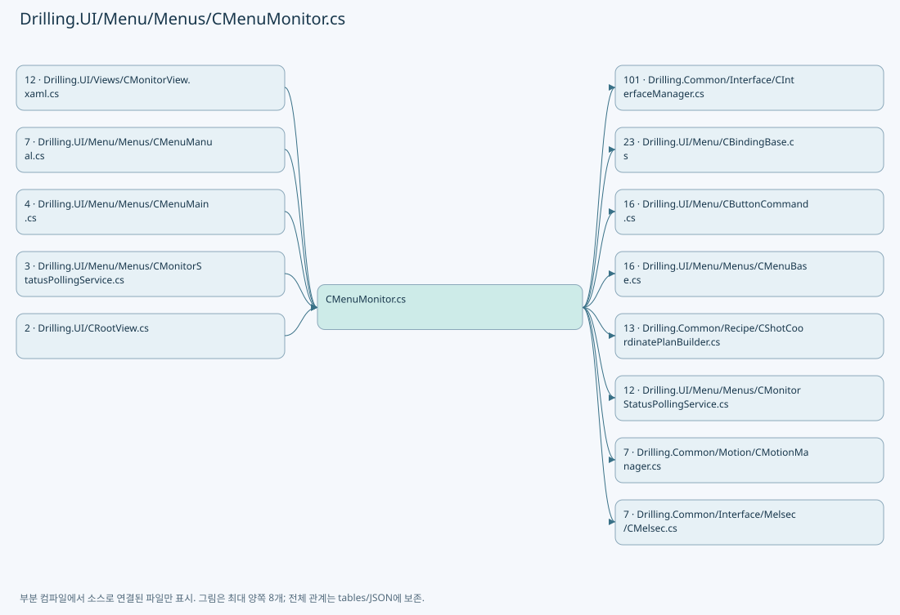

## 네임스페이스·타입·상속

| 타입 | 구분 | 원본 범위 | 선언/상속 |
| --- | --- | --- | --- |
| CMenuMonitor | ClassDeclaration | 24–6689 | CMenuMonitor: CMenuBase |
| ST_POWER_METER_OPTION | RecordDeclaration | 1592–1592 | ST_POWER_METER_OPTION |
| ST_POWER_METER_TUNE_PROFILE | RecordDeclaration | 1593–1593 | ST_POWER_METER_TUNE_PROFILE |
| ST_POWER_METER_TUNE_SETTINGS | RecordDeclaration | 1594–1607 | ST_POWER_METER_TUNE_SETTINGS |
| ST_POWER_METER_READ_RESULT | RecordDeclaration | 1609–1609 | ST_POWER_METER_READ_RESULT |
| ST_POWER_METER_GRAPH_DATA | RecordDeclaration | 1610–1610 | ST_POWER_METER_GRAPH_DATA |
| CMelsecCachePresentation | ClassDeclaration | 6691–6710 | CMelsecCachePresentation |
| ST_MONITOR_TAB | RecordDeclaration | 6712–6712 | ST_MONITOR_TAB |
| ST_MONITOR_COORDINATE_VIEWER_DATA | RecordDeclaration | 6713–6735 | ST_MONITOR_COORDINATE_VIEWER_DATA |
| ST_MONITOR_COORDINATE_BASIS_OPTION | RecordDeclaration | 6737–6762 | ST_MONITOR_COORDINATE_BASIS_OPTION |
| ST_MONITOR_COORDINATE_VALUE_ROW | RecordDeclaration | 6764–6764 | ST_MONITOR_COORDINATE_VALUE_ROW |
| ST_MONITOR_COORDINATE_SHOT_MATRIX_ROW | RecordDeclaration | 6765–6765 | ST_MONITOR_COORDINATE_SHOT_MATRIX_ROW |
| ST_MONITOR_COORDINATE_SHOT_COORDINATE_ROW | RecordDeclaration | 6766–6773 | ST_MONITOR_COORDINATE_SHOT_COORDINATE_ROW |
| ST_MONITOR_COORDINATE_CALCULATION_ROW | RecordDeclaration | 6774–6783 | ST_MONITOR_COORDINATE_CALCULATION_ROW |
| ST_MONITOR_COORDINATE_CALCULATION_RESULT | RecordDeclaration | 6784–6800 | ST_MONITOR_COORDINATE_CALCULATION_RESULT |
| ST_MONITOR_COORDINATE_SHOT_BUTTON | RecordDeclaration | 6801–6856 | ST_MONITOR_COORDINATE_SHOT_BUTTON |
| ST_SCANNER_AXIS_INDICATOR_GROUP | ClassDeclaration | 6858–6871 | ST_SCANNER_AXIS_INDICATOR_GROUP |
| ST_MONITOR_PRODUCT_ITEM | RecordDeclaration | 6873–6889 | ST_MONITOR_PRODUCT_ITEM |
| ST_MONITOR_PRODUCT_REVIEW_ROW | RecordDeclaration | 6891–6905 | ST_MONITOR_PRODUCT_REVIEW_ROW |
| ST_MONITOR_PRODUCT_HISTORY_ROW | RecordDeclaration | 6907–6921 | ST_MONITOR_PRODUCT_HISTORY_ROW |
| ST_MONITOR_MELSEC_GROUP | RecordDeclaration | 6923–6923 | ST_MONITOR_MELSEC_GROUP |
| ST_MONITOR_MELSEC_ROW | ClassDeclaration | 6924–7066 | ST_MONITOR_MELSEC_ROW: CBindingBase |
| ST_MONITOR_AXIS_ROW | RecordDeclaration | 7068–7130 | ST_MONITOR_AXIS_ROW |
| ST_MONITOR_MULTI_MOVE_AXIS_ROW | ClassDeclaration | 7132–7211 | ST_MONITOR_MULTI_MOVE_AXIS_ROW: CBindingBase |
| ST_MONITOR_STATUS_ROW | RecordDeclaration | 7213–7241 | ST_MONITOR_STATUS_ROW |
| ST_MONITOR_OPERATION_BUTTON | RecordDeclaration | 7243–7280 | ST_MONITOR_OPERATION_BUTTON |
| ST_MONITOR_HEAD_SELECT_ROW | RecordDeclaration | 7282–7358 | ST_MONITOR_HEAD_SELECT_ROW |
| ST_MONITOR_LASER_CONTROL_ROW | RecordDeclaration | 7360–7428 | ST_MONITOR_LASER_CONTROL_ROW |
| ST_MONITOR_PARAMETER_ROW | ClassDeclaration | 7430–7479 | ST_MONITOR_PARAMETER_ROW |
| ST_MONITOR_BET_TABLE_ROW | ClassDeclaration | 7481–7589 | ST_MONITOR_BET_TABLE_ROW: CBindingBase |
| ST_POWER_METER_TUNE_SAMPLE | RecordDeclaration | 7591–7591 | ST_POWER_METER_TUNE_SAMPLE |
| ST_POWER_METER_TUNE_ROW | RecordDeclaration | 7592–7612 | ST_POWER_METER_TUNE_ROW |
| ST_POWER_METER_TUNE_PROFILE_ROW | ClassDeclaration | 7614–7628 | ST_POWER_METER_TUNE_PROFILE_ROW |
| ST_PWM_SETTING_ROW | ClassDeclaration | 7630–7710 | ST_PWM_SETTING_ROW: CBindingBase |
| ST_PWM_DEVICE_ROW | RecordDeclaration | 7712–7721 | ST_PWM_DEVICE_ROW |
| ST_MONITOR_TREND_POINT | RecordDeclaration | 7723–7723 | ST_MONITOR_TREND_POINT |
| ST_MONITOR_SUMMARY_ITEM | RecordDeclaration | 7724–7739 | ST_MONITOR_SUMMARY_ITEM |
| ST_MONITOR_POSITION_ROW | RecordDeclaration | 7741–7756 | ST_MONITOR_POSITION_ROW |
| CMonitorIcon | ClassDeclaration | 7758–7796 | CMonitorIcon |

## 멤버 빠른 목록

| 이름 | 종류 | 범위 | 서명 |
| --- | --- | --- | --- |
| PowerMeterGraphWidth | FieldDeclaration | L27–27 | double Drilling.UI.Menu.Menus.CMenuMonitor.PowerMeterGraphWidth |
| PowerMeterGraphHeight | FieldDeclaration | L28–28 | double Drilling.UI.Menu.Menus.CMenuMonitor.PowerMeterGraphHeight |
| PowerMeterGraphMinimumHalfRange | FieldDeclaration | L29–29 | double Drilling.UI.Menu.Menus.CMenuMonitor.PowerMeterGraphMinimumHalfRange |
| _lastNotifiedLiveValues | FieldDeclaration | L30–30 | System.Collections.Generic.Dictionary<string, object?> Drilling.UI.Menu.Menus.CMenuMonitor._lastNotifiedLiveValues |
| LivePropertyCacheLock | FieldDeclaration | L31–31 | object Drilling.UI.Menu.Menus.CMenuMonitor.LivePropertyCacheLock |
| LivePropertyCache | FieldDeclaration | L32–32 | System.Collections.Generic.Dictionary<string, System.Reflection.PropertyInfo?> Drilling.UI.Menu.Menus.CMenuMonitor.LivePropertyCache |
| _interfaceManager | FieldDeclaration | L33–33 | Drilling.Common.Interface.CInterfaceManager Drilling.UI.Menu.Menus.CMenuMonitor._interfaceManager |
| _motionManager | FieldDeclaration | L34–34 | Drilling.Common.Motion.CMotionManager Drilling.UI.Menu.Menus.CMenuMonitor._motionManager |
| _interLockManager | FieldDeclaration | L35–35 | Drilling.Common.InterLock.CInterLockManager Drilling.UI.Menu.Menus.CMenuMonitor._interLockManager |
| _productManager | FieldDeclaration | L36–36 | Drilling.Common.Product.CProductManager Drilling.UI.Menu.Menus.CMenuMonitor._productManager |
| _recipeManager | FieldDeclaration | L37–37 | Drilling.Common.Managers.CRecipeManager Drilling.UI.Menu.Menus.CMenuMonitor._recipeManager |
| _settingManager | FieldDeclaration | L38–38 | Drilling.Common.Managers.CSettingManager Drilling.UI.Menu.Menus.CMenuMonitor._settingManager |
| _reviewOffsetFile | FieldDeclaration | L39–39 | Drilling.Common.Review.CReviewOffsetFileBase Drilling.UI.Menu.Menus.CMenuMonitor._reviewOffsetFile |
| _selectedRecipeIdProvider | FieldDeclaration | L40–40 | System.Func<string> Drilling.UI.Menu.Menus.CMenuMonitor._selectedRecipeIdProvider |
| _selectedTabAccessor | FieldDeclaration | L41–41 | System.Func<string> Drilling.UI.Menu.Menus.CMenuMonitor._selectedTabAccessor |
| _selectedTabSetter | FieldDeclaration | L42–42 | System.Action<string> Drilling.UI.Menu.Menus.CMenuMonitor._selectedTabSetter |
| _setStatusMessage | FieldDeclaration | L43–43 | System.Action<string> Drilling.UI.Menu.Menus.CMenuMonitor._setStatusMessage |
| _refreshShellStatus | FieldDeclaration | L44–44 | System.Action Drilling.UI.Menu.Menus.CMenuMonitor._refreshShellStatus |
| _refreshCurrentScreen | FieldDeclaration | L45–45 | System.Func<System.Threading.Tasks.Task> Drilling.UI.Menu.Menus.CMenuMonitor._refreshCurrentScreen |
| _canExecuteMonitorWriteCommand | FieldDeclaration | L46–46 | System.Func<bool> Drilling.UI.Menu.Menus.CMenuMonitor._canExecuteMonitorWriteCommand |
| _statusPollingService | FieldDeclaration | L47–47 | Drilling.UI.Menu.Menus.CMonitorStatusPollingService Drilling.UI.Menu.Menus.CMenuMonitor._statusPollingService |
| _operationFieldValues | FieldDeclaration | L48–48 | System.Collections.Generic.Dictionary<string, string> Drilling.UI.Menu.Menus.CMenuMonitor._operationFieldValues |
| _melsecWriteValues | FieldDeclaration | L49–49 | System.Collections.Generic.Dictionary<string, string> Drilling.UI.Menu.Menus.CMenuMonitor._melsecWriteValues |
| LaserHeadCount | FieldDeclaration | L50–50 | int Drilling.UI.Menu.Menus.CMenuMonitor.LaserHeadCount |
| _enabledHeadDeviceNumbers | FieldDeclaration | L51–51 | System.Collections.Generic.IReadOnlyList<int> Drilling.UI.Menu.Menus.CMenuMonitor._enabledHeadDeviceNumbers |
| _selectedAxisId | FieldDeclaration | L52–52 | string Drilling.UI.Menu.Menus.CMenuMonitor._selectedAxisId |
| _selectedLaserNumber | FieldDeclaration | L53–53 | int Drilling.UI.Menu.Menus.CMenuMonitor._selectedLaserNumber |
| _selectedAttenuatorNumber | FieldDeclaration | L54–54 | int Drilling.UI.Menu.Menus.CMenuMonitor._selectedAttenuatorNumber |
| _selectedBetNumber | FieldDeclaration | L55–55 | int Drilling.UI.Menu.Menus.CMenuMonitor._selectedBetNumber |
| _selectedPowerMeterNumber | FieldDeclaration | L56–56 | int Drilling.UI.Menu.Menus.CMenuMonitor._selectedPowerMeterNumber |
| _selectedPicoMotorNo | FieldDeclaration | L57–57 | int Drilling.UI.Menu.Menus.CMenuMonitor._selectedPicoMotorNo |
| _picoMotorIsConnected | FieldDeclaration | L58–58 | bool Drilling.UI.Menu.Menus.CMenuMonitor._picoMotorIsConnected |
| _coordinateBasis | FieldDeclaration | L59–59 | string Drilling.UI.Menu.Menus.CMenuMonitor._coordinateBasis |
| _coordinateSelectedCellNo | FieldDeclaration | L60–60 | int Drilling.UI.Menu.Menus.CMenuMonitor._coordinateSelectedCellNo |
| _coordinateSelectedShotKey | FieldDeclaration | L61–61 | string Drilling.UI.Menu.Menus.CMenuMonitor._coordinateSelectedShotKey |
| _coordinateIsCellDetailVisible | FieldDeclaration | L62–62 | bool Drilling.UI.Menu.Menus.CMenuMonitor._coordinateIsCellDetailVisible |
| _coordinateOffsetPreviewMinimum | FieldDeclaration | L63–63 | double Drilling.UI.Menu.Menus.CMenuMonitor._coordinateOffsetPreviewMinimum |
| _coordinateOffsetPreviewMaximum | FieldDeclaration | L64–64 | double Drilling.UI.Menu.Menus.CMenuMonitor._coordinateOffsetPreviewMaximum |
| _coordinateOffsetPreviewMinimumText | FieldDeclaration | L65–65 | string Drilling.UI.Menu.Menus.CMenuMonitor._coordinateOffsetPreviewMinimumText |
| _coordinateOffsetPreviewMaximumText | FieldDeclaration | L66–66 | string Drilling.UI.Menu.Menus.CMenuMonitor._coordinateOffsetPreviewMaximumText |
| _coordinateSelectedOffsetKeys | FieldDeclaration | L67–75 | System.Collections.Generic.HashSet<string> Drilling.UI.Menu.Menus.CMenuMonitor._coordinateSelectedOffsetKeys |
| _picoAllMoveMotorNos | FieldDeclaration | L76–76 | System.Collections.Generic.HashSet<int> Drilling.UI.Menu.Menus.CMenuMonitor._picoAllMoveMotorNos |
| _xpsJogCommandLock | FieldDeclaration | L77–77 | System.Threading.SemaphoreSlim Drilling.UI.Menu.Menus.CMenuMonitor._xpsJogCommandLock |
| _picoJogCommandLock | FieldDeclaration | L78–78 | System.Threading.SemaphoreSlim Drilling.UI.Menu.Menus.CMenuMonitor._picoJogCommandLock |
| _xpsJogStartCancellationSource | FieldDeclaration | L79–79 | System.Threading.CancellationTokenSource? Drilling.UI.Menu.Menus.CMenuMonitor._xpsJogStartCancellationSource |
| _xpsJogRequestVersion | FieldDeclaration | L80–80 | int Drilling.UI.Menu.Menus.CMenuMonitor._xpsJogRequestVersion |
| _xpsJogRequested | FieldDeclaration | L81–81 | bool Drilling.UI.Menu.Menus.CMenuMonitor._xpsJogRequested |
| _xpsJogStopPending | FieldDeclaration | L82–82 | bool Drilling.UI.Menu.Menus.CMenuMonitor._xpsJogStopPending |
| _xpsJogAxisId | FieldDeclaration | L83–83 | string Drilling.UI.Menu.Menus.CMenuMonitor._xpsJogAxisId |
| _picoJogCancellationSource | FieldDeclaration | L84–84 | System.Threading.CancellationTokenSource? Drilling.UI.Menu.Menus.CMenuMonitor._picoJogCancellationSource |
| _picoAllMoveTask | FieldDeclaration | L85–85 | System.Threading.Tasks.Task? Drilling.UI.Menu.Menus.CMenuMonitor._picoAllMoveTask |
| _picoMotionTask | FieldDeclaration | L86–86 | System.Threading.Tasks.Task? Drilling.UI.Menu.Menus.CMenuMonitor._picoMotionTask |
| _powerMeterTuneCts | FieldDeclaration | L87–87 | System.Threading.CancellationTokenSource? Drilling.UI.Menu.Menus.CMenuMonitor._powerMeterTuneCts |
| _powerMeterTuneAttenuatorNumber | FieldDeclaration | L88–88 | int Drilling.UI.Menu.Menus.CMenuMonitor._powerMeterTuneAttenuatorNumber |
| _powerMeterTunePowerMeterNumber | FieldDeclaration | L89–89 | int Drilling.UI.Menu.Menus.CMenuMonitor._powerMeterTunePowerMeterNumber |
| _powerMeterTuneSamples | FieldDeclaration | L90–90 | System.Collections.Generic.List<Drilling.UI.Menu.Menus.ST_POWER_METER_TUNE_SAMPLE> Drilling.UI.Menu.Menus.CMenuMonitor._powerMeterTuneSamples |
| _powerMeterTuneState | FieldDeclaration | L91–91 | string Drilling.UI.Menu.Menus.CMenuMonitor._powerMeterTuneState |
| _powerMeterTuneMessage | FieldDeclaration | L92–92 | string Drilling.UI.Menu.Menus.CMenuMonitor._powerMeterTuneMessage |
| _powerMeterTargetPower | FieldDeclaration | L93–93 | double Drilling.UI.Menu.Menus.CMenuMonitor._powerMeterTargetPower |
| _selectedMelsecGroup | FieldDeclaration | L94–94 | string Drilling.UI.Menu.Menus.CMenuMonitor._selectedMelsecGroup |
| _isMelsecWriteLockVisible | FieldDeclaration | L95–95 | bool Drilling.UI.Menu.Menus.CMenuMonitor._isMelsecWriteLockVisible |
| _isMelsecWriteUnlocked | FieldDeclaration | L96–96 | bool Drilling.UI.Menu.Menus.CMenuMonitor._isMelsecWriteUnlocked |
| _liveRefreshRunning | FieldDeclaration | L97–97 | bool Drilling.UI.Menu.Menus.CMenuMonitor._liveRefreshRunning |
| _lastLiveRefreshHash | FieldDeclaration | L98–98 | int? Drilling.UI.Menu.Menus.CMenuMonitor._lastLiveRefreshHash |
| MonitorTabs | FieldDeclaration | L99–99 | string[] Drilling.UI.Menu.Menus.CMenuMonitor.MonitorTabs |
| HomeTypeOptions | FieldDeclaration | L100–100 | string[] Drilling.UI.Menu.Menus.CMenuMonitor.HomeTypeOptions |
| DeviceTabs | PropertyDeclaration | L101–101 | System.Collections.Generic.IReadOnlyList<Drilling.UI.Menu.Menus.ST_SCREEN_SECTION> Drilling.UI.Menu.Menus.CMenuMonitor.DeviceTabs |
| get_DeviceTabs | GetAccessorDeclaration | L101–101 | System.Collections.Generic.IReadOnlyList<Drilling.UI.Menu.Menus.ST_SCREEN_SECTION> Drilling.UI.Menu.Menus.CMenuMonitor.DeviceTabs.get |
| set_DeviceTabs | SetAccessorDeclaration | L101–101 | void Drilling.UI.Menu.Menus.CMenuMonitor.DeviceTabs.set |
| SelectedTab | PropertyDeclaration | L102–102 | string Drilling.UI.Menu.Menus.CMenuMonitor.SelectedTab |
| get_SelectedTab | GetAccessorDeclaration | L102–102 | string Drilling.UI.Menu.Menus.CMenuMonitor.SelectedTab.get |
| set_SelectedTab | SetAccessorDeclaration | L102–102 | void Drilling.UI.Menu.Menus.CMenuMonitor.SelectedTab.set |
| Title | PropertyDeclaration | L103–103 | string Drilling.UI.Menu.Menus.CMenuMonitor.Title |
| get_Title | GetAccessorDeclaration | L103–103 | string Drilling.UI.Menu.Menus.CMenuMonitor.Title.get |
| set_Title | SetAccessorDeclaration | L103–103 | void Drilling.UI.Menu.Menus.CMenuMonitor.Title.set |
| Subtitle | PropertyDeclaration | L104–104 | string Drilling.UI.Menu.Menus.CMenuMonitor.Subtitle |
| get_Subtitle | GetAccessorDeclaration | L104–104 | string Drilling.UI.Menu.Menus.CMenuMonitor.Subtitle.get |
| set_Subtitle | SetAccessorDeclaration | L104–104 | void Drilling.UI.Menu.Menus.CMenuMonitor.Subtitle.set |
| StatusPanelTitle | PropertyDeclaration | L105–105 | string Drilling.UI.Menu.Menus.CMenuMonitor.StatusPanelTitle |
| get_StatusPanelTitle | GetAccessorDeclaration | L105–105 | string Drilling.UI.Menu.Menus.CMenuMonitor.StatusPanelTitle.get |
| set_StatusPanelTitle | SetAccessorDeclaration | L105–105 | void Drilling.UI.Menu.Menus.CMenuMonitor.StatusPanelTitle.set |
| OperationPanelTitle | PropertyDeclaration | L106–106 | string Drilling.UI.Menu.Menus.CMenuMonitor.OperationPanelTitle |
| get_OperationPanelTitle | GetAccessorDeclaration | L106–106 | string Drilling.UI.Menu.Menus.CMenuMonitor.OperationPanelTitle.get |
| set_OperationPanelTitle | SetAccessorDeclaration | L106–106 | void Drilling.UI.Menu.Menus.CMenuMonitor.OperationPanelTitle.set |
| ParameterPanelTitle | PropertyDeclaration | L107–107 | string Drilling.UI.Menu.Menus.CMenuMonitor.ParameterPanelTitle |
| get_ParameterPanelTitle | GetAccessorDeclaration | L107–107 | string Drilling.UI.Menu.Menus.CMenuMonitor.ParameterPanelTitle.get |
| set_ParameterPanelTitle | SetAccessorDeclaration | L107–107 | void Drilling.UI.Menu.Menus.CMenuMonitor.ParameterPanelTitle.set |
| TrendPanelTitle | PropertyDeclaration | L108–108 | string Drilling.UI.Menu.Menus.CMenuMonitor.TrendPanelTitle |
| get_TrendPanelTitle | GetAccessorDeclaration | L108–108 | string Drilling.UI.Menu.Menus.CMenuMonitor.TrendPanelTitle.get |
| set_TrendPanelTitle | SetAccessorDeclaration | L108–108 | void Drilling.UI.Menu.Menus.CMenuMonitor.TrendPanelTitle.set |
| Tabs | PropertyDeclaration | L109–109 | System.Collections.Generic.IReadOnlyList<Drilling.UI.Menu.Menus.ST_MONITOR_TAB> Drilling.UI.Menu.Menus.CMenuMonitor.Tabs |
| get_Tabs | GetAccessorDeclaration | L109–109 | System.Collections.Generic.IReadOnlyList<Drilling.UI.Menu.Menus.ST_MONITOR_TAB> Drilling.UI.Menu.Menus.CMenuMonitor.Tabs.get |
| set_Tabs | SetAccessorDeclaration | L109–109 | void Drilling.UI.Menu.Menus.CMenuMonitor.Tabs.set |
| AxisRows | PropertyDeclaration | L110–110 | System.Collections.Generic.IReadOnlyList<Drilling.UI.Menu.Menus.ST_MONITOR_AXIS_ROW> Drilling.UI.Menu.Menus.CMenuMonitor.AxisRows |
| get_AxisRows | GetAccessorDeclaration | L110–110 | System.Collections.Generic.IReadOnlyList<Drilling.UI.Menu.Menus.ST_MONITOR_AXIS_ROW> Drilling.UI.Menu.Menus.CMenuMonitor.AxisRows.get |
| set_AxisRows | SetAccessorDeclaration | L110–110 | void Drilling.UI.Menu.Menus.CMenuMonitor.AxisRows.set |
| MultiMoveAxisRows | PropertyDeclaration | L111–111 | System.Collections.Generic.IReadOnlyList<Drilling.UI.Menu.Menus.ST_MONITOR_MULTI_MOVE_AXIS_ROW> Drilling.UI.Menu.Menus.CMenuMonitor.MultiMoveAxisRows |
| get_MultiMoveAxisRows | GetAccessorDeclaration | L111–111 | System.Collections.Generic.IReadOnlyList<Drilling.UI.Menu.Menus.ST_MONITOR_MULTI_MOVE_AXIS_ROW> Drilling.UI.Menu.Menus.CMenuMonitor.MultiMoveAxisRows.get |
| set_MultiMoveAxisRows | SetAccessorDeclaration | L111–111 | void Drilling.UI.Menu.Menus.CMenuMonitor.MultiMoveAxisRows.set |
| StatusRows | PropertyDeclaration | L112–112 | System.Collections.Generic.IReadOnlyList<Drilling.UI.Menu.Menus.ST_MONITOR_STATUS_ROW> Drilling.UI.Menu.Menus.CMenuMonitor.StatusRows |
| get_StatusRows | GetAccessorDeclaration | L112–112 | System.Collections.Generic.IReadOnlyList<Drilling.UI.Menu.Menus.ST_MONITOR_STATUS_ROW> Drilling.UI.Menu.Menus.CMenuMonitor.StatusRows.get |
| set_StatusRows | SetAccessorDeclaration | L112–112 | void Drilling.UI.Menu.Menus.CMenuMonitor.StatusRows.set |
| OperationButtons | PropertyDeclaration | L113–113 | System.Collections.Generic.IReadOnlyList<Drilling.UI.Menu.Menus.ST_MONITOR_OPERATION_BUTTON> Drilling.UI.Menu.Menus.CMenuMonitor.OperationButtons |
| get_OperationButtons | GetAccessorDeclaration | L113–113 | System.Collections.Generic.IReadOnlyList<Drilling.UI.Menu.Menus.ST_MONITOR_OPERATION_BUTTON> Drilling.UI.Menu.Menus.CMenuMonitor.OperationButtons.get |
| set_OperationButtons | SetAccessorDeclaration | L113–113 | void Drilling.UI.Menu.Menus.CMenuMonitor.OperationButtons.set |
| OperationFields | PropertyDeclaration | L114–114 | System.Collections.Generic.IReadOnlyList<Drilling.UI.Menu.Menus.ST_MONITOR_PARAMETER_ROW> Drilling.UI.Menu.Menus.CMenuMonitor.OperationFields |
| get_OperationFields | GetAccessorDeclaration | L114–114 | System.Collections.Generic.IReadOnlyList<Drilling.UI.Menu.Menus.ST_MONITOR_PARAMETER_ROW> Drilling.UI.Menu.Menus.CMenuMonitor.OperationFields.get |
| set_OperationFields | SetAccessorDeclaration | L114–114 | void Drilling.UI.Menu.Menus.CMenuMonitor.OperationFields.set |
| HeadSelectRows | PropertyDeclaration | L115–115 | System.Collections.Generic.IReadOnlyList<Drilling.UI.Menu.Menus.ST_MONITOR_HEAD_SELECT_ROW> Drilling.UI.Menu.Menus.CMenuMonitor.HeadSelectRows |
| get_HeadSelectRows | GetAccessorDeclaration | L115–115 | System.Collections.Generic.IReadOnlyList<Drilling.UI.Menu.Menus.ST_MONITOR_HEAD_SELECT_ROW> Drilling.UI.Menu.Menus.CMenuMonitor.HeadSelectRows.get |
| set_HeadSelectRows | SetAccessorDeclaration | L115–115 | void Drilling.UI.Menu.Menus.CMenuMonitor.HeadSelectRows.set |
| LaserControlRows | PropertyDeclaration | L116–116 | System.Collections.Generic.IReadOnlyList<Drilling.UI.Menu.Menus.ST_MONITOR_LASER_CONTROL_ROW> Drilling.UI.Menu.Menus.CMenuMonitor.LaserControlRows |
| get_LaserControlRows | GetAccessorDeclaration | L116–116 | System.Collections.Generic.IReadOnlyList<Drilling.UI.Menu.Menus.ST_MONITOR_LASER_CONTROL_ROW> Drilling.UI.Menu.Menus.CMenuMonitor.LaserControlRows.get |
| set_LaserControlRows | SetAccessorDeclaration | L116–116 | void Drilling.UI.Menu.Menus.CMenuMonitor.LaserControlRows.set |
| ParameterRows | PropertyDeclaration | L117–117 | System.Collections.Generic.IReadOnlyList<Drilling.UI.Menu.Menus.ST_MONITOR_PARAMETER_ROW> Drilling.UI.Menu.Menus.CMenuMonitor.ParameterRows |
| get_ParameterRows | GetAccessorDeclaration | L117–117 | System.Collections.Generic.IReadOnlyList<Drilling.UI.Menu.Menus.ST_MONITOR_PARAMETER_ROW> Drilling.UI.Menu.Menus.CMenuMonitor.ParameterRows.get |
| set_ParameterRows | SetAccessorDeclaration | L117–117 | void Drilling.UI.Menu.Menus.CMenuMonitor.ParameterRows.set |
| BetTableRows | PropertyDeclaration | L118–118 | System.Collections.Generic.IReadOnlyList<Drilling.UI.Menu.Menus.ST_MONITOR_BET_TABLE_ROW> Drilling.UI.Menu.Menus.CMenuMonitor.BetTableRows |
| get_BetTableRows | GetAccessorDeclaration | L118–118 | System.Collections.Generic.IReadOnlyList<Drilling.UI.Menu.Menus.ST_MONITOR_BET_TABLE_ROW> Drilling.UI.Menu.Menus.CMenuMonitor.BetTableRows.get |
| set_BetTableRows | SetAccessorDeclaration | L118–118 | void Drilling.UI.Menu.Menus.CMenuMonitor.BetTableRows.set |
| TrendPoints | PropertyDeclaration | L119–119 | System.Collections.Generic.IReadOnlyList<Drilling.UI.Menu.Menus.ST_MONITOR_TREND_POINT> Drilling.UI.Menu.Menus.CMenuMonitor.TrendPoints |
| get_TrendPoints | GetAccessorDeclaration | L119–119 | System.Collections.Generic.IReadOnlyList<Drilling.UI.Menu.Menus.ST_MONITOR_TREND_POINT> Drilling.UI.Menu.Menus.CMenuMonitor.TrendPoints.get |
| set_TrendPoints | SetAccessorDeclaration | L119–119 | void Drilling.UI.Menu.Menus.CMenuMonitor.TrendPoints.set |
| SummaryItems | PropertyDeclaration | L120–120 | System.Collections.Generic.IReadOnlyList<Drilling.UI.Menu.Menus.ST_MONITOR_SUMMARY_ITEM> Drilling.UI.Menu.Menus.CMenuMonitor.SummaryItems |
| get_SummaryItems | GetAccessorDeclaration | L120–120 | System.Collections.Generic.IReadOnlyList<Drilling.UI.Menu.Menus.ST_MONITOR_SUMMARY_ITEM> Drilling.UI.Menu.Menus.CMenuMonitor.SummaryItems.get |
| set_SummaryItems | SetAccessorDeclaration | L120–120 | void Drilling.UI.Menu.Menus.CMenuMonitor.SummaryItems.set |
| AttenuatorStatusItems | PropertyDeclaration | L121–121 | System.Collections.Generic.IReadOnlyList<Drilling.UI.Menu.Menus.ST_MONITOR_SUMMARY_ITEM> Drilling.UI.Menu.Menus.CMenuMonitor.AttenuatorStatusItems |
| get_AttenuatorStatusItems | GetAccessorDeclaration | L121–121 | System.Collections.Generic.IReadOnlyList<Drilling.UI.Menu.Menus.ST_MONITOR_SUMMARY_ITEM> Drilling.UI.Menu.Menus.CMenuMonitor.AttenuatorStatusItems.get |
| set_AttenuatorStatusItems | SetAccessorDeclaration | L121–121 | void Drilling.UI.Menu.Menus.CMenuMonitor.AttenuatorStatusItems.set |
| AttenuatorSettingItems | PropertyDeclaration | L122–122 | System.Collections.Generic.IReadOnlyList<Drilling.UI.Menu.Menus.ST_MONITOR_SUMMARY_ITEM> Drilling.UI.Menu.Menus.CMenuMonitor.AttenuatorSettingItems |
| get_AttenuatorSettingItems | GetAccessorDeclaration | L122–122 | System.Collections.Generic.IReadOnlyList<Drilling.UI.Menu.Menus.ST_MONITOR_SUMMARY_ITEM> Drilling.UI.Menu.Menus.CMenuMonitor.AttenuatorSettingItems.get |
| set_AttenuatorSettingItems | SetAccessorDeclaration | L122–122 | void Drilling.UI.Menu.Menus.CMenuMonitor.AttenuatorSettingItems.set |
| PositionRows | PropertyDeclaration | L123–123 | System.Collections.Generic.IReadOnlyList<Drilling.UI.Menu.Menus.ST_MONITOR_POSITION_ROW> Drilling.UI.Menu.Menus.CMenuMonitor.PositionRows |
| get_PositionRows | GetAccessorDeclaration | L123–123 | System.Collections.Generic.IReadOnlyList<Drilling.UI.Menu.Menus.ST_MONITOR_POSITION_ROW> Drilling.UI.Menu.Menus.CMenuMonitor.PositionRows.get |
| set_PositionRows | SetAccessorDeclaration | L123–123 | void Drilling.UI.Menu.Menus.CMenuMonitor.PositionRows.set |
| ProductItems | PropertyDeclaration | L124–124 | System.Collections.Generic.IReadOnlyList<Drilling.UI.Menu.Menus.ST_MONITOR_PRODUCT_ITEM> Drilling.UI.Menu.Menus.CMenuMonitor.ProductItems |
| get_ProductItems | GetAccessorDeclaration | L124–124 | System.Collections.Generic.IReadOnlyList<Drilling.UI.Menu.Menus.ST_MONITOR_PRODUCT_ITEM> Drilling.UI.Menu.Menus.CMenuMonitor.ProductItems.get |
| set_ProductItems | SetAccessorDeclaration | L124–124 | void Drilling.UI.Menu.Menus.CMenuMonitor.ProductItems.set |
| ProductHistoryRows | PropertyDeclaration | L125–125 | System.Collections.Generic.IReadOnlyList<Drilling.UI.Menu.Menus.ST_MONITOR_PRODUCT_HISTORY_ROW> Drilling.UI.Menu.Menus.CMenuMonitor.ProductHistoryRows |
| get_ProductHistoryRows | GetAccessorDeclaration | L125–125 | System.Collections.Generic.IReadOnlyList<Drilling.UI.Menu.Menus.ST_MONITOR_PRODUCT_HISTORY_ROW> Drilling.UI.Menu.Menus.CMenuMonitor.ProductHistoryRows.get |
| set_ProductHistoryRows | SetAccessorDeclaration | L125–125 | void Drilling.UI.Menu.Menus.CMenuMonitor.ProductHistoryRows.set |
| ProductGlassItems | PropertyDeclaration | L126–126 | System.Collections.Generic.IReadOnlyList<Drilling.UI.Menu.Menus.ST_MONITOR_PRODUCT_ITEM> Drilling.UI.Menu.Menus.CMenuMonitor.ProductGlassItems |
| get_ProductGlassItems | GetAccessorDeclaration | L126–126 | System.Collections.Generic.IReadOnlyList<Drilling.UI.Menu.Menus.ST_MONITOR_PRODUCT_ITEM> Drilling.UI.Menu.Menus.CMenuMonitor.ProductGlassItems.get |
| set_ProductGlassItems | SetAccessorDeclaration | L126–126 | void Drilling.UI.Menu.Menus.CMenuMonitor.ProductGlassItems.set |
| ProductAlignItems | PropertyDeclaration | L127–127 | System.Collections.Generic.IReadOnlyList<Drilling.UI.Menu.Menus.ST_MONITOR_PRODUCT_ITEM> Drilling.UI.Menu.Menus.CMenuMonitor.ProductAlignItems |
| get_ProductAlignItems | GetAccessorDeclaration | L127–127 | System.Collections.Generic.IReadOnlyList<Drilling.UI.Menu.Menus.ST_MONITOR_PRODUCT_ITEM> Drilling.UI.Menu.Menus.CMenuMonitor.ProductAlignItems.get |
| set_ProductAlignItems | SetAccessorDeclaration | L127–127 | void Drilling.UI.Menu.Menus.CMenuMonitor.ProductAlignItems.set |
| ProductDistortionItems | PropertyDeclaration | L128–128 | System.Collections.Generic.IReadOnlyList<Drilling.UI.Menu.Menus.ST_MONITOR_PRODUCT_ITEM> Drilling.UI.Menu.Menus.CMenuMonitor.ProductDistortionItems |
| get_ProductDistortionItems | GetAccessorDeclaration | L128–128 | System.Collections.Generic.IReadOnlyList<Drilling.UI.Menu.Menus.ST_MONITOR_PRODUCT_ITEM> Drilling.UI.Menu.Menus.CMenuMonitor.ProductDistortionItems.get |
| set_ProductDistortionItems | SetAccessorDeclaration | L128–128 | void Drilling.UI.Menu.Menus.CMenuMonitor.ProductDistortionItems.set |
| ProductProcessItems | PropertyDeclaration | L129–129 | System.Collections.Generic.IReadOnlyList<Drilling.UI.Menu.Menus.ST_MONITOR_PRODUCT_ITEM> Drilling.UI.Menu.Menus.CMenuMonitor.ProductProcessItems |
| get_ProductProcessItems | GetAccessorDeclaration | L129–129 | System.Collections.Generic.IReadOnlyList<Drilling.UI.Menu.Menus.ST_MONITOR_PRODUCT_ITEM> Drilling.UI.Menu.Menus.CMenuMonitor.ProductProcessItems.get |
| set_ProductProcessItems | SetAccessorDeclaration | L129–129 | void Drilling.UI.Menu.Menus.CMenuMonitor.ProductProcessItems.set |
| ProductRecipeItems | PropertyDeclaration | L130–130 | System.Collections.Generic.IReadOnlyList<Drilling.UI.Menu.Menus.ST_MONITOR_PRODUCT_ITEM> Drilling.UI.Menu.Menus.CMenuMonitor.ProductRecipeItems |
| get_ProductRecipeItems | GetAccessorDeclaration | L130–130 | System.Collections.Generic.IReadOnlyList<Drilling.UI.Menu.Menus.ST_MONITOR_PRODUCT_ITEM> Drilling.UI.Menu.Menus.CMenuMonitor.ProductRecipeItems.get |
| set_ProductRecipeItems | SetAccessorDeclaration | L130–130 | void Drilling.UI.Menu.Menus.CMenuMonitor.ProductRecipeItems.set |
| ProductReviewItems | PropertyDeclaration | L131–131 | System.Collections.Generic.IReadOnlyList<Drilling.UI.Menu.Menus.ST_MONITOR_PRODUCT_ITEM> Drilling.UI.Menu.Menus.CMenuMonitor.ProductReviewItems |
| get_ProductReviewItems | GetAccessorDeclaration | L131–131 | System.Collections.Generic.IReadOnlyList<Drilling.UI.Menu.Menus.ST_MONITOR_PRODUCT_ITEM> Drilling.UI.Menu.Menus.CMenuMonitor.ProductReviewItems.get |
| set_ProductReviewItems | SetAccessorDeclaration | L131–131 | void Drilling.UI.Menu.Menus.CMenuMonitor.ProductReviewItems.set |
| ProductReviewRows | PropertyDeclaration | L132–132 | System.Collections.Generic.IReadOnlyList<Drilling.UI.Menu.Menus.ST_MONITOR_PRODUCT_REVIEW_ROW> Drilling.UI.Menu.Menus.CMenuMonitor.ProductReviewRows |
| get_ProductReviewRows | GetAccessorDeclaration | L132–132 | System.Collections.Generic.IReadOnlyList<Drilling.UI.Menu.Menus.ST_MONITOR_PRODUCT_REVIEW_ROW> Drilling.UI.Menu.Menus.CMenuMonitor.ProductReviewRows.get |
| set_ProductReviewRows | SetAccessorDeclaration | L132–132 | void Drilling.UI.Menu.Menus.CMenuMonitor.ProductReviewRows.set |
| MelsecGroups | PropertyDeclaration | L133–133 | System.Collections.Generic.IReadOnlyList<Drilling.UI.Menu.Menus.ST_MONITOR_MELSEC_GROUP> Drilling.UI.Menu.Menus.CMenuMonitor.MelsecGroups |
| get_MelsecGroups | GetAccessorDeclaration | L133–133 | System.Collections.Generic.IReadOnlyList<Drilling.UI.Menu.Menus.ST_MONITOR_MELSEC_GROUP> Drilling.UI.Menu.Menus.CMenuMonitor.MelsecGroups.get |
| set_MelsecGroups | SetAccessorDeclaration | L133–133 | void Drilling.UI.Menu.Menus.CMenuMonitor.MelsecGroups.set |
| MelsecRows | PropertyDeclaration | L134–134 | System.Collections.Generic.IReadOnlyList<Drilling.UI.Menu.Menus.ST_MONITOR_MELSEC_ROW> Drilling.UI.Menu.Menus.CMenuMonitor.MelsecRows |
| get_MelsecRows | GetAccessorDeclaration | L134–134 | System.Collections.Generic.IReadOnlyList<Drilling.UI.Menu.Menus.ST_MONITOR_MELSEC_ROW> Drilling.UI.Menu.Menus.CMenuMonitor.MelsecRows.get |
| set_MelsecRows | SetAccessorDeclaration | L134–134 | void Drilling.UI.Menu.Menus.CMenuMonitor.MelsecRows.set |
| MelsecReadRows | PropertyDeclaration | L135–135 | System.Collections.Generic.IReadOnlyList<Drilling.UI.Menu.Menus.ST_MONITOR_MELSEC_ROW> Drilling.UI.Menu.Menus.CMenuMonitor.MelsecReadRows |
| get_MelsecReadRows | GetAccessorDeclaration | L135–135 | System.Collections.Generic.IReadOnlyList<Drilling.UI.Menu.Menus.ST_MONITOR_MELSEC_ROW> Drilling.UI.Menu.Menus.CMenuMonitor.MelsecReadRows.get |
| set_MelsecReadRows | SetAccessorDeclaration | L135–135 | void Drilling.UI.Menu.Menus.CMenuMonitor.MelsecReadRows.set |
| MelsecWriteRows | PropertyDeclaration | L136–136 | System.Collections.Generic.IReadOnlyList<Drilling.UI.Menu.Menus.ST_MONITOR_MELSEC_ROW> Drilling.UI.Menu.Menus.CMenuMonitor.MelsecWriteRows |
| get_MelsecWriteRows | GetAccessorDeclaration | L136–136 | System.Collections.Generic.IReadOnlyList<Drilling.UI.Menu.Menus.ST_MONITOR_MELSEC_ROW> Drilling.UI.Menu.Menus.CMenuMonitor.MelsecWriteRows.get |
| set_MelsecWriteRows | SetAccessorDeclaration | L136–136 | void Drilling.UI.Menu.Menus.CMenuMonitor.MelsecWriteRows.set |
| CoordinateBasisOptions | PropertyDeclaration | L137–137 | System.Collections.Generic.IReadOnlyList<Drilling.UI.Menu.Menus.ST_MONITOR_COORDINATE_BASIS_OPTION> Drilling.UI.Menu.Menus.CMenuMonitor.CoordinateBasisOptions |
| get_CoordinateBasisOptions | GetAccessorDeclaration | L137–137 | System.Collections.Generic.IReadOnlyList<Drilling.UI.Menu.Menus.ST_MONITOR_COORDINATE_BASIS_OPTION> Drilling.UI.Menu.Menus.CMenuMonitor.CoordinateBasisOptions.get |
| set_CoordinateBasisOptions | SetAccessorDeclaration | L137–137 | void Drilling.UI.Menu.Menus.CMenuMonitor.CoordinateBasisOptions.set |
| CoordinateValueRows | PropertyDeclaration | L138–138 | System.Collections.Generic.IReadOnlyList<Drilling.UI.Menu.Menus.ST_MONITOR_COORDINATE_VALUE_ROW> Drilling.UI.Menu.Menus.CMenuMonitor.CoordinateValueRows |
| get_CoordinateValueRows | GetAccessorDeclaration | L138–138 | System.Collections.Generic.IReadOnlyList<Drilling.UI.Menu.Menus.ST_MONITOR_COORDINATE_VALUE_ROW> Drilling.UI.Menu.Menus.CMenuMonitor.CoordinateValueRows.get |
| set_CoordinateValueRows | SetAccessorDeclaration | L138–138 | void Drilling.UI.Menu.Menus.CMenuMonitor.CoordinateValueRows.set |
| CoordinateSelectedRecipeName | PropertyDeclaration | L139–139 | string Drilling.UI.Menu.Menus.CMenuMonitor.CoordinateSelectedRecipeName |
| get_CoordinateSelectedRecipeName | GetAccessorDeclaration | L139–139 | string Drilling.UI.Menu.Menus.CMenuMonitor.CoordinateSelectedRecipeName.get |
| set_CoordinateSelectedRecipeName | SetAccessorDeclaration | L139–139 | void Drilling.UI.Menu.Menus.CMenuMonitor.CoordinateSelectedRecipeName.set |
| CoordinateSelectedBasisName | PropertyDeclaration | L140–140 | string Drilling.UI.Menu.Menus.CMenuMonitor.CoordinateSelectedBasisName |
| get_CoordinateSelectedBasisName | GetAccessorDeclaration | L140–140 | string Drilling.UI.Menu.Menus.CMenuMonitor.CoordinateSelectedBasisName.get |
| set_CoordinateSelectedBasisName | SetAccessorDeclaration | L140–140 | void Drilling.UI.Menu.Menus.CMenuMonitor.CoordinateSelectedBasisName.set |
| CoordinateBasisDescription | PropertyDeclaration | L141–141 | string Drilling.UI.Menu.Menus.CMenuMonitor.CoordinateBasisDescription |
| get_CoordinateBasisDescription | GetAccessorDeclaration | L141–141 | string Drilling.UI.Menu.Menus.CMenuMonitor.CoordinateBasisDescription.get |
| set_CoordinateBasisDescription | SetAccessorDeclaration | L141–141 | void Drilling.UI.Menu.Menus.CMenuMonitor.CoordinateBasisDescription.set |
| CoordinateCellPreviewLabels | PropertyDeclaration | L142–142 | System.Collections.Generic.IReadOnlyList<Drilling.UI.Menu.Menus.ST_CELL_PREVIEW_LABEL> Drilling.UI.Menu.Menus.CMenuMonitor.CoordinateCellPreviewLabels |
| get_CoordinateCellPreviewLabels | GetAccessorDeclaration | L142–142 | System.Collections.Generic.IReadOnlyList<Drilling.UI.Menu.Menus.ST_CELL_PREVIEW_LABEL> Drilling.UI.Menu.Menus.CMenuMonitor.CoordinateCellPreviewLabels.get |
| set_CoordinateCellPreviewLabels | SetAccessorDeclaration | L142–142 | void Drilling.UI.Menu.Menus.CMenuMonitor.CoordinateCellPreviewLabels.set |
| CoordinateShotMatrixRows | PropertyDeclaration | L143–143 | System.Collections.Generic.IReadOnlyList<Drilling.UI.Menu.Menus.ST_MONITOR_COORDINATE_SHOT_MATRIX_ROW> Drilling.UI.Menu.Menus.CMenuMonitor.CoordinateShotMatrixRows |
| get_CoordinateShotMatrixRows | GetAccessorDeclaration | L143–143 | System.Collections.Generic.IReadOnlyList<Drilling.UI.Menu.Menus.ST_MONITOR_COORDINATE_SHOT_MATRIX_ROW> Drilling.UI.Menu.Menus.CMenuMonitor.CoordinateShotMatrixRows.get |
| set_CoordinateShotMatrixRows | SetAccessorDeclaration | L143–143 | void Drilling.UI.Menu.Menus.CMenuMonitor.CoordinateShotMatrixRows.set |
| CoordinateShotMapImage | PropertyDeclaration | L144–144 | ImageSource? Drilling.UI.Menu.Menus.CMenuMonitor.CoordinateShotMapImage |
| get_CoordinateShotMapImage | GetAccessorDeclaration | L144–144 | ImageSource? Drilling.UI.Menu.Menus.CMenuMonitor.CoordinateShotMapImage.get |
| set_CoordinateShotMapImage | SetAccessorDeclaration | L144–144 | void Drilling.UI.Menu.Menus.CMenuMonitor.CoordinateShotMapImage.set |
| CoordinateShotMapSurfaceWidth | PropertyDeclaration | L145–145 | double Drilling.UI.Menu.Menus.CMenuMonitor.CoordinateShotMapSurfaceWidth |
| get_CoordinateShotMapSurfaceWidth | GetAccessorDeclaration | L145–145 | double Drilling.UI.Menu.Menus.CMenuMonitor.CoordinateShotMapSurfaceWidth.get |
| set_CoordinateShotMapSurfaceWidth | SetAccessorDeclaration | L145–145 | void Drilling.UI.Menu.Menus.CMenuMonitor.CoordinateShotMapSurfaceWidth.set |
| CoordinateShotMapSurfaceHeight | PropertyDeclaration | L146–146 | double Drilling.UI.Menu.Menus.CMenuMonitor.CoordinateShotMapSurfaceHeight |
| get_CoordinateShotMapSurfaceHeight | GetAccessorDeclaration | L146–146 | double Drilling.UI.Menu.Menus.CMenuMonitor.CoordinateShotMapSurfaceHeight.get |
| set_CoordinateShotMapSurfaceHeight | SetAccessorDeclaration | L146–146 | void Drilling.UI.Menu.Menus.CMenuMonitor.CoordinateShotMapSurfaceHeight.set |
| CoordinateCalculationRows | PropertyDeclaration | L147–147 | System.Collections.Generic.IReadOnlyList<Drilling.UI.Menu.Menus.ST_MONITOR_COORDINATE_CALCULATION_ROW> Drilling.UI.Menu.Menus.CMenuMonitor.CoordinateCalculationRows |
| get_CoordinateCalculationRows | GetAccessorDeclaration | L147–147 | System.Collections.Generic.IReadOnlyList<Drilling.UI.Menu.Menus.ST_MONITOR_COORDINATE_CALCULATION_ROW> Drilling.UI.Menu.Menus.CMenuMonitor.CoordinateCalculationRows.get |
| set_CoordinateCalculationRows | SetAccessorDeclaration | L147–147 | void Drilling.UI.Menu.Menus.CMenuMonitor.CoordinateCalculationRows.set |
| CoordinateShotCoordinateRows | PropertyDeclaration | L148–148 | System.Collections.Generic.IReadOnlyList<Drilling.UI.Menu.Menus.ST_MONITOR_COORDINATE_SHOT_COORDINATE_ROW> Drilling.UI.Menu.Menus.CMenuMonitor.CoordinateShotCoordinateRows |
| get_CoordinateShotCoordinateRows | GetAccessorDeclaration | L148–148 | System.Collections.Generic.IReadOnlyList<Drilling.UI.Menu.Menus.ST_MONITOR_COORDINATE_SHOT_COORDINATE_ROW> Drilling.UI.Menu.Menus.CMenuMonitor.CoordinateShotCoordinateRows.get |
| set_CoordinateShotCoordinateRows | SetAccessorDeclaration | L148–148 | void Drilling.UI.Menu.Menus.CMenuMonitor.CoordinateShotCoordinateRows.set |
| CoordinateSelectedShotCoordinateRow | PropertyDeclaration | L149–149 | Drilling.UI.Menu.Menus.ST_MONITOR_COORDINATE_SHOT_COORDINATE_ROW? Drilling.UI.Menu.Menus.CMenuMonitor.CoordinateSelectedShotCoordinateRow |
| get_CoordinateSelectedShotCoordinateRow | GetAccessorDeclaration | L149–149 | Drilling.UI.Menu.Menus.ST_MONITOR_COORDINATE_SHOT_COORDINATE_ROW? Drilling.UI.Menu.Menus.CMenuMonitor.CoordinateSelectedShotCoordinateRow.get |
| set_CoordinateSelectedShotCoordinateRow | SetAccessorDeclaration | L149–149 | void Drilling.UI.Menu.Menus.CMenuMonitor.CoordinateSelectedShotCoordinateRow.set |
| CoordinateShotCoordinateSummary | PropertyDeclaration | L150–150 | string Drilling.UI.Menu.Menus.CMenuMonitor.CoordinateShotCoordinateSummary |
| get_CoordinateShotCoordinateSummary | GetAccessorDeclaration | L150–150 | string Drilling.UI.Menu.Menus.CMenuMonitor.CoordinateShotCoordinateSummary.get |
| set_CoordinateShotCoordinateSummary | SetAccessorDeclaration | L150–150 | void Drilling.UI.Menu.Menus.CMenuMonitor.CoordinateShotCoordinateSummary.set |
| CoordinateGlassPreviewSummary | PropertyDeclaration | L151–151 | string Drilling.UI.Menu.Menus.CMenuMonitor.CoordinateGlassPreviewSummary |
| get_CoordinateGlassPreviewSummary | GetAccessorDeclaration | L151–151 | string Drilling.UI.Menu.Menus.CMenuMonitor.CoordinateGlassPreviewSummary.get |
| set_CoordinateGlassPreviewSummary | SetAccessorDeclaration | L151–151 | void Drilling.UI.Menu.Menus.CMenuMonitor.CoordinateGlassPreviewSummary.set |
| CoordinateCalculationSummary | PropertyDeclaration | L152–152 | string Drilling.UI.Menu.Menus.CMenuMonitor.CoordinateCalculationSummary |
| get_CoordinateCalculationSummary | GetAccessorDeclaration | L152–152 | string Drilling.UI.Menu.Menus.CMenuMonitor.CoordinateCalculationSummary.get |
| set_CoordinateCalculationSummary | SetAccessorDeclaration | L152–152 | void Drilling.UI.Menu.Menus.CMenuMonitor.CoordinateCalculationSummary.set |
| CoordinateOffsetPreviewImage | PropertyDeclaration | L153–153 | ImageSource? Drilling.UI.Menu.Menus.CMenuMonitor.CoordinateOffsetPreviewImage |
| get_CoordinateOffsetPreviewImage | GetAccessorDeclaration | L153–153 | ImageSource? Drilling.UI.Menu.Menus.CMenuMonitor.CoordinateOffsetPreviewImage.get |
| set_CoordinateOffsetPreviewImage | SetAccessorDeclaration | L153–153 | void Drilling.UI.Menu.Menus.CMenuMonitor.CoordinateOffsetPreviewImage.set |
| CoordinateOffsetPreviewSummary | PropertyDeclaration | L154–154 | string Drilling.UI.Menu.Menus.CMenuMonitor.CoordinateOffsetPreviewSummary |
| get_CoordinateOffsetPreviewSummary | GetAccessorDeclaration | L154–154 | string Drilling.UI.Menu.Menus.CMenuMonitor.CoordinateOffsetPreviewSummary.get |
| set_CoordinateOffsetPreviewSummary | SetAccessorDeclaration | L154–154 | void Drilling.UI.Menu.Menus.CMenuMonitor.CoordinateOffsetPreviewSummary.set |
| CoordinateOffsetPreviewMinimumText | PropertyDeclaration | L155–159 | string Drilling.UI.Menu.Menus.CMenuMonitor.CoordinateOffsetPreviewMinimumText |
| get_CoordinateOffsetPreviewMinimumText | GetAccessorDeclaration | L157–157 | string Drilling.UI.Menu.Menus.CMenuMonitor.CoordinateOffsetPreviewMinimumText.get |
| set_CoordinateOffsetPreviewMinimumText | SetAccessorDeclaration | L158–158 | void Drilling.UI.Menu.Menus.CMenuMonitor.CoordinateOffsetPreviewMinimumText.set |
| CoordinateOffsetPreviewMaximumText | PropertyDeclaration | L160–164 | string Drilling.UI.Menu.Menus.CMenuMonitor.CoordinateOffsetPreviewMaximumText |
| get_CoordinateOffsetPreviewMaximumText | GetAccessorDeclaration | L162–162 | string Drilling.UI.Menu.Menus.CMenuMonitor.CoordinateOffsetPreviewMaximumText.get |
| set_CoordinateOffsetPreviewMaximumText | SetAccessorDeclaration | L163–163 | void Drilling.UI.Menu.Menus.CMenuMonitor.CoordinateOffsetPreviewMaximumText.set |
| CoordinateOffsetPreviewGridText | PropertyDeclaration | L165–165 | string Drilling.UI.Menu.Menus.CMenuMonitor.CoordinateOffsetPreviewGridText |
| PwmSettingRows | PropertyDeclaration | L166–166 | System.Collections.Generic.IReadOnlyList<Drilling.UI.Menu.Menus.ST_PWM_SETTING_ROW> Drilling.UI.Menu.Menus.CMenuMonitor.PwmSettingRows |
| get_PwmSettingRows | GetAccessorDeclaration | L166–166 | System.Collections.Generic.IReadOnlyList<Drilling.UI.Menu.Menus.ST_PWM_SETTING_ROW> Drilling.UI.Menu.Menus.CMenuMonitor.PwmSettingRows.get |
| set_PwmSettingRows | SetAccessorDeclaration | L166–166 | void Drilling.UI.Menu.Menus.CMenuMonitor.PwmSettingRows.set |
| PwmDeviceRows | PropertyDeclaration | L167–167 | System.Collections.Generic.IReadOnlyList<Drilling.UI.Menu.Menus.ST_PWM_DEVICE_ROW> Drilling.UI.Menu.Menus.CMenuMonitor.PwmDeviceRows |
| get_PwmDeviceRows | GetAccessorDeclaration | L167–167 | System.Collections.Generic.IReadOnlyList<Drilling.UI.Menu.Menus.ST_PWM_DEVICE_ROW> Drilling.UI.Menu.Menus.CMenuMonitor.PwmDeviceRows.get |
| set_PwmDeviceRows | SetAccessorDeclaration | L167–167 | void Drilling.UI.Menu.Menus.CMenuMonitor.PwmDeviceRows.set |
| PwmRunButtons | PropertyDeclaration | L168–168 | System.Collections.Generic.IReadOnlyList<Drilling.UI.Menu.Menus.ST_MONITOR_OPERATION_BUTTON> Drilling.UI.Menu.Menus.CMenuMonitor.PwmRunButtons |
| get_PwmRunButtons | GetAccessorDeclaration | L168–168 | System.Collections.Generic.IReadOnlyList<Drilling.UI.Menu.Menus.ST_MONITOR_OPERATION_BUTTON> Drilling.UI.Menu.Menus.CMenuMonitor.PwmRunButtons.get |
| set_PwmRunButtons | SetAccessorDeclaration | L168–168 | void Drilling.UI.Menu.Menus.CMenuMonitor.PwmRunButtons.set |
| PowerMeterTuneRows | PropertyDeclaration | L169–169 | System.Collections.Generic.IReadOnlyList<Drilling.UI.Menu.Menus.ST_POWER_METER_TUNE_ROW> Drilling.UI.Menu.Menus.CMenuMonitor.PowerMeterTuneRows |
| get_PowerMeterTuneRows | GetAccessorDeclaration | L169–169 | System.Collections.Generic.IReadOnlyList<Drilling.UI.Menu.Menus.ST_POWER_METER_TUNE_ROW> Drilling.UI.Menu.Menus.CMenuMonitor.PowerMeterTuneRows.get |
| set_PowerMeterTuneRows | SetAccessorDeclaration | L169–169 | void Drilling.UI.Menu.Menus.CMenuMonitor.PowerMeterTuneRows.set |
| PowerMeterTuneProfileRows | PropertyDeclaration | L170–170 | System.Collections.Generic.IReadOnlyList<Drilling.UI.Menu.Menus.ST_POWER_METER_TUNE_PROFILE_ROW> Drilling.UI.Menu.Menus.CMenuMonitor.PowerMeterTuneProfileRows |
| get_PowerMeterTuneProfileRows | GetAccessorDeclaration | L170–170 | System.Collections.Generic.IReadOnlyList<Drilling.UI.Menu.Menus.ST_POWER_METER_TUNE_PROFILE_ROW> Drilling.UI.Menu.Menus.CMenuMonitor.PowerMeterTuneProfileRows.get |
| PowerMeterGraphLine | PropertyDeclaration | L171–171 | PointCollection Drilling.UI.Menu.Menus.CMenuMonitor.PowerMeterGraphLine |
| get_PowerMeterGraphLine | GetAccessorDeclaration | L171–171 | PointCollection Drilling.UI.Menu.Menus.CMenuMonitor.PowerMeterGraphLine.get |
| set_PowerMeterGraphLine | SetAccessorDeclaration | L171–171 | void Drilling.UI.Menu.Menus.CMenuMonitor.PowerMeterGraphLine.set |
| PowerMeterTargetLineY | PropertyDeclaration | L172–172 | double Drilling.UI.Menu.Menus.CMenuMonitor.PowerMeterTargetLineY |
| get_PowerMeterTargetLineY | GetAccessorDeclaration | L172–172 | double Drilling.UI.Menu.Menus.CMenuMonitor.PowerMeterTargetLineY.get |
| set_PowerMeterTargetLineY | SetAccessorDeclaration | L172–172 | void Drilling.UI.Menu.Menus.CMenuMonitor.PowerMeterTargetLineY.set |
| PowerMeterGraphMinText | PropertyDeclaration | L173–173 | string Drilling.UI.Menu.Menus.CMenuMonitor.PowerMeterGraphMinText |
| get_PowerMeterGraphMinText | GetAccessorDeclaration | L173–173 | string Drilling.UI.Menu.Menus.CMenuMonitor.PowerMeterGraphMinText.get |
| set_PowerMeterGraphMinText | SetAccessorDeclaration | L173–173 | void Drilling.UI.Menu.Menus.CMenuMonitor.PowerMeterGraphMinText.set |
| PowerMeterGraphMaxText | PropertyDeclaration | L174–174 | string Drilling.UI.Menu.Menus.CMenuMonitor.PowerMeterGraphMaxText |
| get_PowerMeterGraphMaxText | GetAccessorDeclaration | L174–174 | string Drilling.UI.Menu.Menus.CMenuMonitor.PowerMeterGraphMaxText.get |
| set_PowerMeterGraphMaxText | SetAccessorDeclaration | L174–174 | void Drilling.UI.Menu.Menus.CMenuMonitor.PowerMeterGraphMaxText.set |
| PowerMeterGraphTargetText | PropertyDeclaration | L175–175 | string Drilling.UI.Menu.Menus.CMenuMonitor.PowerMeterGraphTargetText |
| get_PowerMeterGraphTargetText | GetAccessorDeclaration | L175–175 | string Drilling.UI.Menu.Menus.CMenuMonitor.PowerMeterGraphTargetText.get |
| set_PowerMeterGraphTargetText | SetAccessorDeclaration | L175–175 | void Drilling.UI.Menu.Menus.CMenuMonitor.PowerMeterGraphTargetText.set |
| .ctor | ConstructorDeclaration | L179–314 | Drilling.UI.Menu.Menus.CMenuMonitor.CMenuMonitor(Drilling.Common.Interface.CInterfaceManager, Drilling.Common.Motion.CMotionManager, Drilling.Common.InterLock.CInterLockManager, Drilling.Common.Product.CProductManager, Drilling.Common.Managers.CRecipeManager, Drilling.Common.Managers.CSettingManager, Drilling.Common.Review.CReviewOffsetFileBase, System.Func<string>, System.Func<string>, System.Action<string>, System.Action<string>, System.Action, System.Func<System.Threading.Tasks.Task>, System.Func<bool>, string?) |
| SelectTabCallback | LocalFunctionStatement | L213–216 | void SelectTabCallback(object?) |
| SelectHeadDeviceCallback | LocalFunctionStatement | L219–222 | void SelectHeadDeviceCallback(object?) |
| CanSelectHeadDeviceCallback | LocalFunctionStatement | L224–227 | bool CanSelectHeadDeviceCallback(object?) |
| ExecuteOperationCallback | LocalFunctionStatement | L230–233 | void ExecuteOperationCallback(object?) |
| SelectMelsecGroupCallback | LocalFunctionStatement | L236–239 | void SelectMelsecGroupCallback(object?) |
| WriteMelsecCallback | LocalFunctionStatement | L242–245 | void WriteMelsecCallback(object?) |
| ToggleMelsecWriteLockCallback | LocalFunctionStatement | L248–251 | void ToggleMelsecWriteLockCallback(object?) |
| PicoJogStartCallback | LocalFunctionStatement | L254–257 | void PicoJogStartCallback(object?) |
| PicoJogStopCallback | LocalFunctionStatement | L260–263 | void PicoJogStopCallback(object?) |
| SelectCoordinateBasisCallback | LocalFunctionStatement | L266–269 | void SelectCoordinateBasisCallback(object?) |
| SelectCoordinateCellCallback | LocalFunctionStatement | L272–275 | void SelectCoordinateCellCallback(object?) |
| SelectCoordinateShotCallback | LocalFunctionStatement | L278–281 | void SelectCoordinateShotCallback(object?) |
| ToggleCoordinateOffsetCallback | LocalFunctionStatement | L284–287 | void ToggleCoordinateOffsetCallback(object?) |
| ApplyCoordinateOffsetPreviewRangeCallback | LocalFunctionStatement | L290–293 | void ApplyCoordinateOffsetPreviewRangeCallback(object?) |
| BackToCoordinateGlassPreviewCallback | LocalFunctionStatement | L296–299 | void BackToCoordinateGlassPreviewCallback(object?) |
| CreateGlassCallback | LocalFunctionStatement | L302–305 | void CreateGlassCallback(object?) |
| DeleteGlassCallback | LocalFunctionStatement | L308–311 | void DeleteGlassCallback(object?) |
| Menu | PropertyDeclaration | L318–324 | Drilling.UI.Menu.Menus.EN_MENU Drilling.UI.Menu.Menus.CMenuMonitor.Menu |
| get_Menu | GetAccessorDeclaration | L320–323 | Drilling.UI.Menu.Menus.EN_MENU Drilling.UI.Menu.Menus.CMenuMonitor.Menu.get |
| CoordinateGlassPreviewImage | PropertyDeclaration | L326–326 | ImageSource? Drilling.UI.Menu.Menus.CMenuMonitor.CoordinateGlassPreviewImage |
| get_CoordinateGlassPreviewImage | GetAccessorDeclaration | L326–326 | ImageSource? Drilling.UI.Menu.Menus.CMenuMonitor.CoordinateGlassPreviewImage.get |
| set_CoordinateGlassPreviewImage | SetAccessorDeclaration | L326–326 | void Drilling.UI.Menu.Menus.CMenuMonitor.CoordinateGlassPreviewImage.set |
| CoordinateIsGlassPreviewVisible | PropertyDeclaration | L328–334 | bool Drilling.UI.Menu.Menus.CMenuMonitor.CoordinateIsGlassPreviewVisible |
| get_CoordinateIsGlassPreviewVisible | GetAccessorDeclaration | L330–333 | bool Drilling.UI.Menu.Menus.CMenuMonitor.CoordinateIsGlassPreviewVisible.get |
| CoordinateIsCellDetailVisible | PropertyDeclaration | L336–342 | bool Drilling.UI.Menu.Menus.CMenuMonitor.CoordinateIsCellDetailVisible |
| get_CoordinateIsCellDetailVisible | GetAccessorDeclaration | L338–341 | bool Drilling.UI.Menu.Menus.CMenuMonitor.CoordinateIsCellDetailVisible.get |
| CoordinateSelectedCellName | PropertyDeclaration | L344–350 | string Drilling.UI.Menu.Menus.CMenuMonitor.CoordinateSelectedCellName |
| get_CoordinateSelectedCellName | GetAccessorDeclaration | L346–349 | string Drilling.UI.Menu.Menus.CMenuMonitor.CoordinateSelectedCellName.get |
| CoordinateSelectedShotName | PropertyDeclaration | L352–358 | string Drilling.UI.Menu.Menus.CMenuMonitor.CoordinateSelectedShotName |
| get_CoordinateSelectedShotName | GetAccessorDeclaration | L354–357 | string Drilling.UI.Menu.Menus.CMenuMonitor.CoordinateSelectedShotName.get |
| CoordinateHasCalculationRows | PropertyDeclaration | L360–366 | bool Drilling.UI.Menu.Menus.CMenuMonitor.CoordinateHasCalculationRows |
| get_CoordinateHasCalculationRows | GetAccessorDeclaration | L362–365 | bool Drilling.UI.Menu.Menus.CMenuMonitor.CoordinateHasCalculationRows.get |
| CoordinateHasShotCoordinateRows | PropertyDeclaration | L368–374 | bool Drilling.UI.Menu.Menus.CMenuMonitor.CoordinateHasShotCoordinateRows |
| get_CoordinateHasShotCoordinateRows | GetAccessorDeclaration | L370–373 | bool Drilling.UI.Menu.Menus.CMenuMonitor.CoordinateHasShotCoordinateRows.get |
| CoordinateHasShotMap | PropertyDeclaration | L376–382 | bool Drilling.UI.Menu.Menus.CMenuMonitor.CoordinateHasShotMap |
| get_CoordinateHasShotMap | GetAccessorDeclaration | L378–381 | bool Drilling.UI.Menu.Menus.CMenuMonitor.CoordinateHasShotMap.get |
| PowerMeterTuneState | PropertyDeclaration | L384–390 | string Drilling.UI.Menu.Menus.CMenuMonitor.PowerMeterTuneState |
| get_PowerMeterTuneState | GetAccessorDeclaration | L386–389 | string Drilling.UI.Menu.Menus.CMenuMonitor.PowerMeterTuneState.get |
| PowerMeterTuneMessage | PropertyDeclaration | L392–398 | string Drilling.UI.Menu.Menus.CMenuMonitor.PowerMeterTuneMessage |
| get_PowerMeterTuneMessage | GetAccessorDeclaration | L394–397 | string Drilling.UI.Menu.Menus.CMenuMonitor.PowerMeterTuneMessage.get |
| IsPowerMeterTuneRunning | PropertyDeclaration | L400–406 | bool Drilling.UI.Menu.Menus.CMenuMonitor.IsPowerMeterTuneRunning |
| get_IsPowerMeterTuneRunning | GetAccessorDeclaration | L402–405 | bool Drilling.UI.Menu.Menus.CMenuMonitor.IsPowerMeterTuneRunning.get |
| SelectTabCommand | PropertyDeclaration | L408–408 | Drilling.UI.Menu.CButtonCommand Drilling.UI.Menu.Menus.CMenuMonitor.SelectTabCommand |
| get_SelectTabCommand | GetAccessorDeclaration | L408–408 | Drilling.UI.Menu.CButtonCommand Drilling.UI.Menu.Menus.CMenuMonitor.SelectTabCommand.get |
| SelectHeadDeviceCommand | PropertyDeclaration | L409–409 | Drilling.UI.Menu.CButtonCommand Drilling.UI.Menu.Menus.CMenuMonitor.SelectHeadDeviceCommand |
| get_SelectHeadDeviceCommand | GetAccessorDeclaration | L409–409 | Drilling.UI.Menu.CButtonCommand Drilling.UI.Menu.Menus.CMenuMonitor.SelectHeadDeviceCommand.get |
| ExecuteOperationCommand | PropertyDeclaration | L410–410 | Drilling.UI.Menu.CButtonCommand Drilling.UI.Menu.Menus.CMenuMonitor.ExecuteOperationCommand |
| get_ExecuteOperationCommand | GetAccessorDeclaration | L410–410 | Drilling.UI.Menu.CButtonCommand Drilling.UI.Menu.Menus.CMenuMonitor.ExecuteOperationCommand.get |
| SelectMelsecGroupCommand | PropertyDeclaration | L411–411 | Drilling.UI.Menu.CButtonCommand Drilling.UI.Menu.Menus.CMenuMonitor.SelectMelsecGroupCommand |
| get_SelectMelsecGroupCommand | GetAccessorDeclaration | L411–411 | Drilling.UI.Menu.CButtonCommand Drilling.UI.Menu.Menus.CMenuMonitor.SelectMelsecGroupCommand.get |
| WriteMelsecCommand | PropertyDeclaration | L412–412 | Drilling.UI.Menu.CButtonCommand Drilling.UI.Menu.Menus.CMenuMonitor.WriteMelsecCommand |
| get_WriteMelsecCommand | GetAccessorDeclaration | L412–412 | Drilling.UI.Menu.CButtonCommand Drilling.UI.Menu.Menus.CMenuMonitor.WriteMelsecCommand.get |
| ToggleMelsecWriteLockCommand | PropertyDeclaration | L413–413 | Drilling.UI.Menu.CButtonCommand Drilling.UI.Menu.Menus.CMenuMonitor.ToggleMelsecWriteLockCommand |
| get_ToggleMelsecWriteLockCommand | GetAccessorDeclaration | L413–413 | Drilling.UI.Menu.CButtonCommand Drilling.UI.Menu.Menus.CMenuMonitor.ToggleMelsecWriteLockCommand.get |
| PicoJogStartCommand | PropertyDeclaration | L414–414 | Drilling.UI.Menu.CButtonCommand Drilling.UI.Menu.Menus.CMenuMonitor.PicoJogStartCommand |
| get_PicoJogStartCommand | GetAccessorDeclaration | L414–414 | Drilling.UI.Menu.CButtonCommand Drilling.UI.Menu.Menus.CMenuMonitor.PicoJogStartCommand.get |
| PicoJogStopCommand | PropertyDeclaration | L415–415 | Drilling.UI.Menu.CButtonCommand Drilling.UI.Menu.Menus.CMenuMonitor.PicoJogStopCommand |
| get_PicoJogStopCommand | GetAccessorDeclaration | L415–415 | Drilling.UI.Menu.CButtonCommand Drilling.UI.Menu.Menus.CMenuMonitor.PicoJogStopCommand.get |
| SelectCoordinateBasisCommand | PropertyDeclaration | L416–416 | Drilling.UI.Menu.CButtonCommand Drilling.UI.Menu.Menus.CMenuMonitor.SelectCoordinateBasisCommand |
| get_SelectCoordinateBasisCommand | GetAccessorDeclaration | L416–416 | Drilling.UI.Menu.CButtonCommand Drilling.UI.Menu.Menus.CMenuMonitor.SelectCoordinateBasisCommand.get |
| SelectCoordinateCellCommand | PropertyDeclaration | L417–417 | Drilling.UI.Menu.CButtonCommand Drilling.UI.Menu.Menus.CMenuMonitor.SelectCoordinateCellCommand |
| get_SelectCoordinateCellCommand | GetAccessorDeclaration | L417–417 | Drilling.UI.Menu.CButtonCommand Drilling.UI.Menu.Menus.CMenuMonitor.SelectCoordinateCellCommand.get |
| SelectCoordinateShotCommand | PropertyDeclaration | L418–418 | Drilling.UI.Menu.CButtonCommand Drilling.UI.Menu.Menus.CMenuMonitor.SelectCoordinateShotCommand |
| get_SelectCoordinateShotCommand | GetAccessorDeclaration | L418–418 | Drilling.UI.Menu.CButtonCommand Drilling.UI.Menu.Menus.CMenuMonitor.SelectCoordinateShotCommand.get |
| ToggleCoordinateOffsetCommand | PropertyDeclaration | L419–419 | Drilling.UI.Menu.CButtonCommand Drilling.UI.Menu.Menus.CMenuMonitor.ToggleCoordinateOffsetCommand |
| get_ToggleCoordinateOffsetCommand | GetAccessorDeclaration | L419–419 | Drilling.UI.Menu.CButtonCommand Drilling.UI.Menu.Menus.CMenuMonitor.ToggleCoordinateOffsetCommand.get |
| ApplyCoordinateOffsetPreviewRangeCommand | PropertyDeclaration | L420–420 | Drilling.UI.Menu.CButtonCommand Drilling.UI.Menu.Menus.CMenuMonitor.ApplyCoordinateOffsetPreviewRangeCommand |
| get_ApplyCoordinateOffsetPreviewRangeCommand | GetAccessorDeclaration | L420–420 | Drilling.UI.Menu.CButtonCommand Drilling.UI.Menu.Menus.CMenuMonitor.ApplyCoordinateOffsetPreviewRangeCommand.get |
| BackToCoordinateGlassPreviewCommand | PropertyDeclaration | L421–421 | Drilling.UI.Menu.CButtonCommand Drilling.UI.Menu.Menus.CMenuMonitor.BackToCoordinateGlassPreviewCommand |
| get_BackToCoordinateGlassPreviewCommand | GetAccessorDeclaration | L421–421 | Drilling.UI.Menu.CButtonCommand Drilling.UI.Menu.Menus.CMenuMonitor.BackToCoordinateGlassPreviewCommand.get |
| CreateGlassCommand | PropertyDeclaration | L422–422 | Drilling.UI.Menu.CButtonCommand Drilling.UI.Menu.Menus.CMenuMonitor.CreateGlassCommand |
| get_CreateGlassCommand | GetAccessorDeclaration | L422–422 | Drilling.UI.Menu.CButtonCommand Drilling.UI.Menu.Menus.CMenuMonitor.CreateGlassCommand.get |
| DeleteGlassCommand | PropertyDeclaration | L423–423 | Drilling.UI.Menu.CButtonCommand Drilling.UI.Menu.Menus.CMenuMonitor.DeleteGlassCommand |
| get_DeleteGlassCommand | GetAccessorDeclaration | L423–423 | Drilling.UI.Menu.CButtonCommand Drilling.UI.Menu.Menus.CMenuMonitor.DeleteGlassCommand.get |
| SelectedAxisId | PropertyDeclaration | L425–431 | string Drilling.UI.Menu.Menus.CMenuMonitor.SelectedAxisId |
| get_SelectedAxisId | GetAccessorDeclaration | L427–430 | string Drilling.UI.Menu.Menus.CMenuMonitor.SelectedAxisId.get |
| SelectedLaserNumber | PropertyDeclaration | L433–439 | int Drilling.UI.Menu.Menus.CMenuMonitor.SelectedLaserNumber |
| get_SelectedLaserNumber | GetAccessorDeclaration | L435–438 | int Drilling.UI.Menu.Menus.CMenuMonitor.SelectedLaserNumber.get |
| SelectedLaserName | PropertyDeclaration | L441–447 | string Drilling.UI.Menu.Menus.CMenuMonitor.SelectedLaserName |
| get_SelectedLaserName | GetAccessorDeclaration | L443–446 | string Drilling.UI.Menu.Menus.CMenuMonitor.SelectedLaserName.get |
| SelectedHeadDeviceName | PropertyDeclaration | L449–455 | string Drilling.UI.Menu.Menus.CMenuMonitor.SelectedHeadDeviceName |
| get_SelectedHeadDeviceName | GetAccessorDeclaration | L451–454 | string Drilling.UI.Menu.Menus.CMenuMonitor.SelectedHeadDeviceName.get |
| HeadDeviceSelectorTitle | PropertyDeclaration | L457–472 | string Drilling.UI.Menu.Menus.CMenuMonitor.HeadDeviceSelectorTitle |
| get_HeadDeviceSelectorTitle | GetAccessorDeclaration | L459–471 | string Drilling.UI.Menu.Menus.CMenuMonitor.HeadDeviceSelectorTitle.get |
| SelectedAxisRow | PropertyDeclaration | L474–497 | Drilling.UI.Menu.Menus.ST_MONITOR_AXIS_ROW? Drilling.UI.Menu.Menus.CMenuMonitor.SelectedAxisRow |
| get_SelectedAxisRow | GetAccessorDeclaration | L476–484 | Drilling.UI.Menu.Menus.ST_MONITOR_AXIS_ROW? Drilling.UI.Menu.Menus.CMenuMonitor.SelectedAxisRow.get |
| MatchesItem | LocalFunctionStatement | L478–481 | bool MatchesItem(Drilling.UI.Menu.Menus.ST_MONITOR_AXIS_ROW) |
| set_SelectedAxisRow | SetAccessorDeclaration | L486–496 | void Drilling.UI.Menu.Menus.CMenuMonitor.SelectedAxisRow.set |
| IsMotor | PropertyDeclaration | L499–505 | bool Drilling.UI.Menu.Menus.CMenuMonitor.IsMotor |
| get_IsMotor | GetAccessorDeclaration | L501–504 | bool Drilling.UI.Menu.Menus.CMenuMonitor.IsMotor.get |
| IsLaser | PropertyDeclaration | L507–513 | bool Drilling.UI.Menu.Menus.CMenuMonitor.IsLaser |
| get_IsLaser | GetAccessorDeclaration | L509–512 | bool Drilling.UI.Menu.Menus.CMenuMonitor.IsLaser.get |
| IsAttenuator | PropertyDeclaration | L515–521 | bool Drilling.UI.Menu.Menus.CMenuMonitor.IsAttenuator |
| get_IsAttenuator | GetAccessorDeclaration | L517–520 | bool Drilling.UI.Menu.Menus.CMenuMonitor.IsAttenuator.get |
| IsBet | PropertyDeclaration | L523–529 | bool Drilling.UI.Menu.Menus.CMenuMonitor.IsBet |
| get_IsBet | GetAccessorDeclaration | L525–528 | bool Drilling.UI.Menu.Menus.CMenuMonitor.IsBet.get |
| IsPowerMeter | PropertyDeclaration | L531–537 | bool Drilling.UI.Menu.Menus.CMenuMonitor.IsPowerMeter |
| get_IsPowerMeter | GetAccessorDeclaration | L533–536 | bool Drilling.UI.Menu.Menus.CMenuMonitor.IsPowerMeter.get |
| IsPicoMotor | PropertyDeclaration | L539–545 | bool Drilling.UI.Menu.Menus.CMenuMonitor.IsPicoMotor |
| get_IsPicoMotor | GetAccessorDeclaration | L541–544 | bool Drilling.UI.Menu.Menus.CMenuMonitor.IsPicoMotor.get |
| PicoConnectionButtons | PropertyDeclaration | L547–553 | System.Collections.Generic.IReadOnlyList<Drilling.UI.Menu.Menus.ST_MONITOR_OPERATION_BUTTON> Drilling.UI.Menu.Menus.CMenuMonitor.PicoConnectionButtons |
| get_PicoConnectionButtons | GetAccessorDeclaration | L549–552 | System.Collections.Generic.IReadOnlyList<Drilling.UI.Menu.Menus.ST_MONITOR_OPERATION_BUTTON> Drilling.UI.Menu.Menus.CMenuMonitor.PicoConnectionButtons.get |
| PicoMotorSelectButtons | PropertyDeclaration | L555–566 | System.Collections.Generic.IReadOnlyList<Drilling.UI.Menu.Menus.ST_MONITOR_OPERATION_BUTTON> Drilling.UI.Menu.Menus.CMenuMonitor.PicoMotorSelectButtons |
| get_PicoMotorSelectButtons | GetAccessorDeclaration | L557–565 | System.Collections.Generic.IReadOnlyList<Drilling.UI.Menu.Menus.ST_MONITOR_OPERATION_BUTTON> Drilling.UI.Menu.Menus.CMenuMonitor.PicoMotorSelectButtons.get |
| BuildMonitor | LocalFunctionStatement | L559–562 | Drilling.UI.Menu.Menus.ST_MONITOR_OPERATION_BUTTON BuildMonitor(int) |
| PicoMotionStopButtons | PropertyDeclaration | L568–574 | System.Collections.Generic.IReadOnlyList<Drilling.UI.Menu.Menus.ST_MONITOR_OPERATION_BUTTON> Drilling.UI.Menu.Menus.CMenuMonitor.PicoMotionStopButtons |
| get_PicoMotionStopButtons | GetAccessorDeclaration | L570–573 | System.Collections.Generic.IReadOnlyList<Drilling.UI.Menu.Menus.ST_MONITOR_OPERATION_BUTTON> Drilling.UI.Menu.Menus.CMenuMonitor.PicoMotionStopButtons.get |
| PicoMotionMoveButtons | PropertyDeclaration | L576–582 | System.Collections.Generic.IReadOnlyList<Drilling.UI.Menu.Menus.ST_MONITOR_OPERATION_BUTTON> Drilling.UI.Menu.Menus.CMenuMonitor.PicoMotionMoveButtons |
| get_PicoMotionMoveButtons | GetAccessorDeclaration | L578–581 | System.Collections.Generic.IReadOnlyList<Drilling.UI.Menu.Menus.ST_MONITOR_OPERATION_BUTTON> Drilling.UI.Menu.Menus.CMenuMonitor.PicoMotionMoveButtons.get |
| PicoMotionJogButtons | PropertyDeclaration | L584–590 | System.Collections.Generic.IReadOnlyList<Drilling.UI.Menu.Menus.ST_MONITOR_OPERATION_BUTTON> Drilling.UI.Menu.Menus.CMenuMonitor.PicoMotionJogButtons |
| get_PicoMotionJogButtons | GetAccessorDeclaration | L586–589 | System.Collections.Generic.IReadOnlyList<Drilling.UI.Menu.Menus.ST_MONITOR_OPERATION_BUTTON> Drilling.UI.Menu.Menus.CMenuMonitor.PicoMotionJogButtons.get |
| PicoMotionRelButtons | PropertyDeclaration | L592–598 | System.Collections.Generic.IReadOnlyList<Drilling.UI.Menu.Menus.ST_MONITOR_OPERATION_BUTTON> Drilling.UI.Menu.Menus.CMenuMonitor.PicoMotionRelButtons |
| get_PicoMotionRelButtons | GetAccessorDeclaration | L594–597 | System.Collections.Generic.IReadOnlyList<Drilling.UI.Menu.Menus.ST_MONITOR_OPERATION_BUTTON> Drilling.UI.Menu.Menus.CMenuMonitor.PicoMotionRelButtons.get |
| PicoAllMotorSelectButtons | PropertyDeclaration | L600–611 | System.Collections.Generic.IReadOnlyList<Drilling.UI.Menu.Menus.ST_MONITOR_OPERATION_BUTTON> Drilling.UI.Menu.Menus.CMenuMonitor.PicoAllMotorSelectButtons |
| get_PicoAllMotorSelectButtons | GetAccessorDeclaration | L602–610 | System.Collections.Generic.IReadOnlyList<Drilling.UI.Menu.Menus.ST_MONITOR_OPERATION_BUTTON> Drilling.UI.Menu.Menus.CMenuMonitor.PicoAllMotorSelectButtons.get |
| BuildMonitor | LocalFunctionStatement | L604–607 | Drilling.UI.Menu.Menus.ST_MONITOR_OPERATION_BUTTON BuildMonitor(int) |
| PicoAllMotorCommandButtons | PropertyDeclaration | L613–619 | System.Collections.Generic.IReadOnlyList<Drilling.UI.Menu.Menus.ST_MONITOR_OPERATION_BUTTON> Drilling.UI.Menu.Menus.CMenuMonitor.PicoAllMotorCommandButtons |
| get_PicoAllMotorCommandButtons | GetAccessorDeclaration | L615–618 | System.Collections.Generic.IReadOnlyList<Drilling.UI.Menu.Menus.ST_MONITOR_OPERATION_BUTTON> Drilling.UI.Menu.Menus.CMenuMonitor.PicoAllMotorCommandButtons.get |
| PicoErrorRows | PropertyDeclaration | L621–627 | System.Collections.Generic.IReadOnlyList<Drilling.UI.Menu.Menus.ST_MONITOR_PARAMETER_ROW> Drilling.UI.Menu.Menus.CMenuMonitor.PicoErrorRows |
| get_PicoErrorRows | GetAccessorDeclaration | L623–626 | System.Collections.Generic.IReadOnlyList<Drilling.UI.Menu.Menus.ST_MONITOR_PARAMETER_ROW> Drilling.UI.Menu.Menus.CMenuMonitor.PicoErrorRows.get |
| IsProduct | PropertyDeclaration | L629–635 | bool Drilling.UI.Menu.Menus.CMenuMonitor.IsProduct |
| get_IsProduct | GetAccessorDeclaration | L631–634 | bool Drilling.UI.Menu.Menus.CMenuMonitor.IsProduct.get |
| IsMelsec | PropertyDeclaration | L637–643 | bool Drilling.UI.Menu.Menus.CMenuMonitor.IsMelsec |
| get_IsMelsec | GetAccessorDeclaration | L639–642 | bool Drilling.UI.Menu.Menus.CMenuMonitor.IsMelsec.get |
| IsMelsecWriteLockVisible | PropertyDeclaration | L645–651 | bool Drilling.UI.Menu.Menus.CMenuMonitor.IsMelsecWriteLockVisible |
| get_IsMelsecWriteLockVisible | GetAccessorDeclaration | L647–650 | bool Drilling.UI.Menu.Menus.CMenuMonitor.IsMelsecWriteLockVisible.get |
| IsMelsecWriteUnlocked | PropertyDeclaration | L653–659 | bool Drilling.UI.Menu.Menus.CMenuMonitor.IsMelsecWriteUnlocked |
| get_IsMelsecWriteUnlocked | GetAccessorDeclaration | L655–658 | bool Drilling.UI.Menu.Menus.CMenuMonitor.IsMelsecWriteUnlocked.get |
| MelsecWriteLockText | PropertyDeclaration | L661–667 | string Drilling.UI.Menu.Menus.CMenuMonitor.MelsecWriteLockText |
| get_MelsecWriteLockText | GetAccessorDeclaration | L663–666 | string Drilling.UI.Menu.Menus.CMenuMonitor.MelsecWriteLockText.get |
| ToggleMelsecWriteLockVisibility | MethodDeclaration | L669–686 | void Drilling.UI.Menu.Menus.CMenuMonitor.ToggleMelsecWriteLockVisibility() |
| HideAndLockMelsecWrite | MethodDeclaration | L688–691 | void Drilling.UI.Menu.Menus.CMenuMonitor.HideAndLockMelsecWrite() |
| LogViewer | PropertyDeclaration | L693–693 | Drilling.UI.Menu.Menus.CMonitorLogViewerPanel Drilling.UI.Menu.Menus.CMenuMonitor.LogViewer |
| get_LogViewer | GetAccessorDeclaration | L693–693 | Drilling.UI.Menu.Menus.CMonitorLogViewerPanel Drilling.UI.Menu.Menus.CMenuMonitor.LogViewer.get |
| IsLogViewer | PropertyDeclaration | L694–694 | bool Drilling.UI.Menu.Menus.CMenuMonitor.IsLogViewer |
| IsCoordinateViewer | PropertyDeclaration | L696–702 | bool Drilling.UI.Menu.Menus.CMenuMonitor.IsCoordinateViewer |
| get_IsCoordinateViewer | GetAccessorDeclaration | L698–701 | bool Drilling.UI.Menu.Menus.CMenuMonitor.IsCoordinateViewer.get |
| IsControlDevice | PropertyDeclaration | L704–710 | bool Drilling.UI.Menu.Menus.CMenuMonitor.IsControlDevice |
| get_IsControlDevice | GetAccessorDeclaration | L706–709 | bool Drilling.UI.Menu.Menus.CMenuMonitor.IsControlDevice.get |
| IsGenericDevice | PropertyDeclaration | L712–718 | bool Drilling.UI.Menu.Menus.CMenuMonitor.IsGenericDevice |
| get_IsGenericDevice | GetAccessorDeclaration | L714–717 | bool Drilling.UI.Menu.Menus.CMenuMonitor.IsGenericDevice.get |
| SetPollingActive | MethodDeclaration | L720–723 | void Drilling.UI.Menu.Menus.CMenuMonitor.SetPollingActive(bool) |
| Build | MethodDeclaration | L725–870 | System.Threading.Tasks.Task<Drilling.UI.Menu.Menus.CScreenViewModel> Drilling.UI.Menu.Menus.CMenuMonitor.Build(System.Threading.CancellationToken) |
| BuildMonitor | LocalFunctionStatement | L772–775 | Drilling.UI.Menu.Menus.ST_MONITOR_TAB BuildMonitor(string) |
| IsIsSelected | LocalFunctionStatement | L791–794 | bool IsIsSelected(Drilling.UI.Menu.Menus.ST_MONITOR_AXIS_ROW) |
| BuildDisplay | LocalFunctionStatement | L859–862 | Drilling.UI.Menu.Menus.ST_DISPLAY_ITEM BuildDisplay(Drilling.UI.Menu.Menus.ST_MONITOR_AXIS_ROW) |
| BuildDisplay2 | LocalFunctionStatement | L864–867 | Drilling.UI.Menu.Menus.ST_DISPLAY_ITEM BuildDisplay2(Drilling.UI.Menu.Menus.ST_MONITOR_STATUS_ROW) |
| RefreshLiveData | MethodDeclaration | L872–1031 | System.Threading.Tasks.Task Drilling.UI.Menu.Menus.CMenuMonitor.RefreshLiveData(System.Threading.CancellationToken) |
| IsIsSelected | LocalFunctionStatement | L880–883 | bool IsIsSelected(Drilling.UI.Menu.Menus.ST_MONITOR_AXIS_ROW) |
| CreateLiveRefreshHash | MethodDeclaration | L1033–1082 | int Drilling.UI.Menu.Menus.CMenuMonitor.CreateLiveRefreshHash(string, Drilling.UI.Menu.Menus.ST_MONITOR_STATUS_SNAPSHOT) |
| AddSequenceHash | MethodDeclaration | L1084–1090 | void Drilling.UI.Menu.Menus.CMenuMonitor.AddSequenceHash<T>(ref System.HashCode, System.Collections.Generic.IEnumerable<T>) |
| AddMelsecValuesHash | MethodDeclaration | L1092–1099 | void Drilling.UI.Menu.Menus.CMenuMonitor.AddMelsecValuesHash(ref System.HashCode, System.Collections.Generic.IReadOnlyDictionary<string, Drilling.UI.Menu.Menus.ST_MONITOR_MELSEC_VALUE>) |
| GetMelsecValueKey | MethodDeclaration | L1101–1104 | string Drilling.UI.Menu.Menus.CMenuMonitor.GetMelsecValueKey(System.Collections.Generic.KeyValuePair<string, Drilling.UI.Menu.Menus.ST_MONITOR_MELSEC_VALUE>) |
| RefreshPowerMeterSnapshotFromCache | MethodDeclaration | L1106–1115 | Drilling.UI.Menu.Menus.ST_MONITOR_STATUS_SNAPSHOT Drilling.UI.Menu.Menus.CMenuMonitor.RefreshPowerMeterSnapshotFromCache(Drilling.UI.Menu.Menus.ST_MONITOR_STATUS_SNAPSHOT, System.Threading.CancellationToken) |
| UpdatePollingContext | MethodDeclaration | L1117–1121 | void Drilling.UI.Menu.Menus.CMenuMonitor.UpdatePollingContext(string) |
| GetDeviceStatus | MethodDeclaration | L1123–1126 | System.Threading.Tasks.Task<Drilling.Common.Managers.ST_DEVICE_STATUS> Drilling.UI.Menu.Menus.CMenuMonitor.GetDeviceStatus(System.Threading.CancellationToken) |
| GetDeviceStatus | MethodDeclaration | L1128–1138 | System.Threading.Tasks.Task<Drilling.Common.Managers.ST_DEVICE_STATUS> Drilling.UI.Menu.Menus.CMenuMonitor.GetDeviceStatus(string, System.Threading.CancellationToken) |
| CreateEmptyLaserStatus | MethodDeclaration | L1140–1143 | Drilling.Common.Interface.ST_LASER_STATUS Drilling.UI.Menu.Menus.CMenuMonitor.CreateEmptyLaserStatus() |
| CreateEmptyAttenuatorStatus | MethodDeclaration | L1145–1148 | Drilling.Common.Interface.ST_ATTENUATOR_STATUS Drilling.UI.Menu.Menus.CMenuMonitor.CreateEmptyAttenuatorStatus() |
| CreateEmptyBETStatus | MethodDeclaration | L1150–1153 | Drilling.Common.Interface.ST_BET_STATUS Drilling.UI.Menu.Menus.CMenuMonitor.CreateEmptyBETStatus() |
| SelectTab | MethodDeclaration | L1155–1172 | System.Threading.Tasks.Task Drilling.UI.Menu.Menus.CMenuMonitor.SelectTab(object?) |
| SelectHeadDevice | MethodDeclaration | L1174–1227 | System.Threading.Tasks.Task Drilling.UI.Menu.Menus.CMenuMonitor.SelectHeadDevice(object?) |
| EnsureMonitorWriteCommandAllowed | MethodDeclaration | L1229–1240 | bool Drilling.UI.Menu.Menus.CMenuMonitor.EnsureMonitorWriteCommandAllowed(string) |
| CanSelectHeadDevice | MethodDeclaration | L1242–1251 | bool Drilling.UI.Menu.Menus.CMenuMonitor.CanSelectHeadDevice(object?) |
| ExecuteOperation | MethodDeclaration | L1253–1327 | System.Threading.Tasks.Task Drilling.UI.Menu.Menus.CMenuMonitor.ExecuteOperation(object?) |
| RequiresOperationConfirmation | MethodDeclaration | L1329–1349 | bool Drilling.UI.Menu.Menus.CMenuMonitor.RequiresOperationConfirmation(string, string) |
| GetOperationConfirmationTitle | MethodDeclaration | L1351–1363 | string Drilling.UI.Menu.Menus.CMenuMonitor.GetOperationConfirmationTitle(string) |
| GetOperationConfirmationText | MethodDeclaration | L1365–1576 | string Drilling.UI.Menu.Menus.CMenuMonitor.GetOperationConfirmationText(string) |
| SetOperationFieldValue | MethodDeclaration | L1578–1590 | void Drilling.UI.Menu.Menus.CMenuMonitor.SetOperationFieldValue(string, string) |
| MatchesItem | LocalFunctionStatement | L1580–1583 | bool MatchesItem(Drilling.UI.Menu.Menus.ST_MONITOR_PARAMETER_ROW) |
| InitialAttPosition | PropertyDeclaration | L1606–1606 | double Drilling.UI.Menu.Menus.CMenuMonitor.ST_POWER_METER_TUNE_SETTINGS.InitialAttPosition |
| get_InitialAttPosition | GetAccessorDeclaration | L1606–1606 | double Drilling.UI.Menu.Menus.CMenuMonitor.ST_POWER_METER_TUNE_SETTINGS.InitialAttPosition.get |
| set_InitialAttPosition | InitAccessorDeclaration | L1606–1606 | void Drilling.UI.Menu.Menus.CMenuMonitor.ST_POWER_METER_TUNE_SETTINGS.InitialAttPosition.init |
| ReadOperationField | MethodDeclaration | L1611–1621 | double Drilling.UI.Menu.Menus.CMenuMonitor.ReadOperationField(string, double) |
| MatchesItem | LocalFunctionStatement | L1613–1616 | bool MatchesItem(Drilling.UI.Menu.Menus.ST_MONITOR_PARAMETER_ROW) |
| TryReadPositiveOperationField | MethodDeclaration | L1623–1632 | bool Drilling.UI.Menu.Menus.CMenuMonitor.TryReadPositiveOperationField(string, out double) |
| MatchesItem | LocalFunctionStatement | L1625–1628 | bool MatchesItem(Drilling.UI.Menu.Menus.ST_MONITOR_PARAMETER_ROW) |
| GetMonitorOperationLabel | MethodDeclaration | L1634–1644 | string Drilling.UI.Menu.Menus.CMenuMonitor.GetMonitorOperationLabel(object?) |
| NormalizeMonitorOperation | MethodDeclaration | L1646–1649 | string Drilling.UI.Menu.Menus.CMenuMonitor.NormalizeMonitorOperation(string) |
| Apply | MethodDeclaration | L1651–1713 | void Drilling.UI.Menu.Menus.CMenuMonitor.Apply(System.Collections.Generic.IReadOnlyList<Drilling.UI.Menu.Menus.ST_SCREEN_SECTION>, string, string, string, string, string, string, string, System.Collections.Generic.IReadOnlyList<Drilling.UI.Menu.Menus.ST_MONITOR_TAB>, System.Collections.Generic.IReadOnlyList<Drilling.UI.Menu.Menus.ST_MONITOR_AXIS_ROW>, System.Collections.Generic.IReadOnlyList<Drilling.UI.Menu.Menus.ST_MONITOR_STATUS_ROW>, System.Collections.Generic.IReadOnlyList<Drilling.UI.Menu.Menus.ST_MONITOR_OPERATION_BUTTON>, System.Collections.Generic.IReadOnlyList<Drilling.UI.Menu.Menus.ST_MONITOR_PARAMETER_ROW>, System.Collections.Generic.IReadOnlyList<Drilling.UI.Menu.Menus.ST_MONITOR_PARAMETER_ROW>, System.Collections.Generic.IReadOnlyList<Drilling.UI.Menu.Menus.ST_MONITOR_BET_TABLE_ROW>, System.Collections.Generic.IReadOnlyList<Drilling.UI.Menu.Menus.ST_MONITOR_TREND_POINT>, System.Collections.Generic.IReadOnlyList<Drilling.UI.Menu.Menus.ST_MONITOR_SUMMARY_ITEM>, System.Collections.Generic.IReadOnlyList<Drilling.UI.Menu.Menus.ST_MONITOR_POSITION_ROW>, System.Collections.Generic.IReadOnlyList<Drilling.UI.Menu.Menus.ST_MONITOR_PRODUCT_ITEM>, System.Collections.Generic.IReadOnlyList<Drilling.UI.Menu.Menus.ST_MONITOR_PRODUCT_HISTORY_ROW>, System.Collections.Generic.IReadOnlyList<Drilling.UI.Menu.Menus.ST_PWM_SETTING_ROW>, System.Collections.Generic.IReadOnlyList<Drilling.UI.Menu.Menus.ST_PWM_DEVICE_ROW>, System.Collections.Generic.IReadOnlyList<Drilling.UI.Menu.Menus.ST_MONITOR_OPERATION_BUTTON>, System.Collections.Generic.IReadOnlyList<Drilling.UI.Menu.Menus.ST_POWER_METER_TUNE_ROW>, PointCollection, double, string, string, string) |
| NotifyMonitorScreenProperties | MethodDeclaration | L1715–1867 | void Drilling.UI.Menu.Menus.CMenuMonitor.NotifyMonitorScreenProperties() |
| NotifyMonitorLiveProperties | MethodDeclaration | L1869–1882 | void Drilling.UI.Menu.Menus.CMenuMonitor.NotifyMonitorLiveProperties(params string[]) |
| GetLivePropertyValue | MethodDeclaration | L1884–1897 | object? Drilling.UI.Menu.Menus.CMenuMonitor.GetLivePropertyValue(string) |
| LiveValuesEqual | MethodDeclaration | L1899–1917 | bool Drilling.UI.Menu.Menus.CMenuMonitor.LiveValuesEqual(object?, object?) |
| TryGetEnumerableCount | MethodDeclaration | L1919–1936 | bool Drilling.UI.Menu.Menus.CMenuMonitor.TryGetEnumerableCount(System.Collections.IEnumerable, out int) |
| CreateTabSections | MethodDeclaration | L1938–1946 | System.Collections.Generic.IReadOnlyList<Drilling.UI.Menu.Menus.ST_SCREEN_SECTION> Drilling.UI.Menu.Menus.CMenuMonitor.CreateTabSections(System.Collections.Generic.IReadOnlyList<Drilling.UI.Menu.Menus.ST_MONITOR_TAB>) |
| BuildSCREEN_SECTION | LocalFunctionStatement | L1940–1943 | Drilling.UI.Menu.Menus.ST_SCREEN_SECTION BuildSCREEN_SECTION(Drilling.UI.Menu.Menus.ST_MONITOR_TAB) |
| NormalizeMonitorScreenTab | MethodDeclaration | L1948–1952 | string Drilling.UI.Menu.Menus.CMenuMonitor.NormalizeMonitorScreenTab(string?) |
| NormalizeMonitorTab | MethodDeclaration | L1954–1968 | string Drilling.UI.Menu.Menus.CMenuMonitor.NormalizeMonitorTab(string?) |
| GetSubtitle | MethodDeclaration | L1970–1985 | string Drilling.UI.Menu.Menus.CMenuMonitor.GetSubtitle(string) |
| GetStatusPanelTitle | MethodDeclaration | L1987–2001 | string Drilling.UI.Menu.Menus.CMenuMonitor.GetStatusPanelTitle(string) |
| GetOperationPanelTitle | MethodDeclaration | L2003–2016 | string Drilling.UI.Menu.Menus.CMenuMonitor.GetOperationPanelTitle(string) |
| GetParameterPanelTitle | MethodDeclaration | L2018–2032 | string Drilling.UI.Menu.Menus.CMenuMonitor.GetParameterPanelTitle(string) |
| GetTrendPanelTitle | MethodDeclaration | L2034–2046 | string Drilling.UI.Menu.Menus.CMenuMonitor.GetTrendPanelTitle(string) |
| CreateStatusRows | MethodDeclaration | L2048–2148 | System.Collections.Generic.IReadOnlyList<Drilling.UI.Menu.Menus.ST_MONITOR_STATUS_ROW> Drilling.UI.Menu.Menus.CMenuMonitor.CreateStatusRows(string, Drilling.Common.Managers.ST_DEVICE_STATUS, System.Collections.Generic.IReadOnlyList<Drilling.Common.Interface.ST_DEVICE_COMM_STATUS>, string?, Drilling.Common.Interface.ST_TALON_STATUS?) |
| GetMonitorModule | MethodDeclaration | L2150–2163 | Drilling.Common.Interface.EN_EQP_MODULE? Drilling.UI.Menu.Menus.CMenuMonitor.GetMonitorModule(string) |
| GetModuleState | MethodDeclaration | L2165–2173 | Drilling.Common.Interface.EN_COMM_STATE Drilling.UI.Menu.Menus.CMenuMonitor.GetModuleState(System.Collections.Generic.IReadOnlyList<Drilling.Common.Interface.ST_DEVICE_COMM_STATUS>, Drilling.Common.Interface.EN_EQP_MODULE) |
| MatchesItem | LocalFunctionStatement | L2167–2170 | bool MatchesItem(Drilling.Common.Interface.ST_DEVICE_COMM_STATUS) |
| ToCommunicationText | MethodDeclaration | L2175–2183 | string Drilling.UI.Menu.Menus.CMenuMonitor.ToCommunicationText(Drilling.Common.Interface.EN_COMM_STATE) |
| CreateOperationButtons | MethodDeclaration | L2185–2204 | System.Collections.Generic.IReadOnlyList<Drilling.UI.Menu.Menus.ST_MONITOR_OPERATION_BUTTON> Drilling.UI.Menu.Menus.CMenuMonitor.CreateOperationButtons(string, Drilling.Common.Interface.ST_LASER_STATUS, Drilling.Common.Interface.ST_TALON_STATUS) |
| CreateParameterRows | MethodDeclaration | L2206–2269 | System.Collections.Generic.IReadOnlyList<Drilling.UI.Menu.Menus.ST_MONITOR_PARAMETER_ROW> Drilling.UI.Menu.Menus.CMenuMonitor.CreateParameterRows(string) |
| CreateOperationFields | MethodDeclaration | L2271–2326 | System.Collections.Generic.IReadOnlyList<Drilling.UI.Menu.Menus.ST_MONITOR_PARAMETER_ROW> Drilling.UI.Menu.Menus.CMenuMonitor.CreateOperationFields(string, Drilling.Common.Interface.ST_PICO_MOTOR_STATUS) |
| CreateOperationField | MethodDeclaration | L2328–2332 | Drilling.UI.Menu.Menus.ST_MONITOR_PARAMETER_ROW Drilling.UI.Menu.Menus.CMenuMonitor.CreateOperationField(string, string, string, string, string, System.Collections.Generic.IReadOnlyList<string>?) |
| SaveOperationFieldValues | MethodDeclaration | L2334–2340 | void Drilling.UI.Menu.Menus.CMenuMonitor.SaveOperationFieldValues(string) |
| CreateOperationFieldKey | MethodDeclaration | L2342–2345 | string Drilling.UI.Menu.Menus.CMenuMonitor.CreateOperationFieldKey(string, string) |
| GetSelectedHeadNumber | MethodDeclaration | L2347–2359 | int Drilling.UI.Menu.Menus.CMenuMonitor.GetSelectedHeadNumber(string) |
| FormatSelectedHeadDeviceName | MethodDeclaration | L2361–2366 | string Drilling.UI.Menu.Menus.CMenuMonitor.FormatSelectedHeadDeviceName(int) |
| LoadEnabledHeadDeviceNumbers | MethodDeclaration | L2368–2386 | System.Collections.Generic.IReadOnlyList<int> Drilling.UI.Menu.Menus.CMenuMonitor.LoadEnabledHeadDeviceNumbers(System.Threading.CancellationToken) |
| NormalizeHeadDeviceSelections | MethodDeclaration | L2388–2393 | void Drilling.UI.Menu.Menus.CMenuMonitor.NormalizeHeadDeviceSelections() |
| NormalizeHeadDeviceNumber | MethodDeclaration | L2395–2399 | int Drilling.UI.Menu.Menus.CMenuMonitor.NormalizeHeadDeviceNumber(int) |
| GetSelectedHeadInterfaceData | MethodDeclaration | L2401–2416 | Drilling.Common.Interface.ST_INTERFACE_DATA? Drilling.UI.Menu.Menus.CMenuMonitor.GetSelectedHeadInterfaceData(string) |
| GetSelectedHeadConnectionText | MethodDeclaration | L2418–2439 | string? Drilling.UI.Menu.Menus.CMenuMonitor.GetSelectedHeadConnectionText(string) |
| MatchesItem | LocalFunctionStatement | L2432–2435 | bool MatchesItem(Drilling.Common.Interface.ST_INTERFACE_COMM_STATUS) |
| GetHeadDeviceModule | MethodDeclaration | L2441–2455 | Drilling.Common.Interface.EN_EQP_MODULE? Drilling.UI.Menu.Menus.CMenuMonitor.GetHeadDeviceModule(string) |
| IsHeadDeviceTab | MethodDeclaration | L2457–2460 | bool Drilling.UI.Menu.Menus.CMenuMonitor.IsHeadDeviceTab(string) |
| GetHeadDeviceNickPrefix | MethodDeclaration | L2462–2474 | string Drilling.UI.Menu.Menus.CMenuMonitor.GetHeadDeviceNickPrefix(string) |
| CreateHeadSelectRows | MethodDeclaration | L2476–2504 | System.Collections.Generic.IReadOnlyList<Drilling.UI.Menu.Menus.ST_MONITOR_HEAD_SELECT_ROW> Drilling.UI.Menu.Menus.CMenuMonitor.CreateHeadSelectRows(string, int, Drilling.Common.Interface.EN_EQP_MODULE?, string) |
| SelectNumber | LocalFunctionStatement | L2483–2486 | int SelectNumber(Drilling.Common.Interface.ST_INTERFACE_COMM_STATUS) |
| SelectStatus | LocalFunctionStatement | L2488–2491 | Drilling.Common.Interface.ST_INTERFACE_COMM_STATUS SelectStatus(Drilling.Common.Interface.ST_INTERFACE_COMM_STATUS) |
| BuildMonitor | LocalFunctionStatement | L2494–2501 | Drilling.UI.Menu.Menus.ST_MONITOR_HEAD_SELECT_ROW BuildMonitor(int) |
| GetMonitorTabDisplayName | MethodDeclaration | L2506–2517 | string Drilling.UI.Menu.Menus.CMenuMonitor.GetMonitorTabDisplayName(string) |
| CreateTrendPoints | MethodDeclaration | L2519–2526 | System.Collections.Generic.IReadOnlyList<Drilling.UI.Menu.Menus.ST_MONITOR_TREND_POINT> Drilling.UI.Menu.Menus.CMenuMonitor.CreateTrendPoints(string) |
| CreateSummaryItems | MethodDeclaration | L2528–2558 | System.Collections.Generic.IReadOnlyList<Drilling.UI.Menu.Menus.ST_MONITOR_SUMMARY_ITEM> Drilling.UI.Menu.Menus.CMenuMonitor.CreateSummaryItems(string, Drilling.Common.Managers.ST_DEVICE_STATUS) |
| ResultTone | MethodDeclaration | L2560–2568 | string Drilling.UI.Menu.Menus.CMenuMonitor.ResultTone(string) |
| FormatProductDouble | MethodDeclaration | L2570–2573 | string Drilling.UI.Menu.Menus.CMenuMonitor.FormatProductDouble(double?) |
| OnOffText | MethodDeclaration | L2575–2578 | string Drilling.UI.Menu.Menus.CMenuMonitor.OnOffText(bool) |
| NormalizeOperationFieldValue | MethodDeclaration | L2580–2609 | string? Drilling.UI.Menu.Menus.CMenuMonitor.NormalizeOperationFieldValue(string?, System.Collections.Generic.IReadOnlyList<string>?) |
| MatchesItem | LocalFunctionStatement | L2592–2595 | bool MatchesItem(string) |
| MatchesItem2 | LocalFunctionStatement | L2603–2606 | bool MatchesItem2(string) |
| NormalizeOperationNumericValue | MethodDeclaration | L2611–2621 | string Drilling.UI.Menu.Menus.CMenuMonitor.NormalizeOperationNumericValue(string?) |
| BuildLogViewerScreen | MethodDeclaration | L2625–2663 | Drilling.UI.Menu.Menus.CScreenViewModel Drilling.UI.Menu.Menus.CMenuMonitor.BuildLogViewerScreen() |
| BuildCoordinateViewerScreen | MethodDeclaration | L2665–2726 | System.Threading.Tasks.Task<Drilling.UI.Menu.Menus.CScreenViewModel> Drilling.UI.Menu.Menus.CMenuMonitor.BuildCoordinateViewerScreen(System.Threading.CancellationToken) |
| BuildMonitor | LocalFunctionStatement | L2669–2672 | Drilling.UI.Menu.Menus.ST_MONITOR_TAB BuildMonitor(string) |
| BuildDisplay | LocalFunctionStatement | L2713–2716 | Drilling.UI.Menu.Menus.ST_DISPLAY_ITEM BuildDisplay(Drilling.UI.Menu.Menus.ST_MONITOR_COORDINATE_VALUE_ROW) |
| SelectCoordinateBasis | MethodDeclaration | L2728–2745 | System.Threading.Tasks.Task Drilling.UI.Menu.Menus.CMenuMonitor.SelectCoordinateBasis(object?) |
| SelectCoordinateCell | MethodDeclaration | L2747–2760 | System.Threading.Tasks.Task Drilling.UI.Menu.Menus.CMenuMonitor.SelectCoordinateCell(object?) |
| SelectCoordinateShot | MethodDeclaration | L2762–2778 | System.Threading.Tasks.Task Drilling.UI.Menu.Menus.CMenuMonitor.SelectCoordinateShot(object?) |
| SelectCoordinateShotFromGrid | MethodDeclaration | L2780–2790 | System.Threading.Tasks.Task Drilling.UI.Menu.Menus.CMenuMonitor.SelectCoordinateShotFromGrid(string) |
| SelectCoordinateShotAt | MethodDeclaration | L2792–2831 | System.Threading.Tasks.Task Drilling.UI.Menu.Menus.CMenuMonitor.SelectCoordinateShotAt(double, double) |
| ToggleCoordinateOffset | MethodDeclaration | L2833–2853 | System.Threading.Tasks.Task Drilling.UI.Menu.Menus.CMenuMonitor.ToggleCoordinateOffset(object?) |
| ApplyCoordinateOffsetPreviewRange | MethodDeclaration | L2855–2878 | System.Threading.Tasks.Task Drilling.UI.Menu.Menus.CMenuMonitor.ApplyCoordinateOffsetPreviewRange() |
| TryParseCoordinatePreviewRangeValue | MethodDeclaration | L2880–2884 | bool Drilling.UI.Menu.Menus.CMenuMonitor.TryParseCoordinatePreviewRangeValue(string, out double) |
| BackToCoordinateGlassPreview | MethodDeclaration | L2886–2893 | System.Threading.Tasks.Task Drilling.UI.Menu.Menus.CMenuMonitor.BackToCoordinateGlassPreview() |
| SelectMelsecGroup | MethodDeclaration | L2895–2912 | System.Threading.Tasks.Task Drilling.UI.Menu.Menus.CMenuMonitor.SelectMelsecGroup(object?) |
| WriteMelsec | MethodDeclaration | L2914–2959 | System.Threading.Tasks.Task Drilling.UI.Menu.Menus.CMenuMonitor.WriteMelsec(object?) |
| ExecuteMelsecWriteCallback | LocalFunctionStatement | L2946–2949 | Drilling.Common.Interface.ST_DEVICE_COMMAND_RESULT ExecuteMelsecWriteCallback() |
| ToggleMelsecWriteLock | MethodDeclaration | L2961–2976 | void Drilling.UI.Menu.Menus.CMenuMonitor.ToggleMelsecWriteLock() |
| ResetMelsecWriteLock | MethodDeclaration | L2978–2983 | void Drilling.UI.Menu.Menus.CMenuMonitor.ResetMelsecWriteLock() |
| ValidateMelsecWrite | MethodDeclaration | L2985–3025 | string? Drilling.UI.Menu.Menus.CMenuMonitor.ValidateMelsecWrite(Drilling.UI.Menu.Menus.ST_MONITOR_MELSEC_ROW) |
| ExecuteMelsecWrite | MethodDeclaration | L3027–3067 | Drilling.Common.Interface.ST_DEVICE_COMMAND_RESULT Drilling.UI.Menu.Menus.CMenuMonitor.ExecuteMelsecWrite(Drilling.UI.Menu.Menus.ST_MONITOR_MELSEC_ROW) |
| RefreshMelsecCacheDisplay | MethodDeclaration | L3069–3075 | void Drilling.UI.Menu.Menus.CMenuMonitor.RefreshMelsecCacheDisplay() |
| BuildCoordinateViewerData | MethodDeclaration | L3077–3298 | System.Threading.Tasks.Task<Drilling.UI.Menu.Menus.ST_MONITOR_COORDINATE_VIEWER_DATA> Drilling.UI.Menu.Menus.CMenuMonitor.BuildCoordinateViewerData(System.Threading.CancellationToken) |
| MatchesCellNo | LocalFunctionStatement | L3148–3151 | bool MatchesCellNo(Drilling.Common.Recipe.ST_HEAD_SHOT_POINT) |
| SelectGroupRow | LocalFunctionStatement | L3153–3156 | int SelectGroupRow(Drilling.Common.Recipe.ST_HEAD_SHOT_POINT) |
| SelectGroupColumn | LocalFunctionStatement | L3158–3161 | int SelectGroupColumn(Drilling.Common.Recipe.ST_HEAD_SHOT_POINT) |
| SelectCellShotNo | LocalFunctionStatement | L3163–3166 | int SelectCellShotNo(Drilling.Common.Recipe.ST_HEAD_SHOT_POINT) |
| MatchesItem | LocalFunctionStatement | L3180–3183 | bool MatchesItem(Drilling.Common.Recipe.ST_HEAD_SHOT_POINT) |
| LoadSelectedCoordinateRecipe | MethodDeclaration | L3300–3315 | System.Threading.Tasks.Task<Drilling.Common.Managers.ST_RECIPE_DEFINITION?> Drilling.UI.Menu.Menus.CMenuMonitor.LoadSelectedCoordinateRecipe(System.Threading.CancellationToken) |
| MatchesItem | LocalFunctionStatement | L3304–3307 | bool MatchesItem(Drilling.Common.Managers.ST_RECIPE_DEFINITION) |
| MatchesItem2 | LocalFunctionStatement | L3309–3312 | bool MatchesItem2(Drilling.Common.Managers.ST_RECIPE_DEFINITION) |
| BuildCoordinateParameterMap | MethodDeclaration | L3317–3334 | System.Collections.Generic.Dictionary<string, string> Drilling.UI.Menu.Menus.CMenuMonitor.BuildCoordinateParameterMap(Drilling.Common.Managers.ST_RECIPE_DEFINITION, System.Collections.Generic.IReadOnlyList<Drilling.Common.Managers.ST_SYSTEM_PARAMETER>) |
| SetCoordinateParameter | MethodDeclaration | L3336–3344 | void Drilling.UI.Menu.Menus.CMenuMonitor.SetCoordinateParameter(System.Collections.Generic.IDictionary<string, string>, string, string) |
| BuildCoordinateValueRows | MethodDeclaration | L3346–3410 | System.Collections.Generic.IReadOnlyList<Drilling.UI.Menu.Menus.ST_MONITOR_COORDINATE_VALUE_ROW> Drilling.UI.Menu.Menus.CMenuMonitor.BuildCoordinateValueRows(Drilling.Common.Managers.ST_RECIPE_DEFINITION, System.Collections.Generic.IReadOnlyList<Drilling.Common.Managers.ST_SYSTEM_PARAMETER>, int, System.Collections.Generic.IReadOnlyDictionary<string, string>) |
| SelectSection | LocalFunctionStatement | L3352–3355 | Drilling.Common.Managers.EN_SETTING_TAB SelectSection(Drilling.Common.Managers.ST_SYSTEM_PARAMETER) |
| SelectDisplayOrder | LocalFunctionStatement | L3357–3360 | int SelectDisplayOrder(Drilling.Common.Managers.ST_SYSTEM_PARAMETER) |
| BuildMonitor | LocalFunctionStatement | L3362–3372 | Drilling.UI.Menu.Menus.ST_MONITOR_COORDINATE_VALUE_ROW BuildMonitor(Drilling.Common.Managers.ST_SYSTEM_PARAMETER) |
| MatchesRecipe | LocalFunctionStatement | L3375–3378 | bool MatchesRecipe(Drilling.Common.Managers.ST_RECIPE_PARAMETER) |
| SelectTab | LocalFunctionStatement | L3380–3383 | string SelectTab(Drilling.Common.Managers.ST_RECIPE_PARAMETER) |
| SelectGroup | LocalFunctionStatement | L3385–3388 | string SelectGroup(Drilling.Common.Managers.ST_RECIPE_PARAMETER) |
| SelectDisplayOrder2 | LocalFunctionStatement | L3390–3393 | int SelectDisplayOrder2(Drilling.Common.Managers.ST_RECIPE_PARAMETER) |
| BuildMonitor2 | LocalFunctionStatement | L3395–3405 | Drilling.UI.Menu.Menus.ST_MONITOR_COORDINATE_VALUE_ROW BuildMonitor2(Drilling.Common.Managers.ST_RECIPE_PARAMETER) |
| InsertCoordinateSelectedShotRows | MethodDeclaration | L3412–3419 | void Drilling.UI.Menu.Menus.CMenuMonitor.InsertCoordinateSelectedShotRows(System.Collections.Generic.IList<Drilling.UI.Menu.Menus.ST_MONITOR_COORDINATE_VALUE_ROW>, System.Collections.Generic.IReadOnlyList<Drilling.UI.Menu.Menus.ST_MONITOR_COORDINATE_VALUE_ROW>) |
| BuildCoordinateSelectedShotRows | MethodDeclaration | L3421–3445 | System.Collections.Generic.IReadOnlyList<Drilling.UI.Menu.Menus.ST_MONITOR_COORDINATE_VALUE_ROW> Drilling.UI.Menu.Menus.CMenuMonitor.BuildCoordinateSelectedShotRows(Drilling.Common.Recipe.ST_HEAD_SHOT_POINT, System.Collections.Generic.IReadOnlyDictionary<string, string>) |
| BuildCoordinateCalculationRows | MethodDeclaration | L3447–3613 | Drilling.UI.Menu.Menus.ST_MONITOR_COORDINATE_CALCULATION_RESULT Drilling.UI.Menu.Menus.CMenuMonitor.BuildCoordinateCalculationRows(Drilling.Common.Recipe.ST_HEAD_SHOT_POINT, System.Collections.Generic.IReadOnlyDictionary<string, string>) |
| ConvertOffset | LocalFunctionStatement | L3479–3487 | (double X, double Y) ConvertOffset(double, double, double, double) |
| BuildCoordinateCalculatedRows | MethodDeclaration | L3615–3635 | System.Collections.Generic.IReadOnlyList<Drilling.UI.Menu.Menus.ST_MONITOR_COORDINATE_VALUE_ROW> Drilling.UI.Menu.Menus.CMenuMonitor.BuildCoordinateCalculatedRows(System.Collections.Generic.IReadOnlyDictionary<string, string>) |
| BuildCoordinateShotMatrixRows | MethodDeclaration | L3637–3690 | System.Collections.Generic.IReadOnlyList<Drilling.UI.Menu.Menus.ST_MONITOR_COORDINATE_SHOT_MATRIX_ROW> Drilling.UI.Menu.Menus.CMenuMonitor.BuildCoordinateShotMatrixRows(Drilling.Common.Recipe.ST_SHOT_COORDINATE_PLAN, System.Collections.Generic.IReadOnlyDictionary<string, string>) |
| MatchesCellNo | LocalFunctionStatement | L3640–3643 | bool MatchesCellNo(Drilling.Common.Recipe.ST_HEAD_SHOT_POINT) |
| SelectGroupRow | LocalFunctionStatement | L3645–3648 | int SelectGroupRow(Drilling.Common.Recipe.ST_HEAD_SHOT_POINT) |
| SelectKey | LocalFunctionStatement | L3650–3653 | int SelectKey(System.Linq.IGrouping<int, Drilling.Common.Recipe.ST_HEAD_SHOT_POINT>) |
| SelectGroupColumn | LocalFunctionStatement | L3655–3658 | int SelectGroupColumn(Drilling.Common.Recipe.ST_HEAD_SHOT_POINT) |
| SelectCellShotNo | LocalFunctionStatement | L3660–3663 | int SelectCellShotNo(Drilling.Common.Recipe.ST_HEAD_SHOT_POINT) |
| BuildMonitor | LocalFunctionStatement | L3665–3682 | Drilling.UI.Menu.Menus.ST_MONITOR_COORDINATE_SHOT_BUTTON BuildMonitor(Drilling.Common.Recipe.ST_HEAD_SHOT_POINT) |
| BuildMonitor2 | LocalFunctionStatement | L3684–3687 | Drilling.UI.Menu.Menus.ST_MONITOR_COORDINATE_SHOT_MATRIX_ROW BuildMonitor2(System.Linq.IGrouping<int, Drilling.Common.Recipe.ST_HEAD_SHOT_POINT>) |
| BuildCoordinateShotMap | MethodDeclaration | L3692–3713 | Drilling.UI.Menu.Menus.ST_COORDINATE_SHOT_MAP_RENDER Drilling.UI.Menu.Menus.CMenuMonitor.BuildCoordinateShotMap(System.Collections.Generic.IReadOnlyList<Drilling.UI.Menu.Menus.ST_MONITOR_COORDINATE_SHOT_MATRIX_ROW>, string) |
| CreateCoordinateShotButtonDetail | MethodDeclaration | L3715–3738 | string Drilling.UI.Menu.Menus.CMenuMonitor.CreateCoordinateShotButtonDetail(Drilling.Common.Recipe.ST_HEAD_SHOT_POINT, System.Collections.Generic.IReadOnlyDictionary<string, string>) |
| ApplyCoordinateViewerData | MethodDeclaration | L3740–3765 | void Drilling.UI.Menu.Menus.CMenuMonitor.ApplyCoordinateViewerData(Drilling.UI.Menu.Menus.ST_MONITOR_COORDINATE_VIEWER_DATA) |
| NotifyCoordinateViewerProperties | MethodDeclaration | L3767–3800 | void Drilling.UI.Menu.Menus.CMenuMonitor.NotifyCoordinateViewerProperties() |
| CreateCoordinateBasisOptions | MethodDeclaration | L3802–3809 | System.Collections.Generic.IReadOnlyList<Drilling.UI.Menu.Menus.ST_MONITOR_COORDINATE_BASIS_OPTION> Drilling.UI.Menu.Menus.CMenuMonitor.CreateCoordinateBasisOptions(string) |
| CreateCoordinateBasisOption | MethodDeclaration | L3811–3814 | Drilling.UI.Menu.Menus.ST_MONITOR_COORDINATE_BASIS_OPTION Drilling.UI.Menu.Menus.CMenuMonitor.CreateCoordinateBasisOption(string, string) |
| CreateCoordinateAxisIndicators | MethodDeclaration | L3816–3841 | System.Collections.Generic.IReadOnlyList<Drilling.UI.Menu.Menus.ST_REVIEW_GLASS_AXIS_INDICATOR> Drilling.UI.Menu.Menus.CMenuMonitor.CreateCoordinateAxisIndicators(string, System.Collections.Generic.IReadOnlyDictionary<string, string>) |
| CreateScannerAxisIndicators | MethodDeclaration | L3843–3874 | System.Collections.Generic.IReadOnlyList<Drilling.UI.Menu.Menus.ST_REVIEW_GLASS_AXIS_INDICATOR> Drilling.UI.Menu.Menus.CMenuMonitor.CreateScannerAxisIndicators(System.Collections.Generic.IReadOnlyDictionary<string, string>) |
| FindScannerAxisIndicatorGroupIndex | MethodDeclaration | L3876–3887 | int Drilling.UI.Menu.Menus.CMenuMonitor.FindScannerAxisIndicatorGroupIndex(System.Collections.Generic.IReadOnlyList<Drilling.UI.Menu.Menus.ST_SCANNER_AXIS_INDICATOR_GROUP>, Drilling.Common.Recipe.ST_SCANNER_AXIS_TRANSFORM) |
| CreateScannerAxisIndicator | MethodDeclaration | L3889–3899 | Drilling.UI.Menu.Menus.ST_REVIEW_GLASS_AXIS_INDICATOR Drilling.UI.Menu.Menus.CMenuMonitor.CreateScannerAxisIndicator(Drilling.Common.Recipe.ST_SCANNER_AXIS_TRANSFORM, string, System.Collections.Generic.IList<string>) |
| GetScannerAxisIndicatorAnchor | MethodDeclaration | L3901–3919 | string Drilling.UI.Menu.Menus.CMenuMonitor.GetScannerAxisIndicatorAnchor(bool, bool) |
| ReserveScannerAxisIndicatorAnchor | MethodDeclaration | L3921–3941 | string Drilling.UI.Menu.Menus.CMenuMonitor.ReserveScannerAxisIndicatorAnchor(string, System.Collections.Generic.IList<string>) |
| ContainsScannerAxisIndicatorAnchor | MethodDeclaration | L3943–3954 | bool Drilling.UI.Menu.Menus.CMenuMonitor.ContainsScannerAxisIndicatorAnchor(System.Collections.Generic.IList<string>, string) |
| FormatScannerAxisIndicatorTitle | MethodDeclaration | L3956–3970 | string Drilling.UI.Menu.Menus.CMenuMonitor.FormatScannerAxisIndicatorTitle(System.Collections.Generic.IReadOnlyList<int>) |
| IsCoordinateSetting | MethodDeclaration | L3972–3992 | bool Drilling.UI.Menu.Menus.CMenuMonitor.IsCoordinateSetting(Drilling.Common.Managers.ST_SYSTEM_PARAMETER) |
| IsCoordinateRecipeParameter | MethodDeclaration | L3994–4030 | bool Drilling.UI.Menu.Menus.CMenuMonitor.IsCoordinateRecipeParameter(Drilling.Common.Managers.ST_RECIPE_PARAMETER, int) |
| IsSelectedCoordinateCellParameter | MethodDeclaration | L4032–4035 | bool Drilling.UI.Menu.Menus.CMenuMonitor.IsSelectedCoordinateCellParameter(string) |
| IsCoordinateOffsetKey | MethodDeclaration | L4037–4040 | bool Drilling.UI.Menu.Menus.CMenuMonitor.IsCoordinateOffsetKey(string) |
| GetCoordinateDisplayName | MethodDeclaration | L4042–4050 | string Drilling.UI.Menu.Menus.CMenuMonitor.GetCoordinateDisplayName(string, string) |
| GetCoordinateRecipeDisplayName | MethodDeclaration | L4052–4061 | string Drilling.UI.Menu.Menus.CMenuMonitor.GetCoordinateRecipeDisplayName(string, string) |
| GetCoordinateDisplayKey | MethodDeclaration | L4063–4071 | string Drilling.UI.Menu.Menus.CMenuMonitor.GetCoordinateDisplayKey(string, string) |
| NormalizeCoordinateKey | MethodDeclaration | L4073–4076 | string Drilling.UI.Menu.Menus.CMenuMonitor.NormalizeCoordinateKey(string) |
| TryGetCoordinateCellNo | MethodDeclaration | L4078–4094 | bool Drilling.UI.Menu.Menus.CMenuMonitor.TryGetCoordinateCellNo(string, out int) |
| ReadCoordinateInt | MethodDeclaration | L4096–4099 | int Drilling.UI.Menu.Menus.CMenuMonitor.ReadCoordinateInt(System.Collections.Generic.IReadOnlyDictionary<string, string>, int, string) |
| ReadCoordinateOnOff | MethodDeclaration | L4101–4120 | bool Drilling.UI.Menu.Menus.CMenuMonitor.ReadCoordinateOnOff(System.Collections.Generic.IReadOnlyDictionary<string, string>, bool, string) |
| ReadCoordinateDouble | MethodDeclaration | L4122–4133 | double Drilling.UI.Menu.Menus.CMenuMonitor.ReadCoordinateDouble(System.Collections.Generic.IReadOnlyDictionary<string, string>, double, params string[]) |
| ReadCoordinateDirection | MethodDeclaration | L4135–4139 | double Drilling.UI.Menu.Menus.CMenuMonitor.ReadCoordinateDirection(System.Collections.Generic.IReadOnlyDictionary<string, string>, double, params string[]) |
| NormalizeCoordinateBasis | MethodDeclaration | L4141–4151 | string Drilling.UI.Menu.Menus.CMenuMonitor.NormalizeCoordinateBasis(string) |
| GetCoordinateBasisName | MethodDeclaration | L4153–4162 | string Drilling.UI.Menu.Menus.CMenuMonitor.GetCoordinateBasisName(string) |
| GetCoordinateBasisDescription | MethodDeclaration | L4164–4173 | string Drilling.UI.Menu.Menus.CMenuMonitor.GetCoordinateBasisDescription(string) |
| GetCoordinateBasisPosition | MethodDeclaration | L4175–4183 | (double X, double Y) Drilling.UI.Menu.Menus.CMenuMonitor.GetCoordinateBasisPosition(string, Drilling.Common.Recipe.ST_HEAD_SHOT_POINT) |
| GetViewerScannerPosition | MethodDeclaration | L4185–4188 | (double Gx, double Gy) Drilling.UI.Menu.Menus.CMenuMonitor.GetViewerScannerPosition(Drilling.Common.Recipe.ST_HEAD_SHOT_POINT) |
| GetReviewCameraPosition | MethodDeclaration | L4190–4196 | (double CameraX, double StageY) Drilling.UI.Menu.Menus.CMenuMonitor.GetReviewCameraPosition(Drilling.Common.Recipe.ST_HEAD_SHOT_POINT, System.Collections.Generic.IReadOnlyDictionary<string, string>) |
| GetOffsetAppliedDesignPosition | MethodDeclaration | L4198–4201 | (double X, double Y) Drilling.UI.Menu.Menus.CMenuMonitor.GetOffsetAppliedDesignPosition(Drilling.Common.Recipe.ST_HEAD_SHOT_POINT) |
| GetAbsoluteStageY | MethodDeclaration | L4203–4207 | double Drilling.UI.Menu.Menus.CMenuMonitor.GetAbsoluteStageY(Drilling.Common.Recipe.ST_HEAD_SHOT_POINT, System.Collections.Generic.IReadOnlyDictionary<string, string>) |
| GetHeadAlignKeyStageY | MethodDeclaration | L4209–4216 | double Drilling.UI.Menu.Menus.CMenuMonitor.GetHeadAlignKeyStageY(int, System.Collections.Generic.IReadOnlyDictionary<string, string>) |
| GetDesignYFromAlignKey | MethodDeclaration | L4218–4222 | double Drilling.UI.Menu.Menus.CMenuMonitor.GetDesignYFromAlignKey(Drilling.Common.Recipe.ST_HEAD_SHOT_POINT, System.Collections.Generic.IReadOnlyDictionary<string, string>) |
| GetDesignXFromAlignKey | MethodDeclaration | L4224–4228 | double Drilling.UI.Menu.Menus.CMenuMonitor.GetDesignXFromAlignKey(Drilling.Common.Recipe.ST_HEAD_SHOT_POINT, System.Collections.Generic.IReadOnlyDictionary<string, string>) |
| FormatCoordinateValue | MethodDeclaration | L4230–4233 | string Drilling.UI.Menu.Menus.CMenuMonitor.FormatCoordinateValue(double) |
| CreateMelsecGroups | MethodDeclaration | L4235–4272 | System.Collections.Generic.IReadOnlyList<Drilling.UI.Menu.Menus.ST_MONITOR_MELSEC_GROUP> Drilling.UI.Menu.Menus.CMenuMonitor.CreateMelsecGroups(string) |
| SelectGroup | LocalFunctionStatement | L4242–4245 | string SelectGroup(Drilling.Common.Interface.ST_MELSEC_MAP_DATA) |
| ShouldIncludeItem | LocalFunctionStatement | L4247–4250 | bool ShouldIncludeItem(string) |
| SelectGroup2 | LocalFunctionStatement | L4252–4255 | string SelectGroup2(string) |
| BuildMonitor | LocalFunctionStatement | L4263–4266 | Drilling.UI.Menu.Menus.ST_MONITOR_MELSEC_GROUP BuildMonitor(string) |
| CreateMelsecRows | MethodDeclaration | L4274–4324 | System.Collections.Generic.IReadOnlyList<Drilling.UI.Menu.Menus.ST_MONITOR_MELSEC_ROW> Drilling.UI.Menu.Menus.CMenuMonitor.CreateMelsecRows(string, System.Collections.Generic.IReadOnlyDictionary<string, Drilling.UI.Menu.Menus.ST_MONITOR_MELSEC_VALUE>) |
| SelectGroup | LocalFunctionStatement | L4282–4285 | string SelectGroup(Drilling.Common.Interface.ST_MELSEC_MAP_DATA) |
| SelectDeviceNo | LocalFunctionStatement | L4287–4290 | int SelectDeviceNo(Drilling.Common.Interface.ST_MELSEC_MAP_DATA) |
| SelectId | LocalFunctionStatement | L4292–4298 | string SelectId(Drilling.Common.Interface.ST_MELSEC_MAP_DATA) |
| BuildMonitor | LocalFunctionStatement | L4300–4321 | Drilling.UI.Menu.Menus.ST_MONITOR_MELSEC_ROW BuildMonitor(Drilling.Common.Interface.ST_MELSEC_MAP_DATA) |
| SetMelsecRows | MethodDeclaration | L4326–4341 | void Drilling.UI.Menu.Menus.CMenuMonitor.SetMelsecRows(System.Collections.Generic.IReadOnlyList<Drilling.UI.Menu.Menus.ST_MONITOR_MELSEC_ROW>) |
| ShouldIncludeItem | LocalFunctionStatement | L4329–4332 | bool ShouldIncludeItem(Drilling.UI.Menu.Menus.ST_MONITOR_MELSEC_ROW) |
| IsCanWrite | LocalFunctionStatement | L4335–4338 | bool IsCanWrite(Drilling.UI.Menu.Menus.ST_MONITOR_MELSEC_ROW) |
| UpdateMelsecReadValues | MethodDeclaration | L4343–4358 | void Drilling.UI.Menu.Menus.CMenuMonitor.UpdateMelsecReadValues(System.Collections.Generic.IReadOnlyDictionary<string, Drilling.UI.Menu.Menus.ST_MONITOR_MELSEC_VALUE>) |
| SaveMelsecWriteValues | MethodDeclaration | L4360–4371 | void Drilling.UI.Menu.Menus.CMenuMonitor.SaveMelsecWriteValues() |
| IsCanWrite | LocalFunctionStatement | L4362–4365 | bool IsCanWrite(Drilling.UI.Menu.Menus.ST_MONITOR_MELSEC_ROW) |
| LoadProductDisplay | MethodDeclaration | L4373–4390 | System.Threading.Tasks.Task<(Drilling.Common.Product.ST_PRODUCT_DATA? Product, System.Collections.Generic.IReadOnlyList<Drilling.Common.Product.ST_PRODUCT_HISTORY> History, string Error)> Drilling.UI.Menu.Menus.CMenuMonitor.LoadProductDisplay(System.Threading.CancellationToken) |
| CreateGlass | MethodDeclaration | L4392–4422 | System.Threading.Tasks.Task Drilling.UI.Menu.Menus.CMenuMonitor.CreateGlass() |
| DeleteGlass | MethodDeclaration | L4424–4454 | System.Threading.Tasks.Task Drilling.UI.Menu.Menus.CMenuMonitor.DeleteGlass() |
| LoadProductRecipeDefinition | MethodDeclaration | L4456–4481 | System.Threading.Tasks.Task<Drilling.Common.Managers.ST_RECIPE_DEFINITION?> Drilling.UI.Menu.Menus.CMenuMonitor.LoadProductRecipeDefinition(string, System.Threading.CancellationToken) |
| MatchesItem | LocalFunctionStatement | L4458–4461 | bool MatchesItem(Drilling.Common.Managers.ST_RECIPE_DEFINITION) |
| CreateProductItems | MethodDeclaration | L4483–4506 | System.Collections.Generic.IReadOnlyList<Drilling.UI.Menu.Menus.ST_MONITOR_PRODUCT_ITEM> Drilling.UI.Menu.Menus.CMenuMonitor.CreateProductItems(Drilling.Common.Product.ST_PRODUCT_DATA?, string) |
| ApplyProductDetails | MethodDeclaration | L4508–4635 | void Drilling.UI.Menu.Menus.CMenuMonitor.ApplyProductDetails(Drilling.Common.Product.ST_PRODUCT_DATA?, string, Drilling.Common.Managers.ST_RECIPE_DEFINITION?) |
| ProductValue | LocalFunctionStatement | L4539–4543 | string ProductValue(string) |
| HasKey | LocalFunctionStatement | L4578–4581 | bool HasKey(Drilling.Common.Managers.ST_RECIPE_PARAMETER) |
| SelectRecipeParameterKey | LocalFunctionStatement | L4583–4586 | string SelectRecipeParameterKey(Drilling.Common.Managers.ST_RECIPE_PARAMETER) |
| SelectRecipeParameterGroupKey | LocalFunctionStatement | L4588–4591 | string SelectRecipeParameterGroupKey(System.Linq.IGrouping<string, Drilling.Common.Managers.ST_RECIPE_PARAMETER>) |
| SelectValue | LocalFunctionStatement | L4593–4596 | string SelectValue(System.Linq.IGrouping<string, Drilling.Common.Managers.ST_RECIPE_PARAMETER>) |
| BuildMonitor | LocalFunctionStatement | L4599–4602 | Drilling.UI.Menu.Menus.ST_MONITOR_PRODUCT_ITEM BuildMonitor(System.Collections.Generic.KeyValuePair<string, string>) |
| SelectCellNo | LocalFunctionStatement | L4610–4613 | int SelectCellNo(Drilling.Common.Product.ST_PRODUCT_REVIEW_RESULT) |
| SelectShotKey | LocalFunctionStatement | L4615–4618 | string SelectShotKey(Drilling.Common.Product.ST_PRODUCT_REVIEW_RESULT) |
| BuildMonitor2 | LocalFunctionStatement | L4620–4632 | Drilling.UI.Menu.Menus.ST_MONITOR_PRODUCT_REVIEW_ROW BuildMonitor2(Drilling.Common.Product.ST_PRODUCT_REVIEW_RESULT) |
| GetRecipeDisplayName | MethodDeclaration | L4637–4645 | string Drilling.UI.Menu.Menus.CMenuMonitor.GetRecipeDisplayName(string, System.Collections.Generic.IReadOnlyDictionary<string, string>?) |
| FormatReviewShotName | MethodDeclaration | L4647–4651 | string Drilling.UI.Menu.Menus.CMenuMonitor.FormatReviewShotName(string, int) |
| CreateProductDataErrorItems | MethodDeclaration | L4653–4656 | System.Collections.Generic.IReadOnlyList<Drilling.UI.Menu.Menus.ST_MONITOR_PRODUCT_ITEM> Drilling.UI.Menu.Menus.CMenuMonitor.CreateProductDataErrorItems(string) |
| ProcessItem | MethodDeclaration | L4658–4668 | Drilling.UI.Menu.Menus.ST_MONITOR_PRODUCT_ITEM Drilling.UI.Menu.Menus.CMenuMonitor.ProcessItem(string, Drilling.Common.Product.EN_PRODUCT_PROCESS_STATE) |
| CreateProductHistoryRows | MethodDeclaration | L4670–4683 | System.Collections.Generic.IReadOnlyList<Drilling.UI.Menu.Menus.ST_MONITOR_PRODUCT_HISTORY_ROW> Drilling.UI.Menu.Menus.CMenuMonitor.CreateProductHistoryRows(System.Collections.Generic.IReadOnlyList<Drilling.Common.Product.ST_PRODUCT_HISTORY>) |
| SelectOccurredAt | LocalFunctionStatement | L4672–4675 | System.DateTimeOffset SelectOccurredAt(Drilling.Common.Product.ST_PRODUCT_HISTORY) |
| BuildMonitor | LocalFunctionStatement | L4677–4680 | Drilling.UI.Menu.Menus.ST_MONITOR_PRODUCT_HISTORY_ROW BuildMonitor(Drilling.Common.Product.ST_PRODUCT_HISTORY) |
| ProductStateTone | MethodDeclaration | L4685–4704 | string Drilling.UI.Menu.Menus.CMenuMonitor.ProductStateTone(Drilling.Common.Product.EN_PRODUCT_STATE, Drilling.Common.Product.EN_PRODUCT_RESULT) |
| ProductResultTone | MethodDeclaration | L4706–4714 | string Drilling.UI.Menu.Menus.CMenuMonitor.ProductResultTone(Drilling.Common.Product.EN_PRODUCT_RESULT) |
| FormatProductDateTime | MethodDeclaration | L4716–4719 | string Drilling.UI.Menu.Menus.CMenuMonitor.FormatProductDateTime(System.DateTimeOffset?) |
| ParseMelsecBit | MethodDeclaration | L4721–4728 | bool Drilling.UI.Menu.Menus.CMenuMonitor.ParseMelsecBit(string) |
| MelsecAccessText | MethodDeclaration | L4730–4738 | string Drilling.UI.Menu.Menus.CMenuMonitor.MelsecAccessText(Drilling.Common.Interface.EN_MELSEC_ACCESS) |
| DefaultMelsecWriteValue | MethodDeclaration | L4740–4753 | string Drilling.UI.Menu.Menus.CMenuMonitor.DefaultMelsecWriteValue(Drilling.Common.Interface.ST_MELSEC_MAP_DATA) |
| MelsecWriteValue | MethodDeclaration | L4755–4763 | string Drilling.UI.Menu.Menus.CMenuMonitor.MelsecWriteValue(Drilling.Common.Interface.ST_MELSEC_MAP_DATA) |
| MelsecRowState | MethodDeclaration | L4765–4778 | string Drilling.UI.Menu.Menus.CMenuMonitor.MelsecRowState(Drilling.Common.Interface.ST_MELSEC_MAP_DATA) |
| ExecuteMotorOperation | MethodDeclaration | L4782–4832 | System.Threading.Tasks.Task<Drilling.Common.Interface.ST_DEVICE_COMMAND_RESULT> Drilling.UI.Menu.Menus.CMenuMonitor.ExecuteMotorOperation(string) |
| ExecuteXpsMultiMove | MethodDeclaration | L4834–4870 | System.Threading.Tasks.Task<Drilling.Common.Interface.ST_DEVICE_COMMAND_RESULT> Drilling.UI.Menu.Menus.CMenuMonitor.ExecuteXpsMultiMove() |
| IsIsSelected | LocalFunctionStatement | L4836–4839 | bool IsIsSelected(Drilling.UI.Menu.Menus.ST_MONITOR_MULTI_MOVE_AXIS_ROW) |
| StartXpsJog | MethodDeclaration | L4872–4940 | System.Threading.Tasks.Task Drilling.UI.Menu.Menus.CMenuMonitor.StartXpsJog(bool) |
| StopXpsJog | MethodDeclaration | L4942–4976 | System.Threading.Tasks.Task Drilling.UI.Menu.Menus.CMenuMonitor.StopXpsJog() |
| ReportXpsJogFailure | MethodDeclaration | L4978–4982 | void Drilling.UI.Menu.Menus.CMenuMonitor.ReportXpsJogFailure(System.Exception) |
| ApplyXpsMoveProfile | MethodDeclaration | L4984–4994 | System.Threading.Tasks.Task<Drilling.Common.Interface.ST_DEVICE_COMMAND_RESULT> Drilling.UI.Menu.Menus.CMenuMonitor.ApplyXpsMoveProfile(string) |
| IsCurrentXpsJogRequest | MethodDeclaration | L4996–4999 | bool Drilling.UI.Menu.Menus.CMenuMonitor.IsCurrentXpsJogRequest(int, string) |
| CancelXpsJogRequest | MethodDeclaration | L5001–5010 | void Drilling.UI.Menu.Menus.CMenuMonitor.CancelXpsJogRequest(int) |
| CancelXpsJogStart | MethodDeclaration | L5012–5022 | void Drilling.UI.Menu.Menus.CMenuMonitor.CancelXpsJogStart(System.Threading.CancellationTokenSource?) |
| GetMotorManualMoveBlockDetail | MethodDeclaration | L5024–5039 | System.Threading.Tasks.Task<string> Drilling.UI.Menu.Menus.CMenuMonitor.GetMotorManualMoveBlockDetail(System.Threading.CancellationToken) |
| MatchesItem | LocalFunctionStatement | L5032–5035 | bool MatchesItem(Drilling.Common.InterLock.ST_INTERLOCK_ITEM) |
| ExecuteLaserOperation | MethodDeclaration | L5041–5074 | System.Threading.Tasks.Task<Drilling.Common.Interface.ST_DEVICE_COMMAND_RESULT> Drilling.UI.Menu.Menus.CMenuMonitor.ExecuteLaserOperation(string) |
| ExecuteAttenuatorOperation | MethodDeclaration | L5076–5113 | System.Threading.Tasks.Task<Drilling.Common.Interface.ST_DEVICE_COMMAND_RESULT> Drilling.UI.Menu.Menus.CMenuMonitor.ExecuteAttenuatorOperation(string) |
| ShowAttenuatorLimitMessage | MethodDeclaration | L5115–5121 | void Drilling.UI.Menu.Menus.CMenuMonitor.ShowAttenuatorLimitMessage(Drilling.Common.Interface.ST_DEVICE_COMMAND_RESULT) |
| ReadAttenuatorSettings | MethodDeclaration | L5123–5169 | System.Threading.Tasks.Task<Drilling.Common.Interface.ST_DEVICE_COMMAND_RESULT> Drilling.UI.Menu.Menus.CMenuMonitor.ReadAttenuatorSettings() |
| StoreAttenuatorConfigurationFields | MethodDeclaration | L5171–5203 | void Drilling.UI.Menu.Menus.CMenuMonitor.StoreAttenuatorConfigurationFields(Drilling.Common.Interface.ST_ATTENUATOR_STATUS) |
| ExecuteBETOperation | MethodDeclaration | L5205–5252 | System.Threading.Tasks.Task<Drilling.Common.Interface.ST_DEVICE_COMMAND_RESULT> Drilling.UI.Menu.Menus.CMenuMonitor.ExecuteBETOperation(string) |
| ExecutePowerMeterOperation | MethodDeclaration | L5254–5293 | System.Threading.Tasks.Task<Drilling.Common.Interface.ST_DEVICE_COMMAND_RESULT> Drilling.UI.Menu.Menus.CMenuMonitor.ExecutePowerMeterOperation(string) |
| ExecutePicoMotorOperation | MethodDeclaration | L5295–5400 | System.Threading.Tasks.Task<Drilling.Common.Interface.ST_DEVICE_COMMAND_RESULT> Drilling.UI.Menu.Menus.CMenuMonitor.ExecutePicoMotorOperation(string) |
| SelectNumber | LocalFunctionStatement | L5317–5320 | int SelectNumber(int) |
| StartPicoJog | MethodDeclaration | L5402–5434 | System.Threading.Tasks.Task Drilling.UI.Menu.Menus.CMenuMonitor.StartPicoJog(object?) |
| StopPicoJog | MethodDeclaration | L5436–5461 | System.Threading.Tasks.Task Drilling.UI.Menu.Menus.CMenuMonitor.StopPicoJog() |
| IsPicoMotorSimulation | MethodDeclaration | L5463–5472 | bool Drilling.UI.Menu.Menus.CMenuMonitor.IsPicoMotorSimulation() |
| SelectNumber | LocalFunctionStatement | L5465–5468 | int SelectNumber(Drilling.Common.Interface.ST_INTERFACE_DATA) |
| RunPicoJogSimulation | MethodDeclaration | L5474–5488 | System.Threading.Tasks.Task Drilling.UI.Menu.Menus.CMenuMonitor.RunPicoJogSimulation(Drilling.Common.Interface.EN_PICO_MOTOR_COMMAND, System.Threading.CancellationToken) |
| RunPicoMotorAllMove | MethodDeclaration | L5490–5512 | System.Threading.Tasks.Task Drilling.UI.Menu.Menus.CMenuMonitor.RunPicoMotorAllMove(System.Collections.Generic.IReadOnlyList<int>, double, int) |
| RunPicoMotorPositionMove | MethodDeclaration | L5514–5536 | System.Threading.Tasks.Task Drilling.UI.Menu.Menus.CMenuMonitor.RunPicoMotorPositionMove(Drilling.Common.Interface.EN_PICO_MOTOR_COMMAND, int, double) |
| RefreshPicoMotorValuesIfVisible | MethodDeclaration | L5538–5553 | System.Threading.Tasks.Task Drilling.UI.Menu.Menus.CMenuMonitor.RefreshPicoMotorValuesIfVisible(System.Threading.CancellationToken) |
| UpdatePicoMotorOperationFields | MethodDeclaration | L5555–5561 | void Drilling.UI.Menu.Menus.CMenuMonitor.UpdatePicoMotorOperationFields(Drilling.Common.Interface.ST_PICO_MOTOR_STATUS) |
| RunPowerMeterTuneSequence | MethodDeclaration | L5563–5689 | System.Threading.Tasks.Task<Drilling.Common.Interface.ST_DEVICE_COMMAND_RESULT> Drilling.UI.Menu.Menus.CMenuMonitor.RunPowerMeterTuneSequence() |
| ReadTuneAttenuatorStatus | LocalFunctionStatement | L5594–5597 | Drilling.Common.Interface.ST_ATTENUATOR_STATUS ReadTuneAttenuatorStatus() |
| StopPowerMeterTuneSequence | MethodDeclaration | L5691–5704 | System.Threading.Tasks.Task<Drilling.Common.Interface.ST_DEVICE_COMMAND_RESULT> Drilling.UI.Menu.Menus.CMenuMonitor.StopPowerMeterTuneSequence() |
| TryCreatePowerMeterTuneSettings | MethodDeclaration | L5706–5725 | bool Drilling.UI.Menu.Menus.CMenuMonitor.TryCreatePowerMeterTuneSettings(out Drilling.UI.Menu.Menus.CMenuMonitor.ST_POWER_METER_TUNE_SETTINGS, out string) |
| ReadPowerMeterAverage | MethodDeclaration | L5727–5747 | System.Threading.Tasks.Task<Drilling.UI.Menu.Menus.CMenuMonitor.ST_POWER_METER_READ_RESULT> Drilling.UI.Menu.Menus.CMenuMonitor.ReadPowerMeterAverage(int, int, int, System.Threading.CancellationToken) |
| RefreshPowerMeterTuneDisplay | MethodDeclaration | L5749–5774 | void Drilling.UI.Menu.Menus.CMenuMonitor.RefreshPowerMeterTuneDisplay() |
| SetPowerMeterTuneState | MethodDeclaration | L5776–5780 | void Drilling.UI.Menu.Menus.CMenuMonitor.SetPowerMeterTuneState(string, string) |
| TryNotifyPowerMeterTuneLocked | MethodDeclaration | L5782–5794 | bool Drilling.UI.Menu.Menus.CMenuMonitor.TryNotifyPowerMeterTuneLocked(string) |
| SavePowerMeterSettingValues | MethodDeclaration | L5796–5804 | void Drilling.UI.Menu.Menus.CMenuMonitor.SavePowerMeterSettingValues() |
| GetPowerMeterSettingValue | MethodDeclaration | L5806–5809 | string Drilling.UI.Menu.Menus.CMenuMonitor.GetPowerMeterSettingValue(string, string) |
| NormalizePowerMeterSettingValue | MethodDeclaration | L5811–5819 | string? Drilling.UI.Menu.Menus.CMenuMonitor.NormalizePowerMeterSettingValue(string, string) |
| NormalizePowerMeterMode | MethodDeclaration | L5821–5825 | string Drilling.UI.Menu.Menus.CMenuMonitor.NormalizePowerMeterMode(string) |
| GetPowerMeterTuneProfile | MethodDeclaration | L5827–5838 | Drilling.UI.Menu.Menus.CMenuMonitor.ST_POWER_METER_TUNE_PROFILE Drilling.UI.Menu.Menus.CMenuMonitor.GetPowerMeterTuneProfile(string) |
| GetPowerMeterDefaultSettleTime | MethodDeclaration | L5840–5851 | int Drilling.UI.Menu.Menus.CMenuMonitor.GetPowerMeterDefaultSettleTime(string) |
| SelectNextPowerMeterTuneAtt | MethodDeclaration | L5853–5871 | double Drilling.UI.Menu.Menus.CMenuMonitor.SelectNextPowerMeterTuneAtt(Drilling.UI.Menu.Menus.CMenuMonitor.ST_POWER_METER_TUNE_SETTINGS, System.Collections.Generic.IReadOnlyList<Drilling.UI.Menu.Menus.ST_POWER_METER_TUNE_SAMPLE>) |
| TryFindPowerMeterTuneBracket | MethodDeclaration | L5873–5902 | bool Drilling.UI.Menu.Menus.CMenuMonitor.TryFindPowerMeterTuneBracket(System.Collections.Generic.IReadOnlyList<Drilling.UI.Menu.Menus.ST_POWER_METER_TUNE_SAMPLE>, out Drilling.UI.Menu.Menus.ST_POWER_METER_TUNE_SAMPLE?, out Drilling.UI.Menu.Menus.ST_POWER_METER_TUNE_SAMPLE?) |
| CalculatePowerMeterBracketCandidate | MethodDeclaration | L5904–5927 | double Drilling.UI.Menu.Menus.CMenuMonitor.CalculatePowerMeterBracketCandidate(Drilling.UI.Menu.Menus.ST_POWER_METER_TUNE_SAMPLE, Drilling.UI.Menu.Menus.ST_POWER_METER_TUNE_SAMPLE) |
| FindBestPowerMeterTuneSample | MethodDeclaration | L5929–5946 | Drilling.UI.Menu.Menus.ST_POWER_METER_TUNE_SAMPLE Drilling.UI.Menu.Menus.CMenuMonitor.FindBestPowerMeterTuneSample(System.Collections.Generic.IReadOnlyList<Drilling.UI.Menu.Menus.ST_POWER_METER_TUNE_SAMPLE>) |
| SelectPowerMeterTuneDirection | MethodDeclaration | L5948–5991 | int Drilling.UI.Menu.Menus.CMenuMonitor.SelectPowerMeterTuneDirection(Drilling.UI.Menu.Menus.CMenuMonitor.ST_POWER_METER_TUNE_SETTINGS, System.Collections.Generic.IReadOnlyList<Drilling.UI.Menu.Menus.ST_POWER_METER_TUNE_SAMPLE>, Drilling.UI.Menu.Menus.ST_POWER_METER_TUNE_SAMPLE) |
| EnsurePowerMeterTuneCandidate | MethodDeclaration | L5993–6007 | double Drilling.UI.Menu.Menus.CMenuMonitor.EnsurePowerMeterTuneCandidate(double, Drilling.UI.Menu.Menus.CMenuMonitor.ST_POWER_METER_TUNE_SETTINGS, System.Collections.Generic.IReadOnlyList<Drilling.UI.Menu.Menus.ST_POWER_METER_TUNE_SAMPLE>) |
| TrySelectPowerMeterLargestGapCandidate | MethodDeclaration | L6009–6049 | bool Drilling.UI.Menu.Menus.CMenuMonitor.TrySelectPowerMeterLargestGapCandidate(Drilling.UI.Menu.Menus.CMenuMonitor.ST_POWER_METER_TUNE_SETTINGS, System.Collections.Generic.IReadOnlyList<Drilling.UI.Menu.Menus.ST_POWER_METER_TUNE_SAMPLE>, out double) |
| ContainsPowerMeterTunePosition | MethodDeclaration | L6051–6062 | bool Drilling.UI.Menu.Menus.CMenuMonitor.ContainsPowerMeterTunePosition(System.Collections.Generic.IReadOnlyList<double>, double) |
| IsPowerMeterTuneAttSampled | MethodDeclaration | L6064–6075 | bool Drilling.UI.Menu.Menus.CMenuMonitor.IsPowerMeterTuneAttSampled(double, System.Collections.Generic.IReadOnlyList<Drilling.UI.Menu.Menus.ST_POWER_METER_TUNE_SAMPLE>) |
| NormalizePowerMeterTuneAtt | MethodDeclaration | L6077–6085 | double Drilling.UI.Menu.Menus.CMenuMonitor.NormalizePowerMeterTuneAtt(double, Drilling.UI.Menu.Menus.CMenuMonitor.ST_POWER_METER_TUNE_SETTINGS) |
| CreatePowerMeterTuneProfileRows | MethodDeclaration | L6087–6094 | System.Collections.Generic.IReadOnlyList<Drilling.UI.Menu.Menus.ST_POWER_METER_TUNE_PROFILE_ROW> Drilling.UI.Menu.Menus.CMenuMonitor.CreatePowerMeterTuneProfileRows() |
| AddPowerMeterTuneProfileRow | MethodDeclaration | L6096–6100 | void Drilling.UI.Menu.Menus.CMenuMonitor.AddPowerMeterTuneProfileRow(System.Collections.Generic.List<Drilling.UI.Menu.Menus.ST_POWER_METER_TUNE_PROFILE_ROW>, string) |
| UpdatePowerMeterGraph | MethodDeclaration | L6102–6111 | void Drilling.UI.Menu.Menus.CMenuMonitor.UpdatePowerMeterGraph() |
| CreatePowerMeterTuneRows | MethodDeclaration | L6113–6129 | System.Collections.Generic.IReadOnlyList<Drilling.UI.Menu.Menus.ST_POWER_METER_TUNE_ROW> Drilling.UI.Menu.Menus.CMenuMonitor.CreatePowerMeterTuneRows(System.Collections.Generic.IReadOnlyList<Drilling.UI.Menu.Menus.ST_POWER_METER_TUNE_SAMPLE>, double) |
| CreatePowerMeterGraph | MethodDeclaration | L6131–6159 | Drilling.UI.Menu.Menus.CMenuMonitor.ST_POWER_METER_GRAPH_DATA Drilling.UI.Menu.Menus.CMenuMonitor.CreatePowerMeterGraph(System.Collections.Generic.IReadOnlyList<Drilling.UI.Menu.Menus.ST_POWER_METER_TUNE_SAMPLE>, double) |
| DelayPowerMeterStep | MethodDeclaration | L6161–6167 | System.Threading.Tasks.Task Drilling.UI.Menu.Menus.CMenuMonitor.DelayPowerMeterStep(int, System.Threading.CancellationToken) |
| ReadPwmText | MethodDeclaration | L6169–6177 | string Drilling.UI.Menu.Menus.CMenuMonitor.ReadPwmText(string, string) |
| MatchesItem | LocalFunctionStatement | L6171–6174 | bool MatchesItem(Drilling.UI.Menu.Menus.ST_PWM_SETTING_ROW) |
| ReadPwmInt | MethodDeclaration | L6179–6188 | int Drilling.UI.Menu.Menus.CMenuMonitor.ReadPwmInt(string, int) |
| ReadPwmSetting | MethodDeclaration | L6190–6194 | double Drilling.UI.Menu.Menus.CMenuMonitor.ReadPwmSetting(string, double) |
| CreateAxisRows | MethodDeclaration | L6196–6217 | System.Collections.Generic.IReadOnlyList<Drilling.UI.Menu.Menus.ST_MONITOR_AXIS_ROW> Drilling.UI.Menu.Menus.CMenuMonitor.CreateAxisRows(Drilling.Common.Managers.ST_DEVICE_STATUS, string) |
| BuildMonitor | LocalFunctionStatement | L6198–6214 | Drilling.UI.Menu.Menus.ST_MONITOR_AXIS_ROW BuildMonitor(Drilling.Common.Motion.ST_MOTOR_AXIS_STATUS) |
| UpdateMultiMoveAxisRows | MethodDeclaration | L6219–6248 | void Drilling.UI.Menu.Menus.CMenuMonitor.UpdateMultiMoveAxisRows(Drilling.Common.Managers.ST_DEVICE_STATUS) |
| SelectAxisId | LocalFunctionStatement | L6221–6224 | string SelectAxisId(Drilling.UI.Menu.Menus.ST_MONITOR_MULTI_MOVE_AXIS_ROW) |
| SelectAxisNo | LocalFunctionStatement | L6228–6231 | int SelectAxisNo(Drilling.Common.Motion.ST_MOTOR_AXIS_STATUS) |
| CreateLaserOperationButtons | MethodDeclaration | L6250–6262 | System.Collections.Generic.IReadOnlyList<Drilling.UI.Menu.Menus.ST_MONITOR_OPERATION_BUTTON> Drilling.UI.Menu.Menus.CMenuMonitor.CreateLaserOperationButtons(Drilling.Common.Interface.ST_LASER_STATUS, Drilling.Common.Interface.ST_TALON_STATUS) |
| CreatePicoMotorOperationButtons | MethodDeclaration | L6264–6283 | System.Collections.Generic.IReadOnlyList<Drilling.UI.Menu.Menus.ST_MONITOR_OPERATION_BUTTON> Drilling.UI.Menu.Menus.CMenuMonitor.CreatePicoMotorOperationButtons() |
| CreatePicoMotorStatusRows | MethodDeclaration | L6285–6299 | System.Collections.Generic.IReadOnlyList<Drilling.UI.Menu.Menus.ST_MONITOR_STATUS_ROW> Drilling.UI.Menu.Menus.CMenuMonitor.CreatePicoMotorStatusRows(Drilling.Common.Interface.ST_PICO_MOTOR_STATUS) |
| CreatePicoErrorRows | MethodDeclaration | L6301–6313 | System.Collections.Generic.IReadOnlyList<Drilling.UI.Menu.Menus.ST_MONITOR_PARAMETER_ROW> Drilling.UI.Menu.Menus.CMenuMonitor.CreatePicoErrorRows() |
| CreatePicoMotorParameterRows | MethodDeclaration | L6315–6323 | System.Collections.Generic.IReadOnlyList<Drilling.UI.Menu.Menus.ST_MONITOR_PARAMETER_ROW> Drilling.UI.Menu.Menus.CMenuMonitor.CreatePicoMotorParameterRows(Drilling.Common.Interface.ST_PICO_MOTOR_STATUS) |
| CreatePicoMotorPositionRows | MethodDeclaration | L6325–6333 | System.Collections.Generic.IReadOnlyList<Drilling.UI.Menu.Menus.ST_MONITOR_POSITION_ROW> Drilling.UI.Menu.Menus.CMenuMonitor.CreatePicoMotorPositionRows(Drilling.Common.Interface.ST_PICO_MOTOR_STATUS) |
| NormalizePowerMeterSelection | MethodDeclaration | L6335–6341 | void Drilling.UI.Menu.Menus.CMenuMonitor.NormalizePowerMeterSelection() |
| ResolvePowerMeterOption | MethodDeclaration | L6343–6363 | Drilling.UI.Menu.Menus.CMenuMonitor.ST_POWER_METER_OPTION Drilling.UI.Menu.Menus.CMenuMonitor.ResolvePowerMeterOption(System.Collections.Generic.IReadOnlyList<Drilling.UI.Menu.Menus.CMenuMonitor.ST_POWER_METER_OPTION>) |
| CreatePowerMeterOptions | MethodDeclaration | L6365–6379 | System.Collections.Generic.IReadOnlyList<Drilling.UI.Menu.Menus.CMenuMonitor.ST_POWER_METER_OPTION> Drilling.UI.Menu.Menus.CMenuMonitor.CreatePowerMeterOptions() |
| CreatePowerMeterOptionTexts | MethodDeclaration | L6381–6390 | System.Collections.Generic.IReadOnlyList<string> Drilling.UI.Menu.Menus.CMenuMonitor.CreatePowerMeterOptionTexts(System.Collections.Generic.IReadOnlyList<Drilling.UI.Menu.Menus.CMenuMonitor.ST_POWER_METER_OPTION>) |
| GetPowerMeterStatusNumber | MethodDeclaration | L6392–6395 | int Drilling.UI.Menu.Menus.CMenuMonitor.GetPowerMeterStatusNumber(Drilling.Common.Interface.ST_INTERFACE_COMM_STATUS) |
| GetPowerMeterStatusNickName | MethodDeclaration | L6397–6400 | string Drilling.UI.Menu.Menus.CMenuMonitor.GetPowerMeterStatusNickName(Drilling.Common.Interface.ST_INTERFACE_COMM_STATUS) |
| CreatePowerMeterOptionText | MethodDeclaration | L6402–6406 | string Drilling.UI.Menu.Menus.CMenuMonitor.CreatePowerMeterOptionText(int, string) |
| GetSelectedPowerMeterConnectionText | MethodDeclaration | L6408–6417 | string Drilling.UI.Menu.Menus.CMenuMonitor.GetSelectedPowerMeterConnectionText() |
| IsSelectedPowerMeter | LocalFunctionStatement | L6410–6413 | bool IsSelectedPowerMeter(Drilling.Common.Interface.ST_INTERFACE_COMM_STATUS) |
| CreateLaserControlRows | MethodDeclaration | L6419–6451 | System.Collections.Generic.IReadOnlyList<Drilling.UI.Menu.Menus.ST_MONITOR_LASER_CONTROL_ROW> Drilling.UI.Menu.Menus.CMenuMonitor.CreateLaserControlRows(string, Drilling.Common.Interface.ST_LASER_STATUS, Drilling.Common.Interface.ST_TALON_STATUS, System.Collections.Generic.IReadOnlyList<Drilling.UI.Menu.Menus.ST_MONITOR_PARAMETER_ROW>) |
| SelectParameter | LocalFunctionStatement | L6426–6429 | string SelectParameter(Drilling.UI.Menu.Menus.ST_MONITOR_PARAMETER_ROW) |
| Field | LocalFunctionStatement | L6432–6435 | Drilling.UI.Menu.Menus.ST_MONITOR_PARAMETER_ROW Field(string) |
| ReadLaserThgHourLimit | MethodDeclaration | L6453–6457 | int Drilling.UI.Menu.Menus.CMenuMonitor.ReadLaserThgHourLimit() |
| CreateBetTableRows | MethodDeclaration | L6459–6485 | System.Collections.Generic.IReadOnlyList<Drilling.UI.Menu.Menus.ST_MONITOR_BET_TABLE_ROW> Drilling.UI.Menu.Menus.CMenuMonitor.CreateBetTableRows(string, System.Collections.Generic.IReadOnlyList<Drilling.Common.Interface.ST_BET_TABLE_DATA>, Drilling.Common.Managers.ST_DEVICE_STATUS) |
| SelectIndex | LocalFunctionStatement | L6466–6469 | int SelectIndex(Drilling.Common.Interface.ST_BET_TABLE_DATA) |
| BuildMonitor | LocalFunctionStatement | L6471–6482 | Drilling.UI.Menu.Menus.ST_MONITOR_BET_TABLE_ROW BuildMonitor(Drilling.Common.Interface.ST_BET_TABLE_DATA) |
| CreateBETTableData | MethodDeclaration | L6487–6500 | System.Collections.Generic.IReadOnlyList<Drilling.Common.Interface.ST_BET_TABLE_DATA> Drilling.UI.Menu.Menus.CMenuMonitor.CreateBETTableData(System.Collections.Generic.IReadOnlyList<Drilling.UI.Menu.Menus.ST_MONITOR_BET_TABLE_ROW>) |
| BuildBet | LocalFunctionStatement | L6489–6492 | Drilling.Common.Interface.ST_BET_TABLE_DATA BuildBet(Drilling.UI.Menu.Menus.ST_MONITOR_BET_TABLE_ROW, int) |
| SelectIndex | LocalFunctionStatement | L6494–6497 | int SelectIndex(Drilling.Common.Interface.ST_BET_TABLE_DATA) |
| ReadBETInt | MethodDeclaration | L6502–6505 | int Drilling.UI.Menu.Menus.CMenuMonitor.ReadBETInt(string, int) |
| ReadBETStep | MethodDeclaration | L6507–6510 | int Drilling.UI.Menu.Menus.CMenuMonitor.ReadBETStep(string) |
| CreateAttenuatorStatusItems | MethodDeclaration | L6512–6528 | System.Collections.Generic.IReadOnlyList<Drilling.UI.Menu.Menus.ST_MONITOR_SUMMARY_ITEM> Drilling.UI.Menu.Menus.CMenuMonitor.CreateAttenuatorStatusItems(string, Drilling.Common.Managers.ST_DEVICE_STATUS) |
| CreateAttenuatorSettingItems | MethodDeclaration | L6530–6545 | System.Collections.Generic.IReadOnlyList<Drilling.UI.Menu.Menus.ST_MONITOR_SUMMARY_ITEM> Drilling.UI.Menu.Menus.CMenuMonitor.CreateAttenuatorSettingItems(string, Drilling.Common.Managers.ST_DEVICE_STATUS) |
| CreatePositionRows | MethodDeclaration | L6547–6579 | System.Collections.Generic.IReadOnlyList<Drilling.UI.Menu.Menus.ST_MONITOR_POSITION_ROW> Drilling.UI.Menu.Menus.CMenuMonitor.CreatePositionRows(string, Drilling.Common.Managers.ST_DEVICE_STATUS) |
| CreatePwmSettingRows | MethodDeclaration | L6581–6602 | System.Collections.Generic.IReadOnlyList<Drilling.UI.Menu.Menus.ST_PWM_SETTING_ROW> Drilling.UI.Menu.Menus.CMenuMonitor.CreatePwmSettingRows(string) |
| CreatePwmDeviceRows | MethodDeclaration | L6604–6621 | System.Collections.Generic.IReadOnlyList<Drilling.UI.Menu.Menus.ST_PWM_DEVICE_ROW> Drilling.UI.Menu.Menus.CMenuMonitor.CreatePwmDeviceRows(string, Drilling.Common.Managers.ST_DEVICE_STATUS) |
| CreatePwmRunButtons | MethodDeclaration | L6623–6631 | System.Collections.Generic.IReadOnlyList<Drilling.UI.Menu.Menus.ST_MONITOR_OPERATION_BUTTON> Drilling.UI.Menu.Menus.CMenuMonitor.CreatePwmRunButtons(string) |
| FormatAxisPosition | MethodDeclaration | L6633–6636 | string Drilling.UI.Menu.Menus.CMenuMonitor.FormatAxisPosition(string, double) |
| FormatNullableDouble | MethodDeclaration | L6638–6641 | string Drilling.UI.Menu.Menus.CMenuMonitor.FormatNullableDouble(double?) |
| FormatNullableInt | MethodDeclaration | L6643–6646 | string Drilling.UI.Menu.Menus.CMenuMonitor.FormatNullableInt(int?) |
| FormatKnownState | MethodDeclaration | L6648–6652 | string Drilling.UI.Menu.Menus.CMenuMonitor.FormatKnownState<T>(T?) |
| FormatHomeType | MethodDeclaration | L6654–6657 | string Drilling.UI.Menu.Menus.CMenuMonitor.FormatHomeType(int?) |
| FormatHomeTypeOption | MethodDeclaration | L6659–6667 | string Drilling.UI.Menu.Menus.CMenuMonitor.FormatHomeTypeOption(int) |
| FormatAxisFeedback | MethodDeclaration | L6669–6672 | string Drilling.UI.Menu.Menus.CMenuMonitor.FormatAxisFeedback(double) |
| FormatBETStep | MethodDeclaration | L6674–6677 | string Drilling.UI.Menu.Menus.CMenuMonitor.FormatBETStep(double) |
| IsInPosition | MethodDeclaration | L6679–6682 | bool Drilling.UI.Menu.Menus.CMenuMonitor.IsInPosition(double, double) |
| IsAttenuatorMoving | MethodDeclaration | L6684–6687 | bool Drilling.UI.Menu.Menus.CMenuMonitor.IsAttenuatorMoving(string) |
| NumericValue | MethodDeclaration | L6693–6703 | double Drilling.UI.Menu.Menus.CMelsecCachePresentation.NumericValue(object?) |
| Describe | MethodDeclaration | L6704–6709 | string Drilling.UI.Menu.Menus.CMelsecCachePresentation.Describe(Drilling.Common.Interface.ST_MELSEC_CACHED_VALUE) |
| Empty | PropertyDeclaration | L6734–6734 | Drilling.UI.Menu.Menus.ST_MONITOR_COORDINATE_VIEWER_DATA Drilling.UI.Menu.Menus.ST_MONITOR_COORDINATE_VIEWER_DATA.Empty |
| get_Empty | GetAccessorDeclaration | L6734–6734 | Drilling.UI.Menu.Menus.ST_MONITOR_COORDINATE_VIEWER_DATA Drilling.UI.Menu.Menus.ST_MONITOR_COORDINATE_VIEWER_DATA.Empty.get |
| BackgroundBrush | PropertyDeclaration | L6739–6745 | Brush Drilling.UI.Menu.Menus.ST_MONITOR_COORDINATE_BASIS_OPTION.BackgroundBrush |
| get_BackgroundBrush | GetAccessorDeclaration | L6741–6744 | Brush Drilling.UI.Menu.Menus.ST_MONITOR_COORDINATE_BASIS_OPTION.BackgroundBrush.get |
| BorderBrush | PropertyDeclaration | L6747–6753 | Brush Drilling.UI.Menu.Menus.ST_MONITOR_COORDINATE_BASIS_OPTION.BorderBrush |
| get_BorderBrush | GetAccessorDeclaration | L6749–6752 | Brush Drilling.UI.Menu.Menus.ST_MONITOR_COORDINATE_BASIS_OPTION.BorderBrush.get |
| TextBrush | PropertyDeclaration | L6755–6761 | Brush Drilling.UI.Menu.Menus.ST_MONITOR_COORDINATE_BASIS_OPTION.TextBrush |
| get_TextBrush | GetAccessorDeclaration | L6757–6760 | Brush Drilling.UI.Menu.Menus.ST_MONITOR_COORDINATE_BASIS_OPTION.TextBrush.get |
| IsReviewCamera | PropertyDeclaration | L6797–6797 | bool Drilling.UI.Menu.Menus.ST_MONITOR_COORDINATE_CALCULATION_RESULT.IsReviewCamera |
| get_IsReviewCamera | GetAccessorDeclaration | L6797–6797 | bool Drilling.UI.Menu.Menus.ST_MONITOR_COORDINATE_CALCULATION_RESULT.IsReviewCamera.get |
| set_IsReviewCamera | InitAccessorDeclaration | L6797–6797 | void Drilling.UI.Menu.Menus.ST_MONITOR_COORDINATE_CALCULATION_RESULT.IsReviewCamera.init |
| MachiningDeltaX | PropertyDeclaration | L6798–6798 | double Drilling.UI.Menu.Menus.ST_MONITOR_COORDINATE_CALCULATION_RESULT.MachiningDeltaX |
| get_MachiningDeltaX | GetAccessorDeclaration | L6798–6798 | double Drilling.UI.Menu.Menus.ST_MONITOR_COORDINATE_CALCULATION_RESULT.MachiningDeltaX.get |
| set_MachiningDeltaX | InitAccessorDeclaration | L6798–6798 | void Drilling.UI.Menu.Menus.ST_MONITOR_COORDINATE_CALCULATION_RESULT.MachiningDeltaX.init |
| MachiningDeltaY | PropertyDeclaration | L6799–6799 | double Drilling.UI.Menu.Menus.ST_MONITOR_COORDINATE_CALCULATION_RESULT.MachiningDeltaY |
| get_MachiningDeltaY | GetAccessorDeclaration | L6799–6799 | double Drilling.UI.Menu.Menus.ST_MONITOR_COORDINATE_CALCULATION_RESULT.MachiningDeltaY.get |
| set_MachiningDeltaY | InitAccessorDeclaration | L6799–6799 | void Drilling.UI.Menu.Menus.ST_MONITOR_COORDINATE_CALCULATION_RESULT.MachiningDeltaY.init |
| BorderBrush | PropertyDeclaration | L6815–6826 | Brush Drilling.UI.Menu.Menus.ST_MONITOR_COORDINATE_SHOT_BUTTON.BorderBrush |
| get_BorderBrush | GetAccessorDeclaration | L6817–6825 | Brush Drilling.UI.Menu.Menus.ST_MONITOR_COORDINATE_SHOT_BUTTON.BorderBrush.get |
| BorderThickness | PropertyDeclaration | L6828–6834 | Thickness Drilling.UI.Menu.Menus.ST_MONITOR_COORDINATE_SHOT_BUTTON.BorderThickness |
| get_BorderThickness | GetAccessorDeclaration | L6830–6833 | Thickness Drilling.UI.Menu.Menus.ST_MONITOR_COORDINATE_SHOT_BUTTON.BorderThickness.get |
| BackgroundBrush | PropertyDeclaration | L6836–6847 | Brush Drilling.UI.Menu.Menus.ST_MONITOR_COORDINATE_SHOT_BUTTON.BackgroundBrush |
| get_BackgroundBrush | GetAccessorDeclaration | L6838–6846 | Brush Drilling.UI.Menu.Menus.ST_MONITOR_COORDINATE_SHOT_BUTTON.BackgroundBrush.get |
| DetailBrush | PropertyDeclaration | L6849–6855 | Brush Drilling.UI.Menu.Menus.ST_MONITOR_COORDINATE_SHOT_BUTTON.DetailBrush |
| get_DetailBrush | GetAccessorDeclaration | L6851–6854 | Brush Drilling.UI.Menu.Menus.ST_MONITOR_COORDINATE_SHOT_BUTTON.DetailBrush.get |
| .ctor | ConstructorDeclaration | L6860–6867 | Drilling.UI.Menu.Menus.ST_SCANNER_AXIS_INDICATOR_GROUP.ST_SCANNER_AXIS_INDICATOR_GROUP(Drilling.Common.Recipe.ST_SCANNER_AXIS_TRANSFORM, int) |
| Transform | PropertyDeclaration | L6869–6869 | Drilling.Common.Recipe.ST_SCANNER_AXIS_TRANSFORM Drilling.UI.Menu.Menus.ST_SCANNER_AXIS_INDICATOR_GROUP.Transform |
| get_Transform | GetAccessorDeclaration | L6869–6869 | Drilling.Common.Recipe.ST_SCANNER_AXIS_TRANSFORM Drilling.UI.Menu.Menus.ST_SCANNER_AXIS_INDICATOR_GROUP.Transform.get |
| HeadNos | PropertyDeclaration | L6870–6870 | System.Collections.Generic.List<int> Drilling.UI.Menu.Menus.ST_SCANNER_AXIS_INDICATOR_GROUP.HeadNos |
| get_HeadNos | GetAccessorDeclaration | L6870–6870 | System.Collections.Generic.List<int> Drilling.UI.Menu.Menus.ST_SCANNER_AXIS_INDICATOR_GROUP.HeadNos.get |
| ValueBrush | PropertyDeclaration | L6875–6888 | Brush Drilling.UI.Menu.Menus.ST_MONITOR_PRODUCT_ITEM.ValueBrush |
| get_ValueBrush | GetAccessorDeclaration | L6877–6887 | Brush Drilling.UI.Menu.Menus.ST_MONITOR_PRODUCT_ITEM.ValueBrush.get |
| JudgeBrush | PropertyDeclaration | L6893–6904 | Brush Drilling.UI.Menu.Menus.ST_MONITOR_PRODUCT_REVIEW_ROW.JudgeBrush |
| get_JudgeBrush | GetAccessorDeclaration | L6895–6903 | Brush Drilling.UI.Menu.Menus.ST_MONITOR_PRODUCT_REVIEW_ROW.JudgeBrush.get |
| ResultBrush | PropertyDeclaration | L6909–6920 | Brush Drilling.UI.Menu.Menus.ST_MONITOR_PRODUCT_HISTORY_ROW.ResultBrush |
| get_ResultBrush | GetAccessorDeclaration | L6911–6919 | Brush Drilling.UI.Menu.Menus.ST_MONITOR_PRODUCT_HISTORY_ROW.ResultBrush.get |
| _readValue | FieldDeclaration | L6926–6926 | string Drilling.UI.Menu.Menus.ST_MONITOR_MELSEC_ROW._readValue |
| _writeValue | FieldDeclaration | L6927–6927 | string Drilling.UI.Menu.Menus.ST_MONITOR_MELSEC_ROW._writeValue |
| _state | FieldDeclaration | L6928–6928 | string Drilling.UI.Menu.Menus.ST_MONITOR_MELSEC_ROW._state |
| .ctor | ConstructorDeclaration | L6929–6964 | Drilling.UI.Menu.Menus.ST_MONITOR_MELSEC_ROW.ST_MONITOR_MELSEC_ROW(string, string, string, string, string, string, string, string, string, string, string, string, string, string, string, string) |
| Id | PropertyDeclaration | L6966–6966 | string Drilling.UI.Menu.Menus.ST_MONITOR_MELSEC_ROW.Id |
| get_Id | GetAccessorDeclaration | L6966–6966 | string Drilling.UI.Menu.Menus.ST_MONITOR_MELSEC_ROW.Id.get |
| Group | PropertyDeclaration | L6967–6967 | string Drilling.UI.Menu.Menus.ST_MONITOR_MELSEC_ROW.Group |
| get_Group | GetAccessorDeclaration | L6967–6967 | string Drilling.UI.Menu.Menus.ST_MONITOR_MELSEC_ROW.Group.get |
| Name | PropertyDeclaration | L6968–6968 | string Drilling.UI.Menu.Menus.ST_MONITOR_MELSEC_ROW.Name |
| get_Name | GetAccessorDeclaration | L6968–6968 | string Drilling.UI.Menu.Menus.ST_MONITOR_MELSEC_ROW.Name.get |
| DeviceNo | PropertyDeclaration | L6969–6969 | string Drilling.UI.Menu.Menus.ST_MONITOR_MELSEC_ROW.DeviceNo |
| get_DeviceNo | GetAccessorDeclaration | L6969–6969 | string Drilling.UI.Menu.Menus.ST_MONITOR_MELSEC_ROW.DeviceNo.get |
| Address | PropertyDeclaration | L6970–6970 | string Drilling.UI.Menu.Menus.ST_MONITOR_MELSEC_ROW.Address |
| get_Address | GetAccessorDeclaration | L6970–6970 | string Drilling.UI.Menu.Menus.ST_MONITOR_MELSEC_ROW.Address.get |
| DataType | PropertyDeclaration | L6971–6971 | string Drilling.UI.Menu.Menus.ST_MONITOR_MELSEC_ROW.DataType |
| get_DataType | GetAccessorDeclaration | L6971–6971 | string Drilling.UI.Menu.Menus.ST_MONITOR_MELSEC_ROW.DataType.get |
| Direction | PropertyDeclaration | L6972–6972 | string Drilling.UI.Menu.Menus.ST_MONITOR_MELSEC_ROW.Direction |
| get_Direction | GetAccessorDeclaration | L6972–6972 | string Drilling.UI.Menu.Menus.ST_MONITOR_MELSEC_ROW.Direction.get |
| Access | PropertyDeclaration | L6973–6973 | string Drilling.UI.Menu.Menus.ST_MONITOR_MELSEC_ROW.Access |
| get_Access | GetAccessorDeclaration | L6973–6973 | string Drilling.UI.Menu.Menus.ST_MONITOR_MELSEC_ROW.Access.get |
| ReadScale | PropertyDeclaration | L6974–6974 | string Drilling.UI.Menu.Menus.ST_MONITOR_MELSEC_ROW.ReadScale |
| get_ReadScale | GetAccessorDeclaration | L6974–6974 | string Drilling.UI.Menu.Menus.ST_MONITOR_MELSEC_ROW.ReadScale.get |
| WriteScale | PropertyDeclaration | L6975–6975 | string Drilling.UI.Menu.Menus.ST_MONITOR_MELSEC_ROW.WriteScale |
| get_WriteScale | GetAccessorDeclaration | L6975–6975 | string Drilling.UI.Menu.Menus.ST_MONITOR_MELSEC_ROW.WriteScale.get |
| Length | PropertyDeclaration | L6976–6976 | string Drilling.UI.Menu.Menus.ST_MONITOR_MELSEC_ROW.Length |
| get_Length | GetAccessorDeclaration | L6976–6976 | string Drilling.UI.Menu.Menus.ST_MONITOR_MELSEC_ROW.Length.get |
| PollMs | PropertyDeclaration | L6977–6977 | string Drilling.UI.Menu.Menus.ST_MONITOR_MELSEC_ROW.PollMs |
| get_PollMs | GetAccessorDeclaration | L6977–6977 | string Drilling.UI.Menu.Menus.ST_MONITOR_MELSEC_ROW.PollMs.get |
| ReadValue | PropertyDeclaration | L6978–6978 | string Drilling.UI.Menu.Menus.ST_MONITOR_MELSEC_ROW.ReadValue |
| WriteValue | PropertyDeclaration | L6979–6979 | string Drilling.UI.Menu.Menus.ST_MONITOR_MELSEC_ROW.WriteValue |
| get_WriteValue | GetAccessorDeclaration | L6979–6979 | string Drilling.UI.Menu.Menus.ST_MONITOR_MELSEC_ROW.WriteValue.get |
| set_WriteValue | SetAccessorDeclaration | L6979–6979 | void Drilling.UI.Menu.Menus.ST_MONITOR_MELSEC_ROW.WriteValue.set |
| UpdateReadValue | MethodDeclaration | L6981–6994 | void Drilling.UI.Menu.Menus.ST_MONITOR_MELSEC_ROW.UpdateReadValue(string, string) |
| WriteValueOptions | PropertyDeclaration | L6996–7002 | System.Collections.Generic.IReadOnlyList<string> Drilling.UI.Menu.Menus.ST_MONITOR_MELSEC_ROW.WriteValueOptions |
| get_WriteValueOptions | GetAccessorDeclaration | L6998–7001 | System.Collections.Generic.IReadOnlyList<string> Drilling.UI.Menu.Menus.ST_MONITOR_MELSEC_ROW.WriteValueOptions.get |
| UsesWriteSelection | PropertyDeclaration | L7004–7010 | bool Drilling.UI.Menu.Menus.ST_MONITOR_MELSEC_ROW.UsesWriteSelection |
| get_UsesWriteSelection | GetAccessorDeclaration | L7006–7009 | bool Drilling.UI.Menu.Menus.ST_MONITOR_MELSEC_ROW.UsesWriteSelection.get |
| WriteInputType | PropertyDeclaration | L7012–7024 | Drilling.Common.Managers.EN_RECIPE_DATA_TYPE Drilling.UI.Menu.Menus.ST_MONITOR_MELSEC_ROW.WriteInputType |
| get_WriteInputType | GetAccessorDeclaration | L7014–7023 | Drilling.Common.Managers.EN_RECIPE_DATA_TYPE Drilling.UI.Menu.Menus.ST_MONITOR_MELSEC_ROW.WriteInputType.get |
| State | PropertyDeclaration | L7026–7026 | string Drilling.UI.Menu.Menus.ST_MONITOR_MELSEC_ROW.State |
| Description | PropertyDeclaration | L7027–7027 | string Drilling.UI.Menu.Menus.ST_MONITOR_MELSEC_ROW.Description |
| get_Description | GetAccessorDeclaration | L7027–7027 | string Drilling.UI.Menu.Menus.ST_MONITOR_MELSEC_ROW.Description.get |
| CanRead | PropertyDeclaration | L7029–7035 | bool Drilling.UI.Menu.Menus.ST_MONITOR_MELSEC_ROW.CanRead |
| get_CanRead | GetAccessorDeclaration | L7031–7034 | bool Drilling.UI.Menu.Menus.ST_MONITOR_MELSEC_ROW.CanRead.get |
| CanWrite | PropertyDeclaration | L7037–7043 | bool Drilling.UI.Menu.Menus.ST_MONITOR_MELSEC_ROW.CanWrite |
| get_CanWrite | GetAccessorDeclaration | L7039–7042 | bool Drilling.UI.Menu.Menus.ST_MONITOR_MELSEC_ROW.CanWrite.get |
| StateBrush | PropertyDeclaration | L7045–7057 | Brush Drilling.UI.Menu.Menus.ST_MONITOR_MELSEC_ROW.StateBrush |
| get_StateBrush | GetAccessorDeclaration | L7047–7056 | Brush Drilling.UI.Menu.Menus.ST_MONITOR_MELSEC_ROW.StateBrush.get |
| ValueBrush | PropertyDeclaration | L7059–7065 | Brush Drilling.UI.Menu.Menus.ST_MONITOR_MELSEC_ROW.ValueBrush |
| get_ValueBrush | GetAccessorDeclaration | L7061–7064 | Brush Drilling.UI.Menu.Menus.ST_MONITOR_MELSEC_ROW.ValueBrush.get |
| ServoBrush | PropertyDeclaration | L7083–7089 | Brush Drilling.UI.Menu.Menus.ST_MONITOR_AXIS_ROW.ServoBrush |
| get_ServoBrush | GetAccessorDeclaration | L7085–7088 | Brush Drilling.UI.Menu.Menus.ST_MONITOR_AXIS_ROW.ServoBrush.get |
| HomeBrush | PropertyDeclaration | L7091–7097 | Brush Drilling.UI.Menu.Menus.ST_MONITOR_AXIS_ROW.HomeBrush |
| get_HomeBrush | GetAccessorDeclaration | L7093–7096 | Brush Drilling.UI.Menu.Menus.ST_MONITOR_AXIS_ROW.HomeBrush.get |
| LimitPlusBrush | PropertyDeclaration | L7099–7105 | Brush Drilling.UI.Menu.Menus.ST_MONITOR_AXIS_ROW.LimitPlusBrush |
| get_LimitPlusBrush | GetAccessorDeclaration | L7101–7104 | Brush Drilling.UI.Menu.Menus.ST_MONITOR_AXIS_ROW.LimitPlusBrush.get |
| LimitMinusBrush | PropertyDeclaration | L7107–7113 | Brush Drilling.UI.Menu.Menus.ST_MONITOR_AXIS_ROW.LimitMinusBrush |
| get_LimitMinusBrush | GetAccessorDeclaration | L7109–7112 | Brush Drilling.UI.Menu.Menus.ST_MONITOR_AXIS_ROW.LimitMinusBrush.get |
| AlarmBrush | PropertyDeclaration | L7115–7121 | Brush Drilling.UI.Menu.Menus.ST_MONITOR_AXIS_ROW.AlarmBrush |
| get_AlarmBrush | GetAccessorDeclaration | L7117–7120 | Brush Drilling.UI.Menu.Menus.ST_MONITOR_AXIS_ROW.AlarmBrush.get |
| RowBrush | PropertyDeclaration | L7123–7129 | Brush Drilling.UI.Menu.Menus.ST_MONITOR_AXIS_ROW.RowBrush |
| get_RowBrush | GetAccessorDeclaration | L7125–7128 | Brush Drilling.UI.Menu.Menus.ST_MONITOR_AXIS_ROW.RowBrush.get |
| _isSelected | FieldDeclaration | L7134–7134 | bool Drilling.UI.Menu.Menus.ST_MONITOR_MULTI_MOVE_AXIS_ROW._isSelected |
| _currentPosition | FieldDeclaration | L7135–7135 | string Drilling.UI.Menu.Menus.ST_MONITOR_MULTI_MOVE_AXIS_ROW._currentPosition |
| _targetPosition | FieldDeclaration | L7136–7136 | string Drilling.UI.Menu.Menus.ST_MONITOR_MULTI_MOVE_AXIS_ROW._targetPosition |
| .ctor | ConstructorDeclaration | L7137–7144 | Drilling.UI.Menu.Menus.ST_MONITOR_MULTI_MOVE_AXIS_ROW.ST_MONITOR_MULTI_MOVE_AXIS_ROW(string, string, string, string, string) |
| AxisId | PropertyDeclaration | L7146–7146 | string Drilling.UI.Menu.Menus.ST_MONITOR_MULTI_MOVE_AXIS_ROW.AxisId |
| get_AxisId | GetAccessorDeclaration | L7146–7146 | string Drilling.UI.Menu.Menus.ST_MONITOR_MULTI_MOVE_AXIS_ROW.AxisId.get |
| Axis | PropertyDeclaration | L7147–7147 | string Drilling.UI.Menu.Menus.ST_MONITOR_MULTI_MOVE_AXIS_ROW.Axis |
| get_Axis | GetAccessorDeclaration | L7147–7147 | string Drilling.UI.Menu.Menus.ST_MONITOR_MULTI_MOVE_AXIS_ROW.Axis.get |
| Name | PropertyDeclaration | L7148–7148 | string Drilling.UI.Menu.Menus.ST_MONITOR_MULTI_MOVE_AXIS_ROW.Name |
| get_Name | GetAccessorDeclaration | L7148–7148 | string Drilling.UI.Menu.Menus.ST_MONITOR_MULTI_MOVE_AXIS_ROW.Name.get |
| IsSelected | PropertyDeclaration | L7150–7167 | bool Drilling.UI.Menu.Menus.ST_MONITOR_MULTI_MOVE_AXIS_ROW.IsSelected |
| get_IsSelected | GetAccessorDeclaration | L7152–7155 | bool Drilling.UI.Menu.Menus.ST_MONITOR_MULTI_MOVE_AXIS_ROW.IsSelected.get |
| set_IsSelected | SetAccessorDeclaration | L7157–7166 | void Drilling.UI.Menu.Menus.ST_MONITOR_MULTI_MOVE_AXIS_ROW.IsSelected.set |
| CurrentPosition | PropertyDeclaration | L7169–7186 | string Drilling.UI.Menu.Menus.ST_MONITOR_MULTI_MOVE_AXIS_ROW.CurrentPosition |
| get_CurrentPosition | GetAccessorDeclaration | L7171–7174 | string Drilling.UI.Menu.Menus.ST_MONITOR_MULTI_MOVE_AXIS_ROW.CurrentPosition.get |
| set_CurrentPosition | SetAccessorDeclaration | L7176–7185 | void Drilling.UI.Menu.Menus.ST_MONITOR_MULTI_MOVE_AXIS_ROW.CurrentPosition.set |
| TargetPosition | PropertyDeclaration | L7188–7205 | string Drilling.UI.Menu.Menus.ST_MONITOR_MULTI_MOVE_AXIS_ROW.TargetPosition |
| get_TargetPosition | GetAccessorDeclaration | L7190–7193 | string Drilling.UI.Menu.Menus.ST_MONITOR_MULTI_MOVE_AXIS_ROW.TargetPosition.get |
| set_TargetPosition | SetAccessorDeclaration | L7195–7204 | void Drilling.UI.Menu.Menus.ST_MONITOR_MULTI_MOVE_AXIS_ROW.TargetPosition.set |
| UpdateCurrentPosition | MethodDeclaration | L7207–7210 | void Drilling.UI.Menu.Menus.ST_MONITOR_MULTI_MOVE_AXIS_ROW.UpdateCurrentPosition(string) |
| StateBrush | PropertyDeclaration | L7215–7228 | Brush Drilling.UI.Menu.Menus.ST_MONITOR_STATUS_ROW.StateBrush |
| get_StateBrush | GetAccessorDeclaration | L7217–7227 | Brush Drilling.UI.Menu.Menus.ST_MONITOR_STATUS_ROW.StateBrush.get |
| ValueBrush | PropertyDeclaration | L7230–7240 | Brush Drilling.UI.Menu.Menus.ST_MONITOR_STATUS_ROW.ValueBrush |
| get_ValueBrush | GetAccessorDeclaration | L7232–7239 | Brush Drilling.UI.Menu.Menus.ST_MONITOR_STATUS_ROW.ValueBrush.get |
| BackgroundBrush | PropertyDeclaration | L7245–7257 | Brush Drilling.UI.Menu.Menus.ST_MONITOR_OPERATION_BUTTON.BackgroundBrush |
| get_BackgroundBrush | GetAccessorDeclaration | L7247–7256 | Brush Drilling.UI.Menu.Menus.ST_MONITOR_OPERATION_BUTTON.BackgroundBrush.get |
| BorderBrush | PropertyDeclaration | L7259–7271 | Brush Drilling.UI.Menu.Menus.ST_MONITOR_OPERATION_BUTTON.BorderBrush |
| get_BorderBrush | GetAccessorDeclaration | L7261–7270 | Brush Drilling.UI.Menu.Menus.ST_MONITOR_OPERATION_BUTTON.BorderBrush.get |
| IconGeometry | PropertyDeclaration | L7273–7279 | Geometry Drilling.UI.Menu.Menus.ST_MONITOR_OPERATION_BUTTON.IconGeometry |
| get_IconGeometry | GetAccessorDeclaration | L7275–7278 | Geometry Drilling.UI.Menu.Menus.ST_MONITOR_OPERATION_BUTTON.IconGeometry.get |
| StateBrush | PropertyDeclaration | L7284–7296 | Brush Drilling.UI.Menu.Menus.ST_MONITOR_HEAD_SELECT_ROW.StateBrush |
| get_StateBrush | GetAccessorDeclaration | L7286–7295 | Brush Drilling.UI.Menu.Menus.ST_MONITOR_HEAD_SELECT_ROW.StateBrush.get |
| StateTextBrush | PropertyDeclaration | L7298–7304 | Brush Drilling.UI.Menu.Menus.ST_MONITOR_HEAD_SELECT_ROW.StateTextBrush |
| get_StateTextBrush | GetAccessorDeclaration | L7300–7303 | Brush Drilling.UI.Menu.Menus.ST_MONITOR_HEAD_SELECT_ROW.StateTextBrush.get |
| StateIndicatorBrush | PropertyDeclaration | L7306–7312 | Brush Drilling.UI.Menu.Menus.ST_MONITOR_HEAD_SELECT_ROW.StateIndicatorBrush |
| get_StateIndicatorBrush | GetAccessorDeclaration | L7308–7311 | Brush Drilling.UI.Menu.Menus.ST_MONITOR_HEAD_SELECT_ROW.StateIndicatorBrush.get |
| BorderBrush | PropertyDeclaration | L7314–7320 | Brush Drilling.UI.Menu.Menus.ST_MONITOR_HEAD_SELECT_ROW.BorderBrush |
| get_BorderBrush | GetAccessorDeclaration | L7316–7319 | Brush Drilling.UI.Menu.Menus.ST_MONITOR_HEAD_SELECT_ROW.BorderBrush.get |
| BorderThicknessValue | PropertyDeclaration | L7322–7328 | Thickness Drilling.UI.Menu.Menus.ST_MONITOR_HEAD_SELECT_ROW.BorderThicknessValue |
| get_BorderThicknessValue | GetAccessorDeclaration | L7324–7327 | Thickness Drilling.UI.Menu.Menus.ST_MONITOR_HEAD_SELECT_ROW.BorderThicknessValue.get |
| BackgroundBrush | PropertyDeclaration | L7330–7336 | Brush Drilling.UI.Menu.Menus.ST_MONITOR_HEAD_SELECT_ROW.BackgroundBrush |
| get_BackgroundBrush | GetAccessorDeclaration | L7332–7335 | Brush Drilling.UI.Menu.Menus.ST_MONITOR_HEAD_SELECT_ROW.BackgroundBrush.get |
| TextBrush | PropertyDeclaration | L7338–7349 | Brush Drilling.UI.Menu.Menus.ST_MONITOR_HEAD_SELECT_ROW.TextBrush |
| get_TextBrush | GetAccessorDeclaration | L7340–7348 | Brush Drilling.UI.Menu.Menus.ST_MONITOR_HEAD_SELECT_ROW.TextBrush.get |
| ButtonOpacity | PropertyDeclaration | L7351–7357 | double Drilling.UI.Menu.Menus.ST_MONITOR_HEAD_SELECT_ROW.ButtonOpacity |
| get_ButtonOpacity | GetAccessorDeclaration | L7353–7356 | double Drilling.UI.Menu.Menus.ST_MONITOR_HEAD_SELECT_ROW.ButtonOpacity.get |
| CommandOpacity | PropertyDeclaration | L7371–7377 | double Drilling.UI.Menu.Menus.ST_MONITOR_LASER_CONTROL_ROW.CommandOpacity |
| get_CommandOpacity | GetAccessorDeclaration | L7373–7376 | double Drilling.UI.Menu.Menus.ST_MONITOR_LASER_CONTROL_ROW.CommandOpacity.get |
| CurrentValueBrush | PropertyDeclaration | L7379–7391 | Brush Drilling.UI.Menu.Menus.ST_MONITOR_LASER_CONTROL_ROW.CurrentValueBrush |
| get_CurrentValueBrush | GetAccessorDeclaration | L7381–7390 | Brush Drilling.UI.Menu.Menus.ST_MONITOR_LASER_CONTROL_ROW.CurrentValueBrush.get |
| BackgroundBrush | PropertyDeclaration | L7393–7405 | Brush Drilling.UI.Menu.Menus.ST_MONITOR_LASER_CONTROL_ROW.BackgroundBrush |
| get_BackgroundBrush | GetAccessorDeclaration | L7395–7404 | Brush Drilling.UI.Menu.Menus.ST_MONITOR_LASER_CONTROL_ROW.BackgroundBrush.get |
| BorderBrush | PropertyDeclaration | L7407–7419 | Brush Drilling.UI.Menu.Menus.ST_MONITOR_LASER_CONTROL_ROW.BorderBrush |
| get_BorderBrush | GetAccessorDeclaration | L7409–7418 | Brush Drilling.UI.Menu.Menus.ST_MONITOR_LASER_CONTROL_ROW.BorderBrush.get |
| IconGeometry | PropertyDeclaration | L7421–7427 | Geometry Drilling.UI.Menu.Menus.ST_MONITOR_LASER_CONTROL_ROW.IconGeometry |
| get_IconGeometry | GetAccessorDeclaration | L7423–7426 | Geometry Drilling.UI.Menu.Menus.ST_MONITOR_LASER_CONTROL_ROW.IconGeometry.get |
| .ctor | ConstructorDeclaration | L7432–7440 | Drilling.UI.Menu.Menus.ST_MONITOR_PARAMETER_ROW.ST_MONITOR_PARAMETER_ROW(string, string, string, string, string, System.Collections.Generic.IReadOnlyList<string>?) |
| Parameter | PropertyDeclaration | L7442–7442 | string Drilling.UI.Menu.Menus.ST_MONITOR_PARAMETER_ROW.Parameter |
| get_Parameter | GetAccessorDeclaration | L7442–7442 | string Drilling.UI.Menu.Menus.ST_MONITOR_PARAMETER_ROW.Parameter.get |
| Value | PropertyDeclaration | L7443–7443 | string Drilling.UI.Menu.Menus.ST_MONITOR_PARAMETER_ROW.Value |
| get_Value | GetAccessorDeclaration | L7443–7443 | string Drilling.UI.Menu.Menus.ST_MONITOR_PARAMETER_ROW.Value.get |
| set_Value | SetAccessorDeclaration | L7443–7443 | void Drilling.UI.Menu.Menus.ST_MONITOR_PARAMETER_ROW.Value.set |
| Unit | PropertyDeclaration | L7444–7444 | string Drilling.UI.Menu.Menus.ST_MONITOR_PARAMETER_ROW.Unit |
| get_Unit | GetAccessorDeclaration | L7444–7444 | string Drilling.UI.Menu.Menus.ST_MONITOR_PARAMETER_ROW.Unit.get |
| State | PropertyDeclaration | L7445–7445 | string Drilling.UI.Menu.Menus.ST_MONITOR_PARAMETER_ROW.State |
| get_State | GetAccessorDeclaration | L7445–7445 | string Drilling.UI.Menu.Menus.ST_MONITOR_PARAMETER_ROW.State.get |
| CommandLabel | PropertyDeclaration | L7446–7446 | string Drilling.UI.Menu.Menus.ST_MONITOR_PARAMETER_ROW.CommandLabel |
| get_CommandLabel | GetAccessorDeclaration | L7446–7446 | string Drilling.UI.Menu.Menus.ST_MONITOR_PARAMETER_ROW.CommandLabel.get |
| HasCommand | PropertyDeclaration | L7448–7454 | bool Drilling.UI.Menu.Menus.ST_MONITOR_PARAMETER_ROW.HasCommand |
| get_HasCommand | GetAccessorDeclaration | L7450–7453 | bool Drilling.UI.Menu.Menus.ST_MONITOR_PARAMETER_ROW.HasCommand.get |
| ValueOptions | PropertyDeclaration | L7456–7456 | System.Collections.Generic.IReadOnlyList<string> Drilling.UI.Menu.Menus.ST_MONITOR_PARAMETER_ROW.ValueOptions |
| get_ValueOptions | GetAccessorDeclaration | L7456–7456 | System.Collections.Generic.IReadOnlyList<string> Drilling.UI.Menu.Menus.ST_MONITOR_PARAMETER_ROW.ValueOptions.get |
| UsesSelectionEditor | PropertyDeclaration | L7458–7464 | bool Drilling.UI.Menu.Menus.ST_MONITOR_PARAMETER_ROW.UsesSelectionEditor |
| get_UsesSelectionEditor | GetAccessorDeclaration | L7460–7463 | bool Drilling.UI.Menu.Menus.ST_MONITOR_PARAMETER_ROW.UsesSelectionEditor.get |
| ValueBrush | PropertyDeclaration | L7466–7478 | Brush Drilling.UI.Menu.Menus.ST_MONITOR_PARAMETER_ROW.ValueBrush |
| get_ValueBrush | GetAccessorDeclaration | L7468–7477 | Brush Drilling.UI.Menu.Menus.ST_MONITOR_PARAMETER_ROW.ValueBrush.get |
| DefaultRowBeamSize | FieldDeclaration | L7483–7483 | double Drilling.UI.Menu.Menus.ST_MONITOR_BET_TABLE_ROW.DefaultRowBeamSize |
| _mag | FieldDeclaration | L7484–7484 | string Drilling.UI.Menu.Menus.ST_MONITOR_BET_TABLE_ROW._mag |
| _div | FieldDeclaration | L7485–7485 | string Drilling.UI.Menu.Menus.ST_MONITOR_BET_TABLE_ROW._div |
| .ctor | ConstructorDeclaration | L7486–7494 | Drilling.UI.Menu.Menus.ST_MONITOR_BET_TABLE_ROW.ST_MONITOR_BET_TABLE_ROW(string, string, string, string, string, bool) |
| No | PropertyDeclaration | L7496–7496 | string Drilling.UI.Menu.Menus.ST_MONITOR_BET_TABLE_ROW.No |
| get_No | GetAccessorDeclaration | L7496–7496 | string Drilling.UI.Menu.Menus.ST_MONITOR_BET_TABLE_ROW.No.get |
| set_No | SetAccessorDeclaration | L7496–7496 | void Drilling.UI.Menu.Menus.ST_MONITOR_BET_TABLE_ROW.No.set |
| Description | PropertyDeclaration | L7497–7497 | string Drilling.UI.Menu.Menus.ST_MONITOR_BET_TABLE_ROW.Description |
| get_Description | GetAccessorDeclaration | L7497–7497 | string Drilling.UI.Menu.Menus.ST_MONITOR_BET_TABLE_ROW.Description.get |
| set_Description | SetAccessorDeclaration | L7497–7497 | void Drilling.UI.Menu.Menus.ST_MONITOR_BET_TABLE_ROW.Description.set |
| Mag | PropertyDeclaration | L7499–7517 | string Drilling.UI.Menu.Menus.ST_MONITOR_BET_TABLE_ROW.Mag |
| get_Mag | GetAccessorDeclaration | L7501–7504 | string Drilling.UI.Menu.Menus.ST_MONITOR_BET_TABLE_ROW.Mag.get |
| set_Mag | SetAccessorDeclaration | L7506–7516 | void Drilling.UI.Menu.Menus.ST_MONITOR_BET_TABLE_ROW.Mag.set |
| Div | PropertyDeclaration | L7519–7537 | string Drilling.UI.Menu.Menus.ST_MONITOR_BET_TABLE_ROW.Div |
| get_Div | GetAccessorDeclaration | L7521–7524 | string Drilling.UI.Menu.Menus.ST_MONITOR_BET_TABLE_ROW.Div.get |
| set_Div | SetAccessorDeclaration | L7526–7536 | void Drilling.UI.Menu.Menus.ST_MONITOR_BET_TABLE_ROW.Div.set |
| SpotSize | PropertyDeclaration | L7539–7545 | string Drilling.UI.Menu.Menus.ST_MONITOR_BET_TABLE_ROW.SpotSize |
| get_SpotSize | GetAccessorDeclaration | L7541–7544 | string Drilling.UI.Menu.Menus.ST_MONITOR_BET_TABLE_ROW.SpotSize.get |
| State | PropertyDeclaration | L7547–7547 | string Drilling.UI.Menu.Menus.ST_MONITOR_BET_TABLE_ROW.State |
| get_State | GetAccessorDeclaration | L7547–7547 | string Drilling.UI.Menu.Menus.ST_MONITOR_BET_TABLE_ROW.State.get |
| set_State | SetAccessorDeclaration | L7547–7547 | void Drilling.UI.Menu.Menus.ST_MONITOR_BET_TABLE_ROW.State.set |
| IsSelected | PropertyDeclaration | L7548–7548 | bool Drilling.UI.Menu.Menus.ST_MONITOR_BET_TABLE_ROW.IsSelected |
| get_IsSelected | GetAccessorDeclaration | L7548–7548 | bool Drilling.UI.Menu.Menus.ST_MONITOR_BET_TABLE_ROW.IsSelected.get |
| set_IsSelected | SetAccessorDeclaration | L7548–7548 | void Drilling.UI.Menu.Menus.ST_MONITOR_BET_TABLE_ROW.IsSelected.set |
| MoveCommandLabel | PropertyDeclaration | L7550–7556 | string Drilling.UI.Menu.Menus.ST_MONITOR_BET_TABLE_ROW.MoveCommandLabel |
| get_MoveCommandLabel | GetAccessorDeclaration | L7552–7555 | string Drilling.UI.Menu.Menus.ST_MONITOR_BET_TABLE_ROW.MoveCommandLabel.get |
| StateBrush | PropertyDeclaration | L7558–7570 | Brush Drilling.UI.Menu.Menus.ST_MONITOR_BET_TABLE_ROW.StateBrush |
| get_StateBrush | GetAccessorDeclaration | L7560–7569 | Brush Drilling.UI.Menu.Menus.ST_MONITOR_BET_TABLE_ROW.StateBrush.get |
| RowBrush | PropertyDeclaration | L7572–7578 | Brush Drilling.UI.Menu.Menus.ST_MONITOR_BET_TABLE_ROW.RowBrush |
| get_RowBrush | GetAccessorDeclaration | L7574–7577 | Brush Drilling.UI.Menu.Menus.ST_MONITOR_BET_TABLE_ROW.RowBrush.get |
| CalculateSpotSizeText | MethodDeclaration | L7580–7588 | string Drilling.UI.Menu.Menus.ST_MONITOR_BET_TABLE_ROW.CalculateSpotSizeText(string) |
| ResultBrush | PropertyDeclaration | L7594–7611 | Brush Drilling.UI.Menu.Menus.ST_POWER_METER_TUNE_ROW.ResultBrush |
| get_ResultBrush | GetAccessorDeclaration | L7596–7610 | Brush Drilling.UI.Menu.Menus.ST_POWER_METER_TUNE_ROW.ResultBrush.get |
| .ctor | ConstructorDeclaration | L7616–7622 | Drilling.UI.Menu.Menus.ST_POWER_METER_TUNE_PROFILE_ROW.ST_POWER_METER_TUNE_PROFILE_ROW(string, string, string, string) |
| Mode | PropertyDeclaration | L7624–7624 | string Drilling.UI.Menu.Menus.ST_POWER_METER_TUNE_PROFILE_ROW.Mode |
| get_Mode | GetAccessorDeclaration | L7624–7624 | string Drilling.UI.Menu.Menus.ST_POWER_METER_TUNE_PROFILE_ROW.Mode.get |
| Tolerance | PropertyDeclaration | L7625–7625 | string Drilling.UI.Menu.Menus.ST_POWER_METER_TUNE_PROFILE_ROW.Tolerance |
| get_Tolerance | GetAccessorDeclaration | L7625–7625 | string Drilling.UI.Menu.Menus.ST_POWER_METER_TUNE_PROFILE_ROW.Tolerance.get |
| MaxTry | PropertyDeclaration | L7626–7626 | string Drilling.UI.Menu.Menus.ST_POWER_METER_TUNE_PROFILE_ROW.MaxTry |
| get_MaxTry | GetAccessorDeclaration | L7626–7626 | string Drilling.UI.Menu.Menus.ST_POWER_METER_TUNE_PROFILE_ROW.MaxTry.get |
| AttRange | PropertyDeclaration | L7627–7627 | string Drilling.UI.Menu.Menus.ST_POWER_METER_TUNE_PROFILE_ROW.AttRange |
| get_AttRange | GetAccessorDeclaration | L7627–7627 | string Drilling.UI.Menu.Menus.ST_POWER_METER_TUNE_PROFILE_ROW.AttRange.get |
| _value | FieldDeclaration | L7632–7632 | string Drilling.UI.Menu.Menus.ST_PWM_SETTING_ROW._value |
| Parameter | PropertyDeclaration | L7633–7633 | string Drilling.UI.Menu.Menus.ST_PWM_SETTING_ROW.Parameter |
| get_Parameter | GetAccessorDeclaration | L7633–7633 | string Drilling.UI.Menu.Menus.ST_PWM_SETTING_ROW.Parameter.get |
| Value | PropertyDeclaration | L7635–7652 | string Drilling.UI.Menu.Menus.ST_PWM_SETTING_ROW.Value |
| get_Value | GetAccessorDeclaration | L7637–7640 | string Drilling.UI.Menu.Menus.ST_PWM_SETTING_ROW.Value.get |
| set_Value | SetAccessorDeclaration | L7642–7651 | void Drilling.UI.Menu.Menus.ST_PWM_SETTING_ROW.Value.set |
| Unit | PropertyDeclaration | L7654–7654 | string Drilling.UI.Menu.Menus.ST_PWM_SETTING_ROW.Unit |
| get_Unit | GetAccessorDeclaration | L7654–7654 | string Drilling.UI.Menu.Menus.ST_PWM_SETTING_ROW.Unit.get |
| ValueOptions | PropertyDeclaration | L7656–7673 | System.Collections.Generic.IReadOnlyList<string> Drilling.UI.Menu.Menus.ST_PWM_SETTING_ROW.ValueOptions |
| get_ValueOptions | GetAccessorDeclaration | L7658–7672 | System.Collections.Generic.IReadOnlyList<string> Drilling.UI.Menu.Menus.ST_PWM_SETTING_ROW.ValueOptions.get |
| UsesSelectionEditor | PropertyDeclaration | L7675–7681 | bool Drilling.UI.Menu.Menus.ST_PWM_SETTING_ROW.UsesSelectionEditor |
| get_UsesSelectionEditor | GetAccessorDeclaration | L7677–7680 | bool Drilling.UI.Menu.Menus.ST_PWM_SETTING_ROW.UsesSelectionEditor.get |
| DataType | PropertyDeclaration | L7683–7701 | Drilling.Common.Managers.EN_RECIPE_DATA_TYPE Drilling.UI.Menu.Menus.ST_PWM_SETTING_ROW.DataType |
| get_DataType | GetAccessorDeclaration | L7685–7700 | Drilling.Common.Managers.EN_RECIPE_DATA_TYPE Drilling.UI.Menu.Menus.ST_PWM_SETTING_ROW.DataType.get |
| ValueBrush | PropertyDeclaration | L7703–7709 | Brush Drilling.UI.Menu.Menus.ST_PWM_SETTING_ROW.ValueBrush |
| get_ValueBrush | GetAccessorDeclaration | L7705–7708 | Brush Drilling.UI.Menu.Menus.ST_PWM_SETTING_ROW.ValueBrush.get |
| ValueBrush | PropertyDeclaration | L7714–7720 | Brush Drilling.UI.Menu.Menus.ST_PWM_DEVICE_ROW.ValueBrush |
| get_ValueBrush | GetAccessorDeclaration | L7716–7719 | Brush Drilling.UI.Menu.Menus.ST_PWM_DEVICE_ROW.ValueBrush.get |
| ValueBrush | PropertyDeclaration | L7726–7738 | Brush Drilling.UI.Menu.Menus.ST_MONITOR_SUMMARY_ITEM.ValueBrush |
| get_ValueBrush | GetAccessorDeclaration | L7728–7737 | Brush Drilling.UI.Menu.Menus.ST_MONITOR_SUMMARY_ITEM.ValueBrush.get |
| ValueBrush | PropertyDeclaration | L7743–7755 | Brush Drilling.UI.Menu.Menus.ST_MONITOR_POSITION_ROW.ValueBrush |
| get_ValueBrush | GetAccessorDeclaration | L7745–7754 | Brush Drilling.UI.Menu.Menus.ST_MONITOR_POSITION_ROW.ValueBrush.get |
| Icons | FieldDeclaration | L7760–7784 | System.Collections.Generic.IReadOnlyDictionary<string, Geometry> Drilling.UI.Menu.Menus.CMonitorIcon.Icons |
| Get | MethodDeclaration | L7785–7788 | Geometry Drilling.UI.Menu.Menus.CMonitorIcon.Get(string) |
| Icon | MethodDeclaration | L7790–7795 | Geometry Drilling.UI.Menu.Menus.CMonitorIcon.Icon(string) |

## 멤버별 상세 계약·호출·처리 해설

### FieldDeclaration `PowerMeterGraphWidth` · L27–27

[Drilling.UI/Menu/Menus/CMenuMonitor.cs:27–27](https://github.com/kjuws10-rgb/A3Drilling/blob/334b3599651b2e8e0181fd4459bafaf3cddafff3/Drilling.UI/Menu/Menus/CMenuMonitor.cs#L27-L27)

| 항목 | 실제 추출 값 |
| --- | --- |
| 서명 | double Drilling.UI.Menu.Menus.CMenuMonitor.PowerMeterGraphWidth |
| 접근/수식자 | Private / private, const |
| 반환/값 타입 | double |
| 소속 타입 | NamedType:Drilling.UI.Menu.Menus.CMenuMonitor |

현재 부분 분석에서 직접 연결된 호출자는 없습니다. XAML/이벤트/인터페이스·델리게이트·외부 진입을 추가 확인해야 하며, 미사용으로 판정한 것이 아닙니다.

본문의 실제 연산·분기·예외·반환 순서(원문 위치 순):

| 원본 행 | 종류 | 주석 해설 |
| --- | --- | --- |
| 27 | variable-initializer | 변수의 초기값을 지정합니다: PowerMeterGraphWidth = 720.0 |

변경 전 점검: 입력/반환 타입, 위 호출자, 예외/취소 경로, 공유 상태와 저장·전송 소비자를 함께 확인합니다. 값의 단위나 물리 방향을 이름만으로 확정하지 않습니다.

### FieldDeclaration `PowerMeterGraphHeight` · L28–28

[Drilling.UI/Menu/Menus/CMenuMonitor.cs:28–28](https://github.com/kjuws10-rgb/A3Drilling/blob/334b3599651b2e8e0181fd4459bafaf3cddafff3/Drilling.UI/Menu/Menus/CMenuMonitor.cs#L28-L28)

| 항목 | 실제 추출 값 |
| --- | --- |
| 서명 | double Drilling.UI.Menu.Menus.CMenuMonitor.PowerMeterGraphHeight |
| 접근/수식자 | Private / private, const |
| 반환/값 타입 | double |
| 소속 타입 | NamedType:Drilling.UI.Menu.Menus.CMenuMonitor |

현재 부분 분석에서 직접 연결된 호출자는 없습니다. XAML/이벤트/인터페이스·델리게이트·외부 진입을 추가 확인해야 하며, 미사용으로 판정한 것이 아닙니다.

본문의 실제 연산·분기·예외·반환 순서(원문 위치 순):

| 원본 행 | 종류 | 주석 해설 |
| --- | --- | --- |
| 28 | variable-initializer | 변수의 초기값을 지정합니다: PowerMeterGraphHeight = 300.0 |

변경 전 점검: 입력/반환 타입, 위 호출자, 예외/취소 경로, 공유 상태와 저장·전송 소비자를 함께 확인합니다. 값의 단위나 물리 방향을 이름만으로 확정하지 않습니다.

### FieldDeclaration `PowerMeterGraphMinimumHalfRange` · L29–29

[Drilling.UI/Menu/Menus/CMenuMonitor.cs:29–29](https://github.com/kjuws10-rgb/A3Drilling/blob/334b3599651b2e8e0181fd4459bafaf3cddafff3/Drilling.UI/Menu/Menus/CMenuMonitor.cs#L29-L29)

| 항목 | 실제 추출 값 |
| --- | --- |
| 서명 | double Drilling.UI.Menu.Menus.CMenuMonitor.PowerMeterGraphMinimumHalfRange |
| 접근/수식자 | Private / private, const |
| 반환/값 타입 | double |
| 소속 타입 | NamedType:Drilling.UI.Menu.Menus.CMenuMonitor |

현재 부분 분석에서 직접 연결된 호출자는 없습니다. XAML/이벤트/인터페이스·델리게이트·외부 진입을 추가 확인해야 하며, 미사용으로 판정한 것이 아닙니다.

본문의 실제 연산·분기·예외·반환 순서(원문 위치 순):

| 원본 행 | 종류 | 주석 해설 |
| --- | --- | --- |
| 29 | variable-initializer | 변수의 초기값을 지정합니다: PowerMeterGraphMinimumHalfRange = 0.05 |

변경 전 점검: 입력/반환 타입, 위 호출자, 예외/취소 경로, 공유 상태와 저장·전송 소비자를 함께 확인합니다. 값의 단위나 물리 방향을 이름만으로 확정하지 않습니다.

### FieldDeclaration `_lastNotifiedLiveValues` · L30–30

[Drilling.UI/Menu/Menus/CMenuMonitor.cs:30–30](https://github.com/kjuws10-rgb/A3Drilling/blob/334b3599651b2e8e0181fd4459bafaf3cddafff3/Drilling.UI/Menu/Menus/CMenuMonitor.cs#L30-L30)

| 항목 | 실제 추출 값 |
| --- | --- |
| 서명 | System.Collections.Generic.Dictionary<string, object?> Drilling.UI.Menu.Menus.CMenuMonitor._lastNotifiedLiveValues |
| 접근/수식자 | Private / private, readonly |
| 반환/값 타입 | System.Collections.Generic.Dictionary<string, object?> |
| 소속 타입 | NamedType:Drilling.UI.Menu.Menus.CMenuMonitor |

현재 부분 분석에서 직접 연결된 호출자는 없습니다. XAML/이벤트/인터페이스·델리게이트·외부 진입을 추가 확인해야 하며, 미사용으로 판정한 것이 아닙니다.

호출하는 대상과 해석 범위:

| 원본 행 | 표현식 | 분석 상태 | 대상/소스 위치 |
| --- | --- | --- | --- |
| 30 | new | resolved | System.Collections.Generic.Dictionary<string, object?>.Dictionary(System.Collections.Generic.IEqualityComparer<string>?) |

본문의 실제 연산·분기·예외·반환 순서(원문 위치 순):

| 원본 행 | 종류 | 주석 해설 |
| --- | --- | --- |
| 30 | call | 함수·델리게이트 또는 객체 생성자를 호출합니다: new(StringComparer.Ordinal) |
| 30 | variable-initializer | 변수의 초기값을 지정합니다: _lastNotifiedLiveValues = new(StringComparer.Ordinal) |

변경 전 점검: 입력/반환 타입, 위 호출자, 예외/취소 경로, 공유 상태와 저장·전송 소비자를 함께 확인합니다. 값의 단위나 물리 방향을 이름만으로 확정하지 않습니다.

### FieldDeclaration `LivePropertyCacheLock` · L31–31

[Drilling.UI/Menu/Menus/CMenuMonitor.cs:31–31](https://github.com/kjuws10-rgb/A3Drilling/blob/334b3599651b2e8e0181fd4459bafaf3cddafff3/Drilling.UI/Menu/Menus/CMenuMonitor.cs#L31-L31)

| 항목 | 실제 추출 값 |
| --- | --- |
| 서명 | object Drilling.UI.Menu.Menus.CMenuMonitor.LivePropertyCacheLock |
| 접근/수식자 | Private / private, static, readonly |
| 반환/값 타입 | object |
| 소속 타입 | NamedType:Drilling.UI.Menu.Menus.CMenuMonitor |

현재 부분 분석에서 직접 연결된 호출자는 없습니다. XAML/이벤트/인터페이스·델리게이트·외부 진입을 추가 확인해야 하며, 미사용으로 판정한 것이 아닙니다.

호출하는 대상과 해석 범위:

| 원본 행 | 표현식 | 분석 상태 | 대상/소스 위치 |
| --- | --- | --- | --- |
| 31 | new | resolved | object.Object() |

본문의 실제 연산·분기·예외·반환 순서(원문 위치 순):

| 원본 행 | 종류 | 주석 해설 |
| --- | --- | --- |
| 31 | call | 함수·델리게이트 또는 객체 생성자를 호출합니다: new() |
| 31 | variable-initializer | 변수의 초기값을 지정합니다: LivePropertyCacheLock = new() |

변경 전 점검: 입력/반환 타입, 위 호출자, 예외/취소 경로, 공유 상태와 저장·전송 소비자를 함께 확인합니다. 값의 단위나 물리 방향을 이름만으로 확정하지 않습니다.

### FieldDeclaration `LivePropertyCache` · L32–32

[Drilling.UI/Menu/Menus/CMenuMonitor.cs:32–32](https://github.com/kjuws10-rgb/A3Drilling/blob/334b3599651b2e8e0181fd4459bafaf3cddafff3/Drilling.UI/Menu/Menus/CMenuMonitor.cs#L32-L32)

| 항목 | 실제 추출 값 |
| --- | --- |
| 서명 | System.Collections.Generic.Dictionary<string, System.Reflection.PropertyInfo?> Drilling.UI.Menu.Menus.CMenuMonitor.LivePropertyCache |
| 접근/수식자 | Private / private, static, readonly |
| 반환/값 타입 | System.Collections.Generic.Dictionary<string, System.Reflection.PropertyInfo?> |
| 소속 타입 | NamedType:Drilling.UI.Menu.Menus.CMenuMonitor |

현재 부분 분석에서 직접 연결된 호출자는 없습니다. XAML/이벤트/인터페이스·델리게이트·외부 진입을 추가 확인해야 하며, 미사용으로 판정한 것이 아닙니다.

호출하는 대상과 해석 범위:

| 원본 행 | 표현식 | 분석 상태 | 대상/소스 위치 |
| --- | --- | --- | --- |
| 32 | new | resolved | System.Collections.Generic.Dictionary<string, System.Reflection.PropertyInfo?>.Dictionary(System.Collections.Generic.IEqualityComparer<string>?) |

본문의 실제 연산·분기·예외·반환 순서(원문 위치 순):

| 원본 행 | 종류 | 주석 해설 |
| --- | --- | --- |
| 32 | call | 함수·델리게이트 또는 객체 생성자를 호출합니다: new(StringComparer.Ordinal) |
| 32 | variable-initializer | 변수의 초기값을 지정합니다: LivePropertyCache = new(StringComparer.Ordinal) |

변경 전 점검: 입력/반환 타입, 위 호출자, 예외/취소 경로, 공유 상태와 저장·전송 소비자를 함께 확인합니다. 값의 단위나 물리 방향을 이름만으로 확정하지 않습니다.

### FieldDeclaration `_interfaceManager` · L33–33

[Drilling.UI/Menu/Menus/CMenuMonitor.cs:33–33](https://github.com/kjuws10-rgb/A3Drilling/blob/334b3599651b2e8e0181fd4459bafaf3cddafff3/Drilling.UI/Menu/Menus/CMenuMonitor.cs#L33-L33)

| 항목 | 실제 추출 값 |
| --- | --- |
| 서명 | Drilling.Common.Interface.CInterfaceManager Drilling.UI.Menu.Menus.CMenuMonitor._interfaceManager |
| 접근/수식자 | Private / private, readonly |
| 반환/값 타입 | Drilling.Common.Interface.CInterfaceManager |
| 소속 타입 | NamedType:Drilling.UI.Menu.Menus.CMenuMonitor |

현재 부분 분석에서 직접 연결된 호출자는 없습니다. XAML/이벤트/인터페이스·델리게이트·외부 진입을 추가 확인해야 하며, 미사용으로 판정한 것이 아닙니다.

변경 전 점검: 입력/반환 타입, 위 호출자, 예외/취소 경로, 공유 상태와 저장·전송 소비자를 함께 확인합니다. 값의 단위나 물리 방향을 이름만으로 확정하지 않습니다.

### FieldDeclaration `_motionManager` · L34–34

[Drilling.UI/Menu/Menus/CMenuMonitor.cs:34–34](https://github.com/kjuws10-rgb/A3Drilling/blob/334b3599651b2e8e0181fd4459bafaf3cddafff3/Drilling.UI/Menu/Menus/CMenuMonitor.cs#L34-L34)

| 항목 | 실제 추출 값 |
| --- | --- |
| 서명 | Drilling.Common.Motion.CMotionManager Drilling.UI.Menu.Menus.CMenuMonitor._motionManager |
| 접근/수식자 | Private / private, readonly |
| 반환/값 타입 | Drilling.Common.Motion.CMotionManager |
| 소속 타입 | NamedType:Drilling.UI.Menu.Menus.CMenuMonitor |

현재 부분 분석에서 직접 연결된 호출자는 없습니다. XAML/이벤트/인터페이스·델리게이트·외부 진입을 추가 확인해야 하며, 미사용으로 판정한 것이 아닙니다.

변경 전 점검: 입력/반환 타입, 위 호출자, 예외/취소 경로, 공유 상태와 저장·전송 소비자를 함께 확인합니다. 값의 단위나 물리 방향을 이름만으로 확정하지 않습니다.

### FieldDeclaration `_interLockManager` · L35–35

[Drilling.UI/Menu/Menus/CMenuMonitor.cs:35–35](https://github.com/kjuws10-rgb/A3Drilling/blob/334b3599651b2e8e0181fd4459bafaf3cddafff3/Drilling.UI/Menu/Menus/CMenuMonitor.cs#L35-L35)

| 항목 | 실제 추출 값 |
| --- | --- |
| 서명 | Drilling.Common.InterLock.CInterLockManager Drilling.UI.Menu.Menus.CMenuMonitor._interLockManager |
| 접근/수식자 | Private / private, readonly |
| 반환/값 타입 | Drilling.Common.InterLock.CInterLockManager |
| 소속 타입 | NamedType:Drilling.UI.Menu.Menus.CMenuMonitor |

현재 부분 분석에서 직접 연결된 호출자는 없습니다. XAML/이벤트/인터페이스·델리게이트·외부 진입을 추가 확인해야 하며, 미사용으로 판정한 것이 아닙니다.

변경 전 점검: 입력/반환 타입, 위 호출자, 예외/취소 경로, 공유 상태와 저장·전송 소비자를 함께 확인합니다. 값의 단위나 물리 방향을 이름만으로 확정하지 않습니다.

### FieldDeclaration `_productManager` · L36–36

[Drilling.UI/Menu/Menus/CMenuMonitor.cs:36–36](https://github.com/kjuws10-rgb/A3Drilling/blob/334b3599651b2e8e0181fd4459bafaf3cddafff3/Drilling.UI/Menu/Menus/CMenuMonitor.cs#L36-L36)

| 항목 | 실제 추출 값 |
| --- | --- |
| 서명 | Drilling.Common.Product.CProductManager Drilling.UI.Menu.Menus.CMenuMonitor._productManager |
| 접근/수식자 | Private / private, readonly |
| 반환/값 타입 | Drilling.Common.Product.CProductManager |
| 소속 타입 | NamedType:Drilling.UI.Menu.Menus.CMenuMonitor |

현재 부분 분석에서 직접 연결된 호출자는 없습니다. XAML/이벤트/인터페이스·델리게이트·외부 진입을 추가 확인해야 하며, 미사용으로 판정한 것이 아닙니다.

변경 전 점검: 입력/반환 타입, 위 호출자, 예외/취소 경로, 공유 상태와 저장·전송 소비자를 함께 확인합니다. 값의 단위나 물리 방향을 이름만으로 확정하지 않습니다.

### FieldDeclaration `_recipeManager` · L37–37

[Drilling.UI/Menu/Menus/CMenuMonitor.cs:37–37](https://github.com/kjuws10-rgb/A3Drilling/blob/334b3599651b2e8e0181fd4459bafaf3cddafff3/Drilling.UI/Menu/Menus/CMenuMonitor.cs#L37-L37)

| 항목 | 실제 추출 값 |
| --- | --- |
| 서명 | Drilling.Common.Managers.CRecipeManager Drilling.UI.Menu.Menus.CMenuMonitor._recipeManager |
| 접근/수식자 | Private / private, readonly |
| 반환/값 타입 | Drilling.Common.Managers.CRecipeManager |
| 소속 타입 | NamedType:Drilling.UI.Menu.Menus.CMenuMonitor |

현재 부분 분석에서 직접 연결된 호출자는 없습니다. XAML/이벤트/인터페이스·델리게이트·외부 진입을 추가 확인해야 하며, 미사용으로 판정한 것이 아닙니다.

변경 전 점검: 입력/반환 타입, 위 호출자, 예외/취소 경로, 공유 상태와 저장·전송 소비자를 함께 확인합니다. 값의 단위나 물리 방향을 이름만으로 확정하지 않습니다.

### FieldDeclaration `_settingManager` · L38–38

[Drilling.UI/Menu/Menus/CMenuMonitor.cs:38–38](https://github.com/kjuws10-rgb/A3Drilling/blob/334b3599651b2e8e0181fd4459bafaf3cddafff3/Drilling.UI/Menu/Menus/CMenuMonitor.cs#L38-L38)

| 항목 | 실제 추출 값 |
| --- | --- |
| 서명 | Drilling.Common.Managers.CSettingManager Drilling.UI.Menu.Menus.CMenuMonitor._settingManager |
| 접근/수식자 | Private / private, readonly |
| 반환/값 타입 | Drilling.Common.Managers.CSettingManager |
| 소속 타입 | NamedType:Drilling.UI.Menu.Menus.CMenuMonitor |

현재 부분 분석에서 직접 연결된 호출자는 없습니다. XAML/이벤트/인터페이스·델리게이트·외부 진입을 추가 확인해야 하며, 미사용으로 판정한 것이 아닙니다.

변경 전 점검: 입력/반환 타입, 위 호출자, 예외/취소 경로, 공유 상태와 저장·전송 소비자를 함께 확인합니다. 값의 단위나 물리 방향을 이름만으로 확정하지 않습니다.

### FieldDeclaration `_reviewOffsetFile` · L39–39

[Drilling.UI/Menu/Menus/CMenuMonitor.cs:39–39](https://github.com/kjuws10-rgb/A3Drilling/blob/334b3599651b2e8e0181fd4459bafaf3cddafff3/Drilling.UI/Menu/Menus/CMenuMonitor.cs#L39-L39)

| 항목 | 실제 추출 값 |
| --- | --- |
| 서명 | Drilling.Common.Review.CReviewOffsetFileBase Drilling.UI.Menu.Menus.CMenuMonitor._reviewOffsetFile |
| 접근/수식자 | Private / private, readonly |
| 반환/값 타입 | Drilling.Common.Review.CReviewOffsetFileBase |
| 소속 타입 | NamedType:Drilling.UI.Menu.Menus.CMenuMonitor |

현재 부분 분석에서 직접 연결된 호출자는 없습니다. XAML/이벤트/인터페이스·델리게이트·외부 진입을 추가 확인해야 하며, 미사용으로 판정한 것이 아닙니다.

변경 전 점검: 입력/반환 타입, 위 호출자, 예외/취소 경로, 공유 상태와 저장·전송 소비자를 함께 확인합니다. 값의 단위나 물리 방향을 이름만으로 확정하지 않습니다.

### FieldDeclaration `_selectedRecipeIdProvider` · L40–40

[Drilling.UI/Menu/Menus/CMenuMonitor.cs:40–40](https://github.com/kjuws10-rgb/A3Drilling/blob/334b3599651b2e8e0181fd4459bafaf3cddafff3/Drilling.UI/Menu/Menus/CMenuMonitor.cs#L40-L40)

| 항목 | 실제 추출 값 |
| --- | --- |
| 서명 | System.Func<string> Drilling.UI.Menu.Menus.CMenuMonitor._selectedRecipeIdProvider |
| 접근/수식자 | Private / private, readonly |
| 반환/값 타입 | System.Func<string> |
| 소속 타입 | NamedType:Drilling.UI.Menu.Menus.CMenuMonitor |

현재 부분 분석에서 직접 연결된 호출자는 없습니다. XAML/이벤트/인터페이스·델리게이트·외부 진입을 추가 확인해야 하며, 미사용으로 판정한 것이 아닙니다.

변경 전 점검: 입력/반환 타입, 위 호출자, 예외/취소 경로, 공유 상태와 저장·전송 소비자를 함께 확인합니다. 값의 단위나 물리 방향을 이름만으로 확정하지 않습니다.

### FieldDeclaration `_selectedTabAccessor` · L41–41

[Drilling.UI/Menu/Menus/CMenuMonitor.cs:41–41](https://github.com/kjuws10-rgb/A3Drilling/blob/334b3599651b2e8e0181fd4459bafaf3cddafff3/Drilling.UI/Menu/Menus/CMenuMonitor.cs#L41-L41)

| 항목 | 실제 추출 값 |
| --- | --- |
| 서명 | System.Func<string> Drilling.UI.Menu.Menus.CMenuMonitor._selectedTabAccessor |
| 접근/수식자 | Private / private, readonly |
| 반환/값 타입 | System.Func<string> |
| 소속 타입 | NamedType:Drilling.UI.Menu.Menus.CMenuMonitor |

현재 부분 분석에서 직접 연결된 호출자는 없습니다. XAML/이벤트/인터페이스·델리게이트·외부 진입을 추가 확인해야 하며, 미사용으로 판정한 것이 아닙니다.

변경 전 점검: 입력/반환 타입, 위 호출자, 예외/취소 경로, 공유 상태와 저장·전송 소비자를 함께 확인합니다. 값의 단위나 물리 방향을 이름만으로 확정하지 않습니다.

### FieldDeclaration `_selectedTabSetter` · L42–42

[Drilling.UI/Menu/Menus/CMenuMonitor.cs:42–42](https://github.com/kjuws10-rgb/A3Drilling/blob/334b3599651b2e8e0181fd4459bafaf3cddafff3/Drilling.UI/Menu/Menus/CMenuMonitor.cs#L42-L42)

| 항목 | 실제 추출 값 |
| --- | --- |
| 서명 | System.Action<string> Drilling.UI.Menu.Menus.CMenuMonitor._selectedTabSetter |
| 접근/수식자 | Private / private, readonly |
| 반환/값 타입 | System.Action<string> |
| 소속 타입 | NamedType:Drilling.UI.Menu.Menus.CMenuMonitor |

현재 부분 분석에서 직접 연결된 호출자는 없습니다. XAML/이벤트/인터페이스·델리게이트·외부 진입을 추가 확인해야 하며, 미사용으로 판정한 것이 아닙니다.

변경 전 점검: 입력/반환 타입, 위 호출자, 예외/취소 경로, 공유 상태와 저장·전송 소비자를 함께 확인합니다. 값의 단위나 물리 방향을 이름만으로 확정하지 않습니다.

### FieldDeclaration `_setStatusMessage` · L43–43

[Drilling.UI/Menu/Menus/CMenuMonitor.cs:43–43](https://github.com/kjuws10-rgb/A3Drilling/blob/334b3599651b2e8e0181fd4459bafaf3cddafff3/Drilling.UI/Menu/Menus/CMenuMonitor.cs#L43-L43)

| 항목 | 실제 추출 값 |
| --- | --- |
| 서명 | System.Action<string> Drilling.UI.Menu.Menus.CMenuMonitor._setStatusMessage |
| 접근/수식자 | Private / private, readonly |
| 반환/값 타입 | System.Action<string> |
| 소속 타입 | NamedType:Drilling.UI.Menu.Menus.CMenuMonitor |

현재 부분 분석에서 직접 연결된 호출자는 없습니다. XAML/이벤트/인터페이스·델리게이트·외부 진입을 추가 확인해야 하며, 미사용으로 판정한 것이 아닙니다.

변경 전 점검: 입력/반환 타입, 위 호출자, 예외/취소 경로, 공유 상태와 저장·전송 소비자를 함께 확인합니다. 값의 단위나 물리 방향을 이름만으로 확정하지 않습니다.

### FieldDeclaration `_refreshShellStatus` · L44–44

[Drilling.UI/Menu/Menus/CMenuMonitor.cs:44–44](https://github.com/kjuws10-rgb/A3Drilling/blob/334b3599651b2e8e0181fd4459bafaf3cddafff3/Drilling.UI/Menu/Menus/CMenuMonitor.cs#L44-L44)

| 항목 | 실제 추출 값 |
| --- | --- |
| 서명 | System.Action Drilling.UI.Menu.Menus.CMenuMonitor._refreshShellStatus |
| 접근/수식자 | Private / private, readonly |
| 반환/값 타입 | System.Action |
| 소속 타입 | NamedType:Drilling.UI.Menu.Menus.CMenuMonitor |

현재 부분 분석에서 직접 연결된 호출자는 없습니다. XAML/이벤트/인터페이스·델리게이트·외부 진입을 추가 확인해야 하며, 미사용으로 판정한 것이 아닙니다.

변경 전 점검: 입력/반환 타입, 위 호출자, 예외/취소 경로, 공유 상태와 저장·전송 소비자를 함께 확인합니다. 값의 단위나 물리 방향을 이름만으로 확정하지 않습니다.

### FieldDeclaration `_refreshCurrentScreen` · L45–45

[Drilling.UI/Menu/Menus/CMenuMonitor.cs:45–45](https://github.com/kjuws10-rgb/A3Drilling/blob/334b3599651b2e8e0181fd4459bafaf3cddafff3/Drilling.UI/Menu/Menus/CMenuMonitor.cs#L45-L45)

| 항목 | 실제 추출 값 |
| --- | --- |
| 서명 | System.Func<System.Threading.Tasks.Task> Drilling.UI.Menu.Menus.CMenuMonitor._refreshCurrentScreen |
| 접근/수식자 | Private / private, readonly |
| 반환/값 타입 | System.Func<System.Threading.Tasks.Task> |
| 소속 타입 | NamedType:Drilling.UI.Menu.Menus.CMenuMonitor |

현재 부분 분석에서 직접 연결된 호출자는 없습니다. XAML/이벤트/인터페이스·델리게이트·외부 진입을 추가 확인해야 하며, 미사용으로 판정한 것이 아닙니다.

변경 전 점검: 입력/반환 타입, 위 호출자, 예외/취소 경로, 공유 상태와 저장·전송 소비자를 함께 확인합니다. 값의 단위나 물리 방향을 이름만으로 확정하지 않습니다.

### FieldDeclaration `_canExecuteMonitorWriteCommand` · L46–46

[Drilling.UI/Menu/Menus/CMenuMonitor.cs:46–46](https://github.com/kjuws10-rgb/A3Drilling/blob/334b3599651b2e8e0181fd4459bafaf3cddafff3/Drilling.UI/Menu/Menus/CMenuMonitor.cs#L46-L46)

| 항목 | 실제 추출 값 |
| --- | --- |
| 서명 | System.Func<bool> Drilling.UI.Menu.Menus.CMenuMonitor._canExecuteMonitorWriteCommand |
| 접근/수식자 | Private / private, readonly |
| 반환/값 타입 | System.Func<bool> |
| 소속 타입 | NamedType:Drilling.UI.Menu.Menus.CMenuMonitor |

현재 부분 분석에서 직접 연결된 호출자는 없습니다. XAML/이벤트/인터페이스·델리게이트·외부 진입을 추가 확인해야 하며, 미사용으로 판정한 것이 아닙니다.

변경 전 점검: 입력/반환 타입, 위 호출자, 예외/취소 경로, 공유 상태와 저장·전송 소비자를 함께 확인합니다. 값의 단위나 물리 방향을 이름만으로 확정하지 않습니다.

### FieldDeclaration `_statusPollingService` · L47–47

[Drilling.UI/Menu/Menus/CMenuMonitor.cs:47–47](https://github.com/kjuws10-rgb/A3Drilling/blob/334b3599651b2e8e0181fd4459bafaf3cddafff3/Drilling.UI/Menu/Menus/CMenuMonitor.cs#L47-L47)

| 항목 | 실제 추출 값 |
| --- | --- |
| 서명 | Drilling.UI.Menu.Menus.CMonitorStatusPollingService Drilling.UI.Menu.Menus.CMenuMonitor._statusPollingService |
| 접근/수식자 | Private / private, readonly |
| 반환/값 타입 | Drilling.UI.Menu.Menus.CMonitorStatusPollingService |
| 소속 타입 | NamedType:Drilling.UI.Menu.Menus.CMenuMonitor |

현재 부분 분석에서 직접 연결된 호출자는 없습니다. XAML/이벤트/인터페이스·델리게이트·외부 진입을 추가 확인해야 하며, 미사용으로 판정한 것이 아닙니다.

변경 전 점검: 입력/반환 타입, 위 호출자, 예외/취소 경로, 공유 상태와 저장·전송 소비자를 함께 확인합니다. 값의 단위나 물리 방향을 이름만으로 확정하지 않습니다.

### FieldDeclaration `_operationFieldValues` · L48–48

[Drilling.UI/Menu/Menus/CMenuMonitor.cs:48–48](https://github.com/kjuws10-rgb/A3Drilling/blob/334b3599651b2e8e0181fd4459bafaf3cddafff3/Drilling.UI/Menu/Menus/CMenuMonitor.cs#L48-L48)

| 항목 | 실제 추출 값 |
| --- | --- |
| 서명 | System.Collections.Generic.Dictionary<string, string> Drilling.UI.Menu.Menus.CMenuMonitor._operationFieldValues |
| 접근/수식자 | Private / private, readonly |
| 반환/값 타입 | System.Collections.Generic.Dictionary<string, string> |
| 소속 타입 | NamedType:Drilling.UI.Menu.Menus.CMenuMonitor |

현재 부분 분석에서 직접 연결된 호출자는 없습니다. XAML/이벤트/인터페이스·델리게이트·외부 진입을 추가 확인해야 하며, 미사용으로 판정한 것이 아닙니다.

호출하는 대상과 해석 범위:

| 원본 행 | 표현식 | 분석 상태 | 대상/소스 위치 |
| --- | --- | --- | --- |
| 48 | new | resolved | System.Collections.Generic.Dictionary<string, string>.Dictionary(System.Collections.Generic.IEqualityComparer<string>?) |

본문의 실제 연산·분기·예외·반환 순서(원문 위치 순):

| 원본 행 | 종류 | 주석 해설 |
| --- | --- | --- |
| 48 | call | 함수·델리게이트 또는 객체 생성자를 호출합니다: new(StringComparer.OrdinalIgnoreCase) |
| 48 | variable-initializer | 변수의 초기값을 지정합니다: _operationFieldValues = new(StringComparer.OrdinalIgnoreCase) |

변경 전 점검: 입력/반환 타입, 위 호출자, 예외/취소 경로, 공유 상태와 저장·전송 소비자를 함께 확인합니다. 값의 단위나 물리 방향을 이름만으로 확정하지 않습니다.

### FieldDeclaration `_melsecWriteValues` · L49–49

[Drilling.UI/Menu/Menus/CMenuMonitor.cs:49–49](https://github.com/kjuws10-rgb/A3Drilling/blob/334b3599651b2e8e0181fd4459bafaf3cddafff3/Drilling.UI/Menu/Menus/CMenuMonitor.cs#L49-L49)

| 항목 | 실제 추출 값 |
| --- | --- |
| 서명 | System.Collections.Generic.Dictionary<string, string> Drilling.UI.Menu.Menus.CMenuMonitor._melsecWriteValues |
| 접근/수식자 | Private / private, readonly |
| 반환/값 타입 | System.Collections.Generic.Dictionary<string, string> |
| 소속 타입 | NamedType:Drilling.UI.Menu.Menus.CMenuMonitor |

현재 부분 분석에서 직접 연결된 호출자는 없습니다. XAML/이벤트/인터페이스·델리게이트·외부 진입을 추가 확인해야 하며, 미사용으로 판정한 것이 아닙니다.

호출하는 대상과 해석 범위:

| 원본 행 | 표현식 | 분석 상태 | 대상/소스 위치 |
| --- | --- | --- | --- |
| 49 | new | resolved | System.Collections.Generic.Dictionary<string, string>.Dictionary(System.Collections.Generic.IEqualityComparer<string>?) |

본문의 실제 연산·분기·예외·반환 순서(원문 위치 순):

| 원본 행 | 종류 | 주석 해설 |
| --- | --- | --- |
| 49 | call | 함수·델리게이트 또는 객체 생성자를 호출합니다: new(StringComparer.OrdinalIgnoreCase) |
| 49 | variable-initializer | 변수의 초기값을 지정합니다: _melsecWriteValues = new(StringComparer.OrdinalIgnoreCase) |

변경 전 점검: 입력/반환 타입, 위 호출자, 예외/취소 경로, 공유 상태와 저장·전송 소비자를 함께 확인합니다. 값의 단위나 물리 방향을 이름만으로 확정하지 않습니다.

### FieldDeclaration `LaserHeadCount` · L50–50

[Drilling.UI/Menu/Menus/CMenuMonitor.cs:50–50](https://github.com/kjuws10-rgb/A3Drilling/blob/334b3599651b2e8e0181fd4459bafaf3cddafff3/Drilling.UI/Menu/Menus/CMenuMonitor.cs#L50-L50)

| 항목 | 실제 추출 값 |
| --- | --- |
| 서명 | int Drilling.UI.Menu.Menus.CMenuMonitor.LaserHeadCount |
| 접근/수식자 | Private / private, const |
| 반환/값 타입 | int |
| 소속 타입 | NamedType:Drilling.UI.Menu.Menus.CMenuMonitor |

현재 부분 분석에서 직접 연결된 호출자는 없습니다. XAML/이벤트/인터페이스·델리게이트·외부 진입을 추가 확인해야 하며, 미사용으로 판정한 것이 아닙니다.

본문의 실제 연산·분기·예외·반환 순서(원문 위치 순):

| 원본 행 | 종류 | 주석 해설 |
| --- | --- | --- |
| 50 | variable-initializer | 변수의 초기값을 지정합니다: LaserHeadCount = 8 |

변경 전 점검: 입력/반환 타입, 위 호출자, 예외/취소 경로, 공유 상태와 저장·전송 소비자를 함께 확인합니다. 값의 단위나 물리 방향을 이름만으로 확정하지 않습니다.

### FieldDeclaration `_enabledHeadDeviceNumbers` · L51–51

[Drilling.UI/Menu/Menus/CMenuMonitor.cs:51–51](https://github.com/kjuws10-rgb/A3Drilling/blob/334b3599651b2e8e0181fd4459bafaf3cddafff3/Drilling.UI/Menu/Menus/CMenuMonitor.cs#L51-L51)

| 항목 | 실제 추출 값 |
| --- | --- |
| 서명 | System.Collections.Generic.IReadOnlyList<int> Drilling.UI.Menu.Menus.CMenuMonitor._enabledHeadDeviceNumbers |
| 접근/수식자 | Private / private |
| 반환/값 타입 | System.Collections.Generic.IReadOnlyList<int> |
| 소속 타입 | NamedType:Drilling.UI.Menu.Menus.CMenuMonitor |

현재 부분 분석에서 직접 연결된 호출자는 없습니다. XAML/이벤트/인터페이스·델리게이트·외부 진입을 추가 확인해야 하며, 미사용으로 판정한 것이 아닙니다.

본문의 실제 연산·분기·예외·반환 순서(원문 위치 순):

| 원본 행 | 종류 | 주석 해설 |
| --- | --- | --- |
| 51 | variable-initializer | 변수의 초기값을 지정합니다: _enabledHeadDeviceNumbers = [0, 1, 2, 3, 4, 5, 6, 7] |

변경 전 점검: 입력/반환 타입, 위 호출자, 예외/취소 경로, 공유 상태와 저장·전송 소비자를 함께 확인합니다. 값의 단위나 물리 방향을 이름만으로 확정하지 않습니다.

### FieldDeclaration `_selectedAxisId` · L52–52

[Drilling.UI/Menu/Menus/CMenuMonitor.cs:52–52](https://github.com/kjuws10-rgb/A3Drilling/blob/334b3599651b2e8e0181fd4459bafaf3cddafff3/Drilling.UI/Menu/Menus/CMenuMonitor.cs#L52-L52)

| 항목 | 실제 추출 값 |
| --- | --- |
| 서명 | string Drilling.UI.Menu.Menus.CMenuMonitor._selectedAxisId |
| 접근/수식자 | Private / private |
| 반환/값 타입 | string |
| 소속 타입 | NamedType:Drilling.UI.Menu.Menus.CMenuMonitor |

현재 부분 분석에서 직접 연결된 호출자는 없습니다. XAML/이벤트/인터페이스·델리게이트·외부 진입을 추가 확인해야 하며, 미사용으로 판정한 것이 아닙니다.

본문의 실제 연산·분기·예외·반환 순서(원문 위치 순):

| 원본 행 | 종류 | 주석 해설 |
| --- | --- | --- |
| 52 | variable-initializer | 변수의 초기값을 지정합니다: _selectedAxisId = "GX" |

변경 전 점검: 입력/반환 타입, 위 호출자, 예외/취소 경로, 공유 상태와 저장·전송 소비자를 함께 확인합니다. 값의 단위나 물리 방향을 이름만으로 확정하지 않습니다.

### FieldDeclaration `_selectedLaserNumber` · L53–53

[Drilling.UI/Menu/Menus/CMenuMonitor.cs:53–53](https://github.com/kjuws10-rgb/A3Drilling/blob/334b3599651b2e8e0181fd4459bafaf3cddafff3/Drilling.UI/Menu/Menus/CMenuMonitor.cs#L53-L53)

| 항목 | 실제 추출 값 |
| --- | --- |
| 서명 | int Drilling.UI.Menu.Menus.CMenuMonitor._selectedLaserNumber |
| 접근/수식자 | Private / private |
| 반환/값 타입 | int |
| 소속 타입 | NamedType:Drilling.UI.Menu.Menus.CMenuMonitor |

현재 부분 분석에서 직접 연결된 호출자는 없습니다. XAML/이벤트/인터페이스·델리게이트·외부 진입을 추가 확인해야 하며, 미사용으로 판정한 것이 아닙니다.

변경 전 점검: 입력/반환 타입, 위 호출자, 예외/취소 경로, 공유 상태와 저장·전송 소비자를 함께 확인합니다. 값의 단위나 물리 방향을 이름만으로 확정하지 않습니다.

### FieldDeclaration `_selectedAttenuatorNumber` · L54–54

[Drilling.UI/Menu/Menus/CMenuMonitor.cs:54–54](https://github.com/kjuws10-rgb/A3Drilling/blob/334b3599651b2e8e0181fd4459bafaf3cddafff3/Drilling.UI/Menu/Menus/CMenuMonitor.cs#L54-L54)

| 항목 | 실제 추출 값 |
| --- | --- |
| 서명 | int Drilling.UI.Menu.Menus.CMenuMonitor._selectedAttenuatorNumber |
| 접근/수식자 | Private / private |
| 반환/값 타입 | int |
| 소속 타입 | NamedType:Drilling.UI.Menu.Menus.CMenuMonitor |

현재 부분 분석에서 직접 연결된 호출자는 없습니다. XAML/이벤트/인터페이스·델리게이트·외부 진입을 추가 확인해야 하며, 미사용으로 판정한 것이 아닙니다.

변경 전 점검: 입력/반환 타입, 위 호출자, 예외/취소 경로, 공유 상태와 저장·전송 소비자를 함께 확인합니다. 값의 단위나 물리 방향을 이름만으로 확정하지 않습니다.

### FieldDeclaration `_selectedBetNumber` · L55–55

[Drilling.UI/Menu/Menus/CMenuMonitor.cs:55–55](https://github.com/kjuws10-rgb/A3Drilling/blob/334b3599651b2e8e0181fd4459bafaf3cddafff3/Drilling.UI/Menu/Menus/CMenuMonitor.cs#L55-L55)

| 항목 | 실제 추출 값 |
| --- | --- |
| 서명 | int Drilling.UI.Menu.Menus.CMenuMonitor._selectedBetNumber |
| 접근/수식자 | Private / private |
| 반환/값 타입 | int |
| 소속 타입 | NamedType:Drilling.UI.Menu.Menus.CMenuMonitor |

현재 부분 분석에서 직접 연결된 호출자는 없습니다. XAML/이벤트/인터페이스·델리게이트·외부 진입을 추가 확인해야 하며, 미사용으로 판정한 것이 아닙니다.

변경 전 점검: 입력/반환 타입, 위 호출자, 예외/취소 경로, 공유 상태와 저장·전송 소비자를 함께 확인합니다. 값의 단위나 물리 방향을 이름만으로 확정하지 않습니다.

### FieldDeclaration `_selectedPowerMeterNumber` · L56–56

[Drilling.UI/Menu/Menus/CMenuMonitor.cs:56–56](https://github.com/kjuws10-rgb/A3Drilling/blob/334b3599651b2e8e0181fd4459bafaf3cddafff3/Drilling.UI/Menu/Menus/CMenuMonitor.cs#L56-L56)

| 항목 | 실제 추출 값 |
| --- | --- |
| 서명 | int Drilling.UI.Menu.Menus.CMenuMonitor._selectedPowerMeterNumber |
| 접근/수식자 | Private / private |
| 반환/값 타입 | int |
| 소속 타입 | NamedType:Drilling.UI.Menu.Menus.CMenuMonitor |

현재 부분 분석에서 직접 연결된 호출자는 없습니다. XAML/이벤트/인터페이스·델리게이트·외부 진입을 추가 확인해야 하며, 미사용으로 판정한 것이 아닙니다.

변경 전 점검: 입력/반환 타입, 위 호출자, 예외/취소 경로, 공유 상태와 저장·전송 소비자를 함께 확인합니다. 값의 단위나 물리 방향을 이름만으로 확정하지 않습니다.

### FieldDeclaration `_selectedPicoMotorNo` · L57–57

[Drilling.UI/Menu/Menus/CMenuMonitor.cs:57–57](https://github.com/kjuws10-rgb/A3Drilling/blob/334b3599651b2e8e0181fd4459bafaf3cddafff3/Drilling.UI/Menu/Menus/CMenuMonitor.cs#L57-L57)

| 항목 | 실제 추출 값 |
| --- | --- |
| 서명 | int Drilling.UI.Menu.Menus.CMenuMonitor._selectedPicoMotorNo |
| 접근/수식자 | Private / private |
| 반환/값 타입 | int |
| 소속 타입 | NamedType:Drilling.UI.Menu.Menus.CMenuMonitor |

현재 부분 분석에서 직접 연결된 호출자는 없습니다. XAML/이벤트/인터페이스·델리게이트·외부 진입을 추가 확인해야 하며, 미사용으로 판정한 것이 아닙니다.

본문의 실제 연산·분기·예외·반환 순서(원문 위치 순):

| 원본 행 | 종류 | 주석 해설 |
| --- | --- | --- |
| 57 | variable-initializer | 변수의 초기값을 지정합니다: _selectedPicoMotorNo = 1 |

변경 전 점검: 입력/반환 타입, 위 호출자, 예외/취소 경로, 공유 상태와 저장·전송 소비자를 함께 확인합니다. 값의 단위나 물리 방향을 이름만으로 확정하지 않습니다.

### FieldDeclaration `_picoMotorIsConnected` · L58–58

[Drilling.UI/Menu/Menus/CMenuMonitor.cs:58–58](https://github.com/kjuws10-rgb/A3Drilling/blob/334b3599651b2e8e0181fd4459bafaf3cddafff3/Drilling.UI/Menu/Menus/CMenuMonitor.cs#L58-L58)

| 항목 | 실제 추출 값 |
| --- | --- |
| 서명 | bool Drilling.UI.Menu.Menus.CMenuMonitor._picoMotorIsConnected |
| 접근/수식자 | Private / private |
| 반환/값 타입 | bool |
| 소속 타입 | NamedType:Drilling.UI.Menu.Menus.CMenuMonitor |

현재 부분 분석에서 직접 연결된 호출자는 없습니다. XAML/이벤트/인터페이스·델리게이트·외부 진입을 추가 확인해야 하며, 미사용으로 판정한 것이 아닙니다.

변경 전 점검: 입력/반환 타입, 위 호출자, 예외/취소 경로, 공유 상태와 저장·전송 소비자를 함께 확인합니다. 값의 단위나 물리 방향을 이름만으로 확정하지 않습니다.

### FieldDeclaration `_coordinateBasis` · L59–59

[Drilling.UI/Menu/Menus/CMenuMonitor.cs:59–59](https://github.com/kjuws10-rgb/A3Drilling/blob/334b3599651b2e8e0181fd4459bafaf3cddafff3/Drilling.UI/Menu/Menus/CMenuMonitor.cs#L59-L59)

| 항목 | 실제 추출 값 |
| --- | --- |
| 서명 | string Drilling.UI.Menu.Menus.CMenuMonitor._coordinateBasis |
| 접근/수식자 | Private / private |
| 반환/값 타입 | string |
| 소속 타입 | NamedType:Drilling.UI.Menu.Menus.CMenuMonitor |

현재 부분 분석에서 직접 연결된 호출자는 없습니다. XAML/이벤트/인터페이스·델리게이트·외부 진입을 추가 확인해야 하며, 미사용으로 판정한 것이 아닙니다.

본문의 실제 연산·분기·예외·반환 순서(원문 위치 순):

| 원본 행 | 종류 | 주석 해설 |
| --- | --- | --- |
| 59 | variable-initializer | 변수의 초기값을 지정합니다: _coordinateBasis = "DESIGN" |

변경 전 점검: 입력/반환 타입, 위 호출자, 예외/취소 경로, 공유 상태와 저장·전송 소비자를 함께 확인합니다. 값의 단위나 물리 방향을 이름만으로 확정하지 않습니다.

### FieldDeclaration `_coordinateSelectedCellNo` · L60–60

[Drilling.UI/Menu/Menus/CMenuMonitor.cs:60–60](https://github.com/kjuws10-rgb/A3Drilling/blob/334b3599651b2e8e0181fd4459bafaf3cddafff3/Drilling.UI/Menu/Menus/CMenuMonitor.cs#L60-L60)

| 항목 | 실제 추출 값 |
| --- | --- |
| 서명 | int Drilling.UI.Menu.Menus.CMenuMonitor._coordinateSelectedCellNo |
| 접근/수식자 | Private / private |
| 반환/값 타입 | int |
| 소속 타입 | NamedType:Drilling.UI.Menu.Menus.CMenuMonitor |

현재 부분 분석에서 직접 연결된 호출자는 없습니다. XAML/이벤트/인터페이스·델리게이트·외부 진입을 추가 확인해야 하며, 미사용으로 판정한 것이 아닙니다.

변경 전 점검: 입력/반환 타입, 위 호출자, 예외/취소 경로, 공유 상태와 저장·전송 소비자를 함께 확인합니다. 값의 단위나 물리 방향을 이름만으로 확정하지 않습니다.

### FieldDeclaration `_coordinateSelectedShotKey` · L61–61

[Drilling.UI/Menu/Menus/CMenuMonitor.cs:61–61](https://github.com/kjuws10-rgb/A3Drilling/blob/334b3599651b2e8e0181fd4459bafaf3cddafff3/Drilling.UI/Menu/Menus/CMenuMonitor.cs#L61-L61)

| 항목 | 실제 추출 값 |
| --- | --- |
| 서명 | string Drilling.UI.Menu.Menus.CMenuMonitor._coordinateSelectedShotKey |
| 접근/수식자 | Private / private |
| 반환/값 타입 | string |
| 소속 타입 | NamedType:Drilling.UI.Menu.Menus.CMenuMonitor |

현재 부분 분석에서 직접 연결된 호출자는 없습니다. XAML/이벤트/인터페이스·델리게이트·외부 진입을 추가 확인해야 하며, 미사용으로 판정한 것이 아닙니다.

본문의 실제 연산·분기·예외·반환 순서(원문 위치 순):

| 원본 행 | 종류 | 주석 해설 |
| --- | --- | --- |
| 61 | variable-initializer | 변수의 초기값을 지정합니다: _coordinateSelectedShotKey = "" |

변경 전 점검: 입력/반환 타입, 위 호출자, 예외/취소 경로, 공유 상태와 저장·전송 소비자를 함께 확인합니다. 값의 단위나 물리 방향을 이름만으로 확정하지 않습니다.

### FieldDeclaration `_coordinateIsCellDetailVisible` · L62–62

[Drilling.UI/Menu/Menus/CMenuMonitor.cs:62–62](https://github.com/kjuws10-rgb/A3Drilling/blob/334b3599651b2e8e0181fd4459bafaf3cddafff3/Drilling.UI/Menu/Menus/CMenuMonitor.cs#L62-L62)

| 항목 | 실제 추출 값 |
| --- | --- |
| 서명 | bool Drilling.UI.Menu.Menus.CMenuMonitor._coordinateIsCellDetailVisible |
| 접근/수식자 | Private / private |
| 반환/값 타입 | bool |
| 소속 타입 | NamedType:Drilling.UI.Menu.Menus.CMenuMonitor |

현재 부분 분석에서 직접 연결된 호출자는 없습니다. XAML/이벤트/인터페이스·델리게이트·외부 진입을 추가 확인해야 하며, 미사용으로 판정한 것이 아닙니다.

변경 전 점검: 입력/반환 타입, 위 호출자, 예외/취소 경로, 공유 상태와 저장·전송 소비자를 함께 확인합니다. 값의 단위나 물리 방향을 이름만으로 확정하지 않습니다.

### FieldDeclaration `_coordinateOffsetPreviewMinimum` · L63–63

[Drilling.UI/Menu/Menus/CMenuMonitor.cs:63–63](https://github.com/kjuws10-rgb/A3Drilling/blob/334b3599651b2e8e0181fd4459bafaf3cddafff3/Drilling.UI/Menu/Menus/CMenuMonitor.cs#L63-L63)

| 항목 | 실제 추출 값 |
| --- | --- |
| 서명 | double Drilling.UI.Menu.Menus.CMenuMonitor._coordinateOffsetPreviewMinimum |
| 접근/수식자 | Private / private |
| 반환/값 타입 | double |
| 소속 타입 | NamedType:Drilling.UI.Menu.Menus.CMenuMonitor |

현재 부분 분석에서 직접 연결된 호출자는 없습니다. XAML/이벤트/인터페이스·델리게이트·외부 진입을 추가 확인해야 하며, 미사용으로 판정한 것이 아닙니다.

본문의 실제 연산·분기·예외·반환 순서(원문 위치 순):

| 원본 행 | 종류 | 주석 해설 |
| --- | --- | --- |
| 63 | variable-initializer | 변수의 초기값을 지정합니다: _coordinateOffsetPreviewMinimum = -5.0 |

변경 전 점검: 입력/반환 타입, 위 호출자, 예외/취소 경로, 공유 상태와 저장·전송 소비자를 함께 확인합니다. 값의 단위나 물리 방향을 이름만으로 확정하지 않습니다.

### FieldDeclaration `_coordinateOffsetPreviewMaximum` · L64–64

[Drilling.UI/Menu/Menus/CMenuMonitor.cs:64–64](https://github.com/kjuws10-rgb/A3Drilling/blob/334b3599651b2e8e0181fd4459bafaf3cddafff3/Drilling.UI/Menu/Menus/CMenuMonitor.cs#L64-L64)

| 항목 | 실제 추출 값 |
| --- | --- |
| 서명 | double Drilling.UI.Menu.Menus.CMenuMonitor._coordinateOffsetPreviewMaximum |
| 접근/수식자 | Private / private |
| 반환/값 타입 | double |
| 소속 타입 | NamedType:Drilling.UI.Menu.Menus.CMenuMonitor |

현재 부분 분석에서 직접 연결된 호출자는 없습니다. XAML/이벤트/인터페이스·델리게이트·외부 진입을 추가 확인해야 하며, 미사용으로 판정한 것이 아닙니다.

본문의 실제 연산·분기·예외·반환 순서(원문 위치 순):

| 원본 행 | 종류 | 주석 해설 |
| --- | --- | --- |
| 64 | variable-initializer | 변수의 초기값을 지정합니다: _coordinateOffsetPreviewMaximum = 5.0 |

변경 전 점검: 입력/반환 타입, 위 호출자, 예외/취소 경로, 공유 상태와 저장·전송 소비자를 함께 확인합니다. 값의 단위나 물리 방향을 이름만으로 확정하지 않습니다.

### FieldDeclaration `_coordinateOffsetPreviewMinimumText` · L65–65

[Drilling.UI/Menu/Menus/CMenuMonitor.cs:65–65](https://github.com/kjuws10-rgb/A3Drilling/blob/334b3599651b2e8e0181fd4459bafaf3cddafff3/Drilling.UI/Menu/Menus/CMenuMonitor.cs#L65-L65)

| 항목 | 실제 추출 값 |
| --- | --- |
| 서명 | string Drilling.UI.Menu.Menus.CMenuMonitor._coordinateOffsetPreviewMinimumText |
| 접근/수식자 | Private / private |
| 반환/값 타입 | string |
| 소속 타입 | NamedType:Drilling.UI.Menu.Menus.CMenuMonitor |

현재 부분 분석에서 직접 연결된 호출자는 없습니다. XAML/이벤트/인터페이스·델리게이트·외부 진입을 추가 확인해야 하며, 미사용으로 판정한 것이 아닙니다.

본문의 실제 연산·분기·예외·반환 순서(원문 위치 순):

| 원본 행 | 종류 | 주석 해설 |
| --- | --- | --- |
| 65 | variable-initializer | 변수의 초기값을 지정합니다: _coordinateOffsetPreviewMinimumText = "-5" |

변경 전 점검: 입력/반환 타입, 위 호출자, 예외/취소 경로, 공유 상태와 저장·전송 소비자를 함께 확인합니다. 값의 단위나 물리 방향을 이름만으로 확정하지 않습니다.

### FieldDeclaration `_coordinateOffsetPreviewMaximumText` · L66–66

[Drilling.UI/Menu/Menus/CMenuMonitor.cs:66–66](https://github.com/kjuws10-rgb/A3Drilling/blob/334b3599651b2e8e0181fd4459bafaf3cddafff3/Drilling.UI/Menu/Menus/CMenuMonitor.cs#L66-L66)

| 항목 | 실제 추출 값 |
| --- | --- |
| 서명 | string Drilling.UI.Menu.Menus.CMenuMonitor._coordinateOffsetPreviewMaximumText |
| 접근/수식자 | Private / private |
| 반환/값 타입 | string |
| 소속 타입 | NamedType:Drilling.UI.Menu.Menus.CMenuMonitor |

현재 부분 분석에서 직접 연결된 호출자는 없습니다. XAML/이벤트/인터페이스·델리게이트·외부 진입을 추가 확인해야 하며, 미사용으로 판정한 것이 아닙니다.

본문의 실제 연산·분기·예외·반환 순서(원문 위치 순):

| 원본 행 | 종류 | 주석 해설 |
| --- | --- | --- |
| 66 | variable-initializer | 변수의 초기값을 지정합니다: _coordinateOffsetPreviewMaximumText = "5" |

변경 전 점검: 입력/반환 타입, 위 호출자, 예외/취소 경로, 공유 상태와 저장·전송 소비자를 함께 확인합니다. 값의 단위나 물리 방향을 이름만으로 확정하지 않습니다.

### FieldDeclaration `_coordinateSelectedOffsetKeys` · L67–75

[Drilling.UI/Menu/Menus/CMenuMonitor.cs:67–75](https://github.com/kjuws10-rgb/A3Drilling/blob/334b3599651b2e8e0181fd4459bafaf3cddafff3/Drilling.UI/Menu/Menus/CMenuMonitor.cs#L67-L75)

| 항목 | 실제 추출 값 |
| --- | --- |
| 서명 | System.Collections.Generic.HashSet<string> Drilling.UI.Menu.Menus.CMenuMonitor._coordinateSelectedOffsetKeys |
| 접근/수식자 | Private / private, readonly |
| 반환/값 타입 | System.Collections.Generic.HashSet<string> |
| 소속 타입 | NamedType:Drilling.UI.Menu.Menus.CMenuMonitor |

현재 부분 분석에서 직접 연결된 호출자는 없습니다. XAML/이벤트/인터페이스·델리게이트·외부 진입을 추가 확인해야 하며, 미사용으로 판정한 것이 아닙니다.

호출하는 대상과 해석 범위:

| 원본 행 | 표현식 | 분석 상태 | 대상/소스 위치 |
| --- | --- | --- | --- |
| 67 | new | resolved | System.Collections.Generic.HashSet<string>.HashSet(System.Collections.Generic.IEqualityComparer<string>?) |

본문의 실제 연산·분기·예외·반환 순서(원문 위치 순):

| 원본 행 | 종류 | 주석 해설 |
| --- | --- | --- |
| 67 | call | 함수·델리게이트 또는 객체 생성자를 호출합니다: new(StringComparer.OrdinalIgnoreCase) { "RECIPE", "HEAD_DEFAULT", "FIRST_BEAM", "REVIEW", "ALIGN", "SHIFT" } |
| 67 | variable-initializer | 변수의 초기값을 지정합니다: _coordinateSelectedOffsetKeys = new(StringComparer.OrdinalIgnoreCase) { "RECIPE", "HEAD_DEFAULT", "FIRST_BEAM", "REVIEW", "ALIGN", "SHIFT" } |

변경 전 점검: 입력/반환 타입, 위 호출자, 예외/취소 경로, 공유 상태와 저장·전송 소비자를 함께 확인합니다. 값의 단위나 물리 방향을 이름만으로 확정하지 않습니다.

### FieldDeclaration `_picoAllMoveMotorNos` · L76–76

[Drilling.UI/Menu/Menus/CMenuMonitor.cs:76–76](https://github.com/kjuws10-rgb/A3Drilling/blob/334b3599651b2e8e0181fd4459bafaf3cddafff3/Drilling.UI/Menu/Menus/CMenuMonitor.cs#L76-L76)

| 항목 | 실제 추출 값 |
| --- | --- |
| 서명 | System.Collections.Generic.HashSet<int> Drilling.UI.Menu.Menus.CMenuMonitor._picoAllMoveMotorNos |
| 접근/수식자 | Private / private, readonly |
| 반환/값 타입 | System.Collections.Generic.HashSet<int> |
| 소속 타입 | NamedType:Drilling.UI.Menu.Menus.CMenuMonitor |

현재 부분 분석에서 직접 연결된 호출자는 없습니다. XAML/이벤트/인터페이스·델리게이트·외부 진입을 추가 확인해야 하며, 미사용으로 판정한 것이 아닙니다.

본문의 실제 연산·분기·예외·반환 순서(원문 위치 순):

| 원본 행 | 종류 | 주석 해설 |
| --- | --- | --- |
| 76 | variable-initializer | 변수의 초기값을 지정합니다: _picoAllMoveMotorNos = [1] |

변경 전 점검: 입력/반환 타입, 위 호출자, 예외/취소 경로, 공유 상태와 저장·전송 소비자를 함께 확인합니다. 값의 단위나 물리 방향을 이름만으로 확정하지 않습니다.

### FieldDeclaration `_xpsJogCommandLock` · L77–77

[Drilling.UI/Menu/Menus/CMenuMonitor.cs:77–77](https://github.com/kjuws10-rgb/A3Drilling/blob/334b3599651b2e8e0181fd4459bafaf3cddafff3/Drilling.UI/Menu/Menus/CMenuMonitor.cs#L77-L77)

| 항목 | 실제 추출 값 |
| --- | --- |
| 서명 | System.Threading.SemaphoreSlim Drilling.UI.Menu.Menus.CMenuMonitor._xpsJogCommandLock |
| 접근/수식자 | Private / private, readonly |
| 반환/값 타입 | System.Threading.SemaphoreSlim |
| 소속 타입 | NamedType:Drilling.UI.Menu.Menus.CMenuMonitor |

현재 부분 분석에서 직접 연결된 호출자는 없습니다. XAML/이벤트/인터페이스·델리게이트·외부 진입을 추가 확인해야 하며, 미사용으로 판정한 것이 아닙니다.

호출하는 대상과 해석 범위:

| 원본 행 | 표현식 | 분석 상태 | 대상/소스 위치 |
| --- | --- | --- | --- |
| 77 | new | resolved | System.Threading.SemaphoreSlim.SemaphoreSlim(int, int) |

본문의 실제 연산·분기·예외·반환 순서(원문 위치 순):

| 원본 행 | 종류 | 주석 해설 |
| --- | --- | --- |
| 77 | call | 함수·델리게이트 또는 객체 생성자를 호출합니다: new(1, 1) |
| 77 | variable-initializer | 변수의 초기값을 지정합니다: _xpsJogCommandLock = new(1, 1) |

변경 전 점검: 입력/반환 타입, 위 호출자, 예외/취소 경로, 공유 상태와 저장·전송 소비자를 함께 확인합니다. 값의 단위나 물리 방향을 이름만으로 확정하지 않습니다.

### FieldDeclaration `_picoJogCommandLock` · L78–78

[Drilling.UI/Menu/Menus/CMenuMonitor.cs:78–78](https://github.com/kjuws10-rgb/A3Drilling/blob/334b3599651b2e8e0181fd4459bafaf3cddafff3/Drilling.UI/Menu/Menus/CMenuMonitor.cs#L78-L78)

| 항목 | 실제 추출 값 |
| --- | --- |
| 서명 | System.Threading.SemaphoreSlim Drilling.UI.Menu.Menus.CMenuMonitor._picoJogCommandLock |
| 접근/수식자 | Private / private, readonly |
| 반환/값 타입 | System.Threading.SemaphoreSlim |
| 소속 타입 | NamedType:Drilling.UI.Menu.Menus.CMenuMonitor |

현재 부분 분석에서 직접 연결된 호출자는 없습니다. XAML/이벤트/인터페이스·델리게이트·외부 진입을 추가 확인해야 하며, 미사용으로 판정한 것이 아닙니다.

호출하는 대상과 해석 범위:

| 원본 행 | 표현식 | 분석 상태 | 대상/소스 위치 |
| --- | --- | --- | --- |
| 78 | new | resolved | System.Threading.SemaphoreSlim.SemaphoreSlim(int, int) |

본문의 실제 연산·분기·예외·반환 순서(원문 위치 순):

| 원본 행 | 종류 | 주석 해설 |
| --- | --- | --- |
| 78 | call | 함수·델리게이트 또는 객체 생성자를 호출합니다: new(1, 1) |
| 78 | variable-initializer | 변수의 초기값을 지정합니다: _picoJogCommandLock = new(1, 1) |

변경 전 점검: 입력/반환 타입, 위 호출자, 예외/취소 경로, 공유 상태와 저장·전송 소비자를 함께 확인합니다. 값의 단위나 물리 방향을 이름만으로 확정하지 않습니다.

### FieldDeclaration `_xpsJogStartCancellationSource` · L79–79

[Drilling.UI/Menu/Menus/CMenuMonitor.cs:79–79](https://github.com/kjuws10-rgb/A3Drilling/blob/334b3599651b2e8e0181fd4459bafaf3cddafff3/Drilling.UI/Menu/Menus/CMenuMonitor.cs#L79-L79)

| 항목 | 실제 추출 값 |
| --- | --- |
| 서명 | System.Threading.CancellationTokenSource? Drilling.UI.Menu.Menus.CMenuMonitor._xpsJogStartCancellationSource |
| 접근/수식자 | Private / private |
| 반환/값 타입 | System.Threading.CancellationTokenSource? |
| 소속 타입 | NamedType:Drilling.UI.Menu.Menus.CMenuMonitor |

현재 부분 분석에서 직접 연결된 호출자는 없습니다. XAML/이벤트/인터페이스·델리게이트·외부 진입을 추가 확인해야 하며, 미사용으로 판정한 것이 아닙니다.

변경 전 점검: 입력/반환 타입, 위 호출자, 예외/취소 경로, 공유 상태와 저장·전송 소비자를 함께 확인합니다. 값의 단위나 물리 방향을 이름만으로 확정하지 않습니다.

### FieldDeclaration `_xpsJogRequestVersion` · L80–80

[Drilling.UI/Menu/Menus/CMenuMonitor.cs:80–80](https://github.com/kjuws10-rgb/A3Drilling/blob/334b3599651b2e8e0181fd4459bafaf3cddafff3/Drilling.UI/Menu/Menus/CMenuMonitor.cs#L80-L80)

| 항목 | 실제 추출 값 |
| --- | --- |
| 서명 | int Drilling.UI.Menu.Menus.CMenuMonitor._xpsJogRequestVersion |
| 접근/수식자 | Private / private |
| 반환/값 타입 | int |
| 소속 타입 | NamedType:Drilling.UI.Menu.Menus.CMenuMonitor |

현재 부분 분석에서 직접 연결된 호출자는 없습니다. XAML/이벤트/인터페이스·델리게이트·외부 진입을 추가 확인해야 하며, 미사용으로 판정한 것이 아닙니다.

변경 전 점검: 입력/반환 타입, 위 호출자, 예외/취소 경로, 공유 상태와 저장·전송 소비자를 함께 확인합니다. 값의 단위나 물리 방향을 이름만으로 확정하지 않습니다.

### FieldDeclaration `_xpsJogRequested` · L81–81

[Drilling.UI/Menu/Menus/CMenuMonitor.cs:81–81](https://github.com/kjuws10-rgb/A3Drilling/blob/334b3599651b2e8e0181fd4459bafaf3cddafff3/Drilling.UI/Menu/Menus/CMenuMonitor.cs#L81-L81)

| 항목 | 실제 추출 값 |
| --- | --- |
| 서명 | bool Drilling.UI.Menu.Menus.CMenuMonitor._xpsJogRequested |
| 접근/수식자 | Private / private |
| 반환/값 타입 | bool |
| 소속 타입 | NamedType:Drilling.UI.Menu.Menus.CMenuMonitor |

현재 부분 분석에서 직접 연결된 호출자는 없습니다. XAML/이벤트/인터페이스·델리게이트·외부 진입을 추가 확인해야 하며, 미사용으로 판정한 것이 아닙니다.

변경 전 점검: 입력/반환 타입, 위 호출자, 예외/취소 경로, 공유 상태와 저장·전송 소비자를 함께 확인합니다. 값의 단위나 물리 방향을 이름만으로 확정하지 않습니다.

### FieldDeclaration `_xpsJogStopPending` · L82–82

[Drilling.UI/Menu/Menus/CMenuMonitor.cs:82–82](https://github.com/kjuws10-rgb/A3Drilling/blob/334b3599651b2e8e0181fd4459bafaf3cddafff3/Drilling.UI/Menu/Menus/CMenuMonitor.cs#L82-L82)

| 항목 | 실제 추출 값 |
| --- | --- |
| 서명 | bool Drilling.UI.Menu.Menus.CMenuMonitor._xpsJogStopPending |
| 접근/수식자 | Private / private |
| 반환/값 타입 | bool |
| 소속 타입 | NamedType:Drilling.UI.Menu.Menus.CMenuMonitor |

현재 부분 분석에서 직접 연결된 호출자는 없습니다. XAML/이벤트/인터페이스·델리게이트·외부 진입을 추가 확인해야 하며, 미사용으로 판정한 것이 아닙니다.

변경 전 점검: 입력/반환 타입, 위 호출자, 예외/취소 경로, 공유 상태와 저장·전송 소비자를 함께 확인합니다. 값의 단위나 물리 방향을 이름만으로 확정하지 않습니다.

### FieldDeclaration `_xpsJogAxisId` · L83–83

[Drilling.UI/Menu/Menus/CMenuMonitor.cs:83–83](https://github.com/kjuws10-rgb/A3Drilling/blob/334b3599651b2e8e0181fd4459bafaf3cddafff3/Drilling.UI/Menu/Menus/CMenuMonitor.cs#L83-L83)

| 항목 | 실제 추출 값 |
| --- | --- |
| 서명 | string Drilling.UI.Menu.Menus.CMenuMonitor._xpsJogAxisId |
| 접근/수식자 | Private / private |
| 반환/값 타입 | string |
| 소속 타입 | NamedType:Drilling.UI.Menu.Menus.CMenuMonitor |

현재 부분 분석에서 직접 연결된 호출자는 없습니다. XAML/이벤트/인터페이스·델리게이트·외부 진입을 추가 확인해야 하며, 미사용으로 판정한 것이 아닙니다.

본문의 실제 연산·분기·예외·반환 순서(원문 위치 순):

| 원본 행 | 종류 | 주석 해설 |
| --- | --- | --- |
| 83 | variable-initializer | 변수의 초기값을 지정합니다: _xpsJogAxisId = "" |

변경 전 점검: 입력/반환 타입, 위 호출자, 예외/취소 경로, 공유 상태와 저장·전송 소비자를 함께 확인합니다. 값의 단위나 물리 방향을 이름만으로 확정하지 않습니다.

### FieldDeclaration `_picoJogCancellationSource` · L84–84

[Drilling.UI/Menu/Menus/CMenuMonitor.cs:84–84](https://github.com/kjuws10-rgb/A3Drilling/blob/334b3599651b2e8e0181fd4459bafaf3cddafff3/Drilling.UI/Menu/Menus/CMenuMonitor.cs#L84-L84)

| 항목 | 실제 추출 값 |
| --- | --- |
| 서명 | System.Threading.CancellationTokenSource? Drilling.UI.Menu.Menus.CMenuMonitor._picoJogCancellationSource |
| 접근/수식자 | Private / private |
| 반환/값 타입 | System.Threading.CancellationTokenSource? |
| 소속 타입 | NamedType:Drilling.UI.Menu.Menus.CMenuMonitor |

현재 부분 분석에서 직접 연결된 호출자는 없습니다. XAML/이벤트/인터페이스·델리게이트·외부 진입을 추가 확인해야 하며, 미사용으로 판정한 것이 아닙니다.

변경 전 점검: 입력/반환 타입, 위 호출자, 예외/취소 경로, 공유 상태와 저장·전송 소비자를 함께 확인합니다. 값의 단위나 물리 방향을 이름만으로 확정하지 않습니다.

### FieldDeclaration `_picoAllMoveTask` · L85–85

[Drilling.UI/Menu/Menus/CMenuMonitor.cs:85–85](https://github.com/kjuws10-rgb/A3Drilling/blob/334b3599651b2e8e0181fd4459bafaf3cddafff3/Drilling.UI/Menu/Menus/CMenuMonitor.cs#L85-L85)

| 항목 | 실제 추출 값 |
| --- | --- |
| 서명 | System.Threading.Tasks.Task? Drilling.UI.Menu.Menus.CMenuMonitor._picoAllMoveTask |
| 접근/수식자 | Private / private |
| 반환/값 타입 | System.Threading.Tasks.Task? |
| 소속 타입 | NamedType:Drilling.UI.Menu.Menus.CMenuMonitor |

현재 부분 분석에서 직접 연결된 호출자는 없습니다. XAML/이벤트/인터페이스·델리게이트·외부 진입을 추가 확인해야 하며, 미사용으로 판정한 것이 아닙니다.

변경 전 점검: 입력/반환 타입, 위 호출자, 예외/취소 경로, 공유 상태와 저장·전송 소비자를 함께 확인합니다. 값의 단위나 물리 방향을 이름만으로 확정하지 않습니다.

### FieldDeclaration `_picoMotionTask` · L86–86

[Drilling.UI/Menu/Menus/CMenuMonitor.cs:86–86](https://github.com/kjuws10-rgb/A3Drilling/blob/334b3599651b2e8e0181fd4459bafaf3cddafff3/Drilling.UI/Menu/Menus/CMenuMonitor.cs#L86-L86)

| 항목 | 실제 추출 값 |
| --- | --- |
| 서명 | System.Threading.Tasks.Task? Drilling.UI.Menu.Menus.CMenuMonitor._picoMotionTask |
| 접근/수식자 | Private / private |
| 반환/값 타입 | System.Threading.Tasks.Task? |
| 소속 타입 | NamedType:Drilling.UI.Menu.Menus.CMenuMonitor |

현재 부분 분석에서 직접 연결된 호출자는 없습니다. XAML/이벤트/인터페이스·델리게이트·외부 진입을 추가 확인해야 하며, 미사용으로 판정한 것이 아닙니다.

변경 전 점검: 입력/반환 타입, 위 호출자, 예외/취소 경로, 공유 상태와 저장·전송 소비자를 함께 확인합니다. 값의 단위나 물리 방향을 이름만으로 확정하지 않습니다.

### FieldDeclaration `_powerMeterTuneCts` · L87–87

[Drilling.UI/Menu/Menus/CMenuMonitor.cs:87–87](https://github.com/kjuws10-rgb/A3Drilling/blob/334b3599651b2e8e0181fd4459bafaf3cddafff3/Drilling.UI/Menu/Menus/CMenuMonitor.cs#L87-L87)

| 항목 | 실제 추출 값 |
| --- | --- |
| 서명 | System.Threading.CancellationTokenSource? Drilling.UI.Menu.Menus.CMenuMonitor._powerMeterTuneCts |
| 접근/수식자 | Private / private |
| 반환/값 타입 | System.Threading.CancellationTokenSource? |
| 소속 타입 | NamedType:Drilling.UI.Menu.Menus.CMenuMonitor |

현재 부분 분석에서 직접 연결된 호출자는 없습니다. XAML/이벤트/인터페이스·델리게이트·외부 진입을 추가 확인해야 하며, 미사용으로 판정한 것이 아닙니다.

변경 전 점검: 입력/반환 타입, 위 호출자, 예외/취소 경로, 공유 상태와 저장·전송 소비자를 함께 확인합니다. 값의 단위나 물리 방향을 이름만으로 확정하지 않습니다.

### FieldDeclaration `_powerMeterTuneAttenuatorNumber` · L88–88

[Drilling.UI/Menu/Menus/CMenuMonitor.cs:88–88](https://github.com/kjuws10-rgb/A3Drilling/blob/334b3599651b2e8e0181fd4459bafaf3cddafff3/Drilling.UI/Menu/Menus/CMenuMonitor.cs#L88-L88)

| 항목 | 실제 추출 값 |
| --- | --- |
| 서명 | int Drilling.UI.Menu.Menus.CMenuMonitor._powerMeterTuneAttenuatorNumber |
| 접근/수식자 | Private / private |
| 반환/값 타입 | int |
| 소속 타입 | NamedType:Drilling.UI.Menu.Menus.CMenuMonitor |

현재 부분 분석에서 직접 연결된 호출자는 없습니다. XAML/이벤트/인터페이스·델리게이트·외부 진입을 추가 확인해야 하며, 미사용으로 판정한 것이 아닙니다.

본문의 실제 연산·분기·예외·반환 순서(원문 위치 순):

| 원본 행 | 종류 | 주석 해설 |
| --- | --- | --- |
| 88 | variable-initializer | 변수의 초기값을 지정합니다: _powerMeterTuneAttenuatorNumber = -1 |

변경 전 점검: 입력/반환 타입, 위 호출자, 예외/취소 경로, 공유 상태와 저장·전송 소비자를 함께 확인합니다. 값의 단위나 물리 방향을 이름만으로 확정하지 않습니다.

### FieldDeclaration `_powerMeterTunePowerMeterNumber` · L89–89

[Drilling.UI/Menu/Menus/CMenuMonitor.cs:89–89](https://github.com/kjuws10-rgb/A3Drilling/blob/334b3599651b2e8e0181fd4459bafaf3cddafff3/Drilling.UI/Menu/Menus/CMenuMonitor.cs#L89-L89)

| 항목 | 실제 추출 값 |
| --- | --- |
| 서명 | int Drilling.UI.Menu.Menus.CMenuMonitor._powerMeterTunePowerMeterNumber |
| 접근/수식자 | Private / private |
| 반환/값 타입 | int |
| 소속 타입 | NamedType:Drilling.UI.Menu.Menus.CMenuMonitor |

현재 부분 분석에서 직접 연결된 호출자는 없습니다. XAML/이벤트/인터페이스·델리게이트·외부 진입을 추가 확인해야 하며, 미사용으로 판정한 것이 아닙니다.

본문의 실제 연산·분기·예외·반환 순서(원문 위치 순):

| 원본 행 | 종류 | 주석 해설 |
| --- | --- | --- |
| 89 | variable-initializer | 변수의 초기값을 지정합니다: _powerMeterTunePowerMeterNumber = -1 |

변경 전 점검: 입력/반환 타입, 위 호출자, 예외/취소 경로, 공유 상태와 저장·전송 소비자를 함께 확인합니다. 값의 단위나 물리 방향을 이름만으로 확정하지 않습니다.

### FieldDeclaration `_powerMeterTuneSamples` · L90–90

[Drilling.UI/Menu/Menus/CMenuMonitor.cs:90–90](https://github.com/kjuws10-rgb/A3Drilling/blob/334b3599651b2e8e0181fd4459bafaf3cddafff3/Drilling.UI/Menu/Menus/CMenuMonitor.cs#L90-L90)

| 항목 | 실제 추출 값 |
| --- | --- |
| 서명 | System.Collections.Generic.List<Drilling.UI.Menu.Menus.ST_POWER_METER_TUNE_SAMPLE> Drilling.UI.Menu.Menus.CMenuMonitor._powerMeterTuneSamples |
| 접근/수식자 | Private / private, readonly |
| 반환/값 타입 | System.Collections.Generic.List<Drilling.UI.Menu.Menus.ST_POWER_METER_TUNE_SAMPLE> |
| 소속 타입 | NamedType:Drilling.UI.Menu.Menus.CMenuMonitor |

현재 부분 분석에서 직접 연결된 호출자는 없습니다. XAML/이벤트/인터페이스·델리게이트·외부 진입을 추가 확인해야 하며, 미사용으로 판정한 것이 아닙니다.

본문의 실제 연산·분기·예외·반환 순서(원문 위치 순):

| 원본 행 | 종류 | 주석 해설 |
| --- | --- | --- |
| 90 | variable-initializer | 변수의 초기값을 지정합니다: _powerMeterTuneSamples = [] |

변경 전 점검: 입력/반환 타입, 위 호출자, 예외/취소 경로, 공유 상태와 저장·전송 소비자를 함께 확인합니다. 값의 단위나 물리 방향을 이름만으로 확정하지 않습니다.

### FieldDeclaration `_powerMeterTuneState` · L91–91

[Drilling.UI/Menu/Menus/CMenuMonitor.cs:91–91](https://github.com/kjuws10-rgb/A3Drilling/blob/334b3599651b2e8e0181fd4459bafaf3cddafff3/Drilling.UI/Menu/Menus/CMenuMonitor.cs#L91-L91)

| 항목 | 실제 추출 값 |
| --- | --- |
| 서명 | string Drilling.UI.Menu.Menus.CMenuMonitor._powerMeterTuneState |
| 접근/수식자 | Private / private |
| 반환/값 타입 | string |
| 소속 타입 | NamedType:Drilling.UI.Menu.Menus.CMenuMonitor |

현재 부분 분석에서 직접 연결된 호출자는 없습니다. XAML/이벤트/인터페이스·델리게이트·외부 진입을 추가 확인해야 하며, 미사용으로 판정한 것이 아닙니다.

본문의 실제 연산·분기·예외·반환 순서(원문 위치 순):

| 원본 행 | 종류 | 주석 해설 |
| --- | --- | --- |
| 91 | variable-initializer | 변수의 초기값을 지정합니다: _powerMeterTuneState = "IDLE" |

변경 전 점검: 입력/반환 타입, 위 호출자, 예외/취소 경로, 공유 상태와 저장·전송 소비자를 함께 확인합니다. 값의 단위나 물리 방향을 이름만으로 확정하지 않습니다.

### FieldDeclaration `_powerMeterTuneMessage` · L92–92

[Drilling.UI/Menu/Menus/CMenuMonitor.cs:92–92](https://github.com/kjuws10-rgb/A3Drilling/blob/334b3599651b2e8e0181fd4459bafaf3cddafff3/Drilling.UI/Menu/Menus/CMenuMonitor.cs#L92-L92)

| 항목 | 실제 추출 값 |
| --- | --- |
| 서명 | string Drilling.UI.Menu.Menus.CMenuMonitor._powerMeterTuneMessage |
| 접근/수식자 | Private / private |
| 반환/값 타입 | string |
| 소속 타입 | NamedType:Drilling.UI.Menu.Menus.CMenuMonitor |

현재 부분 분석에서 직접 연결된 호출자는 없습니다. XAML/이벤트/인터페이스·델리게이트·외부 진입을 추가 확인해야 하며, 미사용으로 판정한 것이 아닙니다.

본문의 실제 연산·분기·예외·반환 순서(원문 위치 순):

| 원본 행 | 종류 | 주석 해설 |
| --- | --- | --- |
| 92 | variable-initializer | 변수의 초기값을 지정합니다: _powerMeterTuneMessage = "Target power tune is ready." |

변경 전 점검: 입력/반환 타입, 위 호출자, 예외/취소 경로, 공유 상태와 저장·전송 소비자를 함께 확인합니다. 값의 단위나 물리 방향을 이름만으로 확정하지 않습니다.

### FieldDeclaration `_powerMeterTargetPower` · L93–93

[Drilling.UI/Menu/Menus/CMenuMonitor.cs:93–93](https://github.com/kjuws10-rgb/A3Drilling/blob/334b3599651b2e8e0181fd4459bafaf3cddafff3/Drilling.UI/Menu/Menus/CMenuMonitor.cs#L93-L93)

| 항목 | 실제 추출 값 |
| --- | --- |
| 서명 | double Drilling.UI.Menu.Menus.CMenuMonitor._powerMeterTargetPower |
| 접근/수식자 | Private / private |
| 반환/값 타입 | double |
| 소속 타입 | NamedType:Drilling.UI.Menu.Menus.CMenuMonitor |

현재 부분 분석에서 직접 연결된 호출자는 없습니다. XAML/이벤트/인터페이스·델리게이트·외부 진입을 추가 확인해야 하며, 미사용으로 판정한 것이 아닙니다.

본문의 실제 연산·분기·예외·반환 순서(원문 위치 순):

| 원본 행 | 종류 | 주석 해설 |
| --- | --- | --- |
| 93 | variable-initializer | 변수의 초기값을 지정합니다: _powerMeterTargetPower = 1.2 |

변경 전 점검: 입력/반환 타입, 위 호출자, 예외/취소 경로, 공유 상태와 저장·전송 소비자를 함께 확인합니다. 값의 단위나 물리 방향을 이름만으로 확정하지 않습니다.

### FieldDeclaration `_selectedMelsecGroup` · L94–94

[Drilling.UI/Menu/Menus/CMenuMonitor.cs:94–94](https://github.com/kjuws10-rgb/A3Drilling/blob/334b3599651b2e8e0181fd4459bafaf3cddafff3/Drilling.UI/Menu/Menus/CMenuMonitor.cs#L94-L94)

| 항목 | 실제 추출 값 |
| --- | --- |
| 서명 | string Drilling.UI.Menu.Menus.CMenuMonitor._selectedMelsecGroup |
| 접근/수식자 | Private / private |
| 반환/값 타입 | string |
| 소속 타입 | NamedType:Drilling.UI.Menu.Menus.CMenuMonitor |

현재 부분 분석에서 직접 연결된 호출자는 없습니다. XAML/이벤트/인터페이스·델리게이트·외부 진입을 추가 확인해야 하며, 미사용으로 판정한 것이 아닙니다.

본문의 실제 연산·분기·예외·반환 순서(원문 위치 순):

| 원본 행 | 종류 | 주석 해설 |
| --- | --- | --- |
| 94 | variable-initializer | 변수의 초기값을 지정합니다: _selectedMelsecGroup = "ALL" |

변경 전 점검: 입력/반환 타입, 위 호출자, 예외/취소 경로, 공유 상태와 저장·전송 소비자를 함께 확인합니다. 값의 단위나 물리 방향을 이름만으로 확정하지 않습니다.

### FieldDeclaration `_isMelsecWriteLockVisible` · L95–95

[Drilling.UI/Menu/Menus/CMenuMonitor.cs:95–95](https://github.com/kjuws10-rgb/A3Drilling/blob/334b3599651b2e8e0181fd4459bafaf3cddafff3/Drilling.UI/Menu/Menus/CMenuMonitor.cs#L95-L95)

| 항목 | 실제 추출 값 |
| --- | --- |
| 서명 | bool Drilling.UI.Menu.Menus.CMenuMonitor._isMelsecWriteLockVisible |
| 접근/수식자 | Private / private |
| 반환/값 타입 | bool |
| 소속 타입 | NamedType:Drilling.UI.Menu.Menus.CMenuMonitor |

현재 부분 분석에서 직접 연결된 호출자는 없습니다. XAML/이벤트/인터페이스·델리게이트·외부 진입을 추가 확인해야 하며, 미사용으로 판정한 것이 아닙니다.

변경 전 점검: 입력/반환 타입, 위 호출자, 예외/취소 경로, 공유 상태와 저장·전송 소비자를 함께 확인합니다. 값의 단위나 물리 방향을 이름만으로 확정하지 않습니다.

### FieldDeclaration `_isMelsecWriteUnlocked` · L96–96

[Drilling.UI/Menu/Menus/CMenuMonitor.cs:96–96](https://github.com/kjuws10-rgb/A3Drilling/blob/334b3599651b2e8e0181fd4459bafaf3cddafff3/Drilling.UI/Menu/Menus/CMenuMonitor.cs#L96-L96)

| 항목 | 실제 추출 값 |
| --- | --- |
| 서명 | bool Drilling.UI.Menu.Menus.CMenuMonitor._isMelsecWriteUnlocked |
| 접근/수식자 | Private / private |
| 반환/값 타입 | bool |
| 소속 타입 | NamedType:Drilling.UI.Menu.Menus.CMenuMonitor |

현재 부분 분석에서 직접 연결된 호출자는 없습니다. XAML/이벤트/인터페이스·델리게이트·외부 진입을 추가 확인해야 하며, 미사용으로 판정한 것이 아닙니다.

변경 전 점검: 입력/반환 타입, 위 호출자, 예외/취소 경로, 공유 상태와 저장·전송 소비자를 함께 확인합니다. 값의 단위나 물리 방향을 이름만으로 확정하지 않습니다.

### FieldDeclaration `_liveRefreshRunning` · L97–97

[Drilling.UI/Menu/Menus/CMenuMonitor.cs:97–97](https://github.com/kjuws10-rgb/A3Drilling/blob/334b3599651b2e8e0181fd4459bafaf3cddafff3/Drilling.UI/Menu/Menus/CMenuMonitor.cs#L97-L97)

| 항목 | 실제 추출 값 |
| --- | --- |
| 서명 | bool Drilling.UI.Menu.Menus.CMenuMonitor._liveRefreshRunning |
| 접근/수식자 | Private / private |
| 반환/값 타입 | bool |
| 소속 타입 | NamedType:Drilling.UI.Menu.Menus.CMenuMonitor |

현재 부분 분석에서 직접 연결된 호출자는 없습니다. XAML/이벤트/인터페이스·델리게이트·외부 진입을 추가 확인해야 하며, 미사용으로 판정한 것이 아닙니다.

변경 전 점검: 입력/반환 타입, 위 호출자, 예외/취소 경로, 공유 상태와 저장·전송 소비자를 함께 확인합니다. 값의 단위나 물리 방향을 이름만으로 확정하지 않습니다.

### FieldDeclaration `_lastLiveRefreshHash` · L98–98

[Drilling.UI/Menu/Menus/CMenuMonitor.cs:98–98](https://github.com/kjuws10-rgb/A3Drilling/blob/334b3599651b2e8e0181fd4459bafaf3cddafff3/Drilling.UI/Menu/Menus/CMenuMonitor.cs#L98-L98)

| 항목 | 실제 추출 값 |
| --- | --- |
| 서명 | int? Drilling.UI.Menu.Menus.CMenuMonitor._lastLiveRefreshHash |
| 접근/수식자 | Private / private |
| 반환/값 타입 | int? |
| 소속 타입 | NamedType:Drilling.UI.Menu.Menus.CMenuMonitor |

현재 부분 분석에서 직접 연결된 호출자는 없습니다. XAML/이벤트/인터페이스·델리게이트·외부 진입을 추가 확인해야 하며, 미사용으로 판정한 것이 아닙니다.

변경 전 점검: 입력/반환 타입, 위 호출자, 예외/취소 경로, 공유 상태와 저장·전송 소비자를 함께 확인합니다. 값의 단위나 물리 방향을 이름만으로 확정하지 않습니다.

### FieldDeclaration `MonitorTabs` · L99–99

[Drilling.UI/Menu/Menus/CMenuMonitor.cs:99–99](https://github.com/kjuws10-rgb/A3Drilling/blob/334b3599651b2e8e0181fd4459bafaf3cddafff3/Drilling.UI/Menu/Menus/CMenuMonitor.cs#L99-L99)

| 항목 | 실제 추출 값 |
| --- | --- |
| 서명 | string[] Drilling.UI.Menu.Menus.CMenuMonitor.MonitorTabs |
| 접근/수식자 | Private / private, static, readonly |
| 반환/값 타입 | string[] |
| 소속 타입 | NamedType:Drilling.UI.Menu.Menus.CMenuMonitor |

현재 부분 분석에서 직접 연결된 호출자는 없습니다. XAML/이벤트/인터페이스·델리게이트·외부 진입을 추가 확인해야 하며, 미사용으로 판정한 것이 아닙니다.

본문의 실제 연산·분기·예외·반환 순서(원문 위치 순):

| 원본 행 | 종류 | 주석 해설 |
| --- | --- | --- |
| 99 | variable-initializer | 변수의 초기값을 지정합니다: MonitorTabs = ["PRODUCT", "LASER", "ATTENUATOR", "BET", "MELSEC", "XPS", "PICO MOTOR", "COORDINATE VIEWER", "LOG VIEWER"] |

변경 전 점검: 입력/반환 타입, 위 호출자, 예외/취소 경로, 공유 상태와 저장·전송 소비자를 함께 확인합니다. 값의 단위나 물리 방향을 이름만으로 확정하지 않습니다.

### FieldDeclaration `HomeTypeOptions` · L100–100

[Drilling.UI/Menu/Menus/CMenuMonitor.cs:100–100](https://github.com/kjuws10-rgb/A3Drilling/blob/334b3599651b2e8e0181fd4459bafaf3cddafff3/Drilling.UI/Menu/Menus/CMenuMonitor.cs#L100-L100)

| 항목 | 실제 추출 값 |
| --- | --- |
| 서명 | string[] Drilling.UI.Menu.Menus.CMenuMonitor.HomeTypeOptions |
| 접근/수식자 | Private / private, static, readonly |
| 반환/값 타입 | string[] |
| 소속 타입 | NamedType:Drilling.UI.Menu.Menus.CMenuMonitor |

현재 부분 분석에서 직접 연결된 호출자는 없습니다. XAML/이벤트/인터페이스·델리게이트·외부 진입을 추가 확인해야 하며, 미사용으로 판정한 것이 아닙니다.

본문의 실제 연산·분기·예외·반환 순서(원문 위치 순):

| 원본 행 | 종류 | 주석 해설 |
| --- | --- | --- |
| 100 | variable-initializer | 변수의 초기값을 지정합니다: HomeTypeOptions = ["1: Current Position as HOME", "4: Negative End Limit as HOME", "5: End Run Offset Init (Service)"] |

변경 전 점검: 입력/반환 타입, 위 호출자, 예외/취소 경로, 공유 상태와 저장·전송 소비자를 함께 확인합니다. 값의 단위나 물리 방향을 이름만으로 확정하지 않습니다.

### PropertyDeclaration `DeviceTabs` · L101–101

[Drilling.UI/Menu/Menus/CMenuMonitor.cs:101–101](https://github.com/kjuws10-rgb/A3Drilling/blob/334b3599651b2e8e0181fd4459bafaf3cddafff3/Drilling.UI/Menu/Menus/CMenuMonitor.cs#L101-L101)

| 항목 | 실제 추출 값 |
| --- | --- |
| 서명 | System.Collections.Generic.IReadOnlyList<Drilling.UI.Menu.Menus.ST_SCREEN_SECTION> Drilling.UI.Menu.Menus.CMenuMonitor.DeviceTabs |
| 접근/수식자 | Public / public |
| 반환/값 타입 | System.Collections.Generic.IReadOnlyList<Drilling.UI.Menu.Menus.ST_SCREEN_SECTION> |
| 소속 타입 | NamedType:Drilling.UI.Menu.Menus.CMenuMonitor |

현재 부분 분석에서 직접 연결된 호출자는 없습니다. XAML/이벤트/인터페이스·델리게이트·외부 진입을 추가 확인해야 하며, 미사용으로 판정한 것이 아닙니다.

변경 전 점검: 입력/반환 타입, 위 호출자, 예외/취소 경로, 공유 상태와 저장·전송 소비자를 함께 확인합니다. 값의 단위나 물리 방향을 이름만으로 확정하지 않습니다.

### GetAccessorDeclaration `get_DeviceTabs` · L101–101

[Drilling.UI/Menu/Menus/CMenuMonitor.cs:101–101](https://github.com/kjuws10-rgb/A3Drilling/blob/334b3599651b2e8e0181fd4459bafaf3cddafff3/Drilling.UI/Menu/Menus/CMenuMonitor.cs#L101-L101)

| 항목 | 실제 추출 값 |
| --- | --- |
| 서명 | System.Collections.Generic.IReadOnlyList<Drilling.UI.Menu.Menus.ST_SCREEN_SECTION> Drilling.UI.Menu.Menus.CMenuMonitor.DeviceTabs.get |
| 접근/수식자 | Public / get |
| 반환/값 타입 | System.Collections.Generic.IReadOnlyList<Drilling.UI.Menu.Menus.ST_SCREEN_SECTION> |
| 소속 타입 | NamedType:Drilling.UI.Menu.Menus.CMenuMonitor |

현재 부분 분석에서 직접 연결된 호출자는 없습니다. XAML/이벤트/인터페이스·델리게이트·외부 진입을 추가 확인해야 하며, 미사용으로 판정한 것이 아닙니다.

변경 전 점검: 입력/반환 타입, 위 호출자, 예외/취소 경로, 공유 상태와 저장·전송 소비자를 함께 확인합니다. 값의 단위나 물리 방향을 이름만으로 확정하지 않습니다.

### SetAccessorDeclaration `set_DeviceTabs` · L101–101

[Drilling.UI/Menu/Menus/CMenuMonitor.cs:101–101](https://github.com/kjuws10-rgb/A3Drilling/blob/334b3599651b2e8e0181fd4459bafaf3cddafff3/Drilling.UI/Menu/Menus/CMenuMonitor.cs#L101-L101)

| 항목 | 실제 추출 값 |
| --- | --- |
| 서명 | void Drilling.UI.Menu.Menus.CMenuMonitor.DeviceTabs.set |
| 접근/수식자 | Private / private, set |
| 반환/값 타입 | void |
| 소속 타입 | NamedType:Drilling.UI.Menu.Menus.CMenuMonitor |

입력 계약:

| 이름 | 타입 | 전달 | 선택/기본값 |
| --- | --- | --- | --- |
| value | System.Collections.Generic.IReadOnlyList<Drilling.UI.Menu.Menus.ST_SCREEN_SECTION> | None | False /  |

현재 부분 분석에서 직접 연결된 호출자는 없습니다. XAML/이벤트/인터페이스·델리게이트·외부 진입을 추가 확인해야 하며, 미사용으로 판정한 것이 아닙니다.

변경 전 점검: 입력/반환 타입, 위 호출자, 예외/취소 경로, 공유 상태와 저장·전송 소비자를 함께 확인합니다. 값의 단위나 물리 방향을 이름만으로 확정하지 않습니다.

### PropertyDeclaration `SelectedTab` · L102–102

[Drilling.UI/Menu/Menus/CMenuMonitor.cs:102–102](https://github.com/kjuws10-rgb/A3Drilling/blob/334b3599651b2e8e0181fd4459bafaf3cddafff3/Drilling.UI/Menu/Menus/CMenuMonitor.cs#L102-L102)

| 항목 | 실제 추출 값 |
| --- | --- |
| 서명 | string Drilling.UI.Menu.Menus.CMenuMonitor.SelectedTab |
| 접근/수식자 | Public / public |
| 반환/값 타입 | string |
| 소속 타입 | NamedType:Drilling.UI.Menu.Menus.CMenuMonitor |

현재 부분 분석에서 직접 연결된 호출자는 없습니다. XAML/이벤트/인터페이스·델리게이트·외부 진입을 추가 확인해야 하며, 미사용으로 판정한 것이 아닙니다.

변경 전 점검: 입력/반환 타입, 위 호출자, 예외/취소 경로, 공유 상태와 저장·전송 소비자를 함께 확인합니다. 값의 단위나 물리 방향을 이름만으로 확정하지 않습니다.

### GetAccessorDeclaration `get_SelectedTab` · L102–102

[Drilling.UI/Menu/Menus/CMenuMonitor.cs:102–102](https://github.com/kjuws10-rgb/A3Drilling/blob/334b3599651b2e8e0181fd4459bafaf3cddafff3/Drilling.UI/Menu/Menus/CMenuMonitor.cs#L102-L102)

| 항목 | 실제 추출 값 |
| --- | --- |
| 서명 | string Drilling.UI.Menu.Menus.CMenuMonitor.SelectedTab.get |
| 접근/수식자 | Public / get |
| 반환/값 타입 | string |
| 소속 타입 | NamedType:Drilling.UI.Menu.Menus.CMenuMonitor |

현재 부분 분석에서 직접 연결된 호출자는 없습니다. XAML/이벤트/인터페이스·델리게이트·외부 진입을 추가 확인해야 하며, 미사용으로 판정한 것이 아닙니다.

변경 전 점검: 입력/반환 타입, 위 호출자, 예외/취소 경로, 공유 상태와 저장·전송 소비자를 함께 확인합니다. 값의 단위나 물리 방향을 이름만으로 확정하지 않습니다.

### SetAccessorDeclaration `set_SelectedTab` · L102–102

[Drilling.UI/Menu/Menus/CMenuMonitor.cs:102–102](https://github.com/kjuws10-rgb/A3Drilling/blob/334b3599651b2e8e0181fd4459bafaf3cddafff3/Drilling.UI/Menu/Menus/CMenuMonitor.cs#L102-L102)

| 항목 | 실제 추출 값 |
| --- | --- |
| 서명 | void Drilling.UI.Menu.Menus.CMenuMonitor.SelectedTab.set |
| 접근/수식자 | Private / private, set |
| 반환/값 타입 | void |
| 소속 타입 | NamedType:Drilling.UI.Menu.Menus.CMenuMonitor |

입력 계약:

| 이름 | 타입 | 전달 | 선택/기본값 |
| --- | --- | --- | --- |
| value | string | None | False /  |

현재 부분 분석에서 직접 연결된 호출자는 없습니다. XAML/이벤트/인터페이스·델리게이트·외부 진입을 추가 확인해야 하며, 미사용으로 판정한 것이 아닙니다.

변경 전 점검: 입력/반환 타입, 위 호출자, 예외/취소 경로, 공유 상태와 저장·전송 소비자를 함께 확인합니다. 값의 단위나 물리 방향을 이름만으로 확정하지 않습니다.

### PropertyDeclaration `Title` · L103–103

[Drilling.UI/Menu/Menus/CMenuMonitor.cs:103–103](https://github.com/kjuws10-rgb/A3Drilling/blob/334b3599651b2e8e0181fd4459bafaf3cddafff3/Drilling.UI/Menu/Menus/CMenuMonitor.cs#L103-L103)

| 항목 | 실제 추출 값 |
| --- | --- |
| 서명 | string Drilling.UI.Menu.Menus.CMenuMonitor.Title |
| 접근/수식자 | Public / public |
| 반환/값 타입 | string |
| 소속 타입 | NamedType:Drilling.UI.Menu.Menus.CMenuMonitor |

현재 부분 분석에서 직접 연결된 호출자는 없습니다. XAML/이벤트/인터페이스·델리게이트·외부 진입을 추가 확인해야 하며, 미사용으로 판정한 것이 아닙니다.

변경 전 점검: 입력/반환 타입, 위 호출자, 예외/취소 경로, 공유 상태와 저장·전송 소비자를 함께 확인합니다. 값의 단위나 물리 방향을 이름만으로 확정하지 않습니다.

### GetAccessorDeclaration `get_Title` · L103–103

[Drilling.UI/Menu/Menus/CMenuMonitor.cs:103–103](https://github.com/kjuws10-rgb/A3Drilling/blob/334b3599651b2e8e0181fd4459bafaf3cddafff3/Drilling.UI/Menu/Menus/CMenuMonitor.cs#L103-L103)

| 항목 | 실제 추출 값 |
| --- | --- |
| 서명 | string Drilling.UI.Menu.Menus.CMenuMonitor.Title.get |
| 접근/수식자 | Public / get |
| 반환/값 타입 | string |
| 소속 타입 | NamedType:Drilling.UI.Menu.Menus.CMenuMonitor |

현재 부분 분석에서 직접 연결된 호출자는 없습니다. XAML/이벤트/인터페이스·델리게이트·외부 진입을 추가 확인해야 하며, 미사용으로 판정한 것이 아닙니다.

변경 전 점검: 입력/반환 타입, 위 호출자, 예외/취소 경로, 공유 상태와 저장·전송 소비자를 함께 확인합니다. 값의 단위나 물리 방향을 이름만으로 확정하지 않습니다.

### SetAccessorDeclaration `set_Title` · L103–103

[Drilling.UI/Menu/Menus/CMenuMonitor.cs:103–103](https://github.com/kjuws10-rgb/A3Drilling/blob/334b3599651b2e8e0181fd4459bafaf3cddafff3/Drilling.UI/Menu/Menus/CMenuMonitor.cs#L103-L103)

| 항목 | 실제 추출 값 |
| --- | --- |
| 서명 | void Drilling.UI.Menu.Menus.CMenuMonitor.Title.set |
| 접근/수식자 | Private / private, set |
| 반환/값 타입 | void |
| 소속 타입 | NamedType:Drilling.UI.Menu.Menus.CMenuMonitor |

입력 계약:

| 이름 | 타입 | 전달 | 선택/기본값 |
| --- | --- | --- | --- |
| value | string | None | False /  |

현재 부분 분석에서 직접 연결된 호출자는 없습니다. XAML/이벤트/인터페이스·델리게이트·외부 진입을 추가 확인해야 하며, 미사용으로 판정한 것이 아닙니다.

변경 전 점검: 입력/반환 타입, 위 호출자, 예외/취소 경로, 공유 상태와 저장·전송 소비자를 함께 확인합니다. 값의 단위나 물리 방향을 이름만으로 확정하지 않습니다.

### PropertyDeclaration `Subtitle` · L104–104

[Drilling.UI/Menu/Menus/CMenuMonitor.cs:104–104](https://github.com/kjuws10-rgb/A3Drilling/blob/334b3599651b2e8e0181fd4459bafaf3cddafff3/Drilling.UI/Menu/Menus/CMenuMonitor.cs#L104-L104)

| 항목 | 실제 추출 값 |
| --- | --- |
| 서명 | string Drilling.UI.Menu.Menus.CMenuMonitor.Subtitle |
| 접근/수식자 | Public / public |
| 반환/값 타입 | string |
| 소속 타입 | NamedType:Drilling.UI.Menu.Menus.CMenuMonitor |

현재 부분 분석에서 직접 연결된 호출자는 없습니다. XAML/이벤트/인터페이스·델리게이트·외부 진입을 추가 확인해야 하며, 미사용으로 판정한 것이 아닙니다.

변경 전 점검: 입력/반환 타입, 위 호출자, 예외/취소 경로, 공유 상태와 저장·전송 소비자를 함께 확인합니다. 값의 단위나 물리 방향을 이름만으로 확정하지 않습니다.

### GetAccessorDeclaration `get_Subtitle` · L104–104

[Drilling.UI/Menu/Menus/CMenuMonitor.cs:104–104](https://github.com/kjuws10-rgb/A3Drilling/blob/334b3599651b2e8e0181fd4459bafaf3cddafff3/Drilling.UI/Menu/Menus/CMenuMonitor.cs#L104-L104)

| 항목 | 실제 추출 값 |
| --- | --- |
| 서명 | string Drilling.UI.Menu.Menus.CMenuMonitor.Subtitle.get |
| 접근/수식자 | Public / get |
| 반환/값 타입 | string |
| 소속 타입 | NamedType:Drilling.UI.Menu.Menus.CMenuMonitor |

현재 부분 분석에서 직접 연결된 호출자는 없습니다. XAML/이벤트/인터페이스·델리게이트·외부 진입을 추가 확인해야 하며, 미사용으로 판정한 것이 아닙니다.

변경 전 점검: 입력/반환 타입, 위 호출자, 예외/취소 경로, 공유 상태와 저장·전송 소비자를 함께 확인합니다. 값의 단위나 물리 방향을 이름만으로 확정하지 않습니다.

### SetAccessorDeclaration `set_Subtitle` · L104–104

[Drilling.UI/Menu/Menus/CMenuMonitor.cs:104–104](https://github.com/kjuws10-rgb/A3Drilling/blob/334b3599651b2e8e0181fd4459bafaf3cddafff3/Drilling.UI/Menu/Menus/CMenuMonitor.cs#L104-L104)

| 항목 | 실제 추출 값 |
| --- | --- |
| 서명 | void Drilling.UI.Menu.Menus.CMenuMonitor.Subtitle.set |
| 접근/수식자 | Private / private, set |
| 반환/값 타입 | void |
| 소속 타입 | NamedType:Drilling.UI.Menu.Menus.CMenuMonitor |

입력 계약:

| 이름 | 타입 | 전달 | 선택/기본값 |
| --- | --- | --- | --- |
| value | string | None | False /  |

현재 부분 분석에서 직접 연결된 호출자는 없습니다. XAML/이벤트/인터페이스·델리게이트·외부 진입을 추가 확인해야 하며, 미사용으로 판정한 것이 아닙니다.

변경 전 점검: 입력/반환 타입, 위 호출자, 예외/취소 경로, 공유 상태와 저장·전송 소비자를 함께 확인합니다. 값의 단위나 물리 방향을 이름만으로 확정하지 않습니다.

### PropertyDeclaration `StatusPanelTitle` · L105–105

[Drilling.UI/Menu/Menus/CMenuMonitor.cs:105–105](https://github.com/kjuws10-rgb/A3Drilling/blob/334b3599651b2e8e0181fd4459bafaf3cddafff3/Drilling.UI/Menu/Menus/CMenuMonitor.cs#L105-L105)

| 항목 | 실제 추출 값 |
| --- | --- |
| 서명 | string Drilling.UI.Menu.Menus.CMenuMonitor.StatusPanelTitle |
| 접근/수식자 | Public / public |
| 반환/값 타입 | string |
| 소속 타입 | NamedType:Drilling.UI.Menu.Menus.CMenuMonitor |

현재 부분 분석에서 직접 연결된 호출자는 없습니다. XAML/이벤트/인터페이스·델리게이트·외부 진입을 추가 확인해야 하며, 미사용으로 판정한 것이 아닙니다.

변경 전 점검: 입력/반환 타입, 위 호출자, 예외/취소 경로, 공유 상태와 저장·전송 소비자를 함께 확인합니다. 값의 단위나 물리 방향을 이름만으로 확정하지 않습니다.

### GetAccessorDeclaration `get_StatusPanelTitle` · L105–105

[Drilling.UI/Menu/Menus/CMenuMonitor.cs:105–105](https://github.com/kjuws10-rgb/A3Drilling/blob/334b3599651b2e8e0181fd4459bafaf3cddafff3/Drilling.UI/Menu/Menus/CMenuMonitor.cs#L105-L105)

| 항목 | 실제 추출 값 |
| --- | --- |
| 서명 | string Drilling.UI.Menu.Menus.CMenuMonitor.StatusPanelTitle.get |
| 접근/수식자 | Public / get |
| 반환/값 타입 | string |
| 소속 타입 | NamedType:Drilling.UI.Menu.Menus.CMenuMonitor |

현재 부분 분석에서 직접 연결된 호출자는 없습니다. XAML/이벤트/인터페이스·델리게이트·외부 진입을 추가 확인해야 하며, 미사용으로 판정한 것이 아닙니다.

변경 전 점검: 입력/반환 타입, 위 호출자, 예외/취소 경로, 공유 상태와 저장·전송 소비자를 함께 확인합니다. 값의 단위나 물리 방향을 이름만으로 확정하지 않습니다.

### SetAccessorDeclaration `set_StatusPanelTitle` · L105–105

[Drilling.UI/Menu/Menus/CMenuMonitor.cs:105–105](https://github.com/kjuws10-rgb/A3Drilling/blob/334b3599651b2e8e0181fd4459bafaf3cddafff3/Drilling.UI/Menu/Menus/CMenuMonitor.cs#L105-L105)

| 항목 | 실제 추출 값 |
| --- | --- |
| 서명 | void Drilling.UI.Menu.Menus.CMenuMonitor.StatusPanelTitle.set |
| 접근/수식자 | Private / private, set |
| 반환/값 타입 | void |
| 소속 타입 | NamedType:Drilling.UI.Menu.Menus.CMenuMonitor |

입력 계약:

| 이름 | 타입 | 전달 | 선택/기본값 |
| --- | --- | --- | --- |
| value | string | None | False /  |

현재 부분 분석에서 직접 연결된 호출자는 없습니다. XAML/이벤트/인터페이스·델리게이트·외부 진입을 추가 확인해야 하며, 미사용으로 판정한 것이 아닙니다.

변경 전 점검: 입력/반환 타입, 위 호출자, 예외/취소 경로, 공유 상태와 저장·전송 소비자를 함께 확인합니다. 값의 단위나 물리 방향을 이름만으로 확정하지 않습니다.

### PropertyDeclaration `OperationPanelTitle` · L106–106

[Drilling.UI/Menu/Menus/CMenuMonitor.cs:106–106](https://github.com/kjuws10-rgb/A3Drilling/blob/334b3599651b2e8e0181fd4459bafaf3cddafff3/Drilling.UI/Menu/Menus/CMenuMonitor.cs#L106-L106)

| 항목 | 실제 추출 값 |
| --- | --- |
| 서명 | string Drilling.UI.Menu.Menus.CMenuMonitor.OperationPanelTitle |
| 접근/수식자 | Public / public |
| 반환/값 타입 | string |
| 소속 타입 | NamedType:Drilling.UI.Menu.Menus.CMenuMonitor |

현재 부분 분석에서 직접 연결된 호출자는 없습니다. XAML/이벤트/인터페이스·델리게이트·외부 진입을 추가 확인해야 하며, 미사용으로 판정한 것이 아닙니다.

변경 전 점검: 입력/반환 타입, 위 호출자, 예외/취소 경로, 공유 상태와 저장·전송 소비자를 함께 확인합니다. 값의 단위나 물리 방향을 이름만으로 확정하지 않습니다.

### GetAccessorDeclaration `get_OperationPanelTitle` · L106–106

[Drilling.UI/Menu/Menus/CMenuMonitor.cs:106–106](https://github.com/kjuws10-rgb/A3Drilling/blob/334b3599651b2e8e0181fd4459bafaf3cddafff3/Drilling.UI/Menu/Menus/CMenuMonitor.cs#L106-L106)

| 항목 | 실제 추출 값 |
| --- | --- |
| 서명 | string Drilling.UI.Menu.Menus.CMenuMonitor.OperationPanelTitle.get |
| 접근/수식자 | Public / get |
| 반환/값 타입 | string |
| 소속 타입 | NamedType:Drilling.UI.Menu.Menus.CMenuMonitor |

현재 부분 분석에서 직접 연결된 호출자는 없습니다. XAML/이벤트/인터페이스·델리게이트·외부 진입을 추가 확인해야 하며, 미사용으로 판정한 것이 아닙니다.

변경 전 점검: 입력/반환 타입, 위 호출자, 예외/취소 경로, 공유 상태와 저장·전송 소비자를 함께 확인합니다. 값의 단위나 물리 방향을 이름만으로 확정하지 않습니다.

### SetAccessorDeclaration `set_OperationPanelTitle` · L106–106

[Drilling.UI/Menu/Menus/CMenuMonitor.cs:106–106](https://github.com/kjuws10-rgb/A3Drilling/blob/334b3599651b2e8e0181fd4459bafaf3cddafff3/Drilling.UI/Menu/Menus/CMenuMonitor.cs#L106-L106)

| 항목 | 실제 추출 값 |
| --- | --- |
| 서명 | void Drilling.UI.Menu.Menus.CMenuMonitor.OperationPanelTitle.set |
| 접근/수식자 | Private / private, set |
| 반환/값 타입 | void |
| 소속 타입 | NamedType:Drilling.UI.Menu.Menus.CMenuMonitor |

입력 계약:

| 이름 | 타입 | 전달 | 선택/기본값 |
| --- | --- | --- | --- |
| value | string | None | False /  |

현재 부분 분석에서 직접 연결된 호출자는 없습니다. XAML/이벤트/인터페이스·델리게이트·외부 진입을 추가 확인해야 하며, 미사용으로 판정한 것이 아닙니다.

변경 전 점검: 입력/반환 타입, 위 호출자, 예외/취소 경로, 공유 상태와 저장·전송 소비자를 함께 확인합니다. 값의 단위나 물리 방향을 이름만으로 확정하지 않습니다.

### PropertyDeclaration `ParameterPanelTitle` · L107–107

[Drilling.UI/Menu/Menus/CMenuMonitor.cs:107–107](https://github.com/kjuws10-rgb/A3Drilling/blob/334b3599651b2e8e0181fd4459bafaf3cddafff3/Drilling.UI/Menu/Menus/CMenuMonitor.cs#L107-L107)

| 항목 | 실제 추출 값 |
| --- | --- |
| 서명 | string Drilling.UI.Menu.Menus.CMenuMonitor.ParameterPanelTitle |
| 접근/수식자 | Public / public |
| 반환/값 타입 | string |
| 소속 타입 | NamedType:Drilling.UI.Menu.Menus.CMenuMonitor |

현재 부분 분석에서 직접 연결된 호출자는 없습니다. XAML/이벤트/인터페이스·델리게이트·외부 진입을 추가 확인해야 하며, 미사용으로 판정한 것이 아닙니다.

변경 전 점검: 입력/반환 타입, 위 호출자, 예외/취소 경로, 공유 상태와 저장·전송 소비자를 함께 확인합니다. 값의 단위나 물리 방향을 이름만으로 확정하지 않습니다.

### GetAccessorDeclaration `get_ParameterPanelTitle` · L107–107

[Drilling.UI/Menu/Menus/CMenuMonitor.cs:107–107](https://github.com/kjuws10-rgb/A3Drilling/blob/334b3599651b2e8e0181fd4459bafaf3cddafff3/Drilling.UI/Menu/Menus/CMenuMonitor.cs#L107-L107)

| 항목 | 실제 추출 값 |
| --- | --- |
| 서명 | string Drilling.UI.Menu.Menus.CMenuMonitor.ParameterPanelTitle.get |
| 접근/수식자 | Public / get |
| 반환/값 타입 | string |
| 소속 타입 | NamedType:Drilling.UI.Menu.Menus.CMenuMonitor |

현재 부분 분석에서 직접 연결된 호출자는 없습니다. XAML/이벤트/인터페이스·델리게이트·외부 진입을 추가 확인해야 하며, 미사용으로 판정한 것이 아닙니다.

변경 전 점검: 입력/반환 타입, 위 호출자, 예외/취소 경로, 공유 상태와 저장·전송 소비자를 함께 확인합니다. 값의 단위나 물리 방향을 이름만으로 확정하지 않습니다.

### SetAccessorDeclaration `set_ParameterPanelTitle` · L107–107

[Drilling.UI/Menu/Menus/CMenuMonitor.cs:107–107](https://github.com/kjuws10-rgb/A3Drilling/blob/334b3599651b2e8e0181fd4459bafaf3cddafff3/Drilling.UI/Menu/Menus/CMenuMonitor.cs#L107-L107)

| 항목 | 실제 추출 값 |
| --- | --- |
| 서명 | void Drilling.UI.Menu.Menus.CMenuMonitor.ParameterPanelTitle.set |
| 접근/수식자 | Private / private, set |
| 반환/값 타입 | void |
| 소속 타입 | NamedType:Drilling.UI.Menu.Menus.CMenuMonitor |

입력 계약:

| 이름 | 타입 | 전달 | 선택/기본값 |
| --- | --- | --- | --- |
| value | string | None | False /  |

현재 부분 분석에서 직접 연결된 호출자는 없습니다. XAML/이벤트/인터페이스·델리게이트·외부 진입을 추가 확인해야 하며, 미사용으로 판정한 것이 아닙니다.

변경 전 점검: 입력/반환 타입, 위 호출자, 예외/취소 경로, 공유 상태와 저장·전송 소비자를 함께 확인합니다. 값의 단위나 물리 방향을 이름만으로 확정하지 않습니다.

### PropertyDeclaration `TrendPanelTitle` · L108–108

[Drilling.UI/Menu/Menus/CMenuMonitor.cs:108–108](https://github.com/kjuws10-rgb/A3Drilling/blob/334b3599651b2e8e0181fd4459bafaf3cddafff3/Drilling.UI/Menu/Menus/CMenuMonitor.cs#L108-L108)

| 항목 | 실제 추출 값 |
| --- | --- |
| 서명 | string Drilling.UI.Menu.Menus.CMenuMonitor.TrendPanelTitle |
| 접근/수식자 | Public / public |
| 반환/값 타입 | string |
| 소속 타입 | NamedType:Drilling.UI.Menu.Menus.CMenuMonitor |

현재 부분 분석에서 직접 연결된 호출자는 없습니다. XAML/이벤트/인터페이스·델리게이트·외부 진입을 추가 확인해야 하며, 미사용으로 판정한 것이 아닙니다.

변경 전 점검: 입력/반환 타입, 위 호출자, 예외/취소 경로, 공유 상태와 저장·전송 소비자를 함께 확인합니다. 값의 단위나 물리 방향을 이름만으로 확정하지 않습니다.

### GetAccessorDeclaration `get_TrendPanelTitle` · L108–108

[Drilling.UI/Menu/Menus/CMenuMonitor.cs:108–108](https://github.com/kjuws10-rgb/A3Drilling/blob/334b3599651b2e8e0181fd4459bafaf3cddafff3/Drilling.UI/Menu/Menus/CMenuMonitor.cs#L108-L108)

| 항목 | 실제 추출 값 |
| --- | --- |
| 서명 | string Drilling.UI.Menu.Menus.CMenuMonitor.TrendPanelTitle.get |
| 접근/수식자 | Public / get |
| 반환/값 타입 | string |
| 소속 타입 | NamedType:Drilling.UI.Menu.Menus.CMenuMonitor |

현재 부분 분석에서 직접 연결된 호출자는 없습니다. XAML/이벤트/인터페이스·델리게이트·외부 진입을 추가 확인해야 하며, 미사용으로 판정한 것이 아닙니다.

변경 전 점검: 입력/반환 타입, 위 호출자, 예외/취소 경로, 공유 상태와 저장·전송 소비자를 함께 확인합니다. 값의 단위나 물리 방향을 이름만으로 확정하지 않습니다.

### SetAccessorDeclaration `set_TrendPanelTitle` · L108–108

[Drilling.UI/Menu/Menus/CMenuMonitor.cs:108–108](https://github.com/kjuws10-rgb/A3Drilling/blob/334b3599651b2e8e0181fd4459bafaf3cddafff3/Drilling.UI/Menu/Menus/CMenuMonitor.cs#L108-L108)

| 항목 | 실제 추출 값 |
| --- | --- |
| 서명 | void Drilling.UI.Menu.Menus.CMenuMonitor.TrendPanelTitle.set |
| 접근/수식자 | Private / private, set |
| 반환/값 타입 | void |
| 소속 타입 | NamedType:Drilling.UI.Menu.Menus.CMenuMonitor |

입력 계약:

| 이름 | 타입 | 전달 | 선택/기본값 |
| --- | --- | --- | --- |
| value | string | None | False /  |

현재 부분 분석에서 직접 연결된 호출자는 없습니다. XAML/이벤트/인터페이스·델리게이트·외부 진입을 추가 확인해야 하며, 미사용으로 판정한 것이 아닙니다.

변경 전 점검: 입력/반환 타입, 위 호출자, 예외/취소 경로, 공유 상태와 저장·전송 소비자를 함께 확인합니다. 값의 단위나 물리 방향을 이름만으로 확정하지 않습니다.

### PropertyDeclaration `Tabs` · L109–109

[Drilling.UI/Menu/Menus/CMenuMonitor.cs:109–109](https://github.com/kjuws10-rgb/A3Drilling/blob/334b3599651b2e8e0181fd4459bafaf3cddafff3/Drilling.UI/Menu/Menus/CMenuMonitor.cs#L109-L109)

| 항목 | 실제 추출 값 |
| --- | --- |
| 서명 | System.Collections.Generic.IReadOnlyList<Drilling.UI.Menu.Menus.ST_MONITOR_TAB> Drilling.UI.Menu.Menus.CMenuMonitor.Tabs |
| 접근/수식자 | Public / public |
| 반환/값 타입 | System.Collections.Generic.IReadOnlyList<Drilling.UI.Menu.Menus.ST_MONITOR_TAB> |
| 소속 타입 | NamedType:Drilling.UI.Menu.Menus.CMenuMonitor |

현재 부분 분석에서 직접 연결된 호출자는 없습니다. XAML/이벤트/인터페이스·델리게이트·외부 진입을 추가 확인해야 하며, 미사용으로 판정한 것이 아닙니다.

변경 전 점검: 입력/반환 타입, 위 호출자, 예외/취소 경로, 공유 상태와 저장·전송 소비자를 함께 확인합니다. 값의 단위나 물리 방향을 이름만으로 확정하지 않습니다.

### GetAccessorDeclaration `get_Tabs` · L109–109

[Drilling.UI/Menu/Menus/CMenuMonitor.cs:109–109](https://github.com/kjuws10-rgb/A3Drilling/blob/334b3599651b2e8e0181fd4459bafaf3cddafff3/Drilling.UI/Menu/Menus/CMenuMonitor.cs#L109-L109)

| 항목 | 실제 추출 값 |
| --- | --- |
| 서명 | System.Collections.Generic.IReadOnlyList<Drilling.UI.Menu.Menus.ST_MONITOR_TAB> Drilling.UI.Menu.Menus.CMenuMonitor.Tabs.get |
| 접근/수식자 | Public / get |
| 반환/값 타입 | System.Collections.Generic.IReadOnlyList<Drilling.UI.Menu.Menus.ST_MONITOR_TAB> |
| 소속 타입 | NamedType:Drilling.UI.Menu.Menus.CMenuMonitor |

현재 부분 분석에서 직접 연결된 호출자는 없습니다. XAML/이벤트/인터페이스·델리게이트·외부 진입을 추가 확인해야 하며, 미사용으로 판정한 것이 아닙니다.

변경 전 점검: 입력/반환 타입, 위 호출자, 예외/취소 경로, 공유 상태와 저장·전송 소비자를 함께 확인합니다. 값의 단위나 물리 방향을 이름만으로 확정하지 않습니다.

### SetAccessorDeclaration `set_Tabs` · L109–109

[Drilling.UI/Menu/Menus/CMenuMonitor.cs:109–109](https://github.com/kjuws10-rgb/A3Drilling/blob/334b3599651b2e8e0181fd4459bafaf3cddafff3/Drilling.UI/Menu/Menus/CMenuMonitor.cs#L109-L109)

| 항목 | 실제 추출 값 |
| --- | --- |
| 서명 | void Drilling.UI.Menu.Menus.CMenuMonitor.Tabs.set |
| 접근/수식자 | Private / private, set |
| 반환/값 타입 | void |
| 소속 타입 | NamedType:Drilling.UI.Menu.Menus.CMenuMonitor |

입력 계약:

| 이름 | 타입 | 전달 | 선택/기본값 |
| --- | --- | --- | --- |
| value | System.Collections.Generic.IReadOnlyList<Drilling.UI.Menu.Menus.ST_MONITOR_TAB> | None | False /  |

현재 부분 분석에서 직접 연결된 호출자는 없습니다. XAML/이벤트/인터페이스·델리게이트·외부 진입을 추가 확인해야 하며, 미사용으로 판정한 것이 아닙니다.

변경 전 점검: 입력/반환 타입, 위 호출자, 예외/취소 경로, 공유 상태와 저장·전송 소비자를 함께 확인합니다. 값의 단위나 물리 방향을 이름만으로 확정하지 않습니다.

### PropertyDeclaration `AxisRows` · L110–110

[Drilling.UI/Menu/Menus/CMenuMonitor.cs:110–110](https://github.com/kjuws10-rgb/A3Drilling/blob/334b3599651b2e8e0181fd4459bafaf3cddafff3/Drilling.UI/Menu/Menus/CMenuMonitor.cs#L110-L110)

| 항목 | 실제 추출 값 |
| --- | --- |
| 서명 | System.Collections.Generic.IReadOnlyList<Drilling.UI.Menu.Menus.ST_MONITOR_AXIS_ROW> Drilling.UI.Menu.Menus.CMenuMonitor.AxisRows |
| 접근/수식자 | Public / public |
| 반환/값 타입 | System.Collections.Generic.IReadOnlyList<Drilling.UI.Menu.Menus.ST_MONITOR_AXIS_ROW> |
| 소속 타입 | NamedType:Drilling.UI.Menu.Menus.CMenuMonitor |

현재 부분 분석에서 직접 연결된 호출자는 없습니다. XAML/이벤트/인터페이스·델리게이트·외부 진입을 추가 확인해야 하며, 미사용으로 판정한 것이 아닙니다.

변경 전 점검: 입력/반환 타입, 위 호출자, 예외/취소 경로, 공유 상태와 저장·전송 소비자를 함께 확인합니다. 값의 단위나 물리 방향을 이름만으로 확정하지 않습니다.

### GetAccessorDeclaration `get_AxisRows` · L110–110

[Drilling.UI/Menu/Menus/CMenuMonitor.cs:110–110](https://github.com/kjuws10-rgb/A3Drilling/blob/334b3599651b2e8e0181fd4459bafaf3cddafff3/Drilling.UI/Menu/Menus/CMenuMonitor.cs#L110-L110)

| 항목 | 실제 추출 값 |
| --- | --- |
| 서명 | System.Collections.Generic.IReadOnlyList<Drilling.UI.Menu.Menus.ST_MONITOR_AXIS_ROW> Drilling.UI.Menu.Menus.CMenuMonitor.AxisRows.get |
| 접근/수식자 | Public / get |
| 반환/값 타입 | System.Collections.Generic.IReadOnlyList<Drilling.UI.Menu.Menus.ST_MONITOR_AXIS_ROW> |
| 소속 타입 | NamedType:Drilling.UI.Menu.Menus.CMenuMonitor |

현재 부분 분석에서 직접 연결된 호출자는 없습니다. XAML/이벤트/인터페이스·델리게이트·외부 진입을 추가 확인해야 하며, 미사용으로 판정한 것이 아닙니다.

변경 전 점검: 입력/반환 타입, 위 호출자, 예외/취소 경로, 공유 상태와 저장·전송 소비자를 함께 확인합니다. 값의 단위나 물리 방향을 이름만으로 확정하지 않습니다.

### SetAccessorDeclaration `set_AxisRows` · L110–110

[Drilling.UI/Menu/Menus/CMenuMonitor.cs:110–110](https://github.com/kjuws10-rgb/A3Drilling/blob/334b3599651b2e8e0181fd4459bafaf3cddafff3/Drilling.UI/Menu/Menus/CMenuMonitor.cs#L110-L110)

| 항목 | 실제 추출 값 |
| --- | --- |
| 서명 | void Drilling.UI.Menu.Menus.CMenuMonitor.AxisRows.set |
| 접근/수식자 | Private / private, set |
| 반환/값 타입 | void |
| 소속 타입 | NamedType:Drilling.UI.Menu.Menus.CMenuMonitor |

입력 계약:

| 이름 | 타입 | 전달 | 선택/기본값 |
| --- | --- | --- | --- |
| value | System.Collections.Generic.IReadOnlyList<Drilling.UI.Menu.Menus.ST_MONITOR_AXIS_ROW> | None | False /  |

현재 부분 분석에서 직접 연결된 호출자는 없습니다. XAML/이벤트/인터페이스·델리게이트·외부 진입을 추가 확인해야 하며, 미사용으로 판정한 것이 아닙니다.

변경 전 점검: 입력/반환 타입, 위 호출자, 예외/취소 경로, 공유 상태와 저장·전송 소비자를 함께 확인합니다. 값의 단위나 물리 방향을 이름만으로 확정하지 않습니다.

### PropertyDeclaration `MultiMoveAxisRows` · L111–111

[Drilling.UI/Menu/Menus/CMenuMonitor.cs:111–111](https://github.com/kjuws10-rgb/A3Drilling/blob/334b3599651b2e8e0181fd4459bafaf3cddafff3/Drilling.UI/Menu/Menus/CMenuMonitor.cs#L111-L111)

| 항목 | 실제 추출 값 |
| --- | --- |
| 서명 | System.Collections.Generic.IReadOnlyList<Drilling.UI.Menu.Menus.ST_MONITOR_MULTI_MOVE_AXIS_ROW> Drilling.UI.Menu.Menus.CMenuMonitor.MultiMoveAxisRows |
| 접근/수식자 | Public / public |
| 반환/값 타입 | System.Collections.Generic.IReadOnlyList<Drilling.UI.Menu.Menus.ST_MONITOR_MULTI_MOVE_AXIS_ROW> |
| 소속 타입 | NamedType:Drilling.UI.Menu.Menus.CMenuMonitor |

현재 부분 분석에서 직접 연결된 호출자는 없습니다. XAML/이벤트/인터페이스·델리게이트·외부 진입을 추가 확인해야 하며, 미사용으로 판정한 것이 아닙니다.

변경 전 점검: 입력/반환 타입, 위 호출자, 예외/취소 경로, 공유 상태와 저장·전송 소비자를 함께 확인합니다. 값의 단위나 물리 방향을 이름만으로 확정하지 않습니다.

### GetAccessorDeclaration `get_MultiMoveAxisRows` · L111–111

[Drilling.UI/Menu/Menus/CMenuMonitor.cs:111–111](https://github.com/kjuws10-rgb/A3Drilling/blob/334b3599651b2e8e0181fd4459bafaf3cddafff3/Drilling.UI/Menu/Menus/CMenuMonitor.cs#L111-L111)

| 항목 | 실제 추출 값 |
| --- | --- |
| 서명 | System.Collections.Generic.IReadOnlyList<Drilling.UI.Menu.Menus.ST_MONITOR_MULTI_MOVE_AXIS_ROW> Drilling.UI.Menu.Menus.CMenuMonitor.MultiMoveAxisRows.get |
| 접근/수식자 | Public / get |
| 반환/값 타입 | System.Collections.Generic.IReadOnlyList<Drilling.UI.Menu.Menus.ST_MONITOR_MULTI_MOVE_AXIS_ROW> |
| 소속 타입 | NamedType:Drilling.UI.Menu.Menus.CMenuMonitor |

현재 부분 분석에서 직접 연결된 호출자는 없습니다. XAML/이벤트/인터페이스·델리게이트·외부 진입을 추가 확인해야 하며, 미사용으로 판정한 것이 아닙니다.

변경 전 점검: 입력/반환 타입, 위 호출자, 예외/취소 경로, 공유 상태와 저장·전송 소비자를 함께 확인합니다. 값의 단위나 물리 방향을 이름만으로 확정하지 않습니다.

### SetAccessorDeclaration `set_MultiMoveAxisRows` · L111–111

[Drilling.UI/Menu/Menus/CMenuMonitor.cs:111–111](https://github.com/kjuws10-rgb/A3Drilling/blob/334b3599651b2e8e0181fd4459bafaf3cddafff3/Drilling.UI/Menu/Menus/CMenuMonitor.cs#L111-L111)

| 항목 | 실제 추출 값 |
| --- | --- |
| 서명 | void Drilling.UI.Menu.Menus.CMenuMonitor.MultiMoveAxisRows.set |
| 접근/수식자 | Private / private, set |
| 반환/값 타입 | void |
| 소속 타입 | NamedType:Drilling.UI.Menu.Menus.CMenuMonitor |

입력 계약:

| 이름 | 타입 | 전달 | 선택/기본값 |
| --- | --- | --- | --- |
| value | System.Collections.Generic.IReadOnlyList<Drilling.UI.Menu.Menus.ST_MONITOR_MULTI_MOVE_AXIS_ROW> | None | False /  |

현재 부분 분석에서 직접 연결된 호출자는 없습니다. XAML/이벤트/인터페이스·델리게이트·외부 진입을 추가 확인해야 하며, 미사용으로 판정한 것이 아닙니다.

변경 전 점검: 입력/반환 타입, 위 호출자, 예외/취소 경로, 공유 상태와 저장·전송 소비자를 함께 확인합니다. 값의 단위나 물리 방향을 이름만으로 확정하지 않습니다.

### PropertyDeclaration `StatusRows` · L112–112

[Drilling.UI/Menu/Menus/CMenuMonitor.cs:112–112](https://github.com/kjuws10-rgb/A3Drilling/blob/334b3599651b2e8e0181fd4459bafaf3cddafff3/Drilling.UI/Menu/Menus/CMenuMonitor.cs#L112-L112)

| 항목 | 실제 추출 값 |
| --- | --- |
| 서명 | System.Collections.Generic.IReadOnlyList<Drilling.UI.Menu.Menus.ST_MONITOR_STATUS_ROW> Drilling.UI.Menu.Menus.CMenuMonitor.StatusRows |
| 접근/수식자 | Public / public |
| 반환/값 타입 | System.Collections.Generic.IReadOnlyList<Drilling.UI.Menu.Menus.ST_MONITOR_STATUS_ROW> |
| 소속 타입 | NamedType:Drilling.UI.Menu.Menus.CMenuMonitor |

현재 부분 분석에서 직접 연결된 호출자는 없습니다. XAML/이벤트/인터페이스·델리게이트·외부 진입을 추가 확인해야 하며, 미사용으로 판정한 것이 아닙니다.

변경 전 점검: 입력/반환 타입, 위 호출자, 예외/취소 경로, 공유 상태와 저장·전송 소비자를 함께 확인합니다. 값의 단위나 물리 방향을 이름만으로 확정하지 않습니다.

### GetAccessorDeclaration `get_StatusRows` · L112–112

[Drilling.UI/Menu/Menus/CMenuMonitor.cs:112–112](https://github.com/kjuws10-rgb/A3Drilling/blob/334b3599651b2e8e0181fd4459bafaf3cddafff3/Drilling.UI/Menu/Menus/CMenuMonitor.cs#L112-L112)

| 항목 | 실제 추출 값 |
| --- | --- |
| 서명 | System.Collections.Generic.IReadOnlyList<Drilling.UI.Menu.Menus.ST_MONITOR_STATUS_ROW> Drilling.UI.Menu.Menus.CMenuMonitor.StatusRows.get |
| 접근/수식자 | Public / get |
| 반환/값 타입 | System.Collections.Generic.IReadOnlyList<Drilling.UI.Menu.Menus.ST_MONITOR_STATUS_ROW> |
| 소속 타입 | NamedType:Drilling.UI.Menu.Menus.CMenuMonitor |

현재 부분 분석에서 직접 연결된 호출자는 없습니다. XAML/이벤트/인터페이스·델리게이트·외부 진입을 추가 확인해야 하며, 미사용으로 판정한 것이 아닙니다.

변경 전 점검: 입력/반환 타입, 위 호출자, 예외/취소 경로, 공유 상태와 저장·전송 소비자를 함께 확인합니다. 값의 단위나 물리 방향을 이름만으로 확정하지 않습니다.

### SetAccessorDeclaration `set_StatusRows` · L112–112

[Drilling.UI/Menu/Menus/CMenuMonitor.cs:112–112](https://github.com/kjuws10-rgb/A3Drilling/blob/334b3599651b2e8e0181fd4459bafaf3cddafff3/Drilling.UI/Menu/Menus/CMenuMonitor.cs#L112-L112)

| 항목 | 실제 추출 값 |
| --- | --- |
| 서명 | void Drilling.UI.Menu.Menus.CMenuMonitor.StatusRows.set |
| 접근/수식자 | Private / private, set |
| 반환/값 타입 | void |
| 소속 타입 | NamedType:Drilling.UI.Menu.Menus.CMenuMonitor |

입력 계약:

| 이름 | 타입 | 전달 | 선택/기본값 |
| --- | --- | --- | --- |
| value | System.Collections.Generic.IReadOnlyList<Drilling.UI.Menu.Menus.ST_MONITOR_STATUS_ROW> | None | False /  |

현재 부분 분석에서 직접 연결된 호출자는 없습니다. XAML/이벤트/인터페이스·델리게이트·외부 진입을 추가 확인해야 하며, 미사용으로 판정한 것이 아닙니다.

변경 전 점검: 입력/반환 타입, 위 호출자, 예외/취소 경로, 공유 상태와 저장·전송 소비자를 함께 확인합니다. 값의 단위나 물리 방향을 이름만으로 확정하지 않습니다.

### PropertyDeclaration `OperationButtons` · L113–113

[Drilling.UI/Menu/Menus/CMenuMonitor.cs:113–113](https://github.com/kjuws10-rgb/A3Drilling/blob/334b3599651b2e8e0181fd4459bafaf3cddafff3/Drilling.UI/Menu/Menus/CMenuMonitor.cs#L113-L113)

| 항목 | 실제 추출 값 |
| --- | --- |
| 서명 | System.Collections.Generic.IReadOnlyList<Drilling.UI.Menu.Menus.ST_MONITOR_OPERATION_BUTTON> Drilling.UI.Menu.Menus.CMenuMonitor.OperationButtons |
| 접근/수식자 | Public / public |
| 반환/값 타입 | System.Collections.Generic.IReadOnlyList<Drilling.UI.Menu.Menus.ST_MONITOR_OPERATION_BUTTON> |
| 소속 타입 | NamedType:Drilling.UI.Menu.Menus.CMenuMonitor |

현재 부분 분석에서 직접 연결된 호출자는 없습니다. XAML/이벤트/인터페이스·델리게이트·외부 진입을 추가 확인해야 하며, 미사용으로 판정한 것이 아닙니다.

변경 전 점검: 입력/반환 타입, 위 호출자, 예외/취소 경로, 공유 상태와 저장·전송 소비자를 함께 확인합니다. 값의 단위나 물리 방향을 이름만으로 확정하지 않습니다.

### GetAccessorDeclaration `get_OperationButtons` · L113–113

[Drilling.UI/Menu/Menus/CMenuMonitor.cs:113–113](https://github.com/kjuws10-rgb/A3Drilling/blob/334b3599651b2e8e0181fd4459bafaf3cddafff3/Drilling.UI/Menu/Menus/CMenuMonitor.cs#L113-L113)

| 항목 | 실제 추출 값 |
| --- | --- |
| 서명 | System.Collections.Generic.IReadOnlyList<Drilling.UI.Menu.Menus.ST_MONITOR_OPERATION_BUTTON> Drilling.UI.Menu.Menus.CMenuMonitor.OperationButtons.get |
| 접근/수식자 | Public / get |
| 반환/값 타입 | System.Collections.Generic.IReadOnlyList<Drilling.UI.Menu.Menus.ST_MONITOR_OPERATION_BUTTON> |
| 소속 타입 | NamedType:Drilling.UI.Menu.Menus.CMenuMonitor |

현재 부분 분석에서 직접 연결된 호출자는 없습니다. XAML/이벤트/인터페이스·델리게이트·외부 진입을 추가 확인해야 하며, 미사용으로 판정한 것이 아닙니다.

변경 전 점검: 입력/반환 타입, 위 호출자, 예외/취소 경로, 공유 상태와 저장·전송 소비자를 함께 확인합니다. 값의 단위나 물리 방향을 이름만으로 확정하지 않습니다.

### SetAccessorDeclaration `set_OperationButtons` · L113–113

[Drilling.UI/Menu/Menus/CMenuMonitor.cs:113–113](https://github.com/kjuws10-rgb/A3Drilling/blob/334b3599651b2e8e0181fd4459bafaf3cddafff3/Drilling.UI/Menu/Menus/CMenuMonitor.cs#L113-L113)

| 항목 | 실제 추출 값 |
| --- | --- |
| 서명 | void Drilling.UI.Menu.Menus.CMenuMonitor.OperationButtons.set |
| 접근/수식자 | Private / private, set |
| 반환/값 타입 | void |
| 소속 타입 | NamedType:Drilling.UI.Menu.Menus.CMenuMonitor |

입력 계약:

| 이름 | 타입 | 전달 | 선택/기본값 |
| --- | --- | --- | --- |
| value | System.Collections.Generic.IReadOnlyList<Drilling.UI.Menu.Menus.ST_MONITOR_OPERATION_BUTTON> | None | False /  |

현재 부분 분석에서 직접 연결된 호출자는 없습니다. XAML/이벤트/인터페이스·델리게이트·외부 진입을 추가 확인해야 하며, 미사용으로 판정한 것이 아닙니다.

변경 전 점검: 입력/반환 타입, 위 호출자, 예외/취소 경로, 공유 상태와 저장·전송 소비자를 함께 확인합니다. 값의 단위나 물리 방향을 이름만으로 확정하지 않습니다.

### PropertyDeclaration `OperationFields` · L114–114

[Drilling.UI/Menu/Menus/CMenuMonitor.cs:114–114](https://github.com/kjuws10-rgb/A3Drilling/blob/334b3599651b2e8e0181fd4459bafaf3cddafff3/Drilling.UI/Menu/Menus/CMenuMonitor.cs#L114-L114)

| 항목 | 실제 추출 값 |
| --- | --- |
| 서명 | System.Collections.Generic.IReadOnlyList<Drilling.UI.Menu.Menus.ST_MONITOR_PARAMETER_ROW> Drilling.UI.Menu.Menus.CMenuMonitor.OperationFields |
| 접근/수식자 | Public / public |
| 반환/값 타입 | System.Collections.Generic.IReadOnlyList<Drilling.UI.Menu.Menus.ST_MONITOR_PARAMETER_ROW> |
| 소속 타입 | NamedType:Drilling.UI.Menu.Menus.CMenuMonitor |

현재 부분 분석에서 직접 연결된 호출자는 없습니다. XAML/이벤트/인터페이스·델리게이트·외부 진입을 추가 확인해야 하며, 미사용으로 판정한 것이 아닙니다.

변경 전 점검: 입력/반환 타입, 위 호출자, 예외/취소 경로, 공유 상태와 저장·전송 소비자를 함께 확인합니다. 값의 단위나 물리 방향을 이름만으로 확정하지 않습니다.

### GetAccessorDeclaration `get_OperationFields` · L114–114

[Drilling.UI/Menu/Menus/CMenuMonitor.cs:114–114](https://github.com/kjuws10-rgb/A3Drilling/blob/334b3599651b2e8e0181fd4459bafaf3cddafff3/Drilling.UI/Menu/Menus/CMenuMonitor.cs#L114-L114)

| 항목 | 실제 추출 값 |
| --- | --- |
| 서명 | System.Collections.Generic.IReadOnlyList<Drilling.UI.Menu.Menus.ST_MONITOR_PARAMETER_ROW> Drilling.UI.Menu.Menus.CMenuMonitor.OperationFields.get |
| 접근/수식자 | Public / get |
| 반환/값 타입 | System.Collections.Generic.IReadOnlyList<Drilling.UI.Menu.Menus.ST_MONITOR_PARAMETER_ROW> |
| 소속 타입 | NamedType:Drilling.UI.Menu.Menus.CMenuMonitor |

현재 부분 분석에서 직접 연결된 호출자는 없습니다. XAML/이벤트/인터페이스·델리게이트·외부 진입을 추가 확인해야 하며, 미사용으로 판정한 것이 아닙니다.

변경 전 점검: 입력/반환 타입, 위 호출자, 예외/취소 경로, 공유 상태와 저장·전송 소비자를 함께 확인합니다. 값의 단위나 물리 방향을 이름만으로 확정하지 않습니다.

### SetAccessorDeclaration `set_OperationFields` · L114–114

[Drilling.UI/Menu/Menus/CMenuMonitor.cs:114–114](https://github.com/kjuws10-rgb/A3Drilling/blob/334b3599651b2e8e0181fd4459bafaf3cddafff3/Drilling.UI/Menu/Menus/CMenuMonitor.cs#L114-L114)

| 항목 | 실제 추출 값 |
| --- | --- |
| 서명 | void Drilling.UI.Menu.Menus.CMenuMonitor.OperationFields.set |
| 접근/수식자 | Private / private, set |
| 반환/값 타입 | void |
| 소속 타입 | NamedType:Drilling.UI.Menu.Menus.CMenuMonitor |

입력 계약:

| 이름 | 타입 | 전달 | 선택/기본값 |
| --- | --- | --- | --- |
| value | System.Collections.Generic.IReadOnlyList<Drilling.UI.Menu.Menus.ST_MONITOR_PARAMETER_ROW> | None | False /  |

현재 부분 분석에서 직접 연결된 호출자는 없습니다. XAML/이벤트/인터페이스·델리게이트·외부 진입을 추가 확인해야 하며, 미사용으로 판정한 것이 아닙니다.

변경 전 점검: 입력/반환 타입, 위 호출자, 예외/취소 경로, 공유 상태와 저장·전송 소비자를 함께 확인합니다. 값의 단위나 물리 방향을 이름만으로 확정하지 않습니다.

### PropertyDeclaration `HeadSelectRows` · L115–115

[Drilling.UI/Menu/Menus/CMenuMonitor.cs:115–115](https://github.com/kjuws10-rgb/A3Drilling/blob/334b3599651b2e8e0181fd4459bafaf3cddafff3/Drilling.UI/Menu/Menus/CMenuMonitor.cs#L115-L115)

| 항목 | 실제 추출 값 |
| --- | --- |
| 서명 | System.Collections.Generic.IReadOnlyList<Drilling.UI.Menu.Menus.ST_MONITOR_HEAD_SELECT_ROW> Drilling.UI.Menu.Menus.CMenuMonitor.HeadSelectRows |
| 접근/수식자 | Public / public |
| 반환/값 타입 | System.Collections.Generic.IReadOnlyList<Drilling.UI.Menu.Menus.ST_MONITOR_HEAD_SELECT_ROW> |
| 소속 타입 | NamedType:Drilling.UI.Menu.Menus.CMenuMonitor |

현재 부분 분석에서 직접 연결된 호출자는 없습니다. XAML/이벤트/인터페이스·델리게이트·외부 진입을 추가 확인해야 하며, 미사용으로 판정한 것이 아닙니다.

변경 전 점검: 입력/반환 타입, 위 호출자, 예외/취소 경로, 공유 상태와 저장·전송 소비자를 함께 확인합니다. 값의 단위나 물리 방향을 이름만으로 확정하지 않습니다.

### GetAccessorDeclaration `get_HeadSelectRows` · L115–115

[Drilling.UI/Menu/Menus/CMenuMonitor.cs:115–115](https://github.com/kjuws10-rgb/A3Drilling/blob/334b3599651b2e8e0181fd4459bafaf3cddafff3/Drilling.UI/Menu/Menus/CMenuMonitor.cs#L115-L115)

| 항목 | 실제 추출 값 |
| --- | --- |
| 서명 | System.Collections.Generic.IReadOnlyList<Drilling.UI.Menu.Menus.ST_MONITOR_HEAD_SELECT_ROW> Drilling.UI.Menu.Menus.CMenuMonitor.HeadSelectRows.get |
| 접근/수식자 | Public / get |
| 반환/값 타입 | System.Collections.Generic.IReadOnlyList<Drilling.UI.Menu.Menus.ST_MONITOR_HEAD_SELECT_ROW> |
| 소속 타입 | NamedType:Drilling.UI.Menu.Menus.CMenuMonitor |

현재 부분 분석에서 직접 연결된 호출자는 없습니다. XAML/이벤트/인터페이스·델리게이트·외부 진입을 추가 확인해야 하며, 미사용으로 판정한 것이 아닙니다.

변경 전 점검: 입력/반환 타입, 위 호출자, 예외/취소 경로, 공유 상태와 저장·전송 소비자를 함께 확인합니다. 값의 단위나 물리 방향을 이름만으로 확정하지 않습니다.

### SetAccessorDeclaration `set_HeadSelectRows` · L115–115

[Drilling.UI/Menu/Menus/CMenuMonitor.cs:115–115](https://github.com/kjuws10-rgb/A3Drilling/blob/334b3599651b2e8e0181fd4459bafaf3cddafff3/Drilling.UI/Menu/Menus/CMenuMonitor.cs#L115-L115)

| 항목 | 실제 추출 값 |
| --- | --- |
| 서명 | void Drilling.UI.Menu.Menus.CMenuMonitor.HeadSelectRows.set |
| 접근/수식자 | Private / private, set |
| 반환/값 타입 | void |
| 소속 타입 | NamedType:Drilling.UI.Menu.Menus.CMenuMonitor |

입력 계약:

| 이름 | 타입 | 전달 | 선택/기본값 |
| --- | --- | --- | --- |
| value | System.Collections.Generic.IReadOnlyList<Drilling.UI.Menu.Menus.ST_MONITOR_HEAD_SELECT_ROW> | None | False /  |

현재 부분 분석에서 직접 연결된 호출자는 없습니다. XAML/이벤트/인터페이스·델리게이트·외부 진입을 추가 확인해야 하며, 미사용으로 판정한 것이 아닙니다.

변경 전 점검: 입력/반환 타입, 위 호출자, 예외/취소 경로, 공유 상태와 저장·전송 소비자를 함께 확인합니다. 값의 단위나 물리 방향을 이름만으로 확정하지 않습니다.

### PropertyDeclaration `LaserControlRows` · L116–116

[Drilling.UI/Menu/Menus/CMenuMonitor.cs:116–116](https://github.com/kjuws10-rgb/A3Drilling/blob/334b3599651b2e8e0181fd4459bafaf3cddafff3/Drilling.UI/Menu/Menus/CMenuMonitor.cs#L116-L116)

| 항목 | 실제 추출 값 |
| --- | --- |
| 서명 | System.Collections.Generic.IReadOnlyList<Drilling.UI.Menu.Menus.ST_MONITOR_LASER_CONTROL_ROW> Drilling.UI.Menu.Menus.CMenuMonitor.LaserControlRows |
| 접근/수식자 | Public / public |
| 반환/값 타입 | System.Collections.Generic.IReadOnlyList<Drilling.UI.Menu.Menus.ST_MONITOR_LASER_CONTROL_ROW> |
| 소속 타입 | NamedType:Drilling.UI.Menu.Menus.CMenuMonitor |

현재 부분 분석에서 직접 연결된 호출자는 없습니다. XAML/이벤트/인터페이스·델리게이트·외부 진입을 추가 확인해야 하며, 미사용으로 판정한 것이 아닙니다.

변경 전 점검: 입력/반환 타입, 위 호출자, 예외/취소 경로, 공유 상태와 저장·전송 소비자를 함께 확인합니다. 값의 단위나 물리 방향을 이름만으로 확정하지 않습니다.

### GetAccessorDeclaration `get_LaserControlRows` · L116–116

[Drilling.UI/Menu/Menus/CMenuMonitor.cs:116–116](https://github.com/kjuws10-rgb/A3Drilling/blob/334b3599651b2e8e0181fd4459bafaf3cddafff3/Drilling.UI/Menu/Menus/CMenuMonitor.cs#L116-L116)

| 항목 | 실제 추출 값 |
| --- | --- |
| 서명 | System.Collections.Generic.IReadOnlyList<Drilling.UI.Menu.Menus.ST_MONITOR_LASER_CONTROL_ROW> Drilling.UI.Menu.Menus.CMenuMonitor.LaserControlRows.get |
| 접근/수식자 | Public / get |
| 반환/값 타입 | System.Collections.Generic.IReadOnlyList<Drilling.UI.Menu.Menus.ST_MONITOR_LASER_CONTROL_ROW> |
| 소속 타입 | NamedType:Drilling.UI.Menu.Menus.CMenuMonitor |

현재 부분 분석에서 직접 연결된 호출자는 없습니다. XAML/이벤트/인터페이스·델리게이트·외부 진입을 추가 확인해야 하며, 미사용으로 판정한 것이 아닙니다.

변경 전 점검: 입력/반환 타입, 위 호출자, 예외/취소 경로, 공유 상태와 저장·전송 소비자를 함께 확인합니다. 값의 단위나 물리 방향을 이름만으로 확정하지 않습니다.

### SetAccessorDeclaration `set_LaserControlRows` · L116–116

[Drilling.UI/Menu/Menus/CMenuMonitor.cs:116–116](https://github.com/kjuws10-rgb/A3Drilling/blob/334b3599651b2e8e0181fd4459bafaf3cddafff3/Drilling.UI/Menu/Menus/CMenuMonitor.cs#L116-L116)

| 항목 | 실제 추출 값 |
| --- | --- |
| 서명 | void Drilling.UI.Menu.Menus.CMenuMonitor.LaserControlRows.set |
| 접근/수식자 | Private / private, set |
| 반환/값 타입 | void |
| 소속 타입 | NamedType:Drilling.UI.Menu.Menus.CMenuMonitor |

입력 계약:

| 이름 | 타입 | 전달 | 선택/기본값 |
| --- | --- | --- | --- |
| value | System.Collections.Generic.IReadOnlyList<Drilling.UI.Menu.Menus.ST_MONITOR_LASER_CONTROL_ROW> | None | False /  |

현재 부분 분석에서 직접 연결된 호출자는 없습니다. XAML/이벤트/인터페이스·델리게이트·외부 진입을 추가 확인해야 하며, 미사용으로 판정한 것이 아닙니다.

변경 전 점검: 입력/반환 타입, 위 호출자, 예외/취소 경로, 공유 상태와 저장·전송 소비자를 함께 확인합니다. 값의 단위나 물리 방향을 이름만으로 확정하지 않습니다.

### PropertyDeclaration `ParameterRows` · L117–117

[Drilling.UI/Menu/Menus/CMenuMonitor.cs:117–117](https://github.com/kjuws10-rgb/A3Drilling/blob/334b3599651b2e8e0181fd4459bafaf3cddafff3/Drilling.UI/Menu/Menus/CMenuMonitor.cs#L117-L117)

| 항목 | 실제 추출 값 |
| --- | --- |
| 서명 | System.Collections.Generic.IReadOnlyList<Drilling.UI.Menu.Menus.ST_MONITOR_PARAMETER_ROW> Drilling.UI.Menu.Menus.CMenuMonitor.ParameterRows |
| 접근/수식자 | Public / public |
| 반환/값 타입 | System.Collections.Generic.IReadOnlyList<Drilling.UI.Menu.Menus.ST_MONITOR_PARAMETER_ROW> |
| 소속 타입 | NamedType:Drilling.UI.Menu.Menus.CMenuMonitor |

현재 부분 분석에서 직접 연결된 호출자는 없습니다. XAML/이벤트/인터페이스·델리게이트·외부 진입을 추가 확인해야 하며, 미사용으로 판정한 것이 아닙니다.

변경 전 점검: 입력/반환 타입, 위 호출자, 예외/취소 경로, 공유 상태와 저장·전송 소비자를 함께 확인합니다. 값의 단위나 물리 방향을 이름만으로 확정하지 않습니다.

### GetAccessorDeclaration `get_ParameterRows` · L117–117

[Drilling.UI/Menu/Menus/CMenuMonitor.cs:117–117](https://github.com/kjuws10-rgb/A3Drilling/blob/334b3599651b2e8e0181fd4459bafaf3cddafff3/Drilling.UI/Menu/Menus/CMenuMonitor.cs#L117-L117)

| 항목 | 실제 추출 값 |
| --- | --- |
| 서명 | System.Collections.Generic.IReadOnlyList<Drilling.UI.Menu.Menus.ST_MONITOR_PARAMETER_ROW> Drilling.UI.Menu.Menus.CMenuMonitor.ParameterRows.get |
| 접근/수식자 | Public / get |
| 반환/값 타입 | System.Collections.Generic.IReadOnlyList<Drilling.UI.Menu.Menus.ST_MONITOR_PARAMETER_ROW> |
| 소속 타입 | NamedType:Drilling.UI.Menu.Menus.CMenuMonitor |

현재 부분 분석에서 직접 연결된 호출자는 없습니다. XAML/이벤트/인터페이스·델리게이트·외부 진입을 추가 확인해야 하며, 미사용으로 판정한 것이 아닙니다.

변경 전 점검: 입력/반환 타입, 위 호출자, 예외/취소 경로, 공유 상태와 저장·전송 소비자를 함께 확인합니다. 값의 단위나 물리 방향을 이름만으로 확정하지 않습니다.

### SetAccessorDeclaration `set_ParameterRows` · L117–117

[Drilling.UI/Menu/Menus/CMenuMonitor.cs:117–117](https://github.com/kjuws10-rgb/A3Drilling/blob/334b3599651b2e8e0181fd4459bafaf3cddafff3/Drilling.UI/Menu/Menus/CMenuMonitor.cs#L117-L117)

| 항목 | 실제 추출 값 |
| --- | --- |
| 서명 | void Drilling.UI.Menu.Menus.CMenuMonitor.ParameterRows.set |
| 접근/수식자 | Private / private, set |
| 반환/값 타입 | void |
| 소속 타입 | NamedType:Drilling.UI.Menu.Menus.CMenuMonitor |

입력 계약:

| 이름 | 타입 | 전달 | 선택/기본값 |
| --- | --- | --- | --- |
| value | System.Collections.Generic.IReadOnlyList<Drilling.UI.Menu.Menus.ST_MONITOR_PARAMETER_ROW> | None | False /  |

현재 부분 분석에서 직접 연결된 호출자는 없습니다. XAML/이벤트/인터페이스·델리게이트·외부 진입을 추가 확인해야 하며, 미사용으로 판정한 것이 아닙니다.

변경 전 점검: 입력/반환 타입, 위 호출자, 예외/취소 경로, 공유 상태와 저장·전송 소비자를 함께 확인합니다. 값의 단위나 물리 방향을 이름만으로 확정하지 않습니다.

### PropertyDeclaration `BetTableRows` · L118–118

[Drilling.UI/Menu/Menus/CMenuMonitor.cs:118–118](https://github.com/kjuws10-rgb/A3Drilling/blob/334b3599651b2e8e0181fd4459bafaf3cddafff3/Drilling.UI/Menu/Menus/CMenuMonitor.cs#L118-L118)

| 항목 | 실제 추출 값 |
| --- | --- |
| 서명 | System.Collections.Generic.IReadOnlyList<Drilling.UI.Menu.Menus.ST_MONITOR_BET_TABLE_ROW> Drilling.UI.Menu.Menus.CMenuMonitor.BetTableRows |
| 접근/수식자 | Public / public |
| 반환/값 타입 | System.Collections.Generic.IReadOnlyList<Drilling.UI.Menu.Menus.ST_MONITOR_BET_TABLE_ROW> |
| 소속 타입 | NamedType:Drilling.UI.Menu.Menus.CMenuMonitor |

현재 부분 분석에서 직접 연결된 호출자는 없습니다. XAML/이벤트/인터페이스·델리게이트·외부 진입을 추가 확인해야 하며, 미사용으로 판정한 것이 아닙니다.

변경 전 점검: 입력/반환 타입, 위 호출자, 예외/취소 경로, 공유 상태와 저장·전송 소비자를 함께 확인합니다. 값의 단위나 물리 방향을 이름만으로 확정하지 않습니다.

### GetAccessorDeclaration `get_BetTableRows` · L118–118

[Drilling.UI/Menu/Menus/CMenuMonitor.cs:118–118](https://github.com/kjuws10-rgb/A3Drilling/blob/334b3599651b2e8e0181fd4459bafaf3cddafff3/Drilling.UI/Menu/Menus/CMenuMonitor.cs#L118-L118)

| 항목 | 실제 추출 값 |
| --- | --- |
| 서명 | System.Collections.Generic.IReadOnlyList<Drilling.UI.Menu.Menus.ST_MONITOR_BET_TABLE_ROW> Drilling.UI.Menu.Menus.CMenuMonitor.BetTableRows.get |
| 접근/수식자 | Public / get |
| 반환/값 타입 | System.Collections.Generic.IReadOnlyList<Drilling.UI.Menu.Menus.ST_MONITOR_BET_TABLE_ROW> |
| 소속 타입 | NamedType:Drilling.UI.Menu.Menus.CMenuMonitor |

현재 부분 분석에서 직접 연결된 호출자는 없습니다. XAML/이벤트/인터페이스·델리게이트·외부 진입을 추가 확인해야 하며, 미사용으로 판정한 것이 아닙니다.

변경 전 점검: 입력/반환 타입, 위 호출자, 예외/취소 경로, 공유 상태와 저장·전송 소비자를 함께 확인합니다. 값의 단위나 물리 방향을 이름만으로 확정하지 않습니다.

### SetAccessorDeclaration `set_BetTableRows` · L118–118

[Drilling.UI/Menu/Menus/CMenuMonitor.cs:118–118](https://github.com/kjuws10-rgb/A3Drilling/blob/334b3599651b2e8e0181fd4459bafaf3cddafff3/Drilling.UI/Menu/Menus/CMenuMonitor.cs#L118-L118)

| 항목 | 실제 추출 값 |
| --- | --- |
| 서명 | void Drilling.UI.Menu.Menus.CMenuMonitor.BetTableRows.set |
| 접근/수식자 | Private / private, set |
| 반환/값 타입 | void |
| 소속 타입 | NamedType:Drilling.UI.Menu.Menus.CMenuMonitor |

입력 계약:

| 이름 | 타입 | 전달 | 선택/기본값 |
| --- | --- | --- | --- |
| value | System.Collections.Generic.IReadOnlyList<Drilling.UI.Menu.Menus.ST_MONITOR_BET_TABLE_ROW> | None | False /  |

현재 부분 분석에서 직접 연결된 호출자는 없습니다. XAML/이벤트/인터페이스·델리게이트·외부 진입을 추가 확인해야 하며, 미사용으로 판정한 것이 아닙니다.

변경 전 점검: 입력/반환 타입, 위 호출자, 예외/취소 경로, 공유 상태와 저장·전송 소비자를 함께 확인합니다. 값의 단위나 물리 방향을 이름만으로 확정하지 않습니다.

### PropertyDeclaration `TrendPoints` · L119–119

[Drilling.UI/Menu/Menus/CMenuMonitor.cs:119–119](https://github.com/kjuws10-rgb/A3Drilling/blob/334b3599651b2e8e0181fd4459bafaf3cddafff3/Drilling.UI/Menu/Menus/CMenuMonitor.cs#L119-L119)

| 항목 | 실제 추출 값 |
| --- | --- |
| 서명 | System.Collections.Generic.IReadOnlyList<Drilling.UI.Menu.Menus.ST_MONITOR_TREND_POINT> Drilling.UI.Menu.Menus.CMenuMonitor.TrendPoints |
| 접근/수식자 | Public / public |
| 반환/값 타입 | System.Collections.Generic.IReadOnlyList<Drilling.UI.Menu.Menus.ST_MONITOR_TREND_POINT> |
| 소속 타입 | NamedType:Drilling.UI.Menu.Menus.CMenuMonitor |

현재 부분 분석에서 직접 연결된 호출자는 없습니다. XAML/이벤트/인터페이스·델리게이트·외부 진입을 추가 확인해야 하며, 미사용으로 판정한 것이 아닙니다.

변경 전 점검: 입력/반환 타입, 위 호출자, 예외/취소 경로, 공유 상태와 저장·전송 소비자를 함께 확인합니다. 값의 단위나 물리 방향을 이름만으로 확정하지 않습니다.

### GetAccessorDeclaration `get_TrendPoints` · L119–119

[Drilling.UI/Menu/Menus/CMenuMonitor.cs:119–119](https://github.com/kjuws10-rgb/A3Drilling/blob/334b3599651b2e8e0181fd4459bafaf3cddafff3/Drilling.UI/Menu/Menus/CMenuMonitor.cs#L119-L119)

| 항목 | 실제 추출 값 |
| --- | --- |
| 서명 | System.Collections.Generic.IReadOnlyList<Drilling.UI.Menu.Menus.ST_MONITOR_TREND_POINT> Drilling.UI.Menu.Menus.CMenuMonitor.TrendPoints.get |
| 접근/수식자 | Public / get |
| 반환/값 타입 | System.Collections.Generic.IReadOnlyList<Drilling.UI.Menu.Menus.ST_MONITOR_TREND_POINT> |
| 소속 타입 | NamedType:Drilling.UI.Menu.Menus.CMenuMonitor |

현재 부분 분석에서 직접 연결된 호출자는 없습니다. XAML/이벤트/인터페이스·델리게이트·외부 진입을 추가 확인해야 하며, 미사용으로 판정한 것이 아닙니다.

변경 전 점검: 입력/반환 타입, 위 호출자, 예외/취소 경로, 공유 상태와 저장·전송 소비자를 함께 확인합니다. 값의 단위나 물리 방향을 이름만으로 확정하지 않습니다.

### SetAccessorDeclaration `set_TrendPoints` · L119–119

[Drilling.UI/Menu/Menus/CMenuMonitor.cs:119–119](https://github.com/kjuws10-rgb/A3Drilling/blob/334b3599651b2e8e0181fd4459bafaf3cddafff3/Drilling.UI/Menu/Menus/CMenuMonitor.cs#L119-L119)

| 항목 | 실제 추출 값 |
| --- | --- |
| 서명 | void Drilling.UI.Menu.Menus.CMenuMonitor.TrendPoints.set |
| 접근/수식자 | Private / private, set |
| 반환/값 타입 | void |
| 소속 타입 | NamedType:Drilling.UI.Menu.Menus.CMenuMonitor |

입력 계약:

| 이름 | 타입 | 전달 | 선택/기본값 |
| --- | --- | --- | --- |
| value | System.Collections.Generic.IReadOnlyList<Drilling.UI.Menu.Menus.ST_MONITOR_TREND_POINT> | None | False /  |

현재 부분 분석에서 직접 연결된 호출자는 없습니다. XAML/이벤트/인터페이스·델리게이트·외부 진입을 추가 확인해야 하며, 미사용으로 판정한 것이 아닙니다.

변경 전 점검: 입력/반환 타입, 위 호출자, 예외/취소 경로, 공유 상태와 저장·전송 소비자를 함께 확인합니다. 값의 단위나 물리 방향을 이름만으로 확정하지 않습니다.

### PropertyDeclaration `SummaryItems` · L120–120

[Drilling.UI/Menu/Menus/CMenuMonitor.cs:120–120](https://github.com/kjuws10-rgb/A3Drilling/blob/334b3599651b2e8e0181fd4459bafaf3cddafff3/Drilling.UI/Menu/Menus/CMenuMonitor.cs#L120-L120)

| 항목 | 실제 추출 값 |
| --- | --- |
| 서명 | System.Collections.Generic.IReadOnlyList<Drilling.UI.Menu.Menus.ST_MONITOR_SUMMARY_ITEM> Drilling.UI.Menu.Menus.CMenuMonitor.SummaryItems |
| 접근/수식자 | Public / public |
| 반환/값 타입 | System.Collections.Generic.IReadOnlyList<Drilling.UI.Menu.Menus.ST_MONITOR_SUMMARY_ITEM> |
| 소속 타입 | NamedType:Drilling.UI.Menu.Menus.CMenuMonitor |

현재 부분 분석에서 직접 연결된 호출자는 없습니다. XAML/이벤트/인터페이스·델리게이트·외부 진입을 추가 확인해야 하며, 미사용으로 판정한 것이 아닙니다.

변경 전 점검: 입력/반환 타입, 위 호출자, 예외/취소 경로, 공유 상태와 저장·전송 소비자를 함께 확인합니다. 값의 단위나 물리 방향을 이름만으로 확정하지 않습니다.

### GetAccessorDeclaration `get_SummaryItems` · L120–120

[Drilling.UI/Menu/Menus/CMenuMonitor.cs:120–120](https://github.com/kjuws10-rgb/A3Drilling/blob/334b3599651b2e8e0181fd4459bafaf3cddafff3/Drilling.UI/Menu/Menus/CMenuMonitor.cs#L120-L120)

| 항목 | 실제 추출 값 |
| --- | --- |
| 서명 | System.Collections.Generic.IReadOnlyList<Drilling.UI.Menu.Menus.ST_MONITOR_SUMMARY_ITEM> Drilling.UI.Menu.Menus.CMenuMonitor.SummaryItems.get |
| 접근/수식자 | Public / get |
| 반환/값 타입 | System.Collections.Generic.IReadOnlyList<Drilling.UI.Menu.Menus.ST_MONITOR_SUMMARY_ITEM> |
| 소속 타입 | NamedType:Drilling.UI.Menu.Menus.CMenuMonitor |

현재 부분 분석에서 직접 연결된 호출자는 없습니다. XAML/이벤트/인터페이스·델리게이트·외부 진입을 추가 확인해야 하며, 미사용으로 판정한 것이 아닙니다.

변경 전 점검: 입력/반환 타입, 위 호출자, 예외/취소 경로, 공유 상태와 저장·전송 소비자를 함께 확인합니다. 값의 단위나 물리 방향을 이름만으로 확정하지 않습니다.

### SetAccessorDeclaration `set_SummaryItems` · L120–120

[Drilling.UI/Menu/Menus/CMenuMonitor.cs:120–120](https://github.com/kjuws10-rgb/A3Drilling/blob/334b3599651b2e8e0181fd4459bafaf3cddafff3/Drilling.UI/Menu/Menus/CMenuMonitor.cs#L120-L120)

| 항목 | 실제 추출 값 |
| --- | --- |
| 서명 | void Drilling.UI.Menu.Menus.CMenuMonitor.SummaryItems.set |
| 접근/수식자 | Private / private, set |
| 반환/값 타입 | void |
| 소속 타입 | NamedType:Drilling.UI.Menu.Menus.CMenuMonitor |

입력 계약:

| 이름 | 타입 | 전달 | 선택/기본값 |
| --- | --- | --- | --- |
| value | System.Collections.Generic.IReadOnlyList<Drilling.UI.Menu.Menus.ST_MONITOR_SUMMARY_ITEM> | None | False /  |

현재 부분 분석에서 직접 연결된 호출자는 없습니다. XAML/이벤트/인터페이스·델리게이트·외부 진입을 추가 확인해야 하며, 미사용으로 판정한 것이 아닙니다.

변경 전 점검: 입력/반환 타입, 위 호출자, 예외/취소 경로, 공유 상태와 저장·전송 소비자를 함께 확인합니다. 값의 단위나 물리 방향을 이름만으로 확정하지 않습니다.

### PropertyDeclaration `AttenuatorStatusItems` · L121–121

[Drilling.UI/Menu/Menus/CMenuMonitor.cs:121–121](https://github.com/kjuws10-rgb/A3Drilling/blob/334b3599651b2e8e0181fd4459bafaf3cddafff3/Drilling.UI/Menu/Menus/CMenuMonitor.cs#L121-L121)

| 항목 | 실제 추출 값 |
| --- | --- |
| 서명 | System.Collections.Generic.IReadOnlyList<Drilling.UI.Menu.Menus.ST_MONITOR_SUMMARY_ITEM> Drilling.UI.Menu.Menus.CMenuMonitor.AttenuatorStatusItems |
| 접근/수식자 | Public / public |
| 반환/값 타입 | System.Collections.Generic.IReadOnlyList<Drilling.UI.Menu.Menus.ST_MONITOR_SUMMARY_ITEM> |
| 소속 타입 | NamedType:Drilling.UI.Menu.Menus.CMenuMonitor |

현재 부분 분석에서 직접 연결된 호출자는 없습니다. XAML/이벤트/인터페이스·델리게이트·외부 진입을 추가 확인해야 하며, 미사용으로 판정한 것이 아닙니다.

변경 전 점검: 입력/반환 타입, 위 호출자, 예외/취소 경로, 공유 상태와 저장·전송 소비자를 함께 확인합니다. 값의 단위나 물리 방향을 이름만으로 확정하지 않습니다.

### GetAccessorDeclaration `get_AttenuatorStatusItems` · L121–121

[Drilling.UI/Menu/Menus/CMenuMonitor.cs:121–121](https://github.com/kjuws10-rgb/A3Drilling/blob/334b3599651b2e8e0181fd4459bafaf3cddafff3/Drilling.UI/Menu/Menus/CMenuMonitor.cs#L121-L121)

| 항목 | 실제 추출 값 |
| --- | --- |
| 서명 | System.Collections.Generic.IReadOnlyList<Drilling.UI.Menu.Menus.ST_MONITOR_SUMMARY_ITEM> Drilling.UI.Menu.Menus.CMenuMonitor.AttenuatorStatusItems.get |
| 접근/수식자 | Public / get |
| 반환/값 타입 | System.Collections.Generic.IReadOnlyList<Drilling.UI.Menu.Menus.ST_MONITOR_SUMMARY_ITEM> |
| 소속 타입 | NamedType:Drilling.UI.Menu.Menus.CMenuMonitor |

현재 부분 분석에서 직접 연결된 호출자는 없습니다. XAML/이벤트/인터페이스·델리게이트·외부 진입을 추가 확인해야 하며, 미사용으로 판정한 것이 아닙니다.

변경 전 점검: 입력/반환 타입, 위 호출자, 예외/취소 경로, 공유 상태와 저장·전송 소비자를 함께 확인합니다. 값의 단위나 물리 방향을 이름만으로 확정하지 않습니다.

### SetAccessorDeclaration `set_AttenuatorStatusItems` · L121–121

[Drilling.UI/Menu/Menus/CMenuMonitor.cs:121–121](https://github.com/kjuws10-rgb/A3Drilling/blob/334b3599651b2e8e0181fd4459bafaf3cddafff3/Drilling.UI/Menu/Menus/CMenuMonitor.cs#L121-L121)

| 항목 | 실제 추출 값 |
| --- | --- |
| 서명 | void Drilling.UI.Menu.Menus.CMenuMonitor.AttenuatorStatusItems.set |
| 접근/수식자 | Private / private, set |
| 반환/값 타입 | void |
| 소속 타입 | NamedType:Drilling.UI.Menu.Menus.CMenuMonitor |

입력 계약:

| 이름 | 타입 | 전달 | 선택/기본값 |
| --- | --- | --- | --- |
| value | System.Collections.Generic.IReadOnlyList<Drilling.UI.Menu.Menus.ST_MONITOR_SUMMARY_ITEM> | None | False /  |

현재 부분 분석에서 직접 연결된 호출자는 없습니다. XAML/이벤트/인터페이스·델리게이트·외부 진입을 추가 확인해야 하며, 미사용으로 판정한 것이 아닙니다.

변경 전 점검: 입력/반환 타입, 위 호출자, 예외/취소 경로, 공유 상태와 저장·전송 소비자를 함께 확인합니다. 값의 단위나 물리 방향을 이름만으로 확정하지 않습니다.

### PropertyDeclaration `AttenuatorSettingItems` · L122–122

[Drilling.UI/Menu/Menus/CMenuMonitor.cs:122–122](https://github.com/kjuws10-rgb/A3Drilling/blob/334b3599651b2e8e0181fd4459bafaf3cddafff3/Drilling.UI/Menu/Menus/CMenuMonitor.cs#L122-L122)

| 항목 | 실제 추출 값 |
| --- | --- |
| 서명 | System.Collections.Generic.IReadOnlyList<Drilling.UI.Menu.Menus.ST_MONITOR_SUMMARY_ITEM> Drilling.UI.Menu.Menus.CMenuMonitor.AttenuatorSettingItems |
| 접근/수식자 | Public / public |
| 반환/값 타입 | System.Collections.Generic.IReadOnlyList<Drilling.UI.Menu.Menus.ST_MONITOR_SUMMARY_ITEM> |
| 소속 타입 | NamedType:Drilling.UI.Menu.Menus.CMenuMonitor |

현재 부분 분석에서 직접 연결된 호출자는 없습니다. XAML/이벤트/인터페이스·델리게이트·외부 진입을 추가 확인해야 하며, 미사용으로 판정한 것이 아닙니다.

변경 전 점검: 입력/반환 타입, 위 호출자, 예외/취소 경로, 공유 상태와 저장·전송 소비자를 함께 확인합니다. 값의 단위나 물리 방향을 이름만으로 확정하지 않습니다.

### GetAccessorDeclaration `get_AttenuatorSettingItems` · L122–122

[Drilling.UI/Menu/Menus/CMenuMonitor.cs:122–122](https://github.com/kjuws10-rgb/A3Drilling/blob/334b3599651b2e8e0181fd4459bafaf3cddafff3/Drilling.UI/Menu/Menus/CMenuMonitor.cs#L122-L122)

| 항목 | 실제 추출 값 |
| --- | --- |
| 서명 | System.Collections.Generic.IReadOnlyList<Drilling.UI.Menu.Menus.ST_MONITOR_SUMMARY_ITEM> Drilling.UI.Menu.Menus.CMenuMonitor.AttenuatorSettingItems.get |
| 접근/수식자 | Public / get |
| 반환/값 타입 | System.Collections.Generic.IReadOnlyList<Drilling.UI.Menu.Menus.ST_MONITOR_SUMMARY_ITEM> |
| 소속 타입 | NamedType:Drilling.UI.Menu.Menus.CMenuMonitor |

현재 부분 분석에서 직접 연결된 호출자는 없습니다. XAML/이벤트/인터페이스·델리게이트·외부 진입을 추가 확인해야 하며, 미사용으로 판정한 것이 아닙니다.

변경 전 점검: 입력/반환 타입, 위 호출자, 예외/취소 경로, 공유 상태와 저장·전송 소비자를 함께 확인합니다. 값의 단위나 물리 방향을 이름만으로 확정하지 않습니다.

### SetAccessorDeclaration `set_AttenuatorSettingItems` · L122–122

[Drilling.UI/Menu/Menus/CMenuMonitor.cs:122–122](https://github.com/kjuws10-rgb/A3Drilling/blob/334b3599651b2e8e0181fd4459bafaf3cddafff3/Drilling.UI/Menu/Menus/CMenuMonitor.cs#L122-L122)

| 항목 | 실제 추출 값 |
| --- | --- |
| 서명 | void Drilling.UI.Menu.Menus.CMenuMonitor.AttenuatorSettingItems.set |
| 접근/수식자 | Private / private, set |
| 반환/값 타입 | void |
| 소속 타입 | NamedType:Drilling.UI.Menu.Menus.CMenuMonitor |

입력 계약:

| 이름 | 타입 | 전달 | 선택/기본값 |
| --- | --- | --- | --- |
| value | System.Collections.Generic.IReadOnlyList<Drilling.UI.Menu.Menus.ST_MONITOR_SUMMARY_ITEM> | None | False /  |

현재 부분 분석에서 직접 연결된 호출자는 없습니다. XAML/이벤트/인터페이스·델리게이트·외부 진입을 추가 확인해야 하며, 미사용으로 판정한 것이 아닙니다.

변경 전 점검: 입력/반환 타입, 위 호출자, 예외/취소 경로, 공유 상태와 저장·전송 소비자를 함께 확인합니다. 값의 단위나 물리 방향을 이름만으로 확정하지 않습니다.

### PropertyDeclaration `PositionRows` · L123–123

[Drilling.UI/Menu/Menus/CMenuMonitor.cs:123–123](https://github.com/kjuws10-rgb/A3Drilling/blob/334b3599651b2e8e0181fd4459bafaf3cddafff3/Drilling.UI/Menu/Menus/CMenuMonitor.cs#L123-L123)

| 항목 | 실제 추출 값 |
| --- | --- |
| 서명 | System.Collections.Generic.IReadOnlyList<Drilling.UI.Menu.Menus.ST_MONITOR_POSITION_ROW> Drilling.UI.Menu.Menus.CMenuMonitor.PositionRows |
| 접근/수식자 | Public / public |
| 반환/값 타입 | System.Collections.Generic.IReadOnlyList<Drilling.UI.Menu.Menus.ST_MONITOR_POSITION_ROW> |
| 소속 타입 | NamedType:Drilling.UI.Menu.Menus.CMenuMonitor |

현재 부분 분석에서 직접 연결된 호출자는 없습니다. XAML/이벤트/인터페이스·델리게이트·외부 진입을 추가 확인해야 하며, 미사용으로 판정한 것이 아닙니다.

변경 전 점검: 입력/반환 타입, 위 호출자, 예외/취소 경로, 공유 상태와 저장·전송 소비자를 함께 확인합니다. 값의 단위나 물리 방향을 이름만으로 확정하지 않습니다.

### GetAccessorDeclaration `get_PositionRows` · L123–123

[Drilling.UI/Menu/Menus/CMenuMonitor.cs:123–123](https://github.com/kjuws10-rgb/A3Drilling/blob/334b3599651b2e8e0181fd4459bafaf3cddafff3/Drilling.UI/Menu/Menus/CMenuMonitor.cs#L123-L123)

| 항목 | 실제 추출 값 |
| --- | --- |
| 서명 | System.Collections.Generic.IReadOnlyList<Drilling.UI.Menu.Menus.ST_MONITOR_POSITION_ROW> Drilling.UI.Menu.Menus.CMenuMonitor.PositionRows.get |
| 접근/수식자 | Public / get |
| 반환/값 타입 | System.Collections.Generic.IReadOnlyList<Drilling.UI.Menu.Menus.ST_MONITOR_POSITION_ROW> |
| 소속 타입 | NamedType:Drilling.UI.Menu.Menus.CMenuMonitor |

현재 부분 분석에서 직접 연결된 호출자는 없습니다. XAML/이벤트/인터페이스·델리게이트·외부 진입을 추가 확인해야 하며, 미사용으로 판정한 것이 아닙니다.

변경 전 점검: 입력/반환 타입, 위 호출자, 예외/취소 경로, 공유 상태와 저장·전송 소비자를 함께 확인합니다. 값의 단위나 물리 방향을 이름만으로 확정하지 않습니다.

### SetAccessorDeclaration `set_PositionRows` · L123–123

[Drilling.UI/Menu/Menus/CMenuMonitor.cs:123–123](https://github.com/kjuws10-rgb/A3Drilling/blob/334b3599651b2e8e0181fd4459bafaf3cddafff3/Drilling.UI/Menu/Menus/CMenuMonitor.cs#L123-L123)

| 항목 | 실제 추출 값 |
| --- | --- |
| 서명 | void Drilling.UI.Menu.Menus.CMenuMonitor.PositionRows.set |
| 접근/수식자 | Private / private, set |
| 반환/값 타입 | void |
| 소속 타입 | NamedType:Drilling.UI.Menu.Menus.CMenuMonitor |

입력 계약:

| 이름 | 타입 | 전달 | 선택/기본값 |
| --- | --- | --- | --- |
| value | System.Collections.Generic.IReadOnlyList<Drilling.UI.Menu.Menus.ST_MONITOR_POSITION_ROW> | None | False /  |

현재 부분 분석에서 직접 연결된 호출자는 없습니다. XAML/이벤트/인터페이스·델리게이트·외부 진입을 추가 확인해야 하며, 미사용으로 판정한 것이 아닙니다.

변경 전 점검: 입력/반환 타입, 위 호출자, 예외/취소 경로, 공유 상태와 저장·전송 소비자를 함께 확인합니다. 값의 단위나 물리 방향을 이름만으로 확정하지 않습니다.

### PropertyDeclaration `ProductItems` · L124–124

[Drilling.UI/Menu/Menus/CMenuMonitor.cs:124–124](https://github.com/kjuws10-rgb/A3Drilling/blob/334b3599651b2e8e0181fd4459bafaf3cddafff3/Drilling.UI/Menu/Menus/CMenuMonitor.cs#L124-L124)

| 항목 | 실제 추출 값 |
| --- | --- |
| 서명 | System.Collections.Generic.IReadOnlyList<Drilling.UI.Menu.Menus.ST_MONITOR_PRODUCT_ITEM> Drilling.UI.Menu.Menus.CMenuMonitor.ProductItems |
| 접근/수식자 | Public / public |
| 반환/값 타입 | System.Collections.Generic.IReadOnlyList<Drilling.UI.Menu.Menus.ST_MONITOR_PRODUCT_ITEM> |
| 소속 타입 | NamedType:Drilling.UI.Menu.Menus.CMenuMonitor |

현재 부분 분석에서 직접 연결된 호출자는 없습니다. XAML/이벤트/인터페이스·델리게이트·외부 진입을 추가 확인해야 하며, 미사용으로 판정한 것이 아닙니다.

변경 전 점검: 입력/반환 타입, 위 호출자, 예외/취소 경로, 공유 상태와 저장·전송 소비자를 함께 확인합니다. 값의 단위나 물리 방향을 이름만으로 확정하지 않습니다.

### GetAccessorDeclaration `get_ProductItems` · L124–124

[Drilling.UI/Menu/Menus/CMenuMonitor.cs:124–124](https://github.com/kjuws10-rgb/A3Drilling/blob/334b3599651b2e8e0181fd4459bafaf3cddafff3/Drilling.UI/Menu/Menus/CMenuMonitor.cs#L124-L124)

| 항목 | 실제 추출 값 |
| --- | --- |
| 서명 | System.Collections.Generic.IReadOnlyList<Drilling.UI.Menu.Menus.ST_MONITOR_PRODUCT_ITEM> Drilling.UI.Menu.Menus.CMenuMonitor.ProductItems.get |
| 접근/수식자 | Public / get |
| 반환/값 타입 | System.Collections.Generic.IReadOnlyList<Drilling.UI.Menu.Menus.ST_MONITOR_PRODUCT_ITEM> |
| 소속 타입 | NamedType:Drilling.UI.Menu.Menus.CMenuMonitor |

현재 부분 분석에서 직접 연결된 호출자는 없습니다. XAML/이벤트/인터페이스·델리게이트·외부 진입을 추가 확인해야 하며, 미사용으로 판정한 것이 아닙니다.

변경 전 점검: 입력/반환 타입, 위 호출자, 예외/취소 경로, 공유 상태와 저장·전송 소비자를 함께 확인합니다. 값의 단위나 물리 방향을 이름만으로 확정하지 않습니다.

### SetAccessorDeclaration `set_ProductItems` · L124–124

[Drilling.UI/Menu/Menus/CMenuMonitor.cs:124–124](https://github.com/kjuws10-rgb/A3Drilling/blob/334b3599651b2e8e0181fd4459bafaf3cddafff3/Drilling.UI/Menu/Menus/CMenuMonitor.cs#L124-L124)

| 항목 | 실제 추출 값 |
| --- | --- |
| 서명 | void Drilling.UI.Menu.Menus.CMenuMonitor.ProductItems.set |
| 접근/수식자 | Private / private, set |
| 반환/값 타입 | void |
| 소속 타입 | NamedType:Drilling.UI.Menu.Menus.CMenuMonitor |

입력 계약:

| 이름 | 타입 | 전달 | 선택/기본값 |
| --- | --- | --- | --- |
| value | System.Collections.Generic.IReadOnlyList<Drilling.UI.Menu.Menus.ST_MONITOR_PRODUCT_ITEM> | None | False /  |

현재 부분 분석에서 직접 연결된 호출자는 없습니다. XAML/이벤트/인터페이스·델리게이트·외부 진입을 추가 확인해야 하며, 미사용으로 판정한 것이 아닙니다.

변경 전 점검: 입력/반환 타입, 위 호출자, 예외/취소 경로, 공유 상태와 저장·전송 소비자를 함께 확인합니다. 값의 단위나 물리 방향을 이름만으로 확정하지 않습니다.

### PropertyDeclaration `ProductHistoryRows` · L125–125

[Drilling.UI/Menu/Menus/CMenuMonitor.cs:125–125](https://github.com/kjuws10-rgb/A3Drilling/blob/334b3599651b2e8e0181fd4459bafaf3cddafff3/Drilling.UI/Menu/Menus/CMenuMonitor.cs#L125-L125)

| 항목 | 실제 추출 값 |
| --- | --- |
| 서명 | System.Collections.Generic.IReadOnlyList<Drilling.UI.Menu.Menus.ST_MONITOR_PRODUCT_HISTORY_ROW> Drilling.UI.Menu.Menus.CMenuMonitor.ProductHistoryRows |
| 접근/수식자 | Public / public |
| 반환/값 타입 | System.Collections.Generic.IReadOnlyList<Drilling.UI.Menu.Menus.ST_MONITOR_PRODUCT_HISTORY_ROW> |
| 소속 타입 | NamedType:Drilling.UI.Menu.Menus.CMenuMonitor |

현재 부분 분석에서 직접 연결된 호출자는 없습니다. XAML/이벤트/인터페이스·델리게이트·외부 진입을 추가 확인해야 하며, 미사용으로 판정한 것이 아닙니다.

변경 전 점검: 입력/반환 타입, 위 호출자, 예외/취소 경로, 공유 상태와 저장·전송 소비자를 함께 확인합니다. 값의 단위나 물리 방향을 이름만으로 확정하지 않습니다.

### GetAccessorDeclaration `get_ProductHistoryRows` · L125–125

[Drilling.UI/Menu/Menus/CMenuMonitor.cs:125–125](https://github.com/kjuws10-rgb/A3Drilling/blob/334b3599651b2e8e0181fd4459bafaf3cddafff3/Drilling.UI/Menu/Menus/CMenuMonitor.cs#L125-L125)

| 항목 | 실제 추출 값 |
| --- | --- |
| 서명 | System.Collections.Generic.IReadOnlyList<Drilling.UI.Menu.Menus.ST_MONITOR_PRODUCT_HISTORY_ROW> Drilling.UI.Menu.Menus.CMenuMonitor.ProductHistoryRows.get |
| 접근/수식자 | Public / get |
| 반환/값 타입 | System.Collections.Generic.IReadOnlyList<Drilling.UI.Menu.Menus.ST_MONITOR_PRODUCT_HISTORY_ROW> |
| 소속 타입 | NamedType:Drilling.UI.Menu.Menus.CMenuMonitor |

현재 부분 분석에서 직접 연결된 호출자는 없습니다. XAML/이벤트/인터페이스·델리게이트·외부 진입을 추가 확인해야 하며, 미사용으로 판정한 것이 아닙니다.

변경 전 점검: 입력/반환 타입, 위 호출자, 예외/취소 경로, 공유 상태와 저장·전송 소비자를 함께 확인합니다. 값의 단위나 물리 방향을 이름만으로 확정하지 않습니다.

### SetAccessorDeclaration `set_ProductHistoryRows` · L125–125

[Drilling.UI/Menu/Menus/CMenuMonitor.cs:125–125](https://github.com/kjuws10-rgb/A3Drilling/blob/334b3599651b2e8e0181fd4459bafaf3cddafff3/Drilling.UI/Menu/Menus/CMenuMonitor.cs#L125-L125)

| 항목 | 실제 추출 값 |
| --- | --- |
| 서명 | void Drilling.UI.Menu.Menus.CMenuMonitor.ProductHistoryRows.set |
| 접근/수식자 | Private / private, set |
| 반환/값 타입 | void |
| 소속 타입 | NamedType:Drilling.UI.Menu.Menus.CMenuMonitor |

입력 계약:

| 이름 | 타입 | 전달 | 선택/기본값 |
| --- | --- | --- | --- |
| value | System.Collections.Generic.IReadOnlyList<Drilling.UI.Menu.Menus.ST_MONITOR_PRODUCT_HISTORY_ROW> | None | False /  |

현재 부분 분석에서 직접 연결된 호출자는 없습니다. XAML/이벤트/인터페이스·델리게이트·외부 진입을 추가 확인해야 하며, 미사용으로 판정한 것이 아닙니다.

변경 전 점검: 입력/반환 타입, 위 호출자, 예외/취소 경로, 공유 상태와 저장·전송 소비자를 함께 확인합니다. 값의 단위나 물리 방향을 이름만으로 확정하지 않습니다.

### PropertyDeclaration `ProductGlassItems` · L126–126

[Drilling.UI/Menu/Menus/CMenuMonitor.cs:126–126](https://github.com/kjuws10-rgb/A3Drilling/blob/334b3599651b2e8e0181fd4459bafaf3cddafff3/Drilling.UI/Menu/Menus/CMenuMonitor.cs#L126-L126)

| 항목 | 실제 추출 값 |
| --- | --- |
| 서명 | System.Collections.Generic.IReadOnlyList<Drilling.UI.Menu.Menus.ST_MONITOR_PRODUCT_ITEM> Drilling.UI.Menu.Menus.CMenuMonitor.ProductGlassItems |
| 접근/수식자 | Public / public |
| 반환/값 타입 | System.Collections.Generic.IReadOnlyList<Drilling.UI.Menu.Menus.ST_MONITOR_PRODUCT_ITEM> |
| 소속 타입 | NamedType:Drilling.UI.Menu.Menus.CMenuMonitor |

현재 부분 분석에서 직접 연결된 호출자는 없습니다. XAML/이벤트/인터페이스·델리게이트·외부 진입을 추가 확인해야 하며, 미사용으로 판정한 것이 아닙니다.

변경 전 점검: 입력/반환 타입, 위 호출자, 예외/취소 경로, 공유 상태와 저장·전송 소비자를 함께 확인합니다. 값의 단위나 물리 방향을 이름만으로 확정하지 않습니다.

### GetAccessorDeclaration `get_ProductGlassItems` · L126–126

[Drilling.UI/Menu/Menus/CMenuMonitor.cs:126–126](https://github.com/kjuws10-rgb/A3Drilling/blob/334b3599651b2e8e0181fd4459bafaf3cddafff3/Drilling.UI/Menu/Menus/CMenuMonitor.cs#L126-L126)

| 항목 | 실제 추출 값 |
| --- | --- |
| 서명 | System.Collections.Generic.IReadOnlyList<Drilling.UI.Menu.Menus.ST_MONITOR_PRODUCT_ITEM> Drilling.UI.Menu.Menus.CMenuMonitor.ProductGlassItems.get |
| 접근/수식자 | Public / get |
| 반환/값 타입 | System.Collections.Generic.IReadOnlyList<Drilling.UI.Menu.Menus.ST_MONITOR_PRODUCT_ITEM> |
| 소속 타입 | NamedType:Drilling.UI.Menu.Menus.CMenuMonitor |

현재 부분 분석에서 직접 연결된 호출자는 없습니다. XAML/이벤트/인터페이스·델리게이트·외부 진입을 추가 확인해야 하며, 미사용으로 판정한 것이 아닙니다.

변경 전 점검: 입력/반환 타입, 위 호출자, 예외/취소 경로, 공유 상태와 저장·전송 소비자를 함께 확인합니다. 값의 단위나 물리 방향을 이름만으로 확정하지 않습니다.

### SetAccessorDeclaration `set_ProductGlassItems` · L126–126

[Drilling.UI/Menu/Menus/CMenuMonitor.cs:126–126](https://github.com/kjuws10-rgb/A3Drilling/blob/334b3599651b2e8e0181fd4459bafaf3cddafff3/Drilling.UI/Menu/Menus/CMenuMonitor.cs#L126-L126)

| 항목 | 실제 추출 값 |
| --- | --- |
| 서명 | void Drilling.UI.Menu.Menus.CMenuMonitor.ProductGlassItems.set |
| 접근/수식자 | Private / private, set |
| 반환/값 타입 | void |
| 소속 타입 | NamedType:Drilling.UI.Menu.Menus.CMenuMonitor |

입력 계약:

| 이름 | 타입 | 전달 | 선택/기본값 |
| --- | --- | --- | --- |
| value | System.Collections.Generic.IReadOnlyList<Drilling.UI.Menu.Menus.ST_MONITOR_PRODUCT_ITEM> | None | False /  |

현재 부분 분석에서 직접 연결된 호출자는 없습니다. XAML/이벤트/인터페이스·델리게이트·외부 진입을 추가 확인해야 하며, 미사용으로 판정한 것이 아닙니다.

변경 전 점검: 입력/반환 타입, 위 호출자, 예외/취소 경로, 공유 상태와 저장·전송 소비자를 함께 확인합니다. 값의 단위나 물리 방향을 이름만으로 확정하지 않습니다.

### PropertyDeclaration `ProductAlignItems` · L127–127

[Drilling.UI/Menu/Menus/CMenuMonitor.cs:127–127](https://github.com/kjuws10-rgb/A3Drilling/blob/334b3599651b2e8e0181fd4459bafaf3cddafff3/Drilling.UI/Menu/Menus/CMenuMonitor.cs#L127-L127)

| 항목 | 실제 추출 값 |
| --- | --- |
| 서명 | System.Collections.Generic.IReadOnlyList<Drilling.UI.Menu.Menus.ST_MONITOR_PRODUCT_ITEM> Drilling.UI.Menu.Menus.CMenuMonitor.ProductAlignItems |
| 접근/수식자 | Public / public |
| 반환/값 타입 | System.Collections.Generic.IReadOnlyList<Drilling.UI.Menu.Menus.ST_MONITOR_PRODUCT_ITEM> |
| 소속 타입 | NamedType:Drilling.UI.Menu.Menus.CMenuMonitor |

현재 부분 분석에서 직접 연결된 호출자는 없습니다. XAML/이벤트/인터페이스·델리게이트·외부 진입을 추가 확인해야 하며, 미사용으로 판정한 것이 아닙니다.

변경 전 점검: 입력/반환 타입, 위 호출자, 예외/취소 경로, 공유 상태와 저장·전송 소비자를 함께 확인합니다. 값의 단위나 물리 방향을 이름만으로 확정하지 않습니다.

### GetAccessorDeclaration `get_ProductAlignItems` · L127–127

[Drilling.UI/Menu/Menus/CMenuMonitor.cs:127–127](https://github.com/kjuws10-rgb/A3Drilling/blob/334b3599651b2e8e0181fd4459bafaf3cddafff3/Drilling.UI/Menu/Menus/CMenuMonitor.cs#L127-L127)

| 항목 | 실제 추출 값 |
| --- | --- |
| 서명 | System.Collections.Generic.IReadOnlyList<Drilling.UI.Menu.Menus.ST_MONITOR_PRODUCT_ITEM> Drilling.UI.Menu.Menus.CMenuMonitor.ProductAlignItems.get |
| 접근/수식자 | Public / get |
| 반환/값 타입 | System.Collections.Generic.IReadOnlyList<Drilling.UI.Menu.Menus.ST_MONITOR_PRODUCT_ITEM> |
| 소속 타입 | NamedType:Drilling.UI.Menu.Menus.CMenuMonitor |

현재 부분 분석에서 직접 연결된 호출자는 없습니다. XAML/이벤트/인터페이스·델리게이트·외부 진입을 추가 확인해야 하며, 미사용으로 판정한 것이 아닙니다.

변경 전 점검: 입력/반환 타입, 위 호출자, 예외/취소 경로, 공유 상태와 저장·전송 소비자를 함께 확인합니다. 값의 단위나 물리 방향을 이름만으로 확정하지 않습니다.

### SetAccessorDeclaration `set_ProductAlignItems` · L127–127

[Drilling.UI/Menu/Menus/CMenuMonitor.cs:127–127](https://github.com/kjuws10-rgb/A3Drilling/blob/334b3599651b2e8e0181fd4459bafaf3cddafff3/Drilling.UI/Menu/Menus/CMenuMonitor.cs#L127-L127)

| 항목 | 실제 추출 값 |
| --- | --- |
| 서명 | void Drilling.UI.Menu.Menus.CMenuMonitor.ProductAlignItems.set |
| 접근/수식자 | Private / private, set |
| 반환/값 타입 | void |
| 소속 타입 | NamedType:Drilling.UI.Menu.Menus.CMenuMonitor |

입력 계약:

| 이름 | 타입 | 전달 | 선택/기본값 |
| --- | --- | --- | --- |
| value | System.Collections.Generic.IReadOnlyList<Drilling.UI.Menu.Menus.ST_MONITOR_PRODUCT_ITEM> | None | False /  |

현재 부분 분석에서 직접 연결된 호출자는 없습니다. XAML/이벤트/인터페이스·델리게이트·외부 진입을 추가 확인해야 하며, 미사용으로 판정한 것이 아닙니다.

변경 전 점검: 입력/반환 타입, 위 호출자, 예외/취소 경로, 공유 상태와 저장·전송 소비자를 함께 확인합니다. 값의 단위나 물리 방향을 이름만으로 확정하지 않습니다.

### PropertyDeclaration `ProductDistortionItems` · L128–128

[Drilling.UI/Menu/Menus/CMenuMonitor.cs:128–128](https://github.com/kjuws10-rgb/A3Drilling/blob/334b3599651b2e8e0181fd4459bafaf3cddafff3/Drilling.UI/Menu/Menus/CMenuMonitor.cs#L128-L128)

| 항목 | 실제 추출 값 |
| --- | --- |
| 서명 | System.Collections.Generic.IReadOnlyList<Drilling.UI.Menu.Menus.ST_MONITOR_PRODUCT_ITEM> Drilling.UI.Menu.Menus.CMenuMonitor.ProductDistortionItems |
| 접근/수식자 | Public / public |
| 반환/값 타입 | System.Collections.Generic.IReadOnlyList<Drilling.UI.Menu.Menus.ST_MONITOR_PRODUCT_ITEM> |
| 소속 타입 | NamedType:Drilling.UI.Menu.Menus.CMenuMonitor |

현재 부분 분석에서 직접 연결된 호출자는 없습니다. XAML/이벤트/인터페이스·델리게이트·외부 진입을 추가 확인해야 하며, 미사용으로 판정한 것이 아닙니다.

변경 전 점검: 입력/반환 타입, 위 호출자, 예외/취소 경로, 공유 상태와 저장·전송 소비자를 함께 확인합니다. 값의 단위나 물리 방향을 이름만으로 확정하지 않습니다.

### GetAccessorDeclaration `get_ProductDistortionItems` · L128–128

[Drilling.UI/Menu/Menus/CMenuMonitor.cs:128–128](https://github.com/kjuws10-rgb/A3Drilling/blob/334b3599651b2e8e0181fd4459bafaf3cddafff3/Drilling.UI/Menu/Menus/CMenuMonitor.cs#L128-L128)

| 항목 | 실제 추출 값 |
| --- | --- |
| 서명 | System.Collections.Generic.IReadOnlyList<Drilling.UI.Menu.Menus.ST_MONITOR_PRODUCT_ITEM> Drilling.UI.Menu.Menus.CMenuMonitor.ProductDistortionItems.get |
| 접근/수식자 | Public / get |
| 반환/값 타입 | System.Collections.Generic.IReadOnlyList<Drilling.UI.Menu.Menus.ST_MONITOR_PRODUCT_ITEM> |
| 소속 타입 | NamedType:Drilling.UI.Menu.Menus.CMenuMonitor |

현재 부분 분석에서 직접 연결된 호출자는 없습니다. XAML/이벤트/인터페이스·델리게이트·외부 진입을 추가 확인해야 하며, 미사용으로 판정한 것이 아닙니다.

변경 전 점검: 입력/반환 타입, 위 호출자, 예외/취소 경로, 공유 상태와 저장·전송 소비자를 함께 확인합니다. 값의 단위나 물리 방향을 이름만으로 확정하지 않습니다.

### SetAccessorDeclaration `set_ProductDistortionItems` · L128–128

[Drilling.UI/Menu/Menus/CMenuMonitor.cs:128–128](https://github.com/kjuws10-rgb/A3Drilling/blob/334b3599651b2e8e0181fd4459bafaf3cddafff3/Drilling.UI/Menu/Menus/CMenuMonitor.cs#L128-L128)

| 항목 | 실제 추출 값 |
| --- | --- |
| 서명 | void Drilling.UI.Menu.Menus.CMenuMonitor.ProductDistortionItems.set |
| 접근/수식자 | Private / private, set |
| 반환/값 타입 | void |
| 소속 타입 | NamedType:Drilling.UI.Menu.Menus.CMenuMonitor |

입력 계약:

| 이름 | 타입 | 전달 | 선택/기본값 |
| --- | --- | --- | --- |
| value | System.Collections.Generic.IReadOnlyList<Drilling.UI.Menu.Menus.ST_MONITOR_PRODUCT_ITEM> | None | False /  |

현재 부분 분석에서 직접 연결된 호출자는 없습니다. XAML/이벤트/인터페이스·델리게이트·외부 진입을 추가 확인해야 하며, 미사용으로 판정한 것이 아닙니다.

변경 전 점검: 입력/반환 타입, 위 호출자, 예외/취소 경로, 공유 상태와 저장·전송 소비자를 함께 확인합니다. 값의 단위나 물리 방향을 이름만으로 확정하지 않습니다.

### PropertyDeclaration `ProductProcessItems` · L129–129

[Drilling.UI/Menu/Menus/CMenuMonitor.cs:129–129](https://github.com/kjuws10-rgb/A3Drilling/blob/334b3599651b2e8e0181fd4459bafaf3cddafff3/Drilling.UI/Menu/Menus/CMenuMonitor.cs#L129-L129)

| 항목 | 실제 추출 값 |
| --- | --- |
| 서명 | System.Collections.Generic.IReadOnlyList<Drilling.UI.Menu.Menus.ST_MONITOR_PRODUCT_ITEM> Drilling.UI.Menu.Menus.CMenuMonitor.ProductProcessItems |
| 접근/수식자 | Public / public |
| 반환/값 타입 | System.Collections.Generic.IReadOnlyList<Drilling.UI.Menu.Menus.ST_MONITOR_PRODUCT_ITEM> |
| 소속 타입 | NamedType:Drilling.UI.Menu.Menus.CMenuMonitor |

현재 부분 분석에서 직접 연결된 호출자는 없습니다. XAML/이벤트/인터페이스·델리게이트·외부 진입을 추가 확인해야 하며, 미사용으로 판정한 것이 아닙니다.

변경 전 점검: 입력/반환 타입, 위 호출자, 예외/취소 경로, 공유 상태와 저장·전송 소비자를 함께 확인합니다. 값의 단위나 물리 방향을 이름만으로 확정하지 않습니다.

### GetAccessorDeclaration `get_ProductProcessItems` · L129–129

[Drilling.UI/Menu/Menus/CMenuMonitor.cs:129–129](https://github.com/kjuws10-rgb/A3Drilling/blob/334b3599651b2e8e0181fd4459bafaf3cddafff3/Drilling.UI/Menu/Menus/CMenuMonitor.cs#L129-L129)

| 항목 | 실제 추출 값 |
| --- | --- |
| 서명 | System.Collections.Generic.IReadOnlyList<Drilling.UI.Menu.Menus.ST_MONITOR_PRODUCT_ITEM> Drilling.UI.Menu.Menus.CMenuMonitor.ProductProcessItems.get |
| 접근/수식자 | Public / get |
| 반환/값 타입 | System.Collections.Generic.IReadOnlyList<Drilling.UI.Menu.Menus.ST_MONITOR_PRODUCT_ITEM> |
| 소속 타입 | NamedType:Drilling.UI.Menu.Menus.CMenuMonitor |

현재 부분 분석에서 직접 연결된 호출자는 없습니다. XAML/이벤트/인터페이스·델리게이트·외부 진입을 추가 확인해야 하며, 미사용으로 판정한 것이 아닙니다.

변경 전 점검: 입력/반환 타입, 위 호출자, 예외/취소 경로, 공유 상태와 저장·전송 소비자를 함께 확인합니다. 값의 단위나 물리 방향을 이름만으로 확정하지 않습니다.

### SetAccessorDeclaration `set_ProductProcessItems` · L129–129

[Drilling.UI/Menu/Menus/CMenuMonitor.cs:129–129](https://github.com/kjuws10-rgb/A3Drilling/blob/334b3599651b2e8e0181fd4459bafaf3cddafff3/Drilling.UI/Menu/Menus/CMenuMonitor.cs#L129-L129)

| 항목 | 실제 추출 값 |
| --- | --- |
| 서명 | void Drilling.UI.Menu.Menus.CMenuMonitor.ProductProcessItems.set |
| 접근/수식자 | Private / private, set |
| 반환/값 타입 | void |
| 소속 타입 | NamedType:Drilling.UI.Menu.Menus.CMenuMonitor |

입력 계약:

| 이름 | 타입 | 전달 | 선택/기본값 |
| --- | --- | --- | --- |
| value | System.Collections.Generic.IReadOnlyList<Drilling.UI.Menu.Menus.ST_MONITOR_PRODUCT_ITEM> | None | False /  |

현재 부분 분석에서 직접 연결된 호출자는 없습니다. XAML/이벤트/인터페이스·델리게이트·외부 진입을 추가 확인해야 하며, 미사용으로 판정한 것이 아닙니다.

변경 전 점검: 입력/반환 타입, 위 호출자, 예외/취소 경로, 공유 상태와 저장·전송 소비자를 함께 확인합니다. 값의 단위나 물리 방향을 이름만으로 확정하지 않습니다.

### PropertyDeclaration `ProductRecipeItems` · L130–130

[Drilling.UI/Menu/Menus/CMenuMonitor.cs:130–130](https://github.com/kjuws10-rgb/A3Drilling/blob/334b3599651b2e8e0181fd4459bafaf3cddafff3/Drilling.UI/Menu/Menus/CMenuMonitor.cs#L130-L130)

| 항목 | 실제 추출 값 |
| --- | --- |
| 서명 | System.Collections.Generic.IReadOnlyList<Drilling.UI.Menu.Menus.ST_MONITOR_PRODUCT_ITEM> Drilling.UI.Menu.Menus.CMenuMonitor.ProductRecipeItems |
| 접근/수식자 | Public / public |
| 반환/값 타입 | System.Collections.Generic.IReadOnlyList<Drilling.UI.Menu.Menus.ST_MONITOR_PRODUCT_ITEM> |
| 소속 타입 | NamedType:Drilling.UI.Menu.Menus.CMenuMonitor |

현재 부분 분석에서 직접 연결된 호출자는 없습니다. XAML/이벤트/인터페이스·델리게이트·외부 진입을 추가 확인해야 하며, 미사용으로 판정한 것이 아닙니다.

변경 전 점검: 입력/반환 타입, 위 호출자, 예외/취소 경로, 공유 상태와 저장·전송 소비자를 함께 확인합니다. 값의 단위나 물리 방향을 이름만으로 확정하지 않습니다.

### GetAccessorDeclaration `get_ProductRecipeItems` · L130–130

[Drilling.UI/Menu/Menus/CMenuMonitor.cs:130–130](https://github.com/kjuws10-rgb/A3Drilling/blob/334b3599651b2e8e0181fd4459bafaf3cddafff3/Drilling.UI/Menu/Menus/CMenuMonitor.cs#L130-L130)

| 항목 | 실제 추출 값 |
| --- | --- |
| 서명 | System.Collections.Generic.IReadOnlyList<Drilling.UI.Menu.Menus.ST_MONITOR_PRODUCT_ITEM> Drilling.UI.Menu.Menus.CMenuMonitor.ProductRecipeItems.get |
| 접근/수식자 | Public / get |
| 반환/값 타입 | System.Collections.Generic.IReadOnlyList<Drilling.UI.Menu.Menus.ST_MONITOR_PRODUCT_ITEM> |
| 소속 타입 | NamedType:Drilling.UI.Menu.Menus.CMenuMonitor |

현재 부분 분석에서 직접 연결된 호출자는 없습니다. XAML/이벤트/인터페이스·델리게이트·외부 진입을 추가 확인해야 하며, 미사용으로 판정한 것이 아닙니다.

변경 전 점검: 입력/반환 타입, 위 호출자, 예외/취소 경로, 공유 상태와 저장·전송 소비자를 함께 확인합니다. 값의 단위나 물리 방향을 이름만으로 확정하지 않습니다.

### SetAccessorDeclaration `set_ProductRecipeItems` · L130–130

[Drilling.UI/Menu/Menus/CMenuMonitor.cs:130–130](https://github.com/kjuws10-rgb/A3Drilling/blob/334b3599651b2e8e0181fd4459bafaf3cddafff3/Drilling.UI/Menu/Menus/CMenuMonitor.cs#L130-L130)

| 항목 | 실제 추출 값 |
| --- | --- |
| 서명 | void Drilling.UI.Menu.Menus.CMenuMonitor.ProductRecipeItems.set |
| 접근/수식자 | Private / private, set |
| 반환/값 타입 | void |
| 소속 타입 | NamedType:Drilling.UI.Menu.Menus.CMenuMonitor |

입력 계약:

| 이름 | 타입 | 전달 | 선택/기본값 |
| --- | --- | --- | --- |
| value | System.Collections.Generic.IReadOnlyList<Drilling.UI.Menu.Menus.ST_MONITOR_PRODUCT_ITEM> | None | False /  |

현재 부분 분석에서 직접 연결된 호출자는 없습니다. XAML/이벤트/인터페이스·델리게이트·외부 진입을 추가 확인해야 하며, 미사용으로 판정한 것이 아닙니다.

변경 전 점검: 입력/반환 타입, 위 호출자, 예외/취소 경로, 공유 상태와 저장·전송 소비자를 함께 확인합니다. 값의 단위나 물리 방향을 이름만으로 확정하지 않습니다.

### PropertyDeclaration `ProductReviewItems` · L131–131

[Drilling.UI/Menu/Menus/CMenuMonitor.cs:131–131](https://github.com/kjuws10-rgb/A3Drilling/blob/334b3599651b2e8e0181fd4459bafaf3cddafff3/Drilling.UI/Menu/Menus/CMenuMonitor.cs#L131-L131)

| 항목 | 실제 추출 값 |
| --- | --- |
| 서명 | System.Collections.Generic.IReadOnlyList<Drilling.UI.Menu.Menus.ST_MONITOR_PRODUCT_ITEM> Drilling.UI.Menu.Menus.CMenuMonitor.ProductReviewItems |
| 접근/수식자 | Public / public |
| 반환/값 타입 | System.Collections.Generic.IReadOnlyList<Drilling.UI.Menu.Menus.ST_MONITOR_PRODUCT_ITEM> |
| 소속 타입 | NamedType:Drilling.UI.Menu.Menus.CMenuMonitor |

현재 부분 분석에서 직접 연결된 호출자는 없습니다. XAML/이벤트/인터페이스·델리게이트·외부 진입을 추가 확인해야 하며, 미사용으로 판정한 것이 아닙니다.

변경 전 점검: 입력/반환 타입, 위 호출자, 예외/취소 경로, 공유 상태와 저장·전송 소비자를 함께 확인합니다. 값의 단위나 물리 방향을 이름만으로 확정하지 않습니다.

### GetAccessorDeclaration `get_ProductReviewItems` · L131–131

[Drilling.UI/Menu/Menus/CMenuMonitor.cs:131–131](https://github.com/kjuws10-rgb/A3Drilling/blob/334b3599651b2e8e0181fd4459bafaf3cddafff3/Drilling.UI/Menu/Menus/CMenuMonitor.cs#L131-L131)

| 항목 | 실제 추출 값 |
| --- | --- |
| 서명 | System.Collections.Generic.IReadOnlyList<Drilling.UI.Menu.Menus.ST_MONITOR_PRODUCT_ITEM> Drilling.UI.Menu.Menus.CMenuMonitor.ProductReviewItems.get |
| 접근/수식자 | Public / get |
| 반환/값 타입 | System.Collections.Generic.IReadOnlyList<Drilling.UI.Menu.Menus.ST_MONITOR_PRODUCT_ITEM> |
| 소속 타입 | NamedType:Drilling.UI.Menu.Menus.CMenuMonitor |

현재 부분 분석에서 직접 연결된 호출자는 없습니다. XAML/이벤트/인터페이스·델리게이트·외부 진입을 추가 확인해야 하며, 미사용으로 판정한 것이 아닙니다.

변경 전 점검: 입력/반환 타입, 위 호출자, 예외/취소 경로, 공유 상태와 저장·전송 소비자를 함께 확인합니다. 값의 단위나 물리 방향을 이름만으로 확정하지 않습니다.

### SetAccessorDeclaration `set_ProductReviewItems` · L131–131

[Drilling.UI/Menu/Menus/CMenuMonitor.cs:131–131](https://github.com/kjuws10-rgb/A3Drilling/blob/334b3599651b2e8e0181fd4459bafaf3cddafff3/Drilling.UI/Menu/Menus/CMenuMonitor.cs#L131-L131)

| 항목 | 실제 추출 값 |
| --- | --- |
| 서명 | void Drilling.UI.Menu.Menus.CMenuMonitor.ProductReviewItems.set |
| 접근/수식자 | Private / private, set |
| 반환/값 타입 | void |
| 소속 타입 | NamedType:Drilling.UI.Menu.Menus.CMenuMonitor |

입력 계약:

| 이름 | 타입 | 전달 | 선택/기본값 |
| --- | --- | --- | --- |
| value | System.Collections.Generic.IReadOnlyList<Drilling.UI.Menu.Menus.ST_MONITOR_PRODUCT_ITEM> | None | False /  |

현재 부분 분석에서 직접 연결된 호출자는 없습니다. XAML/이벤트/인터페이스·델리게이트·외부 진입을 추가 확인해야 하며, 미사용으로 판정한 것이 아닙니다.

변경 전 점검: 입력/반환 타입, 위 호출자, 예외/취소 경로, 공유 상태와 저장·전송 소비자를 함께 확인합니다. 값의 단위나 물리 방향을 이름만으로 확정하지 않습니다.

### PropertyDeclaration `ProductReviewRows` · L132–132

[Drilling.UI/Menu/Menus/CMenuMonitor.cs:132–132](https://github.com/kjuws10-rgb/A3Drilling/blob/334b3599651b2e8e0181fd4459bafaf3cddafff3/Drilling.UI/Menu/Menus/CMenuMonitor.cs#L132-L132)

| 항목 | 실제 추출 값 |
| --- | --- |
| 서명 | System.Collections.Generic.IReadOnlyList<Drilling.UI.Menu.Menus.ST_MONITOR_PRODUCT_REVIEW_ROW> Drilling.UI.Menu.Menus.CMenuMonitor.ProductReviewRows |
| 접근/수식자 | Public / public |
| 반환/값 타입 | System.Collections.Generic.IReadOnlyList<Drilling.UI.Menu.Menus.ST_MONITOR_PRODUCT_REVIEW_ROW> |
| 소속 타입 | NamedType:Drilling.UI.Menu.Menus.CMenuMonitor |

현재 부분 분석에서 직접 연결된 호출자는 없습니다. XAML/이벤트/인터페이스·델리게이트·외부 진입을 추가 확인해야 하며, 미사용으로 판정한 것이 아닙니다.

변경 전 점검: 입력/반환 타입, 위 호출자, 예외/취소 경로, 공유 상태와 저장·전송 소비자를 함께 확인합니다. 값의 단위나 물리 방향을 이름만으로 확정하지 않습니다.

### GetAccessorDeclaration `get_ProductReviewRows` · L132–132

[Drilling.UI/Menu/Menus/CMenuMonitor.cs:132–132](https://github.com/kjuws10-rgb/A3Drilling/blob/334b3599651b2e8e0181fd4459bafaf3cddafff3/Drilling.UI/Menu/Menus/CMenuMonitor.cs#L132-L132)

| 항목 | 실제 추출 값 |
| --- | --- |
| 서명 | System.Collections.Generic.IReadOnlyList<Drilling.UI.Menu.Menus.ST_MONITOR_PRODUCT_REVIEW_ROW> Drilling.UI.Menu.Menus.CMenuMonitor.ProductReviewRows.get |
| 접근/수식자 | Public / get |
| 반환/값 타입 | System.Collections.Generic.IReadOnlyList<Drilling.UI.Menu.Menus.ST_MONITOR_PRODUCT_REVIEW_ROW> |
| 소속 타입 | NamedType:Drilling.UI.Menu.Menus.CMenuMonitor |

현재 부분 분석에서 직접 연결된 호출자는 없습니다. XAML/이벤트/인터페이스·델리게이트·외부 진입을 추가 확인해야 하며, 미사용으로 판정한 것이 아닙니다.

변경 전 점검: 입력/반환 타입, 위 호출자, 예외/취소 경로, 공유 상태와 저장·전송 소비자를 함께 확인합니다. 값의 단위나 물리 방향을 이름만으로 확정하지 않습니다.

### SetAccessorDeclaration `set_ProductReviewRows` · L132–132

[Drilling.UI/Menu/Menus/CMenuMonitor.cs:132–132](https://github.com/kjuws10-rgb/A3Drilling/blob/334b3599651b2e8e0181fd4459bafaf3cddafff3/Drilling.UI/Menu/Menus/CMenuMonitor.cs#L132-L132)

| 항목 | 실제 추출 값 |
| --- | --- |
| 서명 | void Drilling.UI.Menu.Menus.CMenuMonitor.ProductReviewRows.set |
| 접근/수식자 | Private / private, set |
| 반환/값 타입 | void |
| 소속 타입 | NamedType:Drilling.UI.Menu.Menus.CMenuMonitor |

입력 계약:

| 이름 | 타입 | 전달 | 선택/기본값 |
| --- | --- | --- | --- |
| value | System.Collections.Generic.IReadOnlyList<Drilling.UI.Menu.Menus.ST_MONITOR_PRODUCT_REVIEW_ROW> | None | False /  |

현재 부분 분석에서 직접 연결된 호출자는 없습니다. XAML/이벤트/인터페이스·델리게이트·외부 진입을 추가 확인해야 하며, 미사용으로 판정한 것이 아닙니다.

변경 전 점검: 입력/반환 타입, 위 호출자, 예외/취소 경로, 공유 상태와 저장·전송 소비자를 함께 확인합니다. 값의 단위나 물리 방향을 이름만으로 확정하지 않습니다.

### PropertyDeclaration `MelsecGroups` · L133–133

[Drilling.UI/Menu/Menus/CMenuMonitor.cs:133–133](https://github.com/kjuws10-rgb/A3Drilling/blob/334b3599651b2e8e0181fd4459bafaf3cddafff3/Drilling.UI/Menu/Menus/CMenuMonitor.cs#L133-L133)

| 항목 | 실제 추출 값 |
| --- | --- |
| 서명 | System.Collections.Generic.IReadOnlyList<Drilling.UI.Menu.Menus.ST_MONITOR_MELSEC_GROUP> Drilling.UI.Menu.Menus.CMenuMonitor.MelsecGroups |
| 접근/수식자 | Public / public |
| 반환/값 타입 | System.Collections.Generic.IReadOnlyList<Drilling.UI.Menu.Menus.ST_MONITOR_MELSEC_GROUP> |
| 소속 타입 | NamedType:Drilling.UI.Menu.Menus.CMenuMonitor |

현재 부분 분석에서 직접 연결된 호출자는 없습니다. XAML/이벤트/인터페이스·델리게이트·외부 진입을 추가 확인해야 하며, 미사용으로 판정한 것이 아닙니다.

변경 전 점검: 입력/반환 타입, 위 호출자, 예외/취소 경로, 공유 상태와 저장·전송 소비자를 함께 확인합니다. 값의 단위나 물리 방향을 이름만으로 확정하지 않습니다.

### GetAccessorDeclaration `get_MelsecGroups` · L133–133

[Drilling.UI/Menu/Menus/CMenuMonitor.cs:133–133](https://github.com/kjuws10-rgb/A3Drilling/blob/334b3599651b2e8e0181fd4459bafaf3cddafff3/Drilling.UI/Menu/Menus/CMenuMonitor.cs#L133-L133)

| 항목 | 실제 추출 값 |
| --- | --- |
| 서명 | System.Collections.Generic.IReadOnlyList<Drilling.UI.Menu.Menus.ST_MONITOR_MELSEC_GROUP> Drilling.UI.Menu.Menus.CMenuMonitor.MelsecGroups.get |
| 접근/수식자 | Public / get |
| 반환/값 타입 | System.Collections.Generic.IReadOnlyList<Drilling.UI.Menu.Menus.ST_MONITOR_MELSEC_GROUP> |
| 소속 타입 | NamedType:Drilling.UI.Menu.Menus.CMenuMonitor |

현재 부분 분석에서 직접 연결된 호출자는 없습니다. XAML/이벤트/인터페이스·델리게이트·외부 진입을 추가 확인해야 하며, 미사용으로 판정한 것이 아닙니다.

변경 전 점검: 입력/반환 타입, 위 호출자, 예외/취소 경로, 공유 상태와 저장·전송 소비자를 함께 확인합니다. 값의 단위나 물리 방향을 이름만으로 확정하지 않습니다.

### SetAccessorDeclaration `set_MelsecGroups` · L133–133

[Drilling.UI/Menu/Menus/CMenuMonitor.cs:133–133](https://github.com/kjuws10-rgb/A3Drilling/blob/334b3599651b2e8e0181fd4459bafaf3cddafff3/Drilling.UI/Menu/Menus/CMenuMonitor.cs#L133-L133)

| 항목 | 실제 추출 값 |
| --- | --- |
| 서명 | void Drilling.UI.Menu.Menus.CMenuMonitor.MelsecGroups.set |
| 접근/수식자 | Private / private, set |
| 반환/값 타입 | void |
| 소속 타입 | NamedType:Drilling.UI.Menu.Menus.CMenuMonitor |

입력 계약:

| 이름 | 타입 | 전달 | 선택/기본값 |
| --- | --- | --- | --- |
| value | System.Collections.Generic.IReadOnlyList<Drilling.UI.Menu.Menus.ST_MONITOR_MELSEC_GROUP> | None | False /  |

현재 부분 분석에서 직접 연결된 호출자는 없습니다. XAML/이벤트/인터페이스·델리게이트·외부 진입을 추가 확인해야 하며, 미사용으로 판정한 것이 아닙니다.

변경 전 점검: 입력/반환 타입, 위 호출자, 예외/취소 경로, 공유 상태와 저장·전송 소비자를 함께 확인합니다. 값의 단위나 물리 방향을 이름만으로 확정하지 않습니다.

### PropertyDeclaration `MelsecRows` · L134–134

[Drilling.UI/Menu/Menus/CMenuMonitor.cs:134–134](https://github.com/kjuws10-rgb/A3Drilling/blob/334b3599651b2e8e0181fd4459bafaf3cddafff3/Drilling.UI/Menu/Menus/CMenuMonitor.cs#L134-L134)

| 항목 | 실제 추출 값 |
| --- | --- |
| 서명 | System.Collections.Generic.IReadOnlyList<Drilling.UI.Menu.Menus.ST_MONITOR_MELSEC_ROW> Drilling.UI.Menu.Menus.CMenuMonitor.MelsecRows |
| 접근/수식자 | Public / public |
| 반환/값 타입 | System.Collections.Generic.IReadOnlyList<Drilling.UI.Menu.Menus.ST_MONITOR_MELSEC_ROW> |
| 소속 타입 | NamedType:Drilling.UI.Menu.Menus.CMenuMonitor |

현재 부분 분석에서 직접 연결된 호출자는 없습니다. XAML/이벤트/인터페이스·델리게이트·외부 진입을 추가 확인해야 하며, 미사용으로 판정한 것이 아닙니다.

변경 전 점검: 입력/반환 타입, 위 호출자, 예외/취소 경로, 공유 상태와 저장·전송 소비자를 함께 확인합니다. 값의 단위나 물리 방향을 이름만으로 확정하지 않습니다.

### GetAccessorDeclaration `get_MelsecRows` · L134–134

[Drilling.UI/Menu/Menus/CMenuMonitor.cs:134–134](https://github.com/kjuws10-rgb/A3Drilling/blob/334b3599651b2e8e0181fd4459bafaf3cddafff3/Drilling.UI/Menu/Menus/CMenuMonitor.cs#L134-L134)

| 항목 | 실제 추출 값 |
| --- | --- |
| 서명 | System.Collections.Generic.IReadOnlyList<Drilling.UI.Menu.Menus.ST_MONITOR_MELSEC_ROW> Drilling.UI.Menu.Menus.CMenuMonitor.MelsecRows.get |
| 접근/수식자 | Public / get |
| 반환/값 타입 | System.Collections.Generic.IReadOnlyList<Drilling.UI.Menu.Menus.ST_MONITOR_MELSEC_ROW> |
| 소속 타입 | NamedType:Drilling.UI.Menu.Menus.CMenuMonitor |

현재 부분 분석에서 직접 연결된 호출자는 없습니다. XAML/이벤트/인터페이스·델리게이트·외부 진입을 추가 확인해야 하며, 미사용으로 판정한 것이 아닙니다.

변경 전 점검: 입력/반환 타입, 위 호출자, 예외/취소 경로, 공유 상태와 저장·전송 소비자를 함께 확인합니다. 값의 단위나 물리 방향을 이름만으로 확정하지 않습니다.

### SetAccessorDeclaration `set_MelsecRows` · L134–134

[Drilling.UI/Menu/Menus/CMenuMonitor.cs:134–134](https://github.com/kjuws10-rgb/A3Drilling/blob/334b3599651b2e8e0181fd4459bafaf3cddafff3/Drilling.UI/Menu/Menus/CMenuMonitor.cs#L134-L134)

| 항목 | 실제 추출 값 |
| --- | --- |
| 서명 | void Drilling.UI.Menu.Menus.CMenuMonitor.MelsecRows.set |
| 접근/수식자 | Private / private, set |
| 반환/값 타입 | void |
| 소속 타입 | NamedType:Drilling.UI.Menu.Menus.CMenuMonitor |

입력 계약:

| 이름 | 타입 | 전달 | 선택/기본값 |
| --- | --- | --- | --- |
| value | System.Collections.Generic.IReadOnlyList<Drilling.UI.Menu.Menus.ST_MONITOR_MELSEC_ROW> | None | False /  |

현재 부분 분석에서 직접 연결된 호출자는 없습니다. XAML/이벤트/인터페이스·델리게이트·외부 진입을 추가 확인해야 하며, 미사용으로 판정한 것이 아닙니다.

변경 전 점검: 입력/반환 타입, 위 호출자, 예외/취소 경로, 공유 상태와 저장·전송 소비자를 함께 확인합니다. 값의 단위나 물리 방향을 이름만으로 확정하지 않습니다.

### PropertyDeclaration `MelsecReadRows` · L135–135

[Drilling.UI/Menu/Menus/CMenuMonitor.cs:135–135](https://github.com/kjuws10-rgb/A3Drilling/blob/334b3599651b2e8e0181fd4459bafaf3cddafff3/Drilling.UI/Menu/Menus/CMenuMonitor.cs#L135-L135)

| 항목 | 실제 추출 값 |
| --- | --- |
| 서명 | System.Collections.Generic.IReadOnlyList<Drilling.UI.Menu.Menus.ST_MONITOR_MELSEC_ROW> Drilling.UI.Menu.Menus.CMenuMonitor.MelsecReadRows |
| 접근/수식자 | Public / public |
| 반환/값 타입 | System.Collections.Generic.IReadOnlyList<Drilling.UI.Menu.Menus.ST_MONITOR_MELSEC_ROW> |
| 소속 타입 | NamedType:Drilling.UI.Menu.Menus.CMenuMonitor |

현재 부분 분석에서 직접 연결된 호출자는 없습니다. XAML/이벤트/인터페이스·델리게이트·외부 진입을 추가 확인해야 하며, 미사용으로 판정한 것이 아닙니다.

변경 전 점검: 입력/반환 타입, 위 호출자, 예외/취소 경로, 공유 상태와 저장·전송 소비자를 함께 확인합니다. 값의 단위나 물리 방향을 이름만으로 확정하지 않습니다.

### GetAccessorDeclaration `get_MelsecReadRows` · L135–135

[Drilling.UI/Menu/Menus/CMenuMonitor.cs:135–135](https://github.com/kjuws10-rgb/A3Drilling/blob/334b3599651b2e8e0181fd4459bafaf3cddafff3/Drilling.UI/Menu/Menus/CMenuMonitor.cs#L135-L135)

| 항목 | 실제 추출 값 |
| --- | --- |
| 서명 | System.Collections.Generic.IReadOnlyList<Drilling.UI.Menu.Menus.ST_MONITOR_MELSEC_ROW> Drilling.UI.Menu.Menus.CMenuMonitor.MelsecReadRows.get |
| 접근/수식자 | Public / get |
| 반환/값 타입 | System.Collections.Generic.IReadOnlyList<Drilling.UI.Menu.Menus.ST_MONITOR_MELSEC_ROW> |
| 소속 타입 | NamedType:Drilling.UI.Menu.Menus.CMenuMonitor |

현재 부분 분석에서 직접 연결된 호출자는 없습니다. XAML/이벤트/인터페이스·델리게이트·외부 진입을 추가 확인해야 하며, 미사용으로 판정한 것이 아닙니다.

변경 전 점검: 입력/반환 타입, 위 호출자, 예외/취소 경로, 공유 상태와 저장·전송 소비자를 함께 확인합니다. 값의 단위나 물리 방향을 이름만으로 확정하지 않습니다.

### SetAccessorDeclaration `set_MelsecReadRows` · L135–135

[Drilling.UI/Menu/Menus/CMenuMonitor.cs:135–135](https://github.com/kjuws10-rgb/A3Drilling/blob/334b3599651b2e8e0181fd4459bafaf3cddafff3/Drilling.UI/Menu/Menus/CMenuMonitor.cs#L135-L135)

| 항목 | 실제 추출 값 |
| --- | --- |
| 서명 | void Drilling.UI.Menu.Menus.CMenuMonitor.MelsecReadRows.set |
| 접근/수식자 | Private / private, set |
| 반환/값 타입 | void |
| 소속 타입 | NamedType:Drilling.UI.Menu.Menus.CMenuMonitor |

입력 계약:

| 이름 | 타입 | 전달 | 선택/기본값 |
| --- | --- | --- | --- |
| value | System.Collections.Generic.IReadOnlyList<Drilling.UI.Menu.Menus.ST_MONITOR_MELSEC_ROW> | None | False /  |

현재 부분 분석에서 직접 연결된 호출자는 없습니다. XAML/이벤트/인터페이스·델리게이트·외부 진입을 추가 확인해야 하며, 미사용으로 판정한 것이 아닙니다.

변경 전 점검: 입력/반환 타입, 위 호출자, 예외/취소 경로, 공유 상태와 저장·전송 소비자를 함께 확인합니다. 값의 단위나 물리 방향을 이름만으로 확정하지 않습니다.

### PropertyDeclaration `MelsecWriteRows` · L136–136

[Drilling.UI/Menu/Menus/CMenuMonitor.cs:136–136](https://github.com/kjuws10-rgb/A3Drilling/blob/334b3599651b2e8e0181fd4459bafaf3cddafff3/Drilling.UI/Menu/Menus/CMenuMonitor.cs#L136-L136)

| 항목 | 실제 추출 값 |
| --- | --- |
| 서명 | System.Collections.Generic.IReadOnlyList<Drilling.UI.Menu.Menus.ST_MONITOR_MELSEC_ROW> Drilling.UI.Menu.Menus.CMenuMonitor.MelsecWriteRows |
| 접근/수식자 | Public / public |
| 반환/값 타입 | System.Collections.Generic.IReadOnlyList<Drilling.UI.Menu.Menus.ST_MONITOR_MELSEC_ROW> |
| 소속 타입 | NamedType:Drilling.UI.Menu.Menus.CMenuMonitor |

현재 부분 분석에서 직접 연결된 호출자는 없습니다. XAML/이벤트/인터페이스·델리게이트·외부 진입을 추가 확인해야 하며, 미사용으로 판정한 것이 아닙니다.

변경 전 점검: 입력/반환 타입, 위 호출자, 예외/취소 경로, 공유 상태와 저장·전송 소비자를 함께 확인합니다. 값의 단위나 물리 방향을 이름만으로 확정하지 않습니다.

### GetAccessorDeclaration `get_MelsecWriteRows` · L136–136

[Drilling.UI/Menu/Menus/CMenuMonitor.cs:136–136](https://github.com/kjuws10-rgb/A3Drilling/blob/334b3599651b2e8e0181fd4459bafaf3cddafff3/Drilling.UI/Menu/Menus/CMenuMonitor.cs#L136-L136)

| 항목 | 실제 추출 값 |
| --- | --- |
| 서명 | System.Collections.Generic.IReadOnlyList<Drilling.UI.Menu.Menus.ST_MONITOR_MELSEC_ROW> Drilling.UI.Menu.Menus.CMenuMonitor.MelsecWriteRows.get |
| 접근/수식자 | Public / get |
| 반환/값 타입 | System.Collections.Generic.IReadOnlyList<Drilling.UI.Menu.Menus.ST_MONITOR_MELSEC_ROW> |
| 소속 타입 | NamedType:Drilling.UI.Menu.Menus.CMenuMonitor |

현재 부분 분석에서 직접 연결된 호출자는 없습니다. XAML/이벤트/인터페이스·델리게이트·외부 진입을 추가 확인해야 하며, 미사용으로 판정한 것이 아닙니다.

변경 전 점검: 입력/반환 타입, 위 호출자, 예외/취소 경로, 공유 상태와 저장·전송 소비자를 함께 확인합니다. 값의 단위나 물리 방향을 이름만으로 확정하지 않습니다.

### SetAccessorDeclaration `set_MelsecWriteRows` · L136–136

[Drilling.UI/Menu/Menus/CMenuMonitor.cs:136–136](https://github.com/kjuws10-rgb/A3Drilling/blob/334b3599651b2e8e0181fd4459bafaf3cddafff3/Drilling.UI/Menu/Menus/CMenuMonitor.cs#L136-L136)

| 항목 | 실제 추출 값 |
| --- | --- |
| 서명 | void Drilling.UI.Menu.Menus.CMenuMonitor.MelsecWriteRows.set |
| 접근/수식자 | Private / private, set |
| 반환/값 타입 | void |
| 소속 타입 | NamedType:Drilling.UI.Menu.Menus.CMenuMonitor |

입력 계약:

| 이름 | 타입 | 전달 | 선택/기본값 |
| --- | --- | --- | --- |
| value | System.Collections.Generic.IReadOnlyList<Drilling.UI.Menu.Menus.ST_MONITOR_MELSEC_ROW> | None | False /  |

현재 부분 분석에서 직접 연결된 호출자는 없습니다. XAML/이벤트/인터페이스·델리게이트·외부 진입을 추가 확인해야 하며, 미사용으로 판정한 것이 아닙니다.

변경 전 점검: 입력/반환 타입, 위 호출자, 예외/취소 경로, 공유 상태와 저장·전송 소비자를 함께 확인합니다. 값의 단위나 물리 방향을 이름만으로 확정하지 않습니다.

### PropertyDeclaration `CoordinateBasisOptions` · L137–137

[Drilling.UI/Menu/Menus/CMenuMonitor.cs:137–137](https://github.com/kjuws10-rgb/A3Drilling/blob/334b3599651b2e8e0181fd4459bafaf3cddafff3/Drilling.UI/Menu/Menus/CMenuMonitor.cs#L137-L137)

| 항목 | 실제 추출 값 |
| --- | --- |
| 서명 | System.Collections.Generic.IReadOnlyList<Drilling.UI.Menu.Menus.ST_MONITOR_COORDINATE_BASIS_OPTION> Drilling.UI.Menu.Menus.CMenuMonitor.CoordinateBasisOptions |
| 접근/수식자 | Public / public |
| 반환/값 타입 | System.Collections.Generic.IReadOnlyList<Drilling.UI.Menu.Menus.ST_MONITOR_COORDINATE_BASIS_OPTION> |
| 소속 타입 | NamedType:Drilling.UI.Menu.Menus.CMenuMonitor |

현재 부분 분석에서 직접 연결된 호출자는 없습니다. XAML/이벤트/인터페이스·델리게이트·외부 진입을 추가 확인해야 하며, 미사용으로 판정한 것이 아닙니다.

변경 전 점검: 입력/반환 타입, 위 호출자, 예외/취소 경로, 공유 상태와 저장·전송 소비자를 함께 확인합니다. 값의 단위나 물리 방향을 이름만으로 확정하지 않습니다.

### GetAccessorDeclaration `get_CoordinateBasisOptions` · L137–137

[Drilling.UI/Menu/Menus/CMenuMonitor.cs:137–137](https://github.com/kjuws10-rgb/A3Drilling/blob/334b3599651b2e8e0181fd4459bafaf3cddafff3/Drilling.UI/Menu/Menus/CMenuMonitor.cs#L137-L137)

| 항목 | 실제 추출 값 |
| --- | --- |
| 서명 | System.Collections.Generic.IReadOnlyList<Drilling.UI.Menu.Menus.ST_MONITOR_COORDINATE_BASIS_OPTION> Drilling.UI.Menu.Menus.CMenuMonitor.CoordinateBasisOptions.get |
| 접근/수식자 | Public / get |
| 반환/값 타입 | System.Collections.Generic.IReadOnlyList<Drilling.UI.Menu.Menus.ST_MONITOR_COORDINATE_BASIS_OPTION> |
| 소속 타입 | NamedType:Drilling.UI.Menu.Menus.CMenuMonitor |

현재 부분 분석에서 직접 연결된 호출자는 없습니다. XAML/이벤트/인터페이스·델리게이트·외부 진입을 추가 확인해야 하며, 미사용으로 판정한 것이 아닙니다.

변경 전 점검: 입력/반환 타입, 위 호출자, 예외/취소 경로, 공유 상태와 저장·전송 소비자를 함께 확인합니다. 값의 단위나 물리 방향을 이름만으로 확정하지 않습니다.

### SetAccessorDeclaration `set_CoordinateBasisOptions` · L137–137

[Drilling.UI/Menu/Menus/CMenuMonitor.cs:137–137](https://github.com/kjuws10-rgb/A3Drilling/blob/334b3599651b2e8e0181fd4459bafaf3cddafff3/Drilling.UI/Menu/Menus/CMenuMonitor.cs#L137-L137)

| 항목 | 실제 추출 값 |
| --- | --- |
| 서명 | void Drilling.UI.Menu.Menus.CMenuMonitor.CoordinateBasisOptions.set |
| 접근/수식자 | Private / private, set |
| 반환/값 타입 | void |
| 소속 타입 | NamedType:Drilling.UI.Menu.Menus.CMenuMonitor |

입력 계약:

| 이름 | 타입 | 전달 | 선택/기본값 |
| --- | --- | --- | --- |
| value | System.Collections.Generic.IReadOnlyList<Drilling.UI.Menu.Menus.ST_MONITOR_COORDINATE_BASIS_OPTION> | None | False /  |

현재 부분 분석에서 직접 연결된 호출자는 없습니다. XAML/이벤트/인터페이스·델리게이트·외부 진입을 추가 확인해야 하며, 미사용으로 판정한 것이 아닙니다.

변경 전 점검: 입력/반환 타입, 위 호출자, 예외/취소 경로, 공유 상태와 저장·전송 소비자를 함께 확인합니다. 값의 단위나 물리 방향을 이름만으로 확정하지 않습니다.

### PropertyDeclaration `CoordinateValueRows` · L138–138

[Drilling.UI/Menu/Menus/CMenuMonitor.cs:138–138](https://github.com/kjuws10-rgb/A3Drilling/blob/334b3599651b2e8e0181fd4459bafaf3cddafff3/Drilling.UI/Menu/Menus/CMenuMonitor.cs#L138-L138)

| 항목 | 실제 추출 값 |
| --- | --- |
| 서명 | System.Collections.Generic.IReadOnlyList<Drilling.UI.Menu.Menus.ST_MONITOR_COORDINATE_VALUE_ROW> Drilling.UI.Menu.Menus.CMenuMonitor.CoordinateValueRows |
| 접근/수식자 | Public / public |
| 반환/값 타입 | System.Collections.Generic.IReadOnlyList<Drilling.UI.Menu.Menus.ST_MONITOR_COORDINATE_VALUE_ROW> |
| 소속 타입 | NamedType:Drilling.UI.Menu.Menus.CMenuMonitor |

현재 부분 분석에서 직접 연결된 호출자는 없습니다. XAML/이벤트/인터페이스·델리게이트·외부 진입을 추가 확인해야 하며, 미사용으로 판정한 것이 아닙니다.

변경 전 점검: 입력/반환 타입, 위 호출자, 예외/취소 경로, 공유 상태와 저장·전송 소비자를 함께 확인합니다. 값의 단위나 물리 방향을 이름만으로 확정하지 않습니다.

### GetAccessorDeclaration `get_CoordinateValueRows` · L138–138

[Drilling.UI/Menu/Menus/CMenuMonitor.cs:138–138](https://github.com/kjuws10-rgb/A3Drilling/blob/334b3599651b2e8e0181fd4459bafaf3cddafff3/Drilling.UI/Menu/Menus/CMenuMonitor.cs#L138-L138)

| 항목 | 실제 추출 값 |
| --- | --- |
| 서명 | System.Collections.Generic.IReadOnlyList<Drilling.UI.Menu.Menus.ST_MONITOR_COORDINATE_VALUE_ROW> Drilling.UI.Menu.Menus.CMenuMonitor.CoordinateValueRows.get |
| 접근/수식자 | Public / get |
| 반환/값 타입 | System.Collections.Generic.IReadOnlyList<Drilling.UI.Menu.Menus.ST_MONITOR_COORDINATE_VALUE_ROW> |
| 소속 타입 | NamedType:Drilling.UI.Menu.Menus.CMenuMonitor |

현재 부분 분석에서 직접 연결된 호출자는 없습니다. XAML/이벤트/인터페이스·델리게이트·외부 진입을 추가 확인해야 하며, 미사용으로 판정한 것이 아닙니다.

변경 전 점검: 입력/반환 타입, 위 호출자, 예외/취소 경로, 공유 상태와 저장·전송 소비자를 함께 확인합니다. 값의 단위나 물리 방향을 이름만으로 확정하지 않습니다.

### SetAccessorDeclaration `set_CoordinateValueRows` · L138–138

[Drilling.UI/Menu/Menus/CMenuMonitor.cs:138–138](https://github.com/kjuws10-rgb/A3Drilling/blob/334b3599651b2e8e0181fd4459bafaf3cddafff3/Drilling.UI/Menu/Menus/CMenuMonitor.cs#L138-L138)

| 항목 | 실제 추출 값 |
| --- | --- |
| 서명 | void Drilling.UI.Menu.Menus.CMenuMonitor.CoordinateValueRows.set |
| 접근/수식자 | Private / private, set |
| 반환/값 타입 | void |
| 소속 타입 | NamedType:Drilling.UI.Menu.Menus.CMenuMonitor |

입력 계약:

| 이름 | 타입 | 전달 | 선택/기본값 |
| --- | --- | --- | --- |
| value | System.Collections.Generic.IReadOnlyList<Drilling.UI.Menu.Menus.ST_MONITOR_COORDINATE_VALUE_ROW> | None | False /  |

현재 부분 분석에서 직접 연결된 호출자는 없습니다. XAML/이벤트/인터페이스·델리게이트·외부 진입을 추가 확인해야 하며, 미사용으로 판정한 것이 아닙니다.

변경 전 점검: 입력/반환 타입, 위 호출자, 예외/취소 경로, 공유 상태와 저장·전송 소비자를 함께 확인합니다. 값의 단위나 물리 방향을 이름만으로 확정하지 않습니다.

### PropertyDeclaration `CoordinateSelectedRecipeName` · L139–139

[Drilling.UI/Menu/Menus/CMenuMonitor.cs:139–139](https://github.com/kjuws10-rgb/A3Drilling/blob/334b3599651b2e8e0181fd4459bafaf3cddafff3/Drilling.UI/Menu/Menus/CMenuMonitor.cs#L139-L139)

| 항목 | 실제 추출 값 |
| --- | --- |
| 서명 | string Drilling.UI.Menu.Menus.CMenuMonitor.CoordinateSelectedRecipeName |
| 접근/수식자 | Public / public |
| 반환/값 타입 | string |
| 소속 타입 | NamedType:Drilling.UI.Menu.Menus.CMenuMonitor |

현재 부분 분석에서 직접 연결된 호출자는 없습니다. XAML/이벤트/인터페이스·델리게이트·외부 진입을 추가 확인해야 하며, 미사용으로 판정한 것이 아닙니다.

변경 전 점검: 입력/반환 타입, 위 호출자, 예외/취소 경로, 공유 상태와 저장·전송 소비자를 함께 확인합니다. 값의 단위나 물리 방향을 이름만으로 확정하지 않습니다.

### GetAccessorDeclaration `get_CoordinateSelectedRecipeName` · L139–139

[Drilling.UI/Menu/Menus/CMenuMonitor.cs:139–139](https://github.com/kjuws10-rgb/A3Drilling/blob/334b3599651b2e8e0181fd4459bafaf3cddafff3/Drilling.UI/Menu/Menus/CMenuMonitor.cs#L139-L139)

| 항목 | 실제 추출 값 |
| --- | --- |
| 서명 | string Drilling.UI.Menu.Menus.CMenuMonitor.CoordinateSelectedRecipeName.get |
| 접근/수식자 | Public / get |
| 반환/값 타입 | string |
| 소속 타입 | NamedType:Drilling.UI.Menu.Menus.CMenuMonitor |

현재 부분 분석에서 직접 연결된 호출자는 없습니다. XAML/이벤트/인터페이스·델리게이트·외부 진입을 추가 확인해야 하며, 미사용으로 판정한 것이 아닙니다.

변경 전 점검: 입력/반환 타입, 위 호출자, 예외/취소 경로, 공유 상태와 저장·전송 소비자를 함께 확인합니다. 값의 단위나 물리 방향을 이름만으로 확정하지 않습니다.

### SetAccessorDeclaration `set_CoordinateSelectedRecipeName` · L139–139

[Drilling.UI/Menu/Menus/CMenuMonitor.cs:139–139](https://github.com/kjuws10-rgb/A3Drilling/blob/334b3599651b2e8e0181fd4459bafaf3cddafff3/Drilling.UI/Menu/Menus/CMenuMonitor.cs#L139-L139)

| 항목 | 실제 추출 값 |
| --- | --- |
| 서명 | void Drilling.UI.Menu.Menus.CMenuMonitor.CoordinateSelectedRecipeName.set |
| 접근/수식자 | Private / private, set |
| 반환/값 타입 | void |
| 소속 타입 | NamedType:Drilling.UI.Menu.Menus.CMenuMonitor |

입력 계약:

| 이름 | 타입 | 전달 | 선택/기본값 |
| --- | --- | --- | --- |
| value | string | None | False /  |

현재 부분 분석에서 직접 연결된 호출자는 없습니다. XAML/이벤트/인터페이스·델리게이트·외부 진입을 추가 확인해야 하며, 미사용으로 판정한 것이 아닙니다.

변경 전 점검: 입력/반환 타입, 위 호출자, 예외/취소 경로, 공유 상태와 저장·전송 소비자를 함께 확인합니다. 값의 단위나 물리 방향을 이름만으로 확정하지 않습니다.

### PropertyDeclaration `CoordinateSelectedBasisName` · L140–140

[Drilling.UI/Menu/Menus/CMenuMonitor.cs:140–140](https://github.com/kjuws10-rgb/A3Drilling/blob/334b3599651b2e8e0181fd4459bafaf3cddafff3/Drilling.UI/Menu/Menus/CMenuMonitor.cs#L140-L140)

| 항목 | 실제 추출 값 |
| --- | --- |
| 서명 | string Drilling.UI.Menu.Menus.CMenuMonitor.CoordinateSelectedBasisName |
| 접근/수식자 | Public / public |
| 반환/값 타입 | string |
| 소속 타입 | NamedType:Drilling.UI.Menu.Menus.CMenuMonitor |

현재 부분 분석에서 직접 연결된 호출자는 없습니다. XAML/이벤트/인터페이스·델리게이트·외부 진입을 추가 확인해야 하며, 미사용으로 판정한 것이 아닙니다.

변경 전 점검: 입력/반환 타입, 위 호출자, 예외/취소 경로, 공유 상태와 저장·전송 소비자를 함께 확인합니다. 값의 단위나 물리 방향을 이름만으로 확정하지 않습니다.

### GetAccessorDeclaration `get_CoordinateSelectedBasisName` · L140–140

[Drilling.UI/Menu/Menus/CMenuMonitor.cs:140–140](https://github.com/kjuws10-rgb/A3Drilling/blob/334b3599651b2e8e0181fd4459bafaf3cddafff3/Drilling.UI/Menu/Menus/CMenuMonitor.cs#L140-L140)

| 항목 | 실제 추출 값 |
| --- | --- |
| 서명 | string Drilling.UI.Menu.Menus.CMenuMonitor.CoordinateSelectedBasisName.get |
| 접근/수식자 | Public / get |
| 반환/값 타입 | string |
| 소속 타입 | NamedType:Drilling.UI.Menu.Menus.CMenuMonitor |

현재 부분 분석에서 직접 연결된 호출자는 없습니다. XAML/이벤트/인터페이스·델리게이트·외부 진입을 추가 확인해야 하며, 미사용으로 판정한 것이 아닙니다.

변경 전 점검: 입력/반환 타입, 위 호출자, 예외/취소 경로, 공유 상태와 저장·전송 소비자를 함께 확인합니다. 값의 단위나 물리 방향을 이름만으로 확정하지 않습니다.

### SetAccessorDeclaration `set_CoordinateSelectedBasisName` · L140–140

[Drilling.UI/Menu/Menus/CMenuMonitor.cs:140–140](https://github.com/kjuws10-rgb/A3Drilling/blob/334b3599651b2e8e0181fd4459bafaf3cddafff3/Drilling.UI/Menu/Menus/CMenuMonitor.cs#L140-L140)

| 항목 | 실제 추출 값 |
| --- | --- |
| 서명 | void Drilling.UI.Menu.Menus.CMenuMonitor.CoordinateSelectedBasisName.set |
| 접근/수식자 | Private / private, set |
| 반환/값 타입 | void |
| 소속 타입 | NamedType:Drilling.UI.Menu.Menus.CMenuMonitor |

입력 계약:

| 이름 | 타입 | 전달 | 선택/기본값 |
| --- | --- | --- | --- |
| value | string | None | False /  |

현재 부분 분석에서 직접 연결된 호출자는 없습니다. XAML/이벤트/인터페이스·델리게이트·외부 진입을 추가 확인해야 하며, 미사용으로 판정한 것이 아닙니다.

변경 전 점검: 입력/반환 타입, 위 호출자, 예외/취소 경로, 공유 상태와 저장·전송 소비자를 함께 확인합니다. 값의 단위나 물리 방향을 이름만으로 확정하지 않습니다.

### PropertyDeclaration `CoordinateBasisDescription` · L141–141

[Drilling.UI/Menu/Menus/CMenuMonitor.cs:141–141](https://github.com/kjuws10-rgb/A3Drilling/blob/334b3599651b2e8e0181fd4459bafaf3cddafff3/Drilling.UI/Menu/Menus/CMenuMonitor.cs#L141-L141)

| 항목 | 실제 추출 값 |
| --- | --- |
| 서명 | string Drilling.UI.Menu.Menus.CMenuMonitor.CoordinateBasisDescription |
| 접근/수식자 | Public / public |
| 반환/값 타입 | string |
| 소속 타입 | NamedType:Drilling.UI.Menu.Menus.CMenuMonitor |

현재 부분 분석에서 직접 연결된 호출자는 없습니다. XAML/이벤트/인터페이스·델리게이트·외부 진입을 추가 확인해야 하며, 미사용으로 판정한 것이 아닙니다.

변경 전 점검: 입력/반환 타입, 위 호출자, 예외/취소 경로, 공유 상태와 저장·전송 소비자를 함께 확인합니다. 값의 단위나 물리 방향을 이름만으로 확정하지 않습니다.

### GetAccessorDeclaration `get_CoordinateBasisDescription` · L141–141

[Drilling.UI/Menu/Menus/CMenuMonitor.cs:141–141](https://github.com/kjuws10-rgb/A3Drilling/blob/334b3599651b2e8e0181fd4459bafaf3cddafff3/Drilling.UI/Menu/Menus/CMenuMonitor.cs#L141-L141)

| 항목 | 실제 추출 값 |
| --- | --- |
| 서명 | string Drilling.UI.Menu.Menus.CMenuMonitor.CoordinateBasisDescription.get |
| 접근/수식자 | Public / get |
| 반환/값 타입 | string |
| 소속 타입 | NamedType:Drilling.UI.Menu.Menus.CMenuMonitor |

현재 부분 분석에서 직접 연결된 호출자는 없습니다. XAML/이벤트/인터페이스·델리게이트·외부 진입을 추가 확인해야 하며, 미사용으로 판정한 것이 아닙니다.

변경 전 점검: 입력/반환 타입, 위 호출자, 예외/취소 경로, 공유 상태와 저장·전송 소비자를 함께 확인합니다. 값의 단위나 물리 방향을 이름만으로 확정하지 않습니다.

### SetAccessorDeclaration `set_CoordinateBasisDescription` · L141–141

[Drilling.UI/Menu/Menus/CMenuMonitor.cs:141–141](https://github.com/kjuws10-rgb/A3Drilling/blob/334b3599651b2e8e0181fd4459bafaf3cddafff3/Drilling.UI/Menu/Menus/CMenuMonitor.cs#L141-L141)

| 항목 | 실제 추출 값 |
| --- | --- |
| 서명 | void Drilling.UI.Menu.Menus.CMenuMonitor.CoordinateBasisDescription.set |
| 접근/수식자 | Private / private, set |
| 반환/값 타입 | void |
| 소속 타입 | NamedType:Drilling.UI.Menu.Menus.CMenuMonitor |

입력 계약:

| 이름 | 타입 | 전달 | 선택/기본값 |
| --- | --- | --- | --- |
| value | string | None | False /  |

현재 부분 분석에서 직접 연결된 호출자는 없습니다. XAML/이벤트/인터페이스·델리게이트·외부 진입을 추가 확인해야 하며, 미사용으로 판정한 것이 아닙니다.

변경 전 점검: 입력/반환 타입, 위 호출자, 예외/취소 경로, 공유 상태와 저장·전송 소비자를 함께 확인합니다. 값의 단위나 물리 방향을 이름만으로 확정하지 않습니다.

### PropertyDeclaration `CoordinateCellPreviewLabels` · L142–142

[Drilling.UI/Menu/Menus/CMenuMonitor.cs:142–142](https://github.com/kjuws10-rgb/A3Drilling/blob/334b3599651b2e8e0181fd4459bafaf3cddafff3/Drilling.UI/Menu/Menus/CMenuMonitor.cs#L142-L142)

| 항목 | 실제 추출 값 |
| --- | --- |
| 서명 | System.Collections.Generic.IReadOnlyList<Drilling.UI.Menu.Menus.ST_CELL_PREVIEW_LABEL> Drilling.UI.Menu.Menus.CMenuMonitor.CoordinateCellPreviewLabels |
| 접근/수식자 | Public / public |
| 반환/값 타입 | System.Collections.Generic.IReadOnlyList<Drilling.UI.Menu.Menus.ST_CELL_PREVIEW_LABEL> |
| 소속 타입 | NamedType:Drilling.UI.Menu.Menus.CMenuMonitor |

현재 부분 분석에서 직접 연결된 호출자는 없습니다. XAML/이벤트/인터페이스·델리게이트·외부 진입을 추가 확인해야 하며, 미사용으로 판정한 것이 아닙니다.

변경 전 점검: 입력/반환 타입, 위 호출자, 예외/취소 경로, 공유 상태와 저장·전송 소비자를 함께 확인합니다. 값의 단위나 물리 방향을 이름만으로 확정하지 않습니다.

### GetAccessorDeclaration `get_CoordinateCellPreviewLabels` · L142–142

[Drilling.UI/Menu/Menus/CMenuMonitor.cs:142–142](https://github.com/kjuws10-rgb/A3Drilling/blob/334b3599651b2e8e0181fd4459bafaf3cddafff3/Drilling.UI/Menu/Menus/CMenuMonitor.cs#L142-L142)

| 항목 | 실제 추출 값 |
| --- | --- |
| 서명 | System.Collections.Generic.IReadOnlyList<Drilling.UI.Menu.Menus.ST_CELL_PREVIEW_LABEL> Drilling.UI.Menu.Menus.CMenuMonitor.CoordinateCellPreviewLabels.get |
| 접근/수식자 | Public / get |
| 반환/값 타입 | System.Collections.Generic.IReadOnlyList<Drilling.UI.Menu.Menus.ST_CELL_PREVIEW_LABEL> |
| 소속 타입 | NamedType:Drilling.UI.Menu.Menus.CMenuMonitor |

현재 부분 분석에서 직접 연결된 호출자는 없습니다. XAML/이벤트/인터페이스·델리게이트·외부 진입을 추가 확인해야 하며, 미사용으로 판정한 것이 아닙니다.

변경 전 점검: 입력/반환 타입, 위 호출자, 예외/취소 경로, 공유 상태와 저장·전송 소비자를 함께 확인합니다. 값의 단위나 물리 방향을 이름만으로 확정하지 않습니다.

### SetAccessorDeclaration `set_CoordinateCellPreviewLabels` · L142–142

[Drilling.UI/Menu/Menus/CMenuMonitor.cs:142–142](https://github.com/kjuws10-rgb/A3Drilling/blob/334b3599651b2e8e0181fd4459bafaf3cddafff3/Drilling.UI/Menu/Menus/CMenuMonitor.cs#L142-L142)

| 항목 | 실제 추출 값 |
| --- | --- |
| 서명 | void Drilling.UI.Menu.Menus.CMenuMonitor.CoordinateCellPreviewLabels.set |
| 접근/수식자 | Private / private, set |
| 반환/값 타입 | void |
| 소속 타입 | NamedType:Drilling.UI.Menu.Menus.CMenuMonitor |

입력 계약:

| 이름 | 타입 | 전달 | 선택/기본값 |
| --- | --- | --- | --- |
| value | System.Collections.Generic.IReadOnlyList<Drilling.UI.Menu.Menus.ST_CELL_PREVIEW_LABEL> | None | False /  |

현재 부분 분석에서 직접 연결된 호출자는 없습니다. XAML/이벤트/인터페이스·델리게이트·외부 진입을 추가 확인해야 하며, 미사용으로 판정한 것이 아닙니다.

변경 전 점검: 입력/반환 타입, 위 호출자, 예외/취소 경로, 공유 상태와 저장·전송 소비자를 함께 확인합니다. 값의 단위나 물리 방향을 이름만으로 확정하지 않습니다.

### PropertyDeclaration `CoordinateShotMatrixRows` · L143–143

[Drilling.UI/Menu/Menus/CMenuMonitor.cs:143–143](https://github.com/kjuws10-rgb/A3Drilling/blob/334b3599651b2e8e0181fd4459bafaf3cddafff3/Drilling.UI/Menu/Menus/CMenuMonitor.cs#L143-L143)

| 항목 | 실제 추출 값 |
| --- | --- |
| 서명 | System.Collections.Generic.IReadOnlyList<Drilling.UI.Menu.Menus.ST_MONITOR_COORDINATE_SHOT_MATRIX_ROW> Drilling.UI.Menu.Menus.CMenuMonitor.CoordinateShotMatrixRows |
| 접근/수식자 | Public / public |
| 반환/값 타입 | System.Collections.Generic.IReadOnlyList<Drilling.UI.Menu.Menus.ST_MONITOR_COORDINATE_SHOT_MATRIX_ROW> |
| 소속 타입 | NamedType:Drilling.UI.Menu.Menus.CMenuMonitor |

현재 부분 분석에서 직접 연결된 호출자는 없습니다. XAML/이벤트/인터페이스·델리게이트·외부 진입을 추가 확인해야 하며, 미사용으로 판정한 것이 아닙니다.

변경 전 점검: 입력/반환 타입, 위 호출자, 예외/취소 경로, 공유 상태와 저장·전송 소비자를 함께 확인합니다. 값의 단위나 물리 방향을 이름만으로 확정하지 않습니다.

### GetAccessorDeclaration `get_CoordinateShotMatrixRows` · L143–143

[Drilling.UI/Menu/Menus/CMenuMonitor.cs:143–143](https://github.com/kjuws10-rgb/A3Drilling/blob/334b3599651b2e8e0181fd4459bafaf3cddafff3/Drilling.UI/Menu/Menus/CMenuMonitor.cs#L143-L143)

| 항목 | 실제 추출 값 |
| --- | --- |
| 서명 | System.Collections.Generic.IReadOnlyList<Drilling.UI.Menu.Menus.ST_MONITOR_COORDINATE_SHOT_MATRIX_ROW> Drilling.UI.Menu.Menus.CMenuMonitor.CoordinateShotMatrixRows.get |
| 접근/수식자 | Public / get |
| 반환/값 타입 | System.Collections.Generic.IReadOnlyList<Drilling.UI.Menu.Menus.ST_MONITOR_COORDINATE_SHOT_MATRIX_ROW> |
| 소속 타입 | NamedType:Drilling.UI.Menu.Menus.CMenuMonitor |

현재 부분 분석에서 직접 연결된 호출자는 없습니다. XAML/이벤트/인터페이스·델리게이트·외부 진입을 추가 확인해야 하며, 미사용으로 판정한 것이 아닙니다.

변경 전 점검: 입력/반환 타입, 위 호출자, 예외/취소 경로, 공유 상태와 저장·전송 소비자를 함께 확인합니다. 값의 단위나 물리 방향을 이름만으로 확정하지 않습니다.

### SetAccessorDeclaration `set_CoordinateShotMatrixRows` · L143–143

[Drilling.UI/Menu/Menus/CMenuMonitor.cs:143–143](https://github.com/kjuws10-rgb/A3Drilling/blob/334b3599651b2e8e0181fd4459bafaf3cddafff3/Drilling.UI/Menu/Menus/CMenuMonitor.cs#L143-L143)

| 항목 | 실제 추출 값 |
| --- | --- |
| 서명 | void Drilling.UI.Menu.Menus.CMenuMonitor.CoordinateShotMatrixRows.set |
| 접근/수식자 | Private / private, set |
| 반환/값 타입 | void |
| 소속 타입 | NamedType:Drilling.UI.Menu.Menus.CMenuMonitor |

입력 계약:

| 이름 | 타입 | 전달 | 선택/기본값 |
| --- | --- | --- | --- |
| value | System.Collections.Generic.IReadOnlyList<Drilling.UI.Menu.Menus.ST_MONITOR_COORDINATE_SHOT_MATRIX_ROW> | None | False /  |

현재 부분 분석에서 직접 연결된 호출자는 없습니다. XAML/이벤트/인터페이스·델리게이트·외부 진입을 추가 확인해야 하며, 미사용으로 판정한 것이 아닙니다.

변경 전 점검: 입력/반환 타입, 위 호출자, 예외/취소 경로, 공유 상태와 저장·전송 소비자를 함께 확인합니다. 값의 단위나 물리 방향을 이름만으로 확정하지 않습니다.

### PropertyDeclaration `CoordinateShotMapImage` · L144–144

[Drilling.UI/Menu/Menus/CMenuMonitor.cs:144–144](https://github.com/kjuws10-rgb/A3Drilling/blob/334b3599651b2e8e0181fd4459bafaf3cddafff3/Drilling.UI/Menu/Menus/CMenuMonitor.cs#L144-L144)

| 항목 | 실제 추출 값 |
| --- | --- |
| 서명 | ImageSource? Drilling.UI.Menu.Menus.CMenuMonitor.CoordinateShotMapImage |
| 접근/수식자 | Public / public |
| 반환/값 타입 | ImageSource? |
| 소속 타입 | NamedType:Drilling.UI.Menu.Menus.CMenuMonitor |

현재 부분 분석에서 직접 연결된 호출자는 없습니다. XAML/이벤트/인터페이스·델리게이트·외부 진입을 추가 확인해야 하며, 미사용으로 판정한 것이 아닙니다.

변경 전 점검: 입력/반환 타입, 위 호출자, 예외/취소 경로, 공유 상태와 저장·전송 소비자를 함께 확인합니다. 값의 단위나 물리 방향을 이름만으로 확정하지 않습니다.

### GetAccessorDeclaration `get_CoordinateShotMapImage` · L144–144

[Drilling.UI/Menu/Menus/CMenuMonitor.cs:144–144](https://github.com/kjuws10-rgb/A3Drilling/blob/334b3599651b2e8e0181fd4459bafaf3cddafff3/Drilling.UI/Menu/Menus/CMenuMonitor.cs#L144-L144)

| 항목 | 실제 추출 값 |
| --- | --- |
| 서명 | ImageSource? Drilling.UI.Menu.Menus.CMenuMonitor.CoordinateShotMapImage.get |
| 접근/수식자 | Public / get |
| 반환/값 타입 | ImageSource? |
| 소속 타입 | NamedType:Drilling.UI.Menu.Menus.CMenuMonitor |

현재 부분 분석에서 직접 연결된 호출자는 없습니다. XAML/이벤트/인터페이스·델리게이트·외부 진입을 추가 확인해야 하며, 미사용으로 판정한 것이 아닙니다.

변경 전 점검: 입력/반환 타입, 위 호출자, 예외/취소 경로, 공유 상태와 저장·전송 소비자를 함께 확인합니다. 값의 단위나 물리 방향을 이름만으로 확정하지 않습니다.

### SetAccessorDeclaration `set_CoordinateShotMapImage` · L144–144

[Drilling.UI/Menu/Menus/CMenuMonitor.cs:144–144](https://github.com/kjuws10-rgb/A3Drilling/blob/334b3599651b2e8e0181fd4459bafaf3cddafff3/Drilling.UI/Menu/Menus/CMenuMonitor.cs#L144-L144)

| 항목 | 실제 추출 값 |
| --- | --- |
| 서명 | void Drilling.UI.Menu.Menus.CMenuMonitor.CoordinateShotMapImage.set |
| 접근/수식자 | Private / private, set |
| 반환/값 타입 | void |
| 소속 타입 | NamedType:Drilling.UI.Menu.Menus.CMenuMonitor |

입력 계약:

| 이름 | 타입 | 전달 | 선택/기본값 |
| --- | --- | --- | --- |
| value | ImageSource? | None | False /  |

현재 부분 분석에서 직접 연결된 호출자는 없습니다. XAML/이벤트/인터페이스·델리게이트·외부 진입을 추가 확인해야 하며, 미사용으로 판정한 것이 아닙니다.

변경 전 점검: 입력/반환 타입, 위 호출자, 예외/취소 경로, 공유 상태와 저장·전송 소비자를 함께 확인합니다. 값의 단위나 물리 방향을 이름만으로 확정하지 않습니다.

### PropertyDeclaration `CoordinateShotMapSurfaceWidth` · L145–145

[Drilling.UI/Menu/Menus/CMenuMonitor.cs:145–145](https://github.com/kjuws10-rgb/A3Drilling/blob/334b3599651b2e8e0181fd4459bafaf3cddafff3/Drilling.UI/Menu/Menus/CMenuMonitor.cs#L145-L145)

| 항목 | 실제 추출 값 |
| --- | --- |
| 서명 | double Drilling.UI.Menu.Menus.CMenuMonitor.CoordinateShotMapSurfaceWidth |
| 접근/수식자 | Public / public |
| 반환/값 타입 | double |
| 소속 타입 | NamedType:Drilling.UI.Menu.Menus.CMenuMonitor |

현재 부분 분석에서 직접 연결된 호출자는 없습니다. XAML/이벤트/인터페이스·델리게이트·외부 진입을 추가 확인해야 하며, 미사용으로 판정한 것이 아닙니다.

변경 전 점검: 입력/반환 타입, 위 호출자, 예외/취소 경로, 공유 상태와 저장·전송 소비자를 함께 확인합니다. 값의 단위나 물리 방향을 이름만으로 확정하지 않습니다.

### GetAccessorDeclaration `get_CoordinateShotMapSurfaceWidth` · L145–145

[Drilling.UI/Menu/Menus/CMenuMonitor.cs:145–145](https://github.com/kjuws10-rgb/A3Drilling/blob/334b3599651b2e8e0181fd4459bafaf3cddafff3/Drilling.UI/Menu/Menus/CMenuMonitor.cs#L145-L145)

| 항목 | 실제 추출 값 |
| --- | --- |
| 서명 | double Drilling.UI.Menu.Menus.CMenuMonitor.CoordinateShotMapSurfaceWidth.get |
| 접근/수식자 | Public / get |
| 반환/값 타입 | double |
| 소속 타입 | NamedType:Drilling.UI.Menu.Menus.CMenuMonitor |

현재 부분 분석에서 직접 연결된 호출자는 없습니다. XAML/이벤트/인터페이스·델리게이트·외부 진입을 추가 확인해야 하며, 미사용으로 판정한 것이 아닙니다.

변경 전 점검: 입력/반환 타입, 위 호출자, 예외/취소 경로, 공유 상태와 저장·전송 소비자를 함께 확인합니다. 값의 단위나 물리 방향을 이름만으로 확정하지 않습니다.

### SetAccessorDeclaration `set_CoordinateShotMapSurfaceWidth` · L145–145

[Drilling.UI/Menu/Menus/CMenuMonitor.cs:145–145](https://github.com/kjuws10-rgb/A3Drilling/blob/334b3599651b2e8e0181fd4459bafaf3cddafff3/Drilling.UI/Menu/Menus/CMenuMonitor.cs#L145-L145)

| 항목 | 실제 추출 값 |
| --- | --- |
| 서명 | void Drilling.UI.Menu.Menus.CMenuMonitor.CoordinateShotMapSurfaceWidth.set |
| 접근/수식자 | Private / private, set |
| 반환/값 타입 | void |
| 소속 타입 | NamedType:Drilling.UI.Menu.Menus.CMenuMonitor |

입력 계약:

| 이름 | 타입 | 전달 | 선택/기본값 |
| --- | --- | --- | --- |
| value | double | None | False /  |

현재 부분 분석에서 직접 연결된 호출자는 없습니다. XAML/이벤트/인터페이스·델리게이트·외부 진입을 추가 확인해야 하며, 미사용으로 판정한 것이 아닙니다.

변경 전 점검: 입력/반환 타입, 위 호출자, 예외/취소 경로, 공유 상태와 저장·전송 소비자를 함께 확인합니다. 값의 단위나 물리 방향을 이름만으로 확정하지 않습니다.

### PropertyDeclaration `CoordinateShotMapSurfaceHeight` · L146–146

[Drilling.UI/Menu/Menus/CMenuMonitor.cs:146–146](https://github.com/kjuws10-rgb/A3Drilling/blob/334b3599651b2e8e0181fd4459bafaf3cddafff3/Drilling.UI/Menu/Menus/CMenuMonitor.cs#L146-L146)

| 항목 | 실제 추출 값 |
| --- | --- |
| 서명 | double Drilling.UI.Menu.Menus.CMenuMonitor.CoordinateShotMapSurfaceHeight |
| 접근/수식자 | Public / public |
| 반환/값 타입 | double |
| 소속 타입 | NamedType:Drilling.UI.Menu.Menus.CMenuMonitor |

현재 부분 분석에서 직접 연결된 호출자는 없습니다. XAML/이벤트/인터페이스·델리게이트·외부 진입을 추가 확인해야 하며, 미사용으로 판정한 것이 아닙니다.

변경 전 점검: 입력/반환 타입, 위 호출자, 예외/취소 경로, 공유 상태와 저장·전송 소비자를 함께 확인합니다. 값의 단위나 물리 방향을 이름만으로 확정하지 않습니다.

### GetAccessorDeclaration `get_CoordinateShotMapSurfaceHeight` · L146–146

[Drilling.UI/Menu/Menus/CMenuMonitor.cs:146–146](https://github.com/kjuws10-rgb/A3Drilling/blob/334b3599651b2e8e0181fd4459bafaf3cddafff3/Drilling.UI/Menu/Menus/CMenuMonitor.cs#L146-L146)

| 항목 | 실제 추출 값 |
| --- | --- |
| 서명 | double Drilling.UI.Menu.Menus.CMenuMonitor.CoordinateShotMapSurfaceHeight.get |
| 접근/수식자 | Public / get |
| 반환/값 타입 | double |
| 소속 타입 | NamedType:Drilling.UI.Menu.Menus.CMenuMonitor |

현재 부분 분석에서 직접 연결된 호출자는 없습니다. XAML/이벤트/인터페이스·델리게이트·외부 진입을 추가 확인해야 하며, 미사용으로 판정한 것이 아닙니다.

변경 전 점검: 입력/반환 타입, 위 호출자, 예외/취소 경로, 공유 상태와 저장·전송 소비자를 함께 확인합니다. 값의 단위나 물리 방향을 이름만으로 확정하지 않습니다.

### SetAccessorDeclaration `set_CoordinateShotMapSurfaceHeight` · L146–146

[Drilling.UI/Menu/Menus/CMenuMonitor.cs:146–146](https://github.com/kjuws10-rgb/A3Drilling/blob/334b3599651b2e8e0181fd4459bafaf3cddafff3/Drilling.UI/Menu/Menus/CMenuMonitor.cs#L146-L146)

| 항목 | 실제 추출 값 |
| --- | --- |
| 서명 | void Drilling.UI.Menu.Menus.CMenuMonitor.CoordinateShotMapSurfaceHeight.set |
| 접근/수식자 | Private / private, set |
| 반환/값 타입 | void |
| 소속 타입 | NamedType:Drilling.UI.Menu.Menus.CMenuMonitor |

입력 계약:

| 이름 | 타입 | 전달 | 선택/기본값 |
| --- | --- | --- | --- |
| value | double | None | False /  |

현재 부분 분석에서 직접 연결된 호출자는 없습니다. XAML/이벤트/인터페이스·델리게이트·외부 진입을 추가 확인해야 하며, 미사용으로 판정한 것이 아닙니다.

변경 전 점검: 입력/반환 타입, 위 호출자, 예외/취소 경로, 공유 상태와 저장·전송 소비자를 함께 확인합니다. 값의 단위나 물리 방향을 이름만으로 확정하지 않습니다.

### PropertyDeclaration `CoordinateCalculationRows` · L147–147

[Drilling.UI/Menu/Menus/CMenuMonitor.cs:147–147](https://github.com/kjuws10-rgb/A3Drilling/blob/334b3599651b2e8e0181fd4459bafaf3cddafff3/Drilling.UI/Menu/Menus/CMenuMonitor.cs#L147-L147)

| 항목 | 실제 추출 값 |
| --- | --- |
| 서명 | System.Collections.Generic.IReadOnlyList<Drilling.UI.Menu.Menus.ST_MONITOR_COORDINATE_CALCULATION_ROW> Drilling.UI.Menu.Menus.CMenuMonitor.CoordinateCalculationRows |
| 접근/수식자 | Public / public |
| 반환/값 타입 | System.Collections.Generic.IReadOnlyList<Drilling.UI.Menu.Menus.ST_MONITOR_COORDINATE_CALCULATION_ROW> |
| 소속 타입 | NamedType:Drilling.UI.Menu.Menus.CMenuMonitor |

현재 부분 분석에서 직접 연결된 호출자는 없습니다. XAML/이벤트/인터페이스·델리게이트·외부 진입을 추가 확인해야 하며, 미사용으로 판정한 것이 아닙니다.

변경 전 점검: 입력/반환 타입, 위 호출자, 예외/취소 경로, 공유 상태와 저장·전송 소비자를 함께 확인합니다. 값의 단위나 물리 방향을 이름만으로 확정하지 않습니다.

### GetAccessorDeclaration `get_CoordinateCalculationRows` · L147–147

[Drilling.UI/Menu/Menus/CMenuMonitor.cs:147–147](https://github.com/kjuws10-rgb/A3Drilling/blob/334b3599651b2e8e0181fd4459bafaf3cddafff3/Drilling.UI/Menu/Menus/CMenuMonitor.cs#L147-L147)

| 항목 | 실제 추출 값 |
| --- | --- |
| 서명 | System.Collections.Generic.IReadOnlyList<Drilling.UI.Menu.Menus.ST_MONITOR_COORDINATE_CALCULATION_ROW> Drilling.UI.Menu.Menus.CMenuMonitor.CoordinateCalculationRows.get |
| 접근/수식자 | Public / get |
| 반환/값 타입 | System.Collections.Generic.IReadOnlyList<Drilling.UI.Menu.Menus.ST_MONITOR_COORDINATE_CALCULATION_ROW> |
| 소속 타입 | NamedType:Drilling.UI.Menu.Menus.CMenuMonitor |

현재 부분 분석에서 직접 연결된 호출자는 없습니다. XAML/이벤트/인터페이스·델리게이트·외부 진입을 추가 확인해야 하며, 미사용으로 판정한 것이 아닙니다.

변경 전 점검: 입력/반환 타입, 위 호출자, 예외/취소 경로, 공유 상태와 저장·전송 소비자를 함께 확인합니다. 값의 단위나 물리 방향을 이름만으로 확정하지 않습니다.

### SetAccessorDeclaration `set_CoordinateCalculationRows` · L147–147

[Drilling.UI/Menu/Menus/CMenuMonitor.cs:147–147](https://github.com/kjuws10-rgb/A3Drilling/blob/334b3599651b2e8e0181fd4459bafaf3cddafff3/Drilling.UI/Menu/Menus/CMenuMonitor.cs#L147-L147)

| 항목 | 실제 추출 값 |
| --- | --- |
| 서명 | void Drilling.UI.Menu.Menus.CMenuMonitor.CoordinateCalculationRows.set |
| 접근/수식자 | Private / private, set |
| 반환/값 타입 | void |
| 소속 타입 | NamedType:Drilling.UI.Menu.Menus.CMenuMonitor |

입력 계약:

| 이름 | 타입 | 전달 | 선택/기본값 |
| --- | --- | --- | --- |
| value | System.Collections.Generic.IReadOnlyList<Drilling.UI.Menu.Menus.ST_MONITOR_COORDINATE_CALCULATION_ROW> | None | False /  |

현재 부분 분석에서 직접 연결된 호출자는 없습니다. XAML/이벤트/인터페이스·델리게이트·외부 진입을 추가 확인해야 하며, 미사용으로 판정한 것이 아닙니다.

변경 전 점검: 입력/반환 타입, 위 호출자, 예외/취소 경로, 공유 상태와 저장·전송 소비자를 함께 확인합니다. 값의 단위나 물리 방향을 이름만으로 확정하지 않습니다.

### PropertyDeclaration `CoordinateShotCoordinateRows` · L148–148

[Drilling.UI/Menu/Menus/CMenuMonitor.cs:148–148](https://github.com/kjuws10-rgb/A3Drilling/blob/334b3599651b2e8e0181fd4459bafaf3cddafff3/Drilling.UI/Menu/Menus/CMenuMonitor.cs#L148-L148)

| 항목 | 실제 추출 값 |
| --- | --- |
| 서명 | System.Collections.Generic.IReadOnlyList<Drilling.UI.Menu.Menus.ST_MONITOR_COORDINATE_SHOT_COORDINATE_ROW> Drilling.UI.Menu.Menus.CMenuMonitor.CoordinateShotCoordinateRows |
| 접근/수식자 | Public / public |
| 반환/값 타입 | System.Collections.Generic.IReadOnlyList<Drilling.UI.Menu.Menus.ST_MONITOR_COORDINATE_SHOT_COORDINATE_ROW> |
| 소속 타입 | NamedType:Drilling.UI.Menu.Menus.CMenuMonitor |

현재 부분 분석에서 직접 연결된 호출자는 없습니다. XAML/이벤트/인터페이스·델리게이트·외부 진입을 추가 확인해야 하며, 미사용으로 판정한 것이 아닙니다.

변경 전 점검: 입력/반환 타입, 위 호출자, 예외/취소 경로, 공유 상태와 저장·전송 소비자를 함께 확인합니다. 값의 단위나 물리 방향을 이름만으로 확정하지 않습니다.

### GetAccessorDeclaration `get_CoordinateShotCoordinateRows` · L148–148

[Drilling.UI/Menu/Menus/CMenuMonitor.cs:148–148](https://github.com/kjuws10-rgb/A3Drilling/blob/334b3599651b2e8e0181fd4459bafaf3cddafff3/Drilling.UI/Menu/Menus/CMenuMonitor.cs#L148-L148)

| 항목 | 실제 추출 값 |
| --- | --- |
| 서명 | System.Collections.Generic.IReadOnlyList<Drilling.UI.Menu.Menus.ST_MONITOR_COORDINATE_SHOT_COORDINATE_ROW> Drilling.UI.Menu.Menus.CMenuMonitor.CoordinateShotCoordinateRows.get |
| 접근/수식자 | Public / get |
| 반환/값 타입 | System.Collections.Generic.IReadOnlyList<Drilling.UI.Menu.Menus.ST_MONITOR_COORDINATE_SHOT_COORDINATE_ROW> |
| 소속 타입 | NamedType:Drilling.UI.Menu.Menus.CMenuMonitor |

현재 부분 분석에서 직접 연결된 호출자는 없습니다. XAML/이벤트/인터페이스·델리게이트·외부 진입을 추가 확인해야 하며, 미사용으로 판정한 것이 아닙니다.

변경 전 점검: 입력/반환 타입, 위 호출자, 예외/취소 경로, 공유 상태와 저장·전송 소비자를 함께 확인합니다. 값의 단위나 물리 방향을 이름만으로 확정하지 않습니다.

### SetAccessorDeclaration `set_CoordinateShotCoordinateRows` · L148–148

[Drilling.UI/Menu/Menus/CMenuMonitor.cs:148–148](https://github.com/kjuws10-rgb/A3Drilling/blob/334b3599651b2e8e0181fd4459bafaf3cddafff3/Drilling.UI/Menu/Menus/CMenuMonitor.cs#L148-L148)

| 항목 | 실제 추출 값 |
| --- | --- |
| 서명 | void Drilling.UI.Menu.Menus.CMenuMonitor.CoordinateShotCoordinateRows.set |
| 접근/수식자 | Private / private, set |
| 반환/값 타입 | void |
| 소속 타입 | NamedType:Drilling.UI.Menu.Menus.CMenuMonitor |

입력 계약:

| 이름 | 타입 | 전달 | 선택/기본값 |
| --- | --- | --- | --- |
| value | System.Collections.Generic.IReadOnlyList<Drilling.UI.Menu.Menus.ST_MONITOR_COORDINATE_SHOT_COORDINATE_ROW> | None | False /  |

현재 부분 분석에서 직접 연결된 호출자는 없습니다. XAML/이벤트/인터페이스·델리게이트·외부 진입을 추가 확인해야 하며, 미사용으로 판정한 것이 아닙니다.

변경 전 점검: 입력/반환 타입, 위 호출자, 예외/취소 경로, 공유 상태와 저장·전송 소비자를 함께 확인합니다. 값의 단위나 물리 방향을 이름만으로 확정하지 않습니다.

### PropertyDeclaration `CoordinateSelectedShotCoordinateRow` · L149–149

[Drilling.UI/Menu/Menus/CMenuMonitor.cs:149–149](https://github.com/kjuws10-rgb/A3Drilling/blob/334b3599651b2e8e0181fd4459bafaf3cddafff3/Drilling.UI/Menu/Menus/CMenuMonitor.cs#L149-L149)

| 항목 | 실제 추출 값 |
| --- | --- |
| 서명 | Drilling.UI.Menu.Menus.ST_MONITOR_COORDINATE_SHOT_COORDINATE_ROW? Drilling.UI.Menu.Menus.CMenuMonitor.CoordinateSelectedShotCoordinateRow |
| 접근/수식자 | Public / public |
| 반환/값 타입 | Drilling.UI.Menu.Menus.ST_MONITOR_COORDINATE_SHOT_COORDINATE_ROW? |
| 소속 타입 | NamedType:Drilling.UI.Menu.Menus.CMenuMonitor |

현재 부분 분석에서 직접 연결된 호출자는 없습니다. XAML/이벤트/인터페이스·델리게이트·외부 진입을 추가 확인해야 하며, 미사용으로 판정한 것이 아닙니다.

변경 전 점검: 입력/반환 타입, 위 호출자, 예외/취소 경로, 공유 상태와 저장·전송 소비자를 함께 확인합니다. 값의 단위나 물리 방향을 이름만으로 확정하지 않습니다.

### GetAccessorDeclaration `get_CoordinateSelectedShotCoordinateRow` · L149–149

[Drilling.UI/Menu/Menus/CMenuMonitor.cs:149–149](https://github.com/kjuws10-rgb/A3Drilling/blob/334b3599651b2e8e0181fd4459bafaf3cddafff3/Drilling.UI/Menu/Menus/CMenuMonitor.cs#L149-L149)

| 항목 | 실제 추출 값 |
| --- | --- |
| 서명 | Drilling.UI.Menu.Menus.ST_MONITOR_COORDINATE_SHOT_COORDINATE_ROW? Drilling.UI.Menu.Menus.CMenuMonitor.CoordinateSelectedShotCoordinateRow.get |
| 접근/수식자 | Public / get |
| 반환/값 타입 | Drilling.UI.Menu.Menus.ST_MONITOR_COORDINATE_SHOT_COORDINATE_ROW? |
| 소속 타입 | NamedType:Drilling.UI.Menu.Menus.CMenuMonitor |

현재 부분 분석에서 직접 연결된 호출자는 없습니다. XAML/이벤트/인터페이스·델리게이트·외부 진입을 추가 확인해야 하며, 미사용으로 판정한 것이 아닙니다.

변경 전 점검: 입력/반환 타입, 위 호출자, 예외/취소 경로, 공유 상태와 저장·전송 소비자를 함께 확인합니다. 값의 단위나 물리 방향을 이름만으로 확정하지 않습니다.

### SetAccessorDeclaration `set_CoordinateSelectedShotCoordinateRow` · L149–149

[Drilling.UI/Menu/Menus/CMenuMonitor.cs:149–149](https://github.com/kjuws10-rgb/A3Drilling/blob/334b3599651b2e8e0181fd4459bafaf3cddafff3/Drilling.UI/Menu/Menus/CMenuMonitor.cs#L149-L149)

| 항목 | 실제 추출 값 |
| --- | --- |
| 서명 | void Drilling.UI.Menu.Menus.CMenuMonitor.CoordinateSelectedShotCoordinateRow.set |
| 접근/수식자 | Private / private, set |
| 반환/값 타입 | void |
| 소속 타입 | NamedType:Drilling.UI.Menu.Menus.CMenuMonitor |

입력 계약:

| 이름 | 타입 | 전달 | 선택/기본값 |
| --- | --- | --- | --- |
| value | Drilling.UI.Menu.Menus.ST_MONITOR_COORDINATE_SHOT_COORDINATE_ROW? | None | False /  |

현재 부분 분석에서 직접 연결된 호출자는 없습니다. XAML/이벤트/인터페이스·델리게이트·외부 진입을 추가 확인해야 하며, 미사용으로 판정한 것이 아닙니다.

변경 전 점검: 입력/반환 타입, 위 호출자, 예외/취소 경로, 공유 상태와 저장·전송 소비자를 함께 확인합니다. 값의 단위나 물리 방향을 이름만으로 확정하지 않습니다.

### PropertyDeclaration `CoordinateShotCoordinateSummary` · L150–150

[Drilling.UI/Menu/Menus/CMenuMonitor.cs:150–150](https://github.com/kjuws10-rgb/A3Drilling/blob/334b3599651b2e8e0181fd4459bafaf3cddafff3/Drilling.UI/Menu/Menus/CMenuMonitor.cs#L150-L150)

| 항목 | 실제 추출 값 |
| --- | --- |
| 서명 | string Drilling.UI.Menu.Menus.CMenuMonitor.CoordinateShotCoordinateSummary |
| 접근/수식자 | Public / public |
| 반환/값 타입 | string |
| 소속 타입 | NamedType:Drilling.UI.Menu.Menus.CMenuMonitor |

현재 부분 분석에서 직접 연결된 호출자는 없습니다. XAML/이벤트/인터페이스·델리게이트·외부 진입을 추가 확인해야 하며, 미사용으로 판정한 것이 아닙니다.

변경 전 점검: 입력/반환 타입, 위 호출자, 예외/취소 경로, 공유 상태와 저장·전송 소비자를 함께 확인합니다. 값의 단위나 물리 방향을 이름만으로 확정하지 않습니다.

### GetAccessorDeclaration `get_CoordinateShotCoordinateSummary` · L150–150

[Drilling.UI/Menu/Menus/CMenuMonitor.cs:150–150](https://github.com/kjuws10-rgb/A3Drilling/blob/334b3599651b2e8e0181fd4459bafaf3cddafff3/Drilling.UI/Menu/Menus/CMenuMonitor.cs#L150-L150)

| 항목 | 실제 추출 값 |
| --- | --- |
| 서명 | string Drilling.UI.Menu.Menus.CMenuMonitor.CoordinateShotCoordinateSummary.get |
| 접근/수식자 | Public / get |
| 반환/값 타입 | string |
| 소속 타입 | NamedType:Drilling.UI.Menu.Menus.CMenuMonitor |

현재 부분 분석에서 직접 연결된 호출자는 없습니다. XAML/이벤트/인터페이스·델리게이트·외부 진입을 추가 확인해야 하며, 미사용으로 판정한 것이 아닙니다.

변경 전 점검: 입력/반환 타입, 위 호출자, 예외/취소 경로, 공유 상태와 저장·전송 소비자를 함께 확인합니다. 값의 단위나 물리 방향을 이름만으로 확정하지 않습니다.

### SetAccessorDeclaration `set_CoordinateShotCoordinateSummary` · L150–150

[Drilling.UI/Menu/Menus/CMenuMonitor.cs:150–150](https://github.com/kjuws10-rgb/A3Drilling/blob/334b3599651b2e8e0181fd4459bafaf3cddafff3/Drilling.UI/Menu/Menus/CMenuMonitor.cs#L150-L150)

| 항목 | 실제 추출 값 |
| --- | --- |
| 서명 | void Drilling.UI.Menu.Menus.CMenuMonitor.CoordinateShotCoordinateSummary.set |
| 접근/수식자 | Private / private, set |
| 반환/값 타입 | void |
| 소속 타입 | NamedType:Drilling.UI.Menu.Menus.CMenuMonitor |

입력 계약:

| 이름 | 타입 | 전달 | 선택/기본값 |
| --- | --- | --- | --- |
| value | string | None | False /  |

현재 부분 분석에서 직접 연결된 호출자는 없습니다. XAML/이벤트/인터페이스·델리게이트·외부 진입을 추가 확인해야 하며, 미사용으로 판정한 것이 아닙니다.

변경 전 점검: 입력/반환 타입, 위 호출자, 예외/취소 경로, 공유 상태와 저장·전송 소비자를 함께 확인합니다. 값의 단위나 물리 방향을 이름만으로 확정하지 않습니다.

### PropertyDeclaration `CoordinateGlassPreviewSummary` · L151–151

[Drilling.UI/Menu/Menus/CMenuMonitor.cs:151–151](https://github.com/kjuws10-rgb/A3Drilling/blob/334b3599651b2e8e0181fd4459bafaf3cddafff3/Drilling.UI/Menu/Menus/CMenuMonitor.cs#L151-L151)

| 항목 | 실제 추출 값 |
| --- | --- |
| 서명 | string Drilling.UI.Menu.Menus.CMenuMonitor.CoordinateGlassPreviewSummary |
| 접근/수식자 | Public / public |
| 반환/값 타입 | string |
| 소속 타입 | NamedType:Drilling.UI.Menu.Menus.CMenuMonitor |

현재 부분 분석에서 직접 연결된 호출자는 없습니다. XAML/이벤트/인터페이스·델리게이트·외부 진입을 추가 확인해야 하며, 미사용으로 판정한 것이 아닙니다.

변경 전 점검: 입력/반환 타입, 위 호출자, 예외/취소 경로, 공유 상태와 저장·전송 소비자를 함께 확인합니다. 값의 단위나 물리 방향을 이름만으로 확정하지 않습니다.

### GetAccessorDeclaration `get_CoordinateGlassPreviewSummary` · L151–151

[Drilling.UI/Menu/Menus/CMenuMonitor.cs:151–151](https://github.com/kjuws10-rgb/A3Drilling/blob/334b3599651b2e8e0181fd4459bafaf3cddafff3/Drilling.UI/Menu/Menus/CMenuMonitor.cs#L151-L151)

| 항목 | 실제 추출 값 |
| --- | --- |
| 서명 | string Drilling.UI.Menu.Menus.CMenuMonitor.CoordinateGlassPreviewSummary.get |
| 접근/수식자 | Public / get |
| 반환/값 타입 | string |
| 소속 타입 | NamedType:Drilling.UI.Menu.Menus.CMenuMonitor |

현재 부분 분석에서 직접 연결된 호출자는 없습니다. XAML/이벤트/인터페이스·델리게이트·외부 진입을 추가 확인해야 하며, 미사용으로 판정한 것이 아닙니다.

변경 전 점검: 입력/반환 타입, 위 호출자, 예외/취소 경로, 공유 상태와 저장·전송 소비자를 함께 확인합니다. 값의 단위나 물리 방향을 이름만으로 확정하지 않습니다.

### SetAccessorDeclaration `set_CoordinateGlassPreviewSummary` · L151–151

[Drilling.UI/Menu/Menus/CMenuMonitor.cs:151–151](https://github.com/kjuws10-rgb/A3Drilling/blob/334b3599651b2e8e0181fd4459bafaf3cddafff3/Drilling.UI/Menu/Menus/CMenuMonitor.cs#L151-L151)

| 항목 | 실제 추출 값 |
| --- | --- |
| 서명 | void Drilling.UI.Menu.Menus.CMenuMonitor.CoordinateGlassPreviewSummary.set |
| 접근/수식자 | Private / private, set |
| 반환/값 타입 | void |
| 소속 타입 | NamedType:Drilling.UI.Menu.Menus.CMenuMonitor |

입력 계약:

| 이름 | 타입 | 전달 | 선택/기본값 |
| --- | --- | --- | --- |
| value | string | None | False /  |

현재 부분 분석에서 직접 연결된 호출자는 없습니다. XAML/이벤트/인터페이스·델리게이트·외부 진입을 추가 확인해야 하며, 미사용으로 판정한 것이 아닙니다.

변경 전 점검: 입력/반환 타입, 위 호출자, 예외/취소 경로, 공유 상태와 저장·전송 소비자를 함께 확인합니다. 값의 단위나 물리 방향을 이름만으로 확정하지 않습니다.

### PropertyDeclaration `CoordinateCalculationSummary` · L152–152

[Drilling.UI/Menu/Menus/CMenuMonitor.cs:152–152](https://github.com/kjuws10-rgb/A3Drilling/blob/334b3599651b2e8e0181fd4459bafaf3cddafff3/Drilling.UI/Menu/Menus/CMenuMonitor.cs#L152-L152)

| 항목 | 실제 추출 값 |
| --- | --- |
| 서명 | string Drilling.UI.Menu.Menus.CMenuMonitor.CoordinateCalculationSummary |
| 접근/수식자 | Public / public |
| 반환/값 타입 | string |
| 소속 타입 | NamedType:Drilling.UI.Menu.Menus.CMenuMonitor |

현재 부분 분석에서 직접 연결된 호출자는 없습니다. XAML/이벤트/인터페이스·델리게이트·외부 진입을 추가 확인해야 하며, 미사용으로 판정한 것이 아닙니다.

변경 전 점검: 입력/반환 타입, 위 호출자, 예외/취소 경로, 공유 상태와 저장·전송 소비자를 함께 확인합니다. 값의 단위나 물리 방향을 이름만으로 확정하지 않습니다.

### GetAccessorDeclaration `get_CoordinateCalculationSummary` · L152–152

[Drilling.UI/Menu/Menus/CMenuMonitor.cs:152–152](https://github.com/kjuws10-rgb/A3Drilling/blob/334b3599651b2e8e0181fd4459bafaf3cddafff3/Drilling.UI/Menu/Menus/CMenuMonitor.cs#L152-L152)

| 항목 | 실제 추출 값 |
| --- | --- |
| 서명 | string Drilling.UI.Menu.Menus.CMenuMonitor.CoordinateCalculationSummary.get |
| 접근/수식자 | Public / get |
| 반환/값 타입 | string |
| 소속 타입 | NamedType:Drilling.UI.Menu.Menus.CMenuMonitor |

현재 부분 분석에서 직접 연결된 호출자는 없습니다. XAML/이벤트/인터페이스·델리게이트·외부 진입을 추가 확인해야 하며, 미사용으로 판정한 것이 아닙니다.

변경 전 점검: 입력/반환 타입, 위 호출자, 예외/취소 경로, 공유 상태와 저장·전송 소비자를 함께 확인합니다. 값의 단위나 물리 방향을 이름만으로 확정하지 않습니다.

### SetAccessorDeclaration `set_CoordinateCalculationSummary` · L152–152

[Drilling.UI/Menu/Menus/CMenuMonitor.cs:152–152](https://github.com/kjuws10-rgb/A3Drilling/blob/334b3599651b2e8e0181fd4459bafaf3cddafff3/Drilling.UI/Menu/Menus/CMenuMonitor.cs#L152-L152)

| 항목 | 실제 추출 값 |
| --- | --- |
| 서명 | void Drilling.UI.Menu.Menus.CMenuMonitor.CoordinateCalculationSummary.set |
| 접근/수식자 | Private / private, set |
| 반환/값 타입 | void |
| 소속 타입 | NamedType:Drilling.UI.Menu.Menus.CMenuMonitor |

입력 계약:

| 이름 | 타입 | 전달 | 선택/기본값 |
| --- | --- | --- | --- |
| value | string | None | False /  |

현재 부분 분석에서 직접 연결된 호출자는 없습니다. XAML/이벤트/인터페이스·델리게이트·외부 진입을 추가 확인해야 하며, 미사용으로 판정한 것이 아닙니다.

변경 전 점검: 입력/반환 타입, 위 호출자, 예외/취소 경로, 공유 상태와 저장·전송 소비자를 함께 확인합니다. 값의 단위나 물리 방향을 이름만으로 확정하지 않습니다.

### PropertyDeclaration `CoordinateOffsetPreviewImage` · L153–153

[Drilling.UI/Menu/Menus/CMenuMonitor.cs:153–153](https://github.com/kjuws10-rgb/A3Drilling/blob/334b3599651b2e8e0181fd4459bafaf3cddafff3/Drilling.UI/Menu/Menus/CMenuMonitor.cs#L153-L153)

| 항목 | 실제 추출 값 |
| --- | --- |
| 서명 | ImageSource? Drilling.UI.Menu.Menus.CMenuMonitor.CoordinateOffsetPreviewImage |
| 접근/수식자 | Public / public |
| 반환/값 타입 | ImageSource? |
| 소속 타입 | NamedType:Drilling.UI.Menu.Menus.CMenuMonitor |

현재 부분 분석에서 직접 연결된 호출자는 없습니다. XAML/이벤트/인터페이스·델리게이트·외부 진입을 추가 확인해야 하며, 미사용으로 판정한 것이 아닙니다.

변경 전 점검: 입력/반환 타입, 위 호출자, 예외/취소 경로, 공유 상태와 저장·전송 소비자를 함께 확인합니다. 값의 단위나 물리 방향을 이름만으로 확정하지 않습니다.

### GetAccessorDeclaration `get_CoordinateOffsetPreviewImage` · L153–153

[Drilling.UI/Menu/Menus/CMenuMonitor.cs:153–153](https://github.com/kjuws10-rgb/A3Drilling/blob/334b3599651b2e8e0181fd4459bafaf3cddafff3/Drilling.UI/Menu/Menus/CMenuMonitor.cs#L153-L153)

| 항목 | 실제 추출 값 |
| --- | --- |
| 서명 | ImageSource? Drilling.UI.Menu.Menus.CMenuMonitor.CoordinateOffsetPreviewImage.get |
| 접근/수식자 | Public / get |
| 반환/값 타입 | ImageSource? |
| 소속 타입 | NamedType:Drilling.UI.Menu.Menus.CMenuMonitor |

현재 부분 분석에서 직접 연결된 호출자는 없습니다. XAML/이벤트/인터페이스·델리게이트·외부 진입을 추가 확인해야 하며, 미사용으로 판정한 것이 아닙니다.

변경 전 점검: 입력/반환 타입, 위 호출자, 예외/취소 경로, 공유 상태와 저장·전송 소비자를 함께 확인합니다. 값의 단위나 물리 방향을 이름만으로 확정하지 않습니다.

### SetAccessorDeclaration `set_CoordinateOffsetPreviewImage` · L153–153

[Drilling.UI/Menu/Menus/CMenuMonitor.cs:153–153](https://github.com/kjuws10-rgb/A3Drilling/blob/334b3599651b2e8e0181fd4459bafaf3cddafff3/Drilling.UI/Menu/Menus/CMenuMonitor.cs#L153-L153)

| 항목 | 실제 추출 값 |
| --- | --- |
| 서명 | void Drilling.UI.Menu.Menus.CMenuMonitor.CoordinateOffsetPreviewImage.set |
| 접근/수식자 | Private / private, set |
| 반환/값 타입 | void |
| 소속 타입 | NamedType:Drilling.UI.Menu.Menus.CMenuMonitor |

입력 계약:

| 이름 | 타입 | 전달 | 선택/기본값 |
| --- | --- | --- | --- |
| value | ImageSource? | None | False /  |

현재 부분 분석에서 직접 연결된 호출자는 없습니다. XAML/이벤트/인터페이스·델리게이트·외부 진입을 추가 확인해야 하며, 미사용으로 판정한 것이 아닙니다.

변경 전 점검: 입력/반환 타입, 위 호출자, 예외/취소 경로, 공유 상태와 저장·전송 소비자를 함께 확인합니다. 값의 단위나 물리 방향을 이름만으로 확정하지 않습니다.

### PropertyDeclaration `CoordinateOffsetPreviewSummary` · L154–154

[Drilling.UI/Menu/Menus/CMenuMonitor.cs:154–154](https://github.com/kjuws10-rgb/A3Drilling/blob/334b3599651b2e8e0181fd4459bafaf3cddafff3/Drilling.UI/Menu/Menus/CMenuMonitor.cs#L154-L154)

| 항목 | 실제 추출 값 |
| --- | --- |
| 서명 | string Drilling.UI.Menu.Menus.CMenuMonitor.CoordinateOffsetPreviewSummary |
| 접근/수식자 | Public / public |
| 반환/값 타입 | string |
| 소속 타입 | NamedType:Drilling.UI.Menu.Menus.CMenuMonitor |

현재 부분 분석에서 직접 연결된 호출자는 없습니다. XAML/이벤트/인터페이스·델리게이트·외부 진입을 추가 확인해야 하며, 미사용으로 판정한 것이 아닙니다.

변경 전 점검: 입력/반환 타입, 위 호출자, 예외/취소 경로, 공유 상태와 저장·전송 소비자를 함께 확인합니다. 값의 단위나 물리 방향을 이름만으로 확정하지 않습니다.

### GetAccessorDeclaration `get_CoordinateOffsetPreviewSummary` · L154–154

[Drilling.UI/Menu/Menus/CMenuMonitor.cs:154–154](https://github.com/kjuws10-rgb/A3Drilling/blob/334b3599651b2e8e0181fd4459bafaf3cddafff3/Drilling.UI/Menu/Menus/CMenuMonitor.cs#L154-L154)

| 항목 | 실제 추출 값 |
| --- | --- |
| 서명 | string Drilling.UI.Menu.Menus.CMenuMonitor.CoordinateOffsetPreviewSummary.get |
| 접근/수식자 | Public / get |
| 반환/값 타입 | string |
| 소속 타입 | NamedType:Drilling.UI.Menu.Menus.CMenuMonitor |

현재 부분 분석에서 직접 연결된 호출자는 없습니다. XAML/이벤트/인터페이스·델리게이트·외부 진입을 추가 확인해야 하며, 미사용으로 판정한 것이 아닙니다.

변경 전 점검: 입력/반환 타입, 위 호출자, 예외/취소 경로, 공유 상태와 저장·전송 소비자를 함께 확인합니다. 값의 단위나 물리 방향을 이름만으로 확정하지 않습니다.

### SetAccessorDeclaration `set_CoordinateOffsetPreviewSummary` · L154–154

[Drilling.UI/Menu/Menus/CMenuMonitor.cs:154–154](https://github.com/kjuws10-rgb/A3Drilling/blob/334b3599651b2e8e0181fd4459bafaf3cddafff3/Drilling.UI/Menu/Menus/CMenuMonitor.cs#L154-L154)

| 항목 | 실제 추출 값 |
| --- | --- |
| 서명 | void Drilling.UI.Menu.Menus.CMenuMonitor.CoordinateOffsetPreviewSummary.set |
| 접근/수식자 | Private / private, set |
| 반환/값 타입 | void |
| 소속 타입 | NamedType:Drilling.UI.Menu.Menus.CMenuMonitor |

입력 계약:

| 이름 | 타입 | 전달 | 선택/기본값 |
| --- | --- | --- | --- |
| value | string | None | False /  |

현재 부분 분석에서 직접 연결된 호출자는 없습니다. XAML/이벤트/인터페이스·델리게이트·외부 진입을 추가 확인해야 하며, 미사용으로 판정한 것이 아닙니다.

변경 전 점검: 입력/반환 타입, 위 호출자, 예외/취소 경로, 공유 상태와 저장·전송 소비자를 함께 확인합니다. 값의 단위나 물리 방향을 이름만으로 확정하지 않습니다.

### PropertyDeclaration `CoordinateOffsetPreviewMinimumText` · L155–159

[Drilling.UI/Menu/Menus/CMenuMonitor.cs:155–159](https://github.com/kjuws10-rgb/A3Drilling/blob/334b3599651b2e8e0181fd4459bafaf3cddafff3/Drilling.UI/Menu/Menus/CMenuMonitor.cs#L155-L159)

| 항목 | 실제 추출 값 |
| --- | --- |
| 서명 | string Drilling.UI.Menu.Menus.CMenuMonitor.CoordinateOffsetPreviewMinimumText |
| 접근/수식자 | Public / public |
| 반환/값 타입 | string |
| 소속 타입 | NamedType:Drilling.UI.Menu.Menus.CMenuMonitor |

현재 부분 분석에서 직접 연결된 호출자는 없습니다. XAML/이벤트/인터페이스·델리게이트·외부 진입을 추가 확인해야 하며, 미사용으로 판정한 것이 아닙니다.

변경 전 점검: 입력/반환 타입, 위 호출자, 예외/취소 경로, 공유 상태와 저장·전송 소비자를 함께 확인합니다. 값의 단위나 물리 방향을 이름만으로 확정하지 않습니다.

### GetAccessorDeclaration `get_CoordinateOffsetPreviewMinimumText` · L157–157

[Drilling.UI/Menu/Menus/CMenuMonitor.cs:157–157](https://github.com/kjuws10-rgb/A3Drilling/blob/334b3599651b2e8e0181fd4459bafaf3cddafff3/Drilling.UI/Menu/Menus/CMenuMonitor.cs#L157-L157)

| 항목 | 실제 추출 값 |
| --- | --- |
| 서명 | string Drilling.UI.Menu.Menus.CMenuMonitor.CoordinateOffsetPreviewMinimumText.get |
| 접근/수식자 | Public / get |
| 반환/값 타입 | string |
| 소속 타입 | NamedType:Drilling.UI.Menu.Menus.CMenuMonitor |

현재 부분 분석에서 직접 연결된 호출자는 없습니다. XAML/이벤트/인터페이스·델리게이트·외부 진입을 추가 확인해야 하며, 미사용으로 판정한 것이 아닙니다.

변경 전 점검: 입력/반환 타입, 위 호출자, 예외/취소 경로, 공유 상태와 저장·전송 소비자를 함께 확인합니다. 값의 단위나 물리 방향을 이름만으로 확정하지 않습니다.

### SetAccessorDeclaration `set_CoordinateOffsetPreviewMinimumText` · L158–158

[Drilling.UI/Menu/Menus/CMenuMonitor.cs:158–158](https://github.com/kjuws10-rgb/A3Drilling/blob/334b3599651b2e8e0181fd4459bafaf3cddafff3/Drilling.UI/Menu/Menus/CMenuMonitor.cs#L158-L158)

| 항목 | 실제 추출 값 |
| --- | --- |
| 서명 | void Drilling.UI.Menu.Menus.CMenuMonitor.CoordinateOffsetPreviewMinimumText.set |
| 접근/수식자 | Public / set |
| 반환/값 타입 | void |
| 소속 타입 | NamedType:Drilling.UI.Menu.Menus.CMenuMonitor |

입력 계약:

| 이름 | 타입 | 전달 | 선택/기본값 |
| --- | --- | --- | --- |
| value | string | None | False /  |

현재 부분 분석에서 직접 연결된 호출자는 없습니다. XAML/이벤트/인터페이스·델리게이트·외부 진입을 추가 확인해야 하며, 미사용으로 판정한 것이 아닙니다.

본문의 실제 연산·분기·예외·반환 순서(원문 위치 순):

| 원본 행 | 종류 | 주석 해설 |
| --- | --- | --- |
| 158 | assignment | 값을 대상에 대입합니다: _coordinateOffsetPreviewMinimumText = value ?? "" |

변경 전 점검: 입력/반환 타입, 위 호출자, 예외/취소 경로, 공유 상태와 저장·전송 소비자를 함께 확인합니다. 값의 단위나 물리 방향을 이름만으로 확정하지 않습니다.

### PropertyDeclaration `CoordinateOffsetPreviewMaximumText` · L160–164

[Drilling.UI/Menu/Menus/CMenuMonitor.cs:160–164](https://github.com/kjuws10-rgb/A3Drilling/blob/334b3599651b2e8e0181fd4459bafaf3cddafff3/Drilling.UI/Menu/Menus/CMenuMonitor.cs#L160-L164)

| 항목 | 실제 추출 값 |
| --- | --- |
| 서명 | string Drilling.UI.Menu.Menus.CMenuMonitor.CoordinateOffsetPreviewMaximumText |
| 접근/수식자 | Public / public |
| 반환/값 타입 | string |
| 소속 타입 | NamedType:Drilling.UI.Menu.Menus.CMenuMonitor |

현재 부분 분석에서 직접 연결된 호출자는 없습니다. XAML/이벤트/인터페이스·델리게이트·외부 진입을 추가 확인해야 하며, 미사용으로 판정한 것이 아닙니다.

변경 전 점검: 입력/반환 타입, 위 호출자, 예외/취소 경로, 공유 상태와 저장·전송 소비자를 함께 확인합니다. 값의 단위나 물리 방향을 이름만으로 확정하지 않습니다.

### GetAccessorDeclaration `get_CoordinateOffsetPreviewMaximumText` · L162–162

[Drilling.UI/Menu/Menus/CMenuMonitor.cs:162–162](https://github.com/kjuws10-rgb/A3Drilling/blob/334b3599651b2e8e0181fd4459bafaf3cddafff3/Drilling.UI/Menu/Menus/CMenuMonitor.cs#L162-L162)

| 항목 | 실제 추출 값 |
| --- | --- |
| 서명 | string Drilling.UI.Menu.Menus.CMenuMonitor.CoordinateOffsetPreviewMaximumText.get |
| 접근/수식자 | Public / get |
| 반환/값 타입 | string |
| 소속 타입 | NamedType:Drilling.UI.Menu.Menus.CMenuMonitor |

현재 부분 분석에서 직접 연결된 호출자는 없습니다. XAML/이벤트/인터페이스·델리게이트·외부 진입을 추가 확인해야 하며, 미사용으로 판정한 것이 아닙니다.

변경 전 점검: 입력/반환 타입, 위 호출자, 예외/취소 경로, 공유 상태와 저장·전송 소비자를 함께 확인합니다. 값의 단위나 물리 방향을 이름만으로 확정하지 않습니다.

### SetAccessorDeclaration `set_CoordinateOffsetPreviewMaximumText` · L163–163

[Drilling.UI/Menu/Menus/CMenuMonitor.cs:163–163](https://github.com/kjuws10-rgb/A3Drilling/blob/334b3599651b2e8e0181fd4459bafaf3cddafff3/Drilling.UI/Menu/Menus/CMenuMonitor.cs#L163-L163)

| 항목 | 실제 추출 값 |
| --- | --- |
| 서명 | void Drilling.UI.Menu.Menus.CMenuMonitor.CoordinateOffsetPreviewMaximumText.set |
| 접근/수식자 | Public / set |
| 반환/값 타입 | void |
| 소속 타입 | NamedType:Drilling.UI.Menu.Menus.CMenuMonitor |

입력 계약:

| 이름 | 타입 | 전달 | 선택/기본값 |
| --- | --- | --- | --- |
| value | string | None | False /  |

현재 부분 분석에서 직접 연결된 호출자는 없습니다. XAML/이벤트/인터페이스·델리게이트·외부 진입을 추가 확인해야 하며, 미사용으로 판정한 것이 아닙니다.

본문의 실제 연산·분기·예외·반환 순서(원문 위치 순):

| 원본 행 | 종류 | 주석 해설 |
| --- | --- | --- |
| 163 | assignment | 값을 대상에 대입합니다: _coordinateOffsetPreviewMaximumText = value ?? "" |

변경 전 점검: 입력/반환 타입, 위 호출자, 예외/취소 경로, 공유 상태와 저장·전송 소비자를 함께 확인합니다. 값의 단위나 물리 방향을 이름만으로 확정하지 않습니다.

### PropertyDeclaration `CoordinateOffsetPreviewGridText` · L165–165

[Drilling.UI/Menu/Menus/CMenuMonitor.cs:165–165](https://github.com/kjuws10-rgb/A3Drilling/blob/334b3599651b2e8e0181fd4459bafaf3cddafff3/Drilling.UI/Menu/Menus/CMenuMonitor.cs#L165-L165)

| 항목 | 실제 추출 값 |
| --- | --- |
| 서명 | string Drilling.UI.Menu.Menus.CMenuMonitor.CoordinateOffsetPreviewGridText |
| 접근/수식자 | Public / public |
| 반환/값 타입 | string |
| 소속 타입 | NamedType:Drilling.UI.Menu.Menus.CMenuMonitor |

현재 부분 분석에서 직접 연결된 호출자는 없습니다. XAML/이벤트/인터페이스·델리게이트·외부 진입을 추가 확인해야 하며, 미사용으로 판정한 것이 아닙니다.

변경 전 점검: 입력/반환 타입, 위 호출자, 예외/취소 경로, 공유 상태와 저장·전송 소비자를 함께 확인합니다. 값의 단위나 물리 방향을 이름만으로 확정하지 않습니다.

### PropertyDeclaration `PwmSettingRows` · L166–166

[Drilling.UI/Menu/Menus/CMenuMonitor.cs:166–166](https://github.com/kjuws10-rgb/A3Drilling/blob/334b3599651b2e8e0181fd4459bafaf3cddafff3/Drilling.UI/Menu/Menus/CMenuMonitor.cs#L166-L166)

| 항목 | 실제 추출 값 |
| --- | --- |
| 서명 | System.Collections.Generic.IReadOnlyList<Drilling.UI.Menu.Menus.ST_PWM_SETTING_ROW> Drilling.UI.Menu.Menus.CMenuMonitor.PwmSettingRows |
| 접근/수식자 | Public / public |
| 반환/값 타입 | System.Collections.Generic.IReadOnlyList<Drilling.UI.Menu.Menus.ST_PWM_SETTING_ROW> |
| 소속 타입 | NamedType:Drilling.UI.Menu.Menus.CMenuMonitor |

현재 부분 분석에서 직접 연결된 호출자는 없습니다. XAML/이벤트/인터페이스·델리게이트·외부 진입을 추가 확인해야 하며, 미사용으로 판정한 것이 아닙니다.

변경 전 점검: 입력/반환 타입, 위 호출자, 예외/취소 경로, 공유 상태와 저장·전송 소비자를 함께 확인합니다. 값의 단위나 물리 방향을 이름만으로 확정하지 않습니다.

### GetAccessorDeclaration `get_PwmSettingRows` · L166–166

[Drilling.UI/Menu/Menus/CMenuMonitor.cs:166–166](https://github.com/kjuws10-rgb/A3Drilling/blob/334b3599651b2e8e0181fd4459bafaf3cddafff3/Drilling.UI/Menu/Menus/CMenuMonitor.cs#L166-L166)

| 항목 | 실제 추출 값 |
| --- | --- |
| 서명 | System.Collections.Generic.IReadOnlyList<Drilling.UI.Menu.Menus.ST_PWM_SETTING_ROW> Drilling.UI.Menu.Menus.CMenuMonitor.PwmSettingRows.get |
| 접근/수식자 | Public / get |
| 반환/값 타입 | System.Collections.Generic.IReadOnlyList<Drilling.UI.Menu.Menus.ST_PWM_SETTING_ROW> |
| 소속 타입 | NamedType:Drilling.UI.Menu.Menus.CMenuMonitor |

현재 부분 분석에서 직접 연결된 호출자는 없습니다. XAML/이벤트/인터페이스·델리게이트·외부 진입을 추가 확인해야 하며, 미사용으로 판정한 것이 아닙니다.

변경 전 점검: 입력/반환 타입, 위 호출자, 예외/취소 경로, 공유 상태와 저장·전송 소비자를 함께 확인합니다. 값의 단위나 물리 방향을 이름만으로 확정하지 않습니다.

### SetAccessorDeclaration `set_PwmSettingRows` · L166–166

[Drilling.UI/Menu/Menus/CMenuMonitor.cs:166–166](https://github.com/kjuws10-rgb/A3Drilling/blob/334b3599651b2e8e0181fd4459bafaf3cddafff3/Drilling.UI/Menu/Menus/CMenuMonitor.cs#L166-L166)

| 항목 | 실제 추출 값 |
| --- | --- |
| 서명 | void Drilling.UI.Menu.Menus.CMenuMonitor.PwmSettingRows.set |
| 접근/수식자 | Private / private, set |
| 반환/값 타입 | void |
| 소속 타입 | NamedType:Drilling.UI.Menu.Menus.CMenuMonitor |

입력 계약:

| 이름 | 타입 | 전달 | 선택/기본값 |
| --- | --- | --- | --- |
| value | System.Collections.Generic.IReadOnlyList<Drilling.UI.Menu.Menus.ST_PWM_SETTING_ROW> | None | False /  |

현재 부분 분석에서 직접 연결된 호출자는 없습니다. XAML/이벤트/인터페이스·델리게이트·외부 진입을 추가 확인해야 하며, 미사용으로 판정한 것이 아닙니다.

변경 전 점검: 입력/반환 타입, 위 호출자, 예외/취소 경로, 공유 상태와 저장·전송 소비자를 함께 확인합니다. 값의 단위나 물리 방향을 이름만으로 확정하지 않습니다.

### PropertyDeclaration `PwmDeviceRows` · L167–167

[Drilling.UI/Menu/Menus/CMenuMonitor.cs:167–167](https://github.com/kjuws10-rgb/A3Drilling/blob/334b3599651b2e8e0181fd4459bafaf3cddafff3/Drilling.UI/Menu/Menus/CMenuMonitor.cs#L167-L167)

| 항목 | 실제 추출 값 |
| --- | --- |
| 서명 | System.Collections.Generic.IReadOnlyList<Drilling.UI.Menu.Menus.ST_PWM_DEVICE_ROW> Drilling.UI.Menu.Menus.CMenuMonitor.PwmDeviceRows |
| 접근/수식자 | Public / public |
| 반환/값 타입 | System.Collections.Generic.IReadOnlyList<Drilling.UI.Menu.Menus.ST_PWM_DEVICE_ROW> |
| 소속 타입 | NamedType:Drilling.UI.Menu.Menus.CMenuMonitor |

현재 부분 분석에서 직접 연결된 호출자는 없습니다. XAML/이벤트/인터페이스·델리게이트·외부 진입을 추가 확인해야 하며, 미사용으로 판정한 것이 아닙니다.

변경 전 점검: 입력/반환 타입, 위 호출자, 예외/취소 경로, 공유 상태와 저장·전송 소비자를 함께 확인합니다. 값의 단위나 물리 방향을 이름만으로 확정하지 않습니다.

### GetAccessorDeclaration `get_PwmDeviceRows` · L167–167

[Drilling.UI/Menu/Menus/CMenuMonitor.cs:167–167](https://github.com/kjuws10-rgb/A3Drilling/blob/334b3599651b2e8e0181fd4459bafaf3cddafff3/Drilling.UI/Menu/Menus/CMenuMonitor.cs#L167-L167)

| 항목 | 실제 추출 값 |
| --- | --- |
| 서명 | System.Collections.Generic.IReadOnlyList<Drilling.UI.Menu.Menus.ST_PWM_DEVICE_ROW> Drilling.UI.Menu.Menus.CMenuMonitor.PwmDeviceRows.get |
| 접근/수식자 | Public / get |
| 반환/값 타입 | System.Collections.Generic.IReadOnlyList<Drilling.UI.Menu.Menus.ST_PWM_DEVICE_ROW> |
| 소속 타입 | NamedType:Drilling.UI.Menu.Menus.CMenuMonitor |

현재 부분 분석에서 직접 연결된 호출자는 없습니다. XAML/이벤트/인터페이스·델리게이트·외부 진입을 추가 확인해야 하며, 미사용으로 판정한 것이 아닙니다.

변경 전 점검: 입력/반환 타입, 위 호출자, 예외/취소 경로, 공유 상태와 저장·전송 소비자를 함께 확인합니다. 값의 단위나 물리 방향을 이름만으로 확정하지 않습니다.

### SetAccessorDeclaration `set_PwmDeviceRows` · L167–167

[Drilling.UI/Menu/Menus/CMenuMonitor.cs:167–167](https://github.com/kjuws10-rgb/A3Drilling/blob/334b3599651b2e8e0181fd4459bafaf3cddafff3/Drilling.UI/Menu/Menus/CMenuMonitor.cs#L167-L167)

| 항목 | 실제 추출 값 |
| --- | --- |
| 서명 | void Drilling.UI.Menu.Menus.CMenuMonitor.PwmDeviceRows.set |
| 접근/수식자 | Private / private, set |
| 반환/값 타입 | void |
| 소속 타입 | NamedType:Drilling.UI.Menu.Menus.CMenuMonitor |

입력 계약:

| 이름 | 타입 | 전달 | 선택/기본값 |
| --- | --- | --- | --- |
| value | System.Collections.Generic.IReadOnlyList<Drilling.UI.Menu.Menus.ST_PWM_DEVICE_ROW> | None | False /  |

현재 부분 분석에서 직접 연결된 호출자는 없습니다. XAML/이벤트/인터페이스·델리게이트·외부 진입을 추가 확인해야 하며, 미사용으로 판정한 것이 아닙니다.

변경 전 점검: 입력/반환 타입, 위 호출자, 예외/취소 경로, 공유 상태와 저장·전송 소비자를 함께 확인합니다. 값의 단위나 물리 방향을 이름만으로 확정하지 않습니다.

### PropertyDeclaration `PwmRunButtons` · L168–168

[Drilling.UI/Menu/Menus/CMenuMonitor.cs:168–168](https://github.com/kjuws10-rgb/A3Drilling/blob/334b3599651b2e8e0181fd4459bafaf3cddafff3/Drilling.UI/Menu/Menus/CMenuMonitor.cs#L168-L168)

| 항목 | 실제 추출 값 |
| --- | --- |
| 서명 | System.Collections.Generic.IReadOnlyList<Drilling.UI.Menu.Menus.ST_MONITOR_OPERATION_BUTTON> Drilling.UI.Menu.Menus.CMenuMonitor.PwmRunButtons |
| 접근/수식자 | Public / public |
| 반환/값 타입 | System.Collections.Generic.IReadOnlyList<Drilling.UI.Menu.Menus.ST_MONITOR_OPERATION_BUTTON> |
| 소속 타입 | NamedType:Drilling.UI.Menu.Menus.CMenuMonitor |

현재 부분 분석에서 직접 연결된 호출자는 없습니다. XAML/이벤트/인터페이스·델리게이트·외부 진입을 추가 확인해야 하며, 미사용으로 판정한 것이 아닙니다.

변경 전 점검: 입력/반환 타입, 위 호출자, 예외/취소 경로, 공유 상태와 저장·전송 소비자를 함께 확인합니다. 값의 단위나 물리 방향을 이름만으로 확정하지 않습니다.

### GetAccessorDeclaration `get_PwmRunButtons` · L168–168

[Drilling.UI/Menu/Menus/CMenuMonitor.cs:168–168](https://github.com/kjuws10-rgb/A3Drilling/blob/334b3599651b2e8e0181fd4459bafaf3cddafff3/Drilling.UI/Menu/Menus/CMenuMonitor.cs#L168-L168)

| 항목 | 실제 추출 값 |
| --- | --- |
| 서명 | System.Collections.Generic.IReadOnlyList<Drilling.UI.Menu.Menus.ST_MONITOR_OPERATION_BUTTON> Drilling.UI.Menu.Menus.CMenuMonitor.PwmRunButtons.get |
| 접근/수식자 | Public / get |
| 반환/값 타입 | System.Collections.Generic.IReadOnlyList<Drilling.UI.Menu.Menus.ST_MONITOR_OPERATION_BUTTON> |
| 소속 타입 | NamedType:Drilling.UI.Menu.Menus.CMenuMonitor |

현재 부분 분석에서 직접 연결된 호출자는 없습니다. XAML/이벤트/인터페이스·델리게이트·외부 진입을 추가 확인해야 하며, 미사용으로 판정한 것이 아닙니다.

변경 전 점검: 입력/반환 타입, 위 호출자, 예외/취소 경로, 공유 상태와 저장·전송 소비자를 함께 확인합니다. 값의 단위나 물리 방향을 이름만으로 확정하지 않습니다.

### SetAccessorDeclaration `set_PwmRunButtons` · L168–168

[Drilling.UI/Menu/Menus/CMenuMonitor.cs:168–168](https://github.com/kjuws10-rgb/A3Drilling/blob/334b3599651b2e8e0181fd4459bafaf3cddafff3/Drilling.UI/Menu/Menus/CMenuMonitor.cs#L168-L168)

| 항목 | 실제 추출 값 |
| --- | --- |
| 서명 | void Drilling.UI.Menu.Menus.CMenuMonitor.PwmRunButtons.set |
| 접근/수식자 | Private / private, set |
| 반환/값 타입 | void |
| 소속 타입 | NamedType:Drilling.UI.Menu.Menus.CMenuMonitor |

입력 계약:

| 이름 | 타입 | 전달 | 선택/기본값 |
| --- | --- | --- | --- |
| value | System.Collections.Generic.IReadOnlyList<Drilling.UI.Menu.Menus.ST_MONITOR_OPERATION_BUTTON> | None | False /  |

현재 부분 분석에서 직접 연결된 호출자는 없습니다. XAML/이벤트/인터페이스·델리게이트·외부 진입을 추가 확인해야 하며, 미사용으로 판정한 것이 아닙니다.

변경 전 점검: 입력/반환 타입, 위 호출자, 예외/취소 경로, 공유 상태와 저장·전송 소비자를 함께 확인합니다. 값의 단위나 물리 방향을 이름만으로 확정하지 않습니다.

### PropertyDeclaration `PowerMeterTuneRows` · L169–169

[Drilling.UI/Menu/Menus/CMenuMonitor.cs:169–169](https://github.com/kjuws10-rgb/A3Drilling/blob/334b3599651b2e8e0181fd4459bafaf3cddafff3/Drilling.UI/Menu/Menus/CMenuMonitor.cs#L169-L169)

| 항목 | 실제 추출 값 |
| --- | --- |
| 서명 | System.Collections.Generic.IReadOnlyList<Drilling.UI.Menu.Menus.ST_POWER_METER_TUNE_ROW> Drilling.UI.Menu.Menus.CMenuMonitor.PowerMeterTuneRows |
| 접근/수식자 | Public / public |
| 반환/값 타입 | System.Collections.Generic.IReadOnlyList<Drilling.UI.Menu.Menus.ST_POWER_METER_TUNE_ROW> |
| 소속 타입 | NamedType:Drilling.UI.Menu.Menus.CMenuMonitor |

현재 부분 분석에서 직접 연결된 호출자는 없습니다. XAML/이벤트/인터페이스·델리게이트·외부 진입을 추가 확인해야 하며, 미사용으로 판정한 것이 아닙니다.

변경 전 점검: 입력/반환 타입, 위 호출자, 예외/취소 경로, 공유 상태와 저장·전송 소비자를 함께 확인합니다. 값의 단위나 물리 방향을 이름만으로 확정하지 않습니다.

### GetAccessorDeclaration `get_PowerMeterTuneRows` · L169–169

[Drilling.UI/Menu/Menus/CMenuMonitor.cs:169–169](https://github.com/kjuws10-rgb/A3Drilling/blob/334b3599651b2e8e0181fd4459bafaf3cddafff3/Drilling.UI/Menu/Menus/CMenuMonitor.cs#L169-L169)

| 항목 | 실제 추출 값 |
| --- | --- |
| 서명 | System.Collections.Generic.IReadOnlyList<Drilling.UI.Menu.Menus.ST_POWER_METER_TUNE_ROW> Drilling.UI.Menu.Menus.CMenuMonitor.PowerMeterTuneRows.get |
| 접근/수식자 | Public / get |
| 반환/값 타입 | System.Collections.Generic.IReadOnlyList<Drilling.UI.Menu.Menus.ST_POWER_METER_TUNE_ROW> |
| 소속 타입 | NamedType:Drilling.UI.Menu.Menus.CMenuMonitor |

현재 부분 분석에서 직접 연결된 호출자는 없습니다. XAML/이벤트/인터페이스·델리게이트·외부 진입을 추가 확인해야 하며, 미사용으로 판정한 것이 아닙니다.

변경 전 점검: 입력/반환 타입, 위 호출자, 예외/취소 경로, 공유 상태와 저장·전송 소비자를 함께 확인합니다. 값의 단위나 물리 방향을 이름만으로 확정하지 않습니다.

### SetAccessorDeclaration `set_PowerMeterTuneRows` · L169–169

[Drilling.UI/Menu/Menus/CMenuMonitor.cs:169–169](https://github.com/kjuws10-rgb/A3Drilling/blob/334b3599651b2e8e0181fd4459bafaf3cddafff3/Drilling.UI/Menu/Menus/CMenuMonitor.cs#L169-L169)

| 항목 | 실제 추출 값 |
| --- | --- |
| 서명 | void Drilling.UI.Menu.Menus.CMenuMonitor.PowerMeterTuneRows.set |
| 접근/수식자 | Private / private, set |
| 반환/값 타입 | void |
| 소속 타입 | NamedType:Drilling.UI.Menu.Menus.CMenuMonitor |

입력 계약:

| 이름 | 타입 | 전달 | 선택/기본값 |
| --- | --- | --- | --- |
| value | System.Collections.Generic.IReadOnlyList<Drilling.UI.Menu.Menus.ST_POWER_METER_TUNE_ROW> | None | False /  |

현재 부분 분석에서 직접 연결된 호출자는 없습니다. XAML/이벤트/인터페이스·델리게이트·외부 진입을 추가 확인해야 하며, 미사용으로 판정한 것이 아닙니다.

변경 전 점검: 입력/반환 타입, 위 호출자, 예외/취소 경로, 공유 상태와 저장·전송 소비자를 함께 확인합니다. 값의 단위나 물리 방향을 이름만으로 확정하지 않습니다.

### PropertyDeclaration `PowerMeterTuneProfileRows` · L170–170

[Drilling.UI/Menu/Menus/CMenuMonitor.cs:170–170](https://github.com/kjuws10-rgb/A3Drilling/blob/334b3599651b2e8e0181fd4459bafaf3cddafff3/Drilling.UI/Menu/Menus/CMenuMonitor.cs#L170-L170)

| 항목 | 실제 추출 값 |
| --- | --- |
| 서명 | System.Collections.Generic.IReadOnlyList<Drilling.UI.Menu.Menus.ST_POWER_METER_TUNE_PROFILE_ROW> Drilling.UI.Menu.Menus.CMenuMonitor.PowerMeterTuneProfileRows |
| 접근/수식자 | Public / public |
| 반환/값 타입 | System.Collections.Generic.IReadOnlyList<Drilling.UI.Menu.Menus.ST_POWER_METER_TUNE_PROFILE_ROW> |
| 소속 타입 | NamedType:Drilling.UI.Menu.Menus.CMenuMonitor |

현재 부분 분석에서 직접 연결된 호출자는 없습니다. XAML/이벤트/인터페이스·델리게이트·외부 진입을 추가 확인해야 하며, 미사용으로 판정한 것이 아닙니다.

호출하는 대상과 해석 범위:

| 원본 행 | 표현식 | 분석 상태 | 대상/소스 위치 |
| --- | --- | --- | --- |
| 170 | CreatePowerMeterTuneProfileRows | resolved | System.Collections.Generic.IReadOnlyList<Drilling.UI.Menu.Menus.ST_POWER_METER_TUNE_PROFILE_ROW> Drilling.UI.Menu.Menus.CMenuMonitor.CreatePowerMeterTuneProfileRows() · Drilling.UI/Menu/Menus/CMenuMonitor.cs:6087 |

본문의 실제 연산·분기·예외·반환 순서(원문 위치 순):

| 원본 행 | 종류 | 주석 해설 |
| --- | --- | --- |
| 170 | call | 함수·델리게이트 또는 객체 생성자를 호출합니다: CreatePowerMeterTuneProfileRows() |

변경 전 점검: 입력/반환 타입, 위 호출자, 예외/취소 경로, 공유 상태와 저장·전송 소비자를 함께 확인합니다. 값의 단위나 물리 방향을 이름만으로 확정하지 않습니다.

### GetAccessorDeclaration `get_PowerMeterTuneProfileRows` · L170–170

[Drilling.UI/Menu/Menus/CMenuMonitor.cs:170–170](https://github.com/kjuws10-rgb/A3Drilling/blob/334b3599651b2e8e0181fd4459bafaf3cddafff3/Drilling.UI/Menu/Menus/CMenuMonitor.cs#L170-L170)

| 항목 | 실제 추출 값 |
| --- | --- |
| 서명 | System.Collections.Generic.IReadOnlyList<Drilling.UI.Menu.Menus.ST_POWER_METER_TUNE_PROFILE_ROW> Drilling.UI.Menu.Menus.CMenuMonitor.PowerMeterTuneProfileRows.get |
| 접근/수식자 | Public / get |
| 반환/값 타입 | System.Collections.Generic.IReadOnlyList<Drilling.UI.Menu.Menus.ST_POWER_METER_TUNE_PROFILE_ROW> |
| 소속 타입 | NamedType:Drilling.UI.Menu.Menus.CMenuMonitor |

현재 부분 분석에서 직접 연결된 호출자는 없습니다. XAML/이벤트/인터페이스·델리게이트·외부 진입을 추가 확인해야 하며, 미사용으로 판정한 것이 아닙니다.

변경 전 점검: 입력/반환 타입, 위 호출자, 예외/취소 경로, 공유 상태와 저장·전송 소비자를 함께 확인합니다. 값의 단위나 물리 방향을 이름만으로 확정하지 않습니다.

### PropertyDeclaration `PowerMeterGraphLine` · L171–171

[Drilling.UI/Menu/Menus/CMenuMonitor.cs:171–171](https://github.com/kjuws10-rgb/A3Drilling/blob/334b3599651b2e8e0181fd4459bafaf3cddafff3/Drilling.UI/Menu/Menus/CMenuMonitor.cs#L171-L171)

| 항목 | 실제 추출 값 |
| --- | --- |
| 서명 | PointCollection Drilling.UI.Menu.Menus.CMenuMonitor.PowerMeterGraphLine |
| 접근/수식자 | Public / public |
| 반환/값 타입 | PointCollection |
| 소속 타입 | NamedType:Drilling.UI.Menu.Menus.CMenuMonitor |

현재 부분 분석에서 직접 연결된 호출자는 없습니다. XAML/이벤트/인터페이스·델리게이트·외부 진입을 추가 확인해야 하며, 미사용으로 판정한 것이 아닙니다.

변경 전 점검: 입력/반환 타입, 위 호출자, 예외/취소 경로, 공유 상태와 저장·전송 소비자를 함께 확인합니다. 값의 단위나 물리 방향을 이름만으로 확정하지 않습니다.

### GetAccessorDeclaration `get_PowerMeterGraphLine` · L171–171

[Drilling.UI/Menu/Menus/CMenuMonitor.cs:171–171](https://github.com/kjuws10-rgb/A3Drilling/blob/334b3599651b2e8e0181fd4459bafaf3cddafff3/Drilling.UI/Menu/Menus/CMenuMonitor.cs#L171-L171)

| 항목 | 실제 추출 값 |
| --- | --- |
| 서명 | PointCollection Drilling.UI.Menu.Menus.CMenuMonitor.PowerMeterGraphLine.get |
| 접근/수식자 | Public / get |
| 반환/값 타입 | PointCollection |
| 소속 타입 | NamedType:Drilling.UI.Menu.Menus.CMenuMonitor |

현재 부분 분석에서 직접 연결된 호출자는 없습니다. XAML/이벤트/인터페이스·델리게이트·외부 진입을 추가 확인해야 하며, 미사용으로 판정한 것이 아닙니다.

변경 전 점검: 입력/반환 타입, 위 호출자, 예외/취소 경로, 공유 상태와 저장·전송 소비자를 함께 확인합니다. 값의 단위나 물리 방향을 이름만으로 확정하지 않습니다.

### SetAccessorDeclaration `set_PowerMeterGraphLine` · L171–171

[Drilling.UI/Menu/Menus/CMenuMonitor.cs:171–171](https://github.com/kjuws10-rgb/A3Drilling/blob/334b3599651b2e8e0181fd4459bafaf3cddafff3/Drilling.UI/Menu/Menus/CMenuMonitor.cs#L171-L171)

| 항목 | 실제 추출 값 |
| --- | --- |
| 서명 | void Drilling.UI.Menu.Menus.CMenuMonitor.PowerMeterGraphLine.set |
| 접근/수식자 | Private / private, set |
| 반환/값 타입 | void |
| 소속 타입 | NamedType:Drilling.UI.Menu.Menus.CMenuMonitor |

입력 계약:

| 이름 | 타입 | 전달 | 선택/기본값 |
| --- | --- | --- | --- |
| value | PointCollection | None | False /  |

현재 부분 분석에서 직접 연결된 호출자는 없습니다. XAML/이벤트/인터페이스·델리게이트·외부 진입을 추가 확인해야 하며, 미사용으로 판정한 것이 아닙니다.

변경 전 점검: 입력/반환 타입, 위 호출자, 예외/취소 경로, 공유 상태와 저장·전송 소비자를 함께 확인합니다. 값의 단위나 물리 방향을 이름만으로 확정하지 않습니다.

### PropertyDeclaration `PowerMeterTargetLineY` · L172–172

[Drilling.UI/Menu/Menus/CMenuMonitor.cs:172–172](https://github.com/kjuws10-rgb/A3Drilling/blob/334b3599651b2e8e0181fd4459bafaf3cddafff3/Drilling.UI/Menu/Menus/CMenuMonitor.cs#L172-L172)

| 항목 | 실제 추출 값 |
| --- | --- |
| 서명 | double Drilling.UI.Menu.Menus.CMenuMonitor.PowerMeterTargetLineY |
| 접근/수식자 | Public / public |
| 반환/값 타입 | double |
| 소속 타입 | NamedType:Drilling.UI.Menu.Menus.CMenuMonitor |

현재 부분 분석에서 직접 연결된 호출자는 없습니다. XAML/이벤트/인터페이스·델리게이트·외부 진입을 추가 확인해야 하며, 미사용으로 판정한 것이 아닙니다.

변경 전 점검: 입력/반환 타입, 위 호출자, 예외/취소 경로, 공유 상태와 저장·전송 소비자를 함께 확인합니다. 값의 단위나 물리 방향을 이름만으로 확정하지 않습니다.

### GetAccessorDeclaration `get_PowerMeterTargetLineY` · L172–172

[Drilling.UI/Menu/Menus/CMenuMonitor.cs:172–172](https://github.com/kjuws10-rgb/A3Drilling/blob/334b3599651b2e8e0181fd4459bafaf3cddafff3/Drilling.UI/Menu/Menus/CMenuMonitor.cs#L172-L172)

| 항목 | 실제 추출 값 |
| --- | --- |
| 서명 | double Drilling.UI.Menu.Menus.CMenuMonitor.PowerMeterTargetLineY.get |
| 접근/수식자 | Public / get |
| 반환/값 타입 | double |
| 소속 타입 | NamedType:Drilling.UI.Menu.Menus.CMenuMonitor |

현재 부분 분석에서 직접 연결된 호출자는 없습니다. XAML/이벤트/인터페이스·델리게이트·외부 진입을 추가 확인해야 하며, 미사용으로 판정한 것이 아닙니다.

변경 전 점검: 입력/반환 타입, 위 호출자, 예외/취소 경로, 공유 상태와 저장·전송 소비자를 함께 확인합니다. 값의 단위나 물리 방향을 이름만으로 확정하지 않습니다.

### SetAccessorDeclaration `set_PowerMeterTargetLineY` · L172–172

[Drilling.UI/Menu/Menus/CMenuMonitor.cs:172–172](https://github.com/kjuws10-rgb/A3Drilling/blob/334b3599651b2e8e0181fd4459bafaf3cddafff3/Drilling.UI/Menu/Menus/CMenuMonitor.cs#L172-L172)

| 항목 | 실제 추출 값 |
| --- | --- |
| 서명 | void Drilling.UI.Menu.Menus.CMenuMonitor.PowerMeterTargetLineY.set |
| 접근/수식자 | Private / private, set |
| 반환/값 타입 | void |
| 소속 타입 | NamedType:Drilling.UI.Menu.Menus.CMenuMonitor |

입력 계약:

| 이름 | 타입 | 전달 | 선택/기본값 |
| --- | --- | --- | --- |
| value | double | None | False /  |

현재 부분 분석에서 직접 연결된 호출자는 없습니다. XAML/이벤트/인터페이스·델리게이트·외부 진입을 추가 확인해야 하며, 미사용으로 판정한 것이 아닙니다.

변경 전 점검: 입력/반환 타입, 위 호출자, 예외/취소 경로, 공유 상태와 저장·전송 소비자를 함께 확인합니다. 값의 단위나 물리 방향을 이름만으로 확정하지 않습니다.

### PropertyDeclaration `PowerMeterGraphMinText` · L173–173

[Drilling.UI/Menu/Menus/CMenuMonitor.cs:173–173](https://github.com/kjuws10-rgb/A3Drilling/blob/334b3599651b2e8e0181fd4459bafaf3cddafff3/Drilling.UI/Menu/Menus/CMenuMonitor.cs#L173-L173)

| 항목 | 실제 추출 값 |
| --- | --- |
| 서명 | string Drilling.UI.Menu.Menus.CMenuMonitor.PowerMeterGraphMinText |
| 접근/수식자 | Public / public |
| 반환/값 타입 | string |
| 소속 타입 | NamedType:Drilling.UI.Menu.Menus.CMenuMonitor |

현재 부분 분석에서 직접 연결된 호출자는 없습니다. XAML/이벤트/인터페이스·델리게이트·외부 진입을 추가 확인해야 하며, 미사용으로 판정한 것이 아닙니다.

변경 전 점검: 입력/반환 타입, 위 호출자, 예외/취소 경로, 공유 상태와 저장·전송 소비자를 함께 확인합니다. 값의 단위나 물리 방향을 이름만으로 확정하지 않습니다.

### GetAccessorDeclaration `get_PowerMeterGraphMinText` · L173–173

[Drilling.UI/Menu/Menus/CMenuMonitor.cs:173–173](https://github.com/kjuws10-rgb/A3Drilling/blob/334b3599651b2e8e0181fd4459bafaf3cddafff3/Drilling.UI/Menu/Menus/CMenuMonitor.cs#L173-L173)

| 항목 | 실제 추출 값 |
| --- | --- |
| 서명 | string Drilling.UI.Menu.Menus.CMenuMonitor.PowerMeterGraphMinText.get |
| 접근/수식자 | Public / get |
| 반환/값 타입 | string |
| 소속 타입 | NamedType:Drilling.UI.Menu.Menus.CMenuMonitor |

현재 부분 분석에서 직접 연결된 호출자는 없습니다. XAML/이벤트/인터페이스·델리게이트·외부 진입을 추가 확인해야 하며, 미사용으로 판정한 것이 아닙니다.

변경 전 점검: 입력/반환 타입, 위 호출자, 예외/취소 경로, 공유 상태와 저장·전송 소비자를 함께 확인합니다. 값의 단위나 물리 방향을 이름만으로 확정하지 않습니다.

### SetAccessorDeclaration `set_PowerMeterGraphMinText` · L173–173

[Drilling.UI/Menu/Menus/CMenuMonitor.cs:173–173](https://github.com/kjuws10-rgb/A3Drilling/blob/334b3599651b2e8e0181fd4459bafaf3cddafff3/Drilling.UI/Menu/Menus/CMenuMonitor.cs#L173-L173)

| 항목 | 실제 추출 값 |
| --- | --- |
| 서명 | void Drilling.UI.Menu.Menus.CMenuMonitor.PowerMeterGraphMinText.set |
| 접근/수식자 | Private / private, set |
| 반환/값 타입 | void |
| 소속 타입 | NamedType:Drilling.UI.Menu.Menus.CMenuMonitor |

입력 계약:

| 이름 | 타입 | 전달 | 선택/기본값 |
| --- | --- | --- | --- |
| value | string | None | False /  |

현재 부분 분석에서 직접 연결된 호출자는 없습니다. XAML/이벤트/인터페이스·델리게이트·외부 진입을 추가 확인해야 하며, 미사용으로 판정한 것이 아닙니다.

변경 전 점검: 입력/반환 타입, 위 호출자, 예외/취소 경로, 공유 상태와 저장·전송 소비자를 함께 확인합니다. 값의 단위나 물리 방향을 이름만으로 확정하지 않습니다.

### PropertyDeclaration `PowerMeterGraphMaxText` · L174–174

[Drilling.UI/Menu/Menus/CMenuMonitor.cs:174–174](https://github.com/kjuws10-rgb/A3Drilling/blob/334b3599651b2e8e0181fd4459bafaf3cddafff3/Drilling.UI/Menu/Menus/CMenuMonitor.cs#L174-L174)

| 항목 | 실제 추출 값 |
| --- | --- |
| 서명 | string Drilling.UI.Menu.Menus.CMenuMonitor.PowerMeterGraphMaxText |
| 접근/수식자 | Public / public |
| 반환/값 타입 | string |
| 소속 타입 | NamedType:Drilling.UI.Menu.Menus.CMenuMonitor |

현재 부분 분석에서 직접 연결된 호출자는 없습니다. XAML/이벤트/인터페이스·델리게이트·외부 진입을 추가 확인해야 하며, 미사용으로 판정한 것이 아닙니다.

변경 전 점검: 입력/반환 타입, 위 호출자, 예외/취소 경로, 공유 상태와 저장·전송 소비자를 함께 확인합니다. 값의 단위나 물리 방향을 이름만으로 확정하지 않습니다.

### GetAccessorDeclaration `get_PowerMeterGraphMaxText` · L174–174

[Drilling.UI/Menu/Menus/CMenuMonitor.cs:174–174](https://github.com/kjuws10-rgb/A3Drilling/blob/334b3599651b2e8e0181fd4459bafaf3cddafff3/Drilling.UI/Menu/Menus/CMenuMonitor.cs#L174-L174)

| 항목 | 실제 추출 값 |
| --- | --- |
| 서명 | string Drilling.UI.Menu.Menus.CMenuMonitor.PowerMeterGraphMaxText.get |
| 접근/수식자 | Public / get |
| 반환/값 타입 | string |
| 소속 타입 | NamedType:Drilling.UI.Menu.Menus.CMenuMonitor |

현재 부분 분석에서 직접 연결된 호출자는 없습니다. XAML/이벤트/인터페이스·델리게이트·외부 진입을 추가 확인해야 하며, 미사용으로 판정한 것이 아닙니다.

변경 전 점검: 입력/반환 타입, 위 호출자, 예외/취소 경로, 공유 상태와 저장·전송 소비자를 함께 확인합니다. 값의 단위나 물리 방향을 이름만으로 확정하지 않습니다.

### SetAccessorDeclaration `set_PowerMeterGraphMaxText` · L174–174

[Drilling.UI/Menu/Menus/CMenuMonitor.cs:174–174](https://github.com/kjuws10-rgb/A3Drilling/blob/334b3599651b2e8e0181fd4459bafaf3cddafff3/Drilling.UI/Menu/Menus/CMenuMonitor.cs#L174-L174)

| 항목 | 실제 추출 값 |
| --- | --- |
| 서명 | void Drilling.UI.Menu.Menus.CMenuMonitor.PowerMeterGraphMaxText.set |
| 접근/수식자 | Private / private, set |
| 반환/값 타입 | void |
| 소속 타입 | NamedType:Drilling.UI.Menu.Menus.CMenuMonitor |

입력 계약:

| 이름 | 타입 | 전달 | 선택/기본값 |
| --- | --- | --- | --- |
| value | string | None | False /  |

현재 부분 분석에서 직접 연결된 호출자는 없습니다. XAML/이벤트/인터페이스·델리게이트·외부 진입을 추가 확인해야 하며, 미사용으로 판정한 것이 아닙니다.

변경 전 점검: 입력/반환 타입, 위 호출자, 예외/취소 경로, 공유 상태와 저장·전송 소비자를 함께 확인합니다. 값의 단위나 물리 방향을 이름만으로 확정하지 않습니다.

### PropertyDeclaration `PowerMeterGraphTargetText` · L175–175

[Drilling.UI/Menu/Menus/CMenuMonitor.cs:175–175](https://github.com/kjuws10-rgb/A3Drilling/blob/334b3599651b2e8e0181fd4459bafaf3cddafff3/Drilling.UI/Menu/Menus/CMenuMonitor.cs#L175-L175)

| 항목 | 실제 추출 값 |
| --- | --- |
| 서명 | string Drilling.UI.Menu.Menus.CMenuMonitor.PowerMeterGraphTargetText |
| 접근/수식자 | Public / public |
| 반환/값 타입 | string |
| 소속 타입 | NamedType:Drilling.UI.Menu.Menus.CMenuMonitor |

현재 부분 분석에서 직접 연결된 호출자는 없습니다. XAML/이벤트/인터페이스·델리게이트·외부 진입을 추가 확인해야 하며, 미사용으로 판정한 것이 아닙니다.

변경 전 점검: 입력/반환 타입, 위 호출자, 예외/취소 경로, 공유 상태와 저장·전송 소비자를 함께 확인합니다. 값의 단위나 물리 방향을 이름만으로 확정하지 않습니다.

### GetAccessorDeclaration `get_PowerMeterGraphTargetText` · L175–175

[Drilling.UI/Menu/Menus/CMenuMonitor.cs:175–175](https://github.com/kjuws10-rgb/A3Drilling/blob/334b3599651b2e8e0181fd4459bafaf3cddafff3/Drilling.UI/Menu/Menus/CMenuMonitor.cs#L175-L175)

| 항목 | 실제 추출 값 |
| --- | --- |
| 서명 | string Drilling.UI.Menu.Menus.CMenuMonitor.PowerMeterGraphTargetText.get |
| 접근/수식자 | Public / get |
| 반환/값 타입 | string |
| 소속 타입 | NamedType:Drilling.UI.Menu.Menus.CMenuMonitor |

현재 부분 분석에서 직접 연결된 호출자는 없습니다. XAML/이벤트/인터페이스·델리게이트·외부 진입을 추가 확인해야 하며, 미사용으로 판정한 것이 아닙니다.

변경 전 점검: 입력/반환 타입, 위 호출자, 예외/취소 경로, 공유 상태와 저장·전송 소비자를 함께 확인합니다. 값의 단위나 물리 방향을 이름만으로 확정하지 않습니다.

### SetAccessorDeclaration `set_PowerMeterGraphTargetText` · L175–175

[Drilling.UI/Menu/Menus/CMenuMonitor.cs:175–175](https://github.com/kjuws10-rgb/A3Drilling/blob/334b3599651b2e8e0181fd4459bafaf3cddafff3/Drilling.UI/Menu/Menus/CMenuMonitor.cs#L175-L175)

| 항목 | 실제 추출 값 |
| --- | --- |
| 서명 | void Drilling.UI.Menu.Menus.CMenuMonitor.PowerMeterGraphTargetText.set |
| 접근/수식자 | Private / private, set |
| 반환/값 타입 | void |
| 소속 타입 | NamedType:Drilling.UI.Menu.Menus.CMenuMonitor |

입력 계약:

| 이름 | 타입 | 전달 | 선택/기본값 |
| --- | --- | --- | --- |
| value | string | None | False /  |

현재 부분 분석에서 직접 연결된 호출자는 없습니다. XAML/이벤트/인터페이스·델리게이트·외부 진입을 추가 확인해야 하며, 미사용으로 판정한 것이 아닙니다.

변경 전 점검: 입력/반환 타입, 위 호출자, 예외/취소 경로, 공유 상태와 저장·전송 소비자를 함께 확인합니다. 값의 단위나 물리 방향을 이름만으로 확정하지 않습니다.

### ConstructorDeclaration `.ctor` · L179–314

[Drilling.UI/Menu/Menus/CMenuMonitor.cs:179–314](https://github.com/kjuws10-rgb/A3Drilling/blob/334b3599651b2e8e0181fd4459bafaf3cddafff3/Drilling.UI/Menu/Menus/CMenuMonitor.cs#L179-L314)

| 항목 | 실제 추출 값 |
| --- | --- |
| 서명 | Drilling.UI.Menu.Menus.CMenuMonitor.CMenuMonitor(Drilling.Common.Interface.CInterfaceManager, Drilling.Common.Motion.CMotionManager, Drilling.Common.InterLock.CInterLockManager, Drilling.Common.Product.CProductManager, Drilling.Common.Managers.CRecipeManager, Drilling.Common.Managers.CSettingManager, Drilling.Common.Review.CReviewOffsetFileBase, System.Func<string>, System.Func<string>, System.Action<string>, System.Action<string>, System.Action, System.Func<System.Threading.Tasks.Task>, System.Func<bool>, string?) |
| 접근/수식자 | Public / public |
| 반환/값 타입 | void |
| 소속 타입 | NamedType:Drilling.UI.Menu.Menus.CMenuMonitor |

입력 계약:

| 이름 | 타입 | 전달 | 선택/기본값 |
| --- | --- | --- | --- |
| interfaceManager | Drilling.Common.Interface.CInterfaceManager | None | False /  |
| motionManager | Drilling.Common.Motion.CMotionManager | None | False /  |
| interLockManager | Drilling.Common.InterLock.CInterLockManager | None | False /  |
| productManager | Drilling.Common.Product.CProductManager | None | False /  |
| recipeManager | Drilling.Common.Managers.CRecipeManager | None | False /  |
| settingManager | Drilling.Common.Managers.CSettingManager | None | False /  |
| reviewOffsetFile | Drilling.Common.Review.CReviewOffsetFileBase | None | False /  |
| selectedRecipeIdProvider | System.Func<string> | None | False /  |
| selectedTabAccessor | System.Func<string> | None | False /  |
| selectedTabSetter | System.Action<string> | None | False /  |
| setStatusMessage | System.Action<string> | None | False /  |
| refreshShellStatus | System.Action | None | False /  |
| refreshCurrentScreen | System.Func<System.Threading.Tasks.Task> | None | False /  |
| canExecuteMonitorWriteCommand | System.Func<bool> | None | False /  |
| logDirectory | string? | None | True / null |

정적 호출자로 확인된 위치:

| 호출 파일/행 | 호출 표현식 | 런타임 분기 가능 |
| --- | --- | --- |
| [Drilling.UI/CRootView.cs:2618–2634](https://github.com/kjuws10-rgb/A3Drilling/blob/334b3599651b2e8e0181fd4459bafaf3cddafff3/Drilling.UI/CRootView.cs#L2618-L2634) | new CMenuMonitor | False |

호출하는 대상과 해석 범위:

| 원본 행 | 표현식 | 분석 상태 | 대상/소스 위치 |
| --- | --- | --- | --- |
| 197 | new CMonitorLogViewerPanel | resolved | Drilling.UI.Menu.Menus.CMonitorLogViewerPanel.CMonitorLogViewerPanel(string) · Drilling.UI/Menu/Menus/CMonitorLogViewerPanel.cs:18 |
| 197 | Path.Combine | resolved | string System.IO.Path.Combine(string, string) |
| 212 | new CMonitorStatusPollingService | resolved | Drilling.UI.Menu.Menus.CMonitorStatusPollingService.CMonitorStatusPollingService(Drilling.Common.Interface.CInterfaceManager, Drilling.Common.Motion.CMotionManager) · Drilling.UI/Menu/Menus/CMonitorStatusPollingService.cs:9 |
| 218 | new CButtonCommand | resolved | Drilling.UI.Menu.CButtonCommand.CButtonCommand(System.Action<object?>, System.Predicate<object?>?) · Drilling.UI/Menu/CButtonCommand.cs:9 |
| 229 | new CButtonCommand | resolved | Drilling.UI.Menu.CButtonCommand.CButtonCommand(System.Action<object?>, System.Predicate<object?>?) · Drilling.UI/Menu/CButtonCommand.cs:9 |
| 235 | new CButtonCommand | resolved | Drilling.UI.Menu.CButtonCommand.CButtonCommand(System.Action<object?>, System.Predicate<object?>?) · Drilling.UI/Menu/CButtonCommand.cs:9 |
| 241 | new CButtonCommand | resolved | Drilling.UI.Menu.CButtonCommand.CButtonCommand(System.Action<object?>, System.Predicate<object?>?) · Drilling.UI/Menu/CButtonCommand.cs:9 |
| 247 | new CButtonCommand | resolved | Drilling.UI.Menu.CButtonCommand.CButtonCommand(System.Action<object?>, System.Predicate<object?>?) · Drilling.UI/Menu/CButtonCommand.cs:9 |
| 253 | new CButtonCommand | resolved | Drilling.UI.Menu.CButtonCommand.CButtonCommand(System.Action<object?>, System.Predicate<object?>?) · Drilling.UI/Menu/CButtonCommand.cs:9 |
| 259 | new CButtonCommand | resolved | Drilling.UI.Menu.CButtonCommand.CButtonCommand(System.Action<object?>, System.Predicate<object?>?) · Drilling.UI/Menu/CButtonCommand.cs:9 |
| 265 | new CButtonCommand | resolved | Drilling.UI.Menu.CButtonCommand.CButtonCommand(System.Action<object?>, System.Predicate<object?>?) · Drilling.UI/Menu/CButtonCommand.cs:9 |
| 271 | new CButtonCommand | resolved | Drilling.UI.Menu.CButtonCommand.CButtonCommand(System.Action<object?>, System.Predicate<object?>?) · Drilling.UI/Menu/CButtonCommand.cs:9 |
| 277 | new CButtonCommand | resolved | Drilling.UI.Menu.CButtonCommand.CButtonCommand(System.Action<object?>, System.Predicate<object?>?) · Drilling.UI/Menu/CButtonCommand.cs:9 |
| 283 | new CButtonCommand | resolved | Drilling.UI.Menu.CButtonCommand.CButtonCommand(System.Action<object?>, System.Predicate<object?>?) · Drilling.UI/Menu/CButtonCommand.cs:9 |
| 289 | new CButtonCommand | resolved | Drilling.UI.Menu.CButtonCommand.CButtonCommand(System.Action<object?>, System.Predicate<object?>?) · Drilling.UI/Menu/CButtonCommand.cs:9 |
| 295 | new CButtonCommand | resolved | Drilling.UI.Menu.CButtonCommand.CButtonCommand(System.Action<object?>, System.Predicate<object?>?) · Drilling.UI/Menu/CButtonCommand.cs:9 |
| 301 | new CButtonCommand | resolved | Drilling.UI.Menu.CButtonCommand.CButtonCommand(System.Action<object?>, System.Predicate<object?>?) · Drilling.UI/Menu/CButtonCommand.cs:9 |
| 307 | new CButtonCommand | resolved | Drilling.UI.Menu.CButtonCommand.CButtonCommand(System.Action<object?>, System.Predicate<object?>?) · Drilling.UI/Menu/CButtonCommand.cs:9 |
| 313 | new CButtonCommand | resolved | Drilling.UI.Menu.CButtonCommand.CButtonCommand(System.Action<object?>, System.Predicate<object?>?) · Drilling.UI/Menu/CButtonCommand.cs:9 |

본문의 실제 연산·분기·예외·반환 순서(원문 위치 순):

| 원본 행 | 종류 | 주석 해설 |
| --- | --- | --- |
| 197 | assignment | 값을 대상에 대입합니다: LogViewer = new CMonitorLogViewerPanel(logDirectory ?? Path.Combine(AppContext.BaseDirectory, "Log")) |
| 197 | call | 함수·델리게이트 또는 객체 생성자를 호출합니다: new CMonitorLogViewerPanel(logDirectory ?? Path.Combine(AppContext.BaseDirectory, "Log")) |
| 197 | call | 함수·델리게이트 또는 객체 생성자를 호출합니다: Path.Combine(AppContext.BaseDirectory, "Log") |
| 198 | assignment | 값을 대상에 대입합니다: _interfaceManager = interfaceManager |
| 199 | assignment | 값을 대상에 대입합니다: _motionManager = motionManager |
| 200 | assignment | 값을 대상에 대입합니다: _interLockManager = interLockManager |
| 201 | assignment | 값을 대상에 대입합니다: _productManager = productManager |
| 202 | assignment | 값을 대상에 대입합니다: _recipeManager = recipeManager |
| 203 | assignment | 값을 대상에 대입합니다: _settingManager = settingManager |
| 204 | assignment | 값을 대상에 대입합니다: _reviewOffsetFile = reviewOffsetFile |
| 205 | assignment | 값을 대상에 대입합니다: _selectedRecipeIdProvider = selectedRecipeIdProvider |
| 206 | assignment | 값을 대상에 대입합니다: _selectedTabAccessor = selectedTabAccessor |
| 207 | assignment | 값을 대상에 대입합니다: _selectedTabSetter = selectedTabSetter |
| 208 | assignment | 값을 대상에 대입합니다: _setStatusMessage = setStatusMessage |
| 209 | assignment | 값을 대상에 대입합니다: _refreshShellStatus = refreshShellStatus |
| 210 | assignment | 값을 대상에 대입합니다: _refreshCurrentScreen = refreshCurrentScreen |
| 211 | assignment | 값을 대상에 대입합니다: _canExecuteMonitorWriteCommand = canExecuteMonitorWriteCommand |
| 212 | assignment | 값을 대상에 대입합니다: _statusPollingService = new CMonitorStatusPollingService(_interfaceManager, _motionManager) |
| 212 | call | 함수·델리게이트 또는 객체 생성자를 호출합니다: new CMonitorStatusPollingService(_interfaceManager, _motionManager) |
| 218 | assignment | 값을 대상에 대입합니다: SelectTabCommand = new CButtonCommand(SelectTabCallback) |
| 218 | call | 함수·델리게이트 또는 객체 생성자를 호출합니다: new CButtonCommand(SelectTabCallback) |
| 229 | assignment | 값을 대상에 대입합니다: SelectHeadDeviceCommand = new CButtonCommand(SelectHeadDeviceCallback, CanSelectHeadDeviceCallback) |
| 229 | call | 함수·델리게이트 또는 객체 생성자를 호출합니다: new CButtonCommand(SelectHeadDeviceCallback, CanSelectHeadDeviceCallback) |
| 235 | assignment | 값을 대상에 대입합니다: ExecuteOperationCommand = new CButtonCommand(ExecuteOperationCallback) |
| 235 | call | 함수·델리게이트 또는 객체 생성자를 호출합니다: new CButtonCommand(ExecuteOperationCallback) |
| 241 | assignment | 값을 대상에 대입합니다: SelectMelsecGroupCommand = new CButtonCommand(SelectMelsecGroupCallback) |
| 241 | call | 함수·델리게이트 또는 객체 생성자를 호출합니다: new CButtonCommand(SelectMelsecGroupCallback) |
| 247 | assignment | 값을 대상에 대입합니다: WriteMelsecCommand = new CButtonCommand(WriteMelsecCallback) |
| 247 | call | 함수·델리게이트 또는 객체 생성자를 호출합니다: new CButtonCommand(WriteMelsecCallback) |
| 253 | assignment | 값을 대상에 대입합니다: ToggleMelsecWriteLockCommand = new CButtonCommand(ToggleMelsecWriteLockCallback) |
| 253 | call | 함수·델리게이트 또는 객체 생성자를 호출합니다: new CButtonCommand(ToggleMelsecWriteLockCallback) |
| 259 | assignment | 값을 대상에 대입합니다: PicoJogStartCommand = new CButtonCommand(PicoJogStartCallback) |
| 259 | call | 함수·델리게이트 또는 객체 생성자를 호출합니다: new CButtonCommand(PicoJogStartCallback) |
| 265 | assignment | 값을 대상에 대입합니다: PicoJogStopCommand = new CButtonCommand(PicoJogStopCallback) |
| 265 | call | 함수·델리게이트 또는 객체 생성자를 호출합니다: new CButtonCommand(PicoJogStopCallback) |
| 271 | assignment | 값을 대상에 대입합니다: SelectCoordinateBasisCommand = new CButtonCommand(SelectCoordinateBasisCallback) |
| 271 | call | 함수·델리게이트 또는 객체 생성자를 호출합니다: new CButtonCommand(SelectCoordinateBasisCallback) |
| 277 | assignment | 값을 대상에 대입합니다: SelectCoordinateCellCommand = new CButtonCommand(SelectCoordinateCellCallback) |
| 277 | call | 함수·델리게이트 또는 객체 생성자를 호출합니다: new CButtonCommand(SelectCoordinateCellCallback) |
| 283 | assignment | 값을 대상에 대입합니다: SelectCoordinateShotCommand = new CButtonCommand(SelectCoordinateShotCallback) |
| 283 | call | 함수·델리게이트 또는 객체 생성자를 호출합니다: new CButtonCommand(SelectCoordinateShotCallback) |
| 289 | assignment | 값을 대상에 대입합니다: ToggleCoordinateOffsetCommand = new CButtonCommand(ToggleCoordinateOffsetCallback) |
| 289 | call | 함수·델리게이트 또는 객체 생성자를 호출합니다: new CButtonCommand(ToggleCoordinateOffsetCallback) |
| 295 | assignment | 값을 대상에 대입합니다: ApplyCoordinateOffsetPreviewRangeCommand = new CButtonCommand(ApplyCoordinateOffsetPreviewRangeCallback) |
| 295 | call | 함수·델리게이트 또는 객체 생성자를 호출합니다: new CButtonCommand(ApplyCoordinateOffsetPreviewRangeCallback) |
| 301 | assignment | 값을 대상에 대입합니다: BackToCoordinateGlassPreviewCommand = new CButtonCommand(BackToCoordinateGlassPreviewCallback) |
| 301 | call | 함수·델리게이트 또는 객체 생성자를 호출합니다: new CButtonCommand(BackToCoordinateGlassPreviewCallback) |
| 307 | assignment | 값을 대상에 대입합니다: CreateGlassCommand = new CButtonCommand(CreateGlassCallback) |
| 307 | call | 함수·델리게이트 또는 객체 생성자를 호출합니다: new CButtonCommand(CreateGlassCallback) |
| 313 | assignment | 값을 대상에 대입합니다: DeleteGlassCommand = new CButtonCommand(DeleteGlassCallback) |
| 313 | call | 함수·델리게이트 또는 객체 생성자를 호출합니다: new CButtonCommand(DeleteGlassCallback) |

변경 전 점검: 입력/반환 타입, 위 호출자, 예외/취소 경로, 공유 상태와 저장·전송 소비자를 함께 확인합니다. 값의 단위나 물리 방향을 이름만으로 확정하지 않습니다.

### LocalFunctionStatement `SelectTabCallback` · L213–216

[Drilling.UI/Menu/Menus/CMenuMonitor.cs:213–216](https://github.com/kjuws10-rgb/A3Drilling/blob/334b3599651b2e8e0181fd4459bafaf3cddafff3/Drilling.UI/Menu/Menus/CMenuMonitor.cs#L213-L216)

| 항목 | 실제 추출 값 |
| --- | --- |
| 서명 | void SelectTabCallback(object?) |
| 접근/수식자 | Private / async |
| 반환/값 타입 | void |
| 소속 타입 | NamedType:Drilling.UI.Menu.Menus.CMenuMonitor |

입력 계약:

| 이름 | 타입 | 전달 | 선택/기본값 |
| --- | --- | --- | --- |
| parameter | object? | None | False /  |

현재 부분 분석에서 직접 연결된 호출자는 없습니다. XAML/이벤트/인터페이스·델리게이트·외부 진입을 추가 확인해야 하며, 미사용으로 판정한 것이 아닙니다.

호출하는 대상과 해석 범위:

| 원본 행 | 표현식 | 분석 상태 | 대상/소스 위치 |
| --- | --- | --- | --- |
| 215 | SelectTab | resolved | System.Threading.Tasks.Task Drilling.UI.Menu.Menus.CMenuMonitor.SelectTab(object?) · Drilling.UI/Menu/Menus/CMenuMonitor.cs:1155 |

본문의 실제 연산·분기·예외·반환 순서(원문 위치 순):

| 원본 행 | 종류 | 주석 해설 |
| --- | --- | --- |
| 215 | await | 비동기 완료를 기다립니다: await SelectTab(parameter) |
| 215 | call | 함수·델리게이트 또는 객체 생성자를 호출합니다: SelectTab(parameter) |

변경 전 점검: 입력/반환 타입, 위 호출자, 예외/취소 경로, 공유 상태와 저장·전송 소비자를 함께 확인합니다. 값의 단위나 물리 방향을 이름만으로 확정하지 않습니다.

### LocalFunctionStatement `SelectHeadDeviceCallback` · L219–222

[Drilling.UI/Menu/Menus/CMenuMonitor.cs:219–222](https://github.com/kjuws10-rgb/A3Drilling/blob/334b3599651b2e8e0181fd4459bafaf3cddafff3/Drilling.UI/Menu/Menus/CMenuMonitor.cs#L219-L222)

| 항목 | 실제 추출 값 |
| --- | --- |
| 서명 | void SelectHeadDeviceCallback(object?) |
| 접근/수식자 | Private / async |
| 반환/값 타입 | void |
| 소속 타입 | NamedType:Drilling.UI.Menu.Menus.CMenuMonitor |

입력 계약:

| 이름 | 타입 | 전달 | 선택/기본값 |
| --- | --- | --- | --- |
| parameter | object? | None | False /  |

현재 부분 분석에서 직접 연결된 호출자는 없습니다. XAML/이벤트/인터페이스·델리게이트·외부 진입을 추가 확인해야 하며, 미사용으로 판정한 것이 아닙니다.

호출하는 대상과 해석 범위:

| 원본 행 | 표현식 | 분석 상태 | 대상/소스 위치 |
| --- | --- | --- | --- |
| 221 | SelectHeadDevice | resolved | System.Threading.Tasks.Task Drilling.UI.Menu.Menus.CMenuMonitor.SelectHeadDevice(object?) · Drilling.UI/Menu/Menus/CMenuMonitor.cs:1174 |

본문의 실제 연산·분기·예외·반환 순서(원문 위치 순):

| 원본 행 | 종류 | 주석 해설 |
| --- | --- | --- |
| 221 | await | 비동기 완료를 기다립니다: await SelectHeadDevice(parameter) |
| 221 | call | 함수·델리게이트 또는 객체 생성자를 호출합니다: SelectHeadDevice(parameter) |

변경 전 점검: 입력/반환 타입, 위 호출자, 예외/취소 경로, 공유 상태와 저장·전송 소비자를 함께 확인합니다. 값의 단위나 물리 방향을 이름만으로 확정하지 않습니다.

### LocalFunctionStatement `CanSelectHeadDeviceCallback` · L224–227

[Drilling.UI/Menu/Menus/CMenuMonitor.cs:224–227](https://github.com/kjuws10-rgb/A3Drilling/blob/334b3599651b2e8e0181fd4459bafaf3cddafff3/Drilling.UI/Menu/Menus/CMenuMonitor.cs#L224-L227)

| 항목 | 실제 추출 값 |
| --- | --- |
| 서명 | bool CanSelectHeadDeviceCallback(object?) |
| 접근/수식자 | Private /  |
| 반환/값 타입 | bool |
| 소속 타입 | NamedType:Drilling.UI.Menu.Menus.CMenuMonitor |

입력 계약:

| 이름 | 타입 | 전달 | 선택/기본값 |
| --- | --- | --- | --- |
| parameter | object? | None | False /  |

현재 부분 분석에서 직접 연결된 호출자는 없습니다. XAML/이벤트/인터페이스·델리게이트·외부 진입을 추가 확인해야 하며, 미사용으로 판정한 것이 아닙니다.

호출하는 대상과 해석 범위:

| 원본 행 | 표현식 | 분석 상태 | 대상/소스 위치 |
| --- | --- | --- | --- |
| 226 | CanSelectHeadDevice | resolved | bool Drilling.UI.Menu.Menus.CMenuMonitor.CanSelectHeadDevice(object?) · Drilling.UI/Menu/Menus/CMenuMonitor.cs:1242 |

본문의 실제 연산·분기·예외·반환 순서(원문 위치 순):

| 원본 행 | 종류 | 주석 해설 |
| --- | --- | --- |
| 226 | call | 함수·델리게이트 또는 객체 생성자를 호출합니다: CanSelectHeadDevice(parameter) |
| 226 | return | 호출자에게 값 또는 제어를 반환합니다: return CanSelectHeadDevice(parameter); |

변경 전 점검: 입력/반환 타입, 위 호출자, 예외/취소 경로, 공유 상태와 저장·전송 소비자를 함께 확인합니다. 값의 단위나 물리 방향을 이름만으로 확정하지 않습니다.

### LocalFunctionStatement `ExecuteOperationCallback` · L230–233

[Drilling.UI/Menu/Menus/CMenuMonitor.cs:230–233](https://github.com/kjuws10-rgb/A3Drilling/blob/334b3599651b2e8e0181fd4459bafaf3cddafff3/Drilling.UI/Menu/Menus/CMenuMonitor.cs#L230-L233)

| 항목 | 실제 추출 값 |
| --- | --- |
| 서명 | void ExecuteOperationCallback(object?) |
| 접근/수식자 | Private / async |
| 반환/값 타입 | void |
| 소속 타입 | NamedType:Drilling.UI.Menu.Menus.CMenuMonitor |

입력 계약:

| 이름 | 타입 | 전달 | 선택/기본값 |
| --- | --- | --- | --- |
| parameter | object? | None | False /  |

현재 부분 분석에서 직접 연결된 호출자는 없습니다. XAML/이벤트/인터페이스·델리게이트·외부 진입을 추가 확인해야 하며, 미사용으로 판정한 것이 아닙니다.

호출하는 대상과 해석 범위:

| 원본 행 | 표현식 | 분석 상태 | 대상/소스 위치 |
| --- | --- | --- | --- |
| 232 | ExecuteOperation | resolved | System.Threading.Tasks.Task Drilling.UI.Menu.Menus.CMenuMonitor.ExecuteOperation(object?) · Drilling.UI/Menu/Menus/CMenuMonitor.cs:1253 |

본문의 실제 연산·분기·예외·반환 순서(원문 위치 순):

| 원본 행 | 종류 | 주석 해설 |
| --- | --- | --- |
| 232 | await | 비동기 완료를 기다립니다: await ExecuteOperation(parameter) |
| 232 | call | 함수·델리게이트 또는 객체 생성자를 호출합니다: ExecuteOperation(parameter) |

변경 전 점검: 입력/반환 타입, 위 호출자, 예외/취소 경로, 공유 상태와 저장·전송 소비자를 함께 확인합니다. 값의 단위나 물리 방향을 이름만으로 확정하지 않습니다.

### LocalFunctionStatement `SelectMelsecGroupCallback` · L236–239

[Drilling.UI/Menu/Menus/CMenuMonitor.cs:236–239](https://github.com/kjuws10-rgb/A3Drilling/blob/334b3599651b2e8e0181fd4459bafaf3cddafff3/Drilling.UI/Menu/Menus/CMenuMonitor.cs#L236-L239)

| 항목 | 실제 추출 값 |
| --- | --- |
| 서명 | void SelectMelsecGroupCallback(object?) |
| 접근/수식자 | Private / async |
| 반환/값 타입 | void |
| 소속 타입 | NamedType:Drilling.UI.Menu.Menus.CMenuMonitor |

입력 계약:

| 이름 | 타입 | 전달 | 선택/기본값 |
| --- | --- | --- | --- |
| parameter | object? | None | False /  |

현재 부분 분석에서 직접 연결된 호출자는 없습니다. XAML/이벤트/인터페이스·델리게이트·외부 진입을 추가 확인해야 하며, 미사용으로 판정한 것이 아닙니다.

호출하는 대상과 해석 범위:

| 원본 행 | 표현식 | 분석 상태 | 대상/소스 위치 |
| --- | --- | --- | --- |
| 238 | SelectMelsecGroup | resolved | System.Threading.Tasks.Task Drilling.UI.Menu.Menus.CMenuMonitor.SelectMelsecGroup(object?) · Drilling.UI/Menu/Menus/CMenuMonitor.cs:2895 |

본문의 실제 연산·분기·예외·반환 순서(원문 위치 순):

| 원본 행 | 종류 | 주석 해설 |
| --- | --- | --- |
| 238 | await | 비동기 완료를 기다립니다: await SelectMelsecGroup(parameter) |
| 238 | call | 함수·델리게이트 또는 객체 생성자를 호출합니다: SelectMelsecGroup(parameter) |

변경 전 점검: 입력/반환 타입, 위 호출자, 예외/취소 경로, 공유 상태와 저장·전송 소비자를 함께 확인합니다. 값의 단위나 물리 방향을 이름만으로 확정하지 않습니다.

### LocalFunctionStatement `WriteMelsecCallback` · L242–245

[Drilling.UI/Menu/Menus/CMenuMonitor.cs:242–245](https://github.com/kjuws10-rgb/A3Drilling/blob/334b3599651b2e8e0181fd4459bafaf3cddafff3/Drilling.UI/Menu/Menus/CMenuMonitor.cs#L242-L245)

| 항목 | 실제 추출 값 |
| --- | --- |
| 서명 | void WriteMelsecCallback(object?) |
| 접근/수식자 | Private / async |
| 반환/값 타입 | void |
| 소속 타입 | NamedType:Drilling.UI.Menu.Menus.CMenuMonitor |

입력 계약:

| 이름 | 타입 | 전달 | 선택/기본값 |
| --- | --- | --- | --- |
| parameter | object? | None | False /  |

현재 부분 분석에서 직접 연결된 호출자는 없습니다. XAML/이벤트/인터페이스·델리게이트·외부 진입을 추가 확인해야 하며, 미사용으로 판정한 것이 아닙니다.

호출하는 대상과 해석 범위:

| 원본 행 | 표현식 | 분석 상태 | 대상/소스 위치 |
| --- | --- | --- | --- |
| 244 | WriteMelsec | resolved | System.Threading.Tasks.Task Drilling.UI.Menu.Menus.CMenuMonitor.WriteMelsec(object?) · Drilling.UI/Menu/Menus/CMenuMonitor.cs:2914 |

본문의 실제 연산·분기·예외·반환 순서(원문 위치 순):

| 원본 행 | 종류 | 주석 해설 |
| --- | --- | --- |
| 244 | await | 비동기 완료를 기다립니다: await WriteMelsec(parameter) |
| 244 | call | 함수·델리게이트 또는 객체 생성자를 호출합니다: WriteMelsec(parameter) |

변경 전 점검: 입력/반환 타입, 위 호출자, 예외/취소 경로, 공유 상태와 저장·전송 소비자를 함께 확인합니다. 값의 단위나 물리 방향을 이름만으로 확정하지 않습니다.

### LocalFunctionStatement `ToggleMelsecWriteLockCallback` · L248–251

[Drilling.UI/Menu/Menus/CMenuMonitor.cs:248–251](https://github.com/kjuws10-rgb/A3Drilling/blob/334b3599651b2e8e0181fd4459bafaf3cddafff3/Drilling.UI/Menu/Menus/CMenuMonitor.cs#L248-L251)

| 항목 | 실제 추출 값 |
| --- | --- |
| 서명 | void ToggleMelsecWriteLockCallback(object?) |
| 접근/수식자 | Private /  |
| 반환/값 타입 | void |
| 소속 타입 | NamedType:Drilling.UI.Menu.Menus.CMenuMonitor |

입력 계약:

| 이름 | 타입 | 전달 | 선택/기본값 |
| --- | --- | --- | --- |
| parameter | object? | None | False /  |

현재 부분 분석에서 직접 연결된 호출자는 없습니다. XAML/이벤트/인터페이스·델리게이트·외부 진입을 추가 확인해야 하며, 미사용으로 판정한 것이 아닙니다.

호출하는 대상과 해석 범위:

| 원본 행 | 표현식 | 분석 상태 | 대상/소스 위치 |
| --- | --- | --- | --- |
| 250 | ToggleMelsecWriteLock | resolved | void Drilling.UI.Menu.Menus.CMenuMonitor.ToggleMelsecWriteLock() · Drilling.UI/Menu/Menus/CMenuMonitor.cs:2961 |

본문의 실제 연산·분기·예외·반환 순서(원문 위치 순):

| 원본 행 | 종류 | 주석 해설 |
| --- | --- | --- |
| 250 | call | 함수·델리게이트 또는 객체 생성자를 호출합니다: ToggleMelsecWriteLock() |

변경 전 점검: 입력/반환 타입, 위 호출자, 예외/취소 경로, 공유 상태와 저장·전송 소비자를 함께 확인합니다. 값의 단위나 물리 방향을 이름만으로 확정하지 않습니다.

### LocalFunctionStatement `PicoJogStartCallback` · L254–257

[Drilling.UI/Menu/Menus/CMenuMonitor.cs:254–257](https://github.com/kjuws10-rgb/A3Drilling/blob/334b3599651b2e8e0181fd4459bafaf3cddafff3/Drilling.UI/Menu/Menus/CMenuMonitor.cs#L254-L257)

| 항목 | 실제 추출 값 |
| --- | --- |
| 서명 | void PicoJogStartCallback(object?) |
| 접근/수식자 | Private / async |
| 반환/값 타입 | void |
| 소속 타입 | NamedType:Drilling.UI.Menu.Menus.CMenuMonitor |

입력 계약:

| 이름 | 타입 | 전달 | 선택/기본값 |
| --- | --- | --- | --- |
| parameter | object? | None | False /  |

현재 부분 분석에서 직접 연결된 호출자는 없습니다. XAML/이벤트/인터페이스·델리게이트·외부 진입을 추가 확인해야 하며, 미사용으로 판정한 것이 아닙니다.

호출하는 대상과 해석 범위:

| 원본 행 | 표현식 | 분석 상태 | 대상/소스 위치 |
| --- | --- | --- | --- |
| 256 | StartPicoJog | resolved | System.Threading.Tasks.Task Drilling.UI.Menu.Menus.CMenuMonitor.StartPicoJog(object?) · Drilling.UI/Menu/Menus/CMenuMonitor.cs:5402 |

본문의 실제 연산·분기·예외·반환 순서(원문 위치 순):

| 원본 행 | 종류 | 주석 해설 |
| --- | --- | --- |
| 256 | await | 비동기 완료를 기다립니다: await StartPicoJog(parameter) |
| 256 | call | 함수·델리게이트 또는 객체 생성자를 호출합니다: StartPicoJog(parameter) |

변경 전 점검: 입력/반환 타입, 위 호출자, 예외/취소 경로, 공유 상태와 저장·전송 소비자를 함께 확인합니다. 값의 단위나 물리 방향을 이름만으로 확정하지 않습니다.

### LocalFunctionStatement `PicoJogStopCallback` · L260–263

[Drilling.UI/Menu/Menus/CMenuMonitor.cs:260–263](https://github.com/kjuws10-rgb/A3Drilling/blob/334b3599651b2e8e0181fd4459bafaf3cddafff3/Drilling.UI/Menu/Menus/CMenuMonitor.cs#L260-L263)

| 항목 | 실제 추출 값 |
| --- | --- |
| 서명 | void PicoJogStopCallback(object?) |
| 접근/수식자 | Private / async |
| 반환/값 타입 | void |
| 소속 타입 | NamedType:Drilling.UI.Menu.Menus.CMenuMonitor |

입력 계약:

| 이름 | 타입 | 전달 | 선택/기본값 |
| --- | --- | --- | --- |
| arg0 | object? | None | False /  |

현재 부분 분석에서 직접 연결된 호출자는 없습니다. XAML/이벤트/인터페이스·델리게이트·외부 진입을 추가 확인해야 하며, 미사용으로 판정한 것이 아닙니다.

호출하는 대상과 해석 범위:

| 원본 행 | 표현식 | 분석 상태 | 대상/소스 위치 |
| --- | --- | --- | --- |
| 262 | StopPicoJog | resolved | System.Threading.Tasks.Task Drilling.UI.Menu.Menus.CMenuMonitor.StopPicoJog() · Drilling.UI/Menu/Menus/CMenuMonitor.cs:5436 |

본문의 실제 연산·분기·예외·반환 순서(원문 위치 순):

| 원본 행 | 종류 | 주석 해설 |
| --- | --- | --- |
| 262 | await | 비동기 완료를 기다립니다: await StopPicoJog() |
| 262 | call | 함수·델리게이트 또는 객체 생성자를 호출합니다: StopPicoJog() |

변경 전 점검: 입력/반환 타입, 위 호출자, 예외/취소 경로, 공유 상태와 저장·전송 소비자를 함께 확인합니다. 값의 단위나 물리 방향을 이름만으로 확정하지 않습니다.

### LocalFunctionStatement `SelectCoordinateBasisCallback` · L266–269

[Drilling.UI/Menu/Menus/CMenuMonitor.cs:266–269](https://github.com/kjuws10-rgb/A3Drilling/blob/334b3599651b2e8e0181fd4459bafaf3cddafff3/Drilling.UI/Menu/Menus/CMenuMonitor.cs#L266-L269)

| 항목 | 실제 추출 값 |
| --- | --- |
| 서명 | void SelectCoordinateBasisCallback(object?) |
| 접근/수식자 | Private / async |
| 반환/값 타입 | void |
| 소속 타입 | NamedType:Drilling.UI.Menu.Menus.CMenuMonitor |

입력 계약:

| 이름 | 타입 | 전달 | 선택/기본값 |
| --- | --- | --- | --- |
| parameter | object? | None | False /  |

현재 부분 분석에서 직접 연결된 호출자는 없습니다. XAML/이벤트/인터페이스·델리게이트·외부 진입을 추가 확인해야 하며, 미사용으로 판정한 것이 아닙니다.

호출하는 대상과 해석 범위:

| 원본 행 | 표현식 | 분석 상태 | 대상/소스 위치 |
| --- | --- | --- | --- |
| 268 | SelectCoordinateBasis | resolved | System.Threading.Tasks.Task Drilling.UI.Menu.Menus.CMenuMonitor.SelectCoordinateBasis(object?) · Drilling.UI/Menu/Menus/CMenuMonitor.cs:2728 |

본문의 실제 연산·분기·예외·반환 순서(원문 위치 순):

| 원본 행 | 종류 | 주석 해설 |
| --- | --- | --- |
| 268 | await | 비동기 완료를 기다립니다: await SelectCoordinateBasis(parameter) |
| 268 | call | 함수·델리게이트 또는 객체 생성자를 호출합니다: SelectCoordinateBasis(parameter) |

변경 전 점검: 입력/반환 타입, 위 호출자, 예외/취소 경로, 공유 상태와 저장·전송 소비자를 함께 확인합니다. 값의 단위나 물리 방향을 이름만으로 확정하지 않습니다.

### LocalFunctionStatement `SelectCoordinateCellCallback` · L272–275

[Drilling.UI/Menu/Menus/CMenuMonitor.cs:272–275](https://github.com/kjuws10-rgb/A3Drilling/blob/334b3599651b2e8e0181fd4459bafaf3cddafff3/Drilling.UI/Menu/Menus/CMenuMonitor.cs#L272-L275)

| 항목 | 실제 추출 값 |
| --- | --- |
| 서명 | void SelectCoordinateCellCallback(object?) |
| 접근/수식자 | Private / async |
| 반환/값 타입 | void |
| 소속 타입 | NamedType:Drilling.UI.Menu.Menus.CMenuMonitor |

입력 계약:

| 이름 | 타입 | 전달 | 선택/기본값 |
| --- | --- | --- | --- |
| parameter | object? | None | False /  |

현재 부분 분석에서 직접 연결된 호출자는 없습니다. XAML/이벤트/인터페이스·델리게이트·외부 진입을 추가 확인해야 하며, 미사용으로 판정한 것이 아닙니다.

호출하는 대상과 해석 범위:

| 원본 행 | 표현식 | 분석 상태 | 대상/소스 위치 |
| --- | --- | --- | --- |
| 274 | SelectCoordinateCell | resolved | System.Threading.Tasks.Task Drilling.UI.Menu.Menus.CMenuMonitor.SelectCoordinateCell(object?) · Drilling.UI/Menu/Menus/CMenuMonitor.cs:2747 |

본문의 실제 연산·분기·예외·반환 순서(원문 위치 순):

| 원본 행 | 종류 | 주석 해설 |
| --- | --- | --- |
| 274 | await | 비동기 완료를 기다립니다: await SelectCoordinateCell(parameter) |
| 274 | call | 함수·델리게이트 또는 객체 생성자를 호출합니다: SelectCoordinateCell(parameter) |

변경 전 점검: 입력/반환 타입, 위 호출자, 예외/취소 경로, 공유 상태와 저장·전송 소비자를 함께 확인합니다. 값의 단위나 물리 방향을 이름만으로 확정하지 않습니다.

### LocalFunctionStatement `SelectCoordinateShotCallback` · L278–281

[Drilling.UI/Menu/Menus/CMenuMonitor.cs:278–281](https://github.com/kjuws10-rgb/A3Drilling/blob/334b3599651b2e8e0181fd4459bafaf3cddafff3/Drilling.UI/Menu/Menus/CMenuMonitor.cs#L278-L281)

| 항목 | 실제 추출 값 |
| --- | --- |
| 서명 | void SelectCoordinateShotCallback(object?) |
| 접근/수식자 | Private / async |
| 반환/값 타입 | void |
| 소속 타입 | NamedType:Drilling.UI.Menu.Menus.CMenuMonitor |

입력 계약:

| 이름 | 타입 | 전달 | 선택/기본값 |
| --- | --- | --- | --- |
| parameter | object? | None | False /  |

현재 부분 분석에서 직접 연결된 호출자는 없습니다. XAML/이벤트/인터페이스·델리게이트·외부 진입을 추가 확인해야 하며, 미사용으로 판정한 것이 아닙니다.

호출하는 대상과 해석 범위:

| 원본 행 | 표현식 | 분석 상태 | 대상/소스 위치 |
| --- | --- | --- | --- |
| 280 | SelectCoordinateShot | resolved | System.Threading.Tasks.Task Drilling.UI.Menu.Menus.CMenuMonitor.SelectCoordinateShot(object?) · Drilling.UI/Menu/Menus/CMenuMonitor.cs:2762 |

본문의 실제 연산·분기·예외·반환 순서(원문 위치 순):

| 원본 행 | 종류 | 주석 해설 |
| --- | --- | --- |
| 280 | await | 비동기 완료를 기다립니다: await SelectCoordinateShot(parameter) |
| 280 | call | 함수·델리게이트 또는 객체 생성자를 호출합니다: SelectCoordinateShot(parameter) |

변경 전 점검: 입력/반환 타입, 위 호출자, 예외/취소 경로, 공유 상태와 저장·전송 소비자를 함께 확인합니다. 값의 단위나 물리 방향을 이름만으로 확정하지 않습니다.

### LocalFunctionStatement `ToggleCoordinateOffsetCallback` · L284–287

[Drilling.UI/Menu/Menus/CMenuMonitor.cs:284–287](https://github.com/kjuws10-rgb/A3Drilling/blob/334b3599651b2e8e0181fd4459bafaf3cddafff3/Drilling.UI/Menu/Menus/CMenuMonitor.cs#L284-L287)

| 항목 | 실제 추출 값 |
| --- | --- |
| 서명 | void ToggleCoordinateOffsetCallback(object?) |
| 접근/수식자 | Private / async |
| 반환/값 타입 | void |
| 소속 타입 | NamedType:Drilling.UI.Menu.Menus.CMenuMonitor |

입력 계약:

| 이름 | 타입 | 전달 | 선택/기본값 |
| --- | --- | --- | --- |
| parameter | object? | None | False /  |

현재 부분 분석에서 직접 연결된 호출자는 없습니다. XAML/이벤트/인터페이스·델리게이트·외부 진입을 추가 확인해야 하며, 미사용으로 판정한 것이 아닙니다.

호출하는 대상과 해석 범위:

| 원본 행 | 표현식 | 분석 상태 | 대상/소스 위치 |
| --- | --- | --- | --- |
| 286 | ToggleCoordinateOffset | resolved | System.Threading.Tasks.Task Drilling.UI.Menu.Menus.CMenuMonitor.ToggleCoordinateOffset(object?) · Drilling.UI/Menu/Menus/CMenuMonitor.cs:2833 |

본문의 실제 연산·분기·예외·반환 순서(원문 위치 순):

| 원본 행 | 종류 | 주석 해설 |
| --- | --- | --- |
| 286 | await | 비동기 완료를 기다립니다: await ToggleCoordinateOffset(parameter) |
| 286 | call | 함수·델리게이트 또는 객체 생성자를 호출합니다: ToggleCoordinateOffset(parameter) |

변경 전 점검: 입력/반환 타입, 위 호출자, 예외/취소 경로, 공유 상태와 저장·전송 소비자를 함께 확인합니다. 값의 단위나 물리 방향을 이름만으로 확정하지 않습니다.

### LocalFunctionStatement `ApplyCoordinateOffsetPreviewRangeCallback` · L290–293

[Drilling.UI/Menu/Menus/CMenuMonitor.cs:290–293](https://github.com/kjuws10-rgb/A3Drilling/blob/334b3599651b2e8e0181fd4459bafaf3cddafff3/Drilling.UI/Menu/Menus/CMenuMonitor.cs#L290-L293)

| 항목 | 실제 추출 값 |
| --- | --- |
| 서명 | void ApplyCoordinateOffsetPreviewRangeCallback(object?) |
| 접근/수식자 | Private / async |
| 반환/값 타입 | void |
| 소속 타입 | NamedType:Drilling.UI.Menu.Menus.CMenuMonitor |

입력 계약:

| 이름 | 타입 | 전달 | 선택/기본값 |
| --- | --- | --- | --- |
| arg0 | object? | None | False /  |

현재 부분 분석에서 직접 연결된 호출자는 없습니다. XAML/이벤트/인터페이스·델리게이트·외부 진입을 추가 확인해야 하며, 미사용으로 판정한 것이 아닙니다.

호출하는 대상과 해석 범위:

| 원본 행 | 표현식 | 분석 상태 | 대상/소스 위치 |
| --- | --- | --- | --- |
| 292 | ApplyCoordinateOffsetPreviewRange | resolved | System.Threading.Tasks.Task Drilling.UI.Menu.Menus.CMenuMonitor.ApplyCoordinateOffsetPreviewRange() · Drilling.UI/Menu/Menus/CMenuMonitor.cs:2855 |

본문의 실제 연산·분기·예외·반환 순서(원문 위치 순):

| 원본 행 | 종류 | 주석 해설 |
| --- | --- | --- |
| 292 | await | 비동기 완료를 기다립니다: await ApplyCoordinateOffsetPreviewRange() |
| 292 | call | 함수·델리게이트 또는 객체 생성자를 호출합니다: ApplyCoordinateOffsetPreviewRange() |

변경 전 점검: 입력/반환 타입, 위 호출자, 예외/취소 경로, 공유 상태와 저장·전송 소비자를 함께 확인합니다. 값의 단위나 물리 방향을 이름만으로 확정하지 않습니다.

### LocalFunctionStatement `BackToCoordinateGlassPreviewCallback` · L296–299

[Drilling.UI/Menu/Menus/CMenuMonitor.cs:296–299](https://github.com/kjuws10-rgb/A3Drilling/blob/334b3599651b2e8e0181fd4459bafaf3cddafff3/Drilling.UI/Menu/Menus/CMenuMonitor.cs#L296-L299)

| 항목 | 실제 추출 값 |
| --- | --- |
| 서명 | void BackToCoordinateGlassPreviewCallback(object?) |
| 접근/수식자 | Private / async |
| 반환/값 타입 | void |
| 소속 타입 | NamedType:Drilling.UI.Menu.Menus.CMenuMonitor |

입력 계약:

| 이름 | 타입 | 전달 | 선택/기본값 |
| --- | --- | --- | --- |
| arg0 | object? | None | False /  |

현재 부분 분석에서 직접 연결된 호출자는 없습니다. XAML/이벤트/인터페이스·델리게이트·외부 진입을 추가 확인해야 하며, 미사용으로 판정한 것이 아닙니다.

호출하는 대상과 해석 범위:

| 원본 행 | 표현식 | 분석 상태 | 대상/소스 위치 |
| --- | --- | --- | --- |
| 298 | BackToCoordinateGlassPreview | resolved | System.Threading.Tasks.Task Drilling.UI.Menu.Menus.CMenuMonitor.BackToCoordinateGlassPreview() · Drilling.UI/Menu/Menus/CMenuMonitor.cs:2886 |

본문의 실제 연산·분기·예외·반환 순서(원문 위치 순):

| 원본 행 | 종류 | 주석 해설 |
| --- | --- | --- |
| 298 | await | 비동기 완료를 기다립니다: await BackToCoordinateGlassPreview() |
| 298 | call | 함수·델리게이트 또는 객체 생성자를 호출합니다: BackToCoordinateGlassPreview() |

변경 전 점검: 입력/반환 타입, 위 호출자, 예외/취소 경로, 공유 상태와 저장·전송 소비자를 함께 확인합니다. 값의 단위나 물리 방향을 이름만으로 확정하지 않습니다.

### LocalFunctionStatement `CreateGlassCallback` · L302–305

[Drilling.UI/Menu/Menus/CMenuMonitor.cs:302–305](https://github.com/kjuws10-rgb/A3Drilling/blob/334b3599651b2e8e0181fd4459bafaf3cddafff3/Drilling.UI/Menu/Menus/CMenuMonitor.cs#L302-L305)

| 항목 | 실제 추출 값 |
| --- | --- |
| 서명 | void CreateGlassCallback(object?) |
| 접근/수식자 | Private / async |
| 반환/값 타입 | void |
| 소속 타입 | NamedType:Drilling.UI.Menu.Menus.CMenuMonitor |

입력 계약:

| 이름 | 타입 | 전달 | 선택/기본값 |
| --- | --- | --- | --- |
| arg0 | object? | None | False /  |

현재 부분 분석에서 직접 연결된 호출자는 없습니다. XAML/이벤트/인터페이스·델리게이트·외부 진입을 추가 확인해야 하며, 미사용으로 판정한 것이 아닙니다.

호출하는 대상과 해석 범위:

| 원본 행 | 표현식 | 분석 상태 | 대상/소스 위치 |
| --- | --- | --- | --- |
| 304 | CreateGlass | resolved | System.Threading.Tasks.Task Drilling.UI.Menu.Menus.CMenuMonitor.CreateGlass() · Drilling.UI/Menu/Menus/CMenuMonitor.cs:4392 |

본문의 실제 연산·분기·예외·반환 순서(원문 위치 순):

| 원본 행 | 종류 | 주석 해설 |
| --- | --- | --- |
| 304 | await | 비동기 완료를 기다립니다: await CreateGlass() |
| 304 | call | 함수·델리게이트 또는 객체 생성자를 호출합니다: CreateGlass() |

변경 전 점검: 입력/반환 타입, 위 호출자, 예외/취소 경로, 공유 상태와 저장·전송 소비자를 함께 확인합니다. 값의 단위나 물리 방향을 이름만으로 확정하지 않습니다.

### LocalFunctionStatement `DeleteGlassCallback` · L308–311

[Drilling.UI/Menu/Menus/CMenuMonitor.cs:308–311](https://github.com/kjuws10-rgb/A3Drilling/blob/334b3599651b2e8e0181fd4459bafaf3cddafff3/Drilling.UI/Menu/Menus/CMenuMonitor.cs#L308-L311)

| 항목 | 실제 추출 값 |
| --- | --- |
| 서명 | void DeleteGlassCallback(object?) |
| 접근/수식자 | Private / async |
| 반환/값 타입 | void |
| 소속 타입 | NamedType:Drilling.UI.Menu.Menus.CMenuMonitor |

입력 계약:

| 이름 | 타입 | 전달 | 선택/기본값 |
| --- | --- | --- | --- |
| arg0 | object? | None | False /  |

현재 부분 분석에서 직접 연결된 호출자는 없습니다. XAML/이벤트/인터페이스·델리게이트·외부 진입을 추가 확인해야 하며, 미사용으로 판정한 것이 아닙니다.

호출하는 대상과 해석 범위:

| 원본 행 | 표현식 | 분석 상태 | 대상/소스 위치 |
| --- | --- | --- | --- |
| 310 | DeleteGlass | resolved | System.Threading.Tasks.Task Drilling.UI.Menu.Menus.CMenuMonitor.DeleteGlass() · Drilling.UI/Menu/Menus/CMenuMonitor.cs:4424 |

본문의 실제 연산·분기·예외·반환 순서(원문 위치 순):

| 원본 행 | 종류 | 주석 해설 |
| --- | --- | --- |
| 310 | await | 비동기 완료를 기다립니다: await DeleteGlass() |
| 310 | call | 함수·델리게이트 또는 객체 생성자를 호출합니다: DeleteGlass() |

변경 전 점검: 입력/반환 타입, 위 호출자, 예외/취소 경로, 공유 상태와 저장·전송 소비자를 함께 확인합니다. 값의 단위나 물리 방향을 이름만으로 확정하지 않습니다.

### PropertyDeclaration `Menu` · L318–324

[Drilling.UI/Menu/Menus/CMenuMonitor.cs:318–324](https://github.com/kjuws10-rgb/A3Drilling/blob/334b3599651b2e8e0181fd4459bafaf3cddafff3/Drilling.UI/Menu/Menus/CMenuMonitor.cs#L318-L324)

| 항목 | 실제 추출 값 |
| --- | --- |
| 서명 | Drilling.UI.Menu.Menus.EN_MENU Drilling.UI.Menu.Menus.CMenuMonitor.Menu |
| 접근/수식자 | Public / public, override |
| 반환/값 타입 | Drilling.UI.Menu.Menus.EN_MENU |
| 소속 타입 | NamedType:Drilling.UI.Menu.Menus.CMenuMonitor |

현재 부분 분석에서 직접 연결된 호출자는 없습니다. XAML/이벤트/인터페이스·델리게이트·외부 진입을 추가 확인해야 하며, 미사용으로 판정한 것이 아닙니다.

변경 전 점검: 입력/반환 타입, 위 호출자, 예외/취소 경로, 공유 상태와 저장·전송 소비자를 함께 확인합니다. 값의 단위나 물리 방향을 이름만으로 확정하지 않습니다.

### GetAccessorDeclaration `get_Menu` · L320–323

[Drilling.UI/Menu/Menus/CMenuMonitor.cs:320–323](https://github.com/kjuws10-rgb/A3Drilling/blob/334b3599651b2e8e0181fd4459bafaf3cddafff3/Drilling.UI/Menu/Menus/CMenuMonitor.cs#L320-L323)

| 항목 | 실제 추출 값 |
| --- | --- |
| 서명 | Drilling.UI.Menu.Menus.EN_MENU Drilling.UI.Menu.Menus.CMenuMonitor.Menu.get |
| 접근/수식자 | Public / get |
| 반환/값 타입 | Drilling.UI.Menu.Menus.EN_MENU |
| 소속 타입 | NamedType:Drilling.UI.Menu.Menus.CMenuMonitor |

현재 부분 분석에서 직접 연결된 호출자는 없습니다. XAML/이벤트/인터페이스·델리게이트·외부 진입을 추가 확인해야 하며, 미사용으로 판정한 것이 아닙니다.

본문의 실제 연산·분기·예외·반환 순서(원문 위치 순):

| 원본 행 | 종류 | 주석 해설 |
| --- | --- | --- |
| 322 | return | 호출자에게 값 또는 제어를 반환합니다: return EN_MENU.Monitor; |

변경 전 점검: 입력/반환 타입, 위 호출자, 예외/취소 경로, 공유 상태와 저장·전송 소비자를 함께 확인합니다. 값의 단위나 물리 방향을 이름만으로 확정하지 않습니다.

### PropertyDeclaration `CoordinateGlassPreviewImage` · L326–326

[Drilling.UI/Menu/Menus/CMenuMonitor.cs:326–326](https://github.com/kjuws10-rgb/A3Drilling/blob/334b3599651b2e8e0181fd4459bafaf3cddafff3/Drilling.UI/Menu/Menus/CMenuMonitor.cs#L326-L326)

| 항목 | 실제 추출 값 |
| --- | --- |
| 서명 | ImageSource? Drilling.UI.Menu.Menus.CMenuMonitor.CoordinateGlassPreviewImage |
| 접근/수식자 | Public / public |
| 반환/값 타입 | ImageSource? |
| 소속 타입 | NamedType:Drilling.UI.Menu.Menus.CMenuMonitor |

현재 부분 분석에서 직접 연결된 호출자는 없습니다. XAML/이벤트/인터페이스·델리게이트·외부 진입을 추가 확인해야 하며, 미사용으로 판정한 것이 아닙니다.

변경 전 점검: 입력/반환 타입, 위 호출자, 예외/취소 경로, 공유 상태와 저장·전송 소비자를 함께 확인합니다. 값의 단위나 물리 방향을 이름만으로 확정하지 않습니다.

### GetAccessorDeclaration `get_CoordinateGlassPreviewImage` · L326–326

[Drilling.UI/Menu/Menus/CMenuMonitor.cs:326–326](https://github.com/kjuws10-rgb/A3Drilling/blob/334b3599651b2e8e0181fd4459bafaf3cddafff3/Drilling.UI/Menu/Menus/CMenuMonitor.cs#L326-L326)

| 항목 | 실제 추출 값 |
| --- | --- |
| 서명 | ImageSource? Drilling.UI.Menu.Menus.CMenuMonitor.CoordinateGlassPreviewImage.get |
| 접근/수식자 | Public / get |
| 반환/값 타입 | ImageSource? |
| 소속 타입 | NamedType:Drilling.UI.Menu.Menus.CMenuMonitor |

현재 부분 분석에서 직접 연결된 호출자는 없습니다. XAML/이벤트/인터페이스·델리게이트·외부 진입을 추가 확인해야 하며, 미사용으로 판정한 것이 아닙니다.

변경 전 점검: 입력/반환 타입, 위 호출자, 예외/취소 경로, 공유 상태와 저장·전송 소비자를 함께 확인합니다. 값의 단위나 물리 방향을 이름만으로 확정하지 않습니다.

### SetAccessorDeclaration `set_CoordinateGlassPreviewImage` · L326–326

[Drilling.UI/Menu/Menus/CMenuMonitor.cs:326–326](https://github.com/kjuws10-rgb/A3Drilling/blob/334b3599651b2e8e0181fd4459bafaf3cddafff3/Drilling.UI/Menu/Menus/CMenuMonitor.cs#L326-L326)

| 항목 | 실제 추출 값 |
| --- | --- |
| 서명 | void Drilling.UI.Menu.Menus.CMenuMonitor.CoordinateGlassPreviewImage.set |
| 접근/수식자 | Private / private, set |
| 반환/값 타입 | void |
| 소속 타입 | NamedType:Drilling.UI.Menu.Menus.CMenuMonitor |

입력 계약:

| 이름 | 타입 | 전달 | 선택/기본값 |
| --- | --- | --- | --- |
| value | ImageSource? | None | False /  |

현재 부분 분석에서 직접 연결된 호출자는 없습니다. XAML/이벤트/인터페이스·델리게이트·외부 진입을 추가 확인해야 하며, 미사용으로 판정한 것이 아닙니다.

변경 전 점검: 입력/반환 타입, 위 호출자, 예외/취소 경로, 공유 상태와 저장·전송 소비자를 함께 확인합니다. 값의 단위나 물리 방향을 이름만으로 확정하지 않습니다.

### PropertyDeclaration `CoordinateIsGlassPreviewVisible` · L328–334

[Drilling.UI/Menu/Menus/CMenuMonitor.cs:328–334](https://github.com/kjuws10-rgb/A3Drilling/blob/334b3599651b2e8e0181fd4459bafaf3cddafff3/Drilling.UI/Menu/Menus/CMenuMonitor.cs#L328-L334)

| 항목 | 실제 추출 값 |
| --- | --- |
| 서명 | bool Drilling.UI.Menu.Menus.CMenuMonitor.CoordinateIsGlassPreviewVisible |
| 접근/수식자 | Public / public |
| 반환/값 타입 | bool |
| 소속 타입 | NamedType:Drilling.UI.Menu.Menus.CMenuMonitor |

현재 부분 분석에서 직접 연결된 호출자는 없습니다. XAML/이벤트/인터페이스·델리게이트·외부 진입을 추가 확인해야 하며, 미사용으로 판정한 것이 아닙니다.

변경 전 점검: 입력/반환 타입, 위 호출자, 예외/취소 경로, 공유 상태와 저장·전송 소비자를 함께 확인합니다. 값의 단위나 물리 방향을 이름만으로 확정하지 않습니다.

### GetAccessorDeclaration `get_CoordinateIsGlassPreviewVisible` · L330–333

[Drilling.UI/Menu/Menus/CMenuMonitor.cs:330–333](https://github.com/kjuws10-rgb/A3Drilling/blob/334b3599651b2e8e0181fd4459bafaf3cddafff3/Drilling.UI/Menu/Menus/CMenuMonitor.cs#L330-L333)

| 항목 | 실제 추출 값 |
| --- | --- |
| 서명 | bool Drilling.UI.Menu.Menus.CMenuMonitor.CoordinateIsGlassPreviewVisible.get |
| 접근/수식자 | Public / get |
| 반환/값 타입 | bool |
| 소속 타입 | NamedType:Drilling.UI.Menu.Menus.CMenuMonitor |

현재 부분 분석에서 직접 연결된 호출자는 없습니다. XAML/이벤트/인터페이스·델리게이트·외부 진입을 추가 확인해야 하며, 미사용으로 판정한 것이 아닙니다.

본문의 실제 연산·분기·예외·반환 순서(원문 위치 순):

| 원본 행 | 종류 | 주석 해설 |
| --- | --- | --- |
| 332 | return | 호출자에게 값 또는 제어를 반환합니다: return !_coordinateIsCellDetailVisible; |

변경 전 점검: 입력/반환 타입, 위 호출자, 예외/취소 경로, 공유 상태와 저장·전송 소비자를 함께 확인합니다. 값의 단위나 물리 방향을 이름만으로 확정하지 않습니다.

### PropertyDeclaration `CoordinateIsCellDetailVisible` · L336–342

[Drilling.UI/Menu/Menus/CMenuMonitor.cs:336–342](https://github.com/kjuws10-rgb/A3Drilling/blob/334b3599651b2e8e0181fd4459bafaf3cddafff3/Drilling.UI/Menu/Menus/CMenuMonitor.cs#L336-L342)

| 항목 | 실제 추출 값 |
| --- | --- |
| 서명 | bool Drilling.UI.Menu.Menus.CMenuMonitor.CoordinateIsCellDetailVisible |
| 접근/수식자 | Public / public |
| 반환/값 타입 | bool |
| 소속 타입 | NamedType:Drilling.UI.Menu.Menus.CMenuMonitor |

현재 부분 분석에서 직접 연결된 호출자는 없습니다. XAML/이벤트/인터페이스·델리게이트·외부 진입을 추가 확인해야 하며, 미사용으로 판정한 것이 아닙니다.

변경 전 점검: 입력/반환 타입, 위 호출자, 예외/취소 경로, 공유 상태와 저장·전송 소비자를 함께 확인합니다. 값의 단위나 물리 방향을 이름만으로 확정하지 않습니다.

### GetAccessorDeclaration `get_CoordinateIsCellDetailVisible` · L338–341

[Drilling.UI/Menu/Menus/CMenuMonitor.cs:338–341](https://github.com/kjuws10-rgb/A3Drilling/blob/334b3599651b2e8e0181fd4459bafaf3cddafff3/Drilling.UI/Menu/Menus/CMenuMonitor.cs#L338-L341)

| 항목 | 실제 추출 값 |
| --- | --- |
| 서명 | bool Drilling.UI.Menu.Menus.CMenuMonitor.CoordinateIsCellDetailVisible.get |
| 접근/수식자 | Public / get |
| 반환/값 타입 | bool |
| 소속 타입 | NamedType:Drilling.UI.Menu.Menus.CMenuMonitor |

현재 부분 분석에서 직접 연결된 호출자는 없습니다. XAML/이벤트/인터페이스·델리게이트·외부 진입을 추가 확인해야 하며, 미사용으로 판정한 것이 아닙니다.

본문의 실제 연산·분기·예외·반환 순서(원문 위치 순):

| 원본 행 | 종류 | 주석 해설 |
| --- | --- | --- |
| 340 | return | 호출자에게 값 또는 제어를 반환합니다: return _coordinateIsCellDetailVisible; |

변경 전 점검: 입력/반환 타입, 위 호출자, 예외/취소 경로, 공유 상태와 저장·전송 소비자를 함께 확인합니다. 값의 단위나 물리 방향을 이름만으로 확정하지 않습니다.

### PropertyDeclaration `CoordinateSelectedCellName` · L344–350

[Drilling.UI/Menu/Menus/CMenuMonitor.cs:344–350](https://github.com/kjuws10-rgb/A3Drilling/blob/334b3599651b2e8e0181fd4459bafaf3cddafff3/Drilling.UI/Menu/Menus/CMenuMonitor.cs#L344-L350)

| 항목 | 실제 추출 값 |
| --- | --- |
| 서명 | string Drilling.UI.Menu.Menus.CMenuMonitor.CoordinateSelectedCellName |
| 접근/수식자 | Public / public |
| 반환/값 타입 | string |
| 소속 타입 | NamedType:Drilling.UI.Menu.Menus.CMenuMonitor |

현재 부분 분석에서 직접 연결된 호출자는 없습니다. XAML/이벤트/인터페이스·델리게이트·외부 진입을 추가 확인해야 하며, 미사용으로 판정한 것이 아닙니다.

변경 전 점검: 입력/반환 타입, 위 호출자, 예외/취소 경로, 공유 상태와 저장·전송 소비자를 함께 확인합니다. 값의 단위나 물리 방향을 이름만으로 확정하지 않습니다.

### GetAccessorDeclaration `get_CoordinateSelectedCellName` · L346–349

[Drilling.UI/Menu/Menus/CMenuMonitor.cs:346–349](https://github.com/kjuws10-rgb/A3Drilling/blob/334b3599651b2e8e0181fd4459bafaf3cddafff3/Drilling.UI/Menu/Menus/CMenuMonitor.cs#L346-L349)

| 항목 | 실제 추출 값 |
| --- | --- |
| 서명 | string Drilling.UI.Menu.Menus.CMenuMonitor.CoordinateSelectedCellName.get |
| 접근/수식자 | Public / get |
| 반환/값 타입 | string |
| 소속 타입 | NamedType:Drilling.UI.Menu.Menus.CMenuMonitor |

현재 부분 분석에서 직접 연결된 호출자는 없습니다. XAML/이벤트/인터페이스·델리게이트·외부 진입을 추가 확인해야 하며, 미사용으로 판정한 것이 아닙니다.

본문의 실제 연산·분기·예외·반환 순서(원문 위치 순):

| 원본 행 | 종류 | 주석 해설 |
| --- | --- | --- |
| 348 | conditional-expression | 조건에 따라 결과식을 선택합니다: _coordinateSelectedCellNo > 0 ? $"Cell{_coordinateSelectedCellNo:000}" : "-" |
| 348 | return | 호출자에게 값 또는 제어를 반환합니다: return _coordinateSelectedCellNo > 0 ? $"Cell{_coordinateSelectedCellNo:000}" : "-"; |

변경 전 점검: 입력/반환 타입, 위 호출자, 예외/취소 경로, 공유 상태와 저장·전송 소비자를 함께 확인합니다. 값의 단위나 물리 방향을 이름만으로 확정하지 않습니다.

### PropertyDeclaration `CoordinateSelectedShotName` · L352–358

[Drilling.UI/Menu/Menus/CMenuMonitor.cs:352–358](https://github.com/kjuws10-rgb/A3Drilling/blob/334b3599651b2e8e0181fd4459bafaf3cddafff3/Drilling.UI/Menu/Menus/CMenuMonitor.cs#L352-L358)

| 항목 | 실제 추출 값 |
| --- | --- |
| 서명 | string Drilling.UI.Menu.Menus.CMenuMonitor.CoordinateSelectedShotName |
| 접근/수식자 | Public / public |
| 반환/값 타입 | string |
| 소속 타입 | NamedType:Drilling.UI.Menu.Menus.CMenuMonitor |

현재 부분 분석에서 직접 연결된 호출자는 없습니다. XAML/이벤트/인터페이스·델리게이트·외부 진입을 추가 확인해야 하며, 미사용으로 판정한 것이 아닙니다.

변경 전 점검: 입력/반환 타입, 위 호출자, 예외/취소 경로, 공유 상태와 저장·전송 소비자를 함께 확인합니다. 값의 단위나 물리 방향을 이름만으로 확정하지 않습니다.

### GetAccessorDeclaration `get_CoordinateSelectedShotName` · L354–357

[Drilling.UI/Menu/Menus/CMenuMonitor.cs:354–357](https://github.com/kjuws10-rgb/A3Drilling/blob/334b3599651b2e8e0181fd4459bafaf3cddafff3/Drilling.UI/Menu/Menus/CMenuMonitor.cs#L354-L357)

| 항목 | 실제 추출 값 |
| --- | --- |
| 서명 | string Drilling.UI.Menu.Menus.CMenuMonitor.CoordinateSelectedShotName.get |
| 접근/수식자 | Public / get |
| 반환/값 타입 | string |
| 소속 타입 | NamedType:Drilling.UI.Menu.Menus.CMenuMonitor |

현재 부분 분석에서 직접 연결된 호출자는 없습니다. XAML/이벤트/인터페이스·델리게이트·외부 진입을 추가 확인해야 하며, 미사용으로 판정한 것이 아닙니다.

호출하는 대상과 해석 범위:

| 원본 행 | 표현식 | 분석 상태 | 대상/소스 위치 |
| --- | --- | --- | --- |
| 356 | string.IsNullOrWhiteSpace | resolved | bool string.IsNullOrWhiteSpace(string?) |

본문의 실제 연산·분기·예외·반환 순서(원문 위치 순):

| 원본 행 | 종류 | 주석 해설 |
| --- | --- | --- |
| 356 | call | 함수·델리게이트 또는 객체 생성자를 호출합니다: string.IsNullOrWhiteSpace(_coordinateSelectedShotKey) |
| 356 | conditional-expression | 조건에 따라 결과식을 선택합니다: string.IsNullOrWhiteSpace(_coordinateSelectedShotKey) ? "-" : _coordinateSelectedShotKey |
| 356 | return | 호출자에게 값 또는 제어를 반환합니다: return string.IsNullOrWhiteSpace(_coordinateSelectedShotKey) ? "-" : _coordinateSelectedShotKey; |

변경 전 점검: 입력/반환 타입, 위 호출자, 예외/취소 경로, 공유 상태와 저장·전송 소비자를 함께 확인합니다. 값의 단위나 물리 방향을 이름만으로 확정하지 않습니다.

### PropertyDeclaration `CoordinateHasCalculationRows` · L360–366

[Drilling.UI/Menu/Menus/CMenuMonitor.cs:360–366](https://github.com/kjuws10-rgb/A3Drilling/blob/334b3599651b2e8e0181fd4459bafaf3cddafff3/Drilling.UI/Menu/Menus/CMenuMonitor.cs#L360-L366)

| 항목 | 실제 추출 값 |
| --- | --- |
| 서명 | bool Drilling.UI.Menu.Menus.CMenuMonitor.CoordinateHasCalculationRows |
| 접근/수식자 | Public / public |
| 반환/값 타입 | bool |
| 소속 타입 | NamedType:Drilling.UI.Menu.Menus.CMenuMonitor |

현재 부분 분석에서 직접 연결된 호출자는 없습니다. XAML/이벤트/인터페이스·델리게이트·외부 진입을 추가 확인해야 하며, 미사용으로 판정한 것이 아닙니다.

변경 전 점검: 입력/반환 타입, 위 호출자, 예외/취소 경로, 공유 상태와 저장·전송 소비자를 함께 확인합니다. 값의 단위나 물리 방향을 이름만으로 확정하지 않습니다.

### GetAccessorDeclaration `get_CoordinateHasCalculationRows` · L362–365

[Drilling.UI/Menu/Menus/CMenuMonitor.cs:362–365](https://github.com/kjuws10-rgb/A3Drilling/blob/334b3599651b2e8e0181fd4459bafaf3cddafff3/Drilling.UI/Menu/Menus/CMenuMonitor.cs#L362-L365)

| 항목 | 실제 추출 값 |
| --- | --- |
| 서명 | bool Drilling.UI.Menu.Menus.CMenuMonitor.CoordinateHasCalculationRows.get |
| 접근/수식자 | Public / get |
| 반환/값 타입 | bool |
| 소속 타입 | NamedType:Drilling.UI.Menu.Menus.CMenuMonitor |

현재 부분 분석에서 직접 연결된 호출자는 없습니다. XAML/이벤트/인터페이스·델리게이트·외부 진입을 추가 확인해야 하며, 미사용으로 판정한 것이 아닙니다.

본문의 실제 연산·분기·예외·반환 순서(원문 위치 순):

| 원본 행 | 종류 | 주석 해설 |
| --- | --- | --- |
| 364 | return | 호출자에게 값 또는 제어를 반환합니다: return CoordinateCalculationRows.Count > 0; |

변경 전 점검: 입력/반환 타입, 위 호출자, 예외/취소 경로, 공유 상태와 저장·전송 소비자를 함께 확인합니다. 값의 단위나 물리 방향을 이름만으로 확정하지 않습니다.

### PropertyDeclaration `CoordinateHasShotCoordinateRows` · L368–374

[Drilling.UI/Menu/Menus/CMenuMonitor.cs:368–374](https://github.com/kjuws10-rgb/A3Drilling/blob/334b3599651b2e8e0181fd4459bafaf3cddafff3/Drilling.UI/Menu/Menus/CMenuMonitor.cs#L368-L374)

| 항목 | 실제 추출 값 |
| --- | --- |
| 서명 | bool Drilling.UI.Menu.Menus.CMenuMonitor.CoordinateHasShotCoordinateRows |
| 접근/수식자 | Public / public |
| 반환/값 타입 | bool |
| 소속 타입 | NamedType:Drilling.UI.Menu.Menus.CMenuMonitor |

현재 부분 분석에서 직접 연결된 호출자는 없습니다. XAML/이벤트/인터페이스·델리게이트·외부 진입을 추가 확인해야 하며, 미사용으로 판정한 것이 아닙니다.

변경 전 점검: 입력/반환 타입, 위 호출자, 예외/취소 경로, 공유 상태와 저장·전송 소비자를 함께 확인합니다. 값의 단위나 물리 방향을 이름만으로 확정하지 않습니다.

### GetAccessorDeclaration `get_CoordinateHasShotCoordinateRows` · L370–373

[Drilling.UI/Menu/Menus/CMenuMonitor.cs:370–373](https://github.com/kjuws10-rgb/A3Drilling/blob/334b3599651b2e8e0181fd4459bafaf3cddafff3/Drilling.UI/Menu/Menus/CMenuMonitor.cs#L370-L373)

| 항목 | 실제 추출 값 |
| --- | --- |
| 서명 | bool Drilling.UI.Menu.Menus.CMenuMonitor.CoordinateHasShotCoordinateRows.get |
| 접근/수식자 | Public / get |
| 반환/값 타입 | bool |
| 소속 타입 | NamedType:Drilling.UI.Menu.Menus.CMenuMonitor |

현재 부분 분석에서 직접 연결된 호출자는 없습니다. XAML/이벤트/인터페이스·델리게이트·외부 진입을 추가 확인해야 하며, 미사용으로 판정한 것이 아닙니다.

본문의 실제 연산·분기·예외·반환 순서(원문 위치 순):

| 원본 행 | 종류 | 주석 해설 |
| --- | --- | --- |
| 372 | return | 호출자에게 값 또는 제어를 반환합니다: return CoordinateShotCoordinateRows.Count > 0; |

변경 전 점검: 입력/반환 타입, 위 호출자, 예외/취소 경로, 공유 상태와 저장·전송 소비자를 함께 확인합니다. 값의 단위나 물리 방향을 이름만으로 확정하지 않습니다.

### PropertyDeclaration `CoordinateHasShotMap` · L376–382

[Drilling.UI/Menu/Menus/CMenuMonitor.cs:376–382](https://github.com/kjuws10-rgb/A3Drilling/blob/334b3599651b2e8e0181fd4459bafaf3cddafff3/Drilling.UI/Menu/Menus/CMenuMonitor.cs#L376-L382)

| 항목 | 실제 추출 값 |
| --- | --- |
| 서명 | bool Drilling.UI.Menu.Menus.CMenuMonitor.CoordinateHasShotMap |
| 접근/수식자 | Public / public |
| 반환/값 타입 | bool |
| 소속 타입 | NamedType:Drilling.UI.Menu.Menus.CMenuMonitor |

현재 부분 분석에서 직접 연결된 호출자는 없습니다. XAML/이벤트/인터페이스·델리게이트·외부 진입을 추가 확인해야 하며, 미사용으로 판정한 것이 아닙니다.

변경 전 점검: 입력/반환 타입, 위 호출자, 예외/취소 경로, 공유 상태와 저장·전송 소비자를 함께 확인합니다. 값의 단위나 물리 방향을 이름만으로 확정하지 않습니다.

### GetAccessorDeclaration `get_CoordinateHasShotMap` · L378–381

[Drilling.UI/Menu/Menus/CMenuMonitor.cs:378–381](https://github.com/kjuws10-rgb/A3Drilling/blob/334b3599651b2e8e0181fd4459bafaf3cddafff3/Drilling.UI/Menu/Menus/CMenuMonitor.cs#L378-L381)

| 항목 | 실제 추출 값 |
| --- | --- |
| 서명 | bool Drilling.UI.Menu.Menus.CMenuMonitor.CoordinateHasShotMap.get |
| 접근/수식자 | Public / get |
| 반환/값 타입 | bool |
| 소속 타입 | NamedType:Drilling.UI.Menu.Menus.CMenuMonitor |

현재 부분 분석에서 직접 연결된 호출자는 없습니다. XAML/이벤트/인터페이스·델리게이트·외부 진입을 추가 확인해야 하며, 미사용으로 판정한 것이 아닙니다.

본문의 실제 연산·분기·예외·반환 순서(원문 위치 순):

| 원본 행 | 종류 | 주석 해설 |
| --- | --- | --- |
| 380 | return | 호출자에게 값 또는 제어를 반환합니다: return CoordinateShotMapImage is not null; |

변경 전 점검: 입력/반환 타입, 위 호출자, 예외/취소 경로, 공유 상태와 저장·전송 소비자를 함께 확인합니다. 값의 단위나 물리 방향을 이름만으로 확정하지 않습니다.

### PropertyDeclaration `PowerMeterTuneState` · L384–390

[Drilling.UI/Menu/Menus/CMenuMonitor.cs:384–390](https://github.com/kjuws10-rgb/A3Drilling/blob/334b3599651b2e8e0181fd4459bafaf3cddafff3/Drilling.UI/Menu/Menus/CMenuMonitor.cs#L384-L390)

| 항목 | 실제 추출 값 |
| --- | --- |
| 서명 | string Drilling.UI.Menu.Menus.CMenuMonitor.PowerMeterTuneState |
| 접근/수식자 | Public / public |
| 반환/값 타입 | string |
| 소속 타입 | NamedType:Drilling.UI.Menu.Menus.CMenuMonitor |

현재 부분 분석에서 직접 연결된 호출자는 없습니다. XAML/이벤트/인터페이스·델리게이트·외부 진입을 추가 확인해야 하며, 미사용으로 판정한 것이 아닙니다.

변경 전 점검: 입력/반환 타입, 위 호출자, 예외/취소 경로, 공유 상태와 저장·전송 소비자를 함께 확인합니다. 값의 단위나 물리 방향을 이름만으로 확정하지 않습니다.

### GetAccessorDeclaration `get_PowerMeterTuneState` · L386–389

[Drilling.UI/Menu/Menus/CMenuMonitor.cs:386–389](https://github.com/kjuws10-rgb/A3Drilling/blob/334b3599651b2e8e0181fd4459bafaf3cddafff3/Drilling.UI/Menu/Menus/CMenuMonitor.cs#L386-L389)

| 항목 | 실제 추출 값 |
| --- | --- |
| 서명 | string Drilling.UI.Menu.Menus.CMenuMonitor.PowerMeterTuneState.get |
| 접근/수식자 | Public / get |
| 반환/값 타입 | string |
| 소속 타입 | NamedType:Drilling.UI.Menu.Menus.CMenuMonitor |

현재 부분 분석에서 직접 연결된 호출자는 없습니다. XAML/이벤트/인터페이스·델리게이트·외부 진입을 추가 확인해야 하며, 미사용으로 판정한 것이 아닙니다.

본문의 실제 연산·분기·예외·반환 순서(원문 위치 순):

| 원본 행 | 종류 | 주석 해설 |
| --- | --- | --- |
| 388 | return | 호출자에게 값 또는 제어를 반환합니다: return _powerMeterTuneState; |

변경 전 점검: 입력/반환 타입, 위 호출자, 예외/취소 경로, 공유 상태와 저장·전송 소비자를 함께 확인합니다. 값의 단위나 물리 방향을 이름만으로 확정하지 않습니다.

### PropertyDeclaration `PowerMeterTuneMessage` · L392–398

[Drilling.UI/Menu/Menus/CMenuMonitor.cs:392–398](https://github.com/kjuws10-rgb/A3Drilling/blob/334b3599651b2e8e0181fd4459bafaf3cddafff3/Drilling.UI/Menu/Menus/CMenuMonitor.cs#L392-L398)

| 항목 | 실제 추출 값 |
| --- | --- |
| 서명 | string Drilling.UI.Menu.Menus.CMenuMonitor.PowerMeterTuneMessage |
| 접근/수식자 | Public / public |
| 반환/값 타입 | string |
| 소속 타입 | NamedType:Drilling.UI.Menu.Menus.CMenuMonitor |

현재 부분 분석에서 직접 연결된 호출자는 없습니다. XAML/이벤트/인터페이스·델리게이트·외부 진입을 추가 확인해야 하며, 미사용으로 판정한 것이 아닙니다.

변경 전 점검: 입력/반환 타입, 위 호출자, 예외/취소 경로, 공유 상태와 저장·전송 소비자를 함께 확인합니다. 값의 단위나 물리 방향을 이름만으로 확정하지 않습니다.

### GetAccessorDeclaration `get_PowerMeterTuneMessage` · L394–397

[Drilling.UI/Menu/Menus/CMenuMonitor.cs:394–397](https://github.com/kjuws10-rgb/A3Drilling/blob/334b3599651b2e8e0181fd4459bafaf3cddafff3/Drilling.UI/Menu/Menus/CMenuMonitor.cs#L394-L397)

| 항목 | 실제 추출 값 |
| --- | --- |
| 서명 | string Drilling.UI.Menu.Menus.CMenuMonitor.PowerMeterTuneMessage.get |
| 접근/수식자 | Public / get |
| 반환/값 타입 | string |
| 소속 타입 | NamedType:Drilling.UI.Menu.Menus.CMenuMonitor |

현재 부분 분석에서 직접 연결된 호출자는 없습니다. XAML/이벤트/인터페이스·델리게이트·외부 진입을 추가 확인해야 하며, 미사용으로 판정한 것이 아닙니다.

본문의 실제 연산·분기·예외·반환 순서(원문 위치 순):

| 원본 행 | 종류 | 주석 해설 |
| --- | --- | --- |
| 396 | return | 호출자에게 값 또는 제어를 반환합니다: return _powerMeterTuneMessage; |

변경 전 점검: 입력/반환 타입, 위 호출자, 예외/취소 경로, 공유 상태와 저장·전송 소비자를 함께 확인합니다. 값의 단위나 물리 방향을 이름만으로 확정하지 않습니다.

### PropertyDeclaration `IsPowerMeterTuneRunning` · L400–406

[Drilling.UI/Menu/Menus/CMenuMonitor.cs:400–406](https://github.com/kjuws10-rgb/A3Drilling/blob/334b3599651b2e8e0181fd4459bafaf3cddafff3/Drilling.UI/Menu/Menus/CMenuMonitor.cs#L400-L406)

| 항목 | 실제 추출 값 |
| --- | --- |
| 서명 | bool Drilling.UI.Menu.Menus.CMenuMonitor.IsPowerMeterTuneRunning |
| 접근/수식자 | Public / public |
| 반환/값 타입 | bool |
| 소속 타입 | NamedType:Drilling.UI.Menu.Menus.CMenuMonitor |

현재 부분 분석에서 직접 연결된 호출자는 없습니다. XAML/이벤트/인터페이스·델리게이트·외부 진입을 추가 확인해야 하며, 미사용으로 판정한 것이 아닙니다.

변경 전 점검: 입력/반환 타입, 위 호출자, 예외/취소 경로, 공유 상태와 저장·전송 소비자를 함께 확인합니다. 값의 단위나 물리 방향을 이름만으로 확정하지 않습니다.

### GetAccessorDeclaration `get_IsPowerMeterTuneRunning` · L402–405

[Drilling.UI/Menu/Menus/CMenuMonitor.cs:402–405](https://github.com/kjuws10-rgb/A3Drilling/blob/334b3599651b2e8e0181fd4459bafaf3cddafff3/Drilling.UI/Menu/Menus/CMenuMonitor.cs#L402-L405)

| 항목 | 실제 추출 값 |
| --- | --- |
| 서명 | bool Drilling.UI.Menu.Menus.CMenuMonitor.IsPowerMeterTuneRunning.get |
| 접근/수식자 | Public / get |
| 반환/값 타입 | bool |
| 소속 타입 | NamedType:Drilling.UI.Menu.Menus.CMenuMonitor |

현재 부분 분석에서 직접 연결된 호출자는 없습니다. XAML/이벤트/인터페이스·델리게이트·외부 진입을 추가 확인해야 하며, 미사용으로 판정한 것이 아닙니다.

본문의 실제 연산·분기·예외·반환 순서(원문 위치 순):

| 원본 행 | 종류 | 주석 해설 |
| --- | --- | --- |
| 404 | return | 호출자에게 값 또는 제어를 반환합니다: return _powerMeterTuneCts is not null; |

변경 전 점검: 입력/반환 타입, 위 호출자, 예외/취소 경로, 공유 상태와 저장·전송 소비자를 함께 확인합니다. 값의 단위나 물리 방향을 이름만으로 확정하지 않습니다.

### PropertyDeclaration `SelectTabCommand` · L408–408

[Drilling.UI/Menu/Menus/CMenuMonitor.cs:408–408](https://github.com/kjuws10-rgb/A3Drilling/blob/334b3599651b2e8e0181fd4459bafaf3cddafff3/Drilling.UI/Menu/Menus/CMenuMonitor.cs#L408-L408)

| 항목 | 실제 추출 값 |
| --- | --- |
| 서명 | Drilling.UI.Menu.CButtonCommand Drilling.UI.Menu.Menus.CMenuMonitor.SelectTabCommand |
| 접근/수식자 | Public / public |
| 반환/값 타입 | Drilling.UI.Menu.CButtonCommand |
| 소속 타입 | NamedType:Drilling.UI.Menu.Menus.CMenuMonitor |

현재 부분 분석에서 직접 연결된 호출자는 없습니다. XAML/이벤트/인터페이스·델리게이트·외부 진입을 추가 확인해야 하며, 미사용으로 판정한 것이 아닙니다.

변경 전 점검: 입력/반환 타입, 위 호출자, 예외/취소 경로, 공유 상태와 저장·전송 소비자를 함께 확인합니다. 값의 단위나 물리 방향을 이름만으로 확정하지 않습니다.

### GetAccessorDeclaration `get_SelectTabCommand` · L408–408

[Drilling.UI/Menu/Menus/CMenuMonitor.cs:408–408](https://github.com/kjuws10-rgb/A3Drilling/blob/334b3599651b2e8e0181fd4459bafaf3cddafff3/Drilling.UI/Menu/Menus/CMenuMonitor.cs#L408-L408)

| 항목 | 실제 추출 값 |
| --- | --- |
| 서명 | Drilling.UI.Menu.CButtonCommand Drilling.UI.Menu.Menus.CMenuMonitor.SelectTabCommand.get |
| 접근/수식자 | Public / get |
| 반환/값 타입 | Drilling.UI.Menu.CButtonCommand |
| 소속 타입 | NamedType:Drilling.UI.Menu.Menus.CMenuMonitor |

현재 부분 분석에서 직접 연결된 호출자는 없습니다. XAML/이벤트/인터페이스·델리게이트·외부 진입을 추가 확인해야 하며, 미사용으로 판정한 것이 아닙니다.

변경 전 점검: 입력/반환 타입, 위 호출자, 예외/취소 경로, 공유 상태와 저장·전송 소비자를 함께 확인합니다. 값의 단위나 물리 방향을 이름만으로 확정하지 않습니다.

### PropertyDeclaration `SelectHeadDeviceCommand` · L409–409

[Drilling.UI/Menu/Menus/CMenuMonitor.cs:409–409](https://github.com/kjuws10-rgb/A3Drilling/blob/334b3599651b2e8e0181fd4459bafaf3cddafff3/Drilling.UI/Menu/Menus/CMenuMonitor.cs#L409-L409)

| 항목 | 실제 추출 값 |
| --- | --- |
| 서명 | Drilling.UI.Menu.CButtonCommand Drilling.UI.Menu.Menus.CMenuMonitor.SelectHeadDeviceCommand |
| 접근/수식자 | Public / public |
| 반환/값 타입 | Drilling.UI.Menu.CButtonCommand |
| 소속 타입 | NamedType:Drilling.UI.Menu.Menus.CMenuMonitor |

현재 부분 분석에서 직접 연결된 호출자는 없습니다. XAML/이벤트/인터페이스·델리게이트·외부 진입을 추가 확인해야 하며, 미사용으로 판정한 것이 아닙니다.

변경 전 점검: 입력/반환 타입, 위 호출자, 예외/취소 경로, 공유 상태와 저장·전송 소비자를 함께 확인합니다. 값의 단위나 물리 방향을 이름만으로 확정하지 않습니다.

### GetAccessorDeclaration `get_SelectHeadDeviceCommand` · L409–409

[Drilling.UI/Menu/Menus/CMenuMonitor.cs:409–409](https://github.com/kjuws10-rgb/A3Drilling/blob/334b3599651b2e8e0181fd4459bafaf3cddafff3/Drilling.UI/Menu/Menus/CMenuMonitor.cs#L409-L409)

| 항목 | 실제 추출 값 |
| --- | --- |
| 서명 | Drilling.UI.Menu.CButtonCommand Drilling.UI.Menu.Menus.CMenuMonitor.SelectHeadDeviceCommand.get |
| 접근/수식자 | Public / get |
| 반환/값 타입 | Drilling.UI.Menu.CButtonCommand |
| 소속 타입 | NamedType:Drilling.UI.Menu.Menus.CMenuMonitor |

현재 부분 분석에서 직접 연결된 호출자는 없습니다. XAML/이벤트/인터페이스·델리게이트·외부 진입을 추가 확인해야 하며, 미사용으로 판정한 것이 아닙니다.

변경 전 점검: 입력/반환 타입, 위 호출자, 예외/취소 경로, 공유 상태와 저장·전송 소비자를 함께 확인합니다. 값의 단위나 물리 방향을 이름만으로 확정하지 않습니다.

### PropertyDeclaration `ExecuteOperationCommand` · L410–410

[Drilling.UI/Menu/Menus/CMenuMonitor.cs:410–410](https://github.com/kjuws10-rgb/A3Drilling/blob/334b3599651b2e8e0181fd4459bafaf3cddafff3/Drilling.UI/Menu/Menus/CMenuMonitor.cs#L410-L410)

| 항목 | 실제 추출 값 |
| --- | --- |
| 서명 | Drilling.UI.Menu.CButtonCommand Drilling.UI.Menu.Menus.CMenuMonitor.ExecuteOperationCommand |
| 접근/수식자 | Public / public |
| 반환/값 타입 | Drilling.UI.Menu.CButtonCommand |
| 소속 타입 | NamedType:Drilling.UI.Menu.Menus.CMenuMonitor |

현재 부분 분석에서 직접 연결된 호출자는 없습니다. XAML/이벤트/인터페이스·델리게이트·외부 진입을 추가 확인해야 하며, 미사용으로 판정한 것이 아닙니다.

변경 전 점검: 입력/반환 타입, 위 호출자, 예외/취소 경로, 공유 상태와 저장·전송 소비자를 함께 확인합니다. 값의 단위나 물리 방향을 이름만으로 확정하지 않습니다.

### GetAccessorDeclaration `get_ExecuteOperationCommand` · L410–410

[Drilling.UI/Menu/Menus/CMenuMonitor.cs:410–410](https://github.com/kjuws10-rgb/A3Drilling/blob/334b3599651b2e8e0181fd4459bafaf3cddafff3/Drilling.UI/Menu/Menus/CMenuMonitor.cs#L410-L410)

| 항목 | 실제 추출 값 |
| --- | --- |
| 서명 | Drilling.UI.Menu.CButtonCommand Drilling.UI.Menu.Menus.CMenuMonitor.ExecuteOperationCommand.get |
| 접근/수식자 | Public / get |
| 반환/값 타입 | Drilling.UI.Menu.CButtonCommand |
| 소속 타입 | NamedType:Drilling.UI.Menu.Menus.CMenuMonitor |

현재 부분 분석에서 직접 연결된 호출자는 없습니다. XAML/이벤트/인터페이스·델리게이트·외부 진입을 추가 확인해야 하며, 미사용으로 판정한 것이 아닙니다.

변경 전 점검: 입력/반환 타입, 위 호출자, 예외/취소 경로, 공유 상태와 저장·전송 소비자를 함께 확인합니다. 값의 단위나 물리 방향을 이름만으로 확정하지 않습니다.

### PropertyDeclaration `SelectMelsecGroupCommand` · L411–411

[Drilling.UI/Menu/Menus/CMenuMonitor.cs:411–411](https://github.com/kjuws10-rgb/A3Drilling/blob/334b3599651b2e8e0181fd4459bafaf3cddafff3/Drilling.UI/Menu/Menus/CMenuMonitor.cs#L411-L411)

| 항목 | 실제 추출 값 |
| --- | --- |
| 서명 | Drilling.UI.Menu.CButtonCommand Drilling.UI.Menu.Menus.CMenuMonitor.SelectMelsecGroupCommand |
| 접근/수식자 | Public / public |
| 반환/값 타입 | Drilling.UI.Menu.CButtonCommand |
| 소속 타입 | NamedType:Drilling.UI.Menu.Menus.CMenuMonitor |

현재 부분 분석에서 직접 연결된 호출자는 없습니다. XAML/이벤트/인터페이스·델리게이트·외부 진입을 추가 확인해야 하며, 미사용으로 판정한 것이 아닙니다.

변경 전 점검: 입력/반환 타입, 위 호출자, 예외/취소 경로, 공유 상태와 저장·전송 소비자를 함께 확인합니다. 값의 단위나 물리 방향을 이름만으로 확정하지 않습니다.

### GetAccessorDeclaration `get_SelectMelsecGroupCommand` · L411–411

[Drilling.UI/Menu/Menus/CMenuMonitor.cs:411–411](https://github.com/kjuws10-rgb/A3Drilling/blob/334b3599651b2e8e0181fd4459bafaf3cddafff3/Drilling.UI/Menu/Menus/CMenuMonitor.cs#L411-L411)

| 항목 | 실제 추출 값 |
| --- | --- |
| 서명 | Drilling.UI.Menu.CButtonCommand Drilling.UI.Menu.Menus.CMenuMonitor.SelectMelsecGroupCommand.get |
| 접근/수식자 | Public / get |
| 반환/값 타입 | Drilling.UI.Menu.CButtonCommand |
| 소속 타입 | NamedType:Drilling.UI.Menu.Menus.CMenuMonitor |

현재 부분 분석에서 직접 연결된 호출자는 없습니다. XAML/이벤트/인터페이스·델리게이트·외부 진입을 추가 확인해야 하며, 미사용으로 판정한 것이 아닙니다.

변경 전 점검: 입력/반환 타입, 위 호출자, 예외/취소 경로, 공유 상태와 저장·전송 소비자를 함께 확인합니다. 값의 단위나 물리 방향을 이름만으로 확정하지 않습니다.

### PropertyDeclaration `WriteMelsecCommand` · L412–412

[Drilling.UI/Menu/Menus/CMenuMonitor.cs:412–412](https://github.com/kjuws10-rgb/A3Drilling/blob/334b3599651b2e8e0181fd4459bafaf3cddafff3/Drilling.UI/Menu/Menus/CMenuMonitor.cs#L412-L412)

| 항목 | 실제 추출 값 |
| --- | --- |
| 서명 | Drilling.UI.Menu.CButtonCommand Drilling.UI.Menu.Menus.CMenuMonitor.WriteMelsecCommand |
| 접근/수식자 | Public / public |
| 반환/값 타입 | Drilling.UI.Menu.CButtonCommand |
| 소속 타입 | NamedType:Drilling.UI.Menu.Menus.CMenuMonitor |

현재 부분 분석에서 직접 연결된 호출자는 없습니다. XAML/이벤트/인터페이스·델리게이트·외부 진입을 추가 확인해야 하며, 미사용으로 판정한 것이 아닙니다.

변경 전 점검: 입력/반환 타입, 위 호출자, 예외/취소 경로, 공유 상태와 저장·전송 소비자를 함께 확인합니다. 값의 단위나 물리 방향을 이름만으로 확정하지 않습니다.

### GetAccessorDeclaration `get_WriteMelsecCommand` · L412–412

[Drilling.UI/Menu/Menus/CMenuMonitor.cs:412–412](https://github.com/kjuws10-rgb/A3Drilling/blob/334b3599651b2e8e0181fd4459bafaf3cddafff3/Drilling.UI/Menu/Menus/CMenuMonitor.cs#L412-L412)

| 항목 | 실제 추출 값 |
| --- | --- |
| 서명 | Drilling.UI.Menu.CButtonCommand Drilling.UI.Menu.Menus.CMenuMonitor.WriteMelsecCommand.get |
| 접근/수식자 | Public / get |
| 반환/값 타입 | Drilling.UI.Menu.CButtonCommand |
| 소속 타입 | NamedType:Drilling.UI.Menu.Menus.CMenuMonitor |

현재 부분 분석에서 직접 연결된 호출자는 없습니다. XAML/이벤트/인터페이스·델리게이트·외부 진입을 추가 확인해야 하며, 미사용으로 판정한 것이 아닙니다.

변경 전 점검: 입력/반환 타입, 위 호출자, 예외/취소 경로, 공유 상태와 저장·전송 소비자를 함께 확인합니다. 값의 단위나 물리 방향을 이름만으로 확정하지 않습니다.

### PropertyDeclaration `ToggleMelsecWriteLockCommand` · L413–413

[Drilling.UI/Menu/Menus/CMenuMonitor.cs:413–413](https://github.com/kjuws10-rgb/A3Drilling/blob/334b3599651b2e8e0181fd4459bafaf3cddafff3/Drilling.UI/Menu/Menus/CMenuMonitor.cs#L413-L413)

| 항목 | 실제 추출 값 |
| --- | --- |
| 서명 | Drilling.UI.Menu.CButtonCommand Drilling.UI.Menu.Menus.CMenuMonitor.ToggleMelsecWriteLockCommand |
| 접근/수식자 | Public / public |
| 반환/값 타입 | Drilling.UI.Menu.CButtonCommand |
| 소속 타입 | NamedType:Drilling.UI.Menu.Menus.CMenuMonitor |

현재 부분 분석에서 직접 연결된 호출자는 없습니다. XAML/이벤트/인터페이스·델리게이트·외부 진입을 추가 확인해야 하며, 미사용으로 판정한 것이 아닙니다.

변경 전 점검: 입력/반환 타입, 위 호출자, 예외/취소 경로, 공유 상태와 저장·전송 소비자를 함께 확인합니다. 값의 단위나 물리 방향을 이름만으로 확정하지 않습니다.

### GetAccessorDeclaration `get_ToggleMelsecWriteLockCommand` · L413–413

[Drilling.UI/Menu/Menus/CMenuMonitor.cs:413–413](https://github.com/kjuws10-rgb/A3Drilling/blob/334b3599651b2e8e0181fd4459bafaf3cddafff3/Drilling.UI/Menu/Menus/CMenuMonitor.cs#L413-L413)

| 항목 | 실제 추출 값 |
| --- | --- |
| 서명 | Drilling.UI.Menu.CButtonCommand Drilling.UI.Menu.Menus.CMenuMonitor.ToggleMelsecWriteLockCommand.get |
| 접근/수식자 | Public / get |
| 반환/값 타입 | Drilling.UI.Menu.CButtonCommand |
| 소속 타입 | NamedType:Drilling.UI.Menu.Menus.CMenuMonitor |

현재 부분 분석에서 직접 연결된 호출자는 없습니다. XAML/이벤트/인터페이스·델리게이트·외부 진입을 추가 확인해야 하며, 미사용으로 판정한 것이 아닙니다.

변경 전 점검: 입력/반환 타입, 위 호출자, 예외/취소 경로, 공유 상태와 저장·전송 소비자를 함께 확인합니다. 값의 단위나 물리 방향을 이름만으로 확정하지 않습니다.

### PropertyDeclaration `PicoJogStartCommand` · L414–414

[Drilling.UI/Menu/Menus/CMenuMonitor.cs:414–414](https://github.com/kjuws10-rgb/A3Drilling/blob/334b3599651b2e8e0181fd4459bafaf3cddafff3/Drilling.UI/Menu/Menus/CMenuMonitor.cs#L414-L414)

| 항목 | 실제 추출 값 |
| --- | --- |
| 서명 | Drilling.UI.Menu.CButtonCommand Drilling.UI.Menu.Menus.CMenuMonitor.PicoJogStartCommand |
| 접근/수식자 | Public / public |
| 반환/값 타입 | Drilling.UI.Menu.CButtonCommand |
| 소속 타입 | NamedType:Drilling.UI.Menu.Menus.CMenuMonitor |

현재 부분 분석에서 직접 연결된 호출자는 없습니다. XAML/이벤트/인터페이스·델리게이트·외부 진입을 추가 확인해야 하며, 미사용으로 판정한 것이 아닙니다.

변경 전 점검: 입력/반환 타입, 위 호출자, 예외/취소 경로, 공유 상태와 저장·전송 소비자를 함께 확인합니다. 값의 단위나 물리 방향을 이름만으로 확정하지 않습니다.

### GetAccessorDeclaration `get_PicoJogStartCommand` · L414–414

[Drilling.UI/Menu/Menus/CMenuMonitor.cs:414–414](https://github.com/kjuws10-rgb/A3Drilling/blob/334b3599651b2e8e0181fd4459bafaf3cddafff3/Drilling.UI/Menu/Menus/CMenuMonitor.cs#L414-L414)

| 항목 | 실제 추출 값 |
| --- | --- |
| 서명 | Drilling.UI.Menu.CButtonCommand Drilling.UI.Menu.Menus.CMenuMonitor.PicoJogStartCommand.get |
| 접근/수식자 | Public / get |
| 반환/값 타입 | Drilling.UI.Menu.CButtonCommand |
| 소속 타입 | NamedType:Drilling.UI.Menu.Menus.CMenuMonitor |

현재 부분 분석에서 직접 연결된 호출자는 없습니다. XAML/이벤트/인터페이스·델리게이트·외부 진입을 추가 확인해야 하며, 미사용으로 판정한 것이 아닙니다.

변경 전 점검: 입력/반환 타입, 위 호출자, 예외/취소 경로, 공유 상태와 저장·전송 소비자를 함께 확인합니다. 값의 단위나 물리 방향을 이름만으로 확정하지 않습니다.

### PropertyDeclaration `PicoJogStopCommand` · L415–415

[Drilling.UI/Menu/Menus/CMenuMonitor.cs:415–415](https://github.com/kjuws10-rgb/A3Drilling/blob/334b3599651b2e8e0181fd4459bafaf3cddafff3/Drilling.UI/Menu/Menus/CMenuMonitor.cs#L415-L415)

| 항목 | 실제 추출 값 |
| --- | --- |
| 서명 | Drilling.UI.Menu.CButtonCommand Drilling.UI.Menu.Menus.CMenuMonitor.PicoJogStopCommand |
| 접근/수식자 | Public / public |
| 반환/값 타입 | Drilling.UI.Menu.CButtonCommand |
| 소속 타입 | NamedType:Drilling.UI.Menu.Menus.CMenuMonitor |

현재 부분 분석에서 직접 연결된 호출자는 없습니다. XAML/이벤트/인터페이스·델리게이트·외부 진입을 추가 확인해야 하며, 미사용으로 판정한 것이 아닙니다.

변경 전 점검: 입력/반환 타입, 위 호출자, 예외/취소 경로, 공유 상태와 저장·전송 소비자를 함께 확인합니다. 값의 단위나 물리 방향을 이름만으로 확정하지 않습니다.

### GetAccessorDeclaration `get_PicoJogStopCommand` · L415–415

[Drilling.UI/Menu/Menus/CMenuMonitor.cs:415–415](https://github.com/kjuws10-rgb/A3Drilling/blob/334b3599651b2e8e0181fd4459bafaf3cddafff3/Drilling.UI/Menu/Menus/CMenuMonitor.cs#L415-L415)

| 항목 | 실제 추출 값 |
| --- | --- |
| 서명 | Drilling.UI.Menu.CButtonCommand Drilling.UI.Menu.Menus.CMenuMonitor.PicoJogStopCommand.get |
| 접근/수식자 | Public / get |
| 반환/값 타입 | Drilling.UI.Menu.CButtonCommand |
| 소속 타입 | NamedType:Drilling.UI.Menu.Menus.CMenuMonitor |

현재 부분 분석에서 직접 연결된 호출자는 없습니다. XAML/이벤트/인터페이스·델리게이트·외부 진입을 추가 확인해야 하며, 미사용으로 판정한 것이 아닙니다.

변경 전 점검: 입력/반환 타입, 위 호출자, 예외/취소 경로, 공유 상태와 저장·전송 소비자를 함께 확인합니다. 값의 단위나 물리 방향을 이름만으로 확정하지 않습니다.

### PropertyDeclaration `SelectCoordinateBasisCommand` · L416–416

[Drilling.UI/Menu/Menus/CMenuMonitor.cs:416–416](https://github.com/kjuws10-rgb/A3Drilling/blob/334b3599651b2e8e0181fd4459bafaf3cddafff3/Drilling.UI/Menu/Menus/CMenuMonitor.cs#L416-L416)

| 항목 | 실제 추출 값 |
| --- | --- |
| 서명 | Drilling.UI.Menu.CButtonCommand Drilling.UI.Menu.Menus.CMenuMonitor.SelectCoordinateBasisCommand |
| 접근/수식자 | Public / public |
| 반환/값 타입 | Drilling.UI.Menu.CButtonCommand |
| 소속 타입 | NamedType:Drilling.UI.Menu.Menus.CMenuMonitor |

현재 부분 분석에서 직접 연결된 호출자는 없습니다. XAML/이벤트/인터페이스·델리게이트·외부 진입을 추가 확인해야 하며, 미사용으로 판정한 것이 아닙니다.

변경 전 점검: 입력/반환 타입, 위 호출자, 예외/취소 경로, 공유 상태와 저장·전송 소비자를 함께 확인합니다. 값의 단위나 물리 방향을 이름만으로 확정하지 않습니다.

### GetAccessorDeclaration `get_SelectCoordinateBasisCommand` · L416–416

[Drilling.UI/Menu/Menus/CMenuMonitor.cs:416–416](https://github.com/kjuws10-rgb/A3Drilling/blob/334b3599651b2e8e0181fd4459bafaf3cddafff3/Drilling.UI/Menu/Menus/CMenuMonitor.cs#L416-L416)

| 항목 | 실제 추출 값 |
| --- | --- |
| 서명 | Drilling.UI.Menu.CButtonCommand Drilling.UI.Menu.Menus.CMenuMonitor.SelectCoordinateBasisCommand.get |
| 접근/수식자 | Public / get |
| 반환/값 타입 | Drilling.UI.Menu.CButtonCommand |
| 소속 타입 | NamedType:Drilling.UI.Menu.Menus.CMenuMonitor |

현재 부분 분석에서 직접 연결된 호출자는 없습니다. XAML/이벤트/인터페이스·델리게이트·외부 진입을 추가 확인해야 하며, 미사용으로 판정한 것이 아닙니다.

변경 전 점검: 입력/반환 타입, 위 호출자, 예외/취소 경로, 공유 상태와 저장·전송 소비자를 함께 확인합니다. 값의 단위나 물리 방향을 이름만으로 확정하지 않습니다.

### PropertyDeclaration `SelectCoordinateCellCommand` · L417–417

[Drilling.UI/Menu/Menus/CMenuMonitor.cs:417–417](https://github.com/kjuws10-rgb/A3Drilling/blob/334b3599651b2e8e0181fd4459bafaf3cddafff3/Drilling.UI/Menu/Menus/CMenuMonitor.cs#L417-L417)

| 항목 | 실제 추출 값 |
| --- | --- |
| 서명 | Drilling.UI.Menu.CButtonCommand Drilling.UI.Menu.Menus.CMenuMonitor.SelectCoordinateCellCommand |
| 접근/수식자 | Public / public |
| 반환/값 타입 | Drilling.UI.Menu.CButtonCommand |
| 소속 타입 | NamedType:Drilling.UI.Menu.Menus.CMenuMonitor |

현재 부분 분석에서 직접 연결된 호출자는 없습니다. XAML/이벤트/인터페이스·델리게이트·외부 진입을 추가 확인해야 하며, 미사용으로 판정한 것이 아닙니다.

변경 전 점검: 입력/반환 타입, 위 호출자, 예외/취소 경로, 공유 상태와 저장·전송 소비자를 함께 확인합니다. 값의 단위나 물리 방향을 이름만으로 확정하지 않습니다.

### GetAccessorDeclaration `get_SelectCoordinateCellCommand` · L417–417

[Drilling.UI/Menu/Menus/CMenuMonitor.cs:417–417](https://github.com/kjuws10-rgb/A3Drilling/blob/334b3599651b2e8e0181fd4459bafaf3cddafff3/Drilling.UI/Menu/Menus/CMenuMonitor.cs#L417-L417)

| 항목 | 실제 추출 값 |
| --- | --- |
| 서명 | Drilling.UI.Menu.CButtonCommand Drilling.UI.Menu.Menus.CMenuMonitor.SelectCoordinateCellCommand.get |
| 접근/수식자 | Public / get |
| 반환/값 타입 | Drilling.UI.Menu.CButtonCommand |
| 소속 타입 | NamedType:Drilling.UI.Menu.Menus.CMenuMonitor |

현재 부분 분석에서 직접 연결된 호출자는 없습니다. XAML/이벤트/인터페이스·델리게이트·외부 진입을 추가 확인해야 하며, 미사용으로 판정한 것이 아닙니다.

변경 전 점검: 입력/반환 타입, 위 호출자, 예외/취소 경로, 공유 상태와 저장·전송 소비자를 함께 확인합니다. 값의 단위나 물리 방향을 이름만으로 확정하지 않습니다.

### PropertyDeclaration `SelectCoordinateShotCommand` · L418–418

[Drilling.UI/Menu/Menus/CMenuMonitor.cs:418–418](https://github.com/kjuws10-rgb/A3Drilling/blob/334b3599651b2e8e0181fd4459bafaf3cddafff3/Drilling.UI/Menu/Menus/CMenuMonitor.cs#L418-L418)

| 항목 | 실제 추출 값 |
| --- | --- |
| 서명 | Drilling.UI.Menu.CButtonCommand Drilling.UI.Menu.Menus.CMenuMonitor.SelectCoordinateShotCommand |
| 접근/수식자 | Public / public |
| 반환/값 타입 | Drilling.UI.Menu.CButtonCommand |
| 소속 타입 | NamedType:Drilling.UI.Menu.Menus.CMenuMonitor |

현재 부분 분석에서 직접 연결된 호출자는 없습니다. XAML/이벤트/인터페이스·델리게이트·외부 진입을 추가 확인해야 하며, 미사용으로 판정한 것이 아닙니다.

변경 전 점검: 입력/반환 타입, 위 호출자, 예외/취소 경로, 공유 상태와 저장·전송 소비자를 함께 확인합니다. 값의 단위나 물리 방향을 이름만으로 확정하지 않습니다.

### GetAccessorDeclaration `get_SelectCoordinateShotCommand` · L418–418

[Drilling.UI/Menu/Menus/CMenuMonitor.cs:418–418](https://github.com/kjuws10-rgb/A3Drilling/blob/334b3599651b2e8e0181fd4459bafaf3cddafff3/Drilling.UI/Menu/Menus/CMenuMonitor.cs#L418-L418)

| 항목 | 실제 추출 값 |
| --- | --- |
| 서명 | Drilling.UI.Menu.CButtonCommand Drilling.UI.Menu.Menus.CMenuMonitor.SelectCoordinateShotCommand.get |
| 접근/수식자 | Public / get |
| 반환/값 타입 | Drilling.UI.Menu.CButtonCommand |
| 소속 타입 | NamedType:Drilling.UI.Menu.Menus.CMenuMonitor |

현재 부분 분석에서 직접 연결된 호출자는 없습니다. XAML/이벤트/인터페이스·델리게이트·외부 진입을 추가 확인해야 하며, 미사용으로 판정한 것이 아닙니다.

변경 전 점검: 입력/반환 타입, 위 호출자, 예외/취소 경로, 공유 상태와 저장·전송 소비자를 함께 확인합니다. 값의 단위나 물리 방향을 이름만으로 확정하지 않습니다.

### PropertyDeclaration `ToggleCoordinateOffsetCommand` · L419–419

[Drilling.UI/Menu/Menus/CMenuMonitor.cs:419–419](https://github.com/kjuws10-rgb/A3Drilling/blob/334b3599651b2e8e0181fd4459bafaf3cddafff3/Drilling.UI/Menu/Menus/CMenuMonitor.cs#L419-L419)

| 항목 | 실제 추출 값 |
| --- | --- |
| 서명 | Drilling.UI.Menu.CButtonCommand Drilling.UI.Menu.Menus.CMenuMonitor.ToggleCoordinateOffsetCommand |
| 접근/수식자 | Public / public |
| 반환/값 타입 | Drilling.UI.Menu.CButtonCommand |
| 소속 타입 | NamedType:Drilling.UI.Menu.Menus.CMenuMonitor |

현재 부분 분석에서 직접 연결된 호출자는 없습니다. XAML/이벤트/인터페이스·델리게이트·외부 진입을 추가 확인해야 하며, 미사용으로 판정한 것이 아닙니다.

변경 전 점검: 입력/반환 타입, 위 호출자, 예외/취소 경로, 공유 상태와 저장·전송 소비자를 함께 확인합니다. 값의 단위나 물리 방향을 이름만으로 확정하지 않습니다.

### GetAccessorDeclaration `get_ToggleCoordinateOffsetCommand` · L419–419

[Drilling.UI/Menu/Menus/CMenuMonitor.cs:419–419](https://github.com/kjuws10-rgb/A3Drilling/blob/334b3599651b2e8e0181fd4459bafaf3cddafff3/Drilling.UI/Menu/Menus/CMenuMonitor.cs#L419-L419)

| 항목 | 실제 추출 값 |
| --- | --- |
| 서명 | Drilling.UI.Menu.CButtonCommand Drilling.UI.Menu.Menus.CMenuMonitor.ToggleCoordinateOffsetCommand.get |
| 접근/수식자 | Public / get |
| 반환/값 타입 | Drilling.UI.Menu.CButtonCommand |
| 소속 타입 | NamedType:Drilling.UI.Menu.Menus.CMenuMonitor |

현재 부분 분석에서 직접 연결된 호출자는 없습니다. XAML/이벤트/인터페이스·델리게이트·외부 진입을 추가 확인해야 하며, 미사용으로 판정한 것이 아닙니다.

변경 전 점검: 입력/반환 타입, 위 호출자, 예외/취소 경로, 공유 상태와 저장·전송 소비자를 함께 확인합니다. 값의 단위나 물리 방향을 이름만으로 확정하지 않습니다.

### PropertyDeclaration `ApplyCoordinateOffsetPreviewRangeCommand` · L420–420

[Drilling.UI/Menu/Menus/CMenuMonitor.cs:420–420](https://github.com/kjuws10-rgb/A3Drilling/blob/334b3599651b2e8e0181fd4459bafaf3cddafff3/Drilling.UI/Menu/Menus/CMenuMonitor.cs#L420-L420)

| 항목 | 실제 추출 값 |
| --- | --- |
| 서명 | Drilling.UI.Menu.CButtonCommand Drilling.UI.Menu.Menus.CMenuMonitor.ApplyCoordinateOffsetPreviewRangeCommand |
| 접근/수식자 | Public / public |
| 반환/값 타입 | Drilling.UI.Menu.CButtonCommand |
| 소속 타입 | NamedType:Drilling.UI.Menu.Menus.CMenuMonitor |

현재 부분 분석에서 직접 연결된 호출자는 없습니다. XAML/이벤트/인터페이스·델리게이트·외부 진입을 추가 확인해야 하며, 미사용으로 판정한 것이 아닙니다.

변경 전 점검: 입력/반환 타입, 위 호출자, 예외/취소 경로, 공유 상태와 저장·전송 소비자를 함께 확인합니다. 값의 단위나 물리 방향을 이름만으로 확정하지 않습니다.

### GetAccessorDeclaration `get_ApplyCoordinateOffsetPreviewRangeCommand` · L420–420

[Drilling.UI/Menu/Menus/CMenuMonitor.cs:420–420](https://github.com/kjuws10-rgb/A3Drilling/blob/334b3599651b2e8e0181fd4459bafaf3cddafff3/Drilling.UI/Menu/Menus/CMenuMonitor.cs#L420-L420)

| 항목 | 실제 추출 값 |
| --- | --- |
| 서명 | Drilling.UI.Menu.CButtonCommand Drilling.UI.Menu.Menus.CMenuMonitor.ApplyCoordinateOffsetPreviewRangeCommand.get |
| 접근/수식자 | Public / get |
| 반환/값 타입 | Drilling.UI.Menu.CButtonCommand |
| 소속 타입 | NamedType:Drilling.UI.Menu.Menus.CMenuMonitor |

현재 부분 분석에서 직접 연결된 호출자는 없습니다. XAML/이벤트/인터페이스·델리게이트·외부 진입을 추가 확인해야 하며, 미사용으로 판정한 것이 아닙니다.

변경 전 점검: 입력/반환 타입, 위 호출자, 예외/취소 경로, 공유 상태와 저장·전송 소비자를 함께 확인합니다. 값의 단위나 물리 방향을 이름만으로 확정하지 않습니다.

### PropertyDeclaration `BackToCoordinateGlassPreviewCommand` · L421–421

[Drilling.UI/Menu/Menus/CMenuMonitor.cs:421–421](https://github.com/kjuws10-rgb/A3Drilling/blob/334b3599651b2e8e0181fd4459bafaf3cddafff3/Drilling.UI/Menu/Menus/CMenuMonitor.cs#L421-L421)

| 항목 | 실제 추출 값 |
| --- | --- |
| 서명 | Drilling.UI.Menu.CButtonCommand Drilling.UI.Menu.Menus.CMenuMonitor.BackToCoordinateGlassPreviewCommand |
| 접근/수식자 | Public / public |
| 반환/값 타입 | Drilling.UI.Menu.CButtonCommand |
| 소속 타입 | NamedType:Drilling.UI.Menu.Menus.CMenuMonitor |

현재 부분 분석에서 직접 연결된 호출자는 없습니다. XAML/이벤트/인터페이스·델리게이트·외부 진입을 추가 확인해야 하며, 미사용으로 판정한 것이 아닙니다.

변경 전 점검: 입력/반환 타입, 위 호출자, 예외/취소 경로, 공유 상태와 저장·전송 소비자를 함께 확인합니다. 값의 단위나 물리 방향을 이름만으로 확정하지 않습니다.

### GetAccessorDeclaration `get_BackToCoordinateGlassPreviewCommand` · L421–421

[Drilling.UI/Menu/Menus/CMenuMonitor.cs:421–421](https://github.com/kjuws10-rgb/A3Drilling/blob/334b3599651b2e8e0181fd4459bafaf3cddafff3/Drilling.UI/Menu/Menus/CMenuMonitor.cs#L421-L421)

| 항목 | 실제 추출 값 |
| --- | --- |
| 서명 | Drilling.UI.Menu.CButtonCommand Drilling.UI.Menu.Menus.CMenuMonitor.BackToCoordinateGlassPreviewCommand.get |
| 접근/수식자 | Public / get |
| 반환/값 타입 | Drilling.UI.Menu.CButtonCommand |
| 소속 타입 | NamedType:Drilling.UI.Menu.Menus.CMenuMonitor |

현재 부분 분석에서 직접 연결된 호출자는 없습니다. XAML/이벤트/인터페이스·델리게이트·외부 진입을 추가 확인해야 하며, 미사용으로 판정한 것이 아닙니다.

변경 전 점검: 입력/반환 타입, 위 호출자, 예외/취소 경로, 공유 상태와 저장·전송 소비자를 함께 확인합니다. 값의 단위나 물리 방향을 이름만으로 확정하지 않습니다.

### PropertyDeclaration `CreateGlassCommand` · L422–422

[Drilling.UI/Menu/Menus/CMenuMonitor.cs:422–422](https://github.com/kjuws10-rgb/A3Drilling/blob/334b3599651b2e8e0181fd4459bafaf3cddafff3/Drilling.UI/Menu/Menus/CMenuMonitor.cs#L422-L422)

| 항목 | 실제 추출 값 |
| --- | --- |
| 서명 | Drilling.UI.Menu.CButtonCommand Drilling.UI.Menu.Menus.CMenuMonitor.CreateGlassCommand |
| 접근/수식자 | Public / public |
| 반환/값 타입 | Drilling.UI.Menu.CButtonCommand |
| 소속 타입 | NamedType:Drilling.UI.Menu.Menus.CMenuMonitor |

현재 부분 분석에서 직접 연결된 호출자는 없습니다. XAML/이벤트/인터페이스·델리게이트·외부 진입을 추가 확인해야 하며, 미사용으로 판정한 것이 아닙니다.

변경 전 점검: 입력/반환 타입, 위 호출자, 예외/취소 경로, 공유 상태와 저장·전송 소비자를 함께 확인합니다. 값의 단위나 물리 방향을 이름만으로 확정하지 않습니다.

### GetAccessorDeclaration `get_CreateGlassCommand` · L422–422

[Drilling.UI/Menu/Menus/CMenuMonitor.cs:422–422](https://github.com/kjuws10-rgb/A3Drilling/blob/334b3599651b2e8e0181fd4459bafaf3cddafff3/Drilling.UI/Menu/Menus/CMenuMonitor.cs#L422-L422)

| 항목 | 실제 추출 값 |
| --- | --- |
| 서명 | Drilling.UI.Menu.CButtonCommand Drilling.UI.Menu.Menus.CMenuMonitor.CreateGlassCommand.get |
| 접근/수식자 | Public / get |
| 반환/값 타입 | Drilling.UI.Menu.CButtonCommand |
| 소속 타입 | NamedType:Drilling.UI.Menu.Menus.CMenuMonitor |

현재 부분 분석에서 직접 연결된 호출자는 없습니다. XAML/이벤트/인터페이스·델리게이트·외부 진입을 추가 확인해야 하며, 미사용으로 판정한 것이 아닙니다.

변경 전 점검: 입력/반환 타입, 위 호출자, 예외/취소 경로, 공유 상태와 저장·전송 소비자를 함께 확인합니다. 값의 단위나 물리 방향을 이름만으로 확정하지 않습니다.

### PropertyDeclaration `DeleteGlassCommand` · L423–423

[Drilling.UI/Menu/Menus/CMenuMonitor.cs:423–423](https://github.com/kjuws10-rgb/A3Drilling/blob/334b3599651b2e8e0181fd4459bafaf3cddafff3/Drilling.UI/Menu/Menus/CMenuMonitor.cs#L423-L423)

| 항목 | 실제 추출 값 |
| --- | --- |
| 서명 | Drilling.UI.Menu.CButtonCommand Drilling.UI.Menu.Menus.CMenuMonitor.DeleteGlassCommand |
| 접근/수식자 | Public / public |
| 반환/값 타입 | Drilling.UI.Menu.CButtonCommand |
| 소속 타입 | NamedType:Drilling.UI.Menu.Menus.CMenuMonitor |

현재 부분 분석에서 직접 연결된 호출자는 없습니다. XAML/이벤트/인터페이스·델리게이트·외부 진입을 추가 확인해야 하며, 미사용으로 판정한 것이 아닙니다.

변경 전 점검: 입력/반환 타입, 위 호출자, 예외/취소 경로, 공유 상태와 저장·전송 소비자를 함께 확인합니다. 값의 단위나 물리 방향을 이름만으로 확정하지 않습니다.

### GetAccessorDeclaration `get_DeleteGlassCommand` · L423–423

[Drilling.UI/Menu/Menus/CMenuMonitor.cs:423–423](https://github.com/kjuws10-rgb/A3Drilling/blob/334b3599651b2e8e0181fd4459bafaf3cddafff3/Drilling.UI/Menu/Menus/CMenuMonitor.cs#L423-L423)

| 항목 | 실제 추출 값 |
| --- | --- |
| 서명 | Drilling.UI.Menu.CButtonCommand Drilling.UI.Menu.Menus.CMenuMonitor.DeleteGlassCommand.get |
| 접근/수식자 | Public / get |
| 반환/값 타입 | Drilling.UI.Menu.CButtonCommand |
| 소속 타입 | NamedType:Drilling.UI.Menu.Menus.CMenuMonitor |

현재 부분 분석에서 직접 연결된 호출자는 없습니다. XAML/이벤트/인터페이스·델리게이트·외부 진입을 추가 확인해야 하며, 미사용으로 판정한 것이 아닙니다.

변경 전 점검: 입력/반환 타입, 위 호출자, 예외/취소 경로, 공유 상태와 저장·전송 소비자를 함께 확인합니다. 값의 단위나 물리 방향을 이름만으로 확정하지 않습니다.

### PropertyDeclaration `SelectedAxisId` · L425–431

[Drilling.UI/Menu/Menus/CMenuMonitor.cs:425–431](https://github.com/kjuws10-rgb/A3Drilling/blob/334b3599651b2e8e0181fd4459bafaf3cddafff3/Drilling.UI/Menu/Menus/CMenuMonitor.cs#L425-L431)

| 항목 | 실제 추출 값 |
| --- | --- |
| 서명 | string Drilling.UI.Menu.Menus.CMenuMonitor.SelectedAxisId |
| 접근/수식자 | Public / public |
| 반환/값 타입 | string |
| 소속 타입 | NamedType:Drilling.UI.Menu.Menus.CMenuMonitor |

현재 부분 분석에서 직접 연결된 호출자는 없습니다. XAML/이벤트/인터페이스·델리게이트·외부 진입을 추가 확인해야 하며, 미사용으로 판정한 것이 아닙니다.

변경 전 점검: 입력/반환 타입, 위 호출자, 예외/취소 경로, 공유 상태와 저장·전송 소비자를 함께 확인합니다. 값의 단위나 물리 방향을 이름만으로 확정하지 않습니다.

### GetAccessorDeclaration `get_SelectedAxisId` · L427–430

[Drilling.UI/Menu/Menus/CMenuMonitor.cs:427–430](https://github.com/kjuws10-rgb/A3Drilling/blob/334b3599651b2e8e0181fd4459bafaf3cddafff3/Drilling.UI/Menu/Menus/CMenuMonitor.cs#L427-L430)

| 항목 | 실제 추출 값 |
| --- | --- |
| 서명 | string Drilling.UI.Menu.Menus.CMenuMonitor.SelectedAxisId.get |
| 접근/수식자 | Public / get |
| 반환/값 타입 | string |
| 소속 타입 | NamedType:Drilling.UI.Menu.Menus.CMenuMonitor |

현재 부분 분석에서 직접 연결된 호출자는 없습니다. XAML/이벤트/인터페이스·델리게이트·외부 진입을 추가 확인해야 하며, 미사용으로 판정한 것이 아닙니다.

본문의 실제 연산·분기·예외·반환 순서(원문 위치 순):

| 원본 행 | 종류 | 주석 해설 |
| --- | --- | --- |
| 429 | return | 호출자에게 값 또는 제어를 반환합니다: return _selectedAxisId; |

변경 전 점검: 입력/반환 타입, 위 호출자, 예외/취소 경로, 공유 상태와 저장·전송 소비자를 함께 확인합니다. 값의 단위나 물리 방향을 이름만으로 확정하지 않습니다.

### PropertyDeclaration `SelectedLaserNumber` · L433–439

[Drilling.UI/Menu/Menus/CMenuMonitor.cs:433–439](https://github.com/kjuws10-rgb/A3Drilling/blob/334b3599651b2e8e0181fd4459bafaf3cddafff3/Drilling.UI/Menu/Menus/CMenuMonitor.cs#L433-L439)

| 항목 | 실제 추출 값 |
| --- | --- |
| 서명 | int Drilling.UI.Menu.Menus.CMenuMonitor.SelectedLaserNumber |
| 접근/수식자 | Public / public |
| 반환/값 타입 | int |
| 소속 타입 | NamedType:Drilling.UI.Menu.Menus.CMenuMonitor |

현재 부분 분석에서 직접 연결된 호출자는 없습니다. XAML/이벤트/인터페이스·델리게이트·외부 진입을 추가 확인해야 하며, 미사용으로 판정한 것이 아닙니다.

변경 전 점검: 입력/반환 타입, 위 호출자, 예외/취소 경로, 공유 상태와 저장·전송 소비자를 함께 확인합니다. 값의 단위나 물리 방향을 이름만으로 확정하지 않습니다.

### GetAccessorDeclaration `get_SelectedLaserNumber` · L435–438

[Drilling.UI/Menu/Menus/CMenuMonitor.cs:435–438](https://github.com/kjuws10-rgb/A3Drilling/blob/334b3599651b2e8e0181fd4459bafaf3cddafff3/Drilling.UI/Menu/Menus/CMenuMonitor.cs#L435-L438)

| 항목 | 실제 추출 값 |
| --- | --- |
| 서명 | int Drilling.UI.Menu.Menus.CMenuMonitor.SelectedLaserNumber.get |
| 접근/수식자 | Public / get |
| 반환/값 타입 | int |
| 소속 타입 | NamedType:Drilling.UI.Menu.Menus.CMenuMonitor |

현재 부분 분석에서 직접 연결된 호출자는 없습니다. XAML/이벤트/인터페이스·델리게이트·외부 진입을 추가 확인해야 하며, 미사용으로 판정한 것이 아닙니다.

본문의 실제 연산·분기·예외·반환 순서(원문 위치 순):

| 원본 행 | 종류 | 주석 해설 |
| --- | --- | --- |
| 437 | return | 호출자에게 값 또는 제어를 반환합니다: return _selectedLaserNumber; |

변경 전 점검: 입력/반환 타입, 위 호출자, 예외/취소 경로, 공유 상태와 저장·전송 소비자를 함께 확인합니다. 값의 단위나 물리 방향을 이름만으로 확정하지 않습니다.

### PropertyDeclaration `SelectedLaserName` · L441–447

[Drilling.UI/Menu/Menus/CMenuMonitor.cs:441–447](https://github.com/kjuws10-rgb/A3Drilling/blob/334b3599651b2e8e0181fd4459bafaf3cddafff3/Drilling.UI/Menu/Menus/CMenuMonitor.cs#L441-L447)

| 항목 | 실제 추출 값 |
| --- | --- |
| 서명 | string Drilling.UI.Menu.Menus.CMenuMonitor.SelectedLaserName |
| 접근/수식자 | Public / public |
| 반환/값 타입 | string |
| 소속 타입 | NamedType:Drilling.UI.Menu.Menus.CMenuMonitor |

현재 부분 분석에서 직접 연결된 호출자는 없습니다. XAML/이벤트/인터페이스·델리게이트·외부 진입을 추가 확인해야 하며, 미사용으로 판정한 것이 아닙니다.

변경 전 점검: 입력/반환 타입, 위 호출자, 예외/취소 경로, 공유 상태와 저장·전송 소비자를 함께 확인합니다. 값의 단위나 물리 방향을 이름만으로 확정하지 않습니다.

### GetAccessorDeclaration `get_SelectedLaserName` · L443–446

[Drilling.UI/Menu/Menus/CMenuMonitor.cs:443–446](https://github.com/kjuws10-rgb/A3Drilling/blob/334b3599651b2e8e0181fd4459bafaf3cddafff3/Drilling.UI/Menu/Menus/CMenuMonitor.cs#L443-L446)

| 항목 | 실제 추출 값 |
| --- | --- |
| 서명 | string Drilling.UI.Menu.Menus.CMenuMonitor.SelectedLaserName.get |
| 접근/수식자 | Public / get |
| 반환/값 타입 | string |
| 소속 타입 | NamedType:Drilling.UI.Menu.Menus.CMenuMonitor |

현재 부분 분석에서 직접 연결된 호출자는 없습니다. XAML/이벤트/인터페이스·델리게이트·외부 진입을 추가 확인해야 하며, 미사용으로 판정한 것이 아닙니다.

호출하는 대상과 해석 범위:

| 원본 행 | 표현식 | 분석 상태 | 대상/소스 위치 |
| --- | --- | --- | --- |
| 445 | FormatSelectedHeadDeviceName | resolved | string Drilling.UI.Menu.Menus.CMenuMonitor.FormatSelectedHeadDeviceName(int) · Drilling.UI/Menu/Menus/CMenuMonitor.cs:2361 |

본문의 실제 연산·분기·예외·반환 순서(원문 위치 순):

| 원본 행 | 종류 | 주석 해설 |
| --- | --- | --- |
| 445 | call | 함수·델리게이트 또는 객체 생성자를 호출합니다: FormatSelectedHeadDeviceName(_selectedLaserNumber) |
| 445 | return | 호출자에게 값 또는 제어를 반환합니다: return FormatSelectedHeadDeviceName(_selectedLaserNumber); |

변경 전 점검: 입력/반환 타입, 위 호출자, 예외/취소 경로, 공유 상태와 저장·전송 소비자를 함께 확인합니다. 값의 단위나 물리 방향을 이름만으로 확정하지 않습니다.

### PropertyDeclaration `SelectedHeadDeviceName` · L449–455

[Drilling.UI/Menu/Menus/CMenuMonitor.cs:449–455](https://github.com/kjuws10-rgb/A3Drilling/blob/334b3599651b2e8e0181fd4459bafaf3cddafff3/Drilling.UI/Menu/Menus/CMenuMonitor.cs#L449-L455)

| 항목 | 실제 추출 값 |
| --- | --- |
| 서명 | string Drilling.UI.Menu.Menus.CMenuMonitor.SelectedHeadDeviceName |
| 접근/수식자 | Public / public |
| 반환/값 타입 | string |
| 소속 타입 | NamedType:Drilling.UI.Menu.Menus.CMenuMonitor |

현재 부분 분석에서 직접 연결된 호출자는 없습니다. XAML/이벤트/인터페이스·델리게이트·외부 진입을 추가 확인해야 하며, 미사용으로 판정한 것이 아닙니다.

변경 전 점검: 입력/반환 타입, 위 호출자, 예외/취소 경로, 공유 상태와 저장·전송 소비자를 함께 확인합니다. 값의 단위나 물리 방향을 이름만으로 확정하지 않습니다.

### GetAccessorDeclaration `get_SelectedHeadDeviceName` · L451–454

[Drilling.UI/Menu/Menus/CMenuMonitor.cs:451–454](https://github.com/kjuws10-rgb/A3Drilling/blob/334b3599651b2e8e0181fd4459bafaf3cddafff3/Drilling.UI/Menu/Menus/CMenuMonitor.cs#L451-L454)

| 항목 | 실제 추출 값 |
| --- | --- |
| 서명 | string Drilling.UI.Menu.Menus.CMenuMonitor.SelectedHeadDeviceName.get |
| 접근/수식자 | Public / get |
| 반환/값 타입 | string |
| 소속 타입 | NamedType:Drilling.UI.Menu.Menus.CMenuMonitor |

현재 부분 분석에서 직접 연결된 호출자는 없습니다. XAML/이벤트/인터페이스·델리게이트·외부 진입을 추가 확인해야 하며, 미사용으로 판정한 것이 아닙니다.

호출하는 대상과 해석 범위:

| 원본 행 | 표현식 | 분석 상태 | 대상/소스 위치 |
| --- | --- | --- | --- |
| 453 | FormatSelectedHeadDeviceName | resolved | string Drilling.UI.Menu.Menus.CMenuMonitor.FormatSelectedHeadDeviceName(int) · Drilling.UI/Menu/Menus/CMenuMonitor.cs:2361 |
| 453 | GetSelectedHeadNumber | resolved | int Drilling.UI.Menu.Menus.CMenuMonitor.GetSelectedHeadNumber(string) · Drilling.UI/Menu/Menus/CMenuMonitor.cs:2347 |

본문의 실제 연산·분기·예외·반환 순서(원문 위치 순):

| 원본 행 | 종류 | 주석 해설 |
| --- | --- | --- |
| 453 | call | 함수·델리게이트 또는 객체 생성자를 호출합니다: FormatSelectedHeadDeviceName(GetSelectedHeadNumber(SelectedTab)) |
| 453 | call | 함수·델리게이트 또는 객체 생성자를 호출합니다: GetSelectedHeadNumber(SelectedTab) |
| 453 | return | 호출자에게 값 또는 제어를 반환합니다: return FormatSelectedHeadDeviceName(GetSelectedHeadNumber(SelectedTab)); |

변경 전 점검: 입력/반환 타입, 위 호출자, 예외/취소 경로, 공유 상태와 저장·전송 소비자를 함께 확인합니다. 값의 단위나 물리 방향을 이름만으로 확정하지 않습니다.

### PropertyDeclaration `HeadDeviceSelectorTitle` · L457–472

[Drilling.UI/Menu/Menus/CMenuMonitor.cs:457–472](https://github.com/kjuws10-rgb/A3Drilling/blob/334b3599651b2e8e0181fd4459bafaf3cddafff3/Drilling.UI/Menu/Menus/CMenuMonitor.cs#L457-L472)

| 항목 | 실제 추출 값 |
| --- | --- |
| 서명 | string Drilling.UI.Menu.Menus.CMenuMonitor.HeadDeviceSelectorTitle |
| 접근/수식자 | Public / public |
| 반환/값 타입 | string |
| 소속 타입 | NamedType:Drilling.UI.Menu.Menus.CMenuMonitor |

현재 부분 분석에서 직접 연결된 호출자는 없습니다. XAML/이벤트/인터페이스·델리게이트·외부 진입을 추가 확인해야 하며, 미사용으로 판정한 것이 아닙니다.

변경 전 점검: 입력/반환 타입, 위 호출자, 예외/취소 경로, 공유 상태와 저장·전송 소비자를 함께 확인합니다. 값의 단위나 물리 방향을 이름만으로 확정하지 않습니다.

### GetAccessorDeclaration `get_HeadDeviceSelectorTitle` · L459–471

[Drilling.UI/Menu/Menus/CMenuMonitor.cs:459–471](https://github.com/kjuws10-rgb/A3Drilling/blob/334b3599651b2e8e0181fd4459bafaf3cddafff3/Drilling.UI/Menu/Menus/CMenuMonitor.cs#L459-L471)

| 항목 | 실제 추출 값 |
| --- | --- |
| 서명 | string Drilling.UI.Menu.Menus.CMenuMonitor.HeadDeviceSelectorTitle.get |
| 접근/수식자 | Public / get |
| 반환/값 타입 | string |
| 소속 타입 | NamedType:Drilling.UI.Menu.Menus.CMenuMonitor |

현재 부분 분석에서 직접 연결된 호출자는 없습니다. XAML/이벤트/인터페이스·델리게이트·외부 진입을 추가 확인해야 하며, 미사용으로 판정한 것이 아닙니다.

본문의 실제 연산·분기·예외·반환 순서(원문 위치 순):

| 원본 행 | 종류 | 주석 해설 |
| --- | --- | --- |
| 461 | switch | 값에 따라 분기합니다: switch (SelectedTab) |
| 463 | case | 분기값/패턴의 구간입니다: case "ATTENUATOR": |
| 464 | case | 분기값/패턴의 구간입니다: case "POWER METER": |
| 465 | return | 호출자에게 값 또는 제어를 반환합니다: return "Attenuator Head"; |
| 466 | case | 분기값/패턴의 구간입니다: case "BET": |
| 467 | return | 호출자에게 값 또는 제어를 반환합니다: return "BET Head"; |
| 468 | case | 분기값/패턴의 구간입니다: default: |
| 469 | return | 호출자에게 값 또는 제어를 반환합니다: return "Laser Head"; |

제어 구문의 포함 구조(실제 실행 순서/CFG가 아닌 구문 탐색 그림):


변경 전 점검: 입력/반환 타입, 위 호출자, 예외/취소 경로, 공유 상태와 저장·전송 소비자를 함께 확인합니다. 값의 단위나 물리 방향을 이름만으로 확정하지 않습니다.

### PropertyDeclaration `SelectedAxisRow` · L474–497

[Drilling.UI/Menu/Menus/CMenuMonitor.cs:474–497](https://github.com/kjuws10-rgb/A3Drilling/blob/334b3599651b2e8e0181fd4459bafaf3cddafff3/Drilling.UI/Menu/Menus/CMenuMonitor.cs#L474-L497)

| 항목 | 실제 추출 값 |
| --- | --- |
| 서명 | Drilling.UI.Menu.Menus.ST_MONITOR_AXIS_ROW? Drilling.UI.Menu.Menus.CMenuMonitor.SelectedAxisRow |
| 접근/수식자 | Public / public |
| 반환/값 타입 | Drilling.UI.Menu.Menus.ST_MONITOR_AXIS_ROW? |
| 소속 타입 | NamedType:Drilling.UI.Menu.Menus.CMenuMonitor |

현재 부분 분석에서 직접 연결된 호출자는 없습니다. XAML/이벤트/인터페이스·델리게이트·외부 진입을 추가 확인해야 하며, 미사용으로 판정한 것이 아닙니다.

변경 전 점검: 입력/반환 타입, 위 호출자, 예외/취소 경로, 공유 상태와 저장·전송 소비자를 함께 확인합니다. 값의 단위나 물리 방향을 이름만으로 확정하지 않습니다.

### GetAccessorDeclaration `get_SelectedAxisRow` · L476–484

[Drilling.UI/Menu/Menus/CMenuMonitor.cs:476–484](https://github.com/kjuws10-rgb/A3Drilling/blob/334b3599651b2e8e0181fd4459bafaf3cddafff3/Drilling.UI/Menu/Menus/CMenuMonitor.cs#L476-L484)

| 항목 | 실제 추출 값 |
| --- | --- |
| 서명 | Drilling.UI.Menu.Menus.ST_MONITOR_AXIS_ROW? Drilling.UI.Menu.Menus.CMenuMonitor.SelectedAxisRow.get |
| 접근/수식자 | Public / get |
| 반환/값 타입 | Drilling.UI.Menu.Menus.ST_MONITOR_AXIS_ROW? |
| 소속 타입 | NamedType:Drilling.UI.Menu.Menus.CMenuMonitor |

현재 부분 분석에서 직접 연결된 호출자는 없습니다. XAML/이벤트/인터페이스·델리게이트·외부 진입을 추가 확인해야 하며, 미사용으로 판정한 것이 아닙니다.

호출하는 대상과 해석 범위:

| 원본 행 | 표현식 | 분석 상태 | 대상/소스 위치 |
| --- | --- | --- | --- |
| 483 | AxisRows.FirstOrDefault | resolved | Drilling.UI.Menu.Menus.ST_MONITOR_AXIS_ROW? System.Collections.Generic.IEnumerable<Drilling.UI.Menu.Menus.ST_MONITOR_AXIS_ROW>.FirstOrDefault<Drilling.UI.Menu.Menus.ST_MONITOR_AXIS_ROW>(System.Func<Drilling.UI.Menu.Menus.ST_MONITOR_AXIS_ROW, bool>) |

본문의 실제 연산·분기·예외·반환 순서(원문 위치 순):

| 원본 행 | 종류 | 주석 해설 |
| --- | --- | --- |
| 483 | call | 함수·델리게이트 또는 객체 생성자를 호출합니다: AxisRows.FirstOrDefault(MatchesItem) |
| 483 | return | 호출자에게 값 또는 제어를 반환합니다: return AxisRows.FirstOrDefault(MatchesItem); |

변경 전 점검: 입력/반환 타입, 위 호출자, 예외/취소 경로, 공유 상태와 저장·전송 소비자를 함께 확인합니다. 값의 단위나 물리 방향을 이름만으로 확정하지 않습니다.

### LocalFunctionStatement `MatchesItem` · L478–481

[Drilling.UI/Menu/Menus/CMenuMonitor.cs:478–481](https://github.com/kjuws10-rgb/A3Drilling/blob/334b3599651b2e8e0181fd4459bafaf3cddafff3/Drilling.UI/Menu/Menus/CMenuMonitor.cs#L478-L481)

| 항목 | 실제 추출 값 |
| --- | --- |
| 서명 | bool MatchesItem(Drilling.UI.Menu.Menus.ST_MONITOR_AXIS_ROW) |
| 접근/수식자 | Private /  |
| 반환/값 타입 | bool |
| 소속 타입 | NamedType:Drilling.UI.Menu.Menus.CMenuMonitor |

입력 계약:

| 이름 | 타입 | 전달 | 선택/기본값 |
| --- | --- | --- | --- |
| row | Drilling.UI.Menu.Menus.ST_MONITOR_AXIS_ROW | None | False /  |

현재 부분 분석에서 직접 연결된 호출자는 없습니다. XAML/이벤트/인터페이스·델리게이트·외부 진입을 추가 확인해야 하며, 미사용으로 판정한 것이 아닙니다.

호출하는 대상과 해석 범위:

| 원본 행 | 표현식 | 분석 상태 | 대상/소스 위치 |
| --- | --- | --- | --- |
| 480 | row.AxisId.Equals | resolved | bool string.Equals(string?, System.StringComparison) |

본문의 실제 연산·분기·예외·반환 순서(원문 위치 순):

| 원본 행 | 종류 | 주석 해설 |
| --- | --- | --- |
| 480 | call | 함수·델리게이트 또는 객체 생성자를 호출합니다: row.AxisId.Equals(_selectedAxisId, StringComparison.OrdinalIgnoreCase) |
| 480 | return | 호출자에게 값 또는 제어를 반환합니다: return row.AxisId.Equals(_selectedAxisId, StringComparison.OrdinalIgnoreCase); |

변경 전 점검: 입력/반환 타입, 위 호출자, 예외/취소 경로, 공유 상태와 저장·전송 소비자를 함께 확인합니다. 값의 단위나 물리 방향을 이름만으로 확정하지 않습니다.

### SetAccessorDeclaration `set_SelectedAxisRow` · L486–496

[Drilling.UI/Menu/Menus/CMenuMonitor.cs:486–496](https://github.com/kjuws10-rgb/A3Drilling/blob/334b3599651b2e8e0181fd4459bafaf3cddafff3/Drilling.UI/Menu/Menus/CMenuMonitor.cs#L486-L496)

| 항목 | 실제 추출 값 |
| --- | --- |
| 서명 | void Drilling.UI.Menu.Menus.CMenuMonitor.SelectedAxisRow.set |
| 접근/수식자 | Public / set |
| 반환/값 타입 | void |
| 소속 타입 | NamedType:Drilling.UI.Menu.Menus.CMenuMonitor |

입력 계약:

| 이름 | 타입 | 전달 | 선택/기본값 |
| --- | --- | --- | --- |
| value | Drilling.UI.Menu.Menus.ST_MONITOR_AXIS_ROW? | None | False /  |

현재 부분 분석에서 직접 연결된 호출자는 없습니다. XAML/이벤트/인터페이스·델리게이트·외부 진입을 추가 확인해야 하며, 미사용으로 판정한 것이 아닙니다.

호출하는 대상과 해석 범위:

| 원본 행 | 표현식 | 분석 상태 | 대상/소스 위치 |
| --- | --- | --- | --- |
| 488 | string.IsNullOrWhiteSpace | resolved | bool string.IsNullOrWhiteSpace(string?) |
| 488 | value.AxisId.Equals | resolved | bool string.Equals(string?, System.StringComparison) |
| 494 | OnPropertyChanged | resolved | void Drilling.UI.Menu.CBindingBase.OnPropertyChanged(string?) · Drilling.UI/Menu/CBindingBase.cs:790 |
| 494 | nameof | unresolved | None |
| 495 | OnPropertyChanged | resolved | void Drilling.UI.Menu.CBindingBase.OnPropertyChanged(string?) · Drilling.UI/Menu/CBindingBase.cs:790 |
| 495 | nameof | unresolved | None |

본문의 실제 연산·분기·예외·반환 순서(원문 위치 순):

| 원본 행 | 종류 | 주석 해설 |
| --- | --- | --- |
| 488 | call | 함수·델리게이트 또는 객체 생성자를 호출합니다: string.IsNullOrWhiteSpace(value.AxisId) |
| 488 | call | 함수·델리게이트 또는 객체 생성자를 호출합니다: value.AxisId.Equals(_selectedAxisId, StringComparison.OrdinalIgnoreCase) |
| 488 | if | 조건에 따라 분기합니다: if (value is null &#124;&#124; string.IsNullOrWhiteSpace(value.AxisId) &#124;&#124; value.AxisId.Equals(_selectedAxisId, StringComparison.OrdinalIgnoreCase)) |
| 490 | return | 호출자에게 값 또는 제어를 반환합니다: return; |
| 493 | assignment | 값을 대상에 대입합니다: _selectedAxisId = value.AxisId |
| 494 | call | 함수·델리게이트 또는 객체 생성자를 호출합니다: OnPropertyChanged(nameof(SelectedAxisId)) |
| 494 | call | 함수·델리게이트 또는 객체 생성자를 호출합니다: nameof(SelectedAxisId) |
| 495 | call | 함수·델리게이트 또는 객체 생성자를 호출합니다: OnPropertyChanged(nameof(SelectedAxisRow)) |
| 495 | call | 함수·델리게이트 또는 객체 생성자를 호출합니다: nameof(SelectedAxisRow) |

제어 구문의 포함 구조(실제 실행 순서/CFG가 아닌 구문 탐색 그림):


변경 전 점검: 입력/반환 타입, 위 호출자, 예외/취소 경로, 공유 상태와 저장·전송 소비자를 함께 확인합니다. 값의 단위나 물리 방향을 이름만으로 확정하지 않습니다.

### PropertyDeclaration `IsMotor` · L499–505

[Drilling.UI/Menu/Menus/CMenuMonitor.cs:499–505](https://github.com/kjuws10-rgb/A3Drilling/blob/334b3599651b2e8e0181fd4459bafaf3cddafff3/Drilling.UI/Menu/Menus/CMenuMonitor.cs#L499-L505)

| 항목 | 실제 추출 값 |
| --- | --- |
| 서명 | bool Drilling.UI.Menu.Menus.CMenuMonitor.IsMotor |
| 접근/수식자 | Public / public |
| 반환/값 타입 | bool |
| 소속 타입 | NamedType:Drilling.UI.Menu.Menus.CMenuMonitor |

현재 부분 분석에서 직접 연결된 호출자는 없습니다. XAML/이벤트/인터페이스·델리게이트·외부 진입을 추가 확인해야 하며, 미사용으로 판정한 것이 아닙니다.

변경 전 점검: 입력/반환 타입, 위 호출자, 예외/취소 경로, 공유 상태와 저장·전송 소비자를 함께 확인합니다. 값의 단위나 물리 방향을 이름만으로 확정하지 않습니다.

### GetAccessorDeclaration `get_IsMotor` · L501–504

[Drilling.UI/Menu/Menus/CMenuMonitor.cs:501–504](https://github.com/kjuws10-rgb/A3Drilling/blob/334b3599651b2e8e0181fd4459bafaf3cddafff3/Drilling.UI/Menu/Menus/CMenuMonitor.cs#L501-L504)

| 항목 | 실제 추출 값 |
| --- | --- |
| 서명 | bool Drilling.UI.Menu.Menus.CMenuMonitor.IsMotor.get |
| 접근/수식자 | Public / get |
| 반환/값 타입 | bool |
| 소속 타입 | NamedType:Drilling.UI.Menu.Menus.CMenuMonitor |

현재 부분 분석에서 직접 연결된 호출자는 없습니다. XAML/이벤트/인터페이스·델리게이트·외부 진입을 추가 확인해야 하며, 미사용으로 판정한 것이 아닙니다.

본문의 실제 연산·분기·예외·반환 순서(원문 위치 순):

| 원본 행 | 종류 | 주석 해설 |
| --- | --- | --- |
| 503 | return | 호출자에게 값 또는 제어를 반환합니다: return SelectedTab == "XPS"; |

변경 전 점검: 입력/반환 타입, 위 호출자, 예외/취소 경로, 공유 상태와 저장·전송 소비자를 함께 확인합니다. 값의 단위나 물리 방향을 이름만으로 확정하지 않습니다.

### PropertyDeclaration `IsLaser` · L507–513

[Drilling.UI/Menu/Menus/CMenuMonitor.cs:507–513](https://github.com/kjuws10-rgb/A3Drilling/blob/334b3599651b2e8e0181fd4459bafaf3cddafff3/Drilling.UI/Menu/Menus/CMenuMonitor.cs#L507-L513)

| 항목 | 실제 추출 값 |
| --- | --- |
| 서명 | bool Drilling.UI.Menu.Menus.CMenuMonitor.IsLaser |
| 접근/수식자 | Public / public |
| 반환/값 타입 | bool |
| 소속 타입 | NamedType:Drilling.UI.Menu.Menus.CMenuMonitor |

현재 부분 분석에서 직접 연결된 호출자는 없습니다. XAML/이벤트/인터페이스·델리게이트·외부 진입을 추가 확인해야 하며, 미사용으로 판정한 것이 아닙니다.

변경 전 점검: 입력/반환 타입, 위 호출자, 예외/취소 경로, 공유 상태와 저장·전송 소비자를 함께 확인합니다. 값의 단위나 물리 방향을 이름만으로 확정하지 않습니다.

### GetAccessorDeclaration `get_IsLaser` · L509–512

[Drilling.UI/Menu/Menus/CMenuMonitor.cs:509–512](https://github.com/kjuws10-rgb/A3Drilling/blob/334b3599651b2e8e0181fd4459bafaf3cddafff3/Drilling.UI/Menu/Menus/CMenuMonitor.cs#L509-L512)

| 항목 | 실제 추출 값 |
| --- | --- |
| 서명 | bool Drilling.UI.Menu.Menus.CMenuMonitor.IsLaser.get |
| 접근/수식자 | Public / get |
| 반환/값 타입 | bool |
| 소속 타입 | NamedType:Drilling.UI.Menu.Menus.CMenuMonitor |

현재 부분 분석에서 직접 연결된 호출자는 없습니다. XAML/이벤트/인터페이스·델리게이트·외부 진입을 추가 확인해야 하며, 미사용으로 판정한 것이 아닙니다.

본문의 실제 연산·분기·예외·반환 순서(원문 위치 순):

| 원본 행 | 종류 | 주석 해설 |
| --- | --- | --- |
| 511 | return | 호출자에게 값 또는 제어를 반환합니다: return SelectedTab == "LASER"; |

변경 전 점검: 입력/반환 타입, 위 호출자, 예외/취소 경로, 공유 상태와 저장·전송 소비자를 함께 확인합니다. 값의 단위나 물리 방향을 이름만으로 확정하지 않습니다.

### PropertyDeclaration `IsAttenuator` · L515–521

[Drilling.UI/Menu/Menus/CMenuMonitor.cs:515–521](https://github.com/kjuws10-rgb/A3Drilling/blob/334b3599651b2e8e0181fd4459bafaf3cddafff3/Drilling.UI/Menu/Menus/CMenuMonitor.cs#L515-L521)

| 항목 | 실제 추출 값 |
| --- | --- |
| 서명 | bool Drilling.UI.Menu.Menus.CMenuMonitor.IsAttenuator |
| 접근/수식자 | Public / public |
| 반환/값 타입 | bool |
| 소속 타입 | NamedType:Drilling.UI.Menu.Menus.CMenuMonitor |

현재 부분 분석에서 직접 연결된 호출자는 없습니다. XAML/이벤트/인터페이스·델리게이트·외부 진입을 추가 확인해야 하며, 미사용으로 판정한 것이 아닙니다.

변경 전 점검: 입력/반환 타입, 위 호출자, 예외/취소 경로, 공유 상태와 저장·전송 소비자를 함께 확인합니다. 값의 단위나 물리 방향을 이름만으로 확정하지 않습니다.

### GetAccessorDeclaration `get_IsAttenuator` · L517–520

[Drilling.UI/Menu/Menus/CMenuMonitor.cs:517–520](https://github.com/kjuws10-rgb/A3Drilling/blob/334b3599651b2e8e0181fd4459bafaf3cddafff3/Drilling.UI/Menu/Menus/CMenuMonitor.cs#L517-L520)

| 항목 | 실제 추출 값 |
| --- | --- |
| 서명 | bool Drilling.UI.Menu.Menus.CMenuMonitor.IsAttenuator.get |
| 접근/수식자 | Public / get |
| 반환/값 타입 | bool |
| 소속 타입 | NamedType:Drilling.UI.Menu.Menus.CMenuMonitor |

현재 부분 분석에서 직접 연결된 호출자는 없습니다. XAML/이벤트/인터페이스·델리게이트·외부 진입을 추가 확인해야 하며, 미사용으로 판정한 것이 아닙니다.

본문의 실제 연산·분기·예외·반환 순서(원문 위치 순):

| 원본 행 | 종류 | 주석 해설 |
| --- | --- | --- |
| 519 | return | 호출자에게 값 또는 제어를 반환합니다: return SelectedTab == "ATTENUATOR"; |

변경 전 점검: 입력/반환 타입, 위 호출자, 예외/취소 경로, 공유 상태와 저장·전송 소비자를 함께 확인합니다. 값의 단위나 물리 방향을 이름만으로 확정하지 않습니다.

### PropertyDeclaration `IsBet` · L523–529

[Drilling.UI/Menu/Menus/CMenuMonitor.cs:523–529](https://github.com/kjuws10-rgb/A3Drilling/blob/334b3599651b2e8e0181fd4459bafaf3cddafff3/Drilling.UI/Menu/Menus/CMenuMonitor.cs#L523-L529)

| 항목 | 실제 추출 값 |
| --- | --- |
| 서명 | bool Drilling.UI.Menu.Menus.CMenuMonitor.IsBet |
| 접근/수식자 | Public / public |
| 반환/값 타입 | bool |
| 소속 타입 | NamedType:Drilling.UI.Menu.Menus.CMenuMonitor |

현재 부분 분석에서 직접 연결된 호출자는 없습니다. XAML/이벤트/인터페이스·델리게이트·외부 진입을 추가 확인해야 하며, 미사용으로 판정한 것이 아닙니다.

변경 전 점검: 입력/반환 타입, 위 호출자, 예외/취소 경로, 공유 상태와 저장·전송 소비자를 함께 확인합니다. 값의 단위나 물리 방향을 이름만으로 확정하지 않습니다.

### GetAccessorDeclaration `get_IsBet` · L525–528

[Drilling.UI/Menu/Menus/CMenuMonitor.cs:525–528](https://github.com/kjuws10-rgb/A3Drilling/blob/334b3599651b2e8e0181fd4459bafaf3cddafff3/Drilling.UI/Menu/Menus/CMenuMonitor.cs#L525-L528)

| 항목 | 실제 추출 값 |
| --- | --- |
| 서명 | bool Drilling.UI.Menu.Menus.CMenuMonitor.IsBet.get |
| 접근/수식자 | Public / get |
| 반환/값 타입 | bool |
| 소속 타입 | NamedType:Drilling.UI.Menu.Menus.CMenuMonitor |

현재 부분 분석에서 직접 연결된 호출자는 없습니다. XAML/이벤트/인터페이스·델리게이트·외부 진입을 추가 확인해야 하며, 미사용으로 판정한 것이 아닙니다.

본문의 실제 연산·분기·예외·반환 순서(원문 위치 순):

| 원본 행 | 종류 | 주석 해설 |
| --- | --- | --- |
| 527 | return | 호출자에게 값 또는 제어를 반환합니다: return SelectedTab == "BET"; |

변경 전 점검: 입력/반환 타입, 위 호출자, 예외/취소 경로, 공유 상태와 저장·전송 소비자를 함께 확인합니다. 값의 단위나 물리 방향을 이름만으로 확정하지 않습니다.

### PropertyDeclaration `IsPowerMeter` · L531–537

[Drilling.UI/Menu/Menus/CMenuMonitor.cs:531–537](https://github.com/kjuws10-rgb/A3Drilling/blob/334b3599651b2e8e0181fd4459bafaf3cddafff3/Drilling.UI/Menu/Menus/CMenuMonitor.cs#L531-L537)

| 항목 | 실제 추출 값 |
| --- | --- |
| 서명 | bool Drilling.UI.Menu.Menus.CMenuMonitor.IsPowerMeter |
| 접근/수식자 | Public / public |
| 반환/값 타입 | bool |
| 소속 타입 | NamedType:Drilling.UI.Menu.Menus.CMenuMonitor |

현재 부분 분석에서 직접 연결된 호출자는 없습니다. XAML/이벤트/인터페이스·델리게이트·외부 진입을 추가 확인해야 하며, 미사용으로 판정한 것이 아닙니다.

변경 전 점검: 입력/반환 타입, 위 호출자, 예외/취소 경로, 공유 상태와 저장·전송 소비자를 함께 확인합니다. 값의 단위나 물리 방향을 이름만으로 확정하지 않습니다.

### GetAccessorDeclaration `get_IsPowerMeter` · L533–536

[Drilling.UI/Menu/Menus/CMenuMonitor.cs:533–536](https://github.com/kjuws10-rgb/A3Drilling/blob/334b3599651b2e8e0181fd4459bafaf3cddafff3/Drilling.UI/Menu/Menus/CMenuMonitor.cs#L533-L536)

| 항목 | 실제 추출 값 |
| --- | --- |
| 서명 | bool Drilling.UI.Menu.Menus.CMenuMonitor.IsPowerMeter.get |
| 접근/수식자 | Public / get |
| 반환/값 타입 | bool |
| 소속 타입 | NamedType:Drilling.UI.Menu.Menus.CMenuMonitor |

현재 부분 분석에서 직접 연결된 호출자는 없습니다. XAML/이벤트/인터페이스·델리게이트·외부 진입을 추가 확인해야 하며, 미사용으로 판정한 것이 아닙니다.

본문의 실제 연산·분기·예외·반환 순서(원문 위치 순):

| 원본 행 | 종류 | 주석 해설 |
| --- | --- | --- |
| 535 | return | 호출자에게 값 또는 제어를 반환합니다: return SelectedTab == "POWER METER"; |

변경 전 점검: 입력/반환 타입, 위 호출자, 예외/취소 경로, 공유 상태와 저장·전송 소비자를 함께 확인합니다. 값의 단위나 물리 방향을 이름만으로 확정하지 않습니다.

### PropertyDeclaration `IsPicoMotor` · L539–545

[Drilling.UI/Menu/Menus/CMenuMonitor.cs:539–545](https://github.com/kjuws10-rgb/A3Drilling/blob/334b3599651b2e8e0181fd4459bafaf3cddafff3/Drilling.UI/Menu/Menus/CMenuMonitor.cs#L539-L545)

| 항목 | 실제 추출 값 |
| --- | --- |
| 서명 | bool Drilling.UI.Menu.Menus.CMenuMonitor.IsPicoMotor |
| 접근/수식자 | Public / public |
| 반환/값 타입 | bool |
| 소속 타입 | NamedType:Drilling.UI.Menu.Menus.CMenuMonitor |

현재 부분 분석에서 직접 연결된 호출자는 없습니다. XAML/이벤트/인터페이스·델리게이트·외부 진입을 추가 확인해야 하며, 미사용으로 판정한 것이 아닙니다.

변경 전 점검: 입력/반환 타입, 위 호출자, 예외/취소 경로, 공유 상태와 저장·전송 소비자를 함께 확인합니다. 값의 단위나 물리 방향을 이름만으로 확정하지 않습니다.

### GetAccessorDeclaration `get_IsPicoMotor` · L541–544

[Drilling.UI/Menu/Menus/CMenuMonitor.cs:541–544](https://github.com/kjuws10-rgb/A3Drilling/blob/334b3599651b2e8e0181fd4459bafaf3cddafff3/Drilling.UI/Menu/Menus/CMenuMonitor.cs#L541-L544)

| 항목 | 실제 추출 값 |
| --- | --- |
| 서명 | bool Drilling.UI.Menu.Menus.CMenuMonitor.IsPicoMotor.get |
| 접근/수식자 | Public / get |
| 반환/값 타입 | bool |
| 소속 타입 | NamedType:Drilling.UI.Menu.Menus.CMenuMonitor |

현재 부분 분석에서 직접 연결된 호출자는 없습니다. XAML/이벤트/인터페이스·델리게이트·외부 진입을 추가 확인해야 하며, 미사용으로 판정한 것이 아닙니다.

본문의 실제 연산·분기·예외·반환 순서(원문 위치 순):

| 원본 행 | 종류 | 주석 해설 |
| --- | --- | --- |
| 543 | return | 호출자에게 값 또는 제어를 반환합니다: return SelectedTab == "PICO MOTOR"; |

변경 전 점검: 입력/반환 타입, 위 호출자, 예외/취소 경로, 공유 상태와 저장·전송 소비자를 함께 확인합니다. 값의 단위나 물리 방향을 이름만으로 확정하지 않습니다.

### PropertyDeclaration `PicoConnectionButtons` · L547–553

[Drilling.UI/Menu/Menus/CMenuMonitor.cs:547–553](https://github.com/kjuws10-rgb/A3Drilling/blob/334b3599651b2e8e0181fd4459bafaf3cddafff3/Drilling.UI/Menu/Menus/CMenuMonitor.cs#L547-L553)

| 항목 | 실제 추출 값 |
| --- | --- |
| 서명 | System.Collections.Generic.IReadOnlyList<Drilling.UI.Menu.Menus.ST_MONITOR_OPERATION_BUTTON> Drilling.UI.Menu.Menus.CMenuMonitor.PicoConnectionButtons |
| 접근/수식자 | Public / public |
| 반환/값 타입 | System.Collections.Generic.IReadOnlyList<Drilling.UI.Menu.Menus.ST_MONITOR_OPERATION_BUTTON> |
| 소속 타입 | NamedType:Drilling.UI.Menu.Menus.CMenuMonitor |

현재 부분 분석에서 직접 연결된 호출자는 없습니다. XAML/이벤트/인터페이스·델리게이트·외부 진입을 추가 확인해야 하며, 미사용으로 판정한 것이 아닙니다.

변경 전 점검: 입력/반환 타입, 위 호출자, 예외/취소 경로, 공유 상태와 저장·전송 소비자를 함께 확인합니다. 값의 단위나 물리 방향을 이름만으로 확정하지 않습니다.

### GetAccessorDeclaration `get_PicoConnectionButtons` · L549–552

[Drilling.UI/Menu/Menus/CMenuMonitor.cs:549–552](https://github.com/kjuws10-rgb/A3Drilling/blob/334b3599651b2e8e0181fd4459bafaf3cddafff3/Drilling.UI/Menu/Menus/CMenuMonitor.cs#L549-L552)

| 항목 | 실제 추출 값 |
| --- | --- |
| 서명 | System.Collections.Generic.IReadOnlyList<Drilling.UI.Menu.Menus.ST_MONITOR_OPERATION_BUTTON> Drilling.UI.Menu.Menus.CMenuMonitor.PicoConnectionButtons.get |
| 접근/수식자 | Public / get |
| 반환/값 타입 | System.Collections.Generic.IReadOnlyList<Drilling.UI.Menu.Menus.ST_MONITOR_OPERATION_BUTTON> |
| 소속 타입 | NamedType:Drilling.UI.Menu.Menus.CMenuMonitor |

현재 부분 분석에서 직접 연결된 호출자는 없습니다. XAML/이벤트/인터페이스·델리게이트·외부 진입을 추가 확인해야 하며, 미사용으로 판정한 것이 아닙니다.

호출하는 대상과 해석 범위:

| 원본 행 | 표현식 | 분석 상태 | 대상/소스 위치 |
| --- | --- | --- | --- |
| 551 | new | resolved | Drilling.UI.Menu.Menus.ST_MONITOR_OPERATION_BUTTON.ST_MONITOR_OPERATION_BUTTON(string, string, string, string) · Drilling.UI/Menu/Menus/CMenuMonitor.cs:7243 |
| 551 | new | resolved | Drilling.UI.Menu.Menus.ST_MONITOR_OPERATION_BUTTON.ST_MONITOR_OPERATION_BUTTON(string, string, string, string) · Drilling.UI/Menu/Menus/CMenuMonitor.cs:7243 |

본문의 실제 연산·분기·예외·반환 순서(원문 위치 순):

| 원본 행 | 종류 | 주석 해설 |
| --- | --- | --- |
| 551 | call | 함수·델리게이트 또는 객체 생성자를 호출합니다: new("CONNECT", "Servo", _picoMotorIsConnected ? "Dark" : "Green") |
| 551 | call | 함수·델리게이트 또는 객체 생성자를 호출합니다: new("DISCONNECT", "Stop", _picoMotorIsConnected ? "Red" : "Dark") |
| 551 | conditional-expression | 조건에 따라 결과식을 선택합니다: _picoMotorIsConnected ? "Dark" : "Green" |
| 551 | conditional-expression | 조건에 따라 결과식을 선택합니다: _picoMotorIsConnected ? "Red" : "Dark" |
| 551 | return | 호출자에게 값 또는 제어를 반환합니다: return[new("CONNECT", "Servo", _picoMotorIsConnected ? "Dark" : "Green"), new("DISCONNECT", "Stop", _picoMotorIsConnected ? "Red" : "Dark")]; |

변경 전 점검: 입력/반환 타입, 위 호출자, 예외/취소 경로, 공유 상태와 저장·전송 소비자를 함께 확인합니다. 값의 단위나 물리 방향을 이름만으로 확정하지 않습니다.

### PropertyDeclaration `PicoMotorSelectButtons` · L555–566

[Drilling.UI/Menu/Menus/CMenuMonitor.cs:555–566](https://github.com/kjuws10-rgb/A3Drilling/blob/334b3599651b2e8e0181fd4459bafaf3cddafff3/Drilling.UI/Menu/Menus/CMenuMonitor.cs#L555-L566)

| 항목 | 실제 추출 값 |
| --- | --- |
| 서명 | System.Collections.Generic.IReadOnlyList<Drilling.UI.Menu.Menus.ST_MONITOR_OPERATION_BUTTON> Drilling.UI.Menu.Menus.CMenuMonitor.PicoMotorSelectButtons |
| 접근/수식자 | Public / public |
| 반환/값 타입 | System.Collections.Generic.IReadOnlyList<Drilling.UI.Menu.Menus.ST_MONITOR_OPERATION_BUTTON> |
| 소속 타입 | NamedType:Drilling.UI.Menu.Menus.CMenuMonitor |

현재 부분 분석에서 직접 연결된 호출자는 없습니다. XAML/이벤트/인터페이스·델리게이트·외부 진입을 추가 확인해야 하며, 미사용으로 판정한 것이 아닙니다.

변경 전 점검: 입력/반환 타입, 위 호출자, 예외/취소 경로, 공유 상태와 저장·전송 소비자를 함께 확인합니다. 값의 단위나 물리 방향을 이름만으로 확정하지 않습니다.

### GetAccessorDeclaration `get_PicoMotorSelectButtons` · L557–565

[Drilling.UI/Menu/Menus/CMenuMonitor.cs:557–565](https://github.com/kjuws10-rgb/A3Drilling/blob/334b3599651b2e8e0181fd4459bafaf3cddafff3/Drilling.UI/Menu/Menus/CMenuMonitor.cs#L557-L565)

| 항목 | 실제 추출 값 |
| --- | --- |
| 서명 | System.Collections.Generic.IReadOnlyList<Drilling.UI.Menu.Menus.ST_MONITOR_OPERATION_BUTTON> Drilling.UI.Menu.Menus.CMenuMonitor.PicoMotorSelectButtons.get |
| 접근/수식자 | Public / get |
| 반환/값 타입 | System.Collections.Generic.IReadOnlyList<Drilling.UI.Menu.Menus.ST_MONITOR_OPERATION_BUTTON> |
| 소속 타입 | NamedType:Drilling.UI.Menu.Menus.CMenuMonitor |

현재 부분 분석에서 직접 연결된 호출자는 없습니다. XAML/이벤트/인터페이스·델리게이트·외부 진입을 추가 확인해야 하며, 미사용으로 판정한 것이 아닙니다.

호출하는 대상과 해석 범위:

| 원본 행 | 표현식 | 분석 상태 | 대상/소스 위치 |
| --- | --- | --- | --- |
| 564 | Enumerable.Range(1, 4).Select(BuildMonitor).ToArray | resolved | Drilling.UI.Menu.Menus.ST_MONITOR_OPERATION_BUTTON[] System.Collections.Generic.IEnumerable<Drilling.UI.Menu.Menus.ST_MONITOR_OPERATION_BUTTON>.ToArray<Drilling.UI.Menu.Menus.ST_MONITOR_OPERATION_BUTTON>() |
| 564 | Enumerable.Range(1, 4).Select | resolved | System.Collections.Generic.IEnumerable<Drilling.UI.Menu.Menus.ST_MONITOR_OPERATION_BUTTON> System.Collections.Generic.IEnumerable<int>.Select<int, Drilling.UI.Menu.Menus.ST_MONITOR_OPERATION_BUTTON>(System.Func<int, Drilling.UI.Menu.Menus.ST_MONITOR_OPERATION_BUTTON>) |
| 564 | Enumerable.Range | resolved | System.Collections.Generic.IEnumerable<int> System.Linq.Enumerable.Range(int, int) |

본문의 실제 연산·분기·예외·반환 순서(원문 위치 순):

| 원본 행 | 종류 | 주석 해설 |
| --- | --- | --- |
| 564 | call | 함수·델리게이트 또는 객체 생성자를 호출합니다: Enumerable.Range(1, 4).Select(BuildMonitor).ToArray() |
| 564 | call | 함수·델리게이트 또는 객체 생성자를 호출합니다: Enumerable.Range(1, 4).Select(BuildMonitor) |
| 564 | call | 함수·델리게이트 또는 객체 생성자를 호출합니다: Enumerable.Range(1, 4) |
| 564 | return | 호출자에게 값 또는 제어를 반환합니다: return Enumerable.Range(1, 4).Select(BuildMonitor).ToArray(); |

변경 전 점검: 입력/반환 타입, 위 호출자, 예외/취소 경로, 공유 상태와 저장·전송 소비자를 함께 확인합니다. 값의 단위나 물리 방향을 이름만으로 확정하지 않습니다.

### LocalFunctionStatement `BuildMonitor` · L559–562

[Drilling.UI/Menu/Menus/CMenuMonitor.cs:559–562](https://github.com/kjuws10-rgb/A3Drilling/blob/334b3599651b2e8e0181fd4459bafaf3cddafff3/Drilling.UI/Menu/Menus/CMenuMonitor.cs#L559-L562)

| 항목 | 실제 추출 값 |
| --- | --- |
| 서명 | Drilling.UI.Menu.Menus.ST_MONITOR_OPERATION_BUTTON BuildMonitor(int) |
| 접근/수식자 | Private /  |
| 반환/값 타입 | Drilling.UI.Menu.Menus.ST_MONITOR_OPERATION_BUTTON |
| 소속 타입 | NamedType:Drilling.UI.Menu.Menus.CMenuMonitor |

입력 계약:

| 이름 | 타입 | 전달 | 선택/기본값 |
| --- | --- | --- | --- |
| number | int | None | False /  |

현재 부분 분석에서 직접 연결된 호출자는 없습니다. XAML/이벤트/인터페이스·델리게이트·외부 진입을 추가 확인해야 하며, 미사용으로 판정한 것이 아닙니다.

호출하는 대상과 해석 범위:

| 원본 행 | 표현식 | 분석 상태 | 대상/소스 위치 |
| --- | --- | --- | --- |
| 561 | new ST_MONITOR_OPERATION_BUTTON | resolved | Drilling.UI.Menu.Menus.ST_MONITOR_OPERATION_BUTTON.ST_MONITOR_OPERATION_BUTTON(string, string, string, string) · Drilling.UI/Menu/Menus/CMenuMonitor.cs:7243 |

본문의 실제 연산·분기·예외·반환 순서(원문 위치 순):

| 원본 행 | 종류 | 주석 해설 |
| --- | --- | --- |
| 561 | call | 함수·델리게이트 또는 객체 생성자를 호출합니다: new ST_MONITOR_OPERATION_BUTTON($"MOTOR {number}", "Move", _selectedPicoMotorNo == number ? "Blue" : "Dark") |
| 561 | conditional-expression | 조건에 따라 결과식을 선택합니다: _selectedPicoMotorNo == number ? "Blue" : "Dark" |
| 561 | return | 호출자에게 값 또는 제어를 반환합니다: return new ST_MONITOR_OPERATION_BUTTON($"MOTOR {number}", "Move", _selectedPicoMotorNo == number ? "Blue" : "Dark"); |

변경 전 점검: 입력/반환 타입, 위 호출자, 예외/취소 경로, 공유 상태와 저장·전송 소비자를 함께 확인합니다. 값의 단위나 물리 방향을 이름만으로 확정하지 않습니다.

### PropertyDeclaration `PicoMotionStopButtons` · L568–574

[Drilling.UI/Menu/Menus/CMenuMonitor.cs:568–574](https://github.com/kjuws10-rgb/A3Drilling/blob/334b3599651b2e8e0181fd4459bafaf3cddafff3/Drilling.UI/Menu/Menus/CMenuMonitor.cs#L568-L574)

| 항목 | 실제 추출 값 |
| --- | --- |
| 서명 | System.Collections.Generic.IReadOnlyList<Drilling.UI.Menu.Menus.ST_MONITOR_OPERATION_BUTTON> Drilling.UI.Menu.Menus.CMenuMonitor.PicoMotionStopButtons |
| 접근/수식자 | Public / public |
| 반환/값 타입 | System.Collections.Generic.IReadOnlyList<Drilling.UI.Menu.Menus.ST_MONITOR_OPERATION_BUTTON> |
| 소속 타입 | NamedType:Drilling.UI.Menu.Menus.CMenuMonitor |

현재 부분 분석에서 직접 연결된 호출자는 없습니다. XAML/이벤트/인터페이스·델리게이트·외부 진입을 추가 확인해야 하며, 미사용으로 판정한 것이 아닙니다.

변경 전 점검: 입력/반환 타입, 위 호출자, 예외/취소 경로, 공유 상태와 저장·전송 소비자를 함께 확인합니다. 값의 단위나 물리 방향을 이름만으로 확정하지 않습니다.

### GetAccessorDeclaration `get_PicoMotionStopButtons` · L570–573

[Drilling.UI/Menu/Menus/CMenuMonitor.cs:570–573](https://github.com/kjuws10-rgb/A3Drilling/blob/334b3599651b2e8e0181fd4459bafaf3cddafff3/Drilling.UI/Menu/Menus/CMenuMonitor.cs#L570-L573)

| 항목 | 실제 추출 값 |
| --- | --- |
| 서명 | System.Collections.Generic.IReadOnlyList<Drilling.UI.Menu.Menus.ST_MONITOR_OPERATION_BUTTON> Drilling.UI.Menu.Menus.CMenuMonitor.PicoMotionStopButtons.get |
| 접근/수식자 | Public / get |
| 반환/값 타입 | System.Collections.Generic.IReadOnlyList<Drilling.UI.Menu.Menus.ST_MONITOR_OPERATION_BUTTON> |
| 소속 타입 | NamedType:Drilling.UI.Menu.Menus.CMenuMonitor |

현재 부분 분석에서 직접 연결된 호출자는 없습니다. XAML/이벤트/인터페이스·델리게이트·외부 진입을 추가 확인해야 하며, 미사용으로 판정한 것이 아닙니다.

호출하는 대상과 해석 범위:

| 원본 행 | 표현식 | 분석 상태 | 대상/소스 위치 |
| --- | --- | --- | --- |
| 572 | new | resolved | Drilling.UI.Menu.Menus.ST_MONITOR_OPERATION_BUTTON.ST_MONITOR_OPERATION_BUTTON(string, string, string, string) · Drilling.UI/Menu/Menus/CMenuMonitor.cs:7243 |

본문의 실제 연산·분기·예외·반환 순서(원문 위치 순):

| 원본 행 | 종류 | 주석 해설 |
| --- | --- | --- |
| 572 | call | 함수·델리게이트 또는 객체 생성자를 호출합니다: new("STOP MOTION", "Stop", "Red") |
| 572 | return | 호출자에게 값 또는 제어를 반환합니다: return[new("STOP MOTION", "Stop", "Red")]; |

변경 전 점검: 입력/반환 타입, 위 호출자, 예외/취소 경로, 공유 상태와 저장·전송 소비자를 함께 확인합니다. 값의 단위나 물리 방향을 이름만으로 확정하지 않습니다.

### PropertyDeclaration `PicoMotionMoveButtons` · L576–582

[Drilling.UI/Menu/Menus/CMenuMonitor.cs:576–582](https://github.com/kjuws10-rgb/A3Drilling/blob/334b3599651b2e8e0181fd4459bafaf3cddafff3/Drilling.UI/Menu/Menus/CMenuMonitor.cs#L576-L582)

| 항목 | 실제 추출 값 |
| --- | --- |
| 서명 | System.Collections.Generic.IReadOnlyList<Drilling.UI.Menu.Menus.ST_MONITOR_OPERATION_BUTTON> Drilling.UI.Menu.Menus.CMenuMonitor.PicoMotionMoveButtons |
| 접근/수식자 | Public / public |
| 반환/값 타입 | System.Collections.Generic.IReadOnlyList<Drilling.UI.Menu.Menus.ST_MONITOR_OPERATION_BUTTON> |
| 소속 타입 | NamedType:Drilling.UI.Menu.Menus.CMenuMonitor |

현재 부분 분석에서 직접 연결된 호출자는 없습니다. XAML/이벤트/인터페이스·델리게이트·외부 진입을 추가 확인해야 하며, 미사용으로 판정한 것이 아닙니다.

변경 전 점검: 입력/반환 타입, 위 호출자, 예외/취소 경로, 공유 상태와 저장·전송 소비자를 함께 확인합니다. 값의 단위나 물리 방향을 이름만으로 확정하지 않습니다.

### GetAccessorDeclaration `get_PicoMotionMoveButtons` · L578–581

[Drilling.UI/Menu/Menus/CMenuMonitor.cs:578–581](https://github.com/kjuws10-rgb/A3Drilling/blob/334b3599651b2e8e0181fd4459bafaf3cddafff3/Drilling.UI/Menu/Menus/CMenuMonitor.cs#L578-L581)

| 항목 | 실제 추출 값 |
| --- | --- |
| 서명 | System.Collections.Generic.IReadOnlyList<Drilling.UI.Menu.Menus.ST_MONITOR_OPERATION_BUTTON> Drilling.UI.Menu.Menus.CMenuMonitor.PicoMotionMoveButtons.get |
| 접근/수식자 | Public / get |
| 반환/값 타입 | System.Collections.Generic.IReadOnlyList<Drilling.UI.Menu.Menus.ST_MONITOR_OPERATION_BUTTON> |
| 소속 타입 | NamedType:Drilling.UI.Menu.Menus.CMenuMonitor |

현재 부분 분석에서 직접 연결된 호출자는 없습니다. XAML/이벤트/인터페이스·델리게이트·외부 진입을 추가 확인해야 하며, 미사용으로 판정한 것이 아닙니다.

호출하는 대상과 해석 범위:

| 원본 행 | 표현식 | 분석 상태 | 대상/소스 위치 |
| --- | --- | --- | --- |
| 580 | new | resolved | Drilling.UI.Menu.Menus.ST_MONITOR_OPERATION_BUTTON.ST_MONITOR_OPERATION_BUTTON(string, string, string, string) · Drilling.UI/Menu/Menus/CMenuMonitor.cs:7243 |
| 580 | new | resolved | Drilling.UI.Menu.Menus.ST_MONITOR_OPERATION_BUTTON.ST_MONITOR_OPERATION_BUTTON(string, string, string, string) · Drilling.UI/Menu/Menus/CMenuMonitor.cs:7243 |

본문의 실제 연산·분기·예외·반환 순서(원문 위치 순):

| 원본 행 | 종류 | 주석 해설 |
| --- | --- | --- |
| 580 | call | 함수·델리게이트 또는 객체 생성자를 호출합니다: new("HOME", "Home", "Blue") |
| 580 | call | 함수·델리게이트 또는 객체 생성자를 호출합니다: new("ABS MOVE", "Abs", "Blue") |
| 580 | return | 호출자에게 값 또는 제어를 반환합니다: return[new("HOME", "Home", "Blue"), new("ABS MOVE", "Abs", "Blue")]; |

변경 전 점검: 입력/반환 타입, 위 호출자, 예외/취소 경로, 공유 상태와 저장·전송 소비자를 함께 확인합니다. 값의 단위나 물리 방향을 이름만으로 확정하지 않습니다.

### PropertyDeclaration `PicoMotionJogButtons` · L584–590

[Drilling.UI/Menu/Menus/CMenuMonitor.cs:584–590](https://github.com/kjuws10-rgb/A3Drilling/blob/334b3599651b2e8e0181fd4459bafaf3cddafff3/Drilling.UI/Menu/Menus/CMenuMonitor.cs#L584-L590)

| 항목 | 실제 추출 값 |
| --- | --- |
| 서명 | System.Collections.Generic.IReadOnlyList<Drilling.UI.Menu.Menus.ST_MONITOR_OPERATION_BUTTON> Drilling.UI.Menu.Menus.CMenuMonitor.PicoMotionJogButtons |
| 접근/수식자 | Public / public |
| 반환/값 타입 | System.Collections.Generic.IReadOnlyList<Drilling.UI.Menu.Menus.ST_MONITOR_OPERATION_BUTTON> |
| 소속 타입 | NamedType:Drilling.UI.Menu.Menus.CMenuMonitor |

현재 부분 분석에서 직접 연결된 호출자는 없습니다. XAML/이벤트/인터페이스·델리게이트·외부 진입을 추가 확인해야 하며, 미사용으로 판정한 것이 아닙니다.

변경 전 점검: 입력/반환 타입, 위 호출자, 예외/취소 경로, 공유 상태와 저장·전송 소비자를 함께 확인합니다. 값의 단위나 물리 방향을 이름만으로 확정하지 않습니다.

### GetAccessorDeclaration `get_PicoMotionJogButtons` · L586–589

[Drilling.UI/Menu/Menus/CMenuMonitor.cs:586–589](https://github.com/kjuws10-rgb/A3Drilling/blob/334b3599651b2e8e0181fd4459bafaf3cddafff3/Drilling.UI/Menu/Menus/CMenuMonitor.cs#L586-L589)

| 항목 | 실제 추출 값 |
| --- | --- |
| 서명 | System.Collections.Generic.IReadOnlyList<Drilling.UI.Menu.Menus.ST_MONITOR_OPERATION_BUTTON> Drilling.UI.Menu.Menus.CMenuMonitor.PicoMotionJogButtons.get |
| 접근/수식자 | Public / get |
| 반환/값 타입 | System.Collections.Generic.IReadOnlyList<Drilling.UI.Menu.Menus.ST_MONITOR_OPERATION_BUTTON> |
| 소속 타입 | NamedType:Drilling.UI.Menu.Menus.CMenuMonitor |

현재 부분 분석에서 직접 연결된 호출자는 없습니다. XAML/이벤트/인터페이스·델리게이트·외부 진입을 추가 확인해야 하며, 미사용으로 판정한 것이 아닙니다.

호출하는 대상과 해석 범위:

| 원본 행 | 표현식 | 분석 상태 | 대상/소스 위치 |
| --- | --- | --- | --- |
| 588 | new | resolved | Drilling.UI.Menu.Menus.ST_MONITOR_OPERATION_BUTTON.ST_MONITOR_OPERATION_BUTTON(string, string, string, string) · Drilling.UI/Menu/Menus/CMenuMonitor.cs:7243 |
| 588 | new | resolved | Drilling.UI.Menu.Menus.ST_MONITOR_OPERATION_BUTTON.ST_MONITOR_OPERATION_BUTTON(string, string, string, string) · Drilling.UI/Menu/Menus/CMenuMonitor.cs:7243 |

본문의 실제 연산·분기·예외·반환 순서(원문 위치 순):

| 원본 행 | 종류 | 주석 해설 |
| --- | --- | --- |
| 588 | call | 함수·델리게이트 또는 객체 생성자를 호출합니다: new("JOG -", "Rel", "Dark") |
| 588 | call | 함수·델리게이트 또는 객체 생성자를 호출합니다: new("JOG +", "Rel", "Blue") |
| 588 | return | 호출자에게 값 또는 제어를 반환합니다: return[new("JOG -", "Rel", "Dark"), new("JOG +", "Rel", "Blue")]; |

변경 전 점검: 입력/반환 타입, 위 호출자, 예외/취소 경로, 공유 상태와 저장·전송 소비자를 함께 확인합니다. 값의 단위나 물리 방향을 이름만으로 확정하지 않습니다.

### PropertyDeclaration `PicoMotionRelButtons` · L592–598

[Drilling.UI/Menu/Menus/CMenuMonitor.cs:592–598](https://github.com/kjuws10-rgb/A3Drilling/blob/334b3599651b2e8e0181fd4459bafaf3cddafff3/Drilling.UI/Menu/Menus/CMenuMonitor.cs#L592-L598)

| 항목 | 실제 추출 값 |
| --- | --- |
| 서명 | System.Collections.Generic.IReadOnlyList<Drilling.UI.Menu.Menus.ST_MONITOR_OPERATION_BUTTON> Drilling.UI.Menu.Menus.CMenuMonitor.PicoMotionRelButtons |
| 접근/수식자 | Public / public |
| 반환/값 타입 | System.Collections.Generic.IReadOnlyList<Drilling.UI.Menu.Menus.ST_MONITOR_OPERATION_BUTTON> |
| 소속 타입 | NamedType:Drilling.UI.Menu.Menus.CMenuMonitor |

현재 부분 분석에서 직접 연결된 호출자는 없습니다. XAML/이벤트/인터페이스·델리게이트·외부 진입을 추가 확인해야 하며, 미사용으로 판정한 것이 아닙니다.

변경 전 점검: 입력/반환 타입, 위 호출자, 예외/취소 경로, 공유 상태와 저장·전송 소비자를 함께 확인합니다. 값의 단위나 물리 방향을 이름만으로 확정하지 않습니다.

### GetAccessorDeclaration `get_PicoMotionRelButtons` · L594–597

[Drilling.UI/Menu/Menus/CMenuMonitor.cs:594–597](https://github.com/kjuws10-rgb/A3Drilling/blob/334b3599651b2e8e0181fd4459bafaf3cddafff3/Drilling.UI/Menu/Menus/CMenuMonitor.cs#L594-L597)

| 항목 | 실제 추출 값 |
| --- | --- |
| 서명 | System.Collections.Generic.IReadOnlyList<Drilling.UI.Menu.Menus.ST_MONITOR_OPERATION_BUTTON> Drilling.UI.Menu.Menus.CMenuMonitor.PicoMotionRelButtons.get |
| 접근/수식자 | Public / get |
| 반환/값 타입 | System.Collections.Generic.IReadOnlyList<Drilling.UI.Menu.Menus.ST_MONITOR_OPERATION_BUTTON> |
| 소속 타입 | NamedType:Drilling.UI.Menu.Menus.CMenuMonitor |

현재 부분 분석에서 직접 연결된 호출자는 없습니다. XAML/이벤트/인터페이스·델리게이트·외부 진입을 추가 확인해야 하며, 미사용으로 판정한 것이 아닙니다.

호출하는 대상과 해석 범위:

| 원본 행 | 표현식 | 분석 상태 | 대상/소스 위치 |
| --- | --- | --- | --- |
| 596 | new | resolved | Drilling.UI.Menu.Menus.ST_MONITOR_OPERATION_BUTTON.ST_MONITOR_OPERATION_BUTTON(string, string, string, string) · Drilling.UI/Menu/Menus/CMenuMonitor.cs:7243 |
| 596 | new | resolved | Drilling.UI.Menu.Menus.ST_MONITOR_OPERATION_BUTTON.ST_MONITOR_OPERATION_BUTTON(string, string, string, string) · Drilling.UI/Menu/Menus/CMenuMonitor.cs:7243 |

본문의 실제 연산·분기·예외·반환 순서(원문 위치 순):

| 원본 행 | 종류 | 주석 해설 |
| --- | --- | --- |
| 596 | call | 함수·델리게이트 또는 객체 생성자를 호출합니다: new("REL -", "Rel", "Dark") |
| 596 | call | 함수·델리게이트 또는 객체 생성자를 호출합니다: new("REL +", "Rel", "Blue") |
| 596 | return | 호출자에게 값 또는 제어를 반환합니다: return[new("REL -", "Rel", "Dark"), new("REL +", "Rel", "Blue")]; |

변경 전 점검: 입력/반환 타입, 위 호출자, 예외/취소 경로, 공유 상태와 저장·전송 소비자를 함께 확인합니다. 값의 단위나 물리 방향을 이름만으로 확정하지 않습니다.

### PropertyDeclaration `PicoAllMotorSelectButtons` · L600–611

[Drilling.UI/Menu/Menus/CMenuMonitor.cs:600–611](https://github.com/kjuws10-rgb/A3Drilling/blob/334b3599651b2e8e0181fd4459bafaf3cddafff3/Drilling.UI/Menu/Menus/CMenuMonitor.cs#L600-L611)

| 항목 | 실제 추출 값 |
| --- | --- |
| 서명 | System.Collections.Generic.IReadOnlyList<Drilling.UI.Menu.Menus.ST_MONITOR_OPERATION_BUTTON> Drilling.UI.Menu.Menus.CMenuMonitor.PicoAllMotorSelectButtons |
| 접근/수식자 | Public / public |
| 반환/값 타입 | System.Collections.Generic.IReadOnlyList<Drilling.UI.Menu.Menus.ST_MONITOR_OPERATION_BUTTON> |
| 소속 타입 | NamedType:Drilling.UI.Menu.Menus.CMenuMonitor |

현재 부분 분석에서 직접 연결된 호출자는 없습니다. XAML/이벤트/인터페이스·델리게이트·외부 진입을 추가 확인해야 하며, 미사용으로 판정한 것이 아닙니다.

변경 전 점검: 입력/반환 타입, 위 호출자, 예외/취소 경로, 공유 상태와 저장·전송 소비자를 함께 확인합니다. 값의 단위나 물리 방향을 이름만으로 확정하지 않습니다.

### GetAccessorDeclaration `get_PicoAllMotorSelectButtons` · L602–610

[Drilling.UI/Menu/Menus/CMenuMonitor.cs:602–610](https://github.com/kjuws10-rgb/A3Drilling/blob/334b3599651b2e8e0181fd4459bafaf3cddafff3/Drilling.UI/Menu/Menus/CMenuMonitor.cs#L602-L610)

| 항목 | 실제 추출 값 |
| --- | --- |
| 서명 | System.Collections.Generic.IReadOnlyList<Drilling.UI.Menu.Menus.ST_MONITOR_OPERATION_BUTTON> Drilling.UI.Menu.Menus.CMenuMonitor.PicoAllMotorSelectButtons.get |
| 접근/수식자 | Public / get |
| 반환/값 타입 | System.Collections.Generic.IReadOnlyList<Drilling.UI.Menu.Menus.ST_MONITOR_OPERATION_BUTTON> |
| 소속 타입 | NamedType:Drilling.UI.Menu.Menus.CMenuMonitor |

현재 부분 분석에서 직접 연결된 호출자는 없습니다. XAML/이벤트/인터페이스·델리게이트·외부 진입을 추가 확인해야 하며, 미사용으로 판정한 것이 아닙니다.

호출하는 대상과 해석 범위:

| 원본 행 | 표현식 | 분석 상태 | 대상/소스 위치 |
| --- | --- | --- | --- |
| 609 | Enumerable.Range(1, 4).Select(BuildMonitor).ToArray | resolved | Drilling.UI.Menu.Menus.ST_MONITOR_OPERATION_BUTTON[] System.Collections.Generic.IEnumerable<Drilling.UI.Menu.Menus.ST_MONITOR_OPERATION_BUTTON>.ToArray<Drilling.UI.Menu.Menus.ST_MONITOR_OPERATION_BUTTON>() |
| 609 | Enumerable.Range(1, 4).Select | resolved | System.Collections.Generic.IEnumerable<Drilling.UI.Menu.Menus.ST_MONITOR_OPERATION_BUTTON> System.Collections.Generic.IEnumerable<int>.Select<int, Drilling.UI.Menu.Menus.ST_MONITOR_OPERATION_BUTTON>(System.Func<int, Drilling.UI.Menu.Menus.ST_MONITOR_OPERATION_BUTTON>) |
| 609 | Enumerable.Range | resolved | System.Collections.Generic.IEnumerable<int> System.Linq.Enumerable.Range(int, int) |

본문의 실제 연산·분기·예외·반환 순서(원문 위치 순):

| 원본 행 | 종류 | 주석 해설 |
| --- | --- | --- |
| 609 | call | 함수·델리게이트 또는 객체 생성자를 호출합니다: Enumerable.Range(1, 4).Select(BuildMonitor).ToArray() |
| 609 | call | 함수·델리게이트 또는 객체 생성자를 호출합니다: Enumerable.Range(1, 4).Select(BuildMonitor) |
| 609 | call | 함수·델리게이트 또는 객체 생성자를 호출합니다: Enumerable.Range(1, 4) |
| 609 | return | 호출자에게 값 또는 제어를 반환합니다: return Enumerable.Range(1, 4).Select(BuildMonitor).ToArray(); |

변경 전 점검: 입력/반환 타입, 위 호출자, 예외/취소 경로, 공유 상태와 저장·전송 소비자를 함께 확인합니다. 값의 단위나 물리 방향을 이름만으로 확정하지 않습니다.

### LocalFunctionStatement `BuildMonitor` · L604–607

[Drilling.UI/Menu/Menus/CMenuMonitor.cs:604–607](https://github.com/kjuws10-rgb/A3Drilling/blob/334b3599651b2e8e0181fd4459bafaf3cddafff3/Drilling.UI/Menu/Menus/CMenuMonitor.cs#L604-L607)

| 항목 | 실제 추출 값 |
| --- | --- |
| 서명 | Drilling.UI.Menu.Menus.ST_MONITOR_OPERATION_BUTTON BuildMonitor(int) |
| 접근/수식자 | Private /  |
| 반환/값 타입 | Drilling.UI.Menu.Menus.ST_MONITOR_OPERATION_BUTTON |
| 소속 타입 | NamedType:Drilling.UI.Menu.Menus.CMenuMonitor |

입력 계약:

| 이름 | 타입 | 전달 | 선택/기본값 |
| --- | --- | --- | --- |
| number | int | None | False /  |

현재 부분 분석에서 직접 연결된 호출자는 없습니다. XAML/이벤트/인터페이스·델리게이트·외부 진입을 추가 확인해야 하며, 미사용으로 판정한 것이 아닙니다.

호출하는 대상과 해석 범위:

| 원본 행 | 표현식 | 분석 상태 | 대상/소스 위치 |
| --- | --- | --- | --- |
| 606 | new ST_MONITOR_OPERATION_BUTTON | resolved | Drilling.UI.Menu.Menus.ST_MONITOR_OPERATION_BUTTON.ST_MONITOR_OPERATION_BUTTON(string, string, string, string) · Drilling.UI/Menu/Menus/CMenuMonitor.cs:7243 |
| 606 | _picoAllMoveMotorNos.Contains | resolved | bool System.Collections.Generic.HashSet<int>.Contains(int) |

본문의 실제 연산·분기·예외·반환 순서(원문 위치 순):

| 원본 행 | 종류 | 주석 해설 |
| --- | --- | --- |
| 606 | call | 함수·델리게이트 또는 객체 생성자를 호출합니다: new ST_MONITOR_OPERATION_BUTTON($"MOTOR {number}", "Move", _picoAllMoveMotorNos.Contains(number) ? "Blue" : "Dark", $"ALL MOTOR {number}") |
| 606 | call | 함수·델리게이트 또는 객체 생성자를 호출합니다: _picoAllMoveMotorNos.Contains(number) |
| 606 | conditional-expression | 조건에 따라 결과식을 선택합니다: _picoAllMoveMotorNos.Contains(number) ? "Blue" : "Dark" |
| 606 | return | 호출자에게 값 또는 제어를 반환합니다: return new ST_MONITOR_OPERATION_BUTTON($"MOTOR {number}", "Move", _picoAllMoveMotorNos.Contains(number) ? "Blue" : "Dark", $"ALL MOTOR {number}"); |

변경 전 점검: 입력/반환 타입, 위 호출자, 예외/취소 경로, 공유 상태와 저장·전송 소비자를 함께 확인합니다. 값의 단위나 물리 방향을 이름만으로 확정하지 않습니다.

### PropertyDeclaration `PicoAllMotorCommandButtons` · L613–619

[Drilling.UI/Menu/Menus/CMenuMonitor.cs:613–619](https://github.com/kjuws10-rgb/A3Drilling/blob/334b3599651b2e8e0181fd4459bafaf3cddafff3/Drilling.UI/Menu/Menus/CMenuMonitor.cs#L613-L619)

| 항목 | 실제 추출 값 |
| --- | --- |
| 서명 | System.Collections.Generic.IReadOnlyList<Drilling.UI.Menu.Menus.ST_MONITOR_OPERATION_BUTTON> Drilling.UI.Menu.Menus.CMenuMonitor.PicoAllMotorCommandButtons |
| 접근/수식자 | Public / public |
| 반환/값 타입 | System.Collections.Generic.IReadOnlyList<Drilling.UI.Menu.Menus.ST_MONITOR_OPERATION_BUTTON> |
| 소속 타입 | NamedType:Drilling.UI.Menu.Menus.CMenuMonitor |

현재 부분 분석에서 직접 연결된 호출자는 없습니다. XAML/이벤트/인터페이스·델리게이트·외부 진입을 추가 확인해야 하며, 미사용으로 판정한 것이 아닙니다.

변경 전 점검: 입력/반환 타입, 위 호출자, 예외/취소 경로, 공유 상태와 저장·전송 소비자를 함께 확인합니다. 값의 단위나 물리 방향을 이름만으로 확정하지 않습니다.

### GetAccessorDeclaration `get_PicoAllMotorCommandButtons` · L615–618

[Drilling.UI/Menu/Menus/CMenuMonitor.cs:615–618](https://github.com/kjuws10-rgb/A3Drilling/blob/334b3599651b2e8e0181fd4459bafaf3cddafff3/Drilling.UI/Menu/Menus/CMenuMonitor.cs#L615-L618)

| 항목 | 실제 추출 값 |
| --- | --- |
| 서명 | System.Collections.Generic.IReadOnlyList<Drilling.UI.Menu.Menus.ST_MONITOR_OPERATION_BUTTON> Drilling.UI.Menu.Menus.CMenuMonitor.PicoAllMotorCommandButtons.get |
| 접근/수식자 | Public / get |
| 반환/값 타입 | System.Collections.Generic.IReadOnlyList<Drilling.UI.Menu.Menus.ST_MONITOR_OPERATION_BUTTON> |
| 소속 타입 | NamedType:Drilling.UI.Menu.Menus.CMenuMonitor |

현재 부분 분석에서 직접 연결된 호출자는 없습니다. XAML/이벤트/인터페이스·델리게이트·외부 진입을 추가 확인해야 하며, 미사용으로 판정한 것이 아닙니다.

호출하는 대상과 해석 범위:

| 원본 행 | 표현식 | 분석 상태 | 대상/소스 위치 |
| --- | --- | --- | --- |
| 617 | new | resolved | Drilling.UI.Menu.Menus.ST_MONITOR_OPERATION_BUTTON.ST_MONITOR_OPERATION_BUTTON(string, string, string, string) · Drilling.UI/Menu/Menus/CMenuMonitor.cs:7243 |
| 617 | new | resolved | Drilling.UI.Menu.Menus.ST_MONITOR_OPERATION_BUTTON.ST_MONITOR_OPERATION_BUTTON(string, string, string, string) · Drilling.UI/Menu/Menus/CMenuMonitor.cs:7243 |

본문의 실제 연산·분기·예외·반환 순서(원문 위치 순):

| 원본 행 | 종류 | 주석 해설 |
| --- | --- | --- |
| 617 | call | 함수·델리게이트 또는 객체 생성자를 호출합니다: new("START", "Run", "Green") |
| 617 | call | 함수·델리게이트 또는 객체 생성자를 호출합니다: new("STOP", "Stop", "Red") |
| 617 | return | 호출자에게 값 또는 제어를 반환합니다: return[new("START", "Run", "Green"), new("STOP", "Stop", "Red")]; |

변경 전 점검: 입력/반환 타입, 위 호출자, 예외/취소 경로, 공유 상태와 저장·전송 소비자를 함께 확인합니다. 값의 단위나 물리 방향을 이름만으로 확정하지 않습니다.

### PropertyDeclaration `PicoErrorRows` · L621–627

[Drilling.UI/Menu/Menus/CMenuMonitor.cs:621–627](https://github.com/kjuws10-rgb/A3Drilling/blob/334b3599651b2e8e0181fd4459bafaf3cddafff3/Drilling.UI/Menu/Menus/CMenuMonitor.cs#L621-L627)

| 항목 | 실제 추출 값 |
| --- | --- |
| 서명 | System.Collections.Generic.IReadOnlyList<Drilling.UI.Menu.Menus.ST_MONITOR_PARAMETER_ROW> Drilling.UI.Menu.Menus.CMenuMonitor.PicoErrorRows |
| 접근/수식자 | Public / public |
| 반환/값 타입 | System.Collections.Generic.IReadOnlyList<Drilling.UI.Menu.Menus.ST_MONITOR_PARAMETER_ROW> |
| 소속 타입 | NamedType:Drilling.UI.Menu.Menus.CMenuMonitor |

현재 부분 분석에서 직접 연결된 호출자는 없습니다. XAML/이벤트/인터페이스·델리게이트·외부 진입을 추가 확인해야 하며, 미사용으로 판정한 것이 아닙니다.

변경 전 점검: 입력/반환 타입, 위 호출자, 예외/취소 경로, 공유 상태와 저장·전송 소비자를 함께 확인합니다. 값의 단위나 물리 방향을 이름만으로 확정하지 않습니다.

### GetAccessorDeclaration `get_PicoErrorRows` · L623–626

[Drilling.UI/Menu/Menus/CMenuMonitor.cs:623–626](https://github.com/kjuws10-rgb/A3Drilling/blob/334b3599651b2e8e0181fd4459bafaf3cddafff3/Drilling.UI/Menu/Menus/CMenuMonitor.cs#L623-L626)

| 항목 | 실제 추출 값 |
| --- | --- |
| 서명 | System.Collections.Generic.IReadOnlyList<Drilling.UI.Menu.Menus.ST_MONITOR_PARAMETER_ROW> Drilling.UI.Menu.Menus.CMenuMonitor.PicoErrorRows.get |
| 접근/수식자 | Public / get |
| 반환/값 타입 | System.Collections.Generic.IReadOnlyList<Drilling.UI.Menu.Menus.ST_MONITOR_PARAMETER_ROW> |
| 소속 타입 | NamedType:Drilling.UI.Menu.Menus.CMenuMonitor |

현재 부분 분석에서 직접 연결된 호출자는 없습니다. XAML/이벤트/인터페이스·델리게이트·외부 진입을 추가 확인해야 하며, 미사용으로 판정한 것이 아닙니다.

호출하는 대상과 해석 범위:

| 원본 행 | 표현식 | 분석 상태 | 대상/소스 위치 |
| --- | --- | --- | --- |
| 625 | CreatePicoErrorRows | resolved | System.Collections.Generic.IReadOnlyList<Drilling.UI.Menu.Menus.ST_MONITOR_PARAMETER_ROW> Drilling.UI.Menu.Menus.CMenuMonitor.CreatePicoErrorRows() · Drilling.UI/Menu/Menus/CMenuMonitor.cs:6301 |

본문의 실제 연산·분기·예외·반환 순서(원문 위치 순):

| 원본 행 | 종류 | 주석 해설 |
| --- | --- | --- |
| 625 | call | 함수·델리게이트 또는 객체 생성자를 호출합니다: CreatePicoErrorRows() |
| 625 | return | 호출자에게 값 또는 제어를 반환합니다: return CreatePicoErrorRows(); |

변경 전 점검: 입력/반환 타입, 위 호출자, 예외/취소 경로, 공유 상태와 저장·전송 소비자를 함께 확인합니다. 값의 단위나 물리 방향을 이름만으로 확정하지 않습니다.

### PropertyDeclaration `IsProduct` · L629–635

[Drilling.UI/Menu/Menus/CMenuMonitor.cs:629–635](https://github.com/kjuws10-rgb/A3Drilling/blob/334b3599651b2e8e0181fd4459bafaf3cddafff3/Drilling.UI/Menu/Menus/CMenuMonitor.cs#L629-L635)

| 항목 | 실제 추출 값 |
| --- | --- |
| 서명 | bool Drilling.UI.Menu.Menus.CMenuMonitor.IsProduct |
| 접근/수식자 | Public / public |
| 반환/값 타입 | bool |
| 소속 타입 | NamedType:Drilling.UI.Menu.Menus.CMenuMonitor |

현재 부분 분석에서 직접 연결된 호출자는 없습니다. XAML/이벤트/인터페이스·델리게이트·외부 진입을 추가 확인해야 하며, 미사용으로 판정한 것이 아닙니다.

변경 전 점검: 입력/반환 타입, 위 호출자, 예외/취소 경로, 공유 상태와 저장·전송 소비자를 함께 확인합니다. 값의 단위나 물리 방향을 이름만으로 확정하지 않습니다.

### GetAccessorDeclaration `get_IsProduct` · L631–634

[Drilling.UI/Menu/Menus/CMenuMonitor.cs:631–634](https://github.com/kjuws10-rgb/A3Drilling/blob/334b3599651b2e8e0181fd4459bafaf3cddafff3/Drilling.UI/Menu/Menus/CMenuMonitor.cs#L631-L634)

| 항목 | 실제 추출 값 |
| --- | --- |
| 서명 | bool Drilling.UI.Menu.Menus.CMenuMonitor.IsProduct.get |
| 접근/수식자 | Public / get |
| 반환/값 타입 | bool |
| 소속 타입 | NamedType:Drilling.UI.Menu.Menus.CMenuMonitor |

현재 부분 분석에서 직접 연결된 호출자는 없습니다. XAML/이벤트/인터페이스·델리게이트·외부 진입을 추가 확인해야 하며, 미사용으로 판정한 것이 아닙니다.

본문의 실제 연산·분기·예외·반환 순서(원문 위치 순):

| 원본 행 | 종류 | 주석 해설 |
| --- | --- | --- |
| 633 | return | 호출자에게 값 또는 제어를 반환합니다: return SelectedTab == "PRODUCT"; |

변경 전 점검: 입력/반환 타입, 위 호출자, 예외/취소 경로, 공유 상태와 저장·전송 소비자를 함께 확인합니다. 값의 단위나 물리 방향을 이름만으로 확정하지 않습니다.

### PropertyDeclaration `IsMelsec` · L637–643

[Drilling.UI/Menu/Menus/CMenuMonitor.cs:637–643](https://github.com/kjuws10-rgb/A3Drilling/blob/334b3599651b2e8e0181fd4459bafaf3cddafff3/Drilling.UI/Menu/Menus/CMenuMonitor.cs#L637-L643)

| 항목 | 실제 추출 값 |
| --- | --- |
| 서명 | bool Drilling.UI.Menu.Menus.CMenuMonitor.IsMelsec |
| 접근/수식자 | Public / public |
| 반환/값 타입 | bool |
| 소속 타입 | NamedType:Drilling.UI.Menu.Menus.CMenuMonitor |

현재 부분 분석에서 직접 연결된 호출자는 없습니다. XAML/이벤트/인터페이스·델리게이트·외부 진입을 추가 확인해야 하며, 미사용으로 판정한 것이 아닙니다.

변경 전 점검: 입력/반환 타입, 위 호출자, 예외/취소 경로, 공유 상태와 저장·전송 소비자를 함께 확인합니다. 값의 단위나 물리 방향을 이름만으로 확정하지 않습니다.

### GetAccessorDeclaration `get_IsMelsec` · L639–642

[Drilling.UI/Menu/Menus/CMenuMonitor.cs:639–642](https://github.com/kjuws10-rgb/A3Drilling/blob/334b3599651b2e8e0181fd4459bafaf3cddafff3/Drilling.UI/Menu/Menus/CMenuMonitor.cs#L639-L642)

| 항목 | 실제 추출 값 |
| --- | --- |
| 서명 | bool Drilling.UI.Menu.Menus.CMenuMonitor.IsMelsec.get |
| 접근/수식자 | Public / get |
| 반환/값 타입 | bool |
| 소속 타입 | NamedType:Drilling.UI.Menu.Menus.CMenuMonitor |

현재 부분 분석에서 직접 연결된 호출자는 없습니다. XAML/이벤트/인터페이스·델리게이트·외부 진입을 추가 확인해야 하며, 미사용으로 판정한 것이 아닙니다.

본문의 실제 연산·분기·예외·반환 순서(원문 위치 순):

| 원본 행 | 종류 | 주석 해설 |
| --- | --- | --- |
| 641 | return | 호출자에게 값 또는 제어를 반환합니다: return SelectedTab == "MELSEC"; |

변경 전 점검: 입력/반환 타입, 위 호출자, 예외/취소 경로, 공유 상태와 저장·전송 소비자를 함께 확인합니다. 값의 단위나 물리 방향을 이름만으로 확정하지 않습니다.

### PropertyDeclaration `IsMelsecWriteLockVisible` · L645–651

[Drilling.UI/Menu/Menus/CMenuMonitor.cs:645–651](https://github.com/kjuws10-rgb/A3Drilling/blob/334b3599651b2e8e0181fd4459bafaf3cddafff3/Drilling.UI/Menu/Menus/CMenuMonitor.cs#L645-L651)

| 항목 | 실제 추출 값 |
| --- | --- |
| 서명 | bool Drilling.UI.Menu.Menus.CMenuMonitor.IsMelsecWriteLockVisible |
| 접근/수식자 | Public / public |
| 반환/값 타입 | bool |
| 소속 타입 | NamedType:Drilling.UI.Menu.Menus.CMenuMonitor |

현재 부분 분석에서 직접 연결된 호출자는 없습니다. XAML/이벤트/인터페이스·델리게이트·외부 진입을 추가 확인해야 하며, 미사용으로 판정한 것이 아닙니다.

변경 전 점검: 입력/반환 타입, 위 호출자, 예외/취소 경로, 공유 상태와 저장·전송 소비자를 함께 확인합니다. 값의 단위나 물리 방향을 이름만으로 확정하지 않습니다.

### GetAccessorDeclaration `get_IsMelsecWriteLockVisible` · L647–650

[Drilling.UI/Menu/Menus/CMenuMonitor.cs:647–650](https://github.com/kjuws10-rgb/A3Drilling/blob/334b3599651b2e8e0181fd4459bafaf3cddafff3/Drilling.UI/Menu/Menus/CMenuMonitor.cs#L647-L650)

| 항목 | 실제 추출 값 |
| --- | --- |
| 서명 | bool Drilling.UI.Menu.Menus.CMenuMonitor.IsMelsecWriteLockVisible.get |
| 접근/수식자 | Public / get |
| 반환/값 타입 | bool |
| 소속 타입 | NamedType:Drilling.UI.Menu.Menus.CMenuMonitor |

현재 부분 분석에서 직접 연결된 호출자는 없습니다. XAML/이벤트/인터페이스·델리게이트·외부 진입을 추가 확인해야 하며, 미사용으로 판정한 것이 아닙니다.

본문의 실제 연산·분기·예외·반환 순서(원문 위치 순):

| 원본 행 | 종류 | 주석 해설 |
| --- | --- | --- |
| 649 | return | 호출자에게 값 또는 제어를 반환합니다: return _isMelsecWriteLockVisible; |

변경 전 점검: 입력/반환 타입, 위 호출자, 예외/취소 경로, 공유 상태와 저장·전송 소비자를 함께 확인합니다. 값의 단위나 물리 방향을 이름만으로 확정하지 않습니다.

### PropertyDeclaration `IsMelsecWriteUnlocked` · L653–659

[Drilling.UI/Menu/Menus/CMenuMonitor.cs:653–659](https://github.com/kjuws10-rgb/A3Drilling/blob/334b3599651b2e8e0181fd4459bafaf3cddafff3/Drilling.UI/Menu/Menus/CMenuMonitor.cs#L653-L659)

| 항목 | 실제 추출 값 |
| --- | --- |
| 서명 | bool Drilling.UI.Menu.Menus.CMenuMonitor.IsMelsecWriteUnlocked |
| 접근/수식자 | Public / public |
| 반환/값 타입 | bool |
| 소속 타입 | NamedType:Drilling.UI.Menu.Menus.CMenuMonitor |

현재 부분 분석에서 직접 연결된 호출자는 없습니다. XAML/이벤트/인터페이스·델리게이트·외부 진입을 추가 확인해야 하며, 미사용으로 판정한 것이 아닙니다.

변경 전 점검: 입력/반환 타입, 위 호출자, 예외/취소 경로, 공유 상태와 저장·전송 소비자를 함께 확인합니다. 값의 단위나 물리 방향을 이름만으로 확정하지 않습니다.

### GetAccessorDeclaration `get_IsMelsecWriteUnlocked` · L655–658

[Drilling.UI/Menu/Menus/CMenuMonitor.cs:655–658](https://github.com/kjuws10-rgb/A3Drilling/blob/334b3599651b2e8e0181fd4459bafaf3cddafff3/Drilling.UI/Menu/Menus/CMenuMonitor.cs#L655-L658)

| 항목 | 실제 추출 값 |
| --- | --- |
| 서명 | bool Drilling.UI.Menu.Menus.CMenuMonitor.IsMelsecWriteUnlocked.get |
| 접근/수식자 | Public / get |
| 반환/값 타입 | bool |
| 소속 타입 | NamedType:Drilling.UI.Menu.Menus.CMenuMonitor |

현재 부분 분석에서 직접 연결된 호출자는 없습니다. XAML/이벤트/인터페이스·델리게이트·외부 진입을 추가 확인해야 하며, 미사용으로 판정한 것이 아닙니다.

본문의 실제 연산·분기·예외·반환 순서(원문 위치 순):

| 원본 행 | 종류 | 주석 해설 |
| --- | --- | --- |
| 657 | return | 호출자에게 값 또는 제어를 반환합니다: return _isMelsecWriteUnlocked; |

변경 전 점검: 입력/반환 타입, 위 호출자, 예외/취소 경로, 공유 상태와 저장·전송 소비자를 함께 확인합니다. 값의 단위나 물리 방향을 이름만으로 확정하지 않습니다.

### PropertyDeclaration `MelsecWriteLockText` · L661–667

[Drilling.UI/Menu/Menus/CMenuMonitor.cs:661–667](https://github.com/kjuws10-rgb/A3Drilling/blob/334b3599651b2e8e0181fd4459bafaf3cddafff3/Drilling.UI/Menu/Menus/CMenuMonitor.cs#L661-L667)

| 항목 | 실제 추출 값 |
| --- | --- |
| 서명 | string Drilling.UI.Menu.Menus.CMenuMonitor.MelsecWriteLockText |
| 접근/수식자 | Public / public |
| 반환/값 타입 | string |
| 소속 타입 | NamedType:Drilling.UI.Menu.Menus.CMenuMonitor |

현재 부분 분석에서 직접 연결된 호출자는 없습니다. XAML/이벤트/인터페이스·델리게이트·외부 진입을 추가 확인해야 하며, 미사용으로 판정한 것이 아닙니다.

변경 전 점검: 입력/반환 타입, 위 호출자, 예외/취소 경로, 공유 상태와 저장·전송 소비자를 함께 확인합니다. 값의 단위나 물리 방향을 이름만으로 확정하지 않습니다.

### GetAccessorDeclaration `get_MelsecWriteLockText` · L663–666

[Drilling.UI/Menu/Menus/CMenuMonitor.cs:663–666](https://github.com/kjuws10-rgb/A3Drilling/blob/334b3599651b2e8e0181fd4459bafaf3cddafff3/Drilling.UI/Menu/Menus/CMenuMonitor.cs#L663-L666)

| 항목 | 실제 추출 값 |
| --- | --- |
| 서명 | string Drilling.UI.Menu.Menus.CMenuMonitor.MelsecWriteLockText.get |
| 접근/수식자 | Public / get |
| 반환/값 타입 | string |
| 소속 타입 | NamedType:Drilling.UI.Menu.Menus.CMenuMonitor |

현재 부분 분석에서 직접 연결된 호출자는 없습니다. XAML/이벤트/인터페이스·델리게이트·외부 진입을 추가 확인해야 하며, 미사용으로 판정한 것이 아닙니다.

본문의 실제 연산·분기·예외·반환 순서(원문 위치 순):

| 원본 행 | 종류 | 주석 해설 |
| --- | --- | --- |
| 665 | conditional-expression | 조건에 따라 결과식을 선택합니다: _isMelsecWriteUnlocked ? "WRITE UNLOCK" : "WRITE LOCK" |
| 665 | return | 호출자에게 값 또는 제어를 반환합니다: return _isMelsecWriteUnlocked ? "WRITE UNLOCK" : "WRITE LOCK"; |

변경 전 점검: 입력/반환 타입, 위 호출자, 예외/취소 경로, 공유 상태와 저장·전송 소비자를 함께 확인합니다. 값의 단위나 물리 방향을 이름만으로 확정하지 않습니다.

### MethodDeclaration `ToggleMelsecWriteLockVisibility` · L669–686

[Drilling.UI/Menu/Menus/CMenuMonitor.cs:669–686](https://github.com/kjuws10-rgb/A3Drilling/blob/334b3599651b2e8e0181fd4459bafaf3cddafff3/Drilling.UI/Menu/Menus/CMenuMonitor.cs#L669-L686)

| 항목 | 실제 추출 값 |
| --- | --- |
| 서명 | void Drilling.UI.Menu.Menus.CMenuMonitor.ToggleMelsecWriteLockVisibility() |
| 접근/수식자 | Public / public |
| 반환/값 타입 | void |
| 소속 타입 | NamedType:Drilling.UI.Menu.Menus.CMenuMonitor |

정적 호출자로 확인된 위치:

| 호출 파일/행 | 호출 표현식 | 런타임 분기 가능 |
| --- | --- | --- |
| [Drilling.UI/Views/CMonitorView.xaml.cs:84–84](https://github.com/kjuws10-rgb/A3Drilling/blob/334b3599651b2e8e0181fd4459bafaf3cddafff3/Drilling.UI/Views/CMonitorView.xaml.cs#L84-L84) | monitor.ToggleMelsecWriteLockVisibility | False |

호출하는 대상과 해석 범위:

| 원본 행 | 표현식 | 분석 상태 | 대상/소스 위치 |
| --- | --- | --- | --- |
| 678 | ResetMelsecWriteLock | resolved | void Drilling.UI.Menu.Menus.CMenuMonitor.ResetMelsecWriteLock() · Drilling.UI/Menu/Menus/CMenuMonitor.cs:2978 |
| 679 | _setStatusMessage | resolved · 동적 구현 선택 가능 | void System.Action<string>.Invoke(string) |
| 684 | NotifyMonitorLiveProperties | resolved | void Drilling.UI.Menu.Menus.CMenuMonitor.NotifyMonitorLiveProperties(params string[]) · Drilling.UI/Menu/Menus/CMenuMonitor.cs:1869 |
| 684 | nameof | unresolved | None |
| 685 | _setStatusMessage | resolved · 동적 구현 선택 가능 | void System.Action<string>.Invoke(string) |

본문의 실제 연산·분기·예외·반환 순서(원문 위치 순):

| 원본 행 | 종류 | 주석 해설 |
| --- | --- | --- |
| 671 | if | 조건에 따라 분기합니다: if (!IsMelsec) |
| 673 | return | 호출자에게 값 또는 제어를 반환합니다: return; |
| 676 | if | 조건에 따라 분기합니다: if (_isMelsecWriteLockVisible) |
| 678 | call | 함수·델리게이트 또는 객체 생성자를 호출합니다: ResetMelsecWriteLock() |
| 679 | call | 함수·델리게이트 또는 객체 생성자를 호출합니다: _setStatusMessage("MELSEC WRITE locked and lock control hidden.") |
| 680 | return | 호출자에게 값 또는 제어를 반환합니다: return; |
| 683 | assignment | 값을 대상에 대입합니다: _isMelsecWriteLockVisible = true |
| 684 | call | 함수·델리게이트 또는 객체 생성자를 호출합니다: NotifyMonitorLiveProperties(nameof(IsMelsecWriteLockVisible)) |
| 684 | call | 함수·델리게이트 또는 객체 생성자를 호출합니다: nameof(IsMelsecWriteLockVisible) |
| 685 | call | 함수·델리게이트 또는 객체 생성자를 호출합니다: _setStatusMessage("MELSEC WRITE lock control displayed.") |

제어 구문의 포함 구조(실제 실행 순서/CFG가 아닌 구문 탐색 그림):


변경 전 점검: 입력/반환 타입, 위 호출자, 예외/취소 경로, 공유 상태와 저장·전송 소비자를 함께 확인합니다. 값의 단위나 물리 방향을 이름만으로 확정하지 않습니다.

### MethodDeclaration `HideAndLockMelsecWrite` · L688–691

[Drilling.UI/Menu/Menus/CMenuMonitor.cs:688–691](https://github.com/kjuws10-rgb/A3Drilling/blob/334b3599651b2e8e0181fd4459bafaf3cddafff3/Drilling.UI/Menu/Menus/CMenuMonitor.cs#L688-L691)

| 항목 | 실제 추출 값 |
| --- | --- |
| 서명 | void Drilling.UI.Menu.Menus.CMenuMonitor.HideAndLockMelsecWrite() |
| 접근/수식자 | Public / public |
| 반환/값 타입 | void |
| 소속 타입 | NamedType:Drilling.UI.Menu.Menus.CMenuMonitor |

정적 호출자로 확인된 위치:

| 호출 파일/행 | 호출 표현식 | 런타임 분기 가능 |
| --- | --- | --- |
| [Drilling.UI/Views/CMonitorView.xaml.cs:66–66](https://github.com/kjuws10-rgb/A3Drilling/blob/334b3599651b2e8e0181fd4459bafaf3cddafff3/Drilling.UI/Views/CMonitorView.xaml.cs#L66-L66) | .HideAndLockMelsecWrite | False |
| [Drilling.UI/Views/CMonitorView.xaml.cs:102–102](https://github.com/kjuws10-rgb/A3Drilling/blob/334b3599651b2e8e0181fd4459bafaf3cddafff3/Drilling.UI/Views/CMonitorView.xaml.cs#L102-L102) | .HideAndLockMelsecWrite | False |

호출하는 대상과 해석 범위:

| 원본 행 | 표현식 | 분석 상태 | 대상/소스 위치 |
| --- | --- | --- | --- |
| 690 | ResetMelsecWriteLock | resolved | void Drilling.UI.Menu.Menus.CMenuMonitor.ResetMelsecWriteLock() · Drilling.UI/Menu/Menus/CMenuMonitor.cs:2978 |

본문의 실제 연산·분기·예외·반환 순서(원문 위치 순):

| 원본 행 | 종류 | 주석 해설 |
| --- | --- | --- |
| 690 | call | 함수·델리게이트 또는 객체 생성자를 호출합니다: ResetMelsecWriteLock() |

변경 전 점검: 입력/반환 타입, 위 호출자, 예외/취소 경로, 공유 상태와 저장·전송 소비자를 함께 확인합니다. 값의 단위나 물리 방향을 이름만으로 확정하지 않습니다.

### PropertyDeclaration `LogViewer` · L693–693

[Drilling.UI/Menu/Menus/CMenuMonitor.cs:693–693](https://github.com/kjuws10-rgb/A3Drilling/blob/334b3599651b2e8e0181fd4459bafaf3cddafff3/Drilling.UI/Menu/Menus/CMenuMonitor.cs#L693-L693)

| 항목 | 실제 추출 값 |
| --- | --- |
| 서명 | Drilling.UI.Menu.Menus.CMonitorLogViewerPanel Drilling.UI.Menu.Menus.CMenuMonitor.LogViewer |
| 접근/수식자 | Public / public |
| 반환/값 타입 | Drilling.UI.Menu.Menus.CMonitorLogViewerPanel |
| 소속 타입 | NamedType:Drilling.UI.Menu.Menus.CMenuMonitor |

현재 부분 분석에서 직접 연결된 호출자는 없습니다. XAML/이벤트/인터페이스·델리게이트·외부 진입을 추가 확인해야 하며, 미사용으로 판정한 것이 아닙니다.

변경 전 점검: 입력/반환 타입, 위 호출자, 예외/취소 경로, 공유 상태와 저장·전송 소비자를 함께 확인합니다. 값의 단위나 물리 방향을 이름만으로 확정하지 않습니다.

### GetAccessorDeclaration `get_LogViewer` · L693–693

[Drilling.UI/Menu/Menus/CMenuMonitor.cs:693–693](https://github.com/kjuws10-rgb/A3Drilling/blob/334b3599651b2e8e0181fd4459bafaf3cddafff3/Drilling.UI/Menu/Menus/CMenuMonitor.cs#L693-L693)

| 항목 | 실제 추출 값 |
| --- | --- |
| 서명 | Drilling.UI.Menu.Menus.CMonitorLogViewerPanel Drilling.UI.Menu.Menus.CMenuMonitor.LogViewer.get |
| 접근/수식자 | Public / get |
| 반환/값 타입 | Drilling.UI.Menu.Menus.CMonitorLogViewerPanel |
| 소속 타입 | NamedType:Drilling.UI.Menu.Menus.CMenuMonitor |

현재 부분 분석에서 직접 연결된 호출자는 없습니다. XAML/이벤트/인터페이스·델리게이트·외부 진입을 추가 확인해야 하며, 미사용으로 판정한 것이 아닙니다.

변경 전 점검: 입력/반환 타입, 위 호출자, 예외/취소 경로, 공유 상태와 저장·전송 소비자를 함께 확인합니다. 값의 단위나 물리 방향을 이름만으로 확정하지 않습니다.

### PropertyDeclaration `IsLogViewer` · L694–694

[Drilling.UI/Menu/Menus/CMenuMonitor.cs:694–694](https://github.com/kjuws10-rgb/A3Drilling/blob/334b3599651b2e8e0181fd4459bafaf3cddafff3/Drilling.UI/Menu/Menus/CMenuMonitor.cs#L694-L694)

| 항목 | 실제 추출 값 |
| --- | --- |
| 서명 | bool Drilling.UI.Menu.Menus.CMenuMonitor.IsLogViewer |
| 접근/수식자 | Public / public |
| 반환/값 타입 | bool |
| 소속 타입 | NamedType:Drilling.UI.Menu.Menus.CMenuMonitor |

현재 부분 분석에서 직접 연결된 호출자는 없습니다. XAML/이벤트/인터페이스·델리게이트·외부 진입을 추가 확인해야 하며, 미사용으로 판정한 것이 아닙니다.

변경 전 점검: 입력/반환 타입, 위 호출자, 예외/취소 경로, 공유 상태와 저장·전송 소비자를 함께 확인합니다. 값의 단위나 물리 방향을 이름만으로 확정하지 않습니다.

### PropertyDeclaration `IsCoordinateViewer` · L696–702

[Drilling.UI/Menu/Menus/CMenuMonitor.cs:696–702](https://github.com/kjuws10-rgb/A3Drilling/blob/334b3599651b2e8e0181fd4459bafaf3cddafff3/Drilling.UI/Menu/Menus/CMenuMonitor.cs#L696-L702)

| 항목 | 실제 추출 값 |
| --- | --- |
| 서명 | bool Drilling.UI.Menu.Menus.CMenuMonitor.IsCoordinateViewer |
| 접근/수식자 | Public / public |
| 반환/값 타입 | bool |
| 소속 타입 | NamedType:Drilling.UI.Menu.Menus.CMenuMonitor |

현재 부분 분석에서 직접 연결된 호출자는 없습니다. XAML/이벤트/인터페이스·델리게이트·외부 진입을 추가 확인해야 하며, 미사용으로 판정한 것이 아닙니다.

변경 전 점검: 입력/반환 타입, 위 호출자, 예외/취소 경로, 공유 상태와 저장·전송 소비자를 함께 확인합니다. 값의 단위나 물리 방향을 이름만으로 확정하지 않습니다.

### GetAccessorDeclaration `get_IsCoordinateViewer` · L698–701

[Drilling.UI/Menu/Menus/CMenuMonitor.cs:698–701](https://github.com/kjuws10-rgb/A3Drilling/blob/334b3599651b2e8e0181fd4459bafaf3cddafff3/Drilling.UI/Menu/Menus/CMenuMonitor.cs#L698-L701)

| 항목 | 실제 추출 값 |
| --- | --- |
| 서명 | bool Drilling.UI.Menu.Menus.CMenuMonitor.IsCoordinateViewer.get |
| 접근/수식자 | Public / get |
| 반환/값 타입 | bool |
| 소속 타입 | NamedType:Drilling.UI.Menu.Menus.CMenuMonitor |

현재 부분 분석에서 직접 연결된 호출자는 없습니다. XAML/이벤트/인터페이스·델리게이트·외부 진입을 추가 확인해야 하며, 미사용으로 판정한 것이 아닙니다.

본문의 실제 연산·분기·예외·반환 순서(원문 위치 순):

| 원본 행 | 종류 | 주석 해설 |
| --- | --- | --- |
| 700 | return | 호출자에게 값 또는 제어를 반환합니다: return SelectedTab == "COORDINATE VIEWER"; |

변경 전 점검: 입력/반환 타입, 위 호출자, 예외/취소 경로, 공유 상태와 저장·전송 소비자를 함께 확인합니다. 값의 단위나 물리 방향을 이름만으로 확정하지 않습니다.

### PropertyDeclaration `IsControlDevice` · L704–710

[Drilling.UI/Menu/Menus/CMenuMonitor.cs:704–710](https://github.com/kjuws10-rgb/A3Drilling/blob/334b3599651b2e8e0181fd4459bafaf3cddafff3/Drilling.UI/Menu/Menus/CMenuMonitor.cs#L704-L710)

| 항목 | 실제 추출 값 |
| --- | --- |
| 서명 | bool Drilling.UI.Menu.Menus.CMenuMonitor.IsControlDevice |
| 접근/수식자 | Public / public |
| 반환/값 타입 | bool |
| 소속 타입 | NamedType:Drilling.UI.Menu.Menus.CMenuMonitor |

현재 부분 분석에서 직접 연결된 호출자는 없습니다. XAML/이벤트/인터페이스·델리게이트·외부 진입을 추가 확인해야 하며, 미사용으로 판정한 것이 아닙니다.

변경 전 점검: 입력/반환 타입, 위 호출자, 예외/취소 경로, 공유 상태와 저장·전송 소비자를 함께 확인합니다. 값의 단위나 물리 방향을 이름만으로 확정하지 않습니다.

### GetAccessorDeclaration `get_IsControlDevice` · L706–709

[Drilling.UI/Menu/Menus/CMenuMonitor.cs:706–709](https://github.com/kjuws10-rgb/A3Drilling/blob/334b3599651b2e8e0181fd4459bafaf3cddafff3/Drilling.UI/Menu/Menus/CMenuMonitor.cs#L706-L709)

| 항목 | 실제 추출 값 |
| --- | --- |
| 서명 | bool Drilling.UI.Menu.Menus.CMenuMonitor.IsControlDevice.get |
| 접근/수식자 | Public / get |
| 반환/값 타입 | bool |
| 소속 타입 | NamedType:Drilling.UI.Menu.Menus.CMenuMonitor |

현재 부분 분석에서 직접 연결된 호출자는 없습니다. XAML/이벤트/인터페이스·델리게이트·외부 진입을 추가 확인해야 하며, 미사용으로 판정한 것이 아닙니다.

본문의 실제 연산·분기·예외·반환 순서(원문 위치 순):

| 원본 행 | 종류 | 주석 해설 |
| --- | --- | --- |
| 708 | return | 호출자에게 값 또는 제어를 반환합니다: return false; |

변경 전 점검: 입력/반환 타입, 위 호출자, 예외/취소 경로, 공유 상태와 저장·전송 소비자를 함께 확인합니다. 값의 단위나 물리 방향을 이름만으로 확정하지 않습니다.

### PropertyDeclaration `IsGenericDevice` · L712–718

[Drilling.UI/Menu/Menus/CMenuMonitor.cs:712–718](https://github.com/kjuws10-rgb/A3Drilling/blob/334b3599651b2e8e0181fd4459bafaf3cddafff3/Drilling.UI/Menu/Menus/CMenuMonitor.cs#L712-L718)

| 항목 | 실제 추출 값 |
| --- | --- |
| 서명 | bool Drilling.UI.Menu.Menus.CMenuMonitor.IsGenericDevice |
| 접근/수식자 | Public / public |
| 반환/값 타입 | bool |
| 소속 타입 | NamedType:Drilling.UI.Menu.Menus.CMenuMonitor |

현재 부분 분석에서 직접 연결된 호출자는 없습니다. XAML/이벤트/인터페이스·델리게이트·외부 진입을 추가 확인해야 하며, 미사용으로 판정한 것이 아닙니다.

변경 전 점검: 입력/반환 타입, 위 호출자, 예외/취소 경로, 공유 상태와 저장·전송 소비자를 함께 확인합니다. 값의 단위나 물리 방향을 이름만으로 확정하지 않습니다.

### GetAccessorDeclaration `get_IsGenericDevice` · L714–717

[Drilling.UI/Menu/Menus/CMenuMonitor.cs:714–717](https://github.com/kjuws10-rgb/A3Drilling/blob/334b3599651b2e8e0181fd4459bafaf3cddafff3/Drilling.UI/Menu/Menus/CMenuMonitor.cs#L714-L717)

| 항목 | 실제 추출 값 |
| --- | --- |
| 서명 | bool Drilling.UI.Menu.Menus.CMenuMonitor.IsGenericDevice.get |
| 접근/수식자 | Public / get |
| 반환/값 타입 | bool |
| 소속 타입 | NamedType:Drilling.UI.Menu.Menus.CMenuMonitor |

현재 부분 분석에서 직접 연결된 호출자는 없습니다. XAML/이벤트/인터페이스·델리게이트·외부 진입을 추가 확인해야 하며, 미사용으로 판정한 것이 아닙니다.

본문의 실제 연산·분기·예외·반환 순서(원문 위치 순):

| 원본 행 | 종류 | 주석 해설 |
| --- | --- | --- |
| 716 | return | 호출자에게 값 또는 제어를 반환합니다: return !IsMotor && !IsLaser && !IsAttenuator && !IsBet && !IsPowerMeter && !IsPicoMotor && !IsProduct && !IsMelsec && !IsCoordinateViewer && !IsLogViewer; |

변경 전 점검: 입력/반환 타입, 위 호출자, 예외/취소 경로, 공유 상태와 저장·전송 소비자를 함께 확인합니다. 값의 단위나 물리 방향을 이름만으로 확정하지 않습니다.

### MethodDeclaration `SetPollingActive` · L720–723

[Drilling.UI/Menu/Menus/CMenuMonitor.cs:720–723](https://github.com/kjuws10-rgb/A3Drilling/blob/334b3599651b2e8e0181fd4459bafaf3cddafff3/Drilling.UI/Menu/Menus/CMenuMonitor.cs#L720-L723)

| 항목 | 실제 추출 값 |
| --- | --- |
| 서명 | void Drilling.UI.Menu.Menus.CMenuMonitor.SetPollingActive(bool) |
| 접근/수식자 | Public / public |
| 반환/값 타입 | void |
| 소속 타입 | NamedType:Drilling.UI.Menu.Menus.CMenuMonitor |

입력 계약:

| 이름 | 타입 | 전달 | 선택/기본값 |
| --- | --- | --- | --- |
| active | bool | None | False /  |

정적 호출자로 확인된 위치:

| 호출 파일/행 | 호출 표현식 | 런타임 분기 가능 |
| --- | --- | --- |
| [Drilling.UI/CRootView.cs:372–372](https://github.com/kjuws10-rgb/A3Drilling/blob/334b3599651b2e8e0181fd4459bafaf3cddafff3/Drilling.UI/CRootView.cs#L372-L372) | monitor.SetPollingActive | False |

호출하는 대상과 해석 범위:

| 원본 행 | 표현식 | 분석 상태 | 대상/소스 위치 |
| --- | --- | --- | --- |
| 722 | _statusPollingService.SetActive | resolved | void Drilling.UI.Menu.Menus.CMonitorStatusPollingService.SetActive(bool) · Drilling.UI/Menu/Menus/CMonitorStatusPollingService.cs:46 |

본문의 실제 연산·분기·예외·반환 순서(원문 위치 순):

| 원본 행 | 종류 | 주석 해설 |
| --- | --- | --- |
| 722 | call | 함수·델리게이트 또는 객체 생성자를 호출합니다: _statusPollingService.SetActive(active && !IsLogViewer) |

변경 전 점검: 입력/반환 타입, 위 호출자, 예외/취소 경로, 공유 상태와 저장·전송 소비자를 함께 확인합니다. 값의 단위나 물리 방향을 이름만으로 확정하지 않습니다.

### MethodDeclaration `Build` · L725–870

[Drilling.UI/Menu/Menus/CMenuMonitor.cs:725–870](https://github.com/kjuws10-rgb/A3Drilling/blob/334b3599651b2e8e0181fd4459bafaf3cddafff3/Drilling.UI/Menu/Menus/CMenuMonitor.cs#L725-L870)

| 항목 | 실제 추출 값 |
| --- | --- |
| 서명 | System.Threading.Tasks.Task<Drilling.UI.Menu.Menus.CScreenViewModel> Drilling.UI.Menu.Menus.CMenuMonitor.Build(System.Threading.CancellationToken) |
| 접근/수식자 | Public / public, override, async |
| 반환/값 타입 | System.Threading.Tasks.Task<Drilling.UI.Menu.Menus.CScreenViewModel> |
| 소속 타입 | NamedType:Drilling.UI.Menu.Menus.CMenuMonitor |

입력 계약:

| 이름 | 타입 | 전달 | 선택/기본값 |
| --- | --- | --- | --- |
| cancellationToken | System.Threading.CancellationToken | None | True / null |

현재 부분 분석에서 직접 연결된 호출자는 없습니다. XAML/이벤트/인터페이스·델리게이트·외부 진입을 추가 확인해야 하며, 미사용으로 판정한 것이 아닙니다.

호출하는 대상과 해석 범위:

| 원본 행 | 표현식 | 분석 상태 | 대상/소스 위치 |
| --- | --- | --- | --- |
| 727 | NormalizeMonitorScreenTab | resolved | string Drilling.UI.Menu.Menus.CMenuMonitor.NormalizeMonitorScreenTab(string?) · Drilling.UI/Menu/Menus/CMenuMonitor.cs:1948 |
| 727 | _selectedTabAccessor | resolved · 동적 구현 선택 가능 | string System.Func<string>.Invoke() |
| 729 | BuildLogViewerScreen | resolved | Drilling.UI.Menu.Menus.CScreenViewModel Drilling.UI.Menu.Menus.CMenuMonitor.BuildLogViewerScreen() · Drilling.UI/Menu/Menus/CMenuMonitor.cs:2625 |
| 730 | Math.Clamp | resolved | int System.Math.Clamp(int, int, int) |
| 731 | Math.Clamp | resolved | int System.Math.Clamp(int, int, int) |
| 732 | Math.Clamp | resolved | int System.Math.Clamp(int, int, int) |
| 733 | LoadEnabledHeadDeviceNumbers | resolved | System.Collections.Generic.IReadOnlyList<int> Drilling.UI.Menu.Menus.CMenuMonitor.LoadEnabledHeadDeviceNumbers(System.Threading.CancellationToken) · Drilling.UI/Menu/Menus/CMenuMonitor.cs:2368 |
| 734 | NormalizeHeadDeviceSelections | resolved | void Drilling.UI.Menu.Menus.CMenuMonitor.NormalizeHeadDeviceSelections() · Drilling.UI/Menu/Menus/CMenuMonitor.cs:2388 |
| 738 | SavePowerMeterSettingValues | resolved | void Drilling.UI.Menu.Menus.CMenuMonitor.SavePowerMeterSettingValues() · Drilling.UI/Menu/Menus/CMenuMonitor.cs:5796 |
| 739 | NormalizePowerMeterSelection | resolved | void Drilling.UI.Menu.Menus.CMenuMonitor.NormalizePowerMeterSelection() · Drilling.UI/Menu/Menus/CMenuMonitor.cs:6335 |
| 744 | BuildCoordinateViewerScreen | resolved | System.Threading.Tasks.Task<Drilling.UI.Menu.Menus.CScreenViewModel> Drilling.UI.Menu.Menus.CMenuMonitor.BuildCoordinateViewerScreen(System.Threading.CancellationToken) · Drilling.UI/Menu/Menus/CMenuMonitor.cs:2665 |
| 747 | UpdatePollingContext | resolved | void Drilling.UI.Menu.Menus.CMenuMonitor.UpdatePollingContext(string) · Drilling.UI/Menu/Menus/CMenuMonitor.cs:1117 |
| 748 | _statusPollingService.Start | resolved | void Drilling.UI.Menu.Menus.CMonitorStatusPollingService.Start() · Drilling.UI/Menu/Menus/CMonitorStatusPollingService.cs:32 |
| 749 | _statusPollingService.GetSnapshot | resolved | Drilling.UI.Menu.Menus.ST_MONITOR_STATUS_SNAPSHOT Drilling.UI.Menu.Menus.CMonitorStatusPollingService.GetSnapshot() · Drilling.UI/Menu/Menus/CMonitorStatusPollingService.cs:54 |
| 752 | RefreshPowerMeterSnapshotFromCache | resolved | Drilling.UI.Menu.Menus.ST_MONITOR_STATUS_SNAPSHOT Drilling.UI.Menu.Menus.CMenuMonitor.RefreshPowerMeterSnapshotFromCache(Drilling.UI.Menu.Menus.ST_MONITOR_STATUS_SNAPSHOT, System.Threading.CancellationToken) · Drilling.UI/Menu/Menus/CMenuMonitor.cs:1106 |
| 757 | _interfaceManager.LoadBETData | resolved | System.Threading.Tasks.Task<System.Collections.Generic.IReadOnlyList<Drilling.Common.Interface.ST_BET_TABLE_DATA>> Drilling.Common.Interface.CInterfaceManager.LoadBETData(System.Threading.CancellationToken) · Drilling.Common/Interface/CInterfaceManager.cs:1385 |
| 761 | Math.Clamp | resolved | int System.Math.Clamp(int, int, int) |
| 767 | UpdatePowerMeterGraph | resolved | void Drilling.UI.Menu.Menus.CMenuMonitor.UpdatePowerMeterGraph() · Drilling.UI/Menu/Menus/CMenuMonitor.cs:6102 |
| 770 | LoadProductDisplay | resolved | System.Threading.Tasks.Task<(Drilling.Common.Product.ST_PRODUCT_DATA? Product, System.Collections.Generic.IReadOnlyList<Drilling.Common.Product.ST_PRODUCT_HISTORY> History, string Error)> Drilling.UI.Menu.Menus.CMenuMonitor.LoadProductDisplay(System.Threading.CancellationToken) · Drilling.UI/Menu/Menus/CMenuMonitor.cs:4373 |
| 771 | LoadProductRecipeDefinition | resolved | System.Threading.Tasks.Task<Drilling.Common.Managers.ST_RECIPE_DEFINITION?> Drilling.UI.Menu.Menus.CMenuMonitor.LoadProductRecipeDefinition(string, System.Threading.CancellationToken) · Drilling.UI/Menu/Menus/CMenuMonitor.cs:4456 |
| 777 | MonitorTabs.Select(BuildMonitor).ToArray | resolved | Drilling.UI.Menu.Menus.ST_MONITOR_TAB[] System.Collections.Generic.IEnumerable<Drilling.UI.Menu.Menus.ST_MONITOR_TAB>.ToArray<Drilling.UI.Menu.Menus.ST_MONITOR_TAB>() |
| 777 | MonitorTabs.Select | resolved | System.Collections.Generic.IEnumerable<Drilling.UI.Menu.Menus.ST_MONITOR_TAB> System.Collections.Generic.IEnumerable<string>.Select<string, Drilling.UI.Menu.Menus.ST_MONITOR_TAB>(System.Func<string, Drilling.UI.Menu.Menus.ST_MONITOR_TAB>) |
| 778 | CreateMelsecGroups | resolved | System.Collections.Generic.IReadOnlyList<Drilling.UI.Menu.Menus.ST_MONITOR_MELSEC_GROUP> Drilling.UI.Menu.Menus.CMenuMonitor.CreateMelsecGroups(string) · Drilling.UI/Menu/Menus/CMenuMonitor.cs:4235 |
| 779 | SaveMelsecWriteValues | resolved | void Drilling.UI.Menu.Menus.CMenuMonitor.SaveMelsecWriteValues() · Drilling.UI/Menu/Menus/CMenuMonitor.cs:4360 |
| 780 | CreateMelsecRows | resolved | System.Collections.Generic.IReadOnlyList<Drilling.UI.Menu.Menus.ST_MONITOR_MELSEC_ROW> Drilling.UI.Menu.Menus.CMenuMonitor.CreateMelsecRows(string, System.Collections.Generic.IReadOnlyDictionary<string, Drilling.UI.Menu.Menus.ST_MONITOR_MELSEC_VALUE>) · Drilling.UI/Menu/Menus/CMenuMonitor.cs:4274 |
| 784 | SaveOperationFieldValues | resolved | void Drilling.UI.Menu.Menus.CMenuMonitor.SaveOperationFieldValues(string) · Drilling.UI/Menu/Menus/CMenuMonitor.cs:2334 |
| 787 | CreateOperationFields | resolved | System.Collections.Generic.IReadOnlyList<Drilling.UI.Menu.Menus.ST_MONITOR_PARAMETER_ROW> Drilling.UI.Menu.Menus.CMenuMonitor.CreateOperationFields(string, Drilling.Common.Interface.ST_PICO_MOTOR_STATUS) · Drilling.UI/Menu/Menus/CMenuMonitor.cs:2271 |
| 790 | CreateAxisRows | resolved | System.Collections.Generic.IReadOnlyList<Drilling.UI.Menu.Menus.ST_MONITOR_AXIS_ROW> Drilling.UI.Menu.Menus.CMenuMonitor.CreateAxisRows(Drilling.Common.Managers.ST_DEVICE_STATUS, string) · Drilling.UI/Menu/Menus/CMenuMonitor.cs:6196 |
| 796 | axisRows.Any | resolved | bool System.Collections.Generic.IEnumerable<Drilling.UI.Menu.Menus.ST_MONITOR_AXIS_ROW>.Any<Drilling.UI.Menu.Menus.ST_MONITOR_AXIS_ROW>(System.Func<Drilling.UI.Menu.Menus.ST_MONITOR_AXIS_ROW, bool>) |
| 799 | CreateAxisRows | resolved | System.Collections.Generic.IReadOnlyList<Drilling.UI.Menu.Menus.ST_MONITOR_AXIS_ROW> Drilling.UI.Menu.Menus.CMenuMonitor.CreateAxisRows(Drilling.Common.Managers.ST_DEVICE_STATUS, string) · Drilling.UI/Menu/Menus/CMenuMonitor.cs:6196 |
| 804 | UpdateMultiMoveAxisRows | resolved | void Drilling.UI.Menu.Menus.CMenuMonitor.UpdateMultiMoveAxisRows(Drilling.Common.Managers.ST_DEVICE_STATUS) · Drilling.UI/Menu/Menus/CMenuMonitor.cs:6219 |
| 811 | CreateHeadSelectRows | resolved | System.Collections.Generic.IReadOnlyList<Drilling.UI.Menu.Menus.ST_MONITOR_HEAD_SELECT_ROW> Drilling.UI.Menu.Menus.CMenuMonitor.CreateHeadSelectRows(string, int, Drilling.Common.Interface.EN_EQP_MODULE?, string) · Drilling.UI/Menu/Menus/CMenuMonitor.cs:2476 |
| 811 | GetSelectedHeadNumber | resolved | int Drilling.UI.Menu.Menus.CMenuMonitor.GetSelectedHeadNumber(string) · Drilling.UI/Menu/Menus/CMenuMonitor.cs:2347 |
| 811 | GetHeadDeviceModule | resolved | Drilling.Common.Interface.EN_EQP_MODULE? Drilling.UI.Menu.Menus.CMenuMonitor.GetHeadDeviceModule(string) · Drilling.UI/Menu/Menus/CMenuMonitor.cs:2441 |
| 811 | GetHeadDeviceNickPrefix | resolved | string Drilling.UI.Menu.Menus.CMenuMonitor.GetHeadDeviceNickPrefix(string) · Drilling.UI/Menu/Menus/CMenuMonitor.cs:2462 |
| 812 | CreateLaserControlRows | resolved | System.Collections.Generic.IReadOnlyList<Drilling.UI.Menu.Menus.ST_MONITOR_LASER_CONTROL_ROW> Drilling.UI.Menu.Menus.CMenuMonitor.CreateLaserControlRows(string, Drilling.Common.Interface.ST_LASER_STATUS, Drilling.Common.Interface.ST_TALON_STATUS, System.Collections.Generic.IReadOnlyList<Drilling.UI.Menu.Menus.ST_MONITOR_PARAMETER_ROW>) · Drilling.UI/Menu/Menus/CMenuMonitor.cs:6419 |
| 813 | CreateAttenuatorStatusItems | resolved | System.Collections.Generic.IReadOnlyList<Drilling.UI.Menu.Menus.ST_MONITOR_SUMMARY_ITEM> Drilling.UI.Menu.Menus.CMenuMonitor.CreateAttenuatorStatusItems(string, Drilling.Common.Managers.ST_DEVICE_STATUS) · Drilling.UI/Menu/Menus/CMenuMonitor.cs:6512 |
| 814 | CreateAttenuatorSettingItems | resolved | System.Collections.Generic.IReadOnlyList<Drilling.UI.Menu.Menus.ST_MONITOR_SUMMARY_ITEM> Drilling.UI.Menu.Menus.CMenuMonitor.CreateAttenuatorSettingItems(string, Drilling.Common.Managers.ST_DEVICE_STATUS) · Drilling.UI/Menu/Menus/CMenuMonitor.cs:6530 |
| 815 | ApplyProductDetails | resolved | void Drilling.UI.Menu.Menus.CMenuMonitor.ApplyProductDetails(Drilling.Common.Product.ST_PRODUCT_DATA?, string, Drilling.Common.Managers.ST_RECIPE_DEFINITION?) · Drilling.UI/Menu/Menus/CMenuMonitor.cs:4508 |
| 816 | Apply | resolved | void Drilling.UI.Menu.Menus.CMenuMonitor.Apply(System.Collections.Generic.IReadOnlyList<Drilling.UI.Menu.Menus.ST_SCREEN_SECTION>, string, string, string, string, string, string, string, System.Collections.Generic.IReadOnlyList<Drilling.UI.Menu.Menus.ST_MONITOR_TAB>, System.Collections.Generic.IReadOnlyList<Drilling.UI.Menu.Menus.ST_MONITOR_AXIS_ROW>, System.Collections.Generic.IReadOnlyList<Drilling.UI.Menu.Menus.ST_MONITOR_STATUS_ROW>, System.Collections.Generic.IReadOnlyList<Drilling.UI.Menu.Menus.ST_MONITOR_OPERATION_BUTTON>, System.Collections.Generic.IReadOnlyList<Drilling.UI.Menu.Menus.ST_MONITOR_PARAMETER_ROW>, System.Collections.Generic.IReadOnlyList<Drilling.UI.Menu.Menus.ST_MONITOR_PARAMETER_ROW>, System.Collections.Generic.IReadOnlyList<Drilling.UI.Menu.Menus.ST_MONITOR_BET_TABLE_ROW>, System.Collections.Generic.IReadOnlyList<Drilling.UI.Menu.Menus.ST_MONITOR_TREND_POINT>, System.Collections.Generic.IReadOnlyList<Drilling.UI.Menu.Menus.ST_MONITOR_SUMMARY_ITEM>, System.Collections.Generic.IReadOnlyList<Drilling.UI.Menu.Menus.ST_MONITOR_POSITION_ROW>, System.Collections.Generic.IReadOnlyList<Drilling.UI.Menu.Menus.ST_MONITOR_PRODUCT_ITEM>, System.Collections.Generic.IReadOnlyList<Drilling.UI.Menu.Menus.ST_MONITOR_PRODUCT_HISTORY_ROW>, System.Collections.Generic.IReadOnlyList<Drilling.UI.Menu.Menus.ST_PWM_SETTING_ROW>, System.Collections.Generic.IReadOnlyList<Drilling.UI.Menu.Menus.ST_PWM_DEVICE_ROW>, System.Collections.Generic.IReadOnlyList<Drilling.UI.Menu.Menus.ST_MONITOR_OPERATION_BUTTON>, System.Collections.Generic.IReadOnlyList<Drilling.UI.Menu.Menus.ST_POWER_METER_TUNE_ROW>, PointCollection, double, string, string, string) · Drilling.UI/Menu/Menus/CMenuMonitor.cs:1651 |
| 817 | CreateTabSections | resolved | System.Collections.Generic.IReadOnlyList<Drilling.UI.Menu.Menus.ST_SCREEN_SECTION> Drilling.UI.Menu.Menus.CMenuMonitor.CreateTabSections(System.Collections.Generic.IReadOnlyList<Drilling.UI.Menu.Menus.ST_MONITOR_TAB>) · Drilling.UI/Menu/Menus/CMenuMonitor.cs:1938 |
| 819 | GetMonitorTabDisplayName | resolved | string Drilling.UI.Menu.Menus.CMenuMonitor.GetMonitorTabDisplayName(string) · Drilling.UI/Menu/Menus/CMenuMonitor.cs:2506 |
| 820 | GetSubtitle | resolved | string Drilling.UI.Menu.Menus.CMenuMonitor.GetSubtitle(string) · Drilling.UI/Menu/Menus/CMenuMonitor.cs:1970 |
| 821 | GetStatusPanelTitle | resolved | string Drilling.UI.Menu.Menus.CMenuMonitor.GetStatusPanelTitle(string) · Drilling.UI/Menu/Menus/CMenuMonitor.cs:1987 |
| 822 | GetOperationPanelTitle | resolved | string Drilling.UI.Menu.Menus.CMenuMonitor.GetOperationPanelTitle(string) · Drilling.UI/Menu/Menus/CMenuMonitor.cs:2003 |
| 823 | GetParameterPanelTitle | resolved | string Drilling.UI.Menu.Menus.CMenuMonitor.GetParameterPanelTitle(string) · Drilling.UI/Menu/Menus/CMenuMonitor.cs:2018 |
| 824 | GetTrendPanelTitle | resolved | string Drilling.UI.Menu.Menus.CMenuMonitor.GetTrendPanelTitle(string) · Drilling.UI/Menu/Menus/CMenuMonitor.cs:2034 |
| 827 | CreateStatusRows | resolved | System.Collections.Generic.IReadOnlyList<Drilling.UI.Menu.Menus.ST_MONITOR_STATUS_ROW> Drilling.UI.Menu.Menus.CMenuMonitor.CreateStatusRows(string, Drilling.Common.Managers.ST_DEVICE_STATUS, System.Collections.Generic.IReadOnlyList<Drilling.Common.Interface.ST_DEVICE_COMM_STATUS>, string?, Drilling.Common.Interface.ST_TALON_STATUS?) · Drilling.UI/Menu/Menus/CMenuMonitor.cs:2048 |
| 827 | GetSelectedHeadConnectionText | resolved | string? Drilling.UI.Menu.Menus.CMenuMonitor.GetSelectedHeadConnectionText(string) · Drilling.UI/Menu/Menus/CMenuMonitor.cs:2418 |
| 828 | CreateOperationButtons | resolved | System.Collections.Generic.IReadOnlyList<Drilling.UI.Menu.Menus.ST_MONITOR_OPERATION_BUTTON> Drilling.UI.Menu.Menus.CMenuMonitor.CreateOperationButtons(string, Drilling.Common.Interface.ST_LASER_STATUS, Drilling.Common.Interface.ST_TALON_STATUS) · Drilling.UI/Menu/Menus/CMenuMonitor.cs:2185 |
| 830 | CreateParameterRows | resolved | System.Collections.Generic.IReadOnlyList<Drilling.UI.Menu.Menus.ST_MONITOR_PARAMETER_ROW> Drilling.UI.Menu.Menus.CMenuMonitor.CreateParameterRows(string) · Drilling.UI/Menu/Menus/CMenuMonitor.cs:2206 |
| 831 | CreateBetTableRows | resolved | System.Collections.Generic.IReadOnlyList<Drilling.UI.Menu.Menus.ST_MONITOR_BET_TABLE_ROW> Drilling.UI.Menu.Menus.CMenuMonitor.CreateBetTableRows(string, System.Collections.Generic.IReadOnlyList<Drilling.Common.Interface.ST_BET_TABLE_DATA>, Drilling.Common.Managers.ST_DEVICE_STATUS) · Drilling.UI/Menu/Menus/CMenuMonitor.cs:6459 |
| 832 | CreateTrendPoints | resolved | System.Collections.Generic.IReadOnlyList<Drilling.UI.Menu.Menus.ST_MONITOR_TREND_POINT> Drilling.UI.Menu.Menus.CMenuMonitor.CreateTrendPoints(string) · Drilling.UI/Menu/Menus/CMenuMonitor.cs:2519 |
| 833 | CreateSummaryItems | resolved | System.Collections.Generic.IReadOnlyList<Drilling.UI.Menu.Menus.ST_MONITOR_SUMMARY_ITEM> Drilling.UI.Menu.Menus.CMenuMonitor.CreateSummaryItems(string, Drilling.Common.Managers.ST_DEVICE_STATUS) · Drilling.UI/Menu/Menus/CMenuMonitor.cs:2528 |
| 834 | CreatePositionRows | resolved | System.Collections.Generic.IReadOnlyList<Drilling.UI.Menu.Menus.ST_MONITOR_POSITION_ROW> Drilling.UI.Menu.Menus.CMenuMonitor.CreatePositionRows(string, Drilling.Common.Managers.ST_DEVICE_STATUS) · Drilling.UI/Menu/Menus/CMenuMonitor.cs:6547 |
| 835 | CreateProductItems | resolved | System.Collections.Generic.IReadOnlyList<Drilling.UI.Menu.Menus.ST_MONITOR_PRODUCT_ITEM> Drilling.UI.Menu.Menus.CMenuMonitor.CreateProductItems(Drilling.Common.Product.ST_PRODUCT_DATA?, string) · Drilling.UI/Menu/Menus/CMenuMonitor.cs:4483 |
| 836 | CreateProductHistoryRows | resolved | System.Collections.Generic.IReadOnlyList<Drilling.UI.Menu.Menus.ST_MONITOR_PRODUCT_HISTORY_ROW> Drilling.UI.Menu.Menus.CMenuMonitor.CreateProductHistoryRows(System.Collections.Generic.IReadOnlyList<Drilling.Common.Product.ST_PRODUCT_HISTORY>) · Drilling.UI/Menu/Menus/CMenuMonitor.cs:4670 |
| 837 | CreatePwmSettingRows | resolved | System.Collections.Generic.IReadOnlyList<Drilling.UI.Menu.Menus.ST_PWM_SETTING_ROW> Drilling.UI.Menu.Menus.CMenuMonitor.CreatePwmSettingRows(string) · Drilling.UI/Menu/Menus/CMenuMonitor.cs:6581 |
| 838 | CreatePwmDeviceRows | resolved | System.Collections.Generic.IReadOnlyList<Drilling.UI.Menu.Menus.ST_PWM_DEVICE_ROW> Drilling.UI.Menu.Menus.CMenuMonitor.CreatePwmDeviceRows(string, Drilling.Common.Managers.ST_DEVICE_STATUS) · Drilling.UI/Menu/Menus/CMenuMonitor.cs:6604 |
| 839 | CreatePwmRunButtons | resolved | System.Collections.Generic.IReadOnlyList<Drilling.UI.Menu.Menus.ST_MONITOR_OPERATION_BUTTON> Drilling.UI.Menu.Menus.CMenuMonitor.CreatePwmRunButtons(string) · Drilling.UI/Menu/Menus/CMenuMonitor.cs:6623 |
| 848 | SetMelsecRows | resolved | void Drilling.UI.Menu.Menus.CMenuMonitor.SetMelsecRows(System.Collections.Generic.IReadOnlyList<Drilling.UI.Menu.Menus.ST_MONITOR_MELSEC_ROW>) · Drilling.UI/Menu/Menus/CMenuMonitor.cs:4326 |
| 849 | ApplyCoordinateViewerData | resolved | void Drilling.UI.Menu.Menus.CMenuMonitor.ApplyCoordinateViewerData(Drilling.UI.Menu.Menus.ST_MONITOR_COORDINATE_VIEWER_DATA) · Drilling.UI/Menu/Menus/CMenuMonitor.cs:3740 |
| 852 | CreatePicoMotorStatusRows | resolved | System.Collections.Generic.IReadOnlyList<Drilling.UI.Menu.Menus.ST_MONITOR_STATUS_ROW> Drilling.UI.Menu.Menus.CMenuMonitor.CreatePicoMotorStatusRows(Drilling.Common.Interface.ST_PICO_MOTOR_STATUS) · Drilling.UI/Menu/Menus/CMenuMonitor.cs:6285 |
| 853 | CreatePicoMotorOperationButtons | resolved | System.Collections.Generic.IReadOnlyList<Drilling.UI.Menu.Menus.ST_MONITOR_OPERATION_BUTTON> Drilling.UI.Menu.Menus.CMenuMonitor.CreatePicoMotorOperationButtons() · Drilling.UI/Menu/Menus/CMenuMonitor.cs:6264 |
| 854 | CreatePicoErrorRows | resolved | System.Collections.Generic.IReadOnlyList<Drilling.UI.Menu.Menus.ST_MONITOR_PARAMETER_ROW> Drilling.UI.Menu.Menus.CMenuMonitor.CreatePicoErrorRows() · Drilling.UI/Menu/Menus/CMenuMonitor.cs:6301 |
| 855 | CreatePicoMotorPositionRows | resolved | System.Collections.Generic.IReadOnlyList<Drilling.UI.Menu.Menus.ST_MONITOR_POSITION_ROW> Drilling.UI.Menu.Menus.CMenuMonitor.CreatePicoMotorPositionRows(Drilling.Common.Interface.ST_PICO_MOTOR_STATUS) · Drilling.UI/Menu/Menus/CMenuMonitor.cs:6325 |
| 858 | CreateLiveRefreshHash | resolved | int Drilling.UI.Menu.Menus.CMenuMonitor.CreateLiveRefreshHash(string, Drilling.UI.Menu.Menus.ST_MONITOR_STATUS_SNAPSHOT) · Drilling.UI/Menu/Menus/CMenuMonitor.cs:1033 |
| 869 | new CScreenViewModel | resolved | Drilling.UI.Menu.Menus.CScreenViewModel.CScreenViewModel(Drilling.UI.Menu.Menus.EN_MENU, string, string, System.Collections.Generic.IReadOnlyList<Drilling.UI.Menu.Menus.ST_DISPLAY_ITEM>, System.Collections.Generic.IReadOnlyList<Drilling.UI.Menu.Menus.ST_SCREEN_SECTION>, bool, Drilling.UI.Menu.Menus.CMenuMain?, Drilling.UI.Menu.Menus.CMenuManual?, Drilling.UI.Menu.Menus.CMenuRecipe?, Drilling.UI.Menu.Menus.CMenuSetting?, Drilling.UI.Menu.Menus.CMenuAlarm?, Drilling.UI.Menu.Menus.CMenuMonitor?, Drilling.UI.Menu.Menus.CMenuReview?, Drilling.UI.Menu.Menus.CMenuCorrection?, Drilling.UI.Menu.Menus.CMenuPm?) · Drilling.UI/Menu/Menus/CMenuBase.cs:411 |
| 869 | new | resolved | Drilling.UI.Menu.Menus.ST_DISPLAY_ITEM.ST_DISPLAY_ITEM(string, string, string) · Drilling.UI/Menu/Menus/CMenuBase.cs:43 |
| 869 | new | resolved | Drilling.UI.Menu.Menus.ST_SCREEN_SECTION.ST_SCREEN_SECTION(string, System.Collections.Generic.IReadOnlyList<Drilling.UI.Menu.Menus.ST_DISPLAY_ITEM>) · Drilling.UI/Menu/Menus/CMenuBase.cs:410 |
| 869 | AxisRows.Select(BuildDisplay).ToArray | resolved | Drilling.UI.Menu.Menus.ST_DISPLAY_ITEM[] System.Collections.Generic.IEnumerable<Drilling.UI.Menu.Menus.ST_DISPLAY_ITEM>.ToArray<Drilling.UI.Menu.Menus.ST_DISPLAY_ITEM>() |
| 869 | AxisRows.Select | resolved | System.Collections.Generic.IEnumerable<Drilling.UI.Menu.Menus.ST_DISPLAY_ITEM> System.Collections.Generic.IEnumerable<Drilling.UI.Menu.Menus.ST_MONITOR_AXIS_ROW>.Select<Drilling.UI.Menu.Menus.ST_MONITOR_AXIS_ROW, Drilling.UI.Menu.Menus.ST_DISPLAY_ITEM>(System.Func<Drilling.UI.Menu.Menus.ST_MONITOR_AXIS_ROW, Drilling.UI.Menu.Menus.ST_DISPLAY_ITEM>) |
| 869 | new | resolved | Drilling.UI.Menu.Menus.ST_SCREEN_SECTION.ST_SCREEN_SECTION(string, System.Collections.Generic.IReadOnlyList<Drilling.UI.Menu.Menus.ST_DISPLAY_ITEM>) · Drilling.UI/Menu/Menus/CMenuBase.cs:410 |
| 869 | StatusRows.Select(BuildDisplay2).ToArray | resolved | Drilling.UI.Menu.Menus.ST_DISPLAY_ITEM[] System.Collections.Generic.IEnumerable<Drilling.UI.Menu.Menus.ST_DISPLAY_ITEM>.ToArray<Drilling.UI.Menu.Menus.ST_DISPLAY_ITEM>() |
| 869 | StatusRows.Select | resolved | System.Collections.Generic.IEnumerable<Drilling.UI.Menu.Menus.ST_DISPLAY_ITEM> System.Collections.Generic.IEnumerable<Drilling.UI.Menu.Menus.ST_MONITOR_STATUS_ROW>.Select<Drilling.UI.Menu.Menus.ST_MONITOR_STATUS_ROW, Drilling.UI.Menu.Menus.ST_DISPLAY_ITEM>(System.Func<Drilling.UI.Menu.Menus.ST_MONITOR_STATUS_ROW, Drilling.UI.Menu.Menus.ST_DISPLAY_ITEM>) |

본문의 실제 연산·분기·예외·반환 순서(원문 위치 순):

| 원본 행 | 종류 | 주석 해설 |
| --- | --- | --- |
| 727 | call | 함수·델리게이트 또는 객체 생성자를 호출합니다: NormalizeMonitorScreenTab(_selectedTabAccessor()) |
| 727 | call | 함수·델리게이트 또는 객체 생성자를 호출합니다: _selectedTabAccessor() |
| 727 | local-declaration | 지역 변수를 선언합니다: var selectedTab = NormalizeMonitorScreenTab(_selectedTabAccessor()); |
| 727 | variable-initializer | 변수의 초기값을 지정합니다: selectedTab = NormalizeMonitorScreenTab(_selectedTabAccessor()) |
| 728 | if | 조건에 따라 분기합니다: if (selectedTab == "LOG VIEWER") |
| 729 | call | 함수·델리게이트 또는 객체 생성자를 호출합니다: BuildLogViewerScreen() |
| 729 | return | 호출자에게 값 또는 제어를 반환합니다: return BuildLogViewerScreen(); |
| 730 | assignment | 값을 대상에 대입합니다: _selectedLaserNumber = Math.Clamp(_selectedLaserNumber, 0, LaserHeadCount - 1) |
| 730 | call | 함수·델리게이트 또는 객체 생성자를 호출합니다: Math.Clamp(_selectedLaserNumber, 0, LaserHeadCount - 1) |
| 731 | assignment | 값을 대상에 대입합니다: _selectedAttenuatorNumber = Math.Clamp(_selectedAttenuatorNumber, 0, LaserHeadCount - 1) |
| 731 | call | 함수·델리게이트 또는 객체 생성자를 호출합니다: Math.Clamp(_selectedAttenuatorNumber, 0, LaserHeadCount - 1) |
| 732 | assignment | 값을 대상에 대입합니다: _selectedBetNumber = Math.Clamp(_selectedBetNumber, 0, LaserHeadCount - 1) |
| 732 | call | 함수·델리게이트 또는 객체 생성자를 호출합니다: Math.Clamp(_selectedBetNumber, 0, LaserHeadCount - 1) |
| 733 | assignment | 값을 대상에 대입합니다: _enabledHeadDeviceNumbers = LoadEnabledHeadDeviceNumbers(cancellationToken) |
| 733 | call | 함수·델리게이트 또는 객체 생성자를 호출합니다: LoadEnabledHeadDeviceNumbers(cancellationToken) |
| 734 | call | 함수·델리게이트 또는 객체 생성자를 호출합니다: NormalizeHeadDeviceSelections() |
| 735 | if | 조건에 따라 분기합니다: if (selectedTab is "LASER" or "POWER METER") |
| 737 | if | 조건에 따라 분기합니다: if (PwmSettingRows.Count > 0) |
| 738 | call | 함수·델리게이트 또는 객체 생성자를 호출합니다: SavePowerMeterSettingValues() |
| 739 | call | 함수·델리게이트 또는 객체 생성자를 호출합니다: NormalizePowerMeterSelection() |
| 742 | if | 조건에 따라 분기합니다: if (selectedTab == "COORDINATE VIEWER") |
| 744 | await | 비동기 완료를 기다립니다: await BuildCoordinateViewerScreen(cancellationToken) |
| 744 | call | 함수·델리게이트 또는 객체 생성자를 호출합니다: BuildCoordinateViewerScreen(cancellationToken) |
| 744 | return | 호출자에게 값 또는 제어를 반환합니다: return await BuildCoordinateViewerScreen(cancellationToken); |
| 747 | call | 함수·델리게이트 또는 객체 생성자를 호출합니다: UpdatePollingContext(selectedTab) |
| 748 | call | 함수·델리게이트 또는 객체 생성자를 호출합니다: _statusPollingService.Start() |
| 749 | call | 함수·델리게이트 또는 객체 생성자를 호출합니다: _statusPollingService.GetSnapshot() |
| 749 | local-declaration | 지역 변수를 선언합니다: var monitorSnapshot = _statusPollingService.GetSnapshot(); |
| 749 | variable-initializer | 변수의 초기값을 지정합니다: monitorSnapshot = _statusPollingService.GetSnapshot() |
| 750 | if | 조건에 따라 분기합니다: if (selectedTab is "LASER" or "POWER METER") |
| 752 | assignment | 값을 대상에 대입합니다: monitorSnapshot = RefreshPowerMeterSnapshotFromCache(monitorSnapshot, cancellationToken) |
| 752 | call | 함수·델리게이트 또는 객체 생성자를 호출합니다: RefreshPowerMeterSnapshotFromCache(monitorSnapshot, cancellationToken) |
| 755 | local-declaration | 지역 변수를 선언합니다: var snapshot = monitorSnapshot.DeviceStatus; |
| 755 | variable-initializer | 변수의 초기값을 지정합니다: snapshot = monitorSnapshot.DeviceStatus |
| 756 | local-declaration | 지역 변수를 선언합니다: var communication = monitorSnapshot.Communication; |
| 756 | variable-initializer | 변수의 초기값을 지정합니다: communication = monitorSnapshot.Communication |
| 757 | await | 비동기 완료를 기다립니다: await _interfaceManager.LoadBETData(cancellationToken) |
| 757 | call | 함수·델리게이트 또는 객체 생성자를 호출합니다: _interfaceManager.LoadBETData(cancellationToken) |
| 757 | conditional-expression | 조건에 따라 결과식을 선택합니다: selectedTab == "BET" ? await _interfaceManager.LoadBETData(cancellationToken) : [] |
| 757 | local-declaration | 지역 변수를 선언합니다: var betTable = selectedTab == "BET" ? await _interfaceManager.LoadBETData(cancellationToken) : []; |
| 757 | variable-initializer | 변수의 초기값을 지정합니다: betTable = selectedTab == "BET" ? await _interfaceManager.LoadBETData(cancellationToken) : [] |
| 758 | conditional-expression | 조건에 따라 결과식을 선택합니다: selectedTab == "PICO MOTOR" ? monitorSnapshot.PicoMotorStatus : ST_PICO_MOTOR_STATUS.Empty |
| 758 | local-declaration | 지역 변수를 선언합니다: var picoMotorStatus = selectedTab == "PICO MOTOR" ? monitorSnapshot.PicoMotorStatus : ST_PICO_MOTOR_STATUS.Empty; |
| 758 | variable-initializer | 변수의 초기값을 지정합니다: picoMotorStatus = selectedTab == "PICO MOTOR" ? monitorSnapshot.PicoMotorStatus : ST_PICO_MOTOR_STATUS.Empty |
| 759 | if | 조건에 따라 분기합니다: if (selectedTab == "PICO MOTOR") |
| 761 | assignment | 값을 대상에 대입합니다: _selectedPicoMotorNo = Math.Clamp(picoMotorStatus.SelectedMotorNo, 1, 4) |
| 761 | call | 함수·델리게이트 또는 객체 생성자를 호출합니다: Math.Clamp(picoMotorStatus.SelectedMotorNo, 1, 4) |
| 762 | assignment | 값을 대상에 대입합니다: _picoMotorIsConnected = picoMotorStatus.IsConnected |
| 765 | if | 조건에 따라 분기합니다: if (selectedTab == "POWER METER") |
| 767 | call | 함수·델리게이트 또는 객체 생성자를 호출합니다: UpdatePowerMeterGraph() |
| 770 | assignment | 값을 대상에 대입합니다: var(product, productHistory, productError) = selectedTab == "PRODUCT" ? await LoadProductDisplay(cancellationToken) : (null, [], "") |
| 770 | await | 비동기 완료를 기다립니다: await LoadProductDisplay(cancellationToken) |
| 770 | call | 함수·델리게이트 또는 객체 생성자를 호출합니다: LoadProductDisplay(cancellationToken) |
| 770 | conditional-expression | 조건에 따라 결과식을 선택합니다: selectedTab == "PRODUCT" ? await LoadProductDisplay(cancellationToken) : (null, [], "") |
| 771 | await | 비동기 완료를 기다립니다: await LoadProductRecipeDefinition(product.RecipeId, cancellationToken) |
| 771 | call | 함수·델리게이트 또는 객체 생성자를 호출합니다: LoadProductRecipeDefinition(product.RecipeId, cancellationToken) |
| 771 | conditional-expression | 조건에 따라 결과식을 선택합니다: product is null ? null : await LoadProductRecipeDefinition(product.RecipeId, cancellationToken) |
| 771 | local-declaration | 지역 변수를 선언합니다: var productRecipeDefinition = product is null ? null : await LoadProductRecipeDefinition(product.RecipeId, cancellationToken); |
| 771 | variable-initializer | 변수의 초기값을 지정합니다: productRecipeDefinition = product is null ? null : await LoadProductRecipeDefinition(product.RecipeId, cancellationToken) |
| 777 | call | 함수·델리게이트 또는 객체 생성자를 호출합니다: MonitorTabs.Select(BuildMonitor).ToArray() |
| 777 | call | 함수·델리게이트 또는 객체 생성자를 호출합니다: MonitorTabs.Select(BuildMonitor) |
| 777 | local-declaration | 지역 변수를 선언합니다: var tabs = MonitorTabs.Select(BuildMonitor).ToArray(); |
| 777 | variable-initializer | 변수의 초기값을 지정합니다: tabs = MonitorTabs.Select(BuildMonitor).ToArray() |
| 778 | call | 함수·델리게이트 또는 객체 생성자를 호출합니다: CreateMelsecGroups(selectedTab) |
| 778 | local-declaration | 지역 변수를 선언합니다: var melsecGroups = CreateMelsecGroups(selectedTab); |
| 778 | variable-initializer | 변수의 초기값을 지정합니다: melsecGroups = CreateMelsecGroups(selectedTab) |
| 779 | call | 함수·델리게이트 또는 객체 생성자를 호출합니다: SaveMelsecWriteValues() |
| 780 | call | 함수·델리게이트 또는 객체 생성자를 호출합니다: CreateMelsecRows(selectedTab, monitorSnapshot.MelsecValues) |
| 780 | local-declaration | 지역 변수를 선언합니다: var melsecRows = CreateMelsecRows(selectedTab, monitorSnapshot.MelsecValues); |
| 780 | variable-initializer | 변수의 초기값을 지정합니다: melsecRows = CreateMelsecRows(selectedTab, monitorSnapshot.MelsecValues) |
| 781 | local-declaration | 지역 변수를 선언합니다: var coordinateViewerData = ST_MONITOR_COORDINATE_VIEWER_DATA.Empty; |
| 781 | variable-initializer | 변수의 초기값을 지정합니다: coordinateViewerData = ST_MONITOR_COORDINATE_VIEWER_DATA.Empty |
| 782 | if | 조건에 따라 분기합니다: if (OperationFields.Count > 0 && SelectedTab == selectedTab) |
| 784 | call | 함수·델리게이트 또는 객체 생성자를 호출합니다: SaveOperationFieldValues(selectedTab) |
| 787 | call | 함수·델리게이트 또는 객체 생성자를 호출합니다: CreateOperationFields(selectedTab, picoMotorStatus) |
| 787 | local-declaration | 지역 변수를 선언합니다: var operationFields = CreateOperationFields(selectedTab, picoMotorStatus); |
| 787 | variable-initializer | 변수의 초기값을 지정합니다: operationFields = CreateOperationFields(selectedTab, picoMotorStatus) |
| 788 | conditional-expression | 조건에 따라 결과식을 선택합니다: selectedTab == "LASER" ? monitorSnapshot.TalonStatus : ST_TALON_STATUS.Empty |
| 788 | local-declaration | 지역 변수를 선언합니다: var talonStatus = selectedTab == "LASER" ? monitorSnapshot.TalonStatus : ST_TALON_STATUS.Empty; |
| 788 | variable-initializer | 변수의 초기값을 지정합니다: talonStatus = selectedTab == "LASER" ? monitorSnapshot.TalonStatus : ST_TALON_STATUS.Empty |
| 789 | local-declaration | 지역 변수를 선언합니다: var selectedLaserStatus = snapshot.Laser; |
| 789 | variable-initializer | 변수의 초기값을 지정합니다: selectedLaserStatus = snapshot.Laser |
| 790 | call | 함수·델리게이트 또는 객체 생성자를 호출합니다: CreateAxisRows(snapshot, _selectedAxisId) |
| 790 | local-declaration | 지역 변수를 선언합니다: var axisRows = CreateAxisRows(snapshot, _selectedAxisId); |
| 790 | variable-initializer | 변수의 초기값을 지정합니다: axisRows = CreateAxisRows(snapshot, _selectedAxisId) |
| 796 | call | 함수·델리게이트 또는 객체 생성자를 호출합니다: axisRows.Any(IsIsSelected) |
| 796 | if | 조건에 따라 분기합니다: if (axisRows.Count > 0 && !axisRows.Any(IsIsSelected)) |
| 798 | assignment | 값을 대상에 대입합니다: _selectedAxisId = axisRows[0].AxisId |
| 799 | assignment | 값을 대상에 대입합니다: axisRows = CreateAxisRows(snapshot, _selectedAxisId) |
| 799 | call | 함수·델리게이트 또는 객체 생성자를 호출합니다: CreateAxisRows(snapshot, _selectedAxisId) |
| 802 | if | 조건에 따라 분기합니다: if (selectedTab == "XPS") |
| 804 | call | 함수·델리게이트 또는 객체 생성자를 호출합니다: UpdateMultiMoveAxisRows(snapshot) |
| 806 | else | 앞 조건이 거짓인 경로입니다: else |
| 808 | assignment | 값을 대상에 대입합니다: MultiMoveAxisRows = [] |
| 811 | assignment | 값을 대상에 대입합니다: HeadSelectRows = CreateHeadSelectRows(selectedTab, GetSelectedHeadNumber(selectedTab), GetHeadDeviceModule(selectedTab), GetHeadDeviceNickPrefix(selectedTab)) |
| 811 | call | 함수·델리게이트 또는 객체 생성자를 호출합니다: CreateHeadSelectRows(selectedTab, GetSelectedHeadNumber(selectedTab), GetHeadDeviceModule(selectedTab), GetHeadDeviceNickPrefix(selectedTab)) |
| 811 | call | 함수·델리게이트 또는 객체 생성자를 호출합니다: GetSelectedHeadNumber(selectedTab) |
| 811 | call | 함수·델리게이트 또는 객체 생성자를 호출합니다: GetHeadDeviceModule(selectedTab) |
| 811 | call | 함수·델리게이트 또는 객체 생성자를 호출합니다: GetHeadDeviceNickPrefix(selectedTab) |
| 812 | assignment | 값을 대상에 대입합니다: LaserControlRows = CreateLaserControlRows(selectedTab, selectedLaserStatus, talonStatus, operationFields) |
| 812 | call | 함수·델리게이트 또는 객체 생성자를 호출합니다: CreateLaserControlRows(selectedTab, selectedLaserStatus, talonStatus, operationFields) |
| 813 | assignment | 값을 대상에 대입합니다: AttenuatorStatusItems = CreateAttenuatorStatusItems(selectedTab, snapshot) |
| 813 | call | 함수·델리게이트 또는 객체 생성자를 호출합니다: CreateAttenuatorStatusItems(selectedTab, snapshot) |
| 814 | assignment | 값을 대상에 대입합니다: AttenuatorSettingItems = CreateAttenuatorSettingItems(selectedTab, snapshot) |
| 814 | call | 함수·델리게이트 또는 객체 생성자를 호출합니다: CreateAttenuatorSettingItems(selectedTab, snapshot) |
| 815 | call | 함수·델리게이트 또는 객체 생성자를 호출합니다: ApplyProductDetails(product, productError, productRecipeDefinition) |
| 816 | call | 함수·델리게이트 또는 객체 생성자를 호출합니다: Apply( CreateTabSections(tabs), selectedTab, $"MONITOR / {GetMonitorTabDisplayName(selectedTab)}", GetSubtitle(selectedTab), GetStatusPanelTitle(selectedTab), GetOperationPanelTitle(selectedTab), GetParameterPanelTitle(s… |
| 817 | call | 함수·델리게이트 또는 객체 생성자를 호출합니다: CreateTabSections(tabs) |
| 819 | call | 함수·델리게이트 또는 객체 생성자를 호출합니다: GetMonitorTabDisplayName(selectedTab) |
| 820 | call | 함수·델리게이트 또는 객체 생성자를 호출합니다: GetSubtitle(selectedTab) |
| 821 | call | 함수·델리게이트 또는 객체 생성자를 호출합니다: GetStatusPanelTitle(selectedTab) |
| 822 | call | 함수·델리게이트 또는 객체 생성자를 호출합니다: GetOperationPanelTitle(selectedTab) |
| 823 | call | 함수·델리게이트 또는 객체 생성자를 호출합니다: GetParameterPanelTitle(selectedTab) |
| 824 | call | 함수·델리게이트 또는 객체 생성자를 호출합니다: GetTrendPanelTitle(selectedTab) |
| 827 | call | 함수·델리게이트 또는 객체 생성자를 호출합니다: CreateStatusRows(selectedTab, snapshot, communication, GetSelectedHeadConnectionText(selectedTab), talonStatus) |
| 827 | call | 함수·델리게이트 또는 객체 생성자를 호출합니다: GetSelectedHeadConnectionText(selectedTab) |
| 828 | call | 함수·델리게이트 또는 객체 생성자를 호출합니다: CreateOperationButtons(selectedTab, selectedLaserStatus, talonStatus) |
| 830 | call | 함수·델리게이트 또는 객체 생성자를 호출합니다: CreateParameterRows(selectedTab) |
| 831 | call | 함수·델리게이트 또는 객체 생성자를 호출합니다: CreateBetTableRows(selectedTab, betTable, snapshot) |
| 832 | call | 함수·델리게이트 또는 객체 생성자를 호출합니다: CreateTrendPoints(selectedTab) |
| 833 | call | 함수·델리게이트 또는 객체 생성자를 호출합니다: CreateSummaryItems(selectedTab, snapshot) |
| 834 | call | 함수·델리게이트 또는 객체 생성자를 호출합니다: CreatePositionRows(selectedTab, snapshot) |
| 835 | call | 함수·델리게이트 또는 객체 생성자를 호출합니다: CreateProductItems(product, productError) |
| 836 | call | 함수·델리게이트 또는 객체 생성자를 호출합니다: CreateProductHistoryRows(productHistory) |
| 837 | call | 함수·델리게이트 또는 객체 생성자를 호출합니다: CreatePwmSettingRows(selectedTab) |
| 838 | call | 함수·델리게이트 또는 객체 생성자를 호출합니다: CreatePwmDeviceRows(selectedTab, snapshot) |
| 839 | call | 함수·델리게이트 또는 객체 생성자를 호출합니다: CreatePwmRunButtons(selectedTab) |
| 847 | assignment | 값을 대상에 대입합니다: MelsecGroups = melsecGroups |
| 848 | call | 함수·델리게이트 또는 객체 생성자를 호출합니다: SetMelsecRows(melsecRows) |
| 849 | call | 함수·델리게이트 또는 객체 생성자를 호출합니다: ApplyCoordinateViewerData(coordinateViewerData) |
| 850 | if | 조건에 따라 분기합니다: if (selectedTab == "PICO MOTOR") |
| 852 | assignment | 값을 대상에 대입합니다: StatusRows = CreatePicoMotorStatusRows(picoMotorStatus) |
| 852 | call | 함수·델리게이트 또는 객체 생성자를 호출합니다: CreatePicoMotorStatusRows(picoMotorStatus) |
| 853 | assignment | 값을 대상에 대입합니다: OperationButtons = CreatePicoMotorOperationButtons() |
| 853 | call | 함수·델리게이트 또는 객체 생성자를 호출합니다: CreatePicoMotorOperationButtons() |
| 854 | assignment | 값을 대상에 대입합니다: ParameterRows = CreatePicoErrorRows() |
| 854 | call | 함수·델리게이트 또는 객체 생성자를 호출합니다: CreatePicoErrorRows() |
| 855 | assignment | 값을 대상에 대입합니다: PositionRows = CreatePicoMotorPositionRows(picoMotorStatus) |
| 855 | call | 함수·델리게이트 또는 객체 생성자를 호출합니다: CreatePicoMotorPositionRows(picoMotorStatus) |
| 858 | assignment | 값을 대상에 대입합니다: _lastLiveRefreshHash = CreateLiveRefreshHash(selectedTab, monitorSnapshot) |
| 858 | call | 함수·델리게이트 또는 객체 생성자를 호출합니다: CreateLiveRefreshHash(selectedTab, monitorSnapshot) |
| 869 | call | 함수·델리게이트 또는 객체 생성자를 호출합니다: new CScreenViewModel(EN_MENU.Monitor, Title, Subtitle, [new("Tab", selectedTab)], [new("XPS", AxisRows.Select(BuildDisplay).ToArray()), new("LASER", StatusRows.Select(BuildDisplay2).ToArray())], monitor: this) |
| 869 | call | 함수·델리게이트 또는 객체 생성자를 호출합니다: new("Tab", selectedTab) |
| 869 | call | 함수·델리게이트 또는 객체 생성자를 호출합니다: new("XPS", AxisRows.Select(BuildDisplay).ToArray()) |
| 869 | call | 함수·델리게이트 또는 객체 생성자를 호출합니다: AxisRows.Select(BuildDisplay).ToArray() |
| 869 | call | 함수·델리게이트 또는 객체 생성자를 호출합니다: AxisRows.Select(BuildDisplay) |
| 869 | call | 함수·델리게이트 또는 객체 생성자를 호출합니다: new("LASER", StatusRows.Select(BuildDisplay2).ToArray()) |
| 869 | call | 함수·델리게이트 또는 객체 생성자를 호출합니다: StatusRows.Select(BuildDisplay2).ToArray() |
| 869 | call | 함수·델리게이트 또는 객체 생성자를 호출합니다: StatusRows.Select(BuildDisplay2) |
| 869 | return | 호출자에게 값 또는 제어를 반환합니다: return new CScreenViewModel(EN_MENU.Monitor, Title, Subtitle, [new("Tab", selectedTab)], [new("XPS", AxisRows.Select(BuildDisplay).ToArray()), new("LASER", StatusRows.Select(BuildDisplay2).ToArray())], monitor: this); |

제어 구문의 포함 구조(실제 실행 순서/CFG가 아닌 구문 탐색 그림):

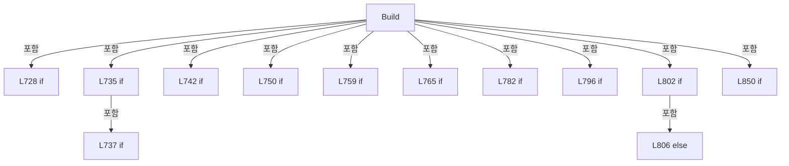

변경 전 점검: 입력/반환 타입, 위 호출자, 예외/취소 경로, 공유 상태와 저장·전송 소비자를 함께 확인합니다. 값의 단위나 물리 방향을 이름만으로 확정하지 않습니다.

### LocalFunctionStatement `BuildMonitor` · L772–775

[Drilling.UI/Menu/Menus/CMenuMonitor.cs:772–775](https://github.com/kjuws10-rgb/A3Drilling/blob/334b3599651b2e8e0181fd4459bafaf3cddafff3/Drilling.UI/Menu/Menus/CMenuMonitor.cs#L772-L775)

| 항목 | 실제 추출 값 |
| --- | --- |
| 서명 | Drilling.UI.Menu.Menus.ST_MONITOR_TAB BuildMonitor(string) |
| 접근/수식자 | Private /  |
| 반환/값 타입 | Drilling.UI.Menu.Menus.ST_MONITOR_TAB |
| 소속 타입 | NamedType:Drilling.UI.Menu.Menus.CMenuMonitor |

입력 계약:

| 이름 | 타입 | 전달 | 선택/기본값 |
| --- | --- | --- | --- |
| tab | string | None | False /  |

현재 부분 분석에서 직접 연결된 호출자는 없습니다. XAML/이벤트/인터페이스·델리게이트·외부 진입을 추가 확인해야 하며, 미사용으로 판정한 것이 아닙니다.

호출하는 대상과 해석 범위:

| 원본 행 | 표현식 | 분석 상태 | 대상/소스 위치 |
| --- | --- | --- | --- |
| 774 | new ST_MONITOR_TAB | resolved | Drilling.UI.Menu.Menus.ST_MONITOR_TAB.ST_MONITOR_TAB(string, bool) · Drilling.UI/Menu/Menus/CMenuMonitor.cs:6712 |
| 774 | GetMonitorTabDisplayName | resolved | string Drilling.UI.Menu.Menus.CMenuMonitor.GetMonitorTabDisplayName(string) · Drilling.UI/Menu/Menus/CMenuMonitor.cs:2506 |

본문의 실제 연산·분기·예외·반환 순서(원문 위치 순):

| 원본 행 | 종류 | 주석 해설 |
| --- | --- | --- |
| 774 | call | 함수·델리게이트 또는 객체 생성자를 호출합니다: new ST_MONITOR_TAB(GetMonitorTabDisplayName(tab), tab == selectedTab) |
| 774 | call | 함수·델리게이트 또는 객체 생성자를 호출합니다: GetMonitorTabDisplayName(tab) |
| 774 | return | 호출자에게 값 또는 제어를 반환합니다: return new ST_MONITOR_TAB(GetMonitorTabDisplayName(tab), tab == selectedTab); |

변경 전 점검: 입력/반환 타입, 위 호출자, 예외/취소 경로, 공유 상태와 저장·전송 소비자를 함께 확인합니다. 값의 단위나 물리 방향을 이름만으로 확정하지 않습니다.

### LocalFunctionStatement `IsIsSelected` · L791–794

[Drilling.UI/Menu/Menus/CMenuMonitor.cs:791–794](https://github.com/kjuws10-rgb/A3Drilling/blob/334b3599651b2e8e0181fd4459bafaf3cddafff3/Drilling.UI/Menu/Menus/CMenuMonitor.cs#L791-L794)

| 항목 | 실제 추출 값 |
| --- | --- |
| 서명 | bool IsIsSelected(Drilling.UI.Menu.Menus.ST_MONITOR_AXIS_ROW) |
| 접근/수식자 | Private /  |
| 반환/값 타입 | bool |
| 소속 타입 | NamedType:Drilling.UI.Menu.Menus.CMenuMonitor |

입력 계약:

| 이름 | 타입 | 전달 | 선택/기본값 |
| --- | --- | --- | --- |
| row | Drilling.UI.Menu.Menus.ST_MONITOR_AXIS_ROW | None | False /  |

현재 부분 분석에서 직접 연결된 호출자는 없습니다. XAML/이벤트/인터페이스·델리게이트·외부 진입을 추가 확인해야 하며, 미사용으로 판정한 것이 아닙니다.

본문의 실제 연산·분기·예외·반환 순서(원문 위치 순):

| 원본 행 | 종류 | 주석 해설 |
| --- | --- | --- |
| 793 | return | 호출자에게 값 또는 제어를 반환합니다: return row.IsSelected; |

변경 전 점검: 입력/반환 타입, 위 호출자, 예외/취소 경로, 공유 상태와 저장·전송 소비자를 함께 확인합니다. 값의 단위나 물리 방향을 이름만으로 확정하지 않습니다.

### LocalFunctionStatement `BuildDisplay` · L859–862

[Drilling.UI/Menu/Menus/CMenuMonitor.cs:859–862](https://github.com/kjuws10-rgb/A3Drilling/blob/334b3599651b2e8e0181fd4459bafaf3cddafff3/Drilling.UI/Menu/Menus/CMenuMonitor.cs#L859-L862)

| 항목 | 실제 추출 값 |
| --- | --- |
| 서명 | Drilling.UI.Menu.Menus.ST_DISPLAY_ITEM BuildDisplay(Drilling.UI.Menu.Menus.ST_MONITOR_AXIS_ROW) |
| 접근/수식자 | Private /  |
| 반환/값 타입 | Drilling.UI.Menu.Menus.ST_DISPLAY_ITEM |
| 소속 타입 | NamedType:Drilling.UI.Menu.Menus.CMenuMonitor |

입력 계약:

| 이름 | 타입 | 전달 | 선택/기본값 |
| --- | --- | --- | --- |
| row | Drilling.UI.Menu.Menus.ST_MONITOR_AXIS_ROW | None | False /  |

현재 부분 분석에서 직접 연결된 호출자는 없습니다. XAML/이벤트/인터페이스·델리게이트·외부 진입을 추가 확인해야 하며, 미사용으로 판정한 것이 아닙니다.

호출하는 대상과 해석 범위:

| 원본 행 | 표현식 | 분석 상태 | 대상/소스 위치 |
| --- | --- | --- | --- |
| 861 | new ST_DISPLAY_ITEM | resolved | Drilling.UI.Menu.Menus.ST_DISPLAY_ITEM.ST_DISPLAY_ITEM(string, string, string) · Drilling.UI/Menu/Menus/CMenuBase.cs:43 |

본문의 실제 연산·분기·예외·반환 순서(원문 위치 순):

| 원본 행 | 종류 | 주석 해설 |
| --- | --- | --- |
| 861 | call | 함수·델리게이트 또는 객체 생성자를 호출합니다: new ST_DISPLAY_ITEM(row.Axis, row.CurrentPosition, row.Alarm) |
| 861 | return | 호출자에게 값 또는 제어를 반환합니다: return new ST_DISPLAY_ITEM(row.Axis, row.CurrentPosition, row.Alarm); |

변경 전 점검: 입력/반환 타입, 위 호출자, 예외/취소 경로, 공유 상태와 저장·전송 소비자를 함께 확인합니다. 값의 단위나 물리 방향을 이름만으로 확정하지 않습니다.

### LocalFunctionStatement `BuildDisplay2` · L864–867

[Drilling.UI/Menu/Menus/CMenuMonitor.cs:864–867](https://github.com/kjuws10-rgb/A3Drilling/blob/334b3599651b2e8e0181fd4459bafaf3cddafff3/Drilling.UI/Menu/Menus/CMenuMonitor.cs#L864-L867)

| 항목 | 실제 추출 값 |
| --- | --- |
| 서명 | Drilling.UI.Menu.Menus.ST_DISPLAY_ITEM BuildDisplay2(Drilling.UI.Menu.Menus.ST_MONITOR_STATUS_ROW) |
| 접근/수식자 | Private /  |
| 반환/값 타입 | Drilling.UI.Menu.Menus.ST_DISPLAY_ITEM |
| 소속 타입 | NamedType:Drilling.UI.Menu.Menus.CMenuMonitor |

입력 계약:

| 이름 | 타입 | 전달 | 선택/기본값 |
| --- | --- | --- | --- |
| row | Drilling.UI.Menu.Menus.ST_MONITOR_STATUS_ROW | None | False /  |

현재 부분 분석에서 직접 연결된 호출자는 없습니다. XAML/이벤트/인터페이스·델리게이트·외부 진입을 추가 확인해야 하며, 미사용으로 판정한 것이 아닙니다.

호출하는 대상과 해석 범위:

| 원본 행 | 표현식 | 분석 상태 | 대상/소스 위치 |
| --- | --- | --- | --- |
| 866 | new ST_DISPLAY_ITEM | resolved | Drilling.UI.Menu.Menus.ST_DISPLAY_ITEM.ST_DISPLAY_ITEM(string, string, string) · Drilling.UI/Menu/Menus/CMenuBase.cs:43 |

본문의 실제 연산·분기·예외·반환 순서(원문 위치 순):

| 원본 행 | 종류 | 주석 해설 |
| --- | --- | --- |
| 866 | call | 함수·델리게이트 또는 객체 생성자를 호출합니다: new ST_DISPLAY_ITEM(row.Item, row.Value, row.State) |
| 866 | return | 호출자에게 값 또는 제어를 반환합니다: return new ST_DISPLAY_ITEM(row.Item, row.Value, row.State); |

변경 전 점검: 입력/반환 타입, 위 호출자, 예외/취소 경로, 공유 상태와 저장·전송 소비자를 함께 확인합니다. 값의 단위나 물리 방향을 이름만으로 확정하지 않습니다.

### MethodDeclaration `RefreshLiveData` · L872–1031

[Drilling.UI/Menu/Menus/CMenuMonitor.cs:872–1031](https://github.com/kjuws10-rgb/A3Drilling/blob/334b3599651b2e8e0181fd4459bafaf3cddafff3/Drilling.UI/Menu/Menus/CMenuMonitor.cs#L872-L1031)

| 항목 | 실제 추출 값 |
| --- | --- |
| 서명 | System.Threading.Tasks.Task Drilling.UI.Menu.Menus.CMenuMonitor.RefreshLiveData(System.Threading.CancellationToken) |
| 접근/수식자 | Public / public |
| 반환/값 타입 | System.Threading.Tasks.Task |
| 소속 타입 | NamedType:Drilling.UI.Menu.Menus.CMenuMonitor |

입력 계약:

| 이름 | 타입 | 전달 | 선택/기본값 |
| --- | --- | --- | --- |
| cancellationToken | System.Threading.CancellationToken | None | True / null |

정적 호출자로 확인된 위치:

| 호출 파일/행 | 호출 표현식 | 런타임 분기 가능 |
| --- | --- | --- |
| [Drilling.UI/CRootView.cs:962–962](https://github.com/kjuws10-rgb/A3Drilling/blob/334b3599651b2e8e0181fd4459bafaf3cddafff3/Drilling.UI/CRootView.cs#L962-L962) | monitor.RefreshLiveData | False |

호출하는 대상과 해석 범위:

| 원본 행 | 표현식 | 분석 상태 | 대상/소스 위치 |
| --- | --- | --- | --- |
| 887 | NormalizeMonitorScreenTab | resolved | string Drilling.UI.Menu.Menus.CMenuMonitor.NormalizeMonitorScreenTab(string?) · Drilling.UI/Menu/Menus/CMenuMonitor.cs:1948 |
| 887 | _selectedTabAccessor | resolved · 동적 구현 선택 가능 | string System.Func<string>.Invoke() |
| 888 | selectedTab.Equals | resolved | bool string.Equals(string?, System.StringComparison) |
| 900 | SaveOperationFieldValues | resolved | void Drilling.UI.Menu.Menus.CMenuMonitor.SaveOperationFieldValues(string) · Drilling.UI/Menu/Menus/CMenuMonitor.cs:2334 |
| 905 | SavePowerMeterSettingValues | resolved | void Drilling.UI.Menu.Menus.CMenuMonitor.SavePowerMeterSettingValues() · Drilling.UI/Menu/Menus/CMenuMonitor.cs:5796 |
| 908 | LoadEnabledHeadDeviceNumbers | resolved | System.Collections.Generic.IReadOnlyList<int> Drilling.UI.Menu.Menus.CMenuMonitor.LoadEnabledHeadDeviceNumbers(System.Threading.CancellationToken) · Drilling.UI/Menu/Menus/CMenuMonitor.cs:2368 |
| 909 | NormalizeHeadDeviceSelections | resolved | void Drilling.UI.Menu.Menus.CMenuMonitor.NormalizeHeadDeviceSelections() · Drilling.UI/Menu/Menus/CMenuMonitor.cs:2388 |
| 912 | NormalizePowerMeterSelection | resolved | void Drilling.UI.Menu.Menus.CMenuMonitor.NormalizePowerMeterSelection() · Drilling.UI/Menu/Menus/CMenuMonitor.cs:6335 |
| 915 | UpdatePollingContext | resolved | void Drilling.UI.Menu.Menus.CMenuMonitor.UpdatePollingContext(string) · Drilling.UI/Menu/Menus/CMenuMonitor.cs:1117 |
| 916 | _statusPollingService.Start | resolved | void Drilling.UI.Menu.Menus.CMonitorStatusPollingService.Start() · Drilling.UI/Menu/Menus/CMonitorStatusPollingService.cs:32 |
| 917 | _statusPollingService.GetSnapshot | resolved | Drilling.UI.Menu.Menus.ST_MONITOR_STATUS_SNAPSHOT Drilling.UI.Menu.Menus.CMonitorStatusPollingService.GetSnapshot() · Drilling.UI/Menu/Menus/CMonitorStatusPollingService.cs:54 |
| 920 | RefreshPowerMeterSnapshotFromCache | resolved | Drilling.UI.Menu.Menus.ST_MONITOR_STATUS_SNAPSHOT Drilling.UI.Menu.Menus.CMenuMonitor.RefreshPowerMeterSnapshotFromCache(Drilling.UI.Menu.Menus.ST_MONITOR_STATUS_SNAPSHOT, System.Threading.CancellationToken) · Drilling.UI/Menu/Menus/CMenuMonitor.cs:1106 |
| 923 | CreateLiveRefreshHash | resolved | int Drilling.UI.Menu.Menus.CMenuMonitor.CreateLiveRefreshHash(string, Drilling.UI.Menu.Menus.ST_MONITOR_STATUS_SNAPSHOT) · Drilling.UI/Menu/Menus/CMenuMonitor.cs:1033 |
| 935 | Math.Clamp | resolved | int System.Math.Clamp(int, int, int) |
| 937 | CreatePicoMotorStatusRows | resolved | System.Collections.Generic.IReadOnlyList<Drilling.UI.Menu.Menus.ST_MONITOR_STATUS_ROW> Drilling.UI.Menu.Menus.CMenuMonitor.CreatePicoMotorStatusRows(Drilling.Common.Interface.ST_PICO_MOTOR_STATUS) · Drilling.UI/Menu/Menus/CMenuMonitor.cs:6285 |
| 938 | CreatePicoErrorRows | resolved | System.Collections.Generic.IReadOnlyList<Drilling.UI.Menu.Menus.ST_MONITOR_PARAMETER_ROW> Drilling.UI.Menu.Menus.CMenuMonitor.CreatePicoErrorRows() · Drilling.UI/Menu/Menus/CMenuMonitor.cs:6301 |
| 939 | CreatePicoMotorPositionRows | resolved | System.Collections.Generic.IReadOnlyList<Drilling.UI.Menu.Menus.ST_MONITOR_POSITION_ROW> Drilling.UI.Menu.Menus.CMenuMonitor.CreatePicoMotorPositionRows(Drilling.Common.Interface.ST_PICO_MOTOR_STATUS) · Drilling.UI/Menu/Menus/CMenuMonitor.cs:6325 |
| 940 | UpdatePicoMotorOperationFields | resolved | void Drilling.UI.Menu.Menus.CMenuMonitor.UpdatePicoMotorOperationFields(Drilling.Common.Interface.ST_PICO_MOTOR_STATUS) · Drilling.UI/Menu/Menus/CMenuMonitor.cs:5555 |
| 941 | NotifyMonitorLiveProperties | resolved | void Drilling.UI.Menu.Menus.CMenuMonitor.NotifyMonitorLiveProperties(params string[]) · Drilling.UI/Menu/Menus/CMenuMonitor.cs:1869 |
| 941 | nameof | unresolved | None |
| 941 | nameof | unresolved | None |
| 941 | nameof | unresolved | None |
| 941 | nameof | unresolved | None |
| 941 | nameof | unresolved | None |
| 941 | nameof | unresolved | None |
| 949 | CreateStatusRows | resolved | System.Collections.Generic.IReadOnlyList<Drilling.UI.Menu.Menus.ST_MONITOR_STATUS_ROW> Drilling.UI.Menu.Menus.CMenuMonitor.CreateStatusRows(string, Drilling.Common.Managers.ST_DEVICE_STATUS, System.Collections.Generic.IReadOnlyList<Drilling.Common.Interface.ST_DEVICE_COMM_STATUS>, string?, Drilling.Common.Interface.ST_TALON_STATUS?) · Drilling.UI/Menu/Menus/CMenuMonitor.cs:2048 |
| 949 | GetSelectedHeadConnectionText | resolved | string? Drilling.UI.Menu.Menus.CMenuMonitor.GetSelectedHeadConnectionText(string) · Drilling.UI/Menu/Menus/CMenuMonitor.cs:2418 |
| 950 | CreateOperationButtons | resolved | System.Collections.Generic.IReadOnlyList<Drilling.UI.Menu.Menus.ST_MONITOR_OPERATION_BUTTON> Drilling.UI.Menu.Menus.CMenuMonitor.CreateOperationButtons(string, Drilling.Common.Interface.ST_LASER_STATUS, Drilling.Common.Interface.ST_TALON_STATUS) · Drilling.UI/Menu/Menus/CMenuMonitor.cs:2185 |
| 951 | CreateHeadSelectRows | resolved | System.Collections.Generic.IReadOnlyList<Drilling.UI.Menu.Menus.ST_MONITOR_HEAD_SELECT_ROW> Drilling.UI.Menu.Menus.CMenuMonitor.CreateHeadSelectRows(string, int, Drilling.Common.Interface.EN_EQP_MODULE?, string) · Drilling.UI/Menu/Menus/CMenuMonitor.cs:2476 |
| 952 | CreateLaserControlRows | resolved | System.Collections.Generic.IReadOnlyList<Drilling.UI.Menu.Menus.ST_MONITOR_LASER_CONTROL_ROW> Drilling.UI.Menu.Menus.CMenuMonitor.CreateLaserControlRows(string, Drilling.Common.Interface.ST_LASER_STATUS, Drilling.Common.Interface.ST_TALON_STATUS, System.Collections.Generic.IReadOnlyList<Drilling.UI.Menu.Menus.ST_MONITOR_PARAMETER_ROW>) · Drilling.UI/Menu/Menus/CMenuMonitor.cs:6419 |
| 953 | CreateSummaryItems | resolved | System.Collections.Generic.IReadOnlyList<Drilling.UI.Menu.Menus.ST_MONITOR_SUMMARY_ITEM> Drilling.UI.Menu.Menus.CMenuMonitor.CreateSummaryItems(string, Drilling.Common.Managers.ST_DEVICE_STATUS) · Drilling.UI/Menu/Menus/CMenuMonitor.cs:2528 |
| 954 | CreatePwmSettingRows | resolved | System.Collections.Generic.IReadOnlyList<Drilling.UI.Menu.Menus.ST_PWM_SETTING_ROW> Drilling.UI.Menu.Menus.CMenuMonitor.CreatePwmSettingRows(string) · Drilling.UI/Menu/Menus/CMenuMonitor.cs:6581 |
| 955 | CreatePwmDeviceRows | resolved | System.Collections.Generic.IReadOnlyList<Drilling.UI.Menu.Menus.ST_PWM_DEVICE_ROW> Drilling.UI.Menu.Menus.CMenuMonitor.CreatePwmDeviceRows(string, Drilling.Common.Managers.ST_DEVICE_STATUS) · Drilling.UI/Menu/Menus/CMenuMonitor.cs:6604 |
| 956 | NotifyMonitorLiveProperties | resolved | void Drilling.UI.Menu.Menus.CMenuMonitor.NotifyMonitorLiveProperties(params string[]) · Drilling.UI/Menu/Menus/CMenuMonitor.cs:1869 |
| 956 | nameof | unresolved | None |
| 956 | nameof | unresolved | None |
| 956 | nameof | unresolved | None |
| 956 | nameof | unresolved | None |
| 956 | nameof | unresolved | None |
| 956 | nameof | unresolved | None |
| 956 | nameof | unresolved | None |
| 956 | nameof | unresolved | None |
| 960 | CreateStatusRows | resolved | System.Collections.Generic.IReadOnlyList<Drilling.UI.Menu.Menus.ST_MONITOR_STATUS_ROW> Drilling.UI.Menu.Menus.CMenuMonitor.CreateStatusRows(string, Drilling.Common.Managers.ST_DEVICE_STATUS, System.Collections.Generic.IReadOnlyList<Drilling.Common.Interface.ST_DEVICE_COMM_STATUS>, string?, Drilling.Common.Interface.ST_TALON_STATUS?) · Drilling.UI/Menu/Menus/CMenuMonitor.cs:2048 |
| 960 | GetSelectedHeadConnectionText | resolved | string? Drilling.UI.Menu.Menus.CMenuMonitor.GetSelectedHeadConnectionText(string) · Drilling.UI/Menu/Menus/CMenuMonitor.cs:2418 |
| 964 | CreateAxisRows | resolved | System.Collections.Generic.IReadOnlyList<Drilling.UI.Menu.Menus.ST_MONITOR_AXIS_ROW> Drilling.UI.Menu.Menus.CMenuMonitor.CreateAxisRows(Drilling.Common.Managers.ST_DEVICE_STATUS, string) · Drilling.UI/Menu/Menus/CMenuMonitor.cs:6196 |
| 965 | axisRows.Any | resolved | bool System.Collections.Generic.IEnumerable<Drilling.UI.Menu.Menus.ST_MONITOR_AXIS_ROW>.Any<Drilling.UI.Menu.Menus.ST_MONITOR_AXIS_ROW>(System.Func<Drilling.UI.Menu.Menus.ST_MONITOR_AXIS_ROW, bool>) |
| 968 | CreateAxisRows | resolved | System.Collections.Generic.IReadOnlyList<Drilling.UI.Menu.Menus.ST_MONITOR_AXIS_ROW> Drilling.UI.Menu.Menus.CMenuMonitor.CreateAxisRows(Drilling.Common.Managers.ST_DEVICE_STATUS, string) · Drilling.UI/Menu/Menus/CMenuMonitor.cs:6196 |
| 969 | OnPropertyChanged | resolved | void Drilling.UI.Menu.CBindingBase.OnPropertyChanged(string?) · Drilling.UI/Menu/CBindingBase.cs:790 |
| 969 | nameof | unresolved | None |
| 970 | OnPropertyChanged | resolved | void Drilling.UI.Menu.CBindingBase.OnPropertyChanged(string?) · Drilling.UI/Menu/CBindingBase.cs:790 |
| 970 | nameof | unresolved | None |
| 974 | UpdateMultiMoveAxisRows | resolved | void Drilling.UI.Menu.Menus.CMenuMonitor.UpdateMultiMoveAxisRows(Drilling.Common.Managers.ST_DEVICE_STATUS) · Drilling.UI/Menu/Menus/CMenuMonitor.cs:6219 |
| 975 | NotifyMonitorLiveProperties | resolved | void Drilling.UI.Menu.Menus.CMenuMonitor.NotifyMonitorLiveProperties(params string[]) · Drilling.UI/Menu/Menus/CMenuMonitor.cs:1869 |
| 975 | nameof | unresolved | None |
| 975 | nameof | unresolved | None |
| 975 | nameof | unresolved | None |
| 975 | nameof | unresolved | None |
| 978 | CreateHeadSelectRows | resolved | System.Collections.Generic.IReadOnlyList<Drilling.UI.Menu.Menus.ST_MONITOR_HEAD_SELECT_ROW> Drilling.UI.Menu.Menus.CMenuMonitor.CreateHeadSelectRows(string, int, Drilling.Common.Interface.EN_EQP_MODULE?, string) · Drilling.UI/Menu/Menus/CMenuMonitor.cs:2476 |
| 979 | CreateSummaryItems | resolved | System.Collections.Generic.IReadOnlyList<Drilling.UI.Menu.Menus.ST_MONITOR_SUMMARY_ITEM> Drilling.UI.Menu.Menus.CMenuMonitor.CreateSummaryItems(string, Drilling.Common.Managers.ST_DEVICE_STATUS) · Drilling.UI/Menu/Menus/CMenuMonitor.cs:2528 |
| 980 | CreateAttenuatorStatusItems | resolved | System.Collections.Generic.IReadOnlyList<Drilling.UI.Menu.Menus.ST_MONITOR_SUMMARY_ITEM> Drilling.UI.Menu.Menus.CMenuMonitor.CreateAttenuatorStatusItems(string, Drilling.Common.Managers.ST_DEVICE_STATUS) · Drilling.UI/Menu/Menus/CMenuMonitor.cs:6512 |
| 981 | CreateAttenuatorSettingItems | resolved | System.Collections.Generic.IReadOnlyList<Drilling.UI.Menu.Menus.ST_MONITOR_SUMMARY_ITEM> Drilling.UI.Menu.Menus.CMenuMonitor.CreateAttenuatorSettingItems(string, Drilling.Common.Managers.ST_DEVICE_STATUS) · Drilling.UI/Menu/Menus/CMenuMonitor.cs:6530 |
| 982 | CreatePositionRows | resolved | System.Collections.Generic.IReadOnlyList<Drilling.UI.Menu.Menus.ST_MONITOR_POSITION_ROW> Drilling.UI.Menu.Menus.CMenuMonitor.CreatePositionRows(string, Drilling.Common.Managers.ST_DEVICE_STATUS) · Drilling.UI/Menu/Menus/CMenuMonitor.cs:6547 |
| 983 | NotifyMonitorLiveProperties | resolved | void Drilling.UI.Menu.Menus.CMenuMonitor.NotifyMonitorLiveProperties(params string[]) · Drilling.UI/Menu/Menus/CMenuMonitor.cs:1869 |
| 983 | nameof | unresolved | None |
| 983 | nameof | unresolved | None |
| 983 | nameof | unresolved | None |
| 983 | nameof | unresolved | None |
| 983 | nameof | unresolved | None |
| 983 | nameof | unresolved | None |
| 983 | nameof | unresolved | None |
| 986 | CreateHeadSelectRows | resolved | System.Collections.Generic.IReadOnlyList<Drilling.UI.Menu.Menus.ST_MONITOR_HEAD_SELECT_ROW> Drilling.UI.Menu.Menus.CMenuMonitor.CreateHeadSelectRows(string, int, Drilling.Common.Interface.EN_EQP_MODULE?, string) · Drilling.UI/Menu/Menus/CMenuMonitor.cs:2476 |
| 987 | CreateSummaryItems | resolved | System.Collections.Generic.IReadOnlyList<Drilling.UI.Menu.Menus.ST_MONITOR_SUMMARY_ITEM> Drilling.UI.Menu.Menus.CMenuMonitor.CreateSummaryItems(string, Drilling.Common.Managers.ST_DEVICE_STATUS) · Drilling.UI/Menu/Menus/CMenuMonitor.cs:2528 |
| 988 | CreatePositionRows | resolved | System.Collections.Generic.IReadOnlyList<Drilling.UI.Menu.Menus.ST_MONITOR_POSITION_ROW> Drilling.UI.Menu.Menus.CMenuMonitor.CreatePositionRows(string, Drilling.Common.Managers.ST_DEVICE_STATUS) · Drilling.UI/Menu/Menus/CMenuMonitor.cs:6547 |
| 989 | NotifyMonitorLiveProperties | resolved | void Drilling.UI.Menu.Menus.CMenuMonitor.NotifyMonitorLiveProperties(params string[]) · Drilling.UI/Menu/Menus/CMenuMonitor.cs:1869 |
| 989 | nameof | unresolved | None |
| 989 | nameof | unresolved | None |
| 989 | nameof | unresolved | None |
| 989 | nameof | unresolved | None |
| 989 | nameof | unresolved | None |
| 992 | UpdatePowerMeterGraph | resolved | void Drilling.UI.Menu.Menus.CMenuMonitor.UpdatePowerMeterGraph() · Drilling.UI/Menu/Menus/CMenuMonitor.cs:6102 |
| 993 | CreateHeadSelectRows | resolved | System.Collections.Generic.IReadOnlyList<Drilling.UI.Menu.Menus.ST_MONITOR_HEAD_SELECT_ROW> Drilling.UI.Menu.Menus.CMenuMonitor.CreateHeadSelectRows(string, int, Drilling.Common.Interface.EN_EQP_MODULE?, string) · Drilling.UI/Menu/Menus/CMenuMonitor.cs:2476 |
| 994 | CreateSummaryItems | resolved | System.Collections.Generic.IReadOnlyList<Drilling.UI.Menu.Menus.ST_MONITOR_SUMMARY_ITEM> Drilling.UI.Menu.Menus.CMenuMonitor.CreateSummaryItems(string, Drilling.Common.Managers.ST_DEVICE_STATUS) · Drilling.UI/Menu/Menus/CMenuMonitor.cs:2528 |
| 995 | CreatePwmSettingRows | resolved | System.Collections.Generic.IReadOnlyList<Drilling.UI.Menu.Menus.ST_PWM_SETTING_ROW> Drilling.UI.Menu.Menus.CMenuMonitor.CreatePwmSettingRows(string) · Drilling.UI/Menu/Menus/CMenuMonitor.cs:6581 |
| 996 | CreatePwmDeviceRows | resolved | System.Collections.Generic.IReadOnlyList<Drilling.UI.Menu.Menus.ST_PWM_DEVICE_ROW> Drilling.UI.Menu.Menus.CMenuMonitor.CreatePwmDeviceRows(string, Drilling.Common.Managers.ST_DEVICE_STATUS) · Drilling.UI/Menu/Menus/CMenuMonitor.cs:6604 |
| 997 | CreatePwmRunButtons | resolved | System.Collections.Generic.IReadOnlyList<Drilling.UI.Menu.Menus.ST_MONITOR_OPERATION_BUTTON> Drilling.UI.Menu.Menus.CMenuMonitor.CreatePwmRunButtons(string) · Drilling.UI/Menu/Menus/CMenuMonitor.cs:6623 |
| 998 | NotifyMonitorLiveProperties | resolved | void Drilling.UI.Menu.Menus.CMenuMonitor.NotifyMonitorLiveProperties(params string[]) · Drilling.UI/Menu/Menus/CMenuMonitor.cs:1869 |
| 999 | nameof | unresolved | None |
| 1000 | nameof | unresolved | None |
| 1001 | nameof | unresolved | None |
| 1002 | nameof | unresolved | None |
| 1003 | nameof | unresolved | None |
| 1004 | nameof | unresolved | None |
| 1005 | nameof | unresolved | None |
| 1006 | nameof | unresolved | None |
| 1007 | nameof | unresolved | None |
| 1008 | nameof | unresolved | None |
| 1009 | nameof | unresolved | None |
| 1010 | nameof | unresolved | None |
| 1011 | nameof | unresolved | None |
| 1012 | nameof | unresolved | None |
| 1013 | nameof | unresolved | None |
| 1017 | UpdateMelsecReadValues | resolved | void Drilling.UI.Menu.Menus.CMenuMonitor.UpdateMelsecReadValues(System.Collections.Generic.IReadOnlyDictionary<string, Drilling.UI.Menu.Menus.ST_MONITOR_MELSEC_VALUE>) · Drilling.UI/Menu/Menus/CMenuMonitor.cs:4343 |
| 1018 | NotifyMonitorLiveProperties | resolved | void Drilling.UI.Menu.Menus.CMenuMonitor.NotifyMonitorLiveProperties(params string[]) · Drilling.UI/Menu/Menus/CMenuMonitor.cs:1869 |
| 1018 | nameof | unresolved | None |
| 1021 | NotifyMonitorLiveProperties | resolved | void Drilling.UI.Menu.Menus.CMenuMonitor.NotifyMonitorLiveProperties(params string[]) · Drilling.UI/Menu/Menus/CMenuMonitor.cs:1869 |
| 1021 | nameof | unresolved | None |

본문의 실제 연산·분기·예외·반환 순서(원문 위치 순):

| 원본 행 | 종류 | 주석 해설 |
| --- | --- | --- |
| 874 | if | 조건에 따라 분기합니다: if (_liveRefreshRunning) |
| 876 | return | 호출자에게 값 또는 제어를 반환합니다: return Task.CompletedTask; |
| 879 | assignment | 값을 대상에 대입합니다: _liveRefreshRunning = true |
| 885 | try | 예외 처리 범위입니다: try |
| 887 | call | 함수·델리게이트 또는 객체 생성자를 호출합니다: NormalizeMonitorScreenTab(_selectedTabAccessor()) |
| 887 | call | 함수·델리게이트 또는 객체 생성자를 호출합니다: _selectedTabAccessor() |
| 887 | local-declaration | 지역 변수를 선언합니다: var selectedTab = NormalizeMonitorScreenTab(_selectedTabAccessor()); |
| 887 | variable-initializer | 변수의 초기값을 지정합니다: selectedTab = NormalizeMonitorScreenTab(_selectedTabAccessor()) |
| 888 | call | 함수·델리게이트 또는 객체 생성자를 호출합니다: selectedTab.Equals(SelectedTab, StringComparison.OrdinalIgnoreCase) |
| 888 | if | 조건에 따라 분기합니다: if (!selectedTab.Equals(SelectedTab, StringComparison.OrdinalIgnoreCase)) |
| 890 | return | 호출자에게 값 또는 제어를 반환합니다: return Task.CompletedTask; |
| 893 | if | 조건에 따라 분기합니다: if (selectedTab is "COORDINATE VIEWER" or "LOG VIEWER") |
| 895 | return | 호출자에게 값 또는 제어를 반환합니다: return Task.CompletedTask; |
| 898 | if | 조건에 따라 분기합니다: if (OperationFields.Count > 0) |
| 900 | call | 함수·델리게이트 또는 객체 생성자를 호출합니다: SaveOperationFieldValues(selectedTab) |
| 903 | if | 조건에 따라 분기합니다: if ((selectedTab is "LASER" or "POWER METER") && PwmSettingRows.Count > 0) |
| 905 | call | 함수·델리게이트 또는 객체 생성자를 호출합니다: SavePowerMeterSettingValues() |
| 908 | assignment | 값을 대상에 대입합니다: _enabledHeadDeviceNumbers = LoadEnabledHeadDeviceNumbers(cancellationToken) |
| 908 | call | 함수·델리게이트 또는 객체 생성자를 호출합니다: LoadEnabledHeadDeviceNumbers(cancellationToken) |
| 909 | call | 함수·델리게이트 또는 객체 생성자를 호출합니다: NormalizeHeadDeviceSelections() |
| 910 | if | 조건에 따라 분기합니다: if (selectedTab is "LASER" or "POWER METER") |
| 912 | call | 함수·델리게이트 또는 객체 생성자를 호출합니다: NormalizePowerMeterSelection() |
| 915 | call | 함수·델리게이트 또는 객체 생성자를 호출합니다: UpdatePollingContext(selectedTab) |
| 916 | call | 함수·델리게이트 또는 객체 생성자를 호출합니다: _statusPollingService.Start() |
| 917 | call | 함수·델리게이트 또는 객체 생성자를 호출합니다: _statusPollingService.GetSnapshot() |
| 917 | local-declaration | 지역 변수를 선언합니다: var monitorSnapshot = _statusPollingService.GetSnapshot(); |
| 917 | variable-initializer | 변수의 초기값을 지정합니다: monitorSnapshot = _statusPollingService.GetSnapshot() |
| 918 | if | 조건에 따라 분기합니다: if (selectedTab is "LASER" or "POWER METER") |
| 920 | assignment | 값을 대상에 대입합니다: monitorSnapshot = RefreshPowerMeterSnapshotFromCache(monitorSnapshot, cancellationToken) |
| 920 | call | 함수·델리게이트 또는 객체 생성자를 호출합니다: RefreshPowerMeterSnapshotFromCache(monitorSnapshot, cancellationToken) |
| 923 | call | 함수·델리게이트 또는 객체 생성자를 호출합니다: CreateLiveRefreshHash(selectedTab, monitorSnapshot) |
| 923 | local-declaration | 지역 변수를 선언합니다: var liveRefreshHash = CreateLiveRefreshHash(selectedTab, monitorSnapshot); |
| 923 | variable-initializer | 변수의 초기값을 지정합니다: liveRefreshHash = CreateLiveRefreshHash(selectedTab, monitorSnapshot) |
| 924 | if | 조건에 따라 분기합니다: if (_lastLiveRefreshHash == liveRefreshHash) |
| 926 | return | 호출자에게 값 또는 제어를 반환합니다: return Task.CompletedTask; |
| 929 | assignment | 값을 대상에 대입합니다: _lastLiveRefreshHash = liveRefreshHash |
| 930 | local-declaration | 지역 변수를 선언합니다: var snapshot = monitorSnapshot.DeviceStatus; |
| 930 | variable-initializer | 변수의 초기값을 지정합니다: snapshot = monitorSnapshot.DeviceStatus |
| 931 | local-declaration | 지역 변수를 선언합니다: var communication = monitorSnapshot.Communication; |
| 931 | variable-initializer | 변수의 초기값을 지정합니다: communication = monitorSnapshot.Communication |
| 932 | if | 조건에 따라 분기합니다: if (selectedTab == "PICO MOTOR") |
| 934 | local-declaration | 지역 변수를 선언합니다: var picoStatus = monitorSnapshot.PicoMotorStatus; |
| 934 | variable-initializer | 변수의 초기값을 지정합니다: picoStatus = monitorSnapshot.PicoMotorStatus |
| 935 | assignment | 값을 대상에 대입합니다: _selectedPicoMotorNo = Math.Clamp(picoStatus.SelectedMotorNo, 1, 4) |
| 935 | call | 함수·델리게이트 또는 객체 생성자를 호출합니다: Math.Clamp(picoStatus.SelectedMotorNo, 1, 4) |
| 936 | assignment | 값을 대상에 대입합니다: _picoMotorIsConnected = picoStatus.IsConnected |
| 937 | assignment | 값을 대상에 대입합니다: StatusRows = CreatePicoMotorStatusRows(picoStatus) |
| 937 | call | 함수·델리게이트 또는 객체 생성자를 호출합니다: CreatePicoMotorStatusRows(picoStatus) |
| 938 | assignment | 값을 대상에 대입합니다: ParameterRows = CreatePicoErrorRows() |
| 938 | call | 함수·델리게이트 또는 객체 생성자를 호출합니다: CreatePicoErrorRows() |
| 939 | assignment | 값을 대상에 대입합니다: PositionRows = CreatePicoMotorPositionRows(picoStatus) |
| 939 | call | 함수·델리게이트 또는 객체 생성자를 호출합니다: CreatePicoMotorPositionRows(picoStatus) |
| 940 | call | 함수·델리게이트 또는 객체 생성자를 호출합니다: UpdatePicoMotorOperationFields(picoStatus) |
| 941 | call | 함수·델리게이트 또는 객체 생성자를 호출합니다: NotifyMonitorLiveProperties(nameof(StatusRows), nameof(ParameterRows), nameof(PositionRows), nameof(OperationFields), nameof(PicoConnectionButtons), nameof(PicoMotorSelectButtons)) |
| 941 | call | 함수·델리게이트 또는 객체 생성자를 호출합니다: nameof(StatusRows) |
| 941 | call | 함수·델리게이트 또는 객체 생성자를 호출합니다: nameof(ParameterRows) |
| 941 | call | 함수·델리게이트 또는 객체 생성자를 호출합니다: nameof(PositionRows) |
| 941 | call | 함수·델리게이트 또는 객체 생성자를 호출합니다: nameof(OperationFields) |
| 941 | call | 함수·델리게이트 또는 객체 생성자를 호출합니다: nameof(PicoConnectionButtons) |
| 941 | call | 함수·델리게이트 또는 객체 생성자를 호출합니다: nameof(PicoMotorSelectButtons) |
| 942 | return | 호출자에게 값 또는 제어를 반환합니다: return Task.CompletedTask; |
| 945 | if | 조건에 따라 분기합니다: if (selectedTab == "LASER") |
| 947 | local-declaration | 지역 변수를 선언합니다: var talonStatus = monitorSnapshot.TalonStatus; |
| 947 | variable-initializer | 변수의 초기값을 지정합니다: talonStatus = monitorSnapshot.TalonStatus |
| 948 | local-declaration | 지역 변수를 선언합니다: var selectedLaserStatus = snapshot.Laser; |
| 948 | variable-initializer | 변수의 초기값을 지정합니다: selectedLaserStatus = snapshot.Laser |
| 949 | assignment | 값을 대상에 대입합니다: StatusRows = CreateStatusRows(selectedTab, snapshot, communication, GetSelectedHeadConnectionText(selectedTab), talonStatus) |
| 949 | call | 함수·델리게이트 또는 객체 생성자를 호출합니다: CreateStatusRows(selectedTab, snapshot, communication, GetSelectedHeadConnectionText(selectedTab), talonStatus) |
| 949 | call | 함수·델리게이트 또는 객체 생성자를 호출합니다: GetSelectedHeadConnectionText(selectedTab) |
| 950 | assignment | 값을 대상에 대입합니다: OperationButtons = CreateOperationButtons(selectedTab, selectedLaserStatus, talonStatus) |
| 950 | call | 함수·델리게이트 또는 객체 생성자를 호출합니다: CreateOperationButtons(selectedTab, selectedLaserStatus, talonStatus) |
| 951 | assignment | 값을 대상에 대입합니다: HeadSelectRows = CreateHeadSelectRows(selectedTab, _selectedLaserNumber, EN_EQP_MODULE.TalonLaser, "TALON") |
| 951 | call | 함수·델리게이트 또는 객체 생성자를 호출합니다: CreateHeadSelectRows(selectedTab, _selectedLaserNumber, EN_EQP_MODULE.TalonLaser, "TALON") |
| 952 | assignment | 값을 대상에 대입합니다: LaserControlRows = CreateLaserControlRows(selectedTab, selectedLaserStatus, talonStatus, OperationFields) |
| 952 | call | 함수·델리게이트 또는 객체 생성자를 호출합니다: CreateLaserControlRows(selectedTab, selectedLaserStatus, talonStatus, OperationFields) |
| 953 | assignment | 값을 대상에 대입합니다: SummaryItems = CreateSummaryItems(selectedTab, snapshot) |
| 953 | call | 함수·델리게이트 또는 객체 생성자를 호출합니다: CreateSummaryItems(selectedTab, snapshot) |
| 954 | assignment | 값을 대상에 대입합니다: PwmSettingRows = CreatePwmSettingRows(selectedTab) |
| 954 | call | 함수·델리게이트 또는 객체 생성자를 호출합니다: CreatePwmSettingRows(selectedTab) |
| 955 | assignment | 값을 대상에 대입합니다: PwmDeviceRows = CreatePwmDeviceRows(selectedTab, snapshot) |
| 955 | call | 함수·델리게이트 또는 객체 생성자를 호출합니다: CreatePwmDeviceRows(selectedTab, snapshot) |
| 956 | call | 함수·델리게이트 또는 객체 생성자를 호출합니다: NotifyMonitorLiveProperties(nameof(StatusRows), nameof(OperationButtons), nameof(HeadSelectRows), nameof(LaserControlRows), nameof(SelectedHeadDeviceName), nameof(SummaryItems), nameof(PwmSettingRows), nameof(PwmDeviceRo… |
| 956 | call | 함수·델리게이트 또는 객체 생성자를 호출합니다: nameof(StatusRows) |
| 956 | call | 함수·델리게이트 또는 객체 생성자를 호출합니다: nameof(OperationButtons) |
| 956 | call | 함수·델리게이트 또는 객체 생성자를 호출합니다: nameof(HeadSelectRows) |
| 956 | call | 함수·델리게이트 또는 객체 생성자를 호출합니다: nameof(LaserControlRows) |
| 956 | call | 함수·델리게이트 또는 객체 생성자를 호출합니다: nameof(SelectedHeadDeviceName) |
| 956 | call | 함수·델리게이트 또는 객체 생성자를 호출합니다: nameof(SummaryItems) |
| 956 | call | 함수·델리게이트 또는 객체 생성자를 호출합니다: nameof(PwmSettingRows) |
| 956 | call | 함수·델리게이트 또는 객체 생성자를 호출합니다: nameof(PwmDeviceRows) |
| 957 | return | 호출자에게 값 또는 제어를 반환합니다: return Task.CompletedTask; |
| 960 | assignment | 값을 대상에 대입합니다: StatusRows = CreateStatusRows(selectedTab, snapshot, communication, GetSelectedHeadConnectionText(selectedTab), ST_TALON_STATUS.Empty) |
| 960 | call | 함수·델리게이트 또는 객체 생성자를 호출합니다: CreateStatusRows(selectedTab, snapshot, communication, GetSelectedHeadConnectionText(selectedTab), ST_TALON_STATUS.Empty) |
| 960 | call | 함수·델리게이트 또는 객체 생성자를 호출합니다: GetSelectedHeadConnectionText(selectedTab) |
| 961 | switch | 값에 따라 분기합니다: switch (selectedTab) |
| 963 | case | 분기값/패턴의 구간입니다: case "XPS": |
| 964 | call | 함수·델리게이트 또는 객체 생성자를 호출합니다: CreateAxisRows(snapshot, _selectedAxisId) |
| 964 | local-declaration | 지역 변수를 선언합니다: var axisRows = CreateAxisRows(snapshot, _selectedAxisId); |
| 964 | variable-initializer | 변수의 초기값을 지정합니다: axisRows = CreateAxisRows(snapshot, _selectedAxisId) |
| 965 | call | 함수·델리게이트 또는 객체 생성자를 호출합니다: axisRows.Any(IsIsSelected) |
| 965 | if | 조건에 따라 분기합니다: if (axisRows.Count > 0 && !axisRows.Any(IsIsSelected)) |
| 967 | assignment | 값을 대상에 대입합니다: _selectedAxisId = axisRows[0].AxisId |
| 968 | assignment | 값을 대상에 대입합니다: axisRows = CreateAxisRows(snapshot, _selectedAxisId) |
| 968 | call | 함수·델리게이트 또는 객체 생성자를 호출합니다: CreateAxisRows(snapshot, _selectedAxisId) |
| 969 | call | 함수·델리게이트 또는 객체 생성자를 호출합니다: OnPropertyChanged(nameof(SelectedAxisId)) |
| 969 | call | 함수·델리게이트 또는 객체 생성자를 호출합니다: nameof(SelectedAxisId) |
| 970 | call | 함수·델리게이트 또는 객체 생성자를 호출합니다: OnPropertyChanged(nameof(SelectedAxisRow)) |
| 970 | call | 함수·델리게이트 또는 객체 생성자를 호출합니다: nameof(SelectedAxisRow) |
| 973 | assignment | 값을 대상에 대입합니다: AxisRows = axisRows |
| 974 | call | 함수·델리게이트 또는 객체 생성자를 호출합니다: UpdateMultiMoveAxisRows(snapshot) |
| 975 | call | 함수·델리게이트 또는 객체 생성자를 호출합니다: NotifyMonitorLiveProperties(nameof(AxisRows), nameof(MultiMoveAxisRows), nameof(StatusRows), nameof(SelectedAxisRow)) |
| 975 | call | 함수·델리게이트 또는 객체 생성자를 호출합니다: nameof(AxisRows) |
| 975 | call | 함수·델리게이트 또는 객체 생성자를 호출합니다: nameof(MultiMoveAxisRows) |
| 975 | call | 함수·델리게이트 또는 객체 생성자를 호출합니다: nameof(StatusRows) |
| 975 | call | 함수·델리게이트 또는 객체 생성자를 호출합니다: nameof(SelectedAxisRow) |
| 976 | break | 해당 반복/분기 구간을 종료합니다: break; |
| 977 | case | 분기값/패턴의 구간입니다: case "ATTENUATOR": |
| 978 | assignment | 값을 대상에 대입합니다: HeadSelectRows = CreateHeadSelectRows(selectedTab, _selectedAttenuatorNumber, EN_EQP_MODULE.Attenuator, "ATT") |
| 978 | call | 함수·델리게이트 또는 객체 생성자를 호출합니다: CreateHeadSelectRows(selectedTab, _selectedAttenuatorNumber, EN_EQP_MODULE.Attenuator, "ATT") |
| 979 | assignment | 값을 대상에 대입합니다: SummaryItems = CreateSummaryItems(selectedTab, snapshot) |
| 979 | call | 함수·델리게이트 또는 객체 생성자를 호출합니다: CreateSummaryItems(selectedTab, snapshot) |
| 980 | assignment | 값을 대상에 대입합니다: AttenuatorStatusItems = CreateAttenuatorStatusItems(selectedTab, snapshot) |
| 980 | call | 함수·델리게이트 또는 객체 생성자를 호출합니다: CreateAttenuatorStatusItems(selectedTab, snapshot) |
| 981 | assignment | 값을 대상에 대입합니다: AttenuatorSettingItems = CreateAttenuatorSettingItems(selectedTab, snapshot) |
| 981 | call | 함수·델리게이트 또는 객체 생성자를 호출합니다: CreateAttenuatorSettingItems(selectedTab, snapshot) |
| 982 | assignment | 값을 대상에 대입합니다: PositionRows = CreatePositionRows(selectedTab, snapshot) |
| 982 | call | 함수·델리게이트 또는 객체 생성자를 호출합니다: CreatePositionRows(selectedTab, snapshot) |
| 983 | call | 함수·델리게이트 또는 객체 생성자를 호출합니다: NotifyMonitorLiveProperties(nameof(StatusRows), nameof(HeadSelectRows), nameof(SelectedHeadDeviceName), nameof(SummaryItems), nameof(AttenuatorStatusItems), nameof(AttenuatorSettingItems), nameof(PositionRows)) |
| 983 | call | 함수·델리게이트 또는 객체 생성자를 호출합니다: nameof(StatusRows) |
| 983 | call | 함수·델리게이트 또는 객체 생성자를 호출합니다: nameof(HeadSelectRows) |
| 983 | call | 함수·델리게이트 또는 객체 생성자를 호출합니다: nameof(SelectedHeadDeviceName) |
| 983 | call | 함수·델리게이트 또는 객체 생성자를 호출합니다: nameof(SummaryItems) |
| 983 | call | 함수·델리게이트 또는 객체 생성자를 호출합니다: nameof(AttenuatorStatusItems) |
| 983 | call | 함수·델리게이트 또는 객체 생성자를 호출합니다: nameof(AttenuatorSettingItems) |
| 983 | call | 함수·델리게이트 또는 객체 생성자를 호출합니다: nameof(PositionRows) |
| 984 | break | 해당 반복/분기 구간을 종료합니다: break; |
| 985 | case | 분기값/패턴의 구간입니다: case "BET": |
| 986 | assignment | 값을 대상에 대입합니다: HeadSelectRows = CreateHeadSelectRows(selectedTab, _selectedBetNumber, EN_EQP_MODULE.Bet, "BET") |
| 986 | call | 함수·델리게이트 또는 객체 생성자를 호출합니다: CreateHeadSelectRows(selectedTab, _selectedBetNumber, EN_EQP_MODULE.Bet, "BET") |
| 987 | assignment | 값을 대상에 대입합니다: SummaryItems = CreateSummaryItems(selectedTab, snapshot) |
| 987 | call | 함수·델리게이트 또는 객체 생성자를 호출합니다: CreateSummaryItems(selectedTab, snapshot) |
| 988 | assignment | 값을 대상에 대입합니다: PositionRows = CreatePositionRows(selectedTab, snapshot) |
| 988 | call | 함수·델리게이트 또는 객체 생성자를 호출합니다: CreatePositionRows(selectedTab, snapshot) |
| 989 | call | 함수·델리게이트 또는 객체 생성자를 호출합니다: NotifyMonitorLiveProperties(nameof(StatusRows), nameof(HeadSelectRows), nameof(SelectedHeadDeviceName), nameof(SummaryItems), nameof(PositionRows)) |
| 989 | call | 함수·델리게이트 또는 객체 생성자를 호출합니다: nameof(StatusRows) |
| 989 | call | 함수·델리게이트 또는 객체 생성자를 호출합니다: nameof(HeadSelectRows) |
| 989 | call | 함수·델리게이트 또는 객체 생성자를 호출합니다: nameof(SelectedHeadDeviceName) |
| 989 | call | 함수·델리게이트 또는 객체 생성자를 호출합니다: nameof(SummaryItems) |
| 989 | call | 함수·델리게이트 또는 객체 생성자를 호출합니다: nameof(PositionRows) |
| 990 | break | 해당 반복/분기 구간을 종료합니다: break; |
| 991 | case | 분기값/패턴의 구간입니다: case "POWER METER": |
| 992 | call | 함수·델리게이트 또는 객체 생성자를 호출합니다: UpdatePowerMeterGraph() |
| 993 | assignment | 값을 대상에 대입합니다: HeadSelectRows = CreateHeadSelectRows(selectedTab, _selectedAttenuatorNumber, EN_EQP_MODULE.Attenuator, "ATT") |
| 993 | call | 함수·델리게이트 또는 객체 생성자를 호출합니다: CreateHeadSelectRows(selectedTab, _selectedAttenuatorNumber, EN_EQP_MODULE.Attenuator, "ATT") |
| 994 | assignment | 값을 대상에 대입합니다: SummaryItems = CreateSummaryItems(selectedTab, snapshot) |
| 994 | call | 함수·델리게이트 또는 객체 생성자를 호출합니다: CreateSummaryItems(selectedTab, snapshot) |
| 995 | assignment | 값을 대상에 대입합니다: PwmSettingRows = CreatePwmSettingRows(selectedTab) |
| 995 | call | 함수·델리게이트 또는 객체 생성자를 호출합니다: CreatePwmSettingRows(selectedTab) |
| 996 | assignment | 값을 대상에 대입합니다: PwmDeviceRows = CreatePwmDeviceRows(selectedTab, snapshot) |
| 996 | call | 함수·델리게이트 또는 객체 생성자를 호출합니다: CreatePwmDeviceRows(selectedTab, snapshot) |
| 997 | assignment | 값을 대상에 대입합니다: PwmRunButtons = CreatePwmRunButtons(selectedTab) |
| 997 | call | 함수·델리게이트 또는 객체 생성자를 호출합니다: CreatePwmRunButtons(selectedTab) |
| 998 | call | 함수·델리게이트 또는 객체 생성자를 호출합니다: NotifyMonitorLiveProperties( nameof(StatusRows), nameof(HeadSelectRows), nameof(SelectedHeadDeviceName), nameof(SummaryItems), nameof(PwmSettingRows), nameof(PwmDeviceRows), nameof(PwmRunButtons), nameof(PowerMeterTuneRo… |
| 999 | call | 함수·델리게이트 또는 객체 생성자를 호출합니다: nameof(StatusRows) |
| 1000 | call | 함수·델리게이트 또는 객체 생성자를 호출합니다: nameof(HeadSelectRows) |
| 1001 | call | 함수·델리게이트 또는 객체 생성자를 호출합니다: nameof(SelectedHeadDeviceName) |
| 1002 | call | 함수·델리게이트 또는 객체 생성자를 호출합니다: nameof(SummaryItems) |
| 1003 | call | 함수·델리게이트 또는 객체 생성자를 호출합니다: nameof(PwmSettingRows) |
| 1004 | call | 함수·델리게이트 또는 객체 생성자를 호출합니다: nameof(PwmDeviceRows) |
| 1005 | call | 함수·델리게이트 또는 객체 생성자를 호출합니다: nameof(PwmRunButtons) |
| 1006 | call | 함수·델리게이트 또는 객체 생성자를 호출합니다: nameof(PowerMeterTuneRows) |
| 1007 | call | 함수·델리게이트 또는 객체 생성자를 호출합니다: nameof(PowerMeterGraphLine) |
| 1008 | call | 함수·델리게이트 또는 객체 생성자를 호출합니다: nameof(PowerMeterTargetLineY) |
| 1009 | call | 함수·델리게이트 또는 객체 생성자를 호출합니다: nameof(PowerMeterGraphMinText) |
| 1010 | call | 함수·델리게이트 또는 객체 생성자를 호출합니다: nameof(PowerMeterGraphMaxText) |
| 1011 | call | 함수·델리게이트 또는 객체 생성자를 호출합니다: nameof(PowerMeterGraphTargetText) |
| 1012 | call | 함수·델리게이트 또는 객체 생성자를 호출합니다: nameof(PowerMeterTuneState) |
| 1013 | call | 함수·델리게이트 또는 객체 생성자를 호출합니다: nameof(PowerMeterTuneMessage) |
| 1015 | break | 해당 반복/분기 구간을 종료합니다: break; |
| 1016 | case | 분기값/패턴의 구간입니다: case "MELSEC": |
| 1017 | call | 함수·델리게이트 또는 객체 생성자를 호출합니다: UpdateMelsecReadValues(monitorSnapshot.MelsecValues) |
| 1018 | call | 함수·델리게이트 또는 객체 생성자를 호출합니다: NotifyMonitorLiveProperties(nameof(StatusRows)) |
| 1018 | call | 함수·델리게이트 또는 객체 생성자를 호출합니다: nameof(StatusRows) |
| 1019 | break | 해당 반복/분기 구간을 종료합니다: break; |
| 1020 | case | 분기값/패턴의 구간입니다: default: |
| 1021 | call | 함수·델리게이트 또는 객체 생성자를 호출합니다: NotifyMonitorLiveProperties(nameof(StatusRows)) |
| 1021 | call | 함수·델리게이트 또는 객체 생성자를 호출합니다: nameof(StatusRows) |
| 1022 | break | 해당 반복/분기 구간을 종료합니다: break; |
| 1025 | finally | 종료 정리 구간입니다: finally |
| 1027 | assignment | 값을 대상에 대입합니다: _liveRefreshRunning = false |
| 1030 | return | 호출자에게 값 또는 제어를 반환합니다: return Task.CompletedTask; |

제어 구문의 포함 구조(실제 실행 순서/CFG가 아닌 구문 탐색 그림):

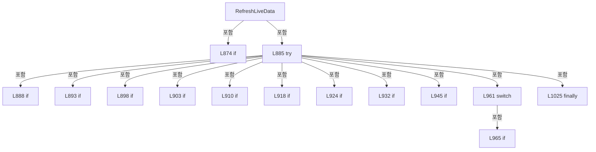

변경 전 점검: 입력/반환 타입, 위 호출자, 예외/취소 경로, 공유 상태와 저장·전송 소비자를 함께 확인합니다. 값의 단위나 물리 방향을 이름만으로 확정하지 않습니다.

### LocalFunctionStatement `IsIsSelected` · L880–883

[Drilling.UI/Menu/Menus/CMenuMonitor.cs:880–883](https://github.com/kjuws10-rgb/A3Drilling/blob/334b3599651b2e8e0181fd4459bafaf3cddafff3/Drilling.UI/Menu/Menus/CMenuMonitor.cs#L880-L883)

| 항목 | 실제 추출 값 |
| --- | --- |
| 서명 | bool IsIsSelected(Drilling.UI.Menu.Menus.ST_MONITOR_AXIS_ROW) |
| 접근/수식자 | Private /  |
| 반환/값 타입 | bool |
| 소속 타입 | NamedType:Drilling.UI.Menu.Menus.CMenuMonitor |

입력 계약:

| 이름 | 타입 | 전달 | 선택/기본값 |
| --- | --- | --- | --- |
| row | Drilling.UI.Menu.Menus.ST_MONITOR_AXIS_ROW | None | False /  |

현재 부분 분석에서 직접 연결된 호출자는 없습니다. XAML/이벤트/인터페이스·델리게이트·외부 진입을 추가 확인해야 하며, 미사용으로 판정한 것이 아닙니다.

본문의 실제 연산·분기·예외·반환 순서(원문 위치 순):

| 원본 행 | 종류 | 주석 해설 |
| --- | --- | --- |
| 882 | return | 호출자에게 값 또는 제어를 반환합니다: return row.IsSelected; |

변경 전 점검: 입력/반환 타입, 위 호출자, 예외/취소 경로, 공유 상태와 저장·전송 소비자를 함께 확인합니다. 값의 단위나 물리 방향을 이름만으로 확정하지 않습니다.

### MethodDeclaration `CreateLiveRefreshHash` · L1033–1082

[Drilling.UI/Menu/Menus/CMenuMonitor.cs:1033–1082](https://github.com/kjuws10-rgb/A3Drilling/blob/334b3599651b2e8e0181fd4459bafaf3cddafff3/Drilling.UI/Menu/Menus/CMenuMonitor.cs#L1033-L1082)

| 항목 | 실제 추출 값 |
| --- | --- |
| 서명 | int Drilling.UI.Menu.Menus.CMenuMonitor.CreateLiveRefreshHash(string, Drilling.UI.Menu.Menus.ST_MONITOR_STATUS_SNAPSHOT) |
| 접근/수식자 | Private / private |
| 반환/값 타입 | int |
| 소속 타입 | NamedType:Drilling.UI.Menu.Menus.CMenuMonitor |

입력 계약:

| 이름 | 타입 | 전달 | 선택/기본값 |
| --- | --- | --- | --- |
| selectedTab | string | None | False /  |
| monitorSnapshot | Drilling.UI.Menu.Menus.ST_MONITOR_STATUS_SNAPSHOT | None | False /  |

정적 호출자로 확인된 위치:

| 호출 파일/행 | 호출 표현식 | 런타임 분기 가능 |
| --- | --- | --- |
| [Drilling.UI/Menu/Menus/CMenuMonitor.cs:858–858](https://github.com/kjuws10-rgb/A3Drilling/blob/334b3599651b2e8e0181fd4459bafaf3cddafff3/Drilling.UI/Menu/Menus/CMenuMonitor.cs#L858-L858) | CreateLiveRefreshHash | False |
| [Drilling.UI/Menu/Menus/CMenuMonitor.cs:923–923](https://github.com/kjuws10-rgb/A3Drilling/blob/334b3599651b2e8e0181fd4459bafaf3cddafff3/Drilling.UI/Menu/Menus/CMenuMonitor.cs#L923-L923) | CreateLiveRefreshHash | False |

호출하는 대상과 해석 범위:

| 원본 행 | 표현식 | 분석 상태 | 대상/소스 위치 |
| --- | --- | --- | --- |
| 1035 | new HashCode | resolved | System.HashCode.HashCode() |
| 1036 | hash.Add | resolved | void System.HashCode.Add<string>(string, System.Collections.Generic.IEqualityComparer<string>?) |
| 1037 | AddSequenceHash | resolved | void Drilling.UI.Menu.Menus.CMenuMonitor.AddSequenceHash<Drilling.Common.Interface.ST_DEVICE_COMM_STATUS>(ref System.HashCode, System.Collections.Generic.IEnumerable<Drilling.Common.Interface.ST_DEVICE_COMM_STATUS>) · Drilling.UI/Menu/Menus/CMenuMonitor.cs:1084 |
| 1042 | hash.Add | resolved | void System.HashCode.Add<string>(string, System.Collections.Generic.IEqualityComparer<string>?) |
| 1043 | AddSequenceHash | resolved | void Drilling.UI.Menu.Menus.CMenuMonitor.AddSequenceHash<Drilling.Common.Motion.ST_MOTOR_AXIS_STATUS>(ref System.HashCode, System.Collections.Generic.IEnumerable<Drilling.Common.Motion.ST_MOTOR_AXIS_STATUS>) · Drilling.UI/Menu/Menus/CMenuMonitor.cs:1084 |
| 1046 | hash.Add | resolved | void System.HashCode.Add<int>(int) |
| 1047 | hash.Add | resolved | void System.HashCode.Add<Drilling.Common.Interface.ST_LASER_STATUS>(Drilling.Common.Interface.ST_LASER_STATUS) |
| 1048 | hash.Add | resolved | void System.HashCode.Add<Drilling.Common.Interface.ST_TALON_STATUS>(Drilling.Common.Interface.ST_TALON_STATUS) |
| 1049 | hash.Add | resolved | void System.HashCode.Add<int>(int) |
| 1050 | hash.Add | resolved | void System.HashCode.Add<Drilling.Common.Managers.ST_POWER_METER_STATUS>(Drilling.Common.Managers.ST_POWER_METER_STATUS) |
| 1053 | hash.Add | resolved | void System.HashCode.Add<int>(int) |
| 1054 | hash.Add | resolved | void System.HashCode.Add<Drilling.Common.Interface.ST_ATTENUATOR_STATUS>(Drilling.Common.Interface.ST_ATTENUATOR_STATUS) |
| 1057 | hash.Add | resolved | void System.HashCode.Add<int>(int) |
| 1058 | hash.Add | resolved | void System.HashCode.Add<Drilling.Common.Interface.ST_BET_STATUS>(Drilling.Common.Interface.ST_BET_STATUS) |
| 1061 | hash.Add | resolved | void System.HashCode.Add<int>(int) |
| 1062 | hash.Add | resolved | void System.HashCode.Add<int>(int) |
| 1063 | hash.Add | resolved | void System.HashCode.Add<string>(string, System.Collections.Generic.IEqualityComparer<string>?) |
| 1064 | hash.Add | resolved | void System.HashCode.Add<string>(string, System.Collections.Generic.IEqualityComparer<string>?) |
| 1065 | hash.Add | resolved | void System.HashCode.Add<int>(int) |
| 1066 | hash.Add | resolved | void System.HashCode.Add<Drilling.Common.Managers.ST_POWER_METER_STATUS>(Drilling.Common.Managers.ST_POWER_METER_STATUS) |
| 1069 | hash.Add | resolved | void System.HashCode.Add<int>(int) |
| 1070 | hash.Add | resolved | void System.HashCode.Add<Drilling.Common.Interface.ST_PICO_MOTOR_STATUS>(Drilling.Common.Interface.ST_PICO_MOTOR_STATUS) |
| 1073 | hash.Add | resolved | void System.HashCode.Add<string>(string, System.Collections.Generic.IEqualityComparer<string>?) |
| 1074 | AddMelsecValuesHash | resolved | void Drilling.UI.Menu.Menus.CMenuMonitor.AddMelsecValuesHash(ref System.HashCode, System.Collections.Generic.IReadOnlyDictionary<string, Drilling.UI.Menu.Menus.ST_MONITOR_MELSEC_VALUE>) · Drilling.UI/Menu/Menus/CMenuMonitor.cs:1092 |
| 1077 | hash.Add | resolved | void System.HashCode.Add<Drilling.Common.Managers.ST_DEVICE_STATUS>(Drilling.Common.Managers.ST_DEVICE_STATUS) |
| 1081 | hash.ToHashCode | resolved | int System.HashCode.ToHashCode() |

본문의 실제 연산·분기·예외·반환 순서(원문 위치 순):

| 원본 행 | 종류 | 주석 해설 |
| --- | --- | --- |
| 1035 | call | 함수·델리게이트 또는 객체 생성자를 호출합니다: new HashCode() |
| 1035 | local-declaration | 지역 변수를 선언합니다: var hash = new HashCode(); |
| 1035 | variable-initializer | 변수의 초기값을 지정합니다: hash = new HashCode() |
| 1036 | call | 함수·델리게이트 또는 객체 생성자를 호출합니다: hash.Add(selectedTab, StringComparer.OrdinalIgnoreCase) |
| 1037 | call | 함수·델리게이트 또는 객체 생성자를 호출합니다: AddSequenceHash(ref hash, monitorSnapshot.Communication) |
| 1038 | local-declaration | 지역 변수를 선언합니다: var snapshot = monitorSnapshot.DeviceStatus; |
| 1038 | variable-initializer | 변수의 초기값을 지정합니다: snapshot = monitorSnapshot.DeviceStatus |
| 1039 | switch | 값에 따라 분기합니다: switch (selectedTab) |
| 1041 | case | 분기값/패턴의 구간입니다: case "XPS": |
| 1042 | call | 함수·델리게이트 또는 객체 생성자를 호출합니다: hash.Add(_selectedAxisId, StringComparer.OrdinalIgnoreCase) |
| 1043 | call | 함수·델리게이트 또는 객체 생성자를 호출합니다: AddSequenceHash(ref hash, snapshot.Motors) |
| 1044 | break | 해당 반복/분기 구간을 종료합니다: break; |
| 1045 | case | 분기값/패턴의 구간입니다: case "LASER": |
| 1046 | call | 함수·델리게이트 또는 객체 생성자를 호출합니다: hash.Add(_selectedLaserNumber) |
| 1047 | call | 함수·델리게이트 또는 객체 생성자를 호출합니다: hash.Add(snapshot.Laser) |
| 1048 | call | 함수·델리게이트 또는 객체 생성자를 호출합니다: hash.Add(monitorSnapshot.TalonStatus) |
| 1049 | call | 함수·델리게이트 또는 객체 생성자를 호출합니다: hash.Add(_selectedPowerMeterNumber) |
| 1050 | call | 함수·델리게이트 또는 객체 생성자를 호출합니다: hash.Add(snapshot.PowerMeter) |
| 1051 | break | 해당 반복/분기 구간을 종료합니다: break; |
| 1052 | case | 분기값/패턴의 구간입니다: case "ATTENUATOR": |
| 1053 | call | 함수·델리게이트 또는 객체 생성자를 호출합니다: hash.Add(_selectedAttenuatorNumber) |
| 1054 | call | 함수·델리게이트 또는 객체 생성자를 호출합니다: hash.Add(snapshot.Attenuator) |
| 1055 | break | 해당 반복/분기 구간을 종료합니다: break; |
| 1056 | case | 분기값/패턴의 구간입니다: case "BET": |
| 1057 | call | 함수·델리게이트 또는 객체 생성자를 호출합니다: hash.Add(_selectedBetNumber) |
| 1058 | call | 함수·델리게이트 또는 객체 생성자를 호출합니다: hash.Add(snapshot.Bet) |
| 1059 | break | 해당 반복/분기 구간을 종료합니다: break; |
| 1060 | case | 분기값/패턴의 구간입니다: case "POWER METER": |
| 1061 | call | 함수·델리게이트 또는 객체 생성자를 호출합니다: hash.Add(_selectedAttenuatorNumber) |
| 1062 | call | 함수·델리게이트 또는 객체 생성자를 호출합니다: hash.Add(_selectedPowerMeterNumber) |
| 1063 | call | 함수·델리게이트 또는 객체 생성자를 호출합니다: hash.Add(_powerMeterTuneState, StringComparer.OrdinalIgnoreCase) |
| 1064 | call | 함수·델리게이트 또는 객체 생성자를 호출합니다: hash.Add(_powerMeterTuneMessage, StringComparer.OrdinalIgnoreCase) |
| 1065 | call | 함수·델리게이트 또는 객체 생성자를 호출합니다: hash.Add(_powerMeterTuneSamples.Count) |
| 1066 | call | 함수·델리게이트 또는 객체 생성자를 호출합니다: hash.Add(snapshot.PowerMeter) |
| 1067 | break | 해당 반복/분기 구간을 종료합니다: break; |
| 1068 | case | 분기값/패턴의 구간입니다: case "PICO MOTOR": |
| 1069 | call | 함수·델리게이트 또는 객체 생성자를 호출합니다: hash.Add(_selectedPicoMotorNo) |
| 1070 | call | 함수·델리게이트 또는 객체 생성자를 호출합니다: hash.Add(monitorSnapshot.PicoMotorStatus) |
| 1071 | break | 해당 반복/분기 구간을 종료합니다: break; |
| 1072 | case | 분기값/패턴의 구간입니다: case "MELSEC": |
| 1073 | call | 함수·델리게이트 또는 객체 생성자를 호출합니다: hash.Add(_selectedMelsecGroup, StringComparer.OrdinalIgnoreCase) |
| 1074 | call | 함수·델리게이트 또는 객체 생성자를 호출합니다: AddMelsecValuesHash(ref hash, monitorSnapshot.MelsecValues) |
| 1075 | break | 해당 반복/분기 구간을 종료합니다: break; |
| 1076 | case | 분기값/패턴의 구간입니다: default: |
| 1077 | call | 함수·델리게이트 또는 객체 생성자를 호출합니다: hash.Add(snapshot) |
| 1078 | break | 해당 반복/분기 구간을 종료합니다: break; |
| 1081 | call | 함수·델리게이트 또는 객체 생성자를 호출합니다: hash.ToHashCode() |
| 1081 | return | 호출자에게 값 또는 제어를 반환합니다: return hash.ToHashCode(); |

제어 구문의 포함 구조(실제 실행 순서/CFG가 아닌 구문 탐색 그림):


변경 전 점검: 입력/반환 타입, 위 호출자, 예외/취소 경로, 공유 상태와 저장·전송 소비자를 함께 확인합니다. 값의 단위나 물리 방향을 이름만으로 확정하지 않습니다.

### MethodDeclaration `AddSequenceHash` · L1084–1090

[Drilling.UI/Menu/Menus/CMenuMonitor.cs:1084–1090](https://github.com/kjuws10-rgb/A3Drilling/blob/334b3599651b2e8e0181fd4459bafaf3cddafff3/Drilling.UI/Menu/Menus/CMenuMonitor.cs#L1084-L1090)

| 항목 | 실제 추출 값 |
| --- | --- |
| 서명 | void Drilling.UI.Menu.Menus.CMenuMonitor.AddSequenceHash<T>(ref System.HashCode, System.Collections.Generic.IEnumerable<T>) |
| 접근/수식자 | Private / private, static |
| 반환/값 타입 | void |
| 소속 타입 | NamedType:Drilling.UI.Menu.Menus.CMenuMonitor |

입력 계약:

| 이름 | 타입 | 전달 | 선택/기본값 |
| --- | --- | --- | --- |
| hash | System.HashCode | Ref | False /  |
| values | System.Collections.Generic.IEnumerable<T> | None | False /  |

정적 호출자로 확인된 위치:

| 호출 파일/행 | 호출 표현식 | 런타임 분기 가능 |
| --- | --- | --- |
| [Drilling.UI/Menu/Menus/CMenuMonitor.cs:1037–1037](https://github.com/kjuws10-rgb/A3Drilling/blob/334b3599651b2e8e0181fd4459bafaf3cddafff3/Drilling.UI/Menu/Menus/CMenuMonitor.cs#L1037-L1037) | AddSequenceHash | False |
| [Drilling.UI/Menu/Menus/CMenuMonitor.cs:1043–1043](https://github.com/kjuws10-rgb/A3Drilling/blob/334b3599651b2e8e0181fd4459bafaf3cddafff3/Drilling.UI/Menu/Menus/CMenuMonitor.cs#L1043-L1043) | AddSequenceHash | False |

호출하는 대상과 해석 범위:

| 원본 행 | 표현식 | 분석 상태 | 대상/소스 위치 |
| --- | --- | --- | --- |
| 1088 | hash.Add | resolved | void System.HashCode.Add<T>(T) |

본문의 실제 연산·분기·예외·반환 순서(원문 위치 순):

| 원본 행 | 종류 | 주석 해설 |
| --- | --- | --- |
| 1086 | foreach | 컬렉션 요소를 순회합니다: foreach (var value in values) |
| 1088 | call | 함수·델리게이트 또는 객체 생성자를 호출합니다: hash.Add(value) |

제어 구문의 포함 구조(실제 실행 순서/CFG가 아닌 구문 탐색 그림):

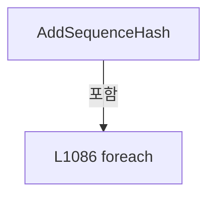

변경 전 점검: 입력/반환 타입, 위 호출자, 예외/취소 경로, 공유 상태와 저장·전송 소비자를 함께 확인합니다. 값의 단위나 물리 방향을 이름만으로 확정하지 않습니다.

### MethodDeclaration `AddMelsecValuesHash` · L1092–1099

[Drilling.UI/Menu/Menus/CMenuMonitor.cs:1092–1099](https://github.com/kjuws10-rgb/A3Drilling/blob/334b3599651b2e8e0181fd4459bafaf3cddafff3/Drilling.UI/Menu/Menus/CMenuMonitor.cs#L1092-L1099)

| 항목 | 실제 추출 값 |
| --- | --- |
| 서명 | void Drilling.UI.Menu.Menus.CMenuMonitor.AddMelsecValuesHash(ref System.HashCode, System.Collections.Generic.IReadOnlyDictionary<string, Drilling.UI.Menu.Menus.ST_MONITOR_MELSEC_VALUE>) |
| 접근/수식자 | Private / private, static |
| 반환/값 타입 | void |
| 소속 타입 | NamedType:Drilling.UI.Menu.Menus.CMenuMonitor |

입력 계약:

| 이름 | 타입 | 전달 | 선택/기본값 |
| --- | --- | --- | --- |
| hash | System.HashCode | Ref | False /  |
| values | System.Collections.Generic.IReadOnlyDictionary<string, Drilling.UI.Menu.Menus.ST_MONITOR_MELSEC_VALUE> | None | False /  |

정적 호출자로 확인된 위치:

| 호출 파일/행 | 호출 표현식 | 런타임 분기 가능 |
| --- | --- | --- |
| [Drilling.UI/Menu/Menus/CMenuMonitor.cs:1074–1074](https://github.com/kjuws10-rgb/A3Drilling/blob/334b3599651b2e8e0181fd4459bafaf3cddafff3/Drilling.UI/Menu/Menus/CMenuMonitor.cs#L1074-L1074) | AddMelsecValuesHash | False |

호출하는 대상과 해석 범위:

| 원본 행 | 표현식 | 분석 상태 | 대상/소스 위치 |
| --- | --- | --- | --- |
| 1094 | values.OrderBy | resolved | System.Linq.IOrderedEnumerable<System.Collections.Generic.KeyValuePair<string, Drilling.UI.Menu.Menus.ST_MONITOR_MELSEC_VALUE>> System.Collections.Generic.IEnumerable<System.Collections.Generic.KeyValuePair<string, Drilling.UI.Menu.Menus.ST_MONITOR_MELSEC_VALUE>>.OrderBy<System.Collections.Generic.KeyValuePair<string, Drilling.UI.Menu.Menus.ST_MONITOR_MELSEC_VALUE>, string>(System.Func<System.Collections.Generic.KeyValuePair<string, Drilling.UI.Menu.Menus.ST_MONITOR_MELSEC_VALUE>, string>, System.Collections.Generic.IComparer<string>?) |
| 1096 | hash.Add | resolved | void System.HashCode.Add<string>(string, System.Collections.Generic.IEqualityComparer<string>?) |
| 1097 | hash.Add | resolved | void System.HashCode.Add<Drilling.UI.Menu.Menus.ST_MONITOR_MELSEC_VALUE>(Drilling.UI.Menu.Menus.ST_MONITOR_MELSEC_VALUE) |

본문의 실제 연산·분기·예외·반환 순서(원문 위치 순):

| 원본 행 | 종류 | 주석 해설 |
| --- | --- | --- |
| 1094 | call | 함수·델리게이트 또는 객체 생성자를 호출합니다: values.OrderBy(GetMelsecValueKey, StringComparer.OrdinalIgnoreCase) |
| 1094 | foreach | 컬렉션 요소를 순회합니다: foreach (var item in values.OrderBy(GetMelsecValueKey, StringComparer.OrdinalIgnoreCase)) |
| 1096 | call | 함수·델리게이트 또는 객체 생성자를 호출합니다: hash.Add(item.Key, StringComparer.OrdinalIgnoreCase) |
| 1097 | call | 함수·델리게이트 또는 객체 생성자를 호출합니다: hash.Add(item.Value) |

제어 구문의 포함 구조(실제 실행 순서/CFG가 아닌 구문 탐색 그림):

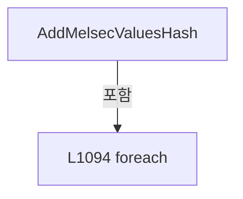

변경 전 점검: 입력/반환 타입, 위 호출자, 예외/취소 경로, 공유 상태와 저장·전송 소비자를 함께 확인합니다. 값의 단위나 물리 방향을 이름만으로 확정하지 않습니다.

### MethodDeclaration `GetMelsecValueKey` · L1101–1104

[Drilling.UI/Menu/Menus/CMenuMonitor.cs:1101–1104](https://github.com/kjuws10-rgb/A3Drilling/blob/334b3599651b2e8e0181fd4459bafaf3cddafff3/Drilling.UI/Menu/Menus/CMenuMonitor.cs#L1101-L1104)

| 항목 | 실제 추출 값 |
| --- | --- |
| 서명 | string Drilling.UI.Menu.Menus.CMenuMonitor.GetMelsecValueKey(System.Collections.Generic.KeyValuePair<string, Drilling.UI.Menu.Menus.ST_MONITOR_MELSEC_VALUE>) |
| 접근/수식자 | Private / private, static |
| 반환/값 타입 | string |
| 소속 타입 | NamedType:Drilling.UI.Menu.Menus.CMenuMonitor |

입력 계약:

| 이름 | 타입 | 전달 | 선택/기본값 |
| --- | --- | --- | --- |
| item | System.Collections.Generic.KeyValuePair<string, Drilling.UI.Menu.Menus.ST_MONITOR_MELSEC_VALUE> | None | False /  |

현재 부분 분석에서 직접 연결된 호출자는 없습니다. XAML/이벤트/인터페이스·델리게이트·외부 진입을 추가 확인해야 하며, 미사용으로 판정한 것이 아닙니다.

본문의 실제 연산·분기·예외·반환 순서(원문 위치 순):

| 원본 행 | 종류 | 주석 해설 |
| --- | --- | --- |
| 1103 | return | 호출자에게 값 또는 제어를 반환합니다: return item.Key; |

변경 전 점검: 입력/반환 타입, 위 호출자, 예외/취소 경로, 공유 상태와 저장·전송 소비자를 함께 확인합니다. 값의 단위나 물리 방향을 이름만으로 확정하지 않습니다.

### MethodDeclaration `RefreshPowerMeterSnapshotFromCache` · L1106–1115

[Drilling.UI/Menu/Menus/CMenuMonitor.cs:1106–1115](https://github.com/kjuws10-rgb/A3Drilling/blob/334b3599651b2e8e0181fd4459bafaf3cddafff3/Drilling.UI/Menu/Menus/CMenuMonitor.cs#L1106-L1115)

| 항목 | 실제 추출 값 |
| --- | --- |
| 서명 | Drilling.UI.Menu.Menus.ST_MONITOR_STATUS_SNAPSHOT Drilling.UI.Menu.Menus.CMenuMonitor.RefreshPowerMeterSnapshotFromCache(Drilling.UI.Menu.Menus.ST_MONITOR_STATUS_SNAPSHOT, System.Threading.CancellationToken) |
| 접근/수식자 | Private / private |
| 반환/값 타입 | Drilling.UI.Menu.Menus.ST_MONITOR_STATUS_SNAPSHOT |
| 소속 타입 | NamedType:Drilling.UI.Menu.Menus.CMenuMonitor |

입력 계약:

| 이름 | 타입 | 전달 | 선택/기본값 |
| --- | --- | --- | --- |
| monitorSnapshot | Drilling.UI.Menu.Menus.ST_MONITOR_STATUS_SNAPSHOT | None | False /  |
| cancellationToken | System.Threading.CancellationToken | None | False /  |

정적 호출자로 확인된 위치:

| 호출 파일/행 | 호출 표현식 | 런타임 분기 가능 |
| --- | --- | --- |
| [Drilling.UI/Menu/Menus/CMenuMonitor.cs:752–752](https://github.com/kjuws10-rgb/A3Drilling/blob/334b3599651b2e8e0181fd4459bafaf3cddafff3/Drilling.UI/Menu/Menus/CMenuMonitor.cs#L752-L752) | RefreshPowerMeterSnapshotFromCache | False |
| [Drilling.UI/Menu/Menus/CMenuMonitor.cs:920–920](https://github.com/kjuws10-rgb/A3Drilling/blob/334b3599651b2e8e0181fd4459bafaf3cddafff3/Drilling.UI/Menu/Menus/CMenuMonitor.cs#L920-L920) | RefreshPowerMeterSnapshotFromCache | False |

호출하는 대상과 해석 범위:

| 원본 행 | 표현식 | 분석 상태 | 대상/소스 위치 |
| --- | --- | --- | --- |
| 1112 | _interfaceManager.GetPowerMeterStatus | resolved | Drilling.Common.Managers.ST_POWER_METER_STATUS Drilling.Common.Interface.CInterfaceManager.GetPowerMeterStatus(int, System.Threading.CancellationToken) · Drilling.Common/Interface/CInterfaceManager.cs:1401 |

본문의 실제 연산·분기·예외·반환 순서(원문 위치 순):

| 원본 행 | 종류 | 주석 해설 |
| --- | --- | --- |
| 1108 | return | 호출자에게 값 또는 제어를 반환합니다: return monitorSnapshot with { DeviceStatus = monitorSnapshot.DeviceStatus with { PowerMeter = _interfaceManager.GetPowerMeterStatus(_selectedPowerMeterNumber, cancellationToken) } }; |
| 1110 | assignment | 값을 대상에 대입합니다: DeviceStatus = monitorSnapshot.DeviceStatus with { PowerMeter = _interfaceManager.GetPowerMeterStatus(_selectedPowerMeterNumber, cancellationToken) } |
| 1112 | assignment | 값을 대상에 대입합니다: PowerMeter = _interfaceManager.GetPowerMeterStatus(_selectedPowerMeterNumber, cancellationToken) |
| 1112 | call | 함수·델리게이트 또는 객체 생성자를 호출합니다: _interfaceManager.GetPowerMeterStatus(_selectedPowerMeterNumber, cancellationToken) |

변경 전 점검: 입력/반환 타입, 위 호출자, 예외/취소 경로, 공유 상태와 저장·전송 소비자를 함께 확인합니다. 값의 단위나 물리 방향을 이름만으로 확정하지 않습니다.

### MethodDeclaration `UpdatePollingContext` · L1117–1121

[Drilling.UI/Menu/Menus/CMenuMonitor.cs:1117–1121](https://github.com/kjuws10-rgb/A3Drilling/blob/334b3599651b2e8e0181fd4459bafaf3cddafff3/Drilling.UI/Menu/Menus/CMenuMonitor.cs#L1117-L1121)

| 항목 | 실제 추출 값 |
| --- | --- |
| 서명 | void Drilling.UI.Menu.Menus.CMenuMonitor.UpdatePollingContext(string) |
| 접근/수식자 | Private / private |
| 반환/값 타입 | void |
| 소속 타입 | NamedType:Drilling.UI.Menu.Menus.CMenuMonitor |

입력 계약:

| 이름 | 타입 | 전달 | 선택/기본값 |
| --- | --- | --- | --- |
| selectedTab | string | None | False /  |

정적 호출자로 확인된 위치:

| 호출 파일/행 | 호출 표현식 | 런타임 분기 가능 |
| --- | --- | --- |
| [Drilling.UI/Menu/Menus/CMenuMonitor.cs:747–747](https://github.com/kjuws10-rgb/A3Drilling/blob/334b3599651b2e8e0181fd4459bafaf3cddafff3/Drilling.UI/Menu/Menus/CMenuMonitor.cs#L747-L747) | UpdatePollingContext | False |
| [Drilling.UI/Menu/Menus/CMenuMonitor.cs:915–915](https://github.com/kjuws10-rgb/A3Drilling/blob/334b3599651b2e8e0181fd4459bafaf3cddafff3/Drilling.UI/Menu/Menus/CMenuMonitor.cs#L915-L915) | UpdatePollingContext | False |

호출하는 대상과 해석 범위:

| 원본 행 | 표현식 | 분석 상태 | 대상/소스 위치 |
| --- | --- | --- | --- |
| 1119 | IsHeadDeviceTab | resolved | bool Drilling.UI.Menu.Menus.CMenuMonitor.IsHeadDeviceTab(string) · Drilling.UI/Menu/Menus/CMenuMonitor.cs:2457 |
| 1120 | _statusPollingService.UpdateContext | resolved | void Drilling.UI.Menu.Menus.CMonitorStatusPollingService.UpdateContext(string, int, int, int, string) · Drilling.UI/Menu/Menus/CMonitorStatusPollingService.cs:37 |

본문의 실제 연산·분기·예외·반환 순서(원문 위치 순):

| 원본 행 | 종류 | 주석 해설 |
| --- | --- | --- |
| 1119 | call | 함수·델리게이트 또는 객체 생성자를 호출합니다: IsHeadDeviceTab(selectedTab) |
| 1119 | conditional-expression | 조건에 따라 결과식을 선택합니다: IsHeadDeviceTab(selectedTab) && _enabledHeadDeviceNumbers.Count == 0 ? "PRODUCT" : selectedTab |
| 1119 | local-declaration | 지역 변수를 선언합니다: var pollingTab = IsHeadDeviceTab(selectedTab) && _enabledHeadDeviceNumbers.Count == 0 ? "PRODUCT" : selectedTab; |
| 1119 | variable-initializer | 변수의 초기값을 지정합니다: pollingTab = IsHeadDeviceTab(selectedTab) && _enabledHeadDeviceNumbers.Count == 0 ? "PRODUCT" : selectedTab |
| 1120 | call | 함수·델리게이트 또는 객체 생성자를 호출합니다: _statusPollingService.UpdateContext(pollingTab, _selectedLaserNumber, _selectedAttenuatorNumber, _selectedBetNumber, selectedTab == "MELSEC" ? _selectedMelsecGroup : "ALL") |
| 1120 | conditional-expression | 조건에 따라 결과식을 선택합니다: selectedTab == "MELSEC" ? _selectedMelsecGroup : "ALL" |

변경 전 점검: 입력/반환 타입, 위 호출자, 예외/취소 경로, 공유 상태와 저장·전송 소비자를 함께 확인합니다. 값의 단위나 물리 방향을 이름만으로 확정하지 않습니다.

### MethodDeclaration `GetDeviceStatus` · L1123–1126

[Drilling.UI/Menu/Menus/CMenuMonitor.cs:1123–1126](https://github.com/kjuws10-rgb/A3Drilling/blob/334b3599651b2e8e0181fd4459bafaf3cddafff3/Drilling.UI/Menu/Menus/CMenuMonitor.cs#L1123-L1126)

| 항목 | 실제 추출 값 |
| --- | --- |
| 서명 | System.Threading.Tasks.Task<Drilling.Common.Managers.ST_DEVICE_STATUS> Drilling.UI.Menu.Menus.CMenuMonitor.GetDeviceStatus(System.Threading.CancellationToken) |
| 접근/수식자 | Private / private |
| 반환/값 타입 | System.Threading.Tasks.Task<Drilling.Common.Managers.ST_DEVICE_STATUS> |
| 소속 타입 | NamedType:Drilling.UI.Menu.Menus.CMenuMonitor |

입력 계약:

| 이름 | 타입 | 전달 | 선택/기본값 |
| --- | --- | --- | --- |
| cancellationToken | System.Threading.CancellationToken | None | False /  |

정적 호출자로 확인된 위치:

| 호출 파일/행 | 호출 표현식 | 런타임 분기 가능 |
| --- | --- | --- |
| [Drilling.UI/Menu/Menus/CMenuMonitor.cs:5026–5026](https://github.com/kjuws10-rgb/A3Drilling/blob/334b3599651b2e8e0181fd4459bafaf3cddafff3/Drilling.UI/Menu/Menus/CMenuMonitor.cs#L5026-L5026) | GetDeviceStatus | False |

호출하는 대상과 해석 범위:

| 원본 행 | 표현식 | 분석 상태 | 대상/소스 위치 |
| --- | --- | --- | --- |
| 1125 | GetDeviceStatus | resolved | System.Threading.Tasks.Task<Drilling.Common.Managers.ST_DEVICE_STATUS> Drilling.UI.Menu.Menus.CMenuMonitor.GetDeviceStatus(string, System.Threading.CancellationToken) · Drilling.UI/Menu/Menus/CMenuMonitor.cs:1128 |

본문의 실제 연산·분기·예외·반환 순서(원문 위치 순):

| 원본 행 | 종류 | 주석 해설 |
| --- | --- | --- |
| 1125 | call | 함수·델리게이트 또는 객체 생성자를 호출합니다: GetDeviceStatus("ALL", cancellationToken) |
| 1125 | return | 호출자에게 값 또는 제어를 반환합니다: return GetDeviceStatus("ALL", cancellationToken); |

변경 전 점검: 입력/반환 타입, 위 호출자, 예외/취소 경로, 공유 상태와 저장·전송 소비자를 함께 확인합니다. 값의 단위나 물리 방향을 이름만으로 확정하지 않습니다.

### MethodDeclaration `GetDeviceStatus` · L1128–1138

[Drilling.UI/Menu/Menus/CMenuMonitor.cs:1128–1138](https://github.com/kjuws10-rgb/A3Drilling/blob/334b3599651b2e8e0181fd4459bafaf3cddafff3/Drilling.UI/Menu/Menus/CMenuMonitor.cs#L1128-L1138)

| 항목 | 실제 추출 값 |
| --- | --- |
| 서명 | System.Threading.Tasks.Task<Drilling.Common.Managers.ST_DEVICE_STATUS> Drilling.UI.Menu.Menus.CMenuMonitor.GetDeviceStatus(string, System.Threading.CancellationToken) |
| 접근/수식자 | Private / private |
| 반환/값 타입 | System.Threading.Tasks.Task<Drilling.Common.Managers.ST_DEVICE_STATUS> |
| 소속 타입 | NamedType:Drilling.UI.Menu.Menus.CMenuMonitor |

입력 계약:

| 이름 | 타입 | 전달 | 선택/기본값 |
| --- | --- | --- | --- |
| selectedTab | string | None | False /  |
| cancellationToken | System.Threading.CancellationToken | None | False /  |

정적 호출자로 확인된 위치:

| 호출 파일/행 | 호출 표현식 | 런타임 분기 가능 |
| --- | --- | --- |
| [Drilling.UI/Menu/Menus/CMenuMonitor.cs:1125–1125](https://github.com/kjuws10-rgb/A3Drilling/blob/334b3599651b2e8e0181fd4459bafaf3cddafff3/Drilling.UI/Menu/Menus/CMenuMonitor.cs#L1125-L1125) | GetDeviceStatus | False |

호출하는 대상과 해석 범위:

| 원본 행 | 표현식 | 분석 상태 | 대상/소스 위치 |
| --- | --- | --- | --- |
| 1130 | NormalizeMonitorTab | resolved | string Drilling.UI.Menu.Menus.CMenuMonitor.NormalizeMonitorTab(string?) · Drilling.UI/Menu/Menus/CMenuMonitor.cs:1954 |
| 1132 | _motionManager.GetAxisStatus | resolved | System.Collections.Generic.IReadOnlyList<Drilling.Common.Motion.ST_MOTOR_AXIS_STATUS> Drilling.Common.Motion.CMotionManager.GetAxisStatus(System.Threading.CancellationToken) · Drilling.Common/Motion/CMotionManager.cs:146 |
| 1133 | _interfaceManager.GetLaserStatus | resolved | Drilling.Common.Interface.ST_LASER_STATUS Drilling.Common.Interface.CInterfaceManager.GetLaserStatus(int, System.Threading.CancellationToken) · Drilling.Common/Interface/CInterfaceManager.cs:856 |
| 1133 | CreateEmptyLaserStatus | resolved | Drilling.Common.Interface.ST_LASER_STATUS Drilling.UI.Menu.Menus.CMenuMonitor.CreateEmptyLaserStatus() · Drilling.UI/Menu/Menus/CMenuMonitor.cs:1140 |
| 1134 | _interfaceManager.GetAttenuatorStatus | resolved | Drilling.Common.Interface.ST_ATTENUATOR_STATUS Drilling.Common.Interface.CInterfaceManager.GetAttenuatorStatus(int, System.Threading.CancellationToken) · Drilling.Common/Interface/CInterfaceManager.cs:1014 |
| 1134 | CreateEmptyAttenuatorStatus | resolved | Drilling.Common.Interface.ST_ATTENUATOR_STATUS Drilling.UI.Menu.Menus.CMenuMonitor.CreateEmptyAttenuatorStatus() · Drilling.UI/Menu/Menus/CMenuMonitor.cs:1145 |
| 1135 | _interfaceManager.GetBETStatus | resolved | Drilling.Common.Interface.ST_BET_STATUS Drilling.Common.Interface.CInterfaceManager.GetBETStatus(int, System.Threading.CancellationToken) · Drilling.Common/Interface/CInterfaceManager.cs:1254 |
| 1135 | CreateEmptyBETStatus | resolved | Drilling.Common.Interface.ST_BET_STATUS Drilling.UI.Menu.Menus.CMenuMonitor.CreateEmptyBETStatus() · Drilling.UI/Menu/Menus/CMenuMonitor.cs:1150 |
| 1136 | _interfaceManager.GetPowerMeterStatus | resolved | Drilling.Common.Managers.ST_POWER_METER_STATUS Drilling.Common.Interface.CInterfaceManager.GetPowerMeterStatus(int, System.Threading.CancellationToken) · Drilling.Common/Interface/CInterfaceManager.cs:1401 |
| 1137 | Task.FromResult | resolved | System.Threading.Tasks.Task<Drilling.Common.Managers.ST_DEVICE_STATUS> System.Threading.Tasks.Task.FromResult<Drilling.Common.Managers.ST_DEVICE_STATUS>(Drilling.Common.Managers.ST_DEVICE_STATUS) |
| 1137 | new ST_DEVICE_STATUS | resolved | Drilling.Common.Managers.ST_DEVICE_STATUS.ST_DEVICE_STATUS(System.Collections.Generic.IReadOnlyList<Drilling.Common.Motion.ST_IO_STATUS>, System.Collections.Generic.IReadOnlyList<Drilling.Common.Motion.ST_MOTOR_AXIS_STATUS>, Drilling.Common.Interface.ST_LASER_STATUS, Drilling.Common.Interface.ST_ATTENUATOR_STATUS, Drilling.Common.Interface.ST_BET_STATUS, Drilling.Common.Managers.ST_POWER_METER_STATUS) · Drilling.Common/Managers/CManager.cs:734 |

본문의 실제 연산·분기·예외·반환 순서(원문 위치 순):

| 원본 행 | 종류 | 주석 해설 |
| --- | --- | --- |
| 1130 | call | 함수·델리게이트 또는 객체 생성자를 호출합니다: NormalizeMonitorTab(selectedTab) |
| 1130 | local-declaration | 지역 변수를 선언합니다: var tab = NormalizeMonitorTab(selectedTab); |
| 1130 | variable-initializer | 변수의 초기값을 지정합니다: tab = NormalizeMonitorTab(selectedTab) |
| 1131 | local-declaration | 지역 변수를 선언합니다: IReadOnlyList<ST_IO_STATUS> io = []; |
| 1131 | variable-initializer | 변수의 초기값을 지정합니다: io = [] |
| 1132 | call | 함수·델리게이트 또는 객체 생성자를 호출합니다: _motionManager.GetAxisStatus(cancellationToken) |
| 1132 | conditional-expression | 조건에 따라 결과식을 선택합니다: tab is "ALL" or "XPS" ? _motionManager.GetAxisStatus(cancellationToken) : [] |
| 1132 | local-declaration | 지역 변수를 선언합니다: var motors = tab is "ALL" or "XPS" ? _motionManager.GetAxisStatus(cancellationToken) : []; |
| 1132 | variable-initializer | 변수의 초기값을 지정합니다: motors = tab is "ALL" or "XPS" ? _motionManager.GetAxisStatus(cancellationToken) : [] |
| 1133 | call | 함수·델리게이트 또는 객체 생성자를 호출합니다: _interfaceManager.GetLaserStatus(_selectedLaserNumber, cancellationToken) |
| 1133 | call | 함수·델리게이트 또는 객체 생성자를 호출합니다: CreateEmptyLaserStatus() |
| 1133 | conditional-expression | 조건에 따라 결과식을 선택합니다: tab is "ALL" ? _interfaceManager.GetLaserStatus(_selectedLaserNumber, cancellationToken) : CreateEmptyLaserStatus() |
| 1133 | local-declaration | 지역 변수를 선언합니다: var laserStatus = tab is "ALL" ? _interfaceManager.GetLaserStatus(_selectedLaserNumber, cancellationToken) : CreateEmptyLaserStatus(); |
| 1133 | variable-initializer | 변수의 초기값을 지정합니다: laserStatus = tab is "ALL" ? _interfaceManager.GetLaserStatus(_selectedLaserNumber, cancellationToken) : CreateEmptyLaserStatus() |
| 1134 | call | 함수·델리게이트 또는 객체 생성자를 호출합니다: _interfaceManager.GetAttenuatorStatus(_selectedAttenuatorNumber, cancellationToken) |
| 1134 | call | 함수·델리게이트 또는 객체 생성자를 호출합니다: CreateEmptyAttenuatorStatus() |
| 1134 | conditional-expression | 조건에 따라 결과식을 선택합니다: tab is "ALL" or "ATTENUATOR" ? _interfaceManager.GetAttenuatorStatus(_selectedAttenuatorNumber, cancellationToken) : CreateEmptyAttenuatorStatus() |
| 1134 | local-declaration | 지역 변수를 선언합니다: var attenuatorStatus = tab is "ALL" or "ATTENUATOR" ? _interfaceManager.GetAttenuatorStatus(_selectedAttenuatorNumber, cancellationToken) : CreateEmptyAttenuatorStatus(); |
| 1134 | variable-initializer | 변수의 초기값을 지정합니다: attenuatorStatus = tab is "ALL" or "ATTENUATOR" ? _interfaceManager.GetAttenuatorStatus(_selectedAttenuatorNumber, cancellationToken) : CreateEmptyAttenuatorStatus() |
| 1135 | call | 함수·델리게이트 또는 객체 생성자를 호출합니다: _interfaceManager.GetBETStatus(_selectedBetNumber, cancellationToken) |
| 1135 | call | 함수·델리게이트 또는 객체 생성자를 호출합니다: CreateEmptyBETStatus() |
| 1135 | conditional-expression | 조건에 따라 결과식을 선택합니다: tab is "ALL" or "BET" ? _interfaceManager.GetBETStatus(_selectedBetNumber, cancellationToken) : CreateEmptyBETStatus() |
| 1135 | local-declaration | 지역 변수를 선언합니다: var betStatus = tab is "ALL" or "BET" ? _interfaceManager.GetBETStatus(_selectedBetNumber, cancellationToken) : CreateEmptyBETStatus(); |
| 1135 | variable-initializer | 변수의 초기값을 지정합니다: betStatus = tab is "ALL" or "BET" ? _interfaceManager.GetBETStatus(_selectedBetNumber, cancellationToken) : CreateEmptyBETStatus() |
| 1136 | call | 함수·델리게이트 또는 객체 생성자를 호출합니다: _interfaceManager.GetPowerMeterStatus(_selectedPowerMeterNumber, cancellationToken) |
| 1136 | conditional-expression | 조건에 따라 결과식을 선택합니다: tab is "ALL" or "POWER METER" ? _interfaceManager.GetPowerMeterStatus(_selectedPowerMeterNumber, cancellationToken) : ST_POWER_METER_STATUS.Empty |
| 1136 | local-declaration | 지역 변수를 선언합니다: var powerMeterStatus = tab is "ALL" or "POWER METER" ? _interfaceManager.GetPowerMeterStatus(_selectedPowerMeterNumber, cancellationToken) : ST_POWER_METER_STATUS.Empty; |
| 1136 | variable-initializer | 변수의 초기값을 지정합니다: powerMeterStatus = tab is "ALL" or "POWER METER" ? _interfaceManager.GetPowerMeterStatus(_selectedPowerMeterNumber, cancellationToken) : ST_POWER_METER_STATUS.Empty |
| 1137 | call | 함수·델리게이트 또는 객체 생성자를 호출합니다: Task.FromResult(new ST_DEVICE_STATUS(io, motors, laserStatus, attenuatorStatus, betStatus, powerMeterStatus)) |
| 1137 | call | 함수·델리게이트 또는 객체 생성자를 호출합니다: new ST_DEVICE_STATUS(io, motors, laserStatus, attenuatorStatus, betStatus, powerMeterStatus) |
| 1137 | return | 호출자에게 값 또는 제어를 반환합니다: return Task.FromResult(new ST_DEVICE_STATUS(io, motors, laserStatus, attenuatorStatus, betStatus, powerMeterStatus)); |

변경 전 점검: 입력/반환 타입, 위 호출자, 예외/취소 경로, 공유 상태와 저장·전송 소비자를 함께 확인합니다. 값의 단위나 물리 방향을 이름만으로 확정하지 않습니다.

### MethodDeclaration `CreateEmptyLaserStatus` · L1140–1143

[Drilling.UI/Menu/Menus/CMenuMonitor.cs:1140–1143](https://github.com/kjuws10-rgb/A3Drilling/blob/334b3599651b2e8e0181fd4459bafaf3cddafff3/Drilling.UI/Menu/Menus/CMenuMonitor.cs#L1140-L1143)

| 항목 | 실제 추출 값 |
| --- | --- |
| 서명 | Drilling.Common.Interface.ST_LASER_STATUS Drilling.UI.Menu.Menus.CMenuMonitor.CreateEmptyLaserStatus() |
| 접근/수식자 | Private / private, static |
| 반환/값 타입 | Drilling.Common.Interface.ST_LASER_STATUS |
| 소속 타입 | NamedType:Drilling.UI.Menu.Menus.CMenuMonitor |

정적 호출자로 확인된 위치:

| 호출 파일/행 | 호출 표현식 | 런타임 분기 가능 |
| --- | --- | --- |
| [Drilling.UI/Menu/Menus/CMenuMonitor.cs:1133–1133](https://github.com/kjuws10-rgb/A3Drilling/blob/334b3599651b2e8e0181fd4459bafaf3cddafff3/Drilling.UI/Menu/Menus/CMenuMonitor.cs#L1133-L1133) | CreateEmptyLaserStatus | False |

호출하는 대상과 해석 범위:

| 원본 행 | 표현식 | 분석 상태 | 대상/소스 위치 |
| --- | --- | --- | --- |
| 1142 | new ST_LASER_STATUS | resolved | Drilling.Common.Interface.ST_LASER_STATUS.ST_LASER_STATUS(bool, bool, bool, double) · Drilling.Common/Interface/Serial/CTalonLaser.cs:367 |

본문의 실제 연산·분기·예외·반환 순서(원문 위치 순):

| 원본 행 | 종류 | 주석 해설 |
| --- | --- | --- |
| 1142 | call | 함수·델리게이트 또는 객체 생성자를 호출합니다: new ST_LASER_STATUS(false, false, false, 0.0) |
| 1142 | return | 호출자에게 값 또는 제어를 반환합니다: return new ST_LASER_STATUS(false, false, false, 0.0); |

변경 전 점검: 입력/반환 타입, 위 호출자, 예외/취소 경로, 공유 상태와 저장·전송 소비자를 함께 확인합니다. 값의 단위나 물리 방향을 이름만으로 확정하지 않습니다.

### MethodDeclaration `CreateEmptyAttenuatorStatus` · L1145–1148

[Drilling.UI/Menu/Menus/CMenuMonitor.cs:1145–1148](https://github.com/kjuws10-rgb/A3Drilling/blob/334b3599651b2e8e0181fd4459bafaf3cddafff3/Drilling.UI/Menu/Menus/CMenuMonitor.cs#L1145-L1148)

| 항목 | 실제 추출 값 |
| --- | --- |
| 서명 | Drilling.Common.Interface.ST_ATTENUATOR_STATUS Drilling.UI.Menu.Menus.CMenuMonitor.CreateEmptyAttenuatorStatus() |
| 접근/수식자 | Private / private, static |
| 반환/값 타입 | Drilling.Common.Interface.ST_ATTENUATOR_STATUS |
| 소속 타입 | NamedType:Drilling.UI.Menu.Menus.CMenuMonitor |

정적 호출자로 확인된 위치:

| 호출 파일/행 | 호출 표현식 | 런타임 분기 가능 |
| --- | --- | --- |
| [Drilling.UI/Menu/Menus/CMenuMonitor.cs:1134–1134](https://github.com/kjuws10-rgb/A3Drilling/blob/334b3599651b2e8e0181fd4459bafaf3cddafff3/Drilling.UI/Menu/Menus/CMenuMonitor.cs#L1134-L1134) | CreateEmptyAttenuatorStatus | False |

호출하는 대상과 해석 범위:

| 원본 행 | 표현식 | 분석 상태 | 대상/소스 위치 |
| --- | --- | --- | --- |
| 1147 | new ST_ATTENUATOR_STATUS | resolved | Drilling.Common.Interface.ST_ATTENUATOR_STATUS.ST_ATTENUATOR_STATUS(double, double, string, bool, Drilling.Common.Interface.EN_CONEX_AGP_ERROR, System.DateTimeOffset?, int?, double?, double?, double?, double?, double?) · Drilling.Common/Interface/Serial/CConex_AGP.cs:549 |

본문의 실제 연산·분기·예외·반환 순서(원문 위치 순):

| 원본 행 | 종류 | 주석 해설 |
| --- | --- | --- |
| 1147 | call | 함수·델리게이트 또는 객체 생성자를 호출합니다: new ST_ATTENUATOR_STATUS(0.0, 0.0, "IDLE", false) |
| 1147 | return | 호출자에게 값 또는 제어를 반환합니다: return new ST_ATTENUATOR_STATUS(0.0, 0.0, "IDLE", false); |

변경 전 점검: 입력/반환 타입, 위 호출자, 예외/취소 경로, 공유 상태와 저장·전송 소비자를 함께 확인합니다. 값의 단위나 물리 방향을 이름만으로 확정하지 않습니다.

### MethodDeclaration `CreateEmptyBETStatus` · L1150–1153

[Drilling.UI/Menu/Menus/CMenuMonitor.cs:1150–1153](https://github.com/kjuws10-rgb/A3Drilling/blob/334b3599651b2e8e0181fd4459bafaf3cddafff3/Drilling.UI/Menu/Menus/CMenuMonitor.cs#L1150-L1153)

| 항목 | 실제 추출 값 |
| --- | --- |
| 서명 | Drilling.Common.Interface.ST_BET_STATUS Drilling.UI.Menu.Menus.CMenuMonitor.CreateEmptyBETStatus() |
| 접근/수식자 | Private / private, static |
| 반환/값 타입 | Drilling.Common.Interface.ST_BET_STATUS |
| 소속 타입 | NamedType:Drilling.UI.Menu.Menus.CMenuMonitor |

정적 호출자로 확인된 위치:

| 호출 파일/행 | 호출 표현식 | 런타임 분기 가능 |
| --- | --- | --- |
| [Drilling.UI/Menu/Menus/CMenuMonitor.cs:1135–1135](https://github.com/kjuws10-rgb/A3Drilling/blob/334b3599651b2e8e0181fd4459bafaf3cddafff3/Drilling.UI/Menu/Menus/CMenuMonitor.cs#L1135-L1135) | CreateEmptyBETStatus | False |

호출하는 대상과 해석 범위:

| 원본 행 | 표현식 | 분석 상태 | 대상/소스 위치 |
| --- | --- | --- | --- |
| 1152 | new ST_BET_STATUS | resolved | Drilling.Common.Interface.ST_BET_STATUS.ST_BET_STATUS(double, double, double, double, double, double, bool, bool, bool, bool, bool, Drilling.Common.Interface.EN_BET_ERROR, System.DateTimeOffset?, string) · Drilling.Common/Interface/Serial/CBeamExpander.cs:449 |

본문의 실제 연산·분기·예외·반환 순서(원문 위치 순):

| 원본 행 | 종류 | 주석 해설 |
| --- | --- | --- |
| 1152 | call | 함수·델리게이트 또는 객체 생성자를 호출합니다: new ST_BET_STATUS(0.0, 0.0, 0.0, 0.0, 0.0, 0.0, false, false, false, false, false) |
| 1152 | return | 호출자에게 값 또는 제어를 반환합니다: return new ST_BET_STATUS(0.0, 0.0, 0.0, 0.0, 0.0, 0.0, false, false, false, false, false); |

변경 전 점검: 입력/반환 타입, 위 호출자, 예외/취소 경로, 공유 상태와 저장·전송 소비자를 함께 확인합니다. 값의 단위나 물리 방향을 이름만으로 확정하지 않습니다.

### MethodDeclaration `SelectTab` · L1155–1172

[Drilling.UI/Menu/Menus/CMenuMonitor.cs:1155–1172](https://github.com/kjuws10-rgb/A3Drilling/blob/334b3599651b2e8e0181fd4459bafaf3cddafff3/Drilling.UI/Menu/Menus/CMenuMonitor.cs#L1155-L1172)

| 항목 | 실제 추출 값 |
| --- | --- |
| 서명 | System.Threading.Tasks.Task Drilling.UI.Menu.Menus.CMenuMonitor.SelectTab(object?) |
| 접근/수식자 | Private / private, async |
| 반환/값 타입 | System.Threading.Tasks.Task |
| 소속 타입 | NamedType:Drilling.UI.Menu.Menus.CMenuMonitor |

입력 계약:

| 이름 | 타입 | 전달 | 선택/기본값 |
| --- | --- | --- | --- |
| parameter | object? | None | False /  |

정적 호출자로 확인된 위치:

| 호출 파일/행 | 호출 표현식 | 런타임 분기 가능 |
| --- | --- | --- |
| [Drilling.UI/Menu/Menus/CMenuMonitor.cs:215–215](https://github.com/kjuws10-rgb/A3Drilling/blob/334b3599651b2e8e0181fd4459bafaf3cddafff3/Drilling.UI/Menu/Menus/CMenuMonitor.cs#L215-L215) | SelectTab | False |

호출하는 대상과 해석 범위:

| 원본 행 | 표현식 | 분석 상태 | 대상/소스 위치 |
| --- | --- | --- | --- |
| 1157 | string.IsNullOrWhiteSpace | resolved | bool string.IsNullOrWhiteSpace(string?) |
| 1162 | NormalizeMonitorScreenTab | resolved | string Drilling.UI.Menu.Menus.CMenuMonitor.NormalizeMonitorScreenTab(string?) · Drilling.UI/Menu/Menus/CMenuMonitor.cs:1948 |
| 1163 | selectedTab.Equals | resolved | bool string.Equals(string?, System.StringComparison) |
| 1165 | ResetMelsecWriteLock | resolved | void Drilling.UI.Menu.Menus.CMenuMonitor.ResetMelsecWriteLock() · Drilling.UI/Menu/Menus/CMenuMonitor.cs:2978 |
| 1168 | _selectedTabSetter | resolved · 동적 구현 선택 가능 | void System.Action<string>.Invoke(string) |
| 1169 | _setStatusMessage | resolved · 동적 구현 선택 가능 | void System.Action<string>.Invoke(string) |
| 1170 | _refreshShellStatus | resolved · 동적 구현 선택 가능 | void System.Action.Invoke() |
| 1171 | _refreshCurrentScreen | resolved · 동적 구현 선택 가능 | System.Threading.Tasks.Task System.Func<System.Threading.Tasks.Task>.Invoke() |

본문의 실제 연산·분기·예외·반환 순서(원문 위치 순):

| 원본 행 | 종류 | 주석 해설 |
| --- | --- | --- |
| 1157 | call | 함수·델리게이트 또는 객체 생성자를 호출합니다: string.IsNullOrWhiteSpace(tab) |
| 1157 | if | 조건에 따라 분기합니다: if (parameter is not string tab &#124;&#124; string.IsNullOrWhiteSpace(tab)) |
| 1159 | return | 호출자에게 값 또는 제어를 반환합니다: return; |
| 1162 | call | 함수·델리게이트 또는 객체 생성자를 호출합니다: NormalizeMonitorScreenTab(tab) |
| 1162 | local-declaration | 지역 변수를 선언합니다: var selectedTab = NormalizeMonitorScreenTab(tab); |
| 1162 | variable-initializer | 변수의 초기값을 지정합니다: selectedTab = NormalizeMonitorScreenTab(tab) |
| 1163 | call | 함수·델리게이트 또는 객체 생성자를 호출합니다: selectedTab.Equals("MELSEC", StringComparison.OrdinalIgnoreCase) |
| 1163 | if | 조건에 따라 분기합니다: if (!selectedTab.Equals("MELSEC", StringComparison.OrdinalIgnoreCase)) |
| 1165 | call | 함수·델리게이트 또는 객체 생성자를 호출합니다: ResetMelsecWriteLock() |
| 1168 | call | 함수·델리게이트 또는 객체 생성자를 호출합니다: _selectedTabSetter(selectedTab) |
| 1169 | call | 함수·델리게이트 또는 객체 생성자를 호출합니다: _setStatusMessage($"Monitor tab {selectedTab} selected.") |
| 1170 | call | 함수·델리게이트 또는 객체 생성자를 호출합니다: _refreshShellStatus() |
| 1171 | await | 비동기 완료를 기다립니다: await _refreshCurrentScreen() |
| 1171 | call | 함수·델리게이트 또는 객체 생성자를 호출합니다: _refreshCurrentScreen() |

제어 구문의 포함 구조(실제 실행 순서/CFG가 아닌 구문 탐색 그림):

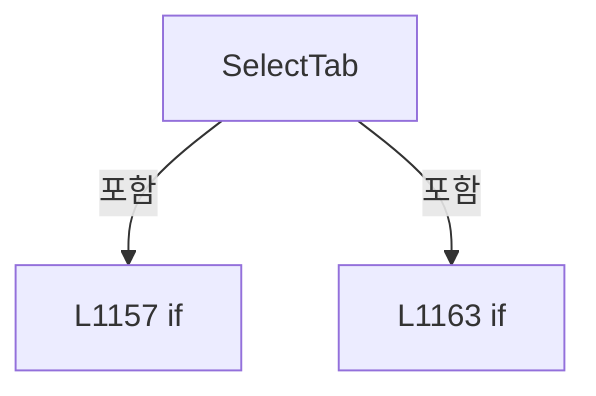

변경 전 점검: 입력/반환 타입, 위 호출자, 예외/취소 경로, 공유 상태와 저장·전송 소비자를 함께 확인합니다. 값의 단위나 물리 방향을 이름만으로 확정하지 않습니다.

### MethodDeclaration `SelectHeadDevice` · L1174–1227

[Drilling.UI/Menu/Menus/CMenuMonitor.cs:1174–1227](https://github.com/kjuws10-rgb/A3Drilling/blob/334b3599651b2e8e0181fd4459bafaf3cddafff3/Drilling.UI/Menu/Menus/CMenuMonitor.cs#L1174-L1227)

| 항목 | 실제 추출 값 |
| --- | --- |
| 서명 | System.Threading.Tasks.Task Drilling.UI.Menu.Menus.CMenuMonitor.SelectHeadDevice(object?) |
| 접근/수식자 | Private / private, async |
| 반환/값 타입 | System.Threading.Tasks.Task |
| 소속 타입 | NamedType:Drilling.UI.Menu.Menus.CMenuMonitor |

입력 계약:

| 이름 | 타입 | 전달 | 선택/기본값 |
| --- | --- | --- | --- |
| parameter | object? | None | False /  |

정적 호출자로 확인된 위치:

| 호출 파일/행 | 호출 표현식 | 런타임 분기 가능 |
| --- | --- | --- |
| [Drilling.UI/Menu/Menus/CMenuMonitor.cs:221–221](https://github.com/kjuws10-rgb/A3Drilling/blob/334b3599651b2e8e0181fd4459bafaf3cddafff3/Drilling.UI/Menu/Menus/CMenuMonitor.cs#L221-L221) | SelectHeadDevice | False |

호출하는 대상과 해석 범위:

| 원본 행 | 표현식 | 분석 상태 | 대상/소스 위치 |
| --- | --- | --- | --- |
| 1176 | TryNotifyPowerMeterTuneLocked | resolved | bool Drilling.UI.Menu.Menus.CMenuMonitor.TryNotifyPowerMeterTuneLocked(string) · Drilling.UI/Menu/Menus/CMenuMonitor.cs:5782 |
| 1181 | CanSelectHeadDevice | resolved | bool Drilling.UI.Menu.Menus.CMenuMonitor.CanSelectHeadDevice(object?) · Drilling.UI/Menu/Menus/CMenuMonitor.cs:1242 |
| 1190 | int.TryParse | resolved | bool int.TryParse(string?, System.Globalization.NumberStyles, System.IFormatProvider?, out int) |
| 1191 | GetSelectedHeadNumber | resolved | int Drilling.UI.Menu.Menus.CMenuMonitor.GetSelectedHeadNumber(string) · Drilling.UI/Menu/Menus/CMenuMonitor.cs:2347 |
| 1192 | Math.Clamp | resolved | int System.Math.Clamp(int, int, int) |
| 1193 | LoadEnabledHeadDeviceNumbers | resolved | System.Collections.Generic.IReadOnlyList<int> Drilling.UI.Menu.Menus.CMenuMonitor.LoadEnabledHeadDeviceNumbers(System.Threading.CancellationToken) · Drilling.UI/Menu/Menus/CMenuMonitor.cs:2368 |
| 1196 | _setStatusMessage | resolved · 동적 구현 선택 가능 | void System.Action<string>.Invoke(string) |
| 1197 | _refreshShellStatus | resolved · 동적 구현 선택 가능 | void System.Action.Invoke() |
| 1198 | _refreshCurrentScreen | resolved · 동적 구현 선택 가능 | System.Threading.Tasks.Task System.Func<System.Threading.Tasks.Task>.Invoke() |
| 1202 | _enabledHeadDeviceNumbers.Contains | resolved | bool System.Collections.Generic.IEnumerable<int>.Contains<int>(int) |
| 1204 | _setStatusMessage | resolved · 동적 구현 선택 가능 | void System.Action<string>.Invoke(string) |
| 1205 | _refreshShellStatus | resolved · 동적 구현 선택 가능 | void System.Action.Invoke() |
| 1206 | _refreshCurrentScreen | resolved · 동적 구현 선택 가능 | System.Threading.Tasks.Task System.Func<System.Threading.Tasks.Task>.Invoke() |
| 1224 | _setStatusMessage | resolved · 동적 구현 선택 가능 | void System.Action<string>.Invoke(string) |
| 1225 | _refreshShellStatus | resolved · 동적 구현 선택 가능 | void System.Action.Invoke() |
| 1226 | _refreshCurrentScreen | resolved · 동적 구현 선택 가능 | System.Threading.Tasks.Task System.Func<System.Threading.Tasks.Task>.Invoke() |

본문의 실제 연산·분기·예외·반환 순서(원문 위치 순):

| 원본 행 | 종류 | 주석 해설 |
| --- | --- | --- |
| 1176 | call | 함수·델리게이트 또는 객체 생성자를 호출합니다: TryNotifyPowerMeterTuneLocked("ATT HEAD 선택") |
| 1176 | if | 조건에 따라 분기합니다: if (SelectedTab == "POWER METER" && TryNotifyPowerMeterTuneLocked("ATT HEAD 선택")) |
| 1178 | return | 호출자에게 값 또는 제어를 반환합니다: return; |
| 1181 | call | 함수·델리게이트 또는 객체 생성자를 호출합니다: CanSelectHeadDevice(parameter) |
| 1181 | if | 조건에 따라 분기합니다: if (!CanSelectHeadDevice(parameter)) |
| 1183 | return | 호출자에게 값 또는 제어를 반환합니다: return; |
| 1186 | local-declaration | 지역 변수를 선언합니다: var number = parameter switch { ST_MONITOR_HEAD_SELECT_ROW row => row.Number, int value => value, string text when int.TryParse(text, NumberStyles.Integer, CultureInfo.InvariantCulture, out var value) => value, _ => GetSelectedHea |
| 1186 | switch-expression | 값별 결과식을 선택합니다: parameter switch { ST_MONITOR_HEAD_SELECT_ROW row => row.Number, int value => value, string text when int.TryParse(text, NumberStyles.Integer, CultureInfo.InvariantCulture, out var value) => value, _ => GetSelectedHeadNumber(Selec |
| 1186 | variable-initializer | 변수의 초기값을 지정합니다: number = parameter switch { ST_MONITOR_HEAD_SELECT_ROW row => row.Number, int value => value, string text when int.TryParse(text, NumberStyles.Integer, CultureInfo.InvariantCulture, out var value) => value, _ => GetSelectedHeadNum |
| 1190 | call | 함수·델리게이트 또는 객체 생성자를 호출합니다: int.TryParse(text, NumberStyles.Integer, CultureInfo.InvariantCulture, out var value) |
| 1191 | call | 함수·델리게이트 또는 객체 생성자를 호출합니다: GetSelectedHeadNumber(SelectedTab) |
| 1192 | assignment | 값을 대상에 대입합니다: number = Math.Clamp(number, 0, LaserHeadCount - 1) |
| 1192 | call | 함수·델리게이트 또는 객체 생성자를 호출합니다: Math.Clamp(number, 0, LaserHeadCount - 1) |
| 1193 | assignment | 값을 대상에 대입합니다: _enabledHeadDeviceNumbers = LoadEnabledHeadDeviceNumbers(CancellationToken.None) |
| 1193 | call | 함수·델리게이트 또는 객체 생성자를 호출합니다: LoadEnabledHeadDeviceNumbers(CancellationToken.None) |
| 1194 | if | 조건에 따라 분기합니다: if (_enabledHeadDeviceNumbers.Count == 0) |
| 1196 | call | 함수·델리게이트 또는 객체 생성자를 호출합니다: _setStatusMessage("No monitor head is enabled. Check Hxx_USE option settings.") |
| 1197 | call | 함수·델리게이트 또는 객체 생성자를 호출합니다: _refreshShellStatus() |
| 1198 | await | 비동기 완료를 기다립니다: await _refreshCurrentScreen() |
| 1198 | call | 함수·델리게이트 또는 객체 생성자를 호출합니다: _refreshCurrentScreen() |
| 1199 | return | 호출자에게 값 또는 제어를 반환합니다: return; |
| 1202 | call | 함수·델리게이트 또는 객체 생성자를 호출합니다: _enabledHeadDeviceNumbers.Contains(number) |
| 1202 | if | 조건에 따라 분기합니다: if (!_enabledHeadDeviceNumbers.Contains(number)) |
| 1204 | call | 함수·델리게이트 또는 객체 생성자를 호출합니다: _setStatusMessage($"Monitor {SelectedTab} H{number + 1:00} is disabled by H{number + 1:00}_USE.") |
| 1205 | call | 함수·델리게이트 또는 객체 생성자를 호출합니다: _refreshShellStatus() |
| 1206 | await | 비동기 완료를 기다립니다: await _refreshCurrentScreen() |
| 1206 | call | 함수·델리게이트 또는 객체 생성자를 호출합니다: _refreshCurrentScreen() |
| 1207 | return | 호출자에게 값 또는 제어를 반환합니다: return; |
| 1210 | switch | 값에 따라 분기합니다: switch (SelectedTab) |
| 1212 | case | 분기값/패턴의 구간입니다: case "ATTENUATOR": |
| 1213 | case | 분기값/패턴의 구간입니다: case "POWER METER": |
| 1214 | assignment | 값을 대상에 대입합니다: _selectedAttenuatorNumber = number |
| 1215 | break | 해당 반복/분기 구간을 종료합니다: break; |
| 1216 | case | 분기값/패턴의 구간입니다: case "BET": |
| 1217 | assignment | 값을 대상에 대입합니다: _selectedBetNumber = number |
| 1218 | break | 해당 반복/분기 구간을 종료합니다: break; |
| 1219 | case | 분기값/패턴의 구간입니다: default: |
| 1220 | assignment | 값을 대상에 대입합니다: _selectedLaserNumber = number |
| 1221 | break | 해당 반복/분기 구간을 종료합니다: break; |
| 1224 | call | 함수·델리게이트 또는 객체 생성자를 호출합니다: _setStatusMessage($"Monitor {SelectedTab} H{number + 1:00} selected.") |
| 1225 | call | 함수·델리게이트 또는 객체 생성자를 호출합니다: _refreshShellStatus() |
| 1226 | await | 비동기 완료를 기다립니다: await _refreshCurrentScreen() |
| 1226 | call | 함수·델리게이트 또는 객체 생성자를 호출합니다: _refreshCurrentScreen() |

제어 구문의 포함 구조(실제 실행 순서/CFG가 아닌 구문 탐색 그림):

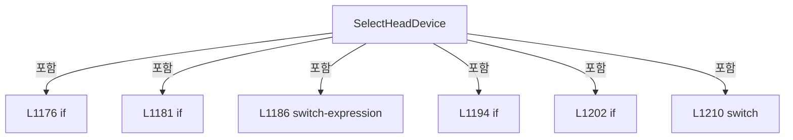

변경 전 점검: 입력/반환 타입, 위 호출자, 예외/취소 경로, 공유 상태와 저장·전송 소비자를 함께 확인합니다. 값의 단위나 물리 방향을 이름만으로 확정하지 않습니다.

### MethodDeclaration `EnsureMonitorWriteCommandAllowed` · L1229–1240

[Drilling.UI/Menu/Menus/CMenuMonitor.cs:1229–1240](https://github.com/kjuws10-rgb/A3Drilling/blob/334b3599651b2e8e0181fd4459bafaf3cddafff3/Drilling.UI/Menu/Menus/CMenuMonitor.cs#L1229-L1240)

| 항목 | 실제 추출 값 |
| --- | --- |
| 서명 | bool Drilling.UI.Menu.Menus.CMenuMonitor.EnsureMonitorWriteCommandAllowed(string) |
| 접근/수식자 | Private / private |
| 반환/값 타입 | bool |
| 소속 타입 | NamedType:Drilling.UI.Menu.Menus.CMenuMonitor |

입력 계약:

| 이름 | 타입 | 전달 | 선택/기본값 |
| --- | --- | --- | --- |
| actionName | string | None | False /  |

정적 호출자로 확인된 위치:

| 호출 파일/행 | 호출 표현식 | 런타임 분기 가능 |
| --- | --- | --- |
| [Drilling.UI/Menu/Menus/CMenuMonitor.cs:1262–1262](https://github.com/kjuws10-rgb/A3Drilling/blob/334b3599651b2e8e0181fd4459bafaf3cddafff3/Drilling.UI/Menu/Menus/CMenuMonitor.cs#L1262-L1262) | EnsureMonitorWriteCommandAllowed | False |
| [Drilling.UI/Menu/Menus/CMenuMonitor.cs:2921–2921](https://github.com/kjuws10-rgb/A3Drilling/blob/334b3599651b2e8e0181fd4459bafaf3cddafff3/Drilling.UI/Menu/Menus/CMenuMonitor.cs#L2921-L2921) | EnsureMonitorWriteCommandAllowed | False |
| [Drilling.UI/Menu/Menus/CMenuMonitor.cs:2968–2968](https://github.com/kjuws10-rgb/A3Drilling/blob/334b3599651b2e8e0181fd4459bafaf3cddafff3/Drilling.UI/Menu/Menus/CMenuMonitor.cs#L2968-L2968) | EnsureMonitorWriteCommandAllowed | False |
| [Drilling.UI/Menu/Menus/CMenuMonitor.cs:4394–4394](https://github.com/kjuws10-rgb/A3Drilling/blob/334b3599651b2e8e0181fd4459bafaf3cddafff3/Drilling.UI/Menu/Menus/CMenuMonitor.cs#L4394-L4394) | EnsureMonitorWriteCommandAllowed | False |
| [Drilling.UI/Menu/Menus/CMenuMonitor.cs:4426–4426](https://github.com/kjuws10-rgb/A3Drilling/blob/334b3599651b2e8e0181fd4459bafaf3cddafff3/Drilling.UI/Menu/Menus/CMenuMonitor.cs#L4426-L4426) | EnsureMonitorWriteCommandAllowed | False |
| [Drilling.UI/Menu/Menus/CMenuMonitor.cs:5404–5404](https://github.com/kjuws10-rgb/A3Drilling/blob/334b3599651b2e8e0181fd4459bafaf3cddafff3/Drilling.UI/Menu/Menus/CMenuMonitor.cs#L5404-L5404) | EnsureMonitorWriteCommandAllowed | False |
| [Drilling.UI/Menu/Menus/CMenuMonitor.cs:5438–5438](https://github.com/kjuws10-rgb/A3Drilling/blob/334b3599651b2e8e0181fd4459bafaf3cddafff3/Drilling.UI/Menu/Menus/CMenuMonitor.cs#L5438-L5438) | EnsureMonitorWriteCommandAllowed | False |

호출하는 대상과 해석 범위:

| 원본 행 | 표현식 | 분석 상태 | 대상/소스 위치 |
| --- | --- | --- | --- |
| 1231 | _canExecuteMonitorWriteCommand | resolved · 동적 구현 선택 가능 | bool System.Func<bool>.Invoke() |
| 1237 | _setStatusMessage | resolved · 동적 구현 선택 가능 | void System.Action<string>.Invoke(string) |
| 1237 | message.Replace | resolved | string string.Replace(string, string?) |
| 1238 | CRecipeConfirmDialog.ShowWarning | resolved | void Drilling.UI.Popup.CRecipeConfirmDialog.ShowWarning(string, string, Window?) · Drilling.UI/Popup/CRecipeConfirmDialog.xaml.cs:86 |

본문의 실제 연산·분기·예외·반환 순서(원문 위치 순):

| 원본 행 | 종류 | 주석 해설 |
| --- | --- | --- |
| 1231 | call | 함수·델리게이트 또는 객체 생성자를 호출합니다: _canExecuteMonitorWriteCommand() |
| 1231 | if | 조건에 따라 분기합니다: if (_canExecuteMonitorWriteCommand()) |
| 1233 | return | 호출자에게 값 또는 제어를 반환합니다: return true; |
| 1236 | local-declaration | 지역 변수를 선언합니다: var message = $"{actionName}은 Manual Mode에서만 사용할 수 있습니다.\nAuto Mode에서는 Monitor 화면의 조회와 Polling만 가능합니다."; |
| 1236 | variable-initializer | 변수의 초기값을 지정합니다: message = $"{actionName}은 Manual Mode에서만 사용할 수 있습니다.\nAuto Mode에서는 Monitor 화면의 조회와 Polling만 가능합니다." |
| 1237 | call | 함수·델리게이트 또는 객체 생성자를 호출합니다: _setStatusMessage(message.Replace(Environment.NewLine, " ")) |
| 1237 | call | 함수·델리게이트 또는 객체 생성자를 호출합니다: message.Replace(Environment.NewLine, " ") |
| 1238 | call | 함수·델리게이트 또는 객체 생성자를 호출합니다: CRecipeConfirmDialog.ShowWarning("Monitor 제어 불가", message) |
| 1239 | return | 호출자에게 값 또는 제어를 반환합니다: return false; |

제어 구문의 포함 구조(실제 실행 순서/CFG가 아닌 구문 탐색 그림):

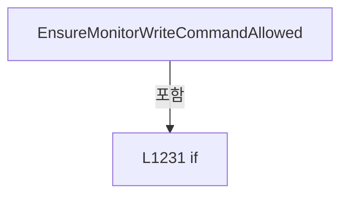

변경 전 점검: 입력/반환 타입, 위 호출자, 예외/취소 경로, 공유 상태와 저장·전송 소비자를 함께 확인합니다. 값의 단위나 물리 방향을 이름만으로 확정하지 않습니다.

### MethodDeclaration `CanSelectHeadDevice` · L1242–1251

[Drilling.UI/Menu/Menus/CMenuMonitor.cs:1242–1251](https://github.com/kjuws10-rgb/A3Drilling/blob/334b3599651b2e8e0181fd4459bafaf3cddafff3/Drilling.UI/Menu/Menus/CMenuMonitor.cs#L1242-L1251)

| 항목 | 실제 추출 값 |
| --- | --- |
| 서명 | bool Drilling.UI.Menu.Menus.CMenuMonitor.CanSelectHeadDevice(object?) |
| 접근/수식자 | Private / private |
| 반환/값 타입 | bool |
| 소속 타입 | NamedType:Drilling.UI.Menu.Menus.CMenuMonitor |

입력 계약:

| 이름 | 타입 | 전달 | 선택/기본값 |
| --- | --- | --- | --- |
| parameter | object? | None | False /  |

정적 호출자로 확인된 위치:

| 호출 파일/행 | 호출 표현식 | 런타임 분기 가능 |
| --- | --- | --- |
| [Drilling.UI/Menu/Menus/CMenuMonitor.cs:226–226](https://github.com/kjuws10-rgb/A3Drilling/blob/334b3599651b2e8e0181fd4459bafaf3cddafff3/Drilling.UI/Menu/Menus/CMenuMonitor.cs#L226-L226) | CanSelectHeadDevice | False |
| [Drilling.UI/Menu/Menus/CMenuMonitor.cs:1181–1181](https://github.com/kjuws10-rgb/A3Drilling/blob/334b3599651b2e8e0181fd4459bafaf3cddafff3/Drilling.UI/Menu/Menus/CMenuMonitor.cs#L1181-L1181) | CanSelectHeadDevice | False |

호출하는 대상과 해석 범위:

| 원본 행 | 표현식 | 분석 상태 | 대상/소스 위치 |
| --- | --- | --- | --- |
| 1247 | _enabledHeadDeviceNumbers.Contains | resolved | bool System.Collections.Generic.IEnumerable<int>.Contains<int>(int) |
| 1247 | Math.Clamp | resolved | int System.Math.Clamp(int, int, int) |
| 1248 | int.TryParse | resolved | bool int.TryParse(string?, System.Globalization.NumberStyles, System.IFormatProvider?, out int) |
| 1248 | _enabledHeadDeviceNumbers.Contains | resolved | bool System.Collections.Generic.IEnumerable<int>.Contains<int>(int) |
| 1248 | Math.Clamp | resolved | int System.Math.Clamp(int, int, int) |

본문의 실제 연산·분기·예외·반환 순서(원문 위치 순):

| 원본 행 | 종류 | 주석 해설 |
| --- | --- | --- |
| 1244 | return | 호출자에게 값 또는 제어를 반환합니다: return parameter switch { ST_MONITOR_HEAD_SELECT_ROW row => row.IsEnabled, int number => _enabledHeadDeviceNumbers.Contains(Math.Clamp(number, 0, LaserHeadCount - 1)), string text when int.TryParse(text, NumberStyles.Integer, Cult |
| 1244 | switch-expression | 값별 결과식을 선택합니다: parameter switch { ST_MONITOR_HEAD_SELECT_ROW row => row.IsEnabled, int number => _enabledHeadDeviceNumbers.Contains(Math.Clamp(number, 0, LaserHeadCount - 1)), string text when int.TryParse(text, NumberStyles.Integer, CultureInfo |
| 1247 | call | 함수·델리게이트 또는 객체 생성자를 호출합니다: _enabledHeadDeviceNumbers.Contains(Math.Clamp(number, 0, LaserHeadCount - 1)) |
| 1247 | call | 함수·델리게이트 또는 객체 생성자를 호출합니다: Math.Clamp(number, 0, LaserHeadCount - 1) |
| 1248 | call | 함수·델리게이트 또는 객체 생성자를 호출합니다: int.TryParse(text, NumberStyles.Integer, CultureInfo.InvariantCulture, out var number) |
| 1248 | call | 함수·델리게이트 또는 객체 생성자를 호출합니다: _enabledHeadDeviceNumbers.Contains(Math.Clamp(number, 0, LaserHeadCount - 1)) |
| 1248 | call | 함수·델리게이트 또는 객체 생성자를 호출합니다: Math.Clamp(number, 0, LaserHeadCount - 1) |

제어 구문의 포함 구조(실제 실행 순서/CFG가 아닌 구문 탐색 그림):

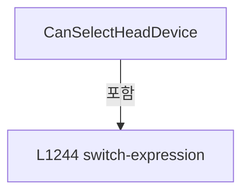

변경 전 점검: 입력/반환 타입, 위 호출자, 예외/취소 경로, 공유 상태와 저장·전송 소비자를 함께 확인합니다. 값의 단위나 물리 방향을 이름만으로 확정하지 않습니다.

### MethodDeclaration `ExecuteOperation` · L1253–1327

[Drilling.UI/Menu/Menus/CMenuMonitor.cs:1253–1327](https://github.com/kjuws10-rgb/A3Drilling/blob/334b3599651b2e8e0181fd4459bafaf3cddafff3/Drilling.UI/Menu/Menus/CMenuMonitor.cs#L1253-L1327)

| 항목 | 실제 추출 값 |
| --- | --- |
| 서명 | System.Threading.Tasks.Task Drilling.UI.Menu.Menus.CMenuMonitor.ExecuteOperation(object?) |
| 접근/수식자 | Private / private, async |
| 반환/값 타입 | System.Threading.Tasks.Task |
| 소속 타입 | NamedType:Drilling.UI.Menu.Menus.CMenuMonitor |

입력 계약:

| 이름 | 타입 | 전달 | 선택/기본값 |
| --- | --- | --- | --- |
| parameter | object? | None | False /  |

정적 호출자로 확인된 위치:

| 호출 파일/행 | 호출 표현식 | 런타임 분기 가능 |
| --- | --- | --- |
| [Drilling.UI/Menu/Menus/CMenuMonitor.cs:232–232](https://github.com/kjuws10-rgb/A3Drilling/blob/334b3599651b2e8e0181fd4459bafaf3cddafff3/Drilling.UI/Menu/Menus/CMenuMonitor.cs#L232-L232) | ExecuteOperation | False |

호출하는 대상과 해석 범위:

| 원본 행 | 표현식 | 분석 상태 | 대상/소스 위치 |
| --- | --- | --- | --- |
| 1255 | GetMonitorOperationLabel | resolved | string Drilling.UI.Menu.Menus.CMenuMonitor.GetMonitorOperationLabel(object?) · Drilling.UI/Menu/Menus/CMenuMonitor.cs:1634 |
| 1257 | string.IsNullOrWhiteSpace | resolved | bool string.IsNullOrWhiteSpace(string?) |
| 1262 | EnsureMonitorWriteCommandAllowed | resolved | bool Drilling.UI.Menu.Menus.CMenuMonitor.EnsureMonitorWriteCommandAllowed(string) · Drilling.UI/Menu/Menus/CMenuMonitor.cs:1229 |
| 1267 | NormalizeMonitorOperation | resolved | string Drilling.UI.Menu.Menus.CMenuMonitor.NormalizeMonitorOperation(string) · Drilling.UI/Menu/Menus/CMenuMonitor.cs:1646 |
| 1268 | TryNotifyPowerMeterTuneLocked | resolved | bool Drilling.UI.Menu.Menus.CMenuMonitor.TryNotifyPowerMeterTuneLocked(string) · Drilling.UI/Menu/Menus/CMenuMonitor.cs:5782 |
| 1273 | MultiMoveAxisRows.Any | resolved | bool System.Collections.Generic.IEnumerable<Drilling.UI.Menu.Menus.ST_MONITOR_MULTI_MOVE_AXIS_ROW>.Any<Drilling.UI.Menu.Menus.ST_MONITOR_MULTI_MOVE_AXIS_ROW>(System.Func<Drilling.UI.Menu.Menus.ST_MONITOR_MULTI_MOVE_AXIS_ROW, bool>) |
| 1275 | _setStatusMessage | resolved · 동적 구현 선택 가능 | void System.Action<string>.Invoke(string) |
| 1283 | _setStatusMessage | resolved · 동적 구현 선택 가능 | void System.Action<string>.Invoke(string) |
| 1287 | Math.Max | resolved | int System.Math.Max(int, int) |
| 1287 | Math.Round | resolved | double System.Math.Round(double) |
| 1287 | ReadOperationField | resolved | double Drilling.UI.Menu.Menus.CMenuMonitor.ReadOperationField(string, double) · Drilling.UI/Menu/Menus/CMenuMonitor.cs:1611 |
| 1289 | _setStatusMessage | resolved · 동적 구현 선택 가능 | void System.Action<string>.Invoke(string) |
| 1295 | RequiresOperationConfirmation | resolved | bool Drilling.UI.Menu.Menus.CMenuMonitor.RequiresOperationConfirmation(string, string) · Drilling.UI/Menu/Menus/CMenuMonitor.cs:1329 |
| 1295 | CRecipeConfirmDialog.ShowConfirmation | resolved | bool Drilling.UI.Popup.CRecipeConfirmDialog.ShowConfirmation(string, string, string, bool) · Drilling.UI/Popup/CRecipeConfirmDialog.xaml.cs:11 |
| 1295 | GetOperationConfirmationTitle | resolved | string Drilling.UI.Menu.Menus.CMenuMonitor.GetOperationConfirmationTitle(string) · Drilling.UI/Menu/Menus/CMenuMonitor.cs:1351 |
| 1295 | GetOperationConfirmationText | resolved | string Drilling.UI.Menu.Menus.CMenuMonitor.GetOperationConfirmationText(string) · Drilling.UI/Menu/Menus/CMenuMonitor.cs:1365 |
| 1300 | SaveOperationFieldValues | resolved | void Drilling.UI.Menu.Menus.CMenuMonitor.SaveOperationFieldValues(string) · Drilling.UI/Menu/Menus/CMenuMonitor.cs:2334 |
| 1303 | SavePowerMeterSettingValues | resolved | void Drilling.UI.Menu.Menus.CMenuMonitor.SavePowerMeterSettingValues() · Drilling.UI/Menu/Menus/CMenuMonitor.cs:5796 |
| 1308 | ExecuteMotorOperation | resolved | System.Threading.Tasks.Task<Drilling.Common.Interface.ST_DEVICE_COMMAND_RESULT> Drilling.UI.Menu.Menus.CMenuMonitor.ExecuteMotorOperation(string) · Drilling.UI/Menu/Menus/CMenuMonitor.cs:4782 |
| 1309 | ExecutePowerMeterOperation | resolved | System.Threading.Tasks.Task<Drilling.Common.Interface.ST_DEVICE_COMMAND_RESULT> Drilling.UI.Menu.Menus.CMenuMonitor.ExecutePowerMeterOperation(string) · Drilling.UI/Menu/Menus/CMenuMonitor.cs:5254 |
| 1310 | ExecuteLaserOperation | resolved | System.Threading.Tasks.Task<Drilling.Common.Interface.ST_DEVICE_COMMAND_RESULT> Drilling.UI.Menu.Menus.CMenuMonitor.ExecuteLaserOperation(string) · Drilling.UI/Menu/Menus/CMenuMonitor.cs:5041 |
| 1311 | ExecuteAttenuatorOperation | resolved | System.Threading.Tasks.Task<Drilling.Common.Interface.ST_DEVICE_COMMAND_RESULT> Drilling.UI.Menu.Menus.CMenuMonitor.ExecuteAttenuatorOperation(string) · Drilling.UI/Menu/Menus/CMenuMonitor.cs:5076 |
| 1312 | ExecuteBETOperation | resolved | System.Threading.Tasks.Task<Drilling.Common.Interface.ST_DEVICE_COMMAND_RESULT> Drilling.UI.Menu.Menus.CMenuMonitor.ExecuteBETOperation(string) · Drilling.UI/Menu/Menus/CMenuMonitor.cs:5205 |
| 1313 | ExecutePowerMeterOperation | resolved | System.Threading.Tasks.Task<Drilling.Common.Interface.ST_DEVICE_COMMAND_RESULT> Drilling.UI.Menu.Menus.CMenuMonitor.ExecutePowerMeterOperation(string) · Drilling.UI/Menu/Menus/CMenuMonitor.cs:5254 |
| 1314 | ExecutePicoMotorOperation | resolved | System.Threading.Tasks.Task<Drilling.Common.Interface.ST_DEVICE_COMMAND_RESULT> Drilling.UI.Menu.Menus.CMenuMonitor.ExecutePicoMotorOperation(string) · Drilling.UI/Menu/Menus/CMenuMonitor.cs:5295 |
| 1315 | new ST_DEVICE_COMMAND_RESULT | resolved | Drilling.Common.Interface.ST_DEVICE_COMMAND_RESULT.ST_DEVICE_COMMAND_RESULT(bool, string) · Drilling.Common/Interface/CInterfaceManager.cs:2964 |
| 1316 | _setStatusMessage | resolved · 동적 구현 선택 가능 | void System.Action<string>.Invoke(string) |
| 1319 | _statusPollingService.RefreshMotorNow | resolved | void Drilling.UI.Menu.Menus.CMonitorStatusPollingService.RefreshMotorNow(System.Threading.CancellationToken) · Drilling.UI/Menu/Menus/CMonitorStatusPollingService.cs:64 |
| 1324 | _refreshShellStatus | resolved · 동적 구현 선택 가능 | void System.Action.Invoke() |
| 1325 | _refreshCurrentScreen | resolved · 동적 구현 선택 가능 | System.Threading.Tasks.Task System.Func<System.Threading.Tasks.Task>.Invoke() |

본문의 실제 연산·분기·예외·반환 순서(원문 위치 순):

| 원본 행 | 종류 | 주석 해설 |
| --- | --- | --- |
| 1255 | call | 함수·델리게이트 또는 객체 생성자를 호출합니다: GetMonitorOperationLabel(parameter) |
| 1255 | local-declaration | 지역 변수를 선언합니다: var label = GetMonitorOperationLabel(parameter); |
| 1255 | variable-initializer | 변수의 초기값을 지정합니다: label = GetMonitorOperationLabel(parameter) |
| 1256 | local-declaration | 지역 변수를 선언합니다: var isPowerMeterCommand = parameter is ST_PWM_DEVICE_ROW; |
| 1256 | variable-initializer | 변수의 초기값을 지정합니다: isPowerMeterCommand = parameter is ST_PWM_DEVICE_ROW |
| 1257 | call | 함수·델리게이트 또는 객체 생성자를 호출합니다: string.IsNullOrWhiteSpace(label) |
| 1257 | if | 조건에 따라 분기합니다: if (string.IsNullOrWhiteSpace(label)) |
| 1259 | return | 호출자에게 값 또는 제어를 반환합니다: return; |
| 1262 | call | 함수·델리게이트 또는 객체 생성자를 호출합니다: EnsureMonitorWriteCommandAllowed($"{SelectedTab} {label}") |
| 1262 | if | 조건에 따라 분기합니다: if (!EnsureMonitorWriteCommandAllowed($"{SelectedTab} {label}")) |
| 1264 | return | 호출자에게 값 또는 제어를 반환합니다: return; |
| 1267 | call | 함수·델리게이트 또는 객체 생성자를 호출합니다: NormalizeMonitorOperation(label) |
| 1267 | local-declaration | 지역 변수를 선언합니다: var confirmationKey = NormalizeMonitorOperation(label); |
| 1267 | variable-initializer | 변수의 초기값을 지정합니다: confirmationKey = NormalizeMonitorOperation(label) |
| 1268 | call | 함수·델리게이트 또는 객체 생성자를 호출합니다: TryNotifyPowerMeterTuneLocked("DEVICE COMMAND") |
| 1268 | if | 조건에 따라 분기합니다: if ((isPowerMeterCommand &#124;&#124; SelectedTab == "POWER METER") && confirmationKey != "STOP" && TryNotifyPowerMeterTuneLocked("DEVICE COMMAND")) |
| 1270 | return | 호출자에게 값 또는 제어를 반환합니다: return; |
| 1273 | call | 함수·델리게이트 또는 객체 생성자를 호출합니다: MultiMoveAxisRows.Any(row => row.IsSelected) |
| 1273 | if | 조건에 따라 분기합니다: if (SelectedTab == "XPS" && confirmationKey == "MULTIABSMOVE" && !MultiMoveAxisRows.Any(row => row.IsSelected)) |
| 1275 | call | 함수·델리게이트 또는 객체 생성자를 호출합니다: _setStatusMessage("Scanner tilt move skipped. Select at least one axis.") |
| 1276 | return | 호출자에게 값 또는 제어를 반환합니다: return; |
| 1279 | if | 조건에 따라 분기합니다: if (SelectedTab == "PICO MOTOR" && confirmationKey == "START") |
| 1281 | if | 조건에 따라 분기합니다: if (_picoAllMoveMotorNos.Count == 0) |
| 1283 | call | 함수·델리게이트 또는 객체 생성자를 호출합니다: _setStatusMessage("DOE tilt start skipped. Select at least one motor.") |
| 1284 | return | 호출자에게 값 또는 제어를 반환합니다: return; |
| 1287 | call | 함수·델리게이트 또는 객체 생성자를 호출합니다: Math.Max(0, (int)Math.Round(ReadOperationField("Set Count", 0))) |
| 1287 | call | 함수·델리게이트 또는 객체 생성자를 호출합니다: Math.Round(ReadOperationField("Set Count", 0)) |
| 1287 | call | 함수·델리게이트 또는 객체 생성자를 호출합니다: ReadOperationField("Set Count", 0) |
| 1287 | if | 조건에 따라 분기합니다: if (Math.Max(0, (int)Math.Round(ReadOperationField("Set Count", 0))) <= 0) |
| 1289 | call | 함수·델리게이트 또는 객체 생성자를 호출합니다: _setStatusMessage("DOE tilt start skipped. Set Count must be greater than 0.") |
| 1290 | return | 호출자에게 값 또는 제어를 반환합니다: return; |
| 1294 | local-declaration | 지역 변수를 선언합니다: var isAttenuatorReset = SelectedTab == "ATTENUATOR" && confirmationKey == "RESET"; |
| 1294 | variable-initializer | 변수의 초기값을 지정합니다: isAttenuatorReset = SelectedTab == "ATTENUATOR" && confirmationKey == "RESET" |
| 1295 | call | 함수·델리게이트 또는 객체 생성자를 호출합니다: RequiresOperationConfirmation(SelectedTab, label) |
| 1295 | call | 함수·델리게이트 또는 객체 생성자를 호출합니다: CRecipeConfirmDialog.ShowConfirmation(isAttenuatorReset ? "감쇠기 초기화" : GetOperationConfirmationTitle(SelectedTab), GetOperationConfirmationText(label), isAttenuatorReset ? "초기화" : "확인") |
| 1295 | call | 함수·델리게이트 또는 객체 생성자를 호출합니다: GetOperationConfirmationTitle(SelectedTab) |
| 1295 | call | 함수·델리게이트 또는 객체 생성자를 호출합니다: GetOperationConfirmationText(label) |
| 1295 | conditional-expression | 조건에 따라 결과식을 선택합니다: isAttenuatorReset ? "감쇠기 초기화" : GetOperationConfirmationTitle(SelectedTab) |
| 1295 | conditional-expression | 조건에 따라 결과식을 선택합니다: isAttenuatorReset ? "초기화" : "확인" |
| 1295 | if | 조건에 따라 분기합니다: if (RequiresOperationConfirmation(SelectedTab, label) && !CRecipeConfirmDialog.ShowConfirmation(isAttenuatorReset ? "감쇠기 초기화" : GetOperationConfirmationTitle(SelectedTab), GetOperationConfirmationText(label), isAttenuatorRes…) |
| 1297 | return | 호출자에게 값 또는 제어를 반환합니다: return; |
| 1300 | call | 함수·델리게이트 또는 객체 생성자를 호출합니다: SaveOperationFieldValues(SelectedTab) |
| 1301 | if | 조건에 따라 분기합니다: if (isPowerMeterCommand &#124;&#124; SelectedTab == "POWER METER") |
| 1303 | call | 함수·델리게이트 또는 객체 생성자를 호출합니다: SavePowerMeterSettingValues() |
| 1306 | local-declaration | 지역 변수를 선언합니다: var result = SelectedTab switch { "XPS" => await ExecuteMotorOperation(label), "LASER" when isPowerMeterCommand => await ExecutePowerMeterOperation(label), "LASER" => await ExecuteLaserOperation(label), "ATTENUATOR" => await Execu |
| 1306 | switch-expression | 값별 결과식을 선택합니다: SelectedTab switch { "XPS" => await ExecuteMotorOperation(label), "LASER" when isPowerMeterCommand => await ExecutePowerMeterOperation(label), "LASER" => await ExecuteLaserOperation(label), "ATTENUATOR" => await ExecuteAttenuatorO |
| 1306 | variable-initializer | 변수의 초기값을 지정합니다: result = SelectedTab switch { "XPS" => await ExecuteMotorOperation(label), "LASER" when isPowerMeterCommand => await ExecutePowerMeterOperation(label), "LASER" => await ExecuteLaserOperation(label), "ATTENUATOR" => await ExecuteAt |
| 1308 | await | 비동기 완료를 기다립니다: await ExecuteMotorOperation(label) |
| 1308 | call | 함수·델리게이트 또는 객체 생성자를 호출합니다: ExecuteMotorOperation(label) |
| 1309 | await | 비동기 완료를 기다립니다: await ExecutePowerMeterOperation(label) |
| 1309 | call | 함수·델리게이트 또는 객체 생성자를 호출합니다: ExecutePowerMeterOperation(label) |
| 1310 | await | 비동기 완료를 기다립니다: await ExecuteLaserOperation(label) |
| 1310 | call | 함수·델리게이트 또는 객체 생성자를 호출합니다: ExecuteLaserOperation(label) |
| 1311 | await | 비동기 완료를 기다립니다: await ExecuteAttenuatorOperation(label) |
| 1311 | call | 함수·델리게이트 또는 객체 생성자를 호출합니다: ExecuteAttenuatorOperation(label) |
| 1312 | await | 비동기 완료를 기다립니다: await ExecuteBETOperation(label) |
| 1312 | call | 함수·델리게이트 또는 객체 생성자를 호출합니다: ExecuteBETOperation(label) |
| 1313 | await | 비동기 완료를 기다립니다: await ExecutePowerMeterOperation(label) |
| 1313 | call | 함수·델리게이트 또는 객체 생성자를 호출합니다: ExecutePowerMeterOperation(label) |
| 1314 | await | 비동기 완료를 기다립니다: await ExecutePicoMotorOperation(label) |
| 1314 | call | 함수·델리게이트 또는 객체 생성자를 호출합니다: ExecutePicoMotorOperation(label) |
| 1315 | call | 함수·델리게이트 또는 객체 생성자를 호출합니다: new ST_DEVICE_COMMAND_RESULT(false, $"Monitor {SelectedTab} command is not connected yet: {label}") |
| 1316 | call | 함수·델리게이트 또는 객체 생성자를 호출합니다: _setStatusMessage(result.Message) |
| 1317 | if | 조건에 따라 분기합니다: if (SelectedTab == "XPS") |
| 1319 | call | 함수·델리게이트 또는 객체 생성자를 호출합니다: _statusPollingService.RefreshMotorNow() |
| 1322 | if | 조건에 따라 분기합니다: if (SelectedTab is "XPS" or "LASER" or "ATTENUATOR" or "BET" or "POWER METER" or "PICO MOTOR") |
| 1324 | call | 함수·델리게이트 또는 객체 생성자를 호출합니다: _refreshShellStatus() |
| 1325 | await | 비동기 완료를 기다립니다: await _refreshCurrentScreen() |
| 1325 | call | 함수·델리게이트 또는 객체 생성자를 호출합니다: _refreshCurrentScreen() |

제어 구문의 포함 구조(실제 실행 순서/CFG가 아닌 구문 탐색 그림):

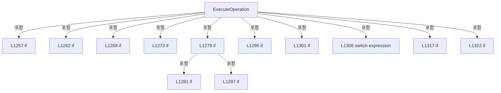

변경 전 점검: 입력/반환 타입, 위 호출자, 예외/취소 경로, 공유 상태와 저장·전송 소비자를 함께 확인합니다. 값의 단위나 물리 방향을 이름만으로 확정하지 않습니다.

### MethodDeclaration `RequiresOperationConfirmation` · L1329–1349

[Drilling.UI/Menu/Menus/CMenuMonitor.cs:1329–1349](https://github.com/kjuws10-rgb/A3Drilling/blob/334b3599651b2e8e0181fd4459bafaf3cddafff3/Drilling.UI/Menu/Menus/CMenuMonitor.cs#L1329-L1349)

| 항목 | 실제 추출 값 |
| --- | --- |
| 서명 | bool Drilling.UI.Menu.Menus.CMenuMonitor.RequiresOperationConfirmation(string, string) |
| 접근/수식자 | Private / private, static |
| 반환/값 타입 | bool |
| 소속 타입 | NamedType:Drilling.UI.Menu.Menus.CMenuMonitor |

입력 계약:

| 이름 | 타입 | 전달 | 선택/기본값 |
| --- | --- | --- | --- |
| tab | string | None | False /  |
| label | string | None | False /  |

정적 호출자로 확인된 위치:

| 호출 파일/행 | 호출 표현식 | 런타임 분기 가능 |
| --- | --- | --- |
| [Drilling.UI/Menu/Menus/CMenuMonitor.cs:1295–1295](https://github.com/kjuws10-rgb/A3Drilling/blob/334b3599651b2e8e0181fd4459bafaf3cddafff3/Drilling.UI/Menu/Menus/CMenuMonitor.cs#L1295-L1295) | RequiresOperationConfirmation | False |

호출하는 대상과 해석 범위:

| 원본 행 | 표현식 | 분석 상태 | 대상/소스 위치 |
| --- | --- | --- | --- |
| 1331 | NormalizeMonitorOperation | resolved | string Drilling.UI.Menu.Menus.CMenuMonitor.NormalizeMonitorOperation(string) · Drilling.UI/Menu/Menus/CMenuMonitor.cs:1646 |
| 1341 | key.StartsWith | resolved | bool string.StartsWith(string, System.StringComparison) |

본문의 실제 연산·분기·예외·반환 순서(원문 위치 순):

| 원본 행 | 종류 | 주석 해설 |
| --- | --- | --- |
| 1331 | call | 함수·델리게이트 또는 객체 생성자를 호출합니다: NormalizeMonitorOperation(label) |
| 1331 | local-declaration | 지역 변수를 선언합니다: var key = NormalizeMonitorOperation(label); |
| 1331 | variable-initializer | 변수의 초기값을 지정합니다: key = NormalizeMonitorOperation(label) |
| 1332 | switch | 값에 따라 분기합니다: switch (tab) |
| 1334 | case | 분기값/패턴의 구간입니다: case "XPS": |
| 1335 | return | 호출자에게 값 또는 제어를 반환합니다: return key is "SERVOON" or "SERVOOFF" or "HOME" or "ABSMOVE" or "RELMOVE" or "MULTIABSMOVE"; |
| 1336 | case | 분기값/패턴의 구간입니다: case "LASER": |
| 1337 | return | 호출자에게 값 또는 제어를 반환합니다: return key is "LASERON" or "LASEROFF" or "SHUTTEROPEN" or "SHUTTERCLOSE" or "GATEON" or "GATEOFF" or "EXTGATEENABLE" or "EXTGATEDISABLE" or "SETQSW" or "SETEPRF" or "SETSHG" or "SETQMODE"; |
| 1338 | case | 분기값/패턴의 구간입니다: case "ATTENUATOR": |
| 1339 | return | 호출자에게 값 또는 제어를 반환합니다: return key is "HOME" or "RESET" or "MOVEABS" or "MOVEREL" or "SETHOMETYPE" or "SETNEGLIMIT" or "SETPOSLIMIT" or "SETIGAIN" or "SETPGAIN" or "SETIF"; |
| 1340 | case | 분기값/패턴의 구간입니다: case "BET": |
| 1341 | call | 함수·델리게이트 또는 객체 생성자를 호출합니다: key.StartsWith("MOVETABLE", StringComparison.OrdinalIgnoreCase) |
| 1341 | return | 호출자에게 값 또는 제어를 반환합니다: return key is "HOME" or "MOVEMAG" or "MOVEDIV" or "SAVETABLE" or "MOVE" &#124;&#124; key.StartsWith("MOVETABLE", StringComparison.OrdinalIgnoreCase); |
| 1342 | case | 분기값/패턴의 구간입니다: case "POWER METER": |
| 1343 | return | 호출자에게 값 또는 제어를 반환합니다: return key == "START"; |
| 1344 | case | 분기값/패턴의 구간입니다: case "PICO MOTOR": |
| 1345 | return | 호출자에게 값 또는 제어를 반환합니다: return key is "CONNECT" or "DISCONNECT" or "SETVEL" or "SETVELOCITY" or "PICOSETVEL" or "SETACC" or "SETACCELERATION" or "PICOSETACC" or "HOME" or "ABSMOVE" or "START"; |
| 1346 | case | 분기값/패턴의 구간입니다: default: |
| 1347 | return | 호출자에게 값 또는 제어를 반환합니다: return false; |

제어 구문의 포함 구조(실제 실행 순서/CFG가 아닌 구문 탐색 그림):


변경 전 점검: 입력/반환 타입, 위 호출자, 예외/취소 경로, 공유 상태와 저장·전송 소비자를 함께 확인합니다. 값의 단위나 물리 방향을 이름만으로 확정하지 않습니다.

### MethodDeclaration `GetOperationConfirmationTitle` · L1351–1363

[Drilling.UI/Menu/Menus/CMenuMonitor.cs:1351–1363](https://github.com/kjuws10-rgb/A3Drilling/blob/334b3599651b2e8e0181fd4459bafaf3cddafff3/Drilling.UI/Menu/Menus/CMenuMonitor.cs#L1351-L1363)

| 항목 | 실제 추출 값 |
| --- | --- |
| 서명 | string Drilling.UI.Menu.Menus.CMenuMonitor.GetOperationConfirmationTitle(string) |
| 접근/수식자 | Private / private, static |
| 반환/값 타입 | string |
| 소속 타입 | NamedType:Drilling.UI.Menu.Menus.CMenuMonitor |

입력 계약:

| 이름 | 타입 | 전달 | 선택/기본값 |
| --- | --- | --- | --- |
| tab | string | None | False /  |

정적 호출자로 확인된 위치:

| 호출 파일/행 | 호출 표현식 | 런타임 분기 가능 |
| --- | --- | --- |
| [Drilling.UI/Menu/Menus/CMenuMonitor.cs:1295–1295](https://github.com/kjuws10-rgb/A3Drilling/blob/334b3599651b2e8e0181fd4459bafaf3cddafff3/Drilling.UI/Menu/Menus/CMenuMonitor.cs#L1295-L1295) | GetOperationConfirmationTitle | False |

본문의 실제 연산·분기·예외·반환 순서(원문 위치 순):

| 원본 행 | 종류 | 주석 해설 |
| --- | --- | --- |
| 1353 | return | 호출자에게 값 또는 제어를 반환합니다: return tab switch { "XPS" => "스캐너 틸트 제어", "LASER" => "레이저 제어", "ATTENUATOR" => "감쇠기 제어", "BET" => "BET 제어", "POWER METER" => "PowerMeter 제어", "PICO MOTOR" => "DOE 틸트 제어", _ => "장비 제어" }; |
| 1353 | switch-expression | 값별 결과식을 선택합니다: tab switch { "XPS" => "스캐너 틸트 제어", "LASER" => "레이저 제어", "ATTENUATOR" => "감쇠기 제어", "BET" => "BET 제어", "POWER METER" => "PowerMeter 제어", "PICO MOTOR" => "DOE 틸트 제어", _ => "장비 제어" } |

제어 구문의 포함 구조(실제 실행 순서/CFG가 아닌 구문 탐색 그림):

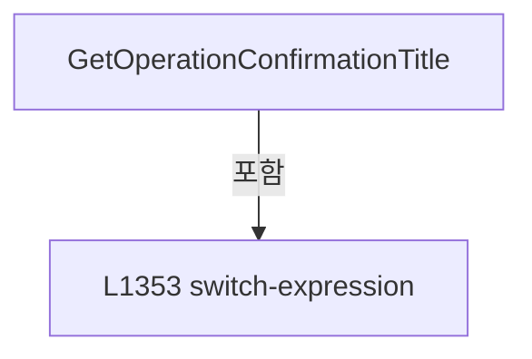

변경 전 점검: 입력/반환 타입, 위 호출자, 예외/취소 경로, 공유 상태와 저장·전송 소비자를 함께 확인합니다. 값의 단위나 물리 방향을 이름만으로 확정하지 않습니다.

### MethodDeclaration `GetOperationConfirmationText` · L1365–1576

[Drilling.UI/Menu/Menus/CMenuMonitor.cs:1365–1576](https://github.com/kjuws10-rgb/A3Drilling/blob/334b3599651b2e8e0181fd4459bafaf3cddafff3/Drilling.UI/Menu/Menus/CMenuMonitor.cs#L1365-L1576)

| 항목 | 실제 추출 값 |
| --- | --- |
| 서명 | string Drilling.UI.Menu.Menus.CMenuMonitor.GetOperationConfirmationText(string) |
| 접근/수식자 | Private / private |
| 반환/값 타입 | string |
| 소속 타입 | NamedType:Drilling.UI.Menu.Menus.CMenuMonitor |

입력 계약:

| 이름 | 타입 | 전달 | 선택/기본값 |
| --- | --- | --- | --- |
| label | string | None | False /  |

정적 호출자로 확인된 위치:

| 호출 파일/행 | 호출 표현식 | 런타임 분기 가능 |
| --- | --- | --- |
| [Drilling.UI/Menu/Menus/CMenuMonitor.cs:1295–1295](https://github.com/kjuws10-rgb/A3Drilling/blob/334b3599651b2e8e0181fd4459bafaf3cddafff3/Drilling.UI/Menu/Menus/CMenuMonitor.cs#L1295-L1295) | GetOperationConfirmationText | False |

호출하는 대상과 해석 범위:

| 원본 행 | 표현식 | 분석 상태 | 대상/소스 위치 |
| --- | --- | --- | --- |
| 1367 | NormalizeMonitorOperation | resolved | string Drilling.UI.Menu.Menus.CMenuMonitor.NormalizeMonitorOperation(string) · Drilling.UI/Menu/Menus/CMenuMonitor.cs:1646 |
| 1377 | ReadOperationField("ABS Target Position", 0.0).ToString | resolved | string double.ToString(string?, System.IFormatProvider?) |
| 1377 | ReadOperationField | resolved | double Drilling.UI.Menu.Menus.CMenuMonitor.ReadOperationField(string, double) · Drilling.UI/Menu/Menus/CMenuMonitor.cs:1611 |
| 1382 | ReadOperationField("REL Distance", 0.0).ToString | resolved | string double.ToString(string?, System.IFormatProvider?) |
| 1382 | ReadOperationField | resolved | double Drilling.UI.Menu.Menus.CMenuMonitor.ReadOperationField(string, double) · Drilling.UI/Menu/Menus/CMenuMonitor.cs:1611 |
| 1387 | MultiMoveAxisRows.Where(row => row.IsSelected).Select(row => $"{row.Axis} = {row.TargetPosition} mm").ToArray | resolved | string[] System.Collections.Generic.IEnumerable<string>.ToArray<string>() |
| 1387 | MultiMoveAxisRows.Where(row => row.IsSelected).Select | resolved | System.Collections.Generic.IEnumerable<string> System.Collections.Generic.IEnumerable<Drilling.UI.Menu.Menus.ST_MONITOR_MULTI_MOVE_AXIS_ROW>.Select<Drilling.UI.Menu.Menus.ST_MONITOR_MULTI_MOVE_AXIS_ROW, string>(System.Func<Drilling.UI.Menu.Menus.ST_MONITOR_MULTI_MOVE_AXIS_ROW, string>) |
| 1387 | MultiMoveAxisRows.Where | resolved | System.Collections.Generic.IEnumerable<Drilling.UI.Menu.Menus.ST_MONITOR_MULTI_MOVE_AXIS_ROW> System.Collections.Generic.IEnumerable<Drilling.UI.Menu.Menus.ST_MONITOR_MULTI_MOVE_AXIS_ROW>.Where<Drilling.UI.Menu.Menus.ST_MONITOR_MULTI_MOVE_AXIS_ROW>(System.Func<Drilling.UI.Menu.Menus.ST_MONITOR_MULTI_MOVE_AXIS_ROW, bool>) |
| 1388 | string.Join | resolved | string string.Join(string?, params string?[]) |
| 1396 | ReadOperationField("QSW", 20000.0).ToString | resolved | string double.ToString(string?, System.IFormatProvider?) |
| 1396 | ReadOperationField | resolved | double Drilling.UI.Menu.Menus.CMenuMonitor.ReadOperationField(string, double) · Drilling.UI/Menu/Menus/CMenuMonitor.cs:1611 |
| 1401 | ReadOperationField("EPRF", 20000.0).ToString | resolved | string double.ToString(string?, System.IFormatProvider?) |
| 1401 | ReadOperationField | resolved | double Drilling.UI.Menu.Menus.CMenuMonitor.ReadOperationField(string, double) · Drilling.UI/Menu/Menus/CMenuMonitor.cs:1611 |
| 1406 | ReadOperationField("SHG Count", 0.0).ToString | resolved | string double.ToString(string?, System.IFormatProvider?) |
| 1406 | ReadOperationField | resolved | double Drilling.UI.Menu.Menus.CMenuMonitor.ReadOperationField(string, double) · Drilling.UI/Menu/Menus/CMenuMonitor.cs:1611 |
| 1411 | ReadOperationField("Q Mode", 0.0).ToString | resolved | string double.ToString(string?, System.IFormatProvider?) |
| 1411 | ReadOperationField | resolved | double Drilling.UI.Menu.Menus.CMenuMonitor.ReadOperationField(string, double) · Drilling.UI/Menu/Menus/CMenuMonitor.cs:1611 |
| 1424 | ReadOperationField("Target Position", 55.0).ToString | resolved | string double.ToString(string?, System.IFormatProvider?) |
| 1424 | ReadOperationField | resolved | double Drilling.UI.Menu.Menus.CMenuMonitor.ReadOperationField(string, double) · Drilling.UI/Menu/Menus/CMenuMonitor.cs:1611 |
| 1429 | ReadOperationField("Relative Move", 0.0).ToString | resolved | string double.ToString(string?, System.IFormatProvider?) |
| 1429 | ReadOperationField | resolved | double Drilling.UI.Menu.Menus.CMenuMonitor.ReadOperationField(string, double) · Drilling.UI/Menu/Menus/CMenuMonitor.cs:1611 |
| 1439 | OperationFields.FirstOrDefault | resolved | Drilling.UI.Menu.Menus.ST_MONITOR_PARAMETER_ROW? System.Collections.Generic.IEnumerable<Drilling.UI.Menu.Menus.ST_MONITOR_PARAMETER_ROW>.FirstOrDefault<Drilling.UI.Menu.Menus.ST_MONITOR_PARAMETER_ROW>(System.Func<Drilling.UI.Menu.Menus.ST_MONITOR_PARAMETER_ROW, bool>) |
| 1439 | field.Parameter.Equals | resolved | bool string.Equals(string?, System.StringComparison) |
| 1440 | string.IsNullOrWhiteSpace | resolved | bool string.IsNullOrWhiteSpace(string?) |
| 1440 | FormatHomeTypeOption | resolved | string Drilling.UI.Menu.Menus.CMenuMonitor.FormatHomeTypeOption(int) · Drilling.UI/Menu/Menus/CMenuMonitor.cs:6659 |
| 1446 | ReadOperationField("Negative Limit", 0.0).ToString | resolved | string double.ToString(string?, System.IFormatProvider?) |
| 1446 | ReadOperationField | resolved | double Drilling.UI.Menu.Menus.CMenuMonitor.ReadOperationField(string, double) · Drilling.UI/Menu/Menus/CMenuMonitor.cs:1611 |
| 1451 | ReadOperationField("Positive Limit", 360.0).ToString | resolved | string double.ToString(string?, System.IFormatProvider?) |
| 1451 | ReadOperationField | resolved | double Drilling.UI.Menu.Menus.CMenuMonitor.ReadOperationField(string, double) · Drilling.UI/Menu/Menus/CMenuMonitor.cs:1611 |
| 1456 | ReadOperationField("I Gain", 800.0).ToString | resolved | string double.ToString(string?, System.IFormatProvider?) |
| 1456 | ReadOperationField | resolved | double Drilling.UI.Menu.Menus.CMenuMonitor.ReadOperationField(string, double) · Drilling.UI/Menu/Menus/CMenuMonitor.cs:1611 |
| 1461 | ReadOperationField("P Gain", 10.0).ToString | resolved | string double.ToString(string?, System.IFormatProvider?) |
| 1461 | ReadOperationField | resolved | double Drilling.UI.Menu.Menus.CMenuMonitor.ReadOperationField(string, double) · Drilling.UI/Menu/Menus/CMenuMonitor.cs:1611 |
| 1466 | ReadOperationField("Interpolation Factor", 1000.0).ToString | resolved | string double.ToString(string?, System.IFormatProvider?) |
| 1466 | ReadOperationField | resolved | double Drilling.UI.Menu.Menus.CMenuMonitor.ReadOperationField(string, double) · Drilling.UI/Menu/Menus/CMenuMonitor.cs:1611 |
| 1479 | ReadOperationField("Target MAG POS", 1020.0).ToString | resolved | string double.ToString(string?, System.IFormatProvider?) |
| 1479 | ReadOperationField | resolved | double Drilling.UI.Menu.Menus.CMenuMonitor.ReadOperationField(string, double) · Drilling.UI/Menu/Menus/CMenuMonitor.cs:1611 |
| 1484 | ReadOperationField("Target DIV POS", 1626.0).ToString | resolved | string double.ToString(string?, System.IFormatProvider?) |
| 1484 | ReadOperationField | resolved | double Drilling.UI.Menu.Menus.CMenuMonitor.ReadOperationField(string, double) · Drilling.UI/Menu/Menus/CMenuMonitor.cs:1611 |
| 1487 | key.StartsWith | resolved | bool string.StartsWith(string, System.StringComparison) |
| 1490 | BetTableRows.FirstOrDefault | resolved | Drilling.UI.Menu.Menus.ST_MONITOR_BET_TABLE_ROW? System.Collections.Generic.IEnumerable<Drilling.UI.Menu.Menus.ST_MONITOR_BET_TABLE_ROW>.FirstOrDefault<Drilling.UI.Menu.Menus.ST_MONITOR_BET_TABLE_ROW>(System.Func<Drilling.UI.Menu.Menus.ST_MONITOR_BET_TABLE_ROW, bool>) |
| 1490 | row.No.Equals | resolved | bool string.Equals(string?, System.StringComparison) |
| 1493 | string.IsNullOrWhiteSpace | resolved | bool string.IsNullOrWhiteSpace(string?) |
| 1503 | ReadPwmSetting | resolved | double Drilling.UI.Menu.Menus.CMenuMonitor.ReadPwmSetting(string, double) · Drilling.UI/Menu/Menus/CMenuMonitor.cs:6190 |
| 1504 | ReadPwmText | resolved | string Drilling.UI.Menu.Menus.CMenuMonitor.ReadPwmText(string, string) · Drilling.UI/Menu/Menus/CMenuMonitor.cs:6169 |
| 1505 | targetPower.ToString | resolved | string double.ToString(string?, System.IFormatProvider?) |
| 1511 | ReadOperationField("Set Velocity", 0.0).ToString | resolved | string double.ToString(string?, System.IFormatProvider?) |
| 1511 | ReadOperationField | resolved | double Drilling.UI.Menu.Menus.CMenuMonitor.ReadOperationField(string, double) · Drilling.UI/Menu/Menus/CMenuMonitor.cs:1611 |
| 1516 | ReadOperationField("Set Acceleration", 0.0).ToString | resolved | string double.ToString(string?, System.IFormatProvider?) |
| 1516 | ReadOperationField | resolved | double Drilling.UI.Menu.Menus.CMenuMonitor.ReadOperationField(string, double) · Drilling.UI/Menu/Menus/CMenuMonitor.cs:1611 |
| 1526 | ReadOperationField("Absolute Move", 0.0).ToString | resolved | string double.ToString(string?, System.IFormatProvider?) |
| 1526 | ReadOperationField | resolved | double Drilling.UI.Menu.Menus.CMenuMonitor.ReadOperationField(string, double) · Drilling.UI/Menu/Menus/CMenuMonitor.cs:1611 |
| 1531 | _picoAllMoveMotorNos.OrderBy(number => number).Select(number => number.ToString(CultureInfo.InvariantCulture)).ToArray | resolved | string[] System.Collections.Generic.IEnumerable<string>.ToArray<string>() |
| 1531 | _picoAllMoveMotorNos.OrderBy(number => number).Select | resolved | System.Collections.Generic.IEnumerable<string> System.Collections.Generic.IEnumerable<int>.Select<int, string>(System.Func<int, string>) |
| 1531 | _picoAllMoveMotorNos.OrderBy | resolved | System.Linq.IOrderedEnumerable<int> System.Collections.Generic.IEnumerable<int>.OrderBy<int, int>(System.Func<int, int>) |
| 1531 | number.ToString | resolved | string int.ToString(System.IFormatProvider?) |
| 1532 | string.Join | resolved | string string.Join(string?, params string?[]) |
| 1533 | ReadOperationField("Position", 0.0).ToString | resolved | string double.ToString(string?, System.IFormatProvider?) |
| 1533 | ReadOperationField | resolved | double Drilling.UI.Menu.Menus.CMenuMonitor.ReadOperationField(string, double) · Drilling.UI/Menu/Menus/CMenuMonitor.cs:1611 |
| 1534 | Math.Max | resolved | int System.Math.Max(int, int) |
| 1534 | Math.Round | resolved | double System.Math.Round(double) |
| 1534 | ReadOperationField | resolved | double Drilling.UI.Menu.Menus.CMenuMonitor.ReadOperationField(string, double) · Drilling.UI/Menu/Menus/CMenuMonitor.cs:1611 |
| 1574 | key.StartsWith | resolved | bool string.StartsWith(string, System.StringComparison) |

본문의 실제 연산·분기·예외·반환 순서(원문 위치 순):

| 원본 행 | 종류 | 주석 해설 |
| --- | --- | --- |
| 1367 | call | 함수·델리게이트 또는 객체 생성자를 호출합니다: NormalizeMonitorOperation(label) |
| 1367 | local-declaration | 지역 변수를 선언합니다: var key = NormalizeMonitorOperation(label); |
| 1367 | variable-initializer | 변수의 초기값을 지정합니다: key = NormalizeMonitorOperation(label) |
| 1368 | if | 조건에 따라 분기합니다: if (SelectedTab == "XPS") |
| 1370 | if | 조건에 따라 분기합니다: if (key == "HOME") |
| 1372 | return | 호출자에게 값 또는 제어를 반환합니다: return $"{_selectedAxisId}축을 원점으로 복귀하시겠습니까?"; |
| 1375 | if | 조건에 따라 분기합니다: if (key == "ABSMOVE") |
| 1377 | call | 함수·델리게이트 또는 객체 생성자를 호출합니다: ReadOperationField("ABS Target Position", 0.0).ToString("0.###", CultureInfo.InvariantCulture) |
| 1377 | call | 함수·델리게이트 또는 객체 생성자를 호출합니다: ReadOperationField("ABS Target Position", 0.0) |
| 1377 | return | 호출자에게 값 또는 제어를 반환합니다: return $"{_selectedAxisId}축을 {ReadOperationField("ABS Target Position", 0.0).ToString("0.###", CultureInfo.InvariantCulture)} mm 위치로 이동하시겠습니까?"; |
| 1380 | if | 조건에 따라 분기합니다: if (key == "RELMOVE") |
| 1382 | call | 함수·델리게이트 또는 객체 생성자를 호출합니다: ReadOperationField("REL Distance", 0.0).ToString("+0.###;-0.###;0", CultureInfo.InvariantCulture) |
| 1382 | call | 함수·델리게이트 또는 객체 생성자를 호출합니다: ReadOperationField("REL Distance", 0.0) |
| 1382 | return | 호출자에게 값 또는 제어를 반환합니다: return $"{_selectedAxisId}축을 현재 위치에서 {ReadOperationField("REL Distance", 0.0).ToString("+0.###;-0.###;0", CultureInfo.InvariantCulture)} mm 이동하시겠습니까?"; |
| 1385 | if | 조건에 따라 분기합니다: if (key == "MULTIABSMOVE") |
| 1387 | call | 함수·델리게이트 또는 객체 생성자를 호출합니다: MultiMoveAxisRows.Where(row => row.IsSelected).Select(row => $"{row.Axis} = {row.TargetPosition} mm").ToArray() |
| 1387 | call | 함수·델리게이트 또는 객체 생성자를 호출합니다: MultiMoveAxisRows.Where(row => row.IsSelected).Select(row => $"{row.Axis} = {row.TargetPosition} mm") |
| 1387 | call | 함수·델리게이트 또는 객체 생성자를 호출합니다: MultiMoveAxisRows.Where(row => row.IsSelected) |
| 1387 | local-declaration | 지역 변수를 선언합니다: var targets = MultiMoveAxisRows.Where(row => row.IsSelected).Select(row => $"{row.Axis} = {row.TargetPosition} mm").ToArray(); |
| 1387 | variable-initializer | 변수의 초기값을 지정합니다: targets = MultiMoveAxisRows.Where(row => row.IsSelected).Select(row => $"{row.Axis} = {row.TargetPosition} mm").ToArray() |
| 1388 | call | 함수·델리게이트 또는 객체 생성자를 호출합니다: string.Join(", ", targets) |
| 1388 | conditional-expression | 조건에 따라 결과식을 선택합니다: targets.Length == 0 ? "선택한 축이 없습니다." : $"선택한 축을 {string.Join(", ", targets)} 위치로 이동하시겠습니까?" |
| 1388 | return | 호출자에게 값 또는 제어를 반환합니다: return targets.Length == 0 ? "선택한 축이 없습니다." : $"선택한 축을 {string.Join(", ", targets)} 위치로 이동하시겠습니까?"; |
| 1392 | if | 조건에 따라 분기합니다: if (SelectedTab == "LASER") |
| 1394 | if | 조건에 따라 분기합니다: if (key == "SETQSW") |
| 1396 | call | 함수·델리게이트 또는 객체 생성자를 호출합니다: ReadOperationField("QSW", 20000.0).ToString("0.###", CultureInfo.InvariantCulture) |
| 1396 | call | 함수·델리게이트 또는 객체 생성자를 호출합니다: ReadOperationField("QSW", 20000.0) |
| 1396 | return | 호출자에게 값 또는 제어를 반환합니다: return $"QSW 값을 {ReadOperationField("QSW", 20000.0).ToString("0.###", CultureInfo.InvariantCulture)} Hz로 설정하시겠습니까?"; |
| 1399 | if | 조건에 따라 분기합니다: if (key == "SETEPRF") |
| 1401 | call | 함수·델리게이트 또는 객체 생성자를 호출합니다: ReadOperationField("EPRF", 20000.0).ToString("0.###", CultureInfo.InvariantCulture) |
| 1401 | call | 함수·델리게이트 또는 객체 생성자를 호출합니다: ReadOperationField("EPRF", 20000.0) |
| 1401 | return | 호출자에게 값 또는 제어를 반환합니다: return $"EPRF 값을 {ReadOperationField("EPRF", 20000.0).ToString("0.###", CultureInfo.InvariantCulture)} Hz로 설정하시겠습니까?"; |
| 1404 | if | 조건에 따라 분기합니다: if (key == "SETSHG") |
| 1406 | call | 함수·델리게이트 또는 객체 생성자를 호출합니다: ReadOperationField("SHG Count", 0.0).ToString("0", CultureInfo.InvariantCulture) |
| 1406 | call | 함수·델리게이트 또는 객체 생성자를 호출합니다: ReadOperationField("SHG Count", 0.0) |
| 1406 | return | 호출자에게 값 또는 제어를 반환합니다: return $"SHG 값을 {ReadOperationField("SHG Count", 0.0).ToString("0", CultureInfo.InvariantCulture)} count로 설정하시겠습니까?"; |
| 1409 | if | 조건에 따라 분기합니다: if (key == "SETQMODE") |
| 1411 | call | 함수·델리게이트 또는 객체 생성자를 호출합니다: ReadOperationField("Q Mode", 0.0).ToString("0", CultureInfo.InvariantCulture) |
| 1411 | call | 함수·델리게이트 또는 객체 생성자를 호출합니다: ReadOperationField("Q Mode", 0.0) |
| 1411 | return | 호출자에게 값 또는 제어를 반환합니다: return $"Q MODE 값을 {ReadOperationField("Q Mode", 0.0).ToString("0", CultureInfo.InvariantCulture)}으로 설정하시겠습니까?"; |
| 1415 | if | 조건에 따라 분기합니다: if (SelectedTab == "ATTENUATOR") |
| 1417 | if | 조건에 따라 분기합니다: if (key == "HOME") |
| 1419 | return | 호출자에게 값 또는 제어를 반환합니다: return "감쇠기를 원점으로 복귀하시겠습니까?"; |
| 1422 | if | 조건에 따라 분기합니다: if (key == "MOVEABS") |
| 1424 | call | 함수·델리게이트 또는 객체 생성자를 호출합니다: ReadOperationField("Target Position", 55.0).ToString("0.000", CultureInfo.InvariantCulture) |
| 1424 | call | 함수·델리게이트 또는 객체 생성자를 호출합니다: ReadOperationField("Target Position", 55.0) |
| 1424 | return | 호출자에게 값 또는 제어를 반환합니다: return $"감쇠기를 {ReadOperationField("Target Position", 55.0).ToString("0.000", CultureInfo.InvariantCulture)}° 위치로 이동하시겠습니까?"; |
| 1427 | if | 조건에 따라 분기합니다: if (key == "MOVEREL") |
| 1429 | call | 함수·델리게이트 또는 객체 생성자를 호출합니다: ReadOperationField("Relative Move", 0.0).ToString("+0.000;-0.000;0.000", CultureInfo.InvariantCulture) |
| 1429 | call | 함수·델리게이트 또는 객체 생성자를 호출합니다: ReadOperationField("Relative Move", 0.0) |
| 1429 | return | 호출자에게 값 또는 제어를 반환합니다: return $"감쇠기를 현재 위치에서 {ReadOperationField("Relative Move", 0.0).ToString("+0.000;-0.000;0.000", CultureInfo.InvariantCulture)}° 이동하시겠습니까?"; |
| 1432 | if | 조건에 따라 분기합니다: if (key is "RESET" or "RESETALARM") |
| 1434 | return | 호출자에게 값 또는 제어를 반환합니다: return "감쇠기를 초기화하시겠습니까?\n초기화 후에는 원점 복귀가 필요합니다."; |
| 1437 | if | 조건에 따라 분기합니다: if (key == "SETHOMETYPE") |
| 1439 | call | 함수·델리게이트 또는 객체 생성자를 호출합니다: OperationFields.FirstOrDefault(field => field.Parameter.Equals("Home Type", StringComparison.OrdinalIgnoreCase)) |
| 1439 | call | 함수·델리게이트 또는 객체 생성자를 호출합니다: field.Parameter.Equals("Home Type", StringComparison.OrdinalIgnoreCase) |
| 1439 | local-declaration | 지역 변수를 선언합니다: var homeType = OperationFields.FirstOrDefault(field => field.Parameter.Equals("Home Type", StringComparison.OrdinalIgnoreCase))?.Value; |
| 1439 | variable-initializer | 변수의 초기값을 지정합니다: homeType = OperationFields.FirstOrDefault(field => field.Parameter.Equals("Home Type", StringComparison.OrdinalIgnoreCase))?.Value |
| 1440 | call | 함수·델리게이트 또는 객체 생성자를 호출합니다: string.IsNullOrWhiteSpace(homeType) |
| 1440 | call | 함수·델리게이트 또는 객체 생성자를 호출합니다: FormatHomeTypeOption(4) |
| 1440 | conditional-expression | 조건에 따라 결과식을 선택합니다: string.IsNullOrWhiteSpace(homeType) ? FormatHomeTypeOption(4) : homeType |
| 1440 | local-declaration | 지역 변수를 선언합니다: var displayValue = string.IsNullOrWhiteSpace(homeType) ? FormatHomeTypeOption(4) : homeType; |
| 1440 | variable-initializer | 변수의 초기값을 지정합니다: displayValue = string.IsNullOrWhiteSpace(homeType) ? FormatHomeTypeOption(4) : homeType |
| 1441 | return | 호출자에게 값 또는 제어를 반환합니다: return $"원점 방식을 설정하시겠습니까?\n원점 방식: {displayValue}"; |
| 1444 | if | 조건에 따라 분기합니다: if (key is "SETNEGLIMIT" or "SETNEGATIVELIMIT" or "SETNEGATIVESOFTWARELIMIT") |
| 1446 | call | 함수·델리게이트 또는 객체 생성자를 호출합니다: ReadOperationField("Negative Limit", 0.0).ToString("0.000", CultureInfo.InvariantCulture) |
| 1446 | call | 함수·델리게이트 또는 객체 생성자를 호출합니다: ReadOperationField("Negative Limit", 0.0) |
| 1446 | return | 호출자에게 값 또는 제어를 반환합니다: return $"음(-) 방향 이동 한계값을 {ReadOperationField("Negative Limit", 0.0).ToString("0.000", CultureInfo.InvariantCulture)}°로 설정하시겠습니까?"; |
| 1449 | if | 조건에 따라 분기합니다: if (key is "SETPOSLIMIT" or "SETPOSITIVELIMIT" or "SETPOSITIVESOFTWARELIMIT") |
| 1451 | call | 함수·델리게이트 또는 객체 생성자를 호출합니다: ReadOperationField("Positive Limit", 360.0).ToString("0.000", CultureInfo.InvariantCulture) |
| 1451 | call | 함수·델리게이트 또는 객체 생성자를 호출합니다: ReadOperationField("Positive Limit", 360.0) |
| 1451 | return | 호출자에게 값 또는 제어를 반환합니다: return $"양(+) 방향 이동 한계값을 {ReadOperationField("Positive Limit", 360.0).ToString("0.000", CultureInfo.InvariantCulture)}°로 설정하시겠습니까?"; |
| 1454 | if | 조건에 따라 분기합니다: if (key == "SETIGAIN") |
| 1456 | call | 함수·델리게이트 또는 객체 생성자를 호출합니다: ReadOperationField("I Gain", 800.0).ToString("0.000", CultureInfo.InvariantCulture) |
| 1456 | call | 함수·델리게이트 또는 객체 생성자를 호출합니다: ReadOperationField("I Gain", 800.0) |
| 1456 | return | 호출자에게 값 또는 제어를 반환합니다: return $"I Gain 값을 {ReadOperationField("I Gain", 800.0).ToString("0.000", CultureInfo.InvariantCulture)}으로 설정하시겠습니까?"; |
| 1459 | if | 조건에 따라 분기합니다: if (key == "SETPGAIN") |
| 1461 | call | 함수·델리게이트 또는 객체 생성자를 호출합니다: ReadOperationField("P Gain", 10.0).ToString("0.000", CultureInfo.InvariantCulture) |
| 1461 | call | 함수·델리게이트 또는 객체 생성자를 호출합니다: ReadOperationField("P Gain", 10.0) |
| 1461 | return | 호출자에게 값 또는 제어를 반환합니다: return $"P Gain 값을 {ReadOperationField("P Gain", 10.0).ToString("0.000", CultureInfo.InvariantCulture)}으로 설정하시겠습니까?"; |
| 1464 | if | 조건에 따라 분기합니다: if (key is "SETIF" or "SETINTERPOLATIONFACTOR") |
| 1466 | call | 함수·델리게이트 또는 객체 생성자를 호출합니다: ReadOperationField("Interpolation Factor", 1000.0).ToString("0.000", CultureInfo.InvariantCulture) |
| 1466 | call | 함수·델리게이트 또는 객체 생성자를 호출합니다: ReadOperationField("Interpolation Factor", 1000.0) |
| 1466 | return | 호출자에게 값 또는 제어를 반환합니다: return $"보간 계수를 {ReadOperationField("Interpolation Factor", 1000.0).ToString("0.000", CultureInfo.InvariantCulture)}으로 설정하시겠습니까?"; |
| 1470 | if | 조건에 따라 분기합니다: if (SelectedTab == "BET") |
| 1472 | if | 조건에 따라 분기합니다: if (key == "HOME") |
| 1474 | return | 호출자에게 값 또는 제어를 반환합니다: return "BET를 원점으로 복귀하시겠습니까?"; |
| 1477 | if | 조건에 따라 분기합니다: if (key == "MOVEMAG") |
| 1479 | call | 함수·델리게이트 또는 객체 생성자를 호출합니다: ReadOperationField("Target MAG POS", 1020.0).ToString("0.###", CultureInfo.InvariantCulture) |
| 1479 | call | 함수·델리게이트 또는 객체 생성자를 호출합니다: ReadOperationField("Target MAG POS", 1020.0) |
| 1479 | return | 호출자에게 값 또는 제어를 반환합니다: return $"MAG를 {ReadOperationField("Target MAG POS", 1020.0).ToString("0.###", CultureInfo.InvariantCulture)} step 위치로 이동하시겠습니까?"; |
| 1482 | if | 조건에 따라 분기합니다: if (key == "MOVEDIV") |
| 1484 | call | 함수·델리게이트 또는 객체 생성자를 호출합니다: ReadOperationField("Target DIV POS", 1626.0).ToString("0.###", CultureInfo.InvariantCulture) |
| 1484 | call | 함수·델리게이트 또는 객체 생성자를 호출합니다: ReadOperationField("Target DIV POS", 1626.0) |
| 1484 | return | 호출자에게 값 또는 제어를 반환합니다: return $"DIV를 {ReadOperationField("Target DIV POS", 1626.0).ToString("0.###", CultureInfo.InvariantCulture)} step 위치로 이동하시겠습니까?"; |
| 1487 | call | 함수·델리게이트 또는 객체 생성자를 호출합니다: key.StartsWith("MOVETABLE", StringComparison.OrdinalIgnoreCase) |
| 1487 | if | 조건에 따라 분기합니다: if (key.StartsWith("MOVETABLE", StringComparison.OrdinalIgnoreCase)) |
| 1489 | local-declaration | 지역 변수를 선언합니다: var tableNo = key["MOVETABLE".Length..]; |
| 1489 | variable-initializer | 변수의 초기값을 지정합니다: tableNo = key["MOVETABLE".Length..] |
| 1490 | call | 함수·델리게이트 또는 객체 생성자를 호출합니다: BetTableRows.FirstOrDefault(row => row.No.Equals(tableNo, StringComparison.OrdinalIgnoreCase)) |
| 1490 | call | 함수·델리게이트 또는 객체 생성자를 호출합니다: row.No.Equals(tableNo, StringComparison.OrdinalIgnoreCase) |
| 1490 | local-declaration | 지역 변수를 선언합니다: var selectedRow = BetTableRows.FirstOrDefault(row => row.No.Equals(tableNo, StringComparison.OrdinalIgnoreCase)); |
| 1490 | variable-initializer | 변수의 초기값을 지정합니다: selectedRow = BetTableRows.FirstOrDefault(row => row.No.Equals(tableNo, StringComparison.OrdinalIgnoreCase)) |
| 1491 | if | 조건에 따라 분기합니다: if (selectedRow is not null) |
| 1493 | call | 함수·델리게이트 또는 객체 생성자를 호출합니다: string.IsNullOrWhiteSpace(selectedRow.Description) |
| 1493 | conditional-expression | 조건에 따라 결과식을 선택합니다: string.IsNullOrWhiteSpace(selectedRow.Description) ? $"테이블 {selectedRow.No}" : selectedRow.Description |
| 1493 | local-declaration | 지역 변수를 선언합니다: var description = string.IsNullOrWhiteSpace(selectedRow.Description) ? $"테이블 {selectedRow.No}" : selectedRow.Description; |
| 1493 | variable-initializer | 변수의 초기값을 지정합니다: description = string.IsNullOrWhiteSpace(selectedRow.Description) ? $"테이블 {selectedRow.No}" : selectedRow.Description |
| 1494 | return | 호출자에게 값 또는 제어를 반환합니다: return $"{description} 위치로 이동하시겠습니까?\nMAG = {selectedRow.Mag} step, DIV = {selectedRow.Div} step"; |
| 1499 | if | 조건에 따라 분기합니다: if (SelectedTab == "POWER METER") |
| 1501 | if | 조건에 따라 분기합니다: if (key == "START") |
| 1503 | call | 함수·델리게이트 또는 객체 생성자를 호출합니다: ReadPwmSetting("TARGET POWER", 1.2) |
| 1503 | local-declaration | 지역 변수를 선언합니다: var targetPower = ReadPwmSetting("TARGET POWER", 1.2); |
| 1503 | variable-initializer | 변수의 초기값을 지정합니다: targetPower = ReadPwmSetting("TARGET POWER", 1.2) |
| 1504 | call | 함수·델리게이트 또는 객체 생성자를 호출합니다: ReadPwmText("TOLERANCE MODE", "FINE") |
| 1504 | local-declaration | 지역 변수를 선언합니다: var mode = ReadPwmText("TOLERANCE MODE", "FINE"); |
| 1504 | variable-initializer | 변수의 초기값을 지정합니다: mode = ReadPwmText("TOLERANCE MODE", "FINE") |
| 1505 | call | 함수·델리게이트 또는 객체 생성자를 호출합니다: targetPower.ToString("0.####", CultureInfo.InvariantCulture) |
| 1505 | return | 호출자에게 값 또는 제어를 반환합니다: return $"H{_selectedAttenuatorNumber + 1:00} ATT를 조절해서 {targetPower.ToString("0.####", CultureInfo.InvariantCulture)} W 목표 파워를 찾으시겠습니까?\n모드: {mode}"; |
| 1509 | if | 조건에 따라 분기합니다: if (SelectedTab == "PICO MOTOR" && key is "SETVEL" or "SETVELOCITY" or "PICOSETVEL") |
| 1511 | call | 함수·델리게이트 또는 객체 생성자를 호출합니다: ReadOperationField("Set Velocity", 0.0).ToString("0.00", CultureInfo.InvariantCulture) |
| 1511 | call | 함수·델리게이트 또는 객체 생성자를 호출합니다: ReadOperationField("Set Velocity", 0.0) |
| 1511 | return | 호출자에게 값 또는 제어를 반환합니다: return $"모터 {_selectedPicoMotorNo}: 속도를 {ReadOperationField("Set Velocity", 0.0).ToString("0.00", CultureInfo.InvariantCulture)} mm/sec로 설정하시겠습니까?"; |
| 1514 | if | 조건에 따라 분기합니다: if (SelectedTab == "PICO MOTOR" && key is "SETACC" or "SETACCELERATION" or "PICOSETACC") |
| 1516 | call | 함수·델리게이트 또는 객체 생성자를 호출합니다: ReadOperationField("Set Acceleration", 0.0).ToString("0.00", CultureInfo.InvariantCulture) |
| 1516 | call | 함수·델리게이트 또는 객체 생성자를 호출합니다: ReadOperationField("Set Acceleration", 0.0) |
| 1516 | return | 호출자에게 값 또는 제어를 반환합니다: return $"모터 {_selectedPicoMotorNo}: 가속도를 {ReadOperationField("Set Acceleration", 0.0).ToString("0.00", CultureInfo.InvariantCulture)} msec로 설정하시겠습니까?"; |
| 1519 | if | 조건에 따라 분기합니다: if (SelectedTab == "PICO MOTOR" && key == "HOME") |
| 1521 | return | 호출자에게 값 또는 제어를 반환합니다: return $"모터 {_selectedPicoMotorNo}: 원점으로 복귀하시겠습니까?"; |
| 1524 | if | 조건에 따라 분기합니다: if (SelectedTab == "PICO MOTOR" && key == "ABSMOVE") |
| 1526 | call | 함수·델리게이트 또는 객체 생성자를 호출합니다: ReadOperationField("Absolute Move", 0.0).ToString("0.###", CultureInfo.InvariantCulture) |
| 1526 | call | 함수·델리게이트 또는 객체 생성자를 호출합니다: ReadOperationField("Absolute Move", 0.0) |
| 1526 | return | 호출자에게 값 또는 제어를 반환합니다: return $"모터 {_selectedPicoMotorNo}: {ReadOperationField("Absolute Move", 0.0).ToString("0.###", CultureInfo.InvariantCulture)} mm 위치로 이동하시겠습니까?"; |
| 1529 | if | 조건에 따라 분기합니다: if (SelectedTab == "PICO MOTOR" && key == "START") |
| 1531 | call | 함수·델리게이트 또는 객체 생성자를 호출합니다: _picoAllMoveMotorNos.OrderBy(number => number).Select(number => number.ToString(CultureInfo.InvariantCulture)).ToArray() |
| 1531 | call | 함수·델리게이트 또는 객체 생성자를 호출합니다: _picoAllMoveMotorNos.OrderBy(number => number).Select(number => number.ToString(CultureInfo.InvariantCulture)) |
| 1531 | call | 함수·델리게이트 또는 객체 생성자를 호출합니다: _picoAllMoveMotorNos.OrderBy(number => number) |
| 1531 | call | 함수·델리게이트 또는 객체 생성자를 호출합니다: number.ToString(CultureInfo.InvariantCulture) |
| 1531 | local-declaration | 지역 변수를 선언합니다: var motors = _picoAllMoveMotorNos.OrderBy(number => number).Select(number => number.ToString(CultureInfo.InvariantCulture)).ToArray(); |
| 1531 | variable-initializer | 변수의 초기값을 지정합니다: motors = _picoAllMoveMotorNos.OrderBy(number => number).Select(number => number.ToString(CultureInfo.InvariantCulture)).ToArray() |
| 1532 | call | 함수·델리게이트 또는 객체 생성자를 호출합니다: string.Join(", ", motors) |
| 1532 | conditional-expression | 조건에 따라 결과식을 선택합니다: motors.Length == 0 ? "선택한 모터 없음" : $"모터 {string.Join(", ", motors)}" |
| 1532 | local-declaration | 지역 변수를 선언합니다: var motorText = motors.Length == 0 ? "선택한 모터 없음" : $"모터 {string.Join(", ", motors)}"; |
| 1532 | variable-initializer | 변수의 초기값을 지정합니다: motorText = motors.Length == 0 ? "선택한 모터 없음" : $"모터 {string.Join(", ", motors)}" |
| 1533 | call | 함수·델리게이트 또는 객체 생성자를 호출합니다: ReadOperationField("Position", 0.0).ToString("0.###", CultureInfo.InvariantCulture) |
| 1533 | call | 함수·델리게이트 또는 객체 생성자를 호출합니다: ReadOperationField("Position", 0.0) |
| 1533 | local-declaration | 지역 변수를 선언합니다: var position = ReadOperationField("Position", 0.0).ToString("0.###", CultureInfo.InvariantCulture); |
| 1533 | variable-initializer | 변수의 초기값을 지정합니다: position = ReadOperationField("Position", 0.0).ToString("0.###", CultureInfo.InvariantCulture) |
| 1534 | call | 함수·델리게이트 또는 객체 생성자를 호출합니다: Math.Max(0, (int)Math.Round(ReadOperationField("Set Count", 0))) |
| 1534 | call | 함수·델리게이트 또는 객체 생성자를 호출합니다: Math.Round(ReadOperationField("Set Count", 0)) |
| 1534 | call | 함수·델리게이트 또는 객체 생성자를 호출합니다: ReadOperationField("Set Count", 0) |
| 1534 | local-declaration | 지역 변수를 선언합니다: var setCount = Math.Max(0, (int)Math.Round(ReadOperationField("Set Count", 0))); |
| 1534 | variable-initializer | 변수의 초기값을 지정합니다: setCount = Math.Max(0, (int)Math.Round(ReadOperationField("Set Count", 0))) |
| 1535 | return | 호출자에게 값 또는 제어를 반환합니다: return $"설정한 DOE 틸트 동작을 시작하시겠습니까?\n대상: {motorText}\n위치: {position} mm, 반복: {setCount}회"; |
| 1538 | return | 호출자에게 값 또는 제어를 반환합니다: return key switch { "SERVOON" => "서보를 켜시겠습니까?", "SERVOOFF" => "서보를 끄시겠습니까?", "HOME" => "원점 복귀를 실행하시겠습니까?", "ABSMOVE" or "MULTIABSMOVE" => "절대 위치로 이동하시겠습니까?", "RELMOVE" => "상대 위치로 이동하시겠습니까?", "LASERON" => "레이저를 켜시겠습니까?", "LASEROFF" |
| 1538 | switch-expression | 값별 결과식을 선택합니다: key switch { "SERVOON" => "서보를 켜시겠습니까?", "SERVOOFF" => "서보를 끄시겠습니까?", "HOME" => "원점 복귀를 실행하시겠습니까?", "ABSMOVE" or "MULTIABSMOVE" => "절대 위치로 이동하시겠습니까?", "RELMOVE" => "상대 위치로 이동하시겠습니까?", "LASERON" => "레이저를 켜시겠습니까?", "LASEROFF" => "레이 |
| 1574 | call | 함수·델리게이트 또는 객체 생성자를 호출합니다: key.StartsWith("MOVETABLE", StringComparison.OrdinalIgnoreCase) |

제어 구문의 포함 구조(실제 실행 순서/CFG가 아닌 구문 탐색 그림):

```mermaid
flowchart TD
 M["GetOperationConfirmationText"]
 N0["L1368 if"]
 M -->|포함| N0
 N1["L1370 if"]
 N0 -->|포함| N1
 N2["L1375 if"]
 N0 -->|포함| N2
 N3["L1380 if"]
 N0 -->|포함| N3
 N4["L1385 if"]
 N0 -->|포함| N4
 N5["L1392 if"]
 M -->|포함| N5
 N6["L1394 if"]
 N5 -->|포함| N6
 N7["L1399 if"]
 N5 -->|포함| N7
 N8["L1404 if"]
 N5 -->|포함| N8
 N9["L1409 if"]
 N5 -->|포함| N9
 N10["L1415 if"]
 M -->|포함| N10
 N11["L1417 if"]
 N10 -->|포함| N11
 N12["L1422 if"]
 N10 -->|포함| N12
 N13["L1427 if"]
 N10 -->|포함| N13
 N14["L1432 if"]
 N10 -->|포함| N14
 N15["L1437 if"]
 N10 -->|포함| N15
 N16["L1444 if"]
 N10 -->|포함| N16
 N17["L1449 if"]
 N10 -->|포함| N17
 N18["L1454 if"]
 N10 -->|포함| N18
 N19["L1459 if"]
 N10 -->|포함| N19
 N20["L1464 if"]
 N10 -->|포함| N20
 N21["L1470 if"]
 M -->|포함| N21
 N22["L1472 if"]
 N21 -->|포함| N22
 N23["L1477 if"]
 N21 -->|포함| N23
 N24["L1482 if"]
 N21 -->|포함| N24
 N25["L1487 if"]
 N21 -->|포함| N25
 N26["L1491 if"]
 N25 -->|포함| N26
 N27["L1499 if"]
 M -->|포함| N27
 N28["L1501 if"]
 N27 -->|포함| N28
 N29["L1509 if"]
 M -->|포함| N29
 N30["L1514 if"]
 M -->|포함| N30
 N31["L1519 if"]
 M -->|포함| N31
 N32["L1524 if"]
 M -->|포함| N32
 N33["L1529 if"]
 M -->|포함| N33
 N34["L1538 switch-expression"]
 M -->|포함| N34
```

변경 전 점검: 입력/반환 타입, 위 호출자, 예외/취소 경로, 공유 상태와 저장·전송 소비자를 함께 확인합니다. 값의 단위나 물리 방향을 이름만으로 확정하지 않습니다.

### MethodDeclaration `SetOperationFieldValue` · L1578–1590

[Drilling.UI/Menu/Menus/CMenuMonitor.cs:1578–1590](https://github.com/kjuws10-rgb/A3Drilling/blob/334b3599651b2e8e0181fd4459bafaf3cddafff3/Drilling.UI/Menu/Menus/CMenuMonitor.cs#L1578-L1590)

| 항목 | 실제 추출 값 |
| --- | --- |
| 서명 | void Drilling.UI.Menu.Menus.CMenuMonitor.SetOperationFieldValue(string, string) |
| 접근/수식자 | Private / private |
| 반환/값 타입 | void |
| 소속 타입 | NamedType:Drilling.UI.Menu.Menus.CMenuMonitor |

입력 계약:

| 이름 | 타입 | 전달 | 선택/기본값 |
| --- | --- | --- | --- |
| parameter | string | None | False /  |
| value | string | None | False /  |

정적 호출자로 확인된 위치:

| 호출 파일/행 | 호출 표현식 | 런타임 분기 가능 |
| --- | --- | --- |
| [Drilling.UI/Menu/Menus/CMenuMonitor.cs:5391–5391](https://github.com/kjuws10-rgb/A3Drilling/blob/334b3599651b2e8e0181fd4459bafaf3cddafff3/Drilling.UI/Menu/Menus/CMenuMonitor.cs#L5391-L5391) | SetOperationFieldValue | False |
| [Drilling.UI/Menu/Menus/CMenuMonitor.cs:5395–5395](https://github.com/kjuws10-rgb/A3Drilling/blob/334b3599651b2e8e0181fd4459bafaf3cddafff3/Drilling.UI/Menu/Menus/CMenuMonitor.cs#L5395-L5395) | SetOperationFieldValue | False |
| [Drilling.UI/Menu/Menus/CMenuMonitor.cs:5557–5557](https://github.com/kjuws10-rgb/A3Drilling/blob/334b3599651b2e8e0181fd4459bafaf3cddafff3/Drilling.UI/Menu/Menus/CMenuMonitor.cs#L5557-L5557) | SetOperationFieldValue | False |
| [Drilling.UI/Menu/Menus/CMenuMonitor.cs:5558–5558](https://github.com/kjuws10-rgb/A3Drilling/blob/334b3599651b2e8e0181fd4459bafaf3cddafff3/Drilling.UI/Menu/Menus/CMenuMonitor.cs#L5558-L5558) | SetOperationFieldValue | False |
| [Drilling.UI/Menu/Menus/CMenuMonitor.cs:5559–5559](https://github.com/kjuws10-rgb/A3Drilling/blob/334b3599651b2e8e0181fd4459bafaf3cddafff3/Drilling.UI/Menu/Menus/CMenuMonitor.cs#L5559-L5559) | SetOperationFieldValue | False |
| [Drilling.UI/Menu/Menus/CMenuMonitor.cs:5560–5560](https://github.com/kjuws10-rgb/A3Drilling/blob/334b3599651b2e8e0181fd4459bafaf3cddafff3/Drilling.UI/Menu/Menus/CMenuMonitor.cs#L5560-L5560) | SetOperationFieldValue | False |

호출하는 대상과 해석 범위:

| 원본 행 | 표현식 | 분석 상태 | 대상/소스 위치 |
| --- | --- | --- | --- |
| 1585 | OperationFields.FirstOrDefault | resolved | Drilling.UI.Menu.Menus.ST_MONITOR_PARAMETER_ROW? System.Collections.Generic.IEnumerable<Drilling.UI.Menu.Menus.ST_MONITOR_PARAMETER_ROW>.FirstOrDefault<Drilling.UI.Menu.Menus.ST_MONITOR_PARAMETER_ROW>(System.Func<Drilling.UI.Menu.Menus.ST_MONITOR_PARAMETER_ROW, bool>) |

본문의 실제 연산·분기·예외·반환 순서(원문 위치 순):

| 원본 행 | 종류 | 주석 해설 |
| --- | --- | --- |
| 1585 | call | 함수·델리게이트 또는 객체 생성자를 호출합니다: OperationFields.FirstOrDefault(MatchesItem) |
| 1585 | local-declaration | 지역 변수를 선언합니다: var field = OperationFields.FirstOrDefault(MatchesItem); |
| 1585 | variable-initializer | 변수의 초기값을 지정합니다: field = OperationFields.FirstOrDefault(MatchesItem) |
| 1586 | if | 조건에 따라 분기합니다: if (field is not null) |
| 1588 | assignment | 값을 대상에 대입합니다: field.Value = value |

제어 구문의 포함 구조(실제 실행 순서/CFG가 아닌 구문 탐색 그림):


변경 전 점검: 입력/반환 타입, 위 호출자, 예외/취소 경로, 공유 상태와 저장·전송 소비자를 함께 확인합니다. 값의 단위나 물리 방향을 이름만으로 확정하지 않습니다.

### LocalFunctionStatement `MatchesItem` · L1580–1583

[Drilling.UI/Menu/Menus/CMenuMonitor.cs:1580–1583](https://github.com/kjuws10-rgb/A3Drilling/blob/334b3599651b2e8e0181fd4459bafaf3cddafff3/Drilling.UI/Menu/Menus/CMenuMonitor.cs#L1580-L1583)

| 항목 | 실제 추출 값 |
| --- | --- |
| 서명 | bool MatchesItem(Drilling.UI.Menu.Menus.ST_MONITOR_PARAMETER_ROW) |
| 접근/수식자 | Private /  |
| 반환/값 타입 | bool |
| 소속 타입 | NamedType:Drilling.UI.Menu.Menus.CMenuMonitor |

입력 계약:

| 이름 | 타입 | 전달 | 선택/기본값 |
| --- | --- | --- | --- |
| item | Drilling.UI.Menu.Menus.ST_MONITOR_PARAMETER_ROW | None | False /  |

현재 부분 분석에서 직접 연결된 호출자는 없습니다. XAML/이벤트/인터페이스·델리게이트·외부 진입을 추가 확인해야 하며, 미사용으로 판정한 것이 아닙니다.

호출하는 대상과 해석 범위:

| 원본 행 | 표현식 | 분석 상태 | 대상/소스 위치 |
| --- | --- | --- | --- |
| 1582 | item.Parameter.Equals | resolved | bool string.Equals(string?, System.StringComparison) |

본문의 실제 연산·분기·예외·반환 순서(원문 위치 순):

| 원본 행 | 종류 | 주석 해설 |
| --- | --- | --- |
| 1582 | call | 함수·델리게이트 또는 객체 생성자를 호출합니다: item.Parameter.Equals(parameter, StringComparison.OrdinalIgnoreCase) |
| 1582 | return | 호출자에게 값 또는 제어를 반환합니다: return item.Parameter.Equals(parameter, StringComparison.OrdinalIgnoreCase); |

변경 전 점검: 입력/반환 타입, 위 호출자, 예외/취소 경로, 공유 상태와 저장·전송 소비자를 함께 확인합니다. 값의 단위나 물리 방향을 이름만으로 확정하지 않습니다.

### PropertyDeclaration `InitialAttPosition` · L1606–1606

[Drilling.UI/Menu/Menus/CMenuMonitor.cs:1606–1606](https://github.com/kjuws10-rgb/A3Drilling/blob/334b3599651b2e8e0181fd4459bafaf3cddafff3/Drilling.UI/Menu/Menus/CMenuMonitor.cs#L1606-L1606)

| 항목 | 실제 추출 값 |
| --- | --- |
| 서명 | double Drilling.UI.Menu.Menus.CMenuMonitor.ST_POWER_METER_TUNE_SETTINGS.InitialAttPosition |
| 접근/수식자 | Public / public |
| 반환/값 타입 | double |
| 소속 타입 | NamedType:Drilling.UI.Menu.Menus.CMenuMonitor.ST_POWER_METER_TUNE_SETTINGS |

현재 부분 분석에서 직접 연결된 호출자는 없습니다. XAML/이벤트/인터페이스·델리게이트·외부 진입을 추가 확인해야 하며, 미사용으로 판정한 것이 아닙니다.

변경 전 점검: 입력/반환 타입, 위 호출자, 예외/취소 경로, 공유 상태와 저장·전송 소비자를 함께 확인합니다. 값의 단위나 물리 방향을 이름만으로 확정하지 않습니다.

### GetAccessorDeclaration `get_InitialAttPosition` · L1606–1606

[Drilling.UI/Menu/Menus/CMenuMonitor.cs:1606–1606](https://github.com/kjuws10-rgb/A3Drilling/blob/334b3599651b2e8e0181fd4459bafaf3cddafff3/Drilling.UI/Menu/Menus/CMenuMonitor.cs#L1606-L1606)

| 항목 | 실제 추출 값 |
| --- | --- |
| 서명 | double Drilling.UI.Menu.Menus.CMenuMonitor.ST_POWER_METER_TUNE_SETTINGS.InitialAttPosition.get |
| 접근/수식자 | Public / get |
| 반환/값 타입 | double |
| 소속 타입 | NamedType:Drilling.UI.Menu.Menus.CMenuMonitor.ST_POWER_METER_TUNE_SETTINGS |

현재 부분 분석에서 직접 연결된 호출자는 없습니다. XAML/이벤트/인터페이스·델리게이트·외부 진입을 추가 확인해야 하며, 미사용으로 판정한 것이 아닙니다.

변경 전 점검: 입력/반환 타입, 위 호출자, 예외/취소 경로, 공유 상태와 저장·전송 소비자를 함께 확인합니다. 값의 단위나 물리 방향을 이름만으로 확정하지 않습니다.

### InitAccessorDeclaration `set_InitialAttPosition` · L1606–1606

[Drilling.UI/Menu/Menus/CMenuMonitor.cs:1606–1606](https://github.com/kjuws10-rgb/A3Drilling/blob/334b3599651b2e8e0181fd4459bafaf3cddafff3/Drilling.UI/Menu/Menus/CMenuMonitor.cs#L1606-L1606)

| 항목 | 실제 추출 값 |
| --- | --- |
| 서명 | void Drilling.UI.Menu.Menus.CMenuMonitor.ST_POWER_METER_TUNE_SETTINGS.InitialAttPosition.init |
| 접근/수식자 | Public / init |
| 반환/값 타입 | void |
| 소속 타입 | NamedType:Drilling.UI.Menu.Menus.CMenuMonitor.ST_POWER_METER_TUNE_SETTINGS |

입력 계약:

| 이름 | 타입 | 전달 | 선택/기본값 |
| --- | --- | --- | --- |
| value | double | None | False /  |

현재 부분 분석에서 직접 연결된 호출자는 없습니다. XAML/이벤트/인터페이스·델리게이트·외부 진입을 추가 확인해야 하며, 미사용으로 판정한 것이 아닙니다.

변경 전 점검: 입력/반환 타입, 위 호출자, 예외/취소 경로, 공유 상태와 저장·전송 소비자를 함께 확인합니다. 값의 단위나 물리 방향을 이름만으로 확정하지 않습니다.

### MethodDeclaration `ReadOperationField` · L1611–1621

[Drilling.UI/Menu/Menus/CMenuMonitor.cs:1611–1621](https://github.com/kjuws10-rgb/A3Drilling/blob/334b3599651b2e8e0181fd4459bafaf3cddafff3/Drilling.UI/Menu/Menus/CMenuMonitor.cs#L1611-L1621)

| 항목 | 실제 추출 값 |
| --- | --- |
| 서명 | double Drilling.UI.Menu.Menus.CMenuMonitor.ReadOperationField(string, double) |
| 접근/수식자 | Private / private |
| 반환/값 타입 | double |
| 소속 타입 | NamedType:Drilling.UI.Menu.Menus.CMenuMonitor |

입력 계약:

| 이름 | 타입 | 전달 | 선택/기본값 |
| --- | --- | --- | --- |
| parameter | string | None | False /  |
| defaultValue | double | None | False /  |

정적 호출자로 확인된 위치:

| 호출 파일/행 | 호출 표현식 | 런타임 분기 가능 |
| --- | --- | --- |
| [Drilling.UI/Menu/Menus/CMenuMonitor.cs:1287–1287](https://github.com/kjuws10-rgb/A3Drilling/blob/334b3599651b2e8e0181fd4459bafaf3cddafff3/Drilling.UI/Menu/Menus/CMenuMonitor.cs#L1287-L1287) | ReadOperationField | False |
| [Drilling.UI/Menu/Menus/CMenuMonitor.cs:1377–1377](https://github.com/kjuws10-rgb/A3Drilling/blob/334b3599651b2e8e0181fd4459bafaf3cddafff3/Drilling.UI/Menu/Menus/CMenuMonitor.cs#L1377-L1377) | ReadOperationField | False |
| [Drilling.UI/Menu/Menus/CMenuMonitor.cs:1382–1382](https://github.com/kjuws10-rgb/A3Drilling/blob/334b3599651b2e8e0181fd4459bafaf3cddafff3/Drilling.UI/Menu/Menus/CMenuMonitor.cs#L1382-L1382) | ReadOperationField | False |
| [Drilling.UI/Menu/Menus/CMenuMonitor.cs:1396–1396](https://github.com/kjuws10-rgb/A3Drilling/blob/334b3599651b2e8e0181fd4459bafaf3cddafff3/Drilling.UI/Menu/Menus/CMenuMonitor.cs#L1396-L1396) | ReadOperationField | False |
| [Drilling.UI/Menu/Menus/CMenuMonitor.cs:1401–1401](https://github.com/kjuws10-rgb/A3Drilling/blob/334b3599651b2e8e0181fd4459bafaf3cddafff3/Drilling.UI/Menu/Menus/CMenuMonitor.cs#L1401-L1401) | ReadOperationField | False |
| [Drilling.UI/Menu/Menus/CMenuMonitor.cs:1406–1406](https://github.com/kjuws10-rgb/A3Drilling/blob/334b3599651b2e8e0181fd4459bafaf3cddafff3/Drilling.UI/Menu/Menus/CMenuMonitor.cs#L1406-L1406) | ReadOperationField | False |
| [Drilling.UI/Menu/Menus/CMenuMonitor.cs:1411–1411](https://github.com/kjuws10-rgb/A3Drilling/blob/334b3599651b2e8e0181fd4459bafaf3cddafff3/Drilling.UI/Menu/Menus/CMenuMonitor.cs#L1411-L1411) | ReadOperationField | False |
| [Drilling.UI/Menu/Menus/CMenuMonitor.cs:1424–1424](https://github.com/kjuws10-rgb/A3Drilling/blob/334b3599651b2e8e0181fd4459bafaf3cddafff3/Drilling.UI/Menu/Menus/CMenuMonitor.cs#L1424-L1424) | ReadOperationField | False |
| [Drilling.UI/Menu/Menus/CMenuMonitor.cs:1429–1429](https://github.com/kjuws10-rgb/A3Drilling/blob/334b3599651b2e8e0181fd4459bafaf3cddafff3/Drilling.UI/Menu/Menus/CMenuMonitor.cs#L1429-L1429) | ReadOperationField | False |
| [Drilling.UI/Menu/Menus/CMenuMonitor.cs:1446–1446](https://github.com/kjuws10-rgb/A3Drilling/blob/334b3599651b2e8e0181fd4459bafaf3cddafff3/Drilling.UI/Menu/Menus/CMenuMonitor.cs#L1446-L1446) | ReadOperationField | False |
| [Drilling.UI/Menu/Menus/CMenuMonitor.cs:1451–1451](https://github.com/kjuws10-rgb/A3Drilling/blob/334b3599651b2e8e0181fd4459bafaf3cddafff3/Drilling.UI/Menu/Menus/CMenuMonitor.cs#L1451-L1451) | ReadOperationField | False |
| [Drilling.UI/Menu/Menus/CMenuMonitor.cs:1456–1456](https://github.com/kjuws10-rgb/A3Drilling/blob/334b3599651b2e8e0181fd4459bafaf3cddafff3/Drilling.UI/Menu/Menus/CMenuMonitor.cs#L1456-L1456) | ReadOperationField | False |
| [Drilling.UI/Menu/Menus/CMenuMonitor.cs:1461–1461](https://github.com/kjuws10-rgb/A3Drilling/blob/334b3599651b2e8e0181fd4459bafaf3cddafff3/Drilling.UI/Menu/Menus/CMenuMonitor.cs#L1461-L1461) | ReadOperationField | False |
| [Drilling.UI/Menu/Menus/CMenuMonitor.cs:1466–1466](https://github.com/kjuws10-rgb/A3Drilling/blob/334b3599651b2e8e0181fd4459bafaf3cddafff3/Drilling.UI/Menu/Menus/CMenuMonitor.cs#L1466-L1466) | ReadOperationField | False |
| [Drilling.UI/Menu/Menus/CMenuMonitor.cs:1479–1479](https://github.com/kjuws10-rgb/A3Drilling/blob/334b3599651b2e8e0181fd4459bafaf3cddafff3/Drilling.UI/Menu/Menus/CMenuMonitor.cs#L1479-L1479) | ReadOperationField | False |
| [Drilling.UI/Menu/Menus/CMenuMonitor.cs:1484–1484](https://github.com/kjuws10-rgb/A3Drilling/blob/334b3599651b2e8e0181fd4459bafaf3cddafff3/Drilling.UI/Menu/Menus/CMenuMonitor.cs#L1484-L1484) | ReadOperationField | False |
| [Drilling.UI/Menu/Menus/CMenuMonitor.cs:1511–1511](https://github.com/kjuws10-rgb/A3Drilling/blob/334b3599651b2e8e0181fd4459bafaf3cddafff3/Drilling.UI/Menu/Menus/CMenuMonitor.cs#L1511-L1511) | ReadOperationField | False |
| [Drilling.UI/Menu/Menus/CMenuMonitor.cs:1516–1516](https://github.com/kjuws10-rgb/A3Drilling/blob/334b3599651b2e8e0181fd4459bafaf3cddafff3/Drilling.UI/Menu/Menus/CMenuMonitor.cs#L1516-L1516) | ReadOperationField | False |
| [Drilling.UI/Menu/Menus/CMenuMonitor.cs:1526–1526](https://github.com/kjuws10-rgb/A3Drilling/blob/334b3599651b2e8e0181fd4459bafaf3cddafff3/Drilling.UI/Menu/Menus/CMenuMonitor.cs#L1526-L1526) | ReadOperationField | False |
| [Drilling.UI/Menu/Menus/CMenuMonitor.cs:1533–1533](https://github.com/kjuws10-rgb/A3Drilling/blob/334b3599651b2e8e0181fd4459bafaf3cddafff3/Drilling.UI/Menu/Menus/CMenuMonitor.cs#L1533-L1533) | ReadOperationField | False |
| [Drilling.UI/Menu/Menus/CMenuMonitor.cs:1534–1534](https://github.com/kjuws10-rgb/A3Drilling/blob/334b3599651b2e8e0181fd4459bafaf3cddafff3/Drilling.UI/Menu/Menus/CMenuMonitor.cs#L1534-L1534) | ReadOperationField | False |
| [Drilling.UI/Menu/Menus/CMenuMonitor.cs:4800–4800](https://github.com/kjuws10-rgb/A3Drilling/blob/334b3599651b2e8e0181fd4459bafaf3cddafff3/Drilling.UI/Menu/Menus/CMenuMonitor.cs#L4800-L4800) | ReadOperationField | False |
| [Drilling.UI/Menu/Menus/CMenuMonitor.cs:4801–4801](https://github.com/kjuws10-rgb/A3Drilling/blob/334b3599651b2e8e0181fd4459bafaf3cddafff3/Drilling.UI/Menu/Menus/CMenuMonitor.cs#L4801-L4801) | ReadOperationField | False |
| [Drilling.UI/Menu/Menus/CMenuMonitor.cs:4899–4899](https://github.com/kjuws10-rgb/A3Drilling/blob/334b3599651b2e8e0181fd4459bafaf3cddafff3/Drilling.UI/Menu/Menus/CMenuMonitor.cs#L4899-L4899) | ReadOperationField | False |
| [Drilling.UI/Menu/Menus/CMenuMonitor.cs:4900–4900](https://github.com/kjuws10-rgb/A3Drilling/blob/334b3599651b2e8e0181fd4459bafaf3cddafff3/Drilling.UI/Menu/Menus/CMenuMonitor.cs#L4900-L4900) | ReadOperationField | False |
| [Drilling.UI/Menu/Menus/CMenuMonitor.cs:4986–4986](https://github.com/kjuws10-rgb/A3Drilling/blob/334b3599651b2e8e0181fd4459bafaf3cddafff3/Drilling.UI/Menu/Menus/CMenuMonitor.cs#L4986-L4986) | ReadOperationField | False |
| [Drilling.UI/Menu/Menus/CMenuMonitor.cs:4987–4987](https://github.com/kjuws10-rgb/A3Drilling/blob/334b3599651b2e8e0181fd4459bafaf3cddafff3/Drilling.UI/Menu/Menus/CMenuMonitor.cs#L4987-L4987) | ReadOperationField | False |
| [Drilling.UI/Menu/Menus/CMenuMonitor.cs:5060–5060](https://github.com/kjuws10-rgb/A3Drilling/blob/334b3599651b2e8e0181fd4459bafaf3cddafff3/Drilling.UI/Menu/Menus/CMenuMonitor.cs#L5060-L5060) | ReadOperationField | False |
| [Drilling.UI/Menu/Menus/CMenuMonitor.cs:5061–5061](https://github.com/kjuws10-rgb/A3Drilling/blob/334b3599651b2e8e0181fd4459bafaf3cddafff3/Drilling.UI/Menu/Menus/CMenuMonitor.cs#L5061-L5061) | ReadOperationField | False |
| [Drilling.UI/Menu/Menus/CMenuMonitor.cs:5062–5062](https://github.com/kjuws10-rgb/A3Drilling/blob/334b3599651b2e8e0181fd4459bafaf3cddafff3/Drilling.UI/Menu/Menus/CMenuMonitor.cs#L5062-L5062) | ReadOperationField | False |
| [Drilling.UI/Menu/Menus/CMenuMonitor.cs:5063–5063](https://github.com/kjuws10-rgb/A3Drilling/blob/334b3599651b2e8e0181fd4459bafaf3cddafff3/Drilling.UI/Menu/Menus/CMenuMonitor.cs#L5063-L5063) | ReadOperationField | False |
| [Drilling.UI/Menu/Menus/CMenuMonitor.cs:5092–5092](https://github.com/kjuws10-rgb/A3Drilling/blob/334b3599651b2e8e0181fd4459bafaf3cddafff3/Drilling.UI/Menu/Menus/CMenuMonitor.cs#L5092-L5092) | ReadOperationField | False |
| [Drilling.UI/Menu/Menus/CMenuMonitor.cs:5093–5093](https://github.com/kjuws10-rgb/A3Drilling/blob/334b3599651b2e8e0181fd4459bafaf3cddafff3/Drilling.UI/Menu/Menus/CMenuMonitor.cs#L5093-L5093) | ReadOperationField | False |
| [Drilling.UI/Menu/Menus/CMenuMonitor.cs:5094–5094](https://github.com/kjuws10-rgb/A3Drilling/blob/334b3599651b2e8e0181fd4459bafaf3cddafff3/Drilling.UI/Menu/Menus/CMenuMonitor.cs#L5094-L5094) | ReadOperationField | False |
| [Drilling.UI/Menu/Menus/CMenuMonitor.cs:5095–5095](https://github.com/kjuws10-rgb/A3Drilling/blob/334b3599651b2e8e0181fd4459bafaf3cddafff3/Drilling.UI/Menu/Menus/CMenuMonitor.cs#L5095-L5095) | ReadOperationField | False |
| [Drilling.UI/Menu/Menus/CMenuMonitor.cs:5096–5096](https://github.com/kjuws10-rgb/A3Drilling/blob/334b3599651b2e8e0181fd4459bafaf3cddafff3/Drilling.UI/Menu/Menus/CMenuMonitor.cs#L5096-L5096) | ReadOperationField | False |
| [Drilling.UI/Menu/Menus/CMenuMonitor.cs:5097–5097](https://github.com/kjuws10-rgb/A3Drilling/blob/334b3599651b2e8e0181fd4459bafaf3cddafff3/Drilling.UI/Menu/Menus/CMenuMonitor.cs#L5097-L5097) | ReadOperationField | False |
| [Drilling.UI/Menu/Menus/CMenuMonitor.cs:5098–5098](https://github.com/kjuws10-rgb/A3Drilling/blob/334b3599651b2e8e0181fd4459bafaf3cddafff3/Drilling.UI/Menu/Menus/CMenuMonitor.cs#L5098-L5098) | ReadOperationField | False |
| [Drilling.UI/Menu/Menus/CMenuMonitor.cs:5099–5099](https://github.com/kjuws10-rgb/A3Drilling/blob/334b3599651b2e8e0181fd4459bafaf3cddafff3/Drilling.UI/Menu/Menus/CMenuMonitor.cs#L5099-L5099) | ReadOperationField | False |
| [Drilling.UI/Menu/Menus/CMenuMonitor.cs:5234–5234](https://github.com/kjuws10-rgb/A3Drilling/blob/334b3599651b2e8e0181fd4459bafaf3cddafff3/Drilling.UI/Menu/Menus/CMenuMonitor.cs#L5234-L5234) | ReadOperationField | False |
| [Drilling.UI/Menu/Menus/CMenuMonitor.cs:5235–5235](https://github.com/kjuws10-rgb/A3Drilling/blob/334b3599651b2e8e0181fd4459bafaf3cddafff3/Drilling.UI/Menu/Menus/CMenuMonitor.cs#L5235-L5235) | ReadOperationField | False |
| [Drilling.UI/Menu/Menus/CMenuMonitor.cs:5335–5335](https://github.com/kjuws10-rgb/A3Drilling/blob/334b3599651b2e8e0181fd4459bafaf3cddafff3/Drilling.UI/Menu/Menus/CMenuMonitor.cs#L5335-L5335) | ReadOperationField | False |
| [Drilling.UI/Menu/Menus/CMenuMonitor.cs:5336–5336](https://github.com/kjuws10-rgb/A3Drilling/blob/334b3599651b2e8e0181fd4459bafaf3cddafff3/Drilling.UI/Menu/Menus/CMenuMonitor.cs#L5336-L5336) | ReadOperationField | False |
| [Drilling.UI/Menu/Menus/CMenuMonitor.cs:5358–5358](https://github.com/kjuws10-rgb/A3Drilling/blob/334b3599651b2e8e0181fd4459bafaf3cddafff3/Drilling.UI/Menu/Menus/CMenuMonitor.cs#L5358-L5358) | ReadOperationField | False |
| [Drilling.UI/Menu/Menus/CMenuMonitor.cs:5358–5358](https://github.com/kjuws10-rgb/A3Drilling/blob/334b3599651b2e8e0181fd4459bafaf3cddafff3/Drilling.UI/Menu/Menus/CMenuMonitor.cs#L5358-L5358) | ReadOperationField | False |
| [Drilling.UI/Menu/Menus/CMenuMonitor.cs:5359–5359](https://github.com/kjuws10-rgb/A3Drilling/blob/334b3599651b2e8e0181fd4459bafaf3cddafff3/Drilling.UI/Menu/Menus/CMenuMonitor.cs#L5359-L5359) | ReadOperationField | False |
| [Drilling.UI/Menu/Menus/CMenuMonitor.cs:5360–5360](https://github.com/kjuws10-rgb/A3Drilling/blob/334b3599651b2e8e0181fd4459bafaf3cddafff3/Drilling.UI/Menu/Menus/CMenuMonitor.cs#L5360-L5360) | ReadOperationField | False |
| [Drilling.UI/Menu/Menus/CMenuMonitor.cs:5361–5361](https://github.com/kjuws10-rgb/A3Drilling/blob/334b3599651b2e8e0181fd4459bafaf3cddafff3/Drilling.UI/Menu/Menus/CMenuMonitor.cs#L5361-L5361) | ReadOperationField | False |

호출하는 대상과 해석 범위:

| 원본 행 | 표현식 | 분석 상태 | 대상/소스 위치 |
| --- | --- | --- | --- |
| 1618 | OperationFields.FirstOrDefault | resolved | Drilling.UI.Menu.Menus.ST_MONITOR_PARAMETER_ROW? System.Collections.Generic.IEnumerable<Drilling.UI.Menu.Menus.ST_MONITOR_PARAMETER_ROW>.FirstOrDefault<Drilling.UI.Menu.Menus.ST_MONITOR_PARAMETER_ROW>(System.Func<Drilling.UI.Menu.Menus.ST_MONITOR_PARAMETER_ROW, bool>) |
| 1619 | NormalizeOperationNumericValue | resolved | string Drilling.UI.Menu.Menus.CMenuMonitor.NormalizeOperationNumericValue(string?) · Drilling.UI/Menu/Menus/CMenuMonitor.cs:2611 |
| 1620 | double.TryParse | resolved | bool double.TryParse(string?, System.Globalization.NumberStyles, System.IFormatProvider?, out double) |

본문의 실제 연산·분기·예외·반환 순서(원문 위치 순):

| 원본 행 | 종류 | 주석 해설 |
| --- | --- | --- |
| 1618 | call | 함수·델리게이트 또는 객체 생성자를 호출합니다: OperationFields.FirstOrDefault(MatchesItem) |
| 1618 | local-declaration | 지역 변수를 선언합니다: var value = OperationFields.FirstOrDefault(MatchesItem)?.Value; |
| 1618 | variable-initializer | 변수의 초기값을 지정합니다: value = OperationFields.FirstOrDefault(MatchesItem)?.Value |
| 1619 | call | 함수·델리게이트 또는 객체 생성자를 호출합니다: NormalizeOperationNumericValue(value) |
| 1619 | local-declaration | 지역 변수를 선언합니다: var numericValue = NormalizeOperationNumericValue(value); |
| 1619 | variable-initializer | 변수의 초기값을 지정합니다: numericValue = NormalizeOperationNumericValue(value) |
| 1620 | call | 함수·델리게이트 또는 객체 생성자를 호출합니다: double.TryParse(numericValue, NumberStyles.Float, CultureInfo.InvariantCulture, out var result) |
| 1620 | conditional-expression | 조건에 따라 결과식을 선택합니다: double.TryParse(numericValue, NumberStyles.Float, CultureInfo.InvariantCulture, out var result) ? result : defaultValue |
| 1620 | return | 호출자에게 값 또는 제어를 반환합니다: return double.TryParse(numericValue, NumberStyles.Float, CultureInfo.InvariantCulture, out var result) ? result : defaultValue; |

변경 전 점검: 입력/반환 타입, 위 호출자, 예외/취소 경로, 공유 상태와 저장·전송 소비자를 함께 확인합니다. 값의 단위나 물리 방향을 이름만으로 확정하지 않습니다.

### LocalFunctionStatement `MatchesItem` · L1613–1616

[Drilling.UI/Menu/Menus/CMenuMonitor.cs:1613–1616](https://github.com/kjuws10-rgb/A3Drilling/blob/334b3599651b2e8e0181fd4459bafaf3cddafff3/Drilling.UI/Menu/Menus/CMenuMonitor.cs#L1613-L1616)

| 항목 | 실제 추출 값 |
| --- | --- |
| 서명 | bool MatchesItem(Drilling.UI.Menu.Menus.ST_MONITOR_PARAMETER_ROW) |
| 접근/수식자 | Private /  |
| 반환/값 타입 | bool |
| 소속 타입 | NamedType:Drilling.UI.Menu.Menus.CMenuMonitor |

입력 계약:

| 이름 | 타입 | 전달 | 선택/기본값 |
| --- | --- | --- | --- |
| field | Drilling.UI.Menu.Menus.ST_MONITOR_PARAMETER_ROW | None | False /  |

현재 부분 분석에서 직접 연결된 호출자는 없습니다. XAML/이벤트/인터페이스·델리게이트·외부 진입을 추가 확인해야 하며, 미사용으로 판정한 것이 아닙니다.

호출하는 대상과 해석 범위:

| 원본 행 | 표현식 | 분석 상태 | 대상/소스 위치 |
| --- | --- | --- | --- |
| 1615 | field.Parameter.Equals | resolved | bool string.Equals(string?, System.StringComparison) |

본문의 실제 연산·분기·예외·반환 순서(원문 위치 순):

| 원본 행 | 종류 | 주석 해설 |
| --- | --- | --- |
| 1615 | call | 함수·델리게이트 또는 객체 생성자를 호출합니다: field.Parameter.Equals(parameter, StringComparison.OrdinalIgnoreCase) |
| 1615 | return | 호출자에게 값 또는 제어를 반환합니다: return field.Parameter.Equals(parameter, StringComparison.OrdinalIgnoreCase); |

변경 전 점검: 입력/반환 타입, 위 호출자, 예외/취소 경로, 공유 상태와 저장·전송 소비자를 함께 확인합니다. 값의 단위나 물리 방향을 이름만으로 확정하지 않습니다.

### MethodDeclaration `TryReadPositiveOperationField` · L1623–1632

[Drilling.UI/Menu/Menus/CMenuMonitor.cs:1623–1632](https://github.com/kjuws10-rgb/A3Drilling/blob/334b3599651b2e8e0181fd4459bafaf3cddafff3/Drilling.UI/Menu/Menus/CMenuMonitor.cs#L1623-L1632)

| 항목 | 실제 추출 값 |
| --- | --- |
| 서명 | bool Drilling.UI.Menu.Menus.CMenuMonitor.TryReadPositiveOperationField(string, out double) |
| 접근/수식자 | Private / private |
| 반환/값 타입 | bool |
| 소속 타입 | NamedType:Drilling.UI.Menu.Menus.CMenuMonitor |

입력 계약:

| 이름 | 타입 | 전달 | 선택/기본값 |
| --- | --- | --- | --- |
| parameter | string | None | False /  |
| value | double | Out | False /  |

정적 호출자로 확인된 위치:

| 호출 파일/행 | 호출 표현식 | 런타임 분기 가능 |
| --- | --- | --- |
| [Drilling.UI/Menu/Menus/CMenuMonitor.cs:4847–4847](https://github.com/kjuws10-rgb/A3Drilling/blob/334b3599651b2e8e0181fd4459bafaf3cddafff3/Drilling.UI/Menu/Menus/CMenuMonitor.cs#L4847-L4847) | TryReadPositiveOperationField | False |
| [Drilling.UI/Menu/Menus/CMenuMonitor.cs:4847–4847](https://github.com/kjuws10-rgb/A3Drilling/blob/334b3599651b2e8e0181fd4459bafaf3cddafff3/Drilling.UI/Menu/Menus/CMenuMonitor.cs#L4847-L4847) | TryReadPositiveOperationField | False |

호출하는 대상과 해석 범위:

| 원본 행 | 표현식 | 분석 상태 | 대상/소스 위치 |
| --- | --- | --- | --- |
| 1630 | OperationFields.FirstOrDefault | resolved | Drilling.UI.Menu.Menus.ST_MONITOR_PARAMETER_ROW? System.Collections.Generic.IEnumerable<Drilling.UI.Menu.Menus.ST_MONITOR_PARAMETER_ROW>.FirstOrDefault<Drilling.UI.Menu.Menus.ST_MONITOR_PARAMETER_ROW>(System.Func<Drilling.UI.Menu.Menus.ST_MONITOR_PARAMETER_ROW, bool>) |
| 1631 | double.TryParse | resolved | bool double.TryParse(string?, System.Globalization.NumberStyles, System.IFormatProvider?, out double) |
| 1631 | double.IsFinite | resolved | bool double.IsFinite(double) |

본문의 실제 연산·분기·예외·반환 순서(원문 위치 순):

| 원본 행 | 종류 | 주석 해설 |
| --- | --- | --- |
| 1630 | call | 함수·델리게이트 또는 객체 생성자를 호출합니다: OperationFields.FirstOrDefault(MatchesItem) |
| 1630 | local-declaration | 지역 변수를 선언합니다: var text = OperationFields.FirstOrDefault(MatchesItem)?.Value; |
| 1630 | variable-initializer | 변수의 초기값을 지정합니다: text = OperationFields.FirstOrDefault(MatchesItem)?.Value |
| 1631 | call | 함수·델리게이트 또는 객체 생성자를 호출합니다: double.TryParse(text, NumberStyles.Float, CultureInfo.InvariantCulture, out value) |
| 1631 | call | 함수·델리게이트 또는 객체 생성자를 호출합니다: double.IsFinite(value) |
| 1631 | return | 호출자에게 값 또는 제어를 반환합니다: return double.TryParse(text, NumberStyles.Float, CultureInfo.InvariantCulture, out value) && double.IsFinite(value) && value > 0.0; |

변경 전 점검: 입력/반환 타입, 위 호출자, 예외/취소 경로, 공유 상태와 저장·전송 소비자를 함께 확인합니다. 값의 단위나 물리 방향을 이름만으로 확정하지 않습니다.

### LocalFunctionStatement `MatchesItem` · L1625–1628

[Drilling.UI/Menu/Menus/CMenuMonitor.cs:1625–1628](https://github.com/kjuws10-rgb/A3Drilling/blob/334b3599651b2e8e0181fd4459bafaf3cddafff3/Drilling.UI/Menu/Menus/CMenuMonitor.cs#L1625-L1628)

| 항목 | 실제 추출 값 |
| --- | --- |
| 서명 | bool MatchesItem(Drilling.UI.Menu.Menus.ST_MONITOR_PARAMETER_ROW) |
| 접근/수식자 | Private /  |
| 반환/값 타입 | bool |
| 소속 타입 | NamedType:Drilling.UI.Menu.Menus.CMenuMonitor |

입력 계약:

| 이름 | 타입 | 전달 | 선택/기본값 |
| --- | --- | --- | --- |
| field | Drilling.UI.Menu.Menus.ST_MONITOR_PARAMETER_ROW | None | False /  |

현재 부분 분석에서 직접 연결된 호출자는 없습니다. XAML/이벤트/인터페이스·델리게이트·외부 진입을 추가 확인해야 하며, 미사용으로 판정한 것이 아닙니다.

호출하는 대상과 해석 범위:

| 원본 행 | 표현식 | 분석 상태 | 대상/소스 위치 |
| --- | --- | --- | --- |
| 1627 | field.Parameter.Equals | resolved | bool string.Equals(string?, System.StringComparison) |

본문의 실제 연산·분기·예외·반환 순서(원문 위치 순):

| 원본 행 | 종류 | 주석 해설 |
| --- | --- | --- |
| 1627 | call | 함수·델리게이트 또는 객체 생성자를 호출합니다: field.Parameter.Equals(parameter, StringComparison.OrdinalIgnoreCase) |
| 1627 | return | 호출자에게 값 또는 제어를 반환합니다: return field.Parameter.Equals(parameter, StringComparison.OrdinalIgnoreCase); |

변경 전 점검: 입력/반환 타입, 위 호출자, 예외/취소 경로, 공유 상태와 저장·전송 소비자를 함께 확인합니다. 값의 단위나 물리 방향을 이름만으로 확정하지 않습니다.

### MethodDeclaration `GetMonitorOperationLabel` · L1634–1644

[Drilling.UI/Menu/Menus/CMenuMonitor.cs:1634–1644](https://github.com/kjuws10-rgb/A3Drilling/blob/334b3599651b2e8e0181fd4459bafaf3cddafff3/Drilling.UI/Menu/Menus/CMenuMonitor.cs#L1634-L1644)

| 항목 | 실제 추출 값 |
| --- | --- |
| 서명 | string Drilling.UI.Menu.Menus.CMenuMonitor.GetMonitorOperationLabel(object?) |
| 접근/수식자 | Private / private, static |
| 반환/값 타입 | string |
| 소속 타입 | NamedType:Drilling.UI.Menu.Menus.CMenuMonitor |

입력 계약:

| 이름 | 타입 | 전달 | 선택/기본값 |
| --- | --- | --- | --- |
| parameter | object? | None | False /  |

정적 호출자로 확인된 위치:

| 호출 파일/행 | 호출 표현식 | 런타임 분기 가능 |
| --- | --- | --- |
| [Drilling.UI/Menu/Menus/CMenuMonitor.cs:1255–1255](https://github.com/kjuws10-rgb/A3Drilling/blob/334b3599651b2e8e0181fd4459bafaf3cddafff3/Drilling.UI/Menu/Menus/CMenuMonitor.cs#L1255-L1255) | GetMonitorOperationLabel | False |
| [Drilling.UI/Menu/Menus/CMenuMonitor.cs:5415–5415](https://github.com/kjuws10-rgb/A3Drilling/blob/334b3599651b2e8e0181fd4459bafaf3cddafff3/Drilling.UI/Menu/Menus/CMenuMonitor.cs#L5415-L5415) | GetMonitorOperationLabel | False |

호출하는 대상과 해석 범위:

| 원본 행 | 표현식 | 분석 상태 | 대상/소스 위치 |
| --- | --- | --- | --- |
| 1638 | string.IsNullOrWhiteSpace | resolved | bool string.IsNullOrWhiteSpace(string?) |

본문의 실제 연산·분기·예외·반환 순서(원문 위치 순):

| 원본 행 | 종류 | 주석 해설 |
| --- | --- | --- |
| 1636 | return | 호출자에게 값 또는 제어를 반환합니다: return parameter switch { ST_MONITOR_OPERATION_BUTTON button => string.IsNullOrWhiteSpace(button.CommandKey) ? button.Label : button.CommandKey, ST_MONITOR_BET_TABLE_ROW row => row.MoveCommandLabel, ST_PWM_DEVICE_ROW row => row.Co |
| 1636 | switch-expression | 값별 결과식을 선택합니다: parameter switch { ST_MONITOR_OPERATION_BUTTON button => string.IsNullOrWhiteSpace(button.CommandKey) ? button.Label : button.CommandKey, ST_MONITOR_BET_TABLE_ROW row => row.MoveCommandLabel, ST_PWM_DEVICE_ROW row => row.Command,  |
| 1638 | call | 함수·델리게이트 또는 객체 생성자를 호출합니다: string.IsNullOrWhiteSpace(button.CommandKey) |
| 1638 | conditional-expression | 조건에 따라 결과식을 선택합니다: string.IsNullOrWhiteSpace(button.CommandKey) ? button.Label : button.CommandKey |

제어 구문의 포함 구조(실제 실행 순서/CFG가 아닌 구문 탐색 그림):


변경 전 점검: 입력/반환 타입, 위 호출자, 예외/취소 경로, 공유 상태와 저장·전송 소비자를 함께 확인합니다. 값의 단위나 물리 방향을 이름만으로 확정하지 않습니다.

### MethodDeclaration `NormalizeMonitorOperation` · L1646–1649

[Drilling.UI/Menu/Menus/CMenuMonitor.cs:1646–1649](https://github.com/kjuws10-rgb/A3Drilling/blob/334b3599651b2e8e0181fd4459bafaf3cddafff3/Drilling.UI/Menu/Menus/CMenuMonitor.cs#L1646-L1649)

| 항목 | 실제 추출 값 |
| --- | --- |
| 서명 | string Drilling.UI.Menu.Menus.CMenuMonitor.NormalizeMonitorOperation(string) |
| 접근/수식자 | Private / private, static |
| 반환/값 타입 | string |
| 소속 타입 | NamedType:Drilling.UI.Menu.Menus.CMenuMonitor |

입력 계약:

| 이름 | 타입 | 전달 | 선택/기본값 |
| --- | --- | --- | --- |
| label | string | None | False /  |

정적 호출자로 확인된 위치:

| 호출 파일/행 | 호출 표현식 | 런타임 분기 가능 |
| --- | --- | --- |
| [Drilling.UI/Menu/Menus/CMenuMonitor.cs:1267–1267](https://github.com/kjuws10-rgb/A3Drilling/blob/334b3599651b2e8e0181fd4459bafaf3cddafff3/Drilling.UI/Menu/Menus/CMenuMonitor.cs#L1267-L1267) | NormalizeMonitorOperation | False |
| [Drilling.UI/Menu/Menus/CMenuMonitor.cs:1331–1331](https://github.com/kjuws10-rgb/A3Drilling/blob/334b3599651b2e8e0181fd4459bafaf3cddafff3/Drilling.UI/Menu/Menus/CMenuMonitor.cs#L1331-L1331) | NormalizeMonitorOperation | False |
| [Drilling.UI/Menu/Menus/CMenuMonitor.cs:1367–1367](https://github.com/kjuws10-rgb/A3Drilling/blob/334b3599651b2e8e0181fd4459bafaf3cddafff3/Drilling.UI/Menu/Menus/CMenuMonitor.cs#L1367-L1367) | NormalizeMonitorOperation | False |
| [Drilling.UI/Menu/Menus/CMenuMonitor.cs:4784–4784](https://github.com/kjuws10-rgb/A3Drilling/blob/334b3599651b2e8e0181fd4459bafaf3cddafff3/Drilling.UI/Menu/Menus/CMenuMonitor.cs#L4784-L4784) | NormalizeMonitorOperation | False |
| [Drilling.UI/Menu/Menus/CMenuMonitor.cs:5043–5043](https://github.com/kjuws10-rgb/A3Drilling/blob/334b3599651b2e8e0181fd4459bafaf3cddafff3/Drilling.UI/Menu/Menus/CMenuMonitor.cs#L5043-L5043) | NormalizeMonitorOperation | False |
| [Drilling.UI/Menu/Menus/CMenuMonitor.cs:5078–5078](https://github.com/kjuws10-rgb/A3Drilling/blob/334b3599651b2e8e0181fd4459bafaf3cddafff3/Drilling.UI/Menu/Menus/CMenuMonitor.cs#L5078-L5078) | NormalizeMonitorOperation | False |
| [Drilling.UI/Menu/Menus/CMenuMonitor.cs:5207–5207](https://github.com/kjuws10-rgb/A3Drilling/blob/334b3599651b2e8e0181fd4459bafaf3cddafff3/Drilling.UI/Menu/Menus/CMenuMonitor.cs#L5207-L5207) | NormalizeMonitorOperation | False |
| [Drilling.UI/Menu/Menus/CMenuMonitor.cs:5256–5256](https://github.com/kjuws10-rgb/A3Drilling/blob/334b3599651b2e8e0181fd4459bafaf3cddafff3/Drilling.UI/Menu/Menus/CMenuMonitor.cs#L5256-L5256) | NormalizeMonitorOperation | False |
| [Drilling.UI/Menu/Menus/CMenuMonitor.cs:5297–5297](https://github.com/kjuws10-rgb/A3Drilling/blob/334b3599651b2e8e0181fd4459bafaf3cddafff3/Drilling.UI/Menu/Menus/CMenuMonitor.cs#L5297-L5297) | NormalizeMonitorOperation | False |

호출하는 대상과 해석 범위:

| 원본 행 | 표현식 | 분석 상태 | 대상/소스 위치 |
| --- | --- | --- | --- |
| 1648 | label.Replace("\r", "", StringComparison.OrdinalIgnoreCase).Replace("\n", "", StringComparison.OrdinalIgnoreCase).Replace(" ", "", StringComparison.OrdinalIgnoreCase).Replace("_", "", StringComparison.OrdinalIgnoreCase).Replace("-", "", StringComparison.OrdinalIgnoreCase).Trim().ToUpperInvariant | resolved | string string.ToUpperInvariant() |
| 1648 | label.Replace("\r", "", StringComparison.OrdinalIgnoreCase).Replace("\n", "", StringComparison.OrdinalIgnoreCase).Replace(" ", "", StringComparison.OrdinalIgnoreCase).Replace("_", "", StringComparison.OrdinalIgnoreCase).Replace("-", "", StringComparison.OrdinalIgnoreCase).Trim | resolved | string string.Trim() |
| 1648 | label.Replace("\r", "", StringComparison.OrdinalIgnoreCase).Replace("\n", "", StringComparison.OrdinalIgnoreCase).Replace(" ", "", StringComparison.OrdinalIgnoreCase).Replace("_", "", StringComparison.OrdinalIgnoreCase).Replace | resolved | string string.Replace(string, string?, System.StringComparison) |
| 1648 | label.Replace("\r", "", StringComparison.OrdinalIgnoreCase).Replace("\n", "", StringComparison.OrdinalIgnoreCase).Replace(" ", "", StringComparison.OrdinalIgnoreCase).Replace | resolved | string string.Replace(string, string?, System.StringComparison) |
| 1648 | label.Replace("\r", "", StringComparison.OrdinalIgnoreCase).Replace("\n", "", StringComparison.OrdinalIgnoreCase).Replace | resolved | string string.Replace(string, string?, System.StringComparison) |
| 1648 | label.Replace("\r", "", StringComparison.OrdinalIgnoreCase).Replace | resolved | string string.Replace(string, string?, System.StringComparison) |
| 1648 | label.Replace | resolved | string string.Replace(string, string?, System.StringComparison) |

본문의 실제 연산·분기·예외·반환 순서(원문 위치 순):

| 원본 행 | 종류 | 주석 해설 |
| --- | --- | --- |
| 1648 | call | 함수·델리게이트 또는 객체 생성자를 호출합니다: label.Replace("\r", "", StringComparison.OrdinalIgnoreCase).Replace("\n", "", StringComparison.OrdinalIgnoreCase).Replace(" ", "", StringComparison.OrdinalIgnoreCase).Replace("_", "", StringComparison.OrdinalIgnoreCase).… |
| 1648 | call | 함수·델리게이트 또는 객체 생성자를 호출합니다: label.Replace("\r", "", StringComparison.OrdinalIgnoreCase).Replace("\n", "", StringComparison.OrdinalIgnoreCase).Replace(" ", "", StringComparison.OrdinalIgnoreCase).Replace("_", "", StringComparison.OrdinalIgnoreCase).… |
| 1648 | call | 함수·델리게이트 또는 객체 생성자를 호출합니다: label.Replace("\r", "", StringComparison.OrdinalIgnoreCase).Replace("\n", "", StringComparison.OrdinalIgnoreCase).Replace(" ", "", StringComparison.OrdinalIgnoreCase).Replace("_", "", StringComparison.OrdinalIgnoreCase).… |
| 1648 | call | 함수·델리게이트 또는 객체 생성자를 호출합니다: label.Replace("\r", "", StringComparison.OrdinalIgnoreCase).Replace("\n", "", StringComparison.OrdinalIgnoreCase).Replace(" ", "", StringComparison.OrdinalIgnoreCase).Replace("_", "", StringComparison.OrdinalIgnoreCase) |
| 1648 | call | 함수·델리게이트 또는 객체 생성자를 호출합니다: label.Replace("\r", "", StringComparison.OrdinalIgnoreCase).Replace("\n", "", StringComparison.OrdinalIgnoreCase).Replace(" ", "", StringComparison.OrdinalIgnoreCase) |
| 1648 | call | 함수·델리게이트 또는 객체 생성자를 호출합니다: label.Replace("\r", "", StringComparison.OrdinalIgnoreCase).Replace("\n", "", StringComparison.OrdinalIgnoreCase) |
| 1648 | call | 함수·델리게이트 또는 객체 생성자를 호출합니다: label.Replace("\r", "", StringComparison.OrdinalIgnoreCase) |
| 1648 | return | 호출자에게 값 또는 제어를 반환합니다: return label.Replace("\r", "", StringComparison.OrdinalIgnoreCase).Replace("\n", "", StringComparison.OrdinalIgnoreCase).Replace(" ", "", StringComparison.OrdinalIgnoreCase).Replace("_", "", StringComparison.OrdinalIgnoreCase).Rep |

변경 전 점검: 입력/반환 타입, 위 호출자, 예외/취소 경로, 공유 상태와 저장·전송 소비자를 함께 확인합니다. 값의 단위나 물리 방향을 이름만으로 확정하지 않습니다.

### MethodDeclaration `Apply` · L1651–1713

[Drilling.UI/Menu/Menus/CMenuMonitor.cs:1651–1713](https://github.com/kjuws10-rgb/A3Drilling/blob/334b3599651b2e8e0181fd4459bafaf3cddafff3/Drilling.UI/Menu/Menus/CMenuMonitor.cs#L1651-L1713)

| 항목 | 실제 추출 값 |
| --- | --- |
| 서명 | void Drilling.UI.Menu.Menus.CMenuMonitor.Apply(System.Collections.Generic.IReadOnlyList<Drilling.UI.Menu.Menus.ST_SCREEN_SECTION>, string, string, string, string, string, string, string, System.Collections.Generic.IReadOnlyList<Drilling.UI.Menu.Menus.ST_MONITOR_TAB>, System.Collections.Generic.IReadOnlyList<Drilling.UI.Menu.Menus.ST_MONITOR_AXIS_ROW>, System.Collections.Generic.IReadOnlyList<Drilling.UI.Menu.Menus.ST_MONITOR_STATUS_ROW>, System.Collections.Generic.IReadOnlyList<Drilling.UI.Menu.Menus.ST_MONITOR_OPERATION_BUTTON>, System.Collections.Generic.IReadOnlyList<Drilling.UI.Menu.Menus.ST_MONITOR_PARAMETER_ROW>, System.Collections.Generic.IReadOnlyList<Drilling.UI.Menu.Menus.ST_MONITOR_PARAMETER_ROW>, System.Collections.Generic.IReadOnlyList<Drilling.UI.Menu.Menus.ST_MONITOR_BET_TABLE_ROW>, System.Collections.Generic.IReadOnlyList<Drilling.UI.Menu.Menus.ST_MONITOR_TREND_POINT>, System.Collections.Generic.IReadOnlyList<Drilling.UI.Menu.Menus.ST_MONITOR_SUMMARY_ITEM>, System.Collections.Generic.IReadOnlyList<Drilling.UI.Menu.Menus.ST_MONITOR_POSITION_ROW>, System.Collections.Generic.IReadOnlyList<Drilling.UI.Menu.Menus.ST_MONITOR_PRODUCT_ITEM>, System.Collections.Generic.IReadOnlyList<Drilling.UI.Menu.Menus.ST_MONITOR_PRODUCT_HISTORY_ROW>, System.Collections.Generic.IReadOnlyList<Drilling.UI.Menu.Menus.ST_PWM_SETTING_ROW>, System.Collections.Generic.IReadOnlyList<Drilling.UI.Menu.Menus.ST_PWM_DEVICE_ROW>, System.Collections.Generic.IReadOnlyList<Drilling.UI.Menu.Menus.ST_MONITOR_OPERATION_BUTTON>, System.Collections.Generic.IReadOnlyList<Drilling.UI.Menu.Menus.ST_POWER_METER_TUNE_ROW>, PointCollection, double, string, string, string) |
| 접근/수식자 | Private / private |
| 반환/값 타입 | void |
| 소속 타입 | NamedType:Drilling.UI.Menu.Menus.CMenuMonitor |

입력 계약:

| 이름 | 타입 | 전달 | 선택/기본값 |
| --- | --- | --- | --- |
| deviceTabs | System.Collections.Generic.IReadOnlyList<Drilling.UI.Menu.Menus.ST_SCREEN_SECTION> | None | False /  |
| selectedTab | string | None | False /  |
| title | string | None | False /  |
| subtitle | string | None | False /  |
| statusPanelTitle | string | None | False /  |
| operationPanelTitle | string | None | False /  |
| parameterPanelTitle | string | None | False /  |
| trendPanelTitle | string | None | False /  |
| tabs | System.Collections.Generic.IReadOnlyList<Drilling.UI.Menu.Menus.ST_MONITOR_TAB> | None | False /  |
| axisRows | System.Collections.Generic.IReadOnlyList<Drilling.UI.Menu.Menus.ST_MONITOR_AXIS_ROW> | None | False /  |
| statusRows | System.Collections.Generic.IReadOnlyList<Drilling.UI.Menu.Menus.ST_MONITOR_STATUS_ROW> | None | False /  |
| operationButtons | System.Collections.Generic.IReadOnlyList<Drilling.UI.Menu.Menus.ST_MONITOR_OPERATION_BUTTON> | None | False /  |
| operationFields | System.Collections.Generic.IReadOnlyList<Drilling.UI.Menu.Menus.ST_MONITOR_PARAMETER_ROW> | None | False /  |
| parameterRows | System.Collections.Generic.IReadOnlyList<Drilling.UI.Menu.Menus.ST_MONITOR_PARAMETER_ROW> | None | False /  |
| betTableRows | System.Collections.Generic.IReadOnlyList<Drilling.UI.Menu.Menus.ST_MONITOR_BET_TABLE_ROW> | None | False /  |
| trendPoints | System.Collections.Generic.IReadOnlyList<Drilling.UI.Menu.Menus.ST_MONITOR_TREND_POINT> | None | False /  |
| summaryItems | System.Collections.Generic.IReadOnlyList<Drilling.UI.Menu.Menus.ST_MONITOR_SUMMARY_ITEM> | None | False /  |
| positionRows | System.Collections.Generic.IReadOnlyList<Drilling.UI.Menu.Menus.ST_MONITOR_POSITION_ROW> | None | False /  |
| productItems | System.Collections.Generic.IReadOnlyList<Drilling.UI.Menu.Menus.ST_MONITOR_PRODUCT_ITEM> | None | False /  |
| productHistoryRows | System.Collections.Generic.IReadOnlyList<Drilling.UI.Menu.Menus.ST_MONITOR_PRODUCT_HISTORY_ROW> | None | False /  |
| pwmSettingRows | System.Collections.Generic.IReadOnlyList<Drilling.UI.Menu.Menus.ST_PWM_SETTING_ROW> | None | False /  |
| pwmDeviceRows | System.Collections.Generic.IReadOnlyList<Drilling.UI.Menu.Menus.ST_PWM_DEVICE_ROW> | None | False /  |
| pwmRunButtons | System.Collections.Generic.IReadOnlyList<Drilling.UI.Menu.Menus.ST_MONITOR_OPERATION_BUTTON> | None | False /  |
| powerMeterTuneRows | System.Collections.Generic.IReadOnlyList<Drilling.UI.Menu.Menus.ST_POWER_METER_TUNE_ROW> | None | False /  |
| powerMeterGraphLine | PointCollection | None | False /  |
| powerMeterTargetLineY | double | None | False /  |
| powerMeterGraphMinText | string | None | False /  |
| powerMeterGraphMaxText | string | None | False /  |
| powerMeterGraphTargetText | string | None | False /  |

정적 호출자로 확인된 위치:

| 호출 파일/행 | 호출 표현식 | 런타임 분기 가능 |
| --- | --- | --- |
| [Drilling.UI/Menu/Menus/CMenuMonitor.cs:816–846](https://github.com/kjuws10-rgb/A3Drilling/blob/334b3599651b2e8e0181fd4459bafaf3cddafff3/Drilling.UI/Menu/Menus/CMenuMonitor.cs#L816-L846) | Apply | False |
| [Drilling.UI/Menu/Menus/CMenuMonitor.cs:2631–2661](https://github.com/kjuws10-rgb/A3Drilling/blob/334b3599651b2e8e0181fd4459bafaf3cddafff3/Drilling.UI/Menu/Menus/CMenuMonitor.cs#L2631-L2661) | Apply | False |
| [Drilling.UI/Menu/Menus/CMenuMonitor.cs:2681–2711](https://github.com/kjuws10-rgb/A3Drilling/blob/334b3599651b2e8e0181fd4459bafaf3cddafff3/Drilling.UI/Menu/Menus/CMenuMonitor.cs#L2681-L2711) | Apply | False |

호출하는 대상과 해석 범위:

| 원본 행 | 표현식 | 분석 상태 | 대상/소스 위치 |
| --- | --- | --- | --- |
| 1712 | NotifyMonitorScreenProperties | resolved | void Drilling.UI.Menu.Menus.CMenuMonitor.NotifyMonitorScreenProperties() · Drilling.UI/Menu/Menus/CMenuMonitor.cs:1715 |

본문의 실제 연산·분기·예외·반환 순서(원문 위치 순):

| 원본 행 | 종류 | 주석 해설 |
| --- | --- | --- |
| 1683 | assignment | 값을 대상에 대입합니다: DeviceTabs = deviceTabs |
| 1684 | assignment | 값을 대상에 대입합니다: SelectedTab = selectedTab |
| 1685 | assignment | 값을 대상에 대입합니다: Title = title |
| 1686 | assignment | 값을 대상에 대입합니다: Subtitle = subtitle |
| 1687 | assignment | 값을 대상에 대입합니다: StatusPanelTitle = statusPanelTitle |
| 1688 | assignment | 값을 대상에 대입합니다: OperationPanelTitle = operationPanelTitle |
| 1689 | assignment | 값을 대상에 대입합니다: ParameterPanelTitle = parameterPanelTitle |
| 1690 | assignment | 값을 대상에 대입합니다: TrendPanelTitle = trendPanelTitle |
| 1691 | assignment | 값을 대상에 대입합니다: Tabs = tabs |
| 1692 | assignment | 값을 대상에 대입합니다: AxisRows = axisRows |
| 1693 | assignment | 값을 대상에 대입합니다: StatusRows = statusRows |
| 1694 | assignment | 값을 대상에 대입합니다: OperationButtons = operationButtons |
| 1695 | assignment | 값을 대상에 대입합니다: OperationFields = operationFields |
| 1696 | assignment | 값을 대상에 대입합니다: ParameterRows = parameterRows |
| 1697 | assignment | 값을 대상에 대입합니다: BetTableRows = betTableRows |
| 1698 | assignment | 값을 대상에 대입합니다: TrendPoints = trendPoints |
| 1699 | assignment | 값을 대상에 대입합니다: SummaryItems = summaryItems |
| 1700 | assignment | 값을 대상에 대입합니다: PositionRows = positionRows |
| 1701 | assignment | 값을 대상에 대입합니다: ProductItems = productItems |
| 1702 | assignment | 값을 대상에 대입합니다: ProductHistoryRows = productHistoryRows |
| 1703 | assignment | 값을 대상에 대입합니다: PwmSettingRows = pwmSettingRows |
| 1704 | assignment | 값을 대상에 대입합니다: PwmDeviceRows = pwmDeviceRows |
| 1705 | assignment | 값을 대상에 대입합니다: PwmRunButtons = pwmRunButtons |
| 1706 | assignment | 값을 대상에 대입합니다: PowerMeterTuneRows = powerMeterTuneRows |
| 1707 | assignment | 값을 대상에 대입합니다: PowerMeterGraphLine = powerMeterGraphLine |
| 1708 | assignment | 값을 대상에 대입합니다: PowerMeterTargetLineY = powerMeterTargetLineY |
| 1709 | assignment | 값을 대상에 대입합니다: PowerMeterGraphMinText = powerMeterGraphMinText |
| 1710 | assignment | 값을 대상에 대입합니다: PowerMeterGraphMaxText = powerMeterGraphMaxText |
| 1711 | assignment | 값을 대상에 대입합니다: PowerMeterGraphTargetText = powerMeterGraphTargetText |
| 1712 | call | 함수·델리게이트 또는 객체 생성자를 호출합니다: NotifyMonitorScreenProperties() |

변경 전 점검: 입력/반환 타입, 위 호출자, 예외/취소 경로, 공유 상태와 저장·전송 소비자를 함께 확인합니다. 값의 단위나 물리 방향을 이름만으로 확정하지 않습니다.

### MethodDeclaration `NotifyMonitorScreenProperties` · L1715–1867

[Drilling.UI/Menu/Menus/CMenuMonitor.cs:1715–1867](https://github.com/kjuws10-rgb/A3Drilling/blob/334b3599651b2e8e0181fd4459bafaf3cddafff3/Drilling.UI/Menu/Menus/CMenuMonitor.cs#L1715-L1867)

| 항목 | 실제 추출 값 |
| --- | --- |
| 서명 | void Drilling.UI.Menu.Menus.CMenuMonitor.NotifyMonitorScreenProperties() |
| 접근/수식자 | Private / private |
| 반환/값 타입 | void |
| 소속 타입 | NamedType:Drilling.UI.Menu.Menus.CMenuMonitor |

정적 호출자로 확인된 위치:

| 호출 파일/행 | 호출 표현식 | 런타임 분기 가능 |
| --- | --- | --- |
| [Drilling.UI/Menu/Menus/CMenuMonitor.cs:1712–1712](https://github.com/kjuws10-rgb/A3Drilling/blob/334b3599651b2e8e0181fd4459bafaf3cddafff3/Drilling.UI/Menu/Menus/CMenuMonitor.cs#L1712-L1712) | NotifyMonitorScreenProperties | False |

호출하는 대상과 해석 범위:

| 원본 행 | 표현식 | 분석 상태 | 대상/소스 위치 |
| --- | --- | --- | --- |
| 1717 | NotifyMonitorLiveProperties | resolved | void Drilling.UI.Menu.Menus.CMenuMonitor.NotifyMonitorLiveProperties(params string[]) · Drilling.UI/Menu/Menus/CMenuMonitor.cs:1869 |
| 1718 | nameof | unresolved | None |
| 1719 | nameof | unresolved | None |
| 1720 | nameof | unresolved | None |
| 1721 | nameof | unresolved | None |
| 1722 | nameof | unresolved | None |
| 1723 | nameof | unresolved | None |
| 1724 | nameof | unresolved | None |
| 1725 | nameof | unresolved | None |
| 1726 | nameof | unresolved | None |
| 1727 | nameof | unresolved | None |
| 1728 | nameof | unresolved | None |
| 1729 | nameof | unresolved | None |
| 1730 | nameof | unresolved | None |
| 1731 | nameof | unresolved | None |
| 1732 | nameof | unresolved | None |
| 1733 | nameof | unresolved | None |
| 1734 | nameof | unresolved | None |
| 1735 | nameof | unresolved | None |
| 1736 | nameof | unresolved | None |
| 1737 | nameof | unresolved | None |
| 1738 | nameof | unresolved | None |
| 1739 | nameof | unresolved | None |
| 1744 | NotifyMonitorLiveProperties | resolved | void Drilling.UI.Menu.Menus.CMenuMonitor.NotifyMonitorLiveProperties(params string[]) · Drilling.UI/Menu/Menus/CMenuMonitor.cs:1869 |
| 1745 | nameof | unresolved | None |
| 1746 | nameof | unresolved | None |
| 1747 | nameof | unresolved | None |
| 1748 | nameof | unresolved | None |
| 1749 | nameof | unresolved | None |
| 1750 | nameof | unresolved | None |
| 1751 | nameof | unresolved | None |
| 1752 | nameof | unresolved | None |
| 1753 | nameof | unresolved | None |
| 1754 | nameof | unresolved | None |
| 1758 | NotifyMonitorLiveProperties | resolved | void Drilling.UI.Menu.Menus.CMenuMonitor.NotifyMonitorLiveProperties(params string[]) · Drilling.UI/Menu/Menus/CMenuMonitor.cs:1869 |
| 1759 | nameof | unresolved | None |
| 1760 | nameof | unresolved | None |
| 1761 | nameof | unresolved | None |
| 1762 | nameof | unresolved | None |
| 1763 | nameof | unresolved | None |
| 1764 | nameof | unresolved | None |
| 1765 | nameof | unresolved | None |
| 1766 | nameof | unresolved | None |
| 1767 | nameof | unresolved | None |
| 1768 | nameof | unresolved | None |
| 1772 | NotifyMonitorLiveProperties | resolved | void Drilling.UI.Menu.Menus.CMenuMonitor.NotifyMonitorLiveProperties(params string[]) · Drilling.UI/Menu/Menus/CMenuMonitor.cs:1869 |
| 1773 | nameof | unresolved | None |
| 1774 | nameof | unresolved | None |
| 1775 | nameof | unresolved | None |
| 1776 | nameof | unresolved | None |
| 1777 | nameof | unresolved | None |
| 1778 | nameof | unresolved | None |
| 1779 | nameof | unresolved | None |
| 1780 | nameof | unresolved | None |
| 1781 | nameof | unresolved | None |
| 1782 | nameof | unresolved | None |
| 1786 | NotifyMonitorLiveProperties | resolved | void Drilling.UI.Menu.Menus.CMenuMonitor.NotifyMonitorLiveProperties(params string[]) · Drilling.UI/Menu/Menus/CMenuMonitor.cs:1869 |
| 1787 | nameof | unresolved | None |
| 1788 | nameof | unresolved | None |
| 1789 | nameof | unresolved | None |
| 1790 | nameof | unresolved | None |
| 1791 | nameof | unresolved | None |
| 1792 | nameof | unresolved | None |
| 1793 | nameof | unresolved | None |
| 1794 | nameof | unresolved | None |
| 1795 | nameof | unresolved | None |
| 1799 | NotifyMonitorLiveProperties | resolved | void Drilling.UI.Menu.Menus.CMenuMonitor.NotifyMonitorLiveProperties(params string[]) · Drilling.UI/Menu/Menus/CMenuMonitor.cs:1869 |
| 1800 | nameof | unresolved | None |
| 1801 | nameof | unresolved | None |
| 1802 | nameof | unresolved | None |
| 1803 | nameof | unresolved | None |
| 1804 | nameof | unresolved | None |
| 1805 | nameof | unresolved | None |
| 1806 | nameof | unresolved | None |
| 1807 | nameof | unresolved | None |
| 1808 | nameof | unresolved | None |
| 1809 | nameof | unresolved | None |
| 1810 | nameof | unresolved | None |
| 1811 | nameof | unresolved | None |
| 1812 | nameof | unresolved | None |
| 1813 | nameof | unresolved | None |
| 1814 | nameof | unresolved | None |
| 1815 | nameof | unresolved | None |
| 1816 | nameof | unresolved | None |
| 1817 | nameof | unresolved | None |
| 1821 | NotifyMonitorLiveProperties | resolved | void Drilling.UI.Menu.Menus.CMenuMonitor.NotifyMonitorLiveProperties(params string[]) · Drilling.UI/Menu/Menus/CMenuMonitor.cs:1869 |
| 1822 | nameof | unresolved | None |
| 1823 | nameof | unresolved | None |
| 1824 | nameof | unresolved | None |
| 1825 | nameof | unresolved | None |
| 1826 | nameof | unresolved | None |
| 1827 | nameof | unresolved | None |
| 1828 | nameof | unresolved | None |
| 1829 | nameof | unresolved | None |
| 1830 | nameof | unresolved | None |
| 1834 | NotifyMonitorLiveProperties | resolved | void Drilling.UI.Menu.Menus.CMenuMonitor.NotifyMonitorLiveProperties(params string[]) · Drilling.UI/Menu/Menus/CMenuMonitor.cs:1869 |
| 1835 | nameof | unresolved | None |
| 1836 | nameof | unresolved | None |
| 1837 | nameof | unresolved | None |
| 1838 | nameof | unresolved | None |
| 1839 | nameof | unresolved | None |
| 1840 | nameof | unresolved | None |
| 1841 | nameof | unresolved | None |
| 1842 | nameof | unresolved | None |
| 1843 | nameof | unresolved | None |
| 1844 | nameof | unresolved | None |
| 1848 | NotifyMonitorLiveProperties | resolved | void Drilling.UI.Menu.Menus.CMenuMonitor.NotifyMonitorLiveProperties(params string[]) · Drilling.UI/Menu/Menus/CMenuMonitor.cs:1869 |
| 1849 | nameof | unresolved | None |
| 1850 | nameof | unresolved | None |
| 1851 | nameof | unresolved | None |
| 1852 | nameof | unresolved | None |
| 1853 | nameof | unresolved | None |
| 1854 | nameof | unresolved | None |
| 1855 | nameof | unresolved | None |
| 1856 | nameof | unresolved | None |
| 1857 | nameof | unresolved | None |
| 1861 | NotifyCoordinateViewerProperties | resolved | void Drilling.UI.Menu.Menus.CMenuMonitor.NotifyCoordinateViewerProperties() · Drilling.UI/Menu/Menus/CMenuMonitor.cs:3767 |
| 1864 | NotifyMonitorLiveProperties | resolved | void Drilling.UI.Menu.Menus.CMenuMonitor.NotifyMonitorLiveProperties(params string[]) · Drilling.UI/Menu/Menus/CMenuMonitor.cs:1869 |
| 1864 | nameof | unresolved | None |
| 1864 | nameof | unresolved | None |
| 1864 | nameof | unresolved | None |
| 1864 | nameof | unresolved | None |
| 1864 | nameof | unresolved | None |
| 1864 | nameof | unresolved | None |

본문의 실제 연산·분기·예외·반환 순서(원문 위치 순):

| 원본 행 | 종류 | 주석 해설 |
| --- | --- | --- |
| 1717 | call | 함수·델리게이트 또는 객체 생성자를 호출합니다: NotifyMonitorLiveProperties( nameof(DeviceTabs), nameof(SelectedTab), nameof(Title), nameof(Subtitle), nameof(StatusPanelTitle), nameof(OperationPanelTitle), nameof(ParameterPanelTitle), nameof(TrendPanelTitle), nameof(T… |
| 1718 | call | 함수·델리게이트 또는 객체 생성자를 호출합니다: nameof(DeviceTabs) |
| 1719 | call | 함수·델리게이트 또는 객체 생성자를 호출합니다: nameof(SelectedTab) |
| 1720 | call | 함수·델리게이트 또는 객체 생성자를 호출합니다: nameof(Title) |
| 1721 | call | 함수·델리게이트 또는 객체 생성자를 호출합니다: nameof(Subtitle) |
| 1722 | call | 함수·델리게이트 또는 객체 생성자를 호출합니다: nameof(StatusPanelTitle) |
| 1723 | call | 함수·델리게이트 또는 객체 생성자를 호출합니다: nameof(OperationPanelTitle) |
| 1724 | call | 함수·델리게이트 또는 객체 생성자를 호출합니다: nameof(ParameterPanelTitle) |
| 1725 | call | 함수·델리게이트 또는 객체 생성자를 호출합니다: nameof(TrendPanelTitle) |
| 1726 | call | 함수·델리게이트 또는 객체 생성자를 호출합니다: nameof(Tabs) |
| 1727 | call | 함수·델리게이트 또는 객체 생성자를 호출합니다: nameof(IsMotor) |
| 1728 | call | 함수·델리게이트 또는 객체 생성자를 호출합니다: nameof(IsLaser) |
| 1729 | call | 함수·델리게이트 또는 객체 생성자를 호출합니다: nameof(IsAttenuator) |
| 1730 | call | 함수·델리게이트 또는 객체 생성자를 호출합니다: nameof(IsBet) |
| 1731 | call | 함수·델리게이트 또는 객체 생성자를 호출합니다: nameof(IsPowerMeter) |
| 1732 | call | 함수·델리게이트 또는 객체 생성자를 호출합니다: nameof(IsProduct) |
| 1733 | call | 함수·델리게이트 또는 객체 생성자를 호출합니다: nameof(IsMelsec) |
| 1734 | call | 함수·델리게이트 또는 객체 생성자를 호출합니다: nameof(IsCoordinateViewer) |
| 1735 | call | 함수·델리게이트 또는 객체 생성자를 호출합니다: nameof(IsLogViewer) |
| 1736 | call | 함수·델리게이트 또는 객체 생성자를 호출합니다: nameof(IsGenericDevice) |
| 1737 | call | 함수·델리게이트 또는 객체 생성자를 호출합니다: nameof(SelectedLaserName) |
| 1738 | call | 함수·델리게이트 또는 객체 생성자를 호출합니다: nameof(SelectedHeadDeviceName) |
| 1739 | call | 함수·델리게이트 또는 객체 생성자를 호출합니다: nameof(HeadDeviceSelectorTitle) |
| 1741 | switch | 값에 따라 분기합니다: switch (SelectedTab) |
| 1743 | case | 분기값/패턴의 구간입니다: case "XPS": |
| 1744 | call | 함수·델리게이트 또는 객체 생성자를 호출합니다: NotifyMonitorLiveProperties( nameof(AxisRows), nameof(SelectedAxisId), nameof(SelectedAxisRow), nameof(MultiMoveAxisRows), nameof(StatusRows), nameof(OperationButtons), nameof(OperationFields), nameof(ParameterRows), nam… |
| 1745 | call | 함수·델리게이트 또는 객체 생성자를 호출합니다: nameof(AxisRows) |
| 1746 | call | 함수·델리게이트 또는 객체 생성자를 호출합니다: nameof(SelectedAxisId) |
| 1747 | call | 함수·델리게이트 또는 객체 생성자를 호출합니다: nameof(SelectedAxisRow) |
| 1748 | call | 함수·델리게이트 또는 객체 생성자를 호출합니다: nameof(MultiMoveAxisRows) |
| 1749 | call | 함수·델리게이트 또는 객체 생성자를 호출합니다: nameof(StatusRows) |
| 1750 | call | 함수·델리게이트 또는 객체 생성자를 호출합니다: nameof(OperationButtons) |
| 1751 | call | 함수·델리게이트 또는 객체 생성자를 호출합니다: nameof(OperationFields) |
| 1752 | call | 함수·델리게이트 또는 객체 생성자를 호출합니다: nameof(ParameterRows) |
| 1753 | call | 함수·델리게이트 또는 객체 생성자를 호출합니다: nameof(PositionRows) |
| 1754 | call | 함수·델리게이트 또는 객체 생성자를 호출합니다: nameof(SummaryItems) |
| 1756 | break | 해당 반복/분기 구간을 종료합니다: break; |
| 1757 | case | 분기값/패턴의 구간입니다: case "LASER": |
| 1758 | call | 함수·델리게이트 또는 객체 생성자를 호출합니다: NotifyMonitorLiveProperties( nameof(StatusRows), nameof(OperationButtons), nameof(OperationFields), nameof(HeadSelectRows), nameof(LaserControlRows), nameof(ParameterRows), nameof(TrendPoints), nameof(SummaryItems), name… |
| 1759 | call | 함수·델리게이트 또는 객체 생성자를 호출합니다: nameof(StatusRows) |
| 1760 | call | 함수·델리게이트 또는 객체 생성자를 호출합니다: nameof(OperationButtons) |
| 1761 | call | 함수·델리게이트 또는 객체 생성자를 호출합니다: nameof(OperationFields) |
| 1762 | call | 함수·델리게이트 또는 객체 생성자를 호출합니다: nameof(HeadSelectRows) |
| 1763 | call | 함수·델리게이트 또는 객체 생성자를 호출합니다: nameof(LaserControlRows) |
| 1764 | call | 함수·델리게이트 또는 객체 생성자를 호출합니다: nameof(ParameterRows) |
| 1765 | call | 함수·델리게이트 또는 객체 생성자를 호출합니다: nameof(TrendPoints) |
| 1766 | call | 함수·델리게이트 또는 객체 생성자를 호출합니다: nameof(SummaryItems) |
| 1767 | call | 함수·델리게이트 또는 객체 생성자를 호출합니다: nameof(PwmSettingRows) |
| 1768 | call | 함수·델리게이트 또는 객체 생성자를 호출합니다: nameof(PwmDeviceRows) |
| 1770 | break | 해당 반복/분기 구간을 종료합니다: break; |
| 1771 | case | 분기값/패턴의 구간입니다: case "ATTENUATOR": |
| 1772 | call | 함수·델리게이트 또는 객체 생성자를 호출합니다: NotifyMonitorLiveProperties( nameof(StatusRows), nameof(OperationButtons), nameof(OperationFields), nameof(HeadSelectRows), nameof(ParameterRows), nameof(TrendPoints), nameof(SummaryItems), nameof(AttenuatorStatusItems),… |
| 1773 | call | 함수·델리게이트 또는 객체 생성자를 호출합니다: nameof(StatusRows) |
| 1774 | call | 함수·델리게이트 또는 객체 생성자를 호출합니다: nameof(OperationButtons) |
| 1775 | call | 함수·델리게이트 또는 객체 생성자를 호출합니다: nameof(OperationFields) |
| 1776 | call | 함수·델리게이트 또는 객체 생성자를 호출합니다: nameof(HeadSelectRows) |
| 1777 | call | 함수·델리게이트 또는 객체 생성자를 호출합니다: nameof(ParameterRows) |
| 1778 | call | 함수·델리게이트 또는 객체 생성자를 호출합니다: nameof(TrendPoints) |
| 1779 | call | 함수·델리게이트 또는 객체 생성자를 호출합니다: nameof(SummaryItems) |
| 1780 | call | 함수·델리게이트 또는 객체 생성자를 호출합니다: nameof(AttenuatorStatusItems) |
| 1781 | call | 함수·델리게이트 또는 객체 생성자를 호출합니다: nameof(AttenuatorSettingItems) |
| 1782 | call | 함수·델리게이트 또는 객체 생성자를 호출합니다: nameof(PositionRows) |
| 1784 | break | 해당 반복/분기 구간을 종료합니다: break; |
| 1785 | case | 분기값/패턴의 구간입니다: case "BET": |
| 1786 | call | 함수·델리게이트 또는 객체 생성자를 호출합니다: NotifyMonitorLiveProperties( nameof(StatusRows), nameof(OperationButtons), nameof(OperationFields), nameof(HeadSelectRows), nameof(ParameterRows), nameof(BetTableRows), nameof(TrendPoints), nameof(SummaryItems), nameof(P… |
| 1787 | call | 함수·델리게이트 또는 객체 생성자를 호출합니다: nameof(StatusRows) |
| 1788 | call | 함수·델리게이트 또는 객체 생성자를 호출합니다: nameof(OperationButtons) |
| 1789 | call | 함수·델리게이트 또는 객체 생성자를 호출합니다: nameof(OperationFields) |
| 1790 | call | 함수·델리게이트 또는 객체 생성자를 호출합니다: nameof(HeadSelectRows) |
| 1791 | call | 함수·델리게이트 또는 객체 생성자를 호출합니다: nameof(ParameterRows) |
| 1792 | call | 함수·델리게이트 또는 객체 생성자를 호출합니다: nameof(BetTableRows) |
| 1793 | call | 함수·델리게이트 또는 객체 생성자를 호출합니다: nameof(TrendPoints) |
| 1794 | call | 함수·델리게이트 또는 객체 생성자를 호출합니다: nameof(SummaryItems) |
| 1795 | call | 함수·델리게이트 또는 객체 생성자를 호출합니다: nameof(PositionRows) |
| 1797 | break | 해당 반복/분기 구간을 종료합니다: break; |
| 1798 | case | 분기값/패턴의 구간입니다: case "POWER METER": |
| 1799 | call | 함수·델리게이트 또는 객체 생성자를 호출합니다: NotifyMonitorLiveProperties( nameof(StatusRows), nameof(OperationButtons), nameof(OperationFields), nameof(HeadSelectRows), nameof(ParameterRows), nameof(TrendPoints), nameof(SummaryItems), nameof(PwmSettingRows), nameof… |
| 1800 | call | 함수·델리게이트 또는 객체 생성자를 호출합니다: nameof(StatusRows) |
| 1801 | call | 함수·델리게이트 또는 객체 생성자를 호출합니다: nameof(OperationButtons) |
| 1802 | call | 함수·델리게이트 또는 객체 생성자를 호출합니다: nameof(OperationFields) |
| 1803 | call | 함수·델리게이트 또는 객체 생성자를 호출합니다: nameof(HeadSelectRows) |
| 1804 | call | 함수·델리게이트 또는 객체 생성자를 호출합니다: nameof(ParameterRows) |
| 1805 | call | 함수·델리게이트 또는 객체 생성자를 호출합니다: nameof(TrendPoints) |
| 1806 | call | 함수·델리게이트 또는 객체 생성자를 호출합니다: nameof(SummaryItems) |
| 1807 | call | 함수·델리게이트 또는 객체 생성자를 호출합니다: nameof(PwmSettingRows) |
| 1808 | call | 함수·델리게이트 또는 객체 생성자를 호출합니다: nameof(PwmDeviceRows) |
| 1809 | call | 함수·델리게이트 또는 객체 생성자를 호출합니다: nameof(PwmRunButtons) |
| 1810 | call | 함수·델리게이트 또는 객체 생성자를 호출합니다: nameof(PowerMeterTuneRows) |
| 1811 | call | 함수·델리게이트 또는 객체 생성자를 호출합니다: nameof(PowerMeterGraphLine) |
| 1812 | call | 함수·델리게이트 또는 객체 생성자를 호출합니다: nameof(PowerMeterTargetLineY) |
| 1813 | call | 함수·델리게이트 또는 객체 생성자를 호출합니다: nameof(PowerMeterGraphMinText) |
| 1814 | call | 함수·델리게이트 또는 객체 생성자를 호출합니다: nameof(PowerMeterGraphMaxText) |
| 1815 | call | 함수·델리게이트 또는 객체 생성자를 호출합니다: nameof(PowerMeterGraphTargetText) |
| 1816 | call | 함수·델리게이트 또는 객체 생성자를 호출합니다: nameof(PowerMeterTuneState) |
| 1817 | call | 함수·델리게이트 또는 객체 생성자를 호출합니다: nameof(PowerMeterTuneMessage) |
| 1819 | break | 해당 반복/분기 구간을 종료합니다: break; |
| 1820 | case | 분기값/패턴의 구간입니다: case "PICO MOTOR": |
| 1821 | call | 함수·델리게이트 또는 객체 생성자를 호출합니다: NotifyMonitorLiveProperties( nameof(StatusRows), nameof(OperationButtons), nameof(OperationFields), nameof(ParameterRows), nameof(PositionRows), nameof(SummaryItems), nameof(PicoConnectionButtons), nameof(PicoMotorSelect… |
| 1822 | call | 함수·델리게이트 또는 객체 생성자를 호출합니다: nameof(StatusRows) |
| 1823 | call | 함수·델리게이트 또는 객체 생성자를 호출합니다: nameof(OperationButtons) |
| 1824 | call | 함수·델리게이트 또는 객체 생성자를 호출합니다: nameof(OperationFields) |
| 1825 | call | 함수·델리게이트 또는 객체 생성자를 호출합니다: nameof(ParameterRows) |
| 1826 | call | 함수·델리게이트 또는 객체 생성자를 호출합니다: nameof(PositionRows) |
| 1827 | call | 함수·델리게이트 또는 객체 생성자를 호출합니다: nameof(SummaryItems) |
| 1828 | call | 함수·델리게이트 또는 객체 생성자를 호출합니다: nameof(PicoConnectionButtons) |
| 1829 | call | 함수·델리게이트 또는 객체 생성자를 호출합니다: nameof(PicoMotorSelectButtons) |
| 1830 | call | 함수·델리게이트 또는 객체 생성자를 호출합니다: nameof(PicoAllMotorSelectButtons) |
| 1832 | break | 해당 반복/분기 구간을 종료합니다: break; |
| 1833 | case | 분기값/패턴의 구간입니다: case "PRODUCT": |
| 1834 | call | 함수·델리게이트 또는 객체 생성자를 호출합니다: NotifyMonitorLiveProperties( nameof(SummaryItems), nameof(ProductItems), nameof(ProductHistoryRows), nameof(ProductGlassItems), nameof(ProductAlignItems), nameof(ProductDistortionItems), nameof(ProductProcessItems), name… |
| 1835 | call | 함수·델리게이트 또는 객체 생성자를 호출합니다: nameof(SummaryItems) |
| 1836 | call | 함수·델리게이트 또는 객체 생성자를 호출합니다: nameof(ProductItems) |
| 1837 | call | 함수·델리게이트 또는 객체 생성자를 호출합니다: nameof(ProductHistoryRows) |
| 1838 | call | 함수·델리게이트 또는 객체 생성자를 호출합니다: nameof(ProductGlassItems) |
| 1839 | call | 함수·델리게이트 또는 객체 생성자를 호출합니다: nameof(ProductAlignItems) |
| 1840 | call | 함수·델리게이트 또는 객체 생성자를 호출합니다: nameof(ProductDistortionItems) |
| 1841 | call | 함수·델리게이트 또는 객체 생성자를 호출합니다: nameof(ProductProcessItems) |
| 1842 | call | 함수·델리게이트 또는 객체 생성자를 호출합니다: nameof(ProductRecipeItems) |
| 1843 | call | 함수·델리게이트 또는 객체 생성자를 호출합니다: nameof(ProductReviewItems) |
| 1844 | call | 함수·델리게이트 또는 객체 생성자를 호출합니다: nameof(ProductReviewRows) |
| 1846 | break | 해당 반복/분기 구간을 종료합니다: break; |
| 1847 | case | 분기값/패턴의 구간입니다: case "MELSEC": |
| 1848 | call | 함수·델리게이트 또는 객체 생성자를 호출합니다: NotifyMonitorLiveProperties( nameof(StatusRows), nameof(OperationButtons), nameof(OperationFields), nameof(ParameterRows), nameof(SummaryItems), nameof(MelsecGroups), nameof(MelsecRows), nameof(MelsecReadRows), nameof(Me… |
| 1849 | call | 함수·델리게이트 또는 객체 생성자를 호출합니다: nameof(StatusRows) |
| 1850 | call | 함수·델리게이트 또는 객체 생성자를 호출합니다: nameof(OperationButtons) |
| 1851 | call | 함수·델리게이트 또는 객체 생성자를 호출합니다: nameof(OperationFields) |
| 1852 | call | 함수·델리게이트 또는 객체 생성자를 호출합니다: nameof(ParameterRows) |
| 1853 | call | 함수·델리게이트 또는 객체 생성자를 호출합니다: nameof(SummaryItems) |
| 1854 | call | 함수·델리게이트 또는 객체 생성자를 호출합니다: nameof(MelsecGroups) |
| 1855 | call | 함수·델리게이트 또는 객체 생성자를 호출합니다: nameof(MelsecRows) |
| 1856 | call | 함수·델리게이트 또는 객체 생성자를 호출합니다: nameof(MelsecReadRows) |
| 1857 | call | 함수·델리게이트 또는 객체 생성자를 호출합니다: nameof(MelsecWriteRows) |
| 1859 | break | 해당 반복/분기 구간을 종료합니다: break; |
| 1860 | case | 분기값/패턴의 구간입니다: case "COORDINATE VIEWER": |
| 1861 | call | 함수·델리게이트 또는 객체 생성자를 호출합니다: NotifyCoordinateViewerProperties() |
| 1862 | break | 해당 반복/분기 구간을 종료합니다: break; |
| 1863 | case | 분기값/패턴의 구간입니다: default: |
| 1864 | call | 함수·델리게이트 또는 객체 생성자를 호출합니다: NotifyMonitorLiveProperties(nameof(StatusRows), nameof(OperationButtons), nameof(OperationFields), nameof(ParameterRows), nameof(TrendPoints), nameof(SummaryItems)) |
| 1864 | call | 함수·델리게이트 또는 객체 생성자를 호출합니다: nameof(StatusRows) |
| 1864 | call | 함수·델리게이트 또는 객체 생성자를 호출합니다: nameof(OperationButtons) |
| 1864 | call | 함수·델리게이트 또는 객체 생성자를 호출합니다: nameof(OperationFields) |
| 1864 | call | 함수·델리게이트 또는 객체 생성자를 호출합니다: nameof(ParameterRows) |
| 1864 | call | 함수·델리게이트 또는 객체 생성자를 호출합니다: nameof(TrendPoints) |
| 1864 | call | 함수·델리게이트 또는 객체 생성자를 호출합니다: nameof(SummaryItems) |
| 1865 | break | 해당 반복/분기 구간을 종료합니다: break; |

제어 구문의 포함 구조(실제 실행 순서/CFG가 아닌 구문 탐색 그림):

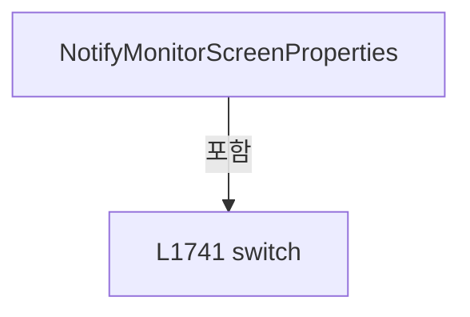

변경 전 점검: 입력/반환 타입, 위 호출자, 예외/취소 경로, 공유 상태와 저장·전송 소비자를 함께 확인합니다. 값의 단위나 물리 방향을 이름만으로 확정하지 않습니다.

### MethodDeclaration `NotifyMonitorLiveProperties` · L1869–1882

[Drilling.UI/Menu/Menus/CMenuMonitor.cs:1869–1882](https://github.com/kjuws10-rgb/A3Drilling/blob/334b3599651b2e8e0181fd4459bafaf3cddafff3/Drilling.UI/Menu/Menus/CMenuMonitor.cs#L1869-L1882)

| 항목 | 실제 추출 값 |
| --- | --- |
| 서명 | void Drilling.UI.Menu.Menus.CMenuMonitor.NotifyMonitorLiveProperties(params string[]) |
| 접근/수식자 | Private / private |
| 반환/값 타입 | void |
| 소속 타입 | NamedType:Drilling.UI.Menu.Menus.CMenuMonitor |

입력 계약:

| 이름 | 타입 | 전달 | 선택/기본값 |
| --- | --- | --- | --- |
| propertyNames | string[] | None | False /  |

정적 호출자로 확인된 위치:

| 호출 파일/행 | 호출 표현식 | 런타임 분기 가능 |
| --- | --- | --- |
| [Drilling.UI/Menu/Menus/CMenuMonitor.cs:684–684](https://github.com/kjuws10-rgb/A3Drilling/blob/334b3599651b2e8e0181fd4459bafaf3cddafff3/Drilling.UI/Menu/Menus/CMenuMonitor.cs#L684-L684) | NotifyMonitorLiveProperties | False |
| [Drilling.UI/Menu/Menus/CMenuMonitor.cs:941–941](https://github.com/kjuws10-rgb/A3Drilling/blob/334b3599651b2e8e0181fd4459bafaf3cddafff3/Drilling.UI/Menu/Menus/CMenuMonitor.cs#L941-L941) | NotifyMonitorLiveProperties | False |
| [Drilling.UI/Menu/Menus/CMenuMonitor.cs:956–956](https://github.com/kjuws10-rgb/A3Drilling/blob/334b3599651b2e8e0181fd4459bafaf3cddafff3/Drilling.UI/Menu/Menus/CMenuMonitor.cs#L956-L956) | NotifyMonitorLiveProperties | False |
| [Drilling.UI/Menu/Menus/CMenuMonitor.cs:975–975](https://github.com/kjuws10-rgb/A3Drilling/blob/334b3599651b2e8e0181fd4459bafaf3cddafff3/Drilling.UI/Menu/Menus/CMenuMonitor.cs#L975-L975) | NotifyMonitorLiveProperties | False |
| [Drilling.UI/Menu/Menus/CMenuMonitor.cs:983–983](https://github.com/kjuws10-rgb/A3Drilling/blob/334b3599651b2e8e0181fd4459bafaf3cddafff3/Drilling.UI/Menu/Menus/CMenuMonitor.cs#L983-L983) | NotifyMonitorLiveProperties | False |
| [Drilling.UI/Menu/Menus/CMenuMonitor.cs:989–989](https://github.com/kjuws10-rgb/A3Drilling/blob/334b3599651b2e8e0181fd4459bafaf3cddafff3/Drilling.UI/Menu/Menus/CMenuMonitor.cs#L989-L989) | NotifyMonitorLiveProperties | False |
| [Drilling.UI/Menu/Menus/CMenuMonitor.cs:998–1014](https://github.com/kjuws10-rgb/A3Drilling/blob/334b3599651b2e8e0181fd4459bafaf3cddafff3/Drilling.UI/Menu/Menus/CMenuMonitor.cs#L998-L1014) | NotifyMonitorLiveProperties | False |
| [Drilling.UI/Menu/Menus/CMenuMonitor.cs:1018–1018](https://github.com/kjuws10-rgb/A3Drilling/blob/334b3599651b2e8e0181fd4459bafaf3cddafff3/Drilling.UI/Menu/Menus/CMenuMonitor.cs#L1018-L1018) | NotifyMonitorLiveProperties | False |
| [Drilling.UI/Menu/Menus/CMenuMonitor.cs:1021–1021](https://github.com/kjuws10-rgb/A3Drilling/blob/334b3599651b2e8e0181fd4459bafaf3cddafff3/Drilling.UI/Menu/Menus/CMenuMonitor.cs#L1021-L1021) | NotifyMonitorLiveProperties | False |
| [Drilling.UI/Menu/Menus/CMenuMonitor.cs:1717–1740](https://github.com/kjuws10-rgb/A3Drilling/blob/334b3599651b2e8e0181fd4459bafaf3cddafff3/Drilling.UI/Menu/Menus/CMenuMonitor.cs#L1717-L1740) | NotifyMonitorLiveProperties | False |
| [Drilling.UI/Menu/Menus/CMenuMonitor.cs:1744–1755](https://github.com/kjuws10-rgb/A3Drilling/blob/334b3599651b2e8e0181fd4459bafaf3cddafff3/Drilling.UI/Menu/Menus/CMenuMonitor.cs#L1744-L1755) | NotifyMonitorLiveProperties | False |
| [Drilling.UI/Menu/Menus/CMenuMonitor.cs:1758–1769](https://github.com/kjuws10-rgb/A3Drilling/blob/334b3599651b2e8e0181fd4459bafaf3cddafff3/Drilling.UI/Menu/Menus/CMenuMonitor.cs#L1758-L1769) | NotifyMonitorLiveProperties | False |
| [Drilling.UI/Menu/Menus/CMenuMonitor.cs:1772–1783](https://github.com/kjuws10-rgb/A3Drilling/blob/334b3599651b2e8e0181fd4459bafaf3cddafff3/Drilling.UI/Menu/Menus/CMenuMonitor.cs#L1772-L1783) | NotifyMonitorLiveProperties | False |
| [Drilling.UI/Menu/Menus/CMenuMonitor.cs:1786–1796](https://github.com/kjuws10-rgb/A3Drilling/blob/334b3599651b2e8e0181fd4459bafaf3cddafff3/Drilling.UI/Menu/Menus/CMenuMonitor.cs#L1786-L1796) | NotifyMonitorLiveProperties | False |
| [Drilling.UI/Menu/Menus/CMenuMonitor.cs:1799–1818](https://github.com/kjuws10-rgb/A3Drilling/blob/334b3599651b2e8e0181fd4459bafaf3cddafff3/Drilling.UI/Menu/Menus/CMenuMonitor.cs#L1799-L1818) | NotifyMonitorLiveProperties | False |
| [Drilling.UI/Menu/Menus/CMenuMonitor.cs:1821–1831](https://github.com/kjuws10-rgb/A3Drilling/blob/334b3599651b2e8e0181fd4459bafaf3cddafff3/Drilling.UI/Menu/Menus/CMenuMonitor.cs#L1821-L1831) | NotifyMonitorLiveProperties | False |
| [Drilling.UI/Menu/Menus/CMenuMonitor.cs:1834–1845](https://github.com/kjuws10-rgb/A3Drilling/blob/334b3599651b2e8e0181fd4459bafaf3cddafff3/Drilling.UI/Menu/Menus/CMenuMonitor.cs#L1834-L1845) | NotifyMonitorLiveProperties | False |
| [Drilling.UI/Menu/Menus/CMenuMonitor.cs:1848–1858](https://github.com/kjuws10-rgb/A3Drilling/blob/334b3599651b2e8e0181fd4459bafaf3cddafff3/Drilling.UI/Menu/Menus/CMenuMonitor.cs#L1848-L1858) | NotifyMonitorLiveProperties | False |
| [Drilling.UI/Menu/Menus/CMenuMonitor.cs:1864–1864](https://github.com/kjuws10-rgb/A3Drilling/blob/334b3599651b2e8e0181fd4459bafaf3cddafff3/Drilling.UI/Menu/Menus/CMenuMonitor.cs#L1864-L1864) | NotifyMonitorLiveProperties | False |
| [Drilling.UI/Menu/Menus/CMenuMonitor.cs:2975–2975](https://github.com/kjuws10-rgb/A3Drilling/blob/334b3599651b2e8e0181fd4459bafaf3cddafff3/Drilling.UI/Menu/Menus/CMenuMonitor.cs#L2975-L2975) | NotifyMonitorLiveProperties | False |
| [Drilling.UI/Menu/Menus/CMenuMonitor.cs:2982–2982](https://github.com/kjuws10-rgb/A3Drilling/blob/334b3599651b2e8e0181fd4459bafaf3cddafff3/Drilling.UI/Menu/Menus/CMenuMonitor.cs#L2982-L2982) | NotifyMonitorLiveProperties | False |
| [Drilling.UI/Menu/Menus/CMenuMonitor.cs:3074–3074](https://github.com/kjuws10-rgb/A3Drilling/blob/334b3599651b2e8e0181fd4459bafaf3cddafff3/Drilling.UI/Menu/Menus/CMenuMonitor.cs#L3074-L3074) | NotifyMonitorLiveProperties | False |
| [Drilling.UI/Menu/Menus/CMenuMonitor.cs:3769–3799](https://github.com/kjuws10-rgb/A3Drilling/blob/334b3599651b2e8e0181fd4459bafaf3cddafff3/Drilling.UI/Menu/Menus/CMenuMonitor.cs#L3769-L3799) | NotifyMonitorLiveProperties | False |
| [Drilling.UI/Menu/Menus/CMenuMonitor.cs:5551–5551](https://github.com/kjuws10-rgb/A3Drilling/blob/334b3599651b2e8e0181fd4459bafaf3cddafff3/Drilling.UI/Menu/Menus/CMenuMonitor.cs#L5551-L5551) | NotifyMonitorLiveProperties | False |
| [Drilling.UI/Menu/Menus/CMenuMonitor.cs:5761–5773](https://github.com/kjuws10-rgb/A3Drilling/blob/334b3599651b2e8e0181fd4459bafaf3cddafff3/Drilling.UI/Menu/Menus/CMenuMonitor.cs#L5761-L5773) | NotifyMonitorLiveProperties | False |

호출하는 대상과 해석 범위:

| 원본 행 | 표현식 | 분석 상태 | 대상/소스 위치 |
| --- | --- | --- | --- |
| 1873 | GetLivePropertyValue | resolved | object? Drilling.UI.Menu.Menus.CMenuMonitor.GetLivePropertyValue(string) · Drilling.UI/Menu/Menus/CMenuMonitor.cs:1884 |
| 1874 | _lastNotifiedLiveValues.TryGetValue | resolved | bool System.Collections.Generic.Dictionary<string, object?>.TryGetValue(string, out object?) |
| 1874 | LiveValuesEqual | resolved | bool Drilling.UI.Menu.Menus.CMenuMonitor.LiveValuesEqual(object?, object?) · Drilling.UI/Menu/Menus/CMenuMonitor.cs:1899 |
| 1880 | OnPropertyChanged | resolved | void Drilling.UI.Menu.CBindingBase.OnPropertyChanged(string?) · Drilling.UI/Menu/CBindingBase.cs:790 |

본문의 실제 연산·분기·예외·반환 순서(원문 위치 순):

| 원본 행 | 종류 | 주석 해설 |
| --- | --- | --- |
| 1871 | foreach | 컬렉션 요소를 순회합니다: foreach (var propertyName in propertyNames) |
| 1873 | call | 함수·델리게이트 또는 객체 생성자를 호출합니다: GetLivePropertyValue(propertyName) |
| 1873 | local-declaration | 지역 변수를 선언합니다: var currentValue = GetLivePropertyValue(propertyName); |
| 1873 | variable-initializer | 변수의 초기값을 지정합니다: currentValue = GetLivePropertyValue(propertyName) |
| 1874 | call | 함수·델리게이트 또는 객체 생성자를 호출합니다: _lastNotifiedLiveValues.TryGetValue(propertyName, out var previousValue) |
| 1874 | call | 함수·델리게이트 또는 객체 생성자를 호출합니다: LiveValuesEqual(previousValue, currentValue) |
| 1874 | if | 조건에 따라 분기합니다: if (_lastNotifiedLiveValues.TryGetValue(propertyName, out var previousValue) && LiveValuesEqual(previousValue, currentValue)) |
| 1876 | continue | 다음 반복으로 진행합니다: continue; |
| 1879 | assignment | 값을 대상에 대입합니다: _lastNotifiedLiveValues[propertyName] = currentValue |
| 1880 | call | 함수·델리게이트 또는 객체 생성자를 호출합니다: OnPropertyChanged(propertyName) |

제어 구문의 포함 구조(실제 실행 순서/CFG가 아닌 구문 탐색 그림):

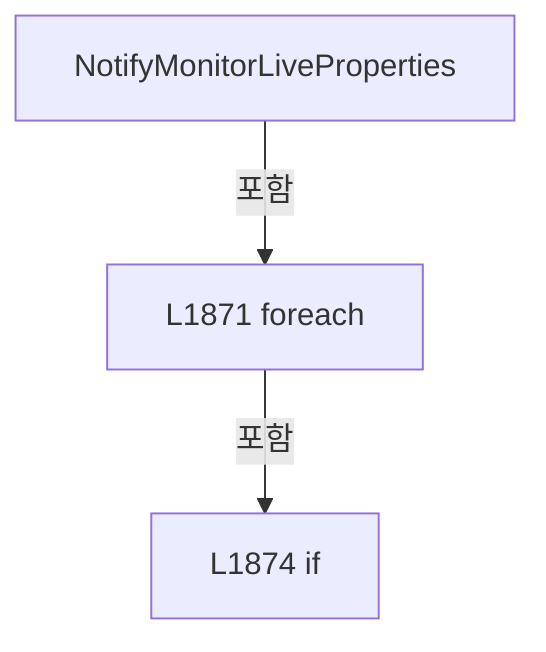

변경 전 점검: 입력/반환 타입, 위 호출자, 예외/취소 경로, 공유 상태와 저장·전송 소비자를 함께 확인합니다. 값의 단위나 물리 방향을 이름만으로 확정하지 않습니다.

### MethodDeclaration `GetLivePropertyValue` · L1884–1897

[Drilling.UI/Menu/Menus/CMenuMonitor.cs:1884–1897](https://github.com/kjuws10-rgb/A3Drilling/blob/334b3599651b2e8e0181fd4459bafaf3cddafff3/Drilling.UI/Menu/Menus/CMenuMonitor.cs#L1884-L1897)

| 항목 | 실제 추출 값 |
| --- | --- |
| 서명 | object? Drilling.UI.Menu.Menus.CMenuMonitor.GetLivePropertyValue(string) |
| 접근/수식자 | Private / private |
| 반환/값 타입 | object? |
| 소속 타입 | NamedType:Drilling.UI.Menu.Menus.CMenuMonitor |

입력 계약:

| 이름 | 타입 | 전달 | 선택/기본값 |
| --- | --- | --- | --- |
| propertyName | string | None | False /  |

정적 호출자로 확인된 위치:

| 호출 파일/행 | 호출 표현식 | 런타임 분기 가능 |
| --- | --- | --- |
| [Drilling.UI/Menu/Menus/CMenuMonitor.cs:1873–1873](https://github.com/kjuws10-rgb/A3Drilling/blob/334b3599651b2e8e0181fd4459bafaf3cddafff3/Drilling.UI/Menu/Menus/CMenuMonitor.cs#L1873-L1873) | GetLivePropertyValue | False |

호출하는 대상과 해석 범위:

| 원본 행 | 표현식 | 분석 상태 | 대상/소스 위치 |
| --- | --- | --- | --- |
| 1889 | LivePropertyCache.TryGetValue | resolved | bool System.Collections.Generic.Dictionary<string, System.Reflection.PropertyInfo?>.TryGetValue(string, out System.Reflection.PropertyInfo?) |
| 1891 | typeof(CMenuMonitor).GetProperty | resolved | System.Reflection.PropertyInfo? System.Type.GetProperty(string) |
| 1896 | .GetValue | resolved | object? System.Reflection.PropertyInfo.GetValue(object?) |

본문의 실제 연산·분기·예외·반환 순서(원문 위치 순):

| 원본 행 | 종류 | 주석 해설 |
| --- | --- | --- |
| 1886 | local-declaration | 지역 변수를 선언합니다: PropertyInfo? property; |
| 1887 | lock | 공유 상태의 임계 구역에 진입합니다: lock (LivePropertyCacheLock) |
| 1889 | call | 함수·델리게이트 또는 객체 생성자를 호출합니다: LivePropertyCache.TryGetValue(propertyName, out property) |
| 1889 | if | 조건에 따라 분기합니다: if (!LivePropertyCache.TryGetValue(propertyName, out property)) |
| 1891 | assignment | 값을 대상에 대입합니다: property = typeof(CMenuMonitor).GetProperty(propertyName) |
| 1891 | call | 함수·델리게이트 또는 객체 생성자를 호출합니다: typeof(CMenuMonitor).GetProperty(propertyName) |
| 1892 | assignment | 값을 대상에 대입합니다: LivePropertyCache[propertyName] = property |
| 1896 | call | 함수·델리게이트 또는 객체 생성자를 호출합니다: .GetValue(this) |
| 1896 | return | 호출자에게 값 또는 제어를 반환합니다: return property?.GetValue(this); |

제어 구문의 포함 구조(실제 실행 순서/CFG가 아닌 구문 탐색 그림):

```mermaid
flowchart TD
 M["GetLivePropertyValue"]
 N0["L1887 lock"]
 M -->|포함| N0
 N1["L1889 if"]
 N0 -->|포함| N1
```

변경 전 점검: 입력/반환 타입, 위 호출자, 예외/취소 경로, 공유 상태와 저장·전송 소비자를 함께 확인합니다. 값의 단위나 물리 방향을 이름만으로 확정하지 않습니다.

### MethodDeclaration `LiveValuesEqual` · L1899–1917

[Drilling.UI/Menu/Menus/CMenuMonitor.cs:1899–1917](https://github.com/kjuws10-rgb/A3Drilling/blob/334b3599651b2e8e0181fd4459bafaf3cddafff3/Drilling.UI/Menu/Menus/CMenuMonitor.cs#L1899-L1917)

| 항목 | 실제 추출 값 |
| --- | --- |
| 서명 | bool Drilling.UI.Menu.Menus.CMenuMonitor.LiveValuesEqual(object?, object?) |
| 접근/수식자 | Private / private, static |
| 반환/값 타입 | bool |
| 소속 타입 | NamedType:Drilling.UI.Menu.Menus.CMenuMonitor |

입력 계약:

| 이름 | 타입 | 전달 | 선택/기본값 |
| --- | --- | --- | --- |
| previousValue | object? | None | False /  |
| currentValue | object? | None | False /  |

정적 호출자로 확인된 위치:

| 호출 파일/행 | 호출 표현식 | 런타임 분기 가능 |
| --- | --- | --- |
| [Drilling.UI/Menu/Menus/CMenuMonitor.cs:1874–1874](https://github.com/kjuws10-rgb/A3Drilling/blob/334b3599651b2e8e0181fd4459bafaf3cddafff3/Drilling.UI/Menu/Menus/CMenuMonitor.cs#L1874-L1874) | LiveValuesEqual | False |

호출하는 대상과 해석 범위:

| 원본 행 | 표현식 | 분석 상태 | 대상/소스 위치 |
| --- | --- | --- | --- |
| 1901 | ReferenceEquals | resolved | bool object.ReferenceEquals(object?, object?) |
| 1901 | Equals | resolved | bool object.Equals(object?, object?) |
| 1911 | TryGetEnumerableCount | resolved | bool Drilling.UI.Menu.Menus.CMenuMonitor.TryGetEnumerableCount(System.Collections.IEnumerable, out int) · Drilling.UI/Menu/Menus/CMenuMonitor.cs:1919 |
| 1911 | TryGetEnumerableCount | resolved | bool Drilling.UI.Menu.Menus.CMenuMonitor.TryGetEnumerableCount(System.Collections.IEnumerable, out int) · Drilling.UI/Menu/Menus/CMenuMonitor.cs:1919 |
| 1916 | previousItems.Cast<object?>().SequenceEqual | resolved | bool System.Collections.Generic.IEnumerable<object?>.SequenceEqual<object?>(System.Collections.Generic.IEnumerable<object?>) |
| 1916 | previousItems.Cast<object?> | resolved | System.Collections.Generic.IEnumerable<object?> System.Collections.IEnumerable.Cast<object?>() |
| 1916 | currentItems.Cast<object?> | resolved | System.Collections.Generic.IEnumerable<object?> System.Collections.IEnumerable.Cast<object?>() |

본문의 실제 연산·분기·예외·반환 순서(원문 위치 순):

| 원본 행 | 종류 | 주석 해설 |
| --- | --- | --- |
| 1901 | call | 함수·델리게이트 또는 객체 생성자를 호출합니다: ReferenceEquals(previousValue, currentValue) |
| 1901 | call | 함수·델리게이트 또는 객체 생성자를 호출합니다: Equals(previousValue, currentValue) |
| 1901 | if | 조건에 따라 분기합니다: if (ReferenceEquals(previousValue, currentValue) &#124;&#124; Equals(previousValue, currentValue)) |
| 1903 | return | 호출자에게 값 또는 제어를 반환합니다: return true; |
| 1906 | if | 조건에 따라 분기합니다: if (previousValue is string &#124;&#124; currentValue is string &#124;&#124; previousValue is not IEnumerable previousItems &#124;&#124; currentValue is not IEnumerable currentItems) |
| 1908 | return | 호출자에게 값 또는 제어를 반환합니다: return false; |
| 1911 | call | 함수·델리게이트 또는 객체 생성자를 호출합니다: TryGetEnumerableCount(previousItems, out var previousCount) |
| 1911 | call | 함수·델리게이트 또는 객체 생성자를 호출합니다: TryGetEnumerableCount(currentItems, out var currentCount) |
| 1911 | if | 조건에 따라 분기합니다: if (TryGetEnumerableCount(previousItems, out var previousCount) && TryGetEnumerableCount(currentItems, out var currentCount) && previousCount != currentCount) |
| 1913 | return | 호출자에게 값 또는 제어를 반환합니다: return false; |
| 1916 | call | 함수·델리게이트 또는 객체 생성자를 호출합니다: previousItems.Cast<object?>().SequenceEqual(currentItems.Cast<object?>()) |
| 1916 | call | 함수·델리게이트 또는 객체 생성자를 호출합니다: previousItems.Cast<object?>() |
| 1916 | call | 함수·델리게이트 또는 객체 생성자를 호출합니다: currentItems.Cast<object?>() |
| 1916 | return | 호출자에게 값 또는 제어를 반환합니다: return previousItems.Cast<object?>().SequenceEqual(currentItems.Cast<object?>()); |

제어 구문의 포함 구조(실제 실행 순서/CFG가 아닌 구문 탐색 그림):

```mermaid
flowchart TD
 M["LiveValuesEqual"]
 N0["L1901 if"]
 M -->|포함| N0
 N1["L1906 if"]
 M -->|포함| N1
 N2["L1911 if"]
 M -->|포함| N2
```

변경 전 점검: 입력/반환 타입, 위 호출자, 예외/취소 경로, 공유 상태와 저장·전송 소비자를 함께 확인합니다. 값의 단위나 물리 방향을 이름만으로 확정하지 않습니다.

### MethodDeclaration `TryGetEnumerableCount` · L1919–1936

[Drilling.UI/Menu/Menus/CMenuMonitor.cs:1919–1936](https://github.com/kjuws10-rgb/A3Drilling/blob/334b3599651b2e8e0181fd4459bafaf3cddafff3/Drilling.UI/Menu/Menus/CMenuMonitor.cs#L1919-L1936)

| 항목 | 실제 추출 값 |
| --- | --- |
| 서명 | bool Drilling.UI.Menu.Menus.CMenuMonitor.TryGetEnumerableCount(System.Collections.IEnumerable, out int) |
| 접근/수식자 | Private / private, static |
| 반환/값 타입 | bool |
| 소속 타입 | NamedType:Drilling.UI.Menu.Menus.CMenuMonitor |

입력 계약:

| 이름 | 타입 | 전달 | 선택/기본값 |
| --- | --- | --- | --- |
| items | System.Collections.IEnumerable | None | False /  |
| count | int | Out | False /  |

정적 호출자로 확인된 위치:

| 호출 파일/행 | 호출 표현식 | 런타임 분기 가능 |
| --- | --- | --- |
| [Drilling.UI/Menu/Menus/CMenuMonitor.cs:1911–1911](https://github.com/kjuws10-rgb/A3Drilling/blob/334b3599651b2e8e0181fd4459bafaf3cddafff3/Drilling.UI/Menu/Menus/CMenuMonitor.cs#L1911-L1911) | TryGetEnumerableCount | False |
| [Drilling.UI/Menu/Menus/CMenuMonitor.cs:1911–1911](https://github.com/kjuws10-rgb/A3Drilling/blob/334b3599651b2e8e0181fd4459bafaf3cddafff3/Drilling.UI/Menu/Menus/CMenuMonitor.cs#L1911-L1911) | TryGetEnumerableCount | False |

호출하는 대상과 해석 범위:

| 원본 행 | 표현식 | 분석 상태 | 대상/소스 위치 |
| --- | --- | --- | --- |
| 1927 | items.GetType().GetProperty | resolved | System.Reflection.PropertyInfo? System.Type.GetProperty(string, System.Reflection.BindingFlags) |
| 1927 | items.GetType | resolved | System.Type object.GetType() |
| 1928 | countProperty.GetValue | resolved | object? System.Reflection.PropertyInfo.GetValue(object?) |

본문의 실제 연산·분기·예외·반환 순서(원문 위치 순):

| 원본 행 | 종류 | 주석 해설 |
| --- | --- | --- |
| 1921 | if | 조건에 따라 분기합니다: if (items is ICollection collection) |
| 1923 | assignment | 값을 대상에 대입합니다: count = collection.Count |
| 1924 | return | 호출자에게 값 또는 제어를 반환합니다: return true; |
| 1927 | call | 함수·델리게이트 또는 객체 생성자를 호출합니다: items.GetType().GetProperty("Count", BindingFlags.Instance &#124; BindingFlags.Public) |
| 1927 | call | 함수·델리게이트 또는 객체 생성자를 호출합니다: items.GetType() |
| 1927 | local-declaration | 지역 변수를 선언합니다: var countProperty = items.GetType().GetProperty("Count", BindingFlags.Instance &#124; BindingFlags.Public); |
| 1927 | variable-initializer | 변수의 초기값을 지정합니다: countProperty = items.GetType().GetProperty("Count", BindingFlags.Instance &#124; BindingFlags.Public) |
| 1928 | call | 함수·델리게이트 또는 객체 생성자를 호출합니다: countProperty.GetValue(items) |
| 1928 | if | 조건에 따라 분기합니다: if (countProperty?.PropertyType == typeof(int) && countProperty.GetValue(items)is int value) |
| 1930 | assignment | 값을 대상에 대입합니다: count = value |
| 1931 | return | 호출자에게 값 또는 제어를 반환합니다: return true; |
| 1934 | assignment | 값을 대상에 대입합니다: count = 0 |
| 1935 | return | 호출자에게 값 또는 제어를 반환합니다: return false; |

제어 구문의 포함 구조(실제 실행 순서/CFG가 아닌 구문 탐색 그림):

```mermaid
flowchart TD
 M["TryGetEnumerableCount"]
 N0["L1921 if"]
 M -->|포함| N0
 N1["L1928 if"]
 M -->|포함| N1
```

변경 전 점검: 입력/반환 타입, 위 호출자, 예외/취소 경로, 공유 상태와 저장·전송 소비자를 함께 확인합니다. 값의 단위나 물리 방향을 이름만으로 확정하지 않습니다.

### MethodDeclaration `CreateTabSections` · L1938–1946

[Drilling.UI/Menu/Menus/CMenuMonitor.cs:1938–1946](https://github.com/kjuws10-rgb/A3Drilling/blob/334b3599651b2e8e0181fd4459bafaf3cddafff3/Drilling.UI/Menu/Menus/CMenuMonitor.cs#L1938-L1946)

| 항목 | 실제 추출 값 |
| --- | --- |
| 서명 | System.Collections.Generic.IReadOnlyList<Drilling.UI.Menu.Menus.ST_SCREEN_SECTION> Drilling.UI.Menu.Menus.CMenuMonitor.CreateTabSections(System.Collections.Generic.IReadOnlyList<Drilling.UI.Menu.Menus.ST_MONITOR_TAB>) |
| 접근/수식자 | Private / private, static |
| 반환/값 타입 | System.Collections.Generic.IReadOnlyList<Drilling.UI.Menu.Menus.ST_SCREEN_SECTION> |
| 소속 타입 | NamedType:Drilling.UI.Menu.Menus.CMenuMonitor |

입력 계약:

| 이름 | 타입 | 전달 | 선택/기본값 |
| --- | --- | --- | --- |
| tabs | System.Collections.Generic.IReadOnlyList<Drilling.UI.Menu.Menus.ST_MONITOR_TAB> | None | False /  |

정적 호출자로 확인된 위치:

| 호출 파일/행 | 호출 표현식 | 런타임 분기 가능 |
| --- | --- | --- |
| [Drilling.UI/Menu/Menus/CMenuMonitor.cs:817–817](https://github.com/kjuws10-rgb/A3Drilling/blob/334b3599651b2e8e0181fd4459bafaf3cddafff3/Drilling.UI/Menu/Menus/CMenuMonitor.cs#L817-L817) | CreateTabSections | False |
| [Drilling.UI/Menu/Menus/CMenuMonitor.cs:2632–2632](https://github.com/kjuws10-rgb/A3Drilling/blob/334b3599651b2e8e0181fd4459bafaf3cddafff3/Drilling.UI/Menu/Menus/CMenuMonitor.cs#L2632-L2632) | CreateTabSections | False |
| [Drilling.UI/Menu/Menus/CMenuMonitor.cs:2682–2682](https://github.com/kjuws10-rgb/A3Drilling/blob/334b3599651b2e8e0181fd4459bafaf3cddafff3/Drilling.UI/Menu/Menus/CMenuMonitor.cs#L2682-L2682) | CreateTabSections | False |

호출하는 대상과 해석 범위:

| 원본 행 | 표현식 | 분석 상태 | 대상/소스 위치 |
| --- | --- | --- | --- |
| 1945 | tabs.Select(BuildSCREEN_SECTION).ToArray | resolved | Drilling.UI.Menu.Menus.ST_SCREEN_SECTION[] System.Collections.Generic.IEnumerable<Drilling.UI.Menu.Menus.ST_SCREEN_SECTION>.ToArray<Drilling.UI.Menu.Menus.ST_SCREEN_SECTION>() |
| 1945 | tabs.Select | resolved | System.Collections.Generic.IEnumerable<Drilling.UI.Menu.Menus.ST_SCREEN_SECTION> System.Collections.Generic.IEnumerable<Drilling.UI.Menu.Menus.ST_MONITOR_TAB>.Select<Drilling.UI.Menu.Menus.ST_MONITOR_TAB, Drilling.UI.Menu.Menus.ST_SCREEN_SECTION>(System.Func<Drilling.UI.Menu.Menus.ST_MONITOR_TAB, Drilling.UI.Menu.Menus.ST_SCREEN_SECTION>) |

본문의 실제 연산·분기·예외·반환 순서(원문 위치 순):

| 원본 행 | 종류 | 주석 해설 |
| --- | --- | --- |
| 1945 | call | 함수·델리게이트 또는 객체 생성자를 호출합니다: tabs.Select(BuildSCREEN_SECTION).ToArray() |
| 1945 | call | 함수·델리게이트 또는 객체 생성자를 호출합니다: tabs.Select(BuildSCREEN_SECTION) |
| 1945 | return | 호출자에게 값 또는 제어를 반환합니다: return tabs.Select(BuildSCREEN_SECTION).ToArray(); |

변경 전 점검: 입력/반환 타입, 위 호출자, 예외/취소 경로, 공유 상태와 저장·전송 소비자를 함께 확인합니다. 값의 단위나 물리 방향을 이름만으로 확정하지 않습니다.

### LocalFunctionStatement `BuildSCREEN_SECTION` · L1940–1943

[Drilling.UI/Menu/Menus/CMenuMonitor.cs:1940–1943](https://github.com/kjuws10-rgb/A3Drilling/blob/334b3599651b2e8e0181fd4459bafaf3cddafff3/Drilling.UI/Menu/Menus/CMenuMonitor.cs#L1940-L1943)

| 항목 | 실제 추출 값 |
| --- | --- |
| 서명 | Drilling.UI.Menu.Menus.ST_SCREEN_SECTION BuildSCREEN_SECTION(Drilling.UI.Menu.Menus.ST_MONITOR_TAB) |
| 접근/수식자 | Private /  |
| 반환/값 타입 | Drilling.UI.Menu.Menus.ST_SCREEN_SECTION |
| 소속 타입 | NamedType:Drilling.UI.Menu.Menus.CMenuMonitor |

입력 계약:

| 이름 | 타입 | 전달 | 선택/기본값 |
| --- | --- | --- | --- |
| tab | Drilling.UI.Menu.Menus.ST_MONITOR_TAB | None | False /  |

현재 부분 분석에서 직접 연결된 호출자는 없습니다. XAML/이벤트/인터페이스·델리게이트·외부 진입을 추가 확인해야 하며, 미사용으로 판정한 것이 아닙니다.

호출하는 대상과 해석 범위:

| 원본 행 | 표현식 | 분석 상태 | 대상/소스 위치 |
| --- | --- | --- | --- |
| 1942 | new ST_SCREEN_SECTION | resolved | Drilling.UI.Menu.Menus.ST_SCREEN_SECTION.ST_SCREEN_SECTION(string, System.Collections.Generic.IReadOnlyList<Drilling.UI.Menu.Menus.ST_DISPLAY_ITEM>) · Drilling.UI/Menu/Menus/CMenuBase.cs:410 |
| 1942 | Array.Empty<ST_DISPLAY_ITEM> | resolved | Drilling.UI.Menu.Menus.ST_DISPLAY_ITEM[] System.Array.Empty<Drilling.UI.Menu.Menus.ST_DISPLAY_ITEM>() |

본문의 실제 연산·분기·예외·반환 순서(원문 위치 순):

| 원본 행 | 종류 | 주석 해설 |
| --- | --- | --- |
| 1942 | call | 함수·델리게이트 또는 객체 생성자를 호출합니다: new ST_SCREEN_SECTION(tab.Name, Array.Empty<ST_DISPLAY_ITEM>()) |
| 1942 | call | 함수·델리게이트 또는 객체 생성자를 호출합니다: Array.Empty<ST_DISPLAY_ITEM>() |
| 1942 | return | 호출자에게 값 또는 제어를 반환합니다: return new ST_SCREEN_SECTION(tab.Name, Array.Empty<ST_DISPLAY_ITEM>()); |

변경 전 점검: 입력/반환 타입, 위 호출자, 예외/취소 경로, 공유 상태와 저장·전송 소비자를 함께 확인합니다. 값의 단위나 물리 방향을 이름만으로 확정하지 않습니다.

### MethodDeclaration `NormalizeMonitorScreenTab` · L1948–1952

[Drilling.UI/Menu/Menus/CMenuMonitor.cs:1948–1952](https://github.com/kjuws10-rgb/A3Drilling/blob/334b3599651b2e8e0181fd4459bafaf3cddafff3/Drilling.UI/Menu/Menus/CMenuMonitor.cs#L1948-L1952)

| 항목 | 실제 추출 값 |
| --- | --- |
| 서명 | string Drilling.UI.Menu.Menus.CMenuMonitor.NormalizeMonitorScreenTab(string?) |
| 접근/수식자 | Private / private, static |
| 반환/값 타입 | string |
| 소속 타입 | NamedType:Drilling.UI.Menu.Menus.CMenuMonitor |

입력 계약:

| 이름 | 타입 | 전달 | 선택/기본값 |
| --- | --- | --- | --- |
| tab | string? | None | False /  |

정적 호출자로 확인된 위치:

| 호출 파일/행 | 호출 표현식 | 런타임 분기 가능 |
| --- | --- | --- |
| [Drilling.UI/Menu/Menus/CMenuMonitor.cs:727–727](https://github.com/kjuws10-rgb/A3Drilling/blob/334b3599651b2e8e0181fd4459bafaf3cddafff3/Drilling.UI/Menu/Menus/CMenuMonitor.cs#L727-L727) | NormalizeMonitorScreenTab | False |
| [Drilling.UI/Menu/Menus/CMenuMonitor.cs:887–887](https://github.com/kjuws10-rgb/A3Drilling/blob/334b3599651b2e8e0181fd4459bafaf3cddafff3/Drilling.UI/Menu/Menus/CMenuMonitor.cs#L887-L887) | NormalizeMonitorScreenTab | False |
| [Drilling.UI/Menu/Menus/CMenuMonitor.cs:1162–1162](https://github.com/kjuws10-rgb/A3Drilling/blob/334b3599651b2e8e0181fd4459bafaf3cddafff3/Drilling.UI/Menu/Menus/CMenuMonitor.cs#L1162-L1162) | NormalizeMonitorScreenTab | False |

호출하는 대상과 해석 범위:

| 원본 행 | 표현식 | 분석 상태 | 대상/소스 위치 |
| --- | --- | --- | --- |
| 1950 | NormalizeMonitorTab | resolved | string Drilling.UI.Menu.Menus.CMenuMonitor.NormalizeMonitorTab(string?) · Drilling.UI/Menu/Menus/CMenuMonitor.cs:1954 |

본문의 실제 연산·분기·예외·반환 순서(원문 위치 순):

| 원본 행 | 종류 | 주석 해설 |
| --- | --- | --- |
| 1950 | call | 함수·델리게이트 또는 객체 생성자를 호출합니다: NormalizeMonitorTab(tab) |
| 1950 | local-declaration | 지역 변수를 선언합니다: var normalized = NormalizeMonitorTab(tab); |
| 1950 | variable-initializer | 변수의 초기값을 지정합니다: normalized = NormalizeMonitorTab(tab) |
| 1951 | conditional-expression | 조건에 따라 결과식을 선택합니다: normalized == "POWER METER" ? "LASER" : normalized |
| 1951 | return | 호출자에게 값 또는 제어를 반환합니다: return normalized == "POWER METER" ? "LASER" : normalized; |

변경 전 점검: 입력/반환 타입, 위 호출자, 예외/취소 경로, 공유 상태와 저장·전송 소비자를 함께 확인합니다. 값의 단위나 물리 방향을 이름만으로 확정하지 않습니다.

### MethodDeclaration `NormalizeMonitorTab` · L1954–1968

[Drilling.UI/Menu/Menus/CMenuMonitor.cs:1954–1968](https://github.com/kjuws10-rgb/A3Drilling/blob/334b3599651b2e8e0181fd4459bafaf3cddafff3/Drilling.UI/Menu/Menus/CMenuMonitor.cs#L1954-L1968)

| 항목 | 실제 추출 값 |
| --- | --- |
| 서명 | string Drilling.UI.Menu.Menus.CMenuMonitor.NormalizeMonitorTab(string?) |
| 접근/수식자 | Private / private, static |
| 반환/값 타입 | string |
| 소속 타입 | NamedType:Drilling.UI.Menu.Menus.CMenuMonitor |

입력 계약:

| 이름 | 타입 | 전달 | 선택/기본값 |
| --- | --- | --- | --- |
| tab | string? | None | False /  |

정적 호출자로 확인된 위치:

| 호출 파일/행 | 호출 표현식 | 런타임 분기 가능 |
| --- | --- | --- |
| [Drilling.UI/Menu/Menus/CMenuMonitor.cs:1130–1130](https://github.com/kjuws10-rgb/A3Drilling/blob/334b3599651b2e8e0181fd4459bafaf3cddafff3/Drilling.UI/Menu/Menus/CMenuMonitor.cs#L1130-L1130) | NormalizeMonitorTab | False |
| [Drilling.UI/Menu/Menus/CMenuMonitor.cs:1950–1950](https://github.com/kjuws10-rgb/A3Drilling/blob/334b3599651b2e8e0181fd4459bafaf3cddafff3/Drilling.UI/Menu/Menus/CMenuMonitor.cs#L1950-L1950) | NormalizeMonitorTab | False |
| [Drilling.UI/Menu/Menus/CMenuMonitor.cs:2344–2344](https://github.com/kjuws10-rgb/A3Drilling/blob/334b3599651b2e8e0181fd4459bafaf3cddafff3/Drilling.UI/Menu/Menus/CMenuMonitor.cs#L2344-L2344) | NormalizeMonitorTab | False |
| [Drilling.UI/Menu/Menus/CMenuMonitor.cs:2349–2349](https://github.com/kjuws10-rgb/A3Drilling/blob/334b3599651b2e8e0181fd4459bafaf3cddafff3/Drilling.UI/Menu/Menus/CMenuMonitor.cs#L2349-L2349) | NormalizeMonitorTab | False |
| [Drilling.UI/Menu/Menus/CMenuMonitor.cs:2403–2403](https://github.com/kjuws10-rgb/A3Drilling/blob/334b3599651b2e8e0181fd4459bafaf3cddafff3/Drilling.UI/Menu/Menus/CMenuMonitor.cs#L2403-L2403) | NormalizeMonitorTab | False |
| [Drilling.UI/Menu/Menus/CMenuMonitor.cs:2420–2420](https://github.com/kjuws10-rgb/A3Drilling/blob/334b3599651b2e8e0181fd4459bafaf3cddafff3/Drilling.UI/Menu/Menus/CMenuMonitor.cs#L2420-L2420) | NormalizeMonitorTab | False |
| [Drilling.UI/Menu/Menus/CMenuMonitor.cs:2443–2443](https://github.com/kjuws10-rgb/A3Drilling/blob/334b3599651b2e8e0181fd4459bafaf3cddafff3/Drilling.UI/Menu/Menus/CMenuMonitor.cs#L2443-L2443) | NormalizeMonitorTab | False |
| [Drilling.UI/Menu/Menus/CMenuMonitor.cs:2459–2459](https://github.com/kjuws10-rgb/A3Drilling/blob/334b3599651b2e8e0181fd4459bafaf3cddafff3/Drilling.UI/Menu/Menus/CMenuMonitor.cs#L2459-L2459) | NormalizeMonitorTab | False |
| [Drilling.UI/Menu/Menus/CMenuMonitor.cs:2464–2464](https://github.com/kjuws10-rgb/A3Drilling/blob/334b3599651b2e8e0181fd4459bafaf3cddafff3/Drilling.UI/Menu/Menus/CMenuMonitor.cs#L2464-L2464) | NormalizeMonitorTab | False |

호출하는 대상과 해석 범위:

| 원본 행 | 표현식 | 분석 상태 | 대상/소스 위치 |
| --- | --- | --- | --- |
| 1956 | (tab ?? "PRODUCT").Trim().ToUpperInvariant | resolved | string string.ToUpperInvariant() |
| 1956 | (tab ?? "PRODUCT").Trim | resolved | string string.Trim() |

본문의 실제 연산·분기·예외·반환 순서(원문 위치 순):

| 원본 행 | 종류 | 주석 해설 |
| --- | --- | --- |
| 1956 | call | 함수·델리게이트 또는 객체 생성자를 호출합니다: (tab ?? "PRODUCT").Trim().ToUpperInvariant() |
| 1956 | call | 함수·델리게이트 또는 객체 생성자를 호출합니다: (tab ?? "PRODUCT").Trim() |
| 1956 | local-declaration | 지역 변수를 선언합니다: var normalized = (tab ?? "PRODUCT").Trim().ToUpperInvariant(); |
| 1956 | variable-initializer | 변수의 초기값을 지정합니다: normalized = (tab ?? "PRODUCT").Trim().ToUpperInvariant() |
| 1957 | return | 호출자에게 값 또는 제어를 반환합니다: return normalized switch { "ATT" => "ATTENUATOR", "LASER/POWERMETER" => "LASER", "POWER" or "POWERMETER" or "POWER_METER" => "POWER METER", "MOTOR" or "XPS" or "SCANNERTILT" or "SCANNER TILT" or "SCANNER_TILT" => "XPS", "PICO" or  |
| 1957 | switch-expression | 값별 결과식을 선택합니다: normalized switch { "ATT" => "ATTENUATOR", "LASER/POWERMETER" => "LASER", "POWER" or "POWERMETER" or "POWER_METER" => "POWER METER", "MOTOR" or "XPS" or "SCANNERTILT" or "SCANNER TILT" or "SCANNER_TILT" => "XPS", "PICO" or "PICOMO |

제어 구문의 포함 구조(실제 실행 순서/CFG가 아닌 구문 탐색 그림):

```mermaid
flowchart TD
 M["NormalizeMonitorTab"]
 N0["L1957 switch-expression"]
 M -->|포함| N0
```

변경 전 점검: 입력/반환 타입, 위 호출자, 예외/취소 경로, 공유 상태와 저장·전송 소비자를 함께 확인합니다. 값의 단위나 물리 방향을 이름만으로 확정하지 않습니다.

### MethodDeclaration `GetSubtitle` · L1970–1985

[Drilling.UI/Menu/Menus/CMenuMonitor.cs:1970–1985](https://github.com/kjuws10-rgb/A3Drilling/blob/334b3599651b2e8e0181fd4459bafaf3cddafff3/Drilling.UI/Menu/Menus/CMenuMonitor.cs#L1970-L1985)

| 항목 | 실제 추출 값 |
| --- | --- |
| 서명 | string Drilling.UI.Menu.Menus.CMenuMonitor.GetSubtitle(string) |
| 접근/수식자 | Private / private, static |
| 반환/값 타입 | string |
| 소속 타입 | NamedType:Drilling.UI.Menu.Menus.CMenuMonitor |

입력 계약:

| 이름 | 타입 | 전달 | 선택/기본값 |
| --- | --- | --- | --- |
| tab | string | None | False /  |

정적 호출자로 확인된 위치:

| 호출 파일/행 | 호출 표현식 | 런타임 분기 가능 |
| --- | --- | --- |
| [Drilling.UI/Menu/Menus/CMenuMonitor.cs:820–820](https://github.com/kjuws10-rgb/A3Drilling/blob/334b3599651b2e8e0181fd4459bafaf3cddafff3/Drilling.UI/Menu/Menus/CMenuMonitor.cs#L820-L820) | GetSubtitle | False |
| [Drilling.UI/Menu/Menus/CMenuMonitor.cs:2685–2685](https://github.com/kjuws10-rgb/A3Drilling/blob/334b3599651b2e8e0181fd4459bafaf3cddafff3/Drilling.UI/Menu/Menus/CMenuMonitor.cs#L2685-L2685) | GetSubtitle | False |

본문의 실제 연산·분기·예외·반환 순서(원문 위치 순):

| 원본 행 | 종류 | 주석 해설 |
| --- | --- | --- |
| 1972 | return | 호출자에게 값 또는 제어를 반환합니다: return tab switch { "XPS" => "Newport XPS axis position monitor and service operation", "LASER" => "Talon laser control and one-shot PowerMeter queries", "ATTENUATOR" => "Conex AGP attenuator position monitor and service operation |
| 1972 | switch-expression | 값별 결과식을 선택합니다: tab switch { "XPS" => "Newport XPS axis position monitor and service operation", "LASER" => "Talon laser control and one-shot PowerMeter queries", "ATTENUATOR" => "Conex AGP attenuator position monitor and service operation", "BET |

제어 구문의 포함 구조(실제 실행 순서/CFG가 아닌 구문 탐색 그림):

```mermaid
flowchart TD
 M["GetSubtitle"]
 N0["L1972 switch-expression"]
 M -->|포함| N0
```

변경 전 점검: 입력/반환 타입, 위 호출자, 예외/취소 경로, 공유 상태와 저장·전송 소비자를 함께 확인합니다. 값의 단위나 물리 방향을 이름만으로 확정하지 않습니다.

### MethodDeclaration `GetStatusPanelTitle` · L1987–2001

[Drilling.UI/Menu/Menus/CMenuMonitor.cs:1987–2001](https://github.com/kjuws10-rgb/A3Drilling/blob/334b3599651b2e8e0181fd4459bafaf3cddafff3/Drilling.UI/Menu/Menus/CMenuMonitor.cs#L1987-L2001)

| 항목 | 실제 추출 값 |
| --- | --- |
| 서명 | string Drilling.UI.Menu.Menus.CMenuMonitor.GetStatusPanelTitle(string) |
| 접근/수식자 | Private / private, static |
| 반환/값 타입 | string |
| 소속 타입 | NamedType:Drilling.UI.Menu.Menus.CMenuMonitor |

입력 계약:

| 이름 | 타입 | 전달 | 선택/기본값 |
| --- | --- | --- | --- |
| tab | string | None | False /  |

정적 호출자로 확인된 위치:

| 호출 파일/행 | 호출 표현식 | 런타임 분기 가능 |
| --- | --- | --- |
| [Drilling.UI/Menu/Menus/CMenuMonitor.cs:821–821](https://github.com/kjuws10-rgb/A3Drilling/blob/334b3599651b2e8e0181fd4459bafaf3cddafff3/Drilling.UI/Menu/Menus/CMenuMonitor.cs#L821-L821) | GetStatusPanelTitle | False |
| [Drilling.UI/Menu/Menus/CMenuMonitor.cs:2686–2686](https://github.com/kjuws10-rgb/A3Drilling/blob/334b3599651b2e8e0181fd4459bafaf3cddafff3/Drilling.UI/Menu/Menus/CMenuMonitor.cs#L2686-L2686) | GetStatusPanelTitle | False |

본문의 실제 연산·분기·예외·반환 순서(원문 위치 순):

| 원본 행 | 종류 | 주석 해설 |
| --- | --- | --- |
| 1989 | return | 호출자에게 값 또는 제어를 반환합니다: return tab switch { "LASER" => "Laser Status", "ATTENUATOR" => "Attenuator Status", "BET" => "BET Status", "POWER METER" => "PowerMeter Status", "XPS" => "XPS Status", "PICO MOTOR" => "PicoMotor Status", "PRODUCT" => "Product Stat |
| 1989 | switch-expression | 값별 결과식을 선택합니다: tab switch { "LASER" => "Laser Status", "ATTENUATOR" => "Attenuator Status", "BET" => "BET Status", "POWER METER" => "PowerMeter Status", "XPS" => "XPS Status", "PICO MOTOR" => "PicoMotor Status", "PRODUCT" => "Product Status", "M |

제어 구문의 포함 구조(실제 실행 순서/CFG가 아닌 구문 탐색 그림):

```mermaid
flowchart TD
 M["GetStatusPanelTitle"]
 N0["L1989 switch-expression"]
 M -->|포함| N0
```

변경 전 점검: 입력/반환 타입, 위 호출자, 예외/취소 경로, 공유 상태와 저장·전송 소비자를 함께 확인합니다. 값의 단위나 물리 방향을 이름만으로 확정하지 않습니다.

### MethodDeclaration `GetOperationPanelTitle` · L2003–2016

[Drilling.UI/Menu/Menus/CMenuMonitor.cs:2003–2016](https://github.com/kjuws10-rgb/A3Drilling/blob/334b3599651b2e8e0181fd4459bafaf3cddafff3/Drilling.UI/Menu/Menus/CMenuMonitor.cs#L2003-L2016)

| 항목 | 실제 추출 값 |
| --- | --- |
| 서명 | string Drilling.UI.Menu.Menus.CMenuMonitor.GetOperationPanelTitle(string) |
| 접근/수식자 | Private / private, static |
| 반환/값 타입 | string |
| 소속 타입 | NamedType:Drilling.UI.Menu.Menus.CMenuMonitor |

입력 계약:

| 이름 | 타입 | 전달 | 선택/기본값 |
| --- | --- | --- | --- |
| tab | string | None | False /  |

정적 호출자로 확인된 위치:

| 호출 파일/행 | 호출 표현식 | 런타임 분기 가능 |
| --- | --- | --- |
| [Drilling.UI/Menu/Menus/CMenuMonitor.cs:822–822](https://github.com/kjuws10-rgb/A3Drilling/blob/334b3599651b2e8e0181fd4459bafaf3cddafff3/Drilling.UI/Menu/Menus/CMenuMonitor.cs#L822-L822) | GetOperationPanelTitle | False |
| [Drilling.UI/Menu/Menus/CMenuMonitor.cs:2687–2687](https://github.com/kjuws10-rgb/A3Drilling/blob/334b3599651b2e8e0181fd4459bafaf3cddafff3/Drilling.UI/Menu/Menus/CMenuMonitor.cs#L2687-L2687) | GetOperationPanelTitle | False |

본문의 실제 연산·분기·예외·반환 순서(원문 위치 순):

| 원본 행 | 종류 | 주석 해설 |
| --- | --- | --- |
| 2005 | return | 호출자에게 값 또는 제어를 반환합니다: return tab switch { "XPS" => "XPS Axis Operation", "LASER" => "Laser Operation", "ATTENUATOR" => "Attenuator Operation", "BET" => "BET Operation", "POWER METER" => "PowerMeter Operation", "PICO MOTOR" => "PicoMotor Operation", "ME |
| 2005 | switch-expression | 값별 결과식을 선택합니다: tab switch { "XPS" => "XPS Axis Operation", "LASER" => "Laser Operation", "ATTENUATOR" => "Attenuator Operation", "BET" => "BET Operation", "POWER METER" => "PowerMeter Operation", "PICO MOTOR" => "PicoMotor Operation", "MELSEC" = |

제어 구문의 포함 구조(실제 실행 순서/CFG가 아닌 구문 탐색 그림):

```mermaid
flowchart TD
 M["GetOperationPanelTitle"]
 N0["L2005 switch-expression"]
 M -->|포함| N0
```

변경 전 점검: 입력/반환 타입, 위 호출자, 예외/취소 경로, 공유 상태와 저장·전송 소비자를 함께 확인합니다. 값의 단위나 물리 방향을 이름만으로 확정하지 않습니다.

### MethodDeclaration `GetParameterPanelTitle` · L2018–2032

[Drilling.UI/Menu/Menus/CMenuMonitor.cs:2018–2032](https://github.com/kjuws10-rgb/A3Drilling/blob/334b3599651b2e8e0181fd4459bafaf3cddafff3/Drilling.UI/Menu/Menus/CMenuMonitor.cs#L2018-L2032)

| 항목 | 실제 추출 값 |
| --- | --- |
| 서명 | string Drilling.UI.Menu.Menus.CMenuMonitor.GetParameterPanelTitle(string) |
| 접근/수식자 | Private / private, static |
| 반환/값 타입 | string |
| 소속 타입 | NamedType:Drilling.UI.Menu.Menus.CMenuMonitor |

입력 계약:

| 이름 | 타입 | 전달 | 선택/기본값 |
| --- | --- | --- | --- |
| tab | string | None | False /  |

정적 호출자로 확인된 위치:

| 호출 파일/행 | 호출 표현식 | 런타임 분기 가능 |
| --- | --- | --- |
| [Drilling.UI/Menu/Menus/CMenuMonitor.cs:823–823](https://github.com/kjuws10-rgb/A3Drilling/blob/334b3599651b2e8e0181fd4459bafaf3cddafff3/Drilling.UI/Menu/Menus/CMenuMonitor.cs#L823-L823) | GetParameterPanelTitle | False |
| [Drilling.UI/Menu/Menus/CMenuMonitor.cs:2688–2688](https://github.com/kjuws10-rgb/A3Drilling/blob/334b3599651b2e8e0181fd4459bafaf3cddafff3/Drilling.UI/Menu/Menus/CMenuMonitor.cs#L2688-L2688) | GetParameterPanelTitle | False |

본문의 실제 연산·분기·예외·반환 순서(원문 위치 순):

| 원본 행 | 종류 | 주석 해설 |
| --- | --- | --- |
| 2020 | return | 호출자에게 값 또는 제어를 반환합니다: return tab switch { "XPS" => "XPS Motion Profile", "LASER" => "Laser Parameter", "ATTENUATOR" => "Attenuator Parameter", "BET" => "BET Table", "POWER METER" => "PowerMeter Parameter", "PICO MOTOR" => "PicoMotor Position", "PRODUCT |
| 2020 | switch-expression | 값별 결과식을 선택합니다: tab switch { "XPS" => "XPS Motion Profile", "LASER" => "Laser Parameter", "ATTENUATOR" => "Attenuator Parameter", "BET" => "BET Table", "POWER METER" => "PowerMeter Parameter", "PICO MOTOR" => "PicoMotor Position", "PRODUCT" => "P |

제어 구문의 포함 구조(실제 실행 순서/CFG가 아닌 구문 탐색 그림):

```mermaid
flowchart TD
 M["GetParameterPanelTitle"]
 N0["L2020 switch-expression"]
 M -->|포함| N0
```

변경 전 점검: 입력/반환 타입, 위 호출자, 예외/취소 경로, 공유 상태와 저장·전송 소비자를 함께 확인합니다. 값의 단위나 물리 방향을 이름만으로 확정하지 않습니다.

### MethodDeclaration `GetTrendPanelTitle` · L2034–2046

[Drilling.UI/Menu/Menus/CMenuMonitor.cs:2034–2046](https://github.com/kjuws10-rgb/A3Drilling/blob/334b3599651b2e8e0181fd4459bafaf3cddafff3/Drilling.UI/Menu/Menus/CMenuMonitor.cs#L2034-L2046)

| 항목 | 실제 추출 값 |
| --- | --- |
| 서명 | string Drilling.UI.Menu.Menus.CMenuMonitor.GetTrendPanelTitle(string) |
| 접근/수식자 | Private / private, static |
| 반환/값 타입 | string |
| 소속 타입 | NamedType:Drilling.UI.Menu.Menus.CMenuMonitor |

입력 계약:

| 이름 | 타입 | 전달 | 선택/기본값 |
| --- | --- | --- | --- |
| tab | string | None | False /  |

정적 호출자로 확인된 위치:

| 호출 파일/행 | 호출 표현식 | 런타임 분기 가능 |
| --- | --- | --- |
| [Drilling.UI/Menu/Menus/CMenuMonitor.cs:824–824](https://github.com/kjuws10-rgb/A3Drilling/blob/334b3599651b2e8e0181fd4459bafaf3cddafff3/Drilling.UI/Menu/Menus/CMenuMonitor.cs#L824-L824) | GetTrendPanelTitle | False |
| [Drilling.UI/Menu/Menus/CMenuMonitor.cs:2689–2689](https://github.com/kjuws10-rgb/A3Drilling/blob/334b3599651b2e8e0181fd4459bafaf3cddafff3/Drilling.UI/Menu/Menus/CMenuMonitor.cs#L2689-L2689) | GetTrendPanelTitle | False |

본문의 실제 연산·분기·예외·반환 순서(원문 위치 순):

| 원본 행 | 종류 | 주석 해설 |
| --- | --- | --- |
| 2036 | return | 호출자에게 값 또는 제어를 반환합니다: return tab switch { "LASER" => "Laser Trend", "ATTENUATOR" => "Current Position", "BET" => "Beam Expander Position", "POWER METER" => "Power Trend", "PICO MOTOR" => "Motor Position", "MELSEC" => "MELSEC Signal", _ => "Signal Trend |
| 2036 | switch-expression | 값별 결과식을 선택합니다: tab switch { "LASER" => "Laser Trend", "ATTENUATOR" => "Current Position", "BET" => "Beam Expander Position", "POWER METER" => "Power Trend", "PICO MOTOR" => "Motor Position", "MELSEC" => "MELSEC Signal", _ => "Signal Trend" } |

제어 구문의 포함 구조(실제 실행 순서/CFG가 아닌 구문 탐색 그림):

```mermaid
flowchart TD
 M["GetTrendPanelTitle"]
 N0["L2036 switch-expression"]
 M -->|포함| N0
```

변경 전 점검: 입력/반환 타입, 위 호출자, 예외/취소 경로, 공유 상태와 저장·전송 소비자를 함께 확인합니다. 값의 단위나 물리 방향을 이름만으로 확정하지 않습니다.

### MethodDeclaration `CreateStatusRows` · L2048–2148

[Drilling.UI/Menu/Menus/CMenuMonitor.cs:2048–2148](https://github.com/kjuws10-rgb/A3Drilling/blob/334b3599651b2e8e0181fd4459bafaf3cddafff3/Drilling.UI/Menu/Menus/CMenuMonitor.cs#L2048-L2148)

| 항목 | 실제 추출 값 |
| --- | --- |
| 서명 | System.Collections.Generic.IReadOnlyList<Drilling.UI.Menu.Menus.ST_MONITOR_STATUS_ROW> Drilling.UI.Menu.Menus.CMenuMonitor.CreateStatusRows(string, Drilling.Common.Managers.ST_DEVICE_STATUS, System.Collections.Generic.IReadOnlyList<Drilling.Common.Interface.ST_DEVICE_COMM_STATUS>, string?, Drilling.Common.Interface.ST_TALON_STATUS?) |
| 접근/수식자 | Private / private, static |
| 반환/값 타입 | System.Collections.Generic.IReadOnlyList<Drilling.UI.Menu.Menus.ST_MONITOR_STATUS_ROW> |
| 소속 타입 | NamedType:Drilling.UI.Menu.Menus.CMenuMonitor |

입력 계약:

| 이름 | 타입 | 전달 | 선택/기본값 |
| --- | --- | --- | --- |
| tab | string | None | False /  |
| snapshot | Drilling.Common.Managers.ST_DEVICE_STATUS | None | False /  |
| communication | System.Collections.Generic.IReadOnlyList<Drilling.Common.Interface.ST_DEVICE_COMM_STATUS> | None | False /  |
| selectedConnectionText | string? | None | True / null |
| talonStatus | Drilling.Common.Interface.ST_TALON_STATUS? | None | True / null |

정적 호출자로 확인된 위치:

| 호출 파일/행 | 호출 표현식 | 런타임 분기 가능 |
| --- | --- | --- |
| [Drilling.UI/Menu/Menus/CMenuMonitor.cs:827–827](https://github.com/kjuws10-rgb/A3Drilling/blob/334b3599651b2e8e0181fd4459bafaf3cddafff3/Drilling.UI/Menu/Menus/CMenuMonitor.cs#L827-L827) | CreateStatusRows | False |
| [Drilling.UI/Menu/Menus/CMenuMonitor.cs:949–949](https://github.com/kjuws10-rgb/A3Drilling/blob/334b3599651b2e8e0181fd4459bafaf3cddafff3/Drilling.UI/Menu/Menus/CMenuMonitor.cs#L949-L949) | CreateStatusRows | False |
| [Drilling.UI/Menu/Menus/CMenuMonitor.cs:960–960](https://github.com/kjuws10-rgb/A3Drilling/blob/334b3599651b2e8e0181fd4459bafaf3cddafff3/Drilling.UI/Menu/Menus/CMenuMonitor.cs#L960-L960) | CreateStatusRows | False |

호출하는 대상과 해석 범위:

| 원본 행 | 표현식 | 분석 상태 | 대상/소스 위치 |
| --- | --- | --- | --- |
| 2056 | GetMonitorModule | resolved | Drilling.Common.Interface.EN_EQP_MODULE? Drilling.UI.Menu.Menus.CMenuMonitor.GetMonitorModule(string) · Drilling.UI/Menu/Menus/CMenuMonitor.cs:2150 |
| 2057 | string.IsNullOrWhiteSpace | resolved | bool string.IsNullOrWhiteSpace(string?) |
| 2057 | ToCommunicationText | resolved | string Drilling.UI.Menu.Menus.CMenuMonitor.ToCommunicationText(Drilling.Common.Interface.EN_COMM_STATE) · Drilling.UI/Menu/Menus/CMenuMonitor.cs:2175 |
| 2057 | GetModuleState | resolved | Drilling.Common.Interface.EN_COMM_STATE Drilling.UI.Menu.Menus.CMenuMonitor.GetModuleState(System.Collections.Generic.IReadOnlyList<Drilling.Common.Interface.ST_DEVICE_COMM_STATUS>, Drilling.Common.Interface.EN_EQP_MODULE) · Drilling.UI/Menu/Menus/CMenuMonitor.cs:2165 |
| 2062 | new | resolved | Drilling.UI.Menu.Menus.ST_MONITOR_STATUS_ROW.ST_MONITOR_STATUS_ROW(string, string, string, string, string) · Drilling.UI/Menu/Menus/CMenuMonitor.cs:7213 |
| 2062 | snapshot.Laser.OutputPower.ToString | resolved | string double.ToString(string?) |
| 2063 | new | resolved | Drilling.UI.Menu.Menus.ST_MONITOR_STATUS_ROW.ST_MONITOR_STATUS_ROW(string, string, string, string, string) · Drilling.UI/Menu/Menus/CMenuMonitor.cs:7213 |
| 2064 | new | resolved | Drilling.UI.Menu.Menus.ST_MONITOR_STATUS_ROW.ST_MONITOR_STATUS_ROW(string, string, string, string, string) · Drilling.UI/Menu/Menus/CMenuMonitor.cs:7213 |
| 2065 | new | resolved | Drilling.UI.Menu.Menus.ST_MONITOR_STATUS_ROW.ST_MONITOR_STATUS_ROW(string, string, string, string, string) · Drilling.UI/Menu/Menus/CMenuMonitor.cs:7213 |
| 2066 | new | resolved | Drilling.UI.Menu.Menus.ST_MONITOR_STATUS_ROW.ST_MONITOR_STATUS_ROW(string, string, string, string, string) · Drilling.UI/Menu/Menus/CMenuMonitor.cs:7213 |
| 2067 | new | resolved | Drilling.UI.Menu.Menus.ST_MONITOR_STATUS_ROW.ST_MONITOR_STATUS_ROW(string, string, string, string, string) · Drilling.UI/Menu/Menus/CMenuMonitor.cs:7213 |
| 2068 | new | resolved | Drilling.UI.Menu.Menus.ST_MONITOR_STATUS_ROW.ST_MONITOR_STATUS_ROW(string, string, string, string, string) · Drilling.UI/Menu/Menus/CMenuMonitor.cs:7213 |
| 2069 | new | resolved | Drilling.UI.Menu.Menus.ST_MONITOR_STATUS_ROW.ST_MONITOR_STATUS_ROW(string, string, string, string, string) · Drilling.UI/Menu/Menus/CMenuMonitor.cs:7213 |
| 2070 | new | resolved | Drilling.UI.Menu.Menus.ST_MONITOR_STATUS_ROW.ST_MONITOR_STATUS_ROW(string, string, string, string, string) · Drilling.UI/Menu/Menus/CMenuMonitor.cs:7213 |
| 2073 | new | resolved | Drilling.UI.Menu.Menus.ST_MONITOR_STATUS_ROW.ST_MONITOR_STATUS_ROW(string, string, string, string, string) · Drilling.UI/Menu/Menus/CMenuMonitor.cs:7213 |
| 2074 | new | resolved | Drilling.UI.Menu.Menus.ST_MONITOR_STATUS_ROW.ST_MONITOR_STATUS_ROW(string, string, string, string, string) · Drilling.UI/Menu/Menus/CMenuMonitor.cs:7213 |
| 2074 | snapshot.Attenuator.CurrentPosition.ToString | resolved | string double.ToString(string?, System.IFormatProvider?) |
| 2075 | new | resolved | Drilling.UI.Menu.Menus.ST_MONITOR_STATUS_ROW.ST_MONITOR_STATUS_ROW(string, string, string, string, string) · Drilling.UI/Menu/Menus/CMenuMonitor.cs:7213 |
| 2075 | snapshot.Attenuator.TargetPosition.ToString | resolved | string double.ToString(string?, System.IFormatProvider?) |
| 2076 | new | resolved | Drilling.UI.Menu.Menus.ST_MONITOR_STATUS_ROW.ST_MONITOR_STATUS_ROW(string, string, string, string, string) · Drilling.UI/Menu/Menus/CMenuMonitor.cs:7213 |
| 2077 | new | resolved | Drilling.UI.Menu.Menus.ST_MONITOR_STATUS_ROW.ST_MONITOR_STATUS_ROW(string, string, string, string, string) · Drilling.UI/Menu/Menus/CMenuMonitor.cs:7213 |
| 2079 | IsInPosition | resolved | bool Drilling.UI.Menu.Menus.CMenuMonitor.IsInPosition(double, double) · Drilling.UI/Menu/Menus/CMenuMonitor.cs:6679 |
| 2080 | IsInPosition | resolved | bool Drilling.UI.Menu.Menus.CMenuMonitor.IsInPosition(double, double) · Drilling.UI/Menu/Menus/CMenuMonitor.cs:6679 |
| 2084 | new | resolved | Drilling.UI.Menu.Menus.ST_MONITOR_STATUS_ROW.ST_MONITOR_STATUS_ROW(string, string, string, string, string) · Drilling.UI/Menu/Menus/CMenuMonitor.cs:7213 |
| 2084 | FormatHomeType | resolved | string Drilling.UI.Menu.Menus.CMenuMonitor.FormatHomeType(int?) · Drilling.UI/Menu/Menus/CMenuMonitor.cs:6654 |
| 2084 | FormatKnownState | resolved | string Drilling.UI.Menu.Menus.CMenuMonitor.FormatKnownState<int>(int?) · Drilling.UI/Menu/Menus/CMenuMonitor.cs:6648 |
| 2085 | new | resolved | Drilling.UI.Menu.Menus.ST_MONITOR_STATUS_ROW.ST_MONITOR_STATUS_ROW(string, string, string, string, string) · Drilling.UI/Menu/Menus/CMenuMonitor.cs:7213 |
| 2085 | FormatNullableDouble | resolved | string Drilling.UI.Menu.Menus.CMenuMonitor.FormatNullableDouble(double?) · Drilling.UI/Menu/Menus/CMenuMonitor.cs:6638 |
| 2085 | FormatKnownState | resolved | string Drilling.UI.Menu.Menus.CMenuMonitor.FormatKnownState<double>(double?) · Drilling.UI/Menu/Menus/CMenuMonitor.cs:6648 |
| 2086 | new | resolved | Drilling.UI.Menu.Menus.ST_MONITOR_STATUS_ROW.ST_MONITOR_STATUS_ROW(string, string, string, string, string) · Drilling.UI/Menu/Menus/CMenuMonitor.cs:7213 |
| 2086 | FormatNullableDouble | resolved | string Drilling.UI.Menu.Menus.CMenuMonitor.FormatNullableDouble(double?) · Drilling.UI/Menu/Menus/CMenuMonitor.cs:6638 |
| 2086 | FormatKnownState | resolved | string Drilling.UI.Menu.Menus.CMenuMonitor.FormatKnownState<double>(double?) · Drilling.UI/Menu/Menus/CMenuMonitor.cs:6648 |
| 2087 | new | resolved | Drilling.UI.Menu.Menus.ST_MONITOR_STATUS_ROW.ST_MONITOR_STATUS_ROW(string, string, string, string, string) · Drilling.UI/Menu/Menus/CMenuMonitor.cs:7213 |
| 2087 | FormatNullableDouble | resolved | string Drilling.UI.Menu.Menus.CMenuMonitor.FormatNullableDouble(double?) · Drilling.UI/Menu/Menus/CMenuMonitor.cs:6638 |
| 2087 | FormatKnownState | resolved | string Drilling.UI.Menu.Menus.CMenuMonitor.FormatKnownState<double>(double?) · Drilling.UI/Menu/Menus/CMenuMonitor.cs:6648 |
| 2088 | new | resolved | Drilling.UI.Menu.Menus.ST_MONITOR_STATUS_ROW.ST_MONITOR_STATUS_ROW(string, string, string, string, string) · Drilling.UI/Menu/Menus/CMenuMonitor.cs:7213 |
| 2088 | FormatNullableDouble | resolved | string Drilling.UI.Menu.Menus.CMenuMonitor.FormatNullableDouble(double?) · Drilling.UI/Menu/Menus/CMenuMonitor.cs:6638 |
| 2088 | FormatKnownState | resolved | string Drilling.UI.Menu.Menus.CMenuMonitor.FormatKnownState<double>(double?) · Drilling.UI/Menu/Menus/CMenuMonitor.cs:6648 |
| 2089 | new | resolved | Drilling.UI.Menu.Menus.ST_MONITOR_STATUS_ROW.ST_MONITOR_STATUS_ROW(string, string, string, string, string) · Drilling.UI/Menu/Menus/CMenuMonitor.cs:7213 |
| 2089 | FormatNullableDouble | resolved | string Drilling.UI.Menu.Menus.CMenuMonitor.FormatNullableDouble(double?) · Drilling.UI/Menu/Menus/CMenuMonitor.cs:6638 |
| 2089 | FormatKnownState | resolved | string Drilling.UI.Menu.Menus.CMenuMonitor.FormatKnownState<double>(double?) · Drilling.UI/Menu/Menus/CMenuMonitor.cs:6648 |
| 2090 | new | resolved | Drilling.UI.Menu.Menus.ST_MONITOR_STATUS_ROW.ST_MONITOR_STATUS_ROW(string, string, string, string, string) · Drilling.UI/Menu/Menus/CMenuMonitor.cs:7213 |
| 2090 | snapshot.Attenuator.LastError.ToString | resolved · 동적 구현 선택 가능 | string System.Enum.ToString() |
| 2091 | new | resolved | Drilling.UI.Menu.Menus.ST_MONITOR_STATUS_ROW.ST_MONITOR_STATUS_ROW(string, string, string, string, string) · Drilling.UI/Menu/Menus/CMenuMonitor.cs:7213 |
| 2094 | new | resolved | Drilling.UI.Menu.Menus.ST_MONITOR_STATUS_ROW.ST_MONITOR_STATUS_ROW(string, string, string, string, string) · Drilling.UI/Menu/Menus/CMenuMonitor.cs:7213 |
| 2095 | new | resolved | Drilling.UI.Menu.Menus.ST_MONITOR_STATUS_ROW.ST_MONITOR_STATUS_ROW(string, string, string, string, string) · Drilling.UI/Menu/Menus/CMenuMonitor.cs:7213 |
| 2096 | new | resolved | Drilling.UI.Menu.Menus.ST_MONITOR_STATUS_ROW.ST_MONITOR_STATUS_ROW(string, string, string, string, string) · Drilling.UI/Menu/Menus/CMenuMonitor.cs:7213 |
| 2096 | FormatBETStep | resolved | string Drilling.UI.Menu.Menus.CMenuMonitor.FormatBETStep(double) · Drilling.UI/Menu/Menus/CMenuMonitor.cs:6674 |
| 2097 | new | resolved | Drilling.UI.Menu.Menus.ST_MONITOR_STATUS_ROW.ST_MONITOR_STATUS_ROW(string, string, string, string, string) · Drilling.UI/Menu/Menus/CMenuMonitor.cs:7213 |
| 2097 | FormatBETStep | resolved | string Drilling.UI.Menu.Menus.CMenuMonitor.FormatBETStep(double) · Drilling.UI/Menu/Menus/CMenuMonitor.cs:6674 |
| 2098 | new | resolved | Drilling.UI.Menu.Menus.ST_MONITOR_STATUS_ROW.ST_MONITOR_STATUS_ROW(string, string, string, string, string) · Drilling.UI/Menu/Menus/CMenuMonitor.cs:7213 |
| 2098 | FormatBETStep | resolved | string Drilling.UI.Menu.Menus.CMenuMonitor.FormatBETStep(double) · Drilling.UI/Menu/Menus/CMenuMonitor.cs:6674 |
| 2099 | new | resolved | Drilling.UI.Menu.Menus.ST_MONITOR_STATUS_ROW.ST_MONITOR_STATUS_ROW(string, string, string, string, string) · Drilling.UI/Menu/Menus/CMenuMonitor.cs:7213 |
| 2099 | FormatBETStep | resolved | string Drilling.UI.Menu.Menus.CMenuMonitor.FormatBETStep(double) · Drilling.UI/Menu/Menus/CMenuMonitor.cs:6674 |
| 2100 | new | resolved | Drilling.UI.Menu.Menus.ST_MONITOR_STATUS_ROW.ST_MONITOR_STATUS_ROW(string, string, string, string, string) · Drilling.UI/Menu/Menus/CMenuMonitor.cs:7213 |
| 2101 | new | resolved | Drilling.UI.Menu.Menus.ST_MONITOR_STATUS_ROW.ST_MONITOR_STATUS_ROW(string, string, string, string, string) · Drilling.UI/Menu/Menus/CMenuMonitor.cs:7213 |
| 2102 | new | resolved | Drilling.UI.Menu.Menus.ST_MONITOR_STATUS_ROW.ST_MONITOR_STATUS_ROW(string, string, string, string, string) · Drilling.UI/Menu/Menus/CMenuMonitor.cs:7213 |
| 2103 | new | resolved | Drilling.UI.Menu.Menus.ST_MONITOR_STATUS_ROW.ST_MONITOR_STATUS_ROW(string, string, string, string, string) · Drilling.UI/Menu/Menus/CMenuMonitor.cs:7213 |
| 2104 | new | resolved | Drilling.UI.Menu.Menus.ST_MONITOR_STATUS_ROW.ST_MONITOR_STATUS_ROW(string, string, string, string, string) · Drilling.UI/Menu/Menus/CMenuMonitor.cs:7213 |
| 2104 | string.IsNullOrWhiteSpace | resolved | bool string.IsNullOrWhiteSpace(string?) |
| 2105 | new | resolved | Drilling.UI.Menu.Menus.ST_MONITOR_STATUS_ROW.ST_MONITOR_STATUS_ROW(string, string, string, string, string) · Drilling.UI/Menu/Menus/CMenuMonitor.cs:7213 |
| 2108 | new | resolved | Drilling.UI.Menu.Menus.ST_MONITOR_STATUS_ROW.ST_MONITOR_STATUS_ROW(string, string, string, string, string) · Drilling.UI/Menu/Menus/CMenuMonitor.cs:7213 |
| 2109 | new | resolved | Drilling.UI.Menu.Menus.ST_MONITOR_STATUS_ROW.ST_MONITOR_STATUS_ROW(string, string, string, string, string) · Drilling.UI/Menu/Menus/CMenuMonitor.cs:7213 |
| 2109 | string.IsNullOrWhiteSpace | resolved | bool string.IsNullOrWhiteSpace(string?) |
| 2110 | new | resolved | Drilling.UI.Menu.Menus.ST_MONITOR_STATUS_ROW.ST_MONITOR_STATUS_ROW(string, string, string, string, string) · Drilling.UI/Menu/Menus/CMenuMonitor.cs:7213 |
| 2113 | string.IsNullOrWhiteSpace | resolved | bool string.IsNullOrWhiteSpace(string?) |
| 2117 | new | resolved | Drilling.UI.Menu.Menus.ST_MONITOR_STATUS_ROW.ST_MONITOR_STATUS_ROW(string, string, string, string, string) · Drilling.UI/Menu/Menus/CMenuMonitor.cs:7213 |
| 2117 | snapshot.PowerMeter.MeasuredPower.ToString | resolved | string double.ToString(string?, System.IFormatProvider?) |
| 2118 | new | resolved | Drilling.UI.Menu.Menus.ST_MONITOR_STATUS_ROW.ST_MONITOR_STATUS_ROW(string, string, string, string, string) · Drilling.UI/Menu/Menus/CMenuMonitor.cs:7213 |
| 2118 | snapshot.PowerMeter.AveragePower.ToString | resolved | string double.ToString(string?, System.IFormatProvider?) |
| 2119 | new | resolved | Drilling.UI.Menu.Menus.ST_MONITOR_STATUS_ROW.ST_MONITOR_STATUS_ROW(string, string, string, string, string) · Drilling.UI/Menu/Menus/CMenuMonitor.cs:7213 |
| 2119 | snapshot.PowerMeter.MinPower.ToString | resolved | string double.ToString(string?, System.IFormatProvider?) |
| 2120 | new | resolved | Drilling.UI.Menu.Menus.ST_MONITOR_STATUS_ROW.ST_MONITOR_STATUS_ROW(string, string, string, string, string) · Drilling.UI/Menu/Menus/CMenuMonitor.cs:7213 |
| 2120 | snapshot.PowerMeter.MaxPower.ToString | resolved | string double.ToString(string?, System.IFormatProvider?) |
| 2121 | new | resolved | Drilling.UI.Menu.Menus.ST_MONITOR_STATUS_ROW.ST_MONITOR_STATUS_ROW(string, string, string, string, string) · Drilling.UI/Menu/Menus/CMenuMonitor.cs:7213 |
| 2121 | snapshot.PowerMeter.WaveLengthNm.ToString | resolved | string double.ToString(string?, System.IFormatProvider?) |
| 2122 | new | resolved | Drilling.UI.Menu.Menus.ST_MONITOR_STATUS_ROW.ST_MONITOR_STATUS_ROW(string, string, string, string, string) · Drilling.UI/Menu/Menus/CMenuMonitor.cs:7213 |
| 2122 | snapshot.PowerMeter.BeamPositionX.ToString | resolved | string double.ToString(string?, System.IFormatProvider?) |
| 2123 | new | resolved | Drilling.UI.Menu.Menus.ST_MONITOR_STATUS_ROW.ST_MONITOR_STATUS_ROW(string, string, string, string, string) · Drilling.UI/Menu/Menus/CMenuMonitor.cs:7213 |
| 2123 | snapshot.PowerMeter.BeamPositionY.ToString | resolved | string double.ToString(string?, System.IFormatProvider?) |
| 2124 | new | resolved | Drilling.UI.Menu.Menus.ST_MONITOR_STATUS_ROW.ST_MONITOR_STATUS_ROW(string, string, string, string, string) · Drilling.UI/Menu/Menus/CMenuMonitor.cs:7213 |
| 2124 | snapshot.PowerMeter.SampleCount.ToString | resolved | string int.ToString(System.IFormatProvider?) |
| 2125 | new | resolved | Drilling.UI.Menu.Menus.ST_MONITOR_STATUS_ROW.ST_MONITOR_STATUS_ROW(string, string, string, string, string) · Drilling.UI/Menu/Menus/CMenuMonitor.cs:7213 |
| 2126 | new | resolved | Drilling.UI.Menu.Menus.ST_MONITOR_STATUS_ROW.ST_MONITOR_STATUS_ROW(string, string, string, string, string) · Drilling.UI/Menu/Menus/CMenuMonitor.cs:7213 |
| 2128 | string.IsNullOrWhiteSpace | resolved | bool string.IsNullOrWhiteSpace(string?) |
| 2135 | new | resolved | Drilling.UI.Menu.Menus.ST_MONITOR_STATUS_ROW.ST_MONITOR_STATUS_ROW(string, string, string, string, string) · Drilling.UI/Menu/Menus/CMenuMonitor.cs:7213 |
| 2136 | new | resolved | Drilling.UI.Menu.Menus.ST_MONITOR_STATUS_ROW.ST_MONITOR_STATUS_ROW(string, string, string, string, string) · Drilling.UI/Menu/Menus/CMenuMonitor.cs:7213 |
| 2137 | new | resolved | Drilling.UI.Menu.Menus.ST_MONITOR_STATUS_ROW.ST_MONITOR_STATUS_ROW(string, string, string, string, string) · Drilling.UI/Menu/Menus/CMenuMonitor.cs:7213 |
| 2138 | new | resolved | Drilling.UI.Menu.Menus.ST_MONITOR_STATUS_ROW.ST_MONITOR_STATUS_ROW(string, string, string, string, string) · Drilling.UI/Menu/Menus/CMenuMonitor.cs:7213 |
| 2139 | new | resolved | Drilling.UI.Menu.Menus.ST_MONITOR_STATUS_ROW.ST_MONITOR_STATUS_ROW(string, string, string, string, string) · Drilling.UI/Menu/Menus/CMenuMonitor.cs:7213 |
| 2142 | new | resolved | Drilling.UI.Menu.Menus.ST_MONITOR_STATUS_ROW.ST_MONITOR_STATUS_ROW(string, string, string, string, string) · Drilling.UI/Menu/Menus/CMenuMonitor.cs:7213 |
| 2143 | new | resolved | Drilling.UI.Menu.Menus.ST_MONITOR_STATUS_ROW.ST_MONITOR_STATUS_ROW(string, string, string, string, string) · Drilling.UI/Menu/Menus/CMenuMonitor.cs:7213 |
| 2144 | new | resolved | Drilling.UI.Menu.Menus.ST_MONITOR_STATUS_ROW.ST_MONITOR_STATUS_ROW(string, string, string, string, string) · Drilling.UI/Menu/Menus/CMenuMonitor.cs:7213 |
| 2145 | new | resolved | Drilling.UI.Menu.Menus.ST_MONITOR_STATUS_ROW.ST_MONITOR_STATUS_ROW(string, string, string, string, string) · Drilling.UI/Menu/Menus/CMenuMonitor.cs:7213 |

본문의 실제 연산·분기·예외·반환 순서(원문 위치 순):

| 원본 행 | 종류 | 주석 해설 |
| --- | --- | --- |
| 2056 | call | 함수·델리게이트 또는 객체 생성자를 호출합니다: GetMonitorModule(tab) |
| 2056 | local-declaration | 지역 변수를 선언합니다: var module = GetMonitorModule(tab); |
| 2056 | variable-initializer | 변수의 초기값을 지정합니다: module = GetMonitorModule(tab) |
| 2057 | call | 함수·델리게이트 또는 객체 생성자를 호출합니다: string.IsNullOrWhiteSpace(selectedConnectionText) |
| 2057 | call | 함수·델리게이트 또는 객체 생성자를 호출합니다: ToCommunicationText(GetModuleState(communication, module.Value)) |
| 2057 | call | 함수·델리게이트 또는 객체 생성자를 호출합니다: GetModuleState(communication, module.Value) |
| 2057 | conditional-expression | 조건에 따라 결과식을 선택합니다: !string.IsNullOrWhiteSpace(selectedConnectionText) ? selectedConnectionText : module is null ? "-" : ToCommunicationText(GetModuleState(communication, module.Value)) |
| 2057 | conditional-expression | 조건에 따라 결과식을 선택합니다: module is null ? "-" : ToCommunicationText(GetModuleState(communication, module.Value)) |
| 2057 | local-declaration | 지역 변수를 선언합니다: var communicationText = !string.IsNullOrWhiteSpace(selectedConnectionText) ? selectedConnectionText : module is null ? "-" : ToCommunicationText(GetModuleState(communication, module.Value)); |
| 2057 | variable-initializer | 변수의 초기값을 지정합니다: communicationText = !string.IsNullOrWhiteSpace(selectedConnectionText) ? selectedConnectionText : module is null ? "-" : ToCommunicationText(GetModuleState(communication, module.Value)) |
| 2058 | local-declaration | 지역 변수를 선언합니다: var laserTalonStatus = talonStatus ?? ST_TALON_STATUS.Empty; |
| 2058 | variable-initializer | 변수의 초기값을 지정합니다: laserTalonStatus = talonStatus ?? ST_TALON_STATUS.Empty |
| 2059 | return | 호출자에게 값 또는 제어를 반환합니다: return tab switch { "LASER" => [ new("Output Power", snapshot.Laser.OutputPower.ToString("F3"), snapshot.Laser.PowerOn ? "ON" : "SAFE", "W", "Measured output power"), new("Set Power", "1.200", "-", "W", "Target output power"), new |
| 2059 | switch-expression | 값별 결과식을 선택합니다: tab switch { "LASER" => [ new("Output Power", snapshot.Laser.OutputPower.ToString("F3"), snapshot.Laser.PowerOn ? "ON" : "SAFE", "W", "Measured output power"), new("Set Power", "1.200", "-", "W", "Target output power"), new("Frequ |
| 2062 | call | 함수·델리게이트 또는 객체 생성자를 호출합니다: new("Output Power", snapshot.Laser.OutputPower.ToString("F3"), snapshot.Laser.PowerOn ? "ON" : "SAFE", "W", "Measured output power") |
| 2062 | call | 함수·델리게이트 또는 객체 생성자를 호출합니다: snapshot.Laser.OutputPower.ToString("F3") |
| 2062 | conditional-expression | 조건에 따라 결과식을 선택합니다: snapshot.Laser.PowerOn ? "ON" : "SAFE" |
| 2063 | call | 함수·델리게이트 또는 객체 생성자를 호출합니다: new("Set Power", "1.200", "-", "W", "Target output power") |
| 2064 | call | 함수·델리게이트 또는 객체 생성자를 호출합니다: new("Frequency", "20.000", "-", "kHz", "Pulse frequency") |
| 2065 | call | 함수·델리게이트 또는 객체 생성자를 호출합니다: new("Gate", snapshot.Laser.GateOn ? "OPEN" : "CLOSE", snapshot.Laser.GateOn ? "OPEN" : "CLOSE", "-", "Laser gate state") |
| 2065 | conditional-expression | 조건에 따라 결과식을 선택합니다: snapshot.Laser.GateOn ? "OPEN" : "CLOSE" |
| 2065 | conditional-expression | 조건에 따라 결과식을 선택합니다: snapshot.Laser.GateOn ? "OPEN" : "CLOSE" |
| 2066 | call | 함수·델리게이트 또는 객체 생성자를 호출합니다: new("Ext Gate", laserTalonStatus.ExtGateEnable ? "ENABLED" : "DISABLED", laserTalonStatus.ExtGateEnable ? "ENABLED" : "DISABLED", "-", "Laser external gate input setting") |
| 2066 | conditional-expression | 조건에 따라 결과식을 선택합니다: laserTalonStatus.ExtGateEnable ? "ENABLED" : "DISABLED" |
| 2066 | conditional-expression | 조건에 따라 결과식을 선택합니다: laserTalonStatus.ExtGateEnable ? "ENABLED" : "DISABLED" |
| 2067 | call | 함수·델리게이트 또는 객체 생성자를 호출합니다: new("Shutter", snapshot.Laser.ShutterOpen ? "OPEN" : "CLOSE", snapshot.Laser.ShutterOpen ? "OPEN" : "CLOSE", "-", "Laser shutter state") |
| 2067 | conditional-expression | 조건에 따라 결과식을 선택합니다: snapshot.Laser.ShutterOpen ? "OPEN" : "CLOSE" |
| 2067 | conditional-expression | 조건에 따라 결과식을 선택합니다: snapshot.Laser.ShutterOpen ? "OPEN" : "CLOSE" |
| 2068 | call | 함수·델리게이트 또는 객체 생성자를 호출합니다: new("Laser Mode", snapshot.Laser.PowerOn ? "ON" : "SAFE", snapshot.Laser.PowerOn ? "ON" : "SAFE", "-", "Laser operating mode") |
| 2068 | conditional-expression | 조건에 따라 결과식을 선택합니다: snapshot.Laser.PowerOn ? "ON" : "SAFE" |
| 2068 | conditional-expression | 조건에 따라 결과식을 선택합니다: snapshot.Laser.PowerOn ? "ON" : "SAFE" |
| 2069 | call | 함수·델리게이트 또는 객체 생성자를 호출합니다: new("Diode State", "OK", "OK", "-", "Diode status") |
| 2070 | call | 함수·델리게이트 또는 객체 생성자를 호출합니다: new("Temperature", "24.6", "OK", "C", "Laser head temperature") |
| 2073 | call | 함수·델리게이트 또는 객체 생성자를 호출합니다: new("Controller", "CONEX_AGP", "OK", "-", "Attenuator controller") |
| 2074 | call | 함수·델리게이트 또는 객체 생성자를 호출합니다: new("Current Position", snapshot.Attenuator.CurrentPosition.ToString("F3", CultureInfo.InvariantCulture), "OK", "DEG", "Current attenuator position") |
| 2074 | call | 함수·델리게이트 또는 객체 생성자를 호출합니다: snapshot.Attenuator.CurrentPosition.ToString("F3", CultureInfo.InvariantCulture) |
| 2075 | call | 함수·델리게이트 또는 객체 생성자를 호출합니다: new("Target Position", snapshot.Attenuator.TargetPosition.ToString("F3", CultureInfo.InvariantCulture), "OK", "DEG", "Target attenuator position") |
| 2075 | call | 함수·델리게이트 또는 객체 생성자를 호출합니다: snapshot.Attenuator.TargetPosition.ToString("F3", CultureInfo.InvariantCulture) |
| 2076 | call | 함수·델리게이트 또는 객체 생성자를 호출합니다: new("Moving", snapshot.Attenuator.CommandState, snapshot.Attenuator.CommandState, "-", "Motion state") |
| 2077 | call | 함수·델리게이트 또는 객체 생성자를 호출합니다: new( "In Position", IsInPosition(snapshot.Attenuator.CurrentPosition, snapshot.Attenuator.TargetPosition) ? "YES" : "NO", IsInPosition(snapshot.Attenuator.CurrentPosition, snapshot.Attenuator.TargetPosition) ? "YES" : "W… |
| 2079 | call | 함수·델리게이트 또는 객체 생성자를 호출합니다: IsInPosition(snapshot.Attenuator.CurrentPosition, snapshot.Attenuator.TargetPosition) |
| 2079 | conditional-expression | 조건에 따라 결과식을 선택합니다: IsInPosition(snapshot.Attenuator.CurrentPosition, snapshot.Attenuator.TargetPosition) ? "YES" : "NO" |
| 2080 | call | 함수·델리게이트 또는 객체 생성자를 호출합니다: IsInPosition(snapshot.Attenuator.CurrentPosition, snapshot.Attenuator.TargetPosition) |
| 2080 | conditional-expression | 조건에 따라 결과식을 선택합니다: IsInPosition(snapshot.Attenuator.CurrentPosition, snapshot.Attenuator.TargetPosition) ? "YES" : "WARN" |
| 2084 | call | 함수·델리게이트 또는 객체 생성자를 호출합니다: new("Home Type", FormatHomeType(snapshot.Attenuator.HomeType), FormatKnownState(snapshot.Attenuator.HomeType), "-", "CONEX-AGP HT home search type") |
| 2084 | call | 함수·델리게이트 또는 객체 생성자를 호출합니다: FormatHomeType(snapshot.Attenuator.HomeType) |
| 2084 | call | 함수·델리게이트 또는 객체 생성자를 호출합니다: FormatKnownState(snapshot.Attenuator.HomeType) |
| 2085 | call | 함수·델리게이트 또는 객체 생성자를 호출합니다: new("Negative SW Limit", FormatNullableDouble(snapshot.Attenuator.NegativeSoftwareLimit), FormatKnownState(snapshot.Attenuator.NegativeSoftwareLimit), "DEG", "CONEX-AGP SL negative software limit") |
| 2085 | call | 함수·델리게이트 또는 객체 생성자를 호출합니다: FormatNullableDouble(snapshot.Attenuator.NegativeSoftwareLimit) |
| 2085 | call | 함수·델리게이트 또는 객체 생성자를 호출합니다: FormatKnownState(snapshot.Attenuator.NegativeSoftwareLimit) |
| 2086 | call | 함수·델리게이트 또는 객체 생성자를 호출합니다: new("Positive SW Limit", FormatNullableDouble(snapshot.Attenuator.PositiveSoftwareLimit), FormatKnownState(snapshot.Attenuator.PositiveSoftwareLimit), "DEG", "CONEX-AGP SR positive software limit") |
| 2086 | call | 함수·델리게이트 또는 객체 생성자를 호출합니다: FormatNullableDouble(snapshot.Attenuator.PositiveSoftwareLimit) |
| 2086 | call | 함수·델리게이트 또는 객체 생성자를 호출합니다: FormatKnownState(snapshot.Attenuator.PositiveSoftwareLimit) |
| 2087 | call | 함수·델리게이트 또는 객체 생성자를 호출합니다: new("I Gain", FormatNullableDouble(snapshot.Attenuator.IGain), FormatKnownState(snapshot.Attenuator.IGain), "-", "CONEX-AGP KI integral gain") |
| 2087 | call | 함수·델리게이트 또는 객체 생성자를 호출합니다: FormatNullableDouble(snapshot.Attenuator.IGain) |
| 2087 | call | 함수·델리게이트 또는 객체 생성자를 호출합니다: FormatKnownState(snapshot.Attenuator.IGain) |
| 2088 | call | 함수·델리게이트 또는 객체 생성자를 호출합니다: new("P Gain", FormatNullableDouble(snapshot.Attenuator.PGain), FormatKnownState(snapshot.Attenuator.PGain), "-", "CONEX-AGP KP proportional gain") |
| 2088 | call | 함수·델리게이트 또는 객체 생성자를 호출합니다: FormatNullableDouble(snapshot.Attenuator.PGain) |
| 2088 | call | 함수·델리게이트 또는 객체 생성자를 호출합니다: FormatKnownState(snapshot.Attenuator.PGain) |
| 2089 | call | 함수·델리게이트 또는 객체 생성자를 호출합니다: new("Interpolation Factor", FormatNullableDouble(snapshot.Attenuator.InterpolationFactor), FormatKnownState(snapshot.Attenuator.InterpolationFactor), "-", "CONEX-AGP IF interpolation factor") |
| 2089 | call | 함수·델리게이트 또는 객체 생성자를 호출합니다: FormatNullableDouble(snapshot.Attenuator.InterpolationFactor) |
| 2089 | call | 함수·델리게이트 또는 객체 생성자를 호출합니다: FormatKnownState(snapshot.Attenuator.InterpolationFactor) |
| 2090 | call | 함수·델리게이트 또는 객체 생성자를 호출합니다: new("Last Error", snapshot.Attenuator.LastError.ToString(), snapshot.Attenuator.LastError == EN_CONEX_AGP_ERROR.Ok ? "OK" : "ERROR", "-", "Last CONEX-AGP command error") |
| 2090 | call | 함수·델리게이트 또는 객체 생성자를 호출합니다: snapshot.Attenuator.LastError.ToString() |
| 2090 | conditional-expression | 조건에 따라 결과식을 선택합니다: snapshot.Attenuator.LastError == EN_CONEX_AGP_ERROR.Ok ? "OK" : "ERROR" |
| 2091 | call | 함수·델리게이트 또는 객체 생성자를 호출합니다: new("Last Command", snapshot.Attenuator.CommandState, "OK", "-", "Last command name") |
| 2094 | call | 함수·델리게이트 또는 객체 생성자를 호출합니다: new("Connection", communicationText, communicationText, "-", "Beam expander controller link") |
| 2095 | call | 함수·델리게이트 또는 객체 생성자를 호출합니다: new("Controller", "BET_CTRL", "OK", "-", "Beam expander controller") |
| 2096 | call | 함수·델리게이트 또는 객체 생성자를 호출합니다: new("MAG POS", FormatBETStep(snapshot.Bet.CurrentMagnification), "", "step", "Current MAG motor position") |
| 2096 | call | 함수·델리게이트 또는 객체 생성자를 호출합니다: FormatBETStep(snapshot.Bet.CurrentMagnification) |
| 2097 | call | 함수·델리게이트 또는 객체 생성자를 호출합니다: new("DIV POS", FormatBETStep(snapshot.Bet.CurrentDivergence), "", "step", "Current DIV motor position") |
| 2097 | call | 함수·델리게이트 또는 객체 생성자를 호출합니다: FormatBETStep(snapshot.Bet.CurrentDivergence) |
| 2098 | call | 함수·델리게이트 또는 객체 생성자를 호출합니다: new("Target MAG POS", FormatBETStep(snapshot.Bet.TargetMagnification), "", "step", "Target MAG motor position") |
| 2098 | call | 함수·델리게이트 또는 객체 생성자를 호출합니다: FormatBETStep(snapshot.Bet.TargetMagnification) |
| 2099 | call | 함수·델리게이트 또는 객체 생성자를 호출합니다: new("Target DIV POS", FormatBETStep(snapshot.Bet.TargetDivergence), "", "step", "Target DIV motor position") |
| 2099 | call | 함수·델리게이트 또는 객체 생성자를 호출합니다: FormatBETStep(snapshot.Bet.TargetDivergence) |
| 2100 | call | 함수·델리게이트 또는 객체 생성자를 호출합니다: new("Moving", snapshot.Bet.IsMoving ? "MOVING" : "IDLE", snapshot.Bet.IsMoving ? "MOVING" : "IDLE", "-", "Motion state") |
| 2100 | conditional-expression | 조건에 따라 결과식을 선택합니다: snapshot.Bet.IsMoving ? "MOVING" : "IDLE" |
| 2100 | conditional-expression | 조건에 따라 결과식을 선택합니다: snapshot.Bet.IsMoving ? "MOVING" : "IDLE" |
| 2101 | call | 함수·델리게이트 또는 객체 생성자를 호출합니다: new("Mag Home", snapshot.Bet.MagHomeCompleted ? "DONE" : "NO", snapshot.Bet.MagHomeCompleted ? "DONE" : "WARN", "-", "Magnification home state") |
| 2101 | conditional-expression | 조건에 따라 결과식을 선택합니다: snapshot.Bet.MagHomeCompleted ? "DONE" : "NO" |
| 2101 | conditional-expression | 조건에 따라 결과식을 선택합니다: snapshot.Bet.MagHomeCompleted ? "DONE" : "WARN" |
| 2102 | call | 함수·델리게이트 또는 객체 생성자를 호출합니다: new("Div Home", snapshot.Bet.DivHomeCompleted ? "DONE" : "NO", snapshot.Bet.DivHomeCompleted ? "DONE" : "WARN", "-", "Divergence home state") |
| 2102 | conditional-expression | 조건에 따라 결과식을 선택합니다: snapshot.Bet.DivHomeCompleted ? "DONE" : "NO" |
| 2102 | conditional-expression | 조건에 따라 결과식을 선택합니다: snapshot.Bet.DivHomeCompleted ? "DONE" : "WARN" |
| 2103 | call | 함수·델리게이트 또는 객체 생성자를 호출합니다: new("Alarm Code", snapshot.Bet.AlarmOn ? "1" : "0", snapshot.Bet.AlarmOn ? "ALARM" : "OK", "-", "Current alarm code") |
| 2103 | conditional-expression | 조건에 따라 결과식을 선택합니다: snapshot.Bet.AlarmOn ? "1" : "0" |
| 2103 | conditional-expression | 조건에 따라 결과식을 선택합니다: snapshot.Bet.AlarmOn ? "ALARM" : "OK" |
| 2104 | call | 함수·델리게이트 또는 객체 생성자를 호출합니다: new("Last Command", string.IsNullOrWhiteSpace(snapshot.Bet.LastCommand) ? "-" : snapshot.Bet.LastCommand, "", "-", "Last command name") |
| 2104 | call | 함수·델리게이트 또는 객체 생성자를 호출합니다: string.IsNullOrWhiteSpace(snapshot.Bet.LastCommand) |
| 2104 | conditional-expression | 조건에 따라 결과식을 선택합니다: string.IsNullOrWhiteSpace(snapshot.Bet.LastCommand) ? "-" : snapshot.Bet.LastCommand |
| 2105 | call | 함수·델리게이트 또는 객체 생성자를 호출합니다: new("Communication State", communicationText, communicationText, "-", "Communication status") |
| 2108 | call | 함수·델리게이트 또는 객체 생성자를 호출합니다: new("Connection", communicationText, communicationText, "-", "Power meter controller connection") |
| 2109 | call | 함수·델리게이트 또는 객체 생성자를 호출합니다: new("Model", snapshot.PowerMeter.ModelName, string.IsNullOrWhiteSpace(snapshot.PowerMeter.ModelName) ? "WARN" : "OK", "-", "Power meter model") |
| 2109 | call | 함수·델리게이트 또는 객체 생성자를 호출합니다: string.IsNullOrWhiteSpace(snapshot.PowerMeter.ModelName) |
| 2109 | conditional-expression | 조건에 따라 결과식을 선택합니다: string.IsNullOrWhiteSpace(snapshot.PowerMeter.ModelName) ? "WARN" : "OK" |
| 2110 | call | 함수·델리게이트 또는 객체 생성자를 호출합니다: new( "Serial No", snapshot.PowerMeter.SerialNumber, string.IsNullOrWhiteSpace(snapshot.PowerMeter.SerialNumber) &#124;&#124; snapshot.PowerMeter.SerialNumber == "-" ? "WARN" : "OK", "-", "Power meter serial number" ) |
| 2113 | call | 함수·델리게이트 또는 객체 생성자를 호출합니다: string.IsNullOrWhiteSpace(snapshot.PowerMeter.SerialNumber) |
| 2113 | conditional-expression | 조건에 따라 결과식을 선택합니다: string.IsNullOrWhiteSpace(snapshot.PowerMeter.SerialNumber) &#124;&#124; snapshot.PowerMeter.SerialNumber == "-" ? "WARN" : "OK" |
| 2117 | call | 함수·델리게이트 또는 객체 생성자를 호출합니다: new("Current Power", snapshot.PowerMeter.MeasuredPower.ToString("F4", CultureInfo.InvariantCulture), "OK", snapshot.PowerMeter.Unit, "Latest measured power") |
| 2117 | call | 함수·델리게이트 또는 객체 생성자를 호출합니다: snapshot.PowerMeter.MeasuredPower.ToString("F4", CultureInfo.InvariantCulture) |
| 2118 | call | 함수·델리게이트 또는 객체 생성자를 호출합니다: new("Average Power", snapshot.PowerMeter.AveragePower.ToString("F4", CultureInfo.InvariantCulture), "OK", snapshot.PowerMeter.Unit, "Average measured power") |
| 2118 | call | 함수·델리게이트 또는 객체 생성자를 호출합니다: snapshot.PowerMeter.AveragePower.ToString("F4", CultureInfo.InvariantCulture) |
| 2119 | call | 함수·델리게이트 또는 객체 생성자를 호출합니다: new("Min Power", snapshot.PowerMeter.MinPower.ToString("F4", CultureInfo.InvariantCulture), "OK", snapshot.PowerMeter.Unit, "Minimum measured power") |
| 2119 | call | 함수·델리게이트 또는 객체 생성자를 호출합니다: snapshot.PowerMeter.MinPower.ToString("F4", CultureInfo.InvariantCulture) |
| 2120 | call | 함수·델리게이트 또는 객체 생성자를 호출합니다: new("Max Power", snapshot.PowerMeter.MaxPower.ToString("F4", CultureInfo.InvariantCulture), "OK", snapshot.PowerMeter.Unit, "Maximum measured power") |
| 2120 | call | 함수·델리게이트 또는 객체 생성자를 호출합니다: snapshot.PowerMeter.MaxPower.ToString("F4", CultureInfo.InvariantCulture) |
| 2121 | call | 함수·델리게이트 또는 객체 생성자를 호출합니다: new("WaveLength", snapshot.PowerMeter.WaveLengthNm.ToString("F1", CultureInfo.InvariantCulture), "OK", "nm", "Sensor wavelength setting") |
| 2121 | call | 함수·델리게이트 또는 객체 생성자를 호출합니다: snapshot.PowerMeter.WaveLengthNm.ToString("F1", CultureInfo.InvariantCulture) |
| 2122 | call | 함수·델리게이트 또는 객체 생성자를 호출합니다: new("Beam Pos X", snapshot.PowerMeter.BeamPositionX.ToString("F3", CultureInfo.InvariantCulture), "OK", "mm", "Measured beam X position") |
| 2122 | call | 함수·델리게이트 또는 객체 생성자를 호출합니다: snapshot.PowerMeter.BeamPositionX.ToString("F3", CultureInfo.InvariantCulture) |
| 2123 | call | 함수·델리게이트 또는 객체 생성자를 호출합니다: new("Beam Pos Y", snapshot.PowerMeter.BeamPositionY.ToString("F3", CultureInfo.InvariantCulture), "OK", "mm", "Measured beam Y position") |
| 2123 | call | 함수·델리게이트 또는 객체 생성자를 호출합니다: snapshot.PowerMeter.BeamPositionY.ToString("F3", CultureInfo.InvariantCulture) |
| 2124 | call | 함수·델리게이트 또는 객체 생성자를 호출합니다: new("Measure Count", snapshot.PowerMeter.SampleCount.ToString(CultureInfo.InvariantCulture), "OK", "ea", "Accumulated measure count") |
| 2124 | call | 함수·델리게이트 또는 객체 생성자를 호출합니다: snapshot.PowerMeter.SampleCount.ToString(CultureInfo.InvariantCulture) |
| 2125 | call | 함수·델리게이트 또는 객체 생성자를 호출합니다: new("Measure State", snapshot.PowerMeter.IsMeasuring ? "RUN" : "IDLE", snapshot.PowerMeter.IsMeasuring ? "RUN" : "IDLE", "-", "Measurement state") |
| 2125 | conditional-expression | 조건에 따라 결과식을 선택합니다: snapshot.PowerMeter.IsMeasuring ? "RUN" : "IDLE" |
| 2125 | conditional-expression | 조건에 따라 결과식을 선택합니다: snapshot.PowerMeter.IsMeasuring ? "RUN" : "IDLE" |
| 2126 | call | 함수·델리게이트 또는 객체 생성자를 호출합니다: new( "Last Command", string.IsNullOrWhiteSpace(snapshot.PowerMeter.LastCommand) ? "-" : snapshot.PowerMeter.LastCommand, snapshot.PowerMeter.LastError == EN_POWER_METER_ERROR.Ok ? "OK" : "ERROR", "-", "Last command name"… |
| 2128 | call | 함수·델리게이트 또는 객체 생성자를 호출합니다: string.IsNullOrWhiteSpace(snapshot.PowerMeter.LastCommand) |
| 2128 | conditional-expression | 조건에 따라 결과식을 선택합니다: string.IsNullOrWhiteSpace(snapshot.PowerMeter.LastCommand) ? "-" : snapshot.PowerMeter.LastCommand |
| 2129 | conditional-expression | 조건에 따라 결과식을 선택합니다: snapshot.PowerMeter.LastError == EN_POWER_METER_ERROR.Ok ? "OK" : "ERROR" |
| 2135 | call | 함수·델리게이트 또는 객체 생성자를 호출합니다: new("Connection", communicationText, communicationText, "-", "MELSEC PLC connection") |
| 2136 | call | 함수·델리게이트 또는 객체 생성자를 호출합니다: new("Device", "MELSEC_0", communicationText, "-", "Selected MELSEC device") |
| 2137 | call | 함수·델리게이트 또는 객체 생성자를 호출합니다: new("Map Source", "JHMI_MELSEC_MAP.csv", "OK", "-", "MELSEC map file") |
| 2138 | call | 함수·델리게이트 또는 객체 생성자를 호출합니다: new("Read", "ID based", "READY", "-", "Read by map ID") |
| 2139 | call | 함수·델리게이트 또는 객체 생성자를 호출합니다: new("Write", "ACCESS W/RW", "READY", "-", "Write is enabled only for writable rows") |
| 2142 | call | 함수·델리게이트 또는 객체 생성자를 호출합니다: new("System Mode", "SIM", "SIM", "-", "Device-free monitor mode") |
| 2143 | call | 함수·델리게이트 또는 객체 생성자를 호출합니다: new("Update Rate", "500", "OK", "ms", "Monitor refresh interval") |
| 2144 | call | 함수·델리게이트 또는 객체 생성자를 호출합니다: new("Data Source", "Simulation", "OK", "-", "Current data provider") |
| 2145 | call | 함수·델리게이트 또는 객체 생성자를 호출합니다: new("Operator", "Engineer", "OK", "-", "Current user level") |

제어 구문의 포함 구조(실제 실행 순서/CFG가 아닌 구문 탐색 그림):

```mermaid
flowchart TD
 M["CreateStatusRows"]
 N0["L2059 switch-expression"]
 M -->|포함| N0
```

변경 전 점검: 입력/반환 타입, 위 호출자, 예외/취소 경로, 공유 상태와 저장·전송 소비자를 함께 확인합니다. 값의 단위나 물리 방향을 이름만으로 확정하지 않습니다.

### MethodDeclaration `GetMonitorModule` · L2150–2163

[Drilling.UI/Menu/Menus/CMenuMonitor.cs:2150–2163](https://github.com/kjuws10-rgb/A3Drilling/blob/334b3599651b2e8e0181fd4459bafaf3cddafff3/Drilling.UI/Menu/Menus/CMenuMonitor.cs#L2150-L2163)

| 항목 | 실제 추출 값 |
| --- | --- |
| 서명 | Drilling.Common.Interface.EN_EQP_MODULE? Drilling.UI.Menu.Menus.CMenuMonitor.GetMonitorModule(string) |
| 접근/수식자 | Private / private, static |
| 반환/값 타입 | Drilling.Common.Interface.EN_EQP_MODULE? |
| 소속 타입 | NamedType:Drilling.UI.Menu.Menus.CMenuMonitor |

입력 계약:

| 이름 | 타입 | 전달 | 선택/기본값 |
| --- | --- | --- | --- |
| tab | string | None | False /  |

정적 호출자로 확인된 위치:

| 호출 파일/행 | 호출 표현식 | 런타임 분기 가능 |
| --- | --- | --- |
| [Drilling.UI/Menu/Menus/CMenuMonitor.cs:2056–2056](https://github.com/kjuws10-rgb/A3Drilling/blob/334b3599651b2e8e0181fd4459bafaf3cddafff3/Drilling.UI/Menu/Menus/CMenuMonitor.cs#L2056-L2056) | GetMonitorModule | False |

본문의 실제 연산·분기·예외·반환 순서(원문 위치 순):

| 원본 행 | 종류 | 주석 해설 |
| --- | --- | --- |
| 2152 | return | 호출자에게 값 또는 제어를 반환합니다: return tab switch { "XPS" => EN_EQP_MODULE.Motion, "LASER" => EN_EQP_MODULE.TalonLaser, "ATTENUATOR" => EN_EQP_MODULE.Attenuator, "BET" => EN_EQP_MODULE.Bet, "POWER METER" => EN_EQP_MODULE.PowerMeter, "PICO MOTOR" => EN_EQP_MODULE |
| 2152 | switch-expression | 값별 결과식을 선택합니다: tab switch { "XPS" => EN_EQP_MODULE.Motion, "LASER" => EN_EQP_MODULE.TalonLaser, "ATTENUATOR" => EN_EQP_MODULE.Attenuator, "BET" => EN_EQP_MODULE.Bet, "POWER METER" => EN_EQP_MODULE.PowerMeter, "PICO MOTOR" => EN_EQP_MODULE.PicoMo |

제어 구문의 포함 구조(실제 실행 순서/CFG가 아닌 구문 탐색 그림):

```mermaid
flowchart TD
 M["GetMonitorModule"]
 N0["L2152 switch-expression"]
 M -->|포함| N0
```

변경 전 점검: 입력/반환 타입, 위 호출자, 예외/취소 경로, 공유 상태와 저장·전송 소비자를 함께 확인합니다. 값의 단위나 물리 방향을 이름만으로 확정하지 않습니다.

### MethodDeclaration `GetModuleState` · L2165–2173

[Drilling.UI/Menu/Menus/CMenuMonitor.cs:2165–2173](https://github.com/kjuws10-rgb/A3Drilling/blob/334b3599651b2e8e0181fd4459bafaf3cddafff3/Drilling.UI/Menu/Menus/CMenuMonitor.cs#L2165-L2173)

| 항목 | 실제 추출 값 |
| --- | --- |
| 서명 | Drilling.Common.Interface.EN_COMM_STATE Drilling.UI.Menu.Menus.CMenuMonitor.GetModuleState(System.Collections.Generic.IReadOnlyList<Drilling.Common.Interface.ST_DEVICE_COMM_STATUS>, Drilling.Common.Interface.EN_EQP_MODULE) |
| 접근/수식자 | Private / private, static |
| 반환/값 타입 | Drilling.Common.Interface.EN_COMM_STATE |
| 소속 타입 | NamedType:Drilling.UI.Menu.Menus.CMenuMonitor |

입력 계약:

| 이름 | 타입 | 전달 | 선택/기본값 |
| --- | --- | --- | --- |
| communication | System.Collections.Generic.IReadOnlyList<Drilling.Common.Interface.ST_DEVICE_COMM_STATUS> | None | False /  |
| module | Drilling.Common.Interface.EN_EQP_MODULE | None | False /  |

정적 호출자로 확인된 위치:

| 호출 파일/행 | 호출 표현식 | 런타임 분기 가능 |
| --- | --- | --- |
| [Drilling.UI/Menu/Menus/CMenuMonitor.cs:2057–2057](https://github.com/kjuws10-rgb/A3Drilling/blob/334b3599651b2e8e0181fd4459bafaf3cddafff3/Drilling.UI/Menu/Menus/CMenuMonitor.cs#L2057-L2057) | GetModuleState | False |

호출하는 대상과 해석 범위:

| 원본 행 | 표현식 | 분석 상태 | 대상/소스 위치 |
| --- | --- | --- | --- |
| 2172 | communication.FirstOrDefault | resolved | Drilling.Common.Interface.ST_DEVICE_COMM_STATUS? System.Collections.Generic.IEnumerable<Drilling.Common.Interface.ST_DEVICE_COMM_STATUS>.FirstOrDefault<Drilling.Common.Interface.ST_DEVICE_COMM_STATUS>(System.Func<Drilling.Common.Interface.ST_DEVICE_COMM_STATUS, bool>) |

본문의 실제 연산·분기·예외·반환 순서(원문 위치 순):

| 원본 행 | 종류 | 주석 해설 |
| --- | --- | --- |
| 2172 | call | 함수·델리게이트 또는 객체 생성자를 호출합니다: communication.FirstOrDefault(MatchesItem) |
| 2172 | return | 호출자에게 값 또는 제어를 반환합니다: return communication.FirstOrDefault(MatchesItem)?.ConnectionState ?? EN_COMM_STATE.Offline; |

변경 전 점검: 입력/반환 타입, 위 호출자, 예외/취소 경로, 공유 상태와 저장·전송 소비자를 함께 확인합니다. 값의 단위나 물리 방향을 이름만으로 확정하지 않습니다.

### LocalFunctionStatement `MatchesItem` · L2167–2170

[Drilling.UI/Menu/Menus/CMenuMonitor.cs:2167–2170](https://github.com/kjuws10-rgb/A3Drilling/blob/334b3599651b2e8e0181fd4459bafaf3cddafff3/Drilling.UI/Menu/Menus/CMenuMonitor.cs#L2167-L2170)

| 항목 | 실제 추출 값 |
| --- | --- |
| 서명 | bool MatchesItem(Drilling.Common.Interface.ST_DEVICE_COMM_STATUS) |
| 접근/수식자 | Private /  |
| 반환/값 타입 | bool |
| 소속 타입 | NamedType:Drilling.UI.Menu.Menus.CMenuMonitor |

입력 계약:

| 이름 | 타입 | 전달 | 선택/기본값 |
| --- | --- | --- | --- |
| status | Drilling.Common.Interface.ST_DEVICE_COMM_STATUS | None | False /  |

현재 부분 분석에서 직접 연결된 호출자는 없습니다. XAML/이벤트/인터페이스·델리게이트·외부 진입을 추가 확인해야 하며, 미사용으로 판정한 것이 아닙니다.

본문의 실제 연산·분기·예외·반환 순서(원문 위치 순):

| 원본 행 | 종류 | 주석 해설 |
| --- | --- | --- |
| 2169 | return | 호출자에게 값 또는 제어를 반환합니다: return status.Module == module; |

변경 전 점검: 입력/반환 타입, 위 호출자, 예외/취소 경로, 공유 상태와 저장·전송 소비자를 함께 확인합니다. 값의 단위나 물리 방향을 이름만으로 확정하지 않습니다.

### MethodDeclaration `ToCommunicationText` · L2175–2183

[Drilling.UI/Menu/Menus/CMenuMonitor.cs:2175–2183](https://github.com/kjuws10-rgb/A3Drilling/blob/334b3599651b2e8e0181fd4459bafaf3cddafff3/Drilling.UI/Menu/Menus/CMenuMonitor.cs#L2175-L2183)

| 항목 | 실제 추출 값 |
| --- | --- |
| 서명 | string Drilling.UI.Menu.Menus.CMenuMonitor.ToCommunicationText(Drilling.Common.Interface.EN_COMM_STATE) |
| 접근/수식자 | Private / private, static |
| 반환/값 타입 | string |
| 소속 타입 | NamedType:Drilling.UI.Menu.Menus.CMenuMonitor |

입력 계약:

| 이름 | 타입 | 전달 | 선택/기본값 |
| --- | --- | --- | --- |
| state | Drilling.Common.Interface.EN_COMM_STATE | None | False /  |

정적 호출자로 확인된 위치:

| 호출 파일/행 | 호출 표현식 | 런타임 분기 가능 |
| --- | --- | --- |
| [Drilling.UI/Menu/Menus/CMenuMonitor.cs:2057–2057](https://github.com/kjuws10-rgb/A3Drilling/blob/334b3599651b2e8e0181fd4459bafaf3cddafff3/Drilling.UI/Menu/Menus/CMenuMonitor.cs#L2057-L2057) | ToCommunicationText | False |
| [Drilling.UI/Menu/Menus/CMenuMonitor.cs:2438–2438](https://github.com/kjuws10-rgb/A3Drilling/blob/334b3599651b2e8e0181fd4459bafaf3cddafff3/Drilling.UI/Menu/Menus/CMenuMonitor.cs#L2438-L2438) | ToCommunicationText | False |
| [Drilling.UI/Menu/Menus/CMenuMonitor.cs:2498–2498](https://github.com/kjuws10-rgb/A3Drilling/blob/334b3599651b2e8e0181fd4459bafaf3cddafff3/Drilling.UI/Menu/Menus/CMenuMonitor.cs#L2498-L2498) | ToCommunicationText | False |
| [Drilling.UI/Menu/Menus/CMenuMonitor.cs:6416–6416](https://github.com/kjuws10-rgb/A3Drilling/blob/334b3599651b2e8e0181fd4459bafaf3cddafff3/Drilling.UI/Menu/Menus/CMenuMonitor.cs#L6416-L6416) | ToCommunicationText | False |

본문의 실제 연산·분기·예외·반환 순서(원문 위치 순):

| 원본 행 | 종류 | 주석 해설 |
| --- | --- | --- |
| 2177 | return | 호출자에게 값 또는 제어를 반환합니다: return state switch { EN_COMM_STATE.Online => "ONLINE", EN_COMM_STATE.Simulation => "SIMULATION", _ => "OFFLINE" }; |
| 2177 | switch-expression | 값별 결과식을 선택합니다: state switch { EN_COMM_STATE.Online => "ONLINE", EN_COMM_STATE.Simulation => "SIMULATION", _ => "OFFLINE" } |

제어 구문의 포함 구조(실제 실행 순서/CFG가 아닌 구문 탐색 그림):

```mermaid
flowchart TD
 M["ToCommunicationText"]
 N0["L2177 switch-expression"]
 M -->|포함| N0
```

변경 전 점검: 입력/반환 타입, 위 호출자, 예외/취소 경로, 공유 상태와 저장·전송 소비자를 함께 확인합니다. 값의 단위나 물리 방향을 이름만으로 확정하지 않습니다.

### MethodDeclaration `CreateOperationButtons` · L2185–2204

[Drilling.UI/Menu/Menus/CMenuMonitor.cs:2185–2204](https://github.com/kjuws10-rgb/A3Drilling/blob/334b3599651b2e8e0181fd4459bafaf3cddafff3/Drilling.UI/Menu/Menus/CMenuMonitor.cs#L2185-L2204)

| 항목 | 실제 추출 값 |
| --- | --- |
| 서명 | System.Collections.Generic.IReadOnlyList<Drilling.UI.Menu.Menus.ST_MONITOR_OPERATION_BUTTON> Drilling.UI.Menu.Menus.CMenuMonitor.CreateOperationButtons(string, Drilling.Common.Interface.ST_LASER_STATUS, Drilling.Common.Interface.ST_TALON_STATUS) |
| 접근/수식자 | Private / private, static |
| 반환/값 타입 | System.Collections.Generic.IReadOnlyList<Drilling.UI.Menu.Menus.ST_MONITOR_OPERATION_BUTTON> |
| 소속 타입 | NamedType:Drilling.UI.Menu.Menus.CMenuMonitor |

입력 계약:

| 이름 | 타입 | 전달 | 선택/기본값 |
| --- | --- | --- | --- |
| tab | string | None | False /  |
| laserStatus | Drilling.Common.Interface.ST_LASER_STATUS | None | False /  |
| talonStatus | Drilling.Common.Interface.ST_TALON_STATUS | None | False /  |

정적 호출자로 확인된 위치:

| 호출 파일/행 | 호출 표현식 | 런타임 분기 가능 |
| --- | --- | --- |
| [Drilling.UI/Menu/Menus/CMenuMonitor.cs:828–828](https://github.com/kjuws10-rgb/A3Drilling/blob/334b3599651b2e8e0181fd4459bafaf3cddafff3/Drilling.UI/Menu/Menus/CMenuMonitor.cs#L828-L828) | CreateOperationButtons | False |
| [Drilling.UI/Menu/Menus/CMenuMonitor.cs:950–950](https://github.com/kjuws10-rgb/A3Drilling/blob/334b3599651b2e8e0181fd4459bafaf3cddafff3/Drilling.UI/Menu/Menus/CMenuMonitor.cs#L950-L950) | CreateOperationButtons | False |

호출하는 대상과 해석 범위:

| 원본 행 | 표현식 | 분석 상태 | 대상/소스 위치 |
| --- | --- | --- | --- |
| 2190 | new | resolved | Drilling.UI.Menu.Menus.ST_MONITOR_OPERATION_BUTTON.ST_MONITOR_OPERATION_BUTTON(string, string, string, string) · Drilling.UI/Menu/Menus/CMenuMonitor.cs:7243 |
| 2191 | new | resolved | Drilling.UI.Menu.Menus.ST_MONITOR_OPERATION_BUTTON.ST_MONITOR_OPERATION_BUTTON(string, string, string, string) · Drilling.UI/Menu/Menus/CMenuMonitor.cs:7243 |
| 2192 | new | resolved | Drilling.UI.Menu.Menus.ST_MONITOR_OPERATION_BUTTON.ST_MONITOR_OPERATION_BUTTON(string, string, string, string) · Drilling.UI/Menu/Menus/CMenuMonitor.cs:7243 |
| 2193 | new | resolved | Drilling.UI.Menu.Menus.ST_MONITOR_OPERATION_BUTTON.ST_MONITOR_OPERATION_BUTTON(string, string, string, string) · Drilling.UI/Menu/Menus/CMenuMonitor.cs:7243 |
| 2194 | new | resolved | Drilling.UI.Menu.Menus.ST_MONITOR_OPERATION_BUTTON.ST_MONITOR_OPERATION_BUTTON(string, string, string, string) · Drilling.UI/Menu/Menus/CMenuMonitor.cs:7243 |
| 2195 | new | resolved | Drilling.UI.Menu.Menus.ST_MONITOR_OPERATION_BUTTON.ST_MONITOR_OPERATION_BUTTON(string, string, string, string) · Drilling.UI/Menu/Menus/CMenuMonitor.cs:7243 |
| 2196 | new | resolved | Drilling.UI.Menu.Menus.ST_MONITOR_OPERATION_BUTTON.ST_MONITOR_OPERATION_BUTTON(string, string, string, string) · Drilling.UI/Menu/Menus/CMenuMonitor.cs:7243 |
| 2197 | new | resolved | Drilling.UI.Menu.Menus.ST_MONITOR_OPERATION_BUTTON.ST_MONITOR_OPERATION_BUTTON(string, string, string, string) · Drilling.UI/Menu/Menus/CMenuMonitor.cs:7243 |
| 2199 | CreateLaserOperationButtons | resolved | System.Collections.Generic.IReadOnlyList<Drilling.UI.Menu.Menus.ST_MONITOR_OPERATION_BUTTON> Drilling.UI.Menu.Menus.CMenuMonitor.CreateLaserOperationButtons(Drilling.Common.Interface.ST_LASER_STATUS, Drilling.Common.Interface.ST_TALON_STATUS) · Drilling.UI/Menu/Menus/CMenuMonitor.cs:6250 |
| 2200 | new | resolved | Drilling.UI.Menu.Menus.ST_MONITOR_OPERATION_BUTTON.ST_MONITOR_OPERATION_BUTTON(string, string, string, string) · Drilling.UI/Menu/Menus/CMenuMonitor.cs:7243 |
| 2200 | new | resolved | Drilling.UI.Menu.Menus.ST_MONITOR_OPERATION_BUTTON.ST_MONITOR_OPERATION_BUTTON(string, string, string, string) · Drilling.UI/Menu/Menus/CMenuMonitor.cs:7243 |
| 2200 | new | resolved | Drilling.UI.Menu.Menus.ST_MONITOR_OPERATION_BUTTON.ST_MONITOR_OPERATION_BUTTON(string, string, string, string) · Drilling.UI/Menu/Menus/CMenuMonitor.cs:7243 |
| 2200 | new | resolved | Drilling.UI.Menu.Menus.ST_MONITOR_OPERATION_BUTTON.ST_MONITOR_OPERATION_BUTTON(string, string, string, string) · Drilling.UI/Menu/Menus/CMenuMonitor.cs:7243 |
| 2200 | new | resolved | Drilling.UI.Menu.Menus.ST_MONITOR_OPERATION_BUTTON.ST_MONITOR_OPERATION_BUTTON(string, string, string, string) · Drilling.UI/Menu/Menus/CMenuMonitor.cs:7243 |
| 2201 | new | resolved | Drilling.UI.Menu.Menus.ST_MONITOR_OPERATION_BUTTON.ST_MONITOR_OPERATION_BUTTON(string, string, string, string) · Drilling.UI/Menu/Menus/CMenuMonitor.cs:7243 |
| 2201 | new | resolved | Drilling.UI.Menu.Menus.ST_MONITOR_OPERATION_BUTTON.ST_MONITOR_OPERATION_BUTTON(string, string, string, string) · Drilling.UI/Menu/Menus/CMenuMonitor.cs:7243 |
| 2201 | new | resolved | Drilling.UI.Menu.Menus.ST_MONITOR_OPERATION_BUTTON.ST_MONITOR_OPERATION_BUTTON(string, string, string, string) · Drilling.UI/Menu/Menus/CMenuMonitor.cs:7243 |
| 2202 | new | resolved | Drilling.UI.Menu.Menus.ST_MONITOR_OPERATION_BUTTON.ST_MONITOR_OPERATION_BUTTON(string, string, string, string) · Drilling.UI/Menu/Menus/CMenuMonitor.cs:7243 |
| 2202 | new | resolved | Drilling.UI.Menu.Menus.ST_MONITOR_OPERATION_BUTTON.ST_MONITOR_OPERATION_BUTTON(string, string, string, string) · Drilling.UI/Menu/Menus/CMenuMonitor.cs:7243 |

본문의 실제 연산·분기·예외·반환 순서(원문 위치 순):

| 원본 행 | 종류 | 주석 해설 |
| --- | --- | --- |
| 2187 | return | 호출자에게 값 또는 제어를 반환합니다: return tab switch { "XPS" => [ new("SERVO ON", "Servo", "Green"), new("SERVO OFF", "Servo", "Dark"), new("HOME", "Home", "Blue"), new("ABS MOVE", "Abs", "Blue"), new("REL MOVE", "Rel", "Dark"), new("STOP", "Stop", "Red"), new("RES |
| 2187 | switch-expression | 값별 결과식을 선택합니다: tab switch { "XPS" => [ new("SERVO ON", "Servo", "Green"), new("SERVO OFF", "Servo", "Dark"), new("HOME", "Home", "Blue"), new("ABS MOVE", "Abs", "Blue"), new("REL MOVE", "Rel", "Dark"), new("STOP", "Stop", "Red"), new("RESET ALAR |
| 2190 | call | 함수·델리게이트 또는 객체 생성자를 호출합니다: new("SERVO ON", "Servo", "Green") |
| 2191 | call | 함수·델리게이트 또는 객체 생성자를 호출합니다: new("SERVO OFF", "Servo", "Dark") |
| 2192 | call | 함수·델리게이트 또는 객체 생성자를 호출합니다: new("HOME", "Home", "Blue") |
| 2193 | call | 함수·델리게이트 또는 객체 생성자를 호출합니다: new("ABS MOVE", "Abs", "Blue") |
| 2194 | call | 함수·델리게이트 또는 객체 생성자를 호출합니다: new("REL MOVE", "Rel", "Dark") |
| 2195 | call | 함수·델리게이트 또는 객체 생성자를 호출합니다: new("STOP", "Stop", "Red") |
| 2196 | call | 함수·델리게이트 또는 객체 생성자를 호출합니다: new("RESET ALARM", "Alarm", "Dark") |
| 2197 | call | 함수·델리게이트 또는 객체 생성자를 호출합니다: new("REFRESH", "Refresh", "Dark") |
| 2199 | call | 함수·델리게이트 또는 객체 생성자를 호출합니다: CreateLaserOperationButtons(laserStatus, talonStatus) |
| 2200 | call | 함수·델리게이트 또는 객체 생성자를 호출합니다: new("MOVE ABS", "Move", "Blue") |
| 2200 | call | 함수·델리게이트 또는 객체 생성자를 호출합니다: new("MOVE REL", "Move", "Blue") |
| 2200 | call | 함수·델리게이트 또는 객체 생성자를 호출합니다: new("HOME", "Home", "Blue") |
| 2200 | call | 함수·델리게이트 또는 객체 생성자를 호출합니다: new("STOP", "Stop", "Red") |
| 2200 | call | 함수·델리게이트 또는 객체 생성자를 호출합니다: new("RESET", "Reset", "Dark") |
| 2201 | call | 함수·델리게이트 또는 객체 생성자를 호출합니다: new("HOME", "Home", "Blue") |
| 2201 | call | 함수·델리게이트 또는 객체 생성자를 호출합니다: new("STOP", "Stop", "Red") |
| 2201 | call | 함수·델리게이트 또는 객체 생성자를 호출합니다: new("RESET ALARM", "Alarm", "Dark") |
| 2202 | call | 함수·델리게이트 또는 객체 생성자를 호출합니다: new("REFRESH", "Refresh", "Blue") |
| 2202 | call | 함수·델리게이트 또는 객체 생성자를 호출합니다: new("RESET", "Reset", "Dark") |

제어 구문의 포함 구조(실제 실행 순서/CFG가 아닌 구문 탐색 그림):

```mermaid
flowchart TD
 M["CreateOperationButtons"]
 N0["L2187 switch-expression"]
 M -->|포함| N0
```

변경 전 점검: 입력/반환 타입, 위 호출자, 예외/취소 경로, 공유 상태와 저장·전송 소비자를 함께 확인합니다. 값의 단위나 물리 방향을 이름만으로 확정하지 않습니다.

### MethodDeclaration `CreateParameterRows` · L2206–2269

[Drilling.UI/Menu/Menus/CMenuMonitor.cs:2206–2269](https://github.com/kjuws10-rgb/A3Drilling/blob/334b3599651b2e8e0181fd4459bafaf3cddafff3/Drilling.UI/Menu/Menus/CMenuMonitor.cs#L2206-L2269)

| 항목 | 실제 추출 값 |
| --- | --- |
| 서명 | System.Collections.Generic.IReadOnlyList<Drilling.UI.Menu.Menus.ST_MONITOR_PARAMETER_ROW> Drilling.UI.Menu.Menus.CMenuMonitor.CreateParameterRows(string) |
| 접근/수식자 | Private / private, static |
| 반환/값 타입 | System.Collections.Generic.IReadOnlyList<Drilling.UI.Menu.Menus.ST_MONITOR_PARAMETER_ROW> |
| 소속 타입 | NamedType:Drilling.UI.Menu.Menus.CMenuMonitor |

입력 계약:

| 이름 | 타입 | 전달 | 선택/기본값 |
| --- | --- | --- | --- |
| tab | string | None | False /  |

정적 호출자로 확인된 위치:

| 호출 파일/행 | 호출 표현식 | 런타임 분기 가능 |
| --- | --- | --- |
| [Drilling.UI/Menu/Menus/CMenuMonitor.cs:830–830](https://github.com/kjuws10-rgb/A3Drilling/blob/334b3599651b2e8e0181fd4459bafaf3cddafff3/Drilling.UI/Menu/Menus/CMenuMonitor.cs#L830-L830) | CreateParameterRows | False |

호출하는 대상과 해석 범위:

| 원본 행 | 표현식 | 분석 상태 | 대상/소스 위치 |
| --- | --- | --- | --- |
| 2212 | new | resolved | Drilling.UI.Menu.Menus.ST_MONITOR_PARAMETER_ROW.ST_MONITOR_PARAMETER_ROW(string, string, string, string, string, System.Collections.Generic.IReadOnlyList<string>?) · Drilling.UI/Menu/Menus/CMenuMonitor.cs:7432 |
| 2213 | new | resolved | Drilling.UI.Menu.Menus.ST_MONITOR_PARAMETER_ROW.ST_MONITOR_PARAMETER_ROW(string, string, string, string, string, System.Collections.Generic.IReadOnlyList<string>?) · Drilling.UI/Menu/Menus/CMenuMonitor.cs:7432 |
| 2214 | new | resolved | Drilling.UI.Menu.Menus.ST_MONITOR_PARAMETER_ROW.ST_MONITOR_PARAMETER_ROW(string, string, string, string, string, System.Collections.Generic.IReadOnlyList<string>?) · Drilling.UI/Menu/Menus/CMenuMonitor.cs:7432 |
| 2215 | new | resolved | Drilling.UI.Menu.Menus.ST_MONITOR_PARAMETER_ROW.ST_MONITOR_PARAMETER_ROW(string, string, string, string, string, System.Collections.Generic.IReadOnlyList<string>?) · Drilling.UI/Menu/Menus/CMenuMonitor.cs:7432 |
| 2216 | new | resolved | Drilling.UI.Menu.Menus.ST_MONITOR_PARAMETER_ROW.ST_MONITOR_PARAMETER_ROW(string, string, string, string, string, System.Collections.Generic.IReadOnlyList<string>?) · Drilling.UI/Menu/Menus/CMenuMonitor.cs:7432 |
| 2217 | new | resolved | Drilling.UI.Menu.Menus.ST_MONITOR_PARAMETER_ROW.ST_MONITOR_PARAMETER_ROW(string, string, string, string, string, System.Collections.Generic.IReadOnlyList<string>?) · Drilling.UI/Menu/Menus/CMenuMonitor.cs:7432 |
| 2218 | new | resolved | Drilling.UI.Menu.Menus.ST_MONITOR_PARAMETER_ROW.ST_MONITOR_PARAMETER_ROW(string, string, string, string, string, System.Collections.Generic.IReadOnlyList<string>?) · Drilling.UI/Menu/Menus/CMenuMonitor.cs:7432 |
| 2219 | new | resolved | Drilling.UI.Menu.Menus.ST_MONITOR_PARAMETER_ROW.ST_MONITOR_PARAMETER_ROW(string, string, string, string, string, System.Collections.Generic.IReadOnlyList<string>?) · Drilling.UI/Menu/Menus/CMenuMonitor.cs:7432 |
| 2220 | new | resolved | Drilling.UI.Menu.Menus.ST_MONITOR_PARAMETER_ROW.ST_MONITOR_PARAMETER_ROW(string, string, string, string, string, System.Collections.Generic.IReadOnlyList<string>?) · Drilling.UI/Menu/Menus/CMenuMonitor.cs:7432 |
| 2223 | new | resolved | Drilling.UI.Menu.Menus.ST_MONITOR_PARAMETER_ROW.ST_MONITOR_PARAMETER_ROW(string, string, string, string, string, System.Collections.Generic.IReadOnlyList<string>?) · Drilling.UI/Menu/Menus/CMenuMonitor.cs:7432 |
| 2224 | new | resolved | Drilling.UI.Menu.Menus.ST_MONITOR_PARAMETER_ROW.ST_MONITOR_PARAMETER_ROW(string, string, string, string, string, System.Collections.Generic.IReadOnlyList<string>?) · Drilling.UI/Menu/Menus/CMenuMonitor.cs:7432 |
| 2225 | new | resolved | Drilling.UI.Menu.Menus.ST_MONITOR_PARAMETER_ROW.ST_MONITOR_PARAMETER_ROW(string, string, string, string, string, System.Collections.Generic.IReadOnlyList<string>?) · Drilling.UI/Menu/Menus/CMenuMonitor.cs:7432 |
| 2226 | new | resolved | Drilling.UI.Menu.Menus.ST_MONITOR_PARAMETER_ROW.ST_MONITOR_PARAMETER_ROW(string, string, string, string, string, System.Collections.Generic.IReadOnlyList<string>?) · Drilling.UI/Menu/Menus/CMenuMonitor.cs:7432 |
| 2227 | new | resolved | Drilling.UI.Menu.Menus.ST_MONITOR_PARAMETER_ROW.ST_MONITOR_PARAMETER_ROW(string, string, string, string, string, System.Collections.Generic.IReadOnlyList<string>?) · Drilling.UI/Menu/Menus/CMenuMonitor.cs:7432 |
| 2230 | new | resolved | Drilling.UI.Menu.Menus.ST_MONITOR_PARAMETER_ROW.ST_MONITOR_PARAMETER_ROW(string, string, string, string, string, System.Collections.Generic.IReadOnlyList<string>?) · Drilling.UI/Menu/Menus/CMenuMonitor.cs:7432 |
| 2231 | new | resolved | Drilling.UI.Menu.Menus.ST_MONITOR_PARAMETER_ROW.ST_MONITOR_PARAMETER_ROW(string, string, string, string, string, System.Collections.Generic.IReadOnlyList<string>?) · Drilling.UI/Menu/Menus/CMenuMonitor.cs:7432 |
| 2232 | new | resolved | Drilling.UI.Menu.Menus.ST_MONITOR_PARAMETER_ROW.ST_MONITOR_PARAMETER_ROW(string, string, string, string, string, System.Collections.Generic.IReadOnlyList<string>?) · Drilling.UI/Menu/Menus/CMenuMonitor.cs:7432 |
| 2233 | new | resolved | Drilling.UI.Menu.Menus.ST_MONITOR_PARAMETER_ROW.ST_MONITOR_PARAMETER_ROW(string, string, string, string, string, System.Collections.Generic.IReadOnlyList<string>?) · Drilling.UI/Menu/Menus/CMenuMonitor.cs:7432 |
| 2234 | new | resolved | Drilling.UI.Menu.Menus.ST_MONITOR_PARAMETER_ROW.ST_MONITOR_PARAMETER_ROW(string, string, string, string, string, System.Collections.Generic.IReadOnlyList<string>?) · Drilling.UI/Menu/Menus/CMenuMonitor.cs:7432 |
| 2235 | new | resolved | Drilling.UI.Menu.Menus.ST_MONITOR_PARAMETER_ROW.ST_MONITOR_PARAMETER_ROW(string, string, string, string, string, System.Collections.Generic.IReadOnlyList<string>?) · Drilling.UI/Menu/Menus/CMenuMonitor.cs:7432 |
| 2236 | new | resolved | Drilling.UI.Menu.Menus.ST_MONITOR_PARAMETER_ROW.ST_MONITOR_PARAMETER_ROW(string, string, string, string, string, System.Collections.Generic.IReadOnlyList<string>?) · Drilling.UI/Menu/Menus/CMenuMonitor.cs:7432 |
| 2237 | new | resolved | Drilling.UI.Menu.Menus.ST_MONITOR_PARAMETER_ROW.ST_MONITOR_PARAMETER_ROW(string, string, string, string, string, System.Collections.Generic.IReadOnlyList<string>?) · Drilling.UI/Menu/Menus/CMenuMonitor.cs:7432 |
| 2238 | new | resolved | Drilling.UI.Menu.Menus.ST_MONITOR_PARAMETER_ROW.ST_MONITOR_PARAMETER_ROW(string, string, string, string, string, System.Collections.Generic.IReadOnlyList<string>?) · Drilling.UI/Menu/Menus/CMenuMonitor.cs:7432 |
| 2239 | new | resolved | Drilling.UI.Menu.Menus.ST_MONITOR_PARAMETER_ROW.ST_MONITOR_PARAMETER_ROW(string, string, string, string, string, System.Collections.Generic.IReadOnlyList<string>?) · Drilling.UI/Menu/Menus/CMenuMonitor.cs:7432 |
| 2240 | new | resolved | Drilling.UI.Menu.Menus.ST_MONITOR_PARAMETER_ROW.ST_MONITOR_PARAMETER_ROW(string, string, string, string, string, System.Collections.Generic.IReadOnlyList<string>?) · Drilling.UI/Menu/Menus/CMenuMonitor.cs:7432 |
| 2243 | new | resolved | Drilling.UI.Menu.Menus.ST_MONITOR_PARAMETER_ROW.ST_MONITOR_PARAMETER_ROW(string, string, string, string, string, System.Collections.Generic.IReadOnlyList<string>?) · Drilling.UI/Menu/Menus/CMenuMonitor.cs:7432 |
| 2244 | new | resolved | Drilling.UI.Menu.Menus.ST_MONITOR_PARAMETER_ROW.ST_MONITOR_PARAMETER_ROW(string, string, string, string, string, System.Collections.Generic.IReadOnlyList<string>?) · Drilling.UI/Menu/Menus/CMenuMonitor.cs:7432 |
| 2245 | new | resolved | Drilling.UI.Menu.Menus.ST_MONITOR_PARAMETER_ROW.ST_MONITOR_PARAMETER_ROW(string, string, string, string, string, System.Collections.Generic.IReadOnlyList<string>?) · Drilling.UI/Menu/Menus/CMenuMonitor.cs:7432 |
| 2246 | new | resolved | Drilling.UI.Menu.Menus.ST_MONITOR_PARAMETER_ROW.ST_MONITOR_PARAMETER_ROW(string, string, string, string, string, System.Collections.Generic.IReadOnlyList<string>?) · Drilling.UI/Menu/Menus/CMenuMonitor.cs:7432 |
| 2247 | new | resolved | Drilling.UI.Menu.Menus.ST_MONITOR_PARAMETER_ROW.ST_MONITOR_PARAMETER_ROW(string, string, string, string, string, System.Collections.Generic.IReadOnlyList<string>?) · Drilling.UI/Menu/Menus/CMenuMonitor.cs:7432 |
| 2248 | new | resolved | Drilling.UI.Menu.Menus.ST_MONITOR_PARAMETER_ROW.ST_MONITOR_PARAMETER_ROW(string, string, string, string, string, System.Collections.Generic.IReadOnlyList<string>?) · Drilling.UI/Menu/Menus/CMenuMonitor.cs:7432 |
| 2249 | new | resolved | Drilling.UI.Menu.Menus.ST_MONITOR_PARAMETER_ROW.ST_MONITOR_PARAMETER_ROW(string, string, string, string, string, System.Collections.Generic.IReadOnlyList<string>?) · Drilling.UI/Menu/Menus/CMenuMonitor.cs:7432 |
| 2250 | new | resolved | Drilling.UI.Menu.Menus.ST_MONITOR_PARAMETER_ROW.ST_MONITOR_PARAMETER_ROW(string, string, string, string, string, System.Collections.Generic.IReadOnlyList<string>?) · Drilling.UI/Menu/Menus/CMenuMonitor.cs:7432 |
| 2251 | new | resolved | Drilling.UI.Menu.Menus.ST_MONITOR_PARAMETER_ROW.ST_MONITOR_PARAMETER_ROW(string, string, string, string, string, System.Collections.Generic.IReadOnlyList<string>?) · Drilling.UI/Menu/Menus/CMenuMonitor.cs:7432 |
| 2252 | new | resolved | Drilling.UI.Menu.Menus.ST_MONITOR_PARAMETER_ROW.ST_MONITOR_PARAMETER_ROW(string, string, string, string, string, System.Collections.Generic.IReadOnlyList<string>?) · Drilling.UI/Menu/Menus/CMenuMonitor.cs:7432 |
| 2253 | new | resolved | Drilling.UI.Menu.Menus.ST_MONITOR_PARAMETER_ROW.ST_MONITOR_PARAMETER_ROW(string, string, string, string, string, System.Collections.Generic.IReadOnlyList<string>?) · Drilling.UI/Menu/Menus/CMenuMonitor.cs:7432 |
| 2254 | new | resolved | Drilling.UI.Menu.Menus.ST_MONITOR_PARAMETER_ROW.ST_MONITOR_PARAMETER_ROW(string, string, string, string, string, System.Collections.Generic.IReadOnlyList<string>?) · Drilling.UI/Menu/Menus/CMenuMonitor.cs:7432 |
| 2257 | new | resolved | Drilling.UI.Menu.Menus.ST_MONITOR_PARAMETER_ROW.ST_MONITOR_PARAMETER_ROW(string, string, string, string, string, System.Collections.Generic.IReadOnlyList<string>?) · Drilling.UI/Menu/Menus/CMenuMonitor.cs:7432 |
| 2258 | new | resolved | Drilling.UI.Menu.Menus.ST_MONITOR_PARAMETER_ROW.ST_MONITOR_PARAMETER_ROW(string, string, string, string, string, System.Collections.Generic.IReadOnlyList<string>?) · Drilling.UI/Menu/Menus/CMenuMonitor.cs:7432 |
| 2259 | new | resolved | Drilling.UI.Menu.Menus.ST_MONITOR_PARAMETER_ROW.ST_MONITOR_PARAMETER_ROW(string, string, string, string, string, System.Collections.Generic.IReadOnlyList<string>?) · Drilling.UI/Menu/Menus/CMenuMonitor.cs:7432 |
| 2260 | new | resolved | Drilling.UI.Menu.Menus.ST_MONITOR_PARAMETER_ROW.ST_MONITOR_PARAMETER_ROW(string, string, string, string, string, System.Collections.Generic.IReadOnlyList<string>?) · Drilling.UI/Menu/Menus/CMenuMonitor.cs:7432 |
| 2261 | new | resolved | Drilling.UI.Menu.Menus.ST_MONITOR_PARAMETER_ROW.ST_MONITOR_PARAMETER_ROW(string, string, string, string, string, System.Collections.Generic.IReadOnlyList<string>?) · Drilling.UI/Menu/Menus/CMenuMonitor.cs:7432 |
| 2262 | new | resolved | Drilling.UI.Menu.Menus.ST_MONITOR_PARAMETER_ROW.ST_MONITOR_PARAMETER_ROW(string, string, string, string, string, System.Collections.Generic.IReadOnlyList<string>?) · Drilling.UI/Menu/Menus/CMenuMonitor.cs:7432 |
| 2263 | new | resolved | Drilling.UI.Menu.Menus.ST_MONITOR_PARAMETER_ROW.ST_MONITOR_PARAMETER_ROW(string, string, string, string, string, System.Collections.Generic.IReadOnlyList<string>?) · Drilling.UI/Menu/Menus/CMenuMonitor.cs:7432 |
| 2264 | new | resolved | Drilling.UI.Menu.Menus.ST_MONITOR_PARAMETER_ROW.ST_MONITOR_PARAMETER_ROW(string, string, string, string, string, System.Collections.Generic.IReadOnlyList<string>?) · Drilling.UI/Menu/Menus/CMenuMonitor.cs:7432 |
| 2265 | new | resolved | Drilling.UI.Menu.Menus.ST_MONITOR_PARAMETER_ROW.ST_MONITOR_PARAMETER_ROW(string, string, string, string, string, System.Collections.Generic.IReadOnlyList<string>?) · Drilling.UI/Menu/Menus/CMenuMonitor.cs:7432 |
| 2267 | new | resolved | Drilling.UI.Menu.Menus.ST_MONITOR_PARAMETER_ROW.ST_MONITOR_PARAMETER_ROW(string, string, string, string, string, System.Collections.Generic.IReadOnlyList<string>?) · Drilling.UI/Menu/Menus/CMenuMonitor.cs:7432 |
| 2267 | new | resolved | Drilling.UI.Menu.Menus.ST_MONITOR_PARAMETER_ROW.ST_MONITOR_PARAMETER_ROW(string, string, string, string, string, System.Collections.Generic.IReadOnlyList<string>?) · Drilling.UI/Menu/Menus/CMenuMonitor.cs:7432 |

본문의 실제 연산·분기·예외·반환 순서(원문 위치 순):

| 원본 행 | 종류 | 주석 해설 |
| --- | --- | --- |
| 2208 | return | 호출자에게 값 또는 제어를 반환합니다: return tab switch { "XPS" => [], "LASER" => [ new("Laser Power", "1.200", "W", "Warn"), new("Frequency", "20.000", "kHz", "Warn"), new("Mark Speed", "900", "mm/s", "Warn"), new("Jump Speed", "1500", "mm/s"), new("Laser On Delay",  |
| 2208 | switch-expression | 값별 결과식을 선택합니다: tab switch { "XPS" => [], "LASER" => [ new("Laser Power", "1.200", "W", "Warn"), new("Frequency", "20.000", "kHz", "Warn"), new("Mark Speed", "900", "mm/s", "Warn"), new("Jump Speed", "1500", "mm/s"), new("Laser On Delay", "8", "u |
| 2212 | call | 함수·델리게이트 또는 객체 생성자를 호출합니다: new("Laser Power", "1.200", "W", "Warn") |
| 2213 | call | 함수·델리게이트 또는 객체 생성자를 호출합니다: new("Frequency", "20.000", "kHz", "Warn") |
| 2214 | call | 함수·델리게이트 또는 객체 생성자를 호출합니다: new("Mark Speed", "900", "mm/s", "Warn") |
| 2215 | call | 함수·델리게이트 또는 객체 생성자를 호출합니다: new("Jump Speed", "1500", "mm/s") |
| 2216 | call | 함수·델리게이트 또는 객체 생성자를 호출합니다: new("Laser On Delay", "8", "us", "Warn") |
| 2217 | call | 함수·델리게이트 또는 객체 생성자를 호출합니다: new("Laser Off Delay", "12", "us", "Warn") |
| 2218 | call | 함수·델리게이트 또는 객체 생성자를 호출합니다: new("Shot Count", "48000", "count") |
| 2219 | call | 함수·델리게이트 또는 객체 생성자를 호출합니다: new("Time Mode", "10", "ms") |
| 2220 | call | 함수·델리게이트 또는 객체 생성자를 호출합니다: new("Count Mode", "48000", "count") |
| 2223 | call | 함수·델리게이트 또는 객체 생성자를 호출합니다: new("Process Target Position", "55.000", "DEG", "Warn") |
| 2224 | call | 함수·델리게이트 또는 객체 생성자를 호출합니다: new("Position Tolerance", "0.100", "DEG", "Warn") |
| 2225 | call | 함수·델리게이트 또는 객체 생성자를 호출합니다: new("Negative Limit", "-120.000", "DEG") |
| 2226 | call | 함수·델리게이트 또는 객체 생성자를 호출합니다: new("Positive Limit", "360.000", "DEG") |
| 2227 | call | 함수·델리게이트 또는 객체 생성자를 호출합니다: new("Move Timeout", "30.000", "sec", "Warn") |
| 2230 | call | 함수·델리게이트 또는 객체 생성자를 호출합니다: new("Default Magnification", "1.000", "x", "Warn") |
| 2231 | call | 함수·델리게이트 또는 객체 생성자를 호출합니다: new("Default Divergence", "1.000", "x", "Warn") |
| 2232 | call | 함수·델리게이트 또는 객체 생성자를 호출합니다: new("Mag Move Speed", "0.250", "x/sec", "Warn") |
| 2233 | call | 함수·델리게이트 또는 객체 생성자를 호출합니다: new("Div Move Speed", "0.250", "x/sec", "Warn") |
| 2234 | call | 함수·델리게이트 또는 객체 생성자를 호출합니다: new("Mag Tolerance", "0.001", "x") |
| 2235 | call | 함수·델리게이트 또는 객체 생성자를 호출합니다: new("Div Tolerance", "0.001", "x") |
| 2236 | call | 함수·델리게이트 또는 객체 생성자를 호출합니다: new("Positive Limit", "4.000", "x") |
| 2237 | call | 함수·델리게이트 또는 객체 생성자를 호출합니다: new("Negative Limit", "0.250", "x") |
| 2238 | call | 함수·델리게이트 또는 객체 생성자를 호출합니다: new("Move Timeout", "20.000", "sec", "Warn") |
| 2239 | call | 함수·델리게이트 또는 객체 생성자를 호출합니다: new("On Delay", "20", "ms") |
| 2240 | call | 함수·델리게이트 또는 객체 생성자를 호출합니다: new("Off Delay", "20", "ms") |
| 2243 | call | 함수·델리게이트 또는 객체 생성자를 호출합니다: new("WaveLength", "355.0", "nm", "Warn") |
| 2244 | call | 함수·델리게이트 또는 객체 생성자를 호출합니다: new("Power High Limit", "1.5000", "W", "Warn") |
| 2245 | call | 함수·델리게이트 또는 객체 생성자를 호출합니다: new("Power Low Limit", "0.8000", "W", "Warn") |
| 2246 | call | 함수·델리게이트 또는 객체 생성자를 호출합니다: new("Average Count", "10", "count", "Warn") |
| 2247 | call | 함수·델리게이트 또는 객체 생성자를 호출합니다: new("Measure Time", "1000", "ms") |
| 2248 | call | 함수·델리게이트 또는 객체 생성자를 호출합니다: new("Measure Interval", "100", "ms") |
| 2249 | call | 함수·델리게이트 또는 객체 생성자를 호출합니다: new("Stage Move Timeout", "30.000", "sec", "Warn") |
| 2250 | call | 함수·델리게이트 또는 객체 생성자를 호출합니다: new("Stage X Target", "0.000", "mm") |
| 2251 | call | 함수·델리게이트 또는 객체 생성자를 호출합니다: new("Stage Y Target", "0.000", "mm") |
| 2252 | call | 함수·델리게이트 또는 객체 생성자를 호출합니다: new("Stage Z Target", "0.000", "mm") |
| 2253 | call | 함수·델리게이트 또는 객체 생성자를 호출합니다: new("Read Command", "pw?", "-") |
| 2254 | call | 함수·델리게이트 또는 객체 생성자를 호출합니다: new("Position Command", "pos", "-") |
| 2257 | call | 함수·델리게이트 또는 객체 생성자를 호출합니다: new("Map File", "JHMI_MELSEC_MAP.csv", "-") |
| 2258 | call | 함수·델리게이트 또는 객체 생성자를 호출합니다: new("Call Rule", "ID", "-", "Accent") |
| 2259 | call | 함수·델리게이트 또는 객체 생성자를 호출합니다: new("Bit Write", "ON/OFF or 1/0", "-") |
| 2260 | call | 함수·델리게이트 또는 객체 생성자를 호출합니다: new("Numeric Write", "Invariant Number", "-") |
| 2261 | call | 함수·델리게이트 또는 객체 생성자를 호출합니다: new("Read Access", "R / RW", "-") |
| 2262 | call | 함수·델리게이트 또는 객체 생성자를 호출합니다: new("Write Access", "W / RW", "-") |
| 2263 | call | 함수·델리게이트 또는 객체 생성자를 호출합니다: new("Read Scale", "CSV READ_SCALE (multiply)", "-") |
| 2264 | call | 함수·델리게이트 또는 객체 생성자를 호출합니다: new("Write Scale", "CSV WRITE_SCALE (multiply)", "-") |
| 2265 | call | 함수·델리게이트 또는 객체 생성자를 호출합니다: new("Device No", "MELSEC instance number", "-") |
| 2267 | call | 함수·델리게이트 또는 객체 생성자를 호출합니다: new("Refresh Interval", "500", "ms", "Warn") |
| 2267 | call | 함수·델리게이트 또는 객체 생성자를 호출합니다: new("Log Retention", "30", "day") |

제어 구문의 포함 구조(실제 실행 순서/CFG가 아닌 구문 탐색 그림):

```mermaid
flowchart TD
 M["CreateParameterRows"]
 N0["L2208 switch-expression"]
 M -->|포함| N0
```

변경 전 점검: 입력/반환 타입, 위 호출자, 예외/취소 경로, 공유 상태와 저장·전송 소비자를 함께 확인합니다. 값의 단위나 물리 방향을 이름만으로 확정하지 않습니다.

### MethodDeclaration `CreateOperationFields` · L2271–2326

[Drilling.UI/Menu/Menus/CMenuMonitor.cs:2271–2326](https://github.com/kjuws10-rgb/A3Drilling/blob/334b3599651b2e8e0181fd4459bafaf3cddafff3/Drilling.UI/Menu/Menus/CMenuMonitor.cs#L2271-L2326)

| 항목 | 실제 추출 값 |
| --- | --- |
| 서명 | System.Collections.Generic.IReadOnlyList<Drilling.UI.Menu.Menus.ST_MONITOR_PARAMETER_ROW> Drilling.UI.Menu.Menus.CMenuMonitor.CreateOperationFields(string, Drilling.Common.Interface.ST_PICO_MOTOR_STATUS) |
| 접근/수식자 | Private / private |
| 반환/값 타입 | System.Collections.Generic.IReadOnlyList<Drilling.UI.Menu.Menus.ST_MONITOR_PARAMETER_ROW> |
| 소속 타입 | NamedType:Drilling.UI.Menu.Menus.CMenuMonitor |

입력 계약:

| 이름 | 타입 | 전달 | 선택/기본값 |
| --- | --- | --- | --- |
| tab | string | None | False /  |
| picoStatus | Drilling.Common.Interface.ST_PICO_MOTOR_STATUS | None | False /  |

정적 호출자로 확인된 위치:

| 호출 파일/행 | 호출 표현식 | 런타임 분기 가능 |
| --- | --- | --- |
| [Drilling.UI/Menu/Menus/CMenuMonitor.cs:787–787](https://github.com/kjuws10-rgb/A3Drilling/blob/334b3599651b2e8e0181fd4459bafaf3cddafff3/Drilling.UI/Menu/Menus/CMenuMonitor.cs#L787-L787) | CreateOperationFields | False |

호출하는 대상과 해석 범위:

| 원본 행 | 표현식 | 분석 상태 | 대상/소스 위치 |
| --- | --- | --- | --- |
| 2276 | CreateOperationField | resolved | Drilling.UI.Menu.Menus.ST_MONITOR_PARAMETER_ROW Drilling.UI.Menu.Menus.CMenuMonitor.CreateOperationField(string, string, string, string, string, System.Collections.Generic.IReadOnlyList<string>?) · Drilling.UI/Menu/Menus/CMenuMonitor.cs:2328 |
| 2277 | CreateOperationField | resolved | Drilling.UI.Menu.Menus.ST_MONITOR_PARAMETER_ROW Drilling.UI.Menu.Menus.CMenuMonitor.CreateOperationField(string, string, string, string, string, System.Collections.Generic.IReadOnlyList<string>?) · Drilling.UI/Menu/Menus/CMenuMonitor.cs:2328 |
| 2278 | CreateOperationField | resolved | Drilling.UI.Menu.Menus.ST_MONITOR_PARAMETER_ROW Drilling.UI.Menu.Menus.CMenuMonitor.CreateOperationField(string, string, string, string, string, System.Collections.Generic.IReadOnlyList<string>?) · Drilling.UI/Menu/Menus/CMenuMonitor.cs:2328 |
| 2279 | CreateOperationField | resolved | Drilling.UI.Menu.Menus.ST_MONITOR_PARAMETER_ROW Drilling.UI.Menu.Menus.CMenuMonitor.CreateOperationField(string, string, string, string, string, System.Collections.Generic.IReadOnlyList<string>?) · Drilling.UI/Menu/Menus/CMenuMonitor.cs:2328 |
| 2280 | CreateOperationField | resolved | Drilling.UI.Menu.Menus.ST_MONITOR_PARAMETER_ROW Drilling.UI.Menu.Menus.CMenuMonitor.CreateOperationField(string, string, string, string, string, System.Collections.Generic.IReadOnlyList<string>?) · Drilling.UI/Menu/Menus/CMenuMonitor.cs:2328 |
| 2281 | CreateOperationField | resolved | Drilling.UI.Menu.Menus.ST_MONITOR_PARAMETER_ROW Drilling.UI.Menu.Menus.CMenuMonitor.CreateOperationField(string, string, string, string, string, System.Collections.Generic.IReadOnlyList<string>?) · Drilling.UI/Menu/Menus/CMenuMonitor.cs:2328 |
| 2282 | CreateOperationField | resolved | Drilling.UI.Menu.Menus.ST_MONITOR_PARAMETER_ROW Drilling.UI.Menu.Menus.CMenuMonitor.CreateOperationField(string, string, string, string, string, System.Collections.Generic.IReadOnlyList<string>?) · Drilling.UI/Menu/Menus/CMenuMonitor.cs:2328 |
| 2283 | CreateOperationField | resolved | Drilling.UI.Menu.Menus.ST_MONITOR_PARAMETER_ROW Drilling.UI.Menu.Menus.CMenuMonitor.CreateOperationField(string, string, string, string, string, System.Collections.Generic.IReadOnlyList<string>?) · Drilling.UI/Menu/Menus/CMenuMonitor.cs:2328 |
| 2284 | CreateOperationField | resolved | Drilling.UI.Menu.Menus.ST_MONITOR_PARAMETER_ROW Drilling.UI.Menu.Menus.CMenuMonitor.CreateOperationField(string, string, string, string, string, System.Collections.Generic.IReadOnlyList<string>?) · Drilling.UI/Menu/Menus/CMenuMonitor.cs:2328 |
| 2285 | CreateOperationField | resolved | Drilling.UI.Menu.Menus.ST_MONITOR_PARAMETER_ROW Drilling.UI.Menu.Menus.CMenuMonitor.CreateOperationField(string, string, string, string, string, System.Collections.Generic.IReadOnlyList<string>?) · Drilling.UI/Menu/Menus/CMenuMonitor.cs:2328 |
| 2288 | CreateOperationField | resolved | Drilling.UI.Menu.Menus.ST_MONITOR_PARAMETER_ROW Drilling.UI.Menu.Menus.CMenuMonitor.CreateOperationField(string, string, string, string, string, System.Collections.Generic.IReadOnlyList<string>?) · Drilling.UI/Menu/Menus/CMenuMonitor.cs:2328 |
| 2289 | CreateOperationField | resolved | Drilling.UI.Menu.Menus.ST_MONITOR_PARAMETER_ROW Drilling.UI.Menu.Menus.CMenuMonitor.CreateOperationField(string, string, string, string, string, System.Collections.Generic.IReadOnlyList<string>?) · Drilling.UI/Menu/Menus/CMenuMonitor.cs:2328 |
| 2290 | CreateOperationField | resolved | Drilling.UI.Menu.Menus.ST_MONITOR_PARAMETER_ROW Drilling.UI.Menu.Menus.CMenuMonitor.CreateOperationField(string, string, string, string, string, System.Collections.Generic.IReadOnlyList<string>?) · Drilling.UI/Menu/Menus/CMenuMonitor.cs:2328 |
| 2291 | CreateOperationField | resolved | Drilling.UI.Menu.Menus.ST_MONITOR_PARAMETER_ROW Drilling.UI.Menu.Menus.CMenuMonitor.CreateOperationField(string, string, string, string, string, System.Collections.Generic.IReadOnlyList<string>?) · Drilling.UI/Menu/Menus/CMenuMonitor.cs:2328 |
| 2294 | CreateOperationField | resolved | Drilling.UI.Menu.Menus.ST_MONITOR_PARAMETER_ROW Drilling.UI.Menu.Menus.CMenuMonitor.CreateOperationField(string, string, string, string, string, System.Collections.Generic.IReadOnlyList<string>?) · Drilling.UI/Menu/Menus/CMenuMonitor.cs:2328 |
| 2295 | CreateOperationField | resolved | Drilling.UI.Menu.Menus.ST_MONITOR_PARAMETER_ROW Drilling.UI.Menu.Menus.CMenuMonitor.CreateOperationField(string, string, string, string, string, System.Collections.Generic.IReadOnlyList<string>?) · Drilling.UI/Menu/Menus/CMenuMonitor.cs:2328 |
| 2296 | CreateOperationField | resolved | Drilling.UI.Menu.Menus.ST_MONITOR_PARAMETER_ROW Drilling.UI.Menu.Menus.CMenuMonitor.CreateOperationField(string, string, string, string, string, System.Collections.Generic.IReadOnlyList<string>?) · Drilling.UI/Menu/Menus/CMenuMonitor.cs:2328 |
| 2296 | FormatHomeTypeOption | resolved | string Drilling.UI.Menu.Menus.CMenuMonitor.FormatHomeTypeOption(int) · Drilling.UI/Menu/Menus/CMenuMonitor.cs:6659 |
| 2297 | CreateOperationField | resolved | Drilling.UI.Menu.Menus.ST_MONITOR_PARAMETER_ROW Drilling.UI.Menu.Menus.CMenuMonitor.CreateOperationField(string, string, string, string, string, System.Collections.Generic.IReadOnlyList<string>?) · Drilling.UI/Menu/Menus/CMenuMonitor.cs:2328 |
| 2298 | CreateOperationField | resolved | Drilling.UI.Menu.Menus.ST_MONITOR_PARAMETER_ROW Drilling.UI.Menu.Menus.CMenuMonitor.CreateOperationField(string, string, string, string, string, System.Collections.Generic.IReadOnlyList<string>?) · Drilling.UI/Menu/Menus/CMenuMonitor.cs:2328 |
| 2299 | CreateOperationField | resolved | Drilling.UI.Menu.Menus.ST_MONITOR_PARAMETER_ROW Drilling.UI.Menu.Menus.CMenuMonitor.CreateOperationField(string, string, string, string, string, System.Collections.Generic.IReadOnlyList<string>?) · Drilling.UI/Menu/Menus/CMenuMonitor.cs:2328 |
| 2300 | CreateOperationField | resolved | Drilling.UI.Menu.Menus.ST_MONITOR_PARAMETER_ROW Drilling.UI.Menu.Menus.CMenuMonitor.CreateOperationField(string, string, string, string, string, System.Collections.Generic.IReadOnlyList<string>?) · Drilling.UI/Menu/Menus/CMenuMonitor.cs:2328 |
| 2301 | CreateOperationField | resolved | Drilling.UI.Menu.Menus.ST_MONITOR_PARAMETER_ROW Drilling.UI.Menu.Menus.CMenuMonitor.CreateOperationField(string, string, string, string, string, System.Collections.Generic.IReadOnlyList<string>?) · Drilling.UI/Menu/Menus/CMenuMonitor.cs:2328 |
| 2303 | CreateOperationField | resolved | Drilling.UI.Menu.Menus.ST_MONITOR_PARAMETER_ROW Drilling.UI.Menu.Menus.CMenuMonitor.CreateOperationField(string, string, string, string, string, System.Collections.Generic.IReadOnlyList<string>?) · Drilling.UI/Menu/Menus/CMenuMonitor.cs:2328 |
| 2303 | CreateOperationField | resolved | Drilling.UI.Menu.Menus.ST_MONITOR_PARAMETER_ROW Drilling.UI.Menu.Menus.CMenuMonitor.CreateOperationField(string, string, string, string, string, System.Collections.Generic.IReadOnlyList<string>?) · Drilling.UI/Menu/Menus/CMenuMonitor.cs:2328 |
| 2305 | CreateOperationField | resolved | Drilling.UI.Menu.Menus.ST_MONITOR_PARAMETER_ROW Drilling.UI.Menu.Menus.CMenuMonitor.CreateOperationField(string, string, string, string, string, System.Collections.Generic.IReadOnlyList<string>?) · Drilling.UI/Menu/Menus/CMenuMonitor.cs:2328 |
| 2306 | CreateOperationField | resolved | Drilling.UI.Menu.Menus.ST_MONITOR_PARAMETER_ROW Drilling.UI.Menu.Menus.CMenuMonitor.CreateOperationField(string, string, string, string, string, System.Collections.Generic.IReadOnlyList<string>?) · Drilling.UI/Menu/Menus/CMenuMonitor.cs:2328 |
| 2307 | CreateOperationField | resolved | Drilling.UI.Menu.Menus.ST_MONITOR_PARAMETER_ROW Drilling.UI.Menu.Menus.CMenuMonitor.CreateOperationField(string, string, string, string, string, System.Collections.Generic.IReadOnlyList<string>?) · Drilling.UI/Menu/Menus/CMenuMonitor.cs:2328 |
| 2308 | CreateOperationField | resolved | Drilling.UI.Menu.Menus.ST_MONITOR_PARAMETER_ROW Drilling.UI.Menu.Menus.CMenuMonitor.CreateOperationField(string, string, string, string, string, System.Collections.Generic.IReadOnlyList<string>?) · Drilling.UI/Menu/Menus/CMenuMonitor.cs:2328 |
| 2309 | CreateOperationField | resolved | Drilling.UI.Menu.Menus.ST_MONITOR_PARAMETER_ROW Drilling.UI.Menu.Menus.CMenuMonitor.CreateOperationField(string, string, string, string, string, System.Collections.Generic.IReadOnlyList<string>?) · Drilling.UI/Menu/Menus/CMenuMonitor.cs:2328 |
| 2310 | CreateOperationField | resolved | Drilling.UI.Menu.Menus.ST_MONITOR_PARAMETER_ROW Drilling.UI.Menu.Menus.CMenuMonitor.CreateOperationField(string, string, string, string, string, System.Collections.Generic.IReadOnlyList<string>?) · Drilling.UI/Menu/Menus/CMenuMonitor.cs:2328 |
| 2313 | new | resolved | Drilling.UI.Menu.Menus.ST_MONITOR_PARAMETER_ROW.ST_MONITOR_PARAMETER_ROW(string, string, string, string, string, System.Collections.Generic.IReadOnlyList<string>?) · Drilling.UI/Menu/Menus/CMenuMonitor.cs:7432 |
| 2313 | picoStatus.CurrentVelocity.ToString | resolved | string double.ToString(string?, System.IFormatProvider?) |
| 2314 | CreateOperationField | resolved | Drilling.UI.Menu.Menus.ST_MONITOR_PARAMETER_ROW Drilling.UI.Menu.Menus.CMenuMonitor.CreateOperationField(string, string, string, string, string, System.Collections.Generic.IReadOnlyList<string>?) · Drilling.UI/Menu/Menus/CMenuMonitor.cs:2328 |
| 2315 | new | resolved | Drilling.UI.Menu.Menus.ST_MONITOR_PARAMETER_ROW.ST_MONITOR_PARAMETER_ROW(string, string, string, string, string, System.Collections.Generic.IReadOnlyList<string>?) · Drilling.UI/Menu/Menus/CMenuMonitor.cs:7432 |
| 2315 | picoStatus.CurrentAcceleration.ToString | resolved | string double.ToString(string?, System.IFormatProvider?) |
| 2316 | CreateOperationField | resolved | Drilling.UI.Menu.Menus.ST_MONITOR_PARAMETER_ROW Drilling.UI.Menu.Menus.CMenuMonitor.CreateOperationField(string, string, string, string, string, System.Collections.Generic.IReadOnlyList<string>?) · Drilling.UI/Menu/Menus/CMenuMonitor.cs:2328 |
| 2317 | new | resolved | Drilling.UI.Menu.Menus.ST_MONITOR_PARAMETER_ROW.ST_MONITOR_PARAMETER_ROW(string, string, string, string, string, System.Collections.Generic.IReadOnlyList<string>?) · Drilling.UI/Menu/Menus/CMenuMonitor.cs:7432 |
| 2317 | picoStatus.HomePosition.ToString | resolved | string long.ToString(System.IFormatProvider?) |
| 2318 | CreateOperationField | resolved | Drilling.UI.Menu.Menus.ST_MONITOR_PARAMETER_ROW Drilling.UI.Menu.Menus.CMenuMonitor.CreateOperationField(string, string, string, string, string, System.Collections.Generic.IReadOnlyList<string>?) · Drilling.UI/Menu/Menus/CMenuMonitor.cs:2328 |
| 2319 | CreateOperationField | resolved | Drilling.UI.Menu.Menus.ST_MONITOR_PARAMETER_ROW Drilling.UI.Menu.Menus.CMenuMonitor.CreateOperationField(string, string, string, string, string, System.Collections.Generic.IReadOnlyList<string>?) · Drilling.UI/Menu/Menus/CMenuMonitor.cs:2328 |
| 2320 | new | resolved | Drilling.UI.Menu.Menus.ST_MONITOR_PARAMETER_ROW.ST_MONITOR_PARAMETER_ROW(string, string, string, string, string, System.Collections.Generic.IReadOnlyList<string>?) · Drilling.UI/Menu/Menus/CMenuMonitor.cs:7432 |
| 2320 | picoStatus.AllMoveCurrentCount.ToString | resolved | string int.ToString(System.IFormatProvider?) |
| 2321 | CreateOperationField | resolved | Drilling.UI.Menu.Menus.ST_MONITOR_PARAMETER_ROW Drilling.UI.Menu.Menus.CMenuMonitor.CreateOperationField(string, string, string, string, string, System.Collections.Generic.IReadOnlyList<string>?) · Drilling.UI/Menu/Menus/CMenuMonitor.cs:2328 |
| 2322 | CreateOperationField | resolved | Drilling.UI.Menu.Menus.ST_MONITOR_PARAMETER_ROW Drilling.UI.Menu.Menus.CMenuMonitor.CreateOperationField(string, string, string, string, string, System.Collections.Generic.IReadOnlyList<string>?) · Drilling.UI/Menu/Menus/CMenuMonitor.cs:2328 |
| 2324 | CreateOperationField | resolved | Drilling.UI.Menu.Menus.ST_MONITOR_PARAMETER_ROW Drilling.UI.Menu.Menus.CMenuMonitor.CreateOperationField(string, string, string, string, string, System.Collections.Generic.IReadOnlyList<string>?) · Drilling.UI/Menu/Menus/CMenuMonitor.cs:2328 |
| 2324 | CreateOperationField | resolved | Drilling.UI.Menu.Menus.ST_MONITOR_PARAMETER_ROW Drilling.UI.Menu.Menus.CMenuMonitor.CreateOperationField(string, string, string, string, string, System.Collections.Generic.IReadOnlyList<string>?) · Drilling.UI/Menu/Menus/CMenuMonitor.cs:2328 |

본문의 실제 연산·분기·예외·반환 순서(원문 위치 순):

| 원본 행 | 종류 | 주석 해설 |
| --- | --- | --- |
| 2273 | return | 호출자에게 값 또는 제어를 반환합니다: return tab switch { "XPS" => [ CreateOperationField(tab, "ABS Target Position", "0.000", "mm"), CreateOperationField(tab, "ABS Speed", "10.000", "mm/sec"), CreateOperationField(tab, "ABS Acceleration", "100.000", "mm/sec2"), Creat |
| 2273 | switch-expression | 값별 결과식을 선택합니다: tab switch { "XPS" => [ CreateOperationField(tab, "ABS Target Position", "0.000", "mm"), CreateOperationField(tab, "ABS Speed", "10.000", "mm/sec"), CreateOperationField(tab, "ABS Acceleration", "100.000", "mm/sec2"), CreateOperat |
| 2276 | call | 함수·델리게이트 또는 객체 생성자를 호출합니다: CreateOperationField(tab, "ABS Target Position", "0.000", "mm") |
| 2277 | call | 함수·델리게이트 또는 객체 생성자를 호출합니다: CreateOperationField(tab, "ABS Speed", "10.000", "mm/sec") |
| 2278 | call | 함수·델리게이트 또는 객체 생성자를 호출합니다: CreateOperationField(tab, "ABS Acceleration", "100.000", "mm/sec2") |
| 2279 | call | 함수·델리게이트 또는 객체 생성자를 호출합니다: CreateOperationField(tab, "REL Distance", "0.000", "mm") |
| 2280 | call | 함수·델리게이트 또는 객체 생성자를 호출합니다: CreateOperationField(tab, "REL Speed", "10.000", "mm/sec") |
| 2281 | call | 함수·델리게이트 또는 객체 생성자를 호출합니다: CreateOperationField(tab, "REL Acceleration", "100.000", "mm/sec2") |
| 2282 | call | 함수·델리게이트 또는 객체 생성자를 호출합니다: CreateOperationField(tab, "Jog Speed", "10.000", "mm/sec") |
| 2283 | call | 함수·델리게이트 또는 객체 생성자를 호출합니다: CreateOperationField(tab, "Jog Acceleration", "100.000", "mm/sec2") |
| 2284 | call | 함수·델리게이트 또는 객체 생성자를 호출합니다: CreateOperationField(tab, "Multi Speed", "10.000", "mm/sec") |
| 2285 | call | 함수·델리게이트 또는 객체 생성자를 호출합니다: CreateOperationField(tab, "Multi Acceleration", "100.000", "mm/sec2") |
| 2288 | call | 함수·델리게이트 또는 객체 생성자를 호출합니다: CreateOperationField(tab, "QSW", "20000", "Hz") |
| 2289 | call | 함수·델리게이트 또는 객체 생성자를 호출합니다: CreateOperationField(tab, "EPRF", "20000", "Hz") |
| 2290 | call | 함수·델리게이트 또는 객체 생성자를 호출합니다: CreateOperationField(tab, "SHG Count", "0", "count") |
| 2291 | call | 함수·델리게이트 또는 객체 생성자를 호출합니다: CreateOperationField(tab, "Q Mode", "0", "-") |
| 2294 | call | 함수·델리게이트 또는 객체 생성자를 호출합니다: CreateOperationField(tab, "Target Position", "55.000", "DEG", "MOVE ABS") |
| 2295 | call | 함수·델리게이트 또는 객체 생성자를 호출합니다: CreateOperationField(tab, "Relative Move", "0.000", "DEG", "MOVE REL") |
| 2296 | call | 함수·델리게이트 또는 객체 생성자를 호출합니다: CreateOperationField(tab, "Home Type", FormatHomeTypeOption(4), "-", "SET HOME TYPE", HomeTypeOptions) |
| 2296 | call | 함수·델리게이트 또는 객체 생성자를 호출합니다: FormatHomeTypeOption(4) |
| 2297 | call | 함수·델리게이트 또는 객체 생성자를 호출합니다: CreateOperationField(tab, "Negative Limit", "0.000", "DEG", "SET NEG LIMIT") |
| 2298 | call | 함수·델리게이트 또는 객체 생성자를 호출합니다: CreateOperationField(tab, "Positive Limit", "360.000", "DEG", "SET POS LIMIT") |
| 2299 | call | 함수·델리게이트 또는 객체 생성자를 호출합니다: CreateOperationField(tab, "I Gain", "800.000", "-", "SET I GAIN") |
| 2300 | call | 함수·델리게이트 또는 객체 생성자를 호출합니다: CreateOperationField(tab, "P Gain", "10.000", "-", "SET P GAIN") |
| 2301 | call | 함수·델리게이트 또는 객체 생성자를 호출합니다: CreateOperationField(tab, "Interpolation Factor", "1000.000", "-", "SET IF") |
| 2303 | call | 함수·델리게이트 또는 객체 생성자를 호출합니다: CreateOperationField(tab, "Target MAG POS", "1020", "step") |
| 2303 | call | 함수·델리게이트 또는 객체 생성자를 호출합니다: CreateOperationField(tab, "Target DIV POS", "1626", "step") |
| 2305 | call | 함수·델리게이트 또는 객체 생성자를 호출합니다: CreateOperationField(tab, "WaveLength", "355.0", "nm") |
| 2306 | call | 함수·델리게이트 또는 객체 생성자를 호출합니다: CreateOperationField(tab, "Stage X", "0.000", "mm") |
| 2307 | call | 함수·델리게이트 또는 객체 생성자를 호출합니다: CreateOperationField(tab, "Stage Y", "0.000", "mm") |
| 2308 | call | 함수·델리게이트 또는 객체 생성자를 호출합니다: CreateOperationField(tab, "Stage Z", "0.000", "mm") |
| 2309 | call | 함수·델리게이트 또는 객체 생성자를 호출합니다: CreateOperationField(tab, "Measure Time", "1000", "ms") |
| 2310 | call | 함수·델리게이트 또는 객체 생성자를 호출합니다: CreateOperationField(tab, "Measure Count", "10", "ea") |
| 2313 | call | 함수·델리게이트 또는 객체 생성자를 호출합니다: new("Current Velocity", picoStatus.CurrentVelocity.ToString("F2", CultureInfo.InvariantCulture), "mm/sec") |
| 2313 | call | 함수·델리게이트 또는 객체 생성자를 호출합니다: picoStatus.CurrentVelocity.ToString("F2", CultureInfo.InvariantCulture) |
| 2314 | call | 함수·델리게이트 또는 객체 생성자를 호출합니다: CreateOperationField(tab, "Set Velocity", "0.00", "mm/sec") |
| 2315 | call | 함수·델리게이트 또는 객체 생성자를 호출합니다: new("Current Acceleration", picoStatus.CurrentAcceleration.ToString("F2", CultureInfo.InvariantCulture), "msec") |
| 2315 | call | 함수·델리게이트 또는 객체 생성자를 호출합니다: picoStatus.CurrentAcceleration.ToString("F2", CultureInfo.InvariantCulture) |
| 2316 | call | 함수·델리게이트 또는 객체 생성자를 호출합니다: CreateOperationField(tab, "Set Acceleration", "0.00", "msec") |
| 2317 | call | 함수·델리게이트 또는 객체 생성자를 호출합니다: new("Home Position", picoStatus.HomePosition.ToString(CultureInfo.InvariantCulture), "step") |
| 2317 | call | 함수·델리게이트 또는 객체 생성자를 호출합니다: picoStatus.HomePosition.ToString(CultureInfo.InvariantCulture) |
| 2318 | call | 함수·델리게이트 또는 객체 생성자를 호출합니다: CreateOperationField(tab, "Relative Move", "0.000", "mm") |
| 2319 | call | 함수·델리게이트 또는 객체 생성자를 호출합니다: CreateOperationField(tab, "Absolute Move", "0.000", "mm") |
| 2320 | call | 함수·델리게이트 또는 객체 생성자를 호출합니다: new("Cur Count", picoStatus.AllMoveCurrentCount.ToString(CultureInfo.InvariantCulture), "count") |
| 2320 | call | 함수·델리게이트 또는 객체 생성자를 호출합니다: picoStatus.AllMoveCurrentCount.ToString(CultureInfo.InvariantCulture) |
| 2321 | call | 함수·델리게이트 또는 객체 생성자를 호출합니다: CreateOperationField(tab, "Set Count", "1", "count") |
| 2322 | call | 함수·델리게이트 또는 객체 생성자를 호출합니다: CreateOperationField(tab, "Position", "0.000", "mm") |
| 2324 | call | 함수·델리게이트 또는 객체 생성자를 호출합니다: CreateOperationField(tab, "Refresh Interval", "500", "ms") |
| 2324 | call | 함수·델리게이트 또는 객체 생성자를 호출합니다: CreateOperationField(tab, "Timeout", "3000", "ms") |

제어 구문의 포함 구조(실제 실행 순서/CFG가 아닌 구문 탐색 그림):

```mermaid
flowchart TD
 M["CreateOperationFields"]
 N0["L2273 switch-expression"]
 M -->|포함| N0
```

변경 전 점검: 입력/반환 타입, 위 호출자, 예외/취소 경로, 공유 상태와 저장·전송 소비자를 함께 확인합니다. 값의 단위나 물리 방향을 이름만으로 확정하지 않습니다.

### MethodDeclaration `CreateOperationField` · L2328–2332

[Drilling.UI/Menu/Menus/CMenuMonitor.cs:2328–2332](https://github.com/kjuws10-rgb/A3Drilling/blob/334b3599651b2e8e0181fd4459bafaf3cddafff3/Drilling.UI/Menu/Menus/CMenuMonitor.cs#L2328-L2332)

| 항목 | 실제 추출 값 |
| --- | --- |
| 서명 | Drilling.UI.Menu.Menus.ST_MONITOR_PARAMETER_ROW Drilling.UI.Menu.Menus.CMenuMonitor.CreateOperationField(string, string, string, string, string, System.Collections.Generic.IReadOnlyList<string>?) |
| 접근/수식자 | Private / private |
| 반환/값 타입 | Drilling.UI.Menu.Menus.ST_MONITOR_PARAMETER_ROW |
| 소속 타입 | NamedType:Drilling.UI.Menu.Menus.CMenuMonitor |

입력 계약:

| 이름 | 타입 | 전달 | 선택/기본값 |
| --- | --- | --- | --- |
| tab | string | None | False /  |
| parameter | string | None | False /  |
| defaultValue | string | None | False /  |
| unit | string | None | False /  |
| commandLabel | string | None | True / "" |
| valueOptions | System.Collections.Generic.IReadOnlyList<string>? | None | True / null |

정적 호출자로 확인된 위치:

| 호출 파일/행 | 호출 표현식 | 런타임 분기 가능 |
| --- | --- | --- |
| [Drilling.UI/Menu/Menus/CMenuMonitor.cs:2276–2276](https://github.com/kjuws10-rgb/A3Drilling/blob/334b3599651b2e8e0181fd4459bafaf3cddafff3/Drilling.UI/Menu/Menus/CMenuMonitor.cs#L2276-L2276) | CreateOperationField | False |
| [Drilling.UI/Menu/Menus/CMenuMonitor.cs:2277–2277](https://github.com/kjuws10-rgb/A3Drilling/blob/334b3599651b2e8e0181fd4459bafaf3cddafff3/Drilling.UI/Menu/Menus/CMenuMonitor.cs#L2277-L2277) | CreateOperationField | False |
| [Drilling.UI/Menu/Menus/CMenuMonitor.cs:2278–2278](https://github.com/kjuws10-rgb/A3Drilling/blob/334b3599651b2e8e0181fd4459bafaf3cddafff3/Drilling.UI/Menu/Menus/CMenuMonitor.cs#L2278-L2278) | CreateOperationField | False |
| [Drilling.UI/Menu/Menus/CMenuMonitor.cs:2279–2279](https://github.com/kjuws10-rgb/A3Drilling/blob/334b3599651b2e8e0181fd4459bafaf3cddafff3/Drilling.UI/Menu/Menus/CMenuMonitor.cs#L2279-L2279) | CreateOperationField | False |
| [Drilling.UI/Menu/Menus/CMenuMonitor.cs:2280–2280](https://github.com/kjuws10-rgb/A3Drilling/blob/334b3599651b2e8e0181fd4459bafaf3cddafff3/Drilling.UI/Menu/Menus/CMenuMonitor.cs#L2280-L2280) | CreateOperationField | False |
| [Drilling.UI/Menu/Menus/CMenuMonitor.cs:2281–2281](https://github.com/kjuws10-rgb/A3Drilling/blob/334b3599651b2e8e0181fd4459bafaf3cddafff3/Drilling.UI/Menu/Menus/CMenuMonitor.cs#L2281-L2281) | CreateOperationField | False |
| [Drilling.UI/Menu/Menus/CMenuMonitor.cs:2282–2282](https://github.com/kjuws10-rgb/A3Drilling/blob/334b3599651b2e8e0181fd4459bafaf3cddafff3/Drilling.UI/Menu/Menus/CMenuMonitor.cs#L2282-L2282) | CreateOperationField | False |
| [Drilling.UI/Menu/Menus/CMenuMonitor.cs:2283–2283](https://github.com/kjuws10-rgb/A3Drilling/blob/334b3599651b2e8e0181fd4459bafaf3cddafff3/Drilling.UI/Menu/Menus/CMenuMonitor.cs#L2283-L2283) | CreateOperationField | False |
| [Drilling.UI/Menu/Menus/CMenuMonitor.cs:2284–2284](https://github.com/kjuws10-rgb/A3Drilling/blob/334b3599651b2e8e0181fd4459bafaf3cddafff3/Drilling.UI/Menu/Menus/CMenuMonitor.cs#L2284-L2284) | CreateOperationField | False |
| [Drilling.UI/Menu/Menus/CMenuMonitor.cs:2285–2285](https://github.com/kjuws10-rgb/A3Drilling/blob/334b3599651b2e8e0181fd4459bafaf3cddafff3/Drilling.UI/Menu/Menus/CMenuMonitor.cs#L2285-L2285) | CreateOperationField | False |
| [Drilling.UI/Menu/Menus/CMenuMonitor.cs:2288–2288](https://github.com/kjuws10-rgb/A3Drilling/blob/334b3599651b2e8e0181fd4459bafaf3cddafff3/Drilling.UI/Menu/Menus/CMenuMonitor.cs#L2288-L2288) | CreateOperationField | False |
| [Drilling.UI/Menu/Menus/CMenuMonitor.cs:2289–2289](https://github.com/kjuws10-rgb/A3Drilling/blob/334b3599651b2e8e0181fd4459bafaf3cddafff3/Drilling.UI/Menu/Menus/CMenuMonitor.cs#L2289-L2289) | CreateOperationField | False |
| [Drilling.UI/Menu/Menus/CMenuMonitor.cs:2290–2290](https://github.com/kjuws10-rgb/A3Drilling/blob/334b3599651b2e8e0181fd4459bafaf3cddafff3/Drilling.UI/Menu/Menus/CMenuMonitor.cs#L2290-L2290) | CreateOperationField | False |
| [Drilling.UI/Menu/Menus/CMenuMonitor.cs:2291–2291](https://github.com/kjuws10-rgb/A3Drilling/blob/334b3599651b2e8e0181fd4459bafaf3cddafff3/Drilling.UI/Menu/Menus/CMenuMonitor.cs#L2291-L2291) | CreateOperationField | False |
| [Drilling.UI/Menu/Menus/CMenuMonitor.cs:2294–2294](https://github.com/kjuws10-rgb/A3Drilling/blob/334b3599651b2e8e0181fd4459bafaf3cddafff3/Drilling.UI/Menu/Menus/CMenuMonitor.cs#L2294-L2294) | CreateOperationField | False |
| [Drilling.UI/Menu/Menus/CMenuMonitor.cs:2295–2295](https://github.com/kjuws10-rgb/A3Drilling/blob/334b3599651b2e8e0181fd4459bafaf3cddafff3/Drilling.UI/Menu/Menus/CMenuMonitor.cs#L2295-L2295) | CreateOperationField | False |
| [Drilling.UI/Menu/Menus/CMenuMonitor.cs:2296–2296](https://github.com/kjuws10-rgb/A3Drilling/blob/334b3599651b2e8e0181fd4459bafaf3cddafff3/Drilling.UI/Menu/Menus/CMenuMonitor.cs#L2296-L2296) | CreateOperationField | False |
| [Drilling.UI/Menu/Menus/CMenuMonitor.cs:2297–2297](https://github.com/kjuws10-rgb/A3Drilling/blob/334b3599651b2e8e0181fd4459bafaf3cddafff3/Drilling.UI/Menu/Menus/CMenuMonitor.cs#L2297-L2297) | CreateOperationField | False |
| [Drilling.UI/Menu/Menus/CMenuMonitor.cs:2298–2298](https://github.com/kjuws10-rgb/A3Drilling/blob/334b3599651b2e8e0181fd4459bafaf3cddafff3/Drilling.UI/Menu/Menus/CMenuMonitor.cs#L2298-L2298) | CreateOperationField | False |
| [Drilling.UI/Menu/Menus/CMenuMonitor.cs:2299–2299](https://github.com/kjuws10-rgb/A3Drilling/blob/334b3599651b2e8e0181fd4459bafaf3cddafff3/Drilling.UI/Menu/Menus/CMenuMonitor.cs#L2299-L2299) | CreateOperationField | False |
| [Drilling.UI/Menu/Menus/CMenuMonitor.cs:2300–2300](https://github.com/kjuws10-rgb/A3Drilling/blob/334b3599651b2e8e0181fd4459bafaf3cddafff3/Drilling.UI/Menu/Menus/CMenuMonitor.cs#L2300-L2300) | CreateOperationField | False |
| [Drilling.UI/Menu/Menus/CMenuMonitor.cs:2301–2301](https://github.com/kjuws10-rgb/A3Drilling/blob/334b3599651b2e8e0181fd4459bafaf3cddafff3/Drilling.UI/Menu/Menus/CMenuMonitor.cs#L2301-L2301) | CreateOperationField | False |
| [Drilling.UI/Menu/Menus/CMenuMonitor.cs:2303–2303](https://github.com/kjuws10-rgb/A3Drilling/blob/334b3599651b2e8e0181fd4459bafaf3cddafff3/Drilling.UI/Menu/Menus/CMenuMonitor.cs#L2303-L2303) | CreateOperationField | False |
| [Drilling.UI/Menu/Menus/CMenuMonitor.cs:2303–2303](https://github.com/kjuws10-rgb/A3Drilling/blob/334b3599651b2e8e0181fd4459bafaf3cddafff3/Drilling.UI/Menu/Menus/CMenuMonitor.cs#L2303-L2303) | CreateOperationField | False |
| [Drilling.UI/Menu/Menus/CMenuMonitor.cs:2305–2305](https://github.com/kjuws10-rgb/A3Drilling/blob/334b3599651b2e8e0181fd4459bafaf3cddafff3/Drilling.UI/Menu/Menus/CMenuMonitor.cs#L2305-L2305) | CreateOperationField | False |
| [Drilling.UI/Menu/Menus/CMenuMonitor.cs:2306–2306](https://github.com/kjuws10-rgb/A3Drilling/blob/334b3599651b2e8e0181fd4459bafaf3cddafff3/Drilling.UI/Menu/Menus/CMenuMonitor.cs#L2306-L2306) | CreateOperationField | False |
| [Drilling.UI/Menu/Menus/CMenuMonitor.cs:2307–2307](https://github.com/kjuws10-rgb/A3Drilling/blob/334b3599651b2e8e0181fd4459bafaf3cddafff3/Drilling.UI/Menu/Menus/CMenuMonitor.cs#L2307-L2307) | CreateOperationField | False |
| [Drilling.UI/Menu/Menus/CMenuMonitor.cs:2308–2308](https://github.com/kjuws10-rgb/A3Drilling/blob/334b3599651b2e8e0181fd4459bafaf3cddafff3/Drilling.UI/Menu/Menus/CMenuMonitor.cs#L2308-L2308) | CreateOperationField | False |
| [Drilling.UI/Menu/Menus/CMenuMonitor.cs:2309–2309](https://github.com/kjuws10-rgb/A3Drilling/blob/334b3599651b2e8e0181fd4459bafaf3cddafff3/Drilling.UI/Menu/Menus/CMenuMonitor.cs#L2309-L2309) | CreateOperationField | False |
| [Drilling.UI/Menu/Menus/CMenuMonitor.cs:2310–2310](https://github.com/kjuws10-rgb/A3Drilling/blob/334b3599651b2e8e0181fd4459bafaf3cddafff3/Drilling.UI/Menu/Menus/CMenuMonitor.cs#L2310-L2310) | CreateOperationField | False |
| [Drilling.UI/Menu/Menus/CMenuMonitor.cs:2314–2314](https://github.com/kjuws10-rgb/A3Drilling/blob/334b3599651b2e8e0181fd4459bafaf3cddafff3/Drilling.UI/Menu/Menus/CMenuMonitor.cs#L2314-L2314) | CreateOperationField | False |
| [Drilling.UI/Menu/Menus/CMenuMonitor.cs:2316–2316](https://github.com/kjuws10-rgb/A3Drilling/blob/334b3599651b2e8e0181fd4459bafaf3cddafff3/Drilling.UI/Menu/Menus/CMenuMonitor.cs#L2316-L2316) | CreateOperationField | False |
| [Drilling.UI/Menu/Menus/CMenuMonitor.cs:2318–2318](https://github.com/kjuws10-rgb/A3Drilling/blob/334b3599651b2e8e0181fd4459bafaf3cddafff3/Drilling.UI/Menu/Menus/CMenuMonitor.cs#L2318-L2318) | CreateOperationField | False |
| [Drilling.UI/Menu/Menus/CMenuMonitor.cs:2319–2319](https://github.com/kjuws10-rgb/A3Drilling/blob/334b3599651b2e8e0181fd4459bafaf3cddafff3/Drilling.UI/Menu/Menus/CMenuMonitor.cs#L2319-L2319) | CreateOperationField | False |
| [Drilling.UI/Menu/Menus/CMenuMonitor.cs:2321–2321](https://github.com/kjuws10-rgb/A3Drilling/blob/334b3599651b2e8e0181fd4459bafaf3cddafff3/Drilling.UI/Menu/Menus/CMenuMonitor.cs#L2321-L2321) | CreateOperationField | False |
| [Drilling.UI/Menu/Menus/CMenuMonitor.cs:2322–2322](https://github.com/kjuws10-rgb/A3Drilling/blob/334b3599651b2e8e0181fd4459bafaf3cddafff3/Drilling.UI/Menu/Menus/CMenuMonitor.cs#L2322-L2322) | CreateOperationField | False |
| [Drilling.UI/Menu/Menus/CMenuMonitor.cs:2324–2324](https://github.com/kjuws10-rgb/A3Drilling/blob/334b3599651b2e8e0181fd4459bafaf3cddafff3/Drilling.UI/Menu/Menus/CMenuMonitor.cs#L2324-L2324) | CreateOperationField | False |
| [Drilling.UI/Menu/Menus/CMenuMonitor.cs:2324–2324](https://github.com/kjuws10-rgb/A3Drilling/blob/334b3599651b2e8e0181fd4459bafaf3cddafff3/Drilling.UI/Menu/Menus/CMenuMonitor.cs#L2324-L2324) | CreateOperationField | False |

호출하는 대상과 해석 범위:

| 원본 행 | 표현식 | 분석 상태 | 대상/소스 위치 |
| --- | --- | --- | --- |
| 2330 | _operationFieldValues.TryGetValue | resolved | bool System.Collections.Generic.Dictionary<string, string>.TryGetValue(string, out string) |
| 2330 | CreateOperationFieldKey | resolved | string Drilling.UI.Menu.Menus.CMenuMonitor.CreateOperationFieldKey(string, string) · Drilling.UI/Menu/Menus/CMenuMonitor.cs:2342 |
| 2330 | NormalizeOperationFieldValue | resolved | string? Drilling.UI.Menu.Menus.CMenuMonitor.NormalizeOperationFieldValue(string?, System.Collections.Generic.IReadOnlyList<string>?) · Drilling.UI/Menu/Menus/CMenuMonitor.cs:2580 |
| 2331 | new ST_MONITOR_PARAMETER_ROW | resolved | Drilling.UI.Menu.Menus.ST_MONITOR_PARAMETER_ROW.ST_MONITOR_PARAMETER_ROW(string, string, string, string, string, System.Collections.Generic.IReadOnlyList<string>?) · Drilling.UI/Menu/Menus/CMenuMonitor.cs:7432 |

본문의 실제 연산·분기·예외·반환 순서(원문 위치 순):

| 원본 행 | 종류 | 주석 해설 |
| --- | --- | --- |
| 2330 | call | 함수·델리게이트 또는 객체 생성자를 호출합니다: _operationFieldValues.TryGetValue(CreateOperationFieldKey(tab, parameter), out var storedValue) |
| 2330 | call | 함수·델리게이트 또는 객체 생성자를 호출합니다: CreateOperationFieldKey(tab, parameter) |
| 2330 | call | 함수·델리게이트 또는 객체 생성자를 호출합니다: NormalizeOperationFieldValue(storedValue, valueOptions) |
| 2330 | conditional-expression | 조건에 따라 결과식을 선택합니다: _operationFieldValues.TryGetValue(CreateOperationFieldKey(tab, parameter), out var storedValue) ? NormalizeOperationFieldValue(storedValue, valueOptions) ?? defaultValue : defaultValue |
| 2330 | local-declaration | 지역 변수를 선언합니다: var value = _operationFieldValues.TryGetValue(CreateOperationFieldKey(tab, parameter), out var storedValue) ? NormalizeOperationFieldValue(storedValue, valueOptions) ?? defaultValue : defaultValue; |
| 2330 | variable-initializer | 변수의 초기값을 지정합니다: value = _operationFieldValues.TryGetValue(CreateOperationFieldKey(tab, parameter), out var storedValue) ? NormalizeOperationFieldValue(storedValue, valueOptions) ?? defaultValue : defaultValue |
| 2331 | call | 함수·델리게이트 또는 객체 생성자를 호출합니다: new ST_MONITOR_PARAMETER_ROW(parameter, value, unit, commandLabel: commandLabel, valueOptions: valueOptions ?? []) |
| 2331 | return | 호출자에게 값 또는 제어를 반환합니다: return new ST_MONITOR_PARAMETER_ROW(parameter, value, unit, commandLabel: commandLabel, valueOptions: valueOptions ?? []); |

변경 전 점검: 입력/반환 타입, 위 호출자, 예외/취소 경로, 공유 상태와 저장·전송 소비자를 함께 확인합니다. 값의 단위나 물리 방향을 이름만으로 확정하지 않습니다.

### MethodDeclaration `SaveOperationFieldValues` · L2334–2340

[Drilling.UI/Menu/Menus/CMenuMonitor.cs:2334–2340](https://github.com/kjuws10-rgb/A3Drilling/blob/334b3599651b2e8e0181fd4459bafaf3cddafff3/Drilling.UI/Menu/Menus/CMenuMonitor.cs#L2334-L2340)

| 항목 | 실제 추출 값 |
| --- | --- |
| 서명 | void Drilling.UI.Menu.Menus.CMenuMonitor.SaveOperationFieldValues(string) |
| 접근/수식자 | Private / private |
| 반환/값 타입 | void |
| 소속 타입 | NamedType:Drilling.UI.Menu.Menus.CMenuMonitor |

입력 계약:

| 이름 | 타입 | 전달 | 선택/기본값 |
| --- | --- | --- | --- |
| tab | string | None | False /  |

정적 호출자로 확인된 위치:

| 호출 파일/행 | 호출 표현식 | 런타임 분기 가능 |
| --- | --- | --- |
| [Drilling.UI/Menu/Menus/CMenuMonitor.cs:784–784](https://github.com/kjuws10-rgb/A3Drilling/blob/334b3599651b2e8e0181fd4459bafaf3cddafff3/Drilling.UI/Menu/Menus/CMenuMonitor.cs#L784-L784) | SaveOperationFieldValues | False |
| [Drilling.UI/Menu/Menus/CMenuMonitor.cs:900–900](https://github.com/kjuws10-rgb/A3Drilling/blob/334b3599651b2e8e0181fd4459bafaf3cddafff3/Drilling.UI/Menu/Menus/CMenuMonitor.cs#L900-L900) | SaveOperationFieldValues | False |
| [Drilling.UI/Menu/Menus/CMenuMonitor.cs:1300–1300](https://github.com/kjuws10-rgb/A3Drilling/blob/334b3599651b2e8e0181fd4459bafaf3cddafff3/Drilling.UI/Menu/Menus/CMenuMonitor.cs#L1300-L1300) | SaveOperationFieldValues | False |
| [Drilling.UI/Menu/Menus/CMenuMonitor.cs:4879–4879](https://github.com/kjuws10-rgb/A3Drilling/blob/334b3599651b2e8e0181fd4459bafaf3cddafff3/Drilling.UI/Menu/Menus/CMenuMonitor.cs#L4879-L4879) | SaveOperationFieldValues | False |

호출하는 대상과 해석 범위:

| 원본 행 | 표현식 | 분석 상태 | 대상/소스 위치 |
| --- | --- | --- | --- |
| 2338 | CreateOperationFieldKey | resolved | string Drilling.UI.Menu.Menus.CMenuMonitor.CreateOperationFieldKey(string, string) · Drilling.UI/Menu/Menus/CMenuMonitor.cs:2342 |

본문의 실제 연산·분기·예외·반환 순서(원문 위치 순):

| 원본 행 | 종류 | 주석 해설 |
| --- | --- | --- |
| 2336 | foreach | 컬렉션 요소를 순회합니다: foreach (var field in OperationFields) |
| 2338 | assignment | 값을 대상에 대입합니다: _operationFieldValues[CreateOperationFieldKey(tab, field.Parameter)] = field.Value |
| 2338 | call | 함수·델리게이트 또는 객체 생성자를 호출합니다: CreateOperationFieldKey(tab, field.Parameter) |

제어 구문의 포함 구조(실제 실행 순서/CFG가 아닌 구문 탐색 그림):

```mermaid
flowchart TD
 M["SaveOperationFieldValues"]
 N0["L2336 foreach"]
 M -->|포함| N0
```

변경 전 점검: 입력/반환 타입, 위 호출자, 예외/취소 경로, 공유 상태와 저장·전송 소비자를 함께 확인합니다. 값의 단위나 물리 방향을 이름만으로 확정하지 않습니다.

### MethodDeclaration `CreateOperationFieldKey` · L2342–2345

[Drilling.UI/Menu/Menus/CMenuMonitor.cs:2342–2345](https://github.com/kjuws10-rgb/A3Drilling/blob/334b3599651b2e8e0181fd4459bafaf3cddafff3/Drilling.UI/Menu/Menus/CMenuMonitor.cs#L2342-L2345)

| 항목 | 실제 추출 값 |
| --- | --- |
| 서명 | string Drilling.UI.Menu.Menus.CMenuMonitor.CreateOperationFieldKey(string, string) |
| 접근/수식자 | Private / private, static |
| 반환/값 타입 | string |
| 소속 타입 | NamedType:Drilling.UI.Menu.Menus.CMenuMonitor |

입력 계약:

| 이름 | 타입 | 전달 | 선택/기본값 |
| --- | --- | --- | --- |
| tab | string | None | False /  |
| parameter | string | None | False /  |

정적 호출자로 확인된 위치:

| 호출 파일/행 | 호출 표현식 | 런타임 분기 가능 |
| --- | --- | --- |
| [Drilling.UI/Menu/Menus/CMenuMonitor.cs:2330–2330](https://github.com/kjuws10-rgb/A3Drilling/blob/334b3599651b2e8e0181fd4459bafaf3cddafff3/Drilling.UI/Menu/Menus/CMenuMonitor.cs#L2330-L2330) | CreateOperationFieldKey | False |
| [Drilling.UI/Menu/Menus/CMenuMonitor.cs:2338–2338](https://github.com/kjuws10-rgb/A3Drilling/blob/334b3599651b2e8e0181fd4459bafaf3cddafff3/Drilling.UI/Menu/Menus/CMenuMonitor.cs#L2338-L2338) | CreateOperationFieldKey | False |
| [Drilling.UI/Menu/Menus/CMenuMonitor.cs:5176–5176](https://github.com/kjuws10-rgb/A3Drilling/blob/334b3599651b2e8e0181fd4459bafaf3cddafff3/Drilling.UI/Menu/Menus/CMenuMonitor.cs#L5176-L5176) | CreateOperationFieldKey | False |
| [Drilling.UI/Menu/Menus/CMenuMonitor.cs:5181–5181](https://github.com/kjuws10-rgb/A3Drilling/blob/334b3599651b2e8e0181fd4459bafaf3cddafff3/Drilling.UI/Menu/Menus/CMenuMonitor.cs#L5181-L5181) | CreateOperationFieldKey | False |
| [Drilling.UI/Menu/Menus/CMenuMonitor.cs:5186–5186](https://github.com/kjuws10-rgb/A3Drilling/blob/334b3599651b2e8e0181fd4459bafaf3cddafff3/Drilling.UI/Menu/Menus/CMenuMonitor.cs#L5186-L5186) | CreateOperationFieldKey | False |
| [Drilling.UI/Menu/Menus/CMenuMonitor.cs:5191–5191](https://github.com/kjuws10-rgb/A3Drilling/blob/334b3599651b2e8e0181fd4459bafaf3cddafff3/Drilling.UI/Menu/Menus/CMenuMonitor.cs#L5191-L5191) | CreateOperationFieldKey | False |
| [Drilling.UI/Menu/Menus/CMenuMonitor.cs:5196–5196](https://github.com/kjuws10-rgb/A3Drilling/blob/334b3599651b2e8e0181fd4459bafaf3cddafff3/Drilling.UI/Menu/Menus/CMenuMonitor.cs#L5196-L5196) | CreateOperationFieldKey | False |
| [Drilling.UI/Menu/Menus/CMenuMonitor.cs:5201–5201](https://github.com/kjuws10-rgb/A3Drilling/blob/334b3599651b2e8e0181fd4459bafaf3cddafff3/Drilling.UI/Menu/Menus/CMenuMonitor.cs#L5201-L5201) | CreateOperationFieldKey | False |
| [Drilling.UI/Menu/Menus/CMenuMonitor.cs:5800–5800](https://github.com/kjuws10-rgb/A3Drilling/blob/334b3599651b2e8e0181fd4459bafaf3cddafff3/Drilling.UI/Menu/Menus/CMenuMonitor.cs#L5800-L5800) | CreateOperationFieldKey | False |
| [Drilling.UI/Menu/Menus/CMenuMonitor.cs:5808–5808](https://github.com/kjuws10-rgb/A3Drilling/blob/334b3599651b2e8e0181fd4459bafaf3cddafff3/Drilling.UI/Menu/Menus/CMenuMonitor.cs#L5808-L5808) | CreateOperationFieldKey | False |
| [Drilling.UI/Menu/Menus/CMenuMonitor.cs:6340–6340](https://github.com/kjuws10-rgb/A3Drilling/blob/334b3599651b2e8e0181fd4459bafaf3cddafff3/Drilling.UI/Menu/Menus/CMenuMonitor.cs#L6340-L6340) | CreateOperationFieldKey | False |
| [Drilling.UI/Menu/Menus/CMenuMonitor.cs:6345–6345](https://github.com/kjuws10-rgb/A3Drilling/blob/334b3599651b2e8e0181fd4459bafaf3cddafff3/Drilling.UI/Menu/Menus/CMenuMonitor.cs#L6345-L6345) | CreateOperationFieldKey | False |

호출하는 대상과 해석 범위:

| 원본 행 | 표현식 | 분석 상태 | 대상/소스 위치 |
| --- | --- | --- | --- |
| 2344 | NormalizeMonitorTab | resolved | string Drilling.UI.Menu.Menus.CMenuMonitor.NormalizeMonitorTab(string?) · Drilling.UI/Menu/Menus/CMenuMonitor.cs:1954 |
| 2344 | parameter.Trim().ToUpperInvariant | resolved | string string.ToUpperInvariant() |
| 2344 | parameter.Trim | resolved | string string.Trim() |

본문의 실제 연산·분기·예외·반환 순서(원문 위치 순):

| 원본 행 | 종류 | 주석 해설 |
| --- | --- | --- |
| 2344 | call | 함수·델리게이트 또는 객체 생성자를 호출합니다: NormalizeMonitorTab(tab) |
| 2344 | call | 함수·델리게이트 또는 객체 생성자를 호출합니다: parameter.Trim().ToUpperInvariant() |
| 2344 | call | 함수·델리게이트 또는 객체 생성자를 호출합니다: parameter.Trim() |
| 2344 | return | 호출자에게 값 또는 제어를 반환합니다: return $"{NormalizeMonitorTab(tab)}::{parameter.Trim().ToUpperInvariant()}"; |

변경 전 점검: 입력/반환 타입, 위 호출자, 예외/취소 경로, 공유 상태와 저장·전송 소비자를 함께 확인합니다. 값의 단위나 물리 방향을 이름만으로 확정하지 않습니다.

### MethodDeclaration `GetSelectedHeadNumber` · L2347–2359

[Drilling.UI/Menu/Menus/CMenuMonitor.cs:2347–2359](https://github.com/kjuws10-rgb/A3Drilling/blob/334b3599651b2e8e0181fd4459bafaf3cddafff3/Drilling.UI/Menu/Menus/CMenuMonitor.cs#L2347-L2359)

| 항목 | 실제 추출 값 |
| --- | --- |
| 서명 | int Drilling.UI.Menu.Menus.CMenuMonitor.GetSelectedHeadNumber(string) |
| 접근/수식자 | Private / private |
| 반환/값 타입 | int |
| 소속 타입 | NamedType:Drilling.UI.Menu.Menus.CMenuMonitor |

입력 계약:

| 이름 | 타입 | 전달 | 선택/기본값 |
| --- | --- | --- | --- |
| tab | string | None | False /  |

정적 호출자로 확인된 위치:

| 호출 파일/행 | 호출 표현식 | 런타임 분기 가능 |
| --- | --- | --- |
| [Drilling.UI/Menu/Menus/CMenuMonitor.cs:453–453](https://github.com/kjuws10-rgb/A3Drilling/blob/334b3599651b2e8e0181fd4459bafaf3cddafff3/Drilling.UI/Menu/Menus/CMenuMonitor.cs#L453-L453) | GetSelectedHeadNumber | False |
| [Drilling.UI/Menu/Menus/CMenuMonitor.cs:811–811](https://github.com/kjuws10-rgb/A3Drilling/blob/334b3599651b2e8e0181fd4459bafaf3cddafff3/Drilling.UI/Menu/Menus/CMenuMonitor.cs#L811-L811) | GetSelectedHeadNumber | False |
| [Drilling.UI/Menu/Menus/CMenuMonitor.cs:1191–1191](https://github.com/kjuws10-rgb/A3Drilling/blob/334b3599651b2e8e0181fd4459bafaf3cddafff3/Drilling.UI/Menu/Menus/CMenuMonitor.cs#L1191-L1191) | GetSelectedHeadNumber | False |
| [Drilling.UI/Menu/Menus/CMenuMonitor.cs:2431–2431](https://github.com/kjuws10-rgb/A3Drilling/blob/334b3599651b2e8e0181fd4459bafaf3cddafff3/Drilling.UI/Menu/Menus/CMenuMonitor.cs#L2431-L2431) | GetSelectedHeadNumber | False |

호출하는 대상과 해석 범위:

| 원본 행 | 표현식 | 분석 상태 | 대상/소스 위치 |
| --- | --- | --- | --- |
| 2349 | NormalizeMonitorTab | resolved | string Drilling.UI.Menu.Menus.CMenuMonitor.NormalizeMonitorTab(string?) · Drilling.UI/Menu/Menus/CMenuMonitor.cs:1954 |

본문의 실제 연산·분기·예외·반환 순서(원문 위치 순):

| 원본 행 | 종류 | 주석 해설 |
| --- | --- | --- |
| 2349 | call | 함수·델리게이트 또는 객체 생성자를 호출합니다: NormalizeMonitorTab(tab) |
| 2349 | switch | 값에 따라 분기합니다: switch (NormalizeMonitorTab(tab)) |
| 2351 | case | 분기값/패턴의 구간입니다: case "ATTENUATOR": |
| 2352 | case | 분기값/패턴의 구간입니다: case "POWER METER": |
| 2353 | return | 호출자에게 값 또는 제어를 반환합니다: return _selectedAttenuatorNumber; |
| 2354 | case | 분기값/패턴의 구간입니다: case "BET": |
| 2355 | return | 호출자에게 값 또는 제어를 반환합니다: return _selectedBetNumber; |
| 2356 | case | 분기값/패턴의 구간입니다: default: |
| 2357 | return | 호출자에게 값 또는 제어를 반환합니다: return _selectedLaserNumber; |

제어 구문의 포함 구조(실제 실행 순서/CFG가 아닌 구문 탐색 그림):

```mermaid
flowchart TD
 M["GetSelectedHeadNumber"]
 N0["L2349 switch"]
 M -->|포함| N0
```

변경 전 점검: 입력/반환 타입, 위 호출자, 예외/취소 경로, 공유 상태와 저장·전송 소비자를 함께 확인합니다. 값의 단위나 물리 방향을 이름만으로 확정하지 않습니다.

### MethodDeclaration `FormatSelectedHeadDeviceName` · L2361–2366

[Drilling.UI/Menu/Menus/CMenuMonitor.cs:2361–2366](https://github.com/kjuws10-rgb/A3Drilling/blob/334b3599651b2e8e0181fd4459bafaf3cddafff3/Drilling.UI/Menu/Menus/CMenuMonitor.cs#L2361-L2366)

| 항목 | 실제 추출 값 |
| --- | --- |
| 서명 | string Drilling.UI.Menu.Menus.CMenuMonitor.FormatSelectedHeadDeviceName(int) |
| 접근/수식자 | Private / private |
| 반환/값 타입 | string |
| 소속 타입 | NamedType:Drilling.UI.Menu.Menus.CMenuMonitor |

입력 계약:

| 이름 | 타입 | 전달 | 선택/기본값 |
| --- | --- | --- | --- |
| number | int | None | False /  |

정적 호출자로 확인된 위치:

| 호출 파일/행 | 호출 표현식 | 런타임 분기 가능 |
| --- | --- | --- |
| [Drilling.UI/Menu/Menus/CMenuMonitor.cs:445–445](https://github.com/kjuws10-rgb/A3Drilling/blob/334b3599651b2e8e0181fd4459bafaf3cddafff3/Drilling.UI/Menu/Menus/CMenuMonitor.cs#L445-L445) | FormatSelectedHeadDeviceName | False |
| [Drilling.UI/Menu/Menus/CMenuMonitor.cs:453–453](https://github.com/kjuws10-rgb/A3Drilling/blob/334b3599651b2e8e0181fd4459bafaf3cddafff3/Drilling.UI/Menu/Menus/CMenuMonitor.cs#L453-L453) | FormatSelectedHeadDeviceName | False |

호출하는 대상과 해석 범위:

| 원본 행 | 표현식 | 분석 상태 | 대상/소스 위치 |
| --- | --- | --- | --- |
| 2363 | Math.Clamp | resolved | int System.Math.Clamp(int, int, int) |
| 2365 | _enabledHeadDeviceNumbers.Contains | resolved | bool System.Collections.Generic.IEnumerable<int>.Contains<int>(int) |

본문의 실제 연산·분기·예외·반환 순서(원문 위치 순):

| 원본 행 | 종류 | 주석 해설 |
| --- | --- | --- |
| 2363 | call | 함수·델리게이트 또는 객체 생성자를 호출합니다: Math.Clamp(number, 0, LaserHeadCount - 1) |
| 2363 | local-declaration | 지역 변수를 선언합니다: var normalizedNumber = Math.Clamp(number, 0, LaserHeadCount - 1); |
| 2363 | variable-initializer | 변수의 초기값을 지정합니다: normalizedNumber = Math.Clamp(number, 0, LaserHeadCount - 1) |
| 2364 | local-declaration | 지역 변수를 선언합니다: var name = $"H{normalizedNumber + 1:00}"; |
| 2364 | variable-initializer | 변수의 초기값을 지정합니다: name = $"H{normalizedNumber + 1:00}" |
| 2365 | call | 함수·델리게이트 또는 객체 생성자를 호출합니다: _enabledHeadDeviceNumbers.Contains(normalizedNumber) |
| 2365 | conditional-expression | 조건에 따라 결과식을 선택합니다: _enabledHeadDeviceNumbers.Contains(normalizedNumber) ? name : $"{name} NOT USE" |
| 2365 | return | 호출자에게 값 또는 제어를 반환합니다: return _enabledHeadDeviceNumbers.Contains(normalizedNumber) ? name : $"{name} NOT USE"; |

변경 전 점검: 입력/반환 타입, 위 호출자, 예외/취소 경로, 공유 상태와 저장·전송 소비자를 함께 확인합니다. 값의 단위나 물리 방향을 이름만으로 확정하지 않습니다.

### MethodDeclaration `LoadEnabledHeadDeviceNumbers` · L2368–2386

[Drilling.UI/Menu/Menus/CMenuMonitor.cs:2368–2386](https://github.com/kjuws10-rgb/A3Drilling/blob/334b3599651b2e8e0181fd4459bafaf3cddafff3/Drilling.UI/Menu/Menus/CMenuMonitor.cs#L2368-L2386)

| 항목 | 실제 추출 값 |
| --- | --- |
| 서명 | System.Collections.Generic.IReadOnlyList<int> Drilling.UI.Menu.Menus.CMenuMonitor.LoadEnabledHeadDeviceNumbers(System.Threading.CancellationToken) |
| 접근/수식자 | Private / private |
| 반환/값 타입 | System.Collections.Generic.IReadOnlyList<int> |
| 소속 타입 | NamedType:Drilling.UI.Menu.Menus.CMenuMonitor |

입력 계약:

| 이름 | 타입 | 전달 | 선택/기본값 |
| --- | --- | --- | --- |
| cancellationToken | System.Threading.CancellationToken | None | False /  |

정적 호출자로 확인된 위치:

| 호출 파일/행 | 호출 표현식 | 런타임 분기 가능 |
| --- | --- | --- |
| [Drilling.UI/Menu/Menus/CMenuMonitor.cs:733–733](https://github.com/kjuws10-rgb/A3Drilling/blob/334b3599651b2e8e0181fd4459bafaf3cddafff3/Drilling.UI/Menu/Menus/CMenuMonitor.cs#L733-L733) | LoadEnabledHeadDeviceNumbers | False |
| [Drilling.UI/Menu/Menus/CMenuMonitor.cs:908–908](https://github.com/kjuws10-rgb/A3Drilling/blob/334b3599651b2e8e0181fd4459bafaf3cddafff3/Drilling.UI/Menu/Menus/CMenuMonitor.cs#L908-L908) | LoadEnabledHeadDeviceNumbers | False |
| [Drilling.UI/Menu/Menus/CMenuMonitor.cs:1193–1193](https://github.com/kjuws10-rgb/A3Drilling/blob/334b3599651b2e8e0181fd4459bafaf3cddafff3/Drilling.UI/Menu/Menus/CMenuMonitor.cs#L1193-L1193) | LoadEnabledHeadDeviceNumbers | False |

호출하는 대상과 해석 범위:

| 원본 행 | 표현식 | 분석 상태 | 대상/소스 위치 |
| --- | --- | --- | --- |
| 2372 | _settingManager.LoadSection | resolved | System.Collections.Generic.IReadOnlyList<Drilling.Common.Managers.ST_SYSTEM_PARAMETER> Drilling.Common.Managers.CSettingManager.LoadSection(Drilling.Common.Managers.EN_SETTING_TAB, System.Threading.CancellationToken) · Drilling.Common/Managers/CSettingManager.cs:26 |
| 2373 | CScannerStatusSnapshotReader.BuildEnabledHeadNumbers | resolved | System.Collections.Generic.IReadOnlyList<int> Drilling.UI.Menu.Menus.CScannerStatusSnapshotReader.BuildEnabledHeadNumbers(System.Collections.Generic.IReadOnlyList<Drilling.Common.Managers.ST_SYSTEM_PARAMETER>, int) · Drilling.UI/Menu/Menus/CScannerStatusSnapshotReader.cs:126 |
| 2374 | new List<int> | resolved | System.Collections.Generic.List<int>.List(int) |
| 2377 | numbers.Add | resolved | void System.Collections.Generic.List<int>.Add(int) |

본문의 실제 연산·분기·예외·반환 순서(원문 위치 순):

| 원본 행 | 종류 | 주석 해설 |
| --- | --- | --- |
| 2370 | try | 예외 처리 범위입니다: try |
| 2372 | call | 함수·델리게이트 또는 객체 생성자를 호출합니다: _settingManager.LoadSection(EN_SETTING_TAB.Option, cancellationToken) |
| 2372 | local-declaration | 지역 변수를 선언합니다: var settings = _settingManager.LoadSection(EN_SETTING_TAB.Option, cancellationToken); |
| 2372 | variable-initializer | 변수의 초기값을 지정합니다: settings = _settingManager.LoadSection(EN_SETTING_TAB.Option, cancellationToken) |
| 2373 | call | 함수·델리게이트 또는 객체 생성자를 호출합니다: CScannerStatusSnapshotReader.BuildEnabledHeadNumbers(settings, LaserHeadCount) |
| 2373 | local-declaration | 지역 변수를 선언합니다: var enabledHeadNos = CScannerStatusSnapshotReader.BuildEnabledHeadNumbers(settings, LaserHeadCount); |
| 2373 | variable-initializer | 변수의 초기값을 지정합니다: enabledHeadNos = CScannerStatusSnapshotReader.BuildEnabledHeadNumbers(settings, LaserHeadCount) |
| 2374 | call | 함수·델리게이트 또는 객체 생성자를 호출합니다: new List<int>(enabledHeadNos.Count) |
| 2374 | local-declaration | 지역 변수를 선언합니다: var numbers = new List<int>(enabledHeadNos.Count); |
| 2374 | variable-initializer | 변수의 초기값을 지정합니다: numbers = new List<int>(enabledHeadNos.Count) |
| 2375 | foreach | 컬렉션 요소를 순회합니다: foreach (var headNo in enabledHeadNos) |
| 2377 | call | 함수·델리게이트 또는 객체 생성자를 호출합니다: numbers.Add(headNo - 1) |
| 2380 | return | 호출자에게 값 또는 제어를 반환합니다: return numbers; |
| 2382 | catch | 지정 예외를 처리합니다: catch (Exception exception) when (exception is InvalidDataException or IOException) |
| 2384 | return | 호출자에게 값 또는 제어를 반환합니다: return[0, 1, 2, 3, 4, 5, 6, 7]; |

제어 구문의 포함 구조(실제 실행 순서/CFG가 아닌 구문 탐색 그림):

```mermaid
flowchart TD
 M["LoadEnabledHeadDeviceNumbers"]
 N0["L2370 try"]
 M -->|포함| N0
 N1["L2375 foreach"]
 N0 -->|포함| N1
 N2["L2382 catch"]
 N0 -->|포함| N2
```

변경 전 점검: 입력/반환 타입, 위 호출자, 예외/취소 경로, 공유 상태와 저장·전송 소비자를 함께 확인합니다. 값의 단위나 물리 방향을 이름만으로 확정하지 않습니다.

### MethodDeclaration `NormalizeHeadDeviceSelections` · L2388–2393

[Drilling.UI/Menu/Menus/CMenuMonitor.cs:2388–2393](https://github.com/kjuws10-rgb/A3Drilling/blob/334b3599651b2e8e0181fd4459bafaf3cddafff3/Drilling.UI/Menu/Menus/CMenuMonitor.cs#L2388-L2393)

| 항목 | 실제 추출 값 |
| --- | --- |
| 서명 | void Drilling.UI.Menu.Menus.CMenuMonitor.NormalizeHeadDeviceSelections() |
| 접근/수식자 | Private / private |
| 반환/값 타입 | void |
| 소속 타입 | NamedType:Drilling.UI.Menu.Menus.CMenuMonitor |

정적 호출자로 확인된 위치:

| 호출 파일/행 | 호출 표현식 | 런타임 분기 가능 |
| --- | --- | --- |
| [Drilling.UI/Menu/Menus/CMenuMonitor.cs:734–734](https://github.com/kjuws10-rgb/A3Drilling/blob/334b3599651b2e8e0181fd4459bafaf3cddafff3/Drilling.UI/Menu/Menus/CMenuMonitor.cs#L734-L734) | NormalizeHeadDeviceSelections | False |
| [Drilling.UI/Menu/Menus/CMenuMonitor.cs:909–909](https://github.com/kjuws10-rgb/A3Drilling/blob/334b3599651b2e8e0181fd4459bafaf3cddafff3/Drilling.UI/Menu/Menus/CMenuMonitor.cs#L909-L909) | NormalizeHeadDeviceSelections | False |

호출하는 대상과 해석 범위:

| 원본 행 | 표현식 | 분석 상태 | 대상/소스 위치 |
| --- | --- | --- | --- |
| 2390 | NormalizeHeadDeviceNumber | resolved | int Drilling.UI.Menu.Menus.CMenuMonitor.NormalizeHeadDeviceNumber(int) · Drilling.UI/Menu/Menus/CMenuMonitor.cs:2395 |
| 2391 | NormalizeHeadDeviceNumber | resolved | int Drilling.UI.Menu.Menus.CMenuMonitor.NormalizeHeadDeviceNumber(int) · Drilling.UI/Menu/Menus/CMenuMonitor.cs:2395 |
| 2392 | NormalizeHeadDeviceNumber | resolved | int Drilling.UI.Menu.Menus.CMenuMonitor.NormalizeHeadDeviceNumber(int) · Drilling.UI/Menu/Menus/CMenuMonitor.cs:2395 |

본문의 실제 연산·분기·예외·반환 순서(원문 위치 순):

| 원본 행 | 종류 | 주석 해설 |
| --- | --- | --- |
| 2390 | assignment | 값을 대상에 대입합니다: _selectedLaserNumber = NormalizeHeadDeviceNumber(_selectedLaserNumber) |
| 2390 | call | 함수·델리게이트 또는 객체 생성자를 호출합니다: NormalizeHeadDeviceNumber(_selectedLaserNumber) |
| 2391 | assignment | 값을 대상에 대입합니다: _selectedAttenuatorNumber = NormalizeHeadDeviceNumber(_selectedAttenuatorNumber) |
| 2391 | call | 함수·델리게이트 또는 객체 생성자를 호출합니다: NormalizeHeadDeviceNumber(_selectedAttenuatorNumber) |
| 2392 | assignment | 값을 대상에 대입합니다: _selectedBetNumber = NormalizeHeadDeviceNumber(_selectedBetNumber) |
| 2392 | call | 함수·델리게이트 또는 객체 생성자를 호출합니다: NormalizeHeadDeviceNumber(_selectedBetNumber) |

변경 전 점검: 입력/반환 타입, 위 호출자, 예외/취소 경로, 공유 상태와 저장·전송 소비자를 함께 확인합니다. 값의 단위나 물리 방향을 이름만으로 확정하지 않습니다.

### MethodDeclaration `NormalizeHeadDeviceNumber` · L2395–2399

[Drilling.UI/Menu/Menus/CMenuMonitor.cs:2395–2399](https://github.com/kjuws10-rgb/A3Drilling/blob/334b3599651b2e8e0181fd4459bafaf3cddafff3/Drilling.UI/Menu/Menus/CMenuMonitor.cs#L2395-L2399)

| 항목 | 실제 추출 값 |
| --- | --- |
| 서명 | int Drilling.UI.Menu.Menus.CMenuMonitor.NormalizeHeadDeviceNumber(int) |
| 접근/수식자 | Private / private |
| 반환/값 타입 | int |
| 소속 타입 | NamedType:Drilling.UI.Menu.Menus.CMenuMonitor |

입력 계약:

| 이름 | 타입 | 전달 | 선택/기본값 |
| --- | --- | --- | --- |
| number | int | None | False /  |

정적 호출자로 확인된 위치:

| 호출 파일/행 | 호출 표현식 | 런타임 분기 가능 |
| --- | --- | --- |
| [Drilling.UI/Menu/Menus/CMenuMonitor.cs:2390–2390](https://github.com/kjuws10-rgb/A3Drilling/blob/334b3599651b2e8e0181fd4459bafaf3cddafff3/Drilling.UI/Menu/Menus/CMenuMonitor.cs#L2390-L2390) | NormalizeHeadDeviceNumber | False |
| [Drilling.UI/Menu/Menus/CMenuMonitor.cs:2391–2391](https://github.com/kjuws10-rgb/A3Drilling/blob/334b3599651b2e8e0181fd4459bafaf3cddafff3/Drilling.UI/Menu/Menus/CMenuMonitor.cs#L2391-L2391) | NormalizeHeadDeviceNumber | False |
| [Drilling.UI/Menu/Menus/CMenuMonitor.cs:2392–2392](https://github.com/kjuws10-rgb/A3Drilling/blob/334b3599651b2e8e0181fd4459bafaf3cddafff3/Drilling.UI/Menu/Menus/CMenuMonitor.cs#L2392-L2392) | NormalizeHeadDeviceNumber | False |

호출하는 대상과 해석 범위:

| 원본 행 | 표현식 | 분석 상태 | 대상/소스 위치 |
| --- | --- | --- | --- |
| 2397 | Math.Clamp | resolved | int System.Math.Clamp(int, int, int) |
| 2398 | _enabledHeadDeviceNumbers.Contains | resolved | bool System.Collections.Generic.IEnumerable<int>.Contains<int>(int) |

본문의 실제 연산·분기·예외·반환 순서(원문 위치 순):

| 원본 행 | 종류 | 주석 해설 |
| --- | --- | --- |
| 2397 | call | 함수·델리게이트 또는 객체 생성자를 호출합니다: Math.Clamp(number, 0, LaserHeadCount - 1) |
| 2397 | local-declaration | 지역 변수를 선언합니다: var normalizedNumber = Math.Clamp(number, 0, LaserHeadCount - 1); |
| 2397 | variable-initializer | 변수의 초기값을 지정합니다: normalizedNumber = Math.Clamp(number, 0, LaserHeadCount - 1) |
| 2398 | call | 함수·델리게이트 또는 객체 생성자를 호출합니다: _enabledHeadDeviceNumbers.Contains(normalizedNumber) |
| 2398 | conditional-expression | 조건에 따라 결과식을 선택합니다: _enabledHeadDeviceNumbers.Count == 0 &#124;&#124; _enabledHeadDeviceNumbers.Contains(normalizedNumber) ? normalizedNumber : _enabledHeadDeviceNumbers[0] |
| 2398 | return | 호출자에게 값 또는 제어를 반환합니다: return _enabledHeadDeviceNumbers.Count == 0 &#124;&#124; _enabledHeadDeviceNumbers.Contains(normalizedNumber) ? normalizedNumber : _enabledHeadDeviceNumbers[0]; |

변경 전 점검: 입력/반환 타입, 위 호출자, 예외/취소 경로, 공유 상태와 저장·전송 소비자를 함께 확인합니다. 값의 단위나 물리 방향을 이름만으로 확정하지 않습니다.

### MethodDeclaration `GetSelectedHeadInterfaceData` · L2401–2416

[Drilling.UI/Menu/Menus/CMenuMonitor.cs:2401–2416](https://github.com/kjuws10-rgb/A3Drilling/blob/334b3599651b2e8e0181fd4459bafaf3cddafff3/Drilling.UI/Menu/Menus/CMenuMonitor.cs#L2401-L2416)

| 항목 | 실제 추출 값 |
| --- | --- |
| 서명 | Drilling.Common.Interface.ST_INTERFACE_DATA? Drilling.UI.Menu.Menus.CMenuMonitor.GetSelectedHeadInterfaceData(string) |
| 접근/수식자 | Private / private |
| 반환/값 타입 | Drilling.Common.Interface.ST_INTERFACE_DATA? |
| 소속 타입 | NamedType:Drilling.UI.Menu.Menus.CMenuMonitor |

입력 계약:

| 이름 | 타입 | 전달 | 선택/기본값 |
| --- | --- | --- | --- |
| tab | string | None | False /  |

현재 부분 분석에서 직접 연결된 호출자는 없습니다. XAML/이벤트/인터페이스·델리게이트·외부 진입을 추가 확인해야 하며, 미사용으로 판정한 것이 아닙니다.

호출하는 대상과 해석 범위:

| 원본 행 | 표현식 | 분석 상태 | 대상/소스 위치 |
| --- | --- | --- | --- |
| 2403 | NormalizeMonitorTab | resolved | string Drilling.UI.Menu.Menus.CMenuMonitor.NormalizeMonitorTab(string?) · Drilling.UI/Menu/Menus/CMenuMonitor.cs:1954 |
| 2406 | _interfaceManager.GetInterfaceData | resolved | Drilling.Common.Interface.ST_INTERFACE_DATA? Drilling.Common.Interface.CInterfaceManager.GetInterfaceData(Drilling.Common.Interface.EN_EQP_MODULE, int) · Drilling.Common/Interface/CInterfaceManager.cs:348 |
| 2408 | _interfaceManager.GetInterfaceData | resolved | Drilling.Common.Interface.ST_INTERFACE_DATA? Drilling.Common.Interface.CInterfaceManager.GetInterfaceData(Drilling.Common.Interface.EN_EQP_MODULE, int) · Drilling.Common/Interface/CInterfaceManager.cs:348 |
| 2410 | _interfaceManager.GetInterfaceData | resolved | Drilling.Common.Interface.ST_INTERFACE_DATA? Drilling.Common.Interface.CInterfaceManager.GetInterfaceData(Drilling.Common.Interface.EN_EQP_MODULE, int) · Drilling.Common/Interface/CInterfaceManager.cs:348 |
| 2412 | _interfaceManager.GetInterfaceData | resolved | Drilling.Common.Interface.ST_INTERFACE_DATA? Drilling.Common.Interface.CInterfaceManager.GetInterfaceData(Drilling.Common.Interface.EN_EQP_MODULE, int) · Drilling.Common/Interface/CInterfaceManager.cs:348 |

본문의 실제 연산·분기·예외·반환 순서(원문 위치 순):

| 원본 행 | 종류 | 주석 해설 |
| --- | --- | --- |
| 2403 | call | 함수·델리게이트 또는 객체 생성자를 호출합니다: NormalizeMonitorTab(tab) |
| 2403 | switch | 값에 따라 분기합니다: switch (NormalizeMonitorTab(tab)) |
| 2405 | case | 분기값/패턴의 구간입니다: case "LASER": |
| 2406 | call | 함수·델리게이트 또는 객체 생성자를 호출합니다: _interfaceManager.GetInterfaceData(EN_EQP_MODULE.TalonLaser, _selectedLaserNumber) |
| 2406 | return | 호출자에게 값 또는 제어를 반환합니다: return _interfaceManager.GetInterfaceData(EN_EQP_MODULE.TalonLaser, _selectedLaserNumber); |
| 2407 | case | 분기값/패턴의 구간입니다: case "ATTENUATOR": |
| 2408 | call | 함수·델리게이트 또는 객체 생성자를 호출합니다: _interfaceManager.GetInterfaceData(EN_EQP_MODULE.Attenuator, _selectedAttenuatorNumber) |
| 2408 | return | 호출자에게 값 또는 제어를 반환합니다: return _interfaceManager.GetInterfaceData(EN_EQP_MODULE.Attenuator, _selectedAttenuatorNumber); |
| 2409 | case | 분기값/패턴의 구간입니다: case "POWER METER": |
| 2410 | call | 함수·델리게이트 또는 객체 생성자를 호출합니다: _interfaceManager.GetInterfaceData(EN_EQP_MODULE.PowerMeter, _selectedPowerMeterNumber) |
| 2410 | return | 호출자에게 값 또는 제어를 반환합니다: return _interfaceManager.GetInterfaceData(EN_EQP_MODULE.PowerMeter, _selectedPowerMeterNumber); |
| 2411 | case | 분기값/패턴의 구간입니다: case "BET": |
| 2412 | call | 함수·델리게이트 또는 객체 생성자를 호출합니다: _interfaceManager.GetInterfaceData(EN_EQP_MODULE.Bet, _selectedBetNumber) |
| 2412 | return | 호출자에게 값 또는 제어를 반환합니다: return _interfaceManager.GetInterfaceData(EN_EQP_MODULE.Bet, _selectedBetNumber); |
| 2413 | case | 분기값/패턴의 구간입니다: default: |
| 2414 | return | 호출자에게 값 또는 제어를 반환합니다: return null; |

제어 구문의 포함 구조(실제 실행 순서/CFG가 아닌 구문 탐색 그림):

```mermaid
flowchart TD
 M["GetSelectedHeadInterfaceData"]
 N0["L2403 switch"]
 M -->|포함| N0
```

변경 전 점검: 입력/반환 타입, 위 호출자, 예외/취소 경로, 공유 상태와 저장·전송 소비자를 함께 확인합니다. 값의 단위나 물리 방향을 이름만으로 확정하지 않습니다.

### MethodDeclaration `GetSelectedHeadConnectionText` · L2418–2439

[Drilling.UI/Menu/Menus/CMenuMonitor.cs:2418–2439](https://github.com/kjuws10-rgb/A3Drilling/blob/334b3599651b2e8e0181fd4459bafaf3cddafff3/Drilling.UI/Menu/Menus/CMenuMonitor.cs#L2418-L2439)

| 항목 | 실제 추출 값 |
| --- | --- |
| 서명 | string? Drilling.UI.Menu.Menus.CMenuMonitor.GetSelectedHeadConnectionText(string) |
| 접근/수식자 | Private / private |
| 반환/값 타입 | string? |
| 소속 타입 | NamedType:Drilling.UI.Menu.Menus.CMenuMonitor |

입력 계약:

| 이름 | 타입 | 전달 | 선택/기본값 |
| --- | --- | --- | --- |
| tab | string | None | False /  |

정적 호출자로 확인된 위치:

| 호출 파일/행 | 호출 표현식 | 런타임 분기 가능 |
| --- | --- | --- |
| [Drilling.UI/Menu/Menus/CMenuMonitor.cs:827–827](https://github.com/kjuws10-rgb/A3Drilling/blob/334b3599651b2e8e0181fd4459bafaf3cddafff3/Drilling.UI/Menu/Menus/CMenuMonitor.cs#L827-L827) | GetSelectedHeadConnectionText | False |
| [Drilling.UI/Menu/Menus/CMenuMonitor.cs:949–949](https://github.com/kjuws10-rgb/A3Drilling/blob/334b3599651b2e8e0181fd4459bafaf3cddafff3/Drilling.UI/Menu/Menus/CMenuMonitor.cs#L949-L949) | GetSelectedHeadConnectionText | False |
| [Drilling.UI/Menu/Menus/CMenuMonitor.cs:960–960](https://github.com/kjuws10-rgb/A3Drilling/blob/334b3599651b2e8e0181fd4459bafaf3cddafff3/Drilling.UI/Menu/Menus/CMenuMonitor.cs#L960-L960) | GetSelectedHeadConnectionText | False |

호출하는 대상과 해석 범위:

| 원본 행 | 표현식 | 분석 상태 | 대상/소스 위치 |
| --- | --- | --- | --- |
| 2420 | NormalizeMonitorTab | resolved | string Drilling.UI.Menu.Menus.CMenuMonitor.NormalizeMonitorTab(string?) · Drilling.UI/Menu/Menus/CMenuMonitor.cs:1954 |
| 2422 | GetSelectedPowerMeterConnectionText | resolved | string Drilling.UI.Menu.Menus.CMenuMonitor.GetSelectedPowerMeterConnectionText() · Drilling.UI/Menu/Menus/CMenuMonitor.cs:6408 |
| 2425 | GetHeadDeviceModule | resolved | Drilling.Common.Interface.EN_EQP_MODULE? Drilling.UI.Menu.Menus.CMenuMonitor.GetHeadDeviceModule(string) · Drilling.UI/Menu/Menus/CMenuMonitor.cs:2441 |
| 2431 | GetSelectedHeadNumber | resolved | int Drilling.UI.Menu.Menus.CMenuMonitor.GetSelectedHeadNumber(string) · Drilling.UI/Menu/Menus/CMenuMonitor.cs:2347 |
| 2437 | _interfaceManager.GetInterfaceCommunicationList(module.Value).FirstOrDefault | resolved | Drilling.Common.Interface.ST_INTERFACE_COMM_STATUS? System.Collections.Generic.IEnumerable<Drilling.Common.Interface.ST_INTERFACE_COMM_STATUS>.FirstOrDefault<Drilling.Common.Interface.ST_INTERFACE_COMM_STATUS>(System.Func<Drilling.Common.Interface.ST_INTERFACE_COMM_STATUS, bool>) |
| 2437 | _interfaceManager.GetInterfaceCommunicationList | resolved | System.Collections.Generic.IReadOnlyList<Drilling.Common.Interface.ST_INTERFACE_COMM_STATUS> Drilling.Common.Interface.CInterfaceManager.GetInterfaceCommunicationList(Drilling.Common.Interface.EN_EQP_MODULE?) · Drilling.Common/Interface/CInterfaceManager.cs:472 |
| 2438 | ToCommunicationText | resolved | string Drilling.UI.Menu.Menus.CMenuMonitor.ToCommunicationText(Drilling.Common.Interface.EN_COMM_STATE) · Drilling.UI/Menu/Menus/CMenuMonitor.cs:2175 |

본문의 실제 연산·분기·예외·반환 순서(원문 위치 순):

| 원본 행 | 종류 | 주석 해설 |
| --- | --- | --- |
| 2420 | call | 함수·델리게이트 또는 객체 생성자를 호출합니다: NormalizeMonitorTab(tab) |
| 2420 | if | 조건에 따라 분기합니다: if (NormalizeMonitorTab(tab) == "POWER METER") |
| 2422 | call | 함수·델리게이트 또는 객체 생성자를 호출합니다: GetSelectedPowerMeterConnectionText() |
| 2422 | return | 호출자에게 값 또는 제어를 반환합니다: return GetSelectedPowerMeterConnectionText(); |
| 2425 | call | 함수·델리게이트 또는 객체 생성자를 호출합니다: GetHeadDeviceModule(tab) |
| 2425 | local-declaration | 지역 변수를 선언합니다: var module = GetHeadDeviceModule(tab); |
| 2425 | variable-initializer | 변수의 초기값을 지정합니다: module = GetHeadDeviceModule(tab) |
| 2426 | if | 조건에 따라 분기합니다: if (module is null) |
| 2428 | return | 호출자에게 값 또는 제어를 반환합니다: return null; |
| 2431 | call | 함수·델리게이트 또는 객체 생성자를 호출합니다: GetSelectedHeadNumber(tab) |
| 2431 | local-declaration | 지역 변수를 선언합니다: var number = GetSelectedHeadNumber(tab); |
| 2431 | variable-initializer | 변수의 초기값을 지정합니다: number = GetSelectedHeadNumber(tab) |
| 2437 | call | 함수·델리게이트 또는 객체 생성자를 호출합니다: _interfaceManager.GetInterfaceCommunicationList(module.Value).FirstOrDefault(MatchesItem) |
| 2437 | call | 함수·델리게이트 또는 객체 생성자를 호출합니다: _interfaceManager.GetInterfaceCommunicationList(module.Value) |
| 2437 | local-declaration | 지역 변수를 선언합니다: var status = _interfaceManager.GetInterfaceCommunicationList(module.Value).FirstOrDefault(MatchesItem); |
| 2437 | variable-initializer | 변수의 초기값을 지정합니다: status = _interfaceManager.GetInterfaceCommunicationList(module.Value).FirstOrDefault(MatchesItem) |
| 2438 | call | 함수·델리게이트 또는 객체 생성자를 호출합니다: ToCommunicationText(status.ConnectionState) |
| 2438 | conditional-expression | 조건에 따라 결과식을 선택합니다: status is null ? "OFFLINE" : ToCommunicationText(status.ConnectionState) |
| 2438 | return | 호출자에게 값 또는 제어를 반환합니다: return status is null ? "OFFLINE" : ToCommunicationText(status.ConnectionState); |

제어 구문의 포함 구조(실제 실행 순서/CFG가 아닌 구문 탐색 그림):

```mermaid
flowchart TD
 M["GetSelectedHeadConnectionText"]
 N0["L2420 if"]
 M -->|포함| N0
 N1["L2426 if"]
 M -->|포함| N1
```

변경 전 점검: 입력/반환 타입, 위 호출자, 예외/취소 경로, 공유 상태와 저장·전송 소비자를 함께 확인합니다. 값의 단위나 물리 방향을 이름만으로 확정하지 않습니다.

### LocalFunctionStatement `MatchesItem` · L2432–2435

[Drilling.UI/Menu/Menus/CMenuMonitor.cs:2432–2435](https://github.com/kjuws10-rgb/A3Drilling/blob/334b3599651b2e8e0181fd4459bafaf3cddafff3/Drilling.UI/Menu/Menus/CMenuMonitor.cs#L2432-L2435)

| 항목 | 실제 추출 값 |
| --- | --- |
| 서명 | bool MatchesItem(Drilling.Common.Interface.ST_INTERFACE_COMM_STATUS) |
| 접근/수식자 | Private /  |
| 반환/값 타입 | bool |
| 소속 타입 | NamedType:Drilling.UI.Menu.Menus.CMenuMonitor |

입력 계약:

| 이름 | 타입 | 전달 | 선택/기본값 |
| --- | --- | --- | --- |
| item | Drilling.Common.Interface.ST_INTERFACE_COMM_STATUS | None | False /  |

현재 부분 분석에서 직접 연결된 호출자는 없습니다. XAML/이벤트/인터페이스·델리게이트·외부 진입을 추가 확인해야 하며, 미사용으로 판정한 것이 아닙니다.

본문의 실제 연산·분기·예외·반환 순서(원문 위치 순):

| 원본 행 | 종류 | 주석 해설 |
| --- | --- | --- |
| 2434 | return | 호출자에게 값 또는 제어를 반환합니다: return item.Number == number; |

변경 전 점검: 입력/반환 타입, 위 호출자, 예외/취소 경로, 공유 상태와 저장·전송 소비자를 함께 확인합니다. 값의 단위나 물리 방향을 이름만으로 확정하지 않습니다.

### MethodDeclaration `GetHeadDeviceModule` · L2441–2455

[Drilling.UI/Menu/Menus/CMenuMonitor.cs:2441–2455](https://github.com/kjuws10-rgb/A3Drilling/blob/334b3599651b2e8e0181fd4459bafaf3cddafff3/Drilling.UI/Menu/Menus/CMenuMonitor.cs#L2441-L2455)

| 항목 | 실제 추출 값 |
| --- | --- |
| 서명 | Drilling.Common.Interface.EN_EQP_MODULE? Drilling.UI.Menu.Menus.CMenuMonitor.GetHeadDeviceModule(string) |
| 접근/수식자 | Private / private, static |
| 반환/값 타입 | Drilling.Common.Interface.EN_EQP_MODULE? |
| 소속 타입 | NamedType:Drilling.UI.Menu.Menus.CMenuMonitor |

입력 계약:

| 이름 | 타입 | 전달 | 선택/기본값 |
| --- | --- | --- | --- |
| tab | string | None | False /  |

정적 호출자로 확인된 위치:

| 호출 파일/행 | 호출 표현식 | 런타임 분기 가능 |
| --- | --- | --- |
| [Drilling.UI/Menu/Menus/CMenuMonitor.cs:811–811](https://github.com/kjuws10-rgb/A3Drilling/blob/334b3599651b2e8e0181fd4459bafaf3cddafff3/Drilling.UI/Menu/Menus/CMenuMonitor.cs#L811-L811) | GetHeadDeviceModule | False |
| [Drilling.UI/Menu/Menus/CMenuMonitor.cs:2425–2425](https://github.com/kjuws10-rgb/A3Drilling/blob/334b3599651b2e8e0181fd4459bafaf3cddafff3/Drilling.UI/Menu/Menus/CMenuMonitor.cs#L2425-L2425) | GetHeadDeviceModule | False |

호출하는 대상과 해석 범위:

| 원본 행 | 표현식 | 분석 상태 | 대상/소스 위치 |
| --- | --- | --- | --- |
| 2443 | NormalizeMonitorTab | resolved | string Drilling.UI.Menu.Menus.CMenuMonitor.NormalizeMonitorTab(string?) · Drilling.UI/Menu/Menus/CMenuMonitor.cs:1954 |

본문의 실제 연산·분기·예외·반환 순서(원문 위치 순):

| 원본 행 | 종류 | 주석 해설 |
| --- | --- | --- |
| 2443 | call | 함수·델리게이트 또는 객체 생성자를 호출합니다: NormalizeMonitorTab(tab) |
| 2443 | switch | 값에 따라 분기합니다: switch (NormalizeMonitorTab(tab)) |
| 2445 | case | 분기값/패턴의 구간입니다: case "LASER": |
| 2446 | return | 호출자에게 값 또는 제어를 반환합니다: return EN_EQP_MODULE.TalonLaser; |
| 2447 | case | 분기값/패턴의 구간입니다: case "ATTENUATOR": |
| 2448 | case | 분기값/패턴의 구간입니다: case "POWER METER": |
| 2449 | return | 호출자에게 값 또는 제어를 반환합니다: return EN_EQP_MODULE.Attenuator; |
| 2450 | case | 분기값/패턴의 구간입니다: case "BET": |
| 2451 | return | 호출자에게 값 또는 제어를 반환합니다: return EN_EQP_MODULE.Bet; |
| 2452 | case | 분기값/패턴의 구간입니다: default: |
| 2453 | return | 호출자에게 값 또는 제어를 반환합니다: return null; |

제어 구문의 포함 구조(실제 실행 순서/CFG가 아닌 구문 탐색 그림):

```mermaid
flowchart TD
 M["GetHeadDeviceModule"]
 N0["L2443 switch"]
 M -->|포함| N0
```

변경 전 점검: 입력/반환 타입, 위 호출자, 예외/취소 경로, 공유 상태와 저장·전송 소비자를 함께 확인합니다. 값의 단위나 물리 방향을 이름만으로 확정하지 않습니다.

### MethodDeclaration `IsHeadDeviceTab` · L2457–2460

[Drilling.UI/Menu/Menus/CMenuMonitor.cs:2457–2460](https://github.com/kjuws10-rgb/A3Drilling/blob/334b3599651b2e8e0181fd4459bafaf3cddafff3/Drilling.UI/Menu/Menus/CMenuMonitor.cs#L2457-L2460)

| 항목 | 실제 추출 값 |
| --- | --- |
| 서명 | bool Drilling.UI.Menu.Menus.CMenuMonitor.IsHeadDeviceTab(string) |
| 접근/수식자 | Private / private, static |
| 반환/값 타입 | bool |
| 소속 타입 | NamedType:Drilling.UI.Menu.Menus.CMenuMonitor |

입력 계약:

| 이름 | 타입 | 전달 | 선택/기본값 |
| --- | --- | --- | --- |
| tab | string | None | False /  |

정적 호출자로 확인된 위치:

| 호출 파일/행 | 호출 표현식 | 런타임 분기 가능 |
| --- | --- | --- |
| [Drilling.UI/Menu/Menus/CMenuMonitor.cs:1119–1119](https://github.com/kjuws10-rgb/A3Drilling/blob/334b3599651b2e8e0181fd4459bafaf3cddafff3/Drilling.UI/Menu/Menus/CMenuMonitor.cs#L1119-L1119) | IsHeadDeviceTab | False |

호출하는 대상과 해석 범위:

| 원본 행 | 표현식 | 분석 상태 | 대상/소스 위치 |
| --- | --- | --- | --- |
| 2459 | NormalizeMonitorTab | resolved | string Drilling.UI.Menu.Menus.CMenuMonitor.NormalizeMonitorTab(string?) · Drilling.UI/Menu/Menus/CMenuMonitor.cs:1954 |

본문의 실제 연산·분기·예외·반환 순서(원문 위치 순):

| 원본 행 | 종류 | 주석 해설 |
| --- | --- | --- |
| 2459 | call | 함수·델리게이트 또는 객체 생성자를 호출합니다: NormalizeMonitorTab(tab) |
| 2459 | return | 호출자에게 값 또는 제어를 반환합니다: return NormalizeMonitorTab(tab)is "LASER" or "ATTENUATOR" or "BET" or "POWER METER"; |

변경 전 점검: 입력/반환 타입, 위 호출자, 예외/취소 경로, 공유 상태와 저장·전송 소비자를 함께 확인합니다. 값의 단위나 물리 방향을 이름만으로 확정하지 않습니다.

### MethodDeclaration `GetHeadDeviceNickPrefix` · L2462–2474

[Drilling.UI/Menu/Menus/CMenuMonitor.cs:2462–2474](https://github.com/kjuws10-rgb/A3Drilling/blob/334b3599651b2e8e0181fd4459bafaf3cddafff3/Drilling.UI/Menu/Menus/CMenuMonitor.cs#L2462-L2474)

| 항목 | 실제 추출 값 |
| --- | --- |
| 서명 | string Drilling.UI.Menu.Menus.CMenuMonitor.GetHeadDeviceNickPrefix(string) |
| 접근/수식자 | Private / private, static |
| 반환/값 타입 | string |
| 소속 타입 | NamedType:Drilling.UI.Menu.Menus.CMenuMonitor |

입력 계약:

| 이름 | 타입 | 전달 | 선택/기본값 |
| --- | --- | --- | --- |
| tab | string | None | False /  |

정적 호출자로 확인된 위치:

| 호출 파일/행 | 호출 표현식 | 런타임 분기 가능 |
| --- | --- | --- |
| [Drilling.UI/Menu/Menus/CMenuMonitor.cs:811–811](https://github.com/kjuws10-rgb/A3Drilling/blob/334b3599651b2e8e0181fd4459bafaf3cddafff3/Drilling.UI/Menu/Menus/CMenuMonitor.cs#L811-L811) | GetHeadDeviceNickPrefix | False |

호출하는 대상과 해석 범위:

| 원본 행 | 표현식 | 분석 상태 | 대상/소스 위치 |
| --- | --- | --- | --- |
| 2464 | NormalizeMonitorTab | resolved | string Drilling.UI.Menu.Menus.CMenuMonitor.NormalizeMonitorTab(string?) · Drilling.UI/Menu/Menus/CMenuMonitor.cs:1954 |

본문의 실제 연산·분기·예외·반환 순서(원문 위치 순):

| 원본 행 | 종류 | 주석 해설 |
| --- | --- | --- |
| 2464 | call | 함수·델리게이트 또는 객체 생성자를 호출합니다: NormalizeMonitorTab(tab) |
| 2464 | switch | 값에 따라 분기합니다: switch (NormalizeMonitorTab(tab)) |
| 2466 | case | 분기값/패턴의 구간입니다: case "ATTENUATOR": |
| 2467 | case | 분기값/패턴의 구간입니다: case "POWER METER": |
| 2468 | return | 호출자에게 값 또는 제어를 반환합니다: return "ATT"; |
| 2469 | case | 분기값/패턴의 구간입니다: case "BET": |
| 2470 | return | 호출자에게 값 또는 제어를 반환합니다: return "BET"; |
| 2471 | case | 분기값/패턴의 구간입니다: default: |
| 2472 | return | 호출자에게 값 또는 제어를 반환합니다: return "TALON"; |

제어 구문의 포함 구조(실제 실행 순서/CFG가 아닌 구문 탐색 그림):

```mermaid
flowchart TD
 M["GetHeadDeviceNickPrefix"]
 N0["L2464 switch"]
 M -->|포함| N0
```

변경 전 점검: 입력/반환 타입, 위 호출자, 예외/취소 경로, 공유 상태와 저장·전송 소비자를 함께 확인합니다. 값의 단위나 물리 방향을 이름만으로 확정하지 않습니다.

### MethodDeclaration `CreateHeadSelectRows` · L2476–2504

[Drilling.UI/Menu/Menus/CMenuMonitor.cs:2476–2504](https://github.com/kjuws10-rgb/A3Drilling/blob/334b3599651b2e8e0181fd4459bafaf3cddafff3/Drilling.UI/Menu/Menus/CMenuMonitor.cs#L2476-L2504)

| 항목 | 실제 추출 값 |
| --- | --- |
| 서명 | System.Collections.Generic.IReadOnlyList<Drilling.UI.Menu.Menus.ST_MONITOR_HEAD_SELECT_ROW> Drilling.UI.Menu.Menus.CMenuMonitor.CreateHeadSelectRows(string, int, Drilling.Common.Interface.EN_EQP_MODULE?, string) |
| 접근/수식자 | Private / private |
| 반환/값 타입 | System.Collections.Generic.IReadOnlyList<Drilling.UI.Menu.Menus.ST_MONITOR_HEAD_SELECT_ROW> |
| 소속 타입 | NamedType:Drilling.UI.Menu.Menus.CMenuMonitor |

입력 계약:

| 이름 | 타입 | 전달 | 선택/기본값 |
| --- | --- | --- | --- |
| tab | string | None | False /  |
| selectedHeadNumber | int | None | False /  |
| module | Drilling.Common.Interface.EN_EQP_MODULE? | None | False /  |
| nickPrefix | string | None | False /  |

정적 호출자로 확인된 위치:

| 호출 파일/행 | 호출 표현식 | 런타임 분기 가능 |
| --- | --- | --- |
| [Drilling.UI/Menu/Menus/CMenuMonitor.cs:811–811](https://github.com/kjuws10-rgb/A3Drilling/blob/334b3599651b2e8e0181fd4459bafaf3cddafff3/Drilling.UI/Menu/Menus/CMenuMonitor.cs#L811-L811) | CreateHeadSelectRows | False |
| [Drilling.UI/Menu/Menus/CMenuMonitor.cs:951–951](https://github.com/kjuws10-rgb/A3Drilling/blob/334b3599651b2e8e0181fd4459bafaf3cddafff3/Drilling.UI/Menu/Menus/CMenuMonitor.cs#L951-L951) | CreateHeadSelectRows | False |
| [Drilling.UI/Menu/Menus/CMenuMonitor.cs:978–978](https://github.com/kjuws10-rgb/A3Drilling/blob/334b3599651b2e8e0181fd4459bafaf3cddafff3/Drilling.UI/Menu/Menus/CMenuMonitor.cs#L978-L978) | CreateHeadSelectRows | False |
| [Drilling.UI/Menu/Menus/CMenuMonitor.cs:986–986](https://github.com/kjuws10-rgb/A3Drilling/blob/334b3599651b2e8e0181fd4459bafaf3cddafff3/Drilling.UI/Menu/Menus/CMenuMonitor.cs#L986-L986) | CreateHeadSelectRows | False |
| [Drilling.UI/Menu/Menus/CMenuMonitor.cs:993–993](https://github.com/kjuws10-rgb/A3Drilling/blob/334b3599651b2e8e0181fd4459bafaf3cddafff3/Drilling.UI/Menu/Menus/CMenuMonitor.cs#L993-L993) | CreateHeadSelectRows | False |

호출하는 대상과 해석 범위:

| 원본 행 | 표현식 | 분석 상태 | 대상/소스 위치 |
| --- | --- | --- | --- |
| 2493 | _interfaceManager.GetInterfaceCommunicationList(module.Value).ToDictionary | resolved | System.Collections.Generic.Dictionary<int, Drilling.Common.Interface.ST_INTERFACE_COMM_STATUS> System.Collections.Generic.IEnumerable<Drilling.Common.Interface.ST_INTERFACE_COMM_STATUS>.ToDictionary<Drilling.Common.Interface.ST_INTERFACE_COMM_STATUS, int, Drilling.Common.Interface.ST_INTERFACE_COMM_STATUS>(System.Func<Drilling.Common.Interface.ST_INTERFACE_COMM_STATUS, int>, System.Func<Drilling.Common.Interface.ST_INTERFACE_COMM_STATUS, Drilling.Common.Interface.ST_INTERFACE_COMM_STATUS>) |
| 2493 | _interfaceManager.GetInterfaceCommunicationList | resolved | System.Collections.Generic.IReadOnlyList<Drilling.Common.Interface.ST_INTERFACE_COMM_STATUS> Drilling.Common.Interface.CInterfaceManager.GetInterfaceCommunicationList(Drilling.Common.Interface.EN_EQP_MODULE?) · Drilling.Common/Interface/CInterfaceManager.cs:472 |
| 2503 | Enumerable.Range(0, LaserHeadCount).Select(BuildMonitor).ToArray | resolved | Drilling.UI.Menu.Menus.ST_MONITOR_HEAD_SELECT_ROW[] System.Collections.Generic.IEnumerable<Drilling.UI.Menu.Menus.ST_MONITOR_HEAD_SELECT_ROW>.ToArray<Drilling.UI.Menu.Menus.ST_MONITOR_HEAD_SELECT_ROW>() |
| 2503 | Enumerable.Range(0, LaserHeadCount).Select | resolved | System.Collections.Generic.IEnumerable<Drilling.UI.Menu.Menus.ST_MONITOR_HEAD_SELECT_ROW> System.Collections.Generic.IEnumerable<int>.Select<int, Drilling.UI.Menu.Menus.ST_MONITOR_HEAD_SELECT_ROW>(System.Func<int, Drilling.UI.Menu.Menus.ST_MONITOR_HEAD_SELECT_ROW>) |
| 2503 | Enumerable.Range | resolved | System.Collections.Generic.IEnumerable<int> System.Linq.Enumerable.Range(int, int) |

본문의 실제 연산·분기·예외·반환 순서(원문 위치 순):

| 원본 행 | 종류 | 주석 해설 |
| --- | --- | --- |
| 2478 | if | 조건에 따라 분기합니다: if (module is null) |
| 2480 | return | 호출자에게 값 또는 제어를 반환합니다: return[]; |
| 2493 | call | 함수·델리게이트 또는 객체 생성자를 호출합니다: _interfaceManager.GetInterfaceCommunicationList(module.Value).ToDictionary(SelectNumber, SelectStatus) |
| 2493 | call | 함수·델리게이트 또는 객체 생성자를 호출합니다: _interfaceManager.GetInterfaceCommunicationList(module.Value) |
| 2493 | local-declaration | 지역 변수를 선언합니다: var communicationMap = _interfaceManager.GetInterfaceCommunicationList(module.Value).ToDictionary(SelectNumber, SelectStatus); |
| 2493 | variable-initializer | 변수의 초기값을 지정합니다: communicationMap = _interfaceManager.GetInterfaceCommunicationList(module.Value).ToDictionary(SelectNumber, SelectStatus) |
| 2503 | call | 함수·델리게이트 또는 객체 생성자를 호출합니다: Enumerable.Range(0, LaserHeadCount).Select(BuildMonitor).ToArray() |
| 2503 | call | 함수·델리게이트 또는 객체 생성자를 호출합니다: Enumerable.Range(0, LaserHeadCount).Select(BuildMonitor) |
| 2503 | call | 함수·델리게이트 또는 객체 생성자를 호출합니다: Enumerable.Range(0, LaserHeadCount) |
| 2503 | return | 호출자에게 값 또는 제어를 반환합니다: return Enumerable.Range(0, LaserHeadCount).Select(BuildMonitor).ToArray(); |

제어 구문의 포함 구조(실제 실행 순서/CFG가 아닌 구문 탐색 그림):

```mermaid
flowchart TD
 M["CreateHeadSelectRows"]
 N0["L2478 if"]
 M -->|포함| N0
```

변경 전 점검: 입력/반환 타입, 위 호출자, 예외/취소 경로, 공유 상태와 저장·전송 소비자를 함께 확인합니다. 값의 단위나 물리 방향을 이름만으로 확정하지 않습니다.

### LocalFunctionStatement `SelectNumber` · L2483–2486

[Drilling.UI/Menu/Menus/CMenuMonitor.cs:2483–2486](https://github.com/kjuws10-rgb/A3Drilling/blob/334b3599651b2e8e0181fd4459bafaf3cddafff3/Drilling.UI/Menu/Menus/CMenuMonitor.cs#L2483-L2486)

| 항목 | 실제 추출 값 |
| --- | --- |
| 서명 | int SelectNumber(Drilling.Common.Interface.ST_INTERFACE_COMM_STATUS) |
| 접근/수식자 | Private /  |
| 반환/값 타입 | int |
| 소속 타입 | NamedType:Drilling.UI.Menu.Menus.CMenuMonitor |

입력 계약:

| 이름 | 타입 | 전달 | 선택/기본값 |
| --- | --- | --- | --- |
| status | Drilling.Common.Interface.ST_INTERFACE_COMM_STATUS | None | False /  |

현재 부분 분석에서 직접 연결된 호출자는 없습니다. XAML/이벤트/인터페이스·델리게이트·외부 진입을 추가 확인해야 하며, 미사용으로 판정한 것이 아닙니다.

본문의 실제 연산·분기·예외·반환 순서(원문 위치 순):

| 원본 행 | 종류 | 주석 해설 |
| --- | --- | --- |
| 2485 | return | 호출자에게 값 또는 제어를 반환합니다: return status.Number; |

변경 전 점검: 입력/반환 타입, 위 호출자, 예외/취소 경로, 공유 상태와 저장·전송 소비자를 함께 확인합니다. 값의 단위나 물리 방향을 이름만으로 확정하지 않습니다.

### LocalFunctionStatement `SelectStatus` · L2488–2491

[Drilling.UI/Menu/Menus/CMenuMonitor.cs:2488–2491](https://github.com/kjuws10-rgb/A3Drilling/blob/334b3599651b2e8e0181fd4459bafaf3cddafff3/Drilling.UI/Menu/Menus/CMenuMonitor.cs#L2488-L2491)

| 항목 | 실제 추출 값 |
| --- | --- |
| 서명 | Drilling.Common.Interface.ST_INTERFACE_COMM_STATUS SelectStatus(Drilling.Common.Interface.ST_INTERFACE_COMM_STATUS) |
| 접근/수식자 | Private /  |
| 반환/값 타입 | Drilling.Common.Interface.ST_INTERFACE_COMM_STATUS |
| 소속 타입 | NamedType:Drilling.UI.Menu.Menus.CMenuMonitor |

입력 계약:

| 이름 | 타입 | 전달 | 선택/기본값 |
| --- | --- | --- | --- |
| status | Drilling.Common.Interface.ST_INTERFACE_COMM_STATUS | None | False /  |

현재 부분 분석에서 직접 연결된 호출자는 없습니다. XAML/이벤트/인터페이스·델리게이트·외부 진입을 추가 확인해야 하며, 미사용으로 판정한 것이 아닙니다.

본문의 실제 연산·분기·예외·반환 순서(원문 위치 순):

| 원본 행 | 종류 | 주석 해설 |
| --- | --- | --- |
| 2490 | return | 호출자에게 값 또는 제어를 반환합니다: return status; |

변경 전 점검: 입력/반환 타입, 위 호출자, 예외/취소 경로, 공유 상태와 저장·전송 소비자를 함께 확인합니다. 값의 단위나 물리 방향을 이름만으로 확정하지 않습니다.

### LocalFunctionStatement `BuildMonitor` · L2494–2501

[Drilling.UI/Menu/Menus/CMenuMonitor.cs:2494–2501](https://github.com/kjuws10-rgb/A3Drilling/blob/334b3599651b2e8e0181fd4459bafaf3cddafff3/Drilling.UI/Menu/Menus/CMenuMonitor.cs#L2494-L2501)

| 항목 | 실제 추출 값 |
| --- | --- |
| 서명 | Drilling.UI.Menu.Menus.ST_MONITOR_HEAD_SELECT_ROW BuildMonitor(int) |
| 접근/수식자 | Private /  |
| 반환/값 타입 | Drilling.UI.Menu.Menus.ST_MONITOR_HEAD_SELECT_ROW |
| 소속 타입 | NamedType:Drilling.UI.Menu.Menus.CMenuMonitor |

입력 계약:

| 이름 | 타입 | 전달 | 선택/기본값 |
| --- | --- | --- | --- |
| number | int | None | False /  |

현재 부분 분석에서 직접 연결된 호출자는 없습니다. XAML/이벤트/인터페이스·델리게이트·외부 진입을 추가 확인해야 하며, 미사용으로 판정한 것이 아닙니다.

호출하는 대상과 해석 범위:

| 원본 행 | 표현식 | 분석 상태 | 대상/소스 위치 |
| --- | --- | --- | --- |
| 2496 | _enabledHeadDeviceNumbers.Contains | resolved | bool System.Collections.Generic.IEnumerable<int>.Contains<int>(int) |
| 2497 | communicationMap.TryGetValue | resolved | bool System.Collections.Generic.Dictionary<int, Drilling.Common.Interface.ST_INTERFACE_COMM_STATUS>.TryGetValue(int, out Drilling.Common.Interface.ST_INTERFACE_COMM_STATUS) |
| 2498 | ToCommunicationText | resolved | string Drilling.UI.Menu.Menus.CMenuMonitor.ToCommunicationText(Drilling.Common.Interface.EN_COMM_STATE) · Drilling.UI/Menu/Menus/CMenuMonitor.cs:2175 |
| 2499 | string.IsNullOrWhiteSpace | resolved | bool string.IsNullOrWhiteSpace(string?) |
| 2500 | new ST_MONITOR_HEAD_SELECT_ROW | resolved | Drilling.UI.Menu.Menus.ST_MONITOR_HEAD_SELECT_ROW.ST_MONITOR_HEAD_SELECT_ROW(int, string, string, string, bool, bool, bool) · Drilling.UI/Menu/Menus/CMenuMonitor.cs:7282 |

본문의 실제 연산·분기·예외·반환 순서(원문 위치 순):

| 원본 행 | 종류 | 주석 해설 |
| --- | --- | --- |
| 2496 | call | 함수·델리게이트 또는 객체 생성자를 호출합니다: _enabledHeadDeviceNumbers.Contains(number) |
| 2496 | local-declaration | 지역 변수를 선언합니다: var isEnabled = _enabledHeadDeviceNumbers.Contains(number); |
| 2496 | variable-initializer | 변수의 초기값을 지정합니다: isEnabled = _enabledHeadDeviceNumbers.Contains(number) |
| 2497 | call | 함수·델리게이트 또는 객체 생성자를 호출합니다: communicationMap.TryGetValue(number, out var status) |
| 2497 | local-declaration | 지역 변수를 선언합니다: var registered = communicationMap.TryGetValue(number, out var status); |
| 2497 | variable-initializer | 변수의 초기값을 지정합니다: registered = communicationMap.TryGetValue(number, out var status) |
| 2498 | call | 함수·델리게이트 또는 객체 생성자를 호출합니다: ToCommunicationText(status!.ConnectionState) |
| 2498 | conditional-expression | 조건에 따라 결과식을 선택합니다: isEnabled ? registered ? ToCommunicationText(status!.ConnectionState) : "OFFLINE" : "NOT USE" |
| 2498 | conditional-expression | 조건에 따라 결과식을 선택합니다: registered ? ToCommunicationText(status!.ConnectionState) : "OFFLINE" |
| 2498 | local-declaration | 지역 변수를 선언합니다: var state = isEnabled ? registered ? ToCommunicationText(status!.ConnectionState) : "OFFLINE" : "NOT USE"; |
| 2498 | variable-initializer | 변수의 초기값을 지정합니다: state = isEnabled ? registered ? ToCommunicationText(status!.ConnectionState) : "OFFLINE" : "NOT USE" |
| 2499 | call | 함수·델리게이트 또는 객체 생성자를 호출합니다: string.IsNullOrWhiteSpace(status!.NickName) |
| 2499 | conditional-expression | 조건에 따라 결과식을 선택합니다: registered && !string.IsNullOrWhiteSpace(status!.NickName) ? status.NickName : $"{nickPrefix}_{number}" |
| 2499 | local-declaration | 지역 변수를 선언합니다: var nickName = registered && !string.IsNullOrWhiteSpace(status!.NickName) ? status.NickName : $"{nickPrefix}_{number}"; |
| 2499 | variable-initializer | 변수의 초기값을 지정합니다: nickName = registered && !string.IsNullOrWhiteSpace(status!.NickName) ? status.NickName : $"{nickPrefix}_{number}" |
| 2500 | call | 함수·델리게이트 또는 객체 생성자를 호출합니다: new ST_MONITOR_HEAD_SELECT_ROW(number, $"H{number + 1:00}", nickName, state, registered, isEnabled && number == selectedHeadNumber, isEnabled) |
| 2500 | return | 호출자에게 값 또는 제어를 반환합니다: return new ST_MONITOR_HEAD_SELECT_ROW(number, $"H{number + 1:00}", nickName, state, registered, isEnabled && number == selectedHeadNumber, isEnabled); |

변경 전 점검: 입력/반환 타입, 위 호출자, 예외/취소 경로, 공유 상태와 저장·전송 소비자를 함께 확인합니다. 값의 단위나 물리 방향을 이름만으로 확정하지 않습니다.

### MethodDeclaration `GetMonitorTabDisplayName` · L2506–2517

[Drilling.UI/Menu/Menus/CMenuMonitor.cs:2506–2517](https://github.com/kjuws10-rgb/A3Drilling/blob/334b3599651b2e8e0181fd4459bafaf3cddafff3/Drilling.UI/Menu/Menus/CMenuMonitor.cs#L2506-L2517)

| 항목 | 실제 추출 값 |
| --- | --- |
| 서명 | string Drilling.UI.Menu.Menus.CMenuMonitor.GetMonitorTabDisplayName(string) |
| 접근/수식자 | Private / private, static |
| 반환/값 타입 | string |
| 소속 타입 | NamedType:Drilling.UI.Menu.Menus.CMenuMonitor |

입력 계약:

| 이름 | 타입 | 전달 | 선택/기본값 |
| --- | --- | --- | --- |
| tab | string | None | False /  |

정적 호출자로 확인된 위치:

| 호출 파일/행 | 호출 표현식 | 런타임 분기 가능 |
| --- | --- | --- |
| [Drilling.UI/Menu/Menus/CMenuMonitor.cs:774–774](https://github.com/kjuws10-rgb/A3Drilling/blob/334b3599651b2e8e0181fd4459bafaf3cddafff3/Drilling.UI/Menu/Menus/CMenuMonitor.cs#L774-L774) | GetMonitorTabDisplayName | False |
| [Drilling.UI/Menu/Menus/CMenuMonitor.cs:819–819](https://github.com/kjuws10-rgb/A3Drilling/blob/334b3599651b2e8e0181fd4459bafaf3cddafff3/Drilling.UI/Menu/Menus/CMenuMonitor.cs#L819-L819) | GetMonitorTabDisplayName | False |
| [Drilling.UI/Menu/Menus/CMenuMonitor.cs:2630–2630](https://github.com/kjuws10-rgb/A3Drilling/blob/334b3599651b2e8e0181fd4459bafaf3cddafff3/Drilling.UI/Menu/Menus/CMenuMonitor.cs#L2630-L2630) | GetMonitorTabDisplayName | False |
| [Drilling.UI/Menu/Menus/CMenuMonitor.cs:2671–2671](https://github.com/kjuws10-rgb/A3Drilling/blob/334b3599651b2e8e0181fd4459bafaf3cddafff3/Drilling.UI/Menu/Menus/CMenuMonitor.cs#L2671-L2671) | GetMonitorTabDisplayName | False |
| [Drilling.UI/Menu/Menus/CMenuMonitor.cs:2684–2684](https://github.com/kjuws10-rgb/A3Drilling/blob/334b3599651b2e8e0181fd4459bafaf3cddafff3/Drilling.UI/Menu/Menus/CMenuMonitor.cs#L2684-L2684) | GetMonitorTabDisplayName | False |

본문의 실제 연산·분기·예외·반환 순서(원문 위치 순):

| 원본 행 | 종류 | 주석 해설 |
| --- | --- | --- |
| 2508 | return | 호출자에게 값 또는 제어를 반환합니다: return tab switch { "LASER" => "LASER/POWERMETER", "POWER METER" => "POWERMETER", "XPS" => "SCANNER TILT", "PICO MOTOR" => "DOE TILT", "COORDINATE VIEWER" => "COORDINATE VIEWER", _ => tab }; |
| 2508 | switch-expression | 값별 결과식을 선택합니다: tab switch { "LASER" => "LASER/POWERMETER", "POWER METER" => "POWERMETER", "XPS" => "SCANNER TILT", "PICO MOTOR" => "DOE TILT", "COORDINATE VIEWER" => "COORDINATE VIEWER", _ => tab } |

제어 구문의 포함 구조(실제 실행 순서/CFG가 아닌 구문 탐색 그림):

```mermaid
flowchart TD
 M["GetMonitorTabDisplayName"]
 N0["L2508 switch-expression"]
 M -->|포함| N0
```

변경 전 점검: 입력/반환 타입, 위 호출자, 예외/취소 경로, 공유 상태와 저장·전송 소비자를 함께 확인합니다. 값의 단위나 물리 방향을 이름만으로 확정하지 않습니다.

### MethodDeclaration `CreateTrendPoints` · L2519–2526

[Drilling.UI/Menu/Menus/CMenuMonitor.cs:2519–2526](https://github.com/kjuws10-rgb/A3Drilling/blob/334b3599651b2e8e0181fd4459bafaf3cddafff3/Drilling.UI/Menu/Menus/CMenuMonitor.cs#L2519-L2526)

| 항목 | 실제 추출 값 |
| --- | --- |
| 서명 | System.Collections.Generic.IReadOnlyList<Drilling.UI.Menu.Menus.ST_MONITOR_TREND_POINT> Drilling.UI.Menu.Menus.CMenuMonitor.CreateTrendPoints(string) |
| 접근/수식자 | Private / private, static |
| 반환/값 타입 | System.Collections.Generic.IReadOnlyList<Drilling.UI.Menu.Menus.ST_MONITOR_TREND_POINT> |
| 소속 타입 | NamedType:Drilling.UI.Menu.Menus.CMenuMonitor |

입력 계약:

| 이름 | 타입 | 전달 | 선택/기본값 |
| --- | --- | --- | --- |
| tab | string | None | False /  |

정적 호출자로 확인된 위치:

| 호출 파일/행 | 호출 표현식 | 런타임 분기 가능 |
| --- | --- | --- |
| [Drilling.UI/Menu/Menus/CMenuMonitor.cs:832–832](https://github.com/kjuws10-rgb/A3Drilling/blob/334b3599651b2e8e0181fd4459bafaf3cddafff3/Drilling.UI/Menu/Menus/CMenuMonitor.cs#L832-L832) | CreateTrendPoints | False |

호출하는 대상과 해석 범위:

| 원본 행 | 표현식 | 분석 상태 | 대상/소스 위치 |
| --- | --- | --- | --- |
| 2523 | new | resolved | Drilling.UI.Menu.Menus.ST_MONITOR_TREND_POINT.ST_MONITOR_TREND_POINT(string, double, double, double) · Drilling.UI/Menu/Menus/CMenuMonitor.cs:7723 |
| 2523 | new | resolved | Drilling.UI.Menu.Menus.ST_MONITOR_TREND_POINT.ST_MONITOR_TREND_POINT(string, double, double, double) · Drilling.UI/Menu/Menus/CMenuMonitor.cs:7723 |
| 2523 | new | resolved | Drilling.UI.Menu.Menus.ST_MONITOR_TREND_POINT.ST_MONITOR_TREND_POINT(string, double, double, double) · Drilling.UI/Menu/Menus/CMenuMonitor.cs:7723 |
| 2523 | new | resolved | Drilling.UI.Menu.Menus.ST_MONITOR_TREND_POINT.ST_MONITOR_TREND_POINT(string, double, double, double) · Drilling.UI/Menu/Menus/CMenuMonitor.cs:7723 |
| 2523 | new | resolved | Drilling.UI.Menu.Menus.ST_MONITOR_TREND_POINT.ST_MONITOR_TREND_POINT(string, double, double, double) · Drilling.UI/Menu/Menus/CMenuMonitor.cs:7723 |
| 2523 | new | resolved | Drilling.UI.Menu.Menus.ST_MONITOR_TREND_POINT.ST_MONITOR_TREND_POINT(string, double, double, double) · Drilling.UI/Menu/Menus/CMenuMonitor.cs:7723 |
| 2524 | new | resolved | Drilling.UI.Menu.Menus.ST_MONITOR_TREND_POINT.ST_MONITOR_TREND_POINT(string, double, double, double) · Drilling.UI/Menu/Menus/CMenuMonitor.cs:7723 |
| 2524 | new | resolved | Drilling.UI.Menu.Menus.ST_MONITOR_TREND_POINT.ST_MONITOR_TREND_POINT(string, double, double, double) · Drilling.UI/Menu/Menus/CMenuMonitor.cs:7723 |
| 2524 | new | resolved | Drilling.UI.Menu.Menus.ST_MONITOR_TREND_POINT.ST_MONITOR_TREND_POINT(string, double, double, double) · Drilling.UI/Menu/Menus/CMenuMonitor.cs:7723 |
| 2524 | new | resolved | Drilling.UI.Menu.Menus.ST_MONITOR_TREND_POINT.ST_MONITOR_TREND_POINT(string, double, double, double) · Drilling.UI/Menu/Menus/CMenuMonitor.cs:7723 |
| 2524 | new | resolved | Drilling.UI.Menu.Menus.ST_MONITOR_TREND_POINT.ST_MONITOR_TREND_POINT(string, double, double, double) · Drilling.UI/Menu/Menus/CMenuMonitor.cs:7723 |
| 2524 | new | resolved | Drilling.UI.Menu.Menus.ST_MONITOR_TREND_POINT.ST_MONITOR_TREND_POINT(string, double, double, double) · Drilling.UI/Menu/Menus/CMenuMonitor.cs:7723 |

본문의 실제 연산·분기·예외·반환 순서(원문 위치 순):

| 원본 행 | 종류 | 주석 해설 |
| --- | --- | --- |
| 2521 | return | 호출자에게 값 또는 제어를 반환합니다: return tab switch { "POWER METER" => [new("09:54", 126, 130, 134), new("10:00", 124, 129, 132), new("10:06", 128, 131, 136), new("10:12", 122, 128, 131), new("10:18", 125, 130, 135), new("10:24", 127, 132, 138)], _ => [new("09:54" |
| 2521 | switch-expression | 값별 결과식을 선택합니다: tab switch { "POWER METER" => [new("09:54", 126, 130, 134), new("10:00", 124, 129, 132), new("10:06", 128, 131, 136), new("10:12", 122, 128, 131), new("10:18", 125, 130, 135), new("10:24", 127, 132, 138)], _ => [new("09:54", 112,  |
| 2523 | call | 함수·델리게이트 또는 객체 생성자를 호출합니다: new("09:54", 126, 130, 134) |
| 2523 | call | 함수·델리게이트 또는 객체 생성자를 호출합니다: new("10:00", 124, 129, 132) |
| 2523 | call | 함수·델리게이트 또는 객체 생성자를 호출합니다: new("10:06", 128, 131, 136) |
| 2523 | call | 함수·델리게이트 또는 객체 생성자를 호출합니다: new("10:12", 122, 128, 131) |
| 2523 | call | 함수·델리게이트 또는 객체 생성자를 호출합니다: new("10:18", 125, 130, 135) |
| 2523 | call | 함수·델리게이트 또는 객체 생성자를 호출합니다: new("10:24", 127, 132, 138) |
| 2524 | call | 함수·델리게이트 또는 객체 생성자를 호출합니다: new("09:54", 112, 134, 0) |
| 2524 | call | 함수·델리게이트 또는 객체 생성자를 호출합니다: new("10:00", 110, 132, 0) |
| 2524 | call | 함수·델리게이트 또는 객체 생성자를 호출합니다: new("10:06", 108, 134, 0) |
| 2524 | call | 함수·델리게이트 또는 객체 생성자를 호출합니다: new("10:12", 106, 132, 0) |
| 2524 | call | 함수·델리게이트 또는 객체 생성자를 호출합니다: new("10:18", 108, 133, 0) |
| 2524 | call | 함수·델리게이트 또는 객체 생성자를 호출합니다: new("10:24", 107, 132, 0) |

제어 구문의 포함 구조(실제 실행 순서/CFG가 아닌 구문 탐색 그림):

```mermaid
flowchart TD
 M["CreateTrendPoints"]
 N0["L2521 switch-expression"]
 M -->|포함| N0
```

변경 전 점검: 입력/반환 타입, 위 호출자, 예외/취소 경로, 공유 상태와 저장·전송 소비자를 함께 확인합니다. 값의 단위나 물리 방향을 이름만으로 확정하지 않습니다.

### MethodDeclaration `CreateSummaryItems` · L2528–2558

[Drilling.UI/Menu/Menus/CMenuMonitor.cs:2528–2558](https://github.com/kjuws10-rgb/A3Drilling/blob/334b3599651b2e8e0181fd4459bafaf3cddafff3/Drilling.UI/Menu/Menus/CMenuMonitor.cs#L2528-L2558)

| 항목 | 실제 추출 값 |
| --- | --- |
| 서명 | System.Collections.Generic.IReadOnlyList<Drilling.UI.Menu.Menus.ST_MONITOR_SUMMARY_ITEM> Drilling.UI.Menu.Menus.CMenuMonitor.CreateSummaryItems(string, Drilling.Common.Managers.ST_DEVICE_STATUS) |
| 접근/수식자 | Private / private, static |
| 반환/값 타입 | System.Collections.Generic.IReadOnlyList<Drilling.UI.Menu.Menus.ST_MONITOR_SUMMARY_ITEM> |
| 소속 타입 | NamedType:Drilling.UI.Menu.Menus.CMenuMonitor |

입력 계약:

| 이름 | 타입 | 전달 | 선택/기본값 |
| --- | --- | --- | --- |
| tab | string | None | False /  |
| snapshot | Drilling.Common.Managers.ST_DEVICE_STATUS | None | False /  |

정적 호출자로 확인된 위치:

| 호출 파일/행 | 호출 표현식 | 런타임 분기 가능 |
| --- | --- | --- |
| [Drilling.UI/Menu/Menus/CMenuMonitor.cs:833–833](https://github.com/kjuws10-rgb/A3Drilling/blob/334b3599651b2e8e0181fd4459bafaf3cddafff3/Drilling.UI/Menu/Menus/CMenuMonitor.cs#L833-L833) | CreateSummaryItems | False |
| [Drilling.UI/Menu/Menus/CMenuMonitor.cs:953–953](https://github.com/kjuws10-rgb/A3Drilling/blob/334b3599651b2e8e0181fd4459bafaf3cddafff3/Drilling.UI/Menu/Menus/CMenuMonitor.cs#L953-L953) | CreateSummaryItems | False |
| [Drilling.UI/Menu/Menus/CMenuMonitor.cs:979–979](https://github.com/kjuws10-rgb/A3Drilling/blob/334b3599651b2e8e0181fd4459bafaf3cddafff3/Drilling.UI/Menu/Menus/CMenuMonitor.cs#L979-L979) | CreateSummaryItems | False |
| [Drilling.UI/Menu/Menus/CMenuMonitor.cs:987–987](https://github.com/kjuws10-rgb/A3Drilling/blob/334b3599651b2e8e0181fd4459bafaf3cddafff3/Drilling.UI/Menu/Menus/CMenuMonitor.cs#L987-L987) | CreateSummaryItems | False |
| [Drilling.UI/Menu/Menus/CMenuMonitor.cs:994–994](https://github.com/kjuws10-rgb/A3Drilling/blob/334b3599651b2e8e0181fd4459bafaf3cddafff3/Drilling.UI/Menu/Menus/CMenuMonitor.cs#L994-L994) | CreateSummaryItems | False |
| [Drilling.UI/Menu/Menus/CMenuMonitor.cs:5758–5758](https://github.com/kjuws10-rgb/A3Drilling/blob/334b3599651b2e8e0181fd4459bafaf3cddafff3/Drilling.UI/Menu/Menus/CMenuMonitor.cs#L5758-L5758) | CreateSummaryItems | False |

호출하는 대상과 해석 범위:

| 원본 행 | 표현식 | 분석 상태 | 대상/소스 위치 |
| --- | --- | --- | --- |
| 2532 | new | resolved | Drilling.UI.Menu.Menus.ST_MONITOR_SUMMARY_ITEM.ST_MONITOR_SUMMARY_ITEM(string, string, string, string) · Drilling.UI/Menu/Menus/CMenuMonitor.cs:7724 |
| 2532 | snapshot.Laser.OutputPower.ToString | resolved | string double.ToString(string?) |
| 2532 | new | resolved | Drilling.UI.Menu.Menus.ST_MONITOR_SUMMARY_ITEM.ST_MONITOR_SUMMARY_ITEM(string, string, string, string) · Drilling.UI/Menu/Menus/CMenuMonitor.cs:7724 |
| 2534 | new | resolved | Drilling.UI.Menu.Menus.ST_MONITOR_SUMMARY_ITEM.ST_MONITOR_SUMMARY_ITEM(string, string, string, string) · Drilling.UI/Menu/Menus/CMenuMonitor.cs:7724 |
| 2534 | snapshot.Attenuator.CurrentPosition.ToString | resolved | string double.ToString(string?, System.IFormatProvider?) |
| 2535 | new | resolved | Drilling.UI.Menu.Menus.ST_MONITOR_SUMMARY_ITEM.ST_MONITOR_SUMMARY_ITEM(string, string, string, string) · Drilling.UI/Menu/Menus/CMenuMonitor.cs:7724 |
| 2535 | snapshot.Attenuator.TargetPosition.ToString | resolved | string double.ToString(string?, System.IFormatProvider?) |
| 2536 | new | resolved | Drilling.UI.Menu.Menus.ST_MONITOR_SUMMARY_ITEM.ST_MONITOR_SUMMARY_ITEM(string, string, string, string) · Drilling.UI/Menu/Menus/CMenuMonitor.cs:7724 |
| 2536 | IsAttenuatorMoving | resolved | bool Drilling.UI.Menu.Menus.CMenuMonitor.IsAttenuatorMoving(string) · Drilling.UI/Menu/Menus/CMenuMonitor.cs:6684 |
| 2537 | new | resolved | Drilling.UI.Menu.Menus.ST_MONITOR_SUMMARY_ITEM.ST_MONITOR_SUMMARY_ITEM(string, string, string, string) · Drilling.UI/Menu/Menus/CMenuMonitor.cs:7724 |
| 2537 | FormatHomeType | resolved | string Drilling.UI.Menu.Menus.CMenuMonitor.FormatHomeType(int?) · Drilling.UI/Menu/Menus/CMenuMonitor.cs:6654 |
| 2537 | FormatKnownState | resolved | string Drilling.UI.Menu.Menus.CMenuMonitor.FormatKnownState<int>(int?) · Drilling.UI/Menu/Menus/CMenuMonitor.cs:6648 |
| 2538 | new | resolved | Drilling.UI.Menu.Menus.ST_MONITOR_SUMMARY_ITEM.ST_MONITOR_SUMMARY_ITEM(string, string, string, string) · Drilling.UI/Menu/Menus/CMenuMonitor.cs:7724 |
| 2538 | FormatNullableDouble | resolved | string Drilling.UI.Menu.Menus.CMenuMonitor.FormatNullableDouble(double?) · Drilling.UI/Menu/Menus/CMenuMonitor.cs:6638 |
| 2538 | FormatKnownState | resolved | string Drilling.UI.Menu.Menus.CMenuMonitor.FormatKnownState<double>(double?) · Drilling.UI/Menu/Menus/CMenuMonitor.cs:6648 |
| 2539 | new | resolved | Drilling.UI.Menu.Menus.ST_MONITOR_SUMMARY_ITEM.ST_MONITOR_SUMMARY_ITEM(string, string, string, string) · Drilling.UI/Menu/Menus/CMenuMonitor.cs:7724 |
| 2539 | FormatNullableDouble | resolved | string Drilling.UI.Menu.Menus.CMenuMonitor.FormatNullableDouble(double?) · Drilling.UI/Menu/Menus/CMenuMonitor.cs:6638 |
| 2539 | FormatKnownState | resolved | string Drilling.UI.Menu.Menus.CMenuMonitor.FormatKnownState<double>(double?) · Drilling.UI/Menu/Menus/CMenuMonitor.cs:6648 |
| 2540 | new | resolved | Drilling.UI.Menu.Menus.ST_MONITOR_SUMMARY_ITEM.ST_MONITOR_SUMMARY_ITEM(string, string, string, string) · Drilling.UI/Menu/Menus/CMenuMonitor.cs:7724 |
| 2540 | FormatNullableDouble | resolved | string Drilling.UI.Menu.Menus.CMenuMonitor.FormatNullableDouble(double?) · Drilling.UI/Menu/Menus/CMenuMonitor.cs:6638 |
| 2540 | FormatKnownState | resolved | string Drilling.UI.Menu.Menus.CMenuMonitor.FormatKnownState<double>(double?) · Drilling.UI/Menu/Menus/CMenuMonitor.cs:6648 |
| 2541 | new | resolved | Drilling.UI.Menu.Menus.ST_MONITOR_SUMMARY_ITEM.ST_MONITOR_SUMMARY_ITEM(string, string, string, string) · Drilling.UI/Menu/Menus/CMenuMonitor.cs:7724 |
| 2541 | FormatNullableDouble | resolved | string Drilling.UI.Menu.Menus.CMenuMonitor.FormatNullableDouble(double?) · Drilling.UI/Menu/Menus/CMenuMonitor.cs:6638 |
| 2541 | FormatKnownState | resolved | string Drilling.UI.Menu.Menus.CMenuMonitor.FormatKnownState<double>(double?) · Drilling.UI/Menu/Menus/CMenuMonitor.cs:6648 |
| 2542 | new | resolved | Drilling.UI.Menu.Menus.ST_MONITOR_SUMMARY_ITEM.ST_MONITOR_SUMMARY_ITEM(string, string, string, string) · Drilling.UI/Menu/Menus/CMenuMonitor.cs:7724 |
| 2542 | FormatNullableDouble | resolved | string Drilling.UI.Menu.Menus.CMenuMonitor.FormatNullableDouble(double?) · Drilling.UI/Menu/Menus/CMenuMonitor.cs:6638 |
| 2542 | FormatKnownState | resolved | string Drilling.UI.Menu.Menus.CMenuMonitor.FormatKnownState<double>(double?) · Drilling.UI/Menu/Menus/CMenuMonitor.cs:6648 |
| 2545 | new | resolved | Drilling.UI.Menu.Menus.ST_MONITOR_SUMMARY_ITEM.ST_MONITOR_SUMMARY_ITEM(string, string, string, string) · Drilling.UI/Menu/Menus/CMenuMonitor.cs:7724 |
| 2545 | FormatBETStep | resolved | string Drilling.UI.Menu.Menus.CMenuMonitor.FormatBETStep(double) · Drilling.UI/Menu/Menus/CMenuMonitor.cs:6674 |
| 2546 | new | resolved | Drilling.UI.Menu.Menus.ST_MONITOR_SUMMARY_ITEM.ST_MONITOR_SUMMARY_ITEM(string, string, string, string) · Drilling.UI/Menu/Menus/CMenuMonitor.cs:7724 |
| 2546 | FormatBETStep | resolved | string Drilling.UI.Menu.Menus.CMenuMonitor.FormatBETStep(double) · Drilling.UI/Menu/Menus/CMenuMonitor.cs:6674 |
| 2547 | new | resolved | Drilling.UI.Menu.Menus.ST_MONITOR_SUMMARY_ITEM.ST_MONITOR_SUMMARY_ITEM(string, string, string, string) · Drilling.UI/Menu/Menus/CMenuMonitor.cs:7724 |
| 2548 | new | resolved | Drilling.UI.Menu.Menus.ST_MONITOR_SUMMARY_ITEM.ST_MONITOR_SUMMARY_ITEM(string, string, string, string) · Drilling.UI/Menu/Menus/CMenuMonitor.cs:7724 |
| 2551 | new | resolved | Drilling.UI.Menu.Menus.ST_MONITOR_SUMMARY_ITEM.ST_MONITOR_SUMMARY_ITEM(string, string, string, string) · Drilling.UI/Menu/Menus/CMenuMonitor.cs:7724 |
| 2551 | snapshot.PowerMeter.MeasuredPower.ToString | resolved | string double.ToString(string?, System.IFormatProvider?) |
| 2552 | new | resolved | Drilling.UI.Menu.Menus.ST_MONITOR_SUMMARY_ITEM.ST_MONITOR_SUMMARY_ITEM(string, string, string, string) · Drilling.UI/Menu/Menus/CMenuMonitor.cs:7724 |
| 2552 | snapshot.PowerMeter.AveragePower.ToString | resolved | string double.ToString(string?, System.IFormatProvider?) |
| 2553 | new | resolved | Drilling.UI.Menu.Menus.ST_MONITOR_SUMMARY_ITEM.ST_MONITOR_SUMMARY_ITEM(string, string, string, string) · Drilling.UI/Menu/Menus/CMenuMonitor.cs:7724 |
| 2553 | snapshot.PowerMeter.MaxPower.ToString | resolved | string double.ToString(string?, System.IFormatProvider?) |
| 2554 | new | resolved | Drilling.UI.Menu.Menus.ST_MONITOR_SUMMARY_ITEM.ST_MONITOR_SUMMARY_ITEM(string, string, string, string) · Drilling.UI/Menu/Menus/CMenuMonitor.cs:7724 |
| 2554 | snapshot.PowerMeter.MinPower.ToString | resolved | string double.ToString(string?, System.IFormatProvider?) |

본문의 실제 연산·분기·예외·반환 순서(원문 위치 순):

| 원본 행 | 종류 | 주석 해설 |
| --- | --- | --- |
| 2530 | return | 호출자에게 값 또는 제어를 반환합니다: return tab switch { "LASER" => [new("Output Power", snapshot.Laser.OutputPower.ToString("F3"), "W", "Accent"), new("Temperature", "24.6", "C", "Warn")], "ATTENUATOR" => [ new("Cur Pos", snapshot.Attenuator.CurrentPosition.ToString |
| 2530 | switch-expression | 값별 결과식을 선택합니다: tab switch { "LASER" => [new("Output Power", snapshot.Laser.OutputPower.ToString("F3"), "W", "Accent"), new("Temperature", "24.6", "C", "Warn")], "ATTENUATOR" => [ new("Cur Pos", snapshot.Attenuator.CurrentPosition.ToString("F3",  |
| 2532 | call | 함수·델리게이트 또는 객체 생성자를 호출합니다: new("Output Power", snapshot.Laser.OutputPower.ToString("F3"), "W", "Accent") |
| 2532 | call | 함수·델리게이트 또는 객체 생성자를 호출합니다: snapshot.Laser.OutputPower.ToString("F3") |
| 2532 | call | 함수·델리게이트 또는 객체 생성자를 호출합니다: new("Temperature", "24.6", "C", "Warn") |
| 2534 | call | 함수·델리게이트 또는 객체 생성자를 호출합니다: new("Cur Pos", snapshot.Attenuator.CurrentPosition.ToString("F3", CultureInfo.InvariantCulture), "DEG", "Accent") |
| 2534 | call | 함수·델리게이트 또는 객체 생성자를 호출합니다: snapshot.Attenuator.CurrentPosition.ToString("F3", CultureInfo.InvariantCulture) |
| 2535 | call | 함수·델리게이트 또는 객체 생성자를 호출합니다: new("Target", snapshot.Attenuator.TargetPosition.ToString("F3", CultureInfo.InvariantCulture), "DEG", "Warn") |
| 2535 | call | 함수·델리게이트 또는 객체 생성자를 호출합니다: snapshot.Attenuator.TargetPosition.ToString("F3", CultureInfo.InvariantCulture) |
| 2536 | call | 함수·델리게이트 또는 객체 생성자를 호출합니다: new("State", snapshot.Attenuator.CommandState, "", IsAttenuatorMoving(snapshot.Attenuator.CommandState) ? "Warn" : "Ok") |
| 2536 | call | 함수·델리게이트 또는 객체 생성자를 호출합니다: IsAttenuatorMoving(snapshot.Attenuator.CommandState) |
| 2536 | conditional-expression | 조건에 따라 결과식을 선택합니다: IsAttenuatorMoving(snapshot.Attenuator.CommandState) ? "Warn" : "Ok" |
| 2537 | call | 함수·델리게이트 또는 객체 생성자를 호출합니다: new("Home Type", FormatHomeType(snapshot.Attenuator.HomeType), "", FormatKnownState(snapshot.Attenuator.HomeType) == "OK" ? "Ok" : "Warn") |
| 2537 | call | 함수·델리게이트 또는 객체 생성자를 호출합니다: FormatHomeType(snapshot.Attenuator.HomeType) |
| 2537 | call | 함수·델리게이트 또는 객체 생성자를 호출합니다: FormatKnownState(snapshot.Attenuator.HomeType) |
| 2537 | conditional-expression | 조건에 따라 결과식을 선택합니다: FormatKnownState(snapshot.Attenuator.HomeType) == "OK" ? "Ok" : "Warn" |
| 2538 | call | 함수·델리게이트 또는 객체 생성자를 호출합니다: new("Neg Limit", FormatNullableDouble(snapshot.Attenuator.NegativeSoftwareLimit), "DEG", FormatKnownState(snapshot.Attenuator.NegativeSoftwareLimit) == "OK" ? "Ok" : "Warn") |
| 2538 | call | 함수·델리게이트 또는 객체 생성자를 호출합니다: FormatNullableDouble(snapshot.Attenuator.NegativeSoftwareLimit) |
| 2538 | call | 함수·델리게이트 또는 객체 생성자를 호출합니다: FormatKnownState(snapshot.Attenuator.NegativeSoftwareLimit) |
| 2538 | conditional-expression | 조건에 따라 결과식을 선택합니다: FormatKnownState(snapshot.Attenuator.NegativeSoftwareLimit) == "OK" ? "Ok" : "Warn" |
| 2539 | call | 함수·델리게이트 또는 객체 생성자를 호출합니다: new("Pos Limit", FormatNullableDouble(snapshot.Attenuator.PositiveSoftwareLimit), "DEG", FormatKnownState(snapshot.Attenuator.PositiveSoftwareLimit) == "OK" ? "Ok" : "Warn") |
| 2539 | call | 함수·델리게이트 또는 객체 생성자를 호출합니다: FormatNullableDouble(snapshot.Attenuator.PositiveSoftwareLimit) |
| 2539 | call | 함수·델리게이트 또는 객체 생성자를 호출합니다: FormatKnownState(snapshot.Attenuator.PositiveSoftwareLimit) |
| 2539 | conditional-expression | 조건에 따라 결과식을 선택합니다: FormatKnownState(snapshot.Attenuator.PositiveSoftwareLimit) == "OK" ? "Ok" : "Warn" |
| 2540 | call | 함수·델리게이트 또는 객체 생성자를 호출합니다: new("I Gain", FormatNullableDouble(snapshot.Attenuator.IGain), "", FormatKnownState(snapshot.Attenuator.IGain) == "OK" ? "Ok" : "Warn") |
| 2540 | call | 함수·델리게이트 또는 객체 생성자를 호출합니다: FormatNullableDouble(snapshot.Attenuator.IGain) |
| 2540 | call | 함수·델리게이트 또는 객체 생성자를 호출합니다: FormatKnownState(snapshot.Attenuator.IGain) |
| 2540 | conditional-expression | 조건에 따라 결과식을 선택합니다: FormatKnownState(snapshot.Attenuator.IGain) == "OK" ? "Ok" : "Warn" |
| 2541 | call | 함수·델리게이트 또는 객체 생성자를 호출합니다: new("P Gain", FormatNullableDouble(snapshot.Attenuator.PGain), "", FormatKnownState(snapshot.Attenuator.PGain) == "OK" ? "Ok" : "Warn") |
| 2541 | call | 함수·델리게이트 또는 객체 생성자를 호출합니다: FormatNullableDouble(snapshot.Attenuator.PGain) |
| 2541 | call | 함수·델리게이트 또는 객체 생성자를 호출합니다: FormatKnownState(snapshot.Attenuator.PGain) |
| 2541 | conditional-expression | 조건에 따라 결과식을 선택합니다: FormatKnownState(snapshot.Attenuator.PGain) == "OK" ? "Ok" : "Warn" |
| 2542 | call | 함수·델리게이트 또는 객체 생성자를 호출합니다: new("Interpolation", FormatNullableDouble(snapshot.Attenuator.InterpolationFactor), "", FormatKnownState(snapshot.Attenuator.InterpolationFactor) == "OK" ? "Ok" : "Warn") |
| 2542 | call | 함수·델리게이트 또는 객체 생성자를 호출합니다: FormatNullableDouble(snapshot.Attenuator.InterpolationFactor) |
| 2542 | call | 함수·델리게이트 또는 객체 생성자를 호출합니다: FormatKnownState(snapshot.Attenuator.InterpolationFactor) |
| 2542 | conditional-expression | 조건에 따라 결과식을 선택합니다: FormatKnownState(snapshot.Attenuator.InterpolationFactor) == "OK" ? "Ok" : "Warn" |
| 2545 | call | 함수·델리게이트 또는 객체 생성자를 호출합니다: new("MAG Pos", FormatBETStep(snapshot.Bet.CurrentMagnification), "step", "Accent") |
| 2545 | call | 함수·델리게이트 또는 객체 생성자를 호출합니다: FormatBETStep(snapshot.Bet.CurrentMagnification) |
| 2546 | call | 함수·델리게이트 또는 객체 생성자를 호출합니다: new("DIV Pos", FormatBETStep(snapshot.Bet.CurrentDivergence), "step", "Accent") |
| 2546 | call | 함수·델리게이트 또는 객체 생성자를 호출합니다: FormatBETStep(snapshot.Bet.CurrentDivergence) |
| 2547 | call | 함수·델리게이트 또는 객체 생성자를 호출합니다: new("State", snapshot.Bet.IsMoving ? "MOVING" : "IDLE", "", snapshot.Bet.IsMoving ? "Warn" : "Ok") |
| 2547 | conditional-expression | 조건에 따라 결과식을 선택합니다: snapshot.Bet.IsMoving ? "MOVING" : "IDLE" |
| 2547 | conditional-expression | 조건에 따라 결과식을 선택합니다: snapshot.Bet.IsMoving ? "Warn" : "Ok" |
| 2548 | call | 함수·델리게이트 또는 객체 생성자를 호출합니다: new("Alarm", snapshot.Bet.AlarmOn ? "OCCUR" : "CLEAR", "", snapshot.Bet.AlarmOn ? "Warn" : "Ok") |
| 2548 | conditional-expression | 조건에 따라 결과식을 선택합니다: snapshot.Bet.AlarmOn ? "OCCUR" : "CLEAR" |
| 2548 | conditional-expression | 조건에 따라 결과식을 선택합니다: snapshot.Bet.AlarmOn ? "Warn" : "Ok" |
| 2551 | call | 함수·델리게이트 또는 객체 생성자를 호출합니다: new("Current Power", snapshot.PowerMeter.MeasuredPower.ToString("F4", CultureInfo.InvariantCulture), snapshot.PowerMeter.Unit, "Accent") |
| 2551 | call | 함수·델리게이트 또는 객체 생성자를 호출합니다: snapshot.PowerMeter.MeasuredPower.ToString("F4", CultureInfo.InvariantCulture) |
| 2552 | call | 함수·델리게이트 또는 객체 생성자를 호출합니다: new("Average", snapshot.PowerMeter.AveragePower.ToString("F4", CultureInfo.InvariantCulture), snapshot.PowerMeter.Unit, "Ok") |
| 2552 | call | 함수·델리게이트 또는 객체 생성자를 호출합니다: snapshot.PowerMeter.AveragePower.ToString("F4", CultureInfo.InvariantCulture) |
| 2553 | call | 함수·델리게이트 또는 객체 생성자를 호출합니다: new("Max", snapshot.PowerMeter.MaxPower.ToString("F4", CultureInfo.InvariantCulture), snapshot.PowerMeter.Unit, "Warn") |
| 2553 | call | 함수·델리게이트 또는 객체 생성자를 호출합니다: snapshot.PowerMeter.MaxPower.ToString("F4", CultureInfo.InvariantCulture) |
| 2554 | call | 함수·델리게이트 또는 객체 생성자를 호출합니다: new("Min", snapshot.PowerMeter.MinPower.ToString("F4", CultureInfo.InvariantCulture), snapshot.PowerMeter.Unit, "Accent") |
| 2554 | call | 함수·델리게이트 또는 객체 생성자를 호출합니다: snapshot.PowerMeter.MinPower.ToString("F4", CultureInfo.InvariantCulture) |

제어 구문의 포함 구조(실제 실행 순서/CFG가 아닌 구문 탐색 그림):

```mermaid
flowchart TD
 M["CreateSummaryItems"]
 N0["L2530 switch-expression"]
 M -->|포함| N0
```

변경 전 점검: 입력/반환 타입, 위 호출자, 예외/취소 경로, 공유 상태와 저장·전송 소비자를 함께 확인합니다. 값의 단위나 물리 방향을 이름만으로 확정하지 않습니다.

### MethodDeclaration `ResultTone` · L2560–2568

[Drilling.UI/Menu/Menus/CMenuMonitor.cs:2560–2568](https://github.com/kjuws10-rgb/A3Drilling/blob/334b3599651b2e8e0181fd4459bafaf3cddafff3/Drilling.UI/Menu/Menus/CMenuMonitor.cs#L2560-L2568)

| 항목 | 실제 추출 값 |
| --- | --- |
| 서명 | string Drilling.UI.Menu.Menus.CMenuMonitor.ResultTone(string) |
| 접근/수식자 | Private / private, static |
| 반환/값 타입 | string |
| 소속 타입 | NamedType:Drilling.UI.Menu.Menus.CMenuMonitor |

입력 계약:

| 이름 | 타입 | 전달 | 선택/기본값 |
| --- | --- | --- | --- |
| result | string | None | False /  |

정적 호출자로 확인된 위치:

| 호출 파일/행 | 호출 표현식 | 런타임 분기 가능 |
| --- | --- | --- |
| [Drilling.UI/Menu/Menus/CMenuMonitor.cs:4562–4562](https://github.com/kjuws10-rgb/A3Drilling/blob/334b3599651b2e8e0181fd4459bafaf3cddafff3/Drilling.UI/Menu/Menus/CMenuMonitor.cs#L4562-L4562) | ResultTone | False |
| [Drilling.UI/Menu/Menus/CMenuMonitor.cs:4569–4569](https://github.com/kjuws10-rgb/A3Drilling/blob/334b3599651b2e8e0181fd4459bafaf3cddafff3/Drilling.UI/Menu/Menus/CMenuMonitor.cs#L4569-L4569) | ResultTone | False |

호출하는 대상과 해석 범위:

| 원본 행 | 표현식 | 분석 상태 | 대상/소스 위치 |
| --- | --- | --- | --- |
| 2562 | result.Trim().ToUpperInvariant | resolved | string string.ToUpperInvariant() |
| 2562 | result.Trim | resolved | string string.Trim() |

본문의 실제 연산·분기·예외·반환 순서(원문 위치 순):

| 원본 행 | 종류 | 주석 해설 |
| --- | --- | --- |
| 2562 | call | 함수·델리게이트 또는 객체 생성자를 호출합니다: result.Trim().ToUpperInvariant() |
| 2562 | call | 함수·델리게이트 또는 객체 생성자를 호출합니다: result.Trim() |
| 2562 | return | 호출자에게 값 또는 제어를 반환합니다: return result.Trim().ToUpperInvariant() switch { "OK" => "Ok", "NG" => "Error", _ => "Warn" }; |
| 2562 | switch-expression | 값별 결과식을 선택합니다: result.Trim().ToUpperInvariant() switch { "OK" => "Ok", "NG" => "Error", _ => "Warn" } |

제어 구문의 포함 구조(실제 실행 순서/CFG가 아닌 구문 탐색 그림):

```mermaid
flowchart TD
 M["ResultTone"]
 N0["L2562 switch-expression"]
 M -->|포함| N0
```

변경 전 점검: 입력/반환 타입, 위 호출자, 예외/취소 경로, 공유 상태와 저장·전송 소비자를 함께 확인합니다. 값의 단위나 물리 방향을 이름만으로 확정하지 않습니다.

### MethodDeclaration `FormatProductDouble` · L2570–2573

[Drilling.UI/Menu/Menus/CMenuMonitor.cs:2570–2573](https://github.com/kjuws10-rgb/A3Drilling/blob/334b3599651b2e8e0181fd4459bafaf3cddafff3/Drilling.UI/Menu/Menus/CMenuMonitor.cs#L2570-L2573)

| 항목 | 실제 추출 값 |
| --- | --- |
| 서명 | string Drilling.UI.Menu.Menus.CMenuMonitor.FormatProductDouble(double?) |
| 접근/수식자 | Private / private, static |
| 반환/값 타입 | string |
| 소속 타입 | NamedType:Drilling.UI.Menu.Menus.CMenuMonitor |

입력 계약:

| 이름 | 타입 | 전달 | 선택/기본값 |
| --- | --- | --- | --- |
| value | double? | None | False /  |

정적 호출자로 확인된 위치:

| 호출 파일/행 | 호출 표현식 | 런타임 분기 가능 |
| --- | --- | --- |
| [Drilling.UI/Menu/Menus/CMenuMonitor.cs:4563–4563](https://github.com/kjuws10-rgb/A3Drilling/blob/334b3599651b2e8e0181fd4459bafaf3cddafff3/Drilling.UI/Menu/Menus/CMenuMonitor.cs#L4563-L4563) | FormatProductDouble | False |
| [Drilling.UI/Menu/Menus/CMenuMonitor.cs:4564–4564](https://github.com/kjuws10-rgb/A3Drilling/blob/334b3599651b2e8e0181fd4459bafaf3cddafff3/Drilling.UI/Menu/Menus/CMenuMonitor.cs#L4564-L4564) | FormatProductDouble | False |
| [Drilling.UI/Menu/Menus/CMenuMonitor.cs:4565–4565](https://github.com/kjuws10-rgb/A3Drilling/blob/334b3599651b2e8e0181fd4459bafaf3cddafff3/Drilling.UI/Menu/Menus/CMenuMonitor.cs#L4565-L4565) | FormatProductDouble | False |
| [Drilling.UI/Menu/Menus/CMenuMonitor.cs:4570–4570](https://github.com/kjuws10-rgb/A3Drilling/blob/334b3599651b2e8e0181fd4459bafaf3cddafff3/Drilling.UI/Menu/Menus/CMenuMonitor.cs#L4570-L4570) | FormatProductDouble | False |

호출하는 대상과 해석 범위:

| 원본 행 | 표현식 | 분석 상태 | 대상/소스 위치 |
| --- | --- | --- | --- |
| 2572 | .ToString | resolved | string double.ToString(string?, System.IFormatProvider?) |

본문의 실제 연산·분기·예외·반환 순서(원문 위치 순):

| 원본 행 | 종류 | 주석 해설 |
| --- | --- | --- |
| 2572 | call | 함수·델리게이트 또는 객체 생성자를 호출합니다: .ToString("G", CultureInfo.InvariantCulture) |
| 2572 | return | 호출자에게 값 또는 제어를 반환합니다: return value?.ToString("G", CultureInfo.InvariantCulture) ?? "-"; |

변경 전 점검: 입력/반환 타입, 위 호출자, 예외/취소 경로, 공유 상태와 저장·전송 소비자를 함께 확인합니다. 값의 단위나 물리 방향을 이름만으로 확정하지 않습니다.

### MethodDeclaration `OnOffText` · L2575–2578

[Drilling.UI/Menu/Menus/CMenuMonitor.cs:2575–2578](https://github.com/kjuws10-rgb/A3Drilling/blob/334b3599651b2e8e0181fd4459bafaf3cddafff3/Drilling.UI/Menu/Menus/CMenuMonitor.cs#L2575-L2578)

| 항목 | 실제 추출 값 |
| --- | --- |
| 서명 | string Drilling.UI.Menu.Menus.CMenuMonitor.OnOffText(bool) |
| 접근/수식자 | Private / private, static |
| 반환/값 타입 | string |
| 소속 타입 | NamedType:Drilling.UI.Menu.Menus.CMenuMonitor |

입력 계약:

| 이름 | 타입 | 전달 | 선택/기본값 |
| --- | --- | --- | --- |
| value | bool | None | False /  |

정적 호출자로 확인된 위치:

| 호출 파일/행 | 호출 표현식 | 런타임 분기 가능 |
| --- | --- | --- |
| [Drilling.UI/Menu/Menus/CMenuMonitor.cs:6207–6207](https://github.com/kjuws10-rgb/A3Drilling/blob/334b3599651b2e8e0181fd4459bafaf3cddafff3/Drilling.UI/Menu/Menus/CMenuMonitor.cs#L6207-L6207) | OnOffText | False |

본문의 실제 연산·분기·예외·반환 순서(원문 위치 순):

| 원본 행 | 종류 | 주석 해설 |
| --- | --- | --- |
| 2577 | conditional-expression | 조건에 따라 결과식을 선택합니다: value ? "ON" : "OFF" |
| 2577 | return | 호출자에게 값 또는 제어를 반환합니다: return value ? "ON" : "OFF"; |

변경 전 점검: 입력/반환 타입, 위 호출자, 예외/취소 경로, 공유 상태와 저장·전송 소비자를 함께 확인합니다. 값의 단위나 물리 방향을 이름만으로 확정하지 않습니다.

### MethodDeclaration `NormalizeOperationFieldValue` · L2580–2609

[Drilling.UI/Menu/Menus/CMenuMonitor.cs:2580–2609](https://github.com/kjuws10-rgb/A3Drilling/blob/334b3599651b2e8e0181fd4459bafaf3cddafff3/Drilling.UI/Menu/Menus/CMenuMonitor.cs#L2580-L2609)

| 항목 | 실제 추출 값 |
| --- | --- |
| 서명 | string? Drilling.UI.Menu.Menus.CMenuMonitor.NormalizeOperationFieldValue(string?, System.Collections.Generic.IReadOnlyList<string>?) |
| 접근/수식자 | Private / private, static |
| 반환/값 타입 | string? |
| 소속 타입 | NamedType:Drilling.UI.Menu.Menus.CMenuMonitor |

입력 계약:

| 이름 | 타입 | 전달 | 선택/기본값 |
| --- | --- | --- | --- |
| value | string? | None | False /  |
| valueOptions | System.Collections.Generic.IReadOnlyList<string>? | None | False /  |

정적 호출자로 확인된 위치:

| 호출 파일/행 | 호출 표현식 | 런타임 분기 가능 |
| --- | --- | --- |
| [Drilling.UI/Menu/Menus/CMenuMonitor.cs:2330–2330](https://github.com/kjuws10-rgb/A3Drilling/blob/334b3599651b2e8e0181fd4459bafaf3cddafff3/Drilling.UI/Menu/Menus/CMenuMonitor.cs#L2330-L2330) | NormalizeOperationFieldValue | False |

호출하는 대상과 해석 범위:

| 원본 행 | 표현식 | 분석 상태 | 대상/소스 위치 |
| --- | --- | --- | --- |
| 2582 | string.IsNullOrWhiteSpace | resolved | bool string.IsNullOrWhiteSpace(string?) |
| 2597 | valueOptions.Any | resolved | bool System.Collections.Generic.IEnumerable<string>.Any<string>(System.Func<string, bool>) |
| 2602 | NormalizeOperationNumericValue | resolved | string Drilling.UI.Menu.Menus.CMenuMonitor.NormalizeOperationNumericValue(string?) · Drilling.UI/Menu/Menus/CMenuMonitor.cs:2611 |
| 2608 | valueOptions.FirstOrDefault | resolved | string? System.Collections.Generic.IEnumerable<string>.FirstOrDefault<string>(System.Func<string, bool>) |

본문의 실제 연산·분기·예외·반환 순서(원문 위치 순):

| 원본 행 | 종류 | 주석 해설 |
| --- | --- | --- |
| 2582 | call | 함수·델리게이트 또는 객체 생성자를 호출합니다: string.IsNullOrWhiteSpace(value) |
| 2582 | if | 조건에 따라 분기합니다: if (string.IsNullOrWhiteSpace(value)) |
| 2584 | return | 호출자에게 값 또는 제어를 반환합니다: return null; |
| 2587 | if | 조건에 따라 분기합니다: if (valueOptions is null &#124;&#124; valueOptions.Count == 0) |
| 2589 | return | 호출자에게 값 또는 제어를 반환합니다: return value; |
| 2597 | call | 함수·델리게이트 또는 객체 생성자를 호출합니다: valueOptions.Any(MatchesItem) |
| 2597 | if | 조건에 따라 분기합니다: if (valueOptions.Any(MatchesItem)) |
| 2599 | return | 호출자에게 값 또는 제어를 반환합니다: return value; |
| 2602 | call | 함수·델리게이트 또는 객체 생성자를 호출합니다: NormalizeOperationNumericValue(value) |
| 2602 | local-declaration | 지역 변수를 선언합니다: var numericValue = NormalizeOperationNumericValue(value); |
| 2602 | variable-initializer | 변수의 초기값을 지정합니다: numericValue = NormalizeOperationNumericValue(value) |
| 2608 | call | 함수·델리게이트 또는 객체 생성자를 호출합니다: valueOptions.FirstOrDefault(MatchesItem2) |
| 2608 | return | 호출자에게 값 또는 제어를 반환합니다: return valueOptions.FirstOrDefault(MatchesItem2); |

제어 구문의 포함 구조(실제 실행 순서/CFG가 아닌 구문 탐색 그림):

```mermaid
flowchart TD
 M["NormalizeOperationFieldValue"]
 N0["L2582 if"]
 M -->|포함| N0
 N1["L2587 if"]
 M -->|포함| N1
 N2["L2597 if"]
 M -->|포함| N2
```

변경 전 점검: 입력/반환 타입, 위 호출자, 예외/취소 경로, 공유 상태와 저장·전송 소비자를 함께 확인합니다. 값의 단위나 물리 방향을 이름만으로 확정하지 않습니다.

### LocalFunctionStatement `MatchesItem` · L2592–2595

[Drilling.UI/Menu/Menus/CMenuMonitor.cs:2592–2595](https://github.com/kjuws10-rgb/A3Drilling/blob/334b3599651b2e8e0181fd4459bafaf3cddafff3/Drilling.UI/Menu/Menus/CMenuMonitor.cs#L2592-L2595)

| 항목 | 실제 추출 값 |
| --- | --- |
| 서명 | bool MatchesItem(string) |
| 접근/수식자 | Private /  |
| 반환/값 타입 | bool |
| 소속 타입 | NamedType:Drilling.UI.Menu.Menus.CMenuMonitor |

입력 계약:

| 이름 | 타입 | 전달 | 선택/기본값 |
| --- | --- | --- | --- |
| option | string | None | False /  |

현재 부분 분석에서 직접 연결된 호출자는 없습니다. XAML/이벤트/인터페이스·델리게이트·외부 진입을 추가 확인해야 하며, 미사용으로 판정한 것이 아닙니다.

호출하는 대상과 해석 범위:

| 원본 행 | 표현식 | 분석 상태 | 대상/소스 위치 |
| --- | --- | --- | --- |
| 2594 | option.Equals | resolved | bool string.Equals(string?, System.StringComparison) |

본문의 실제 연산·분기·예외·반환 순서(원문 위치 순):

| 원본 행 | 종류 | 주석 해설 |
| --- | --- | --- |
| 2594 | call | 함수·델리게이트 또는 객체 생성자를 호출합니다: option.Equals(value, StringComparison.OrdinalIgnoreCase) |
| 2594 | return | 호출자에게 값 또는 제어를 반환합니다: return option.Equals(value, StringComparison.OrdinalIgnoreCase); |

변경 전 점검: 입력/반환 타입, 위 호출자, 예외/취소 경로, 공유 상태와 저장·전송 소비자를 함께 확인합니다. 값의 단위나 물리 방향을 이름만으로 확정하지 않습니다.

### LocalFunctionStatement `MatchesItem2` · L2603–2606

[Drilling.UI/Menu/Menus/CMenuMonitor.cs:2603–2606](https://github.com/kjuws10-rgb/A3Drilling/blob/334b3599651b2e8e0181fd4459bafaf3cddafff3/Drilling.UI/Menu/Menus/CMenuMonitor.cs#L2603-L2606)

| 항목 | 실제 추출 값 |
| --- | --- |
| 서명 | bool MatchesItem2(string) |
| 접근/수식자 | Private /  |
| 반환/값 타입 | bool |
| 소속 타입 | NamedType:Drilling.UI.Menu.Menus.CMenuMonitor |

입력 계약:

| 이름 | 타입 | 전달 | 선택/기본값 |
| --- | --- | --- | --- |
| option | string | None | False /  |

현재 부분 분석에서 직접 연결된 호출자는 없습니다. XAML/이벤트/인터페이스·델리게이트·외부 진입을 추가 확인해야 하며, 미사용으로 판정한 것이 아닙니다.

호출하는 대상과 해석 범위:

| 원본 행 | 표현식 | 분석 상태 | 대상/소스 위치 |
| --- | --- | --- | --- |
| 2605 | NormalizeOperationNumericValue(option).Equals | resolved | bool string.Equals(string?, System.StringComparison) |
| 2605 | NormalizeOperationNumericValue | resolved | string Drilling.UI.Menu.Menus.CMenuMonitor.NormalizeOperationNumericValue(string?) · Drilling.UI/Menu/Menus/CMenuMonitor.cs:2611 |

본문의 실제 연산·분기·예외·반환 순서(원문 위치 순):

| 원본 행 | 종류 | 주석 해설 |
| --- | --- | --- |
| 2605 | call | 함수·델리게이트 또는 객체 생성자를 호출합니다: NormalizeOperationNumericValue(option).Equals(numericValue, StringComparison.OrdinalIgnoreCase) |
| 2605 | call | 함수·델리게이트 또는 객체 생성자를 호출합니다: NormalizeOperationNumericValue(option) |
| 2605 | return | 호출자에게 값 또는 제어를 반환합니다: return NormalizeOperationNumericValue(option).Equals(numericValue, StringComparison.OrdinalIgnoreCase); |

변경 전 점검: 입력/반환 타입, 위 호출자, 예외/취소 경로, 공유 상태와 저장·전송 소비자를 함께 확인합니다. 값의 단위나 물리 방향을 이름만으로 확정하지 않습니다.

### MethodDeclaration `NormalizeOperationNumericValue` · L2611–2621

[Drilling.UI/Menu/Menus/CMenuMonitor.cs:2611–2621](https://github.com/kjuws10-rgb/A3Drilling/blob/334b3599651b2e8e0181fd4459bafaf3cddafff3/Drilling.UI/Menu/Menus/CMenuMonitor.cs#L2611-L2621)

| 항목 | 실제 추출 값 |
| --- | --- |
| 서명 | string Drilling.UI.Menu.Menus.CMenuMonitor.NormalizeOperationNumericValue(string?) |
| 접근/수식자 | Private / private, static |
| 반환/값 타입 | string |
| 소속 타입 | NamedType:Drilling.UI.Menu.Menus.CMenuMonitor |

입력 계약:

| 이름 | 타입 | 전달 | 선택/기본값 |
| --- | --- | --- | --- |
| value | string? | None | False /  |

정적 호출자로 확인된 위치:

| 호출 파일/행 | 호출 표현식 | 런타임 분기 가능 |
| --- | --- | --- |
| [Drilling.UI/Menu/Menus/CMenuMonitor.cs:1619–1619](https://github.com/kjuws10-rgb/A3Drilling/blob/334b3599651b2e8e0181fd4459bafaf3cddafff3/Drilling.UI/Menu/Menus/CMenuMonitor.cs#L1619-L1619) | NormalizeOperationNumericValue | False |
| [Drilling.UI/Menu/Menus/CMenuMonitor.cs:2602–2602](https://github.com/kjuws10-rgb/A3Drilling/blob/334b3599651b2e8e0181fd4459bafaf3cddafff3/Drilling.UI/Menu/Menus/CMenuMonitor.cs#L2602-L2602) | NormalizeOperationNumericValue | False |
| [Drilling.UI/Menu/Menus/CMenuMonitor.cs:2605–2605](https://github.com/kjuws10-rgb/A3Drilling/blob/334b3599651b2e8e0181fd4459bafaf3cddafff3/Drilling.UI/Menu/Menus/CMenuMonitor.cs#L2605-L2605) | NormalizeOperationNumericValue | False |

호출하는 대상과 해석 범위:

| 원본 행 | 표현식 | 분석 상태 | 대상/소스 위치 |
| --- | --- | --- | --- |
| 2613 | string.IsNullOrWhiteSpace | resolved | bool string.IsNullOrWhiteSpace(string?) |
| 2618 | value.Trim | resolved | string string.Trim() |
| 2619 | trimmed.IndexOf | resolved | int string.IndexOf(char, System.StringComparison) |
| 2620 | trimmed[..separatorIndex].Trim | resolved | string string.Trim() |

본문의 실제 연산·분기·예외·반환 순서(원문 위치 순):

| 원본 행 | 종류 | 주석 해설 |
| --- | --- | --- |
| 2613 | call | 함수·델리게이트 또는 객체 생성자를 호출합니다: string.IsNullOrWhiteSpace(value) |
| 2613 | if | 조건에 따라 분기합니다: if (string.IsNullOrWhiteSpace(value)) |
| 2615 | return | 호출자에게 값 또는 제어를 반환합니다: return ""; |
| 2618 | call | 함수·델리게이트 또는 객체 생성자를 호출합니다: value.Trim() |
| 2618 | local-declaration | 지역 변수를 선언합니다: var trimmed = value.Trim(); |
| 2618 | variable-initializer | 변수의 초기값을 지정합니다: trimmed = value.Trim() |
| 2619 | call | 함수·델리게이트 또는 객체 생성자를 호출합니다: trimmed.IndexOf(':', StringComparison.Ordinal) |
| 2619 | local-declaration | 지역 변수를 선언합니다: var separatorIndex = trimmed.IndexOf(':', StringComparison.Ordinal); |
| 2619 | variable-initializer | 변수의 초기값을 지정합니다: separatorIndex = trimmed.IndexOf(':', StringComparison.Ordinal) |
| 2620 | call | 함수·델리게이트 또는 객체 생성자를 호출합니다: trimmed[..separatorIndex].Trim() |
| 2620 | conditional-expression | 조건에 따라 결과식을 선택합니다: separatorIndex > 0 ? trimmed[..separatorIndex].Trim() : trimmed |
| 2620 | return | 호출자에게 값 또는 제어를 반환합니다: return separatorIndex > 0 ? trimmed[..separatorIndex].Trim() : trimmed; |

제어 구문의 포함 구조(실제 실행 순서/CFG가 아닌 구문 탐색 그림):

```mermaid
flowchart TD
 M["NormalizeOperationNumericValue"]
 N0["L2613 if"]
 M -->|포함| N0
```

변경 전 점검: 입력/반환 타입, 위 호출자, 예외/취소 경로, 공유 상태와 저장·전송 소비자를 함께 확인합니다. 값의 단위나 물리 방향을 이름만으로 확정하지 않습니다.

### MethodDeclaration `BuildLogViewerScreen` · L2625–2663

[Drilling.UI/Menu/Menus/CMenuMonitor.cs:2625–2663](https://github.com/kjuws10-rgb/A3Drilling/blob/334b3599651b2e8e0181fd4459bafaf3cddafff3/Drilling.UI/Menu/Menus/CMenuMonitor.cs#L2625-L2663)

| 항목 | 실제 추출 값 |
| --- | --- |
| 서명 | Drilling.UI.Menu.Menus.CScreenViewModel Drilling.UI.Menu.Menus.CMenuMonitor.BuildLogViewerScreen() |
| 접근/수식자 | Private / private |
| 반환/값 타입 | Drilling.UI.Menu.Menus.CScreenViewModel |
| 소속 타입 | NamedType:Drilling.UI.Menu.Menus.CMenuMonitor |

정적 호출자로 확인된 위치:

| 호출 파일/행 | 호출 표현식 | 런타임 분기 가능 |
| --- | --- | --- |
| [Drilling.UI/Menu/Menus/CMenuMonitor.cs:729–729](https://github.com/kjuws10-rgb/A3Drilling/blob/334b3599651b2e8e0181fd4459bafaf3cddafff3/Drilling.UI/Menu/Menus/CMenuMonitor.cs#L729-L729) | BuildLogViewerScreen | False |

호출하는 대상과 해석 범위:

| 원본 행 | 표현식 | 분석 상태 | 대상/소스 위치 |
| --- | --- | --- | --- |
| 2628 | _statusPollingService.SetActive | resolved | void Drilling.UI.Menu.Menus.CMonitorStatusPollingService.SetActive(bool) · Drilling.UI/Menu/Menus/CMonitorStatusPollingService.cs:46 |
| 2630 | MonitorTabs.Select(tab => new ST_MONITOR_TAB(GetMonitorTabDisplayName(tab), tab == selectedTab)).ToArray | resolved | Drilling.UI.Menu.Menus.ST_MONITOR_TAB[] System.Collections.Generic.IEnumerable<Drilling.UI.Menu.Menus.ST_MONITOR_TAB>.ToArray<Drilling.UI.Menu.Menus.ST_MONITOR_TAB>() |
| 2630 | MonitorTabs.Select | resolved | System.Collections.Generic.IEnumerable<Drilling.UI.Menu.Menus.ST_MONITOR_TAB> System.Collections.Generic.IEnumerable<string>.Select<string, Drilling.UI.Menu.Menus.ST_MONITOR_TAB>(System.Func<string, Drilling.UI.Menu.Menus.ST_MONITOR_TAB>) |
| 2630 | new ST_MONITOR_TAB | resolved | Drilling.UI.Menu.Menus.ST_MONITOR_TAB.ST_MONITOR_TAB(string, bool) · Drilling.UI/Menu/Menus/CMenuMonitor.cs:6712 |
| 2630 | GetMonitorTabDisplayName | resolved | string Drilling.UI.Menu.Menus.CMenuMonitor.GetMonitorTabDisplayName(string) · Drilling.UI/Menu/Menus/CMenuMonitor.cs:2506 |
| 2631 | Apply | resolved | void Drilling.UI.Menu.Menus.CMenuMonitor.Apply(System.Collections.Generic.IReadOnlyList<Drilling.UI.Menu.Menus.ST_SCREEN_SECTION>, string, string, string, string, string, string, string, System.Collections.Generic.IReadOnlyList<Drilling.UI.Menu.Menus.ST_MONITOR_TAB>, System.Collections.Generic.IReadOnlyList<Drilling.UI.Menu.Menus.ST_MONITOR_AXIS_ROW>, System.Collections.Generic.IReadOnlyList<Drilling.UI.Menu.Menus.ST_MONITOR_STATUS_ROW>, System.Collections.Generic.IReadOnlyList<Drilling.UI.Menu.Menus.ST_MONITOR_OPERATION_BUTTON>, System.Collections.Generic.IReadOnlyList<Drilling.UI.Menu.Menus.ST_MONITOR_PARAMETER_ROW>, System.Collections.Generic.IReadOnlyList<Drilling.UI.Menu.Menus.ST_MONITOR_PARAMETER_ROW>, System.Collections.Generic.IReadOnlyList<Drilling.UI.Menu.Menus.ST_MONITOR_BET_TABLE_ROW>, System.Collections.Generic.IReadOnlyList<Drilling.UI.Menu.Menus.ST_MONITOR_TREND_POINT>, System.Collections.Generic.IReadOnlyList<Drilling.UI.Menu.Menus.ST_MONITOR_SUMMARY_ITEM>, System.Collections.Generic.IReadOnlyList<Drilling.UI.Menu.Menus.ST_MONITOR_POSITION_ROW>, System.Collections.Generic.IReadOnlyList<Drilling.UI.Menu.Menus.ST_MONITOR_PRODUCT_ITEM>, System.Collections.Generic.IReadOnlyList<Drilling.UI.Menu.Menus.ST_MONITOR_PRODUCT_HISTORY_ROW>, System.Collections.Generic.IReadOnlyList<Drilling.UI.Menu.Menus.ST_PWM_SETTING_ROW>, System.Collections.Generic.IReadOnlyList<Drilling.UI.Menu.Menus.ST_PWM_DEVICE_ROW>, System.Collections.Generic.IReadOnlyList<Drilling.UI.Menu.Menus.ST_MONITOR_OPERATION_BUTTON>, System.Collections.Generic.IReadOnlyList<Drilling.UI.Menu.Menus.ST_POWER_METER_TUNE_ROW>, PointCollection, double, string, string, string) · Drilling.UI/Menu/Menus/CMenuMonitor.cs:1651 |
| 2632 | CreateTabSections | resolved | System.Collections.Generic.IReadOnlyList<Drilling.UI.Menu.Menus.ST_SCREEN_SECTION> Drilling.UI.Menu.Menus.CMenuMonitor.CreateTabSections(System.Collections.Generic.IReadOnlyList<Drilling.UI.Menu.Menus.ST_MONITOR_TAB>) · Drilling.UI/Menu/Menus/CMenuMonitor.cs:1938 |
| 2656 | new PointCollection | unresolved | None |
| 2662 | new CScreenViewModel | resolved | Drilling.UI.Menu.Menus.CScreenViewModel.CScreenViewModel(Drilling.UI.Menu.Menus.EN_MENU, string, string, System.Collections.Generic.IReadOnlyList<Drilling.UI.Menu.Menus.ST_DISPLAY_ITEM>, System.Collections.Generic.IReadOnlyList<Drilling.UI.Menu.Menus.ST_SCREEN_SECTION>, bool, Drilling.UI.Menu.Menus.CMenuMain?, Drilling.UI.Menu.Menus.CMenuManual?, Drilling.UI.Menu.Menus.CMenuRecipe?, Drilling.UI.Menu.Menus.CMenuSetting?, Drilling.UI.Menu.Menus.CMenuAlarm?, Drilling.UI.Menu.Menus.CMenuMonitor?, Drilling.UI.Menu.Menus.CMenuReview?, Drilling.UI.Menu.Menus.CMenuCorrection?, Drilling.UI.Menu.Menus.CMenuPm?) · Drilling.UI/Menu/Menus/CMenuBase.cs:411 |

본문의 실제 연산·분기·예외·반환 순서(원문 위치 순):

| 원본 행 | 종류 | 주석 해설 |
| --- | --- | --- |
| 2627 | local-declaration | 지역 변수를 선언합니다: const string selectedTab = "LOG VIEWER"; |
| 2627 | variable-initializer | 변수의 초기값을 지정합니다: selectedTab = "LOG VIEWER" |
| 2628 | call | 함수·델리게이트 또는 객체 생성자를 호출합니다: _statusPollingService.SetActive(false) |
| 2629 | assignment | 값을 대상에 대입합니다: _lastLiveRefreshHash = null |
| 2630 | call | 함수·델리게이트 또는 객체 생성자를 호출합니다: MonitorTabs.Select(tab => new ST_MONITOR_TAB(GetMonitorTabDisplayName(tab), tab == selectedTab)).ToArray() |
| 2630 | call | 함수·델리게이트 또는 객체 생성자를 호출합니다: MonitorTabs.Select(tab => new ST_MONITOR_TAB(GetMonitorTabDisplayName(tab), tab == selectedTab)) |
| 2630 | call | 함수·델리게이트 또는 객체 생성자를 호출합니다: new ST_MONITOR_TAB(GetMonitorTabDisplayName(tab), tab == selectedTab) |
| 2630 | call | 함수·델리게이트 또는 객체 생성자를 호출합니다: GetMonitorTabDisplayName(tab) |
| 2630 | local-declaration | 지역 변수를 선언합니다: var tabs = MonitorTabs.Select(tab => new ST_MONITOR_TAB(GetMonitorTabDisplayName(tab), tab == selectedTab)).ToArray(); |
| 2630 | variable-initializer | 변수의 초기값을 지정합니다: tabs = MonitorTabs.Select(tab => new ST_MONITOR_TAB(GetMonitorTabDisplayName(tab), tab == selectedTab)).ToArray() |
| 2631 | call | 함수·델리게이트 또는 객체 생성자를 호출합니다: Apply( CreateTabSections(tabs), selectedTab, "MONITOR / LOG VIEWER", "Select a log file from the folder tree", "", "", "", "", tabs, [], [], [], [], [], [], [], [], [], [], [], [], [], [], [], new PointCollection(), Powe… |
| 2632 | call | 함수·델리게이트 또는 객체 생성자를 호출합니다: CreateTabSections(tabs) |
| 2656 | call | 함수·델리게이트 또는 객체 생성자를 호출합니다: new PointCollection() |
| 2662 | call | 함수·델리게이트 또는 객체 생성자를 호출합니다: new CScreenViewModel(EN_MENU.Monitor, Title, Subtitle, [], [], monitor: this) |
| 2662 | return | 호출자에게 값 또는 제어를 반환합니다: return new CScreenViewModel(EN_MENU.Monitor, Title, Subtitle, [], [], monitor: this); |

변경 전 점검: 입력/반환 타입, 위 호출자, 예외/취소 경로, 공유 상태와 저장·전송 소비자를 함께 확인합니다. 값의 단위나 물리 방향을 이름만으로 확정하지 않습니다.

### MethodDeclaration `BuildCoordinateViewerScreen` · L2665–2726

[Drilling.UI/Menu/Menus/CMenuMonitor.cs:2665–2726](https://github.com/kjuws10-rgb/A3Drilling/blob/334b3599651b2e8e0181fd4459bafaf3cddafff3/Drilling.UI/Menu/Menus/CMenuMonitor.cs#L2665-L2726)

| 항목 | 실제 추출 값 |
| --- | --- |
| 서명 | System.Threading.Tasks.Task<Drilling.UI.Menu.Menus.CScreenViewModel> Drilling.UI.Menu.Menus.CMenuMonitor.BuildCoordinateViewerScreen(System.Threading.CancellationToken) |
| 접근/수식자 | Private / private, async |
| 반환/값 타입 | System.Threading.Tasks.Task<Drilling.UI.Menu.Menus.CScreenViewModel> |
| 소속 타입 | NamedType:Drilling.UI.Menu.Menus.CMenuMonitor |

입력 계약:

| 이름 | 타입 | 전달 | 선택/기본값 |
| --- | --- | --- | --- |
| cancellationToken | System.Threading.CancellationToken | None | False /  |

정적 호출자로 확인된 위치:

| 호출 파일/행 | 호출 표현식 | 런타임 분기 가능 |
| --- | --- | --- |
| [Drilling.UI/Menu/Menus/CMenuMonitor.cs:744–744](https://github.com/kjuws10-rgb/A3Drilling/blob/334b3599651b2e8e0181fd4459bafaf3cddafff3/Drilling.UI/Menu/Menus/CMenuMonitor.cs#L744-L744) | BuildCoordinateViewerScreen | False |

호출하는 대상과 해석 범위:

| 원본 행 | 표현식 | 분석 상태 | 대상/소스 위치 |
| --- | --- | --- | --- |
| 2674 | MonitorTabs.Select(BuildMonitor).ToArray | resolved | Drilling.UI.Menu.Menus.ST_MONITOR_TAB[] System.Collections.Generic.IEnumerable<Drilling.UI.Menu.Menus.ST_MONITOR_TAB>.ToArray<Drilling.UI.Menu.Menus.ST_MONITOR_TAB>() |
| 2674 | MonitorTabs.Select | resolved | System.Collections.Generic.IEnumerable<Drilling.UI.Menu.Menus.ST_MONITOR_TAB> System.Collections.Generic.IEnumerable<string>.Select<string, Drilling.UI.Menu.Menus.ST_MONITOR_TAB>(System.Func<string, Drilling.UI.Menu.Menus.ST_MONITOR_TAB>) |
| 2675 | BuildCoordinateViewerData | resolved | System.Threading.Tasks.Task<Drilling.UI.Menu.Menus.ST_MONITOR_COORDINATE_VIEWER_DATA> Drilling.UI.Menu.Menus.CMenuMonitor.BuildCoordinateViewerData(System.Threading.CancellationToken) · Drilling.UI/Menu/Menus/CMenuMonitor.cs:3077 |
| 2680 | SetMelsecRows | resolved | void Drilling.UI.Menu.Menus.CMenuMonitor.SetMelsecRows(System.Collections.Generic.IReadOnlyList<Drilling.UI.Menu.Menus.ST_MONITOR_MELSEC_ROW>) · Drilling.UI/Menu/Menus/CMenuMonitor.cs:4326 |
| 2681 | Apply | resolved | void Drilling.UI.Menu.Menus.CMenuMonitor.Apply(System.Collections.Generic.IReadOnlyList<Drilling.UI.Menu.Menus.ST_SCREEN_SECTION>, string, string, string, string, string, string, string, System.Collections.Generic.IReadOnlyList<Drilling.UI.Menu.Menus.ST_MONITOR_TAB>, System.Collections.Generic.IReadOnlyList<Drilling.UI.Menu.Menus.ST_MONITOR_AXIS_ROW>, System.Collections.Generic.IReadOnlyList<Drilling.UI.Menu.Menus.ST_MONITOR_STATUS_ROW>, System.Collections.Generic.IReadOnlyList<Drilling.UI.Menu.Menus.ST_MONITOR_OPERATION_BUTTON>, System.Collections.Generic.IReadOnlyList<Drilling.UI.Menu.Menus.ST_MONITOR_PARAMETER_ROW>, System.Collections.Generic.IReadOnlyList<Drilling.UI.Menu.Menus.ST_MONITOR_PARAMETER_ROW>, System.Collections.Generic.IReadOnlyList<Drilling.UI.Menu.Menus.ST_MONITOR_BET_TABLE_ROW>, System.Collections.Generic.IReadOnlyList<Drilling.UI.Menu.Menus.ST_MONITOR_TREND_POINT>, System.Collections.Generic.IReadOnlyList<Drilling.UI.Menu.Menus.ST_MONITOR_SUMMARY_ITEM>, System.Collections.Generic.IReadOnlyList<Drilling.UI.Menu.Menus.ST_MONITOR_POSITION_ROW>, System.Collections.Generic.IReadOnlyList<Drilling.UI.Menu.Menus.ST_MONITOR_PRODUCT_ITEM>, System.Collections.Generic.IReadOnlyList<Drilling.UI.Menu.Menus.ST_MONITOR_PRODUCT_HISTORY_ROW>, System.Collections.Generic.IReadOnlyList<Drilling.UI.Menu.Menus.ST_PWM_SETTING_ROW>, System.Collections.Generic.IReadOnlyList<Drilling.UI.Menu.Menus.ST_PWM_DEVICE_ROW>, System.Collections.Generic.IReadOnlyList<Drilling.UI.Menu.Menus.ST_MONITOR_OPERATION_BUTTON>, System.Collections.Generic.IReadOnlyList<Drilling.UI.Menu.Menus.ST_POWER_METER_TUNE_ROW>, PointCollection, double, string, string, string) · Drilling.UI/Menu/Menus/CMenuMonitor.cs:1651 |
| 2682 | CreateTabSections | resolved | System.Collections.Generic.IReadOnlyList<Drilling.UI.Menu.Menus.ST_SCREEN_SECTION> Drilling.UI.Menu.Menus.CMenuMonitor.CreateTabSections(System.Collections.Generic.IReadOnlyList<Drilling.UI.Menu.Menus.ST_MONITOR_TAB>) · Drilling.UI/Menu/Menus/CMenuMonitor.cs:1938 |
| 2684 | GetMonitorTabDisplayName | resolved | string Drilling.UI.Menu.Menus.CMenuMonitor.GetMonitorTabDisplayName(string) · Drilling.UI/Menu/Menus/CMenuMonitor.cs:2506 |
| 2685 | GetSubtitle | resolved | string Drilling.UI.Menu.Menus.CMenuMonitor.GetSubtitle(string) · Drilling.UI/Menu/Menus/CMenuMonitor.cs:1970 |
| 2686 | GetStatusPanelTitle | resolved | string Drilling.UI.Menu.Menus.CMenuMonitor.GetStatusPanelTitle(string) · Drilling.UI/Menu/Menus/CMenuMonitor.cs:1987 |
| 2687 | GetOperationPanelTitle | resolved | string Drilling.UI.Menu.Menus.CMenuMonitor.GetOperationPanelTitle(string) · Drilling.UI/Menu/Menus/CMenuMonitor.cs:2003 |
| 2688 | GetParameterPanelTitle | resolved | string Drilling.UI.Menu.Menus.CMenuMonitor.GetParameterPanelTitle(string) · Drilling.UI/Menu/Menus/CMenuMonitor.cs:2018 |
| 2689 | GetTrendPanelTitle | resolved | string Drilling.UI.Menu.Menus.CMenuMonitor.GetTrendPanelTitle(string) · Drilling.UI/Menu/Menus/CMenuMonitor.cs:2034 |
| 2706 | new PointCollection | unresolved | None |
| 2712 | ApplyCoordinateViewerData | resolved | void Drilling.UI.Menu.Menus.CMenuMonitor.ApplyCoordinateViewerData(Drilling.UI.Menu.Menus.ST_MONITOR_COORDINATE_VIEWER_DATA) · Drilling.UI/Menu/Menus/CMenuMonitor.cs:3740 |
| 2718 | new CScreenViewModel | resolved | Drilling.UI.Menu.Menus.CScreenViewModel.CScreenViewModel(Drilling.UI.Menu.Menus.EN_MENU, string, string, System.Collections.Generic.IReadOnlyList<Drilling.UI.Menu.Menus.ST_DISPLAY_ITEM>, System.Collections.Generic.IReadOnlyList<Drilling.UI.Menu.Menus.ST_SCREEN_SECTION>, bool, Drilling.UI.Menu.Menus.CMenuMain?, Drilling.UI.Menu.Menus.CMenuManual?, Drilling.UI.Menu.Menus.CMenuRecipe?, Drilling.UI.Menu.Menus.CMenuSetting?, Drilling.UI.Menu.Menus.CMenuAlarm?, Drilling.UI.Menu.Menus.CMenuMonitor?, Drilling.UI.Menu.Menus.CMenuReview?, Drilling.UI.Menu.Menus.CMenuCorrection?, Drilling.UI.Menu.Menus.CMenuPm?) · Drilling.UI/Menu/Menus/CMenuBase.cs:411 |
| 2722 | new | resolved | Drilling.UI.Menu.Menus.ST_DISPLAY_ITEM.ST_DISPLAY_ITEM(string, string, string) · Drilling.UI/Menu/Menus/CMenuBase.cs:43 |
| 2722 | new | resolved | Drilling.UI.Menu.Menus.ST_DISPLAY_ITEM.ST_DISPLAY_ITEM(string, string, string) · Drilling.UI/Menu/Menus/CMenuBase.cs:43 |
| 2722 | new | resolved | Drilling.UI.Menu.Menus.ST_DISPLAY_ITEM.ST_DISPLAY_ITEM(string, string, string) · Drilling.UI/Menu/Menus/CMenuBase.cs:43 |
| 2723 | new | resolved | Drilling.UI.Menu.Menus.ST_SCREEN_SECTION.ST_SCREEN_SECTION(string, System.Collections.Generic.IReadOnlyList<Drilling.UI.Menu.Menus.ST_DISPLAY_ITEM>) · Drilling.UI/Menu/Menus/CMenuBase.cs:410 |
| 2723 | CoordinateValueRows.Take(8).Select(BuildDisplay).ToArray | resolved | Drilling.UI.Menu.Menus.ST_DISPLAY_ITEM[] System.Collections.Generic.IEnumerable<Drilling.UI.Menu.Menus.ST_DISPLAY_ITEM>.ToArray<Drilling.UI.Menu.Menus.ST_DISPLAY_ITEM>() |
| 2723 | CoordinateValueRows.Take(8).Select | resolved | System.Collections.Generic.IEnumerable<Drilling.UI.Menu.Menus.ST_DISPLAY_ITEM> System.Collections.Generic.IEnumerable<Drilling.UI.Menu.Menus.ST_MONITOR_COORDINATE_VALUE_ROW>.Select<Drilling.UI.Menu.Menus.ST_MONITOR_COORDINATE_VALUE_ROW, Drilling.UI.Menu.Menus.ST_DISPLAY_ITEM>(System.Func<Drilling.UI.Menu.Menus.ST_MONITOR_COORDINATE_VALUE_ROW, Drilling.UI.Menu.Menus.ST_DISPLAY_ITEM>) |
| 2723 | CoordinateValueRows.Take | resolved | System.Collections.Generic.IEnumerable<Drilling.UI.Menu.Menus.ST_MONITOR_COORDINATE_VALUE_ROW> System.Collections.Generic.IEnumerable<Drilling.UI.Menu.Menus.ST_MONITOR_COORDINATE_VALUE_ROW>.Take<Drilling.UI.Menu.Menus.ST_MONITOR_COORDINATE_VALUE_ROW>(int) |

본문의 실제 연산·분기·예외·반환 순서(원문 위치 순):

| 원본 행 | 종류 | 주석 해설 |
| --- | --- | --- |
| 2667 | local-declaration | 지역 변수를 선언합니다: var selectedTab = "COORDINATE VIEWER"; |
| 2667 | variable-initializer | 변수의 초기값을 지정합니다: selectedTab = "COORDINATE VIEWER" |
| 2668 | assignment | 값을 대상에 대입합니다: _lastLiveRefreshHash = null |
| 2674 | call | 함수·델리게이트 또는 객체 생성자를 호출합니다: MonitorTabs.Select(BuildMonitor).ToArray() |
| 2674 | call | 함수·델리게이트 또는 객체 생성자를 호출합니다: MonitorTabs.Select(BuildMonitor) |
| 2674 | local-declaration | 지역 변수를 선언합니다: var tabs = MonitorTabs.Select(BuildMonitor).ToArray(); |
| 2674 | variable-initializer | 변수의 초기값을 지정합니다: tabs = MonitorTabs.Select(BuildMonitor).ToArray() |
| 2675 | await | 비동기 완료를 기다립니다: await BuildCoordinateViewerData(cancellationToken) |
| 2675 | call | 함수·델리게이트 또는 객체 생성자를 호출합니다: BuildCoordinateViewerData(cancellationToken) |
| 2675 | local-declaration | 지역 변수를 선언합니다: var coordinateViewerData = await BuildCoordinateViewerData(cancellationToken); |
| 2675 | variable-initializer | 변수의 초기값을 지정합니다: coordinateViewerData = await BuildCoordinateViewerData(cancellationToken) |
| 2676 | assignment | 값을 대상에 대입합니다: HeadSelectRows = [] |
| 2677 | assignment | 값을 대상에 대입합니다: LaserControlRows = [] |
| 2678 | assignment | 값을 대상에 대입합니다: MultiMoveAxisRows = [] |
| 2679 | assignment | 값을 대상에 대입합니다: MelsecGroups = [] |
| 2680 | call | 함수·델리게이트 또는 객체 생성자를 호출합니다: SetMelsecRows([]) |
| 2681 | call | 함수·델리게이트 또는 객체 생성자를 호출합니다: Apply( CreateTabSections(tabs), selectedTab, $"MONITOR / {GetMonitorTabDisplayName(selectedTab)}", GetSubtitle(selectedTab), GetStatusPanelTitle(selectedTab), GetOperationPanelTitle(selectedTab), GetParameterPanelTitle(s… |
| 2682 | call | 함수·델리게이트 또는 객체 생성자를 호출합니다: CreateTabSections(tabs) |
| 2684 | call | 함수·델리게이트 또는 객체 생성자를 호출합니다: GetMonitorTabDisplayName(selectedTab) |
| 2685 | call | 함수·델리게이트 또는 객체 생성자를 호출합니다: GetSubtitle(selectedTab) |
| 2686 | call | 함수·델리게이트 또는 객체 생성자를 호출합니다: GetStatusPanelTitle(selectedTab) |
| 2687 | call | 함수·델리게이트 또는 객체 생성자를 호출합니다: GetOperationPanelTitle(selectedTab) |
| 2688 | call | 함수·델리게이트 또는 객체 생성자를 호출합니다: GetParameterPanelTitle(selectedTab) |
| 2689 | call | 함수·델리게이트 또는 객체 생성자를 호출합니다: GetTrendPanelTitle(selectedTab) |
| 2706 | call | 함수·델리게이트 또는 객체 생성자를 호출합니다: new PointCollection() |
| 2712 | call | 함수·델리게이트 또는 객체 생성자를 호출합니다: ApplyCoordinateViewerData(coordinateViewerData) |
| 2718 | call | 함수·델리게이트 또는 객체 생성자를 호출합니다: new CScreenViewModel( EN_MENU.Monitor, Title, Subtitle, [new("Tab", selectedTab), new("Basis", CoordinateSelectedBasisName), new("Cell", CoordinateSelectedCellName)], [new("COORDINATE VIEWER", CoordinateValueRows.Take(8)… |
| 2718 | return | 호출자에게 값 또는 제어를 반환합니다: return new CScreenViewModel( EN_MENU.Monitor, Title, Subtitle, [new("Tab", selectedTab), new("Basis", CoordinateSelectedBasisName), new("Cell", CoordinateSelectedCellName)], [new("COORDINATE VIEWER", CoordinateValueRows.Take(8).Se |
| 2722 | call | 함수·델리게이트 또는 객체 생성자를 호출합니다: new("Tab", selectedTab) |
| 2722 | call | 함수·델리게이트 또는 객체 생성자를 호출합니다: new("Basis", CoordinateSelectedBasisName) |
| 2722 | call | 함수·델리게이트 또는 객체 생성자를 호출합니다: new("Cell", CoordinateSelectedCellName) |
| 2723 | call | 함수·델리게이트 또는 객체 생성자를 호출합니다: new("COORDINATE VIEWER", CoordinateValueRows.Take(8).Select(BuildDisplay).ToArray()) |
| 2723 | call | 함수·델리게이트 또는 객체 생성자를 호출합니다: CoordinateValueRows.Take(8).Select(BuildDisplay).ToArray() |
| 2723 | call | 함수·델리게이트 또는 객체 생성자를 호출합니다: CoordinateValueRows.Take(8).Select(BuildDisplay) |
| 2723 | call | 함수·델리게이트 또는 객체 생성자를 호출합니다: CoordinateValueRows.Take(8) |

변경 전 점검: 입력/반환 타입, 위 호출자, 예외/취소 경로, 공유 상태와 저장·전송 소비자를 함께 확인합니다. 값의 단위나 물리 방향을 이름만으로 확정하지 않습니다.

### LocalFunctionStatement `BuildMonitor` · L2669–2672

[Drilling.UI/Menu/Menus/CMenuMonitor.cs:2669–2672](https://github.com/kjuws10-rgb/A3Drilling/blob/334b3599651b2e8e0181fd4459bafaf3cddafff3/Drilling.UI/Menu/Menus/CMenuMonitor.cs#L2669-L2672)

| 항목 | 실제 추출 값 |
| --- | --- |
| 서명 | Drilling.UI.Menu.Menus.ST_MONITOR_TAB BuildMonitor(string) |
| 접근/수식자 | Private /  |
| 반환/값 타입 | Drilling.UI.Menu.Menus.ST_MONITOR_TAB |
| 소속 타입 | NamedType:Drilling.UI.Menu.Menus.CMenuMonitor |

입력 계약:

| 이름 | 타입 | 전달 | 선택/기본값 |
| --- | --- | --- | --- |
| tab | string | None | False /  |

현재 부분 분석에서 직접 연결된 호출자는 없습니다. XAML/이벤트/인터페이스·델리게이트·외부 진입을 추가 확인해야 하며, 미사용으로 판정한 것이 아닙니다.

호출하는 대상과 해석 범위:

| 원본 행 | 표현식 | 분석 상태 | 대상/소스 위치 |
| --- | --- | --- | --- |
| 2671 | new ST_MONITOR_TAB | resolved | Drilling.UI.Menu.Menus.ST_MONITOR_TAB.ST_MONITOR_TAB(string, bool) · Drilling.UI/Menu/Menus/CMenuMonitor.cs:6712 |
| 2671 | GetMonitorTabDisplayName | resolved | string Drilling.UI.Menu.Menus.CMenuMonitor.GetMonitorTabDisplayName(string) · Drilling.UI/Menu/Menus/CMenuMonitor.cs:2506 |

본문의 실제 연산·분기·예외·반환 순서(원문 위치 순):

| 원본 행 | 종류 | 주석 해설 |
| --- | --- | --- |
| 2671 | call | 함수·델리게이트 또는 객체 생성자를 호출합니다: new ST_MONITOR_TAB(GetMonitorTabDisplayName(tab), tab == selectedTab) |
| 2671 | call | 함수·델리게이트 또는 객체 생성자를 호출합니다: GetMonitorTabDisplayName(tab) |
| 2671 | return | 호출자에게 값 또는 제어를 반환합니다: return new ST_MONITOR_TAB(GetMonitorTabDisplayName(tab), tab == selectedTab); |

변경 전 점검: 입력/반환 타입, 위 호출자, 예외/취소 경로, 공유 상태와 저장·전송 소비자를 함께 확인합니다. 값의 단위나 물리 방향을 이름만으로 확정하지 않습니다.

### LocalFunctionStatement `BuildDisplay` · L2713–2716

[Drilling.UI/Menu/Menus/CMenuMonitor.cs:2713–2716](https://github.com/kjuws10-rgb/A3Drilling/blob/334b3599651b2e8e0181fd4459bafaf3cddafff3/Drilling.UI/Menu/Menus/CMenuMonitor.cs#L2713-L2716)

| 항목 | 실제 추출 값 |
| --- | --- |
| 서명 | Drilling.UI.Menu.Menus.ST_DISPLAY_ITEM BuildDisplay(Drilling.UI.Menu.Menus.ST_MONITOR_COORDINATE_VALUE_ROW) |
| 접근/수식자 | Private /  |
| 반환/값 타입 | Drilling.UI.Menu.Menus.ST_DISPLAY_ITEM |
| 소속 타입 | NamedType:Drilling.UI.Menu.Menus.CMenuMonitor |

입력 계약:

| 이름 | 타입 | 전달 | 선택/기본값 |
| --- | --- | --- | --- |
| row | Drilling.UI.Menu.Menus.ST_MONITOR_COORDINATE_VALUE_ROW | None | False /  |

현재 부분 분석에서 직접 연결된 호출자는 없습니다. XAML/이벤트/인터페이스·델리게이트·외부 진입을 추가 확인해야 하며, 미사용으로 판정한 것이 아닙니다.

호출하는 대상과 해석 범위:

| 원본 행 | 표현식 | 분석 상태 | 대상/소스 위치 |
| --- | --- | --- | --- |
| 2715 | new ST_DISPLAY_ITEM | resolved | Drilling.UI.Menu.Menus.ST_DISPLAY_ITEM.ST_DISPLAY_ITEM(string, string, string) · Drilling.UI/Menu/Menus/CMenuBase.cs:43 |

본문의 실제 연산·분기·예외·반환 순서(원문 위치 순):

| 원본 행 | 종류 | 주석 해설 |
| --- | --- | --- |
| 2715 | call | 함수·델리게이트 또는 객체 생성자를 호출합니다: new ST_DISPLAY_ITEM(row.Parameter, row.Value, row.Unit) |
| 2715 | return | 호출자에게 값 또는 제어를 반환합니다: return new ST_DISPLAY_ITEM(row.Parameter, row.Value, row.Unit); |

변경 전 점검: 입력/반환 타입, 위 호출자, 예외/취소 경로, 공유 상태와 저장·전송 소비자를 함께 확인합니다. 값의 단위나 물리 방향을 이름만으로 확정하지 않습니다.

### MethodDeclaration `SelectCoordinateBasis` · L2728–2745

[Drilling.UI/Menu/Menus/CMenuMonitor.cs:2728–2745](https://github.com/kjuws10-rgb/A3Drilling/blob/334b3599651b2e8e0181fd4459bafaf3cddafff3/Drilling.UI/Menu/Menus/CMenuMonitor.cs#L2728-L2745)

| 항목 | 실제 추출 값 |
| --- | --- |
| 서명 | System.Threading.Tasks.Task Drilling.UI.Menu.Menus.CMenuMonitor.SelectCoordinateBasis(object?) |
| 접근/수식자 | Private / private, async |
| 반환/값 타입 | System.Threading.Tasks.Task |
| 소속 타입 | NamedType:Drilling.UI.Menu.Menus.CMenuMonitor |

입력 계약:

| 이름 | 타입 | 전달 | 선택/기본값 |
| --- | --- | --- | --- |
| parameter | object? | None | False /  |

정적 호출자로 확인된 위치:

| 호출 파일/행 | 호출 표현식 | 런타임 분기 가능 |
| --- | --- | --- |
| [Drilling.UI/Menu/Menus/CMenuMonitor.cs:268–268](https://github.com/kjuws10-rgb/A3Drilling/blob/334b3599651b2e8e0181fd4459bafaf3cddafff3/Drilling.UI/Menu/Menus/CMenuMonitor.cs#L268-L268) | SelectCoordinateBasis | False |

호출하는 대상과 해석 범위:

| 원본 행 | 표현식 | 분석 상태 | 대상/소스 위치 |
| --- | --- | --- | --- |
| 2736 | NormalizeCoordinateBasis | resolved | string Drilling.UI.Menu.Menus.CMenuMonitor.NormalizeCoordinateBasis(string) · Drilling.UI/Menu/Menus/CMenuMonitor.cs:4141 |
| 2737 | string.IsNullOrWhiteSpace | resolved | bool string.IsNullOrWhiteSpace(string?) |
| 2743 | _setStatusMessage | resolved · 동적 구현 선택 가능 | void System.Action<string>.Invoke(string) |
| 2743 | GetCoordinateBasisName | resolved | string Drilling.UI.Menu.Menus.CMenuMonitor.GetCoordinateBasisName(string) · Drilling.UI/Menu/Menus/CMenuMonitor.cs:4153 |
| 2744 | _refreshCurrentScreen | resolved · 동적 구현 선택 가능 | System.Threading.Tasks.Task System.Func<System.Threading.Tasks.Task>.Invoke() |

본문의 실제 연산·분기·예외·반환 순서(원문 위치 순):

| 원본 행 | 종류 | 주석 해설 |
| --- | --- | --- |
| 2730 | local-declaration | 지역 변수를 선언합니다: var basis = parameter switch { ST_MONITOR_COORDINATE_BASIS_OPTION option => option.Key, string text => text, _ => "" }; |
| 2730 | switch-expression | 값별 결과식을 선택합니다: parameter switch { ST_MONITOR_COORDINATE_BASIS_OPTION option => option.Key, string text => text, _ => "" } |
| 2730 | variable-initializer | 변수의 초기값을 지정합니다: basis = parameter switch { ST_MONITOR_COORDINATE_BASIS_OPTION option => option.Key, string text => text, _ => "" } |
| 2736 | call | 함수·델리게이트 또는 객체 생성자를 호출합니다: NormalizeCoordinateBasis(basis) |
| 2736 | local-declaration | 지역 변수를 선언합니다: var normalized = NormalizeCoordinateBasis(basis); |
| 2736 | variable-initializer | 변수의 초기값을 지정합니다: normalized = NormalizeCoordinateBasis(basis) |
| 2737 | call | 함수·델리게이트 또는 객체 생성자를 호출합니다: string.IsNullOrWhiteSpace(normalized) |
| 2737 | if | 조건에 따라 분기합니다: if (string.IsNullOrWhiteSpace(normalized)) |
| 2739 | return | 호출자에게 값 또는 제어를 반환합니다: return; |
| 2742 | assignment | 값을 대상에 대입합니다: _coordinateBasis = normalized |
| 2743 | call | 함수·델리게이트 또는 객체 생성자를 호출합니다: _setStatusMessage($"Coordinate viewer basis {GetCoordinateBasisName(normalized)} selected.") |
| 2743 | call | 함수·델리게이트 또는 객체 생성자를 호출합니다: GetCoordinateBasisName(normalized) |
| 2744 | await | 비동기 완료를 기다립니다: await _refreshCurrentScreen() |
| 2744 | call | 함수·델리게이트 또는 객체 생성자를 호출합니다: _refreshCurrentScreen() |

제어 구문의 포함 구조(실제 실행 순서/CFG가 아닌 구문 탐색 그림):

```mermaid
flowchart TD
 M["SelectCoordinateBasis"]
 N0["L2730 switch-expression"]
 M -->|포함| N0
 N1["L2737 if"]
 M -->|포함| N1
```

변경 전 점검: 입력/반환 타입, 위 호출자, 예외/취소 경로, 공유 상태와 저장·전송 소비자를 함께 확인합니다. 값의 단위나 물리 방향을 이름만으로 확정하지 않습니다.

### MethodDeclaration `SelectCoordinateCell` · L2747–2760

[Drilling.UI/Menu/Menus/CMenuMonitor.cs:2747–2760](https://github.com/kjuws10-rgb/A3Drilling/blob/334b3599651b2e8e0181fd4459bafaf3cddafff3/Drilling.UI/Menu/Menus/CMenuMonitor.cs#L2747-L2760)

| 항목 | 실제 추출 값 |
| --- | --- |
| 서명 | System.Threading.Tasks.Task Drilling.UI.Menu.Menus.CMenuMonitor.SelectCoordinateCell(object?) |
| 접근/수식자 | Private / private, async |
| 반환/값 타입 | System.Threading.Tasks.Task |
| 소속 타입 | NamedType:Drilling.UI.Menu.Menus.CMenuMonitor |

입력 계약:

| 이름 | 타입 | 전달 | 선택/기본값 |
| --- | --- | --- | --- |
| parameter | object? | None | False /  |

정적 호출자로 확인된 위치:

| 호출 파일/행 | 호출 표현식 | 런타임 분기 가능 |
| --- | --- | --- |
| [Drilling.UI/Menu/Menus/CMenuMonitor.cs:274–274](https://github.com/kjuws10-rgb/A3Drilling/blob/334b3599651b2e8e0181fd4459bafaf3cddafff3/Drilling.UI/Menu/Menus/CMenuMonitor.cs#L274-L274) | SelectCoordinateCell | False |

호출하는 대상과 해석 범위:

| 원본 행 | 표현식 | 분석 상태 | 대상/소스 위치 |
| --- | --- | --- | --- |
| 2752 | int.TryParse | resolved | bool int.TryParse(string?, System.Globalization.NumberStyles, System.IFormatProvider?, out int) |
| 2752 | text.Replace | resolved | string string.Replace(string, string?, System.StringComparison) |
| 2755 | Math.Max | resolved | int System.Math.Max(int, int) |
| 2758 | _setStatusMessage | resolved · 동적 구현 선택 가능 | void System.Action<string>.Invoke(string) |
| 2759 | _refreshCurrentScreen | resolved · 동적 구현 선택 가능 | System.Threading.Tasks.Task System.Func<System.Threading.Tasks.Task>.Invoke() |

본문의 실제 연산·분기·예외·반환 순서(원문 위치 순):

| 원본 행 | 종류 | 주석 해설 |
| --- | --- | --- |
| 2749 | local-declaration | 지역 변수를 선언합니다: var cellNo = parameter switch { int value => value, string text when int.TryParse(text.Replace("CELL", "", StringComparison.OrdinalIgnoreCase), NumberStyles.Integer, CultureInfo.InvariantCulture, out var value) => value, _ => _coo |
| 2749 | switch-expression | 값별 결과식을 선택합니다: parameter switch { int value => value, string text when int.TryParse(text.Replace("CELL", "", StringComparison.OrdinalIgnoreCase), NumberStyles.Integer, CultureInfo.InvariantCulture, out var value) => value, _ => _coordinateSelect |
| 2749 | variable-initializer | 변수의 초기값을 지정합니다: cellNo = parameter switch { int value => value, string text when int.TryParse(text.Replace("CELL", "", StringComparison.OrdinalIgnoreCase), NumberStyles.Integer, CultureInfo.InvariantCulture, out var value) => value, _ => _coordin |
| 2752 | call | 함수·델리게이트 또는 객체 생성자를 호출합니다: int.TryParse(text.Replace("CELL", "", StringComparison.OrdinalIgnoreCase), NumberStyles.Integer, CultureInfo.InvariantCulture, out var value) |
| 2752 | call | 함수·델리게이트 또는 객체 생성자를 호출합니다: text.Replace("CELL", "", StringComparison.OrdinalIgnoreCase) |
| 2755 | assignment | 값을 대상에 대입합니다: _coordinateSelectedCellNo = Math.Max(1, cellNo) |
| 2755 | call | 함수·델리게이트 또는 객체 생성자를 호출합니다: Math.Max(1, cellNo) |
| 2756 | assignment | 값을 대상에 대입합니다: _coordinateSelectedShotKey = "" |
| 2757 | assignment | 값을 대상에 대입합니다: _coordinateIsCellDetailVisible = true |
| 2758 | call | 함수·델리게이트 또는 객체 생성자를 호출합니다: _setStatusMessage($"Coordinate viewer Cell{_coordinateSelectedCellNo:000} selected.") |
| 2759 | await | 비동기 완료를 기다립니다: await _refreshCurrentScreen() |
| 2759 | call | 함수·델리게이트 또는 객체 생성자를 호출합니다: _refreshCurrentScreen() |

제어 구문의 포함 구조(실제 실행 순서/CFG가 아닌 구문 탐색 그림):

```mermaid
flowchart TD
 M["SelectCoordinateCell"]
 N0["L2749 switch-expression"]
 M -->|포함| N0
```

변경 전 점검: 입력/반환 타입, 위 호출자, 예외/취소 경로, 공유 상태와 저장·전송 소비자를 함께 확인합니다. 값의 단위나 물리 방향을 이름만으로 확정하지 않습니다.

### MethodDeclaration `SelectCoordinateShot` · L2762–2778

[Drilling.UI/Menu/Menus/CMenuMonitor.cs:2762–2778](https://github.com/kjuws10-rgb/A3Drilling/blob/334b3599651b2e8e0181fd4459bafaf3cddafff3/Drilling.UI/Menu/Menus/CMenuMonitor.cs#L2762-L2778)

| 항목 | 실제 추출 값 |
| --- | --- |
| 서명 | System.Threading.Tasks.Task Drilling.UI.Menu.Menus.CMenuMonitor.SelectCoordinateShot(object?) |
| 접근/수식자 | Private / private, async |
| 반환/값 타입 | System.Threading.Tasks.Task |
| 소속 타입 | NamedType:Drilling.UI.Menu.Menus.CMenuMonitor |

입력 계약:

| 이름 | 타입 | 전달 | 선택/기본값 |
| --- | --- | --- | --- |
| parameter | object? | None | False /  |

정적 호출자로 확인된 위치:

| 호출 파일/행 | 호출 표현식 | 런타임 분기 가능 |
| --- | --- | --- |
| [Drilling.UI/Menu/Menus/CMenuMonitor.cs:280–280](https://github.com/kjuws10-rgb/A3Drilling/blob/334b3599651b2e8e0181fd4459bafaf3cddafff3/Drilling.UI/Menu/Menus/CMenuMonitor.cs#L280-L280) | SelectCoordinateShot | False |
| [Drilling.UI/Menu/Menus/CMenuMonitor.cs:2784–2784](https://github.com/kjuws10-rgb/A3Drilling/blob/334b3599651b2e8e0181fd4459bafaf3cddafff3/Drilling.UI/Menu/Menus/CMenuMonitor.cs#L2784-L2784) | SelectCoordinateShot | False |
| [Drilling.UI/Menu/Menus/CMenuMonitor.cs:2821–2821](https://github.com/kjuws10-rgb/A3Drilling/blob/334b3599651b2e8e0181fd4459bafaf3cddafff3/Drilling.UI/Menu/Menus/CMenuMonitor.cs#L2821-L2821) | SelectCoordinateShot | False |

호출하는 대상과 해석 범위:

| 원본 행 | 표현식 | 분석 상태 | 대상/소스 위치 |
| --- | --- | --- | --- |
| 2770 | string.IsNullOrWhiteSpace | resolved | bool string.IsNullOrWhiteSpace(string?) |
| 2775 | shotKey.Trim | resolved | string string.Trim() |
| 2776 | _setStatusMessage | resolved · 동적 구현 선택 가능 | void System.Action<string>.Invoke(string) |
| 2777 | _refreshCurrentScreen | resolved · 동적 구현 선택 가능 | System.Threading.Tasks.Task System.Func<System.Threading.Tasks.Task>.Invoke() |

본문의 실제 연산·분기·예외·반환 순서(원문 위치 순):

| 원본 행 | 종류 | 주석 해설 |
| --- | --- | --- |
| 2764 | local-declaration | 지역 변수를 선언합니다: var shotKey = parameter switch { ST_MONITOR_COORDINATE_SHOT_BUTTON row => row.ShotKey, string text => text, _ => "" }; |
| 2764 | switch-expression | 값별 결과식을 선택합니다: parameter switch { ST_MONITOR_COORDINATE_SHOT_BUTTON row => row.ShotKey, string text => text, _ => "" } |
| 2764 | variable-initializer | 변수의 초기값을 지정합니다: shotKey = parameter switch { ST_MONITOR_COORDINATE_SHOT_BUTTON row => row.ShotKey, string text => text, _ => "" } |
| 2770 | call | 함수·델리게이트 또는 객체 생성자를 호출합니다: string.IsNullOrWhiteSpace(shotKey) |
| 2770 | if | 조건에 따라 분기합니다: if (string.IsNullOrWhiteSpace(shotKey)) |
| 2772 | return | 호출자에게 값 또는 제어를 반환합니다: return; |
| 2775 | assignment | 값을 대상에 대입합니다: _coordinateSelectedShotKey = shotKey.Trim() |
| 2775 | call | 함수·델리게이트 또는 객체 생성자를 호출합니다: shotKey.Trim() |
| 2776 | call | 함수·델리게이트 또는 객체 생성자를 호출합니다: _setStatusMessage($"Coordinate viewer {_coordinateSelectedShotKey} selected.") |
| 2777 | await | 비동기 완료를 기다립니다: await _refreshCurrentScreen() |
| 2777 | call | 함수·델리게이트 또는 객체 생성자를 호출합니다: _refreshCurrentScreen() |

제어 구문의 포함 구조(실제 실행 순서/CFG가 아닌 구문 탐색 그림):

```mermaid
flowchart TD
 M["SelectCoordinateShot"]
 N0["L2764 switch-expression"]
 M -->|포함| N0
 N1["L2770 if"]
 M -->|포함| N1
```

변경 전 점검: 입력/반환 타입, 위 호출자, 예외/취소 경로, 공유 상태와 저장·전송 소비자를 함께 확인합니다. 값의 단위나 물리 방향을 이름만으로 확정하지 않습니다.

### MethodDeclaration `SelectCoordinateShotFromGrid` · L2780–2790

[Drilling.UI/Menu/Menus/CMenuMonitor.cs:2780–2790](https://github.com/kjuws10-rgb/A3Drilling/blob/334b3599651b2e8e0181fd4459bafaf3cddafff3/Drilling.UI/Menu/Menus/CMenuMonitor.cs#L2780-L2790)

| 항목 | 실제 추출 값 |
| --- | --- |
| 서명 | System.Threading.Tasks.Task Drilling.UI.Menu.Menus.CMenuMonitor.SelectCoordinateShotFromGrid(string) |
| 접근/수식자 | Public / public, async |
| 반환/값 타입 | System.Threading.Tasks.Task |
| 소속 타입 | NamedType:Drilling.UI.Menu.Menus.CMenuMonitor |

입력 계약:

| 이름 | 타입 | 전달 | 선택/기본값 |
| --- | --- | --- | --- |
| shotKey | string | None | False /  |

정적 호출자로 확인된 위치:

| 호출 파일/행 | 호출 표현식 | 런타임 분기 가능 |
| --- | --- | --- |
| [Drilling.UI/Views/CMonitorView.xaml.cs:185–185](https://github.com/kjuws10-rgb/A3Drilling/blob/334b3599651b2e8e0181fd4459bafaf3cddafff3/Drilling.UI/Views/CMonitorView.xaml.cs#L185-L185) | monitor.SelectCoordinateShotFromGrid | False |

호출하는 대상과 해석 범위:

| 원본 행 | 표현식 | 분석 상태 | 대상/소스 위치 |
| --- | --- | --- | --- |
| 2784 | SelectCoordinateShot | resolved | System.Threading.Tasks.Task Drilling.UI.Menu.Menus.CMenuMonitor.SelectCoordinateShot(object?) · Drilling.UI/Menu/Menus/CMenuMonitor.cs:2762 |
| 2788 | _setStatusMessage | resolved · 동적 구현 선택 가능 | void System.Action<string>.Invoke(string) |

본문의 실제 연산·분기·예외·반환 순서(원문 위치 순):

| 원본 행 | 종류 | 주석 해설 |
| --- | --- | --- |
| 2782 | try | 예외 처리 범위입니다: try |
| 2784 | await | 비동기 완료를 기다립니다: await SelectCoordinateShot(shotKey) |
| 2784 | call | 함수·델리게이트 또는 객체 생성자를 호출합니다: SelectCoordinateShot(shotKey) |
| 2786 | catch | 지정 예외를 처리합니다: catch (Exception ex) |
| 2788 | call | 함수·델리게이트 또는 객체 생성자를 호출합니다: _setStatusMessage($"Coordinate shot selection failed. {ex.Message}") |

제어 구문의 포함 구조(실제 실행 순서/CFG가 아닌 구문 탐색 그림):

```mermaid
flowchart TD
 M["SelectCoordinateShotFromGrid"]
 N0["L2782 try"]
 M -->|포함| N0
 N1["L2786 catch"]
 N0 -->|포함| N1
```

변경 전 점검: 입력/반환 타입, 위 호출자, 예외/취소 경로, 공유 상태와 저장·전송 소비자를 함께 확인합니다. 값의 단위나 물리 방향을 이름만으로 확정하지 않습니다.

### MethodDeclaration `SelectCoordinateShotAt` · L2792–2831

[Drilling.UI/Menu/Menus/CMenuMonitor.cs:2792–2831](https://github.com/kjuws10-rgb/A3Drilling/blob/334b3599651b2e8e0181fd4459bafaf3cddafff3/Drilling.UI/Menu/Menus/CMenuMonitor.cs#L2792-L2831)

| 항목 | 실제 추출 값 |
| --- | --- |
| 서명 | System.Threading.Tasks.Task Drilling.UI.Menu.Menus.CMenuMonitor.SelectCoordinateShotAt(double, double) |
| 접근/수식자 | Public / public, async |
| 반환/값 타입 | System.Threading.Tasks.Task |
| 소속 타입 | NamedType:Drilling.UI.Menu.Menus.CMenuMonitor |

입력 계약:

| 이름 | 타입 | 전달 | 선택/기본값 |
| --- | --- | --- | --- |
| x | double | None | False /  |
| y | double | None | False /  |

현재 부분 분석에서 직접 연결된 호출자는 없습니다. XAML/이벤트/인터페이스·델리게이트·외부 진입을 추가 확인해야 하며, 미사용으로 판정한 것이 아닙니다.

호출하는 대상과 해석 범위:

| 원본 행 | 표현식 | 분석 상태 | 대상/소스 위치 |
| --- | --- | --- | --- |
| 2805 | CCoordinateShotMapPreviewDrawing.TryResolveShot | resolved | bool Drilling.UI.Menu.Menus.CCoordinateShotMapPreviewDrawing.TryResolveShot(double, double, int, int, out int, out int) · Drilling.UI/Menu/Menus/CCoordinateShotMapPreviewDrawing.cs:116 |
| 2821 | SelectCoordinateShot | resolved | System.Threading.Tasks.Task Drilling.UI.Menu.Menus.CMenuMonitor.SelectCoordinateShot(object?) · Drilling.UI/Menu/Menus/CMenuMonitor.cs:2762 |
| 2825 | _setStatusMessage | resolved · 동적 구현 선택 가능 | void System.Action<string>.Invoke(string) |

본문의 실제 연산·분기·예외·반환 순서(원문 위치 순):

| 원본 행 | 종류 | 주석 해설 |
| --- | --- | --- |
| 2794 | local-declaration | 지역 변수를 선언합니다: ST_MONITOR_COORDINATE_SHOT_BUTTON? firstShot = null; |
| 2794 | variable-initializer | 변수의 초기값을 지정합니다: firstShot = null |
| 2795 | foreach | 컬렉션 요소를 순회합니다: foreach (var row in CoordinateShotMatrixRows) |
| 2797 | if | 조건에 따라 분기합니다: if (row.Shots.Count > 0) |
| 2799 | assignment | 값을 대상에 대입합니다: firstShot = row.Shots[0] |
| 2800 | break | 해당 반복/분기 구간을 종료합니다: break; |
| 2804 | if | 조건에 따라 분기합니다: if (firstShot is null &#124;&#124; !CCoordinateShotMapPreviewDrawing.TryResolveShot(x, y, firstShot.GroupCountX, firstShot.GroupCountY, out var groupColumn, out var groupRow)) |
| 2805 | call | 함수·델리게이트 또는 객체 생성자를 호출합니다: CCoordinateShotMapPreviewDrawing.TryResolveShot(x, y, firstShot.GroupCountX, firstShot.GroupCountY, out var groupColumn, out var groupRow) |
| 2807 | return | 호출자에게 값 또는 제어를 반환합니다: return; |
| 2810 | foreach | 컬렉션 요소를 순회합니다: foreach (var row in CoordinateShotMatrixRows) |
| 2812 | foreach | 컬렉션 요소를 순회합니다: foreach (var shot in row.Shots) |
| 2814 | if | 조건에 따라 분기합니다: if (shot.GroupColumn != groupColumn &#124;&#124; shot.GroupRow != groupRow) |
| 2816 | continue | 다음 반복으로 진행합니다: continue; |
| 2819 | try | 예외 처리 범위입니다: try |
| 2821 | await | 비동기 완료를 기다립니다: await SelectCoordinateShot(shot.ShotKey) |
| 2821 | call | 함수·델리게이트 또는 객체 생성자를 호출합니다: SelectCoordinateShot(shot.ShotKey) |
| 2823 | catch | 지정 예외를 처리합니다: catch (Exception ex) |
| 2825 | call | 함수·델리게이트 또는 객체 생성자를 호출합니다: _setStatusMessage($"Coordinate shot selection failed. {ex.Message}") |
| 2828 | return | 호출자에게 값 또는 제어를 반환합니다: return; |

제어 구문의 포함 구조(실제 실행 순서/CFG가 아닌 구문 탐색 그림):

```mermaid
flowchart TD
 M["SelectCoordinateShotAt"]
 N0["L2795 foreach"]
 M -->|포함| N0
 N1["L2797 if"]
 N0 -->|포함| N1
 N2["L2804 if"]
 M -->|포함| N2
 N3["L2810 foreach"]
 M -->|포함| N3
 N4["L2812 foreach"]
 N3 -->|포함| N4
 N5["L2814 if"]
 N4 -->|포함| N5
 N6["L2819 try"]
 N4 -->|포함| N6
 N7["L2823 catch"]
 N6 -->|포함| N7
```

변경 전 점검: 입력/반환 타입, 위 호출자, 예외/취소 경로, 공유 상태와 저장·전송 소비자를 함께 확인합니다. 값의 단위나 물리 방향을 이름만으로 확정하지 않습니다.

### MethodDeclaration `ToggleCoordinateOffset` · L2833–2853

[Drilling.UI/Menu/Menus/CMenuMonitor.cs:2833–2853](https://github.com/kjuws10-rgb/A3Drilling/blob/334b3599651b2e8e0181fd4459bafaf3cddafff3/Drilling.UI/Menu/Menus/CMenuMonitor.cs#L2833-L2853)

| 항목 | 실제 추출 값 |
| --- | --- |
| 서명 | System.Threading.Tasks.Task Drilling.UI.Menu.Menus.CMenuMonitor.ToggleCoordinateOffset(object?) |
| 접근/수식자 | Private / private, async |
| 반환/값 타입 | System.Threading.Tasks.Task |
| 소속 타입 | NamedType:Drilling.UI.Menu.Menus.CMenuMonitor |

입력 계약:

| 이름 | 타입 | 전달 | 선택/기본값 |
| --- | --- | --- | --- |
| parameter | object? | None | False /  |

정적 호출자로 확인된 위치:

| 호출 파일/행 | 호출 표현식 | 런타임 분기 가능 |
| --- | --- | --- |
| [Drilling.UI/Menu/Menus/CMenuMonitor.cs:286–286](https://github.com/kjuws10-rgb/A3Drilling/blob/334b3599651b2e8e0181fd4459bafaf3cddafff3/Drilling.UI/Menu/Menus/CMenuMonitor.cs#L286-L286) | ToggleCoordinateOffset | False |

호출하는 대상과 해석 범위:

| 원본 행 | 표현식 | 분석 상태 | 대상/소스 위치 |
| --- | --- | --- | --- |
| 2841 | string.IsNullOrWhiteSpace | resolved | bool string.IsNullOrWhiteSpace(string?) |
| 2846 | _coordinateSelectedOffsetKeys.Add | resolved | bool System.Collections.Generic.HashSet<string>.Add(string) |
| 2848 | _coordinateSelectedOffsetKeys.Remove | resolved | bool System.Collections.Generic.HashSet<string>.Remove(string) |
| 2851 | _setStatusMessage | resolved · 동적 구현 선택 가능 | void System.Action<string>.Invoke(string) |
| 2851 | _coordinateSelectedOffsetKeys.Contains | resolved | bool System.Collections.Generic.HashSet<string>.Contains(string) |
| 2852 | _refreshCurrentScreen | resolved · 동적 구현 선택 가능 | System.Threading.Tasks.Task System.Func<System.Threading.Tasks.Task>.Invoke() |

본문의 실제 연산·분기·예외·반환 순서(원문 위치 순):

| 원본 행 | 종류 | 주석 해설 |
| --- | --- | --- |
| 2835 | local-declaration | 지역 변수를 선언합니다: var key = parameter switch { ST_MONITOR_COORDINATE_CALCULATION_ROW row when row.IsSelectable => row.Key, string text => text, _ => "" }; |
| 2835 | switch-expression | 값별 결과식을 선택합니다: parameter switch { ST_MONITOR_COORDINATE_CALCULATION_ROW row when row.IsSelectable => row.Key, string text => text, _ => "" } |
| 2835 | variable-initializer | 변수의 초기값을 지정합니다: key = parameter switch { ST_MONITOR_COORDINATE_CALCULATION_ROW row when row.IsSelectable => row.Key, string text => text, _ => "" } |
| 2841 | call | 함수·델리게이트 또는 객체 생성자를 호출합니다: string.IsNullOrWhiteSpace(key) |
| 2841 | if | 조건에 따라 분기합니다: if (string.IsNullOrWhiteSpace(key)) |
| 2843 | return | 호출자에게 값 또는 제어를 반환합니다: return; |
| 2846 | call | 함수·델리게이트 또는 객체 생성자를 호출합니다: _coordinateSelectedOffsetKeys.Add(key) |
| 2846 | if | 조건에 따라 분기합니다: if (!_coordinateSelectedOffsetKeys.Add(key)) |
| 2848 | call | 함수·델리게이트 또는 객체 생성자를 호출합니다: _coordinateSelectedOffsetKeys.Remove(key) |
| 2851 | call | 함수·델리게이트 또는 객체 생성자를 호출합니다: _setStatusMessage($"Coordinate offset {key} {(_coordinateSelectedOffsetKeys.Contains(key) ? "included" : "excluded")}.") |
| 2851 | call | 함수·델리게이트 또는 객체 생성자를 호출합니다: _coordinateSelectedOffsetKeys.Contains(key) |
| 2851 | conditional-expression | 조건에 따라 결과식을 선택합니다: _coordinateSelectedOffsetKeys.Contains(key) ? "included" : "excluded" |
| 2852 | await | 비동기 완료를 기다립니다: await _refreshCurrentScreen() |
| 2852 | call | 함수·델리게이트 또는 객체 생성자를 호출합니다: _refreshCurrentScreen() |

제어 구문의 포함 구조(실제 실행 순서/CFG가 아닌 구문 탐색 그림):

```mermaid
flowchart TD
 M["ToggleCoordinateOffset"]
 N0["L2835 switch-expression"]
 M -->|포함| N0
 N1["L2841 if"]
 M -->|포함| N1
 N2["L2846 if"]
 M -->|포함| N2
```

변경 전 점검: 입력/반환 타입, 위 호출자, 예외/취소 경로, 공유 상태와 저장·전송 소비자를 함께 확인합니다. 값의 단위나 물리 방향을 이름만으로 확정하지 않습니다.

### MethodDeclaration `ApplyCoordinateOffsetPreviewRange` · L2855–2878

[Drilling.UI/Menu/Menus/CMenuMonitor.cs:2855–2878](https://github.com/kjuws10-rgb/A3Drilling/blob/334b3599651b2e8e0181fd4459bafaf3cddafff3/Drilling.UI/Menu/Menus/CMenuMonitor.cs#L2855-L2878)

| 항목 | 실제 추출 값 |
| --- | --- |
| 서명 | System.Threading.Tasks.Task Drilling.UI.Menu.Menus.CMenuMonitor.ApplyCoordinateOffsetPreviewRange() |
| 접근/수식자 | Private / private, async |
| 반환/값 타입 | System.Threading.Tasks.Task |
| 소속 타입 | NamedType:Drilling.UI.Menu.Menus.CMenuMonitor |

정적 호출자로 확인된 위치:

| 호출 파일/행 | 호출 표현식 | 런타임 분기 가능 |
| --- | --- | --- |
| [Drilling.UI/Menu/Menus/CMenuMonitor.cs:292–292](https://github.com/kjuws10-rgb/A3Drilling/blob/334b3599651b2e8e0181fd4459bafaf3cddafff3/Drilling.UI/Menu/Menus/CMenuMonitor.cs#L292-L292) | ApplyCoordinateOffsetPreviewRange | False |

호출하는 대상과 해석 범위:

| 원본 행 | 표현식 | 분석 상태 | 대상/소스 위치 |
| --- | --- | --- | --- |
| 2857 | TryParseCoordinatePreviewRangeValue | resolved | bool Drilling.UI.Menu.Menus.CMenuMonitor.TryParseCoordinatePreviewRangeValue(string, out double) · Drilling.UI/Menu/Menus/CMenuMonitor.cs:2880 |
| 2858 | TryParseCoordinatePreviewRangeValue | resolved | bool Drilling.UI.Menu.Menus.CMenuMonitor.TryParseCoordinatePreviewRangeValue(string, out double) · Drilling.UI/Menu/Menus/CMenuMonitor.cs:2880 |
| 2859 | double.IsFinite | resolved | bool double.IsFinite(double) |
| 2860 | double.IsFinite | resolved | bool double.IsFinite(double) |
| 2865 | _setStatusMessage | resolved · 동적 구현 선택 가능 | void System.Action<string>.Invoke(string) |
| 2871 | minimum.ToString | resolved | string double.ToString(string?, System.IFormatProvider?) |
| 2872 | maximum.ToString | resolved | string double.ToString(string?, System.IFormatProvider?) |
| 2873 | OnPropertyChanged | resolved | void Drilling.UI.Menu.CBindingBase.OnPropertyChanged(string?) · Drilling.UI/Menu/CBindingBase.cs:790 |
| 2873 | nameof | unresolved | None |
| 2874 | OnPropertyChanged | resolved | void Drilling.UI.Menu.CBindingBase.OnPropertyChanged(string?) · Drilling.UI/Menu/CBindingBase.cs:790 |
| 2874 | nameof | unresolved | None |
| 2875 | OnPropertyChanged | resolved | void Drilling.UI.Menu.CBindingBase.OnPropertyChanged(string?) · Drilling.UI/Menu/CBindingBase.cs:790 |
| 2875 | nameof | unresolved | None |
| 2876 | _setStatusMessage | resolved · 동적 구현 선택 가능 | void System.Action<string>.Invoke(string) |
| 2877 | _refreshCurrentScreen | resolved · 동적 구현 선택 가능 | System.Threading.Tasks.Task System.Func<System.Threading.Tasks.Task>.Invoke() |

본문의 실제 연산·분기·예외·반환 순서(원문 위치 순):

| 원본 행 | 종류 | 주석 해설 |
| --- | --- | --- |
| 2857 | call | 함수·델리게이트 또는 객체 생성자를 호출합니다: TryParseCoordinatePreviewRangeValue(_coordinateOffsetPreviewMinimumText, out var minimum) |
| 2857 | if | 조건에 따라 분기합니다: if (!TryParseCoordinatePreviewRangeValue(_coordinateOffsetPreviewMinimumText, out var minimum) &#124;&#124; !TryParseCoordinatePreviewRangeValue(_coordinateOffsetPreviewMaximumText, out var maximum) &#124;&#124; !double.IsFinite(minimum) &#124;&#124; !do…) |
| 2858 | call | 함수·델리게이트 또는 객체 생성자를 호출합니다: TryParseCoordinatePreviewRangeValue(_coordinateOffsetPreviewMaximumText, out var maximum) |
| 2859 | call | 함수·델리게이트 또는 객체 생성자를 호출합니다: double.IsFinite(minimum) |
| 2860 | call | 함수·델리게이트 또는 객체 생성자를 호출합니다: double.IsFinite(maximum) |
| 2865 | call | 함수·델리게이트 또는 객체 생성자를 호출합니다: _setStatusMessage("Coordinate preview range는 MIN < 0 < MAX인 유한한 mm 값으로 입력해 주세요.") |
| 2866 | return | 호출자에게 값 또는 제어를 반환합니다: return; |
| 2869 | assignment | 값을 대상에 대입합니다: _coordinateOffsetPreviewMinimum = minimum |
| 2870 | assignment | 값을 대상에 대입합니다: _coordinateOffsetPreviewMaximum = maximum |
| 2871 | assignment | 값을 대상에 대입합니다: _coordinateOffsetPreviewMinimumText = minimum.ToString("0.###", CultureInfo.InvariantCulture) |
| 2871 | call | 함수·델리게이트 또는 객체 생성자를 호출합니다: minimum.ToString("0.###", CultureInfo.InvariantCulture) |
| 2872 | assignment | 값을 대상에 대입합니다: _coordinateOffsetPreviewMaximumText = maximum.ToString("0.###", CultureInfo.InvariantCulture) |
| 2872 | call | 함수·델리게이트 또는 객체 생성자를 호출합니다: maximum.ToString("0.###", CultureInfo.InvariantCulture) |
| 2873 | call | 함수·델리게이트 또는 객체 생성자를 호출합니다: OnPropertyChanged(nameof(CoordinateOffsetPreviewMinimumText)) |
| 2873 | call | 함수·델리게이트 또는 객체 생성자를 호출합니다: nameof(CoordinateOffsetPreviewMinimumText) |
| 2874 | call | 함수·델리게이트 또는 객체 생성자를 호출합니다: OnPropertyChanged(nameof(CoordinateOffsetPreviewMaximumText)) |
| 2874 | call | 함수·델리게이트 또는 객체 생성자를 호출합니다: nameof(CoordinateOffsetPreviewMaximumText) |
| 2875 | call | 함수·델리게이트 또는 객체 생성자를 호출합니다: OnPropertyChanged(nameof(CoordinateOffsetPreviewGridText)) |
| 2875 | call | 함수·델리게이트 또는 객체 생성자를 호출합니다: nameof(CoordinateOffsetPreviewGridText) |
| 2876 | call | 함수·델리게이트 또는 객체 생성자를 호출합니다: _setStatusMessage($"Coordinate preview range {_coordinateOffsetPreviewMinimumText} ~ {_coordinateOffsetPreviewMaximumText} mm / {CoordinateOffsetPreviewGridText}.") |
| 2877 | await | 비동기 완료를 기다립니다: await _refreshCurrentScreen() |
| 2877 | call | 함수·델리게이트 또는 객체 생성자를 호출합니다: _refreshCurrentScreen() |

제어 구문의 포함 구조(실제 실행 순서/CFG가 아닌 구문 탐색 그림):

```mermaid
flowchart TD
 M["ApplyCoordinateOffsetPreviewRange"]
 N0["L2857 if"]
 M -->|포함| N0
```

변경 전 점검: 입력/반환 타입, 위 호출자, 예외/취소 경로, 공유 상태와 저장·전송 소비자를 함께 확인합니다. 값의 단위나 물리 방향을 이름만으로 확정하지 않습니다.

### MethodDeclaration `TryParseCoordinatePreviewRangeValue` · L2880–2884

[Drilling.UI/Menu/Menus/CMenuMonitor.cs:2880–2884](https://github.com/kjuws10-rgb/A3Drilling/blob/334b3599651b2e8e0181fd4459bafaf3cddafff3/Drilling.UI/Menu/Menus/CMenuMonitor.cs#L2880-L2884)

| 항목 | 실제 추출 값 |
| --- | --- |
| 서명 | bool Drilling.UI.Menu.Menus.CMenuMonitor.TryParseCoordinatePreviewRangeValue(string, out double) |
| 접근/수식자 | Private / private, static |
| 반환/값 타입 | bool |
| 소속 타입 | NamedType:Drilling.UI.Menu.Menus.CMenuMonitor |

입력 계약:

| 이름 | 타입 | 전달 | 선택/기본값 |
| --- | --- | --- | --- |
| text | string | None | False /  |
| value | double | Out | False /  |

정적 호출자로 확인된 위치:

| 호출 파일/행 | 호출 표현식 | 런타임 분기 가능 |
| --- | --- | --- |
| [Drilling.UI/Menu/Menus/CMenuMonitor.cs:2857–2857](https://github.com/kjuws10-rgb/A3Drilling/blob/334b3599651b2e8e0181fd4459bafaf3cddafff3/Drilling.UI/Menu/Menus/CMenuMonitor.cs#L2857-L2857) | TryParseCoordinatePreviewRangeValue | False |
| [Drilling.UI/Menu/Menus/CMenuMonitor.cs:2858–2858](https://github.com/kjuws10-rgb/A3Drilling/blob/334b3599651b2e8e0181fd4459bafaf3cddafff3/Drilling.UI/Menu/Menus/CMenuMonitor.cs#L2858-L2858) | TryParseCoordinatePreviewRangeValue | False |

호출하는 대상과 해석 범위:

| 원본 행 | 표현식 | 분석 상태 | 대상/소스 위치 |
| --- | --- | --- | --- |
| 2882 | double.TryParse | resolved | bool double.TryParse(string?, System.Globalization.NumberStyles, System.IFormatProvider?, out double) |
| 2883 | double.TryParse | resolved | bool double.TryParse(string?, System.Globalization.NumberStyles, System.IFormatProvider?, out double) |

본문의 실제 연산·분기·예외·반환 순서(원문 위치 순):

| 원본 행 | 종류 | 주석 해설 |
| --- | --- | --- |
| 2882 | call | 함수·델리게이트 또는 객체 생성자를 호출합니다: double.TryParse(text, NumberStyles.Float, CultureInfo.InvariantCulture, out value) |
| 2882 | return | 호출자에게 값 또는 제어를 반환합니다: return double.TryParse(text, NumberStyles.Float, CultureInfo.InvariantCulture, out value) &#124;&#124; double.TryParse(text, NumberStyles.Float, CultureInfo.CurrentCulture, out value); |
| 2883 | call | 함수·델리게이트 또는 객체 생성자를 호출합니다: double.TryParse(text, NumberStyles.Float, CultureInfo.CurrentCulture, out value) |

변경 전 점검: 입력/반환 타입, 위 호출자, 예외/취소 경로, 공유 상태와 저장·전송 소비자를 함께 확인합니다. 값의 단위나 물리 방향을 이름만으로 확정하지 않습니다.

### MethodDeclaration `BackToCoordinateGlassPreview` · L2886–2893

[Drilling.UI/Menu/Menus/CMenuMonitor.cs:2886–2893](https://github.com/kjuws10-rgb/A3Drilling/blob/334b3599651b2e8e0181fd4459bafaf3cddafff3/Drilling.UI/Menu/Menus/CMenuMonitor.cs#L2886-L2893)

| 항목 | 실제 추출 값 |
| --- | --- |
| 서명 | System.Threading.Tasks.Task Drilling.UI.Menu.Menus.CMenuMonitor.BackToCoordinateGlassPreview() |
| 접근/수식자 | Private / private, async |
| 반환/값 타입 | System.Threading.Tasks.Task |
| 소속 타입 | NamedType:Drilling.UI.Menu.Menus.CMenuMonitor |

정적 호출자로 확인된 위치:

| 호출 파일/행 | 호출 표현식 | 런타임 분기 가능 |
| --- | --- | --- |
| [Drilling.UI/Menu/Menus/CMenuMonitor.cs:298–298](https://github.com/kjuws10-rgb/A3Drilling/blob/334b3599651b2e8e0181fd4459bafaf3cddafff3/Drilling.UI/Menu/Menus/CMenuMonitor.cs#L298-L298) | BackToCoordinateGlassPreview | False |

호출하는 대상과 해석 범위:

| 원본 행 | 표현식 | 분석 상태 | 대상/소스 위치 |
| --- | --- | --- | --- |
| 2891 | _setStatusMessage | resolved · 동적 구현 선택 가능 | void System.Action<string>.Invoke(string) |
| 2892 | _refreshCurrentScreen | resolved · 동적 구현 선택 가능 | System.Threading.Tasks.Task System.Func<System.Threading.Tasks.Task>.Invoke() |

본문의 실제 연산·분기·예외·반환 순서(원문 위치 순):

| 원본 행 | 종류 | 주석 해설 |
| --- | --- | --- |
| 2888 | assignment | 값을 대상에 대입합니다: _coordinateIsCellDetailVisible = false |
| 2889 | assignment | 값을 대상에 대입합니다: _coordinateSelectedCellNo = 0 |
| 2890 | assignment | 값을 대상에 대입합니다: _coordinateSelectedShotKey = "" |
| 2891 | call | 함수·델리게이트 또는 객체 생성자를 호출합니다: _setStatusMessage("Coordinate viewer glass preview selected.") |
| 2892 | await | 비동기 완료를 기다립니다: await _refreshCurrentScreen() |
| 2892 | call | 함수·델리게이트 또는 객체 생성자를 호출합니다: _refreshCurrentScreen() |

변경 전 점검: 입력/반환 타입, 위 호출자, 예외/취소 경로, 공유 상태와 저장·전송 소비자를 함께 확인합니다. 값의 단위나 물리 방향을 이름만으로 확정하지 않습니다.

### MethodDeclaration `SelectMelsecGroup` · L2895–2912

[Drilling.UI/Menu/Menus/CMenuMonitor.cs:2895–2912](https://github.com/kjuws10-rgb/A3Drilling/blob/334b3599651b2e8e0181fd4459bafaf3cddafff3/Drilling.UI/Menu/Menus/CMenuMonitor.cs#L2895-L2912)

| 항목 | 실제 추출 값 |
| --- | --- |
| 서명 | System.Threading.Tasks.Task Drilling.UI.Menu.Menus.CMenuMonitor.SelectMelsecGroup(object?) |
| 접근/수식자 | Private / private, async |
| 반환/값 타입 | System.Threading.Tasks.Task |
| 소속 타입 | NamedType:Drilling.UI.Menu.Menus.CMenuMonitor |

입력 계약:

| 이름 | 타입 | 전달 | 선택/기본값 |
| --- | --- | --- | --- |
| parameter | object? | None | False /  |

정적 호출자로 확인된 위치:

| 호출 파일/행 | 호출 표현식 | 런타임 분기 가능 |
| --- | --- | --- |
| [Drilling.UI/Menu/Menus/CMenuMonitor.cs:238–238](https://github.com/kjuws10-rgb/A3Drilling/blob/334b3599651b2e8e0181fd4459bafaf3cddafff3/Drilling.UI/Menu/Menus/CMenuMonitor.cs#L238-L238) | SelectMelsecGroup | False |

호출하는 대상과 해석 범위:

| 원본 행 | 표현식 | 분석 상태 | 대상/소스 위치 |
| --- | --- | --- | --- |
| 2901 | string.IsNullOrWhiteSpace | resolved | bool string.IsNullOrWhiteSpace(string?) |
| 2903 | groupName.Trim().ToUpperInvariant | resolved | string string.ToUpperInvariant() |
| 2903 | groupName.Trim | resolved | string string.Trim() |
| 2910 | _setStatusMessage | resolved · 동적 구현 선택 가능 | void System.Action<string>.Invoke(string) |
| 2911 | _refreshCurrentScreen | resolved · 동적 구현 선택 가능 | System.Threading.Tasks.Task System.Func<System.Threading.Tasks.Task>.Invoke() |

본문의 실제 연산·분기·예외·반환 순서(원문 위치 순):

| 원본 행 | 종류 | 주석 해설 |
| --- | --- | --- |
| 2897 | if | 조건에 따라 분기합니다: if (parameter is ST_MONITOR_MELSEC_GROUP group) |
| 2899 | assignment | 값을 대상에 대입합니다: _selectedMelsecGroup = group.Name |
| 2901 | call | 함수·델리게이트 또는 객체 생성자를 호출합니다: string.IsNullOrWhiteSpace(groupName) |
| 2901 | else | 앞 조건이 거짓인 경로입니다: else |
| 2901 | if | 조건에 따라 분기합니다: if (parameter is string groupName && !string.IsNullOrWhiteSpace(groupName)) |
| 2903 | assignment | 값을 대상에 대입합니다: _selectedMelsecGroup = groupName.Trim().ToUpperInvariant() |
| 2903 | call | 함수·델리게이트 또는 객체 생성자를 호출합니다: groupName.Trim().ToUpperInvariant() |
| 2903 | call | 함수·델리게이트 또는 객체 생성자를 호출합니다: groupName.Trim() |
| 2905 | else | 앞 조건이 거짓인 경로입니다: else |
| 2907 | return | 호출자에게 값 또는 제어를 반환합니다: return; |
| 2910 | call | 함수·델리게이트 또는 객체 생성자를 호출합니다: _setStatusMessage($"MELSEC group {_selectedMelsecGroup} selected.") |
| 2911 | await | 비동기 완료를 기다립니다: await _refreshCurrentScreen() |
| 2911 | call | 함수·델리게이트 또는 객체 생성자를 호출합니다: _refreshCurrentScreen() |

제어 구문의 포함 구조(실제 실행 순서/CFG가 아닌 구문 탐색 그림):

```mermaid
flowchart TD
 M["SelectMelsecGroup"]
 N0["L2897 if"]
 M -->|포함| N0
 N1["L2901 else"]
 N0 -->|포함| N1
 N2["L2901 if"]
 N0 -->|포함| N2
 N3["L2905 else"]
 N1 -->|포함| N3
```

변경 전 점검: 입력/반환 타입, 위 호출자, 예외/취소 경로, 공유 상태와 저장·전송 소비자를 함께 확인합니다. 값의 단위나 물리 방향을 이름만으로 확정하지 않습니다.

### MethodDeclaration `WriteMelsec` · L2914–2959

[Drilling.UI/Menu/Menus/CMenuMonitor.cs:2914–2959](https://github.com/kjuws10-rgb/A3Drilling/blob/334b3599651b2e8e0181fd4459bafaf3cddafff3/Drilling.UI/Menu/Menus/CMenuMonitor.cs#L2914-L2959)

| 항목 | 실제 추출 값 |
| --- | --- |
| 서명 | System.Threading.Tasks.Task Drilling.UI.Menu.Menus.CMenuMonitor.WriteMelsec(object?) |
| 접근/수식자 | Private / private, async |
| 반환/값 타입 | System.Threading.Tasks.Task |
| 소속 타입 | NamedType:Drilling.UI.Menu.Menus.CMenuMonitor |

입력 계약:

| 이름 | 타입 | 전달 | 선택/기본값 |
| --- | --- | --- | --- |
| parameter | object? | None | False /  |

정적 호출자로 확인된 위치:

| 호출 파일/행 | 호출 표현식 | 런타임 분기 가능 |
| --- | --- | --- |
| [Drilling.UI/Menu/Menus/CMenuMonitor.cs:244–244](https://github.com/kjuws10-rgb/A3Drilling/blob/334b3599651b2e8e0181fd4459bafaf3cddafff3/Drilling.UI/Menu/Menus/CMenuMonitor.cs#L244-L244) | WriteMelsec | False |

호출하는 대상과 해석 범위:

| 원본 행 | 표현식 | 분석 상태 | 대상/소스 위치 |
| --- | --- | --- | --- |
| 2921 | EnsureMonitorWriteCommandAllowed | resolved | bool Drilling.UI.Menu.Menus.CMenuMonitor.EnsureMonitorWriteCommandAllowed(string) · Drilling.UI/Menu/Menus/CMenuMonitor.cs:1229 |
| 2929 | _setStatusMessage | resolved · 동적 구현 선택 가능 | void System.Action<string>.Invoke(string) |
| 2929 | message.Replace | resolved | string string.Replace(string, string?) |
| 2930 | CRecipeConfirmDialog.ShowWarning | resolved | void Drilling.UI.Popup.CRecipeConfirmDialog.ShowWarning(string, string, Window?) · Drilling.UI/Popup/CRecipeConfirmDialog.xaml.cs:86 |
| 2934 | ValidateMelsecWrite | resolved | string? Drilling.UI.Menu.Menus.CMenuMonitor.ValidateMelsecWrite(Drilling.UI.Menu.Menus.ST_MONITOR_MELSEC_ROW) · Drilling.UI/Menu/Menus/CMenuMonitor.cs:2985 |
| 2935 | string.IsNullOrWhiteSpace | resolved | bool string.IsNullOrWhiteSpace(string?) |
| 2937 | _setStatusMessage | resolved · 동적 구현 선택 가능 | void System.Action<string>.Invoke(string) |
| 2941 | CRecipeConfirmDialog.ShowConfirmation | resolved | bool Drilling.UI.Popup.CRecipeConfirmDialog.ShowConfirmation(string, string, string, bool) · Drilling.UI/Popup/CRecipeConfirmDialog.xaml.cs:11 |
| 2951 | Task.Run | resolved | System.Threading.Tasks.Task<Drilling.Common.Interface.ST_DEVICE_COMMAND_RESULT> System.Threading.Tasks.Task.Run<Drilling.Common.Interface.ST_DEVICE_COMMAND_RESULT>(System.Func<Drilling.Common.Interface.ST_DEVICE_COMMAND_RESULT>) |
| 2954 | RefreshMelsecCacheDisplay | resolved | void Drilling.UI.Menu.Menus.CMenuMonitor.RefreshMelsecCacheDisplay() · Drilling.UI/Menu/Menus/CMenuMonitor.cs:3069 |
| 2957 | _setStatusMessage | resolved · 동적 구현 선택 가능 | void System.Action<string>.Invoke(string) |
| 2958 | _refreshShellStatus | resolved · 동적 구현 선택 가능 | void System.Action.Invoke() |

본문의 실제 연산·분기·예외·반환 순서(원문 위치 순):

| 원본 행 | 종류 | 주석 해설 |
| --- | --- | --- |
| 2916 | if | 조건에 따라 분기합니다: if (parameter is not ST_MONITOR_MELSEC_ROW row) |
| 2918 | return | 호출자에게 값 또는 제어를 반환합니다: return; |
| 2921 | call | 함수·델리게이트 또는 객체 생성자를 호출합니다: EnsureMonitorWriteCommandAllowed("MELSEC WRITE") |
| 2921 | if | 조건에 따라 분기합니다: if (!EnsureMonitorWriteCommandAllowed("MELSEC WRITE")) |
| 2923 | return | 호출자에게 값 또는 제어를 반환합니다: return; |
| 2926 | if | 조건에 따라 분기합니다: if (!_isMelsecWriteUnlocked) |
| 2928 | local-declaration | 지역 변수를 선언합니다: const string message = "MELSEC WRITE LOCK 상태입니다.\n관리자에게 문의하세요."; |
| 2928 | variable-initializer | 변수의 초기값을 지정합니다: message = "MELSEC WRITE LOCK 상태입니다.\n관리자에게 문의하세요." |
| 2929 | call | 함수·델리게이트 또는 객체 생성자를 호출합니다: _setStatusMessage(message.Replace(Environment.NewLine, " ")) |
| 2929 | call | 함수·델리게이트 또는 객체 생성자를 호출합니다: message.Replace(Environment.NewLine, " ") |
| 2930 | call | 함수·델리게이트 또는 객체 생성자를 호출합니다: CRecipeConfirmDialog.ShowWarning("MELSEC WRITE LOCK", message) |
| 2931 | return | 호출자에게 값 또는 제어를 반환합니다: return; |
| 2934 | call | 함수·델리게이트 또는 객체 생성자를 호출합니다: ValidateMelsecWrite(row) |
| 2934 | local-declaration | 지역 변수를 선언합니다: var validationError = ValidateMelsecWrite(row); |
| 2934 | variable-initializer | 변수의 초기값을 지정합니다: validationError = ValidateMelsecWrite(row) |
| 2935 | call | 함수·델리게이트 또는 객체 생성자를 호출합니다: string.IsNullOrWhiteSpace(validationError) |
| 2935 | if | 조건에 따라 분기합니다: if (!string.IsNullOrWhiteSpace(validationError)) |
| 2937 | call | 함수·델리게이트 또는 객체 생성자를 호출합니다: _setStatusMessage(validationError) |
| 2938 | return | 호출자에게 값 또는 제어를 반환합니다: return; |
| 2941 | call | 함수·델리게이트 또는 객체 생성자를 호출합니다: CRecipeConfirmDialog.ShowConfirmation("MELSEC 쓰기", $"{row.Id} 주소에 {row.WriteValue} 값을 쓰시겠습니까?") |
| 2941 | if | 조건에 따라 분기합니다: if (!CRecipeConfirmDialog.ShowConfirmation("MELSEC 쓰기", $"{row.Id} 주소에 {row.WriteValue} 값을 쓰시겠습니까?")) |
| 2943 | return | 호출자에게 값 또는 제어를 반환합니다: return; |
| 2951 | await | 비동기 완료를 기다립니다: await Task.Run(ExecuteMelsecWriteCallback) |
| 2951 | call | 함수·델리게이트 또는 객체 생성자를 호출합니다: Task.Run(ExecuteMelsecWriteCallback) |
| 2951 | local-declaration | 지역 변수를 선언합니다: var result = await Task.Run(ExecuteMelsecWriteCallback); |
| 2951 | variable-initializer | 변수의 초기값을 지정합니다: result = await Task.Run(ExecuteMelsecWriteCallback) |
| 2952 | if | 조건에 따라 분기합니다: if (result.IsSuccess) |
| 2954 | call | 함수·델리게이트 또는 객체 생성자를 호출합니다: RefreshMelsecCacheDisplay() |
| 2957 | call | 함수·델리게이트 또는 객체 생성자를 호출합니다: _setStatusMessage(result.Message) |
| 2958 | call | 함수·델리게이트 또는 객체 생성자를 호출합니다: _refreshShellStatus() |

제어 구문의 포함 구조(실제 실행 순서/CFG가 아닌 구문 탐색 그림):

```mermaid
flowchart TD
 M["WriteMelsec"]
 N0["L2916 if"]
 M -->|포함| N0
 N1["L2921 if"]
 M -->|포함| N1
 N2["L2926 if"]
 M -->|포함| N2
 N3["L2935 if"]
 M -->|포함| N3
 N4["L2941 if"]
 M -->|포함| N4
 N5["L2952 if"]
 M -->|포함| N5
```

변경 전 점검: 입력/반환 타입, 위 호출자, 예외/취소 경로, 공유 상태와 저장·전송 소비자를 함께 확인합니다. 값의 단위나 물리 방향을 이름만으로 확정하지 않습니다.

### LocalFunctionStatement `ExecuteMelsecWriteCallback` · L2946–2949

[Drilling.UI/Menu/Menus/CMenuMonitor.cs:2946–2949](https://github.com/kjuws10-rgb/A3Drilling/blob/334b3599651b2e8e0181fd4459bafaf3cddafff3/Drilling.UI/Menu/Menus/CMenuMonitor.cs#L2946-L2949)

| 항목 | 실제 추출 값 |
| --- | --- |
| 서명 | Drilling.Common.Interface.ST_DEVICE_COMMAND_RESULT ExecuteMelsecWriteCallback() |
| 접근/수식자 | Private /  |
| 반환/값 타입 | Drilling.Common.Interface.ST_DEVICE_COMMAND_RESULT |
| 소속 타입 | NamedType:Drilling.UI.Menu.Menus.CMenuMonitor |

현재 부분 분석에서 직접 연결된 호출자는 없습니다. XAML/이벤트/인터페이스·델리게이트·외부 진입을 추가 확인해야 하며, 미사용으로 판정한 것이 아닙니다.

호출하는 대상과 해석 범위:

| 원본 행 | 표현식 | 분석 상태 | 대상/소스 위치 |
| --- | --- | --- | --- |
| 2948 | ExecuteMelsecWrite | resolved | Drilling.Common.Interface.ST_DEVICE_COMMAND_RESULT Drilling.UI.Menu.Menus.CMenuMonitor.ExecuteMelsecWrite(Drilling.UI.Menu.Menus.ST_MONITOR_MELSEC_ROW) · Drilling.UI/Menu/Menus/CMenuMonitor.cs:3027 |

본문의 실제 연산·분기·예외·반환 순서(원문 위치 순):

| 원본 행 | 종류 | 주석 해설 |
| --- | --- | --- |
| 2948 | call | 함수·델리게이트 또는 객체 생성자를 호출합니다: ExecuteMelsecWrite(row) |
| 2948 | return | 호출자에게 값 또는 제어를 반환합니다: return ExecuteMelsecWrite(row); |

변경 전 점검: 입력/반환 타입, 위 호출자, 예외/취소 경로, 공유 상태와 저장·전송 소비자를 함께 확인합니다. 값의 단위나 물리 방향을 이름만으로 확정하지 않습니다.

### MethodDeclaration `ToggleMelsecWriteLock` · L2961–2976

[Drilling.UI/Menu/Menus/CMenuMonitor.cs:2961–2976](https://github.com/kjuws10-rgb/A3Drilling/blob/334b3599651b2e8e0181fd4459bafaf3cddafff3/Drilling.UI/Menu/Menus/CMenuMonitor.cs#L2961-L2976)

| 항목 | 실제 추출 값 |
| --- | --- |
| 서명 | void Drilling.UI.Menu.Menus.CMenuMonitor.ToggleMelsecWriteLock() |
| 접근/수식자 | Private / private |
| 반환/값 타입 | void |
| 소속 타입 | NamedType:Drilling.UI.Menu.Menus.CMenuMonitor |

정적 호출자로 확인된 위치:

| 호출 파일/행 | 호출 표현식 | 런타임 분기 가능 |
| --- | --- | --- |
| [Drilling.UI/Menu/Menus/CMenuMonitor.cs:250–250](https://github.com/kjuws10-rgb/A3Drilling/blob/334b3599651b2e8e0181fd4459bafaf3cddafff3/Drilling.UI/Menu/Menus/CMenuMonitor.cs#L250-L250) | ToggleMelsecWriteLock | False |

호출하는 대상과 해석 범위:

| 원본 행 | 표현식 | 분석 상태 | 대상/소스 위치 |
| --- | --- | --- | --- |
| 2968 | EnsureMonitorWriteCommandAllowed | resolved | bool Drilling.UI.Menu.Menus.CMenuMonitor.EnsureMonitorWriteCommandAllowed(string) · Drilling.UI/Menu/Menus/CMenuMonitor.cs:1229 |
| 2974 | _setStatusMessage | resolved · 동적 구현 선택 가능 | void System.Action<string>.Invoke(string) |
| 2975 | NotifyMonitorLiveProperties | resolved | void Drilling.UI.Menu.Menus.CMenuMonitor.NotifyMonitorLiveProperties(params string[]) · Drilling.UI/Menu/Menus/CMenuMonitor.cs:1869 |
| 2975 | nameof | unresolved | None |
| 2975 | nameof | unresolved | None |

본문의 실제 연산·분기·예외·반환 순서(원문 위치 순):

| 원본 행 | 종류 | 주석 해설 |
| --- | --- | --- |
| 2963 | if | 조건에 따라 분기합니다: if (!IsMelsec &#124;&#124; !_isMelsecWriteLockVisible) |
| 2965 | return | 호출자에게 값 또는 제어를 반환합니다: return; |
| 2968 | call | 함수·델리게이트 또는 객체 생성자를 호출합니다: EnsureMonitorWriteCommandAllowed("MELSEC WRITE LOCK") |
| 2968 | if | 조건에 따라 분기합니다: if (!EnsureMonitorWriteCommandAllowed("MELSEC WRITE LOCK")) |
| 2970 | return | 호출자에게 값 또는 제어를 반환합니다: return; |
| 2973 | assignment | 값을 대상에 대입합니다: _isMelsecWriteUnlocked = !_isMelsecWriteUnlocked |
| 2974 | call | 함수·델리게이트 또는 객체 생성자를 호출합니다: _setStatusMessage(_isMelsecWriteUnlocked ? "MELSEC WRITE unlocked." : "MELSEC WRITE locked.") |
| 2974 | conditional-expression | 조건에 따라 결과식을 선택합니다: _isMelsecWriteUnlocked ? "MELSEC WRITE unlocked." : "MELSEC WRITE locked." |
| 2975 | call | 함수·델리게이트 또는 객체 생성자를 호출합니다: NotifyMonitorLiveProperties(nameof(IsMelsecWriteUnlocked), nameof(MelsecWriteLockText)) |
| 2975 | call | 함수·델리게이트 또는 객체 생성자를 호출합니다: nameof(IsMelsecWriteUnlocked) |
| 2975 | call | 함수·델리게이트 또는 객체 생성자를 호출합니다: nameof(MelsecWriteLockText) |

제어 구문의 포함 구조(실제 실행 순서/CFG가 아닌 구문 탐색 그림):

```mermaid
flowchart TD
 M["ToggleMelsecWriteLock"]
 N0["L2963 if"]
 M -->|포함| N0
 N1["L2968 if"]
 M -->|포함| N1
```

변경 전 점검: 입력/반환 타입, 위 호출자, 예외/취소 경로, 공유 상태와 저장·전송 소비자를 함께 확인합니다. 값의 단위나 물리 방향을 이름만으로 확정하지 않습니다.

### MethodDeclaration `ResetMelsecWriteLock` · L2978–2983

[Drilling.UI/Menu/Menus/CMenuMonitor.cs:2978–2983](https://github.com/kjuws10-rgb/A3Drilling/blob/334b3599651b2e8e0181fd4459bafaf3cddafff3/Drilling.UI/Menu/Menus/CMenuMonitor.cs#L2978-L2983)

| 항목 | 실제 추출 값 |
| --- | --- |
| 서명 | void Drilling.UI.Menu.Menus.CMenuMonitor.ResetMelsecWriteLock() |
| 접근/수식자 | Private / private |
| 반환/값 타입 | void |
| 소속 타입 | NamedType:Drilling.UI.Menu.Menus.CMenuMonitor |

정적 호출자로 확인된 위치:

| 호출 파일/행 | 호출 표현식 | 런타임 분기 가능 |
| --- | --- | --- |
| [Drilling.UI/Menu/Menus/CMenuMonitor.cs:678–678](https://github.com/kjuws10-rgb/A3Drilling/blob/334b3599651b2e8e0181fd4459bafaf3cddafff3/Drilling.UI/Menu/Menus/CMenuMonitor.cs#L678-L678) | ResetMelsecWriteLock | False |
| [Drilling.UI/Menu/Menus/CMenuMonitor.cs:690–690](https://github.com/kjuws10-rgb/A3Drilling/blob/334b3599651b2e8e0181fd4459bafaf3cddafff3/Drilling.UI/Menu/Menus/CMenuMonitor.cs#L690-L690) | ResetMelsecWriteLock | False |
| [Drilling.UI/Menu/Menus/CMenuMonitor.cs:1165–1165](https://github.com/kjuws10-rgb/A3Drilling/blob/334b3599651b2e8e0181fd4459bafaf3cddafff3/Drilling.UI/Menu/Menus/CMenuMonitor.cs#L1165-L1165) | ResetMelsecWriteLock | False |

호출하는 대상과 해석 범위:

| 원본 행 | 표현식 | 분석 상태 | 대상/소스 위치 |
| --- | --- | --- | --- |
| 2982 | NotifyMonitorLiveProperties | resolved | void Drilling.UI.Menu.Menus.CMenuMonitor.NotifyMonitorLiveProperties(params string[]) · Drilling.UI/Menu/Menus/CMenuMonitor.cs:1869 |
| 2982 | nameof | unresolved | None |
| 2982 | nameof | unresolved | None |
| 2982 | nameof | unresolved | None |

본문의 실제 연산·분기·예외·반환 순서(원문 위치 순):

| 원본 행 | 종류 | 주석 해설 |
| --- | --- | --- |
| 2980 | assignment | 값을 대상에 대입합니다: _isMelsecWriteUnlocked = false |
| 2981 | assignment | 값을 대상에 대입합니다: _isMelsecWriteLockVisible = false |
| 2982 | call | 함수·델리게이트 또는 객체 생성자를 호출합니다: NotifyMonitorLiveProperties(nameof(IsMelsecWriteUnlocked), nameof(IsMelsecWriteLockVisible), nameof(MelsecWriteLockText)) |
| 2982 | call | 함수·델리게이트 또는 객체 생성자를 호출합니다: nameof(IsMelsecWriteUnlocked) |
| 2982 | call | 함수·델리게이트 또는 객체 생성자를 호출합니다: nameof(IsMelsecWriteLockVisible) |
| 2982 | call | 함수·델리게이트 또는 객체 생성자를 호출합니다: nameof(MelsecWriteLockText) |

변경 전 점검: 입력/반환 타입, 위 호출자, 예외/취소 경로, 공유 상태와 저장·전송 소비자를 함께 확인합니다. 값의 단위나 물리 방향을 이름만으로 확정하지 않습니다.

### MethodDeclaration `ValidateMelsecWrite` · L2985–3025

[Drilling.UI/Menu/Menus/CMenuMonitor.cs:2985–3025](https://github.com/kjuws10-rgb/A3Drilling/blob/334b3599651b2e8e0181fd4459bafaf3cddafff3/Drilling.UI/Menu/Menus/CMenuMonitor.cs#L2985-L3025)

| 항목 | 실제 추출 값 |
| --- | --- |
| 서명 | string? Drilling.UI.Menu.Menus.CMenuMonitor.ValidateMelsecWrite(Drilling.UI.Menu.Menus.ST_MONITOR_MELSEC_ROW) |
| 접근/수식자 | Private / private, static |
| 반환/값 타입 | string? |
| 소속 타입 | NamedType:Drilling.UI.Menu.Menus.CMenuMonitor |

입력 계약:

| 이름 | 타입 | 전달 | 선택/기본값 |
| --- | --- | --- | --- |
| row | Drilling.UI.Menu.Menus.ST_MONITOR_MELSEC_ROW | None | False /  |

정적 호출자로 확인된 위치:

| 호출 파일/행 | 호출 표현식 | 런타임 분기 가능 |
| --- | --- | --- |
| [Drilling.UI/Menu/Menus/CMenuMonitor.cs:2934–2934](https://github.com/kjuws10-rgb/A3Drilling/blob/334b3599651b2e8e0181fd4459bafaf3cddafff3/Drilling.UI/Menu/Menus/CMenuMonitor.cs#L2934-L2934) | ValidateMelsecWrite | False |

호출하는 대상과 해석 범위:

| 원본 행 | 표현식 | 분석 상태 | 대상/소스 위치 |
| --- | --- | --- | --- |
| 2992 | row.WriteValue.Trim | resolved | string string.Trim() |
| 2993 | string.IsNullOrWhiteSpace | resolved | bool string.IsNullOrWhiteSpace(string?) |
| 2993 | row.DataType.Equals | resolved | bool string.Equals(string?, System.StringComparison) |
| 3003 | ParseMelsecBit | resolved | bool Drilling.UI.Menu.Menus.CMenuMonitor.ParseMelsecBit(string) · Drilling.UI/Menu/Menus/CMenuMonitor.cs:4721 |
| 3007 | int.Parse | resolved | int int.Parse(string, System.Globalization.NumberStyles, System.IFormatProvider?) |
| 3011 | double.Parse | resolved | double double.Parse(string, System.Globalization.NumberStyles, System.IFormatProvider?) |

본문의 실제 연산·분기·예외·반환 순서(원문 위치 순):

| 원본 행 | 종류 | 주석 해설 |
| --- | --- | --- |
| 2987 | if | 조건에 따라 분기합니다: if (!row.CanWrite) |
| 2989 | return | 호출자에게 값 또는 제어를 반환합니다: return $"MELSEC WRITE is blocked by ACCESS={row.Access}: {row.Id}"; |
| 2992 | call | 함수·델리게이트 또는 객체 생성자를 호출합니다: row.WriteValue.Trim() |
| 2992 | local-declaration | 지역 변수를 선언합니다: var value = row.WriteValue.Trim(); |
| 2992 | variable-initializer | 변수의 초기값을 지정합니다: value = row.WriteValue.Trim() |
| 2993 | call | 함수·델리게이트 또는 객체 생성자를 호출합니다: string.IsNullOrWhiteSpace(value) |
| 2993 | call | 함수·델리게이트 또는 객체 생성자를 호출합니다: row.DataType.Equals("STRING", StringComparison.OrdinalIgnoreCase) |
| 2993 | if | 조건에 따라 분기합니다: if (string.IsNullOrWhiteSpace(value) && !row.DataType.Equals("STRING", StringComparison.OrdinalIgnoreCase)) |
| 2995 | return | 호출자에게 값 또는 제어를 반환합니다: return $"MELSEC WRITE value is empty: {row.Id}"; |
| 2998 | try | 예외 처리 범위입니다: try |
| 3000 | switch | 값에 따라 분기합니다: switch (row.DataType) |
| 3002 | case | 분기값/패턴의 구간입니다: case "BIT": |
| 3003 | assignment | 값을 대상에 대입합니다: _ = ParseMelsecBit(value) |
| 3003 | call | 함수·델리게이트 또는 객체 생성자를 호출합니다: ParseMelsecBit(value) |
| 3004 | break | 해당 반복/분기 구간을 종료합니다: break; |
| 3005 | case | 분기값/패턴의 구간입니다: case "WORD": |
| 3006 | case | 분기값/패턴의 구간입니다: case "DWORD": |
| 3007 | assignment | 값을 대상에 대입합니다: _ = int.Parse(value, NumberStyles.Integer, CultureInfo.InvariantCulture) |
| 3007 | call | 함수·델리게이트 또는 객체 생성자를 호출합니다: int.Parse(value, NumberStyles.Integer, CultureInfo.InvariantCulture) |
| 3008 | break | 해당 반복/분기 구간을 종료합니다: break; |
| 3009 | case | 분기값/패턴의 구간입니다: case "DOUBLE": |
| 3010 | case | 분기값/패턴의 구간입니다: case "FLOAT": |
| 3011 | assignment | 값을 대상에 대입합니다: _ = double.Parse(value, NumberStyles.Float, CultureInfo.InvariantCulture) |
| 3011 | call | 함수·델리게이트 또는 객체 생성자를 호출합니다: double.Parse(value, NumberStyles.Float, CultureInfo.InvariantCulture) |
| 3012 | break | 해당 반복/분기 구간을 종료합니다: break; |
| 3013 | case | 분기값/패턴의 구간입니다: case "STRING": |
| 3014 | break | 해당 반복/분기 구간을 종료합니다: break; |
| 3015 | case | 분기값/패턴의 구간입니다: default: |
| 3016 | return | 호출자에게 값 또는 제어를 반환합니다: return $"Unsupported MELSEC write type: {row.DataType}"; |
| 3019 | catch | 지정 예외를 처리합니다: catch (Exception ex) when (ex is FormatException or OverflowException) |
| 3021 | return | 호출자에게 값 또는 제어를 반환합니다: return $"MELSEC WRITE {row.Id} value is invalid. {ex.Message}"; |
| 3024 | return | 호출자에게 값 또는 제어를 반환합니다: return null; |

제어 구문의 포함 구조(실제 실행 순서/CFG가 아닌 구문 탐색 그림):

```mermaid
flowchart TD
 M["ValidateMelsecWrite"]
 N0["L2987 if"]
 M -->|포함| N0
 N1["L2993 if"]
 M -->|포함| N1
 N2["L2998 try"]
 M -->|포함| N2
 N3["L3000 switch"]
 N2 -->|포함| N3
 N4["L3019 catch"]
 N2 -->|포함| N4
```

변경 전 점검: 입력/반환 타입, 위 호출자, 예외/취소 경로, 공유 상태와 저장·전송 소비자를 함께 확인합니다. 값의 단위나 물리 방향을 이름만으로 확정하지 않습니다.

### MethodDeclaration `ExecuteMelsecWrite` · L3027–3067

[Drilling.UI/Menu/Menus/CMenuMonitor.cs:3027–3067](https://github.com/kjuws10-rgb/A3Drilling/blob/334b3599651b2e8e0181fd4459bafaf3cddafff3/Drilling.UI/Menu/Menus/CMenuMonitor.cs#L3027-L3067)

| 항목 | 실제 추출 값 |
| --- | --- |
| 서명 | Drilling.Common.Interface.ST_DEVICE_COMMAND_RESULT Drilling.UI.Menu.Menus.CMenuMonitor.ExecuteMelsecWrite(Drilling.UI.Menu.Menus.ST_MONITOR_MELSEC_ROW) |
| 접근/수식자 | Private / private |
| 반환/값 타입 | Drilling.Common.Interface.ST_DEVICE_COMMAND_RESULT |
| 소속 타입 | NamedType:Drilling.UI.Menu.Menus.CMenuMonitor |

입력 계약:

| 이름 | 타입 | 전달 | 선택/기본값 |
| --- | --- | --- | --- |
| row | Drilling.UI.Menu.Menus.ST_MONITOR_MELSEC_ROW | None | False /  |

정적 호출자로 확인된 위치:

| 호출 파일/행 | 호출 표현식 | 런타임 분기 가능 |
| --- | --- | --- |
| [Drilling.UI/Menu/Menus/CMenuMonitor.cs:2948–2948](https://github.com/kjuws10-rgb/A3Drilling/blob/334b3599651b2e8e0181fd4459bafaf3cddafff3/Drilling.UI/Menu/Menus/CMenuMonitor.cs#L2948-L2948) | ExecuteMelsecWrite | False |

호출하는 대상과 해석 범위:

| 원본 행 | 표현식 | 분석 상태 | 대상/소스 위치 |
| --- | --- | --- | --- |
| 3033 | new ST_DEVICE_COMMAND_RESULT | resolved | Drilling.Common.Interface.ST_DEVICE_COMMAND_RESULT.ST_DEVICE_COMMAND_RESULT(bool, string) · Drilling.Common/Interface/CInterfaceManager.cs:2964 |
| 3036 | row.WriteValue.Trim | resolved | string string.Trim() |
| 3041 | _interfaceManager.Melsec.WriteBit | resolved | void Drilling.Common.Interface.CMelsec.WriteBit(string, bool, System.Threading.CancellationToken) · Drilling.Common/Interface/Melsec/CMelsec.cs:351 |
| 3041 | ParseMelsecBit | resolved | bool Drilling.UI.Menu.Menus.CMenuMonitor.ParseMelsecBit(string) · Drilling.UI/Menu/Menus/CMenuMonitor.cs:4721 |
| 3045 | _interfaceManager.Melsec.WriteWord | resolved | void Drilling.Common.Interface.CMelsec.WriteWord(string, double, System.Threading.CancellationToken) · Drilling.Common/Interface/Melsec/CMelsec.cs:371 |
| 3045 | double.Parse | resolved | double double.Parse(string, System.Globalization.NumberStyles, System.IFormatProvider?) |
| 3049 | _interfaceManager.Melsec.WriteDouble | resolved | void Drilling.Common.Interface.CMelsec.WriteDouble(string, double, System.Threading.CancellationToken) · Drilling.Common/Interface/Melsec/CMelsec.cs:391 |
| 3049 | double.Parse | resolved | double double.Parse(string, System.Globalization.NumberStyles, System.IFormatProvider?) |
| 3050 | row.Id.StartsWith | resolved | bool string.StartsWith(string, System.StringComparison) |
| 3051 | int.TryParse | resolved | bool int.TryParse(string?, System.Globalization.NumberStyles, System.IFormatProvider?, out int) |
| 3052 | _interfaceManager.Melsec.ReadDouble | resolved | double Drilling.Common.Interface.CMelsec.ReadDouble(string, System.Threading.CancellationToken) · Drilling.Common/Interface/Melsec/CMelsec.cs:377 |
| 3055 | _interfaceManager.Melsec.WriteString | resolved | void Drilling.Common.Interface.CMelsec.WriteString(string, string, System.Threading.CancellationToken) · Drilling.Common/Interface/Melsec/CMelsec.cs:411 |
| 3058 | new InvalidOperationException | resolved | System.InvalidOperationException.InvalidOperationException(string?) |
| 3061 | new ST_DEVICE_COMMAND_RESULT | resolved | Drilling.Common.Interface.ST_DEVICE_COMMAND_RESULT.ST_DEVICE_COMMAND_RESULT(bool, string) · Drilling.Common/Interface/CInterfaceManager.cs:2964 |
| 3065 | new ST_DEVICE_COMMAND_RESULT | resolved | Drilling.Common.Interface.ST_DEVICE_COMMAND_RESULT.ST_DEVICE_COMMAND_RESULT(bool, string) · Drilling.Common/Interface/CInterfaceManager.cs:2964 |

본문의 실제 연산·분기·예외·반환 순서(원문 위치 순):

| 원본 행 | 종류 | 주석 해설 |
| --- | --- | --- |
| 3029 | try | 예외 처리 범위입니다: try |
| 3031 | if | 조건에 따라 분기합니다: if (!row.CanWrite) |
| 3033 | call | 함수·델리게이트 또는 객체 생성자를 호출합니다: new ST_DEVICE_COMMAND_RESULT(false, $"MELSEC WRITE is blocked by ACCESS={row.Access}: {row.Id}") |
| 3033 | return | 호출자에게 값 또는 제어를 반환합니다: return new ST_DEVICE_COMMAND_RESULT(false, $"MELSEC WRITE is blocked by ACCESS={row.Access}: {row.Id}"); |
| 3036 | call | 함수·델리게이트 또는 객체 생성자를 호출합니다: row.WriteValue.Trim() |
| 3036 | local-declaration | 지역 변수를 선언합니다: var value = row.WriteValue.Trim(); |
| 3036 | variable-initializer | 변수의 초기값을 지정합니다: value = row.WriteValue.Trim() |
| 3037 | assignment | 값을 대상에 대입합니다: _melsecWriteValues[row.Id] = value |
| 3038 | switch | 값에 따라 분기합니다: switch (row.DataType) |
| 3040 | case | 분기값/패턴의 구간입니다: case "BIT": |
| 3041 | call | 함수·델리게이트 또는 객체 생성자를 호출합니다: _interfaceManager.Melsec.WriteBit(row.Id, ParseMelsecBit(value)) |
| 3041 | call | 함수·델리게이트 또는 객체 생성자를 호출합니다: ParseMelsecBit(value) |
| 3042 | break | 해당 반복/분기 구간을 종료합니다: break; |
| 3043 | case | 분기값/패턴의 구간입니다: case "WORD": |
| 3044 | case | 분기값/패턴의 구간입니다: case "DWORD": |
| 3045 | call | 함수·델리게이트 또는 객체 생성자를 호출합니다: _interfaceManager.Melsec.WriteWord(row.Id, double.Parse(value, NumberStyles.Float, CultureInfo.InvariantCulture)) |
| 3045 | call | 함수·델리게이트 또는 객체 생성자를 호출합니다: double.Parse(value, NumberStyles.Float, CultureInfo.InvariantCulture) |
| 3046 | break | 해당 반복/분기 구간을 종료합니다: break; |
| 3047 | case | 분기값/패턴의 구간입니다: case "DOUBLE": |
| 3048 | case | 분기값/패턴의 구간입니다: case "FLOAT": |
| 3049 | call | 함수·델리게이트 또는 객체 생성자를 호출합니다: _interfaceManager.Melsec.WriteDouble(row.Id, double.Parse(value, NumberStyles.Float, CultureInfo.InvariantCulture)) |
| 3049 | call | 함수·델리게이트 또는 객체 생성자를 호출합니다: double.Parse(value, NumberStyles.Float, CultureInfo.InvariantCulture) |
| 3050 | call | 함수·델리게이트 또는 객체 생성자를 호출합니다: row.Id.StartsWith("IOF_POS_ARRAY_", StringComparison.OrdinalIgnoreCase) |
| 3050 | if | 조건에 따라 분기합니다: if (row.Id.StartsWith("IOF_POS_ARRAY_", StringComparison.OrdinalIgnoreCase) && int.TryParse(row.Id[14..], NumberStyles.None, CultureInfo.InvariantCulture, out _)) |
| 3051 | call | 함수·델리게이트 또는 객체 생성자를 호출합니다: int.TryParse(row.Id[14..], NumberStyles.None, CultureInfo.InvariantCulture, out _) |
| 3052 | call | 함수·델리게이트 또는 객체 생성자를 호출합니다: _interfaceManager.Melsec.ReadDouble(row.Id) |
| 3053 | break | 해당 반복/분기 구간을 종료합니다: break; |
| 3054 | case | 분기값/패턴의 구간입니다: case "STRING": |
| 3055 | call | 함수·델리게이트 또는 객체 생성자를 호출합니다: _interfaceManager.Melsec.WriteString(row.Id, value) |
| 3056 | break | 해당 반복/분기 구간을 종료합니다: break; |
| 3057 | case | 분기값/패턴의 구간입니다: default: |
| 3058 | call | 함수·델리게이트 또는 객체 생성자를 호출합니다: new InvalidOperationException($"Unsupported MELSEC write type: {row.DataType}") |
| 3058 | throw | 예외를 발생/전달합니다: throw new InvalidOperationException($"Unsupported MELSEC write type: {row.DataType}"); |
| 3061 | call | 함수·델리게이트 또는 객체 생성자를 호출합니다: new ST_DEVICE_COMMAND_RESULT(true, $"MELSEC WRITE {row.Id}({row.Address}) = {value}") |
| 3061 | return | 호출자에게 값 또는 제어를 반환합니다: return new ST_DEVICE_COMMAND_RESULT(true, $"MELSEC WRITE {row.Id}({row.Address}) = {value}"); |
| 3063 | catch | 지정 예외를 처리합니다: catch (Exception ex) when (ex is InvalidOperationException or NotSupportedException or TimeoutException or IOException or FormatException or ArgumentOutOfRangeException or OverflowException) |
| 3065 | call | 함수·델리게이트 또는 객체 생성자를 호출합니다: new ST_DEVICE_COMMAND_RESULT(false, $"MELSEC WRITE {row.Id} failed. {ex.Message}") |
| 3065 | return | 호출자에게 값 또는 제어를 반환합니다: return new ST_DEVICE_COMMAND_RESULT(false, $"MELSEC WRITE {row.Id} failed. {ex.Message}"); |

제어 구문의 포함 구조(실제 실행 순서/CFG가 아닌 구문 탐색 그림):

```mermaid
flowchart TD
 M["ExecuteMelsecWrite"]
 N0["L3029 try"]
 M -->|포함| N0
 N1["L3031 if"]
 N0 -->|포함| N1
 N2["L3038 switch"]
 N0 -->|포함| N2
 N3["L3050 if"]
 N2 -->|포함| N3
 N4["L3063 catch"]
 N0 -->|포함| N4
```

변경 전 점검: 입력/반환 타입, 위 호출자, 예외/취소 경로, 공유 상태와 저장·전송 소비자를 함께 확인합니다. 값의 단위나 물리 방향을 이름만으로 확정하지 않습니다.

### MethodDeclaration `RefreshMelsecCacheDisplay` · L3069–3075

[Drilling.UI/Menu/Menus/CMenuMonitor.cs:3069–3075](https://github.com/kjuws10-rgb/A3Drilling/blob/334b3599651b2e8e0181fd4459bafaf3cddafff3/Drilling.UI/Menu/Menus/CMenuMonitor.cs#L3069-L3075)

| 항목 | 실제 추출 값 |
| --- | --- |
| 서명 | void Drilling.UI.Menu.Menus.CMenuMonitor.RefreshMelsecCacheDisplay() |
| 접근/수식자 | Private / private |
| 반환/값 타입 | void |
| 소속 타입 | NamedType:Drilling.UI.Menu.Menus.CMenuMonitor |

정적 호출자로 확인된 위치:

| 호출 파일/행 | 호출 표현식 | 런타임 분기 가능 |
| --- | --- | --- |
| [Drilling.UI/Menu/Menus/CMenuMonitor.cs:2954–2954](https://github.com/kjuws10-rgb/A3Drilling/blob/334b3599651b2e8e0181fd4459bafaf3cddafff3/Drilling.UI/Menu/Menus/CMenuMonitor.cs#L2954-L2954) | RefreshMelsecCacheDisplay | False |

호출하는 대상과 해석 범위:

| 원본 행 | 표현식 | 분석 상태 | 대상/소스 위치 |
| --- | --- | --- | --- |
| 3071 | _statusPollingService.RefreshMelsecNow | resolved | void Drilling.UI.Menu.Menus.CMonitorStatusPollingService.RefreshMelsecNow() · Drilling.UI/Menu/Menus/CMonitorStatusPollingService.cs:62 |
| 3072 | _statusPollingService.GetSnapshot | resolved | Drilling.UI.Menu.Menus.ST_MONITOR_STATUS_SNAPSHOT Drilling.UI.Menu.Menus.CMonitorStatusPollingService.GetSnapshot() · Drilling.UI/Menu/Menus/CMonitorStatusPollingService.cs:54 |
| 3073 | UpdateMelsecReadValues | resolved | void Drilling.UI.Menu.Menus.CMenuMonitor.UpdateMelsecReadValues(System.Collections.Generic.IReadOnlyDictionary<string, Drilling.UI.Menu.Menus.ST_MONITOR_MELSEC_VALUE>) · Drilling.UI/Menu/Menus/CMenuMonitor.cs:4343 |
| 3074 | NotifyMonitorLiveProperties | resolved | void Drilling.UI.Menu.Menus.CMenuMonitor.NotifyMonitorLiveProperties(params string[]) · Drilling.UI/Menu/Menus/CMenuMonitor.cs:1869 |
| 3074 | nameof | unresolved | None |

본문의 실제 연산·분기·예외·반환 순서(원문 위치 순):

| 원본 행 | 종류 | 주석 해설 |
| --- | --- | --- |
| 3071 | call | 함수·델리게이트 또는 객체 생성자를 호출합니다: _statusPollingService.RefreshMelsecNow() |
| 3072 | call | 함수·델리게이트 또는 객체 생성자를 호출합니다: _statusPollingService.GetSnapshot() |
| 3072 | local-declaration | 지역 변수를 선언합니다: var values = _statusPollingService.GetSnapshot().MelsecValues; |
| 3072 | variable-initializer | 변수의 초기값을 지정합니다: values = _statusPollingService.GetSnapshot().MelsecValues |
| 3073 | call | 함수·델리게이트 또는 객체 생성자를 호출합니다: UpdateMelsecReadValues(values) |
| 3074 | call | 함수·델리게이트 또는 객체 생성자를 호출합니다: NotifyMonitorLiveProperties(nameof(StatusRows)) |
| 3074 | call | 함수·델리게이트 또는 객체 생성자를 호출합니다: nameof(StatusRows) |

변경 전 점검: 입력/반환 타입, 위 호출자, 예외/취소 경로, 공유 상태와 저장·전송 소비자를 함께 확인합니다. 값의 단위나 물리 방향을 이름만으로 확정하지 않습니다.

### MethodDeclaration `BuildCoordinateViewerData` · L3077–3298

[Drilling.UI/Menu/Menus/CMenuMonitor.cs:3077–3298](https://github.com/kjuws10-rgb/A3Drilling/blob/334b3599651b2e8e0181fd4459bafaf3cddafff3/Drilling.UI/Menu/Menus/CMenuMonitor.cs#L3077-L3298)

| 항목 | 실제 추출 값 |
| --- | --- |
| 서명 | System.Threading.Tasks.Task<Drilling.UI.Menu.Menus.ST_MONITOR_COORDINATE_VIEWER_DATA> Drilling.UI.Menu.Menus.CMenuMonitor.BuildCoordinateViewerData(System.Threading.CancellationToken) |
| 접근/수식자 | Private / private, async |
| 반환/값 타입 | System.Threading.Tasks.Task<Drilling.UI.Menu.Menus.ST_MONITOR_COORDINATE_VIEWER_DATA> |
| 소속 타입 | NamedType:Drilling.UI.Menu.Menus.CMenuMonitor |

입력 계약:

| 이름 | 타입 | 전달 | 선택/기본값 |
| --- | --- | --- | --- |
| cancellationToken | System.Threading.CancellationToken | None | False /  |

정적 호출자로 확인된 위치:

| 호출 파일/행 | 호출 표현식 | 런타임 분기 가능 |
| --- | --- | --- |
| [Drilling.UI/Menu/Menus/CMenuMonitor.cs:2675–2675](https://github.com/kjuws10-rgb/A3Drilling/blob/334b3599651b2e8e0181fd4459bafaf3cddafff3/Drilling.UI/Menu/Menus/CMenuMonitor.cs#L2675-L2675) | BuildCoordinateViewerData | False |

호출하는 대상과 해석 범위:

| 원본 행 | 표현식 | 분석 상태 | 대상/소스 위치 |
| --- | --- | --- | --- |
| 3079 | LoadSelectedCoordinateRecipe | resolved | System.Threading.Tasks.Task<Drilling.Common.Managers.ST_RECIPE_DEFINITION?> Drilling.UI.Menu.Menus.CMenuMonitor.LoadSelectedCoordinateRecipe(System.Threading.CancellationToken) · Drilling.UI/Menu/Menus/CMenuMonitor.cs:3300 |
| 3080 | new List<ST_SYSTEM_PARAMETER> | resolved | System.Collections.Generic.List<Drilling.Common.Managers.ST_SYSTEM_PARAMETER>.List() |
| 3081 | settings.AddRange | resolved | void System.Collections.Generic.List<Drilling.Common.Managers.ST_SYSTEM_PARAMETER>.AddRange(System.Collections.Generic.IEnumerable<Drilling.Common.Managers.ST_SYSTEM_PARAMETER>) |
| 3081 | _settingManager.LoadSection | resolved | System.Collections.Generic.IReadOnlyList<Drilling.Common.Managers.ST_SYSTEM_PARAMETER> Drilling.Common.Managers.CSettingManager.LoadSection(Drilling.Common.Managers.EN_SETTING_TAB, System.Threading.CancellationToken) · Drilling.Common/Managers/CSettingManager.cs:26 |
| 3082 | settings.AddRange | resolved | void System.Collections.Generic.List<Drilling.Common.Managers.ST_SYSTEM_PARAMETER>.AddRange(System.Collections.Generic.IEnumerable<Drilling.Common.Managers.ST_SYSTEM_PARAMETER>) |
| 3082 | _settingManager.LoadSection | resolved | System.Collections.Generic.IReadOnlyList<Drilling.Common.Managers.ST_SYSTEM_PARAMETER> Drilling.Common.Managers.CSettingManager.LoadSection(Drilling.Common.Managers.EN_SETTING_TAB, System.Threading.CancellationToken) · Drilling.Common/Managers/CSettingManager.cs:26 |
| 3083 | NormalizeCoordinateBasis | resolved | string Drilling.UI.Menu.Menus.CMenuMonitor.NormalizeCoordinateBasis(string) · Drilling.UI/Menu/Menus/CMenuMonitor.cs:4141 |
| 3084 | string.IsNullOrWhiteSpace | resolved | bool string.IsNullOrWhiteSpace(string?) |
| 3087 | new ST_MONITOR_COORDINATE_VIEWER_DATA | resolved | Drilling.UI.Menu.Menus.ST_MONITOR_COORDINATE_VIEWER_DATA.ST_MONITOR_COORDINATE_VIEWER_DATA(System.Collections.Generic.IReadOnlyList<Drilling.UI.Menu.Menus.ST_MONITOR_COORDINATE_BASIS_OPTION>, System.Collections.Generic.IReadOnlyList<Drilling.UI.Menu.Menus.ST_MONITOR_COORDINATE_VALUE_ROW>, ImageSource?, System.Collections.Generic.IReadOnlyList<Drilling.UI.Menu.Menus.ST_CELL_PREVIEW_LABEL>, System.Collections.Generic.IReadOnlyList<Drilling.UI.Menu.Menus.ST_MONITOR_COORDINATE_SHOT_MATRIX_ROW>, ImageSource?, double, double, System.Collections.Generic.IReadOnlyList<Drilling.UI.Menu.Menus.ST_MONITOR_COORDINATE_CALCULATION_ROW>, System.Collections.Generic.IReadOnlyList<Drilling.UI.Menu.Menus.ST_MONITOR_COORDINATE_SHOT_COORDINATE_ROW>, ImageSource?, string, string, string, string, string, string, string) · Drilling.UI/Menu/Menus/CMenuMonitor.cs:6713 |
| 3088 | CreateCoordinateBasisOptions | resolved | System.Collections.Generic.IReadOnlyList<Drilling.UI.Menu.Menus.ST_MONITOR_COORDINATE_BASIS_OPTION> Drilling.UI.Menu.Menus.CMenuMonitor.CreateCoordinateBasisOptions(string) · Drilling.UI/Menu/Menus/CMenuMonitor.cs:3802 |
| 3089 | new | resolved | Drilling.UI.Menu.Menus.ST_MONITOR_COORDINATE_VALUE_ROW.ST_MONITOR_COORDINATE_VALUE_ROW(string, string, string, string, string, string) · Drilling.UI/Menu/Menus/CMenuMonitor.cs:6764 |
| 3104 | GetCoordinateBasisName | resolved | string Drilling.UI.Menu.Menus.CMenuMonitor.GetCoordinateBasisName(string) · Drilling.UI/Menu/Menus/CMenuMonitor.cs:4153 |
| 3105 | GetCoordinateBasisDescription | resolved | string Drilling.UI.Menu.Menus.CMenuMonitor.GetCoordinateBasisDescription(string) · Drilling.UI/Menu/Menus/CMenuMonitor.cs:4164 |
| 3109 | BuildCoordinateParameterMap | resolved | System.Collections.Generic.Dictionary<string, string> Drilling.UI.Menu.Menus.CMenuMonitor.BuildCoordinateParameterMap(Drilling.Common.Managers.ST_RECIPE_DEFINITION, System.Collections.Generic.IReadOnlyList<Drilling.Common.Managers.ST_SYSTEM_PARAMETER>) · Drilling.UI/Menu/Menus/CMenuMonitor.cs:3317 |
| 3110 | _reviewOffsetFile.LoadLatest | resolved | System.Threading.Tasks.Task<Drilling.Common.Review.ST_REVIEW_OFFSET_FILE_DATA> Drilling.Common.Review.CReviewOffsetFileBase.LoadLatest(string, System.Threading.CancellationToken) · Drilling.Common/Review/CReviewManager.cs:4397 |
| 3111 | CMenuCorrection.ApplyReviewOffsetsToOutputViewerParameters | resolved | void Drilling.UI.Menu.Menus.CMenuCorrection.ApplyReviewOffsetsToOutputViewerParameters(System.Collections.Generic.IDictionary<string, string>, Drilling.Common.Review.ST_REVIEW_OFFSET_FILE_DATA) · Drilling.UI/Menu/Menus/CMenuCorrection.cs:1113 |
| 3112 | Math.Max | resolved | int System.Math.Max(int, int) |
| 3112 | ReadCoordinateInt | resolved | int Drilling.UI.Menu.Menus.CMenuMonitor.ReadCoordinateInt(System.Collections.Generic.IReadOnlyDictionary<string, string>, int, string) · Drilling.UI/Menu/Menus/CMenuMonitor.cs:4096 |
| 3115 | Math.Clamp | resolved | int System.Math.Clamp(int, int, int) |
| 3115 | Math.Max | resolved | int System.Math.Max(int, int) |
| 3124 | BuildCoordinateValueRows(recipe, settings, recipeCellCount, parameterMap).ToList | resolved | System.Collections.Generic.List<Drilling.UI.Menu.Menus.ST_MONITOR_COORDINATE_VALUE_ROW> System.Collections.Generic.IEnumerable<Drilling.UI.Menu.Menus.ST_MONITOR_COORDINATE_VALUE_ROW>.ToList<Drilling.UI.Menu.Menus.ST_MONITOR_COORDINATE_VALUE_ROW>() |
| 3124 | BuildCoordinateValueRows | resolved | System.Collections.Generic.IReadOnlyList<Drilling.UI.Menu.Menus.ST_MONITOR_COORDINATE_VALUE_ROW> Drilling.UI.Menu.Menus.CMenuMonitor.BuildCoordinateValueRows(Drilling.Common.Managers.ST_RECIPE_DEFINITION, System.Collections.Generic.IReadOnlyList<Drilling.Common.Managers.ST_SYSTEM_PARAMETER>, int, System.Collections.Generic.IReadOnlyDictionary<string, string>) · Drilling.UI/Menu/Menus/CMenuMonitor.cs:3346 |
| 3129 | CShotCoordinatePlanBuilder.Build | resolved | Drilling.Common.Recipe.ST_SHOT_COORDINATE_PLAN Drilling.Common.Recipe.CShotCoordinatePlanBuilder.Build(System.Collections.Generic.IReadOnlyDictionary<string, string>) · Drilling.Common/Recipe/CShotCoordinatePlanBuilder.cs:11 |
| 3133 | valueRows.Insert | resolved | void System.Collections.Generic.List<Drilling.UI.Menu.Menus.ST_MONITOR_COORDINATE_VALUE_ROW>.Insert(int, Drilling.UI.Menu.Menus.ST_MONITOR_COORDINATE_VALUE_ROW) |
| 3133 | new ST_MONITOR_COORDINATE_VALUE_ROW | resolved | Drilling.UI.Menu.Menus.ST_MONITOR_COORDINATE_VALUE_ROW.ST_MONITOR_COORDINATE_VALUE_ROW(string, string, string, string, string, string) · Drilling.UI/Menu/Menus/CMenuMonitor.cs:6764 |
| 3137 | Math.Max | resolved | int System.Math.Max(int, int) |
| 3137 | ReadCoordinateInt | resolved | int Drilling.UI.Menu.Menus.CMenuMonitor.ReadCoordinateInt(System.Collections.Generic.IReadOnlyDictionary<string, string>, int, string) · Drilling.UI/Menu/Menus/CMenuMonitor.cs:4096 |
| 3140 | Math.Clamp | resolved | int System.Math.Clamp(int, int, int) |
| 3140 | Math.Max | resolved | int System.Math.Max(int, int) |
| 3170 | new ST_COORDINATE_SHOT_MAP_RENDER | resolved | Drilling.UI.Menu.Menus.ST_COORDINATE_SHOT_MAP_RENDER.ST_COORDINATE_SHOT_MAP_RENDER(ImageSource?, double, double) · Drilling.UI/Menu/Menus/CCoordinateShotMapPreviewDrawing.cs:230 |
| 3179 | coordinatePlan.Shots.Where(MatchesCellNo).OrderBy(SelectGroupRow).ThenBy(SelectGroupColumn).ThenBy(SelectCellShotNo).ToArray | resolved | Drilling.Common.Recipe.ST_HEAD_SHOT_POINT[] System.Collections.Generic.IEnumerable<Drilling.Common.Recipe.ST_HEAD_SHOT_POINT>.ToArray<Drilling.Common.Recipe.ST_HEAD_SHOT_POINT>() |
| 3179 | coordinatePlan.Shots.Where(MatchesCellNo).OrderBy(SelectGroupRow).ThenBy(SelectGroupColumn).ThenBy | resolved | System.Linq.IOrderedEnumerable<Drilling.Common.Recipe.ST_HEAD_SHOT_POINT> System.Linq.IOrderedEnumerable<Drilling.Common.Recipe.ST_HEAD_SHOT_POINT>.ThenBy<Drilling.Common.Recipe.ST_HEAD_SHOT_POINT, int>(System.Func<Drilling.Common.Recipe.ST_HEAD_SHOT_POINT, int>) |
| 3179 | coordinatePlan.Shots.Where(MatchesCellNo).OrderBy(SelectGroupRow).ThenBy | resolved | System.Linq.IOrderedEnumerable<Drilling.Common.Recipe.ST_HEAD_SHOT_POINT> System.Linq.IOrderedEnumerable<Drilling.Common.Recipe.ST_HEAD_SHOT_POINT>.ThenBy<Drilling.Common.Recipe.ST_HEAD_SHOT_POINT, int>(System.Func<Drilling.Common.Recipe.ST_HEAD_SHOT_POINT, int>) |
| 3179 | coordinatePlan.Shots.Where(MatchesCellNo).OrderBy | resolved | System.Linq.IOrderedEnumerable<Drilling.Common.Recipe.ST_HEAD_SHOT_POINT> System.Collections.Generic.IEnumerable<Drilling.Common.Recipe.ST_HEAD_SHOT_POINT>.OrderBy<Drilling.Common.Recipe.ST_HEAD_SHOT_POINT, int>(System.Func<Drilling.Common.Recipe.ST_HEAD_SHOT_POINT, int>) |
| 3179 | coordinatePlan.Shots.Where | resolved | System.Collections.Generic.IEnumerable<Drilling.Common.Recipe.ST_HEAD_SHOT_POINT> System.Collections.Generic.IEnumerable<Drilling.Common.Recipe.ST_HEAD_SHOT_POINT>.Where<Drilling.Common.Recipe.ST_HEAD_SHOT_POINT>(System.Func<Drilling.Common.Recipe.ST_HEAD_SHOT_POINT, bool>) |
| 3189 | string.IsNullOrWhiteSpace | resolved | bool string.IsNullOrWhiteSpace(string?) |
| 3189 | selectedCellShots.Any | resolved | bool System.Collections.Generic.IEnumerable<Drilling.Common.Recipe.ST_HEAD_SHOT_POINT>.Any<Drilling.Common.Recipe.ST_HEAD_SHOT_POINT>(System.Func<Drilling.Common.Recipe.ST_HEAD_SHOT_POINT, bool>) |
| 3194 | selectedCellShots.FirstOrDefault | resolved | Drilling.Common.Recipe.ST_HEAD_SHOT_POINT? System.Collections.Generic.IEnumerable<Drilling.Common.Recipe.ST_HEAD_SHOT_POINT>.FirstOrDefault<Drilling.Common.Recipe.ST_HEAD_SHOT_POINT>(System.Func<Drilling.Common.Recipe.ST_HEAD_SHOT_POINT, bool>) |
| 3195 | BuildCoordinateShotMatrixRows | resolved | System.Collections.Generic.IReadOnlyList<Drilling.UI.Menu.Menus.ST_MONITOR_COORDINATE_SHOT_MATRIX_ROW> Drilling.UI.Menu.Menus.CMenuMonitor.BuildCoordinateShotMatrixRows(Drilling.Common.Recipe.ST_SHOT_COORDINATE_PLAN, System.Collections.Generic.IReadOnlyDictionary<string, string>) · Drilling.UI/Menu/Menus/CMenuMonitor.cs:3637 |
| 3196 | shotMatrixRows .SelectMany(row => row.Shots) .ToDictionary | resolved | System.Collections.Generic.Dictionary<string, Drilling.UI.Menu.Menus.ST_MONITOR_COORDINATE_SHOT_BUTTON> System.Collections.Generic.IEnumerable<Drilling.UI.Menu.Menus.ST_MONITOR_COORDINATE_SHOT_BUTTON>.ToDictionary<Drilling.UI.Menu.Menus.ST_MONITOR_COORDINATE_SHOT_BUTTON, string>(System.Func<Drilling.UI.Menu.Menus.ST_MONITOR_COORDINATE_SHOT_BUTTON, string>, System.Collections.Generic.IEqualityComparer<string>?) |
| 3196 | shotMatrixRows .SelectMany | resolved | System.Collections.Generic.IEnumerable<Drilling.UI.Menu.Menus.ST_MONITOR_COORDINATE_SHOT_BUTTON> System.Collections.Generic.IEnumerable<Drilling.UI.Menu.Menus.ST_MONITOR_COORDINATE_SHOT_MATRIX_ROW>.SelectMany<Drilling.UI.Menu.Menus.ST_MONITOR_COORDINATE_SHOT_MATRIX_ROW, Drilling.UI.Menu.Menus.ST_MONITOR_COORDINATE_SHOT_BUTTON>(System.Func<Drilling.UI.Menu.Menus.ST_MONITOR_COORDINATE_SHOT_MATRIX_ROW, System.Collections.Generic.IEnumerable<Drilling.UI.Menu.Menus.ST_MONITOR_COORDINATE_SHOT_BUTTON>>) |
| 3199 | new List<ST_MONITOR_COORDINATE_SHOT_COORDINATE_ROW> | resolved | System.Collections.Generic.List<Drilling.UI.Menu.Menus.ST_MONITOR_COORDINATE_SHOT_COORDINATE_ROW>.List(int) |
| 3205 | BuildCoordinateCalculationRows | resolved | Drilling.UI.Menu.Menus.ST_MONITOR_COORDINATE_CALCULATION_RESULT Drilling.UI.Menu.Menus.CMenuMonitor.BuildCoordinateCalculationRows(Drilling.Common.Recipe.ST_HEAD_SHOT_POINT, System.Collections.Generic.IReadOnlyDictionary<string, string>) · Drilling.UI/Menu/Menus/CMenuMonitor.cs:3447 |
| 3208 | shotStates.TryGetValue | resolved | bool System.Collections.Generic.Dictionary<string, Drilling.UI.Menu.Menus.ST_MONITOR_COORDINATE_SHOT_BUTTON>.TryGetValue(string, out Drilling.UI.Menu.Menus.ST_MONITOR_COORDINATE_SHOT_BUTTON) |
| 3214 | shot.ShotKey.Equals | resolved | bool string.Equals(string?, System.StringComparison) |
| 3215 | coordinateRows.Add | resolved | void System.Collections.Generic.List<Drilling.UI.Menu.Menus.ST_MONITOR_COORDINATE_SHOT_COORDINATE_ROW>.Add(Drilling.UI.Menu.Menus.ST_MONITOR_COORDINATE_SHOT_COORDINATE_ROW) |
| 3215 | new ST_MONITOR_COORDINATE_SHOT_COORDINATE_ROW | resolved | Drilling.UI.Menu.Menus.ST_MONITOR_COORDINATE_SHOT_COORDINATE_ROW.ST_MONITOR_COORDINATE_SHOT_COORDINATE_ROW(string, string, string, string, string, string, bool) · Drilling.UI/Menu/Menus/CMenuMonitor.cs:6766 |
| 3217 | CReviewShotNameFormatter.ToMatrixName | resolved | string Drilling.Common.Review.CReviewShotNameFormatter.ToMatrixName(int, int) · Drilling.Common/Review/CReviewManager.cs:4141 |
| 3219 | FormatCoordinateValue | resolved | string Drilling.UI.Menu.Menus.CMenuMonitor.FormatCoordinateValue(double) · Drilling.UI/Menu/Menus/CMenuMonitor.cs:4230 |
| 3220 | FormatCoordinateValue | resolved | string Drilling.UI.Menu.Menus.CMenuMonitor.FormatCoordinateValue(double) · Drilling.UI/Menu/Menus/CMenuMonitor.cs:4230 |
| 3237 | InsertCoordinateSelectedShotRows | resolved | void Drilling.UI.Menu.Menus.CMenuMonitor.InsertCoordinateSelectedShotRows(System.Collections.Generic.IList<Drilling.UI.Menu.Menus.ST_MONITOR_COORDINATE_VALUE_ROW>, System.Collections.Generic.IReadOnlyList<Drilling.UI.Menu.Menus.ST_MONITOR_COORDINATE_VALUE_ROW>) · Drilling.UI/Menu/Menus/CMenuMonitor.cs:3412 |
| 3237 | BuildCoordinateSelectedShotRows | resolved | System.Collections.Generic.IReadOnlyList<Drilling.UI.Menu.Menus.ST_MONITOR_COORDINATE_VALUE_ROW> Drilling.UI.Menu.Menus.CMenuMonitor.BuildCoordinateSelectedShotRows(Drilling.Common.Recipe.ST_HEAD_SHOT_POINT, System.Collections.Generic.IReadOnlyDictionary<string, string>) · Drilling.UI/Menu/Menus/CMenuMonitor.cs:3421 |
| 3241 | CCoordinateOffsetPreviewDrawing.CreateReviewCamera | resolved | ImageSource Drilling.UI.Menu.Menus.CCoordinateOffsetPreviewDrawing.CreateReviewCamera(string, string, double, double, double, double, Vector, Vector, double, double) · Drilling.UI/Menu/Menus/CCoordinateOffsetPreviewDrawing.cs:86 |
| 3252 | FormatCoordinateValue | resolved | string Drilling.UI.Menu.Menus.CMenuMonitor.FormatCoordinateValue(double) · Drilling.UI/Menu/Menus/CMenuMonitor.cs:4230 |
| 3252 | FormatCoordinateValue | resolved | string Drilling.UI.Menu.Menus.CMenuMonitor.FormatCoordinateValue(double) · Drilling.UI/Menu/Menus/CMenuMonitor.cs:4230 |
| 3252 | FormatCoordinateValue | resolved | string Drilling.UI.Menu.Menus.CMenuMonitor.FormatCoordinateValue(double) · Drilling.UI/Menu/Menus/CMenuMonitor.cs:4230 |
| 3252 | FormatCoordinateValue | resolved | string Drilling.UI.Menu.Menus.CMenuMonitor.FormatCoordinateValue(double) · Drilling.UI/Menu/Menus/CMenuMonitor.cs:4230 |
| 3256 | CCoordinateOffsetPreviewDrawing.Create | resolved | ImageSource Drilling.UI.Menu.Menus.CCoordinateOffsetPreviewDrawing.Create(string, string, double, double, Vector, Vector, double, double) · Drilling.UI/Menu/Menus/CCoordinateOffsetPreviewDrawing.cs:16 |
| 3265 | FormatCoordinateValue | resolved | string Drilling.UI.Menu.Menus.CMenuMonitor.FormatCoordinateValue(double) · Drilling.UI/Menu/Menus/CMenuMonitor.cs:4230 |
| 3265 | FormatCoordinateValue | resolved | string Drilling.UI.Menu.Menus.CMenuMonitor.FormatCoordinateValue(double) · Drilling.UI/Menu/Menus/CMenuMonitor.cs:4230 |
| 3265 | FormatCoordinateValue | resolved | string Drilling.UI.Menu.Menus.CMenuMonitor.FormatCoordinateValue(double) · Drilling.UI/Menu/Menus/CMenuMonitor.cs:4230 |
| 3265 | FormatCoordinateValue | resolved | string Drilling.UI.Menu.Menus.CMenuMonitor.FormatCoordinateValue(double) · Drilling.UI/Menu/Menus/CMenuMonitor.cs:4230 |
| 3267 | CReviewShotNameFormatter.ToMatrixName | resolved | string Drilling.Common.Review.CReviewShotNameFormatter.ToMatrixName(int, int) · Drilling.Common/Review/CReviewManager.cs:4141 |
| 3270 | BuildCoordinateShotMap | resolved | Drilling.UI.Menu.Menus.ST_COORDINATE_SHOT_MAP_RENDER Drilling.UI.Menu.Menus.CMenuMonitor.BuildCoordinateShotMap(System.Collections.Generic.IReadOnlyList<Drilling.UI.Menu.Menus.ST_MONITOR_COORDINATE_SHOT_MATRIX_ROW>, string) · Drilling.UI/Menu/Menus/CMenuMonitor.cs:3692 |
| 3274 | CMenuCorrection.BuildOutputViewerGlassPreview | resolved | Drilling.UI.Menu.Menus.ST_CORRECTION_OFFSET_VIEWER_PREVIEW Drilling.UI.Menu.Menus.CMenuCorrection.BuildOutputViewerGlassPreview(System.Collections.Generic.IReadOnlyDictionary<string, string>, int, int) · Drilling.UI/Menu/Menus/CMenuCorrection.cs:1118 |
| 3278 | new ST_MONITOR_COORDINATE_VIEWER_DATA | resolved | Drilling.UI.Menu.Menus.ST_MONITOR_COORDINATE_VIEWER_DATA.ST_MONITOR_COORDINATE_VIEWER_DATA(System.Collections.Generic.IReadOnlyList<Drilling.UI.Menu.Menus.ST_MONITOR_COORDINATE_BASIS_OPTION>, System.Collections.Generic.IReadOnlyList<Drilling.UI.Menu.Menus.ST_MONITOR_COORDINATE_VALUE_ROW>, ImageSource?, System.Collections.Generic.IReadOnlyList<Drilling.UI.Menu.Menus.ST_CELL_PREVIEW_LABEL>, System.Collections.Generic.IReadOnlyList<Drilling.UI.Menu.Menus.ST_MONITOR_COORDINATE_SHOT_MATRIX_ROW>, ImageSource?, double, double, System.Collections.Generic.IReadOnlyList<Drilling.UI.Menu.Menus.ST_MONITOR_COORDINATE_CALCULATION_ROW>, System.Collections.Generic.IReadOnlyList<Drilling.UI.Menu.Menus.ST_MONITOR_COORDINATE_SHOT_COORDINATE_ROW>, ImageSource?, string, string, string, string, string, string, string) · Drilling.UI/Menu/Menus/CMenuMonitor.cs:6713 |
| 3279 | CreateCoordinateBasisOptions | resolved | System.Collections.Generic.IReadOnlyList<Drilling.UI.Menu.Menus.ST_MONITOR_COORDINATE_BASIS_OPTION> Drilling.UI.Menu.Menus.CMenuMonitor.CreateCoordinateBasisOptions(string) · Drilling.UI/Menu/Menus/CMenuMonitor.cs:3802 |
| 3295 | GetCoordinateBasisName | resolved | string Drilling.UI.Menu.Menus.CMenuMonitor.GetCoordinateBasisName(string) · Drilling.UI/Menu/Menus/CMenuMonitor.cs:4153 |
| 3296 | GetCoordinateBasisDescription | resolved | string Drilling.UI.Menu.Menus.CMenuMonitor.GetCoordinateBasisDescription(string) · Drilling.UI/Menu/Menus/CMenuMonitor.cs:4164 |

본문의 실제 연산·분기·예외·반환 순서(원문 위치 순):

| 원본 행 | 종류 | 주석 해설 |
| --- | --- | --- |
| 3079 | await | 비동기 완료를 기다립니다: await LoadSelectedCoordinateRecipe(cancellationToken) |
| 3079 | call | 함수·델리게이트 또는 객체 생성자를 호출합니다: LoadSelectedCoordinateRecipe(cancellationToken) |
| 3079 | local-declaration | 지역 변수를 선언합니다: var recipe = await LoadSelectedCoordinateRecipe(cancellationToken); |
| 3079 | variable-initializer | 변수의 초기값을 지정합니다: recipe = await LoadSelectedCoordinateRecipe(cancellationToken) |
| 3080 | call | 함수·델리게이트 또는 객체 생성자를 호출합니다: new List<ST_SYSTEM_PARAMETER>() |
| 3080 | local-declaration | 지역 변수를 선언합니다: var settings = new List<ST_SYSTEM_PARAMETER>(); |
| 3080 | variable-initializer | 변수의 초기값을 지정합니다: settings = new List<ST_SYSTEM_PARAMETER>() |
| 3081 | call | 함수·델리게이트 또는 객체 생성자를 호출합니다: settings.AddRange(_settingManager.LoadSection(EN_SETTING_TAB.Option, cancellationToken)) |
| 3081 | call | 함수·델리게이트 또는 객체 생성자를 호출합니다: _settingManager.LoadSection(EN_SETTING_TAB.Option, cancellationToken) |
| 3082 | call | 함수·델리게이트 또는 객체 생성자를 호출합니다: settings.AddRange(_settingManager.LoadSection(EN_SETTING_TAB.Motor, cancellationToken)) |
| 3082 | call | 함수·델리게이트 또는 객체 생성자를 호출합니다: _settingManager.LoadSection(EN_SETTING_TAB.Motor, cancellationToken) |
| 3083 | call | 함수·델리게이트 또는 객체 생성자를 호출합니다: NormalizeCoordinateBasis(_coordinateBasis) |
| 3083 | local-declaration | 지역 변수를 선언합니다: var basis = NormalizeCoordinateBasis(_coordinateBasis); |
| 3083 | variable-initializer | 변수의 초기값을 지정합니다: basis = NormalizeCoordinateBasis(_coordinateBasis) |
| 3084 | assignment | 값을 대상에 대입합니다: _coordinateBasis = string.IsNullOrWhiteSpace(basis) ? "DESIGN" : basis |
| 3084 | call | 함수·델리게이트 또는 객체 생성자를 호출합니다: string.IsNullOrWhiteSpace(basis) |
| 3084 | conditional-expression | 조건에 따라 결과식을 선택합니다: string.IsNullOrWhiteSpace(basis) ? "DESIGN" : basis |
| 3085 | if | 조건에 따라 분기합니다: if (recipe is null) |
| 3087 | call | 함수·델리게이트 또는 객체 생성자를 호출합니다: new ST_MONITOR_COORDINATE_VIEWER_DATA( CreateCoordinateBasisOptions(_coordinateBasis), [new("RECIPE", "SELECTED", "Recipe", "-", "", "No recipe is loaded.")], null, [], [], null, 680.0, 420.0, [], [], null, "0 Cells / 0 … |
| 3087 | return | 호출자에게 값 또는 제어를 반환합니다: return new ST_MONITOR_COORDINATE_VIEWER_DATA( CreateCoordinateBasisOptions(_coordinateBasis), [new("RECIPE", "SELECTED", "Recipe", "-", "", "No recipe is loaded.")], null, [], [], null, 680.0, 420.0, [], [], null, "0 Cells / 0 Sho |
| 3088 | call | 함수·델리게이트 또는 객체 생성자를 호출합니다: CreateCoordinateBasisOptions(_coordinateBasis) |
| 3089 | call | 함수·델리게이트 또는 객체 생성자를 호출합니다: new("RECIPE", "SELECTED", "Recipe", "-", "", "No recipe is loaded.") |
| 3104 | call | 함수·델리게이트 또는 객체 생성자를 호출합니다: GetCoordinateBasisName(_coordinateBasis) |
| 3105 | call | 함수·델리게이트 또는 객체 생성자를 호출합니다: GetCoordinateBasisDescription(_coordinateBasis) |
| 3109 | call | 함수·델리게이트 또는 객체 생성자를 호출합니다: BuildCoordinateParameterMap(recipe, settings) |
| 3109 | local-declaration | 지역 변수를 선언합니다: var parameterMap = BuildCoordinateParameterMap(recipe, settings); |
| 3109 | variable-initializer | 변수의 초기값을 지정합니다: parameterMap = BuildCoordinateParameterMap(recipe, settings) |
| 3110 | await | 비동기 완료를 기다립니다: await _reviewOffsetFile.LoadLatest(recipe.Id, cancellationToken) |
| 3110 | call | 함수·델리게이트 또는 객체 생성자를 호출합니다: _reviewOffsetFile.LoadLatest(recipe.Id, cancellationToken) |
| 3110 | local-declaration | 지역 변수를 선언합니다: var reviewOffsetFile = await _reviewOffsetFile.LoadLatest(recipe.Id, cancellationToken); |
| 3110 | variable-initializer | 변수의 초기값을 지정합니다: reviewOffsetFile = await _reviewOffsetFile.LoadLatest(recipe.Id, cancellationToken) |
| 3111 | call | 함수·델리게이트 또는 객체 생성자를 호출합니다: CMenuCorrection.ApplyReviewOffsetsToOutputViewerParameters(parameterMap, reviewOffsetFile) |
| 3112 | call | 함수·델리게이트 또는 객체 생성자를 호출합니다: Math.Max(CCellPatternCalculator.MinCellCount, ReadCoordinateInt(parameterMap, CCellPatternCalculator.MinCellCount, "MAX_CELL_NUMBER")) |
| 3112 | call | 함수·델리게이트 또는 객체 생성자를 호출합니다: ReadCoordinateInt(parameterMap, CCellPatternCalculator.MinCellCount, "MAX_CELL_NUMBER") |
| 3112 | local-declaration | 지역 변수를 선언합니다: var recipeCellCount = Math.Max(CCellPatternCalculator.MinCellCount, ReadCoordinateInt(parameterMap, CCellPatternCalculator.MinCellCount, "MAX_CELL_NUMBER")); |
| 3112 | variable-initializer | 변수의 초기값을 지정합니다: recipeCellCount = Math.Max(CCellPatternCalculator.MinCellCount, ReadCoordinateInt(parameterMap, CCellPatternCalculator.MinCellCount, "MAX_CELL_NUMBER")) |
| 3113 | if | 조건에 따라 분기합니다: if (_coordinateIsCellDetailVisible) |
| 3115 | assignment | 값을 대상에 대입합니다: _coordinateSelectedCellNo = Math.Clamp(Math.Max(1, _coordinateSelectedCellNo), 1, recipeCellCount) |
| 3115 | call | 함수·델리게이트 또는 객체 생성자를 호출합니다: Math.Clamp(Math.Max(1, _coordinateSelectedCellNo), 1, recipeCellCount) |
| 3115 | call | 함수·델리게이트 또는 객체 생성자를 호출합니다: Math.Max(1, _coordinateSelectedCellNo) |
| 3117 | else | 앞 조건이 거짓인 경로입니다: else |
| 3119 | assignment | 값을 대상에 대입합니다: _coordinateSelectedCellNo = 0 |
| 3120 | assignment | 값을 대상에 대입합니다: _coordinateSelectedShotKey = "" |
| 3123 | local-declaration | 지역 변수를 선언합니다: ST_SHOT_COORDINATE_PLAN? coordinatePlan = null; |
| 3123 | variable-initializer | 변수의 초기값을 지정합니다: coordinatePlan = null |
| 3124 | call | 함수·델리게이트 또는 객체 생성자를 호출합니다: BuildCoordinateValueRows(recipe, settings, recipeCellCount, parameterMap).ToList() |
| 3124 | call | 함수·델리게이트 또는 객체 생성자를 호출합니다: BuildCoordinateValueRows(recipe, settings, recipeCellCount, parameterMap) |
| 3124 | local-declaration | 지역 변수를 선언합니다: var valueRows = BuildCoordinateValueRows(recipe, settings, recipeCellCount, parameterMap).ToList(); |
| 3124 | variable-initializer | 변수의 초기값을 지정합니다: valueRows = BuildCoordinateValueRows(recipe, settings, recipeCellCount, parameterMap).ToList() |
| 3125 | if | 조건에 따라 분기합니다: if (_coordinateIsCellDetailVisible) |
| 3127 | try | 예외 처리 범위입니다: try |
| 3129 | assignment | 값을 대상에 대입합니다: coordinatePlan = CShotCoordinatePlanBuilder.Build(parameterMap) |
| 3129 | call | 함수·델리게이트 또는 객체 생성자를 호출합니다: CShotCoordinatePlanBuilder.Build(parameterMap) |
| 3131 | catch | 지정 예외를 처리합니다: catch (Exception ex) |
| 3133 | call | 함수·델리게이트 또는 객체 생성자를 호출합니다: valueRows.Insert(0, new ST_MONITOR_COORDINATE_VALUE_ROW("PLAN", "ERROR", "Coordinate Plan", ex.Message, "", "CShotCoordinatePlanBuilder.Build")) |
| 3133 | call | 함수·델리게이트 또는 객체 생성자를 호출합니다: new ST_MONITOR_COORDINATE_VALUE_ROW("PLAN", "ERROR", "Coordinate Plan", ex.Message, "", "CShotCoordinatePlanBuilder.Build") |
| 3137 | call | 함수·델리게이트 또는 객체 생성자를 호출합니다: Math.Max(CCellPatternCalculator.MinCellCount, coordinatePlan?.CellCount ?? ReadCoordinateInt(parameterMap, CCellPatternCalculator.MinCellCount, "MAX_CELL_NUMBER")) |
| 3137 | call | 함수·델리게이트 또는 객체 생성자를 호출합니다: ReadCoordinateInt(parameterMap, CCellPatternCalculator.MinCellCount, "MAX_CELL_NUMBER") |
| 3137 | local-declaration | 지역 변수를 선언합니다: var cellCount = Math.Max(CCellPatternCalculator.MinCellCount, coordinatePlan?.CellCount ?? ReadCoordinateInt(parameterMap, CCellPatternCalculator.MinCellCount, "MAX_CELL_NUMBER")); |
| 3137 | variable-initializer | 변수의 초기값을 지정합니다: cellCount = Math.Max(CCellPatternCalculator.MinCellCount, coordinatePlan?.CellCount ?? ReadCoordinateInt(parameterMap, CCellPatternCalculator.MinCellCount, "MAX_CELL_NUMBER")) |
| 3138 | if | 조건에 따라 분기합니다: if (_coordinateIsCellDetailVisible) |
| 3140 | assignment | 값을 대상에 대입합니다: _coordinateSelectedCellNo = Math.Clamp(Math.Max(1, _coordinateSelectedCellNo), 1, cellCount) |
| 3140 | call | 함수·델리게이트 또는 객체 생성자를 호출합니다: Math.Clamp(Math.Max(1, _coordinateSelectedCellNo), 1, cellCount) |
| 3140 | call | 함수·델리게이트 또는 객체 생성자를 호출합니다: Math.Max(1, _coordinateSelectedCellNo) |
| 3142 | else | 앞 조건이 거짓인 경로입니다: else |
| 3144 | assignment | 값을 대상에 대입합니다: _coordinateSelectedCellNo = 0 |
| 3145 | assignment | 값을 대상에 대입합니다: _coordinateSelectedShotKey = "" |
| 3168 | local-declaration | 지역 변수를 선언합니다: ST_HEAD_SHOT_POINT? selectedShot = null; |
| 3168 | variable-initializer | 변수의 초기값을 지정합니다: selectedShot = null |
| 3169 | local-declaration | 지역 변수를 선언합니다: IReadOnlyList<ST_MONITOR_COORDINATE_SHOT_MATRIX_ROW> shotMatrixRows = []; |
| 3169 | variable-initializer | 변수의 초기값을 지정합니다: shotMatrixRows = [] |
| 3170 | call | 함수·델리게이트 또는 객체 생성자를 호출합니다: new ST_COORDINATE_SHOT_MAP_RENDER(null, 680.0, 420.0) |
| 3170 | local-declaration | 지역 변수를 선언합니다: var shotMap = new ST_COORDINATE_SHOT_MAP_RENDER(null, 680.0, 420.0); |
| 3170 | variable-initializer | 변수의 초기값을 지정합니다: shotMap = new ST_COORDINATE_SHOT_MAP_RENDER(null, 680.0, 420.0) |
| 3171 | local-declaration | 지역 변수를 선언합니다: IReadOnlyList<ST_MONITOR_COORDINATE_CALCULATION_ROW> calculationRows = []; |
| 3171 | variable-initializer | 변수의 초기값을 지정합니다: calculationRows = [] |
| 3172 | local-declaration | 지역 변수를 선언합니다: IReadOnlyList<ST_MONITOR_COORDINATE_SHOT_COORDINATE_ROW> shotCoordinateRows = []; |
| 3172 | variable-initializer | 변수의 초기값을 지정합니다: shotCoordinateRows = [] |
| 3173 | local-declaration | 지역 변수를 선언합니다: var calculationSummary = "Select a cell and shot."; |
| 3173 | variable-initializer | 변수의 초기값을 지정합니다: calculationSummary = "Select a cell and shot." |
| 3174 | local-declaration | 지역 변수를 선언합니다: var shotCoordinateSummary = "Select a cell to view all shot coordinates."; |
| 3174 | variable-initializer | 변수의 초기값을 지정합니다: shotCoordinateSummary = "Select a cell to view all shot coordinates." |
| 3175 | local-declaration | 지역 변수를 선언합니다: ImageSource? offsetPreviewImage = null; |
| 3175 | variable-initializer | 변수의 초기값을 지정합니다: offsetPreviewImage = null |
| 3176 | local-declaration | 지역 변수를 선언합니다: var offsetPreviewSummary = "Select a shot to compare its basis position."; |
| 3176 | variable-initializer | 변수의 초기값을 지정합니다: offsetPreviewSummary = "Select a shot to compare its basis position." |
| 3177 | if | 조건에 따라 분기합니다: if (_coordinateIsCellDetailVisible && coordinatePlan is not null) |
| 3179 | call | 함수·델리게이트 또는 객체 생성자를 호출합니다: coordinatePlan.Shots.Where(MatchesCellNo).OrderBy(SelectGroupRow).ThenBy(SelectGroupColumn).ThenBy(SelectCellShotNo).ToArray() |
| 3179 | call | 함수·델리게이트 또는 객체 생성자를 호출합니다: coordinatePlan.Shots.Where(MatchesCellNo).OrderBy(SelectGroupRow).ThenBy(SelectGroupColumn).ThenBy(SelectCellShotNo) |
| 3179 | call | 함수·델리게이트 또는 객체 생성자를 호출합니다: coordinatePlan.Shots.Where(MatchesCellNo).OrderBy(SelectGroupRow).ThenBy(SelectGroupColumn) |
| 3179 | call | 함수·델리게이트 또는 객체 생성자를 호출합니다: coordinatePlan.Shots.Where(MatchesCellNo).OrderBy(SelectGroupRow) |
| 3179 | call | 함수·델리게이트 또는 객체 생성자를 호출합니다: coordinatePlan.Shots.Where(MatchesCellNo) |
| 3179 | local-declaration | 지역 변수를 선언합니다: var selectedCellShots = coordinatePlan.Shots.Where(MatchesCellNo).OrderBy(SelectGroupRow).ThenBy(SelectGroupColumn).ThenBy(SelectCellShotNo).ToArray(); |
| 3179 | variable-initializer | 변수의 초기값을 지정합니다: selectedCellShots = coordinatePlan.Shots.Where(MatchesCellNo).OrderBy(SelectGroupRow).ThenBy(SelectGroupColumn).ThenBy(SelectCellShotNo).ToArray() |
| 3185 | if | 조건에 따라 분기합니다: if (selectedCellShots.Length == 0) |
| 3187 | assignment | 값을 대상에 대입합니다: _coordinateSelectedShotKey = "" |
| 3189 | call | 함수·델리게이트 또는 객체 생성자를 호출합니다: string.IsNullOrWhiteSpace(_coordinateSelectedShotKey) |
| 3189 | call | 함수·델리게이트 또는 객체 생성자를 호출합니다: selectedCellShots.Any(MatchesItem) |
| 3189 | else | 앞 조건이 거짓인 경로입니다: else |
| 3189 | if | 조건에 따라 분기합니다: if (!string.IsNullOrWhiteSpace(_coordinateSelectedShotKey) && !selectedCellShots.Any(MatchesItem)) |
| 3191 | assignment | 값을 대상에 대입합니다: _coordinateSelectedShotKey = "" |
| 3194 | assignment | 값을 대상에 대입합니다: selectedShot = selectedCellShots.FirstOrDefault(MatchesItem) |
| 3194 | call | 함수·델리게이트 또는 객체 생성자를 호출합니다: selectedCellShots.FirstOrDefault(MatchesItem) |
| 3195 | assignment | 값을 대상에 대입합니다: shotMatrixRows = BuildCoordinateShotMatrixRows(coordinatePlan, parameterMap) |
| 3195 | call | 함수·델리게이트 또는 객체 생성자를 호출합니다: BuildCoordinateShotMatrixRows(coordinatePlan, parameterMap) |
| 3196 | call | 함수·델리게이트 또는 객체 생성자를 호출합니다: shotMatrixRows .SelectMany(row => row.Shots) |
| 3196 | call | 함수·델리게이트 또는 객체 생성자를 호출합니다: shotMatrixRows .SelectMany(row => row.Shots) .ToDictionary(shot => shot.ShotKey, StringComparer.OrdinalIgnoreCase) |
| 3196 | local-declaration | 지역 변수를 선언합니다: var shotStates = shotMatrixRows .SelectMany(row => row.Shots) .ToDictionary(shot => shot.ShotKey, StringComparer.OrdinalIgnoreCase); |
| 3196 | variable-initializer | 변수의 초기값을 지정합니다: shotStates = shotMatrixRows .SelectMany(row => row.Shots) .ToDictionary(shot => shot.ShotKey, StringComparer.OrdinalIgnoreCase) |
| 3199 | call | 함수·델리게이트 또는 객체 생성자를 호출합니다: new List<ST_MONITOR_COORDINATE_SHOT_COORDINATE_ROW>(selectedCellShots.Length) |
| 3199 | local-declaration | 지역 변수를 선언합니다: var coordinateRows = new List<ST_MONITOR_COORDINATE_SHOT_COORDINATE_ROW>(selectedCellShots.Length); |
| 3199 | variable-initializer | 변수의 초기값을 지정합니다: coordinateRows = new List<ST_MONITOR_COORDINATE_SHOT_COORDINATE_ROW>(selectedCellShots.Length) |
| 3200 | local-declaration | 지역 변수를 선언합니다: ST_MONITOR_COORDINATE_CALCULATION_RESULT? selectedCalculation = null; |
| 3200 | variable-initializer | 변수의 초기값을 지정합니다: selectedCalculation = null |
| 3201 | local-declaration | 지역 변수를 선언합니다: string? xAxisLabel = null; |
| 3201 | variable-initializer | 변수의 초기값을 지정합니다: xAxisLabel = null |
| 3202 | local-declaration | 지역 변수를 선언합니다: string? yAxisLabel = null; |
| 3202 | variable-initializer | 변수의 초기값을 지정합니다: yAxisLabel = null |
| 3203 | foreach | 컬렉션 요소를 순회합니다: foreach (var shot in selectedCellShots) |
| 3205 | call | 함수·델리게이트 또는 객체 생성자를 호출합니다: BuildCoordinateCalculationRows(shot, parameterMap) |
| 3205 | local-declaration | 지역 변수를 선언합니다: var calculation = BuildCoordinateCalculationRows(shot, parameterMap); |
| 3205 | variable-initializer | 변수의 초기값을 지정합니다: calculation = BuildCoordinateCalculationRows(shot, parameterMap) |
| 3206 | assignment | 값을 대상에 대입합니다: xAxisLabel ??= calculation.XAxisLabel |
| 3207 | assignment | 값을 대상에 대입합니다: yAxisLabel ??= calculation.YAxisLabel |
| 3208 | call | 함수·델리게이트 또는 객체 생성자를 호출합니다: shotStates.TryGetValue(shot.ShotKey, out var shotState) |
| 3209 | conditional-expression | 조건에 따라 결과식을 선택합니다: shotState?.IsMasked == true ? "MASKING" : shotState?.IsChessSkipped == true ? "CHESS" : "SHOT" |
| 3209 | local-declaration | 지역 변수를 선언합니다: var state = shotState?.IsMasked == true ? "MASKING" : shotState?.IsChessSkipped == true ? "CHESS" : "SHOT"; |
| 3209 | variable-initializer | 변수의 초기값을 지정합니다: state = shotState?.IsMasked == true ? "MASKING" : shotState?.IsChessSkipped == true ? "CHESS" : "SHOT" |
| 3211 | conditional-expression | 조건에 따라 결과식을 선택합니다: shotState?.IsChessSkipped == true ? "CHESS" : "SHOT" |
| 3214 | call | 함수·델리게이트 또는 객체 생성자를 호출합니다: shot.ShotKey.Equals(_coordinateSelectedShotKey, StringComparison.OrdinalIgnoreCase) |
| 3214 | local-declaration | 지역 변수를 선언합니다: var isSelected = shot.ShotKey.Equals(_coordinateSelectedShotKey, StringComparison.OrdinalIgnoreCase); |
| 3214 | variable-initializer | 변수의 초기값을 지정합니다: isSelected = shot.ShotKey.Equals(_coordinateSelectedShotKey, StringComparison.OrdinalIgnoreCase) |
| 3215 | call | 함수·델리게이트 또는 객체 생성자를 호출합니다: coordinateRows.Add(new ST_MONITOR_COORDINATE_SHOT_COORDINATE_ROW( shot.ShotKey, CReviewShotNameFormatter.ToMatrixName(shot.CellShotNo, shot.GroupCountX), $"H{shot.HeadNo:00}", FormatCoordinateValue(calculation.AppliedX),… |
| 3215 | call | 함수·델리게이트 또는 객체 생성자를 호출합니다: new ST_MONITOR_COORDINATE_SHOT_COORDINATE_ROW( shot.ShotKey, CReviewShotNameFormatter.ToMatrixName(shot.CellShotNo, shot.GroupCountX), $"H{shot.HeadNo:00}", FormatCoordinateValue(calculation.AppliedX), FormatCoordinateVa… |
| 3217 | call | 함수·델리게이트 또는 객체 생성자를 호출합니다: CReviewShotNameFormatter.ToMatrixName(shot.CellShotNo, shot.GroupCountX) |
| 3219 | call | 함수·델리게이트 또는 객체 생성자를 호출합니다: FormatCoordinateValue(calculation.AppliedX) |
| 3220 | call | 함수·델리게이트 또는 객체 생성자를 호출합니다: FormatCoordinateValue(calculation.AppliedY) |
| 3223 | if | 조건에 따라 분기합니다: if (isSelected) |
| 3225 | assignment | 값을 대상에 대입합니다: selectedCalculation = calculation |
| 3229 | assignment | 값을 대상에 대입합니다: shotCoordinateRows = coordinateRows |
| 3230 | if | 조건에 따라 분기합니다: if (coordinateRows.Count > 0) |
| 3232 | assignment | 값을 대상에 대입합니다: shotCoordinateSummary = $"{coordinateRows.Count:N0} SHOTS / {xAxisLabel} / {yAxisLabel}" |
| 3235 | if | 조건에 따라 분기합니다: if (selectedShot is not null && selectedCalculation is not null) |
| 3237 | call | 함수·델리게이트 또는 객체 생성자를 호출합니다: InsertCoordinateSelectedShotRows(valueRows, BuildCoordinateSelectedShotRows(selectedShot, parameterMap)) |
| 3237 | call | 함수·델리게이트 또는 객체 생성자를 호출합니다: BuildCoordinateSelectedShotRows(selectedShot, parameterMap) |
| 3238 | assignment | 값을 대상에 대입합니다: calculationRows = selectedCalculation.Rows |
| 3239 | if | 조건에 따라 분기합니다: if (selectedCalculation.IsReviewCamera) |
| 3241 | assignment | 값을 대상에 대입합니다: offsetPreviewImage = CCoordinateOffsetPreviewDrawing.CreateReviewCamera( selectedCalculation.XAxisLabel, selectedCalculation.YAxisLabel, selectedCalculation.MachiningDeltaX, selectedCalculation.MachiningDeltaY, selectedCalculation |
| 3241 | call | 함수·델리게이트 또는 객체 생성자를 호출합니다: CCoordinateOffsetPreviewDrawing.CreateReviewCamera( selectedCalculation.XAxisLabel, selectedCalculation.YAxisLabel, selectedCalculation.MachiningDeltaX, selectedCalculation.MachiningDeltaY, selectedCalculation.DeltaX, se… |
| 3252 | assignment | 값을 대상에 대입합니다: offsetPreviewSummary = $"MACHINING {selectedCalculation.XAxisLabel} {FormatCoordinateValue(selectedCalculation.BaseX + selectedCalculation.MachiningDeltaX)} / {selectedCalculation.YAxisLabel} {FormatCoordinateValue(selectedCalcula |
| 3252 | call | 함수·델리게이트 또는 객체 생성자를 호출합니다: FormatCoordinateValue(selectedCalculation.BaseX + selectedCalculation.MachiningDeltaX) |
| 3252 | call | 함수·델리게이트 또는 객체 생성자를 호출합니다: FormatCoordinateValue(selectedCalculation.BaseY + selectedCalculation.MachiningDeltaY) |
| 3252 | call | 함수·델리게이트 또는 객체 생성자를 호출합니다: FormatCoordinateValue(selectedCalculation.AppliedX) |
| 3252 | call | 함수·델리게이트 또는 객체 생성자를 호출합니다: FormatCoordinateValue(selectedCalculation.AppliedY) |
| 3254 | else | 앞 조건이 거짓인 경로입니다: else |
| 3256 | assignment | 값을 대상에 대입합니다: offsetPreviewImage = CCoordinateOffsetPreviewDrawing.Create( selectedCalculation.XAxisLabel, selectedCalculation.YAxisLabel, selectedCalculation.DeltaX, selectedCalculation.DeltaY, selectedCalculation.XPositiveDirection, selectedC |
| 3256 | call | 함수·델리게이트 또는 객체 생성자를 호출합니다: CCoordinateOffsetPreviewDrawing.Create( selectedCalculation.XAxisLabel, selectedCalculation.YAxisLabel, selectedCalculation.DeltaX, selectedCalculation.DeltaY, selectedCalculation.XPositiveDirection, selectedCalculation.… |
| 3265 | assignment | 값을 대상에 대입합니다: offsetPreviewSummary = $"BASE {selectedCalculation.XAxisLabel} {FormatCoordinateValue(selectedCalculation.BaseX)} / {selectedCalculation.YAxisLabel} {FormatCoordinateValue(selectedCalculation.BaseY)} -> APPLIED {selectedCalculatio |
| 3265 | call | 함수·델리게이트 또는 객체 생성자를 호출합니다: FormatCoordinateValue(selectedCalculation.BaseX) |
| 3265 | call | 함수·델리게이트 또는 객체 생성자를 호출합니다: FormatCoordinateValue(selectedCalculation.BaseY) |
| 3265 | call | 함수·델리게이트 또는 객체 생성자를 호출합니다: FormatCoordinateValue(selectedCalculation.AppliedX) |
| 3265 | call | 함수·델리게이트 또는 객체 생성자를 호출합니다: FormatCoordinateValue(selectedCalculation.AppliedY) |
| 3267 | assignment | 값을 대상에 대입합니다: calculationSummary = $"CELL{selectedShot.CellNo:000} / {CReviewShotNameFormatter.ToMatrixName(selectedShot.CellShotNo, selectedShot.GroupCountX)} / H{selectedShot.HeadNo:00}" |
| 3267 | call | 함수·델리게이트 또는 객체 생성자를 호출합니다: CReviewShotNameFormatter.ToMatrixName(selectedShot.CellShotNo, selectedShot.GroupCountX) |
| 3270 | assignment | 값을 대상에 대입합니다: shotMap = BuildCoordinateShotMap(shotMatrixRows, _coordinateSelectedShotKey) |
| 3270 | call | 함수·델리게이트 또는 객체 생성자를 호출합니다: BuildCoordinateShotMap(shotMatrixRows, _coordinateSelectedShotKey) |
| 3273 | conditional-expression | 조건에 따라 결과식을 선택합니다: _coordinateIsCellDetailVisible ? _coordinateSelectedCellNo : 0 |
| 3273 | local-declaration | 지역 변수를 선언합니다: var currentCellNo = _coordinateIsCellDetailVisible ? _coordinateSelectedCellNo : 0; |
| 3273 | variable-initializer | 변수의 초기값을 지정합니다: currentCellNo = _coordinateIsCellDetailVisible ? _coordinateSelectedCellNo : 0 |
| 3274 | call | 함수·델리게이트 또는 객체 생성자를 호출합니다: CMenuCorrection.BuildOutputViewerGlassPreview( parameterMap, cellCount, currentCellNo) |
| 3274 | local-declaration | 지역 변수를 선언합니다: var glassPreview = CMenuCorrection.BuildOutputViewerGlassPreview( parameterMap, cellCount, currentCellNo); |
| 3274 | variable-initializer | 변수의 초기값을 지정합니다: glassPreview = CMenuCorrection.BuildOutputViewerGlassPreview( parameterMap, cellCount, currentCellNo) |
| 3278 | call | 함수·델리게이트 또는 객체 생성자를 호출합니다: new ST_MONITOR_COORDINATE_VIEWER_DATA( CreateCoordinateBasisOptions(_coordinateBasis), valueRows, glassPreview.Image, glassPreview.CellLabels, shotMatrixRows, shotMap.Image, shotMap.Width, shotMap.Height, calculationRows… |
| 3278 | return | 호출자에게 값 또는 제어를 반환합니다: return new ST_MONITOR_COORDINATE_VIEWER_DATA( CreateCoordinateBasisOptions(_coordinateBasis), valueRows, glassPreview.Image, glassPreview.CellLabels, shotMatrixRows, shotMap.Image, shotMap.Width, shotMap.Height, calculationRows, s |
| 3279 | call | 함수·델리게이트 또는 객체 생성자를 호출합니다: CreateCoordinateBasisOptions(_coordinateBasis) |
| 3295 | call | 함수·델리게이트 또는 객체 생성자를 호출합니다: GetCoordinateBasisName(_coordinateBasis) |
| 3296 | call | 함수·델리게이트 또는 객체 생성자를 호출합니다: GetCoordinateBasisDescription(_coordinateBasis) |

제어 구문의 포함 구조(실제 실행 순서/CFG가 아닌 구문 탐색 그림):

```mermaid
flowchart TD
 M["BuildCoordinateViewerData"]
 N0["L3085 if"]
 M -->|포함| N0
 N1["L3113 if"]
 M -->|포함| N1
 N2["L3117 else"]
 N1 -->|포함| N2
 N3["L3125 if"]
 M -->|포함| N3
 N4["L3127 try"]
 N3 -->|포함| N4
 N5["L3131 catch"]
 N4 -->|포함| N5
 N6["L3138 if"]
 M -->|포함| N6
 N7["L3142 else"]
 N6 -->|포함| N7
 N8["L3177 if"]
 M -->|포함| N8
 N9["L3185 if"]
 N8 -->|포함| N9
 N10["L3189 else"]
 N9 -->|포함| N10
 N11["L3189 if"]
 N9 -->|포함| N11
 N12["L3203 foreach"]
 N8 -->|포함| N12
 N13["L3223 if"]
 N12 -->|포함| N13
 N14["L3230 if"]
 N8 -->|포함| N14
 N15["L3235 if"]
 N8 -->|포함| N15
 N16["L3239 if"]
 N15 -->|포함| N16
 N17["L3254 else"]
 N16 -->|포함| N17
```

변경 전 점검: 입력/반환 타입, 위 호출자, 예외/취소 경로, 공유 상태와 저장·전송 소비자를 함께 확인합니다. 값의 단위나 물리 방향을 이름만으로 확정하지 않습니다.

### LocalFunctionStatement `MatchesCellNo` · L3148–3151

[Drilling.UI/Menu/Menus/CMenuMonitor.cs:3148–3151](https://github.com/kjuws10-rgb/A3Drilling/blob/334b3599651b2e8e0181fd4459bafaf3cddafff3/Drilling.UI/Menu/Menus/CMenuMonitor.cs#L3148-L3151)

| 항목 | 실제 추출 값 |
| --- | --- |
| 서명 | bool MatchesCellNo(Drilling.Common.Recipe.ST_HEAD_SHOT_POINT) |
| 접근/수식자 | Private /  |
| 반환/값 타입 | bool |
| 소속 타입 | NamedType:Drilling.UI.Menu.Menus.CMenuMonitor |

입력 계약:

| 이름 | 타입 | 전달 | 선택/기본값 |
| --- | --- | --- | --- |
| shot | Drilling.Common.Recipe.ST_HEAD_SHOT_POINT | None | False /  |

현재 부분 분석에서 직접 연결된 호출자는 없습니다. XAML/이벤트/인터페이스·델리게이트·외부 진입을 추가 확인해야 하며, 미사용으로 판정한 것이 아닙니다.

본문의 실제 연산·분기·예외·반환 순서(원문 위치 순):

| 원본 행 | 종류 | 주석 해설 |
| --- | --- | --- |
| 3150 | return | 호출자에게 값 또는 제어를 반환합니다: return shot.CellNo == _coordinateSelectedCellNo; |

변경 전 점검: 입력/반환 타입, 위 호출자, 예외/취소 경로, 공유 상태와 저장·전송 소비자를 함께 확인합니다. 값의 단위나 물리 방향을 이름만으로 확정하지 않습니다.

### LocalFunctionStatement `SelectGroupRow` · L3153–3156

[Drilling.UI/Menu/Menus/CMenuMonitor.cs:3153–3156](https://github.com/kjuws10-rgb/A3Drilling/blob/334b3599651b2e8e0181fd4459bafaf3cddafff3/Drilling.UI/Menu/Menus/CMenuMonitor.cs#L3153-L3156)

| 항목 | 실제 추출 값 |
| --- | --- |
| 서명 | int SelectGroupRow(Drilling.Common.Recipe.ST_HEAD_SHOT_POINT) |
| 접근/수식자 | Private /  |
| 반환/값 타입 | int |
| 소속 타입 | NamedType:Drilling.UI.Menu.Menus.CMenuMonitor |

입력 계약:

| 이름 | 타입 | 전달 | 선택/기본값 |
| --- | --- | --- | --- |
| shot | Drilling.Common.Recipe.ST_HEAD_SHOT_POINT | None | False /  |

현재 부분 분석에서 직접 연결된 호출자는 없습니다. XAML/이벤트/인터페이스·델리게이트·외부 진입을 추가 확인해야 하며, 미사용으로 판정한 것이 아닙니다.

본문의 실제 연산·분기·예외·반환 순서(원문 위치 순):

| 원본 행 | 종류 | 주석 해설 |
| --- | --- | --- |
| 3155 | return | 호출자에게 값 또는 제어를 반환합니다: return shot.GroupRow; |

변경 전 점검: 입력/반환 타입, 위 호출자, 예외/취소 경로, 공유 상태와 저장·전송 소비자를 함께 확인합니다. 값의 단위나 물리 방향을 이름만으로 확정하지 않습니다.

### LocalFunctionStatement `SelectGroupColumn` · L3158–3161

[Drilling.UI/Menu/Menus/CMenuMonitor.cs:3158–3161](https://github.com/kjuws10-rgb/A3Drilling/blob/334b3599651b2e8e0181fd4459bafaf3cddafff3/Drilling.UI/Menu/Menus/CMenuMonitor.cs#L3158-L3161)

| 항목 | 실제 추출 값 |
| --- | --- |
| 서명 | int SelectGroupColumn(Drilling.Common.Recipe.ST_HEAD_SHOT_POINT) |
| 접근/수식자 | Private /  |
| 반환/값 타입 | int |
| 소속 타입 | NamedType:Drilling.UI.Menu.Menus.CMenuMonitor |

입력 계약:

| 이름 | 타입 | 전달 | 선택/기본값 |
| --- | --- | --- | --- |
| shot | Drilling.Common.Recipe.ST_HEAD_SHOT_POINT | None | False /  |

현재 부분 분석에서 직접 연결된 호출자는 없습니다. XAML/이벤트/인터페이스·델리게이트·외부 진입을 추가 확인해야 하며, 미사용으로 판정한 것이 아닙니다.

본문의 실제 연산·분기·예외·반환 순서(원문 위치 순):

| 원본 행 | 종류 | 주석 해설 |
| --- | --- | --- |
| 3160 | return | 호출자에게 값 또는 제어를 반환합니다: return shot.GroupColumn; |

변경 전 점검: 입력/반환 타입, 위 호출자, 예외/취소 경로, 공유 상태와 저장·전송 소비자를 함께 확인합니다. 값의 단위나 물리 방향을 이름만으로 확정하지 않습니다.

### LocalFunctionStatement `SelectCellShotNo` · L3163–3166

[Drilling.UI/Menu/Menus/CMenuMonitor.cs:3163–3166](https://github.com/kjuws10-rgb/A3Drilling/blob/334b3599651b2e8e0181fd4459bafaf3cddafff3/Drilling.UI/Menu/Menus/CMenuMonitor.cs#L3163-L3166)

| 항목 | 실제 추출 값 |
| --- | --- |
| 서명 | int SelectCellShotNo(Drilling.Common.Recipe.ST_HEAD_SHOT_POINT) |
| 접근/수식자 | Private /  |
| 반환/값 타입 | int |
| 소속 타입 | NamedType:Drilling.UI.Menu.Menus.CMenuMonitor |

입력 계약:

| 이름 | 타입 | 전달 | 선택/기본값 |
| --- | --- | --- | --- |
| shot | Drilling.Common.Recipe.ST_HEAD_SHOT_POINT | None | False /  |

현재 부분 분석에서 직접 연결된 호출자는 없습니다. XAML/이벤트/인터페이스·델리게이트·외부 진입을 추가 확인해야 하며, 미사용으로 판정한 것이 아닙니다.

본문의 실제 연산·분기·예외·반환 순서(원문 위치 순):

| 원본 행 | 종류 | 주석 해설 |
| --- | --- | --- |
| 3165 | return | 호출자에게 값 또는 제어를 반환합니다: return shot.CellShotNo; |

변경 전 점검: 입력/반환 타입, 위 호출자, 예외/취소 경로, 공유 상태와 저장·전송 소비자를 함께 확인합니다. 값의 단위나 물리 방향을 이름만으로 확정하지 않습니다.

### LocalFunctionStatement `MatchesItem` · L3180–3183

[Drilling.UI/Menu/Menus/CMenuMonitor.cs:3180–3183](https://github.com/kjuws10-rgb/A3Drilling/blob/334b3599651b2e8e0181fd4459bafaf3cddafff3/Drilling.UI/Menu/Menus/CMenuMonitor.cs#L3180-L3183)

| 항목 | 실제 추출 값 |
| --- | --- |
| 서명 | bool MatchesItem(Drilling.Common.Recipe.ST_HEAD_SHOT_POINT) |
| 접근/수식자 | Private /  |
| 반환/값 타입 | bool |
| 소속 타입 | NamedType:Drilling.UI.Menu.Menus.CMenuMonitor |

입력 계약:

| 이름 | 타입 | 전달 | 선택/기본값 |
| --- | --- | --- | --- |
| shot | Drilling.Common.Recipe.ST_HEAD_SHOT_POINT | None | False /  |

현재 부분 분석에서 직접 연결된 호출자는 없습니다. XAML/이벤트/인터페이스·델리게이트·외부 진입을 추가 확인해야 하며, 미사용으로 판정한 것이 아닙니다.

호출하는 대상과 해석 범위:

| 원본 행 | 표현식 | 분석 상태 | 대상/소스 위치 |
| --- | --- | --- | --- |
| 3182 | shot.ShotKey.Equals | resolved | bool string.Equals(string?, System.StringComparison) |

본문의 실제 연산·분기·예외·반환 순서(원문 위치 순):

| 원본 행 | 종류 | 주석 해설 |
| --- | --- | --- |
| 3182 | call | 함수·델리게이트 또는 객체 생성자를 호출합니다: shot.ShotKey.Equals(_coordinateSelectedShotKey, StringComparison.OrdinalIgnoreCase) |
| 3182 | return | 호출자에게 값 또는 제어를 반환합니다: return shot.ShotKey.Equals(_coordinateSelectedShotKey, StringComparison.OrdinalIgnoreCase); |

변경 전 점검: 입력/반환 타입, 위 호출자, 예외/취소 경로, 공유 상태와 저장·전송 소비자를 함께 확인합니다. 값의 단위나 물리 방향을 이름만으로 확정하지 않습니다.

### MethodDeclaration `LoadSelectedCoordinateRecipe` · L3300–3315

[Drilling.UI/Menu/Menus/CMenuMonitor.cs:3300–3315](https://github.com/kjuws10-rgb/A3Drilling/blob/334b3599651b2e8e0181fd4459bafaf3cddafff3/Drilling.UI/Menu/Menus/CMenuMonitor.cs#L3300-L3315)

| 항목 | 실제 추출 값 |
| --- | --- |
| 서명 | System.Threading.Tasks.Task<Drilling.Common.Managers.ST_RECIPE_DEFINITION?> Drilling.UI.Menu.Menus.CMenuMonitor.LoadSelectedCoordinateRecipe(System.Threading.CancellationToken) |
| 접근/수식자 | Private / private, async |
| 반환/값 타입 | System.Threading.Tasks.Task<Drilling.Common.Managers.ST_RECIPE_DEFINITION?> |
| 소속 타입 | NamedType:Drilling.UI.Menu.Menus.CMenuMonitor |

입력 계약:

| 이름 | 타입 | 전달 | 선택/기본값 |
| --- | --- | --- | --- |
| cancellationToken | System.Threading.CancellationToken | None | False /  |

정적 호출자로 확인된 위치:

| 호출 파일/행 | 호출 표현식 | 런타임 분기 가능 |
| --- | --- | --- |
| [Drilling.UI/Menu/Menus/CMenuMonitor.cs:3079–3079](https://github.com/kjuws10-rgb/A3Drilling/blob/334b3599651b2e8e0181fd4459bafaf3cddafff3/Drilling.UI/Menu/Menus/CMenuMonitor.cs#L3079-L3079) | LoadSelectedCoordinateRecipe | False |

호출하는 대상과 해석 범위:

| 원본 행 | 표현식 | 분석 상태 | 대상/소스 위치 |
| --- | --- | --- | --- |
| 3302 | _recipeManager.LoadRecipes | resolved | System.Threading.Tasks.Task<System.Collections.Generic.IReadOnlyList<Drilling.Common.Managers.ST_RECIPE_DEFINITION>> Drilling.Common.Managers.CRecipeManager.LoadRecipes(System.Threading.CancellationToken) · Drilling.Common/Managers/CRecipeManager.cs:40 |
| 3303 | (_selectedRecipeIdProvider() ?? "").Trim | resolved | string string.Trim() |
| 3303 | _selectedRecipeIdProvider | resolved · 동적 구현 선택 가능 | string System.Func<string>.Invoke() |
| 3314 | recipes.FirstOrDefault | resolved | Drilling.Common.Managers.ST_RECIPE_DEFINITION? System.Collections.Generic.IEnumerable<Drilling.Common.Managers.ST_RECIPE_DEFINITION>.FirstOrDefault<Drilling.Common.Managers.ST_RECIPE_DEFINITION>(System.Func<Drilling.Common.Managers.ST_RECIPE_DEFINITION, bool>) |
| 3314 | recipes.FirstOrDefault | resolved | Drilling.Common.Managers.ST_RECIPE_DEFINITION? System.Collections.Generic.IEnumerable<Drilling.Common.Managers.ST_RECIPE_DEFINITION>.FirstOrDefault<Drilling.Common.Managers.ST_RECIPE_DEFINITION>(System.Func<Drilling.Common.Managers.ST_RECIPE_DEFINITION, bool>) |
| 3314 | recipes.FirstOrDefault | resolved | Drilling.Common.Managers.ST_RECIPE_DEFINITION? System.Collections.Generic.IEnumerable<Drilling.Common.Managers.ST_RECIPE_DEFINITION>.FirstOrDefault<Drilling.Common.Managers.ST_RECIPE_DEFINITION>() |

본문의 실제 연산·분기·예외·반환 순서(원문 위치 순):

| 원본 행 | 종류 | 주석 해설 |
| --- | --- | --- |
| 3302 | await | 비동기 완료를 기다립니다: await _recipeManager.LoadRecipes(cancellationToken) |
| 3302 | call | 함수·델리게이트 또는 객체 생성자를 호출합니다: _recipeManager.LoadRecipes(cancellationToken) |
| 3302 | local-declaration | 지역 변수를 선언합니다: var recipes = await _recipeManager.LoadRecipes(cancellationToken); |
| 3302 | variable-initializer | 변수의 초기값을 지정합니다: recipes = await _recipeManager.LoadRecipes(cancellationToken) |
| 3303 | call | 함수·델리게이트 또는 객체 생성자를 호출합니다: (_selectedRecipeIdProvider() ?? "").Trim() |
| 3303 | call | 함수·델리게이트 또는 객체 생성자를 호출합니다: _selectedRecipeIdProvider() |
| 3303 | local-declaration | 지역 변수를 선언합니다: var selectedRecipeId = (_selectedRecipeIdProvider() ?? "").Trim(); |
| 3303 | variable-initializer | 변수의 초기값을 지정합니다: selectedRecipeId = (_selectedRecipeIdProvider() ?? "").Trim() |
| 3314 | call | 함수·델리게이트 또는 객체 생성자를 호출합니다: recipes.FirstOrDefault(MatchesItem) |
| 3314 | call | 함수·델리게이트 또는 객체 생성자를 호출합니다: recipes.FirstOrDefault(MatchesItem2) |
| 3314 | call | 함수·델리게이트 또는 객체 생성자를 호출합니다: recipes.FirstOrDefault() |
| 3314 | return | 호출자에게 값 또는 제어를 반환합니다: return recipes.FirstOrDefault(MatchesItem) ?? recipes.FirstOrDefault(MatchesItem2) ?? recipes.FirstOrDefault(); |

변경 전 점검: 입력/반환 타입, 위 호출자, 예외/취소 경로, 공유 상태와 저장·전송 소비자를 함께 확인합니다. 값의 단위나 물리 방향을 이름만으로 확정하지 않습니다.

### LocalFunctionStatement `MatchesItem` · L3304–3307

[Drilling.UI/Menu/Menus/CMenuMonitor.cs:3304–3307](https://github.com/kjuws10-rgb/A3Drilling/blob/334b3599651b2e8e0181fd4459bafaf3cddafff3/Drilling.UI/Menu/Menus/CMenuMonitor.cs#L3304-L3307)

| 항목 | 실제 추출 값 |
| --- | --- |
| 서명 | bool MatchesItem(Drilling.Common.Managers.ST_RECIPE_DEFINITION) |
| 접근/수식자 | Private /  |
| 반환/값 타입 | bool |
| 소속 타입 | NamedType:Drilling.UI.Menu.Menus.CMenuMonitor |

입력 계약:

| 이름 | 타입 | 전달 | 선택/기본값 |
| --- | --- | --- | --- |
| recipe | Drilling.Common.Managers.ST_RECIPE_DEFINITION | None | False /  |

현재 부분 분석에서 직접 연결된 호출자는 없습니다. XAML/이벤트/인터페이스·델리게이트·외부 진입을 추가 확인해야 하며, 미사용으로 판정한 것이 아닙니다.

호출하는 대상과 해석 범위:

| 원본 행 | 표현식 | 분석 상태 | 대상/소스 위치 |
| --- | --- | --- | --- |
| 3306 | recipe.Id.Equals | resolved | bool string.Equals(string?, System.StringComparison) |

본문의 실제 연산·분기·예외·반환 순서(원문 위치 순):

| 원본 행 | 종류 | 주석 해설 |
| --- | --- | --- |
| 3306 | call | 함수·델리게이트 또는 객체 생성자를 호출합니다: recipe.Id.Equals(selectedRecipeId, StringComparison.OrdinalIgnoreCase) |
| 3306 | return | 호출자에게 값 또는 제어를 반환합니다: return recipe.Id.Equals(selectedRecipeId, StringComparison.OrdinalIgnoreCase); |

변경 전 점검: 입력/반환 타입, 위 호출자, 예외/취소 경로, 공유 상태와 저장·전송 소비자를 함께 확인합니다. 값의 단위나 물리 방향을 이름만으로 확정하지 않습니다.

### LocalFunctionStatement `MatchesItem2` · L3309–3312

[Drilling.UI/Menu/Menus/CMenuMonitor.cs:3309–3312](https://github.com/kjuws10-rgb/A3Drilling/blob/334b3599651b2e8e0181fd4459bafaf3cddafff3/Drilling.UI/Menu/Menus/CMenuMonitor.cs#L3309-L3312)

| 항목 | 실제 추출 값 |
| --- | --- |
| 서명 | bool MatchesItem2(Drilling.Common.Managers.ST_RECIPE_DEFINITION) |
| 접근/수식자 | Private /  |
| 반환/값 타입 | bool |
| 소속 타입 | NamedType:Drilling.UI.Menu.Menus.CMenuMonitor |

입력 계약:

| 이름 | 타입 | 전달 | 선택/기본값 |
| --- | --- | --- | --- |
| recipe | Drilling.Common.Managers.ST_RECIPE_DEFINITION | None | False /  |

현재 부분 분석에서 직접 연결된 호출자는 없습니다. XAML/이벤트/인터페이스·델리게이트·외부 진입을 추가 확인해야 하며, 미사용으로 판정한 것이 아닙니다.

호출하는 대상과 해석 범위:

| 원본 행 | 표현식 | 분석 상태 | 대상/소스 위치 |
| --- | --- | --- | --- |
| 3311 | recipe.Name.Equals | resolved | bool string.Equals(string?, System.StringComparison) |

본문의 실제 연산·분기·예외·반환 순서(원문 위치 순):

| 원본 행 | 종류 | 주석 해설 |
| --- | --- | --- |
| 3311 | call | 함수·델리게이트 또는 객체 생성자를 호출합니다: recipe.Name.Equals(selectedRecipeId, StringComparison.OrdinalIgnoreCase) |
| 3311 | return | 호출자에게 값 또는 제어를 반환합니다: return recipe.Name.Equals(selectedRecipeId, StringComparison.OrdinalIgnoreCase); |

변경 전 점검: 입력/반환 타입, 위 호출자, 예외/취소 경로, 공유 상태와 저장·전송 소비자를 함께 확인합니다. 값의 단위나 물리 방향을 이름만으로 확정하지 않습니다.

### MethodDeclaration `BuildCoordinateParameterMap` · L3317–3334

[Drilling.UI/Menu/Menus/CMenuMonitor.cs:3317–3334](https://github.com/kjuws10-rgb/A3Drilling/blob/334b3599651b2e8e0181fd4459bafaf3cddafff3/Drilling.UI/Menu/Menus/CMenuMonitor.cs#L3317-L3334)

| 항목 | 실제 추출 값 |
| --- | --- |
| 서명 | System.Collections.Generic.Dictionary<string, string> Drilling.UI.Menu.Menus.CMenuMonitor.BuildCoordinateParameterMap(Drilling.Common.Managers.ST_RECIPE_DEFINITION, System.Collections.Generic.IReadOnlyList<Drilling.Common.Managers.ST_SYSTEM_PARAMETER>) |
| 접근/수식자 | Private / private, static |
| 반환/값 타입 | System.Collections.Generic.Dictionary<string, string> |
| 소속 타입 | NamedType:Drilling.UI.Menu.Menus.CMenuMonitor |

입력 계약:

| 이름 | 타입 | 전달 | 선택/기본값 |
| --- | --- | --- | --- |
| recipe | Drilling.Common.Managers.ST_RECIPE_DEFINITION | None | False /  |
| settings | System.Collections.Generic.IReadOnlyList<Drilling.Common.Managers.ST_SYSTEM_PARAMETER> | None | False /  |

정적 호출자로 확인된 위치:

| 호출 파일/행 | 호출 표현식 | 런타임 분기 가능 |
| --- | --- | --- |
| [Drilling.UI/Menu/Menus/CMenuMonitor.cs:3109–3109](https://github.com/kjuws10-rgb/A3Drilling/blob/334b3599651b2e8e0181fd4459bafaf3cddafff3/Drilling.UI/Menu/Menus/CMenuMonitor.cs#L3109-L3109) | BuildCoordinateParameterMap | False |

호출하는 대상과 해석 범위:

| 원본 행 | 표현식 | 분석 상태 | 대상/소스 위치 |
| --- | --- | --- | --- |
| 3319 | new Dictionary<string, string> | resolved | System.Collections.Generic.Dictionary<string, string>.Dictionary(System.Collections.Generic.IEqualityComparer<string>?) |
| 3322 | SetCoordinateParameter | resolved | void Drilling.UI.Menu.Menus.CMenuMonitor.SetCoordinateParameter(System.Collections.Generic.IDictionary<string, string>, string, string) · Drilling.UI/Menu/Menus/CMenuMonitor.cs:3336 |
| 3323 | SetCoordinateParameter | resolved | void Drilling.UI.Menu.Menus.CMenuMonitor.SetCoordinateParameter(System.Collections.Generic.IDictionary<string, string>, string, string) · Drilling.UI/Menu/Menus/CMenuMonitor.cs:3336 |
| 3328 | SetCoordinateParameter | resolved | void Drilling.UI.Menu.Menus.CMenuMonitor.SetCoordinateParameter(System.Collections.Generic.IDictionary<string, string>, string, string) · Drilling.UI/Menu/Menus/CMenuMonitor.cs:3336 |
| 3329 | SetCoordinateParameter | resolved | void Drilling.UI.Menu.Menus.CMenuMonitor.SetCoordinateParameter(System.Collections.Generic.IDictionary<string, string>, string, string) · Drilling.UI/Menu/Menus/CMenuMonitor.cs:3336 |
| 3332 | parameters.TryAdd | resolved | bool System.Collections.Generic.Dictionary<string, string>.TryAdd(string, string) |

본문의 실제 연산·분기·예외·반환 순서(원문 위치 순):

| 원본 행 | 종류 | 주석 해설 |
| --- | --- | --- |
| 3319 | call | 함수·델리게이트 또는 객체 생성자를 호출합니다: new Dictionary<string, string>(StringComparer.OrdinalIgnoreCase) |
| 3319 | local-declaration | 지역 변수를 선언합니다: var parameters = new Dictionary<string, string>(StringComparer.OrdinalIgnoreCase); |
| 3319 | variable-initializer | 변수의 초기값을 지정합니다: parameters = new Dictionary<string, string>(StringComparer.OrdinalIgnoreCase) |
| 3320 | foreach | 컬렉션 요소를 순회합니다: foreach (var parameter in recipe.Parameters) |
| 3322 | call | 함수·델리게이트 또는 객체 생성자를 호출합니다: SetCoordinateParameter(parameters, parameter.Key, parameter.Value) |
| 3323 | call | 함수·델리게이트 또는 객체 생성자를 호출합니다: SetCoordinateParameter(parameters, parameter.Name, parameter.Value) |
| 3326 | foreach | 컬렉션 요소를 순회합니다: foreach (var setting in settings) |
| 3328 | call | 함수·델리게이트 또는 객체 생성자를 호출합니다: SetCoordinateParameter(parameters, setting.Key, setting.Value) |
| 3329 | call | 함수·델리게이트 또는 객체 생성자를 호출합니다: SetCoordinateParameter(parameters, setting.Name, setting.Value) |
| 3332 | call | 함수·델리게이트 또는 객체 생성자를 호출합니다: parameters.TryAdd("HEAD_COUNT", "8") |
| 3333 | return | 호출자에게 값 또는 제어를 반환합니다: return parameters; |

제어 구문의 포함 구조(실제 실행 순서/CFG가 아닌 구문 탐색 그림):

```mermaid
flowchart TD
 M["BuildCoordinateParameterMap"]
 N0["L3320 foreach"]
 M -->|포함| N0
 N1["L3326 foreach"]
 M -->|포함| N1
```

변경 전 점검: 입력/반환 타입, 위 호출자, 예외/취소 경로, 공유 상태와 저장·전송 소비자를 함께 확인합니다. 값의 단위나 물리 방향을 이름만으로 확정하지 않습니다.

### MethodDeclaration `SetCoordinateParameter` · L3336–3344

[Drilling.UI/Menu/Menus/CMenuMonitor.cs:3336–3344](https://github.com/kjuws10-rgb/A3Drilling/blob/334b3599651b2e8e0181fd4459bafaf3cddafff3/Drilling.UI/Menu/Menus/CMenuMonitor.cs#L3336-L3344)

| 항목 | 실제 추출 값 |
| --- | --- |
| 서명 | void Drilling.UI.Menu.Menus.CMenuMonitor.SetCoordinateParameter(System.Collections.Generic.IDictionary<string, string>, string, string) |
| 접근/수식자 | Private / private, static |
| 반환/값 타입 | void |
| 소속 타입 | NamedType:Drilling.UI.Menu.Menus.CMenuMonitor |

입력 계약:

| 이름 | 타입 | 전달 | 선택/기본값 |
| --- | --- | --- | --- |
| parameters | System.Collections.Generic.IDictionary<string, string> | None | False /  |
| key | string | None | False /  |
| value | string | None | False /  |

정적 호출자로 확인된 위치:

| 호출 파일/행 | 호출 표현식 | 런타임 분기 가능 |
| --- | --- | --- |
| [Drilling.UI/Menu/Menus/CMenuMonitor.cs:3322–3322](https://github.com/kjuws10-rgb/A3Drilling/blob/334b3599651b2e8e0181fd4459bafaf3cddafff3/Drilling.UI/Menu/Menus/CMenuMonitor.cs#L3322-L3322) | SetCoordinateParameter | False |
| [Drilling.UI/Menu/Menus/CMenuMonitor.cs:3323–3323](https://github.com/kjuws10-rgb/A3Drilling/blob/334b3599651b2e8e0181fd4459bafaf3cddafff3/Drilling.UI/Menu/Menus/CMenuMonitor.cs#L3323-L3323) | SetCoordinateParameter | False |
| [Drilling.UI/Menu/Menus/CMenuMonitor.cs:3328–3328](https://github.com/kjuws10-rgb/A3Drilling/blob/334b3599651b2e8e0181fd4459bafaf3cddafff3/Drilling.UI/Menu/Menus/CMenuMonitor.cs#L3328-L3328) | SetCoordinateParameter | False |
| [Drilling.UI/Menu/Menus/CMenuMonitor.cs:3329–3329](https://github.com/kjuws10-rgb/A3Drilling/blob/334b3599651b2e8e0181fd4459bafaf3cddafff3/Drilling.UI/Menu/Menus/CMenuMonitor.cs#L3329-L3329) | SetCoordinateParameter | False |

호출하는 대상과 해석 범위:

| 원본 행 | 표현식 | 분석 상태 | 대상/소스 위치 |
| --- | --- | --- | --- |
| 3338 | string.IsNullOrWhiteSpace | resolved | bool string.IsNullOrWhiteSpace(string?) |
| 3343 | key.Trim | resolved | string string.Trim() |

본문의 실제 연산·분기·예외·반환 순서(원문 위치 순):

| 원본 행 | 종류 | 주석 해설 |
| --- | --- | --- |
| 3338 | call | 함수·델리게이트 또는 객체 생성자를 호출합니다: string.IsNullOrWhiteSpace(key) |
| 3338 | if | 조건에 따라 분기합니다: if (string.IsNullOrWhiteSpace(key)) |
| 3340 | return | 호출자에게 값 또는 제어를 반환합니다: return; |
| 3343 | assignment | 값을 대상에 대입합니다: parameters[key.Trim()] = value |
| 3343 | call | 함수·델리게이트 또는 객체 생성자를 호출합니다: key.Trim() |

제어 구문의 포함 구조(실제 실행 순서/CFG가 아닌 구문 탐색 그림):

```mermaid
flowchart TD
 M["SetCoordinateParameter"]
 N0["L3338 if"]
 M -->|포함| N0
```

변경 전 점검: 입력/반환 타입, 위 호출자, 예외/취소 경로, 공유 상태와 저장·전송 소비자를 함께 확인합니다. 값의 단위나 물리 방향을 이름만으로 확정하지 않습니다.

### MethodDeclaration `BuildCoordinateValueRows` · L3346–3410

[Drilling.UI/Menu/Menus/CMenuMonitor.cs:3346–3410](https://github.com/kjuws10-rgb/A3Drilling/blob/334b3599651b2e8e0181fd4459bafaf3cddafff3/Drilling.UI/Menu/Menus/CMenuMonitor.cs#L3346-L3410)

| 항목 | 실제 추출 값 |
| --- | --- |
| 서명 | System.Collections.Generic.IReadOnlyList<Drilling.UI.Menu.Menus.ST_MONITOR_COORDINATE_VALUE_ROW> Drilling.UI.Menu.Menus.CMenuMonitor.BuildCoordinateValueRows(Drilling.Common.Managers.ST_RECIPE_DEFINITION, System.Collections.Generic.IReadOnlyList<Drilling.Common.Managers.ST_SYSTEM_PARAMETER>, int, System.Collections.Generic.IReadOnlyDictionary<string, string>) |
| 접근/수식자 | Private / private |
| 반환/값 타입 | System.Collections.Generic.IReadOnlyList<Drilling.UI.Menu.Menus.ST_MONITOR_COORDINATE_VALUE_ROW> |
| 소속 타입 | NamedType:Drilling.UI.Menu.Menus.CMenuMonitor |

입력 계약:

| 이름 | 타입 | 전달 | 선택/기본값 |
| --- | --- | --- | --- |
| recipe | Drilling.Common.Managers.ST_RECIPE_DEFINITION | None | False /  |
| settings | System.Collections.Generic.IReadOnlyList<Drilling.Common.Managers.ST_SYSTEM_PARAMETER> | None | False /  |
| cellCount | int | None | False /  |
| parameters | System.Collections.Generic.IReadOnlyDictionary<string, string> | None | False /  |

정적 호출자로 확인된 위치:

| 호출 파일/행 | 호출 표현식 | 런타임 분기 가능 |
| --- | --- | --- |
| [Drilling.UI/Menu/Menus/CMenuMonitor.cs:3124–3124](https://github.com/kjuws10-rgb/A3Drilling/blob/334b3599651b2e8e0181fd4459bafaf3cddafff3/Drilling.UI/Menu/Menus/CMenuMonitor.cs#L3124-L3124) | BuildCoordinateValueRows | False |

호출하는 대상과 해석 범위:

| 원본 행 | 표현식 | 분석 상태 | 대상/소스 위치 |
| --- | --- | --- | --- |
| 3348 | new List<ST_MONITOR_COORDINATE_VALUE_ROW> | resolved | System.Collections.Generic.List<Drilling.UI.Menu.Menus.ST_MONITOR_COORDINATE_VALUE_ROW>.List() |
| 3350 | new | resolved | Drilling.UI.Menu.Menus.ST_MONITOR_COORDINATE_VALUE_ROW.ST_MONITOR_COORDINATE_VALUE_ROW(string, string, string, string, string, string) · Drilling.UI/Menu/Menus/CMenuMonitor.cs:6764 |
| 3374 | rows.AddRange | resolved | void System.Collections.Generic.List<Drilling.UI.Menu.Menus.ST_MONITOR_COORDINATE_VALUE_ROW>.AddRange(System.Collections.Generic.IEnumerable<Drilling.UI.Menu.Menus.ST_MONITOR_COORDINATE_VALUE_ROW>) |
| 3374 | settings.Where(IsCoordinateSetting).OrderBy(SelectSection).ThenBy(SelectDisplayOrder).Select | resolved | System.Collections.Generic.IEnumerable<Drilling.UI.Menu.Menus.ST_MONITOR_COORDINATE_VALUE_ROW> System.Collections.Generic.IEnumerable<Drilling.Common.Managers.ST_SYSTEM_PARAMETER>.Select<Drilling.Common.Managers.ST_SYSTEM_PARAMETER, Drilling.UI.Menu.Menus.ST_MONITOR_COORDINATE_VALUE_ROW>(System.Func<Drilling.Common.Managers.ST_SYSTEM_PARAMETER, Drilling.UI.Menu.Menus.ST_MONITOR_COORDINATE_VALUE_ROW>) |
| 3374 | settings.Where(IsCoordinateSetting).OrderBy(SelectSection).ThenBy | resolved | System.Linq.IOrderedEnumerable<Drilling.Common.Managers.ST_SYSTEM_PARAMETER> System.Linq.IOrderedEnumerable<Drilling.Common.Managers.ST_SYSTEM_PARAMETER>.ThenBy<Drilling.Common.Managers.ST_SYSTEM_PARAMETER, int>(System.Func<Drilling.Common.Managers.ST_SYSTEM_PARAMETER, int>) |
| 3374 | settings.Where(IsCoordinateSetting).OrderBy | resolved | System.Linq.IOrderedEnumerable<Drilling.Common.Managers.ST_SYSTEM_PARAMETER> System.Collections.Generic.IEnumerable<Drilling.Common.Managers.ST_SYSTEM_PARAMETER>.OrderBy<Drilling.Common.Managers.ST_SYSTEM_PARAMETER, Drilling.Common.Managers.EN_SETTING_TAB>(System.Func<Drilling.Common.Managers.ST_SYSTEM_PARAMETER, Drilling.Common.Managers.EN_SETTING_TAB>) |
| 3374 | settings.Where | resolved | System.Collections.Generic.IEnumerable<Drilling.Common.Managers.ST_SYSTEM_PARAMETER> System.Collections.Generic.IEnumerable<Drilling.Common.Managers.ST_SYSTEM_PARAMETER>.Where<Drilling.Common.Managers.ST_SYSTEM_PARAMETER>(System.Func<Drilling.Common.Managers.ST_SYSTEM_PARAMETER, bool>) |
| 3407 | rows.AddRange | resolved | void System.Collections.Generic.List<Drilling.UI.Menu.Menus.ST_MONITOR_COORDINATE_VALUE_ROW>.AddRange(System.Collections.Generic.IEnumerable<Drilling.UI.Menu.Menus.ST_MONITOR_COORDINATE_VALUE_ROW>) |
| 3407 | recipe.Parameters.Where(MatchesRecipe).OrderBy(SelectTab).ThenBy(SelectGroup).ThenBy(SelectDisplayOrder2).Select | resolved | System.Collections.Generic.IEnumerable<Drilling.UI.Menu.Menus.ST_MONITOR_COORDINATE_VALUE_ROW> System.Collections.Generic.IEnumerable<Drilling.Common.Managers.ST_RECIPE_PARAMETER>.Select<Drilling.Common.Managers.ST_RECIPE_PARAMETER, Drilling.UI.Menu.Menus.ST_MONITOR_COORDINATE_VALUE_ROW>(System.Func<Drilling.Common.Managers.ST_RECIPE_PARAMETER, Drilling.UI.Menu.Menus.ST_MONITOR_COORDINATE_VALUE_ROW>) |
| 3407 | recipe.Parameters.Where(MatchesRecipe).OrderBy(SelectTab).ThenBy(SelectGroup).ThenBy | resolved | System.Linq.IOrderedEnumerable<Drilling.Common.Managers.ST_RECIPE_PARAMETER> System.Linq.IOrderedEnumerable<Drilling.Common.Managers.ST_RECIPE_PARAMETER>.ThenBy<Drilling.Common.Managers.ST_RECIPE_PARAMETER, int>(System.Func<Drilling.Common.Managers.ST_RECIPE_PARAMETER, int>) |
| 3407 | recipe.Parameters.Where(MatchesRecipe).OrderBy(SelectTab).ThenBy | resolved | System.Linq.IOrderedEnumerable<Drilling.Common.Managers.ST_RECIPE_PARAMETER> System.Linq.IOrderedEnumerable<Drilling.Common.Managers.ST_RECIPE_PARAMETER>.ThenBy<Drilling.Common.Managers.ST_RECIPE_PARAMETER, string>(System.Func<Drilling.Common.Managers.ST_RECIPE_PARAMETER, string>) |
| 3407 | recipe.Parameters.Where(MatchesRecipe).OrderBy | resolved | System.Linq.IOrderedEnumerable<Drilling.Common.Managers.ST_RECIPE_PARAMETER> System.Collections.Generic.IEnumerable<Drilling.Common.Managers.ST_RECIPE_PARAMETER>.OrderBy<Drilling.Common.Managers.ST_RECIPE_PARAMETER, string>(System.Func<Drilling.Common.Managers.ST_RECIPE_PARAMETER, string>) |
| 3407 | recipe.Parameters.Where | resolved | System.Collections.Generic.IEnumerable<Drilling.Common.Managers.ST_RECIPE_PARAMETER> System.Collections.Generic.IEnumerable<Drilling.Common.Managers.ST_RECIPE_PARAMETER>.Where<Drilling.Common.Managers.ST_RECIPE_PARAMETER>(System.Func<Drilling.Common.Managers.ST_RECIPE_PARAMETER, bool>) |
| 3408 | rows.AddRange | resolved | void System.Collections.Generic.List<Drilling.UI.Menu.Menus.ST_MONITOR_COORDINATE_VALUE_ROW>.AddRange(System.Collections.Generic.IEnumerable<Drilling.UI.Menu.Menus.ST_MONITOR_COORDINATE_VALUE_ROW>) |
| 3408 | BuildCoordinateCalculatedRows | resolved | System.Collections.Generic.IReadOnlyList<Drilling.UI.Menu.Menus.ST_MONITOR_COORDINATE_VALUE_ROW> Drilling.UI.Menu.Menus.CMenuMonitor.BuildCoordinateCalculatedRows(System.Collections.Generic.IReadOnlyDictionary<string, string>) · Drilling.UI/Menu/Menus/CMenuMonitor.cs:3615 |

본문의 실제 연산·분기·예외·반환 순서(원문 위치 순):

| 원본 행 | 종류 | 주석 해설 |
| --- | --- | --- |
| 3348 | call | 함수·델리게이트 또는 객체 생성자를 호출합니다: new List<ST_MONITOR_COORDINATE_VALUE_ROW> { new("RECIPE", "SELECTED", "Recipe", $"{recipe.Id} / {recipe.Name}", "", "RECIPE_ID") } |
| 3348 | local-declaration | 지역 변수를 선언합니다: var rows = new List<ST_MONITOR_COORDINATE_VALUE_ROW> { new("RECIPE", "SELECTED", "Recipe", $"{recipe.Id} / {recipe.Name}", "", "RECIPE_ID") }; |
| 3348 | variable-initializer | 변수의 초기값을 지정합니다: rows = new List<ST_MONITOR_COORDINATE_VALUE_ROW> { new("RECIPE", "SELECTED", "Recipe", $"{recipe.Id} / {recipe.Name}", "", "RECIPE_ID") } |
| 3350 | call | 함수·델리게이트 또는 객체 생성자를 호출합니다: new("RECIPE", "SELECTED", "Recipe", $"{recipe.Id} / {recipe.Name}", "", "RECIPE_ID") |
| 3374 | call | 함수·델리게이트 또는 객체 생성자를 호출합니다: rows.AddRange(settings.Where(IsCoordinateSetting).OrderBy(SelectSection).ThenBy(SelectDisplayOrder).Select(BuildMonitor)) |
| 3374 | call | 함수·델리게이트 또는 객체 생성자를 호출합니다: settings.Where(IsCoordinateSetting).OrderBy(SelectSection).ThenBy(SelectDisplayOrder).Select(BuildMonitor) |
| 3374 | call | 함수·델리게이트 또는 객체 생성자를 호출합니다: settings.Where(IsCoordinateSetting).OrderBy(SelectSection).ThenBy(SelectDisplayOrder) |
| 3374 | call | 함수·델리게이트 또는 객체 생성자를 호출합니다: settings.Where(IsCoordinateSetting).OrderBy(SelectSection) |
| 3374 | call | 함수·델리게이트 또는 객체 생성자를 호출합니다: settings.Where(IsCoordinateSetting) |
| 3407 | call | 함수·델리게이트 또는 객체 생성자를 호출합니다: rows.AddRange(recipe.Parameters.Where(MatchesRecipe).OrderBy(SelectTab).ThenBy(SelectGroup).ThenBy(SelectDisplayOrder2).Select(BuildMonitor2)) |
| 3407 | call | 함수·델리게이트 또는 객체 생성자를 호출합니다: recipe.Parameters.Where(MatchesRecipe).OrderBy(SelectTab).ThenBy(SelectGroup).ThenBy(SelectDisplayOrder2).Select(BuildMonitor2) |
| 3407 | call | 함수·델리게이트 또는 객체 생성자를 호출합니다: recipe.Parameters.Where(MatchesRecipe).OrderBy(SelectTab).ThenBy(SelectGroup).ThenBy(SelectDisplayOrder2) |
| 3407 | call | 함수·델리게이트 또는 객체 생성자를 호출합니다: recipe.Parameters.Where(MatchesRecipe).OrderBy(SelectTab).ThenBy(SelectGroup) |
| 3407 | call | 함수·델리게이트 또는 객체 생성자를 호출합니다: recipe.Parameters.Where(MatchesRecipe).OrderBy(SelectTab) |
| 3407 | call | 함수·델리게이트 또는 객체 생성자를 호출합니다: recipe.Parameters.Where(MatchesRecipe) |
| 3408 | call | 함수·델리게이트 또는 객체 생성자를 호출합니다: rows.AddRange(BuildCoordinateCalculatedRows(parameters)) |
| 3408 | call | 함수·델리게이트 또는 객체 생성자를 호출합니다: BuildCoordinateCalculatedRows(parameters) |
| 3409 | return | 호출자에게 값 또는 제어를 반환합니다: return rows; |

변경 전 점검: 입력/반환 타입, 위 호출자, 예외/취소 경로, 공유 상태와 저장·전송 소비자를 함께 확인합니다. 값의 단위나 물리 방향을 이름만으로 확정하지 않습니다.

### LocalFunctionStatement `SelectSection` · L3352–3355

[Drilling.UI/Menu/Menus/CMenuMonitor.cs:3352–3355](https://github.com/kjuws10-rgb/A3Drilling/blob/334b3599651b2e8e0181fd4459bafaf3cddafff3/Drilling.UI/Menu/Menus/CMenuMonitor.cs#L3352-L3355)

| 항목 | 실제 추출 값 |
| --- | --- |
| 서명 | Drilling.Common.Managers.EN_SETTING_TAB SelectSection(Drilling.Common.Managers.ST_SYSTEM_PARAMETER) |
| 접근/수식자 | Private /  |
| 반환/값 타입 | Drilling.Common.Managers.EN_SETTING_TAB |
| 소속 타입 | NamedType:Drilling.UI.Menu.Menus.CMenuMonitor |

입력 계약:

| 이름 | 타입 | 전달 | 선택/기본값 |
| --- | --- | --- | --- |
| setting | Drilling.Common.Managers.ST_SYSTEM_PARAMETER | None | False /  |

현재 부분 분석에서 직접 연결된 호출자는 없습니다. XAML/이벤트/인터페이스·델리게이트·외부 진입을 추가 확인해야 하며, 미사용으로 판정한 것이 아닙니다.

본문의 실제 연산·분기·예외·반환 순서(원문 위치 순):

| 원본 행 | 종류 | 주석 해설 |
| --- | --- | --- |
| 3354 | return | 호출자에게 값 또는 제어를 반환합니다: return setting.Section; |

변경 전 점검: 입력/반환 타입, 위 호출자, 예외/취소 경로, 공유 상태와 저장·전송 소비자를 함께 확인합니다. 값의 단위나 물리 방향을 이름만으로 확정하지 않습니다.

### LocalFunctionStatement `SelectDisplayOrder` · L3357–3360

[Drilling.UI/Menu/Menus/CMenuMonitor.cs:3357–3360](https://github.com/kjuws10-rgb/A3Drilling/blob/334b3599651b2e8e0181fd4459bafaf3cddafff3/Drilling.UI/Menu/Menus/CMenuMonitor.cs#L3357-L3360)

| 항목 | 실제 추출 값 |
| --- | --- |
| 서명 | int SelectDisplayOrder(Drilling.Common.Managers.ST_SYSTEM_PARAMETER) |
| 접근/수식자 | Private /  |
| 반환/값 타입 | int |
| 소속 타입 | NamedType:Drilling.UI.Menu.Menus.CMenuMonitor |

입력 계약:

| 이름 | 타입 | 전달 | 선택/기본값 |
| --- | --- | --- | --- |
| setting | Drilling.Common.Managers.ST_SYSTEM_PARAMETER | None | False /  |

현재 부분 분석에서 직접 연결된 호출자는 없습니다. XAML/이벤트/인터페이스·델리게이트·외부 진입을 추가 확인해야 하며, 미사용으로 판정한 것이 아닙니다.

본문의 실제 연산·분기·예외·반환 순서(원문 위치 순):

| 원본 행 | 종류 | 주석 해설 |
| --- | --- | --- |
| 3359 | return | 호출자에게 값 또는 제어를 반환합니다: return setting.DisplayOrder; |

변경 전 점검: 입력/반환 타입, 위 호출자, 예외/취소 경로, 공유 상태와 저장·전송 소비자를 함께 확인합니다. 값의 단위나 물리 방향을 이름만으로 확정하지 않습니다.

### LocalFunctionStatement `BuildMonitor` · L3362–3372

[Drilling.UI/Menu/Menus/CMenuMonitor.cs:3362–3372](https://github.com/kjuws10-rgb/A3Drilling/blob/334b3599651b2e8e0181fd4459bafaf3cddafff3/Drilling.UI/Menu/Menus/CMenuMonitor.cs#L3362-L3372)

| 항목 | 실제 추출 값 |
| --- | --- |
| 서명 | Drilling.UI.Menu.Menus.ST_MONITOR_COORDINATE_VALUE_ROW BuildMonitor(Drilling.Common.Managers.ST_SYSTEM_PARAMETER) |
| 접근/수식자 | Private /  |
| 반환/값 타입 | Drilling.UI.Menu.Menus.ST_MONITOR_COORDINATE_VALUE_ROW |
| 소속 타입 | NamedType:Drilling.UI.Menu.Menus.CMenuMonitor |

입력 계약:

| 이름 | 타입 | 전달 | 선택/기본값 |
| --- | --- | --- | --- |
| setting | Drilling.Common.Managers.ST_SYSTEM_PARAMETER | None | False /  |

현재 부분 분석에서 직접 연결된 호출자는 없습니다. XAML/이벤트/인터페이스·델리게이트·외부 진입을 추가 확인해야 하며, 미사용으로 판정한 것이 아닙니다.

호출하는 대상과 해석 범위:

| 원본 행 | 표현식 | 분석 상태 | 대상/소스 위치 |
| --- | --- | --- | --- |
| 3364 | new ST_MONITOR_COORDINATE_VALUE_ROW | resolved | Drilling.UI.Menu.Menus.ST_MONITOR_COORDINATE_VALUE_ROW.ST_MONITOR_COORDINATE_VALUE_ROW(string, string, string, string, string, string) · Drilling.UI/Menu/Menus/CMenuMonitor.cs:6764 |
| 3366 | string.IsNullOrWhiteSpace | resolved | bool string.IsNullOrWhiteSpace(string?) |
| 3367 | GetCoordinateDisplayName | resolved | string Drilling.UI.Menu.Menus.CMenuMonitor.GetCoordinateDisplayName(string, string) · Drilling.UI/Menu/Menus/CMenuMonitor.cs:4042 |
| 3370 | GetCoordinateDisplayKey | resolved | string Drilling.UI.Menu.Menus.CMenuMonitor.GetCoordinateDisplayKey(string, string) · Drilling.UI/Menu/Menus/CMenuMonitor.cs:4063 |

본문의 실제 연산·분기·예외·반환 순서(원문 위치 순):

| 원본 행 | 종류 | 주석 해설 |
| --- | --- | --- |
| 3364 | call | 함수·델리게이트 또는 객체 생성자를 호출합니다: new ST_MONITOR_COORDINATE_VALUE_ROW( "SETTING", string.IsNullOrWhiteSpace(setting.Group) ? "-" : setting.Group, GetCoordinateDisplayName(setting.Name, setting.Key), setting.Value, setting.Unit, GetCoordinateDisplayKey(se… |
| 3364 | return | 호출자에게 값 또는 제어를 반환합니다: return new ST_MONITOR_COORDINATE_VALUE_ROW( "SETTING", string.IsNullOrWhiteSpace(setting.Group) ? "-" : setting.Group, GetCoordinateDisplayName(setting.Name, setting.Key), setting.Value, setting.Unit, GetCoordinateDisplayKey(setti |
| 3366 | call | 함수·델리게이트 또는 객체 생성자를 호출합니다: string.IsNullOrWhiteSpace(setting.Group) |
| 3366 | conditional-expression | 조건에 따라 결과식을 선택합니다: string.IsNullOrWhiteSpace(setting.Group) ? "-" : setting.Group |
| 3367 | call | 함수·델리게이트 또는 객체 생성자를 호출합니다: GetCoordinateDisplayName(setting.Name, setting.Key) |
| 3370 | call | 함수·델리게이트 또는 객체 생성자를 호출합니다: GetCoordinateDisplayKey(setting.Key, setting.Name) |

변경 전 점검: 입력/반환 타입, 위 호출자, 예외/취소 경로, 공유 상태와 저장·전송 소비자를 함께 확인합니다. 값의 단위나 물리 방향을 이름만으로 확정하지 않습니다.

### LocalFunctionStatement `MatchesRecipe` · L3375–3378

[Drilling.UI/Menu/Menus/CMenuMonitor.cs:3375–3378](https://github.com/kjuws10-rgb/A3Drilling/blob/334b3599651b2e8e0181fd4459bafaf3cddafff3/Drilling.UI/Menu/Menus/CMenuMonitor.cs#L3375-L3378)

| 항목 | 실제 추출 값 |
| --- | --- |
| 서명 | bool MatchesRecipe(Drilling.Common.Managers.ST_RECIPE_PARAMETER) |
| 접근/수식자 | Private /  |
| 반환/값 타입 | bool |
| 소속 타입 | NamedType:Drilling.UI.Menu.Menus.CMenuMonitor |

입력 계약:

| 이름 | 타입 | 전달 | 선택/기본값 |
| --- | --- | --- | --- |
| parameter | Drilling.Common.Managers.ST_RECIPE_PARAMETER | None | False /  |

현재 부분 분석에서 직접 연결된 호출자는 없습니다. XAML/이벤트/인터페이스·델리게이트·외부 진입을 추가 확인해야 하며, 미사용으로 판정한 것이 아닙니다.

호출하는 대상과 해석 범위:

| 원본 행 | 표현식 | 분석 상태 | 대상/소스 위치 |
| --- | --- | --- | --- |
| 3377 | IsCoordinateRecipeParameter | resolved | bool Drilling.UI.Menu.Menus.CMenuMonitor.IsCoordinateRecipeParameter(Drilling.Common.Managers.ST_RECIPE_PARAMETER, int) · Drilling.UI/Menu/Menus/CMenuMonitor.cs:3994 |

본문의 실제 연산·분기·예외·반환 순서(원문 위치 순):

| 원본 행 | 종류 | 주석 해설 |
| --- | --- | --- |
| 3377 | call | 함수·델리게이트 또는 객체 생성자를 호출합니다: IsCoordinateRecipeParameter(parameter, cellCount) |
| 3377 | return | 호출자에게 값 또는 제어를 반환합니다: return IsCoordinateRecipeParameter(parameter, cellCount); |

변경 전 점검: 입력/반환 타입, 위 호출자, 예외/취소 경로, 공유 상태와 저장·전송 소비자를 함께 확인합니다. 값의 단위나 물리 방향을 이름만으로 확정하지 않습니다.

### LocalFunctionStatement `SelectTab` · L3380–3383

[Drilling.UI/Menu/Menus/CMenuMonitor.cs:3380–3383](https://github.com/kjuws10-rgb/A3Drilling/blob/334b3599651b2e8e0181fd4459bafaf3cddafff3/Drilling.UI/Menu/Menus/CMenuMonitor.cs#L3380-L3383)

| 항목 | 실제 추출 값 |
| --- | --- |
| 서명 | string SelectTab(Drilling.Common.Managers.ST_RECIPE_PARAMETER) |
| 접근/수식자 | Private /  |
| 반환/값 타입 | string |
| 소속 타입 | NamedType:Drilling.UI.Menu.Menus.CMenuMonitor |

입력 계약:

| 이름 | 타입 | 전달 | 선택/기본값 |
| --- | --- | --- | --- |
| parameter | Drilling.Common.Managers.ST_RECIPE_PARAMETER | None | False /  |

현재 부분 분석에서 직접 연결된 호출자는 없습니다. XAML/이벤트/인터페이스·델리게이트·외부 진입을 추가 확인해야 하며, 미사용으로 판정한 것이 아닙니다.

본문의 실제 연산·분기·예외·반환 순서(원문 위치 순):

| 원본 행 | 종류 | 주석 해설 |
| --- | --- | --- |
| 3382 | return | 호출자에게 값 또는 제어를 반환합니다: return parameter.Tab; |

변경 전 점검: 입력/반환 타입, 위 호출자, 예외/취소 경로, 공유 상태와 저장·전송 소비자를 함께 확인합니다. 값의 단위나 물리 방향을 이름만으로 확정하지 않습니다.

### LocalFunctionStatement `SelectGroup` · L3385–3388

[Drilling.UI/Menu/Menus/CMenuMonitor.cs:3385–3388](https://github.com/kjuws10-rgb/A3Drilling/blob/334b3599651b2e8e0181fd4459bafaf3cddafff3/Drilling.UI/Menu/Menus/CMenuMonitor.cs#L3385-L3388)

| 항목 | 실제 추출 값 |
| --- | --- |
| 서명 | string SelectGroup(Drilling.Common.Managers.ST_RECIPE_PARAMETER) |
| 접근/수식자 | Private /  |
| 반환/값 타입 | string |
| 소속 타입 | NamedType:Drilling.UI.Menu.Menus.CMenuMonitor |

입력 계약:

| 이름 | 타입 | 전달 | 선택/기본값 |
| --- | --- | --- | --- |
| parameter | Drilling.Common.Managers.ST_RECIPE_PARAMETER | None | False /  |

현재 부분 분석에서 직접 연결된 호출자는 없습니다. XAML/이벤트/인터페이스·델리게이트·외부 진입을 추가 확인해야 하며, 미사용으로 판정한 것이 아닙니다.

본문의 실제 연산·분기·예외·반환 순서(원문 위치 순):

| 원본 행 | 종류 | 주석 해설 |
| --- | --- | --- |
| 3387 | return | 호출자에게 값 또는 제어를 반환합니다: return parameter.Group; |

변경 전 점검: 입력/반환 타입, 위 호출자, 예외/취소 경로, 공유 상태와 저장·전송 소비자를 함께 확인합니다. 값의 단위나 물리 방향을 이름만으로 확정하지 않습니다.

### LocalFunctionStatement `SelectDisplayOrder2` · L3390–3393

[Drilling.UI/Menu/Menus/CMenuMonitor.cs:3390–3393](https://github.com/kjuws10-rgb/A3Drilling/blob/334b3599651b2e8e0181fd4459bafaf3cddafff3/Drilling.UI/Menu/Menus/CMenuMonitor.cs#L3390-L3393)

| 항목 | 실제 추출 값 |
| --- | --- |
| 서명 | int SelectDisplayOrder2(Drilling.Common.Managers.ST_RECIPE_PARAMETER) |
| 접근/수식자 | Private /  |
| 반환/값 타입 | int |
| 소속 타입 | NamedType:Drilling.UI.Menu.Menus.CMenuMonitor |

입력 계약:

| 이름 | 타입 | 전달 | 선택/기본값 |
| --- | --- | --- | --- |
| parameter | Drilling.Common.Managers.ST_RECIPE_PARAMETER | None | False /  |

현재 부분 분석에서 직접 연결된 호출자는 없습니다. XAML/이벤트/인터페이스·델리게이트·외부 진입을 추가 확인해야 하며, 미사용으로 판정한 것이 아닙니다.

본문의 실제 연산·분기·예외·반환 순서(원문 위치 순):

| 원본 행 | 종류 | 주석 해설 |
| --- | --- | --- |
| 3392 | return | 호출자에게 값 또는 제어를 반환합니다: return parameter.DisplayOrder; |

변경 전 점검: 입력/반환 타입, 위 호출자, 예외/취소 경로, 공유 상태와 저장·전송 소비자를 함께 확인합니다. 값의 단위나 물리 방향을 이름만으로 확정하지 않습니다.

### LocalFunctionStatement `BuildMonitor2` · L3395–3405

[Drilling.UI/Menu/Menus/CMenuMonitor.cs:3395–3405](https://github.com/kjuws10-rgb/A3Drilling/blob/334b3599651b2e8e0181fd4459bafaf3cddafff3/Drilling.UI/Menu/Menus/CMenuMonitor.cs#L3395-L3405)

| 항목 | 실제 추출 값 |
| --- | --- |
| 서명 | Drilling.UI.Menu.Menus.ST_MONITOR_COORDINATE_VALUE_ROW BuildMonitor2(Drilling.Common.Managers.ST_RECIPE_PARAMETER) |
| 접근/수식자 | Private /  |
| 반환/값 타입 | Drilling.UI.Menu.Menus.ST_MONITOR_COORDINATE_VALUE_ROW |
| 소속 타입 | NamedType:Drilling.UI.Menu.Menus.CMenuMonitor |

입력 계약:

| 이름 | 타입 | 전달 | 선택/기본값 |
| --- | --- | --- | --- |
| parameter | Drilling.Common.Managers.ST_RECIPE_PARAMETER | None | False /  |

현재 부분 분석에서 직접 연결된 호출자는 없습니다. XAML/이벤트/인터페이스·델리게이트·외부 진입을 추가 확인해야 하며, 미사용으로 판정한 것이 아닙니다.

호출하는 대상과 해석 범위:

| 원본 행 | 표현식 | 분석 상태 | 대상/소스 위치 |
| --- | --- | --- | --- |
| 3397 | new ST_MONITOR_COORDINATE_VALUE_ROW | resolved | Drilling.UI.Menu.Menus.ST_MONITOR_COORDINATE_VALUE_ROW.ST_MONITOR_COORDINATE_VALUE_ROW(string, string, string, string, string, string) · Drilling.UI/Menu/Menus/CMenuMonitor.cs:6764 |
| 3399 | string.IsNullOrWhiteSpace | resolved | bool string.IsNullOrWhiteSpace(string?) |
| 3400 | GetCoordinateRecipeDisplayName | resolved | string Drilling.UI.Menu.Menus.CMenuMonitor.GetCoordinateRecipeDisplayName(string, string) · Drilling.UI/Menu/Menus/CMenuMonitor.cs:4052 |
| 3403 | GetCoordinateDisplayKey | resolved | string Drilling.UI.Menu.Menus.CMenuMonitor.GetCoordinateDisplayKey(string, string) · Drilling.UI/Menu/Menus/CMenuMonitor.cs:4063 |

본문의 실제 연산·분기·예외·반환 순서(원문 위치 순):

| 원본 행 | 종류 | 주석 해설 |
| --- | --- | --- |
| 3397 | call | 함수·델리게이트 또는 객체 생성자를 호출합니다: new ST_MONITOR_COORDINATE_VALUE_ROW( "RECIPE", string.IsNullOrWhiteSpace(parameter.Group) ? "-" : parameter.Group, GetCoordinateRecipeDisplayName(parameter.Name, parameter.Key), parameter.Value, parameter.Unit, GetCoordi… |
| 3397 | return | 호출자에게 값 또는 제어를 반환합니다: return new ST_MONITOR_COORDINATE_VALUE_ROW( "RECIPE", string.IsNullOrWhiteSpace(parameter.Group) ? "-" : parameter.Group, GetCoordinateRecipeDisplayName(parameter.Name, parameter.Key), parameter.Value, parameter.Unit, GetCoordinat |
| 3399 | call | 함수·델리게이트 또는 객체 생성자를 호출합니다: string.IsNullOrWhiteSpace(parameter.Group) |
| 3399 | conditional-expression | 조건에 따라 결과식을 선택합니다: string.IsNullOrWhiteSpace(parameter.Group) ? "-" : parameter.Group |
| 3400 | call | 함수·델리게이트 또는 객체 생성자를 호출합니다: GetCoordinateRecipeDisplayName(parameter.Name, parameter.Key) |
| 3403 | call | 함수·델리게이트 또는 객체 생성자를 호출합니다: GetCoordinateDisplayKey(parameter.Key, parameter.Name) |

변경 전 점검: 입력/반환 타입, 위 호출자, 예외/취소 경로, 공유 상태와 저장·전송 소비자를 함께 확인합니다. 값의 단위나 물리 방향을 이름만으로 확정하지 않습니다.

### MethodDeclaration `InsertCoordinateSelectedShotRows` · L3412–3419

[Drilling.UI/Menu/Menus/CMenuMonitor.cs:3412–3419](https://github.com/kjuws10-rgb/A3Drilling/blob/334b3599651b2e8e0181fd4459bafaf3cddafff3/Drilling.UI/Menu/Menus/CMenuMonitor.cs#L3412-L3419)

| 항목 | 실제 추출 값 |
| --- | --- |
| 서명 | void Drilling.UI.Menu.Menus.CMenuMonitor.InsertCoordinateSelectedShotRows(System.Collections.Generic.IList<Drilling.UI.Menu.Menus.ST_MONITOR_COORDINATE_VALUE_ROW>, System.Collections.Generic.IReadOnlyList<Drilling.UI.Menu.Menus.ST_MONITOR_COORDINATE_VALUE_ROW>) |
| 접근/수식자 | Private / private, static |
| 반환/값 타입 | void |
| 소속 타입 | NamedType:Drilling.UI.Menu.Menus.CMenuMonitor |

입력 계약:

| 이름 | 타입 | 전달 | 선택/기본값 |
| --- | --- | --- | --- |
| rows | System.Collections.Generic.IList<Drilling.UI.Menu.Menus.ST_MONITOR_COORDINATE_VALUE_ROW> | None | False /  |
| selectedShotRows | System.Collections.Generic.IReadOnlyList<Drilling.UI.Menu.Menus.ST_MONITOR_COORDINATE_VALUE_ROW> | None | False /  |

정적 호출자로 확인된 위치:

| 호출 파일/행 | 호출 표현식 | 런타임 분기 가능 |
| --- | --- | --- |
| [Drilling.UI/Menu/Menus/CMenuMonitor.cs:3237–3237](https://github.com/kjuws10-rgb/A3Drilling/blob/334b3599651b2e8e0181fd4459bafaf3cddafff3/Drilling.UI/Menu/Menus/CMenuMonitor.cs#L3237-L3237) | InsertCoordinateSelectedShotRows | False |

호출하는 대상과 해석 범위:

| 원본 행 | 표현식 | 분석 상태 | 대상/소스 위치 |
| --- | --- | --- | --- |
| 3417 | rows.Insert | resolved · 동적 구현 선택 가능 | void System.Collections.Generic.IList<Drilling.UI.Menu.Menus.ST_MONITOR_COORDINATE_VALUE_ROW>.Insert(int, Drilling.UI.Menu.Menus.ST_MONITOR_COORDINATE_VALUE_ROW) |

본문의 실제 연산·분기·예외·반환 순서(원문 위치 순):

| 원본 행 | 종류 | 주석 해설 |
| --- | --- | --- |
| 3414 | conditional-expression | 조건에 따라 결과식을 선택합니다: rows.Count > 0 ? 1 : 0 |
| 3414 | local-declaration | 지역 변수를 선언합니다: var insertIndex = rows.Count > 0 ? 1 : 0; |
| 3414 | variable-initializer | 변수의 초기값을 지정합니다: insertIndex = rows.Count > 0 ? 1 : 0 |
| 3415 | variable-initializer | 변수의 초기값을 지정합니다: index = 0 |
| 3415 | for | 초기화·조건·증감이 있는 반복입니다: for (var index = 0; index < selectedShotRows.Count; index++) |
| 3417 | call | 함수·델리게이트 또는 객체 생성자를 호출합니다: rows.Insert(insertIndex + index, selectedShotRows[index]) |

제어 구문의 포함 구조(실제 실행 순서/CFG가 아닌 구문 탐색 그림):

```mermaid
flowchart TD
 M["InsertCoordinateSelectedShotRows"]
 N0["L3415 for"]
 M -->|포함| N0
```

변경 전 점검: 입력/반환 타입, 위 호출자, 예외/취소 경로, 공유 상태와 저장·전송 소비자를 함께 확인합니다. 값의 단위나 물리 방향을 이름만으로 확정하지 않습니다.

### MethodDeclaration `BuildCoordinateSelectedShotRows` · L3421–3445

[Drilling.UI/Menu/Menus/CMenuMonitor.cs:3421–3445](https://github.com/kjuws10-rgb/A3Drilling/blob/334b3599651b2e8e0181fd4459bafaf3cddafff3/Drilling.UI/Menu/Menus/CMenuMonitor.cs#L3421-L3445)

| 항목 | 실제 추출 값 |
| --- | --- |
| 서명 | System.Collections.Generic.IReadOnlyList<Drilling.UI.Menu.Menus.ST_MONITOR_COORDINATE_VALUE_ROW> Drilling.UI.Menu.Menus.CMenuMonitor.BuildCoordinateSelectedShotRows(Drilling.Common.Recipe.ST_HEAD_SHOT_POINT, System.Collections.Generic.IReadOnlyDictionary<string, string>) |
| 접근/수식자 | Private / private |
| 반환/값 타입 | System.Collections.Generic.IReadOnlyList<Drilling.UI.Menu.Menus.ST_MONITOR_COORDINATE_VALUE_ROW> |
| 소속 타입 | NamedType:Drilling.UI.Menu.Menus.CMenuMonitor |

입력 계약:

| 이름 | 타입 | 전달 | 선택/기본값 |
| --- | --- | --- | --- |
| point | Drilling.Common.Recipe.ST_HEAD_SHOT_POINT | None | False /  |
| parameters | System.Collections.Generic.IReadOnlyDictionary<string, string> | None | False /  |

정적 호출자로 확인된 위치:

| 호출 파일/행 | 호출 표현식 | 런타임 분기 가능 |
| --- | --- | --- |
| [Drilling.UI/Menu/Menus/CMenuMonitor.cs:3237–3237](https://github.com/kjuws10-rgb/A3Drilling/blob/334b3599651b2e8e0181fd4459bafaf3cddafff3/Drilling.UI/Menu/Menus/CMenuMonitor.cs#L3237-L3237) | BuildCoordinateSelectedShotRows | False |

호출하는 대상과 해석 범위:

| 원본 행 | 표현식 | 분석 상태 | 대상/소스 위치 |
| --- | --- | --- | --- |
| 3423 | NormalizeCoordinateBasis | resolved | string Drilling.UI.Menu.Menus.CMenuMonitor.NormalizeCoordinateBasis(string) · Drilling.UI/Menu/Menus/CMenuMonitor.cs:4141 |
| 3427 | new | resolved | Drilling.UI.Menu.Menus.ST_MONITOR_COORDINATE_VALUE_ROW.ST_MONITOR_COORDINATE_VALUE_ROW(string, string, string, string, string, string) · Drilling.UI/Menu/Menus/CMenuMonitor.cs:6764 |
| 3428 | new | resolved | Drilling.UI.Menu.Menus.ST_MONITOR_COORDINATE_VALUE_ROW.ST_MONITOR_COORDINATE_VALUE_ROW(string, string, string, string, string, string) · Drilling.UI/Menu/Menus/CMenuMonitor.cs:6764 |
| 3428 | FormatCoordinateValue | resolved | string Drilling.UI.Menu.Menus.CMenuMonitor.FormatCoordinateValue(double) · Drilling.UI/Menu/Menus/CMenuMonitor.cs:4230 |
| 3429 | new | resolved | Drilling.UI.Menu.Menus.ST_MONITOR_COORDINATE_VALUE_ROW.ST_MONITOR_COORDINATE_VALUE_ROW(string, string, string, string, string, string) · Drilling.UI/Menu/Menus/CMenuMonitor.cs:6764 |
| 3429 | FormatCoordinateValue | resolved | string Drilling.UI.Menu.Menus.CMenuMonitor.FormatCoordinateValue(double) · Drilling.UI/Menu/Menus/CMenuMonitor.cs:4230 |
| 3435 | new | resolved | Drilling.UI.Menu.Menus.ST_MONITOR_COORDINATE_VALUE_ROW.ST_MONITOR_COORDINATE_VALUE_ROW(string, string, string, string, string, string) · Drilling.UI/Menu/Menus/CMenuMonitor.cs:6764 |
| 3435 | FormatCoordinateValue | resolved | string Drilling.UI.Menu.Menus.CMenuMonitor.FormatCoordinateValue(double) · Drilling.UI/Menu/Menus/CMenuMonitor.cs:4230 |
| 3435 | new | resolved | Drilling.UI.Menu.Menus.ST_MONITOR_COORDINATE_VALUE_ROW.ST_MONITOR_COORDINATE_VALUE_ROW(string, string, string, string, string, string) · Drilling.UI/Menu/Menus/CMenuMonitor.cs:6764 |
| 3435 | FormatCoordinateValue | resolved | string Drilling.UI.Menu.Menus.CMenuMonitor.FormatCoordinateValue(double) · Drilling.UI/Menu/Menus/CMenuMonitor.cs:4230 |
| 3435 | GetAbsoluteStageY | resolved | double Drilling.UI.Menu.Menus.CMenuMonitor.GetAbsoluteStageY(Drilling.Common.Recipe.ST_HEAD_SHOT_POINT, System.Collections.Generic.IReadOnlyDictionary<string, string>) · Drilling.UI/Menu/Menus/CMenuMonitor.cs:4203 |
| 3440 | GetReviewCameraPosition | resolved | (double CameraX, double StageY) Drilling.UI.Menu.Menus.CMenuMonitor.GetReviewCameraPosition(Drilling.Common.Recipe.ST_HEAD_SHOT_POINT, System.Collections.Generic.IReadOnlyDictionary<string, string>) · Drilling.UI/Menu/Menus/CMenuMonitor.cs:4190 |
| 3441 | new | resolved | Drilling.UI.Menu.Menus.ST_MONITOR_COORDINATE_VALUE_ROW.ST_MONITOR_COORDINATE_VALUE_ROW(string, string, string, string, string, string) · Drilling.UI/Menu/Menus/CMenuMonitor.cs:6764 |
| 3441 | FormatCoordinateValue | resolved | string Drilling.UI.Menu.Menus.CMenuMonitor.FormatCoordinateValue(double) · Drilling.UI/Menu/Menus/CMenuMonitor.cs:4230 |
| 3441 | new | resolved | Drilling.UI.Menu.Menus.ST_MONITOR_COORDINATE_VALUE_ROW.ST_MONITOR_COORDINATE_VALUE_ROW(string, string, string, string, string, string) · Drilling.UI/Menu/Menus/CMenuMonitor.cs:6764 |
| 3441 | FormatCoordinateValue | resolved | string Drilling.UI.Menu.Menus.CMenuMonitor.FormatCoordinateValue(double) · Drilling.UI/Menu/Menus/CMenuMonitor.cs:4230 |
| 3444 | new | resolved | Drilling.UI.Menu.Menus.ST_MONITOR_COORDINATE_VALUE_ROW.ST_MONITOR_COORDINATE_VALUE_ROW(string, string, string, string, string, string) · Drilling.UI/Menu/Menus/CMenuMonitor.cs:6764 |
| 3444 | FormatCoordinateValue | resolved | string Drilling.UI.Menu.Menus.CMenuMonitor.FormatCoordinateValue(double) · Drilling.UI/Menu/Menus/CMenuMonitor.cs:4230 |
| 3444 | GetOffsetAppliedDesignPosition | resolved | (double X, double Y) Drilling.UI.Menu.Menus.CMenuMonitor.GetOffsetAppliedDesignPosition(Drilling.Common.Recipe.ST_HEAD_SHOT_POINT) · Drilling.UI/Menu/Menus/CMenuMonitor.cs:4198 |
| 3444 | new | resolved | Drilling.UI.Menu.Menus.ST_MONITOR_COORDINATE_VALUE_ROW.ST_MONITOR_COORDINATE_VALUE_ROW(string, string, string, string, string, string) · Drilling.UI/Menu/Menus/CMenuMonitor.cs:6764 |
| 3444 | FormatCoordinateValue | resolved | string Drilling.UI.Menu.Menus.CMenuMonitor.FormatCoordinateValue(double) · Drilling.UI/Menu/Menus/CMenuMonitor.cs:4230 |
| 3444 | GetOffsetAppliedDesignPosition | resolved | (double X, double Y) Drilling.UI.Menu.Menus.CMenuMonitor.GetOffsetAppliedDesignPosition(Drilling.Common.Recipe.ST_HEAD_SHOT_POINT) · Drilling.UI/Menu/Menus/CMenuMonitor.cs:4198 |

본문의 실제 연산·분기·예외·반환 순서(원문 위치 순):

| 원본 행 | 종류 | 주석 해설 |
| --- | --- | --- |
| 3423 | call | 함수·델리게이트 또는 객체 생성자를 호출합니다: NormalizeCoordinateBasis(_coordinateBasis) |
| 3423 | local-declaration | 지역 변수를 선언합니다: var basis = NormalizeCoordinateBasis(_coordinateBasis); |
| 3423 | variable-initializer | 변수의 초기값을 지정합니다: basis = NormalizeCoordinateBasis(_coordinateBasis) |
| 3424 | if | 조건에 따라 분기합니다: if (basis == "SCANNER") |
| 3426 | return | 호출자에게 값 또는 제어를 반환합니다: return[ new("CALC", "SELECTED SHOT", "Head", point.HeadNo > 0 ? $"H{point.HeadNo:00}" : "-", "", "CALC_SELECTED_HEAD"), new("CALC", "SELECTED SHOT", "GX", FormatCoordinateValue(point.ScannerGx), "mm", "ST_HEAD_SHOT_POINT.ScannerGx |
| 3427 | call | 함수·델리게이트 또는 객체 생성자를 호출합니다: new("CALC", "SELECTED SHOT", "Head", point.HeadNo > 0 ? $"H{point.HeadNo:00}" : "-", "", "CALC_SELECTED_HEAD") |
| 3427 | conditional-expression | 조건에 따라 결과식을 선택합니다: point.HeadNo > 0 ? $"H{point.HeadNo:00}" : "-" |
| 3428 | call | 함수·델리게이트 또는 객체 생성자를 호출합니다: new("CALC", "SELECTED SHOT", "GX", FormatCoordinateValue(point.ScannerGx), "mm", "ST_HEAD_SHOT_POINT.ScannerGx") |
| 3428 | call | 함수·델리게이트 또는 객체 생성자를 호출합니다: FormatCoordinateValue(point.ScannerGx) |
| 3429 | call | 함수·델리게이트 또는 객체 생성자를 호출합니다: new("CALC", "SELECTED SHOT", "GY", FormatCoordinateValue(point.ScannerGy), "mm", "ST_HEAD_SHOT_POINT.ScannerGy") |
| 3429 | call | 함수·델리게이트 또는 객체 생성자를 호출합니다: FormatCoordinateValue(point.ScannerGy) |
| 3433 | if | 조건에 따라 분기합니다: if (basis == "STAGE") |
| 3435 | call | 함수·델리게이트 또는 객체 생성자를 호출합니다: new("CALC", "SELECTED SHOT", "Stage X", FormatCoordinateValue(point.StageX), "mm", "ST_HEAD_SHOT_POINT.StageX") |
| 3435 | call | 함수·델리게이트 또는 객체 생성자를 호출합니다: FormatCoordinateValue(point.StageX) |
| 3435 | call | 함수·델리게이트 또는 객체 생성자를 호출합니다: new("CALC", "SELECTED SHOT", "Stage Y", FormatCoordinateValue(GetAbsoluteStageY(point, parameters)), "mm", "CALC_ABSOLUTE_STAGE_Y") |
| 3435 | call | 함수·델리게이트 또는 객체 생성자를 호출합니다: FormatCoordinateValue(GetAbsoluteStageY(point, parameters)) |
| 3435 | call | 함수·델리게이트 또는 객체 생성자를 호출합니다: GetAbsoluteStageY(point, parameters) |
| 3435 | return | 호출자에게 값 또는 제어를 반환합니다: return[new("CALC", "SELECTED SHOT", "Stage X", FormatCoordinateValue(point.StageX), "mm", "ST_HEAD_SHOT_POINT.StageX"), new("CALC", "SELECTED SHOT", "Stage Y", FormatCoordinateValue(GetAbsoluteStageY(point, parameters)), "mm", "CA |
| 3438 | if | 조건에 따라 분기합니다: if (basis == "REVIEW_CAMERA") |
| 3440 | call | 함수·델리게이트 또는 객체 생성자를 호출합니다: GetReviewCameraPosition(point, parameters) |
| 3440 | local-declaration | 지역 변수를 선언합니다: var reviewPosition = GetReviewCameraPosition(point, parameters); |
| 3440 | variable-initializer | 변수의 초기값을 지정합니다: reviewPosition = GetReviewCameraPosition(point, parameters) |
| 3441 | call | 함수·델리게이트 또는 객체 생성자를 호출합니다: new("CALC", "SELECTED SHOT", "Review X", FormatCoordinateValue(reviewPosition.CameraX), "mm", "CALC_REVIEW_CAMERA_X") |
| 3441 | call | 함수·델리게이트 또는 객체 생성자를 호출합니다: FormatCoordinateValue(reviewPosition.CameraX) |
| 3441 | call | 함수·델리게이트 또는 객체 생성자를 호출합니다: new("CALC", "SELECTED SHOT", "Stage Y", FormatCoordinateValue(reviewPosition.StageY), "mm", "CALC_REVIEW_STAGE_Y") |
| 3441 | call | 함수·델리게이트 또는 객체 생성자를 호출합니다: FormatCoordinateValue(reviewPosition.StageY) |
| 3441 | return | 호출자에게 값 또는 제어를 반환합니다: return[new("CALC", "SELECTED SHOT", "Review X", FormatCoordinateValue(reviewPosition.CameraX), "mm", "CALC_REVIEW_CAMERA_X"), new("CALC", "SELECTED SHOT", "Stage Y", FormatCoordinateValue(reviewPosition.StageY), "mm", "CALC_REVIEW |
| 3444 | call | 함수·델리게이트 또는 객체 생성자를 호출합니다: new("CALC", "SELECTED SHOT", "Design X", FormatCoordinateValue(GetOffsetAppliedDesignPosition(point).X), "mm", "CALC_DESIGN_X") |
| 3444 | call | 함수·델리게이트 또는 객체 생성자를 호출합니다: FormatCoordinateValue(GetOffsetAppliedDesignPosition(point).X) |
| 3444 | call | 함수·델리게이트 또는 객체 생성자를 호출합니다: GetOffsetAppliedDesignPosition(point) |
| 3444 | call | 함수·델리게이트 또는 객체 생성자를 호출합니다: new("CALC", "SELECTED SHOT", "Design Y", FormatCoordinateValue(GetOffsetAppliedDesignPosition(point).Y), "mm", "CALC_DESIGN_Y") |
| 3444 | call | 함수·델리게이트 또는 객체 생성자를 호출합니다: FormatCoordinateValue(GetOffsetAppliedDesignPosition(point).Y) |
| 3444 | call | 함수·델리게이트 또는 객체 생성자를 호출합니다: GetOffsetAppliedDesignPosition(point) |
| 3444 | return | 호출자에게 값 또는 제어를 반환합니다: return[new("CALC", "SELECTED SHOT", "Design X", FormatCoordinateValue(GetOffsetAppliedDesignPosition(point).X), "mm", "CALC_DESIGN_X"), new("CALC", "SELECTED SHOT", "Design Y", FormatCoordinateValue(GetOffsetAppliedDesignPosition( |

제어 구문의 포함 구조(실제 실행 순서/CFG가 아닌 구문 탐색 그림):

```mermaid
flowchart TD
 M["BuildCoordinateSelectedShotRows"]
 N0["L3424 if"]
 M -->|포함| N0
 N1["L3433 if"]
 M -->|포함| N1
 N2["L3438 if"]
 M -->|포함| N2
```

변경 전 점검: 입력/반환 타입, 위 호출자, 예외/취소 경로, 공유 상태와 저장·전송 소비자를 함께 확인합니다. 값의 단위나 물리 방향을 이름만으로 확정하지 않습니다.

### MethodDeclaration `BuildCoordinateCalculationRows` · L3447–3613

[Drilling.UI/Menu/Menus/CMenuMonitor.cs:3447–3613](https://github.com/kjuws10-rgb/A3Drilling/blob/334b3599651b2e8e0181fd4459bafaf3cddafff3/Drilling.UI/Menu/Menus/CMenuMonitor.cs#L3447-L3613)

| 항목 | 실제 추출 값 |
| --- | --- |
| 서명 | Drilling.UI.Menu.Menus.ST_MONITOR_COORDINATE_CALCULATION_RESULT Drilling.UI.Menu.Menus.CMenuMonitor.BuildCoordinateCalculationRows(Drilling.Common.Recipe.ST_HEAD_SHOT_POINT, System.Collections.Generic.IReadOnlyDictionary<string, string>) |
| 접근/수식자 | Private / private |
| 반환/값 타입 | Drilling.UI.Menu.Menus.ST_MONITOR_COORDINATE_CALCULATION_RESULT |
| 소속 타입 | NamedType:Drilling.UI.Menu.Menus.CMenuMonitor |

입력 계약:

| 이름 | 타입 | 전달 | 선택/기본값 |
| --- | --- | --- | --- |
| point | Drilling.Common.Recipe.ST_HEAD_SHOT_POINT | None | False /  |
| parameters | System.Collections.Generic.IReadOnlyDictionary<string, string> | None | False /  |

정적 호출자로 확인된 위치:

| 호출 파일/행 | 호출 표현식 | 런타임 분기 가능 |
| --- | --- | --- |
| [Drilling.UI/Menu/Menus/CMenuMonitor.cs:3205–3205](https://github.com/kjuws10-rgb/A3Drilling/blob/334b3599651b2e8e0181fd4459bafaf3cddafff3/Drilling.UI/Menu/Menus/CMenuMonitor.cs#L3205-L3205) | BuildCoordinateCalculationRows | False |

호출하는 대상과 해석 범위:

| 원본 행 | 표현식 | 분석 상태 | 대상/소스 위치 |
| --- | --- | --- | --- |
| 3451 | NormalizeCoordinateBasis | resolved | string Drilling.UI.Menu.Menus.CMenuMonitor.NormalizeCoordinateBasis(string) · Drilling.UI/Menu/Menus/CMenuMonitor.cs:4141 |
| 3452 | CScannerAxisTransform.Read | resolved | Drilling.Common.Recipe.ST_SCANNER_AXIS_TRANSFORM Drilling.Common.Recipe.CScannerAxisTransform.Read(System.Collections.Generic.IReadOnlyDictionary<string, string>, int) · Drilling.Common/Recipe/CShotCoordinatePlanBuilder.cs:1262 |
| 3453 | ReadCoordinateDirection | resolved | double Drilling.UI.Menu.Menus.CMenuMonitor.ReadCoordinateDirection(System.Collections.Generic.IReadOnlyDictionary<string, string>, double, params string[]) · Drilling.UI/Menu/Menus/CMenuMonitor.cs:4135 |
| 3454 | scannerTransform.Apply | resolved | (double X, double Y) Drilling.Common.Recipe.ST_SCANNER_AXIS_TRANSFORM.Apply(double, double) · Drilling.Common/Recipe/CShotCoordinatePlanBuilder.cs:1233 |
| 3455 | scannerTransform.Apply | resolved | (double X, double Y) Drilling.Common.Recipe.ST_SCANNER_AXIS_TRANSFORM.Apply(double, double) · Drilling.Common/Recipe/CShotCoordinatePlanBuilder.cs:1233 |
| 3456 | CScannerAxisTransform.ScannerOffsetToDesign | resolved | (double X, double Y) Drilling.Common.Recipe.CScannerAxisTransform.ScannerOffsetToDesign(System.Collections.Generic.IReadOnlyDictionary<string, string>, int, double, double) · Drilling.Common/Recipe/CShotCoordinatePlanBuilder.cs:1295 |
| 3461 | CScannerAxisTransform.ScannerOffsetToDesign | resolved | (double X, double Y) Drilling.Common.Recipe.CScannerAxisTransform.ScannerOffsetToDesign(System.Collections.Generic.IReadOnlyDictionary<string, string>, int, double, double) · Drilling.Common/Recipe/CShotCoordinatePlanBuilder.cs:1295 |
| 3493 | new Vector | unresolved | None |
| 3494 | new Vector | unresolved | None |
| 3501 | CScannerAxisTransform.ScannerOffsetToDesign | resolved | (double X, double Y) Drilling.Common.Recipe.CScannerAxisTransform.ScannerOffsetToDesign(System.Collections.Generic.IReadOnlyDictionary<string, string>, int, double, double) · Drilling.Common/Recipe/CShotCoordinatePlanBuilder.cs:1295 |
| 3506 | CScannerAxisTransform.ScannerOffsetToDesign | resolved | (double X, double Y) Drilling.Common.Recipe.CScannerAxisTransform.ScannerOffsetToDesign(System.Collections.Generic.IReadOnlyDictionary<string, string>, int, double, double) · Drilling.Common/Recipe/CShotCoordinatePlanBuilder.cs:1295 |
| 3511 | new Vector | unresolved | None |
| 3512 | new Vector | unresolved | None |
| 3516 | GetReviewCameraPosition | resolved | (double CameraX, double StageY) Drilling.UI.Menu.Menus.CMenuMonitor.GetReviewCameraPosition(Drilling.Common.Recipe.ST_HEAD_SHOT_POINT, System.Collections.Generic.IReadOnlyDictionary<string, string>) · Drilling.UI/Menu/Menus/CMenuMonitor.cs:4190 |
| 3521 | new Vector | unresolved | None |
| 3531 | new List<ST_MONITOR_COORDINATE_CALCULATION_ROW> | resolved | System.Collections.Generic.List<Drilling.UI.Menu.Menus.ST_MONITOR_COORDINATE_CALCULATION_ROW>.List(int) |
| 3533 | new | resolved | Drilling.UI.Menu.Menus.ST_MONITOR_COORDINATE_CALCULATION_ROW.ST_MONITOR_COORDINATE_CALCULATION_ROW(string, string, string, string, string, string, bool, bool, bool) · Drilling.UI/Menu/Menus/CMenuMonitor.cs:6774 |
| 3533 | FormatCoordinateValue | resolved | string Drilling.UI.Menu.Menus.CMenuMonitor.FormatCoordinateValue(double) · Drilling.UI/Menu/Menus/CMenuMonitor.cs:4230 |
| 3533 | FormatCoordinateValue | resolved | string Drilling.UI.Menu.Menus.CMenuMonitor.FormatCoordinateValue(double) · Drilling.UI/Menu/Menus/CMenuMonitor.cs:4230 |
| 3533 | GetCoordinateBasisName | resolved | string Drilling.UI.Menu.Menus.CMenuMonitor.GetCoordinateBasisName(string) · Drilling.UI/Menu/Menus/CMenuMonitor.cs:4153 |
| 3542 | ConvertOffset | resolved | (double X, double Y) ConvertOffset(double, double, double, double) · Drilling.UI/Menu/Menus/CMenuMonitor.cs:3479 |
| 3550 | _coordinateSelectedOffsetKeys.Contains | resolved | bool System.Collections.Generic.HashSet<string>.Contains(string) |
| 3557 | rows.Add | resolved | void System.Collections.Generic.List<Drilling.UI.Menu.Menus.ST_MONITOR_COORDINATE_CALCULATION_ROW>.Add(Drilling.UI.Menu.Menus.ST_MONITOR_COORDINATE_CALCULATION_ROW) |
| 3557 | new ST_MONITOR_COORDINATE_CALCULATION_ROW | resolved | Drilling.UI.Menu.Menus.ST_MONITOR_COORDINATE_CALCULATION_ROW.ST_MONITOR_COORDINATE_CALCULATION_ROW(string, string, string, string, string, string, bool, bool, bool) · Drilling.UI/Menu/Menus/CMenuMonitor.cs:6774 |
| 3560 | FormatCoordinateValue | resolved | string Drilling.UI.Menu.Menus.CMenuMonitor.FormatCoordinateValue(double) · Drilling.UI/Menu/Menus/CMenuMonitor.cs:4230 |
| 3561 | FormatCoordinateValue | resolved | string Drilling.UI.Menu.Menus.CMenuMonitor.FormatCoordinateValue(double) · Drilling.UI/Menu/Menus/CMenuMonitor.cs:4230 |
| 3572 | rows.Add | resolved | void System.Collections.Generic.List<Drilling.UI.Menu.Menus.ST_MONITOR_COORDINATE_CALCULATION_ROW>.Add(Drilling.UI.Menu.Menus.ST_MONITOR_COORDINATE_CALCULATION_ROW) |
| 3572 | new ST_MONITOR_COORDINATE_CALCULATION_ROW | resolved | Drilling.UI.Menu.Menus.ST_MONITOR_COORDINATE_CALCULATION_ROW.ST_MONITOR_COORDINATE_CALCULATION_ROW(string, string, string, string, string, string, bool, bool, bool) · Drilling.UI/Menu/Menus/CMenuMonitor.cs:6774 |
| 3575 | FormatCoordinateValue | resolved | string Drilling.UI.Menu.Menus.CMenuMonitor.FormatCoordinateValue(double) · Drilling.UI/Menu/Menus/CMenuMonitor.cs:4230 |
| 3576 | FormatCoordinateValue | resolved | string Drilling.UI.Menu.Menus.CMenuMonitor.FormatCoordinateValue(double) · Drilling.UI/Menu/Menus/CMenuMonitor.cs:4230 |
| 3586 | rows.Add | resolved | void System.Collections.Generic.List<Drilling.UI.Menu.Menus.ST_MONITOR_COORDINATE_CALCULATION_ROW>.Add(Drilling.UI.Menu.Menus.ST_MONITOR_COORDINATE_CALCULATION_ROW) |
| 3586 | new ST_MONITOR_COORDINATE_CALCULATION_ROW | resolved | Drilling.UI.Menu.Menus.ST_MONITOR_COORDINATE_CALCULATION_ROW.ST_MONITOR_COORDINATE_CALCULATION_ROW(string, string, string, string, string, string, bool, bool, bool) · Drilling.UI/Menu/Menus/CMenuMonitor.cs:6774 |
| 3589 | FormatCoordinateValue | resolved | string Drilling.UI.Menu.Menus.CMenuMonitor.FormatCoordinateValue(double) · Drilling.UI/Menu/Menus/CMenuMonitor.cs:4230 |
| 3590 | FormatCoordinateValue | resolved | string Drilling.UI.Menu.Menus.CMenuMonitor.FormatCoordinateValue(double) · Drilling.UI/Menu/Menus/CMenuMonitor.cs:4230 |
| 3596 | new ST_MONITOR_COORDINATE_CALCULATION_RESULT | resolved | Drilling.UI.Menu.Menus.ST_MONITOR_COORDINATE_CALCULATION_RESULT.ST_MONITOR_COORDINATE_CALCULATION_RESULT(System.Collections.Generic.IReadOnlyList<Drilling.UI.Menu.Menus.ST_MONITOR_COORDINATE_CALCULATION_ROW>, string, string, double, double, double, double, double, double, Vector, Vector) · Drilling.UI/Menu/Menus/CMenuMonitor.cs:6784 |

본문의 실제 연산·분기·예외·반환 순서(원문 위치 순):

| 원본 행 | 종류 | 주석 해설 |
| --- | --- | --- |
| 3451 | call | 함수·델리게이트 또는 객체 생성자를 호출합니다: NormalizeCoordinateBasis(_coordinateBasis) |
| 3451 | local-declaration | 지역 변수를 선언합니다: var basis = NormalizeCoordinateBasis(_coordinateBasis); |
| 3451 | variable-initializer | 변수의 초기값을 지정합니다: basis = NormalizeCoordinateBasis(_coordinateBasis) |
| 3452 | call | 함수·델리게이트 또는 객체 생성자를 호출합니다: CScannerAxisTransform.Read(parameters, point.HeadNo) |
| 3452 | local-declaration | 지역 변수를 선언합니다: var scannerTransform = CScannerAxisTransform.Read(parameters, point.HeadNo); |
| 3452 | variable-initializer | 변수의 초기값을 지정합니다: scannerTransform = CScannerAxisTransform.Read(parameters, point.HeadNo) |
| 3453 | call | 함수·델리게이트 또는 객체 생성자를 호출합니다: ReadCoordinateDirection(parameters, -1.0, "STAGE_SCAN_DIRECTION_Y") |
| 3453 | local-declaration | 지역 변수를 선언합니다: var stageScanDirectionY = ReadCoordinateDirection(parameters, -1.0, "STAGE_SCAN_DIRECTION_Y"); |
| 3453 | variable-initializer | 변수의 초기값을 지정합니다: stageScanDirectionY = ReadCoordinateDirection(parameters, -1.0, "STAGE_SCAN_DIRECTION_Y") |
| 3454 | call | 함수·델리게이트 또는 객체 생성자를 호출합니다: scannerTransform.Apply(point.HeadDefaultOffsetX, -point.HeadDefaultOffsetY) |
| 3454 | local-declaration | 지역 변수를 선언합니다: var headDefaultScannerOffset = scannerTransform.Apply(point.HeadDefaultOffsetX, -point.HeadDefaultOffsetY); |
| 3454 | variable-initializer | 변수의 초기값을 지정합니다: headDefaultScannerOffset = scannerTransform.Apply(point.HeadDefaultOffsetX, -point.HeadDefaultOffsetY) |
| 3455 | call | 함수·델리게이트 또는 객체 생성자를 호출합니다: scannerTransform.Apply(point.FirstBeamOffsetX, -point.FirstBeamOffsetY) |
| 3455 | local-declaration | 지역 변수를 선언합니다: var firstBeamScannerOffset = scannerTransform.Apply(point.FirstBeamOffsetX, -point.FirstBeamOffsetY); |
| 3455 | variable-initializer | 변수의 초기값을 지정합니다: firstBeamScannerOffset = scannerTransform.Apply(point.FirstBeamOffsetX, -point.FirstBeamOffsetY) |
| 3456 | call | 함수·델리게이트 또는 객체 생성자를 호출합니다: CScannerAxisTransform.ScannerOffsetToDesign( parameters, point.HeadNo, point.RecipeOffsetX, point.RecipeOffsetY) |
| 3456 | local-declaration | 지역 변수를 선언합니다: var recipeDesignOffset = CScannerAxisTransform.ScannerOffsetToDesign( parameters, point.HeadNo, point.RecipeOffsetX, point.RecipeOffsetY); |
| 3456 | variable-initializer | 변수의 초기값을 지정합니다: recipeDesignOffset = CScannerAxisTransform.ScannerOffsetToDesign( parameters, point.HeadNo, point.RecipeOffsetX, point.RecipeOffsetY) |
| 3461 | call | 함수·델리게이트 또는 객체 생성자를 호출합니다: CScannerAxisTransform.ScannerOffsetToDesign( parameters, point.HeadNo, point.ReviewOffsetX, point.ReviewOffsetY) |
| 3461 | local-declaration | 지역 변수를 선언합니다: var reviewDesignOffset = CScannerAxisTransform.ScannerOffsetToDesign( parameters, point.HeadNo, point.ReviewOffsetX, point.ReviewOffsetY); |
| 3461 | variable-initializer | 변수의 초기값을 지정합니다: reviewDesignOffset = CScannerAxisTransform.ScannerOffsetToDesign( parameters, point.HeadNo, point.ReviewOffsetX, point.ReviewOffsetY) |
| 3466 | local-declaration | 지역 변수를 선언합니다: var scannerBaseX = point.ScannerGx - point.FinalScannerOffsetX - point.ShiftScannerOffsetX; |
| 3466 | variable-initializer | 변수의 초기값을 지정합니다: scannerBaseX = point.ScannerGx - point.FinalScannerOffsetX - point.ShiftScannerOffsetX |
| 3467 | local-declaration | 지역 변수를 선언합니다: var scannerBaseY = point.ScannerGy - point.FinalScannerOffsetY - point.ShiftScannerOffsetY; |
| 3467 | variable-initializer | 변수의 초기값을 지정합니다: scannerBaseY = point.ScannerGy - point.FinalScannerOffsetY - point.ShiftScannerOffsetY |
| 3469 | local-declaration | 지역 변수를 선언합니다: var components = new (string Key, string Name, double DesignX, double DesignY, double ScannerX, double ScannerY, string Description)[] { ("RECIPE", "RECIPE OFFSET", recipeDesignOffset.X, recipeDesignOffset.Y, point.RecipeOffsetX,  |
| 3469 | variable-initializer | 변수의 초기값을 지정합니다: components = new (string Key, string Name, double DesignX, double DesignY, double ScannerX, double ScannerY, string Description)[] { ("RECIPE", "RECIPE OFFSET", recipeDesignOffset.X, recipeDesignOffset.Y, point.RecipeOffsetX, poin |
| 3489 | local-declaration | 지역 변수를 선언합니다: double baseX; |
| 3490 | local-declaration | 지역 변수를 선언합니다: double baseY; |
| 3491 | local-declaration | 지역 변수를 선언합니다: string xAxisLabel; |
| 3492 | local-declaration | 지역 변수를 선언합니다: string yAxisLabel; |
| 3493 | call | 함수·델리게이트 또는 객체 생성자를 호출합니다: new Vector(1.0, 0.0) |
| 3493 | local-declaration | 지역 변수를 선언합니다: var xPositiveDirection = new Vector(1.0, 0.0); |
| 3493 | variable-initializer | 변수의 초기값을 지정합니다: xPositiveDirection = new Vector(1.0, 0.0) |
| 3494 | call | 함수·델리게이트 또는 객체 생성자를 호출합니다: new Vector(0.0, 1.0) |
| 3494 | local-declaration | 지역 변수를 선언합니다: var yPositiveDirection = new Vector(0.0, 1.0); |
| 3494 | variable-initializer | 변수의 초기값을 지정합니다: yPositiveDirection = new Vector(0.0, 1.0) |
| 3495 | if | 조건에 따라 분기합니다: if (basis == "SCANNER") |
| 3497 | assignment | 값을 대상에 대입합니다: baseX = scannerBaseX |
| 3498 | assignment | 값을 대상에 대입합니다: baseY = scannerBaseY |
| 3499 | assignment | 값을 대상에 대입합니다: xAxisLabel = $"H{point.HeadNo:00} GX" |
| 3500 | assignment | 값을 대상에 대입합니다: yAxisLabel = $"H{point.HeadNo:00} GY" |
| 3501 | call | 함수·델리게이트 또는 객체 생성자를 호출합니다: CScannerAxisTransform.ScannerOffsetToDesign( parameters, point.HeadNo, 1.0, 0.0) |
| 3501 | local-declaration | 지역 변수를 선언합니다: var scannerXDesignDirection = CScannerAxisTransform.ScannerOffsetToDesign( parameters, point.HeadNo, 1.0, 0.0); |
| 3501 | variable-initializer | 변수의 초기값을 지정합니다: scannerXDesignDirection = CScannerAxisTransform.ScannerOffsetToDesign( parameters, point.HeadNo, 1.0, 0.0) |
| 3506 | call | 함수·델리게이트 또는 객체 생성자를 호출합니다: CScannerAxisTransform.ScannerOffsetToDesign( parameters, point.HeadNo, 0.0, 1.0) |
| 3506 | local-declaration | 지역 변수를 선언합니다: var scannerYDesignDirection = CScannerAxisTransform.ScannerOffsetToDesign( parameters, point.HeadNo, 0.0, 1.0); |
| 3506 | variable-initializer | 변수의 초기값을 지정합니다: scannerYDesignDirection = CScannerAxisTransform.ScannerOffsetToDesign( parameters, point.HeadNo, 0.0, 1.0) |
| 3511 | assignment | 값을 대상에 대입합니다: xPositiveDirection = new Vector(scannerXDesignDirection.X, scannerXDesignDirection.Y) |
| 3511 | call | 함수·델리게이트 또는 객체 생성자를 호출합니다: new Vector(scannerXDesignDirection.X, scannerXDesignDirection.Y) |
| 3512 | assignment | 값을 대상에 대입합니다: yPositiveDirection = new Vector(scannerYDesignDirection.X, scannerYDesignDirection.Y) |
| 3512 | call | 함수·델리게이트 또는 객체 생성자를 호출합니다: new Vector(scannerYDesignDirection.X, scannerYDesignDirection.Y) |
| 3514 | else | 앞 조건이 거짓인 경로입니다: else |
| 3514 | if | 조건에 따라 분기합니다: if (basis == "REVIEW_CAMERA") |
| 3516 | call | 함수·델리게이트 또는 객체 생성자를 호출합니다: GetReviewCameraPosition(point, parameters) |
| 3516 | local-declaration | 지역 변수를 선언합니다: var reviewPosition = GetReviewCameraPosition(point, parameters); |
| 3516 | variable-initializer | 변수의 초기값을 지정합니다: reviewPosition = GetReviewCameraPosition(point, parameters) |
| 3517 | assignment | 값을 대상에 대입합니다: baseX = reviewPosition.CameraX |
| 3518 | assignment | 값을 대상에 대입합니다: baseY = reviewPosition.StageY |
| 3519 | assignment | 값을 대상에 대입합니다: xAxisLabel = "REVIEW X" |
| 3520 | assignment | 값을 대상에 대입합니다: yAxisLabel = "STAGE Y" |
| 3521 | assignment | 값을 대상에 대입합니다: yPositiveDirection = new Vector(0.0, stageScanDirectionY) |
| 3521 | call | 함수·델리게이트 또는 객체 생성자를 호출합니다: new Vector(0.0, stageScanDirectionY) |
| 3523 | else | 앞 조건이 거짓인 경로입니다: else |
| 3525 | assignment | 값을 대상에 대입합니다: baseX = point.DesignX |
| 3526 | assignment | 값을 대상에 대입합니다: baseY = point.DesignY |
| 3527 | assignment | 값을 대상에 대입합니다: xAxisLabel = "DESIGN X" |
| 3528 | assignment | 값을 대상에 대입합니다: yAxisLabel = "DESIGN Y" |
| 3531 | call | 함수·델리게이트 또는 객체 생성자를 호출합니다: new List<ST_MONITOR_COORDINATE_CALCULATION_ROW>(components.Length + 2) { new("BASE", "BASE POSITION", FormatCoordinateValue(baseX), FormatCoordinateValue(baseY), "mm", $"{GetCoordinateBasisName(basis)} position before se… |
| 3531 | local-declaration | 지역 변수를 선언합니다: var rows = new List<ST_MONITOR_COORDINATE_CALCULATION_ROW>(components.Length + 2) { new("BASE", "BASE POSITION", FormatCoordinateValue(baseX), FormatCoordinateValue(baseY), "mm", $"{GetCoordinateBasisName(basis)} position before s |
| 3531 | variable-initializer | 변수의 초기값을 지정합니다: rows = new List<ST_MONITOR_COORDINATE_CALCULATION_ROW>(components.Length + 2) { new("BASE", "BASE POSITION", FormatCoordinateValue(baseX), FormatCoordinateValue(baseY), "mm", $"{GetCoordinateBasisName(basis)} position before selec |
| 3533 | call | 함수·델리게이트 또는 객체 생성자를 호출합니다: new("BASE", "BASE POSITION", FormatCoordinateValue(baseX), FormatCoordinateValue(baseY), "mm", $"{GetCoordinateBasisName(basis)} position before selectable offsets", false, false) |
| 3533 | call | 함수·델리게이트 또는 객체 생성자를 호출합니다: FormatCoordinateValue(baseX) |
| 3533 | call | 함수·델리게이트 또는 객체 생성자를 호출합니다: FormatCoordinateValue(baseY) |
| 3533 | call | 함수·델리게이트 또는 객체 생성자를 호출합니다: GetCoordinateBasisName(basis) |
| 3535 | local-declaration | 지역 변수를 선언합니다: var isReviewCamera = basis == "REVIEW_CAMERA"; |
| 3535 | variable-initializer | 변수의 초기값을 지정합니다: isReviewCamera = basis == "REVIEW_CAMERA" |
| 3536 | local-declaration | 지역 변수를 선언합니다: var deltaX = 0.0; |
| 3536 | variable-initializer | 변수의 초기값을 지정합니다: deltaX = 0.0 |
| 3537 | local-declaration | 지역 변수를 선언합니다: var deltaY = 0.0; |
| 3537 | variable-initializer | 변수의 초기값을 지정합니다: deltaY = 0.0 |
| 3538 | local-declaration | 지역 변수를 선언합니다: var machiningDeltaX = 0.0; |
| 3538 | variable-initializer | 변수의 초기값을 지정합니다: machiningDeltaX = 0.0 |
| 3539 | local-declaration | 지역 변수를 선언합니다: var machiningDeltaY = 0.0; |
| 3539 | variable-initializer | 변수의 초기값을 지정합니다: machiningDeltaY = 0.0 |
| 3540 | foreach | 컬렉션 요소를 순회합니다: foreach (var component in components) |
| 3542 | call | 함수·델리게이트 또는 객체 생성자를 호출합니다: ConvertOffset(component.DesignX, component.DesignY, component.ScannerX, component.ScannerY) |
| 3542 | local-declaration | 지역 변수를 선언합니다: var converted = ConvertOffset(component.DesignX, component.DesignY, component.ScannerX, component.ScannerY); |
| 3542 | variable-initializer | 변수의 초기값을 지정합니다: converted = ConvertOffset(component.DesignX, component.DesignY, component.ScannerX, component.ScannerY) |
| 3543 | if | 조건에 따라 분기합니다: if (isReviewCamera) |
| 3545 | compound-assignment-or-event-subscription | 복합 대입 또는 이벤트 구독/해지 표현입니다: machiningDeltaX += converted.X |
| 3546 | compound-assignment-or-event-subscription | 복합 대입 또는 이벤트 구독/해지 표현입니다: machiningDeltaY += converted.Y |
| 3549 | local-declaration | 지역 변수를 선언합니다: var selectable = !isReviewCamera &#124;&#124; component.Key == "SHIFT"; |
| 3549 | variable-initializer | 변수의 초기값을 지정합니다: selectable = !isReviewCamera &#124;&#124; component.Key == "SHIFT" |
| 3550 | call | 함수·델리게이트 또는 객체 생성자를 호출합니다: _coordinateSelectedOffsetKeys.Contains(component.Key) |
| 3550 | local-declaration | 지역 변수를 선언합니다: var selected = selectable && _coordinateSelectedOffsetKeys.Contains(component.Key); |
| 3550 | variable-initializer | 변수의 초기값을 지정합니다: selected = selectable && _coordinateSelectedOffsetKeys.Contains(component.Key) |
| 3551 | if | 조건에 따라 분기합니다: if (selected) |
| 3553 | compound-assignment-or-event-subscription | 복합 대입 또는 이벤트 구독/해지 표현입니다: deltaX += converted.X |
| 3554 | compound-assignment-or-event-subscription | 복합 대입 또는 이벤트 구독/해지 표현입니다: deltaY += converted.Y |
| 3557 | call | 함수·델리게이트 또는 객체 생성자를 호출합니다: rows.Add(new ST_MONITOR_COORDINATE_CALCULATION_ROW( component.Key, component.Name, FormatCoordinateValue(converted.X), FormatCoordinateValue(converted.Y), "mm", isReviewCamera && component.Key != "SHIFT" ? $"{component.D… |
| 3557 | call | 함수·델리게이트 또는 객체 생성자를 호출합니다: new ST_MONITOR_COORDINATE_CALCULATION_ROW( component.Key, component.Name, FormatCoordinateValue(converted.X), FormatCoordinateValue(converted.Y), "mm", isReviewCamera && component.Key != "SHIFT" ? $"{component.Descriptio… |
| 3560 | call | 함수·델리게이트 또는 객체 생성자를 호출합니다: FormatCoordinateValue(converted.X) |
| 3561 | call | 함수·델리게이트 또는 객체 생성자를 호출합니다: FormatCoordinateValue(converted.Y) |
| 3563 | conditional-expression | 조건에 따라 결과식을 선택합니다: isReviewCamera && component.Key != "SHIFT" ? $"{component.Description}; machining point only, Review Camera position unchanged" : component.Description |
| 3570 | if | 조건에 따라 분기합니다: if (isReviewCamera) |
| 3572 | call | 함수·델리게이트 또는 객체 생성자를 호출합니다: rows.Add(new ST_MONITOR_COORDINATE_CALCULATION_ROW( "MACHINING_RESULT", "MACHINING POINT", FormatCoordinateValue(baseX + machiningDeltaX), FormatCoordinateValue(baseY + machiningDeltaY), "mm", "Machining point including … |
| 3572 | call | 함수·델리게이트 또는 객체 생성자를 호출합니다: new ST_MONITOR_COORDINATE_CALCULATION_ROW( "MACHINING_RESULT", "MACHINING POINT", FormatCoordinateValue(baseX + machiningDeltaX), FormatCoordinateValue(baseY + machiningDeltaY), "mm", "Machining point including process o… |
| 3575 | call | 함수·델리게이트 또는 객체 생성자를 호출합니다: FormatCoordinateValue(baseX + machiningDeltaX) |
| 3576 | call | 함수·델리게이트 또는 객체 생성자를 호출합니다: FormatCoordinateValue(baseY + machiningDeltaY) |
| 3584 | local-declaration | 지역 변수를 선언합니다: var appliedX = baseX + deltaX; |
| 3584 | variable-initializer | 변수의 초기값을 지정합니다: appliedX = baseX + deltaX |
| 3585 | local-declaration | 지역 변수를 선언합니다: var appliedY = baseY + deltaY; |
| 3585 | variable-initializer | 변수의 초기값을 지정합니다: appliedY = baseY + deltaY |
| 3586 | call | 함수·델리게이트 또는 객체 생성자를 호출합니다: rows.Add(new ST_MONITOR_COORDINATE_CALCULATION_ROW( "RESULT", isReviewCamera ? "INSPECTION POSITION" : "APPLIED POSITION", FormatCoordinateValue(appliedX), FormatCoordinateValue(appliedY), "mm", isReviewCamera ? "Review … |
| 3586 | call | 함수·델리게이트 또는 객체 생성자를 호출합니다: new ST_MONITOR_COORDINATE_CALCULATION_ROW( "RESULT", isReviewCamera ? "INSPECTION POSITION" : "APPLIED POSITION", FormatCoordinateValue(appliedX), FormatCoordinateValue(appliedY), "mm", isReviewCamera ? "Review Camera ta… |
| 3588 | conditional-expression | 조건에 따라 결과식을 선택합니다: isReviewCamera ? "INSPECTION POSITION" : "APPLIED POSITION" |
| 3589 | call | 함수·델리게이트 또는 객체 생성자를 호출합니다: FormatCoordinateValue(appliedX) |
| 3590 | call | 함수·델리게이트 또는 객체 생성자를 호출합니다: FormatCoordinateValue(appliedY) |
| 3592 | conditional-expression | 조건에 따라 결과식을 선택합니다: isReviewCamera ? "Review Camera target: base position + selected Shift Offset only" : "Base position + selected offsets" |
| 3596 | call | 함수·델리게이트 또는 객체 생성자를 호출합니다: new ST_MONITOR_COORDINATE_CALCULATION_RESULT( rows, xAxisLabel, yAxisLabel, baseX, baseY, appliedX, appliedY, deltaX, deltaY, xPositiveDirection, yPositiveDirection) { IsReviewCamera = isReviewCamera, MachiningDeltaX = m… |
| 3596 | return | 호출자에게 값 또는 제어를 반환합니다: return new ST_MONITOR_COORDINATE_CALCULATION_RESULT( rows, xAxisLabel, yAxisLabel, baseX, baseY, appliedX, appliedY, deltaX, deltaY, xPositiveDirection, yPositiveDirection) { IsReviewCamera = isReviewCamera, MachiningDeltaX = mach |
| 3609 | assignment | 값을 대상에 대입합니다: IsReviewCamera = isReviewCamera |
| 3610 | assignment | 값을 대상에 대입합니다: MachiningDeltaX = machiningDeltaX |
| 3611 | assignment | 값을 대상에 대입합니다: MachiningDeltaY = machiningDeltaY |

제어 구문의 포함 구조(실제 실행 순서/CFG가 아닌 구문 탐색 그림):

```mermaid
flowchart TD
 M["BuildCoordinateCalculationRows"]
 N0["L3495 if"]
 M -->|포함| N0
 N1["L3514 else"]
 N0 -->|포함| N1
 N2["L3514 if"]
 N0 -->|포함| N2
 N3["L3523 else"]
 N1 -->|포함| N3
 N4["L3540 foreach"]
 M -->|포함| N4
 N5["L3543 if"]
 N4 -->|포함| N5
 N6["L3551 if"]
 N4 -->|포함| N6
 N7["L3570 if"]
 M -->|포함| N7
```

변경 전 점검: 입력/반환 타입, 위 호출자, 예외/취소 경로, 공유 상태와 저장·전송 소비자를 함께 확인합니다. 값의 단위나 물리 방향을 이름만으로 확정하지 않습니다.

### LocalFunctionStatement `ConvertOffset` · L3479–3487

[Drilling.UI/Menu/Menus/CMenuMonitor.cs:3479–3487](https://github.com/kjuws10-rgb/A3Drilling/blob/334b3599651b2e8e0181fd4459bafaf3cddafff3/Drilling.UI/Menu/Menus/CMenuMonitor.cs#L3479-L3487)

| 항목 | 실제 추출 값 |
| --- | --- |
| 서명 | (double X, double Y) ConvertOffset(double, double, double, double) |
| 접근/수식자 | Private /  |
| 반환/값 타입 | (double X, double Y) |
| 소속 타입 | NamedType:Drilling.UI.Menu.Menus.CMenuMonitor |

입력 계약:

| 이름 | 타입 | 전달 | 선택/기본값 |
| --- | --- | --- | --- |
| designX | double | None | False /  |
| designY | double | None | False /  |
| scannerX | double | None | False /  |
| scannerY | double | None | False /  |

정적 호출자로 확인된 위치:

| 호출 파일/행 | 호출 표현식 | 런타임 분기 가능 |
| --- | --- | --- |
| [Drilling.UI/Menu/Menus/CMenuMonitor.cs:3542–3542](https://github.com/kjuws10-rgb/A3Drilling/blob/334b3599651b2e8e0181fd4459bafaf3cddafff3/Drilling.UI/Menu/Menus/CMenuMonitor.cs#L3542-L3542) | ConvertOffset | False |

본문의 실제 연산·분기·예외·반환 순서(원문 위치 순):

| 원본 행 | 종류 | 주석 해설 |
| --- | --- | --- |
| 3481 | return | 호출자에게 값 또는 제어를 반환합니다: return basis switch { "SCANNER" => (scannerX, scannerY), "REVIEW_CAMERA" => (designX, stageScanDirectionY * designY), _ => (designX, designY) }; |
| 3481 | switch-expression | 값별 결과식을 선택합니다: basis switch { "SCANNER" => (scannerX, scannerY), "REVIEW_CAMERA" => (designX, stageScanDirectionY * designY), _ => (designX, designY) } |

제어 구문의 포함 구조(실제 실행 순서/CFG가 아닌 구문 탐색 그림):

```mermaid
flowchart TD
 M["ConvertOffset"]
 N0["L3481 switch-expression"]
 M -->|포함| N0
```

변경 전 점검: 입력/반환 타입, 위 호출자, 예외/취소 경로, 공유 상태와 저장·전송 소비자를 함께 확인합니다. 값의 단위나 물리 방향을 이름만으로 확정하지 않습니다.

### MethodDeclaration `BuildCoordinateCalculatedRows` · L3615–3635

[Drilling.UI/Menu/Menus/CMenuMonitor.cs:3615–3635](https://github.com/kjuws10-rgb/A3Drilling/blob/334b3599651b2e8e0181fd4459bafaf3cddafff3/Drilling.UI/Menu/Menus/CMenuMonitor.cs#L3615-L3635)

| 항목 | 실제 추출 값 |
| --- | --- |
| 서명 | System.Collections.Generic.IReadOnlyList<Drilling.UI.Menu.Menus.ST_MONITOR_COORDINATE_VALUE_ROW> Drilling.UI.Menu.Menus.CMenuMonitor.BuildCoordinateCalculatedRows(System.Collections.Generic.IReadOnlyDictionary<string, string>) |
| 접근/수식자 | Private / private |
| 반환/값 타입 | System.Collections.Generic.IReadOnlyList<Drilling.UI.Menu.Menus.ST_MONITOR_COORDINATE_VALUE_ROW> |
| 소속 타입 | NamedType:Drilling.UI.Menu.Menus.CMenuMonitor |

입력 계약:

| 이름 | 타입 | 전달 | 선택/기본값 |
| --- | --- | --- | --- |
| parameters | System.Collections.Generic.IReadOnlyDictionary<string, string> | None | False /  |

정적 호출자로 확인된 위치:

| 호출 파일/행 | 호출 표현식 | 런타임 분기 가능 |
| --- | --- | --- |
| [Drilling.UI/Menu/Menus/CMenuMonitor.cs:3408–3408](https://github.com/kjuws10-rgb/A3Drilling/blob/334b3599651b2e8e0181fd4459bafaf3cddafff3/Drilling.UI/Menu/Menus/CMenuMonitor.cs#L3408-L3408) | BuildCoordinateCalculatedRows | False |

호출하는 대상과 해석 범위:

| 원본 행 | 표현식 | 분석 상태 | 대상/소스 위치 |
| --- | --- | --- | --- |
| 3617 | NormalizeCoordinateBasis | resolved | string Drilling.UI.Menu.Menus.CMenuMonitor.NormalizeCoordinateBasis(string) · Drilling.UI/Menu/Menus/CMenuMonitor.cs:4141 |
| 3622 | ReadCoordinateDouble | resolved | double Drilling.UI.Menu.Menus.CMenuMonitor.ReadCoordinateDouble(System.Collections.Generic.IReadOnlyDictionary<string, string>, double, params string[]) · Drilling.UI/Menu/Menus/CMenuMonitor.cs:4122 |
| 3623 | ReadCoordinateDouble | resolved | double Drilling.UI.Menu.Menus.CMenuMonitor.ReadCoordinateDouble(System.Collections.Generic.IReadOnlyDictionary<string, string>, double, params string[]) · Drilling.UI/Menu/Menus/CMenuMonitor.cs:4122 |
| 3624 | ReadCoordinateDouble | resolved | double Drilling.UI.Menu.Menus.CMenuMonitor.ReadCoordinateDouble(System.Collections.Generic.IReadOnlyDictionary<string, string>, double, params string[]) · Drilling.UI/Menu/Menus/CMenuMonitor.cs:4122 |
| 3625 | ReadCoordinateDouble | resolved | double Drilling.UI.Menu.Menus.CMenuMonitor.ReadCoordinateDouble(System.Collections.Generic.IReadOnlyDictionary<string, string>, double, params string[]) · Drilling.UI/Menu/Menus/CMenuMonitor.cs:4122 |
| 3626 | ReadCoordinateDouble | resolved | double Drilling.UI.Menu.Menus.CMenuMonitor.ReadCoordinateDouble(System.Collections.Generic.IReadOnlyDictionary<string, string>, double, params string[]) · Drilling.UI/Menu/Menus/CMenuMonitor.cs:4122 |
| 3631 | new | resolved | Drilling.UI.Menu.Menus.ST_MONITOR_COORDINATE_VALUE_ROW.ST_MONITOR_COORDINATE_VALUE_ROW(string, string, string, string, string, string) · Drilling.UI/Menu/Menus/CMenuMonitor.cs:6764 |
| 3631 | FormatCoordinateValue | resolved | string Drilling.UI.Menu.Menus.CMenuMonitor.FormatCoordinateValue(double) · Drilling.UI/Menu/Menus/CMenuMonitor.cs:4230 |
| 3632 | new | resolved | Drilling.UI.Menu.Menus.ST_MONITOR_COORDINATE_VALUE_ROW.ST_MONITOR_COORDINATE_VALUE_ROW(string, string, string, string, string, string) · Drilling.UI/Menu/Menus/CMenuMonitor.cs:6764 |
| 3632 | FormatCoordinateValue | resolved | string Drilling.UI.Menu.Menus.CMenuMonitor.FormatCoordinateValue(double) · Drilling.UI/Menu/Menus/CMenuMonitor.cs:4230 |
| 3633 | new | resolved | Drilling.UI.Menu.Menus.ST_MONITOR_COORDINATE_VALUE_ROW.ST_MONITOR_COORDINATE_VALUE_ROW(string, string, string, string, string, string) · Drilling.UI/Menu/Menus/CMenuMonitor.cs:6764 |
| 3633 | FormatCoordinateValue | resolved | string Drilling.UI.Menu.Menus.CMenuMonitor.FormatCoordinateValue(double) · Drilling.UI/Menu/Menus/CMenuMonitor.cs:4230 |

본문의 실제 연산·분기·예외·반환 순서(원문 위치 순):

| 원본 행 | 종류 | 주석 해설 |
| --- | --- | --- |
| 3617 | call | 함수·델리게이트 또는 객체 생성자를 호출합니다: NormalizeCoordinateBasis(_coordinateBasis) |
| 3617 | if | 조건에 따라 분기합니다: if (NormalizeCoordinateBasis(_coordinateBasis) != "STAGE") |
| 3619 | return | 호출자에게 값 또는 제어를 반환합니다: return[]; |
| 3622 | call | 함수·델리게이트 또는 객체 생성자를 호출합니다: ReadCoordinateDouble(parameters, 0.0, "REVIEW_CAMERA_ALIGN_KEY_POS_Y") |
| 3622 | local-declaration | 지역 변수를 선언합니다: var reviewCameraAlignKeyPosY = ReadCoordinateDouble(parameters, 0.0, "REVIEW_CAMERA_ALIGN_KEY_POS_Y"); |
| 3622 | variable-initializer | 변수의 초기값을 지정합니다: reviewCameraAlignKeyPosY = ReadCoordinateDouble(parameters, 0.0, "REVIEW_CAMERA_ALIGN_KEY_POS_Y") |
| 3623 | call | 함수·델리게이트 또는 객체 생성자를 호출합니다: ReadCoordinateDouble(parameters, 0.0, "REVIEW_TO_HEAD1_GAP_Y") |
| 3623 | local-declaration | 지역 변수를 선언합니다: var reviewToHead1GapY = ReadCoordinateDouble(parameters, 0.0, "REVIEW_TO_HEAD1_GAP_Y"); |
| 3623 | variable-initializer | 변수의 초기값을 지정합니다: reviewToHead1GapY = ReadCoordinateDouble(parameters, 0.0, "REVIEW_TO_HEAD1_GAP_Y") |
| 3624 | call | 함수·델리게이트 또는 객체 생성자를 호출합니다: ReadCoordinateDouble(parameters, 0.0, "HeadGapY") |
| 3624 | local-declaration | 지역 변수를 선언합니다: var headGapY = ReadCoordinateDouble(parameters, 0.0, "HeadGapY"); |
| 3624 | variable-initializer | 변수의 초기값을 지정합니다: headGapY = ReadCoordinateDouble(parameters, 0.0, "HeadGapY") |
| 3625 | call | 함수·델리게이트 또는 객체 생성자를 호출합니다: ReadCoordinateDouble(parameters, 0.0, "AK_MARGIN_X") |
| 3625 | local-declaration | 지역 변수를 선언합니다: var akMarginX = ReadCoordinateDouble(parameters, 0.0, "AK_MARGIN_X"); |
| 3625 | variable-initializer | 변수의 초기값을 지정합니다: akMarginX = ReadCoordinateDouble(parameters, 0.0, "AK_MARGIN_X") |
| 3626 | call | 함수·델리게이트 또는 객체 생성자를 호출합니다: ReadCoordinateDouble(parameters, 0.0, "H01_AK_POSITION_X") |
| 3626 | local-declaration | 지역 변수를 선언합니다: var h01AkPositionX = ReadCoordinateDouble(parameters, 0.0, "H01_AK_POSITION_X"); |
| 3626 | variable-initializer | 변수의 초기값을 지정합니다: h01AkPositionX = ReadCoordinateDouble(parameters, 0.0, "H01_AK_POSITION_X") |
| 3627 | local-declaration | 지역 변수를 선언합니다: var head1AkStageY = reviewCameraAlignKeyPosY + reviewToHead1GapY; |
| 3627 | variable-initializer | 변수의 초기값을 지정합니다: head1AkStageY = reviewCameraAlignKeyPosY + reviewToHead1GapY |
| 3628 | local-declaration | 지역 변수를 선언합니다: var evenHeadAkStageY = head1AkStageY + headGapY; |
| 3628 | variable-initializer | 변수의 초기값을 지정합니다: evenHeadAkStageY = head1AkStageY + headGapY |
| 3629 | local-declaration | 지역 변수를 선언합니다: var h01CenterX = akMarginX + h01AkPositionX; |
| 3629 | variable-initializer | 변수의 초기값을 지정합니다: h01CenterX = akMarginX + h01AkPositionX |
| 3630 | return | 호출자에게 값 또는 제어를 반환합니다: return[ new("CALC", "STAGE", "H01/H03/H05/H07 AK Stage Y", FormatCoordinateValue(head1AkStageY), "mm", "REVIEW_CAMERA_ALIGN_KEY_POS_Y + REVIEW_TO_HEAD1_GAP_Y"), new("CALC", "STAGE", "H02/H04/H06/H08 AK Stage Y", FormatCoordinateVa |
| 3631 | call | 함수·델리게이트 또는 객체 생성자를 호출합니다: new("CALC", "STAGE", "H01/H03/H05/H07 AK Stage Y", FormatCoordinateValue(head1AkStageY), "mm", "REVIEW_CAMERA_ALIGN_KEY_POS_Y + REVIEW_TO_HEAD1_GAP_Y") |
| 3631 | call | 함수·델리게이트 또는 객체 생성자를 호출합니다: FormatCoordinateValue(head1AkStageY) |
| 3632 | call | 함수·델리게이트 또는 객체 생성자를 호출합니다: new("CALC", "STAGE", "H02/H04/H06/H08 AK Stage Y", FormatCoordinateValue(evenHeadAkStageY), "mm", "HEAD1_AK_STAGE_Y + HeadGapY") |
| 3632 | call | 함수·델리게이트 또는 객체 생성자를 호출합니다: FormatCoordinateValue(evenHeadAkStageY) |
| 3633 | call | 함수·델리게이트 또는 객체 생성자를 호출합니다: new("CALC", "STAGE", "H01 Center X From AK", FormatCoordinateValue(h01CenterX), "mm", "AK_MARGIN_X + H01_AK_POSITION_X") |
| 3633 | call | 함수·델리게이트 또는 객체 생성자를 호출합니다: FormatCoordinateValue(h01CenterX) |

제어 구문의 포함 구조(실제 실행 순서/CFG가 아닌 구문 탐색 그림):

```mermaid
flowchart TD
 M["BuildCoordinateCalculatedRows"]
 N0["L3617 if"]
 M -->|포함| N0
```

변경 전 점검: 입력/반환 타입, 위 호출자, 예외/취소 경로, 공유 상태와 저장·전송 소비자를 함께 확인합니다. 값의 단위나 물리 방향을 이름만으로 확정하지 않습니다.

### MethodDeclaration `BuildCoordinateShotMatrixRows` · L3637–3690

[Drilling.UI/Menu/Menus/CMenuMonitor.cs:3637–3690](https://github.com/kjuws10-rgb/A3Drilling/blob/334b3599651b2e8e0181fd4459bafaf3cddafff3/Drilling.UI/Menu/Menus/CMenuMonitor.cs#L3637-L3690)

| 항목 | 실제 추출 값 |
| --- | --- |
| 서명 | System.Collections.Generic.IReadOnlyList<Drilling.UI.Menu.Menus.ST_MONITOR_COORDINATE_SHOT_MATRIX_ROW> Drilling.UI.Menu.Menus.CMenuMonitor.BuildCoordinateShotMatrixRows(Drilling.Common.Recipe.ST_SHOT_COORDINATE_PLAN, System.Collections.Generic.IReadOnlyDictionary<string, string>) |
| 접근/수식자 | Private / private |
| 반환/값 타입 | System.Collections.Generic.IReadOnlyList<Drilling.UI.Menu.Menus.ST_MONITOR_COORDINATE_SHOT_MATRIX_ROW> |
| 소속 타입 | NamedType:Drilling.UI.Menu.Menus.CMenuMonitor |

입력 계약:

| 이름 | 타입 | 전달 | 선택/기본값 |
| --- | --- | --- | --- |
| coordinatePlan | Drilling.Common.Recipe.ST_SHOT_COORDINATE_PLAN | None | False /  |
| parameters | System.Collections.Generic.IReadOnlyDictionary<string, string> | None | False /  |

정적 호출자로 확인된 위치:

| 호출 파일/행 | 호출 표현식 | 런타임 분기 가능 |
| --- | --- | --- |
| [Drilling.UI/Menu/Menus/CMenuMonitor.cs:3195–3195](https://github.com/kjuws10-rgb/A3Drilling/blob/334b3599651b2e8e0181fd4459bafaf3cddafff3/Drilling.UI/Menu/Menus/CMenuMonitor.cs#L3195-L3195) | BuildCoordinateShotMatrixRows | False |

호출하는 대상과 해석 범위:

| 원본 행 | 표현식 | 분석 상태 | 대상/소스 위치 |
| --- | --- | --- | --- |
| 3639 | CRecipeShotMaskingPlan.Build | resolved | Drilling.Common.Recipe.CRecipeShotMaskingPlan Drilling.Common.Recipe.CRecipeShotMaskingPlan.Build(System.Collections.Generic.IReadOnlyDictionary<string, string>) · Drilling.Common/Recipe/CShotCoordinatePlanBuilder.cs:836 |
| 3689 | coordinatePlan.Shots.Where(MatchesCellNo).GroupBy(SelectGroupRow).OrderBy(SelectKey).Select(BuildMonitor2).ToArray | resolved | Drilling.UI.Menu.Menus.ST_MONITOR_COORDINATE_SHOT_MATRIX_ROW[] System.Collections.Generic.IEnumerable<Drilling.UI.Menu.Menus.ST_MONITOR_COORDINATE_SHOT_MATRIX_ROW>.ToArray<Drilling.UI.Menu.Menus.ST_MONITOR_COORDINATE_SHOT_MATRIX_ROW>() |
| 3689 | coordinatePlan.Shots.Where(MatchesCellNo).GroupBy(SelectGroupRow).OrderBy(SelectKey).Select | resolved | System.Collections.Generic.IEnumerable<Drilling.UI.Menu.Menus.ST_MONITOR_COORDINATE_SHOT_MATRIX_ROW> System.Collections.Generic.IEnumerable<System.Linq.IGrouping<int, Drilling.Common.Recipe.ST_HEAD_SHOT_POINT>>.Select<System.Linq.IGrouping<int, Drilling.Common.Recipe.ST_HEAD_SHOT_POINT>, Drilling.UI.Menu.Menus.ST_MONITOR_COORDINATE_SHOT_MATRIX_ROW>(System.Func<System.Linq.IGrouping<int, Drilling.Common.Recipe.ST_HEAD_SHOT_POINT>, Drilling.UI.Menu.Menus.ST_MONITOR_COORDINATE_SHOT_MATRIX_ROW>) |
| 3689 | coordinatePlan.Shots.Where(MatchesCellNo).GroupBy(SelectGroupRow).OrderBy | resolved | System.Linq.IOrderedEnumerable<System.Linq.IGrouping<int, Drilling.Common.Recipe.ST_HEAD_SHOT_POINT>> System.Collections.Generic.IEnumerable<System.Linq.IGrouping<int, Drilling.Common.Recipe.ST_HEAD_SHOT_POINT>>.OrderBy<System.Linq.IGrouping<int, Drilling.Common.Recipe.ST_HEAD_SHOT_POINT>, int>(System.Func<System.Linq.IGrouping<int, Drilling.Common.Recipe.ST_HEAD_SHOT_POINT>, int>) |
| 3689 | coordinatePlan.Shots.Where(MatchesCellNo).GroupBy | resolved | System.Collections.Generic.IEnumerable<System.Linq.IGrouping<int, Drilling.Common.Recipe.ST_HEAD_SHOT_POINT>> System.Collections.Generic.IEnumerable<Drilling.Common.Recipe.ST_HEAD_SHOT_POINT>.GroupBy<Drilling.Common.Recipe.ST_HEAD_SHOT_POINT, int>(System.Func<Drilling.Common.Recipe.ST_HEAD_SHOT_POINT, int>) |
| 3689 | coordinatePlan.Shots.Where | resolved | System.Collections.Generic.IEnumerable<Drilling.Common.Recipe.ST_HEAD_SHOT_POINT> System.Collections.Generic.IEnumerable<Drilling.Common.Recipe.ST_HEAD_SHOT_POINT>.Where<Drilling.Common.Recipe.ST_HEAD_SHOT_POINT>(System.Func<Drilling.Common.Recipe.ST_HEAD_SHOT_POINT, bool>) |

본문의 실제 연산·분기·예외·반환 순서(원문 위치 순):

| 원본 행 | 종류 | 주석 해설 |
| --- | --- | --- |
| 3639 | call | 함수·델리게이트 또는 객체 생성자를 호출합니다: CRecipeShotMaskingPlan.Build(parameters) |
| 3639 | local-declaration | 지역 변수를 선언합니다: var shotMaskingPlan = CRecipeShotMaskingPlan.Build(parameters); |
| 3639 | variable-initializer | 변수의 초기값을 지정합니다: shotMaskingPlan = CRecipeShotMaskingPlan.Build(parameters) |
| 3689 | call | 함수·델리게이트 또는 객체 생성자를 호출합니다: coordinatePlan.Shots.Where(MatchesCellNo).GroupBy(SelectGroupRow).OrderBy(SelectKey).Select(BuildMonitor2).ToArray() |
| 3689 | call | 함수·델리게이트 또는 객체 생성자를 호출합니다: coordinatePlan.Shots.Where(MatchesCellNo).GroupBy(SelectGroupRow).OrderBy(SelectKey).Select(BuildMonitor2) |
| 3689 | call | 함수·델리게이트 또는 객체 생성자를 호출합니다: coordinatePlan.Shots.Where(MatchesCellNo).GroupBy(SelectGroupRow).OrderBy(SelectKey) |
| 3689 | call | 함수·델리게이트 또는 객체 생성자를 호출합니다: coordinatePlan.Shots.Where(MatchesCellNo).GroupBy(SelectGroupRow) |
| 3689 | call | 함수·델리게이트 또는 객체 생성자를 호출합니다: coordinatePlan.Shots.Where(MatchesCellNo) |
| 3689 | return | 호출자에게 값 또는 제어를 반환합니다: return coordinatePlan.Shots.Where(MatchesCellNo).GroupBy(SelectGroupRow).OrderBy(SelectKey).Select(BuildMonitor2).ToArray(); |

변경 전 점검: 입력/반환 타입, 위 호출자, 예외/취소 경로, 공유 상태와 저장·전송 소비자를 함께 확인합니다. 값의 단위나 물리 방향을 이름만으로 확정하지 않습니다.

### LocalFunctionStatement `MatchesCellNo` · L3640–3643

[Drilling.UI/Menu/Menus/CMenuMonitor.cs:3640–3643](https://github.com/kjuws10-rgb/A3Drilling/blob/334b3599651b2e8e0181fd4459bafaf3cddafff3/Drilling.UI/Menu/Menus/CMenuMonitor.cs#L3640-L3643)

| 항목 | 실제 추출 값 |
| --- | --- |
| 서명 | bool MatchesCellNo(Drilling.Common.Recipe.ST_HEAD_SHOT_POINT) |
| 접근/수식자 | Private /  |
| 반환/값 타입 | bool |
| 소속 타입 | NamedType:Drilling.UI.Menu.Menus.CMenuMonitor |

입력 계약:

| 이름 | 타입 | 전달 | 선택/기본값 |
| --- | --- | --- | --- |
| shot | Drilling.Common.Recipe.ST_HEAD_SHOT_POINT | None | False /  |

현재 부분 분석에서 직접 연결된 호출자는 없습니다. XAML/이벤트/인터페이스·델리게이트·외부 진입을 추가 확인해야 하며, 미사용으로 판정한 것이 아닙니다.

본문의 실제 연산·분기·예외·반환 순서(원문 위치 순):

| 원본 행 | 종류 | 주석 해설 |
| --- | --- | --- |
| 3642 | return | 호출자에게 값 또는 제어를 반환합니다: return shot.CellNo == _coordinateSelectedCellNo; |

변경 전 점검: 입력/반환 타입, 위 호출자, 예외/취소 경로, 공유 상태와 저장·전송 소비자를 함께 확인합니다. 값의 단위나 물리 방향을 이름만으로 확정하지 않습니다.

### LocalFunctionStatement `SelectGroupRow` · L3645–3648

[Drilling.UI/Menu/Menus/CMenuMonitor.cs:3645–3648](https://github.com/kjuws10-rgb/A3Drilling/blob/334b3599651b2e8e0181fd4459bafaf3cddafff3/Drilling.UI/Menu/Menus/CMenuMonitor.cs#L3645-L3648)

| 항목 | 실제 추출 값 |
| --- | --- |
| 서명 | int SelectGroupRow(Drilling.Common.Recipe.ST_HEAD_SHOT_POINT) |
| 접근/수식자 | Private /  |
| 반환/값 타입 | int |
| 소속 타입 | NamedType:Drilling.UI.Menu.Menus.CMenuMonitor |

입력 계약:

| 이름 | 타입 | 전달 | 선택/기본값 |
| --- | --- | --- | --- |
| shot | Drilling.Common.Recipe.ST_HEAD_SHOT_POINT | None | False /  |

현재 부분 분석에서 직접 연결된 호출자는 없습니다. XAML/이벤트/인터페이스·델리게이트·외부 진입을 추가 확인해야 하며, 미사용으로 판정한 것이 아닙니다.

본문의 실제 연산·분기·예외·반환 순서(원문 위치 순):

| 원본 행 | 종류 | 주석 해설 |
| --- | --- | --- |
| 3647 | return | 호출자에게 값 또는 제어를 반환합니다: return shot.GroupRow; |

변경 전 점검: 입력/반환 타입, 위 호출자, 예외/취소 경로, 공유 상태와 저장·전송 소비자를 함께 확인합니다. 값의 단위나 물리 방향을 이름만으로 확정하지 않습니다.

### LocalFunctionStatement `SelectKey` · L3650–3653

[Drilling.UI/Menu/Menus/CMenuMonitor.cs:3650–3653](https://github.com/kjuws10-rgb/A3Drilling/blob/334b3599651b2e8e0181fd4459bafaf3cddafff3/Drilling.UI/Menu/Menus/CMenuMonitor.cs#L3650-L3653)

| 항목 | 실제 추출 값 |
| --- | --- |
| 서명 | int SelectKey(System.Linq.IGrouping<int, Drilling.Common.Recipe.ST_HEAD_SHOT_POINT>) |
| 접근/수식자 | Private /  |
| 반환/값 타입 | int |
| 소속 타입 | NamedType:Drilling.UI.Menu.Menus.CMenuMonitor |

입력 계약:

| 이름 | 타입 | 전달 | 선택/기본값 |
| --- | --- | --- | --- |
| group | System.Linq.IGrouping<int, Drilling.Common.Recipe.ST_HEAD_SHOT_POINT> | None | False /  |

현재 부분 분석에서 직접 연결된 호출자는 없습니다. XAML/이벤트/인터페이스·델리게이트·외부 진입을 추가 확인해야 하며, 미사용으로 판정한 것이 아닙니다.

본문의 실제 연산·분기·예외·반환 순서(원문 위치 순):

| 원본 행 | 종류 | 주석 해설 |
| --- | --- | --- |
| 3652 | return | 호출자에게 값 또는 제어를 반환합니다: return group.Key; |

변경 전 점검: 입력/반환 타입, 위 호출자, 예외/취소 경로, 공유 상태와 저장·전송 소비자를 함께 확인합니다. 값의 단위나 물리 방향을 이름만으로 확정하지 않습니다.

### LocalFunctionStatement `SelectGroupColumn` · L3655–3658

[Drilling.UI/Menu/Menus/CMenuMonitor.cs:3655–3658](https://github.com/kjuws10-rgb/A3Drilling/blob/334b3599651b2e8e0181fd4459bafaf3cddafff3/Drilling.UI/Menu/Menus/CMenuMonitor.cs#L3655-L3658)

| 항목 | 실제 추출 값 |
| --- | --- |
| 서명 | int SelectGroupColumn(Drilling.Common.Recipe.ST_HEAD_SHOT_POINT) |
| 접근/수식자 | Private /  |
| 반환/값 타입 | int |
| 소속 타입 | NamedType:Drilling.UI.Menu.Menus.CMenuMonitor |

입력 계약:

| 이름 | 타입 | 전달 | 선택/기본값 |
| --- | --- | --- | --- |
| shot | Drilling.Common.Recipe.ST_HEAD_SHOT_POINT | None | False /  |

현재 부분 분석에서 직접 연결된 호출자는 없습니다. XAML/이벤트/인터페이스·델리게이트·외부 진입을 추가 확인해야 하며, 미사용으로 판정한 것이 아닙니다.

본문의 실제 연산·분기·예외·반환 순서(원문 위치 순):

| 원본 행 | 종류 | 주석 해설 |
| --- | --- | --- |
| 3657 | return | 호출자에게 값 또는 제어를 반환합니다: return shot.GroupColumn; |

변경 전 점검: 입력/반환 타입, 위 호출자, 예외/취소 경로, 공유 상태와 저장·전송 소비자를 함께 확인합니다. 값의 단위나 물리 방향을 이름만으로 확정하지 않습니다.

### LocalFunctionStatement `SelectCellShotNo` · L3660–3663

[Drilling.UI/Menu/Menus/CMenuMonitor.cs:3660–3663](https://github.com/kjuws10-rgb/A3Drilling/blob/334b3599651b2e8e0181fd4459bafaf3cddafff3/Drilling.UI/Menu/Menus/CMenuMonitor.cs#L3660-L3663)

| 항목 | 실제 추출 값 |
| --- | --- |
| 서명 | int SelectCellShotNo(Drilling.Common.Recipe.ST_HEAD_SHOT_POINT) |
| 접근/수식자 | Private /  |
| 반환/값 타입 | int |
| 소속 타입 | NamedType:Drilling.UI.Menu.Menus.CMenuMonitor |

입력 계약:

| 이름 | 타입 | 전달 | 선택/기본값 |
| --- | --- | --- | --- |
| shot | Drilling.Common.Recipe.ST_HEAD_SHOT_POINT | None | False /  |

현재 부분 분석에서 직접 연결된 호출자는 없습니다. XAML/이벤트/인터페이스·델리게이트·외부 진입을 추가 확인해야 하며, 미사용으로 판정한 것이 아닙니다.

본문의 실제 연산·분기·예외·반환 순서(원문 위치 순):

| 원본 행 | 종류 | 주석 해설 |
| --- | --- | --- |
| 3662 | return | 호출자에게 값 또는 제어를 반환합니다: return shot.CellShotNo; |

변경 전 점검: 입력/반환 타입, 위 호출자, 예외/취소 경로, 공유 상태와 저장·전송 소비자를 함께 확인합니다. 값의 단위나 물리 방향을 이름만으로 확정하지 않습니다.

### LocalFunctionStatement `BuildMonitor` · L3665–3682

[Drilling.UI/Menu/Menus/CMenuMonitor.cs:3665–3682](https://github.com/kjuws10-rgb/A3Drilling/blob/334b3599651b2e8e0181fd4459bafaf3cddafff3/Drilling.UI/Menu/Menus/CMenuMonitor.cs#L3665-L3682)

| 항목 | 실제 추출 값 |
| --- | --- |
| 서명 | Drilling.UI.Menu.Menus.ST_MONITOR_COORDINATE_SHOT_BUTTON BuildMonitor(Drilling.Common.Recipe.ST_HEAD_SHOT_POINT) |
| 접근/수식자 | Private /  |
| 반환/값 타입 | Drilling.UI.Menu.Menus.ST_MONITOR_COORDINATE_SHOT_BUTTON |
| 소속 타입 | NamedType:Drilling.UI.Menu.Menus.CMenuMonitor |

입력 계약:

| 이름 | 타입 | 전달 | 선택/기본값 |
| --- | --- | --- | --- |
| shot | Drilling.Common.Recipe.ST_HEAD_SHOT_POINT | None | False /  |

현재 부분 분석에서 직접 연결된 호출자는 없습니다. XAML/이벤트/인터페이스·델리게이트·외부 진입을 추가 확인해야 하며, 미사용으로 판정한 것이 아닙니다.

호출하는 대상과 해석 범위:

| 원본 행 | 표현식 | 분석 상태 | 대상/소스 위치 |
| --- | --- | --- | --- |
| 3667 | shotMaskingPlan.EvaluateShot | resolved | Drilling.Common.Recipe.ST_RECIPE_SHOT_MASKING_RESULT Drilling.Common.Recipe.CRecipeShotMaskingPlan.EvaluateShot(Drilling.Common.Recipe.ST_HEAD_SHOT_POINT) · Drilling.Common/Recipe/CShotCoordinatePlanBuilder.cs:876 |
| 3668 | new ST_MONITOR_COORDINATE_SHOT_BUTTON | resolved | Drilling.UI.Menu.Menus.ST_MONITOR_COORDINATE_SHOT_BUTTON.ST_MONITOR_COORDINATE_SHOT_BUTTON(string, string, string, string, bool, bool, bool, int, int, int, int, Drilling.UI.Menu.CButtonCommand) · Drilling.UI/Menu/Menus/CMenuMonitor.cs:6801 |
| 3670 | CReviewShotNameFormatter.ToMatrixName | resolved | string Drilling.Common.Review.CReviewShotNameFormatter.ToMatrixName(int, int) · Drilling.Common/Review/CReviewManager.cs:4141 |
| 3672 | CreateCoordinateShotButtonDetail | resolved | string Drilling.UI.Menu.Menus.CMenuMonitor.CreateCoordinateShotButtonDetail(Drilling.Common.Recipe.ST_HEAD_SHOT_POINT, System.Collections.Generic.IReadOnlyDictionary<string, string>) · Drilling.UI/Menu/Menus/CMenuMonitor.cs:3715 |
| 3673 | shot.ShotKey.Equals | resolved | bool string.Equals(string?, System.StringComparison) |

본문의 실제 연산·분기·예외·반환 순서(원문 위치 순):

| 원본 행 | 종류 | 주석 해설 |
| --- | --- | --- |
| 3667 | call | 함수·델리게이트 또는 객체 생성자를 호출합니다: shotMaskingPlan.EvaluateShot(shot) |
| 3667 | local-declaration | 지역 변수를 선언합니다: var maskingState = shotMaskingPlan.EvaluateShot(shot); |
| 3667 | variable-initializer | 변수의 초기값을 지정합니다: maskingState = shotMaskingPlan.EvaluateShot(shot) |
| 3668 | call | 함수·델리게이트 또는 객체 생성자를 호출합니다: new ST_MONITOR_COORDINATE_SHOT_BUTTON( shot.ShotKey, CReviewShotNameFormatter.ToMatrixName(shot.CellShotNo, shot.GroupCountX), shot.HeadNo > 0 ? $"H{shot.HeadNo:00}" : "-", CreateCoordinateShotButtonDetail(shot, paramete… |
| 3668 | return | 호출자에게 값 또는 제어를 반환합니다: return new ST_MONITOR_COORDINATE_SHOT_BUTTON( shot.ShotKey, CReviewShotNameFormatter.ToMatrixName(shot.CellShotNo, shot.GroupCountX), shot.HeadNo > 0 ? $"H{shot.HeadNo:00}" : "-", CreateCoordinateShotButtonDetail(shot, parameters) |
| 3670 | call | 함수·델리게이트 또는 객체 생성자를 호출합니다: CReviewShotNameFormatter.ToMatrixName(shot.CellShotNo, shot.GroupCountX) |
| 3671 | conditional-expression | 조건에 따라 결과식을 선택합니다: shot.HeadNo > 0 ? $"H{shot.HeadNo:00}" : "-" |
| 3672 | call | 함수·델리게이트 또는 객체 생성자를 호출합니다: CreateCoordinateShotButtonDetail(shot, parameters) |
| 3673 | call | 함수·델리게이트 또는 객체 생성자를 호출합니다: shot.ShotKey.Equals(_coordinateSelectedShotKey, StringComparison.OrdinalIgnoreCase) |

변경 전 점검: 입력/반환 타입, 위 호출자, 예외/취소 경로, 공유 상태와 저장·전송 소비자를 함께 확인합니다. 값의 단위나 물리 방향을 이름만으로 확정하지 않습니다.

### LocalFunctionStatement `BuildMonitor2` · L3684–3687

[Drilling.UI/Menu/Menus/CMenuMonitor.cs:3684–3687](https://github.com/kjuws10-rgb/A3Drilling/blob/334b3599651b2e8e0181fd4459bafaf3cddafff3/Drilling.UI/Menu/Menus/CMenuMonitor.cs#L3684-L3687)

| 항목 | 실제 추출 값 |
| --- | --- |
| 서명 | Drilling.UI.Menu.Menus.ST_MONITOR_COORDINATE_SHOT_MATRIX_ROW BuildMonitor2(System.Linq.IGrouping<int, Drilling.Common.Recipe.ST_HEAD_SHOT_POINT>) |
| 접근/수식자 | Private /  |
| 반환/값 타입 | Drilling.UI.Menu.Menus.ST_MONITOR_COORDINATE_SHOT_MATRIX_ROW |
| 소속 타입 | NamedType:Drilling.UI.Menu.Menus.CMenuMonitor |

입력 계약:

| 이름 | 타입 | 전달 | 선택/기본값 |
| --- | --- | --- | --- |
| group | System.Linq.IGrouping<int, Drilling.Common.Recipe.ST_HEAD_SHOT_POINT> | None | False /  |

현재 부분 분석에서 직접 연결된 호출자는 없습니다. XAML/이벤트/인터페이스·델리게이트·외부 진입을 추가 확인해야 하며, 미사용으로 판정한 것이 아닙니다.

호출하는 대상과 해석 범위:

| 원본 행 | 표현식 | 분석 상태 | 대상/소스 위치 |
| --- | --- | --- | --- |
| 3686 | new ST_MONITOR_COORDINATE_SHOT_MATRIX_ROW | resolved | Drilling.UI.Menu.Menus.ST_MONITOR_COORDINATE_SHOT_MATRIX_ROW.ST_MONITOR_COORDINATE_SHOT_MATRIX_ROW(int, System.Collections.Generic.IReadOnlyList<Drilling.UI.Menu.Menus.ST_MONITOR_COORDINATE_SHOT_BUTTON>) · Drilling.UI/Menu/Menus/CMenuMonitor.cs:6765 |
| 3686 | group.OrderBy(SelectGroupColumn).ThenBy(SelectCellShotNo).Select(BuildMonitor).ToArray | resolved | Drilling.UI.Menu.Menus.ST_MONITOR_COORDINATE_SHOT_BUTTON[] System.Collections.Generic.IEnumerable<Drilling.UI.Menu.Menus.ST_MONITOR_COORDINATE_SHOT_BUTTON>.ToArray<Drilling.UI.Menu.Menus.ST_MONITOR_COORDINATE_SHOT_BUTTON>() |
| 3686 | group.OrderBy(SelectGroupColumn).ThenBy(SelectCellShotNo).Select | resolved | System.Collections.Generic.IEnumerable<Drilling.UI.Menu.Menus.ST_MONITOR_COORDINATE_SHOT_BUTTON> System.Collections.Generic.IEnumerable<Drilling.Common.Recipe.ST_HEAD_SHOT_POINT>.Select<Drilling.Common.Recipe.ST_HEAD_SHOT_POINT, Drilling.UI.Menu.Menus.ST_MONITOR_COORDINATE_SHOT_BUTTON>(System.Func<Drilling.Common.Recipe.ST_HEAD_SHOT_POINT, Drilling.UI.Menu.Menus.ST_MONITOR_COORDINATE_SHOT_BUTTON>) |
| 3686 | group.OrderBy(SelectGroupColumn).ThenBy | resolved | System.Linq.IOrderedEnumerable<Drilling.Common.Recipe.ST_HEAD_SHOT_POINT> System.Linq.IOrderedEnumerable<Drilling.Common.Recipe.ST_HEAD_SHOT_POINT>.ThenBy<Drilling.Common.Recipe.ST_HEAD_SHOT_POINT, int>(System.Func<Drilling.Common.Recipe.ST_HEAD_SHOT_POINT, int>) |
| 3686 | group.OrderBy | resolved | System.Linq.IOrderedEnumerable<Drilling.Common.Recipe.ST_HEAD_SHOT_POINT> System.Collections.Generic.IEnumerable<Drilling.Common.Recipe.ST_HEAD_SHOT_POINT>.OrderBy<Drilling.Common.Recipe.ST_HEAD_SHOT_POINT, int>(System.Func<Drilling.Common.Recipe.ST_HEAD_SHOT_POINT, int>) |

본문의 실제 연산·분기·예외·반환 순서(원문 위치 순):

| 원본 행 | 종류 | 주석 해설 |
| --- | --- | --- |
| 3686 | call | 함수·델리게이트 또는 객체 생성자를 호출합니다: new ST_MONITOR_COORDINATE_SHOT_MATRIX_ROW(group.Key + 1, group.OrderBy(SelectGroupColumn).ThenBy(SelectCellShotNo).Select(BuildMonitor).ToArray()) |
| 3686 | call | 함수·델리게이트 또는 객체 생성자를 호출합니다: group.OrderBy(SelectGroupColumn).ThenBy(SelectCellShotNo).Select(BuildMonitor).ToArray() |
| 3686 | call | 함수·델리게이트 또는 객체 생성자를 호출합니다: group.OrderBy(SelectGroupColumn).ThenBy(SelectCellShotNo).Select(BuildMonitor) |
| 3686 | call | 함수·델리게이트 또는 객체 생성자를 호출합니다: group.OrderBy(SelectGroupColumn).ThenBy(SelectCellShotNo) |
| 3686 | call | 함수·델리게이트 또는 객체 생성자를 호출합니다: group.OrderBy(SelectGroupColumn) |
| 3686 | return | 호출자에게 값 또는 제어를 반환합니다: return new ST_MONITOR_COORDINATE_SHOT_MATRIX_ROW(group.Key + 1, group.OrderBy(SelectGroupColumn).ThenBy(SelectCellShotNo).Select(BuildMonitor).ToArray()); |

변경 전 점검: 입력/반환 타입, 위 호출자, 예외/취소 경로, 공유 상태와 저장·전송 소비자를 함께 확인합니다. 값의 단위나 물리 방향을 이름만으로 확정하지 않습니다.

### MethodDeclaration `BuildCoordinateShotMap` · L3692–3713

[Drilling.UI/Menu/Menus/CMenuMonitor.cs:3692–3713](https://github.com/kjuws10-rgb/A3Drilling/blob/334b3599651b2e8e0181fd4459bafaf3cddafff3/Drilling.UI/Menu/Menus/CMenuMonitor.cs#L3692-L3713)

| 항목 | 실제 추출 값 |
| --- | --- |
| 서명 | Drilling.UI.Menu.Menus.ST_COORDINATE_SHOT_MAP_RENDER Drilling.UI.Menu.Menus.CMenuMonitor.BuildCoordinateShotMap(System.Collections.Generic.IReadOnlyList<Drilling.UI.Menu.Menus.ST_MONITOR_COORDINATE_SHOT_MATRIX_ROW>, string) |
| 접근/수식자 | Private / private, static |
| 반환/값 타입 | Drilling.UI.Menu.Menus.ST_COORDINATE_SHOT_MAP_RENDER |
| 소속 타입 | NamedType:Drilling.UI.Menu.Menus.CMenuMonitor |

입력 계약:

| 이름 | 타입 | 전달 | 선택/기본값 |
| --- | --- | --- | --- |
| shotMatrixRows | System.Collections.Generic.IReadOnlyList<Drilling.UI.Menu.Menus.ST_MONITOR_COORDINATE_SHOT_MATRIX_ROW> | None | False /  |
| selectedShotKey | string | None | False /  |

정적 호출자로 확인된 위치:

| 호출 파일/행 | 호출 표현식 | 런타임 분기 가능 |
| --- | --- | --- |
| [Drilling.UI/Menu/Menus/CMenuMonitor.cs:3270–3270](https://github.com/kjuws10-rgb/A3Drilling/blob/334b3599651b2e8e0181fd4459bafaf3cddafff3/Drilling.UI/Menu/Menus/CMenuMonitor.cs#L3270-L3270) | BuildCoordinateShotMap | False |

호출하는 대상과 해석 범위:

| 원본 행 | 표현식 | 분석 상태 | 대상/소스 위치 |
| --- | --- | --- | --- |
| 3696 | new List<ST_COORDINATE_SHOT_MAP_POINT> | resolved | System.Collections.Generic.List<Drilling.UI.Menu.Menus.ST_COORDINATE_SHOT_MAP_POINT>.List() |
| 3701 | points.Add | resolved | void System.Collections.Generic.List<Drilling.UI.Menu.Menus.ST_COORDINATE_SHOT_MAP_POINT>.Add(Drilling.UI.Menu.Menus.ST_COORDINATE_SHOT_MAP_POINT) |
| 3701 | new ST_COORDINATE_SHOT_MAP_POINT | resolved | Drilling.UI.Menu.Menus.ST_COORDINATE_SHOT_MAP_POINT.ST_COORDINATE_SHOT_MAP_POINT(string, int, int, int, int, bool, bool) · Drilling.UI/Menu/Menus/CCoordinateShotMapPreviewDrawing.cs:221 |
| 3712 | CCoordinateShotMapPreviewDrawing.Create | resolved | Drilling.UI.Menu.Menus.ST_COORDINATE_SHOT_MAP_RENDER Drilling.UI.Menu.Menus.CCoordinateShotMapPreviewDrawing.Create(System.Collections.Generic.IReadOnlyList<Drilling.UI.Menu.Menus.ST_COORDINATE_SHOT_MAP_POINT>, string) · Drilling.UI/Menu/Menus/CCoordinateShotMapPreviewDrawing.cs:14 |

본문의 실제 연산·분기·예외·반환 순서(원문 위치 순):

| 원본 행 | 종류 | 주석 해설 |
| --- | --- | --- |
| 3696 | call | 함수·델리게이트 또는 객체 생성자를 호출합니다: new List<ST_COORDINATE_SHOT_MAP_POINT>() |
| 3696 | local-declaration | 지역 변수를 선언합니다: var points = new List<ST_COORDINATE_SHOT_MAP_POINT>(); |
| 3696 | variable-initializer | 변수의 초기값을 지정합니다: points = new List<ST_COORDINATE_SHOT_MAP_POINT>() |
| 3697 | foreach | 컬렉션 요소를 순회합니다: foreach (var row in shotMatrixRows) |
| 3699 | foreach | 컬렉션 요소를 순회합니다: foreach (var shot in row.Shots) |
| 3701 | call | 함수·델리게이트 또는 객체 생성자를 호출합니다: points.Add(new ST_COORDINATE_SHOT_MAP_POINT( shot.ShotKey, shot.GroupColumn, shot.GroupRow, shot.GroupCountX, shot.GroupCountY, shot.IsMasked, shot.IsChessSkipped)) |
| 3701 | call | 함수·델리게이트 또는 객체 생성자를 호출합니다: new ST_COORDINATE_SHOT_MAP_POINT( shot.ShotKey, shot.GroupColumn, shot.GroupRow, shot.GroupCountX, shot.GroupCountY, shot.IsMasked, shot.IsChessSkipped) |
| 3712 | call | 함수·델리게이트 또는 객체 생성자를 호출합니다: CCoordinateShotMapPreviewDrawing.Create(points, selectedShotKey) |
| 3712 | return | 호출자에게 값 또는 제어를 반환합니다: return CCoordinateShotMapPreviewDrawing.Create(points, selectedShotKey); |

제어 구문의 포함 구조(실제 실행 순서/CFG가 아닌 구문 탐색 그림):

```mermaid
flowchart TD
 M["BuildCoordinateShotMap"]
 N0["L3697 foreach"]
 M -->|포함| N0
 N1["L3699 foreach"]
 N0 -->|포함| N1
```

변경 전 점검: 입력/반환 타입, 위 호출자, 예외/취소 경로, 공유 상태와 저장·전송 소비자를 함께 확인합니다. 값의 단위나 물리 방향을 이름만으로 확정하지 않습니다.

### MethodDeclaration `CreateCoordinateShotButtonDetail` · L3715–3738

[Drilling.UI/Menu/Menus/CMenuMonitor.cs:3715–3738](https://github.com/kjuws10-rgb/A3Drilling/blob/334b3599651b2e8e0181fd4459bafaf3cddafff3/Drilling.UI/Menu/Menus/CMenuMonitor.cs#L3715-L3738)

| 항목 | 실제 추출 값 |
| --- | --- |
| 서명 | string Drilling.UI.Menu.Menus.CMenuMonitor.CreateCoordinateShotButtonDetail(Drilling.Common.Recipe.ST_HEAD_SHOT_POINT, System.Collections.Generic.IReadOnlyDictionary<string, string>) |
| 접근/수식자 | Private / private |
| 반환/값 타입 | string |
| 소속 타입 | NamedType:Drilling.UI.Menu.Menus.CMenuMonitor |

입력 계약:

| 이름 | 타입 | 전달 | 선택/기본값 |
| --- | --- | --- | --- |
| point | Drilling.Common.Recipe.ST_HEAD_SHOT_POINT | None | False /  |
| parameters | System.Collections.Generic.IReadOnlyDictionary<string, string> | None | False /  |

정적 호출자로 확인된 위치:

| 호출 파일/행 | 호출 표현식 | 런타임 분기 가능 |
| --- | --- | --- |
| [Drilling.UI/Menu/Menus/CMenuMonitor.cs:3672–3672](https://github.com/kjuws10-rgb/A3Drilling/blob/334b3599651b2e8e0181fd4459bafaf3cddafff3/Drilling.UI/Menu/Menus/CMenuMonitor.cs#L3672-L3672) | CreateCoordinateShotButtonDetail | False |

호출하는 대상과 해석 범위:

| 원본 행 | 표현식 | 분석 상태 | 대상/소스 위치 |
| --- | --- | --- | --- |
| 3718 | NormalizeCoordinateBasis | resolved | string Drilling.UI.Menu.Menus.CMenuMonitor.NormalizeCoordinateBasis(string) · Drilling.UI/Menu/Menus/CMenuMonitor.cs:4141 |
| 3720 | GetAbsoluteStageY | resolved | double Drilling.UI.Menu.Menus.CMenuMonitor.GetAbsoluteStageY(Drilling.Common.Recipe.ST_HEAD_SHOT_POINT, System.Collections.Generic.IReadOnlyDictionary<string, string>) · Drilling.UI/Menu/Menus/CMenuMonitor.cs:4203 |
| 3721 | FormatCoordinateValue | resolved | string Drilling.UI.Menu.Menus.CMenuMonitor.FormatCoordinateValue(double) · Drilling.UI/Menu/Menus/CMenuMonitor.cs:4230 |
| 3724 | NormalizeCoordinateBasis | resolved | string Drilling.UI.Menu.Menus.CMenuMonitor.NormalizeCoordinateBasis(string) · Drilling.UI/Menu/Menus/CMenuMonitor.cs:4141 |
| 3726 | GetViewerScannerPosition | resolved | (double Gx, double Gy) Drilling.UI.Menu.Menus.CMenuMonitor.GetViewerScannerPosition(Drilling.Common.Recipe.ST_HEAD_SHOT_POINT) · Drilling.UI/Menu/Menus/CMenuMonitor.cs:4185 |
| 3727 | FormatCoordinateValue | resolved | string Drilling.UI.Menu.Menus.CMenuMonitor.FormatCoordinateValue(double) · Drilling.UI/Menu/Menus/CMenuMonitor.cs:4230 |
| 3727 | FormatCoordinateValue | resolved | string Drilling.UI.Menu.Menus.CMenuMonitor.FormatCoordinateValue(double) · Drilling.UI/Menu/Menus/CMenuMonitor.cs:4230 |
| 3730 | NormalizeCoordinateBasis | resolved | string Drilling.UI.Menu.Menus.CMenuMonitor.NormalizeCoordinateBasis(string) · Drilling.UI/Menu/Menus/CMenuMonitor.cs:4141 |
| 3732 | GetReviewCameraPosition | resolved | (double CameraX, double StageY) Drilling.UI.Menu.Menus.CMenuMonitor.GetReviewCameraPosition(Drilling.Common.Recipe.ST_HEAD_SHOT_POINT, System.Collections.Generic.IReadOnlyDictionary<string, string>) · Drilling.UI/Menu/Menus/CMenuMonitor.cs:4190 |
| 3733 | FormatCoordinateValue | resolved | string Drilling.UI.Menu.Menus.CMenuMonitor.FormatCoordinateValue(double) · Drilling.UI/Menu/Menus/CMenuMonitor.cs:4230 |
| 3733 | FormatCoordinateValue | resolved | string Drilling.UI.Menu.Menus.CMenuMonitor.FormatCoordinateValue(double) · Drilling.UI/Menu/Menus/CMenuMonitor.cs:4230 |
| 3736 | GetCoordinateBasisPosition | resolved | (double X, double Y) Drilling.UI.Menu.Menus.CMenuMonitor.GetCoordinateBasisPosition(string, Drilling.Common.Recipe.ST_HEAD_SHOT_POINT) · Drilling.UI/Menu/Menus/CMenuMonitor.cs:4175 |
| 3737 | FormatCoordinateValue | resolved | string Drilling.UI.Menu.Menus.CMenuMonitor.FormatCoordinateValue(double) · Drilling.UI/Menu/Menus/CMenuMonitor.cs:4230 |
| 3737 | FormatCoordinateValue | resolved | string Drilling.UI.Menu.Menus.CMenuMonitor.FormatCoordinateValue(double) · Drilling.UI/Menu/Menus/CMenuMonitor.cs:4230 |

본문의 실제 연산·분기·예외·반환 순서(원문 위치 순):

| 원본 행 | 종류 | 주석 해설 |
| --- | --- | --- |
| 3717 | conditional-expression | 조건에 따라 결과식을 선택합니다: point.HeadNo > 0 ? $"H{point.HeadNo:00}" : "-" |
| 3717 | local-declaration | 지역 변수를 선언합니다: var headName = point.HeadNo > 0 ? $"H{point.HeadNo:00}" : "-"; |
| 3717 | variable-initializer | 변수의 초기값을 지정합니다: headName = point.HeadNo > 0 ? $"H{point.HeadNo:00}" : "-" |
| 3718 | call | 함수·델리게이트 또는 객체 생성자를 호출합니다: NormalizeCoordinateBasis(_coordinateBasis) |
| 3718 | if | 조건에 따라 분기합니다: if (NormalizeCoordinateBasis(_coordinateBasis) == "STAGE") |
| 3720 | call | 함수·델리게이트 또는 객체 생성자를 호출합니다: GetAbsoluteStageY(point, parameters) |
| 3720 | local-declaration | 지역 변수를 선언합니다: var stageY = GetAbsoluteStageY(point, parameters); |
| 3720 | variable-initializer | 변수의 초기값을 지정합니다: stageY = GetAbsoluteStageY(point, parameters) |
| 3721 | call | 함수·델리게이트 또는 객체 생성자를 호출합니다: FormatCoordinateValue(stageY) |
| 3721 | return | 호출자에게 값 또는 제어를 반환합니다: return $"{headName}\nStage Y\n{FormatCoordinateValue(stageY)}"; |
| 3724 | call | 함수·델리게이트 또는 객체 생성자를 호출합니다: NormalizeCoordinateBasis(_coordinateBasis) |
| 3724 | if | 조건에 따라 분기합니다: if (NormalizeCoordinateBasis(_coordinateBasis) == "SCANNER") |
| 3726 | call | 함수·델리게이트 또는 객체 생성자를 호출합니다: GetViewerScannerPosition(point) |
| 3726 | local-declaration | 지역 변수를 선언합니다: var scannerPosition = GetViewerScannerPosition(point); |
| 3726 | variable-initializer | 변수의 초기값을 지정합니다: scannerPosition = GetViewerScannerPosition(point) |
| 3727 | call | 함수·델리게이트 또는 객체 생성자를 호출합니다: FormatCoordinateValue(scannerPosition.Gx) |
| 3727 | call | 함수·델리게이트 또는 객체 생성자를 호출합니다: FormatCoordinateValue(scannerPosition.Gy) |
| 3727 | return | 호출자에게 값 또는 제어를 반환합니다: return $"{headName}\nGX {FormatCoordinateValue(scannerPosition.Gx)}\nGY {FormatCoordinateValue(scannerPosition.Gy)}"; |
| 3730 | call | 함수·델리게이트 또는 객체 생성자를 호출합니다: NormalizeCoordinateBasis(_coordinateBasis) |
| 3730 | if | 조건에 따라 분기합니다: if (NormalizeCoordinateBasis(_coordinateBasis) == "REVIEW_CAMERA") |
| 3732 | call | 함수·델리게이트 또는 객체 생성자를 호출합니다: GetReviewCameraPosition(point, parameters) |
| 3732 | local-declaration | 지역 변수를 선언합니다: var reviewPosition = GetReviewCameraPosition(point, parameters); |
| 3732 | variable-initializer | 변수의 초기값을 지정합니다: reviewPosition = GetReviewCameraPosition(point, parameters) |
| 3733 | call | 함수·델리게이트 또는 객체 생성자를 호출합니다: FormatCoordinateValue(reviewPosition.CameraX) |
| 3733 | call | 함수·델리게이트 또는 객체 생성자를 호출합니다: FormatCoordinateValue(reviewPosition.StageY) |
| 3733 | return | 호출자에게 값 또는 제어를 반환합니다: return $"{headName}\nReview X {FormatCoordinateValue(reviewPosition.CameraX)}\nStage Y {FormatCoordinateValue(reviewPosition.StageY)}"; |
| 3736 | call | 함수·델리게이트 또는 객체 생성자를 호출합니다: GetCoordinateBasisPosition(_coordinateBasis, point) |
| 3736 | local-declaration | 지역 변수를 선언합니다: var basisPosition = GetCoordinateBasisPosition(_coordinateBasis, point); |
| 3736 | variable-initializer | 변수의 초기값을 지정합니다: basisPosition = GetCoordinateBasisPosition(_coordinateBasis, point) |
| 3737 | call | 함수·델리게이트 또는 객체 생성자를 호출합니다: FormatCoordinateValue(basisPosition.X) |
| 3737 | call | 함수·델리게이트 또는 객체 생성자를 호출합니다: FormatCoordinateValue(basisPosition.Y) |
| 3737 | return | 호출자에게 값 또는 제어를 반환합니다: return $"{headName}\nX {FormatCoordinateValue(basisPosition.X)}\nY {FormatCoordinateValue(basisPosition.Y)}"; |

제어 구문의 포함 구조(실제 실행 순서/CFG가 아닌 구문 탐색 그림):

```mermaid
flowchart TD
 M["CreateCoordinateShotButtonDetail"]
 N0["L3718 if"]
 M -->|포함| N0
 N1["L3724 if"]
 M -->|포함| N1
 N2["L3730 if"]
 M -->|포함| N2
```

변경 전 점검: 입력/반환 타입, 위 호출자, 예외/취소 경로, 공유 상태와 저장·전송 소비자를 함께 확인합니다. 값의 단위나 물리 방향을 이름만으로 확정하지 않습니다.

### MethodDeclaration `ApplyCoordinateViewerData` · L3740–3765

[Drilling.UI/Menu/Menus/CMenuMonitor.cs:3740–3765](https://github.com/kjuws10-rgb/A3Drilling/blob/334b3599651b2e8e0181fd4459bafaf3cddafff3/Drilling.UI/Menu/Menus/CMenuMonitor.cs#L3740-L3765)

| 항목 | 실제 추출 값 |
| --- | --- |
| 서명 | void Drilling.UI.Menu.Menus.CMenuMonitor.ApplyCoordinateViewerData(Drilling.UI.Menu.Menus.ST_MONITOR_COORDINATE_VIEWER_DATA) |
| 접근/수식자 | Private / private |
| 반환/값 타입 | void |
| 소속 타입 | NamedType:Drilling.UI.Menu.Menus.CMenuMonitor |

입력 계약:

| 이름 | 타입 | 전달 | 선택/기본값 |
| --- | --- | --- | --- |
| data | Drilling.UI.Menu.Menus.ST_MONITOR_COORDINATE_VIEWER_DATA | None | False /  |

정적 호출자로 확인된 위치:

| 호출 파일/행 | 호출 표현식 | 런타임 분기 가능 |
| --- | --- | --- |
| [Drilling.UI/Menu/Menus/CMenuMonitor.cs:849–849](https://github.com/kjuws10-rgb/A3Drilling/blob/334b3599651b2e8e0181fd4459bafaf3cddafff3/Drilling.UI/Menu/Menus/CMenuMonitor.cs#L849-L849) | ApplyCoordinateViewerData | False |
| [Drilling.UI/Menu/Menus/CMenuMonitor.cs:2712–2712](https://github.com/kjuws10-rgb/A3Drilling/blob/334b3599651b2e8e0181fd4459bafaf3cddafff3/Drilling.UI/Menu/Menus/CMenuMonitor.cs#L2712-L2712) | ApplyCoordinateViewerData | False |

호출하는 대상과 해석 범위:

| 원본 행 | 표현식 | 분석 상태 | 대상/소스 위치 |
| --- | --- | --- | --- |
| 3752 | data.ShotCoordinateRows.FirstOrDefault | resolved | Drilling.UI.Menu.Menus.ST_MONITOR_COORDINATE_SHOT_COORDINATE_ROW? System.Collections.Generic.IEnumerable<Drilling.UI.Menu.Menus.ST_MONITOR_COORDINATE_SHOT_COORDINATE_ROW>.FirstOrDefault<Drilling.UI.Menu.Menus.ST_MONITOR_COORDINATE_SHOT_COORDINATE_ROW>(System.Func<Drilling.UI.Menu.Menus.ST_MONITOR_COORDINATE_SHOT_COORDINATE_ROW, bool>) |
| 3763 | NotifyCoordinateViewerProperties | resolved | void Drilling.UI.Menu.Menus.CMenuMonitor.NotifyCoordinateViewerProperties() · Drilling.UI/Menu/Menus/CMenuMonitor.cs:3767 |

본문의 실제 연산·분기·예외·반환 순서(원문 위치 순):

| 원본 행 | 종류 | 주석 해설 |
| --- | --- | --- |
| 3742 | assignment | 값을 대상에 대입합니다: CoordinateBasisOptions = data.BasisOptions |
| 3743 | assignment | 값을 대상에 대입합니다: CoordinateValueRows = data.ValueRows |
| 3744 | assignment | 값을 대상에 대입합니다: CoordinateGlassPreviewImage = data.GlassPreviewImage |
| 3745 | assignment | 값을 대상에 대입합니다: CoordinateCellPreviewLabels = data.CellPreviewLabels |
| 3746 | assignment | 값을 대상에 대입합니다: CoordinateShotMatrixRows = data.ShotMatrixRows |
| 3747 | assignment | 값을 대상에 대입합니다: CoordinateShotMapImage = data.ShotMapImage |
| 3748 | assignment | 값을 대상에 대입합니다: CoordinateShotMapSurfaceWidth = data.ShotMapSurfaceWidth |
| 3749 | assignment | 값을 대상에 대입합니다: CoordinateShotMapSurfaceHeight = data.ShotMapSurfaceHeight |
| 3750 | assignment | 값을 대상에 대입합니다: CoordinateCalculationRows = data.CalculationRows |
| 3751 | assignment | 값을 대상에 대입합니다: CoordinateShotCoordinateRows = data.ShotCoordinateRows |
| 3752 | assignment | 값을 대상에 대입합니다: CoordinateSelectedShotCoordinateRow = data.ShotCoordinateRows.FirstOrDefault(row => row.IsSelected) |
| 3752 | call | 함수·델리게이트 또는 객체 생성자를 호출합니다: data.ShotCoordinateRows.FirstOrDefault(row => row.IsSelected) |
| 3753 | assignment | 값을 대상에 대입합니다: CoordinateShotCoordinateSummary = data.ShotCoordinateSummary |
| 3754 | assignment | 값을 대상에 대입합니다: CoordinateOffsetPreviewImage = data.OffsetPreviewImage |
| 3755 | assignment | 값을 대상에 대입합니다: CoordinateGlassPreviewSummary = data.GlassPreviewSummary |
| 3756 | assignment | 값을 대상에 대입합니다: CoordinateCalculationSummary = data.CalculationSummary |
| 3757 | assignment | 값을 대상에 대입합니다: CoordinateOffsetPreviewSummary = data.OffsetPreviewSummary |
| 3758 | assignment | 값을 대상에 대입합니다: CoordinateSelectedRecipeName = data.RecipeName |
| 3759 | assignment | 값을 대상에 대입합니다: CoordinateSelectedBasisName = data.BasisName |
| 3760 | assignment | 값을 대상에 대입합니다: CoordinateBasisDescription = data.BasisDescription |
| 3761 | if | 조건에 따라 분기합니다: if (SelectedTab == "COORDINATE VIEWER") |
| 3763 | call | 함수·델리게이트 또는 객체 생성자를 호출합니다: NotifyCoordinateViewerProperties() |

제어 구문의 포함 구조(실제 실행 순서/CFG가 아닌 구문 탐색 그림):

```mermaid
flowchart TD
 M["ApplyCoordinateViewerData"]
 N0["L3761 if"]
 M -->|포함| N0
```

변경 전 점검: 입력/반환 타입, 위 호출자, 예외/취소 경로, 공유 상태와 저장·전송 소비자를 함께 확인합니다. 값의 단위나 물리 방향을 이름만으로 확정하지 않습니다.

### MethodDeclaration `NotifyCoordinateViewerProperties` · L3767–3800

[Drilling.UI/Menu/Menus/CMenuMonitor.cs:3767–3800](https://github.com/kjuws10-rgb/A3Drilling/blob/334b3599651b2e8e0181fd4459bafaf3cddafff3/Drilling.UI/Menu/Menus/CMenuMonitor.cs#L3767-L3800)

| 항목 | 실제 추출 값 |
| --- | --- |
| 서명 | void Drilling.UI.Menu.Menus.CMenuMonitor.NotifyCoordinateViewerProperties() |
| 접근/수식자 | Private / private |
| 반환/값 타입 | void |
| 소속 타입 | NamedType:Drilling.UI.Menu.Menus.CMenuMonitor |

정적 호출자로 확인된 위치:

| 호출 파일/행 | 호출 표현식 | 런타임 분기 가능 |
| --- | --- | --- |
| [Drilling.UI/Menu/Menus/CMenuMonitor.cs:1861–1861](https://github.com/kjuws10-rgb/A3Drilling/blob/334b3599651b2e8e0181fd4459bafaf3cddafff3/Drilling.UI/Menu/Menus/CMenuMonitor.cs#L1861-L1861) | NotifyCoordinateViewerProperties | False |
| [Drilling.UI/Menu/Menus/CMenuMonitor.cs:3763–3763](https://github.com/kjuws10-rgb/A3Drilling/blob/334b3599651b2e8e0181fd4459bafaf3cddafff3/Drilling.UI/Menu/Menus/CMenuMonitor.cs#L3763-L3763) | NotifyCoordinateViewerProperties | False |

호출하는 대상과 해석 범위:

| 원본 행 | 표현식 | 분석 상태 | 대상/소스 위치 |
| --- | --- | --- | --- |
| 3769 | NotifyMonitorLiveProperties | resolved | void Drilling.UI.Menu.Menus.CMenuMonitor.NotifyMonitorLiveProperties(params string[]) · Drilling.UI/Menu/Menus/CMenuMonitor.cs:1869 |
| 3770 | nameof | unresolved | None |
| 3771 | nameof | unresolved | None |
| 3772 | nameof | unresolved | None |
| 3773 | nameof | unresolved | None |
| 3774 | nameof | unresolved | None |
| 3775 | nameof | unresolved | None |
| 3776 | nameof | unresolved | None |
| 3777 | nameof | unresolved | None |
| 3778 | nameof | unresolved | None |
| 3779 | nameof | unresolved | None |
| 3780 | nameof | unresolved | None |
| 3781 | nameof | unresolved | None |
| 3782 | nameof | unresolved | None |
| 3783 | nameof | unresolved | None |
| 3784 | nameof | unresolved | None |
| 3785 | nameof | unresolved | None |
| 3786 | nameof | unresolved | None |
| 3787 | nameof | unresolved | None |
| 3788 | nameof | unresolved | None |
| 3789 | nameof | unresolved | None |
| 3790 | nameof | unresolved | None |
| 3791 | nameof | unresolved | None |
| 3792 | nameof | unresolved | None |
| 3793 | nameof | unresolved | None |
| 3794 | nameof | unresolved | None |
| 3795 | nameof | unresolved | None |
| 3796 | nameof | unresolved | None |
| 3797 | nameof | unresolved | None |
| 3798 | nameof | unresolved | None |

본문의 실제 연산·분기·예외·반환 순서(원문 위치 순):

| 원본 행 | 종류 | 주석 해설 |
| --- | --- | --- |
| 3769 | call | 함수·델리게이트 또는 객체 생성자를 호출합니다: NotifyMonitorLiveProperties( nameof(CoordinateBasisOptions), nameof(CoordinateValueRows), nameof(CoordinateGlassPreviewImage), nameof(CoordinateCellPreviewLabels), nameof(CoordinateShotMatrixRows), nameof(CoordinateShotM… |
| 3770 | call | 함수·델리게이트 또는 객체 생성자를 호출합니다: nameof(CoordinateBasisOptions) |
| 3771 | call | 함수·델리게이트 또는 객체 생성자를 호출합니다: nameof(CoordinateValueRows) |
| 3772 | call | 함수·델리게이트 또는 객체 생성자를 호출합니다: nameof(CoordinateGlassPreviewImage) |
| 3773 | call | 함수·델리게이트 또는 객체 생성자를 호출합니다: nameof(CoordinateCellPreviewLabels) |
| 3774 | call | 함수·델리게이트 또는 객체 생성자를 호출합니다: nameof(CoordinateShotMatrixRows) |
| 3775 | call | 함수·델리게이트 또는 객체 생성자를 호출합니다: nameof(CoordinateShotMapImage) |
| 3776 | call | 함수·델리게이트 또는 객체 생성자를 호출합니다: nameof(CoordinateShotMapSurfaceWidth) |
| 3777 | call | 함수·델리게이트 또는 객체 생성자를 호출합니다: nameof(CoordinateShotMapSurfaceHeight) |
| 3778 | call | 함수·델리게이트 또는 객체 생성자를 호출합니다: nameof(CoordinateHasShotMap) |
| 3779 | call | 함수·델리게이트 또는 객체 생성자를 호출합니다: nameof(CoordinateCalculationRows) |
| 3780 | call | 함수·델리게이트 또는 객체 생성자를 호출합니다: nameof(CoordinateShotCoordinateRows) |
| 3781 | call | 함수·델리게이트 또는 객체 생성자를 호출합니다: nameof(CoordinateSelectedShotCoordinateRow) |
| 3782 | call | 함수·델리게이트 또는 객체 생성자를 호출합니다: nameof(CoordinateShotCoordinateSummary) |
| 3783 | call | 함수·델리게이트 또는 객체 생성자를 호출합니다: nameof(CoordinateHasShotCoordinateRows) |
| 3784 | call | 함수·델리게이트 또는 객체 생성자를 호출합니다: nameof(CoordinateOffsetPreviewImage) |
| 3785 | call | 함수·델리게이트 또는 객체 생성자를 호출합니다: nameof(CoordinateOffsetPreviewMinimumText) |
| 3786 | call | 함수·델리게이트 또는 객체 생성자를 호출합니다: nameof(CoordinateOffsetPreviewMaximumText) |
| 3787 | call | 함수·델리게이트 또는 객체 생성자를 호출합니다: nameof(CoordinateOffsetPreviewGridText) |
| 3788 | call | 함수·델리게이트 또는 객체 생성자를 호출합니다: nameof(CoordinateGlassPreviewSummary) |
| 3789 | call | 함수·델리게이트 또는 객체 생성자를 호출합니다: nameof(CoordinateCalculationSummary) |
| 3790 | call | 함수·델리게이트 또는 객체 생성자를 호출합니다: nameof(CoordinateOffsetPreviewSummary) |
| 3791 | call | 함수·델리게이트 또는 객체 생성자를 호출합니다: nameof(CoordinateHasCalculationRows) |
| 3792 | call | 함수·델리게이트 또는 객체 생성자를 호출합니다: nameof(CoordinateIsGlassPreviewVisible) |
| 3793 | call | 함수·델리게이트 또는 객체 생성자를 호출합니다: nameof(CoordinateIsCellDetailVisible) |
| 3794 | call | 함수·델리게이트 또는 객체 생성자를 호출합니다: nameof(CoordinateSelectedRecipeName) |
| 3795 | call | 함수·델리게이트 또는 객체 생성자를 호출합니다: nameof(CoordinateSelectedBasisName) |
| 3796 | call | 함수·델리게이트 또는 객체 생성자를 호출합니다: nameof(CoordinateBasisDescription) |
| 3797 | call | 함수·델리게이트 또는 객체 생성자를 호출합니다: nameof(CoordinateSelectedCellName) |
| 3798 | call | 함수·델리게이트 또는 객체 생성자를 호출합니다: nameof(CoordinateSelectedShotName) |

변경 전 점검: 입력/반환 타입, 위 호출자, 예외/취소 경로, 공유 상태와 저장·전송 소비자를 함께 확인합니다. 값의 단위나 물리 방향을 이름만으로 확정하지 않습니다.

### MethodDeclaration `CreateCoordinateBasisOptions` · L3802–3809

[Drilling.UI/Menu/Menus/CMenuMonitor.cs:3802–3809](https://github.com/kjuws10-rgb/A3Drilling/blob/334b3599651b2e8e0181fd4459bafaf3cddafff3/Drilling.UI/Menu/Menus/CMenuMonitor.cs#L3802-L3809)

| 항목 | 실제 추출 값 |
| --- | --- |
| 서명 | System.Collections.Generic.IReadOnlyList<Drilling.UI.Menu.Menus.ST_MONITOR_COORDINATE_BASIS_OPTION> Drilling.UI.Menu.Menus.CMenuMonitor.CreateCoordinateBasisOptions(string) |
| 접근/수식자 | Private / private, static |
| 반환/값 타입 | System.Collections.Generic.IReadOnlyList<Drilling.UI.Menu.Menus.ST_MONITOR_COORDINATE_BASIS_OPTION> |
| 소속 타입 | NamedType:Drilling.UI.Menu.Menus.CMenuMonitor |

입력 계약:

| 이름 | 타입 | 전달 | 선택/기본값 |
| --- | --- | --- | --- |
| selectedBasis | string | None | False /  |

정적 호출자로 확인된 위치:

| 호출 파일/행 | 호출 표현식 | 런타임 분기 가능 |
| --- | --- | --- |
| [Drilling.UI/Menu/Menus/CMenuMonitor.cs:3088–3088](https://github.com/kjuws10-rgb/A3Drilling/blob/334b3599651b2e8e0181fd4459bafaf3cddafff3/Drilling.UI/Menu/Menus/CMenuMonitor.cs#L3088-L3088) | CreateCoordinateBasisOptions | False |
| [Drilling.UI/Menu/Menus/CMenuMonitor.cs:3279–3279](https://github.com/kjuws10-rgb/A3Drilling/blob/334b3599651b2e8e0181fd4459bafaf3cddafff3/Drilling.UI/Menu/Menus/CMenuMonitor.cs#L3279-L3279) | CreateCoordinateBasisOptions | False |

호출하는 대상과 해석 범위:

| 원본 행 | 표현식 | 분석 상태 | 대상/소스 위치 |
| --- | --- | --- | --- |
| 3805 | CreateCoordinateBasisOption | resolved | Drilling.UI.Menu.Menus.ST_MONITOR_COORDINATE_BASIS_OPTION Drilling.UI.Menu.Menus.CMenuMonitor.CreateCoordinateBasisOption(string, string) · Drilling.UI/Menu/Menus/CMenuMonitor.cs:3811 |
| 3806 | CreateCoordinateBasisOption | resolved | Drilling.UI.Menu.Menus.ST_MONITOR_COORDINATE_BASIS_OPTION Drilling.UI.Menu.Menus.CMenuMonitor.CreateCoordinateBasisOption(string, string) · Drilling.UI/Menu/Menus/CMenuMonitor.cs:3811 |
| 3807 | CreateCoordinateBasisOption | resolved | Drilling.UI.Menu.Menus.ST_MONITOR_COORDINATE_BASIS_OPTION Drilling.UI.Menu.Menus.CMenuMonitor.CreateCoordinateBasisOption(string, string) · Drilling.UI/Menu/Menus/CMenuMonitor.cs:3811 |

본문의 실제 연산·분기·예외·반환 순서(원문 위치 순):

| 원본 행 | 종류 | 주석 해설 |
| --- | --- | --- |
| 3804 | return | 호출자에게 값 또는 제어를 반환합니다: return[ CreateCoordinateBasisOption("DESIGN", selectedBasis), CreateCoordinateBasisOption("SCANNER", selectedBasis), CreateCoordinateBasisOption("REVIEW_CAMERA", selectedBasis) ]; |
| 3805 | call | 함수·델리게이트 또는 객체 생성자를 호출합니다: CreateCoordinateBasisOption("DESIGN", selectedBasis) |
| 3806 | call | 함수·델리게이트 또는 객체 생성자를 호출합니다: CreateCoordinateBasisOption("SCANNER", selectedBasis) |
| 3807 | call | 함수·델리게이트 또는 객체 생성자를 호출합니다: CreateCoordinateBasisOption("REVIEW_CAMERA", selectedBasis) |

변경 전 점검: 입력/반환 타입, 위 호출자, 예외/취소 경로, 공유 상태와 저장·전송 소비자를 함께 확인합니다. 값의 단위나 물리 방향을 이름만으로 확정하지 않습니다.

### MethodDeclaration `CreateCoordinateBasisOption` · L3811–3814

[Drilling.UI/Menu/Menus/CMenuMonitor.cs:3811–3814](https://github.com/kjuws10-rgb/A3Drilling/blob/334b3599651b2e8e0181fd4459bafaf3cddafff3/Drilling.UI/Menu/Menus/CMenuMonitor.cs#L3811-L3814)

| 항목 | 실제 추출 값 |
| --- | --- |
| 서명 | Drilling.UI.Menu.Menus.ST_MONITOR_COORDINATE_BASIS_OPTION Drilling.UI.Menu.Menus.CMenuMonitor.CreateCoordinateBasisOption(string, string) |
| 접근/수식자 | Private / private, static |
| 반환/값 타입 | Drilling.UI.Menu.Menus.ST_MONITOR_COORDINATE_BASIS_OPTION |
| 소속 타입 | NamedType:Drilling.UI.Menu.Menus.CMenuMonitor |

입력 계약:

| 이름 | 타입 | 전달 | 선택/기본값 |
| --- | --- | --- | --- |
| key | string | None | False /  |
| selectedBasis | string | None | False /  |

정적 호출자로 확인된 위치:

| 호출 파일/행 | 호출 표현식 | 런타임 분기 가능 |
| --- | --- | --- |
| [Drilling.UI/Menu/Menus/CMenuMonitor.cs:3805–3805](https://github.com/kjuws10-rgb/A3Drilling/blob/334b3599651b2e8e0181fd4459bafaf3cddafff3/Drilling.UI/Menu/Menus/CMenuMonitor.cs#L3805-L3805) | CreateCoordinateBasisOption | False |
| [Drilling.UI/Menu/Menus/CMenuMonitor.cs:3806–3806](https://github.com/kjuws10-rgb/A3Drilling/blob/334b3599651b2e8e0181fd4459bafaf3cddafff3/Drilling.UI/Menu/Menus/CMenuMonitor.cs#L3806-L3806) | CreateCoordinateBasisOption | False |
| [Drilling.UI/Menu/Menus/CMenuMonitor.cs:3807–3807](https://github.com/kjuws10-rgb/A3Drilling/blob/334b3599651b2e8e0181fd4459bafaf3cddafff3/Drilling.UI/Menu/Menus/CMenuMonitor.cs#L3807-L3807) | CreateCoordinateBasisOption | False |

호출하는 대상과 해석 범위:

| 원본 행 | 표현식 | 분석 상태 | 대상/소스 위치 |
| --- | --- | --- | --- |
| 3813 | new ST_MONITOR_COORDINATE_BASIS_OPTION | resolved | Drilling.UI.Menu.Menus.ST_MONITOR_COORDINATE_BASIS_OPTION.ST_MONITOR_COORDINATE_BASIS_OPTION(string, string, string, bool) · Drilling.UI/Menu/Menus/CMenuMonitor.cs:6737 |
| 3813 | GetCoordinateBasisName | resolved | string Drilling.UI.Menu.Menus.CMenuMonitor.GetCoordinateBasisName(string) · Drilling.UI/Menu/Menus/CMenuMonitor.cs:4153 |
| 3813 | GetCoordinateBasisDescription | resolved | string Drilling.UI.Menu.Menus.CMenuMonitor.GetCoordinateBasisDescription(string) · Drilling.UI/Menu/Menus/CMenuMonitor.cs:4164 |
| 3813 | key.Equals | resolved | bool string.Equals(string?, System.StringComparison) |

본문의 실제 연산·분기·예외·반환 순서(원문 위치 순):

| 원본 행 | 종류 | 주석 해설 |
| --- | --- | --- |
| 3813 | call | 함수·델리게이트 또는 객체 생성자를 호출합니다: new ST_MONITOR_COORDINATE_BASIS_OPTION(key, GetCoordinateBasisName(key), GetCoordinateBasisDescription(key), key.Equals(selectedBasis, StringComparison.OrdinalIgnoreCase)) |
| 3813 | call | 함수·델리게이트 또는 객체 생성자를 호출합니다: GetCoordinateBasisName(key) |
| 3813 | call | 함수·델리게이트 또는 객체 생성자를 호출합니다: GetCoordinateBasisDescription(key) |
| 3813 | call | 함수·델리게이트 또는 객체 생성자를 호출합니다: key.Equals(selectedBasis, StringComparison.OrdinalIgnoreCase) |
| 3813 | return | 호출자에게 값 또는 제어를 반환합니다: return new ST_MONITOR_COORDINATE_BASIS_OPTION(key, GetCoordinateBasisName(key), GetCoordinateBasisDescription(key), key.Equals(selectedBasis, StringComparison.OrdinalIgnoreCase)); |

변경 전 점검: 입력/반환 타입, 위 호출자, 예외/취소 경로, 공유 상태와 저장·전송 소비자를 함께 확인합니다. 값의 단위나 물리 방향을 이름만으로 확정하지 않습니다.

### MethodDeclaration `CreateCoordinateAxisIndicators` · L3816–3841

[Drilling.UI/Menu/Menus/CMenuMonitor.cs:3816–3841](https://github.com/kjuws10-rgb/A3Drilling/blob/334b3599651b2e8e0181fd4459bafaf3cddafff3/Drilling.UI/Menu/Menus/CMenuMonitor.cs#L3816-L3841)

| 항목 | 실제 추출 값 |
| --- | --- |
| 서명 | System.Collections.Generic.IReadOnlyList<Drilling.UI.Menu.Menus.ST_REVIEW_GLASS_AXIS_INDICATOR> Drilling.UI.Menu.Menus.CMenuMonitor.CreateCoordinateAxisIndicators(string, System.Collections.Generic.IReadOnlyDictionary<string, string>) |
| 접근/수식자 | Private / private, static |
| 반환/값 타입 | System.Collections.Generic.IReadOnlyList<Drilling.UI.Menu.Menus.ST_REVIEW_GLASS_AXIS_INDICATOR> |
| 소속 타입 | NamedType:Drilling.UI.Menu.Menus.CMenuMonitor |

입력 계약:

| 이름 | 타입 | 전달 | 선택/기본값 |
| --- | --- | --- | --- |
| basis | string | None | False /  |
| parameters | System.Collections.Generic.IReadOnlyDictionary<string, string> | None | False /  |

현재 부분 분석에서 직접 연결된 호출자는 없습니다. XAML/이벤트/인터페이스·델리게이트·외부 진입을 추가 확인해야 하며, 미사용으로 판정한 것이 아닙니다.

호출하는 대상과 해석 범위:

| 원본 행 | 표현식 | 분석 상태 | 대상/소스 위치 |
| --- | --- | --- | --- |
| 3818 | NormalizeCoordinateBasis | resolved | string Drilling.UI.Menu.Menus.CMenuMonitor.NormalizeCoordinateBasis(string) · Drilling.UI/Menu/Menus/CMenuMonitor.cs:4141 |
| 3821 | new ST_REVIEW_GLASS_AXIS_INDICATOR | resolved | Drilling.UI.Menu.Menus.ST_REVIEW_GLASS_AXIS_INDICATOR.ST_REVIEW_GLASS_AXIS_INDICATOR(string, string, bool, bool, string, string) · Drilling.UI/Menu/Menus/CReviewGlassPreviewBuilder.cs:1867 |
| 3826 | ReadCoordinateDirection | resolved | double Drilling.UI.Menu.Menus.CMenuMonitor.ReadCoordinateDirection(System.Collections.Generic.IReadOnlyDictionary<string, string>, double, params string[]) · Drilling.UI/Menu/Menus/CMenuMonitor.cs:4135 |
| 3827 | new ST_REVIEW_GLASS_AXIS_INDICATOR | resolved | Drilling.UI.Menu.Menus.ST_REVIEW_GLASS_AXIS_INDICATOR.ST_REVIEW_GLASS_AXIS_INDICATOR(string, string, bool, bool, string, string) · Drilling.UI/Menu/Menus/CReviewGlassPreviewBuilder.cs:1867 |
| 3832 | CreateScannerAxisIndicators | resolved | System.Collections.Generic.IReadOnlyList<Drilling.UI.Menu.Menus.ST_REVIEW_GLASS_AXIS_INDICATOR> Drilling.UI.Menu.Menus.CMenuMonitor.CreateScannerAxisIndicators(System.Collections.Generic.IReadOnlyDictionary<string, string>) · Drilling.UI/Menu/Menus/CMenuMonitor.cs:3843 |
| 3837 | new ST_REVIEW_GLASS_AXIS_INDICATOR | resolved | Drilling.UI.Menu.Menus.ST_REVIEW_GLASS_AXIS_INDICATOR.ST_REVIEW_GLASS_AXIS_INDICATOR(string, string, bool, bool, string, string) · Drilling.UI/Menu/Menus/CReviewGlassPreviewBuilder.cs:1867 |

본문의 실제 연산·분기·예외·반환 순서(원문 위치 순):

| 원본 행 | 종류 | 주석 해설 |
| --- | --- | --- |
| 3818 | call | 함수·델리게이트 또는 객체 생성자를 호출합니다: NormalizeCoordinateBasis(basis) |
| 3818 | local-declaration | 지역 변수를 선언합니다: var normalizedBasis = NormalizeCoordinateBasis(basis); |
| 3818 | variable-initializer | 변수의 초기값을 지정합니다: normalizedBasis = NormalizeCoordinateBasis(basis) |
| 3819 | if | 조건에 따라 분기합니다: if (normalizedBasis == "DESIGN") |
| 3821 | call | 함수·델리게이트 또는 객체 생성자를 호출합니다: new ST_REVIEW_GLASS_AXIS_INDICATOR("X+", "Y+", true, true) |
| 3821 | return | 호출자에게 값 또는 제어를 반환합니다: return[new ST_REVIEW_GLASS_AXIS_INDICATOR("X+", "Y+", true, true)]; |
| 3824 | if | 조건에 따라 분기합니다: if (normalizedBasis == "STAGE") |
| 3826 | call | 함수·델리게이트 또는 객체 생성자를 호출합니다: ReadCoordinateDirection(parameters, -1.0, "STAGE_SCAN_DIRECTION_Y") |
| 3826 | local-declaration | 지역 변수를 선언합니다: var stageScanDirectionY = ReadCoordinateDirection(parameters, -1.0, "STAGE_SCAN_DIRECTION_Y"); |
| 3826 | variable-initializer | 변수의 초기값을 지정합니다: stageScanDirectionY = ReadCoordinateDirection(parameters, -1.0, "STAGE_SCAN_DIRECTION_Y") |
| 3827 | call | 함수·델리게이트 또는 객체 생성자를 호출합니다: new ST_REVIEW_GLASS_AXIS_INDICATOR("", "Y+", true, stageScanDirectionY > 0.0) |
| 3827 | return | 호출자에게 값 또는 제어를 반환합니다: return[new ST_REVIEW_GLASS_AXIS_INDICATOR("", "Y+", true, stageScanDirectionY > 0.0)]; |
| 3830 | if | 조건에 따라 분기합니다: if (normalizedBasis == "SCANNER") |
| 3832 | call | 함수·델리게이트 또는 객체 생성자를 호출합니다: CreateScannerAxisIndicators(parameters) |
| 3832 | return | 호출자에게 값 또는 제어를 반환합니다: return CreateScannerAxisIndicators(parameters); |
| 3835 | if | 조건에 따라 분기합니다: if (normalizedBasis == "REVIEW_CAMERA") |
| 3837 | call | 함수·델리게이트 또는 객체 생성자를 호출합니다: new ST_REVIEW_GLASS_AXIS_INDICATOR("Review X+", "", true, true) |
| 3837 | return | 호출자에게 값 또는 제어를 반환합니다: return[new ST_REVIEW_GLASS_AXIS_INDICATOR("Review X+", "", true, true)]; |
| 3840 | return | 호출자에게 값 또는 제어를 반환합니다: return[]; |

제어 구문의 포함 구조(실제 실행 순서/CFG가 아닌 구문 탐색 그림):

```mermaid
flowchart TD
 M["CreateCoordinateAxisIndicators"]
 N0["L3819 if"]
 M -->|포함| N0
 N1["L3824 if"]
 M -->|포함| N1
 N2["L3830 if"]
 M -->|포함| N2
 N3["L3835 if"]
 M -->|포함| N3
```

변경 전 점검: 입력/반환 타입, 위 호출자, 예외/취소 경로, 공유 상태와 저장·전송 소비자를 함께 확인합니다. 값의 단위나 물리 방향을 이름만으로 확정하지 않습니다.

### MethodDeclaration `CreateScannerAxisIndicators` · L3843–3874

[Drilling.UI/Menu/Menus/CMenuMonitor.cs:3843–3874](https://github.com/kjuws10-rgb/A3Drilling/blob/334b3599651b2e8e0181fd4459bafaf3cddafff3/Drilling.UI/Menu/Menus/CMenuMonitor.cs#L3843-L3874)

| 항목 | 실제 추출 값 |
| --- | --- |
| 서명 | System.Collections.Generic.IReadOnlyList<Drilling.UI.Menu.Menus.ST_REVIEW_GLASS_AXIS_INDICATOR> Drilling.UI.Menu.Menus.CMenuMonitor.CreateScannerAxisIndicators(System.Collections.Generic.IReadOnlyDictionary<string, string>) |
| 접근/수식자 | Private / private, static |
| 반환/값 타입 | System.Collections.Generic.IReadOnlyList<Drilling.UI.Menu.Menus.ST_REVIEW_GLASS_AXIS_INDICATOR> |
| 소속 타입 | NamedType:Drilling.UI.Menu.Menus.CMenuMonitor |

입력 계약:

| 이름 | 타입 | 전달 | 선택/기본값 |
| --- | --- | --- | --- |
| parameters | System.Collections.Generic.IReadOnlyDictionary<string, string> | None | False /  |

정적 호출자로 확인된 위치:

| 호출 파일/행 | 호출 표현식 | 런타임 분기 가능 |
| --- | --- | --- |
| [Drilling.UI/Menu/Menus/CMenuMonitor.cs:3832–3832](https://github.com/kjuws10-rgb/A3Drilling/blob/334b3599651b2e8e0181fd4459bafaf3cddafff3/Drilling.UI/Menu/Menus/CMenuMonitor.cs#L3832-L3832) | CreateScannerAxisIndicators | False |

호출하는 대상과 해석 범위:

| 원본 행 | 표현식 | 분석 상태 | 대상/소스 위치 |
| --- | --- | --- | --- |
| 3845 | Math.Clamp | resolved | int System.Math.Clamp(int, int, int) |
| 3845 | ReadCoordinateInt | resolved | int Drilling.UI.Menu.Menus.CMenuMonitor.ReadCoordinateInt(System.Collections.Generic.IReadOnlyDictionary<string, string>, int, string) · Drilling.UI/Menu/Menus/CMenuMonitor.cs:4096 |
| 3846 | new List<ST_SCANNER_AXIS_INDICATOR_GROUP> | resolved | System.Collections.Generic.List<Drilling.UI.Menu.Menus.ST_SCANNER_AXIS_INDICATOR_GROUP>.List() |
| 3849 | ReadCoordinateOnOff | resolved | bool Drilling.UI.Menu.Menus.CMenuMonitor.ReadCoordinateOnOff(System.Collections.Generic.IReadOnlyDictionary<string, string>, bool, string) · Drilling.UI/Menu/Menus/CMenuMonitor.cs:4101 |
| 3854 | CScannerAxisTransform.Read | resolved | Drilling.Common.Recipe.ST_SCANNER_AXIS_TRANSFORM Drilling.Common.Recipe.CScannerAxisTransform.Read(System.Collections.Generic.IReadOnlyDictionary<string, string>, int) · Drilling.Common/Recipe/CShotCoordinatePlanBuilder.cs:1262 |
| 3855 | FindScannerAxisIndicatorGroupIndex | resolved | int Drilling.UI.Menu.Menus.CMenuMonitor.FindScannerAxisIndicatorGroupIndex(System.Collections.Generic.IReadOnlyList<Drilling.UI.Menu.Menus.ST_SCANNER_AXIS_INDICATOR_GROUP>, Drilling.Common.Recipe.ST_SCANNER_AXIS_TRANSFORM) · Drilling.UI/Menu/Menus/CMenuMonitor.cs:3876 |
| 3858 | groups.Add | resolved | void System.Collections.Generic.List<Drilling.UI.Menu.Menus.ST_SCANNER_AXIS_INDICATOR_GROUP>.Add(Drilling.UI.Menu.Menus.ST_SCANNER_AXIS_INDICATOR_GROUP) |
| 3858 | new ST_SCANNER_AXIS_INDICATOR_GROUP | resolved | Drilling.UI.Menu.Menus.ST_SCANNER_AXIS_INDICATOR_GROUP.ST_SCANNER_AXIS_INDICATOR_GROUP(Drilling.Common.Recipe.ST_SCANNER_AXIS_TRANSFORM, int) · Drilling.UI/Menu/Menus/CMenuMonitor.cs:6860 |
| 3862 | groups[groupIndex].HeadNos.Add | resolved | void System.Collections.Generic.List<int>.Add(int) |
| 3865 | new List<ST_REVIEW_GLASS_AXIS_INDICATOR> | resolved | System.Collections.Generic.List<Drilling.UI.Menu.Menus.ST_REVIEW_GLASS_AXIS_INDICATOR>.List(int) |
| 3866 | new List<string> | resolved | System.Collections.Generic.List<string>.List(int) |
| 3870 | indicators.Add | resolved | void System.Collections.Generic.List<Drilling.UI.Menu.Menus.ST_REVIEW_GLASS_AXIS_INDICATOR>.Add(Drilling.UI.Menu.Menus.ST_REVIEW_GLASS_AXIS_INDICATOR) |
| 3870 | CreateScannerAxisIndicator | resolved | Drilling.UI.Menu.Menus.ST_REVIEW_GLASS_AXIS_INDICATOR Drilling.UI.Menu.Menus.CMenuMonitor.CreateScannerAxisIndicator(Drilling.Common.Recipe.ST_SCANNER_AXIS_TRANSFORM, string, System.Collections.Generic.IList<string>) · Drilling.UI/Menu/Menus/CMenuMonitor.cs:3889 |
| 3870 | FormatScannerAxisIndicatorTitle | resolved | string Drilling.UI.Menu.Menus.CMenuMonitor.FormatScannerAxisIndicatorTitle(System.Collections.Generic.IReadOnlyList<int>) · Drilling.UI/Menu/Menus/CMenuMonitor.cs:3956 |

본문의 실제 연산·분기·예외·반환 순서(원문 위치 순):

| 원본 행 | 종류 | 주석 해설 |
| --- | --- | --- |
| 3845 | call | 함수·델리게이트 또는 객체 생성자를 호출합니다: Math.Clamp(ReadCoordinateInt(parameters, 8, "HEAD_COUNT"), 1, 8) |
| 3845 | call | 함수·델리게이트 또는 객체 생성자를 호출합니다: ReadCoordinateInt(parameters, 8, "HEAD_COUNT") |
| 3845 | local-declaration | 지역 변수를 선언합니다: var headCount = Math.Clamp(ReadCoordinateInt(parameters, 8, "HEAD_COUNT"), 1, 8); |
| 3845 | variable-initializer | 변수의 초기값을 지정합니다: headCount = Math.Clamp(ReadCoordinateInt(parameters, 8, "HEAD_COUNT"), 1, 8) |
| 3846 | call | 함수·델리게이트 또는 객체 생성자를 호출합니다: new List<ST_SCANNER_AXIS_INDICATOR_GROUP>() |
| 3846 | local-declaration | 지역 변수를 선언합니다: var groups = new List<ST_SCANNER_AXIS_INDICATOR_GROUP>(); |
| 3846 | variable-initializer | 변수의 초기값을 지정합니다: groups = new List<ST_SCANNER_AXIS_INDICATOR_GROUP>() |
| 3847 | variable-initializer | 변수의 초기값을 지정합니다: headNo = 1 |
| 3847 | for | 초기화·조건·증감이 있는 반복입니다: for (var headNo = 1; headNo <= headCount; headNo++) |
| 3849 | call | 함수·델리게이트 또는 객체 생성자를 호출합니다: ReadCoordinateOnOff(parameters, true, $"H{headNo:00}_USE") |
| 3849 | if | 조건에 따라 분기합니다: if (!ReadCoordinateOnOff(parameters, true, $"H{headNo:00}_USE")) |
| 3851 | continue | 다음 반복으로 진행합니다: continue; |
| 3854 | call | 함수·델리게이트 또는 객체 생성자를 호출합니다: CScannerAxisTransform.Read(parameters, headNo) |
| 3854 | local-declaration | 지역 변수를 선언합니다: var transform = CScannerAxisTransform.Read(parameters, headNo); |
| 3854 | variable-initializer | 변수의 초기값을 지정합니다: transform = CScannerAxisTransform.Read(parameters, headNo) |
| 3855 | call | 함수·델리게이트 또는 객체 생성자를 호출합니다: FindScannerAxisIndicatorGroupIndex(groups, transform) |
| 3855 | local-declaration | 지역 변수를 선언합니다: var groupIndex = FindScannerAxisIndicatorGroupIndex(groups, transform); |
| 3855 | variable-initializer | 변수의 초기값을 지정합니다: groupIndex = FindScannerAxisIndicatorGroupIndex(groups, transform) |
| 3856 | if | 조건에 따라 분기합니다: if (groupIndex < 0) |
| 3858 | call | 함수·델리게이트 또는 객체 생성자를 호출합니다: groups.Add(new ST_SCANNER_AXIS_INDICATOR_GROUP(transform, headNo)) |
| 3858 | call | 함수·델리게이트 또는 객체 생성자를 호출합니다: new ST_SCANNER_AXIS_INDICATOR_GROUP(transform, headNo) |
| 3859 | continue | 다음 반복으로 진행합니다: continue; |
| 3862 | call | 함수·델리게이트 또는 객체 생성자를 호출합니다: groups[groupIndex].HeadNos.Add(headNo) |
| 3865 | call | 함수·델리게이트 또는 객체 생성자를 호출합니다: new List<ST_REVIEW_GLASS_AXIS_INDICATOR>(groups.Count) |
| 3865 | local-declaration | 지역 변수를 선언합니다: var indicators = new List<ST_REVIEW_GLASS_AXIS_INDICATOR>(groups.Count); |
| 3865 | variable-initializer | 변수의 초기값을 지정합니다: indicators = new List<ST_REVIEW_GLASS_AXIS_INDICATOR>(groups.Count) |
| 3866 | call | 함수·델리게이트 또는 객체 생성자를 호출합니다: new List<string>(groups.Count) |
| 3866 | local-declaration | 지역 변수를 선언합니다: var usedAnchors = new List<string>(groups.Count); |
| 3866 | variable-initializer | 변수의 초기값을 지정합니다: usedAnchors = new List<string>(groups.Count) |
| 3867 | variable-initializer | 변수의 초기값을 지정합니다: index = 0 |
| 3867 | for | 초기화·조건·증감이 있는 반복입니다: for (var index = 0; index < groups.Count; index++) |
| 3869 | local-declaration | 지역 변수를 선언합니다: var group = groups[index]; |
| 3869 | variable-initializer | 변수의 초기값을 지정합니다: group = groups[index] |
| 3870 | call | 함수·델리게이트 또는 객체 생성자를 호출합니다: indicators.Add(CreateScannerAxisIndicator(group.Transform, FormatScannerAxisIndicatorTitle(group.HeadNos), usedAnchors)) |
| 3870 | call | 함수·델리게이트 또는 객체 생성자를 호출합니다: CreateScannerAxisIndicator(group.Transform, FormatScannerAxisIndicatorTitle(group.HeadNos), usedAnchors) |
| 3870 | call | 함수·델리게이트 또는 객체 생성자를 호출합니다: FormatScannerAxisIndicatorTitle(group.HeadNos) |
| 3873 | return | 호출자에게 값 또는 제어를 반환합니다: return indicators; |

제어 구문의 포함 구조(실제 실행 순서/CFG가 아닌 구문 탐색 그림):

```mermaid
flowchart TD
 M["CreateScannerAxisIndicators"]
 N0["L3847 for"]
 M -->|포함| N0
 N1["L3849 if"]
 N0 -->|포함| N1
 N2["L3856 if"]
 N0 -->|포함| N2
 N3["L3867 for"]
 M -->|포함| N3
```

변경 전 점검: 입력/반환 타입, 위 호출자, 예외/취소 경로, 공유 상태와 저장·전송 소비자를 함께 확인합니다. 값의 단위나 물리 방향을 이름만으로 확정하지 않습니다.

### MethodDeclaration `FindScannerAxisIndicatorGroupIndex` · L3876–3887

[Drilling.UI/Menu/Menus/CMenuMonitor.cs:3876–3887](https://github.com/kjuws10-rgb/A3Drilling/blob/334b3599651b2e8e0181fd4459bafaf3cddafff3/Drilling.UI/Menu/Menus/CMenuMonitor.cs#L3876-L3887)

| 항목 | 실제 추출 값 |
| --- | --- |
| 서명 | int Drilling.UI.Menu.Menus.CMenuMonitor.FindScannerAxisIndicatorGroupIndex(System.Collections.Generic.IReadOnlyList<Drilling.UI.Menu.Menus.ST_SCANNER_AXIS_INDICATOR_GROUP>, Drilling.Common.Recipe.ST_SCANNER_AXIS_TRANSFORM) |
| 접근/수식자 | Private / private, static |
| 반환/값 타입 | int |
| 소속 타입 | NamedType:Drilling.UI.Menu.Menus.CMenuMonitor |

입력 계약:

| 이름 | 타입 | 전달 | 선택/기본값 |
| --- | --- | --- | --- |
| groups | System.Collections.Generic.IReadOnlyList<Drilling.UI.Menu.Menus.ST_SCANNER_AXIS_INDICATOR_GROUP> | None | False /  |
| transform | Drilling.Common.Recipe.ST_SCANNER_AXIS_TRANSFORM | None | False /  |

정적 호출자로 확인된 위치:

| 호출 파일/행 | 호출 표현식 | 런타임 분기 가능 |
| --- | --- | --- |
| [Drilling.UI/Menu/Menus/CMenuMonitor.cs:3855–3855](https://github.com/kjuws10-rgb/A3Drilling/blob/334b3599651b2e8e0181fd4459bafaf3cddafff3/Drilling.UI/Menu/Menus/CMenuMonitor.cs#L3855-L3855) | FindScannerAxisIndicatorGroupIndex | False |

본문의 실제 연산·분기·예외·반환 순서(원문 위치 순):

| 원본 행 | 종류 | 주석 해설 |
| --- | --- | --- |
| 3878 | variable-initializer | 변수의 초기값을 지정합니다: index = 0 |
| 3878 | for | 초기화·조건·증감이 있는 반복입니다: for (var index = 0; index < groups.Count; index++) |
| 3880 | if | 조건에 따라 분기합니다: if (groups[index].Transform == transform) |
| 3882 | return | 호출자에게 값 또는 제어를 반환합니다: return index; |
| 3886 | return | 호출자에게 값 또는 제어를 반환합니다: return -1; |

제어 구문의 포함 구조(실제 실행 순서/CFG가 아닌 구문 탐색 그림):

```mermaid
flowchart TD
 M["FindScannerAxisIndicatorGroupIndex"]
 N0["L3878 for"]
 M -->|포함| N0
 N1["L3880 if"]
 N0 -->|포함| N1
```

변경 전 점검: 입력/반환 타입, 위 호출자, 예외/취소 경로, 공유 상태와 저장·전송 소비자를 함께 확인합니다. 값의 단위나 물리 방향을 이름만으로 확정하지 않습니다.

### MethodDeclaration `CreateScannerAxisIndicator` · L3889–3899

[Drilling.UI/Menu/Menus/CMenuMonitor.cs:3889–3899](https://github.com/kjuws10-rgb/A3Drilling/blob/334b3599651b2e8e0181fd4459bafaf3cddafff3/Drilling.UI/Menu/Menus/CMenuMonitor.cs#L3889-L3899)

| 항목 | 실제 추출 값 |
| --- | --- |
| 서명 | Drilling.UI.Menu.Menus.ST_REVIEW_GLASS_AXIS_INDICATOR Drilling.UI.Menu.Menus.CMenuMonitor.CreateScannerAxisIndicator(Drilling.Common.Recipe.ST_SCANNER_AXIS_TRANSFORM, string, System.Collections.Generic.IList<string>) |
| 접근/수식자 | Private / private, static |
| 반환/값 타입 | Drilling.UI.Menu.Menus.ST_REVIEW_GLASS_AXIS_INDICATOR |
| 소속 타입 | NamedType:Drilling.UI.Menu.Menus.CMenuMonitor |

입력 계약:

| 이름 | 타입 | 전달 | 선택/기본값 |
| --- | --- | --- | --- |
| transform | Drilling.Common.Recipe.ST_SCANNER_AXIS_TRANSFORM | None | False /  |
| title | string | None | False /  |
| usedAnchors | System.Collections.Generic.IList<string> | None | False /  |

정적 호출자로 확인된 위치:

| 호출 파일/행 | 호출 표현식 | 런타임 분기 가능 |
| --- | --- | --- |
| [Drilling.UI/Menu/Menus/CMenuMonitor.cs:3870–3870](https://github.com/kjuws10-rgb/A3Drilling/blob/334b3599651b2e8e0181fd4459bafaf3cddafff3/Drilling.UI/Menu/Menus/CMenuMonitor.cs#L3870-L3870) | CreateScannerAxisIndicator | False |

호출하는 대상과 해석 범위:

| 원본 행 | 표현식 | 분석 상태 | 대상/소스 위치 |
| --- | --- | --- | --- |
| 3891 | transform.Apply | resolved | (double X, double Y) Drilling.Common.Recipe.ST_SCANNER_AXIS_TRANSFORM.Apply(double, double) · Drilling.Common/Recipe/CShotCoordinatePlanBuilder.cs:1233 |
| 3892 | transform.Apply | resolved | (double X, double Y) Drilling.Common.Recipe.ST_SCANNER_AXIS_TRANSFORM.Apply(double, double) · Drilling.Common/Recipe/CShotCoordinatePlanBuilder.cs:1233 |
| 3893 | Math.Abs | resolved | double System.Math.Abs(double) |
| 3893 | Math.Abs | resolved | double System.Math.Abs(double) |
| 3894 | Math.Abs | resolved | double System.Math.Abs(double) |
| 3894 | Math.Abs | resolved | double System.Math.Abs(double) |
| 3895 | Math.Abs | resolved | double System.Math.Abs(double) |
| 3895 | Math.Abs | resolved | double System.Math.Abs(double) |
| 3896 | Math.Abs | resolved | double System.Math.Abs(double) |
| 3896 | Math.Abs | resolved | double System.Math.Abs(double) |
| 3897 | ReserveScannerAxisIndicatorAnchor | resolved | string Drilling.UI.Menu.Menus.CMenuMonitor.ReserveScannerAxisIndicatorAnchor(string, System.Collections.Generic.IList<string>) · Drilling.UI/Menu/Menus/CMenuMonitor.cs:3921 |
| 3897 | GetScannerAxisIndicatorAnchor | resolved | string Drilling.UI.Menu.Menus.CMenuMonitor.GetScannerAxisIndicatorAnchor(bool, bool) · Drilling.UI/Menu/Menus/CMenuMonitor.cs:3901 |
| 3898 | new ST_REVIEW_GLASS_AXIS_INDICATOR | resolved | Drilling.UI.Menu.Menus.ST_REVIEW_GLASS_AXIS_INDICATOR.ST_REVIEW_GLASS_AXIS_INDICATOR(string, string, bool, bool, string, string) · Drilling.UI/Menu/Menus/CReviewGlassPreviewBuilder.cs:1867 |

본문의 실제 연산·분기·예외·반환 순서(원문 위치 순):

| 원본 행 | 종류 | 주석 해설 |
| --- | --- | --- |
| 3891 | call | 함수·델리게이트 또는 객체 생성자를 호출합니다: transform.Apply(1.0, 0.0) |
| 3891 | local-declaration | 지역 변수를 선언합니다: var scannerXVector = transform.Apply(1.0, 0.0); |
| 3891 | variable-initializer | 변수의 초기값을 지정합니다: scannerXVector = transform.Apply(1.0, 0.0) |
| 3892 | call | 함수·델리게이트 또는 객체 생성자를 호출합니다: transform.Apply(0.0, 1.0) |
| 3892 | local-declaration | 지역 변수를 선언합니다: var scannerYVector = transform.Apply(0.0, 1.0); |
| 3892 | variable-initializer | 변수의 초기값을 지정합니다: scannerYVector = transform.Apply(0.0, 1.0) |
| 3893 | call | 함수·델리게이트 또는 객체 생성자를 호출합니다: Math.Abs(scannerXVector.X) |
| 3893 | call | 함수·델리게이트 또는 객체 생성자를 호출합니다: Math.Abs(scannerXVector.Y) |
| 3893 | conditional-expression | 조건에 따라 결과식을 선택합니다: Math.Abs(scannerXVector.X) >= Math.Abs(scannerXVector.Y) ? "GX+" : "GY+" |
| 3893 | local-declaration | 지역 변수를 선언합니다: var xLabel = Math.Abs(scannerXVector.X) >= Math.Abs(scannerXVector.Y) ? "GX+" : "GY+"; |
| 3893 | variable-initializer | 변수의 초기값을 지정합니다: xLabel = Math.Abs(scannerXVector.X) >= Math.Abs(scannerXVector.Y) ? "GX+" : "GY+" |
| 3894 | call | 함수·델리게이트 또는 객체 생성자를 호출합니다: Math.Abs(scannerYVector.Y) |
| 3894 | call | 함수·델리게이트 또는 객체 생성자를 호출합니다: Math.Abs(scannerYVector.X) |
| 3894 | conditional-expression | 조건에 따라 결과식을 선택합니다: Math.Abs(scannerYVector.Y) >= Math.Abs(scannerYVector.X) ? "GY+" : "GX+" |
| 3894 | local-declaration | 지역 변수를 선언합니다: var yLabel = Math.Abs(scannerYVector.Y) >= Math.Abs(scannerYVector.X) ? "GY+" : "GX+"; |
| 3894 | variable-initializer | 변수의 초기값을 지정합니다: yLabel = Math.Abs(scannerYVector.Y) >= Math.Abs(scannerYVector.X) ? "GY+" : "GX+" |
| 3895 | call | 함수·델리게이트 또는 객체 생성자를 호출합니다: Math.Abs(scannerXVector.X) |
| 3895 | call | 함수·델리게이트 또는 객체 생성자를 호출합니다: Math.Abs(scannerXVector.Y) |
| 3895 | conditional-expression | 조건에 따라 결과식을 선택합니다: Math.Abs(scannerXVector.X) >= Math.Abs(scannerXVector.Y) ? scannerXVector.X >= 0.0 : scannerXVector.Y >= 0.0 |
| 3895 | local-declaration | 지역 변수를 선언합니다: var xPositiveRight = Math.Abs(scannerXVector.X) >= Math.Abs(scannerXVector.Y) ? scannerXVector.X >= 0.0 : scannerXVector.Y >= 0.0; |
| 3895 | variable-initializer | 변수의 초기값을 지정합니다: xPositiveRight = Math.Abs(scannerXVector.X) >= Math.Abs(scannerXVector.Y) ? scannerXVector.X >= 0.0 : scannerXVector.Y >= 0.0 |
| 3896 | call | 함수·델리게이트 또는 객체 생성자를 호출합니다: Math.Abs(scannerYVector.Y) |
| 3896 | call | 함수·델리게이트 또는 객체 생성자를 호출합니다: Math.Abs(scannerYVector.X) |
| 3896 | conditional-expression | 조건에 따라 결과식을 선택합니다: Math.Abs(scannerYVector.Y) >= Math.Abs(scannerYVector.X) ? scannerYVector.Y >= 0.0 : scannerYVector.X >= 0.0 |
| 3896 | local-declaration | 지역 변수를 선언합니다: var yPositiveDown = Math.Abs(scannerYVector.Y) >= Math.Abs(scannerYVector.X) ? scannerYVector.Y >= 0.0 : scannerYVector.X >= 0.0; |
| 3896 | variable-initializer | 변수의 초기값을 지정합니다: yPositiveDown = Math.Abs(scannerYVector.Y) >= Math.Abs(scannerYVector.X) ? scannerYVector.Y >= 0.0 : scannerYVector.X >= 0.0 |
| 3897 | call | 함수·델리게이트 또는 객체 생성자를 호출합니다: ReserveScannerAxisIndicatorAnchor(GetScannerAxisIndicatorAnchor(xPositiveRight, yPositiveDown), usedAnchors) |
| 3897 | call | 함수·델리게이트 또는 객체 생성자를 호출합니다: GetScannerAxisIndicatorAnchor(xPositiveRight, yPositiveDown) |
| 3897 | local-declaration | 지역 변수를 선언합니다: var anchor = ReserveScannerAxisIndicatorAnchor(GetScannerAxisIndicatorAnchor(xPositiveRight, yPositiveDown), usedAnchors); |
| 3897 | variable-initializer | 변수의 초기값을 지정합니다: anchor = ReserveScannerAxisIndicatorAnchor(GetScannerAxisIndicatorAnchor(xPositiveRight, yPositiveDown), usedAnchors) |
| 3898 | call | 함수·델리게이트 또는 객체 생성자를 호출합니다: new ST_REVIEW_GLASS_AXIS_INDICATOR(xLabel, yLabel, xPositiveRight, yPositiveDown, anchor, title) |
| 3898 | return | 호출자에게 값 또는 제어를 반환합니다: return new ST_REVIEW_GLASS_AXIS_INDICATOR(xLabel, yLabel, xPositiveRight, yPositiveDown, anchor, title); |

변경 전 점검: 입력/반환 타입, 위 호출자, 예외/취소 경로, 공유 상태와 저장·전송 소비자를 함께 확인합니다. 값의 단위나 물리 방향을 이름만으로 확정하지 않습니다.

### MethodDeclaration `GetScannerAxisIndicatorAnchor` · L3901–3919

[Drilling.UI/Menu/Menus/CMenuMonitor.cs:3901–3919](https://github.com/kjuws10-rgb/A3Drilling/blob/334b3599651b2e8e0181fd4459bafaf3cddafff3/Drilling.UI/Menu/Menus/CMenuMonitor.cs#L3901-L3919)

| 항목 | 실제 추출 값 |
| --- | --- |
| 서명 | string Drilling.UI.Menu.Menus.CMenuMonitor.GetScannerAxisIndicatorAnchor(bool, bool) |
| 접근/수식자 | Private / private, static |
| 반환/값 타입 | string |
| 소속 타입 | NamedType:Drilling.UI.Menu.Menus.CMenuMonitor |

입력 계약:

| 이름 | 타입 | 전달 | 선택/기본값 |
| --- | --- | --- | --- |
| xPositiveRight | bool | None | False /  |
| yPositiveDown | bool | None | False /  |

정적 호출자로 확인된 위치:

| 호출 파일/행 | 호출 표현식 | 런타임 분기 가능 |
| --- | --- | --- |
| [Drilling.UI/Menu/Menus/CMenuMonitor.cs:3897–3897](https://github.com/kjuws10-rgb/A3Drilling/blob/334b3599651b2e8e0181fd4459bafaf3cddafff3/Drilling.UI/Menu/Menus/CMenuMonitor.cs#L3897-L3897) | GetScannerAxisIndicatorAnchor | False |

본문의 실제 연산·분기·예외·반환 순서(원문 위치 순):

| 원본 행 | 종류 | 주석 해설 |
| --- | --- | --- |
| 3903 | if | 조건에 따라 분기합니다: if (xPositiveRight && yPositiveDown) |
| 3905 | return | 호출자에게 값 또는 제어를 반환합니다: return "TOP_LEFT"; |
| 3908 | if | 조건에 따라 분기합니다: if (!xPositiveRight && yPositiveDown) |
| 3910 | return | 호출자에게 값 또는 제어를 반환합니다: return "TOP_RIGHT"; |
| 3913 | if | 조건에 따라 분기합니다: if (xPositiveRight) |
| 3915 | return | 호출자에게 값 또는 제어를 반환합니다: return "BOTTOM_LEFT"; |
| 3918 | return | 호출자에게 값 또는 제어를 반환합니다: return "BOTTOM_RIGHT"; |

제어 구문의 포함 구조(실제 실행 순서/CFG가 아닌 구문 탐색 그림):

```mermaid
flowchart TD
 M["GetScannerAxisIndicatorAnchor"]
 N0["L3903 if"]
 M -->|포함| N0
 N1["L3908 if"]
 M -->|포함| N1
 N2["L3913 if"]
 M -->|포함| N2
```

변경 전 점검: 입력/반환 타입, 위 호출자, 예외/취소 경로, 공유 상태와 저장·전송 소비자를 함께 확인합니다. 값의 단위나 물리 방향을 이름만으로 확정하지 않습니다.

### MethodDeclaration `ReserveScannerAxisIndicatorAnchor` · L3921–3941

[Drilling.UI/Menu/Menus/CMenuMonitor.cs:3921–3941](https://github.com/kjuws10-rgb/A3Drilling/blob/334b3599651b2e8e0181fd4459bafaf3cddafff3/Drilling.UI/Menu/Menus/CMenuMonitor.cs#L3921-L3941)

| 항목 | 실제 추출 값 |
| --- | --- |
| 서명 | string Drilling.UI.Menu.Menus.CMenuMonitor.ReserveScannerAxisIndicatorAnchor(string, System.Collections.Generic.IList<string>) |
| 접근/수식자 | Private / private, static |
| 반환/값 타입 | string |
| 소속 타입 | NamedType:Drilling.UI.Menu.Menus.CMenuMonitor |

입력 계약:

| 이름 | 타입 | 전달 | 선택/기본값 |
| --- | --- | --- | --- |
| preferredAnchor | string | None | False /  |
| usedAnchors | System.Collections.Generic.IList<string> | None | False /  |

정적 호출자로 확인된 위치:

| 호출 파일/행 | 호출 표현식 | 런타임 분기 가능 |
| --- | --- | --- |
| [Drilling.UI/Menu/Menus/CMenuMonitor.cs:3897–3897](https://github.com/kjuws10-rgb/A3Drilling/blob/334b3599651b2e8e0181fd4459bafaf3cddafff3/Drilling.UI/Menu/Menus/CMenuMonitor.cs#L3897-L3897) | ReserveScannerAxisIndicatorAnchor | False |

호출하는 대상과 해석 범위:

| 원본 행 | 표현식 | 분석 상태 | 대상/소스 위치 |
| --- | --- | --- | --- |
| 3923 | ContainsScannerAxisIndicatorAnchor | resolved | bool Drilling.UI.Menu.Menus.CMenuMonitor.ContainsScannerAxisIndicatorAnchor(System.Collections.Generic.IList<string>, string) · Drilling.UI/Menu/Menus/CMenuMonitor.cs:3943 |
| 3925 | usedAnchors.Add | resolved · 동적 구현 선택 가능 | void System.Collections.Generic.ICollection<string>.Add(string) |
| 3932 | ContainsScannerAxisIndicatorAnchor | resolved | bool Drilling.UI.Menu.Menus.CMenuMonitor.ContainsScannerAxisIndicatorAnchor(System.Collections.Generic.IList<string>, string) · Drilling.UI/Menu/Menus/CMenuMonitor.cs:3943 |
| 3934 | usedAnchors.Add | resolved · 동적 구현 선택 가능 | void System.Collections.Generic.ICollection<string>.Add(string) |
| 3939 | usedAnchors.Add | resolved · 동적 구현 선택 가능 | void System.Collections.Generic.ICollection<string>.Add(string) |

본문의 실제 연산·분기·예외·반환 순서(원문 위치 순):

| 원본 행 | 종류 | 주석 해설 |
| --- | --- | --- |
| 3923 | call | 함수·델리게이트 또는 객체 생성자를 호출합니다: ContainsScannerAxisIndicatorAnchor(usedAnchors, preferredAnchor) |
| 3923 | if | 조건에 따라 분기합니다: if (!ContainsScannerAxisIndicatorAnchor(usedAnchors, preferredAnchor)) |
| 3925 | call | 함수·델리게이트 또는 객체 생성자를 호출합니다: usedAnchors.Add(preferredAnchor) |
| 3926 | return | 호출자에게 값 또는 제어를 반환합니다: return preferredAnchor; |
| 3929 | local-declaration | 지역 변수를 선언합니다: string[] anchors = ["TOP_LEFT", "TOP_RIGHT", "BOTTOM_LEFT", "BOTTOM_RIGHT"]; |
| 3929 | variable-initializer | 변수의 초기값을 지정합니다: anchors = ["TOP_LEFT", "TOP_RIGHT", "BOTTOM_LEFT", "BOTTOM_RIGHT"] |
| 3930 | variable-initializer | 변수의 초기값을 지정합니다: index = 0 |
| 3930 | for | 초기화·조건·증감이 있는 반복입니다: for (var index = 0; index < anchors.Length; index++) |
| 3932 | call | 함수·델리게이트 또는 객체 생성자를 호출합니다: ContainsScannerAxisIndicatorAnchor(usedAnchors, anchors[index]) |
| 3932 | if | 조건에 따라 분기합니다: if (!ContainsScannerAxisIndicatorAnchor(usedAnchors, anchors[index])) |
| 3934 | call | 함수·델리게이트 또는 객체 생성자를 호출합니다: usedAnchors.Add(anchors[index]) |
| 3935 | return | 호출자에게 값 또는 제어를 반환합니다: return anchors[index]; |
| 3939 | call | 함수·델리게이트 또는 객체 생성자를 호출합니다: usedAnchors.Add(preferredAnchor) |
| 3940 | return | 호출자에게 값 또는 제어를 반환합니다: return preferredAnchor; |

제어 구문의 포함 구조(실제 실행 순서/CFG가 아닌 구문 탐색 그림):

```mermaid
flowchart TD
 M["ReserveScannerAxisIndicatorAnchor"]
 N0["L3923 if"]
 M -->|포함| N0
 N1["L3930 for"]
 M -->|포함| N1
 N2["L3932 if"]
 N1 -->|포함| N2
```

변경 전 점검: 입력/반환 타입, 위 호출자, 예외/취소 경로, 공유 상태와 저장·전송 소비자를 함께 확인합니다. 값의 단위나 물리 방향을 이름만으로 확정하지 않습니다.

### MethodDeclaration `ContainsScannerAxisIndicatorAnchor` · L3943–3954

[Drilling.UI/Menu/Menus/CMenuMonitor.cs:3943–3954](https://github.com/kjuws10-rgb/A3Drilling/blob/334b3599651b2e8e0181fd4459bafaf3cddafff3/Drilling.UI/Menu/Menus/CMenuMonitor.cs#L3943-L3954)

| 항목 | 실제 추출 값 |
| --- | --- |
| 서명 | bool Drilling.UI.Menu.Menus.CMenuMonitor.ContainsScannerAxisIndicatorAnchor(System.Collections.Generic.IList<string>, string) |
| 접근/수식자 | Private / private, static |
| 반환/값 타입 | bool |
| 소속 타입 | NamedType:Drilling.UI.Menu.Menus.CMenuMonitor |

입력 계약:

| 이름 | 타입 | 전달 | 선택/기본값 |
| --- | --- | --- | --- |
| usedAnchors | System.Collections.Generic.IList<string> | None | False /  |
| anchor | string | None | False /  |

정적 호출자로 확인된 위치:

| 호출 파일/행 | 호출 표현식 | 런타임 분기 가능 |
| --- | --- | --- |
| [Drilling.UI/Menu/Menus/CMenuMonitor.cs:3923–3923](https://github.com/kjuws10-rgb/A3Drilling/blob/334b3599651b2e8e0181fd4459bafaf3cddafff3/Drilling.UI/Menu/Menus/CMenuMonitor.cs#L3923-L3923) | ContainsScannerAxisIndicatorAnchor | False |
| [Drilling.UI/Menu/Menus/CMenuMonitor.cs:3932–3932](https://github.com/kjuws10-rgb/A3Drilling/blob/334b3599651b2e8e0181fd4459bafaf3cddafff3/Drilling.UI/Menu/Menus/CMenuMonitor.cs#L3932-L3932) | ContainsScannerAxisIndicatorAnchor | False |

호출하는 대상과 해석 범위:

| 원본 행 | 표현식 | 분석 상태 | 대상/소스 위치 |
| --- | --- | --- | --- |
| 3947 | usedAnchors[index].Equals | resolved | bool string.Equals(string?, System.StringComparison) |

본문의 실제 연산·분기·예외·반환 순서(원문 위치 순):

| 원본 행 | 종류 | 주석 해설 |
| --- | --- | --- |
| 3945 | variable-initializer | 변수의 초기값을 지정합니다: index = 0 |
| 3945 | for | 초기화·조건·증감이 있는 반복입니다: for (var index = 0; index < usedAnchors.Count; index++) |
| 3947 | call | 함수·델리게이트 또는 객체 생성자를 호출합니다: usedAnchors[index].Equals(anchor, StringComparison.OrdinalIgnoreCase) |
| 3947 | if | 조건에 따라 분기합니다: if (usedAnchors[index].Equals(anchor, StringComparison.OrdinalIgnoreCase)) |
| 3949 | return | 호출자에게 값 또는 제어를 반환합니다: return true; |
| 3953 | return | 호출자에게 값 또는 제어를 반환합니다: return false; |

제어 구문의 포함 구조(실제 실행 순서/CFG가 아닌 구문 탐색 그림):

```mermaid
flowchart TD
 M["ContainsScannerAxisIndicatorAnchor"]
 N0["L3945 for"]
 M -->|포함| N0
 N1["L3947 if"]
 N0 -->|포함| N1
```

변경 전 점검: 입력/반환 타입, 위 호출자, 예외/취소 경로, 공유 상태와 저장·전송 소비자를 함께 확인합니다. 값의 단위나 물리 방향을 이름만으로 확정하지 않습니다.

### MethodDeclaration `FormatScannerAxisIndicatorTitle` · L3956–3970

[Drilling.UI/Menu/Menus/CMenuMonitor.cs:3956–3970](https://github.com/kjuws10-rgb/A3Drilling/blob/334b3599651b2e8e0181fd4459bafaf3cddafff3/Drilling.UI/Menu/Menus/CMenuMonitor.cs#L3956-L3970)

| 항목 | 실제 추출 값 |
| --- | --- |
| 서명 | string Drilling.UI.Menu.Menus.CMenuMonitor.FormatScannerAxisIndicatorTitle(System.Collections.Generic.IReadOnlyList<int>) |
| 접근/수식자 | Private / private, static |
| 반환/값 타입 | string |
| 소속 타입 | NamedType:Drilling.UI.Menu.Menus.CMenuMonitor |

입력 계약:

| 이름 | 타입 | 전달 | 선택/기본값 |
| --- | --- | --- | --- |
| headNos | System.Collections.Generic.IReadOnlyList<int> | None | False /  |

정적 호출자로 확인된 위치:

| 호출 파일/행 | 호출 표현식 | 런타임 분기 가능 |
| --- | --- | --- |
| [Drilling.UI/Menu/Menus/CMenuMonitor.cs:3870–3870](https://github.com/kjuws10-rgb/A3Drilling/blob/334b3599651b2e8e0181fd4459bafaf3cddafff3/Drilling.UI/Menu/Menus/CMenuMonitor.cs#L3870-L3870) | FormatScannerAxisIndicatorTitle | False |

호출하는 대상과 해석 범위:

| 원본 행 | 표현식 | 분석 상태 | 대상/소스 위치 |
| --- | --- | --- | --- |
| 3963 | new List<string> | resolved | System.Collections.Generic.List<string>.List(int) |
| 3966 | labels.Add | resolved | void System.Collections.Generic.List<string>.Add(string) |
| 3969 | string.Join | resolved | string string.Join(string?, System.Collections.Generic.IEnumerable<string?>) |

본문의 실제 연산·분기·예외·반환 순서(원문 위치 순):

| 원본 행 | 종류 | 주석 해설 |
| --- | --- | --- |
| 3958 | if | 조건에 따라 분기합니다: if (headNos.Count == 0) |
| 3960 | return | 호출자에게 값 또는 제어를 반환합니다: return "-"; |
| 3963 | call | 함수·델리게이트 또는 객체 생성자를 호출합니다: new List<string>(headNos.Count) |
| 3963 | local-declaration | 지역 변수를 선언합니다: var labels = new List<string>(headNos.Count); |
| 3963 | variable-initializer | 변수의 초기값을 지정합니다: labels = new List<string>(headNos.Count) |
| 3964 | variable-initializer | 변수의 초기값을 지정합니다: index = 0 |
| 3964 | for | 초기화·조건·증감이 있는 반복입니다: for (var index = 0; index < headNos.Count; index++) |
| 3966 | call | 함수·델리게이트 또는 객체 생성자를 호출합니다: labels.Add(index == 0 ? $"H{headNos[index]:00}" : $"{headNos[index]:00}") |
| 3966 | conditional-expression | 조건에 따라 결과식을 선택합니다: index == 0 ? $"H{headNos[index]:00}" : $"{headNos[index]:00}" |
| 3969 | call | 함수·델리게이트 또는 객체 생성자를 호출합니다: string.Join("/", labels) |
| 3969 | return | 호출자에게 값 또는 제어를 반환합니다: return string.Join("/", labels); |

제어 구문의 포함 구조(실제 실행 순서/CFG가 아닌 구문 탐색 그림):

```mermaid
flowchart TD
 M["FormatScannerAxisIndicatorTitle"]
 N0["L3958 if"]
 M -->|포함| N0
 N1["L3964 for"]
 M -->|포함| N1
```

변경 전 점검: 입력/반환 타입, 위 호출자, 예외/취소 경로, 공유 상태와 저장·전송 소비자를 함께 확인합니다. 값의 단위나 물리 방향을 이름만으로 확정하지 않습니다.

### MethodDeclaration `IsCoordinateSetting` · L3972–3992

[Drilling.UI/Menu/Menus/CMenuMonitor.cs:3972–3992](https://github.com/kjuws10-rgb/A3Drilling/blob/334b3599651b2e8e0181fd4459bafaf3cddafff3/Drilling.UI/Menu/Menus/CMenuMonitor.cs#L3972-L3992)

| 항목 | 실제 추출 값 |
| --- | --- |
| 서명 | bool Drilling.UI.Menu.Menus.CMenuMonitor.IsCoordinateSetting(Drilling.Common.Managers.ST_SYSTEM_PARAMETER) |
| 접근/수식자 | Private / private |
| 반환/값 타입 | bool |
| 소속 타입 | NamedType:Drilling.UI.Menu.Menus.CMenuMonitor |

입력 계약:

| 이름 | 타입 | 전달 | 선택/기본값 |
| --- | --- | --- | --- |
| setting | Drilling.Common.Managers.ST_SYSTEM_PARAMETER | None | False /  |

현재 부분 분석에서 직접 연결된 호출자는 없습니다. XAML/이벤트/인터페이스·델리게이트·외부 진입을 추가 확인해야 하며, 미사용으로 판정한 것이 아닙니다.

호출하는 대상과 해석 범위:

| 원본 행 | 표현식 | 분석 상태 | 대상/소스 위치 |
| --- | --- | --- | --- |
| 3974 | NormalizeCoordinateKey | resolved | string Drilling.UI.Menu.Menus.CMenuMonitor.NormalizeCoordinateKey(string) · Drilling.UI/Menu/Menus/CMenuMonitor.cs:4073 |
| 3974 | GetCoordinateDisplayKey | resolved | string Drilling.UI.Menu.Menus.CMenuMonitor.GetCoordinateDisplayKey(string, string) · Drilling.UI/Menu/Menus/CMenuMonitor.cs:4063 |
| 3975 | IsCoordinateOffsetKey | resolved | bool Drilling.UI.Menu.Menus.CMenuMonitor.IsCoordinateOffsetKey(string) · Drilling.UI/Menu/Menus/CMenuMonitor.cs:4037 |
| 3980 | NormalizeCoordinateBasis | resolved | string Drilling.UI.Menu.Menus.CMenuMonitor.NormalizeCoordinateBasis(string) · Drilling.UI/Menu/Menus/CMenuMonitor.cs:4141 |
| 3983 | key.Contains | resolved | bool string.Contains(string, System.StringComparison) |
| 3983 | key.Contains | resolved | bool string.Contains(string, System.StringComparison) |
| 3983 | key.Contains | resolved | bool string.Contains(string, System.StringComparison) |
| 3983 | key.Contains | resolved | bool string.Contains(string, System.StringComparison) |
| 3983 | key.Contains | resolved | bool string.Contains(string, System.StringComparison) |
| 3988 | key.Contains | resolved | bool string.Contains(string, System.StringComparison) |
| 3988 | key.Contains | resolved | bool string.Contains(string, System.StringComparison) |
| 3988 | key.Contains | resolved | bool string.Contains(string, System.StringComparison) |
| 3988 | key.Contains | resolved | bool string.Contains(string, System.StringComparison) |
| 3988 | key.Contains | resolved | bool string.Contains(string, System.StringComparison) |
| 3988 | key.Contains | resolved | bool string.Contains(string, System.StringComparison) |
| 3988 | key.Contains | resolved | bool string.Contains(string, System.StringComparison) |
| 3988 | key.Contains | resolved | bool string.Contains(string, System.StringComparison) |

본문의 실제 연산·분기·예외·반환 순서(원문 위치 순):

| 원본 행 | 종류 | 주석 해설 |
| --- | --- | --- |
| 3974 | call | 함수·델리게이트 또는 객체 생성자를 호출합니다: NormalizeCoordinateKey(GetCoordinateDisplayKey(setting.Key, setting.Name)) |
| 3974 | call | 함수·델리게이트 또는 객체 생성자를 호출합니다: GetCoordinateDisplayKey(setting.Key, setting.Name) |
| 3974 | local-declaration | 지역 변수를 선언합니다: var key = NormalizeCoordinateKey(GetCoordinateDisplayKey(setting.Key, setting.Name)); |
| 3974 | variable-initializer | 변수의 초기값을 지정합니다: key = NormalizeCoordinateKey(GetCoordinateDisplayKey(setting.Key, setting.Name)) |
| 3975 | call | 함수·델리게이트 또는 객체 생성자를 호출합니다: IsCoordinateOffsetKey(key) |
| 3975 | if | 조건에 따라 분기합니다: if (IsCoordinateOffsetKey(key)) |
| 3977 | return | 호출자에게 값 또는 제어를 반환합니다: return false; |
| 3980 | call | 함수·델리게이트 또는 객체 생성자를 호출합니다: NormalizeCoordinateBasis(_coordinateBasis) |
| 3980 | local-declaration | 지역 변수를 선언합니다: var basis = NormalizeCoordinateBasis(_coordinateBasis); |
| 3980 | variable-initializer | 변수의 초기값을 지정합니다: basis = NormalizeCoordinateBasis(_coordinateBasis) |
| 3981 | if | 조건에 따라 분기합니다: if (basis == "STAGE") |
| 3983 | call | 함수·델리게이트 또는 객체 생성자를 호출합니다: key.Contains("STAGESTARTPOS", StringComparison.OrdinalIgnoreCase) |
| 3983 | call | 함수·델리게이트 또는 객체 생성자를 호출합니다: key.Contains("STAGESCANDIRECTION", StringComparison.OrdinalIgnoreCase) |
| 3983 | call | 함수·델리게이트 또는 객체 생성자를 호출합니다: key.Contains("HEADGAP", StringComparison.OrdinalIgnoreCase) |
| 3983 | call | 함수·델리게이트 또는 객체 생성자를 호출합니다: key.Contains("REVIEWTOHEAD", StringComparison.OrdinalIgnoreCase) |
| 3983 | call | 함수·델리게이트 또는 객체 생성자를 호출합니다: key.Contains("AKPOSITION", StringComparison.OrdinalIgnoreCase) |
| 3983 | return | 호출자에게 값 또는 제어를 반환합니다: return key.Contains("STAGESTARTPOS", StringComparison.OrdinalIgnoreCase) &#124;&#124; key.Contains("STAGESCANDIRECTION", StringComparison.OrdinalIgnoreCase) &#124;&#124; key.Contains("HEADGAP", StringComparison.OrdinalIgnoreCase) &#124;&#124; key.Contains("REV |
| 3986 | if | 조건에 따라 분기합니다: if (basis == "SCANNER") |
| 3988 | call | 함수·델리게이트 또는 객체 생성자를 호출합니다: key.Contains("HEADGAP", StringComparison.OrdinalIgnoreCase) |
| 3988 | call | 함수·델리게이트 또는 객체 생성자를 호출합니다: key.Contains("REVIEWTOHEAD", StringComparison.OrdinalIgnoreCase) |
| 3988 | call | 함수·델리게이트 또는 객체 생성자를 호출합니다: key.Contains("AKPOSITION", StringComparison.OrdinalIgnoreCase) |
| 3988 | call | 함수·델리게이트 또는 객체 생성자를 호출합니다: key.Contains("SCANENCODER", StringComparison.OrdinalIgnoreCase) |
| 3988 | call | 함수·델리게이트 또는 객체 생성자를 호출합니다: key.Contains("STAGESCANDIRECTION", StringComparison.OrdinalIgnoreCase) |
| 3988 | call | 함수·델리게이트 또는 객체 생성자를 호출합니다: key.Contains("SCANNERXYFLIP", StringComparison.OrdinalIgnoreCase) |
| 3988 | call | 함수·델리게이트 또는 객체 생성자를 호출합니다: key.Contains("SCANNERXFLIP", StringComparison.OrdinalIgnoreCase) |
| 3988 | call | 함수·델리게이트 또는 객체 생성자를 호출합니다: key.Contains("SCANNERYFLIP", StringComparison.OrdinalIgnoreCase) |
| 3988 | return | 호출자에게 값 또는 제어를 반환합니다: return key.Contains("HEADGAP", StringComparison.OrdinalIgnoreCase) &#124;&#124; key.Contains("REVIEWTOHEAD", StringComparison.OrdinalIgnoreCase) &#124;&#124; key.Contains("AKPOSITION", StringComparison.OrdinalIgnoreCase) &#124;&#124; key.Contains("SCANENCODER" |
| 3991 | return | 호출자에게 값 또는 제어를 반환합니다: return false; |

제어 구문의 포함 구조(실제 실행 순서/CFG가 아닌 구문 탐색 그림):

```mermaid
flowchart TD
 M["IsCoordinateSetting"]
 N0["L3975 if"]
 M -->|포함| N0
 N1["L3981 if"]
 M -->|포함| N1
 N2["L3986 if"]
 M -->|포함| N2
```

변경 전 점검: 입력/반환 타입, 위 호출자, 예외/취소 경로, 공유 상태와 저장·전송 소비자를 함께 확인합니다. 값의 단위나 물리 방향을 이름만으로 확정하지 않습니다.

### MethodDeclaration `IsCoordinateRecipeParameter` · L3994–4030

[Drilling.UI/Menu/Menus/CMenuMonitor.cs:3994–4030](https://github.com/kjuws10-rgb/A3Drilling/blob/334b3599651b2e8e0181fd4459bafaf3cddafff3/Drilling.UI/Menu/Menus/CMenuMonitor.cs#L3994-L4030)

| 항목 | 실제 추출 값 |
| --- | --- |
| 서명 | bool Drilling.UI.Menu.Menus.CMenuMonitor.IsCoordinateRecipeParameter(Drilling.Common.Managers.ST_RECIPE_PARAMETER, int) |
| 접근/수식자 | Private / private |
| 반환/값 타입 | bool |
| 소속 타입 | NamedType:Drilling.UI.Menu.Menus.CMenuMonitor |

입력 계약:

| 이름 | 타입 | 전달 | 선택/기본값 |
| --- | --- | --- | --- |
| parameter | Drilling.Common.Managers.ST_RECIPE_PARAMETER | None | False /  |
| cellCount | int | None | False /  |

정적 호출자로 확인된 위치:

| 호출 파일/행 | 호출 표현식 | 런타임 분기 가능 |
| --- | --- | --- |
| [Drilling.UI/Menu/Menus/CMenuMonitor.cs:3377–3377](https://github.com/kjuws10-rgb/A3Drilling/blob/334b3599651b2e8e0181fd4459bafaf3cddafff3/Drilling.UI/Menu/Menus/CMenuMonitor.cs#L3377-L3377) | IsCoordinateRecipeParameter | False |

호출하는 대상과 해석 범위:

| 원본 행 | 표현식 | 분석 상태 | 대상/소스 위치 |
| --- | --- | --- | --- |
| 3996 | NormalizeCoordinateKey | resolved | string Drilling.UI.Menu.Menus.CMenuMonitor.NormalizeCoordinateKey(string) · Drilling.UI/Menu/Menus/CMenuMonitor.cs:4073 |
| 3996 | GetCoordinateDisplayKey | resolved | string Drilling.UI.Menu.Menus.CMenuMonitor.GetCoordinateDisplayKey(string, string) · Drilling.UI/Menu/Menus/CMenuMonitor.cs:4063 |
| 3997 | NormalizeCoordinateBasis | resolved | string Drilling.UI.Menu.Menus.CMenuMonitor.NormalizeCoordinateBasis(string) · Drilling.UI/Menu/Menus/CMenuMonitor.cs:4141 |
| 3998 | IsCoordinateOffsetKey | resolved | bool Drilling.UI.Menu.Menus.CMenuMonitor.IsCoordinateOffsetKey(string) · Drilling.UI/Menu/Menus/CMenuMonitor.cs:4037 |
| 4000 | IsSelectedCoordinateCellParameter | resolved | bool Drilling.UI.Menu.Menus.CMenuMonitor.IsSelectedCoordinateCellParameter(string) · Drilling.UI/Menu/Menus/CMenuMonitor.cs:4032 |
| 4023 | key.StartsWith | resolved | bool string.StartsWith(string, System.StringComparison) |
| 4028 | TryGetCoordinateCellNo | resolved | bool Drilling.UI.Menu.Menus.CMenuMonitor.TryGetCoordinateCellNo(string, out int) · Drilling.UI/Menu/Menus/CMenuMonitor.cs:4078 |
| 4028 | key.Contains | resolved | bool string.Contains(string, System.StringComparison) |
| 4028 | key.Contains | resolved | bool string.Contains(string, System.StringComparison) |
| 4028 | key.Contains | resolved | bool string.Contains(string, System.StringComparison) |
| 4028 | key.Contains | resolved | bool string.Contains(string, System.StringComparison) |
| 4028 | key.Contains | resolved | bool string.Contains(string, System.StringComparison) |
| 4028 | key.Contains | resolved | bool string.Contains(string, System.StringComparison) |

본문의 실제 연산·분기·예외·반환 순서(원문 위치 순):

| 원본 행 | 종류 | 주석 해설 |
| --- | --- | --- |
| 3996 | call | 함수·델리게이트 또는 객체 생성자를 호출합니다: NormalizeCoordinateKey(GetCoordinateDisplayKey(parameter.Key, parameter.Name)) |
| 3996 | call | 함수·델리게이트 또는 객체 생성자를 호출합니다: GetCoordinateDisplayKey(parameter.Key, parameter.Name) |
| 3996 | local-declaration | 지역 변수를 선언합니다: var key = NormalizeCoordinateKey(GetCoordinateDisplayKey(parameter.Key, parameter.Name)); |
| 3996 | variable-initializer | 변수의 초기값을 지정합니다: key = NormalizeCoordinateKey(GetCoordinateDisplayKey(parameter.Key, parameter.Name)) |
| 3997 | call | 함수·델리게이트 또는 객체 생성자를 호출합니다: NormalizeCoordinateBasis(_coordinateBasis) |
| 3997 | local-declaration | 지역 변수를 선언합니다: var basis = NormalizeCoordinateBasis(_coordinateBasis); |
| 3997 | variable-initializer | 변수의 초기값을 지정합니다: basis = NormalizeCoordinateBasis(_coordinateBasis) |
| 3998 | call | 함수·델리게이트 또는 객체 생성자를 호출합니다: IsCoordinateOffsetKey(key) |
| 3998 | if | 조건에 따라 분기합니다: if (IsCoordinateOffsetKey(key)) |
| 4000 | call | 함수·델리게이트 또는 객체 생성자를 호출합니다: IsSelectedCoordinateCellParameter(key) |
| 4000 | return | 호출자에게 값 또는 제어를 반환합니다: return basis == "DESIGN" && _coordinateIsCellDetailVisible && IsSelectedCoordinateCellParameter(key); |
| 4003 | if | 조건에 따라 분기합니다: if (key is "AKMARGINX" or "AKMARGINY") |
| 4005 | return | 호출자에게 값 또는 제어를 반환합니다: return basis is "DESIGN" or "STAGE" or "SCANNER" or "REVIEW_CAMERA"; |
| 4008 | if | 조건에 따라 분기합니다: if (key is "ESCEDGETOGLASSEDGE" or "GLASSCENTERTOSCANNERCENTER") |
| 4010 | return | 호출자에게 값 또는 제어를 반환합니다: return basis is "STAGE" or "SCANNER" or "REVIEW_CAMERA"; |
| 4013 | if | 조건에 따라 분기합니다: if (key is "HEADCOUNT" or "CELLCOUNT" or "GLASSSIZEX" or "GLASSSIZEY") |
| 4015 | return | 호출자에게 값 또는 제어를 반환합니다: return basis is "DESIGN" or "SCANNER" or "REVIEW_CAMERA"; |
| 4018 | if | 조건에 따라 분기합니다: if (key is "REVIEWCAMERAALIGNKEYPOSX" or "REVIEWCAMERAALIGNKEYPOSY") |
| 4020 | return | 호출자에게 값 또는 제어를 반환합니다: return basis is "STAGE" or "REVIEW_CAMERA"; |
| 4023 | call | 함수·델리게이트 또는 객체 생성자를 호출합니다: key.StartsWith("DISTORTIONKEY", StringComparison.OrdinalIgnoreCase) |
| 4023 | if | 조건에 따라 분기합니다: if (key.StartsWith("DISTORTIONKEY", StringComparison.OrdinalIgnoreCase)) |
| 4025 | return | 호출자에게 값 또는 제어를 반환합니다: return basis is "DESIGN" or "REVIEW_CAMERA"; |
| 4028 | call | 함수·델리게이트 또는 객체 생성자를 호출합니다: TryGetCoordinateCellNo(key, out var cellNo) |
| 4028 | call | 함수·델리게이트 또는 객체 생성자를 호출합니다: key.Contains("ALIGNTO1STPIXEL", StringComparison.OrdinalIgnoreCase) |
| 4028 | call | 함수·델리게이트 또는 객체 생성자를 호출합니다: key.Contains("HOLECOUNT", StringComparison.OrdinalIgnoreCase) |
| 4028 | call | 함수·델리게이트 또는 객체 생성자를 호출합니다: key.Contains("NUMOFPIXEL", StringComparison.OrdinalIgnoreCase) |
| 4028 | call | 함수·델리게이트 또는 객체 생성자를 호출합니다: key.Contains("PITCH", StringComparison.OrdinalIgnoreCase) |
| 4028 | call | 함수·델리게이트 또는 객체 생성자를 호출합니다: key.Contains("PIXELSIZE", StringComparison.OrdinalIgnoreCase) |
| 4028 | call | 함수·델리게이트 또는 객체 생성자를 호출합니다: key.Contains("ROTATION", StringComparison.OrdinalIgnoreCase) |
| 4028 | local-declaration | 지역 변수를 선언합니다: var isCellGeometry = TryGetCoordinateCellNo(key, out var cellNo) && cellNo >= 1 && cellNo <= cellCount && (!_coordinateIsCellDetailVisible &#124;&#124; cellNo == _coordinateSelectedCellNo) && (key.Contains("ALIGNTO1STPIXEL", StringCompariso |
| 4028 | variable-initializer | 변수의 초기값을 지정합니다: isCellGeometry = TryGetCoordinateCellNo(key, out var cellNo) && cellNo >= 1 && cellNo <= cellCount && (!_coordinateIsCellDetailVisible &#124;&#124; cellNo == _coordinateSelectedCellNo) && (key.Contains("ALIGNTO1STPIXEL", StringComparison.Or |
| 4029 | return | 호출자에게 값 또는 제어를 반환합니다: return isCellGeometry && basis is "DESIGN" or "SCANNER" or "REVIEW_CAMERA"; |

제어 구문의 포함 구조(실제 실행 순서/CFG가 아닌 구문 탐색 그림):

```mermaid
flowchart TD
 M["IsCoordinateRecipeParameter"]
 N0["L3998 if"]
 M -->|포함| N0
 N1["L4003 if"]
 M -->|포함| N1
 N2["L4008 if"]
 M -->|포함| N2
 N3["L4013 if"]
 M -->|포함| N3
 N4["L4018 if"]
 M -->|포함| N4
 N5["L4023 if"]
 M -->|포함| N5
```

변경 전 점검: 입력/반환 타입, 위 호출자, 예외/취소 경로, 공유 상태와 저장·전송 소비자를 함께 확인합니다. 값의 단위나 물리 방향을 이름만으로 확정하지 않습니다.

### MethodDeclaration `IsSelectedCoordinateCellParameter` · L4032–4035

[Drilling.UI/Menu/Menus/CMenuMonitor.cs:4032–4035](https://github.com/kjuws10-rgb/A3Drilling/blob/334b3599651b2e8e0181fd4459bafaf3cddafff3/Drilling.UI/Menu/Menus/CMenuMonitor.cs#L4032-L4035)

| 항목 | 실제 추출 값 |
| --- | --- |
| 서명 | bool Drilling.UI.Menu.Menus.CMenuMonitor.IsSelectedCoordinateCellParameter(string) |
| 접근/수식자 | Private / private |
| 반환/값 타입 | bool |
| 소속 타입 | NamedType:Drilling.UI.Menu.Menus.CMenuMonitor |

입력 계약:

| 이름 | 타입 | 전달 | 선택/기본값 |
| --- | --- | --- | --- |
| normalizedKey | string | None | False /  |

정적 호출자로 확인된 위치:

| 호출 파일/행 | 호출 표현식 | 런타임 분기 가능 |
| --- | --- | --- |
| [Drilling.UI/Menu/Menus/CMenuMonitor.cs:4000–4000](https://github.com/kjuws10-rgb/A3Drilling/blob/334b3599651b2e8e0181fd4459bafaf3cddafff3/Drilling.UI/Menu/Menus/CMenuMonitor.cs#L4000-L4000) | IsSelectedCoordinateCellParameter | False |

호출하는 대상과 해석 범위:

| 원본 행 | 표현식 | 분석 상태 | 대상/소스 위치 |
| --- | --- | --- | --- |
| 4034 | TryGetCoordinateCellNo | resolved | bool Drilling.UI.Menu.Menus.CMenuMonitor.TryGetCoordinateCellNo(string, out int) · Drilling.UI/Menu/Menus/CMenuMonitor.cs:4078 |

본문의 실제 연산·분기·예외·반환 순서(원문 위치 순):

| 원본 행 | 종류 | 주석 해설 |
| --- | --- | --- |
| 4034 | call | 함수·델리게이트 또는 객체 생성자를 호출합니다: TryGetCoordinateCellNo(normalizedKey, out var cellNo) |
| 4034 | return | 호출자에게 값 또는 제어를 반환합니다: return TryGetCoordinateCellNo(normalizedKey, out var cellNo) && cellNo == _coordinateSelectedCellNo; |

변경 전 점검: 입력/반환 타입, 위 호출자, 예외/취소 경로, 공유 상태와 저장·전송 소비자를 함께 확인합니다. 값의 단위나 물리 방향을 이름만으로 확정하지 않습니다.

### MethodDeclaration `IsCoordinateOffsetKey` · L4037–4040

[Drilling.UI/Menu/Menus/CMenuMonitor.cs:4037–4040](https://github.com/kjuws10-rgb/A3Drilling/blob/334b3599651b2e8e0181fd4459bafaf3cddafff3/Drilling.UI/Menu/Menus/CMenuMonitor.cs#L4037-L4040)

| 항목 | 실제 추출 값 |
| --- | --- |
| 서명 | bool Drilling.UI.Menu.Menus.CMenuMonitor.IsCoordinateOffsetKey(string) |
| 접근/수식자 | Private / private, static |
| 반환/값 타입 | bool |
| 소속 타입 | NamedType:Drilling.UI.Menu.Menus.CMenuMonitor |

입력 계약:

| 이름 | 타입 | 전달 | 선택/기본값 |
| --- | --- | --- | --- |
| normalizedKey | string | None | False /  |

정적 호출자로 확인된 위치:

| 호출 파일/행 | 호출 표현식 | 런타임 분기 가능 |
| --- | --- | --- |
| [Drilling.UI/Menu/Menus/CMenuMonitor.cs:3975–3975](https://github.com/kjuws10-rgb/A3Drilling/blob/334b3599651b2e8e0181fd4459bafaf3cddafff3/Drilling.UI/Menu/Menus/CMenuMonitor.cs#L3975-L3975) | IsCoordinateOffsetKey | False |
| [Drilling.UI/Menu/Menus/CMenuMonitor.cs:3998–3998](https://github.com/kjuws10-rgb/A3Drilling/blob/334b3599651b2e8e0181fd4459bafaf3cddafff3/Drilling.UI/Menu/Menus/CMenuMonitor.cs#L3998-L3998) | IsCoordinateOffsetKey | False |

호출하는 대상과 해석 범위:

| 원본 행 | 표현식 | 분석 상태 | 대상/소스 위치 |
| --- | --- | --- | --- |
| 4039 | normalizedKey.Contains | resolved | bool string.Contains(string, System.StringComparison) |

본문의 실제 연산·분기·예외·반환 순서(원문 위치 순):

| 원본 행 | 종류 | 주석 해설 |
| --- | --- | --- |
| 4039 | call | 함수·델리게이트 또는 객체 생성자를 호출합니다: normalizedKey.Contains("OFFSET", StringComparison.OrdinalIgnoreCase) |
| 4039 | return | 호출자에게 값 또는 제어를 반환합니다: return normalizedKey.Contains("OFFSET", StringComparison.OrdinalIgnoreCase); |

변경 전 점검: 입력/반환 타입, 위 호출자, 예외/취소 경로, 공유 상태와 저장·전송 소비자를 함께 확인합니다. 값의 단위나 물리 방향을 이름만으로 확정하지 않습니다.

### MethodDeclaration `GetCoordinateDisplayName` · L4042–4050

[Drilling.UI/Menu/Menus/CMenuMonitor.cs:4042–4050](https://github.com/kjuws10-rgb/A3Drilling/blob/334b3599651b2e8e0181fd4459bafaf3cddafff3/Drilling.UI/Menu/Menus/CMenuMonitor.cs#L4042-L4050)

| 항목 | 실제 추출 값 |
| --- | --- |
| 서명 | string Drilling.UI.Menu.Menus.CMenuMonitor.GetCoordinateDisplayName(string, string) |
| 접근/수식자 | Private / private, static |
| 반환/값 타입 | string |
| 소속 타입 | NamedType:Drilling.UI.Menu.Menus.CMenuMonitor |

입력 계약:

| 이름 | 타입 | 전달 | 선택/기본값 |
| --- | --- | --- | --- |
| name | string | None | False /  |
| key | string | None | False /  |

정적 호출자로 확인된 위치:

| 호출 파일/행 | 호출 표현식 | 런타임 분기 가능 |
| --- | --- | --- |
| [Drilling.UI/Menu/Menus/CMenuMonitor.cs:3367–3367](https://github.com/kjuws10-rgb/A3Drilling/blob/334b3599651b2e8e0181fd4459bafaf3cddafff3/Drilling.UI/Menu/Menus/CMenuMonitor.cs#L3367-L3367) | GetCoordinateDisplayName | False |
| [Drilling.UI/Menu/Menus/CMenuMonitor.cs:4060–4060](https://github.com/kjuws10-rgb/A3Drilling/blob/334b3599651b2e8e0181fd4459bafaf3cddafff3/Drilling.UI/Menu/Menus/CMenuMonitor.cs#L4060-L4060) | GetCoordinateDisplayName | False |

호출하는 대상과 해석 범위:

| 원본 행 | 표현식 | 분석 상태 | 대상/소스 위치 |
| --- | --- | --- | --- |
| 4044 | string.IsNullOrWhiteSpace | resolved | bool string.IsNullOrWhiteSpace(string?) |
| 4046 | name.Trim | resolved | string string.Trim() |
| 4049 | string.IsNullOrWhiteSpace | resolved | bool string.IsNullOrWhiteSpace(string?) |
| 4049 | key.Trim | resolved | string string.Trim() |

본문의 실제 연산·분기·예외·반환 순서(원문 위치 순):

| 원본 행 | 종류 | 주석 해설 |
| --- | --- | --- |
| 4044 | call | 함수·델리게이트 또는 객체 생성자를 호출합니다: string.IsNullOrWhiteSpace(name) |
| 4044 | if | 조건에 따라 분기합니다: if (!string.IsNullOrWhiteSpace(name)) |
| 4046 | call | 함수·델리게이트 또는 객체 생성자를 호출합니다: name.Trim() |
| 4046 | return | 호출자에게 값 또는 제어를 반환합니다: return name.Trim(); |
| 4049 | call | 함수·델리게이트 또는 객체 생성자를 호출합니다: string.IsNullOrWhiteSpace(key) |
| 4049 | call | 함수·델리게이트 또는 객체 생성자를 호출합니다: key.Trim() |
| 4049 | conditional-expression | 조건에 따라 결과식을 선택합니다: string.IsNullOrWhiteSpace(key) ? "-" : key.Trim() |
| 4049 | return | 호출자에게 값 또는 제어를 반환합니다: return string.IsNullOrWhiteSpace(key) ? "-" : key.Trim(); |

제어 구문의 포함 구조(실제 실행 순서/CFG가 아닌 구문 탐색 그림):

```mermaid
flowchart TD
 M["GetCoordinateDisplayName"]
 N0["L4044 if"]
 M -->|포함| N0
```

변경 전 점검: 입력/반환 타입, 위 호출자, 예외/취소 경로, 공유 상태와 저장·전송 소비자를 함께 확인합니다. 값의 단위나 물리 방향을 이름만으로 확정하지 않습니다.

### MethodDeclaration `GetCoordinateRecipeDisplayName` · L4052–4061

[Drilling.UI/Menu/Menus/CMenuMonitor.cs:4052–4061](https://github.com/kjuws10-rgb/A3Drilling/blob/334b3599651b2e8e0181fd4459bafaf3cddafff3/Drilling.UI/Menu/Menus/CMenuMonitor.cs#L4052-L4061)

| 항목 | 실제 추출 값 |
| --- | --- |
| 서명 | string Drilling.UI.Menu.Menus.CMenuMonitor.GetCoordinateRecipeDisplayName(string, string) |
| 접근/수식자 | Private / private, static |
| 반환/값 타입 | string |
| 소속 타입 | NamedType:Drilling.UI.Menu.Menus.CMenuMonitor |

입력 계약:

| 이름 | 타입 | 전달 | 선택/기본값 |
| --- | --- | --- | --- |
| name | string | None | False /  |
| key | string | None | False /  |

정적 호출자로 확인된 위치:

| 호출 파일/행 | 호출 표현식 | 런타임 분기 가능 |
| --- | --- | --- |
| [Drilling.UI/Menu/Menus/CMenuMonitor.cs:3400–3400](https://github.com/kjuws10-rgb/A3Drilling/blob/334b3599651b2e8e0181fd4459bafaf3cddafff3/Drilling.UI/Menu/Menus/CMenuMonitor.cs#L3400-L3400) | GetCoordinateRecipeDisplayName | False |

호출하는 대상과 해석 범위:

| 원본 행 | 표현식 | 분석 상태 | 대상/소스 위치 |
| --- | --- | --- | --- |
| 4054 | GetCoordinateDisplayKey | resolved | string Drilling.UI.Menu.Menus.CMenuMonitor.GetCoordinateDisplayKey(string, string) · Drilling.UI/Menu/Menus/CMenuMonitor.cs:4063 |
| 4055 | NormalizeCoordinateKey(displayKey).StartsWith | resolved | bool string.StartsWith(string, System.StringComparison) |
| 4055 | NormalizeCoordinateKey | resolved | string Drilling.UI.Menu.Menus.CMenuMonitor.NormalizeCoordinateKey(string) · Drilling.UI/Menu/Menus/CMenuMonitor.cs:4073 |
| 4060 | GetCoordinateDisplayName | resolved | string Drilling.UI.Menu.Menus.CMenuMonitor.GetCoordinateDisplayName(string, string) · Drilling.UI/Menu/Menus/CMenuMonitor.cs:4042 |

본문의 실제 연산·분기·예외·반환 순서(원문 위치 순):

| 원본 행 | 종류 | 주석 해설 |
| --- | --- | --- |
| 4054 | call | 함수·델리게이트 또는 객체 생성자를 호출합니다: GetCoordinateDisplayKey(key, name) |
| 4054 | local-declaration | 지역 변수를 선언합니다: var displayKey = GetCoordinateDisplayKey(key, name); |
| 4054 | variable-initializer | 변수의 초기값을 지정합니다: displayKey = GetCoordinateDisplayKey(key, name) |
| 4055 | call | 함수·델리게이트 또는 객체 생성자를 호출합니다: NormalizeCoordinateKey(displayKey).StartsWith("CELL", StringComparison.OrdinalIgnoreCase) |
| 4055 | call | 함수·델리게이트 또는 객체 생성자를 호출합니다: NormalizeCoordinateKey(displayKey) |
| 4055 | if | 조건에 따라 분기합니다: if (NormalizeCoordinateKey(displayKey).StartsWith("CELL", StringComparison.OrdinalIgnoreCase)) |
| 4057 | return | 호출자에게 값 또는 제어를 반환합니다: return displayKey; |
| 4060 | call | 함수·델리게이트 또는 객체 생성자를 호출합니다: GetCoordinateDisplayName(name, key) |
| 4060 | return | 호출자에게 값 또는 제어를 반환합니다: return GetCoordinateDisplayName(name, key); |

제어 구문의 포함 구조(실제 실행 순서/CFG가 아닌 구문 탐색 그림):

```mermaid
flowchart TD
 M["GetCoordinateRecipeDisplayName"]
 N0["L4055 if"]
 M -->|포함| N0
```

변경 전 점검: 입력/반환 타입, 위 호출자, 예외/취소 경로, 공유 상태와 저장·전송 소비자를 함께 확인합니다. 값의 단위나 물리 방향을 이름만으로 확정하지 않습니다.

### MethodDeclaration `GetCoordinateDisplayKey` · L4063–4071

[Drilling.UI/Menu/Menus/CMenuMonitor.cs:4063–4071](https://github.com/kjuws10-rgb/A3Drilling/blob/334b3599651b2e8e0181fd4459bafaf3cddafff3/Drilling.UI/Menu/Menus/CMenuMonitor.cs#L4063-L4071)

| 항목 | 실제 추출 값 |
| --- | --- |
| 서명 | string Drilling.UI.Menu.Menus.CMenuMonitor.GetCoordinateDisplayKey(string, string) |
| 접근/수식자 | Private / private, static |
| 반환/값 타입 | string |
| 소속 타입 | NamedType:Drilling.UI.Menu.Menus.CMenuMonitor |

입력 계약:

| 이름 | 타입 | 전달 | 선택/기본값 |
| --- | --- | --- | --- |
| key | string | None | False /  |
| name | string | None | False /  |

정적 호출자로 확인된 위치:

| 호출 파일/행 | 호출 표현식 | 런타임 분기 가능 |
| --- | --- | --- |
| [Drilling.UI/Menu/Menus/CMenuMonitor.cs:3370–3370](https://github.com/kjuws10-rgb/A3Drilling/blob/334b3599651b2e8e0181fd4459bafaf3cddafff3/Drilling.UI/Menu/Menus/CMenuMonitor.cs#L3370-L3370) | GetCoordinateDisplayKey | False |
| [Drilling.UI/Menu/Menus/CMenuMonitor.cs:3403–3403](https://github.com/kjuws10-rgb/A3Drilling/blob/334b3599651b2e8e0181fd4459bafaf3cddafff3/Drilling.UI/Menu/Menus/CMenuMonitor.cs#L3403-L3403) | GetCoordinateDisplayKey | False |
| [Drilling.UI/Menu/Menus/CMenuMonitor.cs:3974–3974](https://github.com/kjuws10-rgb/A3Drilling/blob/334b3599651b2e8e0181fd4459bafaf3cddafff3/Drilling.UI/Menu/Menus/CMenuMonitor.cs#L3974-L3974) | GetCoordinateDisplayKey | False |
| [Drilling.UI/Menu/Menus/CMenuMonitor.cs:3996–3996](https://github.com/kjuws10-rgb/A3Drilling/blob/334b3599651b2e8e0181fd4459bafaf3cddafff3/Drilling.UI/Menu/Menus/CMenuMonitor.cs#L3996-L3996) | GetCoordinateDisplayKey | False |
| [Drilling.UI/Menu/Menus/CMenuMonitor.cs:4054–4054](https://github.com/kjuws10-rgb/A3Drilling/blob/334b3599651b2e8e0181fd4459bafaf3cddafff3/Drilling.UI/Menu/Menus/CMenuMonitor.cs#L4054-L4054) | GetCoordinateDisplayKey | False |

호출하는 대상과 해석 범위:

| 원본 행 | 표현식 | 분석 상태 | 대상/소스 위치 |
| --- | --- | --- | --- |
| 4065 | string.IsNullOrWhiteSpace | resolved | bool string.IsNullOrWhiteSpace(string?) |
| 4067 | key.Trim | resolved | string string.Trim() |
| 4070 | string.IsNullOrWhiteSpace | resolved | bool string.IsNullOrWhiteSpace(string?) |
| 4070 | name.Trim | resolved | string string.Trim() |

본문의 실제 연산·분기·예외·반환 순서(원문 위치 순):

| 원본 행 | 종류 | 주석 해설 |
| --- | --- | --- |
| 4065 | call | 함수·델리게이트 또는 객체 생성자를 호출합니다: string.IsNullOrWhiteSpace(key) |
| 4065 | if | 조건에 따라 분기합니다: if (!string.IsNullOrWhiteSpace(key)) |
| 4067 | call | 함수·델리게이트 또는 객체 생성자를 호출합니다: key.Trim() |
| 4067 | return | 호출자에게 값 또는 제어를 반환합니다: return key.Trim(); |
| 4070 | call | 함수·델리게이트 또는 객체 생성자를 호출합니다: string.IsNullOrWhiteSpace(name) |
| 4070 | call | 함수·델리게이트 또는 객체 생성자를 호출합니다: name.Trim() |
| 4070 | conditional-expression | 조건에 따라 결과식을 선택합니다: string.IsNullOrWhiteSpace(name) ? "" : name.Trim() |
| 4070 | return | 호출자에게 값 또는 제어를 반환합니다: return string.IsNullOrWhiteSpace(name) ? "" : name.Trim(); |

제어 구문의 포함 구조(실제 실행 순서/CFG가 아닌 구문 탐색 그림):

```mermaid
flowchart TD
 M["GetCoordinateDisplayKey"]
 N0["L4065 if"]
 M -->|포함| N0
```

변경 전 점검: 입력/반환 타입, 위 호출자, 예외/취소 경로, 공유 상태와 저장·전송 소비자를 함께 확인합니다. 값의 단위나 물리 방향을 이름만으로 확정하지 않습니다.

### MethodDeclaration `NormalizeCoordinateKey` · L4073–4076

[Drilling.UI/Menu/Menus/CMenuMonitor.cs:4073–4076](https://github.com/kjuws10-rgb/A3Drilling/blob/334b3599651b2e8e0181fd4459bafaf3cddafff3/Drilling.UI/Menu/Menus/CMenuMonitor.cs#L4073-L4076)

| 항목 | 실제 추출 값 |
| --- | --- |
| 서명 | string Drilling.UI.Menu.Menus.CMenuMonitor.NormalizeCoordinateKey(string) |
| 접근/수식자 | Private / private, static |
| 반환/값 타입 | string |
| 소속 타입 | NamedType:Drilling.UI.Menu.Menus.CMenuMonitor |

입력 계약:

| 이름 | 타입 | 전달 | 선택/기본값 |
| --- | --- | --- | --- |
| key | string | None | False /  |

정적 호출자로 확인된 위치:

| 호출 파일/행 | 호출 표현식 | 런타임 분기 가능 |
| --- | --- | --- |
| [Drilling.UI/Menu/Menus/CMenuMonitor.cs:3974–3974](https://github.com/kjuws10-rgb/A3Drilling/blob/334b3599651b2e8e0181fd4459bafaf3cddafff3/Drilling.UI/Menu/Menus/CMenuMonitor.cs#L3974-L3974) | NormalizeCoordinateKey | False |
| [Drilling.UI/Menu/Menus/CMenuMonitor.cs:3996–3996](https://github.com/kjuws10-rgb/A3Drilling/blob/334b3599651b2e8e0181fd4459bafaf3cddafff3/Drilling.UI/Menu/Menus/CMenuMonitor.cs#L3996-L3996) | NormalizeCoordinateKey | False |
| [Drilling.UI/Menu/Menus/CMenuMonitor.cs:4055–4055](https://github.com/kjuws10-rgb/A3Drilling/blob/334b3599651b2e8e0181fd4459bafaf3cddafff3/Drilling.UI/Menu/Menus/CMenuMonitor.cs#L4055-L4055) | NormalizeCoordinateKey | False |

호출하는 대상과 해석 범위:

| 원본 행 | 표현식 | 분석 상태 | 대상/소스 위치 |
| --- | --- | --- | --- |
| 4075 | key.Replace("_", "", StringComparison.OrdinalIgnoreCase).Replace(" ", "", StringComparison.OrdinalIgnoreCase).Replace("-", "", StringComparison.OrdinalIgnoreCase).Trim().ToUpperInvariant | resolved | string string.ToUpperInvariant() |
| 4075 | key.Replace("_", "", StringComparison.OrdinalIgnoreCase).Replace(" ", "", StringComparison.OrdinalIgnoreCase).Replace("-", "", StringComparison.OrdinalIgnoreCase).Trim | resolved | string string.Trim() |
| 4075 | key.Replace("_", "", StringComparison.OrdinalIgnoreCase).Replace(" ", "", StringComparison.OrdinalIgnoreCase).Replace | resolved | string string.Replace(string, string?, System.StringComparison) |
| 4075 | key.Replace("_", "", StringComparison.OrdinalIgnoreCase).Replace | resolved | string string.Replace(string, string?, System.StringComparison) |
| 4075 | key.Replace | resolved | string string.Replace(string, string?, System.StringComparison) |

본문의 실제 연산·분기·예외·반환 순서(원문 위치 순):

| 원본 행 | 종류 | 주석 해설 |
| --- | --- | --- |
| 4075 | call | 함수·델리게이트 또는 객체 생성자를 호출합니다: key.Replace("_", "", StringComparison.OrdinalIgnoreCase).Replace(" ", "", StringComparison.OrdinalIgnoreCase).Replace("-", "", StringComparison.OrdinalIgnoreCase).Trim().ToUpperInvariant() |
| 4075 | call | 함수·델리게이트 또는 객체 생성자를 호출합니다: key.Replace("_", "", StringComparison.OrdinalIgnoreCase).Replace(" ", "", StringComparison.OrdinalIgnoreCase).Replace("-", "", StringComparison.OrdinalIgnoreCase).Trim() |
| 4075 | call | 함수·델리게이트 또는 객체 생성자를 호출합니다: key.Replace("_", "", StringComparison.OrdinalIgnoreCase).Replace(" ", "", StringComparison.OrdinalIgnoreCase).Replace("-", "", StringComparison.OrdinalIgnoreCase) |
| 4075 | call | 함수·델리게이트 또는 객체 생성자를 호출합니다: key.Replace("_", "", StringComparison.OrdinalIgnoreCase).Replace(" ", "", StringComparison.OrdinalIgnoreCase) |
| 4075 | call | 함수·델리게이트 또는 객체 생성자를 호출합니다: key.Replace("_", "", StringComparison.OrdinalIgnoreCase) |
| 4075 | return | 호출자에게 값 또는 제어를 반환합니다: return key.Replace("_", "", StringComparison.OrdinalIgnoreCase).Replace(" ", "", StringComparison.OrdinalIgnoreCase).Replace("-", "", StringComparison.OrdinalIgnoreCase).Trim().ToUpperInvariant(); |

변경 전 점검: 입력/반환 타입, 위 호출자, 예외/취소 경로, 공유 상태와 저장·전송 소비자를 함께 확인합니다. 값의 단위나 물리 방향을 이름만으로 확정하지 않습니다.

### MethodDeclaration `TryGetCoordinateCellNo` · L4078–4094

[Drilling.UI/Menu/Menus/CMenuMonitor.cs:4078–4094](https://github.com/kjuws10-rgb/A3Drilling/blob/334b3599651b2e8e0181fd4459bafaf3cddafff3/Drilling.UI/Menu/Menus/CMenuMonitor.cs#L4078-L4094)

| 항목 | 실제 추출 값 |
| --- | --- |
| 서명 | bool Drilling.UI.Menu.Menus.CMenuMonitor.TryGetCoordinateCellNo(string, out int) |
| 접근/수식자 | Private / private, static |
| 반환/값 타입 | bool |
| 소속 타입 | NamedType:Drilling.UI.Menu.Menus.CMenuMonitor |

입력 계약:

| 이름 | 타입 | 전달 | 선택/기본값 |
| --- | --- | --- | --- |
| normalizedKey | string | None | False /  |
| cellNo | int | Out | False /  |

정적 호출자로 확인된 위치:

| 호출 파일/행 | 호출 표현식 | 런타임 분기 가능 |
| --- | --- | --- |
| [Drilling.UI/Menu/Menus/CMenuMonitor.cs:4028–4028](https://github.com/kjuws10-rgb/A3Drilling/blob/334b3599651b2e8e0181fd4459bafaf3cddafff3/Drilling.UI/Menu/Menus/CMenuMonitor.cs#L4028-L4028) | TryGetCoordinateCellNo | False |
| [Drilling.UI/Menu/Menus/CMenuMonitor.cs:4034–4034](https://github.com/kjuws10-rgb/A3Drilling/blob/334b3599651b2e8e0181fd4459bafaf3cddafff3/Drilling.UI/Menu/Menus/CMenuMonitor.cs#L4034-L4034) | TryGetCoordinateCellNo | False |

호출하는 대상과 해석 범위:

| 원본 행 | 표현식 | 분석 상태 | 대상/소스 위치 |
| --- | --- | --- | --- |
| 4081 | normalizedKey.StartsWith | resolved | bool string.StartsWith(string, System.StringComparison) |
| 4088 | char.IsDigit | resolved | bool char.IsDigit(char) |
| 4093 | int.TryParse | resolved | bool int.TryParse(string?, System.Globalization.NumberStyles, System.IFormatProvider?, out int) |

본문의 실제 연산·분기·예외·반환 순서(원문 위치 순):

| 원본 행 | 종류 | 주석 해설 |
| --- | --- | --- |
| 4080 | assignment | 값을 대상에 대입합니다: cellNo = 0 |
| 4081 | call | 함수·델리게이트 또는 객체 생성자를 호출합니다: normalizedKey.StartsWith("CELL", StringComparison.OrdinalIgnoreCase) |
| 4081 | if | 조건에 따라 분기합니다: if (!normalizedKey.StartsWith("CELL", StringComparison.OrdinalIgnoreCase)) |
| 4083 | return | 호출자에게 값 또는 제어를 반환합니다: return false; |
| 4086 | local-declaration | 지역 변수를 선언합니다: var start = 4; |
| 4086 | variable-initializer | 변수의 초기값을 지정합니다: start = 4 |
| 4087 | local-declaration | 지역 변수를 선언합니다: var end = start; |
| 4087 | variable-initializer | 변수의 초기값을 지정합니다: end = start |
| 4088 | call | 함수·델리게이트 또는 객체 생성자를 호출합니다: char.IsDigit(normalizedKey[end]) |
| 4088 | while | 조건을 먼저 확인하며 반복합니다: while (end < normalizedKey.Length && char.IsDigit(normalizedKey[end])) |
| 4093 | call | 함수·델리게이트 또는 객체 생성자를 호출합니다: int.TryParse(normalizedKey[start..end], NumberStyles.Integer, CultureInfo.InvariantCulture, out cellNo) |
| 4093 | return | 호출자에게 값 또는 제어를 반환합니다: return end > start && int.TryParse(normalizedKey[start..end], NumberStyles.Integer, CultureInfo.InvariantCulture, out cellNo); |

제어 구문의 포함 구조(실제 실행 순서/CFG가 아닌 구문 탐색 그림):

```mermaid
flowchart TD
 M["TryGetCoordinateCellNo"]
 N0["L4081 if"]
 M -->|포함| N0
 N1["L4088 while"]
 M -->|포함| N1
```

변경 전 점검: 입력/반환 타입, 위 호출자, 예외/취소 경로, 공유 상태와 저장·전송 소비자를 함께 확인합니다. 값의 단위나 물리 방향을 이름만으로 확정하지 않습니다.

### MethodDeclaration `ReadCoordinateInt` · L4096–4099

[Drilling.UI/Menu/Menus/CMenuMonitor.cs:4096–4099](https://github.com/kjuws10-rgb/A3Drilling/blob/334b3599651b2e8e0181fd4459bafaf3cddafff3/Drilling.UI/Menu/Menus/CMenuMonitor.cs#L4096-L4099)

| 항목 | 실제 추출 값 |
| --- | --- |
| 서명 | int Drilling.UI.Menu.Menus.CMenuMonitor.ReadCoordinateInt(System.Collections.Generic.IReadOnlyDictionary<string, string>, int, string) |
| 접근/수식자 | Private / private, static |
| 반환/값 타입 | int |
| 소속 타입 | NamedType:Drilling.UI.Menu.Menus.CMenuMonitor |

입력 계약:

| 이름 | 타입 | 전달 | 선택/기본값 |
| --- | --- | --- | --- |
| parameters | System.Collections.Generic.IReadOnlyDictionary<string, string> | None | False /  |
| defaultValue | int | None | False /  |
| key | string | None | False /  |

정적 호출자로 확인된 위치:

| 호출 파일/행 | 호출 표현식 | 런타임 분기 가능 |
| --- | --- | --- |
| [Drilling.UI/Menu/Menus/CMenuMonitor.cs:3112–3112](https://github.com/kjuws10-rgb/A3Drilling/blob/334b3599651b2e8e0181fd4459bafaf3cddafff3/Drilling.UI/Menu/Menus/CMenuMonitor.cs#L3112-L3112) | ReadCoordinateInt | False |
| [Drilling.UI/Menu/Menus/CMenuMonitor.cs:3137–3137](https://github.com/kjuws10-rgb/A3Drilling/blob/334b3599651b2e8e0181fd4459bafaf3cddafff3/Drilling.UI/Menu/Menus/CMenuMonitor.cs#L3137-L3137) | ReadCoordinateInt | False |
| [Drilling.UI/Menu/Menus/CMenuMonitor.cs:3845–3845](https://github.com/kjuws10-rgb/A3Drilling/blob/334b3599651b2e8e0181fd4459bafaf3cddafff3/Drilling.UI/Menu/Menus/CMenuMonitor.cs#L3845-L3845) | ReadCoordinateInt | False |

호출하는 대상과 해석 범위:

| 원본 행 | 표현식 | 분석 상태 | 대상/소스 위치 |
| --- | --- | --- | --- |
| 4098 | parameters.TryGetValue | resolved · 동적 구현 선택 가능 | bool System.Collections.Generic.IReadOnlyDictionary<string, string>.TryGetValue(string, out string) |
| 4098 | int.TryParse | resolved | bool int.TryParse(string?, System.Globalization.NumberStyles, System.IFormatProvider?, out int) |

본문의 실제 연산·분기·예외·반환 순서(원문 위치 순):

| 원본 행 | 종류 | 주석 해설 |
| --- | --- | --- |
| 4098 | call | 함수·델리게이트 또는 객체 생성자를 호출합니다: parameters.TryGetValue(key, out var value) |
| 4098 | call | 함수·델리게이트 또는 객체 생성자를 호출합니다: int.TryParse(value, NumberStyles.Integer, CultureInfo.InvariantCulture, out var parsed) |
| 4098 | conditional-expression | 조건에 따라 결과식을 선택합니다: parameters.TryGetValue(key, out var value) && int.TryParse(value, NumberStyles.Integer, CultureInfo.InvariantCulture, out var parsed) ? parsed : defaultValue |
| 4098 | return | 호출자에게 값 또는 제어를 반환합니다: return parameters.TryGetValue(key, out var value) && int.TryParse(value, NumberStyles.Integer, CultureInfo.InvariantCulture, out var parsed) ? parsed : defaultValue; |

변경 전 점검: 입력/반환 타입, 위 호출자, 예외/취소 경로, 공유 상태와 저장·전송 소비자를 함께 확인합니다. 값의 단위나 물리 방향을 이름만으로 확정하지 않습니다.

### MethodDeclaration `ReadCoordinateOnOff` · L4101–4120

[Drilling.UI/Menu/Menus/CMenuMonitor.cs:4101–4120](https://github.com/kjuws10-rgb/A3Drilling/blob/334b3599651b2e8e0181fd4459bafaf3cddafff3/Drilling.UI/Menu/Menus/CMenuMonitor.cs#L4101-L4120)

| 항목 | 실제 추출 값 |
| --- | --- |
| 서명 | bool Drilling.UI.Menu.Menus.CMenuMonitor.ReadCoordinateOnOff(System.Collections.Generic.IReadOnlyDictionary<string, string>, bool, string) |
| 접근/수식자 | Private / private, static |
| 반환/값 타입 | bool |
| 소속 타입 | NamedType:Drilling.UI.Menu.Menus.CMenuMonitor |

입력 계약:

| 이름 | 타입 | 전달 | 선택/기본값 |
| --- | --- | --- | --- |
| parameters | System.Collections.Generic.IReadOnlyDictionary<string, string> | None | False /  |
| defaultValue | bool | None | False /  |
| key | string | None | False /  |

정적 호출자로 확인된 위치:

| 호출 파일/행 | 호출 표현식 | 런타임 분기 가능 |
| --- | --- | --- |
| [Drilling.UI/Menu/Menus/CMenuMonitor.cs:3849–3849](https://github.com/kjuws10-rgb/A3Drilling/blob/334b3599651b2e8e0181fd4459bafaf3cddafff3/Drilling.UI/Menu/Menus/CMenuMonitor.cs#L3849-L3849) | ReadCoordinateOnOff | False |

호출하는 대상과 해석 범위:

| 원본 행 | 표현식 | 분석 상태 | 대상/소스 위치 |
| --- | --- | --- | --- |
| 4103 | parameters.TryGetValue | resolved · 동적 구현 선택 가능 | bool System.Collections.Generic.IReadOnlyDictionary<string, string>.TryGetValue(string, out string) |
| 4103 | string.IsNullOrWhiteSpace | resolved | bool string.IsNullOrWhiteSpace(string?) |
| 4108 | value.Trim().ToUpperInvariant | resolved | string string.ToUpperInvariant() |
| 4108 | value.Trim | resolved | string string.Trim() |

본문의 실제 연산·분기·예외·반환 순서(원문 위치 순):

| 원본 행 | 종류 | 주석 해설 |
| --- | --- | --- |
| 4103 | call | 함수·델리게이트 또는 객체 생성자를 호출합니다: parameters.TryGetValue(key, out var value) |
| 4103 | call | 함수·델리게이트 또는 객체 생성자를 호출합니다: string.IsNullOrWhiteSpace(value) |
| 4103 | if | 조건에 따라 분기합니다: if (!parameters.TryGetValue(key, out var value) &#124;&#124; string.IsNullOrWhiteSpace(value)) |
| 4105 | return | 호출자에게 값 또는 제어를 반환합니다: return defaultValue; |
| 4108 | call | 함수·델리게이트 또는 객체 생성자를 호출합니다: value.Trim().ToUpperInvariant() |
| 4108 | call | 함수·델리게이트 또는 객체 생성자를 호출합니다: value.Trim() |
| 4108 | local-declaration | 지역 변수를 선언합니다: var normalized = value.Trim().ToUpperInvariant(); |
| 4108 | variable-initializer | 변수의 초기값을 지정합니다: normalized = value.Trim().ToUpperInvariant() |
| 4109 | if | 조건에 따라 분기합니다: if (normalized is "ON" or "TRUE" or "1" or "YES") |
| 4111 | return | 호출자에게 값 또는 제어를 반환합니다: return true; |
| 4114 | if | 조건에 따라 분기합니다: if (normalized is "OFF" or "FALSE" or "0" or "NO") |
| 4116 | return | 호출자에게 값 또는 제어를 반환합니다: return false; |
| 4119 | return | 호출자에게 값 또는 제어를 반환합니다: return defaultValue; |

제어 구문의 포함 구조(실제 실행 순서/CFG가 아닌 구문 탐색 그림):

```mermaid
flowchart TD
 M["ReadCoordinateOnOff"]
 N0["L4103 if"]
 M -->|포함| N0
 N1["L4109 if"]
 M -->|포함| N1
 N2["L4114 if"]
 M -->|포함| N2
```

변경 전 점검: 입력/반환 타입, 위 호출자, 예외/취소 경로, 공유 상태와 저장·전송 소비자를 함께 확인합니다. 값의 단위나 물리 방향을 이름만으로 확정하지 않습니다.

### MethodDeclaration `ReadCoordinateDouble` · L4122–4133

[Drilling.UI/Menu/Menus/CMenuMonitor.cs:4122–4133](https://github.com/kjuws10-rgb/A3Drilling/blob/334b3599651b2e8e0181fd4459bafaf3cddafff3/Drilling.UI/Menu/Menus/CMenuMonitor.cs#L4122-L4133)

| 항목 | 실제 추출 값 |
| --- | --- |
| 서명 | double Drilling.UI.Menu.Menus.CMenuMonitor.ReadCoordinateDouble(System.Collections.Generic.IReadOnlyDictionary<string, string>, double, params string[]) |
| 접근/수식자 | Private / private, static |
| 반환/값 타입 | double |
| 소속 타입 | NamedType:Drilling.UI.Menu.Menus.CMenuMonitor |

입력 계약:

| 이름 | 타입 | 전달 | 선택/기본값 |
| --- | --- | --- | --- |
| parameters | System.Collections.Generic.IReadOnlyDictionary<string, string> | None | False /  |
| defaultValue | double | None | False /  |
| keys | string[] | None | False /  |

정적 호출자로 확인된 위치:

| 호출 파일/행 | 호출 표현식 | 런타임 분기 가능 |
| --- | --- | --- |
| [Drilling.UI/Menu/Menus/CMenuMonitor.cs:3622–3622](https://github.com/kjuws10-rgb/A3Drilling/blob/334b3599651b2e8e0181fd4459bafaf3cddafff3/Drilling.UI/Menu/Menus/CMenuMonitor.cs#L3622-L3622) | ReadCoordinateDouble | False |
| [Drilling.UI/Menu/Menus/CMenuMonitor.cs:3623–3623](https://github.com/kjuws10-rgb/A3Drilling/blob/334b3599651b2e8e0181fd4459bafaf3cddafff3/Drilling.UI/Menu/Menus/CMenuMonitor.cs#L3623-L3623) | ReadCoordinateDouble | False |
| [Drilling.UI/Menu/Menus/CMenuMonitor.cs:3624–3624](https://github.com/kjuws10-rgb/A3Drilling/blob/334b3599651b2e8e0181fd4459bafaf3cddafff3/Drilling.UI/Menu/Menus/CMenuMonitor.cs#L3624-L3624) | ReadCoordinateDouble | False |
| [Drilling.UI/Menu/Menus/CMenuMonitor.cs:3625–3625](https://github.com/kjuws10-rgb/A3Drilling/blob/334b3599651b2e8e0181fd4459bafaf3cddafff3/Drilling.UI/Menu/Menus/CMenuMonitor.cs#L3625-L3625) | ReadCoordinateDouble | False |
| [Drilling.UI/Menu/Menus/CMenuMonitor.cs:3626–3626](https://github.com/kjuws10-rgb/A3Drilling/blob/334b3599651b2e8e0181fd4459bafaf3cddafff3/Drilling.UI/Menu/Menus/CMenuMonitor.cs#L3626-L3626) | ReadCoordinateDouble | False |
| [Drilling.UI/Menu/Menus/CMenuMonitor.cs:4137–4137](https://github.com/kjuws10-rgb/A3Drilling/blob/334b3599651b2e8e0181fd4459bafaf3cddafff3/Drilling.UI/Menu/Menus/CMenuMonitor.cs#L4137-L4137) | ReadCoordinateDouble | False |
| [Drilling.UI/Menu/Menus/CMenuMonitor.cs:4192–4192](https://github.com/kjuws10-rgb/A3Drilling/blob/334b3599651b2e8e0181fd4459bafaf3cddafff3/Drilling.UI/Menu/Menus/CMenuMonitor.cs#L4192-L4192) | ReadCoordinateDouble | False |
| [Drilling.UI/Menu/Menus/CMenuMonitor.cs:4193–4193](https://github.com/kjuws10-rgb/A3Drilling/blob/334b3599651b2e8e0181fd4459bafaf3cddafff3/Drilling.UI/Menu/Menus/CMenuMonitor.cs#L4193-L4193) | ReadCoordinateDouble | False |
| [Drilling.UI/Menu/Menus/CMenuMonitor.cs:4211–4211](https://github.com/kjuws10-rgb/A3Drilling/blob/334b3599651b2e8e0181fd4459bafaf3cddafff3/Drilling.UI/Menu/Menus/CMenuMonitor.cs#L4211-L4211) | ReadCoordinateDouble | False |
| [Drilling.UI/Menu/Menus/CMenuMonitor.cs:4212–4212](https://github.com/kjuws10-rgb/A3Drilling/blob/334b3599651b2e8e0181fd4459bafaf3cddafff3/Drilling.UI/Menu/Menus/CMenuMonitor.cs#L4212-L4212) | ReadCoordinateDouble | False |
| [Drilling.UI/Menu/Menus/CMenuMonitor.cs:4213–4213](https://github.com/kjuws10-rgb/A3Drilling/blob/334b3599651b2e8e0181fd4459bafaf3cddafff3/Drilling.UI/Menu/Menus/CMenuMonitor.cs#L4213-L4213) | ReadCoordinateDouble | False |
| [Drilling.UI/Menu/Menus/CMenuMonitor.cs:4220–4220](https://github.com/kjuws10-rgb/A3Drilling/blob/334b3599651b2e8e0181fd4459bafaf3cddafff3/Drilling.UI/Menu/Menus/CMenuMonitor.cs#L4220-L4220) | ReadCoordinateDouble | False |
| [Drilling.UI/Menu/Menus/CMenuMonitor.cs:4226–4226](https://github.com/kjuws10-rgb/A3Drilling/blob/334b3599651b2e8e0181fd4459bafaf3cddafff3/Drilling.UI/Menu/Menus/CMenuMonitor.cs#L4226-L4226) | ReadCoordinateDouble | False |

호출하는 대상과 해석 범위:

| 원본 행 | 표현식 | 분석 상태 | 대상/소스 위치 |
| --- | --- | --- | --- |
| 4126 | parameters.TryGetValue | resolved · 동적 구현 선택 가능 | bool System.Collections.Generic.IReadOnlyDictionary<string, string>.TryGetValue(string, out string) |
| 4126 | double.TryParse | resolved | bool double.TryParse(string?, System.Globalization.NumberStyles, System.IFormatProvider?, out double) |

본문의 실제 연산·분기·예외·반환 순서(원문 위치 순):

| 원본 행 | 종류 | 주석 해설 |
| --- | --- | --- |
| 4124 | foreach | 컬렉션 요소를 순회합니다: foreach (var key in keys) |
| 4126 | call | 함수·델리게이트 또는 객체 생성자를 호출합니다: parameters.TryGetValue(key, out var value) |
| 4126 | call | 함수·델리게이트 또는 객체 생성자를 호출합니다: double.TryParse(value, NumberStyles.Float, CultureInfo.InvariantCulture, out var parsed) |
| 4126 | if | 조건에 따라 분기합니다: if (parameters.TryGetValue(key, out var value) && double.TryParse(value, NumberStyles.Float, CultureInfo.InvariantCulture, out var parsed)) |
| 4128 | return | 호출자에게 값 또는 제어를 반환합니다: return parsed; |
| 4132 | return | 호출자에게 값 또는 제어를 반환합니다: return defaultValue; |

제어 구문의 포함 구조(실제 실행 순서/CFG가 아닌 구문 탐색 그림):

```mermaid
flowchart TD
 M["ReadCoordinateDouble"]
 N0["L4124 foreach"]
 M -->|포함| N0
 N1["L4126 if"]
 N0 -->|포함| N1
```

변경 전 점검: 입력/반환 타입, 위 호출자, 예외/취소 경로, 공유 상태와 저장·전송 소비자를 함께 확인합니다. 값의 단위나 물리 방향을 이름만으로 확정하지 않습니다.

### MethodDeclaration `ReadCoordinateDirection` · L4135–4139

[Drilling.UI/Menu/Menus/CMenuMonitor.cs:4135–4139](https://github.com/kjuws10-rgb/A3Drilling/blob/334b3599651b2e8e0181fd4459bafaf3cddafff3/Drilling.UI/Menu/Menus/CMenuMonitor.cs#L4135-L4139)

| 항목 | 실제 추출 값 |
| --- | --- |
| 서명 | double Drilling.UI.Menu.Menus.CMenuMonitor.ReadCoordinateDirection(System.Collections.Generic.IReadOnlyDictionary<string, string>, double, params string[]) |
| 접근/수식자 | Private / private, static |
| 반환/값 타입 | double |
| 소속 타입 | NamedType:Drilling.UI.Menu.Menus.CMenuMonitor |

입력 계약:

| 이름 | 타입 | 전달 | 선택/기본값 |
| --- | --- | --- | --- |
| parameters | System.Collections.Generic.IReadOnlyDictionary<string, string> | None | False /  |
| defaultValue | double | None | False /  |
| keys | string[] | None | False /  |

정적 호출자로 확인된 위치:

| 호출 파일/행 | 호출 표현식 | 런타임 분기 가능 |
| --- | --- | --- |
| [Drilling.UI/Menu/Menus/CMenuMonitor.cs:3453–3453](https://github.com/kjuws10-rgb/A3Drilling/blob/334b3599651b2e8e0181fd4459bafaf3cddafff3/Drilling.UI/Menu/Menus/CMenuMonitor.cs#L3453-L3453) | ReadCoordinateDirection | False |
| [Drilling.UI/Menu/Menus/CMenuMonitor.cs:3826–3826](https://github.com/kjuws10-rgb/A3Drilling/blob/334b3599651b2e8e0181fd4459bafaf3cddafff3/Drilling.UI/Menu/Menus/CMenuMonitor.cs#L3826-L3826) | ReadCoordinateDirection | False |
| [Drilling.UI/Menu/Menus/CMenuMonitor.cs:4194–4194](https://github.com/kjuws10-rgb/A3Drilling/blob/334b3599651b2e8e0181fd4459bafaf3cddafff3/Drilling.UI/Menu/Menus/CMenuMonitor.cs#L4194-L4194) | ReadCoordinateDirection | False |
| [Drilling.UI/Menu/Menus/CMenuMonitor.cs:4205–4205](https://github.com/kjuws10-rgb/A3Drilling/blob/334b3599651b2e8e0181fd4459bafaf3cddafff3/Drilling.UI/Menu/Menus/CMenuMonitor.cs#L4205-L4205) | ReadCoordinateDirection | False |

호출하는 대상과 해석 범위:

| 원본 행 | 표현식 | 분석 상태 | 대상/소스 위치 |
| --- | --- | --- | --- |
| 4137 | ReadCoordinateDouble | resolved | double Drilling.UI.Menu.Menus.CMenuMonitor.ReadCoordinateDouble(System.Collections.Generic.IReadOnlyDictionary<string, string>, double, params string[]) · Drilling.UI/Menu/Menus/CMenuMonitor.cs:4122 |

본문의 실제 연산·분기·예외·반환 순서(원문 위치 순):

| 원본 행 | 종류 | 주석 해설 |
| --- | --- | --- |
| 4137 | call | 함수·델리게이트 또는 객체 생성자를 호출합니다: ReadCoordinateDouble(parameters, defaultValue, keys) |
| 4137 | local-declaration | 지역 변수를 선언합니다: var value = ReadCoordinateDouble(parameters, defaultValue, keys); |
| 4137 | variable-initializer | 변수의 초기값을 지정합니다: value = ReadCoordinateDouble(parameters, defaultValue, keys) |
| 4138 | conditional-expression | 조건에 따라 결과식을 선택합니다: value < 0.0 ? -1.0 : 1.0 |
| 4138 | return | 호출자에게 값 또는 제어를 반환합니다: return value < 0.0 ? -1.0 : 1.0; |

변경 전 점검: 입력/반환 타입, 위 호출자, 예외/취소 경로, 공유 상태와 저장·전송 소비자를 함께 확인합니다. 값의 단위나 물리 방향을 이름만으로 확정하지 않습니다.

### MethodDeclaration `NormalizeCoordinateBasis` · L4141–4151

[Drilling.UI/Menu/Menus/CMenuMonitor.cs:4141–4151](https://github.com/kjuws10-rgb/A3Drilling/blob/334b3599651b2e8e0181fd4459bafaf3cddafff3/Drilling.UI/Menu/Menus/CMenuMonitor.cs#L4141-L4151)

| 항목 | 실제 추출 값 |
| --- | --- |
| 서명 | string Drilling.UI.Menu.Menus.CMenuMonitor.NormalizeCoordinateBasis(string) |
| 접근/수식자 | Private / private, static |
| 반환/값 타입 | string |
| 소속 타입 | NamedType:Drilling.UI.Menu.Menus.CMenuMonitor |

입력 계약:

| 이름 | 타입 | 전달 | 선택/기본값 |
| --- | --- | --- | --- |
| basis | string | None | False /  |

정적 호출자로 확인된 위치:

| 호출 파일/행 | 호출 표현식 | 런타임 분기 가능 |
| --- | --- | --- |
| [Drilling.UI/Menu/Menus/CMenuMonitor.cs:2736–2736](https://github.com/kjuws10-rgb/A3Drilling/blob/334b3599651b2e8e0181fd4459bafaf3cddafff3/Drilling.UI/Menu/Menus/CMenuMonitor.cs#L2736-L2736) | NormalizeCoordinateBasis | False |
| [Drilling.UI/Menu/Menus/CMenuMonitor.cs:3083–3083](https://github.com/kjuws10-rgb/A3Drilling/blob/334b3599651b2e8e0181fd4459bafaf3cddafff3/Drilling.UI/Menu/Menus/CMenuMonitor.cs#L3083-L3083) | NormalizeCoordinateBasis | False |
| [Drilling.UI/Menu/Menus/CMenuMonitor.cs:3423–3423](https://github.com/kjuws10-rgb/A3Drilling/blob/334b3599651b2e8e0181fd4459bafaf3cddafff3/Drilling.UI/Menu/Menus/CMenuMonitor.cs#L3423-L3423) | NormalizeCoordinateBasis | False |
| [Drilling.UI/Menu/Menus/CMenuMonitor.cs:3451–3451](https://github.com/kjuws10-rgb/A3Drilling/blob/334b3599651b2e8e0181fd4459bafaf3cddafff3/Drilling.UI/Menu/Menus/CMenuMonitor.cs#L3451-L3451) | NormalizeCoordinateBasis | False |
| [Drilling.UI/Menu/Menus/CMenuMonitor.cs:3617–3617](https://github.com/kjuws10-rgb/A3Drilling/blob/334b3599651b2e8e0181fd4459bafaf3cddafff3/Drilling.UI/Menu/Menus/CMenuMonitor.cs#L3617-L3617) | NormalizeCoordinateBasis | False |
| [Drilling.UI/Menu/Menus/CMenuMonitor.cs:3718–3718](https://github.com/kjuws10-rgb/A3Drilling/blob/334b3599651b2e8e0181fd4459bafaf3cddafff3/Drilling.UI/Menu/Menus/CMenuMonitor.cs#L3718-L3718) | NormalizeCoordinateBasis | False |
| [Drilling.UI/Menu/Menus/CMenuMonitor.cs:3724–3724](https://github.com/kjuws10-rgb/A3Drilling/blob/334b3599651b2e8e0181fd4459bafaf3cddafff3/Drilling.UI/Menu/Menus/CMenuMonitor.cs#L3724-L3724) | NormalizeCoordinateBasis | False |
| [Drilling.UI/Menu/Menus/CMenuMonitor.cs:3730–3730](https://github.com/kjuws10-rgb/A3Drilling/blob/334b3599651b2e8e0181fd4459bafaf3cddafff3/Drilling.UI/Menu/Menus/CMenuMonitor.cs#L3730-L3730) | NormalizeCoordinateBasis | False |
| [Drilling.UI/Menu/Menus/CMenuMonitor.cs:3818–3818](https://github.com/kjuws10-rgb/A3Drilling/blob/334b3599651b2e8e0181fd4459bafaf3cddafff3/Drilling.UI/Menu/Menus/CMenuMonitor.cs#L3818-L3818) | NormalizeCoordinateBasis | False |
| [Drilling.UI/Menu/Menus/CMenuMonitor.cs:3980–3980](https://github.com/kjuws10-rgb/A3Drilling/blob/334b3599651b2e8e0181fd4459bafaf3cddafff3/Drilling.UI/Menu/Menus/CMenuMonitor.cs#L3980-L3980) | NormalizeCoordinateBasis | False |
| [Drilling.UI/Menu/Menus/CMenuMonitor.cs:3997–3997](https://github.com/kjuws10-rgb/A3Drilling/blob/334b3599651b2e8e0181fd4459bafaf3cddafff3/Drilling.UI/Menu/Menus/CMenuMonitor.cs#L3997-L3997) | NormalizeCoordinateBasis | False |
| [Drilling.UI/Menu/Menus/CMenuMonitor.cs:4155–4155](https://github.com/kjuws10-rgb/A3Drilling/blob/334b3599651b2e8e0181fd4459bafaf3cddafff3/Drilling.UI/Menu/Menus/CMenuMonitor.cs#L4155-L4155) | NormalizeCoordinateBasis | False |
| [Drilling.UI/Menu/Menus/CMenuMonitor.cs:4166–4166](https://github.com/kjuws10-rgb/A3Drilling/blob/334b3599651b2e8e0181fd4459bafaf3cddafff3/Drilling.UI/Menu/Menus/CMenuMonitor.cs#L4166-L4166) | NormalizeCoordinateBasis | False |
| [Drilling.UI/Menu/Menus/CMenuMonitor.cs:4177–4177](https://github.com/kjuws10-rgb/A3Drilling/blob/334b3599651b2e8e0181fd4459bafaf3cddafff3/Drilling.UI/Menu/Menus/CMenuMonitor.cs#L4177-L4177) | NormalizeCoordinateBasis | False |

호출하는 대상과 해석 범위:

| 원본 행 | 표현식 | 분석 상태 | 대상/소스 위치 |
| --- | --- | --- | --- |
| 4143 | (basis ?? "").Trim().Replace("_", " ", StringComparison.OrdinalIgnoreCase).ToUpperInvariant | resolved | string string.ToUpperInvariant() |
| 4143 | (basis ?? "").Trim().Replace | resolved | string string.Replace(string, string?, System.StringComparison) |
| 4143 | (basis ?? "").Trim | resolved | string string.Trim() |

본문의 실제 연산·분기·예외·반환 순서(원문 위치 순):

| 원본 행 | 종류 | 주석 해설 |
| --- | --- | --- |
| 4143 | call | 함수·델리게이트 또는 객체 생성자를 호출합니다: (basis ?? "").Trim().Replace("_", " ", StringComparison.OrdinalIgnoreCase).ToUpperInvariant() |
| 4143 | call | 함수·델리게이트 또는 객체 생성자를 호출합니다: (basis ?? "").Trim().Replace("_", " ", StringComparison.OrdinalIgnoreCase) |
| 4143 | call | 함수·델리게이트 또는 객체 생성자를 호출합니다: (basis ?? "").Trim() |
| 4143 | local-declaration | 지역 변수를 선언합니다: var normalized = (basis ?? "").Trim().Replace("_", " ", StringComparison.OrdinalIgnoreCase).ToUpperInvariant(); |
| 4143 | variable-initializer | 변수의 초기값을 지정합니다: normalized = (basis ?? "").Trim().Replace("_", " ", StringComparison.OrdinalIgnoreCase).ToUpperInvariant() |
| 4144 | return | 호출자에게 값 또는 제어를 반환합니다: return normalized switch { "DESIGN" => "DESIGN", "HEAD" or "SCANNER" => "SCANNER", "CAMERA" or "VISION" or "REVIEW CAMERA" or "REVIEWCAMERA" => "REVIEW_CAMERA", _ => "" }; |
| 4144 | switch-expression | 값별 결과식을 선택합니다: normalized switch { "DESIGN" => "DESIGN", "HEAD" or "SCANNER" => "SCANNER", "CAMERA" or "VISION" or "REVIEW CAMERA" or "REVIEWCAMERA" => "REVIEW_CAMERA", _ => "" } |

제어 구문의 포함 구조(실제 실행 순서/CFG가 아닌 구문 탐색 그림):

```mermaid
flowchart TD
 M["NormalizeCoordinateBasis"]
 N0["L4144 switch-expression"]
 M -->|포함| N0
```

변경 전 점검: 입력/반환 타입, 위 호출자, 예외/취소 경로, 공유 상태와 저장·전송 소비자를 함께 확인합니다. 값의 단위나 물리 방향을 이름만으로 확정하지 않습니다.

### MethodDeclaration `GetCoordinateBasisName` · L4153–4162

[Drilling.UI/Menu/Menus/CMenuMonitor.cs:4153–4162](https://github.com/kjuws10-rgb/A3Drilling/blob/334b3599651b2e8e0181fd4459bafaf3cddafff3/Drilling.UI/Menu/Menus/CMenuMonitor.cs#L4153-L4162)

| 항목 | 실제 추출 값 |
| --- | --- |
| 서명 | string Drilling.UI.Menu.Menus.CMenuMonitor.GetCoordinateBasisName(string) |
| 접근/수식자 | Private / private, static |
| 반환/값 타입 | string |
| 소속 타입 | NamedType:Drilling.UI.Menu.Menus.CMenuMonitor |

입력 계약:

| 이름 | 타입 | 전달 | 선택/기본값 |
| --- | --- | --- | --- |
| basis | string | None | False /  |

정적 호출자로 확인된 위치:

| 호출 파일/행 | 호출 표현식 | 런타임 분기 가능 |
| --- | --- | --- |
| [Drilling.UI/Menu/Menus/CMenuMonitor.cs:2743–2743](https://github.com/kjuws10-rgb/A3Drilling/blob/334b3599651b2e8e0181fd4459bafaf3cddafff3/Drilling.UI/Menu/Menus/CMenuMonitor.cs#L2743-L2743) | GetCoordinateBasisName | False |
| [Drilling.UI/Menu/Menus/CMenuMonitor.cs:3104–3104](https://github.com/kjuws10-rgb/A3Drilling/blob/334b3599651b2e8e0181fd4459bafaf3cddafff3/Drilling.UI/Menu/Menus/CMenuMonitor.cs#L3104-L3104) | GetCoordinateBasisName | False |
| [Drilling.UI/Menu/Menus/CMenuMonitor.cs:3295–3295](https://github.com/kjuws10-rgb/A3Drilling/blob/334b3599651b2e8e0181fd4459bafaf3cddafff3/Drilling.UI/Menu/Menus/CMenuMonitor.cs#L3295-L3295) | GetCoordinateBasisName | False |
| [Drilling.UI/Menu/Menus/CMenuMonitor.cs:3533–3533](https://github.com/kjuws10-rgb/A3Drilling/blob/334b3599651b2e8e0181fd4459bafaf3cddafff3/Drilling.UI/Menu/Menus/CMenuMonitor.cs#L3533-L3533) | GetCoordinateBasisName | False |
| [Drilling.UI/Menu/Menus/CMenuMonitor.cs:3813–3813](https://github.com/kjuws10-rgb/A3Drilling/blob/334b3599651b2e8e0181fd4459bafaf3cddafff3/Drilling.UI/Menu/Menus/CMenuMonitor.cs#L3813-L3813) | GetCoordinateBasisName | False |

호출하는 대상과 해석 범위:

| 원본 행 | 표현식 | 분석 상태 | 대상/소스 위치 |
| --- | --- | --- | --- |
| 4155 | NormalizeCoordinateBasis | resolved | string Drilling.UI.Menu.Menus.CMenuMonitor.NormalizeCoordinateBasis(string) · Drilling.UI/Menu/Menus/CMenuMonitor.cs:4141 |

본문의 실제 연산·분기·예외·반환 순서(원문 위치 순):

| 원본 행 | 종류 | 주석 해설 |
| --- | --- | --- |
| 4155 | call | 함수·델리게이트 또는 객체 생성자를 호출합니다: NormalizeCoordinateBasis(basis) |
| 4155 | return | 호출자에게 값 또는 제어를 반환합니다: return NormalizeCoordinateBasis(basis) switch { "STAGE" => "Stage", "SCANNER" => "Scanner", "REVIEW_CAMERA" => "Review Camera", _ => "Design" }; |
| 4155 | switch-expression | 값별 결과식을 선택합니다: NormalizeCoordinateBasis(basis) switch { "STAGE" => "Stage", "SCANNER" => "Scanner", "REVIEW_CAMERA" => "Review Camera", _ => "Design" } |

제어 구문의 포함 구조(실제 실행 순서/CFG가 아닌 구문 탐색 그림):

```mermaid
flowchart TD
 M["GetCoordinateBasisName"]
 N0["L4155 switch-expression"]
 M -->|포함| N0
```

변경 전 점검: 입력/반환 타입, 위 호출자, 예외/취소 경로, 공유 상태와 저장·전송 소비자를 함께 확인합니다. 값의 단위나 물리 방향을 이름만으로 확정하지 않습니다.

### MethodDeclaration `GetCoordinateBasisDescription` · L4164–4173

[Drilling.UI/Menu/Menus/CMenuMonitor.cs:4164–4173](https://github.com/kjuws10-rgb/A3Drilling/blob/334b3599651b2e8e0181fd4459bafaf3cddafff3/Drilling.UI/Menu/Menus/CMenuMonitor.cs#L4164-L4173)

| 항목 | 실제 추출 값 |
| --- | --- |
| 서명 | string Drilling.UI.Menu.Menus.CMenuMonitor.GetCoordinateBasisDescription(string) |
| 접근/수식자 | Private / private, static |
| 반환/값 타입 | string |
| 소속 타입 | NamedType:Drilling.UI.Menu.Menus.CMenuMonitor |

입력 계약:

| 이름 | 타입 | 전달 | 선택/기본값 |
| --- | --- | --- | --- |
| basis | string | None | False /  |

정적 호출자로 확인된 위치:

| 호출 파일/행 | 호출 표현식 | 런타임 분기 가능 |
| --- | --- | --- |
| [Drilling.UI/Menu/Menus/CMenuMonitor.cs:3105–3105](https://github.com/kjuws10-rgb/A3Drilling/blob/334b3599651b2e8e0181fd4459bafaf3cddafff3/Drilling.UI/Menu/Menus/CMenuMonitor.cs#L3105-L3105) | GetCoordinateBasisDescription | False |
| [Drilling.UI/Menu/Menus/CMenuMonitor.cs:3296–3296](https://github.com/kjuws10-rgb/A3Drilling/blob/334b3599651b2e8e0181fd4459bafaf3cddafff3/Drilling.UI/Menu/Menus/CMenuMonitor.cs#L3296-L3296) | GetCoordinateBasisDescription | False |
| [Drilling.UI/Menu/Menus/CMenuMonitor.cs:3813–3813](https://github.com/kjuws10-rgb/A3Drilling/blob/334b3599651b2e8e0181fd4459bafaf3cddafff3/Drilling.UI/Menu/Menus/CMenuMonitor.cs#L3813-L3813) | GetCoordinateBasisDescription | False |

호출하는 대상과 해석 범위:

| 원본 행 | 표현식 | 분석 상태 | 대상/소스 위치 |
| --- | --- | --- | --- |
| 4166 | NormalizeCoordinateBasis | resolved | string Drilling.UI.Menu.Menus.CMenuMonitor.NormalizeCoordinateBasis(string) · Drilling.UI/Menu/Menus/CMenuMonitor.cs:4141 |

본문의 실제 연산·분기·예외·반환 순서(원문 위치 순):

| 원본 행 | 종류 | 주석 해설 |
| --- | --- | --- |
| 4166 | call | 함수·델리게이트 또는 객체 생성자를 호출합니다: NormalizeCoordinateBasis(basis) |
| 4166 | return | 호출자에게 값 또는 제어를 반환합니다: return NormalizeCoordinateBasis(basis) switch { "STAGE" => "Stage coordinate used for process movement", "SCANNER" => "Head local scanner coordinate: GX / GY", "REVIEW_CAMERA" => "Review X and stage Y target coordinate", _ => "Rec |
| 4166 | switch-expression | 값별 결과식을 선택합니다: NormalizeCoordinateBasis(basis) switch { "STAGE" => "Stage coordinate used for process movement", "SCANNER" => "Head local scanner coordinate: GX / GY", "REVIEW_CAMERA" => "Review X and stage Y target coordinate", _ => "Recipe des |

제어 구문의 포함 구조(실제 실행 순서/CFG가 아닌 구문 탐색 그림):

```mermaid
flowchart TD
 M["GetCoordinateBasisDescription"]
 N0["L4166 switch-expression"]
 M -->|포함| N0
```

변경 전 점검: 입력/반환 타입, 위 호출자, 예외/취소 경로, 공유 상태와 저장·전송 소비자를 함께 확인합니다. 값의 단위나 물리 방향을 이름만으로 확정하지 않습니다.

### MethodDeclaration `GetCoordinateBasisPosition` · L4175–4183

[Drilling.UI/Menu/Menus/CMenuMonitor.cs:4175–4183](https://github.com/kjuws10-rgb/A3Drilling/blob/334b3599651b2e8e0181fd4459bafaf3cddafff3/Drilling.UI/Menu/Menus/CMenuMonitor.cs#L4175-L4183)

| 항목 | 실제 추출 값 |
| --- | --- |
| 서명 | (double X, double Y) Drilling.UI.Menu.Menus.CMenuMonitor.GetCoordinateBasisPosition(string, Drilling.Common.Recipe.ST_HEAD_SHOT_POINT) |
| 접근/수식자 | Private / private, static |
| 반환/값 타입 | (double X, double Y) |
| 소속 타입 | NamedType:Drilling.UI.Menu.Menus.CMenuMonitor |

입력 계약:

| 이름 | 타입 | 전달 | 선택/기본값 |
| --- | --- | --- | --- |
| basis | string | None | False /  |
| point | Drilling.Common.Recipe.ST_HEAD_SHOT_POINT | None | False /  |

정적 호출자로 확인된 위치:

| 호출 파일/행 | 호출 표현식 | 런타임 분기 가능 |
| --- | --- | --- |
| [Drilling.UI/Menu/Menus/CMenuMonitor.cs:3736–3736](https://github.com/kjuws10-rgb/A3Drilling/blob/334b3599651b2e8e0181fd4459bafaf3cddafff3/Drilling.UI/Menu/Menus/CMenuMonitor.cs#L3736-L3736) | GetCoordinateBasisPosition | False |

호출하는 대상과 해석 범위:

| 원본 행 | 표현식 | 분석 상태 | 대상/소스 위치 |
| --- | --- | --- | --- |
| 4177 | NormalizeCoordinateBasis | resolved | string Drilling.UI.Menu.Menus.CMenuMonitor.NormalizeCoordinateBasis(string) · Drilling.UI/Menu/Menus/CMenuMonitor.cs:4141 |
| 4180 | GetViewerScannerPosition | resolved | (double Gx, double Gy) Drilling.UI.Menu.Menus.CMenuMonitor.GetViewerScannerPosition(Drilling.Common.Recipe.ST_HEAD_SHOT_POINT) · Drilling.UI/Menu/Menus/CMenuMonitor.cs:4185 |
| 4182 | GetOffsetAppliedDesignPosition | resolved | (double X, double Y) Drilling.UI.Menu.Menus.CMenuMonitor.GetOffsetAppliedDesignPosition(Drilling.Common.Recipe.ST_HEAD_SHOT_POINT) · Drilling.UI/Menu/Menus/CMenuMonitor.cs:4198 |

본문의 실제 연산·분기·예외·반환 순서(원문 위치 순):

| 원본 행 | 종류 | 주석 해설 |
| --- | --- | --- |
| 4177 | call | 함수·델리게이트 또는 객체 생성자를 호출합니다: NormalizeCoordinateBasis(basis) |
| 4177 | return | 호출자에게 값 또는 제어를 반환합니다: return NormalizeCoordinateBasis(basis) switch { "STAGE" => (point.StageX, point.StageY), "SCANNER" => GetViewerScannerPosition(point), "REVIEW_CAMERA" => (point.DesignX, point.DesignY), _ => GetOffsetAppliedDesignPosition(point)}; |
| 4177 | switch-expression | 값별 결과식을 선택합니다: NormalizeCoordinateBasis(basis) switch { "STAGE" => (point.StageX, point.StageY), "SCANNER" => GetViewerScannerPosition(point), "REVIEW_CAMERA" => (point.DesignX, point.DesignY), _ => GetOffsetAppliedDesignPosition(point)} |
| 4180 | call | 함수·델리게이트 또는 객체 생성자를 호출합니다: GetViewerScannerPosition(point) |
| 4182 | call | 함수·델리게이트 또는 객체 생성자를 호출합니다: GetOffsetAppliedDesignPosition(point) |

제어 구문의 포함 구조(실제 실행 순서/CFG가 아닌 구문 탐색 그림):

```mermaid
flowchart TD
 M["GetCoordinateBasisPosition"]
 N0["L4177 switch-expression"]
 M -->|포함| N0
```

변경 전 점검: 입력/반환 타입, 위 호출자, 예외/취소 경로, 공유 상태와 저장·전송 소비자를 함께 확인합니다. 값의 단위나 물리 방향을 이름만으로 확정하지 않습니다.

### MethodDeclaration `GetViewerScannerPosition` · L4185–4188

[Drilling.UI/Menu/Menus/CMenuMonitor.cs:4185–4188](https://github.com/kjuws10-rgb/A3Drilling/blob/334b3599651b2e8e0181fd4459bafaf3cddafff3/Drilling.UI/Menu/Menus/CMenuMonitor.cs#L4185-L4188)

| 항목 | 실제 추출 값 |
| --- | --- |
| 서명 | (double Gx, double Gy) Drilling.UI.Menu.Menus.CMenuMonitor.GetViewerScannerPosition(Drilling.Common.Recipe.ST_HEAD_SHOT_POINT) |
| 접근/수식자 | Private / private, static |
| 반환/값 타입 | (double Gx, double Gy) |
| 소속 타입 | NamedType:Drilling.UI.Menu.Menus.CMenuMonitor |

입력 계약:

| 이름 | 타입 | 전달 | 선택/기본값 |
| --- | --- | --- | --- |
| point | Drilling.Common.Recipe.ST_HEAD_SHOT_POINT | None | False /  |

정적 호출자로 확인된 위치:

| 호출 파일/행 | 호출 표현식 | 런타임 분기 가능 |
| --- | --- | --- |
| [Drilling.UI/Menu/Menus/CMenuMonitor.cs:3726–3726](https://github.com/kjuws10-rgb/A3Drilling/blob/334b3599651b2e8e0181fd4459bafaf3cddafff3/Drilling.UI/Menu/Menus/CMenuMonitor.cs#L3726-L3726) | GetViewerScannerPosition | False |
| [Drilling.UI/Menu/Menus/CMenuMonitor.cs:4180–4180](https://github.com/kjuws10-rgb/A3Drilling/blob/334b3599651b2e8e0181fd4459bafaf3cddafff3/Drilling.UI/Menu/Menus/CMenuMonitor.cs#L4180-L4180) | GetViewerScannerPosition | False |

본문의 실제 연산·분기·예외·반환 순서(원문 위치 순):

| 원본 행 | 종류 | 주석 해설 |
| --- | --- | --- |
| 4187 | return | 호출자에게 값 또는 제어를 반환합니다: return (point.ScannerGx, point.ScannerGy); |

변경 전 점검: 입력/반환 타입, 위 호출자, 예외/취소 경로, 공유 상태와 저장·전송 소비자를 함께 확인합니다. 값의 단위나 물리 방향을 이름만으로 확정하지 않습니다.

### MethodDeclaration `GetReviewCameraPosition` · L4190–4196

[Drilling.UI/Menu/Menus/CMenuMonitor.cs:4190–4196](https://github.com/kjuws10-rgb/A3Drilling/blob/334b3599651b2e8e0181fd4459bafaf3cddafff3/Drilling.UI/Menu/Menus/CMenuMonitor.cs#L4190-L4196)

| 항목 | 실제 추출 값 |
| --- | --- |
| 서명 | (double CameraX, double StageY) Drilling.UI.Menu.Menus.CMenuMonitor.GetReviewCameraPosition(Drilling.Common.Recipe.ST_HEAD_SHOT_POINT, System.Collections.Generic.IReadOnlyDictionary<string, string>) |
| 접근/수식자 | Private / private, static |
| 반환/값 타입 | (double CameraX, double StageY) |
| 소속 타입 | NamedType:Drilling.UI.Menu.Menus.CMenuMonitor |

입력 계약:

| 이름 | 타입 | 전달 | 선택/기본값 |
| --- | --- | --- | --- |
| point | Drilling.Common.Recipe.ST_HEAD_SHOT_POINT | None | False /  |
| parameters | System.Collections.Generic.IReadOnlyDictionary<string, string> | None | False /  |

정적 호출자로 확인된 위치:

| 호출 파일/행 | 호출 표현식 | 런타임 분기 가능 |
| --- | --- | --- |
| [Drilling.UI/Menu/Menus/CMenuMonitor.cs:3440–3440](https://github.com/kjuws10-rgb/A3Drilling/blob/334b3599651b2e8e0181fd4459bafaf3cddafff3/Drilling.UI/Menu/Menus/CMenuMonitor.cs#L3440-L3440) | GetReviewCameraPosition | False |
| [Drilling.UI/Menu/Menus/CMenuMonitor.cs:3516–3516](https://github.com/kjuws10-rgb/A3Drilling/blob/334b3599651b2e8e0181fd4459bafaf3cddafff3/Drilling.UI/Menu/Menus/CMenuMonitor.cs#L3516-L3516) | GetReviewCameraPosition | False |
| [Drilling.UI/Menu/Menus/CMenuMonitor.cs:3732–3732](https://github.com/kjuws10-rgb/A3Drilling/blob/334b3599651b2e8e0181fd4459bafaf3cddafff3/Drilling.UI/Menu/Menus/CMenuMonitor.cs#L3732-L3732) | GetReviewCameraPosition | False |

호출하는 대상과 해석 범위:

| 원본 행 | 표현식 | 분석 상태 | 대상/소스 위치 |
| --- | --- | --- | --- |
| 4192 | ReadCoordinateDouble | resolved | double Drilling.UI.Menu.Menus.CMenuMonitor.ReadCoordinateDouble(System.Collections.Generic.IReadOnlyDictionary<string, string>, double, params string[]) · Drilling.UI/Menu/Menus/CMenuMonitor.cs:4122 |
| 4193 | ReadCoordinateDouble | resolved | double Drilling.UI.Menu.Menus.CMenuMonitor.ReadCoordinateDouble(System.Collections.Generic.IReadOnlyDictionary<string, string>, double, params string[]) · Drilling.UI/Menu/Menus/CMenuMonitor.cs:4122 |
| 4194 | ReadCoordinateDirection | resolved | double Drilling.UI.Menu.Menus.CMenuMonitor.ReadCoordinateDirection(System.Collections.Generic.IReadOnlyDictionary<string, string>, double, params string[]) · Drilling.UI/Menu/Menus/CMenuMonitor.cs:4135 |
| 4195 | GetDesignXFromAlignKey | resolved | double Drilling.UI.Menu.Menus.CMenuMonitor.GetDesignXFromAlignKey(Drilling.Common.Recipe.ST_HEAD_SHOT_POINT, System.Collections.Generic.IReadOnlyDictionary<string, string>) · Drilling.UI/Menu/Menus/CMenuMonitor.cs:4224 |
| 4195 | GetDesignYFromAlignKey | resolved | double Drilling.UI.Menu.Menus.CMenuMonitor.GetDesignYFromAlignKey(Drilling.Common.Recipe.ST_HEAD_SHOT_POINT, System.Collections.Generic.IReadOnlyDictionary<string, string>) · Drilling.UI/Menu/Menus/CMenuMonitor.cs:4218 |

본문의 실제 연산·분기·예외·반환 순서(원문 위치 순):

| 원본 행 | 종류 | 주석 해설 |
| --- | --- | --- |
| 4192 | call | 함수·델리게이트 또는 객체 생성자를 호출합니다: ReadCoordinateDouble(parameters, 0.0, "REVIEW_CAMERA_ALIGN_KEY_POS_X") |
| 4192 | local-declaration | 지역 변수를 선언합니다: var reviewCameraAlignKeyPosX = ReadCoordinateDouble(parameters, 0.0, "REVIEW_CAMERA_ALIGN_KEY_POS_X"); |
| 4192 | variable-initializer | 변수의 초기값을 지정합니다: reviewCameraAlignKeyPosX = ReadCoordinateDouble(parameters, 0.0, "REVIEW_CAMERA_ALIGN_KEY_POS_X") |
| 4193 | call | 함수·델리게이트 또는 객체 생성자를 호출합니다: ReadCoordinateDouble(parameters, 0.0, "REVIEW_CAMERA_ALIGN_KEY_POS_Y") |
| 4193 | local-declaration | 지역 변수를 선언합니다: var reviewCameraAlignKeyPosY = ReadCoordinateDouble(parameters, 0.0, "REVIEW_CAMERA_ALIGN_KEY_POS_Y"); |
| 4193 | variable-initializer | 변수의 초기값을 지정합니다: reviewCameraAlignKeyPosY = ReadCoordinateDouble(parameters, 0.0, "REVIEW_CAMERA_ALIGN_KEY_POS_Y") |
| 4194 | call | 함수·델리게이트 또는 객체 생성자를 호출합니다: ReadCoordinateDirection(parameters, -1.0, "STAGE_SCAN_DIRECTION_Y") |
| 4194 | local-declaration | 지역 변수를 선언합니다: var stageScanDirectionY = ReadCoordinateDirection(parameters, -1.0, "STAGE_SCAN_DIRECTION_Y"); |
| 4194 | variable-initializer | 변수의 초기값을 지정합니다: stageScanDirectionY = ReadCoordinateDirection(parameters, -1.0, "STAGE_SCAN_DIRECTION_Y") |
| 4195 | call | 함수·델리게이트 또는 객체 생성자를 호출합니다: GetDesignXFromAlignKey(point, parameters) |
| 4195 | call | 함수·델리게이트 또는 객체 생성자를 호출합니다: GetDesignYFromAlignKey(point, parameters) |
| 4195 | return | 호출자에게 값 또는 제어를 반환합니다: return (reviewCameraAlignKeyPosX + GetDesignXFromAlignKey(point, parameters), reviewCameraAlignKeyPosY + (stageScanDirectionY * GetDesignYFromAlignKey(point, parameters))); |

변경 전 점검: 입력/반환 타입, 위 호출자, 예외/취소 경로, 공유 상태와 저장·전송 소비자를 함께 확인합니다. 값의 단위나 물리 방향을 이름만으로 확정하지 않습니다.

### MethodDeclaration `GetOffsetAppliedDesignPosition` · L4198–4201

[Drilling.UI/Menu/Menus/CMenuMonitor.cs:4198–4201](https://github.com/kjuws10-rgb/A3Drilling/blob/334b3599651b2e8e0181fd4459bafaf3cddafff3/Drilling.UI/Menu/Menus/CMenuMonitor.cs#L4198-L4201)

| 항목 | 실제 추출 값 |
| --- | --- |
| 서명 | (double X, double Y) Drilling.UI.Menu.Menus.CMenuMonitor.GetOffsetAppliedDesignPosition(Drilling.Common.Recipe.ST_HEAD_SHOT_POINT) |
| 접근/수식자 | Private / private, static |
| 반환/값 타입 | (double X, double Y) |
| 소속 타입 | NamedType:Drilling.UI.Menu.Menus.CMenuMonitor |

입력 계약:

| 이름 | 타입 | 전달 | 선택/기본값 |
| --- | --- | --- | --- |
| point | Drilling.Common.Recipe.ST_HEAD_SHOT_POINT | None | False /  |

정적 호출자로 확인된 위치:

| 호출 파일/행 | 호출 표현식 | 런타임 분기 가능 |
| --- | --- | --- |
| [Drilling.UI/Menu/Menus/CMenuMonitor.cs:3444–3444](https://github.com/kjuws10-rgb/A3Drilling/blob/334b3599651b2e8e0181fd4459bafaf3cddafff3/Drilling.UI/Menu/Menus/CMenuMonitor.cs#L3444-L3444) | GetOffsetAppliedDesignPosition | False |
| [Drilling.UI/Menu/Menus/CMenuMonitor.cs:3444–3444](https://github.com/kjuws10-rgb/A3Drilling/blob/334b3599651b2e8e0181fd4459bafaf3cddafff3/Drilling.UI/Menu/Menus/CMenuMonitor.cs#L3444-L3444) | GetOffsetAppliedDesignPosition | False |
| [Drilling.UI/Menu/Menus/CMenuMonitor.cs:4182–4182](https://github.com/kjuws10-rgb/A3Drilling/blob/334b3599651b2e8e0181fd4459bafaf3cddafff3/Drilling.UI/Menu/Menus/CMenuMonitor.cs#L4182-L4182) | GetOffsetAppliedDesignPosition | False |

본문의 실제 연산·분기·예외·반환 순서(원문 위치 순):

| 원본 행 | 종류 | 주석 해설 |
| --- | --- | --- |
| 4200 | return | 호출자에게 값 또는 제어를 반환합니다: return (point.DesignX + point.RecipeOffsetX + point.ReviewOffsetX, point.DesignY + point.RecipeOffsetY + point.ReviewOffsetY); |

변경 전 점검: 입력/반환 타입, 위 호출자, 예외/취소 경로, 공유 상태와 저장·전송 소비자를 함께 확인합니다. 값의 단위나 물리 방향을 이름만으로 확정하지 않습니다.

### MethodDeclaration `GetAbsoluteStageY` · L4203–4207

[Drilling.UI/Menu/Menus/CMenuMonitor.cs:4203–4207](https://github.com/kjuws10-rgb/A3Drilling/blob/334b3599651b2e8e0181fd4459bafaf3cddafff3/Drilling.UI/Menu/Menus/CMenuMonitor.cs#L4203-L4207)

| 항목 | 실제 추출 값 |
| --- | --- |
| 서명 | double Drilling.UI.Menu.Menus.CMenuMonitor.GetAbsoluteStageY(Drilling.Common.Recipe.ST_HEAD_SHOT_POINT, System.Collections.Generic.IReadOnlyDictionary<string, string>) |
| 접근/수식자 | Private / private, static |
| 반환/값 타입 | double |
| 소속 타입 | NamedType:Drilling.UI.Menu.Menus.CMenuMonitor |

입력 계약:

| 이름 | 타입 | 전달 | 선택/기본값 |
| --- | --- | --- | --- |
| point | Drilling.Common.Recipe.ST_HEAD_SHOT_POINT | None | False /  |
| parameters | System.Collections.Generic.IReadOnlyDictionary<string, string> | None | False /  |

정적 호출자로 확인된 위치:

| 호출 파일/행 | 호출 표현식 | 런타임 분기 가능 |
| --- | --- | --- |
| [Drilling.UI/Menu/Menus/CMenuMonitor.cs:3435–3435](https://github.com/kjuws10-rgb/A3Drilling/blob/334b3599651b2e8e0181fd4459bafaf3cddafff3/Drilling.UI/Menu/Menus/CMenuMonitor.cs#L3435-L3435) | GetAbsoluteStageY | False |
| [Drilling.UI/Menu/Menus/CMenuMonitor.cs:3720–3720](https://github.com/kjuws10-rgb/A3Drilling/blob/334b3599651b2e8e0181fd4459bafaf3cddafff3/Drilling.UI/Menu/Menus/CMenuMonitor.cs#L3720-L3720) | GetAbsoluteStageY | False |

호출하는 대상과 해석 범위:

| 원본 행 | 표현식 | 분석 상태 | 대상/소스 위치 |
| --- | --- | --- | --- |
| 4205 | ReadCoordinateDirection | resolved | double Drilling.UI.Menu.Menus.CMenuMonitor.ReadCoordinateDirection(System.Collections.Generic.IReadOnlyDictionary<string, string>, double, params string[]) · Drilling.UI/Menu/Menus/CMenuMonitor.cs:4135 |
| 4206 | GetHeadAlignKeyStageY | resolved | double Drilling.UI.Menu.Menus.CMenuMonitor.GetHeadAlignKeyStageY(int, System.Collections.Generic.IReadOnlyDictionary<string, string>) · Drilling.UI/Menu/Menus/CMenuMonitor.cs:4209 |
| 4206 | GetDesignYFromAlignKey | resolved | double Drilling.UI.Menu.Menus.CMenuMonitor.GetDesignYFromAlignKey(Drilling.Common.Recipe.ST_HEAD_SHOT_POINT, System.Collections.Generic.IReadOnlyDictionary<string, string>) · Drilling.UI/Menu/Menus/CMenuMonitor.cs:4218 |

본문의 실제 연산·분기·예외·반환 순서(원문 위치 순):

| 원본 행 | 종류 | 주석 해설 |
| --- | --- | --- |
| 4205 | call | 함수·델리게이트 또는 객체 생성자를 호출합니다: ReadCoordinateDirection(parameters, -1.0, "STAGE_SCAN_DIRECTION_Y") |
| 4205 | local-declaration | 지역 변수를 선언합니다: var stageScanDirectionY = ReadCoordinateDirection(parameters, -1.0, "STAGE_SCAN_DIRECTION_Y"); |
| 4205 | variable-initializer | 변수의 초기값을 지정합니다: stageScanDirectionY = ReadCoordinateDirection(parameters, -1.0, "STAGE_SCAN_DIRECTION_Y") |
| 4206 | call | 함수·델리게이트 또는 객체 생성자를 호출합니다: GetHeadAlignKeyStageY(point.HeadNo, parameters) |
| 4206 | call | 함수·델리게이트 또는 객체 생성자를 호출합니다: GetDesignYFromAlignKey(point, parameters) |
| 4206 | return | 호출자에게 값 또는 제어를 반환합니다: return GetHeadAlignKeyStageY(point.HeadNo, parameters) + (stageScanDirectionY * GetDesignYFromAlignKey(point, parameters)); |

변경 전 점검: 입력/반환 타입, 위 호출자, 예외/취소 경로, 공유 상태와 저장·전송 소비자를 함께 확인합니다. 값의 단위나 물리 방향을 이름만으로 확정하지 않습니다.

### MethodDeclaration `GetHeadAlignKeyStageY` · L4209–4216

[Drilling.UI/Menu/Menus/CMenuMonitor.cs:4209–4216](https://github.com/kjuws10-rgb/A3Drilling/blob/334b3599651b2e8e0181fd4459bafaf3cddafff3/Drilling.UI/Menu/Menus/CMenuMonitor.cs#L4209-L4216)

| 항목 | 실제 추출 값 |
| --- | --- |
| 서명 | double Drilling.UI.Menu.Menus.CMenuMonitor.GetHeadAlignKeyStageY(int, System.Collections.Generic.IReadOnlyDictionary<string, string>) |
| 접근/수식자 | Private / private, static |
| 반환/값 타입 | double |
| 소속 타입 | NamedType:Drilling.UI.Menu.Menus.CMenuMonitor |

입력 계약:

| 이름 | 타입 | 전달 | 선택/기본값 |
| --- | --- | --- | --- |
| headNo | int | None | False /  |
| parameters | System.Collections.Generic.IReadOnlyDictionary<string, string> | None | False /  |

정적 호출자로 확인된 위치:

| 호출 파일/행 | 호출 표현식 | 런타임 분기 가능 |
| --- | --- | --- |
| [Drilling.UI/Menu/Menus/CMenuMonitor.cs:4206–4206](https://github.com/kjuws10-rgb/A3Drilling/blob/334b3599651b2e8e0181fd4459bafaf3cddafff3/Drilling.UI/Menu/Menus/CMenuMonitor.cs#L4206-L4206) | GetHeadAlignKeyStageY | False |

호출하는 대상과 해석 범위:

| 원본 행 | 표현식 | 분석 상태 | 대상/소스 위치 |
| --- | --- | --- | --- |
| 4211 | ReadCoordinateDouble | resolved | double Drilling.UI.Menu.Menus.CMenuMonitor.ReadCoordinateDouble(System.Collections.Generic.IReadOnlyDictionary<string, string>, double, params string[]) · Drilling.UI/Menu/Menus/CMenuMonitor.cs:4122 |
| 4212 | ReadCoordinateDouble | resolved | double Drilling.UI.Menu.Menus.CMenuMonitor.ReadCoordinateDouble(System.Collections.Generic.IReadOnlyDictionary<string, string>, double, params string[]) · Drilling.UI/Menu/Menus/CMenuMonitor.cs:4122 |
| 4213 | ReadCoordinateDouble | resolved | double Drilling.UI.Menu.Menus.CMenuMonitor.ReadCoordinateDouble(System.Collections.Generic.IReadOnlyDictionary<string, string>, double, params string[]) · Drilling.UI/Menu/Menus/CMenuMonitor.cs:4122 |

본문의 실제 연산·분기·예외·반환 순서(원문 위치 순):

| 원본 행 | 종류 | 주석 해설 |
| --- | --- | --- |
| 4211 | call | 함수·델리게이트 또는 객체 생성자를 호출합니다: ReadCoordinateDouble(parameters, 0.0, "REVIEW_CAMERA_ALIGN_KEY_POS_Y") |
| 4211 | local-declaration | 지역 변수를 선언합니다: var reviewCameraAlignKeyPosY = ReadCoordinateDouble(parameters, 0.0, "REVIEW_CAMERA_ALIGN_KEY_POS_Y"); |
| 4211 | variable-initializer | 변수의 초기값을 지정합니다: reviewCameraAlignKeyPosY = ReadCoordinateDouble(parameters, 0.0, "REVIEW_CAMERA_ALIGN_KEY_POS_Y") |
| 4212 | call | 함수·델리게이트 또는 객체 생성자를 호출합니다: ReadCoordinateDouble(parameters, 0.0, "REVIEW_TO_HEAD1_GAP_Y") |
| 4212 | local-declaration | 지역 변수를 선언합니다: var reviewToHead1GapY = ReadCoordinateDouble(parameters, 0.0, "REVIEW_TO_HEAD1_GAP_Y"); |
| 4212 | variable-initializer | 변수의 초기값을 지정합니다: reviewToHead1GapY = ReadCoordinateDouble(parameters, 0.0, "REVIEW_TO_HEAD1_GAP_Y") |
| 4213 | call | 함수·델리게이트 또는 객체 생성자를 호출합니다: ReadCoordinateDouble(parameters, 0.0, "HeadGapY") |
| 4213 | local-declaration | 지역 변수를 선언합니다: var headGapY = ReadCoordinateDouble(parameters, 0.0, "HeadGapY"); |
| 4213 | variable-initializer | 변수의 초기값을 지정합니다: headGapY = ReadCoordinateDouble(parameters, 0.0, "HeadGapY") |
| 4214 | local-declaration | 지역 변수를 선언합니다: var head1AlignKeyStageY = reviewCameraAlignKeyPosY + reviewToHead1GapY; |
| 4214 | variable-initializer | 변수의 초기값을 지정합니다: head1AlignKeyStageY = reviewCameraAlignKeyPosY + reviewToHead1GapY |
| 4215 | conditional-expression | 조건에 따라 결과식을 선택합니다: headNo > 0 && headNo % 2 == 0 ? head1AlignKeyStageY + headGapY : head1AlignKeyStageY |
| 4215 | return | 호출자에게 값 또는 제어를 반환합니다: return headNo > 0 && headNo % 2 == 0 ? head1AlignKeyStageY + headGapY : head1AlignKeyStageY; |

변경 전 점검: 입력/반환 타입, 위 호출자, 예외/취소 경로, 공유 상태와 저장·전송 소비자를 함께 확인합니다. 값의 단위나 물리 방향을 이름만으로 확정하지 않습니다.

### MethodDeclaration `GetDesignYFromAlignKey` · L4218–4222

[Drilling.UI/Menu/Menus/CMenuMonitor.cs:4218–4222](https://github.com/kjuws10-rgb/A3Drilling/blob/334b3599651b2e8e0181fd4459bafaf3cddafff3/Drilling.UI/Menu/Menus/CMenuMonitor.cs#L4218-L4222)

| 항목 | 실제 추출 값 |
| --- | --- |
| 서명 | double Drilling.UI.Menu.Menus.CMenuMonitor.GetDesignYFromAlignKey(Drilling.Common.Recipe.ST_HEAD_SHOT_POINT, System.Collections.Generic.IReadOnlyDictionary<string, string>) |
| 접근/수식자 | Private / private, static |
| 반환/값 타입 | double |
| 소속 타입 | NamedType:Drilling.UI.Menu.Menus.CMenuMonitor |

입력 계약:

| 이름 | 타입 | 전달 | 선택/기본값 |
| --- | --- | --- | --- |
| point | Drilling.Common.Recipe.ST_HEAD_SHOT_POINT | None | False /  |
| parameters | System.Collections.Generic.IReadOnlyDictionary<string, string> | None | False /  |

정적 호출자로 확인된 위치:

| 호출 파일/행 | 호출 표현식 | 런타임 분기 가능 |
| --- | --- | --- |
| [Drilling.UI/Menu/Menus/CMenuMonitor.cs:4195–4195](https://github.com/kjuws10-rgb/A3Drilling/blob/334b3599651b2e8e0181fd4459bafaf3cddafff3/Drilling.UI/Menu/Menus/CMenuMonitor.cs#L4195-L4195) | GetDesignYFromAlignKey | False |
| [Drilling.UI/Menu/Menus/CMenuMonitor.cs:4206–4206](https://github.com/kjuws10-rgb/A3Drilling/blob/334b3599651b2e8e0181fd4459bafaf3cddafff3/Drilling.UI/Menu/Menus/CMenuMonitor.cs#L4206-L4206) | GetDesignYFromAlignKey | False |

호출하는 대상과 해석 범위:

| 원본 행 | 표현식 | 분석 상태 | 대상/소스 위치 |
| --- | --- | --- | --- |
| 4220 | ReadCoordinateDouble | resolved | double Drilling.UI.Menu.Menus.CMenuMonitor.ReadCoordinateDouble(System.Collections.Generic.IReadOnlyDictionary<string, string>, double, params string[]) · Drilling.UI/Menu/Menus/CMenuMonitor.cs:4122 |

본문의 실제 연산·분기·예외·반환 순서(원문 위치 순):

| 원본 행 | 종류 | 주석 해설 |
| --- | --- | --- |
| 4220 | call | 함수·델리게이트 또는 객체 생성자를 호출합니다: ReadCoordinateDouble(parameters, 0.0, "AK_MARGIN_Y") |
| 4220 | local-declaration | 지역 변수를 선언합니다: var akMarginY = ReadCoordinateDouble(parameters, 0.0, "AK_MARGIN_Y"); |
| 4220 | variable-initializer | 변수의 초기값을 지정합니다: akMarginY = ReadCoordinateDouble(parameters, 0.0, "AK_MARGIN_Y") |
| 4221 | return | 호출자에게 값 또는 제어를 반환합니다: return point.DesignY - akMarginY; |

변경 전 점검: 입력/반환 타입, 위 호출자, 예외/취소 경로, 공유 상태와 저장·전송 소비자를 함께 확인합니다. 값의 단위나 물리 방향을 이름만으로 확정하지 않습니다.

### MethodDeclaration `GetDesignXFromAlignKey` · L4224–4228

[Drilling.UI/Menu/Menus/CMenuMonitor.cs:4224–4228](https://github.com/kjuws10-rgb/A3Drilling/blob/334b3599651b2e8e0181fd4459bafaf3cddafff3/Drilling.UI/Menu/Menus/CMenuMonitor.cs#L4224-L4228)

| 항목 | 실제 추출 값 |
| --- | --- |
| 서명 | double Drilling.UI.Menu.Menus.CMenuMonitor.GetDesignXFromAlignKey(Drilling.Common.Recipe.ST_HEAD_SHOT_POINT, System.Collections.Generic.IReadOnlyDictionary<string, string>) |
| 접근/수식자 | Private / private, static |
| 반환/값 타입 | double |
| 소속 타입 | NamedType:Drilling.UI.Menu.Menus.CMenuMonitor |

입력 계약:

| 이름 | 타입 | 전달 | 선택/기본값 |
| --- | --- | --- | --- |
| point | Drilling.Common.Recipe.ST_HEAD_SHOT_POINT | None | False /  |
| parameters | System.Collections.Generic.IReadOnlyDictionary<string, string> | None | False /  |

정적 호출자로 확인된 위치:

| 호출 파일/행 | 호출 표현식 | 런타임 분기 가능 |
| --- | --- | --- |
| [Drilling.UI/Menu/Menus/CMenuMonitor.cs:4195–4195](https://github.com/kjuws10-rgb/A3Drilling/blob/334b3599651b2e8e0181fd4459bafaf3cddafff3/Drilling.UI/Menu/Menus/CMenuMonitor.cs#L4195-L4195) | GetDesignXFromAlignKey | False |

호출하는 대상과 해석 범위:

| 원본 행 | 표현식 | 분석 상태 | 대상/소스 위치 |
| --- | --- | --- | --- |
| 4226 | ReadCoordinateDouble | resolved | double Drilling.UI.Menu.Menus.CMenuMonitor.ReadCoordinateDouble(System.Collections.Generic.IReadOnlyDictionary<string, string>, double, params string[]) · Drilling.UI/Menu/Menus/CMenuMonitor.cs:4122 |

본문의 실제 연산·분기·예외·반환 순서(원문 위치 순):

| 원본 행 | 종류 | 주석 해설 |
| --- | --- | --- |
| 4226 | call | 함수·델리게이트 또는 객체 생성자를 호출합니다: ReadCoordinateDouble(parameters, 0.0, "AK_MARGIN_X") |
| 4226 | local-declaration | 지역 변수를 선언합니다: var akMarginX = ReadCoordinateDouble(parameters, 0.0, "AK_MARGIN_X"); |
| 4226 | variable-initializer | 변수의 초기값을 지정합니다: akMarginX = ReadCoordinateDouble(parameters, 0.0, "AK_MARGIN_X") |
| 4227 | return | 호출자에게 값 또는 제어를 반환합니다: return point.DesignX - akMarginX; |

변경 전 점검: 입력/반환 타입, 위 호출자, 예외/취소 경로, 공유 상태와 저장·전송 소비자를 함께 확인합니다. 값의 단위나 물리 방향을 이름만으로 확정하지 않습니다.

### MethodDeclaration `FormatCoordinateValue` · L4230–4233

[Drilling.UI/Menu/Menus/CMenuMonitor.cs:4230–4233](https://github.com/kjuws10-rgb/A3Drilling/blob/334b3599651b2e8e0181fd4459bafaf3cddafff3/Drilling.UI/Menu/Menus/CMenuMonitor.cs#L4230-L4233)

| 항목 | 실제 추출 값 |
| --- | --- |
| 서명 | string Drilling.UI.Menu.Menus.CMenuMonitor.FormatCoordinateValue(double) |
| 접근/수식자 | Private / private, static |
| 반환/값 타입 | string |
| 소속 타입 | NamedType:Drilling.UI.Menu.Menus.CMenuMonitor |

입력 계약:

| 이름 | 타입 | 전달 | 선택/기본값 |
| --- | --- | --- | --- |
| value | double | None | False /  |

정적 호출자로 확인된 위치:

| 호출 파일/행 | 호출 표현식 | 런타임 분기 가능 |
| --- | --- | --- |
| [Drilling.UI/Menu/Menus/CMenuMonitor.cs:3219–3219](https://github.com/kjuws10-rgb/A3Drilling/blob/334b3599651b2e8e0181fd4459bafaf3cddafff3/Drilling.UI/Menu/Menus/CMenuMonitor.cs#L3219-L3219) | FormatCoordinateValue | False |
| [Drilling.UI/Menu/Menus/CMenuMonitor.cs:3220–3220](https://github.com/kjuws10-rgb/A3Drilling/blob/334b3599651b2e8e0181fd4459bafaf3cddafff3/Drilling.UI/Menu/Menus/CMenuMonitor.cs#L3220-L3220) | FormatCoordinateValue | False |
| [Drilling.UI/Menu/Menus/CMenuMonitor.cs:3252–3252](https://github.com/kjuws10-rgb/A3Drilling/blob/334b3599651b2e8e0181fd4459bafaf3cddafff3/Drilling.UI/Menu/Menus/CMenuMonitor.cs#L3252-L3252) | FormatCoordinateValue | False |
| [Drilling.UI/Menu/Menus/CMenuMonitor.cs:3252–3252](https://github.com/kjuws10-rgb/A3Drilling/blob/334b3599651b2e8e0181fd4459bafaf3cddafff3/Drilling.UI/Menu/Menus/CMenuMonitor.cs#L3252-L3252) | FormatCoordinateValue | False |
| [Drilling.UI/Menu/Menus/CMenuMonitor.cs:3252–3252](https://github.com/kjuws10-rgb/A3Drilling/blob/334b3599651b2e8e0181fd4459bafaf3cddafff3/Drilling.UI/Menu/Menus/CMenuMonitor.cs#L3252-L3252) | FormatCoordinateValue | False |
| [Drilling.UI/Menu/Menus/CMenuMonitor.cs:3252–3252](https://github.com/kjuws10-rgb/A3Drilling/blob/334b3599651b2e8e0181fd4459bafaf3cddafff3/Drilling.UI/Menu/Menus/CMenuMonitor.cs#L3252-L3252) | FormatCoordinateValue | False |
| [Drilling.UI/Menu/Menus/CMenuMonitor.cs:3265–3265](https://github.com/kjuws10-rgb/A3Drilling/blob/334b3599651b2e8e0181fd4459bafaf3cddafff3/Drilling.UI/Menu/Menus/CMenuMonitor.cs#L3265-L3265) | FormatCoordinateValue | False |
| [Drilling.UI/Menu/Menus/CMenuMonitor.cs:3265–3265](https://github.com/kjuws10-rgb/A3Drilling/blob/334b3599651b2e8e0181fd4459bafaf3cddafff3/Drilling.UI/Menu/Menus/CMenuMonitor.cs#L3265-L3265) | FormatCoordinateValue | False |
| [Drilling.UI/Menu/Menus/CMenuMonitor.cs:3265–3265](https://github.com/kjuws10-rgb/A3Drilling/blob/334b3599651b2e8e0181fd4459bafaf3cddafff3/Drilling.UI/Menu/Menus/CMenuMonitor.cs#L3265-L3265) | FormatCoordinateValue | False |
| [Drilling.UI/Menu/Menus/CMenuMonitor.cs:3265–3265](https://github.com/kjuws10-rgb/A3Drilling/blob/334b3599651b2e8e0181fd4459bafaf3cddafff3/Drilling.UI/Menu/Menus/CMenuMonitor.cs#L3265-L3265) | FormatCoordinateValue | False |
| [Drilling.UI/Menu/Menus/CMenuMonitor.cs:3428–3428](https://github.com/kjuws10-rgb/A3Drilling/blob/334b3599651b2e8e0181fd4459bafaf3cddafff3/Drilling.UI/Menu/Menus/CMenuMonitor.cs#L3428-L3428) | FormatCoordinateValue | False |
| [Drilling.UI/Menu/Menus/CMenuMonitor.cs:3429–3429](https://github.com/kjuws10-rgb/A3Drilling/blob/334b3599651b2e8e0181fd4459bafaf3cddafff3/Drilling.UI/Menu/Menus/CMenuMonitor.cs#L3429-L3429) | FormatCoordinateValue | False |
| [Drilling.UI/Menu/Menus/CMenuMonitor.cs:3435–3435](https://github.com/kjuws10-rgb/A3Drilling/blob/334b3599651b2e8e0181fd4459bafaf3cddafff3/Drilling.UI/Menu/Menus/CMenuMonitor.cs#L3435-L3435) | FormatCoordinateValue | False |
| [Drilling.UI/Menu/Menus/CMenuMonitor.cs:3435–3435](https://github.com/kjuws10-rgb/A3Drilling/blob/334b3599651b2e8e0181fd4459bafaf3cddafff3/Drilling.UI/Menu/Menus/CMenuMonitor.cs#L3435-L3435) | FormatCoordinateValue | False |
| [Drilling.UI/Menu/Menus/CMenuMonitor.cs:3441–3441](https://github.com/kjuws10-rgb/A3Drilling/blob/334b3599651b2e8e0181fd4459bafaf3cddafff3/Drilling.UI/Menu/Menus/CMenuMonitor.cs#L3441-L3441) | FormatCoordinateValue | False |
| [Drilling.UI/Menu/Menus/CMenuMonitor.cs:3441–3441](https://github.com/kjuws10-rgb/A3Drilling/blob/334b3599651b2e8e0181fd4459bafaf3cddafff3/Drilling.UI/Menu/Menus/CMenuMonitor.cs#L3441-L3441) | FormatCoordinateValue | False |
| [Drilling.UI/Menu/Menus/CMenuMonitor.cs:3444–3444](https://github.com/kjuws10-rgb/A3Drilling/blob/334b3599651b2e8e0181fd4459bafaf3cddafff3/Drilling.UI/Menu/Menus/CMenuMonitor.cs#L3444-L3444) | FormatCoordinateValue | False |
| [Drilling.UI/Menu/Menus/CMenuMonitor.cs:3444–3444](https://github.com/kjuws10-rgb/A3Drilling/blob/334b3599651b2e8e0181fd4459bafaf3cddafff3/Drilling.UI/Menu/Menus/CMenuMonitor.cs#L3444-L3444) | FormatCoordinateValue | False |
| [Drilling.UI/Menu/Menus/CMenuMonitor.cs:3533–3533](https://github.com/kjuws10-rgb/A3Drilling/blob/334b3599651b2e8e0181fd4459bafaf3cddafff3/Drilling.UI/Menu/Menus/CMenuMonitor.cs#L3533-L3533) | FormatCoordinateValue | False |
| [Drilling.UI/Menu/Menus/CMenuMonitor.cs:3533–3533](https://github.com/kjuws10-rgb/A3Drilling/blob/334b3599651b2e8e0181fd4459bafaf3cddafff3/Drilling.UI/Menu/Menus/CMenuMonitor.cs#L3533-L3533) | FormatCoordinateValue | False |
| [Drilling.UI/Menu/Menus/CMenuMonitor.cs:3560–3560](https://github.com/kjuws10-rgb/A3Drilling/blob/334b3599651b2e8e0181fd4459bafaf3cddafff3/Drilling.UI/Menu/Menus/CMenuMonitor.cs#L3560-L3560) | FormatCoordinateValue | False |
| [Drilling.UI/Menu/Menus/CMenuMonitor.cs:3561–3561](https://github.com/kjuws10-rgb/A3Drilling/blob/334b3599651b2e8e0181fd4459bafaf3cddafff3/Drilling.UI/Menu/Menus/CMenuMonitor.cs#L3561-L3561) | FormatCoordinateValue | False |
| [Drilling.UI/Menu/Menus/CMenuMonitor.cs:3575–3575](https://github.com/kjuws10-rgb/A3Drilling/blob/334b3599651b2e8e0181fd4459bafaf3cddafff3/Drilling.UI/Menu/Menus/CMenuMonitor.cs#L3575-L3575) | FormatCoordinateValue | False |
| [Drilling.UI/Menu/Menus/CMenuMonitor.cs:3576–3576](https://github.com/kjuws10-rgb/A3Drilling/blob/334b3599651b2e8e0181fd4459bafaf3cddafff3/Drilling.UI/Menu/Menus/CMenuMonitor.cs#L3576-L3576) | FormatCoordinateValue | False |
| [Drilling.UI/Menu/Menus/CMenuMonitor.cs:3589–3589](https://github.com/kjuws10-rgb/A3Drilling/blob/334b3599651b2e8e0181fd4459bafaf3cddafff3/Drilling.UI/Menu/Menus/CMenuMonitor.cs#L3589-L3589) | FormatCoordinateValue | False |
| [Drilling.UI/Menu/Menus/CMenuMonitor.cs:3590–3590](https://github.com/kjuws10-rgb/A3Drilling/blob/334b3599651b2e8e0181fd4459bafaf3cddafff3/Drilling.UI/Menu/Menus/CMenuMonitor.cs#L3590-L3590) | FormatCoordinateValue | False |
| [Drilling.UI/Menu/Menus/CMenuMonitor.cs:3631–3631](https://github.com/kjuws10-rgb/A3Drilling/blob/334b3599651b2e8e0181fd4459bafaf3cddafff3/Drilling.UI/Menu/Menus/CMenuMonitor.cs#L3631-L3631) | FormatCoordinateValue | False |
| [Drilling.UI/Menu/Menus/CMenuMonitor.cs:3632–3632](https://github.com/kjuws10-rgb/A3Drilling/blob/334b3599651b2e8e0181fd4459bafaf3cddafff3/Drilling.UI/Menu/Menus/CMenuMonitor.cs#L3632-L3632) | FormatCoordinateValue | False |
| [Drilling.UI/Menu/Menus/CMenuMonitor.cs:3633–3633](https://github.com/kjuws10-rgb/A3Drilling/blob/334b3599651b2e8e0181fd4459bafaf3cddafff3/Drilling.UI/Menu/Menus/CMenuMonitor.cs#L3633-L3633) | FormatCoordinateValue | False |
| [Drilling.UI/Menu/Menus/CMenuMonitor.cs:3721–3721](https://github.com/kjuws10-rgb/A3Drilling/blob/334b3599651b2e8e0181fd4459bafaf3cddafff3/Drilling.UI/Menu/Menus/CMenuMonitor.cs#L3721-L3721) | FormatCoordinateValue | False |
| [Drilling.UI/Menu/Menus/CMenuMonitor.cs:3727–3727](https://github.com/kjuws10-rgb/A3Drilling/blob/334b3599651b2e8e0181fd4459bafaf3cddafff3/Drilling.UI/Menu/Menus/CMenuMonitor.cs#L3727-L3727) | FormatCoordinateValue | False |
| [Drilling.UI/Menu/Menus/CMenuMonitor.cs:3727–3727](https://github.com/kjuws10-rgb/A3Drilling/blob/334b3599651b2e8e0181fd4459bafaf3cddafff3/Drilling.UI/Menu/Menus/CMenuMonitor.cs#L3727-L3727) | FormatCoordinateValue | False |
| [Drilling.UI/Menu/Menus/CMenuMonitor.cs:3733–3733](https://github.com/kjuws10-rgb/A3Drilling/blob/334b3599651b2e8e0181fd4459bafaf3cddafff3/Drilling.UI/Menu/Menus/CMenuMonitor.cs#L3733-L3733) | FormatCoordinateValue | False |
| [Drilling.UI/Menu/Menus/CMenuMonitor.cs:3733–3733](https://github.com/kjuws10-rgb/A3Drilling/blob/334b3599651b2e8e0181fd4459bafaf3cddafff3/Drilling.UI/Menu/Menus/CMenuMonitor.cs#L3733-L3733) | FormatCoordinateValue | False |
| [Drilling.UI/Menu/Menus/CMenuMonitor.cs:3737–3737](https://github.com/kjuws10-rgb/A3Drilling/blob/334b3599651b2e8e0181fd4459bafaf3cddafff3/Drilling.UI/Menu/Menus/CMenuMonitor.cs#L3737-L3737) | FormatCoordinateValue | False |
| [Drilling.UI/Menu/Menus/CMenuMonitor.cs:3737–3737](https://github.com/kjuws10-rgb/A3Drilling/blob/334b3599651b2e8e0181fd4459bafaf3cddafff3/Drilling.UI/Menu/Menus/CMenuMonitor.cs#L3737-L3737) | FormatCoordinateValue | False |

호출하는 대상과 해석 범위:

| 원본 행 | 표현식 | 분석 상태 | 대상/소스 위치 |
| --- | --- | --- | --- |
| 4232 | value.ToString | resolved | string double.ToString(string?, System.IFormatProvider?) |

본문의 실제 연산·분기·예외·반환 순서(원문 위치 순):

| 원본 행 | 종류 | 주석 해설 |
| --- | --- | --- |
| 4232 | call | 함수·델리게이트 또는 객체 생성자를 호출합니다: value.ToString("F4", CultureInfo.InvariantCulture) |
| 4232 | return | 호출자에게 값 또는 제어를 반환합니다: return value.ToString("F4", CultureInfo.InvariantCulture); |

변경 전 점검: 입력/반환 타입, 위 호출자, 예외/취소 경로, 공유 상태와 저장·전송 소비자를 함께 확인합니다. 값의 단위나 물리 방향을 이름만으로 확정하지 않습니다.

### MethodDeclaration `CreateMelsecGroups` · L4235–4272

[Drilling.UI/Menu/Menus/CMenuMonitor.cs:4235–4272](https://github.com/kjuws10-rgb/A3Drilling/blob/334b3599651b2e8e0181fd4459bafaf3cddafff3/Drilling.UI/Menu/Menus/CMenuMonitor.cs#L4235-L4272)

| 항목 | 실제 추출 값 |
| --- | --- |
| 서명 | System.Collections.Generic.IReadOnlyList<Drilling.UI.Menu.Menus.ST_MONITOR_MELSEC_GROUP> Drilling.UI.Menu.Menus.CMenuMonitor.CreateMelsecGroups(string) |
| 접근/수식자 | Private / private |
| 반환/값 타입 | System.Collections.Generic.IReadOnlyList<Drilling.UI.Menu.Menus.ST_MONITOR_MELSEC_GROUP> |
| 소속 타입 | NamedType:Drilling.UI.Menu.Menus.CMenuMonitor |

입력 계약:

| 이름 | 타입 | 전달 | 선택/기본값 |
| --- | --- | --- | --- |
| tab | string | None | False /  |

정적 호출자로 확인된 위치:

| 호출 파일/행 | 호출 표현식 | 런타임 분기 가능 |
| --- | --- | --- |
| [Drilling.UI/Menu/Menus/CMenuMonitor.cs:778–778](https://github.com/kjuws10-rgb/A3Drilling/blob/334b3599651b2e8e0181fd4459bafaf3cddafff3/Drilling.UI/Menu/Menus/CMenuMonitor.cs#L778-L778) | CreateMelsecGroups | False |

호출하는 대상과 해석 범위:

| 원본 행 | 표현식 | 분석 상태 | 대상/소스 위치 |
| --- | --- | --- | --- |
| 4257 | _interfaceManager.Melsec.Map.Select(SelectGroup).Where(ShouldIncludeItem).Distinct(StringComparer.OrdinalIgnoreCase).OrderBy(SelectGroup2, StringComparer.OrdinalIgnoreCase).ToArray | resolved | string[] System.Collections.Generic.IEnumerable<string>.ToArray<string>() |
| 4257 | _interfaceManager.Melsec.Map.Select(SelectGroup).Where(ShouldIncludeItem).Distinct(StringComparer.OrdinalIgnoreCase).OrderBy | resolved | System.Linq.IOrderedEnumerable<string> System.Collections.Generic.IEnumerable<string>.OrderBy<string, string>(System.Func<string, string>, System.Collections.Generic.IComparer<string>?) |
| 4257 | _interfaceManager.Melsec.Map.Select(SelectGroup).Where(ShouldIncludeItem).Distinct | resolved | System.Collections.Generic.IEnumerable<string> System.Collections.Generic.IEnumerable<string>.Distinct<string>(System.Collections.Generic.IEqualityComparer<string>?) |
| 4257 | _interfaceManager.Melsec.Map.Select(SelectGroup).Where | resolved | System.Collections.Generic.IEnumerable<string> System.Collections.Generic.IEnumerable<string>.Where<string>(System.Func<string, bool>) |
| 4257 | _interfaceManager.Melsec.Map.Select | resolved | System.Collections.Generic.IEnumerable<string> System.Collections.Generic.IEnumerable<Drilling.Common.Interface.ST_MELSEC_MAP_DATA>.Select<Drilling.Common.Interface.ST_MELSEC_MAP_DATA, string>(System.Func<Drilling.Common.Interface.ST_MELSEC_MAP_DATA, string>) |
| 4258 | _selectedMelsecGroup.Equals | resolved | bool string.Equals(string?, System.StringComparison) |
| 4258 | mapGroups.Contains | resolved | bool System.ReadOnlySpan<string>.Contains<string>(string, System.Collections.Generic.IEqualityComparer<string>?) |
| 4268 | new[] { "ALL" }.Concat(mapGroups).Select(BuildMonitor).ToArray | resolved | Drilling.UI.Menu.Menus.ST_MONITOR_MELSEC_GROUP[] System.Collections.Generic.IEnumerable<Drilling.UI.Menu.Menus.ST_MONITOR_MELSEC_GROUP>.ToArray<Drilling.UI.Menu.Menus.ST_MONITOR_MELSEC_GROUP>() |
| 4268 | new[] { "ALL" }.Concat(mapGroups).Select | resolved | System.Collections.Generic.IEnumerable<Drilling.UI.Menu.Menus.ST_MONITOR_MELSEC_GROUP> System.Collections.Generic.IEnumerable<string>.Select<string, Drilling.UI.Menu.Menus.ST_MONITOR_MELSEC_GROUP>(System.Func<string, Drilling.UI.Menu.Menus.ST_MONITOR_MELSEC_GROUP>) |
| 4268 | new[] { "ALL" }.Concat | resolved | System.Collections.Generic.IEnumerable<string> System.Collections.Generic.IEnumerable<string>.Concat<string>(System.Collections.Generic.IEnumerable<string>) |

본문의 실제 연산·분기·예외·반환 순서(원문 위치 순):

| 원본 행 | 종류 | 주석 해설 |
| --- | --- | --- |
| 4237 | if | 조건에 따라 분기합니다: if (tab != "MELSEC") |
| 4239 | return | 호출자에게 값 또는 제어를 반환합니다: return[]; |
| 4257 | call | 함수·델리게이트 또는 객체 생성자를 호출합니다: _interfaceManager.Melsec.Map.Select(SelectGroup).Where(ShouldIncludeItem).Distinct(StringComparer.OrdinalIgnoreCase).OrderBy(SelectGroup2, StringComparer.OrdinalIgnoreCase).ToArray() |
| 4257 | call | 함수·델리게이트 또는 객체 생성자를 호출합니다: _interfaceManager.Melsec.Map.Select(SelectGroup).Where(ShouldIncludeItem).Distinct(StringComparer.OrdinalIgnoreCase).OrderBy(SelectGroup2, StringComparer.OrdinalIgnoreCase) |
| 4257 | call | 함수·델리게이트 또는 객체 생성자를 호출합니다: _interfaceManager.Melsec.Map.Select(SelectGroup).Where(ShouldIncludeItem).Distinct(StringComparer.OrdinalIgnoreCase) |
| 4257 | call | 함수·델리게이트 또는 객체 생성자를 호출합니다: _interfaceManager.Melsec.Map.Select(SelectGroup).Where(ShouldIncludeItem) |
| 4257 | call | 함수·델리게이트 또는 객체 생성자를 호출합니다: _interfaceManager.Melsec.Map.Select(SelectGroup) |
| 4257 | local-declaration | 지역 변수를 선언합니다: var mapGroups = _interfaceManager.Melsec.Map.Select(SelectGroup).Where(ShouldIncludeItem).Distinct(StringComparer.OrdinalIgnoreCase).OrderBy(SelectGroup2, StringComparer.OrdinalIgnoreCase).ToArray(); |
| 4257 | variable-initializer | 변수의 초기값을 지정합니다: mapGroups = _interfaceManager.Melsec.Map.Select(SelectGroup).Where(ShouldIncludeItem).Distinct(StringComparer.OrdinalIgnoreCase).OrderBy(SelectGroup2, StringComparer.OrdinalIgnoreCase).ToArray() |
| 4258 | call | 함수·델리게이트 또는 객체 생성자를 호출합니다: _selectedMelsecGroup.Equals("ALL", StringComparison.OrdinalIgnoreCase) |
| 4258 | call | 함수·델리게이트 또는 객체 생성자를 호출합니다: mapGroups.Contains(_selectedMelsecGroup, StringComparer.OrdinalIgnoreCase) |
| 4258 | if | 조건에 따라 분기합니다: if (!_selectedMelsecGroup.Equals("ALL", StringComparison.OrdinalIgnoreCase) && !mapGroups.Contains(_selectedMelsecGroup, StringComparer.OrdinalIgnoreCase)) |
| 4260 | assignment | 값을 대상에 대입합니다: _selectedMelsecGroup = "ALL" |
| 4268 | call | 함수·델리게이트 또는 객체 생성자를 호출합니다: new[] { "ALL" }.Concat(mapGroups).Select(BuildMonitor).ToArray() |
| 4268 | call | 함수·델리게이트 또는 객체 생성자를 호출합니다: new[] { "ALL" }.Concat(mapGroups).Select(BuildMonitor) |
| 4268 | call | 함수·델리게이트 또는 객체 생성자를 호출합니다: new[] { "ALL" }.Concat(mapGroups) |
| 4268 | return | 호출자에게 값 또는 제어를 반환합니다: return new[] { "ALL" }.Concat(mapGroups).Select(BuildMonitor).ToArray(); |

제어 구문의 포함 구조(실제 실행 순서/CFG가 아닌 구문 탐색 그림):

```mermaid
flowchart TD
 M["CreateMelsecGroups"]
 N0["L4237 if"]
 M -->|포함| N0
 N1["L4258 if"]
 M -->|포함| N1
```

변경 전 점검: 입력/반환 타입, 위 호출자, 예외/취소 경로, 공유 상태와 저장·전송 소비자를 함께 확인합니다. 값의 단위나 물리 방향을 이름만으로 확정하지 않습니다.

### LocalFunctionStatement `SelectGroup` · L4242–4245

[Drilling.UI/Menu/Menus/CMenuMonitor.cs:4242–4245](https://github.com/kjuws10-rgb/A3Drilling/blob/334b3599651b2e8e0181fd4459bafaf3cddafff3/Drilling.UI/Menu/Menus/CMenuMonitor.cs#L4242-L4245)

| 항목 | 실제 추출 값 |
| --- | --- |
| 서명 | string SelectGroup(Drilling.Common.Interface.ST_MELSEC_MAP_DATA) |
| 접근/수식자 | Private /  |
| 반환/값 타입 | string |
| 소속 타입 | NamedType:Drilling.UI.Menu.Menus.CMenuMonitor |

입력 계약:

| 이름 | 타입 | 전달 | 선택/기본값 |
| --- | --- | --- | --- |
| data | Drilling.Common.Interface.ST_MELSEC_MAP_DATA | None | False /  |

현재 부분 분석에서 직접 연결된 호출자는 없습니다. XAML/이벤트/인터페이스·델리게이트·외부 진입을 추가 확인해야 하며, 미사용으로 판정한 것이 아닙니다.

본문의 실제 연산·분기·예외·반환 순서(원문 위치 순):

| 원본 행 | 종류 | 주석 해설 |
| --- | --- | --- |
| 4244 | return | 호출자에게 값 또는 제어를 반환합니다: return data.Group; |

변경 전 점검: 입력/반환 타입, 위 호출자, 예외/취소 경로, 공유 상태와 저장·전송 소비자를 함께 확인합니다. 값의 단위나 물리 방향을 이름만으로 확정하지 않습니다.

### LocalFunctionStatement `ShouldIncludeItem` · L4247–4250

[Drilling.UI/Menu/Menus/CMenuMonitor.cs:4247–4250](https://github.com/kjuws10-rgb/A3Drilling/blob/334b3599651b2e8e0181fd4459bafaf3cddafff3/Drilling.UI/Menu/Menus/CMenuMonitor.cs#L4247-L4250)

| 항목 | 실제 추출 값 |
| --- | --- |
| 서명 | bool ShouldIncludeItem(string) |
| 접근/수식자 | Private /  |
| 반환/값 타입 | bool |
| 소속 타입 | NamedType:Drilling.UI.Menu.Menus.CMenuMonitor |

입력 계약:

| 이름 | 타입 | 전달 | 선택/기본값 |
| --- | --- | --- | --- |
| group | string | None | False /  |

현재 부분 분석에서 직접 연결된 호출자는 없습니다. XAML/이벤트/인터페이스·델리게이트·외부 진입을 추가 확인해야 하며, 미사용으로 판정한 것이 아닙니다.

호출하는 대상과 해석 범위:

| 원본 행 | 표현식 | 분석 상태 | 대상/소스 위치 |
| --- | --- | --- | --- |
| 4249 | string.IsNullOrWhiteSpace | resolved | bool string.IsNullOrWhiteSpace(string?) |

본문의 실제 연산·분기·예외·반환 순서(원문 위치 순):

| 원본 행 | 종류 | 주석 해설 |
| --- | --- | --- |
| 4249 | call | 함수·델리게이트 또는 객체 생성자를 호출합니다: string.IsNullOrWhiteSpace(group) |
| 4249 | return | 호출자에게 값 또는 제어를 반환합니다: return !string.IsNullOrWhiteSpace(group); |

변경 전 점검: 입력/반환 타입, 위 호출자, 예외/취소 경로, 공유 상태와 저장·전송 소비자를 함께 확인합니다. 값의 단위나 물리 방향을 이름만으로 확정하지 않습니다.

### LocalFunctionStatement `SelectGroup2` · L4252–4255

[Drilling.UI/Menu/Menus/CMenuMonitor.cs:4252–4255](https://github.com/kjuws10-rgb/A3Drilling/blob/334b3599651b2e8e0181fd4459bafaf3cddafff3/Drilling.UI/Menu/Menus/CMenuMonitor.cs#L4252-L4255)

| 항목 | 실제 추출 값 |
| --- | --- |
| 서명 | string SelectGroup2(string) |
| 접근/수식자 | Private /  |
| 반환/값 타입 | string |
| 소속 타입 | NamedType:Drilling.UI.Menu.Menus.CMenuMonitor |

입력 계약:

| 이름 | 타입 | 전달 | 선택/기본값 |
| --- | --- | --- | --- |
| group | string | None | False /  |

현재 부분 분석에서 직접 연결된 호출자는 없습니다. XAML/이벤트/인터페이스·델리게이트·외부 진입을 추가 확인해야 하며, 미사용으로 판정한 것이 아닙니다.

본문의 실제 연산·분기·예외·반환 순서(원문 위치 순):

| 원본 행 | 종류 | 주석 해설 |
| --- | --- | --- |
| 4254 | return | 호출자에게 값 또는 제어를 반환합니다: return group; |

변경 전 점검: 입력/반환 타입, 위 호출자, 예외/취소 경로, 공유 상태와 저장·전송 소비자를 함께 확인합니다. 값의 단위나 물리 방향을 이름만으로 확정하지 않습니다.

### LocalFunctionStatement `BuildMonitor` · L4263–4266

[Drilling.UI/Menu/Menus/CMenuMonitor.cs:4263–4266](https://github.com/kjuws10-rgb/A3Drilling/blob/334b3599651b2e8e0181fd4459bafaf3cddafff3/Drilling.UI/Menu/Menus/CMenuMonitor.cs#L4263-L4266)

| 항목 | 실제 추출 값 |
| --- | --- |
| 서명 | Drilling.UI.Menu.Menus.ST_MONITOR_MELSEC_GROUP BuildMonitor(string) |
| 접근/수식자 | Private /  |
| 반환/값 타입 | Drilling.UI.Menu.Menus.ST_MONITOR_MELSEC_GROUP |
| 소속 타입 | NamedType:Drilling.UI.Menu.Menus.CMenuMonitor |

입력 계약:

| 이름 | 타입 | 전달 | 선택/기본값 |
| --- | --- | --- | --- |
| group | string | None | False /  |

현재 부분 분석에서 직접 연결된 호출자는 없습니다. XAML/이벤트/인터페이스·델리게이트·외부 진입을 추가 확인해야 하며, 미사용으로 판정한 것이 아닙니다.

호출하는 대상과 해석 범위:

| 원본 행 | 표현식 | 분석 상태 | 대상/소스 위치 |
| --- | --- | --- | --- |
| 4265 | new ST_MONITOR_MELSEC_GROUP | resolved | Drilling.UI.Menu.Menus.ST_MONITOR_MELSEC_GROUP.ST_MONITOR_MELSEC_GROUP(string, bool, int) · Drilling.UI/Menu/Menus/CMenuMonitor.cs:6923 |
| 4265 | group.Equals | resolved | bool string.Equals(string?, System.StringComparison) |
| 4265 | group.Equals | resolved | bool string.Equals(string?, System.StringComparison) |
| 4265 | _interfaceManager.Melsec.GetMapList | resolved | System.Collections.Generic.IReadOnlyList<Drilling.Common.Interface.ST_MELSEC_MAP_DATA> Drilling.Common.Interface.CMelsec.GetMapList(string) · Drilling.Common/Interface/Melsec/CMelsec.cs:298 |

본문의 실제 연산·분기·예외·반환 순서(원문 위치 순):

| 원본 행 | 종류 | 주석 해설 |
| --- | --- | --- |
| 4265 | call | 함수·델리게이트 또는 객체 생성자를 호출합니다: new ST_MONITOR_MELSEC_GROUP(group, group.Equals(_selectedMelsecGroup, StringComparison.OrdinalIgnoreCase), group.Equals("ALL", StringComparison.OrdinalIgnoreCase) ? _interfaceManager.Melsec.Map.Count : _interfaceManager.… |
| 4265 | call | 함수·델리게이트 또는 객체 생성자를 호출합니다: group.Equals(_selectedMelsecGroup, StringComparison.OrdinalIgnoreCase) |
| 4265 | call | 함수·델리게이트 또는 객체 생성자를 호출합니다: group.Equals("ALL", StringComparison.OrdinalIgnoreCase) |
| 4265 | call | 함수·델리게이트 또는 객체 생성자를 호출합니다: _interfaceManager.Melsec.GetMapList(group) |
| 4265 | conditional-expression | 조건에 따라 결과식을 선택합니다: group.Equals("ALL", StringComparison.OrdinalIgnoreCase) ? _interfaceManager.Melsec.Map.Count : _interfaceManager.Melsec.GetMapList(group).Count |
| 4265 | return | 호출자에게 값 또는 제어를 반환합니다: return new ST_MONITOR_MELSEC_GROUP(group, group.Equals(_selectedMelsecGroup, StringComparison.OrdinalIgnoreCase), group.Equals("ALL", StringComparison.OrdinalIgnoreCase) ? _interfaceManager.Melsec.Map.Count : _interfaceManager.Mel |

변경 전 점검: 입력/반환 타입, 위 호출자, 예외/취소 경로, 공유 상태와 저장·전송 소비자를 함께 확인합니다. 값의 단위나 물리 방향을 이름만으로 확정하지 않습니다.

### MethodDeclaration `CreateMelsecRows` · L4274–4324

[Drilling.UI/Menu/Menus/CMenuMonitor.cs:4274–4324](https://github.com/kjuws10-rgb/A3Drilling/blob/334b3599651b2e8e0181fd4459bafaf3cddafff3/Drilling.UI/Menu/Menus/CMenuMonitor.cs#L4274-L4324)

| 항목 | 실제 추출 값 |
| --- | --- |
| 서명 | System.Collections.Generic.IReadOnlyList<Drilling.UI.Menu.Menus.ST_MONITOR_MELSEC_ROW> Drilling.UI.Menu.Menus.CMenuMonitor.CreateMelsecRows(string, System.Collections.Generic.IReadOnlyDictionary<string, Drilling.UI.Menu.Menus.ST_MONITOR_MELSEC_VALUE>) |
| 접근/수식자 | Private / private |
| 반환/값 타입 | System.Collections.Generic.IReadOnlyList<Drilling.UI.Menu.Menus.ST_MONITOR_MELSEC_ROW> |
| 소속 타입 | NamedType:Drilling.UI.Menu.Menus.CMenuMonitor |

입력 계약:

| 이름 | 타입 | 전달 | 선택/기본값 |
| --- | --- | --- | --- |
| tab | string | None | False /  |
| values | System.Collections.Generic.IReadOnlyDictionary<string, Drilling.UI.Menu.Menus.ST_MONITOR_MELSEC_VALUE> | None | False /  |

정적 호출자로 확인된 위치:

| 호출 파일/행 | 호출 표현식 | 런타임 분기 가능 |
| --- | --- | --- |
| [Drilling.UI/Menu/Menus/CMenuMonitor.cs:780–780](https://github.com/kjuws10-rgb/A3Drilling/blob/334b3599651b2e8e0181fd4459bafaf3cddafff3/Drilling.UI/Menu/Menus/CMenuMonitor.cs#L780-L780) | CreateMelsecRows | False |

호출하는 대상과 해석 범위:

| 원본 행 | 표현식 | 분석 상태 | 대상/소스 위치 |
| --- | --- | --- | --- |
| 4281 | _selectedMelsecGroup.Equals | resolved | bool string.Equals(string?, System.StringComparison) |
| 4281 | _interfaceManager.Melsec.GetMapList | resolved | System.Collections.Generic.IReadOnlyList<Drilling.Common.Interface.ST_MELSEC_MAP_DATA> Drilling.Common.Interface.CMelsec.GetMapList(string) · Drilling.Common/Interface/Melsec/CMelsec.cs:298 |
| 4323 | rows.OrderBy(SelectGroup, StringComparer.OrdinalIgnoreCase).ThenBy(SelectDeviceNo).ThenBy(SelectId, StringComparer.OrdinalIgnoreCase).Select(BuildMonitor).ToArray | resolved | Drilling.UI.Menu.Menus.ST_MONITOR_MELSEC_ROW[] System.Collections.Generic.IEnumerable<Drilling.UI.Menu.Menus.ST_MONITOR_MELSEC_ROW>.ToArray<Drilling.UI.Menu.Menus.ST_MONITOR_MELSEC_ROW>() |
| 4323 | rows.OrderBy(SelectGroup, StringComparer.OrdinalIgnoreCase).ThenBy(SelectDeviceNo).ThenBy(SelectId, StringComparer.OrdinalIgnoreCase).Select | resolved | System.Collections.Generic.IEnumerable<Drilling.UI.Menu.Menus.ST_MONITOR_MELSEC_ROW> System.Collections.Generic.IEnumerable<Drilling.Common.Interface.ST_MELSEC_MAP_DATA>.Select<Drilling.Common.Interface.ST_MELSEC_MAP_DATA, Drilling.UI.Menu.Menus.ST_MONITOR_MELSEC_ROW>(System.Func<Drilling.Common.Interface.ST_MELSEC_MAP_DATA, Drilling.UI.Menu.Menus.ST_MONITOR_MELSEC_ROW>) |
| 4323 | rows.OrderBy(SelectGroup, StringComparer.OrdinalIgnoreCase).ThenBy(SelectDeviceNo).ThenBy | resolved | System.Linq.IOrderedEnumerable<Drilling.Common.Interface.ST_MELSEC_MAP_DATA> System.Linq.IOrderedEnumerable<Drilling.Common.Interface.ST_MELSEC_MAP_DATA>.ThenBy<Drilling.Common.Interface.ST_MELSEC_MAP_DATA, string>(System.Func<Drilling.Common.Interface.ST_MELSEC_MAP_DATA, string>, System.Collections.Generic.IComparer<string>?) |
| 4323 | rows.OrderBy(SelectGroup, StringComparer.OrdinalIgnoreCase).ThenBy | resolved | System.Linq.IOrderedEnumerable<Drilling.Common.Interface.ST_MELSEC_MAP_DATA> System.Linq.IOrderedEnumerable<Drilling.Common.Interface.ST_MELSEC_MAP_DATA>.ThenBy<Drilling.Common.Interface.ST_MELSEC_MAP_DATA, int>(System.Func<Drilling.Common.Interface.ST_MELSEC_MAP_DATA, int>) |
| 4323 | rows.OrderBy | resolved | System.Linq.IOrderedEnumerable<Drilling.Common.Interface.ST_MELSEC_MAP_DATA> System.Collections.Generic.IEnumerable<Drilling.Common.Interface.ST_MELSEC_MAP_DATA>.OrderBy<Drilling.Common.Interface.ST_MELSEC_MAP_DATA, string>(System.Func<Drilling.Common.Interface.ST_MELSEC_MAP_DATA, string>, System.Collections.Generic.IComparer<string>?) |

본문의 실제 연산·분기·예외·반환 순서(원문 위치 순):

| 원본 행 | 종류 | 주석 해설 |
| --- | --- | --- |
| 4276 | if | 조건에 따라 분기합니다: if (tab != "MELSEC") |
| 4278 | return | 호출자에게 값 또는 제어를 반환합니다: return[]; |
| 4281 | call | 함수·델리게이트 또는 객체 생성자를 호출합니다: _selectedMelsecGroup.Equals("ALL", StringComparison.OrdinalIgnoreCase) |
| 4281 | call | 함수·델리게이트 또는 객체 생성자를 호출합니다: _interfaceManager.Melsec.GetMapList(_selectedMelsecGroup) |
| 4281 | conditional-expression | 조건에 따라 결과식을 선택합니다: _selectedMelsecGroup.Equals("ALL", StringComparison.OrdinalIgnoreCase) ? _interfaceManager.Melsec.Map : _interfaceManager.Melsec.GetMapList(_selectedMelsecGroup) |
| 4281 | local-declaration | 지역 변수를 선언합니다: var rows = _selectedMelsecGroup.Equals("ALL", StringComparison.OrdinalIgnoreCase) ? _interfaceManager.Melsec.Map : _interfaceManager.Melsec.GetMapList(_selectedMelsecGroup); |
| 4281 | variable-initializer | 변수의 초기값을 지정합니다: rows = _selectedMelsecGroup.Equals("ALL", StringComparison.OrdinalIgnoreCase) ? _interfaceManager.Melsec.Map : _interfaceManager.Melsec.GetMapList(_selectedMelsecGroup) |
| 4323 | call | 함수·델리게이트 또는 객체 생성자를 호출합니다: rows.OrderBy(SelectGroup, StringComparer.OrdinalIgnoreCase).ThenBy(SelectDeviceNo).ThenBy(SelectId, StringComparer.OrdinalIgnoreCase).Select(BuildMonitor).ToArray() |
| 4323 | call | 함수·델리게이트 또는 객체 생성자를 호출합니다: rows.OrderBy(SelectGroup, StringComparer.OrdinalIgnoreCase).ThenBy(SelectDeviceNo).ThenBy(SelectId, StringComparer.OrdinalIgnoreCase).Select(BuildMonitor) |
| 4323 | call | 함수·델리게이트 또는 객체 생성자를 호출합니다: rows.OrderBy(SelectGroup, StringComparer.OrdinalIgnoreCase).ThenBy(SelectDeviceNo).ThenBy(SelectId, StringComparer.OrdinalIgnoreCase) |
| 4323 | call | 함수·델리게이트 또는 객체 생성자를 호출합니다: rows.OrderBy(SelectGroup, StringComparer.OrdinalIgnoreCase).ThenBy(SelectDeviceNo) |
| 4323 | call | 함수·델리게이트 또는 객체 생성자를 호출합니다: rows.OrderBy(SelectGroup, StringComparer.OrdinalIgnoreCase) |
| 4323 | return | 호출자에게 값 또는 제어를 반환합니다: return rows.OrderBy(SelectGroup, StringComparer.OrdinalIgnoreCase).ThenBy(SelectDeviceNo).ThenBy(SelectId, StringComparer.OrdinalIgnoreCase).Select(BuildMonitor).ToArray(); |

제어 구문의 포함 구조(실제 실행 순서/CFG가 아닌 구문 탐색 그림):

```mermaid
flowchart TD
 M["CreateMelsecRows"]
 N0["L4276 if"]
 M -->|포함| N0
```

변경 전 점검: 입력/반환 타입, 위 호출자, 예외/취소 경로, 공유 상태와 저장·전송 소비자를 함께 확인합니다. 값의 단위나 물리 방향을 이름만으로 확정하지 않습니다.

### LocalFunctionStatement `SelectGroup` · L4282–4285

[Drilling.UI/Menu/Menus/CMenuMonitor.cs:4282–4285](https://github.com/kjuws10-rgb/A3Drilling/blob/334b3599651b2e8e0181fd4459bafaf3cddafff3/Drilling.UI/Menu/Menus/CMenuMonitor.cs#L4282-L4285)

| 항목 | 실제 추출 값 |
| --- | --- |
| 서명 | string SelectGroup(Drilling.Common.Interface.ST_MELSEC_MAP_DATA) |
| 접근/수식자 | Private /  |
| 반환/값 타입 | string |
| 소속 타입 | NamedType:Drilling.UI.Menu.Menus.CMenuMonitor |

입력 계약:

| 이름 | 타입 | 전달 | 선택/기본값 |
| --- | --- | --- | --- |
| data | Drilling.Common.Interface.ST_MELSEC_MAP_DATA | None | False /  |

현재 부분 분석에서 직접 연결된 호출자는 없습니다. XAML/이벤트/인터페이스·델리게이트·외부 진입을 추가 확인해야 하며, 미사용으로 판정한 것이 아닙니다.

본문의 실제 연산·분기·예외·반환 순서(원문 위치 순):

| 원본 행 | 종류 | 주석 해설 |
| --- | --- | --- |
| 4284 | return | 호출자에게 값 또는 제어를 반환합니다: return data.Group; |

변경 전 점검: 입력/반환 타입, 위 호출자, 예외/취소 경로, 공유 상태와 저장·전송 소비자를 함께 확인합니다. 값의 단위나 물리 방향을 이름만으로 확정하지 않습니다.

### LocalFunctionStatement `SelectDeviceNo` · L4287–4290

[Drilling.UI/Menu/Menus/CMenuMonitor.cs:4287–4290](https://github.com/kjuws10-rgb/A3Drilling/blob/334b3599651b2e8e0181fd4459bafaf3cddafff3/Drilling.UI/Menu/Menus/CMenuMonitor.cs#L4287-L4290)

| 항목 | 실제 추출 값 |
| --- | --- |
| 서명 | int SelectDeviceNo(Drilling.Common.Interface.ST_MELSEC_MAP_DATA) |
| 접근/수식자 | Private /  |
| 반환/값 타입 | int |
| 소속 타입 | NamedType:Drilling.UI.Menu.Menus.CMenuMonitor |

입력 계약:

| 이름 | 타입 | 전달 | 선택/기본값 |
| --- | --- | --- | --- |
| data | Drilling.Common.Interface.ST_MELSEC_MAP_DATA | None | False /  |

현재 부분 분석에서 직접 연결된 호출자는 없습니다. XAML/이벤트/인터페이스·델리게이트·외부 진입을 추가 확인해야 하며, 미사용으로 판정한 것이 아닙니다.

본문의 실제 연산·분기·예외·반환 순서(원문 위치 순):

| 원본 행 | 종류 | 주석 해설 |
| --- | --- | --- |
| 4289 | return | 호출자에게 값 또는 제어를 반환합니다: return data.DeviceNo; |

변경 전 점검: 입력/반환 타입, 위 호출자, 예외/취소 경로, 공유 상태와 저장·전송 소비자를 함께 확인합니다. 값의 단위나 물리 방향을 이름만으로 확정하지 않습니다.

### LocalFunctionStatement `SelectId` · L4292–4298

[Drilling.UI/Menu/Menus/CMenuMonitor.cs:4292–4298](https://github.com/kjuws10-rgb/A3Drilling/blob/334b3599651b2e8e0181fd4459bafaf3cddafff3/Drilling.UI/Menu/Menus/CMenuMonitor.cs#L4292-L4298)

| 항목 | 실제 추출 값 |
| --- | --- |
| 서명 | string SelectId(Drilling.Common.Interface.ST_MELSEC_MAP_DATA) |
| 접근/수식자 | Private /  |
| 반환/값 타입 | string |
| 소속 타입 | NamedType:Drilling.UI.Menu.Menus.CMenuMonitor |

입력 계약:

| 이름 | 타입 | 전달 | 선택/기본값 |
| --- | --- | --- | --- |
| data | Drilling.Common.Interface.ST_MELSEC_MAP_DATA | None | False /  |

현재 부분 분석에서 직접 연결된 호출자는 없습니다. XAML/이벤트/인터페이스·델리게이트·외부 진입을 추가 확인해야 하며, 미사용으로 판정한 것이 아닙니다.

호출하는 대상과 해석 범위:

| 원본 행 | 표현식 | 분석 상태 | 대상/소스 위치 |
| --- | --- | --- | --- |
| 4295 | data.Id.StartsWith | resolved | bool string.StartsWith(string, System.StringComparison) |
| 4296 | int.TryParse | resolved | bool int.TryParse(string?, System.Globalization.NumberStyles, System.IFormatProvider?, out int) |
| 4297 | index.ToString | resolved | string int.ToString(string?, System.IFormatProvider?) |

본문의 실제 연산·분기·예외·반환 순서(원문 위치 순):

| 원본 행 | 종류 | 주석 해설 |
| --- | --- | --- |
| 4294 | local-declaration | 지역 변수를 선언합니다: const string prefix = "IOF_POS_ARRAY_"; |
| 4294 | variable-initializer | 변수의 초기값을 지정합니다: prefix = "IOF_POS_ARRAY_" |
| 4295 | call | 함수·델리게이트 또는 객체 생성자를 호출합니다: data.Id.StartsWith(prefix, StringComparison.OrdinalIgnoreCase) |
| 4295 | conditional-expression | 조건에 따라 결과식을 선택합니다: data.Id.StartsWith(prefix, StringComparison.OrdinalIgnoreCase) && int.TryParse(data.Id[prefix.Length..], NumberStyles.None, CultureInfo.InvariantCulture, out var index) ? prefix + index.ToString("D4", CultureInfo.InvariantCulture) |
| 4295 | return | 호출자에게 값 또는 제어를 반환합니다: return data.Id.StartsWith(prefix, StringComparison.OrdinalIgnoreCase) && int.TryParse(data.Id[prefix.Length..], NumberStyles.None, CultureInfo.InvariantCulture, out var index) ? prefix + index.ToString("D4", CultureInfo.InvariantC |
| 4296 | call | 함수·델리게이트 또는 객체 생성자를 호출합니다: int.TryParse(data.Id[prefix.Length..], NumberStyles.None, CultureInfo.InvariantCulture, out var index) |
| 4297 | call | 함수·델리게이트 또는 객체 생성자를 호출합니다: index.ToString("D4", CultureInfo.InvariantCulture) |

변경 전 점검: 입력/반환 타입, 위 호출자, 예외/취소 경로, 공유 상태와 저장·전송 소비자를 함께 확인합니다. 값의 단위나 물리 방향을 이름만으로 확정하지 않습니다.

### LocalFunctionStatement `BuildMonitor` · L4300–4321

[Drilling.UI/Menu/Menus/CMenuMonitor.cs:4300–4321](https://github.com/kjuws10-rgb/A3Drilling/blob/334b3599651b2e8e0181fd4459bafaf3cddafff3/Drilling.UI/Menu/Menus/CMenuMonitor.cs#L4300-L4321)

| 항목 | 실제 추출 값 |
| --- | --- |
| 서명 | Drilling.UI.Menu.Menus.ST_MONITOR_MELSEC_ROW BuildMonitor(Drilling.Common.Interface.ST_MELSEC_MAP_DATA) |
| 접근/수식자 | Private /  |
| 반환/값 타입 | Drilling.UI.Menu.Menus.ST_MONITOR_MELSEC_ROW |
| 소속 타입 | NamedType:Drilling.UI.Menu.Menus.CMenuMonitor |

입력 계약:

| 이름 | 타입 | 전달 | 선택/기본값 |
| --- | --- | --- | --- |
| data | Drilling.Common.Interface.ST_MELSEC_MAP_DATA | None | False /  |

현재 부분 분석에서 직접 연결된 호출자는 없습니다. XAML/이벤트/인터페이스·델리게이트·외부 진입을 추가 확인해야 하며, 미사용으로 판정한 것이 아닙니다.

호출하는 대상과 해석 범위:

| 원본 행 | 표현식 | 분석 상태 | 대상/소스 위치 |
| --- | --- | --- | --- |
| 4302 | values.TryGetValue | resolved · 동적 구현 선택 가능 | bool System.Collections.Generic.IReadOnlyDictionary<string, Drilling.UI.Menu.Menus.ST_MONITOR_MELSEC_VALUE>.TryGetValue(string, out Drilling.UI.Menu.Menus.ST_MONITOR_MELSEC_VALUE) |
| 4303 | new ST_MONITOR_MELSEC_ROW | resolved | Drilling.UI.Menu.Menus.ST_MONITOR_MELSEC_ROW.ST_MONITOR_MELSEC_ROW(string, string, string, string, string, string, string, string, string, string, string, string, string, string, string, string) · Drilling.UI/Menu/Menus/CMenuMonitor.cs:6929 |
| 4307 | data.DeviceNo.ToString | resolved | string int.ToString(System.IFormatProvider?) |
| 4309 | data.DataType.ToString().ToUpperInvariant | resolved | string string.ToUpperInvariant() |
| 4309 | data.DataType.ToString | resolved · 동적 구현 선택 가능 | string System.Enum.ToString() |
| 4310 | data.Direction.ToString().ToUpperInvariant | resolved | string string.ToUpperInvariant() |
| 4310 | data.Direction.ToString | resolved · 동적 구현 선택 가능 | string System.Enum.ToString() |
| 4311 | MelsecAccessText | resolved | string Drilling.UI.Menu.Menus.CMenuMonitor.MelsecAccessText(Drilling.Common.Interface.EN_MELSEC_ACCESS) · Drilling.UI/Menu/Menus/CMenuMonitor.cs:4730 |
| 4312 | data.ReadScale.ToString | resolved | string double.ToString(string?, System.IFormatProvider?) |
| 4313 | data.WriteScale.ToString | resolved | string double.ToString(string?, System.IFormatProvider?) |
| 4314 | data.Length.ToString | resolved | string int.ToString(System.IFormatProvider?) |
| 4315 | data.PollMs.ToString | resolved | string int.ToString(System.IFormatProvider?) |
| 4317 | MelsecWriteValue | resolved | string Drilling.UI.Menu.Menus.CMenuMonitor.MelsecWriteValue(Drilling.Common.Interface.ST_MELSEC_MAP_DATA) · Drilling.UI/Menu/Menus/CMenuMonitor.cs:4755 |
| 4318 | MelsecRowState | resolved | string Drilling.UI.Menu.Menus.CMenuMonitor.MelsecRowState(Drilling.Common.Interface.ST_MELSEC_MAP_DATA) · Drilling.UI/Menu/Menus/CMenuMonitor.cs:4765 |

본문의 실제 연산·분기·예외·반환 순서(원문 위치 순):

| 원본 행 | 종류 | 주석 해설 |
| --- | --- | --- |
| 4302 | call | 함수·델리게이트 또는 객체 생성자를 호출합니다: values.TryGetValue(data.Id, out var value) |
| 4303 | call | 함수·델리게이트 또는 객체 생성자를 호출합니다: new ST_MONITOR_MELSEC_ROW( data.Id, data.Group, data.Name, data.DeviceNo.ToString(CultureInfo.InvariantCulture), data.Address, data.DataType.ToString().ToUpperInvariant(), data.Direction.ToString().ToUpperInvariant(), Me… |
| 4303 | return | 호출자에게 값 또는 제어를 반환합니다: return new ST_MONITOR_MELSEC_ROW( data.Id, data.Group, data.Name, data.DeviceNo.ToString(CultureInfo.InvariantCulture), data.Address, data.DataType.ToString().ToUpperInvariant(), data.Direction.ToString().ToUpperInvariant(), Melse |
| 4307 | call | 함수·델리게이트 또는 객체 생성자를 호출합니다: data.DeviceNo.ToString(CultureInfo.InvariantCulture) |
| 4309 | call | 함수·델리게이트 또는 객체 생성자를 호출합니다: data.DataType.ToString().ToUpperInvariant() |
| 4309 | call | 함수·델리게이트 또는 객체 생성자를 호출합니다: data.DataType.ToString() |
| 4310 | call | 함수·델리게이트 또는 객체 생성자를 호출합니다: data.Direction.ToString().ToUpperInvariant() |
| 4310 | call | 함수·델리게이트 또는 객체 생성자를 호출합니다: data.Direction.ToString() |
| 4311 | call | 함수·델리게이트 또는 객체 생성자를 호출합니다: MelsecAccessText(data.Access) |
| 4312 | call | 함수·델리게이트 또는 객체 생성자를 호출합니다: data.ReadScale.ToString("G", CultureInfo.InvariantCulture) |
| 4313 | call | 함수·델리게이트 또는 객체 생성자를 호출합니다: data.WriteScale.ToString("G", CultureInfo.InvariantCulture) |
| 4314 | call | 함수·델리게이트 또는 객체 생성자를 호출합니다: data.Length.ToString(CultureInfo.InvariantCulture) |
| 4315 | call | 함수·델리게이트 또는 객체 생성자를 호출합니다: data.PollMs.ToString(CultureInfo.InvariantCulture) |
| 4315 | conditional-expression | 조건에 따라 결과식을 선택합니다: data.PollMs <= 0 ? "-" : data.PollMs.ToString(CultureInfo.InvariantCulture) |
| 4317 | call | 함수·델리게이트 또는 객체 생성자를 호출합니다: MelsecWriteValue(data) |
| 4318 | call | 함수·델리게이트 또는 객체 생성자를 호출합니다: MelsecRowState(data) |

변경 전 점검: 입력/반환 타입, 위 호출자, 예외/취소 경로, 공유 상태와 저장·전송 소비자를 함께 확인합니다. 값의 단위나 물리 방향을 이름만으로 확정하지 않습니다.

### MethodDeclaration `SetMelsecRows` · L4326–4341

[Drilling.UI/Menu/Menus/CMenuMonitor.cs:4326–4341](https://github.com/kjuws10-rgb/A3Drilling/blob/334b3599651b2e8e0181fd4459bafaf3cddafff3/Drilling.UI/Menu/Menus/CMenuMonitor.cs#L4326-L4341)

| 항목 | 실제 추출 값 |
| --- | --- |
| 서명 | void Drilling.UI.Menu.Menus.CMenuMonitor.SetMelsecRows(System.Collections.Generic.IReadOnlyList<Drilling.UI.Menu.Menus.ST_MONITOR_MELSEC_ROW>) |
| 접근/수식자 | Private / private |
| 반환/값 타입 | void |
| 소속 타입 | NamedType:Drilling.UI.Menu.Menus.CMenuMonitor |

입력 계약:

| 이름 | 타입 | 전달 | 선택/기본값 |
| --- | --- | --- | --- |
| rows | System.Collections.Generic.IReadOnlyList<Drilling.UI.Menu.Menus.ST_MONITOR_MELSEC_ROW> | None | False /  |

정적 호출자로 확인된 위치:

| 호출 파일/행 | 호출 표현식 | 런타임 분기 가능 |
| --- | --- | --- |
| [Drilling.UI/Menu/Menus/CMenuMonitor.cs:848–848](https://github.com/kjuws10-rgb/A3Drilling/blob/334b3599651b2e8e0181fd4459bafaf3cddafff3/Drilling.UI/Menu/Menus/CMenuMonitor.cs#L848-L848) | SetMelsecRows | False |
| [Drilling.UI/Menu/Menus/CMenuMonitor.cs:2680–2680](https://github.com/kjuws10-rgb/A3Drilling/blob/334b3599651b2e8e0181fd4459bafaf3cddafff3/Drilling.UI/Menu/Menus/CMenuMonitor.cs#L2680-L2680) | SetMelsecRows | False |

호출하는 대상과 해석 범위:

| 원본 행 | 표현식 | 분석 상태 | 대상/소스 위치 |
| --- | --- | --- | --- |
| 4334 | rows.Where(ShouldIncludeItem).ToArray | resolved | Drilling.UI.Menu.Menus.ST_MONITOR_MELSEC_ROW[] System.Collections.Generic.IEnumerable<Drilling.UI.Menu.Menus.ST_MONITOR_MELSEC_ROW>.ToArray<Drilling.UI.Menu.Menus.ST_MONITOR_MELSEC_ROW>() |
| 4334 | rows.Where | resolved | System.Collections.Generic.IEnumerable<Drilling.UI.Menu.Menus.ST_MONITOR_MELSEC_ROW> System.Collections.Generic.IEnumerable<Drilling.UI.Menu.Menus.ST_MONITOR_MELSEC_ROW>.Where<Drilling.UI.Menu.Menus.ST_MONITOR_MELSEC_ROW>(System.Func<Drilling.UI.Menu.Menus.ST_MONITOR_MELSEC_ROW, bool>) |
| 4340 | rows.Where(IsCanWrite).ToArray | resolved | Drilling.UI.Menu.Menus.ST_MONITOR_MELSEC_ROW[] System.Collections.Generic.IEnumerable<Drilling.UI.Menu.Menus.ST_MONITOR_MELSEC_ROW>.ToArray<Drilling.UI.Menu.Menus.ST_MONITOR_MELSEC_ROW>() |
| 4340 | rows.Where | resolved | System.Collections.Generic.IEnumerable<Drilling.UI.Menu.Menus.ST_MONITOR_MELSEC_ROW> System.Collections.Generic.IEnumerable<Drilling.UI.Menu.Menus.ST_MONITOR_MELSEC_ROW>.Where<Drilling.UI.Menu.Menus.ST_MONITOR_MELSEC_ROW>(System.Func<Drilling.UI.Menu.Menus.ST_MONITOR_MELSEC_ROW, bool>) |

본문의 실제 연산·분기·예외·반환 순서(원문 위치 순):

| 원본 행 | 종류 | 주석 해설 |
| --- | --- | --- |
| 4328 | assignment | 값을 대상에 대입합니다: MelsecRows = rows |
| 4334 | assignment | 값을 대상에 대입합니다: MelsecReadRows = rows.Where(ShouldIncludeItem).ToArray() |
| 4334 | call | 함수·델리게이트 또는 객체 생성자를 호출합니다: rows.Where(ShouldIncludeItem).ToArray() |
| 4334 | call | 함수·델리게이트 또는 객체 생성자를 호출합니다: rows.Where(ShouldIncludeItem) |
| 4340 | assignment | 값을 대상에 대입합니다: MelsecWriteRows = rows.Where(IsCanWrite).ToArray() |
| 4340 | call | 함수·델리게이트 또는 객체 생성자를 호출합니다: rows.Where(IsCanWrite).ToArray() |
| 4340 | call | 함수·델리게이트 또는 객체 생성자를 호출합니다: rows.Where(IsCanWrite) |

변경 전 점검: 입력/반환 타입, 위 호출자, 예외/취소 경로, 공유 상태와 저장·전송 소비자를 함께 확인합니다. 값의 단위나 물리 방향을 이름만으로 확정하지 않습니다.

### LocalFunctionStatement `ShouldIncludeItem` · L4329–4332

[Drilling.UI/Menu/Menus/CMenuMonitor.cs:4329–4332](https://github.com/kjuws10-rgb/A3Drilling/blob/334b3599651b2e8e0181fd4459bafaf3cddafff3/Drilling.UI/Menu/Menus/CMenuMonitor.cs#L4329-L4332)

| 항목 | 실제 추출 값 |
| --- | --- |
| 서명 | bool ShouldIncludeItem(Drilling.UI.Menu.Menus.ST_MONITOR_MELSEC_ROW) |
| 접근/수식자 | Private /  |
| 반환/값 타입 | bool |
| 소속 타입 | NamedType:Drilling.UI.Menu.Menus.CMenuMonitor |

입력 계약:

| 이름 | 타입 | 전달 | 선택/기본값 |
| --- | --- | --- | --- |
| row | Drilling.UI.Menu.Menus.ST_MONITOR_MELSEC_ROW | None | False /  |

현재 부분 분석에서 직접 연결된 호출자는 없습니다. XAML/이벤트/인터페이스·델리게이트·외부 진입을 추가 확인해야 하며, 미사용으로 판정한 것이 아닙니다.

본문의 실제 연산·분기·예외·반환 순서(원문 위치 순):

| 원본 행 | 종류 | 주석 해설 |
| --- | --- | --- |
| 4331 | return | 호출자에게 값 또는 제어를 반환합니다: return row.CanRead && !row.CanWrite; |

변경 전 점검: 입력/반환 타입, 위 호출자, 예외/취소 경로, 공유 상태와 저장·전송 소비자를 함께 확인합니다. 값의 단위나 물리 방향을 이름만으로 확정하지 않습니다.

### LocalFunctionStatement `IsCanWrite` · L4335–4338

[Drilling.UI/Menu/Menus/CMenuMonitor.cs:4335–4338](https://github.com/kjuws10-rgb/A3Drilling/blob/334b3599651b2e8e0181fd4459bafaf3cddafff3/Drilling.UI/Menu/Menus/CMenuMonitor.cs#L4335-L4338)

| 항목 | 실제 추출 값 |
| --- | --- |
| 서명 | bool IsCanWrite(Drilling.UI.Menu.Menus.ST_MONITOR_MELSEC_ROW) |
| 접근/수식자 | Private /  |
| 반환/값 타입 | bool |
| 소속 타입 | NamedType:Drilling.UI.Menu.Menus.CMenuMonitor |

입력 계약:

| 이름 | 타입 | 전달 | 선택/기본값 |
| --- | --- | --- | --- |
| row | Drilling.UI.Menu.Menus.ST_MONITOR_MELSEC_ROW | None | False /  |

현재 부분 분석에서 직접 연결된 호출자는 없습니다. XAML/이벤트/인터페이스·델리게이트·외부 진입을 추가 확인해야 하며, 미사용으로 판정한 것이 아닙니다.

본문의 실제 연산·분기·예외·반환 순서(원문 위치 순):

| 원본 행 | 종류 | 주석 해설 |
| --- | --- | --- |
| 4337 | return | 호출자에게 값 또는 제어를 반환합니다: return row.CanWrite; |

변경 전 점검: 입력/반환 타입, 위 호출자, 예외/취소 경로, 공유 상태와 저장·전송 소비자를 함께 확인합니다. 값의 단위나 물리 방향을 이름만으로 확정하지 않습니다.

### MethodDeclaration `UpdateMelsecReadValues` · L4343–4358

[Drilling.UI/Menu/Menus/CMenuMonitor.cs:4343–4358](https://github.com/kjuws10-rgb/A3Drilling/blob/334b3599651b2e8e0181fd4459bafaf3cddafff3/Drilling.UI/Menu/Menus/CMenuMonitor.cs#L4343-L4358)

| 항목 | 실제 추출 값 |
| --- | --- |
| 서명 | void Drilling.UI.Menu.Menus.CMenuMonitor.UpdateMelsecReadValues(System.Collections.Generic.IReadOnlyDictionary<string, Drilling.UI.Menu.Menus.ST_MONITOR_MELSEC_VALUE>) |
| 접근/수식자 | Private / private |
| 반환/값 타입 | void |
| 소속 타입 | NamedType:Drilling.UI.Menu.Menus.CMenuMonitor |

입력 계약:

| 이름 | 타입 | 전달 | 선택/기본값 |
| --- | --- | --- | --- |
| values | System.Collections.Generic.IReadOnlyDictionary<string, Drilling.UI.Menu.Menus.ST_MONITOR_MELSEC_VALUE> | None | False /  |

정적 호출자로 확인된 위치:

| 호출 파일/행 | 호출 표현식 | 런타임 분기 가능 |
| --- | --- | --- |
| [Drilling.UI/Menu/Menus/CMenuMonitor.cs:1017–1017](https://github.com/kjuws10-rgb/A3Drilling/blob/334b3599651b2e8e0181fd4459bafaf3cddafff3/Drilling.UI/Menu/Menus/CMenuMonitor.cs#L1017-L1017) | UpdateMelsecReadValues | False |
| [Drilling.UI/Menu/Menus/CMenuMonitor.cs:3073–3073](https://github.com/kjuws10-rgb/A3Drilling/blob/334b3599651b2e8e0181fd4459bafaf3cddafff3/Drilling.UI/Menu/Menus/CMenuMonitor.cs#L3073-L3073) | UpdateMelsecReadValues | False |

호출하는 대상과 해석 범위:

| 원본 행 | 표현식 | 분석 상태 | 대상/소스 위치 |
| --- | --- | --- | --- |
| 4349 | values.TryGetValue | resolved · 동적 구현 선택 가능 | bool System.Collections.Generic.IReadOnlyDictionary<string, Drilling.UI.Menu.Menus.ST_MONITOR_MELSEC_VALUE>.TryGetValue(string, out Drilling.UI.Menu.Menus.ST_MONITOR_MELSEC_VALUE) |
| 4351 | row.UpdateReadValue | resolved | void Drilling.UI.Menu.Menus.ST_MONITOR_MELSEC_ROW.UpdateReadValue(string, string) · Drilling.UI/Menu/Menus/CMenuMonitor.cs:6981 |
| 4355 | row.UpdateReadValue | resolved | void Drilling.UI.Menu.Menus.ST_MONITOR_MELSEC_ROW.UpdateReadValue(string, string) · Drilling.UI/Menu/Menus/CMenuMonitor.cs:6981 |

본문의 실제 연산·분기·예외·반환 순서(원문 위치 순):

| 원본 행 | 종류 | 주석 해설 |
| --- | --- | --- |
| 4347 | foreach | 컬렉션 요소를 순회합니다: foreach (var row in MelsecRows) |
| 4349 | call | 함수·델리게이트 또는 객체 생성자를 호출합니다: values.TryGetValue(row.Id, out var value) |
| 4349 | if | 조건에 따라 분기합니다: if (values.TryGetValue(row.Id, out var value)) |
| 4351 | call | 함수·델리게이트 또는 객체 생성자를 호출합니다: row.UpdateReadValue(value.Value, value.State) |
| 4353 | else | 앞 조건이 거짓인 경로입니다: else |
| 4353 | if | 조건에 따라 분기합니다: if (row.CanRead) |
| 4355 | call | 함수·델리게이트 또는 객체 생성자를 호출합니다: row.UpdateReadValue("-", "WAIT") |

제어 구문의 포함 구조(실제 실행 순서/CFG가 아닌 구문 탐색 그림):

```mermaid
flowchart TD
 M["UpdateMelsecReadValues"]
 N0["L4347 foreach"]
 M -->|포함| N0
 N1["L4349 if"]
 N0 -->|포함| N1
 N2["L4353 else"]
 N1 -->|포함| N2
 N3["L4353 if"]
 N1 -->|포함| N3
```

변경 전 점검: 입력/반환 타입, 위 호출자, 예외/취소 경로, 공유 상태와 저장·전송 소비자를 함께 확인합니다. 값의 단위나 물리 방향을 이름만으로 확정하지 않습니다.

### MethodDeclaration `SaveMelsecWriteValues` · L4360–4371

[Drilling.UI/Menu/Menus/CMenuMonitor.cs:4360–4371](https://github.com/kjuws10-rgb/A3Drilling/blob/334b3599651b2e8e0181fd4459bafaf3cddafff3/Drilling.UI/Menu/Menus/CMenuMonitor.cs#L4360-L4371)

| 항목 | 실제 추출 값 |
| --- | --- |
| 서명 | void Drilling.UI.Menu.Menus.CMenuMonitor.SaveMelsecWriteValues() |
| 접근/수식자 | Private / private |
| 반환/값 타입 | void |
| 소속 타입 | NamedType:Drilling.UI.Menu.Menus.CMenuMonitor |

정적 호출자로 확인된 위치:

| 호출 파일/행 | 호출 표현식 | 런타임 분기 가능 |
| --- | --- | --- |
| [Drilling.UI/Menu/Menus/CMenuMonitor.cs:779–779](https://github.com/kjuws10-rgb/A3Drilling/blob/334b3599651b2e8e0181fd4459bafaf3cddafff3/Drilling.UI/Menu/Menus/CMenuMonitor.cs#L779-L779) | SaveMelsecWriteValues | False |

호출하는 대상과 해석 범위:

| 원본 행 | 표현식 | 분석 상태 | 대상/소스 위치 |
| --- | --- | --- | --- |
| 4367 | MelsecRows.Where | resolved | System.Collections.Generic.IEnumerable<Drilling.UI.Menu.Menus.ST_MONITOR_MELSEC_ROW> System.Collections.Generic.IEnumerable<Drilling.UI.Menu.Menus.ST_MONITOR_MELSEC_ROW>.Where<Drilling.UI.Menu.Menus.ST_MONITOR_MELSEC_ROW>(System.Func<Drilling.UI.Menu.Menus.ST_MONITOR_MELSEC_ROW, bool>) |

본문의 실제 연산·분기·예외·반환 순서(원문 위치 순):

| 원본 행 | 종류 | 주석 해설 |
| --- | --- | --- |
| 4367 | call | 함수·델리게이트 또는 객체 생성자를 호출합니다: MelsecRows.Where(IsCanWrite) |
| 4367 | conditional-expression | 조건에 따라 결과식을 선택합니다: MelsecWriteRows.Count > 0 ? MelsecWriteRows : MelsecRows.Where(IsCanWrite) |
| 4367 | foreach | 컬렉션 요소를 순회합니다: foreach (var row in MelsecWriteRows.Count > 0 ? MelsecWriteRows : MelsecRows.Where(IsCanWrite)) |
| 4369 | assignment | 값을 대상에 대입합니다: _melsecWriteValues[row.Id] = row.WriteValue |

제어 구문의 포함 구조(실제 실행 순서/CFG가 아닌 구문 탐색 그림):

```mermaid
flowchart TD
 M["SaveMelsecWriteValues"]
 N0["L4367 foreach"]
 M -->|포함| N0
```

변경 전 점검: 입력/반환 타입, 위 호출자, 예외/취소 경로, 공유 상태와 저장·전송 소비자를 함께 확인합니다. 값의 단위나 물리 방향을 이름만으로 확정하지 않습니다.

### LocalFunctionStatement `IsCanWrite` · L4362–4365

[Drilling.UI/Menu/Menus/CMenuMonitor.cs:4362–4365](https://github.com/kjuws10-rgb/A3Drilling/blob/334b3599651b2e8e0181fd4459bafaf3cddafff3/Drilling.UI/Menu/Menus/CMenuMonitor.cs#L4362-L4365)

| 항목 | 실제 추출 값 |
| --- | --- |
| 서명 | bool IsCanWrite(Drilling.UI.Menu.Menus.ST_MONITOR_MELSEC_ROW) |
| 접근/수식자 | Private /  |
| 반환/값 타입 | bool |
| 소속 타입 | NamedType:Drilling.UI.Menu.Menus.CMenuMonitor |

입력 계약:

| 이름 | 타입 | 전달 | 선택/기본값 |
| --- | --- | --- | --- |
| row | Drilling.UI.Menu.Menus.ST_MONITOR_MELSEC_ROW | None | False /  |

현재 부분 분석에서 직접 연결된 호출자는 없습니다. XAML/이벤트/인터페이스·델리게이트·외부 진입을 추가 확인해야 하며, 미사용으로 판정한 것이 아닙니다.

본문의 실제 연산·분기·예외·반환 순서(원문 위치 순):

| 원본 행 | 종류 | 주석 해설 |
| --- | --- | --- |
| 4364 | return | 호출자에게 값 또는 제어를 반환합니다: return row.CanWrite; |

변경 전 점검: 입력/반환 타입, 위 호출자, 예외/취소 경로, 공유 상태와 저장·전송 소비자를 함께 확인합니다. 값의 단위나 물리 방향을 이름만으로 확정하지 않습니다.

### MethodDeclaration `LoadProductDisplay` · L4373–4390

[Drilling.UI/Menu/Menus/CMenuMonitor.cs:4373–4390](https://github.com/kjuws10-rgb/A3Drilling/blob/334b3599651b2e8e0181fd4459bafaf3cddafff3/Drilling.UI/Menu/Menus/CMenuMonitor.cs#L4373-L4390)

| 항목 | 실제 추출 값 |
| --- | --- |
| 서명 | System.Threading.Tasks.Task<(Drilling.Common.Product.ST_PRODUCT_DATA? Product, System.Collections.Generic.IReadOnlyList<Drilling.Common.Product.ST_PRODUCT_HISTORY> History, string Error)> Drilling.UI.Menu.Menus.CMenuMonitor.LoadProductDisplay(System.Threading.CancellationToken) |
| 접근/수식자 | Private / private, async |
| 반환/값 타입 | System.Threading.Tasks.Task<(Drilling.Common.Product.ST_PRODUCT_DATA? Product, System.Collections.Generic.IReadOnlyList<Drilling.Common.Product.ST_PRODUCT_HISTORY> History, string Error)> |
| 소속 타입 | NamedType:Drilling.UI.Menu.Menus.CMenuMonitor |

입력 계약:

| 이름 | 타입 | 전달 | 선택/기본값 |
| --- | --- | --- | --- |
| cancellationToken | System.Threading.CancellationToken | None | False /  |

정적 호출자로 확인된 위치:

| 호출 파일/행 | 호출 표현식 | 런타임 분기 가능 |
| --- | --- | --- |
| [Drilling.UI/Menu/Menus/CMenuMonitor.cs:770–770](https://github.com/kjuws10-rgb/A3Drilling/blob/334b3599651b2e8e0181fd4459bafaf3cddafff3/Drilling.UI/Menu/Menus/CMenuMonitor.cs#L770-L770) | LoadProductDisplay | False |

호출하는 대상과 해석 범위:

| 원본 행 | 표현식 | 분석 상태 | 대상/소스 위치 |
| --- | --- | --- | --- |
| 4377 | _productManager.LoadActive | resolved | System.Threading.Tasks.Task<Drilling.Common.Product.ST_PRODUCT_DATA?> Drilling.Common.Product.CProductManager.LoadActive(System.Threading.CancellationToken) · Drilling.Common/Product/CProductManager.cs:25 |
| 4379 | Task.Run | resolved | System.Threading.Tasks.Task<System.Collections.Generic.IReadOnlyList<Drilling.Common.Product.ST_PRODUCT_HISTORY>> System.Threading.Tasks.Task.Run<System.Collections.Generic.IReadOnlyList<Drilling.Common.Product.ST_PRODUCT_HISTORY>>(System.Func<System.Threading.Tasks.Task<System.Collections.Generic.IReadOnlyList<Drilling.Common.Product.ST_PRODUCT_HISTORY>>?>, System.Threading.CancellationToken) |
| 4379 | _productManager.LoadHistory | resolved | System.Threading.Tasks.Task<System.Collections.Generic.IReadOnlyList<Drilling.Common.Product.ST_PRODUCT_HISTORY>> Drilling.Common.Product.CProductManager.LoadHistory(int, int, System.Threading.CancellationToken) · Drilling.Common/Product/CProductManager.cs:761 |

본문의 실제 연산·분기·예외·반환 순서(원문 위치 순):

| 원본 행 | 종류 | 주석 해설 |
| --- | --- | --- |
| 4375 | try | 예외 처리 범위입니다: try |
| 4377 | await | 비동기 완료를 기다립니다: await _productManager.LoadActive(cancellationToken) |
| 4377 | call | 함수·델리게이트 또는 객체 생성자를 호출합니다: _productManager.LoadActive(cancellationToken) |
| 4377 | local-declaration | 지역 변수를 선언합니다: var product = _productManager.Current ?? await _productManager.LoadActive(cancellationToken); |
| 4377 | variable-initializer | 변수의 초기값을 지정합니다: product = _productManager.Current ?? await _productManager.LoadActive(cancellationToken) |
| 4379 | await | 비동기 완료를 기다립니다: await Task.Run(() => _productManager.LoadHistory(80, 14, cancellationToken), cancellationToken) |
| 4379 | call | 함수·델리게이트 또는 객체 생성자를 호출합니다: Task.Run(() => _productManager.LoadHistory(80, 14, cancellationToken), cancellationToken) |
| 4379 | call | 함수·델리게이트 또는 객체 생성자를 호출합니다: _productManager.LoadHistory(80, 14, cancellationToken) |
| 4379 | local-declaration | 지역 변수를 선언합니다: var history = await Task.Run(() => _productManager.LoadHistory(80, 14, cancellationToken), cancellationToken); |
| 4379 | variable-initializer | 변수의 초기값을 지정합니다: history = await Task.Run(() => _productManager.LoadHistory(80, 14, cancellationToken), cancellationToken) |
| 4380 | return | 호출자에게 값 또는 제어를 반환합니다: return (product, history, ""); |
| 4382 | catch | 지정 예외를 처리합니다: catch (OperationCanceledException) |
| 4384 | throw | 예외를 발생/전달합니다: throw; |
| 4386 | catch | 지정 예외를 처리합니다: catch (Exception ex) |
| 4388 | return | 호출자에게 값 또는 제어를 반환합니다: return (null, [], ex.Message); |

제어 구문의 포함 구조(실제 실행 순서/CFG가 아닌 구문 탐색 그림):

```mermaid
flowchart TD
 M["LoadProductDisplay"]
 N0["L4375 try"]
 M -->|포함| N0
 N1["L4382 catch"]
 N0 -->|포함| N1
 N2["L4386 catch"]
 N0 -->|포함| N2
```

변경 전 점검: 입력/반환 타입, 위 호출자, 예외/취소 경로, 공유 상태와 저장·전송 소비자를 함께 확인합니다. 값의 단위나 물리 방향을 이름만으로 확정하지 않습니다.

### MethodDeclaration `CreateGlass` · L4392–4422

[Drilling.UI/Menu/Menus/CMenuMonitor.cs:4392–4422](https://github.com/kjuws10-rgb/A3Drilling/blob/334b3599651b2e8e0181fd4459bafaf3cddafff3/Drilling.UI/Menu/Menus/CMenuMonitor.cs#L4392-L4422)

| 항목 | 실제 추출 값 |
| --- | --- |
| 서명 | System.Threading.Tasks.Task Drilling.UI.Menu.Menus.CMenuMonitor.CreateGlass() |
| 접근/수식자 | Private / private, async |
| 반환/값 타입 | System.Threading.Tasks.Task |
| 소속 타입 | NamedType:Drilling.UI.Menu.Menus.CMenuMonitor |

정적 호출자로 확인된 위치:

| 호출 파일/행 | 호출 표현식 | 런타임 분기 가능 |
| --- | --- | --- |
| [Drilling.UI/Menu/Menus/CMenuMonitor.cs:304–304](https://github.com/kjuws10-rgb/A3Drilling/blob/334b3599651b2e8e0181fd4459bafaf3cddafff3/Drilling.UI/Menu/Menus/CMenuMonitor.cs#L304-L304) | CreateGlass | False |

호출하는 대상과 해석 범위:

| 원본 행 | 표현식 | 분석 상태 | 대상/소스 위치 |
| --- | --- | --- | --- |
| 4394 | EnsureMonitorWriteCommandAllowed | resolved | bool Drilling.UI.Menu.Menus.CMenuMonitor.EnsureMonitorWriteCommandAllowed(string) · Drilling.UI/Menu/Menus/CMenuMonitor.cs:1229 |
| 4401 | _productManager.LoadActive | resolved | System.Threading.Tasks.Task<Drilling.Common.Product.ST_PRODUCT_DATA?> Drilling.Common.Product.CProductManager.LoadActive(System.Threading.CancellationToken) · Drilling.Common/Product/CProductManager.cs:25 |
| 4406 | MessageBox.Show | unresolved | None |
| 4414 | _productManager.CreateProduct | resolved | System.Threading.Tasks.Task<Drilling.Common.Product.ST_PRODUCT_DATA> Drilling.Common.Product.CProductManager.CreateProduct(string, string, string, string, System.Collections.Generic.IReadOnlyDictionary<string, string>, System.Collections.Generic.IReadOnlyDictionary<int, int>, System.Threading.CancellationToken) · Drilling.Common/Product/CProductManager.cs:129 |
| 4414 | new Dictionary<string, string> | resolved | System.Collections.Generic.Dictionary<string, string>.Dictionary(System.Collections.Generic.IEqualityComparer<string>?) |
| 4414 | new Dictionary<int, int> | resolved | System.Collections.Generic.Dictionary<int, int>.Dictionary() |
| 4415 | _refreshCurrentScreen | resolved · 동적 구현 선택 가능 | System.Threading.Tasks.Task System.Func<System.Threading.Tasks.Task>.Invoke() |
| 4416 | MessageBox.Show | unresolved | None |
| 4420 | MessageBox.Show | unresolved | None |

본문의 실제 연산·분기·예외·반환 순서(원문 위치 순):

| 원본 행 | 종류 | 주석 해설 |
| --- | --- | --- |
| 4394 | call | 함수·델리게이트 또는 객체 생성자를 호출합니다: EnsureMonitorWriteCommandAllowed("Glass 생성") |
| 4394 | if | 조건에 따라 분기합니다: if (!EnsureMonitorWriteCommandAllowed("Glass 생성")) |
| 4396 | return | 호출자에게 값 또는 제어를 반환합니다: return; |
| 4399 | try | 예외 처리 범위입니다: try |
| 4401 | await | 비동기 완료를 기다립니다: await _productManager.LoadActive(CancellationToken.None) |
| 4401 | call | 함수·델리게이트 또는 객체 생성자를 호출합니다: _productManager.LoadActive(CancellationToken.None) |
| 4401 | local-declaration | 지역 변수를 선언합니다: var activeProduct = _productManager.Current ?? await _productManager.LoadActive(CancellationToken.None); |
| 4401 | variable-initializer | 변수의 초기값을 지정합니다: activeProduct = _productManager.Current ?? await _productManager.LoadActive(CancellationToken.None) |
| 4402 | if | 조건에 따라 분기합니다: if (activeProduct is not null) |
| 4404 | if | 조건에 따라 분기합니다: if (activeProduct.State != EN_PRODUCT_STATE.Completed) |
| 4406 | call | 함수·델리게이트 또는 객체 생성자를 호출합니다: MessageBox.Show(Application.Current?.MainWindow, "현재 Glass를 삭제한 후 새 Glass를 생성할 수 있습니다.", "Glass 생성", MessageBoxButton.OK, MessageBoxImage.Information) |
| 4407 | return | 호출자에게 값 또는 제어를 반환합니다: return; |
| 4411 | local-declaration | 지역 변수를 선언합니다: var isSimulation = _interfaceManager.IsSimulation && _motionManager.IsSimulation; |
| 4411 | variable-initializer | 변수의 초기값을 지정합니다: isSimulation = _interfaceManager.IsSimulation && _motionManager.IsSimulation |
| 4412 | conditional-expression | 조건에 따라 결과식을 선택합니다: isSimulation ? "SIM" : "DUMMY" |
| 4412 | local-declaration | 지역 변수를 선언합니다: var glassIdPrefix = isSimulation ? "SIM" : "DUMMY"; |
| 4412 | variable-initializer | 변수의 초기값을 지정합니다: glassIdPrefix = isSimulation ? "SIM" : "DUMMY" |
| 4413 | local-declaration | 지역 변수를 선언합니다: var glassId = $"{glassIdPrefix}_{DateTimeOffset.Now:yyyyMMdd_HHmmssfff}"; |
| 4413 | variable-initializer | 변수의 초기값을 지정합니다: glassId = $"{glassIdPrefix}_{DateTimeOffset.Now:yyyyMMdd_HHmmssfff}" |
| 4414 | await | 비동기 완료를 기다립니다: await _productManager.CreateProduct("", glassId, "", "", new Dictionary<string, string>(StringComparer.OrdinalIgnoreCase), new Dictionary<int, int>(), CancellationToken.None) |
| 4414 | call | 함수·델리게이트 또는 객체 생성자를 호출합니다: _productManager.CreateProduct("", glassId, "", "", new Dictionary<string, string>(StringComparer.OrdinalIgnoreCase), new Dictionary<int, int>(), CancellationToken.None) |
| 4414 | call | 함수·델리게이트 또는 객체 생성자를 호출합니다: new Dictionary<string, string>(StringComparer.OrdinalIgnoreCase) |
| 4414 | call | 함수·델리게이트 또는 객체 생성자를 호출합니다: new Dictionary<int, int>() |
| 4415 | await | 비동기 완료를 기다립니다: await _refreshCurrentScreen() |
| 4415 | call | 함수·델리게이트 또는 객체 생성자를 호출합니다: _refreshCurrentScreen() |
| 4416 | call | 함수·델리게이트 또는 객체 생성자를 호출합니다: MessageBox.Show(Application.Current?.MainWindow, $"Glass {glassId} 생성이 완료되었습니다.", "Glass 생성 완료", MessageBoxButton.OK, MessageBoxImage.Information) |
| 4418 | catch | 지정 예외를 처리합니다: catch (Exception ex) |
| 4420 | call | 함수·델리게이트 또는 객체 생성자를 호출합니다: MessageBox.Show(Application.Current?.MainWindow, $"Glass를 생성하지 못했습니다.\n{ex.Message}", "Glass 생성 실패", MessageBoxButton.OK, MessageBoxImage.Warning) |

제어 구문의 포함 구조(실제 실행 순서/CFG가 아닌 구문 탐색 그림):

```mermaid
flowchart TD
 M["CreateGlass"]
 N0["L4394 if"]
 M -->|포함| N0
 N1["L4399 try"]
 M -->|포함| N1
 N2["L4402 if"]
 N1 -->|포함| N2
 N3["L4404 if"]
 N2 -->|포함| N3
 N4["L4418 catch"]
 N1 -->|포함| N4
```

변경 전 점검: 입력/반환 타입, 위 호출자, 예외/취소 경로, 공유 상태와 저장·전송 소비자를 함께 확인합니다. 값의 단위나 물리 방향을 이름만으로 확정하지 않습니다.

### MethodDeclaration `DeleteGlass` · L4424–4454

[Drilling.UI/Menu/Menus/CMenuMonitor.cs:4424–4454](https://github.com/kjuws10-rgb/A3Drilling/blob/334b3599651b2e8e0181fd4459bafaf3cddafff3/Drilling.UI/Menu/Menus/CMenuMonitor.cs#L4424-L4454)

| 항목 | 실제 추출 값 |
| --- | --- |
| 서명 | System.Threading.Tasks.Task Drilling.UI.Menu.Menus.CMenuMonitor.DeleteGlass() |
| 접근/수식자 | Private / private, async |
| 반환/값 타입 | System.Threading.Tasks.Task |
| 소속 타입 | NamedType:Drilling.UI.Menu.Menus.CMenuMonitor |

정적 호출자로 확인된 위치:

| 호출 파일/행 | 호출 표현식 | 런타임 분기 가능 |
| --- | --- | --- |
| [Drilling.UI/Menu/Menus/CMenuMonitor.cs:310–310](https://github.com/kjuws10-rgb/A3Drilling/blob/334b3599651b2e8e0181fd4459bafaf3cddafff3/Drilling.UI/Menu/Menus/CMenuMonitor.cs#L310-L310) | DeleteGlass | False |

호출하는 대상과 해석 범위:

| 원본 행 | 표현식 | 분석 상태 | 대상/소스 위치 |
| --- | --- | --- | --- |
| 4426 | EnsureMonitorWriteCommandAllowed | resolved | bool Drilling.UI.Menu.Menus.CMenuMonitor.EnsureMonitorWriteCommandAllowed(string) · Drilling.UI/Menu/Menus/CMenuMonitor.cs:1229 |
| 4433 | _productManager.LoadActive | resolved | System.Threading.Tasks.Task<Drilling.Common.Product.ST_PRODUCT_DATA?> Drilling.Common.Product.CProductManager.LoadActive(System.Threading.CancellationToken) · Drilling.Common/Product/CProductManager.cs:25 |
| 4436 | MessageBox.Show | unresolved | None |
| 4440 | string.IsNullOrWhiteSpace | resolved | bool string.IsNullOrWhiteSpace(string?) |
| 4441 | CRecipeConfirmDialog.ShowConfirmation | resolved | bool Drilling.UI.Popup.CRecipeConfirmDialog.ShowConfirmation(string, string, string, bool) · Drilling.UI/Popup/CRecipeConfirmDialog.xaml.cs:11 |
| 4446 | _productManager.DeleteProduct | resolved | System.Threading.Tasks.Task Drilling.Common.Product.CProductManager.DeleteProduct(string, System.Threading.CancellationToken) · Drilling.Common/Product/CProductManager.cs:704 |
| 4447 | _refreshCurrentScreen | resolved · 동적 구현 선택 가능 | System.Threading.Tasks.Task System.Func<System.Threading.Tasks.Task>.Invoke() |
| 4448 | MessageBox.Show | unresolved | None |
| 4452 | MessageBox.Show | unresolved | None |

본문의 실제 연산·분기·예외·반환 순서(원문 위치 순):

| 원본 행 | 종류 | 주석 해설 |
| --- | --- | --- |
| 4426 | call | 함수·델리게이트 또는 객체 생성자를 호출합니다: EnsureMonitorWriteCommandAllowed("Glass 삭제") |
| 4426 | if | 조건에 따라 분기합니다: if (!EnsureMonitorWriteCommandAllowed("Glass 삭제")) |
| 4428 | return | 호출자에게 값 또는 제어를 반환합니다: return; |
| 4431 | try | 예외 처리 범위입니다: try |
| 4433 | await | 비동기 완료를 기다립니다: await _productManager.LoadActive(CancellationToken.None) |
| 4433 | call | 함수·델리게이트 또는 객체 생성자를 호출합니다: _productManager.LoadActive(CancellationToken.None) |
| 4433 | local-declaration | 지역 변수를 선언합니다: var product = _productManager.Current ?? await _productManager.LoadActive(CancellationToken.None); |
| 4433 | variable-initializer | 변수의 초기값을 지정합니다: product = _productManager.Current ?? await _productManager.LoadActive(CancellationToken.None) |
| 4434 | if | 조건에 따라 분기합니다: if (product is null) |
| 4436 | call | 함수·델리게이트 또는 객체 생성자를 호출합니다: MessageBox.Show(Application.Current?.MainWindow, "삭제할 Glass가 없습니다.", "Glass 삭제", MessageBoxButton.OK, MessageBoxImage.Information) |
| 4437 | return | 호출자에게 값 또는 제어를 반환합니다: return; |
| 4440 | call | 함수·델리게이트 또는 객체 생성자를 호출합니다: string.IsNullOrWhiteSpace(product.PanelId) |
| 4440 | conditional-expression | 조건에 따라 결과식을 선택합니다: string.IsNullOrWhiteSpace(product.PanelId) ? "현재 Glass" : $"Glass {product.PanelId}" |
| 4440 | local-declaration | 지역 변수를 선언합니다: var glassId = string.IsNullOrWhiteSpace(product.PanelId) ? "현재 Glass" : $"Glass {product.PanelId}"; |
| 4440 | variable-initializer | 변수의 초기값을 지정합니다: glassId = string.IsNullOrWhiteSpace(product.PanelId) ? "현재 Glass" : $"Glass {product.PanelId}" |
| 4441 | call | 함수·델리게이트 또는 객체 생성자를 호출합니다: CRecipeConfirmDialog.ShowConfirmation("Glass 삭제", $"{glassId}를 삭제하시겠습니까?", "삭제", useDangerStyle: true) |
| 4441 | if | 조건에 따라 분기합니다: if (!CRecipeConfirmDialog.ShowConfirmation("Glass 삭제", $"{glassId}를 삭제하시겠습니까?", "삭제", useDangerStyle: true)) |
| 4443 | return | 호출자에게 값 또는 제어를 반환합니다: return; |
| 4446 | await | 비동기 완료를 기다립니다: await _productManager.DeleteProduct(product.GlassId, CancellationToken.None) |
| 4446 | call | 함수·델리게이트 또는 객체 생성자를 호출합니다: _productManager.DeleteProduct(product.GlassId, CancellationToken.None) |
| 4447 | await | 비동기 완료를 기다립니다: await _refreshCurrentScreen() |
| 4447 | call | 함수·델리게이트 또는 객체 생성자를 호출합니다: _refreshCurrentScreen() |
| 4448 | call | 함수·델리게이트 또는 객체 생성자를 호출합니다: MessageBox.Show(Application.Current?.MainWindow, $"{glassId} 삭제가 완료되었습니다.", "Glass 삭제 완료", MessageBoxButton.OK, MessageBoxImage.Information) |
| 4450 | catch | 지정 예외를 처리합니다: catch (Exception ex) |
| 4452 | call | 함수·델리게이트 또는 객체 생성자를 호출합니다: MessageBox.Show(Application.Current?.MainWindow, $"Glass를 삭제하지 못했습니다.\n{ex.Message}", "Glass 삭제 실패", MessageBoxButton.OK, MessageBoxImage.Warning) |

제어 구문의 포함 구조(실제 실행 순서/CFG가 아닌 구문 탐색 그림):

```mermaid
flowchart TD
 M["DeleteGlass"]
 N0["L4426 if"]
 M -->|포함| N0
 N1["L4431 try"]
 M -->|포함| N1
 N2["L4434 if"]
 N1 -->|포함| N2
 N3["L4441 if"]
 N1 -->|포함| N3
 N4["L4450 catch"]
 N1 -->|포함| N4
```

변경 전 점검: 입력/반환 타입, 위 호출자, 예외/취소 경로, 공유 상태와 저장·전송 소비자를 함께 확인합니다. 값의 단위나 물리 방향을 이름만으로 확정하지 않습니다.

### MethodDeclaration `LoadProductRecipeDefinition` · L4456–4481

[Drilling.UI/Menu/Menus/CMenuMonitor.cs:4456–4481](https://github.com/kjuws10-rgb/A3Drilling/blob/334b3599651b2e8e0181fd4459bafaf3cddafff3/Drilling.UI/Menu/Menus/CMenuMonitor.cs#L4456-L4481)

| 항목 | 실제 추출 값 |
| --- | --- |
| 서명 | System.Threading.Tasks.Task<Drilling.Common.Managers.ST_RECIPE_DEFINITION?> Drilling.UI.Menu.Menus.CMenuMonitor.LoadProductRecipeDefinition(string, System.Threading.CancellationToken) |
| 접근/수식자 | Private / private, async |
| 반환/값 타입 | System.Threading.Tasks.Task<Drilling.Common.Managers.ST_RECIPE_DEFINITION?> |
| 소속 타입 | NamedType:Drilling.UI.Menu.Menus.CMenuMonitor |

입력 계약:

| 이름 | 타입 | 전달 | 선택/기본값 |
| --- | --- | --- | --- |
| recipeId | string | None | False /  |
| cancellationToken | System.Threading.CancellationToken | None | False /  |

정적 호출자로 확인된 위치:

| 호출 파일/행 | 호출 표현식 | 런타임 분기 가능 |
| --- | --- | --- |
| [Drilling.UI/Menu/Menus/CMenuMonitor.cs:771–771](https://github.com/kjuws10-rgb/A3Drilling/blob/334b3599651b2e8e0181fd4459bafaf3cddafff3/Drilling.UI/Menu/Menus/CMenuMonitor.cs#L771-L771) | LoadProductRecipeDefinition | False |

호출하는 대상과 해석 범위:

| 원본 행 | 표현식 | 분석 상태 | 대상/소스 위치 |
| --- | --- | --- | --- |
| 4465 | string.IsNullOrWhiteSpace | resolved | bool string.IsNullOrWhiteSpace(string?) |
| 4470 | _recipeManager.LoadRecipes | resolved | System.Threading.Tasks.Task<System.Collections.Generic.IReadOnlyList<Drilling.Common.Managers.ST_RECIPE_DEFINITION>> Drilling.Common.Managers.CRecipeManager.LoadRecipes(System.Threading.CancellationToken) · Drilling.Common/Managers/CRecipeManager.cs:40 |
| 4471 | recipes.FirstOrDefault | resolved | Drilling.Common.Managers.ST_RECIPE_DEFINITION? System.Collections.Generic.IEnumerable<Drilling.Common.Managers.ST_RECIPE_DEFINITION>.FirstOrDefault<Drilling.Common.Managers.ST_RECIPE_DEFINITION>(System.Func<Drilling.Common.Managers.ST_RECIPE_DEFINITION, bool>) |

본문의 실제 연산·분기·예외·반환 순서(원문 위치 순):

| 원본 행 | 종류 | 주석 해설 |
| --- | --- | --- |
| 4463 | try | 예외 처리 범위입니다: try |
| 4465 | call | 함수·델리게이트 또는 객체 생성자를 호출합니다: string.IsNullOrWhiteSpace(recipeId) |
| 4465 | if | 조건에 따라 분기합니다: if (string.IsNullOrWhiteSpace(recipeId)) |
| 4467 | return | 호출자에게 값 또는 제어를 반환합니다: return null; |
| 4470 | await | 비동기 완료를 기다립니다: await _recipeManager.LoadRecipes(cancellationToken) |
| 4470 | call | 함수·델리게이트 또는 객체 생성자를 호출합니다: _recipeManager.LoadRecipes(cancellationToken) |
| 4470 | local-declaration | 지역 변수를 선언합니다: var recipes = await _recipeManager.LoadRecipes(cancellationToken); |
| 4470 | variable-initializer | 변수의 초기값을 지정합니다: recipes = await _recipeManager.LoadRecipes(cancellationToken) |
| 4471 | call | 함수·델리게이트 또는 객체 생성자를 호출합니다: recipes.FirstOrDefault(MatchesItem) |
| 4471 | return | 호출자에게 값 또는 제어를 반환합니다: return recipes.FirstOrDefault(MatchesItem); |
| 4473 | catch | 지정 예외를 처리합니다: catch (OperationCanceledException) |
| 4475 | throw | 예외를 발생/전달합니다: throw; |
| 4477 | catch | 지정 예외를 처리합니다: catch  |
| 4479 | return | 호출자에게 값 또는 제어를 반환합니다: return null; |

제어 구문의 포함 구조(실제 실행 순서/CFG가 아닌 구문 탐색 그림):

```mermaid
flowchart TD
 M["LoadProductRecipeDefinition"]
 N0["L4463 try"]
 M -->|포함| N0
 N1["L4465 if"]
 N0 -->|포함| N1
 N2["L4473 catch"]
 N0 -->|포함| N2
 N3["L4477 catch"]
 N0 -->|포함| N3
```

변경 전 점검: 입력/반환 타입, 위 호출자, 예외/취소 경로, 공유 상태와 저장·전송 소비자를 함께 확인합니다. 값의 단위나 물리 방향을 이름만으로 확정하지 않습니다.

### LocalFunctionStatement `MatchesItem` · L4458–4461

[Drilling.UI/Menu/Menus/CMenuMonitor.cs:4458–4461](https://github.com/kjuws10-rgb/A3Drilling/blob/334b3599651b2e8e0181fd4459bafaf3cddafff3/Drilling.UI/Menu/Menus/CMenuMonitor.cs#L4458-L4461)

| 항목 | 실제 추출 값 |
| --- | --- |
| 서명 | bool MatchesItem(Drilling.Common.Managers.ST_RECIPE_DEFINITION) |
| 접근/수식자 | Private /  |
| 반환/값 타입 | bool |
| 소속 타입 | NamedType:Drilling.UI.Menu.Menus.CMenuMonitor |

입력 계약:

| 이름 | 타입 | 전달 | 선택/기본값 |
| --- | --- | --- | --- |
| recipe | Drilling.Common.Managers.ST_RECIPE_DEFINITION | None | False /  |

현재 부분 분석에서 직접 연결된 호출자는 없습니다. XAML/이벤트/인터페이스·델리게이트·외부 진입을 추가 확인해야 하며, 미사용으로 판정한 것이 아닙니다.

호출하는 대상과 해석 범위:

| 원본 행 | 표현식 | 분석 상태 | 대상/소스 위치 |
| --- | --- | --- | --- |
| 4460 | recipe.Id.Equals | resolved | bool string.Equals(string?, System.StringComparison) |
| 4460 | recipe.Name.Equals | resolved | bool string.Equals(string?, System.StringComparison) |

본문의 실제 연산·분기·예외·반환 순서(원문 위치 순):

| 원본 행 | 종류 | 주석 해설 |
| --- | --- | --- |
| 4460 | call | 함수·델리게이트 또는 객체 생성자를 호출합니다: recipe.Id.Equals(recipeId, StringComparison.OrdinalIgnoreCase) |
| 4460 | call | 함수·델리게이트 또는 객체 생성자를 호출합니다: recipe.Name.Equals(recipeId, StringComparison.OrdinalIgnoreCase) |
| 4460 | return | 호출자에게 값 또는 제어를 반환합니다: return recipe.Id.Equals(recipeId, StringComparison.OrdinalIgnoreCase) &#124;&#124; recipe.Name.Equals(recipeId, StringComparison.OrdinalIgnoreCase); |

변경 전 점검: 입력/반환 타입, 위 호출자, 예외/취소 경로, 공유 상태와 저장·전송 소비자를 함께 확인합니다. 값의 단위나 물리 방향을 이름만으로 확정하지 않습니다.

### MethodDeclaration `CreateProductItems` · L4483–4506

[Drilling.UI/Menu/Menus/CMenuMonitor.cs:4483–4506](https://github.com/kjuws10-rgb/A3Drilling/blob/334b3599651b2e8e0181fd4459bafaf3cddafff3/Drilling.UI/Menu/Menus/CMenuMonitor.cs#L4483-L4506)

| 항목 | 실제 추출 값 |
| --- | --- |
| 서명 | System.Collections.Generic.IReadOnlyList<Drilling.UI.Menu.Menus.ST_MONITOR_PRODUCT_ITEM> Drilling.UI.Menu.Menus.CMenuMonitor.CreateProductItems(Drilling.Common.Product.ST_PRODUCT_DATA?, string) |
| 접근/수식자 | Private / private, static |
| 반환/값 타입 | System.Collections.Generic.IReadOnlyList<Drilling.UI.Menu.Menus.ST_MONITOR_PRODUCT_ITEM> |
| 소속 타입 | NamedType:Drilling.UI.Menu.Menus.CMenuMonitor |

입력 계약:

| 이름 | 타입 | 전달 | 선택/기본값 |
| --- | --- | --- | --- |
| product | Drilling.Common.Product.ST_PRODUCT_DATA? | None | False /  |
| error | string | None | False /  |

정적 호출자로 확인된 위치:

| 호출 파일/행 | 호출 표현식 | 런타임 분기 가능 |
| --- | --- | --- |
| [Drilling.UI/Menu/Menus/CMenuMonitor.cs:835–835](https://github.com/kjuws10-rgb/A3Drilling/blob/334b3599651b2e8e0181fd4459bafaf3cddafff3/Drilling.UI/Menu/Menus/CMenuMonitor.cs#L835-L835) | CreateProductItems | False |

호출하는 대상과 해석 범위:

| 원본 행 | 표현식 | 분석 상태 | 대상/소스 위치 |
| --- | --- | --- | --- |
| 4485 | string.IsNullOrWhiteSpace | resolved | bool string.IsNullOrWhiteSpace(string?) |
| 4487 | new | resolved | Drilling.UI.Menu.Menus.ST_MONITOR_PRODUCT_ITEM.ST_MONITOR_PRODUCT_ITEM(string, string, string) · Drilling.UI/Menu/Menus/CMenuMonitor.cs:6873 |
| 4487 | new | resolved | Drilling.UI.Menu.Menus.ST_MONITOR_PRODUCT_ITEM.ST_MONITOR_PRODUCT_ITEM(string, string, string) · Drilling.UI/Menu/Menus/CMenuMonitor.cs:6873 |
| 4492 | new | resolved | Drilling.UI.Menu.Menus.ST_MONITOR_PRODUCT_ITEM.ST_MONITOR_PRODUCT_ITEM(string, string, string) · Drilling.UI/Menu/Menus/CMenuMonitor.cs:6873 |
| 4492 | new | resolved | Drilling.UI.Menu.Menus.ST_MONITOR_PRODUCT_ITEM.ST_MONITOR_PRODUCT_ITEM(string, string, string) · Drilling.UI/Menu/Menus/CMenuMonitor.cs:6873 |
| 4496 | new | resolved | Drilling.UI.Menu.Menus.ST_MONITOR_PRODUCT_ITEM.ST_MONITOR_PRODUCT_ITEM(string, string, string) · Drilling.UI/Menu/Menus/CMenuMonitor.cs:6873 |
| 4497 | new | resolved | Drilling.UI.Menu.Menus.ST_MONITOR_PRODUCT_ITEM.ST_MONITOR_PRODUCT_ITEM(string, string, string) · Drilling.UI/Menu/Menus/CMenuMonitor.cs:6873 |
| 4498 | new | resolved | Drilling.UI.Menu.Menus.ST_MONITOR_PRODUCT_ITEM.ST_MONITOR_PRODUCT_ITEM(string, string, string) · Drilling.UI/Menu/Menus/CMenuMonitor.cs:6873 |
| 4499 | new | resolved | Drilling.UI.Menu.Menus.ST_MONITOR_PRODUCT_ITEM.ST_MONITOR_PRODUCT_ITEM(string, string, string) · Drilling.UI/Menu/Menus/CMenuMonitor.cs:6873 |
| 4500 | new | resolved | Drilling.UI.Menu.Menus.ST_MONITOR_PRODUCT_ITEM.ST_MONITOR_PRODUCT_ITEM(string, string, string) · Drilling.UI/Menu/Menus/CMenuMonitor.cs:6873 |
| 4500 | product.State.ToString().ToUpperInvariant | resolved | string string.ToUpperInvariant() |
| 4500 | product.State.ToString | resolved · 동적 구현 선택 가능 | string System.Enum.ToString() |
| 4500 | ProductStateTone | resolved | string Drilling.UI.Menu.Menus.CMenuMonitor.ProductStateTone(Drilling.Common.Product.EN_PRODUCT_STATE, Drilling.Common.Product.EN_PRODUCT_RESULT) · Drilling.UI/Menu/Menus/CMenuMonitor.cs:4685 |
| 4501 | new | resolved | Drilling.UI.Menu.Menus.ST_MONITOR_PRODUCT_ITEM.ST_MONITOR_PRODUCT_ITEM(string, string, string) · Drilling.UI/Menu/Menus/CMenuMonitor.cs:6873 |
| 4501 | product.Result.ToString().ToUpperInvariant | resolved | string string.ToUpperInvariant() |
| 4501 | product.Result.ToString | resolved · 동적 구현 선택 가능 | string System.Enum.ToString() |
| 4501 | ProductResultTone | resolved | string Drilling.UI.Menu.Menus.CMenuMonitor.ProductResultTone(Drilling.Common.Product.EN_PRODUCT_RESULT) · Drilling.UI/Menu/Menus/CMenuMonitor.cs:4706 |
| 4502 | new | resolved | Drilling.UI.Menu.Menus.ST_MONITOR_PRODUCT_ITEM.ST_MONITOR_PRODUCT_ITEM(string, string, string) · Drilling.UI/Menu/Menus/CMenuMonitor.cs:6873 |
| 4502 | FormatProductDateTime | resolved | string Drilling.UI.Menu.Menus.CMenuMonitor.FormatProductDateTime(System.DateTimeOffset?) · Drilling.UI/Menu/Menus/CMenuMonitor.cs:4716 |
| 4503 | new | resolved | Drilling.UI.Menu.Menus.ST_MONITOR_PRODUCT_ITEM.ST_MONITOR_PRODUCT_ITEM(string, string, string) · Drilling.UI/Menu/Menus/CMenuMonitor.cs:6873 |
| 4503 | FormatProductDateTime | resolved | string Drilling.UI.Menu.Menus.CMenuMonitor.FormatProductDateTime(System.DateTimeOffset?) · Drilling.UI/Menu/Menus/CMenuMonitor.cs:4716 |
| 4504 | new | resolved | Drilling.UI.Menu.Menus.ST_MONITOR_PRODUCT_ITEM.ST_MONITOR_PRODUCT_ITEM(string, string, string) · Drilling.UI/Menu/Menus/CMenuMonitor.cs:6873 |
| 4504 | FormatProductDateTime | resolved | string Drilling.UI.Menu.Menus.CMenuMonitor.FormatProductDateTime(System.DateTimeOffset?) · Drilling.UI/Menu/Menus/CMenuMonitor.cs:4716 |

본문의 실제 연산·분기·예외·반환 순서(원문 위치 순):

| 원본 행 | 종류 | 주석 해설 |
| --- | --- | --- |
| 4485 | call | 함수·델리게이트 또는 객체 생성자를 호출합니다: string.IsNullOrWhiteSpace(error) |
| 4485 | if | 조건에 따라 분기합니다: if (!string.IsNullOrWhiteSpace(error)) |
| 4487 | call | 함수·델리게이트 또는 객체 생성자를 호출합니다: new("State", "DATA ERROR", "Error") |
| 4487 | call | 함수·델리게이트 또는 객체 생성자를 호출합니다: new("Message", error, "Error") |
| 4487 | return | 호출자에게 값 또는 제어를 반환합니다: return[new("State", "DATA ERROR", "Error"), new("Message", error, "Error")]; |
| 4490 | if | 조건에 따라 분기합니다: if (product is null) |
| 4492 | call | 함수·델리게이트 또는 객체 생성자를 호출합니다: new("State", "NO ACTIVE PRODUCT", "Warn") |
| 4492 | call | 함수·델리게이트 또는 객체 생성자를 호출합니다: new("Result", "-", "Normal") |
| 4492 | return | 호출자에게 값 또는 제어를 반환합니다: return[new("State", "NO ACTIVE PRODUCT", "Warn"), new("Result", "-", "Normal")]; |
| 4495 | return | 호출자에게 값 또는 제어를 반환합니다: return[ new("Glass ID", product.PanelId, "Normal"), new("Lot ID", product.LotId, "Normal"), new("Process ID", product.ProcessId, "Normal"), new("Recipe", product.RecipeId, "Accent"), new("State", product.State.ToString().ToUpperIn |
| 4496 | call | 함수·델리게이트 또는 객체 생성자를 호출합니다: new("Glass ID", product.PanelId, "Normal") |
| 4497 | call | 함수·델리게이트 또는 객체 생성자를 호출합니다: new("Lot ID", product.LotId, "Normal") |
| 4498 | call | 함수·델리게이트 또는 객체 생성자를 호출합니다: new("Process ID", product.ProcessId, "Normal") |
| 4499 | call | 함수·델리게이트 또는 객체 생성자를 호출합니다: new("Recipe", product.RecipeId, "Accent") |
| 4500 | call | 함수·델리게이트 또는 객체 생성자를 호출합니다: new("State", product.State.ToString().ToUpperInvariant(), ProductStateTone(product.State, product.Result)) |
| 4500 | call | 함수·델리게이트 또는 객체 생성자를 호출합니다: product.State.ToString().ToUpperInvariant() |
| 4500 | call | 함수·델리게이트 또는 객체 생성자를 호출합니다: product.State.ToString() |
| 4500 | call | 함수·델리게이트 또는 객체 생성자를 호출합니다: ProductStateTone(product.State, product.Result) |
| 4501 | call | 함수·델리게이트 또는 객체 생성자를 호출합니다: new("Result", product.Result.ToString().ToUpperInvariant(), ProductResultTone(product.Result)) |
| 4501 | call | 함수·델리게이트 또는 객체 생성자를 호출합니다: product.Result.ToString().ToUpperInvariant() |
| 4501 | call | 함수·델리게이트 또는 객체 생성자를 호출합니다: product.Result.ToString() |
| 4501 | call | 함수·델리게이트 또는 객체 생성자를 호출합니다: ProductResultTone(product.Result) |
| 4502 | call | 함수·델리게이트 또는 객체 생성자를 호출합니다: new("Created", FormatProductDateTime(product.CreatedAt), "Normal") |
| 4502 | call | 함수·델리게이트 또는 객체 생성자를 호출합니다: FormatProductDateTime(product.CreatedAt) |
| 4503 | call | 함수·델리게이트 또는 객체 생성자를 호출합니다: new("Started", FormatProductDateTime(product.StartedAt), "Normal") |
| 4503 | call | 함수·델리게이트 또는 객체 생성자를 호출합니다: FormatProductDateTime(product.StartedAt) |
| 4504 | call | 함수·델리게이트 또는 객체 생성자를 호출합니다: new("Completed", FormatProductDateTime(product.CompletedAt), "Normal") |
| 4504 | call | 함수·델리게이트 또는 객체 생성자를 호출합니다: FormatProductDateTime(product.CompletedAt) |

제어 구문의 포함 구조(실제 실행 순서/CFG가 아닌 구문 탐색 그림):

```mermaid
flowchart TD
 M["CreateProductItems"]
 N0["L4485 if"]
 M -->|포함| N0
 N1["L4490 if"]
 M -->|포함| N1
```

변경 전 점검: 입력/반환 타입, 위 호출자, 예외/취소 경로, 공유 상태와 저장·전송 소비자를 함께 확인합니다. 값의 단위나 물리 방향을 이름만으로 확정하지 않습니다.

### MethodDeclaration `ApplyProductDetails` · L4508–4635

[Drilling.UI/Menu/Menus/CMenuMonitor.cs:4508–4635](https://github.com/kjuws10-rgb/A3Drilling/blob/334b3599651b2e8e0181fd4459bafaf3cddafff3/Drilling.UI/Menu/Menus/CMenuMonitor.cs#L4508-L4635)

| 항목 | 실제 추출 값 |
| --- | --- |
| 서명 | void Drilling.UI.Menu.Menus.CMenuMonitor.ApplyProductDetails(Drilling.Common.Product.ST_PRODUCT_DATA?, string, Drilling.Common.Managers.ST_RECIPE_DEFINITION?) |
| 접근/수식자 | Private / private |
| 반환/값 타입 | void |
| 소속 타입 | NamedType:Drilling.UI.Menu.Menus.CMenuMonitor |

입력 계약:

| 이름 | 타입 | 전달 | 선택/기본값 |
| --- | --- | --- | --- |
| product | Drilling.Common.Product.ST_PRODUCT_DATA? | None | False /  |
| error | string | None | False /  |
| recipeDefinition | Drilling.Common.Managers.ST_RECIPE_DEFINITION? | None | False /  |

정적 호출자로 확인된 위치:

| 호출 파일/행 | 호출 표현식 | 런타임 분기 가능 |
| --- | --- | --- |
| [Drilling.UI/Menu/Menus/CMenuMonitor.cs:815–815](https://github.com/kjuws10-rgb/A3Drilling/blob/334b3599651b2e8e0181fd4459bafaf3cddafff3/Drilling.UI/Menu/Menus/CMenuMonitor.cs#L815-L815) | ApplyProductDetails | False |

호출하는 대상과 해석 범위:

| 원본 행 | 표현식 | 분석 상태 | 대상/소스 위치 |
| --- | --- | --- | --- |
| 4510 | string.IsNullOrWhiteSpace | resolved | bool string.IsNullOrWhiteSpace(string?) |
| 4512 | CreateProductDataErrorItems | resolved | System.Collections.Generic.IReadOnlyList<Drilling.UI.Menu.Menus.ST_MONITOR_PRODUCT_ITEM> Drilling.UI.Menu.Menus.CMenuMonitor.CreateProductDataErrorItems(string) · Drilling.UI/Menu/Menus/CMenuMonitor.cs:4653 |
| 4518 | new | resolved | Drilling.UI.Menu.Menus.ST_MONITOR_PRODUCT_ITEM.ST_MONITOR_PRODUCT_ITEM(string, string, string) · Drilling.UI/Menu/Menus/CMenuMonitor.cs:6873 |
| 4518 | new | resolved | Drilling.UI.Menu.Menus.ST_MONITOR_PRODUCT_ITEM.ST_MONITOR_PRODUCT_ITEM(string, string, string) · Drilling.UI/Menu/Menus/CMenuMonitor.cs:6873 |
| 4518 | new | resolved | Drilling.UI.Menu.Menus.ST_MONITOR_PRODUCT_ITEM.ST_MONITOR_PRODUCT_ITEM(string, string, string) · Drilling.UI/Menu/Menus/CMenuMonitor.cs:6873 |
| 4527 | new | resolved | Drilling.UI.Menu.Menus.ST_MONITOR_PRODUCT_ITEM.ST_MONITOR_PRODUCT_ITEM(string, string, string) · Drilling.UI/Menu/Menus/CMenuMonitor.cs:6873 |
| 4546 | new | resolved | Drilling.UI.Menu.Menus.ST_MONITOR_PRODUCT_ITEM.ST_MONITOR_PRODUCT_ITEM(string, string, string) · Drilling.UI/Menu/Menus/CMenuMonitor.cs:6873 |
| 4547 | new | resolved | Drilling.UI.Menu.Menus.ST_MONITOR_PRODUCT_ITEM.ST_MONITOR_PRODUCT_ITEM(string, string, string) · Drilling.UI/Menu/Menus/CMenuMonitor.cs:6873 |
| 4547 | ProductValue | resolved | string ProductValue(string) · Drilling.UI/Menu/Menus/CMenuMonitor.cs:4539 |
| 4548 | new | resolved | Drilling.UI.Menu.Menus.ST_MONITOR_PRODUCT_ITEM.ST_MONITOR_PRODUCT_ITEM(string, string, string) · Drilling.UI/Menu/Menus/CMenuMonitor.cs:6873 |
| 4549 | new | resolved | Drilling.UI.Menu.Menus.ST_MONITOR_PRODUCT_ITEM.ST_MONITOR_PRODUCT_ITEM(string, string, string) · Drilling.UI/Menu/Menus/CMenuMonitor.cs:6873 |
| 4549 | ProductValue | resolved | string ProductValue(string) · Drilling.UI/Menu/Menus/CMenuMonitor.cs:4539 |
| 4550 | new | resolved | Drilling.UI.Menu.Menus.ST_MONITOR_PRODUCT_ITEM.ST_MONITOR_PRODUCT_ITEM(string, string, string) · Drilling.UI/Menu/Menus/CMenuMonitor.cs:6873 |
| 4550 | ProductValue | resolved | string ProductValue(string) · Drilling.UI/Menu/Menus/CMenuMonitor.cs:4539 |
| 4551 | new | resolved | Drilling.UI.Menu.Menus.ST_MONITOR_PRODUCT_ITEM.ST_MONITOR_PRODUCT_ITEM(string, string, string) · Drilling.UI/Menu/Menus/CMenuMonitor.cs:6873 |
| 4551 | ProductValue | resolved | string ProductValue(string) · Drilling.UI/Menu/Menus/CMenuMonitor.cs:4539 |
| 4552 | new | resolved | Drilling.UI.Menu.Menus.ST_MONITOR_PRODUCT_ITEM.ST_MONITOR_PRODUCT_ITEM(string, string, string) · Drilling.UI/Menu/Menus/CMenuMonitor.cs:6873 |
| 4552 | ProductValue | resolved | string ProductValue(string) · Drilling.UI/Menu/Menus/CMenuMonitor.cs:4539 |
| 4553 | new | resolved | Drilling.UI.Menu.Menus.ST_MONITOR_PRODUCT_ITEM.ST_MONITOR_PRODUCT_ITEM(string, string, string) · Drilling.UI/Menu/Menus/CMenuMonitor.cs:6873 |
| 4554 | new | resolved | Drilling.UI.Menu.Menus.ST_MONITOR_PRODUCT_ITEM.ST_MONITOR_PRODUCT_ITEM(string, string, string) · Drilling.UI/Menu/Menus/CMenuMonitor.cs:6873 |
| 4555 | new | resolved | Drilling.UI.Menu.Menus.ST_MONITOR_PRODUCT_ITEM.ST_MONITOR_PRODUCT_ITEM(string, string, string) · Drilling.UI/Menu/Menus/CMenuMonitor.cs:6873 |
| 4555 | ProductValue | resolved | string ProductValue(string) · Drilling.UI/Menu/Menus/CMenuMonitor.cs:4539 |
| 4556 | new | resolved | Drilling.UI.Menu.Menus.ST_MONITOR_PRODUCT_ITEM.ST_MONITOR_PRODUCT_ITEM(string, string, string) · Drilling.UI/Menu/Menus/CMenuMonitor.cs:6873 |
| 4556 | FormatProductDateTime | resolved | string Drilling.UI.Menu.Menus.CMenuMonitor.FormatProductDateTime(System.DateTimeOffset?) · Drilling.UI/Menu/Menus/CMenuMonitor.cs:4716 |
| 4557 | new | resolved | Drilling.UI.Menu.Menus.ST_MONITOR_PRODUCT_ITEM.ST_MONITOR_PRODUCT_ITEM(string, string, string) · Drilling.UI/Menu/Menus/CMenuMonitor.cs:6873 |
| 4557 | FormatProductDateTime | resolved | string Drilling.UI.Menu.Menus.CMenuMonitor.FormatProductDateTime(System.DateTimeOffset?) · Drilling.UI/Menu/Menus/CMenuMonitor.cs:4716 |
| 4558 | new | resolved | Drilling.UI.Menu.Menus.ST_MONITOR_PRODUCT_ITEM.ST_MONITOR_PRODUCT_ITEM(string, string, string) · Drilling.UI/Menu/Menus/CMenuMonitor.cs:6873 |
| 4558 | FormatProductDateTime | resolved | string Drilling.UI.Menu.Menus.CMenuMonitor.FormatProductDateTime(System.DateTimeOffset?) · Drilling.UI/Menu/Menus/CMenuMonitor.cs:4716 |
| 4561 | ProcessItem | resolved | Drilling.UI.Menu.Menus.ST_MONITOR_PRODUCT_ITEM Drilling.UI.Menu.Menus.CMenuMonitor.ProcessItem(string, Drilling.Common.Product.EN_PRODUCT_PROCESS_STATE) · Drilling.UI/Menu/Menus/CMenuMonitor.cs:4658 |
| 4562 | new | resolved | Drilling.UI.Menu.Menus.ST_MONITOR_PRODUCT_ITEM.ST_MONITOR_PRODUCT_ITEM(string, string, string) · Drilling.UI/Menu/Menus/CMenuMonitor.cs:6873 |
| 4562 | ResultTone | resolved | string Drilling.UI.Menu.Menus.CMenuMonitor.ResultTone(string) · Drilling.UI/Menu/Menus/CMenuMonitor.cs:2560 |
| 4563 | new | resolved | Drilling.UI.Menu.Menus.ST_MONITOR_PRODUCT_ITEM.ST_MONITOR_PRODUCT_ITEM(string, string, string) · Drilling.UI/Menu/Menus/CMenuMonitor.cs:6873 |
| 4563 | FormatProductDouble | resolved | string Drilling.UI.Menu.Menus.CMenuMonitor.FormatProductDouble(double?) · Drilling.UI/Menu/Menus/CMenuMonitor.cs:2570 |
| 4564 | new | resolved | Drilling.UI.Menu.Menus.ST_MONITOR_PRODUCT_ITEM.ST_MONITOR_PRODUCT_ITEM(string, string, string) · Drilling.UI/Menu/Menus/CMenuMonitor.cs:6873 |
| 4564 | FormatProductDouble | resolved | string Drilling.UI.Menu.Menus.CMenuMonitor.FormatProductDouble(double?) · Drilling.UI/Menu/Menus/CMenuMonitor.cs:2570 |
| 4565 | new | resolved | Drilling.UI.Menu.Menus.ST_MONITOR_PRODUCT_ITEM.ST_MONITOR_PRODUCT_ITEM(string, string, string) · Drilling.UI/Menu/Menus/CMenuMonitor.cs:6873 |
| 4565 | FormatProductDouble | resolved | string Drilling.UI.Menu.Menus.CMenuMonitor.FormatProductDouble(double?) · Drilling.UI/Menu/Menus/CMenuMonitor.cs:2570 |
| 4568 | ProcessItem | resolved | Drilling.UI.Menu.Menus.ST_MONITOR_PRODUCT_ITEM Drilling.UI.Menu.Menus.CMenuMonitor.ProcessItem(string, Drilling.Common.Product.EN_PRODUCT_PROCESS_STATE) · Drilling.UI/Menu/Menus/CMenuMonitor.cs:4658 |
| 4569 | new | resolved | Drilling.UI.Menu.Menus.ST_MONITOR_PRODUCT_ITEM.ST_MONITOR_PRODUCT_ITEM(string, string, string) · Drilling.UI/Menu/Menus/CMenuMonitor.cs:6873 |
| 4569 | ResultTone | resolved | string Drilling.UI.Menu.Menus.CMenuMonitor.ResultTone(string) · Drilling.UI/Menu/Menus/CMenuMonitor.cs:2560 |
| 4570 | new | resolved | Drilling.UI.Menu.Menus.ST_MONITOR_PRODUCT_ITEM.ST_MONITOR_PRODUCT_ITEM(string, string, string) · Drilling.UI/Menu/Menus/CMenuMonitor.cs:6873 |
| 4570 | FormatProductDouble | resolved | string Drilling.UI.Menu.Menus.CMenuMonitor.FormatProductDouble(double?) · Drilling.UI/Menu/Menus/CMenuMonitor.cs:2570 |
| 4573 | new | resolved | Drilling.UI.Menu.Menus.ST_MONITOR_PRODUCT_ITEM.ST_MONITOR_PRODUCT_ITEM(string, string, string) · Drilling.UI/Menu/Menus/CMenuMonitor.cs:6873 |
| 4574 | new | resolved | Drilling.UI.Menu.Menus.ST_MONITOR_PRODUCT_ITEM.ST_MONITOR_PRODUCT_ITEM(string, string, string) · Drilling.UI/Menu/Menus/CMenuMonitor.cs:6873 |
| 4574 | product.State.ToString().ToUpperInvariant | resolved | string string.ToUpperInvariant() |
| 4574 | product.State.ToString | resolved · 동적 구현 선택 가능 | string System.Enum.ToString() |
| 4574 | ProductStateTone | resolved | string Drilling.UI.Menu.Menus.CMenuMonitor.ProductStateTone(Drilling.Common.Product.EN_PRODUCT_STATE, Drilling.Common.Product.EN_PRODUCT_RESULT) · Drilling.UI/Menu/Menus/CMenuMonitor.cs:4685 |
| 4575 | new | resolved | Drilling.UI.Menu.Menus.ST_MONITOR_PRODUCT_ITEM.ST_MONITOR_PRODUCT_ITEM(string, string, string) · Drilling.UI/Menu/Menus/CMenuMonitor.cs:6873 |
| 4575 | FormatProductDateTime | resolved | string Drilling.UI.Menu.Menus.CMenuMonitor.FormatProductDateTime(System.DateTimeOffset?) · Drilling.UI/Menu/Menus/CMenuMonitor.cs:4716 |
| 4576 | new | resolved | Drilling.UI.Menu.Menus.ST_MONITOR_PRODUCT_ITEM.ST_MONITOR_PRODUCT_ITEM(string, string, string) · Drilling.UI/Menu/Menus/CMenuMonitor.cs:6873 |
| 4576 | FormatProductDateTime | resolved | string Drilling.UI.Menu.Menus.CMenuMonitor.FormatProductDateTime(System.DateTimeOffset?) · Drilling.UI/Menu/Menus/CMenuMonitor.cs:4716 |
| 4598 | .Parameters.Where(HasKey).GroupBy(SelectRecipeParameterKey, StringComparer.OrdinalIgnoreCase).ToDictionary | resolved | System.Collections.Generic.Dictionary<string, string> System.Collections.Generic.IEnumerable<System.Linq.IGrouping<string, Drilling.Common.Managers.ST_RECIPE_PARAMETER>>.ToDictionary<System.Linq.IGrouping<string, Drilling.Common.Managers.ST_RECIPE_PARAMETER>, string, string>(System.Func<System.Linq.IGrouping<string, Drilling.Common.Managers.ST_RECIPE_PARAMETER>, string>, System.Func<System.Linq.IGrouping<string, Drilling.Common.Managers.ST_RECIPE_PARAMETER>, string>, System.Collections.Generic.IEqualityComparer<string>?) |
| 4598 | .Parameters.Where(HasKey).GroupBy | resolved | System.Collections.Generic.IEnumerable<System.Linq.IGrouping<string, Drilling.Common.Managers.ST_RECIPE_PARAMETER>> System.Collections.Generic.IEnumerable<Drilling.Common.Managers.ST_RECIPE_PARAMETER>.GroupBy<Drilling.Common.Managers.ST_RECIPE_PARAMETER, string>(System.Func<Drilling.Common.Managers.ST_RECIPE_PARAMETER, string>, System.Collections.Generic.IEqualityComparer<string>?) |
| 4598 | .Parameters.Where | resolved | System.Collections.Generic.IEnumerable<Drilling.Common.Managers.ST_RECIPE_PARAMETER> System.Collections.Generic.IEnumerable<Drilling.Common.Managers.ST_RECIPE_PARAMETER>.Where<Drilling.Common.Managers.ST_RECIPE_PARAMETER>(System.Func<Drilling.Common.Managers.ST_RECIPE_PARAMETER, bool>) |
| 4604 | product.Recipe.Parameters.Select(BuildMonitor).ToArray | resolved | Drilling.UI.Menu.Menus.ST_MONITOR_PRODUCT_ITEM[] System.Collections.Generic.IEnumerable<Drilling.UI.Menu.Menus.ST_MONITOR_PRODUCT_ITEM>.ToArray<Drilling.UI.Menu.Menus.ST_MONITOR_PRODUCT_ITEM>() |
| 4604 | product.Recipe.Parameters.Select | resolved | System.Collections.Generic.IEnumerable<Drilling.UI.Menu.Menus.ST_MONITOR_PRODUCT_ITEM> System.Collections.Generic.IEnumerable<System.Collections.Generic.KeyValuePair<string, string>>.Select<System.Collections.Generic.KeyValuePair<string, string>, Drilling.UI.Menu.Menus.ST_MONITOR_PRODUCT_ITEM>(System.Func<System.Collections.Generic.KeyValuePair<string, string>, Drilling.UI.Menu.Menus.ST_MONITOR_PRODUCT_ITEM>) |
| 4606 | ProcessItem | resolved | Drilling.UI.Menu.Menus.ST_MONITOR_PRODUCT_ITEM Drilling.UI.Menu.Menus.CMenuMonitor.ProcessItem(string, Drilling.Common.Product.EN_PRODUCT_PROCESS_STATE) · Drilling.UI/Menu/Menus/CMenuMonitor.cs:4658 |
| 4607 | new | resolved | Drilling.UI.Menu.Menus.ST_MONITOR_PRODUCT_ITEM.ST_MONITOR_PRODUCT_ITEM(string, string, string) · Drilling.UI/Menu/Menus/CMenuMonitor.cs:6873 |
| 4607 | FormatProductDateTime | resolved | string Drilling.UI.Menu.Menus.CMenuMonitor.FormatProductDateTime(System.DateTimeOffset?) · Drilling.UI/Menu/Menus/CMenuMonitor.cs:4716 |
| 4608 | new | resolved | Drilling.UI.Menu.Menus.ST_MONITOR_PRODUCT_ITEM.ST_MONITOR_PRODUCT_ITEM(string, string, string) · Drilling.UI/Menu/Menus/CMenuMonitor.cs:6873 |
| 4608 | product.Review.Results.Count.ToString | resolved | string int.ToString(System.IFormatProvider?) |
| 4634 | product.Review.Results.OrderBy(SelectCellNo).ThenBy(SelectShotKey, StringComparer.OrdinalIgnoreCase).Select(BuildMonitor2).ToArray | resolved | Drilling.UI.Menu.Menus.ST_MONITOR_PRODUCT_REVIEW_ROW[] System.Collections.Generic.IEnumerable<Drilling.UI.Menu.Menus.ST_MONITOR_PRODUCT_REVIEW_ROW>.ToArray<Drilling.UI.Menu.Menus.ST_MONITOR_PRODUCT_REVIEW_ROW>() |
| 4634 | product.Review.Results.OrderBy(SelectCellNo).ThenBy(SelectShotKey, StringComparer.OrdinalIgnoreCase).Select | resolved | System.Collections.Generic.IEnumerable<Drilling.UI.Menu.Menus.ST_MONITOR_PRODUCT_REVIEW_ROW> System.Collections.Generic.IEnumerable<Drilling.Common.Product.ST_PRODUCT_REVIEW_RESULT>.Select<Drilling.Common.Product.ST_PRODUCT_REVIEW_RESULT, Drilling.UI.Menu.Menus.ST_MONITOR_PRODUCT_REVIEW_ROW>(System.Func<Drilling.Common.Product.ST_PRODUCT_REVIEW_RESULT, Drilling.UI.Menu.Menus.ST_MONITOR_PRODUCT_REVIEW_ROW>) |
| 4634 | product.Review.Results.OrderBy(SelectCellNo).ThenBy | resolved | System.Linq.IOrderedEnumerable<Drilling.Common.Product.ST_PRODUCT_REVIEW_RESULT> System.Linq.IOrderedEnumerable<Drilling.Common.Product.ST_PRODUCT_REVIEW_RESULT>.ThenBy<Drilling.Common.Product.ST_PRODUCT_REVIEW_RESULT, string>(System.Func<Drilling.Common.Product.ST_PRODUCT_REVIEW_RESULT, string>, System.Collections.Generic.IComparer<string>?) |
| 4634 | product.Review.Results.OrderBy | resolved | System.Linq.IOrderedEnumerable<Drilling.Common.Product.ST_PRODUCT_REVIEW_RESULT> System.Collections.Generic.IEnumerable<Drilling.Common.Product.ST_PRODUCT_REVIEW_RESULT>.OrderBy<Drilling.Common.Product.ST_PRODUCT_REVIEW_RESULT, int>(System.Func<Drilling.Common.Product.ST_PRODUCT_REVIEW_RESULT, int>) |

본문의 실제 연산·분기·예외·반환 순서(원문 위치 순):

| 원본 행 | 종류 | 주석 해설 |
| --- | --- | --- |
| 4510 | call | 함수·델리게이트 또는 객체 생성자를 호출합니다: string.IsNullOrWhiteSpace(error) |
| 4510 | if | 조건에 따라 분기합니다: if (!string.IsNullOrWhiteSpace(error)) |
| 4512 | call | 함수·델리게이트 또는 객체 생성자를 호출합니다: CreateProductDataErrorItems(error) |
| 4512 | local-declaration | 지역 변수를 선언합니다: var errorItems = CreateProductDataErrorItems(error); |
| 4512 | variable-initializer | 변수의 초기값을 지정합니다: errorItems = CreateProductDataErrorItems(error) |
| 4513 | assignment | 값을 대상에 대입합니다: ProductGlassItems = errorItems |
| 4514 | assignment | 값을 대상에 대입합니다: ProductAlignItems = errorItems |
| 4515 | assignment | 값을 대상에 대입합니다: ProductDistortionItems = errorItems |
| 4516 | assignment | 값을 대상에 대입합니다: ProductProcessItems = errorItems |
| 4517 | assignment | 값을 대상에 대입합니다: ProductRecipeItems = errorItems |
| 4518 | assignment | 값을 대상에 대입합니다: ProductReviewItems = [new("State", "DATA ERROR", "Error"), new("Recovery", "CHECK DATA", "Error"), new("Message", error, "Error")] |
| 4518 | call | 함수·델리게이트 또는 객체 생성자를 호출합니다: new("State", "DATA ERROR", "Error") |
| 4518 | call | 함수·델리게이트 또는 객체 생성자를 호출합니다: new("Recovery", "CHECK DATA", "Error") |
| 4518 | call | 함수·델리게이트 또는 객체 생성자를 호출합니다: new("Message", error, "Error") |
| 4519 | assignment | 값을 대상에 대입합니다: ProductReviewRows = [] |
| 4520 | return | 호출자에게 값 또는 제어를 반환합니다: return; |
| 4523 | if | 조건에 따라 분기합니다: if (product is null) |
| 4525 | local-declaration | 지역 변수를 선언합니다: var emptyItems = new ST_MONITOR_PRODUCT_ITEM[] { new("State", "NO ACTIVE PRODUCT", "Warn") }; |
| 4525 | variable-initializer | 변수의 초기값을 지정합니다: emptyItems = new ST_MONITOR_PRODUCT_ITEM[] { new("State", "NO ACTIVE PRODUCT", "Warn") } |
| 4527 | call | 함수·델리게이트 또는 객체 생성자를 호출합니다: new("State", "NO ACTIVE PRODUCT", "Warn") |
| 4529 | assignment | 값을 대상에 대입합니다: ProductGlassItems = emptyItems |
| 4530 | assignment | 값을 대상에 대입합니다: ProductAlignItems = emptyItems |
| 4531 | assignment | 값을 대상에 대입합니다: ProductDistortionItems = emptyItems |
| 4532 | assignment | 값을 대상에 대입합니다: ProductProcessItems = emptyItems |
| 4533 | assignment | 값을 대상에 대입합니다: ProductRecipeItems = emptyItems |
| 4534 | assignment | 값을 대상에 대입합니다: ProductReviewItems = emptyItems |
| 4535 | assignment | 값을 대상에 대입합니다: ProductReviewRows = [] |
| 4536 | return | 호출자에게 값 또는 제어를 반환합니다: return; |
| 4545 | assignment | 값을 대상에 대입합니다: ProductGlassItems = [ new("H Glass ID", product.PanelId, "Normal"), new("E Glass ID", ProductValue("E_GLASSID"), "Normal"), new("Lot ID", product.LotId, "Normal"), new("Batch ID", ProductValue("BATCHID"), "Normal"), new("Job ID",  |
| 4546 | call | 함수·델리게이트 또는 객체 생성자를 호출합니다: new("H Glass ID", product.PanelId, "Normal") |
| 4547 | call | 함수·델리게이트 또는 객체 생성자를 호출합니다: new("E Glass ID", ProductValue("E_GLASSID"), "Normal") |
| 4547 | call | 함수·델리게이트 또는 객체 생성자를 호출합니다: ProductValue("E_GLASSID") |
| 4548 | call | 함수·델리게이트 또는 객체 생성자를 호출합니다: new("Lot ID", product.LotId, "Normal") |
| 4549 | call | 함수·델리게이트 또는 객체 생성자를 호출합니다: new("Batch ID", ProductValue("BATCHID"), "Normal") |
| 4549 | call | 함수·델리게이트 또는 객체 생성자를 호출합니다: ProductValue("BATCHID") |
| 4550 | call | 함수·델리게이트 또는 객체 생성자를 호출합니다: new("Job ID", ProductValue("JOBID"), "Normal") |
| 4550 | call | 함수·델리게이트 또는 객체 생성자를 호출합니다: ProductValue("JOBID") |
| 4551 | call | 함수·델리게이트 또는 객체 생성자를 호출합니다: new("Port ID", ProductValue("PORTID"), "Normal") |
| 4551 | call | 함수·델리게이트 또는 객체 생성자를 호출합니다: ProductValue("PORTID") |
| 4552 | call | 함수·델리게이트 또는 객체 생성자를 호출합니다: new("Slot No", ProductValue("SLOTNO"), "Normal") |
| 4552 | call | 함수·델리게이트 또는 객체 생성자를 호출합니다: ProductValue("SLOTNO") |
| 4553 | call | 함수·델리게이트 또는 객체 생성자를 호출합니다: new("PPID", product.RecipeId, "Accent") |
| 4554 | call | 함수·델리게이트 또는 객체 생성자를 호출합니다: new("Process ID", product.ProcessId, "Normal") |
| 4555 | call | 함수·델리게이트 또는 객체 생성자를 호출합니다: new("Glass State", ProductValue("GLASS_STATE"), "Normal") |
| 4555 | call | 함수·델리게이트 또는 객체 생성자를 호출합니다: ProductValue("GLASS_STATE") |
| 4556 | call | 함수·델리게이트 또는 객체 생성자를 호출합니다: new("Created", FormatProductDateTime(product.CreatedAt), "Normal") |
| 4556 | call | 함수·델리게이트 또는 객체 생성자를 호출합니다: FormatProductDateTime(product.CreatedAt) |
| 4557 | call | 함수·델리게이트 또는 객체 생성자를 호출합니다: new("Started", FormatProductDateTime(product.StartedAt), "Normal") |
| 4557 | call | 함수·델리게이트 또는 객체 생성자를 호출합니다: FormatProductDateTime(product.StartedAt) |
| 4558 | call | 함수·델리게이트 또는 객체 생성자를 호출합니다: new("Completed", FormatProductDateTime(product.CompletedAt), "Normal") |
| 4558 | call | 함수·델리게이트 또는 객체 생성자를 호출합니다: FormatProductDateTime(product.CompletedAt) |
| 4560 | assignment | 값을 대상에 대입합니다: ProductAlignItems = [ ProcessItem("State", product.Align.State), new("Result", product.Align.Result, ResultTone(product.Align.Result)), new("Offset X", FormatProductDouble(product.Align.OffsetX), "Normal"), new("Offset Y", FormatP |
| 4561 | call | 함수·델리게이트 또는 객체 생성자를 호출합니다: ProcessItem("State", product.Align.State) |
| 4562 | call | 함수·델리게이트 또는 객체 생성자를 호출합니다: new("Result", product.Align.Result, ResultTone(product.Align.Result)) |
| 4562 | call | 함수·델리게이트 또는 객체 생성자를 호출합니다: ResultTone(product.Align.Result) |
| 4563 | call | 함수·델리게이트 또는 객체 생성자를 호출합니다: new("Offset X", FormatProductDouble(product.Align.OffsetX), "Normal") |
| 4563 | call | 함수·델리게이트 또는 객체 생성자를 호출합니다: FormatProductDouble(product.Align.OffsetX) |
| 4564 | call | 함수·델리게이트 또는 객체 생성자를 호출합니다: new("Offset Y", FormatProductDouble(product.Align.OffsetY), "Normal") |
| 4564 | call | 함수·델리게이트 또는 객체 생성자를 호출합니다: FormatProductDouble(product.Align.OffsetY) |
| 4565 | call | 함수·델리게이트 또는 객체 생성자를 호출합니다: new("Rotation", FormatProductDouble(product.Align.Rotation), "Normal") |
| 4565 | call | 함수·델리게이트 또는 객체 생성자를 호출합니다: FormatProductDouble(product.Align.Rotation) |
| 4567 | assignment | 값을 대상에 대입합니다: ProductDistortionItems = [ ProcessItem("State", product.Distortion.State), new("Result", product.Distortion.Result, ResultTone(product.Distortion.Result)), new("Max DA", FormatProductDouble(product.Distortion.MaxDa), "Normal") ] |
| 4568 | call | 함수·델리게이트 또는 객체 생성자를 호출합니다: ProcessItem("State", product.Distortion.State) |
| 4569 | call | 함수·델리게이트 또는 객체 생성자를 호출합니다: new("Result", product.Distortion.Result, ResultTone(product.Distortion.Result)) |
| 4569 | call | 함수·델리게이트 또는 객체 생성자를 호출합니다: ResultTone(product.Distortion.Result) |
| 4570 | call | 함수·델리게이트 또는 객체 생성자를 호출합니다: new("Max DA", FormatProductDouble(product.Distortion.MaxDa), "Normal") |
| 4570 | call | 함수·델리게이트 또는 객체 생성자를 호출합니다: FormatProductDouble(product.Distortion.MaxDa) |
| 4572 | assignment | 값을 대상에 대입합니다: ProductProcessItems = [ new("Process ID", product.ProcessId, "Accent"), new("State", product.State.ToString().ToUpperInvariant(), ProductStateTone(product.State, product.Result)), new("Started", FormatProductDateTime(product.Start |
| 4573 | call | 함수·델리게이트 또는 객체 생성자를 호출합니다: new("Process ID", product.ProcessId, "Accent") |
| 4574 | call | 함수·델리게이트 또는 객체 생성자를 호출합니다: new("State", product.State.ToString().ToUpperInvariant(), ProductStateTone(product.State, product.Result)) |
| 4574 | call | 함수·델리게이트 또는 객체 생성자를 호출합니다: product.State.ToString().ToUpperInvariant() |
| 4574 | call | 함수·델리게이트 또는 객체 생성자를 호출합니다: product.State.ToString() |
| 4574 | call | 함수·델리게이트 또는 객체 생성자를 호출합니다: ProductStateTone(product.State, product.Result) |
| 4575 | call | 함수·델리게이트 또는 객체 생성자를 호출합니다: new("Started", FormatProductDateTime(product.StartedAt), "Normal") |
| 4575 | call | 함수·델리게이트 또는 객체 생성자를 호출합니다: FormatProductDateTime(product.StartedAt) |
| 4576 | call | 함수·델리게이트 또는 객체 생성자를 호출합니다: new("Completed", FormatProductDateTime(product.CompletedAt), "Normal") |
| 4576 | call | 함수·델리게이트 또는 객체 생성자를 호출합니다: FormatProductDateTime(product.CompletedAt) |
| 4598 | call | 함수·델리게이트 또는 객체 생성자를 호출합니다: .Parameters.Where(HasKey).GroupBy(SelectRecipeParameterKey, StringComparer.OrdinalIgnoreCase).ToDictionary(SelectRecipeParameterGroupKey, SelectValue, StringComparer.OrdinalIgnoreCase) |
| 4598 | call | 함수·델리게이트 또는 객체 생성자를 호출합니다: .Parameters.Where(HasKey).GroupBy(SelectRecipeParameterKey, StringComparer.OrdinalIgnoreCase) |
| 4598 | call | 함수·델리게이트 또는 객체 생성자를 호출합니다: .Parameters.Where(HasKey) |
| 4598 | local-declaration | 지역 변수를 선언합니다: var recipeDisplayNames = recipeDefinition?.Parameters.Where(HasKey).GroupBy(SelectRecipeParameterKey, StringComparer.OrdinalIgnoreCase).ToDictionary(SelectRecipeParameterGroupKey, SelectValue, StringComparer.OrdinalIgnoreCase); |
| 4598 | variable-initializer | 변수의 초기값을 지정합니다: recipeDisplayNames = recipeDefinition?.Parameters.Where(HasKey).GroupBy(SelectRecipeParameterKey, StringComparer.OrdinalIgnoreCase).ToDictionary(SelectRecipeParameterGroupKey, SelectValue, StringComparer.OrdinalIgnoreCase) |
| 4604 | assignment | 값을 대상에 대입합니다: ProductRecipeItems = product.Recipe.Parameters.Select(BuildMonitor).ToArray() |
| 4604 | call | 함수·델리게이트 또는 객체 생성자를 호출합니다: product.Recipe.Parameters.Select(BuildMonitor).ToArray() |
| 4604 | call | 함수·델리게이트 또는 객체 생성자를 호출합니다: product.Recipe.Parameters.Select(BuildMonitor) |
| 4605 | assignment | 값을 대상에 대입합니다: ProductReviewItems = [ ProcessItem("State", product.Review.State), new("Saved At", FormatProductDateTime(product.Review.SavedAt), "Normal"), new("Result Count", product.Review.Results.Count.ToString(CultureInfo.InvariantCulture),  |
| 4606 | call | 함수·델리게이트 또는 객체 생성자를 호출합니다: ProcessItem("State", product.Review.State) |
| 4607 | call | 함수·델리게이트 또는 객체 생성자를 호출합니다: new("Saved At", FormatProductDateTime(product.Review.SavedAt), "Normal") |
| 4607 | call | 함수·델리게이트 또는 객체 생성자를 호출합니다: FormatProductDateTime(product.Review.SavedAt) |
| 4608 | call | 함수·델리게이트 또는 객체 생성자를 호출합니다: new("Result Count", product.Review.Results.Count.ToString(CultureInfo.InvariantCulture), "Normal") |
| 4608 | call | 함수·델리게이트 또는 객체 생성자를 호출합니다: product.Review.Results.Count.ToString(CultureInfo.InvariantCulture) |
| 4634 | assignment | 값을 대상에 대입합니다: ProductReviewRows = product.Review.Results.OrderBy(SelectCellNo).ThenBy(SelectShotKey, StringComparer.OrdinalIgnoreCase).Select(BuildMonitor2).ToArray() |
| 4634 | call | 함수·델리게이트 또는 객체 생성자를 호출합니다: product.Review.Results.OrderBy(SelectCellNo).ThenBy(SelectShotKey, StringComparer.OrdinalIgnoreCase).Select(BuildMonitor2).ToArray() |
| 4634 | call | 함수·델리게이트 또는 객체 생성자를 호출합니다: product.Review.Results.OrderBy(SelectCellNo).ThenBy(SelectShotKey, StringComparer.OrdinalIgnoreCase).Select(BuildMonitor2) |
| 4634 | call | 함수·델리게이트 또는 객체 생성자를 호출합니다: product.Review.Results.OrderBy(SelectCellNo).ThenBy(SelectShotKey, StringComparer.OrdinalIgnoreCase) |
| 4634 | call | 함수·델리게이트 또는 객체 생성자를 호출합니다: product.Review.Results.OrderBy(SelectCellNo) |

제어 구문의 포함 구조(실제 실행 순서/CFG가 아닌 구문 탐색 그림):

```mermaid
flowchart TD
 M["ApplyProductDetails"]
 N0["L4510 if"]
 M -->|포함| N0
 N1["L4523 if"]
 M -->|포함| N1
```

변경 전 점검: 입력/반환 타입, 위 호출자, 예외/취소 경로, 공유 상태와 저장·전송 소비자를 함께 확인합니다. 값의 단위나 물리 방향을 이름만으로 확정하지 않습니다.

### LocalFunctionStatement `ProductValue` · L4539–4543

[Drilling.UI/Menu/Menus/CMenuMonitor.cs:4539–4543](https://github.com/kjuws10-rgb/A3Drilling/blob/334b3599651b2e8e0181fd4459bafaf3cddafff3/Drilling.UI/Menu/Menus/CMenuMonitor.cs#L4539-L4543)

| 항목 | 실제 추출 값 |
| --- | --- |
| 서명 | string ProductValue(string) |
| 접근/수식자 | Private /  |
| 반환/값 타입 | string |
| 소속 타입 | NamedType:Drilling.UI.Menu.Menus.CMenuMonitor |

입력 계약:

| 이름 | 타입 | 전달 | 선택/기본값 |
| --- | --- | --- | --- |
| name | string | None | False /  |

정적 호출자로 확인된 위치:

| 호출 파일/행 | 호출 표현식 | 런타임 분기 가능 |
| --- | --- | --- |
| [Drilling.UI/Menu/Menus/CMenuMonitor.cs:4547–4547](https://github.com/kjuws10-rgb/A3Drilling/blob/334b3599651b2e8e0181fd4459bafaf3cddafff3/Drilling.UI/Menu/Menus/CMenuMonitor.cs#L4547-L4547) | ProductValue | False |
| [Drilling.UI/Menu/Menus/CMenuMonitor.cs:4549–4549](https://github.com/kjuws10-rgb/A3Drilling/blob/334b3599651b2e8e0181fd4459bafaf3cddafff3/Drilling.UI/Menu/Menus/CMenuMonitor.cs#L4549-L4549) | ProductValue | False |
| [Drilling.UI/Menu/Menus/CMenuMonitor.cs:4550–4550](https://github.com/kjuws10-rgb/A3Drilling/blob/334b3599651b2e8e0181fd4459bafaf3cddafff3/Drilling.UI/Menu/Menus/CMenuMonitor.cs#L4550-L4550) | ProductValue | False |
| [Drilling.UI/Menu/Menus/CMenuMonitor.cs:4551–4551](https://github.com/kjuws10-rgb/A3Drilling/blob/334b3599651b2e8e0181fd4459bafaf3cddafff3/Drilling.UI/Menu/Menus/CMenuMonitor.cs#L4551-L4551) | ProductValue | False |
| [Drilling.UI/Menu/Menus/CMenuMonitor.cs:4552–4552](https://github.com/kjuws10-rgb/A3Drilling/blob/334b3599651b2e8e0181fd4459bafaf3cddafff3/Drilling.UI/Menu/Menus/CMenuMonitor.cs#L4552-L4552) | ProductValue | False |
| [Drilling.UI/Menu/Menus/CMenuMonitor.cs:4555–4555](https://github.com/kjuws10-rgb/A3Drilling/blob/334b3599651b2e8e0181fd4459bafaf3cddafff3/Drilling.UI/Menu/Menus/CMenuMonitor.cs#L4555-L4555) | ProductValue | False |

호출하는 대상과 해석 범위:

| 원본 행 | 표현식 | 분석 상태 | 대상/소스 위치 |
| --- | --- | --- | --- |
| 4541 | product.Product.Get | resolved | string Drilling.Common.Product.ST_PRODUCT_INFO.Get(string) · Drilling.Common/Product/CProductManager.cs:1019 |
| 4542 | string.IsNullOrWhiteSpace | resolved | bool string.IsNullOrWhiteSpace(string?) |

본문의 실제 연산·분기·예외·반환 순서(원문 위치 순):

| 원본 행 | 종류 | 주석 해설 |
| --- | --- | --- |
| 4541 | call | 함수·델리게이트 또는 객체 생성자를 호출합니다: product.Product.Get(name) |
| 4541 | local-declaration | 지역 변수를 선언합니다: var value = product.Product.Get(name); |
| 4541 | variable-initializer | 변수의 초기값을 지정합니다: value = product.Product.Get(name) |
| 4542 | call | 함수·델리게이트 또는 객체 생성자를 호출합니다: string.IsNullOrWhiteSpace(value) |
| 4542 | conditional-expression | 조건에 따라 결과식을 선택합니다: string.IsNullOrWhiteSpace(value) ? "-" : value |
| 4542 | return | 호출자에게 값 또는 제어를 반환합니다: return string.IsNullOrWhiteSpace(value) ? "-" : value; |

변경 전 점검: 입력/반환 타입, 위 호출자, 예외/취소 경로, 공유 상태와 저장·전송 소비자를 함께 확인합니다. 값의 단위나 물리 방향을 이름만으로 확정하지 않습니다.

### LocalFunctionStatement `HasKey` · L4578–4581

[Drilling.UI/Menu/Menus/CMenuMonitor.cs:4578–4581](https://github.com/kjuws10-rgb/A3Drilling/blob/334b3599651b2e8e0181fd4459bafaf3cddafff3/Drilling.UI/Menu/Menus/CMenuMonitor.cs#L4578-L4581)

| 항목 | 실제 추출 값 |
| --- | --- |
| 서명 | bool HasKey(Drilling.Common.Managers.ST_RECIPE_PARAMETER) |
| 접근/수식자 | Private /  |
| 반환/값 타입 | bool |
| 소속 타입 | NamedType:Drilling.UI.Menu.Menus.CMenuMonitor |

입력 계약:

| 이름 | 타입 | 전달 | 선택/기본값 |
| --- | --- | --- | --- |
| parameter | Drilling.Common.Managers.ST_RECIPE_PARAMETER | None | False /  |

현재 부분 분석에서 직접 연결된 호출자는 없습니다. XAML/이벤트/인터페이스·델리게이트·외부 진입을 추가 확인해야 하며, 미사용으로 판정한 것이 아닙니다.

호출하는 대상과 해석 범위:

| 원본 행 | 표현식 | 분석 상태 | 대상/소스 위치 |
| --- | --- | --- | --- |
| 4580 | string.IsNullOrWhiteSpace | resolved | bool string.IsNullOrWhiteSpace(string?) |

본문의 실제 연산·분기·예외·반환 순서(원문 위치 순):

| 원본 행 | 종류 | 주석 해설 |
| --- | --- | --- |
| 4580 | call | 함수·델리게이트 또는 객체 생성자를 호출합니다: string.IsNullOrWhiteSpace(parameter.Key) |
| 4580 | return | 호출자에게 값 또는 제어를 반환합니다: return !string.IsNullOrWhiteSpace(parameter.Key); |

변경 전 점검: 입력/반환 타입, 위 호출자, 예외/취소 경로, 공유 상태와 저장·전송 소비자를 함께 확인합니다. 값의 단위나 물리 방향을 이름만으로 확정하지 않습니다.

### LocalFunctionStatement `SelectRecipeParameterKey` · L4583–4586

[Drilling.UI/Menu/Menus/CMenuMonitor.cs:4583–4586](https://github.com/kjuws10-rgb/A3Drilling/blob/334b3599651b2e8e0181fd4459bafaf3cddafff3/Drilling.UI/Menu/Menus/CMenuMonitor.cs#L4583-L4586)

| 항목 | 실제 추출 값 |
| --- | --- |
| 서명 | string SelectRecipeParameterKey(Drilling.Common.Managers.ST_RECIPE_PARAMETER) |
| 접근/수식자 | Private /  |
| 반환/값 타입 | string |
| 소속 타입 | NamedType:Drilling.UI.Menu.Menus.CMenuMonitor |

입력 계약:

| 이름 | 타입 | 전달 | 선택/기본값 |
| --- | --- | --- | --- |
| parameter | Drilling.Common.Managers.ST_RECIPE_PARAMETER | None | False /  |

현재 부분 분석에서 직접 연결된 호출자는 없습니다. XAML/이벤트/인터페이스·델리게이트·외부 진입을 추가 확인해야 하며, 미사용으로 판정한 것이 아닙니다.

본문의 실제 연산·분기·예외·반환 순서(원문 위치 순):

| 원본 행 | 종류 | 주석 해설 |
| --- | --- | --- |
| 4585 | return | 호출자에게 값 또는 제어를 반환합니다: return parameter.Key; |

변경 전 점검: 입력/반환 타입, 위 호출자, 예외/취소 경로, 공유 상태와 저장·전송 소비자를 함께 확인합니다. 값의 단위나 물리 방향을 이름만으로 확정하지 않습니다.

### LocalFunctionStatement `SelectRecipeParameterGroupKey` · L4588–4591

[Drilling.UI/Menu/Menus/CMenuMonitor.cs:4588–4591](https://github.com/kjuws10-rgb/A3Drilling/blob/334b3599651b2e8e0181fd4459bafaf3cddafff3/Drilling.UI/Menu/Menus/CMenuMonitor.cs#L4588-L4591)

| 항목 | 실제 추출 값 |
| --- | --- |
| 서명 | string SelectRecipeParameterGroupKey(System.Linq.IGrouping<string, Drilling.Common.Managers.ST_RECIPE_PARAMETER>) |
| 접근/수식자 | Private /  |
| 반환/값 타입 | string |
| 소속 타입 | NamedType:Drilling.UI.Menu.Menus.CMenuMonitor |

입력 계약:

| 이름 | 타입 | 전달 | 선택/기본값 |
| --- | --- | --- | --- |
| group | System.Linq.IGrouping<string, Drilling.Common.Managers.ST_RECIPE_PARAMETER> | None | False /  |

현재 부분 분석에서 직접 연결된 호출자는 없습니다. XAML/이벤트/인터페이스·델리게이트·외부 진입을 추가 확인해야 하며, 미사용으로 판정한 것이 아닙니다.

본문의 실제 연산·분기·예외·반환 순서(원문 위치 순):

| 원본 행 | 종류 | 주석 해설 |
| --- | --- | --- |
| 4590 | return | 호출자에게 값 또는 제어를 반환합니다: return group.Key; |

변경 전 점검: 입력/반환 타입, 위 호출자, 예외/취소 경로, 공유 상태와 저장·전송 소비자를 함께 확인합니다. 값의 단위나 물리 방향을 이름만으로 확정하지 않습니다.

### LocalFunctionStatement `SelectValue` · L4593–4596

[Drilling.UI/Menu/Menus/CMenuMonitor.cs:4593–4596](https://github.com/kjuws10-rgb/A3Drilling/blob/334b3599651b2e8e0181fd4459bafaf3cddafff3/Drilling.UI/Menu/Menus/CMenuMonitor.cs#L4593-L4596)

| 항목 | 실제 추출 값 |
| --- | --- |
| 서명 | string SelectValue(System.Linq.IGrouping<string, Drilling.Common.Managers.ST_RECIPE_PARAMETER>) |
| 접근/수식자 | Private /  |
| 반환/값 타입 | string |
| 소속 타입 | NamedType:Drilling.UI.Menu.Menus.CMenuMonitor |

입력 계약:

| 이름 | 타입 | 전달 | 선택/기본값 |
| --- | --- | --- | --- |
| group | System.Linq.IGrouping<string, Drilling.Common.Managers.ST_RECIPE_PARAMETER> | None | False /  |

현재 부분 분석에서 직접 연결된 호출자는 없습니다. XAML/이벤트/인터페이스·델리게이트·외부 진입을 추가 확인해야 하며, 미사용으로 판정한 것이 아닙니다.

호출하는 대상과 해석 범위:

| 원본 행 | 표현식 | 분석 상태 | 대상/소스 위치 |
| --- | --- | --- | --- |
| 4595 | group.First | resolved | Drilling.Common.Managers.ST_RECIPE_PARAMETER System.Collections.Generic.IEnumerable<Drilling.Common.Managers.ST_RECIPE_PARAMETER>.First<Drilling.Common.Managers.ST_RECIPE_PARAMETER>() |

본문의 실제 연산·분기·예외·반환 순서(원문 위치 순):

| 원본 행 | 종류 | 주석 해설 |
| --- | --- | --- |
| 4595 | call | 함수·델리게이트 또는 객체 생성자를 호출합니다: group.First() |
| 4595 | return | 호출자에게 값 또는 제어를 반환합니다: return group.First().Name; |

변경 전 점검: 입력/반환 타입, 위 호출자, 예외/취소 경로, 공유 상태와 저장·전송 소비자를 함께 확인합니다. 값의 단위나 물리 방향을 이름만으로 확정하지 않습니다.

### LocalFunctionStatement `BuildMonitor` · L4599–4602

[Drilling.UI/Menu/Menus/CMenuMonitor.cs:4599–4602](https://github.com/kjuws10-rgb/A3Drilling/blob/334b3599651b2e8e0181fd4459bafaf3cddafff3/Drilling.UI/Menu/Menus/CMenuMonitor.cs#L4599-L4602)

| 항목 | 실제 추출 값 |
| --- | --- |
| 서명 | Drilling.UI.Menu.Menus.ST_MONITOR_PRODUCT_ITEM BuildMonitor(System.Collections.Generic.KeyValuePair<string, string>) |
| 접근/수식자 | Private /  |
| 반환/값 타입 | Drilling.UI.Menu.Menus.ST_MONITOR_PRODUCT_ITEM |
| 소속 타입 | NamedType:Drilling.UI.Menu.Menus.CMenuMonitor |

입력 계약:

| 이름 | 타입 | 전달 | 선택/기본값 |
| --- | --- | --- | --- |
| parameter | System.Collections.Generic.KeyValuePair<string, string> | None | False /  |

현재 부분 분석에서 직접 연결된 호출자는 없습니다. XAML/이벤트/인터페이스·델리게이트·외부 진입을 추가 확인해야 하며, 미사용으로 판정한 것이 아닙니다.

호출하는 대상과 해석 범위:

| 원본 행 | 표현식 | 분석 상태 | 대상/소스 위치 |
| --- | --- | --- | --- |
| 4601 | new ST_MONITOR_PRODUCT_ITEM | resolved | Drilling.UI.Menu.Menus.ST_MONITOR_PRODUCT_ITEM.ST_MONITOR_PRODUCT_ITEM(string, string, string) · Drilling.UI/Menu/Menus/CMenuMonitor.cs:6873 |
| 4601 | GetRecipeDisplayName | resolved | string Drilling.UI.Menu.Menus.CMenuMonitor.GetRecipeDisplayName(string, System.Collections.Generic.IReadOnlyDictionary<string, string>?) · Drilling.UI/Menu/Menus/CMenuMonitor.cs:4637 |
| 4601 | string.IsNullOrWhiteSpace | resolved | bool string.IsNullOrWhiteSpace(string?) |

본문의 실제 연산·분기·예외·반환 순서(원문 위치 순):

| 원본 행 | 종류 | 주석 해설 |
| --- | --- | --- |
| 4601 | call | 함수·델리게이트 또는 객체 생성자를 호출합니다: new ST_MONITOR_PRODUCT_ITEM(GetRecipeDisplayName(parameter.Key, recipeDisplayNames), string.IsNullOrWhiteSpace(parameter.Value) ? "-" : parameter.Value, "Normal") |
| 4601 | call | 함수·델리게이트 또는 객체 생성자를 호출합니다: GetRecipeDisplayName(parameter.Key, recipeDisplayNames) |
| 4601 | call | 함수·델리게이트 또는 객체 생성자를 호출합니다: string.IsNullOrWhiteSpace(parameter.Value) |
| 4601 | conditional-expression | 조건에 따라 결과식을 선택합니다: string.IsNullOrWhiteSpace(parameter.Value) ? "-" : parameter.Value |
| 4601 | return | 호출자에게 값 또는 제어를 반환합니다: return new ST_MONITOR_PRODUCT_ITEM(GetRecipeDisplayName(parameter.Key, recipeDisplayNames), string.IsNullOrWhiteSpace(parameter.Value) ? "-" : parameter.Value, "Normal"); |

변경 전 점검: 입력/반환 타입, 위 호출자, 예외/취소 경로, 공유 상태와 저장·전송 소비자를 함께 확인합니다. 값의 단위나 물리 방향을 이름만으로 확정하지 않습니다.

### LocalFunctionStatement `SelectCellNo` · L4610–4613

[Drilling.UI/Menu/Menus/CMenuMonitor.cs:4610–4613](https://github.com/kjuws10-rgb/A3Drilling/blob/334b3599651b2e8e0181fd4459bafaf3cddafff3/Drilling.UI/Menu/Menus/CMenuMonitor.cs#L4610-L4613)

| 항목 | 실제 추출 값 |
| --- | --- |
| 서명 | int SelectCellNo(Drilling.Common.Product.ST_PRODUCT_REVIEW_RESULT) |
| 접근/수식자 | Private /  |
| 반환/값 타입 | int |
| 소속 타입 | NamedType:Drilling.UI.Menu.Menus.CMenuMonitor |

입력 계약:

| 이름 | 타입 | 전달 | 선택/기본값 |
| --- | --- | --- | --- |
| result | Drilling.Common.Product.ST_PRODUCT_REVIEW_RESULT | None | False /  |

현재 부분 분석에서 직접 연결된 호출자는 없습니다. XAML/이벤트/인터페이스·델리게이트·외부 진입을 추가 확인해야 하며, 미사용으로 판정한 것이 아닙니다.

본문의 실제 연산·분기·예외·반환 순서(원문 위치 순):

| 원본 행 | 종류 | 주석 해설 |
| --- | --- | --- |
| 4612 | return | 호출자에게 값 또는 제어를 반환합니다: return result.CellNo; |

변경 전 점검: 입력/반환 타입, 위 호출자, 예외/취소 경로, 공유 상태와 저장·전송 소비자를 함께 확인합니다. 값의 단위나 물리 방향을 이름만으로 확정하지 않습니다.

### LocalFunctionStatement `SelectShotKey` · L4615–4618

[Drilling.UI/Menu/Menus/CMenuMonitor.cs:4615–4618](https://github.com/kjuws10-rgb/A3Drilling/blob/334b3599651b2e8e0181fd4459bafaf3cddafff3/Drilling.UI/Menu/Menus/CMenuMonitor.cs#L4615-L4618)

| 항목 | 실제 추출 값 |
| --- | --- |
| 서명 | string SelectShotKey(Drilling.Common.Product.ST_PRODUCT_REVIEW_RESULT) |
| 접근/수식자 | Private /  |
| 반환/값 타입 | string |
| 소속 타입 | NamedType:Drilling.UI.Menu.Menus.CMenuMonitor |

입력 계약:

| 이름 | 타입 | 전달 | 선택/기본값 |
| --- | --- | --- | --- |
| result | Drilling.Common.Product.ST_PRODUCT_REVIEW_RESULT | None | False /  |

현재 부분 분석에서 직접 연결된 호출자는 없습니다. XAML/이벤트/인터페이스·델리게이트·외부 진입을 추가 확인해야 하며, 미사용으로 판정한 것이 아닙니다.

본문의 실제 연산·분기·예외·반환 순서(원문 위치 순):

| 원본 행 | 종류 | 주석 해설 |
| --- | --- | --- |
| 4617 | return | 호출자에게 값 또는 제어를 반환합니다: return result.ShotKey; |

변경 전 점검: 입력/반환 타입, 위 호출자, 예외/취소 경로, 공유 상태와 저장·전송 소비자를 함께 확인합니다. 값의 단위나 물리 방향을 이름만으로 확정하지 않습니다.

### LocalFunctionStatement `BuildMonitor2` · L4620–4632

[Drilling.UI/Menu/Menus/CMenuMonitor.cs:4620–4632](https://github.com/kjuws10-rgb/A3Drilling/blob/334b3599651b2e8e0181fd4459bafaf3cddafff3/Drilling.UI/Menu/Menus/CMenuMonitor.cs#L4620-L4632)

| 항목 | 실제 추출 값 |
| --- | --- |
| 서명 | Drilling.UI.Menu.Menus.ST_MONITOR_PRODUCT_REVIEW_ROW BuildMonitor2(Drilling.Common.Product.ST_PRODUCT_REVIEW_RESULT) |
| 접근/수식자 | Private /  |
| 반환/값 타입 | Drilling.UI.Menu.Menus.ST_MONITOR_PRODUCT_REVIEW_ROW |
| 소속 타입 | NamedType:Drilling.UI.Menu.Menus.CMenuMonitor |

입력 계약:

| 이름 | 타입 | 전달 | 선택/기본값 |
| --- | --- | --- | --- |
| result | Drilling.Common.Product.ST_PRODUCT_REVIEW_RESULT | None | False /  |

현재 부분 분석에서 직접 연결된 호출자는 없습니다. XAML/이벤트/인터페이스·델리게이트·외부 진입을 추가 확인해야 하며, 미사용으로 판정한 것이 아닙니다.

호출하는 대상과 해석 범위:

| 원본 행 | 표현식 | 분석 상태 | 대상/소스 위치 |
| --- | --- | --- | --- |
| 4622 | new ST_MONITOR_PRODUCT_REVIEW_ROW | resolved | Drilling.UI.Menu.Menus.ST_MONITOR_PRODUCT_REVIEW_ROW.ST_MONITOR_PRODUCT_REVIEW_ROW(string, string, string, string, string, string, string, string) · Drilling.UI/Menu/Menus/CMenuMonitor.cs:6891 |
| 4624 | FormatReviewShotName | resolved | string Drilling.UI.Menu.Menus.CMenuMonitor.FormatReviewShotName(string, int) · Drilling.UI/Menu/Menus/CMenuMonitor.cs:4647 |
| 4625 | result.HeadNo.ToString | resolved | string int.ToString(System.IFormatProvider?) |
| 4626 | result.CellNo.ToString | resolved | string int.ToString(System.IFormatProvider?) |
| 4627 | result.BeamNo.ToString | resolved | string int.ToString(System.IFormatProvider?) |
| 4628 | result.ErrorX.ToString | resolved | string double.ToString(string?, System.IFormatProvider?) |
| 4629 | result.ErrorY.ToString | resolved | string double.ToString(string?, System.IFormatProvider?) |

본문의 실제 연산·분기·예외·반환 순서(원문 위치 순):

| 원본 행 | 종류 | 주석 해설 |
| --- | --- | --- |
| 4622 | call | 함수·델리게이트 또는 객체 생성자를 호출합니다: new ST_MONITOR_PRODUCT_REVIEW_ROW( result.ShotKey, FormatReviewShotName(result.ShotKey, result.CellNo), result.HeadNo.ToString(CultureInfo.InvariantCulture), result.CellNo.ToString(CultureInfo.InvariantCulture), result.B… |
| 4622 | return | 호출자에게 값 또는 제어를 반환합니다: return new ST_MONITOR_PRODUCT_REVIEW_ROW( result.ShotKey, FormatReviewShotName(result.ShotKey, result.CellNo), result.HeadNo.ToString(CultureInfo.InvariantCulture), result.CellNo.ToString(CultureInfo.InvariantCulture), result.Beam |
| 4624 | call | 함수·델리게이트 또는 객체 생성자를 호출합니다: FormatReviewShotName(result.ShotKey, result.CellNo) |
| 4625 | call | 함수·델리게이트 또는 객체 생성자를 호출합니다: result.HeadNo.ToString(CultureInfo.InvariantCulture) |
| 4626 | call | 함수·델리게이트 또는 객체 생성자를 호출합니다: result.CellNo.ToString(CultureInfo.InvariantCulture) |
| 4627 | call | 함수·델리게이트 또는 객체 생성자를 호출합니다: result.BeamNo.ToString(CultureInfo.InvariantCulture) |
| 4627 | conditional-expression | 조건에 따라 결과식을 선택합니다: result.BeamNo > 0 ? result.BeamNo.ToString(CultureInfo.InvariantCulture) : "-" |
| 4628 | call | 함수·델리게이트 또는 객체 생성자를 호출합니다: result.ErrorX.ToString("F6", CultureInfo.InvariantCulture) |
| 4629 | call | 함수·델리게이트 또는 객체 생성자를 호출합니다: result.ErrorY.ToString("F6", CultureInfo.InvariantCulture) |

변경 전 점검: 입력/반환 타입, 위 호출자, 예외/취소 경로, 공유 상태와 저장·전송 소비자를 함께 확인합니다. 값의 단위나 물리 방향을 이름만으로 확정하지 않습니다.

### MethodDeclaration `GetRecipeDisplayName` · L4637–4645

[Drilling.UI/Menu/Menus/CMenuMonitor.cs:4637–4645](https://github.com/kjuws10-rgb/A3Drilling/blob/334b3599651b2e8e0181fd4459bafaf3cddafff3/Drilling.UI/Menu/Menus/CMenuMonitor.cs#L4637-L4645)

| 항목 | 실제 추출 값 |
| --- | --- |
| 서명 | string Drilling.UI.Menu.Menus.CMenuMonitor.GetRecipeDisplayName(string, System.Collections.Generic.IReadOnlyDictionary<string, string>?) |
| 접근/수식자 | Private / private, static |
| 반환/값 타입 | string |
| 소속 타입 | NamedType:Drilling.UI.Menu.Menus.CMenuMonitor |

입력 계약:

| 이름 | 타입 | 전달 | 선택/기본값 |
| --- | --- | --- | --- |
| key | string | None | False /  |
| displayNames | System.Collections.Generic.IReadOnlyDictionary<string, string>? | None | False /  |

정적 호출자로 확인된 위치:

| 호출 파일/행 | 호출 표현식 | 런타임 분기 가능 |
| --- | --- | --- |
| [Drilling.UI/Menu/Menus/CMenuMonitor.cs:4601–4601](https://github.com/kjuws10-rgb/A3Drilling/blob/334b3599651b2e8e0181fd4459bafaf3cddafff3/Drilling.UI/Menu/Menus/CMenuMonitor.cs#L4601-L4601) | GetRecipeDisplayName | False |

호출하는 대상과 해석 범위:

| 원본 행 | 표현식 | 분석 상태 | 대상/소스 위치 |
| --- | --- | --- | --- |
| 4639 | displayNames.TryGetValue | resolved · 동적 구현 선택 가능 | bool System.Collections.Generic.IReadOnlyDictionary<string, string>.TryGetValue(string, out string) |
| 4639 | string.IsNullOrWhiteSpace | resolved | bool string.IsNullOrWhiteSpace(string?) |

본문의 실제 연산·분기·예외·반환 순서(원문 위치 순):

| 원본 행 | 종류 | 주석 해설 |
| --- | --- | --- |
| 4639 | call | 함수·델리게이트 또는 객체 생성자를 호출합니다: displayNames.TryGetValue(key, out var displayName) |
| 4639 | call | 함수·델리게이트 또는 객체 생성자를 호출합니다: string.IsNullOrWhiteSpace(displayName) |
| 4639 | if | 조건에 따라 분기합니다: if (displayNames is not null && displayNames.TryGetValue(key, out var displayName) && !string.IsNullOrWhiteSpace(displayName)) |
| 4641 | return | 호출자에게 값 또는 제어를 반환합니다: return displayName; |
| 4644 | return | 호출자에게 값 또는 제어를 반환합니다: return key; |

제어 구문의 포함 구조(실제 실행 순서/CFG가 아닌 구문 탐색 그림):

```mermaid
flowchart TD
 M["GetRecipeDisplayName"]
 N0["L4639 if"]
 M -->|포함| N0
```

변경 전 점검: 입력/반환 타입, 위 호출자, 예외/취소 경로, 공유 상태와 저장·전송 소비자를 함께 확인합니다. 값의 단위나 물리 방향을 이름만으로 확정하지 않습니다.

### MethodDeclaration `FormatReviewShotName` · L4647–4651

[Drilling.UI/Menu/Menus/CMenuMonitor.cs:4647–4651](https://github.com/kjuws10-rgb/A3Drilling/blob/334b3599651b2e8e0181fd4459bafaf3cddafff3/Drilling.UI/Menu/Menus/CMenuMonitor.cs#L4647-L4651)

| 항목 | 실제 추출 값 |
| --- | --- |
| 서명 | string Drilling.UI.Menu.Menus.CMenuMonitor.FormatReviewShotName(string, int) |
| 접근/수식자 | Private / private, static |
| 반환/값 타입 | string |
| 소속 타입 | NamedType:Drilling.UI.Menu.Menus.CMenuMonitor |

입력 계약:

| 이름 | 타입 | 전달 | 선택/기본값 |
| --- | --- | --- | --- |
| shotKey | string | None | False /  |
| cellNo | int | None | False /  |

정적 호출자로 확인된 위치:

| 호출 파일/행 | 호출 표현식 | 런타임 분기 가능 |
| --- | --- | --- |
| [Drilling.UI/Menu/Menus/CMenuMonitor.cs:4624–4624](https://github.com/kjuws10-rgb/A3Drilling/blob/334b3599651b2e8e0181fd4459bafaf3cddafff3/Drilling.UI/Menu/Menus/CMenuMonitor.cs#L4624-L4624) | FormatReviewShotName | False |

호출하는 대상과 해석 범위:

| 원본 행 | 표현식 | 분석 상태 | 대상/소스 위치 |
| --- | --- | --- | --- |
| 4650 | shotKey.StartsWith | resolved | bool string.StartsWith(string, System.StringComparison) |

본문의 실제 연산·분기·예외·반환 순서(원문 위치 순):

| 원본 행 | 종류 | 주석 해설 |
| --- | --- | --- |
| 4649 | local-declaration | 지역 변수를 선언합니다: var prefix = $"CELL{cellNo}_"; |
| 4649 | variable-initializer | 변수의 초기값을 지정합니다: prefix = $"CELL{cellNo}_" |
| 4650 | call | 함수·델리게이트 또는 객체 생성자를 호출합니다: shotKey.StartsWith(prefix, StringComparison.OrdinalIgnoreCase) |
| 4650 | conditional-expression | 조건에 따라 결과식을 선택합니다: shotKey.StartsWith(prefix, StringComparison.OrdinalIgnoreCase) ? shotKey[prefix.Length..] : shotKey |
| 4650 | return | 호출자에게 값 또는 제어를 반환합니다: return shotKey.StartsWith(prefix, StringComparison.OrdinalIgnoreCase) ? shotKey[prefix.Length..] : shotKey; |

변경 전 점검: 입력/반환 타입, 위 호출자, 예외/취소 경로, 공유 상태와 저장·전송 소비자를 함께 확인합니다. 값의 단위나 물리 방향을 이름만으로 확정하지 않습니다.

### MethodDeclaration `CreateProductDataErrorItems` · L4653–4656

[Drilling.UI/Menu/Menus/CMenuMonitor.cs:4653–4656](https://github.com/kjuws10-rgb/A3Drilling/blob/334b3599651b2e8e0181fd4459bafaf3cddafff3/Drilling.UI/Menu/Menus/CMenuMonitor.cs#L4653-L4656)

| 항목 | 실제 추출 값 |
| --- | --- |
| 서명 | System.Collections.Generic.IReadOnlyList<Drilling.UI.Menu.Menus.ST_MONITOR_PRODUCT_ITEM> Drilling.UI.Menu.Menus.CMenuMonitor.CreateProductDataErrorItems(string) |
| 접근/수식자 | Private / private, static |
| 반환/값 타입 | System.Collections.Generic.IReadOnlyList<Drilling.UI.Menu.Menus.ST_MONITOR_PRODUCT_ITEM> |
| 소속 타입 | NamedType:Drilling.UI.Menu.Menus.CMenuMonitor |

입력 계약:

| 이름 | 타입 | 전달 | 선택/기본값 |
| --- | --- | --- | --- |
| message | string | None | False /  |

정적 호출자로 확인된 위치:

| 호출 파일/행 | 호출 표현식 | 런타임 분기 가능 |
| --- | --- | --- |
| [Drilling.UI/Menu/Menus/CMenuMonitor.cs:4512–4512](https://github.com/kjuws10-rgb/A3Drilling/blob/334b3599651b2e8e0181fd4459bafaf3cddafff3/Drilling.UI/Menu/Menus/CMenuMonitor.cs#L4512-L4512) | CreateProductDataErrorItems | False |

호출하는 대상과 해석 범위:

| 원본 행 | 표현식 | 분석 상태 | 대상/소스 위치 |
| --- | --- | --- | --- |
| 4655 | new | resolved | Drilling.UI.Menu.Menus.ST_MONITOR_PRODUCT_ITEM.ST_MONITOR_PRODUCT_ITEM(string, string, string) · Drilling.UI/Menu/Menus/CMenuMonitor.cs:6873 |
| 4655 | new | resolved | Drilling.UI.Menu.Menus.ST_MONITOR_PRODUCT_ITEM.ST_MONITOR_PRODUCT_ITEM(string, string, string) · Drilling.UI/Menu/Menus/CMenuMonitor.cs:6873 |

본문의 실제 연산·분기·예외·반환 순서(원문 위치 순):

| 원본 행 | 종류 | 주석 해설 |
| --- | --- | --- |
| 4655 | call | 함수·델리게이트 또는 객체 생성자를 호출합니다: new("State", "DATA ERROR", "Error") |
| 4655 | call | 함수·델리게이트 또는 객체 생성자를 호출합니다: new("Message", message, "Error") |
| 4655 | return | 호출자에게 값 또는 제어를 반환합니다: return[new("State", "DATA ERROR", "Error"), new("Message", message, "Error")]; |

변경 전 점검: 입력/반환 타입, 위 호출자, 예외/취소 경로, 공유 상태와 저장·전송 소비자를 함께 확인합니다. 값의 단위나 물리 방향을 이름만으로 확정하지 않습니다.

### MethodDeclaration `ProcessItem` · L4658–4668

[Drilling.UI/Menu/Menus/CMenuMonitor.cs:4658–4668](https://github.com/kjuws10-rgb/A3Drilling/blob/334b3599651b2e8e0181fd4459bafaf3cddafff3/Drilling.UI/Menu/Menus/CMenuMonitor.cs#L4658-L4668)

| 항목 | 실제 추출 값 |
| --- | --- |
| 서명 | Drilling.UI.Menu.Menus.ST_MONITOR_PRODUCT_ITEM Drilling.UI.Menu.Menus.CMenuMonitor.ProcessItem(string, Drilling.Common.Product.EN_PRODUCT_PROCESS_STATE) |
| 접근/수식자 | Private / private, static |
| 반환/값 타입 | Drilling.UI.Menu.Menus.ST_MONITOR_PRODUCT_ITEM |
| 소속 타입 | NamedType:Drilling.UI.Menu.Menus.CMenuMonitor |

입력 계약:

| 이름 | 타입 | 전달 | 선택/기본값 |
| --- | --- | --- | --- |
| name | string | None | False /  |
| state | Drilling.Common.Product.EN_PRODUCT_PROCESS_STATE | None | False /  |

정적 호출자로 확인된 위치:

| 호출 파일/행 | 호출 표현식 | 런타임 분기 가능 |
| --- | --- | --- |
| [Drilling.UI/Menu/Menus/CMenuMonitor.cs:4561–4561](https://github.com/kjuws10-rgb/A3Drilling/blob/334b3599651b2e8e0181fd4459bafaf3cddafff3/Drilling.UI/Menu/Menus/CMenuMonitor.cs#L4561-L4561) | ProcessItem | False |
| [Drilling.UI/Menu/Menus/CMenuMonitor.cs:4568–4568](https://github.com/kjuws10-rgb/A3Drilling/blob/334b3599651b2e8e0181fd4459bafaf3cddafff3/Drilling.UI/Menu/Menus/CMenuMonitor.cs#L4568-L4568) | ProcessItem | False |
| [Drilling.UI/Menu/Menus/CMenuMonitor.cs:4606–4606](https://github.com/kjuws10-rgb/A3Drilling/blob/334b3599651b2e8e0181fd4459bafaf3cddafff3/Drilling.UI/Menu/Menus/CMenuMonitor.cs#L4606-L4606) | ProcessItem | False |

호출하는 대상과 해석 범위:

| 원본 행 | 표현식 | 분석 상태 | 대상/소스 위치 |
| --- | --- | --- | --- |
| 4660 | new | resolved | Drilling.UI.Menu.Menus.ST_MONITOR_PRODUCT_ITEM.ST_MONITOR_PRODUCT_ITEM(string, string, string) · Drilling.UI/Menu/Menus/CMenuMonitor.cs:6873 |
| 4660 | state.ToString().ToUpperInvariant | resolved | string string.ToUpperInvariant() |
| 4660 | state.ToString | resolved · 동적 구현 선택 가능 | string System.Enum.ToString() |

본문의 실제 연산·분기·예외·반환 순서(원문 위치 순):

| 원본 행 | 종류 | 주석 해설 |
| --- | --- | --- |
| 4660 | call | 함수·델리게이트 또는 객체 생성자를 호출합니다: state.ToString().ToUpperInvariant() |
| 4660 | call | 함수·델리게이트 또는 객체 생성자를 호출합니다: state.ToString() |
| 4660 | call | 함수·델리게이트 또는 객체 생성자를 호출합니다: new(name, state.ToString().ToUpperInvariant(), state switch { EN_PRODUCT_PROCESS_STATE.Completed => "Ok", EN_PRODUCT_PROCESS_STATE.Running => "Accent", EN_PRODUCT_PROCESS_STATE.Stopped => "Warn", EN_PRODUCT_PROCESS_STATE… |
| 4660 | return | 호출자에게 값 또는 제어를 반환합니다: return new(name, state.ToString().ToUpperInvariant(), state switch { EN_PRODUCT_PROCESS_STATE.Completed => "Ok", EN_PRODUCT_PROCESS_STATE.Running => "Accent", EN_PRODUCT_PROCESS_STATE.Stopped => "Warn", EN_PRODUCT_PROCESS_STATE.Er |
| 4660 | switch-expression | 값별 결과식을 선택합니다: state switch { EN_PRODUCT_PROCESS_STATE.Completed => "Ok", EN_PRODUCT_PROCESS_STATE.Running => "Accent", EN_PRODUCT_PROCESS_STATE.Stopped => "Warn", EN_PRODUCT_PROCESS_STATE.Error => "Error", _ => "Warn" } |

제어 구문의 포함 구조(실제 실행 순서/CFG가 아닌 구문 탐색 그림):

```mermaid
flowchart TD
 M["ProcessItem"]
 N0["L4660 switch-expression"]
 M -->|포함| N0
```

변경 전 점검: 입력/반환 타입, 위 호출자, 예외/취소 경로, 공유 상태와 저장·전송 소비자를 함께 확인합니다. 값의 단위나 물리 방향을 이름만으로 확정하지 않습니다.

### MethodDeclaration `CreateProductHistoryRows` · L4670–4683

[Drilling.UI/Menu/Menus/CMenuMonitor.cs:4670–4683](https://github.com/kjuws10-rgb/A3Drilling/blob/334b3599651b2e8e0181fd4459bafaf3cddafff3/Drilling.UI/Menu/Menus/CMenuMonitor.cs#L4670-L4683)

| 항목 | 실제 추출 값 |
| --- | --- |
| 서명 | System.Collections.Generic.IReadOnlyList<Drilling.UI.Menu.Menus.ST_MONITOR_PRODUCT_HISTORY_ROW> Drilling.UI.Menu.Menus.CMenuMonitor.CreateProductHistoryRows(System.Collections.Generic.IReadOnlyList<Drilling.Common.Product.ST_PRODUCT_HISTORY>) |
| 접근/수식자 | Private / private, static |
| 반환/값 타입 | System.Collections.Generic.IReadOnlyList<Drilling.UI.Menu.Menus.ST_MONITOR_PRODUCT_HISTORY_ROW> |
| 소속 타입 | NamedType:Drilling.UI.Menu.Menus.CMenuMonitor |

입력 계약:

| 이름 | 타입 | 전달 | 선택/기본값 |
| --- | --- | --- | --- |
| history | System.Collections.Generic.IReadOnlyList<Drilling.Common.Product.ST_PRODUCT_HISTORY> | None | False /  |

정적 호출자로 확인된 위치:

| 호출 파일/행 | 호출 표현식 | 런타임 분기 가능 |
| --- | --- | --- |
| [Drilling.UI/Menu/Menus/CMenuMonitor.cs:836–836](https://github.com/kjuws10-rgb/A3Drilling/blob/334b3599651b2e8e0181fd4459bafaf3cddafff3/Drilling.UI/Menu/Menus/CMenuMonitor.cs#L836-L836) | CreateProductHistoryRows | False |

호출하는 대상과 해석 범위:

| 원본 행 | 표현식 | 분석 상태 | 대상/소스 위치 |
| --- | --- | --- | --- |
| 4682 | history.OrderByDescending(SelectOccurredAt).Select(BuildMonitor).ToArray | resolved | Drilling.UI.Menu.Menus.ST_MONITOR_PRODUCT_HISTORY_ROW[] System.Collections.Generic.IEnumerable<Drilling.UI.Menu.Menus.ST_MONITOR_PRODUCT_HISTORY_ROW>.ToArray<Drilling.UI.Menu.Menus.ST_MONITOR_PRODUCT_HISTORY_ROW>() |
| 4682 | history.OrderByDescending(SelectOccurredAt).Select | resolved | System.Collections.Generic.IEnumerable<Drilling.UI.Menu.Menus.ST_MONITOR_PRODUCT_HISTORY_ROW> System.Collections.Generic.IEnumerable<Drilling.Common.Product.ST_PRODUCT_HISTORY>.Select<Drilling.Common.Product.ST_PRODUCT_HISTORY, Drilling.UI.Menu.Menus.ST_MONITOR_PRODUCT_HISTORY_ROW>(System.Func<Drilling.Common.Product.ST_PRODUCT_HISTORY, Drilling.UI.Menu.Menus.ST_MONITOR_PRODUCT_HISTORY_ROW>) |
| 4682 | history.OrderByDescending | resolved | System.Linq.IOrderedEnumerable<Drilling.Common.Product.ST_PRODUCT_HISTORY> System.Collections.Generic.IEnumerable<Drilling.Common.Product.ST_PRODUCT_HISTORY>.OrderByDescending<Drilling.Common.Product.ST_PRODUCT_HISTORY, System.DateTimeOffset>(System.Func<Drilling.Common.Product.ST_PRODUCT_HISTORY, System.DateTimeOffset>) |

본문의 실제 연산·분기·예외·반환 순서(원문 위치 순):

| 원본 행 | 종류 | 주석 해설 |
| --- | --- | --- |
| 4682 | call | 함수·델리게이트 또는 객체 생성자를 호출합니다: history.OrderByDescending(SelectOccurredAt).Select(BuildMonitor).ToArray() |
| 4682 | call | 함수·델리게이트 또는 객체 생성자를 호출합니다: history.OrderByDescending(SelectOccurredAt).Select(BuildMonitor) |
| 4682 | call | 함수·델리게이트 또는 객체 생성자를 호출합니다: history.OrderByDescending(SelectOccurredAt) |
| 4682 | return | 호출자에게 값 또는 제어를 반환합니다: return history.OrderByDescending(SelectOccurredAt).Select(BuildMonitor).ToArray(); |

변경 전 점검: 입력/반환 타입, 위 호출자, 예외/취소 경로, 공유 상태와 저장·전송 소비자를 함께 확인합니다. 값의 단위나 물리 방향을 이름만으로 확정하지 않습니다.

### LocalFunctionStatement `SelectOccurredAt` · L4672–4675

[Drilling.UI/Menu/Menus/CMenuMonitor.cs:4672–4675](https://github.com/kjuws10-rgb/A3Drilling/blob/334b3599651b2e8e0181fd4459bafaf3cddafff3/Drilling.UI/Menu/Menus/CMenuMonitor.cs#L4672-L4675)

| 항목 | 실제 추출 값 |
| --- | --- |
| 서명 | System.DateTimeOffset SelectOccurredAt(Drilling.Common.Product.ST_PRODUCT_HISTORY) |
| 접근/수식자 | Private /  |
| 반환/값 타입 | System.DateTimeOffset |
| 소속 타입 | NamedType:Drilling.UI.Menu.Menus.CMenuMonitor |

입력 계약:

| 이름 | 타입 | 전달 | 선택/기본값 |
| --- | --- | --- | --- |
| item | Drilling.Common.Product.ST_PRODUCT_HISTORY | None | False /  |

현재 부분 분석에서 직접 연결된 호출자는 없습니다. XAML/이벤트/인터페이스·델리게이트·외부 진입을 추가 확인해야 하며, 미사용으로 판정한 것이 아닙니다.

본문의 실제 연산·분기·예외·반환 순서(원문 위치 순):

| 원본 행 | 종류 | 주석 해설 |
| --- | --- | --- |
| 4674 | return | 호출자에게 값 또는 제어를 반환합니다: return item.OccurredAt; |

변경 전 점검: 입력/반환 타입, 위 호출자, 예외/취소 경로, 공유 상태와 저장·전송 소비자를 함께 확인합니다. 값의 단위나 물리 방향을 이름만으로 확정하지 않습니다.

### LocalFunctionStatement `BuildMonitor` · L4677–4680

[Drilling.UI/Menu/Menus/CMenuMonitor.cs:4677–4680](https://github.com/kjuws10-rgb/A3Drilling/blob/334b3599651b2e8e0181fd4459bafaf3cddafff3/Drilling.UI/Menu/Menus/CMenuMonitor.cs#L4677-L4680)

| 항목 | 실제 추출 값 |
| --- | --- |
| 서명 | Drilling.UI.Menu.Menus.ST_MONITOR_PRODUCT_HISTORY_ROW BuildMonitor(Drilling.Common.Product.ST_PRODUCT_HISTORY) |
| 접근/수식자 | Private /  |
| 반환/값 타입 | Drilling.UI.Menu.Menus.ST_MONITOR_PRODUCT_HISTORY_ROW |
| 소속 타입 | NamedType:Drilling.UI.Menu.Menus.CMenuMonitor |

입력 계약:

| 이름 | 타입 | 전달 | 선택/기본값 |
| --- | --- | --- | --- |
| item | Drilling.Common.Product.ST_PRODUCT_HISTORY | None | False /  |

현재 부분 분석에서 직접 연결된 호출자는 없습니다. XAML/이벤트/인터페이스·델리게이트·외부 진입을 추가 확인해야 하며, 미사용으로 판정한 것이 아닙니다.

호출하는 대상과 해석 범위:

| 원본 행 | 표현식 | 분석 상태 | 대상/소스 위치 |
| --- | --- | --- | --- |
| 4679 | new ST_MONITOR_PRODUCT_HISTORY_ROW | resolved | Drilling.UI.Menu.Menus.ST_MONITOR_PRODUCT_HISTORY_ROW.ST_MONITOR_PRODUCT_HISTORY_ROW(string, string, string, string, string, string, string) · Drilling.UI/Menu/Menus/CMenuMonitor.cs:6907 |
| 4679 | item.OccurredAt.ToString | resolved | string System.DateTimeOffset.ToString(string?, System.IFormatProvider?) |

본문의 실제 연산·분기·예외·반환 순서(원문 위치 순):

| 원본 행 | 종류 | 주석 해설 |
| --- | --- | --- |
| 4679 | call | 함수·델리게이트 또는 객체 생성자를 호출합니다: new ST_MONITOR_PRODUCT_HISTORY_ROW(item.OccurredAt.ToString("yyyy-MM-dd HH:mm:ss", CultureInfo.InvariantCulture), item.GlassId, item.RecipeId, item.Action, item.State, item.Result, item.Detail) |
| 4679 | call | 함수·델리게이트 또는 객체 생성자를 호출합니다: item.OccurredAt.ToString("yyyy-MM-dd HH:mm:ss", CultureInfo.InvariantCulture) |
| 4679 | return | 호출자에게 값 또는 제어를 반환합니다: return new ST_MONITOR_PRODUCT_HISTORY_ROW(item.OccurredAt.ToString("yyyy-MM-dd HH:mm:ss", CultureInfo.InvariantCulture), item.GlassId, item.RecipeId, item.Action, item.State, item.Result, item.Detail); |

변경 전 점검: 입력/반환 타입, 위 호출자, 예외/취소 경로, 공유 상태와 저장·전송 소비자를 함께 확인합니다. 값의 단위나 물리 방향을 이름만으로 확정하지 않습니다.

### MethodDeclaration `ProductStateTone` · L4685–4704

[Drilling.UI/Menu/Menus/CMenuMonitor.cs:4685–4704](https://github.com/kjuws10-rgb/A3Drilling/blob/334b3599651b2e8e0181fd4459bafaf3cddafff3/Drilling.UI/Menu/Menus/CMenuMonitor.cs#L4685-L4704)

| 항목 | 실제 추출 값 |
| --- | --- |
| 서명 | string Drilling.UI.Menu.Menus.CMenuMonitor.ProductStateTone(Drilling.Common.Product.EN_PRODUCT_STATE, Drilling.Common.Product.EN_PRODUCT_RESULT) |
| 접근/수식자 | Private / private, static |
| 반환/값 타입 | string |
| 소속 타입 | NamedType:Drilling.UI.Menu.Menus.CMenuMonitor |

입력 계약:

| 이름 | 타입 | 전달 | 선택/기본값 |
| --- | --- | --- | --- |
| state | Drilling.Common.Product.EN_PRODUCT_STATE | None | False /  |
| result | Drilling.Common.Product.EN_PRODUCT_RESULT | None | False /  |

정적 호출자로 확인된 위치:

| 호출 파일/행 | 호출 표현식 | 런타임 분기 가능 |
| --- | --- | --- |
| [Drilling.UI/Menu/Menus/CMenuMonitor.cs:4500–4500](https://github.com/kjuws10-rgb/A3Drilling/blob/334b3599651b2e8e0181fd4459bafaf3cddafff3/Drilling.UI/Menu/Menus/CMenuMonitor.cs#L4500-L4500) | ProductStateTone | False |
| [Drilling.UI/Menu/Menus/CMenuMonitor.cs:4574–4574](https://github.com/kjuws10-rgb/A3Drilling/blob/334b3599651b2e8e0181fd4459bafaf3cddafff3/Drilling.UI/Menu/Menus/CMenuMonitor.cs#L4574-L4574) | ProductStateTone | False |

본문의 실제 연산·분기·예외·반환 순서(원문 위치 순):

| 원본 행 | 종류 | 주석 해설 |
| --- | --- | --- |
| 4687 | if | 조건에 따라 분기합니다: if (result == EN_PRODUCT_RESULT.NG) |
| 4689 | return | 호출자에게 값 또는 제어를 반환합니다: return "Error"; |
| 4692 | if | 조건에 따라 분기합니다: if (result == EN_PRODUCT_RESULT.Skipped) |
| 4694 | return | 호출자에게 값 또는 제어를 반환합니다: return "Warn"; |
| 4697 | return | 호출자에게 값 또는 제어를 반환합니다: return state switch { EN_PRODUCT_STATE.Running => "Accent", EN_PRODUCT_STATE.Completed => "Ok", EN_PRODUCT_STATE.Error or EN_PRODUCT_STATE.Scrapped or EN_PRODUCT_STATE.Stopped => "Error", _ => "Warn" }; |
| 4697 | switch-expression | 값별 결과식을 선택합니다: state switch { EN_PRODUCT_STATE.Running => "Accent", EN_PRODUCT_STATE.Completed => "Ok", EN_PRODUCT_STATE.Error or EN_PRODUCT_STATE.Scrapped or EN_PRODUCT_STATE.Stopped => "Error", _ => "Warn" } |

제어 구문의 포함 구조(실제 실행 순서/CFG가 아닌 구문 탐색 그림):

```mermaid
flowchart TD
 M["ProductStateTone"]
 N0["L4687 if"]
 M -->|포함| N0
 N1["L4692 if"]
 M -->|포함| N1
 N2["L4697 switch-expression"]
 M -->|포함| N2
```

변경 전 점검: 입력/반환 타입, 위 호출자, 예외/취소 경로, 공유 상태와 저장·전송 소비자를 함께 확인합니다. 값의 단위나 물리 방향을 이름만으로 확정하지 않습니다.

### MethodDeclaration `ProductResultTone` · L4706–4714

[Drilling.UI/Menu/Menus/CMenuMonitor.cs:4706–4714](https://github.com/kjuws10-rgb/A3Drilling/blob/334b3599651b2e8e0181fd4459bafaf3cddafff3/Drilling.UI/Menu/Menus/CMenuMonitor.cs#L4706-L4714)

| 항목 | 실제 추출 값 |
| --- | --- |
| 서명 | string Drilling.UI.Menu.Menus.CMenuMonitor.ProductResultTone(Drilling.Common.Product.EN_PRODUCT_RESULT) |
| 접근/수식자 | Private / private, static |
| 반환/값 타입 | string |
| 소속 타입 | NamedType:Drilling.UI.Menu.Menus.CMenuMonitor |

입력 계약:

| 이름 | 타입 | 전달 | 선택/기본값 |
| --- | --- | --- | --- |
| result | Drilling.Common.Product.EN_PRODUCT_RESULT | None | False /  |

정적 호출자로 확인된 위치:

| 호출 파일/행 | 호출 표현식 | 런타임 분기 가능 |
| --- | --- | --- |
| [Drilling.UI/Menu/Menus/CMenuMonitor.cs:4501–4501](https://github.com/kjuws10-rgb/A3Drilling/blob/334b3599651b2e8e0181fd4459bafaf3cddafff3/Drilling.UI/Menu/Menus/CMenuMonitor.cs#L4501-L4501) | ProductResultTone | False |

본문의 실제 연산·분기·예외·반환 순서(원문 위치 순):

| 원본 행 | 종류 | 주석 해설 |
| --- | --- | --- |
| 4708 | return | 호출자에게 값 또는 제어를 반환합니다: return result switch { EN_PRODUCT_RESULT.OK => "Ok", EN_PRODUCT_RESULT.NG => "Error", _ => "Warn" }; |
| 4708 | switch-expression | 값별 결과식을 선택합니다: result switch { EN_PRODUCT_RESULT.OK => "Ok", EN_PRODUCT_RESULT.NG => "Error", _ => "Warn" } |

제어 구문의 포함 구조(실제 실행 순서/CFG가 아닌 구문 탐색 그림):

```mermaid
flowchart TD
 M["ProductResultTone"]
 N0["L4708 switch-expression"]
 M -->|포함| N0
```

변경 전 점검: 입력/반환 타입, 위 호출자, 예외/취소 경로, 공유 상태와 저장·전송 소비자를 함께 확인합니다. 값의 단위나 물리 방향을 이름만으로 확정하지 않습니다.

### MethodDeclaration `FormatProductDateTime` · L4716–4719

[Drilling.UI/Menu/Menus/CMenuMonitor.cs:4716–4719](https://github.com/kjuws10-rgb/A3Drilling/blob/334b3599651b2e8e0181fd4459bafaf3cddafff3/Drilling.UI/Menu/Menus/CMenuMonitor.cs#L4716-L4719)

| 항목 | 실제 추출 값 |
| --- | --- |
| 서명 | string Drilling.UI.Menu.Menus.CMenuMonitor.FormatProductDateTime(System.DateTimeOffset?) |
| 접근/수식자 | Private / private, static |
| 반환/값 타입 | string |
| 소속 타입 | NamedType:Drilling.UI.Menu.Menus.CMenuMonitor |

입력 계약:

| 이름 | 타입 | 전달 | 선택/기본값 |
| --- | --- | --- | --- |
| value | System.DateTimeOffset? | None | False /  |

정적 호출자로 확인된 위치:

| 호출 파일/행 | 호출 표현식 | 런타임 분기 가능 |
| --- | --- | --- |
| [Drilling.UI/Menu/Menus/CMenuMonitor.cs:4502–4502](https://github.com/kjuws10-rgb/A3Drilling/blob/334b3599651b2e8e0181fd4459bafaf3cddafff3/Drilling.UI/Menu/Menus/CMenuMonitor.cs#L4502-L4502) | FormatProductDateTime | False |
| [Drilling.UI/Menu/Menus/CMenuMonitor.cs:4503–4503](https://github.com/kjuws10-rgb/A3Drilling/blob/334b3599651b2e8e0181fd4459bafaf3cddafff3/Drilling.UI/Menu/Menus/CMenuMonitor.cs#L4503-L4503) | FormatProductDateTime | False |
| [Drilling.UI/Menu/Menus/CMenuMonitor.cs:4504–4504](https://github.com/kjuws10-rgb/A3Drilling/blob/334b3599651b2e8e0181fd4459bafaf3cddafff3/Drilling.UI/Menu/Menus/CMenuMonitor.cs#L4504-L4504) | FormatProductDateTime | False |
| [Drilling.UI/Menu/Menus/CMenuMonitor.cs:4556–4556](https://github.com/kjuws10-rgb/A3Drilling/blob/334b3599651b2e8e0181fd4459bafaf3cddafff3/Drilling.UI/Menu/Menus/CMenuMonitor.cs#L4556-L4556) | FormatProductDateTime | False |
| [Drilling.UI/Menu/Menus/CMenuMonitor.cs:4557–4557](https://github.com/kjuws10-rgb/A3Drilling/blob/334b3599651b2e8e0181fd4459bafaf3cddafff3/Drilling.UI/Menu/Menus/CMenuMonitor.cs#L4557-L4557) | FormatProductDateTime | False |
| [Drilling.UI/Menu/Menus/CMenuMonitor.cs:4558–4558](https://github.com/kjuws10-rgb/A3Drilling/blob/334b3599651b2e8e0181fd4459bafaf3cddafff3/Drilling.UI/Menu/Menus/CMenuMonitor.cs#L4558-L4558) | FormatProductDateTime | False |
| [Drilling.UI/Menu/Menus/CMenuMonitor.cs:4575–4575](https://github.com/kjuws10-rgb/A3Drilling/blob/334b3599651b2e8e0181fd4459bafaf3cddafff3/Drilling.UI/Menu/Menus/CMenuMonitor.cs#L4575-L4575) | FormatProductDateTime | False |
| [Drilling.UI/Menu/Menus/CMenuMonitor.cs:4576–4576](https://github.com/kjuws10-rgb/A3Drilling/blob/334b3599651b2e8e0181fd4459bafaf3cddafff3/Drilling.UI/Menu/Menus/CMenuMonitor.cs#L4576-L4576) | FormatProductDateTime | False |
| [Drilling.UI/Menu/Menus/CMenuMonitor.cs:4607–4607](https://github.com/kjuws10-rgb/A3Drilling/blob/334b3599651b2e8e0181fd4459bafaf3cddafff3/Drilling.UI/Menu/Menus/CMenuMonitor.cs#L4607-L4607) | FormatProductDateTime | False |

호출하는 대상과 해석 범위:

| 원본 행 | 표현식 | 분석 상태 | 대상/소스 위치 |
| --- | --- | --- | --- |
| 4718 | .ToString | resolved | string System.DateTimeOffset.ToString(string?, System.IFormatProvider?) |

본문의 실제 연산·분기·예외·반환 순서(원문 위치 순):

| 원본 행 | 종류 | 주석 해설 |
| --- | --- | --- |
| 4718 | call | 함수·델리게이트 또는 객체 생성자를 호출합니다: .ToString("yyyy-MM-dd HH:mm:ss", CultureInfo.InvariantCulture) |
| 4718 | return | 호출자에게 값 또는 제어를 반환합니다: return value?.ToString("yyyy-MM-dd HH:mm:ss", CultureInfo.InvariantCulture) ?? "-"; |

변경 전 점검: 입력/반환 타입, 위 호출자, 예외/취소 경로, 공유 상태와 저장·전송 소비자를 함께 확인합니다. 값의 단위나 물리 방향을 이름만으로 확정하지 않습니다.

### MethodDeclaration `ParseMelsecBit` · L4721–4728

[Drilling.UI/Menu/Menus/CMenuMonitor.cs:4721–4728](https://github.com/kjuws10-rgb/A3Drilling/blob/334b3599651b2e8e0181fd4459bafaf3cddafff3/Drilling.UI/Menu/Menus/CMenuMonitor.cs#L4721-L4728)

| 항목 | 실제 추출 값 |
| --- | --- |
| 서명 | bool Drilling.UI.Menu.Menus.CMenuMonitor.ParseMelsecBit(string) |
| 접근/수식자 | Private / private, static |
| 반환/값 타입 | bool |
| 소속 타입 | NamedType:Drilling.UI.Menu.Menus.CMenuMonitor |

입력 계약:

| 이름 | 타입 | 전달 | 선택/기본값 |
| --- | --- | --- | --- |
| value | string | None | False /  |

정적 호출자로 확인된 위치:

| 호출 파일/행 | 호출 표현식 | 런타임 분기 가능 |
| --- | --- | --- |
| [Drilling.UI/Menu/Menus/CMenuMonitor.cs:3003–3003](https://github.com/kjuws10-rgb/A3Drilling/blob/334b3599651b2e8e0181fd4459bafaf3cddafff3/Drilling.UI/Menu/Menus/CMenuMonitor.cs#L3003-L3003) | ParseMelsecBit | False |
| [Drilling.UI/Menu/Menus/CMenuMonitor.cs:3041–3041](https://github.com/kjuws10-rgb/A3Drilling/blob/334b3599651b2e8e0181fd4459bafaf3cddafff3/Drilling.UI/Menu/Menus/CMenuMonitor.cs#L3041-L3041) | ParseMelsecBit | False |

호출하는 대상과 해석 범위:

| 원본 행 | 표현식 | 분석 상태 | 대상/소스 위치 |
| --- | --- | --- | --- |
| 4723 | value.Trim().ToUpperInvariant | resolved | string string.ToUpperInvariant() |
| 4723 | value.Trim | resolved | string string.Trim() |
| 4727 | new FormatException | resolved | System.FormatException.FormatException(string?) |

본문의 실제 연산·분기·예외·반환 순서(원문 위치 순):

| 원본 행 | 종류 | 주석 해설 |
| --- | --- | --- |
| 4723 | call | 함수·델리게이트 또는 객체 생성자를 호출합니다: value.Trim().ToUpperInvariant() |
| 4723 | call | 함수·델리게이트 또는 객체 생성자를 호출합니다: value.Trim() |
| 4723 | return | 호출자에게 값 또는 제어를 반환합니다: return value.Trim().ToUpperInvariant() switch { "1" or "TRUE" or "ON" or "YES" => true, "0" or "FALSE" or "OFF" or "NO" => false, _ => throw new FormatException($"MELSEC BIT value must be ON/OFF or 1/0: {value}")}; |
| 4723 | switch-expression | 값별 결과식을 선택합니다: value.Trim().ToUpperInvariant() switch { "1" or "TRUE" or "ON" or "YES" => true, "0" or "FALSE" or "OFF" or "NO" => false, _ => throw new FormatException($"MELSEC BIT value must be ON/OFF or 1/0: {value}")} |
| 4727 | call | 함수·델리게이트 또는 객체 생성자를 호출합니다: new FormatException($"MELSEC BIT value must be ON/OFF or 1/0: {value}") |
| 4727 | throw | 예외를 발생/전달합니다: throw new FormatException($"MELSEC BIT value must be ON/OFF or 1/0: {value}") |

제어 구문의 포함 구조(실제 실행 순서/CFG가 아닌 구문 탐색 그림):

```mermaid
flowchart TD
 M["ParseMelsecBit"]
 N0["L4723 switch-expression"]
 M -->|포함| N0
```

변경 전 점검: 입력/반환 타입, 위 호출자, 예외/취소 경로, 공유 상태와 저장·전송 소비자를 함께 확인합니다. 값의 단위나 물리 방향을 이름만으로 확정하지 않습니다.

### MethodDeclaration `MelsecAccessText` · L4730–4738

[Drilling.UI/Menu/Menus/CMenuMonitor.cs:4730–4738](https://github.com/kjuws10-rgb/A3Drilling/blob/334b3599651b2e8e0181fd4459bafaf3cddafff3/Drilling.UI/Menu/Menus/CMenuMonitor.cs#L4730-L4738)

| 항목 | 실제 추출 값 |
| --- | --- |
| 서명 | string Drilling.UI.Menu.Menus.CMenuMonitor.MelsecAccessText(Drilling.Common.Interface.EN_MELSEC_ACCESS) |
| 접근/수식자 | Private / private, static |
| 반환/값 타입 | string |
| 소속 타입 | NamedType:Drilling.UI.Menu.Menus.CMenuMonitor |

입력 계약:

| 이름 | 타입 | 전달 | 선택/기본값 |
| --- | --- | --- | --- |
| access | Drilling.Common.Interface.EN_MELSEC_ACCESS | None | False /  |

정적 호출자로 확인된 위치:

| 호출 파일/행 | 호출 표현식 | 런타임 분기 가능 |
| --- | --- | --- |
| [Drilling.UI/Menu/Menus/CMenuMonitor.cs:4311–4311](https://github.com/kjuws10-rgb/A3Drilling/blob/334b3599651b2e8e0181fd4459bafaf3cddafff3/Drilling.UI/Menu/Menus/CMenuMonitor.cs#L4311-L4311) | MelsecAccessText | False |

호출하는 대상과 해석 범위:

| 원본 행 | 표현식 | 분석 상태 | 대상/소스 위치 |
| --- | --- | --- | --- |
| 4737 | access.ToString().ToUpperInvariant | resolved | string string.ToUpperInvariant() |
| 4737 | access.ToString | resolved · 동적 구현 선택 가능 | string System.Enum.ToString() |

본문의 실제 연산·분기·예외·반환 순서(원문 위치 순):

| 원본 행 | 종류 | 주석 해설 |
| --- | --- | --- |
| 4732 | return | 호출자에게 값 또는 제어를 반환합니다: return access switch { EN_MELSEC_ACCESS.Read => "R", EN_MELSEC_ACCESS.Write => "W", EN_MELSEC_ACCESS.ReadWrite => "RW", _ => access.ToString().ToUpperInvariant()}; |
| 4732 | switch-expression | 값별 결과식을 선택합니다: access switch { EN_MELSEC_ACCESS.Read => "R", EN_MELSEC_ACCESS.Write => "W", EN_MELSEC_ACCESS.ReadWrite => "RW", _ => access.ToString().ToUpperInvariant()} |
| 4737 | call | 함수·델리게이트 또는 객체 생성자를 호출합니다: access.ToString().ToUpperInvariant() |
| 4737 | call | 함수·델리게이트 또는 객체 생성자를 호출합니다: access.ToString() |

제어 구문의 포함 구조(실제 실행 순서/CFG가 아닌 구문 탐색 그림):

```mermaid
flowchart TD
 M["MelsecAccessText"]
 N0["L4732 switch-expression"]
 M -->|포함| N0
```

변경 전 점검: 입력/반환 타입, 위 호출자, 예외/취소 경로, 공유 상태와 저장·전송 소비자를 함께 확인합니다. 값의 단위나 물리 방향을 이름만으로 확정하지 않습니다.

### MethodDeclaration `DefaultMelsecWriteValue` · L4740–4753

[Drilling.UI/Menu/Menus/CMenuMonitor.cs:4740–4753](https://github.com/kjuws10-rgb/A3Drilling/blob/334b3599651b2e8e0181fd4459bafaf3cddafff3/Drilling.UI/Menu/Menus/CMenuMonitor.cs#L4740-L4753)

| 항목 | 실제 추출 값 |
| --- | --- |
| 서명 | string Drilling.UI.Menu.Menus.CMenuMonitor.DefaultMelsecWriteValue(Drilling.Common.Interface.ST_MELSEC_MAP_DATA) |
| 접근/수식자 | Private / private, static |
| 반환/값 타입 | string |
| 소속 타입 | NamedType:Drilling.UI.Menu.Menus.CMenuMonitor |

입력 계약:

| 이름 | 타입 | 전달 | 선택/기본값 |
| --- | --- | --- | --- |
| data | Drilling.Common.Interface.ST_MELSEC_MAP_DATA | None | False /  |

정적 호출자로 확인된 위치:

| 호출 파일/행 | 호출 표현식 | 런타임 분기 가능 |
| --- | --- | --- |
| [Drilling.UI/Menu/Menus/CMenuMonitor.cs:4762–4762](https://github.com/kjuws10-rgb/A3Drilling/blob/334b3599651b2e8e0181fd4459bafaf3cddafff3/Drilling.UI/Menu/Menus/CMenuMonitor.cs#L4762-L4762) | DefaultMelsecWriteValue | False |

본문의 실제 연산·분기·예외·반환 순서(원문 위치 순):

| 원본 행 | 종류 | 주석 해설 |
| --- | --- | --- |
| 4742 | if | 조건에 따라 분기합니다: if (data.Access == EN_MELSEC_ACCESS.Read) |
| 4744 | return | 호출자에게 값 또는 제어를 반환합니다: return ""; |
| 4747 | return | 호출자에게 값 또는 제어를 반환합니다: return data.DataType switch { EN_MELSEC_DATA_TYPE.Bit => "ON", EN_MELSEC_DATA_TYPE.String => "", _ => "0" }; |
| 4747 | switch-expression | 값별 결과식을 선택합니다: data.DataType switch { EN_MELSEC_DATA_TYPE.Bit => "ON", EN_MELSEC_DATA_TYPE.String => "", _ => "0" } |

제어 구문의 포함 구조(실제 실행 순서/CFG가 아닌 구문 탐색 그림):

```mermaid
flowchart TD
 M["DefaultMelsecWriteValue"]
 N0["L4742 if"]
 M -->|포함| N0
 N1["L4747 switch-expression"]
 M -->|포함| N1
```

변경 전 점검: 입력/반환 타입, 위 호출자, 예외/취소 경로, 공유 상태와 저장·전송 소비자를 함께 확인합니다. 값의 단위나 물리 방향을 이름만으로 확정하지 않습니다.

### MethodDeclaration `MelsecWriteValue` · L4755–4763

[Drilling.UI/Menu/Menus/CMenuMonitor.cs:4755–4763](https://github.com/kjuws10-rgb/A3Drilling/blob/334b3599651b2e8e0181fd4459bafaf3cddafff3/Drilling.UI/Menu/Menus/CMenuMonitor.cs#L4755-L4763)

| 항목 | 실제 추출 값 |
| --- | --- |
| 서명 | string Drilling.UI.Menu.Menus.CMenuMonitor.MelsecWriteValue(Drilling.Common.Interface.ST_MELSEC_MAP_DATA) |
| 접근/수식자 | Private / private |
| 반환/값 타입 | string |
| 소속 타입 | NamedType:Drilling.UI.Menu.Menus.CMenuMonitor |

입력 계약:

| 이름 | 타입 | 전달 | 선택/기본값 |
| --- | --- | --- | --- |
| data | Drilling.Common.Interface.ST_MELSEC_MAP_DATA | None | False /  |

정적 호출자로 확인된 위치:

| 호출 파일/행 | 호출 표현식 | 런타임 분기 가능 |
| --- | --- | --- |
| [Drilling.UI/Menu/Menus/CMenuMonitor.cs:4317–4317](https://github.com/kjuws10-rgb/A3Drilling/blob/334b3599651b2e8e0181fd4459bafaf3cddafff3/Drilling.UI/Menu/Menus/CMenuMonitor.cs#L4317-L4317) | MelsecWriteValue | False |

호출하는 대상과 해석 범위:

| 원본 행 | 표현식 | 분석 상태 | 대상/소스 위치 |
| --- | --- | --- | --- |
| 4762 | _melsecWriteValues.TryGetValue | resolved | bool System.Collections.Generic.Dictionary<string, string>.TryGetValue(string, out string) |
| 4762 | DefaultMelsecWriteValue | resolved | string Drilling.UI.Menu.Menus.CMenuMonitor.DefaultMelsecWriteValue(Drilling.Common.Interface.ST_MELSEC_MAP_DATA) · Drilling.UI/Menu/Menus/CMenuMonitor.cs:4740 |

본문의 실제 연산·분기·예외·반환 순서(원문 위치 순):

| 원본 행 | 종류 | 주석 해설 |
| --- | --- | --- |
| 4757 | if | 조건에 따라 분기합니다: if (data.Access == EN_MELSEC_ACCESS.Read) |
| 4759 | return | 호출자에게 값 또는 제어를 반환합니다: return ""; |
| 4762 | call | 함수·델리게이트 또는 객체 생성자를 호출합니다: _melsecWriteValues.TryGetValue(data.Id, out var value) |
| 4762 | call | 함수·델리게이트 또는 객체 생성자를 호출합니다: DefaultMelsecWriteValue(data) |
| 4762 | conditional-expression | 조건에 따라 결과식을 선택합니다: _melsecWriteValues.TryGetValue(data.Id, out var value) ? value : DefaultMelsecWriteValue(data) |
| 4762 | return | 호출자에게 값 또는 제어를 반환합니다: return _melsecWriteValues.TryGetValue(data.Id, out var value) ? value : DefaultMelsecWriteValue(data); |

제어 구문의 포함 구조(실제 실행 순서/CFG가 아닌 구문 탐색 그림):

```mermaid
flowchart TD
 M["MelsecWriteValue"]
 N0["L4757 if"]
 M -->|포함| N0
```

변경 전 점검: 입력/반환 타입, 위 호출자, 예외/취소 경로, 공유 상태와 저장·전송 소비자를 함께 확인합니다. 값의 단위나 물리 방향을 이름만으로 확정하지 않습니다.

### MethodDeclaration `MelsecRowState` · L4765–4778

[Drilling.UI/Menu/Menus/CMenuMonitor.cs:4765–4778](https://github.com/kjuws10-rgb/A3Drilling/blob/334b3599651b2e8e0181fd4459bafaf3cddafff3/Drilling.UI/Menu/Menus/CMenuMonitor.cs#L4765-L4778)

| 항목 | 실제 추출 값 |
| --- | --- |
| 서명 | string Drilling.UI.Menu.Menus.CMenuMonitor.MelsecRowState(Drilling.Common.Interface.ST_MELSEC_MAP_DATA) |
| 접근/수식자 | Private / private, static |
| 반환/값 타입 | string |
| 소속 타입 | NamedType:Drilling.UI.Menu.Menus.CMenuMonitor |

입력 계약:

| 이름 | 타입 | 전달 | 선택/기본값 |
| --- | --- | --- | --- |
| data | Drilling.Common.Interface.ST_MELSEC_MAP_DATA | None | False /  |

정적 호출자로 확인된 위치:

| 호출 파일/행 | 호출 표현식 | 런타임 분기 가능 |
| --- | --- | --- |
| [Drilling.UI/Menu/Menus/CMenuMonitor.cs:4318–4318](https://github.com/kjuws10-rgb/A3Drilling/blob/334b3599651b2e8e0181fd4459bafaf3cddafff3/Drilling.UI/Menu/Menus/CMenuMonitor.cs#L4318-L4318) | MelsecRowState | False |

본문의 실제 연산·분기·예외·반환 순서(원문 위치 순):

| 원본 행 | 종류 | 주석 해설 |
| --- | --- | --- |
| 4767 | if | 조건에 따라 분기합니다: if (!data.Use) |
| 4769 | return | 호출자에게 값 또는 제어를 반환합니다: return "DISABLED"; |
| 4772 | return | 호출자에게 값 또는 제어를 반환합니다: return data.Access switch { EN_MELSEC_ACCESS.Read => "READ", EN_MELSEC_ACCESS.Write => "WRITE", _ => "READY" }; |
| 4772 | switch-expression | 값별 결과식을 선택합니다: data.Access switch { EN_MELSEC_ACCESS.Read => "READ", EN_MELSEC_ACCESS.Write => "WRITE", _ => "READY" } |

제어 구문의 포함 구조(실제 실행 순서/CFG가 아닌 구문 탐색 그림):

```mermaid
flowchart TD
 M["MelsecRowState"]
 N0["L4767 if"]
 M -->|포함| N0
 N1["L4772 switch-expression"]
 M -->|포함| N1
```

변경 전 점검: 입력/반환 타입, 위 호출자, 예외/취소 경로, 공유 상태와 저장·전송 소비자를 함께 확인합니다. 값의 단위나 물리 방향을 이름만으로 확정하지 않습니다.

### MethodDeclaration `ExecuteMotorOperation` · L4782–4832

[Drilling.UI/Menu/Menus/CMenuMonitor.cs:4782–4832](https://github.com/kjuws10-rgb/A3Drilling/blob/334b3599651b2e8e0181fd4459bafaf3cddafff3/Drilling.UI/Menu/Menus/CMenuMonitor.cs#L4782-L4832)

| 항목 | 실제 추출 값 |
| --- | --- |
| 서명 | System.Threading.Tasks.Task<Drilling.Common.Interface.ST_DEVICE_COMMAND_RESULT> Drilling.UI.Menu.Menus.CMenuMonitor.ExecuteMotorOperation(string) |
| 접근/수식자 | Private / private, async |
| 반환/값 타입 | System.Threading.Tasks.Task<Drilling.Common.Interface.ST_DEVICE_COMMAND_RESULT> |
| 소속 타입 | NamedType:Drilling.UI.Menu.Menus.CMenuMonitor |

입력 계약:

| 이름 | 타입 | 전달 | 선택/기본값 |
| --- | --- | --- | --- |
| label | string | None | False /  |

정적 호출자로 확인된 위치:

| 호출 파일/행 | 호출 표현식 | 런타임 분기 가능 |
| --- | --- | --- |
| [Drilling.UI/Menu/Menus/CMenuMonitor.cs:1308–1308](https://github.com/kjuws10-rgb/A3Drilling/blob/334b3599651b2e8e0181fd4459bafaf3cddafff3/Drilling.UI/Menu/Menus/CMenuMonitor.cs#L1308-L1308) | ExecuteMotorOperation | False |

호출하는 대상과 해석 범위:

| 원본 행 | 표현식 | 분석 상태 | 대상/소스 위치 |
| --- | --- | --- | --- |
| 4784 | NormalizeMonitorOperation | resolved | string Drilling.UI.Menu.Menus.CMenuMonitor.NormalizeMonitorOperation(string) · Drilling.UI/Menu/Menus/CMenuMonitor.cs:1646 |
| 4787 | ExecuteXpsMultiMove | resolved | System.Threading.Tasks.Task<Drilling.Common.Interface.ST_DEVICE_COMMAND_RESULT> Drilling.UI.Menu.Menus.CMenuMonitor.ExecuteXpsMultiMove() · Drilling.UI/Menu/Menus/CMenuMonitor.cs:4834 |
| 4792 | new ST_DEVICE_COMMAND_RESULT | resolved | Drilling.Common.Interface.ST_DEVICE_COMMAND_RESULT.ST_DEVICE_COMMAND_RESULT(bool, string) · Drilling.Common/Interface/CInterfaceManager.cs:2964 |
| 4800 | ReadOperationField | resolved | double Drilling.UI.Menu.Menus.CMenuMonitor.ReadOperationField(string, double) · Drilling.UI/Menu/Menus/CMenuMonitor.cs:1611 |
| 4801 | ReadOperationField | resolved | double Drilling.UI.Menu.Menus.CMenuMonitor.ReadOperationField(string, double) · Drilling.UI/Menu/Menus/CMenuMonitor.cs:1611 |
| 4805 | string.IsNullOrWhiteSpace | resolved | bool string.IsNullOrWhiteSpace(string?) |
| 4807 | new ST_DEVICE_COMMAND_RESULT | resolved | Drilling.Common.Interface.ST_DEVICE_COMMAND_RESULT.ST_DEVICE_COMMAND_RESULT(bool, string) · Drilling.Common/Interface/CInterfaceManager.cs:2964 |
| 4812 | GetMotorManualMoveBlockDetail | resolved | System.Threading.Tasks.Task<string> Drilling.UI.Menu.Menus.CMenuMonitor.GetMotorManualMoveBlockDetail(System.Threading.CancellationToken) · Drilling.UI/Menu/Menus/CMenuMonitor.cs:5024 |
| 4813 | string.IsNullOrWhiteSpace | resolved | bool string.IsNullOrWhiteSpace(string?) |
| 4815 | new ST_DEVICE_COMMAND_RESULT | resolved | Drilling.Common.Interface.ST_DEVICE_COMMAND_RESULT.ST_DEVICE_COMMAND_RESULT(bool, string) · Drilling.Common/Interface/CInterfaceManager.cs:2964 |
| 4822 | ApplyXpsMoveProfile | resolved | System.Threading.Tasks.Task<Drilling.Common.Interface.ST_DEVICE_COMMAND_RESULT> Drilling.UI.Menu.Menus.CMenuMonitor.ApplyXpsMoveProfile(string) · Drilling.UI/Menu/Menus/CMenuMonitor.cs:4984 |
| 4829 | _motionManager.ExecuteMotionCommand | resolved | System.Threading.Tasks.Task<Drilling.Common.Interface.ST_DEVICE_COMMAND_RESULT> Drilling.Common.Motion.CMotionManager.ExecuteMotionCommand(string, Drilling.Common.Motion.EN_MOTION_COMMAND, double, System.Threading.CancellationToken, double?) · Drilling.Common/Motion/CMotionManager.cs:427 |
| 4831 | new ST_DEVICE_COMMAND_RESULT | resolved | Drilling.Common.Interface.ST_DEVICE_COMMAND_RESULT.ST_DEVICE_COMMAND_RESULT(bool, string) · Drilling.Common/Interface/CInterfaceManager.cs:2964 |

본문의 실제 연산·분기·예외·반환 순서(원문 위치 순):

| 원본 행 | 종류 | 주석 해설 |
| --- | --- | --- |
| 4784 | call | 함수·델리게이트 또는 객체 생성자를 호출합니다: NormalizeMonitorOperation(label) |
| 4784 | local-declaration | 지역 변수를 선언합니다: var key = NormalizeMonitorOperation(label); |
| 4784 | variable-initializer | 변수의 초기값을 지정합니다: key = NormalizeMonitorOperation(label) |
| 4785 | if | 조건에 따라 분기합니다: if (key == "MULTIABSMOVE") |
| 4787 | await | 비동기 완료를 기다립니다: await ExecuteXpsMultiMove() |
| 4787 | call | 함수·델리게이트 또는 객체 생성자를 호출합니다: ExecuteXpsMultiMove() |
| 4787 | return | 호출자에게 값 또는 제어를 반환합니다: return await ExecuteXpsMultiMove(); |
| 4790 | if | 조건에 따라 분기합니다: if (key == "REFRESH") |
| 4792 | call | 함수·델리게이트 또는 객체 생성자를 호출합니다: new ST_DEVICE_COMMAND_RESULT(true, $"Motion {_selectedAxisId} status refreshed.") |
| 4792 | return | 호출자에게 값 또는 제어를 반환합니다: return new ST_DEVICE_COMMAND_RESULT(true, $"Motion {_selectedAxisId} status refreshed."); |
| 4795 | local-declaration | 지역 변수를 선언합니다: var command = key switch { "SERVOON" => (Command: EN_MOTION_COMMAND.ServoOn, Parameter: 0.0, Name: "SERVO ON"), "SERVOOFF" => (Command: EN_MOTION_COMMAND.ServoOff, Parameter: 0.0, Name: "SERVO OFF"), "HOME" => (Command: EN_MOTION_ |
| 4795 | switch-expression | 값별 결과식을 선택합니다: key switch { "SERVOON" => (Command: EN_MOTION_COMMAND.ServoOn, Parameter: 0.0, Name: "SERVO ON"), "SERVOOFF" => (Command: EN_MOTION_COMMAND.ServoOff, Parameter: 0.0, Name: "SERVO OFF"), "HOME" => (Command: EN_MOTION_COMMAND.Home,  |
| 4795 | variable-initializer | 변수의 초기값을 지정합니다: command = key switch { "SERVOON" => (Command: EN_MOTION_COMMAND.ServoOn, Parameter: 0.0, Name: "SERVO ON"), "SERVOOFF" => (Command: EN_MOTION_COMMAND.ServoOff, Parameter: 0.0, Name: "SERVO OFF"), "HOME" => (Command: EN_MOTION_COMM |
| 4800 | call | 함수·델리게이트 또는 객체 생성자를 호출합니다: ReadOperationField("ABS Target Position", 0.0) |
| 4801 | call | 함수·델리게이트 또는 객체 생성자를 호출합니다: ReadOperationField("REL Distance", 0.0) |
| 4805 | call | 함수·델리게이트 또는 객체 생성자를 호출합니다: string.IsNullOrWhiteSpace(command.Name) |
| 4805 | if | 조건에 따라 분기합니다: if (string.IsNullOrWhiteSpace(command.Name)) |
| 4807 | call | 함수·델리게이트 또는 객체 생성자를 호출합니다: new ST_DEVICE_COMMAND_RESULT(false, $"Unknown motion monitor command: {label}") |
| 4807 | return | 호출자에게 값 또는 제어를 반환합니다: return new ST_DEVICE_COMMAND_RESULT(false, $"Unknown motion monitor command: {label}"); |
| 4810 | if | 조건에 따라 분기합니다: if (command.Command is EN_MOTION_COMMAND.Home or EN_MOTION_COMMAND.MoveAbs or EN_MOTION_COMMAND.MoveRel) |
| 4812 | await | 비동기 완료를 기다립니다: await GetMotorManualMoveBlockDetail() |
| 4812 | call | 함수·델리게이트 또는 객체 생성자를 호출합니다: GetMotorManualMoveBlockDetail() |
| 4812 | local-declaration | 지역 변수를 선언합니다: var blockDetail = await GetMotorManualMoveBlockDetail(); |
| 4812 | variable-initializer | 변수의 초기값을 지정합니다: blockDetail = await GetMotorManualMoveBlockDetail() |
| 4813 | call | 함수·델리게이트 또는 객체 생성자를 호출합니다: string.IsNullOrWhiteSpace(blockDetail) |
| 4813 | if | 조건에 따라 분기합니다: if (!string.IsNullOrWhiteSpace(blockDetail)) |
| 4815 | call | 함수·델리게이트 또는 객체 생성자를 호출합니다: new ST_DEVICE_COMMAND_RESULT(false, $"Motion {_selectedAxisId} {command.Name} blocked by InterLock. {blockDetail}") |
| 4815 | return | 호출자에게 값 또는 제어를 반환합니다: return new ST_DEVICE_COMMAND_RESULT(false, $"Motion {_selectedAxisId} {command.Name} blocked by InterLock. {blockDetail}"); |
| 4819 | if | 조건에 따라 분기합니다: if (command.Command is EN_MOTION_COMMAND.MoveAbs or EN_MOTION_COMMAND.MoveRel) |
| 4821 | conditional-expression | 조건에 따라 결과식을 선택합니다: command.Command == EN_MOTION_COMMAND.MoveAbs ? "ABS" : "REL" |
| 4821 | local-declaration | 지역 변수를 선언합니다: var profileName = command.Command == EN_MOTION_COMMAND.MoveAbs ? "ABS" : "REL"; |
| 4821 | variable-initializer | 변수의 초기값을 지정합니다: profileName = command.Command == EN_MOTION_COMMAND.MoveAbs ? "ABS" : "REL" |
| 4822 | await | 비동기 완료를 기다립니다: await ApplyXpsMoveProfile(profileName) |
| 4822 | call | 함수·델리게이트 또는 객체 생성자를 호출합니다: ApplyXpsMoveProfile(profileName) |
| 4822 | local-declaration | 지역 변수를 선언합니다: var profileResult = await ApplyXpsMoveProfile(profileName); |
| 4822 | variable-initializer | 변수의 초기값을 지정합니다: profileResult = await ApplyXpsMoveProfile(profileName) |
| 4823 | if | 조건에 따라 분기합니다: if (!profileResult.IsSuccess) |
| 4825 | return | 호출자에게 값 또는 제어를 반환합니다: return profileResult; |
| 4829 | await | 비동기 완료를 기다립니다: await _motionManager.ExecuteMotionCommand(_selectedAxisId, command.Command, command.Parameter) |
| 4829 | call | 함수·델리게이트 또는 객체 생성자를 호출합니다: _motionManager.ExecuteMotionCommand(_selectedAxisId, command.Command, command.Parameter) |
| 4829 | local-declaration | 지역 변수를 선언합니다: var result = await _motionManager.ExecuteMotionCommand(_selectedAxisId, command.Command, command.Parameter); |
| 4829 | variable-initializer | 변수의 초기값을 지정합니다: result = await _motionManager.ExecuteMotionCommand(_selectedAxisId, command.Command, command.Parameter) |
| 4830 | conditional-expression | 조건에 따라 결과식을 선택합니다: result.IsSuccess ? $"Motion {_selectedAxisId} {command.Name} command OK." : result.Message |
| 4830 | local-declaration | 지역 변수를 선언합니다: var message = result.IsSuccess ? $"Motion {_selectedAxisId} {command.Name} command OK." : result.Message; |
| 4830 | variable-initializer | 변수의 초기값을 지정합니다: message = result.IsSuccess ? $"Motion {_selectedAxisId} {command.Name} command OK." : result.Message |
| 4831 | call | 함수·델리게이트 또는 객체 생성자를 호출합니다: new ST_DEVICE_COMMAND_RESULT(result.IsSuccess, message) |
| 4831 | return | 호출자에게 값 또는 제어를 반환합니다: return new ST_DEVICE_COMMAND_RESULT(result.IsSuccess, message); |

제어 구문의 포함 구조(실제 실행 순서/CFG가 아닌 구문 탐색 그림):

```mermaid
flowchart TD
 M["ExecuteMotorOperation"]
 N0["L4785 if"]
 M -->|포함| N0
 N1["L4790 if"]
 M -->|포함| N1
 N2["L4795 switch-expression"]
 M -->|포함| N2
 N3["L4805 if"]
 M -->|포함| N3
 N4["L4810 if"]
 M -->|포함| N4
 N5["L4813 if"]
 N4 -->|포함| N5
 N6["L4819 if"]
 M -->|포함| N6
 N7["L4823 if"]
 N6 -->|포함| N7
```

변경 전 점검: 입력/반환 타입, 위 호출자, 예외/취소 경로, 공유 상태와 저장·전송 소비자를 함께 확인합니다. 값의 단위나 물리 방향을 이름만으로 확정하지 않습니다.

### MethodDeclaration `ExecuteXpsMultiMove` · L4834–4870

[Drilling.UI/Menu/Menus/CMenuMonitor.cs:4834–4870](https://github.com/kjuws10-rgb/A3Drilling/blob/334b3599651b2e8e0181fd4459bafaf3cddafff3/Drilling.UI/Menu/Menus/CMenuMonitor.cs#L4834-L4870)

| 항목 | 실제 추출 값 |
| --- | --- |
| 서명 | System.Threading.Tasks.Task<Drilling.Common.Interface.ST_DEVICE_COMMAND_RESULT> Drilling.UI.Menu.Menus.CMenuMonitor.ExecuteXpsMultiMove() |
| 접근/수식자 | Private / private, async |
| 반환/값 타입 | System.Threading.Tasks.Task<Drilling.Common.Interface.ST_DEVICE_COMMAND_RESULT> |
| 소속 타입 | NamedType:Drilling.UI.Menu.Menus.CMenuMonitor |

정적 호출자로 확인된 위치:

| 호출 파일/행 | 호출 표현식 | 런타임 분기 가능 |
| --- | --- | --- |
| [Drilling.UI/Menu/Menus/CMenuMonitor.cs:4787–4787](https://github.com/kjuws10-rgb/A3Drilling/blob/334b3599651b2e8e0181fd4459bafaf3cddafff3/Drilling.UI/Menu/Menus/CMenuMonitor.cs#L4787-L4787) | ExecuteXpsMultiMove | False |

호출하는 대상과 해석 범위:

| 원본 행 | 표현식 | 분석 상태 | 대상/소스 위치 |
| --- | --- | --- | --- |
| 4841 | MultiMoveAxisRows.Where(IsIsSelected).ToArray | resolved | Drilling.UI.Menu.Menus.ST_MONITOR_MULTI_MOVE_AXIS_ROW[] System.Collections.Generic.IEnumerable<Drilling.UI.Menu.Menus.ST_MONITOR_MULTI_MOVE_AXIS_ROW>.ToArray<Drilling.UI.Menu.Menus.ST_MONITOR_MULTI_MOVE_AXIS_ROW>() |
| 4841 | MultiMoveAxisRows.Where | resolved | System.Collections.Generic.IEnumerable<Drilling.UI.Menu.Menus.ST_MONITOR_MULTI_MOVE_AXIS_ROW> System.Collections.Generic.IEnumerable<Drilling.UI.Menu.Menus.ST_MONITOR_MULTI_MOVE_AXIS_ROW>.Where<Drilling.UI.Menu.Menus.ST_MONITOR_MULTI_MOVE_AXIS_ROW>(System.Func<Drilling.UI.Menu.Menus.ST_MONITOR_MULTI_MOVE_AXIS_ROW, bool>) |
| 4844 | new ST_DEVICE_COMMAND_RESULT | resolved | Drilling.Common.Interface.ST_DEVICE_COMMAND_RESULT.ST_DEVICE_COMMAND_RESULT(bool, string) · Drilling.Common/Interface/CInterfaceManager.cs:2964 |
| 4847 | TryReadPositiveOperationField | resolved | bool Drilling.UI.Menu.Menus.CMenuMonitor.TryReadPositiveOperationField(string, out double) · Drilling.UI/Menu/Menus/CMenuMonitor.cs:1623 |
| 4847 | TryReadPositiveOperationField | resolved | bool Drilling.UI.Menu.Menus.CMenuMonitor.TryReadPositiveOperationField(string, out double) · Drilling.UI/Menu/Menus/CMenuMonitor.cs:1623 |
| 4849 | new ST_DEVICE_COMMAND_RESULT | resolved | Drilling.Common.Interface.ST_DEVICE_COMMAND_RESULT.ST_DEVICE_COMMAND_RESULT(bool, string) · Drilling.Common/Interface/CInterfaceManager.cs:2964 |
| 4852 | new List<ST_MOTION_ABS_MOVE_REQUEST> | resolved | System.Collections.Generic.List<Drilling.Common.Motion.ST_MOTION_ABS_MOVE_REQUEST>.List(int) |
| 4855 | double.TryParse | resolved | bool double.TryParse(string?, System.Globalization.NumberStyles, System.IFormatProvider?, out double) |
| 4855 | double.IsFinite | resolved | bool double.IsFinite(double) |
| 4857 | new ST_DEVICE_COMMAND_RESULT | resolved | Drilling.Common.Interface.ST_DEVICE_COMMAND_RESULT.ST_DEVICE_COMMAND_RESULT(bool, string) · Drilling.Common/Interface/CInterfaceManager.cs:2964 |
| 4860 | requests.Add | resolved | void System.Collections.Generic.List<Drilling.Common.Motion.ST_MOTION_ABS_MOVE_REQUEST>.Add(Drilling.Common.Motion.ST_MOTION_ABS_MOVE_REQUEST) |
| 4860 | new ST_MOTION_ABS_MOVE_REQUEST | resolved | Drilling.Common.Motion.ST_MOTION_ABS_MOVE_REQUEST.ST_MOTION_ABS_MOVE_REQUEST(string, double, double, double) · Drilling.Common/Motion/CMotionManager.cs:1743 |
| 4863 | GetMotorManualMoveBlockDetail | resolved | System.Threading.Tasks.Task<string> Drilling.UI.Menu.Menus.CMenuMonitor.GetMotorManualMoveBlockDetail(System.Threading.CancellationToken) · Drilling.UI/Menu/Menus/CMenuMonitor.cs:5024 |
| 4864 | string.IsNullOrWhiteSpace | resolved | bool string.IsNullOrWhiteSpace(string?) |
| 4866 | new ST_DEVICE_COMMAND_RESULT | resolved | Drilling.Common.Interface.ST_DEVICE_COMMAND_RESULT.ST_DEVICE_COMMAND_RESULT(bool, string) · Drilling.Common/Interface/CInterfaceManager.cs:2964 |
| 4869 | _motionManager.ExecuteAbsoluteMoves | resolved | System.Threading.Tasks.Task<Drilling.Common.Interface.ST_DEVICE_COMMAND_RESULT> Drilling.Common.Motion.CMotionManager.ExecuteAbsoluteMoves(System.Collections.Generic.IReadOnlyList<Drilling.Common.Motion.ST_MOTION_ABS_MOVE_REQUEST>, System.Threading.CancellationToken) · Drilling.Common/Motion/CMotionManager.cs:440 |

본문의 실제 연산·분기·예외·반환 순서(원문 위치 순):

| 원본 행 | 종류 | 주석 해설 |
| --- | --- | --- |
| 4841 | call | 함수·델리게이트 또는 객체 생성자를 호출합니다: MultiMoveAxisRows.Where(IsIsSelected).ToArray() |
| 4841 | call | 함수·델리게이트 또는 객체 생성자를 호출합니다: MultiMoveAxisRows.Where(IsIsSelected) |
| 4841 | local-declaration | 지역 변수를 선언합니다: var selectedRows = MultiMoveAxisRows.Where(IsIsSelected).ToArray(); |
| 4841 | variable-initializer | 변수의 초기값을 지정합니다: selectedRows = MultiMoveAxisRows.Where(IsIsSelected).ToArray() |
| 4842 | if | 조건에 따라 분기합니다: if (selectedRows.Length == 0) |
| 4844 | call | 함수·델리게이트 또는 객체 생성자를 호출합니다: new ST_DEVICE_COMMAND_RESULT(false, "Select at least one XPS axis for MULTI MOVE.") |
| 4844 | return | 호출자에게 값 또는 제어를 반환합니다: return new ST_DEVICE_COMMAND_RESULT(false, "Select at least one XPS axis for MULTI MOVE."); |
| 4847 | call | 함수·델리게이트 또는 객체 생성자를 호출합니다: TryReadPositiveOperationField("Multi Speed", out var speed) |
| 4847 | call | 함수·델리게이트 또는 객체 생성자를 호출합니다: TryReadPositiveOperationField("Multi Acceleration", out var acceleration) |
| 4847 | if | 조건에 따라 분기합니다: if (!TryReadPositiveOperationField("Multi Speed", out var speed) &#124;&#124; !TryReadPositiveOperationField("Multi Acceleration", out var acceleration)) |
| 4849 | call | 함수·델리게이트 또는 객체 생성자를 호출합니다: new ST_DEVICE_COMMAND_RESULT(false, "XPS MULTI MOVE speed and acceleration must be greater than 0.") |
| 4849 | return | 호출자에게 값 또는 제어를 반환합니다: return new ST_DEVICE_COMMAND_RESULT(false, "XPS MULTI MOVE speed and acceleration must be greater than 0."); |
| 4852 | call | 함수·델리게이트 또는 객체 생성자를 호출합니다: new List<ST_MOTION_ABS_MOVE_REQUEST>(selectedRows.Length) |
| 4852 | local-declaration | 지역 변수를 선언합니다: var requests = new List<ST_MOTION_ABS_MOVE_REQUEST>(selectedRows.Length); |
| 4852 | variable-initializer | 변수의 초기값을 지정합니다: requests = new List<ST_MOTION_ABS_MOVE_REQUEST>(selectedRows.Length) |
| 4853 | foreach | 컬렉션 요소를 순회합니다: foreach (var row in selectedRows) |
| 4855 | call | 함수·델리게이트 또는 객체 생성자를 호출합니다: double.TryParse(row.TargetPosition, NumberStyles.Float, CultureInfo.InvariantCulture, out var targetPosition) |
| 4855 | call | 함수·델리게이트 또는 객체 생성자를 호출합니다: double.IsFinite(targetPosition) |
| 4855 | if | 조건에 따라 분기합니다: if (!double.TryParse(row.TargetPosition, NumberStyles.Float, CultureInfo.InvariantCulture, out var targetPosition) &#124;&#124; !double.IsFinite(targetPosition)) |
| 4857 | call | 함수·델리게이트 또는 객체 생성자를 호출합니다: new ST_DEVICE_COMMAND_RESULT(false, $"XPS MULTI MOVE target is invalid. Axis={row.Axis}, Target={row.TargetPosition}") |
| 4857 | return | 호출자에게 값 또는 제어를 반환합니다: return new ST_DEVICE_COMMAND_RESULT(false, $"XPS MULTI MOVE target is invalid. Axis={row.Axis}, Target={row.TargetPosition}"); |
| 4860 | call | 함수·델리게이트 또는 객체 생성자를 호출합니다: requests.Add(new ST_MOTION_ABS_MOVE_REQUEST(row.AxisId, targetPosition, speed, acceleration)) |
| 4860 | call | 함수·델리게이트 또는 객체 생성자를 호출합니다: new ST_MOTION_ABS_MOVE_REQUEST(row.AxisId, targetPosition, speed, acceleration) |
| 4863 | await | 비동기 완료를 기다립니다: await GetMotorManualMoveBlockDetail() |
| 4863 | call | 함수·델리게이트 또는 객체 생성자를 호출합니다: GetMotorManualMoveBlockDetail() |
| 4863 | local-declaration | 지역 변수를 선언합니다: var blockDetail = await GetMotorManualMoveBlockDetail(); |
| 4863 | variable-initializer | 변수의 초기값을 지정합니다: blockDetail = await GetMotorManualMoveBlockDetail() |
| 4864 | call | 함수·델리게이트 또는 객체 생성자를 호출합니다: string.IsNullOrWhiteSpace(blockDetail) |
| 4864 | if | 조건에 따라 분기합니다: if (!string.IsNullOrWhiteSpace(blockDetail)) |
| 4866 | call | 함수·델리게이트 또는 객체 생성자를 호출합니다: new ST_DEVICE_COMMAND_RESULT(false, $"XPS MULTI MOVE blocked by InterLock. {blockDetail}") |
| 4866 | return | 호출자에게 값 또는 제어를 반환합니다: return new ST_DEVICE_COMMAND_RESULT(false, $"XPS MULTI MOVE blocked by InterLock. {blockDetail}"); |
| 4869 | await | 비동기 완료를 기다립니다: await _motionManager.ExecuteAbsoluteMoves(requests) |
| 4869 | call | 함수·델리게이트 또는 객체 생성자를 호출합니다: _motionManager.ExecuteAbsoluteMoves(requests) |
| 4869 | return | 호출자에게 값 또는 제어를 반환합니다: return await _motionManager.ExecuteAbsoluteMoves(requests); |

제어 구문의 포함 구조(실제 실행 순서/CFG가 아닌 구문 탐색 그림):

```mermaid
flowchart TD
 M["ExecuteXpsMultiMove"]
 N0["L4842 if"]
 M -->|포함| N0
 N1["L4847 if"]
 M -->|포함| N1
 N2["L4853 foreach"]
 M -->|포함| N2
 N3["L4855 if"]
 N2 -->|포함| N3
 N4["L4864 if"]
 M -->|포함| N4
```

변경 전 점검: 입력/반환 타입, 위 호출자, 예외/취소 경로, 공유 상태와 저장·전송 소비자를 함께 확인합니다. 값의 단위나 물리 방향을 이름만으로 확정하지 않습니다.

### LocalFunctionStatement `IsIsSelected` · L4836–4839

[Drilling.UI/Menu/Menus/CMenuMonitor.cs:4836–4839](https://github.com/kjuws10-rgb/A3Drilling/blob/334b3599651b2e8e0181fd4459bafaf3cddafff3/Drilling.UI/Menu/Menus/CMenuMonitor.cs#L4836-L4839)

| 항목 | 실제 추출 값 |
| --- | --- |
| 서명 | bool IsIsSelected(Drilling.UI.Menu.Menus.ST_MONITOR_MULTI_MOVE_AXIS_ROW) |
| 접근/수식자 | Private /  |
| 반환/값 타입 | bool |
| 소속 타입 | NamedType:Drilling.UI.Menu.Menus.CMenuMonitor |

입력 계약:

| 이름 | 타입 | 전달 | 선택/기본값 |
| --- | --- | --- | --- |
| row | Drilling.UI.Menu.Menus.ST_MONITOR_MULTI_MOVE_AXIS_ROW | None | False /  |

현재 부분 분석에서 직접 연결된 호출자는 없습니다. XAML/이벤트/인터페이스·델리게이트·외부 진입을 추가 확인해야 하며, 미사용으로 판정한 것이 아닙니다.

본문의 실제 연산·분기·예외·반환 순서(원문 위치 순):

| 원본 행 | 종류 | 주석 해설 |
| --- | --- | --- |
| 4838 | return | 호출자에게 값 또는 제어를 반환합니다: return row.IsSelected; |

변경 전 점검: 입력/반환 타입, 위 호출자, 예외/취소 경로, 공유 상태와 저장·전송 소비자를 함께 확인합니다. 값의 단위나 물리 방향을 이름만으로 확정하지 않습니다.

### MethodDeclaration `StartXpsJog` · L4872–4940

[Drilling.UI/Menu/Menus/CMenuMonitor.cs:4872–4940](https://github.com/kjuws10-rgb/A3Drilling/blob/334b3599651b2e8e0181fd4459bafaf3cddafff3/Drilling.UI/Menu/Menus/CMenuMonitor.cs#L4872-L4940)

| 항목 | 실제 추출 값 |
| --- | --- |
| 서명 | System.Threading.Tasks.Task Drilling.UI.Menu.Menus.CMenuMonitor.StartXpsJog(bool) |
| 접근/수식자 | Public / public, async |
| 반환/값 타입 | System.Threading.Tasks.Task |
| 소속 타입 | NamedType:Drilling.UI.Menu.Menus.CMenuMonitor |

입력 계약:

| 이름 | 타입 | 전달 | 선택/기본값 |
| --- | --- | --- | --- |
| positive | bool | None | False /  |

정적 호출자로 확인된 위치:

| 호출 파일/행 | 호출 표현식 | 런타임 분기 가능 |
| --- | --- | --- |
| [Drilling.UI/Views/CMonitorView.xaml.cs:446–446](https://github.com/kjuws10-rgb/A3Drilling/blob/334b3599651b2e8e0181fd4459bafaf3cddafff3/Drilling.UI/Views/CMonitorView.xaml.cs#L446-L446) | monitor.StartXpsJog | False |

호출하는 대상과 해석 범위:

| 원본 행 | 표현식 | 분석 상태 | 대상/소스 위치 |
| --- | --- | --- | --- |
| 4879 | SaveOperationFieldValues | resolved | void Drilling.UI.Menu.Menus.CMenuMonitor.SaveOperationFieldValues(string) · Drilling.UI/Menu/Menus/CMenuMonitor.cs:2334 |
| 4884 | new CancellationTokenSource | resolved | System.Threading.CancellationTokenSource.CancellationTokenSource() |
| 4885 | CancelXpsJogStart | resolved | void Drilling.UI.Menu.Menus.CMenuMonitor.CancelXpsJogStart(System.Threading.CancellationTokenSource?) · Drilling.UI/Menu/Menus/CMenuMonitor.cs:5012 |
| 4885 | Interlocked.Exchange | resolved | System.Threading.CancellationTokenSource? System.Threading.Interlocked.Exchange<System.Threading.CancellationTokenSource?>(ref System.Threading.CancellationTokenSource?, System.Threading.CancellationTokenSource?) |
| 4890 | GetMotorManualMoveBlockDetail | resolved | System.Threading.Tasks.Task<string> Drilling.UI.Menu.Menus.CMenuMonitor.GetMotorManualMoveBlockDetail(System.Threading.CancellationToken) · Drilling.UI/Menu/Menus/CMenuMonitor.cs:5024 |
| 4891 | cancellationToken.ThrowIfCancellationRequested | resolved | void System.Threading.CancellationToken.ThrowIfCancellationRequested() |
| 4892 | string.IsNullOrWhiteSpace | resolved | bool string.IsNullOrWhiteSpace(string?) |
| 4894 | CancelXpsJogRequest | resolved | void Drilling.UI.Menu.Menus.CMenuMonitor.CancelXpsJogRequest(int) · Drilling.UI/Menu/Menus/CMenuMonitor.cs:5001 |
| 4895 | _setStatusMessage | resolved · 동적 구현 선택 가능 | void System.Action<string>.Invoke(string) |
| 4899 | Math.Abs | resolved | double System.Math.Abs(double) |
| 4899 | ReadOperationField | resolved | double Drilling.UI.Menu.Menus.CMenuMonitor.ReadOperationField(string, double) · Drilling.UI/Menu/Menus/CMenuMonitor.cs:1611 |
| 4900 | Math.Abs | resolved | double System.Math.Abs(double) |
| 4900 | ReadOperationField | resolved | double Drilling.UI.Menu.Menus.CMenuMonitor.ReadOperationField(string, double) · Drilling.UI/Menu/Menus/CMenuMonitor.cs:1611 |
| 4903 | CancelXpsJogRequest | resolved | void Drilling.UI.Menu.Menus.CMenuMonitor.CancelXpsJogRequest(int) · Drilling.UI/Menu/Menus/CMenuMonitor.cs:5001 |
| 4904 | _setStatusMessage | resolved · 동적 구현 선택 가능 | void System.Action<string>.Invoke(string) |
| 4909 | _xpsJogCommandLock.WaitAsync | resolved | System.Threading.Tasks.Task System.Threading.SemaphoreSlim.WaitAsync(System.Threading.CancellationToken) |
| 4911 | IsCurrentXpsJogRequest | resolved | bool Drilling.UI.Menu.Menus.CMenuMonitor.IsCurrentXpsJogRequest(int, string) · Drilling.UI/Menu/Menus/CMenuMonitor.cs:4996 |
| 4916 | _motionManager.ExecuteMotionCommand | resolved | System.Threading.Tasks.Task<Drilling.Common.Interface.ST_DEVICE_COMMAND_RESULT> Drilling.Common.Motion.CMotionManager.ExecuteMotionCommand(string, Drilling.Common.Motion.EN_MOTION_COMMAND, double, System.Threading.CancellationToken, double?) · Drilling.Common/Motion/CMotionManager.cs:427 |
| 4917 | cancellationToken.ThrowIfCancellationRequested | resolved | void System.Threading.CancellationToken.ThrowIfCancellationRequested() |
| 4918 | IsCurrentXpsJogRequest | resolved | bool Drilling.UI.Menu.Menus.CMenuMonitor.IsCurrentXpsJogRequest(int, string) · Drilling.UI/Menu/Menus/CMenuMonitor.cs:4996 |
| 4923 | _setStatusMessage | resolved · 동적 구현 선택 가능 | void System.Action<string>.Invoke(string) |
| 4924 | _refreshShellStatus | resolved · 동적 구현 선택 가능 | void System.Action.Invoke() |
| 4934 | _xpsJogCommandLock.Release | resolved | int System.Threading.SemaphoreSlim.Release() |
| 4937 | Interlocked.CompareExchange | resolved | System.Threading.CancellationTokenSource? System.Threading.Interlocked.CompareExchange<System.Threading.CancellationTokenSource?>(ref System.Threading.CancellationTokenSource?, System.Threading.CancellationTokenSource?, System.Threading.CancellationTokenSource?) |
| 4938 | startCancellation.Dispose | resolved | void System.Threading.CancellationTokenSource.Dispose() |

본문의 실제 연산·분기·예외·반환 순서(원문 위치 순):

| 원본 행 | 종류 | 주석 해설 |
| --- | --- | --- |
| 4874 | if | 조건에 따라 분기합니다: if (SelectedTab != "XPS") |
| 4876 | return | 호출자에게 값 또는 제어를 반환합니다: return; |
| 4879 | call | 함수·델리게이트 또는 객체 생성자를 호출합니다: SaveOperationFieldValues(SelectedTab) |
| 4880 | local-declaration | 지역 변수를 선언합니다: var requestVersion = ++_xpsJogRequestVersion; |
| 4880 | variable-initializer | 변수의 초기값을 지정합니다: requestVersion = ++_xpsJogRequestVersion |
| 4881 | local-declaration | 지역 변수를 선언합니다: var axisId = _selectedAxisId; |
| 4881 | variable-initializer | 변수의 초기값을 지정합니다: axisId = _selectedAxisId |
| 4882 | assignment | 값을 대상에 대입합니다: _xpsJogRequested = true |
| 4883 | assignment | 값을 대상에 대입합니다: _xpsJogAxisId = axisId |
| 4884 | call | 함수·델리게이트 또는 객체 생성자를 호출합니다: new CancellationTokenSource() |
| 4884 | local-declaration | 지역 변수를 선언합니다: var startCancellation = new CancellationTokenSource(); |
| 4884 | variable-initializer | 변수의 초기값을 지정합니다: startCancellation = new CancellationTokenSource() |
| 4885 | call | 함수·델리게이트 또는 객체 생성자를 호출합니다: CancelXpsJogStart(Interlocked.Exchange(ref _xpsJogStartCancellationSource, startCancellation)) |
| 4885 | call | 함수·델리게이트 또는 객체 생성자를 호출합니다: Interlocked.Exchange(ref _xpsJogStartCancellationSource, startCancellation) |
| 4886 | local-declaration | 지역 변수를 선언합니다: var cancellationToken = startCancellation.Token; |
| 4886 | variable-initializer | 변수의 초기값을 지정합니다: cancellationToken = startCancellation.Token |
| 4887 | local-declaration | 지역 변수를 선언합니다: var commandLockTaken = false; |
| 4887 | variable-initializer | 변수의 초기값을 지정합니다: commandLockTaken = false |
| 4888 | try | 예외 처리 범위입니다: try |
| 4890 | await | 비동기 완료를 기다립니다: await GetMotorManualMoveBlockDetail(cancellationToken) |
| 4890 | call | 함수·델리게이트 또는 객체 생성자를 호출합니다: GetMotorManualMoveBlockDetail(cancellationToken) |
| 4890 | local-declaration | 지역 변수를 선언합니다: var blockDetail = await GetMotorManualMoveBlockDetail(cancellationToken); |
| 4890 | variable-initializer | 변수의 초기값을 지정합니다: blockDetail = await GetMotorManualMoveBlockDetail(cancellationToken) |
| 4891 | call | 함수·델리게이트 또는 객체 생성자를 호출합니다: cancellationToken.ThrowIfCancellationRequested() |
| 4892 | call | 함수·델리게이트 또는 객체 생성자를 호출합니다: string.IsNullOrWhiteSpace(blockDetail) |
| 4892 | if | 조건에 따라 분기합니다: if (!string.IsNullOrWhiteSpace(blockDetail)) |
| 4894 | call | 함수·델리게이트 또는 객체 생성자를 호출합니다: CancelXpsJogRequest(requestVersion) |
| 4895 | call | 함수·델리게이트 또는 객체 생성자를 호출합니다: _setStatusMessage($"Motion {axisId} JOG blocked by InterLock. {blockDetail}") |
| 4896 | return | 호출자에게 값 또는 제어를 반환합니다: return; |
| 4899 | call | 함수·델리게이트 또는 객체 생성자를 호출합니다: Math.Abs(ReadOperationField("Jog Speed", 0.0)) |
| 4899 | call | 함수·델리게이트 또는 객체 생성자를 호출합니다: ReadOperationField("Jog Speed", 0.0) |
| 4899 | local-declaration | 지역 변수를 선언합니다: var velocity = Math.Abs(ReadOperationField("Jog Speed", 0.0)); |
| 4899 | variable-initializer | 변수의 초기값을 지정합니다: velocity = Math.Abs(ReadOperationField("Jog Speed", 0.0)) |
| 4900 | call | 함수·델리게이트 또는 객체 생성자를 호출합니다: Math.Abs(ReadOperationField("Jog Acceleration", 0.0)) |
| 4900 | call | 함수·델리게이트 또는 객체 생성자를 호출합니다: ReadOperationField("Jog Acceleration", 0.0) |
| 4900 | local-declaration | 지역 변수를 선언합니다: var acceleration = Math.Abs(ReadOperationField("Jog Acceleration", 0.0)); |
| 4900 | variable-initializer | 변수의 초기값을 지정합니다: acceleration = Math.Abs(ReadOperationField("Jog Acceleration", 0.0)) |
| 4901 | if | 조건에 따라 분기합니다: if (velocity <= 0.0 &#124;&#124; acceleration <= 0.0) |
| 4903 | call | 함수·델리게이트 또는 객체 생성자를 호출합니다: CancelXpsJogRequest(requestVersion) |
| 4904 | call | 함수·델리게이트 또는 객체 생성자를 호출합니다: _setStatusMessage("XPS JOG velocity and acceleration must be greater than 0.") |
| 4905 | return | 호출자에게 값 또는 제어를 반환합니다: return; |
| 4908 | conditional-expression | 조건에 따라 결과식을 선택합니다: positive ? EN_MOTION_COMMAND.JogPositive : EN_MOTION_COMMAND.JogNegative |
| 4908 | local-declaration | 지역 변수를 선언합니다: var command = positive ? EN_MOTION_COMMAND.JogPositive : EN_MOTION_COMMAND.JogNegative; |
| 4908 | variable-initializer | 변수의 초기값을 지정합니다: command = positive ? EN_MOTION_COMMAND.JogPositive : EN_MOTION_COMMAND.JogNegative |
| 4909 | await | 비동기 완료를 기다립니다: await _xpsJogCommandLock.WaitAsync(cancellationToken) |
| 4909 | call | 함수·델리게이트 또는 객체 생성자를 호출합니다: _xpsJogCommandLock.WaitAsync(cancellationToken) |
| 4910 | assignment | 값을 대상에 대입합니다: commandLockTaken = true |
| 4911 | call | 함수·델리게이트 또는 객체 생성자를 호출합니다: IsCurrentXpsJogRequest(requestVersion, axisId) |
| 4911 | if | 조건에 따라 분기합니다: if (!IsCurrentXpsJogRequest(requestVersion, axisId)) |
| 4913 | return | 호출자에게 값 또는 제어를 반환합니다: return; |
| 4916 | await | 비동기 완료를 기다립니다: await _motionManager.ExecuteMotionCommand(axisId, command, velocity, cancellationToken, parameter2: acceleration) |
| 4916 | call | 함수·델리게이트 또는 객체 생성자를 호출합니다: _motionManager.ExecuteMotionCommand(axisId, command, velocity, cancellationToken, parameter2: acceleration) |
| 4916 | local-declaration | 지역 변수를 선언합니다: var result = await _motionManager.ExecuteMotionCommand(axisId, command, velocity, cancellationToken, parameter2: acceleration); |
| 4916 | variable-initializer | 변수의 초기값을 지정합니다: result = await _motionManager.ExecuteMotionCommand(axisId, command, velocity, cancellationToken, parameter2: acceleration) |
| 4917 | call | 함수·델리게이트 또는 객체 생성자를 호출합니다: cancellationToken.ThrowIfCancellationRequested() |
| 4918 | call | 함수·델리게이트 또는 객체 생성자를 호출합니다: IsCurrentXpsJogRequest(requestVersion, axisId) |
| 4918 | if | 조건에 따라 분기합니다: if (!IsCurrentXpsJogRequest(requestVersion, axisId)) |
| 4920 | return | 호출자에게 값 또는 제어를 반환합니다: return; |
| 4923 | call | 함수·델리게이트 또는 객체 생성자를 호출합니다: _setStatusMessage(result.IsSuccess ? $"Motion {axisId} JOG {(positive ? "+" : "-")} started." : result.Message) |
| 4923 | conditional-expression | 조건에 따라 결과식을 선택합니다: result.IsSuccess ? $"Motion {axisId} JOG {(positive ? "+" : "-")} started." : result.Message |
| 4923 | conditional-expression | 조건에 따라 결과식을 선택합니다: positive ? "+" : "-" |
| 4924 | call | 함수·델리게이트 또는 객체 생성자를 호출합니다: _refreshShellStatus() |
| 4926 | catch | 지정 예외를 처리합니다: catch (OperationCanceledException) when (cancellationToken.IsCancellationRequested) |
| 4930 | finally | 종료 정리 구간입니다: finally |
| 4932 | if | 조건에 따라 분기합니다: if (commandLockTaken) |
| 4934 | call | 함수·델리게이트 또는 객체 생성자를 호출합니다: _xpsJogCommandLock.Release() |
| 4937 | assignment | 값을 대상에 대입합니다: _ = Interlocked.CompareExchange(ref _xpsJogStartCancellationSource, null, startCancellation) |
| 4937 | call | 함수·델리게이트 또는 객체 생성자를 호출합니다: Interlocked.CompareExchange(ref _xpsJogStartCancellationSource, null, startCancellation) |
| 4938 | call | 함수·델리게이트 또는 객체 생성자를 호출합니다: startCancellation.Dispose() |

제어 구문의 포함 구조(실제 실행 순서/CFG가 아닌 구문 탐색 그림):

```mermaid
flowchart TD
 M["StartXpsJog"]
 N0["L4874 if"]
 M -->|포함| N0
 N1["L4888 try"]
 M -->|포함| N1
 N2["L4892 if"]
 N1 -->|포함| N2
 N3["L4901 if"]
 N1 -->|포함| N3
 N4["L4911 if"]
 N1 -->|포함| N4
 N5["L4918 if"]
 N1 -->|포함| N5
 N6["L4926 catch"]
 N1 -->|포함| N6
 N7["L4930 finally"]
 N1 -->|포함| N7
 N8["L4932 if"]
 N7 -->|포함| N8
```

변경 전 점검: 입력/반환 타입, 위 호출자, 예외/취소 경로, 공유 상태와 저장·전송 소비자를 함께 확인합니다. 값의 단위나 물리 방향을 이름만으로 확정하지 않습니다.

### MethodDeclaration `StopXpsJog` · L4942–4976

[Drilling.UI/Menu/Menus/CMenuMonitor.cs:4942–4976](https://github.com/kjuws10-rgb/A3Drilling/blob/334b3599651b2e8e0181fd4459bafaf3cddafff3/Drilling.UI/Menu/Menus/CMenuMonitor.cs#L4942-L4976)

| 항목 | 실제 추출 값 |
| --- | --- |
| 서명 | System.Threading.Tasks.Task Drilling.UI.Menu.Menus.CMenuMonitor.StopXpsJog() |
| 접근/수식자 | Public / public, async |
| 반환/값 타입 | System.Threading.Tasks.Task |
| 소속 타입 | NamedType:Drilling.UI.Menu.Menus.CMenuMonitor |

정적 호출자로 확인된 위치:

| 호출 파일/행 | 호출 표현식 | 런타임 분기 가능 |
| --- | --- | --- |
| [Drilling.UI/Views/CMonitorView.xaml.cs:450–450](https://github.com/kjuws10-rgb/A3Drilling/blob/334b3599651b2e8e0181fd4459bafaf3cddafff3/Drilling.UI/Views/CMonitorView.xaml.cs#L450-L450) | monitor.StopXpsJog | False |

호출하는 대상과 해석 범위:

| 원본 행 | 표현식 | 분석 상태 | 대상/소스 위치 |
| --- | --- | --- | --- |
| 4949 | string.IsNullOrWhiteSpace | resolved | bool string.IsNullOrWhiteSpace(string?) |
| 4952 | CancelXpsJogStart | resolved | void Drilling.UI.Menu.Menus.CMenuMonitor.CancelXpsJogStart(System.Threading.CancellationTokenSource?) · Drilling.UI/Menu/Menus/CMenuMonitor.cs:5012 |
| 4952 | Volatile.Read | resolved | System.Threading.CancellationTokenSource? System.Threading.Volatile.Read<System.Threading.CancellationTokenSource?>(ref readonly System.Threading.CancellationTokenSource?) |
| 4959 | string.IsNullOrWhiteSpace | resolved | bool string.IsNullOrWhiteSpace(string?) |
| 4963 | _motionManager.ExecuteMotionCommand | resolved | System.Threading.Tasks.Task<Drilling.Common.Interface.ST_DEVICE_COMMAND_RESULT> Drilling.Common.Motion.CMotionManager.ExecuteMotionCommand(string, Drilling.Common.Motion.EN_MOTION_COMMAND, double, System.Threading.CancellationToken, double?) · Drilling.Common/Motion/CMotionManager.cs:427 |
| 4968 | _xpsJogAxisId.Equals | resolved | bool string.Equals(string?, System.StringComparison) |
| 4974 | _setStatusMessage | resolved · 동적 구현 선택 가능 | void System.Action<string>.Invoke(string) |
| 4975 | _refreshShellStatus | resolved · 동적 구현 선택 가능 | void System.Action.Invoke() |

본문의 실제 연산·분기·예외·반환 순서(원문 위치 순):

| 원본 행 | 종류 | 주석 해설 |
| --- | --- | --- |
| 4944 | if | 조건에 따라 분기합니다: if (SelectedTab != "XPS") |
| 4946 | return | 호출자에게 값 또는 제어를 반환합니다: return; |
| 4949 | call | 함수·델리게이트 또는 객체 생성자를 호출합니다: string.IsNullOrWhiteSpace(_xpsJogAxisId) |
| 4949 | local-declaration | 지역 변수를 선언합니다: var hasJogTarget = _xpsJogRequested &#124;&#124; !string.IsNullOrWhiteSpace(_xpsJogAxisId); |
| 4949 | variable-initializer | 변수의 초기값을 지정합니다: hasJogTarget = _xpsJogRequested &#124;&#124; !string.IsNullOrWhiteSpace(_xpsJogAxisId) |
| 4950 | assignment | 값을 대상에 대입합니다: _xpsJogRequested = false |
| 4952 | call | 함수·델리게이트 또는 객체 생성자를 호출합니다: CancelXpsJogStart(Volatile.Read(ref _xpsJogStartCancellationSource)) |
| 4952 | call | 함수·델리게이트 또는 객체 생성자를 호출합니다: Volatile.Read(ref _xpsJogStartCancellationSource) |
| 4953 | if | 조건에 따라 분기합니다: if (_xpsJogStopPending &#124;&#124; !hasJogTarget) |
| 4955 | return | 호출자에게 값 또는 제어를 반환합니다: return; |
| 4958 | assignment | 값을 대상에 대입합니다: _xpsJogStopPending = true |
| 4959 | call | 함수·델리게이트 또는 객체 생성자를 호출합니다: string.IsNullOrWhiteSpace(_xpsJogAxisId) |
| 4959 | conditional-expression | 조건에 따라 결과식을 선택합니다: string.IsNullOrWhiteSpace(_xpsJogAxisId) ? _selectedAxisId : _xpsJogAxisId |
| 4959 | local-declaration | 지역 변수를 선언합니다: var axisId = string.IsNullOrWhiteSpace(_xpsJogAxisId) ? _selectedAxisId : _xpsJogAxisId; |
| 4959 | variable-initializer | 변수의 초기값을 지정합니다: axisId = string.IsNullOrWhiteSpace(_xpsJogAxisId) ? _selectedAxisId : _xpsJogAxisId |
| 4960 | local-declaration | 지역 변수를 선언합니다: ST_DEVICE_COMMAND_RESULT result; |
| 4961 | try | 예외 처리 범위입니다: try |
| 4963 | assignment | 값을 대상에 대입합니다: result = await _motionManager.ExecuteMotionCommand(axisId, EN_MOTION_COMMAND.JogStop, cancellationToken: CancellationToken.None) |
| 4963 | await | 비동기 완료를 기다립니다: await _motionManager.ExecuteMotionCommand(axisId, EN_MOTION_COMMAND.JogStop, cancellationToken: CancellationToken.None) |
| 4963 | call | 함수·델리게이트 또는 객체 생성자를 호출합니다: _motionManager.ExecuteMotionCommand(axisId, EN_MOTION_COMMAND.JogStop, cancellationToken: CancellationToken.None) |
| 4965 | finally | 종료 정리 구간입니다: finally |
| 4967 | assignment | 값을 대상에 대입합니다: _xpsJogStopPending = false |
| 4968 | call | 함수·델리게이트 또는 객체 생성자를 호출합니다: _xpsJogAxisId.Equals(axisId, StringComparison.OrdinalIgnoreCase) |
| 4968 | if | 조건에 따라 분기합니다: if (!_xpsJogRequested && _xpsJogAxisId.Equals(axisId, StringComparison.OrdinalIgnoreCase)) |
| 4970 | assignment | 값을 대상에 대입합니다: _xpsJogAxisId = "" |
| 4974 | call | 함수·델리게이트 또는 객체 생성자를 호출합니다: _setStatusMessage(result.IsSuccess ? $"Motion {axisId} JOG stopped." : result.Message) |
| 4974 | conditional-expression | 조건에 따라 결과식을 선택합니다: result.IsSuccess ? $"Motion {axisId} JOG stopped." : result.Message |
| 4975 | call | 함수·델리게이트 또는 객체 생성자를 호출합니다: _refreshShellStatus() |

제어 구문의 포함 구조(실제 실행 순서/CFG가 아닌 구문 탐색 그림):

```mermaid
flowchart TD
 M["StopXpsJog"]
 N0["L4944 if"]
 M -->|포함| N0
 N1["L4953 if"]
 M -->|포함| N1
 N2["L4961 try"]
 M -->|포함| N2
 N3["L4965 finally"]
 N2 -->|포함| N3
 N4["L4968 if"]
 N3 -->|포함| N4
```

변경 전 점검: 입력/반환 타입, 위 호출자, 예외/취소 경로, 공유 상태와 저장·전송 소비자를 함께 확인합니다. 값의 단위나 물리 방향을 이름만으로 확정하지 않습니다.

### MethodDeclaration `ReportXpsJogFailure` · L4978–4982

[Drilling.UI/Menu/Menus/CMenuMonitor.cs:4978–4982](https://github.com/kjuws10-rgb/A3Drilling/blob/334b3599651b2e8e0181fd4459bafaf3cddafff3/Drilling.UI/Menu/Menus/CMenuMonitor.cs#L4978-L4982)

| 항목 | 실제 추출 값 |
| --- | --- |
| 서명 | void Drilling.UI.Menu.Menus.CMenuMonitor.ReportXpsJogFailure(System.Exception) |
| 접근/수식자 | Public / public |
| 반환/값 타입 | void |
| 소속 타입 | NamedType:Drilling.UI.Menu.Menus.CMenuMonitor |

입력 계약:

| 이름 | 타입 | 전달 | 선택/기본값 |
| --- | --- | --- | --- |
| exception | System.Exception | None | False /  |

정적 호출자로 확인된 위치:

| 호출 파일/행 | 호출 표현식 | 런타임 분기 가능 |
| --- | --- | --- |
| [Drilling.UI/Views/CMonitorView.xaml.cs:459–459](https://github.com/kjuws10-rgb/A3Drilling/blob/334b3599651b2e8e0181fd4459bafaf3cddafff3/Drilling.UI/Views/CMonitorView.xaml.cs#L459-L459) | monitor.ReportXpsJogFailure | False |

호출하는 대상과 해석 범위:

| 원본 행 | 표현식 | 분석 상태 | 대상/소스 위치 |
| --- | --- | --- | --- |
| 4980 | _setStatusMessage | resolved · 동적 구현 선택 가능 | void System.Action<string>.Invoke(string) |
| 4981 | _refreshShellStatus | resolved · 동적 구현 선택 가능 | void System.Action.Invoke() |

본문의 실제 연산·분기·예외·반환 순서(원문 위치 순):

| 원본 행 | 종류 | 주석 해설 |
| --- | --- | --- |
| 4980 | call | 함수·델리게이트 또는 객체 생성자를 호출합니다: _setStatusMessage($"XPS JOG command failed. {exception.Message}") |
| 4981 | call | 함수·델리게이트 또는 객체 생성자를 호출합니다: _refreshShellStatus() |

변경 전 점검: 입력/반환 타입, 위 호출자, 예외/취소 경로, 공유 상태와 저장·전송 소비자를 함께 확인합니다. 값의 단위나 물리 방향을 이름만으로 확정하지 않습니다.

### MethodDeclaration `ApplyXpsMoveProfile` · L4984–4994

[Drilling.UI/Menu/Menus/CMenuMonitor.cs:4984–4994](https://github.com/kjuws10-rgb/A3Drilling/blob/334b3599651b2e8e0181fd4459bafaf3cddafff3/Drilling.UI/Menu/Menus/CMenuMonitor.cs#L4984-L4994)

| 항목 | 실제 추출 값 |
| --- | --- |
| 서명 | System.Threading.Tasks.Task<Drilling.Common.Interface.ST_DEVICE_COMMAND_RESULT> Drilling.UI.Menu.Menus.CMenuMonitor.ApplyXpsMoveProfile(string) |
| 접근/수식자 | Private / private, async |
| 반환/값 타입 | System.Threading.Tasks.Task<Drilling.Common.Interface.ST_DEVICE_COMMAND_RESULT> |
| 소속 타입 | NamedType:Drilling.UI.Menu.Menus.CMenuMonitor |

입력 계약:

| 이름 | 타입 | 전달 | 선택/기본값 |
| --- | --- | --- | --- |
| profileName | string | None | False /  |

정적 호출자로 확인된 위치:

| 호출 파일/행 | 호출 표현식 | 런타임 분기 가능 |
| --- | --- | --- |
| [Drilling.UI/Menu/Menus/CMenuMonitor.cs:4822–4822](https://github.com/kjuws10-rgb/A3Drilling/blob/334b3599651b2e8e0181fd4459bafaf3cddafff3/Drilling.UI/Menu/Menus/CMenuMonitor.cs#L4822-L4822) | ApplyXpsMoveProfile | False |

호출하는 대상과 해석 범위:

| 원본 행 | 표현식 | 분석 상태 | 대상/소스 위치 |
| --- | --- | --- | --- |
| 4986 | Math.Abs | resolved | double System.Math.Abs(double) |
| 4986 | ReadOperationField | resolved | double Drilling.UI.Menu.Menus.CMenuMonitor.ReadOperationField(string, double) · Drilling.UI/Menu/Menus/CMenuMonitor.cs:1611 |
| 4987 | Math.Abs | resolved | double System.Math.Abs(double) |
| 4987 | ReadOperationField | resolved | double Drilling.UI.Menu.Menus.CMenuMonitor.ReadOperationField(string, double) · Drilling.UI/Menu/Menus/CMenuMonitor.cs:1611 |
| 4990 | new ST_DEVICE_COMMAND_RESULT | resolved | Drilling.Common.Interface.ST_DEVICE_COMMAND_RESULT.ST_DEVICE_COMMAND_RESULT(bool, string) · Drilling.Common/Interface/CInterfaceManager.cs:2964 |
| 4993 | _motionManager.ExecuteMotionCommand | resolved | System.Threading.Tasks.Task<Drilling.Common.Interface.ST_DEVICE_COMMAND_RESULT> Drilling.Common.Motion.CMotionManager.ExecuteMotionCommand(string, Drilling.Common.Motion.EN_MOTION_COMMAND, double, System.Threading.CancellationToken, double?) · Drilling.Common/Motion/CMotionManager.cs:427 |

본문의 실제 연산·분기·예외·반환 순서(원문 위치 순):

| 원본 행 | 종류 | 주석 해설 |
| --- | --- | --- |
| 4986 | call | 함수·델리게이트 또는 객체 생성자를 호출합니다: Math.Abs(ReadOperationField($"{profileName} Speed", 0.0)) |
| 4986 | call | 함수·델리게이트 또는 객체 생성자를 호출합니다: ReadOperationField($"{profileName} Speed", 0.0) |
| 4986 | local-declaration | 지역 변수를 선언합니다: var velocity = Math.Abs(ReadOperationField($"{profileName} Speed", 0.0)); |
| 4986 | variable-initializer | 변수의 초기값을 지정합니다: velocity = Math.Abs(ReadOperationField($"{profileName} Speed", 0.0)) |
| 4987 | call | 함수·델리게이트 또는 객체 생성자를 호출합니다: Math.Abs(ReadOperationField($"{profileName} Acceleration", 0.0)) |
| 4987 | call | 함수·델리게이트 또는 객체 생성자를 호출합니다: ReadOperationField($"{profileName} Acceleration", 0.0) |
| 4987 | local-declaration | 지역 변수를 선언합니다: var acceleration = Math.Abs(ReadOperationField($"{profileName} Acceleration", 0.0)); |
| 4987 | variable-initializer | 변수의 초기값을 지정합니다: acceleration = Math.Abs(ReadOperationField($"{profileName} Acceleration", 0.0)) |
| 4988 | if | 조건에 따라 분기합니다: if (velocity <= 0.0 &#124;&#124; acceleration <= 0.0) |
| 4990 | call | 함수·델리게이트 또는 객체 생성자를 호출합니다: new ST_DEVICE_COMMAND_RESULT(false, "XPS move velocity and acceleration must be greater than 0.") |
| 4990 | return | 호출자에게 값 또는 제어를 반환합니다: return new ST_DEVICE_COMMAND_RESULT(false, "XPS move velocity and acceleration must be greater than 0."); |
| 4993 | await | 비동기 완료를 기다립니다: await _motionManager.ExecuteMotionCommand(_selectedAxisId, EN_MOTION_COMMAND.SetProfile, velocity, parameter2: acceleration) |
| 4993 | call | 함수·델리게이트 또는 객체 생성자를 호출합니다: _motionManager.ExecuteMotionCommand(_selectedAxisId, EN_MOTION_COMMAND.SetProfile, velocity, parameter2: acceleration) |
| 4993 | return | 호출자에게 값 또는 제어를 반환합니다: return await _motionManager.ExecuteMotionCommand(_selectedAxisId, EN_MOTION_COMMAND.SetProfile, velocity, parameter2: acceleration); |

제어 구문의 포함 구조(실제 실행 순서/CFG가 아닌 구문 탐색 그림):

```mermaid
flowchart TD
 M["ApplyXpsMoveProfile"]
 N0["L4988 if"]
 M -->|포함| N0
```

변경 전 점검: 입력/반환 타입, 위 호출자, 예외/취소 경로, 공유 상태와 저장·전송 소비자를 함께 확인합니다. 값의 단위나 물리 방향을 이름만으로 확정하지 않습니다.

### MethodDeclaration `IsCurrentXpsJogRequest` · L4996–4999

[Drilling.UI/Menu/Menus/CMenuMonitor.cs:4996–4999](https://github.com/kjuws10-rgb/A3Drilling/blob/334b3599651b2e8e0181fd4459bafaf3cddafff3/Drilling.UI/Menu/Menus/CMenuMonitor.cs#L4996-L4999)

| 항목 | 실제 추출 값 |
| --- | --- |
| 서명 | bool Drilling.UI.Menu.Menus.CMenuMonitor.IsCurrentXpsJogRequest(int, string) |
| 접근/수식자 | Private / private |
| 반환/값 타입 | bool |
| 소속 타입 | NamedType:Drilling.UI.Menu.Menus.CMenuMonitor |

입력 계약:

| 이름 | 타입 | 전달 | 선택/기본값 |
| --- | --- | --- | --- |
| requestVersion | int | None | False /  |
| axisId | string | None | False /  |

정적 호출자로 확인된 위치:

| 호출 파일/행 | 호출 표현식 | 런타임 분기 가능 |
| --- | --- | --- |
| [Drilling.UI/Menu/Menus/CMenuMonitor.cs:4911–4911](https://github.com/kjuws10-rgb/A3Drilling/blob/334b3599651b2e8e0181fd4459bafaf3cddafff3/Drilling.UI/Menu/Menus/CMenuMonitor.cs#L4911-L4911) | IsCurrentXpsJogRequest | False |
| [Drilling.UI/Menu/Menus/CMenuMonitor.cs:4918–4918](https://github.com/kjuws10-rgb/A3Drilling/blob/334b3599651b2e8e0181fd4459bafaf3cddafff3/Drilling.UI/Menu/Menus/CMenuMonitor.cs#L4918-L4918) | IsCurrentXpsJogRequest | False |

호출하는 대상과 해석 범위:

| 원본 행 | 표현식 | 분석 상태 | 대상/소스 위치 |
| --- | --- | --- | --- |
| 4998 | _xpsJogAxisId.Equals | resolved | bool string.Equals(string?, System.StringComparison) |

본문의 실제 연산·분기·예외·반환 순서(원문 위치 순):

| 원본 행 | 종류 | 주석 해설 |
| --- | --- | --- |
| 4998 | call | 함수·델리게이트 또는 객체 생성자를 호출합니다: _xpsJogAxisId.Equals(axisId, StringComparison.OrdinalIgnoreCase) |
| 4998 | return | 호출자에게 값 또는 제어를 반환합니다: return _xpsJogRequested && requestVersion == _xpsJogRequestVersion && _xpsJogAxisId.Equals(axisId, StringComparison.OrdinalIgnoreCase); |

변경 전 점검: 입력/반환 타입, 위 호출자, 예외/취소 경로, 공유 상태와 저장·전송 소비자를 함께 확인합니다. 값의 단위나 물리 방향을 이름만으로 확정하지 않습니다.

### MethodDeclaration `CancelXpsJogRequest` · L5001–5010

[Drilling.UI/Menu/Menus/CMenuMonitor.cs:5001–5010](https://github.com/kjuws10-rgb/A3Drilling/blob/334b3599651b2e8e0181fd4459bafaf3cddafff3/Drilling.UI/Menu/Menus/CMenuMonitor.cs#L5001-L5010)

| 항목 | 실제 추출 값 |
| --- | --- |
| 서명 | void Drilling.UI.Menu.Menus.CMenuMonitor.CancelXpsJogRequest(int) |
| 접근/수식자 | Private / private |
| 반환/값 타입 | void |
| 소속 타입 | NamedType:Drilling.UI.Menu.Menus.CMenuMonitor |

입력 계약:

| 이름 | 타입 | 전달 | 선택/기본값 |
| --- | --- | --- | --- |
| requestVersion | int | None | False /  |

정적 호출자로 확인된 위치:

| 호출 파일/행 | 호출 표현식 | 런타임 분기 가능 |
| --- | --- | --- |
| [Drilling.UI/Menu/Menus/CMenuMonitor.cs:4894–4894](https://github.com/kjuws10-rgb/A3Drilling/blob/334b3599651b2e8e0181fd4459bafaf3cddafff3/Drilling.UI/Menu/Menus/CMenuMonitor.cs#L4894-L4894) | CancelXpsJogRequest | False |
| [Drilling.UI/Menu/Menus/CMenuMonitor.cs:4903–4903](https://github.com/kjuws10-rgb/A3Drilling/blob/334b3599651b2e8e0181fd4459bafaf3cddafff3/Drilling.UI/Menu/Menus/CMenuMonitor.cs#L4903-L4903) | CancelXpsJogRequest | False |

본문의 실제 연산·분기·예외·반환 순서(원문 위치 순):

| 원본 행 | 종류 | 주석 해설 |
| --- | --- | --- |
| 5003 | if | 조건에 따라 분기합니다: if (requestVersion != _xpsJogRequestVersion) |
| 5005 | return | 호출자에게 값 또는 제어를 반환합니다: return; |
| 5008 | assignment | 값을 대상에 대입합니다: _xpsJogRequested = false |
| 5009 | assignment | 값을 대상에 대입합니다: _xpsJogAxisId = "" |

제어 구문의 포함 구조(실제 실행 순서/CFG가 아닌 구문 탐색 그림):

```mermaid
flowchart TD
 M["CancelXpsJogRequest"]
 N0["L5003 if"]
 M -->|포함| N0
```

변경 전 점검: 입력/반환 타입, 위 호출자, 예외/취소 경로, 공유 상태와 저장·전송 소비자를 함께 확인합니다. 값의 단위나 물리 방향을 이름만으로 확정하지 않습니다.

### MethodDeclaration `CancelXpsJogStart` · L5012–5022

[Drilling.UI/Menu/Menus/CMenuMonitor.cs:5012–5022](https://github.com/kjuws10-rgb/A3Drilling/blob/334b3599651b2e8e0181fd4459bafaf3cddafff3/Drilling.UI/Menu/Menus/CMenuMonitor.cs#L5012-L5022)

| 항목 | 실제 추출 값 |
| --- | --- |
| 서명 | void Drilling.UI.Menu.Menus.CMenuMonitor.CancelXpsJogStart(System.Threading.CancellationTokenSource?) |
| 접근/수식자 | Private / private, static |
| 반환/값 타입 | void |
| 소속 타입 | NamedType:Drilling.UI.Menu.Menus.CMenuMonitor |

입력 계약:

| 이름 | 타입 | 전달 | 선택/기본값 |
| --- | --- | --- | --- |
| cancellationSource | System.Threading.CancellationTokenSource? | None | False /  |

정적 호출자로 확인된 위치:

| 호출 파일/행 | 호출 표현식 | 런타임 분기 가능 |
| --- | --- | --- |
| [Drilling.UI/Menu/Menus/CMenuMonitor.cs:4885–4885](https://github.com/kjuws10-rgb/A3Drilling/blob/334b3599651b2e8e0181fd4459bafaf3cddafff3/Drilling.UI/Menu/Menus/CMenuMonitor.cs#L4885-L4885) | CancelXpsJogStart | False |
| [Drilling.UI/Menu/Menus/CMenuMonitor.cs:4952–4952](https://github.com/kjuws10-rgb/A3Drilling/blob/334b3599651b2e8e0181fd4459bafaf3cddafff3/Drilling.UI/Menu/Menus/CMenuMonitor.cs#L4952-L4952) | CancelXpsJogStart | False |

호출하는 대상과 해석 범위:

| 원본 행 | 표현식 | 분석 상태 | 대상/소스 위치 |
| --- | --- | --- | --- |
| 5016 | .Cancel | resolved | void System.Threading.CancellationTokenSource.Cancel() |

본문의 실제 연산·분기·예외·반환 순서(원문 위치 순):

| 원본 행 | 종류 | 주석 해설 |
| --- | --- | --- |
| 5014 | try | 예외 처리 범위입니다: try |
| 5016 | call | 함수·델리게이트 또는 객체 생성자를 호출합니다: .Cancel() |
| 5018 | catch | 지정 예외를 처리합니다: catch (ObjectDisposedException) |

제어 구문의 포함 구조(실제 실행 순서/CFG가 아닌 구문 탐색 그림):

```mermaid
flowchart TD
 M["CancelXpsJogStart"]
 N0["L5014 try"]
 M -->|포함| N0
 N1["L5018 catch"]
 N0 -->|포함| N1
```

변경 전 점검: 입력/반환 타입, 위 호출자, 예외/취소 경로, 공유 상태와 저장·전송 소비자를 함께 확인합니다. 값의 단위나 물리 방향을 이름만으로 확정하지 않습니다.

### MethodDeclaration `GetMotorManualMoveBlockDetail` · L5024–5039

[Drilling.UI/Menu/Menus/CMenuMonitor.cs:5024–5039](https://github.com/kjuws10-rgb/A3Drilling/blob/334b3599651b2e8e0181fd4459bafaf3cddafff3/Drilling.UI/Menu/Menus/CMenuMonitor.cs#L5024-L5039)

| 항목 | 실제 추출 값 |
| --- | --- |
| 서명 | System.Threading.Tasks.Task<string> Drilling.UI.Menu.Menus.CMenuMonitor.GetMotorManualMoveBlockDetail(System.Threading.CancellationToken) |
| 접근/수식자 | Private / private, async |
| 반환/값 타입 | System.Threading.Tasks.Task<string> |
| 소속 타입 | NamedType:Drilling.UI.Menu.Menus.CMenuMonitor |

입력 계약:

| 이름 | 타입 | 전달 | 선택/기본값 |
| --- | --- | --- | --- |
| cancellationToken | System.Threading.CancellationToken | None | True / null |

정적 호출자로 확인된 위치:

| 호출 파일/행 | 호출 표현식 | 런타임 분기 가능 |
| --- | --- | --- |
| [Drilling.UI/Menu/Menus/CMenuMonitor.cs:4812–4812](https://github.com/kjuws10-rgb/A3Drilling/blob/334b3599651b2e8e0181fd4459bafaf3cddafff3/Drilling.UI/Menu/Menus/CMenuMonitor.cs#L4812-L4812) | GetMotorManualMoveBlockDetail | False |
| [Drilling.UI/Menu/Menus/CMenuMonitor.cs:4863–4863](https://github.com/kjuws10-rgb/A3Drilling/blob/334b3599651b2e8e0181fd4459bafaf3cddafff3/Drilling.UI/Menu/Menus/CMenuMonitor.cs#L4863-L4863) | GetMotorManualMoveBlockDetail | False |
| [Drilling.UI/Menu/Menus/CMenuMonitor.cs:4890–4890](https://github.com/kjuws10-rgb/A3Drilling/blob/334b3599651b2e8e0181fd4459bafaf3cddafff3/Drilling.UI/Menu/Menus/CMenuMonitor.cs#L4890-L4890) | GetMotorManualMoveBlockDetail | False |

호출하는 대상과 해석 범위:

| 원본 행 | 표현식 | 분석 상태 | 대상/소스 위치 |
| --- | --- | --- | --- |
| 5026 | _interLockManager.Evaluate | resolved | Drilling.Common.InterLock.ST_INTERLOCK_SUMMARY Drilling.Common.InterLock.CInterLockManager.Evaluate(Drilling.Common.Managers.ST_DEVICE_STATUS) · Drilling.Common/InterLock/CInterLockManager.cs:28 |
| 5026 | GetDeviceStatus | resolved | System.Threading.Tasks.Task<Drilling.Common.Managers.ST_DEVICE_STATUS> Drilling.UI.Menu.Menus.CMenuMonitor.GetDeviceStatus(System.Threading.CancellationToken) · Drilling.UI/Menu/Menus/CMenuMonitor.cs:1123 |
| 5037 | interLock.Items.FirstOrDefault | resolved | Drilling.Common.InterLock.ST_INTERLOCK_ITEM? System.Collections.Generic.IEnumerable<Drilling.Common.InterLock.ST_INTERLOCK_ITEM>.FirstOrDefault<Drilling.Common.InterLock.ST_INTERLOCK_ITEM>(System.Func<Drilling.Common.InterLock.ST_INTERLOCK_ITEM, bool>) |

본문의 실제 연산·분기·예외·반환 순서(원문 위치 순):

| 원본 행 | 종류 | 주석 해설 |
| --- | --- | --- |
| 5026 | await | 비동기 완료를 기다립니다: await GetDeviceStatus(cancellationToken) |
| 5026 | call | 함수·델리게이트 또는 객체 생성자를 호출합니다: _interLockManager.Evaluate(await GetDeviceStatus(cancellationToken)) |
| 5026 | call | 함수·델리게이트 또는 객체 생성자를 호출합니다: GetDeviceStatus(cancellationToken) |
| 5026 | local-declaration | 지역 변수를 선언합니다: var interLock = _interLockManager.Evaluate(await GetDeviceStatus(cancellationToken)); |
| 5026 | variable-initializer | 변수의 초기값을 지정합니다: interLock = _interLockManager.Evaluate(await GetDeviceStatus(cancellationToken)) |
| 5027 | if | 조건에 따라 분기합니다: if (interLock.CanManualMove) |
| 5029 | return | 호출자에게 값 또는 제어를 반환합니다: return ""; |
| 5037 | call | 함수·델리게이트 또는 객체 생성자를 호출합니다: interLock.Items.FirstOrDefault(MatchesItem) |
| 5037 | local-declaration | 지역 변수를 선언합니다: var blockedItem = interLock.Items.FirstOrDefault(MatchesItem); |
| 5037 | variable-initializer | 변수의 초기값을 지정합니다: blockedItem = interLock.Items.FirstOrDefault(MatchesItem) |
| 5038 | conditional-expression | 조건에 따라 결과식을 선택합니다: blockedItem is null ? "InterLock is not ready." : $"{blockedItem.Signal}: {blockedItem.Detail}" |
| 5038 | return | 호출자에게 값 또는 제어를 반환합니다: return blockedItem is null ? "InterLock is not ready." : $"{blockedItem.Signal}: {blockedItem.Detail}"; |

제어 구문의 포함 구조(실제 실행 순서/CFG가 아닌 구문 탐색 그림):

```mermaid
flowchart TD
 M["GetMotorManualMoveBlockDetail"]
 N0["L5027 if"]
 M -->|포함| N0
```

변경 전 점검: 입력/반환 타입, 위 호출자, 예외/취소 경로, 공유 상태와 저장·전송 소비자를 함께 확인합니다. 값의 단위나 물리 방향을 이름만으로 확정하지 않습니다.

### LocalFunctionStatement `MatchesItem` · L5032–5035

[Drilling.UI/Menu/Menus/CMenuMonitor.cs:5032–5035](https://github.com/kjuws10-rgb/A3Drilling/blob/334b3599651b2e8e0181fd4459bafaf3cddafff3/Drilling.UI/Menu/Menus/CMenuMonitor.cs#L5032-L5035)

| 항목 | 실제 추출 값 |
| --- | --- |
| 서명 | bool MatchesItem(Drilling.Common.InterLock.ST_INTERLOCK_ITEM) |
| 접근/수식자 | Private /  |
| 반환/값 타입 | bool |
| 소속 타입 | NamedType:Drilling.UI.Menu.Menus.CMenuMonitor |

입력 계약:

| 이름 | 타입 | 전달 | 선택/기본값 |
| --- | --- | --- | --- |
| item | Drilling.Common.InterLock.ST_INTERLOCK_ITEM | None | False /  |

현재 부분 분석에서 직접 연결된 호출자는 없습니다. XAML/이벤트/인터페이스·델리게이트·외부 진입을 추가 확인해야 하며, 미사용으로 판정한 것이 아닙니다.

본문의 실제 연산·분기·예외·반환 순서(원문 위치 순):

| 원본 행 | 종류 | 주석 해설 |
| --- | --- | --- |
| 5034 | return | 호출자에게 값 또는 제어를 반환합니다: return item.Level != EN_INTERLOCK_LEVEL.Ok; |

변경 전 점검: 입력/반환 타입, 위 호출자, 예외/취소 경로, 공유 상태와 저장·전송 소비자를 함께 확인합니다. 값의 단위나 물리 방향을 이름만으로 확정하지 않습니다.

### MethodDeclaration `ExecuteLaserOperation` · L5041–5074

[Drilling.UI/Menu/Menus/CMenuMonitor.cs:5041–5074](https://github.com/kjuws10-rgb/A3Drilling/blob/334b3599651b2e8e0181fd4459bafaf3cddafff3/Drilling.UI/Menu/Menus/CMenuMonitor.cs#L5041-L5074)

| 항목 | 실제 추출 값 |
| --- | --- |
| 서명 | System.Threading.Tasks.Task<Drilling.Common.Interface.ST_DEVICE_COMMAND_RESULT> Drilling.UI.Menu.Menus.CMenuMonitor.ExecuteLaserOperation(string) |
| 접근/수식자 | Private / private, async |
| 반환/값 타입 | System.Threading.Tasks.Task<Drilling.Common.Interface.ST_DEVICE_COMMAND_RESULT> |
| 소속 타입 | NamedType:Drilling.UI.Menu.Menus.CMenuMonitor |

입력 계약:

| 이름 | 타입 | 전달 | 선택/기본값 |
| --- | --- | --- | --- |
| label | string | None | False /  |

정적 호출자로 확인된 위치:

| 호출 파일/행 | 호출 표현식 | 런타임 분기 가능 |
| --- | --- | --- |
| [Drilling.UI/Menu/Menus/CMenuMonitor.cs:1310–1310](https://github.com/kjuws10-rgb/A3Drilling/blob/334b3599651b2e8e0181fd4459bafaf3cddafff3/Drilling.UI/Menu/Menus/CMenuMonitor.cs#L1310-L1310) | ExecuteLaserOperation | False |

호출하는 대상과 해석 범위:

| 원본 행 | 표현식 | 분석 상태 | 대상/소스 위치 |
| --- | --- | --- | --- |
| 5043 | NormalizeMonitorOperation | resolved | string Drilling.UI.Menu.Menus.CMenuMonitor.NormalizeMonitorOperation(string) · Drilling.UI/Menu/Menus/CMenuMonitor.cs:1646 |
| 5046 | _interfaceManager.RefreshTalonLaserStatus | resolved | Drilling.Common.Interface.ST_TALON_STATUS Drilling.Common.Interface.CInterfaceManager.RefreshTalonLaserStatus(int, System.Threading.CancellationToken) · Drilling.Common/Interface/CInterfaceManager.cs:968 |
| 5047 | new ST_DEVICE_COMMAND_RESULT | resolved | Drilling.Common.Interface.ST_DEVICE_COMMAND_RESULT.ST_DEVICE_COMMAND_RESULT(bool, string) · Drilling.Common/Interface/CInterfaceManager.cs:2964 |
| 5047 | status.OutputPower.ToString | resolved | string double.ToString(string?, System.IFormatProvider?) |
| 5060 | ReadOperationField | resolved | double Drilling.UI.Menu.Menus.CMenuMonitor.ReadOperationField(string, double) · Drilling.UI/Menu/Menus/CMenuMonitor.cs:1611 |
| 5061 | ReadOperationField | resolved | double Drilling.UI.Menu.Menus.CMenuMonitor.ReadOperationField(string, double) · Drilling.UI/Menu/Menus/CMenuMonitor.cs:1611 |
| 5062 | ReadOperationField | resolved | double Drilling.UI.Menu.Menus.CMenuMonitor.ReadOperationField(string, double) · Drilling.UI/Menu/Menus/CMenuMonitor.cs:1611 |
| 5063 | ReadOperationField | resolved | double Drilling.UI.Menu.Menus.CMenuMonitor.ReadOperationField(string, double) · Drilling.UI/Menu/Menus/CMenuMonitor.cs:1611 |
| 5066 | string.IsNullOrWhiteSpace | resolved | bool string.IsNullOrWhiteSpace(string?) |
| 5068 | new ST_DEVICE_COMMAND_RESULT | resolved | Drilling.Common.Interface.ST_DEVICE_COMMAND_RESULT.ST_DEVICE_COMMAND_RESULT(bool, string) · Drilling.Common/Interface/CInterfaceManager.cs:2964 |
| 5071 | _interfaceManager.ExecuteTalonLaserCommand | resolved | System.Threading.Tasks.Task<Drilling.Common.Interface.ST_DEVICE_COMMAND_RESULT> Drilling.Common.Interface.CInterfaceManager.ExecuteTalonLaserCommand(int, Drilling.Common.Interface.EN_TALON_COMMAND, double, System.Threading.CancellationToken, bool) · Drilling.Common/Interface/CInterfaceManager.cs:900 |
| 5073 | new ST_DEVICE_COMMAND_RESULT | resolved | Drilling.Common.Interface.ST_DEVICE_COMMAND_RESULT.ST_DEVICE_COMMAND_RESULT(bool, string) · Drilling.Common/Interface/CInterfaceManager.cs:2964 |

본문의 실제 연산·분기·예외·반환 순서(원문 위치 순):

| 원본 행 | 종류 | 주석 해설 |
| --- | --- | --- |
| 5043 | call | 함수·델리게이트 또는 객체 생성자를 호출합니다: NormalizeMonitorOperation(label) |
| 5043 | local-declaration | 지역 변수를 선언합니다: var key = NormalizeMonitorOperation(label); |
| 5043 | variable-initializer | 변수의 초기값을 지정합니다: key = NormalizeMonitorOperation(label) |
| 5044 | if | 조건에 따라 분기합니다: if (key == "REFRESH") |
| 5046 | call | 함수·델리게이트 또는 객체 생성자를 호출합니다: _interfaceManager.RefreshTalonLaserStatus(_selectedLaserNumber) |
| 5046 | local-declaration | 지역 변수를 선언합니다: var status = _interfaceManager.RefreshTalonLaserStatus(_selectedLaserNumber); |
| 5046 | variable-initializer | 변수의 초기값을 지정합니다: status = _interfaceManager.RefreshTalonLaserStatus(_selectedLaserNumber) |
| 5047 | call | 함수·델리게이트 또는 객체 생성자를 호출합니다: new ST_DEVICE_COMMAND_RESULT(true, $"{SelectedLaserName} Talon laser refreshed. Power {status.OutputPower.ToString("F3", CultureInfo.InvariantCulture)} W.") |
| 5047 | call | 함수·델리게이트 또는 객체 생성자를 호출합니다: status.OutputPower.ToString("F3", CultureInfo.InvariantCulture) |
| 5047 | return | 호출자에게 값 또는 제어를 반환합니다: return new ST_DEVICE_COMMAND_RESULT(true, $"{SelectedLaserName} Talon laser refreshed. Power {status.OutputPower.ToString("F3", CultureInfo.InvariantCulture)} W."); |
| 5050 | local-declaration | 지역 변수를 선언합니다: var command = key switch { "LASERON" => (Command: EN_TALON_COMMAND.SetLaserOnOff, Parameter: 1.0, Name: "LASER ON"), "LASEROFF" => (Command: EN_TALON_COMMAND.SetLaserOnOff, Parameter: 0.0, Name: "LASER OFF"), "GATEON" => (Command: |
| 5050 | switch-expression | 값별 결과식을 선택합니다: key switch { "LASERON" => (Command: EN_TALON_COMMAND.SetLaserOnOff, Parameter: 1.0, Name: "LASER ON"), "LASEROFF" => (Command: EN_TALON_COMMAND.SetLaserOnOff, Parameter: 0.0, Name: "LASER OFF"), "GATEON" => (Command: EN_TALON_COMM |
| 5050 | variable-initializer | 변수의 초기값을 지정합니다: command = key switch { "LASERON" => (Command: EN_TALON_COMMAND.SetLaserOnOff, Parameter: 1.0, Name: "LASER ON"), "LASEROFF" => (Command: EN_TALON_COMMAND.SetLaserOnOff, Parameter: 0.0, Name: "LASER OFF"), "GATEON" => (Command: EN_ |
| 5060 | call | 함수·델리게이트 또는 객체 생성자를 호출합니다: ReadOperationField("QSW", 20000.0) |
| 5061 | call | 함수·델리게이트 또는 객체 생성자를 호출합니다: ReadOperationField("EPRF", 20000.0) |
| 5062 | call | 함수·델리게이트 또는 객체 생성자를 호출합니다: ReadOperationField("SHG Count", 0.0) |
| 5063 | call | 함수·델리게이트 또는 객체 생성자를 호출합니다: ReadOperationField("Q Mode", 0.0) |
| 5066 | call | 함수·델리게이트 또는 객체 생성자를 호출합니다: string.IsNullOrWhiteSpace(command.Name) |
| 5066 | if | 조건에 따라 분기합니다: if (string.IsNullOrWhiteSpace(command.Name)) |
| 5068 | call | 함수·델리게이트 또는 객체 생성자를 호출합니다: new ST_DEVICE_COMMAND_RESULT(false, $"Unknown Talon monitor command: {label}") |
| 5068 | return | 호출자에게 값 또는 제어를 반환합니다: return new ST_DEVICE_COMMAND_RESULT(false, $"Unknown Talon monitor command: {label}"); |
| 5071 | await | 비동기 완료를 기다립니다: await _interfaceManager.ExecuteTalonLaserCommand(_selectedLaserNumber, command.Command, command.Parameter) |
| 5071 | call | 함수·델리게이트 또는 객체 생성자를 호출합니다: _interfaceManager.ExecuteTalonLaserCommand(_selectedLaserNumber, command.Command, command.Parameter) |
| 5071 | local-declaration | 지역 변수를 선언합니다: var result = await _interfaceManager.ExecuteTalonLaserCommand(_selectedLaserNumber, command.Command, command.Parameter); |
| 5071 | variable-initializer | 변수의 초기값을 지정합니다: result = await _interfaceManager.ExecuteTalonLaserCommand(_selectedLaserNumber, command.Command, command.Parameter) |
| 5072 | conditional-expression | 조건에 따라 결과식을 선택합니다: result.IsSuccess ? $"{SelectedLaserName} Talon {command.Name} command OK. Response: {result.Message}" : $"{SelectedLaserName} Talon {command.Name} command failed. {result.Message}" |
| 5072 | local-declaration | 지역 변수를 선언합니다: var message = result.IsSuccess ? $"{SelectedLaserName} Talon {command.Name} command OK. Response: {result.Message}" : $"{SelectedLaserName} Talon {command.Name} command failed. {result.Message}"; |
| 5072 | variable-initializer | 변수의 초기값을 지정합니다: message = result.IsSuccess ? $"{SelectedLaserName} Talon {command.Name} command OK. Response: {result.Message}" : $"{SelectedLaserName} Talon {command.Name} command failed. {result.Message}" |
| 5073 | call | 함수·델리게이트 또는 객체 생성자를 호출합니다: new ST_DEVICE_COMMAND_RESULT(result.IsSuccess, message) |
| 5073 | return | 호출자에게 값 또는 제어를 반환합니다: return new ST_DEVICE_COMMAND_RESULT(result.IsSuccess, message); |

제어 구문의 포함 구조(실제 실행 순서/CFG가 아닌 구문 탐색 그림):

```mermaid
flowchart TD
 M["ExecuteLaserOperation"]
 N0["L5044 if"]
 M -->|포함| N0
 N1["L5050 switch-expression"]
 M -->|포함| N1
 N2["L5066 if"]
 M -->|포함| N2
```

변경 전 점검: 입력/반환 타입, 위 호출자, 예외/취소 경로, 공유 상태와 저장·전송 소비자를 함께 확인합니다. 값의 단위나 물리 방향을 이름만으로 확정하지 않습니다.

### MethodDeclaration `ExecuteAttenuatorOperation` · L5076–5113

[Drilling.UI/Menu/Menus/CMenuMonitor.cs:5076–5113](https://github.com/kjuws10-rgb/A3Drilling/blob/334b3599651b2e8e0181fd4459bafaf3cddafff3/Drilling.UI/Menu/Menus/CMenuMonitor.cs#L5076-L5113)

| 항목 | 실제 추출 값 |
| --- | --- |
| 서명 | System.Threading.Tasks.Task<Drilling.Common.Interface.ST_DEVICE_COMMAND_RESULT> Drilling.UI.Menu.Menus.CMenuMonitor.ExecuteAttenuatorOperation(string) |
| 접근/수식자 | Private / private, async |
| 반환/값 타입 | System.Threading.Tasks.Task<Drilling.Common.Interface.ST_DEVICE_COMMAND_RESULT> |
| 소속 타입 | NamedType:Drilling.UI.Menu.Menus.CMenuMonitor |

입력 계약:

| 이름 | 타입 | 전달 | 선택/기본값 |
| --- | --- | --- | --- |
| label | string | None | False /  |

정적 호출자로 확인된 위치:

| 호출 파일/행 | 호출 표현식 | 런타임 분기 가능 |
| --- | --- | --- |
| [Drilling.UI/Menu/Menus/CMenuMonitor.cs:1311–1311](https://github.com/kjuws10-rgb/A3Drilling/blob/334b3599651b2e8e0181fd4459bafaf3cddafff3/Drilling.UI/Menu/Menus/CMenuMonitor.cs#L1311-L1311) | ExecuteAttenuatorOperation | False |

호출하는 대상과 해석 범위:

| 원본 행 | 표현식 | 분석 상태 | 대상/소스 위치 |
| --- | --- | --- | --- |
| 5078 | NormalizeMonitorOperation | resolved | string Drilling.UI.Menu.Menus.CMenuMonitor.NormalizeMonitorOperation(string) · Drilling.UI/Menu/Menus/CMenuMonitor.cs:1646 |
| 5081 | Task.Run | resolved | System.Threading.Tasks.Task<Drilling.Common.Interface.ST_ATTENUATOR_STATUS> System.Threading.Tasks.Task.Run<Drilling.Common.Interface.ST_ATTENUATOR_STATUS>(System.Func<Drilling.Common.Interface.ST_ATTENUATOR_STATUS>) |
| 5081 | _interfaceManager.RefreshAttenuatorStatus | resolved | Drilling.Common.Interface.ST_ATTENUATOR_STATUS Drilling.Common.Interface.CInterfaceManager.RefreshAttenuatorStatus(int, System.Threading.CancellationToken) · Drilling.Common/Interface/CInterfaceManager.cs:1137 |
| 5082 | new ST_DEVICE_COMMAND_RESULT | resolved | Drilling.Common.Interface.ST_DEVICE_COMMAND_RESULT.ST_DEVICE_COMMAND_RESULT(bool, string) · Drilling.Common/Interface/CInterfaceManager.cs:2964 |
| 5082 | status.CurrentPosition.ToString | resolved | string double.ToString(string?, System.IFormatProvider?) |
| 5087 | ReadAttenuatorSettings | resolved | System.Threading.Tasks.Task<Drilling.Common.Interface.ST_DEVICE_COMMAND_RESULT> Drilling.UI.Menu.Menus.CMenuMonitor.ReadAttenuatorSettings() · Drilling.UI/Menu/Menus/CMenuMonitor.cs:5123 |
| 5092 | ReadOperationField | resolved | double Drilling.UI.Menu.Menus.CMenuMonitor.ReadOperationField(string, double) · Drilling.UI/Menu/Menus/CMenuMonitor.cs:1611 |
| 5093 | ReadOperationField | resolved | double Drilling.UI.Menu.Menus.CMenuMonitor.ReadOperationField(string, double) · Drilling.UI/Menu/Menus/CMenuMonitor.cs:1611 |
| 5094 | ReadOperationField | resolved | double Drilling.UI.Menu.Menus.CMenuMonitor.ReadOperationField(string, double) · Drilling.UI/Menu/Menus/CMenuMonitor.cs:1611 |
| 5095 | ReadOperationField | resolved | double Drilling.UI.Menu.Menus.CMenuMonitor.ReadOperationField(string, double) · Drilling.UI/Menu/Menus/CMenuMonitor.cs:1611 |
| 5096 | ReadOperationField | resolved | double Drilling.UI.Menu.Menus.CMenuMonitor.ReadOperationField(string, double) · Drilling.UI/Menu/Menus/CMenuMonitor.cs:1611 |
| 5097 | ReadOperationField | resolved | double Drilling.UI.Menu.Menus.CMenuMonitor.ReadOperationField(string, double) · Drilling.UI/Menu/Menus/CMenuMonitor.cs:1611 |
| 5098 | ReadOperationField | resolved | double Drilling.UI.Menu.Menus.CMenuMonitor.ReadOperationField(string, double) · Drilling.UI/Menu/Menus/CMenuMonitor.cs:1611 |
| 5099 | ReadOperationField | resolved | double Drilling.UI.Menu.Menus.CMenuMonitor.ReadOperationField(string, double) · Drilling.UI/Menu/Menus/CMenuMonitor.cs:1611 |
| 5104 | string.IsNullOrWhiteSpace | resolved | bool string.IsNullOrWhiteSpace(string?) |
| 5106 | new ST_DEVICE_COMMAND_RESULT | resolved | Drilling.Common.Interface.ST_DEVICE_COMMAND_RESULT.ST_DEVICE_COMMAND_RESULT(bool, string) · Drilling.Common/Interface/CInterfaceManager.cs:2964 |
| 5109 | _interfaceManager.ExecuteAttenuatorCommand | resolved | System.Threading.Tasks.Task<Drilling.Common.Interface.ST_DEVICE_COMMAND_RESULT> Drilling.Common.Interface.CInterfaceManager.ExecuteAttenuatorCommand(int, Drilling.Common.Interface.EN_ATTENUATOR_COMMAND, double, System.Threading.CancellationToken, bool) · Drilling.Common/Interface/CInterfaceManager.cs:1034 |
| 5110 | ShowAttenuatorLimitMessage | resolved | void Drilling.UI.Menu.Menus.CMenuMonitor.ShowAttenuatorLimitMessage(Drilling.Common.Interface.ST_DEVICE_COMMAND_RESULT) · Drilling.UI/Menu/Menus/CMenuMonitor.cs:5115 |
| 5112 | new ST_DEVICE_COMMAND_RESULT | resolved | Drilling.Common.Interface.ST_DEVICE_COMMAND_RESULT.ST_DEVICE_COMMAND_RESULT(bool, string) · Drilling.Common/Interface/CInterfaceManager.cs:2964 |

본문의 실제 연산·분기·예외·반환 순서(원문 위치 순):

| 원본 행 | 종류 | 주석 해설 |
| --- | --- | --- |
| 5078 | call | 함수·델리게이트 또는 객체 생성자를 호출합니다: NormalizeMonitorOperation(label) |
| 5078 | local-declaration | 지역 변수를 선언합니다: var key = NormalizeMonitorOperation(label); |
| 5078 | variable-initializer | 변수의 초기값을 지정합니다: key = NormalizeMonitorOperation(label) |
| 5079 | if | 조건에 따라 분기합니다: if (key == "REFRESH") |
| 5081 | await | 비동기 완료를 기다립니다: await Task.Run(() => _interfaceManager.RefreshAttenuatorStatus(_selectedAttenuatorNumber)) |
| 5081 | call | 함수·델리게이트 또는 객체 생성자를 호출합니다: Task.Run(() => _interfaceManager.RefreshAttenuatorStatus(_selectedAttenuatorNumber)) |
| 5081 | call | 함수·델리게이트 또는 객체 생성자를 호출합니다: _interfaceManager.RefreshAttenuatorStatus(_selectedAttenuatorNumber) |
| 5081 | local-declaration | 지역 변수를 선언합니다: var status = await Task.Run(() => _interfaceManager.RefreshAttenuatorStatus(_selectedAttenuatorNumber)); |
| 5081 | variable-initializer | 변수의 초기값을 지정합니다: status = await Task.Run(() => _interfaceManager.RefreshAttenuatorStatus(_selectedAttenuatorNumber)) |
| 5082 | call | 함수·델리게이트 또는 객체 생성자를 호출합니다: new ST_DEVICE_COMMAND_RESULT(true, $"H{_selectedAttenuatorNumber + 1:00} CONEX_AGP refreshed. Position {status.CurrentPosition.ToString("F3", CultureInfo.InvariantCulture)} DEG.") |
| 5082 | call | 함수·델리게이트 또는 객체 생성자를 호출합니다: status.CurrentPosition.ToString("F3", CultureInfo.InvariantCulture) |
| 5082 | return | 호출자에게 값 또는 제어를 반환합니다: return new ST_DEVICE_COMMAND_RESULT(true, $"H{_selectedAttenuatorNumber + 1:00} CONEX_AGP refreshed. Position {status.CurrentPosition.ToString("F3", CultureInfo.InvariantCulture)} DEG."); |
| 5085 | if | 조건에 따라 분기합니다: if (key is "READSETTINGS" or "READCONFIG") |
| 5087 | await | 비동기 완료를 기다립니다: await ReadAttenuatorSettings() |
| 5087 | call | 함수·델리게이트 또는 객체 생성자를 호출합니다: ReadAttenuatorSettings() |
| 5087 | return | 호출자에게 값 또는 제어를 반환합니다: return await ReadAttenuatorSettings(); |
| 5090 | local-declaration | 지역 변수를 선언합니다: var command = key switch { "MOVEABS" => (Command: EN_ATTENUATOR_COMMAND.MoveAbs, Parameter: ReadOperationField("Target Position", 55.0), Name: "MOVE ABS"), "MOVEREL" => (Command: EN_ATTENUATOR_COMMAND.MoveRel, Parameter: ReadOpera |
| 5090 | switch-expression | 값별 결과식을 선택합니다: key switch { "MOVEABS" => (Command: EN_ATTENUATOR_COMMAND.MoveAbs, Parameter: ReadOperationField("Target Position", 55.0), Name: "MOVE ABS"), "MOVEREL" => (Command: EN_ATTENUATOR_COMMAND.MoveRel, Parameter: ReadOperationField("Rel |
| 5090 | variable-initializer | 변수의 초기값을 지정합니다: command = key switch { "MOVEABS" => (Command: EN_ATTENUATOR_COMMAND.MoveAbs, Parameter: ReadOperationField("Target Position", 55.0), Name: "MOVE ABS"), "MOVEREL" => (Command: EN_ATTENUATOR_COMMAND.MoveRel, Parameter: ReadOperation |
| 5092 | call | 함수·델리게이트 또는 객체 생성자를 호출합니다: ReadOperationField("Target Position", 55.0) |
| 5093 | call | 함수·델리게이트 또는 객체 생성자를 호출합니다: ReadOperationField("Relative Move", 0.0) |
| 5094 | call | 함수·델리게이트 또는 객체 생성자를 호출합니다: ReadOperationField("Home Type", 4.0) |
| 5095 | call | 함수·델리게이트 또는 객체 생성자를 호출합니다: ReadOperationField("Negative Limit", 0.0) |
| 5096 | call | 함수·델리게이트 또는 객체 생성자를 호출합니다: ReadOperationField("Positive Limit", 360.0) |
| 5097 | call | 함수·델리게이트 또는 객체 생성자를 호출합니다: ReadOperationField("I Gain", 800.0) |
| 5098 | call | 함수·델리게이트 또는 객체 생성자를 호출합니다: ReadOperationField("P Gain", 10.0) |
| 5099 | call | 함수·델리게이트 또는 객체 생성자를 호출합니다: ReadOperationField("Interpolation Factor", 1000.0) |
| 5104 | call | 함수·델리게이트 또는 객체 생성자를 호출합니다: string.IsNullOrWhiteSpace(command.Name) |
| 5104 | if | 조건에 따라 분기합니다: if (string.IsNullOrWhiteSpace(command.Name)) |
| 5106 | call | 함수·델리게이트 또는 객체 생성자를 호출합니다: new ST_DEVICE_COMMAND_RESULT(false, $"Unknown CONEX_AGP monitor command: {label}") |
| 5106 | return | 호출자에게 값 또는 제어를 반환합니다: return new ST_DEVICE_COMMAND_RESULT(false, $"Unknown CONEX_AGP monitor command: {label}"); |
| 5109 | await | 비동기 완료를 기다립니다: await _interfaceManager.ExecuteAttenuatorCommand(_selectedAttenuatorNumber, command.Command, command.Parameter) |
| 5109 | call | 함수·델리게이트 또는 객체 생성자를 호출합니다: _interfaceManager.ExecuteAttenuatorCommand(_selectedAttenuatorNumber, command.Command, command.Parameter) |
| 5109 | local-declaration | 지역 변수를 선언합니다: var result = await _interfaceManager.ExecuteAttenuatorCommand(_selectedAttenuatorNumber, command.Command, command.Parameter); |
| 5109 | variable-initializer | 변수의 초기값을 지정합니다: result = await _interfaceManager.ExecuteAttenuatorCommand(_selectedAttenuatorNumber, command.Command, command.Parameter) |
| 5110 | call | 함수·델리게이트 또는 객체 생성자를 호출합니다: ShowAttenuatorLimitMessage(result) |
| 5111 | conditional-expression | 조건에 따라 결과식을 선택합니다: result.IsSuccess ? $"H{_selectedAttenuatorNumber + 1:00} CONEX_AGP {command.Name} command OK. Response: {result.Message}" : $"H{_selectedAttenuatorNumber + 1:00} CONEX_AGP {command.Name} command failed. {result.Message}" |
| 5111 | local-declaration | 지역 변수를 선언합니다: var message = result.IsSuccess ? $"H{_selectedAttenuatorNumber + 1:00} CONEX_AGP {command.Name} command OK. Response: {result.Message}" : $"H{_selectedAttenuatorNumber + 1:00} CONEX_AGP {command.Name} command failed. {result.Messa |
| 5111 | variable-initializer | 변수의 초기값을 지정합니다: message = result.IsSuccess ? $"H{_selectedAttenuatorNumber + 1:00} CONEX_AGP {command.Name} command OK. Response: {result.Message}" : $"H{_selectedAttenuatorNumber + 1:00} CONEX_AGP {command.Name} command failed. {result.Message}" |
| 5112 | call | 함수·델리게이트 또는 객체 생성자를 호출합니다: new ST_DEVICE_COMMAND_RESULT(result.IsSuccess, message) |
| 5112 | return | 호출자에게 값 또는 제어를 반환합니다: return new ST_DEVICE_COMMAND_RESULT(result.IsSuccess, message); |

제어 구문의 포함 구조(실제 실행 순서/CFG가 아닌 구문 탐색 그림):

```mermaid
flowchart TD
 M["ExecuteAttenuatorOperation"]
 N0["L5079 if"]
 M -->|포함| N0
 N1["L5085 if"]
 M -->|포함| N1
 N2["L5090 switch-expression"]
 M -->|포함| N2
 N3["L5104 if"]
 M -->|포함| N3
```

변경 전 점검: 입력/반환 타입, 위 호출자, 예외/취소 경로, 공유 상태와 저장·전송 소비자를 함께 확인합니다. 값의 단위나 물리 방향을 이름만으로 확정하지 않습니다.

### MethodDeclaration `ShowAttenuatorLimitMessage` · L5115–5121

[Drilling.UI/Menu/Menus/CMenuMonitor.cs:5115–5121](https://github.com/kjuws10-rgb/A3Drilling/blob/334b3599651b2e8e0181fd4459bafaf3cddafff3/Drilling.UI/Menu/Menus/CMenuMonitor.cs#L5115-L5121)

| 항목 | 실제 추출 값 |
| --- | --- |
| 서명 | void Drilling.UI.Menu.Menus.CMenuMonitor.ShowAttenuatorLimitMessage(Drilling.Common.Interface.ST_DEVICE_COMMAND_RESULT) |
| 접근/수식자 | Private / private, static |
| 반환/값 타입 | void |
| 소속 타입 | NamedType:Drilling.UI.Menu.Menus.CMenuMonitor |

입력 계약:

| 이름 | 타입 | 전달 | 선택/기본값 |
| --- | --- | --- | --- |
| result | Drilling.Common.Interface.ST_DEVICE_COMMAND_RESULT | None | False /  |

정적 호출자로 확인된 위치:

| 호출 파일/행 | 호출 표현식 | 런타임 분기 가능 |
| --- | --- | --- |
| [Drilling.UI/Menu/Menus/CMenuMonitor.cs:5110–5110](https://github.com/kjuws10-rgb/A3Drilling/blob/334b3599651b2e8e0181fd4459bafaf3cddafff3/Drilling.UI/Menu/Menus/CMenuMonitor.cs#L5110-L5110) | ShowAttenuatorLimitMessage | False |
| [Drilling.UI/Menu/Menus/CMenuMonitor.cs:5628–5628](https://github.com/kjuws10-rgb/A3Drilling/blob/334b3599651b2e8e0181fd4459bafaf3cddafff3/Drilling.UI/Menu/Menus/CMenuMonitor.cs#L5628-L5628) | ShowAttenuatorLimitMessage | False |

호출하는 대상과 해석 범위:

| 원본 행 | 표현식 | 분석 상태 | 대상/소스 위치 |
| --- | --- | --- | --- |
| 5117 | result.Message.StartsWith | resolved | bool string.StartsWith(string, System.StringComparison) |
| 5119 | CRecipeConfirmDialog.ShowWarning | resolved | void Drilling.UI.Popup.CRecipeConfirmDialog.ShowWarning(string, string, Window?) · Drilling.UI/Popup/CRecipeConfirmDialog.xaml.cs:86 |

본문의 실제 연산·분기·예외·반환 순서(원문 위치 순):

| 원본 행 | 종류 | 주석 해설 |
| --- | --- | --- |
| 5117 | call | 함수·델리게이트 또는 객체 생성자를 호출합니다: result.Message.StartsWith(CInterfaceManager.AttenuatorSoftwareLimitMessagePrefix, StringComparison.Ordinal) |
| 5117 | if | 조건에 따라 분기합니다: if (!result.IsSuccess && result.Message.StartsWith(CInterfaceManager.AttenuatorSoftwareLimitMessagePrefix, StringComparison.Ordinal)) |
| 5119 | call | 함수·델리게이트 또는 객체 생성자를 호출합니다: CRecipeConfirmDialog.ShowWarning("Attenuator SW Limit", result.Message) |

제어 구문의 포함 구조(실제 실행 순서/CFG가 아닌 구문 탐색 그림):

```mermaid
flowchart TD
 M["ShowAttenuatorLimitMessage"]
 N0["L5117 if"]
 M -->|포함| N0
```

변경 전 점검: 입력/반환 타입, 위 호출자, 예외/취소 경로, 공유 상태와 저장·전송 소비자를 함께 확인합니다. 값의 단위나 물리 방향을 이름만으로 확정하지 않습니다.

### MethodDeclaration `ReadAttenuatorSettings` · L5123–5169

[Drilling.UI/Menu/Menus/CMenuMonitor.cs:5123–5169](https://github.com/kjuws10-rgb/A3Drilling/blob/334b3599651b2e8e0181fd4459bafaf3cddafff3/Drilling.UI/Menu/Menus/CMenuMonitor.cs#L5123-L5169)

| 항목 | 실제 추출 값 |
| --- | --- |
| 서명 | System.Threading.Tasks.Task<Drilling.Common.Interface.ST_DEVICE_COMMAND_RESULT> Drilling.UI.Menu.Menus.CMenuMonitor.ReadAttenuatorSettings() |
| 접근/수식자 | Private / private, async |
| 반환/값 타입 | System.Threading.Tasks.Task<Drilling.Common.Interface.ST_DEVICE_COMMAND_RESULT> |
| 소속 타입 | NamedType:Drilling.UI.Menu.Menus.CMenuMonitor |

정적 호출자로 확인된 위치:

| 호출 파일/행 | 호출 표현식 | 런타임 분기 가능 |
| --- | --- | --- |
| [Drilling.UI/Menu/Menus/CMenuMonitor.cs:5087–5087](https://github.com/kjuws10-rgb/A3Drilling/blob/334b3599651b2e8e0181fd4459bafaf3cddafff3/Drilling.UI/Menu/Menus/CMenuMonitor.cs#L5087-L5087) | ReadAttenuatorSettings | False |

호출하는 대상과 해석 범위:

| 원본 행 | 표현식 | 분석 상태 | 대상/소스 위치 |
| --- | --- | --- | --- |
| 5125 | Task.Run | resolved | System.Threading.Tasks.Task<Drilling.Common.Interface.ST_ATTENUATOR_STATUS> System.Threading.Tasks.Task.Run<Drilling.Common.Interface.ST_ATTENUATOR_STATUS>(System.Func<Drilling.Common.Interface.ST_ATTENUATOR_STATUS>) |
| 5125 | _interfaceManager.RefreshAttenuatorStatus | resolved | Drilling.Common.Interface.ST_ATTENUATOR_STATUS Drilling.Common.Interface.CInterfaceManager.RefreshAttenuatorStatus(int, System.Threading.CancellationToken) · Drilling.Common/Interface/CInterfaceManager.cs:1137 |
| 5126 | currentStatus.CommandState.Trim().ToUpperInvariant | resolved | string string.ToUpperInvariant() |
| 5126 | currentStatus.CommandState.Trim | resolved | string string.Trim() |
| 5148 | new ST_DEVICE_COMMAND_RESULT | resolved | Drilling.Common.Interface.ST_DEVICE_COMMAND_RESULT.ST_DEVICE_COMMAND_RESULT(bool, string) · Drilling.Common/Interface/CInterfaceManager.cs:2964 |
| 5151 | new List<string> | resolved | System.Collections.Generic.List<string>.List() |
| 5154 | _interfaceManager.ExecuteAttenuatorCommand | resolved | System.Threading.Tasks.Task<Drilling.Common.Interface.ST_DEVICE_COMMAND_RESULT> Drilling.Common.Interface.CInterfaceManager.ExecuteAttenuatorCommand(int, Drilling.Common.Interface.EN_ATTENUATOR_COMMAND, double, System.Threading.CancellationToken, bool) · Drilling.Common/Interface/CInterfaceManager.cs:1034 |
| 5157 | failures.Add | resolved | void System.Collections.Generic.List<string>.Add(string) |
| 5161 | Task.Run | resolved | System.Threading.Tasks.Task<Drilling.Common.Interface.ST_ATTENUATOR_STATUS> System.Threading.Tasks.Task.Run<Drilling.Common.Interface.ST_ATTENUATOR_STATUS>(System.Func<Drilling.Common.Interface.ST_ATTENUATOR_STATUS>) |
| 5161 | _interfaceManager.RefreshAttenuatorStatus | resolved | Drilling.Common.Interface.ST_ATTENUATOR_STATUS Drilling.Common.Interface.CInterfaceManager.RefreshAttenuatorStatus(int, System.Threading.CancellationToken) · Drilling.Common/Interface/CInterfaceManager.cs:1137 |
| 5162 | StoreAttenuatorConfigurationFields | resolved | void Drilling.UI.Menu.Menus.CMenuMonitor.StoreAttenuatorConfigurationFields(Drilling.Common.Interface.ST_ATTENUATOR_STATUS) · Drilling.UI/Menu/Menus/CMenuMonitor.cs:5171 |
| 5165 | new ST_DEVICE_COMMAND_RESULT | resolved | Drilling.Common.Interface.ST_DEVICE_COMMAND_RESULT.ST_DEVICE_COMMAND_RESULT(bool, string) · Drilling.Common/Interface/CInterfaceManager.cs:2964 |
| 5165 | string.Join | resolved | string string.Join(string?, System.Collections.Generic.IEnumerable<string?>) |
| 5168 | new ST_DEVICE_COMMAND_RESULT | resolved | Drilling.Common.Interface.ST_DEVICE_COMMAND_RESULT.ST_DEVICE_COMMAND_RESULT(bool, string) · Drilling.Common/Interface/CInterfaceManager.cs:2964 |

본문의 실제 연산·분기·예외·반환 순서(원문 위치 순):

| 원본 행 | 종류 | 주석 해설 |
| --- | --- | --- |
| 5125 | await | 비동기 완료를 기다립니다: await Task.Run(() => _interfaceManager.RefreshAttenuatorStatus(_selectedAttenuatorNumber)) |
| 5125 | call | 함수·델리게이트 또는 객체 생성자를 호출합니다: Task.Run(() => _interfaceManager.RefreshAttenuatorStatus(_selectedAttenuatorNumber)) |
| 5125 | call | 함수·델리게이트 또는 객체 생성자를 호출합니다: _interfaceManager.RefreshAttenuatorStatus(_selectedAttenuatorNumber) |
| 5125 | local-declaration | 지역 변수를 선언합니다: var currentStatus = await Task.Run(() => _interfaceManager.RefreshAttenuatorStatus(_selectedAttenuatorNumber)); |
| 5125 | variable-initializer | 변수의 초기값을 지정합니다: currentStatus = await Task.Run(() => _interfaceManager.RefreshAttenuatorStatus(_selectedAttenuatorNumber)) |
| 5126 | call | 함수·델리게이트 또는 객체 생성자를 호출합니다: currentStatus.CommandState.Trim().ToUpperInvariant() |
| 5126 | call | 함수·델리게이트 또는 객체 생성자를 호출합니다: currentStatus.CommandState.Trim() |
| 5126 | local-declaration | 지역 변수를 선언합니다: var state = currentStatus.CommandState.Trim().ToUpperInvariant(); |
| 5126 | variable-initializer | 변수의 초기값을 지정합니다: state = currentStatus.CommandState.Trim().ToUpperInvariant() |
| 5127 | local-declaration | 지역 변수를 선언합니다: (EN_ATTENUATOR_COMMAND Command, string Name)[] commands = state switch { "NOT_REFERENCED" => [ (EN_ATTENUATOR_COMMAND.GetHomeType, "HOME TYPE"), (EN_ATTENUATOR_COMMAND.GetIGain, "I GAIN"), (EN_ATTENUATOR_COMMAND.GetPGain, "P GAIN" |
| 5127 | switch-expression | 값별 결과식을 선택합니다: state switch { "NOT_REFERENCED" => [ (EN_ATTENUATOR_COMMAND.GetHomeType, "HOME TYPE"), (EN_ATTENUATOR_COMMAND.GetIGain, "I GAIN"), (EN_ATTENUATOR_COMMAND.GetPGain, "P GAIN"), (EN_ATTENUATOR_COMMAND.GetInterpolationFactor, "INTERPO |
| 5127 | variable-initializer | 변수의 초기값을 지정합니다: commands = state switch { "NOT_REFERENCED" => [ (EN_ATTENUATOR_COMMAND.GetHomeType, "HOME TYPE"), (EN_ATTENUATOR_COMMAND.GetIGain, "I GAIN"), (EN_ATTENUATOR_COMMAND.GetPGain, "P GAIN"), (EN_ATTENUATOR_COMMAND.GetInterpolationFacto |
| 5146 | if | 조건에 따라 분기합니다: if (commands.Length == 0) |
| 5148 | call | 함수·델리게이트 또는 객체 생성자를 호출합니다: new ST_DEVICE_COMMAND_RESULT(false, $"H{_selectedAttenuatorNumber + 1:00} CONEX_AGP READ SETTINGS is not allowed in {state} state.") |
| 5148 | return | 호출자에게 값 또는 제어를 반환합니다: return new ST_DEVICE_COMMAND_RESULT(false, $"H{_selectedAttenuatorNumber + 1:00} CONEX_AGP READ SETTINGS is not allowed in {state} state."); |
| 5151 | call | 함수·델리게이트 또는 객체 생성자를 호출합니다: new List<string>() |
| 5151 | local-declaration | 지역 변수를 선언합니다: var failures = new List<string>(); |
| 5151 | variable-initializer | 변수의 초기값을 지정합니다: failures = new List<string>() |
| 5152 | foreach | 컬렉션 요소를 순회합니다: foreach (var command in commands) |
| 5154 | await | 비동기 완료를 기다립니다: await _interfaceManager.ExecuteAttenuatorCommand(_selectedAttenuatorNumber, command.Command) |
| 5154 | call | 함수·델리게이트 또는 객체 생성자를 호출합니다: _interfaceManager.ExecuteAttenuatorCommand(_selectedAttenuatorNumber, command.Command) |
| 5154 | local-declaration | 지역 변수를 선언합니다: var result = await _interfaceManager.ExecuteAttenuatorCommand(_selectedAttenuatorNumber, command.Command); |
| 5154 | variable-initializer | 변수의 초기값을 지정합니다: result = await _interfaceManager.ExecuteAttenuatorCommand(_selectedAttenuatorNumber, command.Command) |
| 5155 | if | 조건에 따라 분기합니다: if (!result.IsSuccess) |
| 5157 | call | 함수·델리게이트 또는 객체 생성자를 호출합니다: failures.Add($"{command.Name}: {result.Message}") |
| 5161 | await | 비동기 완료를 기다립니다: await Task.Run(() => _interfaceManager.RefreshAttenuatorStatus(_selectedAttenuatorNumber)) |
| 5161 | call | 함수·델리게이트 또는 객체 생성자를 호출합니다: Task.Run(() => _interfaceManager.RefreshAttenuatorStatus(_selectedAttenuatorNumber)) |
| 5161 | call | 함수·델리게이트 또는 객체 생성자를 호출합니다: _interfaceManager.RefreshAttenuatorStatus(_selectedAttenuatorNumber) |
| 5161 | local-declaration | 지역 변수를 선언합니다: var status = await Task.Run(() => _interfaceManager.RefreshAttenuatorStatus(_selectedAttenuatorNumber)); |
| 5161 | variable-initializer | 변수의 초기값을 지정합니다: status = await Task.Run(() => _interfaceManager.RefreshAttenuatorStatus(_selectedAttenuatorNumber)) |
| 5162 | call | 함수·델리게이트 또는 객체 생성자를 호출합니다: StoreAttenuatorConfigurationFields(status) |
| 5163 | if | 조건에 따라 분기합니다: if (failures.Count > 0) |
| 5165 | call | 함수·델리게이트 또는 객체 생성자를 호출합니다: new ST_DEVICE_COMMAND_RESULT(false, $"H{_selectedAttenuatorNumber + 1:00} CONEX_AGP READ SETTINGS partial failed. {string.Join(" / ", failures)}") |
| 5165 | call | 함수·델리게이트 또는 객체 생성자를 호출합니다: string.Join(" / ", failures) |
| 5165 | return | 호출자에게 값 또는 제어를 반환합니다: return new ST_DEVICE_COMMAND_RESULT(false, $"H{_selectedAttenuatorNumber + 1:00} CONEX_AGP READ SETTINGS partial failed. {string.Join(" / ", failures)}"); |
| 5168 | call | 함수·델리게이트 또는 객체 생성자를 호출합니다: new ST_DEVICE_COMMAND_RESULT(true, $"H{_selectedAttenuatorNumber + 1:00} CONEX_AGP READ SETTINGS command OK.") |
| 5168 | return | 호출자에게 값 또는 제어를 반환합니다: return new ST_DEVICE_COMMAND_RESULT(true, $"H{_selectedAttenuatorNumber + 1:00} CONEX_AGP READ SETTINGS command OK."); |

제어 구문의 포함 구조(실제 실행 순서/CFG가 아닌 구문 탐색 그림):

```mermaid
flowchart TD
 M["ReadAttenuatorSettings"]
 N0["L5127 switch-expression"]
 M -->|포함| N0
 N1["L5146 if"]
 M -->|포함| N1
 N2["L5152 foreach"]
 M -->|포함| N2
 N3["L5155 if"]
 N2 -->|포함| N3
 N4["L5163 if"]
 M -->|포함| N4
```

변경 전 점검: 입력/반환 타입, 위 호출자, 예외/취소 경로, 공유 상태와 저장·전송 소비자를 함께 확인합니다. 값의 단위나 물리 방향을 이름만으로 확정하지 않습니다.

### MethodDeclaration `StoreAttenuatorConfigurationFields` · L5171–5203

[Drilling.UI/Menu/Menus/CMenuMonitor.cs:5171–5203](https://github.com/kjuws10-rgb/A3Drilling/blob/334b3599651b2e8e0181fd4459bafaf3cddafff3/Drilling.UI/Menu/Menus/CMenuMonitor.cs#L5171-L5203)

| 항목 | 실제 추출 값 |
| --- | --- |
| 서명 | void Drilling.UI.Menu.Menus.CMenuMonitor.StoreAttenuatorConfigurationFields(Drilling.Common.Interface.ST_ATTENUATOR_STATUS) |
| 접근/수식자 | Private / private |
| 반환/값 타입 | void |
| 소속 타입 | NamedType:Drilling.UI.Menu.Menus.CMenuMonitor |

입력 계약:

| 이름 | 타입 | 전달 | 선택/기본값 |
| --- | --- | --- | --- |
| status | Drilling.Common.Interface.ST_ATTENUATOR_STATUS | None | False /  |

정적 호출자로 확인된 위치:

| 호출 파일/행 | 호출 표현식 | 런타임 분기 가능 |
| --- | --- | --- |
| [Drilling.UI/Menu/Menus/CMenuMonitor.cs:5162–5162](https://github.com/kjuws10-rgb/A3Drilling/blob/334b3599651b2e8e0181fd4459bafaf3cddafff3/Drilling.UI/Menu/Menus/CMenuMonitor.cs#L5162-L5162) | StoreAttenuatorConfigurationFields | False |

호출하는 대상과 해석 범위:

| 원본 행 | 표현식 | 분석 상태 | 대상/소스 위치 |
| --- | --- | --- | --- |
| 5176 | CreateOperationFieldKey | resolved | string Drilling.UI.Menu.Menus.CMenuMonitor.CreateOperationFieldKey(string, string) · Drilling.UI/Menu/Menus/CMenuMonitor.cs:2342 |
| 5176 | FormatHomeTypeOption | resolved | string Drilling.UI.Menu.Menus.CMenuMonitor.FormatHomeTypeOption(int) · Drilling.UI/Menu/Menus/CMenuMonitor.cs:6659 |
| 5181 | CreateOperationFieldKey | resolved | string Drilling.UI.Menu.Menus.CMenuMonitor.CreateOperationFieldKey(string, string) · Drilling.UI/Menu/Menus/CMenuMonitor.cs:2342 |
| 5181 | status.NegativeSoftwareLimit.Value.ToString | resolved | string double.ToString(string?, System.IFormatProvider?) |
| 5186 | CreateOperationFieldKey | resolved | string Drilling.UI.Menu.Menus.CMenuMonitor.CreateOperationFieldKey(string, string) · Drilling.UI/Menu/Menus/CMenuMonitor.cs:2342 |
| 5186 | status.PositiveSoftwareLimit.Value.ToString | resolved | string double.ToString(string?, System.IFormatProvider?) |
| 5191 | CreateOperationFieldKey | resolved | string Drilling.UI.Menu.Menus.CMenuMonitor.CreateOperationFieldKey(string, string) · Drilling.UI/Menu/Menus/CMenuMonitor.cs:2342 |
| 5191 | status.IGain.Value.ToString | resolved | string double.ToString(string?, System.IFormatProvider?) |
| 5196 | CreateOperationFieldKey | resolved | string Drilling.UI.Menu.Menus.CMenuMonitor.CreateOperationFieldKey(string, string) · Drilling.UI/Menu/Menus/CMenuMonitor.cs:2342 |
| 5196 | status.PGain.Value.ToString | resolved | string double.ToString(string?, System.IFormatProvider?) |
| 5201 | CreateOperationFieldKey | resolved | string Drilling.UI.Menu.Menus.CMenuMonitor.CreateOperationFieldKey(string, string) · Drilling.UI/Menu/Menus/CMenuMonitor.cs:2342 |
| 5201 | status.InterpolationFactor.Value.ToString | resolved | string double.ToString(string?, System.IFormatProvider?) |

본문의 실제 연산·분기·예외·반환 순서(원문 위치 순):

| 원본 행 | 종류 | 주석 해설 |
| --- | --- | --- |
| 5173 | local-declaration | 지역 변수를 선언합니다: var tab = "ATTENUATOR"; |
| 5173 | variable-initializer | 변수의 초기값을 지정합니다: tab = "ATTENUATOR" |
| 5174 | if | 조건에 따라 분기합니다: if (status.HomeType.HasValue) |
| 5176 | assignment | 값을 대상에 대입합니다: _operationFieldValues[CreateOperationFieldKey(tab, "Home Type")] = FormatHomeTypeOption(status.HomeType.Value) |
| 5176 | call | 함수·델리게이트 또는 객체 생성자를 호출합니다: CreateOperationFieldKey(tab, "Home Type") |
| 5176 | call | 함수·델리게이트 또는 객체 생성자를 호출합니다: FormatHomeTypeOption(status.HomeType.Value) |
| 5179 | if | 조건에 따라 분기합니다: if (status.NegativeSoftwareLimit.HasValue) |
| 5181 | assignment | 값을 대상에 대입합니다: _operationFieldValues[CreateOperationFieldKey(tab, "Negative Limit")] = status.NegativeSoftwareLimit.Value.ToString("F3", CultureInfo.InvariantCulture) |
| 5181 | call | 함수·델리게이트 또는 객체 생성자를 호출합니다: CreateOperationFieldKey(tab, "Negative Limit") |
| 5181 | call | 함수·델리게이트 또는 객체 생성자를 호출합니다: status.NegativeSoftwareLimit.Value.ToString("F3", CultureInfo.InvariantCulture) |
| 5184 | if | 조건에 따라 분기합니다: if (status.PositiveSoftwareLimit.HasValue) |
| 5186 | assignment | 값을 대상에 대입합니다: _operationFieldValues[CreateOperationFieldKey(tab, "Positive Limit")] = status.PositiveSoftwareLimit.Value.ToString("F3", CultureInfo.InvariantCulture) |
| 5186 | call | 함수·델리게이트 또는 객체 생성자를 호출합니다: CreateOperationFieldKey(tab, "Positive Limit") |
| 5186 | call | 함수·델리게이트 또는 객체 생성자를 호출합니다: status.PositiveSoftwareLimit.Value.ToString("F3", CultureInfo.InvariantCulture) |
| 5189 | if | 조건에 따라 분기합니다: if (status.IGain.HasValue) |
| 5191 | assignment | 값을 대상에 대입합니다: _operationFieldValues[CreateOperationFieldKey(tab, "I Gain")] = status.IGain.Value.ToString("F3", CultureInfo.InvariantCulture) |
| 5191 | call | 함수·델리게이트 또는 객체 생성자를 호출합니다: CreateOperationFieldKey(tab, "I Gain") |
| 5191 | call | 함수·델리게이트 또는 객체 생성자를 호출합니다: status.IGain.Value.ToString("F3", CultureInfo.InvariantCulture) |
| 5194 | if | 조건에 따라 분기합니다: if (status.PGain.HasValue) |
| 5196 | assignment | 값을 대상에 대입합니다: _operationFieldValues[CreateOperationFieldKey(tab, "P Gain")] = status.PGain.Value.ToString("F3", CultureInfo.InvariantCulture) |
| 5196 | call | 함수·델리게이트 또는 객체 생성자를 호출합니다: CreateOperationFieldKey(tab, "P Gain") |
| 5196 | call | 함수·델리게이트 또는 객체 생성자를 호출합니다: status.PGain.Value.ToString("F3", CultureInfo.InvariantCulture) |
| 5199 | if | 조건에 따라 분기합니다: if (status.InterpolationFactor.HasValue) |
| 5201 | assignment | 값을 대상에 대입합니다: _operationFieldValues[CreateOperationFieldKey(tab, "Interpolation Factor")] = status.InterpolationFactor.Value.ToString("F3", CultureInfo.InvariantCulture) |
| 5201 | call | 함수·델리게이트 또는 객체 생성자를 호출합니다: CreateOperationFieldKey(tab, "Interpolation Factor") |
| 5201 | call | 함수·델리게이트 또는 객체 생성자를 호출합니다: status.InterpolationFactor.Value.ToString("F3", CultureInfo.InvariantCulture) |

제어 구문의 포함 구조(실제 실행 순서/CFG가 아닌 구문 탐색 그림):

```mermaid
flowchart TD
 M["StoreAttenuatorConfigurationFields"]
 N0["L5174 if"]
 M -->|포함| N0
 N1["L5179 if"]
 M -->|포함| N1
 N2["L5184 if"]
 M -->|포함| N2
 N3["L5189 if"]
 M -->|포함| N3
 N4["L5194 if"]
 M -->|포함| N4
 N5["L5199 if"]
 M -->|포함| N5
```

변경 전 점검: 입력/반환 타입, 위 호출자, 예외/취소 경로, 공유 상태와 저장·전송 소비자를 함께 확인합니다. 값의 단위나 물리 방향을 이름만으로 확정하지 않습니다.

### MethodDeclaration `ExecuteBETOperation` · L5205–5252

[Drilling.UI/Menu/Menus/CMenuMonitor.cs:5205–5252](https://github.com/kjuws10-rgb/A3Drilling/blob/334b3599651b2e8e0181fd4459bafaf3cddafff3/Drilling.UI/Menu/Menus/CMenuMonitor.cs#L5205-L5252)

| 항목 | 실제 추출 값 |
| --- | --- |
| 서명 | System.Threading.Tasks.Task<Drilling.Common.Interface.ST_DEVICE_COMMAND_RESULT> Drilling.UI.Menu.Menus.CMenuMonitor.ExecuteBETOperation(string) |
| 접근/수식자 | Private / private, async |
| 반환/값 타입 | System.Threading.Tasks.Task<Drilling.Common.Interface.ST_DEVICE_COMMAND_RESULT> |
| 소속 타입 | NamedType:Drilling.UI.Menu.Menus.CMenuMonitor |

입력 계약:

| 이름 | 타입 | 전달 | 선택/기본값 |
| --- | --- | --- | --- |
| label | string | None | False /  |

정적 호출자로 확인된 위치:

| 호출 파일/행 | 호출 표현식 | 런타임 분기 가능 |
| --- | --- | --- |
| [Drilling.UI/Menu/Menus/CMenuMonitor.cs:1312–1312](https://github.com/kjuws10-rgb/A3Drilling/blob/334b3599651b2e8e0181fd4459bafaf3cddafff3/Drilling.UI/Menu/Menus/CMenuMonitor.cs#L1312-L1312) | ExecuteBETOperation | False |

호출하는 대상과 해석 범위:

| 원본 행 | 표현식 | 분석 상태 | 대상/소스 위치 |
| --- | --- | --- | --- |
| 5207 | NormalizeMonitorOperation | resolved | string Drilling.UI.Menu.Menus.CMenuMonitor.NormalizeMonitorOperation(string) · Drilling.UI/Menu/Menus/CMenuMonitor.cs:1646 |
| 5210 | Task.Run | resolved | System.Threading.Tasks.Task<Drilling.Common.Interface.ST_BET_STATUS> System.Threading.Tasks.Task.Run<Drilling.Common.Interface.ST_BET_STATUS>(System.Func<Drilling.Common.Interface.ST_BET_STATUS>) |
| 5210 | _interfaceManager.RefreshBETStatus | resolved | Drilling.Common.Interface.ST_BET_STATUS Drilling.Common.Interface.CInterfaceManager.RefreshBETStatus(int, System.Threading.CancellationToken) · Drilling.Common/Interface/CInterfaceManager.cs:1358 |
| 5211 | new ST_DEVICE_COMMAND_RESULT | resolved | Drilling.Common.Interface.ST_DEVICE_COMMAND_RESULT.ST_DEVICE_COMMAND_RESULT(bool, string) · Drilling.Common/Interface/CInterfaceManager.cs:2964 |
| 5211 | status.CurrentMagnification.ToString | resolved | string double.ToString(string?, System.IFormatProvider?) |
| 5211 | status.CurrentDivergence.ToString | resolved | string double.ToString(string?, System.IFormatProvider?) |
| 5216 | _interfaceManager.SaveBETData | resolved | System.Threading.Tasks.Task Drilling.Common.Interface.CInterfaceManager.SaveBETData(System.Collections.Generic.IReadOnlyList<Drilling.Common.Interface.ST_BET_TABLE_DATA>, System.Threading.CancellationToken) · Drilling.Common/Interface/CInterfaceManager.cs:1390 |
| 5216 | CreateBETTableData | resolved | System.Collections.Generic.IReadOnlyList<Drilling.Common.Interface.ST_BET_TABLE_DATA> Drilling.UI.Menu.Menus.CMenuMonitor.CreateBETTableData(System.Collections.Generic.IReadOnlyList<Drilling.UI.Menu.Menus.ST_MONITOR_BET_TABLE_ROW>) · Drilling.UI/Menu/Menus/CMenuMonitor.cs:6487 |
| 5217 | new ST_DEVICE_COMMAND_RESULT | resolved | Drilling.Common.Interface.ST_DEVICE_COMMAND_RESULT.ST_DEVICE_COMMAND_RESULT(bool, string) · Drilling.Common/Interface/CInterfaceManager.cs:2964 |
| 5220 | key.StartsWith | resolved | bool string.StartsWith(string, System.StringComparison) |
| 5223 | int.TryParse | resolved | bool int.TryParse(string?, System.Globalization.NumberStyles, System.IFormatProvider?, out int) |
| 5225 | new ST_DEVICE_COMMAND_RESULT | resolved | Drilling.Common.Interface.ST_DEVICE_COMMAND_RESULT.ST_DEVICE_COMMAND_RESULT(bool, string) · Drilling.Common/Interface/CInterfaceManager.cs:2964 |
| 5228 | Math.Max | resolved | int System.Math.Max(int, int) |
| 5229 | _interfaceManager.ExecuteBETCommand | resolved | System.Threading.Tasks.Task<Drilling.Common.Interface.ST_DEVICE_COMMAND_RESULT> Drilling.Common.Interface.CInterfaceManager.ExecuteBETCommand(int, Drilling.Common.Interface.EN_BET_COMMAND, double, double, System.Threading.CancellationToken, bool) · Drilling.Common/Interface/CInterfaceManager.cs:1270 |
| 5231 | new ST_DEVICE_COMMAND_RESULT | resolved | Drilling.Common.Interface.ST_DEVICE_COMMAND_RESULT.ST_DEVICE_COMMAND_RESULT(bool, string) · Drilling.Common/Interface/CInterfaceManager.cs:2964 |
| 5234 | ReadOperationField | resolved | double Drilling.UI.Menu.Menus.CMenuMonitor.ReadOperationField(string, double) · Drilling.UI/Menu/Menus/CMenuMonitor.cs:1611 |
| 5235 | ReadOperationField | resolved | double Drilling.UI.Menu.Menus.CMenuMonitor.ReadOperationField(string, double) · Drilling.UI/Menu/Menus/CMenuMonitor.cs:1611 |
| 5244 | string.IsNullOrWhiteSpace | resolved | bool string.IsNullOrWhiteSpace(string?) |
| 5246 | new ST_DEVICE_COMMAND_RESULT | resolved | Drilling.Common.Interface.ST_DEVICE_COMMAND_RESULT.ST_DEVICE_COMMAND_RESULT(bool, string) · Drilling.Common/Interface/CInterfaceManager.cs:2964 |
| 5249 | _interfaceManager.ExecuteBETCommand | resolved | System.Threading.Tasks.Task<Drilling.Common.Interface.ST_DEVICE_COMMAND_RESULT> Drilling.Common.Interface.CInterfaceManager.ExecuteBETCommand(int, Drilling.Common.Interface.EN_BET_COMMAND, double, double, System.Threading.CancellationToken, bool) · Drilling.Common/Interface/CInterfaceManager.cs:1270 |
| 5251 | new ST_DEVICE_COMMAND_RESULT | resolved | Drilling.Common.Interface.ST_DEVICE_COMMAND_RESULT.ST_DEVICE_COMMAND_RESULT(bool, string) · Drilling.Common/Interface/CInterfaceManager.cs:2964 |

본문의 실제 연산·분기·예외·반환 순서(원문 위치 순):

| 원본 행 | 종류 | 주석 해설 |
| --- | --- | --- |
| 5207 | call | 함수·델리게이트 또는 객체 생성자를 호출합니다: NormalizeMonitorOperation(label) |
| 5207 | local-declaration | 지역 변수를 선언합니다: var key = NormalizeMonitorOperation(label); |
| 5207 | variable-initializer | 변수의 초기값을 지정합니다: key = NormalizeMonitorOperation(label) |
| 5208 | if | 조건에 따라 분기합니다: if (key == "REFRESH") |
| 5210 | await | 비동기 완료를 기다립니다: await Task.Run(() => _interfaceManager.RefreshBETStatus(_selectedBetNumber)) |
| 5210 | call | 함수·델리게이트 또는 객체 생성자를 호출합니다: Task.Run(() => _interfaceManager.RefreshBETStatus(_selectedBetNumber)) |
| 5210 | call | 함수·델리게이트 또는 객체 생성자를 호출합니다: _interfaceManager.RefreshBETStatus(_selectedBetNumber) |
| 5210 | local-declaration | 지역 변수를 선언합니다: var status = await Task.Run(() => _interfaceManager.RefreshBETStatus(_selectedBetNumber)); |
| 5210 | variable-initializer | 변수의 초기값을 지정합니다: status = await Task.Run(() => _interfaceManager.RefreshBETStatus(_selectedBetNumber)) |
| 5211 | call | 함수·델리게이트 또는 객체 생성자를 호출합니다: new ST_DEVICE_COMMAND_RESULT(true, $"H{_selectedBetNumber + 1:00} BET refreshed. MAG {status.CurrentMagnification.ToString("F3", CultureInfo.InvariantCulture)}, DIV {status.CurrentDivergence.ToString("F3", CultureInfo.In… |
| 5211 | call | 함수·델리게이트 또는 객체 생성자를 호출합니다: status.CurrentMagnification.ToString("F3", CultureInfo.InvariantCulture) |
| 5211 | call | 함수·델리게이트 또는 객체 생성자를 호출합니다: status.CurrentDivergence.ToString("F3", CultureInfo.InvariantCulture) |
| 5211 | return | 호출자에게 값 또는 제어를 반환합니다: return new ST_DEVICE_COMMAND_RESULT(true, $"H{_selectedBetNumber + 1:00} BET refreshed. MAG {status.CurrentMagnification.ToString("F3", CultureInfo.InvariantCulture)}, DIV {status.CurrentDivergence.ToString("F3", CultureInfo.Invar |
| 5214 | if | 조건에 따라 분기합니다: if (key == "SAVETABLE") |
| 5216 | await | 비동기 완료를 기다립니다: await _interfaceManager.SaveBETData(CreateBETTableData(BetTableRows)) |
| 5216 | call | 함수·델리게이트 또는 객체 생성자를 호출합니다: _interfaceManager.SaveBETData(CreateBETTableData(BetTableRows)) |
| 5216 | call | 함수·델리게이트 또는 객체 생성자를 호출합니다: CreateBETTableData(BetTableRows) |
| 5217 | call | 함수·델리게이트 또는 객체 생성자를 호출합니다: new ST_DEVICE_COMMAND_RESULT(true, "BET TABLE saved to JHMI_BET.csv.") |
| 5217 | return | 호출자에게 값 또는 제어를 반환합니다: return new ST_DEVICE_COMMAND_RESULT(true, "BET TABLE saved to JHMI_BET.csv."); |
| 5220 | call | 함수·델리게이트 또는 객체 생성자를 호출합니다: key.StartsWith("MOVETABLE", StringComparison.OrdinalIgnoreCase) |
| 5220 | if | 조건에 따라 분기합니다: if (key.StartsWith("MOVETABLE", StringComparison.OrdinalIgnoreCase)) |
| 5222 | local-declaration | 지역 변수를 선언합니다: var tableNoText = key["MOVETABLE".Length..]; |
| 5222 | variable-initializer | 변수의 초기값을 지정합니다: tableNoText = key["MOVETABLE".Length..] |
| 5223 | call | 함수·델리게이트 또는 객체 생성자를 호출합니다: int.TryParse(tableNoText, NumberStyles.Integer, CultureInfo.InvariantCulture, out var tableNo) |
| 5223 | if | 조건에 따라 분기합니다: if (!int.TryParse(tableNoText, NumberStyles.Integer, CultureInfo.InvariantCulture, out var tableNo)) |
| 5225 | call | 함수·델리게이트 또는 객체 생성자를 호출합니다: new ST_DEVICE_COMMAND_RESULT(false, $"Unknown BET table move command: {label}") |
| 5225 | return | 호출자에게 값 또는 제어를 반환합니다: return new ST_DEVICE_COMMAND_RESULT(false, $"Unknown BET table move command: {label}"); |
| 5228 | call | 함수·델리게이트 또는 객체 생성자를 호출합니다: Math.Max(0, tableNo) |
| 5228 | local-declaration | 지역 변수를 선언합니다: var tableIndex = Math.Max(0, tableNo); |
| 5228 | variable-initializer | 변수의 초기값을 지정합니다: tableIndex = Math.Max(0, tableNo) |
| 5229 | await | 비동기 완료를 기다립니다: await _interfaceManager.ExecuteBETCommand(_selectedBetNumber, EN_BET_COMMAND.MoveTable, tableIndex) |
| 5229 | call | 함수·델리게이트 또는 객체 생성자를 호출합니다: _interfaceManager.ExecuteBETCommand(_selectedBetNumber, EN_BET_COMMAND.MoveTable, tableIndex) |
| 5229 | local-declaration | 지역 변수를 선언합니다: var tableResult = await _interfaceManager.ExecuteBETCommand(_selectedBetNumber, EN_BET_COMMAND.MoveTable, tableIndex); |
| 5229 | variable-initializer | 변수의 초기값을 지정합니다: tableResult = await _interfaceManager.ExecuteBETCommand(_selectedBetNumber, EN_BET_COMMAND.MoveTable, tableIndex) |
| 5230 | conditional-expression | 조건에 따라 결과식을 선택합니다: tableResult.IsSuccess ? $"H{_selectedBetNumber + 1:00} BET MOVE TABLE {tableIndex} command OK. Response: {tableResult.Message}" : $"H{_selectedBetNumber + 1:00} BET MOVE TABLE {tableIndex} command failed. {tableResult.Message}" |
| 5230 | local-declaration | 지역 변수를 선언합니다: var tableMessage = tableResult.IsSuccess ? $"H{_selectedBetNumber + 1:00} BET MOVE TABLE {tableIndex} command OK. Response: {tableResult.Message}" : $"H{_selectedBetNumber + 1:00} BET MOVE TABLE {tableIndex} command failed. {table |
| 5230 | variable-initializer | 변수의 초기값을 지정합니다: tableMessage = tableResult.IsSuccess ? $"H{_selectedBetNumber + 1:00} BET MOVE TABLE {tableIndex} command OK. Response: {tableResult.Message}" : $"H{_selectedBetNumber + 1:00} BET MOVE TABLE {tableIndex} command failed. {tableResu |
| 5231 | call | 함수·델리게이트 또는 객체 생성자를 호출합니다: new ST_DEVICE_COMMAND_RESULT(tableResult.IsSuccess, tableMessage) |
| 5231 | return | 호출자에게 값 또는 제어를 반환합니다: return new ST_DEVICE_COMMAND_RESULT(tableResult.IsSuccess, tableMessage); |
| 5234 | call | 함수·델리게이트 또는 객체 생성자를 호출합니다: ReadOperationField("Target MAG POS", 1020.0) |
| 5234 | local-declaration | 지역 변수를 선언합니다: var targetMag = ReadOperationField("Target MAG POS", 1020.0); |
| 5234 | variable-initializer | 변수의 초기값을 지정합니다: targetMag = ReadOperationField("Target MAG POS", 1020.0) |
| 5235 | call | 함수·델리게이트 또는 객체 생성자를 호출합니다: ReadOperationField("Target DIV POS", 1626.0) |
| 5235 | local-declaration | 지역 변수를 선언합니다: var targetDiv = ReadOperationField("Target DIV POS", 1626.0); |
| 5235 | variable-initializer | 변수의 초기값을 지정합니다: targetDiv = ReadOperationField("Target DIV POS", 1626.0) |
| 5236 | local-declaration | 지역 변수를 선언합니다: var command = key switch { "SETMAG" or "MOVEMAG" => (Command: EN_BET_COMMAND.MoveMagnification, Parameter1: targetMag, Parameter2: 0.0, Name: "MOVE MAG"), "SETDIV" or "MOVEDIV" => (Command: EN_BET_COMMAND.MoveDivergence, Parameter |
| 5236 | switch-expression | 값별 결과식을 선택합니다: key switch { "SETMAG" or "MOVEMAG" => (Command: EN_BET_COMMAND.MoveMagnification, Parameter1: targetMag, Parameter2: 0.0, Name: "MOVE MAG"), "SETDIV" or "MOVEDIV" => (Command: EN_BET_COMMAND.MoveDivergence, Parameter1: 0.0, Parame |
| 5236 | variable-initializer | 변수의 초기값을 지정합니다: command = key switch { "SETMAG" or "MOVEMAG" => (Command: EN_BET_COMMAND.MoveMagnification, Parameter1: targetMag, Parameter2: 0.0, Name: "MOVE MAG"), "SETDIV" or "MOVEDIV" => (Command: EN_BET_COMMAND.MoveDivergence, Parameter1: 0 |
| 5244 | call | 함수·델리게이트 또는 객체 생성자를 호출합니다: string.IsNullOrWhiteSpace(command.Name) |
| 5244 | if | 조건에 따라 분기합니다: if (string.IsNullOrWhiteSpace(command.Name)) |
| 5246 | call | 함수·델리게이트 또는 객체 생성자를 호출합니다: new ST_DEVICE_COMMAND_RESULT(false, $"Unknown BET monitor command: {label}") |
| 5246 | return | 호출자에게 값 또는 제어를 반환합니다: return new ST_DEVICE_COMMAND_RESULT(false, $"Unknown BET monitor command: {label}"); |
| 5249 | await | 비동기 완료를 기다립니다: await _interfaceManager.ExecuteBETCommand(_selectedBetNumber, command.Command, command.Parameter1, command.Parameter2) |
| 5249 | call | 함수·델리게이트 또는 객체 생성자를 호출합니다: _interfaceManager.ExecuteBETCommand(_selectedBetNumber, command.Command, command.Parameter1, command.Parameter2) |
| 5249 | local-declaration | 지역 변수를 선언합니다: var result = await _interfaceManager.ExecuteBETCommand(_selectedBetNumber, command.Command, command.Parameter1, command.Parameter2); |
| 5249 | variable-initializer | 변수의 초기값을 지정합니다: result = await _interfaceManager.ExecuteBETCommand(_selectedBetNumber, command.Command, command.Parameter1, command.Parameter2) |
| 5250 | conditional-expression | 조건에 따라 결과식을 선택합니다: result.IsSuccess ? $"H{_selectedBetNumber + 1:00} BET {command.Name} command OK. Response: {result.Message}" : $"H{_selectedBetNumber + 1:00} BET {command.Name} command failed. {result.Message}" |
| 5250 | local-declaration | 지역 변수를 선언합니다: var message = result.IsSuccess ? $"H{_selectedBetNumber + 1:00} BET {command.Name} command OK. Response: {result.Message}" : $"H{_selectedBetNumber + 1:00} BET {command.Name} command failed. {result.Message}"; |
| 5250 | variable-initializer | 변수의 초기값을 지정합니다: message = result.IsSuccess ? $"H{_selectedBetNumber + 1:00} BET {command.Name} command OK. Response: {result.Message}" : $"H{_selectedBetNumber + 1:00} BET {command.Name} command failed. {result.Message}" |
| 5251 | call | 함수·델리게이트 또는 객체 생성자를 호출합니다: new ST_DEVICE_COMMAND_RESULT(result.IsSuccess, message) |
| 5251 | return | 호출자에게 값 또는 제어를 반환합니다: return new ST_DEVICE_COMMAND_RESULT(result.IsSuccess, message); |

제어 구문의 포함 구조(실제 실행 순서/CFG가 아닌 구문 탐색 그림):

```mermaid
flowchart TD
 M["ExecuteBETOperation"]
 N0["L5208 if"]
 M -->|포함| N0
 N1["L5214 if"]
 M -->|포함| N1
 N2["L5220 if"]
 M -->|포함| N2
 N3["L5223 if"]
 N2 -->|포함| N3
 N4["L5236 switch-expression"]
 M -->|포함| N4
 N5["L5244 if"]
 M -->|포함| N5
```

변경 전 점검: 입력/반환 타입, 위 호출자, 예외/취소 경로, 공유 상태와 저장·전송 소비자를 함께 확인합니다. 값의 단위나 물리 방향을 이름만으로 확정하지 않습니다.

### MethodDeclaration `ExecutePowerMeterOperation` · L5254–5293

[Drilling.UI/Menu/Menus/CMenuMonitor.cs:5254–5293](https://github.com/kjuws10-rgb/A3Drilling/blob/334b3599651b2e8e0181fd4459bafaf3cddafff3/Drilling.UI/Menu/Menus/CMenuMonitor.cs#L5254-L5293)

| 항목 | 실제 추출 값 |
| --- | --- |
| 서명 | System.Threading.Tasks.Task<Drilling.Common.Interface.ST_DEVICE_COMMAND_RESULT> Drilling.UI.Menu.Menus.CMenuMonitor.ExecutePowerMeterOperation(string) |
| 접근/수식자 | Private / private, async |
| 반환/값 타입 | System.Threading.Tasks.Task<Drilling.Common.Interface.ST_DEVICE_COMMAND_RESULT> |
| 소속 타입 | NamedType:Drilling.UI.Menu.Menus.CMenuMonitor |

입력 계약:

| 이름 | 타입 | 전달 | 선택/기본값 |
| --- | --- | --- | --- |
| label | string | None | False /  |

정적 호출자로 확인된 위치:

| 호출 파일/행 | 호출 표현식 | 런타임 분기 가능 |
| --- | --- | --- |
| [Drilling.UI/Menu/Menus/CMenuMonitor.cs:1309–1309](https://github.com/kjuws10-rgb/A3Drilling/blob/334b3599651b2e8e0181fd4459bafaf3cddafff3/Drilling.UI/Menu/Menus/CMenuMonitor.cs#L1309-L1309) | ExecutePowerMeterOperation | False |
| [Drilling.UI/Menu/Menus/CMenuMonitor.cs:1313–1313](https://github.com/kjuws10-rgb/A3Drilling/blob/334b3599651b2e8e0181fd4459bafaf3cddafff3/Drilling.UI/Menu/Menus/CMenuMonitor.cs#L1313-L1313) | ExecutePowerMeterOperation | False |

호출하는 대상과 해석 범위:

| 원본 행 | 표현식 | 분석 상태 | 대상/소스 위치 |
| --- | --- | --- | --- |
| 5256 | NormalizeMonitorOperation | resolved | string Drilling.UI.Menu.Menus.CMenuMonitor.NormalizeMonitorOperation(string) · Drilling.UI/Menu/Menus/CMenuMonitor.cs:1646 |
| 5257 | SavePowerMeterSettingValues | resolved | void Drilling.UI.Menu.Menus.CMenuMonitor.SavePowerMeterSettingValues() · Drilling.UI/Menu/Menus/CMenuMonitor.cs:5796 |
| 5258 | NormalizePowerMeterSelection | resolved | void Drilling.UI.Menu.Menus.CMenuMonitor.NormalizePowerMeterSelection() · Drilling.UI/Menu/Menus/CMenuMonitor.cs:6335 |
| 5259 | _interfaceManager.SetPowerMeterSimulationAttenuator | resolved | void Drilling.Common.Interface.CInterfaceManager.SetPowerMeterSimulationAttenuator(int, int) · Drilling.Common/Interface/CInterfaceManager.cs:1406 |
| 5262 | _interfaceManager.RefreshPowerMeterStatus | resolved | Drilling.Common.Managers.ST_POWER_METER_STATUS Drilling.Common.Interface.CInterfaceManager.RefreshPowerMeterStatus(int, System.Threading.CancellationToken) · Drilling.Common/Interface/CInterfaceManager.cs:1476 |
| 5263 | new ST_DEVICE_COMMAND_RESULT | resolved | Drilling.Common.Interface.ST_DEVICE_COMMAND_RESULT.ST_DEVICE_COMMAND_RESULT(bool, string) · Drilling.Common/Interface/CInterfaceManager.cs:2964 |
| 5263 | status.MeasuredPower.ToString | resolved | string double.ToString(string?, System.IFormatProvider?) |
| 5268 | RunPowerMeterTuneSequence | resolved | System.Threading.Tasks.Task<Drilling.Common.Interface.ST_DEVICE_COMMAND_RESULT> Drilling.UI.Menu.Menus.CMenuMonitor.RunPowerMeterTuneSequence() · Drilling.UI/Menu/Menus/CMenuMonitor.cs:5563 |
| 5273 | StopPowerMeterTuneSequence | resolved | System.Threading.Tasks.Task<Drilling.Common.Interface.ST_DEVICE_COMMAND_RESULT> Drilling.UI.Menu.Menus.CMenuMonitor.StopPowerMeterTuneSequence() · Drilling.UI/Menu/Menus/CMenuMonitor.cs:5691 |
| 5285 | string.IsNullOrWhiteSpace | resolved | bool string.IsNullOrWhiteSpace(string?) |
| 5287 | new ST_DEVICE_COMMAND_RESULT | resolved | Drilling.Common.Interface.ST_DEVICE_COMMAND_RESULT.ST_DEVICE_COMMAND_RESULT(bool, string) · Drilling.Common/Interface/CInterfaceManager.cs:2964 |
| 5290 | _interfaceManager.ExecutePowerMeterCommand | resolved | System.Threading.Tasks.Task<Drilling.Common.Interface.ST_DEVICE_COMMAND_RESULT> Drilling.Common.Interface.CInterfaceManager.ExecutePowerMeterCommand(int, Drilling.Common.Interface.EN_POWER_METER_COMMAND, double, System.Threading.CancellationToken) · Drilling.Common/Interface/CInterfaceManager.cs:1422 |
| 5292 | new ST_DEVICE_COMMAND_RESULT | resolved | Drilling.Common.Interface.ST_DEVICE_COMMAND_RESULT.ST_DEVICE_COMMAND_RESULT(bool, string) · Drilling.Common/Interface/CInterfaceManager.cs:2964 |

본문의 실제 연산·분기·예외·반환 순서(원문 위치 순):

| 원본 행 | 종류 | 주석 해설 |
| --- | --- | --- |
| 5256 | call | 함수·델리게이트 또는 객체 생성자를 호출합니다: NormalizeMonitorOperation(label) |
| 5256 | local-declaration | 지역 변수를 선언합니다: var key = NormalizeMonitorOperation(label); |
| 5256 | variable-initializer | 변수의 초기값을 지정합니다: key = NormalizeMonitorOperation(label) |
| 5257 | call | 함수·델리게이트 또는 객체 생성자를 호출합니다: SavePowerMeterSettingValues() |
| 5258 | call | 함수·델리게이트 또는 객체 생성자를 호출합니다: NormalizePowerMeterSelection() |
| 5259 | call | 함수·델리게이트 또는 객체 생성자를 호출합니다: _interfaceManager.SetPowerMeterSimulationAttenuator(_selectedPowerMeterNumber, _selectedAttenuatorNumber) |
| 5260 | if | 조건에 따라 분기합니다: if (key == "REFRESH") |
| 5262 | call | 함수·델리게이트 또는 객체 생성자를 호출합니다: _interfaceManager.RefreshPowerMeterStatus(_selectedPowerMeterNumber) |
| 5262 | local-declaration | 지역 변수를 선언합니다: var status = _interfaceManager.RefreshPowerMeterStatus(_selectedPowerMeterNumber); |
| 5262 | variable-initializer | 변수의 초기값을 지정합니다: status = _interfaceManager.RefreshPowerMeterStatus(_selectedPowerMeterNumber) |
| 5263 | call | 함수·델리게이트 또는 객체 생성자를 호출합니다: new ST_DEVICE_COMMAND_RESULT(true, $"PowerMeter refreshed. Power {status.MeasuredPower.ToString("F4", CultureInfo.InvariantCulture)} {status.Unit}.") |
| 5263 | call | 함수·델리게이트 또는 객체 생성자를 호출합니다: status.MeasuredPower.ToString("F4", CultureInfo.InvariantCulture) |
| 5263 | return | 호출자에게 값 또는 제어를 반환합니다: return new ST_DEVICE_COMMAND_RESULT(true, $"PowerMeter refreshed. Power {status.MeasuredPower.ToString("F4", CultureInfo.InvariantCulture)} {status.Unit}."); |
| 5266 | if | 조건에 따라 분기합니다: if (key == "START") |
| 5268 | await | 비동기 완료를 기다립니다: await RunPowerMeterTuneSequence() |
| 5268 | call | 함수·델리게이트 또는 객체 생성자를 호출합니다: RunPowerMeterTuneSequence() |
| 5268 | return | 호출자에게 값 또는 제어를 반환합니다: return await RunPowerMeterTuneSequence(); |
| 5271 | if | 조건에 따라 분기합니다: if (key == "STOP") |
| 5273 | await | 비동기 완료를 기다립니다: await StopPowerMeterTuneSequence() |
| 5273 | call | 함수·델리게이트 또는 객체 생성자를 호출합니다: StopPowerMeterTuneSequence() |
| 5273 | return | 호출자에게 값 또는 제어를 반환합니다: return await StopPowerMeterTuneSequence(); |
| 5276 | local-declaration | 지역 변수를 선언합니다: var command = key switch { "GETMODEL" => (Command: EN_POWER_METER_COMMAND.QueryHardwareDescription, Parameter: 0.0, Name: "GET MODEL"), "GETPOWER" or "READPOWER" => (Command: EN_POWER_METER_COMMAND.ReadPower, Parameter: 0.0, Name: |
| 5276 | switch-expression | 값별 결과식을 선택합니다: key switch { "GETMODEL" => (Command: EN_POWER_METER_COMMAND.QueryHardwareDescription, Parameter: 0.0, Name: "GET MODEL"), "GETPOWER" or "READPOWER" => (Command: EN_POWER_METER_COMMAND.ReadPower, Parameter: 0.0, Name: "GET POWER"), |
| 5276 | variable-initializer | 변수의 초기값을 지정합니다: command = key switch { "GETMODEL" => (Command: EN_POWER_METER_COMMAND.QueryHardwareDescription, Parameter: 0.0, Name: "GET MODEL"), "GETPOWER" or "READPOWER" => (Command: EN_POWER_METER_COMMAND.ReadPower, Parameter: 0.0, Name: "GE |
| 5285 | call | 함수·델리게이트 또는 객체 생성자를 호출합니다: string.IsNullOrWhiteSpace(command.Name) |
| 5285 | if | 조건에 따라 분기합니다: if (string.IsNullOrWhiteSpace(command.Name)) |
| 5287 | call | 함수·델리게이트 또는 객체 생성자를 호출합니다: new ST_DEVICE_COMMAND_RESULT(false, $"Unknown PowerMeter monitor command: {label}") |
| 5287 | return | 호출자에게 값 또는 제어를 반환합니다: return new ST_DEVICE_COMMAND_RESULT(false, $"Unknown PowerMeter monitor command: {label}"); |
| 5290 | await | 비동기 완료를 기다립니다: await _interfaceManager.ExecutePowerMeterCommand(_selectedPowerMeterNumber, command.Command, command.Parameter) |
| 5290 | call | 함수·델리게이트 또는 객체 생성자를 호출합니다: _interfaceManager.ExecutePowerMeterCommand(_selectedPowerMeterNumber, command.Command, command.Parameter) |
| 5290 | local-declaration | 지역 변수를 선언합니다: var result = await _interfaceManager.ExecutePowerMeterCommand(_selectedPowerMeterNumber, command.Command, command.Parameter); |
| 5290 | variable-initializer | 변수의 초기값을 지정합니다: result = await _interfaceManager.ExecutePowerMeterCommand(_selectedPowerMeterNumber, command.Command, command.Parameter) |
| 5291 | conditional-expression | 조건에 따라 결과식을 선택합니다: result.IsSuccess ? $"PowerMeter {command.Name} command OK. Response: {result.Message}" : $"PowerMeter {command.Name} command failed. {result.Message}" |
| 5291 | local-declaration | 지역 변수를 선언합니다: var message = result.IsSuccess ? $"PowerMeter {command.Name} command OK. Response: {result.Message}" : $"PowerMeter {command.Name} command failed. {result.Message}"; |
| 5291 | variable-initializer | 변수의 초기값을 지정합니다: message = result.IsSuccess ? $"PowerMeter {command.Name} command OK. Response: {result.Message}" : $"PowerMeter {command.Name} command failed. {result.Message}" |
| 5292 | call | 함수·델리게이트 또는 객체 생성자를 호출합니다: new ST_DEVICE_COMMAND_RESULT(result.IsSuccess, message) |
| 5292 | return | 호출자에게 값 또는 제어를 반환합니다: return new ST_DEVICE_COMMAND_RESULT(result.IsSuccess, message); |

제어 구문의 포함 구조(실제 실행 순서/CFG가 아닌 구문 탐색 그림):

```mermaid
flowchart TD
 M["ExecutePowerMeterOperation"]
 N0["L5260 if"]
 M -->|포함| N0
 N1["L5266 if"]
 M -->|포함| N1
 N2["L5271 if"]
 M -->|포함| N2
 N3["L5276 switch-expression"]
 M -->|포함| N3
 N4["L5285 if"]
 M -->|포함| N4
```

변경 전 점검: 입력/반환 타입, 위 호출자, 예외/취소 경로, 공유 상태와 저장·전송 소비자를 함께 확인합니다. 값의 단위나 물리 방향을 이름만으로 확정하지 않습니다.

### MethodDeclaration `ExecutePicoMotorOperation` · L5295–5400

[Drilling.UI/Menu/Menus/CMenuMonitor.cs:5295–5400](https://github.com/kjuws10-rgb/A3Drilling/blob/334b3599651b2e8e0181fd4459bafaf3cddafff3/Drilling.UI/Menu/Menus/CMenuMonitor.cs#L5295-L5400)

| 항목 | 실제 추출 값 |
| --- | --- |
| 서명 | System.Threading.Tasks.Task<Drilling.Common.Interface.ST_DEVICE_COMMAND_RESULT> Drilling.UI.Menu.Menus.CMenuMonitor.ExecutePicoMotorOperation(string) |
| 접근/수식자 | Private / private, async |
| 반환/값 타입 | System.Threading.Tasks.Task<Drilling.Common.Interface.ST_DEVICE_COMMAND_RESULT> |
| 소속 타입 | NamedType:Drilling.UI.Menu.Menus.CMenuMonitor |

입력 계약:

| 이름 | 타입 | 전달 | 선택/기본값 |
| --- | --- | --- | --- |
| label | string | None | False /  |

정적 호출자로 확인된 위치:

| 호출 파일/행 | 호출 표현식 | 런타임 분기 가능 |
| --- | --- | --- |
| [Drilling.UI/Menu/Menus/CMenuMonitor.cs:1314–1314](https://github.com/kjuws10-rgb/A3Drilling/blob/334b3599651b2e8e0181fd4459bafaf3cddafff3/Drilling.UI/Menu/Menus/CMenuMonitor.cs#L1314-L1314) | ExecutePicoMotorOperation | False |

호출하는 대상과 해석 범위:

| 원본 행 | 표현식 | 분석 상태 | 대상/소스 위치 |
| --- | --- | --- | --- |
| 5297 | NormalizeMonitorOperation | resolved | string Drilling.UI.Menu.Menus.CMenuMonitor.NormalizeMonitorOperation(string) · Drilling.UI/Menu/Menus/CMenuMonitor.cs:1646 |
| 5301 | _picoAllMoveMotorNos.Add | resolved | bool System.Collections.Generic.HashSet<int>.Add(int) |
| 5303 | _picoAllMoveMotorNos.Remove | resolved | bool System.Collections.Generic.HashSet<int>.Remove(int) |
| 5306 | OnPropertyChanged | resolved | void Drilling.UI.Menu.CBindingBase.OnPropertyChanged(string?) · Drilling.UI/Menu/CBindingBase.cs:790 |
| 5306 | nameof | unresolved | None |
| 5307 | new ST_DEVICE_COMMAND_RESULT | resolved | Drilling.Common.Interface.ST_DEVICE_COMMAND_RESULT.ST_DEVICE_COMMAND_RESULT(bool, string) · Drilling.Common/Interface/CInterfaceManager.cs:2964 |
| 5313 | OnPropertyChanged | resolved | void Drilling.UI.Menu.CBindingBase.OnPropertyChanged(string?) · Drilling.UI/Menu/CBindingBase.cs:790 |
| 5313 | nameof | unresolved | None |
| 5314 | _interfaceManager.ExecutePicoMotorCommand | resolved | System.Threading.Tasks.Task<Drilling.Common.Interface.ST_DEVICE_COMMAND_RESULT> Drilling.Common.Interface.CInterfaceManager.ExecutePicoMotorCommand(Drilling.Common.Interface.EN_PICO_MOTOR_COMMAND, int, double, System.Threading.CancellationToken) · Drilling.Common/Interface/CInterfaceManager.cs:1546 |
| 5326 | new ST_DEVICE_COMMAND_RESULT | resolved | Drilling.Common.Interface.ST_DEVICE_COMMAND_RESULT.ST_DEVICE_COMMAND_RESULT(bool, string) · Drilling.Common/Interface/CInterfaceManager.cs:2964 |
| 5331 | new ST_DEVICE_COMMAND_RESULT | resolved | Drilling.Common.Interface.ST_DEVICE_COMMAND_RESULT.ST_DEVICE_COMMAND_RESULT(bool, string) · Drilling.Common/Interface/CInterfaceManager.cs:2964 |
| 5334 | _picoAllMoveMotorNos.OrderBy(SelectNumber).ToArray | resolved | int[] System.Collections.Generic.IEnumerable<int>.ToArray<int>() |
| 5334 | _picoAllMoveMotorNos.OrderBy | resolved | System.Linq.IOrderedEnumerable<int> System.Collections.Generic.IEnumerable<int>.OrderBy<int, int>(System.Func<int, int>) |
| 5335 | Math.Max | resolved | int System.Math.Max(int, int) |
| 5335 | Math.Round | resolved | double System.Math.Round(double) |
| 5335 | ReadOperationField | resolved | double Drilling.UI.Menu.Menus.CMenuMonitor.ReadOperationField(string, double) · Drilling.UI/Menu/Menus/CMenuMonitor.cs:1611 |
| 5336 | ReadOperationField | resolved | double Drilling.UI.Menu.Menus.CMenuMonitor.ReadOperationField(string, double) · Drilling.UI/Menu/Menus/CMenuMonitor.cs:1611 |
| 5339 | new ST_DEVICE_COMMAND_RESULT | resolved | Drilling.Common.Interface.ST_DEVICE_COMMAND_RESULT.ST_DEVICE_COMMAND_RESULT(bool, string) · Drilling.Common/Interface/CInterfaceManager.cs:2964 |
| 5344 | new ST_DEVICE_COMMAND_RESULT | resolved | Drilling.Common.Interface.ST_DEVICE_COMMAND_RESULT.ST_DEVICE_COMMAND_RESULT(bool, string) · Drilling.Common/Interface/CInterfaceManager.cs:2964 |
| 5347 | RunPicoMotorAllMove | resolved | System.Threading.Tasks.Task Drilling.UI.Menu.Menus.CMenuMonitor.RunPicoMotorAllMove(System.Collections.Generic.IReadOnlyList<int>, double, int) · Drilling.UI/Menu/Menus/CMenuMonitor.cs:5490 |
| 5348 | new ST_DEVICE_COMMAND_RESULT | resolved | Drilling.Common.Interface.ST_DEVICE_COMMAND_RESULT.ST_DEVICE_COMMAND_RESULT(bool, string) · Drilling.Common/Interface/CInterfaceManager.cs:2964 |
| 5358 | label.Contains | resolved | bool string.Contains(char, System.StringComparison) |
| 5358 | Math.Abs | resolved | double System.Math.Abs(double) |
| 5358 | ReadOperationField | resolved | double Drilling.UI.Menu.Menus.CMenuMonitor.ReadOperationField(string, double) · Drilling.UI/Menu/Menus/CMenuMonitor.cs:1611 |
| 5358 | Math.Abs | resolved | double System.Math.Abs(double) |
| 5358 | ReadOperationField | resolved | double Drilling.UI.Menu.Menus.CMenuMonitor.ReadOperationField(string, double) · Drilling.UI/Menu/Menus/CMenuMonitor.cs:1611 |
| 5359 | ReadOperationField | resolved | double Drilling.UI.Menu.Menus.CMenuMonitor.ReadOperationField(string, double) · Drilling.UI/Menu/Menus/CMenuMonitor.cs:1611 |
| 5360 | ReadOperationField | resolved | double Drilling.UI.Menu.Menus.CMenuMonitor.ReadOperationField(string, double) · Drilling.UI/Menu/Menus/CMenuMonitor.cs:1611 |
| 5361 | ReadOperationField | resolved | double Drilling.UI.Menu.Menus.CMenuMonitor.ReadOperationField(string, double) · Drilling.UI/Menu/Menus/CMenuMonitor.cs:1611 |
| 5366 | new ST_DEVICE_COMMAND_RESULT | resolved | Drilling.Common.Interface.ST_DEVICE_COMMAND_RESULT.ST_DEVICE_COMMAND_RESULT(bool, string) · Drilling.Common/Interface/CInterfaceManager.cs:2964 |
| 5371 | new ST_DEVICE_COMMAND_RESULT | resolved | Drilling.Common.Interface.ST_DEVICE_COMMAND_RESULT.ST_DEVICE_COMMAND_RESULT(bool, string) · Drilling.Common/Interface/CInterfaceManager.cs:2964 |
| 5377 | new ST_DEVICE_COMMAND_RESULT | resolved | Drilling.Common.Interface.ST_DEVICE_COMMAND_RESULT.ST_DEVICE_COMMAND_RESULT(bool, string) · Drilling.Common/Interface/CInterfaceManager.cs:2964 |
| 5382 | RunPicoMotorPositionMove | resolved | System.Threading.Tasks.Task Drilling.UI.Menu.Menus.CMenuMonitor.RunPicoMotorPositionMove(Drilling.Common.Interface.EN_PICO_MOTOR_COMMAND, int, double) · Drilling.UI/Menu/Menus/CMenuMonitor.cs:5514 |
| 5383 | new ST_DEVICE_COMMAND_RESULT | resolved | Drilling.Common.Interface.ST_DEVICE_COMMAND_RESULT.ST_DEVICE_COMMAND_RESULT(bool, string) · Drilling.Common/Interface/CInterfaceManager.cs:2964 |
| 5386 | _interfaceManager.ExecutePicoMotorCommand | resolved | System.Threading.Tasks.Task<Drilling.Common.Interface.ST_DEVICE_COMMAND_RESULT> Drilling.Common.Interface.CInterfaceManager.ExecutePicoMotorCommand(Drilling.Common.Interface.EN_PICO_MOTOR_COMMAND, int, double, System.Threading.CancellationToken) · Drilling.Common/Interface/CInterfaceManager.cs:1546 |
| 5391 | SetOperationFieldValue | resolved | void Drilling.UI.Menu.Menus.CMenuMonitor.SetOperationFieldValue(string, string) · Drilling.UI/Menu/Menus/CMenuMonitor.cs:1578 |
| 5395 | SetOperationFieldValue | resolved | void Drilling.UI.Menu.Menus.CMenuMonitor.SetOperationFieldValue(string, string) · Drilling.UI/Menu/Menus/CMenuMonitor.cs:1578 |

본문의 실제 연산·분기·예외·반환 순서(원문 위치 순):

| 원본 행 | 종류 | 주석 해설 |
| --- | --- | --- |
| 5297 | call | 함수·델리게이트 또는 객체 생성자를 호출합니다: NormalizeMonitorOperation(label) |
| 5297 | local-declaration | 지역 변수를 선언합니다: var key = NormalizeMonitorOperation(label); |
| 5297 | variable-initializer | 변수의 초기값을 지정합니다: key = NormalizeMonitorOperation(label) |
| 5298 | if | 조건에 따라 분기합니다: if (key is "ALLMOTOR1" or "ALLMOTOR2" or "ALLMOTOR3" or "ALLMOTOR4") |
| 5300 | local-declaration | 지역 변수를 선언합니다: var motorNo = key[^1] - '0'; |
| 5300 | variable-initializer | 변수의 초기값을 지정합니다: motorNo = key[^1] - '0' |
| 5301 | call | 함수·델리게이트 또는 객체 생성자를 호출합니다: _picoAllMoveMotorNos.Add(motorNo) |
| 5301 | if | 조건에 따라 분기합니다: if (!_picoAllMoveMotorNos.Add(motorNo)) |
| 5303 | call | 함수·델리게이트 또는 객체 생성자를 호출합니다: _picoAllMoveMotorNos.Remove(motorNo) |
| 5306 | call | 함수·델리게이트 또는 객체 생성자를 호출합니다: OnPropertyChanged(nameof(PicoAllMotorSelectButtons)) |
| 5306 | call | 함수·델리게이트 또는 객체 생성자를 호출합니다: nameof(PicoAllMotorSelectButtons) |
| 5307 | call | 함수·델리게이트 또는 객체 생성자를 호출합니다: new ST_DEVICE_COMMAND_RESULT(true, $"PICO_MOTOR ALL MOVE MOTOR {motorNo} selection changed.") |
| 5307 | return | 호출자에게 값 또는 제어를 반환합니다: return new ST_DEVICE_COMMAND_RESULT(true, $"PICO_MOTOR ALL MOVE MOTOR {motorNo} selection changed."); |
| 5310 | if | 조건에 따라 분기합니다: if (key is "MOTOR1" or "MOTOR2" or "MOTOR3" or "MOTOR4") |
| 5312 | assignment | 값을 대상에 대입합니다: _selectedPicoMotorNo = key[^1] - '0' |
| 5313 | call | 함수·델리게이트 또는 객체 생성자를 호출합니다: OnPropertyChanged(nameof(PicoMotorSelectButtons)) |
| 5313 | call | 함수·델리게이트 또는 객체 생성자를 호출합니다: nameof(PicoMotorSelectButtons) |
| 5314 | await | 비동기 완료를 기다립니다: await _interfaceManager.ExecutePicoMotorCommand(EN_PICO_MOTOR_COMMAND.SelectMotor, _selectedPicoMotorNo) |
| 5314 | call | 함수·델리게이트 또는 객체 생성자를 호출합니다: _interfaceManager.ExecutePicoMotorCommand(EN_PICO_MOTOR_COMMAND.SelectMotor, _selectedPicoMotorNo) |
| 5314 | return | 호출자에게 값 또는 제어를 반환합니다: return await _interfaceManager.ExecutePicoMotorCommand(EN_PICO_MOTOR_COMMAND.SelectMotor, _selectedPicoMotorNo); |
| 5322 | if | 조건에 따라 분기합니다: if (key == "START") |
| 5324 | if | 조건에 따라 분기합니다: if (!_picoMotorIsConnected) |
| 5326 | call | 함수·델리게이트 또는 객체 생성자를 호출합니다: new ST_DEVICE_COMMAND_RESULT(false, "PICO_MOTOR is disconnected. Connect first.") |
| 5326 | return | 호출자에게 값 또는 제어를 반환합니다: return new ST_DEVICE_COMMAND_RESULT(false, "PICO_MOTOR is disconnected. Connect first."); |
| 5329 | if | 조건에 따라 분기합니다: if (_picoAllMoveTask is { IsCompleted: false }) |
| 5331 | call | 함수·델리게이트 또는 객체 생성자를 호출합니다: new ST_DEVICE_COMMAND_RESULT(false, "PICO_MOTOR ALL_MOVE is already running.") |
| 5331 | return | 호출자에게 값 또는 제어를 반환합니다: return new ST_DEVICE_COMMAND_RESULT(false, "PICO_MOTOR ALL_MOVE is already running."); |
| 5334 | call | 함수·델리게이트 또는 객체 생성자를 호출합니다: _picoAllMoveMotorNos.OrderBy(SelectNumber).ToArray() |
| 5334 | call | 함수·델리게이트 또는 객체 생성자를 호출합니다: _picoAllMoveMotorNos.OrderBy(SelectNumber) |
| 5334 | local-declaration | 지역 변수를 선언합니다: var selectedMotors = _picoAllMoveMotorNos.OrderBy(SelectNumber).ToArray(); |
| 5334 | variable-initializer | 변수의 초기값을 지정합니다: selectedMotors = _picoAllMoveMotorNos.OrderBy(SelectNumber).ToArray() |
| 5335 | call | 함수·델리게이트 또는 객체 생성자를 호출합니다: Math.Max(0, (int)Math.Round(ReadOperationField("Set Count", 0))) |
| 5335 | call | 함수·델리게이트 또는 객체 생성자를 호출합니다: Math.Round(ReadOperationField("Set Count", 0)) |
| 5335 | call | 함수·델리게이트 또는 객체 생성자를 호출합니다: ReadOperationField("Set Count", 0) |
| 5335 | local-declaration | 지역 변수를 선언합니다: var setCount = Math.Max(0, (int)Math.Round(ReadOperationField("Set Count", 0))); |
| 5335 | variable-initializer | 변수의 초기값을 지정합니다: setCount = Math.Max(0, (int)Math.Round(ReadOperationField("Set Count", 0))) |
| 5336 | call | 함수·델리게이트 또는 객체 생성자를 호출합니다: ReadOperationField("Position", 0.0) |
| 5336 | local-declaration | 지역 변수를 선언합니다: var position = ReadOperationField("Position", 0.0); |
| 5336 | variable-initializer | 변수의 초기값을 지정합니다: position = ReadOperationField("Position", 0.0) |
| 5337 | if | 조건에 따라 분기합니다: if (selectedMotors.Length == 0) |
| 5339 | call | 함수·델리게이트 또는 객체 생성자를 호출합니다: new ST_DEVICE_COMMAND_RESULT(false, "Select at least one motor for PICO_MOTOR ALL_MOVE.") |
| 5339 | return | 호출자에게 값 또는 제어를 반환합니다: return new ST_DEVICE_COMMAND_RESULT(false, "Select at least one motor for PICO_MOTOR ALL_MOVE."); |
| 5342 | if | 조건에 따라 분기합니다: if (setCount <= 0) |
| 5344 | call | 함수·델리게이트 또는 객체 생성자를 호출합니다: new ST_DEVICE_COMMAND_RESULT(false, "PICO_MOTOR ALL_MOVE Set Count must be greater than 0.") |
| 5344 | return | 호출자에게 값 또는 제어를 반환합니다: return new ST_DEVICE_COMMAND_RESULT(false, "PICO_MOTOR ALL_MOVE Set Count must be greater than 0."); |
| 5347 | assignment | 값을 대상에 대입합니다: _picoAllMoveTask = RunPicoMotorAllMove(selectedMotors, position, setCount) |
| 5347 | call | 함수·델리게이트 또는 객체 생성자를 호출합니다: RunPicoMotorAllMove(selectedMotors, position, setCount) |
| 5348 | call | 함수·델리게이트 또는 객체 생성자를 호출합니다: new ST_DEVICE_COMMAND_RESULT(true, "PICO_MOTOR ALL_MOVE started.") |
| 5348 | return | 호출자에게 값 또는 제어를 반환합니다: return new ST_DEVICE_COMMAND_RESULT(true, "PICO_MOTOR ALL_MOVE started."); |
| 5351 | local-declaration | 지역 변수를 선언합니다: var command = key switch { "CONNECT" => (EN_PICO_MOTOR_COMMAND.Connect, 0.0), "DISCONNECT" => (EN_PICO_MOTOR_COMMAND.Disconnect, 0.0), "HOME" => (EN_PICO_MOTOR_COMMAND.Home, 0.0), "STOPMOTION" => (EN_PICO_MOTOR_COMMAND.StopMotion, |
| 5351 | switch-expression | 값별 결과식을 선택합니다: key switch { "CONNECT" => (EN_PICO_MOTOR_COMMAND.Connect, 0.0), "DISCONNECT" => (EN_PICO_MOTOR_COMMAND.Disconnect, 0.0), "HOME" => (EN_PICO_MOTOR_COMMAND.Home, 0.0), "STOPMOTION" => (EN_PICO_MOTOR_COMMAND.StopMotion, 0.0), "STOP"  |
| 5351 | variable-initializer | 변수의 초기값을 지정합니다: command = key switch { "CONNECT" => (EN_PICO_MOTOR_COMMAND.Connect, 0.0), "DISCONNECT" => (EN_PICO_MOTOR_COMMAND.Disconnect, 0.0), "HOME" => (EN_PICO_MOTOR_COMMAND.Home, 0.0), "STOPMOTION" => (EN_PICO_MOTOR_COMMAND.StopMotion, 0.0 |
| 5358 | call | 함수·델리게이트 또는 객체 생성자를 호출합니다: label.Contains('+', StringComparison.Ordinal) |
| 5358 | call | 함수·델리게이트 또는 객체 생성자를 호출합니다: Math.Abs(ReadOperationField("Relative Move", 0.0)) |
| 5358 | call | 함수·델리게이트 또는 객체 생성자를 호출합니다: ReadOperationField("Relative Move", 0.0) |
| 5358 | call | 함수·델리게이트 또는 객체 생성자를 호출합니다: Math.Abs(ReadOperationField("Relative Move", 0.0)) |
| 5358 | call | 함수·델리게이트 또는 객체 생성자를 호출합니다: ReadOperationField("Relative Move", 0.0) |
| 5358 | conditional-expression | 조건에 따라 결과식을 선택합니다: label.Contains('+', StringComparison.Ordinal) ? (EN_PICO_MOTOR_COMMAND.MoveRelativePositive, Math.Abs(ReadOperationField("Relative Move", 0.0))) : (EN_PICO_MOTOR_COMMAND.MoveRelativeNegative, Math.Abs(ReadOperationField("Relative  |
| 5359 | call | 함수·델리게이트 또는 객체 생성자를 호출합니다: ReadOperationField("Absolute Move", 0.0) |
| 5360 | call | 함수·델리게이트 또는 객체 생성자를 호출합니다: ReadOperationField("Set Velocity", 0.0) |
| 5361 | call | 함수·델리게이트 또는 객체 생성자를 호출합니다: ReadOperationField("Set Acceleration", 0.0) |
| 5364 | if | 조건에 따라 분기합니다: if ((int)command.Item1 < 0) |
| 5366 | call | 함수·델리게이트 또는 객체 생성자를 호출합니다: new ST_DEVICE_COMMAND_RESULT(false, $"Unknown PicoMotor command: {label}") |
| 5366 | return | 호출자에게 값 또는 제어를 반환합니다: return new ST_DEVICE_COMMAND_RESULT(false, $"Unknown PicoMotor command: {label}"); |
| 5369 | if | 조건에 따라 분기합니다: if (!_picoMotorIsConnected && command.Item1 is not EN_PICO_MOTOR_COMMAND.Connect and not EN_PICO_MOTOR_COMMAND.Disconnect and not EN_PICO_MOTOR_COMMAND.SelectMotor) |
| 5371 | call | 함수·델리게이트 또는 객체 생성자를 호출합니다: new ST_DEVICE_COMMAND_RESULT(false, "PICO_MOTOR is disconnected. Connect first.") |
| 5371 | return | 호출자에게 값 또는 제어를 반환합니다: return new ST_DEVICE_COMMAND_RESULT(false, "PICO_MOTOR is disconnected. Connect first."); |
| 5374 | local-declaration | 지역 변수를 선언합니다: var isPositionMove = command.Item1 is EN_PICO_MOTOR_COMMAND.Home or EN_PICO_MOTOR_COMMAND.MoveRelativeNegative or EN_PICO_MOTOR_COMMAND.MoveRelativePositive or EN_PICO_MOTOR_COMMAND.MoveAbsolute; |
| 5374 | variable-initializer | 변수의 초기값을 지정합니다: isPositionMove = command.Item1 is EN_PICO_MOTOR_COMMAND.Home or EN_PICO_MOTOR_COMMAND.MoveRelativeNegative or EN_PICO_MOTOR_COMMAND.MoveRelativePositive or EN_PICO_MOTOR_COMMAND.MoveAbsolute |
| 5375 | if | 조건에 따라 분기합니다: if (isPositionMove && _picoMotionTask is { IsCompleted: false }) |
| 5377 | call | 함수·델리게이트 또는 객체 생성자를 호출합니다: new ST_DEVICE_COMMAND_RESULT(false, "PICO_MOTOR motion is already running.") |
| 5377 | return | 호출자에게 값 또는 제어를 반환합니다: return new ST_DEVICE_COMMAND_RESULT(false, "PICO_MOTOR motion is already running."); |
| 5380 | if | 조건에 따라 분기합니다: if (isPositionMove) |
| 5382 | assignment | 값을 대상에 대입합니다: _picoMotionTask = RunPicoMotorPositionMove(command.Item1, _selectedPicoMotorNo, command.Item2) |
| 5382 | call | 함수·델리게이트 또는 객체 생성자를 호출합니다: RunPicoMotorPositionMove(command.Item1, _selectedPicoMotorNo, command.Item2) |
| 5383 | call | 함수·델리게이트 또는 객체 생성자를 호출합니다: new ST_DEVICE_COMMAND_RESULT(true, $"PICO_MOTOR {label} started.") |
| 5383 | return | 호출자에게 값 또는 제어를 반환합니다: return new ST_DEVICE_COMMAND_RESULT(true, $"PICO_MOTOR {label} started."); |
| 5386 | await | 비동기 완료를 기다립니다: await _interfaceManager.ExecutePicoMotorCommand(command.Item1, _selectedPicoMotorNo, command.Item2) |
| 5386 | call | 함수·델리게이트 또는 객체 생성자를 호출합니다: _interfaceManager.ExecutePicoMotorCommand(command.Item1, _selectedPicoMotorNo, command.Item2) |
| 5386 | local-declaration | 지역 변수를 선언합니다: var result = await _interfaceManager.ExecutePicoMotorCommand(command.Item1, _selectedPicoMotorNo, command.Item2); |
| 5386 | variable-initializer | 변수의 초기값을 지정합니다: result = await _interfaceManager.ExecutePicoMotorCommand(command.Item1, _selectedPicoMotorNo, command.Item2) |
| 5387 | if | 조건에 따라 분기합니다: if (result.IsSuccess) |
| 5389 | if | 조건에 따라 분기합니다: if (command.Item1 == EN_PICO_MOTOR_COMMAND.SetVelocity) |
| 5391 | call | 함수·델리게이트 또는 객체 생성자를 호출합니다: SetOperationFieldValue("Set Velocity", "0.00") |
| 5393 | else | 앞 조건이 거짓인 경로입니다: else |
| 5393 | if | 조건에 따라 분기합니다: if (command.Item1 == EN_PICO_MOTOR_COMMAND.SetAcceleration) |
| 5395 | call | 함수·델리게이트 또는 객체 생성자를 호출합니다: SetOperationFieldValue("Set Acceleration", "0.00") |
| 5399 | return | 호출자에게 값 또는 제어를 반환합니다: return result; |

제어 구문의 포함 구조(실제 실행 순서/CFG가 아닌 구문 탐색 그림):

```mermaid
flowchart TD
 M["ExecutePicoMotorOperation"]
 N0["L5298 if"]
 M -->|포함| N0
 N1["L5301 if"]
 N0 -->|포함| N1
 N2["L5310 if"]
 M -->|포함| N2
 N3["L5322 if"]
 M -->|포함| N3
 N4["L5324 if"]
 N3 -->|포함| N4
 N5["L5329 if"]
 N3 -->|포함| N5
 N6["L5337 if"]
 N3 -->|포함| N6
 N7["L5342 if"]
 N3 -->|포함| N7
 N8["L5351 switch-expression"]
 M -->|포함| N8
 N9["L5364 if"]
 M -->|포함| N9
 N10["L5369 if"]
 M -->|포함| N10
 N11["L5375 if"]
 M -->|포함| N11
 N12["L5380 if"]
 M -->|포함| N12
 N13["L5387 if"]
 M -->|포함| N13
 N14["L5389 if"]
 N13 -->|포함| N14
 N15["L5393 else"]
 N14 -->|포함| N15
 N16["L5393 if"]
 N14 -->|포함| N16
```

변경 전 점검: 입력/반환 타입, 위 호출자, 예외/취소 경로, 공유 상태와 저장·전송 소비자를 함께 확인합니다. 값의 단위나 물리 방향을 이름만으로 확정하지 않습니다.

### LocalFunctionStatement `SelectNumber` · L5317–5320

[Drilling.UI/Menu/Menus/CMenuMonitor.cs:5317–5320](https://github.com/kjuws10-rgb/A3Drilling/blob/334b3599651b2e8e0181fd4459bafaf3cddafff3/Drilling.UI/Menu/Menus/CMenuMonitor.cs#L5317-L5320)

| 항목 | 실제 추출 값 |
| --- | --- |
| 서명 | int SelectNumber(int) |
| 접근/수식자 | Private /  |
| 반환/값 타입 | int |
| 소속 타입 | NamedType:Drilling.UI.Menu.Menus.CMenuMonitor |

입력 계약:

| 이름 | 타입 | 전달 | 선택/기본값 |
| --- | --- | --- | --- |
| number | int | None | False /  |

현재 부분 분석에서 직접 연결된 호출자는 없습니다. XAML/이벤트/인터페이스·델리게이트·외부 진입을 추가 확인해야 하며, 미사용으로 판정한 것이 아닙니다.

본문의 실제 연산·분기·예외·반환 순서(원문 위치 순):

| 원본 행 | 종류 | 주석 해설 |
| --- | --- | --- |
| 5319 | return | 호출자에게 값 또는 제어를 반환합니다: return number; |

변경 전 점검: 입력/반환 타입, 위 호출자, 예외/취소 경로, 공유 상태와 저장·전송 소비자를 함께 확인합니다. 값의 단위나 물리 방향을 이름만으로 확정하지 않습니다.

### MethodDeclaration `StartPicoJog` · L5402–5434

[Drilling.UI/Menu/Menus/CMenuMonitor.cs:5402–5434](https://github.com/kjuws10-rgb/A3Drilling/blob/334b3599651b2e8e0181fd4459bafaf3cddafff3/Drilling.UI/Menu/Menus/CMenuMonitor.cs#L5402-L5434)

| 항목 | 실제 추출 값 |
| --- | --- |
| 서명 | System.Threading.Tasks.Task Drilling.UI.Menu.Menus.CMenuMonitor.StartPicoJog(object?) |
| 접근/수식자 | Private / private, async |
| 반환/값 타입 | System.Threading.Tasks.Task |
| 소속 타입 | NamedType:Drilling.UI.Menu.Menus.CMenuMonitor |

입력 계약:

| 이름 | 타입 | 전달 | 선택/기본값 |
| --- | --- | --- | --- |
| parameter | object? | None | False /  |

정적 호출자로 확인된 위치:

| 호출 파일/행 | 호출 표현식 | 런타임 분기 가능 |
| --- | --- | --- |
| [Drilling.UI/Menu/Menus/CMenuMonitor.cs:256–256](https://github.com/kjuws10-rgb/A3Drilling/blob/334b3599651b2e8e0181fd4459bafaf3cddafff3/Drilling.UI/Menu/Menus/CMenuMonitor.cs#L256-L256) | StartPicoJog | False |

호출하는 대상과 해석 범위:

| 원본 행 | 표현식 | 분석 상태 | 대상/소스 위치 |
| --- | --- | --- | --- |
| 5404 | EnsureMonitorWriteCommandAllowed | resolved | bool Drilling.UI.Menu.Menus.CMenuMonitor.EnsureMonitorWriteCommandAllowed(string) · Drilling.UI/Menu/Menus/CMenuMonitor.cs:1229 |
| 5411 | _setStatusMessage | resolved · 동적 구현 선택 가능 | void System.Action<string>.Invoke(string) |
| 5415 | GetMonitorOperationLabel | resolved | string Drilling.UI.Menu.Menus.CMenuMonitor.GetMonitorOperationLabel(object?) · Drilling.UI/Menu/Menus/CMenuMonitor.cs:1634 |
| 5416 | label.Contains | resolved | bool string.Contains(char, System.StringComparison) |
| 5417 | _picoJogCommandLock.WaitAsync | resolved | System.Threading.Tasks.Task System.Threading.SemaphoreSlim.WaitAsync() |
| 5420 | .Cancel | resolved | void System.Threading.CancellationTokenSource.Cancel() |
| 5421 | .Dispose | resolved | void System.Threading.CancellationTokenSource.Dispose() |
| 5422 | new CancellationTokenSource | resolved | System.Threading.CancellationTokenSource.CancellationTokenSource() |
| 5423 | _interfaceManager.ExecutePicoMotorCommand | resolved | System.Threading.Tasks.Task<Drilling.Common.Interface.ST_DEVICE_COMMAND_RESULT> Drilling.Common.Interface.CInterfaceManager.ExecutePicoMotorCommand(Drilling.Common.Interface.EN_PICO_MOTOR_COMMAND, int, double, System.Threading.CancellationToken) · Drilling.Common/Interface/CInterfaceManager.cs:1546 |
| 5424 | _setStatusMessage | resolved · 동적 구현 선택 가능 | void System.Action<string>.Invoke(string) |
| 5425 | IsPicoMotorSimulation | resolved | bool Drilling.UI.Menu.Menus.CMenuMonitor.IsPicoMotorSimulation() · Drilling.UI/Menu/Menus/CMenuMonitor.cs:5463 |
| 5427 | RunPicoJogSimulation | resolved | System.Threading.Tasks.Task Drilling.UI.Menu.Menus.CMenuMonitor.RunPicoJogSimulation(Drilling.Common.Interface.EN_PICO_MOTOR_COMMAND, System.Threading.CancellationToken) · Drilling.UI/Menu/Menus/CMenuMonitor.cs:5474 |
| 5432 | _picoJogCommandLock.Release | resolved | int System.Threading.SemaphoreSlim.Release() |

본문의 실제 연산·분기·예외·반환 순서(원문 위치 순):

| 원본 행 | 종류 | 주석 해설 |
| --- | --- | --- |
| 5404 | call | 함수·델리게이트 또는 객체 생성자를 호출합니다: EnsureMonitorWriteCommandAllowed("PICO_MOTOR JOG") |
| 5404 | if | 조건에 따라 분기합니다: if (!EnsureMonitorWriteCommandAllowed("PICO_MOTOR JOG")) |
| 5406 | return | 호출자에게 값 또는 제어를 반환합니다: return; |
| 5409 | if | 조건에 따라 분기합니다: if (SelectedTab != "PICO MOTOR" &#124;&#124; !_picoMotorIsConnected) |
| 5411 | call | 함수·델리게이트 또는 객체 생성자를 호출합니다: _setStatusMessage("PICO_MOTOR is disconnected. Connect first.") |
| 5412 | return | 호출자에게 값 또는 제어를 반환합니다: return; |
| 5415 | call | 함수·델리게이트 또는 객체 생성자를 호출합니다: GetMonitorOperationLabel(parameter) |
| 5415 | local-declaration | 지역 변수를 선언합니다: var label = GetMonitorOperationLabel(parameter); |
| 5415 | variable-initializer | 변수의 초기값을 지정합니다: label = GetMonitorOperationLabel(parameter) |
| 5416 | call | 함수·델리게이트 또는 객체 생성자를 호출합니다: label.Contains('+', StringComparison.Ordinal) |
| 5416 | conditional-expression | 조건에 따라 결과식을 선택합니다: label.Contains('+', StringComparison.Ordinal) ? EN_PICO_MOTOR_COMMAND.JogPositive : EN_PICO_MOTOR_COMMAND.JogNegative |
| 5416 | local-declaration | 지역 변수를 선언합니다: var command = label.Contains('+', StringComparison.Ordinal) ? EN_PICO_MOTOR_COMMAND.JogPositive : EN_PICO_MOTOR_COMMAND.JogNegative; |
| 5416 | variable-initializer | 변수의 초기값을 지정합니다: command = label.Contains('+', StringComparison.Ordinal) ? EN_PICO_MOTOR_COMMAND.JogPositive : EN_PICO_MOTOR_COMMAND.JogNegative |
| 5417 | await | 비동기 완료를 기다립니다: await _picoJogCommandLock.WaitAsync() |
| 5417 | call | 함수·델리게이트 또는 객체 생성자를 호출합니다: _picoJogCommandLock.WaitAsync() |
| 5418 | try | 예외 처리 범위입니다: try |
| 5420 | call | 함수·델리게이트 또는 객체 생성자를 호출합니다: .Cancel() |
| 5421 | call | 함수·델리게이트 또는 객체 생성자를 호출합니다: .Dispose() |
| 5422 | assignment | 값을 대상에 대입합니다: _picoJogCancellationSource = new CancellationTokenSource() |
| 5422 | call | 함수·델리게이트 또는 객체 생성자를 호출합니다: new CancellationTokenSource() |
| 5423 | await | 비동기 완료를 기다립니다: await _interfaceManager.ExecutePicoMotorCommand(command, _selectedPicoMotorNo) |
| 5423 | call | 함수·델리게이트 또는 객체 생성자를 호출합니다: _interfaceManager.ExecutePicoMotorCommand(command, _selectedPicoMotorNo) |
| 5423 | local-declaration | 지역 변수를 선언합니다: var result = await _interfaceManager.ExecutePicoMotorCommand(command, _selectedPicoMotorNo); |
| 5423 | variable-initializer | 변수의 초기값을 지정합니다: result = await _interfaceManager.ExecutePicoMotorCommand(command, _selectedPicoMotorNo) |
| 5424 | call | 함수·델리게이트 또는 객체 생성자를 호출합니다: _setStatusMessage(result.IsSuccess ? $"PICO_MOTOR {label} started." : $"PICO_MOTOR {label} failed. {result.Message}") |
| 5424 | conditional-expression | 조건에 따라 결과식을 선택합니다: result.IsSuccess ? $"PICO_MOTOR {label} started." : $"PICO_MOTOR {label} failed. {result.Message}" |
| 5425 | call | 함수·델리게이트 또는 객체 생성자를 호출합니다: IsPicoMotorSimulation() |
| 5425 | if | 조건에 따라 분기합니다: if (result.IsSuccess && IsPicoMotorSimulation()) |
| 5427 | assignment | 값을 대상에 대입합니다: _ = RunPicoJogSimulation(command, _picoJogCancellationSource.Token) |
| 5427 | call | 함수·델리게이트 또는 객체 생성자를 호출합니다: RunPicoJogSimulation(command, _picoJogCancellationSource.Token) |
| 5430 | finally | 종료 정리 구간입니다: finally |
| 5432 | call | 함수·델리게이트 또는 객체 생성자를 호출합니다: _picoJogCommandLock.Release() |

제어 구문의 포함 구조(실제 실행 순서/CFG가 아닌 구문 탐색 그림):

```mermaid
flowchart TD
 M["StartPicoJog"]
 N0["L5404 if"]
 M -->|포함| N0
 N1["L5409 if"]
 M -->|포함| N1
 N2["L5418 try"]
 M -->|포함| N2
 N3["L5425 if"]
 N2 -->|포함| N3
 N4["L5430 finally"]
 N2 -->|포함| N4
```

변경 전 점검: 입력/반환 타입, 위 호출자, 예외/취소 경로, 공유 상태와 저장·전송 소비자를 함께 확인합니다. 값의 단위나 물리 방향을 이름만으로 확정하지 않습니다.

### MethodDeclaration `StopPicoJog` · L5436–5461

[Drilling.UI/Menu/Menus/CMenuMonitor.cs:5436–5461](https://github.com/kjuws10-rgb/A3Drilling/blob/334b3599651b2e8e0181fd4459bafaf3cddafff3/Drilling.UI/Menu/Menus/CMenuMonitor.cs#L5436-L5461)

| 항목 | 실제 추출 값 |
| --- | --- |
| 서명 | System.Threading.Tasks.Task Drilling.UI.Menu.Menus.CMenuMonitor.StopPicoJog() |
| 접근/수식자 | Private / private, async |
| 반환/값 타입 | System.Threading.Tasks.Task |
| 소속 타입 | NamedType:Drilling.UI.Menu.Menus.CMenuMonitor |

정적 호출자로 확인된 위치:

| 호출 파일/행 | 호출 표현식 | 런타임 분기 가능 |
| --- | --- | --- |
| [Drilling.UI/Menu/Menus/CMenuMonitor.cs:262–262](https://github.com/kjuws10-rgb/A3Drilling/blob/334b3599651b2e8e0181fd4459bafaf3cddafff3/Drilling.UI/Menu/Menus/CMenuMonitor.cs#L262-L262) | StopPicoJog | False |

호출하는 대상과 해석 범위:

| 원본 행 | 표현식 | 분석 상태 | 대상/소스 위치 |
| --- | --- | --- | --- |
| 5438 | EnsureMonitorWriteCommandAllowed | resolved | bool Drilling.UI.Menu.Menus.CMenuMonitor.EnsureMonitorWriteCommandAllowed(string) · Drilling.UI/Menu/Menus/CMenuMonitor.cs:1229 |
| 5448 | _picoJogCommandLock.WaitAsync | resolved | System.Threading.Tasks.Task System.Threading.SemaphoreSlim.WaitAsync() |
| 5451 | .Cancel | resolved | void System.Threading.CancellationTokenSource.Cancel() |
| 5452 | .Dispose | resolved | void System.Threading.CancellationTokenSource.Dispose() |
| 5454 | _interfaceManager.ExecutePicoMotorCommand | resolved | System.Threading.Tasks.Task<Drilling.Common.Interface.ST_DEVICE_COMMAND_RESULT> Drilling.Common.Interface.CInterfaceManager.ExecutePicoMotorCommand(Drilling.Common.Interface.EN_PICO_MOTOR_COMMAND, int, double, System.Threading.CancellationToken) · Drilling.Common/Interface/CInterfaceManager.cs:1546 |
| 5455 | _setStatusMessage | resolved · 동적 구현 선택 가능 | void System.Action<string>.Invoke(string) |
| 5459 | _picoJogCommandLock.Release | resolved | int System.Threading.SemaphoreSlim.Release() |

본문의 실제 연산·분기·예외·반환 순서(원문 위치 순):

| 원본 행 | 종류 | 주석 해설 |
| --- | --- | --- |
| 5438 | call | 함수·델리게이트 또는 객체 생성자를 호출합니다: EnsureMonitorWriteCommandAllowed("PICO_MOTOR JOG STOP") |
| 5438 | if | 조건에 따라 분기합니다: if (!EnsureMonitorWriteCommandAllowed("PICO_MOTOR JOG STOP")) |
| 5440 | return | 호출자에게 값 또는 제어를 반환합니다: return; |
| 5443 | if | 조건에 따라 분기합니다: if (SelectedTab != "PICO MOTOR") |
| 5445 | return | 호출자에게 값 또는 제어를 반환합니다: return; |
| 5448 | await | 비동기 완료를 기다립니다: await _picoJogCommandLock.WaitAsync() |
| 5448 | call | 함수·델리게이트 또는 객체 생성자를 호출합니다: _picoJogCommandLock.WaitAsync() |
| 5449 | try | 예외 처리 범위입니다: try |
| 5451 | call | 함수·델리게이트 또는 객체 생성자를 호출합니다: .Cancel() |
| 5452 | call | 함수·델리게이트 또는 객체 생성자를 호출합니다: .Dispose() |
| 5453 | assignment | 값을 대상에 대입합니다: _picoJogCancellationSource = null |
| 5454 | await | 비동기 완료를 기다립니다: await _interfaceManager.ExecutePicoMotorCommand(EN_PICO_MOTOR_COMMAND.StopMotion, _selectedPicoMotorNo) |
| 5454 | call | 함수·델리게이트 또는 객체 생성자를 호출합니다: _interfaceManager.ExecutePicoMotorCommand(EN_PICO_MOTOR_COMMAND.StopMotion, _selectedPicoMotorNo) |
| 5454 | local-declaration | 지역 변수를 선언합니다: var result = await _interfaceManager.ExecutePicoMotorCommand(EN_PICO_MOTOR_COMMAND.StopMotion, _selectedPicoMotorNo); |
| 5454 | variable-initializer | 변수의 초기값을 지정합니다: result = await _interfaceManager.ExecutePicoMotorCommand(EN_PICO_MOTOR_COMMAND.StopMotion, _selectedPicoMotorNo) |
| 5455 | call | 함수·델리게이트 또는 객체 생성자를 호출합니다: _setStatusMessage(result.IsSuccess ? "PICO_MOTOR JOG stopped." : $"PICO_MOTOR JOG stop failed. {result.Message}") |
| 5455 | conditional-expression | 조건에 따라 결과식을 선택합니다: result.IsSuccess ? "PICO_MOTOR JOG stopped." : $"PICO_MOTOR JOG stop failed. {result.Message}" |
| 5457 | finally | 종료 정리 구간입니다: finally |
| 5459 | call | 함수·델리게이트 또는 객체 생성자를 호출합니다: _picoJogCommandLock.Release() |

제어 구문의 포함 구조(실제 실행 순서/CFG가 아닌 구문 탐색 그림):

```mermaid
flowchart TD
 M["StopPicoJog"]
 N0["L5438 if"]
 M -->|포함| N0
 N1["L5443 if"]
 M -->|포함| N1
 N2["L5449 try"]
 M -->|포함| N2
 N3["L5457 finally"]
 N2 -->|포함| N3
```

변경 전 점검: 입력/반환 타입, 위 호출자, 예외/취소 경로, 공유 상태와 저장·전송 소비자를 함께 확인합니다. 값의 단위나 물리 방향을 이름만으로 확정하지 않습니다.

### MethodDeclaration `IsPicoMotorSimulation` · L5463–5472

[Drilling.UI/Menu/Menus/CMenuMonitor.cs:5463–5472](https://github.com/kjuws10-rgb/A3Drilling/blob/334b3599651b2e8e0181fd4459bafaf3cddafff3/Drilling.UI/Menu/Menus/CMenuMonitor.cs#L5463-L5472)

| 항목 | 실제 추출 값 |
| --- | --- |
| 서명 | bool Drilling.UI.Menu.Menus.CMenuMonitor.IsPicoMotorSimulation() |
| 접근/수식자 | Private / private |
| 반환/값 타입 | bool |
| 소속 타입 | NamedType:Drilling.UI.Menu.Menus.CMenuMonitor |

정적 호출자로 확인된 위치:

| 호출 파일/행 | 호출 표현식 | 런타임 분기 가능 |
| --- | --- | --- |
| [Drilling.UI/Menu/Menus/CMenuMonitor.cs:5425–5425](https://github.com/kjuws10-rgb/A3Drilling/blob/334b3599651b2e8e0181fd4459bafaf3cddafff3/Drilling.UI/Menu/Menus/CMenuMonitor.cs#L5425-L5425) | IsPicoMotorSimulation | False |

호출하는 대상과 해석 범위:

| 원본 행 | 표현식 | 분석 상태 | 대상/소스 위치 |
| --- | --- | --- | --- |
| 5470 | _interfaceManager.GetInterfaceList(EN_EQP_MODULE.PicoMotor).OrderBy(SelectNumber).FirstOrDefault | resolved | Drilling.Common.Interface.ST_INTERFACE_DATA? System.Collections.Generic.IEnumerable<Drilling.Common.Interface.ST_INTERFACE_DATA>.FirstOrDefault<Drilling.Common.Interface.ST_INTERFACE_DATA>() |
| 5470 | _interfaceManager.GetInterfaceList(EN_EQP_MODULE.PicoMotor).OrderBy | resolved | System.Linq.IOrderedEnumerable<Drilling.Common.Interface.ST_INTERFACE_DATA> System.Collections.Generic.IEnumerable<Drilling.Common.Interface.ST_INTERFACE_DATA>.OrderBy<Drilling.Common.Interface.ST_INTERFACE_DATA, int>(System.Func<Drilling.Common.Interface.ST_INTERFACE_DATA, int>) |
| 5470 | _interfaceManager.GetInterfaceList | resolved | System.Collections.Generic.IReadOnlyList<Drilling.Common.Interface.ST_INTERFACE_DATA> Drilling.Common.Interface.CInterfaceManager.GetInterfaceList(Drilling.Common.Interface.EN_EQP_MODULE?) · Drilling.Common/Interface/CInterfaceManager.cs:442 |
| 5471 | _interfaceManager.IsSimul | resolved | bool Drilling.Common.Interface.CInterfaceManager.IsSimul(Drilling.Common.Interface.EN_EQP_MODULE, int) · Drilling.Common/Interface/CInterfaceManager.cs:343 |

본문의 실제 연산·분기·예외·반환 순서(원문 위치 순):

| 원본 행 | 종류 | 주석 해설 |
| --- | --- | --- |
| 5470 | call | 함수·델리게이트 또는 객체 생성자를 호출합니다: _interfaceManager.GetInterfaceList(EN_EQP_MODULE.PicoMotor).OrderBy(SelectNumber).FirstOrDefault() |
| 5470 | call | 함수·델리게이트 또는 객체 생성자를 호출합니다: _interfaceManager.GetInterfaceList(EN_EQP_MODULE.PicoMotor).OrderBy(SelectNumber) |
| 5470 | call | 함수·델리게이트 또는 객체 생성자를 호출합니다: _interfaceManager.GetInterfaceList(EN_EQP_MODULE.PicoMotor) |
| 5470 | local-declaration | 지역 변수를 선언합니다: var data = _interfaceManager.GetInterfaceList(EN_EQP_MODULE.PicoMotor).OrderBy(SelectNumber).FirstOrDefault(); |
| 5470 | variable-initializer | 변수의 초기값을 지정합니다: data = _interfaceManager.GetInterfaceList(EN_EQP_MODULE.PicoMotor).OrderBy(SelectNumber).FirstOrDefault() |
| 5471 | call | 함수·델리게이트 또는 객체 생성자를 호출합니다: _interfaceManager.IsSimul(data.Device, data.Number) |
| 5471 | return | 호출자에게 값 또는 제어를 반환합니다: return data is not null && _interfaceManager.IsSimul(data.Device, data.Number); |

변경 전 점검: 입력/반환 타입, 위 호출자, 예외/취소 경로, 공유 상태와 저장·전송 소비자를 함께 확인합니다. 값의 단위나 물리 방향을 이름만으로 확정하지 않습니다.

### LocalFunctionStatement `SelectNumber` · L5465–5468

[Drilling.UI/Menu/Menus/CMenuMonitor.cs:5465–5468](https://github.com/kjuws10-rgb/A3Drilling/blob/334b3599651b2e8e0181fd4459bafaf3cddafff3/Drilling.UI/Menu/Menus/CMenuMonitor.cs#L5465-L5468)

| 항목 | 실제 추출 값 |
| --- | --- |
| 서명 | int SelectNumber(Drilling.Common.Interface.ST_INTERFACE_DATA) |
| 접근/수식자 | Private /  |
| 반환/값 타입 | int |
| 소속 타입 | NamedType:Drilling.UI.Menu.Menus.CMenuMonitor |

입력 계약:

| 이름 | 타입 | 전달 | 선택/기본값 |
| --- | --- | --- | --- |
| item | Drilling.Common.Interface.ST_INTERFACE_DATA | None | False /  |

현재 부분 분석에서 직접 연결된 호출자는 없습니다. XAML/이벤트/인터페이스·델리게이트·외부 진입을 추가 확인해야 하며, 미사용으로 판정한 것이 아닙니다.

본문의 실제 연산·분기·예외·반환 순서(원문 위치 순):

| 원본 행 | 종류 | 주석 해설 |
| --- | --- | --- |
| 5467 | return | 호출자에게 값 또는 제어를 반환합니다: return item.Number; |

변경 전 점검: 입력/반환 타입, 위 호출자, 예외/취소 경로, 공유 상태와 저장·전송 소비자를 함께 확인합니다. 값의 단위나 물리 방향을 이름만으로 확정하지 않습니다.

### MethodDeclaration `RunPicoJogSimulation` · L5474–5488

[Drilling.UI/Menu/Menus/CMenuMonitor.cs:5474–5488](https://github.com/kjuws10-rgb/A3Drilling/blob/334b3599651b2e8e0181fd4459bafaf3cddafff3/Drilling.UI/Menu/Menus/CMenuMonitor.cs#L5474-L5488)

| 항목 | 실제 추출 값 |
| --- | --- |
| 서명 | System.Threading.Tasks.Task Drilling.UI.Menu.Menus.CMenuMonitor.RunPicoJogSimulation(Drilling.Common.Interface.EN_PICO_MOTOR_COMMAND, System.Threading.CancellationToken) |
| 접근/수식자 | Private / private, async |
| 반환/값 타입 | System.Threading.Tasks.Task |
| 소속 타입 | NamedType:Drilling.UI.Menu.Menus.CMenuMonitor |

입력 계약:

| 이름 | 타입 | 전달 | 선택/기본값 |
| --- | --- | --- | --- |
| command | Drilling.Common.Interface.EN_PICO_MOTOR_COMMAND | None | False /  |
| cancellationToken | System.Threading.CancellationToken | None | False /  |

정적 호출자로 확인된 위치:

| 호출 파일/행 | 호출 표현식 | 런타임 분기 가능 |
| --- | --- | --- |
| [Drilling.UI/Menu/Menus/CMenuMonitor.cs:5427–5427](https://github.com/kjuws10-rgb/A3Drilling/blob/334b3599651b2e8e0181fd4459bafaf3cddafff3/Drilling.UI/Menu/Menus/CMenuMonitor.cs#L5427-L5427) | RunPicoJogSimulation | False |

호출하는 대상과 해석 범위:

| 원본 행 | 표현식 | 분석 상태 | 대상/소스 위치 |
| --- | --- | --- | --- |
| 5480 | Task.Delay | resolved | System.Threading.Tasks.Task System.Threading.Tasks.Task.Delay(int, System.Threading.CancellationToken) |
| 5481 | _interfaceManager.ExecutePicoMotorCommand | resolved | System.Threading.Tasks.Task<Drilling.Common.Interface.ST_DEVICE_COMMAND_RESULT> Drilling.Common.Interface.CInterfaceManager.ExecutePicoMotorCommand(Drilling.Common.Interface.EN_PICO_MOTOR_COMMAND, int, double, System.Threading.CancellationToken) · Drilling.Common/Interface/CInterfaceManager.cs:1546 |
| 5482 | RefreshPicoMotorValuesIfVisible | resolved | System.Threading.Tasks.Task Drilling.UI.Menu.Menus.CMenuMonitor.RefreshPicoMotorValuesIfVisible(System.Threading.CancellationToken) · Drilling.UI/Menu/Menus/CMenuMonitor.cs:5538 |

본문의 실제 연산·분기·예외·반환 순서(원문 위치 순):

| 원본 행 | 종류 | 주석 해설 |
| --- | --- | --- |
| 5476 | try | 예외 처리 범위입니다: try |
| 5478 | while | 조건을 먼저 확인하며 반복합니다: while (!cancellationToken.IsCancellationRequested && SelectedTab == "PICO MOTOR") |
| 5480 | await | 비동기 완료를 기다립니다: await Task.Delay(300, cancellationToken) |
| 5480 | call | 함수·델리게이트 또는 객체 생성자를 호출합니다: Task.Delay(300, cancellationToken) |
| 5481 | await | 비동기 완료를 기다립니다: await _interfaceManager.ExecutePicoMotorCommand(command, _selectedPicoMotorNo, 0.001, cancellationToken) |
| 5481 | call | 함수·델리게이트 또는 객체 생성자를 호출합니다: _interfaceManager.ExecutePicoMotorCommand(command, _selectedPicoMotorNo, 0.001, cancellationToken) |
| 5482 | await | 비동기 완료를 기다립니다: await RefreshPicoMotorValuesIfVisible(cancellationToken) |
| 5482 | call | 함수·델리게이트 또는 객체 생성자를 호출합니다: RefreshPicoMotorValuesIfVisible(cancellationToken) |
| 5485 | catch | 지정 예외를 처리합니다: catch (OperationCanceledException) |

제어 구문의 포함 구조(실제 실행 순서/CFG가 아닌 구문 탐색 그림):

```mermaid
flowchart TD
 M["RunPicoJogSimulation"]
 N0["L5476 try"]
 M -->|포함| N0
 N1["L5478 while"]
 N0 -->|포함| N1
 N2["L5485 catch"]
 N0 -->|포함| N2
```

변경 전 점검: 입력/반환 타입, 위 호출자, 예외/취소 경로, 공유 상태와 저장·전송 소비자를 함께 확인합니다. 값의 단위나 물리 방향을 이름만으로 확정하지 않습니다.

### MethodDeclaration `RunPicoMotorAllMove` · L5490–5512

[Drilling.UI/Menu/Menus/CMenuMonitor.cs:5490–5512](https://github.com/kjuws10-rgb/A3Drilling/blob/334b3599651b2e8e0181fd4459bafaf3cddafff3/Drilling.UI/Menu/Menus/CMenuMonitor.cs#L5490-L5512)

| 항목 | 실제 추출 값 |
| --- | --- |
| 서명 | System.Threading.Tasks.Task Drilling.UI.Menu.Menus.CMenuMonitor.RunPicoMotorAllMove(System.Collections.Generic.IReadOnlyList<int>, double, int) |
| 접근/수식자 | Private / private, async |
| 반환/값 타입 | System.Threading.Tasks.Task |
| 소속 타입 | NamedType:Drilling.UI.Menu.Menus.CMenuMonitor |

입력 계약:

| 이름 | 타입 | 전달 | 선택/기본값 |
| --- | --- | --- | --- |
| selectedMotors | System.Collections.Generic.IReadOnlyList<int> | None | False /  |
| position | double | None | False /  |
| setCount | int | None | False /  |

정적 호출자로 확인된 위치:

| 호출 파일/행 | 호출 표현식 | 런타임 분기 가능 |
| --- | --- | --- |
| [Drilling.UI/Menu/Menus/CMenuMonitor.cs:5347–5347](https://github.com/kjuws10-rgb/A3Drilling/blob/334b3599651b2e8e0181fd4459bafaf3cddafff3/Drilling.UI/Menu/Menus/CMenuMonitor.cs#L5347-L5347) | RunPicoMotorAllMove | False |

호출하는 대상과 해석 범위:

| 원본 행 | 표현식 | 분석 상태 | 대상/소스 위치 |
| --- | --- | --- | --- |
| 5494 | _interfaceManager.ExecutePicoMotorAllMove | resolved | System.Threading.Tasks.Task<Drilling.Common.Interface.ST_DEVICE_COMMAND_RESULT> Drilling.Common.Interface.CInterfaceManager.ExecutePicoMotorAllMove(System.Collections.Generic.IReadOnlyCollection<int>, double, int, System.Threading.CancellationToken) · Drilling.Common/Interface/CInterfaceManager.cs:1589 |
| 5497 | Task.Delay | resolved | System.Threading.Tasks.Task System.Threading.Tasks.Task.Delay(int) |
| 5498 | RefreshPicoMotorValuesIfVisible | resolved | System.Threading.Tasks.Task Drilling.UI.Menu.Menus.CMenuMonitor.RefreshPicoMotorValuesIfVisible(System.Threading.CancellationToken) · Drilling.UI/Menu/Menus/CMenuMonitor.cs:5538 |
| 5502 | _setStatusMessage | resolved · 동적 구현 선택 가능 | void System.Action<string>.Invoke(string) |
| 5506 | _setStatusMessage | resolved · 동적 구현 선택 가능 | void System.Action<string>.Invoke(string) |
| 5510 | RefreshPicoMotorValuesIfVisible | resolved | System.Threading.Tasks.Task Drilling.UI.Menu.Menus.CMenuMonitor.RefreshPicoMotorValuesIfVisible(System.Threading.CancellationToken) · Drilling.UI/Menu/Menus/CMenuMonitor.cs:5538 |

본문의 실제 연산·분기·예외·반환 순서(원문 위치 순):

| 원본 행 | 종류 | 주석 해설 |
| --- | --- | --- |
| 5492 | try | 예외 처리 범위입니다: try |
| 5494 | call | 함수·델리게이트 또는 객체 생성자를 호출합니다: _interfaceManager.ExecutePicoMotorAllMove(selectedMotors, position, setCount) |
| 5494 | local-declaration | 지역 변수를 선언합니다: var operation = _interfaceManager.ExecutePicoMotorAllMove(selectedMotors, position, setCount); |
| 5494 | variable-initializer | 변수의 초기값을 지정합니다: operation = _interfaceManager.ExecutePicoMotorAllMove(selectedMotors, position, setCount) |
| 5495 | while | 조건을 먼저 확인하며 반복합니다: while (!operation.IsCompleted) |
| 5497 | await | 비동기 완료를 기다립니다: await Task.Delay(500) |
| 5497 | call | 함수·델리게이트 또는 객체 생성자를 호출합니다: Task.Delay(500) |
| 5498 | await | 비동기 완료를 기다립니다: await RefreshPicoMotorValuesIfVisible(CancellationToken.None) |
| 5498 | call | 함수·델리게이트 또는 객체 생성자를 호출합니다: RefreshPicoMotorValuesIfVisible(CancellationToken.None) |
| 5501 | await | 비동기 완료를 기다립니다: await operation |
| 5501 | local-declaration | 지역 변수를 선언합니다: var result = await operation; |
| 5501 | variable-initializer | 변수의 초기값을 지정합니다: result = await operation |
| 5502 | call | 함수·델리게이트 또는 객체 생성자를 호출합니다: _setStatusMessage(result.Message) |
| 5504 | catch | 지정 예외를 처리합니다: catch (Exception ex) |
| 5506 | call | 함수·델리게이트 또는 객체 생성자를 호출합니다: _setStatusMessage($"PICO_MOTOR ALL_MOVE failed. {ex.Message}") |
| 5508 | finally | 종료 정리 구간입니다: finally |
| 5510 | await | 비동기 완료를 기다립니다: await RefreshPicoMotorValuesIfVisible(CancellationToken.None) |
| 5510 | call | 함수·델리게이트 또는 객체 생성자를 호출합니다: RefreshPicoMotorValuesIfVisible(CancellationToken.None) |

제어 구문의 포함 구조(실제 실행 순서/CFG가 아닌 구문 탐색 그림):

```mermaid
flowchart TD
 M["RunPicoMotorAllMove"]
 N0["L5492 try"]
 M -->|포함| N0
 N1["L5495 while"]
 N0 -->|포함| N1
 N2["L5504 catch"]
 N0 -->|포함| N2
 N3["L5508 finally"]
 N0 -->|포함| N3
```

변경 전 점검: 입력/반환 타입, 위 호출자, 예외/취소 경로, 공유 상태와 저장·전송 소비자를 함께 확인합니다. 값의 단위나 물리 방향을 이름만으로 확정하지 않습니다.

### MethodDeclaration `RunPicoMotorPositionMove` · L5514–5536

[Drilling.UI/Menu/Menus/CMenuMonitor.cs:5514–5536](https://github.com/kjuws10-rgb/A3Drilling/blob/334b3599651b2e8e0181fd4459bafaf3cddafff3/Drilling.UI/Menu/Menus/CMenuMonitor.cs#L5514-L5536)

| 항목 | 실제 추출 값 |
| --- | --- |
| 서명 | System.Threading.Tasks.Task Drilling.UI.Menu.Menus.CMenuMonitor.RunPicoMotorPositionMove(Drilling.Common.Interface.EN_PICO_MOTOR_COMMAND, int, double) |
| 접근/수식자 | Private / private, async |
| 반환/값 타입 | System.Threading.Tasks.Task |
| 소속 타입 | NamedType:Drilling.UI.Menu.Menus.CMenuMonitor |

입력 계약:

| 이름 | 타입 | 전달 | 선택/기본값 |
| --- | --- | --- | --- |
| command | Drilling.Common.Interface.EN_PICO_MOTOR_COMMAND | None | False /  |
| motorNo | int | None | False /  |
| parameter | double | None | False /  |

정적 호출자로 확인된 위치:

| 호출 파일/행 | 호출 표현식 | 런타임 분기 가능 |
| --- | --- | --- |
| [Drilling.UI/Menu/Menus/CMenuMonitor.cs:5382–5382](https://github.com/kjuws10-rgb/A3Drilling/blob/334b3599651b2e8e0181fd4459bafaf3cddafff3/Drilling.UI/Menu/Menus/CMenuMonitor.cs#L5382-L5382) | RunPicoMotorPositionMove | False |

호출하는 대상과 해석 범위:

| 원본 행 | 표현식 | 분석 상태 | 대상/소스 위치 |
| --- | --- | --- | --- |
| 5518 | _interfaceManager.ExecutePicoMotorCommand | resolved | System.Threading.Tasks.Task<Drilling.Common.Interface.ST_DEVICE_COMMAND_RESULT> Drilling.Common.Interface.CInterfaceManager.ExecutePicoMotorCommand(Drilling.Common.Interface.EN_PICO_MOTOR_COMMAND, int, double, System.Threading.CancellationToken) · Drilling.Common/Interface/CInterfaceManager.cs:1546 |
| 5521 | Task.Delay | resolved | System.Threading.Tasks.Task System.Threading.Tasks.Task.Delay(int) |
| 5522 | RefreshPicoMotorValuesIfVisible | resolved | System.Threading.Tasks.Task Drilling.UI.Menu.Menus.CMenuMonitor.RefreshPicoMotorValuesIfVisible(System.Threading.CancellationToken) · Drilling.UI/Menu/Menus/CMenuMonitor.cs:5538 |
| 5526 | _setStatusMessage | resolved · 동적 구현 선택 가능 | void System.Action<string>.Invoke(string) |
| 5530 | _setStatusMessage | resolved · 동적 구현 선택 가능 | void System.Action<string>.Invoke(string) |
| 5534 | RefreshPicoMotorValuesIfVisible | resolved | System.Threading.Tasks.Task Drilling.UI.Menu.Menus.CMenuMonitor.RefreshPicoMotorValuesIfVisible(System.Threading.CancellationToken) · Drilling.UI/Menu/Menus/CMenuMonitor.cs:5538 |

본문의 실제 연산·분기·예외·반환 순서(원문 위치 순):

| 원본 행 | 종류 | 주석 해설 |
| --- | --- | --- |
| 5516 | try | 예외 처리 범위입니다: try |
| 5518 | call | 함수·델리게이트 또는 객체 생성자를 호출합니다: _interfaceManager.ExecutePicoMotorCommand(command, motorNo, parameter) |
| 5518 | local-declaration | 지역 변수를 선언합니다: var operation = _interfaceManager.ExecutePicoMotorCommand(command, motorNo, parameter); |
| 5518 | variable-initializer | 변수의 초기값을 지정합니다: operation = _interfaceManager.ExecutePicoMotorCommand(command, motorNo, parameter) |
| 5519 | while | 조건을 먼저 확인하며 반복합니다: while (!operation.IsCompleted) |
| 5521 | await | 비동기 완료를 기다립니다: await Task.Delay(100) |
| 5521 | call | 함수·델리게이트 또는 객체 생성자를 호출합니다: Task.Delay(100) |
| 5522 | await | 비동기 완료를 기다립니다: await RefreshPicoMotorValuesIfVisible(CancellationToken.None) |
| 5522 | call | 함수·델리게이트 또는 객체 생성자를 호출합니다: RefreshPicoMotorValuesIfVisible(CancellationToken.None) |
| 5525 | await | 비동기 완료를 기다립니다: await operation |
| 5525 | local-declaration | 지역 변수를 선언합니다: var result = await operation; |
| 5525 | variable-initializer | 변수의 초기값을 지정합니다: result = await operation |
| 5526 | call | 함수·델리게이트 또는 객체 생성자를 호출합니다: _setStatusMessage(result.Message) |
| 5528 | catch | 지정 예외를 처리합니다: catch (Exception ex) |
| 5530 | call | 함수·델리게이트 또는 객체 생성자를 호출합니다: _setStatusMessage($"PICO_MOTOR motion failed. {ex.Message}") |
| 5532 | finally | 종료 정리 구간입니다: finally |
| 5534 | await | 비동기 완료를 기다립니다: await RefreshPicoMotorValuesIfVisible(CancellationToken.None) |
| 5534 | call | 함수·델리게이트 또는 객체 생성자를 호출합니다: RefreshPicoMotorValuesIfVisible(CancellationToken.None) |

제어 구문의 포함 구조(실제 실행 순서/CFG가 아닌 구문 탐색 그림):

```mermaid
flowchart TD
 M["RunPicoMotorPositionMove"]
 N0["L5516 try"]
 M -->|포함| N0
 N1["L5519 while"]
 N0 -->|포함| N1
 N2["L5528 catch"]
 N0 -->|포함| N2
 N3["L5532 finally"]
 N0 -->|포함| N3
```

변경 전 점검: 입력/반환 타입, 위 호출자, 예외/취소 경로, 공유 상태와 저장·전송 소비자를 함께 확인합니다. 값의 단위나 물리 방향을 이름만으로 확정하지 않습니다.

### MethodDeclaration `RefreshPicoMotorValuesIfVisible` · L5538–5553

[Drilling.UI/Menu/Menus/CMenuMonitor.cs:5538–5553](https://github.com/kjuws10-rgb/A3Drilling/blob/334b3599651b2e8e0181fd4459bafaf3cddafff3/Drilling.UI/Menu/Menus/CMenuMonitor.cs#L5538-L5553)

| 항목 | 실제 추출 값 |
| --- | --- |
| 서명 | System.Threading.Tasks.Task Drilling.UI.Menu.Menus.CMenuMonitor.RefreshPicoMotorValuesIfVisible(System.Threading.CancellationToken) |
| 접근/수식자 | Private / private |
| 반환/값 타입 | System.Threading.Tasks.Task |
| 소속 타입 | NamedType:Drilling.UI.Menu.Menus.CMenuMonitor |

입력 계약:

| 이름 | 타입 | 전달 | 선택/기본값 |
| --- | --- | --- | --- |
| cancellationToken | System.Threading.CancellationToken | None | False /  |

정적 호출자로 확인된 위치:

| 호출 파일/행 | 호출 표현식 | 런타임 분기 가능 |
| --- | --- | --- |
| [Drilling.UI/Menu/Menus/CMenuMonitor.cs:5482–5482](https://github.com/kjuws10-rgb/A3Drilling/blob/334b3599651b2e8e0181fd4459bafaf3cddafff3/Drilling.UI/Menu/Menus/CMenuMonitor.cs#L5482-L5482) | RefreshPicoMotorValuesIfVisible | False |
| [Drilling.UI/Menu/Menus/CMenuMonitor.cs:5498–5498](https://github.com/kjuws10-rgb/A3Drilling/blob/334b3599651b2e8e0181fd4459bafaf3cddafff3/Drilling.UI/Menu/Menus/CMenuMonitor.cs#L5498-L5498) | RefreshPicoMotorValuesIfVisible | False |
| [Drilling.UI/Menu/Menus/CMenuMonitor.cs:5510–5510](https://github.com/kjuws10-rgb/A3Drilling/blob/334b3599651b2e8e0181fd4459bafaf3cddafff3/Drilling.UI/Menu/Menus/CMenuMonitor.cs#L5510-L5510) | RefreshPicoMotorValuesIfVisible | False |
| [Drilling.UI/Menu/Menus/CMenuMonitor.cs:5522–5522](https://github.com/kjuws10-rgb/A3Drilling/blob/334b3599651b2e8e0181fd4459bafaf3cddafff3/Drilling.UI/Menu/Menus/CMenuMonitor.cs#L5522-L5522) | RefreshPicoMotorValuesIfVisible | False |
| [Drilling.UI/Menu/Menus/CMenuMonitor.cs:5534–5534](https://github.com/kjuws10-rgb/A3Drilling/blob/334b3599651b2e8e0181fd4459bafaf3cddafff3/Drilling.UI/Menu/Menus/CMenuMonitor.cs#L5534-L5534) | RefreshPicoMotorValuesIfVisible | False |

호출하는 대상과 해석 범위:

| 원본 행 | 표현식 | 분석 상태 | 대상/소스 위치 |
| --- | --- | --- | --- |
| 5545 | _interfaceManager.GetPicoMotorStatus | resolved | Drilling.Common.Interface.ST_PICO_MOTOR_STATUS Drilling.Common.Interface.CInterfaceManager.GetPicoMotorStatus(System.Threading.CancellationToken) · Drilling.Common/Interface/CInterfaceManager.cs:1482 |
| 5546 | Math.Clamp | resolved | int System.Math.Clamp(int, int, int) |
| 5548 | CreatePicoMotorStatusRows | resolved | System.Collections.Generic.IReadOnlyList<Drilling.UI.Menu.Menus.ST_MONITOR_STATUS_ROW> Drilling.UI.Menu.Menus.CMenuMonitor.CreatePicoMotorStatusRows(Drilling.Common.Interface.ST_PICO_MOTOR_STATUS) · Drilling.UI/Menu/Menus/CMenuMonitor.cs:6285 |
| 5549 | CreatePicoMotorPositionRows | resolved | System.Collections.Generic.IReadOnlyList<Drilling.UI.Menu.Menus.ST_MONITOR_POSITION_ROW> Drilling.UI.Menu.Menus.CMenuMonitor.CreatePicoMotorPositionRows(Drilling.Common.Interface.ST_PICO_MOTOR_STATUS) · Drilling.UI/Menu/Menus/CMenuMonitor.cs:6325 |
| 5550 | UpdatePicoMotorOperationFields | resolved | void Drilling.UI.Menu.Menus.CMenuMonitor.UpdatePicoMotorOperationFields(Drilling.Common.Interface.ST_PICO_MOTOR_STATUS) · Drilling.UI/Menu/Menus/CMenuMonitor.cs:5555 |
| 5551 | NotifyMonitorLiveProperties | resolved | void Drilling.UI.Menu.Menus.CMenuMonitor.NotifyMonitorLiveProperties(params string[]) · Drilling.UI/Menu/Menus/CMenuMonitor.cs:1869 |
| 5551 | nameof | unresolved | None |
| 5551 | nameof | unresolved | None |
| 5551 | nameof | unresolved | None |
| 5551 | nameof | unresolved | None |
| 5551 | nameof | unresolved | None |

본문의 실제 연산·분기·예외·반환 순서(원문 위치 순):

| 원본 행 | 종류 | 주석 해설 |
| --- | --- | --- |
| 5540 | if | 조건에 따라 분기합니다: if (SelectedTab != "PICO MOTOR") |
| 5542 | return | 호출자에게 값 또는 제어를 반환합니다: return Task.CompletedTask; |
| 5545 | call | 함수·델리게이트 또는 객체 생성자를 호출합니다: _interfaceManager.GetPicoMotorStatus(cancellationToken) |
| 5545 | local-declaration | 지역 변수를 선언합니다: var status = _interfaceManager.GetPicoMotorStatus(cancellationToken); |
| 5545 | variable-initializer | 변수의 초기값을 지정합니다: status = _interfaceManager.GetPicoMotorStatus(cancellationToken) |
| 5546 | assignment | 값을 대상에 대입합니다: _selectedPicoMotorNo = Math.Clamp(status.SelectedMotorNo, 1, 4) |
| 5546 | call | 함수·델리게이트 또는 객체 생성자를 호출합니다: Math.Clamp(status.SelectedMotorNo, 1, 4) |
| 5547 | assignment | 값을 대상에 대입합니다: _picoMotorIsConnected = status.IsConnected |
| 5548 | assignment | 값을 대상에 대입합니다: StatusRows = CreatePicoMotorStatusRows(status) |
| 5548 | call | 함수·델리게이트 또는 객체 생성자를 호출합니다: CreatePicoMotorStatusRows(status) |
| 5549 | assignment | 값을 대상에 대입합니다: PositionRows = CreatePicoMotorPositionRows(status) |
| 5549 | call | 함수·델리게이트 또는 객체 생성자를 호출합니다: CreatePicoMotorPositionRows(status) |
| 5550 | call | 함수·델리게이트 또는 객체 생성자를 호출합니다: UpdatePicoMotorOperationFields(status) |
| 5551 | call | 함수·델리게이트 또는 객체 생성자를 호출합니다: NotifyMonitorLiveProperties(nameof(StatusRows), nameof(PositionRows), nameof(OperationFields), nameof(PicoConnectionButtons), nameof(PicoMotorSelectButtons)) |
| 5551 | call | 함수·델리게이트 또는 객체 생성자를 호출합니다: nameof(StatusRows) |
| 5551 | call | 함수·델리게이트 또는 객체 생성자를 호출합니다: nameof(PositionRows) |
| 5551 | call | 함수·델리게이트 또는 객체 생성자를 호출합니다: nameof(OperationFields) |
| 5551 | call | 함수·델리게이트 또는 객체 생성자를 호출합니다: nameof(PicoConnectionButtons) |
| 5551 | call | 함수·델리게이트 또는 객체 생성자를 호출합니다: nameof(PicoMotorSelectButtons) |
| 5552 | return | 호출자에게 값 또는 제어를 반환합니다: return Task.CompletedTask; |

제어 구문의 포함 구조(실제 실행 순서/CFG가 아닌 구문 탐색 그림):

```mermaid
flowchart TD
 M["RefreshPicoMotorValuesIfVisible"]
 N0["L5540 if"]
 M -->|포함| N0
```

변경 전 점검: 입력/반환 타입, 위 호출자, 예외/취소 경로, 공유 상태와 저장·전송 소비자를 함께 확인합니다. 값의 단위나 물리 방향을 이름만으로 확정하지 않습니다.

### MethodDeclaration `UpdatePicoMotorOperationFields` · L5555–5561

[Drilling.UI/Menu/Menus/CMenuMonitor.cs:5555–5561](https://github.com/kjuws10-rgb/A3Drilling/blob/334b3599651b2e8e0181fd4459bafaf3cddafff3/Drilling.UI/Menu/Menus/CMenuMonitor.cs#L5555-L5561)

| 항목 | 실제 추출 값 |
| --- | --- |
| 서명 | void Drilling.UI.Menu.Menus.CMenuMonitor.UpdatePicoMotorOperationFields(Drilling.Common.Interface.ST_PICO_MOTOR_STATUS) |
| 접근/수식자 | Private / private |
| 반환/값 타입 | void |
| 소속 타입 | NamedType:Drilling.UI.Menu.Menus.CMenuMonitor |

입력 계약:

| 이름 | 타입 | 전달 | 선택/기본값 |
| --- | --- | --- | --- |
| status | Drilling.Common.Interface.ST_PICO_MOTOR_STATUS | None | False /  |

정적 호출자로 확인된 위치:

| 호출 파일/행 | 호출 표현식 | 런타임 분기 가능 |
| --- | --- | --- |
| [Drilling.UI/Menu/Menus/CMenuMonitor.cs:940–940](https://github.com/kjuws10-rgb/A3Drilling/blob/334b3599651b2e8e0181fd4459bafaf3cddafff3/Drilling.UI/Menu/Menus/CMenuMonitor.cs#L940-L940) | UpdatePicoMotorOperationFields | False |
| [Drilling.UI/Menu/Menus/CMenuMonitor.cs:5550–5550](https://github.com/kjuws10-rgb/A3Drilling/blob/334b3599651b2e8e0181fd4459bafaf3cddafff3/Drilling.UI/Menu/Menus/CMenuMonitor.cs#L5550-L5550) | UpdatePicoMotorOperationFields | False |

호출하는 대상과 해석 범위:

| 원본 행 | 표현식 | 분석 상태 | 대상/소스 위치 |
| --- | --- | --- | --- |
| 5557 | SetOperationFieldValue | resolved | void Drilling.UI.Menu.Menus.CMenuMonitor.SetOperationFieldValue(string, string) · Drilling.UI/Menu/Menus/CMenuMonitor.cs:1578 |
| 5557 | status.CurrentVelocity.ToString | resolved | string double.ToString(string?, System.IFormatProvider?) |
| 5558 | SetOperationFieldValue | resolved | void Drilling.UI.Menu.Menus.CMenuMonitor.SetOperationFieldValue(string, string) · Drilling.UI/Menu/Menus/CMenuMonitor.cs:1578 |
| 5558 | status.CurrentAcceleration.ToString | resolved | string double.ToString(string?, System.IFormatProvider?) |
| 5559 | SetOperationFieldValue | resolved | void Drilling.UI.Menu.Menus.CMenuMonitor.SetOperationFieldValue(string, string) · Drilling.UI/Menu/Menus/CMenuMonitor.cs:1578 |
| 5559 | status.HomePosition.ToString | resolved | string long.ToString(System.IFormatProvider?) |
| 5560 | SetOperationFieldValue | resolved | void Drilling.UI.Menu.Menus.CMenuMonitor.SetOperationFieldValue(string, string) · Drilling.UI/Menu/Menus/CMenuMonitor.cs:1578 |
| 5560 | status.AllMoveCurrentCount.ToString | resolved | string int.ToString(System.IFormatProvider?) |

본문의 실제 연산·분기·예외·반환 순서(원문 위치 순):

| 원본 행 | 종류 | 주석 해설 |
| --- | --- | --- |
| 5557 | call | 함수·델리게이트 또는 객체 생성자를 호출합니다: SetOperationFieldValue("Current Velocity", status.CurrentVelocity.ToString("F2", CultureInfo.InvariantCulture)) |
| 5557 | call | 함수·델리게이트 또는 객체 생성자를 호출합니다: status.CurrentVelocity.ToString("F2", CultureInfo.InvariantCulture) |
| 5558 | call | 함수·델리게이트 또는 객체 생성자를 호출합니다: SetOperationFieldValue("Current Acceleration", status.CurrentAcceleration.ToString("F2", CultureInfo.InvariantCulture)) |
| 5558 | call | 함수·델리게이트 또는 객체 생성자를 호출합니다: status.CurrentAcceleration.ToString("F2", CultureInfo.InvariantCulture) |
| 5559 | call | 함수·델리게이트 또는 객체 생성자를 호출합니다: SetOperationFieldValue("Home Position", status.HomePosition.ToString(CultureInfo.InvariantCulture)) |
| 5559 | call | 함수·델리게이트 또는 객체 생성자를 호출합니다: status.HomePosition.ToString(CultureInfo.InvariantCulture) |
| 5560 | call | 함수·델리게이트 또는 객체 생성자를 호출합니다: SetOperationFieldValue("Cur Count", status.AllMoveCurrentCount.ToString(CultureInfo.InvariantCulture)) |
| 5560 | call | 함수·델리게이트 또는 객체 생성자를 호출합니다: status.AllMoveCurrentCount.ToString(CultureInfo.InvariantCulture) |

변경 전 점검: 입력/반환 타입, 위 호출자, 예외/취소 경로, 공유 상태와 저장·전송 소비자를 함께 확인합니다. 값의 단위나 물리 방향을 이름만으로 확정하지 않습니다.

### MethodDeclaration `RunPowerMeterTuneSequence` · L5563–5689

[Drilling.UI/Menu/Menus/CMenuMonitor.cs:5563–5689](https://github.com/kjuws10-rgb/A3Drilling/blob/334b3599651b2e8e0181fd4459bafaf3cddafff3/Drilling.UI/Menu/Menus/CMenuMonitor.cs#L5563-L5689)

| 항목 | 실제 추출 값 |
| --- | --- |
| 서명 | System.Threading.Tasks.Task<Drilling.Common.Interface.ST_DEVICE_COMMAND_RESULT> Drilling.UI.Menu.Menus.CMenuMonitor.RunPowerMeterTuneSequence() |
| 접근/수식자 | Private / private, async |
| 반환/값 타입 | System.Threading.Tasks.Task<Drilling.Common.Interface.ST_DEVICE_COMMAND_RESULT> |
| 소속 타입 | NamedType:Drilling.UI.Menu.Menus.CMenuMonitor |

정적 호출자로 확인된 위치:

| 호출 파일/행 | 호출 표현식 | 런타임 분기 가능 |
| --- | --- | --- |
| [Drilling.UI/Menu/Menus/CMenuMonitor.cs:5268–5268](https://github.com/kjuws10-rgb/A3Drilling/blob/334b3599651b2e8e0181fd4459bafaf3cddafff3/Drilling.UI/Menu/Menus/CMenuMonitor.cs#L5268-L5268) | RunPowerMeterTuneSequence | False |

호출하는 대상과 해석 범위:

| 원본 행 | 표현식 | 분석 상태 | 대상/소스 위치 |
| --- | --- | --- | --- |
| 5567 | new ST_DEVICE_COMMAND_RESULT | resolved | Drilling.Common.Interface.ST_DEVICE_COMMAND_RESULT.ST_DEVICE_COMMAND_RESULT(bool, string) · Drilling.Common/Interface/CInterfaceManager.cs:2964 |
| 5570 | SavePowerMeterSettingValues | resolved | void Drilling.UI.Menu.Menus.CMenuMonitor.SavePowerMeterSettingValues() · Drilling.UI/Menu/Menus/CMenuMonitor.cs:5796 |
| 5571 | NormalizePowerMeterSelection | resolved | void Drilling.UI.Menu.Menus.CMenuMonitor.NormalizePowerMeterSelection() · Drilling.UI/Menu/Menus/CMenuMonitor.cs:6335 |
| 5572 | _enabledHeadDeviceNumbers.Contains | resolved | bool System.Collections.Generic.IEnumerable<int>.Contains<int>(int) |
| 5574 | new ST_DEVICE_COMMAND_RESULT | resolved | Drilling.Common.Interface.ST_DEVICE_COMMAND_RESULT.ST_DEVICE_COMMAND_RESULT(bool, string) · Drilling.Common/Interface/CInterfaceManager.cs:2964 |
| 5577 | _interfaceManager.GetInterfaceData | resolved | Drilling.Common.Interface.ST_INTERFACE_DATA? Drilling.Common.Interface.CInterfaceManager.GetInterfaceData(Drilling.Common.Interface.EN_EQP_MODULE, int) · Drilling.Common/Interface/CInterfaceManager.cs:348 |
| 5579 | new ST_DEVICE_COMMAND_RESULT | resolved | Drilling.Common.Interface.ST_DEVICE_COMMAND_RESULT.ST_DEVICE_COMMAND_RESULT(bool, string) · Drilling.Common/Interface/CInterfaceManager.cs:2964 |
| 5582 | _interfaceManager.GetInterfaceData | resolved | Drilling.Common.Interface.ST_INTERFACE_DATA? Drilling.Common.Interface.CInterfaceManager.GetInterfaceData(Drilling.Common.Interface.EN_EQP_MODULE, int) · Drilling.Common/Interface/CInterfaceManager.cs:348 |
| 5584 | new ST_DEVICE_COMMAND_RESULT | resolved | Drilling.Common.Interface.ST_DEVICE_COMMAND_RESULT.ST_DEVICE_COMMAND_RESULT(bool, string) · Drilling.Common/Interface/CInterfaceManager.cs:2964 |
| 5587 | TryCreatePowerMeterTuneSettings | resolved | bool Drilling.UI.Menu.Menus.CMenuMonitor.TryCreatePowerMeterTuneSettings(out Drilling.UI.Menu.Menus.CMenuMonitor.ST_POWER_METER_TUNE_SETTINGS, out string) · Drilling.UI/Menu/Menus/CMenuMonitor.cs:5706 |
| 5589 | new ST_DEVICE_COMMAND_RESULT | resolved | Drilling.Common.Interface.ST_DEVICE_COMMAND_RESULT.ST_DEVICE_COMMAND_RESULT(bool, string) · Drilling.Common/Interface/CInterfaceManager.cs:2964 |
| 5599 | Task.Run | resolved | System.Threading.Tasks.Task<Drilling.Common.Interface.ST_ATTENUATOR_STATUS> System.Threading.Tasks.Task.Run<Drilling.Common.Interface.ST_ATTENUATOR_STATUS>(System.Func<Drilling.Common.Interface.ST_ATTENUATOR_STATUS>) |
| 5602 | NormalizePowerMeterTuneAtt | resolved | double Drilling.UI.Menu.Menus.CMenuMonitor.NormalizePowerMeterTuneAtt(double, Drilling.UI.Menu.Menus.CMenuMonitor.ST_POWER_METER_TUNE_SETTINGS) · Drilling.UI/Menu/Menus/CMenuMonitor.cs:6077 |
| 5604 | _interfaceManager.SetPowerMeterSimulationAttenuator | resolved | void Drilling.Common.Interface.CInterfaceManager.SetPowerMeterSimulationAttenuator(int, int) · Drilling.Common/Interface/CInterfaceManager.cs:1406 |
| 5605 | new CancellationTokenSource | resolved | System.Threading.CancellationTokenSource.CancellationTokenSource() |
| 5609 | _powerMeterTuneSamples.Clear | resolved | void System.Collections.Generic.List<Drilling.UI.Menu.Menus.ST_POWER_METER_TUNE_SAMPLE>.Clear() |
| 5611 | SetPowerMeterTuneState | resolved | void Drilling.UI.Menu.Menus.CMenuMonitor.SetPowerMeterTuneState(string, string) · Drilling.UI/Menu/Menus/CMenuMonitor.cs:5776 |
| 5611 | settings.TargetPower.ToString | resolved | string double.ToString(string?, System.IFormatProvider?) |
| 5612 | RefreshPowerMeterTuneDisplay | resolved | void Drilling.UI.Menu.Menus.CMenuMonitor.RefreshPowerMeterTuneDisplay() · Drilling.UI/Menu/Menus/CMenuMonitor.cs:5749 |
| 5621 | cancellationToken.ThrowIfCancellationRequested | resolved | void System.Threading.CancellationToken.ThrowIfCancellationRequested() |
| 5622 | SelectNextPowerMeterTuneAtt | resolved | double Drilling.UI.Menu.Menus.CMenuMonitor.SelectNextPowerMeterTuneAtt(Drilling.UI.Menu.Menus.CMenuMonitor.ST_POWER_METER_TUNE_SETTINGS, System.Collections.Generic.IReadOnlyList<Drilling.UI.Menu.Menus.ST_POWER_METER_TUNE_SAMPLE>) · Drilling.UI/Menu/Menus/CMenuMonitor.cs:5853 |
| 5623 | SetPowerMeterTuneState | resolved | void Drilling.UI.Menu.Menus.CMenuMonitor.SetPowerMeterTuneState(string, string) · Drilling.UI/Menu/Menus/CMenuMonitor.cs:5776 |
| 5623 | targetAtt.ToString | resolved | string double.ToString(string?, System.IFormatProvider?) |
| 5624 | RefreshPowerMeterTuneDisplay | resolved | void Drilling.UI.Menu.Menus.CMenuMonitor.RefreshPowerMeterTuneDisplay() · Drilling.UI/Menu/Menus/CMenuMonitor.cs:5749 |
| 5625 | _interfaceManager.ExecuteAttenuatorCommand | resolved | System.Threading.Tasks.Task<Drilling.Common.Interface.ST_DEVICE_COMMAND_RESULT> Drilling.Common.Interface.CInterfaceManager.ExecuteAttenuatorCommand(int, Drilling.Common.Interface.EN_ATTENUATOR_COMMAND, double, System.Threading.CancellationToken, bool) · Drilling.Common/Interface/CInterfaceManager.cs:1034 |
| 5628 | ShowAttenuatorLimitMessage | resolved | void Drilling.UI.Menu.Menus.CMenuMonitor.ShowAttenuatorLimitMessage(Drilling.Common.Interface.ST_DEVICE_COMMAND_RESULT) · Drilling.UI/Menu/Menus/CMenuMonitor.cs:5115 |
| 5629 | SetPowerMeterTuneState | resolved | void Drilling.UI.Menu.Menus.CMenuMonitor.SetPowerMeterTuneState(string, string) · Drilling.UI/Menu/Menus/CMenuMonitor.cs:5776 |
| 5629 | targetAtt.ToString | resolved | string double.ToString(string?, System.IFormatProvider?) |
| 5630 | RefreshPowerMeterTuneDisplay | resolved | void Drilling.UI.Menu.Menus.CMenuMonitor.RefreshPowerMeterTuneDisplay() · Drilling.UI/Menu/Menus/CMenuMonitor.cs:5749 |
| 5631 | new ST_DEVICE_COMMAND_RESULT | resolved | Drilling.Common.Interface.ST_DEVICE_COMMAND_RESULT.ST_DEVICE_COMMAND_RESULT(bool, string) · Drilling.Common/Interface/CInterfaceManager.cs:2964 |
| 5634 | DelayPowerMeterStep | resolved | System.Threading.Tasks.Task Drilling.UI.Menu.Menus.CMenuMonitor.DelayPowerMeterStep(int, System.Threading.CancellationToken) · Drilling.UI/Menu/Menus/CMenuMonitor.cs:6161 |
| 5635 | ReadPowerMeterAverage | resolved | System.Threading.Tasks.Task<Drilling.UI.Menu.Menus.CMenuMonitor.ST_POWER_METER_READ_RESULT> Drilling.UI.Menu.Menus.CMenuMonitor.ReadPowerMeterAverage(int, int, int, System.Threading.CancellationToken) · Drilling.UI/Menu/Menus/CMenuMonitor.cs:5727 |
| 5638 | SetPowerMeterTuneState | resolved | void Drilling.UI.Menu.Menus.CMenuMonitor.SetPowerMeterTuneState(string, string) · Drilling.UI/Menu/Menus/CMenuMonitor.cs:5776 |
| 5639 | RefreshPowerMeterTuneDisplay | resolved | void Drilling.UI.Menu.Menus.CMenuMonitor.RefreshPowerMeterTuneDisplay() · Drilling.UI/Menu/Menus/CMenuMonitor.cs:5749 |
| 5640 | new ST_DEVICE_COMMAND_RESULT | resolved | Drilling.Common.Interface.ST_DEVICE_COMMAND_RESULT.ST_DEVICE_COMMAND_RESULT(bool, string) · Drilling.Common/Interface/CInterfaceManager.cs:2964 |
| 5644 | Math.Abs | resolved | double System.Math.Abs(double) |
| 5646 | _powerMeterTuneSamples.Add | resolved | void System.Collections.Generic.List<Drilling.UI.Menu.Menus.ST_POWER_METER_TUNE_SAMPLE>.Add(Drilling.UI.Menu.Menus.ST_POWER_METER_TUNE_SAMPLE) |
| 5646 | new ST_POWER_METER_TUNE_SAMPLE | resolved | Drilling.UI.Menu.Menus.ST_POWER_METER_TUNE_SAMPLE.ST_POWER_METER_TUNE_SAMPLE(int, double, double, double, string) · Drilling.UI/Menu/Menus/CMenuMonitor.cs:7591 |
| 5654 | RefreshPowerMeterTuneDisplay | resolved | void Drilling.UI.Menu.Menus.CMenuMonitor.RefreshPowerMeterTuneDisplay() · Drilling.UI/Menu/Menus/CMenuMonitor.cs:5749 |
| 5657 | SetPowerMeterTuneState | resolved | void Drilling.UI.Menu.Menus.CMenuMonitor.SetPowerMeterTuneState(string, string) · Drilling.UI/Menu/Menus/CMenuMonitor.cs:5776 |
| 5657 | targetAtt.ToString | resolved | string double.ToString(string?, System.IFormatProvider?) |
| 5657 | powerResult.Power.ToString | resolved | string double.ToString(string?, System.IFormatProvider?) |
| 5657 | error.ToString | resolved | string double.ToString(string?, System.IFormatProvider?) |
| 5658 | RefreshPowerMeterTuneDisplay | resolved | void Drilling.UI.Menu.Menus.CMenuMonitor.RefreshPowerMeterTuneDisplay() · Drilling.UI/Menu/Menus/CMenuMonitor.cs:5749 |
| 5659 | new ST_DEVICE_COMMAND_RESULT | resolved | Drilling.Common.Interface.ST_DEVICE_COMMAND_RESULT.ST_DEVICE_COMMAND_RESULT(bool, string) · Drilling.Common/Interface/CInterfaceManager.cs:2964 |
| 5663 | SetPowerMeterTuneState | resolved | void Drilling.UI.Menu.Menus.CMenuMonitor.SetPowerMeterTuneState(string, string) · Drilling.UI/Menu/Menus/CMenuMonitor.cs:5776 |
| 5663 | bestAtt.ToString | resolved | string double.ToString(string?, System.IFormatProvider?) |
| 5663 | bestPower.ToString | resolved | string double.ToString(string?, System.IFormatProvider?) |
| 5663 | bestError.ToString | resolved | string double.ToString(string?, System.IFormatProvider?) |
| 5664 | RefreshPowerMeterTuneDisplay | resolved | void Drilling.UI.Menu.Menus.CMenuMonitor.RefreshPowerMeterTuneDisplay() · Drilling.UI/Menu/Menus/CMenuMonitor.cs:5749 |
| 5665 | new ST_DEVICE_COMMAND_RESULT | resolved | Drilling.Common.Interface.ST_DEVICE_COMMAND_RESULT.ST_DEVICE_COMMAND_RESULT(bool, string) · Drilling.Common/Interface/CInterfaceManager.cs:2964 |
| 5669 | SetPowerMeterTuneState | resolved | void Drilling.UI.Menu.Menus.CMenuMonitor.SetPowerMeterTuneState(string, string) · Drilling.UI/Menu/Menus/CMenuMonitor.cs:5776 |
| 5670 | RefreshPowerMeterTuneDisplay | resolved | void Drilling.UI.Menu.Menus.CMenuMonitor.RefreshPowerMeterTuneDisplay() · Drilling.UI/Menu/Menus/CMenuMonitor.cs:5749 |
| 5671 | new ST_DEVICE_COMMAND_RESULT | resolved | Drilling.Common.Interface.ST_DEVICE_COMMAND_RESULT.ST_DEVICE_COMMAND_RESULT(bool, string) · Drilling.Common/Interface/CInterfaceManager.cs:2964 |
| 5675 | ReferenceEquals | resolved | bool object.ReferenceEquals(object?, object?) |
| 5677 | _powerMeterTuneCts.Dispose | resolved | void System.Threading.CancellationTokenSource.Dispose() |
| 5683 | SetPowerMeterTuneState | resolved | void Drilling.UI.Menu.Menus.CMenuMonitor.SetPowerMeterTuneState(string, string) · Drilling.UI/Menu/Menus/CMenuMonitor.cs:5776 |
| 5686 | RefreshPowerMeterTuneDisplay | resolved | void Drilling.UI.Menu.Menus.CMenuMonitor.RefreshPowerMeterTuneDisplay() · Drilling.UI/Menu/Menus/CMenuMonitor.cs:5749 |

본문의 실제 연산·분기·예외·반환 순서(원문 위치 순):

| 원본 행 | 종류 | 주석 해설 |
| --- | --- | --- |
| 5565 | if | 조건에 따라 분기합니다: if (_powerMeterTuneCts is not null) |
| 5567 | call | 함수·델리게이트 또는 객체 생성자를 호출합니다: new ST_DEVICE_COMMAND_RESULT(false, "PowerMeter target tune is already running.") |
| 5567 | return | 호출자에게 값 또는 제어를 반환합니다: return new ST_DEVICE_COMMAND_RESULT(false, "PowerMeter target tune is already running."); |
| 5570 | call | 함수·델리게이트 또는 객체 생성자를 호출합니다: SavePowerMeterSettingValues() |
| 5571 | call | 함수·델리게이트 또는 객체 생성자를 호출합니다: NormalizePowerMeterSelection() |
| 5572 | call | 함수·델리게이트 또는 객체 생성자를 호출합니다: _enabledHeadDeviceNumbers.Contains(_selectedAttenuatorNumber) |
| 5572 | if | 조건에 따라 분기합니다: if (!_enabledHeadDeviceNumbers.Contains(_selectedAttenuatorNumber)) |
| 5574 | call | 함수·델리게이트 또는 객체 생성자를 호출합니다: new ST_DEVICE_COMMAND_RESULT(false, $"PowerMeter tune skipped. H{_selectedAttenuatorNumber + 1:00} is disabled by H{_selectedAttenuatorNumber + 1:00}_USE.") |
| 5574 | return | 호출자에게 값 또는 제어를 반환합니다: return new ST_DEVICE_COMMAND_RESULT(false, $"PowerMeter tune skipped. H{_selectedAttenuatorNumber + 1:00} is disabled by H{_selectedAttenuatorNumber + 1:00}_USE."); |
| 5577 | call | 함수·델리게이트 또는 객체 생성자를 호출합니다: _interfaceManager.GetInterfaceData(EN_EQP_MODULE.Attenuator, _selectedAttenuatorNumber) |
| 5577 | if | 조건에 따라 분기합니다: if (_interfaceManager.GetInterfaceData(EN_EQP_MODULE.Attenuator, _selectedAttenuatorNumber)is null) |
| 5579 | call | 함수·델리게이트 또는 객체 생성자를 호출합니다: new ST_DEVICE_COMMAND_RESULT(false, $"PowerMeter tune skipped. H{_selectedAttenuatorNumber + 1:00} ATT interface is not registered.") |
| 5579 | return | 호출자에게 값 또는 제어를 반환합니다: return new ST_DEVICE_COMMAND_RESULT(false, $"PowerMeter tune skipped. H{_selectedAttenuatorNumber + 1:00} ATT interface is not registered."); |
| 5582 | call | 함수·델리게이트 또는 객체 생성자를 호출합니다: _interfaceManager.GetInterfaceData(EN_EQP_MODULE.PowerMeter, _selectedPowerMeterNumber) |
| 5582 | if | 조건에 따라 분기합니다: if (_interfaceManager.GetInterfaceData(EN_EQP_MODULE.PowerMeter, _selectedPowerMeterNumber)is null) |
| 5584 | call | 함수·델리게이트 또는 객체 생성자를 호출합니다: new ST_DEVICE_COMMAND_RESULT(false, $"PowerMeter tune skipped. POWER METER {_selectedPowerMeterNumber + 1:00} interface is not registered.") |
| 5584 | return | 호출자에게 값 또는 제어를 반환합니다: return new ST_DEVICE_COMMAND_RESULT(false, $"PowerMeter tune skipped. POWER METER {_selectedPowerMeterNumber + 1:00} interface is not registered."); |
| 5587 | call | 함수·델리게이트 또는 객체 생성자를 호출합니다: TryCreatePowerMeterTuneSettings(out var settings, out var validationError) |
| 5587 | if | 조건에 따라 분기합니다: if (!TryCreatePowerMeterTuneSettings(out var settings, out var validationError)) |
| 5589 | call | 함수·델리게이트 또는 객체 생성자를 호출합니다: new ST_DEVICE_COMMAND_RESULT(false, validationError) |
| 5589 | return | 호출자에게 값 또는 제어를 반환합니다: return new ST_DEVICE_COMMAND_RESULT(false, validationError); |
| 5592 | local-declaration | 지역 변수를 선언합니다: var tuneAttenuatorNumber = _selectedAttenuatorNumber; |
| 5592 | variable-initializer | 변수의 초기값을 지정합니다: tuneAttenuatorNumber = _selectedAttenuatorNumber |
| 5593 | local-declaration | 지역 변수를 선언합니다: var tunePowerMeterNumber = _selectedPowerMeterNumber; |
| 5593 | variable-initializer | 변수의 초기값을 지정합니다: tunePowerMeterNumber = _selectedPowerMeterNumber |
| 5599 | await | 비동기 완료를 기다립니다: await Task.Run(ReadTuneAttenuatorStatus) |
| 5599 | call | 함수·델리게이트 또는 객체 생성자를 호출합니다: Task.Run(ReadTuneAttenuatorStatus) |
| 5599 | local-declaration | 지역 변수를 선언합니다: var currentAttenuatorStatus = await Task.Run(ReadTuneAttenuatorStatus); |
| 5599 | variable-initializer | 변수의 초기값을 지정합니다: currentAttenuatorStatus = await Task.Run(ReadTuneAttenuatorStatus) |
| 5600 | assignment | 값을 대상에 대입합니다: settings = settings with { InitialAttPosition = NormalizePowerMeterTuneAtt(currentAttenuatorStatus.CurrentPosition, settings) } |
| 5602 | assignment | 값을 대상에 대입합니다: InitialAttPosition = NormalizePowerMeterTuneAtt(currentAttenuatorStatus.CurrentPosition, settings) |
| 5602 | call | 함수·델리게이트 또는 객체 생성자를 호출합니다: NormalizePowerMeterTuneAtt(currentAttenuatorStatus.CurrentPosition, settings) |
| 5604 | call | 함수·델리게이트 또는 객체 생성자를 호출합니다: _interfaceManager.SetPowerMeterSimulationAttenuator(tunePowerMeterNumber, tuneAttenuatorNumber) |
| 5605 | call | 함수·델리게이트 또는 객체 생성자를 호출합니다: new CancellationTokenSource() |
| 5605 | local-declaration | 지역 변수를 선언합니다: var tuneCts = new CancellationTokenSource(); |
| 5605 | variable-initializer | 변수의 초기값을 지정합니다: tuneCts = new CancellationTokenSource() |
| 5606 | assignment | 값을 대상에 대입합니다: _powerMeterTuneCts = tuneCts |
| 5607 | assignment | 값을 대상에 대입합니다: _powerMeterTuneAttenuatorNumber = tuneAttenuatorNumber |
| 5608 | assignment | 값을 대상에 대입합니다: _powerMeterTunePowerMeterNumber = tunePowerMeterNumber |
| 5609 | call | 함수·델리게이트 또는 객체 생성자를 호출합니다: _powerMeterTuneSamples.Clear() |
| 5610 | assignment | 값을 대상에 대입합니다: _powerMeterTargetPower = settings.TargetPower |
| 5611 | call | 함수·델리게이트 또는 객체 생성자를 호출합니다: SetPowerMeterTuneState("RUN", $"H{tuneAttenuatorNumber + 1:00} ATT / POWER METER {tunePowerMeterNumber + 1:00} target {settings.TargetPower.ToString("F4", CultureInfo.InvariantCulture)} W tune started.") |
| 5611 | call | 함수·델리게이트 또는 객체 생성자를 호출합니다: settings.TargetPower.ToString("F4", CultureInfo.InvariantCulture) |
| 5612 | call | 함수·델리게이트 또는 객체 생성자를 호출합니다: RefreshPowerMeterTuneDisplay() |
| 5613 | local-declaration | 지역 변수를 선언합니다: var cancellationToken = tuneCts.Token; |
| 5613 | variable-initializer | 변수의 초기값을 지정합니다: cancellationToken = tuneCts.Token |
| 5614 | try | 예외 처리 범위입니다: try |
| 5616 | local-declaration | 지역 변수를 선언합니다: var bestAtt = settings.AttMinimum; |
| 5616 | variable-initializer | 변수의 초기값을 지정합니다: bestAtt = settings.AttMinimum |
| 5617 | local-declaration | 지역 변수를 선언합니다: var bestPower = 0.0; |
| 5617 | variable-initializer | 변수의 초기값을 지정합니다: bestPower = 0.0 |
| 5618 | local-declaration | 지역 변수를 선언합니다: var bestError = double.MaxValue; |
| 5618 | variable-initializer | 변수의 초기값을 지정합니다: bestError = double.MaxValue |
| 5619 | variable-initializer | 변수의 초기값을 지정합니다: attempt = 1 |
| 5619 | for | 초기화·조건·증감이 있는 반복입니다: for (var attempt = 1; attempt <= settings.MaxIterations; attempt++) |
| 5621 | call | 함수·델리게이트 또는 객체 생성자를 호출합니다: cancellationToken.ThrowIfCancellationRequested() |
| 5622 | call | 함수·델리게이트 또는 객체 생성자를 호출합니다: SelectNextPowerMeterTuneAtt(settings, _powerMeterTuneSamples) |
| 5622 | local-declaration | 지역 변수를 선언합니다: var targetAtt = SelectNextPowerMeterTuneAtt(settings, _powerMeterTuneSamples); |
| 5622 | variable-initializer | 변수의 초기값을 지정합니다: targetAtt = SelectNextPowerMeterTuneAtt(settings, _powerMeterTuneSamples) |
| 5623 | call | 함수·델리게이트 또는 객체 생성자를 호출합니다: SetPowerMeterTuneState("RUN", $"Attempt {attempt:00}: ATT {targetAtt.ToString("F4", CultureInfo.InvariantCulture)} DEG 측정 중.") |
| 5623 | call | 함수·델리게이트 또는 객체 생성자를 호출합니다: targetAtt.ToString("F4", CultureInfo.InvariantCulture) |
| 5624 | call | 함수·델리게이트 또는 객체 생성자를 호출합니다: RefreshPowerMeterTuneDisplay() |
| 5625 | await | 비동기 완료를 기다립니다: await _interfaceManager.ExecuteAttenuatorCommand(tuneAttenuatorNumber, EN_ATTENUATOR_COMMAND.MoveAbs, targetAtt, cancellationToken) |
| 5625 | call | 함수·델리게이트 또는 객체 생성자를 호출합니다: _interfaceManager.ExecuteAttenuatorCommand(tuneAttenuatorNumber, EN_ATTENUATOR_COMMAND.MoveAbs, targetAtt, cancellationToken) |
| 5625 | local-declaration | 지역 변수를 선언합니다: var moveResult = await _interfaceManager.ExecuteAttenuatorCommand(tuneAttenuatorNumber, EN_ATTENUATOR_COMMAND.MoveAbs, targetAtt, cancellationToken); |
| 5625 | variable-initializer | 변수의 초기값을 지정합니다: moveResult = await _interfaceManager.ExecuteAttenuatorCommand(tuneAttenuatorNumber, EN_ATTENUATOR_COMMAND.MoveAbs, targetAtt, cancellationToken) |
| 5626 | if | 조건에 따라 분기합니다: if (!moveResult.IsSuccess) |
| 5628 | call | 함수·델리게이트 또는 객체 생성자를 호출합니다: ShowAttenuatorLimitMessage(moveResult) |
| 5629 | call | 함수·델리게이트 또는 객체 생성자를 호출합니다: SetPowerMeterTuneState("ERROR", $"ATT move failed at {targetAtt.ToString("F4", CultureInfo.InvariantCulture)} DEG. {moveResult.Message}") |
| 5629 | call | 함수·델리게이트 또는 객체 생성자를 호출합니다: targetAtt.ToString("F4", CultureInfo.InvariantCulture) |
| 5630 | call | 함수·델리게이트 또는 객체 생성자를 호출합니다: RefreshPowerMeterTuneDisplay() |
| 5631 | call | 함수·델리게이트 또는 객체 생성자를 호출합니다: new ST_DEVICE_COMMAND_RESULT(false, _powerMeterTuneMessage) |
| 5631 | return | 호출자에게 값 또는 제어를 반환합니다: return new ST_DEVICE_COMMAND_RESULT(false, _powerMeterTuneMessage); |
| 5634 | await | 비동기 완료를 기다립니다: await DelayPowerMeterStep(settings.SettleTimeMs, cancellationToken) |
| 5634 | call | 함수·델리게이트 또는 객체 생성자를 호출합니다: DelayPowerMeterStep(settings.SettleTimeMs, cancellationToken) |
| 5635 | await | 비동기 완료를 기다립니다: await ReadPowerMeterAverage(tunePowerMeterNumber, settings.MeasureCount, settings.MeasureIntervalMs, cancellationToken) |
| 5635 | call | 함수·델리게이트 또는 객체 생성자를 호출합니다: ReadPowerMeterAverage(tunePowerMeterNumber, settings.MeasureCount, settings.MeasureIntervalMs, cancellationToken) |
| 5635 | local-declaration | 지역 변수를 선언합니다: var powerResult = await ReadPowerMeterAverage(tunePowerMeterNumber, settings.MeasureCount, settings.MeasureIntervalMs, cancellationToken); |
| 5635 | variable-initializer | 변수의 초기값을 지정합니다: powerResult = await ReadPowerMeterAverage(tunePowerMeterNumber, settings.MeasureCount, settings.MeasureIntervalMs, cancellationToken) |
| 5636 | if | 조건에 따라 분기합니다: if (!powerResult.IsSuccess) |
| 5638 | call | 함수·델리게이트 또는 객체 생성자를 호출합니다: SetPowerMeterTuneState("ERROR", powerResult.Message) |
| 5639 | call | 함수·델리게이트 또는 객체 생성자를 호출합니다: RefreshPowerMeterTuneDisplay() |
| 5640 | call | 함수·델리게이트 또는 객체 생성자를 호출합니다: new ST_DEVICE_COMMAND_RESULT(false, powerResult.Message) |
| 5640 | return | 호출자에게 값 또는 제어를 반환합니다: return new ST_DEVICE_COMMAND_RESULT(false, powerResult.Message); |
| 5643 | local-declaration | 지역 변수를 선언합니다: var error = powerResult.Power - settings.TargetPower; |
| 5643 | variable-initializer | 변수의 초기값을 지정합니다: error = powerResult.Power - settings.TargetPower |
| 5644 | call | 함수·델리게이트 또는 객체 생성자를 호출합니다: Math.Abs(error) |
| 5644 | local-declaration | 지역 변수를 선언합니다: var absError = Math.Abs(error); |
| 5644 | variable-initializer | 변수의 초기값을 지정합니다: absError = Math.Abs(error) |
| 5645 | conditional-expression | 조건에 따라 결과식을 선택합니다: absError <= settings.ToleranceW ? "OK" : error < 0.0 ? "LOW" : "HIGH" |
| 5645 | conditional-expression | 조건에 따라 결과식을 선택합니다: error < 0.0 ? "LOW" : "HIGH" |
| 5645 | local-declaration | 지역 변수를 선언합니다: var resultText = absError <= settings.ToleranceW ? "OK" : error < 0.0 ? "LOW" : "HIGH"; |
| 5645 | variable-initializer | 변수의 초기값을 지정합니다: resultText = absError <= settings.ToleranceW ? "OK" : error < 0.0 ? "LOW" : "HIGH" |
| 5646 | call | 함수·델리게이트 또는 객체 생성자를 호출합니다: _powerMeterTuneSamples.Add(new ST_POWER_METER_TUNE_SAMPLE(attempt, targetAtt, powerResult.Power, error, resultText)) |
| 5646 | call | 함수·델리게이트 또는 객체 생성자를 호출합니다: new ST_POWER_METER_TUNE_SAMPLE(attempt, targetAtt, powerResult.Power, error, resultText) |
| 5647 | if | 조건에 따라 분기합니다: if (absError < bestError) |
| 5649 | assignment | 값을 대상에 대입합니다: bestAtt = targetAtt |
| 5650 | assignment | 값을 대상에 대입합니다: bestPower = powerResult.Power |
| 5651 | assignment | 값을 대상에 대입합니다: bestError = absError |
| 5654 | call | 함수·델리게이트 또는 객체 생성자를 호출합니다: RefreshPowerMeterTuneDisplay() |
| 5655 | if | 조건에 따라 분기합니다: if (absError <= settings.ToleranceW) |
| 5657 | call | 함수·델리게이트 또는 객체 생성자를 호출합니다: SetPowerMeterTuneState("OK", $"Target reached. ATT={targetAtt.ToString("F4", CultureInfo.InvariantCulture)} DEG, Power={powerResult.Power.ToString("F4", CultureInfo.InvariantCulture)} W, Error={error.ToString("+0.0000;-0… |
| 5657 | call | 함수·델리게이트 또는 객체 생성자를 호출합니다: targetAtt.ToString("F4", CultureInfo.InvariantCulture) |
| 5657 | call | 함수·델리게이트 또는 객체 생성자를 호출합니다: powerResult.Power.ToString("F4", CultureInfo.InvariantCulture) |
| 5657 | call | 함수·델리게이트 또는 객체 생성자를 호출합니다: error.ToString("+0.0000;-0.0000;0.0000", CultureInfo.InvariantCulture) |
| 5658 | call | 함수·델리게이트 또는 객체 생성자를 호출합니다: RefreshPowerMeterTuneDisplay() |
| 5659 | call | 함수·델리게이트 또는 객체 생성자를 호출합니다: new ST_DEVICE_COMMAND_RESULT(true, _powerMeterTuneMessage) |
| 5659 | return | 호출자에게 값 또는 제어를 반환합니다: return new ST_DEVICE_COMMAND_RESULT(true, _powerMeterTuneMessage); |
| 5663 | call | 함수·델리게이트 또는 객체 생성자를 호출합니다: SetPowerMeterTuneState("WARN", $"Target tolerance not reached. Best ATT={bestAtt.ToString("F4", CultureInfo.InvariantCulture)} DEG, Power={bestPower.ToString("F4", CultureInfo.InvariantCulture)} W, AbsError={bestError.To… |
| 5663 | call | 함수·델리게이트 또는 객체 생성자를 호출합니다: bestAtt.ToString("F4", CultureInfo.InvariantCulture) |
| 5663 | call | 함수·델리게이트 또는 객체 생성자를 호출합니다: bestPower.ToString("F4", CultureInfo.InvariantCulture) |
| 5663 | call | 함수·델리게이트 또는 객체 생성자를 호출합니다: bestError.ToString("F4", CultureInfo.InvariantCulture) |
| 5664 | call | 함수·델리게이트 또는 객체 생성자를 호출합니다: RefreshPowerMeterTuneDisplay() |
| 5665 | call | 함수·델리게이트 또는 객체 생성자를 호출합니다: new ST_DEVICE_COMMAND_RESULT(false, _powerMeterTuneMessage) |
| 5665 | return | 호출자에게 값 또는 제어를 반환합니다: return new ST_DEVICE_COMMAND_RESULT(false, _powerMeterTuneMessage); |
| 5667 | catch | 지정 예외를 처리합니다: catch (OperationCanceledException) |
| 5669 | call | 함수·델리게이트 또는 객체 생성자를 호출합니다: SetPowerMeterTuneState("STOPPED", "PowerMeter target tune stopped.") |
| 5670 | call | 함수·델리게이트 또는 객체 생성자를 호출합니다: RefreshPowerMeterTuneDisplay() |
| 5671 | call | 함수·델리게이트 또는 객체 생성자를 호출합니다: new ST_DEVICE_COMMAND_RESULT(false, _powerMeterTuneMessage) |
| 5671 | return | 호출자에게 값 또는 제어를 반환합니다: return new ST_DEVICE_COMMAND_RESULT(false, _powerMeterTuneMessage); |
| 5673 | finally | 종료 정리 구간입니다: finally |
| 5675 | call | 함수·델리게이트 또는 객체 생성자를 호출합니다: ReferenceEquals(_powerMeterTuneCts, tuneCts) |
| 5675 | if | 조건에 따라 분기합니다: if (ReferenceEquals(_powerMeterTuneCts, tuneCts)) |
| 5677 | call | 함수·델리게이트 또는 객체 생성자를 호출합니다: _powerMeterTuneCts.Dispose() |
| 5678 | assignment | 값을 대상에 대입합니다: _powerMeterTuneCts = null |
| 5679 | assignment | 값을 대상에 대입합니다: _powerMeterTuneAttenuatorNumber = -1 |
| 5680 | assignment | 값을 대상에 대입합니다: _powerMeterTunePowerMeterNumber = -1 |
| 5681 | if | 조건에 따라 분기합니다: if (_powerMeterTuneState == "RUN") |
| 5683 | call | 함수·델리게이트 또는 객체 생성자를 호출합니다: SetPowerMeterTuneState("IDLE", "PowerMeter target tune is idle.") |
| 5686 | call | 함수·델리게이트 또는 객체 생성자를 호출합니다: RefreshPowerMeterTuneDisplay() |

제어 구문의 포함 구조(실제 실행 순서/CFG가 아닌 구문 탐색 그림):

```mermaid
flowchart TD
 M["RunPowerMeterTuneSequence"]
 N0["L5565 if"]
 M -->|포함| N0
 N1["L5572 if"]
 M -->|포함| N1
 N2["L5577 if"]
 M -->|포함| N2
 N3["L5582 if"]
 M -->|포함| N3
 N4["L5587 if"]
 M -->|포함| N4
 N5["L5614 try"]
 M -->|포함| N5
 N6["L5619 for"]
 N5 -->|포함| N6
 N7["L5626 if"]
 N6 -->|포함| N7
 N8["L5636 if"]
 N6 -->|포함| N8
 N9["L5647 if"]
 N6 -->|포함| N9
 N10["L5655 if"]
 N6 -->|포함| N10
 N11["L5667 catch"]
 N5 -->|포함| N11
 N12["L5673 finally"]
 N5 -->|포함| N12
 N13["L5675 if"]
 N12 -->|포함| N13
 N14["L5681 if"]
 N13 -->|포함| N14
```

변경 전 점검: 입력/반환 타입, 위 호출자, 예외/취소 경로, 공유 상태와 저장·전송 소비자를 함께 확인합니다. 값의 단위나 물리 방향을 이름만으로 확정하지 않습니다.

### LocalFunctionStatement `ReadTuneAttenuatorStatus` · L5594–5597

[Drilling.UI/Menu/Menus/CMenuMonitor.cs:5594–5597](https://github.com/kjuws10-rgb/A3Drilling/blob/334b3599651b2e8e0181fd4459bafaf3cddafff3/Drilling.UI/Menu/Menus/CMenuMonitor.cs#L5594-L5597)

| 항목 | 실제 추출 값 |
| --- | --- |
| 서명 | Drilling.Common.Interface.ST_ATTENUATOR_STATUS ReadTuneAttenuatorStatus() |
| 접근/수식자 | Private /  |
| 반환/값 타입 | Drilling.Common.Interface.ST_ATTENUATOR_STATUS |
| 소속 타입 | NamedType:Drilling.UI.Menu.Menus.CMenuMonitor |

현재 부분 분석에서 직접 연결된 호출자는 없습니다. XAML/이벤트/인터페이스·델리게이트·외부 진입을 추가 확인해야 하며, 미사용으로 판정한 것이 아닙니다.

호출하는 대상과 해석 범위:

| 원본 행 | 표현식 | 분석 상태 | 대상/소스 위치 |
| --- | --- | --- | --- |
| 5596 | _interfaceManager.GetAttenuatorStatus | resolved | Drilling.Common.Interface.ST_ATTENUATOR_STATUS Drilling.Common.Interface.CInterfaceManager.GetAttenuatorStatus(int, System.Threading.CancellationToken) · Drilling.Common/Interface/CInterfaceManager.cs:1014 |

본문의 실제 연산·분기·예외·반환 순서(원문 위치 순):

| 원본 행 | 종류 | 주석 해설 |
| --- | --- | --- |
| 5596 | call | 함수·델리게이트 또는 객체 생성자를 호출합니다: _interfaceManager.GetAttenuatorStatus(tuneAttenuatorNumber, CancellationToken.None) |
| 5596 | return | 호출자에게 값 또는 제어를 반환합니다: return _interfaceManager.GetAttenuatorStatus(tuneAttenuatorNumber, CancellationToken.None); |

변경 전 점검: 입력/반환 타입, 위 호출자, 예외/취소 경로, 공유 상태와 저장·전송 소비자를 함께 확인합니다. 값의 단위나 물리 방향을 이름만으로 확정하지 않습니다.

### MethodDeclaration `StopPowerMeterTuneSequence` · L5691–5704

[Drilling.UI/Menu/Menus/CMenuMonitor.cs:5691–5704](https://github.com/kjuws10-rgb/A3Drilling/blob/334b3599651b2e8e0181fd4459bafaf3cddafff3/Drilling.UI/Menu/Menus/CMenuMonitor.cs#L5691-L5704)

| 항목 | 실제 추출 값 |
| --- | --- |
| 서명 | System.Threading.Tasks.Task<Drilling.Common.Interface.ST_DEVICE_COMMAND_RESULT> Drilling.UI.Menu.Menus.CMenuMonitor.StopPowerMeterTuneSequence() |
| 접근/수식자 | Private / private, async |
| 반환/값 타입 | System.Threading.Tasks.Task<Drilling.Common.Interface.ST_DEVICE_COMMAND_RESULT> |
| 소속 타입 | NamedType:Drilling.UI.Menu.Menus.CMenuMonitor |

정적 호출자로 확인된 위치:

| 호출 파일/행 | 호출 표현식 | 런타임 분기 가능 |
| --- | --- | --- |
| [Drilling.UI/Menu/Menus/CMenuMonitor.cs:5273–5273](https://github.com/kjuws10-rgb/A3Drilling/blob/334b3599651b2e8e0181fd4459bafaf3cddafff3/Drilling.UI/Menu/Menus/CMenuMonitor.cs#L5273-L5273) | StopPowerMeterTuneSequence | False |

호출하는 대상과 해석 범위:

| 원본 행 | 표현식 | 분석 상태 | 대상/소스 위치 |
| --- | --- | --- | --- |
| 5695 | new ST_DEVICE_COMMAND_RESULT | resolved | Drilling.Common.Interface.ST_DEVICE_COMMAND_RESULT.ST_DEVICE_COMMAND_RESULT(bool, string) · Drilling.Common/Interface/CInterfaceManager.cs:2964 |
| 5698 | _powerMeterTuneCts.Cancel | resolved | void System.Threading.CancellationTokenSource.Cancel() |
| 5699 | SetPowerMeterTuneState | resolved | void Drilling.UI.Menu.Menus.CMenuMonitor.SetPowerMeterTuneState(string, string) · Drilling.UI/Menu/Menus/CMenuMonitor.cs:5776 |
| 5700 | RefreshPowerMeterTuneDisplay | resolved | void Drilling.UI.Menu.Menus.CMenuMonitor.RefreshPowerMeterTuneDisplay() · Drilling.UI/Menu/Menus/CMenuMonitor.cs:5749 |
| 5702 | _interfaceManager.ExecuteAttenuatorCommand | resolved | System.Threading.Tasks.Task<Drilling.Common.Interface.ST_DEVICE_COMMAND_RESULT> Drilling.Common.Interface.CInterfaceManager.ExecuteAttenuatorCommand(int, Drilling.Common.Interface.EN_ATTENUATOR_COMMAND, double, System.Threading.CancellationToken, bool) · Drilling.Common/Interface/CInterfaceManager.cs:1034 |
| 5703 | new ST_DEVICE_COMMAND_RESULT | resolved | Drilling.Common.Interface.ST_DEVICE_COMMAND_RESULT.ST_DEVICE_COMMAND_RESULT(bool, string) · Drilling.Common/Interface/CInterfaceManager.cs:2964 |
| 5703 | new ST_DEVICE_COMMAND_RESULT | resolved | Drilling.Common.Interface.ST_DEVICE_COMMAND_RESULT.ST_DEVICE_COMMAND_RESULT(bool, string) · Drilling.Common/Interface/CInterfaceManager.cs:2964 |

본문의 실제 연산·분기·예외·반환 순서(원문 위치 순):

| 원본 행 | 종류 | 주석 해설 |
| --- | --- | --- |
| 5693 | if | 조건에 따라 분기합니다: if (_powerMeterTuneCts is null) |
| 5695 | call | 함수·델리게이트 또는 객체 생성자를 호출합니다: new ST_DEVICE_COMMAND_RESULT(false, "PowerMeter target tune is not running.") |
| 5695 | return | 호출자에게 값 또는 제어를 반환합니다: return new ST_DEVICE_COMMAND_RESULT(false, "PowerMeter target tune is not running."); |
| 5698 | call | 함수·델리게이트 또는 객체 생성자를 호출합니다: _powerMeterTuneCts.Cancel() |
| 5699 | call | 함수·델리게이트 또는 객체 생성자를 호출합니다: SetPowerMeterTuneState("STOPPING", "PowerMeter target tune stop requested.") |
| 5700 | call | 함수·델리게이트 또는 객체 생성자를 호출합니다: RefreshPowerMeterTuneDisplay() |
| 5701 | conditional-expression | 조건에 따라 결과식을 선택합니다: _powerMeterTuneAttenuatorNumber >= 0 ? _powerMeterTuneAttenuatorNumber : _selectedAttenuatorNumber |
| 5701 | local-declaration | 지역 변수를 선언합니다: var stopAttenuatorNumber = _powerMeterTuneAttenuatorNumber >= 0 ? _powerMeterTuneAttenuatorNumber : _selectedAttenuatorNumber; |
| 5701 | variable-initializer | 변수의 초기값을 지정합니다: stopAttenuatorNumber = _powerMeterTuneAttenuatorNumber >= 0 ? _powerMeterTuneAttenuatorNumber : _selectedAttenuatorNumber |
| 5702 | await | 비동기 완료를 기다립니다: await _interfaceManager.ExecuteAttenuatorCommand(stopAttenuatorNumber, EN_ATTENUATOR_COMMAND.Stop, cancellationToken: CancellationToken.None) |
| 5702 | call | 함수·델리게이트 또는 객체 생성자를 호출합니다: _interfaceManager.ExecuteAttenuatorCommand(stopAttenuatorNumber, EN_ATTENUATOR_COMMAND.Stop, cancellationToken: CancellationToken.None) |
| 5702 | local-declaration | 지역 변수를 선언합니다: var stopResult = await _interfaceManager.ExecuteAttenuatorCommand(stopAttenuatorNumber, EN_ATTENUATOR_COMMAND.Stop, cancellationToken: CancellationToken.None); |
| 5702 | variable-initializer | 변수의 초기값을 지정합니다: stopResult = await _interfaceManager.ExecuteAttenuatorCommand(stopAttenuatorNumber, EN_ATTENUATOR_COMMAND.Stop, cancellationToken: CancellationToken.None) |
| 5703 | call | 함수·델리게이트 또는 객체 생성자를 호출합니다: new ST_DEVICE_COMMAND_RESULT(true, "PowerMeter tune stop requested. ATT stop command sent.") |
| 5703 | call | 함수·델리게이트 또는 객체 생성자를 호출합니다: new ST_DEVICE_COMMAND_RESULT(true, $"PowerMeter tune stop requested. ATT stop command failed: {stopResult.Message}") |
| 5703 | conditional-expression | 조건에 따라 결과식을 선택합니다: stopResult.IsSuccess ? new ST_DEVICE_COMMAND_RESULT(true, "PowerMeter tune stop requested. ATT stop command sent.") : new ST_DEVICE_COMMAND_RESULT(true, $"PowerMeter tune stop requested. ATT stop command failed: {stopResult.Messag |
| 5703 | return | 호출자에게 값 또는 제어를 반환합니다: return stopResult.IsSuccess ? new ST_DEVICE_COMMAND_RESULT(true, "PowerMeter tune stop requested. ATT stop command sent.") : new ST_DEVICE_COMMAND_RESULT(true, $"PowerMeter tune stop requested. ATT stop command failed: {stopResult |

제어 구문의 포함 구조(실제 실행 순서/CFG가 아닌 구문 탐색 그림):

```mermaid
flowchart TD
 M["StopPowerMeterTuneSequence"]
 N0["L5693 if"]
 M -->|포함| N0
```

변경 전 점검: 입력/반환 타입, 위 호출자, 예외/취소 경로, 공유 상태와 저장·전송 소비자를 함께 확인합니다. 값의 단위나 물리 방향을 이름만으로 확정하지 않습니다.

### MethodDeclaration `TryCreatePowerMeterTuneSettings` · L5706–5725

[Drilling.UI/Menu/Menus/CMenuMonitor.cs:5706–5725](https://github.com/kjuws10-rgb/A3Drilling/blob/334b3599651b2e8e0181fd4459bafaf3cddafff3/Drilling.UI/Menu/Menus/CMenuMonitor.cs#L5706-L5725)

| 항목 | 실제 추출 값 |
| --- | --- |
| 서명 | bool Drilling.UI.Menu.Menus.CMenuMonitor.TryCreatePowerMeterTuneSettings(out Drilling.UI.Menu.Menus.CMenuMonitor.ST_POWER_METER_TUNE_SETTINGS, out string) |
| 접근/수식자 | Private / private |
| 반환/값 타입 | bool |
| 소속 타입 | NamedType:Drilling.UI.Menu.Menus.CMenuMonitor |

입력 계약:

| 이름 | 타입 | 전달 | 선택/기본값 |
| --- | --- | --- | --- |
| settings | Drilling.UI.Menu.Menus.CMenuMonitor.ST_POWER_METER_TUNE_SETTINGS | Out | False /  |
| error | string | Out | False /  |

정적 호출자로 확인된 위치:

| 호출 파일/행 | 호출 표현식 | 런타임 분기 가능 |
| --- | --- | --- |
| [Drilling.UI/Menu/Menus/CMenuMonitor.cs:5587–5587](https://github.com/kjuws10-rgb/A3Drilling/blob/334b3599651b2e8e0181fd4459bafaf3cddafff3/Drilling.UI/Menu/Menus/CMenuMonitor.cs#L5587-L5587) | TryCreatePowerMeterTuneSettings | False |

호출하는 대상과 해석 범위:

| 원본 행 | 표현식 | 분석 상태 | 대상/소스 위치 |
| --- | --- | --- | --- |
| 5708 | ReadPwmSetting | resolved | double Drilling.UI.Menu.Menus.CMenuMonitor.ReadPwmSetting(string, double) · Drilling.UI/Menu/Menus/CMenuMonitor.cs:6190 |
| 5709 | NormalizePowerMeterMode | resolved | string Drilling.UI.Menu.Menus.CMenuMonitor.NormalizePowerMeterMode(string) · Drilling.UI/Menu/Menus/CMenuMonitor.cs:5821 |
| 5709 | ReadPwmText | resolved | string Drilling.UI.Menu.Menus.CMenuMonitor.ReadPwmText(string, string) · Drilling.UI/Menu/Menus/CMenuMonitor.cs:6169 |
| 5710 | GetPowerMeterTuneProfile | resolved | Drilling.UI.Menu.Menus.CMenuMonitor.ST_POWER_METER_TUNE_PROFILE Drilling.UI.Menu.Menus.CMenuMonitor.GetPowerMeterTuneProfile(string) · Drilling.UI/Menu/Menus/CMenuMonitor.cs:5827 |
| 5713 | ReadPwmInt | resolved | int Drilling.UI.Menu.Menus.CMenuMonitor.ReadPwmInt(string, int) · Drilling.UI/Menu/Menus/CMenuMonitor.cs:6179 |
| 5713 | GetPowerMeterDefaultSettleTime | resolved | int Drilling.UI.Menu.Menus.CMenuMonitor.GetPowerMeterDefaultSettleTime(string) · Drilling.UI/Menu/Menus/CMenuMonitor.cs:5840 |
| 5714 | ReadPwmInt | resolved | int Drilling.UI.Menu.Menus.CMenuMonitor.ReadPwmInt(string, int) · Drilling.UI/Menu/Menus/CMenuMonitor.cs:6179 |
| 5714 | ReadPwmInt | resolved | int Drilling.UI.Menu.Menus.CMenuMonitor.ReadPwmInt(string, int) · Drilling.UI/Menu/Menus/CMenuMonitor.cs:6179 |
| 5715 | ReadPwmInt | resolved | int Drilling.UI.Menu.Menus.CMenuMonitor.ReadPwmInt(string, int) · Drilling.UI/Menu/Menus/CMenuMonitor.cs:6179 |
| 5716 | new ST_POWER_METER_TUNE_SETTINGS | resolved | Drilling.UI.Menu.Menus.CMenuMonitor.ST_POWER_METER_TUNE_SETTINGS.ST_POWER_METER_TUNE_SETTINGS(double, string, double, int, double, double, int, int, int) · Drilling.UI/Menu/Menus/CMenuMonitor.cs:1594 |
| 5716 | Math.Max | resolved | int System.Math.Max(int, int) |
| 5716 | Math.Max | resolved | int System.Math.Max(int, int) |
| 5716 | Math.Max | resolved | int System.Math.Max(int, int) |
| 5718 | double.IsFinite | resolved | bool double.IsFinite(double) |

본문의 실제 연산·분기·예외·반환 순서(원문 위치 순):

| 원본 행 | 종류 | 주석 해설 |
| --- | --- | --- |
| 5708 | call | 함수·델리게이트 또는 객체 생성자를 호출합니다: ReadPwmSetting("TARGET POWER", 1.2) |
| 5708 | local-declaration | 지역 변수를 선언합니다: var targetPower = ReadPwmSetting("TARGET POWER", 1.2); |
| 5708 | variable-initializer | 변수의 초기값을 지정합니다: targetPower = ReadPwmSetting("TARGET POWER", 1.2) |
| 5709 | call | 함수·델리게이트 또는 객체 생성자를 호출합니다: NormalizePowerMeterMode(ReadPwmText("TOLERANCE MODE", "FINE")) |
| 5709 | call | 함수·델리게이트 또는 객체 생성자를 호출합니다: ReadPwmText("TOLERANCE MODE", "FINE") |
| 5709 | local-declaration | 지역 변수를 선언합니다: var mode = NormalizePowerMeterMode(ReadPwmText("TOLERANCE MODE", "FINE")); |
| 5709 | variable-initializer | 변수의 초기값을 지정합니다: mode = NormalizePowerMeterMode(ReadPwmText("TOLERANCE MODE", "FINE")) |
| 5710 | call | 함수·델리게이트 또는 객체 생성자를 호출합니다: GetPowerMeterTuneProfile(mode) |
| 5710 | local-declaration | 지역 변수를 선언합니다: var profile = GetPowerMeterTuneProfile(mode); |
| 5710 | variable-initializer | 변수의 초기값을 지정합니다: profile = GetPowerMeterTuneProfile(mode) |
| 5711 | local-declaration | 지역 변수를 선언합니다: var attMin = 0.0; |
| 5711 | variable-initializer | 변수의 초기값을 지정합니다: attMin = 0.0 |
| 5712 | local-declaration | 지역 변수를 선언합니다: var attMax = 360.0; |
| 5712 | variable-initializer | 변수의 초기값을 지정합니다: attMax = 360.0 |
| 5713 | call | 함수·델리게이트 또는 객체 생성자를 호출합니다: ReadPwmInt("SETTLE TIME", GetPowerMeterDefaultSettleTime(mode)) |
| 5713 | call | 함수·델리게이트 또는 객체 생성자를 호출합니다: GetPowerMeterDefaultSettleTime(mode) |
| 5713 | local-declaration | 지역 변수를 선언합니다: var settleTimeMs = ReadPwmInt("SETTLE TIME", GetPowerMeterDefaultSettleTime(mode)); |
| 5713 | variable-initializer | 변수의 초기값을 지정합니다: settleTimeMs = ReadPwmInt("SETTLE TIME", GetPowerMeterDefaultSettleTime(mode)) |
| 5714 | call | 함수·델리게이트 또는 객체 생성자를 호출합니다: ReadPwmInt("MEASURE COUNT", ReadPwmInt("SAMPLE COUNT", 1)) |
| 5714 | call | 함수·델리게이트 또는 객체 생성자를 호출합니다: ReadPwmInt("SAMPLE COUNT", 1) |
| 5714 | local-declaration | 지역 변수를 선언합니다: var measureCount = ReadPwmInt("MEASURE COUNT", ReadPwmInt("SAMPLE COUNT", 1)); |
| 5714 | variable-initializer | 변수의 초기값을 지정합니다: measureCount = ReadPwmInt("MEASURE COUNT", ReadPwmInt("SAMPLE COUNT", 1)) |
| 5715 | call | 함수·델리게이트 또는 객체 생성자를 호출합니다: ReadPwmInt("MEASURE INTERVAL", 100) |
| 5715 | local-declaration | 지역 변수를 선언합니다: var measureIntervalMs = ReadPwmInt("MEASURE INTERVAL", 100); |
| 5715 | variable-initializer | 변수의 초기값을 지정합니다: measureIntervalMs = ReadPwmInt("MEASURE INTERVAL", 100) |
| 5716 | assignment | 값을 대상에 대입합니다: settings = new ST_POWER_METER_TUNE_SETTINGS(targetPower, mode, profile.ToleranceW, profile.MaxIterations, attMin, attMax, Math.Max(0, settleTimeMs), Math.Max(1, measureCount), Math.Max(0, measureIntervalMs)) |
| 5716 | call | 함수·델리게이트 또는 객체 생성자를 호출합니다: new ST_POWER_METER_TUNE_SETTINGS(targetPower, mode, profile.ToleranceW, profile.MaxIterations, attMin, attMax, Math.Max(0, settleTimeMs), Math.Max(1, measureCount), Math.Max(0, measureIntervalMs)) |
| 5716 | call | 함수·델리게이트 또는 객체 생성자를 호출합니다: Math.Max(0, settleTimeMs) |
| 5716 | call | 함수·델리게이트 또는 객체 생성자를 호출합니다: Math.Max(1, measureCount) |
| 5716 | call | 함수·델리게이트 또는 객체 생성자를 호출합니다: Math.Max(0, measureIntervalMs) |
| 5717 | assignment | 값을 대상에 대입합니다: error = "" |
| 5718 | call | 함수·델리게이트 또는 객체 생성자를 호출합니다: double.IsFinite(targetPower) |
| 5718 | if | 조건에 따라 분기합니다: if (!double.IsFinite(targetPower) &#124;&#124; targetPower <= 0.0) |
| 5720 | assignment | 값을 대상에 대입합니다: error = "Target Power must be greater than 0 W." |
| 5721 | return | 호출자에게 값 또는 제어를 반환합니다: return false; |
| 5724 | return | 호출자에게 값 또는 제어를 반환합니다: return true; |

제어 구문의 포함 구조(실제 실행 순서/CFG가 아닌 구문 탐색 그림):

```mermaid
flowchart TD
 M["TryCreatePowerMeterTuneSettings"]
 N0["L5718 if"]
 M -->|포함| N0
```

변경 전 점검: 입력/반환 타입, 위 호출자, 예외/취소 경로, 공유 상태와 저장·전송 소비자를 함께 확인합니다. 값의 단위나 물리 방향을 이름만으로 확정하지 않습니다.

### MethodDeclaration `ReadPowerMeterAverage` · L5727–5747

[Drilling.UI/Menu/Menus/CMenuMonitor.cs:5727–5747](https://github.com/kjuws10-rgb/A3Drilling/blob/334b3599651b2e8e0181fd4459bafaf3cddafff3/Drilling.UI/Menu/Menus/CMenuMonitor.cs#L5727-L5747)

| 항목 | 실제 추출 값 |
| --- | --- |
| 서명 | System.Threading.Tasks.Task<Drilling.UI.Menu.Menus.CMenuMonitor.ST_POWER_METER_READ_RESULT> Drilling.UI.Menu.Menus.CMenuMonitor.ReadPowerMeterAverage(int, int, int, System.Threading.CancellationToken) |
| 접근/수식자 | Private / private, async |
| 반환/값 타입 | System.Threading.Tasks.Task<Drilling.UI.Menu.Menus.CMenuMonitor.ST_POWER_METER_READ_RESULT> |
| 소속 타입 | NamedType:Drilling.UI.Menu.Menus.CMenuMonitor |

입력 계약:

| 이름 | 타입 | 전달 | 선택/기본값 |
| --- | --- | --- | --- |
| powerMeterNumber | int | None | False /  |
| measureCount | int | None | False /  |
| measureIntervalMs | int | None | False /  |
| cancellationToken | System.Threading.CancellationToken | None | False /  |

정적 호출자로 확인된 위치:

| 호출 파일/행 | 호출 표현식 | 런타임 분기 가능 |
| --- | --- | --- |
| [Drilling.UI/Menu/Menus/CMenuMonitor.cs:5635–5635](https://github.com/kjuws10-rgb/A3Drilling/blob/334b3599651b2e8e0181fd4459bafaf3cddafff3/Drilling.UI/Menu/Menus/CMenuMonitor.cs#L5635-L5635) | ReadPowerMeterAverage | False |

호출하는 대상과 해석 범위:

| 원본 행 | 표현식 | 분석 상태 | 대상/소스 위치 |
| --- | --- | --- | --- |
| 5729 | new List<double> | resolved | System.Collections.Generic.List<double>.List(int) |
| 5732 | cancellationToken.ThrowIfCancellationRequested | resolved | void System.Threading.CancellationToken.ThrowIfCancellationRequested() |
| 5733 | _interfaceManager.ExecutePowerMeterCommand | resolved | System.Threading.Tasks.Task<Drilling.Common.Interface.ST_DEVICE_COMMAND_RESULT> Drilling.Common.Interface.CInterfaceManager.ExecutePowerMeterCommand(int, Drilling.Common.Interface.EN_POWER_METER_COMMAND, double, System.Threading.CancellationToken) · Drilling.Common/Interface/CInterfaceManager.cs:1422 |
| 5736 | new ST_POWER_METER_READ_RESULT | resolved | Drilling.UI.Menu.Menus.CMenuMonitor.ST_POWER_METER_READ_RESULT.ST_POWER_METER_READ_RESULT(bool, double, string) · Drilling.UI/Menu/Menus/CMenuMonitor.cs:1609 |
| 5739 | samples.Add | resolved | void System.Collections.Generic.List<double>.Add(double) |
| 5739 | _interfaceManager.GetPowerMeterStatus | resolved | Drilling.Common.Managers.ST_POWER_METER_STATUS Drilling.Common.Interface.CInterfaceManager.GetPowerMeterStatus(int, System.Threading.CancellationToken) · Drilling.Common/Interface/CInterfaceManager.cs:1401 |
| 5742 | DelayPowerMeterStep | resolved | System.Threading.Tasks.Task Drilling.UI.Menu.Menus.CMenuMonitor.DelayPowerMeterStep(int, System.Threading.CancellationToken) · Drilling.UI/Menu/Menus/CMenuMonitor.cs:6161 |
| 5746 | new ST_POWER_METER_READ_RESULT | resolved | Drilling.UI.Menu.Menus.CMenuMonitor.ST_POWER_METER_READ_RESULT.ST_POWER_METER_READ_RESULT(bool, double, string) · Drilling.UI/Menu/Menus/CMenuMonitor.cs:1609 |
| 5746 | samples.Average | resolved | double System.Collections.Generic.IEnumerable<double>.Average() |

본문의 실제 연산·분기·예외·반환 순서(원문 위치 순):

| 원본 행 | 종류 | 주석 해설 |
| --- | --- | --- |
| 5729 | call | 함수·델리게이트 또는 객체 생성자를 호출합니다: new List<double>(measureCount) |
| 5729 | local-declaration | 지역 변수를 선언합니다: var samples = new List<double>(measureCount); |
| 5729 | variable-initializer | 변수의 초기값을 지정합니다: samples = new List<double>(measureCount) |
| 5730 | variable-initializer | 변수의 초기값을 지정합니다: sampleIndex = 0 |
| 5730 | for | 초기화·조건·증감이 있는 반복입니다: for (var sampleIndex = 0; sampleIndex < measureCount; sampleIndex++) |
| 5732 | call | 함수·델리게이트 또는 객체 생성자를 호출합니다: cancellationToken.ThrowIfCancellationRequested() |
| 5733 | await | 비동기 완료를 기다립니다: await _interfaceManager.ExecutePowerMeterCommand(powerMeterNumber, EN_POWER_METER_COMMAND.ReadPower, cancellationToken: cancellationToken) |
| 5733 | call | 함수·델리게이트 또는 객체 생성자를 호출합니다: _interfaceManager.ExecutePowerMeterCommand(powerMeterNumber, EN_POWER_METER_COMMAND.ReadPower, cancellationToken: cancellationToken) |
| 5733 | local-declaration | 지역 변수를 선언합니다: var readResult = await _interfaceManager.ExecutePowerMeterCommand(powerMeterNumber, EN_POWER_METER_COMMAND.ReadPower, cancellationToken: cancellationToken); |
| 5733 | variable-initializer | 변수의 초기값을 지정합니다: readResult = await _interfaceManager.ExecutePowerMeterCommand(powerMeterNumber, EN_POWER_METER_COMMAND.ReadPower, cancellationToken: cancellationToken) |
| 5734 | if | 조건에 따라 분기합니다: if (!readResult.IsSuccess) |
| 5736 | call | 함수·델리게이트 또는 객체 생성자를 호출합니다: new ST_POWER_METER_READ_RESULT(false, 0.0, $"PowerMeter read failed. {readResult.Message}") |
| 5736 | return | 호출자에게 값 또는 제어를 반환합니다: return new ST_POWER_METER_READ_RESULT(false, 0.0, $"PowerMeter read failed. {readResult.Message}"); |
| 5739 | call | 함수·델리게이트 또는 객체 생성자를 호출합니다: samples.Add(_interfaceManager.GetPowerMeterStatus(powerMeterNumber, cancellationToken).MeasuredPower) |
| 5739 | call | 함수·델리게이트 또는 객체 생성자를 호출합니다: _interfaceManager.GetPowerMeterStatus(powerMeterNumber, cancellationToken) |
| 5740 | if | 조건에 따라 분기합니다: if (sampleIndex + 1 < measureCount) |
| 5742 | await | 비동기 완료를 기다립니다: await DelayPowerMeterStep(measureIntervalMs, cancellationToken) |
| 5742 | call | 함수·델리게이트 또는 객체 생성자를 호출합니다: DelayPowerMeterStep(measureIntervalMs, cancellationToken) |
| 5746 | call | 함수·델리게이트 또는 객체 생성자를 호출합니다: new ST_POWER_METER_READ_RESULT(true, samples.Average(), "") |
| 5746 | call | 함수·델리게이트 또는 객체 생성자를 호출합니다: samples.Average() |
| 5746 | return | 호출자에게 값 또는 제어를 반환합니다: return new ST_POWER_METER_READ_RESULT(true, samples.Average(), ""); |

제어 구문의 포함 구조(실제 실행 순서/CFG가 아닌 구문 탐색 그림):

```mermaid
flowchart TD
 M["ReadPowerMeterAverage"]
 N0["L5730 for"]
 M -->|포함| N0
 N1["L5734 if"]
 N0 -->|포함| N1
 N2["L5740 if"]
 N0 -->|포함| N2
```

변경 전 점검: 입력/반환 타입, 위 호출자, 예외/취소 경로, 공유 상태와 저장·전송 소비자를 함께 확인합니다. 값의 단위나 물리 방향을 이름만으로 확정하지 않습니다.

### MethodDeclaration `RefreshPowerMeterTuneDisplay` · L5749–5774

[Drilling.UI/Menu/Menus/CMenuMonitor.cs:5749–5774](https://github.com/kjuws10-rgb/A3Drilling/blob/334b3599651b2e8e0181fd4459bafaf3cddafff3/Drilling.UI/Menu/Menus/CMenuMonitor.cs#L5749-L5774)

| 항목 | 실제 추출 값 |
| --- | --- |
| 서명 | void Drilling.UI.Menu.Menus.CMenuMonitor.RefreshPowerMeterTuneDisplay() |
| 접근/수식자 | Private / private |
| 반환/값 타입 | void |
| 소속 타입 | NamedType:Drilling.UI.Menu.Menus.CMenuMonitor |

정적 호출자로 확인된 위치:

| 호출 파일/행 | 호출 표현식 | 런타임 분기 가능 |
| --- | --- | --- |
| [Drilling.UI/Menu/Menus/CMenuMonitor.cs:5612–5612](https://github.com/kjuws10-rgb/A3Drilling/blob/334b3599651b2e8e0181fd4459bafaf3cddafff3/Drilling.UI/Menu/Menus/CMenuMonitor.cs#L5612-L5612) | RefreshPowerMeterTuneDisplay | False |
| [Drilling.UI/Menu/Menus/CMenuMonitor.cs:5624–5624](https://github.com/kjuws10-rgb/A3Drilling/blob/334b3599651b2e8e0181fd4459bafaf3cddafff3/Drilling.UI/Menu/Menus/CMenuMonitor.cs#L5624-L5624) | RefreshPowerMeterTuneDisplay | False |
| [Drilling.UI/Menu/Menus/CMenuMonitor.cs:5630–5630](https://github.com/kjuws10-rgb/A3Drilling/blob/334b3599651b2e8e0181fd4459bafaf3cddafff3/Drilling.UI/Menu/Menus/CMenuMonitor.cs#L5630-L5630) | RefreshPowerMeterTuneDisplay | False |
| [Drilling.UI/Menu/Menus/CMenuMonitor.cs:5639–5639](https://github.com/kjuws10-rgb/A3Drilling/blob/334b3599651b2e8e0181fd4459bafaf3cddafff3/Drilling.UI/Menu/Menus/CMenuMonitor.cs#L5639-L5639) | RefreshPowerMeterTuneDisplay | False |
| [Drilling.UI/Menu/Menus/CMenuMonitor.cs:5654–5654](https://github.com/kjuws10-rgb/A3Drilling/blob/334b3599651b2e8e0181fd4459bafaf3cddafff3/Drilling.UI/Menu/Menus/CMenuMonitor.cs#L5654-L5654) | RefreshPowerMeterTuneDisplay | False |
| [Drilling.UI/Menu/Menus/CMenuMonitor.cs:5658–5658](https://github.com/kjuws10-rgb/A3Drilling/blob/334b3599651b2e8e0181fd4459bafaf3cddafff3/Drilling.UI/Menu/Menus/CMenuMonitor.cs#L5658-L5658) | RefreshPowerMeterTuneDisplay | False |
| [Drilling.UI/Menu/Menus/CMenuMonitor.cs:5664–5664](https://github.com/kjuws10-rgb/A3Drilling/blob/334b3599651b2e8e0181fd4459bafaf3cddafff3/Drilling.UI/Menu/Menus/CMenuMonitor.cs#L5664-L5664) | RefreshPowerMeterTuneDisplay | False |
| [Drilling.UI/Menu/Menus/CMenuMonitor.cs:5670–5670](https://github.com/kjuws10-rgb/A3Drilling/blob/334b3599651b2e8e0181fd4459bafaf3cddafff3/Drilling.UI/Menu/Menus/CMenuMonitor.cs#L5670-L5670) | RefreshPowerMeterTuneDisplay | False |
| [Drilling.UI/Menu/Menus/CMenuMonitor.cs:5686–5686](https://github.com/kjuws10-rgb/A3Drilling/blob/334b3599651b2e8e0181fd4459bafaf3cddafff3/Drilling.UI/Menu/Menus/CMenuMonitor.cs#L5686-L5686) | RefreshPowerMeterTuneDisplay | False |
| [Drilling.UI/Menu/Menus/CMenuMonitor.cs:5700–5700](https://github.com/kjuws10-rgb/A3Drilling/blob/334b3599651b2e8e0181fd4459bafaf3cddafff3/Drilling.UI/Menu/Menus/CMenuMonitor.cs#L5700-L5700) | RefreshPowerMeterTuneDisplay | False |

호출하는 대상과 해석 범위:

| 원본 행 | 표현식 | 분석 상태 | 대상/소스 위치 |
| --- | --- | --- | --- |
| 5751 | UpdatePowerMeterGraph | resolved | void Drilling.UI.Menu.Menus.CMenuMonitor.UpdatePowerMeterGraph() · Drilling.UI/Menu/Menus/CMenuMonitor.cs:6102 |
| 5752 | _statusPollingService.GetSnapshot | resolved | Drilling.UI.Menu.Menus.ST_MONITOR_STATUS_SNAPSHOT Drilling.UI.Menu.Menus.CMonitorStatusPollingService.GetSnapshot() · Drilling.UI/Menu/Menus/CMonitorStatusPollingService.cs:54 |
| 5756 | _interfaceManager.GetPowerMeterStatus | resolved | Drilling.Common.Managers.ST_POWER_METER_STATUS Drilling.Common.Interface.CInterfaceManager.GetPowerMeterStatus(int, System.Threading.CancellationToken) · Drilling.Common/Interface/CInterfaceManager.cs:1401 |
| 5758 | CreateSummaryItems | resolved | System.Collections.Generic.IReadOnlyList<Drilling.UI.Menu.Menus.ST_MONITOR_SUMMARY_ITEM> Drilling.UI.Menu.Menus.CMenuMonitor.CreateSummaryItems(string, Drilling.Common.Managers.ST_DEVICE_STATUS) · Drilling.UI/Menu/Menus/CMenuMonitor.cs:2528 |
| 5759 | CreatePwmDeviceRows | resolved | System.Collections.Generic.IReadOnlyList<Drilling.UI.Menu.Menus.ST_PWM_DEVICE_ROW> Drilling.UI.Menu.Menus.CMenuMonitor.CreatePwmDeviceRows(string, Drilling.Common.Managers.ST_DEVICE_STATUS) · Drilling.UI/Menu/Menus/CMenuMonitor.cs:6604 |
| 5760 | CreatePwmRunButtons | resolved | System.Collections.Generic.IReadOnlyList<Drilling.UI.Menu.Menus.ST_MONITOR_OPERATION_BUTTON> Drilling.UI.Menu.Menus.CMenuMonitor.CreatePwmRunButtons(string) · Drilling.UI/Menu/Menus/CMenuMonitor.cs:6623 |
| 5761 | NotifyMonitorLiveProperties | resolved | void Drilling.UI.Menu.Menus.CMenuMonitor.NotifyMonitorLiveProperties(params string[]) · Drilling.UI/Menu/Menus/CMenuMonitor.cs:1869 |
| 5762 | nameof | unresolved | None |
| 5763 | nameof | unresolved | None |
| 5764 | nameof | unresolved | None |
| 5765 | nameof | unresolved | None |
| 5766 | nameof | unresolved | None |
| 5767 | nameof | unresolved | None |
| 5768 | nameof | unresolved | None |
| 5769 | nameof | unresolved | None |
| 5770 | nameof | unresolved | None |
| 5771 | nameof | unresolved | None |
| 5772 | nameof | unresolved | None |

본문의 실제 연산·분기·예외·반환 순서(원문 위치 순):

| 원본 행 | 종류 | 주석 해설 |
| --- | --- | --- |
| 5751 | call | 함수·델리게이트 또는 객체 생성자를 호출합니다: UpdatePowerMeterGraph() |
| 5752 | call | 함수·델리게이트 또는 객체 생성자를 호출합니다: _statusPollingService.GetSnapshot() |
| 5752 | local-declaration | 지역 변수를 선언합니다: var monitorSnapshot = _statusPollingService.GetSnapshot(); |
| 5752 | variable-initializer | 변수의 초기값을 지정합니다: monitorSnapshot = _statusPollingService.GetSnapshot() |
| 5753 | conditional-expression | 조건에 따라 결과식을 선택합니다: _powerMeterTunePowerMeterNumber >= 0 ? _powerMeterTunePowerMeterNumber : _selectedPowerMeterNumber |
| 5753 | local-declaration | 지역 변수를 선언합니다: var displayPowerMeterNumber = _powerMeterTunePowerMeterNumber >= 0 ? _powerMeterTunePowerMeterNumber : _selectedPowerMeterNumber; |
| 5753 | variable-initializer | 변수의 초기값을 지정합니다: displayPowerMeterNumber = _powerMeterTunePowerMeterNumber >= 0 ? _powerMeterTunePowerMeterNumber : _selectedPowerMeterNumber |
| 5754 | local-declaration | 지역 변수를 선언합니다: var snapshot = monitorSnapshot.DeviceStatus with { PowerMeter = _interfaceManager.GetPowerMeterStatus(displayPowerMeterNumber) }; |
| 5754 | variable-initializer | 변수의 초기값을 지정합니다: snapshot = monitorSnapshot.DeviceStatus with { PowerMeter = _interfaceManager.GetPowerMeterStatus(displayPowerMeterNumber) } |
| 5756 | assignment | 값을 대상에 대입합니다: PowerMeter = _interfaceManager.GetPowerMeterStatus(displayPowerMeterNumber) |
| 5756 | call | 함수·델리게이트 또는 객체 생성자를 호출합니다: _interfaceManager.GetPowerMeterStatus(displayPowerMeterNumber) |
| 5758 | assignment | 값을 대상에 대입합니다: SummaryItems = CreateSummaryItems("POWER METER", snapshot) |
| 5758 | call | 함수·델리게이트 또는 객체 생성자를 호출합니다: CreateSummaryItems("POWER METER", snapshot) |
| 5759 | assignment | 값을 대상에 대입합니다: PwmDeviceRows = CreatePwmDeviceRows("POWER METER", snapshot) |
| 5759 | call | 함수·델리게이트 또는 객체 생성자를 호출합니다: CreatePwmDeviceRows("POWER METER", snapshot) |
| 5760 | assignment | 값을 대상에 대입합니다: PwmRunButtons = CreatePwmRunButtons("POWER METER") |
| 5760 | call | 함수·델리게이트 또는 객체 생성자를 호출합니다: CreatePwmRunButtons("POWER METER") |
| 5761 | call | 함수·델리게이트 또는 객체 생성자를 호출합니다: NotifyMonitorLiveProperties( nameof(SummaryItems), nameof(PwmDeviceRows), nameof(PwmRunButtons), nameof(PowerMeterTuneRows), nameof(PowerMeterGraphLine), nameof(PowerMeterTargetLineY), nameof(PowerMeterGraphMinText), nam… |
| 5762 | call | 함수·델리게이트 또는 객체 생성자를 호출합니다: nameof(SummaryItems) |
| 5763 | call | 함수·델리게이트 또는 객체 생성자를 호출합니다: nameof(PwmDeviceRows) |
| 5764 | call | 함수·델리게이트 또는 객체 생성자를 호출합니다: nameof(PwmRunButtons) |
| 5765 | call | 함수·델리게이트 또는 객체 생성자를 호출합니다: nameof(PowerMeterTuneRows) |
| 5766 | call | 함수·델리게이트 또는 객체 생성자를 호출합니다: nameof(PowerMeterGraphLine) |
| 5767 | call | 함수·델리게이트 또는 객체 생성자를 호출합니다: nameof(PowerMeterTargetLineY) |
| 5768 | call | 함수·델리게이트 또는 객체 생성자를 호출합니다: nameof(PowerMeterGraphMinText) |
| 5769 | call | 함수·델리게이트 또는 객체 생성자를 호출합니다: nameof(PowerMeterGraphMaxText) |
| 5770 | call | 함수·델리게이트 또는 객체 생성자를 호출합니다: nameof(PowerMeterGraphTargetText) |
| 5771 | call | 함수·델리게이트 또는 객체 생성자를 호출합니다: nameof(PowerMeterTuneState) |
| 5772 | call | 함수·델리게이트 또는 객체 생성자를 호출합니다: nameof(PowerMeterTuneMessage) |

변경 전 점검: 입력/반환 타입, 위 호출자, 예외/취소 경로, 공유 상태와 저장·전송 소비자를 함께 확인합니다. 값의 단위나 물리 방향을 이름만으로 확정하지 않습니다.

### MethodDeclaration `SetPowerMeterTuneState` · L5776–5780

[Drilling.UI/Menu/Menus/CMenuMonitor.cs:5776–5780](https://github.com/kjuws10-rgb/A3Drilling/blob/334b3599651b2e8e0181fd4459bafaf3cddafff3/Drilling.UI/Menu/Menus/CMenuMonitor.cs#L5776-L5780)

| 항목 | 실제 추출 값 |
| --- | --- |
| 서명 | void Drilling.UI.Menu.Menus.CMenuMonitor.SetPowerMeterTuneState(string, string) |
| 접근/수식자 | Private / private |
| 반환/값 타입 | void |
| 소속 타입 | NamedType:Drilling.UI.Menu.Menus.CMenuMonitor |

입력 계약:

| 이름 | 타입 | 전달 | 선택/기본값 |
| --- | --- | --- | --- |
| state | string | None | False /  |
| message | string | None | False /  |

정적 호출자로 확인된 위치:

| 호출 파일/행 | 호출 표현식 | 런타임 분기 가능 |
| --- | --- | --- |
| [Drilling.UI/Menu/Menus/CMenuMonitor.cs:5611–5611](https://github.com/kjuws10-rgb/A3Drilling/blob/334b3599651b2e8e0181fd4459bafaf3cddafff3/Drilling.UI/Menu/Menus/CMenuMonitor.cs#L5611-L5611) | SetPowerMeterTuneState | False |
| [Drilling.UI/Menu/Menus/CMenuMonitor.cs:5623–5623](https://github.com/kjuws10-rgb/A3Drilling/blob/334b3599651b2e8e0181fd4459bafaf3cddafff3/Drilling.UI/Menu/Menus/CMenuMonitor.cs#L5623-L5623) | SetPowerMeterTuneState | False |
| [Drilling.UI/Menu/Menus/CMenuMonitor.cs:5629–5629](https://github.com/kjuws10-rgb/A3Drilling/blob/334b3599651b2e8e0181fd4459bafaf3cddafff3/Drilling.UI/Menu/Menus/CMenuMonitor.cs#L5629-L5629) | SetPowerMeterTuneState | False |
| [Drilling.UI/Menu/Menus/CMenuMonitor.cs:5638–5638](https://github.com/kjuws10-rgb/A3Drilling/blob/334b3599651b2e8e0181fd4459bafaf3cddafff3/Drilling.UI/Menu/Menus/CMenuMonitor.cs#L5638-L5638) | SetPowerMeterTuneState | False |
| [Drilling.UI/Menu/Menus/CMenuMonitor.cs:5657–5657](https://github.com/kjuws10-rgb/A3Drilling/blob/334b3599651b2e8e0181fd4459bafaf3cddafff3/Drilling.UI/Menu/Menus/CMenuMonitor.cs#L5657-L5657) | SetPowerMeterTuneState | False |
| [Drilling.UI/Menu/Menus/CMenuMonitor.cs:5663–5663](https://github.com/kjuws10-rgb/A3Drilling/blob/334b3599651b2e8e0181fd4459bafaf3cddafff3/Drilling.UI/Menu/Menus/CMenuMonitor.cs#L5663-L5663) | SetPowerMeterTuneState | False |
| [Drilling.UI/Menu/Menus/CMenuMonitor.cs:5669–5669](https://github.com/kjuws10-rgb/A3Drilling/blob/334b3599651b2e8e0181fd4459bafaf3cddafff3/Drilling.UI/Menu/Menus/CMenuMonitor.cs#L5669-L5669) | SetPowerMeterTuneState | False |
| [Drilling.UI/Menu/Menus/CMenuMonitor.cs:5683–5683](https://github.com/kjuws10-rgb/A3Drilling/blob/334b3599651b2e8e0181fd4459bafaf3cddafff3/Drilling.UI/Menu/Menus/CMenuMonitor.cs#L5683-L5683) | SetPowerMeterTuneState | False |
| [Drilling.UI/Menu/Menus/CMenuMonitor.cs:5699–5699](https://github.com/kjuws10-rgb/A3Drilling/blob/334b3599651b2e8e0181fd4459bafaf3cddafff3/Drilling.UI/Menu/Menus/CMenuMonitor.cs#L5699-L5699) | SetPowerMeterTuneState | False |

본문의 실제 연산·분기·예외·반환 순서(원문 위치 순):

| 원본 행 | 종류 | 주석 해설 |
| --- | --- | --- |
| 5778 | assignment | 값을 대상에 대입합니다: _powerMeterTuneState = state |
| 5779 | assignment | 값을 대상에 대입합니다: _powerMeterTuneMessage = message |

변경 전 점검: 입력/반환 타입, 위 호출자, 예외/취소 경로, 공유 상태와 저장·전송 소비자를 함께 확인합니다. 값의 단위나 물리 방향을 이름만으로 확정하지 않습니다.

### MethodDeclaration `TryNotifyPowerMeterTuneLocked` · L5782–5794

[Drilling.UI/Menu/Menus/CMenuMonitor.cs:5782–5794](https://github.com/kjuws10-rgb/A3Drilling/blob/334b3599651b2e8e0181fd4459bafaf3cddafff3/Drilling.UI/Menu/Menus/CMenuMonitor.cs#L5782-L5794)

| 항목 | 실제 추출 값 |
| --- | --- |
| 서명 | bool Drilling.UI.Menu.Menus.CMenuMonitor.TryNotifyPowerMeterTuneLocked(string) |
| 접근/수식자 | Public / public |
| 반환/값 타입 | bool |
| 소속 타입 | NamedType:Drilling.UI.Menu.Menus.CMenuMonitor |

입력 계약:

| 이름 | 타입 | 전달 | 선택/기본값 |
| --- | --- | --- | --- |
| actionName | string | None | False /  |

정적 호출자로 확인된 위치:

| 호출 파일/행 | 호출 표현식 | 런타임 분기 가능 |
| --- | --- | --- |
| [Drilling.UI/Menu/Menus/CMenuMonitor.cs:1176–1176](https://github.com/kjuws10-rgb/A3Drilling/blob/334b3599651b2e8e0181fd4459bafaf3cddafff3/Drilling.UI/Menu/Menus/CMenuMonitor.cs#L1176-L1176) | TryNotifyPowerMeterTuneLocked | False |
| [Drilling.UI/Menu/Menus/CMenuMonitor.cs:1268–1268](https://github.com/kjuws10-rgb/A3Drilling/blob/334b3599651b2e8e0181fd4459bafaf3cddafff3/Drilling.UI/Menu/Menus/CMenuMonitor.cs#L1268-L1268) | TryNotifyPowerMeterTuneLocked | False |
| [Drilling.UI/Views/CMonitorView.xaml.cs:270–270](https://github.com/kjuws10-rgb/A3Drilling/blob/334b3599651b2e8e0181fd4459bafaf3cddafff3/Drilling.UI/Views/CMonitorView.xaml.cs#L270-L270) | .TryNotifyPowerMeterTuneLocked | False |
| [Drilling.UI/Views/CMonitorView.xaml.cs:288–288](https://github.com/kjuws10-rgb/A3Drilling/blob/334b3599651b2e8e0181fd4459bafaf3cddafff3/Drilling.UI/Views/CMonitorView.xaml.cs#L288-L288) | .TryNotifyPowerMeterTuneLocked | False |
| [Drilling.UI/Views/CMonitorView.xaml.cs:302–302](https://github.com/kjuws10-rgb/A3Drilling/blob/334b3599651b2e8e0181fd4459bafaf3cddafff3/Drilling.UI/Views/CMonitorView.xaml.cs#L302-L302) | .TryNotifyPowerMeterTuneLocked | False |
| [Drilling.UI/Views/CMonitorView.xaml.cs:311–311](https://github.com/kjuws10-rgb/A3Drilling/blob/334b3599651b2e8e0181fd4459bafaf3cddafff3/Drilling.UI/Views/CMonitorView.xaml.cs#L311-L311) | .TryNotifyPowerMeterTuneLocked | False |
| [Drilling.UI/Views/CMonitorView.xaml.cs:320–320](https://github.com/kjuws10-rgb/A3Drilling/blob/334b3599651b2e8e0181fd4459bafaf3cddafff3/Drilling.UI/Views/CMonitorView.xaml.cs#L320-L320) | .TryNotifyPowerMeterTuneLocked | False |

호출하는 대상과 해석 범위:

| 원본 행 | 표현식 | 분석 상태 | 대상/소스 위치 |
| --- | --- | --- | --- |
| 5790 | MessageBox.Show | unresolved | None |
| 5791 | _setStatusMessage | resolved · 동적 구현 선택 가능 | void System.Action<string>.Invoke(string) |
| 5791 | message.Replace | resolved | string string.Replace(string, string?) |
| 5792 | _refreshShellStatus | resolved · 동적 구현 선택 가능 | void System.Action.Invoke() |

본문의 실제 연산·분기·예외·반환 순서(원문 위치 순):

| 원본 행 | 종류 | 주석 해설 |
| --- | --- | --- |
| 5784 | if | 조건에 따라 분기합니다: if (!IsPowerMeterTuneRunning) |
| 5786 | return | 호출자에게 값 또는 제어를 반환합니다: return false; |
| 5789 | local-declaration | 지역 변수를 선언합니다: var message = $"PowerMeter 측정 중에는 {actionName}을(를) 사용할 수 없습니다.{Environment.NewLine}STOP 후 다시 시도하세요."; |
| 5789 | variable-initializer | 변수의 초기값을 지정합니다: message = $"PowerMeter 측정 중에는 {actionName}을(를) 사용할 수 없습니다.{Environment.NewLine}STOP 후 다시 시도하세요." |
| 5790 | call | 함수·델리게이트 또는 객체 생성자를 호출합니다: MessageBox.Show(Application.Current?.MainWindow, message, "PowerMeter 측정 중", MessageBoxButton.OK, MessageBoxImage.Information) |
| 5791 | call | 함수·델리게이트 또는 객체 생성자를 호출합니다: _setStatusMessage(message.Replace(Environment.NewLine, " ")) |
| 5791 | call | 함수·델리게이트 또는 객체 생성자를 호출합니다: message.Replace(Environment.NewLine, " ") |
| 5792 | call | 함수·델리게이트 또는 객체 생성자를 호출합니다: _refreshShellStatus() |
| 5793 | return | 호출자에게 값 또는 제어를 반환합니다: return true; |

제어 구문의 포함 구조(실제 실행 순서/CFG가 아닌 구문 탐색 그림):

```mermaid
flowchart TD
 M["TryNotifyPowerMeterTuneLocked"]
 N0["L5784 if"]
 M -->|포함| N0
```

변경 전 점검: 입력/반환 타입, 위 호출자, 예외/취소 경로, 공유 상태와 저장·전송 소비자를 함께 확인합니다. 값의 단위나 물리 방향을 이름만으로 확정하지 않습니다.

### MethodDeclaration `SavePowerMeterSettingValues` · L5796–5804

[Drilling.UI/Menu/Menus/CMenuMonitor.cs:5796–5804](https://github.com/kjuws10-rgb/A3Drilling/blob/334b3599651b2e8e0181fd4459bafaf3cddafff3/Drilling.UI/Menu/Menus/CMenuMonitor.cs#L5796-L5804)

| 항목 | 실제 추출 값 |
| --- | --- |
| 서명 | void Drilling.UI.Menu.Menus.CMenuMonitor.SavePowerMeterSettingValues() |
| 접근/수식자 | Private / private |
| 반환/값 타입 | void |
| 소속 타입 | NamedType:Drilling.UI.Menu.Menus.CMenuMonitor |

정적 호출자로 확인된 위치:

| 호출 파일/행 | 호출 표현식 | 런타임 분기 가능 |
| --- | --- | --- |
| [Drilling.UI/Menu/Menus/CMenuMonitor.cs:738–738](https://github.com/kjuws10-rgb/A3Drilling/blob/334b3599651b2e8e0181fd4459bafaf3cddafff3/Drilling.UI/Menu/Menus/CMenuMonitor.cs#L738-L738) | SavePowerMeterSettingValues | False |
| [Drilling.UI/Menu/Menus/CMenuMonitor.cs:905–905](https://github.com/kjuws10-rgb/A3Drilling/blob/334b3599651b2e8e0181fd4459bafaf3cddafff3/Drilling.UI/Menu/Menus/CMenuMonitor.cs#L905-L905) | SavePowerMeterSettingValues | False |
| [Drilling.UI/Menu/Menus/CMenuMonitor.cs:1303–1303](https://github.com/kjuws10-rgb/A3Drilling/blob/334b3599651b2e8e0181fd4459bafaf3cddafff3/Drilling.UI/Menu/Menus/CMenuMonitor.cs#L1303-L1303) | SavePowerMeterSettingValues | False |
| [Drilling.UI/Menu/Menus/CMenuMonitor.cs:5257–5257](https://github.com/kjuws10-rgb/A3Drilling/blob/334b3599651b2e8e0181fd4459bafaf3cddafff3/Drilling.UI/Menu/Menus/CMenuMonitor.cs#L5257-L5257) | SavePowerMeterSettingValues | False |
| [Drilling.UI/Menu/Menus/CMenuMonitor.cs:5570–5570](https://github.com/kjuws10-rgb/A3Drilling/blob/334b3599651b2e8e0181fd4459bafaf3cddafff3/Drilling.UI/Menu/Menus/CMenuMonitor.cs#L5570-L5570) | SavePowerMeterSettingValues | False |

호출하는 대상과 해석 범위:

| 원본 행 | 표현식 | 분석 상태 | 대상/소스 위치 |
| --- | --- | --- | --- |
| 5800 | CreateOperationFieldKey | resolved | string Drilling.UI.Menu.Menus.CMenuMonitor.CreateOperationFieldKey(string, string) · Drilling.UI/Menu/Menus/CMenuMonitor.cs:2342 |
| 5803 | NormalizePowerMeterSelection | resolved | void Drilling.UI.Menu.Menus.CMenuMonitor.NormalizePowerMeterSelection() · Drilling.UI/Menu/Menus/CMenuMonitor.cs:6335 |

본문의 실제 연산·분기·예외·반환 순서(원문 위치 순):

| 원본 행 | 종류 | 주석 해설 |
| --- | --- | --- |
| 5798 | foreach | 컬렉션 요소를 순회합니다: foreach (var row in PwmSettingRows) |
| 5800 | assignment | 값을 대상에 대입합니다: _operationFieldValues[CreateOperationFieldKey("POWER METER", row.Parameter)] = row.Value |
| 5800 | call | 함수·델리게이트 또는 객체 생성자를 호출합니다: CreateOperationFieldKey("POWER METER", row.Parameter) |
| 5803 | call | 함수·델리게이트 또는 객체 생성자를 호출합니다: NormalizePowerMeterSelection() |

제어 구문의 포함 구조(실제 실행 순서/CFG가 아닌 구문 탐색 그림):

```mermaid
flowchart TD
 M["SavePowerMeterSettingValues"]
 N0["L5798 foreach"]
 M -->|포함| N0
```

변경 전 점검: 입력/반환 타입, 위 호출자, 예외/취소 경로, 공유 상태와 저장·전송 소비자를 함께 확인합니다. 값의 단위나 물리 방향을 이름만으로 확정하지 않습니다.

### MethodDeclaration `GetPowerMeterSettingValue` · L5806–5809

[Drilling.UI/Menu/Menus/CMenuMonitor.cs:5806–5809](https://github.com/kjuws10-rgb/A3Drilling/blob/334b3599651b2e8e0181fd4459bafaf3cddafff3/Drilling.UI/Menu/Menus/CMenuMonitor.cs#L5806-L5809)

| 항목 | 실제 추출 값 |
| --- | --- |
| 서명 | string Drilling.UI.Menu.Menus.CMenuMonitor.GetPowerMeterSettingValue(string, string) |
| 접근/수식자 | Private / private |
| 반환/값 타입 | string |
| 소속 타입 | NamedType:Drilling.UI.Menu.Menus.CMenuMonitor |

입력 계약:

| 이름 | 타입 | 전달 | 선택/기본값 |
| --- | --- | --- | --- |
| parameter | string | None | False /  |
| defaultValue | string | None | False /  |

정적 호출자로 확인된 위치:

| 호출 파일/행 | 호출 표현식 | 런타임 분기 가능 |
| --- | --- | --- |
| [Drilling.UI/Menu/Menus/CMenuMonitor.cs:6593–6593](https://github.com/kjuws10-rgb/A3Drilling/blob/334b3599651b2e8e0181fd4459bafaf3cddafff3/Drilling.UI/Menu/Menus/CMenuMonitor.cs#L6593-L6593) | GetPowerMeterSettingValue | False |
| [Drilling.UI/Menu/Menus/CMenuMonitor.cs:6596–6596](https://github.com/kjuws10-rgb/A3Drilling/blob/334b3599651b2e8e0181fd4459bafaf3cddafff3/Drilling.UI/Menu/Menus/CMenuMonitor.cs#L6596-L6596) | GetPowerMeterSettingValue | False |
| [Drilling.UI/Menu/Menus/CMenuMonitor.cs:6598–6598](https://github.com/kjuws10-rgb/A3Drilling/blob/334b3599651b2e8e0181fd4459bafaf3cddafff3/Drilling.UI/Menu/Menus/CMenuMonitor.cs#L6598-L6598) | GetPowerMeterSettingValue | False |
| [Drilling.UI/Menu/Menus/CMenuMonitor.cs:6599–6599](https://github.com/kjuws10-rgb/A3Drilling/blob/334b3599651b2e8e0181fd4459bafaf3cddafff3/Drilling.UI/Menu/Menus/CMenuMonitor.cs#L6599-L6599) | GetPowerMeterSettingValue | False |
| [Drilling.UI/Menu/Menus/CMenuMonitor.cs:6599–6599](https://github.com/kjuws10-rgb/A3Drilling/blob/334b3599651b2e8e0181fd4459bafaf3cddafff3/Drilling.UI/Menu/Menus/CMenuMonitor.cs#L6599-L6599) | GetPowerMeterSettingValue | False |
| [Drilling.UI/Menu/Menus/CMenuMonitor.cs:6600–6600](https://github.com/kjuws10-rgb/A3Drilling/blob/334b3599651b2e8e0181fd4459bafaf3cddafff3/Drilling.UI/Menu/Menus/CMenuMonitor.cs#L6600-L6600) | GetPowerMeterSettingValue | False |

호출하는 대상과 해석 범위:

| 원본 행 | 표현식 | 분석 상태 | 대상/소스 위치 |
| --- | --- | --- | --- |
| 5808 | _operationFieldValues.TryGetValue | resolved | bool System.Collections.Generic.Dictionary<string, string>.TryGetValue(string, out string) |
| 5808 | CreateOperationFieldKey | resolved | string Drilling.UI.Menu.Menus.CMenuMonitor.CreateOperationFieldKey(string, string) · Drilling.UI/Menu/Menus/CMenuMonitor.cs:2342 |
| 5808 | NormalizePowerMeterSettingValue | resolved | string? Drilling.UI.Menu.Menus.CMenuMonitor.NormalizePowerMeterSettingValue(string, string) · Drilling.UI/Menu/Menus/CMenuMonitor.cs:5811 |

본문의 실제 연산·분기·예외·반환 순서(원문 위치 순):

| 원본 행 | 종류 | 주석 해설 |
| --- | --- | --- |
| 5808 | call | 함수·델리게이트 또는 객체 생성자를 호출합니다: _operationFieldValues.TryGetValue(CreateOperationFieldKey("POWER METER", parameter), out var value) |
| 5808 | call | 함수·델리게이트 또는 객체 생성자를 호출합니다: CreateOperationFieldKey("POWER METER", parameter) |
| 5808 | call | 함수·델리게이트 또는 객체 생성자를 호출합니다: NormalizePowerMeterSettingValue(parameter, value) |
| 5808 | conditional-expression | 조건에 따라 결과식을 선택합니다: _operationFieldValues.TryGetValue(CreateOperationFieldKey("POWER METER", parameter), out var value) ? NormalizePowerMeterSettingValue(parameter, value) ?? defaultValue : defaultValue |
| 5808 | return | 호출자에게 값 또는 제어를 반환합니다: return _operationFieldValues.TryGetValue(CreateOperationFieldKey("POWER METER", parameter), out var value) ? NormalizePowerMeterSettingValue(parameter, value) ?? defaultValue : defaultValue; |

변경 전 점검: 입력/반환 타입, 위 호출자, 예외/취소 경로, 공유 상태와 저장·전송 소비자를 함께 확인합니다. 값의 단위나 물리 방향을 이름만으로 확정하지 않습니다.

### MethodDeclaration `NormalizePowerMeterSettingValue` · L5811–5819

[Drilling.UI/Menu/Menus/CMenuMonitor.cs:5811–5819](https://github.com/kjuws10-rgb/A3Drilling/blob/334b3599651b2e8e0181fd4459bafaf3cddafff3/Drilling.UI/Menu/Menus/CMenuMonitor.cs#L5811-L5819)

| 항목 | 실제 추출 값 |
| --- | --- |
| 서명 | string? Drilling.UI.Menu.Menus.CMenuMonitor.NormalizePowerMeterSettingValue(string, string) |
| 접근/수식자 | Private / private, static |
| 반환/값 타입 | string? |
| 소속 타입 | NamedType:Drilling.UI.Menu.Menus.CMenuMonitor |

입력 계약:

| 이름 | 타입 | 전달 | 선택/기본값 |
| --- | --- | --- | --- |
| parameter | string | None | False /  |
| value | string | None | False /  |

정적 호출자로 확인된 위치:

| 호출 파일/행 | 호출 표현식 | 런타임 분기 가능 |
| --- | --- | --- |
| [Drilling.UI/Menu/Menus/CMenuMonitor.cs:5808–5808](https://github.com/kjuws10-rgb/A3Drilling/blob/334b3599651b2e8e0181fd4459bafaf3cddafff3/Drilling.UI/Menu/Menus/CMenuMonitor.cs#L5808-L5808) | NormalizePowerMeterSettingValue | False |

호출하는 대상과 해석 범위:

| 원본 행 | 표현식 | 분석 상태 | 대상/소스 위치 |
| --- | --- | --- | --- |
| 5813 | parameter.Equals | resolved | bool string.Equals(string?, System.StringComparison) |
| 5815 | string.IsNullOrWhiteSpace | resolved | bool string.IsNullOrWhiteSpace(string?) |
| 5815 | value.Trim | resolved | string string.Trim() |
| 5818 | NormalizePowerMeterMode | resolved | string Drilling.UI.Menu.Menus.CMenuMonitor.NormalizePowerMeterMode(string) · Drilling.UI/Menu/Menus/CMenuMonitor.cs:5821 |

본문의 실제 연산·분기·예외·반환 순서(원문 위치 순):

| 원본 행 | 종류 | 주석 해설 |
| --- | --- | --- |
| 5813 | call | 함수·델리게이트 또는 객체 생성자를 호출합니다: parameter.Equals("TOLERANCE MODE", StringComparison.OrdinalIgnoreCase) |
| 5813 | if | 조건에 따라 분기합니다: if (!parameter.Equals("TOLERANCE MODE", StringComparison.OrdinalIgnoreCase)) |
| 5815 | call | 함수·델리게이트 또는 객체 생성자를 호출합니다: string.IsNullOrWhiteSpace(value) |
| 5815 | call | 함수·델리게이트 또는 객체 생성자를 호출합니다: value.Trim() |
| 5815 | conditional-expression | 조건에 따라 결과식을 선택합니다: string.IsNullOrWhiteSpace(value) ? null : value.Trim() |
| 5815 | return | 호출자에게 값 또는 제어를 반환합니다: return string.IsNullOrWhiteSpace(value) ? null : value.Trim(); |
| 5818 | call | 함수·델리게이트 또는 객체 생성자를 호출합니다: NormalizePowerMeterMode(value) |
| 5818 | return | 호출자에게 값 또는 제어를 반환합니다: return NormalizePowerMeterMode(value); |

제어 구문의 포함 구조(실제 실행 순서/CFG가 아닌 구문 탐색 그림):

```mermaid
flowchart TD
 M["NormalizePowerMeterSettingValue"]
 N0["L5813 if"]
 M -->|포함| N0
```

변경 전 점검: 입력/반환 타입, 위 호출자, 예외/취소 경로, 공유 상태와 저장·전송 소비자를 함께 확인합니다. 값의 단위나 물리 방향을 이름만으로 확정하지 않습니다.

### MethodDeclaration `NormalizePowerMeterMode` · L5821–5825

[Drilling.UI/Menu/Menus/CMenuMonitor.cs:5821–5825](https://github.com/kjuws10-rgb/A3Drilling/blob/334b3599651b2e8e0181fd4459bafaf3cddafff3/Drilling.UI/Menu/Menus/CMenuMonitor.cs#L5821-L5825)

| 항목 | 실제 추출 값 |
| --- | --- |
| 서명 | string Drilling.UI.Menu.Menus.CMenuMonitor.NormalizePowerMeterMode(string) |
| 접근/수식자 | Private / private, static |
| 반환/값 타입 | string |
| 소속 타입 | NamedType:Drilling.UI.Menu.Menus.CMenuMonitor |

입력 계약:

| 이름 | 타입 | 전달 | 선택/기본값 |
| --- | --- | --- | --- |
| value | string | None | False /  |

정적 호출자로 확인된 위치:

| 호출 파일/행 | 호출 표현식 | 런타임 분기 가능 |
| --- | --- | --- |
| [Drilling.UI/Menu/Menus/CMenuMonitor.cs:5709–5709](https://github.com/kjuws10-rgb/A3Drilling/blob/334b3599651b2e8e0181fd4459bafaf3cddafff3/Drilling.UI/Menu/Menus/CMenuMonitor.cs#L5709-L5709) | NormalizePowerMeterMode | False |
| [Drilling.UI/Menu/Menus/CMenuMonitor.cs:5818–5818](https://github.com/kjuws10-rgb/A3Drilling/blob/334b3599651b2e8e0181fd4459bafaf3cddafff3/Drilling.UI/Menu/Menus/CMenuMonitor.cs#L5818-L5818) | NormalizePowerMeterMode | False |
| [Drilling.UI/Menu/Menus/CMenuMonitor.cs:5829–5829](https://github.com/kjuws10-rgb/A3Drilling/blob/334b3599651b2e8e0181fd4459bafaf3cddafff3/Drilling.UI/Menu/Menus/CMenuMonitor.cs#L5829-L5829) | NormalizePowerMeterMode | False |
| [Drilling.UI/Menu/Menus/CMenuMonitor.cs:5842–5842](https://github.com/kjuws10-rgb/A3Drilling/blob/334b3599651b2e8e0181fd4459bafaf3cddafff3/Drilling.UI/Menu/Menus/CMenuMonitor.cs#L5842-L5842) | NormalizePowerMeterMode | False |
| [Drilling.UI/Menu/Menus/CMenuMonitor.cs:6593–6593](https://github.com/kjuws10-rgb/A3Drilling/blob/334b3599651b2e8e0181fd4459bafaf3cddafff3/Drilling.UI/Menu/Menus/CMenuMonitor.cs#L6593-L6593) | NormalizePowerMeterMode | False |

호출하는 대상과 해석 범위:

| 원본 행 | 표현식 | 분석 상태 | 대상/소스 위치 |
| --- | --- | --- | --- |
| 5823 | value.Trim().ToUpperInvariant | resolved | string string.ToUpperInvariant() |
| 5823 | value.Trim | resolved | string string.Trim() |

본문의 실제 연산·분기·예외·반환 순서(원문 위치 순):

| 원본 행 | 종류 | 주석 해설 |
| --- | --- | --- |
| 5823 | call | 함수·델리게이트 또는 객체 생성자를 호출합니다: value.Trim().ToUpperInvariant() |
| 5823 | call | 함수·델리게이트 또는 객체 생성자를 호출합니다: value.Trim() |
| 5823 | local-declaration | 지역 변수를 선언합니다: var mode = value.Trim().ToUpperInvariant(); |
| 5823 | variable-initializer | 변수의 초기값을 지정합니다: mode = value.Trim().ToUpperInvariant() |
| 5824 | conditional-expression | 조건에 따라 결과식을 선택합니다: mode is "ROUGH" or "FINE" or "DETAIL" ? mode : "FINE" |
| 5824 | return | 호출자에게 값 또는 제어를 반환합니다: return mode is "ROUGH" or "FINE" or "DETAIL" ? mode : "FINE"; |

변경 전 점검: 입력/반환 타입, 위 호출자, 예외/취소 경로, 공유 상태와 저장·전송 소비자를 함께 확인합니다. 값의 단위나 물리 방향을 이름만으로 확정하지 않습니다.

### MethodDeclaration `GetPowerMeterTuneProfile` · L5827–5838

[Drilling.UI/Menu/Menus/CMenuMonitor.cs:5827–5838](https://github.com/kjuws10-rgb/A3Drilling/blob/334b3599651b2e8e0181fd4459bafaf3cddafff3/Drilling.UI/Menu/Menus/CMenuMonitor.cs#L5827-L5838)

| 항목 | 실제 추출 값 |
| --- | --- |
| 서명 | Drilling.UI.Menu.Menus.CMenuMonitor.ST_POWER_METER_TUNE_PROFILE Drilling.UI.Menu.Menus.CMenuMonitor.GetPowerMeterTuneProfile(string) |
| 접근/수식자 | Private / private, static |
| 반환/값 타입 | Drilling.UI.Menu.Menus.CMenuMonitor.ST_POWER_METER_TUNE_PROFILE |
| 소속 타입 | NamedType:Drilling.UI.Menu.Menus.CMenuMonitor |

입력 계약:

| 이름 | 타입 | 전달 | 선택/기본값 |
| --- | --- | --- | --- |
| mode | string | None | False /  |

정적 호출자로 확인된 위치:

| 호출 파일/행 | 호출 표현식 | 런타임 분기 가능 |
| --- | --- | --- |
| [Drilling.UI/Menu/Menus/CMenuMonitor.cs:5710–5710](https://github.com/kjuws10-rgb/A3Drilling/blob/334b3599651b2e8e0181fd4459bafaf3cddafff3/Drilling.UI/Menu/Menus/CMenuMonitor.cs#L5710-L5710) | GetPowerMeterTuneProfile | False |
| [Drilling.UI/Menu/Menus/CMenuMonitor.cs:6098–6098](https://github.com/kjuws10-rgb/A3Drilling/blob/334b3599651b2e8e0181fd4459bafaf3cddafff3/Drilling.UI/Menu/Menus/CMenuMonitor.cs#L6098-L6098) | GetPowerMeterTuneProfile | False |

호출하는 대상과 해석 범위:

| 원본 행 | 표현식 | 분석 상태 | 대상/소스 위치 |
| --- | --- | --- | --- |
| 5829 | NormalizePowerMeterMode | resolved | string Drilling.UI.Menu.Menus.CMenuMonitor.NormalizePowerMeterMode(string) · Drilling.UI/Menu/Menus/CMenuMonitor.cs:5821 |
| 5832 | new ST_POWER_METER_TUNE_PROFILE | resolved | Drilling.UI.Menu.Menus.CMenuMonitor.ST_POWER_METER_TUNE_PROFILE.ST_POWER_METER_TUNE_PROFILE(string, double, int) · Drilling.UI/Menu/Menus/CMenuMonitor.cs:1593 |
| 5834 | new ST_POWER_METER_TUNE_PROFILE | resolved | Drilling.UI.Menu.Menus.CMenuMonitor.ST_POWER_METER_TUNE_PROFILE.ST_POWER_METER_TUNE_PROFILE(string, double, int) · Drilling.UI/Menu/Menus/CMenuMonitor.cs:1593 |
| 5836 | new ST_POWER_METER_TUNE_PROFILE | resolved | Drilling.UI.Menu.Menus.CMenuMonitor.ST_POWER_METER_TUNE_PROFILE.ST_POWER_METER_TUNE_PROFILE(string, double, int) · Drilling.UI/Menu/Menus/CMenuMonitor.cs:1593 |

본문의 실제 연산·분기·예외·반환 순서(원문 위치 순):

| 원본 행 | 종류 | 주석 해설 |
| --- | --- | --- |
| 5829 | call | 함수·델리게이트 또는 객체 생성자를 호출합니다: NormalizePowerMeterMode(mode) |
| 5829 | switch | 값에 따라 분기합니다: switch (NormalizePowerMeterMode(mode)) |
| 5831 | case | 분기값/패턴의 구간입니다: case "ROUGH": |
| 5832 | call | 함수·델리게이트 또는 객체 생성자를 호출합니다: new ST_POWER_METER_TUNE_PROFILE("ROUGH", 0.0500, 8) |
| 5832 | return | 호출자에게 값 또는 제어를 반환합니다: return new ST_POWER_METER_TUNE_PROFILE("ROUGH", 0.0500, 8); |
| 5833 | case | 분기값/패턴의 구간입니다: case "DETAIL": |
| 5834 | call | 함수·델리게이트 또는 객체 생성자를 호출합니다: new ST_POWER_METER_TUNE_PROFILE("DETAIL", 0.0030, 18) |
| 5834 | return | 호출자에게 값 또는 제어를 반환합니다: return new ST_POWER_METER_TUNE_PROFILE("DETAIL", 0.0030, 18); |
| 5835 | case | 분기값/패턴의 구간입니다: default: |
| 5836 | call | 함수·델리게이트 또는 객체 생성자를 호출합니다: new ST_POWER_METER_TUNE_PROFILE("FINE", 0.0100, 12) |
| 5836 | return | 호출자에게 값 또는 제어를 반환합니다: return new ST_POWER_METER_TUNE_PROFILE("FINE", 0.0100, 12); |

제어 구문의 포함 구조(실제 실행 순서/CFG가 아닌 구문 탐색 그림):

```mermaid
flowchart TD
 M["GetPowerMeterTuneProfile"]
 N0["L5829 switch"]
 M -->|포함| N0
```

변경 전 점검: 입력/반환 타입, 위 호출자, 예외/취소 경로, 공유 상태와 저장·전송 소비자를 함께 확인합니다. 값의 단위나 물리 방향을 이름만으로 확정하지 않습니다.

### MethodDeclaration `GetPowerMeterDefaultSettleTime` · L5840–5851

[Drilling.UI/Menu/Menus/CMenuMonitor.cs:5840–5851](https://github.com/kjuws10-rgb/A3Drilling/blob/334b3599651b2e8e0181fd4459bafaf3cddafff3/Drilling.UI/Menu/Menus/CMenuMonitor.cs#L5840-L5851)

| 항목 | 실제 추출 값 |
| --- | --- |
| 서명 | int Drilling.UI.Menu.Menus.CMenuMonitor.GetPowerMeterDefaultSettleTime(string) |
| 접근/수식자 | Private / private, static |
| 반환/값 타입 | int |
| 소속 타입 | NamedType:Drilling.UI.Menu.Menus.CMenuMonitor |

입력 계약:

| 이름 | 타입 | 전달 | 선택/기본값 |
| --- | --- | --- | --- |
| mode | string | None | False /  |

정적 호출자로 확인된 위치:

| 호출 파일/행 | 호출 표현식 | 런타임 분기 가능 |
| --- | --- | --- |
| [Drilling.UI/Menu/Menus/CMenuMonitor.cs:5713–5713](https://github.com/kjuws10-rgb/A3Drilling/blob/334b3599651b2e8e0181fd4459bafaf3cddafff3/Drilling.UI/Menu/Menus/CMenuMonitor.cs#L5713-L5713) | GetPowerMeterDefaultSettleTime | False |
| [Drilling.UI/Menu/Menus/CMenuMonitor.cs:6598–6598](https://github.com/kjuws10-rgb/A3Drilling/blob/334b3599651b2e8e0181fd4459bafaf3cddafff3/Drilling.UI/Menu/Menus/CMenuMonitor.cs#L6598-L6598) | GetPowerMeterDefaultSettleTime | False |

호출하는 대상과 해석 범위:

| 원본 행 | 표현식 | 분석 상태 | 대상/소스 위치 |
| --- | --- | --- | --- |
| 5842 | NormalizePowerMeterMode | resolved | string Drilling.UI.Menu.Menus.CMenuMonitor.NormalizePowerMeterMode(string) · Drilling.UI/Menu/Menus/CMenuMonitor.cs:5821 |

본문의 실제 연산·분기·예외·반환 순서(원문 위치 순):

| 원본 행 | 종류 | 주석 해설 |
| --- | --- | --- |
| 5842 | call | 함수·델리게이트 또는 객체 생성자를 호출합니다: NormalizePowerMeterMode(mode) |
| 5842 | switch | 값에 따라 분기합니다: switch (NormalizePowerMeterMode(mode)) |
| 5844 | case | 분기값/패턴의 구간입니다: case "ROUGH": |
| 5845 | return | 호출자에게 값 또는 제어를 반환합니다: return 200; |
| 5846 | case | 분기값/패턴의 구간입니다: case "DETAIL": |
| 5847 | return | 호출자에게 값 또는 제어를 반환합니다: return 500; |
| 5848 | case | 분기값/패턴의 구간입니다: default: |
| 5849 | return | 호출자에게 값 또는 제어를 반환합니다: return 300; |

제어 구문의 포함 구조(실제 실행 순서/CFG가 아닌 구문 탐색 그림):

```mermaid
flowchart TD
 M["GetPowerMeterDefaultSettleTime"]
 N0["L5842 switch"]
 M -->|포함| N0
```

변경 전 점검: 입력/반환 타입, 위 호출자, 예외/취소 경로, 공유 상태와 저장·전송 소비자를 함께 확인합니다. 값의 단위나 물리 방향을 이름만으로 확정하지 않습니다.

### MethodDeclaration `SelectNextPowerMeterTuneAtt` · L5853–5871

[Drilling.UI/Menu/Menus/CMenuMonitor.cs:5853–5871](https://github.com/kjuws10-rgb/A3Drilling/blob/334b3599651b2e8e0181fd4459bafaf3cddafff3/Drilling.UI/Menu/Menus/CMenuMonitor.cs#L5853-L5871)

| 항목 | 실제 추출 값 |
| --- | --- |
| 서명 | double Drilling.UI.Menu.Menus.CMenuMonitor.SelectNextPowerMeterTuneAtt(Drilling.UI.Menu.Menus.CMenuMonitor.ST_POWER_METER_TUNE_SETTINGS, System.Collections.Generic.IReadOnlyList<Drilling.UI.Menu.Menus.ST_POWER_METER_TUNE_SAMPLE>) |
| 접근/수식자 | Private / private, static |
| 반환/값 타입 | double |
| 소속 타입 | NamedType:Drilling.UI.Menu.Menus.CMenuMonitor |

입력 계약:

| 이름 | 타입 | 전달 | 선택/기본값 |
| --- | --- | --- | --- |
| settings | Drilling.UI.Menu.Menus.CMenuMonitor.ST_POWER_METER_TUNE_SETTINGS | None | False /  |
| samples | System.Collections.Generic.IReadOnlyList<Drilling.UI.Menu.Menus.ST_POWER_METER_TUNE_SAMPLE> | None | False /  |

정적 호출자로 확인된 위치:

| 호출 파일/행 | 호출 표현식 | 런타임 분기 가능 |
| --- | --- | --- |
| [Drilling.UI/Menu/Menus/CMenuMonitor.cs:5622–5622](https://github.com/kjuws10-rgb/A3Drilling/blob/334b3599651b2e8e0181fd4459bafaf3cddafff3/Drilling.UI/Menu/Menus/CMenuMonitor.cs#L5622-L5622) | SelectNextPowerMeterTuneAtt | False |

호출하는 대상과 해석 범위:

| 원본 행 | 표현식 | 분석 상태 | 대상/소스 위치 |
| --- | --- | --- | --- |
| 5857 | NormalizePowerMeterTuneAtt | resolved | double Drilling.UI.Menu.Menus.CMenuMonitor.NormalizePowerMeterTuneAtt(double, Drilling.UI.Menu.Menus.CMenuMonitor.ST_POWER_METER_TUNE_SETTINGS) · Drilling.UI/Menu/Menus/CMenuMonitor.cs:6077 |
| 5860 | TryFindPowerMeterTuneBracket | resolved | bool Drilling.UI.Menu.Menus.CMenuMonitor.TryFindPowerMeterTuneBracket(System.Collections.Generic.IReadOnlyList<Drilling.UI.Menu.Menus.ST_POWER_METER_TUNE_SAMPLE>, out Drilling.UI.Menu.Menus.ST_POWER_METER_TUNE_SAMPLE?, out Drilling.UI.Menu.Menus.ST_POWER_METER_TUNE_SAMPLE?) · Drilling.UI/Menu/Menus/CMenuMonitor.cs:5873 |
| 5862 | CalculatePowerMeterBracketCandidate | resolved | double Drilling.UI.Menu.Menus.CMenuMonitor.CalculatePowerMeterBracketCandidate(Drilling.UI.Menu.Menus.ST_POWER_METER_TUNE_SAMPLE, Drilling.UI.Menu.Menus.ST_POWER_METER_TUNE_SAMPLE) · Drilling.UI/Menu/Menus/CMenuMonitor.cs:5904 |
| 5863 | EnsurePowerMeterTuneCandidate | resolved | double Drilling.UI.Menu.Menus.CMenuMonitor.EnsurePowerMeterTuneCandidate(double, Drilling.UI.Menu.Menus.CMenuMonitor.ST_POWER_METER_TUNE_SETTINGS, System.Collections.Generic.IReadOnlyList<Drilling.UI.Menu.Menus.ST_POWER_METER_TUNE_SAMPLE>) · Drilling.UI/Menu/Menus/CMenuMonitor.cs:5993 |
| 5866 | FindBestPowerMeterTuneSample | resolved | Drilling.UI.Menu.Menus.ST_POWER_METER_TUNE_SAMPLE Drilling.UI.Menu.Menus.CMenuMonitor.FindBestPowerMeterTuneSample(System.Collections.Generic.IReadOnlyList<Drilling.UI.Menu.Menus.ST_POWER_METER_TUNE_SAMPLE>) · Drilling.UI/Menu/Menus/CMenuMonitor.cs:5929 |
| 5867 | SelectPowerMeterTuneDirection | resolved | int Drilling.UI.Menu.Menus.CMenuMonitor.SelectPowerMeterTuneDirection(Drilling.UI.Menu.Menus.CMenuMonitor.ST_POWER_METER_TUNE_SETTINGS, System.Collections.Generic.IReadOnlyList<Drilling.UI.Menu.Menus.ST_POWER_METER_TUNE_SAMPLE>, Drilling.UI.Menu.Menus.ST_POWER_METER_TUNE_SAMPLE) · Drilling.UI/Menu/Menus/CMenuMonitor.cs:5948 |
| 5870 | EnsurePowerMeterTuneCandidate | resolved | double Drilling.UI.Menu.Menus.CMenuMonitor.EnsurePowerMeterTuneCandidate(double, Drilling.UI.Menu.Menus.CMenuMonitor.ST_POWER_METER_TUNE_SETTINGS, System.Collections.Generic.IReadOnlyList<Drilling.UI.Menu.Menus.ST_POWER_METER_TUNE_SAMPLE>) · Drilling.UI/Menu/Menus/CMenuMonitor.cs:5993 |

본문의 실제 연산·분기·예외·반환 순서(원문 위치 순):

| 원본 행 | 종류 | 주석 해설 |
| --- | --- | --- |
| 5855 | if | 조건에 따라 분기합니다: if (samples.Count == 0) |
| 5857 | call | 함수·델리게이트 또는 객체 생성자를 호출합니다: NormalizePowerMeterTuneAtt(settings.InitialAttPosition, settings) |
| 5857 | return | 호출자에게 값 또는 제어를 반환합니다: return NormalizePowerMeterTuneAtt(settings.InitialAttPosition, settings); |
| 5860 | call | 함수·델리게이트 또는 객체 생성자를 호출합니다: TryFindPowerMeterTuneBracket(samples, out var firstBracketSample, out var secondBracketSample) |
| 5860 | if | 조건에 따라 분기합니다: if (TryFindPowerMeterTuneBracket(samples, out var firstBracketSample, out var secondBracketSample) && firstBracketSample is not null && secondBracketSample is not null) |
| 5862 | call | 함수·델리게이트 또는 객체 생성자를 호출합니다: CalculatePowerMeterBracketCandidate(firstBracketSample, secondBracketSample) |
| 5862 | local-declaration | 지역 변수를 선언합니다: var bracketCandidate = CalculatePowerMeterBracketCandidate(firstBracketSample, secondBracketSample); |
| 5862 | variable-initializer | 변수의 초기값을 지정합니다: bracketCandidate = CalculatePowerMeterBracketCandidate(firstBracketSample, secondBracketSample) |
| 5863 | call | 함수·델리게이트 또는 객체 생성자를 호출합니다: EnsurePowerMeterTuneCandidate(bracketCandidate, settings, samples) |
| 5863 | return | 호출자에게 값 또는 제어를 반환합니다: return EnsurePowerMeterTuneCandidate(bracketCandidate, settings, samples); |
| 5866 | call | 함수·델리게이트 또는 객체 생성자를 호출합니다: FindBestPowerMeterTuneSample(samples) |
| 5866 | local-declaration | 지역 변수를 선언합니다: var bestSample = FindBestPowerMeterTuneSample(samples); |
| 5866 | variable-initializer | 변수의 초기값을 지정합니다: bestSample = FindBestPowerMeterTuneSample(samples) |
| 5867 | call | 함수·델리게이트 또는 객체 생성자를 호출합니다: SelectPowerMeterTuneDirection(settings, samples, bestSample) |
| 5867 | local-declaration | 지역 변수를 선언합니다: var direction = SelectPowerMeterTuneDirection(settings, samples, bestSample); |
| 5867 | variable-initializer | 변수의 초기값을 지정합니다: direction = SelectPowerMeterTuneDirection(settings, samples, bestSample) |
| 5868 | conditional-expression | 조건에 따라 결과식을 선택합니다: direction > 0 ? settings.AttMaximum : settings.AttMinimum |
| 5868 | local-declaration | 지역 변수를 선언합니다: var boundary = direction > 0 ? settings.AttMaximum : settings.AttMinimum; |
| 5868 | variable-initializer | 변수의 초기값을 지정합니다: boundary = direction > 0 ? settings.AttMaximum : settings.AttMinimum |
| 5869 | local-declaration | 지역 변수를 선언합니다: var candidate = (bestSample.AttPosition + boundary) / 2.0; |
| 5869 | variable-initializer | 변수의 초기값을 지정합니다: candidate = (bestSample.AttPosition + boundary) / 2.0 |
| 5870 | call | 함수·델리게이트 또는 객체 생성자를 호출합니다: EnsurePowerMeterTuneCandidate(candidate, settings, samples) |
| 5870 | return | 호출자에게 값 또는 제어를 반환합니다: return EnsurePowerMeterTuneCandidate(candidate, settings, samples); |

제어 구문의 포함 구조(실제 실행 순서/CFG가 아닌 구문 탐색 그림):

```mermaid
flowchart TD
 M["SelectNextPowerMeterTuneAtt"]
 N0["L5855 if"]
 M -->|포함| N0
 N1["L5860 if"]
 M -->|포함| N1
```

변경 전 점검: 입력/반환 타입, 위 호출자, 예외/취소 경로, 공유 상태와 저장·전송 소비자를 함께 확인합니다. 값의 단위나 물리 방향을 이름만으로 확정하지 않습니다.

### MethodDeclaration `TryFindPowerMeterTuneBracket` · L5873–5902

[Drilling.UI/Menu/Menus/CMenuMonitor.cs:5873–5902](https://github.com/kjuws10-rgb/A3Drilling/blob/334b3599651b2e8e0181fd4459bafaf3cddafff3/Drilling.UI/Menu/Menus/CMenuMonitor.cs#L5873-L5902)

| 항목 | 실제 추출 값 |
| --- | --- |
| 서명 | bool Drilling.UI.Menu.Menus.CMenuMonitor.TryFindPowerMeterTuneBracket(System.Collections.Generic.IReadOnlyList<Drilling.UI.Menu.Menus.ST_POWER_METER_TUNE_SAMPLE>, out Drilling.UI.Menu.Menus.ST_POWER_METER_TUNE_SAMPLE?, out Drilling.UI.Menu.Menus.ST_POWER_METER_TUNE_SAMPLE?) |
| 접근/수식자 | Private / private, static |
| 반환/값 타입 | bool |
| 소속 타입 | NamedType:Drilling.UI.Menu.Menus.CMenuMonitor |

입력 계약:

| 이름 | 타입 | 전달 | 선택/기본값 |
| --- | --- | --- | --- |
| samples | System.Collections.Generic.IReadOnlyList<Drilling.UI.Menu.Menus.ST_POWER_METER_TUNE_SAMPLE> | None | False /  |
| firstSample | Drilling.UI.Menu.Menus.ST_POWER_METER_TUNE_SAMPLE? | Out | False /  |
| secondSample | Drilling.UI.Menu.Menus.ST_POWER_METER_TUNE_SAMPLE? | Out | False /  |

정적 호출자로 확인된 위치:

| 호출 파일/행 | 호출 표현식 | 런타임 분기 가능 |
| --- | --- | --- |
| [Drilling.UI/Menu/Menus/CMenuMonitor.cs:5860–5860](https://github.com/kjuws10-rgb/A3Drilling/blob/334b3599651b2e8e0181fd4459bafaf3cddafff3/Drilling.UI/Menu/Menus/CMenuMonitor.cs#L5860-L5860) | TryFindPowerMeterTuneBracket | False |

호출하는 대상과 해석 범위:

| 원본 행 | 표현식 | 분석 상태 | 대상/소스 위치 |
| --- | --- | --- | --- |
| 5884 | Math.Sign | resolved | int System.Math.Sign(double) |
| 5884 | Math.Sign | resolved | int System.Math.Sign(double) |
| 5889 | Math.Abs | resolved | double System.Math.Abs(double) |

본문의 실제 연산·분기·예외·반환 순서(원문 위치 순):

| 원본 행 | 종류 | 주석 해설 |
| --- | --- | --- |
| 5875 | assignment | 값을 대상에 대입합니다: firstSample = null |
| 5876 | assignment | 값을 대상에 대입합니다: secondSample = null |
| 5877 | local-declaration | 지역 변수를 선언합니다: var bestWidth = double.MaxValue; |
| 5877 | variable-initializer | 변수의 초기값을 지정합니다: bestWidth = double.MaxValue |
| 5878 | variable-initializer | 변수의 초기값을 지정합니다: firstIndex = 0 |
| 5878 | for | 초기화·조건·증감이 있는 반복입니다: for (var firstIndex = 0; firstIndex < samples.Count; firstIndex++) |
| 5880 | variable-initializer | 변수의 초기값을 지정합니다: secondIndex = firstIndex + 1 |
| 5880 | for | 초기화·조건·증감이 있는 반복입니다: for (var secondIndex = firstIndex + 1; secondIndex < samples.Count; secondIndex++) |
| 5882 | local-declaration | 지역 변수를 선언합니다: var first = samples[firstIndex]; |
| 5882 | variable-initializer | 변수의 초기값을 지정합니다: first = samples[firstIndex] |
| 5883 | local-declaration | 지역 변수를 선언합니다: var second = samples[secondIndex]; |
| 5883 | variable-initializer | 변수의 초기값을 지정합니다: second = samples[secondIndex] |
| 5884 | call | 함수·델리게이트 또는 객체 생성자를 호출합니다: Math.Sign(first.Error) |
| 5884 | call | 함수·델리게이트 또는 객체 생성자를 호출합니다: Math.Sign(second.Error) |
| 5884 | if | 조건에 따라 분기합니다: if (Math.Sign(first.Error) == Math.Sign(second.Error)) |
| 5886 | continue | 다음 반복으로 진행합니다: continue; |
| 5889 | call | 함수·델리게이트 또는 객체 생성자를 호출합니다: Math.Abs(first.AttPosition - second.AttPosition) |
| 5889 | local-declaration | 지역 변수를 선언합니다: var width = Math.Abs(first.AttPosition - second.AttPosition); |
| 5889 | variable-initializer | 변수의 초기값을 지정합니다: width = Math.Abs(first.AttPosition - second.AttPosition) |
| 5890 | if | 조건에 따라 분기합니다: if (width >= bestWidth) |
| 5892 | continue | 다음 반복으로 진행합니다: continue; |
| 5895 | assignment | 값을 대상에 대입합니다: bestWidth = width |
| 5896 | assignment | 값을 대상에 대입합니다: firstSample = first |
| 5897 | assignment | 값을 대상에 대입합니다: secondSample = second |
| 5901 | return | 호출자에게 값 또는 제어를 반환합니다: return firstSample is not null && secondSample is not null; |

제어 구문의 포함 구조(실제 실행 순서/CFG가 아닌 구문 탐색 그림):

```mermaid
flowchart TD
 M["TryFindPowerMeterTuneBracket"]
 N0["L5878 for"]
 M -->|포함| N0
 N1["L5880 for"]
 N0 -->|포함| N1
 N2["L5884 if"]
 N1 -->|포함| N2
 N3["L5890 if"]
 N1 -->|포함| N3
```

변경 전 점검: 입력/반환 타입, 위 호출자, 예외/취소 경로, 공유 상태와 저장·전송 소비자를 함께 확인합니다. 값의 단위나 물리 방향을 이름만으로 확정하지 않습니다.

### MethodDeclaration `CalculatePowerMeterBracketCandidate` · L5904–5927

[Drilling.UI/Menu/Menus/CMenuMonitor.cs:5904–5927](https://github.com/kjuws10-rgb/A3Drilling/blob/334b3599651b2e8e0181fd4459bafaf3cddafff3/Drilling.UI/Menu/Menus/CMenuMonitor.cs#L5904-L5927)

| 항목 | 실제 추출 값 |
| --- | --- |
| 서명 | double Drilling.UI.Menu.Menus.CMenuMonitor.CalculatePowerMeterBracketCandidate(Drilling.UI.Menu.Menus.ST_POWER_METER_TUNE_SAMPLE, Drilling.UI.Menu.Menus.ST_POWER_METER_TUNE_SAMPLE) |
| 접근/수식자 | Private / private, static |
| 반환/값 타입 | double |
| 소속 타입 | NamedType:Drilling.UI.Menu.Menus.CMenuMonitor |

입력 계약:

| 이름 | 타입 | 전달 | 선택/기본값 |
| --- | --- | --- | --- |
| firstSample | Drilling.UI.Menu.Menus.ST_POWER_METER_TUNE_SAMPLE | None | False /  |
| secondSample | Drilling.UI.Menu.Menus.ST_POWER_METER_TUNE_SAMPLE | None | False /  |

정적 호출자로 확인된 위치:

| 호출 파일/행 | 호출 표현식 | 런타임 분기 가능 |
| --- | --- | --- |
| [Drilling.UI/Menu/Menus/CMenuMonitor.cs:5862–5862](https://github.com/kjuws10-rgb/A3Drilling/blob/334b3599651b2e8e0181fd4459bafaf3cddafff3/Drilling.UI/Menu/Menus/CMenuMonitor.cs#L5862-L5862) | CalculatePowerMeterBracketCandidate | False |

호출하는 대상과 해석 범위:

| 원본 행 | 표현식 | 분석 상태 | 대상/소스 위치 |
| --- | --- | --- | --- |
| 5906 | Math.Min | resolved | double System.Math.Min(double, double) |
| 5907 | Math.Max | resolved | double System.Math.Max(double, double) |
| 5909 | Math.Abs | resolved | double System.Math.Abs(double) |
| 5915 | double.IsFinite | resolved | bool double.IsFinite(double) |
| 5920 | Math.Max | resolved | double System.Math.Max(double, double) |
| 5926 | Math.Clamp | resolved | double System.Math.Clamp(double, double, double) |

본문의 실제 연산·분기·예외·반환 순서(원문 위치 순):

| 원본 행 | 종류 | 주석 해설 |
| --- | --- | --- |
| 5906 | call | 함수·델리게이트 또는 객체 생성자를 호출합니다: Math.Min(firstSample.AttPosition, secondSample.AttPosition) |
| 5906 | local-declaration | 지역 변수를 선언합니다: var minimum = Math.Min(firstSample.AttPosition, secondSample.AttPosition); |
| 5906 | variable-initializer | 변수의 초기값을 지정합니다: minimum = Math.Min(firstSample.AttPosition, secondSample.AttPosition) |
| 5907 | call | 함수·델리게이트 또는 객체 생성자를 호출합니다: Math.Max(firstSample.AttPosition, secondSample.AttPosition) |
| 5907 | local-declaration | 지역 변수를 선언합니다: var maximum = Math.Max(firstSample.AttPosition, secondSample.AttPosition); |
| 5907 | variable-initializer | 변수의 초기값을 지정합니다: maximum = Math.Max(firstSample.AttPosition, secondSample.AttPosition) |
| 5908 | local-declaration | 지역 변수를 선언합니다: var errorDelta = secondSample.Error - firstSample.Error; |
| 5908 | variable-initializer | 변수의 초기값을 지정합니다: errorDelta = secondSample.Error - firstSample.Error |
| 5909 | call | 함수·델리게이트 또는 객체 생성자를 호출합니다: Math.Abs(errorDelta) |
| 5909 | if | 조건에 따라 분기합니다: if (Math.Abs(errorDelta) < 0.000000001) |
| 5911 | return | 호출자에게 값 또는 제어를 반환합니다: return (minimum + maximum) / 2.0; |
| 5914 | local-declaration | 지역 변수를 선언합니다: var candidate = firstSample.AttPosition - firstSample.Error * (secondSample.AttPosition - firstSample.AttPosition) / errorDelta; |
| 5914 | variable-initializer | 변수의 초기값을 지정합니다: candidate = firstSample.AttPosition - firstSample.Error * (secondSample.AttPosition - firstSample.AttPosition) / errorDelta |
| 5915 | call | 함수·델리게이트 또는 객체 생성자를 호출합니다: double.IsFinite(candidate) |
| 5915 | if | 조건에 따라 분기합니다: if (!double.IsFinite(candidate)) |
| 5917 | return | 호출자에게 값 또는 제어를 반환합니다: return (minimum + maximum) / 2.0; |
| 5920 | call | 함수·델리게이트 또는 객체 생성자를 호출합니다: Math.Max((maximum - minimum) * 0.1, 0.0001) |
| 5920 | local-declaration | 지역 변수를 선언합니다: var guard = Math.Max((maximum - minimum) * 0.1, 0.0001); |
| 5920 | variable-initializer | 변수의 초기값을 지정합니다: guard = Math.Max((maximum - minimum) * 0.1, 0.0001) |
| 5921 | if | 조건에 따라 분기합니다: if (maximum - minimum <= guard * 2.0) |
| 5923 | return | 호출자에게 값 또는 제어를 반환합니다: return (minimum + maximum) / 2.0; |
| 5926 | call | 함수·델리게이트 또는 객체 생성자를 호출합니다: Math.Clamp(candidate, minimum + guard, maximum - guard) |
| 5926 | return | 호출자에게 값 또는 제어를 반환합니다: return Math.Clamp(candidate, minimum + guard, maximum - guard); |

제어 구문의 포함 구조(실제 실행 순서/CFG가 아닌 구문 탐색 그림):

```mermaid
flowchart TD
 M["CalculatePowerMeterBracketCandidate"]
 N0["L5909 if"]
 M -->|포함| N0
 N1["L5915 if"]
 M -->|포함| N1
 N2["L5921 if"]
 M -->|포함| N2
```

변경 전 점검: 입력/반환 타입, 위 호출자, 예외/취소 경로, 공유 상태와 저장·전송 소비자를 함께 확인합니다. 값의 단위나 물리 방향을 이름만으로 확정하지 않습니다.

### MethodDeclaration `FindBestPowerMeterTuneSample` · L5929–5946

[Drilling.UI/Menu/Menus/CMenuMonitor.cs:5929–5946](https://github.com/kjuws10-rgb/A3Drilling/blob/334b3599651b2e8e0181fd4459bafaf3cddafff3/Drilling.UI/Menu/Menus/CMenuMonitor.cs#L5929-L5946)

| 항목 | 실제 추출 값 |
| --- | --- |
| 서명 | Drilling.UI.Menu.Menus.ST_POWER_METER_TUNE_SAMPLE Drilling.UI.Menu.Menus.CMenuMonitor.FindBestPowerMeterTuneSample(System.Collections.Generic.IReadOnlyList<Drilling.UI.Menu.Menus.ST_POWER_METER_TUNE_SAMPLE>) |
| 접근/수식자 | Private / private, static |
| 반환/값 타입 | Drilling.UI.Menu.Menus.ST_POWER_METER_TUNE_SAMPLE |
| 소속 타입 | NamedType:Drilling.UI.Menu.Menus.CMenuMonitor |

입력 계약:

| 이름 | 타입 | 전달 | 선택/기본값 |
| --- | --- | --- | --- |
| samples | System.Collections.Generic.IReadOnlyList<Drilling.UI.Menu.Menus.ST_POWER_METER_TUNE_SAMPLE> | None | False /  |

정적 호출자로 확인된 위치:

| 호출 파일/행 | 호출 표현식 | 런타임 분기 가능 |
| --- | --- | --- |
| [Drilling.UI/Menu/Menus/CMenuMonitor.cs:5866–5866](https://github.com/kjuws10-rgb/A3Drilling/blob/334b3599651b2e8e0181fd4459bafaf3cddafff3/Drilling.UI/Menu/Menus/CMenuMonitor.cs#L5866-L5866) | FindBestPowerMeterTuneSample | False |

호출하는 대상과 해석 범위:

| 원본 행 | 표현식 | 분석 상태 | 대상/소스 위치 |
| --- | --- | --- | --- |
| 5932 | Math.Abs | resolved | double System.Math.Abs(double) |
| 5935 | Math.Abs | resolved | double System.Math.Abs(double) |

본문의 실제 연산·분기·예외·반환 순서(원문 위치 순):

| 원본 행 | 종류 | 주석 해설 |
| --- | --- | --- |
| 5931 | local-declaration | 지역 변수를 선언합니다: var bestSample = samples[0]; |
| 5931 | variable-initializer | 변수의 초기값을 지정합니다: bestSample = samples[0] |
| 5932 | call | 함수·델리게이트 또는 객체 생성자를 호출합니다: Math.Abs(bestSample.Error) |
| 5932 | local-declaration | 지역 변수를 선언합니다: var bestError = Math.Abs(bestSample.Error); |
| 5932 | variable-initializer | 변수의 초기값을 지정합니다: bestError = Math.Abs(bestSample.Error) |
| 5933 | variable-initializer | 변수의 초기값을 지정합니다: index = 1 |
| 5933 | for | 초기화·조건·증감이 있는 반복입니다: for (var index = 1; index < samples.Count; index++) |
| 5935 | call | 함수·델리게이트 또는 객체 생성자를 호출합니다: Math.Abs(samples[index].Error) |
| 5935 | local-declaration | 지역 변수를 선언합니다: var error = Math.Abs(samples[index].Error); |
| 5935 | variable-initializer | 변수의 초기값을 지정합니다: error = Math.Abs(samples[index].Error) |
| 5936 | if | 조건에 따라 분기합니다: if (error >= bestError) |
| 5938 | continue | 다음 반복으로 진행합니다: continue; |
| 5941 | assignment | 값을 대상에 대입합니다: bestSample = samples[index] |
| 5942 | assignment | 값을 대상에 대입합니다: bestError = error |
| 5945 | return | 호출자에게 값 또는 제어를 반환합니다: return bestSample; |

제어 구문의 포함 구조(실제 실행 순서/CFG가 아닌 구문 탐색 그림):

```mermaid
flowchart TD
 M["FindBestPowerMeterTuneSample"]
 N0["L5933 for"]
 M -->|포함| N0
 N1["L5936 if"]
 N0 -->|포함| N1
```

변경 전 점검: 입력/반환 타입, 위 호출자, 예외/취소 경로, 공유 상태와 저장·전송 소비자를 함께 확인합니다. 값의 단위나 물리 방향을 이름만으로 확정하지 않습니다.

### MethodDeclaration `SelectPowerMeterTuneDirection` · L5948–5991

[Drilling.UI/Menu/Menus/CMenuMonitor.cs:5948–5991](https://github.com/kjuws10-rgb/A3Drilling/blob/334b3599651b2e8e0181fd4459bafaf3cddafff3/Drilling.UI/Menu/Menus/CMenuMonitor.cs#L5948-L5991)

| 항목 | 실제 추출 값 |
| --- | --- |
| 서명 | int Drilling.UI.Menu.Menus.CMenuMonitor.SelectPowerMeterTuneDirection(Drilling.UI.Menu.Menus.CMenuMonitor.ST_POWER_METER_TUNE_SETTINGS, System.Collections.Generic.IReadOnlyList<Drilling.UI.Menu.Menus.ST_POWER_METER_TUNE_SAMPLE>, Drilling.UI.Menu.Menus.ST_POWER_METER_TUNE_SAMPLE) |
| 접근/수식자 | Private / private, static |
| 반환/값 타입 | int |
| 소속 타입 | NamedType:Drilling.UI.Menu.Menus.CMenuMonitor |

입력 계약:

| 이름 | 타입 | 전달 | 선택/기본값 |
| --- | --- | --- | --- |
| settings | Drilling.UI.Menu.Menus.CMenuMonitor.ST_POWER_METER_TUNE_SETTINGS | None | False /  |
| samples | System.Collections.Generic.IReadOnlyList<Drilling.UI.Menu.Menus.ST_POWER_METER_TUNE_SAMPLE> | None | False /  |
| bestSample | Drilling.UI.Menu.Menus.ST_POWER_METER_TUNE_SAMPLE | None | False /  |

정적 호출자로 확인된 위치:

| 호출 파일/행 | 호출 표현식 | 런타임 분기 가능 |
| --- | --- | --- |
| [Drilling.UI/Menu/Menus/CMenuMonitor.cs:5867–5867](https://github.com/kjuws10-rgb/A3Drilling/blob/334b3599651b2e8e0181fd4459bafaf3cddafff3/Drilling.UI/Menu/Menus/CMenuMonitor.cs#L5867-L5867) | SelectPowerMeterTuneDirection | False |

호출하는 대상과 해석 범위:

| 원본 행 | 표현식 | 분석 상태 | 대상/소스 위치 |
| --- | --- | --- | --- |
| 5966 | Math.Abs | resolved | double System.Math.Abs(double) |
| 5980 | double.IsFinite | resolved | bool double.IsFinite(double) |
| 5980 | Math.Abs | resolved | double System.Math.Abs(double) |
| 5983 | double.IsFinite | resolved | bool double.IsFinite(double) |
| 5983 | Math.Abs | resolved | double System.Math.Abs(double) |

본문의 실제 연산·분기·예외·반환 순서(원문 위치 순):

| 원본 행 | 종류 | 주석 해설 |
| --- | --- | --- |
| 5950 | if | 조건에 따라 분기합니다: if (samples.Count == 1) |
| 5952 | conditional-expression | 조건에 따라 결과식을 선택합니다: bestSample.Error < 0.0 ? 1 : -1 |
| 5952 | return | 호출자에게 값 또는 제어를 반환합니다: return bestSample.Error < 0.0 ? 1 : -1; |
| 5955 | local-declaration | 지역 변수를 선언합니다: var nearestSampleFound = false; |
| 5955 | variable-initializer | 변수의 초기값을 지정합니다: nearestSampleFound = false |
| 5956 | local-declaration | 지역 변수를 선언합니다: var nearestSample = bestSample; |
| 5956 | variable-initializer | 변수의 초기값을 지정합니다: nearestSample = bestSample |
| 5957 | local-declaration | 지역 변수를 선언합니다: var nearestDistance = double.MaxValue; |
| 5957 | variable-initializer | 변수의 초기값을 지정합니다: nearestDistance = double.MaxValue |
| 5958 | variable-initializer | 변수의 초기값을 지정합니다: index = 0 |
| 5958 | for | 초기화·조건·증감이 있는 반복입니다: for (var index = 0; index < samples.Count; index++) |
| 5960 | local-declaration | 지역 변수를 선언합니다: var sample = samples[index]; |
| 5960 | variable-initializer | 변수의 초기값을 지정합니다: sample = samples[index] |
| 5961 | if | 조건에 따라 분기합니다: if (sample.Attempt == bestSample.Attempt) |
| 5963 | continue | 다음 반복으로 진행합니다: continue; |
| 5966 | call | 함수·델리게이트 또는 객체 생성자를 호출합니다: Math.Abs(sample.AttPosition - bestSample.AttPosition) |
| 5966 | local-declaration | 지역 변수를 선언합니다: var distance = Math.Abs(sample.AttPosition - bestSample.AttPosition); |
| 5966 | variable-initializer | 변수의 초기값을 지정합니다: distance = Math.Abs(sample.AttPosition - bestSample.AttPosition) |
| 5967 | if | 조건에 따라 분기합니다: if (distance < 0.0001 &#124;&#124; distance >= nearestDistance) |
| 5969 | continue | 다음 반복으로 진행합니다: continue; |
| 5972 | assignment | 값을 대상에 대입합니다: nearestSample = sample |
| 5973 | assignment | 값을 대상에 대입합니다: nearestDistance = distance |
| 5974 | assignment | 값을 대상에 대입합니다: nearestSampleFound = true |
| 5977 | if | 조건에 따라 분기합니다: if (nearestSampleFound) |
| 5979 | local-declaration | 지역 변수를 선언합니다: var slope = (bestSample.Error - nearestSample.Error) / (bestSample.AttPosition - nearestSample.AttPosition); |
| 5979 | variable-initializer | 변수의 초기값을 지정합니다: slope = (bestSample.Error - nearestSample.Error) / (bestSample.AttPosition - nearestSample.AttPosition) |
| 5980 | call | 함수·델리게이트 또는 객체 생성자를 호출합니다: double.IsFinite(slope) |
| 5980 | call | 함수·델리게이트 또는 객체 생성자를 호출합니다: Math.Abs(slope) |
| 5980 | if | 조건에 따라 분기합니다: if (double.IsFinite(slope) && Math.Abs(slope) >= 0.000000001) |
| 5982 | local-declaration | 지역 변수를 선언합니다: var predictedMove = -bestSample.Error / slope; |
| 5982 | variable-initializer | 변수의 초기값을 지정합니다: predictedMove = -bestSample.Error / slope |
| 5983 | call | 함수·델리게이트 또는 객체 생성자를 호출합니다: double.IsFinite(predictedMove) |
| 5983 | call | 함수·델리게이트 또는 객체 생성자를 호출합니다: Math.Abs(predictedMove) |
| 5983 | if | 조건에 따라 분기합니다: if (double.IsFinite(predictedMove) && Math.Abs(predictedMove) >= 0.0001) |
| 5985 | conditional-expression | 조건에 따라 결과식을 선택합니다: predictedMove > 0.0 ? 1 : -1 |
| 5985 | return | 호출자에게 값 또는 제어를 반환합니다: return predictedMove > 0.0 ? 1 : -1; |
| 5990 | conditional-expression | 조건에 따라 결과식을 선택합니다: bestSample.Error < 0.0 ? 1 : -1 |
| 5990 | return | 호출자에게 값 또는 제어를 반환합니다: return bestSample.Error < 0.0 ? 1 : -1; |

제어 구문의 포함 구조(실제 실행 순서/CFG가 아닌 구문 탐색 그림):

```mermaid
flowchart TD
 M["SelectPowerMeterTuneDirection"]
 N0["L5950 if"]
 M -->|포함| N0
 N1["L5958 for"]
 M -->|포함| N1
 N2["L5961 if"]
 N1 -->|포함| N2
 N3["L5967 if"]
 N1 -->|포함| N3
 N4["L5977 if"]
 M -->|포함| N4
 N5["L5980 if"]
 N4 -->|포함| N5
 N6["L5983 if"]
 N5 -->|포함| N6
```

변경 전 점검: 입력/반환 타입, 위 호출자, 예외/취소 경로, 공유 상태와 저장·전송 소비자를 함께 확인합니다. 값의 단위나 물리 방향을 이름만으로 확정하지 않습니다.

### MethodDeclaration `EnsurePowerMeterTuneCandidate` · L5993–6007

[Drilling.UI/Menu/Menus/CMenuMonitor.cs:5993–6007](https://github.com/kjuws10-rgb/A3Drilling/blob/334b3599651b2e8e0181fd4459bafaf3cddafff3/Drilling.UI/Menu/Menus/CMenuMonitor.cs#L5993-L6007)

| 항목 | 실제 추출 값 |
| --- | --- |
| 서명 | double Drilling.UI.Menu.Menus.CMenuMonitor.EnsurePowerMeterTuneCandidate(double, Drilling.UI.Menu.Menus.CMenuMonitor.ST_POWER_METER_TUNE_SETTINGS, System.Collections.Generic.IReadOnlyList<Drilling.UI.Menu.Menus.ST_POWER_METER_TUNE_SAMPLE>) |
| 접근/수식자 | Private / private, static |
| 반환/값 타입 | double |
| 소속 타입 | NamedType:Drilling.UI.Menu.Menus.CMenuMonitor |

입력 계약:

| 이름 | 타입 | 전달 | 선택/기본값 |
| --- | --- | --- | --- |
| candidate | double | None | False /  |
| settings | Drilling.UI.Menu.Menus.CMenuMonitor.ST_POWER_METER_TUNE_SETTINGS | None | False /  |
| samples | System.Collections.Generic.IReadOnlyList<Drilling.UI.Menu.Menus.ST_POWER_METER_TUNE_SAMPLE> | None | False /  |

정적 호출자로 확인된 위치:

| 호출 파일/행 | 호출 표현식 | 런타임 분기 가능 |
| --- | --- | --- |
| [Drilling.UI/Menu/Menus/CMenuMonitor.cs:5863–5863](https://github.com/kjuws10-rgb/A3Drilling/blob/334b3599651b2e8e0181fd4459bafaf3cddafff3/Drilling.UI/Menu/Menus/CMenuMonitor.cs#L5863-L5863) | EnsurePowerMeterTuneCandidate | False |
| [Drilling.UI/Menu/Menus/CMenuMonitor.cs:5870–5870](https://github.com/kjuws10-rgb/A3Drilling/blob/334b3599651b2e8e0181fd4459bafaf3cddafff3/Drilling.UI/Menu/Menus/CMenuMonitor.cs#L5870-L5870) | EnsurePowerMeterTuneCandidate | False |

호출하는 대상과 해석 범위:

| 원본 행 | 표현식 | 분석 상태 | 대상/소스 위치 |
| --- | --- | --- | --- |
| 5995 | NormalizePowerMeterTuneAtt | resolved | double Drilling.UI.Menu.Menus.CMenuMonitor.NormalizePowerMeterTuneAtt(double, Drilling.UI.Menu.Menus.CMenuMonitor.ST_POWER_METER_TUNE_SETTINGS) · Drilling.UI/Menu/Menus/CMenuMonitor.cs:6077 |
| 5996 | IsPowerMeterTuneAttSampled | resolved | bool Drilling.UI.Menu.Menus.CMenuMonitor.IsPowerMeterTuneAttSampled(double, System.Collections.Generic.IReadOnlyList<Drilling.UI.Menu.Menus.ST_POWER_METER_TUNE_SAMPLE>) · Drilling.UI/Menu/Menus/CMenuMonitor.cs:6064 |
| 6001 | TrySelectPowerMeterLargestGapCandidate | resolved | bool Drilling.UI.Menu.Menus.CMenuMonitor.TrySelectPowerMeterLargestGapCandidate(Drilling.UI.Menu.Menus.CMenuMonitor.ST_POWER_METER_TUNE_SETTINGS, System.Collections.Generic.IReadOnlyList<Drilling.UI.Menu.Menus.ST_POWER_METER_TUNE_SAMPLE>, out double) · Drilling.UI/Menu/Menus/CMenuMonitor.cs:6009 |

본문의 실제 연산·분기·예외·반환 순서(원문 위치 순):

| 원본 행 | 종류 | 주석 해설 |
| --- | --- | --- |
| 5995 | assignment | 값을 대상에 대입합니다: candidate = NormalizePowerMeterTuneAtt(candidate, settings) |
| 5995 | call | 함수·델리게이트 또는 객체 생성자를 호출합니다: NormalizePowerMeterTuneAtt(candidate, settings) |
| 5996 | call | 함수·델리게이트 또는 객체 생성자를 호출합니다: IsPowerMeterTuneAttSampled(candidate, samples) |
| 5996 | if | 조건에 따라 분기합니다: if (!IsPowerMeterTuneAttSampled(candidate, samples)) |
| 5998 | return | 호출자에게 값 또는 제어를 반환합니다: return candidate; |
| 6001 | call | 함수·델리게이트 또는 객체 생성자를 호출합니다: TrySelectPowerMeterLargestGapCandidate(settings, samples, out var fallbackCandidate) |
| 6001 | if | 조건에 따라 분기합니다: if (TrySelectPowerMeterLargestGapCandidate(settings, samples, out var fallbackCandidate)) |
| 6003 | return | 호출자에게 값 또는 제어를 반환합니다: return fallbackCandidate; |
| 6006 | return | 호출자에게 값 또는 제어를 반환합니다: return candidate; |

제어 구문의 포함 구조(실제 실행 순서/CFG가 아닌 구문 탐색 그림):

```mermaid
flowchart TD
 M["EnsurePowerMeterTuneCandidate"]
 N0["L5996 if"]
 M -->|포함| N0
 N1["L6001 if"]
 M -->|포함| N1
```

변경 전 점검: 입력/반환 타입, 위 호출자, 예외/취소 경로, 공유 상태와 저장·전송 소비자를 함께 확인합니다. 값의 단위나 물리 방향을 이름만으로 확정하지 않습니다.

### MethodDeclaration `TrySelectPowerMeterLargestGapCandidate` · L6009–6049

[Drilling.UI/Menu/Menus/CMenuMonitor.cs:6009–6049](https://github.com/kjuws10-rgb/A3Drilling/blob/334b3599651b2e8e0181fd4459bafaf3cddafff3/Drilling.UI/Menu/Menus/CMenuMonitor.cs#L6009-L6049)

| 항목 | 실제 추출 값 |
| --- | --- |
| 서명 | bool Drilling.UI.Menu.Menus.CMenuMonitor.TrySelectPowerMeterLargestGapCandidate(Drilling.UI.Menu.Menus.CMenuMonitor.ST_POWER_METER_TUNE_SETTINGS, System.Collections.Generic.IReadOnlyList<Drilling.UI.Menu.Menus.ST_POWER_METER_TUNE_SAMPLE>, out double) |
| 접근/수식자 | Private / private, static |
| 반환/값 타입 | bool |
| 소속 타입 | NamedType:Drilling.UI.Menu.Menus.CMenuMonitor |

입력 계약:

| 이름 | 타입 | 전달 | 선택/기본값 |
| --- | --- | --- | --- |
| settings | Drilling.UI.Menu.Menus.CMenuMonitor.ST_POWER_METER_TUNE_SETTINGS | None | False /  |
| samples | System.Collections.Generic.IReadOnlyList<Drilling.UI.Menu.Menus.ST_POWER_METER_TUNE_SAMPLE> | None | False /  |
| candidate | double | Out | False /  |

정적 호출자로 확인된 위치:

| 호출 파일/행 | 호출 표현식 | 런타임 분기 가능 |
| --- | --- | --- |
| [Drilling.UI/Menu/Menus/CMenuMonitor.cs:6001–6001](https://github.com/kjuws10-rgb/A3Drilling/blob/334b3599651b2e8e0181fd4459bafaf3cddafff3/Drilling.UI/Menu/Menus/CMenuMonitor.cs#L6001-L6001) | TrySelectPowerMeterLargestGapCandidate | False |

호출하는 대상과 해석 범위:

| 원본 행 | 표현식 | 분석 상태 | 대상/소스 위치 |
| --- | --- | --- | --- |
| 6011 | NormalizePowerMeterTuneAtt | resolved | double Drilling.UI.Menu.Menus.CMenuMonitor.NormalizePowerMeterTuneAtt(double, Drilling.UI.Menu.Menus.CMenuMonitor.ST_POWER_METER_TUNE_SETTINGS) · Drilling.UI/Menu/Menus/CMenuMonitor.cs:6077 |
| 6012 | new List<double> | resolved | System.Collections.Generic.List<double>.List(int) |
| 6014 | NormalizePowerMeterTuneAtt | resolved | double Drilling.UI.Menu.Menus.CMenuMonitor.NormalizePowerMeterTuneAtt(double, Drilling.UI.Menu.Menus.CMenuMonitor.ST_POWER_METER_TUNE_SETTINGS) · Drilling.UI/Menu/Menus/CMenuMonitor.cs:6077 |
| 6015 | NormalizePowerMeterTuneAtt | resolved | double Drilling.UI.Menu.Menus.CMenuMonitor.NormalizePowerMeterTuneAtt(double, Drilling.UI.Menu.Menus.CMenuMonitor.ST_POWER_METER_TUNE_SETTINGS) · Drilling.UI/Menu/Menus/CMenuMonitor.cs:6077 |
| 6019 | NormalizePowerMeterTuneAtt | resolved | double Drilling.UI.Menu.Menus.CMenuMonitor.NormalizePowerMeterTuneAtt(double, Drilling.UI.Menu.Menus.CMenuMonitor.ST_POWER_METER_TUNE_SETTINGS) · Drilling.UI/Menu/Menus/CMenuMonitor.cs:6077 |
| 6020 | ContainsPowerMeterTunePosition | resolved | bool Drilling.UI.Menu.Menus.CMenuMonitor.ContainsPowerMeterTunePosition(System.Collections.Generic.IReadOnlyList<double>, double) · Drilling.UI/Menu/Menus/CMenuMonitor.cs:6051 |
| 6022 | positions.Add | resolved | void System.Collections.Generic.List<double>.Add(double) |
| 6026 | positions.Sort | resolved | void System.Collections.Generic.List<double>.Sort() |
| 6037 | NormalizePowerMeterTuneAtt | resolved | double Drilling.UI.Menu.Menus.CMenuMonitor.NormalizePowerMeterTuneAtt(double, Drilling.UI.Menu.Menus.CMenuMonitor.ST_POWER_METER_TUNE_SETTINGS) · Drilling.UI/Menu/Menus/CMenuMonitor.cs:6077 |
| 6038 | IsPowerMeterTuneAttSampled | resolved | bool Drilling.UI.Menu.Menus.CMenuMonitor.IsPowerMeterTuneAttSampled(double, System.Collections.Generic.IReadOnlyList<Drilling.UI.Menu.Menus.ST_POWER_METER_TUNE_SAMPLE>) · Drilling.UI/Menu/Menus/CMenuMonitor.cs:6064 |

본문의 실제 연산·분기·예외·반환 순서(원문 위치 순):

| 원본 행 | 종류 | 주석 해설 |
| --- | --- | --- |
| 6011 | assignment | 값을 대상에 대입합니다: candidate = NormalizePowerMeterTuneAtt((settings.AttMinimum + settings.AttMaximum) / 2.0, settings) |
| 6011 | call | 함수·델리게이트 또는 객체 생성자를 호출합니다: NormalizePowerMeterTuneAtt((settings.AttMinimum + settings.AttMaximum) / 2.0, settings) |
| 6012 | call | 함수·델리게이트 또는 객체 생성자를 호출합니다: new List<double>(samples.Count + 2) { NormalizePowerMeterTuneAtt(settings.AttMinimum, settings), NormalizePowerMeterTuneAtt(settings.AttMaximum, settings) } |
| 6012 | local-declaration | 지역 변수를 선언합니다: var positions = new List<double>(samples.Count + 2) { NormalizePowerMeterTuneAtt(settings.AttMinimum, settings), NormalizePowerMeterTuneAtt(settings.AttMaximum, settings) }; |
| 6012 | variable-initializer | 변수의 초기값을 지정합니다: positions = new List<double>(samples.Count + 2) { NormalizePowerMeterTuneAtt(settings.AttMinimum, settings), NormalizePowerMeterTuneAtt(settings.AttMaximum, settings) } |
| 6014 | call | 함수·델리게이트 또는 객체 생성자를 호출합니다: NormalizePowerMeterTuneAtt(settings.AttMinimum, settings) |
| 6015 | call | 함수·델리게이트 또는 객체 생성자를 호출합니다: NormalizePowerMeterTuneAtt(settings.AttMaximum, settings) |
| 6017 | foreach | 컬렉션 요소를 순회합니다: foreach (var sample in samples) |
| 6019 | call | 함수·델리게이트 또는 객체 생성자를 호출합니다: NormalizePowerMeterTuneAtt(sample.AttPosition, settings) |
| 6019 | local-declaration | 지역 변수를 선언합니다: var position = NormalizePowerMeterTuneAtt(sample.AttPosition, settings); |
| 6019 | variable-initializer | 변수의 초기값을 지정합니다: position = NormalizePowerMeterTuneAtt(sample.AttPosition, settings) |
| 6020 | call | 함수·델리게이트 또는 객체 생성자를 호출합니다: ContainsPowerMeterTunePosition(positions, position) |
| 6020 | if | 조건에 따라 분기합니다: if (!ContainsPowerMeterTunePosition(positions, position)) |
| 6022 | call | 함수·델리게이트 또는 객체 생성자를 호출합니다: positions.Add(position) |
| 6026 | call | 함수·델리게이트 또는 객체 생성자를 호출합니다: positions.Sort() |
| 6027 | local-declaration | 지역 변수를 선언합니다: var bestGap = 0.0; |
| 6027 | variable-initializer | 변수의 초기값을 지정합니다: bestGap = 0.0 |
| 6028 | local-declaration | 지역 변수를 선언합니다: var found = false; |
| 6028 | variable-initializer | 변수의 초기값을 지정합니다: found = false |
| 6029 | variable-initializer | 변수의 초기값을 지정합니다: index = 0 |
| 6029 | for | 초기화·조건·증감이 있는 반복입니다: for (var index = 0; index + 1 < positions.Count; index++) |
| 6031 | local-declaration | 지역 변수를 선언합니다: var gap = positions[index + 1] - positions[index]; |
| 6031 | variable-initializer | 변수의 초기값을 지정합니다: gap = positions[index + 1] - positions[index] |
| 6032 | if | 조건에 따라 분기합니다: if (gap <= bestGap &#124;&#124; gap < 0.0002) |
| 6034 | continue | 다음 반복으로 진행합니다: continue; |
| 6037 | call | 함수·델리게이트 또는 객체 생성자를 호출합니다: NormalizePowerMeterTuneAtt((positions[index] + positions[index + 1]) / 2.0, settings) |
| 6037 | local-declaration | 지역 변수를 선언합니다: var midpoint = NormalizePowerMeterTuneAtt((positions[index] + positions[index + 1]) / 2.0, settings); |
| 6037 | variable-initializer | 변수의 초기값을 지정합니다: midpoint = NormalizePowerMeterTuneAtt((positions[index] + positions[index + 1]) / 2.0, settings) |
| 6038 | call | 함수·델리게이트 또는 객체 생성자를 호출합니다: IsPowerMeterTuneAttSampled(midpoint, samples) |
| 6038 | if | 조건에 따라 분기합니다: if (IsPowerMeterTuneAttSampled(midpoint, samples)) |
| 6040 | continue | 다음 반복으로 진행합니다: continue; |
| 6043 | assignment | 값을 대상에 대입합니다: bestGap = gap |
| 6044 | assignment | 값을 대상에 대입합니다: candidate = midpoint |
| 6045 | assignment | 값을 대상에 대입합니다: found = true |
| 6048 | return | 호출자에게 값 또는 제어를 반환합니다: return found; |

제어 구문의 포함 구조(실제 실행 순서/CFG가 아닌 구문 탐색 그림):

```mermaid
flowchart TD
 M["TrySelectPowerMeterLargestGapCandidate"]
 N0["L6017 foreach"]
 M -->|포함| N0
 N1["L6020 if"]
 N0 -->|포함| N1
 N2["L6029 for"]
 M -->|포함| N2
 N3["L6032 if"]
 N2 -->|포함| N3
 N4["L6038 if"]
 N2 -->|포함| N4
```

변경 전 점검: 입력/반환 타입, 위 호출자, 예외/취소 경로, 공유 상태와 저장·전송 소비자를 함께 확인합니다. 값의 단위나 물리 방향을 이름만으로 확정하지 않습니다.

### MethodDeclaration `ContainsPowerMeterTunePosition` · L6051–6062

[Drilling.UI/Menu/Menus/CMenuMonitor.cs:6051–6062](https://github.com/kjuws10-rgb/A3Drilling/blob/334b3599651b2e8e0181fd4459bafaf3cddafff3/Drilling.UI/Menu/Menus/CMenuMonitor.cs#L6051-L6062)

| 항목 | 실제 추출 값 |
| --- | --- |
| 서명 | bool Drilling.UI.Menu.Menus.CMenuMonitor.ContainsPowerMeterTunePosition(System.Collections.Generic.IReadOnlyList<double>, double) |
| 접근/수식자 | Private / private, static |
| 반환/값 타입 | bool |
| 소속 타입 | NamedType:Drilling.UI.Menu.Menus.CMenuMonitor |

입력 계약:

| 이름 | 타입 | 전달 | 선택/기본값 |
| --- | --- | --- | --- |
| positions | System.Collections.Generic.IReadOnlyList<double> | None | False /  |
| position | double | None | False /  |

정적 호출자로 확인된 위치:

| 호출 파일/행 | 호출 표현식 | 런타임 분기 가능 |
| --- | --- | --- |
| [Drilling.UI/Menu/Menus/CMenuMonitor.cs:6020–6020](https://github.com/kjuws10-rgb/A3Drilling/blob/334b3599651b2e8e0181fd4459bafaf3cddafff3/Drilling.UI/Menu/Menus/CMenuMonitor.cs#L6020-L6020) | ContainsPowerMeterTunePosition | False |

호출하는 대상과 해석 범위:

| 원본 행 | 표현식 | 분석 상태 | 대상/소스 위치 |
| --- | --- | --- | --- |
| 6055 | Math.Abs | resolved | double System.Math.Abs(double) |

본문의 실제 연산·분기·예외·반환 순서(원문 위치 순):

| 원본 행 | 종류 | 주석 해설 |
| --- | --- | --- |
| 6053 | variable-initializer | 변수의 초기값을 지정합니다: index = 0 |
| 6053 | for | 초기화·조건·증감이 있는 반복입니다: for (var index = 0; index < positions.Count; index++) |
| 6055 | call | 함수·델리게이트 또는 객체 생성자를 호출합니다: Math.Abs(positions[index] - position) |
| 6055 | if | 조건에 따라 분기합니다: if (Math.Abs(positions[index] - position) < 0.0001) |
| 6057 | return | 호출자에게 값 또는 제어를 반환합니다: return true; |
| 6061 | return | 호출자에게 값 또는 제어를 반환합니다: return false; |

제어 구문의 포함 구조(실제 실행 순서/CFG가 아닌 구문 탐색 그림):

```mermaid
flowchart TD
 M["ContainsPowerMeterTunePosition"]
 N0["L6053 for"]
 M -->|포함| N0
 N1["L6055 if"]
 N0 -->|포함| N1
```

변경 전 점검: 입력/반환 타입, 위 호출자, 예외/취소 경로, 공유 상태와 저장·전송 소비자를 함께 확인합니다. 값의 단위나 물리 방향을 이름만으로 확정하지 않습니다.

### MethodDeclaration `IsPowerMeterTuneAttSampled` · L6064–6075

[Drilling.UI/Menu/Menus/CMenuMonitor.cs:6064–6075](https://github.com/kjuws10-rgb/A3Drilling/blob/334b3599651b2e8e0181fd4459bafaf3cddafff3/Drilling.UI/Menu/Menus/CMenuMonitor.cs#L6064-L6075)

| 항목 | 실제 추출 값 |
| --- | --- |
| 서명 | bool Drilling.UI.Menu.Menus.CMenuMonitor.IsPowerMeterTuneAttSampled(double, System.Collections.Generic.IReadOnlyList<Drilling.UI.Menu.Menus.ST_POWER_METER_TUNE_SAMPLE>) |
| 접근/수식자 | Private / private, static |
| 반환/값 타입 | bool |
| 소속 타입 | NamedType:Drilling.UI.Menu.Menus.CMenuMonitor |

입력 계약:

| 이름 | 타입 | 전달 | 선택/기본값 |
| --- | --- | --- | --- |
| candidate | double | None | False /  |
| samples | System.Collections.Generic.IReadOnlyList<Drilling.UI.Menu.Menus.ST_POWER_METER_TUNE_SAMPLE> | None | False /  |

정적 호출자로 확인된 위치:

| 호출 파일/행 | 호출 표현식 | 런타임 분기 가능 |
| --- | --- | --- |
| [Drilling.UI/Menu/Menus/CMenuMonitor.cs:5996–5996](https://github.com/kjuws10-rgb/A3Drilling/blob/334b3599651b2e8e0181fd4459bafaf3cddafff3/Drilling.UI/Menu/Menus/CMenuMonitor.cs#L5996-L5996) | IsPowerMeterTuneAttSampled | False |
| [Drilling.UI/Menu/Menus/CMenuMonitor.cs:6038–6038](https://github.com/kjuws10-rgb/A3Drilling/blob/334b3599651b2e8e0181fd4459bafaf3cddafff3/Drilling.UI/Menu/Menus/CMenuMonitor.cs#L6038-L6038) | IsPowerMeterTuneAttSampled | False |

호출하는 대상과 해석 범위:

| 원본 행 | 표현식 | 분석 상태 | 대상/소스 위치 |
| --- | --- | --- | --- |
| 6068 | Math.Abs | resolved | double System.Math.Abs(double) |

본문의 실제 연산·분기·예외·반환 순서(원문 위치 순):

| 원본 행 | 종류 | 주석 해설 |
| --- | --- | --- |
| 6066 | variable-initializer | 변수의 초기값을 지정합니다: index = 0 |
| 6066 | for | 초기화·조건·증감이 있는 반복입니다: for (var index = 0; index < samples.Count; index++) |
| 6068 | call | 함수·델리게이트 또는 객체 생성자를 호출합니다: Math.Abs(samples[index].AttPosition - candidate) |
| 6068 | if | 조건에 따라 분기합니다: if (Math.Abs(samples[index].AttPosition - candidate) < 0.0001) |
| 6070 | return | 호출자에게 값 또는 제어를 반환합니다: return true; |
| 6074 | return | 호출자에게 값 또는 제어를 반환합니다: return false; |

제어 구문의 포함 구조(실제 실행 순서/CFG가 아닌 구문 탐색 그림):

```mermaid
flowchart TD
 M["IsPowerMeterTuneAttSampled"]
 N0["L6066 for"]
 M -->|포함| N0
 N1["L6068 if"]
 N0 -->|포함| N1
```

변경 전 점검: 입력/반환 타입, 위 호출자, 예외/취소 경로, 공유 상태와 저장·전송 소비자를 함께 확인합니다. 값의 단위나 물리 방향을 이름만으로 확정하지 않습니다.

### MethodDeclaration `NormalizePowerMeterTuneAtt` · L6077–6085

[Drilling.UI/Menu/Menus/CMenuMonitor.cs:6077–6085](https://github.com/kjuws10-rgb/A3Drilling/blob/334b3599651b2e8e0181fd4459bafaf3cddafff3/Drilling.UI/Menu/Menus/CMenuMonitor.cs#L6077-L6085)

| 항목 | 실제 추출 값 |
| --- | --- |
| 서명 | double Drilling.UI.Menu.Menus.CMenuMonitor.NormalizePowerMeterTuneAtt(double, Drilling.UI.Menu.Menus.CMenuMonitor.ST_POWER_METER_TUNE_SETTINGS) |
| 접근/수식자 | Private / private, static |
| 반환/값 타입 | double |
| 소속 타입 | NamedType:Drilling.UI.Menu.Menus.CMenuMonitor |

입력 계약:

| 이름 | 타입 | 전달 | 선택/기본값 |
| --- | --- | --- | --- |
| value | double | None | False /  |
| settings | Drilling.UI.Menu.Menus.CMenuMonitor.ST_POWER_METER_TUNE_SETTINGS | None | False /  |

정적 호출자로 확인된 위치:

| 호출 파일/행 | 호출 표현식 | 런타임 분기 가능 |
| --- | --- | --- |
| [Drilling.UI/Menu/Menus/CMenuMonitor.cs:5602–5602](https://github.com/kjuws10-rgb/A3Drilling/blob/334b3599651b2e8e0181fd4459bafaf3cddafff3/Drilling.UI/Menu/Menus/CMenuMonitor.cs#L5602-L5602) | NormalizePowerMeterTuneAtt | False |
| [Drilling.UI/Menu/Menus/CMenuMonitor.cs:5857–5857](https://github.com/kjuws10-rgb/A3Drilling/blob/334b3599651b2e8e0181fd4459bafaf3cddafff3/Drilling.UI/Menu/Menus/CMenuMonitor.cs#L5857-L5857) | NormalizePowerMeterTuneAtt | False |
| [Drilling.UI/Menu/Menus/CMenuMonitor.cs:5995–5995](https://github.com/kjuws10-rgb/A3Drilling/blob/334b3599651b2e8e0181fd4459bafaf3cddafff3/Drilling.UI/Menu/Menus/CMenuMonitor.cs#L5995-L5995) | NormalizePowerMeterTuneAtt | False |
| [Drilling.UI/Menu/Menus/CMenuMonitor.cs:6011–6011](https://github.com/kjuws10-rgb/A3Drilling/blob/334b3599651b2e8e0181fd4459bafaf3cddafff3/Drilling.UI/Menu/Menus/CMenuMonitor.cs#L6011-L6011) | NormalizePowerMeterTuneAtt | False |
| [Drilling.UI/Menu/Menus/CMenuMonitor.cs:6014–6014](https://github.com/kjuws10-rgb/A3Drilling/blob/334b3599651b2e8e0181fd4459bafaf3cddafff3/Drilling.UI/Menu/Menus/CMenuMonitor.cs#L6014-L6014) | NormalizePowerMeterTuneAtt | False |
| [Drilling.UI/Menu/Menus/CMenuMonitor.cs:6015–6015](https://github.com/kjuws10-rgb/A3Drilling/blob/334b3599651b2e8e0181fd4459bafaf3cddafff3/Drilling.UI/Menu/Menus/CMenuMonitor.cs#L6015-L6015) | NormalizePowerMeterTuneAtt | False |
| [Drilling.UI/Menu/Menus/CMenuMonitor.cs:6019–6019](https://github.com/kjuws10-rgb/A3Drilling/blob/334b3599651b2e8e0181fd4459bafaf3cddafff3/Drilling.UI/Menu/Menus/CMenuMonitor.cs#L6019-L6019) | NormalizePowerMeterTuneAtt | False |
| [Drilling.UI/Menu/Menus/CMenuMonitor.cs:6037–6037](https://github.com/kjuws10-rgb/A3Drilling/blob/334b3599651b2e8e0181fd4459bafaf3cddafff3/Drilling.UI/Menu/Menus/CMenuMonitor.cs#L6037-L6037) | NormalizePowerMeterTuneAtt | False |

호출하는 대상과 해석 범위:

| 원본 행 | 표현식 | 분석 상태 | 대상/소스 위치 |
| --- | --- | --- | --- |
| 6079 | double.IsFinite | resolved | bool double.IsFinite(double) |
| 6084 | Math.Round | resolved | double System.Math.Round(double, int, System.MidpointRounding) |
| 6084 | Math.Clamp | resolved | double System.Math.Clamp(double, double, double) |

본문의 실제 연산·분기·예외·반환 순서(원문 위치 순):

| 원본 행 | 종류 | 주석 해설 |
| --- | --- | --- |
| 6079 | call | 함수·델리게이트 또는 객체 생성자를 호출합니다: double.IsFinite(value) |
| 6079 | if | 조건에 따라 분기합니다: if (!double.IsFinite(value)) |
| 6081 | assignment | 값을 대상에 대입합니다: value = (settings.AttMinimum + settings.AttMaximum) / 2.0 |
| 6084 | call | 함수·델리게이트 또는 객체 생성자를 호출합니다: Math.Round(Math.Clamp(value, settings.AttMinimum, settings.AttMaximum), 4, MidpointRounding.AwayFromZero) |
| 6084 | call | 함수·델리게이트 또는 객체 생성자를 호출합니다: Math.Clamp(value, settings.AttMinimum, settings.AttMaximum) |
| 6084 | return | 호출자에게 값 또는 제어를 반환합니다: return Math.Round(Math.Clamp(value, settings.AttMinimum, settings.AttMaximum), 4, MidpointRounding.AwayFromZero); |

제어 구문의 포함 구조(실제 실행 순서/CFG가 아닌 구문 탐색 그림):

```mermaid
flowchart TD
 M["NormalizePowerMeterTuneAtt"]
 N0["L6079 if"]
 M -->|포함| N0
```

변경 전 점검: 입력/반환 타입, 위 호출자, 예외/취소 경로, 공유 상태와 저장·전송 소비자를 함께 확인합니다. 값의 단위나 물리 방향을 이름만으로 확정하지 않습니다.

### MethodDeclaration `CreatePowerMeterTuneProfileRows` · L6087–6094

[Drilling.UI/Menu/Menus/CMenuMonitor.cs:6087–6094](https://github.com/kjuws10-rgb/A3Drilling/blob/334b3599651b2e8e0181fd4459bafaf3cddafff3/Drilling.UI/Menu/Menus/CMenuMonitor.cs#L6087-L6094)

| 항목 | 실제 추출 값 |
| --- | --- |
| 서명 | System.Collections.Generic.IReadOnlyList<Drilling.UI.Menu.Menus.ST_POWER_METER_TUNE_PROFILE_ROW> Drilling.UI.Menu.Menus.CMenuMonitor.CreatePowerMeterTuneProfileRows() |
| 접근/수식자 | Private / private, static |
| 반환/값 타입 | System.Collections.Generic.IReadOnlyList<Drilling.UI.Menu.Menus.ST_POWER_METER_TUNE_PROFILE_ROW> |
| 소속 타입 | NamedType:Drilling.UI.Menu.Menus.CMenuMonitor |

정적 호출자로 확인된 위치:

| 호출 파일/행 | 호출 표현식 | 런타임 분기 가능 |
| --- | --- | --- |
| [Drilling.UI/Menu/Menus/CMenuMonitor.cs:170–170](https://github.com/kjuws10-rgb/A3Drilling/blob/334b3599651b2e8e0181fd4459bafaf3cddafff3/Drilling.UI/Menu/Menus/CMenuMonitor.cs#L170-L170) | CreatePowerMeterTuneProfileRows | False |

호출하는 대상과 해석 범위:

| 원본 행 | 표현식 | 분석 상태 | 대상/소스 위치 |
| --- | --- | --- | --- |
| 6089 | new List<ST_POWER_METER_TUNE_PROFILE_ROW> | resolved | System.Collections.Generic.List<Drilling.UI.Menu.Menus.ST_POWER_METER_TUNE_PROFILE_ROW>.List(int) |
| 6090 | AddPowerMeterTuneProfileRow | resolved | void Drilling.UI.Menu.Menus.CMenuMonitor.AddPowerMeterTuneProfileRow(System.Collections.Generic.List<Drilling.UI.Menu.Menus.ST_POWER_METER_TUNE_PROFILE_ROW>, string) · Drilling.UI/Menu/Menus/CMenuMonitor.cs:6096 |
| 6091 | AddPowerMeterTuneProfileRow | resolved | void Drilling.UI.Menu.Menus.CMenuMonitor.AddPowerMeterTuneProfileRow(System.Collections.Generic.List<Drilling.UI.Menu.Menus.ST_POWER_METER_TUNE_PROFILE_ROW>, string) · Drilling.UI/Menu/Menus/CMenuMonitor.cs:6096 |
| 6092 | AddPowerMeterTuneProfileRow | resolved | void Drilling.UI.Menu.Menus.CMenuMonitor.AddPowerMeterTuneProfileRow(System.Collections.Generic.List<Drilling.UI.Menu.Menus.ST_POWER_METER_TUNE_PROFILE_ROW>, string) · Drilling.UI/Menu/Menus/CMenuMonitor.cs:6096 |

본문의 실제 연산·분기·예외·반환 순서(원문 위치 순):

| 원본 행 | 종류 | 주석 해설 |
| --- | --- | --- |
| 6089 | call | 함수·델리게이트 또는 객체 생성자를 호출합니다: new List<ST_POWER_METER_TUNE_PROFILE_ROW>(3) |
| 6089 | local-declaration | 지역 변수를 선언합니다: var rows = new List<ST_POWER_METER_TUNE_PROFILE_ROW>(3); |
| 6089 | variable-initializer | 변수의 초기값을 지정합니다: rows = new List<ST_POWER_METER_TUNE_PROFILE_ROW>(3) |
| 6090 | call | 함수·델리게이트 또는 객체 생성자를 호출합니다: AddPowerMeterTuneProfileRow(rows, "ROUGH") |
| 6091 | call | 함수·델리게이트 또는 객체 생성자를 호출합니다: AddPowerMeterTuneProfileRow(rows, "FINE") |
| 6092 | call | 함수·델리게이트 또는 객체 생성자를 호출합니다: AddPowerMeterTuneProfileRow(rows, "DETAIL") |
| 6093 | return | 호출자에게 값 또는 제어를 반환합니다: return rows; |

변경 전 점검: 입력/반환 타입, 위 호출자, 예외/취소 경로, 공유 상태와 저장·전송 소비자를 함께 확인합니다. 값의 단위나 물리 방향을 이름만으로 확정하지 않습니다.

### MethodDeclaration `AddPowerMeterTuneProfileRow` · L6096–6100

[Drilling.UI/Menu/Menus/CMenuMonitor.cs:6096–6100](https://github.com/kjuws10-rgb/A3Drilling/blob/334b3599651b2e8e0181fd4459bafaf3cddafff3/Drilling.UI/Menu/Menus/CMenuMonitor.cs#L6096-L6100)

| 항목 | 실제 추출 값 |
| --- | --- |
| 서명 | void Drilling.UI.Menu.Menus.CMenuMonitor.AddPowerMeterTuneProfileRow(System.Collections.Generic.List<Drilling.UI.Menu.Menus.ST_POWER_METER_TUNE_PROFILE_ROW>, string) |
| 접근/수식자 | Private / private, static |
| 반환/값 타입 | void |
| 소속 타입 | NamedType:Drilling.UI.Menu.Menus.CMenuMonitor |

입력 계약:

| 이름 | 타입 | 전달 | 선택/기본값 |
| --- | --- | --- | --- |
| rows | System.Collections.Generic.List<Drilling.UI.Menu.Menus.ST_POWER_METER_TUNE_PROFILE_ROW> | None | False /  |
| mode | string | None | False /  |

정적 호출자로 확인된 위치:

| 호출 파일/행 | 호출 표현식 | 런타임 분기 가능 |
| --- | --- | --- |
| [Drilling.UI/Menu/Menus/CMenuMonitor.cs:6090–6090](https://github.com/kjuws10-rgb/A3Drilling/blob/334b3599651b2e8e0181fd4459bafaf3cddafff3/Drilling.UI/Menu/Menus/CMenuMonitor.cs#L6090-L6090) | AddPowerMeterTuneProfileRow | False |
| [Drilling.UI/Menu/Menus/CMenuMonitor.cs:6091–6091](https://github.com/kjuws10-rgb/A3Drilling/blob/334b3599651b2e8e0181fd4459bafaf3cddafff3/Drilling.UI/Menu/Menus/CMenuMonitor.cs#L6091-L6091) | AddPowerMeterTuneProfileRow | False |
| [Drilling.UI/Menu/Menus/CMenuMonitor.cs:6092–6092](https://github.com/kjuws10-rgb/A3Drilling/blob/334b3599651b2e8e0181fd4459bafaf3cddafff3/Drilling.UI/Menu/Menus/CMenuMonitor.cs#L6092-L6092) | AddPowerMeterTuneProfileRow | False |

호출하는 대상과 해석 범위:

| 원본 행 | 표현식 | 분석 상태 | 대상/소스 위치 |
| --- | --- | --- | --- |
| 6098 | GetPowerMeterTuneProfile | resolved | Drilling.UI.Menu.Menus.CMenuMonitor.ST_POWER_METER_TUNE_PROFILE Drilling.UI.Menu.Menus.CMenuMonitor.GetPowerMeterTuneProfile(string) · Drilling.UI/Menu/Menus/CMenuMonitor.cs:5827 |
| 6099 | rows.Add | resolved | void System.Collections.Generic.List<Drilling.UI.Menu.Menus.ST_POWER_METER_TUNE_PROFILE_ROW>.Add(Drilling.UI.Menu.Menus.ST_POWER_METER_TUNE_PROFILE_ROW) |
| 6099 | new ST_POWER_METER_TUNE_PROFILE_ROW | resolved | Drilling.UI.Menu.Menus.ST_POWER_METER_TUNE_PROFILE_ROW.ST_POWER_METER_TUNE_PROFILE_ROW(string, string, string, string) · Drilling.UI/Menu/Menus/CMenuMonitor.cs:7616 |
| 6099 | profile.ToleranceW.ToString | resolved | string double.ToString(string?, System.IFormatProvider?) |
| 6099 | profile.MaxIterations.ToString | resolved | string int.ToString(System.IFormatProvider?) |

본문의 실제 연산·분기·예외·반환 순서(원문 위치 순):

| 원본 행 | 종류 | 주석 해설 |
| --- | --- | --- |
| 6098 | call | 함수·델리게이트 또는 객체 생성자를 호출합니다: GetPowerMeterTuneProfile(mode) |
| 6098 | local-declaration | 지역 변수를 선언합니다: var profile = GetPowerMeterTuneProfile(mode); |
| 6098 | variable-initializer | 변수의 초기값을 지정합니다: profile = GetPowerMeterTuneProfile(mode) |
| 6099 | call | 함수·델리게이트 또는 객체 생성자를 호출합니다: rows.Add(new ST_POWER_METER_TUNE_PROFILE_ROW(profile.Mode, "+/- " + profile.ToleranceW.ToString("F4", CultureInfo.InvariantCulture) + " W", profile.MaxIterations.ToString(CultureInfo.InvariantCulture), "0 - 360 DEG")) |
| 6099 | call | 함수·델리게이트 또는 객체 생성자를 호출합니다: new ST_POWER_METER_TUNE_PROFILE_ROW(profile.Mode, "+/- " + profile.ToleranceW.ToString("F4", CultureInfo.InvariantCulture) + " W", profile.MaxIterations.ToString(CultureInfo.InvariantCulture), "0 - 360 DEG") |
| 6099 | call | 함수·델리게이트 또는 객체 생성자를 호출합니다: profile.ToleranceW.ToString("F4", CultureInfo.InvariantCulture) |
| 6099 | call | 함수·델리게이트 또는 객체 생성자를 호출합니다: profile.MaxIterations.ToString(CultureInfo.InvariantCulture) |

변경 전 점검: 입력/반환 타입, 위 호출자, 예외/취소 경로, 공유 상태와 저장·전송 소비자를 함께 확인합니다. 값의 단위나 물리 방향을 이름만으로 확정하지 않습니다.

### MethodDeclaration `UpdatePowerMeterGraph` · L6102–6111

[Drilling.UI/Menu/Menus/CMenuMonitor.cs:6102–6111](https://github.com/kjuws10-rgb/A3Drilling/blob/334b3599651b2e8e0181fd4459bafaf3cddafff3/Drilling.UI/Menu/Menus/CMenuMonitor.cs#L6102-L6111)

| 항목 | 실제 추출 값 |
| --- | --- |
| 서명 | void Drilling.UI.Menu.Menus.CMenuMonitor.UpdatePowerMeterGraph() |
| 접근/수식자 | Private / private |
| 반환/값 타입 | void |
| 소속 타입 | NamedType:Drilling.UI.Menu.Menus.CMenuMonitor |

정적 호출자로 확인된 위치:

| 호출 파일/행 | 호출 표현식 | 런타임 분기 가능 |
| --- | --- | --- |
| [Drilling.UI/Menu/Menus/CMenuMonitor.cs:767–767](https://github.com/kjuws10-rgb/A3Drilling/blob/334b3599651b2e8e0181fd4459bafaf3cddafff3/Drilling.UI/Menu/Menus/CMenuMonitor.cs#L767-L767) | UpdatePowerMeterGraph | False |
| [Drilling.UI/Menu/Menus/CMenuMonitor.cs:992–992](https://github.com/kjuws10-rgb/A3Drilling/blob/334b3599651b2e8e0181fd4459bafaf3cddafff3/Drilling.UI/Menu/Menus/CMenuMonitor.cs#L992-L992) | UpdatePowerMeterGraph | False |
| [Drilling.UI/Menu/Menus/CMenuMonitor.cs:5751–5751](https://github.com/kjuws10-rgb/A3Drilling/blob/334b3599651b2e8e0181fd4459bafaf3cddafff3/Drilling.UI/Menu/Menus/CMenuMonitor.cs#L5751-L5751) | UpdatePowerMeterGraph | False |

호출하는 대상과 해석 범위:

| 원본 행 | 표현식 | 분석 상태 | 대상/소스 위치 |
| --- | --- | --- | --- |
| 6104 | CreatePowerMeterTuneRows | resolved | System.Collections.Generic.IReadOnlyList<Drilling.UI.Menu.Menus.ST_POWER_METER_TUNE_ROW> Drilling.UI.Menu.Menus.CMenuMonitor.CreatePowerMeterTuneRows(System.Collections.Generic.IReadOnlyList<Drilling.UI.Menu.Menus.ST_POWER_METER_TUNE_SAMPLE>, double) · Drilling.UI/Menu/Menus/CMenuMonitor.cs:6113 |
| 6105 | CreatePowerMeterGraph | resolved | Drilling.UI.Menu.Menus.CMenuMonitor.ST_POWER_METER_GRAPH_DATA Drilling.UI.Menu.Menus.CMenuMonitor.CreatePowerMeterGraph(System.Collections.Generic.IReadOnlyList<Drilling.UI.Menu.Menus.ST_POWER_METER_TUNE_SAMPLE>, double) · Drilling.UI/Menu/Menus/CMenuMonitor.cs:6131 |

본문의 실제 연산·분기·예외·반환 순서(원문 위치 순):

| 원본 행 | 종류 | 주석 해설 |
| --- | --- | --- |
| 6104 | assignment | 값을 대상에 대입합니다: PowerMeterTuneRows = CreatePowerMeterTuneRows(_powerMeterTuneSamples, _powerMeterTargetPower) |
| 6104 | call | 함수·델리게이트 또는 객체 생성자를 호출합니다: CreatePowerMeterTuneRows(_powerMeterTuneSamples, _powerMeterTargetPower) |
| 6105 | call | 함수·델리게이트 또는 객체 생성자를 호출합니다: CreatePowerMeterGraph(_powerMeterTuneSamples, _powerMeterTargetPower) |
| 6105 | local-declaration | 지역 변수를 선언합니다: var graph = CreatePowerMeterGraph(_powerMeterTuneSamples, _powerMeterTargetPower); |
| 6105 | variable-initializer | 변수의 초기값을 지정합니다: graph = CreatePowerMeterGraph(_powerMeterTuneSamples, _powerMeterTargetPower) |
| 6106 | assignment | 값을 대상에 대입합니다: PowerMeterGraphLine = graph.Line |
| 6107 | assignment | 값을 대상에 대입합니다: PowerMeterTargetLineY = graph.TargetLineY |
| 6108 | assignment | 값을 대상에 대입합니다: PowerMeterGraphMinText = graph.MinText |
| 6109 | assignment | 값을 대상에 대입합니다: PowerMeterGraphMaxText = graph.MaxText |
| 6110 | assignment | 값을 대상에 대입합니다: PowerMeterGraphTargetText = graph.TargetText |

변경 전 점검: 입력/반환 타입, 위 호출자, 예외/취소 경로, 공유 상태와 저장·전송 소비자를 함께 확인합니다. 값의 단위나 물리 방향을 이름만으로 확정하지 않습니다.

### MethodDeclaration `CreatePowerMeterTuneRows` · L6113–6129

[Drilling.UI/Menu/Menus/CMenuMonitor.cs:6113–6129](https://github.com/kjuws10-rgb/A3Drilling/blob/334b3599651b2e8e0181fd4459bafaf3cddafff3/Drilling.UI/Menu/Menus/CMenuMonitor.cs#L6113-L6129)

| 항목 | 실제 추출 값 |
| --- | --- |
| 서명 | System.Collections.Generic.IReadOnlyList<Drilling.UI.Menu.Menus.ST_POWER_METER_TUNE_ROW> Drilling.UI.Menu.Menus.CMenuMonitor.CreatePowerMeterTuneRows(System.Collections.Generic.IReadOnlyList<Drilling.UI.Menu.Menus.ST_POWER_METER_TUNE_SAMPLE>, double) |
| 접근/수식자 | Private / private, static |
| 반환/값 타입 | System.Collections.Generic.IReadOnlyList<Drilling.UI.Menu.Menus.ST_POWER_METER_TUNE_ROW> |
| 소속 타입 | NamedType:Drilling.UI.Menu.Menus.CMenuMonitor |

입력 계약:

| 이름 | 타입 | 전달 | 선택/기본값 |
| --- | --- | --- | --- |
| samples | System.Collections.Generic.IReadOnlyList<Drilling.UI.Menu.Menus.ST_POWER_METER_TUNE_SAMPLE> | None | False /  |
| targetPower | double | None | False /  |

정적 호출자로 확인된 위치:

| 호출 파일/행 | 호출 표현식 | 런타임 분기 가능 |
| --- | --- | --- |
| [Drilling.UI/Menu/Menus/CMenuMonitor.cs:6104–6104](https://github.com/kjuws10-rgb/A3Drilling/blob/334b3599651b2e8e0181fd4459bafaf3cddafff3/Drilling.UI/Menu/Menus/CMenuMonitor.cs#L6104-L6104) | CreatePowerMeterTuneRows | False |

호출하는 대상과 해석 범위:

| 원본 행 | 표현식 | 분석 상태 | 대상/소스 위치 |
| --- | --- | --- | --- |
| 6115 | new List<ST_POWER_METER_TUNE_ROW> | resolved | System.Collections.Generic.List<Drilling.UI.Menu.Menus.ST_POWER_METER_TUNE_ROW>.List(int) |
| 6118 | rows.Add | resolved | void System.Collections.Generic.List<Drilling.UI.Menu.Menus.ST_POWER_METER_TUNE_ROW>.Add(Drilling.UI.Menu.Menus.ST_POWER_METER_TUNE_ROW) |
| 6118 | new ST_POWER_METER_TUNE_ROW | resolved | Drilling.UI.Menu.Menus.ST_POWER_METER_TUNE_ROW.ST_POWER_METER_TUNE_ROW(string, string, string, string, string, string) · Drilling.UI/Menu/Menus/CMenuMonitor.cs:7592 |
| 6119 | sample.Attempt.ToString | resolved | string int.ToString(string?, System.IFormatProvider?) |
| 6120 | sample.AttPosition.ToString | resolved | string double.ToString(string?, System.IFormatProvider?) |
| 6121 | targetPower.ToString | resolved | string double.ToString(string?, System.IFormatProvider?) |
| 6122 | sample.Power.ToString | resolved | string double.ToString(string?, System.IFormatProvider?) |
| 6123 | sample.Error.ToString | resolved | string double.ToString(string?, System.IFormatProvider?) |

본문의 실제 연산·분기·예외·반환 순서(원문 위치 순):

| 원본 행 | 종류 | 주석 해설 |
| --- | --- | --- |
| 6115 | call | 함수·델리게이트 또는 객체 생성자를 호출합니다: new List<ST_POWER_METER_TUNE_ROW>(samples.Count) |
| 6115 | local-declaration | 지역 변수를 선언합니다: var rows = new List<ST_POWER_METER_TUNE_ROW>(samples.Count); |
| 6115 | variable-initializer | 변수의 초기값을 지정합니다: rows = new List<ST_POWER_METER_TUNE_ROW>(samples.Count) |
| 6116 | foreach | 컬렉션 요소를 순회합니다: foreach (var sample in samples) |
| 6118 | call | 함수·델리게이트 또는 객체 생성자를 호출합니다: rows.Add(new ST_POWER_METER_TUNE_ROW( sample.Attempt.ToString("00", CultureInfo.InvariantCulture), sample.AttPosition.ToString("F4", CultureInfo.InvariantCulture), targetPower.ToString("F4", CultureInfo.InvariantCulture)… |
| 6118 | call | 함수·델리게이트 또는 객체 생성자를 호출합니다: new ST_POWER_METER_TUNE_ROW( sample.Attempt.ToString("00", CultureInfo.InvariantCulture), sample.AttPosition.ToString("F4", CultureInfo.InvariantCulture), targetPower.ToString("F4", CultureInfo.InvariantCulture), sample.… |
| 6119 | call | 함수·델리게이트 또는 객체 생성자를 호출합니다: sample.Attempt.ToString("00", CultureInfo.InvariantCulture) |
| 6120 | call | 함수·델리게이트 또는 객체 생성자를 호출합니다: sample.AttPosition.ToString("F4", CultureInfo.InvariantCulture) |
| 6121 | call | 함수·델리게이트 또는 객체 생성자를 호출합니다: targetPower.ToString("F4", CultureInfo.InvariantCulture) |
| 6122 | call | 함수·델리게이트 또는 객체 생성자를 호출합니다: sample.Power.ToString("F4", CultureInfo.InvariantCulture) |
| 6123 | call | 함수·델리게이트 또는 객체 생성자를 호출합니다: sample.Error.ToString("+0.0000;-0.0000;0.0000", CultureInfo.InvariantCulture) |
| 6128 | return | 호출자에게 값 또는 제어를 반환합니다: return rows; |

제어 구문의 포함 구조(실제 실행 순서/CFG가 아닌 구문 탐색 그림):

```mermaid
flowchart TD
 M["CreatePowerMeterTuneRows"]
 N0["L6116 foreach"]
 M -->|포함| N0
```

변경 전 점검: 입력/반환 타입, 위 호출자, 예외/취소 경로, 공유 상태와 저장·전송 소비자를 함께 확인합니다. 값의 단위나 물리 방향을 이름만으로 확정하지 않습니다.

### MethodDeclaration `CreatePowerMeterGraph` · L6131–6159

[Drilling.UI/Menu/Menus/CMenuMonitor.cs:6131–6159](https://github.com/kjuws10-rgb/A3Drilling/blob/334b3599651b2e8e0181fd4459bafaf3cddafff3/Drilling.UI/Menu/Menus/CMenuMonitor.cs#L6131-L6159)

| 항목 | 실제 추출 값 |
| --- | --- |
| 서명 | Drilling.UI.Menu.Menus.CMenuMonitor.ST_POWER_METER_GRAPH_DATA Drilling.UI.Menu.Menus.CMenuMonitor.CreatePowerMeterGraph(System.Collections.Generic.IReadOnlyList<Drilling.UI.Menu.Menus.ST_POWER_METER_TUNE_SAMPLE>, double) |
| 접근/수식자 | Private / private, static |
| 반환/값 타입 | Drilling.UI.Menu.Menus.CMenuMonitor.ST_POWER_METER_GRAPH_DATA |
| 소속 타입 | NamedType:Drilling.UI.Menu.Menus.CMenuMonitor |

입력 계약:

| 이름 | 타입 | 전달 | 선택/기본값 |
| --- | --- | --- | --- |
| samples | System.Collections.Generic.IReadOnlyList<Drilling.UI.Menu.Menus.ST_POWER_METER_TUNE_SAMPLE> | None | False /  |
| targetPower | double | None | False /  |

정적 호출자로 확인된 위치:

| 호출 파일/행 | 호출 표현식 | 런타임 분기 가능 |
| --- | --- | --- |
| [Drilling.UI/Menu/Menus/CMenuMonitor.cs:6105–6105](https://github.com/kjuws10-rgb/A3Drilling/blob/334b3599651b2e8e0181fd4459bafaf3cddafff3/Drilling.UI/Menu/Menus/CMenuMonitor.cs#L6105-L6105) | CreatePowerMeterGraph | False |

호출하는 대상과 해석 범위:

| 원본 행 | 표현식 | 분석 상태 | 대상/소스 위치 |
| --- | --- | --- | --- |
| 6136 | Math.Max | resolved | double System.Math.Max(double, double) |
| 6136 | Math.Abs | resolved | double System.Math.Abs(double) |
| 6141 | new PointCollection | unresolved | None |
| 6146 | Math.Clamp | resolved | double System.Math.Clamp(double, double, double) |
| 6147 | points.Add | unresolved | None |
| 6147 | new Point | unresolved | None |
| 6152 | new ST_POWER_METER_GRAPH_DATA | resolved | Drilling.UI.Menu.Menus.CMenuMonitor.ST_POWER_METER_GRAPH_DATA.ST_POWER_METER_GRAPH_DATA(PointCollection, double, string, string, string) · Drilling.UI/Menu/Menus/CMenuMonitor.cs:1610 |
| 6155 | minPower.ToString | resolved | string double.ToString(string?, System.IFormatProvider?) |
| 6156 | maxPower.ToString | resolved | string double.ToString(string?, System.IFormatProvider?) |
| 6157 | targetPower.ToString | resolved | string double.ToString(string?, System.IFormatProvider?) |

본문의 실제 연산·분기·예외·반환 순서(원문 위치 순):

| 원본 행 | 종류 | 주석 해설 |
| --- | --- | --- |
| 6133 | local-declaration | 지역 변수를 선언합니다: var halfRange = PowerMeterGraphMinimumHalfRange; |
| 6133 | variable-initializer | 변수의 초기값을 지정합니다: halfRange = PowerMeterGraphMinimumHalfRange |
| 6134 | foreach | 컬렉션 요소를 순회합니다: foreach (var sample in samples) |
| 6136 | assignment | 값을 대상에 대입합니다: halfRange = Math.Max(halfRange, Math.Abs(sample.Power - targetPower)) |
| 6136 | call | 함수·델리게이트 또는 객체 생성자를 호출합니다: Math.Max(halfRange, Math.Abs(sample.Power - targetPower)) |
| 6136 | call | 함수·델리게이트 또는 객체 생성자를 호출합니다: Math.Abs(sample.Power - targetPower) |
| 6139 | assignment | 값을 대상에 대입합니다: halfRange *= 1.15 |
| 6140 | local-declaration | 지역 변수를 선언합니다: var targetY = PowerMeterGraphHeight / 2.0; |
| 6140 | variable-initializer | 변수의 초기값을 지정합니다: targetY = PowerMeterGraphHeight / 2.0 |
| 6141 | call | 함수·델리게이트 또는 객체 생성자를 호출합니다: new PointCollection() |
| 6141 | local-declaration | 지역 변수를 선언합니다: var points = new PointCollection(); |
| 6141 | variable-initializer | 변수의 초기값을 지정합니다: points = new PointCollection() |
| 6142 | variable-initializer | 변수의 초기값을 지정합니다: index = 0 |
| 6142 | for | 초기화·조건·증감이 있는 반복입니다: for (var index = 0; index < samples.Count; index++) |
| 6144 | conditional-expression | 조건에 따라 결과식을 선택합니다: samples.Count == 1 ? PowerMeterGraphWidth / 2.0 : (PowerMeterGraphWidth * index) / (samples.Count - 1) |
| 6144 | local-declaration | 지역 변수를 선언합니다: var x = samples.Count == 1 ? PowerMeterGraphWidth / 2.0 : (PowerMeterGraphWidth * index) / (samples.Count - 1); |
| 6144 | variable-initializer | 변수의 초기값을 지정합니다: x = samples.Count == 1 ? PowerMeterGraphWidth / 2.0 : (PowerMeterGraphWidth * index) / (samples.Count - 1) |
| 6145 | local-declaration | 지역 변수를 선언합니다: var y = targetY - ((samples[index].Power - targetPower) / halfRange * targetY); |
| 6145 | variable-initializer | 변수의 초기값을 지정합니다: y = targetY - ((samples[index].Power - targetPower) / halfRange * targetY) |
| 6146 | assignment | 값을 대상에 대입합니다: y = Math.Clamp(y, 0.0, PowerMeterGraphHeight) |
| 6146 | call | 함수·델리게이트 또는 객체 생성자를 호출합니다: Math.Clamp(y, 0.0, PowerMeterGraphHeight) |
| 6147 | call | 함수·델리게이트 또는 객체 생성자를 호출합니다: points.Add(new Point(x, y)) |
| 6147 | call | 함수·델리게이트 또는 객체 생성자를 호출합니다: new Point(x, y) |
| 6150 | local-declaration | 지역 변수를 선언합니다: var minPower = targetPower - halfRange; |
| 6150 | variable-initializer | 변수의 초기값을 지정합니다: minPower = targetPower - halfRange |
| 6151 | local-declaration | 지역 변수를 선언합니다: var maxPower = targetPower + halfRange; |
| 6151 | variable-initializer | 변수의 초기값을 지정합니다: maxPower = targetPower + halfRange |
| 6152 | call | 함수·델리게이트 또는 객체 생성자를 호출합니다: new ST_POWER_METER_GRAPH_DATA( points, targetY, minPower.ToString("F4", CultureInfo.InvariantCulture) + " W", maxPower.ToString("F4", CultureInfo.InvariantCulture) + " W", "TARGET POWER " + targetPower.ToString("F4", Cul… |
| 6152 | return | 호출자에게 값 또는 제어를 반환합니다: return new ST_POWER_METER_GRAPH_DATA( points, targetY, minPower.ToString("F4", CultureInfo.InvariantCulture) + " W", maxPower.ToString("F4", CultureInfo.InvariantCulture) + " W", "TARGET POWER " + targetPower.ToString("F4", Cultur |
| 6155 | call | 함수·델리게이트 또는 객체 생성자를 호출합니다: minPower.ToString("F4", CultureInfo.InvariantCulture) |
| 6156 | call | 함수·델리게이트 또는 객체 생성자를 호출합니다: maxPower.ToString("F4", CultureInfo.InvariantCulture) |
| 6157 | call | 함수·델리게이트 또는 객체 생성자를 호출합니다: targetPower.ToString("F4", CultureInfo.InvariantCulture) |

제어 구문의 포함 구조(실제 실행 순서/CFG가 아닌 구문 탐색 그림):

```mermaid
flowchart TD
 M["CreatePowerMeterGraph"]
 N0["L6134 foreach"]
 M -->|포함| N0
 N1["L6142 for"]
 M -->|포함| N1
```

변경 전 점검: 입력/반환 타입, 위 호출자, 예외/취소 경로, 공유 상태와 저장·전송 소비자를 함께 확인합니다. 값의 단위나 물리 방향을 이름만으로 확정하지 않습니다.

### MethodDeclaration `DelayPowerMeterStep` · L6161–6167

[Drilling.UI/Menu/Menus/CMenuMonitor.cs:6161–6167](https://github.com/kjuws10-rgb/A3Drilling/blob/334b3599651b2e8e0181fd4459bafaf3cddafff3/Drilling.UI/Menu/Menus/CMenuMonitor.cs#L6161-L6167)

| 항목 | 실제 추출 값 |
| --- | --- |
| 서명 | System.Threading.Tasks.Task Drilling.UI.Menu.Menus.CMenuMonitor.DelayPowerMeterStep(int, System.Threading.CancellationToken) |
| 접근/수식자 | Private / private, static, async |
| 반환/값 타입 | System.Threading.Tasks.Task |
| 소속 타입 | NamedType:Drilling.UI.Menu.Menus.CMenuMonitor |

입력 계약:

| 이름 | 타입 | 전달 | 선택/기본값 |
| --- | --- | --- | --- |
| milliseconds | int | None | False /  |
| cancellationToken | System.Threading.CancellationToken | None | False /  |

정적 호출자로 확인된 위치:

| 호출 파일/행 | 호출 표현식 | 런타임 분기 가능 |
| --- | --- | --- |
| [Drilling.UI/Menu/Menus/CMenuMonitor.cs:5634–5634](https://github.com/kjuws10-rgb/A3Drilling/blob/334b3599651b2e8e0181fd4459bafaf3cddafff3/Drilling.UI/Menu/Menus/CMenuMonitor.cs#L5634-L5634) | DelayPowerMeterStep | False |
| [Drilling.UI/Menu/Menus/CMenuMonitor.cs:5742–5742](https://github.com/kjuws10-rgb/A3Drilling/blob/334b3599651b2e8e0181fd4459bafaf3cddafff3/Drilling.UI/Menu/Menus/CMenuMonitor.cs#L5742-L5742) | DelayPowerMeterStep | False |

호출하는 대상과 해석 범위:

| 원본 행 | 표현식 | 분석 상태 | 대상/소스 위치 |
| --- | --- | --- | --- |
| 6165 | Task.Delay | resolved | System.Threading.Tasks.Task System.Threading.Tasks.Task.Delay(int, System.Threading.CancellationToken) |

본문의 실제 연산·분기·예외·반환 순서(원문 위치 순):

| 원본 행 | 종류 | 주석 해설 |
| --- | --- | --- |
| 6163 | if | 조건에 따라 분기합니다: if (milliseconds > 0) |
| 6165 | await | 비동기 완료를 기다립니다: await Task.Delay(milliseconds, cancellationToken) |
| 6165 | call | 함수·델리게이트 또는 객체 생성자를 호출합니다: Task.Delay(milliseconds, cancellationToken) |

제어 구문의 포함 구조(실제 실행 순서/CFG가 아닌 구문 탐색 그림):

```mermaid
flowchart TD
 M["DelayPowerMeterStep"]
 N0["L6163 if"]
 M -->|포함| N0
```

변경 전 점검: 입력/반환 타입, 위 호출자, 예외/취소 경로, 공유 상태와 저장·전송 소비자를 함께 확인합니다. 값의 단위나 물리 방향을 이름만으로 확정하지 않습니다.

### MethodDeclaration `ReadPwmText` · L6169–6177

[Drilling.UI/Menu/Menus/CMenuMonitor.cs:6169–6177](https://github.com/kjuws10-rgb/A3Drilling/blob/334b3599651b2e8e0181fd4459bafaf3cddafff3/Drilling.UI/Menu/Menus/CMenuMonitor.cs#L6169-L6177)

| 항목 | 실제 추출 값 |
| --- | --- |
| 서명 | string Drilling.UI.Menu.Menus.CMenuMonitor.ReadPwmText(string, string) |
| 접근/수식자 | Private / private |
| 반환/값 타입 | string |
| 소속 타입 | NamedType:Drilling.UI.Menu.Menus.CMenuMonitor |

입력 계약:

| 이름 | 타입 | 전달 | 선택/기본값 |
| --- | --- | --- | --- |
| parameter | string | None | False /  |
| defaultValue | string | None | False /  |

정적 호출자로 확인된 위치:

| 호출 파일/행 | 호출 표현식 | 런타임 분기 가능 |
| --- | --- | --- |
| [Drilling.UI/Menu/Menus/CMenuMonitor.cs:1504–1504](https://github.com/kjuws10-rgb/A3Drilling/blob/334b3599651b2e8e0181fd4459bafaf3cddafff3/Drilling.UI/Menu/Menus/CMenuMonitor.cs#L1504-L1504) | ReadPwmText | False |
| [Drilling.UI/Menu/Menus/CMenuMonitor.cs:5709–5709](https://github.com/kjuws10-rgb/A3Drilling/blob/334b3599651b2e8e0181fd4459bafaf3cddafff3/Drilling.UI/Menu/Menus/CMenuMonitor.cs#L5709-L5709) | ReadPwmText | False |
| [Drilling.UI/Menu/Menus/CMenuMonitor.cs:6181–6181](https://github.com/kjuws10-rgb/A3Drilling/blob/334b3599651b2e8e0181fd4459bafaf3cddafff3/Drilling.UI/Menu/Menus/CMenuMonitor.cs#L6181-L6181) | ReadPwmText | False |
| [Drilling.UI/Menu/Menus/CMenuMonitor.cs:6192–6192](https://github.com/kjuws10-rgb/A3Drilling/blob/334b3599651b2e8e0181fd4459bafaf3cddafff3/Drilling.UI/Menu/Menus/CMenuMonitor.cs#L6192-L6192) | ReadPwmText | False |

호출하는 대상과 해석 범위:

| 원본 행 | 표현식 | 분석 상태 | 대상/소스 위치 |
| --- | --- | --- | --- |
| 6176 | PwmSettingRows.FirstOrDefault | resolved | Drilling.UI.Menu.Menus.ST_PWM_SETTING_ROW? System.Collections.Generic.IEnumerable<Drilling.UI.Menu.Menus.ST_PWM_SETTING_ROW>.FirstOrDefault<Drilling.UI.Menu.Menus.ST_PWM_SETTING_ROW>(System.Func<Drilling.UI.Menu.Menus.ST_PWM_SETTING_ROW, bool>) |
| 6176 | .Value.Trim | resolved | string string.Trim() |

본문의 실제 연산·분기·예외·반환 순서(원문 위치 순):

| 원본 행 | 종류 | 주석 해설 |
| --- | --- | --- |
| 6176 | call | 함수·델리게이트 또는 객체 생성자를 호출합니다: PwmSettingRows.FirstOrDefault(MatchesItem) |
| 6176 | call | 함수·델리게이트 또는 객체 생성자를 호출합니다: .Value.Trim() |
| 6176 | conditional-expression | 조건에 따라 결과식을 선택합니다: PwmSettingRows.FirstOrDefault(MatchesItem)?.Value.Trim()is { Length: > 0 } value ? value : defaultValue |
| 6176 | return | 호출자에게 값 또는 제어를 반환합니다: return PwmSettingRows.FirstOrDefault(MatchesItem)?.Value.Trim()is { Length: > 0 } value ? value : defaultValue; |

변경 전 점검: 입력/반환 타입, 위 호출자, 예외/취소 경로, 공유 상태와 저장·전송 소비자를 함께 확인합니다. 값의 단위나 물리 방향을 이름만으로 확정하지 않습니다.

### LocalFunctionStatement `MatchesItem` · L6171–6174

[Drilling.UI/Menu/Menus/CMenuMonitor.cs:6171–6174](https://github.com/kjuws10-rgb/A3Drilling/blob/334b3599651b2e8e0181fd4459bafaf3cddafff3/Drilling.UI/Menu/Menus/CMenuMonitor.cs#L6171-L6174)

| 항목 | 실제 추출 값 |
| --- | --- |
| 서명 | bool MatchesItem(Drilling.UI.Menu.Menus.ST_PWM_SETTING_ROW) |
| 접근/수식자 | Private /  |
| 반환/값 타입 | bool |
| 소속 타입 | NamedType:Drilling.UI.Menu.Menus.CMenuMonitor |

입력 계약:

| 이름 | 타입 | 전달 | 선택/기본값 |
| --- | --- | --- | --- |
| row | Drilling.UI.Menu.Menus.ST_PWM_SETTING_ROW | None | False /  |

현재 부분 분석에서 직접 연결된 호출자는 없습니다. XAML/이벤트/인터페이스·델리게이트·외부 진입을 추가 확인해야 하며, 미사용으로 판정한 것이 아닙니다.

호출하는 대상과 해석 범위:

| 원본 행 | 표현식 | 분석 상태 | 대상/소스 위치 |
| --- | --- | --- | --- |
| 6173 | row.Parameter.Equals | resolved | bool string.Equals(string?, System.StringComparison) |

본문의 실제 연산·분기·예외·반환 순서(원문 위치 순):

| 원본 행 | 종류 | 주석 해설 |
| --- | --- | --- |
| 6173 | call | 함수·델리게이트 또는 객체 생성자를 호출합니다: row.Parameter.Equals(parameter, StringComparison.OrdinalIgnoreCase) |
| 6173 | return | 호출자에게 값 또는 제어를 반환합니다: return row.Parameter.Equals(parameter, StringComparison.OrdinalIgnoreCase); |

변경 전 점검: 입력/반환 타입, 위 호출자, 예외/취소 경로, 공유 상태와 저장·전송 소비자를 함께 확인합니다. 값의 단위나 물리 방향을 이름만으로 확정하지 않습니다.

### MethodDeclaration `ReadPwmInt` · L6179–6188

[Drilling.UI/Menu/Menus/CMenuMonitor.cs:6179–6188](https://github.com/kjuws10-rgb/A3Drilling/blob/334b3599651b2e8e0181fd4459bafaf3cddafff3/Drilling.UI/Menu/Menus/CMenuMonitor.cs#L6179-L6188)

| 항목 | 실제 추출 값 |
| --- | --- |
| 서명 | int Drilling.UI.Menu.Menus.CMenuMonitor.ReadPwmInt(string, int) |
| 접근/수식자 | Private / private |
| 반환/값 타입 | int |
| 소속 타입 | NamedType:Drilling.UI.Menu.Menus.CMenuMonitor |

입력 계약:

| 이름 | 타입 | 전달 | 선택/기본값 |
| --- | --- | --- | --- |
| parameter | string | None | False /  |
| defaultValue | int | None | False /  |

정적 호출자로 확인된 위치:

| 호출 파일/행 | 호출 표현식 | 런타임 분기 가능 |
| --- | --- | --- |
| [Drilling.UI/Menu/Menus/CMenuMonitor.cs:5713–5713](https://github.com/kjuws10-rgb/A3Drilling/blob/334b3599651b2e8e0181fd4459bafaf3cddafff3/Drilling.UI/Menu/Menus/CMenuMonitor.cs#L5713-L5713) | ReadPwmInt | False |
| [Drilling.UI/Menu/Menus/CMenuMonitor.cs:5714–5714](https://github.com/kjuws10-rgb/A3Drilling/blob/334b3599651b2e8e0181fd4459bafaf3cddafff3/Drilling.UI/Menu/Menus/CMenuMonitor.cs#L5714-L5714) | ReadPwmInt | False |
| [Drilling.UI/Menu/Menus/CMenuMonitor.cs:5714–5714](https://github.com/kjuws10-rgb/A3Drilling/blob/334b3599651b2e8e0181fd4459bafaf3cddafff3/Drilling.UI/Menu/Menus/CMenuMonitor.cs#L5714-L5714) | ReadPwmInt | False |
| [Drilling.UI/Menu/Menus/CMenuMonitor.cs:5715–5715](https://github.com/kjuws10-rgb/A3Drilling/blob/334b3599651b2e8e0181fd4459bafaf3cddafff3/Drilling.UI/Menu/Menus/CMenuMonitor.cs#L5715-L5715) | ReadPwmInt | False |

호출하는 대상과 해석 범위:

| 원본 행 | 표현식 | 분석 상태 | 대상/소스 위치 |
| --- | --- | --- | --- |
| 6181 | ReadPwmText | resolved | string Drilling.UI.Menu.Menus.CMenuMonitor.ReadPwmText(string, string) · Drilling.UI/Menu/Menus/CMenuMonitor.cs:6169 |
| 6181 | defaultValue.ToString | resolved | string int.ToString(System.IFormatProvider?) |
| 6182 | int.TryParse | resolved | bool int.TryParse(string?, System.Globalization.NumberStyles, System.IFormatProvider?, out int) |
| 6187 | double.TryParse | resolved | bool double.TryParse(string?, System.Globalization.NumberStyles, System.IFormatProvider?, out double) |
| 6187 | Math.Round | resolved | double System.Math.Round(double, System.MidpointRounding) |

본문의 실제 연산·분기·예외·반환 순서(원문 위치 순):

| 원본 행 | 종류 | 주석 해설 |
| --- | --- | --- |
| 6181 | call | 함수·델리게이트 또는 객체 생성자를 호출합니다: ReadPwmText(parameter, defaultValue.ToString(CultureInfo.InvariantCulture)) |
| 6181 | call | 함수·델리게이트 또는 객체 생성자를 호출합니다: defaultValue.ToString(CultureInfo.InvariantCulture) |
| 6181 | local-declaration | 지역 변수를 선언합니다: var value = ReadPwmText(parameter, defaultValue.ToString(CultureInfo.InvariantCulture)); |
| 6181 | variable-initializer | 변수의 초기값을 지정합니다: value = ReadPwmText(parameter, defaultValue.ToString(CultureInfo.InvariantCulture)) |
| 6182 | call | 함수·델리게이트 또는 객체 생성자를 호출합니다: int.TryParse(value, NumberStyles.Integer &#124; NumberStyles.AllowThousands, CultureInfo.InvariantCulture, out var result) |
| 6182 | if | 조건에 따라 분기합니다: if (int.TryParse(value, NumberStyles.Integer &#124; NumberStyles.AllowThousands, CultureInfo.InvariantCulture, out var result)) |
| 6184 | return | 호출자에게 값 또는 제어를 반환합니다: return result; |
| 6187 | call | 함수·델리게이트 또는 객체 생성자를 호출합니다: double.TryParse(value, NumberStyles.Float &#124; NumberStyles.AllowThousands, CultureInfo.InvariantCulture, out var doubleResult) |
| 6187 | call | 함수·델리게이트 또는 객체 생성자를 호출합니다: Math.Round(doubleResult, MidpointRounding.AwayFromZero) |
| 6187 | conditional-expression | 조건에 따라 결과식을 선택합니다: double.TryParse(value, NumberStyles.Float &#124; NumberStyles.AllowThousands, CultureInfo.InvariantCulture, out var doubleResult) ? (int)Math.Round(doubleResult, MidpointRounding.AwayFromZero) : defaultValue |
| 6187 | return | 호출자에게 값 또는 제어를 반환합니다: return double.TryParse(value, NumberStyles.Float &#124; NumberStyles.AllowThousands, CultureInfo.InvariantCulture, out var doubleResult) ? (int)Math.Round(doubleResult, MidpointRounding.AwayFromZero) : defaultValue; |

제어 구문의 포함 구조(실제 실행 순서/CFG가 아닌 구문 탐색 그림):

```mermaid
flowchart TD
 M["ReadPwmInt"]
 N0["L6182 if"]
 M -->|포함| N0
```

변경 전 점검: 입력/반환 타입, 위 호출자, 예외/취소 경로, 공유 상태와 저장·전송 소비자를 함께 확인합니다. 값의 단위나 물리 방향을 이름만으로 확정하지 않습니다.

### MethodDeclaration `ReadPwmSetting` · L6190–6194

[Drilling.UI/Menu/Menus/CMenuMonitor.cs:6190–6194](https://github.com/kjuws10-rgb/A3Drilling/blob/334b3599651b2e8e0181fd4459bafaf3cddafff3/Drilling.UI/Menu/Menus/CMenuMonitor.cs#L6190-L6194)

| 항목 | 실제 추출 값 |
| --- | --- |
| 서명 | double Drilling.UI.Menu.Menus.CMenuMonitor.ReadPwmSetting(string, double) |
| 접근/수식자 | Private / private |
| 반환/값 타입 | double |
| 소속 타입 | NamedType:Drilling.UI.Menu.Menus.CMenuMonitor |

입력 계약:

| 이름 | 타입 | 전달 | 선택/기본값 |
| --- | --- | --- | --- |
| parameter | string | None | False /  |
| defaultValue | double | None | False /  |

정적 호출자로 확인된 위치:

| 호출 파일/행 | 호출 표현식 | 런타임 분기 가능 |
| --- | --- | --- |
| [Drilling.UI/Menu/Menus/CMenuMonitor.cs:1503–1503](https://github.com/kjuws10-rgb/A3Drilling/blob/334b3599651b2e8e0181fd4459bafaf3cddafff3/Drilling.UI/Menu/Menus/CMenuMonitor.cs#L1503-L1503) | ReadPwmSetting | False |
| [Drilling.UI/Menu/Menus/CMenuMonitor.cs:5708–5708](https://github.com/kjuws10-rgb/A3Drilling/blob/334b3599651b2e8e0181fd4459bafaf3cddafff3/Drilling.UI/Menu/Menus/CMenuMonitor.cs#L5708-L5708) | ReadPwmSetting | False |

호출하는 대상과 해석 범위:

| 원본 행 | 표현식 | 분석 상태 | 대상/소스 위치 |
| --- | --- | --- | --- |
| 6192 | ReadPwmText | resolved | string Drilling.UI.Menu.Menus.CMenuMonitor.ReadPwmText(string, string) · Drilling.UI/Menu/Menus/CMenuMonitor.cs:6169 |
| 6192 | defaultValue.ToString | resolved | string double.ToString(System.IFormatProvider?) |
| 6193 | double.TryParse | resolved | bool double.TryParse(string?, System.Globalization.NumberStyles, System.IFormatProvider?, out double) |

본문의 실제 연산·분기·예외·반환 순서(원문 위치 순):

| 원본 행 | 종류 | 주석 해설 |
| --- | --- | --- |
| 6192 | call | 함수·델리게이트 또는 객체 생성자를 호출합니다: ReadPwmText(parameter, defaultValue.ToString(CultureInfo.InvariantCulture)) |
| 6192 | call | 함수·델리게이트 또는 객체 생성자를 호출합니다: defaultValue.ToString(CultureInfo.InvariantCulture) |
| 6192 | local-declaration | 지역 변수를 선언합니다: var value = ReadPwmText(parameter, defaultValue.ToString(CultureInfo.InvariantCulture)); |
| 6192 | variable-initializer | 변수의 초기값을 지정합니다: value = ReadPwmText(parameter, defaultValue.ToString(CultureInfo.InvariantCulture)) |
| 6193 | call | 함수·델리게이트 또는 객체 생성자를 호출합니다: double.TryParse(value, NumberStyles.Float &#124; NumberStyles.AllowThousands, CultureInfo.InvariantCulture, out var result) |
| 6193 | conditional-expression | 조건에 따라 결과식을 선택합니다: double.TryParse(value, NumberStyles.Float &#124; NumberStyles.AllowThousands, CultureInfo.InvariantCulture, out var result) ? result : defaultValue |
| 6193 | return | 호출자에게 값 또는 제어를 반환합니다: return double.TryParse(value, NumberStyles.Float &#124; NumberStyles.AllowThousands, CultureInfo.InvariantCulture, out var result) ? result : defaultValue; |

변경 전 점검: 입력/반환 타입, 위 호출자, 예외/취소 경로, 공유 상태와 저장·전송 소비자를 함께 확인합니다. 값의 단위나 물리 방향을 이름만으로 확정하지 않습니다.

### MethodDeclaration `CreateAxisRows` · L6196–6217

[Drilling.UI/Menu/Menus/CMenuMonitor.cs:6196–6217](https://github.com/kjuws10-rgb/A3Drilling/blob/334b3599651b2e8e0181fd4459bafaf3cddafff3/Drilling.UI/Menu/Menus/CMenuMonitor.cs#L6196-L6217)

| 항목 | 실제 추출 값 |
| --- | --- |
| 서명 | System.Collections.Generic.IReadOnlyList<Drilling.UI.Menu.Menus.ST_MONITOR_AXIS_ROW> Drilling.UI.Menu.Menus.CMenuMonitor.CreateAxisRows(Drilling.Common.Managers.ST_DEVICE_STATUS, string) |
| 접근/수식자 | Private / private, static |
| 반환/값 타입 | System.Collections.Generic.IReadOnlyList<Drilling.UI.Menu.Menus.ST_MONITOR_AXIS_ROW> |
| 소속 타입 | NamedType:Drilling.UI.Menu.Menus.CMenuMonitor |

입력 계약:

| 이름 | 타입 | 전달 | 선택/기본값 |
| --- | --- | --- | --- |
| snapshot | Drilling.Common.Managers.ST_DEVICE_STATUS | None | False /  |
| selectedAxisId | string | None | False /  |

정적 호출자로 확인된 위치:

| 호출 파일/행 | 호출 표현식 | 런타임 분기 가능 |
| --- | --- | --- |
| [Drilling.UI/Menu/Menus/CMenuMonitor.cs:790–790](https://github.com/kjuws10-rgb/A3Drilling/blob/334b3599651b2e8e0181fd4459bafaf3cddafff3/Drilling.UI/Menu/Menus/CMenuMonitor.cs#L790-L790) | CreateAxisRows | False |
| [Drilling.UI/Menu/Menus/CMenuMonitor.cs:799–799](https://github.com/kjuws10-rgb/A3Drilling/blob/334b3599651b2e8e0181fd4459bafaf3cddafff3/Drilling.UI/Menu/Menus/CMenuMonitor.cs#L799-L799) | CreateAxisRows | False |
| [Drilling.UI/Menu/Menus/CMenuMonitor.cs:964–964](https://github.com/kjuws10-rgb/A3Drilling/blob/334b3599651b2e8e0181fd4459bafaf3cddafff3/Drilling.UI/Menu/Menus/CMenuMonitor.cs#L964-L964) | CreateAxisRows | False |
| [Drilling.UI/Menu/Menus/CMenuMonitor.cs:968–968](https://github.com/kjuws10-rgb/A3Drilling/blob/334b3599651b2e8e0181fd4459bafaf3cddafff3/Drilling.UI/Menu/Menus/CMenuMonitor.cs#L968-L968) | CreateAxisRows | False |

호출하는 대상과 해석 범위:

| 원본 행 | 표현식 | 분석 상태 | 대상/소스 위치 |
| --- | --- | --- | --- |
| 6216 | snapshot.Motors.Select(BuildMonitor).ToArray | resolved | Drilling.UI.Menu.Menus.ST_MONITOR_AXIS_ROW[] System.Collections.Generic.IEnumerable<Drilling.UI.Menu.Menus.ST_MONITOR_AXIS_ROW>.ToArray<Drilling.UI.Menu.Menus.ST_MONITOR_AXIS_ROW>() |
| 6216 | snapshot.Motors.Select | resolved | System.Collections.Generic.IEnumerable<Drilling.UI.Menu.Menus.ST_MONITOR_AXIS_ROW> System.Collections.Generic.IEnumerable<Drilling.Common.Motion.ST_MOTOR_AXIS_STATUS>.Select<Drilling.Common.Motion.ST_MOTOR_AXIS_STATUS, Drilling.UI.Menu.Menus.ST_MONITOR_AXIS_ROW>(System.Func<Drilling.Common.Motion.ST_MOTOR_AXIS_STATUS, Drilling.UI.Menu.Menus.ST_MONITOR_AXIS_ROW>) |

본문의 실제 연산·분기·예외·반환 순서(원문 위치 순):

| 원본 행 | 종류 | 주석 해설 |
| --- | --- | --- |
| 6216 | call | 함수·델리게이트 또는 객체 생성자를 호출합니다: snapshot.Motors.Select(BuildMonitor).ToArray() |
| 6216 | call | 함수·델리게이트 또는 객체 생성자를 호출합니다: snapshot.Motors.Select(BuildMonitor) |
| 6216 | return | 호출자에게 값 또는 제어를 반환합니다: return snapshot.Motors.Select(BuildMonitor).ToArray(); |

변경 전 점검: 입력/반환 타입, 위 호출자, 예외/취소 경로, 공유 상태와 저장·전송 소비자를 함께 확인합니다. 값의 단위나 물리 방향을 이름만으로 확정하지 않습니다.

### LocalFunctionStatement `BuildMonitor` · L6198–6214

[Drilling.UI/Menu/Menus/CMenuMonitor.cs:6198–6214](https://github.com/kjuws10-rgb/A3Drilling/blob/334b3599651b2e8e0181fd4459bafaf3cddafff3/Drilling.UI/Menu/Menus/CMenuMonitor.cs#L6198-L6214)

| 항목 | 실제 추출 값 |
| --- | --- |
| 서명 | Drilling.UI.Menu.Menus.ST_MONITOR_AXIS_ROW BuildMonitor(Drilling.Common.Motion.ST_MOTOR_AXIS_STATUS) |
| 접근/수식자 | Private /  |
| 반환/값 타입 | Drilling.UI.Menu.Menus.ST_MONITOR_AXIS_ROW |
| 소속 타입 | NamedType:Drilling.UI.Menu.Menus.CMenuMonitor |

입력 계약:

| 이름 | 타입 | 전달 | 선택/기본값 |
| --- | --- | --- | --- |
| axis | Drilling.Common.Motion.ST_MOTOR_AXIS_STATUS | None | False /  |

현재 부분 분석에서 직접 연결된 호출자는 없습니다. XAML/이벤트/인터페이스·델리게이트·외부 진입을 추가 확인해야 하며, 미사용으로 판정한 것이 아닙니다.

호출하는 대상과 해석 범위:

| 원본 행 | 표현식 | 분석 상태 | 대상/소스 위치 |
| --- | --- | --- | --- |
| 6200 | new ST_MONITOR_AXIS_ROW | resolved | Drilling.UI.Menu.Menus.ST_MONITOR_AXIS_ROW.ST_MONITOR_AXIS_ROW(string, string, string, string, string, string, string, string, string, string, string, bool) · Drilling.UI/Menu/Menus/CMenuMonitor.cs:7068 |
| 6202 | axis.AxisNo.ToString | resolved | string int.ToString(System.IFormatProvider?) |
| 6204 | FormatAxisPosition | resolved | string Drilling.UI.Menu.Menus.CMenuMonitor.FormatAxisPosition(string, double) · Drilling.UI/Menu/Menus/CMenuMonitor.cs:6633 |
| 6205 | FormatAxisFeedback | resolved | string Drilling.UI.Menu.Menus.CMenuMonitor.FormatAxisFeedback(double) · Drilling.UI/Menu/Menus/CMenuMonitor.cs:6669 |
| 6206 | FormatAxisFeedback | resolved | string Drilling.UI.Menu.Menus.CMenuMonitor.FormatAxisFeedback(double) · Drilling.UI/Menu/Menus/CMenuMonitor.cs:6669 |
| 6207 | OnOffText | resolved | string Drilling.UI.Menu.Menus.CMenuMonitor.OnOffText(bool) · Drilling.UI/Menu/Menus/CMenuMonitor.cs:2575 |
| 6212 | axis.AxisId.Equals | resolved | bool string.Equals(string?, System.StringComparison) |

본문의 실제 연산·분기·예외·반환 순서(원문 위치 순):

| 원본 행 | 종류 | 주석 해설 |
| --- | --- | --- |
| 6200 | call | 함수·델리게이트 또는 객체 생성자를 호출합니다: new ST_MONITOR_AXIS_ROW( axis.AxisId, axis.AxisNo >= 0 ? axis.AxisNo.ToString(CultureInfo.InvariantCulture) : axis.AxisId, axis.Name, FormatAxisPosition(axis.AxisId, axis.CurrentPosition), FormatAxisFeedback(axis.Feedbac… |
| 6200 | return | 호출자에게 값 또는 제어를 반환합니다: return new ST_MONITOR_AXIS_ROW( axis.AxisId, axis.AxisNo >= 0 ? axis.AxisNo.ToString(CultureInfo.InvariantCulture) : axis.AxisId, axis.Name, FormatAxisPosition(axis.AxisId, axis.CurrentPosition), FormatAxisFeedback(axis.FeedbackVe |
| 6202 | call | 함수·델리게이트 또는 객체 생성자를 호출합니다: axis.AxisNo.ToString(CultureInfo.InvariantCulture) |
| 6202 | conditional-expression | 조건에 따라 결과식을 선택합니다: axis.AxisNo >= 0 ? axis.AxisNo.ToString(CultureInfo.InvariantCulture) : axis.AxisId |
| 6204 | call | 함수·델리게이트 또는 객체 생성자를 호출합니다: FormatAxisPosition(axis.AxisId, axis.CurrentPosition) |
| 6205 | call | 함수·델리게이트 또는 객체 생성자를 호출합니다: FormatAxisFeedback(axis.FeedbackVelocity) |
| 6206 | call | 함수·델리게이트 또는 객체 생성자를 호출합니다: FormatAxisFeedback(axis.FeedbackAcceleration) |
| 6207 | call | 함수·델리게이트 또는 객체 생성자를 호출합니다: OnOffText(axis.ServoOn) |
| 6208 | conditional-expression | 조건에 따라 결과식을 선택합니다: axis.HomeCompleted ? "YES" : "NO" |
| 6209 | conditional-expression | 조건에 따라 결과식을 선택합니다: axis.LimitPlusOn ? "ON" : "OK" |
| 6210 | conditional-expression | 조건에 따라 결과식을 선택합니다: axis.LimitMinusOn ? "ON" : "OK" |
| 6211 | conditional-expression | 조건에 따라 결과식을 선택합니다: axis.AlarmOn ? "ALARM" : "OK" |
| 6212 | call | 함수·델리게이트 또는 객체 생성자를 호출합니다: axis.AxisId.Equals(selectedAxisId, StringComparison.OrdinalIgnoreCase) |

변경 전 점검: 입력/반환 타입, 위 호출자, 예외/취소 경로, 공유 상태와 저장·전송 소비자를 함께 확인합니다. 값의 단위나 물리 방향을 이름만으로 확정하지 않습니다.

### MethodDeclaration `UpdateMultiMoveAxisRows` · L6219–6248

[Drilling.UI/Menu/Menus/CMenuMonitor.cs:6219–6248](https://github.com/kjuws10-rgb/A3Drilling/blob/334b3599651b2e8e0181fd4459bafaf3cddafff3/Drilling.UI/Menu/Menus/CMenuMonitor.cs#L6219-L6248)

| 항목 | 실제 추출 값 |
| --- | --- |
| 서명 | void Drilling.UI.Menu.Menus.CMenuMonitor.UpdateMultiMoveAxisRows(Drilling.Common.Managers.ST_DEVICE_STATUS) |
| 접근/수식자 | Private / private |
| 반환/값 타입 | void |
| 소속 타입 | NamedType:Drilling.UI.Menu.Menus.CMenuMonitor |

입력 계약:

| 이름 | 타입 | 전달 | 선택/기본값 |
| --- | --- | --- | --- |
| snapshot | Drilling.Common.Managers.ST_DEVICE_STATUS | None | False /  |

정적 호출자로 확인된 위치:

| 호출 파일/행 | 호출 표현식 | 런타임 분기 가능 |
| --- | --- | --- |
| [Drilling.UI/Menu/Menus/CMenuMonitor.cs:804–804](https://github.com/kjuws10-rgb/A3Drilling/blob/334b3599651b2e8e0181fd4459bafaf3cddafff3/Drilling.UI/Menu/Menus/CMenuMonitor.cs#L804-L804) | UpdateMultiMoveAxisRows | False |
| [Drilling.UI/Menu/Menus/CMenuMonitor.cs:974–974](https://github.com/kjuws10-rgb/A3Drilling/blob/334b3599651b2e8e0181fd4459bafaf3cddafff3/Drilling.UI/Menu/Menus/CMenuMonitor.cs#L974-L974) | UpdateMultiMoveAxisRows | False |

호출하는 대상과 해석 범위:

| 원본 행 | 표현식 | 분석 상태 | 대상/소스 위치 |
| --- | --- | --- | --- |
| 6226 | MultiMoveAxisRows.ToDictionary | resolved | System.Collections.Generic.Dictionary<string, Drilling.UI.Menu.Menus.ST_MONITOR_MULTI_MOVE_AXIS_ROW> System.Collections.Generic.IEnumerable<Drilling.UI.Menu.Menus.ST_MONITOR_MULTI_MOVE_AXIS_ROW>.ToDictionary<Drilling.UI.Menu.Menus.ST_MONITOR_MULTI_MOVE_AXIS_ROW, string>(System.Func<Drilling.UI.Menu.Menus.ST_MONITOR_MULTI_MOVE_AXIS_ROW, string>, System.Collections.Generic.IEqualityComparer<string>?) |
| 6227 | new List<ST_MONITOR_MULTI_MOVE_AXIS_ROW> | resolved | System.Collections.Generic.List<Drilling.UI.Menu.Menus.ST_MONITOR_MULTI_MOVE_AXIS_ROW>.List(int) |
| 6233 | snapshot.Motors.OrderBy | resolved | System.Linq.IOrderedEnumerable<Drilling.Common.Motion.ST_MOTOR_AXIS_STATUS> System.Collections.Generic.IEnumerable<Drilling.Common.Motion.ST_MOTOR_AXIS_STATUS>.OrderBy<Drilling.Common.Motion.ST_MOTOR_AXIS_STATUS, int>(System.Func<Drilling.Common.Motion.ST_MOTOR_AXIS_STATUS, int>) |
| 6235 | axis.AxisNo.ToString | resolved | string int.ToString(System.IFormatProvider?) |
| 6236 | FormatAxisPosition | resolved | string Drilling.UI.Menu.Menus.CMenuMonitor.FormatAxisPosition(string, double) · Drilling.UI/Menu/Menus/CMenuMonitor.cs:6633 |
| 6237 | existingRows.TryGetValue | resolved | bool System.Collections.Generic.Dictionary<string, Drilling.UI.Menu.Menus.ST_MONITOR_MULTI_MOVE_AXIS_ROW>.TryGetValue(string, out Drilling.UI.Menu.Menus.ST_MONITOR_MULTI_MOVE_AXIS_ROW) |
| 6239 | existingRow.UpdateCurrentPosition | resolved | void Drilling.UI.Menu.Menus.ST_MONITOR_MULTI_MOVE_AXIS_ROW.UpdateCurrentPosition(string) · Drilling.UI/Menu/Menus/CMenuMonitor.cs:7207 |
| 6240 | rows.Add | resolved | void System.Collections.Generic.List<Drilling.UI.Menu.Menus.ST_MONITOR_MULTI_MOVE_AXIS_ROW>.Add(Drilling.UI.Menu.Menus.ST_MONITOR_MULTI_MOVE_AXIS_ROW) |
| 6244 | rows.Add | resolved | void System.Collections.Generic.List<Drilling.UI.Menu.Menus.ST_MONITOR_MULTI_MOVE_AXIS_ROW>.Add(Drilling.UI.Menu.Menus.ST_MONITOR_MULTI_MOVE_AXIS_ROW) |
| 6244 | new ST_MONITOR_MULTI_MOVE_AXIS_ROW | resolved | Drilling.UI.Menu.Menus.ST_MONITOR_MULTI_MOVE_AXIS_ROW.ST_MONITOR_MULTI_MOVE_AXIS_ROW(string, string, string, string, string) · Drilling.UI/Menu/Menus/CMenuMonitor.cs:7137 |
| 6244 | axis.CurrentPosition.ToString | resolved | string double.ToString(string?, System.IFormatProvider?) |

본문의 실제 연산·분기·예외·반환 순서(원문 위치 순):

| 원본 행 | 종류 | 주석 해설 |
| --- | --- | --- |
| 6226 | call | 함수·델리게이트 또는 객체 생성자를 호출합니다: MultiMoveAxisRows.ToDictionary(SelectAxisId, StringComparer.OrdinalIgnoreCase) |
| 6226 | local-declaration | 지역 변수를 선언합니다: var existingRows = MultiMoveAxisRows.ToDictionary(SelectAxisId, StringComparer.OrdinalIgnoreCase); |
| 6226 | variable-initializer | 변수의 초기값을 지정합니다: existingRows = MultiMoveAxisRows.ToDictionary(SelectAxisId, StringComparer.OrdinalIgnoreCase) |
| 6227 | call | 함수·델리게이트 또는 객체 생성자를 호출합니다: new List<ST_MONITOR_MULTI_MOVE_AXIS_ROW>(snapshot.Motors.Count) |
| 6227 | local-declaration | 지역 변수를 선언합니다: var rows = new List<ST_MONITOR_MULTI_MOVE_AXIS_ROW>(snapshot.Motors.Count); |
| 6227 | variable-initializer | 변수의 초기값을 지정합니다: rows = new List<ST_MONITOR_MULTI_MOVE_AXIS_ROW>(snapshot.Motors.Count) |
| 6233 | call | 함수·델리게이트 또는 객체 생성자를 호출합니다: snapshot.Motors.OrderBy(SelectAxisNo) |
| 6233 | foreach | 컬렉션 요소를 순회합니다: foreach (var axis in snapshot.Motors.OrderBy(SelectAxisNo)) |
| 6235 | call | 함수·델리게이트 또는 객체 생성자를 호출합니다: axis.AxisNo.ToString(CultureInfo.InvariantCulture) |
| 6235 | conditional-expression | 조건에 따라 결과식을 선택합니다: axis.AxisNo >= 0 ? axis.AxisNo.ToString(CultureInfo.InvariantCulture) : axis.AxisId |
| 6235 | local-declaration | 지역 변수를 선언합니다: var axisNo = axis.AxisNo >= 0 ? axis.AxisNo.ToString(CultureInfo.InvariantCulture) : axis.AxisId; |
| 6235 | variable-initializer | 변수의 초기값을 지정합니다: axisNo = axis.AxisNo >= 0 ? axis.AxisNo.ToString(CultureInfo.InvariantCulture) : axis.AxisId |
| 6236 | call | 함수·델리게이트 또는 객체 생성자를 호출합니다: FormatAxisPosition(axis.AxisId, axis.CurrentPosition) |
| 6236 | local-declaration | 지역 변수를 선언합니다: var currentPosition = FormatAxisPosition(axis.AxisId, axis.CurrentPosition); |
| 6236 | variable-initializer | 변수의 초기값을 지정합니다: currentPosition = FormatAxisPosition(axis.AxisId, axis.CurrentPosition) |
| 6237 | call | 함수·델리게이트 또는 객체 생성자를 호출합니다: existingRows.TryGetValue(axis.AxisId, out var existingRow) |
| 6237 | if | 조건에 따라 분기합니다: if (existingRows.TryGetValue(axis.AxisId, out var existingRow)) |
| 6239 | call | 함수·델리게이트 또는 객체 생성자를 호출합니다: existingRow.UpdateCurrentPosition(currentPosition) |
| 6240 | call | 함수·델리게이트 또는 객체 생성자를 호출합니다: rows.Add(existingRow) |
| 6241 | continue | 다음 반복으로 진행합니다: continue; |
| 6244 | call | 함수·델리게이트 또는 객체 생성자를 호출합니다: rows.Add(new ST_MONITOR_MULTI_MOVE_AXIS_ROW(axis.AxisId, axisNo, axis.Name, currentPosition, axis.CurrentPosition.ToString("F3", CultureInfo.InvariantCulture))) |
| 6244 | call | 함수·델리게이트 또는 객체 생성자를 호출합니다: new ST_MONITOR_MULTI_MOVE_AXIS_ROW(axis.AxisId, axisNo, axis.Name, currentPosition, axis.CurrentPosition.ToString("F3", CultureInfo.InvariantCulture)) |
| 6244 | call | 함수·델리게이트 또는 객체 생성자를 호출합니다: axis.CurrentPosition.ToString("F3", CultureInfo.InvariantCulture) |
| 6247 | assignment | 값을 대상에 대입합니다: MultiMoveAxisRows = rows |

제어 구문의 포함 구조(실제 실행 순서/CFG가 아닌 구문 탐색 그림):

```mermaid
flowchart TD
 M["UpdateMultiMoveAxisRows"]
 N0["L6233 foreach"]
 M -->|포함| N0
 N1["L6237 if"]
 N0 -->|포함| N1
```

변경 전 점검: 입력/반환 타입, 위 호출자, 예외/취소 경로, 공유 상태와 저장·전송 소비자를 함께 확인합니다. 값의 단위나 물리 방향을 이름만으로 확정하지 않습니다.

### LocalFunctionStatement `SelectAxisId` · L6221–6224

[Drilling.UI/Menu/Menus/CMenuMonitor.cs:6221–6224](https://github.com/kjuws10-rgb/A3Drilling/blob/334b3599651b2e8e0181fd4459bafaf3cddafff3/Drilling.UI/Menu/Menus/CMenuMonitor.cs#L6221-L6224)

| 항목 | 실제 추출 값 |
| --- | --- |
| 서명 | string SelectAxisId(Drilling.UI.Menu.Menus.ST_MONITOR_MULTI_MOVE_AXIS_ROW) |
| 접근/수식자 | Private /  |
| 반환/값 타입 | string |
| 소속 타입 | NamedType:Drilling.UI.Menu.Menus.CMenuMonitor |

입력 계약:

| 이름 | 타입 | 전달 | 선택/기본값 |
| --- | --- | --- | --- |
| row | Drilling.UI.Menu.Menus.ST_MONITOR_MULTI_MOVE_AXIS_ROW | None | False /  |

현재 부분 분석에서 직접 연결된 호출자는 없습니다. XAML/이벤트/인터페이스·델리게이트·외부 진입을 추가 확인해야 하며, 미사용으로 판정한 것이 아닙니다.

본문의 실제 연산·분기·예외·반환 순서(원문 위치 순):

| 원본 행 | 종류 | 주석 해설 |
| --- | --- | --- |
| 6223 | return | 호출자에게 값 또는 제어를 반환합니다: return row.AxisId; |

변경 전 점검: 입력/반환 타입, 위 호출자, 예외/취소 경로, 공유 상태와 저장·전송 소비자를 함께 확인합니다. 값의 단위나 물리 방향을 이름만으로 확정하지 않습니다.

### LocalFunctionStatement `SelectAxisNo` · L6228–6231

[Drilling.UI/Menu/Menus/CMenuMonitor.cs:6228–6231](https://github.com/kjuws10-rgb/A3Drilling/blob/334b3599651b2e8e0181fd4459bafaf3cddafff3/Drilling.UI/Menu/Menus/CMenuMonitor.cs#L6228-L6231)

| 항목 | 실제 추출 값 |
| --- | --- |
| 서명 | int SelectAxisNo(Drilling.Common.Motion.ST_MOTOR_AXIS_STATUS) |
| 접근/수식자 | Private /  |
| 반환/값 타입 | int |
| 소속 타입 | NamedType:Drilling.UI.Menu.Menus.CMenuMonitor |

입력 계약:

| 이름 | 타입 | 전달 | 선택/기본값 |
| --- | --- | --- | --- |
| axis | Drilling.Common.Motion.ST_MOTOR_AXIS_STATUS | None | False /  |

현재 부분 분석에서 직접 연결된 호출자는 없습니다. XAML/이벤트/인터페이스·델리게이트·외부 진입을 추가 확인해야 하며, 미사용으로 판정한 것이 아닙니다.

본문의 실제 연산·분기·예외·반환 순서(원문 위치 순):

| 원본 행 | 종류 | 주석 해설 |
| --- | --- | --- |
| 6230 | return | 호출자에게 값 또는 제어를 반환합니다: return axis.AxisNo; |

변경 전 점검: 입력/반환 타입, 위 호출자, 예외/취소 경로, 공유 상태와 저장·전송 소비자를 함께 확인합니다. 값의 단위나 물리 방향을 이름만으로 확정하지 않습니다.

### MethodDeclaration `CreateLaserOperationButtons` · L6250–6262

[Drilling.UI/Menu/Menus/CMenuMonitor.cs:6250–6262](https://github.com/kjuws10-rgb/A3Drilling/blob/334b3599651b2e8e0181fd4459bafaf3cddafff3/Drilling.UI/Menu/Menus/CMenuMonitor.cs#L6250-L6262)

| 항목 | 실제 추출 값 |
| --- | --- |
| 서명 | System.Collections.Generic.IReadOnlyList<Drilling.UI.Menu.Menus.ST_MONITOR_OPERATION_BUTTON> Drilling.UI.Menu.Menus.CMenuMonitor.CreateLaserOperationButtons(Drilling.Common.Interface.ST_LASER_STATUS, Drilling.Common.Interface.ST_TALON_STATUS) |
| 접근/수식자 | Private / private, static |
| 반환/값 타입 | System.Collections.Generic.IReadOnlyList<Drilling.UI.Menu.Menus.ST_MONITOR_OPERATION_BUTTON> |
| 소속 타입 | NamedType:Drilling.UI.Menu.Menus.CMenuMonitor |

입력 계약:

| 이름 | 타입 | 전달 | 선택/기본값 |
| --- | --- | --- | --- |
| status | Drilling.Common.Interface.ST_LASER_STATUS | None | False /  |
| talonStatus | Drilling.Common.Interface.ST_TALON_STATUS | None | False /  |

정적 호출자로 확인된 위치:

| 호출 파일/행 | 호출 표현식 | 런타임 분기 가능 |
| --- | --- | --- |
| [Drilling.UI/Menu/Menus/CMenuMonitor.cs:2199–2199](https://github.com/kjuws10-rgb/A3Drilling/blob/334b3599651b2e8e0181fd4459bafaf3cddafff3/Drilling.UI/Menu/Menus/CMenuMonitor.cs#L2199-L2199) | CreateLaserOperationButtons | False |

호출하는 대상과 해석 범위:

| 원본 행 | 표현식 | 분석 상태 | 대상/소스 위치 |
| --- | --- | --- | --- |
| 6253 | new | resolved | Drilling.UI.Menu.Menus.ST_MONITOR_OPERATION_BUTTON.ST_MONITOR_OPERATION_BUTTON(string, string, string, string) · Drilling.UI/Menu/Menus/CMenuMonitor.cs:7243 |
| 6254 | new | resolved | Drilling.UI.Menu.Menus.ST_MONITOR_OPERATION_BUTTON.ST_MONITOR_OPERATION_BUTTON(string, string, string, string) · Drilling.UI/Menu/Menus/CMenuMonitor.cs:7243 |
| 6255 | new | resolved | Drilling.UI.Menu.Menus.ST_MONITOR_OPERATION_BUTTON.ST_MONITOR_OPERATION_BUTTON(string, string, string, string) · Drilling.UI/Menu/Menus/CMenuMonitor.cs:7243 |
| 6256 | new | resolved | Drilling.UI.Menu.Menus.ST_MONITOR_OPERATION_BUTTON.ST_MONITOR_OPERATION_BUTTON(string, string, string, string) · Drilling.UI/Menu/Menus/CMenuMonitor.cs:7243 |
| 6257 | new | resolved | Drilling.UI.Menu.Menus.ST_MONITOR_OPERATION_BUTTON.ST_MONITOR_OPERATION_BUTTON(string, string, string, string) · Drilling.UI/Menu/Menus/CMenuMonitor.cs:7243 |
| 6258 | new | resolved | Drilling.UI.Menu.Menus.ST_MONITOR_OPERATION_BUTTON.ST_MONITOR_OPERATION_BUTTON(string, string, string, string) · Drilling.UI/Menu/Menus/CMenuMonitor.cs:7243 |
| 6259 | new | resolved | Drilling.UI.Menu.Menus.ST_MONITOR_OPERATION_BUTTON.ST_MONITOR_OPERATION_BUTTON(string, string, string, string) · Drilling.UI/Menu/Menus/CMenuMonitor.cs:7243 |
| 6260 | new | resolved | Drilling.UI.Menu.Menus.ST_MONITOR_OPERATION_BUTTON.ST_MONITOR_OPERATION_BUTTON(string, string, string, string) · Drilling.UI/Menu/Menus/CMenuMonitor.cs:7243 |

본문의 실제 연산·분기·예외·반환 순서(원문 위치 순):

| 원본 행 | 종류 | 주석 해설 |
| --- | --- | --- |
| 6252 | return | 호출자에게 값 또는 제어를 반환합니다: return[ new("LASER ON", "", status.PowerOn ? "Green" : "Dark"), new("SHUTTER OPEN", "", status.ShutterOpen ? "Green" : "Dark"), new("GATE ON", "", status.GateOn ? "Green" : "Dark"), new("EXT GATE ENABLE", "", talonStatus.ExtGateEn |
| 6253 | call | 함수·델리게이트 또는 객체 생성자를 호출합니다: new("LASER ON", "", status.PowerOn ? "Green" : "Dark") |
| 6253 | conditional-expression | 조건에 따라 결과식을 선택합니다: status.PowerOn ? "Green" : "Dark" |
| 6254 | call | 함수·델리게이트 또는 객체 생성자를 호출합니다: new("SHUTTER OPEN", "", status.ShutterOpen ? "Green" : "Dark") |
| 6254 | conditional-expression | 조건에 따라 결과식을 선택합니다: status.ShutterOpen ? "Green" : "Dark" |
| 6255 | call | 함수·델리게이트 또는 객체 생성자를 호출합니다: new("GATE ON", "", status.GateOn ? "Green" : "Dark") |
| 6255 | conditional-expression | 조건에 따라 결과식을 선택합니다: status.GateOn ? "Green" : "Dark" |
| 6256 | call | 함수·델리게이트 또는 객체 생성자를 호출합니다: new("EXT GATE ENABLE", "", talonStatus.ExtGateEnable ? "Green" : "Dark") |
| 6256 | conditional-expression | 조건에 따라 결과식을 선택합니다: talonStatus.ExtGateEnable ? "Green" : "Dark" |
| 6257 | call | 함수·델리게이트 또는 객체 생성자를 호출합니다: new("LASER OFF", "", status.PowerOn ? "Dark" : "Red") |
| 6257 | conditional-expression | 조건에 따라 결과식을 선택합니다: status.PowerOn ? "Dark" : "Red" |
| 6258 | call | 함수·델리게이트 또는 객체 생성자를 호출합니다: new("SHUTTER CLOSE", "", status.ShutterOpen ? "Dark" : "Red") |
| 6258 | conditional-expression | 조건에 따라 결과식을 선택합니다: status.ShutterOpen ? "Dark" : "Red" |
| 6259 | call | 함수·델리게이트 또는 객체 생성자를 호출합니다: new("GATE OFF", "", status.GateOn ? "Dark" : "Red") |
| 6259 | conditional-expression | 조건에 따라 결과식을 선택합니다: status.GateOn ? "Dark" : "Red" |
| 6260 | call | 함수·델리게이트 또는 객체 생성자를 호출합니다: new("EXT GATE DISABLE", "", talonStatus.ExtGateEnable ? "Dark" : "Red") |
| 6260 | conditional-expression | 조건에 따라 결과식을 선택합니다: talonStatus.ExtGateEnable ? "Dark" : "Red" |

변경 전 점검: 입력/반환 타입, 위 호출자, 예외/취소 경로, 공유 상태와 저장·전송 소비자를 함께 확인합니다. 값의 단위나 물리 방향을 이름만으로 확정하지 않습니다.

### MethodDeclaration `CreatePicoMotorOperationButtons` · L6264–6283

[Drilling.UI/Menu/Menus/CMenuMonitor.cs:6264–6283](https://github.com/kjuws10-rgb/A3Drilling/blob/334b3599651b2e8e0181fd4459bafaf3cddafff3/Drilling.UI/Menu/Menus/CMenuMonitor.cs#L6264-L6283)

| 항목 | 실제 추출 값 |
| --- | --- |
| 서명 | System.Collections.Generic.IReadOnlyList<Drilling.UI.Menu.Menus.ST_MONITOR_OPERATION_BUTTON> Drilling.UI.Menu.Menus.CMenuMonitor.CreatePicoMotorOperationButtons() |
| 접근/수식자 | Private / private |
| 반환/값 타입 | System.Collections.Generic.IReadOnlyList<Drilling.UI.Menu.Menus.ST_MONITOR_OPERATION_BUTTON> |
| 소속 타입 | NamedType:Drilling.UI.Menu.Menus.CMenuMonitor |

정적 호출자로 확인된 위치:

| 호출 파일/행 | 호출 표현식 | 런타임 분기 가능 |
| --- | --- | --- |
| [Drilling.UI/Menu/Menus/CMenuMonitor.cs:853–853](https://github.com/kjuws10-rgb/A3Drilling/blob/334b3599651b2e8e0181fd4459bafaf3cddafff3/Drilling.UI/Menu/Menus/CMenuMonitor.cs#L853-L853) | CreatePicoMotorOperationButtons | False |

호출하는 대상과 해석 범위:

| 원본 행 | 표현식 | 분석 상태 | 대상/소스 위치 |
| --- | --- | --- | --- |
| 6269 | new | resolved | Drilling.UI.Menu.Menus.ST_MONITOR_OPERATION_BUTTON.ST_MONITOR_OPERATION_BUTTON(string, string, string, string) · Drilling.UI/Menu/Menus/CMenuMonitor.cs:7243 |
| 6270 | new | resolved | Drilling.UI.Menu.Menus.ST_MONITOR_OPERATION_BUTTON.ST_MONITOR_OPERATION_BUTTON(string, string, string, string) · Drilling.UI/Menu/Menus/CMenuMonitor.cs:7243 |
| 6271 | new | resolved | Drilling.UI.Menu.Menus.ST_MONITOR_OPERATION_BUTTON.ST_MONITOR_OPERATION_BUTTON(string, string, string, string) · Drilling.UI/Menu/Menus/CMenuMonitor.cs:7243 |
| 6272 | new | resolved | Drilling.UI.Menu.Menus.ST_MONITOR_OPERATION_BUTTON.ST_MONITOR_OPERATION_BUTTON(string, string, string, string) · Drilling.UI/Menu/Menus/CMenuMonitor.cs:7243 |
| 6273 | new | resolved | Drilling.UI.Menu.Menus.ST_MONITOR_OPERATION_BUTTON.ST_MONITOR_OPERATION_BUTTON(string, string, string, string) · Drilling.UI/Menu/Menus/CMenuMonitor.cs:7243 |
| 6274 | new | resolved | Drilling.UI.Menu.Menus.ST_MONITOR_OPERATION_BUTTON.ST_MONITOR_OPERATION_BUTTON(string, string, string, string) · Drilling.UI/Menu/Menus/CMenuMonitor.cs:7243 |
| 6275 | new | resolved | Drilling.UI.Menu.Menus.ST_MONITOR_OPERATION_BUTTON.ST_MONITOR_OPERATION_BUTTON(string, string, string, string) · Drilling.UI/Menu/Menus/CMenuMonitor.cs:7243 |
| 6276 | new | resolved | Drilling.UI.Menu.Menus.ST_MONITOR_OPERATION_BUTTON.ST_MONITOR_OPERATION_BUTTON(string, string, string, string) · Drilling.UI/Menu/Menus/CMenuMonitor.cs:7243 |
| 6277 | new | resolved | Drilling.UI.Menu.Menus.ST_MONITOR_OPERATION_BUTTON.ST_MONITOR_OPERATION_BUTTON(string, string, string, string) · Drilling.UI/Menu/Menus/CMenuMonitor.cs:7243 |
| 6279 | new | resolved | Drilling.UI.Menu.Menus.ST_MONITOR_OPERATION_BUTTON.ST_MONITOR_OPERATION_BUTTON(string, string, string, string) · Drilling.UI/Menu/Menus/CMenuMonitor.cs:7243 |
| 6280 | new | resolved | Drilling.UI.Menu.Menus.ST_MONITOR_OPERATION_BUTTON.ST_MONITOR_OPERATION_BUTTON(string, string, string, string) · Drilling.UI/Menu/Menus/CMenuMonitor.cs:7243 |
| 6281 | new | resolved | Drilling.UI.Menu.Menus.ST_MONITOR_OPERATION_BUTTON.ST_MONITOR_OPERATION_BUTTON(string, string, string, string) · Drilling.UI/Menu/Menus/CMenuMonitor.cs:7243 |

본문의 실제 연산·분기·예외·반환 순서(원문 위치 순):

| 원본 행 | 종류 | 주석 해설 |
| --- | --- | --- |
| 6266 | return | 호출자에게 값 또는 제어를 반환합니다: return[ ..PicoConnectionButtons, ..PicoMotorSelectButtons, new("SET VEL", "Save", "Blue"), new("SET ACC", "Save", "Blue"), new("STOP MOTION", "Stop", "Red"), new("HOME", "Home", "Blue"), new("ABS MOVE", "Abs", "Blue"), new("JOG -" |
| 6269 | call | 함수·델리게이트 또는 객체 생성자를 호출합니다: new("SET VEL", "Save", "Blue") |
| 6270 | call | 함수·델리게이트 또는 객체 생성자를 호출합니다: new("SET ACC", "Save", "Blue") |
| 6271 | call | 함수·델리게이트 또는 객체 생성자를 호출합니다: new("STOP MOTION", "Stop", "Red") |
| 6272 | call | 함수·델리게이트 또는 객체 생성자를 호출합니다: new("HOME", "Home", "Blue") |
| 6273 | call | 함수·델리게이트 또는 객체 생성자를 호출합니다: new("ABS MOVE", "Abs", "Blue") |
| 6274 | call | 함수·델리게이트 또는 객체 생성자를 호출합니다: new("JOG -", "Rel", "Dark") |
| 6275 | call | 함수·델리게이트 또는 객체 생성자를 호출합니다: new("JOG +", "Rel", "Dark") |
| 6276 | call | 함수·델리게이트 또는 객체 생성자를 호출합니다: new("REL -", "Rel", "Dark") |
| 6277 | call | 함수·델리게이트 또는 객체 생성자를 호출합니다: new("REL +", "Rel", "Blue") |
| 6279 | call | 함수·델리게이트 또는 객체 생성자를 호출합니다: new("START", "Run", "Green") |
| 6280 | call | 함수·델리게이트 또는 객체 생성자를 호출합니다: new("STOP", "Stop", "Red") |
| 6281 | call | 함수·델리게이트 또는 객체 생성자를 호출합니다: new("REFRESH", "Refresh", "Dark") |

변경 전 점검: 입력/반환 타입, 위 호출자, 예외/취소 경로, 공유 상태와 저장·전송 소비자를 함께 확인합니다. 값의 단위나 물리 방향을 이름만으로 확정하지 않습니다.

### MethodDeclaration `CreatePicoMotorStatusRows` · L6285–6299

[Drilling.UI/Menu/Menus/CMenuMonitor.cs:6285–6299](https://github.com/kjuws10-rgb/A3Drilling/blob/334b3599651b2e8e0181fd4459bafaf3cddafff3/Drilling.UI/Menu/Menus/CMenuMonitor.cs#L6285-L6299)

| 항목 | 실제 추출 값 |
| --- | --- |
| 서명 | System.Collections.Generic.IReadOnlyList<Drilling.UI.Menu.Menus.ST_MONITOR_STATUS_ROW> Drilling.UI.Menu.Menus.CMenuMonitor.CreatePicoMotorStatusRows(Drilling.Common.Interface.ST_PICO_MOTOR_STATUS) |
| 접근/수식자 | Private / private, static |
| 반환/값 타입 | System.Collections.Generic.IReadOnlyList<Drilling.UI.Menu.Menus.ST_MONITOR_STATUS_ROW> |
| 소속 타입 | NamedType:Drilling.UI.Menu.Menus.CMenuMonitor |

입력 계약:

| 이름 | 타입 | 전달 | 선택/기본값 |
| --- | --- | --- | --- |
| status | Drilling.Common.Interface.ST_PICO_MOTOR_STATUS | None | False /  |

정적 호출자로 확인된 위치:

| 호출 파일/행 | 호출 표현식 | 런타임 분기 가능 |
| --- | --- | --- |
| [Drilling.UI/Menu/Menus/CMenuMonitor.cs:852–852](https://github.com/kjuws10-rgb/A3Drilling/blob/334b3599651b2e8e0181fd4459bafaf3cddafff3/Drilling.UI/Menu/Menus/CMenuMonitor.cs#L852-L852) | CreatePicoMotorStatusRows | False |
| [Drilling.UI/Menu/Menus/CMenuMonitor.cs:937–937](https://github.com/kjuws10-rgb/A3Drilling/blob/334b3599651b2e8e0181fd4459bafaf3cddafff3/Drilling.UI/Menu/Menus/CMenuMonitor.cs#L937-L937) | CreatePicoMotorStatusRows | False |
| [Drilling.UI/Menu/Menus/CMenuMonitor.cs:5548–5548](https://github.com/kjuws10-rgb/A3Drilling/blob/334b3599651b2e8e0181fd4459bafaf3cddafff3/Drilling.UI/Menu/Menus/CMenuMonitor.cs#L5548-L5548) | CreatePicoMotorStatusRows | False |

호출하는 대상과 해석 범위:

| 원본 행 | 표현식 | 분석 상태 | 대상/소스 위치 |
| --- | --- | --- | --- |
| 6288 | new | resolved | Drilling.UI.Menu.Menus.ST_MONITOR_STATUS_ROW.ST_MONITOR_STATUS_ROW(string, string, string, string, string) · Drilling.UI/Menu/Menus/CMenuMonitor.cs:7213 |
| 6289 | new | resolved | Drilling.UI.Menu.Menus.ST_MONITOR_STATUS_ROW.ST_MONITOR_STATUS_ROW(string, string, string, string, string) · Drilling.UI/Menu/Menus/CMenuMonitor.cs:7213 |
| 6290 | new | resolved | Drilling.UI.Menu.Menus.ST_MONITOR_STATUS_ROW.ST_MONITOR_STATUS_ROW(string, string, string, string, string) · Drilling.UI/Menu/Menus/CMenuMonitor.cs:7213 |
| 6290 | status.Motor1Position.ToString | resolved | string double.ToString(string?, System.IFormatProvider?) |
| 6291 | new | resolved | Drilling.UI.Menu.Menus.ST_MONITOR_STATUS_ROW.ST_MONITOR_STATUS_ROW(string, string, string, string, string) · Drilling.UI/Menu/Menus/CMenuMonitor.cs:7213 |
| 6291 | status.Motor2Position.ToString | resolved | string double.ToString(string?, System.IFormatProvider?) |
| 6292 | new | resolved | Drilling.UI.Menu.Menus.ST_MONITOR_STATUS_ROW.ST_MONITOR_STATUS_ROW(string, string, string, string, string) · Drilling.UI/Menu/Menus/CMenuMonitor.cs:7213 |
| 6292 | status.Motor3Position.ToString | resolved | string double.ToString(string?, System.IFormatProvider?) |
| 6293 | new | resolved | Drilling.UI.Menu.Menus.ST_MONITOR_STATUS_ROW.ST_MONITOR_STATUS_ROW(string, string, string, string, string) · Drilling.UI/Menu/Menus/CMenuMonitor.cs:7213 |
| 6293 | status.Motor4Position.ToString | resolved | string double.ToString(string?, System.IFormatProvider?) |
| 6294 | new | resolved | Drilling.UI.Menu.Menus.ST_MONITOR_STATUS_ROW.ST_MONITOR_STATUS_ROW(string, string, string, string, string) · Drilling.UI/Menu/Menus/CMenuMonitor.cs:7213 |
| 6294 | status.CurrentVelocity.ToString | resolved | string double.ToString(string?, System.IFormatProvider?) |
| 6295 | new | resolved | Drilling.UI.Menu.Menus.ST_MONITOR_STATUS_ROW.ST_MONITOR_STATUS_ROW(string, string, string, string, string) · Drilling.UI/Menu/Menus/CMenuMonitor.cs:7213 |
| 6295 | status.CurrentAcceleration.ToString | resolved | string double.ToString(string?, System.IFormatProvider?) |
| 6296 | new | resolved | Drilling.UI.Menu.Menus.ST_MONITOR_STATUS_ROW.ST_MONITOR_STATUS_ROW(string, string, string, string, string) · Drilling.UI/Menu/Menus/CMenuMonitor.cs:7213 |
| 6297 | new | resolved | Drilling.UI.Menu.Menus.ST_MONITOR_STATUS_ROW.ST_MONITOR_STATUS_ROW(string, string, string, string, string) · Drilling.UI/Menu/Menus/CMenuMonitor.cs:7213 |
| 6297 | status.ErrorCode.ToString | resolved | string int.ToString(System.IFormatProvider?) |
| 6297 | status.LastError.ToString | resolved · 동적 구현 선택 가능 | string System.Enum.ToString() |

본문의 실제 연산·분기·예외·반환 순서(원문 위치 순):

| 원본 행 | 종류 | 주석 해설 |
| --- | --- | --- |
| 6287 | return | 호출자에게 값 또는 제어를 반환합니다: return[ new("Connection", status.IsConnected ? "CONNECTED" : "DISCONNECTED", status.IsConnected ? "ONLINE" : "OFFLINE", "-", "PicoMotor controller connection"), new("Controller", status.Controller, status.CommOk ? "OK" : "ERROR",  |
| 6288 | call | 함수·델리게이트 또는 객체 생성자를 호출합니다: new("Connection", status.IsConnected ? "CONNECTED" : "DISCONNECTED", status.IsConnected ? "ONLINE" : "OFFLINE", "-", "PicoMotor controller connection") |
| 6288 | conditional-expression | 조건에 따라 결과식을 선택합니다: status.IsConnected ? "CONNECTED" : "DISCONNECTED" |
| 6288 | conditional-expression | 조건에 따라 결과식을 선택합니다: status.IsConnected ? "ONLINE" : "OFFLINE" |
| 6289 | call | 함수·델리게이트 또는 객체 생성자를 호출합니다: new("Controller", status.Controller, status.CommOk ? "OK" : "ERROR", "-", "Controller identification") |
| 6289 | conditional-expression | 조건에 따라 결과식을 선택합니다: status.CommOk ? "OK" : "ERROR" |
| 6290 | call | 함수·델리게이트 또는 객체 생성자를 호출합니다: new("Motor 1 Position", status.Motor1Position.ToString("F3", CultureInfo.InvariantCulture), "OK", "mm", "Motor 1 position") |
| 6290 | call | 함수·델리게이트 또는 객체 생성자를 호출합니다: status.Motor1Position.ToString("F3", CultureInfo.InvariantCulture) |
| 6291 | call | 함수·델리게이트 또는 객체 생성자를 호출합니다: new("Motor 2 Position", status.Motor2Position.ToString("F3", CultureInfo.InvariantCulture), "OK", "mm", "Motor 2 position") |
| 6291 | call | 함수·델리게이트 또는 객체 생성자를 호출합니다: status.Motor2Position.ToString("F3", CultureInfo.InvariantCulture) |
| 6292 | call | 함수·델리게이트 또는 객체 생성자를 호출합니다: new("Motor 3 Position", status.Motor3Position.ToString("F3", CultureInfo.InvariantCulture), "OK", "mm", "Motor 3 position") |
| 6292 | call | 함수·델리게이트 또는 객체 생성자를 호출합니다: status.Motor3Position.ToString("F3", CultureInfo.InvariantCulture) |
| 6293 | call | 함수·델리게이트 또는 객체 생성자를 호출합니다: new("Motor 4 Position", status.Motor4Position.ToString("F3", CultureInfo.InvariantCulture), "OK", "mm", "Motor 4 position") |
| 6293 | call | 함수·델리게이트 또는 객체 생성자를 호출합니다: status.Motor4Position.ToString("F3", CultureInfo.InvariantCulture) |
| 6294 | call | 함수·델리게이트 또는 객체 생성자를 호출합니다: new("Current Velocity", status.CurrentVelocity.ToString("F2", CultureInfo.InvariantCulture), "OK", "mm/sec", "Current velocity") |
| 6294 | call | 함수·델리게이트 또는 객체 생성자를 호출합니다: status.CurrentVelocity.ToString("F2", CultureInfo.InvariantCulture) |
| 6295 | call | 함수·델리게이트 또는 객체 생성자를 호출합니다: new("Current Acceleration", status.CurrentAcceleration.ToString("F2", CultureInfo.InvariantCulture), "OK", "msec", "Current acceleration") |
| 6295 | call | 함수·델리게이트 또는 객체 생성자를 호출합니다: status.CurrentAcceleration.ToString("F2", CultureInfo.InvariantCulture) |
| 6296 | call | 함수·델리게이트 또는 객체 생성자를 호출합니다: new("Motion State", status.MotionState, status.MotionState, "-", "Motion state") |
| 6297 | call | 함수·델리게이트 또는 객체 생성자를 호출합니다: new("Error Code", status.ErrorCode.ToString(CultureInfo.InvariantCulture), status.ErrorCode == 0 ? "OK" : "ERROR", "-", status.LastError.ToString()) |
| 6297 | call | 함수·델리게이트 또는 객체 생성자를 호출합니다: status.ErrorCode.ToString(CultureInfo.InvariantCulture) |
| 6297 | call | 함수·델리게이트 또는 객체 생성자를 호출합니다: status.LastError.ToString() |
| 6297 | conditional-expression | 조건에 따라 결과식을 선택합니다: status.ErrorCode == 0 ? "OK" : "ERROR" |

변경 전 점검: 입력/반환 타입, 위 호출자, 예외/취소 경로, 공유 상태와 저장·전송 소비자를 함께 확인합니다. 값의 단위나 물리 방향을 이름만으로 확정하지 않습니다.

### MethodDeclaration `CreatePicoErrorRows` · L6301–6313

[Drilling.UI/Menu/Menus/CMenuMonitor.cs:6301–6313](https://github.com/kjuws10-rgb/A3Drilling/blob/334b3599651b2e8e0181fd4459bafaf3cddafff3/Drilling.UI/Menu/Menus/CMenuMonitor.cs#L6301-L6313)

| 항목 | 실제 추출 값 |
| --- | --- |
| 서명 | System.Collections.Generic.IReadOnlyList<Drilling.UI.Menu.Menus.ST_MONITOR_PARAMETER_ROW> Drilling.UI.Menu.Menus.CMenuMonitor.CreatePicoErrorRows() |
| 접근/수식자 | Private / private, static |
| 반환/값 타입 | System.Collections.Generic.IReadOnlyList<Drilling.UI.Menu.Menus.ST_MONITOR_PARAMETER_ROW> |
| 소속 타입 | NamedType:Drilling.UI.Menu.Menus.CMenuMonitor |

정적 호출자로 확인된 위치:

| 호출 파일/행 | 호출 표현식 | 런타임 분기 가능 |
| --- | --- | --- |
| [Drilling.UI/Menu/Menus/CMenuMonitor.cs:625–625](https://github.com/kjuws10-rgb/A3Drilling/blob/334b3599651b2e8e0181fd4459bafaf3cddafff3/Drilling.UI/Menu/Menus/CMenuMonitor.cs#L625-L625) | CreatePicoErrorRows | False |
| [Drilling.UI/Menu/Menus/CMenuMonitor.cs:854–854](https://github.com/kjuws10-rgb/A3Drilling/blob/334b3599651b2e8e0181fd4459bafaf3cddafff3/Drilling.UI/Menu/Menus/CMenuMonitor.cs#L854-L854) | CreatePicoErrorRows | False |
| [Drilling.UI/Menu/Menus/CMenuMonitor.cs:938–938](https://github.com/kjuws10-rgb/A3Drilling/blob/334b3599651b2e8e0181fd4459bafaf3cddafff3/Drilling.UI/Menu/Menus/CMenuMonitor.cs#L938-L938) | CreatePicoErrorRows | False |

호출하는 대상과 해석 범위:

| 원본 행 | 표현식 | 분석 상태 | 대상/소스 위치 |
| --- | --- | --- | --- |
| 6304 | new | resolved | Drilling.UI.Menu.Menus.ST_MONITOR_PARAMETER_ROW.ST_MONITOR_PARAMETER_ROW(string, string, string, string, string, System.Collections.Generic.IReadOnlyList<string>?) · Drilling.UI/Menu/Menus/CMenuMonitor.cs:7432 |
| 6305 | new | resolved | Drilling.UI.Menu.Menus.ST_MONITOR_PARAMETER_ROW.ST_MONITOR_PARAMETER_ROW(string, string, string, string, string, System.Collections.Generic.IReadOnlyList<string>?) · Drilling.UI/Menu/Menus/CMenuMonitor.cs:7432 |
| 6306 | new | resolved | Drilling.UI.Menu.Menus.ST_MONITOR_PARAMETER_ROW.ST_MONITOR_PARAMETER_ROW(string, string, string, string, string, System.Collections.Generic.IReadOnlyList<string>?) · Drilling.UI/Menu/Menus/CMenuMonitor.cs:7432 |
| 6307 | new | resolved | Drilling.UI.Menu.Menus.ST_MONITOR_PARAMETER_ROW.ST_MONITOR_PARAMETER_ROW(string, string, string, string, string, System.Collections.Generic.IReadOnlyList<string>?) · Drilling.UI/Menu/Menus/CMenuMonitor.cs:7432 |
| 6308 | new | resolved | Drilling.UI.Menu.Menus.ST_MONITOR_PARAMETER_ROW.ST_MONITOR_PARAMETER_ROW(string, string, string, string, string, System.Collections.Generic.IReadOnlyList<string>?) · Drilling.UI/Menu/Menus/CMenuMonitor.cs:7432 |
| 6309 | new | resolved | Drilling.UI.Menu.Menus.ST_MONITOR_PARAMETER_ROW.ST_MONITOR_PARAMETER_ROW(string, string, string, string, string, System.Collections.Generic.IReadOnlyList<string>?) · Drilling.UI/Menu/Menus/CMenuMonitor.cs:7432 |
| 6310 | new | resolved | Drilling.UI.Menu.Menus.ST_MONITOR_PARAMETER_ROW.ST_MONITOR_PARAMETER_ROW(string, string, string, string, string, System.Collections.Generic.IReadOnlyList<string>?) · Drilling.UI/Menu/Menus/CMenuMonitor.cs:7432 |
| 6311 | new | resolved | Drilling.UI.Menu.Menus.ST_MONITOR_PARAMETER_ROW.ST_MONITOR_PARAMETER_ROW(string, string, string, string, string, System.Collections.Generic.IReadOnlyList<string>?) · Drilling.UI/Menu/Menus/CMenuMonitor.cs:7432 |

본문의 실제 연산·분기·예외·반환 순서(원문 위치 순):

| 원본 행 | 종류 | 주석 해설 |
| --- | --- | --- |
| 6303 | return | 호출자에게 값 또는 제어를 반환합니다: return[ new("0", "YASKAWA_ERROR_NO_ERROR", "-", "Ok"), new("1", "YASKAWA_ERROR_OVER_TEMP", "-", "Normal"), new("2", "YASKAWA_ERROR_COMMAND_NOT_EXIST", "-", "Normal"), new("3", "YASKAWA_ERROR_PARAMETER_OUT_OF_RANGE", "-", "Normal") |
| 6304 | call | 함수·델리게이트 또는 객체 생성자를 호출합니다: new("0", "YASKAWA_ERROR_NO_ERROR", "-", "Ok") |
| 6305 | call | 함수·델리게이트 또는 객체 생성자를 호출합니다: new("1", "YASKAWA_ERROR_OVER_TEMP", "-", "Normal") |
| 6306 | call | 함수·델리게이트 또는 객체 생성자를 호출합니다: new("2", "YASKAWA_ERROR_COMMAND_NOT_EXIST", "-", "Normal") |
| 6307 | call | 함수·델리게이트 또는 객체 생성자를 호출합니다: new("3", "YASKAWA_ERROR_PARAMETER_OUT_OF_RANGE", "-", "Normal") |
| 6308 | call | 함수·델리게이트 또는 객체 생성자를 호출합니다: new("4", "YASKAWA_ERROR_AXIS_NO_OUT_OF_RANGE", "-", "Normal") |
| 6309 | call | 함수·델리게이트 또는 객체 생성자를 호출합니다: new("5", "YASKAWA_ERROR_EEPROM_WRITE_FAIL", "-", "Normal") |
| 6310 | call | 함수·델리게이트 또는 객체 생성자를 호출합니다: new("6", "YASKAWA_ERROR_EEPROM_READ_FAIL", "-", "Normal") |
| 6311 | call | 함수·델리게이트 또는 객체 생성자를 호출합니다: new("7", "YASKAWA_ERROR_AXIS_NO_MISSING", "-", "Normal") |

변경 전 점검: 입력/반환 타입, 위 호출자, 예외/취소 경로, 공유 상태와 저장·전송 소비자를 함께 확인합니다. 값의 단위나 물리 방향을 이름만으로 확정하지 않습니다.

### MethodDeclaration `CreatePicoMotorParameterRows` · L6315–6323

[Drilling.UI/Menu/Menus/CMenuMonitor.cs:6315–6323](https://github.com/kjuws10-rgb/A3Drilling/blob/334b3599651b2e8e0181fd4459bafaf3cddafff3/Drilling.UI/Menu/Menus/CMenuMonitor.cs#L6315-L6323)

| 항목 | 실제 추출 값 |
| --- | --- |
| 서명 | System.Collections.Generic.IReadOnlyList<Drilling.UI.Menu.Menus.ST_MONITOR_PARAMETER_ROW> Drilling.UI.Menu.Menus.CMenuMonitor.CreatePicoMotorParameterRows(Drilling.Common.Interface.ST_PICO_MOTOR_STATUS) |
| 접근/수식자 | Private / private, static |
| 반환/값 타입 | System.Collections.Generic.IReadOnlyList<Drilling.UI.Menu.Menus.ST_MONITOR_PARAMETER_ROW> |
| 소속 타입 | NamedType:Drilling.UI.Menu.Menus.CMenuMonitor |

입력 계약:

| 이름 | 타입 | 전달 | 선택/기본값 |
| --- | --- | --- | --- |
| status | Drilling.Common.Interface.ST_PICO_MOTOR_STATUS | None | False /  |

현재 부분 분석에서 직접 연결된 호출자는 없습니다. XAML/이벤트/인터페이스·델리게이트·외부 진입을 추가 확인해야 하며, 미사용으로 판정한 것이 아닙니다.

호출하는 대상과 해석 범위:

| 원본 행 | 표현식 | 분석 상태 | 대상/소스 위치 |
| --- | --- | --- | --- |
| 6318 | new | resolved | Drilling.UI.Menu.Menus.ST_MONITOR_PARAMETER_ROW.ST_MONITOR_PARAMETER_ROW(string, string, string, string, string, System.Collections.Generic.IReadOnlyList<string>?) · Drilling.UI/Menu/Menus/CMenuMonitor.cs:7432 |
| 6318 | status.CurrentVelocity.ToString | resolved | string double.ToString(string?, System.IFormatProvider?) |
| 6319 | new | resolved | Drilling.UI.Menu.Menus.ST_MONITOR_PARAMETER_ROW.ST_MONITOR_PARAMETER_ROW(string, string, string, string, string, System.Collections.Generic.IReadOnlyList<string>?) · Drilling.UI/Menu/Menus/CMenuMonitor.cs:7432 |
| 6319 | status.CurrentAcceleration.ToString | resolved | string double.ToString(string?, System.IFormatProvider?) |
| 6320 | new | resolved | Drilling.UI.Menu.Menus.ST_MONITOR_PARAMETER_ROW.ST_MONITOR_PARAMETER_ROW(string, string, string, string, string, System.Collections.Generic.IReadOnlyList<string>?) · Drilling.UI/Menu/Menus/CMenuMonitor.cs:7432 |
| 6320 | CPicoMotor.StepToMillimeter(status.HomePosition).ToString | resolved | string double.ToString(string?, System.IFormatProvider?) |
| 6320 | CPicoMotor.StepToMillimeter | resolved | double Drilling.Common.Interface.CPicoMotor.StepToMillimeter(long) · Drilling.Common/Interface/PicoMotor/CPicoMotor.cs:36 |
| 6321 | new | resolved | Drilling.UI.Menu.Menus.ST_MONITOR_PARAMETER_ROW.ST_MONITOR_PARAMETER_ROW(string, string, string, string, string, System.Collections.Generic.IReadOnlyList<string>?) · Drilling.UI/Menu/Menus/CMenuMonitor.cs:7432 |
| 6321 | CPicoMotor.StepPerMillimeter.ToString | resolved | string int.ToString(System.IFormatProvider?) |

본문의 실제 연산·분기·예외·반환 순서(원문 위치 순):

| 원본 행 | 종류 | 주석 해설 |
| --- | --- | --- |
| 6317 | return | 호출자에게 값 또는 제어를 반환합니다: return[ new("Velocity", status.CurrentVelocity.ToString("F6", CultureInfo.InvariantCulture), "mm/s"), new("Acceleration", status.CurrentAcceleration.ToString("F6", CultureInfo.InvariantCulture), "mm/s2"), new("Home Position", CPic |
| 6318 | call | 함수·델리게이트 또는 객체 생성자를 호출합니다: new("Velocity", status.CurrentVelocity.ToString("F6", CultureInfo.InvariantCulture), "mm/s") |
| 6318 | call | 함수·델리게이트 또는 객체 생성자를 호출합니다: status.CurrentVelocity.ToString("F6", CultureInfo.InvariantCulture) |
| 6319 | call | 함수·델리게이트 또는 객체 생성자를 호출합니다: new("Acceleration", status.CurrentAcceleration.ToString("F6", CultureInfo.InvariantCulture), "mm/s2") |
| 6319 | call | 함수·델리게이트 또는 객체 생성자를 호출합니다: status.CurrentAcceleration.ToString("F6", CultureInfo.InvariantCulture) |
| 6320 | call | 함수·델리게이트 또는 객체 생성자를 호출합니다: new("Home Position", CPicoMotor.StepToMillimeter(status.HomePosition).ToString("F6", CultureInfo.InvariantCulture), "mm") |
| 6320 | call | 함수·델리게이트 또는 객체 생성자를 호출합니다: CPicoMotor.StepToMillimeter(status.HomePosition).ToString("F6", CultureInfo.InvariantCulture) |
| 6320 | call | 함수·델리게이트 또는 객체 생성자를 호출합니다: CPicoMotor.StepToMillimeter(status.HomePosition) |
| 6321 | call | 함수·델리게이트 또는 객체 생성자를 호출합니다: new("Step Scale", CPicoMotor.StepPerMillimeter.ToString(CultureInfo.InvariantCulture), "step/mm") |
| 6321 | call | 함수·델리게이트 또는 객체 생성자를 호출합니다: CPicoMotor.StepPerMillimeter.ToString(CultureInfo.InvariantCulture) |

변경 전 점검: 입력/반환 타입, 위 호출자, 예외/취소 경로, 공유 상태와 저장·전송 소비자를 함께 확인합니다. 값의 단위나 물리 방향을 이름만으로 확정하지 않습니다.

### MethodDeclaration `CreatePicoMotorPositionRows` · L6325–6333

[Drilling.UI/Menu/Menus/CMenuMonitor.cs:6325–6333](https://github.com/kjuws10-rgb/A3Drilling/blob/334b3599651b2e8e0181fd4459bafaf3cddafff3/Drilling.UI/Menu/Menus/CMenuMonitor.cs#L6325-L6333)

| 항목 | 실제 추출 값 |
| --- | --- |
| 서명 | System.Collections.Generic.IReadOnlyList<Drilling.UI.Menu.Menus.ST_MONITOR_POSITION_ROW> Drilling.UI.Menu.Menus.CMenuMonitor.CreatePicoMotorPositionRows(Drilling.Common.Interface.ST_PICO_MOTOR_STATUS) |
| 접근/수식자 | Private / private, static |
| 반환/값 타입 | System.Collections.Generic.IReadOnlyList<Drilling.UI.Menu.Menus.ST_MONITOR_POSITION_ROW> |
| 소속 타입 | NamedType:Drilling.UI.Menu.Menus.CMenuMonitor |

입력 계약:

| 이름 | 타입 | 전달 | 선택/기본값 |
| --- | --- | --- | --- |
| status | Drilling.Common.Interface.ST_PICO_MOTOR_STATUS | None | False /  |

정적 호출자로 확인된 위치:

| 호출 파일/행 | 호출 표현식 | 런타임 분기 가능 |
| --- | --- | --- |
| [Drilling.UI/Menu/Menus/CMenuMonitor.cs:855–855](https://github.com/kjuws10-rgb/A3Drilling/blob/334b3599651b2e8e0181fd4459bafaf3cddafff3/Drilling.UI/Menu/Menus/CMenuMonitor.cs#L855-L855) | CreatePicoMotorPositionRows | False |
| [Drilling.UI/Menu/Menus/CMenuMonitor.cs:939–939](https://github.com/kjuws10-rgb/A3Drilling/blob/334b3599651b2e8e0181fd4459bafaf3cddafff3/Drilling.UI/Menu/Menus/CMenuMonitor.cs#L939-L939) | CreatePicoMotorPositionRows | False |
| [Drilling.UI/Menu/Menus/CMenuMonitor.cs:5549–5549](https://github.com/kjuws10-rgb/A3Drilling/blob/334b3599651b2e8e0181fd4459bafaf3cddafff3/Drilling.UI/Menu/Menus/CMenuMonitor.cs#L5549-L5549) | CreatePicoMotorPositionRows | False |

호출하는 대상과 해석 범위:

| 원본 행 | 표현식 | 분석 상태 | 대상/소스 위치 |
| --- | --- | --- | --- |
| 6328 | new | resolved | Drilling.UI.Menu.Menus.ST_MONITOR_POSITION_ROW.ST_MONITOR_POSITION_ROW(string, string, string, string) · Drilling.UI/Menu/Menus/CMenuMonitor.cs:7741 |
| 6328 | status.Motor1Position.ToString | resolved | string double.ToString(string?, System.IFormatProvider?) |
| 6329 | new | resolved | Drilling.UI.Menu.Menus.ST_MONITOR_POSITION_ROW.ST_MONITOR_POSITION_ROW(string, string, string, string) · Drilling.UI/Menu/Menus/CMenuMonitor.cs:7741 |
| 6329 | status.Motor2Position.ToString | resolved | string double.ToString(string?, System.IFormatProvider?) |
| 6330 | new | resolved | Drilling.UI.Menu.Menus.ST_MONITOR_POSITION_ROW.ST_MONITOR_POSITION_ROW(string, string, string, string) · Drilling.UI/Menu/Menus/CMenuMonitor.cs:7741 |
| 6330 | status.Motor3Position.ToString | resolved | string double.ToString(string?, System.IFormatProvider?) |
| 6331 | new | resolved | Drilling.UI.Menu.Menus.ST_MONITOR_POSITION_ROW.ST_MONITOR_POSITION_ROW(string, string, string, string) · Drilling.UI/Menu/Menus/CMenuMonitor.cs:7741 |
| 6331 | status.Motor4Position.ToString | resolved | string double.ToString(string?, System.IFormatProvider?) |

본문의 실제 연산·분기·예외·반환 순서(원문 위치 순):

| 원본 행 | 종류 | 주석 해설 |
| --- | --- | --- |
| 6327 | return | 호출자에게 값 또는 제어를 반환합니다: return[ new("Motor 1", status.Motor1Position.ToString("F6", CultureInfo.InvariantCulture), "mm", status.SelectedMotorNo == 1 ? "Accent" : "Ok"), new("Motor 2", status.Motor2Position.ToString("F6", CultureInfo.InvariantCulture), "m |
| 6328 | call | 함수·델리게이트 또는 객체 생성자를 호출합니다: new("Motor 1", status.Motor1Position.ToString("F6", CultureInfo.InvariantCulture), "mm", status.SelectedMotorNo == 1 ? "Accent" : "Ok") |
| 6328 | call | 함수·델리게이트 또는 객체 생성자를 호출합니다: status.Motor1Position.ToString("F6", CultureInfo.InvariantCulture) |
| 6328 | conditional-expression | 조건에 따라 결과식을 선택합니다: status.SelectedMotorNo == 1 ? "Accent" : "Ok" |
| 6329 | call | 함수·델리게이트 또는 객체 생성자를 호출합니다: new("Motor 2", status.Motor2Position.ToString("F6", CultureInfo.InvariantCulture), "mm", status.SelectedMotorNo == 2 ? "Accent" : "Ok") |
| 6329 | call | 함수·델리게이트 또는 객체 생성자를 호출합니다: status.Motor2Position.ToString("F6", CultureInfo.InvariantCulture) |
| 6329 | conditional-expression | 조건에 따라 결과식을 선택합니다: status.SelectedMotorNo == 2 ? "Accent" : "Ok" |
| 6330 | call | 함수·델리게이트 또는 객체 생성자를 호출합니다: new("Motor 3", status.Motor3Position.ToString("F6", CultureInfo.InvariantCulture), "mm", status.SelectedMotorNo == 3 ? "Accent" : "Ok") |
| 6330 | call | 함수·델리게이트 또는 객체 생성자를 호출합니다: status.Motor3Position.ToString("F6", CultureInfo.InvariantCulture) |
| 6330 | conditional-expression | 조건에 따라 결과식을 선택합니다: status.SelectedMotorNo == 3 ? "Accent" : "Ok" |
| 6331 | call | 함수·델리게이트 또는 객체 생성자를 호출합니다: new("Motor 4", status.Motor4Position.ToString("F6", CultureInfo.InvariantCulture), "mm", status.SelectedMotorNo == 4 ? "Accent" : "Ok") |
| 6331 | call | 함수·델리게이트 또는 객체 생성자를 호출합니다: status.Motor4Position.ToString("F6", CultureInfo.InvariantCulture) |
| 6331 | conditional-expression | 조건에 따라 결과식을 선택합니다: status.SelectedMotorNo == 4 ? "Accent" : "Ok" |

변경 전 점검: 입력/반환 타입, 위 호출자, 예외/취소 경로, 공유 상태와 저장·전송 소비자를 함께 확인합니다. 값의 단위나 물리 방향을 이름만으로 확정하지 않습니다.

### MethodDeclaration `NormalizePowerMeterSelection` · L6335–6341

[Drilling.UI/Menu/Menus/CMenuMonitor.cs:6335–6341](https://github.com/kjuws10-rgb/A3Drilling/blob/334b3599651b2e8e0181fd4459bafaf3cddafff3/Drilling.UI/Menu/Menus/CMenuMonitor.cs#L6335-L6341)

| 항목 | 실제 추출 값 |
| --- | --- |
| 서명 | void Drilling.UI.Menu.Menus.CMenuMonitor.NormalizePowerMeterSelection() |
| 접근/수식자 | Private / private |
| 반환/값 타입 | void |
| 소속 타입 | NamedType:Drilling.UI.Menu.Menus.CMenuMonitor |

정적 호출자로 확인된 위치:

| 호출 파일/행 | 호출 표현식 | 런타임 분기 가능 |
| --- | --- | --- |
| [Drilling.UI/Menu/Menus/CMenuMonitor.cs:739–739](https://github.com/kjuws10-rgb/A3Drilling/blob/334b3599651b2e8e0181fd4459bafaf3cddafff3/Drilling.UI/Menu/Menus/CMenuMonitor.cs#L739-L739) | NormalizePowerMeterSelection | False |
| [Drilling.UI/Menu/Menus/CMenuMonitor.cs:912–912](https://github.com/kjuws10-rgb/A3Drilling/blob/334b3599651b2e8e0181fd4459bafaf3cddafff3/Drilling.UI/Menu/Menus/CMenuMonitor.cs#L912-L912) | NormalizePowerMeterSelection | False |
| [Drilling.UI/Menu/Menus/CMenuMonitor.cs:5258–5258](https://github.com/kjuws10-rgb/A3Drilling/blob/334b3599651b2e8e0181fd4459bafaf3cddafff3/Drilling.UI/Menu/Menus/CMenuMonitor.cs#L5258-L5258) | NormalizePowerMeterSelection | False |
| [Drilling.UI/Menu/Menus/CMenuMonitor.cs:5571–5571](https://github.com/kjuws10-rgb/A3Drilling/blob/334b3599651b2e8e0181fd4459bafaf3cddafff3/Drilling.UI/Menu/Menus/CMenuMonitor.cs#L5571-L5571) | NormalizePowerMeterSelection | False |
| [Drilling.UI/Menu/Menus/CMenuMonitor.cs:5803–5803](https://github.com/kjuws10-rgb/A3Drilling/blob/334b3599651b2e8e0181fd4459bafaf3cddafff3/Drilling.UI/Menu/Menus/CMenuMonitor.cs#L5803-L5803) | NormalizePowerMeterSelection | False |
| [Drilling.UI/Menu/Menus/CMenuMonitor.cs:6588–6588](https://github.com/kjuws10-rgb/A3Drilling/blob/334b3599651b2e8e0181fd4459bafaf3cddafff3/Drilling.UI/Menu/Menus/CMenuMonitor.cs#L6588-L6588) | NormalizePowerMeterSelection | False |

호출하는 대상과 해석 범위:

| 원본 행 | 표현식 | 분석 상태 | 대상/소스 위치 |
| --- | --- | --- | --- |
| 6337 | CreatePowerMeterOptions | resolved | System.Collections.Generic.IReadOnlyList<Drilling.UI.Menu.Menus.CMenuMonitor.ST_POWER_METER_OPTION> Drilling.UI.Menu.Menus.CMenuMonitor.CreatePowerMeterOptions() · Drilling.UI/Menu/Menus/CMenuMonitor.cs:6365 |
| 6338 | ResolvePowerMeterOption | resolved | Drilling.UI.Menu.Menus.CMenuMonitor.ST_POWER_METER_OPTION Drilling.UI.Menu.Menus.CMenuMonitor.ResolvePowerMeterOption(System.Collections.Generic.IReadOnlyList<Drilling.UI.Menu.Menus.CMenuMonitor.ST_POWER_METER_OPTION>) · Drilling.UI/Menu/Menus/CMenuMonitor.cs:6343 |
| 6340 | CreateOperationFieldKey | resolved | string Drilling.UI.Menu.Menus.CMenuMonitor.CreateOperationFieldKey(string, string) · Drilling.UI/Menu/Menus/CMenuMonitor.cs:2342 |

본문의 실제 연산·분기·예외·반환 순서(원문 위치 순):

| 원본 행 | 종류 | 주석 해설 |
| --- | --- | --- |
| 6337 | call | 함수·델리게이트 또는 객체 생성자를 호출합니다: CreatePowerMeterOptions() |
| 6337 | local-declaration | 지역 변수를 선언합니다: var options = CreatePowerMeterOptions(); |
| 6337 | variable-initializer | 변수의 초기값을 지정합니다: options = CreatePowerMeterOptions() |
| 6338 | call | 함수·델리게이트 또는 객체 생성자를 호출합니다: ResolvePowerMeterOption(options) |
| 6338 | local-declaration | 지역 변수를 선언합니다: var selectedOption = ResolvePowerMeterOption(options); |
| 6338 | variable-initializer | 변수의 초기값을 지정합니다: selectedOption = ResolvePowerMeterOption(options) |
| 6339 | assignment | 값을 대상에 대입합니다: _selectedPowerMeterNumber = selectedOption.Number |
| 6340 | assignment | 값을 대상에 대입합니다: _operationFieldValues[CreateOperationFieldKey("POWER METER", "POWER METER")] = selectedOption.DisplayText |
| 6340 | call | 함수·델리게이트 또는 객체 생성자를 호출합니다: CreateOperationFieldKey("POWER METER", "POWER METER") |

변경 전 점검: 입력/반환 타입, 위 호출자, 예외/취소 경로, 공유 상태와 저장·전송 소비자를 함께 확인합니다. 값의 단위나 물리 방향을 이름만으로 확정하지 않습니다.

### MethodDeclaration `ResolvePowerMeterOption` · L6343–6363

[Drilling.UI/Menu/Menus/CMenuMonitor.cs:6343–6363](https://github.com/kjuws10-rgb/A3Drilling/blob/334b3599651b2e8e0181fd4459bafaf3cddafff3/Drilling.UI/Menu/Menus/CMenuMonitor.cs#L6343-L6363)

| 항목 | 실제 추출 값 |
| --- | --- |
| 서명 | Drilling.UI.Menu.Menus.CMenuMonitor.ST_POWER_METER_OPTION Drilling.UI.Menu.Menus.CMenuMonitor.ResolvePowerMeterOption(System.Collections.Generic.IReadOnlyList<Drilling.UI.Menu.Menus.CMenuMonitor.ST_POWER_METER_OPTION>) |
| 접근/수식자 | Private / private |
| 반환/값 타입 | Drilling.UI.Menu.Menus.CMenuMonitor.ST_POWER_METER_OPTION |
| 소속 타입 | NamedType:Drilling.UI.Menu.Menus.CMenuMonitor |

입력 계약:

| 이름 | 타입 | 전달 | 선택/기본값 |
| --- | --- | --- | --- |
| options | System.Collections.Generic.IReadOnlyList<Drilling.UI.Menu.Menus.CMenuMonitor.ST_POWER_METER_OPTION> | None | False /  |

정적 호출자로 확인된 위치:

| 호출 파일/행 | 호출 표현식 | 런타임 분기 가능 |
| --- | --- | --- |
| [Drilling.UI/Menu/Menus/CMenuMonitor.cs:6338–6338](https://github.com/kjuws10-rgb/A3Drilling/blob/334b3599651b2e8e0181fd4459bafaf3cddafff3/Drilling.UI/Menu/Menus/CMenuMonitor.cs#L6338-L6338) | ResolvePowerMeterOption | False |
| [Drilling.UI/Menu/Menus/CMenuMonitor.cs:6590–6590](https://github.com/kjuws10-rgb/A3Drilling/blob/334b3599651b2e8e0181fd4459bafaf3cddafff3/Drilling.UI/Menu/Menus/CMenuMonitor.cs#L6590-L6590) | ResolvePowerMeterOption | False |

호출하는 대상과 해석 범위:

| 원본 행 | 표현식 | 분석 상태 | 대상/소스 위치 |
| --- | --- | --- | --- |
| 6345 | _operationFieldValues.TryGetValue | resolved | bool System.Collections.Generic.Dictionary<string, string>.TryGetValue(string, out string) |
| 6345 | CreateOperationFieldKey | resolved | string Drilling.UI.Menu.Menus.CMenuMonitor.CreateOperationFieldKey(string, string) · Drilling.UI/Menu/Menus/CMenuMonitor.cs:2342 |
| 6348 | option.DisplayText.Equals | resolved | bool string.Equals(string?, System.StringComparison) |
| 6362 | new ST_POWER_METER_OPTION | resolved | Drilling.UI.Menu.Menus.CMenuMonitor.ST_POWER_METER_OPTION.ST_POWER_METER_OPTION(int, string) · Drilling.UI/Menu/Menus/CMenuMonitor.cs:1592 |
| 6362 | CreatePowerMeterOptionText | resolved | string Drilling.UI.Menu.Menus.CMenuMonitor.CreatePowerMeterOptionText(int, string) · Drilling.UI/Menu/Menus/CMenuMonitor.cs:6402 |

본문의 실제 연산·분기·예외·반환 순서(원문 위치 순):

| 원본 행 | 종류 | 주석 해설 |
| --- | --- | --- |
| 6345 | call | 함수·델리게이트 또는 객체 생성자를 호출합니다: _operationFieldValues.TryGetValue(CreateOperationFieldKey("POWER METER", "POWER METER"), out var value) |
| 6345 | call | 함수·델리게이트 또는 객체 생성자를 호출합니다: CreateOperationFieldKey("POWER METER", "POWER METER") |
| 6345 | conditional-expression | 조건에 따라 결과식을 선택합니다: _operationFieldValues.TryGetValue(CreateOperationFieldKey("POWER METER", "POWER METER"), out var value) ? value : "" |
| 6345 | local-declaration | 지역 변수를 선언합니다: var storedValue = _operationFieldValues.TryGetValue(CreateOperationFieldKey("POWER METER", "POWER METER"), out var value) ? value : ""; |
| 6345 | variable-initializer | 변수의 초기값을 지정합니다: storedValue = _operationFieldValues.TryGetValue(CreateOperationFieldKey("POWER METER", "POWER METER"), out var value) ? value : "" |
| 6346 | foreach | 컬렉션 요소를 순회합니다: foreach (var option in options) |
| 6348 | call | 함수·델리게이트 또는 객체 생성자를 호출합니다: option.DisplayText.Equals(storedValue, StringComparison.OrdinalIgnoreCase) |
| 6348 | if | 조건에 따라 분기합니다: if (option.DisplayText.Equals(storedValue, StringComparison.OrdinalIgnoreCase)) |
| 6350 | return | 호출자에게 값 또는 제어를 반환합니다: return option; |
| 6354 | foreach | 컬렉션 요소를 순회합니다: foreach (var option in options) |
| 6356 | if | 조건에 따라 분기합니다: if (option.Number == _selectedPowerMeterNumber) |
| 6358 | return | 호출자에게 값 또는 제어를 반환합니다: return option; |
| 6362 | call | 함수·델리게이트 또는 객체 생성자를 호출합니다: new ST_POWER_METER_OPTION(0, CreatePowerMeterOptionText(0, "NOT REGISTERED")) |
| 6362 | call | 함수·델리게이트 또는 객체 생성자를 호출합니다: CreatePowerMeterOptionText(0, "NOT REGISTERED") |
| 6362 | conditional-expression | 조건에 따라 결과식을 선택합니다: options.Count == 0 ? new ST_POWER_METER_OPTION(0, CreatePowerMeterOptionText(0, "NOT REGISTERED")) : options[0] |
| 6362 | return | 호출자에게 값 또는 제어를 반환합니다: return options.Count == 0 ? new ST_POWER_METER_OPTION(0, CreatePowerMeterOptionText(0, "NOT REGISTERED")) : options[0]; |

제어 구문의 포함 구조(실제 실행 순서/CFG가 아닌 구문 탐색 그림):

```mermaid
flowchart TD
 M["ResolvePowerMeterOption"]
 N0["L6346 foreach"]
 M -->|포함| N0
 N1["L6348 if"]
 N0 -->|포함| N1
 N2["L6354 foreach"]
 M -->|포함| N2
 N3["L6356 if"]
 N2 -->|포함| N3
```

변경 전 점검: 입력/반환 타입, 위 호출자, 예외/취소 경로, 공유 상태와 저장·전송 소비자를 함께 확인합니다. 값의 단위나 물리 방향을 이름만으로 확정하지 않습니다.

### MethodDeclaration `CreatePowerMeterOptions` · L6365–6379

[Drilling.UI/Menu/Menus/CMenuMonitor.cs:6365–6379](https://github.com/kjuws10-rgb/A3Drilling/blob/334b3599651b2e8e0181fd4459bafaf3cddafff3/Drilling.UI/Menu/Menus/CMenuMonitor.cs#L6365-L6379)

| 항목 | 실제 추출 값 |
| --- | --- |
| 서명 | System.Collections.Generic.IReadOnlyList<Drilling.UI.Menu.Menus.CMenuMonitor.ST_POWER_METER_OPTION> Drilling.UI.Menu.Menus.CMenuMonitor.CreatePowerMeterOptions() |
| 접근/수식자 | Private / private |
| 반환/값 타입 | System.Collections.Generic.IReadOnlyList<Drilling.UI.Menu.Menus.CMenuMonitor.ST_POWER_METER_OPTION> |
| 소속 타입 | NamedType:Drilling.UI.Menu.Menus.CMenuMonitor |

정적 호출자로 확인된 위치:

| 호출 파일/행 | 호출 표현식 | 런타임 분기 가능 |
| --- | --- | --- |
| [Drilling.UI/Menu/Menus/CMenuMonitor.cs:6337–6337](https://github.com/kjuws10-rgb/A3Drilling/blob/334b3599651b2e8e0181fd4459bafaf3cddafff3/Drilling.UI/Menu/Menus/CMenuMonitor.cs#L6337-L6337) | CreatePowerMeterOptions | False |
| [Drilling.UI/Menu/Menus/CMenuMonitor.cs:6589–6589](https://github.com/kjuws10-rgb/A3Drilling/blob/334b3599651b2e8e0181fd4459bafaf3cddafff3/Drilling.UI/Menu/Menus/CMenuMonitor.cs#L6589-L6589) | CreatePowerMeterOptions | False |

호출하는 대상과 해석 범위:

| 원본 행 | 표현식 | 분석 상태 | 대상/소스 위치 |
| --- | --- | --- | --- |
| 6367 | new List<ST_POWER_METER_OPTION> | resolved | System.Collections.Generic.List<Drilling.UI.Menu.Menus.CMenuMonitor.ST_POWER_METER_OPTION>.List() |
| 6368 | _interfaceManager.GetInterfaceCommunicationList(EN_EQP_MODULE.PowerMeter).OrderBy(GetPowerMeterStatusNumber).ThenBy | resolved | System.Linq.IOrderedEnumerable<Drilling.Common.Interface.ST_INTERFACE_COMM_STATUS> System.Linq.IOrderedEnumerable<Drilling.Common.Interface.ST_INTERFACE_COMM_STATUS>.ThenBy<Drilling.Common.Interface.ST_INTERFACE_COMM_STATUS, string>(System.Func<Drilling.Common.Interface.ST_INTERFACE_COMM_STATUS, string>, System.Collections.Generic.IComparer<string>?) |
| 6368 | _interfaceManager.GetInterfaceCommunicationList(EN_EQP_MODULE.PowerMeter).OrderBy | resolved | System.Linq.IOrderedEnumerable<Drilling.Common.Interface.ST_INTERFACE_COMM_STATUS> System.Collections.Generic.IEnumerable<Drilling.Common.Interface.ST_INTERFACE_COMM_STATUS>.OrderBy<Drilling.Common.Interface.ST_INTERFACE_COMM_STATUS, int>(System.Func<Drilling.Common.Interface.ST_INTERFACE_COMM_STATUS, int>) |
| 6368 | _interfaceManager.GetInterfaceCommunicationList | resolved | System.Collections.Generic.IReadOnlyList<Drilling.Common.Interface.ST_INTERFACE_COMM_STATUS> Drilling.Common.Interface.CInterfaceManager.GetInterfaceCommunicationList(Drilling.Common.Interface.EN_EQP_MODULE?) · Drilling.Common/Interface/CInterfaceManager.cs:472 |
| 6370 | options.Add | resolved | void System.Collections.Generic.List<Drilling.UI.Menu.Menus.CMenuMonitor.ST_POWER_METER_OPTION>.Add(Drilling.UI.Menu.Menus.CMenuMonitor.ST_POWER_METER_OPTION) |
| 6370 | new ST_POWER_METER_OPTION | resolved | Drilling.UI.Menu.Menus.CMenuMonitor.ST_POWER_METER_OPTION.ST_POWER_METER_OPTION(int, string) · Drilling.UI/Menu/Menus/CMenuMonitor.cs:1592 |
| 6370 | CreatePowerMeterOptionText | resolved | string Drilling.UI.Menu.Menus.CMenuMonitor.CreatePowerMeterOptionText(int, string) · Drilling.UI/Menu/Menus/CMenuMonitor.cs:6402 |
| 6375 | options.Add | resolved | void System.Collections.Generic.List<Drilling.UI.Menu.Menus.CMenuMonitor.ST_POWER_METER_OPTION>.Add(Drilling.UI.Menu.Menus.CMenuMonitor.ST_POWER_METER_OPTION) |
| 6375 | new ST_POWER_METER_OPTION | resolved | Drilling.UI.Menu.Menus.CMenuMonitor.ST_POWER_METER_OPTION.ST_POWER_METER_OPTION(int, string) · Drilling.UI/Menu/Menus/CMenuMonitor.cs:1592 |
| 6375 | CreatePowerMeterOptionText | resolved | string Drilling.UI.Menu.Menus.CMenuMonitor.CreatePowerMeterOptionText(int, string) · Drilling.UI/Menu/Menus/CMenuMonitor.cs:6402 |

본문의 실제 연산·분기·예외·반환 순서(원문 위치 순):

| 원본 행 | 종류 | 주석 해설 |
| --- | --- | --- |
| 6367 | call | 함수·델리게이트 또는 객체 생성자를 호출합니다: new List<ST_POWER_METER_OPTION>() |
| 6367 | local-declaration | 지역 변수를 선언합니다: var options = new List<ST_POWER_METER_OPTION>(); |
| 6367 | variable-initializer | 변수의 초기값을 지정합니다: options = new List<ST_POWER_METER_OPTION>() |
| 6368 | call | 함수·델리게이트 또는 객체 생성자를 호출합니다: _interfaceManager.GetInterfaceCommunicationList(EN_EQP_MODULE.PowerMeter).OrderBy(GetPowerMeterStatusNumber).ThenBy(GetPowerMeterStatusNickName, StringComparer.OrdinalIgnoreCase) |
| 6368 | call | 함수·델리게이트 또는 객체 생성자를 호출합니다: _interfaceManager.GetInterfaceCommunicationList(EN_EQP_MODULE.PowerMeter).OrderBy(GetPowerMeterStatusNumber) |
| 6368 | call | 함수·델리게이트 또는 객체 생성자를 호출합니다: _interfaceManager.GetInterfaceCommunicationList(EN_EQP_MODULE.PowerMeter) |
| 6368 | foreach | 컬렉션 요소를 순회합니다: foreach (var status in _interfaceManager.GetInterfaceCommunicationList(EN_EQP_MODULE.PowerMeter).OrderBy(GetPowerMeterStatusNumber).ThenBy(GetPowerMeterStatusNickName, StringComparer.OrdinalIgnoreCase)) |
| 6370 | call | 함수·델리게이트 또는 객체 생성자를 호출합니다: options.Add(new ST_POWER_METER_OPTION(status.Number, CreatePowerMeterOptionText(status.Number, status.NickName))) |
| 6370 | call | 함수·델리게이트 또는 객체 생성자를 호출합니다: new ST_POWER_METER_OPTION(status.Number, CreatePowerMeterOptionText(status.Number, status.NickName)) |
| 6370 | call | 함수·델리게이트 또는 객체 생성자를 호출합니다: CreatePowerMeterOptionText(status.Number, status.NickName) |
| 6373 | if | 조건에 따라 분기합니다: if (options.Count == 0) |
| 6375 | call | 함수·델리게이트 또는 객체 생성자를 호출합니다: options.Add(new ST_POWER_METER_OPTION(0, CreatePowerMeterOptionText(0, "NOT REGISTERED"))) |
| 6375 | call | 함수·델리게이트 또는 객체 생성자를 호출합니다: new ST_POWER_METER_OPTION(0, CreatePowerMeterOptionText(0, "NOT REGISTERED")) |
| 6375 | call | 함수·델리게이트 또는 객체 생성자를 호출합니다: CreatePowerMeterOptionText(0, "NOT REGISTERED") |
| 6378 | return | 호출자에게 값 또는 제어를 반환합니다: return options; |

제어 구문의 포함 구조(실제 실행 순서/CFG가 아닌 구문 탐색 그림):

```mermaid
flowchart TD
 M["CreatePowerMeterOptions"]
 N0["L6368 foreach"]
 M -->|포함| N0
 N1["L6373 if"]
 M -->|포함| N1
```

변경 전 점검: 입력/반환 타입, 위 호출자, 예외/취소 경로, 공유 상태와 저장·전송 소비자를 함께 확인합니다. 값의 단위나 물리 방향을 이름만으로 확정하지 않습니다.

### MethodDeclaration `CreatePowerMeterOptionTexts` · L6381–6390

[Drilling.UI/Menu/Menus/CMenuMonitor.cs:6381–6390](https://github.com/kjuws10-rgb/A3Drilling/blob/334b3599651b2e8e0181fd4459bafaf3cddafff3/Drilling.UI/Menu/Menus/CMenuMonitor.cs#L6381-L6390)

| 항목 | 실제 추출 값 |
| --- | --- |
| 서명 | System.Collections.Generic.IReadOnlyList<string> Drilling.UI.Menu.Menus.CMenuMonitor.CreatePowerMeterOptionTexts(System.Collections.Generic.IReadOnlyList<Drilling.UI.Menu.Menus.CMenuMonitor.ST_POWER_METER_OPTION>) |
| 접근/수식자 | Private / private, static |
| 반환/값 타입 | System.Collections.Generic.IReadOnlyList<string> |
| 소속 타입 | NamedType:Drilling.UI.Menu.Menus.CMenuMonitor |

입력 계약:

| 이름 | 타입 | 전달 | 선택/기본값 |
| --- | --- | --- | --- |
| options | System.Collections.Generic.IReadOnlyList<Drilling.UI.Menu.Menus.CMenuMonitor.ST_POWER_METER_OPTION> | None | False /  |

정적 호출자로 확인된 위치:

| 호출 파일/행 | 호출 표현식 | 런타임 분기 가능 |
| --- | --- | --- |
| [Drilling.UI/Menu/Menus/CMenuMonitor.cs:6592–6592](https://github.com/kjuws10-rgb/A3Drilling/blob/334b3599651b2e8e0181fd4459bafaf3cddafff3/Drilling.UI/Menu/Menus/CMenuMonitor.cs#L6592-L6592) | CreatePowerMeterOptionTexts | False |
| [Drilling.UI/Menu/Menus/CMenuMonitor.cs:6595–6595](https://github.com/kjuws10-rgb/A3Drilling/blob/334b3599651b2e8e0181fd4459bafaf3cddafff3/Drilling.UI/Menu/Menus/CMenuMonitor.cs#L6595-L6595) | CreatePowerMeterOptionTexts | False |

호출하는 대상과 해석 범위:

| 원본 행 | 표현식 | 분석 상태 | 대상/소스 위치 |
| --- | --- | --- | --- |
| 6383 | new List<string> | resolved | System.Collections.Generic.List<string>.List(int) |
| 6386 | texts.Add | resolved | void System.Collections.Generic.List<string>.Add(string) |

본문의 실제 연산·분기·예외·반환 순서(원문 위치 순):

| 원본 행 | 종류 | 주석 해설 |
| --- | --- | --- |
| 6383 | call | 함수·델리게이트 또는 객체 생성자를 호출합니다: new List<string>(options.Count) |
| 6383 | local-declaration | 지역 변수를 선언합니다: var texts = new List<string>(options.Count); |
| 6383 | variable-initializer | 변수의 초기값을 지정합니다: texts = new List<string>(options.Count) |
| 6384 | foreach | 컬렉션 요소를 순회합니다: foreach (var option in options) |
| 6386 | call | 함수·델리게이트 또는 객체 생성자를 호출합니다: texts.Add(option.DisplayText) |
| 6389 | return | 호출자에게 값 또는 제어를 반환합니다: return texts; |

제어 구문의 포함 구조(실제 실행 순서/CFG가 아닌 구문 탐색 그림):

```mermaid
flowchart TD
 M["CreatePowerMeterOptionTexts"]
 N0["L6384 foreach"]
 M -->|포함| N0
```

변경 전 점검: 입력/반환 타입, 위 호출자, 예외/취소 경로, 공유 상태와 저장·전송 소비자를 함께 확인합니다. 값의 단위나 물리 방향을 이름만으로 확정하지 않습니다.

### MethodDeclaration `GetPowerMeterStatusNumber` · L6392–6395

[Drilling.UI/Menu/Menus/CMenuMonitor.cs:6392–6395](https://github.com/kjuws10-rgb/A3Drilling/blob/334b3599651b2e8e0181fd4459bafaf3cddafff3/Drilling.UI/Menu/Menus/CMenuMonitor.cs#L6392-L6395)

| 항목 | 실제 추출 값 |
| --- | --- |
| 서명 | int Drilling.UI.Menu.Menus.CMenuMonitor.GetPowerMeterStatusNumber(Drilling.Common.Interface.ST_INTERFACE_COMM_STATUS) |
| 접근/수식자 | Private / private, static |
| 반환/값 타입 | int |
| 소속 타입 | NamedType:Drilling.UI.Menu.Menus.CMenuMonitor |

입력 계약:

| 이름 | 타입 | 전달 | 선택/기본값 |
| --- | --- | --- | --- |
| status | Drilling.Common.Interface.ST_INTERFACE_COMM_STATUS | None | False /  |

현재 부분 분석에서 직접 연결된 호출자는 없습니다. XAML/이벤트/인터페이스·델리게이트·외부 진입을 추가 확인해야 하며, 미사용으로 판정한 것이 아닙니다.

본문의 실제 연산·분기·예외·반환 순서(원문 위치 순):

| 원본 행 | 종류 | 주석 해설 |
| --- | --- | --- |
| 6394 | return | 호출자에게 값 또는 제어를 반환합니다: return status.Number; |

변경 전 점검: 입력/반환 타입, 위 호출자, 예외/취소 경로, 공유 상태와 저장·전송 소비자를 함께 확인합니다. 값의 단위나 물리 방향을 이름만으로 확정하지 않습니다.

### MethodDeclaration `GetPowerMeterStatusNickName` · L6397–6400

[Drilling.UI/Menu/Menus/CMenuMonitor.cs:6397–6400](https://github.com/kjuws10-rgb/A3Drilling/blob/334b3599651b2e8e0181fd4459bafaf3cddafff3/Drilling.UI/Menu/Menus/CMenuMonitor.cs#L6397-L6400)

| 항목 | 실제 추출 값 |
| --- | --- |
| 서명 | string Drilling.UI.Menu.Menus.CMenuMonitor.GetPowerMeterStatusNickName(Drilling.Common.Interface.ST_INTERFACE_COMM_STATUS) |
| 접근/수식자 | Private / private, static |
| 반환/값 타입 | string |
| 소속 타입 | NamedType:Drilling.UI.Menu.Menus.CMenuMonitor |

입력 계약:

| 이름 | 타입 | 전달 | 선택/기본값 |
| --- | --- | --- | --- |
| status | Drilling.Common.Interface.ST_INTERFACE_COMM_STATUS | None | False /  |

현재 부분 분석에서 직접 연결된 호출자는 없습니다. XAML/이벤트/인터페이스·델리게이트·외부 진입을 추가 확인해야 하며, 미사용으로 판정한 것이 아닙니다.

본문의 실제 연산·분기·예외·반환 순서(원문 위치 순):

| 원본 행 | 종류 | 주석 해설 |
| --- | --- | --- |
| 6399 | return | 호출자에게 값 또는 제어를 반환합니다: return status.NickName; |

변경 전 점검: 입력/반환 타입, 위 호출자, 예외/취소 경로, 공유 상태와 저장·전송 소비자를 함께 확인합니다. 값의 단위나 물리 방향을 이름만으로 확정하지 않습니다.

### MethodDeclaration `CreatePowerMeterOptionText` · L6402–6406

[Drilling.UI/Menu/Menus/CMenuMonitor.cs:6402–6406](https://github.com/kjuws10-rgb/A3Drilling/blob/334b3599651b2e8e0181fd4459bafaf3cddafff3/Drilling.UI/Menu/Menus/CMenuMonitor.cs#L6402-L6406)

| 항목 | 실제 추출 값 |
| --- | --- |
| 서명 | string Drilling.UI.Menu.Menus.CMenuMonitor.CreatePowerMeterOptionText(int, string) |
| 접근/수식자 | Private / private, static |
| 반환/값 타입 | string |
| 소속 타입 | NamedType:Drilling.UI.Menu.Menus.CMenuMonitor |

입력 계약:

| 이름 | 타입 | 전달 | 선택/기본값 |
| --- | --- | --- | --- |
| number | int | None | False /  |
| nickName | string | None | False /  |

정적 호출자로 확인된 위치:

| 호출 파일/행 | 호출 표현식 | 런타임 분기 가능 |
| --- | --- | --- |
| [Drilling.UI/Menu/Menus/CMenuMonitor.cs:6362–6362](https://github.com/kjuws10-rgb/A3Drilling/blob/334b3599651b2e8e0181fd4459bafaf3cddafff3/Drilling.UI/Menu/Menus/CMenuMonitor.cs#L6362-L6362) | CreatePowerMeterOptionText | False |
| [Drilling.UI/Menu/Menus/CMenuMonitor.cs:6370–6370](https://github.com/kjuws10-rgb/A3Drilling/blob/334b3599651b2e8e0181fd4459bafaf3cddafff3/Drilling.UI/Menu/Menus/CMenuMonitor.cs#L6370-L6370) | CreatePowerMeterOptionText | False |
| [Drilling.UI/Menu/Menus/CMenuMonitor.cs:6375–6375](https://github.com/kjuws10-rgb/A3Drilling/blob/334b3599651b2e8e0181fd4459bafaf3cddafff3/Drilling.UI/Menu/Menus/CMenuMonitor.cs#L6375-L6375) | CreatePowerMeterOptionText | False |

호출하는 대상과 해석 범위:

| 원본 행 | 표현식 | 분석 상태 | 대상/소스 위치 |
| --- | --- | --- | --- |
| 6404 | string.IsNullOrWhiteSpace | resolved | bool string.IsNullOrWhiteSpace(string?) |
| 6404 | nickName.Trim | resolved | string string.Trim() |

본문의 실제 연산·분기·예외·반환 순서(원문 위치 순):

| 원본 행 | 종류 | 주석 해설 |
| --- | --- | --- |
| 6404 | call | 함수·델리게이트 또는 객체 생성자를 호출합니다: string.IsNullOrWhiteSpace(nickName) |
| 6404 | call | 함수·델리게이트 또는 객체 생성자를 호출합니다: nickName.Trim() |
| 6404 | conditional-expression | 조건에 따라 결과식을 선택합니다: string.IsNullOrWhiteSpace(nickName) ? "-" : nickName.Trim() |
| 6404 | local-declaration | 지역 변수를 선언합니다: var displayName = string.IsNullOrWhiteSpace(nickName) ? "-" : nickName.Trim(); |
| 6404 | variable-initializer | 변수의 초기값을 지정합니다: displayName = string.IsNullOrWhiteSpace(nickName) ? "-" : nickName.Trim() |
| 6405 | return | 호출자에게 값 또는 제어를 반환합니다: return $"POWER METER {number + 1:00} - {displayName}"; |

변경 전 점검: 입력/반환 타입, 위 호출자, 예외/취소 경로, 공유 상태와 저장·전송 소비자를 함께 확인합니다. 값의 단위나 물리 방향을 이름만으로 확정하지 않습니다.

### MethodDeclaration `GetSelectedPowerMeterConnectionText` · L6408–6417

[Drilling.UI/Menu/Menus/CMenuMonitor.cs:6408–6417](https://github.com/kjuws10-rgb/A3Drilling/blob/334b3599651b2e8e0181fd4459bafaf3cddafff3/Drilling.UI/Menu/Menus/CMenuMonitor.cs#L6408-L6417)

| 항목 | 실제 추출 값 |
| --- | --- |
| 서명 | string Drilling.UI.Menu.Menus.CMenuMonitor.GetSelectedPowerMeterConnectionText() |
| 접근/수식자 | Private / private |
| 반환/값 타입 | string |
| 소속 타입 | NamedType:Drilling.UI.Menu.Menus.CMenuMonitor |

정적 호출자로 확인된 위치:

| 호출 파일/행 | 호출 표현식 | 런타임 분기 가능 |
| --- | --- | --- |
| [Drilling.UI/Menu/Menus/CMenuMonitor.cs:2422–2422](https://github.com/kjuws10-rgb/A3Drilling/blob/334b3599651b2e8e0181fd4459bafaf3cddafff3/Drilling.UI/Menu/Menus/CMenuMonitor.cs#L2422-L2422) | GetSelectedPowerMeterConnectionText | False |

호출하는 대상과 해석 범위:

| 원본 행 | 표현식 | 분석 상태 | 대상/소스 위치 |
| --- | --- | --- | --- |
| 6415 | _interfaceManager.GetInterfaceCommunicationList(EN_EQP_MODULE.PowerMeter).FirstOrDefault | resolved | Drilling.Common.Interface.ST_INTERFACE_COMM_STATUS? System.Collections.Generic.IEnumerable<Drilling.Common.Interface.ST_INTERFACE_COMM_STATUS>.FirstOrDefault<Drilling.Common.Interface.ST_INTERFACE_COMM_STATUS>(System.Func<Drilling.Common.Interface.ST_INTERFACE_COMM_STATUS, bool>) |
| 6415 | _interfaceManager.GetInterfaceCommunicationList | resolved | System.Collections.Generic.IReadOnlyList<Drilling.Common.Interface.ST_INTERFACE_COMM_STATUS> Drilling.Common.Interface.CInterfaceManager.GetInterfaceCommunicationList(Drilling.Common.Interface.EN_EQP_MODULE?) · Drilling.Common/Interface/CInterfaceManager.cs:472 |
| 6416 | ToCommunicationText | resolved | string Drilling.UI.Menu.Menus.CMenuMonitor.ToCommunicationText(Drilling.Common.Interface.EN_COMM_STATE) · Drilling.UI/Menu/Menus/CMenuMonitor.cs:2175 |

본문의 실제 연산·분기·예외·반환 순서(원문 위치 순):

| 원본 행 | 종류 | 주석 해설 |
| --- | --- | --- |
| 6415 | call | 함수·델리게이트 또는 객체 생성자를 호출합니다: _interfaceManager.GetInterfaceCommunicationList(EN_EQP_MODULE.PowerMeter).FirstOrDefault(IsSelectedPowerMeter) |
| 6415 | call | 함수·델리게이트 또는 객체 생성자를 호출합니다: _interfaceManager.GetInterfaceCommunicationList(EN_EQP_MODULE.PowerMeter) |
| 6415 | local-declaration | 지역 변수를 선언합니다: var status = _interfaceManager.GetInterfaceCommunicationList(EN_EQP_MODULE.PowerMeter).FirstOrDefault(IsSelectedPowerMeter); |
| 6415 | variable-initializer | 변수의 초기값을 지정합니다: status = _interfaceManager.GetInterfaceCommunicationList(EN_EQP_MODULE.PowerMeter).FirstOrDefault(IsSelectedPowerMeter) |
| 6416 | call | 함수·델리게이트 또는 객체 생성자를 호출합니다: ToCommunicationText(status.ConnectionState) |
| 6416 | conditional-expression | 조건에 따라 결과식을 선택합니다: status is null ? "OFFLINE" : ToCommunicationText(status.ConnectionState) |
| 6416 | return | 호출자에게 값 또는 제어를 반환합니다: return status is null ? "OFFLINE" : ToCommunicationText(status.ConnectionState); |

변경 전 점검: 입력/반환 타입, 위 호출자, 예외/취소 경로, 공유 상태와 저장·전송 소비자를 함께 확인합니다. 값의 단위나 물리 방향을 이름만으로 확정하지 않습니다.

### LocalFunctionStatement `IsSelectedPowerMeter` · L6410–6413

[Drilling.UI/Menu/Menus/CMenuMonitor.cs:6410–6413](https://github.com/kjuws10-rgb/A3Drilling/blob/334b3599651b2e8e0181fd4459bafaf3cddafff3/Drilling.UI/Menu/Menus/CMenuMonitor.cs#L6410-L6413)

| 항목 | 실제 추출 값 |
| --- | --- |
| 서명 | bool IsSelectedPowerMeter(Drilling.Common.Interface.ST_INTERFACE_COMM_STATUS) |
| 접근/수식자 | Private /  |
| 반환/값 타입 | bool |
| 소속 타입 | NamedType:Drilling.UI.Menu.Menus.CMenuMonitor |

입력 계약:

| 이름 | 타입 | 전달 | 선택/기본값 |
| --- | --- | --- | --- |
| item | Drilling.Common.Interface.ST_INTERFACE_COMM_STATUS | None | False /  |

현재 부분 분석에서 직접 연결된 호출자는 없습니다. XAML/이벤트/인터페이스·델리게이트·외부 진입을 추가 확인해야 하며, 미사용으로 판정한 것이 아닙니다.

본문의 실제 연산·분기·예외·반환 순서(원문 위치 순):

| 원본 행 | 종류 | 주석 해설 |
| --- | --- | --- |
| 6412 | return | 호출자에게 값 또는 제어를 반환합니다: return item.Number == _selectedPowerMeterNumber; |

변경 전 점검: 입력/반환 타입, 위 호출자, 예외/취소 경로, 공유 상태와 저장·전송 소비자를 함께 확인합니다. 값의 단위나 물리 방향을 이름만으로 확정하지 않습니다.

### MethodDeclaration `CreateLaserControlRows` · L6419–6451

[Drilling.UI/Menu/Menus/CMenuMonitor.cs:6419–6451](https://github.com/kjuws10-rgb/A3Drilling/blob/334b3599651b2e8e0181fd4459bafaf3cddafff3/Drilling.UI/Menu/Menus/CMenuMonitor.cs#L6419-L6451)

| 항목 | 실제 추출 값 |
| --- | --- |
| 서명 | System.Collections.Generic.IReadOnlyList<Drilling.UI.Menu.Menus.ST_MONITOR_LASER_CONTROL_ROW> Drilling.UI.Menu.Menus.CMenuMonitor.CreateLaserControlRows(string, Drilling.Common.Interface.ST_LASER_STATUS, Drilling.Common.Interface.ST_TALON_STATUS, System.Collections.Generic.IReadOnlyList<Drilling.UI.Menu.Menus.ST_MONITOR_PARAMETER_ROW>) |
| 접근/수식자 | Private / private |
| 반환/값 타입 | System.Collections.Generic.IReadOnlyList<Drilling.UI.Menu.Menus.ST_MONITOR_LASER_CONTROL_ROW> |
| 소속 타입 | NamedType:Drilling.UI.Menu.Menus.CMenuMonitor |

입력 계약:

| 이름 | 타입 | 전달 | 선택/기본값 |
| --- | --- | --- | --- |
| tab | string | None | False /  |
| laserStatus | Drilling.Common.Interface.ST_LASER_STATUS | None | False /  |
| talonStatus | Drilling.Common.Interface.ST_TALON_STATUS | None | False /  |
| operationFields | System.Collections.Generic.IReadOnlyList<Drilling.UI.Menu.Menus.ST_MONITOR_PARAMETER_ROW> | None | False /  |

정적 호출자로 확인된 위치:

| 호출 파일/행 | 호출 표현식 | 런타임 분기 가능 |
| --- | --- | --- |
| [Drilling.UI/Menu/Menus/CMenuMonitor.cs:812–812](https://github.com/kjuws10-rgb/A3Drilling/blob/334b3599651b2e8e0181fd4459bafaf3cddafff3/Drilling.UI/Menu/Menus/CMenuMonitor.cs#L812-L812) | CreateLaserControlRows | False |
| [Drilling.UI/Menu/Menus/CMenuMonitor.cs:952–952](https://github.com/kjuws10-rgb/A3Drilling/blob/334b3599651b2e8e0181fd4459bafaf3cddafff3/Drilling.UI/Menu/Menus/CMenuMonitor.cs#L952-L952) | CreateLaserControlRows | False |

호출하는 대상과 해석 범위:

| 원본 행 | 표현식 | 분석 상태 | 대상/소스 위치 |
| --- | --- | --- | --- |
| 6431 | operationFields.ToDictionary | resolved | System.Collections.Generic.Dictionary<string, Drilling.UI.Menu.Menus.ST_MONITOR_PARAMETER_ROW> System.Collections.Generic.IEnumerable<Drilling.UI.Menu.Menus.ST_MONITOR_PARAMETER_ROW>.ToDictionary<Drilling.UI.Menu.Menus.ST_MONITOR_PARAMETER_ROW, string>(System.Func<Drilling.UI.Menu.Menus.ST_MONITOR_PARAMETER_ROW, string>, System.Collections.Generic.IEqualityComparer<string>?) |
| 6437 | ReadLaserThgHourLimit | resolved | int Drilling.UI.Menu.Menus.CMenuMonitor.ReadLaserThgHourLimit() · Drilling.UI/Menu/Menus/CMenuMonitor.cs:6453 |
| 6440 | new | resolved | Drilling.UI.Menu.Menus.ST_MONITOR_LASER_CONTROL_ROW.ST_MONITOR_LASER_CONTROL_ROW(string, string, string, Drilling.UI.Menu.Menus.ST_MONITOR_PARAMETER_ROW, string, string, string, bool) · Drilling.UI/Menu/Menus/CMenuMonitor.cs:7360 |
| 6440 | talonStatus.DiodeCurrent.ToString | resolved | string double.ToString(string?, System.IFormatProvider?) |
| 6440 | new ST_MONITOR_PARAMETER_ROW | resolved | Drilling.UI.Menu.Menus.ST_MONITOR_PARAMETER_ROW.ST_MONITOR_PARAMETER_ROW(string, string, string, string, string, System.Collections.Generic.IReadOnlyList<string>?) · Drilling.UI/Menu/Menus/CMenuMonitor.cs:7432 |
| 6441 | new | resolved | Drilling.UI.Menu.Menus.ST_MONITOR_LASER_CONTROL_ROW.ST_MONITOR_LASER_CONTROL_ROW(string, string, string, Drilling.UI.Menu.Menus.ST_MONITOR_PARAMETER_ROW, string, string, string, bool) · Drilling.UI/Menu/Menus/CMenuMonitor.cs:7360 |
| 6441 | talonStatus.DiodeTemp.ToString | resolved | string double.ToString(string?, System.IFormatProvider?) |
| 6441 | new ST_MONITOR_PARAMETER_ROW | resolved | Drilling.UI.Menu.Menus.ST_MONITOR_PARAMETER_ROW.ST_MONITOR_PARAMETER_ROW(string, string, string, string, string, System.Collections.Generic.IReadOnlyList<string>?) · Drilling.UI/Menu/Menus/CMenuMonitor.cs:7432 |
| 6442 | new | resolved | Drilling.UI.Menu.Menus.ST_MONITOR_LASER_CONTROL_ROW.ST_MONITOR_LASER_CONTROL_ROW(string, string, string, Drilling.UI.Menu.Menus.ST_MONITOR_PARAMETER_ROW, string, string, string, bool) · Drilling.UI/Menu/Menus/CMenuMonitor.cs:7360 |
| 6442 | talonStatus.TowerTemp.ToString | resolved | string double.ToString(string?, System.IFormatProvider?) |
| 6442 | new ST_MONITOR_PARAMETER_ROW | resolved | Drilling.UI.Menu.Menus.ST_MONITOR_PARAMETER_ROW.ST_MONITOR_PARAMETER_ROW(string, string, string, string, string, System.Collections.Generic.IReadOnlyList<string>?) · Drilling.UI/Menu/Menus/CMenuMonitor.cs:7432 |
| 6443 | new | resolved | Drilling.UI.Menu.Menus.ST_MONITOR_LASER_CONTROL_ROW.ST_MONITOR_LASER_CONTROL_ROW(string, string, string, Drilling.UI.Menu.Menus.ST_MONITOR_PARAMETER_ROW, string, string, string, bool) · Drilling.UI/Menu/Menus/CMenuMonitor.cs:7360 |
| 6443 | laserStatus.OutputPower.ToString | resolved | string double.ToString(string?, System.IFormatProvider?) |
| 6443 | new ST_MONITOR_PARAMETER_ROW | resolved | Drilling.UI.Menu.Menus.ST_MONITOR_PARAMETER_ROW.ST_MONITOR_PARAMETER_ROW(string, string, string, string, string, System.Collections.Generic.IReadOnlyList<string>?) · Drilling.UI/Menu/Menus/CMenuMonitor.cs:7432 |
| 6444 | new | resolved | Drilling.UI.Menu.Menus.ST_MONITOR_LASER_CONTROL_ROW.ST_MONITOR_LASER_CONTROL_ROW(string, string, string, Drilling.UI.Menu.Menus.ST_MONITOR_PARAMETER_ROW, string, string, string, bool) · Drilling.UI/Menu/Menus/CMenuMonitor.cs:7360 |
| 6444 | talonStatus.ThgSpot.ToString | resolved | string int.ToString(System.IFormatProvider?) |
| 6444 | new ST_MONITOR_PARAMETER_ROW | resolved | Drilling.UI.Menu.Menus.ST_MONITOR_PARAMETER_ROW.ST_MONITOR_PARAMETER_ROW(string, string, string, string, string, System.Collections.Generic.IReadOnlyList<string>?) · Drilling.UI/Menu/Menus/CMenuMonitor.cs:7432 |
| 6445 | new | resolved | Drilling.UI.Menu.Menus.ST_MONITOR_LASER_CONTROL_ROW.ST_MONITOR_LASER_CONTROL_ROW(string, string, string, Drilling.UI.Menu.Menus.ST_MONITOR_PARAMETER_ROW, string, string, string, bool) · Drilling.UI/Menu/Menus/CMenuMonitor.cs:7360 |
| 6445 | talonStatus.ThgHour.ToString | resolved | string double.ToString(string?, System.IFormatProvider?) |
| 6445 | new ST_MONITOR_PARAMETER_ROW | resolved | Drilling.UI.Menu.Menus.ST_MONITOR_PARAMETER_ROW.ST_MONITOR_PARAMETER_ROW(string, string, string, string, string, System.Collections.Generic.IReadOnlyList<string>?) · Drilling.UI/Menu/Menus/CMenuMonitor.cs:7432 |
| 6446 | new | resolved | Drilling.UI.Menu.Menus.ST_MONITOR_LASER_CONTROL_ROW.ST_MONITOR_LASER_CONTROL_ROW(string, string, string, Drilling.UI.Menu.Menus.ST_MONITOR_PARAMETER_ROW, string, string, string, bool) · Drilling.UI/Menu/Menus/CMenuMonitor.cs:7360 |
| 6446 | talonStatus.Qsw.ToString | resolved | string int.ToString(System.IFormatProvider?) |
| 6446 | Field | resolved | Drilling.UI.Menu.Menus.ST_MONITOR_PARAMETER_ROW Field(string) · Drilling.UI/Menu/Menus/CMenuMonitor.cs:6432 |
| 6447 | new | resolved | Drilling.UI.Menu.Menus.ST_MONITOR_LASER_CONTROL_ROW.ST_MONITOR_LASER_CONTROL_ROW(string, string, string, Drilling.UI.Menu.Menus.ST_MONITOR_PARAMETER_ROW, string, string, string, bool) · Drilling.UI/Menu/Menus/CMenuMonitor.cs:7360 |
| 6447 | talonStatus.Eprf.ToString | resolved | string int.ToString(System.IFormatProvider?) |
| 6447 | Field | resolved | Drilling.UI.Menu.Menus.ST_MONITOR_PARAMETER_ROW Field(string) · Drilling.UI/Menu/Menus/CMenuMonitor.cs:6432 |
| 6448 | new | resolved | Drilling.UI.Menu.Menus.ST_MONITOR_LASER_CONTROL_ROW.ST_MONITOR_LASER_CONTROL_ROW(string, string, string, Drilling.UI.Menu.Menus.ST_MONITOR_PARAMETER_ROW, string, string, string, bool) · Drilling.UI/Menu/Menus/CMenuMonitor.cs:7360 |
| 6448 | talonStatus.ShgReadBackCount.ToString | resolved | string uint.ToString(System.IFormatProvider?) |
| 6448 | Field | resolved | Drilling.UI.Menu.Menus.ST_MONITOR_PARAMETER_ROW Field(string) · Drilling.UI/Menu/Menus/CMenuMonitor.cs:6432 |
| 6449 | new | resolved | Drilling.UI.Menu.Menus.ST_MONITOR_LASER_CONTROL_ROW.ST_MONITOR_LASER_CONTROL_ROW(string, string, string, Drilling.UI.Menu.Menus.ST_MONITOR_PARAMETER_ROW, string, string, string, bool) · Drilling.UI/Menu/Menus/CMenuMonitor.cs:7360 |
| 6449 | talonStatus.QMode.ToString | resolved | string int.ToString(System.IFormatProvider?) |
| 6449 | Field | resolved | Drilling.UI.Menu.Menus.ST_MONITOR_PARAMETER_ROW Field(string) · Drilling.UI/Menu/Menus/CMenuMonitor.cs:6432 |

본문의 실제 연산·분기·예외·반환 순서(원문 위치 순):

| 원본 행 | 종류 | 주석 해설 |
| --- | --- | --- |
| 6421 | if | 조건에 따라 분기합니다: if (tab != "LASER") |
| 6423 | return | 호출자에게 값 또는 제어를 반환합니다: return[]; |
| 6431 | call | 함수·델리게이트 또는 객체 생성자를 호출합니다: operationFields.ToDictionary(SelectParameter, StringComparer.OrdinalIgnoreCase) |
| 6431 | local-declaration | 지역 변수를 선언합니다: var fields = operationFields.ToDictionary(SelectParameter, StringComparer.OrdinalIgnoreCase); |
| 6431 | variable-initializer | 변수의 초기값을 지정합니다: fields = operationFields.ToDictionary(SelectParameter, StringComparer.OrdinalIgnoreCase) |
| 6437 | call | 함수·델리게이트 또는 객체 생성자를 호출합니다: ReadLaserThgHourLimit() |
| 6437 | local-declaration | 지역 변수를 선언합니다: var thgHourLimit = ReadLaserThgHourLimit(); |
| 6437 | variable-initializer | 변수의 초기값을 지정합니다: thgHourLimit = ReadLaserThgHourLimit() |
| 6438 | conditional-expression | 조건에 따라 결과식을 선택합니다: talonStatus.ThgHour >= thgHourLimit ? "Error" : "Dark" |
| 6438 | local-declaration | 지역 변수를 선언합니다: var thgHourTone = talonStatus.ThgHour >= thgHourLimit ? "Error" : "Dark"; |
| 6438 | variable-initializer | 변수의 초기값을 지정합니다: thgHourTone = talonStatus.ThgHour >= thgHourLimit ? "Error" : "Dark" |
| 6439 | return | 호출자에게 값 또는 제어를 반환합니다: return[ new("Diode Current", talonStatus.DiodeCurrent.ToString("F4", CultureInfo.InvariantCulture), "A", new ST_MONITOR_PARAMETER_ROW("Diode Current", "-", "-"), "-", "READ ONLY", "Dark", false), new("Diode Temp", talonStatus.Diod |
| 6440 | call | 함수·델리게이트 또는 객체 생성자를 호출합니다: new("Diode Current", talonStatus.DiodeCurrent.ToString("F4", CultureInfo.InvariantCulture), "A", new ST_MONITOR_PARAMETER_ROW("Diode Current", "-", "-"), "-", "READ ONLY", "Dark", false) |
| 6440 | call | 함수·델리게이트 또는 객체 생성자를 호출합니다: talonStatus.DiodeCurrent.ToString("F4", CultureInfo.InvariantCulture) |
| 6440 | call | 함수·델리게이트 또는 객체 생성자를 호출합니다: new ST_MONITOR_PARAMETER_ROW("Diode Current", "-", "-") |
| 6441 | call | 함수·델리게이트 또는 객체 생성자를 호출합니다: new("Diode Temp", talonStatus.DiodeTemp.ToString("F4", CultureInfo.InvariantCulture), "C", new ST_MONITOR_PARAMETER_ROW("Diode Temp", "-", "-"), "-", "READ ONLY", "Dark", false) |
| 6441 | call | 함수·델리게이트 또는 객체 생성자를 호출합니다: talonStatus.DiodeTemp.ToString("F4", CultureInfo.InvariantCulture) |
| 6441 | call | 함수·델리게이트 또는 객체 생성자를 호출합니다: new ST_MONITOR_PARAMETER_ROW("Diode Temp", "-", "-") |
| 6442 | call | 함수·델리게이트 또는 객체 생성자를 호출합니다: new("Tower Temp", talonStatus.TowerTemp.ToString("F4", CultureInfo.InvariantCulture), "C", new ST_MONITOR_PARAMETER_ROW("Tower Temp", "-", "-"), "-", "READ ONLY", "Dark", false) |
| 6442 | call | 함수·델리게이트 또는 객체 생성자를 호출합니다: talonStatus.TowerTemp.ToString("F4", CultureInfo.InvariantCulture) |
| 6442 | call | 함수·델리게이트 또는 객체 생성자를 호출합니다: new ST_MONITOR_PARAMETER_ROW("Tower Temp", "-", "-") |
| 6443 | call | 함수·델리게이트 또는 객체 생성자를 호출합니다: new("Output Power", laserStatus.OutputPower.ToString("F4", CultureInfo.InvariantCulture), "W", new ST_MONITOR_PARAMETER_ROW("Output Power", "-", "-"), "-", "READ ONLY", "Dark", false) |
| 6443 | call | 함수·델리게이트 또는 객체 생성자를 호출합니다: laserStatus.OutputPower.ToString("F4", CultureInfo.InvariantCulture) |
| 6443 | call | 함수·델리게이트 또는 객체 생성자를 호출합니다: new ST_MONITOR_PARAMETER_ROW("Output Power", "-", "-") |
| 6444 | call | 함수·델리게이트 또는 객체 생성자를 호출합니다: new("THG Spot", talonStatus.ThgSpot.ToString(CultureInfo.InvariantCulture), "count", new ST_MONITOR_PARAMETER_ROW("THG Spot", "-", "-"), "-", "READ ONLY", "Dark", false) |
| 6444 | call | 함수·델리게이트 또는 객체 생성자를 호출합니다: talonStatus.ThgSpot.ToString(CultureInfo.InvariantCulture) |
| 6444 | call | 함수·델리게이트 또는 객체 생성자를 호출합니다: new ST_MONITOR_PARAMETER_ROW("THG Spot", "-", "-") |
| 6445 | call | 함수·델리게이트 또는 객체 생성자를 호출합니다: new("THG Hour", talonStatus.ThgHour.ToString("F1", CultureInfo.InvariantCulture), $"h / {thgHourLimit} h", new ST_MONITOR_PARAMETER_ROW("THG Hour", "-", "-"), "-", "READ ONLY", thgHourTone, false) |
| 6445 | call | 함수·델리게이트 또는 객체 생성자를 호출합니다: talonStatus.ThgHour.ToString("F1", CultureInfo.InvariantCulture) |
| 6445 | call | 함수·델리게이트 또는 객체 생성자를 호출합니다: new ST_MONITOR_PARAMETER_ROW("THG Hour", "-", "-") |
| 6446 | call | 함수·델리게이트 또는 객체 생성자를 호출합니다: new("QSW", talonStatus.Qsw.ToString(CultureInfo.InvariantCulture), "Hz", Field("QSW"), "Hz", "SET QSW", "Warn") |
| 6446 | call | 함수·델리게이트 또는 객체 생성자를 호출합니다: talonStatus.Qsw.ToString(CultureInfo.InvariantCulture) |
| 6446 | call | 함수·델리게이트 또는 객체 생성자를 호출합니다: Field("QSW") |
| 6447 | call | 함수·델리게이트 또는 객체 생성자를 호출합니다: new("EPRF", talonStatus.Eprf.ToString(CultureInfo.InvariantCulture), "Hz", Field("EPRF"), "Hz", "SET EPRF") |
| 6447 | call | 함수·델리게이트 또는 객체 생성자를 호출합니다: talonStatus.Eprf.ToString(CultureInfo.InvariantCulture) |
| 6447 | call | 함수·델리게이트 또는 객체 생성자를 호출합니다: Field("EPRF") |
| 6448 | call | 함수·델리게이트 또는 객체 생성자를 호출합니다: new("SHG Count", talonStatus.ShgReadBackCount.ToString(CultureInfo.InvariantCulture), "count", Field("SHG Count"), "count", "SET SHG") |
| 6448 | call | 함수·델리게이트 또는 객체 생성자를 호출합니다: talonStatus.ShgReadBackCount.ToString(CultureInfo.InvariantCulture) |
| 6448 | call | 함수·델리게이트 또는 객체 생성자를 호출합니다: Field("SHG Count") |
| 6449 | call | 함수·델리게이트 또는 객체 생성자를 호출합니다: new("Q Mode", talonStatus.QMode.ToString(CultureInfo.InvariantCulture), "-", Field("Q Mode"), "-", "SET Q MODE") |
| 6449 | call | 함수·델리게이트 또는 객체 생성자를 호출합니다: talonStatus.QMode.ToString(CultureInfo.InvariantCulture) |
| 6449 | call | 함수·델리게이트 또는 객체 생성자를 호출합니다: Field("Q Mode") |

제어 구문의 포함 구조(실제 실행 순서/CFG가 아닌 구문 탐색 그림):

```mermaid
flowchart TD
 M["CreateLaserControlRows"]
 N0["L6421 if"]
 M -->|포함| N0
```

변경 전 점검: 입력/반환 타입, 위 호출자, 예외/취소 경로, 공유 상태와 저장·전송 소비자를 함께 확인합니다. 값의 단위나 물리 방향을 이름만으로 확정하지 않습니다.

### LocalFunctionStatement `SelectParameter` · L6426–6429

[Drilling.UI/Menu/Menus/CMenuMonitor.cs:6426–6429](https://github.com/kjuws10-rgb/A3Drilling/blob/334b3599651b2e8e0181fd4459bafaf3cddafff3/Drilling.UI/Menu/Menus/CMenuMonitor.cs#L6426-L6429)

| 항목 | 실제 추출 값 |
| --- | --- |
| 서명 | string SelectParameter(Drilling.UI.Menu.Menus.ST_MONITOR_PARAMETER_ROW) |
| 접근/수식자 | Private /  |
| 반환/값 타입 | string |
| 소속 타입 | NamedType:Drilling.UI.Menu.Menus.CMenuMonitor |

입력 계약:

| 이름 | 타입 | 전달 | 선택/기본값 |
| --- | --- | --- | --- |
| field | Drilling.UI.Menu.Menus.ST_MONITOR_PARAMETER_ROW | None | False /  |

현재 부분 분석에서 직접 연결된 호출자는 없습니다. XAML/이벤트/인터페이스·델리게이트·외부 진입을 추가 확인해야 하며, 미사용으로 판정한 것이 아닙니다.

본문의 실제 연산·분기·예외·반환 순서(원문 위치 순):

| 원본 행 | 종류 | 주석 해설 |
| --- | --- | --- |
| 6428 | return | 호출자에게 값 또는 제어를 반환합니다: return field.Parameter; |

변경 전 점검: 입력/반환 타입, 위 호출자, 예외/취소 경로, 공유 상태와 저장·전송 소비자를 함께 확인합니다. 값의 단위나 물리 방향을 이름만으로 확정하지 않습니다.

### LocalFunctionStatement `Field` · L6432–6435

[Drilling.UI/Menu/Menus/CMenuMonitor.cs:6432–6435](https://github.com/kjuws10-rgb/A3Drilling/blob/334b3599651b2e8e0181fd4459bafaf3cddafff3/Drilling.UI/Menu/Menus/CMenuMonitor.cs#L6432-L6435)

| 항목 | 실제 추출 값 |
| --- | --- |
| 서명 | Drilling.UI.Menu.Menus.ST_MONITOR_PARAMETER_ROW Field(string) |
| 접근/수식자 | Private /  |
| 반환/값 타입 | Drilling.UI.Menu.Menus.ST_MONITOR_PARAMETER_ROW |
| 소속 타입 | NamedType:Drilling.UI.Menu.Menus.CMenuMonitor |

입력 계약:

| 이름 | 타입 | 전달 | 선택/기본값 |
| --- | --- | --- | --- |
| parameter | string | None | False /  |

정적 호출자로 확인된 위치:

| 호출 파일/행 | 호출 표현식 | 런타임 분기 가능 |
| --- | --- | --- |
| [Drilling.UI/Menu/Menus/CMenuMonitor.cs:6446–6446](https://github.com/kjuws10-rgb/A3Drilling/blob/334b3599651b2e8e0181fd4459bafaf3cddafff3/Drilling.UI/Menu/Menus/CMenuMonitor.cs#L6446-L6446) | Field | False |
| [Drilling.UI/Menu/Menus/CMenuMonitor.cs:6447–6447](https://github.com/kjuws10-rgb/A3Drilling/blob/334b3599651b2e8e0181fd4459bafaf3cddafff3/Drilling.UI/Menu/Menus/CMenuMonitor.cs#L6447-L6447) | Field | False |
| [Drilling.UI/Menu/Menus/CMenuMonitor.cs:6448–6448](https://github.com/kjuws10-rgb/A3Drilling/blob/334b3599651b2e8e0181fd4459bafaf3cddafff3/Drilling.UI/Menu/Menus/CMenuMonitor.cs#L6448-L6448) | Field | False |
| [Drilling.UI/Menu/Menus/CMenuMonitor.cs:6449–6449](https://github.com/kjuws10-rgb/A3Drilling/blob/334b3599651b2e8e0181fd4459bafaf3cddafff3/Drilling.UI/Menu/Menus/CMenuMonitor.cs#L6449-L6449) | Field | False |

호출하는 대상과 해석 범위:

| 원본 행 | 표현식 | 분석 상태 | 대상/소스 위치 |
| --- | --- | --- | --- |
| 6434 | fields.TryGetValue | resolved | bool System.Collections.Generic.Dictionary<string, Drilling.UI.Menu.Menus.ST_MONITOR_PARAMETER_ROW>.TryGetValue(string, out Drilling.UI.Menu.Menus.ST_MONITOR_PARAMETER_ROW) |
| 6434 | new ST_MONITOR_PARAMETER_ROW | resolved | Drilling.UI.Menu.Menus.ST_MONITOR_PARAMETER_ROW.ST_MONITOR_PARAMETER_ROW(string, string, string, string, string, System.Collections.Generic.IReadOnlyList<string>?) · Drilling.UI/Menu/Menus/CMenuMonitor.cs:7432 |

본문의 실제 연산·분기·예외·반환 순서(원문 위치 순):

| 원본 행 | 종류 | 주석 해설 |
| --- | --- | --- |
| 6434 | call | 함수·델리게이트 또는 객체 생성자를 호출합니다: fields.TryGetValue(parameter, out var field) |
| 6434 | call | 함수·델리게이트 또는 객체 생성자를 호출합니다: new ST_MONITOR_PARAMETER_ROW(parameter, "", "") |
| 6434 | conditional-expression | 조건에 따라 결과식을 선택합니다: fields.TryGetValue(parameter, out var field) ? field : new ST_MONITOR_PARAMETER_ROW(parameter, "", "") |
| 6434 | return | 호출자에게 값 또는 제어를 반환합니다: return fields.TryGetValue(parameter, out var field) ? field : new ST_MONITOR_PARAMETER_ROW(parameter, "", ""); |

변경 전 점검: 입력/반환 타입, 위 호출자, 예외/취소 경로, 공유 상태와 저장·전송 소비자를 함께 확인합니다. 값의 단위나 물리 방향을 이름만으로 확정하지 않습니다.

### MethodDeclaration `ReadLaserThgHourLimit` · L6453–6457

[Drilling.UI/Menu/Menus/CMenuMonitor.cs:6453–6457](https://github.com/kjuws10-rgb/A3Drilling/blob/334b3599651b2e8e0181fd4459bafaf3cddafff3/Drilling.UI/Menu/Menus/CMenuMonitor.cs#L6453-L6457)

| 항목 | 실제 추출 값 |
| --- | --- |
| 서명 | int Drilling.UI.Menu.Menus.CMenuMonitor.ReadLaserThgHourLimit() |
| 접근/수식자 | Private / private |
| 반환/값 타입 | int |
| 소속 타입 | NamedType:Drilling.UI.Menu.Menus.CMenuMonitor |

정적 호출자로 확인된 위치:

| 호출 파일/행 | 호출 표현식 | 런타임 분기 가능 |
| --- | --- | --- |
| [Drilling.UI/Menu/Menus/CMenuMonitor.cs:6437–6437](https://github.com/kjuws10-rgb/A3Drilling/blob/334b3599651b2e8e0181fd4459bafaf3cddafff3/Drilling.UI/Menu/Menus/CMenuMonitor.cs#L6437-L6437) | ReadLaserThgHourLimit | False |

호출하는 대상과 해석 범위:

| 원본 행 | 표현식 | 분석 상태 | 대상/소스 위치 |
| --- | --- | --- | --- |
| 6455 | _settingManager.GetValue | resolved | string Drilling.Common.Managers.CSettingManager.GetValue(Drilling.Common.Managers.EN_SETTING_TAB, string, string, System.Threading.CancellationToken) · Drilling.Common/Managers/CSettingManager.cs:60 |
| 6456 | int.TryParse | resolved | bool int.TryParse(string?, System.Globalization.NumberStyles, System.IFormatProvider?, out int) |

본문의 실제 연산·분기·예외·반환 순서(원문 위치 순):

| 원본 행 | 종류 | 주석 해설 |
| --- | --- | --- |
| 6455 | call | 함수·델리게이트 또는 객체 생성자를 호출합니다: _settingManager.GetValue(EN_SETTING_TAB.Option, "LASER_THG_HOUR_LIMIT", "0") |
| 6455 | local-declaration | 지역 변수를 선언합니다: var value = _settingManager.GetValue(EN_SETTING_TAB.Option, "LASER_THG_HOUR_LIMIT", "0"); |
| 6455 | variable-initializer | 변수의 초기값을 지정합니다: value = _settingManager.GetValue(EN_SETTING_TAB.Option, "LASER_THG_HOUR_LIMIT", "0") |
| 6456 | call | 함수·델리게이트 또는 객체 생성자를 호출합니다: int.TryParse(value, NumberStyles.Integer, CultureInfo.InvariantCulture, out var parsed) |
| 6456 | conditional-expression | 조건에 따라 결과식을 선택합니다: int.TryParse(value, NumberStyles.Integer, CultureInfo.InvariantCulture, out var parsed) ? parsed : 0 |
| 6456 | return | 호출자에게 값 또는 제어를 반환합니다: return int.TryParse(value, NumberStyles.Integer, CultureInfo.InvariantCulture, out var parsed) ? parsed : 0; |

변경 전 점검: 입력/반환 타입, 위 호출자, 예외/취소 경로, 공유 상태와 저장·전송 소비자를 함께 확인합니다. 값의 단위나 물리 방향을 이름만으로 확정하지 않습니다.

### MethodDeclaration `CreateBetTableRows` · L6459–6485

[Drilling.UI/Menu/Menus/CMenuMonitor.cs:6459–6485](https://github.com/kjuws10-rgb/A3Drilling/blob/334b3599651b2e8e0181fd4459bafaf3cddafff3/Drilling.UI/Menu/Menus/CMenuMonitor.cs#L6459-L6485)

| 항목 | 실제 추출 값 |
| --- | --- |
| 서명 | System.Collections.Generic.IReadOnlyList<Drilling.UI.Menu.Menus.ST_MONITOR_BET_TABLE_ROW> Drilling.UI.Menu.Menus.CMenuMonitor.CreateBetTableRows(string, System.Collections.Generic.IReadOnlyList<Drilling.Common.Interface.ST_BET_TABLE_DATA>, Drilling.Common.Managers.ST_DEVICE_STATUS) |
| 접근/수식자 | Private / private, static |
| 반환/값 타입 | System.Collections.Generic.IReadOnlyList<Drilling.UI.Menu.Menus.ST_MONITOR_BET_TABLE_ROW> |
| 소속 타입 | NamedType:Drilling.UI.Menu.Menus.CMenuMonitor |

입력 계약:

| 이름 | 타입 | 전달 | 선택/기본값 |
| --- | --- | --- | --- |
| tab | string | None | False /  |
| table | System.Collections.Generic.IReadOnlyList<Drilling.Common.Interface.ST_BET_TABLE_DATA> | None | False /  |
| snapshot | Drilling.Common.Managers.ST_DEVICE_STATUS | None | False /  |

정적 호출자로 확인된 위치:

| 호출 파일/행 | 호출 표현식 | 런타임 분기 가능 |
| --- | --- | --- |
| [Drilling.UI/Menu/Menus/CMenuMonitor.cs:831–831](https://github.com/kjuws10-rgb/A3Drilling/blob/334b3599651b2e8e0181fd4459bafaf3cddafff3/Drilling.UI/Menu/Menus/CMenuMonitor.cs#L831-L831) | CreateBetTableRows | False |

호출하는 대상과 해석 범위:

| 원본 행 | 표현식 | 분석 상태 | 대상/소스 위치 |
| --- | --- | --- | --- |
| 6484 | table.OrderBy(SelectIndex).Select(BuildMonitor).ToArray | resolved | Drilling.UI.Menu.Menus.ST_MONITOR_BET_TABLE_ROW[] System.Collections.Generic.IEnumerable<Drilling.UI.Menu.Menus.ST_MONITOR_BET_TABLE_ROW>.ToArray<Drilling.UI.Menu.Menus.ST_MONITOR_BET_TABLE_ROW>() |
| 6484 | table.OrderBy(SelectIndex).Select | resolved | System.Collections.Generic.IEnumerable<Drilling.UI.Menu.Menus.ST_MONITOR_BET_TABLE_ROW> System.Collections.Generic.IEnumerable<Drilling.Common.Interface.ST_BET_TABLE_DATA>.Select<Drilling.Common.Interface.ST_BET_TABLE_DATA, Drilling.UI.Menu.Menus.ST_MONITOR_BET_TABLE_ROW>(System.Func<Drilling.Common.Interface.ST_BET_TABLE_DATA, Drilling.UI.Menu.Menus.ST_MONITOR_BET_TABLE_ROW>) |
| 6484 | table.OrderBy | resolved | System.Linq.IOrderedEnumerable<Drilling.Common.Interface.ST_BET_TABLE_DATA> System.Collections.Generic.IEnumerable<Drilling.Common.Interface.ST_BET_TABLE_DATA>.OrderBy<Drilling.Common.Interface.ST_BET_TABLE_DATA, int>(System.Func<Drilling.Common.Interface.ST_BET_TABLE_DATA, int>) |

본문의 실제 연산·분기·예외·반환 순서(원문 위치 순):

| 원본 행 | 종류 | 주석 해설 |
| --- | --- | --- |
| 6461 | if | 조건에 따라 분기합니다: if (tab != "BET") |
| 6463 | return | 호출자에게 값 또는 제어를 반환합니다: return[]; |
| 6484 | call | 함수·델리게이트 또는 객체 생성자를 호출합니다: table.OrderBy(SelectIndex).Select(BuildMonitor).ToArray() |
| 6484 | call | 함수·델리게이트 또는 객체 생성자를 호출합니다: table.OrderBy(SelectIndex).Select(BuildMonitor) |
| 6484 | call | 함수·델리게이트 또는 객체 생성자를 호출합니다: table.OrderBy(SelectIndex) |
| 6484 | return | 호출자에게 값 또는 제어를 반환합니다: return table.OrderBy(SelectIndex).Select(BuildMonitor).ToArray(); |

제어 구문의 포함 구조(실제 실행 순서/CFG가 아닌 구문 탐색 그림):

```mermaid
flowchart TD
 M["CreateBetTableRows"]
 N0["L6461 if"]
 M -->|포함| N0
```

변경 전 점검: 입력/반환 타입, 위 호출자, 예외/취소 경로, 공유 상태와 저장·전송 소비자를 함께 확인합니다. 값의 단위나 물리 방향을 이름만으로 확정하지 않습니다.

### LocalFunctionStatement `SelectIndex` · L6466–6469

[Drilling.UI/Menu/Menus/CMenuMonitor.cs:6466–6469](https://github.com/kjuws10-rgb/A3Drilling/blob/334b3599651b2e8e0181fd4459bafaf3cddafff3/Drilling.UI/Menu/Menus/CMenuMonitor.cs#L6466-L6469)

| 항목 | 실제 추출 값 |
| --- | --- |
| 서명 | int SelectIndex(Drilling.Common.Interface.ST_BET_TABLE_DATA) |
| 접근/수식자 | Private /  |
| 반환/값 타입 | int |
| 소속 타입 | NamedType:Drilling.UI.Menu.Menus.CMenuMonitor |

입력 계약:

| 이름 | 타입 | 전달 | 선택/기본값 |
| --- | --- | --- | --- |
| row | Drilling.Common.Interface.ST_BET_TABLE_DATA | None | False /  |

현재 부분 분석에서 직접 연결된 호출자는 없습니다. XAML/이벤트/인터페이스·델리게이트·외부 진입을 추가 확인해야 하며, 미사용으로 판정한 것이 아닙니다.

본문의 실제 연산·분기·예외·반환 순서(원문 위치 순):

| 원본 행 | 종류 | 주석 해설 |
| --- | --- | --- |
| 6468 | return | 호출자에게 값 또는 제어를 반환합니다: return row.Index; |

변경 전 점검: 입력/반환 타입, 위 호출자, 예외/취소 경로, 공유 상태와 저장·전송 소비자를 함께 확인합니다. 값의 단위나 물리 방향을 이름만으로 확정하지 않습니다.

### LocalFunctionStatement `BuildMonitor` · L6471–6482

[Drilling.UI/Menu/Menus/CMenuMonitor.cs:6471–6482](https://github.com/kjuws10-rgb/A3Drilling/blob/334b3599651b2e8e0181fd4459bafaf3cddafff3/Drilling.UI/Menu/Menus/CMenuMonitor.cs#L6471-L6482)

| 항목 | 실제 추출 값 |
| --- | --- |
| 서명 | Drilling.UI.Menu.Menus.ST_MONITOR_BET_TABLE_ROW BuildMonitor(Drilling.Common.Interface.ST_BET_TABLE_DATA) |
| 접근/수식자 | Private /  |
| 반환/값 타입 | Drilling.UI.Menu.Menus.ST_MONITOR_BET_TABLE_ROW |
| 소속 타입 | NamedType:Drilling.UI.Menu.Menus.CMenuMonitor |

입력 계약:

| 이름 | 타입 | 전달 | 선택/기본값 |
| --- | --- | --- | --- |
| row | Drilling.Common.Interface.ST_BET_TABLE_DATA | None | False /  |

현재 부분 분석에서 직접 연결된 호출자는 없습니다. XAML/이벤트/인터페이스·델리게이트·외부 진입을 추가 확인해야 하며, 미사용으로 판정한 것이 아닙니다.

호출하는 대상과 해석 범위:

| 원본 행 | 표현식 | 분석 상태 | 대상/소스 위치 |
| --- | --- | --- | --- |
| 6473 | IsInPosition | resolved | bool Drilling.UI.Menu.Menus.CMenuMonitor.IsInPosition(double, double) · Drilling.UI/Menu/Menus/CMenuMonitor.cs:6679 |
| 6473 | IsInPosition | resolved | bool Drilling.UI.Menu.Menus.CMenuMonitor.IsInPosition(double, double) · Drilling.UI/Menu/Menus/CMenuMonitor.cs:6679 |
| 6474 | new ST_MONITOR_BET_TABLE_ROW | resolved | Drilling.UI.Menu.Menus.ST_MONITOR_BET_TABLE_ROW.ST_MONITOR_BET_TABLE_ROW(string, string, string, string, string, bool) · Drilling.UI/Menu/Menus/CMenuMonitor.cs:7486 |
| 6475 | row.Index.ToString | resolved | string int.ToString(System.IFormatProvider?) |
| 6477 | row.Magnification.ToString | resolved | string int.ToString(System.IFormatProvider?) |
| 6478 | row.Divergence.ToString | resolved | string int.ToString(System.IFormatProvider?) |

본문의 실제 연산·분기·예외·반환 순서(원문 위치 순):

| 원본 행 | 종류 | 주석 해설 |
| --- | --- | --- |
| 6473 | call | 함수·델리게이트 또는 객체 생성자를 호출합니다: IsInPosition(row.Magnification, snapshot.Bet.CurrentMagnification) |
| 6473 | call | 함수·델리게이트 또는 객체 생성자를 호출합니다: IsInPosition(row.Divergence, snapshot.Bet.CurrentDivergence) |
| 6473 | local-declaration | 지역 변수를 선언합니다: var active = IsInPosition(row.Magnification, snapshot.Bet.CurrentMagnification) && IsInPosition(row.Divergence, snapshot.Bet.CurrentDivergence); |
| 6473 | variable-initializer | 변수의 초기값을 지정합니다: active = IsInPosition(row.Magnification, snapshot.Bet.CurrentMagnification) && IsInPosition(row.Divergence, snapshot.Bet.CurrentDivergence) |
| 6474 | call | 함수·델리게이트 또는 객체 생성자를 호출합니다: new ST_MONITOR_BET_TABLE_ROW( row.Index.ToString(CultureInfo.InvariantCulture), row.Description, row.Magnification.ToString(CultureInfo.InvariantCulture), row.Divergence.ToString(CultureInfo.InvariantCulture), active ? "… |
| 6474 | return | 호출자에게 값 또는 제어를 반환합니다: return new ST_MONITOR_BET_TABLE_ROW( row.Index.ToString(CultureInfo.InvariantCulture), row.Description, row.Magnification.ToString(CultureInfo.InvariantCulture), row.Divergence.ToString(CultureInfo.InvariantCulture), active ? "ACT |
| 6475 | call | 함수·델리게이트 또는 객체 생성자를 호출합니다: row.Index.ToString(CultureInfo.InvariantCulture) |
| 6477 | call | 함수·델리게이트 또는 객체 생성자를 호출합니다: row.Magnification.ToString(CultureInfo.InvariantCulture) |
| 6478 | call | 함수·델리게이트 또는 객체 생성자를 호출합니다: row.Divergence.ToString(CultureInfo.InvariantCulture) |
| 6479 | conditional-expression | 조건에 따라 결과식을 선택합니다: active ? "ACTIVE" : "" |

변경 전 점검: 입력/반환 타입, 위 호출자, 예외/취소 경로, 공유 상태와 저장·전송 소비자를 함께 확인합니다. 값의 단위나 물리 방향을 이름만으로 확정하지 않습니다.

### MethodDeclaration `CreateBETTableData` · L6487–6500

[Drilling.UI/Menu/Menus/CMenuMonitor.cs:6487–6500](https://github.com/kjuws10-rgb/A3Drilling/blob/334b3599651b2e8e0181fd4459bafaf3cddafff3/Drilling.UI/Menu/Menus/CMenuMonitor.cs#L6487-L6500)

| 항목 | 실제 추출 값 |
| --- | --- |
| 서명 | System.Collections.Generic.IReadOnlyList<Drilling.Common.Interface.ST_BET_TABLE_DATA> Drilling.UI.Menu.Menus.CMenuMonitor.CreateBETTableData(System.Collections.Generic.IReadOnlyList<Drilling.UI.Menu.Menus.ST_MONITOR_BET_TABLE_ROW>) |
| 접근/수식자 | Private / private, static |
| 반환/값 타입 | System.Collections.Generic.IReadOnlyList<Drilling.Common.Interface.ST_BET_TABLE_DATA> |
| 소속 타입 | NamedType:Drilling.UI.Menu.Menus.CMenuMonitor |

입력 계약:

| 이름 | 타입 | 전달 | 선택/기본값 |
| --- | --- | --- | --- |
| rows | System.Collections.Generic.IReadOnlyList<Drilling.UI.Menu.Menus.ST_MONITOR_BET_TABLE_ROW> | None | False /  |

정적 호출자로 확인된 위치:

| 호출 파일/행 | 호출 표현식 | 런타임 분기 가능 |
| --- | --- | --- |
| [Drilling.UI/Menu/Menus/CMenuMonitor.cs:5216–5216](https://github.com/kjuws10-rgb/A3Drilling/blob/334b3599651b2e8e0181fd4459bafaf3cddafff3/Drilling.UI/Menu/Menus/CMenuMonitor.cs#L5216-L5216) | CreateBETTableData | False |

호출하는 대상과 해석 범위:

| 원본 행 | 표현식 | 분석 상태 | 대상/소스 위치 |
| --- | --- | --- | --- |
| 6499 | rows.Select(BuildBet).OrderBy(SelectIndex).ToArray | resolved | Drilling.Common.Interface.ST_BET_TABLE_DATA[] System.Collections.Generic.IEnumerable<Drilling.Common.Interface.ST_BET_TABLE_DATA>.ToArray<Drilling.Common.Interface.ST_BET_TABLE_DATA>() |
| 6499 | rows.Select(BuildBet).OrderBy | resolved | System.Linq.IOrderedEnumerable<Drilling.Common.Interface.ST_BET_TABLE_DATA> System.Collections.Generic.IEnumerable<Drilling.Common.Interface.ST_BET_TABLE_DATA>.OrderBy<Drilling.Common.Interface.ST_BET_TABLE_DATA, int>(System.Func<Drilling.Common.Interface.ST_BET_TABLE_DATA, int>) |
| 6499 | rows.Select | resolved | System.Collections.Generic.IEnumerable<Drilling.Common.Interface.ST_BET_TABLE_DATA> System.Collections.Generic.IEnumerable<Drilling.UI.Menu.Menus.ST_MONITOR_BET_TABLE_ROW>.Select<Drilling.UI.Menu.Menus.ST_MONITOR_BET_TABLE_ROW, Drilling.Common.Interface.ST_BET_TABLE_DATA>(System.Func<Drilling.UI.Menu.Menus.ST_MONITOR_BET_TABLE_ROW, int, Drilling.Common.Interface.ST_BET_TABLE_DATA>) |

본문의 실제 연산·분기·예외·반환 순서(원문 위치 순):

| 원본 행 | 종류 | 주석 해설 |
| --- | --- | --- |
| 6499 | call | 함수·델리게이트 또는 객체 생성자를 호출합니다: rows.Select(BuildBet).OrderBy(SelectIndex).ToArray() |
| 6499 | call | 함수·델리게이트 또는 객체 생성자를 호출합니다: rows.Select(BuildBet).OrderBy(SelectIndex) |
| 6499 | call | 함수·델리게이트 또는 객체 생성자를 호출합니다: rows.Select(BuildBet) |
| 6499 | return | 호출자에게 값 또는 제어를 반환합니다: return rows.Select(BuildBet).OrderBy(SelectIndex).ToArray(); |

변경 전 점검: 입력/반환 타입, 위 호출자, 예외/취소 경로, 공유 상태와 저장·전송 소비자를 함께 확인합니다. 값의 단위나 물리 방향을 이름만으로 확정하지 않습니다.

### LocalFunctionStatement `BuildBet` · L6489–6492

[Drilling.UI/Menu/Menus/CMenuMonitor.cs:6489–6492](https://github.com/kjuws10-rgb/A3Drilling/blob/334b3599651b2e8e0181fd4459bafaf3cddafff3/Drilling.UI/Menu/Menus/CMenuMonitor.cs#L6489-L6492)

| 항목 | 실제 추출 값 |
| --- | --- |
| 서명 | Drilling.Common.Interface.ST_BET_TABLE_DATA BuildBet(Drilling.UI.Menu.Menus.ST_MONITOR_BET_TABLE_ROW, int) |
| 접근/수식자 | Private /  |
| 반환/값 타입 | Drilling.Common.Interface.ST_BET_TABLE_DATA |
| 소속 타입 | NamedType:Drilling.UI.Menu.Menus.CMenuMonitor |

입력 계약:

| 이름 | 타입 | 전달 | 선택/기본값 |
| --- | --- | --- | --- |
| row | Drilling.UI.Menu.Menus.ST_MONITOR_BET_TABLE_ROW | None | False /  |
| order | int | None | False /  |

현재 부분 분석에서 직접 연결된 호출자는 없습니다. XAML/이벤트/인터페이스·델리게이트·외부 진입을 추가 확인해야 하며, 미사용으로 판정한 것이 아닙니다.

호출하는 대상과 해석 범위:

| 원본 행 | 표현식 | 분석 상태 | 대상/소스 위치 |
| --- | --- | --- | --- |
| 6491 | new ST_BET_TABLE_DATA | resolved | Drilling.Common.Interface.ST_BET_TABLE_DATA.ST_BET_TABLE_DATA(int, int, int, string) · Drilling.Common/Interface/Serial/CBeamExpander.cs:465 |
| 6491 | ReadBETInt | resolved | int Drilling.UI.Menu.Menus.CMenuMonitor.ReadBETInt(string, int) · Drilling.UI/Menu/Menus/CMenuMonitor.cs:6502 |
| 6491 | ReadBETStep | resolved | int Drilling.UI.Menu.Menus.CMenuMonitor.ReadBETStep(string) · Drilling.UI/Menu/Menus/CMenuMonitor.cs:6507 |
| 6491 | ReadBETStep | resolved | int Drilling.UI.Menu.Menus.CMenuMonitor.ReadBETStep(string) · Drilling.UI/Menu/Menus/CMenuMonitor.cs:6507 |
| 6491 | .Trim | resolved | string string.Trim() |

본문의 실제 연산·분기·예외·반환 순서(원문 위치 순):

| 원본 행 | 종류 | 주석 해설 |
| --- | --- | --- |
| 6491 | call | 함수·델리게이트 또는 객체 생성자를 호출합니다: new ST_BET_TABLE_DATA(ReadBETInt(row.No, order), ReadBETStep(row.Mag), ReadBETStep(row.Div), row.Description?.Trim() ?? "") |
| 6491 | call | 함수·델리게이트 또는 객체 생성자를 호출합니다: ReadBETInt(row.No, order) |
| 6491 | call | 함수·델리게이트 또는 객체 생성자를 호출합니다: ReadBETStep(row.Mag) |
| 6491 | call | 함수·델리게이트 또는 객체 생성자를 호출합니다: ReadBETStep(row.Div) |
| 6491 | call | 함수·델리게이트 또는 객체 생성자를 호출합니다: .Trim() |
| 6491 | return | 호출자에게 값 또는 제어를 반환합니다: return new ST_BET_TABLE_DATA(ReadBETInt(row.No, order), ReadBETStep(row.Mag), ReadBETStep(row.Div), row.Description?.Trim() ?? ""); |

변경 전 점검: 입력/반환 타입, 위 호출자, 예외/취소 경로, 공유 상태와 저장·전송 소비자를 함께 확인합니다. 값의 단위나 물리 방향을 이름만으로 확정하지 않습니다.

### LocalFunctionStatement `SelectIndex` · L6494–6497

[Drilling.UI/Menu/Menus/CMenuMonitor.cs:6494–6497](https://github.com/kjuws10-rgb/A3Drilling/blob/334b3599651b2e8e0181fd4459bafaf3cddafff3/Drilling.UI/Menu/Menus/CMenuMonitor.cs#L6494-L6497)

| 항목 | 실제 추출 값 |
| --- | --- |
| 서명 | int SelectIndex(Drilling.Common.Interface.ST_BET_TABLE_DATA) |
| 접근/수식자 | Private /  |
| 반환/값 타입 | int |
| 소속 타입 | NamedType:Drilling.UI.Menu.Menus.CMenuMonitor |

입력 계약:

| 이름 | 타입 | 전달 | 선택/기본값 |
| --- | --- | --- | --- |
| row | Drilling.Common.Interface.ST_BET_TABLE_DATA | None | False /  |

현재 부분 분석에서 직접 연결된 호출자는 없습니다. XAML/이벤트/인터페이스·델리게이트·외부 진입을 추가 확인해야 하며, 미사용으로 판정한 것이 아닙니다.

본문의 실제 연산·분기·예외·반환 순서(원문 위치 순):

| 원본 행 | 종류 | 주석 해설 |
| --- | --- | --- |
| 6496 | return | 호출자에게 값 또는 제어를 반환합니다: return row.Index; |

변경 전 점검: 입력/반환 타입, 위 호출자, 예외/취소 경로, 공유 상태와 저장·전송 소비자를 함께 확인합니다. 값의 단위나 물리 방향을 이름만으로 확정하지 않습니다.

### MethodDeclaration `ReadBETInt` · L6502–6505

[Drilling.UI/Menu/Menus/CMenuMonitor.cs:6502–6505](https://github.com/kjuws10-rgb/A3Drilling/blob/334b3599651b2e8e0181fd4459bafaf3cddafff3/Drilling.UI/Menu/Menus/CMenuMonitor.cs#L6502-L6505)

| 항목 | 실제 추출 값 |
| --- | --- |
| 서명 | int Drilling.UI.Menu.Menus.CMenuMonitor.ReadBETInt(string, int) |
| 접근/수식자 | Private / private, static |
| 반환/값 타입 | int |
| 소속 타입 | NamedType:Drilling.UI.Menu.Menus.CMenuMonitor |

입력 계약:

| 이름 | 타입 | 전달 | 선택/기본값 |
| --- | --- | --- | --- |
| value | string | None | False /  |
| defaultValue | int | None | False /  |

정적 호출자로 확인된 위치:

| 호출 파일/행 | 호출 표현식 | 런타임 분기 가능 |
| --- | --- | --- |
| [Drilling.UI/Menu/Menus/CMenuMonitor.cs:6491–6491](https://github.com/kjuws10-rgb/A3Drilling/blob/334b3599651b2e8e0181fd4459bafaf3cddafff3/Drilling.UI/Menu/Menus/CMenuMonitor.cs#L6491-L6491) | ReadBETInt | False |

호출하는 대상과 해석 범위:

| 원본 행 | 표현식 | 분석 상태 | 대상/소스 위치 |
| --- | --- | --- | --- |
| 6504 | int.TryParse | resolved | bool int.TryParse(string?, System.Globalization.NumberStyles, System.IFormatProvider?, out int) |

본문의 실제 연산·분기·예외·반환 순서(원문 위치 순):

| 원본 행 | 종류 | 주석 해설 |
| --- | --- | --- |
| 6504 | call | 함수·델리게이트 또는 객체 생성자를 호출합니다: int.TryParse(value, NumberStyles.Integer, CultureInfo.InvariantCulture, out var result) |
| 6504 | conditional-expression | 조건에 따라 결과식을 선택합니다: int.TryParse(value, NumberStyles.Integer, CultureInfo.InvariantCulture, out var result) ? result : defaultValue |
| 6504 | return | 호출자에게 값 또는 제어를 반환합니다: return int.TryParse(value, NumberStyles.Integer, CultureInfo.InvariantCulture, out var result) ? result : defaultValue; |

변경 전 점검: 입력/반환 타입, 위 호출자, 예외/취소 경로, 공유 상태와 저장·전송 소비자를 함께 확인합니다. 값의 단위나 물리 방향을 이름만으로 확정하지 않습니다.

### MethodDeclaration `ReadBETStep` · L6507–6510

[Drilling.UI/Menu/Menus/CMenuMonitor.cs:6507–6510](https://github.com/kjuws10-rgb/A3Drilling/blob/334b3599651b2e8e0181fd4459bafaf3cddafff3/Drilling.UI/Menu/Menus/CMenuMonitor.cs#L6507-L6510)

| 항목 | 실제 추출 값 |
| --- | --- |
| 서명 | int Drilling.UI.Menu.Menus.CMenuMonitor.ReadBETStep(string) |
| 접근/수식자 | Private / private, static |
| 반환/값 타입 | int |
| 소속 타입 | NamedType:Drilling.UI.Menu.Menus.CMenuMonitor |

입력 계약:

| 이름 | 타입 | 전달 | 선택/기본값 |
| --- | --- | --- | --- |
| value | string | None | False /  |

정적 호출자로 확인된 위치:

| 호출 파일/행 | 호출 표현식 | 런타임 분기 가능 |
| --- | --- | --- |
| [Drilling.UI/Menu/Menus/CMenuMonitor.cs:6491–6491](https://github.com/kjuws10-rgb/A3Drilling/blob/334b3599651b2e8e0181fd4459bafaf3cddafff3/Drilling.UI/Menu/Menus/CMenuMonitor.cs#L6491-L6491) | ReadBETStep | False |
| [Drilling.UI/Menu/Menus/CMenuMonitor.cs:6491–6491](https://github.com/kjuws10-rgb/A3Drilling/blob/334b3599651b2e8e0181fd4459bafaf3cddafff3/Drilling.UI/Menu/Menus/CMenuMonitor.cs#L6491-L6491) | ReadBETStep | False |

호출하는 대상과 해석 범위:

| 원본 행 | 표현식 | 분석 상태 | 대상/소스 위치 |
| --- | --- | --- | --- |
| 6509 | double.TryParse | resolved | bool double.TryParse(string?, System.Globalization.NumberStyles, System.IFormatProvider?, out double) |
| 6509 | Math.Clamp | resolved | int System.Math.Clamp(int, int, int) |
| 6509 | Math.Round | resolved | double System.Math.Round(double) |

본문의 실제 연산·분기·예외·반환 순서(원문 위치 순):

| 원본 행 | 종류 | 주석 해설 |
| --- | --- | --- |
| 6509 | call | 함수·델리게이트 또는 객체 생성자를 호출합니다: double.TryParse(value, NumberStyles.Float, CultureInfo.InvariantCulture, out var result) |
| 6509 | call | 함수·델리게이트 또는 객체 생성자를 호출합니다: Math.Clamp((int)Math.Round(result), 0, 4500) |
| 6509 | call | 함수·델리게이트 또는 객체 생성자를 호출합니다: Math.Round(result) |
| 6509 | conditional-expression | 조건에 따라 결과식을 선택합니다: double.TryParse(value, NumberStyles.Float, CultureInfo.InvariantCulture, out var result) ? Math.Clamp((int)Math.Round(result), 0, 4500) : 0 |
| 6509 | return | 호출자에게 값 또는 제어를 반환합니다: return double.TryParse(value, NumberStyles.Float, CultureInfo.InvariantCulture, out var result) ? Math.Clamp((int)Math.Round(result), 0, 4500) : 0; |

변경 전 점검: 입력/반환 타입, 위 호출자, 예외/취소 경로, 공유 상태와 저장·전송 소비자를 함께 확인합니다. 값의 단위나 물리 방향을 이름만으로 확정하지 않습니다.

### MethodDeclaration `CreateAttenuatorStatusItems` · L6512–6528

[Drilling.UI/Menu/Menus/CMenuMonitor.cs:6512–6528](https://github.com/kjuws10-rgb/A3Drilling/blob/334b3599651b2e8e0181fd4459bafaf3cddafff3/Drilling.UI/Menu/Menus/CMenuMonitor.cs#L6512-L6528)

| 항목 | 실제 추출 값 |
| --- | --- |
| 서명 | System.Collections.Generic.IReadOnlyList<Drilling.UI.Menu.Menus.ST_MONITOR_SUMMARY_ITEM> Drilling.UI.Menu.Menus.CMenuMonitor.CreateAttenuatorStatusItems(string, Drilling.Common.Managers.ST_DEVICE_STATUS) |
| 접근/수식자 | Private / private, static |
| 반환/값 타입 | System.Collections.Generic.IReadOnlyList<Drilling.UI.Menu.Menus.ST_MONITOR_SUMMARY_ITEM> |
| 소속 타입 | NamedType:Drilling.UI.Menu.Menus.CMenuMonitor |

입력 계약:

| 이름 | 타입 | 전달 | 선택/기본값 |
| --- | --- | --- | --- |
| tab | string | None | False /  |
| snapshot | Drilling.Common.Managers.ST_DEVICE_STATUS | None | False /  |

정적 호출자로 확인된 위치:

| 호출 파일/행 | 호출 표현식 | 런타임 분기 가능 |
| --- | --- | --- |
| [Drilling.UI/Menu/Menus/CMenuMonitor.cs:813–813](https://github.com/kjuws10-rgb/A3Drilling/blob/334b3599651b2e8e0181fd4459bafaf3cddafff3/Drilling.UI/Menu/Menus/CMenuMonitor.cs#L813-L813) | CreateAttenuatorStatusItems | False |
| [Drilling.UI/Menu/Menus/CMenuMonitor.cs:980–980](https://github.com/kjuws10-rgb/A3Drilling/blob/334b3599651b2e8e0181fd4459bafaf3cddafff3/Drilling.UI/Menu/Menus/CMenuMonitor.cs#L980-L980) | CreateAttenuatorStatusItems | False |

호출하는 대상과 해석 범위:

| 원본 행 | 표현식 | 분석 상태 | 대상/소스 위치 |
| --- | --- | --- | --- |
| 6514 | tab.Equals | resolved | bool string.Equals(string?, System.StringComparison) |
| 6519 | IsInPosition | resolved | bool Drilling.UI.Menu.Menus.CMenuMonitor.IsInPosition(double, double) · Drilling.UI/Menu/Menus/CMenuMonitor.cs:6679 |
| 6520 | IsAttenuatorMoving | resolved | bool Drilling.UI.Menu.Menus.CMenuMonitor.IsAttenuatorMoving(string) · Drilling.UI/Menu/Menus/CMenuMonitor.cs:6684 |
| 6523 | new | resolved | Drilling.UI.Menu.Menus.ST_MONITOR_SUMMARY_ITEM.ST_MONITOR_SUMMARY_ITEM(string, string, string, string) · Drilling.UI/Menu/Menus/CMenuMonitor.cs:7724 |
| 6523 | snapshot.Attenuator.CurrentPosition.ToString | resolved | string double.ToString(string?, System.IFormatProvider?) |
| 6524 | new | resolved | Drilling.UI.Menu.Menus.ST_MONITOR_SUMMARY_ITEM.ST_MONITOR_SUMMARY_ITEM(string, string, string, string) · Drilling.UI/Menu/Menus/CMenuMonitor.cs:7724 |
| 6525 | new | resolved | Drilling.UI.Menu.Menus.ST_MONITOR_SUMMARY_ITEM.ST_MONITOR_SUMMARY_ITEM(string, string, string, string) · Drilling.UI/Menu/Menus/CMenuMonitor.cs:7724 |
| 6526 | new | resolved | Drilling.UI.Menu.Menus.ST_MONITOR_SUMMARY_ITEM.ST_MONITOR_SUMMARY_ITEM(string, string, string, string) · Drilling.UI/Menu/Menus/CMenuMonitor.cs:7724 |

본문의 실제 연산·분기·예외·반환 순서(원문 위치 순):

| 원본 행 | 종류 | 주석 해설 |
| --- | --- | --- |
| 6514 | call | 함수·델리게이트 또는 객체 생성자를 호출합니다: tab.Equals("ATTENUATOR", StringComparison.OrdinalIgnoreCase) |
| 6514 | if | 조건에 따라 분기합니다: if (!tab.Equals("ATTENUATOR", StringComparison.OrdinalIgnoreCase)) |
| 6516 | return | 호출자에게 값 또는 제어를 반환합니다: return[]; |
| 6519 | call | 함수·델리게이트 또는 객체 생성자를 호출합니다: IsInPosition(snapshot.Attenuator.CurrentPosition, snapshot.Attenuator.TargetPosition) |
| 6519 | local-declaration | 지역 변수를 선언합니다: var inPosition = IsInPosition(snapshot.Attenuator.CurrentPosition, snapshot.Attenuator.TargetPosition); |
| 6519 | variable-initializer | 변수의 초기값을 지정합니다: inPosition = IsInPosition(snapshot.Attenuator.CurrentPosition, snapshot.Attenuator.TargetPosition) |
| 6520 | call | 함수·델리게이트 또는 객체 생성자를 호출합니다: IsAttenuatorMoving(snapshot.Attenuator.CommandState) |
| 6520 | local-declaration | 지역 변수를 선언합니다: var moving = IsAttenuatorMoving(snapshot.Attenuator.CommandState); |
| 6520 | variable-initializer | 변수의 초기값을 지정합니다: moving = IsAttenuatorMoving(snapshot.Attenuator.CommandState) |
| 6521 | local-declaration | 지역 변수를 선언합니다: var alarmOn = !snapshot.Attenuator.CommOk &#124;&#124; snapshot.Attenuator.LastError != EN_CONEX_AGP_ERROR.Ok; |
| 6521 | variable-initializer | 변수의 초기값을 지정합니다: alarmOn = !snapshot.Attenuator.CommOk &#124;&#124; snapshot.Attenuator.LastError != EN_CONEX_AGP_ERROR.Ok |
| 6522 | return | 호출자에게 값 또는 제어를 반환합니다: return[ new("Cur Pos", snapshot.Attenuator.CurrentPosition.ToString("F3", CultureInfo.InvariantCulture), "DEG", "Accent"), new("State", snapshot.Attenuator.CommandState, "", moving ? "Warn" : "Ok"), new("In Position", inPosition ? |
| 6523 | call | 함수·델리게이트 또는 객체 생성자를 호출합니다: new("Cur Pos", snapshot.Attenuator.CurrentPosition.ToString("F3", CultureInfo.InvariantCulture), "DEG", "Accent") |
| 6523 | call | 함수·델리게이트 또는 객체 생성자를 호출합니다: snapshot.Attenuator.CurrentPosition.ToString("F3", CultureInfo.InvariantCulture) |
| 6524 | call | 함수·델리게이트 또는 객체 생성자를 호출합니다: new("State", snapshot.Attenuator.CommandState, "", moving ? "Warn" : "Ok") |
| 6524 | conditional-expression | 조건에 따라 결과식을 선택합니다: moving ? "Warn" : "Ok" |
| 6525 | call | 함수·델리게이트 또는 객체 생성자를 호출합니다: new("In Position", inPosition ? "YES" : "NO", "", inPosition ? "Ok" : "Warn") |
| 6525 | conditional-expression | 조건에 따라 결과식을 선택합니다: inPosition ? "YES" : "NO" |
| 6525 | conditional-expression | 조건에 따라 결과식을 선택합니다: inPosition ? "Ok" : "Warn" |
| 6526 | call | 함수·델리게이트 또는 객체 생성자를 호출합니다: new("Alarm", alarmOn ? "OCCUR" : "CLEAR", "", alarmOn ? "Warn" : "Ok") |
| 6526 | conditional-expression | 조건에 따라 결과식을 선택합니다: alarmOn ? "OCCUR" : "CLEAR" |
| 6526 | conditional-expression | 조건에 따라 결과식을 선택합니다: alarmOn ? "Warn" : "Ok" |

제어 구문의 포함 구조(실제 실행 순서/CFG가 아닌 구문 탐색 그림):

```mermaid
flowchart TD
 M["CreateAttenuatorStatusItems"]
 N0["L6514 if"]
 M -->|포함| N0
```

변경 전 점검: 입력/반환 타입, 위 호출자, 예외/취소 경로, 공유 상태와 저장·전송 소비자를 함께 확인합니다. 값의 단위나 물리 방향을 이름만으로 확정하지 않습니다.

### MethodDeclaration `CreateAttenuatorSettingItems` · L6530–6545

[Drilling.UI/Menu/Menus/CMenuMonitor.cs:6530–6545](https://github.com/kjuws10-rgb/A3Drilling/blob/334b3599651b2e8e0181fd4459bafaf3cddafff3/Drilling.UI/Menu/Menus/CMenuMonitor.cs#L6530-L6545)

| 항목 | 실제 추출 값 |
| --- | --- |
| 서명 | System.Collections.Generic.IReadOnlyList<Drilling.UI.Menu.Menus.ST_MONITOR_SUMMARY_ITEM> Drilling.UI.Menu.Menus.CMenuMonitor.CreateAttenuatorSettingItems(string, Drilling.Common.Managers.ST_DEVICE_STATUS) |
| 접근/수식자 | Private / private, static |
| 반환/값 타입 | System.Collections.Generic.IReadOnlyList<Drilling.UI.Menu.Menus.ST_MONITOR_SUMMARY_ITEM> |
| 소속 타입 | NamedType:Drilling.UI.Menu.Menus.CMenuMonitor |

입력 계약:

| 이름 | 타입 | 전달 | 선택/기본값 |
| --- | --- | --- | --- |
| tab | string | None | False /  |
| snapshot | Drilling.Common.Managers.ST_DEVICE_STATUS | None | False /  |

정적 호출자로 확인된 위치:

| 호출 파일/행 | 호출 표현식 | 런타임 분기 가능 |
| --- | --- | --- |
| [Drilling.UI/Menu/Menus/CMenuMonitor.cs:814–814](https://github.com/kjuws10-rgb/A3Drilling/blob/334b3599651b2e8e0181fd4459bafaf3cddafff3/Drilling.UI/Menu/Menus/CMenuMonitor.cs#L814-L814) | CreateAttenuatorSettingItems | False |
| [Drilling.UI/Menu/Menus/CMenuMonitor.cs:981–981](https://github.com/kjuws10-rgb/A3Drilling/blob/334b3599651b2e8e0181fd4459bafaf3cddafff3/Drilling.UI/Menu/Menus/CMenuMonitor.cs#L981-L981) | CreateAttenuatorSettingItems | False |

호출하는 대상과 해석 범위:

| 원본 행 | 표현식 | 분석 상태 | 대상/소스 위치 |
| --- | --- | --- | --- |
| 6532 | tab.Equals | resolved | bool string.Equals(string?, System.StringComparison) |
| 6538 | new | resolved | Drilling.UI.Menu.Menus.ST_MONITOR_SUMMARY_ITEM.ST_MONITOR_SUMMARY_ITEM(string, string, string, string) · Drilling.UI/Menu/Menus/CMenuMonitor.cs:7724 |
| 6538 | FormatHomeType | resolved | string Drilling.UI.Menu.Menus.CMenuMonitor.FormatHomeType(int?) · Drilling.UI/Menu/Menus/CMenuMonitor.cs:6654 |
| 6538 | FormatKnownState | resolved | string Drilling.UI.Menu.Menus.CMenuMonitor.FormatKnownState<int>(int?) · Drilling.UI/Menu/Menus/CMenuMonitor.cs:6648 |
| 6539 | new | resolved | Drilling.UI.Menu.Menus.ST_MONITOR_SUMMARY_ITEM.ST_MONITOR_SUMMARY_ITEM(string, string, string, string) · Drilling.UI/Menu/Menus/CMenuMonitor.cs:7724 |
| 6539 | FormatNullableDouble | resolved | string Drilling.UI.Menu.Menus.CMenuMonitor.FormatNullableDouble(double?) · Drilling.UI/Menu/Menus/CMenuMonitor.cs:6638 |
| 6539 | FormatKnownState | resolved | string Drilling.UI.Menu.Menus.CMenuMonitor.FormatKnownState<double>(double?) · Drilling.UI/Menu/Menus/CMenuMonitor.cs:6648 |
| 6540 | new | resolved | Drilling.UI.Menu.Menus.ST_MONITOR_SUMMARY_ITEM.ST_MONITOR_SUMMARY_ITEM(string, string, string, string) · Drilling.UI/Menu/Menus/CMenuMonitor.cs:7724 |
| 6540 | FormatNullableDouble | resolved | string Drilling.UI.Menu.Menus.CMenuMonitor.FormatNullableDouble(double?) · Drilling.UI/Menu/Menus/CMenuMonitor.cs:6638 |
| 6540 | FormatKnownState | resolved | string Drilling.UI.Menu.Menus.CMenuMonitor.FormatKnownState<double>(double?) · Drilling.UI/Menu/Menus/CMenuMonitor.cs:6648 |
| 6541 | new | resolved | Drilling.UI.Menu.Menus.ST_MONITOR_SUMMARY_ITEM.ST_MONITOR_SUMMARY_ITEM(string, string, string, string) · Drilling.UI/Menu/Menus/CMenuMonitor.cs:7724 |
| 6541 | FormatNullableDouble | resolved | string Drilling.UI.Menu.Menus.CMenuMonitor.FormatNullableDouble(double?) · Drilling.UI/Menu/Menus/CMenuMonitor.cs:6638 |
| 6541 | FormatKnownState | resolved | string Drilling.UI.Menu.Menus.CMenuMonitor.FormatKnownState<double>(double?) · Drilling.UI/Menu/Menus/CMenuMonitor.cs:6648 |
| 6542 | new | resolved | Drilling.UI.Menu.Menus.ST_MONITOR_SUMMARY_ITEM.ST_MONITOR_SUMMARY_ITEM(string, string, string, string) · Drilling.UI/Menu/Menus/CMenuMonitor.cs:7724 |
| 6542 | FormatNullableDouble | resolved | string Drilling.UI.Menu.Menus.CMenuMonitor.FormatNullableDouble(double?) · Drilling.UI/Menu/Menus/CMenuMonitor.cs:6638 |
| 6542 | FormatKnownState | resolved | string Drilling.UI.Menu.Menus.CMenuMonitor.FormatKnownState<double>(double?) · Drilling.UI/Menu/Menus/CMenuMonitor.cs:6648 |
| 6543 | new | resolved | Drilling.UI.Menu.Menus.ST_MONITOR_SUMMARY_ITEM.ST_MONITOR_SUMMARY_ITEM(string, string, string, string) · Drilling.UI/Menu/Menus/CMenuMonitor.cs:7724 |
| 6543 | FormatNullableDouble | resolved | string Drilling.UI.Menu.Menus.CMenuMonitor.FormatNullableDouble(double?) · Drilling.UI/Menu/Menus/CMenuMonitor.cs:6638 |
| 6543 | FormatKnownState | resolved | string Drilling.UI.Menu.Menus.CMenuMonitor.FormatKnownState<double>(double?) · Drilling.UI/Menu/Menus/CMenuMonitor.cs:6648 |

본문의 실제 연산·분기·예외·반환 순서(원문 위치 순):

| 원본 행 | 종류 | 주석 해설 |
| --- | --- | --- |
| 6532 | call | 함수·델리게이트 또는 객체 생성자를 호출합니다: tab.Equals("ATTENUATOR", StringComparison.OrdinalIgnoreCase) |
| 6532 | if | 조건에 따라 분기합니다: if (!tab.Equals("ATTENUATOR", StringComparison.OrdinalIgnoreCase)) |
| 6534 | return | 호출자에게 값 또는 제어를 반환합니다: return[]; |
| 6537 | return | 호출자에게 값 또는 제어를 반환합니다: return[ new("Home Type", FormatHomeType(snapshot.Attenuator.HomeType), "", FormatKnownState(snapshot.Attenuator.HomeType) == "OK" ? "Ok" : "Warn"), new("Neg Limit", FormatNullableDouble(snapshot.Attenuator.NegativeSoftwareLimit),  |
| 6538 | call | 함수·델리게이트 또는 객체 생성자를 호출합니다: new("Home Type", FormatHomeType(snapshot.Attenuator.HomeType), "", FormatKnownState(snapshot.Attenuator.HomeType) == "OK" ? "Ok" : "Warn") |
| 6538 | call | 함수·델리게이트 또는 객체 생성자를 호출합니다: FormatHomeType(snapshot.Attenuator.HomeType) |
| 6538 | call | 함수·델리게이트 또는 객체 생성자를 호출합니다: FormatKnownState(snapshot.Attenuator.HomeType) |
| 6538 | conditional-expression | 조건에 따라 결과식을 선택합니다: FormatKnownState(snapshot.Attenuator.HomeType) == "OK" ? "Ok" : "Warn" |
| 6539 | call | 함수·델리게이트 또는 객체 생성자를 호출합니다: new("Neg Limit", FormatNullableDouble(snapshot.Attenuator.NegativeSoftwareLimit), "DEG", FormatKnownState(snapshot.Attenuator.NegativeSoftwareLimit) == "OK" ? "Ok" : "Warn") |
| 6539 | call | 함수·델리게이트 또는 객체 생성자를 호출합니다: FormatNullableDouble(snapshot.Attenuator.NegativeSoftwareLimit) |
| 6539 | call | 함수·델리게이트 또는 객체 생성자를 호출합니다: FormatKnownState(snapshot.Attenuator.NegativeSoftwareLimit) |
| 6539 | conditional-expression | 조건에 따라 결과식을 선택합니다: FormatKnownState(snapshot.Attenuator.NegativeSoftwareLimit) == "OK" ? "Ok" : "Warn" |
| 6540 | call | 함수·델리게이트 또는 객체 생성자를 호출합니다: new("Pos Limit", FormatNullableDouble(snapshot.Attenuator.PositiveSoftwareLimit), "DEG", FormatKnownState(snapshot.Attenuator.PositiveSoftwareLimit) == "OK" ? "Ok" : "Warn") |
| 6540 | call | 함수·델리게이트 또는 객체 생성자를 호출합니다: FormatNullableDouble(snapshot.Attenuator.PositiveSoftwareLimit) |
| 6540 | call | 함수·델리게이트 또는 객체 생성자를 호출합니다: FormatKnownState(snapshot.Attenuator.PositiveSoftwareLimit) |
| 6540 | conditional-expression | 조건에 따라 결과식을 선택합니다: FormatKnownState(snapshot.Attenuator.PositiveSoftwareLimit) == "OK" ? "Ok" : "Warn" |
| 6541 | call | 함수·델리게이트 또는 객체 생성자를 호출합니다: new("I Gain", FormatNullableDouble(snapshot.Attenuator.IGain), "", FormatKnownState(snapshot.Attenuator.IGain) == "OK" ? "Ok" : "Warn") |
| 6541 | call | 함수·델리게이트 또는 객체 생성자를 호출합니다: FormatNullableDouble(snapshot.Attenuator.IGain) |
| 6541 | call | 함수·델리게이트 또는 객체 생성자를 호출합니다: FormatKnownState(snapshot.Attenuator.IGain) |
| 6541 | conditional-expression | 조건에 따라 결과식을 선택합니다: FormatKnownState(snapshot.Attenuator.IGain) == "OK" ? "Ok" : "Warn" |
| 6542 | call | 함수·델리게이트 또는 객체 생성자를 호출합니다: new("P Gain", FormatNullableDouble(snapshot.Attenuator.PGain), "", FormatKnownState(snapshot.Attenuator.PGain) == "OK" ? "Ok" : "Warn") |
| 6542 | call | 함수·델리게이트 또는 객체 생성자를 호출합니다: FormatNullableDouble(snapshot.Attenuator.PGain) |
| 6542 | call | 함수·델리게이트 또는 객체 생성자를 호출합니다: FormatKnownState(snapshot.Attenuator.PGain) |
| 6542 | conditional-expression | 조건에 따라 결과식을 선택합니다: FormatKnownState(snapshot.Attenuator.PGain) == "OK" ? "Ok" : "Warn" |
| 6543 | call | 함수·델리게이트 또는 객체 생성자를 호출합니다: new("Interpolation", FormatNullableDouble(snapshot.Attenuator.InterpolationFactor), "", FormatKnownState(snapshot.Attenuator.InterpolationFactor) == "OK" ? "Ok" : "Warn") |
| 6543 | call | 함수·델리게이트 또는 객체 생성자를 호출합니다: FormatNullableDouble(snapshot.Attenuator.InterpolationFactor) |
| 6543 | call | 함수·델리게이트 또는 객체 생성자를 호출합니다: FormatKnownState(snapshot.Attenuator.InterpolationFactor) |
| 6543 | conditional-expression | 조건에 따라 결과식을 선택합니다: FormatKnownState(snapshot.Attenuator.InterpolationFactor) == "OK" ? "Ok" : "Warn" |

제어 구문의 포함 구조(실제 실행 순서/CFG가 아닌 구문 탐색 그림):

```mermaid
flowchart TD
 M["CreateAttenuatorSettingItems"]
 N0["L6532 if"]
 M -->|포함| N0
```

변경 전 점검: 입력/반환 타입, 위 호출자, 예외/취소 경로, 공유 상태와 저장·전송 소비자를 함께 확인합니다. 값의 단위나 물리 방향을 이름만으로 확정하지 않습니다.

### MethodDeclaration `CreatePositionRows` · L6547–6579

[Drilling.UI/Menu/Menus/CMenuMonitor.cs:6547–6579](https://github.com/kjuws10-rgb/A3Drilling/blob/334b3599651b2e8e0181fd4459bafaf3cddafff3/Drilling.UI/Menu/Menus/CMenuMonitor.cs#L6547-L6579)

| 항목 | 실제 추출 값 |
| --- | --- |
| 서명 | System.Collections.Generic.IReadOnlyList<Drilling.UI.Menu.Menus.ST_MONITOR_POSITION_ROW> Drilling.UI.Menu.Menus.CMenuMonitor.CreatePositionRows(string, Drilling.Common.Managers.ST_DEVICE_STATUS) |
| 접근/수식자 | Private / private, static |
| 반환/값 타입 | System.Collections.Generic.IReadOnlyList<Drilling.UI.Menu.Menus.ST_MONITOR_POSITION_ROW> |
| 소속 타입 | NamedType:Drilling.UI.Menu.Menus.CMenuMonitor |

입력 계약:

| 이름 | 타입 | 전달 | 선택/기본값 |
| --- | --- | --- | --- |
| tab | string | None | False /  |
| snapshot | Drilling.Common.Managers.ST_DEVICE_STATUS | None | False /  |

정적 호출자로 확인된 위치:

| 호출 파일/행 | 호출 표현식 | 런타임 분기 가능 |
| --- | --- | --- |
| [Drilling.UI/Menu/Menus/CMenuMonitor.cs:834–834](https://github.com/kjuws10-rgb/A3Drilling/blob/334b3599651b2e8e0181fd4459bafaf3cddafff3/Drilling.UI/Menu/Menus/CMenuMonitor.cs#L834-L834) | CreatePositionRows | False |
| [Drilling.UI/Menu/Menus/CMenuMonitor.cs:982–982](https://github.com/kjuws10-rgb/A3Drilling/blob/334b3599651b2e8e0181fd4459bafaf3cddafff3/Drilling.UI/Menu/Menus/CMenuMonitor.cs#L982-L982) | CreatePositionRows | False |
| [Drilling.UI/Menu/Menus/CMenuMonitor.cs:988–988](https://github.com/kjuws10-rgb/A3Drilling/blob/334b3599651b2e8e0181fd4459bafaf3cddafff3/Drilling.UI/Menu/Menus/CMenuMonitor.cs#L988-L988) | CreatePositionRows | False |

호출하는 대상과 해석 범위:

| 원본 행 | 표현식 | 분석 상태 | 대상/소스 위치 |
| --- | --- | --- | --- |
| 6552 | new | resolved | Drilling.UI.Menu.Menus.ST_MONITOR_POSITION_ROW.ST_MONITOR_POSITION_ROW(string, string, string, string) · Drilling.UI/Menu/Menus/CMenuMonitor.cs:7741 |
| 6552 | FormatBETStep | resolved | string Drilling.UI.Menu.Menus.CMenuMonitor.FormatBETStep(double) · Drilling.UI/Menu/Menus/CMenuMonitor.cs:6674 |
| 6553 | new | resolved | Drilling.UI.Menu.Menus.ST_MONITOR_POSITION_ROW.ST_MONITOR_POSITION_ROW(string, string, string, string) · Drilling.UI/Menu/Menus/CMenuMonitor.cs:7741 |
| 6553 | FormatBETStep | resolved | string Drilling.UI.Menu.Menus.CMenuMonitor.FormatBETStep(double) · Drilling.UI/Menu/Menus/CMenuMonitor.cs:6674 |
| 6554 | new | resolved | Drilling.UI.Menu.Menus.ST_MONITOR_POSITION_ROW.ST_MONITOR_POSITION_ROW(string, string, string, string) · Drilling.UI/Menu/Menus/CMenuMonitor.cs:7741 |
| 6554 | FormatBETStep | resolved | string Drilling.UI.Menu.Menus.CMenuMonitor.FormatBETStep(double) · Drilling.UI/Menu/Menus/CMenuMonitor.cs:6674 |
| 6554 | Math.Abs | resolved | double System.Math.Abs(double) |
| 6555 | new | resolved | Drilling.UI.Menu.Menus.ST_MONITOR_POSITION_ROW.ST_MONITOR_POSITION_ROW(string, string, string, string) · Drilling.UI/Menu/Menus/CMenuMonitor.cs:7741 |
| 6555 | FormatBETStep | resolved | string Drilling.UI.Menu.Menus.CMenuMonitor.FormatBETStep(double) · Drilling.UI/Menu/Menus/CMenuMonitor.cs:6674 |
| 6555 | Math.Abs | resolved | double System.Math.Abs(double) |
| 6556 | new | resolved | Drilling.UI.Menu.Menus.ST_MONITOR_POSITION_ROW.ST_MONITOR_POSITION_ROW(string, string, string, string) · Drilling.UI/Menu/Menus/CMenuMonitor.cs:7741 |
| 6558 | IsInPosition | resolved | bool Drilling.UI.Menu.Menus.CMenuMonitor.IsInPosition(double, double) · Drilling.UI/Menu/Menus/CMenuMonitor.cs:6679 |
| 6558 | IsInPosition | resolved | bool Drilling.UI.Menu.Menus.CMenuMonitor.IsInPosition(double, double) · Drilling.UI/Menu/Menus/CMenuMonitor.cs:6679 |
| 6562 | new | resolved | Drilling.UI.Menu.Menus.ST_MONITOR_POSITION_ROW.ST_MONITOR_POSITION_ROW(string, string, string, string) · Drilling.UI/Menu/Menus/CMenuMonitor.cs:7741 |
| 6563 | new | resolved | Drilling.UI.Menu.Menus.ST_MONITOR_POSITION_ROW.ST_MONITOR_POSITION_ROW(string, string, string, string) · Drilling.UI/Menu/Menus/CMenuMonitor.cs:7741 |
| 6563 | DateTime.Now.ToString | resolved | string System.DateTime.ToString(string?) |
| 6573 | new | resolved | Drilling.UI.Menu.Menus.ST_MONITOR_POSITION_ROW.ST_MONITOR_POSITION_ROW(string, string, string, string) · Drilling.UI/Menu/Menus/CMenuMonitor.cs:7741 |
| 6573 | snapshot.Attenuator.TargetPosition.ToString | resolved | string double.ToString(string?) |
| 6574 | new | resolved | Drilling.UI.Menu.Menus.ST_MONITOR_POSITION_ROW.ST_MONITOR_POSITION_ROW(string, string, string, string) · Drilling.UI/Menu/Menus/CMenuMonitor.cs:7741 |
| 6574 | Math.Abs(snapshot.Attenuator.CurrentPosition - snapshot.Attenuator.TargetPosition).ToString | resolved | string double.ToString(string?) |
| 6574 | Math.Abs | resolved | double System.Math.Abs(double) |
| 6575 | new | resolved | Drilling.UI.Menu.Menus.ST_MONITOR_POSITION_ROW.ST_MONITOR_POSITION_ROW(string, string, string, string) · Drilling.UI/Menu/Menus/CMenuMonitor.cs:7741 |
| 6575 | IsInPosition | resolved | bool Drilling.UI.Menu.Menus.CMenuMonitor.IsInPosition(double, double) · Drilling.UI/Menu/Menus/CMenuMonitor.cs:6679 |
| 6576 | new | resolved | Drilling.UI.Menu.Menus.ST_MONITOR_POSITION_ROW.ST_MONITOR_POSITION_ROW(string, string, string, string) · Drilling.UI/Menu/Menus/CMenuMonitor.cs:7741 |
| 6577 | new | resolved | Drilling.UI.Menu.Menus.ST_MONITOR_POSITION_ROW.ST_MONITOR_POSITION_ROW(string, string, string, string) · Drilling.UI/Menu/Menus/CMenuMonitor.cs:7741 |
| 6577 | DateTime.Now.ToString | resolved | string System.DateTime.ToString(string?) |

본문의 실제 연산·분기·예외·반환 순서(원문 위치 순):

| 원본 행 | 종류 | 주석 해설 |
| --- | --- | --- |
| 6549 | if | 조건에 따라 분기합니다: if (tab == "BET") |
| 6551 | return | 호출자에게 값 또는 제어를 반환합니다: return[ new("Target Magnification", FormatBETStep(snapshot.Bet.TargetMagnification), "step", "Warn"), new("Target Divergence", FormatBETStep(snapshot.Bet.TargetDivergence), "step", "Warn"), new("Mag Error", FormatBETStep(Math.Abs( |
| 6552 | call | 함수·델리게이트 또는 객체 생성자를 호출합니다: new("Target Magnification", FormatBETStep(snapshot.Bet.TargetMagnification), "step", "Warn") |
| 6552 | call | 함수·델리게이트 또는 객체 생성자를 호출합니다: FormatBETStep(snapshot.Bet.TargetMagnification) |
| 6553 | call | 함수·델리게이트 또는 객체 생성자를 호출합니다: new("Target Divergence", FormatBETStep(snapshot.Bet.TargetDivergence), "step", "Warn") |
| 6553 | call | 함수·델리게이트 또는 객체 생성자를 호출합니다: FormatBETStep(snapshot.Bet.TargetDivergence) |
| 6554 | call | 함수·델리게이트 또는 객체 생성자를 호출합니다: new("Mag Error", FormatBETStep(Math.Abs(snapshot.Bet.CurrentMagnification - snapshot.Bet.TargetMagnification)), "step", "Warn") |
| 6554 | call | 함수·델리게이트 또는 객체 생성자를 호출합니다: FormatBETStep(Math.Abs(snapshot.Bet.CurrentMagnification - snapshot.Bet.TargetMagnification)) |
| 6554 | call | 함수·델리게이트 또는 객체 생성자를 호출합니다: Math.Abs(snapshot.Bet.CurrentMagnification - snapshot.Bet.TargetMagnification) |
| 6555 | call | 함수·델리게이트 또는 객체 생성자를 호출합니다: new("Div Error", FormatBETStep(Math.Abs(snapshot.Bet.CurrentDivergence - snapshot.Bet.TargetDivergence)), "step", "Warn") |
| 6555 | call | 함수·델리게이트 또는 객체 생성자를 호출합니다: FormatBETStep(Math.Abs(snapshot.Bet.CurrentDivergence - snapshot.Bet.TargetDivergence)) |
| 6555 | call | 함수·델리게이트 또는 객체 생성자를 호출합니다: Math.Abs(snapshot.Bet.CurrentDivergence - snapshot.Bet.TargetDivergence) |
| 6556 | call | 함수·델리게이트 또는 객체 생성자를 호출합니다: new( "In Position", IsInPosition(snapshot.Bet.CurrentMagnification, snapshot.Bet.TargetMagnification) && IsInPosition(snapshot.Bet.CurrentDivergence, snapshot.Bet.TargetDivergence) ? "YES" : "NO", "", "Ok" ) |
| 6558 | call | 함수·델리게이트 또는 객체 생성자를 호출합니다: IsInPosition(snapshot.Bet.CurrentMagnification, snapshot.Bet.TargetMagnification) |
| 6558 | call | 함수·델리게이트 또는 객체 생성자를 호출합니다: IsInPosition(snapshot.Bet.CurrentDivergence, snapshot.Bet.TargetDivergence) |
| 6558 | conditional-expression | 조건에 따라 결과식을 선택합니다: IsInPosition(snapshot.Bet.CurrentMagnification, snapshot.Bet.TargetMagnification) && IsInPosition(snapshot.Bet.CurrentDivergence, snapshot.Bet.TargetDivergence) ? "YES" : "NO" |
| 6562 | call | 함수·델리게이트 또는 객체 생성자를 호출합니다: new("Moving", snapshot.Bet.IsMoving ? "MOVING" : "IDLE", "", "Ok") |
| 6562 | conditional-expression | 조건에 따라 결과식을 선택합니다: snapshot.Bet.IsMoving ? "MOVING" : "IDLE" |
| 6563 | call | 함수·델리게이트 또는 객체 생성자를 호출합니다: new("Last Update", DateTime.Now.ToString("yyyy-MM-dd HH:mm:ss"), "") |
| 6563 | call | 함수·델리게이트 또는 객체 생성자를 호출합니다: DateTime.Now.ToString("yyyy-MM-dd HH:mm:ss") |
| 6567 | if | 조건에 따라 분기합니다: if (tab != "ATTENUATOR") |
| 6569 | return | 호출자에게 값 또는 제어를 반환합니다: return[]; |
| 6572 | return | 호출자에게 값 또는 제어를 반환합니다: return[ new("Target Position", snapshot.Attenuator.TargetPosition.ToString("F3"), "DEG", "Warn"), new("Position Error", Math.Abs(snapshot.Attenuator.CurrentPosition - snapshot.Attenuator.TargetPosition).ToString("F3"), "DEG", "War |
| 6573 | call | 함수·델리게이트 또는 객체 생성자를 호출합니다: new("Target Position", snapshot.Attenuator.TargetPosition.ToString("F3"), "DEG", "Warn") |
| 6573 | call | 함수·델리게이트 또는 객체 생성자를 호출합니다: snapshot.Attenuator.TargetPosition.ToString("F3") |
| 6574 | call | 함수·델리게이트 또는 객체 생성자를 호출합니다: new("Position Error", Math.Abs(snapshot.Attenuator.CurrentPosition - snapshot.Attenuator.TargetPosition).ToString("F3"), "DEG", "Warn") |
| 6574 | call | 함수·델리게이트 또는 객체 생성자를 호출합니다: Math.Abs(snapshot.Attenuator.CurrentPosition - snapshot.Attenuator.TargetPosition).ToString("F3") |
| 6574 | call | 함수·델리게이트 또는 객체 생성자를 호출합니다: Math.Abs(snapshot.Attenuator.CurrentPosition - snapshot.Attenuator.TargetPosition) |
| 6575 | call | 함수·델리게이트 또는 객체 생성자를 호출합니다: new("In Position", IsInPosition(snapshot.Attenuator.CurrentPosition, snapshot.Attenuator.TargetPosition) ? "YES" : "NO", "", "Ok") |
| 6575 | call | 함수·델리게이트 또는 객체 생성자를 호출합니다: IsInPosition(snapshot.Attenuator.CurrentPosition, snapshot.Attenuator.TargetPosition) |
| 6575 | conditional-expression | 조건에 따라 결과식을 선택합니다: IsInPosition(snapshot.Attenuator.CurrentPosition, snapshot.Attenuator.TargetPosition) ? "YES" : "NO" |
| 6576 | call | 함수·델리게이트 또는 객체 생성자를 호출합니다: new("Moving", snapshot.Attenuator.CommandState, "", "Ok") |
| 6577 | call | 함수·델리게이트 또는 객체 생성자를 호출합니다: new("Last Update", DateTime.Now.ToString("yyyy-MM-dd HH:mm:ss"), "") |
| 6577 | call | 함수·델리게이트 또는 객체 생성자를 호출합니다: DateTime.Now.ToString("yyyy-MM-dd HH:mm:ss") |

제어 구문의 포함 구조(실제 실행 순서/CFG가 아닌 구문 탐색 그림):

```mermaid
flowchart TD
 M["CreatePositionRows"]
 N0["L6549 if"]
 M -->|포함| N0
 N1["L6567 if"]
 M -->|포함| N1
```

변경 전 점검: 입력/반환 타입, 위 호출자, 예외/취소 경로, 공유 상태와 저장·전송 소비자를 함께 확인합니다. 값의 단위나 물리 방향을 이름만으로 확정하지 않습니다.

### MethodDeclaration `CreatePwmSettingRows` · L6581–6602

[Drilling.UI/Menu/Menus/CMenuMonitor.cs:6581–6602](https://github.com/kjuws10-rgb/A3Drilling/blob/334b3599651b2e8e0181fd4459bafaf3cddafff3/Drilling.UI/Menu/Menus/CMenuMonitor.cs#L6581-L6602)

| 항목 | 실제 추출 값 |
| --- | --- |
| 서명 | System.Collections.Generic.IReadOnlyList<Drilling.UI.Menu.Menus.ST_PWM_SETTING_ROW> Drilling.UI.Menu.Menus.CMenuMonitor.CreatePwmSettingRows(string) |
| 접근/수식자 | Private / private |
| 반환/값 타입 | System.Collections.Generic.IReadOnlyList<Drilling.UI.Menu.Menus.ST_PWM_SETTING_ROW> |
| 소속 타입 | NamedType:Drilling.UI.Menu.Menus.CMenuMonitor |

입력 계약:

| 이름 | 타입 | 전달 | 선택/기본값 |
| --- | --- | --- | --- |
| tab | string | None | False /  |

정적 호출자로 확인된 위치:

| 호출 파일/행 | 호출 표현식 | 런타임 분기 가능 |
| --- | --- | --- |
| [Drilling.UI/Menu/Menus/CMenuMonitor.cs:837–837](https://github.com/kjuws10-rgb/A3Drilling/blob/334b3599651b2e8e0181fd4459bafaf3cddafff3/Drilling.UI/Menu/Menus/CMenuMonitor.cs#L837-L837) | CreatePwmSettingRows | False |
| [Drilling.UI/Menu/Menus/CMenuMonitor.cs:954–954](https://github.com/kjuws10-rgb/A3Drilling/blob/334b3599651b2e8e0181fd4459bafaf3cddafff3/Drilling.UI/Menu/Menus/CMenuMonitor.cs#L954-L954) | CreatePwmSettingRows | False |
| [Drilling.UI/Menu/Menus/CMenuMonitor.cs:995–995](https://github.com/kjuws10-rgb/A3Drilling/blob/334b3599651b2e8e0181fd4459bafaf3cddafff3/Drilling.UI/Menu/Menus/CMenuMonitor.cs#L995-L995) | CreatePwmSettingRows | False |

호출하는 대상과 해석 범위:

| 원본 행 | 표현식 | 분석 상태 | 대상/소스 위치 |
| --- | --- | --- | --- |
| 6588 | NormalizePowerMeterSelection | resolved | void Drilling.UI.Menu.Menus.CMenuMonitor.NormalizePowerMeterSelection() · Drilling.UI/Menu/Menus/CMenuMonitor.cs:6335 |
| 6589 | CreatePowerMeterOptions | resolved | System.Collections.Generic.IReadOnlyList<Drilling.UI.Menu.Menus.CMenuMonitor.ST_POWER_METER_OPTION> Drilling.UI.Menu.Menus.CMenuMonitor.CreatePowerMeterOptions() · Drilling.UI/Menu/Menus/CMenuMonitor.cs:6365 |
| 6590 | ResolvePowerMeterOption | resolved | Drilling.UI.Menu.Menus.CMenuMonitor.ST_POWER_METER_OPTION Drilling.UI.Menu.Menus.CMenuMonitor.ResolvePowerMeterOption(System.Collections.Generic.IReadOnlyList<Drilling.UI.Menu.Menus.CMenuMonitor.ST_POWER_METER_OPTION>) · Drilling.UI/Menu/Menus/CMenuMonitor.cs:6343 |
| 6592 | new | resolved | Drilling.UI.Menu.Menus.ST_PWM_SETTING_ROW.ST_PWM_SETTING_ROW(string, string, string, System.Collections.Generic.IReadOnlyList<string>?) · Drilling.UI/Menu/Menus/CMenuMonitor.cs:7630 |
| 6592 | CreatePowerMeterOptionTexts | resolved | System.Collections.Generic.IReadOnlyList<string> Drilling.UI.Menu.Menus.CMenuMonitor.CreatePowerMeterOptionTexts(System.Collections.Generic.IReadOnlyList<Drilling.UI.Menu.Menus.CMenuMonitor.ST_POWER_METER_OPTION>) · Drilling.UI/Menu/Menus/CMenuMonitor.cs:6381 |
| 6593 | NormalizePowerMeterMode | resolved | string Drilling.UI.Menu.Menus.CMenuMonitor.NormalizePowerMeterMode(string) · Drilling.UI/Menu/Menus/CMenuMonitor.cs:5821 |
| 6593 | GetPowerMeterSettingValue | resolved | string Drilling.UI.Menu.Menus.CMenuMonitor.GetPowerMeterSettingValue(string, string) · Drilling.UI/Menu/Menus/CMenuMonitor.cs:5806 |
| 6595 | new | resolved | Drilling.UI.Menu.Menus.ST_PWM_SETTING_ROW.ST_PWM_SETTING_ROW(string, string, string, System.Collections.Generic.IReadOnlyList<string>?) · Drilling.UI/Menu/Menus/CMenuMonitor.cs:7630 |
| 6595 | CreatePowerMeterOptionTexts | resolved | System.Collections.Generic.IReadOnlyList<string> Drilling.UI.Menu.Menus.CMenuMonitor.CreatePowerMeterOptionTexts(System.Collections.Generic.IReadOnlyList<Drilling.UI.Menu.Menus.CMenuMonitor.ST_POWER_METER_OPTION>) · Drilling.UI/Menu/Menus/CMenuMonitor.cs:6381 |
| 6596 | new | resolved | Drilling.UI.Menu.Menus.ST_PWM_SETTING_ROW.ST_PWM_SETTING_ROW(string, string, string, System.Collections.Generic.IReadOnlyList<string>?) · Drilling.UI/Menu/Menus/CMenuMonitor.cs:7630 |
| 6596 | GetPowerMeterSettingValue | resolved | string Drilling.UI.Menu.Menus.CMenuMonitor.GetPowerMeterSettingValue(string, string) · Drilling.UI/Menu/Menus/CMenuMonitor.cs:5806 |
| 6597 | new | resolved | Drilling.UI.Menu.Menus.ST_PWM_SETTING_ROW.ST_PWM_SETTING_ROW(string, string, string, System.Collections.Generic.IReadOnlyList<string>?) · Drilling.UI/Menu/Menus/CMenuMonitor.cs:7630 |
| 6598 | new | resolved | Drilling.UI.Menu.Menus.ST_PWM_SETTING_ROW.ST_PWM_SETTING_ROW(string, string, string, System.Collections.Generic.IReadOnlyList<string>?) · Drilling.UI/Menu/Menus/CMenuMonitor.cs:7630 |
| 6598 | GetPowerMeterSettingValue | resolved | string Drilling.UI.Menu.Menus.CMenuMonitor.GetPowerMeterSettingValue(string, string) · Drilling.UI/Menu/Menus/CMenuMonitor.cs:5806 |
| 6598 | GetPowerMeterDefaultSettleTime(mode).ToString | resolved | string int.ToString(System.IFormatProvider?) |
| 6598 | GetPowerMeterDefaultSettleTime | resolved | int Drilling.UI.Menu.Menus.CMenuMonitor.GetPowerMeterDefaultSettleTime(string) · Drilling.UI/Menu/Menus/CMenuMonitor.cs:5840 |
| 6599 | new | resolved | Drilling.UI.Menu.Menus.ST_PWM_SETTING_ROW.ST_PWM_SETTING_ROW(string, string, string, System.Collections.Generic.IReadOnlyList<string>?) · Drilling.UI/Menu/Menus/CMenuMonitor.cs:7630 |
| 6599 | GetPowerMeterSettingValue | resolved | string Drilling.UI.Menu.Menus.CMenuMonitor.GetPowerMeterSettingValue(string, string) · Drilling.UI/Menu/Menus/CMenuMonitor.cs:5806 |
| 6599 | GetPowerMeterSettingValue | resolved | string Drilling.UI.Menu.Menus.CMenuMonitor.GetPowerMeterSettingValue(string, string) · Drilling.UI/Menu/Menus/CMenuMonitor.cs:5806 |
| 6600 | new | resolved | Drilling.UI.Menu.Menus.ST_PWM_SETTING_ROW.ST_PWM_SETTING_ROW(string, string, string, System.Collections.Generic.IReadOnlyList<string>?) · Drilling.UI/Menu/Menus/CMenuMonitor.cs:7630 |
| 6600 | GetPowerMeterSettingValue | resolved | string Drilling.UI.Menu.Menus.CMenuMonitor.GetPowerMeterSettingValue(string, string) · Drilling.UI/Menu/Menus/CMenuMonitor.cs:5806 |

본문의 실제 연산·분기·예외·반환 순서(원문 위치 순):

| 원본 행 | 종류 | 주석 해설 |
| --- | --- | --- |
| 6583 | if | 조건에 따라 분기합니다: if (tab is not ("LASER" or "POWER METER")) |
| 6585 | return | 호출자에게 값 또는 제어를 반환합니다: return[]; |
| 6588 | call | 함수·델리게이트 또는 객체 생성자를 호출합니다: NormalizePowerMeterSelection() |
| 6589 | call | 함수·델리게이트 또는 객체 생성자를 호출합니다: CreatePowerMeterOptions() |
| 6589 | local-declaration | 지역 변수를 선언합니다: var powerMeterOptions = CreatePowerMeterOptions(); |
| 6589 | variable-initializer | 변수의 초기값을 지정합니다: powerMeterOptions = CreatePowerMeterOptions() |
| 6590 | call | 함수·델리게이트 또는 객체 생성자를 호출합니다: ResolvePowerMeterOption(powerMeterOptions) |
| 6590 | local-declaration | 지역 변수를 선언합니다: var selectedPowerMeter = ResolvePowerMeterOption(powerMeterOptions); |
| 6590 | variable-initializer | 변수의 초기값을 지정합니다: selectedPowerMeter = ResolvePowerMeterOption(powerMeterOptions) |
| 6591 | if | 조건에 따라 분기합니다: if (tab == "LASER") |
| 6592 | call | 함수·델리게이트 또는 객체 생성자를 호출합니다: new("POWER METER", selectedPowerMeter.DisplayText, "-", CreatePowerMeterOptionTexts(powerMeterOptions)) |
| 6592 | call | 함수·델리게이트 또는 객체 생성자를 호출합니다: CreatePowerMeterOptionTexts(powerMeterOptions) |
| 6592 | return | 호출자에게 값 또는 제어를 반환합니다: return[new("POWER METER", selectedPowerMeter.DisplayText, "-", CreatePowerMeterOptionTexts(powerMeterOptions))]; |
| 6593 | call | 함수·델리게이트 또는 객체 생성자를 호출합니다: NormalizePowerMeterMode(GetPowerMeterSettingValue("TOLERANCE MODE", "FINE")) |
| 6593 | call | 함수·델리게이트 또는 객체 생성자를 호출합니다: GetPowerMeterSettingValue("TOLERANCE MODE", "FINE") |
| 6593 | local-declaration | 지역 변수를 선언합니다: var mode = NormalizePowerMeterMode(GetPowerMeterSettingValue("TOLERANCE MODE", "FINE")); |
| 6593 | variable-initializer | 변수의 초기값을 지정합니다: mode = NormalizePowerMeterMode(GetPowerMeterSettingValue("TOLERANCE MODE", "FINE")) |
| 6594 | return | 호출자에게 값 또는 제어를 반환합니다: return[ new("POWER METER", selectedPowerMeter.DisplayText, "-", CreatePowerMeterOptionTexts(powerMeterOptions)), new("TARGET POWER", GetPowerMeterSettingValue("TARGET POWER", "1.2000"), "W"), new("TOLERANCE MODE", mode, "-"), new( |
| 6595 | call | 함수·델리게이트 또는 객체 생성자를 호출합니다: new("POWER METER", selectedPowerMeter.DisplayText, "-", CreatePowerMeterOptionTexts(powerMeterOptions)) |
| 6595 | call | 함수·델리게이트 또는 객체 생성자를 호출합니다: CreatePowerMeterOptionTexts(powerMeterOptions) |
| 6596 | call | 함수·델리게이트 또는 객체 생성자를 호출합니다: new("TARGET POWER", GetPowerMeterSettingValue("TARGET POWER", "1.2000"), "W") |
| 6596 | call | 함수·델리게이트 또는 객체 생성자를 호출합니다: GetPowerMeterSettingValue("TARGET POWER", "1.2000") |
| 6597 | call | 함수·델리게이트 또는 객체 생성자를 호출합니다: new("TOLERANCE MODE", mode, "-") |
| 6598 | call | 함수·델리게이트 또는 객체 생성자를 호출합니다: new("SETTLE TIME", GetPowerMeterSettingValue("SETTLE TIME", GetPowerMeterDefaultSettleTime(mode).ToString(CultureInfo.InvariantCulture)), "ms") |
| 6598 | call | 함수·델리게이트 또는 객체 생성자를 호출합니다: GetPowerMeterSettingValue("SETTLE TIME", GetPowerMeterDefaultSettleTime(mode).ToString(CultureInfo.InvariantCulture)) |
| 6598 | call | 함수·델리게이트 또는 객체 생성자를 호출합니다: GetPowerMeterDefaultSettleTime(mode).ToString(CultureInfo.InvariantCulture) |
| 6598 | call | 함수·델리게이트 또는 객체 생성자를 호출합니다: GetPowerMeterDefaultSettleTime(mode) |
| 6599 | call | 함수·델리게이트 또는 객체 생성자를 호출합니다: new("MEASURE COUNT", GetPowerMeterSettingValue("MEASURE COUNT", GetPowerMeterSettingValue("SAMPLE COUNT", "1")), "ea") |
| 6599 | call | 함수·델리게이트 또는 객체 생성자를 호출합니다: GetPowerMeterSettingValue("MEASURE COUNT", GetPowerMeterSettingValue("SAMPLE COUNT", "1")) |
| 6599 | call | 함수·델리게이트 또는 객체 생성자를 호출합니다: GetPowerMeterSettingValue("SAMPLE COUNT", "1") |
| 6600 | call | 함수·델리게이트 또는 객체 생성자를 호출합니다: new("MEASURE INTERVAL", GetPowerMeterSettingValue("MEASURE INTERVAL", "100"), "ms") |
| 6600 | call | 함수·델리게이트 또는 객체 생성자를 호출합니다: GetPowerMeterSettingValue("MEASURE INTERVAL", "100") |

제어 구문의 포함 구조(실제 실행 순서/CFG가 아닌 구문 탐색 그림):

```mermaid
flowchart TD
 M["CreatePwmSettingRows"]
 N0["L6583 if"]
 M -->|포함| N0
 N1["L6591 if"]
 M -->|포함| N1
```

변경 전 점검: 입력/반환 타입, 위 호출자, 예외/취소 경로, 공유 상태와 저장·전송 소비자를 함께 확인합니다. 값의 단위나 물리 방향을 이름만으로 확정하지 않습니다.

### MethodDeclaration `CreatePwmDeviceRows` · L6604–6621

[Drilling.UI/Menu/Menus/CMenuMonitor.cs:6604–6621](https://github.com/kjuws10-rgb/A3Drilling/blob/334b3599651b2e8e0181fd4459bafaf3cddafff3/Drilling.UI/Menu/Menus/CMenuMonitor.cs#L6604-L6621)

| 항목 | 실제 추출 값 |
| --- | --- |
| 서명 | System.Collections.Generic.IReadOnlyList<Drilling.UI.Menu.Menus.ST_PWM_DEVICE_ROW> Drilling.UI.Menu.Menus.CMenuMonitor.CreatePwmDeviceRows(string, Drilling.Common.Managers.ST_DEVICE_STATUS) |
| 접근/수식자 | Private / private |
| 반환/값 타입 | System.Collections.Generic.IReadOnlyList<Drilling.UI.Menu.Menus.ST_PWM_DEVICE_ROW> |
| 소속 타입 | NamedType:Drilling.UI.Menu.Menus.CMenuMonitor |

입력 계약:

| 이름 | 타입 | 전달 | 선택/기본값 |
| --- | --- | --- | --- |
| tab | string | None | False /  |
| snapshot | Drilling.Common.Managers.ST_DEVICE_STATUS | None | False /  |

정적 호출자로 확인된 위치:

| 호출 파일/행 | 호출 표현식 | 런타임 분기 가능 |
| --- | --- | --- |
| [Drilling.UI/Menu/Menus/CMenuMonitor.cs:838–838](https://github.com/kjuws10-rgb/A3Drilling/blob/334b3599651b2e8e0181fd4459bafaf3cddafff3/Drilling.UI/Menu/Menus/CMenuMonitor.cs#L838-L838) | CreatePwmDeviceRows | False |
| [Drilling.UI/Menu/Menus/CMenuMonitor.cs:955–955](https://github.com/kjuws10-rgb/A3Drilling/blob/334b3599651b2e8e0181fd4459bafaf3cddafff3/Drilling.UI/Menu/Menus/CMenuMonitor.cs#L955-L955) | CreatePwmDeviceRows | False |
| [Drilling.UI/Menu/Menus/CMenuMonitor.cs:996–996](https://github.com/kjuws10-rgb/A3Drilling/blob/334b3599651b2e8e0181fd4459bafaf3cddafff3/Drilling.UI/Menu/Menus/CMenuMonitor.cs#L996-L996) | CreatePwmDeviceRows | False |
| [Drilling.UI/Menu/Menus/CMenuMonitor.cs:5759–5759](https://github.com/kjuws10-rgb/A3Drilling/blob/334b3599651b2e8e0181fd4459bafaf3cddafff3/Drilling.UI/Menu/Menus/CMenuMonitor.cs#L5759-L5759) | CreatePwmDeviceRows | False |

호출하는 대상과 해석 범위:

| 원본 행 | 표현식 | 분석 상태 | 대상/소스 위치 |
| --- | --- | --- | --- |
| 6611 | string.IsNullOrWhiteSpace | resolved | bool string.IsNullOrWhiteSpace(string?) |
| 6612 | snapshot.PowerMeter.MeasuredPower.ToString | resolved | string double.ToString(string?, System.IFormatProvider?) |
| 6613 | snapshot.PowerMeter.BeamPositionX.ToString | resolved | string double.ToString(string?, System.IFormatProvider?) |
| 6613 | snapshot.PowerMeter.BeamPositionY.ToString | resolved | string double.ToString(string?, System.IFormatProvider?) |
| 6615 | new | resolved | Drilling.UI.Menu.Menus.ST_PWM_DEVICE_ROW.ST_PWM_DEVICE_ROW(string, string, string, string) · Drilling.UI/Menu/Menus/CMenuMonitor.cs:7712 |
| 6616 | new | resolved | Drilling.UI.Menu.Menus.ST_PWM_DEVICE_ROW.ST_PWM_DEVICE_ROW(string, string, string, string) · Drilling.UI/Menu/Menus/CMenuMonitor.cs:7712 |
| 6617 | new | resolved | Drilling.UI.Menu.Menus.ST_PWM_DEVICE_ROW.ST_PWM_DEVICE_ROW(string, string, string, string) · Drilling.UI/Menu/Menus/CMenuMonitor.cs:7712 |
| 6617 | snapshot.PowerMeter.WaveLengthNm.ToString | resolved | string double.ToString(string?, System.IFormatProvider?) |
| 6618 | new | resolved | Drilling.UI.Menu.Menus.ST_PWM_DEVICE_ROW.ST_PWM_DEVICE_ROW(string, string, string, string) · Drilling.UI/Menu/Menus/CMenuMonitor.cs:7712 |
| 6619 | new | resolved | Drilling.UI.Menu.Menus.ST_PWM_DEVICE_ROW.ST_PWM_DEVICE_ROW(string, string, string, string) · Drilling.UI/Menu/Menus/CMenuMonitor.cs:7712 |

본문의 실제 연산·분기·예외·반환 순서(원문 위치 순):

| 원본 행 | 종류 | 주석 해설 |
| --- | --- | --- |
| 6606 | if | 조건에 따라 분기합니다: if (tab is not ("LASER" or "POWER METER")) |
| 6608 | return | 호출자에게 값 또는 제어를 반환합니다: return[]; |
| 6611 | call | 함수·델리게이트 또는 객체 생성자를 호출합니다: string.IsNullOrWhiteSpace(snapshot.PowerMeter.SerialNumber) |
| 6611 | conditional-expression | 조건에 따라 결과식을 선택합니다: string.IsNullOrWhiteSpace(snapshot.PowerMeter.SerialNumber) ? "-" : snapshot.PowerMeter.SerialNumber |
| 6611 | local-declaration | 지역 변수를 선언합니다: var serial = string.IsNullOrWhiteSpace(snapshot.PowerMeter.SerialNumber) ? "-" : snapshot.PowerMeter.SerialNumber; |
| 6611 | variable-initializer | 변수의 초기값을 지정합니다: serial = string.IsNullOrWhiteSpace(snapshot.PowerMeter.SerialNumber) ? "-" : snapshot.PowerMeter.SerialNumber |
| 6612 | call | 함수·델리게이트 또는 객체 생성자를 호출합니다: snapshot.PowerMeter.MeasuredPower.ToString("F4", CultureInfo.InvariantCulture) |
| 6612 | conditional-expression | 조건에 따라 결과식을 선택합니다: snapshot.PowerMeter.MeasuredPower <= 0 ? "-" : snapshot.PowerMeter.MeasuredPower.ToString("F4", CultureInfo.InvariantCulture) |
| 6612 | local-declaration | 지역 변수를 선언합니다: var power = snapshot.PowerMeter.MeasuredPower <= 0 ? "-" : snapshot.PowerMeter.MeasuredPower.ToString("F4", CultureInfo.InvariantCulture); |
| 6612 | variable-initializer | 변수의 초기값을 지정합니다: power = snapshot.PowerMeter.MeasuredPower <= 0 ? "-" : snapshot.PowerMeter.MeasuredPower.ToString("F4", CultureInfo.InvariantCulture) |
| 6613 | call | 함수·델리게이트 또는 객체 생성자를 호출합니다: snapshot.PowerMeter.BeamPositionX.ToString("F3", CultureInfo.InvariantCulture) |
| 6613 | call | 함수·델리게이트 또는 객체 생성자를 호출합니다: snapshot.PowerMeter.BeamPositionY.ToString("F3", CultureInfo.InvariantCulture) |
| 6613 | local-declaration | 지역 변수를 선언합니다: var beamPosition = $"{snapshot.PowerMeter.BeamPositionX.ToString("F3", CultureInfo.InvariantCulture)}, {snapshot.PowerMeter.BeamPositionY.ToString("F3", CultureInfo.InvariantCulture)}"; |
| 6613 | variable-initializer | 변수의 초기값을 지정합니다: beamPosition = $"{snapshot.PowerMeter.BeamPositionX.ToString("F3", CultureInfo.InvariantCulture)}, {snapshot.PowerMeter.BeamPositionY.ToString("F3", CultureInfo.InvariantCulture)}" |
| 6614 | return | 호출자에게 값 또는 제어를 반환합니다: return[ new("MODEL", snapshot.PowerMeter.ModelName, "-", "GET MODEL"), new("SERIAL", serial, "-", "GET SERIAL"), new("WAVELENGTH", snapshot.PowerMeter.WaveLengthNm.ToString("F1", CultureInfo.InvariantCulture), "nm", "GET WAVELENGT |
| 6615 | call | 함수·델리게이트 또는 객체 생성자를 호출합니다: new("MODEL", snapshot.PowerMeter.ModelName, "-", "GET MODEL") |
| 6616 | call | 함수·델리게이트 또는 객체 생성자를 호출합니다: new("SERIAL", serial, "-", "GET SERIAL") |
| 6617 | call | 함수·델리게이트 또는 객체 생성자를 호출합니다: new("WAVELENGTH", snapshot.PowerMeter.WaveLengthNm.ToString("F1", CultureInfo.InvariantCulture), "nm", "GET WAVELENGTH") |
| 6617 | call | 함수·델리게이트 또는 객체 생성자를 호출합니다: snapshot.PowerMeter.WaveLengthNm.ToString("F1", CultureInfo.InvariantCulture) |
| 6618 | call | 함수·델리게이트 또는 객체 생성자를 호출합니다: new("BEAM POS", beamPosition, "mm", "GET BEAM POS") |
| 6619 | call | 함수·델리게이트 또는 객체 생성자를 호출합니다: new("POWER", power, snapshot.PowerMeter.Unit, "GET POWER") |

제어 구문의 포함 구조(실제 실행 순서/CFG가 아닌 구문 탐색 그림):

```mermaid
flowchart TD
 M["CreatePwmDeviceRows"]
 N0["L6606 if"]
 M -->|포함| N0
```

변경 전 점검: 입력/반환 타입, 위 호출자, 예외/취소 경로, 공유 상태와 저장·전송 소비자를 함께 확인합니다. 값의 단위나 물리 방향을 이름만으로 확정하지 않습니다.

### MethodDeclaration `CreatePwmRunButtons` · L6623–6631

[Drilling.UI/Menu/Menus/CMenuMonitor.cs:6623–6631](https://github.com/kjuws10-rgb/A3Drilling/blob/334b3599651b2e8e0181fd4459bafaf3cddafff3/Drilling.UI/Menu/Menus/CMenuMonitor.cs#L6623-L6631)

| 항목 | 실제 추출 값 |
| --- | --- |
| 서명 | System.Collections.Generic.IReadOnlyList<Drilling.UI.Menu.Menus.ST_MONITOR_OPERATION_BUTTON> Drilling.UI.Menu.Menus.CMenuMonitor.CreatePwmRunButtons(string) |
| 접근/수식자 | Private / private |
| 반환/값 타입 | System.Collections.Generic.IReadOnlyList<Drilling.UI.Menu.Menus.ST_MONITOR_OPERATION_BUTTON> |
| 소속 타입 | NamedType:Drilling.UI.Menu.Menus.CMenuMonitor |

입력 계약:

| 이름 | 타입 | 전달 | 선택/기본값 |
| --- | --- | --- | --- |
| tab | string | None | False /  |

정적 호출자로 확인된 위치:

| 호출 파일/행 | 호출 표현식 | 런타임 분기 가능 |
| --- | --- | --- |
| [Drilling.UI/Menu/Menus/CMenuMonitor.cs:839–839](https://github.com/kjuws10-rgb/A3Drilling/blob/334b3599651b2e8e0181fd4459bafaf3cddafff3/Drilling.UI/Menu/Menus/CMenuMonitor.cs#L839-L839) | CreatePwmRunButtons | False |
| [Drilling.UI/Menu/Menus/CMenuMonitor.cs:997–997](https://github.com/kjuws10-rgb/A3Drilling/blob/334b3599651b2e8e0181fd4459bafaf3cddafff3/Drilling.UI/Menu/Menus/CMenuMonitor.cs#L997-L997) | CreatePwmRunButtons | False |
| [Drilling.UI/Menu/Menus/CMenuMonitor.cs:5760–5760](https://github.com/kjuws10-rgb/A3Drilling/blob/334b3599651b2e8e0181fd4459bafaf3cddafff3/Drilling.UI/Menu/Menus/CMenuMonitor.cs#L5760-L5760) | CreatePwmRunButtons | False |

호출하는 대상과 해석 범위:

| 원본 행 | 표현식 | 분석 상태 | 대상/소스 위치 |
| --- | --- | --- | --- |
| 6630 | new | resolved | Drilling.UI.Menu.Menus.ST_MONITOR_OPERATION_BUTTON.ST_MONITOR_OPERATION_BUTTON(string, string, string, string) · Drilling.UI/Menu/Menus/CMenuMonitor.cs:7243 |
| 6630 | new | resolved | Drilling.UI.Menu.Menus.ST_MONITOR_OPERATION_BUTTON.ST_MONITOR_OPERATION_BUTTON(string, string, string, string) · Drilling.UI/Menu/Menus/CMenuMonitor.cs:7243 |
| 6630 | new | resolved | Drilling.UI.Menu.Menus.ST_MONITOR_OPERATION_BUTTON.ST_MONITOR_OPERATION_BUTTON(string, string, string, string) · Drilling.UI/Menu/Menus/CMenuMonitor.cs:7243 |
| 6630 | new | resolved | Drilling.UI.Menu.Menus.ST_MONITOR_OPERATION_BUTTON.ST_MONITOR_OPERATION_BUTTON(string, string, string, string) · Drilling.UI/Menu/Menus/CMenuMonitor.cs:7243 |

본문의 실제 연산·분기·예외·반환 순서(원문 위치 순):

| 원본 행 | 종류 | 주석 해설 |
| --- | --- | --- |
| 6625 | if | 조건에 따라 분기합니다: if (tab != "POWER METER") |
| 6627 | return | 호출자에게 값 또는 제어를 반환합니다: return[]; |
| 6630 | call | 함수·델리게이트 또는 객체 생성자를 호출합니다: new("START", "Run", "Green") |
| 6630 | call | 함수·델리게이트 또는 객체 생성자를 호출합니다: new("STOP", "Stop", "Red") |
| 6630 | call | 함수·델리게이트 또는 객체 생성자를 호출합니다: new("START", "Run", "Dark") |
| 6630 | call | 함수·델리게이트 또는 객체 생성자를 호출합니다: new("STOP", "Stop", "Red") |
| 6630 | conditional-expression | 조건에 따라 결과식을 선택합니다: _powerMeterTuneCts is null ? [new("START", "Run", "Green"), new("STOP", "Stop", "Red")] : [new("START", "Run", "Dark"), new("STOP", "Stop", "Red")] |
| 6630 | return | 호출자에게 값 또는 제어를 반환합니다: return _powerMeterTuneCts is null ? [new("START", "Run", "Green"), new("STOP", "Stop", "Red")] : [new("START", "Run", "Dark"), new("STOP", "Stop", "Red")]; |

제어 구문의 포함 구조(실제 실행 순서/CFG가 아닌 구문 탐색 그림):

```mermaid
flowchart TD
 M["CreatePwmRunButtons"]
 N0["L6625 if"]
 M -->|포함| N0
```

변경 전 점검: 입력/반환 타입, 위 호출자, 예외/취소 경로, 공유 상태와 저장·전송 소비자를 함께 확인합니다. 값의 단위나 물리 방향을 이름만으로 확정하지 않습니다.

### MethodDeclaration `FormatAxisPosition` · L6633–6636

[Drilling.UI/Menu/Menus/CMenuMonitor.cs:6633–6636](https://github.com/kjuws10-rgb/A3Drilling/blob/334b3599651b2e8e0181fd4459bafaf3cddafff3/Drilling.UI/Menu/Menus/CMenuMonitor.cs#L6633-L6636)

| 항목 | 실제 추출 값 |
| --- | --- |
| 서명 | string Drilling.UI.Menu.Menus.CMenuMonitor.FormatAxisPosition(string, double) |
| 접근/수식자 | Private / private, static |
| 반환/값 타입 | string |
| 소속 타입 | NamedType:Drilling.UI.Menu.Menus.CMenuMonitor |

입력 계약:

| 이름 | 타입 | 전달 | 선택/기본값 |
| --- | --- | --- | --- |
| axisId | string | None | False /  |
| value | double | None | False /  |

정적 호출자로 확인된 위치:

| 호출 파일/행 | 호출 표현식 | 런타임 분기 가능 |
| --- | --- | --- |
| [Drilling.UI/Menu/Menus/CMenuMonitor.cs:6204–6204](https://github.com/kjuws10-rgb/A3Drilling/blob/334b3599651b2e8e0181fd4459bafaf3cddafff3/Drilling.UI/Menu/Menus/CMenuMonitor.cs#L6204-L6204) | FormatAxisPosition | False |
| [Drilling.UI/Menu/Menus/CMenuMonitor.cs:6236–6236](https://github.com/kjuws10-rgb/A3Drilling/blob/334b3599651b2e8e0181fd4459bafaf3cddafff3/Drilling.UI/Menu/Menus/CMenuMonitor.cs#L6236-L6236) | FormatAxisPosition | False |

호출하는 대상과 해석 범위:

| 원본 행 | 표현식 | 분석 상태 | 대상/소스 위치 |
| --- | --- | --- | --- |
| 6635 | axisId.StartsWith | resolved | bool string.StartsWith(string, System.StringComparison) |
| 6635 | value.ToString | resolved | string double.ToString(string?) |

본문의 실제 연산·분기·예외·반환 순서(원문 위치 순):

| 원본 행 | 종류 | 주석 해설 |
| --- | --- | --- |
| 6635 | call | 함수·델리게이트 또는 객체 생성자를 호출합니다: axisId.StartsWith("BET_", StringComparison.OrdinalIgnoreCase) |
| 6635 | call | 함수·델리게이트 또는 객체 생성자를 호출합니다: value.ToString("F3") |
| 6635 | conditional-expression | 조건에 따라 결과식을 선택합니다: axisId.StartsWith("BET_", StringComparison.OrdinalIgnoreCase) ? $"{value:F3} step" : value.ToString("F3") |
| 6635 | return | 호출자에게 값 또는 제어를 반환합니다: return axisId.StartsWith("BET_", StringComparison.OrdinalIgnoreCase) ? $"{value:F3} step" : value.ToString("F3"); |

변경 전 점검: 입력/반환 타입, 위 호출자, 예외/취소 경로, 공유 상태와 저장·전송 소비자를 함께 확인합니다. 값의 단위나 물리 방향을 이름만으로 확정하지 않습니다.

### MethodDeclaration `FormatNullableDouble` · L6638–6641

[Drilling.UI/Menu/Menus/CMenuMonitor.cs:6638–6641](https://github.com/kjuws10-rgb/A3Drilling/blob/334b3599651b2e8e0181fd4459bafaf3cddafff3/Drilling.UI/Menu/Menus/CMenuMonitor.cs#L6638-L6641)

| 항목 | 실제 추출 값 |
| --- | --- |
| 서명 | string Drilling.UI.Menu.Menus.CMenuMonitor.FormatNullableDouble(double?) |
| 접근/수식자 | Private / private, static |
| 반환/값 타입 | string |
| 소속 타입 | NamedType:Drilling.UI.Menu.Menus.CMenuMonitor |

입력 계약:

| 이름 | 타입 | 전달 | 선택/기본값 |
| --- | --- | --- | --- |
| value | double? | None | False /  |

정적 호출자로 확인된 위치:

| 호출 파일/행 | 호출 표현식 | 런타임 분기 가능 |
| --- | --- | --- |
| [Drilling.UI/Menu/Menus/CMenuMonitor.cs:2085–2085](https://github.com/kjuws10-rgb/A3Drilling/blob/334b3599651b2e8e0181fd4459bafaf3cddafff3/Drilling.UI/Menu/Menus/CMenuMonitor.cs#L2085-L2085) | FormatNullableDouble | False |
| [Drilling.UI/Menu/Menus/CMenuMonitor.cs:2086–2086](https://github.com/kjuws10-rgb/A3Drilling/blob/334b3599651b2e8e0181fd4459bafaf3cddafff3/Drilling.UI/Menu/Menus/CMenuMonitor.cs#L2086-L2086) | FormatNullableDouble | False |
| [Drilling.UI/Menu/Menus/CMenuMonitor.cs:2087–2087](https://github.com/kjuws10-rgb/A3Drilling/blob/334b3599651b2e8e0181fd4459bafaf3cddafff3/Drilling.UI/Menu/Menus/CMenuMonitor.cs#L2087-L2087) | FormatNullableDouble | False |
| [Drilling.UI/Menu/Menus/CMenuMonitor.cs:2088–2088](https://github.com/kjuws10-rgb/A3Drilling/blob/334b3599651b2e8e0181fd4459bafaf3cddafff3/Drilling.UI/Menu/Menus/CMenuMonitor.cs#L2088-L2088) | FormatNullableDouble | False |
| [Drilling.UI/Menu/Menus/CMenuMonitor.cs:2089–2089](https://github.com/kjuws10-rgb/A3Drilling/blob/334b3599651b2e8e0181fd4459bafaf3cddafff3/Drilling.UI/Menu/Menus/CMenuMonitor.cs#L2089-L2089) | FormatNullableDouble | False |
| [Drilling.UI/Menu/Menus/CMenuMonitor.cs:2538–2538](https://github.com/kjuws10-rgb/A3Drilling/blob/334b3599651b2e8e0181fd4459bafaf3cddafff3/Drilling.UI/Menu/Menus/CMenuMonitor.cs#L2538-L2538) | FormatNullableDouble | False |
| [Drilling.UI/Menu/Menus/CMenuMonitor.cs:2539–2539](https://github.com/kjuws10-rgb/A3Drilling/blob/334b3599651b2e8e0181fd4459bafaf3cddafff3/Drilling.UI/Menu/Menus/CMenuMonitor.cs#L2539-L2539) | FormatNullableDouble | False |
| [Drilling.UI/Menu/Menus/CMenuMonitor.cs:2540–2540](https://github.com/kjuws10-rgb/A3Drilling/blob/334b3599651b2e8e0181fd4459bafaf3cddafff3/Drilling.UI/Menu/Menus/CMenuMonitor.cs#L2540-L2540) | FormatNullableDouble | False |
| [Drilling.UI/Menu/Menus/CMenuMonitor.cs:2541–2541](https://github.com/kjuws10-rgb/A3Drilling/blob/334b3599651b2e8e0181fd4459bafaf3cddafff3/Drilling.UI/Menu/Menus/CMenuMonitor.cs#L2541-L2541) | FormatNullableDouble | False |
| [Drilling.UI/Menu/Menus/CMenuMonitor.cs:2542–2542](https://github.com/kjuws10-rgb/A3Drilling/blob/334b3599651b2e8e0181fd4459bafaf3cddafff3/Drilling.UI/Menu/Menus/CMenuMonitor.cs#L2542-L2542) | FormatNullableDouble | False |
| [Drilling.UI/Menu/Menus/CMenuMonitor.cs:6539–6539](https://github.com/kjuws10-rgb/A3Drilling/blob/334b3599651b2e8e0181fd4459bafaf3cddafff3/Drilling.UI/Menu/Menus/CMenuMonitor.cs#L6539-L6539) | FormatNullableDouble | False |
| [Drilling.UI/Menu/Menus/CMenuMonitor.cs:6540–6540](https://github.com/kjuws10-rgb/A3Drilling/blob/334b3599651b2e8e0181fd4459bafaf3cddafff3/Drilling.UI/Menu/Menus/CMenuMonitor.cs#L6540-L6540) | FormatNullableDouble | False |
| [Drilling.UI/Menu/Menus/CMenuMonitor.cs:6541–6541](https://github.com/kjuws10-rgb/A3Drilling/blob/334b3599651b2e8e0181fd4459bafaf3cddafff3/Drilling.UI/Menu/Menus/CMenuMonitor.cs#L6541-L6541) | FormatNullableDouble | False |
| [Drilling.UI/Menu/Menus/CMenuMonitor.cs:6542–6542](https://github.com/kjuws10-rgb/A3Drilling/blob/334b3599651b2e8e0181fd4459bafaf3cddafff3/Drilling.UI/Menu/Menus/CMenuMonitor.cs#L6542-L6542) | FormatNullableDouble | False |
| [Drilling.UI/Menu/Menus/CMenuMonitor.cs:6543–6543](https://github.com/kjuws10-rgb/A3Drilling/blob/334b3599651b2e8e0181fd4459bafaf3cddafff3/Drilling.UI/Menu/Menus/CMenuMonitor.cs#L6543-L6543) | FormatNullableDouble | False |

호출하는 대상과 해석 범위:

| 원본 행 | 표현식 | 분석 상태 | 대상/소스 위치 |
| --- | --- | --- | --- |
| 6640 | value.Value.ToString | resolved | string double.ToString(string?, System.IFormatProvider?) |

본문의 실제 연산·분기·예외·반환 순서(원문 위치 순):

| 원본 행 | 종류 | 주석 해설 |
| --- | --- | --- |
| 6640 | call | 함수·델리게이트 또는 객체 생성자를 호출합니다: value.Value.ToString("F3", CultureInfo.InvariantCulture) |
| 6640 | conditional-expression | 조건에 따라 결과식을 선택합니다: value.HasValue ? value.Value.ToString("F3", CultureInfo.InvariantCulture) : "-" |
| 6640 | return | 호출자에게 값 또는 제어를 반환합니다: return value.HasValue ? value.Value.ToString("F3", CultureInfo.InvariantCulture) : "-"; |

변경 전 점검: 입력/반환 타입, 위 호출자, 예외/취소 경로, 공유 상태와 저장·전송 소비자를 함께 확인합니다. 값의 단위나 물리 방향을 이름만으로 확정하지 않습니다.

### MethodDeclaration `FormatNullableInt` · L6643–6646

[Drilling.UI/Menu/Menus/CMenuMonitor.cs:6643–6646](https://github.com/kjuws10-rgb/A3Drilling/blob/334b3599651b2e8e0181fd4459bafaf3cddafff3/Drilling.UI/Menu/Menus/CMenuMonitor.cs#L6643-L6646)

| 항목 | 실제 추출 값 |
| --- | --- |
| 서명 | string Drilling.UI.Menu.Menus.CMenuMonitor.FormatNullableInt(int?) |
| 접근/수식자 | Private / private, static |
| 반환/값 타입 | string |
| 소속 타입 | NamedType:Drilling.UI.Menu.Menus.CMenuMonitor |

입력 계약:

| 이름 | 타입 | 전달 | 선택/기본값 |
| --- | --- | --- | --- |
| value | int? | None | False /  |

현재 부분 분석에서 직접 연결된 호출자는 없습니다. XAML/이벤트/인터페이스·델리게이트·외부 진입을 추가 확인해야 하며, 미사용으로 판정한 것이 아닙니다.

호출하는 대상과 해석 범위:

| 원본 행 | 표현식 | 분석 상태 | 대상/소스 위치 |
| --- | --- | --- | --- |
| 6645 | value.Value.ToString | resolved | string int.ToString(System.IFormatProvider?) |

본문의 실제 연산·분기·예외·반환 순서(원문 위치 순):

| 원본 행 | 종류 | 주석 해설 |
| --- | --- | --- |
| 6645 | call | 함수·델리게이트 또는 객체 생성자를 호출합니다: value.Value.ToString(CultureInfo.InvariantCulture) |
| 6645 | conditional-expression | 조건에 따라 결과식을 선택합니다: value.HasValue ? value.Value.ToString(CultureInfo.InvariantCulture) : "-" |
| 6645 | return | 호출자에게 값 또는 제어를 반환합니다: return value.HasValue ? value.Value.ToString(CultureInfo.InvariantCulture) : "-"; |

변경 전 점검: 입력/반환 타입, 위 호출자, 예외/취소 경로, 공유 상태와 저장·전송 소비자를 함께 확인합니다. 값의 단위나 물리 방향을 이름만으로 확정하지 않습니다.

### MethodDeclaration `FormatKnownState` · L6648–6652

[Drilling.UI/Menu/Menus/CMenuMonitor.cs:6648–6652](https://github.com/kjuws10-rgb/A3Drilling/blob/334b3599651b2e8e0181fd4459bafaf3cddafff3/Drilling.UI/Menu/Menus/CMenuMonitor.cs#L6648-L6652)

| 항목 | 실제 추출 값 |
| --- | --- |
| 서명 | string Drilling.UI.Menu.Menus.CMenuMonitor.FormatKnownState<T>(T?) |
| 접근/수식자 | Private / private, static |
| 반환/값 타입 | string |
| 소속 타입 | NamedType:Drilling.UI.Menu.Menus.CMenuMonitor |

입력 계약:

| 이름 | 타입 | 전달 | 선택/기본값 |
| --- | --- | --- | --- |
| value | T? | None | False /  |

정적 호출자로 확인된 위치:

| 호출 파일/행 | 호출 표현식 | 런타임 분기 가능 |
| --- | --- | --- |
| [Drilling.UI/Menu/Menus/CMenuMonitor.cs:2084–2084](https://github.com/kjuws10-rgb/A3Drilling/blob/334b3599651b2e8e0181fd4459bafaf3cddafff3/Drilling.UI/Menu/Menus/CMenuMonitor.cs#L2084-L2084) | FormatKnownState | False |
| [Drilling.UI/Menu/Menus/CMenuMonitor.cs:2085–2085](https://github.com/kjuws10-rgb/A3Drilling/blob/334b3599651b2e8e0181fd4459bafaf3cddafff3/Drilling.UI/Menu/Menus/CMenuMonitor.cs#L2085-L2085) | FormatKnownState | False |
| [Drilling.UI/Menu/Menus/CMenuMonitor.cs:2086–2086](https://github.com/kjuws10-rgb/A3Drilling/blob/334b3599651b2e8e0181fd4459bafaf3cddafff3/Drilling.UI/Menu/Menus/CMenuMonitor.cs#L2086-L2086) | FormatKnownState | False |
| [Drilling.UI/Menu/Menus/CMenuMonitor.cs:2087–2087](https://github.com/kjuws10-rgb/A3Drilling/blob/334b3599651b2e8e0181fd4459bafaf3cddafff3/Drilling.UI/Menu/Menus/CMenuMonitor.cs#L2087-L2087) | FormatKnownState | False |
| [Drilling.UI/Menu/Menus/CMenuMonitor.cs:2088–2088](https://github.com/kjuws10-rgb/A3Drilling/blob/334b3599651b2e8e0181fd4459bafaf3cddafff3/Drilling.UI/Menu/Menus/CMenuMonitor.cs#L2088-L2088) | FormatKnownState | False |
| [Drilling.UI/Menu/Menus/CMenuMonitor.cs:2089–2089](https://github.com/kjuws10-rgb/A3Drilling/blob/334b3599651b2e8e0181fd4459bafaf3cddafff3/Drilling.UI/Menu/Menus/CMenuMonitor.cs#L2089-L2089) | FormatKnownState | False |
| [Drilling.UI/Menu/Menus/CMenuMonitor.cs:2537–2537](https://github.com/kjuws10-rgb/A3Drilling/blob/334b3599651b2e8e0181fd4459bafaf3cddafff3/Drilling.UI/Menu/Menus/CMenuMonitor.cs#L2537-L2537) | FormatKnownState | False |
| [Drilling.UI/Menu/Menus/CMenuMonitor.cs:2538–2538](https://github.com/kjuws10-rgb/A3Drilling/blob/334b3599651b2e8e0181fd4459bafaf3cddafff3/Drilling.UI/Menu/Menus/CMenuMonitor.cs#L2538-L2538) | FormatKnownState | False |
| [Drilling.UI/Menu/Menus/CMenuMonitor.cs:2539–2539](https://github.com/kjuws10-rgb/A3Drilling/blob/334b3599651b2e8e0181fd4459bafaf3cddafff3/Drilling.UI/Menu/Menus/CMenuMonitor.cs#L2539-L2539) | FormatKnownState | False |
| [Drilling.UI/Menu/Menus/CMenuMonitor.cs:2540–2540](https://github.com/kjuws10-rgb/A3Drilling/blob/334b3599651b2e8e0181fd4459bafaf3cddafff3/Drilling.UI/Menu/Menus/CMenuMonitor.cs#L2540-L2540) | FormatKnownState | False |
| [Drilling.UI/Menu/Menus/CMenuMonitor.cs:2541–2541](https://github.com/kjuws10-rgb/A3Drilling/blob/334b3599651b2e8e0181fd4459bafaf3cddafff3/Drilling.UI/Menu/Menus/CMenuMonitor.cs#L2541-L2541) | FormatKnownState | False |
| [Drilling.UI/Menu/Menus/CMenuMonitor.cs:2542–2542](https://github.com/kjuws10-rgb/A3Drilling/blob/334b3599651b2e8e0181fd4459bafaf3cddafff3/Drilling.UI/Menu/Menus/CMenuMonitor.cs#L2542-L2542) | FormatKnownState | False |
| [Drilling.UI/Menu/Menus/CMenuMonitor.cs:6538–6538](https://github.com/kjuws10-rgb/A3Drilling/blob/334b3599651b2e8e0181fd4459bafaf3cddafff3/Drilling.UI/Menu/Menus/CMenuMonitor.cs#L6538-L6538) | FormatKnownState | False |
| [Drilling.UI/Menu/Menus/CMenuMonitor.cs:6539–6539](https://github.com/kjuws10-rgb/A3Drilling/blob/334b3599651b2e8e0181fd4459bafaf3cddafff3/Drilling.UI/Menu/Menus/CMenuMonitor.cs#L6539-L6539) | FormatKnownState | False |
| [Drilling.UI/Menu/Menus/CMenuMonitor.cs:6540–6540](https://github.com/kjuws10-rgb/A3Drilling/blob/334b3599651b2e8e0181fd4459bafaf3cddafff3/Drilling.UI/Menu/Menus/CMenuMonitor.cs#L6540-L6540) | FormatKnownState | False |
| [Drilling.UI/Menu/Menus/CMenuMonitor.cs:6541–6541](https://github.com/kjuws10-rgb/A3Drilling/blob/334b3599651b2e8e0181fd4459bafaf3cddafff3/Drilling.UI/Menu/Menus/CMenuMonitor.cs#L6541-L6541) | FormatKnownState | False |
| [Drilling.UI/Menu/Menus/CMenuMonitor.cs:6542–6542](https://github.com/kjuws10-rgb/A3Drilling/blob/334b3599651b2e8e0181fd4459bafaf3cddafff3/Drilling.UI/Menu/Menus/CMenuMonitor.cs#L6542-L6542) | FormatKnownState | False |
| [Drilling.UI/Menu/Menus/CMenuMonitor.cs:6543–6543](https://github.com/kjuws10-rgb/A3Drilling/blob/334b3599651b2e8e0181fd4459bafaf3cddafff3/Drilling.UI/Menu/Menus/CMenuMonitor.cs#L6543-L6543) | FormatKnownState | False |

본문의 실제 연산·분기·예외·반환 순서(원문 위치 순):

| 원본 행 | 종류 | 주석 해설 |
| --- | --- | --- |
| 6651 | conditional-expression | 조건에 따라 결과식을 선택합니다: value.HasValue ? "OK" : "WAIT" |
| 6651 | return | 호출자에게 값 또는 제어를 반환합니다: return value.HasValue ? "OK" : "WAIT"; |

변경 전 점검: 입력/반환 타입, 위 호출자, 예외/취소 경로, 공유 상태와 저장·전송 소비자를 함께 확인합니다. 값의 단위나 물리 방향을 이름만으로 확정하지 않습니다.

### MethodDeclaration `FormatHomeType` · L6654–6657

[Drilling.UI/Menu/Menus/CMenuMonitor.cs:6654–6657](https://github.com/kjuws10-rgb/A3Drilling/blob/334b3599651b2e8e0181fd4459bafaf3cddafff3/Drilling.UI/Menu/Menus/CMenuMonitor.cs#L6654-L6657)

| 항목 | 실제 추출 값 |
| --- | --- |
| 서명 | string Drilling.UI.Menu.Menus.CMenuMonitor.FormatHomeType(int?) |
| 접근/수식자 | Private / private, static |
| 반환/값 타입 | string |
| 소속 타입 | NamedType:Drilling.UI.Menu.Menus.CMenuMonitor |

입력 계약:

| 이름 | 타입 | 전달 | 선택/기본값 |
| --- | --- | --- | --- |
| value | int? | None | False /  |

정적 호출자로 확인된 위치:

| 호출 파일/행 | 호출 표현식 | 런타임 분기 가능 |
| --- | --- | --- |
| [Drilling.UI/Menu/Menus/CMenuMonitor.cs:2084–2084](https://github.com/kjuws10-rgb/A3Drilling/blob/334b3599651b2e8e0181fd4459bafaf3cddafff3/Drilling.UI/Menu/Menus/CMenuMonitor.cs#L2084-L2084) | FormatHomeType | False |
| [Drilling.UI/Menu/Menus/CMenuMonitor.cs:2537–2537](https://github.com/kjuws10-rgb/A3Drilling/blob/334b3599651b2e8e0181fd4459bafaf3cddafff3/Drilling.UI/Menu/Menus/CMenuMonitor.cs#L2537-L2537) | FormatHomeType | False |
| [Drilling.UI/Menu/Menus/CMenuMonitor.cs:6538–6538](https://github.com/kjuws10-rgb/A3Drilling/blob/334b3599651b2e8e0181fd4459bafaf3cddafff3/Drilling.UI/Menu/Menus/CMenuMonitor.cs#L6538-L6538) | FormatHomeType | False |

호출하는 대상과 해석 범위:

| 원본 행 | 표현식 | 분석 상태 | 대상/소스 위치 |
| --- | --- | --- | --- |
| 6656 | FormatHomeTypeOption | resolved | string Drilling.UI.Menu.Menus.CMenuMonitor.FormatHomeTypeOption(int) · Drilling.UI/Menu/Menus/CMenuMonitor.cs:6659 |

본문의 실제 연산·분기·예외·반환 순서(원문 위치 순):

| 원본 행 | 종류 | 주석 해설 |
| --- | --- | --- |
| 6656 | call | 함수·델리게이트 또는 객체 생성자를 호출합니다: FormatHomeTypeOption(value.Value) |
| 6656 | conditional-expression | 조건에 따라 결과식을 선택합니다: value.HasValue ? FormatHomeTypeOption(value.Value) : "-" |
| 6656 | return | 호출자에게 값 또는 제어를 반환합니다: return value.HasValue ? FormatHomeTypeOption(value.Value) : "-"; |

변경 전 점검: 입력/반환 타입, 위 호출자, 예외/취소 경로, 공유 상태와 저장·전송 소비자를 함께 확인합니다. 값의 단위나 물리 방향을 이름만으로 확정하지 않습니다.

### MethodDeclaration `FormatHomeTypeOption` · L6659–6667

[Drilling.UI/Menu/Menus/CMenuMonitor.cs:6659–6667](https://github.com/kjuws10-rgb/A3Drilling/blob/334b3599651b2e8e0181fd4459bafaf3cddafff3/Drilling.UI/Menu/Menus/CMenuMonitor.cs#L6659-L6667)

| 항목 | 실제 추출 값 |
| --- | --- |
| 서명 | string Drilling.UI.Menu.Menus.CMenuMonitor.FormatHomeTypeOption(int) |
| 접근/수식자 | Private / private, static |
| 반환/값 타입 | string |
| 소속 타입 | NamedType:Drilling.UI.Menu.Menus.CMenuMonitor |

입력 계약:

| 이름 | 타입 | 전달 | 선택/기본값 |
| --- | --- | --- | --- |
| value | int | None | False /  |

정적 호출자로 확인된 위치:

| 호출 파일/행 | 호출 표현식 | 런타임 분기 가능 |
| --- | --- | --- |
| [Drilling.UI/Menu/Menus/CMenuMonitor.cs:1440–1440](https://github.com/kjuws10-rgb/A3Drilling/blob/334b3599651b2e8e0181fd4459bafaf3cddafff3/Drilling.UI/Menu/Menus/CMenuMonitor.cs#L1440-L1440) | FormatHomeTypeOption | False |
| [Drilling.UI/Menu/Menus/CMenuMonitor.cs:2296–2296](https://github.com/kjuws10-rgb/A3Drilling/blob/334b3599651b2e8e0181fd4459bafaf3cddafff3/Drilling.UI/Menu/Menus/CMenuMonitor.cs#L2296-L2296) | FormatHomeTypeOption | False |
| [Drilling.UI/Menu/Menus/CMenuMonitor.cs:5176–5176](https://github.com/kjuws10-rgb/A3Drilling/blob/334b3599651b2e8e0181fd4459bafaf3cddafff3/Drilling.UI/Menu/Menus/CMenuMonitor.cs#L5176-L5176) | FormatHomeTypeOption | False |
| [Drilling.UI/Menu/Menus/CMenuMonitor.cs:6656–6656](https://github.com/kjuws10-rgb/A3Drilling/blob/334b3599651b2e8e0181fd4459bafaf3cddafff3/Drilling.UI/Menu/Menus/CMenuMonitor.cs#L6656-L6656) | FormatHomeTypeOption | False |

호출하는 대상과 해석 범위:

| 원본 행 | 표현식 | 분석 상태 | 대상/소스 위치 |
| --- | --- | --- | --- |
| 6666 | value.ToString | resolved | string int.ToString(System.IFormatProvider?) |

본문의 실제 연산·분기·예외·반환 순서(원문 위치 순):

| 원본 행 | 종류 | 주석 해설 |
| --- | --- | --- |
| 6661 | return | 호출자에게 값 또는 제어를 반환합니다: return value switch { 1 => "1: Current Position as HOME", 4 => "4: Negative End Limit as HOME", 5 => "5: End Run Offset Init (Service)", _ => $"{value.ToString(CultureInfo.InvariantCulture)}: Unknown"}; |
| 6661 | switch-expression | 값별 결과식을 선택합니다: value switch { 1 => "1: Current Position as HOME", 4 => "4: Negative End Limit as HOME", 5 => "5: End Run Offset Init (Service)", _ => $"{value.ToString(CultureInfo.InvariantCulture)}: Unknown"} |
| 6666 | call | 함수·델리게이트 또는 객체 생성자를 호출합니다: value.ToString(CultureInfo.InvariantCulture) |

제어 구문의 포함 구조(실제 실행 순서/CFG가 아닌 구문 탐색 그림):

```mermaid
flowchart TD
 M["FormatHomeTypeOption"]
 N0["L6661 switch-expression"]
 M -->|포함| N0
```

변경 전 점검: 입력/반환 타입, 위 호출자, 예외/취소 경로, 공유 상태와 저장·전송 소비자를 함께 확인합니다. 값의 단위나 물리 방향을 이름만으로 확정하지 않습니다.

### MethodDeclaration `FormatAxisFeedback` · L6669–6672

[Drilling.UI/Menu/Menus/CMenuMonitor.cs:6669–6672](https://github.com/kjuws10-rgb/A3Drilling/blob/334b3599651b2e8e0181fd4459bafaf3cddafff3/Drilling.UI/Menu/Menus/CMenuMonitor.cs#L6669-L6672)

| 항목 | 실제 추출 값 |
| --- | --- |
| 서명 | string Drilling.UI.Menu.Menus.CMenuMonitor.FormatAxisFeedback(double) |
| 접근/수식자 | Private / private, static |
| 반환/값 타입 | string |
| 소속 타입 | NamedType:Drilling.UI.Menu.Menus.CMenuMonitor |

입력 계약:

| 이름 | 타입 | 전달 | 선택/기본값 |
| --- | --- | --- | --- |
| value | double | None | False /  |

정적 호출자로 확인된 위치:

| 호출 파일/행 | 호출 표현식 | 런타임 분기 가능 |
| --- | --- | --- |
| [Drilling.UI/Menu/Menus/CMenuMonitor.cs:6205–6205](https://github.com/kjuws10-rgb/A3Drilling/blob/334b3599651b2e8e0181fd4459bafaf3cddafff3/Drilling.UI/Menu/Menus/CMenuMonitor.cs#L6205-L6205) | FormatAxisFeedback | False |
| [Drilling.UI/Menu/Menus/CMenuMonitor.cs:6206–6206](https://github.com/kjuws10-rgb/A3Drilling/blob/334b3599651b2e8e0181fd4459bafaf3cddafff3/Drilling.UI/Menu/Menus/CMenuMonitor.cs#L6206-L6206) | FormatAxisFeedback | False |

호출하는 대상과 해석 범위:

| 원본 행 | 표현식 | 분석 상태 | 대상/소스 위치 |
| --- | --- | --- | --- |
| 6671 | value.ToString | resolved | string double.ToString(string?, System.IFormatProvider?) |

본문의 실제 연산·분기·예외·반환 순서(원문 위치 순):

| 원본 행 | 종류 | 주석 해설 |
| --- | --- | --- |
| 6671 | call | 함수·델리게이트 또는 객체 생성자를 호출합니다: value.ToString("F3", CultureInfo.InvariantCulture) |
| 6671 | return | 호출자에게 값 또는 제어를 반환합니다: return value.ToString("F3", CultureInfo.InvariantCulture); |

변경 전 점검: 입력/반환 타입, 위 호출자, 예외/취소 경로, 공유 상태와 저장·전송 소비자를 함께 확인합니다. 값의 단위나 물리 방향을 이름만으로 확정하지 않습니다.

### MethodDeclaration `FormatBETStep` · L6674–6677

[Drilling.UI/Menu/Menus/CMenuMonitor.cs:6674–6677](https://github.com/kjuws10-rgb/A3Drilling/blob/334b3599651b2e8e0181fd4459bafaf3cddafff3/Drilling.UI/Menu/Menus/CMenuMonitor.cs#L6674-L6677)

| 항목 | 실제 추출 값 |
| --- | --- |
| 서명 | string Drilling.UI.Menu.Menus.CMenuMonitor.FormatBETStep(double) |
| 접근/수식자 | Private / private, static |
| 반환/값 타입 | string |
| 소속 타입 | NamedType:Drilling.UI.Menu.Menus.CMenuMonitor |

입력 계약:

| 이름 | 타입 | 전달 | 선택/기본값 |
| --- | --- | --- | --- |
| value | double | None | False /  |

정적 호출자로 확인된 위치:

| 호출 파일/행 | 호출 표현식 | 런타임 분기 가능 |
| --- | --- | --- |
| [Drilling.UI/Menu/Menus/CMenuMonitor.cs:2096–2096](https://github.com/kjuws10-rgb/A3Drilling/blob/334b3599651b2e8e0181fd4459bafaf3cddafff3/Drilling.UI/Menu/Menus/CMenuMonitor.cs#L2096-L2096) | FormatBETStep | False |
| [Drilling.UI/Menu/Menus/CMenuMonitor.cs:2097–2097](https://github.com/kjuws10-rgb/A3Drilling/blob/334b3599651b2e8e0181fd4459bafaf3cddafff3/Drilling.UI/Menu/Menus/CMenuMonitor.cs#L2097-L2097) | FormatBETStep | False |
| [Drilling.UI/Menu/Menus/CMenuMonitor.cs:2098–2098](https://github.com/kjuws10-rgb/A3Drilling/blob/334b3599651b2e8e0181fd4459bafaf3cddafff3/Drilling.UI/Menu/Menus/CMenuMonitor.cs#L2098-L2098) | FormatBETStep | False |
| [Drilling.UI/Menu/Menus/CMenuMonitor.cs:2099–2099](https://github.com/kjuws10-rgb/A3Drilling/blob/334b3599651b2e8e0181fd4459bafaf3cddafff3/Drilling.UI/Menu/Menus/CMenuMonitor.cs#L2099-L2099) | FormatBETStep | False |
| [Drilling.UI/Menu/Menus/CMenuMonitor.cs:2545–2545](https://github.com/kjuws10-rgb/A3Drilling/blob/334b3599651b2e8e0181fd4459bafaf3cddafff3/Drilling.UI/Menu/Menus/CMenuMonitor.cs#L2545-L2545) | FormatBETStep | False |
| [Drilling.UI/Menu/Menus/CMenuMonitor.cs:2546–2546](https://github.com/kjuws10-rgb/A3Drilling/blob/334b3599651b2e8e0181fd4459bafaf3cddafff3/Drilling.UI/Menu/Menus/CMenuMonitor.cs#L2546-L2546) | FormatBETStep | False |
| [Drilling.UI/Menu/Menus/CMenuMonitor.cs:6552–6552](https://github.com/kjuws10-rgb/A3Drilling/blob/334b3599651b2e8e0181fd4459bafaf3cddafff3/Drilling.UI/Menu/Menus/CMenuMonitor.cs#L6552-L6552) | FormatBETStep | False |
| [Drilling.UI/Menu/Menus/CMenuMonitor.cs:6553–6553](https://github.com/kjuws10-rgb/A3Drilling/blob/334b3599651b2e8e0181fd4459bafaf3cddafff3/Drilling.UI/Menu/Menus/CMenuMonitor.cs#L6553-L6553) | FormatBETStep | False |
| [Drilling.UI/Menu/Menus/CMenuMonitor.cs:6554–6554](https://github.com/kjuws10-rgb/A3Drilling/blob/334b3599651b2e8e0181fd4459bafaf3cddafff3/Drilling.UI/Menu/Menus/CMenuMonitor.cs#L6554-L6554) | FormatBETStep | False |
| [Drilling.UI/Menu/Menus/CMenuMonitor.cs:6555–6555](https://github.com/kjuws10-rgb/A3Drilling/blob/334b3599651b2e8e0181fd4459bafaf3cddafff3/Drilling.UI/Menu/Menus/CMenuMonitor.cs#L6555-L6555) | FormatBETStep | False |

호출하는 대상과 해석 범위:

| 원본 행 | 표현식 | 분석 상태 | 대상/소스 위치 |
| --- | --- | --- | --- |
| 6676 | Math.Clamp((int)Math.Round(value), 0, 4500).ToString | resolved | string int.ToString(System.IFormatProvider?) |
| 6676 | Math.Clamp | resolved | int System.Math.Clamp(int, int, int) |
| 6676 | Math.Round | resolved | double System.Math.Round(double) |

본문의 실제 연산·분기·예외·반환 순서(원문 위치 순):

| 원본 행 | 종류 | 주석 해설 |
| --- | --- | --- |
| 6676 | call | 함수·델리게이트 또는 객체 생성자를 호출합니다: Math.Clamp((int)Math.Round(value), 0, 4500).ToString(CultureInfo.InvariantCulture) |
| 6676 | call | 함수·델리게이트 또는 객체 생성자를 호출합니다: Math.Clamp((int)Math.Round(value), 0, 4500) |
| 6676 | call | 함수·델리게이트 또는 객체 생성자를 호출합니다: Math.Round(value) |
| 6676 | return | 호출자에게 값 또는 제어를 반환합니다: return Math.Clamp((int)Math.Round(value), 0, 4500).ToString(CultureInfo.InvariantCulture); |

변경 전 점검: 입력/반환 타입, 위 호출자, 예외/취소 경로, 공유 상태와 저장·전송 소비자를 함께 확인합니다. 값의 단위나 물리 방향을 이름만으로 확정하지 않습니다.

### MethodDeclaration `IsInPosition` · L6679–6682

[Drilling.UI/Menu/Menus/CMenuMonitor.cs:6679–6682](https://github.com/kjuws10-rgb/A3Drilling/blob/334b3599651b2e8e0181fd4459bafaf3cddafff3/Drilling.UI/Menu/Menus/CMenuMonitor.cs#L6679-L6682)

| 항목 | 실제 추출 값 |
| --- | --- |
| 서명 | bool Drilling.UI.Menu.Menus.CMenuMonitor.IsInPosition(double, double) |
| 접근/수식자 | Private / private, static |
| 반환/값 타입 | bool |
| 소속 타입 | NamedType:Drilling.UI.Menu.Menus.CMenuMonitor |

입력 계약:

| 이름 | 타입 | 전달 | 선택/기본값 |
| --- | --- | --- | --- |
| current | double | None | False /  |
| target | double | None | False /  |

정적 호출자로 확인된 위치:

| 호출 파일/행 | 호출 표현식 | 런타임 분기 가능 |
| --- | --- | --- |
| [Drilling.UI/Menu/Menus/CMenuMonitor.cs:2079–2079](https://github.com/kjuws10-rgb/A3Drilling/blob/334b3599651b2e8e0181fd4459bafaf3cddafff3/Drilling.UI/Menu/Menus/CMenuMonitor.cs#L2079-L2079) | IsInPosition | False |
| [Drilling.UI/Menu/Menus/CMenuMonitor.cs:2080–2080](https://github.com/kjuws10-rgb/A3Drilling/blob/334b3599651b2e8e0181fd4459bafaf3cddafff3/Drilling.UI/Menu/Menus/CMenuMonitor.cs#L2080-L2080) | IsInPosition | False |
| [Drilling.UI/Menu/Menus/CMenuMonitor.cs:6473–6473](https://github.com/kjuws10-rgb/A3Drilling/blob/334b3599651b2e8e0181fd4459bafaf3cddafff3/Drilling.UI/Menu/Menus/CMenuMonitor.cs#L6473-L6473) | IsInPosition | False |
| [Drilling.UI/Menu/Menus/CMenuMonitor.cs:6473–6473](https://github.com/kjuws10-rgb/A3Drilling/blob/334b3599651b2e8e0181fd4459bafaf3cddafff3/Drilling.UI/Menu/Menus/CMenuMonitor.cs#L6473-L6473) | IsInPosition | False |
| [Drilling.UI/Menu/Menus/CMenuMonitor.cs:6519–6519](https://github.com/kjuws10-rgb/A3Drilling/blob/334b3599651b2e8e0181fd4459bafaf3cddafff3/Drilling.UI/Menu/Menus/CMenuMonitor.cs#L6519-L6519) | IsInPosition | False |
| [Drilling.UI/Menu/Menus/CMenuMonitor.cs:6558–6558](https://github.com/kjuws10-rgb/A3Drilling/blob/334b3599651b2e8e0181fd4459bafaf3cddafff3/Drilling.UI/Menu/Menus/CMenuMonitor.cs#L6558-L6558) | IsInPosition | False |
| [Drilling.UI/Menu/Menus/CMenuMonitor.cs:6558–6558](https://github.com/kjuws10-rgb/A3Drilling/blob/334b3599651b2e8e0181fd4459bafaf3cddafff3/Drilling.UI/Menu/Menus/CMenuMonitor.cs#L6558-L6558) | IsInPosition | False |
| [Drilling.UI/Menu/Menus/CMenuMonitor.cs:6575–6575](https://github.com/kjuws10-rgb/A3Drilling/blob/334b3599651b2e8e0181fd4459bafaf3cddafff3/Drilling.UI/Menu/Menus/CMenuMonitor.cs#L6575-L6575) | IsInPosition | False |

호출하는 대상과 해석 범위:

| 원본 행 | 표현식 | 분석 상태 | 대상/소스 위치 |
| --- | --- | --- | --- |
| 6681 | Math.Abs | resolved | double System.Math.Abs(double) |

본문의 실제 연산·분기·예외·반환 순서(원문 위치 순):

| 원본 행 | 종류 | 주석 해설 |
| --- | --- | --- |
| 6681 | call | 함수·델리게이트 또는 객체 생성자를 호출합니다: Math.Abs(current - target) |
| 6681 | return | 호출자에게 값 또는 제어를 반환합니다: return Math.Abs(current - target) <= 0.001; |

변경 전 점검: 입력/반환 타입, 위 호출자, 예외/취소 경로, 공유 상태와 저장·전송 소비자를 함께 확인합니다. 값의 단위나 물리 방향을 이름만으로 확정하지 않습니다.

### MethodDeclaration `IsAttenuatorMoving` · L6684–6687

[Drilling.UI/Menu/Menus/CMenuMonitor.cs:6684–6687](https://github.com/kjuws10-rgb/A3Drilling/blob/334b3599651b2e8e0181fd4459bafaf3cddafff3/Drilling.UI/Menu/Menus/CMenuMonitor.cs#L6684-L6687)

| 항목 | 실제 추출 값 |
| --- | --- |
| 서명 | bool Drilling.UI.Menu.Menus.CMenuMonitor.IsAttenuatorMoving(string) |
| 접근/수식자 | Private / private, static |
| 반환/값 타입 | bool |
| 소속 타입 | NamedType:Drilling.UI.Menu.Menus.CMenuMonitor |

입력 계약:

| 이름 | 타입 | 전달 | 선택/기본값 |
| --- | --- | --- | --- |
| state | string | None | False /  |

정적 호출자로 확인된 위치:

| 호출 파일/행 | 호출 표현식 | 런타임 분기 가능 |
| --- | --- | --- |
| [Drilling.UI/Menu/Menus/CMenuMonitor.cs:2536–2536](https://github.com/kjuws10-rgb/A3Drilling/blob/334b3599651b2e8e0181fd4459bafaf3cddafff3/Drilling.UI/Menu/Menus/CMenuMonitor.cs#L2536-L2536) | IsAttenuatorMoving | False |
| [Drilling.UI/Menu/Menus/CMenuMonitor.cs:6520–6520](https://github.com/kjuws10-rgb/A3Drilling/blob/334b3599651b2e8e0181fd4459bafaf3cddafff3/Drilling.UI/Menu/Menus/CMenuMonitor.cs#L6520-L6520) | IsAttenuatorMoving | False |

호출하는 대상과 해석 범위:

| 원본 행 | 표현식 | 분석 상태 | 대상/소스 위치 |
| --- | --- | --- | --- |
| 6686 | state.Contains | resolved | bool string.Contains(string, System.StringComparison) |
| 6686 | state.Contains | resolved | bool string.Contains(string, System.StringComparison) |

본문의 실제 연산·분기·예외·반환 순서(원문 위치 순):

| 원본 행 | 종류 | 주석 해설 |
| --- | --- | --- |
| 6686 | call | 함수·델리게이트 또는 객체 생성자를 호출합니다: state.Contains("MOV", StringComparison.OrdinalIgnoreCase) |
| 6686 | call | 함수·델리게이트 또는 객체 생성자를 호출합니다: state.Contains("HOM", StringComparison.OrdinalIgnoreCase) |
| 6686 | return | 호출자에게 값 또는 제어를 반환합니다: return state.Contains("MOV", StringComparison.OrdinalIgnoreCase) &#124;&#124; state.Contains("HOM", StringComparison.OrdinalIgnoreCase); |

변경 전 점검: 입력/반환 타입, 위 호출자, 예외/취소 경로, 공유 상태와 저장·전송 소비자를 함께 확인합니다. 값의 단위나 물리 방향을 이름만으로 확정하지 않습니다.

### MethodDeclaration `NumericValue` · L6693–6703

[Drilling.UI/Menu/Menus/CMenuMonitor.cs:6693–6703](https://github.com/kjuws10-rgb/A3Drilling/blob/334b3599651b2e8e0181fd4459bafaf3cddafff3/Drilling.UI/Menu/Menus/CMenuMonitor.cs#L6693-L6703)

| 항목 | 실제 추출 값 |
| --- | --- |
| 서명 | double Drilling.UI.Menu.Menus.CMelsecCachePresentation.NumericValue(object?) |
| 접근/수식자 | Public / public, static |
| 반환/값 타입 | double |
| 소속 타입 | NamedType:Drilling.UI.Menu.Menus.CMelsecCachePresentation |

입력 계약:

| 이름 | 타입 | 전달 | 선택/기본값 |
| --- | --- | --- | --- |
| value | object? | None | False /  |

정적 호출자로 확인된 위치:

| 호출 파일/행 | 호출 표현식 | 런타임 분기 가능 |
| --- | --- | --- |
| [Drilling.UI/Menu/Menus/CMenuMain.cs:2828–2828](https://github.com/kjuws10-rgb/A3Drilling/blob/334b3599651b2e8e0181fd4459bafaf3cddafff3/Drilling.UI/Menu/Menus/CMenuMain.cs#L2828-L2828) | CMelsecCachePresentation.NumericValue | False |
| [Drilling.UI/Menu/Menus/CMenuMain.cs:4204–4204](https://github.com/kjuws10-rgb/A3Drilling/blob/334b3599651b2e8e0181fd4459bafaf3cddafff3/Drilling.UI/Menu/Menus/CMenuMain.cs#L4204-L4204) | CMelsecCachePresentation.NumericValue | False |
| [Drilling.UI/Menu/Menus/CMenuManual.cs:6910–6910](https://github.com/kjuws10-rgb/A3Drilling/blob/334b3599651b2e8e0181fd4459bafaf3cddafff3/Drilling.UI/Menu/Menus/CMenuManual.cs#L6910-L6910) | CMelsecCachePresentation.NumericValue | False |
| [Drilling.UI/Menu/Menus/CMenuManual.cs:7369–7369](https://github.com/kjuws10-rgb/A3Drilling/blob/334b3599651b2e8e0181fd4459bafaf3cddafff3/Drilling.UI/Menu/Menus/CMenuManual.cs#L7369-L7369) | CMelsecCachePresentation.NumericValue | False |
| [Drilling.UI/Menu/Menus/CMenuManual.cs:7847–7847](https://github.com/kjuws10-rgb/A3Drilling/blob/334b3599651b2e8e0181fd4459bafaf3cddafff3/Drilling.UI/Menu/Menus/CMenuManual.cs#L7847-L7847) | CMelsecCachePresentation.NumericValue | False |
| [Drilling.UI/Menu/Menus/CMonitorStatusPollingService.cs:353–353](https://github.com/kjuws10-rgb/A3Drilling/blob/334b3599651b2e8e0181fd4459bafaf3cddafff3/Drilling.UI/Menu/Menus/CMonitorStatusPollingService.cs#L353-L353) | CMelsecCachePresentation.NumericValue | False |
| [Drilling.UI/Menu/Menus/CMonitorStatusPollingService.cs:354–354](https://github.com/kjuws10-rgb/A3Drilling/blob/334b3599651b2e8e0181fd4459bafaf3cddafff3/Drilling.UI/Menu/Menus/CMonitorStatusPollingService.cs#L354-L354) | CMelsecCachePresentation.NumericValue | False |

본문의 실제 연산·분기·예외·반환 순서(원문 위치 순):

| 원본 행 | 종류 | 주석 해설 |
| --- | --- | --- |
| 6693 | switch-expression | 값별 결과식을 선택합니다: value switch { double number => number, float number => number, int number => number, uint number => number, short number => number, ushort number => number, long number => number, _ => double.NaN } |

제어 구문의 포함 구조(실제 실행 순서/CFG가 아닌 구문 탐색 그림):

```mermaid
flowchart TD
 M["NumericValue"]
 N0["L6693 switch-expression"]
 M -->|포함| N0
```

변경 전 점검: 입력/반환 타입, 위 호출자, 예외/취소 경로, 공유 상태와 저장·전송 소비자를 함께 확인합니다. 값의 단위나 물리 방향을 이름만으로 확정하지 않습니다.

### MethodDeclaration `Describe` · L6704–6709

[Drilling.UI/Menu/Menus/CMenuMonitor.cs:6704–6709](https://github.com/kjuws10-rgb/A3Drilling/blob/334b3599651b2e8e0181fd4459bafaf3cddafff3/Drilling.UI/Menu/Menus/CMenuMonitor.cs#L6704-L6709)

| 항목 | 실제 추출 값 |
| --- | --- |
| 서명 | string Drilling.UI.Menu.Menus.CMelsecCachePresentation.Describe(Drilling.Common.Interface.ST_MELSEC_CACHED_VALUE) |
| 접근/수식자 | Public / public, static |
| 반환/값 타입 | string |
| 소속 타입 | NamedType:Drilling.UI.Menu.Menus.CMelsecCachePresentation |

입력 계약:

| 이름 | 타입 | 전달 | 선택/기본값 |
| --- | --- | --- | --- |
| value | Drilling.Common.Interface.ST_MELSEC_CACHED_VALUE | None | False /  |

정적 호출자로 확인된 위치:

| 호출 파일/행 | 호출 표현식 | 런타임 분기 가능 |
| --- | --- | --- |
| [Drilling.UI/Menu/Menus/CMenuMain.cs:4201–4201](https://github.com/kjuws10-rgb/A3Drilling/blob/334b3599651b2e8e0181fd4459bafaf3cddafff3/Drilling.UI/Menu/Menus/CMenuMain.cs#L4201-L4201) | CMelsecCachePresentation.Describe | False |
| [Drilling.UI/Menu/Menus/CMenuMain.cs:4210–4210](https://github.com/kjuws10-rgb/A3Drilling/blob/334b3599651b2e8e0181fd4459bafaf3cddafff3/Drilling.UI/Menu/Menus/CMenuMain.cs#L4210-L4210) | CMelsecCachePresentation.Describe | False |
| [Drilling.UI/Menu/Menus/CMenuManual.cs:6901–6901](https://github.com/kjuws10-rgb/A3Drilling/blob/334b3599651b2e8e0181fd4459bafaf3cddafff3/Drilling.UI/Menu/Menus/CMenuManual.cs#L6901-L6901) | CMelsecCachePresentation.Describe | False |
| [Drilling.UI/Menu/Menus/CMenuManual.cs:7360–7360](https://github.com/kjuws10-rgb/A3Drilling/blob/334b3599651b2e8e0181fd4459bafaf3cddafff3/Drilling.UI/Menu/Menus/CMenuManual.cs#L7360-L7360) | CMelsecCachePresentation.Describe | False |
| [Drilling.UI/Menu/Menus/CMenuManual.cs:7850–7850](https://github.com/kjuws10-rgb/A3Drilling/blob/334b3599651b2e8e0181fd4459bafaf3cddafff3/Drilling.UI/Menu/Menus/CMenuManual.cs#L7850-L7850) | CMelsecCachePresentation.Describe | False |
| [Drilling.UI/Menu/Menus/CMenuManual.cs:7854–7854](https://github.com/kjuws10-rgb/A3Drilling/blob/334b3599651b2e8e0181fd4459bafaf3cddafff3/Drilling.UI/Menu/Menus/CMenuManual.cs#L7854-L7854) | CMelsecCachePresentation.Describe | False |
| [Drilling.UI/Menu/Menus/CMonitorStatusPollingService.cs:310–310](https://github.com/kjuws10-rgb/A3Drilling/blob/334b3599651b2e8e0181fd4459bafaf3cddafff3/Drilling.UI/Menu/Menus/CMonitorStatusPollingService.cs#L310-L310) | CMelsecCachePresentation.Describe | False |

호출하는 대상과 해석 범위:

| 원본 행 | 표현식 | 분석 상태 | 대상/소스 위치 |
| --- | --- | --- | --- |
| 6706 | value.State.ToString().ToUpperInvariant | resolved | string string.ToUpperInvariant() |
| 6706 | value.State.ToString | resolved · 동적 구현 선택 가능 | string System.Enum.ToString() |
| 6707 | string.IsNullOrWhiteSpace | resolved | bool string.IsNullOrWhiteSpace(string?) |
| 6708 | updatedAt.ToLocalTime | resolved | System.DateTimeOffset System.DateTimeOffset.ToLocalTime() |

본문의 실제 연산·분기·예외·반환 순서(원문 위치 순):

| 원본 행 | 종류 | 주석 해설 |
| --- | --- | --- |
| 6706 | call | 함수·델리게이트 또는 객체 생성자를 호출합니다: value.State.ToString().ToUpperInvariant() |
| 6706 | call | 함수·델리게이트 또는 객체 생성자를 호출합니다: value.State.ToString() |
| 6706 | local-declaration | 지역 변수를 선언합니다: var state = value.State.ToString().ToUpperInvariant(); |
| 6706 | variable-initializer | 변수의 초기값을 지정합니다: state = value.State.ToString().ToUpperInvariant() |
| 6707 | call | 함수·델리게이트 또는 객체 생성자를 호출합니다: string.IsNullOrWhiteSpace(value.ErrorMessage) |
| 6707 | conditional-expression | 조건에 따라 결과식을 선택합니다: string.IsNullOrWhiteSpace(value.ErrorMessage) ? state : $"{state}: {value.ErrorMessage}" |
| 6707 | local-declaration | 지역 변수를 선언합니다: var message = string.IsNullOrWhiteSpace(value.ErrorMessage) ? state : $"{state}: {value.ErrorMessage}"; |
| 6707 | variable-initializer | 변수의 초기값을 지정합니다: message = string.IsNullOrWhiteSpace(value.ErrorMessage) ? state : $"{state}: {value.ErrorMessage}" |
| 6708 | call | 함수·델리게이트 또는 객체 생성자를 호출합니다: updatedAt.ToLocalTime() |
| 6708 | conditional-expression | 조건에 따라 결과식을 선택합니다: value.UpdatedAt is { } updatedAt ? $"{message} &#124; Last received: {updatedAt.ToLocalTime():yyyy-MM-dd HH:mm:ss.fff}" : message |
| 6708 | return | 호출자에게 값 또는 제어를 반환합니다: return value.UpdatedAt is { } updatedAt ? $"{message} &#124; Last received: {updatedAt.ToLocalTime():yyyy-MM-dd HH:mm:ss.fff}" : message; |

변경 전 점검: 입력/반환 타입, 위 호출자, 예외/취소 경로, 공유 상태와 저장·전송 소비자를 함께 확인합니다. 값의 단위나 물리 방향을 이름만으로 확정하지 않습니다.

### PropertyDeclaration `Empty` · L6734–6734

[Drilling.UI/Menu/Menus/CMenuMonitor.cs:6734–6734](https://github.com/kjuws10-rgb/A3Drilling/blob/334b3599651b2e8e0181fd4459bafaf3cddafff3/Drilling.UI/Menu/Menus/CMenuMonitor.cs#L6734-L6734)

| 항목 | 실제 추출 값 |
| --- | --- |
| 서명 | Drilling.UI.Menu.Menus.ST_MONITOR_COORDINATE_VIEWER_DATA Drilling.UI.Menu.Menus.ST_MONITOR_COORDINATE_VIEWER_DATA.Empty |
| 접근/수식자 | Public / public, static |
| 반환/값 타입 | Drilling.UI.Menu.Menus.ST_MONITOR_COORDINATE_VIEWER_DATA |
| 소속 타입 | NamedType:Drilling.UI.Menu.Menus.ST_MONITOR_COORDINATE_VIEWER_DATA |

현재 부분 분석에서 직접 연결된 호출자는 없습니다. XAML/이벤트/인터페이스·델리게이트·외부 진입을 추가 확인해야 하며, 미사용으로 판정한 것이 아닙니다.

호출하는 대상과 해석 범위:

| 원본 행 | 표현식 | 분석 상태 | 대상/소스 위치 |
| --- | --- | --- | --- |
| 6734 | new | resolved | Drilling.UI.Menu.Menus.ST_MONITOR_COORDINATE_VIEWER_DATA.ST_MONITOR_COORDINATE_VIEWER_DATA(System.Collections.Generic.IReadOnlyList<Drilling.UI.Menu.Menus.ST_MONITOR_COORDINATE_BASIS_OPTION>, System.Collections.Generic.IReadOnlyList<Drilling.UI.Menu.Menus.ST_MONITOR_COORDINATE_VALUE_ROW>, ImageSource?, System.Collections.Generic.IReadOnlyList<Drilling.UI.Menu.Menus.ST_CELL_PREVIEW_LABEL>, System.Collections.Generic.IReadOnlyList<Drilling.UI.Menu.Menus.ST_MONITOR_COORDINATE_SHOT_MATRIX_ROW>, ImageSource?, double, double, System.Collections.Generic.IReadOnlyList<Drilling.UI.Menu.Menus.ST_MONITOR_COORDINATE_CALCULATION_ROW>, System.Collections.Generic.IReadOnlyList<Drilling.UI.Menu.Menus.ST_MONITOR_COORDINATE_SHOT_COORDINATE_ROW>, ImageSource?, string, string, string, string, string, string, string) · Drilling.UI/Menu/Menus/CMenuMonitor.cs:6713 |

본문의 실제 연산·분기·예외·반환 순서(원문 위치 순):

| 원본 행 | 종류 | 주석 해설 |
| --- | --- | --- |
| 6734 | call | 함수·델리게이트 또는 객체 생성자를 호출합니다: new([], [], null, [], [], null, 680.0, 420.0, [], [], null, "0 Cells / 0 Shot Centers", "Select a cell and shot.", "Select a cell to view all shot coordinates.", "Select a shot to compare its basis position.", "-", "Desi… |

변경 전 점검: 입력/반환 타입, 위 호출자, 예외/취소 경로, 공유 상태와 저장·전송 소비자를 함께 확인합니다. 값의 단위나 물리 방향을 이름만으로 확정하지 않습니다.

### GetAccessorDeclaration `get_Empty` · L6734–6734

[Drilling.UI/Menu/Menus/CMenuMonitor.cs:6734–6734](https://github.com/kjuws10-rgb/A3Drilling/blob/334b3599651b2e8e0181fd4459bafaf3cddafff3/Drilling.UI/Menu/Menus/CMenuMonitor.cs#L6734-L6734)

| 항목 | 실제 추출 값 |
| --- | --- |
| 서명 | Drilling.UI.Menu.Menus.ST_MONITOR_COORDINATE_VIEWER_DATA Drilling.UI.Menu.Menus.ST_MONITOR_COORDINATE_VIEWER_DATA.Empty.get |
| 접근/수식자 | Public / get |
| 반환/값 타입 | Drilling.UI.Menu.Menus.ST_MONITOR_COORDINATE_VIEWER_DATA |
| 소속 타입 | NamedType:Drilling.UI.Menu.Menus.ST_MONITOR_COORDINATE_VIEWER_DATA |

현재 부분 분석에서 직접 연결된 호출자는 없습니다. XAML/이벤트/인터페이스·델리게이트·외부 진입을 추가 확인해야 하며, 미사용으로 판정한 것이 아닙니다.

변경 전 점검: 입력/반환 타입, 위 호출자, 예외/취소 경로, 공유 상태와 저장·전송 소비자를 함께 확인합니다. 값의 단위나 물리 방향을 이름만으로 확정하지 않습니다.

### PropertyDeclaration `BackgroundBrush` · L6739–6745

[Drilling.UI/Menu/Menus/CMenuMonitor.cs:6739–6745](https://github.com/kjuws10-rgb/A3Drilling/blob/334b3599651b2e8e0181fd4459bafaf3cddafff3/Drilling.UI/Menu/Menus/CMenuMonitor.cs#L6739-L6745)

| 항목 | 실제 추출 값 |
| --- | --- |
| 서명 | Brush Drilling.UI.Menu.Menus.ST_MONITOR_COORDINATE_BASIS_OPTION.BackgroundBrush |
| 접근/수식자 | Public / public |
| 반환/값 타입 | Brush |
| 소속 타입 | NamedType:Drilling.UI.Menu.Menus.ST_MONITOR_COORDINATE_BASIS_OPTION |

현재 부분 분석에서 직접 연결된 호출자는 없습니다. XAML/이벤트/인터페이스·델리게이트·외부 진입을 추가 확인해야 하며, 미사용으로 판정한 것이 아닙니다.

변경 전 점검: 입력/반환 타입, 위 호출자, 예외/취소 경로, 공유 상태와 저장·전송 소비자를 함께 확인합니다. 값의 단위나 물리 방향을 이름만으로 확정하지 않습니다.

### GetAccessorDeclaration `get_BackgroundBrush` · L6741–6744

[Drilling.UI/Menu/Menus/CMenuMonitor.cs:6741–6744](https://github.com/kjuws10-rgb/A3Drilling/blob/334b3599651b2e8e0181fd4459bafaf3cddafff3/Drilling.UI/Menu/Menus/CMenuMonitor.cs#L6741-L6744)

| 항목 | 실제 추출 값 |
| --- | --- |
| 서명 | Brush Drilling.UI.Menu.Menus.ST_MONITOR_COORDINATE_BASIS_OPTION.BackgroundBrush.get |
| 접근/수식자 | Public / get |
| 반환/값 타입 | Brush |
| 소속 타입 | NamedType:Drilling.UI.Menu.Menus.ST_MONITOR_COORDINATE_BASIS_OPTION |

현재 부분 분석에서 직접 연결된 호출자는 없습니다. XAML/이벤트/인터페이스·델리게이트·외부 진입을 추가 확인해야 하며, 미사용으로 판정한 것이 아닙니다.

본문의 실제 연산·분기·예외·반환 순서(원문 위치 순):

| 원본 행 | 종류 | 주석 해설 |
| --- | --- | --- |
| 6743 | conditional-expression | 조건에 따라 결과식을 선택합니다: IsSelected ? CStatusBrush.CommandBlue : CStatusBrush.CommandDark |
| 6743 | return | 호출자에게 값 또는 제어를 반환합니다: return IsSelected ? CStatusBrush.CommandBlue : CStatusBrush.CommandDark; |

변경 전 점검: 입력/반환 타입, 위 호출자, 예외/취소 경로, 공유 상태와 저장·전송 소비자를 함께 확인합니다. 값의 단위나 물리 방향을 이름만으로 확정하지 않습니다.

### PropertyDeclaration `BorderBrush` · L6747–6753

[Drilling.UI/Menu/Menus/CMenuMonitor.cs:6747–6753](https://github.com/kjuws10-rgb/A3Drilling/blob/334b3599651b2e8e0181fd4459bafaf3cddafff3/Drilling.UI/Menu/Menus/CMenuMonitor.cs#L6747-L6753)

| 항목 | 실제 추출 값 |
| --- | --- |
| 서명 | Brush Drilling.UI.Menu.Menus.ST_MONITOR_COORDINATE_BASIS_OPTION.BorderBrush |
| 접근/수식자 | Public / public |
| 반환/값 타입 | Brush |
| 소속 타입 | NamedType:Drilling.UI.Menu.Menus.ST_MONITOR_COORDINATE_BASIS_OPTION |

현재 부분 분석에서 직접 연결된 호출자는 없습니다. XAML/이벤트/인터페이스·델리게이트·외부 진입을 추가 확인해야 하며, 미사용으로 판정한 것이 아닙니다.

변경 전 점검: 입력/반환 타입, 위 호출자, 예외/취소 경로, 공유 상태와 저장·전송 소비자를 함께 확인합니다. 값의 단위나 물리 방향을 이름만으로 확정하지 않습니다.

### GetAccessorDeclaration `get_BorderBrush` · L6749–6752

[Drilling.UI/Menu/Menus/CMenuMonitor.cs:6749–6752](https://github.com/kjuws10-rgb/A3Drilling/blob/334b3599651b2e8e0181fd4459bafaf3cddafff3/Drilling.UI/Menu/Menus/CMenuMonitor.cs#L6749-L6752)

| 항목 | 실제 추출 값 |
| --- | --- |
| 서명 | Brush Drilling.UI.Menu.Menus.ST_MONITOR_COORDINATE_BASIS_OPTION.BorderBrush.get |
| 접근/수식자 | Public / get |
| 반환/값 타입 | Brush |
| 소속 타입 | NamedType:Drilling.UI.Menu.Menus.ST_MONITOR_COORDINATE_BASIS_OPTION |

현재 부분 분석에서 직접 연결된 호출자는 없습니다. XAML/이벤트/인터페이스·델리게이트·외부 진입을 추가 확인해야 하며, 미사용으로 판정한 것이 아닙니다.

본문의 실제 연산·분기·예외·반환 순서(원문 위치 순):

| 원본 행 | 종류 | 주석 해설 |
| --- | --- | --- |
| 6751 | conditional-expression | 조건에 따라 결과식을 선택합니다: IsSelected ? CStatusBrush.CommandBlueBorder : CStatusBrush.CommandDarkBorder |
| 6751 | return | 호출자에게 값 또는 제어를 반환합니다: return IsSelected ? CStatusBrush.CommandBlueBorder : CStatusBrush.CommandDarkBorder; |

변경 전 점검: 입력/반환 타입, 위 호출자, 예외/취소 경로, 공유 상태와 저장·전송 소비자를 함께 확인합니다. 값의 단위나 물리 방향을 이름만으로 확정하지 않습니다.

### PropertyDeclaration `TextBrush` · L6755–6761

[Drilling.UI/Menu/Menus/CMenuMonitor.cs:6755–6761](https://github.com/kjuws10-rgb/A3Drilling/blob/334b3599651b2e8e0181fd4459bafaf3cddafff3/Drilling.UI/Menu/Menus/CMenuMonitor.cs#L6755-L6761)

| 항목 | 실제 추출 값 |
| --- | --- |
| 서명 | Brush Drilling.UI.Menu.Menus.ST_MONITOR_COORDINATE_BASIS_OPTION.TextBrush |
| 접근/수식자 | Public / public |
| 반환/값 타입 | Brush |
| 소속 타입 | NamedType:Drilling.UI.Menu.Menus.ST_MONITOR_COORDINATE_BASIS_OPTION |

현재 부분 분석에서 직접 연결된 호출자는 없습니다. XAML/이벤트/인터페이스·델리게이트·외부 진입을 추가 확인해야 하며, 미사용으로 판정한 것이 아닙니다.

변경 전 점검: 입력/반환 타입, 위 호출자, 예외/취소 경로, 공유 상태와 저장·전송 소비자를 함께 확인합니다. 값의 단위나 물리 방향을 이름만으로 확정하지 않습니다.

### GetAccessorDeclaration `get_TextBrush` · L6757–6760

[Drilling.UI/Menu/Menus/CMenuMonitor.cs:6757–6760](https://github.com/kjuws10-rgb/A3Drilling/blob/334b3599651b2e8e0181fd4459bafaf3cddafff3/Drilling.UI/Menu/Menus/CMenuMonitor.cs#L6757-L6760)

| 항목 | 실제 추출 값 |
| --- | --- |
| 서명 | Brush Drilling.UI.Menu.Menus.ST_MONITOR_COORDINATE_BASIS_OPTION.TextBrush.get |
| 접근/수식자 | Public / get |
| 반환/값 타입 | Brush |
| 소속 타입 | NamedType:Drilling.UI.Menu.Menus.ST_MONITOR_COORDINATE_BASIS_OPTION |

현재 부분 분석에서 직접 연결된 호출자는 없습니다. XAML/이벤트/인터페이스·델리게이트·외부 진입을 추가 확인해야 하며, 미사용으로 판정한 것이 아닙니다.

본문의 실제 연산·분기·예외·반환 순서(원문 위치 순):

| 원본 행 | 종류 | 주석 해설 |
| --- | --- | --- |
| 6759 | return | 호출자에게 값 또는 제어를 반환합니다: return Brushes.White; |

변경 전 점검: 입력/반환 타입, 위 호출자, 예외/취소 경로, 공유 상태와 저장·전송 소비자를 함께 확인합니다. 값의 단위나 물리 방향을 이름만으로 확정하지 않습니다.

### PropertyDeclaration `IsReviewCamera` · L6797–6797

[Drilling.UI/Menu/Menus/CMenuMonitor.cs:6797–6797](https://github.com/kjuws10-rgb/A3Drilling/blob/334b3599651b2e8e0181fd4459bafaf3cddafff3/Drilling.UI/Menu/Menus/CMenuMonitor.cs#L6797-L6797)

| 항목 | 실제 추출 값 |
| --- | --- |
| 서명 | bool Drilling.UI.Menu.Menus.ST_MONITOR_COORDINATE_CALCULATION_RESULT.IsReviewCamera |
| 접근/수식자 | Public / public |
| 반환/값 타입 | bool |
| 소속 타입 | NamedType:Drilling.UI.Menu.Menus.ST_MONITOR_COORDINATE_CALCULATION_RESULT |

현재 부분 분석에서 직접 연결된 호출자는 없습니다. XAML/이벤트/인터페이스·델리게이트·외부 진입을 추가 확인해야 하며, 미사용으로 판정한 것이 아닙니다.

변경 전 점검: 입력/반환 타입, 위 호출자, 예외/취소 경로, 공유 상태와 저장·전송 소비자를 함께 확인합니다. 값의 단위나 물리 방향을 이름만으로 확정하지 않습니다.

### GetAccessorDeclaration `get_IsReviewCamera` · L6797–6797

[Drilling.UI/Menu/Menus/CMenuMonitor.cs:6797–6797](https://github.com/kjuws10-rgb/A3Drilling/blob/334b3599651b2e8e0181fd4459bafaf3cddafff3/Drilling.UI/Menu/Menus/CMenuMonitor.cs#L6797-L6797)

| 항목 | 실제 추출 값 |
| --- | --- |
| 서명 | bool Drilling.UI.Menu.Menus.ST_MONITOR_COORDINATE_CALCULATION_RESULT.IsReviewCamera.get |
| 접근/수식자 | Public / get |
| 반환/값 타입 | bool |
| 소속 타입 | NamedType:Drilling.UI.Menu.Menus.ST_MONITOR_COORDINATE_CALCULATION_RESULT |

현재 부분 분석에서 직접 연결된 호출자는 없습니다. XAML/이벤트/인터페이스·델리게이트·외부 진입을 추가 확인해야 하며, 미사용으로 판정한 것이 아닙니다.

변경 전 점검: 입력/반환 타입, 위 호출자, 예외/취소 경로, 공유 상태와 저장·전송 소비자를 함께 확인합니다. 값의 단위나 물리 방향을 이름만으로 확정하지 않습니다.

### InitAccessorDeclaration `set_IsReviewCamera` · L6797–6797

[Drilling.UI/Menu/Menus/CMenuMonitor.cs:6797–6797](https://github.com/kjuws10-rgb/A3Drilling/blob/334b3599651b2e8e0181fd4459bafaf3cddafff3/Drilling.UI/Menu/Menus/CMenuMonitor.cs#L6797-L6797)

| 항목 | 실제 추출 값 |
| --- | --- |
| 서명 | void Drilling.UI.Menu.Menus.ST_MONITOR_COORDINATE_CALCULATION_RESULT.IsReviewCamera.init |
| 접근/수식자 | Public / init |
| 반환/값 타입 | void |
| 소속 타입 | NamedType:Drilling.UI.Menu.Menus.ST_MONITOR_COORDINATE_CALCULATION_RESULT |

입력 계약:

| 이름 | 타입 | 전달 | 선택/기본값 |
| --- | --- | --- | --- |
| value | bool | None | False /  |

현재 부분 분석에서 직접 연결된 호출자는 없습니다. XAML/이벤트/인터페이스·델리게이트·외부 진입을 추가 확인해야 하며, 미사용으로 판정한 것이 아닙니다.

변경 전 점검: 입력/반환 타입, 위 호출자, 예외/취소 경로, 공유 상태와 저장·전송 소비자를 함께 확인합니다. 값의 단위나 물리 방향을 이름만으로 확정하지 않습니다.

### PropertyDeclaration `MachiningDeltaX` · L6798–6798

[Drilling.UI/Menu/Menus/CMenuMonitor.cs:6798–6798](https://github.com/kjuws10-rgb/A3Drilling/blob/334b3599651b2e8e0181fd4459bafaf3cddafff3/Drilling.UI/Menu/Menus/CMenuMonitor.cs#L6798-L6798)

| 항목 | 실제 추출 값 |
| --- | --- |
| 서명 | double Drilling.UI.Menu.Menus.ST_MONITOR_COORDINATE_CALCULATION_RESULT.MachiningDeltaX |
| 접근/수식자 | Public / public |
| 반환/값 타입 | double |
| 소속 타입 | NamedType:Drilling.UI.Menu.Menus.ST_MONITOR_COORDINATE_CALCULATION_RESULT |

현재 부분 분석에서 직접 연결된 호출자는 없습니다. XAML/이벤트/인터페이스·델리게이트·외부 진입을 추가 확인해야 하며, 미사용으로 판정한 것이 아닙니다.

변경 전 점검: 입력/반환 타입, 위 호출자, 예외/취소 경로, 공유 상태와 저장·전송 소비자를 함께 확인합니다. 값의 단위나 물리 방향을 이름만으로 확정하지 않습니다.

### GetAccessorDeclaration `get_MachiningDeltaX` · L6798–6798

[Drilling.UI/Menu/Menus/CMenuMonitor.cs:6798–6798](https://github.com/kjuws10-rgb/A3Drilling/blob/334b3599651b2e8e0181fd4459bafaf3cddafff3/Drilling.UI/Menu/Menus/CMenuMonitor.cs#L6798-L6798)

| 항목 | 실제 추출 값 |
| --- | --- |
| 서명 | double Drilling.UI.Menu.Menus.ST_MONITOR_COORDINATE_CALCULATION_RESULT.MachiningDeltaX.get |
| 접근/수식자 | Public / get |
| 반환/값 타입 | double |
| 소속 타입 | NamedType:Drilling.UI.Menu.Menus.ST_MONITOR_COORDINATE_CALCULATION_RESULT |

현재 부분 분석에서 직접 연결된 호출자는 없습니다. XAML/이벤트/인터페이스·델리게이트·외부 진입을 추가 확인해야 하며, 미사용으로 판정한 것이 아닙니다.

변경 전 점검: 입력/반환 타입, 위 호출자, 예외/취소 경로, 공유 상태와 저장·전송 소비자를 함께 확인합니다. 값의 단위나 물리 방향을 이름만으로 확정하지 않습니다.

### InitAccessorDeclaration `set_MachiningDeltaX` · L6798–6798

[Drilling.UI/Menu/Menus/CMenuMonitor.cs:6798–6798](https://github.com/kjuws10-rgb/A3Drilling/blob/334b3599651b2e8e0181fd4459bafaf3cddafff3/Drilling.UI/Menu/Menus/CMenuMonitor.cs#L6798-L6798)

| 항목 | 실제 추출 값 |
| --- | --- |
| 서명 | void Drilling.UI.Menu.Menus.ST_MONITOR_COORDINATE_CALCULATION_RESULT.MachiningDeltaX.init |
| 접근/수식자 | Public / init |
| 반환/값 타입 | void |
| 소속 타입 | NamedType:Drilling.UI.Menu.Menus.ST_MONITOR_COORDINATE_CALCULATION_RESULT |

입력 계약:

| 이름 | 타입 | 전달 | 선택/기본값 |
| --- | --- | --- | --- |
| value | double | None | False /  |

현재 부분 분석에서 직접 연결된 호출자는 없습니다. XAML/이벤트/인터페이스·델리게이트·외부 진입을 추가 확인해야 하며, 미사용으로 판정한 것이 아닙니다.

변경 전 점검: 입력/반환 타입, 위 호출자, 예외/취소 경로, 공유 상태와 저장·전송 소비자를 함께 확인합니다. 값의 단위나 물리 방향을 이름만으로 확정하지 않습니다.

### PropertyDeclaration `MachiningDeltaY` · L6799–6799

[Drilling.UI/Menu/Menus/CMenuMonitor.cs:6799–6799](https://github.com/kjuws10-rgb/A3Drilling/blob/334b3599651b2e8e0181fd4459bafaf3cddafff3/Drilling.UI/Menu/Menus/CMenuMonitor.cs#L6799-L6799)

| 항목 | 실제 추출 값 |
| --- | --- |
| 서명 | double Drilling.UI.Menu.Menus.ST_MONITOR_COORDINATE_CALCULATION_RESULT.MachiningDeltaY |
| 접근/수식자 | Public / public |
| 반환/값 타입 | double |
| 소속 타입 | NamedType:Drilling.UI.Menu.Menus.ST_MONITOR_COORDINATE_CALCULATION_RESULT |

현재 부분 분석에서 직접 연결된 호출자는 없습니다. XAML/이벤트/인터페이스·델리게이트·외부 진입을 추가 확인해야 하며, 미사용으로 판정한 것이 아닙니다.

변경 전 점검: 입력/반환 타입, 위 호출자, 예외/취소 경로, 공유 상태와 저장·전송 소비자를 함께 확인합니다. 값의 단위나 물리 방향을 이름만으로 확정하지 않습니다.

### GetAccessorDeclaration `get_MachiningDeltaY` · L6799–6799

[Drilling.UI/Menu/Menus/CMenuMonitor.cs:6799–6799](https://github.com/kjuws10-rgb/A3Drilling/blob/334b3599651b2e8e0181fd4459bafaf3cddafff3/Drilling.UI/Menu/Menus/CMenuMonitor.cs#L6799-L6799)

| 항목 | 실제 추출 값 |
| --- | --- |
| 서명 | double Drilling.UI.Menu.Menus.ST_MONITOR_COORDINATE_CALCULATION_RESULT.MachiningDeltaY.get |
| 접근/수식자 | Public / get |
| 반환/값 타입 | double |
| 소속 타입 | NamedType:Drilling.UI.Menu.Menus.ST_MONITOR_COORDINATE_CALCULATION_RESULT |

현재 부분 분석에서 직접 연결된 호출자는 없습니다. XAML/이벤트/인터페이스·델리게이트·외부 진입을 추가 확인해야 하며, 미사용으로 판정한 것이 아닙니다.

변경 전 점검: 입력/반환 타입, 위 호출자, 예외/취소 경로, 공유 상태와 저장·전송 소비자를 함께 확인합니다. 값의 단위나 물리 방향을 이름만으로 확정하지 않습니다.

### InitAccessorDeclaration `set_MachiningDeltaY` · L6799–6799

[Drilling.UI/Menu/Menus/CMenuMonitor.cs:6799–6799](https://github.com/kjuws10-rgb/A3Drilling/blob/334b3599651b2e8e0181fd4459bafaf3cddafff3/Drilling.UI/Menu/Menus/CMenuMonitor.cs#L6799-L6799)

| 항목 | 실제 추출 값 |
| --- | --- |
| 서명 | void Drilling.UI.Menu.Menus.ST_MONITOR_COORDINATE_CALCULATION_RESULT.MachiningDeltaY.init |
| 접근/수식자 | Public / init |
| 반환/값 타입 | void |
| 소속 타입 | NamedType:Drilling.UI.Menu.Menus.ST_MONITOR_COORDINATE_CALCULATION_RESULT |

입력 계약:

| 이름 | 타입 | 전달 | 선택/기본값 |
| --- | --- | --- | --- |
| value | double | None | False /  |

현재 부분 분석에서 직접 연결된 호출자는 없습니다. XAML/이벤트/인터페이스·델리게이트·외부 진입을 추가 확인해야 하며, 미사용으로 판정한 것이 아닙니다.

변경 전 점검: 입력/반환 타입, 위 호출자, 예외/취소 경로, 공유 상태와 저장·전송 소비자를 함께 확인합니다. 값의 단위나 물리 방향을 이름만으로 확정하지 않습니다.

### PropertyDeclaration `BorderBrush` · L6815–6826

[Drilling.UI/Menu/Menus/CMenuMonitor.cs:6815–6826](https://github.com/kjuws10-rgb/A3Drilling/blob/334b3599651b2e8e0181fd4459bafaf3cddafff3/Drilling.UI/Menu/Menus/CMenuMonitor.cs#L6815-L6826)

| 항목 | 실제 추출 값 |
| --- | --- |
| 서명 | Brush Drilling.UI.Menu.Menus.ST_MONITOR_COORDINATE_SHOT_BUTTON.BorderBrush |
| 접근/수식자 | Public / public |
| 반환/값 타입 | Brush |
| 소속 타입 | NamedType:Drilling.UI.Menu.Menus.ST_MONITOR_COORDINATE_SHOT_BUTTON |

현재 부분 분석에서 직접 연결된 호출자는 없습니다. XAML/이벤트/인터페이스·델리게이트·외부 진입을 추가 확인해야 하며, 미사용으로 판정한 것이 아닙니다.

변경 전 점검: 입력/반환 타입, 위 호출자, 예외/취소 경로, 공유 상태와 저장·전송 소비자를 함께 확인합니다. 값의 단위나 물리 방향을 이름만으로 확정하지 않습니다.

### GetAccessorDeclaration `get_BorderBrush` · L6817–6825

[Drilling.UI/Menu/Menus/CMenuMonitor.cs:6817–6825](https://github.com/kjuws10-rgb/A3Drilling/blob/334b3599651b2e8e0181fd4459bafaf3cddafff3/Drilling.UI/Menu/Menus/CMenuMonitor.cs#L6817-L6825)

| 항목 | 실제 추출 값 |
| --- | --- |
| 서명 | Brush Drilling.UI.Menu.Menus.ST_MONITOR_COORDINATE_SHOT_BUTTON.BorderBrush.get |
| 접근/수식자 | Public / get |
| 반환/값 타입 | Brush |
| 소속 타입 | NamedType:Drilling.UI.Menu.Menus.ST_MONITOR_COORDINATE_SHOT_BUTTON |

현재 부분 분석에서 직접 연결된 호출자는 없습니다. XAML/이벤트/인터페이스·델리게이트·외부 진입을 추가 확인해야 하며, 미사용으로 판정한 것이 아닙니다.

호출하는 대상과 해석 범위:

| 원본 행 | 표현식 | 분석 상태 | 대상/소스 위치 |
| --- | --- | --- | --- |
| 6821 | CStatusBrush.Frozen | resolved | SolidColorBrush Drilling.UI.Menu.Menus.CStatusBrush.Frozen(byte, byte, byte) · Drilling.UI/Menu/Menus/CMenuBase.cs:330 |
| 6824 | CStatusBrush.Frozen | resolved | SolidColorBrush Drilling.UI.Menu.Menus.CStatusBrush.Frozen(byte, byte, byte) · Drilling.UI/Menu/Menus/CMenuBase.cs:330 |

본문의 실제 연산·분기·예외·반환 순서(원문 위치 순):

| 원본 행 | 종류 | 주석 해설 |
| --- | --- | --- |
| 6819 | if | 조건에 따라 분기합니다: if (IsMasked) |
| 6821 | call | 함수·델리게이트 또는 객체 생성자를 호출합니다: CStatusBrush.Frozen(0xD7, 0x19, 0x20) |
| 6821 | return | 호출자에게 값 또는 제어를 반환합니다: return CStatusBrush.Frozen(0xD7, 0x19, 0x20); |
| 6824 | call | 함수·델리게이트 또는 객체 생성자를 호출합니다: CStatusBrush.Frozen(0x5B, 0x6F, 0x84) |
| 6824 | conditional-expression | 조건에 따라 결과식을 선택합니다: IsSelected ? CStatusBrush.Active : CStatusBrush.Frozen(0x5B, 0x6F, 0x84) |
| 6824 | return | 호출자에게 값 또는 제어를 반환합니다: return IsSelected ? CStatusBrush.Active : CStatusBrush.Frozen(0x5B, 0x6F, 0x84); |

제어 구문의 포함 구조(실제 실행 순서/CFG가 아닌 구문 탐색 그림):

```mermaid
flowchart TD
 M["get_BorderBrush"]
 N0["L6819 if"]
 M -->|포함| N0
```

변경 전 점검: 입력/반환 타입, 위 호출자, 예외/취소 경로, 공유 상태와 저장·전송 소비자를 함께 확인합니다. 값의 단위나 물리 방향을 이름만으로 확정하지 않습니다.

### PropertyDeclaration `BorderThickness` · L6828–6834

[Drilling.UI/Menu/Menus/CMenuMonitor.cs:6828–6834](https://github.com/kjuws10-rgb/A3Drilling/blob/334b3599651b2e8e0181fd4459bafaf3cddafff3/Drilling.UI/Menu/Menus/CMenuMonitor.cs#L6828-L6834)

| 항목 | 실제 추출 값 |
| --- | --- |
| 서명 | Thickness Drilling.UI.Menu.Menus.ST_MONITOR_COORDINATE_SHOT_BUTTON.BorderThickness |
| 접근/수식자 | Public / public |
| 반환/값 타입 | Thickness |
| 소속 타입 | NamedType:Drilling.UI.Menu.Menus.ST_MONITOR_COORDINATE_SHOT_BUTTON |

현재 부분 분석에서 직접 연결된 호출자는 없습니다. XAML/이벤트/인터페이스·델리게이트·외부 진입을 추가 확인해야 하며, 미사용으로 판정한 것이 아닙니다.

변경 전 점검: 입력/반환 타입, 위 호출자, 예외/취소 경로, 공유 상태와 저장·전송 소비자를 함께 확인합니다. 값의 단위나 물리 방향을 이름만으로 확정하지 않습니다.

### GetAccessorDeclaration `get_BorderThickness` · L6830–6833

[Drilling.UI/Menu/Menus/CMenuMonitor.cs:6830–6833](https://github.com/kjuws10-rgb/A3Drilling/blob/334b3599651b2e8e0181fd4459bafaf3cddafff3/Drilling.UI/Menu/Menus/CMenuMonitor.cs#L6830-L6833)

| 항목 | 실제 추출 값 |
| --- | --- |
| 서명 | Thickness Drilling.UI.Menu.Menus.ST_MONITOR_COORDINATE_SHOT_BUTTON.BorderThickness.get |
| 접근/수식자 | Public / get |
| 반환/값 타입 | Thickness |
| 소속 타입 | NamedType:Drilling.UI.Menu.Menus.ST_MONITOR_COORDINATE_SHOT_BUTTON |

현재 부분 분석에서 직접 연결된 호출자는 없습니다. XAML/이벤트/인터페이스·델리게이트·외부 진입을 추가 확인해야 하며, 미사용으로 판정한 것이 아닙니다.

호출하는 대상과 해석 범위:

| 원본 행 | 표현식 | 분석 상태 | 대상/소스 위치 |
| --- | --- | --- | --- |
| 6832 | new Thickness | unresolved | None |
| 6832 | new Thickness | unresolved | None |

본문의 실제 연산·분기·예외·반환 순서(원문 위치 순):

| 원본 행 | 종류 | 주석 해설 |
| --- | --- | --- |
| 6832 | call | 함수·델리게이트 또는 객체 생성자를 호출합니다: new Thickness(2.0) |
| 6832 | call | 함수·델리게이트 또는 객체 생성자를 호출합니다: new Thickness(1.0) |
| 6832 | conditional-expression | 조건에 따라 결과식을 선택합니다: IsMasked ? new Thickness(2.0) : new Thickness(1.0) |
| 6832 | return | 호출자에게 값 또는 제어를 반환합니다: return IsMasked ? new Thickness(2.0) : new Thickness(1.0); |

변경 전 점검: 입력/반환 타입, 위 호출자, 예외/취소 경로, 공유 상태와 저장·전송 소비자를 함께 확인합니다. 값의 단위나 물리 방향을 이름만으로 확정하지 않습니다.

### PropertyDeclaration `BackgroundBrush` · L6836–6847

[Drilling.UI/Menu/Menus/CMenuMonitor.cs:6836–6847](https://github.com/kjuws10-rgb/A3Drilling/blob/334b3599651b2e8e0181fd4459bafaf3cddafff3/Drilling.UI/Menu/Menus/CMenuMonitor.cs#L6836-L6847)

| 항목 | 실제 추출 값 |
| --- | --- |
| 서명 | Brush Drilling.UI.Menu.Menus.ST_MONITOR_COORDINATE_SHOT_BUTTON.BackgroundBrush |
| 접근/수식자 | Public / public |
| 반환/값 타입 | Brush |
| 소속 타입 | NamedType:Drilling.UI.Menu.Menus.ST_MONITOR_COORDINATE_SHOT_BUTTON |

현재 부분 분석에서 직접 연결된 호출자는 없습니다. XAML/이벤트/인터페이스·델리게이트·외부 진입을 추가 확인해야 하며, 미사용으로 판정한 것이 아닙니다.

변경 전 점검: 입력/반환 타입, 위 호출자, 예외/취소 경로, 공유 상태와 저장·전송 소비자를 함께 확인합니다. 값의 단위나 물리 방향을 이름만으로 확정하지 않습니다.

### GetAccessorDeclaration `get_BackgroundBrush` · L6838–6846

[Drilling.UI/Menu/Menus/CMenuMonitor.cs:6838–6846](https://github.com/kjuws10-rgb/A3Drilling/blob/334b3599651b2e8e0181fd4459bafaf3cddafff3/Drilling.UI/Menu/Menus/CMenuMonitor.cs#L6838-L6846)

| 항목 | 실제 추출 값 |
| --- | --- |
| 서명 | Brush Drilling.UI.Menu.Menus.ST_MONITOR_COORDINATE_SHOT_BUTTON.BackgroundBrush.get |
| 접근/수식자 | Public / get |
| 반환/값 타입 | Brush |
| 소속 타입 | NamedType:Drilling.UI.Menu.Menus.ST_MONITOR_COORDINATE_SHOT_BUTTON |

현재 부분 분석에서 직접 연결된 호출자는 없습니다. XAML/이벤트/인터페이스·델리게이트·외부 진입을 추가 확인해야 하며, 미사용으로 판정한 것이 아닙니다.

본문의 실제 연산·분기·예외·반환 순서(원문 위치 순):

| 원본 행 | 종류 | 주석 해설 |
| --- | --- | --- |
| 6840 | if | 조건에 따라 분기합니다: if (IsChessSkipped) |
| 6842 | conditional-expression | 조건에 따라 결과식을 선택합니다: IsSelected ? CStatusBrush.SoftSelectedBackground : CStatusBrush.ChessBackground |
| 6842 | return | 호출자에게 값 또는 제어를 반환합니다: return IsSelected ? CStatusBrush.SoftSelectedBackground : CStatusBrush.ChessBackground; |
| 6845 | conditional-expression | 조건에 따라 결과식을 선택합니다: IsSelected ? CStatusBrush.SoftSelectedBackground : CStatusBrush.CardBackground |
| 6845 | return | 호출자에게 값 또는 제어를 반환합니다: return IsSelected ? CStatusBrush.SoftSelectedBackground : CStatusBrush.CardBackground; |

제어 구문의 포함 구조(실제 실행 순서/CFG가 아닌 구문 탐색 그림):

```mermaid
flowchart TD
 M["get_BackgroundBrush"]
 N0["L6840 if"]
 M -->|포함| N0
```

변경 전 점검: 입력/반환 타입, 위 호출자, 예외/취소 경로, 공유 상태와 저장·전송 소비자를 함께 확인합니다. 값의 단위나 물리 방향을 이름만으로 확정하지 않습니다.

### PropertyDeclaration `DetailBrush` · L6849–6855

[Drilling.UI/Menu/Menus/CMenuMonitor.cs:6849–6855](https://github.com/kjuws10-rgb/A3Drilling/blob/334b3599651b2e8e0181fd4459bafaf3cddafff3/Drilling.UI/Menu/Menus/CMenuMonitor.cs#L6849-L6855)

| 항목 | 실제 추출 값 |
| --- | --- |
| 서명 | Brush Drilling.UI.Menu.Menus.ST_MONITOR_COORDINATE_SHOT_BUTTON.DetailBrush |
| 접근/수식자 | Public / public |
| 반환/값 타입 | Brush |
| 소속 타입 | NamedType:Drilling.UI.Menu.Menus.ST_MONITOR_COORDINATE_SHOT_BUTTON |

현재 부분 분석에서 직접 연결된 호출자는 없습니다. XAML/이벤트/인터페이스·델리게이트·외부 진입을 추가 확인해야 하며, 미사용으로 판정한 것이 아닙니다.

변경 전 점검: 입력/반환 타입, 위 호출자, 예외/취소 경로, 공유 상태와 저장·전송 소비자를 함께 확인합니다. 값의 단위나 물리 방향을 이름만으로 확정하지 않습니다.

### GetAccessorDeclaration `get_DetailBrush` · L6851–6854

[Drilling.UI/Menu/Menus/CMenuMonitor.cs:6851–6854](https://github.com/kjuws10-rgb/A3Drilling/blob/334b3599651b2e8e0181fd4459bafaf3cddafff3/Drilling.UI/Menu/Menus/CMenuMonitor.cs#L6851-L6854)

| 항목 | 실제 추출 값 |
| --- | --- |
| 서명 | Brush Drilling.UI.Menu.Menus.ST_MONITOR_COORDINATE_SHOT_BUTTON.DetailBrush.get |
| 접근/수식자 | Public / get |
| 반환/값 타입 | Brush |
| 소속 타입 | NamedType:Drilling.UI.Menu.Menus.ST_MONITOR_COORDINATE_SHOT_BUTTON |

현재 부분 분석에서 직접 연결된 호출자는 없습니다. XAML/이벤트/인터페이스·델리게이트·외부 진입을 추가 확인해야 하며, 미사용으로 판정한 것이 아닙니다.

본문의 실제 연산·분기·예외·반환 순서(원문 위치 순):

| 원본 행 | 종류 | 주석 해설 |
| --- | --- | --- |
| 6853 | return | 호출자에게 값 또는 제어를 반환합니다: return CStatusBrush.PrimaryText; |

변경 전 점검: 입력/반환 타입, 위 호출자, 예외/취소 경로, 공유 상태와 저장·전송 소비자를 함께 확인합니다. 값의 단위나 물리 방향을 이름만으로 확정하지 않습니다.

### ConstructorDeclaration `.ctor` · L6860–6867

[Drilling.UI/Menu/Menus/CMenuMonitor.cs:6860–6867](https://github.com/kjuws10-rgb/A3Drilling/blob/334b3599651b2e8e0181fd4459bafaf3cddafff3/Drilling.UI/Menu/Menus/CMenuMonitor.cs#L6860-L6867)

| 항목 | 실제 추출 값 |
| --- | --- |
| 서명 | Drilling.UI.Menu.Menus.ST_SCANNER_AXIS_INDICATOR_GROUP.ST_SCANNER_AXIS_INDICATOR_GROUP(Drilling.Common.Recipe.ST_SCANNER_AXIS_TRANSFORM, int) |
| 접근/수식자 | Public / public |
| 반환/값 타입 | void |
| 소속 타입 | NamedType:Drilling.UI.Menu.Menus.ST_SCANNER_AXIS_INDICATOR_GROUP |

입력 계약:

| 이름 | 타입 | 전달 | 선택/기본값 |
| --- | --- | --- | --- |
| transform | Drilling.Common.Recipe.ST_SCANNER_AXIS_TRANSFORM | None | False /  |
| headNo | int | None | False /  |

정적 호출자로 확인된 위치:

| 호출 파일/행 | 호출 표현식 | 런타임 분기 가능 |
| --- | --- | --- |
| [Drilling.UI/Menu/Menus/CMenuMonitor.cs:3858–3858](https://github.com/kjuws10-rgb/A3Drilling/blob/334b3599651b2e8e0181fd4459bafaf3cddafff3/Drilling.UI/Menu/Menus/CMenuMonitor.cs#L3858-L3858) | new ST_SCANNER_AXIS_INDICATOR_GROUP | False |

호출하는 대상과 해석 범위:

| 원본 행 | 표현식 | 분석 상태 | 대상/소스 위치 |
| --- | --- | --- | --- |
| 6863 | new List<int> | resolved | System.Collections.Generic.List<int>.List() |

본문의 실제 연산·분기·예외·반환 순서(원문 위치 순):

| 원본 행 | 종류 | 주석 해설 |
| --- | --- | --- |
| 6862 | assignment | 값을 대상에 대입합니다: Transform = transform |
| 6863 | assignment | 값을 대상에 대입합니다: HeadNos = new List<int> { headNo } |
| 6863 | call | 함수·델리게이트 또는 객체 생성자를 호출합니다: new List<int> { headNo } |

변경 전 점검: 입력/반환 타입, 위 호출자, 예외/취소 경로, 공유 상태와 저장·전송 소비자를 함께 확인합니다. 값의 단위나 물리 방향을 이름만으로 확정하지 않습니다.

### PropertyDeclaration `Transform` · L6869–6869

[Drilling.UI/Menu/Menus/CMenuMonitor.cs:6869–6869](https://github.com/kjuws10-rgb/A3Drilling/blob/334b3599651b2e8e0181fd4459bafaf3cddafff3/Drilling.UI/Menu/Menus/CMenuMonitor.cs#L6869-L6869)

| 항목 | 실제 추출 값 |
| --- | --- |
| 서명 | Drilling.Common.Recipe.ST_SCANNER_AXIS_TRANSFORM Drilling.UI.Menu.Menus.ST_SCANNER_AXIS_INDICATOR_GROUP.Transform |
| 접근/수식자 | Public / public |
| 반환/값 타입 | Drilling.Common.Recipe.ST_SCANNER_AXIS_TRANSFORM |
| 소속 타입 | NamedType:Drilling.UI.Menu.Menus.ST_SCANNER_AXIS_INDICATOR_GROUP |

현재 부분 분석에서 직접 연결된 호출자는 없습니다. XAML/이벤트/인터페이스·델리게이트·외부 진입을 추가 확인해야 하며, 미사용으로 판정한 것이 아닙니다.

변경 전 점검: 입력/반환 타입, 위 호출자, 예외/취소 경로, 공유 상태와 저장·전송 소비자를 함께 확인합니다. 값의 단위나 물리 방향을 이름만으로 확정하지 않습니다.

### GetAccessorDeclaration `get_Transform` · L6869–6869

[Drilling.UI/Menu/Menus/CMenuMonitor.cs:6869–6869](https://github.com/kjuws10-rgb/A3Drilling/blob/334b3599651b2e8e0181fd4459bafaf3cddafff3/Drilling.UI/Menu/Menus/CMenuMonitor.cs#L6869-L6869)

| 항목 | 실제 추출 값 |
| --- | --- |
| 서명 | Drilling.Common.Recipe.ST_SCANNER_AXIS_TRANSFORM Drilling.UI.Menu.Menus.ST_SCANNER_AXIS_INDICATOR_GROUP.Transform.get |
| 접근/수식자 | Public / get |
| 반환/값 타입 | Drilling.Common.Recipe.ST_SCANNER_AXIS_TRANSFORM |
| 소속 타입 | NamedType:Drilling.UI.Menu.Menus.ST_SCANNER_AXIS_INDICATOR_GROUP |

현재 부분 분석에서 직접 연결된 호출자는 없습니다. XAML/이벤트/인터페이스·델리게이트·외부 진입을 추가 확인해야 하며, 미사용으로 판정한 것이 아닙니다.

변경 전 점검: 입력/반환 타입, 위 호출자, 예외/취소 경로, 공유 상태와 저장·전송 소비자를 함께 확인합니다. 값의 단위나 물리 방향을 이름만으로 확정하지 않습니다.

### PropertyDeclaration `HeadNos` · L6870–6870

[Drilling.UI/Menu/Menus/CMenuMonitor.cs:6870–6870](https://github.com/kjuws10-rgb/A3Drilling/blob/334b3599651b2e8e0181fd4459bafaf3cddafff3/Drilling.UI/Menu/Menus/CMenuMonitor.cs#L6870-L6870)

| 항목 | 실제 추출 값 |
| --- | --- |
| 서명 | System.Collections.Generic.List<int> Drilling.UI.Menu.Menus.ST_SCANNER_AXIS_INDICATOR_GROUP.HeadNos |
| 접근/수식자 | Public / public |
| 반환/값 타입 | System.Collections.Generic.List<int> |
| 소속 타입 | NamedType:Drilling.UI.Menu.Menus.ST_SCANNER_AXIS_INDICATOR_GROUP |

현재 부분 분석에서 직접 연결된 호출자는 없습니다. XAML/이벤트/인터페이스·델리게이트·외부 진입을 추가 확인해야 하며, 미사용으로 판정한 것이 아닙니다.

변경 전 점검: 입력/반환 타입, 위 호출자, 예외/취소 경로, 공유 상태와 저장·전송 소비자를 함께 확인합니다. 값의 단위나 물리 방향을 이름만으로 확정하지 않습니다.

### GetAccessorDeclaration `get_HeadNos` · L6870–6870

[Drilling.UI/Menu/Menus/CMenuMonitor.cs:6870–6870](https://github.com/kjuws10-rgb/A3Drilling/blob/334b3599651b2e8e0181fd4459bafaf3cddafff3/Drilling.UI/Menu/Menus/CMenuMonitor.cs#L6870-L6870)

| 항목 | 실제 추출 값 |
| --- | --- |
| 서명 | System.Collections.Generic.List<int> Drilling.UI.Menu.Menus.ST_SCANNER_AXIS_INDICATOR_GROUP.HeadNos.get |
| 접근/수식자 | Public / get |
| 반환/값 타입 | System.Collections.Generic.List<int> |
| 소속 타입 | NamedType:Drilling.UI.Menu.Menus.ST_SCANNER_AXIS_INDICATOR_GROUP |

현재 부분 분석에서 직접 연결된 호출자는 없습니다. XAML/이벤트/인터페이스·델리게이트·외부 진입을 추가 확인해야 하며, 미사용으로 판정한 것이 아닙니다.

변경 전 점검: 입력/반환 타입, 위 호출자, 예외/취소 경로, 공유 상태와 저장·전송 소비자를 함께 확인합니다. 값의 단위나 물리 방향을 이름만으로 확정하지 않습니다.

### PropertyDeclaration `ValueBrush` · L6875–6888

[Drilling.UI/Menu/Menus/CMenuMonitor.cs:6875–6888](https://github.com/kjuws10-rgb/A3Drilling/blob/334b3599651b2e8e0181fd4459bafaf3cddafff3/Drilling.UI/Menu/Menus/CMenuMonitor.cs#L6875-L6888)

| 항목 | 실제 추출 값 |
| --- | --- |
| 서명 | Brush Drilling.UI.Menu.Menus.ST_MONITOR_PRODUCT_ITEM.ValueBrush |
| 접근/수식자 | Public / public |
| 반환/값 타입 | Brush |
| 소속 타입 | NamedType:Drilling.UI.Menu.Menus.ST_MONITOR_PRODUCT_ITEM |

현재 부분 분석에서 직접 연결된 호출자는 없습니다. XAML/이벤트/인터페이스·델리게이트·외부 진입을 추가 확인해야 하며, 미사용으로 판정한 것이 아닙니다.

변경 전 점검: 입력/반환 타입, 위 호출자, 예외/취소 경로, 공유 상태와 저장·전송 소비자를 함께 확인합니다. 값의 단위나 물리 방향을 이름만으로 확정하지 않습니다.

### GetAccessorDeclaration `get_ValueBrush` · L6877–6887

[Drilling.UI/Menu/Menus/CMenuMonitor.cs:6877–6887](https://github.com/kjuws10-rgb/A3Drilling/blob/334b3599651b2e8e0181fd4459bafaf3cddafff3/Drilling.UI/Menu/Menus/CMenuMonitor.cs#L6877-L6887)

| 항목 | 실제 추출 값 |
| --- | --- |
| 서명 | Brush Drilling.UI.Menu.Menus.ST_MONITOR_PRODUCT_ITEM.ValueBrush.get |
| 접근/수식자 | Public / get |
| 반환/값 타입 | Brush |
| 소속 타입 | NamedType:Drilling.UI.Menu.Menus.ST_MONITOR_PRODUCT_ITEM |

현재 부분 분석에서 직접 연결된 호출자는 없습니다. XAML/이벤트/인터페이스·델리게이트·외부 진입을 추가 확인해야 하며, 미사용으로 판정한 것이 아닙니다.

본문의 실제 연산·분기·예외·반환 순서(원문 위치 순):

| 원본 행 | 종류 | 주석 해설 |
| --- | --- | --- |
| 6879 | return | 호출자에게 값 또는 제어를 반환합니다: return Tone switch { "Accent" => CStatusBrush.Simul, "Warn" => CStatusBrush.Wait, "Ok" => CStatusBrush.Online, "Error" => CStatusBrush.Offline, _ => CStatusBrush.PrimaryText }; |
| 6879 | switch-expression | 값별 결과식을 선택합니다: Tone switch { "Accent" => CStatusBrush.Simul, "Warn" => CStatusBrush.Wait, "Ok" => CStatusBrush.Online, "Error" => CStatusBrush.Offline, _ => CStatusBrush.PrimaryText } |

제어 구문의 포함 구조(실제 실행 순서/CFG가 아닌 구문 탐색 그림):

```mermaid
flowchart TD
 M["get_ValueBrush"]
 N0["L6879 switch-expression"]
 M -->|포함| N0
```

변경 전 점검: 입력/반환 타입, 위 호출자, 예외/취소 경로, 공유 상태와 저장·전송 소비자를 함께 확인합니다. 값의 단위나 물리 방향을 이름만으로 확정하지 않습니다.

### PropertyDeclaration `JudgeBrush` · L6893–6904

[Drilling.UI/Menu/Menus/CMenuMonitor.cs:6893–6904](https://github.com/kjuws10-rgb/A3Drilling/blob/334b3599651b2e8e0181fd4459bafaf3cddafff3/Drilling.UI/Menu/Menus/CMenuMonitor.cs#L6893-L6904)

| 항목 | 실제 추출 값 |
| --- | --- |
| 서명 | Brush Drilling.UI.Menu.Menus.ST_MONITOR_PRODUCT_REVIEW_ROW.JudgeBrush |
| 접근/수식자 | Public / public |
| 반환/값 타입 | Brush |
| 소속 타입 | NamedType:Drilling.UI.Menu.Menus.ST_MONITOR_PRODUCT_REVIEW_ROW |

현재 부분 분석에서 직접 연결된 호출자는 없습니다. XAML/이벤트/인터페이스·델리게이트·외부 진입을 추가 확인해야 하며, 미사용으로 판정한 것이 아닙니다.

변경 전 점검: 입력/반환 타입, 위 호출자, 예외/취소 경로, 공유 상태와 저장·전송 소비자를 함께 확인합니다. 값의 단위나 물리 방향을 이름만으로 확정하지 않습니다.

### GetAccessorDeclaration `get_JudgeBrush` · L6895–6903

[Drilling.UI/Menu/Menus/CMenuMonitor.cs:6895–6903](https://github.com/kjuws10-rgb/A3Drilling/blob/334b3599651b2e8e0181fd4459bafaf3cddafff3/Drilling.UI/Menu/Menus/CMenuMonitor.cs#L6895-L6903)

| 항목 | 실제 추출 값 |
| --- | --- |
| 서명 | Brush Drilling.UI.Menu.Menus.ST_MONITOR_PRODUCT_REVIEW_ROW.JudgeBrush.get |
| 접근/수식자 | Public / get |
| 반환/값 타입 | Brush |
| 소속 타입 | NamedType:Drilling.UI.Menu.Menus.ST_MONITOR_PRODUCT_REVIEW_ROW |

현재 부분 분석에서 직접 연결된 호출자는 없습니다. XAML/이벤트/인터페이스·델리게이트·외부 진입을 추가 확인해야 하며, 미사용으로 판정한 것이 아닙니다.

호출하는 대상과 해석 범위:

| 원본 행 | 표현식 | 분석 상태 | 대상/소스 위치 |
| --- | --- | --- | --- |
| 6897 | Judge.Trim().ToUpperInvariant | resolved | string string.ToUpperInvariant() |
| 6897 | Judge.Trim | resolved | string string.Trim() |

본문의 실제 연산·분기·예외·반환 순서(원문 위치 순):

| 원본 행 | 종류 | 주석 해설 |
| --- | --- | --- |
| 6897 | call | 함수·델리게이트 또는 객체 생성자를 호출합니다: Judge.Trim().ToUpperInvariant() |
| 6897 | call | 함수·델리게이트 또는 객체 생성자를 호출합니다: Judge.Trim() |
| 6897 | return | 호출자에게 값 또는 제어를 반환합니다: return Judge.Trim().ToUpperInvariant() switch { "OK" => CStatusBrush.Online, "NG" => CStatusBrush.Offline, _ => CStatusBrush.Wait }; |
| 6897 | switch-expression | 값별 결과식을 선택합니다: Judge.Trim().ToUpperInvariant() switch { "OK" => CStatusBrush.Online, "NG" => CStatusBrush.Offline, _ => CStatusBrush.Wait } |

제어 구문의 포함 구조(실제 실행 순서/CFG가 아닌 구문 탐색 그림):

```mermaid
flowchart TD
 M["get_JudgeBrush"]
 N0["L6897 switch-expression"]
 M -->|포함| N0
```

변경 전 점검: 입력/반환 타입, 위 호출자, 예외/취소 경로, 공유 상태와 저장·전송 소비자를 함께 확인합니다. 값의 단위나 물리 방향을 이름만으로 확정하지 않습니다.

### PropertyDeclaration `ResultBrush` · L6909–6920

[Drilling.UI/Menu/Menus/CMenuMonitor.cs:6909–6920](https://github.com/kjuws10-rgb/A3Drilling/blob/334b3599651b2e8e0181fd4459bafaf3cddafff3/Drilling.UI/Menu/Menus/CMenuMonitor.cs#L6909-L6920)

| 항목 | 실제 추출 값 |
| --- | --- |
| 서명 | Brush Drilling.UI.Menu.Menus.ST_MONITOR_PRODUCT_HISTORY_ROW.ResultBrush |
| 접근/수식자 | Public / public |
| 반환/값 타입 | Brush |
| 소속 타입 | NamedType:Drilling.UI.Menu.Menus.ST_MONITOR_PRODUCT_HISTORY_ROW |

현재 부분 분석에서 직접 연결된 호출자는 없습니다. XAML/이벤트/인터페이스·델리게이트·외부 진입을 추가 확인해야 하며, 미사용으로 판정한 것이 아닙니다.

변경 전 점검: 입력/반환 타입, 위 호출자, 예외/취소 경로, 공유 상태와 저장·전송 소비자를 함께 확인합니다. 값의 단위나 물리 방향을 이름만으로 확정하지 않습니다.

### GetAccessorDeclaration `get_ResultBrush` · L6911–6919

[Drilling.UI/Menu/Menus/CMenuMonitor.cs:6911–6919](https://github.com/kjuws10-rgb/A3Drilling/blob/334b3599651b2e8e0181fd4459bafaf3cddafff3/Drilling.UI/Menu/Menus/CMenuMonitor.cs#L6911-L6919)

| 항목 | 실제 추출 값 |
| --- | --- |
| 서명 | Brush Drilling.UI.Menu.Menus.ST_MONITOR_PRODUCT_HISTORY_ROW.ResultBrush.get |
| 접근/수식자 | Public / get |
| 반환/값 타입 | Brush |
| 소속 타입 | NamedType:Drilling.UI.Menu.Menus.ST_MONITOR_PRODUCT_HISTORY_ROW |

현재 부분 분석에서 직접 연결된 호출자는 없습니다. XAML/이벤트/인터페이스·델리게이트·외부 진입을 추가 확인해야 하며, 미사용으로 판정한 것이 아닙니다.

호출하는 대상과 해석 범위:

| 원본 행 | 표현식 | 분석 상태 | 대상/소스 위치 |
| --- | --- | --- | --- |
| 6913 | Result.Trim().ToUpperInvariant | resolved | string string.ToUpperInvariant() |
| 6913 | Result.Trim | resolved | string string.Trim() |

본문의 실제 연산·분기·예외·반환 순서(원문 위치 순):

| 원본 행 | 종류 | 주석 해설 |
| --- | --- | --- |
| 6913 | call | 함수·델리게이트 또는 객체 생성자를 호출합니다: Result.Trim().ToUpperInvariant() |
| 6913 | call | 함수·델리게이트 또는 객체 생성자를 호출합니다: Result.Trim() |
| 6913 | return | 호출자에게 값 또는 제어를 반환합니다: return Result.Trim().ToUpperInvariant() switch { "OK" => CStatusBrush.Online, "NG" => CStatusBrush.Offline, _ => CStatusBrush.Wait }; |
| 6913 | switch-expression | 값별 결과식을 선택합니다: Result.Trim().ToUpperInvariant() switch { "OK" => CStatusBrush.Online, "NG" => CStatusBrush.Offline, _ => CStatusBrush.Wait } |

제어 구문의 포함 구조(실제 실행 순서/CFG가 아닌 구문 탐색 그림):

```mermaid
flowchart TD
 M["get_ResultBrush"]
 N0["L6913 switch-expression"]
 M -->|포함| N0
```

변경 전 점검: 입력/반환 타입, 위 호출자, 예외/취소 경로, 공유 상태와 저장·전송 소비자를 함께 확인합니다. 값의 단위나 물리 방향을 이름만으로 확정하지 않습니다.

### FieldDeclaration `_readValue` · L6926–6926

[Drilling.UI/Menu/Menus/CMenuMonitor.cs:6926–6926](https://github.com/kjuws10-rgb/A3Drilling/blob/334b3599651b2e8e0181fd4459bafaf3cddafff3/Drilling.UI/Menu/Menus/CMenuMonitor.cs#L6926-L6926)

| 항목 | 실제 추출 값 |
| --- | --- |
| 서명 | string Drilling.UI.Menu.Menus.ST_MONITOR_MELSEC_ROW._readValue |
| 접근/수식자 | Private / private |
| 반환/값 타입 | string |
| 소속 타입 | NamedType:Drilling.UI.Menu.Menus.ST_MONITOR_MELSEC_ROW |

현재 부분 분석에서 직접 연결된 호출자는 없습니다. XAML/이벤트/인터페이스·델리게이트·외부 진입을 추가 확인해야 하며, 미사용으로 판정한 것이 아닙니다.

변경 전 점검: 입력/반환 타입, 위 호출자, 예외/취소 경로, 공유 상태와 저장·전송 소비자를 함께 확인합니다. 값의 단위나 물리 방향을 이름만으로 확정하지 않습니다.

### FieldDeclaration `_writeValue` · L6927–6927

[Drilling.UI/Menu/Menus/CMenuMonitor.cs:6927–6927](https://github.com/kjuws10-rgb/A3Drilling/blob/334b3599651b2e8e0181fd4459bafaf3cddafff3/Drilling.UI/Menu/Menus/CMenuMonitor.cs#L6927-L6927)

| 항목 | 실제 추출 값 |
| --- | --- |
| 서명 | string Drilling.UI.Menu.Menus.ST_MONITOR_MELSEC_ROW._writeValue |
| 접근/수식자 | Private / private |
| 반환/값 타입 | string |
| 소속 타입 | NamedType:Drilling.UI.Menu.Menus.ST_MONITOR_MELSEC_ROW |

현재 부분 분석에서 직접 연결된 호출자는 없습니다. XAML/이벤트/인터페이스·델리게이트·외부 진입을 추가 확인해야 하며, 미사용으로 판정한 것이 아닙니다.

변경 전 점검: 입력/반환 타입, 위 호출자, 예외/취소 경로, 공유 상태와 저장·전송 소비자를 함께 확인합니다. 값의 단위나 물리 방향을 이름만으로 확정하지 않습니다.

### FieldDeclaration `_state` · L6928–6928

[Drilling.UI/Menu/Menus/CMenuMonitor.cs:6928–6928](https://github.com/kjuws10-rgb/A3Drilling/blob/334b3599651b2e8e0181fd4459bafaf3cddafff3/Drilling.UI/Menu/Menus/CMenuMonitor.cs#L6928-L6928)

| 항목 | 실제 추출 값 |
| --- | --- |
| 서명 | string Drilling.UI.Menu.Menus.ST_MONITOR_MELSEC_ROW._state |
| 접근/수식자 | Private / private |
| 반환/값 타입 | string |
| 소속 타입 | NamedType:Drilling.UI.Menu.Menus.ST_MONITOR_MELSEC_ROW |

현재 부분 분석에서 직접 연결된 호출자는 없습니다. XAML/이벤트/인터페이스·델리게이트·외부 진입을 추가 확인해야 하며, 미사용으로 판정한 것이 아닙니다.

변경 전 점검: 입력/반환 타입, 위 호출자, 예외/취소 경로, 공유 상태와 저장·전송 소비자를 함께 확인합니다. 값의 단위나 물리 방향을 이름만으로 확정하지 않습니다.

### ConstructorDeclaration `.ctor` · L6929–6964

[Drilling.UI/Menu/Menus/CMenuMonitor.cs:6929–6964](https://github.com/kjuws10-rgb/A3Drilling/blob/334b3599651b2e8e0181fd4459bafaf3cddafff3/Drilling.UI/Menu/Menus/CMenuMonitor.cs#L6929-L6964)

| 항목 | 실제 추출 값 |
| --- | --- |
| 서명 | Drilling.UI.Menu.Menus.ST_MONITOR_MELSEC_ROW.ST_MONITOR_MELSEC_ROW(string, string, string, string, string, string, string, string, string, string, string, string, string, string, string, string) |
| 접근/수식자 | Public / public |
| 반환/값 타입 | void |
| 소속 타입 | NamedType:Drilling.UI.Menu.Menus.ST_MONITOR_MELSEC_ROW |

입력 계약:

| 이름 | 타입 | 전달 | 선택/기본값 |
| --- | --- | --- | --- |
| id | string | None | False /  |
| group | string | None | False /  |
| name | string | None | False /  |
| deviceNo | string | None | False /  |
| address | string | None | False /  |
| dataType | string | None | False /  |
| direction | string | None | False /  |
| access | string | None | False /  |
| readScale | string | None | False /  |
| writeScale | string | None | False /  |
| length | string | None | False /  |
| pollMs | string | None | False /  |
| readValue | string | None | False /  |
| writeValue | string | None | False /  |
| state | string | None | False /  |
| description | string | None | False /  |

정적 호출자로 확인된 위치:

| 호출 파일/행 | 호출 표현식 | 런타임 분기 가능 |
| --- | --- | --- |
| [Drilling.UI/Menu/Menus/CMenuMonitor.cs:4303–4320](https://github.com/kjuws10-rgb/A3Drilling/blob/334b3599651b2e8e0181fd4459bafaf3cddafff3/Drilling.UI/Menu/Menus/CMenuMonitor.cs#L4303-L4320) | new ST_MONITOR_MELSEC_ROW | False |

본문의 실제 연산·분기·예외·반환 순서(원문 위치 순):

| 원본 행 | 종류 | 주석 해설 |
| --- | --- | --- |
| 6948 | assignment | 값을 대상에 대입합니다: Id = id |
| 6949 | assignment | 값을 대상에 대입합니다: Group = group |
| 6950 | assignment | 값을 대상에 대입합니다: Name = name |
| 6951 | assignment | 값을 대상에 대입합니다: DeviceNo = deviceNo |
| 6952 | assignment | 값을 대상에 대입합니다: Address = address |
| 6953 | assignment | 값을 대상에 대입합니다: DataType = dataType |
| 6954 | assignment | 값을 대상에 대입합니다: Direction = direction |
| 6955 | assignment | 값을 대상에 대입합니다: Access = access |
| 6956 | assignment | 값을 대상에 대입합니다: ReadScale = readScale |
| 6957 | assignment | 값을 대상에 대입합니다: WriteScale = writeScale |
| 6958 | assignment | 값을 대상에 대입합니다: Length = length |
| 6959 | assignment | 값을 대상에 대입합니다: PollMs = pollMs |
| 6960 | assignment | 값을 대상에 대입합니다: _readValue = readValue |
| 6961 | assignment | 값을 대상에 대입합니다: _writeValue = writeValue |
| 6962 | assignment | 값을 대상에 대입합니다: _state = state |
| 6963 | assignment | 값을 대상에 대입합니다: Description = description |

변경 전 점검: 입력/반환 타입, 위 호출자, 예외/취소 경로, 공유 상태와 저장·전송 소비자를 함께 확인합니다. 값의 단위나 물리 방향을 이름만으로 확정하지 않습니다.

### PropertyDeclaration `Id` · L6966–6966

[Drilling.UI/Menu/Menus/CMenuMonitor.cs:6966–6966](https://github.com/kjuws10-rgb/A3Drilling/blob/334b3599651b2e8e0181fd4459bafaf3cddafff3/Drilling.UI/Menu/Menus/CMenuMonitor.cs#L6966-L6966)

| 항목 | 실제 추출 값 |
| --- | --- |
| 서명 | string Drilling.UI.Menu.Menus.ST_MONITOR_MELSEC_ROW.Id |
| 접근/수식자 | Public / public |
| 반환/값 타입 | string |
| 소속 타입 | NamedType:Drilling.UI.Menu.Menus.ST_MONITOR_MELSEC_ROW |

현재 부분 분석에서 직접 연결된 호출자는 없습니다. XAML/이벤트/인터페이스·델리게이트·외부 진입을 추가 확인해야 하며, 미사용으로 판정한 것이 아닙니다.

변경 전 점검: 입력/반환 타입, 위 호출자, 예외/취소 경로, 공유 상태와 저장·전송 소비자를 함께 확인합니다. 값의 단위나 물리 방향을 이름만으로 확정하지 않습니다.

### GetAccessorDeclaration `get_Id` · L6966–6966

[Drilling.UI/Menu/Menus/CMenuMonitor.cs:6966–6966](https://github.com/kjuws10-rgb/A3Drilling/blob/334b3599651b2e8e0181fd4459bafaf3cddafff3/Drilling.UI/Menu/Menus/CMenuMonitor.cs#L6966-L6966)

| 항목 | 실제 추출 값 |
| --- | --- |
| 서명 | string Drilling.UI.Menu.Menus.ST_MONITOR_MELSEC_ROW.Id.get |
| 접근/수식자 | Public / get |
| 반환/값 타입 | string |
| 소속 타입 | NamedType:Drilling.UI.Menu.Menus.ST_MONITOR_MELSEC_ROW |

현재 부분 분석에서 직접 연결된 호출자는 없습니다. XAML/이벤트/인터페이스·델리게이트·외부 진입을 추가 확인해야 하며, 미사용으로 판정한 것이 아닙니다.

변경 전 점검: 입력/반환 타입, 위 호출자, 예외/취소 경로, 공유 상태와 저장·전송 소비자를 함께 확인합니다. 값의 단위나 물리 방향을 이름만으로 확정하지 않습니다.

### PropertyDeclaration `Group` · L6967–6967

[Drilling.UI/Menu/Menus/CMenuMonitor.cs:6967–6967](https://github.com/kjuws10-rgb/A3Drilling/blob/334b3599651b2e8e0181fd4459bafaf3cddafff3/Drilling.UI/Menu/Menus/CMenuMonitor.cs#L6967-L6967)

| 항목 | 실제 추출 값 |
| --- | --- |
| 서명 | string Drilling.UI.Menu.Menus.ST_MONITOR_MELSEC_ROW.Group |
| 접근/수식자 | Public / public |
| 반환/값 타입 | string |
| 소속 타입 | NamedType:Drilling.UI.Menu.Menus.ST_MONITOR_MELSEC_ROW |

현재 부분 분석에서 직접 연결된 호출자는 없습니다. XAML/이벤트/인터페이스·델리게이트·외부 진입을 추가 확인해야 하며, 미사용으로 판정한 것이 아닙니다.

변경 전 점검: 입력/반환 타입, 위 호출자, 예외/취소 경로, 공유 상태와 저장·전송 소비자를 함께 확인합니다. 값의 단위나 물리 방향을 이름만으로 확정하지 않습니다.

### GetAccessorDeclaration `get_Group` · L6967–6967

[Drilling.UI/Menu/Menus/CMenuMonitor.cs:6967–6967](https://github.com/kjuws10-rgb/A3Drilling/blob/334b3599651b2e8e0181fd4459bafaf3cddafff3/Drilling.UI/Menu/Menus/CMenuMonitor.cs#L6967-L6967)

| 항목 | 실제 추출 값 |
| --- | --- |
| 서명 | string Drilling.UI.Menu.Menus.ST_MONITOR_MELSEC_ROW.Group.get |
| 접근/수식자 | Public / get |
| 반환/값 타입 | string |
| 소속 타입 | NamedType:Drilling.UI.Menu.Menus.ST_MONITOR_MELSEC_ROW |

현재 부분 분석에서 직접 연결된 호출자는 없습니다. XAML/이벤트/인터페이스·델리게이트·외부 진입을 추가 확인해야 하며, 미사용으로 판정한 것이 아닙니다.

변경 전 점검: 입력/반환 타입, 위 호출자, 예외/취소 경로, 공유 상태와 저장·전송 소비자를 함께 확인합니다. 값의 단위나 물리 방향을 이름만으로 확정하지 않습니다.

### PropertyDeclaration `Name` · L6968–6968

[Drilling.UI/Menu/Menus/CMenuMonitor.cs:6968–6968](https://github.com/kjuws10-rgb/A3Drilling/blob/334b3599651b2e8e0181fd4459bafaf3cddafff3/Drilling.UI/Menu/Menus/CMenuMonitor.cs#L6968-L6968)

| 항목 | 실제 추출 값 |
| --- | --- |
| 서명 | string Drilling.UI.Menu.Menus.ST_MONITOR_MELSEC_ROW.Name |
| 접근/수식자 | Public / public |
| 반환/값 타입 | string |
| 소속 타입 | NamedType:Drilling.UI.Menu.Menus.ST_MONITOR_MELSEC_ROW |

현재 부분 분석에서 직접 연결된 호출자는 없습니다. XAML/이벤트/인터페이스·델리게이트·외부 진입을 추가 확인해야 하며, 미사용으로 판정한 것이 아닙니다.

변경 전 점검: 입력/반환 타입, 위 호출자, 예외/취소 경로, 공유 상태와 저장·전송 소비자를 함께 확인합니다. 값의 단위나 물리 방향을 이름만으로 확정하지 않습니다.

### GetAccessorDeclaration `get_Name` · L6968–6968

[Drilling.UI/Menu/Menus/CMenuMonitor.cs:6968–6968](https://github.com/kjuws10-rgb/A3Drilling/blob/334b3599651b2e8e0181fd4459bafaf3cddafff3/Drilling.UI/Menu/Menus/CMenuMonitor.cs#L6968-L6968)

| 항목 | 실제 추출 값 |
| --- | --- |
| 서명 | string Drilling.UI.Menu.Menus.ST_MONITOR_MELSEC_ROW.Name.get |
| 접근/수식자 | Public / get |
| 반환/값 타입 | string |
| 소속 타입 | NamedType:Drilling.UI.Menu.Menus.ST_MONITOR_MELSEC_ROW |

현재 부분 분석에서 직접 연결된 호출자는 없습니다. XAML/이벤트/인터페이스·델리게이트·외부 진입을 추가 확인해야 하며, 미사용으로 판정한 것이 아닙니다.

변경 전 점검: 입력/반환 타입, 위 호출자, 예외/취소 경로, 공유 상태와 저장·전송 소비자를 함께 확인합니다. 값의 단위나 물리 방향을 이름만으로 확정하지 않습니다.

### PropertyDeclaration `DeviceNo` · L6969–6969

[Drilling.UI/Menu/Menus/CMenuMonitor.cs:6969–6969](https://github.com/kjuws10-rgb/A3Drilling/blob/334b3599651b2e8e0181fd4459bafaf3cddafff3/Drilling.UI/Menu/Menus/CMenuMonitor.cs#L6969-L6969)

| 항목 | 실제 추출 값 |
| --- | --- |
| 서명 | string Drilling.UI.Menu.Menus.ST_MONITOR_MELSEC_ROW.DeviceNo |
| 접근/수식자 | Public / public |
| 반환/값 타입 | string |
| 소속 타입 | NamedType:Drilling.UI.Menu.Menus.ST_MONITOR_MELSEC_ROW |

현재 부분 분석에서 직접 연결된 호출자는 없습니다. XAML/이벤트/인터페이스·델리게이트·외부 진입을 추가 확인해야 하며, 미사용으로 판정한 것이 아닙니다.

변경 전 점검: 입력/반환 타입, 위 호출자, 예외/취소 경로, 공유 상태와 저장·전송 소비자를 함께 확인합니다. 값의 단위나 물리 방향을 이름만으로 확정하지 않습니다.

### GetAccessorDeclaration `get_DeviceNo` · L6969–6969

[Drilling.UI/Menu/Menus/CMenuMonitor.cs:6969–6969](https://github.com/kjuws10-rgb/A3Drilling/blob/334b3599651b2e8e0181fd4459bafaf3cddafff3/Drilling.UI/Menu/Menus/CMenuMonitor.cs#L6969-L6969)

| 항목 | 실제 추출 값 |
| --- | --- |
| 서명 | string Drilling.UI.Menu.Menus.ST_MONITOR_MELSEC_ROW.DeviceNo.get |
| 접근/수식자 | Public / get |
| 반환/값 타입 | string |
| 소속 타입 | NamedType:Drilling.UI.Menu.Menus.ST_MONITOR_MELSEC_ROW |

현재 부분 분석에서 직접 연결된 호출자는 없습니다. XAML/이벤트/인터페이스·델리게이트·외부 진입을 추가 확인해야 하며, 미사용으로 판정한 것이 아닙니다.

변경 전 점검: 입력/반환 타입, 위 호출자, 예외/취소 경로, 공유 상태와 저장·전송 소비자를 함께 확인합니다. 값의 단위나 물리 방향을 이름만으로 확정하지 않습니다.

### PropertyDeclaration `Address` · L6970–6970

[Drilling.UI/Menu/Menus/CMenuMonitor.cs:6970–6970](https://github.com/kjuws10-rgb/A3Drilling/blob/334b3599651b2e8e0181fd4459bafaf3cddafff3/Drilling.UI/Menu/Menus/CMenuMonitor.cs#L6970-L6970)

| 항목 | 실제 추출 값 |
| --- | --- |
| 서명 | string Drilling.UI.Menu.Menus.ST_MONITOR_MELSEC_ROW.Address |
| 접근/수식자 | Public / public |
| 반환/값 타입 | string |
| 소속 타입 | NamedType:Drilling.UI.Menu.Menus.ST_MONITOR_MELSEC_ROW |

현재 부분 분석에서 직접 연결된 호출자는 없습니다. XAML/이벤트/인터페이스·델리게이트·외부 진입을 추가 확인해야 하며, 미사용으로 판정한 것이 아닙니다.

변경 전 점검: 입력/반환 타입, 위 호출자, 예외/취소 경로, 공유 상태와 저장·전송 소비자를 함께 확인합니다. 값의 단위나 물리 방향을 이름만으로 확정하지 않습니다.

### GetAccessorDeclaration `get_Address` · L6970–6970

[Drilling.UI/Menu/Menus/CMenuMonitor.cs:6970–6970](https://github.com/kjuws10-rgb/A3Drilling/blob/334b3599651b2e8e0181fd4459bafaf3cddafff3/Drilling.UI/Menu/Menus/CMenuMonitor.cs#L6970-L6970)

| 항목 | 실제 추출 값 |
| --- | --- |
| 서명 | string Drilling.UI.Menu.Menus.ST_MONITOR_MELSEC_ROW.Address.get |
| 접근/수식자 | Public / get |
| 반환/값 타입 | string |
| 소속 타입 | NamedType:Drilling.UI.Menu.Menus.ST_MONITOR_MELSEC_ROW |

현재 부분 분석에서 직접 연결된 호출자는 없습니다. XAML/이벤트/인터페이스·델리게이트·외부 진입을 추가 확인해야 하며, 미사용으로 판정한 것이 아닙니다.

변경 전 점검: 입력/반환 타입, 위 호출자, 예외/취소 경로, 공유 상태와 저장·전송 소비자를 함께 확인합니다. 값의 단위나 물리 방향을 이름만으로 확정하지 않습니다.

### PropertyDeclaration `DataType` · L6971–6971

[Drilling.UI/Menu/Menus/CMenuMonitor.cs:6971–6971](https://github.com/kjuws10-rgb/A3Drilling/blob/334b3599651b2e8e0181fd4459bafaf3cddafff3/Drilling.UI/Menu/Menus/CMenuMonitor.cs#L6971-L6971)

| 항목 | 실제 추출 값 |
| --- | --- |
| 서명 | string Drilling.UI.Menu.Menus.ST_MONITOR_MELSEC_ROW.DataType |
| 접근/수식자 | Public / public |
| 반환/값 타입 | string |
| 소속 타입 | NamedType:Drilling.UI.Menu.Menus.ST_MONITOR_MELSEC_ROW |

현재 부분 분석에서 직접 연결된 호출자는 없습니다. XAML/이벤트/인터페이스·델리게이트·외부 진입을 추가 확인해야 하며, 미사용으로 판정한 것이 아닙니다.

변경 전 점검: 입력/반환 타입, 위 호출자, 예외/취소 경로, 공유 상태와 저장·전송 소비자를 함께 확인합니다. 값의 단위나 물리 방향을 이름만으로 확정하지 않습니다.

### GetAccessorDeclaration `get_DataType` · L6971–6971

[Drilling.UI/Menu/Menus/CMenuMonitor.cs:6971–6971](https://github.com/kjuws10-rgb/A3Drilling/blob/334b3599651b2e8e0181fd4459bafaf3cddafff3/Drilling.UI/Menu/Menus/CMenuMonitor.cs#L6971-L6971)

| 항목 | 실제 추출 값 |
| --- | --- |
| 서명 | string Drilling.UI.Menu.Menus.ST_MONITOR_MELSEC_ROW.DataType.get |
| 접근/수식자 | Public / get |
| 반환/값 타입 | string |
| 소속 타입 | NamedType:Drilling.UI.Menu.Menus.ST_MONITOR_MELSEC_ROW |

현재 부분 분석에서 직접 연결된 호출자는 없습니다. XAML/이벤트/인터페이스·델리게이트·외부 진입을 추가 확인해야 하며, 미사용으로 판정한 것이 아닙니다.

변경 전 점검: 입력/반환 타입, 위 호출자, 예외/취소 경로, 공유 상태와 저장·전송 소비자를 함께 확인합니다. 값의 단위나 물리 방향을 이름만으로 확정하지 않습니다.

### PropertyDeclaration `Direction` · L6972–6972

[Drilling.UI/Menu/Menus/CMenuMonitor.cs:6972–6972](https://github.com/kjuws10-rgb/A3Drilling/blob/334b3599651b2e8e0181fd4459bafaf3cddafff3/Drilling.UI/Menu/Menus/CMenuMonitor.cs#L6972-L6972)

| 항목 | 실제 추출 값 |
| --- | --- |
| 서명 | string Drilling.UI.Menu.Menus.ST_MONITOR_MELSEC_ROW.Direction |
| 접근/수식자 | Public / public |
| 반환/값 타입 | string |
| 소속 타입 | NamedType:Drilling.UI.Menu.Menus.ST_MONITOR_MELSEC_ROW |

현재 부분 분석에서 직접 연결된 호출자는 없습니다. XAML/이벤트/인터페이스·델리게이트·외부 진입을 추가 확인해야 하며, 미사용으로 판정한 것이 아닙니다.

변경 전 점검: 입력/반환 타입, 위 호출자, 예외/취소 경로, 공유 상태와 저장·전송 소비자를 함께 확인합니다. 값의 단위나 물리 방향을 이름만으로 확정하지 않습니다.

### GetAccessorDeclaration `get_Direction` · L6972–6972

[Drilling.UI/Menu/Menus/CMenuMonitor.cs:6972–6972](https://github.com/kjuws10-rgb/A3Drilling/blob/334b3599651b2e8e0181fd4459bafaf3cddafff3/Drilling.UI/Menu/Menus/CMenuMonitor.cs#L6972-L6972)

| 항목 | 실제 추출 값 |
| --- | --- |
| 서명 | string Drilling.UI.Menu.Menus.ST_MONITOR_MELSEC_ROW.Direction.get |
| 접근/수식자 | Public / get |
| 반환/값 타입 | string |
| 소속 타입 | NamedType:Drilling.UI.Menu.Menus.ST_MONITOR_MELSEC_ROW |

현재 부분 분석에서 직접 연결된 호출자는 없습니다. XAML/이벤트/인터페이스·델리게이트·외부 진입을 추가 확인해야 하며, 미사용으로 판정한 것이 아닙니다.

변경 전 점검: 입력/반환 타입, 위 호출자, 예외/취소 경로, 공유 상태와 저장·전송 소비자를 함께 확인합니다. 값의 단위나 물리 방향을 이름만으로 확정하지 않습니다.

### PropertyDeclaration `Access` · L6973–6973

[Drilling.UI/Menu/Menus/CMenuMonitor.cs:6973–6973](https://github.com/kjuws10-rgb/A3Drilling/blob/334b3599651b2e8e0181fd4459bafaf3cddafff3/Drilling.UI/Menu/Menus/CMenuMonitor.cs#L6973-L6973)

| 항목 | 실제 추출 값 |
| --- | --- |
| 서명 | string Drilling.UI.Menu.Menus.ST_MONITOR_MELSEC_ROW.Access |
| 접근/수식자 | Public / public |
| 반환/값 타입 | string |
| 소속 타입 | NamedType:Drilling.UI.Menu.Menus.ST_MONITOR_MELSEC_ROW |

현재 부분 분석에서 직접 연결된 호출자는 없습니다. XAML/이벤트/인터페이스·델리게이트·외부 진입을 추가 확인해야 하며, 미사용으로 판정한 것이 아닙니다.

변경 전 점검: 입력/반환 타입, 위 호출자, 예외/취소 경로, 공유 상태와 저장·전송 소비자를 함께 확인합니다. 값의 단위나 물리 방향을 이름만으로 확정하지 않습니다.

### GetAccessorDeclaration `get_Access` · L6973–6973

[Drilling.UI/Menu/Menus/CMenuMonitor.cs:6973–6973](https://github.com/kjuws10-rgb/A3Drilling/blob/334b3599651b2e8e0181fd4459bafaf3cddafff3/Drilling.UI/Menu/Menus/CMenuMonitor.cs#L6973-L6973)

| 항목 | 실제 추출 값 |
| --- | --- |
| 서명 | string Drilling.UI.Menu.Menus.ST_MONITOR_MELSEC_ROW.Access.get |
| 접근/수식자 | Public / get |
| 반환/값 타입 | string |
| 소속 타입 | NamedType:Drilling.UI.Menu.Menus.ST_MONITOR_MELSEC_ROW |

현재 부분 분석에서 직접 연결된 호출자는 없습니다. XAML/이벤트/인터페이스·델리게이트·외부 진입을 추가 확인해야 하며, 미사용으로 판정한 것이 아닙니다.

변경 전 점검: 입력/반환 타입, 위 호출자, 예외/취소 경로, 공유 상태와 저장·전송 소비자를 함께 확인합니다. 값의 단위나 물리 방향을 이름만으로 확정하지 않습니다.

### PropertyDeclaration `ReadScale` · L6974–6974

[Drilling.UI/Menu/Menus/CMenuMonitor.cs:6974–6974](https://github.com/kjuws10-rgb/A3Drilling/blob/334b3599651b2e8e0181fd4459bafaf3cddafff3/Drilling.UI/Menu/Menus/CMenuMonitor.cs#L6974-L6974)

| 항목 | 실제 추출 값 |
| --- | --- |
| 서명 | string Drilling.UI.Menu.Menus.ST_MONITOR_MELSEC_ROW.ReadScale |
| 접근/수식자 | Public / public |
| 반환/값 타입 | string |
| 소속 타입 | NamedType:Drilling.UI.Menu.Menus.ST_MONITOR_MELSEC_ROW |

현재 부분 분석에서 직접 연결된 호출자는 없습니다. XAML/이벤트/인터페이스·델리게이트·외부 진입을 추가 확인해야 하며, 미사용으로 판정한 것이 아닙니다.

변경 전 점검: 입력/반환 타입, 위 호출자, 예외/취소 경로, 공유 상태와 저장·전송 소비자를 함께 확인합니다. 값의 단위나 물리 방향을 이름만으로 확정하지 않습니다.

### GetAccessorDeclaration `get_ReadScale` · L6974–6974

[Drilling.UI/Menu/Menus/CMenuMonitor.cs:6974–6974](https://github.com/kjuws10-rgb/A3Drilling/blob/334b3599651b2e8e0181fd4459bafaf3cddafff3/Drilling.UI/Menu/Menus/CMenuMonitor.cs#L6974-L6974)

| 항목 | 실제 추출 값 |
| --- | --- |
| 서명 | string Drilling.UI.Menu.Menus.ST_MONITOR_MELSEC_ROW.ReadScale.get |
| 접근/수식자 | Public / get |
| 반환/값 타입 | string |
| 소속 타입 | NamedType:Drilling.UI.Menu.Menus.ST_MONITOR_MELSEC_ROW |

현재 부분 분석에서 직접 연결된 호출자는 없습니다. XAML/이벤트/인터페이스·델리게이트·외부 진입을 추가 확인해야 하며, 미사용으로 판정한 것이 아닙니다.

변경 전 점검: 입력/반환 타입, 위 호출자, 예외/취소 경로, 공유 상태와 저장·전송 소비자를 함께 확인합니다. 값의 단위나 물리 방향을 이름만으로 확정하지 않습니다.

### PropertyDeclaration `WriteScale` · L6975–6975

[Drilling.UI/Menu/Menus/CMenuMonitor.cs:6975–6975](https://github.com/kjuws10-rgb/A3Drilling/blob/334b3599651b2e8e0181fd4459bafaf3cddafff3/Drilling.UI/Menu/Menus/CMenuMonitor.cs#L6975-L6975)

| 항목 | 실제 추출 값 |
| --- | --- |
| 서명 | string Drilling.UI.Menu.Menus.ST_MONITOR_MELSEC_ROW.WriteScale |
| 접근/수식자 | Public / public |
| 반환/값 타입 | string |
| 소속 타입 | NamedType:Drilling.UI.Menu.Menus.ST_MONITOR_MELSEC_ROW |

현재 부분 분석에서 직접 연결된 호출자는 없습니다. XAML/이벤트/인터페이스·델리게이트·외부 진입을 추가 확인해야 하며, 미사용으로 판정한 것이 아닙니다.

변경 전 점검: 입력/반환 타입, 위 호출자, 예외/취소 경로, 공유 상태와 저장·전송 소비자를 함께 확인합니다. 값의 단위나 물리 방향을 이름만으로 확정하지 않습니다.

### GetAccessorDeclaration `get_WriteScale` · L6975–6975

[Drilling.UI/Menu/Menus/CMenuMonitor.cs:6975–6975](https://github.com/kjuws10-rgb/A3Drilling/blob/334b3599651b2e8e0181fd4459bafaf3cddafff3/Drilling.UI/Menu/Menus/CMenuMonitor.cs#L6975-L6975)

| 항목 | 실제 추출 값 |
| --- | --- |
| 서명 | string Drilling.UI.Menu.Menus.ST_MONITOR_MELSEC_ROW.WriteScale.get |
| 접근/수식자 | Public / get |
| 반환/값 타입 | string |
| 소속 타입 | NamedType:Drilling.UI.Menu.Menus.ST_MONITOR_MELSEC_ROW |

현재 부분 분석에서 직접 연결된 호출자는 없습니다. XAML/이벤트/인터페이스·델리게이트·외부 진입을 추가 확인해야 하며, 미사용으로 판정한 것이 아닙니다.

변경 전 점검: 입력/반환 타입, 위 호출자, 예외/취소 경로, 공유 상태와 저장·전송 소비자를 함께 확인합니다. 값의 단위나 물리 방향을 이름만으로 확정하지 않습니다.

### PropertyDeclaration `Length` · L6976–6976

[Drilling.UI/Menu/Menus/CMenuMonitor.cs:6976–6976](https://github.com/kjuws10-rgb/A3Drilling/blob/334b3599651b2e8e0181fd4459bafaf3cddafff3/Drilling.UI/Menu/Menus/CMenuMonitor.cs#L6976-L6976)

| 항목 | 실제 추출 값 |
| --- | --- |
| 서명 | string Drilling.UI.Menu.Menus.ST_MONITOR_MELSEC_ROW.Length |
| 접근/수식자 | Public / public |
| 반환/값 타입 | string |
| 소속 타입 | NamedType:Drilling.UI.Menu.Menus.ST_MONITOR_MELSEC_ROW |

현재 부분 분석에서 직접 연결된 호출자는 없습니다. XAML/이벤트/인터페이스·델리게이트·외부 진입을 추가 확인해야 하며, 미사용으로 판정한 것이 아닙니다.

변경 전 점검: 입력/반환 타입, 위 호출자, 예외/취소 경로, 공유 상태와 저장·전송 소비자를 함께 확인합니다. 값의 단위나 물리 방향을 이름만으로 확정하지 않습니다.

### GetAccessorDeclaration `get_Length` · L6976–6976

[Drilling.UI/Menu/Menus/CMenuMonitor.cs:6976–6976](https://github.com/kjuws10-rgb/A3Drilling/blob/334b3599651b2e8e0181fd4459bafaf3cddafff3/Drilling.UI/Menu/Menus/CMenuMonitor.cs#L6976-L6976)

| 항목 | 실제 추출 값 |
| --- | --- |
| 서명 | string Drilling.UI.Menu.Menus.ST_MONITOR_MELSEC_ROW.Length.get |
| 접근/수식자 | Public / get |
| 반환/값 타입 | string |
| 소속 타입 | NamedType:Drilling.UI.Menu.Menus.ST_MONITOR_MELSEC_ROW |

현재 부분 분석에서 직접 연결된 호출자는 없습니다. XAML/이벤트/인터페이스·델리게이트·외부 진입을 추가 확인해야 하며, 미사용으로 판정한 것이 아닙니다.

변경 전 점검: 입력/반환 타입, 위 호출자, 예외/취소 경로, 공유 상태와 저장·전송 소비자를 함께 확인합니다. 값의 단위나 물리 방향을 이름만으로 확정하지 않습니다.

### PropertyDeclaration `PollMs` · L6977–6977

[Drilling.UI/Menu/Menus/CMenuMonitor.cs:6977–6977](https://github.com/kjuws10-rgb/A3Drilling/blob/334b3599651b2e8e0181fd4459bafaf3cddafff3/Drilling.UI/Menu/Menus/CMenuMonitor.cs#L6977-L6977)

| 항목 | 실제 추출 값 |
| --- | --- |
| 서명 | string Drilling.UI.Menu.Menus.ST_MONITOR_MELSEC_ROW.PollMs |
| 접근/수식자 | Public / public |
| 반환/값 타입 | string |
| 소속 타입 | NamedType:Drilling.UI.Menu.Menus.ST_MONITOR_MELSEC_ROW |

현재 부분 분석에서 직접 연결된 호출자는 없습니다. XAML/이벤트/인터페이스·델리게이트·외부 진입을 추가 확인해야 하며, 미사용으로 판정한 것이 아닙니다.

변경 전 점검: 입력/반환 타입, 위 호출자, 예외/취소 경로, 공유 상태와 저장·전송 소비자를 함께 확인합니다. 값의 단위나 물리 방향을 이름만으로 확정하지 않습니다.

### GetAccessorDeclaration `get_PollMs` · L6977–6977

[Drilling.UI/Menu/Menus/CMenuMonitor.cs:6977–6977](https://github.com/kjuws10-rgb/A3Drilling/blob/334b3599651b2e8e0181fd4459bafaf3cddafff3/Drilling.UI/Menu/Menus/CMenuMonitor.cs#L6977-L6977)

| 항목 | 실제 추출 값 |
| --- | --- |
| 서명 | string Drilling.UI.Menu.Menus.ST_MONITOR_MELSEC_ROW.PollMs.get |
| 접근/수식자 | Public / get |
| 반환/값 타입 | string |
| 소속 타입 | NamedType:Drilling.UI.Menu.Menus.ST_MONITOR_MELSEC_ROW |

현재 부분 분석에서 직접 연결된 호출자는 없습니다. XAML/이벤트/인터페이스·델리게이트·외부 진입을 추가 확인해야 하며, 미사용으로 판정한 것이 아닙니다.

변경 전 점검: 입력/반환 타입, 위 호출자, 예외/취소 경로, 공유 상태와 저장·전송 소비자를 함께 확인합니다. 값의 단위나 물리 방향을 이름만으로 확정하지 않습니다.

### PropertyDeclaration `ReadValue` · L6978–6978

[Drilling.UI/Menu/Menus/CMenuMonitor.cs:6978–6978](https://github.com/kjuws10-rgb/A3Drilling/blob/334b3599651b2e8e0181fd4459bafaf3cddafff3/Drilling.UI/Menu/Menus/CMenuMonitor.cs#L6978-L6978)

| 항목 | 실제 추출 값 |
| --- | --- |
| 서명 | string Drilling.UI.Menu.Menus.ST_MONITOR_MELSEC_ROW.ReadValue |
| 접근/수식자 | Public / public |
| 반환/값 타입 | string |
| 소속 타입 | NamedType:Drilling.UI.Menu.Menus.ST_MONITOR_MELSEC_ROW |

현재 부분 분석에서 직접 연결된 호출자는 없습니다. XAML/이벤트/인터페이스·델리게이트·외부 진입을 추가 확인해야 하며, 미사용으로 판정한 것이 아닙니다.

변경 전 점검: 입력/반환 타입, 위 호출자, 예외/취소 경로, 공유 상태와 저장·전송 소비자를 함께 확인합니다. 값의 단위나 물리 방향을 이름만으로 확정하지 않습니다.

### PropertyDeclaration `WriteValue` · L6979–6979

[Drilling.UI/Menu/Menus/CMenuMonitor.cs:6979–6979](https://github.com/kjuws10-rgb/A3Drilling/blob/334b3599651b2e8e0181fd4459bafaf3cddafff3/Drilling.UI/Menu/Menus/CMenuMonitor.cs#L6979-L6979)

| 항목 | 실제 추출 값 |
| --- | --- |
| 서명 | string Drilling.UI.Menu.Menus.ST_MONITOR_MELSEC_ROW.WriteValue |
| 접근/수식자 | Public / public |
| 반환/값 타입 | string |
| 소속 타입 | NamedType:Drilling.UI.Menu.Menus.ST_MONITOR_MELSEC_ROW |

현재 부분 분석에서 직접 연결된 호출자는 없습니다. XAML/이벤트/인터페이스·델리게이트·외부 진입을 추가 확인해야 하며, 미사용으로 판정한 것이 아닙니다.

변경 전 점검: 입력/반환 타입, 위 호출자, 예외/취소 경로, 공유 상태와 저장·전송 소비자를 함께 확인합니다. 값의 단위나 물리 방향을 이름만으로 확정하지 않습니다.

### GetAccessorDeclaration `get_WriteValue` · L6979–6979

[Drilling.UI/Menu/Menus/CMenuMonitor.cs:6979–6979](https://github.com/kjuws10-rgb/A3Drilling/blob/334b3599651b2e8e0181fd4459bafaf3cddafff3/Drilling.UI/Menu/Menus/CMenuMonitor.cs#L6979-L6979)

| 항목 | 실제 추출 값 |
| --- | --- |
| 서명 | string Drilling.UI.Menu.Menus.ST_MONITOR_MELSEC_ROW.WriteValue.get |
| 접근/수식자 | Public / get |
| 반환/값 타입 | string |
| 소속 타입 | NamedType:Drilling.UI.Menu.Menus.ST_MONITOR_MELSEC_ROW |

현재 부분 분석에서 직접 연결된 호출자는 없습니다. XAML/이벤트/인터페이스·델리게이트·외부 진입을 추가 확인해야 하며, 미사용으로 판정한 것이 아닙니다.

변경 전 점검: 입력/반환 타입, 위 호출자, 예외/취소 경로, 공유 상태와 저장·전송 소비자를 함께 확인합니다. 값의 단위나 물리 방향을 이름만으로 확정하지 않습니다.

### SetAccessorDeclaration `set_WriteValue` · L6979–6979

[Drilling.UI/Menu/Menus/CMenuMonitor.cs:6979–6979](https://github.com/kjuws10-rgb/A3Drilling/blob/334b3599651b2e8e0181fd4459bafaf3cddafff3/Drilling.UI/Menu/Menus/CMenuMonitor.cs#L6979-L6979)

| 항목 | 실제 추출 값 |
| --- | --- |
| 서명 | void Drilling.UI.Menu.Menus.ST_MONITOR_MELSEC_ROW.WriteValue.set |
| 접근/수식자 | Public / set |
| 반환/값 타입 | void |
| 소속 타입 | NamedType:Drilling.UI.Menu.Menus.ST_MONITOR_MELSEC_ROW |

입력 계약:

| 이름 | 타입 | 전달 | 선택/기본값 |
| --- | --- | --- | --- |
| value | string | None | False /  |

현재 부분 분석에서 직접 연결된 호출자는 없습니다. XAML/이벤트/인터페이스·델리게이트·외부 진입을 추가 확인해야 하며, 미사용으로 판정한 것이 아닙니다.

호출하는 대상과 해석 범위:

| 원본 행 | 표현식 | 분석 상태 | 대상/소스 위치 |
| --- | --- | --- | --- |
| 6979 | SetProperty | resolved | bool Drilling.UI.Menu.CBindingBase.SetProperty<string>(ref string, string, string?) · Drilling.UI/Menu/CBindingBase.cs:766 |

본문의 실제 연산·분기·예외·반환 순서(원문 위치 순):

| 원본 행 | 종류 | 주석 해설 |
| --- | --- | --- |
| 6979 | call | 함수·델리게이트 또는 객체 생성자를 호출합니다: SetProperty(ref _writeValue, value) |

변경 전 점검: 입력/반환 타입, 위 호출자, 예외/취소 경로, 공유 상태와 저장·전송 소비자를 함께 확인합니다. 값의 단위나 물리 방향을 이름만으로 확정하지 않습니다.

### MethodDeclaration `UpdateReadValue` · L6981–6994

[Drilling.UI/Menu/Menus/CMenuMonitor.cs:6981–6994](https://github.com/kjuws10-rgb/A3Drilling/blob/334b3599651b2e8e0181fd4459bafaf3cddafff3/Drilling.UI/Menu/Menus/CMenuMonitor.cs#L6981-L6994)

| 항목 | 실제 추출 값 |
| --- | --- |
| 서명 | void Drilling.UI.Menu.Menus.ST_MONITOR_MELSEC_ROW.UpdateReadValue(string, string) |
| 접근/수식자 | Public / public |
| 반환/값 타입 | void |
| 소속 타입 | NamedType:Drilling.UI.Menu.Menus.ST_MONITOR_MELSEC_ROW |

입력 계약:

| 이름 | 타입 | 전달 | 선택/기본값 |
| --- | --- | --- | --- |
| value | string | None | False /  |
| state | string | None | False /  |

정적 호출자로 확인된 위치:

| 호출 파일/행 | 호출 표현식 | 런타임 분기 가능 |
| --- | --- | --- |
| [Drilling.UI/Menu/Menus/CMenuMonitor.cs:4351–4351](https://github.com/kjuws10-rgb/A3Drilling/blob/334b3599651b2e8e0181fd4459bafaf3cddafff3/Drilling.UI/Menu/Menus/CMenuMonitor.cs#L4351-L4351) | row.UpdateReadValue | False |
| [Drilling.UI/Menu/Menus/CMenuMonitor.cs:4355–4355](https://github.com/kjuws10-rgb/A3Drilling/blob/334b3599651b2e8e0181fd4459bafaf3cddafff3/Drilling.UI/Menu/Menus/CMenuMonitor.cs#L4355-L4355) | row.UpdateReadValue | False |

호출하는 대상과 해석 범위:

| 원본 행 | 표현식 | 분석 상태 | 대상/소스 위치 |
| --- | --- | --- | --- |
| 6983 | SetProperty | resolved | bool Drilling.UI.Menu.CBindingBase.SetProperty<string>(ref string, string, string?) · Drilling.UI/Menu/CBindingBase.cs:766 |
| 6983 | nameof | unresolved | None |
| 6984 | SetProperty | resolved | bool Drilling.UI.Menu.CBindingBase.SetProperty<string>(ref string, string, string?) · Drilling.UI/Menu/CBindingBase.cs:766 |
| 6984 | nameof | unresolved | None |
| 6987 | OnPropertyChanged | resolved | void Drilling.UI.Menu.CBindingBase.OnPropertyChanged(string?) · Drilling.UI/Menu/CBindingBase.cs:790 |
| 6987 | nameof | unresolved | None |
| 6992 | OnPropertyChanged | resolved | void Drilling.UI.Menu.CBindingBase.OnPropertyChanged(string?) · Drilling.UI/Menu/CBindingBase.cs:790 |
| 6992 | nameof | unresolved | None |

본문의 실제 연산·분기·예외·반환 순서(원문 위치 순):

| 원본 행 | 종류 | 주석 해설 |
| --- | --- | --- |
| 6983 | call | 함수·델리게이트 또는 객체 생성자를 호출합니다: SetProperty(ref _readValue, value, nameof(ReadValue)) |
| 6983 | call | 함수·델리게이트 또는 객체 생성자를 호출합니다: nameof(ReadValue) |
| 6983 | local-declaration | 지역 변수를 선언합니다: var valueChanged = SetProperty(ref _readValue, value, nameof(ReadValue)); |
| 6983 | variable-initializer | 변수의 초기값을 지정합니다: valueChanged = SetProperty(ref _readValue, value, nameof(ReadValue)) |
| 6984 | call | 함수·델리게이트 또는 객체 생성자를 호출합니다: SetProperty(ref _state, state, nameof(State)) |
| 6984 | call | 함수·델리게이트 또는 객체 생성자를 호출합니다: nameof(State) |
| 6984 | local-declaration | 지역 변수를 선언합니다: var stateChanged = SetProperty(ref _state, state, nameof(State)); |
| 6984 | variable-initializer | 변수의 초기값을 지정합니다: stateChanged = SetProperty(ref _state, state, nameof(State)) |
| 6985 | if | 조건에 따라 분기합니다: if (stateChanged) |
| 6987 | call | 함수·델리게이트 또는 객체 생성자를 호출합니다: OnPropertyChanged(nameof(StateBrush)) |
| 6987 | call | 함수·델리게이트 또는 객체 생성자를 호출합니다: nameof(StateBrush) |
| 6990 | if | 조건에 따라 분기합니다: if (valueChanged &#124;&#124; stateChanged) |
| 6992 | call | 함수·델리게이트 또는 객체 생성자를 호출합니다: OnPropertyChanged(nameof(ValueBrush)) |
| 6992 | call | 함수·델리게이트 또는 객체 생성자를 호출합니다: nameof(ValueBrush) |

제어 구문의 포함 구조(실제 실행 순서/CFG가 아닌 구문 탐색 그림):

```mermaid
flowchart TD
 M["UpdateReadValue"]
 N0["L6985 if"]
 M -->|포함| N0
 N1["L6990 if"]
 M -->|포함| N1
```

변경 전 점검: 입력/반환 타입, 위 호출자, 예외/취소 경로, 공유 상태와 저장·전송 소비자를 함께 확인합니다. 값의 단위나 물리 방향을 이름만으로 확정하지 않습니다.

### PropertyDeclaration `WriteValueOptions` · L6996–7002

[Drilling.UI/Menu/Menus/CMenuMonitor.cs:6996–7002](https://github.com/kjuws10-rgb/A3Drilling/blob/334b3599651b2e8e0181fd4459bafaf3cddafff3/Drilling.UI/Menu/Menus/CMenuMonitor.cs#L6996-L7002)

| 항목 | 실제 추출 값 |
| --- | --- |
| 서명 | System.Collections.Generic.IReadOnlyList<string> Drilling.UI.Menu.Menus.ST_MONITOR_MELSEC_ROW.WriteValueOptions |
| 접근/수식자 | Public / public |
| 반환/값 타입 | System.Collections.Generic.IReadOnlyList<string> |
| 소속 타입 | NamedType:Drilling.UI.Menu.Menus.ST_MONITOR_MELSEC_ROW |

현재 부분 분석에서 직접 연결된 호출자는 없습니다. XAML/이벤트/인터페이스·델리게이트·외부 진입을 추가 확인해야 하며, 미사용으로 판정한 것이 아닙니다.

변경 전 점검: 입력/반환 타입, 위 호출자, 예외/취소 경로, 공유 상태와 저장·전송 소비자를 함께 확인합니다. 값의 단위나 물리 방향을 이름만으로 확정하지 않습니다.

### GetAccessorDeclaration `get_WriteValueOptions` · L6998–7001

[Drilling.UI/Menu/Menus/CMenuMonitor.cs:6998–7001](https://github.com/kjuws10-rgb/A3Drilling/blob/334b3599651b2e8e0181fd4459bafaf3cddafff3/Drilling.UI/Menu/Menus/CMenuMonitor.cs#L6998-L7001)

| 항목 | 실제 추출 값 |
| --- | --- |
| 서명 | System.Collections.Generic.IReadOnlyList<string> Drilling.UI.Menu.Menus.ST_MONITOR_MELSEC_ROW.WriteValueOptions.get |
| 접근/수식자 | Public / get |
| 반환/값 타입 | System.Collections.Generic.IReadOnlyList<string> |
| 소속 타입 | NamedType:Drilling.UI.Menu.Menus.ST_MONITOR_MELSEC_ROW |

현재 부분 분석에서 직접 연결된 호출자는 없습니다. XAML/이벤트/인터페이스·델리게이트·외부 진입을 추가 확인해야 하며, 미사용으로 판정한 것이 아닙니다.

본문의 실제 연산·분기·예외·반환 순서(원문 위치 순):

| 원본 행 | 종류 | 주석 해설 |
| --- | --- | --- |
| 7000 | conditional-expression | 조건에 따라 결과식을 선택합니다: DataType == "BIT" ? ["ON", "OFF"] : [] |
| 7000 | return | 호출자에게 값 또는 제어를 반환합니다: return DataType == "BIT" ? ["ON", "OFF"] : []; |

변경 전 점검: 입력/반환 타입, 위 호출자, 예외/취소 경로, 공유 상태와 저장·전송 소비자를 함께 확인합니다. 값의 단위나 물리 방향을 이름만으로 확정하지 않습니다.

### PropertyDeclaration `UsesWriteSelection` · L7004–7010

[Drilling.UI/Menu/Menus/CMenuMonitor.cs:7004–7010](https://github.com/kjuws10-rgb/A3Drilling/blob/334b3599651b2e8e0181fd4459bafaf3cddafff3/Drilling.UI/Menu/Menus/CMenuMonitor.cs#L7004-L7010)

| 항목 | 실제 추출 값 |
| --- | --- |
| 서명 | bool Drilling.UI.Menu.Menus.ST_MONITOR_MELSEC_ROW.UsesWriteSelection |
| 접근/수식자 | Public / public |
| 반환/값 타입 | bool |
| 소속 타입 | NamedType:Drilling.UI.Menu.Menus.ST_MONITOR_MELSEC_ROW |

현재 부분 분석에서 직접 연결된 호출자는 없습니다. XAML/이벤트/인터페이스·델리게이트·외부 진입을 추가 확인해야 하며, 미사용으로 판정한 것이 아닙니다.

변경 전 점검: 입력/반환 타입, 위 호출자, 예외/취소 경로, 공유 상태와 저장·전송 소비자를 함께 확인합니다. 값의 단위나 물리 방향을 이름만으로 확정하지 않습니다.

### GetAccessorDeclaration `get_UsesWriteSelection` · L7006–7009

[Drilling.UI/Menu/Menus/CMenuMonitor.cs:7006–7009](https://github.com/kjuws10-rgb/A3Drilling/blob/334b3599651b2e8e0181fd4459bafaf3cddafff3/Drilling.UI/Menu/Menus/CMenuMonitor.cs#L7006-L7009)

| 항목 | 실제 추출 값 |
| --- | --- |
| 서명 | bool Drilling.UI.Menu.Menus.ST_MONITOR_MELSEC_ROW.UsesWriteSelection.get |
| 접근/수식자 | Public / get |
| 반환/값 타입 | bool |
| 소속 타입 | NamedType:Drilling.UI.Menu.Menus.ST_MONITOR_MELSEC_ROW |

현재 부분 분석에서 직접 연결된 호출자는 없습니다. XAML/이벤트/인터페이스·델리게이트·외부 진입을 추가 확인해야 하며, 미사용으로 판정한 것이 아닙니다.

본문의 실제 연산·분기·예외·반환 순서(원문 위치 순):

| 원본 행 | 종류 | 주석 해설 |
| --- | --- | --- |
| 7008 | return | 호출자에게 값 또는 제어를 반환합니다: return WriteValueOptions.Count > 0; |

변경 전 점검: 입력/반환 타입, 위 호출자, 예외/취소 경로, 공유 상태와 저장·전송 소비자를 함께 확인합니다. 값의 단위나 물리 방향을 이름만으로 확정하지 않습니다.

### PropertyDeclaration `WriteInputType` · L7012–7024

[Drilling.UI/Menu/Menus/CMenuMonitor.cs:7012–7024](https://github.com/kjuws10-rgb/A3Drilling/blob/334b3599651b2e8e0181fd4459bafaf3cddafff3/Drilling.UI/Menu/Menus/CMenuMonitor.cs#L7012-L7024)

| 항목 | 실제 추출 값 |
| --- | --- |
| 서명 | Drilling.Common.Managers.EN_RECIPE_DATA_TYPE Drilling.UI.Menu.Menus.ST_MONITOR_MELSEC_ROW.WriteInputType |
| 접근/수식자 | Public / public |
| 반환/값 타입 | Drilling.Common.Managers.EN_RECIPE_DATA_TYPE |
| 소속 타입 | NamedType:Drilling.UI.Menu.Menus.ST_MONITOR_MELSEC_ROW |

현재 부분 분석에서 직접 연결된 호출자는 없습니다. XAML/이벤트/인터페이스·델리게이트·외부 진입을 추가 확인해야 하며, 미사용으로 판정한 것이 아닙니다.

변경 전 점검: 입력/반환 타입, 위 호출자, 예외/취소 경로, 공유 상태와 저장·전송 소비자를 함께 확인합니다. 값의 단위나 물리 방향을 이름만으로 확정하지 않습니다.

### GetAccessorDeclaration `get_WriteInputType` · L7014–7023

[Drilling.UI/Menu/Menus/CMenuMonitor.cs:7014–7023](https://github.com/kjuws10-rgb/A3Drilling/blob/334b3599651b2e8e0181fd4459bafaf3cddafff3/Drilling.UI/Menu/Menus/CMenuMonitor.cs#L7014-L7023)

| 항목 | 실제 추출 값 |
| --- | --- |
| 서명 | Drilling.Common.Managers.EN_RECIPE_DATA_TYPE Drilling.UI.Menu.Menus.ST_MONITOR_MELSEC_ROW.WriteInputType.get |
| 접근/수식자 | Public / get |
| 반환/값 타입 | Drilling.Common.Managers.EN_RECIPE_DATA_TYPE |
| 소속 타입 | NamedType:Drilling.UI.Menu.Menus.ST_MONITOR_MELSEC_ROW |

현재 부분 분석에서 직접 연결된 호출자는 없습니다. XAML/이벤트/인터페이스·델리게이트·외부 진입을 추가 확인해야 하며, 미사용으로 판정한 것이 아닙니다.

호출하는 대상과 해석 범위:

| 원본 행 | 표현식 | 분석 상태 | 대상/소스 위치 |
| --- | --- | --- | --- |
| 7018 | double.TryParse | resolved | bool double.TryParse(string?, System.Globalization.NumberStyles, System.IFormatProvider?, out double) |

본문의 실제 연산·분기·예외·반환 순서(원문 위치 순):

| 원본 행 | 종류 | 주석 해설 |
| --- | --- | --- |
| 7016 | return | 호출자에게 값 또는 제어를 반환합니다: return DataType switch { "WORD" or "DWORD" when double.TryParse(WriteScale, NumberStyles.Float, CultureInfo.InvariantCulture, out var scale) && scale != 1 => EN_RECIPE_DATA_TYPE.Double, "WORD" or "DWORD" => EN_RECIPE_DATA_TYPE.Int |
| 7016 | switch-expression | 값별 결과식을 선택합니다: DataType switch { "WORD" or "DWORD" when double.TryParse(WriteScale, NumberStyles.Float, CultureInfo.InvariantCulture, out var scale) && scale != 1 => EN_RECIPE_DATA_TYPE.Double, "WORD" or "DWORD" => EN_RECIPE_DATA_TYPE.Int, "DOUB |
| 7018 | call | 함수·델리게이트 또는 객체 생성자를 호출합니다: double.TryParse(WriteScale, NumberStyles.Float, CultureInfo.InvariantCulture, out var scale) |

제어 구문의 포함 구조(실제 실행 순서/CFG가 아닌 구문 탐색 그림):

```mermaid
flowchart TD
 M["get_WriteInputType"]
 N0["L7016 switch-expression"]
 M -->|포함| N0
```

변경 전 점검: 입력/반환 타입, 위 호출자, 예외/취소 경로, 공유 상태와 저장·전송 소비자를 함께 확인합니다. 값의 단위나 물리 방향을 이름만으로 확정하지 않습니다.

### PropertyDeclaration `State` · L7026–7026

[Drilling.UI/Menu/Menus/CMenuMonitor.cs:7026–7026](https://github.com/kjuws10-rgb/A3Drilling/blob/334b3599651b2e8e0181fd4459bafaf3cddafff3/Drilling.UI/Menu/Menus/CMenuMonitor.cs#L7026-L7026)

| 항목 | 실제 추출 값 |
| --- | --- |
| 서명 | string Drilling.UI.Menu.Menus.ST_MONITOR_MELSEC_ROW.State |
| 접근/수식자 | Public / public |
| 반환/값 타입 | string |
| 소속 타입 | NamedType:Drilling.UI.Menu.Menus.ST_MONITOR_MELSEC_ROW |

현재 부분 분석에서 직접 연결된 호출자는 없습니다. XAML/이벤트/인터페이스·델리게이트·외부 진입을 추가 확인해야 하며, 미사용으로 판정한 것이 아닙니다.

변경 전 점검: 입력/반환 타입, 위 호출자, 예외/취소 경로, 공유 상태와 저장·전송 소비자를 함께 확인합니다. 값의 단위나 물리 방향을 이름만으로 확정하지 않습니다.

### PropertyDeclaration `Description` · L7027–7027

[Drilling.UI/Menu/Menus/CMenuMonitor.cs:7027–7027](https://github.com/kjuws10-rgb/A3Drilling/blob/334b3599651b2e8e0181fd4459bafaf3cddafff3/Drilling.UI/Menu/Menus/CMenuMonitor.cs#L7027-L7027)

| 항목 | 실제 추출 값 |
| --- | --- |
| 서명 | string Drilling.UI.Menu.Menus.ST_MONITOR_MELSEC_ROW.Description |
| 접근/수식자 | Public / public |
| 반환/값 타입 | string |
| 소속 타입 | NamedType:Drilling.UI.Menu.Menus.ST_MONITOR_MELSEC_ROW |

현재 부분 분석에서 직접 연결된 호출자는 없습니다. XAML/이벤트/인터페이스·델리게이트·외부 진입을 추가 확인해야 하며, 미사용으로 판정한 것이 아닙니다.

변경 전 점검: 입력/반환 타입, 위 호출자, 예외/취소 경로, 공유 상태와 저장·전송 소비자를 함께 확인합니다. 값의 단위나 물리 방향을 이름만으로 확정하지 않습니다.

### GetAccessorDeclaration `get_Description` · L7027–7027

[Drilling.UI/Menu/Menus/CMenuMonitor.cs:7027–7027](https://github.com/kjuws10-rgb/A3Drilling/blob/334b3599651b2e8e0181fd4459bafaf3cddafff3/Drilling.UI/Menu/Menus/CMenuMonitor.cs#L7027-L7027)

| 항목 | 실제 추출 값 |
| --- | --- |
| 서명 | string Drilling.UI.Menu.Menus.ST_MONITOR_MELSEC_ROW.Description.get |
| 접근/수식자 | Public / get |
| 반환/값 타입 | string |
| 소속 타입 | NamedType:Drilling.UI.Menu.Menus.ST_MONITOR_MELSEC_ROW |

현재 부분 분석에서 직접 연결된 호출자는 없습니다. XAML/이벤트/인터페이스·델리게이트·외부 진입을 추가 확인해야 하며, 미사용으로 판정한 것이 아닙니다.

변경 전 점검: 입력/반환 타입, 위 호출자, 예외/취소 경로, 공유 상태와 저장·전송 소비자를 함께 확인합니다. 값의 단위나 물리 방향을 이름만으로 확정하지 않습니다.

### PropertyDeclaration `CanRead` · L7029–7035

[Drilling.UI/Menu/Menus/CMenuMonitor.cs:7029–7035](https://github.com/kjuws10-rgb/A3Drilling/blob/334b3599651b2e8e0181fd4459bafaf3cddafff3/Drilling.UI/Menu/Menus/CMenuMonitor.cs#L7029-L7035)

| 항목 | 실제 추출 값 |
| --- | --- |
| 서명 | bool Drilling.UI.Menu.Menus.ST_MONITOR_MELSEC_ROW.CanRead |
| 접근/수식자 | Public / public |
| 반환/값 타입 | bool |
| 소속 타입 | NamedType:Drilling.UI.Menu.Menus.ST_MONITOR_MELSEC_ROW |

현재 부분 분석에서 직접 연결된 호출자는 없습니다. XAML/이벤트/인터페이스·델리게이트·외부 진입을 추가 확인해야 하며, 미사용으로 판정한 것이 아닙니다.

변경 전 점검: 입력/반환 타입, 위 호출자, 예외/취소 경로, 공유 상태와 저장·전송 소비자를 함께 확인합니다. 값의 단위나 물리 방향을 이름만으로 확정하지 않습니다.

### GetAccessorDeclaration `get_CanRead` · L7031–7034

[Drilling.UI/Menu/Menus/CMenuMonitor.cs:7031–7034](https://github.com/kjuws10-rgb/A3Drilling/blob/334b3599651b2e8e0181fd4459bafaf3cddafff3/Drilling.UI/Menu/Menus/CMenuMonitor.cs#L7031-L7034)

| 항목 | 실제 추출 값 |
| --- | --- |
| 서명 | bool Drilling.UI.Menu.Menus.ST_MONITOR_MELSEC_ROW.CanRead.get |
| 접근/수식자 | Public / get |
| 반환/값 타입 | bool |
| 소속 타입 | NamedType:Drilling.UI.Menu.Menus.ST_MONITOR_MELSEC_ROW |

현재 부분 분석에서 직접 연결된 호출자는 없습니다. XAML/이벤트/인터페이스·델리게이트·외부 진입을 추가 확인해야 하며, 미사용으로 판정한 것이 아닙니다.

본문의 실제 연산·분기·예외·반환 순서(원문 위치 순):

| 원본 행 | 종류 | 주석 해설 |
| --- | --- | --- |
| 7033 | return | 호출자에게 값 또는 제어를 반환합니다: return Access is "R" or "RW"; |

변경 전 점검: 입력/반환 타입, 위 호출자, 예외/취소 경로, 공유 상태와 저장·전송 소비자를 함께 확인합니다. 값의 단위나 물리 방향을 이름만으로 확정하지 않습니다.

### PropertyDeclaration `CanWrite` · L7037–7043

[Drilling.UI/Menu/Menus/CMenuMonitor.cs:7037–7043](https://github.com/kjuws10-rgb/A3Drilling/blob/334b3599651b2e8e0181fd4459bafaf3cddafff3/Drilling.UI/Menu/Menus/CMenuMonitor.cs#L7037-L7043)

| 항목 | 실제 추출 값 |
| --- | --- |
| 서명 | bool Drilling.UI.Menu.Menus.ST_MONITOR_MELSEC_ROW.CanWrite |
| 접근/수식자 | Public / public |
| 반환/값 타입 | bool |
| 소속 타입 | NamedType:Drilling.UI.Menu.Menus.ST_MONITOR_MELSEC_ROW |

현재 부분 분석에서 직접 연결된 호출자는 없습니다. XAML/이벤트/인터페이스·델리게이트·외부 진입을 추가 확인해야 하며, 미사용으로 판정한 것이 아닙니다.

변경 전 점검: 입력/반환 타입, 위 호출자, 예외/취소 경로, 공유 상태와 저장·전송 소비자를 함께 확인합니다. 값의 단위나 물리 방향을 이름만으로 확정하지 않습니다.

### GetAccessorDeclaration `get_CanWrite` · L7039–7042

[Drilling.UI/Menu/Menus/CMenuMonitor.cs:7039–7042](https://github.com/kjuws10-rgb/A3Drilling/blob/334b3599651b2e8e0181fd4459bafaf3cddafff3/Drilling.UI/Menu/Menus/CMenuMonitor.cs#L7039-L7042)

| 항목 | 실제 추출 값 |
| --- | --- |
| 서명 | bool Drilling.UI.Menu.Menus.ST_MONITOR_MELSEC_ROW.CanWrite.get |
| 접근/수식자 | Public / get |
| 반환/값 타입 | bool |
| 소속 타입 | NamedType:Drilling.UI.Menu.Menus.ST_MONITOR_MELSEC_ROW |

현재 부분 분석에서 직접 연결된 호출자는 없습니다. XAML/이벤트/인터페이스·델리게이트·외부 진입을 추가 확인해야 하며, 미사용으로 판정한 것이 아닙니다.

본문의 실제 연산·분기·예외·반환 순서(원문 위치 순):

| 원본 행 | 종류 | 주석 해설 |
| --- | --- | --- |
| 7041 | return | 호출자에게 값 또는 제어를 반환합니다: return Access is "W" or "RW"; |

변경 전 점검: 입력/반환 타입, 위 호출자, 예외/취소 경로, 공유 상태와 저장·전송 소비자를 함께 확인합니다. 값의 단위나 물리 방향을 이름만으로 확정하지 않습니다.

### PropertyDeclaration `StateBrush` · L7045–7057

[Drilling.UI/Menu/Menus/CMenuMonitor.cs:7045–7057](https://github.com/kjuws10-rgb/A3Drilling/blob/334b3599651b2e8e0181fd4459bafaf3cddafff3/Drilling.UI/Menu/Menus/CMenuMonitor.cs#L7045-L7057)

| 항목 | 실제 추출 값 |
| --- | --- |
| 서명 | Brush Drilling.UI.Menu.Menus.ST_MONITOR_MELSEC_ROW.StateBrush |
| 접근/수식자 | Public / public |
| 반환/값 타입 | Brush |
| 소속 타입 | NamedType:Drilling.UI.Menu.Menus.ST_MONITOR_MELSEC_ROW |

현재 부분 분석에서 직접 연결된 호출자는 없습니다. XAML/이벤트/인터페이스·델리게이트·외부 진입을 추가 확인해야 하며, 미사용으로 판정한 것이 아닙니다.

변경 전 점검: 입력/반환 타입, 위 호출자, 예외/취소 경로, 공유 상태와 저장·전송 소비자를 함께 확인합니다. 값의 단위나 물리 방향을 이름만으로 확정하지 않습니다.

### GetAccessorDeclaration `get_StateBrush` · L7047–7056

[Drilling.UI/Menu/Menus/CMenuMonitor.cs:7047–7056](https://github.com/kjuws10-rgb/A3Drilling/blob/334b3599651b2e8e0181fd4459bafaf3cddafff3/Drilling.UI/Menu/Menus/CMenuMonitor.cs#L7047-L7056)

| 항목 | 실제 추출 값 |
| --- | --- |
| 서명 | Brush Drilling.UI.Menu.Menus.ST_MONITOR_MELSEC_ROW.StateBrush.get |
| 접근/수식자 | Public / get |
| 반환/값 타입 | Brush |
| 소속 타입 | NamedType:Drilling.UI.Menu.Menus.ST_MONITOR_MELSEC_ROW |

현재 부분 분석에서 직접 연결된 호출자는 없습니다. XAML/이벤트/인터페이스·델리게이트·외부 진입을 추가 확인해야 하며, 미사용으로 판정한 것이 아닙니다.

호출하는 대상과 해석 범위:

| 원본 행 | 표현식 | 분석 상태 | 대상/소스 위치 |
| --- | --- | --- | --- |
| 7049 | State.Trim().ToUpperInvariant | resolved | string string.ToUpperInvariant() |
| 7049 | State.Trim | resolved | string string.Trim() |

본문의 실제 연산·분기·예외·반환 순서(원문 위치 순):

| 원본 행 | 종류 | 주석 해설 |
| --- | --- | --- |
| 7049 | call | 함수·델리게이트 또는 객체 생성자를 호출합니다: State.Trim().ToUpperInvariant() |
| 7049 | call | 함수·델리게이트 또는 객체 생성자를 호출합니다: State.Trim() |
| 7049 | return | 호출자에게 값 또는 제어를 반환합니다: return State.Trim().ToUpperInvariant() switch { "READY" or "READ" => CStatusBrush.Online, "WRITE" => CStatusBrush.Wait, "ERROR" => CStatusBrush.Offline, _ => CStatusBrush.Muted }; |
| 7049 | switch-expression | 값별 결과식을 선택합니다: State.Trim().ToUpperInvariant() switch { "READY" or "READ" => CStatusBrush.Online, "WRITE" => CStatusBrush.Wait, "ERROR" => CStatusBrush.Offline, _ => CStatusBrush.Muted } |

제어 구문의 포함 구조(실제 실행 순서/CFG가 아닌 구문 탐색 그림):

```mermaid
flowchart TD
 M["get_StateBrush"]
 N0["L7049 switch-expression"]
 M -->|포함| N0
```

변경 전 점검: 입력/반환 타입, 위 호출자, 예외/취소 경로, 공유 상태와 저장·전송 소비자를 함께 확인합니다. 값의 단위나 물리 방향을 이름만으로 확정하지 않습니다.

### PropertyDeclaration `ValueBrush` · L7059–7065

[Drilling.UI/Menu/Menus/CMenuMonitor.cs:7059–7065](https://github.com/kjuws10-rgb/A3Drilling/blob/334b3599651b2e8e0181fd4459bafaf3cddafff3/Drilling.UI/Menu/Menus/CMenuMonitor.cs#L7059-L7065)

| 항목 | 실제 추출 값 |
| --- | --- |
| 서명 | Brush Drilling.UI.Menu.Menus.ST_MONITOR_MELSEC_ROW.ValueBrush |
| 접근/수식자 | Public / public |
| 반환/값 타입 | Brush |
| 소속 타입 | NamedType:Drilling.UI.Menu.Menus.ST_MONITOR_MELSEC_ROW |

현재 부분 분석에서 직접 연결된 호출자는 없습니다. XAML/이벤트/인터페이스·델리게이트·외부 진입을 추가 확인해야 하며, 미사용으로 판정한 것이 아닙니다.

변경 전 점검: 입력/반환 타입, 위 호출자, 예외/취소 경로, 공유 상태와 저장·전송 소비자를 함께 확인합니다. 값의 단위나 물리 방향을 이름만으로 확정하지 않습니다.

### GetAccessorDeclaration `get_ValueBrush` · L7061–7064

[Drilling.UI/Menu/Menus/CMenuMonitor.cs:7061–7064](https://github.com/kjuws10-rgb/A3Drilling/blob/334b3599651b2e8e0181fd4459bafaf3cddafff3/Drilling.UI/Menu/Menus/CMenuMonitor.cs#L7061-L7064)

| 항목 | 실제 추출 값 |
| --- | --- |
| 서명 | Brush Drilling.UI.Menu.Menus.ST_MONITOR_MELSEC_ROW.ValueBrush.get |
| 접근/수식자 | Public / get |
| 반환/값 타입 | Brush |
| 소속 타입 | NamedType:Drilling.UI.Menu.Menus.ST_MONITOR_MELSEC_ROW |

현재 부분 분석에서 직접 연결된 호출자는 없습니다. XAML/이벤트/인터페이스·델리게이트·외부 진입을 추가 확인해야 하며, 미사용으로 판정한 것이 아닙니다.

호출하는 대상과 해석 범위:

| 원본 행 | 표현식 | 분석 상태 | 대상/소스 위치 |
| --- | --- | --- | --- |
| 7063 | State.Equals | resolved | bool string.Equals(string?, System.StringComparison) |
| 7063 | string.IsNullOrWhiteSpace | resolved | bool string.IsNullOrWhiteSpace(string?) |

본문의 실제 연산·분기·예외·반환 순서(원문 위치 순):

| 원본 행 | 종류 | 주석 해설 |
| --- | --- | --- |
| 7063 | call | 함수·델리게이트 또는 객체 생성자를 호출합니다: State.Equals("ERROR", StringComparison.OrdinalIgnoreCase) |
| 7063 | call | 함수·델리게이트 또는 객체 생성자를 호출합니다: string.IsNullOrWhiteSpace(ReadValue) |
| 7063 | conditional-expression | 조건에 따라 결과식을 선택합니다: State.Equals("ERROR", StringComparison.OrdinalIgnoreCase) ? CStatusBrush.Offline : string.IsNullOrWhiteSpace(ReadValue) &#124;&#124; ReadValue == "-" ? CStatusBrush.Muted : CStatusBrush.Simul |
| 7063 | conditional-expression | 조건에 따라 결과식을 선택합니다: string.IsNullOrWhiteSpace(ReadValue) &#124;&#124; ReadValue == "-" ? CStatusBrush.Muted : CStatusBrush.Simul |
| 7063 | return | 호출자에게 값 또는 제어를 반환합니다: return State.Equals("ERROR", StringComparison.OrdinalIgnoreCase) ? CStatusBrush.Offline : string.IsNullOrWhiteSpace(ReadValue) &#124;&#124; ReadValue == "-" ? CStatusBrush.Muted : CStatusBrush.Simul; |

변경 전 점검: 입력/반환 타입, 위 호출자, 예외/취소 경로, 공유 상태와 저장·전송 소비자를 함께 확인합니다. 값의 단위나 물리 방향을 이름만으로 확정하지 않습니다.

### PropertyDeclaration `ServoBrush` · L7083–7089

[Drilling.UI/Menu/Menus/CMenuMonitor.cs:7083–7089](https://github.com/kjuws10-rgb/A3Drilling/blob/334b3599651b2e8e0181fd4459bafaf3cddafff3/Drilling.UI/Menu/Menus/CMenuMonitor.cs#L7083-L7089)

| 항목 | 실제 추출 값 |
| --- | --- |
| 서명 | Brush Drilling.UI.Menu.Menus.ST_MONITOR_AXIS_ROW.ServoBrush |
| 접근/수식자 | Public / public |
| 반환/값 타입 | Brush |
| 소속 타입 | NamedType:Drilling.UI.Menu.Menus.ST_MONITOR_AXIS_ROW |

현재 부분 분석에서 직접 연결된 호출자는 없습니다. XAML/이벤트/인터페이스·델리게이트·외부 진입을 추가 확인해야 하며, 미사용으로 판정한 것이 아닙니다.

변경 전 점검: 입력/반환 타입, 위 호출자, 예외/취소 경로, 공유 상태와 저장·전송 소비자를 함께 확인합니다. 값의 단위나 물리 방향을 이름만으로 확정하지 않습니다.

### GetAccessorDeclaration `get_ServoBrush` · L7085–7088

[Drilling.UI/Menu/Menus/CMenuMonitor.cs:7085–7088](https://github.com/kjuws10-rgb/A3Drilling/blob/334b3599651b2e8e0181fd4459bafaf3cddafff3/Drilling.UI/Menu/Menus/CMenuMonitor.cs#L7085-L7088)

| 항목 | 실제 추출 값 |
| --- | --- |
| 서명 | Brush Drilling.UI.Menu.Menus.ST_MONITOR_AXIS_ROW.ServoBrush.get |
| 접근/수식자 | Public / get |
| 반환/값 타입 | Brush |
| 소속 타입 | NamedType:Drilling.UI.Menu.Menus.ST_MONITOR_AXIS_ROW |

현재 부분 분석에서 직접 연결된 호출자는 없습니다. XAML/이벤트/인터페이스·델리게이트·외부 진입을 추가 확인해야 하며, 미사용으로 판정한 것이 아닙니다.

호출하는 대상과 해석 범위:

| 원본 행 | 표현식 | 분석 상태 | 대상/소스 위치 |
| --- | --- | --- | --- |
| 7087 | Servo.Trim().ToUpperInvariant | resolved | string string.ToUpperInvariant() |
| 7087 | Servo.Trim | resolved | string string.Trim() |

본문의 실제 연산·분기·예외·반환 순서(원문 위치 순):

| 원본 행 | 종류 | 주석 해설 |
| --- | --- | --- |
| 7087 | call | 함수·델리게이트 또는 객체 생성자를 호출합니다: Servo.Trim().ToUpperInvariant() |
| 7087 | call | 함수·델리게이트 또는 객체 생성자를 호출합니다: Servo.Trim() |
| 7087 | conditional-expression | 조건에 따라 결과식을 선택합니다: Servo.Trim().ToUpperInvariant() == "ON" ? CStatusBrush.Online : CStatusBrush.Offline |
| 7087 | return | 호출자에게 값 또는 제어를 반환합니다: return Servo.Trim().ToUpperInvariant() == "ON" ? CStatusBrush.Online : CStatusBrush.Offline; |

변경 전 점검: 입력/반환 타입, 위 호출자, 예외/취소 경로, 공유 상태와 저장·전송 소비자를 함께 확인합니다. 값의 단위나 물리 방향을 이름만으로 확정하지 않습니다.

### PropertyDeclaration `HomeBrush` · L7091–7097

[Drilling.UI/Menu/Menus/CMenuMonitor.cs:7091–7097](https://github.com/kjuws10-rgb/A3Drilling/blob/334b3599651b2e8e0181fd4459bafaf3cddafff3/Drilling.UI/Menu/Menus/CMenuMonitor.cs#L7091-L7097)

| 항목 | 실제 추출 값 |
| --- | --- |
| 서명 | Brush Drilling.UI.Menu.Menus.ST_MONITOR_AXIS_ROW.HomeBrush |
| 접근/수식자 | Public / public |
| 반환/값 타입 | Brush |
| 소속 타입 | NamedType:Drilling.UI.Menu.Menus.ST_MONITOR_AXIS_ROW |

현재 부분 분석에서 직접 연결된 호출자는 없습니다. XAML/이벤트/인터페이스·델리게이트·외부 진입을 추가 확인해야 하며, 미사용으로 판정한 것이 아닙니다.

변경 전 점검: 입력/반환 타입, 위 호출자, 예외/취소 경로, 공유 상태와 저장·전송 소비자를 함께 확인합니다. 값의 단위나 물리 방향을 이름만으로 확정하지 않습니다.

### GetAccessorDeclaration `get_HomeBrush` · L7093–7096

[Drilling.UI/Menu/Menus/CMenuMonitor.cs:7093–7096](https://github.com/kjuws10-rgb/A3Drilling/blob/334b3599651b2e8e0181fd4459bafaf3cddafff3/Drilling.UI/Menu/Menus/CMenuMonitor.cs#L7093-L7096)

| 항목 | 실제 추출 값 |
| --- | --- |
| 서명 | Brush Drilling.UI.Menu.Menus.ST_MONITOR_AXIS_ROW.HomeBrush.get |
| 접근/수식자 | Public / get |
| 반환/값 타입 | Brush |
| 소속 타입 | NamedType:Drilling.UI.Menu.Menus.ST_MONITOR_AXIS_ROW |

현재 부분 분석에서 직접 연결된 호출자는 없습니다. XAML/이벤트/인터페이스·델리게이트·외부 진입을 추가 확인해야 하며, 미사용으로 판정한 것이 아닙니다.

호출하는 대상과 해석 범위:

| 원본 행 | 표현식 | 분석 상태 | 대상/소스 위치 |
| --- | --- | --- | --- |
| 7095 | Home.Trim().ToUpperInvariant | resolved | string string.ToUpperInvariant() |
| 7095 | Home.Trim | resolved | string string.Trim() |

본문의 실제 연산·분기·예외·반환 순서(원문 위치 순):

| 원본 행 | 종류 | 주석 해설 |
| --- | --- | --- |
| 7095 | call | 함수·델리게이트 또는 객체 생성자를 호출합니다: Home.Trim().ToUpperInvariant() |
| 7095 | call | 함수·델리게이트 또는 객체 생성자를 호출합니다: Home.Trim() |
| 7095 | conditional-expression | 조건에 따라 결과식을 선택합니다: Home.Trim().ToUpperInvariant() == "YES" ? CStatusBrush.Online : CStatusBrush.Offline |
| 7095 | return | 호출자에게 값 또는 제어를 반환합니다: return Home.Trim().ToUpperInvariant() == "YES" ? CStatusBrush.Online : CStatusBrush.Offline; |

변경 전 점검: 입력/반환 타입, 위 호출자, 예외/취소 경로, 공유 상태와 저장·전송 소비자를 함께 확인합니다. 값의 단위나 물리 방향을 이름만으로 확정하지 않습니다.

### PropertyDeclaration `LimitPlusBrush` · L7099–7105

[Drilling.UI/Menu/Menus/CMenuMonitor.cs:7099–7105](https://github.com/kjuws10-rgb/A3Drilling/blob/334b3599651b2e8e0181fd4459bafaf3cddafff3/Drilling.UI/Menu/Menus/CMenuMonitor.cs#L7099-L7105)

| 항목 | 실제 추출 값 |
| --- | --- |
| 서명 | Brush Drilling.UI.Menu.Menus.ST_MONITOR_AXIS_ROW.LimitPlusBrush |
| 접근/수식자 | Public / public |
| 반환/값 타입 | Brush |
| 소속 타입 | NamedType:Drilling.UI.Menu.Menus.ST_MONITOR_AXIS_ROW |

현재 부분 분석에서 직접 연결된 호출자는 없습니다. XAML/이벤트/인터페이스·델리게이트·외부 진입을 추가 확인해야 하며, 미사용으로 판정한 것이 아닙니다.

변경 전 점검: 입력/반환 타입, 위 호출자, 예외/취소 경로, 공유 상태와 저장·전송 소비자를 함께 확인합니다. 값의 단위나 물리 방향을 이름만으로 확정하지 않습니다.

### GetAccessorDeclaration `get_LimitPlusBrush` · L7101–7104

[Drilling.UI/Menu/Menus/CMenuMonitor.cs:7101–7104](https://github.com/kjuws10-rgb/A3Drilling/blob/334b3599651b2e8e0181fd4459bafaf3cddafff3/Drilling.UI/Menu/Menus/CMenuMonitor.cs#L7101-L7104)

| 항목 | 실제 추출 값 |
| --- | --- |
| 서명 | Brush Drilling.UI.Menu.Menus.ST_MONITOR_AXIS_ROW.LimitPlusBrush.get |
| 접근/수식자 | Public / get |
| 반환/값 타입 | Brush |
| 소속 타입 | NamedType:Drilling.UI.Menu.Menus.ST_MONITOR_AXIS_ROW |

현재 부분 분석에서 직접 연결된 호출자는 없습니다. XAML/이벤트/인터페이스·델리게이트·외부 진입을 추가 확인해야 하며, 미사용으로 판정한 것이 아닙니다.

호출하는 대상과 해석 범위:

| 원본 행 | 표현식 | 분석 상태 | 대상/소스 위치 |
| --- | --- | --- | --- |
| 7103 | LimitPlus.Trim().ToUpperInvariant | resolved | string string.ToUpperInvariant() |
| 7103 | LimitPlus.Trim | resolved | string string.Trim() |

본문의 실제 연산·분기·예외·반환 순서(원문 위치 순):

| 원본 행 | 종류 | 주석 해설 |
| --- | --- | --- |
| 7103 | call | 함수·델리게이트 또는 객체 생성자를 호출합니다: LimitPlus.Trim().ToUpperInvariant() |
| 7103 | call | 함수·델리게이트 또는 객체 생성자를 호출합니다: LimitPlus.Trim() |
| 7103 | conditional-expression | 조건에 따라 결과식을 선택합니다: LimitPlus.Trim().ToUpperInvariant() == "ON" ? CStatusBrush.Offline : CStatusBrush.Online |
| 7103 | return | 호출자에게 값 또는 제어를 반환합니다: return LimitPlus.Trim().ToUpperInvariant() == "ON" ? CStatusBrush.Offline : CStatusBrush.Online; |

변경 전 점검: 입력/반환 타입, 위 호출자, 예외/취소 경로, 공유 상태와 저장·전송 소비자를 함께 확인합니다. 값의 단위나 물리 방향을 이름만으로 확정하지 않습니다.

### PropertyDeclaration `LimitMinusBrush` · L7107–7113

[Drilling.UI/Menu/Menus/CMenuMonitor.cs:7107–7113](https://github.com/kjuws10-rgb/A3Drilling/blob/334b3599651b2e8e0181fd4459bafaf3cddafff3/Drilling.UI/Menu/Menus/CMenuMonitor.cs#L7107-L7113)

| 항목 | 실제 추출 값 |
| --- | --- |
| 서명 | Brush Drilling.UI.Menu.Menus.ST_MONITOR_AXIS_ROW.LimitMinusBrush |
| 접근/수식자 | Public / public |
| 반환/값 타입 | Brush |
| 소속 타입 | NamedType:Drilling.UI.Menu.Menus.ST_MONITOR_AXIS_ROW |

현재 부분 분석에서 직접 연결된 호출자는 없습니다. XAML/이벤트/인터페이스·델리게이트·외부 진입을 추가 확인해야 하며, 미사용으로 판정한 것이 아닙니다.

변경 전 점검: 입력/반환 타입, 위 호출자, 예외/취소 경로, 공유 상태와 저장·전송 소비자를 함께 확인합니다. 값의 단위나 물리 방향을 이름만으로 확정하지 않습니다.

### GetAccessorDeclaration `get_LimitMinusBrush` · L7109–7112

[Drilling.UI/Menu/Menus/CMenuMonitor.cs:7109–7112](https://github.com/kjuws10-rgb/A3Drilling/blob/334b3599651b2e8e0181fd4459bafaf3cddafff3/Drilling.UI/Menu/Menus/CMenuMonitor.cs#L7109-L7112)

| 항목 | 실제 추출 값 |
| --- | --- |
| 서명 | Brush Drilling.UI.Menu.Menus.ST_MONITOR_AXIS_ROW.LimitMinusBrush.get |
| 접근/수식자 | Public / get |
| 반환/값 타입 | Brush |
| 소속 타입 | NamedType:Drilling.UI.Menu.Menus.ST_MONITOR_AXIS_ROW |

현재 부분 분석에서 직접 연결된 호출자는 없습니다. XAML/이벤트/인터페이스·델리게이트·외부 진입을 추가 확인해야 하며, 미사용으로 판정한 것이 아닙니다.

호출하는 대상과 해석 범위:

| 원본 행 | 표현식 | 분석 상태 | 대상/소스 위치 |
| --- | --- | --- | --- |
| 7111 | LimitMinus.Trim().ToUpperInvariant | resolved | string string.ToUpperInvariant() |
| 7111 | LimitMinus.Trim | resolved | string string.Trim() |

본문의 실제 연산·분기·예외·반환 순서(원문 위치 순):

| 원본 행 | 종류 | 주석 해설 |
| --- | --- | --- |
| 7111 | call | 함수·델리게이트 또는 객체 생성자를 호출합니다: LimitMinus.Trim().ToUpperInvariant() |
| 7111 | call | 함수·델리게이트 또는 객체 생성자를 호출합니다: LimitMinus.Trim() |
| 7111 | conditional-expression | 조건에 따라 결과식을 선택합니다: LimitMinus.Trim().ToUpperInvariant() == "ON" ? CStatusBrush.Offline : CStatusBrush.Online |
| 7111 | return | 호출자에게 값 또는 제어를 반환합니다: return LimitMinus.Trim().ToUpperInvariant() == "ON" ? CStatusBrush.Offline : CStatusBrush.Online; |

변경 전 점검: 입력/반환 타입, 위 호출자, 예외/취소 경로, 공유 상태와 저장·전송 소비자를 함께 확인합니다. 값의 단위나 물리 방향을 이름만으로 확정하지 않습니다.

### PropertyDeclaration `AlarmBrush` · L7115–7121

[Drilling.UI/Menu/Menus/CMenuMonitor.cs:7115–7121](https://github.com/kjuws10-rgb/A3Drilling/blob/334b3599651b2e8e0181fd4459bafaf3cddafff3/Drilling.UI/Menu/Menus/CMenuMonitor.cs#L7115-L7121)

| 항목 | 실제 추출 값 |
| --- | --- |
| 서명 | Brush Drilling.UI.Menu.Menus.ST_MONITOR_AXIS_ROW.AlarmBrush |
| 접근/수식자 | Public / public |
| 반환/값 타입 | Brush |
| 소속 타입 | NamedType:Drilling.UI.Menu.Menus.ST_MONITOR_AXIS_ROW |

현재 부분 분석에서 직접 연결된 호출자는 없습니다. XAML/이벤트/인터페이스·델리게이트·외부 진입을 추가 확인해야 하며, 미사용으로 판정한 것이 아닙니다.

변경 전 점검: 입력/반환 타입, 위 호출자, 예외/취소 경로, 공유 상태와 저장·전송 소비자를 함께 확인합니다. 값의 단위나 물리 방향을 이름만으로 확정하지 않습니다.

### GetAccessorDeclaration `get_AlarmBrush` · L7117–7120

[Drilling.UI/Menu/Menus/CMenuMonitor.cs:7117–7120](https://github.com/kjuws10-rgb/A3Drilling/blob/334b3599651b2e8e0181fd4459bafaf3cddafff3/Drilling.UI/Menu/Menus/CMenuMonitor.cs#L7117-L7120)

| 항목 | 실제 추출 값 |
| --- | --- |
| 서명 | Brush Drilling.UI.Menu.Menus.ST_MONITOR_AXIS_ROW.AlarmBrush.get |
| 접근/수식자 | Public / get |
| 반환/값 타입 | Brush |
| 소속 타입 | NamedType:Drilling.UI.Menu.Menus.ST_MONITOR_AXIS_ROW |

현재 부분 분석에서 직접 연결된 호출자는 없습니다. XAML/이벤트/인터페이스·델리게이트·외부 진입을 추가 확인해야 하며, 미사용으로 판정한 것이 아닙니다.

호출하는 대상과 해석 범위:

| 원본 행 | 표현식 | 분석 상태 | 대상/소스 위치 |
| --- | --- | --- | --- |
| 7119 | Alarm.Trim().ToUpperInvariant | resolved | string string.ToUpperInvariant() |
| 7119 | Alarm.Trim | resolved | string string.Trim() |

본문의 실제 연산·분기·예외·반환 순서(원문 위치 순):

| 원본 행 | 종류 | 주석 해설 |
| --- | --- | --- |
| 7119 | call | 함수·델리게이트 또는 객체 생성자를 호출합니다: Alarm.Trim().ToUpperInvariant() |
| 7119 | call | 함수·델리게이트 또는 객체 생성자를 호출합니다: Alarm.Trim() |
| 7119 | conditional-expression | 조건에 따라 결과식을 선택합니다: Alarm.Trim().ToUpperInvariant() == "ALARM" ? CStatusBrush.Offline : CStatusBrush.Online |
| 7119 | return | 호출자에게 값 또는 제어를 반환합니다: return Alarm.Trim().ToUpperInvariant() == "ALARM" ? CStatusBrush.Offline : CStatusBrush.Online; |

변경 전 점검: 입력/반환 타입, 위 호출자, 예외/취소 경로, 공유 상태와 저장·전송 소비자를 함께 확인합니다. 값의 단위나 물리 방향을 이름만으로 확정하지 않습니다.

### PropertyDeclaration `RowBrush` · L7123–7129

[Drilling.UI/Menu/Menus/CMenuMonitor.cs:7123–7129](https://github.com/kjuws10-rgb/A3Drilling/blob/334b3599651b2e8e0181fd4459bafaf3cddafff3/Drilling.UI/Menu/Menus/CMenuMonitor.cs#L7123-L7129)

| 항목 | 실제 추출 값 |
| --- | --- |
| 서명 | Brush Drilling.UI.Menu.Menus.ST_MONITOR_AXIS_ROW.RowBrush |
| 접근/수식자 | Public / public |
| 반환/값 타입 | Brush |
| 소속 타입 | NamedType:Drilling.UI.Menu.Menus.ST_MONITOR_AXIS_ROW |

현재 부분 분석에서 직접 연결된 호출자는 없습니다. XAML/이벤트/인터페이스·델리게이트·외부 진입을 추가 확인해야 하며, 미사용으로 판정한 것이 아닙니다.

변경 전 점검: 입력/반환 타입, 위 호출자, 예외/취소 경로, 공유 상태와 저장·전송 소비자를 함께 확인합니다. 값의 단위나 물리 방향을 이름만으로 확정하지 않습니다.

### GetAccessorDeclaration `get_RowBrush` · L7125–7128

[Drilling.UI/Menu/Menus/CMenuMonitor.cs:7125–7128](https://github.com/kjuws10-rgb/A3Drilling/blob/334b3599651b2e8e0181fd4459bafaf3cddafff3/Drilling.UI/Menu/Menus/CMenuMonitor.cs#L7125-L7128)

| 항목 | 실제 추출 값 |
| --- | --- |
| 서명 | Brush Drilling.UI.Menu.Menus.ST_MONITOR_AXIS_ROW.RowBrush.get |
| 접근/수식자 | Public / get |
| 반환/값 타입 | Brush |
| 소속 타입 | NamedType:Drilling.UI.Menu.Menus.ST_MONITOR_AXIS_ROW |

현재 부분 분석에서 직접 연결된 호출자는 없습니다. XAML/이벤트/인터페이스·델리게이트·외부 진입을 추가 확인해야 하며, 미사용으로 판정한 것이 아닙니다.

본문의 실제 연산·분기·예외·반환 순서(원문 위치 순):

| 원본 행 | 종류 | 주석 해설 |
| --- | --- | --- |
| 7127 | conditional-expression | 조건에 따라 결과식을 선택합니다: IsSelected ? CStatusBrush.Active : CStatusBrush.PrimaryText |
| 7127 | return | 호출자에게 값 또는 제어를 반환합니다: return IsSelected ? CStatusBrush.Active : CStatusBrush.PrimaryText; |

변경 전 점검: 입력/반환 타입, 위 호출자, 예외/취소 경로, 공유 상태와 저장·전송 소비자를 함께 확인합니다. 값의 단위나 물리 방향을 이름만으로 확정하지 않습니다.

### FieldDeclaration `_isSelected` · L7134–7134

[Drilling.UI/Menu/Menus/CMenuMonitor.cs:7134–7134](https://github.com/kjuws10-rgb/A3Drilling/blob/334b3599651b2e8e0181fd4459bafaf3cddafff3/Drilling.UI/Menu/Menus/CMenuMonitor.cs#L7134-L7134)

| 항목 | 실제 추출 값 |
| --- | --- |
| 서명 | bool Drilling.UI.Menu.Menus.ST_MONITOR_MULTI_MOVE_AXIS_ROW._isSelected |
| 접근/수식자 | Private / private |
| 반환/값 타입 | bool |
| 소속 타입 | NamedType:Drilling.UI.Menu.Menus.ST_MONITOR_MULTI_MOVE_AXIS_ROW |

현재 부분 분석에서 직접 연결된 호출자는 없습니다. XAML/이벤트/인터페이스·델리게이트·외부 진입을 추가 확인해야 하며, 미사용으로 판정한 것이 아닙니다.

변경 전 점검: 입력/반환 타입, 위 호출자, 예외/취소 경로, 공유 상태와 저장·전송 소비자를 함께 확인합니다. 값의 단위나 물리 방향을 이름만으로 확정하지 않습니다.

### FieldDeclaration `_currentPosition` · L7135–7135

[Drilling.UI/Menu/Menus/CMenuMonitor.cs:7135–7135](https://github.com/kjuws10-rgb/A3Drilling/blob/334b3599651b2e8e0181fd4459bafaf3cddafff3/Drilling.UI/Menu/Menus/CMenuMonitor.cs#L7135-L7135)

| 항목 | 실제 추출 값 |
| --- | --- |
| 서명 | string Drilling.UI.Menu.Menus.ST_MONITOR_MULTI_MOVE_AXIS_ROW._currentPosition |
| 접근/수식자 | Private / private |
| 반환/값 타입 | string |
| 소속 타입 | NamedType:Drilling.UI.Menu.Menus.ST_MONITOR_MULTI_MOVE_AXIS_ROW |

현재 부분 분석에서 직접 연결된 호출자는 없습니다. XAML/이벤트/인터페이스·델리게이트·외부 진입을 추가 확인해야 하며, 미사용으로 판정한 것이 아닙니다.

변경 전 점검: 입력/반환 타입, 위 호출자, 예외/취소 경로, 공유 상태와 저장·전송 소비자를 함께 확인합니다. 값의 단위나 물리 방향을 이름만으로 확정하지 않습니다.

### FieldDeclaration `_targetPosition` · L7136–7136

[Drilling.UI/Menu/Menus/CMenuMonitor.cs:7136–7136](https://github.com/kjuws10-rgb/A3Drilling/blob/334b3599651b2e8e0181fd4459bafaf3cddafff3/Drilling.UI/Menu/Menus/CMenuMonitor.cs#L7136-L7136)

| 항목 | 실제 추출 값 |
| --- | --- |
| 서명 | string Drilling.UI.Menu.Menus.ST_MONITOR_MULTI_MOVE_AXIS_ROW._targetPosition |
| 접근/수식자 | Private / private |
| 반환/값 타입 | string |
| 소속 타입 | NamedType:Drilling.UI.Menu.Menus.ST_MONITOR_MULTI_MOVE_AXIS_ROW |

현재 부분 분석에서 직접 연결된 호출자는 없습니다. XAML/이벤트/인터페이스·델리게이트·외부 진입을 추가 확인해야 하며, 미사용으로 판정한 것이 아닙니다.

변경 전 점검: 입력/반환 타입, 위 호출자, 예외/취소 경로, 공유 상태와 저장·전송 소비자를 함께 확인합니다. 값의 단위나 물리 방향을 이름만으로 확정하지 않습니다.

### ConstructorDeclaration `.ctor` · L7137–7144

[Drilling.UI/Menu/Menus/CMenuMonitor.cs:7137–7144](https://github.com/kjuws10-rgb/A3Drilling/blob/334b3599651b2e8e0181fd4459bafaf3cddafff3/Drilling.UI/Menu/Menus/CMenuMonitor.cs#L7137-L7144)

| 항목 | 실제 추출 값 |
| --- | --- |
| 서명 | Drilling.UI.Menu.Menus.ST_MONITOR_MULTI_MOVE_AXIS_ROW.ST_MONITOR_MULTI_MOVE_AXIS_ROW(string, string, string, string, string) |
| 접근/수식자 | Public / public |
| 반환/값 타입 | void |
| 소속 타입 | NamedType:Drilling.UI.Menu.Menus.ST_MONITOR_MULTI_MOVE_AXIS_ROW |

입력 계약:

| 이름 | 타입 | 전달 | 선택/기본값 |
| --- | --- | --- | --- |
| axisId | string | None | False /  |
| axis | string | None | False /  |
| name | string | None | False /  |
| currentPosition | string | None | False /  |
| targetPosition | string | None | False /  |

정적 호출자로 확인된 위치:

| 호출 파일/행 | 호출 표현식 | 런타임 분기 가능 |
| --- | --- | --- |
| [Drilling.UI/Menu/Menus/CMenuMonitor.cs:6244–6244](https://github.com/kjuws10-rgb/A3Drilling/blob/334b3599651b2e8e0181fd4459bafaf3cddafff3/Drilling.UI/Menu/Menus/CMenuMonitor.cs#L6244-L6244) | new ST_MONITOR_MULTI_MOVE_AXIS_ROW | False |

본문의 실제 연산·분기·예외·반환 순서(원문 위치 순):

| 원본 행 | 종류 | 주석 해설 |
| --- | --- | --- |
| 7139 | assignment | 값을 대상에 대입합니다: AxisId = axisId |
| 7140 | assignment | 값을 대상에 대입합니다: Axis = axis |
| 7141 | assignment | 값을 대상에 대입합니다: Name = name |
| 7142 | assignment | 값을 대상에 대입합니다: _currentPosition = currentPosition |
| 7143 | assignment | 값을 대상에 대입합니다: _targetPosition = targetPosition |

변경 전 점검: 입력/반환 타입, 위 호출자, 예외/취소 경로, 공유 상태와 저장·전송 소비자를 함께 확인합니다. 값의 단위나 물리 방향을 이름만으로 확정하지 않습니다.

### PropertyDeclaration `AxisId` · L7146–7146

[Drilling.UI/Menu/Menus/CMenuMonitor.cs:7146–7146](https://github.com/kjuws10-rgb/A3Drilling/blob/334b3599651b2e8e0181fd4459bafaf3cddafff3/Drilling.UI/Menu/Menus/CMenuMonitor.cs#L7146-L7146)

| 항목 | 실제 추출 값 |
| --- | --- |
| 서명 | string Drilling.UI.Menu.Menus.ST_MONITOR_MULTI_MOVE_AXIS_ROW.AxisId |
| 접근/수식자 | Public / public |
| 반환/값 타입 | string |
| 소속 타입 | NamedType:Drilling.UI.Menu.Menus.ST_MONITOR_MULTI_MOVE_AXIS_ROW |

현재 부분 분석에서 직접 연결된 호출자는 없습니다. XAML/이벤트/인터페이스·델리게이트·외부 진입을 추가 확인해야 하며, 미사용으로 판정한 것이 아닙니다.

변경 전 점검: 입력/반환 타입, 위 호출자, 예외/취소 경로, 공유 상태와 저장·전송 소비자를 함께 확인합니다. 값의 단위나 물리 방향을 이름만으로 확정하지 않습니다.

### GetAccessorDeclaration `get_AxisId` · L7146–7146

[Drilling.UI/Menu/Menus/CMenuMonitor.cs:7146–7146](https://github.com/kjuws10-rgb/A3Drilling/blob/334b3599651b2e8e0181fd4459bafaf3cddafff3/Drilling.UI/Menu/Menus/CMenuMonitor.cs#L7146-L7146)

| 항목 | 실제 추출 값 |
| --- | --- |
| 서명 | string Drilling.UI.Menu.Menus.ST_MONITOR_MULTI_MOVE_AXIS_ROW.AxisId.get |
| 접근/수식자 | Public / get |
| 반환/값 타입 | string |
| 소속 타입 | NamedType:Drilling.UI.Menu.Menus.ST_MONITOR_MULTI_MOVE_AXIS_ROW |

현재 부분 분석에서 직접 연결된 호출자는 없습니다. XAML/이벤트/인터페이스·델리게이트·외부 진입을 추가 확인해야 하며, 미사용으로 판정한 것이 아닙니다.

변경 전 점검: 입력/반환 타입, 위 호출자, 예외/취소 경로, 공유 상태와 저장·전송 소비자를 함께 확인합니다. 값의 단위나 물리 방향을 이름만으로 확정하지 않습니다.

### PropertyDeclaration `Axis` · L7147–7147

[Drilling.UI/Menu/Menus/CMenuMonitor.cs:7147–7147](https://github.com/kjuws10-rgb/A3Drilling/blob/334b3599651b2e8e0181fd4459bafaf3cddafff3/Drilling.UI/Menu/Menus/CMenuMonitor.cs#L7147-L7147)

| 항목 | 실제 추출 값 |
| --- | --- |
| 서명 | string Drilling.UI.Menu.Menus.ST_MONITOR_MULTI_MOVE_AXIS_ROW.Axis |
| 접근/수식자 | Public / public |
| 반환/값 타입 | string |
| 소속 타입 | NamedType:Drilling.UI.Menu.Menus.ST_MONITOR_MULTI_MOVE_AXIS_ROW |

현재 부분 분석에서 직접 연결된 호출자는 없습니다. XAML/이벤트/인터페이스·델리게이트·외부 진입을 추가 확인해야 하며, 미사용으로 판정한 것이 아닙니다.

변경 전 점검: 입력/반환 타입, 위 호출자, 예외/취소 경로, 공유 상태와 저장·전송 소비자를 함께 확인합니다. 값의 단위나 물리 방향을 이름만으로 확정하지 않습니다.

### GetAccessorDeclaration `get_Axis` · L7147–7147

[Drilling.UI/Menu/Menus/CMenuMonitor.cs:7147–7147](https://github.com/kjuws10-rgb/A3Drilling/blob/334b3599651b2e8e0181fd4459bafaf3cddafff3/Drilling.UI/Menu/Menus/CMenuMonitor.cs#L7147-L7147)

| 항목 | 실제 추출 값 |
| --- | --- |
| 서명 | string Drilling.UI.Menu.Menus.ST_MONITOR_MULTI_MOVE_AXIS_ROW.Axis.get |
| 접근/수식자 | Public / get |
| 반환/값 타입 | string |
| 소속 타입 | NamedType:Drilling.UI.Menu.Menus.ST_MONITOR_MULTI_MOVE_AXIS_ROW |

현재 부분 분석에서 직접 연결된 호출자는 없습니다. XAML/이벤트/인터페이스·델리게이트·외부 진입을 추가 확인해야 하며, 미사용으로 판정한 것이 아닙니다.

변경 전 점검: 입력/반환 타입, 위 호출자, 예외/취소 경로, 공유 상태와 저장·전송 소비자를 함께 확인합니다. 값의 단위나 물리 방향을 이름만으로 확정하지 않습니다.

### PropertyDeclaration `Name` · L7148–7148

[Drilling.UI/Menu/Menus/CMenuMonitor.cs:7148–7148](https://github.com/kjuws10-rgb/A3Drilling/blob/334b3599651b2e8e0181fd4459bafaf3cddafff3/Drilling.UI/Menu/Menus/CMenuMonitor.cs#L7148-L7148)

| 항목 | 실제 추출 값 |
| --- | --- |
| 서명 | string Drilling.UI.Menu.Menus.ST_MONITOR_MULTI_MOVE_AXIS_ROW.Name |
| 접근/수식자 | Public / public |
| 반환/값 타입 | string |
| 소속 타입 | NamedType:Drilling.UI.Menu.Menus.ST_MONITOR_MULTI_MOVE_AXIS_ROW |

현재 부분 분석에서 직접 연결된 호출자는 없습니다. XAML/이벤트/인터페이스·델리게이트·외부 진입을 추가 확인해야 하며, 미사용으로 판정한 것이 아닙니다.

변경 전 점검: 입력/반환 타입, 위 호출자, 예외/취소 경로, 공유 상태와 저장·전송 소비자를 함께 확인합니다. 값의 단위나 물리 방향을 이름만으로 확정하지 않습니다.

### GetAccessorDeclaration `get_Name` · L7148–7148

[Drilling.UI/Menu/Menus/CMenuMonitor.cs:7148–7148](https://github.com/kjuws10-rgb/A3Drilling/blob/334b3599651b2e8e0181fd4459bafaf3cddafff3/Drilling.UI/Menu/Menus/CMenuMonitor.cs#L7148-L7148)

| 항목 | 실제 추출 값 |
| --- | --- |
| 서명 | string Drilling.UI.Menu.Menus.ST_MONITOR_MULTI_MOVE_AXIS_ROW.Name.get |
| 접근/수식자 | Public / get |
| 반환/값 타입 | string |
| 소속 타입 | NamedType:Drilling.UI.Menu.Menus.ST_MONITOR_MULTI_MOVE_AXIS_ROW |

현재 부분 분석에서 직접 연결된 호출자는 없습니다. XAML/이벤트/인터페이스·델리게이트·외부 진입을 추가 확인해야 하며, 미사용으로 판정한 것이 아닙니다.

변경 전 점검: 입력/반환 타입, 위 호출자, 예외/취소 경로, 공유 상태와 저장·전송 소비자를 함께 확인합니다. 값의 단위나 물리 방향을 이름만으로 확정하지 않습니다.

### PropertyDeclaration `IsSelected` · L7150–7167

[Drilling.UI/Menu/Menus/CMenuMonitor.cs:7150–7167](https://github.com/kjuws10-rgb/A3Drilling/blob/334b3599651b2e8e0181fd4459bafaf3cddafff3/Drilling.UI/Menu/Menus/CMenuMonitor.cs#L7150-L7167)

| 항목 | 실제 추출 값 |
| --- | --- |
| 서명 | bool Drilling.UI.Menu.Menus.ST_MONITOR_MULTI_MOVE_AXIS_ROW.IsSelected |
| 접근/수식자 | Public / public |
| 반환/값 타입 | bool |
| 소속 타입 | NamedType:Drilling.UI.Menu.Menus.ST_MONITOR_MULTI_MOVE_AXIS_ROW |

현재 부분 분석에서 직접 연결된 호출자는 없습니다. XAML/이벤트/인터페이스·델리게이트·외부 진입을 추가 확인해야 하며, 미사용으로 판정한 것이 아닙니다.

변경 전 점검: 입력/반환 타입, 위 호출자, 예외/취소 경로, 공유 상태와 저장·전송 소비자를 함께 확인합니다. 값의 단위나 물리 방향을 이름만으로 확정하지 않습니다.

### GetAccessorDeclaration `get_IsSelected` · L7152–7155

[Drilling.UI/Menu/Menus/CMenuMonitor.cs:7152–7155](https://github.com/kjuws10-rgb/A3Drilling/blob/334b3599651b2e8e0181fd4459bafaf3cddafff3/Drilling.UI/Menu/Menus/CMenuMonitor.cs#L7152-L7155)

| 항목 | 실제 추출 값 |
| --- | --- |
| 서명 | bool Drilling.UI.Menu.Menus.ST_MONITOR_MULTI_MOVE_AXIS_ROW.IsSelected.get |
| 접근/수식자 | Public / get |
| 반환/값 타입 | bool |
| 소속 타입 | NamedType:Drilling.UI.Menu.Menus.ST_MONITOR_MULTI_MOVE_AXIS_ROW |

현재 부분 분석에서 직접 연결된 호출자는 없습니다. XAML/이벤트/인터페이스·델리게이트·외부 진입을 추가 확인해야 하며, 미사용으로 판정한 것이 아닙니다.

본문의 실제 연산·분기·예외·반환 순서(원문 위치 순):

| 원본 행 | 종류 | 주석 해설 |
| --- | --- | --- |
| 7154 | return | 호출자에게 값 또는 제어를 반환합니다: return _isSelected; |

변경 전 점검: 입력/반환 타입, 위 호출자, 예외/취소 경로, 공유 상태와 저장·전송 소비자를 함께 확인합니다. 값의 단위나 물리 방향을 이름만으로 확정하지 않습니다.

### SetAccessorDeclaration `set_IsSelected` · L7157–7166

[Drilling.UI/Menu/Menus/CMenuMonitor.cs:7157–7166](https://github.com/kjuws10-rgb/A3Drilling/blob/334b3599651b2e8e0181fd4459bafaf3cddafff3/Drilling.UI/Menu/Menus/CMenuMonitor.cs#L7157-L7166)

| 항목 | 실제 추출 값 |
| --- | --- |
| 서명 | void Drilling.UI.Menu.Menus.ST_MONITOR_MULTI_MOVE_AXIS_ROW.IsSelected.set |
| 접근/수식자 | Public / set |
| 반환/값 타입 | void |
| 소속 타입 | NamedType:Drilling.UI.Menu.Menus.ST_MONITOR_MULTI_MOVE_AXIS_ROW |

입력 계약:

| 이름 | 타입 | 전달 | 선택/기본값 |
| --- | --- | --- | --- |
| value | bool | None | False /  |

현재 부분 분석에서 직접 연결된 호출자는 없습니다. XAML/이벤트/인터페이스·델리게이트·외부 진입을 추가 확인해야 하며, 미사용으로 판정한 것이 아닙니다.

호출하는 대상과 해석 범위:

| 원본 행 | 표현식 | 분석 상태 | 대상/소스 위치 |
| --- | --- | --- | --- |
| 7165 | OnPropertyChanged | resolved | void Drilling.UI.Menu.CBindingBase.OnPropertyChanged(string?) · Drilling.UI/Menu/CBindingBase.cs:790 |

본문의 실제 연산·분기·예외·반환 순서(원문 위치 순):

| 원본 행 | 종류 | 주석 해설 |
| --- | --- | --- |
| 7159 | if | 조건에 따라 분기합니다: if (_isSelected == value) |
| 7161 | return | 호출자에게 값 또는 제어를 반환합니다: return; |
| 7164 | assignment | 값을 대상에 대입합니다: _isSelected = value |
| 7165 | call | 함수·델리게이트 또는 객체 생성자를 호출합니다: OnPropertyChanged() |

제어 구문의 포함 구조(실제 실행 순서/CFG가 아닌 구문 탐색 그림):

```mermaid
flowchart TD
 M["set_IsSelected"]
 N0["L7159 if"]
 M -->|포함| N0
```

변경 전 점검: 입력/반환 타입, 위 호출자, 예외/취소 경로, 공유 상태와 저장·전송 소비자를 함께 확인합니다. 값의 단위나 물리 방향을 이름만으로 확정하지 않습니다.

### PropertyDeclaration `CurrentPosition` · L7169–7186

[Drilling.UI/Menu/Menus/CMenuMonitor.cs:7169–7186](https://github.com/kjuws10-rgb/A3Drilling/blob/334b3599651b2e8e0181fd4459bafaf3cddafff3/Drilling.UI/Menu/Menus/CMenuMonitor.cs#L7169-L7186)

| 항목 | 실제 추출 값 |
| --- | --- |
| 서명 | string Drilling.UI.Menu.Menus.ST_MONITOR_MULTI_MOVE_AXIS_ROW.CurrentPosition |
| 접근/수식자 | Public / public |
| 반환/값 타입 | string |
| 소속 타입 | NamedType:Drilling.UI.Menu.Menus.ST_MONITOR_MULTI_MOVE_AXIS_ROW |

현재 부분 분석에서 직접 연결된 호출자는 없습니다. XAML/이벤트/인터페이스·델리게이트·외부 진입을 추가 확인해야 하며, 미사용으로 판정한 것이 아닙니다.

변경 전 점검: 입력/반환 타입, 위 호출자, 예외/취소 경로, 공유 상태와 저장·전송 소비자를 함께 확인합니다. 값의 단위나 물리 방향을 이름만으로 확정하지 않습니다.

### GetAccessorDeclaration `get_CurrentPosition` · L7171–7174

[Drilling.UI/Menu/Menus/CMenuMonitor.cs:7171–7174](https://github.com/kjuws10-rgb/A3Drilling/blob/334b3599651b2e8e0181fd4459bafaf3cddafff3/Drilling.UI/Menu/Menus/CMenuMonitor.cs#L7171-L7174)

| 항목 | 실제 추출 값 |
| --- | --- |
| 서명 | string Drilling.UI.Menu.Menus.ST_MONITOR_MULTI_MOVE_AXIS_ROW.CurrentPosition.get |
| 접근/수식자 | Public / get |
| 반환/값 타입 | string |
| 소속 타입 | NamedType:Drilling.UI.Menu.Menus.ST_MONITOR_MULTI_MOVE_AXIS_ROW |

현재 부분 분석에서 직접 연결된 호출자는 없습니다. XAML/이벤트/인터페이스·델리게이트·외부 진입을 추가 확인해야 하며, 미사용으로 판정한 것이 아닙니다.

본문의 실제 연산·분기·예외·반환 순서(원문 위치 순):

| 원본 행 | 종류 | 주석 해설 |
| --- | --- | --- |
| 7173 | return | 호출자에게 값 또는 제어를 반환합니다: return _currentPosition; |

변경 전 점검: 입력/반환 타입, 위 호출자, 예외/취소 경로, 공유 상태와 저장·전송 소비자를 함께 확인합니다. 값의 단위나 물리 방향을 이름만으로 확정하지 않습니다.

### SetAccessorDeclaration `set_CurrentPosition` · L7176–7185

[Drilling.UI/Menu/Menus/CMenuMonitor.cs:7176–7185](https://github.com/kjuws10-rgb/A3Drilling/blob/334b3599651b2e8e0181fd4459bafaf3cddafff3/Drilling.UI/Menu/Menus/CMenuMonitor.cs#L7176-L7185)

| 항목 | 실제 추출 값 |
| --- | --- |
| 서명 | void Drilling.UI.Menu.Menus.ST_MONITOR_MULTI_MOVE_AXIS_ROW.CurrentPosition.set |
| 접근/수식자 | Private / private, set |
| 반환/값 타입 | void |
| 소속 타입 | NamedType:Drilling.UI.Menu.Menus.ST_MONITOR_MULTI_MOVE_AXIS_ROW |

입력 계약:

| 이름 | 타입 | 전달 | 선택/기본값 |
| --- | --- | --- | --- |
| value | string | None | False /  |

현재 부분 분석에서 직접 연결된 호출자는 없습니다. XAML/이벤트/인터페이스·델리게이트·외부 진입을 추가 확인해야 하며, 미사용으로 판정한 것이 아닙니다.

호출하는 대상과 해석 범위:

| 원본 행 | 표현식 | 분석 상태 | 대상/소스 위치 |
| --- | --- | --- | --- |
| 7184 | OnPropertyChanged | resolved | void Drilling.UI.Menu.CBindingBase.OnPropertyChanged(string?) · Drilling.UI/Menu/CBindingBase.cs:790 |

본문의 실제 연산·분기·예외·반환 순서(원문 위치 순):

| 원본 행 | 종류 | 주석 해설 |
| --- | --- | --- |
| 7178 | if | 조건에 따라 분기합니다: if (_currentPosition == value) |
| 7180 | return | 호출자에게 값 또는 제어를 반환합니다: return; |
| 7183 | assignment | 값을 대상에 대입합니다: _currentPosition = value |
| 7184 | call | 함수·델리게이트 또는 객체 생성자를 호출합니다: OnPropertyChanged() |

제어 구문의 포함 구조(실제 실행 순서/CFG가 아닌 구문 탐색 그림):

```mermaid
flowchart TD
 M["set_CurrentPosition"]
 N0["L7178 if"]
 M -->|포함| N0
```

변경 전 점검: 입력/반환 타입, 위 호출자, 예외/취소 경로, 공유 상태와 저장·전송 소비자를 함께 확인합니다. 값의 단위나 물리 방향을 이름만으로 확정하지 않습니다.

### PropertyDeclaration `TargetPosition` · L7188–7205

[Drilling.UI/Menu/Menus/CMenuMonitor.cs:7188–7205](https://github.com/kjuws10-rgb/A3Drilling/blob/334b3599651b2e8e0181fd4459bafaf3cddafff3/Drilling.UI/Menu/Menus/CMenuMonitor.cs#L7188-L7205)

| 항목 | 실제 추출 값 |
| --- | --- |
| 서명 | string Drilling.UI.Menu.Menus.ST_MONITOR_MULTI_MOVE_AXIS_ROW.TargetPosition |
| 접근/수식자 | Public / public |
| 반환/값 타입 | string |
| 소속 타입 | NamedType:Drilling.UI.Menu.Menus.ST_MONITOR_MULTI_MOVE_AXIS_ROW |

현재 부분 분석에서 직접 연결된 호출자는 없습니다. XAML/이벤트/인터페이스·델리게이트·외부 진입을 추가 확인해야 하며, 미사용으로 판정한 것이 아닙니다.

변경 전 점검: 입력/반환 타입, 위 호출자, 예외/취소 경로, 공유 상태와 저장·전송 소비자를 함께 확인합니다. 값의 단위나 물리 방향을 이름만으로 확정하지 않습니다.

### GetAccessorDeclaration `get_TargetPosition` · L7190–7193

[Drilling.UI/Menu/Menus/CMenuMonitor.cs:7190–7193](https://github.com/kjuws10-rgb/A3Drilling/blob/334b3599651b2e8e0181fd4459bafaf3cddafff3/Drilling.UI/Menu/Menus/CMenuMonitor.cs#L7190-L7193)

| 항목 | 실제 추출 값 |
| --- | --- |
| 서명 | string Drilling.UI.Menu.Menus.ST_MONITOR_MULTI_MOVE_AXIS_ROW.TargetPosition.get |
| 접근/수식자 | Public / get |
| 반환/값 타입 | string |
| 소속 타입 | NamedType:Drilling.UI.Menu.Menus.ST_MONITOR_MULTI_MOVE_AXIS_ROW |

현재 부분 분석에서 직접 연결된 호출자는 없습니다. XAML/이벤트/인터페이스·델리게이트·외부 진입을 추가 확인해야 하며, 미사용으로 판정한 것이 아닙니다.

본문의 실제 연산·분기·예외·반환 순서(원문 위치 순):

| 원본 행 | 종류 | 주석 해설 |
| --- | --- | --- |
| 7192 | return | 호출자에게 값 또는 제어를 반환합니다: return _targetPosition; |

변경 전 점검: 입력/반환 타입, 위 호출자, 예외/취소 경로, 공유 상태와 저장·전송 소비자를 함께 확인합니다. 값의 단위나 물리 방향을 이름만으로 확정하지 않습니다.

### SetAccessorDeclaration `set_TargetPosition` · L7195–7204

[Drilling.UI/Menu/Menus/CMenuMonitor.cs:7195–7204](https://github.com/kjuws10-rgb/A3Drilling/blob/334b3599651b2e8e0181fd4459bafaf3cddafff3/Drilling.UI/Menu/Menus/CMenuMonitor.cs#L7195-L7204)

| 항목 | 실제 추출 값 |
| --- | --- |
| 서명 | void Drilling.UI.Menu.Menus.ST_MONITOR_MULTI_MOVE_AXIS_ROW.TargetPosition.set |
| 접근/수식자 | Public / set |
| 반환/값 타입 | void |
| 소속 타입 | NamedType:Drilling.UI.Menu.Menus.ST_MONITOR_MULTI_MOVE_AXIS_ROW |

입력 계약:

| 이름 | 타입 | 전달 | 선택/기본값 |
| --- | --- | --- | --- |
| value | string | None | False /  |

현재 부분 분석에서 직접 연결된 호출자는 없습니다. XAML/이벤트/인터페이스·델리게이트·외부 진입을 추가 확인해야 하며, 미사용으로 판정한 것이 아닙니다.

호출하는 대상과 해석 범위:

| 원본 행 | 표현식 | 분석 상태 | 대상/소스 위치 |
| --- | --- | --- | --- |
| 7203 | OnPropertyChanged | resolved | void Drilling.UI.Menu.CBindingBase.OnPropertyChanged(string?) · Drilling.UI/Menu/CBindingBase.cs:790 |

본문의 실제 연산·분기·예외·반환 순서(원문 위치 순):

| 원본 행 | 종류 | 주석 해설 |
| --- | --- | --- |
| 7197 | if | 조건에 따라 분기합니다: if (_targetPosition == value) |
| 7199 | return | 호출자에게 값 또는 제어를 반환합니다: return; |
| 7202 | assignment | 값을 대상에 대입합니다: _targetPosition = value |
| 7203 | call | 함수·델리게이트 또는 객체 생성자를 호출합니다: OnPropertyChanged() |

제어 구문의 포함 구조(실제 실행 순서/CFG가 아닌 구문 탐색 그림):

```mermaid
flowchart TD
 M["set_TargetPosition"]
 N0["L7197 if"]
 M -->|포함| N0
```

변경 전 점검: 입력/반환 타입, 위 호출자, 예외/취소 경로, 공유 상태와 저장·전송 소비자를 함께 확인합니다. 값의 단위나 물리 방향을 이름만으로 확정하지 않습니다.

### MethodDeclaration `UpdateCurrentPosition` · L7207–7210

[Drilling.UI/Menu/Menus/CMenuMonitor.cs:7207–7210](https://github.com/kjuws10-rgb/A3Drilling/blob/334b3599651b2e8e0181fd4459bafaf3cddafff3/Drilling.UI/Menu/Menus/CMenuMonitor.cs#L7207-L7210)

| 항목 | 실제 추출 값 |
| --- | --- |
| 서명 | void Drilling.UI.Menu.Menus.ST_MONITOR_MULTI_MOVE_AXIS_ROW.UpdateCurrentPosition(string) |
| 접근/수식자 | Public / public |
| 반환/값 타입 | void |
| 소속 타입 | NamedType:Drilling.UI.Menu.Menus.ST_MONITOR_MULTI_MOVE_AXIS_ROW |

입력 계약:

| 이름 | 타입 | 전달 | 선택/기본값 |
| --- | --- | --- | --- |
| currentPosition | string | None | False /  |

정적 호출자로 확인된 위치:

| 호출 파일/행 | 호출 표현식 | 런타임 분기 가능 |
| --- | --- | --- |
| [Drilling.UI/Menu/Menus/CMenuMonitor.cs:6239–6239](https://github.com/kjuws10-rgb/A3Drilling/blob/334b3599651b2e8e0181fd4459bafaf3cddafff3/Drilling.UI/Menu/Menus/CMenuMonitor.cs#L6239-L6239) | existingRow.UpdateCurrentPosition | False |

본문의 실제 연산·분기·예외·반환 순서(원문 위치 순):

| 원본 행 | 종류 | 주석 해설 |
| --- | --- | --- |
| 7209 | assignment | 값을 대상에 대입합니다: CurrentPosition = currentPosition |

변경 전 점검: 입력/반환 타입, 위 호출자, 예외/취소 경로, 공유 상태와 저장·전송 소비자를 함께 확인합니다. 값의 단위나 물리 방향을 이름만으로 확정하지 않습니다.

### PropertyDeclaration `StateBrush` · L7215–7228

[Drilling.UI/Menu/Menus/CMenuMonitor.cs:7215–7228](https://github.com/kjuws10-rgb/A3Drilling/blob/334b3599651b2e8e0181fd4459bafaf3cddafff3/Drilling.UI/Menu/Menus/CMenuMonitor.cs#L7215-L7228)

| 항목 | 실제 추출 값 |
| --- | --- |
| 서명 | Brush Drilling.UI.Menu.Menus.ST_MONITOR_STATUS_ROW.StateBrush |
| 접근/수식자 | Public / public |
| 반환/값 타입 | Brush |
| 소속 타입 | NamedType:Drilling.UI.Menu.Menus.ST_MONITOR_STATUS_ROW |

현재 부분 분석에서 직접 연결된 호출자는 없습니다. XAML/이벤트/인터페이스·델리게이트·외부 진입을 추가 확인해야 하며, 미사용으로 판정한 것이 아닙니다.

변경 전 점검: 입력/반환 타입, 위 호출자, 예외/취소 경로, 공유 상태와 저장·전송 소비자를 함께 확인합니다. 값의 단위나 물리 방향을 이름만으로 확정하지 않습니다.

### GetAccessorDeclaration `get_StateBrush` · L7217–7227

[Drilling.UI/Menu/Menus/CMenuMonitor.cs:7217–7227](https://github.com/kjuws10-rgb/A3Drilling/blob/334b3599651b2e8e0181fd4459bafaf3cddafff3/Drilling.UI/Menu/Menus/CMenuMonitor.cs#L7217-L7227)

| 항목 | 실제 추출 값 |
| --- | --- |
| 서명 | Brush Drilling.UI.Menu.Menus.ST_MONITOR_STATUS_ROW.StateBrush.get |
| 접근/수식자 | Public / get |
| 반환/값 타입 | Brush |
| 소속 타입 | NamedType:Drilling.UI.Menu.Menus.ST_MONITOR_STATUS_ROW |

현재 부분 분석에서 직접 연결된 호출자는 없습니다. XAML/이벤트/인터페이스·델리게이트·외부 진입을 추가 확인해야 하며, 미사용으로 판정한 것이 아닙니다.

호출하는 대상과 해석 범위:

| 원본 행 | 표현식 | 분석 상태 | 대상/소스 위치 |
| --- | --- | --- | --- |
| 7219 | State.Trim().ToUpperInvariant | resolved | string string.ToUpperInvariant() |
| 7219 | State.Trim | resolved | string string.Trim() |

본문의 실제 연산·분기·예외·반환 순서(원문 위치 순):

| 원본 행 | 종류 | 주석 해설 |
| --- | --- | --- |
| 7219 | call | 함수·델리게이트 또는 객체 생성자를 호출합니다: State.Trim().ToUpperInvariant() |
| 7219 | call | 함수·델리게이트 또는 객체 생성자를 호출합니다: State.Trim() |
| 7219 | return | 호출자에게 값 또는 제어를 반환합니다: return State.Trim().ToUpperInvariant() switch { "ON" or "ONLINE" or "OK" or "READY" or "RUN" or "NORMAL" or "SAFE" or "YES" or "DONE" or "IDLE" or "ENABLED" => CStatusBrush.Online, "OFF" or "CLOSE" or "ERROR" or "ALARM" => CStatus |
| 7219 | switch-expression | 값별 결과식을 선택합니다: State.Trim().ToUpperInvariant() switch { "ON" or "ONLINE" or "OK" or "READY" or "RUN" or "NORMAL" or "SAFE" or "YES" or "DONE" or "IDLE" or "ENABLED" => CStatusBrush.Online, "OFF" or "CLOSE" or "ERROR" or "ALARM" => CStatusBrush.O |

제어 구문의 포함 구조(실제 실행 순서/CFG가 아닌 구문 탐색 그림):

```mermaid
flowchart TD
 M["get_StateBrush"]
 N0["L7219 switch-expression"]
 M -->|포함| N0
```

변경 전 점검: 입력/반환 타입, 위 호출자, 예외/취소 경로, 공유 상태와 저장·전송 소비자를 함께 확인합니다. 값의 단위나 물리 방향을 이름만으로 확정하지 않습니다.

### PropertyDeclaration `ValueBrush` · L7230–7240

[Drilling.UI/Menu/Menus/CMenuMonitor.cs:7230–7240](https://github.com/kjuws10-rgb/A3Drilling/blob/334b3599651b2e8e0181fd4459bafaf3cddafff3/Drilling.UI/Menu/Menus/CMenuMonitor.cs#L7230-L7240)

| 항목 | 실제 추출 값 |
| --- | --- |
| 서명 | Brush Drilling.UI.Menu.Menus.ST_MONITOR_STATUS_ROW.ValueBrush |
| 접근/수식자 | Public / public |
| 반환/값 타입 | Brush |
| 소속 타입 | NamedType:Drilling.UI.Menu.Menus.ST_MONITOR_STATUS_ROW |

현재 부분 분석에서 직접 연결된 호출자는 없습니다. XAML/이벤트/인터페이스·델리게이트·외부 진입을 추가 확인해야 하며, 미사용으로 판정한 것이 아닙니다.

변경 전 점검: 입력/반환 타입, 위 호출자, 예외/취소 경로, 공유 상태와 저장·전송 소비자를 함께 확인합니다. 값의 단위나 물리 방향을 이름만으로 확정하지 않습니다.

### GetAccessorDeclaration `get_ValueBrush` · L7232–7239

[Drilling.UI/Menu/Menus/CMenuMonitor.cs:7232–7239](https://github.com/kjuws10-rgb/A3Drilling/blob/334b3599651b2e8e0181fd4459bafaf3cddafff3/Drilling.UI/Menu/Menus/CMenuMonitor.cs#L7232-L7239)

| 항목 | 실제 추출 값 |
| --- | --- |
| 서명 | Brush Drilling.UI.Menu.Menus.ST_MONITOR_STATUS_ROW.ValueBrush.get |
| 접근/수식자 | Public / get |
| 반환/값 타입 | Brush |
| 소속 타입 | NamedType:Drilling.UI.Menu.Menus.ST_MONITOR_STATUS_ROW |

현재 부분 분석에서 직접 연결된 호출자는 없습니다. XAML/이벤트/인터페이스·델리게이트·외부 진입을 추가 확인해야 하며, 미사용으로 판정한 것이 아닙니다.

호출하는 대상과 해석 범위:

| 원본 행 | 표현식 | 분석 상태 | 대상/소스 위치 |
| --- | --- | --- | --- |
| 7234 | Value.Trim().ToUpperInvariant | resolved | string string.ToUpperInvariant() |
| 7234 | Value.Trim | resolved | string string.Trim() |

본문의 실제 연산·분기·예외·반환 순서(원문 위치 순):

| 원본 행 | 종류 | 주석 해설 |
| --- | --- | --- |
| 7234 | call | 함수·델리게이트 또는 객체 생성자를 호출합니다: Value.Trim().ToUpperInvariant() |
| 7234 | call | 함수·델리게이트 또는 객체 생성자를 호출합니다: Value.Trim() |
| 7234 | return | 호출자에게 값 또는 제어를 반환합니다: return Value.Trim().ToUpperInvariant() switch { "22.4" or "55.000" or "1.200" or "20.000" or "900" or "50.000" or "30.000" => CStatusBrush.Wait, _ => CStatusBrush.PrimaryText }; |
| 7234 | switch-expression | 값별 결과식을 선택합니다: Value.Trim().ToUpperInvariant() switch { "22.4" or "55.000" or "1.200" or "20.000" or "900" or "50.000" or "30.000" => CStatusBrush.Wait, _ => CStatusBrush.PrimaryText } |

제어 구문의 포함 구조(실제 실행 순서/CFG가 아닌 구문 탐색 그림):

```mermaid
flowchart TD
 M["get_ValueBrush"]
 N0["L7234 switch-expression"]
 M -->|포함| N0
```

변경 전 점검: 입력/반환 타입, 위 호출자, 예외/취소 경로, 공유 상태와 저장·전송 소비자를 함께 확인합니다. 값의 단위나 물리 방향을 이름만으로 확정하지 않습니다.

### PropertyDeclaration `BackgroundBrush` · L7245–7257

[Drilling.UI/Menu/Menus/CMenuMonitor.cs:7245–7257](https://github.com/kjuws10-rgb/A3Drilling/blob/334b3599651b2e8e0181fd4459bafaf3cddafff3/Drilling.UI/Menu/Menus/CMenuMonitor.cs#L7245-L7257)

| 항목 | 실제 추출 값 |
| --- | --- |
| 서명 | Brush Drilling.UI.Menu.Menus.ST_MONITOR_OPERATION_BUTTON.BackgroundBrush |
| 접근/수식자 | Public / public |
| 반환/값 타입 | Brush |
| 소속 타입 | NamedType:Drilling.UI.Menu.Menus.ST_MONITOR_OPERATION_BUTTON |

현재 부분 분석에서 직접 연결된 호출자는 없습니다. XAML/이벤트/인터페이스·델리게이트·외부 진입을 추가 확인해야 하며, 미사용으로 판정한 것이 아닙니다.

변경 전 점검: 입력/반환 타입, 위 호출자, 예외/취소 경로, 공유 상태와 저장·전송 소비자를 함께 확인합니다. 값의 단위나 물리 방향을 이름만으로 확정하지 않습니다.

### GetAccessorDeclaration `get_BackgroundBrush` · L7247–7256

[Drilling.UI/Menu/Menus/CMenuMonitor.cs:7247–7256](https://github.com/kjuws10-rgb/A3Drilling/blob/334b3599651b2e8e0181fd4459bafaf3cddafff3/Drilling.UI/Menu/Menus/CMenuMonitor.cs#L7247-L7256)

| 항목 | 실제 추출 값 |
| --- | --- |
| 서명 | Brush Drilling.UI.Menu.Menus.ST_MONITOR_OPERATION_BUTTON.BackgroundBrush.get |
| 접근/수식자 | Public / get |
| 반환/값 타입 | Brush |
| 소속 타입 | NamedType:Drilling.UI.Menu.Menus.ST_MONITOR_OPERATION_BUTTON |

현재 부분 분석에서 직접 연결된 호출자는 없습니다. XAML/이벤트/인터페이스·델리게이트·외부 진입을 추가 확인해야 하며, 미사용으로 판정한 것이 아닙니다.

본문의 실제 연산·분기·예외·반환 순서(원문 위치 순):

| 원본 행 | 종류 | 주석 해설 |
| --- | --- | --- |
| 7249 | return | 호출자에게 값 또는 제어를 반환합니다: return Tone switch { "Green" => CStatusBrush.CommandGreen, "Red" => CStatusBrush.CommandRed, "Blue" => CStatusBrush.CommandBlue, _ => CStatusBrush.CommandDark }; |
| 7249 | switch-expression | 값별 결과식을 선택합니다: Tone switch { "Green" => CStatusBrush.CommandGreen, "Red" => CStatusBrush.CommandRed, "Blue" => CStatusBrush.CommandBlue, _ => CStatusBrush.CommandDark } |

제어 구문의 포함 구조(실제 실행 순서/CFG가 아닌 구문 탐색 그림):

```mermaid
flowchart TD
 M["get_BackgroundBrush"]
 N0["L7249 switch-expression"]
 M -->|포함| N0
```

변경 전 점검: 입력/반환 타입, 위 호출자, 예외/취소 경로, 공유 상태와 저장·전송 소비자를 함께 확인합니다. 값의 단위나 물리 방향을 이름만으로 확정하지 않습니다.

### PropertyDeclaration `BorderBrush` · L7259–7271

[Drilling.UI/Menu/Menus/CMenuMonitor.cs:7259–7271](https://github.com/kjuws10-rgb/A3Drilling/blob/334b3599651b2e8e0181fd4459bafaf3cddafff3/Drilling.UI/Menu/Menus/CMenuMonitor.cs#L7259-L7271)

| 항목 | 실제 추출 값 |
| --- | --- |
| 서명 | Brush Drilling.UI.Menu.Menus.ST_MONITOR_OPERATION_BUTTON.BorderBrush |
| 접근/수식자 | Public / public |
| 반환/값 타입 | Brush |
| 소속 타입 | NamedType:Drilling.UI.Menu.Menus.ST_MONITOR_OPERATION_BUTTON |

현재 부분 분석에서 직접 연결된 호출자는 없습니다. XAML/이벤트/인터페이스·델리게이트·외부 진입을 추가 확인해야 하며, 미사용으로 판정한 것이 아닙니다.

변경 전 점검: 입력/반환 타입, 위 호출자, 예외/취소 경로, 공유 상태와 저장·전송 소비자를 함께 확인합니다. 값의 단위나 물리 방향을 이름만으로 확정하지 않습니다.

### GetAccessorDeclaration `get_BorderBrush` · L7261–7270

[Drilling.UI/Menu/Menus/CMenuMonitor.cs:7261–7270](https://github.com/kjuws10-rgb/A3Drilling/blob/334b3599651b2e8e0181fd4459bafaf3cddafff3/Drilling.UI/Menu/Menus/CMenuMonitor.cs#L7261-L7270)

| 항목 | 실제 추출 값 |
| --- | --- |
| 서명 | Brush Drilling.UI.Menu.Menus.ST_MONITOR_OPERATION_BUTTON.BorderBrush.get |
| 접근/수식자 | Public / get |
| 반환/값 타입 | Brush |
| 소속 타입 | NamedType:Drilling.UI.Menu.Menus.ST_MONITOR_OPERATION_BUTTON |

현재 부분 분석에서 직접 연결된 호출자는 없습니다. XAML/이벤트/인터페이스·델리게이트·외부 진입을 추가 확인해야 하며, 미사용으로 판정한 것이 아닙니다.

본문의 실제 연산·분기·예외·반환 순서(원문 위치 순):

| 원본 행 | 종류 | 주석 해설 |
| --- | --- | --- |
| 7263 | return | 호출자에게 값 또는 제어를 반환합니다: return Tone switch { "Green" => CStatusBrush.CommandGreenBorder, "Red" => CStatusBrush.CommandRedBorder, "Blue" => CStatusBrush.CommandBlueBorder, _ => CStatusBrush.CommandDarkBorder }; |
| 7263 | switch-expression | 값별 결과식을 선택합니다: Tone switch { "Green" => CStatusBrush.CommandGreenBorder, "Red" => CStatusBrush.CommandRedBorder, "Blue" => CStatusBrush.CommandBlueBorder, _ => CStatusBrush.CommandDarkBorder } |

제어 구문의 포함 구조(실제 실행 순서/CFG가 아닌 구문 탐색 그림):

```mermaid
flowchart TD
 M["get_BorderBrush"]
 N0["L7263 switch-expression"]
 M -->|포함| N0
```

변경 전 점검: 입력/반환 타입, 위 호출자, 예외/취소 경로, 공유 상태와 저장·전송 소비자를 함께 확인합니다. 값의 단위나 물리 방향을 이름만으로 확정하지 않습니다.

### PropertyDeclaration `IconGeometry` · L7273–7279

[Drilling.UI/Menu/Menus/CMenuMonitor.cs:7273–7279](https://github.com/kjuws10-rgb/A3Drilling/blob/334b3599651b2e8e0181fd4459bafaf3cddafff3/Drilling.UI/Menu/Menus/CMenuMonitor.cs#L7273-L7279)

| 항목 | 실제 추출 값 |
| --- | --- |
| 서명 | Geometry Drilling.UI.Menu.Menus.ST_MONITOR_OPERATION_BUTTON.IconGeometry |
| 접근/수식자 | Public / public |
| 반환/값 타입 | Geometry |
| 소속 타입 | NamedType:Drilling.UI.Menu.Menus.ST_MONITOR_OPERATION_BUTTON |

현재 부분 분석에서 직접 연결된 호출자는 없습니다. XAML/이벤트/인터페이스·델리게이트·외부 진입을 추가 확인해야 하며, 미사용으로 판정한 것이 아닙니다.

변경 전 점검: 입력/반환 타입, 위 호출자, 예외/취소 경로, 공유 상태와 저장·전송 소비자를 함께 확인합니다. 값의 단위나 물리 방향을 이름만으로 확정하지 않습니다.

### GetAccessorDeclaration `get_IconGeometry` · L7275–7278

[Drilling.UI/Menu/Menus/CMenuMonitor.cs:7275–7278](https://github.com/kjuws10-rgb/A3Drilling/blob/334b3599651b2e8e0181fd4459bafaf3cddafff3/Drilling.UI/Menu/Menus/CMenuMonitor.cs#L7275-L7278)

| 항목 | 실제 추출 값 |
| --- | --- |
| 서명 | Geometry Drilling.UI.Menu.Menus.ST_MONITOR_OPERATION_BUTTON.IconGeometry.get |
| 접근/수식자 | Public / get |
| 반환/값 타입 | Geometry |
| 소속 타입 | NamedType:Drilling.UI.Menu.Menus.ST_MONITOR_OPERATION_BUTTON |

현재 부분 분석에서 직접 연결된 호출자는 없습니다. XAML/이벤트/인터페이스·델리게이트·외부 진입을 추가 확인해야 하며, 미사용으로 판정한 것이 아닙니다.

호출하는 대상과 해석 범위:

| 원본 행 | 표현식 | 분석 상태 | 대상/소스 위치 |
| --- | --- | --- | --- |
| 7277 | CMonitorIcon.Get | resolved | Geometry Drilling.UI.Menu.Menus.CMonitorIcon.Get(string) · Drilling.UI/Menu/Menus/CMenuMonitor.cs:7785 |

본문의 실제 연산·분기·예외·반환 순서(원문 위치 순):

| 원본 행 | 종류 | 주석 해설 |
| --- | --- | --- |
| 7277 | call | 함수·델리게이트 또는 객체 생성자를 호출합니다: CMonitorIcon.Get(Icon) |
| 7277 | return | 호출자에게 값 또는 제어를 반환합니다: return CMonitorIcon.Get(Icon); |

변경 전 점검: 입력/반환 타입, 위 호출자, 예외/취소 경로, 공유 상태와 저장·전송 소비자를 함께 확인합니다. 값의 단위나 물리 방향을 이름만으로 확정하지 않습니다.

### PropertyDeclaration `StateBrush` · L7284–7296

[Drilling.UI/Menu/Menus/CMenuMonitor.cs:7284–7296](https://github.com/kjuws10-rgb/A3Drilling/blob/334b3599651b2e8e0181fd4459bafaf3cddafff3/Drilling.UI/Menu/Menus/CMenuMonitor.cs#L7284-L7296)

| 항목 | 실제 추출 값 |
| --- | --- |
| 서명 | Brush Drilling.UI.Menu.Menus.ST_MONITOR_HEAD_SELECT_ROW.StateBrush |
| 접근/수식자 | Public / public |
| 반환/값 타입 | Brush |
| 소속 타입 | NamedType:Drilling.UI.Menu.Menus.ST_MONITOR_HEAD_SELECT_ROW |

현재 부분 분석에서 직접 연결된 호출자는 없습니다. XAML/이벤트/인터페이스·델리게이트·외부 진입을 추가 확인해야 하며, 미사용으로 판정한 것이 아닙니다.

변경 전 점검: 입력/반환 타입, 위 호출자, 예외/취소 경로, 공유 상태와 저장·전송 소비자를 함께 확인합니다. 값의 단위나 물리 방향을 이름만으로 확정하지 않습니다.

### GetAccessorDeclaration `get_StateBrush` · L7286–7295

[Drilling.UI/Menu/Menus/CMenuMonitor.cs:7286–7295](https://github.com/kjuws10-rgb/A3Drilling/blob/334b3599651b2e8e0181fd4459bafaf3cddafff3/Drilling.UI/Menu/Menus/CMenuMonitor.cs#L7286-L7295)

| 항목 | 실제 추출 값 |
| --- | --- |
| 서명 | Brush Drilling.UI.Menu.Menus.ST_MONITOR_HEAD_SELECT_ROW.StateBrush.get |
| 접근/수식자 | Public / get |
| 반환/값 타입 | Brush |
| 소속 타입 | NamedType:Drilling.UI.Menu.Menus.ST_MONITOR_HEAD_SELECT_ROW |

현재 부분 분석에서 직접 연결된 호출자는 없습니다. XAML/이벤트/인터페이스·델리게이트·외부 진입을 추가 확인해야 하며, 미사용으로 판정한 것이 아닙니다.

호출하는 대상과 해석 범위:

| 원본 행 | 표현식 | 분석 상태 | 대상/소스 위치 |
| --- | --- | --- | --- |
| 7288 | State.Trim().ToUpperInvariant | resolved | string string.ToUpperInvariant() |
| 7288 | State.Trim | resolved | string string.Trim() |

본문의 실제 연산·분기·예외·반환 순서(원문 위치 순):

| 원본 행 | 종류 | 주석 해설 |
| --- | --- | --- |
| 7288 | call | 함수·델리게이트 또는 객체 생성자를 호출합니다: State.Trim().ToUpperInvariant() |
| 7288 | call | 함수·델리게이트 또는 객체 생성자를 호출합니다: State.Trim() |
| 7288 | return | 호출자에게 값 또는 제어를 반환합니다: return State.Trim().ToUpperInvariant() switch { "ONLINE" => CStatusBrush.Online, "SIMULATION" or "SIMUL" or "SIM" => CStatusBrush.Wait, "NOT USE" => CStatusBrush.Muted, _ => CStatusBrush.Offline }; |
| 7288 | switch-expression | 값별 결과식을 선택합니다: State.Trim().ToUpperInvariant() switch { "ONLINE" => CStatusBrush.Online, "SIMULATION" or "SIMUL" or "SIM" => CStatusBrush.Wait, "NOT USE" => CStatusBrush.Muted, _ => CStatusBrush.Offline } |

제어 구문의 포함 구조(실제 실행 순서/CFG가 아닌 구문 탐색 그림):

```mermaid
flowchart TD
 M["get_StateBrush"]
 N0["L7288 switch-expression"]
 M -->|포함| N0
```

변경 전 점검: 입력/반환 타입, 위 호출자, 예외/취소 경로, 공유 상태와 저장·전송 소비자를 함께 확인합니다. 값의 단위나 물리 방향을 이름만으로 확정하지 않습니다.

### PropertyDeclaration `StateTextBrush` · L7298–7304

[Drilling.UI/Menu/Menus/CMenuMonitor.cs:7298–7304](https://github.com/kjuws10-rgb/A3Drilling/blob/334b3599651b2e8e0181fd4459bafaf3cddafff3/Drilling.UI/Menu/Menus/CMenuMonitor.cs#L7298-L7304)

| 항목 | 실제 추출 값 |
| --- | --- |
| 서명 | Brush Drilling.UI.Menu.Menus.ST_MONITOR_HEAD_SELECT_ROW.StateTextBrush |
| 접근/수식자 | Public / public |
| 반환/값 타입 | Brush |
| 소속 타입 | NamedType:Drilling.UI.Menu.Menus.ST_MONITOR_HEAD_SELECT_ROW |

현재 부분 분석에서 직접 연결된 호출자는 없습니다. XAML/이벤트/인터페이스·델리게이트·외부 진입을 추가 확인해야 하며, 미사용으로 판정한 것이 아닙니다.

변경 전 점검: 입력/반환 타입, 위 호출자, 예외/취소 경로, 공유 상태와 저장·전송 소비자를 함께 확인합니다. 값의 단위나 물리 방향을 이름만으로 확정하지 않습니다.

### GetAccessorDeclaration `get_StateTextBrush` · L7300–7303

[Drilling.UI/Menu/Menus/CMenuMonitor.cs:7300–7303](https://github.com/kjuws10-rgb/A3Drilling/blob/334b3599651b2e8e0181fd4459bafaf3cddafff3/Drilling.UI/Menu/Menus/CMenuMonitor.cs#L7300-L7303)

| 항목 | 실제 추출 값 |
| --- | --- |
| 서명 | Brush Drilling.UI.Menu.Menus.ST_MONITOR_HEAD_SELECT_ROW.StateTextBrush.get |
| 접근/수식자 | Public / get |
| 반환/값 타입 | Brush |
| 소속 타입 | NamedType:Drilling.UI.Menu.Menus.ST_MONITOR_HEAD_SELECT_ROW |

현재 부분 분석에서 직접 연결된 호출자는 없습니다. XAML/이벤트/인터페이스·델리게이트·외부 진입을 추가 확인해야 하며, 미사용으로 판정한 것이 아닙니다.

본문의 실제 연산·분기·예외·반환 순서(원문 위치 순):

| 원본 행 | 종류 | 주석 해설 |
| --- | --- | --- |
| 7302 | return | 호출자에게 값 또는 제어를 반환합니다: return StateBrush; |

변경 전 점검: 입력/반환 타입, 위 호출자, 예외/취소 경로, 공유 상태와 저장·전송 소비자를 함께 확인합니다. 값의 단위나 물리 방향을 이름만으로 확정하지 않습니다.

### PropertyDeclaration `StateIndicatorBrush` · L7306–7312

[Drilling.UI/Menu/Menus/CMenuMonitor.cs:7306–7312](https://github.com/kjuws10-rgb/A3Drilling/blob/334b3599651b2e8e0181fd4459bafaf3cddafff3/Drilling.UI/Menu/Menus/CMenuMonitor.cs#L7306-L7312)

| 항목 | 실제 추출 값 |
| --- | --- |
| 서명 | Brush Drilling.UI.Menu.Menus.ST_MONITOR_HEAD_SELECT_ROW.StateIndicatorBrush |
| 접근/수식자 | Public / public |
| 반환/값 타입 | Brush |
| 소속 타입 | NamedType:Drilling.UI.Menu.Menus.ST_MONITOR_HEAD_SELECT_ROW |

현재 부분 분석에서 직접 연결된 호출자는 없습니다. XAML/이벤트/인터페이스·델리게이트·외부 진입을 추가 확인해야 하며, 미사용으로 판정한 것이 아닙니다.

변경 전 점검: 입력/반환 타입, 위 호출자, 예외/취소 경로, 공유 상태와 저장·전송 소비자를 함께 확인합니다. 값의 단위나 물리 방향을 이름만으로 확정하지 않습니다.

### GetAccessorDeclaration `get_StateIndicatorBrush` · L7308–7311

[Drilling.UI/Menu/Menus/CMenuMonitor.cs:7308–7311](https://github.com/kjuws10-rgb/A3Drilling/blob/334b3599651b2e8e0181fd4459bafaf3cddafff3/Drilling.UI/Menu/Menus/CMenuMonitor.cs#L7308-L7311)

| 항목 | 실제 추출 값 |
| --- | --- |
| 서명 | Brush Drilling.UI.Menu.Menus.ST_MONITOR_HEAD_SELECT_ROW.StateIndicatorBrush.get |
| 접근/수식자 | Public / get |
| 반환/값 타입 | Brush |
| 소속 타입 | NamedType:Drilling.UI.Menu.Menus.ST_MONITOR_HEAD_SELECT_ROW |

현재 부분 분석에서 직접 연결된 호출자는 없습니다. XAML/이벤트/인터페이스·델리게이트·외부 진입을 추가 확인해야 하며, 미사용으로 판정한 것이 아닙니다.

본문의 실제 연산·분기·예외·반환 순서(원문 위치 순):

| 원본 행 | 종류 | 주석 해설 |
| --- | --- | --- |
| 7310 | return | 호출자에게 값 또는 제어를 반환합니다: return StateBrush; |

변경 전 점검: 입력/반환 타입, 위 호출자, 예외/취소 경로, 공유 상태와 저장·전송 소비자를 함께 확인합니다. 값의 단위나 물리 방향을 이름만으로 확정하지 않습니다.

### PropertyDeclaration `BorderBrush` · L7314–7320

[Drilling.UI/Menu/Menus/CMenuMonitor.cs:7314–7320](https://github.com/kjuws10-rgb/A3Drilling/blob/334b3599651b2e8e0181fd4459bafaf3cddafff3/Drilling.UI/Menu/Menus/CMenuMonitor.cs#L7314-L7320)

| 항목 | 실제 추출 값 |
| --- | --- |
| 서명 | Brush Drilling.UI.Menu.Menus.ST_MONITOR_HEAD_SELECT_ROW.BorderBrush |
| 접근/수식자 | Public / public |
| 반환/값 타입 | Brush |
| 소속 타입 | NamedType:Drilling.UI.Menu.Menus.ST_MONITOR_HEAD_SELECT_ROW |

현재 부분 분석에서 직접 연결된 호출자는 없습니다. XAML/이벤트/인터페이스·델리게이트·외부 진입을 추가 확인해야 하며, 미사용으로 판정한 것이 아닙니다.

변경 전 점검: 입력/반환 타입, 위 호출자, 예외/취소 경로, 공유 상태와 저장·전송 소비자를 함께 확인합니다. 값의 단위나 물리 방향을 이름만으로 확정하지 않습니다.

### GetAccessorDeclaration `get_BorderBrush` · L7316–7319

[Drilling.UI/Menu/Menus/CMenuMonitor.cs:7316–7319](https://github.com/kjuws10-rgb/A3Drilling/blob/334b3599651b2e8e0181fd4459bafaf3cddafff3/Drilling.UI/Menu/Menus/CMenuMonitor.cs#L7316-L7319)

| 항목 | 실제 추출 값 |
| --- | --- |
| 서명 | Brush Drilling.UI.Menu.Menus.ST_MONITOR_HEAD_SELECT_ROW.BorderBrush.get |
| 접근/수식자 | Public / get |
| 반환/값 타입 | Brush |
| 소속 타입 | NamedType:Drilling.UI.Menu.Menus.ST_MONITOR_HEAD_SELECT_ROW |

현재 부분 분석에서 직접 연결된 호출자는 없습니다. XAML/이벤트/인터페이스·델리게이트·외부 진입을 추가 확인해야 하며, 미사용으로 판정한 것이 아닙니다.

본문의 실제 연산·분기·예외·반환 순서(원문 위치 순):

| 원본 행 | 종류 | 주석 해설 |
| --- | --- | --- |
| 7318 | conditional-expression | 조건에 따라 결과식을 선택합니다: IsEnabled && IsSelected ? CStatusBrush.Active : CStatusBrush.CommandDarkBorder |
| 7318 | return | 호출자에게 값 또는 제어를 반환합니다: return IsEnabled && IsSelected ? CStatusBrush.Active : CStatusBrush.CommandDarkBorder; |

변경 전 점검: 입력/반환 타입, 위 호출자, 예외/취소 경로, 공유 상태와 저장·전송 소비자를 함께 확인합니다. 값의 단위나 물리 방향을 이름만으로 확정하지 않습니다.

### PropertyDeclaration `BorderThicknessValue` · L7322–7328

[Drilling.UI/Menu/Menus/CMenuMonitor.cs:7322–7328](https://github.com/kjuws10-rgb/A3Drilling/blob/334b3599651b2e8e0181fd4459bafaf3cddafff3/Drilling.UI/Menu/Menus/CMenuMonitor.cs#L7322-L7328)

| 항목 | 실제 추출 값 |
| --- | --- |
| 서명 | Thickness Drilling.UI.Menu.Menus.ST_MONITOR_HEAD_SELECT_ROW.BorderThicknessValue |
| 접근/수식자 | Public / public |
| 반환/값 타입 | Thickness |
| 소속 타입 | NamedType:Drilling.UI.Menu.Menus.ST_MONITOR_HEAD_SELECT_ROW |

현재 부분 분석에서 직접 연결된 호출자는 없습니다. XAML/이벤트/인터페이스·델리게이트·외부 진입을 추가 확인해야 하며, 미사용으로 판정한 것이 아닙니다.

변경 전 점검: 입력/반환 타입, 위 호출자, 예외/취소 경로, 공유 상태와 저장·전송 소비자를 함께 확인합니다. 값의 단위나 물리 방향을 이름만으로 확정하지 않습니다.

### GetAccessorDeclaration `get_BorderThicknessValue` · L7324–7327

[Drilling.UI/Menu/Menus/CMenuMonitor.cs:7324–7327](https://github.com/kjuws10-rgb/A3Drilling/blob/334b3599651b2e8e0181fd4459bafaf3cddafff3/Drilling.UI/Menu/Menus/CMenuMonitor.cs#L7324-L7327)

| 항목 | 실제 추출 값 |
| --- | --- |
| 서명 | Thickness Drilling.UI.Menu.Menus.ST_MONITOR_HEAD_SELECT_ROW.BorderThicknessValue.get |
| 접근/수식자 | Public / get |
| 반환/값 타입 | Thickness |
| 소속 타입 | NamedType:Drilling.UI.Menu.Menus.ST_MONITOR_HEAD_SELECT_ROW |

현재 부분 분석에서 직접 연결된 호출자는 없습니다. XAML/이벤트/인터페이스·델리게이트·외부 진입을 추가 확인해야 하며, 미사용으로 판정한 것이 아닙니다.

호출하는 대상과 해석 범위:

| 원본 행 | 표현식 | 분석 상태 | 대상/소스 위치 |
| --- | --- | --- | --- |
| 7326 | new Thickness | unresolved | None |
| 7326 | new Thickness | unresolved | None |

본문의 실제 연산·분기·예외·반환 순서(원문 위치 순):

| 원본 행 | 종류 | 주석 해설 |
| --- | --- | --- |
| 7326 | call | 함수·델리게이트 또는 객체 생성자를 호출합니다: new Thickness(2.2) |
| 7326 | call | 함수·델리게이트 또는 객체 생성자를 호출합니다: new Thickness(1.0) |
| 7326 | conditional-expression | 조건에 따라 결과식을 선택합니다: IsSelected ? new Thickness(2.2) : new Thickness(1.0) |
| 7326 | return | 호출자에게 값 또는 제어를 반환합니다: return IsSelected ? new Thickness(2.2) : new Thickness(1.0); |

변경 전 점검: 입력/반환 타입, 위 호출자, 예외/취소 경로, 공유 상태와 저장·전송 소비자를 함께 확인합니다. 값의 단위나 물리 방향을 이름만으로 확정하지 않습니다.

### PropertyDeclaration `BackgroundBrush` · L7330–7336

[Drilling.UI/Menu/Menus/CMenuMonitor.cs:7330–7336](https://github.com/kjuws10-rgb/A3Drilling/blob/334b3599651b2e8e0181fd4459bafaf3cddafff3/Drilling.UI/Menu/Menus/CMenuMonitor.cs#L7330-L7336)

| 항목 | 실제 추출 값 |
| --- | --- |
| 서명 | Brush Drilling.UI.Menu.Menus.ST_MONITOR_HEAD_SELECT_ROW.BackgroundBrush |
| 접근/수식자 | Public / public |
| 반환/값 타입 | Brush |
| 소속 타입 | NamedType:Drilling.UI.Menu.Menus.ST_MONITOR_HEAD_SELECT_ROW |

현재 부분 분석에서 직접 연결된 호출자는 없습니다. XAML/이벤트/인터페이스·델리게이트·외부 진입을 추가 확인해야 하며, 미사용으로 판정한 것이 아닙니다.

변경 전 점검: 입력/반환 타입, 위 호출자, 예외/취소 경로, 공유 상태와 저장·전송 소비자를 함께 확인합니다. 값의 단위나 물리 방향을 이름만으로 확정하지 않습니다.

### GetAccessorDeclaration `get_BackgroundBrush` · L7332–7335

[Drilling.UI/Menu/Menus/CMenuMonitor.cs:7332–7335](https://github.com/kjuws10-rgb/A3Drilling/blob/334b3599651b2e8e0181fd4459bafaf3cddafff3/Drilling.UI/Menu/Menus/CMenuMonitor.cs#L7332-L7335)

| 항목 | 실제 추출 값 |
| --- | --- |
| 서명 | Brush Drilling.UI.Menu.Menus.ST_MONITOR_HEAD_SELECT_ROW.BackgroundBrush.get |
| 접근/수식자 | Public / get |
| 반환/값 타입 | Brush |
| 소속 타입 | NamedType:Drilling.UI.Menu.Menus.ST_MONITOR_HEAD_SELECT_ROW |

현재 부분 분석에서 직접 연결된 호출자는 없습니다. XAML/이벤트/인터페이스·델리게이트·외부 진입을 추가 확인해야 하며, 미사용으로 판정한 것이 아닙니다.

본문의 실제 연산·분기·예외·반환 순서(원문 위치 순):

| 원본 행 | 종류 | 주석 해설 |
| --- | --- | --- |
| 7334 | conditional-expression | 조건에 따라 결과식을 선택합니다: IsSelected ? CStatusBrush.SoftSelectedBackground : CStatusBrush.CardBackground |
| 7334 | return | 호출자에게 값 또는 제어를 반환합니다: return IsSelected ? CStatusBrush.SoftSelectedBackground : CStatusBrush.CardBackground; |

변경 전 점검: 입력/반환 타입, 위 호출자, 예외/취소 경로, 공유 상태와 저장·전송 소비자를 함께 확인합니다. 값의 단위나 물리 방향을 이름만으로 확정하지 않습니다.

### PropertyDeclaration `TextBrush` · L7338–7349

[Drilling.UI/Menu/Menus/CMenuMonitor.cs:7338–7349](https://github.com/kjuws10-rgb/A3Drilling/blob/334b3599651b2e8e0181fd4459bafaf3cddafff3/Drilling.UI/Menu/Menus/CMenuMonitor.cs#L7338-L7349)

| 항목 | 실제 추출 값 |
| --- | --- |
| 서명 | Brush Drilling.UI.Menu.Menus.ST_MONITOR_HEAD_SELECT_ROW.TextBrush |
| 접근/수식자 | Public / public |
| 반환/값 타입 | Brush |
| 소속 타입 | NamedType:Drilling.UI.Menu.Menus.ST_MONITOR_HEAD_SELECT_ROW |

현재 부분 분석에서 직접 연결된 호출자는 없습니다. XAML/이벤트/인터페이스·델리게이트·외부 진입을 추가 확인해야 하며, 미사용으로 판정한 것이 아닙니다.

변경 전 점검: 입력/반환 타입, 위 호출자, 예외/취소 경로, 공유 상태와 저장·전송 소비자를 함께 확인합니다. 값의 단위나 물리 방향을 이름만으로 확정하지 않습니다.

### GetAccessorDeclaration `get_TextBrush` · L7340–7348

[Drilling.UI/Menu/Menus/CMenuMonitor.cs:7340–7348](https://github.com/kjuws10-rgb/A3Drilling/blob/334b3599651b2e8e0181fd4459bafaf3cddafff3/Drilling.UI/Menu/Menus/CMenuMonitor.cs#L7340-L7348)

| 항목 | 실제 추출 값 |
| --- | --- |
| 서명 | Brush Drilling.UI.Menu.Menus.ST_MONITOR_HEAD_SELECT_ROW.TextBrush.get |
| 접근/수식자 | Public / get |
| 반환/값 타입 | Brush |
| 소속 타입 | NamedType:Drilling.UI.Menu.Menus.ST_MONITOR_HEAD_SELECT_ROW |

현재 부분 분석에서 직접 연결된 호출자는 없습니다. XAML/이벤트/인터페이스·델리게이트·외부 진입을 추가 확인해야 하며, 미사용으로 판정한 것이 아닙니다.

본문의 실제 연산·분기·예외·반환 순서(원문 위치 순):

| 원본 행 | 종류 | 주석 해설 |
| --- | --- | --- |
| 7342 | if | 조건에 따라 분기합니다: if (!IsEnabled &#124;&#124; !IsRegistered) |
| 7344 | return | 호출자에게 값 또는 제어를 반환합니다: return CStatusBrush.Muted; |
| 7347 | return | 호출자에게 값 또는 제어를 반환합니다: return CStatusBrush.PrimaryText; |

제어 구문의 포함 구조(실제 실행 순서/CFG가 아닌 구문 탐색 그림):

```mermaid
flowchart TD
 M["get_TextBrush"]
 N0["L7342 if"]
 M -->|포함| N0
```

변경 전 점검: 입력/반환 타입, 위 호출자, 예외/취소 경로, 공유 상태와 저장·전송 소비자를 함께 확인합니다. 값의 단위나 물리 방향을 이름만으로 확정하지 않습니다.

### PropertyDeclaration `ButtonOpacity` · L7351–7357

[Drilling.UI/Menu/Menus/CMenuMonitor.cs:7351–7357](https://github.com/kjuws10-rgb/A3Drilling/blob/334b3599651b2e8e0181fd4459bafaf3cddafff3/Drilling.UI/Menu/Menus/CMenuMonitor.cs#L7351-L7357)

| 항목 | 실제 추출 값 |
| --- | --- |
| 서명 | double Drilling.UI.Menu.Menus.ST_MONITOR_HEAD_SELECT_ROW.ButtonOpacity |
| 접근/수식자 | Public / public |
| 반환/값 타입 | double |
| 소속 타입 | NamedType:Drilling.UI.Menu.Menus.ST_MONITOR_HEAD_SELECT_ROW |

현재 부분 분석에서 직접 연결된 호출자는 없습니다. XAML/이벤트/인터페이스·델리게이트·외부 진입을 추가 확인해야 하며, 미사용으로 판정한 것이 아닙니다.

변경 전 점검: 입력/반환 타입, 위 호출자, 예외/취소 경로, 공유 상태와 저장·전송 소비자를 함께 확인합니다. 값의 단위나 물리 방향을 이름만으로 확정하지 않습니다.

### GetAccessorDeclaration `get_ButtonOpacity` · L7353–7356

[Drilling.UI/Menu/Menus/CMenuMonitor.cs:7353–7356](https://github.com/kjuws10-rgb/A3Drilling/blob/334b3599651b2e8e0181fd4459bafaf3cddafff3/Drilling.UI/Menu/Menus/CMenuMonitor.cs#L7353-L7356)

| 항목 | 실제 추출 값 |
| --- | --- |
| 서명 | double Drilling.UI.Menu.Menus.ST_MONITOR_HEAD_SELECT_ROW.ButtonOpacity.get |
| 접근/수식자 | Public / get |
| 반환/값 타입 | double |
| 소속 타입 | NamedType:Drilling.UI.Menu.Menus.ST_MONITOR_HEAD_SELECT_ROW |

현재 부분 분석에서 직접 연결된 호출자는 없습니다. XAML/이벤트/인터페이스·델리게이트·외부 진입을 추가 확인해야 하며, 미사용으로 판정한 것이 아닙니다.

본문의 실제 연산·분기·예외·반환 순서(원문 위치 순):

| 원본 행 | 종류 | 주석 해설 |
| --- | --- | --- |
| 7355 | return | 호출자에게 값 또는 제어를 반환합니다: return 1.0; |

변경 전 점검: 입력/반환 타입, 위 호출자, 예외/취소 경로, 공유 상태와 저장·전송 소비자를 함께 확인합니다. 값의 단위나 물리 방향을 이름만으로 확정하지 않습니다.

### PropertyDeclaration `CommandOpacity` · L7371–7377

[Drilling.UI/Menu/Menus/CMenuMonitor.cs:7371–7377](https://github.com/kjuws10-rgb/A3Drilling/blob/334b3599651b2e8e0181fd4459bafaf3cddafff3/Drilling.UI/Menu/Menus/CMenuMonitor.cs#L7371-L7377)

| 항목 | 실제 추출 값 |
| --- | --- |
| 서명 | double Drilling.UI.Menu.Menus.ST_MONITOR_LASER_CONTROL_ROW.CommandOpacity |
| 접근/수식자 | Public / public |
| 반환/값 타입 | double |
| 소속 타입 | NamedType:Drilling.UI.Menu.Menus.ST_MONITOR_LASER_CONTROL_ROW |

현재 부분 분석에서 직접 연결된 호출자는 없습니다. XAML/이벤트/인터페이스·델리게이트·외부 진입을 추가 확인해야 하며, 미사용으로 판정한 것이 아닙니다.

변경 전 점검: 입력/반환 타입, 위 호출자, 예외/취소 경로, 공유 상태와 저장·전송 소비자를 함께 확인합니다. 값의 단위나 물리 방향을 이름만으로 확정하지 않습니다.

### GetAccessorDeclaration `get_CommandOpacity` · L7373–7376

[Drilling.UI/Menu/Menus/CMenuMonitor.cs:7373–7376](https://github.com/kjuws10-rgb/A3Drilling/blob/334b3599651b2e8e0181fd4459bafaf3cddafff3/Drilling.UI/Menu/Menus/CMenuMonitor.cs#L7373-L7376)

| 항목 | 실제 추출 값 |
| --- | --- |
| 서명 | double Drilling.UI.Menu.Menus.ST_MONITOR_LASER_CONTROL_ROW.CommandOpacity.get |
| 접근/수식자 | Public / get |
| 반환/값 타입 | double |
| 소속 타입 | NamedType:Drilling.UI.Menu.Menus.ST_MONITOR_LASER_CONTROL_ROW |

현재 부분 분석에서 직접 연결된 호출자는 없습니다. XAML/이벤트/인터페이스·델리게이트·외부 진입을 추가 확인해야 하며, 미사용으로 판정한 것이 아닙니다.

본문의 실제 연산·분기·예외·반환 순서(원문 위치 순):

| 원본 행 | 종류 | 주석 해설 |
| --- | --- | --- |
| 7375 | conditional-expression | 조건에 따라 결과식을 선택합니다: CanCommand ? 1.0 : 0.5 |
| 7375 | return | 호출자에게 값 또는 제어를 반환합니다: return CanCommand ? 1.0 : 0.5; |

변경 전 점검: 입력/반환 타입, 위 호출자, 예외/취소 경로, 공유 상태와 저장·전송 소비자를 함께 확인합니다. 값의 단위나 물리 방향을 이름만으로 확정하지 않습니다.

### PropertyDeclaration `CurrentValueBrush` · L7379–7391

[Drilling.UI/Menu/Menus/CMenuMonitor.cs:7379–7391](https://github.com/kjuws10-rgb/A3Drilling/blob/334b3599651b2e8e0181fd4459bafaf3cddafff3/Drilling.UI/Menu/Menus/CMenuMonitor.cs#L7379-L7391)

| 항목 | 실제 추출 값 |
| --- | --- |
| 서명 | Brush Drilling.UI.Menu.Menus.ST_MONITOR_LASER_CONTROL_ROW.CurrentValueBrush |
| 접근/수식자 | Public / public |
| 반환/값 타입 | Brush |
| 소속 타입 | NamedType:Drilling.UI.Menu.Menus.ST_MONITOR_LASER_CONTROL_ROW |

현재 부분 분석에서 직접 연결된 호출자는 없습니다. XAML/이벤트/인터페이스·델리게이트·외부 진입을 추가 확인해야 하며, 미사용으로 판정한 것이 아닙니다.

변경 전 점검: 입력/반환 타입, 위 호출자, 예외/취소 경로, 공유 상태와 저장·전송 소비자를 함께 확인합니다. 값의 단위나 물리 방향을 이름만으로 확정하지 않습니다.

### GetAccessorDeclaration `get_CurrentValueBrush` · L7381–7390

[Drilling.UI/Menu/Menus/CMenuMonitor.cs:7381–7390](https://github.com/kjuws10-rgb/A3Drilling/blob/334b3599651b2e8e0181fd4459bafaf3cddafff3/Drilling.UI/Menu/Menus/CMenuMonitor.cs#L7381-L7390)

| 항목 | 실제 추출 값 |
| --- | --- |
| 서명 | Brush Drilling.UI.Menu.Menus.ST_MONITOR_LASER_CONTROL_ROW.CurrentValueBrush.get |
| 접근/수식자 | Public / get |
| 반환/값 타입 | Brush |
| 소속 타입 | NamedType:Drilling.UI.Menu.Menus.ST_MONITOR_LASER_CONTROL_ROW |

현재 부분 분석에서 직접 연결된 호출자는 없습니다. XAML/이벤트/인터페이스·델리게이트·외부 진입을 추가 확인해야 하며, 미사용으로 판정한 것이 아닙니다.

본문의 실제 연산·분기·예외·반환 순서(원문 위치 순):

| 원본 행 | 종류 | 주석 해설 |
| --- | --- | --- |
| 7383 | return | 호출자에게 값 또는 제어를 반환합니다: return Tone switch { "Warn" => CStatusBrush.Wait, "Ok" => CStatusBrush.Online, "Error" or "Red" => CStatusBrush.Offline, _ => CStatusBrush.PrimaryText }; |
| 7383 | switch-expression | 값별 결과식을 선택합니다: Tone switch { "Warn" => CStatusBrush.Wait, "Ok" => CStatusBrush.Online, "Error" or "Red" => CStatusBrush.Offline, _ => CStatusBrush.PrimaryText } |

제어 구문의 포함 구조(실제 실행 순서/CFG가 아닌 구문 탐색 그림):

```mermaid
flowchart TD
 M["get_CurrentValueBrush"]
 N0["L7383 switch-expression"]
 M -->|포함| N0
```

변경 전 점검: 입력/반환 타입, 위 호출자, 예외/취소 경로, 공유 상태와 저장·전송 소비자를 함께 확인합니다. 값의 단위나 물리 방향을 이름만으로 확정하지 않습니다.

### PropertyDeclaration `BackgroundBrush` · L7393–7405

[Drilling.UI/Menu/Menus/CMenuMonitor.cs:7393–7405](https://github.com/kjuws10-rgb/A3Drilling/blob/334b3599651b2e8e0181fd4459bafaf3cddafff3/Drilling.UI/Menu/Menus/CMenuMonitor.cs#L7393-L7405)

| 항목 | 실제 추출 값 |
| --- | --- |
| 서명 | Brush Drilling.UI.Menu.Menus.ST_MONITOR_LASER_CONTROL_ROW.BackgroundBrush |
| 접근/수식자 | Public / public |
| 반환/값 타입 | Brush |
| 소속 타입 | NamedType:Drilling.UI.Menu.Menus.ST_MONITOR_LASER_CONTROL_ROW |

현재 부분 분석에서 직접 연결된 호출자는 없습니다. XAML/이벤트/인터페이스·델리게이트·외부 진입을 추가 확인해야 하며, 미사용으로 판정한 것이 아닙니다.

변경 전 점검: 입력/반환 타입, 위 호출자, 예외/취소 경로, 공유 상태와 저장·전송 소비자를 함께 확인합니다. 값의 단위나 물리 방향을 이름만으로 확정하지 않습니다.

### GetAccessorDeclaration `get_BackgroundBrush` · L7395–7404

[Drilling.UI/Menu/Menus/CMenuMonitor.cs:7395–7404](https://github.com/kjuws10-rgb/A3Drilling/blob/334b3599651b2e8e0181fd4459bafaf3cddafff3/Drilling.UI/Menu/Menus/CMenuMonitor.cs#L7395-L7404)

| 항목 | 실제 추출 값 |
| --- | --- |
| 서명 | Brush Drilling.UI.Menu.Menus.ST_MONITOR_LASER_CONTROL_ROW.BackgroundBrush.get |
| 접근/수식자 | Public / get |
| 반환/값 타입 | Brush |
| 소속 타입 | NamedType:Drilling.UI.Menu.Menus.ST_MONITOR_LASER_CONTROL_ROW |

현재 부분 분석에서 직접 연결된 호출자는 없습니다. XAML/이벤트/인터페이스·델리게이트·외부 진입을 추가 확인해야 하며, 미사용으로 판정한 것이 아닙니다.

본문의 실제 연산·분기·예외·반환 순서(원문 위치 순):

| 원본 행 | 종류 | 주석 해설 |
| --- | --- | --- |
| 7397 | return | 호출자에게 값 또는 제어를 반환합니다: return Tone switch { "Green" => CStatusBrush.CommandGreen, "Red" => CStatusBrush.CommandRed, "Blue" or "Warn" => CStatusBrush.CommandBlue, _ => CStatusBrush.CommandDark }; |
| 7397 | switch-expression | 값별 결과식을 선택합니다: Tone switch { "Green" => CStatusBrush.CommandGreen, "Red" => CStatusBrush.CommandRed, "Blue" or "Warn" => CStatusBrush.CommandBlue, _ => CStatusBrush.CommandDark } |

제어 구문의 포함 구조(실제 실행 순서/CFG가 아닌 구문 탐색 그림):

```mermaid
flowchart TD
 M["get_BackgroundBrush"]
 N0["L7397 switch-expression"]
 M -->|포함| N0
```

변경 전 점검: 입력/반환 타입, 위 호출자, 예외/취소 경로, 공유 상태와 저장·전송 소비자를 함께 확인합니다. 값의 단위나 물리 방향을 이름만으로 확정하지 않습니다.

### PropertyDeclaration `BorderBrush` · L7407–7419

[Drilling.UI/Menu/Menus/CMenuMonitor.cs:7407–7419](https://github.com/kjuws10-rgb/A3Drilling/blob/334b3599651b2e8e0181fd4459bafaf3cddafff3/Drilling.UI/Menu/Menus/CMenuMonitor.cs#L7407-L7419)

| 항목 | 실제 추출 값 |
| --- | --- |
| 서명 | Brush Drilling.UI.Menu.Menus.ST_MONITOR_LASER_CONTROL_ROW.BorderBrush |
| 접근/수식자 | Public / public |
| 반환/값 타입 | Brush |
| 소속 타입 | NamedType:Drilling.UI.Menu.Menus.ST_MONITOR_LASER_CONTROL_ROW |

현재 부분 분석에서 직접 연결된 호출자는 없습니다. XAML/이벤트/인터페이스·델리게이트·외부 진입을 추가 확인해야 하며, 미사용으로 판정한 것이 아닙니다.

변경 전 점검: 입력/반환 타입, 위 호출자, 예외/취소 경로, 공유 상태와 저장·전송 소비자를 함께 확인합니다. 값의 단위나 물리 방향을 이름만으로 확정하지 않습니다.

### GetAccessorDeclaration `get_BorderBrush` · L7409–7418

[Drilling.UI/Menu/Menus/CMenuMonitor.cs:7409–7418](https://github.com/kjuws10-rgb/A3Drilling/blob/334b3599651b2e8e0181fd4459bafaf3cddafff3/Drilling.UI/Menu/Menus/CMenuMonitor.cs#L7409-L7418)

| 항목 | 실제 추출 값 |
| --- | --- |
| 서명 | Brush Drilling.UI.Menu.Menus.ST_MONITOR_LASER_CONTROL_ROW.BorderBrush.get |
| 접근/수식자 | Public / get |
| 반환/값 타입 | Brush |
| 소속 타입 | NamedType:Drilling.UI.Menu.Menus.ST_MONITOR_LASER_CONTROL_ROW |

현재 부분 분석에서 직접 연결된 호출자는 없습니다. XAML/이벤트/인터페이스·델리게이트·외부 진입을 추가 확인해야 하며, 미사용으로 판정한 것이 아닙니다.

본문의 실제 연산·분기·예외·반환 순서(원문 위치 순):

| 원본 행 | 종류 | 주석 해설 |
| --- | --- | --- |
| 7411 | return | 호출자에게 값 또는 제어를 반환합니다: return Tone switch { "Green" => CStatusBrush.CommandGreenBorder, "Red" => CStatusBrush.CommandRedBorder, "Blue" or "Warn" => CStatusBrush.CommandBlueBorder, _ => CStatusBrush.CommandDarkBorder }; |
| 7411 | switch-expression | 값별 결과식을 선택합니다: Tone switch { "Green" => CStatusBrush.CommandGreenBorder, "Red" => CStatusBrush.CommandRedBorder, "Blue" or "Warn" => CStatusBrush.CommandBlueBorder, _ => CStatusBrush.CommandDarkBorder } |

제어 구문의 포함 구조(실제 실행 순서/CFG가 아닌 구문 탐색 그림):

```mermaid
flowchart TD
 M["get_BorderBrush"]
 N0["L7411 switch-expression"]
 M -->|포함| N0
```

변경 전 점검: 입력/반환 타입, 위 호출자, 예외/취소 경로, 공유 상태와 저장·전송 소비자를 함께 확인합니다. 값의 단위나 물리 방향을 이름만으로 확정하지 않습니다.

### PropertyDeclaration `IconGeometry` · L7421–7427

[Drilling.UI/Menu/Menus/CMenuMonitor.cs:7421–7427](https://github.com/kjuws10-rgb/A3Drilling/blob/334b3599651b2e8e0181fd4459bafaf3cddafff3/Drilling.UI/Menu/Menus/CMenuMonitor.cs#L7421-L7427)

| 항목 | 실제 추출 값 |
| --- | --- |
| 서명 | Geometry Drilling.UI.Menu.Menus.ST_MONITOR_LASER_CONTROL_ROW.IconGeometry |
| 접근/수식자 | Public / public |
| 반환/값 타입 | Geometry |
| 소속 타입 | NamedType:Drilling.UI.Menu.Menus.ST_MONITOR_LASER_CONTROL_ROW |

현재 부분 분석에서 직접 연결된 호출자는 없습니다. XAML/이벤트/인터페이스·델리게이트·외부 진입을 추가 확인해야 하며, 미사용으로 판정한 것이 아닙니다.

변경 전 점검: 입력/반환 타입, 위 호출자, 예외/취소 경로, 공유 상태와 저장·전송 소비자를 함께 확인합니다. 값의 단위나 물리 방향을 이름만으로 확정하지 않습니다.

### GetAccessorDeclaration `get_IconGeometry` · L7423–7426

[Drilling.UI/Menu/Menus/CMenuMonitor.cs:7423–7426](https://github.com/kjuws10-rgb/A3Drilling/blob/334b3599651b2e8e0181fd4459bafaf3cddafff3/Drilling.UI/Menu/Menus/CMenuMonitor.cs#L7423-L7426)

| 항목 | 실제 추출 값 |
| --- | --- |
| 서명 | Geometry Drilling.UI.Menu.Menus.ST_MONITOR_LASER_CONTROL_ROW.IconGeometry.get |
| 접근/수식자 | Public / get |
| 반환/값 타입 | Geometry |
| 소속 타입 | NamedType:Drilling.UI.Menu.Menus.ST_MONITOR_LASER_CONTROL_ROW |

현재 부분 분석에서 직접 연결된 호출자는 없습니다. XAML/이벤트/인터페이스·델리게이트·외부 진입을 추가 확인해야 하며, 미사용으로 판정한 것이 아닙니다.

호출하는 대상과 해석 범위:

| 원본 행 | 표현식 | 분석 상태 | 대상/소스 위치 |
| --- | --- | --- | --- |
| 7425 | CMonitorIcon.Get | resolved | Geometry Drilling.UI.Menu.Menus.CMonitorIcon.Get(string) · Drilling.UI/Menu/Menus/CMenuMonitor.cs:7785 |

본문의 실제 연산·분기·예외·반환 순서(원문 위치 순):

| 원본 행 | 종류 | 주석 해설 |
| --- | --- | --- |
| 7425 | call | 함수·델리게이트 또는 객체 생성자를 호출합니다: CMonitorIcon.Get("Move") |
| 7425 | return | 호출자에게 값 또는 제어를 반환합니다: return CMonitorIcon.Get("Move"); |

변경 전 점검: 입력/반환 타입, 위 호출자, 예외/취소 경로, 공유 상태와 저장·전송 소비자를 함께 확인합니다. 값의 단위나 물리 방향을 이름만으로 확정하지 않습니다.

### ConstructorDeclaration `.ctor` · L7432–7440

[Drilling.UI/Menu/Menus/CMenuMonitor.cs:7432–7440](https://github.com/kjuws10-rgb/A3Drilling/blob/334b3599651b2e8e0181fd4459bafaf3cddafff3/Drilling.UI/Menu/Menus/CMenuMonitor.cs#L7432-L7440)

| 항목 | 실제 추출 값 |
| --- | --- |
| 서명 | Drilling.UI.Menu.Menus.ST_MONITOR_PARAMETER_ROW.ST_MONITOR_PARAMETER_ROW(string, string, string, string, string, System.Collections.Generic.IReadOnlyList<string>?) |
| 접근/수식자 | Public / public |
| 반환/값 타입 | void |
| 소속 타입 | NamedType:Drilling.UI.Menu.Menus.ST_MONITOR_PARAMETER_ROW |

입력 계약:

| 이름 | 타입 | 전달 | 선택/기본값 |
| --- | --- | --- | --- |
| parameter | string | None | False /  |
| value | string | None | False /  |
| unit | string | None | False /  |
| state | string | None | True / "Normal" |
| commandLabel | string | None | True / "" |
| valueOptions | System.Collections.Generic.IReadOnlyList<string>? | None | True / null |

정적 호출자로 확인된 위치:

| 호출 파일/행 | 호출 표현식 | 런타임 분기 가능 |
| --- | --- | --- |
| [Drilling.UI/Menu/Menus/CMenuMonitor.cs:2212–2212](https://github.com/kjuws10-rgb/A3Drilling/blob/334b3599651b2e8e0181fd4459bafaf3cddafff3/Drilling.UI/Menu/Menus/CMenuMonitor.cs#L2212-L2212) | new | False |
| [Drilling.UI/Menu/Menus/CMenuMonitor.cs:2213–2213](https://github.com/kjuws10-rgb/A3Drilling/blob/334b3599651b2e8e0181fd4459bafaf3cddafff3/Drilling.UI/Menu/Menus/CMenuMonitor.cs#L2213-L2213) | new | False |
| [Drilling.UI/Menu/Menus/CMenuMonitor.cs:2214–2214](https://github.com/kjuws10-rgb/A3Drilling/blob/334b3599651b2e8e0181fd4459bafaf3cddafff3/Drilling.UI/Menu/Menus/CMenuMonitor.cs#L2214-L2214) | new | False |
| [Drilling.UI/Menu/Menus/CMenuMonitor.cs:2215–2215](https://github.com/kjuws10-rgb/A3Drilling/blob/334b3599651b2e8e0181fd4459bafaf3cddafff3/Drilling.UI/Menu/Menus/CMenuMonitor.cs#L2215-L2215) | new | False |
| [Drilling.UI/Menu/Menus/CMenuMonitor.cs:2216–2216](https://github.com/kjuws10-rgb/A3Drilling/blob/334b3599651b2e8e0181fd4459bafaf3cddafff3/Drilling.UI/Menu/Menus/CMenuMonitor.cs#L2216-L2216) | new | False |
| [Drilling.UI/Menu/Menus/CMenuMonitor.cs:2217–2217](https://github.com/kjuws10-rgb/A3Drilling/blob/334b3599651b2e8e0181fd4459bafaf3cddafff3/Drilling.UI/Menu/Menus/CMenuMonitor.cs#L2217-L2217) | new | False |
| [Drilling.UI/Menu/Menus/CMenuMonitor.cs:2218–2218](https://github.com/kjuws10-rgb/A3Drilling/blob/334b3599651b2e8e0181fd4459bafaf3cddafff3/Drilling.UI/Menu/Menus/CMenuMonitor.cs#L2218-L2218) | new | False |
| [Drilling.UI/Menu/Menus/CMenuMonitor.cs:2219–2219](https://github.com/kjuws10-rgb/A3Drilling/blob/334b3599651b2e8e0181fd4459bafaf3cddafff3/Drilling.UI/Menu/Menus/CMenuMonitor.cs#L2219-L2219) | new | False |
| [Drilling.UI/Menu/Menus/CMenuMonitor.cs:2220–2220](https://github.com/kjuws10-rgb/A3Drilling/blob/334b3599651b2e8e0181fd4459bafaf3cddafff3/Drilling.UI/Menu/Menus/CMenuMonitor.cs#L2220-L2220) | new | False |
| [Drilling.UI/Menu/Menus/CMenuMonitor.cs:2223–2223](https://github.com/kjuws10-rgb/A3Drilling/blob/334b3599651b2e8e0181fd4459bafaf3cddafff3/Drilling.UI/Menu/Menus/CMenuMonitor.cs#L2223-L2223) | new | False |
| [Drilling.UI/Menu/Menus/CMenuMonitor.cs:2224–2224](https://github.com/kjuws10-rgb/A3Drilling/blob/334b3599651b2e8e0181fd4459bafaf3cddafff3/Drilling.UI/Menu/Menus/CMenuMonitor.cs#L2224-L2224) | new | False |
| [Drilling.UI/Menu/Menus/CMenuMonitor.cs:2225–2225](https://github.com/kjuws10-rgb/A3Drilling/blob/334b3599651b2e8e0181fd4459bafaf3cddafff3/Drilling.UI/Menu/Menus/CMenuMonitor.cs#L2225-L2225) | new | False |
| [Drilling.UI/Menu/Menus/CMenuMonitor.cs:2226–2226](https://github.com/kjuws10-rgb/A3Drilling/blob/334b3599651b2e8e0181fd4459bafaf3cddafff3/Drilling.UI/Menu/Menus/CMenuMonitor.cs#L2226-L2226) | new | False |
| [Drilling.UI/Menu/Menus/CMenuMonitor.cs:2227–2227](https://github.com/kjuws10-rgb/A3Drilling/blob/334b3599651b2e8e0181fd4459bafaf3cddafff3/Drilling.UI/Menu/Menus/CMenuMonitor.cs#L2227-L2227) | new | False |
| [Drilling.UI/Menu/Menus/CMenuMonitor.cs:2230–2230](https://github.com/kjuws10-rgb/A3Drilling/blob/334b3599651b2e8e0181fd4459bafaf3cddafff3/Drilling.UI/Menu/Menus/CMenuMonitor.cs#L2230-L2230) | new | False |
| [Drilling.UI/Menu/Menus/CMenuMonitor.cs:2231–2231](https://github.com/kjuws10-rgb/A3Drilling/blob/334b3599651b2e8e0181fd4459bafaf3cddafff3/Drilling.UI/Menu/Menus/CMenuMonitor.cs#L2231-L2231) | new | False |
| [Drilling.UI/Menu/Menus/CMenuMonitor.cs:2232–2232](https://github.com/kjuws10-rgb/A3Drilling/blob/334b3599651b2e8e0181fd4459bafaf3cddafff3/Drilling.UI/Menu/Menus/CMenuMonitor.cs#L2232-L2232) | new | False |
| [Drilling.UI/Menu/Menus/CMenuMonitor.cs:2233–2233](https://github.com/kjuws10-rgb/A3Drilling/blob/334b3599651b2e8e0181fd4459bafaf3cddafff3/Drilling.UI/Menu/Menus/CMenuMonitor.cs#L2233-L2233) | new | False |
| [Drilling.UI/Menu/Menus/CMenuMonitor.cs:2234–2234](https://github.com/kjuws10-rgb/A3Drilling/blob/334b3599651b2e8e0181fd4459bafaf3cddafff3/Drilling.UI/Menu/Menus/CMenuMonitor.cs#L2234-L2234) | new | False |
| [Drilling.UI/Menu/Menus/CMenuMonitor.cs:2235–2235](https://github.com/kjuws10-rgb/A3Drilling/blob/334b3599651b2e8e0181fd4459bafaf3cddafff3/Drilling.UI/Menu/Menus/CMenuMonitor.cs#L2235-L2235) | new | False |
| [Drilling.UI/Menu/Menus/CMenuMonitor.cs:2236–2236](https://github.com/kjuws10-rgb/A3Drilling/blob/334b3599651b2e8e0181fd4459bafaf3cddafff3/Drilling.UI/Menu/Menus/CMenuMonitor.cs#L2236-L2236) | new | False |
| [Drilling.UI/Menu/Menus/CMenuMonitor.cs:2237–2237](https://github.com/kjuws10-rgb/A3Drilling/blob/334b3599651b2e8e0181fd4459bafaf3cddafff3/Drilling.UI/Menu/Menus/CMenuMonitor.cs#L2237-L2237) | new | False |
| [Drilling.UI/Menu/Menus/CMenuMonitor.cs:2238–2238](https://github.com/kjuws10-rgb/A3Drilling/blob/334b3599651b2e8e0181fd4459bafaf3cddafff3/Drilling.UI/Menu/Menus/CMenuMonitor.cs#L2238-L2238) | new | False |
| [Drilling.UI/Menu/Menus/CMenuMonitor.cs:2239–2239](https://github.com/kjuws10-rgb/A3Drilling/blob/334b3599651b2e8e0181fd4459bafaf3cddafff3/Drilling.UI/Menu/Menus/CMenuMonitor.cs#L2239-L2239) | new | False |
| [Drilling.UI/Menu/Menus/CMenuMonitor.cs:2240–2240](https://github.com/kjuws10-rgb/A3Drilling/blob/334b3599651b2e8e0181fd4459bafaf3cddafff3/Drilling.UI/Menu/Menus/CMenuMonitor.cs#L2240-L2240) | new | False |
| [Drilling.UI/Menu/Menus/CMenuMonitor.cs:2243–2243](https://github.com/kjuws10-rgb/A3Drilling/blob/334b3599651b2e8e0181fd4459bafaf3cddafff3/Drilling.UI/Menu/Menus/CMenuMonitor.cs#L2243-L2243) | new | False |
| [Drilling.UI/Menu/Menus/CMenuMonitor.cs:2244–2244](https://github.com/kjuws10-rgb/A3Drilling/blob/334b3599651b2e8e0181fd4459bafaf3cddafff3/Drilling.UI/Menu/Menus/CMenuMonitor.cs#L2244-L2244) | new | False |
| [Drilling.UI/Menu/Menus/CMenuMonitor.cs:2245–2245](https://github.com/kjuws10-rgb/A3Drilling/blob/334b3599651b2e8e0181fd4459bafaf3cddafff3/Drilling.UI/Menu/Menus/CMenuMonitor.cs#L2245-L2245) | new | False |
| [Drilling.UI/Menu/Menus/CMenuMonitor.cs:2246–2246](https://github.com/kjuws10-rgb/A3Drilling/blob/334b3599651b2e8e0181fd4459bafaf3cddafff3/Drilling.UI/Menu/Menus/CMenuMonitor.cs#L2246-L2246) | new | False |
| [Drilling.UI/Menu/Menus/CMenuMonitor.cs:2247–2247](https://github.com/kjuws10-rgb/A3Drilling/blob/334b3599651b2e8e0181fd4459bafaf3cddafff3/Drilling.UI/Menu/Menus/CMenuMonitor.cs#L2247-L2247) | new | False |
| [Drilling.UI/Menu/Menus/CMenuMonitor.cs:2248–2248](https://github.com/kjuws10-rgb/A3Drilling/blob/334b3599651b2e8e0181fd4459bafaf3cddafff3/Drilling.UI/Menu/Menus/CMenuMonitor.cs#L2248-L2248) | new | False |
| [Drilling.UI/Menu/Menus/CMenuMonitor.cs:2249–2249](https://github.com/kjuws10-rgb/A3Drilling/blob/334b3599651b2e8e0181fd4459bafaf3cddafff3/Drilling.UI/Menu/Menus/CMenuMonitor.cs#L2249-L2249) | new | False |
| [Drilling.UI/Menu/Menus/CMenuMonitor.cs:2250–2250](https://github.com/kjuws10-rgb/A3Drilling/blob/334b3599651b2e8e0181fd4459bafaf3cddafff3/Drilling.UI/Menu/Menus/CMenuMonitor.cs#L2250-L2250) | new | False |
| [Drilling.UI/Menu/Menus/CMenuMonitor.cs:2251–2251](https://github.com/kjuws10-rgb/A3Drilling/blob/334b3599651b2e8e0181fd4459bafaf3cddafff3/Drilling.UI/Menu/Menus/CMenuMonitor.cs#L2251-L2251) | new | False |
| [Drilling.UI/Menu/Menus/CMenuMonitor.cs:2252–2252](https://github.com/kjuws10-rgb/A3Drilling/blob/334b3599651b2e8e0181fd4459bafaf3cddafff3/Drilling.UI/Menu/Menus/CMenuMonitor.cs#L2252-L2252) | new | False |
| [Drilling.UI/Menu/Menus/CMenuMonitor.cs:2253–2253](https://github.com/kjuws10-rgb/A3Drilling/blob/334b3599651b2e8e0181fd4459bafaf3cddafff3/Drilling.UI/Menu/Menus/CMenuMonitor.cs#L2253-L2253) | new | False |
| [Drilling.UI/Menu/Menus/CMenuMonitor.cs:2254–2254](https://github.com/kjuws10-rgb/A3Drilling/blob/334b3599651b2e8e0181fd4459bafaf3cddafff3/Drilling.UI/Menu/Menus/CMenuMonitor.cs#L2254-L2254) | new | False |
| [Drilling.UI/Menu/Menus/CMenuMonitor.cs:2257–2257](https://github.com/kjuws10-rgb/A3Drilling/blob/334b3599651b2e8e0181fd4459bafaf3cddafff3/Drilling.UI/Menu/Menus/CMenuMonitor.cs#L2257-L2257) | new | False |
| [Drilling.UI/Menu/Menus/CMenuMonitor.cs:2258–2258](https://github.com/kjuws10-rgb/A3Drilling/blob/334b3599651b2e8e0181fd4459bafaf3cddafff3/Drilling.UI/Menu/Menus/CMenuMonitor.cs#L2258-L2258) | new | False |
| [Drilling.UI/Menu/Menus/CMenuMonitor.cs:2259–2259](https://github.com/kjuws10-rgb/A3Drilling/blob/334b3599651b2e8e0181fd4459bafaf3cddafff3/Drilling.UI/Menu/Menus/CMenuMonitor.cs#L2259-L2259) | new | False |
| [Drilling.UI/Menu/Menus/CMenuMonitor.cs:2260–2260](https://github.com/kjuws10-rgb/A3Drilling/blob/334b3599651b2e8e0181fd4459bafaf3cddafff3/Drilling.UI/Menu/Menus/CMenuMonitor.cs#L2260-L2260) | new | False |
| [Drilling.UI/Menu/Menus/CMenuMonitor.cs:2261–2261](https://github.com/kjuws10-rgb/A3Drilling/blob/334b3599651b2e8e0181fd4459bafaf3cddafff3/Drilling.UI/Menu/Menus/CMenuMonitor.cs#L2261-L2261) | new | False |
| [Drilling.UI/Menu/Menus/CMenuMonitor.cs:2262–2262](https://github.com/kjuws10-rgb/A3Drilling/blob/334b3599651b2e8e0181fd4459bafaf3cddafff3/Drilling.UI/Menu/Menus/CMenuMonitor.cs#L2262-L2262) | new | False |
| [Drilling.UI/Menu/Menus/CMenuMonitor.cs:2263–2263](https://github.com/kjuws10-rgb/A3Drilling/blob/334b3599651b2e8e0181fd4459bafaf3cddafff3/Drilling.UI/Menu/Menus/CMenuMonitor.cs#L2263-L2263) | new | False |
| [Drilling.UI/Menu/Menus/CMenuMonitor.cs:2264–2264](https://github.com/kjuws10-rgb/A3Drilling/blob/334b3599651b2e8e0181fd4459bafaf3cddafff3/Drilling.UI/Menu/Menus/CMenuMonitor.cs#L2264-L2264) | new | False |
| [Drilling.UI/Menu/Menus/CMenuMonitor.cs:2265–2265](https://github.com/kjuws10-rgb/A3Drilling/blob/334b3599651b2e8e0181fd4459bafaf3cddafff3/Drilling.UI/Menu/Menus/CMenuMonitor.cs#L2265-L2265) | new | False |
| [Drilling.UI/Menu/Menus/CMenuMonitor.cs:2267–2267](https://github.com/kjuws10-rgb/A3Drilling/blob/334b3599651b2e8e0181fd4459bafaf3cddafff3/Drilling.UI/Menu/Menus/CMenuMonitor.cs#L2267-L2267) | new | False |
| [Drilling.UI/Menu/Menus/CMenuMonitor.cs:2267–2267](https://github.com/kjuws10-rgb/A3Drilling/blob/334b3599651b2e8e0181fd4459bafaf3cddafff3/Drilling.UI/Menu/Menus/CMenuMonitor.cs#L2267-L2267) | new | False |
| [Drilling.UI/Menu/Menus/CMenuMonitor.cs:2313–2313](https://github.com/kjuws10-rgb/A3Drilling/blob/334b3599651b2e8e0181fd4459bafaf3cddafff3/Drilling.UI/Menu/Menus/CMenuMonitor.cs#L2313-L2313) | new | False |
| [Drilling.UI/Menu/Menus/CMenuMonitor.cs:2315–2315](https://github.com/kjuws10-rgb/A3Drilling/blob/334b3599651b2e8e0181fd4459bafaf3cddafff3/Drilling.UI/Menu/Menus/CMenuMonitor.cs#L2315-L2315) | new | False |
| [Drilling.UI/Menu/Menus/CMenuMonitor.cs:2317–2317](https://github.com/kjuws10-rgb/A3Drilling/blob/334b3599651b2e8e0181fd4459bafaf3cddafff3/Drilling.UI/Menu/Menus/CMenuMonitor.cs#L2317-L2317) | new | False |
| [Drilling.UI/Menu/Menus/CMenuMonitor.cs:2320–2320](https://github.com/kjuws10-rgb/A3Drilling/blob/334b3599651b2e8e0181fd4459bafaf3cddafff3/Drilling.UI/Menu/Menus/CMenuMonitor.cs#L2320-L2320) | new | False |
| [Drilling.UI/Menu/Menus/CMenuMonitor.cs:2331–2331](https://github.com/kjuws10-rgb/A3Drilling/blob/334b3599651b2e8e0181fd4459bafaf3cddafff3/Drilling.UI/Menu/Menus/CMenuMonitor.cs#L2331-L2331) | new ST_MONITOR_PARAMETER_ROW | False |
| [Drilling.UI/Menu/Menus/CMenuMonitor.cs:6304–6304](https://github.com/kjuws10-rgb/A3Drilling/blob/334b3599651b2e8e0181fd4459bafaf3cddafff3/Drilling.UI/Menu/Menus/CMenuMonitor.cs#L6304-L6304) | new | False |
| [Drilling.UI/Menu/Menus/CMenuMonitor.cs:6305–6305](https://github.com/kjuws10-rgb/A3Drilling/blob/334b3599651b2e8e0181fd4459bafaf3cddafff3/Drilling.UI/Menu/Menus/CMenuMonitor.cs#L6305-L6305) | new | False |
| [Drilling.UI/Menu/Menus/CMenuMonitor.cs:6306–6306](https://github.com/kjuws10-rgb/A3Drilling/blob/334b3599651b2e8e0181fd4459bafaf3cddafff3/Drilling.UI/Menu/Menus/CMenuMonitor.cs#L6306-L6306) | new | False |
| [Drilling.UI/Menu/Menus/CMenuMonitor.cs:6307–6307](https://github.com/kjuws10-rgb/A3Drilling/blob/334b3599651b2e8e0181fd4459bafaf3cddafff3/Drilling.UI/Menu/Menus/CMenuMonitor.cs#L6307-L6307) | new | False |
| [Drilling.UI/Menu/Menus/CMenuMonitor.cs:6308–6308](https://github.com/kjuws10-rgb/A3Drilling/blob/334b3599651b2e8e0181fd4459bafaf3cddafff3/Drilling.UI/Menu/Menus/CMenuMonitor.cs#L6308-L6308) | new | False |
| [Drilling.UI/Menu/Menus/CMenuMonitor.cs:6309–6309](https://github.com/kjuws10-rgb/A3Drilling/blob/334b3599651b2e8e0181fd4459bafaf3cddafff3/Drilling.UI/Menu/Menus/CMenuMonitor.cs#L6309-L6309) | new | False |
| [Drilling.UI/Menu/Menus/CMenuMonitor.cs:6310–6310](https://github.com/kjuws10-rgb/A3Drilling/blob/334b3599651b2e8e0181fd4459bafaf3cddafff3/Drilling.UI/Menu/Menus/CMenuMonitor.cs#L6310-L6310) | new | False |
| [Drilling.UI/Menu/Menus/CMenuMonitor.cs:6311–6311](https://github.com/kjuws10-rgb/A3Drilling/blob/334b3599651b2e8e0181fd4459bafaf3cddafff3/Drilling.UI/Menu/Menus/CMenuMonitor.cs#L6311-L6311) | new | False |
| [Drilling.UI/Menu/Menus/CMenuMonitor.cs:6318–6318](https://github.com/kjuws10-rgb/A3Drilling/blob/334b3599651b2e8e0181fd4459bafaf3cddafff3/Drilling.UI/Menu/Menus/CMenuMonitor.cs#L6318-L6318) | new | False |
| [Drilling.UI/Menu/Menus/CMenuMonitor.cs:6319–6319](https://github.com/kjuws10-rgb/A3Drilling/blob/334b3599651b2e8e0181fd4459bafaf3cddafff3/Drilling.UI/Menu/Menus/CMenuMonitor.cs#L6319-L6319) | new | False |
| [Drilling.UI/Menu/Menus/CMenuMonitor.cs:6320–6320](https://github.com/kjuws10-rgb/A3Drilling/blob/334b3599651b2e8e0181fd4459bafaf3cddafff3/Drilling.UI/Menu/Menus/CMenuMonitor.cs#L6320-L6320) | new | False |
| [Drilling.UI/Menu/Menus/CMenuMonitor.cs:6321–6321](https://github.com/kjuws10-rgb/A3Drilling/blob/334b3599651b2e8e0181fd4459bafaf3cddafff3/Drilling.UI/Menu/Menus/CMenuMonitor.cs#L6321-L6321) | new | False |
| [Drilling.UI/Menu/Menus/CMenuMonitor.cs:6434–6434](https://github.com/kjuws10-rgb/A3Drilling/blob/334b3599651b2e8e0181fd4459bafaf3cddafff3/Drilling.UI/Menu/Menus/CMenuMonitor.cs#L6434-L6434) | new ST_MONITOR_PARAMETER_ROW | False |
| [Drilling.UI/Menu/Menus/CMenuMonitor.cs:6440–6440](https://github.com/kjuws10-rgb/A3Drilling/blob/334b3599651b2e8e0181fd4459bafaf3cddafff3/Drilling.UI/Menu/Menus/CMenuMonitor.cs#L6440-L6440) | new ST_MONITOR_PARAMETER_ROW | False |
| [Drilling.UI/Menu/Menus/CMenuMonitor.cs:6441–6441](https://github.com/kjuws10-rgb/A3Drilling/blob/334b3599651b2e8e0181fd4459bafaf3cddafff3/Drilling.UI/Menu/Menus/CMenuMonitor.cs#L6441-L6441) | new ST_MONITOR_PARAMETER_ROW | False |
| [Drilling.UI/Menu/Menus/CMenuMonitor.cs:6442–6442](https://github.com/kjuws10-rgb/A3Drilling/blob/334b3599651b2e8e0181fd4459bafaf3cddafff3/Drilling.UI/Menu/Menus/CMenuMonitor.cs#L6442-L6442) | new ST_MONITOR_PARAMETER_ROW | False |
| [Drilling.UI/Menu/Menus/CMenuMonitor.cs:6443–6443](https://github.com/kjuws10-rgb/A3Drilling/blob/334b3599651b2e8e0181fd4459bafaf3cddafff3/Drilling.UI/Menu/Menus/CMenuMonitor.cs#L6443-L6443) | new ST_MONITOR_PARAMETER_ROW | False |
| [Drilling.UI/Menu/Menus/CMenuMonitor.cs:6444–6444](https://github.com/kjuws10-rgb/A3Drilling/blob/334b3599651b2e8e0181fd4459bafaf3cddafff3/Drilling.UI/Menu/Menus/CMenuMonitor.cs#L6444-L6444) | new ST_MONITOR_PARAMETER_ROW | False |
| [Drilling.UI/Menu/Menus/CMenuMonitor.cs:6445–6445](https://github.com/kjuws10-rgb/A3Drilling/blob/334b3599651b2e8e0181fd4459bafaf3cddafff3/Drilling.UI/Menu/Menus/CMenuMonitor.cs#L6445-L6445) | new ST_MONITOR_PARAMETER_ROW | False |

본문의 실제 연산·분기·예외·반환 순서(원문 위치 순):

| 원본 행 | 종류 | 주석 해설 |
| --- | --- | --- |
| 7434 | assignment | 값을 대상에 대입합니다: Parameter = parameter |
| 7435 | assignment | 값을 대상에 대입합니다: Value = value |
| 7436 | assignment | 값을 대상에 대입합니다: Unit = unit |
| 7437 | assignment | 값을 대상에 대입합니다: State = state |
| 7438 | assignment | 값을 대상에 대입합니다: CommandLabel = commandLabel |
| 7439 | assignment | 값을 대상에 대입합니다: ValueOptions = valueOptions ?? [] |

변경 전 점검: 입력/반환 타입, 위 호출자, 예외/취소 경로, 공유 상태와 저장·전송 소비자를 함께 확인합니다. 값의 단위나 물리 방향을 이름만으로 확정하지 않습니다.

### PropertyDeclaration `Parameter` · L7442–7442

[Drilling.UI/Menu/Menus/CMenuMonitor.cs:7442–7442](https://github.com/kjuws10-rgb/A3Drilling/blob/334b3599651b2e8e0181fd4459bafaf3cddafff3/Drilling.UI/Menu/Menus/CMenuMonitor.cs#L7442-L7442)

| 항목 | 실제 추출 값 |
| --- | --- |
| 서명 | string Drilling.UI.Menu.Menus.ST_MONITOR_PARAMETER_ROW.Parameter |
| 접근/수식자 | Public / public |
| 반환/값 타입 | string |
| 소속 타입 | NamedType:Drilling.UI.Menu.Menus.ST_MONITOR_PARAMETER_ROW |

현재 부분 분석에서 직접 연결된 호출자는 없습니다. XAML/이벤트/인터페이스·델리게이트·외부 진입을 추가 확인해야 하며, 미사용으로 판정한 것이 아닙니다.

변경 전 점검: 입력/반환 타입, 위 호출자, 예외/취소 경로, 공유 상태와 저장·전송 소비자를 함께 확인합니다. 값의 단위나 물리 방향을 이름만으로 확정하지 않습니다.

### GetAccessorDeclaration `get_Parameter` · L7442–7442

[Drilling.UI/Menu/Menus/CMenuMonitor.cs:7442–7442](https://github.com/kjuws10-rgb/A3Drilling/blob/334b3599651b2e8e0181fd4459bafaf3cddafff3/Drilling.UI/Menu/Menus/CMenuMonitor.cs#L7442-L7442)

| 항목 | 실제 추출 값 |
| --- | --- |
| 서명 | string Drilling.UI.Menu.Menus.ST_MONITOR_PARAMETER_ROW.Parameter.get |
| 접근/수식자 | Public / get |
| 반환/값 타입 | string |
| 소속 타입 | NamedType:Drilling.UI.Menu.Menus.ST_MONITOR_PARAMETER_ROW |

현재 부분 분석에서 직접 연결된 호출자는 없습니다. XAML/이벤트/인터페이스·델리게이트·외부 진입을 추가 확인해야 하며, 미사용으로 판정한 것이 아닙니다.

변경 전 점검: 입력/반환 타입, 위 호출자, 예외/취소 경로, 공유 상태와 저장·전송 소비자를 함께 확인합니다. 값의 단위나 물리 방향을 이름만으로 확정하지 않습니다.

### PropertyDeclaration `Value` · L7443–7443

[Drilling.UI/Menu/Menus/CMenuMonitor.cs:7443–7443](https://github.com/kjuws10-rgb/A3Drilling/blob/334b3599651b2e8e0181fd4459bafaf3cddafff3/Drilling.UI/Menu/Menus/CMenuMonitor.cs#L7443-L7443)

| 항목 | 실제 추출 값 |
| --- | --- |
| 서명 | string Drilling.UI.Menu.Menus.ST_MONITOR_PARAMETER_ROW.Value |
| 접근/수식자 | Public / public |
| 반환/값 타입 | string |
| 소속 타입 | NamedType:Drilling.UI.Menu.Menus.ST_MONITOR_PARAMETER_ROW |

현재 부분 분석에서 직접 연결된 호출자는 없습니다. XAML/이벤트/인터페이스·델리게이트·외부 진입을 추가 확인해야 하며, 미사용으로 판정한 것이 아닙니다.

변경 전 점검: 입력/반환 타입, 위 호출자, 예외/취소 경로, 공유 상태와 저장·전송 소비자를 함께 확인합니다. 값의 단위나 물리 방향을 이름만으로 확정하지 않습니다.

### GetAccessorDeclaration `get_Value` · L7443–7443

[Drilling.UI/Menu/Menus/CMenuMonitor.cs:7443–7443](https://github.com/kjuws10-rgb/A3Drilling/blob/334b3599651b2e8e0181fd4459bafaf3cddafff3/Drilling.UI/Menu/Menus/CMenuMonitor.cs#L7443-L7443)

| 항목 | 실제 추출 값 |
| --- | --- |
| 서명 | string Drilling.UI.Menu.Menus.ST_MONITOR_PARAMETER_ROW.Value.get |
| 접근/수식자 | Public / get |
| 반환/값 타입 | string |
| 소속 타입 | NamedType:Drilling.UI.Menu.Menus.ST_MONITOR_PARAMETER_ROW |

현재 부분 분석에서 직접 연결된 호출자는 없습니다. XAML/이벤트/인터페이스·델리게이트·외부 진입을 추가 확인해야 하며, 미사용으로 판정한 것이 아닙니다.

변경 전 점검: 입력/반환 타입, 위 호출자, 예외/취소 경로, 공유 상태와 저장·전송 소비자를 함께 확인합니다. 값의 단위나 물리 방향을 이름만으로 확정하지 않습니다.

### SetAccessorDeclaration `set_Value` · L7443–7443

[Drilling.UI/Menu/Menus/CMenuMonitor.cs:7443–7443](https://github.com/kjuws10-rgb/A3Drilling/blob/334b3599651b2e8e0181fd4459bafaf3cddafff3/Drilling.UI/Menu/Menus/CMenuMonitor.cs#L7443-L7443)

| 항목 | 실제 추출 값 |
| --- | --- |
| 서명 | void Drilling.UI.Menu.Menus.ST_MONITOR_PARAMETER_ROW.Value.set |
| 접근/수식자 | Public / set |
| 반환/값 타입 | void |
| 소속 타입 | NamedType:Drilling.UI.Menu.Menus.ST_MONITOR_PARAMETER_ROW |

입력 계약:

| 이름 | 타입 | 전달 | 선택/기본값 |
| --- | --- | --- | --- |
| value | string | None | False /  |

현재 부분 분석에서 직접 연결된 호출자는 없습니다. XAML/이벤트/인터페이스·델리게이트·외부 진입을 추가 확인해야 하며, 미사용으로 판정한 것이 아닙니다.

변경 전 점검: 입력/반환 타입, 위 호출자, 예외/취소 경로, 공유 상태와 저장·전송 소비자를 함께 확인합니다. 값의 단위나 물리 방향을 이름만으로 확정하지 않습니다.

### PropertyDeclaration `Unit` · L7444–7444

[Drilling.UI/Menu/Menus/CMenuMonitor.cs:7444–7444](https://github.com/kjuws10-rgb/A3Drilling/blob/334b3599651b2e8e0181fd4459bafaf3cddafff3/Drilling.UI/Menu/Menus/CMenuMonitor.cs#L7444-L7444)

| 항목 | 실제 추출 값 |
| --- | --- |
| 서명 | string Drilling.UI.Menu.Menus.ST_MONITOR_PARAMETER_ROW.Unit |
| 접근/수식자 | Public / public |
| 반환/값 타입 | string |
| 소속 타입 | NamedType:Drilling.UI.Menu.Menus.ST_MONITOR_PARAMETER_ROW |

현재 부분 분석에서 직접 연결된 호출자는 없습니다. XAML/이벤트/인터페이스·델리게이트·외부 진입을 추가 확인해야 하며, 미사용으로 판정한 것이 아닙니다.

변경 전 점검: 입력/반환 타입, 위 호출자, 예외/취소 경로, 공유 상태와 저장·전송 소비자를 함께 확인합니다. 값의 단위나 물리 방향을 이름만으로 확정하지 않습니다.

### GetAccessorDeclaration `get_Unit` · L7444–7444

[Drilling.UI/Menu/Menus/CMenuMonitor.cs:7444–7444](https://github.com/kjuws10-rgb/A3Drilling/blob/334b3599651b2e8e0181fd4459bafaf3cddafff3/Drilling.UI/Menu/Menus/CMenuMonitor.cs#L7444-L7444)

| 항목 | 실제 추출 값 |
| --- | --- |
| 서명 | string Drilling.UI.Menu.Menus.ST_MONITOR_PARAMETER_ROW.Unit.get |
| 접근/수식자 | Public / get |
| 반환/값 타입 | string |
| 소속 타입 | NamedType:Drilling.UI.Menu.Menus.ST_MONITOR_PARAMETER_ROW |

현재 부분 분석에서 직접 연결된 호출자는 없습니다. XAML/이벤트/인터페이스·델리게이트·외부 진입을 추가 확인해야 하며, 미사용으로 판정한 것이 아닙니다.

변경 전 점검: 입력/반환 타입, 위 호출자, 예외/취소 경로, 공유 상태와 저장·전송 소비자를 함께 확인합니다. 값의 단위나 물리 방향을 이름만으로 확정하지 않습니다.

### PropertyDeclaration `State` · L7445–7445

[Drilling.UI/Menu/Menus/CMenuMonitor.cs:7445–7445](https://github.com/kjuws10-rgb/A3Drilling/blob/334b3599651b2e8e0181fd4459bafaf3cddafff3/Drilling.UI/Menu/Menus/CMenuMonitor.cs#L7445-L7445)

| 항목 | 실제 추출 값 |
| --- | --- |
| 서명 | string Drilling.UI.Menu.Menus.ST_MONITOR_PARAMETER_ROW.State |
| 접근/수식자 | Public / public |
| 반환/값 타입 | string |
| 소속 타입 | NamedType:Drilling.UI.Menu.Menus.ST_MONITOR_PARAMETER_ROW |

현재 부분 분석에서 직접 연결된 호출자는 없습니다. XAML/이벤트/인터페이스·델리게이트·외부 진입을 추가 확인해야 하며, 미사용으로 판정한 것이 아닙니다.

변경 전 점검: 입력/반환 타입, 위 호출자, 예외/취소 경로, 공유 상태와 저장·전송 소비자를 함께 확인합니다. 값의 단위나 물리 방향을 이름만으로 확정하지 않습니다.

### GetAccessorDeclaration `get_State` · L7445–7445

[Drilling.UI/Menu/Menus/CMenuMonitor.cs:7445–7445](https://github.com/kjuws10-rgb/A3Drilling/blob/334b3599651b2e8e0181fd4459bafaf3cddafff3/Drilling.UI/Menu/Menus/CMenuMonitor.cs#L7445-L7445)

| 항목 | 실제 추출 값 |
| --- | --- |
| 서명 | string Drilling.UI.Menu.Menus.ST_MONITOR_PARAMETER_ROW.State.get |
| 접근/수식자 | Public / get |
| 반환/값 타입 | string |
| 소속 타입 | NamedType:Drilling.UI.Menu.Menus.ST_MONITOR_PARAMETER_ROW |

현재 부분 분석에서 직접 연결된 호출자는 없습니다. XAML/이벤트/인터페이스·델리게이트·외부 진입을 추가 확인해야 하며, 미사용으로 판정한 것이 아닙니다.

변경 전 점검: 입력/반환 타입, 위 호출자, 예외/취소 경로, 공유 상태와 저장·전송 소비자를 함께 확인합니다. 값의 단위나 물리 방향을 이름만으로 확정하지 않습니다.

### PropertyDeclaration `CommandLabel` · L7446–7446

[Drilling.UI/Menu/Menus/CMenuMonitor.cs:7446–7446](https://github.com/kjuws10-rgb/A3Drilling/blob/334b3599651b2e8e0181fd4459bafaf3cddafff3/Drilling.UI/Menu/Menus/CMenuMonitor.cs#L7446-L7446)

| 항목 | 실제 추출 값 |
| --- | --- |
| 서명 | string Drilling.UI.Menu.Menus.ST_MONITOR_PARAMETER_ROW.CommandLabel |
| 접근/수식자 | Public / public |
| 반환/값 타입 | string |
| 소속 타입 | NamedType:Drilling.UI.Menu.Menus.ST_MONITOR_PARAMETER_ROW |

현재 부분 분석에서 직접 연결된 호출자는 없습니다. XAML/이벤트/인터페이스·델리게이트·외부 진입을 추가 확인해야 하며, 미사용으로 판정한 것이 아닙니다.

변경 전 점검: 입력/반환 타입, 위 호출자, 예외/취소 경로, 공유 상태와 저장·전송 소비자를 함께 확인합니다. 값의 단위나 물리 방향을 이름만으로 확정하지 않습니다.

### GetAccessorDeclaration `get_CommandLabel` · L7446–7446

[Drilling.UI/Menu/Menus/CMenuMonitor.cs:7446–7446](https://github.com/kjuws10-rgb/A3Drilling/blob/334b3599651b2e8e0181fd4459bafaf3cddafff3/Drilling.UI/Menu/Menus/CMenuMonitor.cs#L7446-L7446)

| 항목 | 실제 추출 값 |
| --- | --- |
| 서명 | string Drilling.UI.Menu.Menus.ST_MONITOR_PARAMETER_ROW.CommandLabel.get |
| 접근/수식자 | Public / get |
| 반환/값 타입 | string |
| 소속 타입 | NamedType:Drilling.UI.Menu.Menus.ST_MONITOR_PARAMETER_ROW |

현재 부분 분석에서 직접 연결된 호출자는 없습니다. XAML/이벤트/인터페이스·델리게이트·외부 진입을 추가 확인해야 하며, 미사용으로 판정한 것이 아닙니다.

변경 전 점검: 입력/반환 타입, 위 호출자, 예외/취소 경로, 공유 상태와 저장·전송 소비자를 함께 확인합니다. 값의 단위나 물리 방향을 이름만으로 확정하지 않습니다.

### PropertyDeclaration `HasCommand` · L7448–7454

[Drilling.UI/Menu/Menus/CMenuMonitor.cs:7448–7454](https://github.com/kjuws10-rgb/A3Drilling/blob/334b3599651b2e8e0181fd4459bafaf3cddafff3/Drilling.UI/Menu/Menus/CMenuMonitor.cs#L7448-L7454)

| 항목 | 실제 추출 값 |
| --- | --- |
| 서명 | bool Drilling.UI.Menu.Menus.ST_MONITOR_PARAMETER_ROW.HasCommand |
| 접근/수식자 | Public / public |
| 반환/값 타입 | bool |
| 소속 타입 | NamedType:Drilling.UI.Menu.Menus.ST_MONITOR_PARAMETER_ROW |

현재 부분 분석에서 직접 연결된 호출자는 없습니다. XAML/이벤트/인터페이스·델리게이트·외부 진입을 추가 확인해야 하며, 미사용으로 판정한 것이 아닙니다.

변경 전 점검: 입력/반환 타입, 위 호출자, 예외/취소 경로, 공유 상태와 저장·전송 소비자를 함께 확인합니다. 값의 단위나 물리 방향을 이름만으로 확정하지 않습니다.

### GetAccessorDeclaration `get_HasCommand` · L7450–7453

[Drilling.UI/Menu/Menus/CMenuMonitor.cs:7450–7453](https://github.com/kjuws10-rgb/A3Drilling/blob/334b3599651b2e8e0181fd4459bafaf3cddafff3/Drilling.UI/Menu/Menus/CMenuMonitor.cs#L7450-L7453)

| 항목 | 실제 추출 값 |
| --- | --- |
| 서명 | bool Drilling.UI.Menu.Menus.ST_MONITOR_PARAMETER_ROW.HasCommand.get |
| 접근/수식자 | Public / get |
| 반환/값 타입 | bool |
| 소속 타입 | NamedType:Drilling.UI.Menu.Menus.ST_MONITOR_PARAMETER_ROW |

현재 부분 분석에서 직접 연결된 호출자는 없습니다. XAML/이벤트/인터페이스·델리게이트·외부 진입을 추가 확인해야 하며, 미사용으로 판정한 것이 아닙니다.

호출하는 대상과 해석 범위:

| 원본 행 | 표현식 | 분석 상태 | 대상/소스 위치 |
| --- | --- | --- | --- |
| 7452 | string.IsNullOrWhiteSpace | resolved | bool string.IsNullOrWhiteSpace(string?) |

본문의 실제 연산·분기·예외·반환 순서(원문 위치 순):

| 원본 행 | 종류 | 주석 해설 |
| --- | --- | --- |
| 7452 | call | 함수·델리게이트 또는 객체 생성자를 호출합니다: string.IsNullOrWhiteSpace(CommandLabel) |
| 7452 | return | 호출자에게 값 또는 제어를 반환합니다: return !string.IsNullOrWhiteSpace(CommandLabel); |

변경 전 점검: 입력/반환 타입, 위 호출자, 예외/취소 경로, 공유 상태와 저장·전송 소비자를 함께 확인합니다. 값의 단위나 물리 방향을 이름만으로 확정하지 않습니다.

### PropertyDeclaration `ValueOptions` · L7456–7456

[Drilling.UI/Menu/Menus/CMenuMonitor.cs:7456–7456](https://github.com/kjuws10-rgb/A3Drilling/blob/334b3599651b2e8e0181fd4459bafaf3cddafff3/Drilling.UI/Menu/Menus/CMenuMonitor.cs#L7456-L7456)

| 항목 | 실제 추출 값 |
| --- | --- |
| 서명 | System.Collections.Generic.IReadOnlyList<string> Drilling.UI.Menu.Menus.ST_MONITOR_PARAMETER_ROW.ValueOptions |
| 접근/수식자 | Public / public |
| 반환/값 타입 | System.Collections.Generic.IReadOnlyList<string> |
| 소속 타입 | NamedType:Drilling.UI.Menu.Menus.ST_MONITOR_PARAMETER_ROW |

현재 부분 분석에서 직접 연결된 호출자는 없습니다. XAML/이벤트/인터페이스·델리게이트·외부 진입을 추가 확인해야 하며, 미사용으로 판정한 것이 아닙니다.

변경 전 점검: 입력/반환 타입, 위 호출자, 예외/취소 경로, 공유 상태와 저장·전송 소비자를 함께 확인합니다. 값의 단위나 물리 방향을 이름만으로 확정하지 않습니다.

### GetAccessorDeclaration `get_ValueOptions` · L7456–7456

[Drilling.UI/Menu/Menus/CMenuMonitor.cs:7456–7456](https://github.com/kjuws10-rgb/A3Drilling/blob/334b3599651b2e8e0181fd4459bafaf3cddafff3/Drilling.UI/Menu/Menus/CMenuMonitor.cs#L7456-L7456)

| 항목 | 실제 추출 값 |
| --- | --- |
| 서명 | System.Collections.Generic.IReadOnlyList<string> Drilling.UI.Menu.Menus.ST_MONITOR_PARAMETER_ROW.ValueOptions.get |
| 접근/수식자 | Public / get |
| 반환/값 타입 | System.Collections.Generic.IReadOnlyList<string> |
| 소속 타입 | NamedType:Drilling.UI.Menu.Menus.ST_MONITOR_PARAMETER_ROW |

현재 부분 분석에서 직접 연결된 호출자는 없습니다. XAML/이벤트/인터페이스·델리게이트·외부 진입을 추가 확인해야 하며, 미사용으로 판정한 것이 아닙니다.

변경 전 점검: 입력/반환 타입, 위 호출자, 예외/취소 경로, 공유 상태와 저장·전송 소비자를 함께 확인합니다. 값의 단위나 물리 방향을 이름만으로 확정하지 않습니다.

### PropertyDeclaration `UsesSelectionEditor` · L7458–7464

[Drilling.UI/Menu/Menus/CMenuMonitor.cs:7458–7464](https://github.com/kjuws10-rgb/A3Drilling/blob/334b3599651b2e8e0181fd4459bafaf3cddafff3/Drilling.UI/Menu/Menus/CMenuMonitor.cs#L7458-L7464)

| 항목 | 실제 추출 값 |
| --- | --- |
| 서명 | bool Drilling.UI.Menu.Menus.ST_MONITOR_PARAMETER_ROW.UsesSelectionEditor |
| 접근/수식자 | Public / public |
| 반환/값 타입 | bool |
| 소속 타입 | NamedType:Drilling.UI.Menu.Menus.ST_MONITOR_PARAMETER_ROW |

현재 부분 분석에서 직접 연결된 호출자는 없습니다. XAML/이벤트/인터페이스·델리게이트·외부 진입을 추가 확인해야 하며, 미사용으로 판정한 것이 아닙니다.

변경 전 점검: 입력/반환 타입, 위 호출자, 예외/취소 경로, 공유 상태와 저장·전송 소비자를 함께 확인합니다. 값의 단위나 물리 방향을 이름만으로 확정하지 않습니다.

### GetAccessorDeclaration `get_UsesSelectionEditor` · L7460–7463

[Drilling.UI/Menu/Menus/CMenuMonitor.cs:7460–7463](https://github.com/kjuws10-rgb/A3Drilling/blob/334b3599651b2e8e0181fd4459bafaf3cddafff3/Drilling.UI/Menu/Menus/CMenuMonitor.cs#L7460-L7463)

| 항목 | 실제 추출 값 |
| --- | --- |
| 서명 | bool Drilling.UI.Menu.Menus.ST_MONITOR_PARAMETER_ROW.UsesSelectionEditor.get |
| 접근/수식자 | Public / get |
| 반환/값 타입 | bool |
| 소속 타입 | NamedType:Drilling.UI.Menu.Menus.ST_MONITOR_PARAMETER_ROW |

현재 부분 분석에서 직접 연결된 호출자는 없습니다. XAML/이벤트/인터페이스·델리게이트·외부 진입을 추가 확인해야 하며, 미사용으로 판정한 것이 아닙니다.

본문의 실제 연산·분기·예외·반환 순서(원문 위치 순):

| 원본 행 | 종류 | 주석 해설 |
| --- | --- | --- |
| 7462 | return | 호출자에게 값 또는 제어를 반환합니다: return ValueOptions.Count > 0; |

변경 전 점검: 입력/반환 타입, 위 호출자, 예외/취소 경로, 공유 상태와 저장·전송 소비자를 함께 확인합니다. 값의 단위나 물리 방향을 이름만으로 확정하지 않습니다.

### PropertyDeclaration `ValueBrush` · L7466–7478

[Drilling.UI/Menu/Menus/CMenuMonitor.cs:7466–7478](https://github.com/kjuws10-rgb/A3Drilling/blob/334b3599651b2e8e0181fd4459bafaf3cddafff3/Drilling.UI/Menu/Menus/CMenuMonitor.cs#L7466-L7478)

| 항목 | 실제 추출 값 |
| --- | --- |
| 서명 | Brush Drilling.UI.Menu.Menus.ST_MONITOR_PARAMETER_ROW.ValueBrush |
| 접근/수식자 | Public / public |
| 반환/값 타입 | Brush |
| 소속 타입 | NamedType:Drilling.UI.Menu.Menus.ST_MONITOR_PARAMETER_ROW |

현재 부분 분석에서 직접 연결된 호출자는 없습니다. XAML/이벤트/인터페이스·델리게이트·외부 진입을 추가 확인해야 하며, 미사용으로 판정한 것이 아닙니다.

변경 전 점검: 입력/반환 타입, 위 호출자, 예외/취소 경로, 공유 상태와 저장·전송 소비자를 함께 확인합니다. 값의 단위나 물리 방향을 이름만으로 확정하지 않습니다.

### GetAccessorDeclaration `get_ValueBrush` · L7468–7477

[Drilling.UI/Menu/Menus/CMenuMonitor.cs:7468–7477](https://github.com/kjuws10-rgb/A3Drilling/blob/334b3599651b2e8e0181fd4459bafaf3cddafff3/Drilling.UI/Menu/Menus/CMenuMonitor.cs#L7468-L7477)

| 항목 | 실제 추출 값 |
| --- | --- |
| 서명 | Brush Drilling.UI.Menu.Menus.ST_MONITOR_PARAMETER_ROW.ValueBrush.get |
| 접근/수식자 | Public / get |
| 반환/값 타입 | Brush |
| 소속 타입 | NamedType:Drilling.UI.Menu.Menus.ST_MONITOR_PARAMETER_ROW |

현재 부분 분석에서 직접 연결된 호출자는 없습니다. XAML/이벤트/인터페이스·델리게이트·외부 진입을 추가 확인해야 하며, 미사용으로 판정한 것이 아닙니다.

본문의 실제 연산·분기·예외·반환 순서(원문 위치 순):

| 원본 행 | 종류 | 주석 해설 |
| --- | --- | --- |
| 7470 | return | 호출자에게 값 또는 제어를 반환합니다: return State switch { "Accent" => CStatusBrush.Simul, "Warn" => CStatusBrush.Wait, "Ok" => CStatusBrush.Online, _ => CStatusBrush.PrimaryText }; |
| 7470 | switch-expression | 값별 결과식을 선택합니다: State switch { "Accent" => CStatusBrush.Simul, "Warn" => CStatusBrush.Wait, "Ok" => CStatusBrush.Online, _ => CStatusBrush.PrimaryText } |

제어 구문의 포함 구조(실제 실행 순서/CFG가 아닌 구문 탐색 그림):

```mermaid
flowchart TD
 M["get_ValueBrush"]
 N0["L7470 switch-expression"]
 M -->|포함| N0
```

변경 전 점검: 입력/반환 타입, 위 호출자, 예외/취소 경로, 공유 상태와 저장·전송 소비자를 함께 확인합니다. 값의 단위나 물리 방향을 이름만으로 확정하지 않습니다.

### FieldDeclaration `DefaultRowBeamSize` · L7483–7483

[Drilling.UI/Menu/Menus/CMenuMonitor.cs:7483–7483](https://github.com/kjuws10-rgb/A3Drilling/blob/334b3599651b2e8e0181fd4459bafaf3cddafff3/Drilling.UI/Menu/Menus/CMenuMonitor.cs#L7483-L7483)

| 항목 | 실제 추출 값 |
| --- | --- |
| 서명 | double Drilling.UI.Menu.Menus.ST_MONITOR_BET_TABLE_ROW.DefaultRowBeamSize |
| 접근/수식자 | Private / private, const |
| 반환/값 타입 | double |
| 소속 타입 | NamedType:Drilling.UI.Menu.Menus.ST_MONITOR_BET_TABLE_ROW |

현재 부분 분석에서 직접 연결된 호출자는 없습니다. XAML/이벤트/인터페이스·델리게이트·외부 진입을 추가 확인해야 하며, 미사용으로 판정한 것이 아닙니다.

본문의 실제 연산·분기·예외·반환 순서(원문 위치 순):

| 원본 행 | 종류 | 주석 해설 |
| --- | --- | --- |
| 7483 | variable-initializer | 변수의 초기값을 지정합니다: DefaultRowBeamSize = 32.64 |

변경 전 점검: 입력/반환 타입, 위 호출자, 예외/취소 경로, 공유 상태와 저장·전송 소비자를 함께 확인합니다. 값의 단위나 물리 방향을 이름만으로 확정하지 않습니다.

### FieldDeclaration `_mag` · L7484–7484

[Drilling.UI/Menu/Menus/CMenuMonitor.cs:7484–7484](https://github.com/kjuws10-rgb/A3Drilling/blob/334b3599651b2e8e0181fd4459bafaf3cddafff3/Drilling.UI/Menu/Menus/CMenuMonitor.cs#L7484-L7484)

| 항목 | 실제 추출 값 |
| --- | --- |
| 서명 | string Drilling.UI.Menu.Menus.ST_MONITOR_BET_TABLE_ROW._mag |
| 접근/수식자 | Private / private |
| 반환/값 타입 | string |
| 소속 타입 | NamedType:Drilling.UI.Menu.Menus.ST_MONITOR_BET_TABLE_ROW |

현재 부분 분석에서 직접 연결된 호출자는 없습니다. XAML/이벤트/인터페이스·델리게이트·외부 진입을 추가 확인해야 하며, 미사용으로 판정한 것이 아닙니다.

변경 전 점검: 입력/반환 타입, 위 호출자, 예외/취소 경로, 공유 상태와 저장·전송 소비자를 함께 확인합니다. 값의 단위나 물리 방향을 이름만으로 확정하지 않습니다.

### FieldDeclaration `_div` · L7485–7485

[Drilling.UI/Menu/Menus/CMenuMonitor.cs:7485–7485](https://github.com/kjuws10-rgb/A3Drilling/blob/334b3599651b2e8e0181fd4459bafaf3cddafff3/Drilling.UI/Menu/Menus/CMenuMonitor.cs#L7485-L7485)

| 항목 | 실제 추출 값 |
| --- | --- |
| 서명 | string Drilling.UI.Menu.Menus.ST_MONITOR_BET_TABLE_ROW._div |
| 접근/수식자 | Private / private |
| 반환/값 타입 | string |
| 소속 타입 | NamedType:Drilling.UI.Menu.Menus.ST_MONITOR_BET_TABLE_ROW |

현재 부분 분석에서 직접 연결된 호출자는 없습니다. XAML/이벤트/인터페이스·델리게이트·외부 진입을 추가 확인해야 하며, 미사용으로 판정한 것이 아닙니다.

변경 전 점검: 입력/반환 타입, 위 호출자, 예외/취소 경로, 공유 상태와 저장·전송 소비자를 함께 확인합니다. 값의 단위나 물리 방향을 이름만으로 확정하지 않습니다.

### ConstructorDeclaration `.ctor` · L7486–7494

[Drilling.UI/Menu/Menus/CMenuMonitor.cs:7486–7494](https://github.com/kjuws10-rgb/A3Drilling/blob/334b3599651b2e8e0181fd4459bafaf3cddafff3/Drilling.UI/Menu/Menus/CMenuMonitor.cs#L7486-L7494)

| 항목 | 실제 추출 값 |
| --- | --- |
| 서명 | Drilling.UI.Menu.Menus.ST_MONITOR_BET_TABLE_ROW.ST_MONITOR_BET_TABLE_ROW(string, string, string, string, string, bool) |
| 접근/수식자 | Public / public |
| 반환/값 타입 | void |
| 소속 타입 | NamedType:Drilling.UI.Menu.Menus.ST_MONITOR_BET_TABLE_ROW |

입력 계약:

| 이름 | 타입 | 전달 | 선택/기본값 |
| --- | --- | --- | --- |
| no | string | None | False /  |
| description | string | None | False /  |
| mag | string | None | False /  |
| div | string | None | False /  |
| state | string | None | False /  |
| isSelected | bool | None | True / false |

정적 호출자로 확인된 위치:

| 호출 파일/행 | 호출 표현식 | 런타임 분기 가능 |
| --- | --- | --- |
| [Drilling.UI/Menu/Menus/CMenuMonitor.cs:6474–6481](https://github.com/kjuws10-rgb/A3Drilling/blob/334b3599651b2e8e0181fd4459bafaf3cddafff3/Drilling.UI/Menu/Menus/CMenuMonitor.cs#L6474-L6481) | new ST_MONITOR_BET_TABLE_ROW | False |

본문의 실제 연산·분기·예외·반환 순서(원문 위치 순):

| 원본 행 | 종류 | 주석 해설 |
| --- | --- | --- |
| 7488 | assignment | 값을 대상에 대입합니다: No = no |
| 7489 | assignment | 값을 대상에 대입합니다: Description = description |
| 7490 | assignment | 값을 대상에 대입합니다: _mag = mag |
| 7491 | assignment | 값을 대상에 대입합니다: _div = div |
| 7492 | assignment | 값을 대상에 대입합니다: State = state |
| 7493 | assignment | 값을 대상에 대입합니다: IsSelected = isSelected |

변경 전 점검: 입력/반환 타입, 위 호출자, 예외/취소 경로, 공유 상태와 저장·전송 소비자를 함께 확인합니다. 값의 단위나 물리 방향을 이름만으로 확정하지 않습니다.

### PropertyDeclaration `No` · L7496–7496

[Drilling.UI/Menu/Menus/CMenuMonitor.cs:7496–7496](https://github.com/kjuws10-rgb/A3Drilling/blob/334b3599651b2e8e0181fd4459bafaf3cddafff3/Drilling.UI/Menu/Menus/CMenuMonitor.cs#L7496-L7496)

| 항목 | 실제 추출 값 |
| --- | --- |
| 서명 | string Drilling.UI.Menu.Menus.ST_MONITOR_BET_TABLE_ROW.No |
| 접근/수식자 | Public / public |
| 반환/값 타입 | string |
| 소속 타입 | NamedType:Drilling.UI.Menu.Menus.ST_MONITOR_BET_TABLE_ROW |

현재 부분 분석에서 직접 연결된 호출자는 없습니다. XAML/이벤트/인터페이스·델리게이트·외부 진입을 추가 확인해야 하며, 미사용으로 판정한 것이 아닙니다.

변경 전 점검: 입력/반환 타입, 위 호출자, 예외/취소 경로, 공유 상태와 저장·전송 소비자를 함께 확인합니다. 값의 단위나 물리 방향을 이름만으로 확정하지 않습니다.

### GetAccessorDeclaration `get_No` · L7496–7496

[Drilling.UI/Menu/Menus/CMenuMonitor.cs:7496–7496](https://github.com/kjuws10-rgb/A3Drilling/blob/334b3599651b2e8e0181fd4459bafaf3cddafff3/Drilling.UI/Menu/Menus/CMenuMonitor.cs#L7496-L7496)

| 항목 | 실제 추출 값 |
| --- | --- |
| 서명 | string Drilling.UI.Menu.Menus.ST_MONITOR_BET_TABLE_ROW.No.get |
| 접근/수식자 | Public / get |
| 반환/값 타입 | string |
| 소속 타입 | NamedType:Drilling.UI.Menu.Menus.ST_MONITOR_BET_TABLE_ROW |

현재 부분 분석에서 직접 연결된 호출자는 없습니다. XAML/이벤트/인터페이스·델리게이트·외부 진입을 추가 확인해야 하며, 미사용으로 판정한 것이 아닙니다.

변경 전 점검: 입력/반환 타입, 위 호출자, 예외/취소 경로, 공유 상태와 저장·전송 소비자를 함께 확인합니다. 값의 단위나 물리 방향을 이름만으로 확정하지 않습니다.

### SetAccessorDeclaration `set_No` · L7496–7496

[Drilling.UI/Menu/Menus/CMenuMonitor.cs:7496–7496](https://github.com/kjuws10-rgb/A3Drilling/blob/334b3599651b2e8e0181fd4459bafaf3cddafff3/Drilling.UI/Menu/Menus/CMenuMonitor.cs#L7496-L7496)

| 항목 | 실제 추출 값 |
| --- | --- |
| 서명 | void Drilling.UI.Menu.Menus.ST_MONITOR_BET_TABLE_ROW.No.set |
| 접근/수식자 | Public / set |
| 반환/값 타입 | void |
| 소속 타입 | NamedType:Drilling.UI.Menu.Menus.ST_MONITOR_BET_TABLE_ROW |

입력 계약:

| 이름 | 타입 | 전달 | 선택/기본값 |
| --- | --- | --- | --- |
| value | string | None | False /  |

현재 부분 분석에서 직접 연결된 호출자는 없습니다. XAML/이벤트/인터페이스·델리게이트·외부 진입을 추가 확인해야 하며, 미사용으로 판정한 것이 아닙니다.

변경 전 점검: 입력/반환 타입, 위 호출자, 예외/취소 경로, 공유 상태와 저장·전송 소비자를 함께 확인합니다. 값의 단위나 물리 방향을 이름만으로 확정하지 않습니다.

### PropertyDeclaration `Description` · L7497–7497

[Drilling.UI/Menu/Menus/CMenuMonitor.cs:7497–7497](https://github.com/kjuws10-rgb/A3Drilling/blob/334b3599651b2e8e0181fd4459bafaf3cddafff3/Drilling.UI/Menu/Menus/CMenuMonitor.cs#L7497-L7497)

| 항목 | 실제 추출 값 |
| --- | --- |
| 서명 | string Drilling.UI.Menu.Menus.ST_MONITOR_BET_TABLE_ROW.Description |
| 접근/수식자 | Public / public |
| 반환/값 타입 | string |
| 소속 타입 | NamedType:Drilling.UI.Menu.Menus.ST_MONITOR_BET_TABLE_ROW |

현재 부분 분석에서 직접 연결된 호출자는 없습니다. XAML/이벤트/인터페이스·델리게이트·외부 진입을 추가 확인해야 하며, 미사용으로 판정한 것이 아닙니다.

변경 전 점검: 입력/반환 타입, 위 호출자, 예외/취소 경로, 공유 상태와 저장·전송 소비자를 함께 확인합니다. 값의 단위나 물리 방향을 이름만으로 확정하지 않습니다.

### GetAccessorDeclaration `get_Description` · L7497–7497

[Drilling.UI/Menu/Menus/CMenuMonitor.cs:7497–7497](https://github.com/kjuws10-rgb/A3Drilling/blob/334b3599651b2e8e0181fd4459bafaf3cddafff3/Drilling.UI/Menu/Menus/CMenuMonitor.cs#L7497-L7497)

| 항목 | 실제 추출 값 |
| --- | --- |
| 서명 | string Drilling.UI.Menu.Menus.ST_MONITOR_BET_TABLE_ROW.Description.get |
| 접근/수식자 | Public / get |
| 반환/값 타입 | string |
| 소속 타입 | NamedType:Drilling.UI.Menu.Menus.ST_MONITOR_BET_TABLE_ROW |

현재 부분 분석에서 직접 연결된 호출자는 없습니다. XAML/이벤트/인터페이스·델리게이트·외부 진입을 추가 확인해야 하며, 미사용으로 판정한 것이 아닙니다.

변경 전 점검: 입력/반환 타입, 위 호출자, 예외/취소 경로, 공유 상태와 저장·전송 소비자를 함께 확인합니다. 값의 단위나 물리 방향을 이름만으로 확정하지 않습니다.

### SetAccessorDeclaration `set_Description` · L7497–7497

[Drilling.UI/Menu/Menus/CMenuMonitor.cs:7497–7497](https://github.com/kjuws10-rgb/A3Drilling/blob/334b3599651b2e8e0181fd4459bafaf3cddafff3/Drilling.UI/Menu/Menus/CMenuMonitor.cs#L7497-L7497)

| 항목 | 실제 추출 값 |
| --- | --- |
| 서명 | void Drilling.UI.Menu.Menus.ST_MONITOR_BET_TABLE_ROW.Description.set |
| 접근/수식자 | Public / set |
| 반환/값 타입 | void |
| 소속 타입 | NamedType:Drilling.UI.Menu.Menus.ST_MONITOR_BET_TABLE_ROW |

입력 계약:

| 이름 | 타입 | 전달 | 선택/기본값 |
| --- | --- | --- | --- |
| value | string | None | False /  |

현재 부분 분석에서 직접 연결된 호출자는 없습니다. XAML/이벤트/인터페이스·델리게이트·외부 진입을 추가 확인해야 하며, 미사용으로 판정한 것이 아닙니다.

변경 전 점검: 입력/반환 타입, 위 호출자, 예외/취소 경로, 공유 상태와 저장·전송 소비자를 함께 확인합니다. 값의 단위나 물리 방향을 이름만으로 확정하지 않습니다.

### PropertyDeclaration `Mag` · L7499–7517

[Drilling.UI/Menu/Menus/CMenuMonitor.cs:7499–7517](https://github.com/kjuws10-rgb/A3Drilling/blob/334b3599651b2e8e0181fd4459bafaf3cddafff3/Drilling.UI/Menu/Menus/CMenuMonitor.cs#L7499-L7517)

| 항목 | 실제 추출 값 |
| --- | --- |
| 서명 | string Drilling.UI.Menu.Menus.ST_MONITOR_BET_TABLE_ROW.Mag |
| 접근/수식자 | Public / public |
| 반환/값 타입 | string |
| 소속 타입 | NamedType:Drilling.UI.Menu.Menus.ST_MONITOR_BET_TABLE_ROW |

현재 부분 분석에서 직접 연결된 호출자는 없습니다. XAML/이벤트/인터페이스·델리게이트·외부 진입을 추가 확인해야 하며, 미사용으로 판정한 것이 아닙니다.

변경 전 점검: 입력/반환 타입, 위 호출자, 예외/취소 경로, 공유 상태와 저장·전송 소비자를 함께 확인합니다. 값의 단위나 물리 방향을 이름만으로 확정하지 않습니다.

### GetAccessorDeclaration `get_Mag` · L7501–7504

[Drilling.UI/Menu/Menus/CMenuMonitor.cs:7501–7504](https://github.com/kjuws10-rgb/A3Drilling/blob/334b3599651b2e8e0181fd4459bafaf3cddafff3/Drilling.UI/Menu/Menus/CMenuMonitor.cs#L7501-L7504)

| 항목 | 실제 추출 값 |
| --- | --- |
| 서명 | string Drilling.UI.Menu.Menus.ST_MONITOR_BET_TABLE_ROW.Mag.get |
| 접근/수식자 | Public / get |
| 반환/값 타입 | string |
| 소속 타입 | NamedType:Drilling.UI.Menu.Menus.ST_MONITOR_BET_TABLE_ROW |

현재 부분 분석에서 직접 연결된 호출자는 없습니다. XAML/이벤트/인터페이스·델리게이트·외부 진입을 추가 확인해야 하며, 미사용으로 판정한 것이 아닙니다.

본문의 실제 연산·분기·예외·반환 순서(원문 위치 순):

| 원본 행 | 종류 | 주석 해설 |
| --- | --- | --- |
| 7503 | return | 호출자에게 값 또는 제어를 반환합니다: return _mag; |

변경 전 점검: 입력/반환 타입, 위 호출자, 예외/취소 경로, 공유 상태와 저장·전송 소비자를 함께 확인합니다. 값의 단위나 물리 방향을 이름만으로 확정하지 않습니다.

### SetAccessorDeclaration `set_Mag` · L7506–7516

[Drilling.UI/Menu/Menus/CMenuMonitor.cs:7506–7516](https://github.com/kjuws10-rgb/A3Drilling/blob/334b3599651b2e8e0181fd4459bafaf3cddafff3/Drilling.UI/Menu/Menus/CMenuMonitor.cs#L7506-L7516)

| 항목 | 실제 추출 값 |
| --- | --- |
| 서명 | void Drilling.UI.Menu.Menus.ST_MONITOR_BET_TABLE_ROW.Mag.set |
| 접근/수식자 | Public / set |
| 반환/값 타입 | void |
| 소속 타입 | NamedType:Drilling.UI.Menu.Menus.ST_MONITOR_BET_TABLE_ROW |

입력 계약:

| 이름 | 타입 | 전달 | 선택/기본값 |
| --- | --- | --- | --- |
| value | string | None | False /  |

현재 부분 분석에서 직접 연결된 호출자는 없습니다. XAML/이벤트/인터페이스·델리게이트·외부 진입을 추가 확인해야 하며, 미사용으로 판정한 것이 아닙니다.

호출하는 대상과 해석 범위:

| 원본 행 | 표현식 | 분석 상태 | 대상/소스 위치 |
| --- | --- | --- | --- |
| 7514 | OnPropertyChanged | resolved | void Drilling.UI.Menu.CBindingBase.OnPropertyChanged(string?) · Drilling.UI/Menu/CBindingBase.cs:790 |
| 7515 | OnPropertyChanged | resolved | void Drilling.UI.Menu.CBindingBase.OnPropertyChanged(string?) · Drilling.UI/Menu/CBindingBase.cs:790 |
| 7515 | nameof | unresolved | None |

본문의 실제 연산·분기·예외·반환 순서(원문 위치 순):

| 원본 행 | 종류 | 주석 해설 |
| --- | --- | --- |
| 7508 | if | 조건에 따라 분기합니다: if (_mag == value) |
| 7510 | return | 호출자에게 값 또는 제어를 반환합니다: return; |
| 7513 | assignment | 값을 대상에 대입합니다: _mag = value |
| 7514 | call | 함수·델리게이트 또는 객체 생성자를 호출합니다: OnPropertyChanged() |
| 7515 | call | 함수·델리게이트 또는 객체 생성자를 호출합니다: OnPropertyChanged(nameof(SpotSize)) |
| 7515 | call | 함수·델리게이트 또는 객체 생성자를 호출합니다: nameof(SpotSize) |

제어 구문의 포함 구조(실제 실행 순서/CFG가 아닌 구문 탐색 그림):

```mermaid
flowchart TD
 M["set_Mag"]
 N0["L7508 if"]
 M -->|포함| N0
```

변경 전 점검: 입력/반환 타입, 위 호출자, 예외/취소 경로, 공유 상태와 저장·전송 소비자를 함께 확인합니다. 값의 단위나 물리 방향을 이름만으로 확정하지 않습니다.

### PropertyDeclaration `Div` · L7519–7537

[Drilling.UI/Menu/Menus/CMenuMonitor.cs:7519–7537](https://github.com/kjuws10-rgb/A3Drilling/blob/334b3599651b2e8e0181fd4459bafaf3cddafff3/Drilling.UI/Menu/Menus/CMenuMonitor.cs#L7519-L7537)

| 항목 | 실제 추출 값 |
| --- | --- |
| 서명 | string Drilling.UI.Menu.Menus.ST_MONITOR_BET_TABLE_ROW.Div |
| 접근/수식자 | Public / public |
| 반환/값 타입 | string |
| 소속 타입 | NamedType:Drilling.UI.Menu.Menus.ST_MONITOR_BET_TABLE_ROW |

현재 부분 분석에서 직접 연결된 호출자는 없습니다. XAML/이벤트/인터페이스·델리게이트·외부 진입을 추가 확인해야 하며, 미사용으로 판정한 것이 아닙니다.

변경 전 점검: 입력/반환 타입, 위 호출자, 예외/취소 경로, 공유 상태와 저장·전송 소비자를 함께 확인합니다. 값의 단위나 물리 방향을 이름만으로 확정하지 않습니다.

### GetAccessorDeclaration `get_Div` · L7521–7524

[Drilling.UI/Menu/Menus/CMenuMonitor.cs:7521–7524](https://github.com/kjuws10-rgb/A3Drilling/blob/334b3599651b2e8e0181fd4459bafaf3cddafff3/Drilling.UI/Menu/Menus/CMenuMonitor.cs#L7521-L7524)

| 항목 | 실제 추출 값 |
| --- | --- |
| 서명 | string Drilling.UI.Menu.Menus.ST_MONITOR_BET_TABLE_ROW.Div.get |
| 접근/수식자 | Public / get |
| 반환/값 타입 | string |
| 소속 타입 | NamedType:Drilling.UI.Menu.Menus.ST_MONITOR_BET_TABLE_ROW |

현재 부분 분석에서 직접 연결된 호출자는 없습니다. XAML/이벤트/인터페이스·델리게이트·외부 진입을 추가 확인해야 하며, 미사용으로 판정한 것이 아닙니다.

본문의 실제 연산·분기·예외·반환 순서(원문 위치 순):

| 원본 행 | 종류 | 주석 해설 |
| --- | --- | --- |
| 7523 | return | 호출자에게 값 또는 제어를 반환합니다: return _div; |

변경 전 점검: 입력/반환 타입, 위 호출자, 예외/취소 경로, 공유 상태와 저장·전송 소비자를 함께 확인합니다. 값의 단위나 물리 방향을 이름만으로 확정하지 않습니다.

### SetAccessorDeclaration `set_Div` · L7526–7536

[Drilling.UI/Menu/Menus/CMenuMonitor.cs:7526–7536](https://github.com/kjuws10-rgb/A3Drilling/blob/334b3599651b2e8e0181fd4459bafaf3cddafff3/Drilling.UI/Menu/Menus/CMenuMonitor.cs#L7526-L7536)

| 항목 | 실제 추출 값 |
| --- | --- |
| 서명 | void Drilling.UI.Menu.Menus.ST_MONITOR_BET_TABLE_ROW.Div.set |
| 접근/수식자 | Public / set |
| 반환/값 타입 | void |
| 소속 타입 | NamedType:Drilling.UI.Menu.Menus.ST_MONITOR_BET_TABLE_ROW |

입력 계약:

| 이름 | 타입 | 전달 | 선택/기본값 |
| --- | --- | --- | --- |
| value | string | None | False /  |

현재 부분 분석에서 직접 연결된 호출자는 없습니다. XAML/이벤트/인터페이스·델리게이트·외부 진입을 추가 확인해야 하며, 미사용으로 판정한 것이 아닙니다.

호출하는 대상과 해석 범위:

| 원본 행 | 표현식 | 분석 상태 | 대상/소스 위치 |
| --- | --- | --- | --- |
| 7534 | OnPropertyChanged | resolved | void Drilling.UI.Menu.CBindingBase.OnPropertyChanged(string?) · Drilling.UI/Menu/CBindingBase.cs:790 |
| 7535 | OnPropertyChanged | resolved | void Drilling.UI.Menu.CBindingBase.OnPropertyChanged(string?) · Drilling.UI/Menu/CBindingBase.cs:790 |
| 7535 | nameof | unresolved | None |

본문의 실제 연산·분기·예외·반환 순서(원문 위치 순):

| 원본 행 | 종류 | 주석 해설 |
| --- | --- | --- |
| 7528 | if | 조건에 따라 분기합니다: if (_div == value) |
| 7530 | return | 호출자에게 값 또는 제어를 반환합니다: return; |
| 7533 | assignment | 값을 대상에 대입합니다: _div = value |
| 7534 | call | 함수·델리게이트 또는 객체 생성자를 호출합니다: OnPropertyChanged() |
| 7535 | call | 함수·델리게이트 또는 객체 생성자를 호출합니다: OnPropertyChanged(nameof(SpotSize)) |
| 7535 | call | 함수·델리게이트 또는 객체 생성자를 호출합니다: nameof(SpotSize) |

제어 구문의 포함 구조(실제 실행 순서/CFG가 아닌 구문 탐색 그림):

```mermaid
flowchart TD
 M["set_Div"]
 N0["L7528 if"]
 M -->|포함| N0
```

변경 전 점검: 입력/반환 타입, 위 호출자, 예외/취소 경로, 공유 상태와 저장·전송 소비자를 함께 확인합니다. 값의 단위나 물리 방향을 이름만으로 확정하지 않습니다.

### PropertyDeclaration `SpotSize` · L7539–7545

[Drilling.UI/Menu/Menus/CMenuMonitor.cs:7539–7545](https://github.com/kjuws10-rgb/A3Drilling/blob/334b3599651b2e8e0181fd4459bafaf3cddafff3/Drilling.UI/Menu/Menus/CMenuMonitor.cs#L7539-L7545)

| 항목 | 실제 추출 값 |
| --- | --- |
| 서명 | string Drilling.UI.Menu.Menus.ST_MONITOR_BET_TABLE_ROW.SpotSize |
| 접근/수식자 | Public / public |
| 반환/값 타입 | string |
| 소속 타입 | NamedType:Drilling.UI.Menu.Menus.ST_MONITOR_BET_TABLE_ROW |

현재 부분 분석에서 직접 연결된 호출자는 없습니다. XAML/이벤트/인터페이스·델리게이트·외부 진입을 추가 확인해야 하며, 미사용으로 판정한 것이 아닙니다.

변경 전 점검: 입력/반환 타입, 위 호출자, 예외/취소 경로, 공유 상태와 저장·전송 소비자를 함께 확인합니다. 값의 단위나 물리 방향을 이름만으로 확정하지 않습니다.

### GetAccessorDeclaration `get_SpotSize` · L7541–7544

[Drilling.UI/Menu/Menus/CMenuMonitor.cs:7541–7544](https://github.com/kjuws10-rgb/A3Drilling/blob/334b3599651b2e8e0181fd4459bafaf3cddafff3/Drilling.UI/Menu/Menus/CMenuMonitor.cs#L7541-L7544)

| 항목 | 실제 추출 값 |
| --- | --- |
| 서명 | string Drilling.UI.Menu.Menus.ST_MONITOR_BET_TABLE_ROW.SpotSize.get |
| 접근/수식자 | Public / get |
| 반환/값 타입 | string |
| 소속 타입 | NamedType:Drilling.UI.Menu.Menus.ST_MONITOR_BET_TABLE_ROW |

현재 부분 분석에서 직접 연결된 호출자는 없습니다. XAML/이벤트/인터페이스·델리게이트·외부 진입을 추가 확인해야 하며, 미사용으로 판정한 것이 아닙니다.

호출하는 대상과 해석 범위:

| 원본 행 | 표현식 | 분석 상태 | 대상/소스 위치 |
| --- | --- | --- | --- |
| 7543 | CalculateSpotSizeText | resolved | string Drilling.UI.Menu.Menus.ST_MONITOR_BET_TABLE_ROW.CalculateSpotSizeText(string) · Drilling.UI/Menu/Menus/CMenuMonitor.cs:7580 |

본문의 실제 연산·분기·예외·반환 순서(원문 위치 순):

| 원본 행 | 종류 | 주석 해설 |
| --- | --- | --- |
| 7543 | call | 함수·델리게이트 또는 객체 생성자를 호출합니다: CalculateSpotSizeText(Mag) |
| 7543 | return | 호출자에게 값 또는 제어를 반환합니다: return CalculateSpotSizeText(Mag); |

변경 전 점검: 입력/반환 타입, 위 호출자, 예외/취소 경로, 공유 상태와 저장·전송 소비자를 함께 확인합니다. 값의 단위나 물리 방향을 이름만으로 확정하지 않습니다.

### PropertyDeclaration `State` · L7547–7547

[Drilling.UI/Menu/Menus/CMenuMonitor.cs:7547–7547](https://github.com/kjuws10-rgb/A3Drilling/blob/334b3599651b2e8e0181fd4459bafaf3cddafff3/Drilling.UI/Menu/Menus/CMenuMonitor.cs#L7547-L7547)

| 항목 | 실제 추출 값 |
| --- | --- |
| 서명 | string Drilling.UI.Menu.Menus.ST_MONITOR_BET_TABLE_ROW.State |
| 접근/수식자 | Public / public |
| 반환/값 타입 | string |
| 소속 타입 | NamedType:Drilling.UI.Menu.Menus.ST_MONITOR_BET_TABLE_ROW |

현재 부분 분석에서 직접 연결된 호출자는 없습니다. XAML/이벤트/인터페이스·델리게이트·외부 진입을 추가 확인해야 하며, 미사용으로 판정한 것이 아닙니다.

변경 전 점검: 입력/반환 타입, 위 호출자, 예외/취소 경로, 공유 상태와 저장·전송 소비자를 함께 확인합니다. 값의 단위나 물리 방향을 이름만으로 확정하지 않습니다.

### GetAccessorDeclaration `get_State` · L7547–7547

[Drilling.UI/Menu/Menus/CMenuMonitor.cs:7547–7547](https://github.com/kjuws10-rgb/A3Drilling/blob/334b3599651b2e8e0181fd4459bafaf3cddafff3/Drilling.UI/Menu/Menus/CMenuMonitor.cs#L7547-L7547)

| 항목 | 실제 추출 값 |
| --- | --- |
| 서명 | string Drilling.UI.Menu.Menus.ST_MONITOR_BET_TABLE_ROW.State.get |
| 접근/수식자 | Public / get |
| 반환/값 타입 | string |
| 소속 타입 | NamedType:Drilling.UI.Menu.Menus.ST_MONITOR_BET_TABLE_ROW |

현재 부분 분석에서 직접 연결된 호출자는 없습니다. XAML/이벤트/인터페이스·델리게이트·외부 진입을 추가 확인해야 하며, 미사용으로 판정한 것이 아닙니다.

변경 전 점검: 입력/반환 타입, 위 호출자, 예외/취소 경로, 공유 상태와 저장·전송 소비자를 함께 확인합니다. 값의 단위나 물리 방향을 이름만으로 확정하지 않습니다.

### SetAccessorDeclaration `set_State` · L7547–7547

[Drilling.UI/Menu/Menus/CMenuMonitor.cs:7547–7547](https://github.com/kjuws10-rgb/A3Drilling/blob/334b3599651b2e8e0181fd4459bafaf3cddafff3/Drilling.UI/Menu/Menus/CMenuMonitor.cs#L7547-L7547)

| 항목 | 실제 추출 값 |
| --- | --- |
| 서명 | void Drilling.UI.Menu.Menus.ST_MONITOR_BET_TABLE_ROW.State.set |
| 접근/수식자 | Public / set |
| 반환/값 타입 | void |
| 소속 타입 | NamedType:Drilling.UI.Menu.Menus.ST_MONITOR_BET_TABLE_ROW |

입력 계약:

| 이름 | 타입 | 전달 | 선택/기본값 |
| --- | --- | --- | --- |
| value | string | None | False /  |

현재 부분 분석에서 직접 연결된 호출자는 없습니다. XAML/이벤트/인터페이스·델리게이트·외부 진입을 추가 확인해야 하며, 미사용으로 판정한 것이 아닙니다.

변경 전 점검: 입력/반환 타입, 위 호출자, 예외/취소 경로, 공유 상태와 저장·전송 소비자를 함께 확인합니다. 값의 단위나 물리 방향을 이름만으로 확정하지 않습니다.

### PropertyDeclaration `IsSelected` · L7548–7548

[Drilling.UI/Menu/Menus/CMenuMonitor.cs:7548–7548](https://github.com/kjuws10-rgb/A3Drilling/blob/334b3599651b2e8e0181fd4459bafaf3cddafff3/Drilling.UI/Menu/Menus/CMenuMonitor.cs#L7548-L7548)

| 항목 | 실제 추출 값 |
| --- | --- |
| 서명 | bool Drilling.UI.Menu.Menus.ST_MONITOR_BET_TABLE_ROW.IsSelected |
| 접근/수식자 | Public / public |
| 반환/값 타입 | bool |
| 소속 타입 | NamedType:Drilling.UI.Menu.Menus.ST_MONITOR_BET_TABLE_ROW |

현재 부분 분석에서 직접 연결된 호출자는 없습니다. XAML/이벤트/인터페이스·델리게이트·외부 진입을 추가 확인해야 하며, 미사용으로 판정한 것이 아닙니다.

변경 전 점검: 입력/반환 타입, 위 호출자, 예외/취소 경로, 공유 상태와 저장·전송 소비자를 함께 확인합니다. 값의 단위나 물리 방향을 이름만으로 확정하지 않습니다.

### GetAccessorDeclaration `get_IsSelected` · L7548–7548

[Drilling.UI/Menu/Menus/CMenuMonitor.cs:7548–7548](https://github.com/kjuws10-rgb/A3Drilling/blob/334b3599651b2e8e0181fd4459bafaf3cddafff3/Drilling.UI/Menu/Menus/CMenuMonitor.cs#L7548-L7548)

| 항목 | 실제 추출 값 |
| --- | --- |
| 서명 | bool Drilling.UI.Menu.Menus.ST_MONITOR_BET_TABLE_ROW.IsSelected.get |
| 접근/수식자 | Public / get |
| 반환/값 타입 | bool |
| 소속 타입 | NamedType:Drilling.UI.Menu.Menus.ST_MONITOR_BET_TABLE_ROW |

현재 부분 분석에서 직접 연결된 호출자는 없습니다. XAML/이벤트/인터페이스·델리게이트·외부 진입을 추가 확인해야 하며, 미사용으로 판정한 것이 아닙니다.

변경 전 점검: 입력/반환 타입, 위 호출자, 예외/취소 경로, 공유 상태와 저장·전송 소비자를 함께 확인합니다. 값의 단위나 물리 방향을 이름만으로 확정하지 않습니다.

### SetAccessorDeclaration `set_IsSelected` · L7548–7548

[Drilling.UI/Menu/Menus/CMenuMonitor.cs:7548–7548](https://github.com/kjuws10-rgb/A3Drilling/blob/334b3599651b2e8e0181fd4459bafaf3cddafff3/Drilling.UI/Menu/Menus/CMenuMonitor.cs#L7548-L7548)

| 항목 | 실제 추출 값 |
| --- | --- |
| 서명 | void Drilling.UI.Menu.Menus.ST_MONITOR_BET_TABLE_ROW.IsSelected.set |
| 접근/수식자 | Public / set |
| 반환/값 타입 | void |
| 소속 타입 | NamedType:Drilling.UI.Menu.Menus.ST_MONITOR_BET_TABLE_ROW |

입력 계약:

| 이름 | 타입 | 전달 | 선택/기본값 |
| --- | --- | --- | --- |
| value | bool | None | False /  |

현재 부분 분석에서 직접 연결된 호출자는 없습니다. XAML/이벤트/인터페이스·델리게이트·외부 진입을 추가 확인해야 하며, 미사용으로 판정한 것이 아닙니다.

변경 전 점검: 입력/반환 타입, 위 호출자, 예외/취소 경로, 공유 상태와 저장·전송 소비자를 함께 확인합니다. 값의 단위나 물리 방향을 이름만으로 확정하지 않습니다.

### PropertyDeclaration `MoveCommandLabel` · L7550–7556

[Drilling.UI/Menu/Menus/CMenuMonitor.cs:7550–7556](https://github.com/kjuws10-rgb/A3Drilling/blob/334b3599651b2e8e0181fd4459bafaf3cddafff3/Drilling.UI/Menu/Menus/CMenuMonitor.cs#L7550-L7556)

| 항목 | 실제 추출 값 |
| --- | --- |
| 서명 | string Drilling.UI.Menu.Menus.ST_MONITOR_BET_TABLE_ROW.MoveCommandLabel |
| 접근/수식자 | Public / public |
| 반환/값 타입 | string |
| 소속 타입 | NamedType:Drilling.UI.Menu.Menus.ST_MONITOR_BET_TABLE_ROW |

현재 부분 분석에서 직접 연결된 호출자는 없습니다. XAML/이벤트/인터페이스·델리게이트·외부 진입을 추가 확인해야 하며, 미사용으로 판정한 것이 아닙니다.

변경 전 점검: 입력/반환 타입, 위 호출자, 예외/취소 경로, 공유 상태와 저장·전송 소비자를 함께 확인합니다. 값의 단위나 물리 방향을 이름만으로 확정하지 않습니다.

### GetAccessorDeclaration `get_MoveCommandLabel` · L7552–7555

[Drilling.UI/Menu/Menus/CMenuMonitor.cs:7552–7555](https://github.com/kjuws10-rgb/A3Drilling/blob/334b3599651b2e8e0181fd4459bafaf3cddafff3/Drilling.UI/Menu/Menus/CMenuMonitor.cs#L7552-L7555)

| 항목 | 실제 추출 값 |
| --- | --- |
| 서명 | string Drilling.UI.Menu.Menus.ST_MONITOR_BET_TABLE_ROW.MoveCommandLabel.get |
| 접근/수식자 | Public / get |
| 반환/값 타입 | string |
| 소속 타입 | NamedType:Drilling.UI.Menu.Menus.ST_MONITOR_BET_TABLE_ROW |

현재 부분 분석에서 직접 연결된 호출자는 없습니다. XAML/이벤트/인터페이스·델리게이트·외부 진입을 추가 확인해야 하며, 미사용으로 판정한 것이 아닙니다.

본문의 실제 연산·분기·예외·반환 순서(원문 위치 순):

| 원본 행 | 종류 | 주석 해설 |
| --- | --- | --- |
| 7554 | return | 호출자에게 값 또는 제어를 반환합니다: return $"MOVE TABLE {No}"; |

변경 전 점검: 입력/반환 타입, 위 호출자, 예외/취소 경로, 공유 상태와 저장·전송 소비자를 함께 확인합니다. 값의 단위나 물리 방향을 이름만으로 확정하지 않습니다.

### PropertyDeclaration `StateBrush` · L7558–7570

[Drilling.UI/Menu/Menus/CMenuMonitor.cs:7558–7570](https://github.com/kjuws10-rgb/A3Drilling/blob/334b3599651b2e8e0181fd4459bafaf3cddafff3/Drilling.UI/Menu/Menus/CMenuMonitor.cs#L7558-L7570)

| 항목 | 실제 추출 값 |
| --- | --- |
| 서명 | Brush Drilling.UI.Menu.Menus.ST_MONITOR_BET_TABLE_ROW.StateBrush |
| 접근/수식자 | Public / public |
| 반환/값 타입 | Brush |
| 소속 타입 | NamedType:Drilling.UI.Menu.Menus.ST_MONITOR_BET_TABLE_ROW |

현재 부분 분석에서 직접 연결된 호출자는 없습니다. XAML/이벤트/인터페이스·델리게이트·외부 진입을 추가 확인해야 하며, 미사용으로 판정한 것이 아닙니다.

변경 전 점검: 입력/반환 타입, 위 호출자, 예외/취소 경로, 공유 상태와 저장·전송 소비자를 함께 확인합니다. 값의 단위나 물리 방향을 이름만으로 확정하지 않습니다.

### GetAccessorDeclaration `get_StateBrush` · L7560–7569

[Drilling.UI/Menu/Menus/CMenuMonitor.cs:7560–7569](https://github.com/kjuws10-rgb/A3Drilling/blob/334b3599651b2e8e0181fd4459bafaf3cddafff3/Drilling.UI/Menu/Menus/CMenuMonitor.cs#L7560-L7569)

| 항목 | 실제 추출 값 |
| --- | --- |
| 서명 | Brush Drilling.UI.Menu.Menus.ST_MONITOR_BET_TABLE_ROW.StateBrush.get |
| 접근/수식자 | Public / get |
| 반환/값 타입 | Brush |
| 소속 타입 | NamedType:Drilling.UI.Menu.Menus.ST_MONITOR_BET_TABLE_ROW |

현재 부분 분석에서 직접 연결된 호출자는 없습니다. XAML/이벤트/인터페이스·델리게이트·외부 진입을 추가 확인해야 하며, 미사용으로 판정한 것이 아닙니다.

호출하는 대상과 해석 범위:

| 원본 행 | 표현식 | 분석 상태 | 대상/소스 위치 |
| --- | --- | --- | --- |
| 7562 | State.Trim().ToUpperInvariant | resolved | string string.ToUpperInvariant() |
| 7562 | State.Trim | resolved | string string.Trim() |

본문의 실제 연산·분기·예외·반환 순서(원문 위치 순):

| 원본 행 | 종류 | 주석 해설 |
| --- | --- | --- |
| 7562 | call | 함수·델리게이트 또는 객체 생성자를 호출합니다: State.Trim().ToUpperInvariant() |
| 7562 | call | 함수·델리게이트 또는 객체 생성자를 호출합니다: State.Trim() |
| 7562 | return | 호출자에게 값 또는 제어를 반환합니다: return State.Trim().ToUpperInvariant() switch { "ACTIVE" or "SELECTED" or "OK" => CStatusBrush.Online, "WARN" => CStatusBrush.Wait, "ERROR" => CStatusBrush.Offline, _ => CStatusBrush.PrimaryText }; |
| 7562 | switch-expression | 값별 결과식을 선택합니다: State.Trim().ToUpperInvariant() switch { "ACTIVE" or "SELECTED" or "OK" => CStatusBrush.Online, "WARN" => CStatusBrush.Wait, "ERROR" => CStatusBrush.Offline, _ => CStatusBrush.PrimaryText } |

제어 구문의 포함 구조(실제 실행 순서/CFG가 아닌 구문 탐색 그림):

```mermaid
flowchart TD
 M["get_StateBrush"]
 N0["L7562 switch-expression"]
 M -->|포함| N0
```

변경 전 점검: 입력/반환 타입, 위 호출자, 예외/취소 경로, 공유 상태와 저장·전송 소비자를 함께 확인합니다. 값의 단위나 물리 방향을 이름만으로 확정하지 않습니다.

### PropertyDeclaration `RowBrush` · L7572–7578

[Drilling.UI/Menu/Menus/CMenuMonitor.cs:7572–7578](https://github.com/kjuws10-rgb/A3Drilling/blob/334b3599651b2e8e0181fd4459bafaf3cddafff3/Drilling.UI/Menu/Menus/CMenuMonitor.cs#L7572-L7578)

| 항목 | 실제 추출 값 |
| --- | --- |
| 서명 | Brush Drilling.UI.Menu.Menus.ST_MONITOR_BET_TABLE_ROW.RowBrush |
| 접근/수식자 | Public / public |
| 반환/값 타입 | Brush |
| 소속 타입 | NamedType:Drilling.UI.Menu.Menus.ST_MONITOR_BET_TABLE_ROW |

현재 부분 분석에서 직접 연결된 호출자는 없습니다. XAML/이벤트/인터페이스·델리게이트·외부 진입을 추가 확인해야 하며, 미사용으로 판정한 것이 아닙니다.

변경 전 점검: 입력/반환 타입, 위 호출자, 예외/취소 경로, 공유 상태와 저장·전송 소비자를 함께 확인합니다. 값의 단위나 물리 방향을 이름만으로 확정하지 않습니다.

### GetAccessorDeclaration `get_RowBrush` · L7574–7577

[Drilling.UI/Menu/Menus/CMenuMonitor.cs:7574–7577](https://github.com/kjuws10-rgb/A3Drilling/blob/334b3599651b2e8e0181fd4459bafaf3cddafff3/Drilling.UI/Menu/Menus/CMenuMonitor.cs#L7574-L7577)

| 항목 | 실제 추출 값 |
| --- | --- |
| 서명 | Brush Drilling.UI.Menu.Menus.ST_MONITOR_BET_TABLE_ROW.RowBrush.get |
| 접근/수식자 | Public / get |
| 반환/값 타입 | Brush |
| 소속 타입 | NamedType:Drilling.UI.Menu.Menus.ST_MONITOR_BET_TABLE_ROW |

현재 부분 분석에서 직접 연결된 호출자는 없습니다. XAML/이벤트/인터페이스·델리게이트·외부 진입을 추가 확인해야 하며, 미사용으로 판정한 것이 아닙니다.

본문의 실제 연산·분기·예외·반환 순서(원문 위치 순):

| 원본 행 | 종류 | 주석 해설 |
| --- | --- | --- |
| 7576 | conditional-expression | 조건에 따라 결과식을 선택합니다: IsSelected ? CStatusBrush.Active : CStatusBrush.PrimaryText |
| 7576 | return | 호출자에게 값 또는 제어를 반환합니다: return IsSelected ? CStatusBrush.Active : CStatusBrush.PrimaryText; |

변경 전 점검: 입력/반환 타입, 위 호출자, 예외/취소 경로, 공유 상태와 저장·전송 소비자를 함께 확인합니다. 값의 단위나 물리 방향을 이름만으로 확정하지 않습니다.

### MethodDeclaration `CalculateSpotSizeText` · L7580–7588

[Drilling.UI/Menu/Menus/CMenuMonitor.cs:7580–7588](https://github.com/kjuws10-rgb/A3Drilling/blob/334b3599651b2e8e0181fd4459bafaf3cddafff3/Drilling.UI/Menu/Menus/CMenuMonitor.cs#L7580-L7588)

| 항목 | 실제 추출 값 |
| --- | --- |
| 서명 | string Drilling.UI.Menu.Menus.ST_MONITOR_BET_TABLE_ROW.CalculateSpotSizeText(string) |
| 접근/수식자 | Private / private, static |
| 반환/값 타입 | string |
| 소속 타입 | NamedType:Drilling.UI.Menu.Menus.ST_MONITOR_BET_TABLE_ROW |

입력 계약:

| 이름 | 타입 | 전달 | 선택/기본값 |
| --- | --- | --- | --- |
| mag | string | None | False /  |

정적 호출자로 확인된 위치:

| 호출 파일/행 | 호출 표현식 | 런타임 분기 가능 |
| --- | --- | --- |
| [Drilling.UI/Menu/Menus/CMenuMonitor.cs:7543–7543](https://github.com/kjuws10-rgb/A3Drilling/blob/334b3599651b2e8e0181fd4459bafaf3cddafff3/Drilling.UI/Menu/Menus/CMenuMonitor.cs#L7543-L7543) | CalculateSpotSizeText | False |

호출하는 대상과 해석 범위:

| 원본 행 | 표현식 | 분석 상태 | 대상/소스 위치 |
| --- | --- | --- | --- |
| 7582 | double.TryParse | resolved | bool double.TryParse(string?, System.Globalization.NumberStyles, System.IFormatProvider?, out double) |
| 7587 | (DefaultRowBeamSize / value / 1000.0).ToString | resolved | string double.ToString(string?, System.IFormatProvider?) |

본문의 실제 연산·분기·예외·반환 순서(원문 위치 순):

| 원본 행 | 종류 | 주석 해설 |
| --- | --- | --- |
| 7582 | call | 함수·델리게이트 또는 객체 생성자를 호출합니다: double.TryParse(mag, NumberStyles.Float, CultureInfo.InvariantCulture, out var value) |
| 7582 | if | 조건에 따라 분기합니다: if (!double.TryParse(mag, NumberStyles.Float, CultureInfo.InvariantCulture, out var value) &#124;&#124; value == 0.0) |
| 7584 | return | 호출자에게 값 또는 제어를 반환합니다: return "0.001000"; |
| 7587 | call | 함수·델리게이트 또는 객체 생성자를 호출합니다: (DefaultRowBeamSize / value / 1000.0).ToString("F6", CultureInfo.InvariantCulture) |
| 7587 | return | 호출자에게 값 또는 제어를 반환합니다: return (DefaultRowBeamSize / value / 1000.0).ToString("F6", CultureInfo.InvariantCulture); |

제어 구문의 포함 구조(실제 실행 순서/CFG가 아닌 구문 탐색 그림):

```mermaid
flowchart TD
 M["CalculateSpotSizeText"]
 N0["L7582 if"]
 M -->|포함| N0
```

변경 전 점검: 입력/반환 타입, 위 호출자, 예외/취소 경로, 공유 상태와 저장·전송 소비자를 함께 확인합니다. 값의 단위나 물리 방향을 이름만으로 확정하지 않습니다.

### PropertyDeclaration `ResultBrush` · L7594–7611

[Drilling.UI/Menu/Menus/CMenuMonitor.cs:7594–7611](https://github.com/kjuws10-rgb/A3Drilling/blob/334b3599651b2e8e0181fd4459bafaf3cddafff3/Drilling.UI/Menu/Menus/CMenuMonitor.cs#L7594-L7611)

| 항목 | 실제 추출 값 |
| --- | --- |
| 서명 | Brush Drilling.UI.Menu.Menus.ST_POWER_METER_TUNE_ROW.ResultBrush |
| 접근/수식자 | Public / public |
| 반환/값 타입 | Brush |
| 소속 타입 | NamedType:Drilling.UI.Menu.Menus.ST_POWER_METER_TUNE_ROW |

현재 부분 분석에서 직접 연결된 호출자는 없습니다. XAML/이벤트/인터페이스·델리게이트·외부 진입을 추가 확인해야 하며, 미사용으로 판정한 것이 아닙니다.

변경 전 점검: 입력/반환 타입, 위 호출자, 예외/취소 경로, 공유 상태와 저장·전송 소비자를 함께 확인합니다. 값의 단위나 물리 방향을 이름만으로 확정하지 않습니다.

### GetAccessorDeclaration `get_ResultBrush` · L7596–7610

[Drilling.UI/Menu/Menus/CMenuMonitor.cs:7596–7610](https://github.com/kjuws10-rgb/A3Drilling/blob/334b3599651b2e8e0181fd4459bafaf3cddafff3/Drilling.UI/Menu/Menus/CMenuMonitor.cs#L7596-L7610)

| 항목 | 실제 추출 값 |
| --- | --- |
| 서명 | Brush Drilling.UI.Menu.Menus.ST_POWER_METER_TUNE_ROW.ResultBrush.get |
| 접근/수식자 | Public / get |
| 반환/값 타입 | Brush |
| 소속 타입 | NamedType:Drilling.UI.Menu.Menus.ST_POWER_METER_TUNE_ROW |

현재 부분 분석에서 직접 연결된 호출자는 없습니다. XAML/이벤트/인터페이스·델리게이트·외부 진입을 추가 확인해야 하며, 미사용으로 판정한 것이 아닙니다.

호출하는 대상과 해석 범위:

| 원본 행 | 표현식 | 분석 상태 | 대상/소스 위치 |
| --- | --- | --- | --- |
| 7598 | Result.Trim().ToUpperInvariant | resolved | string string.ToUpperInvariant() |
| 7598 | Result.Trim | resolved | string string.Trim() |

본문의 실제 연산·분기·예외·반환 순서(원문 위치 순):

| 원본 행 | 종류 | 주석 해설 |
| --- | --- | --- |
| 7598 | call | 함수·델리게이트 또는 객체 생성자를 호출합니다: Result.Trim().ToUpperInvariant() |
| 7598 | call | 함수·델리게이트 또는 객체 생성자를 호출합니다: Result.Trim() |
| 7598 | switch | 값에 따라 분기합니다: switch (Result.Trim().ToUpperInvariant()) |
| 7600 | case | 분기값/패턴의 구간입니다: case "OK": |
| 7601 | return | 호출자에게 값 또는 제어를 반환합니다: return CStatusBrush.Online; |
| 7602 | case | 분기값/패턴의 구간입니다: case "LOW": |
| 7603 | case | 분기값/패턴의 구간입니다: case "HIGH": |
| 7604 | return | 호출자에게 값 또는 제어를 반환합니다: return CStatusBrush.Wait; |
| 7605 | case | 분기값/패턴의 구간입니다: case "ERROR": |
| 7606 | return | 호출자에게 값 또는 제어를 반환합니다: return CStatusBrush.Offline; |
| 7607 | case | 분기값/패턴의 구간입니다: default: |
| 7608 | return | 호출자에게 값 또는 제어를 반환합니다: return CStatusBrush.PrimaryText; |

제어 구문의 포함 구조(실제 실행 순서/CFG가 아닌 구문 탐색 그림):

```mermaid
flowchart TD
 M["get_ResultBrush"]
 N0["L7598 switch"]
 M -->|포함| N0
```

변경 전 점검: 입력/반환 타입, 위 호출자, 예외/취소 경로, 공유 상태와 저장·전송 소비자를 함께 확인합니다. 값의 단위나 물리 방향을 이름만으로 확정하지 않습니다.

### ConstructorDeclaration `.ctor` · L7616–7622

[Drilling.UI/Menu/Menus/CMenuMonitor.cs:7616–7622](https://github.com/kjuws10-rgb/A3Drilling/blob/334b3599651b2e8e0181fd4459bafaf3cddafff3/Drilling.UI/Menu/Menus/CMenuMonitor.cs#L7616-L7622)

| 항목 | 실제 추출 값 |
| --- | --- |
| 서명 | Drilling.UI.Menu.Menus.ST_POWER_METER_TUNE_PROFILE_ROW.ST_POWER_METER_TUNE_PROFILE_ROW(string, string, string, string) |
| 접근/수식자 | Public / public |
| 반환/값 타입 | void |
| 소속 타입 | NamedType:Drilling.UI.Menu.Menus.ST_POWER_METER_TUNE_PROFILE_ROW |

입력 계약:

| 이름 | 타입 | 전달 | 선택/기본값 |
| --- | --- | --- | --- |
| mode | string | None | False /  |
| tolerance | string | None | False /  |
| maxTry | string | None | False /  |
| attRange | string | None | False /  |

정적 호출자로 확인된 위치:

| 호출 파일/행 | 호출 표현식 | 런타임 분기 가능 |
| --- | --- | --- |
| [Drilling.UI/Menu/Menus/CMenuMonitor.cs:6099–6099](https://github.com/kjuws10-rgb/A3Drilling/blob/334b3599651b2e8e0181fd4459bafaf3cddafff3/Drilling.UI/Menu/Menus/CMenuMonitor.cs#L6099-L6099) | new ST_POWER_METER_TUNE_PROFILE_ROW | False |

본문의 실제 연산·분기·예외·반환 순서(원문 위치 순):

| 원본 행 | 종류 | 주석 해설 |
| --- | --- | --- |
| 7618 | assignment | 값을 대상에 대입합니다: Mode = mode |
| 7619 | assignment | 값을 대상에 대입합니다: Tolerance = tolerance |
| 7620 | assignment | 값을 대상에 대입합니다: MaxTry = maxTry |
| 7621 | assignment | 값을 대상에 대입합니다: AttRange = attRange |

변경 전 점검: 입력/반환 타입, 위 호출자, 예외/취소 경로, 공유 상태와 저장·전송 소비자를 함께 확인합니다. 값의 단위나 물리 방향을 이름만으로 확정하지 않습니다.

### PropertyDeclaration `Mode` · L7624–7624

[Drilling.UI/Menu/Menus/CMenuMonitor.cs:7624–7624](https://github.com/kjuws10-rgb/A3Drilling/blob/334b3599651b2e8e0181fd4459bafaf3cddafff3/Drilling.UI/Menu/Menus/CMenuMonitor.cs#L7624-L7624)

| 항목 | 실제 추출 값 |
| --- | --- |
| 서명 | string Drilling.UI.Menu.Menus.ST_POWER_METER_TUNE_PROFILE_ROW.Mode |
| 접근/수식자 | Public / public |
| 반환/값 타입 | string |
| 소속 타입 | NamedType:Drilling.UI.Menu.Menus.ST_POWER_METER_TUNE_PROFILE_ROW |

현재 부분 분석에서 직접 연결된 호출자는 없습니다. XAML/이벤트/인터페이스·델리게이트·외부 진입을 추가 확인해야 하며, 미사용으로 판정한 것이 아닙니다.

변경 전 점검: 입력/반환 타입, 위 호출자, 예외/취소 경로, 공유 상태와 저장·전송 소비자를 함께 확인합니다. 값의 단위나 물리 방향을 이름만으로 확정하지 않습니다.

### GetAccessorDeclaration `get_Mode` · L7624–7624

[Drilling.UI/Menu/Menus/CMenuMonitor.cs:7624–7624](https://github.com/kjuws10-rgb/A3Drilling/blob/334b3599651b2e8e0181fd4459bafaf3cddafff3/Drilling.UI/Menu/Menus/CMenuMonitor.cs#L7624-L7624)

| 항목 | 실제 추출 값 |
| --- | --- |
| 서명 | string Drilling.UI.Menu.Menus.ST_POWER_METER_TUNE_PROFILE_ROW.Mode.get |
| 접근/수식자 | Public / get |
| 반환/값 타입 | string |
| 소속 타입 | NamedType:Drilling.UI.Menu.Menus.ST_POWER_METER_TUNE_PROFILE_ROW |

현재 부분 분석에서 직접 연결된 호출자는 없습니다. XAML/이벤트/인터페이스·델리게이트·외부 진입을 추가 확인해야 하며, 미사용으로 판정한 것이 아닙니다.

변경 전 점검: 입력/반환 타입, 위 호출자, 예외/취소 경로, 공유 상태와 저장·전송 소비자를 함께 확인합니다. 값의 단위나 물리 방향을 이름만으로 확정하지 않습니다.

### PropertyDeclaration `Tolerance` · L7625–7625

[Drilling.UI/Menu/Menus/CMenuMonitor.cs:7625–7625](https://github.com/kjuws10-rgb/A3Drilling/blob/334b3599651b2e8e0181fd4459bafaf3cddafff3/Drilling.UI/Menu/Menus/CMenuMonitor.cs#L7625-L7625)

| 항목 | 실제 추출 값 |
| --- | --- |
| 서명 | string Drilling.UI.Menu.Menus.ST_POWER_METER_TUNE_PROFILE_ROW.Tolerance |
| 접근/수식자 | Public / public |
| 반환/값 타입 | string |
| 소속 타입 | NamedType:Drilling.UI.Menu.Menus.ST_POWER_METER_TUNE_PROFILE_ROW |

현재 부분 분석에서 직접 연결된 호출자는 없습니다. XAML/이벤트/인터페이스·델리게이트·외부 진입을 추가 확인해야 하며, 미사용으로 판정한 것이 아닙니다.

변경 전 점검: 입력/반환 타입, 위 호출자, 예외/취소 경로, 공유 상태와 저장·전송 소비자를 함께 확인합니다. 값의 단위나 물리 방향을 이름만으로 확정하지 않습니다.

### GetAccessorDeclaration `get_Tolerance` · L7625–7625

[Drilling.UI/Menu/Menus/CMenuMonitor.cs:7625–7625](https://github.com/kjuws10-rgb/A3Drilling/blob/334b3599651b2e8e0181fd4459bafaf3cddafff3/Drilling.UI/Menu/Menus/CMenuMonitor.cs#L7625-L7625)

| 항목 | 실제 추출 값 |
| --- | --- |
| 서명 | string Drilling.UI.Menu.Menus.ST_POWER_METER_TUNE_PROFILE_ROW.Tolerance.get |
| 접근/수식자 | Public / get |
| 반환/값 타입 | string |
| 소속 타입 | NamedType:Drilling.UI.Menu.Menus.ST_POWER_METER_TUNE_PROFILE_ROW |

현재 부분 분석에서 직접 연결된 호출자는 없습니다. XAML/이벤트/인터페이스·델리게이트·외부 진입을 추가 확인해야 하며, 미사용으로 판정한 것이 아닙니다.

변경 전 점검: 입력/반환 타입, 위 호출자, 예외/취소 경로, 공유 상태와 저장·전송 소비자를 함께 확인합니다. 값의 단위나 물리 방향을 이름만으로 확정하지 않습니다.

### PropertyDeclaration `MaxTry` · L7626–7626

[Drilling.UI/Menu/Menus/CMenuMonitor.cs:7626–7626](https://github.com/kjuws10-rgb/A3Drilling/blob/334b3599651b2e8e0181fd4459bafaf3cddafff3/Drilling.UI/Menu/Menus/CMenuMonitor.cs#L7626-L7626)

| 항목 | 실제 추출 값 |
| --- | --- |
| 서명 | string Drilling.UI.Menu.Menus.ST_POWER_METER_TUNE_PROFILE_ROW.MaxTry |
| 접근/수식자 | Public / public |
| 반환/값 타입 | string |
| 소속 타입 | NamedType:Drilling.UI.Menu.Menus.ST_POWER_METER_TUNE_PROFILE_ROW |

현재 부분 분석에서 직접 연결된 호출자는 없습니다. XAML/이벤트/인터페이스·델리게이트·외부 진입을 추가 확인해야 하며, 미사용으로 판정한 것이 아닙니다.

변경 전 점검: 입력/반환 타입, 위 호출자, 예외/취소 경로, 공유 상태와 저장·전송 소비자를 함께 확인합니다. 값의 단위나 물리 방향을 이름만으로 확정하지 않습니다.

### GetAccessorDeclaration `get_MaxTry` · L7626–7626

[Drilling.UI/Menu/Menus/CMenuMonitor.cs:7626–7626](https://github.com/kjuws10-rgb/A3Drilling/blob/334b3599651b2e8e0181fd4459bafaf3cddafff3/Drilling.UI/Menu/Menus/CMenuMonitor.cs#L7626-L7626)

| 항목 | 실제 추출 값 |
| --- | --- |
| 서명 | string Drilling.UI.Menu.Menus.ST_POWER_METER_TUNE_PROFILE_ROW.MaxTry.get |
| 접근/수식자 | Public / get |
| 반환/값 타입 | string |
| 소속 타입 | NamedType:Drilling.UI.Menu.Menus.ST_POWER_METER_TUNE_PROFILE_ROW |

현재 부분 분석에서 직접 연결된 호출자는 없습니다. XAML/이벤트/인터페이스·델리게이트·외부 진입을 추가 확인해야 하며, 미사용으로 판정한 것이 아닙니다.

변경 전 점검: 입력/반환 타입, 위 호출자, 예외/취소 경로, 공유 상태와 저장·전송 소비자를 함께 확인합니다. 값의 단위나 물리 방향을 이름만으로 확정하지 않습니다.

### PropertyDeclaration `AttRange` · L7627–7627

[Drilling.UI/Menu/Menus/CMenuMonitor.cs:7627–7627](https://github.com/kjuws10-rgb/A3Drilling/blob/334b3599651b2e8e0181fd4459bafaf3cddafff3/Drilling.UI/Menu/Menus/CMenuMonitor.cs#L7627-L7627)

| 항목 | 실제 추출 값 |
| --- | --- |
| 서명 | string Drilling.UI.Menu.Menus.ST_POWER_METER_TUNE_PROFILE_ROW.AttRange |
| 접근/수식자 | Public / public |
| 반환/값 타입 | string |
| 소속 타입 | NamedType:Drilling.UI.Menu.Menus.ST_POWER_METER_TUNE_PROFILE_ROW |

현재 부분 분석에서 직접 연결된 호출자는 없습니다. XAML/이벤트/인터페이스·델리게이트·외부 진입을 추가 확인해야 하며, 미사용으로 판정한 것이 아닙니다.

변경 전 점검: 입력/반환 타입, 위 호출자, 예외/취소 경로, 공유 상태와 저장·전송 소비자를 함께 확인합니다. 값의 단위나 물리 방향을 이름만으로 확정하지 않습니다.

### GetAccessorDeclaration `get_AttRange` · L7627–7627

[Drilling.UI/Menu/Menus/CMenuMonitor.cs:7627–7627](https://github.com/kjuws10-rgb/A3Drilling/blob/334b3599651b2e8e0181fd4459bafaf3cddafff3/Drilling.UI/Menu/Menus/CMenuMonitor.cs#L7627-L7627)

| 항목 | 실제 추출 값 |
| --- | --- |
| 서명 | string Drilling.UI.Menu.Menus.ST_POWER_METER_TUNE_PROFILE_ROW.AttRange.get |
| 접근/수식자 | Public / get |
| 반환/값 타입 | string |
| 소속 타입 | NamedType:Drilling.UI.Menu.Menus.ST_POWER_METER_TUNE_PROFILE_ROW |

현재 부분 분석에서 직접 연결된 호출자는 없습니다. XAML/이벤트/인터페이스·델리게이트·외부 진입을 추가 확인해야 하며, 미사용으로 판정한 것이 아닙니다.

변경 전 점검: 입력/반환 타입, 위 호출자, 예외/취소 경로, 공유 상태와 저장·전송 소비자를 함께 확인합니다. 값의 단위나 물리 방향을 이름만으로 확정하지 않습니다.

### FieldDeclaration `_value` · L7632–7632

[Drilling.UI/Menu/Menus/CMenuMonitor.cs:7632–7632](https://github.com/kjuws10-rgb/A3Drilling/blob/334b3599651b2e8e0181fd4459bafaf3cddafff3/Drilling.UI/Menu/Menus/CMenuMonitor.cs#L7632-L7632)

| 항목 | 실제 추출 값 |
| --- | --- |
| 서명 | string Drilling.UI.Menu.Menus.ST_PWM_SETTING_ROW._value |
| 접근/수식자 | Private / private |
| 반환/값 타입 | string |
| 소속 타입 | NamedType:Drilling.UI.Menu.Menus.ST_PWM_SETTING_ROW |

현재 부분 분석에서 직접 연결된 호출자는 없습니다. XAML/이벤트/인터페이스·델리게이트·외부 진입을 추가 확인해야 하며, 미사용으로 판정한 것이 아닙니다.

본문의 실제 연산·분기·예외·반환 순서(원문 위치 순):

| 원본 행 | 종류 | 주석 해설 |
| --- | --- | --- |
| 7632 | variable-initializer | 변수의 초기값을 지정합니다: _value = value |

변경 전 점검: 입력/반환 타입, 위 호출자, 예외/취소 경로, 공유 상태와 저장·전송 소비자를 함께 확인합니다. 값의 단위나 물리 방향을 이름만으로 확정하지 않습니다.

### PropertyDeclaration `Parameter` · L7633–7633

[Drilling.UI/Menu/Menus/CMenuMonitor.cs:7633–7633](https://github.com/kjuws10-rgb/A3Drilling/blob/334b3599651b2e8e0181fd4459bafaf3cddafff3/Drilling.UI/Menu/Menus/CMenuMonitor.cs#L7633-L7633)

| 항목 | 실제 추출 값 |
| --- | --- |
| 서명 | string Drilling.UI.Menu.Menus.ST_PWM_SETTING_ROW.Parameter |
| 접근/수식자 | Public / public |
| 반환/값 타입 | string |
| 소속 타입 | NamedType:Drilling.UI.Menu.Menus.ST_PWM_SETTING_ROW |

현재 부분 분석에서 직접 연결된 호출자는 없습니다. XAML/이벤트/인터페이스·델리게이트·외부 진입을 추가 확인해야 하며, 미사용으로 판정한 것이 아닙니다.

변경 전 점검: 입력/반환 타입, 위 호출자, 예외/취소 경로, 공유 상태와 저장·전송 소비자를 함께 확인합니다. 값의 단위나 물리 방향을 이름만으로 확정하지 않습니다.

### GetAccessorDeclaration `get_Parameter` · L7633–7633

[Drilling.UI/Menu/Menus/CMenuMonitor.cs:7633–7633](https://github.com/kjuws10-rgb/A3Drilling/blob/334b3599651b2e8e0181fd4459bafaf3cddafff3/Drilling.UI/Menu/Menus/CMenuMonitor.cs#L7633-L7633)

| 항목 | 실제 추출 값 |
| --- | --- |
| 서명 | string Drilling.UI.Menu.Menus.ST_PWM_SETTING_ROW.Parameter.get |
| 접근/수식자 | Public / get |
| 반환/값 타입 | string |
| 소속 타입 | NamedType:Drilling.UI.Menu.Menus.ST_PWM_SETTING_ROW |

현재 부분 분석에서 직접 연결된 호출자는 없습니다. XAML/이벤트/인터페이스·델리게이트·외부 진입을 추가 확인해야 하며, 미사용으로 판정한 것이 아닙니다.

변경 전 점검: 입력/반환 타입, 위 호출자, 예외/취소 경로, 공유 상태와 저장·전송 소비자를 함께 확인합니다. 값의 단위나 물리 방향을 이름만으로 확정하지 않습니다.

### PropertyDeclaration `Value` · L7635–7652

[Drilling.UI/Menu/Menus/CMenuMonitor.cs:7635–7652](https://github.com/kjuws10-rgb/A3Drilling/blob/334b3599651b2e8e0181fd4459bafaf3cddafff3/Drilling.UI/Menu/Menus/CMenuMonitor.cs#L7635-L7652)

| 항목 | 실제 추출 값 |
| --- | --- |
| 서명 | string Drilling.UI.Menu.Menus.ST_PWM_SETTING_ROW.Value |
| 접근/수식자 | Public / public |
| 반환/값 타입 | string |
| 소속 타입 | NamedType:Drilling.UI.Menu.Menus.ST_PWM_SETTING_ROW |

현재 부분 분석에서 직접 연결된 호출자는 없습니다. XAML/이벤트/인터페이스·델리게이트·외부 진입을 추가 확인해야 하며, 미사용으로 판정한 것이 아닙니다.

변경 전 점검: 입력/반환 타입, 위 호출자, 예외/취소 경로, 공유 상태와 저장·전송 소비자를 함께 확인합니다. 값의 단위나 물리 방향을 이름만으로 확정하지 않습니다.

### GetAccessorDeclaration `get_Value` · L7637–7640

[Drilling.UI/Menu/Menus/CMenuMonitor.cs:7637–7640](https://github.com/kjuws10-rgb/A3Drilling/blob/334b3599651b2e8e0181fd4459bafaf3cddafff3/Drilling.UI/Menu/Menus/CMenuMonitor.cs#L7637-L7640)

| 항목 | 실제 추출 값 |
| --- | --- |
| 서명 | string Drilling.UI.Menu.Menus.ST_PWM_SETTING_ROW.Value.get |
| 접근/수식자 | Public / get |
| 반환/값 타입 | string |
| 소속 타입 | NamedType:Drilling.UI.Menu.Menus.ST_PWM_SETTING_ROW |

현재 부분 분석에서 직접 연결된 호출자는 없습니다. XAML/이벤트/인터페이스·델리게이트·외부 진입을 추가 확인해야 하며, 미사용으로 판정한 것이 아닙니다.

본문의 실제 연산·분기·예외·반환 순서(원문 위치 순):

| 원본 행 | 종류 | 주석 해설 |
| --- | --- | --- |
| 7639 | return | 호출자에게 값 또는 제어를 반환합니다: return _value; |

변경 전 점검: 입력/반환 타입, 위 호출자, 예외/취소 경로, 공유 상태와 저장·전송 소비자를 함께 확인합니다. 값의 단위나 물리 방향을 이름만으로 확정하지 않습니다.

### SetAccessorDeclaration `set_Value` · L7642–7651

[Drilling.UI/Menu/Menus/CMenuMonitor.cs:7642–7651](https://github.com/kjuws10-rgb/A3Drilling/blob/334b3599651b2e8e0181fd4459bafaf3cddafff3/Drilling.UI/Menu/Menus/CMenuMonitor.cs#L7642-L7651)

| 항목 | 실제 추출 값 |
| --- | --- |
| 서명 | void Drilling.UI.Menu.Menus.ST_PWM_SETTING_ROW.Value.set |
| 접근/수식자 | Public / set |
| 반환/값 타입 | void |
| 소속 타입 | NamedType:Drilling.UI.Menu.Menus.ST_PWM_SETTING_ROW |

입력 계약:

| 이름 | 타입 | 전달 | 선택/기본값 |
| --- | --- | --- | --- |
| value | string | None | False /  |

현재 부분 분석에서 직접 연결된 호출자는 없습니다. XAML/이벤트/인터페이스·델리게이트·외부 진입을 추가 확인해야 하며, 미사용으로 판정한 것이 아닙니다.

호출하는 대상과 해석 범위:

| 원본 행 | 표현식 | 분석 상태 | 대상/소스 위치 |
| --- | --- | --- | --- |
| 7650 | OnPropertyChanged | resolved | void Drilling.UI.Menu.CBindingBase.OnPropertyChanged(string?) · Drilling.UI/Menu/CBindingBase.cs:790 |
| 7650 | nameof | unresolved | None |

본문의 실제 연산·분기·예외·반환 순서(원문 위치 순):

| 원본 행 | 종류 | 주석 해설 |
| --- | --- | --- |
| 7644 | if | 조건에 따라 분기합니다: if (_value == value) |
| 7646 | return | 호출자에게 값 또는 제어를 반환합니다: return; |
| 7649 | assignment | 값을 대상에 대입합니다: _value = value |
| 7650 | call | 함수·델리게이트 또는 객체 생성자를 호출합니다: OnPropertyChanged(nameof(Value)) |
| 7650 | call | 함수·델리게이트 또는 객체 생성자를 호출합니다: nameof(Value) |

제어 구문의 포함 구조(실제 실행 순서/CFG가 아닌 구문 탐색 그림):

```mermaid
flowchart TD
 M["set_Value"]
 N0["L7644 if"]
 M -->|포함| N0
```

변경 전 점검: 입력/반환 타입, 위 호출자, 예외/취소 경로, 공유 상태와 저장·전송 소비자를 함께 확인합니다. 값의 단위나 물리 방향을 이름만으로 확정하지 않습니다.

### PropertyDeclaration `Unit` · L7654–7654

[Drilling.UI/Menu/Menus/CMenuMonitor.cs:7654–7654](https://github.com/kjuws10-rgb/A3Drilling/blob/334b3599651b2e8e0181fd4459bafaf3cddafff3/Drilling.UI/Menu/Menus/CMenuMonitor.cs#L7654-L7654)

| 항목 | 실제 추출 값 |
| --- | --- |
| 서명 | string Drilling.UI.Menu.Menus.ST_PWM_SETTING_ROW.Unit |
| 접근/수식자 | Public / public |
| 반환/값 타입 | string |
| 소속 타입 | NamedType:Drilling.UI.Menu.Menus.ST_PWM_SETTING_ROW |

현재 부분 분석에서 직접 연결된 호출자는 없습니다. XAML/이벤트/인터페이스·델리게이트·외부 진입을 추가 확인해야 하며, 미사용으로 판정한 것이 아닙니다.

변경 전 점검: 입력/반환 타입, 위 호출자, 예외/취소 경로, 공유 상태와 저장·전송 소비자를 함께 확인합니다. 값의 단위나 물리 방향을 이름만으로 확정하지 않습니다.

### GetAccessorDeclaration `get_Unit` · L7654–7654

[Drilling.UI/Menu/Menus/CMenuMonitor.cs:7654–7654](https://github.com/kjuws10-rgb/A3Drilling/blob/334b3599651b2e8e0181fd4459bafaf3cddafff3/Drilling.UI/Menu/Menus/CMenuMonitor.cs#L7654-L7654)

| 항목 | 실제 추출 값 |
| --- | --- |
| 서명 | string Drilling.UI.Menu.Menus.ST_PWM_SETTING_ROW.Unit.get |
| 접근/수식자 | Public / get |
| 반환/값 타입 | string |
| 소속 타입 | NamedType:Drilling.UI.Menu.Menus.ST_PWM_SETTING_ROW |

현재 부분 분석에서 직접 연결된 호출자는 없습니다. XAML/이벤트/인터페이스·델리게이트·외부 진입을 추가 확인해야 하며, 미사용으로 판정한 것이 아닙니다.

변경 전 점검: 입력/반환 타입, 위 호출자, 예외/취소 경로, 공유 상태와 저장·전송 소비자를 함께 확인합니다. 값의 단위나 물리 방향을 이름만으로 확정하지 않습니다.

### PropertyDeclaration `ValueOptions` · L7656–7673

[Drilling.UI/Menu/Menus/CMenuMonitor.cs:7656–7673](https://github.com/kjuws10-rgb/A3Drilling/blob/334b3599651b2e8e0181fd4459bafaf3cddafff3/Drilling.UI/Menu/Menus/CMenuMonitor.cs#L7656-L7673)

| 항목 | 실제 추출 값 |
| --- | --- |
| 서명 | System.Collections.Generic.IReadOnlyList<string> Drilling.UI.Menu.Menus.ST_PWM_SETTING_ROW.ValueOptions |
| 접근/수식자 | Public / public |
| 반환/값 타입 | System.Collections.Generic.IReadOnlyList<string> |
| 소속 타입 | NamedType:Drilling.UI.Menu.Menus.ST_PWM_SETTING_ROW |

현재 부분 분석에서 직접 연결된 호출자는 없습니다. XAML/이벤트/인터페이스·델리게이트·외부 진입을 추가 확인해야 하며, 미사용으로 판정한 것이 아닙니다.

변경 전 점검: 입력/반환 타입, 위 호출자, 예외/취소 경로, 공유 상태와 저장·전송 소비자를 함께 확인합니다. 값의 단위나 물리 방향을 이름만으로 확정하지 않습니다.

### GetAccessorDeclaration `get_ValueOptions` · L7658–7672

[Drilling.UI/Menu/Menus/CMenuMonitor.cs:7658–7672](https://github.com/kjuws10-rgb/A3Drilling/blob/334b3599651b2e8e0181fd4459bafaf3cddafff3/Drilling.UI/Menu/Menus/CMenuMonitor.cs#L7658-L7672)

| 항목 | 실제 추출 값 |
| --- | --- |
| 서명 | System.Collections.Generic.IReadOnlyList<string> Drilling.UI.Menu.Menus.ST_PWM_SETTING_ROW.ValueOptions.get |
| 접근/수식자 | Public / get |
| 반환/값 타입 | System.Collections.Generic.IReadOnlyList<string> |
| 소속 타입 | NamedType:Drilling.UI.Menu.Menus.ST_PWM_SETTING_ROW |

현재 부분 분석에서 직접 연결된 호출자는 없습니다. XAML/이벤트/인터페이스·델리게이트·외부 진입을 추가 확인해야 하며, 미사용으로 판정한 것이 아닙니다.

호출하는 대상과 해석 범위:

| 원본 행 | 표현식 | 분석 상태 | 대상/소스 위치 |
| --- | --- | --- | --- |
| 7665 | Parameter.ToUpperInvariant | resolved | string string.ToUpperInvariant() |

본문의 실제 연산·분기·예외·반환 순서(원문 위치 순):

| 원본 행 | 종류 | 주석 해설 |
| --- | --- | --- |
| 7660 | if | 조건에 따라 분기합니다: if (valueOptions is not null) |
| 7662 | return | 호출자에게 값 또는 제어를 반환합니다: return valueOptions; |
| 7665 | call | 함수·델리게이트 또는 객체 생성자를 호출합니다: Parameter.ToUpperInvariant() |
| 7665 | switch | 값에 따라 분기합니다: switch (Parameter.ToUpperInvariant()) |
| 7667 | case | 분기값/패턴의 구간입니다: case "TOLERANCE MODE": |
| 7668 | return | 호출자에게 값 또는 제어를 반환합니다: return["ROUGH", "FINE", "DETAIL"]; |
| 7669 | case | 분기값/패턴의 구간입니다: default: |
| 7670 | return | 호출자에게 값 또는 제어를 반환합니다: return[]; |

제어 구문의 포함 구조(실제 실행 순서/CFG가 아닌 구문 탐색 그림):

```mermaid
flowchart TD
 M["get_ValueOptions"]
 N0["L7660 if"]
 M -->|포함| N0
 N1["L7665 switch"]
 M -->|포함| N1
```

변경 전 점검: 입력/반환 타입, 위 호출자, 예외/취소 경로, 공유 상태와 저장·전송 소비자를 함께 확인합니다. 값의 단위나 물리 방향을 이름만으로 확정하지 않습니다.

### PropertyDeclaration `UsesSelectionEditor` · L7675–7681

[Drilling.UI/Menu/Menus/CMenuMonitor.cs:7675–7681](https://github.com/kjuws10-rgb/A3Drilling/blob/334b3599651b2e8e0181fd4459bafaf3cddafff3/Drilling.UI/Menu/Menus/CMenuMonitor.cs#L7675-L7681)

| 항목 | 실제 추출 값 |
| --- | --- |
| 서명 | bool Drilling.UI.Menu.Menus.ST_PWM_SETTING_ROW.UsesSelectionEditor |
| 접근/수식자 | Public / public |
| 반환/값 타입 | bool |
| 소속 타입 | NamedType:Drilling.UI.Menu.Menus.ST_PWM_SETTING_ROW |

현재 부분 분석에서 직접 연결된 호출자는 없습니다. XAML/이벤트/인터페이스·델리게이트·외부 진입을 추가 확인해야 하며, 미사용으로 판정한 것이 아닙니다.

변경 전 점검: 입력/반환 타입, 위 호출자, 예외/취소 경로, 공유 상태와 저장·전송 소비자를 함께 확인합니다. 값의 단위나 물리 방향을 이름만으로 확정하지 않습니다.

### GetAccessorDeclaration `get_UsesSelectionEditor` · L7677–7680

[Drilling.UI/Menu/Menus/CMenuMonitor.cs:7677–7680](https://github.com/kjuws10-rgb/A3Drilling/blob/334b3599651b2e8e0181fd4459bafaf3cddafff3/Drilling.UI/Menu/Menus/CMenuMonitor.cs#L7677-L7680)

| 항목 | 실제 추출 값 |
| --- | --- |
| 서명 | bool Drilling.UI.Menu.Menus.ST_PWM_SETTING_ROW.UsesSelectionEditor.get |
| 접근/수식자 | Public / get |
| 반환/값 타입 | bool |
| 소속 타입 | NamedType:Drilling.UI.Menu.Menus.ST_PWM_SETTING_ROW |

현재 부분 분석에서 직접 연결된 호출자는 없습니다. XAML/이벤트/인터페이스·델리게이트·외부 진입을 추가 확인해야 하며, 미사용으로 판정한 것이 아닙니다.

본문의 실제 연산·분기·예외·반환 순서(원문 위치 순):

| 원본 행 | 종류 | 주석 해설 |
| --- | --- | --- |
| 7679 | return | 호출자에게 값 또는 제어를 반환합니다: return ValueOptions.Count > 0; |

변경 전 점검: 입력/반환 타입, 위 호출자, 예외/취소 경로, 공유 상태와 저장·전송 소비자를 함께 확인합니다. 값의 단위나 물리 방향을 이름만으로 확정하지 않습니다.

### PropertyDeclaration `DataType` · L7683–7701

[Drilling.UI/Menu/Menus/CMenuMonitor.cs:7683–7701](https://github.com/kjuws10-rgb/A3Drilling/blob/334b3599651b2e8e0181fd4459bafaf3cddafff3/Drilling.UI/Menu/Menus/CMenuMonitor.cs#L7683-L7701)

| 항목 | 실제 추출 값 |
| --- | --- |
| 서명 | Drilling.Common.Managers.EN_RECIPE_DATA_TYPE Drilling.UI.Menu.Menus.ST_PWM_SETTING_ROW.DataType |
| 접근/수식자 | Public / public |
| 반환/값 타입 | Drilling.Common.Managers.EN_RECIPE_DATA_TYPE |
| 소속 타입 | NamedType:Drilling.UI.Menu.Menus.ST_PWM_SETTING_ROW |

현재 부분 분석에서 직접 연결된 호출자는 없습니다. XAML/이벤트/인터페이스·델리게이트·외부 진입을 추가 확인해야 하며, 미사용으로 판정한 것이 아닙니다.

변경 전 점검: 입력/반환 타입, 위 호출자, 예외/취소 경로, 공유 상태와 저장·전송 소비자를 함께 확인합니다. 값의 단위나 물리 방향을 이름만으로 확정하지 않습니다.

### GetAccessorDeclaration `get_DataType` · L7685–7700

[Drilling.UI/Menu/Menus/CMenuMonitor.cs:7685–7700](https://github.com/kjuws10-rgb/A3Drilling/blob/334b3599651b2e8e0181fd4459bafaf3cddafff3/Drilling.UI/Menu/Menus/CMenuMonitor.cs#L7685-L7700)

| 항목 | 실제 추출 값 |
| --- | --- |
| 서명 | Drilling.Common.Managers.EN_RECIPE_DATA_TYPE Drilling.UI.Menu.Menus.ST_PWM_SETTING_ROW.DataType.get |
| 접근/수식자 | Public / get |
| 반환/값 타입 | Drilling.Common.Managers.EN_RECIPE_DATA_TYPE |
| 소속 타입 | NamedType:Drilling.UI.Menu.Menus.ST_PWM_SETTING_ROW |

현재 부분 분석에서 직접 연결된 호출자는 없습니다. XAML/이벤트/인터페이스·델리게이트·외부 진입을 추가 확인해야 하며, 미사용으로 판정한 것이 아닙니다.

호출하는 대상과 해석 범위:

| 원본 행 | 표현식 | 분석 상태 | 대상/소스 위치 |
| --- | --- | --- | --- |
| 7687 | Parameter.ToUpperInvariant | resolved | string string.ToUpperInvariant() |

본문의 실제 연산·분기·예외·반환 순서(원문 위치 순):

| 원본 행 | 종류 | 주석 해설 |
| --- | --- | --- |
| 7687 | call | 함수·델리게이트 또는 객체 생성자를 호출합니다: Parameter.ToUpperInvariant() |
| 7687 | switch | 값에 따라 분기합니다: switch (Parameter.ToUpperInvariant()) |
| 7689 | case | 분기값/패턴의 구간입니다: case "POWER METER": |
| 7690 | case | 분기값/패턴의 구간입니다: case "TOLERANCE MODE": |
| 7691 | return | 호출자에게 값 또는 제어를 반환합니다: return EN_RECIPE_DATA_TYPE.String; |
| 7692 | case | 분기값/패턴의 구간입니다: case "SETTLE TIME": |
| 7693 | case | 분기값/패턴의 구간입니다: case "MEASURE COUNT": |
| 7694 | case | 분기값/패턴의 구간입니다: case "SAMPLE COUNT": |
| 7695 | case | 분기값/패턴의 구간입니다: case "MEASURE INTERVAL": |
| 7696 | return | 호출자에게 값 또는 제어를 반환합니다: return EN_RECIPE_DATA_TYPE.Int; |
| 7697 | case | 분기값/패턴의 구간입니다: default: |
| 7698 | return | 호출자에게 값 또는 제어를 반환합니다: return EN_RECIPE_DATA_TYPE.Double; |

제어 구문의 포함 구조(실제 실행 순서/CFG가 아닌 구문 탐색 그림):

```mermaid
flowchart TD
 M["get_DataType"]
 N0["L7687 switch"]
 M -->|포함| N0
```

변경 전 점검: 입력/반환 타입, 위 호출자, 예외/취소 경로, 공유 상태와 저장·전송 소비자를 함께 확인합니다. 값의 단위나 물리 방향을 이름만으로 확정하지 않습니다.

### PropertyDeclaration `ValueBrush` · L7703–7709

[Drilling.UI/Menu/Menus/CMenuMonitor.cs:7703–7709](https://github.com/kjuws10-rgb/A3Drilling/blob/334b3599651b2e8e0181fd4459bafaf3cddafff3/Drilling.UI/Menu/Menus/CMenuMonitor.cs#L7703-L7709)

| 항목 | 실제 추출 값 |
| --- | --- |
| 서명 | Brush Drilling.UI.Menu.Menus.ST_PWM_SETTING_ROW.ValueBrush |
| 접근/수식자 | Public / public |
| 반환/값 타입 | Brush |
| 소속 타입 | NamedType:Drilling.UI.Menu.Menus.ST_PWM_SETTING_ROW |

현재 부분 분석에서 직접 연결된 호출자는 없습니다. XAML/이벤트/인터페이스·델리게이트·외부 진입을 추가 확인해야 하며, 미사용으로 판정한 것이 아닙니다.

변경 전 점검: 입력/반환 타입, 위 호출자, 예외/취소 경로, 공유 상태와 저장·전송 소비자를 함께 확인합니다. 값의 단위나 물리 방향을 이름만으로 확정하지 않습니다.

### GetAccessorDeclaration `get_ValueBrush` · L7705–7708

[Drilling.UI/Menu/Menus/CMenuMonitor.cs:7705–7708](https://github.com/kjuws10-rgb/A3Drilling/blob/334b3599651b2e8e0181fd4459bafaf3cddafff3/Drilling.UI/Menu/Menus/CMenuMonitor.cs#L7705-L7708)

| 항목 | 실제 추출 값 |
| --- | --- |
| 서명 | Brush Drilling.UI.Menu.Menus.ST_PWM_SETTING_ROW.ValueBrush.get |
| 접근/수식자 | Public / get |
| 반환/값 타입 | Brush |
| 소속 타입 | NamedType:Drilling.UI.Menu.Menus.ST_PWM_SETTING_ROW |

현재 부분 분석에서 직접 연결된 호출자는 없습니다. XAML/이벤트/인터페이스·델리게이트·외부 진입을 추가 확인해야 하며, 미사용으로 판정한 것이 아닙니다.

호출하는 대상과 해석 범위:

| 원본 행 | 표현식 | 분석 상태 | 대상/소스 위치 |
| --- | --- | --- | --- |
| 7707 | Parameter.Contains | resolved | bool string.Contains(string, System.StringComparison) |
| 7707 | Parameter.Contains | resolved | bool string.Contains(string, System.StringComparison) |
| 7707 | Parameter.Contains | resolved | bool string.Contains(string, System.StringComparison) |
| 7707 | Parameter.Contains | resolved | bool string.Contains(string, System.StringComparison) |

본문의 실제 연산·분기·예외·반환 순서(원문 위치 순):

| 원본 행 | 종류 | 주석 해설 |
| --- | --- | --- |
| 7707 | call | 함수·델리게이트 또는 객체 생성자를 호출합니다: Parameter.Contains("POWER", StringComparison.OrdinalIgnoreCase) |
| 7707 | call | 함수·델리게이트 또는 객체 생성자를 호출합니다: Parameter.Contains("ATT", StringComparison.OrdinalIgnoreCase) |
| 7707 | call | 함수·델리게이트 또는 객체 생성자를 호출합니다: Parameter.Contains("MODE", StringComparison.OrdinalIgnoreCase) |
| 7707 | call | 함수·델리게이트 또는 객체 생성자를 호출합니다: Parameter.Contains("WAVELENGTH", StringComparison.OrdinalIgnoreCase) |
| 7707 | conditional-expression | 조건에 따라 결과식을 선택합니다: Parameter.Contains("POWER", StringComparison.OrdinalIgnoreCase) &#124;&#124; Parameter.Contains("ATT", StringComparison.OrdinalIgnoreCase) &#124;&#124; Parameter.Contains("MODE", StringComparison.OrdinalIgnoreCase) &#124;&#124; Parameter.Contains("WAVELENGTH", |
| 7707 | return | 호출자에게 값 또는 제어를 반환합니다: return Parameter.Contains("POWER", StringComparison.OrdinalIgnoreCase) &#124;&#124; Parameter.Contains("ATT", StringComparison.OrdinalIgnoreCase) &#124;&#124; Parameter.Contains("MODE", StringComparison.OrdinalIgnoreCase) &#124;&#124; Parameter.Contains("WAVEL |

변경 전 점검: 입력/반환 타입, 위 호출자, 예외/취소 경로, 공유 상태와 저장·전송 소비자를 함께 확인합니다. 값의 단위나 물리 방향을 이름만으로 확정하지 않습니다.

### PropertyDeclaration `ValueBrush` · L7714–7720

[Drilling.UI/Menu/Menus/CMenuMonitor.cs:7714–7720](https://github.com/kjuws10-rgb/A3Drilling/blob/334b3599651b2e8e0181fd4459bafaf3cddafff3/Drilling.UI/Menu/Menus/CMenuMonitor.cs#L7714-L7720)

| 항목 | 실제 추출 값 |
| --- | --- |
| 서명 | Brush Drilling.UI.Menu.Menus.ST_PWM_DEVICE_ROW.ValueBrush |
| 접근/수식자 | Public / public |
| 반환/값 타입 | Brush |
| 소속 타입 | NamedType:Drilling.UI.Menu.Menus.ST_PWM_DEVICE_ROW |

현재 부분 분석에서 직접 연결된 호출자는 없습니다. XAML/이벤트/인터페이스·델리게이트·외부 진입을 추가 확인해야 하며, 미사용으로 판정한 것이 아닙니다.

변경 전 점검: 입력/반환 타입, 위 호출자, 예외/취소 경로, 공유 상태와 저장·전송 소비자를 함께 확인합니다. 값의 단위나 물리 방향을 이름만으로 확정하지 않습니다.

### GetAccessorDeclaration `get_ValueBrush` · L7716–7719

[Drilling.UI/Menu/Menus/CMenuMonitor.cs:7716–7719](https://github.com/kjuws10-rgb/A3Drilling/blob/334b3599651b2e8e0181fd4459bafaf3cddafff3/Drilling.UI/Menu/Menus/CMenuMonitor.cs#L7716-L7719)

| 항목 | 실제 추출 값 |
| --- | --- |
| 서명 | Brush Drilling.UI.Menu.Menus.ST_PWM_DEVICE_ROW.ValueBrush.get |
| 접근/수식자 | Public / get |
| 반환/값 타입 | Brush |
| 소속 타입 | NamedType:Drilling.UI.Menu.Menus.ST_PWM_DEVICE_ROW |

현재 부분 분석에서 직접 연결된 호출자는 없습니다. XAML/이벤트/인터페이스·델리게이트·외부 진입을 추가 확인해야 하며, 미사용으로 판정한 것이 아닙니다.

호출하는 대상과 해석 범위:

| 원본 행 | 표현식 | 분석 상태 | 대상/소스 위치 |
| --- | --- | --- | --- |
| 7718 | Item.Contains | resolved | bool string.Contains(string, System.StringComparison) |
| 7718 | Item.Contains | resolved | bool string.Contains(string, System.StringComparison) |

본문의 실제 연산·분기·예외·반환 순서(원문 위치 순):

| 원본 행 | 종류 | 주석 해설 |
| --- | --- | --- |
| 7718 | call | 함수·델리게이트 또는 객체 생성자를 호출합니다: Item.Contains("POWER", StringComparison.OrdinalIgnoreCase) |
| 7718 | call | 함수·델리게이트 또는 객체 생성자를 호출합니다: Item.Contains("WAVELENGTH", StringComparison.OrdinalIgnoreCase) |
| 7718 | conditional-expression | 조건에 따라 결과식을 선택합니다: Item.Contains("POWER", StringComparison.OrdinalIgnoreCase) &#124;&#124; Item.Contains("WAVELENGTH", StringComparison.OrdinalIgnoreCase) ? CStatusBrush.Wait : CStatusBrush.PrimaryText |
| 7718 | return | 호출자에게 값 또는 제어를 반환합니다: return Item.Contains("POWER", StringComparison.OrdinalIgnoreCase) &#124;&#124; Item.Contains("WAVELENGTH", StringComparison.OrdinalIgnoreCase) ? CStatusBrush.Wait : CStatusBrush.PrimaryText; |

변경 전 점검: 입력/반환 타입, 위 호출자, 예외/취소 경로, 공유 상태와 저장·전송 소비자를 함께 확인합니다. 값의 단위나 물리 방향을 이름만으로 확정하지 않습니다.

### PropertyDeclaration `ValueBrush` · L7726–7738

[Drilling.UI/Menu/Menus/CMenuMonitor.cs:7726–7738](https://github.com/kjuws10-rgb/A3Drilling/blob/334b3599651b2e8e0181fd4459bafaf3cddafff3/Drilling.UI/Menu/Menus/CMenuMonitor.cs#L7726-L7738)

| 항목 | 실제 추출 값 |
| --- | --- |
| 서명 | Brush Drilling.UI.Menu.Menus.ST_MONITOR_SUMMARY_ITEM.ValueBrush |
| 접근/수식자 | Public / public |
| 반환/값 타입 | Brush |
| 소속 타입 | NamedType:Drilling.UI.Menu.Menus.ST_MONITOR_SUMMARY_ITEM |

현재 부분 분석에서 직접 연결된 호출자는 없습니다. XAML/이벤트/인터페이스·델리게이트·외부 진입을 추가 확인해야 하며, 미사용으로 판정한 것이 아닙니다.

변경 전 점검: 입력/반환 타입, 위 호출자, 예외/취소 경로, 공유 상태와 저장·전송 소비자를 함께 확인합니다. 값의 단위나 물리 방향을 이름만으로 확정하지 않습니다.

### GetAccessorDeclaration `get_ValueBrush` · L7728–7737

[Drilling.UI/Menu/Menus/CMenuMonitor.cs:7728–7737](https://github.com/kjuws10-rgb/A3Drilling/blob/334b3599651b2e8e0181fd4459bafaf3cddafff3/Drilling.UI/Menu/Menus/CMenuMonitor.cs#L7728-L7737)

| 항목 | 실제 추출 값 |
| --- | --- |
| 서명 | Brush Drilling.UI.Menu.Menus.ST_MONITOR_SUMMARY_ITEM.ValueBrush.get |
| 접근/수식자 | Public / get |
| 반환/값 타입 | Brush |
| 소속 타입 | NamedType:Drilling.UI.Menu.Menus.ST_MONITOR_SUMMARY_ITEM |

현재 부분 분석에서 직접 연결된 호출자는 없습니다. XAML/이벤트/인터페이스·델리게이트·외부 진입을 추가 확인해야 하며, 미사용으로 판정한 것이 아닙니다.

본문의 실제 연산·분기·예외·반환 순서(원문 위치 순):

| 원본 행 | 종류 | 주석 해설 |
| --- | --- | --- |
| 7730 | return | 호출자에게 값 또는 제어를 반환합니다: return State switch { "Accent" => CStatusBrush.Simul, "Warn" => CStatusBrush.Wait, "Ok" => CStatusBrush.Online, _ => CStatusBrush.PrimaryText }; |
| 7730 | switch-expression | 값별 결과식을 선택합니다: State switch { "Accent" => CStatusBrush.Simul, "Warn" => CStatusBrush.Wait, "Ok" => CStatusBrush.Online, _ => CStatusBrush.PrimaryText } |

제어 구문의 포함 구조(실제 실행 순서/CFG가 아닌 구문 탐색 그림):

```mermaid
flowchart TD
 M["get_ValueBrush"]
 N0["L7730 switch-expression"]
 M -->|포함| N0
```

변경 전 점검: 입력/반환 타입, 위 호출자, 예외/취소 경로, 공유 상태와 저장·전송 소비자를 함께 확인합니다. 값의 단위나 물리 방향을 이름만으로 확정하지 않습니다.

### PropertyDeclaration `ValueBrush` · L7743–7755

[Drilling.UI/Menu/Menus/CMenuMonitor.cs:7743–7755](https://github.com/kjuws10-rgb/A3Drilling/blob/334b3599651b2e8e0181fd4459bafaf3cddafff3/Drilling.UI/Menu/Menus/CMenuMonitor.cs#L7743-L7755)

| 항목 | 실제 추출 값 |
| --- | --- |
| 서명 | Brush Drilling.UI.Menu.Menus.ST_MONITOR_POSITION_ROW.ValueBrush |
| 접근/수식자 | Public / public |
| 반환/값 타입 | Brush |
| 소속 타입 | NamedType:Drilling.UI.Menu.Menus.ST_MONITOR_POSITION_ROW |

현재 부분 분석에서 직접 연결된 호출자는 없습니다. XAML/이벤트/인터페이스·델리게이트·외부 진입을 추가 확인해야 하며, 미사용으로 판정한 것이 아닙니다.

변경 전 점검: 입력/반환 타입, 위 호출자, 예외/취소 경로, 공유 상태와 저장·전송 소비자를 함께 확인합니다. 값의 단위나 물리 방향을 이름만으로 확정하지 않습니다.

### GetAccessorDeclaration `get_ValueBrush` · L7745–7754

[Drilling.UI/Menu/Menus/CMenuMonitor.cs:7745–7754](https://github.com/kjuws10-rgb/A3Drilling/blob/334b3599651b2e8e0181fd4459bafaf3cddafff3/Drilling.UI/Menu/Menus/CMenuMonitor.cs#L7745-L7754)

| 항목 | 실제 추출 값 |
| --- | --- |
| 서명 | Brush Drilling.UI.Menu.Menus.ST_MONITOR_POSITION_ROW.ValueBrush.get |
| 접근/수식자 | Public / get |
| 반환/값 타입 | Brush |
| 소속 타입 | NamedType:Drilling.UI.Menu.Menus.ST_MONITOR_POSITION_ROW |

현재 부분 분석에서 직접 연결된 호출자는 없습니다. XAML/이벤트/인터페이스·델리게이트·외부 진입을 추가 확인해야 하며, 미사용으로 판정한 것이 아닙니다.

본문의 실제 연산·분기·예외·반환 순서(원문 위치 순):

| 원본 행 | 종류 | 주석 해설 |
| --- | --- | --- |
| 7747 | return | 호출자에게 값 또는 제어를 반환합니다: return State switch { "Accent" => CStatusBrush.Simul, "Warn" => CStatusBrush.Wait, "Ok" => CStatusBrush.Online, _ => CStatusBrush.PrimaryText }; |
| 7747 | switch-expression | 값별 결과식을 선택합니다: State switch { "Accent" => CStatusBrush.Simul, "Warn" => CStatusBrush.Wait, "Ok" => CStatusBrush.Online, _ => CStatusBrush.PrimaryText } |

제어 구문의 포함 구조(실제 실행 순서/CFG가 아닌 구문 탐색 그림):

```mermaid
flowchart TD
 M["get_ValueBrush"]
 N0["L7747 switch-expression"]
 M -->|포함| N0
```

변경 전 점검: 입력/반환 타입, 위 호출자, 예외/취소 경로, 공유 상태와 저장·전송 소비자를 함께 확인합니다. 값의 단위나 물리 방향을 이름만으로 확정하지 않습니다.

### FieldDeclaration `Icons` · L7760–7784

[Drilling.UI/Menu/Menus/CMenuMonitor.cs:7760–7784](https://github.com/kjuws10-rgb/A3Drilling/blob/334b3599651b2e8e0181fd4459bafaf3cddafff3/Drilling.UI/Menu/Menus/CMenuMonitor.cs#L7760-L7784)

| 항목 | 실제 추출 값 |
| --- | --- |
| 서명 | System.Collections.Generic.IReadOnlyDictionary<string, Geometry> Drilling.UI.Menu.Menus.CMonitorIcon.Icons |
| 접근/수식자 | Private / private, static, readonly |
| 반환/값 타입 | System.Collections.Generic.IReadOnlyDictionary<string, Geometry> |
| 소속 타입 | NamedType:Drilling.UI.Menu.Menus.CMonitorIcon |

현재 부분 분석에서 직접 연결된 호출자는 없습니다. XAML/이벤트/인터페이스·델리게이트·외부 진입을 추가 확인해야 하며, 미사용으로 판정한 것이 아닙니다.

호출하는 대상과 해석 범위:

| 원본 행 | 표현식 | 분석 상태 | 대상/소스 위치 |
| --- | --- | --- | --- |
| 7760 | new Dictionary<string, Geometry> | resolved | System.Collections.Generic.Dictionary<string, Geometry>.Dictionary() |
| 7762 | Icon | resolved | Geometry Drilling.UI.Menu.Menus.CMonitorIcon.Icon(string) · Drilling.UI/Menu/Menus/CMenuMonitor.cs:7790 |
| 7763 | Icon | resolved | Geometry Drilling.UI.Menu.Menus.CMonitorIcon.Icon(string) · Drilling.UI/Menu/Menus/CMenuMonitor.cs:7790 |
| 7764 | Icon | resolved | Geometry Drilling.UI.Menu.Menus.CMonitorIcon.Icon(string) · Drilling.UI/Menu/Menus/CMenuMonitor.cs:7790 |
| 7765 | Icon | resolved | Geometry Drilling.UI.Menu.Menus.CMonitorIcon.Icon(string) · Drilling.UI/Menu/Menus/CMenuMonitor.cs:7790 |
| 7766 | Icon | resolved | Geometry Drilling.UI.Menu.Menus.CMonitorIcon.Icon(string) · Drilling.UI/Menu/Menus/CMenuMonitor.cs:7790 |
| 7767 | Icon | resolved | Geometry Drilling.UI.Menu.Menus.CMonitorIcon.Icon(string) · Drilling.UI/Menu/Menus/CMenuMonitor.cs:7790 |
| 7768 | Icon | resolved | Geometry Drilling.UI.Menu.Menus.CMonitorIcon.Icon(string) · Drilling.UI/Menu/Menus/CMenuMonitor.cs:7790 |
| 7769 | Icon | resolved | Geometry Drilling.UI.Menu.Menus.CMonitorIcon.Icon(string) · Drilling.UI/Menu/Menus/CMenuMonitor.cs:7790 |
| 7770 | Icon | resolved | Geometry Drilling.UI.Menu.Menus.CMonitorIcon.Icon(string) · Drilling.UI/Menu/Menus/CMenuMonitor.cs:7790 |
| 7771 | Icon | resolved | Geometry Drilling.UI.Menu.Menus.CMonitorIcon.Icon(string) · Drilling.UI/Menu/Menus/CMenuMonitor.cs:7790 |
| 7772 | Icon | resolved | Geometry Drilling.UI.Menu.Menus.CMonitorIcon.Icon(string) · Drilling.UI/Menu/Menus/CMenuMonitor.cs:7790 |
| 7773 | Icon | resolved | Geometry Drilling.UI.Menu.Menus.CMonitorIcon.Icon(string) · Drilling.UI/Menu/Menus/CMenuMonitor.cs:7790 |
| 7774 | Icon | resolved | Geometry Drilling.UI.Menu.Menus.CMonitorIcon.Icon(string) · Drilling.UI/Menu/Menus/CMenuMonitor.cs:7790 |
| 7775 | Icon | resolved | Geometry Drilling.UI.Menu.Menus.CMonitorIcon.Icon(string) · Drilling.UI/Menu/Menus/CMenuMonitor.cs:7790 |
| 7776 | Icon | resolved | Geometry Drilling.UI.Menu.Menus.CMonitorIcon.Icon(string) · Drilling.UI/Menu/Menus/CMenuMonitor.cs:7790 |
| 7777 | Icon | resolved | Geometry Drilling.UI.Menu.Menus.CMonitorIcon.Icon(string) · Drilling.UI/Menu/Menus/CMenuMonitor.cs:7790 |
| 7778 | Icon | resolved | Geometry Drilling.UI.Menu.Menus.CMonitorIcon.Icon(string) · Drilling.UI/Menu/Menus/CMenuMonitor.cs:7790 |
| 7779 | Icon | resolved | Geometry Drilling.UI.Menu.Menus.CMonitorIcon.Icon(string) · Drilling.UI/Menu/Menus/CMenuMonitor.cs:7790 |
| 7780 | Icon | resolved | Geometry Drilling.UI.Menu.Menus.CMonitorIcon.Icon(string) · Drilling.UI/Menu/Menus/CMenuMonitor.cs:7790 |
| 7781 | Icon | resolved | Geometry Drilling.UI.Menu.Menus.CMonitorIcon.Icon(string) · Drilling.UI/Menu/Menus/CMenuMonitor.cs:7790 |
| 7782 | Icon | resolved | Geometry Drilling.UI.Menu.Menus.CMonitorIcon.Icon(string) · Drilling.UI/Menu/Menus/CMenuMonitor.cs:7790 |
| 7783 | Icon | resolved | Geometry Drilling.UI.Menu.Menus.CMonitorIcon.Icon(string) · Drilling.UI/Menu/Menus/CMenuMonitor.cs:7790 |

본문의 실제 연산·분기·예외·반환 순서(원문 위치 순):

| 원본 행 | 종류 | 주석 해설 |
| --- | --- | --- |
| 7760 | call | 함수·델리게이트 또는 객체 생성자를 호출합니다: new Dictionary<string, Geometry> { ["Laser"] = Icon("M12,2 V8 M12,16 V22 M2,12 H8 M16,12 H22 M5,5 L9,9 M15,15 L19,19 M19,5 L15,9 M9,15 L5,19"), ["Gate"] = Icon("M4,8 H20 M4,16 H20 M7,8 V16 M17,8 V16"), ["Shutter"] = Icon… |
| 7760 | variable-initializer | 변수의 초기값을 지정합니다: Icons = new Dictionary<string, Geometry> { ["Laser"] = Icon("M12,2 V8 M12,16 V22 M2,12 H8 M16,12 H22 M5,5 L9,9 M15,15 L19,19 M19,5 L15,9 M9,15 L5,19"), ["Gate"] = Icon("M4,8 H20 M4,16 H20 M7,8 V16 M17,8 V16"), ["Shutter"] = Icon(" |
| 7762 | assignment | 값을 대상에 대입합니다: ["Laser"] = Icon("M12,2 V8 M12,16 V22 M2,12 H8 M16,12 H22 M5,5 L9,9 M15,15 L19,19 M19,5 L15,9 M9,15 L5,19") |
| 7762 | call | 함수·델리게이트 또는 객체 생성자를 호출합니다: Icon("M12,2 V8 M12,16 V22 M2,12 H8 M16,12 H22 M5,5 L9,9 M15,15 L19,19 M19,5 L15,9 M9,15 L5,19") |
| 7763 | assignment | 값을 대상에 대입합니다: ["Gate"] = Icon("M4,8 H20 M4,16 H20 M7,8 V16 M17,8 V16") |
| 7763 | call | 함수·델리게이트 또는 객체 생성자를 호출합니다: Icon("M4,8 H20 M4,16 H20 M7,8 V16 M17,8 V16") |
| 7764 | assignment | 값을 대상에 대입합니다: ["Shutter"] = Icon("M8,4 H16 V20 H8 Z M10,7 H14 M10,17 H14") |
| 7764 | call | 함수·델리게이트 또는 객체 생성자를 호출합니다: Icon("M8,4 H16 V20 H8 Z M10,7 H14 M10,17 H14") |
| 7765 | assignment | 값을 대상에 대입합니다: ["Reset"] = Icon("M18,9 C17,6 15,4 12,4 C8,4 5,7 5,11 C5,15 8,18 12,18 C15,18 17,16 18,14 M18,5 V9 H14") |
| 7765 | call | 함수·델리게이트 또는 객체 생성자를 호출합니다: Icon("M18,9 C17,6 15,4 12,4 C8,4 5,7 5,11 C5,15 8,18 12,18 C15,18 17,16 18,14 M18,5 V9 H14") |
| 7766 | assignment | 값을 대상에 대입합니다: ["Refresh"] = Icon("M18,9 C17,6 15,4 12,4 C8,4 5,7 5,11 C5,15 8,18 12,18 C15,18 17,16 18,14 M18,5 V9 H14") |
| 7766 | call | 함수·델리게이트 또는 객체 생성자를 호출합니다: Icon("M18,9 C17,6 15,4 12,4 C8,4 5,7 5,11 C5,15 8,18 12,18 C15,18 17,16 18,14 M18,5 V9 H14") |
| 7767 | assignment | 값을 대상에 대입합니다: ["Run"] = Icon("M8,5 L20,12 L8,19 Z") |
| 7767 | call | 함수·델리게이트 또는 객체 생성자를 호출합니다: Icon("M8,5 L20,12 L8,19 Z") |
| 7768 | assignment | 값을 대상에 대입합니다: ["Stop"] = Icon("M7,7 H17 V17 H7 Z") |
| 7768 | call | 함수·델리게이트 또는 객체 생성자를 호출합니다: Icon("M7,7 H17 V17 H7 Z") |
| 7769 | assignment | 값을 대상에 대입합니다: ["Pump"] = Icon("M7,12 C7,8 10,6 13,7 C17,8 19,12 17,15 C14,19 8,17 7,12 M13,7 V3 M10,20 H16") |
| 7769 | call | 함수·델리게이트 또는 객체 생성자를 호출합니다: Icon("M7,12 C7,8 10,6 13,7 C17,8 19,12 17,15 C14,19 8,17 7,12 M13,7 V3 M10,20 H16") |
| 7770 | assignment | 값을 대상에 대입합니다: ["Temp"] = Icon("M10,14 V5 C10,3.9 10.9,3 12,3 C13.1,3 14,3.9 14,5 V14 C15.2,14.7 16,16 16,17.5 C16,19.7 14.2,21 12,21 C9.8,21 8,19.7 8,17.5 C8,16 8.8,14.7 10,14 M12,8 V17") |
| 7770 | call | 함수·델리게이트 또는 객체 생성자를 호출합니다: Icon("M10,14 V5 C10,3.9 10.9,3 12,3 C13.1,3 14,3.9 14,5 V14 C15.2,14.7 16,16 16,17.5 C16,19.7 14.2,21 12,21 C9.8,21 8,19.7 8,17.5 C8,16 8.8,14.7 10,14 M12,8 V17") |
| 7771 | assignment | 값을 대상에 대입합니다: ["Move"] = Icon("M12,3 V21 M3,12 H21 M12,3 L9,6 M12,3 L15,6 M21,12 L18,9 M21,12 L18,15 M12,21 L9,18 M12,21 L15,18 M3,12 L6,9 M3,12 L6,15") |
| 7771 | call | 함수·델리게이트 또는 객체 생성자를 호출합니다: Icon("M12,3 V21 M3,12 H21 M12,3 L9,6 M12,3 L15,6 M21,12 L18,9 M21,12 L18,15 M12,21 L9,18 M12,21 L15,18 M3,12 L6,9 M3,12 L6,15") |
| 7772 | assignment | 값을 대상에 대입합니다: ["Home"] = Icon("M4,11 L12,4 L20,11 M6,10 V20 H10 V14 H14 V20 H18 V10") |
| 7772 | call | 함수·델리게이트 또는 객체 생성자를 호출합니다: Icon("M4,11 L12,4 L20,11 M6,10 V20 H10 V14 H14 V20 H18 V10") |
| 7773 | assignment | 값을 대상에 대입합니다: ["Servo"] = Icon("M12,4 A8,8 0 1 1 12,20 A8,8 0 1 1 12,4 M12,8 V12 L16,14") |
| 7773 | call | 함수·델리게이트 또는 객체 생성자를 호출합니다: Icon("M12,4 A8,8 0 1 1 12,20 A8,8 0 1 1 12,4 M12,8 V12 L16,14") |
| 7774 | assignment | 값을 대상에 대입합니다: ["Abs"] = Icon("M5,12 H19 M15,8 L19,12 L15,16 M9,8 L5,12 L9,16") |
| 7774 | call | 함수·델리게이트 또는 객체 생성자를 호출합니다: Icon("M5,12 H19 M15,8 L19,12 L15,16 M9,8 L5,12 L9,16") |
| 7775 | assignment | 값을 대상에 대입합니다: ["Rel"] = Icon("M6,6 H12 V12 H18 M18,12 L14,8 M18,12 L14,16") |
| 7775 | call | 함수·델리게이트 또는 객체 생성자를 호출합니다: Icon("M6,6 H12 V12 H18 M18,12 L14,8 M18,12 L14,16") |
| 7776 | assignment | 값을 대상에 대입합니다: ["Alarm"] = Icon("M12,3 L22,20 H2 Z M12,8 V13 M12,17 V18") |
| 7776 | call | 함수·델리게이트 또는 객체 생성자를 호출합니다: Icon("M12,3 L22,20 H2 Z M12,8 V13 M12,17 V18") |
| 7777 | assignment | 값을 대상에 대입합니다: ["Measure"] = Icon("M4,18 L9,8 L13,14 L17,5 L20,10 M4,20 H20") |
| 7777 | call | 함수·델리게이트 또는 객체 생성자를 호출합니다: Icon("M4,18 L9,8 L13,14 L17,5 L20,10 M4,20 H20") |
| 7778 | assignment | 값을 대상에 대입합니다: ["Wave"] = Icon("M3,12 C5,6 8,6 10,12 C12,18 15,18 17,12 C18,9 20,8 21,8") |
| 7778 | call | 함수·델리게이트 또는 객체 생성자를 호출합니다: Icon("M3,12 C5,6 8,6 10,12 C12,18 15,18 17,12 C18,9 20,8 21,8") |
| 7779 | assignment | 값을 대상에 대입합니다: ["Position"] = Icon("M12,3 A7,7 0 0 1 19,10 C19,15 12,21 12,21 C12,21 5,15 5,10 A7,7 0 0 1 12,3 M12,8 A2,2 0 1 1 12,12 A2,2 0 1 1 12,8") |
| 7779 | call | 함수·델리게이트 또는 객체 생성자를 호출합니다: Icon("M12,3 A7,7 0 0 1 19,10 C19,15 12,21 12,21 C12,21 5,15 5,10 A7,7 0 0 1 12,3 M12,8 A2,2 0 1 1 12,12 A2,2 0 1 1 12,8") |
| 7780 | assignment | 값을 대상에 대입합니다: ["Add"] = Icon("M12,5 V19 M5,12 H19") |
| 7780 | call | 함수·델리게이트 또는 객체 생성자를 호출합니다: Icon("M12,5 V19 M5,12 H19") |
| 7781 | assignment | 값을 대상에 대입합니다: ["Delete"] = Icon("M5,7 H19 M9,7 V5 H15 V7 M8,10 V19 M12,10 V19 M16,10 V19 M7,7 L8,21 H16 L17,7") |
| 7781 | call | 함수·델리게이트 또는 객체 생성자를 호출합니다: Icon("M5,7 H19 M9,7 V5 H15 V7 M8,10 V19 M12,10 V19 M16,10 V19 M7,7 L8,21 H16 L17,7") |
| 7782 | assignment | 값을 대상에 대입합니다: ["Save"] = Icon("M5,4 H17 L20,7 V20 H4 V4 H5 M8,4 V10 H16 V4 M8,20 V15 H16 V20") |
| 7782 | call | 함수·델리게이트 또는 객체 생성자를 호출합니다: Icon("M5,4 H17 L20,7 V20 H4 V4 H5 M8,4 V10 H16 V4 M8,20 V15 H16 V20") |
| 7783 | assignment | 값을 대상에 대입합니다: ["Edit"] = Icon("M4,17 V20 H7 L18,9 L15,6 L4,17 M14,7 L17,10") |
| 7783 | call | 함수·델리게이트 또는 객체 생성자를 호출합니다: Icon("M4,17 V20 H7 L18,9 L15,6 L4,17 M14,7 L17,10") |

변경 전 점검: 입력/반환 타입, 위 호출자, 예외/취소 경로, 공유 상태와 저장·전송 소비자를 함께 확인합니다. 값의 단위나 물리 방향을 이름만으로 확정하지 않습니다.

### MethodDeclaration `Get` · L7785–7788

[Drilling.UI/Menu/Menus/CMenuMonitor.cs:7785–7788](https://github.com/kjuws10-rgb/A3Drilling/blob/334b3599651b2e8e0181fd4459bafaf3cddafff3/Drilling.UI/Menu/Menus/CMenuMonitor.cs#L7785-L7788)

| 항목 | 실제 추출 값 |
| --- | --- |
| 서명 | Geometry Drilling.UI.Menu.Menus.CMonitorIcon.Get(string) |
| 접근/수식자 | Public / public, static |
| 반환/값 타입 | Geometry |
| 소속 타입 | NamedType:Drilling.UI.Menu.Menus.CMonitorIcon |

입력 계약:

| 이름 | 타입 | 전달 | 선택/기본값 |
| --- | --- | --- | --- |
| icon | string | None | False /  |

정적 호출자로 확인된 위치:

| 호출 파일/행 | 호출 표현식 | 런타임 분기 가능 |
| --- | --- | --- |
| [Drilling.UI/Menu/Menus/CMenuMonitor.cs:7277–7277](https://github.com/kjuws10-rgb/A3Drilling/blob/334b3599651b2e8e0181fd4459bafaf3cddafff3/Drilling.UI/Menu/Menus/CMenuMonitor.cs#L7277-L7277) | CMonitorIcon.Get | False |
| [Drilling.UI/Menu/Menus/CMenuMonitor.cs:7425–7425](https://github.com/kjuws10-rgb/A3Drilling/blob/334b3599651b2e8e0181fd4459bafaf3cddafff3/Drilling.UI/Menu/Menus/CMenuMonitor.cs#L7425-L7425) | CMonitorIcon.Get | False |

호출하는 대상과 해석 범위:

| 원본 행 | 표현식 | 분석 상태 | 대상/소스 위치 |
| --- | --- | --- | --- |
| 7787 | Icons.TryGetValue | resolved · 동적 구현 선택 가능 | bool System.Collections.Generic.IReadOnlyDictionary<string, Geometry>.TryGetValue(string, out Geometry) |

본문의 실제 연산·분기·예외·반환 순서(원문 위치 순):

| 원본 행 | 종류 | 주석 해설 |
| --- | --- | --- |
| 7787 | call | 함수·델리게이트 또는 객체 생성자를 호출합니다: Icons.TryGetValue(icon, out var geometry) |
| 7787 | conditional-expression | 조건에 따라 결과식을 선택합니다: Icons.TryGetValue(icon, out var geometry) ? geometry : Geometry.Empty |
| 7787 | return | 호출자에게 값 또는 제어를 반환합니다: return Icons.TryGetValue(icon, out var geometry) ? geometry : Geometry.Empty; |

변경 전 점검: 입력/반환 타입, 위 호출자, 예외/취소 경로, 공유 상태와 저장·전송 소비자를 함께 확인합니다. 값의 단위나 물리 방향을 이름만으로 확정하지 않습니다.

### MethodDeclaration `Icon` · L7790–7795

[Drilling.UI/Menu/Menus/CMenuMonitor.cs:7790–7795](https://github.com/kjuws10-rgb/A3Drilling/blob/334b3599651b2e8e0181fd4459bafaf3cddafff3/Drilling.UI/Menu/Menus/CMenuMonitor.cs#L7790-L7795)

| 항목 | 실제 추출 값 |
| --- | --- |
| 서명 | Geometry Drilling.UI.Menu.Menus.CMonitorIcon.Icon(string) |
| 접근/수식자 | Private / private, static |
| 반환/값 타입 | Geometry |
| 소속 타입 | NamedType:Drilling.UI.Menu.Menus.CMonitorIcon |

입력 계약:

| 이름 | 타입 | 전달 | 선택/기본값 |
| --- | --- | --- | --- |
| data | string | None | False /  |

정적 호출자로 확인된 위치:

| 호출 파일/행 | 호출 표현식 | 런타임 분기 가능 |
| --- | --- | --- |
| [Drilling.UI/Menu/Menus/CMenuMonitor.cs:7762–7762](https://github.com/kjuws10-rgb/A3Drilling/blob/334b3599651b2e8e0181fd4459bafaf3cddafff3/Drilling.UI/Menu/Menus/CMenuMonitor.cs#L7762-L7762) | Icon | False |
| [Drilling.UI/Menu/Menus/CMenuMonitor.cs:7763–7763](https://github.com/kjuws10-rgb/A3Drilling/blob/334b3599651b2e8e0181fd4459bafaf3cddafff3/Drilling.UI/Menu/Menus/CMenuMonitor.cs#L7763-L7763) | Icon | False |
| [Drilling.UI/Menu/Menus/CMenuMonitor.cs:7764–7764](https://github.com/kjuws10-rgb/A3Drilling/blob/334b3599651b2e8e0181fd4459bafaf3cddafff3/Drilling.UI/Menu/Menus/CMenuMonitor.cs#L7764-L7764) | Icon | False |
| [Drilling.UI/Menu/Menus/CMenuMonitor.cs:7765–7765](https://github.com/kjuws10-rgb/A3Drilling/blob/334b3599651b2e8e0181fd4459bafaf3cddafff3/Drilling.UI/Menu/Menus/CMenuMonitor.cs#L7765-L7765) | Icon | False |
| [Drilling.UI/Menu/Menus/CMenuMonitor.cs:7766–7766](https://github.com/kjuws10-rgb/A3Drilling/blob/334b3599651b2e8e0181fd4459bafaf3cddafff3/Drilling.UI/Menu/Menus/CMenuMonitor.cs#L7766-L7766) | Icon | False |
| [Drilling.UI/Menu/Menus/CMenuMonitor.cs:7767–7767](https://github.com/kjuws10-rgb/A3Drilling/blob/334b3599651b2e8e0181fd4459bafaf3cddafff3/Drilling.UI/Menu/Menus/CMenuMonitor.cs#L7767-L7767) | Icon | False |
| [Drilling.UI/Menu/Menus/CMenuMonitor.cs:7768–7768](https://github.com/kjuws10-rgb/A3Drilling/blob/334b3599651b2e8e0181fd4459bafaf3cddafff3/Drilling.UI/Menu/Menus/CMenuMonitor.cs#L7768-L7768) | Icon | False |
| [Drilling.UI/Menu/Menus/CMenuMonitor.cs:7769–7769](https://github.com/kjuws10-rgb/A3Drilling/blob/334b3599651b2e8e0181fd4459bafaf3cddafff3/Drilling.UI/Menu/Menus/CMenuMonitor.cs#L7769-L7769) | Icon | False |
| [Drilling.UI/Menu/Menus/CMenuMonitor.cs:7770–7770](https://github.com/kjuws10-rgb/A3Drilling/blob/334b3599651b2e8e0181fd4459bafaf3cddafff3/Drilling.UI/Menu/Menus/CMenuMonitor.cs#L7770-L7770) | Icon | False |
| [Drilling.UI/Menu/Menus/CMenuMonitor.cs:7771–7771](https://github.com/kjuws10-rgb/A3Drilling/blob/334b3599651b2e8e0181fd4459bafaf3cddafff3/Drilling.UI/Menu/Menus/CMenuMonitor.cs#L7771-L7771) | Icon | False |
| [Drilling.UI/Menu/Menus/CMenuMonitor.cs:7772–7772](https://github.com/kjuws10-rgb/A3Drilling/blob/334b3599651b2e8e0181fd4459bafaf3cddafff3/Drilling.UI/Menu/Menus/CMenuMonitor.cs#L7772-L7772) | Icon | False |
| [Drilling.UI/Menu/Menus/CMenuMonitor.cs:7773–7773](https://github.com/kjuws10-rgb/A3Drilling/blob/334b3599651b2e8e0181fd4459bafaf3cddafff3/Drilling.UI/Menu/Menus/CMenuMonitor.cs#L7773-L7773) | Icon | False |
| [Drilling.UI/Menu/Menus/CMenuMonitor.cs:7774–7774](https://github.com/kjuws10-rgb/A3Drilling/blob/334b3599651b2e8e0181fd4459bafaf3cddafff3/Drilling.UI/Menu/Menus/CMenuMonitor.cs#L7774-L7774) | Icon | False |
| [Drilling.UI/Menu/Menus/CMenuMonitor.cs:7775–7775](https://github.com/kjuws10-rgb/A3Drilling/blob/334b3599651b2e8e0181fd4459bafaf3cddafff3/Drilling.UI/Menu/Menus/CMenuMonitor.cs#L7775-L7775) | Icon | False |
| [Drilling.UI/Menu/Menus/CMenuMonitor.cs:7776–7776](https://github.com/kjuws10-rgb/A3Drilling/blob/334b3599651b2e8e0181fd4459bafaf3cddafff3/Drilling.UI/Menu/Menus/CMenuMonitor.cs#L7776-L7776) | Icon | False |
| [Drilling.UI/Menu/Menus/CMenuMonitor.cs:7777–7777](https://github.com/kjuws10-rgb/A3Drilling/blob/334b3599651b2e8e0181fd4459bafaf3cddafff3/Drilling.UI/Menu/Menus/CMenuMonitor.cs#L7777-L7777) | Icon | False |
| [Drilling.UI/Menu/Menus/CMenuMonitor.cs:7778–7778](https://github.com/kjuws10-rgb/A3Drilling/blob/334b3599651b2e8e0181fd4459bafaf3cddafff3/Drilling.UI/Menu/Menus/CMenuMonitor.cs#L7778-L7778) | Icon | False |
| [Drilling.UI/Menu/Menus/CMenuMonitor.cs:7779–7779](https://github.com/kjuws10-rgb/A3Drilling/blob/334b3599651b2e8e0181fd4459bafaf3cddafff3/Drilling.UI/Menu/Menus/CMenuMonitor.cs#L7779-L7779) | Icon | False |
| [Drilling.UI/Menu/Menus/CMenuMonitor.cs:7780–7780](https://github.com/kjuws10-rgb/A3Drilling/blob/334b3599651b2e8e0181fd4459bafaf3cddafff3/Drilling.UI/Menu/Menus/CMenuMonitor.cs#L7780-L7780) | Icon | False |
| [Drilling.UI/Menu/Menus/CMenuMonitor.cs:7781–7781](https://github.com/kjuws10-rgb/A3Drilling/blob/334b3599651b2e8e0181fd4459bafaf3cddafff3/Drilling.UI/Menu/Menus/CMenuMonitor.cs#L7781-L7781) | Icon | False |
| [Drilling.UI/Menu/Menus/CMenuMonitor.cs:7782–7782](https://github.com/kjuws10-rgb/A3Drilling/blob/334b3599651b2e8e0181fd4459bafaf3cddafff3/Drilling.UI/Menu/Menus/CMenuMonitor.cs#L7782-L7782) | Icon | False |
| [Drilling.UI/Menu/Menus/CMenuMonitor.cs:7783–7783](https://github.com/kjuws10-rgb/A3Drilling/blob/334b3599651b2e8e0181fd4459bafaf3cddafff3/Drilling.UI/Menu/Menus/CMenuMonitor.cs#L7783-L7783) | Icon | False |

호출하는 대상과 해석 범위:

| 원본 행 | 표현식 | 분석 상태 | 대상/소스 위치 |
| --- | --- | --- | --- |
| 7792 | Geometry.Parse | unresolved | None |
| 7793 | geometry.Freeze | unresolved | None |

본문의 실제 연산·분기·예외·반환 순서(원문 위치 순):

| 원본 행 | 종류 | 주석 해설 |
| --- | --- | --- |
| 7792 | call | 함수·델리게이트 또는 객체 생성자를 호출합니다: Geometry.Parse(data) |
| 7792 | local-declaration | 지역 변수를 선언합니다: var geometry = Geometry.Parse(data); |
| 7792 | variable-initializer | 변수의 초기값을 지정합니다: geometry = Geometry.Parse(data) |
| 7793 | call | 함수·델리게이트 또는 객체 생성자를 호출합니다: geometry.Freeze() |
| 7794 | return | 호출자에게 값 또는 제어를 반환합니다: return geometry; |

변경 전 점검: 입력/반환 타입, 위 호출자, 예외/취소 경로, 공유 상태와 저장·전송 소비자를 함께 확인합니다. 값의 단위나 물리 방향을 이름만으로 확정하지 않습니다.

## 구문·바인딩 한계

전체 WPF/벤더 SDK/프로젝트별 빌드 조건을 로드한 정식 빌드가 아닙니다. `resolved`는 이 부분 컴파일에서의 심볼 연결이며 virtual/interface/delegate/이벤트/Reflection/XAML의 실제 런타임 구현을 확정하지 않습니다. `candidate`와 `unresolved`는 후속 확인 대상으로 남깁니다.

## 원문 전체 주석 해설본

[원본 모든 행과 행별 해설 보기](../../../../annotated/Drilling.UI/Menu/Menus/CMenuMonitor.cs.annotated.txt)

원본을 빠뜨리거나 임의로 줄이지 않았습니다. `L000001 |` 표시는 원본 행 번호, `// 해설`은 별도 설명입니다. 실행용 소스가 아닌 문서입니다.

## 수정·재검증 체크

- 원본 Commit과 현재 작업 파일 SHA가 같은지 먼저 확인합니다. 다르면 이 문서를 과거 버전 자료로 취급합니다.
- 선언·직접 호출·이벤트/인터페이스 경계·설정 소비를 함께 확인합니다. 정적 연결의 빈 곳을 정상 경로로 추정하지 않습니다.
- 저장 형식/단위/식별자·재시도·취소·예외·롤백에 영향을 주는 변경은 상세 해설장과 호출자를 다시 검토합니다.
- 도구의 구문 추출과 별도 정적 추적 해설, 실제 빌드·시뮬레이션·실장비 검증 결과를 분리합니다.
