# Drilling.UI/Menu/Menus/CMenuMonitor.cs

| 항목 | 내용 |
| --- | --- |
| 원본 저장소 | https://github.com/kjuws10-rgb/A3Drilling.git |
| 원본 Commit | 5aee8e58439c9b455cae7c9593c9be986c3e682e |
| 원본 SHA256 | 2b86f86f3b8a17da2023732cb19bd06ff3063447c04312b23f2b323775197a01 |
| 파일 분류 | code |
| 원본 크기/행 | 331,291 bytes / 7,270 physical lines |
| 인코딩 | utf-8-sig |
| 검토 범위 | 구문/부분 의미 분석에서 추출한 사실. 동작·물리 단위·실장비 합격을 보증하지 않습니다. |
| 원본 링크 | [고정 Commit 원본](https://github.com/kjuws10-rgb/A3Drilling/blob/5aee8e58439c9b455cae7c9593c9be986c3e682e/Drilling.UI/Menu/Menus/CMenuMonitor.cs) |

## 파일의 역할과 읽는 순서

WPF 화면·사용자 명령·표시 상태를 구성합니다. XAML 이벤트와 코드 비하인드, RootView의 조립 경로를 함께 추적합니다.

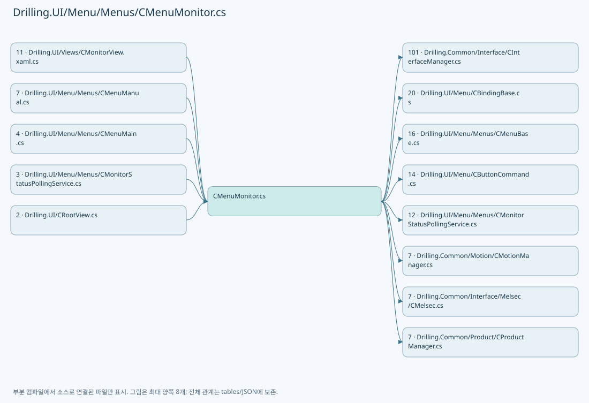

## 네임스페이스·타입·상속

| 타입 | 구분 | 원본 범위 | 선언/상속 |
| --- | --- | --- | --- |
| CMenuMonitor | ClassDeclaration | 24–6218 | CMenuMonitor: CMenuBase |
| ST_POWER_METER_OPTION | RecordDeclaration | 1517–1517 | ST_POWER_METER_OPTION |
| ST_POWER_METER_TUNE_PROFILE | RecordDeclaration | 1518–1518 | ST_POWER_METER_TUNE_PROFILE |
| ST_POWER_METER_TUNE_SETTINGS | RecordDeclaration | 1519–1532 | ST_POWER_METER_TUNE_SETTINGS |
| ST_POWER_METER_READ_RESULT | RecordDeclaration | 1534–1534 | ST_POWER_METER_READ_RESULT |
| ST_POWER_METER_GRAPH_DATA | RecordDeclaration | 1535–1535 | ST_POWER_METER_GRAPH_DATA |
| CMelsecCachePresentation | ClassDeclaration | 6220–6239 | CMelsecCachePresentation |
| ST_MONITOR_TAB | RecordDeclaration | 6241–6241 | ST_MONITOR_TAB |
| ST_MONITOR_COORDINATE_VIEWER_DATA | RecordDeclaration | 6242–6255 | ST_MONITOR_COORDINATE_VIEWER_DATA |
| ST_MONITOR_COORDINATE_BASIS_OPTION | RecordDeclaration | 6257–6282 | ST_MONITOR_COORDINATE_BASIS_OPTION |
| ST_MONITOR_COORDINATE_VALUE_ROW | RecordDeclaration | 6284–6284 | ST_MONITOR_COORDINATE_VALUE_ROW |
| ST_MONITOR_COORDINATE_SHOT_MATRIX_ROW | RecordDeclaration | 6285–6285 | ST_MONITOR_COORDINATE_SHOT_MATRIX_ROW |
| ST_MONITOR_COORDINATE_SHOT_BUTTON | RecordDeclaration | 6286–6329 | ST_MONITOR_COORDINATE_SHOT_BUTTON |
| ST_SCANNER_AXIS_INDICATOR_GROUP | ClassDeclaration | 6331–6344 | ST_SCANNER_AXIS_INDICATOR_GROUP |
| ST_MONITOR_PRODUCT_ITEM | RecordDeclaration | 6346–6362 | ST_MONITOR_PRODUCT_ITEM |
| ST_MONITOR_PRODUCT_REVIEW_ROW | RecordDeclaration | 6364–6378 | ST_MONITOR_PRODUCT_REVIEW_ROW |
| ST_MONITOR_PRODUCT_HISTORY_ROW | RecordDeclaration | 6380–6394 | ST_MONITOR_PRODUCT_HISTORY_ROW |
| ST_MONITOR_MELSEC_GROUP | RecordDeclaration | 6396–6396 | ST_MONITOR_MELSEC_GROUP |
| ST_MONITOR_MELSEC_ROW | ClassDeclaration | 6397–6539 | ST_MONITOR_MELSEC_ROW: CBindingBase |
| ST_MONITOR_AXIS_ROW | RecordDeclaration | 6541–6603 | ST_MONITOR_AXIS_ROW |
| ST_MONITOR_MULTI_MOVE_AXIS_ROW | ClassDeclaration | 6605–6684 | ST_MONITOR_MULTI_MOVE_AXIS_ROW: CBindingBase |
| ST_MONITOR_STATUS_ROW | RecordDeclaration | 6686–6714 | ST_MONITOR_STATUS_ROW |
| ST_MONITOR_OPERATION_BUTTON | RecordDeclaration | 6716–6753 | ST_MONITOR_OPERATION_BUTTON |
| ST_MONITOR_HEAD_SELECT_ROW | RecordDeclaration | 6755–6831 | ST_MONITOR_HEAD_SELECT_ROW |
| ST_MONITOR_LASER_CONTROL_ROW | RecordDeclaration | 6833–6901 | ST_MONITOR_LASER_CONTROL_ROW |
| ST_MONITOR_PARAMETER_ROW | ClassDeclaration | 6903–6952 | ST_MONITOR_PARAMETER_ROW |
| ST_MONITOR_BET_TABLE_ROW | ClassDeclaration | 6954–7062 | ST_MONITOR_BET_TABLE_ROW: CBindingBase |
| ST_POWER_METER_TUNE_SAMPLE | RecordDeclaration | 7064–7064 | ST_POWER_METER_TUNE_SAMPLE |
| ST_POWER_METER_TUNE_ROW | RecordDeclaration | 7065–7085 | ST_POWER_METER_TUNE_ROW |
| ST_POWER_METER_TUNE_PROFILE_ROW | ClassDeclaration | 7087–7101 | ST_POWER_METER_TUNE_PROFILE_ROW |
| ST_PWM_SETTING_ROW | ClassDeclaration | 7103–7183 | ST_PWM_SETTING_ROW: CBindingBase |
| ST_PWM_DEVICE_ROW | RecordDeclaration | 7185–7194 | ST_PWM_DEVICE_ROW |
| ST_MONITOR_TREND_POINT | RecordDeclaration | 7196–7196 | ST_MONITOR_TREND_POINT |
| ST_MONITOR_SUMMARY_ITEM | RecordDeclaration | 7197–7212 | ST_MONITOR_SUMMARY_ITEM |
| ST_MONITOR_POSITION_ROW | RecordDeclaration | 7214–7229 | ST_MONITOR_POSITION_ROW |
| CMonitorIcon | ClassDeclaration | 7231–7269 | CMonitorIcon |

## 멤버 빠른 목록

| 이름 | 종류 | 범위 | 서명 |
| --- | --- | --- | --- |
| PowerMeterGraphWidth | FieldDeclaration | L27–27 | double Drilling.UI.Menu.Menus.CMenuMonitor.PowerMeterGraphWidth |
| PowerMeterGraphHeight | FieldDeclaration | L28–28 | double Drilling.UI.Menu.Menus.CMenuMonitor.PowerMeterGraphHeight |
| PowerMeterGraphMinimumHalfRange | FieldDeclaration | L29–29 | double Drilling.UI.Menu.Menus.CMenuMonitor.PowerMeterGraphMinimumHalfRange |
| _lastNotifiedLiveValues | FieldDeclaration | L30–30 | System.Collections.Generic.Dictionary<string, object?> Drilling.UI.Menu.Menus.CMenuMonitor._lastNotifiedLiveValues |
| LivePropertyCacheLock | FieldDeclaration | L31–31 | object Drilling.UI.Menu.Menus.CMenuMonitor.LivePropertyCacheLock |
| LivePropertyCache | FieldDeclaration | L32–32 | System.Collections.Generic.Dictionary<string, System.Reflection.PropertyInfo?> Drilling.UI.Menu.Menus.CMenuMonitor.LivePropertyCache |
| _interfaceManager | FieldDeclaration | L33–33 | Drilling.Common.Interface.CInterfaceManager Drilling.UI.Menu.Menus.CMenuMonitor._interfaceManager |
| _motionManager | FieldDeclaration | L34–34 | Drilling.Common.Motion.CMotionManager Drilling.UI.Menu.Menus.CMenuMonitor._motionManager |
| _interLockManager | FieldDeclaration | L35–35 | Drilling.Common.InterLock.CInterLockManager Drilling.UI.Menu.Menus.CMenuMonitor._interLockManager |
| _productManager | FieldDeclaration | L36–36 | Drilling.Common.Product.CProductManager Drilling.UI.Menu.Menus.CMenuMonitor._productManager |
| _recipeManager | FieldDeclaration | L37–37 | Drilling.Common.Managers.CRecipeManager Drilling.UI.Menu.Menus.CMenuMonitor._recipeManager |
| _settingManager | FieldDeclaration | L38–38 | Drilling.Common.Managers.CSettingManager Drilling.UI.Menu.Menus.CMenuMonitor._settingManager |
| _selectedRecipeIdProvider | FieldDeclaration | L39–39 | System.Func<string> Drilling.UI.Menu.Menus.CMenuMonitor._selectedRecipeIdProvider |
| _selectedTabAccessor | FieldDeclaration | L40–40 | System.Func<string> Drilling.UI.Menu.Menus.CMenuMonitor._selectedTabAccessor |
| _selectedTabSetter | FieldDeclaration | L41–41 | System.Action<string> Drilling.UI.Menu.Menus.CMenuMonitor._selectedTabSetter |
| _setStatusMessage | FieldDeclaration | L42–42 | System.Action<string> Drilling.UI.Menu.Menus.CMenuMonitor._setStatusMessage |
| _refreshShellStatus | FieldDeclaration | L43–43 | System.Action Drilling.UI.Menu.Menus.CMenuMonitor._refreshShellStatus |
| _refreshCurrentScreen | FieldDeclaration | L44–44 | System.Func<System.Threading.Tasks.Task> Drilling.UI.Menu.Menus.CMenuMonitor._refreshCurrentScreen |
| _canExecuteMonitorWriteCommand | FieldDeclaration | L45–45 | System.Func<bool> Drilling.UI.Menu.Menus.CMenuMonitor._canExecuteMonitorWriteCommand |
| _statusPollingService | FieldDeclaration | L46–46 | Drilling.UI.Menu.Menus.CMonitorStatusPollingService Drilling.UI.Menu.Menus.CMenuMonitor._statusPollingService |
| _operationFieldValues | FieldDeclaration | L47–47 | System.Collections.Generic.Dictionary<string, string> Drilling.UI.Menu.Menus.CMenuMonitor._operationFieldValues |
| _melsecWriteValues | FieldDeclaration | L48–48 | System.Collections.Generic.Dictionary<string, string> Drilling.UI.Menu.Menus.CMenuMonitor._melsecWriteValues |
| LaserHeadCount | FieldDeclaration | L49–49 | int Drilling.UI.Menu.Menus.CMenuMonitor.LaserHeadCount |
| _enabledHeadDeviceNumbers | FieldDeclaration | L50–50 | System.Collections.Generic.IReadOnlyList<int> Drilling.UI.Menu.Menus.CMenuMonitor._enabledHeadDeviceNumbers |
| _selectedAxisId | FieldDeclaration | L51–51 | string Drilling.UI.Menu.Menus.CMenuMonitor._selectedAxisId |
| _selectedLaserNumber | FieldDeclaration | L52–52 | int Drilling.UI.Menu.Menus.CMenuMonitor._selectedLaserNumber |
| _selectedAttenuatorNumber | FieldDeclaration | L53–53 | int Drilling.UI.Menu.Menus.CMenuMonitor._selectedAttenuatorNumber |
| _selectedBetNumber | FieldDeclaration | L54–54 | int Drilling.UI.Menu.Menus.CMenuMonitor._selectedBetNumber |
| _selectedPowerMeterNumber | FieldDeclaration | L55–55 | int Drilling.UI.Menu.Menus.CMenuMonitor._selectedPowerMeterNumber |
| _selectedPicoMotorNo | FieldDeclaration | L56–56 | int Drilling.UI.Menu.Menus.CMenuMonitor._selectedPicoMotorNo |
| _picoMotorIsConnected | FieldDeclaration | L57–57 | bool Drilling.UI.Menu.Menus.CMenuMonitor._picoMotorIsConnected |
| _coordinateBasis | FieldDeclaration | L58–58 | string Drilling.UI.Menu.Menus.CMenuMonitor._coordinateBasis |
| _coordinateSelectedCellNo | FieldDeclaration | L59–59 | int Drilling.UI.Menu.Menus.CMenuMonitor._coordinateSelectedCellNo |
| _coordinateSelectedShotKey | FieldDeclaration | L60–60 | string Drilling.UI.Menu.Menus.CMenuMonitor._coordinateSelectedShotKey |
| _coordinateIsCellDetailVisible | FieldDeclaration | L61–61 | bool Drilling.UI.Menu.Menus.CMenuMonitor._coordinateIsCellDetailVisible |
| _picoAllMoveMotorNos | FieldDeclaration | L62–62 | System.Collections.Generic.HashSet<int> Drilling.UI.Menu.Menus.CMenuMonitor._picoAllMoveMotorNos |
| _xpsJogCommandLock | FieldDeclaration | L63–63 | System.Threading.SemaphoreSlim Drilling.UI.Menu.Menus.CMenuMonitor._xpsJogCommandLock |
| _picoJogCommandLock | FieldDeclaration | L64–64 | System.Threading.SemaphoreSlim Drilling.UI.Menu.Menus.CMenuMonitor._picoJogCommandLock |
| _xpsJogStartCancellationSource | FieldDeclaration | L65–65 | System.Threading.CancellationTokenSource? Drilling.UI.Menu.Menus.CMenuMonitor._xpsJogStartCancellationSource |
| _xpsJogRequestVersion | FieldDeclaration | L66–66 | int Drilling.UI.Menu.Menus.CMenuMonitor._xpsJogRequestVersion |
| _xpsJogRequested | FieldDeclaration | L67–67 | bool Drilling.UI.Menu.Menus.CMenuMonitor._xpsJogRequested |
| _xpsJogStopPending | FieldDeclaration | L68–68 | bool Drilling.UI.Menu.Menus.CMenuMonitor._xpsJogStopPending |
| _xpsJogAxisId | FieldDeclaration | L69–69 | string Drilling.UI.Menu.Menus.CMenuMonitor._xpsJogAxisId |
| _picoJogCancellationSource | FieldDeclaration | L70–70 | System.Threading.CancellationTokenSource? Drilling.UI.Menu.Menus.CMenuMonitor._picoJogCancellationSource |
| _picoAllMoveTask | FieldDeclaration | L71–71 | System.Threading.Tasks.Task? Drilling.UI.Menu.Menus.CMenuMonitor._picoAllMoveTask |
| _picoMotionTask | FieldDeclaration | L72–72 | System.Threading.Tasks.Task? Drilling.UI.Menu.Menus.CMenuMonitor._picoMotionTask |
| _powerMeterTuneCts | FieldDeclaration | L73–73 | System.Threading.CancellationTokenSource? Drilling.UI.Menu.Menus.CMenuMonitor._powerMeterTuneCts |
| _powerMeterTuneAttenuatorNumber | FieldDeclaration | L74–74 | int Drilling.UI.Menu.Menus.CMenuMonitor._powerMeterTuneAttenuatorNumber |
| _powerMeterTunePowerMeterNumber | FieldDeclaration | L75–75 | int Drilling.UI.Menu.Menus.CMenuMonitor._powerMeterTunePowerMeterNumber |
| _powerMeterTuneSamples | FieldDeclaration | L76–76 | System.Collections.Generic.List<Drilling.UI.Menu.Menus.ST_POWER_METER_TUNE_SAMPLE> Drilling.UI.Menu.Menus.CMenuMonitor._powerMeterTuneSamples |
| _powerMeterTuneState | FieldDeclaration | L77–77 | string Drilling.UI.Menu.Menus.CMenuMonitor._powerMeterTuneState |
| _powerMeterTuneMessage | FieldDeclaration | L78–78 | string Drilling.UI.Menu.Menus.CMenuMonitor._powerMeterTuneMessage |
| _powerMeterTargetPower | FieldDeclaration | L79–79 | double Drilling.UI.Menu.Menus.CMenuMonitor._powerMeterTargetPower |
| _selectedMelsecGroup | FieldDeclaration | L80–80 | string Drilling.UI.Menu.Menus.CMenuMonitor._selectedMelsecGroup |
| _isMelsecWriteLockVisible | FieldDeclaration | L81–81 | bool Drilling.UI.Menu.Menus.CMenuMonitor._isMelsecWriteLockVisible |
| _isMelsecWriteUnlocked | FieldDeclaration | L82–82 | bool Drilling.UI.Menu.Menus.CMenuMonitor._isMelsecWriteUnlocked |
| _liveRefreshRunning | FieldDeclaration | L83–83 | bool Drilling.UI.Menu.Menus.CMenuMonitor._liveRefreshRunning |
| _lastLiveRefreshHash | FieldDeclaration | L84–84 | int? Drilling.UI.Menu.Menus.CMenuMonitor._lastLiveRefreshHash |
| MonitorTabs | FieldDeclaration | L85–85 | string[] Drilling.UI.Menu.Menus.CMenuMonitor.MonitorTabs |
| HomeTypeOptions | FieldDeclaration | L86–86 | string[] Drilling.UI.Menu.Menus.CMenuMonitor.HomeTypeOptions |
| DeviceTabs | PropertyDeclaration | L87–87 | System.Collections.Generic.IReadOnlyList<Drilling.UI.Menu.Menus.ST_SCREEN_SECTION> Drilling.UI.Menu.Menus.CMenuMonitor.DeviceTabs |
| get_DeviceTabs | GetAccessorDeclaration | L87–87 | System.Collections.Generic.IReadOnlyList<Drilling.UI.Menu.Menus.ST_SCREEN_SECTION> Drilling.UI.Menu.Menus.CMenuMonitor.DeviceTabs.get |
| set_DeviceTabs | SetAccessorDeclaration | L87–87 | void Drilling.UI.Menu.Menus.CMenuMonitor.DeviceTabs.set |
| SelectedTab | PropertyDeclaration | L88–88 | string Drilling.UI.Menu.Menus.CMenuMonitor.SelectedTab |
| get_SelectedTab | GetAccessorDeclaration | L88–88 | string Drilling.UI.Menu.Menus.CMenuMonitor.SelectedTab.get |
| set_SelectedTab | SetAccessorDeclaration | L88–88 | void Drilling.UI.Menu.Menus.CMenuMonitor.SelectedTab.set |
| Title | PropertyDeclaration | L89–89 | string Drilling.UI.Menu.Menus.CMenuMonitor.Title |
| get_Title | GetAccessorDeclaration | L89–89 | string Drilling.UI.Menu.Menus.CMenuMonitor.Title.get |
| set_Title | SetAccessorDeclaration | L89–89 | void Drilling.UI.Menu.Menus.CMenuMonitor.Title.set |
| Subtitle | PropertyDeclaration | L90–90 | string Drilling.UI.Menu.Menus.CMenuMonitor.Subtitle |
| get_Subtitle | GetAccessorDeclaration | L90–90 | string Drilling.UI.Menu.Menus.CMenuMonitor.Subtitle.get |
| set_Subtitle | SetAccessorDeclaration | L90–90 | void Drilling.UI.Menu.Menus.CMenuMonitor.Subtitle.set |
| StatusPanelTitle | PropertyDeclaration | L91–91 | string Drilling.UI.Menu.Menus.CMenuMonitor.StatusPanelTitle |
| get_StatusPanelTitle | GetAccessorDeclaration | L91–91 | string Drilling.UI.Menu.Menus.CMenuMonitor.StatusPanelTitle.get |
| set_StatusPanelTitle | SetAccessorDeclaration | L91–91 | void Drilling.UI.Menu.Menus.CMenuMonitor.StatusPanelTitle.set |
| OperationPanelTitle | PropertyDeclaration | L92–92 | string Drilling.UI.Menu.Menus.CMenuMonitor.OperationPanelTitle |
| get_OperationPanelTitle | GetAccessorDeclaration | L92–92 | string Drilling.UI.Menu.Menus.CMenuMonitor.OperationPanelTitle.get |
| set_OperationPanelTitle | SetAccessorDeclaration | L92–92 | void Drilling.UI.Menu.Menus.CMenuMonitor.OperationPanelTitle.set |
| ParameterPanelTitle | PropertyDeclaration | L93–93 | string Drilling.UI.Menu.Menus.CMenuMonitor.ParameterPanelTitle |
| get_ParameterPanelTitle | GetAccessorDeclaration | L93–93 | string Drilling.UI.Menu.Menus.CMenuMonitor.ParameterPanelTitle.get |
| set_ParameterPanelTitle | SetAccessorDeclaration | L93–93 | void Drilling.UI.Menu.Menus.CMenuMonitor.ParameterPanelTitle.set |
| TrendPanelTitle | PropertyDeclaration | L94–94 | string Drilling.UI.Menu.Menus.CMenuMonitor.TrendPanelTitle |
| get_TrendPanelTitle | GetAccessorDeclaration | L94–94 | string Drilling.UI.Menu.Menus.CMenuMonitor.TrendPanelTitle.get |
| set_TrendPanelTitle | SetAccessorDeclaration | L94–94 | void Drilling.UI.Menu.Menus.CMenuMonitor.TrendPanelTitle.set |
| Tabs | PropertyDeclaration | L95–95 | System.Collections.Generic.IReadOnlyList<Drilling.UI.Menu.Menus.ST_MONITOR_TAB> Drilling.UI.Menu.Menus.CMenuMonitor.Tabs |
| get_Tabs | GetAccessorDeclaration | L95–95 | System.Collections.Generic.IReadOnlyList<Drilling.UI.Menu.Menus.ST_MONITOR_TAB> Drilling.UI.Menu.Menus.CMenuMonitor.Tabs.get |
| set_Tabs | SetAccessorDeclaration | L95–95 | void Drilling.UI.Menu.Menus.CMenuMonitor.Tabs.set |
| AxisRows | PropertyDeclaration | L96–96 | System.Collections.Generic.IReadOnlyList<Drilling.UI.Menu.Menus.ST_MONITOR_AXIS_ROW> Drilling.UI.Menu.Menus.CMenuMonitor.AxisRows |
| get_AxisRows | GetAccessorDeclaration | L96–96 | System.Collections.Generic.IReadOnlyList<Drilling.UI.Menu.Menus.ST_MONITOR_AXIS_ROW> Drilling.UI.Menu.Menus.CMenuMonitor.AxisRows.get |
| set_AxisRows | SetAccessorDeclaration | L96–96 | void Drilling.UI.Menu.Menus.CMenuMonitor.AxisRows.set |
| MultiMoveAxisRows | PropertyDeclaration | L97–97 | System.Collections.Generic.IReadOnlyList<Drilling.UI.Menu.Menus.ST_MONITOR_MULTI_MOVE_AXIS_ROW> Drilling.UI.Menu.Menus.CMenuMonitor.MultiMoveAxisRows |
| get_MultiMoveAxisRows | GetAccessorDeclaration | L97–97 | System.Collections.Generic.IReadOnlyList<Drilling.UI.Menu.Menus.ST_MONITOR_MULTI_MOVE_AXIS_ROW> Drilling.UI.Menu.Menus.CMenuMonitor.MultiMoveAxisRows.get |
| set_MultiMoveAxisRows | SetAccessorDeclaration | L97–97 | void Drilling.UI.Menu.Menus.CMenuMonitor.MultiMoveAxisRows.set |
| StatusRows | PropertyDeclaration | L98–98 | System.Collections.Generic.IReadOnlyList<Drilling.UI.Menu.Menus.ST_MONITOR_STATUS_ROW> Drilling.UI.Menu.Menus.CMenuMonitor.StatusRows |
| get_StatusRows | GetAccessorDeclaration | L98–98 | System.Collections.Generic.IReadOnlyList<Drilling.UI.Menu.Menus.ST_MONITOR_STATUS_ROW> Drilling.UI.Menu.Menus.CMenuMonitor.StatusRows.get |
| set_StatusRows | SetAccessorDeclaration | L98–98 | void Drilling.UI.Menu.Menus.CMenuMonitor.StatusRows.set |
| OperationButtons | PropertyDeclaration | L99–99 | System.Collections.Generic.IReadOnlyList<Drilling.UI.Menu.Menus.ST_MONITOR_OPERATION_BUTTON> Drilling.UI.Menu.Menus.CMenuMonitor.OperationButtons |
| get_OperationButtons | GetAccessorDeclaration | L99–99 | System.Collections.Generic.IReadOnlyList<Drilling.UI.Menu.Menus.ST_MONITOR_OPERATION_BUTTON> Drilling.UI.Menu.Menus.CMenuMonitor.OperationButtons.get |
| set_OperationButtons | SetAccessorDeclaration | L99–99 | void Drilling.UI.Menu.Menus.CMenuMonitor.OperationButtons.set |
| OperationFields | PropertyDeclaration | L100–100 | System.Collections.Generic.IReadOnlyList<Drilling.UI.Menu.Menus.ST_MONITOR_PARAMETER_ROW> Drilling.UI.Menu.Menus.CMenuMonitor.OperationFields |
| get_OperationFields | GetAccessorDeclaration | L100–100 | System.Collections.Generic.IReadOnlyList<Drilling.UI.Menu.Menus.ST_MONITOR_PARAMETER_ROW> Drilling.UI.Menu.Menus.CMenuMonitor.OperationFields.get |
| set_OperationFields | SetAccessorDeclaration | L100–100 | void Drilling.UI.Menu.Menus.CMenuMonitor.OperationFields.set |
| HeadSelectRows | PropertyDeclaration | L101–101 | System.Collections.Generic.IReadOnlyList<Drilling.UI.Menu.Menus.ST_MONITOR_HEAD_SELECT_ROW> Drilling.UI.Menu.Menus.CMenuMonitor.HeadSelectRows |
| get_HeadSelectRows | GetAccessorDeclaration | L101–101 | System.Collections.Generic.IReadOnlyList<Drilling.UI.Menu.Menus.ST_MONITOR_HEAD_SELECT_ROW> Drilling.UI.Menu.Menus.CMenuMonitor.HeadSelectRows.get |
| set_HeadSelectRows | SetAccessorDeclaration | L101–101 | void Drilling.UI.Menu.Menus.CMenuMonitor.HeadSelectRows.set |
| LaserControlRows | PropertyDeclaration | L102–102 | System.Collections.Generic.IReadOnlyList<Drilling.UI.Menu.Menus.ST_MONITOR_LASER_CONTROL_ROW> Drilling.UI.Menu.Menus.CMenuMonitor.LaserControlRows |
| get_LaserControlRows | GetAccessorDeclaration | L102–102 | System.Collections.Generic.IReadOnlyList<Drilling.UI.Menu.Menus.ST_MONITOR_LASER_CONTROL_ROW> Drilling.UI.Menu.Menus.CMenuMonitor.LaserControlRows.get |
| set_LaserControlRows | SetAccessorDeclaration | L102–102 | void Drilling.UI.Menu.Menus.CMenuMonitor.LaserControlRows.set |
| ParameterRows | PropertyDeclaration | L103–103 | System.Collections.Generic.IReadOnlyList<Drilling.UI.Menu.Menus.ST_MONITOR_PARAMETER_ROW> Drilling.UI.Menu.Menus.CMenuMonitor.ParameterRows |
| get_ParameterRows | GetAccessorDeclaration | L103–103 | System.Collections.Generic.IReadOnlyList<Drilling.UI.Menu.Menus.ST_MONITOR_PARAMETER_ROW> Drilling.UI.Menu.Menus.CMenuMonitor.ParameterRows.get |
| set_ParameterRows | SetAccessorDeclaration | L103–103 | void Drilling.UI.Menu.Menus.CMenuMonitor.ParameterRows.set |
| BetTableRows | PropertyDeclaration | L104–104 | System.Collections.Generic.IReadOnlyList<Drilling.UI.Menu.Menus.ST_MONITOR_BET_TABLE_ROW> Drilling.UI.Menu.Menus.CMenuMonitor.BetTableRows |
| get_BetTableRows | GetAccessorDeclaration | L104–104 | System.Collections.Generic.IReadOnlyList<Drilling.UI.Menu.Menus.ST_MONITOR_BET_TABLE_ROW> Drilling.UI.Menu.Menus.CMenuMonitor.BetTableRows.get |
| set_BetTableRows | SetAccessorDeclaration | L104–104 | void Drilling.UI.Menu.Menus.CMenuMonitor.BetTableRows.set |
| TrendPoints | PropertyDeclaration | L105–105 | System.Collections.Generic.IReadOnlyList<Drilling.UI.Menu.Menus.ST_MONITOR_TREND_POINT> Drilling.UI.Menu.Menus.CMenuMonitor.TrendPoints |
| get_TrendPoints | GetAccessorDeclaration | L105–105 | System.Collections.Generic.IReadOnlyList<Drilling.UI.Menu.Menus.ST_MONITOR_TREND_POINT> Drilling.UI.Menu.Menus.CMenuMonitor.TrendPoints.get |
| set_TrendPoints | SetAccessorDeclaration | L105–105 | void Drilling.UI.Menu.Menus.CMenuMonitor.TrendPoints.set |
| SummaryItems | PropertyDeclaration | L106–106 | System.Collections.Generic.IReadOnlyList<Drilling.UI.Menu.Menus.ST_MONITOR_SUMMARY_ITEM> Drilling.UI.Menu.Menus.CMenuMonitor.SummaryItems |
| get_SummaryItems | GetAccessorDeclaration | L106–106 | System.Collections.Generic.IReadOnlyList<Drilling.UI.Menu.Menus.ST_MONITOR_SUMMARY_ITEM> Drilling.UI.Menu.Menus.CMenuMonitor.SummaryItems.get |
| set_SummaryItems | SetAccessorDeclaration | L106–106 | void Drilling.UI.Menu.Menus.CMenuMonitor.SummaryItems.set |
| AttenuatorStatusItems | PropertyDeclaration | L107–107 | System.Collections.Generic.IReadOnlyList<Drilling.UI.Menu.Menus.ST_MONITOR_SUMMARY_ITEM> Drilling.UI.Menu.Menus.CMenuMonitor.AttenuatorStatusItems |
| get_AttenuatorStatusItems | GetAccessorDeclaration | L107–107 | System.Collections.Generic.IReadOnlyList<Drilling.UI.Menu.Menus.ST_MONITOR_SUMMARY_ITEM> Drilling.UI.Menu.Menus.CMenuMonitor.AttenuatorStatusItems.get |
| set_AttenuatorStatusItems | SetAccessorDeclaration | L107–107 | void Drilling.UI.Menu.Menus.CMenuMonitor.AttenuatorStatusItems.set |
| AttenuatorSettingItems | PropertyDeclaration | L108–108 | System.Collections.Generic.IReadOnlyList<Drilling.UI.Menu.Menus.ST_MONITOR_SUMMARY_ITEM> Drilling.UI.Menu.Menus.CMenuMonitor.AttenuatorSettingItems |
| get_AttenuatorSettingItems | GetAccessorDeclaration | L108–108 | System.Collections.Generic.IReadOnlyList<Drilling.UI.Menu.Menus.ST_MONITOR_SUMMARY_ITEM> Drilling.UI.Menu.Menus.CMenuMonitor.AttenuatorSettingItems.get |
| set_AttenuatorSettingItems | SetAccessorDeclaration | L108–108 | void Drilling.UI.Menu.Menus.CMenuMonitor.AttenuatorSettingItems.set |
| PositionRows | PropertyDeclaration | L109–109 | System.Collections.Generic.IReadOnlyList<Drilling.UI.Menu.Menus.ST_MONITOR_POSITION_ROW> Drilling.UI.Menu.Menus.CMenuMonitor.PositionRows |
| get_PositionRows | GetAccessorDeclaration | L109–109 | System.Collections.Generic.IReadOnlyList<Drilling.UI.Menu.Menus.ST_MONITOR_POSITION_ROW> Drilling.UI.Menu.Menus.CMenuMonitor.PositionRows.get |
| set_PositionRows | SetAccessorDeclaration | L109–109 | void Drilling.UI.Menu.Menus.CMenuMonitor.PositionRows.set |
| ProductItems | PropertyDeclaration | L110–110 | System.Collections.Generic.IReadOnlyList<Drilling.UI.Menu.Menus.ST_MONITOR_PRODUCT_ITEM> Drilling.UI.Menu.Menus.CMenuMonitor.ProductItems |
| get_ProductItems | GetAccessorDeclaration | L110–110 | System.Collections.Generic.IReadOnlyList<Drilling.UI.Menu.Menus.ST_MONITOR_PRODUCT_ITEM> Drilling.UI.Menu.Menus.CMenuMonitor.ProductItems.get |
| set_ProductItems | SetAccessorDeclaration | L110–110 | void Drilling.UI.Menu.Menus.CMenuMonitor.ProductItems.set |
| ProductHistoryRows | PropertyDeclaration | L111–111 | System.Collections.Generic.IReadOnlyList<Drilling.UI.Menu.Menus.ST_MONITOR_PRODUCT_HISTORY_ROW> Drilling.UI.Menu.Menus.CMenuMonitor.ProductHistoryRows |
| get_ProductHistoryRows | GetAccessorDeclaration | L111–111 | System.Collections.Generic.IReadOnlyList<Drilling.UI.Menu.Menus.ST_MONITOR_PRODUCT_HISTORY_ROW> Drilling.UI.Menu.Menus.CMenuMonitor.ProductHistoryRows.get |
| set_ProductHistoryRows | SetAccessorDeclaration | L111–111 | void Drilling.UI.Menu.Menus.CMenuMonitor.ProductHistoryRows.set |
| ProductGlassItems | PropertyDeclaration | L112–112 | System.Collections.Generic.IReadOnlyList<Drilling.UI.Menu.Menus.ST_MONITOR_PRODUCT_ITEM> Drilling.UI.Menu.Menus.CMenuMonitor.ProductGlassItems |
| get_ProductGlassItems | GetAccessorDeclaration | L112–112 | System.Collections.Generic.IReadOnlyList<Drilling.UI.Menu.Menus.ST_MONITOR_PRODUCT_ITEM> Drilling.UI.Menu.Menus.CMenuMonitor.ProductGlassItems.get |
| set_ProductGlassItems | SetAccessorDeclaration | L112–112 | void Drilling.UI.Menu.Menus.CMenuMonitor.ProductGlassItems.set |
| ProductAlignItems | PropertyDeclaration | L113–113 | System.Collections.Generic.IReadOnlyList<Drilling.UI.Menu.Menus.ST_MONITOR_PRODUCT_ITEM> Drilling.UI.Menu.Menus.CMenuMonitor.ProductAlignItems |
| get_ProductAlignItems | GetAccessorDeclaration | L113–113 | System.Collections.Generic.IReadOnlyList<Drilling.UI.Menu.Menus.ST_MONITOR_PRODUCT_ITEM> Drilling.UI.Menu.Menus.CMenuMonitor.ProductAlignItems.get |
| set_ProductAlignItems | SetAccessorDeclaration | L113–113 | void Drilling.UI.Menu.Menus.CMenuMonitor.ProductAlignItems.set |
| ProductDistortionItems | PropertyDeclaration | L114–114 | System.Collections.Generic.IReadOnlyList<Drilling.UI.Menu.Menus.ST_MONITOR_PRODUCT_ITEM> Drilling.UI.Menu.Menus.CMenuMonitor.ProductDistortionItems |
| get_ProductDistortionItems | GetAccessorDeclaration | L114–114 | System.Collections.Generic.IReadOnlyList<Drilling.UI.Menu.Menus.ST_MONITOR_PRODUCT_ITEM> Drilling.UI.Menu.Menus.CMenuMonitor.ProductDistortionItems.get |
| set_ProductDistortionItems | SetAccessorDeclaration | L114–114 | void Drilling.UI.Menu.Menus.CMenuMonitor.ProductDistortionItems.set |
| ProductProcessItems | PropertyDeclaration | L115–115 | System.Collections.Generic.IReadOnlyList<Drilling.UI.Menu.Menus.ST_MONITOR_PRODUCT_ITEM> Drilling.UI.Menu.Menus.CMenuMonitor.ProductProcessItems |
| get_ProductProcessItems | GetAccessorDeclaration | L115–115 | System.Collections.Generic.IReadOnlyList<Drilling.UI.Menu.Menus.ST_MONITOR_PRODUCT_ITEM> Drilling.UI.Menu.Menus.CMenuMonitor.ProductProcessItems.get |
| set_ProductProcessItems | SetAccessorDeclaration | L115–115 | void Drilling.UI.Menu.Menus.CMenuMonitor.ProductProcessItems.set |
| ProductRecipeItems | PropertyDeclaration | L116–116 | System.Collections.Generic.IReadOnlyList<Drilling.UI.Menu.Menus.ST_MONITOR_PRODUCT_ITEM> Drilling.UI.Menu.Menus.CMenuMonitor.ProductRecipeItems |
| get_ProductRecipeItems | GetAccessorDeclaration | L116–116 | System.Collections.Generic.IReadOnlyList<Drilling.UI.Menu.Menus.ST_MONITOR_PRODUCT_ITEM> Drilling.UI.Menu.Menus.CMenuMonitor.ProductRecipeItems.get |
| set_ProductRecipeItems | SetAccessorDeclaration | L116–116 | void Drilling.UI.Menu.Menus.CMenuMonitor.ProductRecipeItems.set |
| ProductReviewItems | PropertyDeclaration | L117–117 | System.Collections.Generic.IReadOnlyList<Drilling.UI.Menu.Menus.ST_MONITOR_PRODUCT_ITEM> Drilling.UI.Menu.Menus.CMenuMonitor.ProductReviewItems |
| get_ProductReviewItems | GetAccessorDeclaration | L117–117 | System.Collections.Generic.IReadOnlyList<Drilling.UI.Menu.Menus.ST_MONITOR_PRODUCT_ITEM> Drilling.UI.Menu.Menus.CMenuMonitor.ProductReviewItems.get |
| set_ProductReviewItems | SetAccessorDeclaration | L117–117 | void Drilling.UI.Menu.Menus.CMenuMonitor.ProductReviewItems.set |
| ProductReviewRows | PropertyDeclaration | L118–118 | System.Collections.Generic.IReadOnlyList<Drilling.UI.Menu.Menus.ST_MONITOR_PRODUCT_REVIEW_ROW> Drilling.UI.Menu.Menus.CMenuMonitor.ProductReviewRows |
| get_ProductReviewRows | GetAccessorDeclaration | L118–118 | System.Collections.Generic.IReadOnlyList<Drilling.UI.Menu.Menus.ST_MONITOR_PRODUCT_REVIEW_ROW> Drilling.UI.Menu.Menus.CMenuMonitor.ProductReviewRows.get |
| set_ProductReviewRows | SetAccessorDeclaration | L118–118 | void Drilling.UI.Menu.Menus.CMenuMonitor.ProductReviewRows.set |
| MelsecGroups | PropertyDeclaration | L119–119 | System.Collections.Generic.IReadOnlyList<Drilling.UI.Menu.Menus.ST_MONITOR_MELSEC_GROUP> Drilling.UI.Menu.Menus.CMenuMonitor.MelsecGroups |
| get_MelsecGroups | GetAccessorDeclaration | L119–119 | System.Collections.Generic.IReadOnlyList<Drilling.UI.Menu.Menus.ST_MONITOR_MELSEC_GROUP> Drilling.UI.Menu.Menus.CMenuMonitor.MelsecGroups.get |
| set_MelsecGroups | SetAccessorDeclaration | L119–119 | void Drilling.UI.Menu.Menus.CMenuMonitor.MelsecGroups.set |
| MelsecRows | PropertyDeclaration | L120–120 | System.Collections.Generic.IReadOnlyList<Drilling.UI.Menu.Menus.ST_MONITOR_MELSEC_ROW> Drilling.UI.Menu.Menus.CMenuMonitor.MelsecRows |
| get_MelsecRows | GetAccessorDeclaration | L120–120 | System.Collections.Generic.IReadOnlyList<Drilling.UI.Menu.Menus.ST_MONITOR_MELSEC_ROW> Drilling.UI.Menu.Menus.CMenuMonitor.MelsecRows.get |
| set_MelsecRows | SetAccessorDeclaration | L120–120 | void Drilling.UI.Menu.Menus.CMenuMonitor.MelsecRows.set |
| MelsecReadRows | PropertyDeclaration | L121–121 | System.Collections.Generic.IReadOnlyList<Drilling.UI.Menu.Menus.ST_MONITOR_MELSEC_ROW> Drilling.UI.Menu.Menus.CMenuMonitor.MelsecReadRows |
| get_MelsecReadRows | GetAccessorDeclaration | L121–121 | System.Collections.Generic.IReadOnlyList<Drilling.UI.Menu.Menus.ST_MONITOR_MELSEC_ROW> Drilling.UI.Menu.Menus.CMenuMonitor.MelsecReadRows.get |
| set_MelsecReadRows | SetAccessorDeclaration | L121–121 | void Drilling.UI.Menu.Menus.CMenuMonitor.MelsecReadRows.set |
| MelsecWriteRows | PropertyDeclaration | L122–122 | System.Collections.Generic.IReadOnlyList<Drilling.UI.Menu.Menus.ST_MONITOR_MELSEC_ROW> Drilling.UI.Menu.Menus.CMenuMonitor.MelsecWriteRows |
| get_MelsecWriteRows | GetAccessorDeclaration | L122–122 | System.Collections.Generic.IReadOnlyList<Drilling.UI.Menu.Menus.ST_MONITOR_MELSEC_ROW> Drilling.UI.Menu.Menus.CMenuMonitor.MelsecWriteRows.get |
| set_MelsecWriteRows | SetAccessorDeclaration | L122–122 | void Drilling.UI.Menu.Menus.CMenuMonitor.MelsecWriteRows.set |
| CoordinateBasisOptions | PropertyDeclaration | L123–123 | System.Collections.Generic.IReadOnlyList<Drilling.UI.Menu.Menus.ST_MONITOR_COORDINATE_BASIS_OPTION> Drilling.UI.Menu.Menus.CMenuMonitor.CoordinateBasisOptions |
| get_CoordinateBasisOptions | GetAccessorDeclaration | L123–123 | System.Collections.Generic.IReadOnlyList<Drilling.UI.Menu.Menus.ST_MONITOR_COORDINATE_BASIS_OPTION> Drilling.UI.Menu.Menus.CMenuMonitor.CoordinateBasisOptions.get |
| set_CoordinateBasisOptions | SetAccessorDeclaration | L123–123 | void Drilling.UI.Menu.Menus.CMenuMonitor.CoordinateBasisOptions.set |
| CoordinateValueRows | PropertyDeclaration | L124–124 | System.Collections.Generic.IReadOnlyList<Drilling.UI.Menu.Menus.ST_MONITOR_COORDINATE_VALUE_ROW> Drilling.UI.Menu.Menus.CMenuMonitor.CoordinateValueRows |
| get_CoordinateValueRows | GetAccessorDeclaration | L124–124 | System.Collections.Generic.IReadOnlyList<Drilling.UI.Menu.Menus.ST_MONITOR_COORDINATE_VALUE_ROW> Drilling.UI.Menu.Menus.CMenuMonitor.CoordinateValueRows.get |
| set_CoordinateValueRows | SetAccessorDeclaration | L124–124 | void Drilling.UI.Menu.Menus.CMenuMonitor.CoordinateValueRows.set |
| CoordinateSelectedRecipeName | PropertyDeclaration | L125–125 | string Drilling.UI.Menu.Menus.CMenuMonitor.CoordinateSelectedRecipeName |
| get_CoordinateSelectedRecipeName | GetAccessorDeclaration | L125–125 | string Drilling.UI.Menu.Menus.CMenuMonitor.CoordinateSelectedRecipeName.get |
| set_CoordinateSelectedRecipeName | SetAccessorDeclaration | L125–125 | void Drilling.UI.Menu.Menus.CMenuMonitor.CoordinateSelectedRecipeName.set |
| CoordinateSelectedBasisName | PropertyDeclaration | L126–126 | string Drilling.UI.Menu.Menus.CMenuMonitor.CoordinateSelectedBasisName |
| get_CoordinateSelectedBasisName | GetAccessorDeclaration | L126–126 | string Drilling.UI.Menu.Menus.CMenuMonitor.CoordinateSelectedBasisName.get |
| set_CoordinateSelectedBasisName | SetAccessorDeclaration | L126–126 | void Drilling.UI.Menu.Menus.CMenuMonitor.CoordinateSelectedBasisName.set |
| CoordinateBasisDescription | PropertyDeclaration | L127–127 | string Drilling.UI.Menu.Menus.CMenuMonitor.CoordinateBasisDescription |
| get_CoordinateBasisDescription | GetAccessorDeclaration | L127–127 | string Drilling.UI.Menu.Menus.CMenuMonitor.CoordinateBasisDescription.get |
| set_CoordinateBasisDescription | SetAccessorDeclaration | L127–127 | void Drilling.UI.Menu.Menus.CMenuMonitor.CoordinateBasisDescription.set |
| CoordinateCellPreviewLabels | PropertyDeclaration | L128–128 | System.Collections.Generic.IReadOnlyList<Drilling.UI.Menu.Menus.ST_CELL_PREVIEW_LABEL> Drilling.UI.Menu.Menus.CMenuMonitor.CoordinateCellPreviewLabels |
| get_CoordinateCellPreviewLabels | GetAccessorDeclaration | L128–128 | System.Collections.Generic.IReadOnlyList<Drilling.UI.Menu.Menus.ST_CELL_PREVIEW_LABEL> Drilling.UI.Menu.Menus.CMenuMonitor.CoordinateCellPreviewLabels.get |
| set_CoordinateCellPreviewLabels | SetAccessorDeclaration | L128–128 | void Drilling.UI.Menu.Menus.CMenuMonitor.CoordinateCellPreviewLabels.set |
| CoordinateShotMatrixRows | PropertyDeclaration | L129–129 | System.Collections.Generic.IReadOnlyList<Drilling.UI.Menu.Menus.ST_MONITOR_COORDINATE_SHOT_MATRIX_ROW> Drilling.UI.Menu.Menus.CMenuMonitor.CoordinateShotMatrixRows |
| get_CoordinateShotMatrixRows | GetAccessorDeclaration | L129–129 | System.Collections.Generic.IReadOnlyList<Drilling.UI.Menu.Menus.ST_MONITOR_COORDINATE_SHOT_MATRIX_ROW> Drilling.UI.Menu.Menus.CMenuMonitor.CoordinateShotMatrixRows.get |
| set_CoordinateShotMatrixRows | SetAccessorDeclaration | L129–129 | void Drilling.UI.Menu.Menus.CMenuMonitor.CoordinateShotMatrixRows.set |
| CoordinateGlassPreviewSummary | PropertyDeclaration | L130–130 | string Drilling.UI.Menu.Menus.CMenuMonitor.CoordinateGlassPreviewSummary |
| get_CoordinateGlassPreviewSummary | GetAccessorDeclaration | L130–130 | string Drilling.UI.Menu.Menus.CMenuMonitor.CoordinateGlassPreviewSummary.get |
| set_CoordinateGlassPreviewSummary | SetAccessorDeclaration | L130–130 | void Drilling.UI.Menu.Menus.CMenuMonitor.CoordinateGlassPreviewSummary.set |
| PwmSettingRows | PropertyDeclaration | L131–131 | System.Collections.Generic.IReadOnlyList<Drilling.UI.Menu.Menus.ST_PWM_SETTING_ROW> Drilling.UI.Menu.Menus.CMenuMonitor.PwmSettingRows |
| get_PwmSettingRows | GetAccessorDeclaration | L131–131 | System.Collections.Generic.IReadOnlyList<Drilling.UI.Menu.Menus.ST_PWM_SETTING_ROW> Drilling.UI.Menu.Menus.CMenuMonitor.PwmSettingRows.get |
| set_PwmSettingRows | SetAccessorDeclaration | L131–131 | void Drilling.UI.Menu.Menus.CMenuMonitor.PwmSettingRows.set |
| PwmDeviceRows | PropertyDeclaration | L132–132 | System.Collections.Generic.IReadOnlyList<Drilling.UI.Menu.Menus.ST_PWM_DEVICE_ROW> Drilling.UI.Menu.Menus.CMenuMonitor.PwmDeviceRows |
| get_PwmDeviceRows | GetAccessorDeclaration | L132–132 | System.Collections.Generic.IReadOnlyList<Drilling.UI.Menu.Menus.ST_PWM_DEVICE_ROW> Drilling.UI.Menu.Menus.CMenuMonitor.PwmDeviceRows.get |
| set_PwmDeviceRows | SetAccessorDeclaration | L132–132 | void Drilling.UI.Menu.Menus.CMenuMonitor.PwmDeviceRows.set |
| PwmRunButtons | PropertyDeclaration | L133–133 | System.Collections.Generic.IReadOnlyList<Drilling.UI.Menu.Menus.ST_MONITOR_OPERATION_BUTTON> Drilling.UI.Menu.Menus.CMenuMonitor.PwmRunButtons |
| get_PwmRunButtons | GetAccessorDeclaration | L133–133 | System.Collections.Generic.IReadOnlyList<Drilling.UI.Menu.Menus.ST_MONITOR_OPERATION_BUTTON> Drilling.UI.Menu.Menus.CMenuMonitor.PwmRunButtons.get |
| set_PwmRunButtons | SetAccessorDeclaration | L133–133 | void Drilling.UI.Menu.Menus.CMenuMonitor.PwmRunButtons.set |
| PowerMeterTuneRows | PropertyDeclaration | L134–134 | System.Collections.Generic.IReadOnlyList<Drilling.UI.Menu.Menus.ST_POWER_METER_TUNE_ROW> Drilling.UI.Menu.Menus.CMenuMonitor.PowerMeterTuneRows |
| get_PowerMeterTuneRows | GetAccessorDeclaration | L134–134 | System.Collections.Generic.IReadOnlyList<Drilling.UI.Menu.Menus.ST_POWER_METER_TUNE_ROW> Drilling.UI.Menu.Menus.CMenuMonitor.PowerMeterTuneRows.get |
| set_PowerMeterTuneRows | SetAccessorDeclaration | L134–134 | void Drilling.UI.Menu.Menus.CMenuMonitor.PowerMeterTuneRows.set |
| PowerMeterTuneProfileRows | PropertyDeclaration | L135–135 | System.Collections.Generic.IReadOnlyList<Drilling.UI.Menu.Menus.ST_POWER_METER_TUNE_PROFILE_ROW> Drilling.UI.Menu.Menus.CMenuMonitor.PowerMeterTuneProfileRows |
| get_PowerMeterTuneProfileRows | GetAccessorDeclaration | L135–135 | System.Collections.Generic.IReadOnlyList<Drilling.UI.Menu.Menus.ST_POWER_METER_TUNE_PROFILE_ROW> Drilling.UI.Menu.Menus.CMenuMonitor.PowerMeterTuneProfileRows.get |
| PowerMeterGraphLine | PropertyDeclaration | L136–136 | PointCollection Drilling.UI.Menu.Menus.CMenuMonitor.PowerMeterGraphLine |
| get_PowerMeterGraphLine | GetAccessorDeclaration | L136–136 | PointCollection Drilling.UI.Menu.Menus.CMenuMonitor.PowerMeterGraphLine.get |
| set_PowerMeterGraphLine | SetAccessorDeclaration | L136–136 | void Drilling.UI.Menu.Menus.CMenuMonitor.PowerMeterGraphLine.set |
| PowerMeterTargetLineY | PropertyDeclaration | L137–137 | double Drilling.UI.Menu.Menus.CMenuMonitor.PowerMeterTargetLineY |
| get_PowerMeterTargetLineY | GetAccessorDeclaration | L137–137 | double Drilling.UI.Menu.Menus.CMenuMonitor.PowerMeterTargetLineY.get |
| set_PowerMeterTargetLineY | SetAccessorDeclaration | L137–137 | void Drilling.UI.Menu.Menus.CMenuMonitor.PowerMeterTargetLineY.set |
| PowerMeterGraphMinText | PropertyDeclaration | L138–138 | string Drilling.UI.Menu.Menus.CMenuMonitor.PowerMeterGraphMinText |
| get_PowerMeterGraphMinText | GetAccessorDeclaration | L138–138 | string Drilling.UI.Menu.Menus.CMenuMonitor.PowerMeterGraphMinText.get |
| set_PowerMeterGraphMinText | SetAccessorDeclaration | L138–138 | void Drilling.UI.Menu.Menus.CMenuMonitor.PowerMeterGraphMinText.set |
| PowerMeterGraphMaxText | PropertyDeclaration | L139–139 | string Drilling.UI.Menu.Menus.CMenuMonitor.PowerMeterGraphMaxText |
| get_PowerMeterGraphMaxText | GetAccessorDeclaration | L139–139 | string Drilling.UI.Menu.Menus.CMenuMonitor.PowerMeterGraphMaxText.get |
| set_PowerMeterGraphMaxText | SetAccessorDeclaration | L139–139 | void Drilling.UI.Menu.Menus.CMenuMonitor.PowerMeterGraphMaxText.set |
| PowerMeterGraphTargetText | PropertyDeclaration | L140–140 | string Drilling.UI.Menu.Menus.CMenuMonitor.PowerMeterGraphTargetText |
| get_PowerMeterGraphTargetText | GetAccessorDeclaration | L140–140 | string Drilling.UI.Menu.Menus.CMenuMonitor.PowerMeterGraphTargetText.get |
| set_PowerMeterGraphTargetText | SetAccessorDeclaration | L140–140 | void Drilling.UI.Menu.Menus.CMenuMonitor.PowerMeterGraphTargetText.set |
| .ctor | ConstructorDeclaration | L144–265 | Drilling.UI.Menu.Menus.CMenuMonitor.CMenuMonitor(Drilling.Common.Interface.CInterfaceManager, Drilling.Common.Motion.CMotionManager, Drilling.Common.InterLock.CInterLockManager, Drilling.Common.Product.CProductManager, Drilling.Common.Managers.CRecipeManager, Drilling.Common.Managers.CSettingManager, System.Func<string>, System.Func<string>, System.Action<string>, System.Action<string>, System.Action, System.Func<System.Threading.Tasks.Task>, System.Func<bool>, string?) |
| SelectTabCallback | LocalFunctionStatement | L176–179 | void SelectTabCallback(object?) |
| SelectHeadDeviceCallback | LocalFunctionStatement | L182–185 | void SelectHeadDeviceCallback(object?) |
| CanSelectHeadDeviceCallback | LocalFunctionStatement | L187–190 | bool CanSelectHeadDeviceCallback(object?) |
| ExecuteOperationCallback | LocalFunctionStatement | L193–196 | void ExecuteOperationCallback(object?) |
| SelectMelsecGroupCallback | LocalFunctionStatement | L199–202 | void SelectMelsecGroupCallback(object?) |
| WriteMelsecCallback | LocalFunctionStatement | L205–208 | void WriteMelsecCallback(object?) |
| ToggleMelsecWriteLockCallback | LocalFunctionStatement | L211–214 | void ToggleMelsecWriteLockCallback(object?) |
| PicoJogStartCallback | LocalFunctionStatement | L217–220 | void PicoJogStartCallback(object?) |
| PicoJogStopCallback | LocalFunctionStatement | L223–226 | void PicoJogStopCallback(object?) |
| SelectCoordinateBasisCallback | LocalFunctionStatement | L229–232 | void SelectCoordinateBasisCallback(object?) |
| SelectCoordinateCellCallback | LocalFunctionStatement | L235–238 | void SelectCoordinateCellCallback(object?) |
| SelectCoordinateShotCallback | LocalFunctionStatement | L241–244 | void SelectCoordinateShotCallback(object?) |
| BackToCoordinateGlassPreviewCallback | LocalFunctionStatement | L247–250 | void BackToCoordinateGlassPreviewCallback(object?) |
| CreateGlassCallback | LocalFunctionStatement | L253–256 | void CreateGlassCallback(object?) |
| DeleteGlassCallback | LocalFunctionStatement | L259–262 | void DeleteGlassCallback(object?) |
| Menu | PropertyDeclaration | L269–275 | Drilling.UI.Menu.Menus.EN_MENU Drilling.UI.Menu.Menus.CMenuMonitor.Menu |
| get_Menu | GetAccessorDeclaration | L271–274 | Drilling.UI.Menu.Menus.EN_MENU Drilling.UI.Menu.Menus.CMenuMonitor.Menu.get |
| CoordinateGlassPreviewImage | PropertyDeclaration | L277–277 | ImageSource? Drilling.UI.Menu.Menus.CMenuMonitor.CoordinateGlassPreviewImage |
| get_CoordinateGlassPreviewImage | GetAccessorDeclaration | L277–277 | ImageSource? Drilling.UI.Menu.Menus.CMenuMonitor.CoordinateGlassPreviewImage.get |
| set_CoordinateGlassPreviewImage | SetAccessorDeclaration | L277–277 | void Drilling.UI.Menu.Menus.CMenuMonitor.CoordinateGlassPreviewImage.set |
| CoordinateIsGlassPreviewVisible | PropertyDeclaration | L279–285 | bool Drilling.UI.Menu.Menus.CMenuMonitor.CoordinateIsGlassPreviewVisible |
| get_CoordinateIsGlassPreviewVisible | GetAccessorDeclaration | L281–284 | bool Drilling.UI.Menu.Menus.CMenuMonitor.CoordinateIsGlassPreviewVisible.get |
| CoordinateIsCellDetailVisible | PropertyDeclaration | L287–293 | bool Drilling.UI.Menu.Menus.CMenuMonitor.CoordinateIsCellDetailVisible |
| get_CoordinateIsCellDetailVisible | GetAccessorDeclaration | L289–292 | bool Drilling.UI.Menu.Menus.CMenuMonitor.CoordinateIsCellDetailVisible.get |
| CoordinateSelectedCellName | PropertyDeclaration | L295–301 | string Drilling.UI.Menu.Menus.CMenuMonitor.CoordinateSelectedCellName |
| get_CoordinateSelectedCellName | GetAccessorDeclaration | L297–300 | string Drilling.UI.Menu.Menus.CMenuMonitor.CoordinateSelectedCellName.get |
| CoordinateSelectedShotName | PropertyDeclaration | L303–309 | string Drilling.UI.Menu.Menus.CMenuMonitor.CoordinateSelectedShotName |
| get_CoordinateSelectedShotName | GetAccessorDeclaration | L305–308 | string Drilling.UI.Menu.Menus.CMenuMonitor.CoordinateSelectedShotName.get |
| PowerMeterTuneState | PropertyDeclaration | L311–317 | string Drilling.UI.Menu.Menus.CMenuMonitor.PowerMeterTuneState |
| get_PowerMeterTuneState | GetAccessorDeclaration | L313–316 | string Drilling.UI.Menu.Menus.CMenuMonitor.PowerMeterTuneState.get |
| PowerMeterTuneMessage | PropertyDeclaration | L319–325 | string Drilling.UI.Menu.Menus.CMenuMonitor.PowerMeterTuneMessage |
| get_PowerMeterTuneMessage | GetAccessorDeclaration | L321–324 | string Drilling.UI.Menu.Menus.CMenuMonitor.PowerMeterTuneMessage.get |
| IsPowerMeterTuneRunning | PropertyDeclaration | L327–333 | bool Drilling.UI.Menu.Menus.CMenuMonitor.IsPowerMeterTuneRunning |
| get_IsPowerMeterTuneRunning | GetAccessorDeclaration | L329–332 | bool Drilling.UI.Menu.Menus.CMenuMonitor.IsPowerMeterTuneRunning.get |
| SelectTabCommand | PropertyDeclaration | L335–335 | Drilling.UI.Menu.CButtonCommand Drilling.UI.Menu.Menus.CMenuMonitor.SelectTabCommand |
| get_SelectTabCommand | GetAccessorDeclaration | L335–335 | Drilling.UI.Menu.CButtonCommand Drilling.UI.Menu.Menus.CMenuMonitor.SelectTabCommand.get |
| SelectHeadDeviceCommand | PropertyDeclaration | L336–336 | Drilling.UI.Menu.CButtonCommand Drilling.UI.Menu.Menus.CMenuMonitor.SelectHeadDeviceCommand |
| get_SelectHeadDeviceCommand | GetAccessorDeclaration | L336–336 | Drilling.UI.Menu.CButtonCommand Drilling.UI.Menu.Menus.CMenuMonitor.SelectHeadDeviceCommand.get |
| ExecuteOperationCommand | PropertyDeclaration | L337–337 | Drilling.UI.Menu.CButtonCommand Drilling.UI.Menu.Menus.CMenuMonitor.ExecuteOperationCommand |
| get_ExecuteOperationCommand | GetAccessorDeclaration | L337–337 | Drilling.UI.Menu.CButtonCommand Drilling.UI.Menu.Menus.CMenuMonitor.ExecuteOperationCommand.get |
| SelectMelsecGroupCommand | PropertyDeclaration | L338–338 | Drilling.UI.Menu.CButtonCommand Drilling.UI.Menu.Menus.CMenuMonitor.SelectMelsecGroupCommand |
| get_SelectMelsecGroupCommand | GetAccessorDeclaration | L338–338 | Drilling.UI.Menu.CButtonCommand Drilling.UI.Menu.Menus.CMenuMonitor.SelectMelsecGroupCommand.get |
| WriteMelsecCommand | PropertyDeclaration | L339–339 | Drilling.UI.Menu.CButtonCommand Drilling.UI.Menu.Menus.CMenuMonitor.WriteMelsecCommand |
| get_WriteMelsecCommand | GetAccessorDeclaration | L339–339 | Drilling.UI.Menu.CButtonCommand Drilling.UI.Menu.Menus.CMenuMonitor.WriteMelsecCommand.get |
| ToggleMelsecWriteLockCommand | PropertyDeclaration | L340–340 | Drilling.UI.Menu.CButtonCommand Drilling.UI.Menu.Menus.CMenuMonitor.ToggleMelsecWriteLockCommand |
| get_ToggleMelsecWriteLockCommand | GetAccessorDeclaration | L340–340 | Drilling.UI.Menu.CButtonCommand Drilling.UI.Menu.Menus.CMenuMonitor.ToggleMelsecWriteLockCommand.get |
| PicoJogStartCommand | PropertyDeclaration | L341–341 | Drilling.UI.Menu.CButtonCommand Drilling.UI.Menu.Menus.CMenuMonitor.PicoJogStartCommand |
| get_PicoJogStartCommand | GetAccessorDeclaration | L341–341 | Drilling.UI.Menu.CButtonCommand Drilling.UI.Menu.Menus.CMenuMonitor.PicoJogStartCommand.get |
| PicoJogStopCommand | PropertyDeclaration | L342–342 | Drilling.UI.Menu.CButtonCommand Drilling.UI.Menu.Menus.CMenuMonitor.PicoJogStopCommand |
| get_PicoJogStopCommand | GetAccessorDeclaration | L342–342 | Drilling.UI.Menu.CButtonCommand Drilling.UI.Menu.Menus.CMenuMonitor.PicoJogStopCommand.get |
| SelectCoordinateBasisCommand | PropertyDeclaration | L343–343 | Drilling.UI.Menu.CButtonCommand Drilling.UI.Menu.Menus.CMenuMonitor.SelectCoordinateBasisCommand |
| get_SelectCoordinateBasisCommand | GetAccessorDeclaration | L343–343 | Drilling.UI.Menu.CButtonCommand Drilling.UI.Menu.Menus.CMenuMonitor.SelectCoordinateBasisCommand.get |
| SelectCoordinateCellCommand | PropertyDeclaration | L344–344 | Drilling.UI.Menu.CButtonCommand Drilling.UI.Menu.Menus.CMenuMonitor.SelectCoordinateCellCommand |
| get_SelectCoordinateCellCommand | GetAccessorDeclaration | L344–344 | Drilling.UI.Menu.CButtonCommand Drilling.UI.Menu.Menus.CMenuMonitor.SelectCoordinateCellCommand.get |
| SelectCoordinateShotCommand | PropertyDeclaration | L345–345 | Drilling.UI.Menu.CButtonCommand Drilling.UI.Menu.Menus.CMenuMonitor.SelectCoordinateShotCommand |
| get_SelectCoordinateShotCommand | GetAccessorDeclaration | L345–345 | Drilling.UI.Menu.CButtonCommand Drilling.UI.Menu.Menus.CMenuMonitor.SelectCoordinateShotCommand.get |
| BackToCoordinateGlassPreviewCommand | PropertyDeclaration | L346–346 | Drilling.UI.Menu.CButtonCommand Drilling.UI.Menu.Menus.CMenuMonitor.BackToCoordinateGlassPreviewCommand |
| get_BackToCoordinateGlassPreviewCommand | GetAccessorDeclaration | L346–346 | Drilling.UI.Menu.CButtonCommand Drilling.UI.Menu.Menus.CMenuMonitor.BackToCoordinateGlassPreviewCommand.get |
| CreateGlassCommand | PropertyDeclaration | L347–347 | Drilling.UI.Menu.CButtonCommand Drilling.UI.Menu.Menus.CMenuMonitor.CreateGlassCommand |
| get_CreateGlassCommand | GetAccessorDeclaration | L347–347 | Drilling.UI.Menu.CButtonCommand Drilling.UI.Menu.Menus.CMenuMonitor.CreateGlassCommand.get |
| DeleteGlassCommand | PropertyDeclaration | L348–348 | Drilling.UI.Menu.CButtonCommand Drilling.UI.Menu.Menus.CMenuMonitor.DeleteGlassCommand |
| get_DeleteGlassCommand | GetAccessorDeclaration | L348–348 | Drilling.UI.Menu.CButtonCommand Drilling.UI.Menu.Menus.CMenuMonitor.DeleteGlassCommand.get |
| SelectedAxisId | PropertyDeclaration | L350–356 | string Drilling.UI.Menu.Menus.CMenuMonitor.SelectedAxisId |
| get_SelectedAxisId | GetAccessorDeclaration | L352–355 | string Drilling.UI.Menu.Menus.CMenuMonitor.SelectedAxisId.get |
| SelectedLaserNumber | PropertyDeclaration | L358–364 | int Drilling.UI.Menu.Menus.CMenuMonitor.SelectedLaserNumber |
| get_SelectedLaserNumber | GetAccessorDeclaration | L360–363 | int Drilling.UI.Menu.Menus.CMenuMonitor.SelectedLaserNumber.get |
| SelectedLaserName | PropertyDeclaration | L366–372 | string Drilling.UI.Menu.Menus.CMenuMonitor.SelectedLaserName |
| get_SelectedLaserName | GetAccessorDeclaration | L368–371 | string Drilling.UI.Menu.Menus.CMenuMonitor.SelectedLaserName.get |
| SelectedHeadDeviceName | PropertyDeclaration | L374–380 | string Drilling.UI.Menu.Menus.CMenuMonitor.SelectedHeadDeviceName |
| get_SelectedHeadDeviceName | GetAccessorDeclaration | L376–379 | string Drilling.UI.Menu.Menus.CMenuMonitor.SelectedHeadDeviceName.get |
| HeadDeviceSelectorTitle | PropertyDeclaration | L382–397 | string Drilling.UI.Menu.Menus.CMenuMonitor.HeadDeviceSelectorTitle |
| get_HeadDeviceSelectorTitle | GetAccessorDeclaration | L384–396 | string Drilling.UI.Menu.Menus.CMenuMonitor.HeadDeviceSelectorTitle.get |
| SelectedAxisRow | PropertyDeclaration | L399–422 | Drilling.UI.Menu.Menus.ST_MONITOR_AXIS_ROW? Drilling.UI.Menu.Menus.CMenuMonitor.SelectedAxisRow |
| get_SelectedAxisRow | GetAccessorDeclaration | L401–409 | Drilling.UI.Menu.Menus.ST_MONITOR_AXIS_ROW? Drilling.UI.Menu.Menus.CMenuMonitor.SelectedAxisRow.get |
| MatchesItem | LocalFunctionStatement | L403–406 | bool MatchesItem(Drilling.UI.Menu.Menus.ST_MONITOR_AXIS_ROW) |
| set_SelectedAxisRow | SetAccessorDeclaration | L411–421 | void Drilling.UI.Menu.Menus.CMenuMonitor.SelectedAxisRow.set |
| IsMotor | PropertyDeclaration | L424–430 | bool Drilling.UI.Menu.Menus.CMenuMonitor.IsMotor |
| get_IsMotor | GetAccessorDeclaration | L426–429 | bool Drilling.UI.Menu.Menus.CMenuMonitor.IsMotor.get |
| IsLaser | PropertyDeclaration | L432–438 | bool Drilling.UI.Menu.Menus.CMenuMonitor.IsLaser |
| get_IsLaser | GetAccessorDeclaration | L434–437 | bool Drilling.UI.Menu.Menus.CMenuMonitor.IsLaser.get |
| IsAttenuator | PropertyDeclaration | L440–446 | bool Drilling.UI.Menu.Menus.CMenuMonitor.IsAttenuator |
| get_IsAttenuator | GetAccessorDeclaration | L442–445 | bool Drilling.UI.Menu.Menus.CMenuMonitor.IsAttenuator.get |
| IsBet | PropertyDeclaration | L448–454 | bool Drilling.UI.Menu.Menus.CMenuMonitor.IsBet |
| get_IsBet | GetAccessorDeclaration | L450–453 | bool Drilling.UI.Menu.Menus.CMenuMonitor.IsBet.get |
| IsPowerMeter | PropertyDeclaration | L456–462 | bool Drilling.UI.Menu.Menus.CMenuMonitor.IsPowerMeter |
| get_IsPowerMeter | GetAccessorDeclaration | L458–461 | bool Drilling.UI.Menu.Menus.CMenuMonitor.IsPowerMeter.get |
| IsPicoMotor | PropertyDeclaration | L464–470 | bool Drilling.UI.Menu.Menus.CMenuMonitor.IsPicoMotor |
| get_IsPicoMotor | GetAccessorDeclaration | L466–469 | bool Drilling.UI.Menu.Menus.CMenuMonitor.IsPicoMotor.get |
| PicoConnectionButtons | PropertyDeclaration | L472–478 | System.Collections.Generic.IReadOnlyList<Drilling.UI.Menu.Menus.ST_MONITOR_OPERATION_BUTTON> Drilling.UI.Menu.Menus.CMenuMonitor.PicoConnectionButtons |
| get_PicoConnectionButtons | GetAccessorDeclaration | L474–477 | System.Collections.Generic.IReadOnlyList<Drilling.UI.Menu.Menus.ST_MONITOR_OPERATION_BUTTON> Drilling.UI.Menu.Menus.CMenuMonitor.PicoConnectionButtons.get |
| PicoMotorSelectButtons | PropertyDeclaration | L480–491 | System.Collections.Generic.IReadOnlyList<Drilling.UI.Menu.Menus.ST_MONITOR_OPERATION_BUTTON> Drilling.UI.Menu.Menus.CMenuMonitor.PicoMotorSelectButtons |
| get_PicoMotorSelectButtons | GetAccessorDeclaration | L482–490 | System.Collections.Generic.IReadOnlyList<Drilling.UI.Menu.Menus.ST_MONITOR_OPERATION_BUTTON> Drilling.UI.Menu.Menus.CMenuMonitor.PicoMotorSelectButtons.get |
| BuildMonitor | LocalFunctionStatement | L484–487 | Drilling.UI.Menu.Menus.ST_MONITOR_OPERATION_BUTTON BuildMonitor(int) |
| PicoMotionStopButtons | PropertyDeclaration | L493–499 | System.Collections.Generic.IReadOnlyList<Drilling.UI.Menu.Menus.ST_MONITOR_OPERATION_BUTTON> Drilling.UI.Menu.Menus.CMenuMonitor.PicoMotionStopButtons |
| get_PicoMotionStopButtons | GetAccessorDeclaration | L495–498 | System.Collections.Generic.IReadOnlyList<Drilling.UI.Menu.Menus.ST_MONITOR_OPERATION_BUTTON> Drilling.UI.Menu.Menus.CMenuMonitor.PicoMotionStopButtons.get |
| PicoMotionMoveButtons | PropertyDeclaration | L501–507 | System.Collections.Generic.IReadOnlyList<Drilling.UI.Menu.Menus.ST_MONITOR_OPERATION_BUTTON> Drilling.UI.Menu.Menus.CMenuMonitor.PicoMotionMoveButtons |
| get_PicoMotionMoveButtons | GetAccessorDeclaration | L503–506 | System.Collections.Generic.IReadOnlyList<Drilling.UI.Menu.Menus.ST_MONITOR_OPERATION_BUTTON> Drilling.UI.Menu.Menus.CMenuMonitor.PicoMotionMoveButtons.get |
| PicoMotionJogButtons | PropertyDeclaration | L509–515 | System.Collections.Generic.IReadOnlyList<Drilling.UI.Menu.Menus.ST_MONITOR_OPERATION_BUTTON> Drilling.UI.Menu.Menus.CMenuMonitor.PicoMotionJogButtons |
| get_PicoMotionJogButtons | GetAccessorDeclaration | L511–514 | System.Collections.Generic.IReadOnlyList<Drilling.UI.Menu.Menus.ST_MONITOR_OPERATION_BUTTON> Drilling.UI.Menu.Menus.CMenuMonitor.PicoMotionJogButtons.get |
| PicoMotionRelButtons | PropertyDeclaration | L517–523 | System.Collections.Generic.IReadOnlyList<Drilling.UI.Menu.Menus.ST_MONITOR_OPERATION_BUTTON> Drilling.UI.Menu.Menus.CMenuMonitor.PicoMotionRelButtons |
| get_PicoMotionRelButtons | GetAccessorDeclaration | L519–522 | System.Collections.Generic.IReadOnlyList<Drilling.UI.Menu.Menus.ST_MONITOR_OPERATION_BUTTON> Drilling.UI.Menu.Menus.CMenuMonitor.PicoMotionRelButtons.get |
| PicoAllMotorSelectButtons | PropertyDeclaration | L525–536 | System.Collections.Generic.IReadOnlyList<Drilling.UI.Menu.Menus.ST_MONITOR_OPERATION_BUTTON> Drilling.UI.Menu.Menus.CMenuMonitor.PicoAllMotorSelectButtons |
| get_PicoAllMotorSelectButtons | GetAccessorDeclaration | L527–535 | System.Collections.Generic.IReadOnlyList<Drilling.UI.Menu.Menus.ST_MONITOR_OPERATION_BUTTON> Drilling.UI.Menu.Menus.CMenuMonitor.PicoAllMotorSelectButtons.get |
| BuildMonitor | LocalFunctionStatement | L529–532 | Drilling.UI.Menu.Menus.ST_MONITOR_OPERATION_BUTTON BuildMonitor(int) |
| PicoAllMotorCommandButtons | PropertyDeclaration | L538–544 | System.Collections.Generic.IReadOnlyList<Drilling.UI.Menu.Menus.ST_MONITOR_OPERATION_BUTTON> Drilling.UI.Menu.Menus.CMenuMonitor.PicoAllMotorCommandButtons |
| get_PicoAllMotorCommandButtons | GetAccessorDeclaration | L540–543 | System.Collections.Generic.IReadOnlyList<Drilling.UI.Menu.Menus.ST_MONITOR_OPERATION_BUTTON> Drilling.UI.Menu.Menus.CMenuMonitor.PicoAllMotorCommandButtons.get |
| PicoErrorRows | PropertyDeclaration | L546–552 | System.Collections.Generic.IReadOnlyList<Drilling.UI.Menu.Menus.ST_MONITOR_PARAMETER_ROW> Drilling.UI.Menu.Menus.CMenuMonitor.PicoErrorRows |
| get_PicoErrorRows | GetAccessorDeclaration | L548–551 | System.Collections.Generic.IReadOnlyList<Drilling.UI.Menu.Menus.ST_MONITOR_PARAMETER_ROW> Drilling.UI.Menu.Menus.CMenuMonitor.PicoErrorRows.get |
| IsProduct | PropertyDeclaration | L554–560 | bool Drilling.UI.Menu.Menus.CMenuMonitor.IsProduct |
| get_IsProduct | GetAccessorDeclaration | L556–559 | bool Drilling.UI.Menu.Menus.CMenuMonitor.IsProduct.get |
| IsMelsec | PropertyDeclaration | L562–568 | bool Drilling.UI.Menu.Menus.CMenuMonitor.IsMelsec |
| get_IsMelsec | GetAccessorDeclaration | L564–567 | bool Drilling.UI.Menu.Menus.CMenuMonitor.IsMelsec.get |
| IsMelsecWriteLockVisible | PropertyDeclaration | L570–576 | bool Drilling.UI.Menu.Menus.CMenuMonitor.IsMelsecWriteLockVisible |
| get_IsMelsecWriteLockVisible | GetAccessorDeclaration | L572–575 | bool Drilling.UI.Menu.Menus.CMenuMonitor.IsMelsecWriteLockVisible.get |
| IsMelsecWriteUnlocked | PropertyDeclaration | L578–584 | bool Drilling.UI.Menu.Menus.CMenuMonitor.IsMelsecWriteUnlocked |
| get_IsMelsecWriteUnlocked | GetAccessorDeclaration | L580–583 | bool Drilling.UI.Menu.Menus.CMenuMonitor.IsMelsecWriteUnlocked.get |
| MelsecWriteLockText | PropertyDeclaration | L586–592 | string Drilling.UI.Menu.Menus.CMenuMonitor.MelsecWriteLockText |
| get_MelsecWriteLockText | GetAccessorDeclaration | L588–591 | string Drilling.UI.Menu.Menus.CMenuMonitor.MelsecWriteLockText.get |
| ToggleMelsecWriteLockVisibility | MethodDeclaration | L594–611 | void Drilling.UI.Menu.Menus.CMenuMonitor.ToggleMelsecWriteLockVisibility() |
| HideAndLockMelsecWrite | MethodDeclaration | L613–616 | void Drilling.UI.Menu.Menus.CMenuMonitor.HideAndLockMelsecWrite() |
| LogViewer | PropertyDeclaration | L618–618 | Drilling.UI.Menu.Menus.CMonitorLogViewerPanel Drilling.UI.Menu.Menus.CMenuMonitor.LogViewer |
| get_LogViewer | GetAccessorDeclaration | L618–618 | Drilling.UI.Menu.Menus.CMonitorLogViewerPanel Drilling.UI.Menu.Menus.CMenuMonitor.LogViewer.get |
| IsLogViewer | PropertyDeclaration | L619–619 | bool Drilling.UI.Menu.Menus.CMenuMonitor.IsLogViewer |
| IsCoordinateViewer | PropertyDeclaration | L621–627 | bool Drilling.UI.Menu.Menus.CMenuMonitor.IsCoordinateViewer |
| get_IsCoordinateViewer | GetAccessorDeclaration | L623–626 | bool Drilling.UI.Menu.Menus.CMenuMonitor.IsCoordinateViewer.get |
| IsControlDevice | PropertyDeclaration | L629–635 | bool Drilling.UI.Menu.Menus.CMenuMonitor.IsControlDevice |
| get_IsControlDevice | GetAccessorDeclaration | L631–634 | bool Drilling.UI.Menu.Menus.CMenuMonitor.IsControlDevice.get |
| IsGenericDevice | PropertyDeclaration | L637–643 | bool Drilling.UI.Menu.Menus.CMenuMonitor.IsGenericDevice |
| get_IsGenericDevice | GetAccessorDeclaration | L639–642 | bool Drilling.UI.Menu.Menus.CMenuMonitor.IsGenericDevice.get |
| SetPollingActive | MethodDeclaration | L645–648 | void Drilling.UI.Menu.Menus.CMenuMonitor.SetPollingActive(bool) |
| Build | MethodDeclaration | L650–795 | System.Threading.Tasks.Task<Drilling.UI.Menu.Menus.CScreenViewModel> Drilling.UI.Menu.Menus.CMenuMonitor.Build(System.Threading.CancellationToken) |
| BuildMonitor | LocalFunctionStatement | L697–700 | Drilling.UI.Menu.Menus.ST_MONITOR_TAB BuildMonitor(string) |
| IsIsSelected | LocalFunctionStatement | L716–719 | bool IsIsSelected(Drilling.UI.Menu.Menus.ST_MONITOR_AXIS_ROW) |
| BuildDisplay | LocalFunctionStatement | L784–787 | Drilling.UI.Menu.Menus.ST_DISPLAY_ITEM BuildDisplay(Drilling.UI.Menu.Menus.ST_MONITOR_AXIS_ROW) |
| BuildDisplay2 | LocalFunctionStatement | L789–792 | Drilling.UI.Menu.Menus.ST_DISPLAY_ITEM BuildDisplay2(Drilling.UI.Menu.Menus.ST_MONITOR_STATUS_ROW) |
| RefreshLiveData | MethodDeclaration | L797–956 | System.Threading.Tasks.Task Drilling.UI.Menu.Menus.CMenuMonitor.RefreshLiveData(System.Threading.CancellationToken) |
| IsIsSelected | LocalFunctionStatement | L805–808 | bool IsIsSelected(Drilling.UI.Menu.Menus.ST_MONITOR_AXIS_ROW) |
| CreateLiveRefreshHash | MethodDeclaration | L958–1007 | int Drilling.UI.Menu.Menus.CMenuMonitor.CreateLiveRefreshHash(string, Drilling.UI.Menu.Menus.ST_MONITOR_STATUS_SNAPSHOT) |
| AddSequenceHash | MethodDeclaration | L1009–1015 | void Drilling.UI.Menu.Menus.CMenuMonitor.AddSequenceHash<T>(ref System.HashCode, System.Collections.Generic.IEnumerable<T>) |
| AddMelsecValuesHash | MethodDeclaration | L1017–1024 | void Drilling.UI.Menu.Menus.CMenuMonitor.AddMelsecValuesHash(ref System.HashCode, System.Collections.Generic.IReadOnlyDictionary<string, Drilling.UI.Menu.Menus.ST_MONITOR_MELSEC_VALUE>) |
| GetMelsecValueKey | MethodDeclaration | L1026–1029 | string Drilling.UI.Menu.Menus.CMenuMonitor.GetMelsecValueKey(System.Collections.Generic.KeyValuePair<string, Drilling.UI.Menu.Menus.ST_MONITOR_MELSEC_VALUE>) |
| RefreshPowerMeterSnapshotFromCache | MethodDeclaration | L1031–1040 | Drilling.UI.Menu.Menus.ST_MONITOR_STATUS_SNAPSHOT Drilling.UI.Menu.Menus.CMenuMonitor.RefreshPowerMeterSnapshotFromCache(Drilling.UI.Menu.Menus.ST_MONITOR_STATUS_SNAPSHOT, System.Threading.CancellationToken) |
| UpdatePollingContext | MethodDeclaration | L1042–1046 | void Drilling.UI.Menu.Menus.CMenuMonitor.UpdatePollingContext(string) |
| GetDeviceStatus | MethodDeclaration | L1048–1051 | System.Threading.Tasks.Task<Drilling.Common.Managers.ST_DEVICE_STATUS> Drilling.UI.Menu.Menus.CMenuMonitor.GetDeviceStatus(System.Threading.CancellationToken) |
| GetDeviceStatus | MethodDeclaration | L1053–1063 | System.Threading.Tasks.Task<Drilling.Common.Managers.ST_DEVICE_STATUS> Drilling.UI.Menu.Menus.CMenuMonitor.GetDeviceStatus(string, System.Threading.CancellationToken) |
| CreateEmptyLaserStatus | MethodDeclaration | L1065–1068 | Drilling.Common.Interface.ST_LASER_STATUS Drilling.UI.Menu.Menus.CMenuMonitor.CreateEmptyLaserStatus() |
| CreateEmptyAttenuatorStatus | MethodDeclaration | L1070–1073 | Drilling.Common.Interface.ST_ATTENUATOR_STATUS Drilling.UI.Menu.Menus.CMenuMonitor.CreateEmptyAttenuatorStatus() |
| CreateEmptyBETStatus | MethodDeclaration | L1075–1078 | Drilling.Common.Interface.ST_BET_STATUS Drilling.UI.Menu.Menus.CMenuMonitor.CreateEmptyBETStatus() |
| SelectTab | MethodDeclaration | L1080–1097 | System.Threading.Tasks.Task Drilling.UI.Menu.Menus.CMenuMonitor.SelectTab(object?) |
| SelectHeadDevice | MethodDeclaration | L1099–1152 | System.Threading.Tasks.Task Drilling.UI.Menu.Menus.CMenuMonitor.SelectHeadDevice(object?) |
| EnsureMonitorWriteCommandAllowed | MethodDeclaration | L1154–1165 | bool Drilling.UI.Menu.Menus.CMenuMonitor.EnsureMonitorWriteCommandAllowed(string) |
| CanSelectHeadDevice | MethodDeclaration | L1167–1176 | bool Drilling.UI.Menu.Menus.CMenuMonitor.CanSelectHeadDevice(object?) |
| ExecuteOperation | MethodDeclaration | L1178–1252 | System.Threading.Tasks.Task Drilling.UI.Menu.Menus.CMenuMonitor.ExecuteOperation(object?) |
| RequiresOperationConfirmation | MethodDeclaration | L1254–1274 | bool Drilling.UI.Menu.Menus.CMenuMonitor.RequiresOperationConfirmation(string, string) |
| GetOperationConfirmationTitle | MethodDeclaration | L1276–1288 | string Drilling.UI.Menu.Menus.CMenuMonitor.GetOperationConfirmationTitle(string) |
| GetOperationConfirmationText | MethodDeclaration | L1290–1501 | string Drilling.UI.Menu.Menus.CMenuMonitor.GetOperationConfirmationText(string) |
| SetOperationFieldValue | MethodDeclaration | L1503–1515 | void Drilling.UI.Menu.Menus.CMenuMonitor.SetOperationFieldValue(string, string) |
| MatchesItem | LocalFunctionStatement | L1505–1508 | bool MatchesItem(Drilling.UI.Menu.Menus.ST_MONITOR_PARAMETER_ROW) |
| InitialAttPosition | PropertyDeclaration | L1531–1531 | double Drilling.UI.Menu.Menus.CMenuMonitor.ST_POWER_METER_TUNE_SETTINGS.InitialAttPosition |
| get_InitialAttPosition | GetAccessorDeclaration | L1531–1531 | double Drilling.UI.Menu.Menus.CMenuMonitor.ST_POWER_METER_TUNE_SETTINGS.InitialAttPosition.get |
| set_InitialAttPosition | InitAccessorDeclaration | L1531–1531 | void Drilling.UI.Menu.Menus.CMenuMonitor.ST_POWER_METER_TUNE_SETTINGS.InitialAttPosition.init |
| ReadOperationField | MethodDeclaration | L1536–1546 | double Drilling.UI.Menu.Menus.CMenuMonitor.ReadOperationField(string, double) |
| MatchesItem | LocalFunctionStatement | L1538–1541 | bool MatchesItem(Drilling.UI.Menu.Menus.ST_MONITOR_PARAMETER_ROW) |
| TryReadPositiveOperationField | MethodDeclaration | L1548–1557 | bool Drilling.UI.Menu.Menus.CMenuMonitor.TryReadPositiveOperationField(string, out double) |
| MatchesItem | LocalFunctionStatement | L1550–1553 | bool MatchesItem(Drilling.UI.Menu.Menus.ST_MONITOR_PARAMETER_ROW) |
| GetMonitorOperationLabel | MethodDeclaration | L1559–1569 | string Drilling.UI.Menu.Menus.CMenuMonitor.GetMonitorOperationLabel(object?) |
| NormalizeMonitorOperation | MethodDeclaration | L1571–1574 | string Drilling.UI.Menu.Menus.CMenuMonitor.NormalizeMonitorOperation(string) |
| Apply | MethodDeclaration | L1576–1638 | void Drilling.UI.Menu.Menus.CMenuMonitor.Apply(System.Collections.Generic.IReadOnlyList<Drilling.UI.Menu.Menus.ST_SCREEN_SECTION>, string, string, string, string, string, string, string, System.Collections.Generic.IReadOnlyList<Drilling.UI.Menu.Menus.ST_MONITOR_TAB>, System.Collections.Generic.IReadOnlyList<Drilling.UI.Menu.Menus.ST_MONITOR_AXIS_ROW>, System.Collections.Generic.IReadOnlyList<Drilling.UI.Menu.Menus.ST_MONITOR_STATUS_ROW>, System.Collections.Generic.IReadOnlyList<Drilling.UI.Menu.Menus.ST_MONITOR_OPERATION_BUTTON>, System.Collections.Generic.IReadOnlyList<Drilling.UI.Menu.Menus.ST_MONITOR_PARAMETER_ROW>, System.Collections.Generic.IReadOnlyList<Drilling.UI.Menu.Menus.ST_MONITOR_PARAMETER_ROW>, System.Collections.Generic.IReadOnlyList<Drilling.UI.Menu.Menus.ST_MONITOR_BET_TABLE_ROW>, System.Collections.Generic.IReadOnlyList<Drilling.UI.Menu.Menus.ST_MONITOR_TREND_POINT>, System.Collections.Generic.IReadOnlyList<Drilling.UI.Menu.Menus.ST_MONITOR_SUMMARY_ITEM>, System.Collections.Generic.IReadOnlyList<Drilling.UI.Menu.Menus.ST_MONITOR_POSITION_ROW>, System.Collections.Generic.IReadOnlyList<Drilling.UI.Menu.Menus.ST_MONITOR_PRODUCT_ITEM>, System.Collections.Generic.IReadOnlyList<Drilling.UI.Menu.Menus.ST_MONITOR_PRODUCT_HISTORY_ROW>, System.Collections.Generic.IReadOnlyList<Drilling.UI.Menu.Menus.ST_PWM_SETTING_ROW>, System.Collections.Generic.IReadOnlyList<Drilling.UI.Menu.Menus.ST_PWM_DEVICE_ROW>, System.Collections.Generic.IReadOnlyList<Drilling.UI.Menu.Menus.ST_MONITOR_OPERATION_BUTTON>, System.Collections.Generic.IReadOnlyList<Drilling.UI.Menu.Menus.ST_POWER_METER_TUNE_ROW>, PointCollection, double, string, string, string) |
| NotifyMonitorScreenProperties | MethodDeclaration | L1640–1792 | void Drilling.UI.Menu.Menus.CMenuMonitor.NotifyMonitorScreenProperties() |
| NotifyMonitorLiveProperties | MethodDeclaration | L1794–1807 | void Drilling.UI.Menu.Menus.CMenuMonitor.NotifyMonitorLiveProperties(params string[]) |
| GetLivePropertyValue | MethodDeclaration | L1809–1822 | object? Drilling.UI.Menu.Menus.CMenuMonitor.GetLivePropertyValue(string) |
| LiveValuesEqual | MethodDeclaration | L1824–1842 | bool Drilling.UI.Menu.Menus.CMenuMonitor.LiveValuesEqual(object?, object?) |
| TryGetEnumerableCount | MethodDeclaration | L1844–1861 | bool Drilling.UI.Menu.Menus.CMenuMonitor.TryGetEnumerableCount(System.Collections.IEnumerable, out int) |
| CreateTabSections | MethodDeclaration | L1863–1871 | System.Collections.Generic.IReadOnlyList<Drilling.UI.Menu.Menus.ST_SCREEN_SECTION> Drilling.UI.Menu.Menus.CMenuMonitor.CreateTabSections(System.Collections.Generic.IReadOnlyList<Drilling.UI.Menu.Menus.ST_MONITOR_TAB>) |
| BuildSCREEN_SECTION | LocalFunctionStatement | L1865–1868 | Drilling.UI.Menu.Menus.ST_SCREEN_SECTION BuildSCREEN_SECTION(Drilling.UI.Menu.Menus.ST_MONITOR_TAB) |
| NormalizeMonitorScreenTab | MethodDeclaration | L1873–1877 | string Drilling.UI.Menu.Menus.CMenuMonitor.NormalizeMonitorScreenTab(string?) |
| NormalizeMonitorTab | MethodDeclaration | L1879–1893 | string Drilling.UI.Menu.Menus.CMenuMonitor.NormalizeMonitorTab(string?) |
| GetSubtitle | MethodDeclaration | L1895–1910 | string Drilling.UI.Menu.Menus.CMenuMonitor.GetSubtitle(string) |
| GetStatusPanelTitle | MethodDeclaration | L1912–1926 | string Drilling.UI.Menu.Menus.CMenuMonitor.GetStatusPanelTitle(string) |
| GetOperationPanelTitle | MethodDeclaration | L1928–1941 | string Drilling.UI.Menu.Menus.CMenuMonitor.GetOperationPanelTitle(string) |
| GetParameterPanelTitle | MethodDeclaration | L1943–1957 | string Drilling.UI.Menu.Menus.CMenuMonitor.GetParameterPanelTitle(string) |
| GetTrendPanelTitle | MethodDeclaration | L1959–1971 | string Drilling.UI.Menu.Menus.CMenuMonitor.GetTrendPanelTitle(string) |
| CreateStatusRows | MethodDeclaration | L1973–2073 | System.Collections.Generic.IReadOnlyList<Drilling.UI.Menu.Menus.ST_MONITOR_STATUS_ROW> Drilling.UI.Menu.Menus.CMenuMonitor.CreateStatusRows(string, Drilling.Common.Managers.ST_DEVICE_STATUS, System.Collections.Generic.IReadOnlyList<Drilling.Common.Interface.ST_DEVICE_COMM_STATUS>, string?, Drilling.Common.Interface.ST_TALON_STATUS?) |
| GetMonitorModule | MethodDeclaration | L2075–2088 | Drilling.Common.Interface.EN_EQP_MODULE? Drilling.UI.Menu.Menus.CMenuMonitor.GetMonitorModule(string) |
| GetModuleState | MethodDeclaration | L2090–2098 | Drilling.Common.Interface.EN_COMM_STATE Drilling.UI.Menu.Menus.CMenuMonitor.GetModuleState(System.Collections.Generic.IReadOnlyList<Drilling.Common.Interface.ST_DEVICE_COMM_STATUS>, Drilling.Common.Interface.EN_EQP_MODULE) |
| MatchesItem | LocalFunctionStatement | L2092–2095 | bool MatchesItem(Drilling.Common.Interface.ST_DEVICE_COMM_STATUS) |
| ToCommunicationText | MethodDeclaration | L2100–2108 | string Drilling.UI.Menu.Menus.CMenuMonitor.ToCommunicationText(Drilling.Common.Interface.EN_COMM_STATE) |
| CreateOperationButtons | MethodDeclaration | L2110–2129 | System.Collections.Generic.IReadOnlyList<Drilling.UI.Menu.Menus.ST_MONITOR_OPERATION_BUTTON> Drilling.UI.Menu.Menus.CMenuMonitor.CreateOperationButtons(string, Drilling.Common.Interface.ST_LASER_STATUS, Drilling.Common.Interface.ST_TALON_STATUS) |
| CreateParameterRows | MethodDeclaration | L2131–2194 | System.Collections.Generic.IReadOnlyList<Drilling.UI.Menu.Menus.ST_MONITOR_PARAMETER_ROW> Drilling.UI.Menu.Menus.CMenuMonitor.CreateParameterRows(string) |
| CreateOperationFields | MethodDeclaration | L2196–2251 | System.Collections.Generic.IReadOnlyList<Drilling.UI.Menu.Menus.ST_MONITOR_PARAMETER_ROW> Drilling.UI.Menu.Menus.CMenuMonitor.CreateOperationFields(string, Drilling.Common.Interface.ST_PICO_MOTOR_STATUS) |
| CreateOperationField | MethodDeclaration | L2253–2257 | Drilling.UI.Menu.Menus.ST_MONITOR_PARAMETER_ROW Drilling.UI.Menu.Menus.CMenuMonitor.CreateOperationField(string, string, string, string, string, System.Collections.Generic.IReadOnlyList<string>?) |
| SaveOperationFieldValues | MethodDeclaration | L2259–2265 | void Drilling.UI.Menu.Menus.CMenuMonitor.SaveOperationFieldValues(string) |
| CreateOperationFieldKey | MethodDeclaration | L2267–2270 | string Drilling.UI.Menu.Menus.CMenuMonitor.CreateOperationFieldKey(string, string) |
| GetSelectedHeadNumber | MethodDeclaration | L2272–2284 | int Drilling.UI.Menu.Menus.CMenuMonitor.GetSelectedHeadNumber(string) |
| FormatSelectedHeadDeviceName | MethodDeclaration | L2286–2291 | string Drilling.UI.Menu.Menus.CMenuMonitor.FormatSelectedHeadDeviceName(int) |
| LoadEnabledHeadDeviceNumbers | MethodDeclaration | L2293–2311 | System.Collections.Generic.IReadOnlyList<int> Drilling.UI.Menu.Menus.CMenuMonitor.LoadEnabledHeadDeviceNumbers(System.Threading.CancellationToken) |
| NormalizeHeadDeviceSelections | MethodDeclaration | L2313–2318 | void Drilling.UI.Menu.Menus.CMenuMonitor.NormalizeHeadDeviceSelections() |
| NormalizeHeadDeviceNumber | MethodDeclaration | L2320–2324 | int Drilling.UI.Menu.Menus.CMenuMonitor.NormalizeHeadDeviceNumber(int) |
| GetSelectedHeadInterfaceData | MethodDeclaration | L2326–2341 | Drilling.Common.Interface.ST_INTERFACE_DATA? Drilling.UI.Menu.Menus.CMenuMonitor.GetSelectedHeadInterfaceData(string) |
| GetSelectedHeadConnectionText | MethodDeclaration | L2343–2364 | string? Drilling.UI.Menu.Menus.CMenuMonitor.GetSelectedHeadConnectionText(string) |
| MatchesItem | LocalFunctionStatement | L2357–2360 | bool MatchesItem(Drilling.Common.Interface.ST_INTERFACE_COMM_STATUS) |
| GetHeadDeviceModule | MethodDeclaration | L2366–2380 | Drilling.Common.Interface.EN_EQP_MODULE? Drilling.UI.Menu.Menus.CMenuMonitor.GetHeadDeviceModule(string) |
| IsHeadDeviceTab | MethodDeclaration | L2382–2385 | bool Drilling.UI.Menu.Menus.CMenuMonitor.IsHeadDeviceTab(string) |
| GetHeadDeviceNickPrefix | MethodDeclaration | L2387–2399 | string Drilling.UI.Menu.Menus.CMenuMonitor.GetHeadDeviceNickPrefix(string) |
| CreateHeadSelectRows | MethodDeclaration | L2401–2429 | System.Collections.Generic.IReadOnlyList<Drilling.UI.Menu.Menus.ST_MONITOR_HEAD_SELECT_ROW> Drilling.UI.Menu.Menus.CMenuMonitor.CreateHeadSelectRows(string, int, Drilling.Common.Interface.EN_EQP_MODULE?, string) |
| SelectNumber | LocalFunctionStatement | L2408–2411 | int SelectNumber(Drilling.Common.Interface.ST_INTERFACE_COMM_STATUS) |
| SelectStatus | LocalFunctionStatement | L2413–2416 | Drilling.Common.Interface.ST_INTERFACE_COMM_STATUS SelectStatus(Drilling.Common.Interface.ST_INTERFACE_COMM_STATUS) |
| BuildMonitor | LocalFunctionStatement | L2419–2426 | Drilling.UI.Menu.Menus.ST_MONITOR_HEAD_SELECT_ROW BuildMonitor(int) |
| GetMonitorTabDisplayName | MethodDeclaration | L2431–2442 | string Drilling.UI.Menu.Menus.CMenuMonitor.GetMonitorTabDisplayName(string) |
| CreateTrendPoints | MethodDeclaration | L2444–2451 | System.Collections.Generic.IReadOnlyList<Drilling.UI.Menu.Menus.ST_MONITOR_TREND_POINT> Drilling.UI.Menu.Menus.CMenuMonitor.CreateTrendPoints(string) |
| CreateSummaryItems | MethodDeclaration | L2453–2483 | System.Collections.Generic.IReadOnlyList<Drilling.UI.Menu.Menus.ST_MONITOR_SUMMARY_ITEM> Drilling.UI.Menu.Menus.CMenuMonitor.CreateSummaryItems(string, Drilling.Common.Managers.ST_DEVICE_STATUS) |
| ResultTone | MethodDeclaration | L2485–2493 | string Drilling.UI.Menu.Menus.CMenuMonitor.ResultTone(string) |
| FormatProductDouble | MethodDeclaration | L2495–2498 | string Drilling.UI.Menu.Menus.CMenuMonitor.FormatProductDouble(double?) |
| OnOffText | MethodDeclaration | L2500–2503 | string Drilling.UI.Menu.Menus.CMenuMonitor.OnOffText(bool) |
| NormalizeOperationFieldValue | MethodDeclaration | L2505–2534 | string? Drilling.UI.Menu.Menus.CMenuMonitor.NormalizeOperationFieldValue(string?, System.Collections.Generic.IReadOnlyList<string>?) |
| MatchesItem | LocalFunctionStatement | L2517–2520 | bool MatchesItem(string) |
| MatchesItem2 | LocalFunctionStatement | L2528–2531 | bool MatchesItem2(string) |
| NormalizeOperationNumericValue | MethodDeclaration | L2536–2546 | string Drilling.UI.Menu.Menus.CMenuMonitor.NormalizeOperationNumericValue(string?) |
| BuildLogViewerScreen | MethodDeclaration | L2550–2588 | Drilling.UI.Menu.Menus.CScreenViewModel Drilling.UI.Menu.Menus.CMenuMonitor.BuildLogViewerScreen() |
| BuildCoordinateViewerScreen | MethodDeclaration | L2590–2651 | System.Threading.Tasks.Task<Drilling.UI.Menu.Menus.CScreenViewModel> Drilling.UI.Menu.Menus.CMenuMonitor.BuildCoordinateViewerScreen(System.Threading.CancellationToken) |
| BuildMonitor | LocalFunctionStatement | L2594–2597 | Drilling.UI.Menu.Menus.ST_MONITOR_TAB BuildMonitor(string) |
| BuildDisplay | LocalFunctionStatement | L2638–2641 | Drilling.UI.Menu.Menus.ST_DISPLAY_ITEM BuildDisplay(Drilling.UI.Menu.Menus.ST_MONITOR_COORDINATE_VALUE_ROW) |
| SelectCoordinateBasis | MethodDeclaration | L2653–2671 | System.Threading.Tasks.Task Drilling.UI.Menu.Menus.CMenuMonitor.SelectCoordinateBasis(object?) |
| SelectCoordinateCell | MethodDeclaration | L2673–2686 | System.Threading.Tasks.Task Drilling.UI.Menu.Menus.CMenuMonitor.SelectCoordinateCell(object?) |
| SelectCoordinateShot | MethodDeclaration | L2688–2710 | System.Threading.Tasks.Task Drilling.UI.Menu.Menus.CMenuMonitor.SelectCoordinateShot(object?) |
| BackToCoordinateGlassPreview | MethodDeclaration | L2712–2719 | System.Threading.Tasks.Task Drilling.UI.Menu.Menus.CMenuMonitor.BackToCoordinateGlassPreview() |
| SelectMelsecGroup | MethodDeclaration | L2721–2738 | System.Threading.Tasks.Task Drilling.UI.Menu.Menus.CMenuMonitor.SelectMelsecGroup(object?) |
| WriteMelsec | MethodDeclaration | L2740–2785 | System.Threading.Tasks.Task Drilling.UI.Menu.Menus.CMenuMonitor.WriteMelsec(object?) |
| ExecuteMelsecWriteCallback | LocalFunctionStatement | L2772–2775 | Drilling.Common.Interface.ST_DEVICE_COMMAND_RESULT ExecuteMelsecWriteCallback() |
| ToggleMelsecWriteLock | MethodDeclaration | L2787–2802 | void Drilling.UI.Menu.Menus.CMenuMonitor.ToggleMelsecWriteLock() |
| ResetMelsecWriteLock | MethodDeclaration | L2804–2809 | void Drilling.UI.Menu.Menus.CMenuMonitor.ResetMelsecWriteLock() |
| ValidateMelsecWrite | MethodDeclaration | L2811–2851 | string? Drilling.UI.Menu.Menus.CMenuMonitor.ValidateMelsecWrite(Drilling.UI.Menu.Menus.ST_MONITOR_MELSEC_ROW) |
| ExecuteMelsecWrite | MethodDeclaration | L2853–2893 | Drilling.Common.Interface.ST_DEVICE_COMMAND_RESULT Drilling.UI.Menu.Menus.CMenuMonitor.ExecuteMelsecWrite(Drilling.UI.Menu.Menus.ST_MONITOR_MELSEC_ROW) |
| RefreshMelsecCacheDisplay | MethodDeclaration | L2895–2901 | void Drilling.UI.Menu.Menus.CMenuMonitor.RefreshMelsecCacheDisplay() |
| BuildCoordinateViewerData | MethodDeclaration | L2903–3046 | System.Threading.Tasks.Task<Drilling.UI.Menu.Menus.ST_MONITOR_COORDINATE_VIEWER_DATA> Drilling.UI.Menu.Menus.CMenuMonitor.BuildCoordinateViewerData(System.Threading.CancellationToken) |
| MatchesCellNo | LocalFunctionStatement | L2972–2975 | bool MatchesCellNo(Drilling.Common.Recipe.ST_HEAD_SHOT_POINT) |
| SelectGroupRow | LocalFunctionStatement | L2977–2980 | int SelectGroupRow(Drilling.Common.Recipe.ST_HEAD_SHOT_POINT) |
| SelectGroupColumn | LocalFunctionStatement | L2982–2985 | int SelectGroupColumn(Drilling.Common.Recipe.ST_HEAD_SHOT_POINT) |
| SelectCellShotNo | LocalFunctionStatement | L2987–2990 | int SelectCellShotNo(Drilling.Common.Recipe.ST_HEAD_SHOT_POINT) |
| MatchesItem | LocalFunctionStatement | L2999–3002 | bool MatchesItem(Drilling.Common.Recipe.ST_HEAD_SHOT_POINT) |
| MatchesItem2 | LocalFunctionStatement | L3013–3016 | bool MatchesItem2(Drilling.Common.Recipe.ST_HEAD_SHOT_POINT) |
| LoadSelectedCoordinateRecipe | MethodDeclaration | L3048–3063 | System.Threading.Tasks.Task<Drilling.Common.Managers.ST_RECIPE_DEFINITION?> Drilling.UI.Menu.Menus.CMenuMonitor.LoadSelectedCoordinateRecipe(System.Threading.CancellationToken) |
| MatchesItem | LocalFunctionStatement | L3052–3055 | bool MatchesItem(Drilling.Common.Managers.ST_RECIPE_DEFINITION) |
| MatchesItem2 | LocalFunctionStatement | L3057–3060 | bool MatchesItem2(Drilling.Common.Managers.ST_RECIPE_DEFINITION) |
| BuildCoordinateParameterMap | MethodDeclaration | L3065–3082 | System.Collections.Generic.Dictionary<string, string> Drilling.UI.Menu.Menus.CMenuMonitor.BuildCoordinateParameterMap(Drilling.Common.Managers.ST_RECIPE_DEFINITION, System.Collections.Generic.IReadOnlyList<Drilling.Common.Managers.ST_SYSTEM_PARAMETER>) |
| SetCoordinateParameter | MethodDeclaration | L3084–3092 | void Drilling.UI.Menu.Menus.CMenuMonitor.SetCoordinateParameter(System.Collections.Generic.IDictionary<string, string>, string, string) |
| BuildCoordinateValueRows | MethodDeclaration | L3094–3158 | System.Collections.Generic.IReadOnlyList<Drilling.UI.Menu.Menus.ST_MONITOR_COORDINATE_VALUE_ROW> Drilling.UI.Menu.Menus.CMenuMonitor.BuildCoordinateValueRows(Drilling.Common.Managers.ST_RECIPE_DEFINITION, System.Collections.Generic.IReadOnlyList<Drilling.Common.Managers.ST_SYSTEM_PARAMETER>, int, System.Collections.Generic.IReadOnlyDictionary<string, string>) |
| SelectSection | LocalFunctionStatement | L3100–3103 | Drilling.Common.Managers.EN_SETTING_TAB SelectSection(Drilling.Common.Managers.ST_SYSTEM_PARAMETER) |
| SelectDisplayOrder | LocalFunctionStatement | L3105–3108 | int SelectDisplayOrder(Drilling.Common.Managers.ST_SYSTEM_PARAMETER) |
| BuildMonitor | LocalFunctionStatement | L3110–3120 | Drilling.UI.Menu.Menus.ST_MONITOR_COORDINATE_VALUE_ROW BuildMonitor(Drilling.Common.Managers.ST_SYSTEM_PARAMETER) |
| MatchesRecipe | LocalFunctionStatement | L3123–3126 | bool MatchesRecipe(Drilling.Common.Managers.ST_RECIPE_PARAMETER) |
| SelectTab | LocalFunctionStatement | L3128–3131 | string SelectTab(Drilling.Common.Managers.ST_RECIPE_PARAMETER) |
| SelectGroup | LocalFunctionStatement | L3133–3136 | string SelectGroup(Drilling.Common.Managers.ST_RECIPE_PARAMETER) |
| SelectDisplayOrder2 | LocalFunctionStatement | L3138–3141 | int SelectDisplayOrder2(Drilling.Common.Managers.ST_RECIPE_PARAMETER) |
| BuildMonitor2 | LocalFunctionStatement | L3143–3153 | Drilling.UI.Menu.Menus.ST_MONITOR_COORDINATE_VALUE_ROW BuildMonitor2(Drilling.Common.Managers.ST_RECIPE_PARAMETER) |
| InsertCoordinateSelectedShotRows | MethodDeclaration | L3160–3167 | void Drilling.UI.Menu.Menus.CMenuMonitor.InsertCoordinateSelectedShotRows(System.Collections.Generic.IList<Drilling.UI.Menu.Menus.ST_MONITOR_COORDINATE_VALUE_ROW>, System.Collections.Generic.IReadOnlyList<Drilling.UI.Menu.Menus.ST_MONITOR_COORDINATE_VALUE_ROW>) |
| BuildCoordinateSelectedShotRows | MethodDeclaration | L3169–3193 | System.Collections.Generic.IReadOnlyList<Drilling.UI.Menu.Menus.ST_MONITOR_COORDINATE_VALUE_ROW> Drilling.UI.Menu.Menus.CMenuMonitor.BuildCoordinateSelectedShotRows(Drilling.Common.Recipe.ST_HEAD_SHOT_POINT, System.Collections.Generic.IReadOnlyDictionary<string, string>) |
| BuildCoordinateCalculatedRows | MethodDeclaration | L3195–3215 | System.Collections.Generic.IReadOnlyList<Drilling.UI.Menu.Menus.ST_MONITOR_COORDINATE_VALUE_ROW> Drilling.UI.Menu.Menus.CMenuMonitor.BuildCoordinateCalculatedRows(System.Collections.Generic.IReadOnlyDictionary<string, string>) |
| BuildCoordinateShotMatrixRows | MethodDeclaration | L3217–3266 | System.Collections.Generic.IReadOnlyList<Drilling.UI.Menu.Menus.ST_MONITOR_COORDINATE_SHOT_MATRIX_ROW> Drilling.UI.Menu.Menus.CMenuMonitor.BuildCoordinateShotMatrixRows(Drilling.Common.Recipe.ST_SHOT_COORDINATE_PLAN, System.Collections.Generic.IReadOnlyDictionary<string, string>) |
| MatchesCellNo | LocalFunctionStatement | L3220–3223 | bool MatchesCellNo(Drilling.Common.Recipe.ST_HEAD_SHOT_POINT) |
| SelectGroupRow | LocalFunctionStatement | L3225–3228 | int SelectGroupRow(Drilling.Common.Recipe.ST_HEAD_SHOT_POINT) |
| SelectKey | LocalFunctionStatement | L3230–3233 | int SelectKey(System.Linq.IGrouping<int, Drilling.Common.Recipe.ST_HEAD_SHOT_POINT>) |
| SelectGroupColumn | LocalFunctionStatement | L3235–3238 | int SelectGroupColumn(Drilling.Common.Recipe.ST_HEAD_SHOT_POINT) |
| SelectCellShotNo | LocalFunctionStatement | L3240–3243 | int SelectCellShotNo(Drilling.Common.Recipe.ST_HEAD_SHOT_POINT) |
| BuildMonitor | LocalFunctionStatement | L3245–3258 | Drilling.UI.Menu.Menus.ST_MONITOR_COORDINATE_SHOT_BUTTON BuildMonitor(Drilling.Common.Recipe.ST_HEAD_SHOT_POINT) |
| BuildMonitor2 | LocalFunctionStatement | L3260–3263 | Drilling.UI.Menu.Menus.ST_MONITOR_COORDINATE_SHOT_MATRIX_ROW BuildMonitor2(System.Linq.IGrouping<int, Drilling.Common.Recipe.ST_HEAD_SHOT_POINT>) |
| CreateCoordinateShotButtonDetail | MethodDeclaration | L3268–3291 | string Drilling.UI.Menu.Menus.CMenuMonitor.CreateCoordinateShotButtonDetail(Drilling.Common.Recipe.ST_HEAD_SHOT_POINT, System.Collections.Generic.IReadOnlyDictionary<string, string>) |
| ApplyCoordinateViewerData | MethodDeclaration | L3293–3308 | void Drilling.UI.Menu.Menus.CMenuMonitor.ApplyCoordinateViewerData(Drilling.UI.Menu.Menus.ST_MONITOR_COORDINATE_VIEWER_DATA) |
| NotifyCoordinateViewerProperties | MethodDeclaration | L3310–3327 | void Drilling.UI.Menu.Menus.CMenuMonitor.NotifyCoordinateViewerProperties() |
| CreateCoordinateBasisOptions | MethodDeclaration | L3329–3337 | System.Collections.Generic.IReadOnlyList<Drilling.UI.Menu.Menus.ST_MONITOR_COORDINATE_BASIS_OPTION> Drilling.UI.Menu.Menus.CMenuMonitor.CreateCoordinateBasisOptions(string) |
| CreateCoordinateBasisOption | MethodDeclaration | L3339–3342 | Drilling.UI.Menu.Menus.ST_MONITOR_COORDINATE_BASIS_OPTION Drilling.UI.Menu.Menus.CMenuMonitor.CreateCoordinateBasisOption(string, string) |
| CreateCoordinateAxisIndicators | MethodDeclaration | L3344–3369 | System.Collections.Generic.IReadOnlyList<Drilling.UI.Menu.Menus.ST_REVIEW_GLASS_AXIS_INDICATOR> Drilling.UI.Menu.Menus.CMenuMonitor.CreateCoordinateAxisIndicators(string, System.Collections.Generic.IReadOnlyDictionary<string, string>) |
| CreateScannerAxisIndicators | MethodDeclaration | L3371–3402 | System.Collections.Generic.IReadOnlyList<Drilling.UI.Menu.Menus.ST_REVIEW_GLASS_AXIS_INDICATOR> Drilling.UI.Menu.Menus.CMenuMonitor.CreateScannerAxisIndicators(System.Collections.Generic.IReadOnlyDictionary<string, string>) |
| FindScannerAxisIndicatorGroupIndex | MethodDeclaration | L3404–3415 | int Drilling.UI.Menu.Menus.CMenuMonitor.FindScannerAxisIndicatorGroupIndex(System.Collections.Generic.IReadOnlyList<Drilling.UI.Menu.Menus.ST_SCANNER_AXIS_INDICATOR_GROUP>, Drilling.Common.Recipe.ST_SCANNER_AXIS_TRANSFORM) |
| CreateScannerAxisIndicator | MethodDeclaration | L3417–3427 | Drilling.UI.Menu.Menus.ST_REVIEW_GLASS_AXIS_INDICATOR Drilling.UI.Menu.Menus.CMenuMonitor.CreateScannerAxisIndicator(Drilling.Common.Recipe.ST_SCANNER_AXIS_TRANSFORM, string, System.Collections.Generic.IList<string>) |
| GetScannerAxisIndicatorAnchor | MethodDeclaration | L3429–3447 | string Drilling.UI.Menu.Menus.CMenuMonitor.GetScannerAxisIndicatorAnchor(bool, bool) |
| ReserveScannerAxisIndicatorAnchor | MethodDeclaration | L3449–3469 | string Drilling.UI.Menu.Menus.CMenuMonitor.ReserveScannerAxisIndicatorAnchor(string, System.Collections.Generic.IList<string>) |
| ContainsScannerAxisIndicatorAnchor | MethodDeclaration | L3471–3482 | bool Drilling.UI.Menu.Menus.CMenuMonitor.ContainsScannerAxisIndicatorAnchor(System.Collections.Generic.IList<string>, string) |
| FormatScannerAxisIndicatorTitle | MethodDeclaration | L3484–3498 | string Drilling.UI.Menu.Menus.CMenuMonitor.FormatScannerAxisIndicatorTitle(System.Collections.Generic.IReadOnlyList<int>) |
| IsCoordinateSetting | MethodDeclaration | L3500–3520 | bool Drilling.UI.Menu.Menus.CMenuMonitor.IsCoordinateSetting(Drilling.Common.Managers.ST_SYSTEM_PARAMETER) |
| IsCoordinateRecipeParameter | MethodDeclaration | L3522–3558 | bool Drilling.UI.Menu.Menus.CMenuMonitor.IsCoordinateRecipeParameter(Drilling.Common.Managers.ST_RECIPE_PARAMETER, int) |
| IsSelectedCoordinateCellParameter | MethodDeclaration | L3560–3563 | bool Drilling.UI.Menu.Menus.CMenuMonitor.IsSelectedCoordinateCellParameter(string) |
| IsCoordinateOffsetKey | MethodDeclaration | L3565–3568 | bool Drilling.UI.Menu.Menus.CMenuMonitor.IsCoordinateOffsetKey(string) |
| GetCoordinateDisplayName | MethodDeclaration | L3570–3578 | string Drilling.UI.Menu.Menus.CMenuMonitor.GetCoordinateDisplayName(string, string) |
| GetCoordinateRecipeDisplayName | MethodDeclaration | L3580–3589 | string Drilling.UI.Menu.Menus.CMenuMonitor.GetCoordinateRecipeDisplayName(string, string) |
| GetCoordinateDisplayKey | MethodDeclaration | L3591–3599 | string Drilling.UI.Menu.Menus.CMenuMonitor.GetCoordinateDisplayKey(string, string) |
| NormalizeCoordinateKey | MethodDeclaration | L3601–3604 | string Drilling.UI.Menu.Menus.CMenuMonitor.NormalizeCoordinateKey(string) |
| TryGetCoordinateCellNo | MethodDeclaration | L3606–3622 | bool Drilling.UI.Menu.Menus.CMenuMonitor.TryGetCoordinateCellNo(string, out int) |
| ReadCoordinateInt | MethodDeclaration | L3624–3627 | int Drilling.UI.Menu.Menus.CMenuMonitor.ReadCoordinateInt(System.Collections.Generic.IReadOnlyDictionary<string, string>, int, string) |
| ReadCoordinateOnOff | MethodDeclaration | L3629–3648 | bool Drilling.UI.Menu.Menus.CMenuMonitor.ReadCoordinateOnOff(System.Collections.Generic.IReadOnlyDictionary<string, string>, bool, string) |
| ReadCoordinateDouble | MethodDeclaration | L3650–3661 | double Drilling.UI.Menu.Menus.CMenuMonitor.ReadCoordinateDouble(System.Collections.Generic.IReadOnlyDictionary<string, string>, double, params string[]) |
| ReadCoordinateDirection | MethodDeclaration | L3663–3667 | double Drilling.UI.Menu.Menus.CMenuMonitor.ReadCoordinateDirection(System.Collections.Generic.IReadOnlyDictionary<string, string>, double, params string[]) |
| NormalizeCoordinateBasis | MethodDeclaration | L3669–3680 | string Drilling.UI.Menu.Menus.CMenuMonitor.NormalizeCoordinateBasis(string) |
| GetCoordinateBasisName | MethodDeclaration | L3682–3691 | string Drilling.UI.Menu.Menus.CMenuMonitor.GetCoordinateBasisName(string) |
| GetCoordinateBasisDescription | MethodDeclaration | L3693–3702 | string Drilling.UI.Menu.Menus.CMenuMonitor.GetCoordinateBasisDescription(string) |
| GetCoordinateBasisPosition | MethodDeclaration | L3704–3712 | (double X, double Y) Drilling.UI.Menu.Menus.CMenuMonitor.GetCoordinateBasisPosition(string, Drilling.Common.Recipe.ST_HEAD_SHOT_POINT) |
| GetViewerScannerPosition | MethodDeclaration | L3714–3717 | (double Gx, double Gy) Drilling.UI.Menu.Menus.CMenuMonitor.GetViewerScannerPosition(Drilling.Common.Recipe.ST_HEAD_SHOT_POINT) |
| GetReviewCameraPosition | MethodDeclaration | L3719–3725 | (double CameraX, double StageY) Drilling.UI.Menu.Menus.CMenuMonitor.GetReviewCameraPosition(Drilling.Common.Recipe.ST_HEAD_SHOT_POINT, System.Collections.Generic.IReadOnlyDictionary<string, string>) |
| GetOffsetAppliedDesignPosition | MethodDeclaration | L3727–3730 | (double X, double Y) Drilling.UI.Menu.Menus.CMenuMonitor.GetOffsetAppliedDesignPosition(Drilling.Common.Recipe.ST_HEAD_SHOT_POINT) |
| GetAbsoluteStageY | MethodDeclaration | L3732–3736 | double Drilling.UI.Menu.Menus.CMenuMonitor.GetAbsoluteStageY(Drilling.Common.Recipe.ST_HEAD_SHOT_POINT, System.Collections.Generic.IReadOnlyDictionary<string, string>) |
| GetHeadAlignKeyStageY | MethodDeclaration | L3738–3745 | double Drilling.UI.Menu.Menus.CMenuMonitor.GetHeadAlignKeyStageY(int, System.Collections.Generic.IReadOnlyDictionary<string, string>) |
| GetDesignYFromAlignKey | MethodDeclaration | L3747–3751 | double Drilling.UI.Menu.Menus.CMenuMonitor.GetDesignYFromAlignKey(Drilling.Common.Recipe.ST_HEAD_SHOT_POINT, System.Collections.Generic.IReadOnlyDictionary<string, string>) |
| GetDesignXFromAlignKey | MethodDeclaration | L3753–3757 | double Drilling.UI.Menu.Menus.CMenuMonitor.GetDesignXFromAlignKey(Drilling.Common.Recipe.ST_HEAD_SHOT_POINT, System.Collections.Generic.IReadOnlyDictionary<string, string>) |
| FormatCoordinateValue | MethodDeclaration | L3759–3762 | string Drilling.UI.Menu.Menus.CMenuMonitor.FormatCoordinateValue(double) |
| CreateMelsecGroups | MethodDeclaration | L3764–3801 | System.Collections.Generic.IReadOnlyList<Drilling.UI.Menu.Menus.ST_MONITOR_MELSEC_GROUP> Drilling.UI.Menu.Menus.CMenuMonitor.CreateMelsecGroups(string) |
| SelectGroup | LocalFunctionStatement | L3771–3774 | string SelectGroup(Drilling.Common.Interface.ST_MELSEC_MAP_DATA) |
| ShouldIncludeItem | LocalFunctionStatement | L3776–3779 | bool ShouldIncludeItem(string) |
| SelectGroup2 | LocalFunctionStatement | L3781–3784 | string SelectGroup2(string) |
| BuildMonitor | LocalFunctionStatement | L3792–3795 | Drilling.UI.Menu.Menus.ST_MONITOR_MELSEC_GROUP BuildMonitor(string) |
| CreateMelsecRows | MethodDeclaration | L3803–3853 | System.Collections.Generic.IReadOnlyList<Drilling.UI.Menu.Menus.ST_MONITOR_MELSEC_ROW> Drilling.UI.Menu.Menus.CMenuMonitor.CreateMelsecRows(string, System.Collections.Generic.IReadOnlyDictionary<string, Drilling.UI.Menu.Menus.ST_MONITOR_MELSEC_VALUE>) |
| SelectGroup | LocalFunctionStatement | L3811–3814 | string SelectGroup(Drilling.Common.Interface.ST_MELSEC_MAP_DATA) |
| SelectDeviceNo | LocalFunctionStatement | L3816–3819 | int SelectDeviceNo(Drilling.Common.Interface.ST_MELSEC_MAP_DATA) |
| SelectId | LocalFunctionStatement | L3821–3827 | string SelectId(Drilling.Common.Interface.ST_MELSEC_MAP_DATA) |
| BuildMonitor | LocalFunctionStatement | L3829–3850 | Drilling.UI.Menu.Menus.ST_MONITOR_MELSEC_ROW BuildMonitor(Drilling.Common.Interface.ST_MELSEC_MAP_DATA) |
| SetMelsecRows | MethodDeclaration | L3855–3870 | void Drilling.UI.Menu.Menus.CMenuMonitor.SetMelsecRows(System.Collections.Generic.IReadOnlyList<Drilling.UI.Menu.Menus.ST_MONITOR_MELSEC_ROW>) |
| ShouldIncludeItem | LocalFunctionStatement | L3858–3861 | bool ShouldIncludeItem(Drilling.UI.Menu.Menus.ST_MONITOR_MELSEC_ROW) |
| IsCanWrite | LocalFunctionStatement | L3864–3867 | bool IsCanWrite(Drilling.UI.Menu.Menus.ST_MONITOR_MELSEC_ROW) |
| UpdateMelsecReadValues | MethodDeclaration | L3872–3887 | void Drilling.UI.Menu.Menus.CMenuMonitor.UpdateMelsecReadValues(System.Collections.Generic.IReadOnlyDictionary<string, Drilling.UI.Menu.Menus.ST_MONITOR_MELSEC_VALUE>) |
| SaveMelsecWriteValues | MethodDeclaration | L3889–3900 | void Drilling.UI.Menu.Menus.CMenuMonitor.SaveMelsecWriteValues() |
| IsCanWrite | LocalFunctionStatement | L3891–3894 | bool IsCanWrite(Drilling.UI.Menu.Menus.ST_MONITOR_MELSEC_ROW) |
| LoadProductDisplay | MethodDeclaration | L3902–3919 | System.Threading.Tasks.Task<(Drilling.Common.Product.ST_PRODUCT_DATA? Product, System.Collections.Generic.IReadOnlyList<Drilling.Common.Product.ST_PRODUCT_HISTORY> History, string Error)> Drilling.UI.Menu.Menus.CMenuMonitor.LoadProductDisplay(System.Threading.CancellationToken) |
| CreateGlass | MethodDeclaration | L3921–3951 | System.Threading.Tasks.Task Drilling.UI.Menu.Menus.CMenuMonitor.CreateGlass() |
| DeleteGlass | MethodDeclaration | L3953–3983 | System.Threading.Tasks.Task Drilling.UI.Menu.Menus.CMenuMonitor.DeleteGlass() |
| LoadProductRecipeDefinition | MethodDeclaration | L3985–4010 | System.Threading.Tasks.Task<Drilling.Common.Managers.ST_RECIPE_DEFINITION?> Drilling.UI.Menu.Menus.CMenuMonitor.LoadProductRecipeDefinition(string, System.Threading.CancellationToken) |
| MatchesItem | LocalFunctionStatement | L3987–3990 | bool MatchesItem(Drilling.Common.Managers.ST_RECIPE_DEFINITION) |
| CreateProductItems | MethodDeclaration | L4012–4035 | System.Collections.Generic.IReadOnlyList<Drilling.UI.Menu.Menus.ST_MONITOR_PRODUCT_ITEM> Drilling.UI.Menu.Menus.CMenuMonitor.CreateProductItems(Drilling.Common.Product.ST_PRODUCT_DATA?, string) |
| ApplyProductDetails | MethodDeclaration | L4037–4164 | void Drilling.UI.Menu.Menus.CMenuMonitor.ApplyProductDetails(Drilling.Common.Product.ST_PRODUCT_DATA?, string, Drilling.Common.Managers.ST_RECIPE_DEFINITION?) |
| ProductValue | LocalFunctionStatement | L4068–4072 | string ProductValue(string) |
| HasKey | LocalFunctionStatement | L4107–4110 | bool HasKey(Drilling.Common.Managers.ST_RECIPE_PARAMETER) |
| SelectRecipeParameterKey | LocalFunctionStatement | L4112–4115 | string SelectRecipeParameterKey(Drilling.Common.Managers.ST_RECIPE_PARAMETER) |
| SelectRecipeParameterGroupKey | LocalFunctionStatement | L4117–4120 | string SelectRecipeParameterGroupKey(System.Linq.IGrouping<string, Drilling.Common.Managers.ST_RECIPE_PARAMETER>) |
| SelectValue | LocalFunctionStatement | L4122–4125 | string SelectValue(System.Linq.IGrouping<string, Drilling.Common.Managers.ST_RECIPE_PARAMETER>) |
| BuildMonitor | LocalFunctionStatement | L4128–4131 | Drilling.UI.Menu.Menus.ST_MONITOR_PRODUCT_ITEM BuildMonitor(System.Collections.Generic.KeyValuePair<string, string>) |
| SelectCellNo | LocalFunctionStatement | L4139–4142 | int SelectCellNo(Drilling.Common.Product.ST_PRODUCT_REVIEW_RESULT) |
| SelectShotKey | LocalFunctionStatement | L4144–4147 | string SelectShotKey(Drilling.Common.Product.ST_PRODUCT_REVIEW_RESULT) |
| BuildMonitor2 | LocalFunctionStatement | L4149–4161 | Drilling.UI.Menu.Menus.ST_MONITOR_PRODUCT_REVIEW_ROW BuildMonitor2(Drilling.Common.Product.ST_PRODUCT_REVIEW_RESULT) |
| GetRecipeDisplayName | MethodDeclaration | L4166–4174 | string Drilling.UI.Menu.Menus.CMenuMonitor.GetRecipeDisplayName(string, System.Collections.Generic.IReadOnlyDictionary<string, string>?) |
| FormatReviewShotName | MethodDeclaration | L4176–4180 | string Drilling.UI.Menu.Menus.CMenuMonitor.FormatReviewShotName(string, int) |
| CreateProductDataErrorItems | MethodDeclaration | L4182–4185 | System.Collections.Generic.IReadOnlyList<Drilling.UI.Menu.Menus.ST_MONITOR_PRODUCT_ITEM> Drilling.UI.Menu.Menus.CMenuMonitor.CreateProductDataErrorItems(string) |
| ProcessItem | MethodDeclaration | L4187–4197 | Drilling.UI.Menu.Menus.ST_MONITOR_PRODUCT_ITEM Drilling.UI.Menu.Menus.CMenuMonitor.ProcessItem(string, Drilling.Common.Product.EN_PRODUCT_PROCESS_STATE) |
| CreateProductHistoryRows | MethodDeclaration | L4199–4212 | System.Collections.Generic.IReadOnlyList<Drilling.UI.Menu.Menus.ST_MONITOR_PRODUCT_HISTORY_ROW> Drilling.UI.Menu.Menus.CMenuMonitor.CreateProductHistoryRows(System.Collections.Generic.IReadOnlyList<Drilling.Common.Product.ST_PRODUCT_HISTORY>) |
| SelectOccurredAt | LocalFunctionStatement | L4201–4204 | System.DateTimeOffset SelectOccurredAt(Drilling.Common.Product.ST_PRODUCT_HISTORY) |
| BuildMonitor | LocalFunctionStatement | L4206–4209 | Drilling.UI.Menu.Menus.ST_MONITOR_PRODUCT_HISTORY_ROW BuildMonitor(Drilling.Common.Product.ST_PRODUCT_HISTORY) |
| ProductStateTone | MethodDeclaration | L4214–4233 | string Drilling.UI.Menu.Menus.CMenuMonitor.ProductStateTone(Drilling.Common.Product.EN_PRODUCT_STATE, Drilling.Common.Product.EN_PRODUCT_RESULT) |
| ProductResultTone | MethodDeclaration | L4235–4243 | string Drilling.UI.Menu.Menus.CMenuMonitor.ProductResultTone(Drilling.Common.Product.EN_PRODUCT_RESULT) |
| FormatProductDateTime | MethodDeclaration | L4245–4248 | string Drilling.UI.Menu.Menus.CMenuMonitor.FormatProductDateTime(System.DateTimeOffset?) |
| ParseMelsecBit | MethodDeclaration | L4250–4257 | bool Drilling.UI.Menu.Menus.CMenuMonitor.ParseMelsecBit(string) |
| MelsecAccessText | MethodDeclaration | L4259–4267 | string Drilling.UI.Menu.Menus.CMenuMonitor.MelsecAccessText(Drilling.Common.Interface.EN_MELSEC_ACCESS) |
| DefaultMelsecWriteValue | MethodDeclaration | L4269–4282 | string Drilling.UI.Menu.Menus.CMenuMonitor.DefaultMelsecWriteValue(Drilling.Common.Interface.ST_MELSEC_MAP_DATA) |
| MelsecWriteValue | MethodDeclaration | L4284–4292 | string Drilling.UI.Menu.Menus.CMenuMonitor.MelsecWriteValue(Drilling.Common.Interface.ST_MELSEC_MAP_DATA) |
| MelsecRowState | MethodDeclaration | L4294–4307 | string Drilling.UI.Menu.Menus.CMenuMonitor.MelsecRowState(Drilling.Common.Interface.ST_MELSEC_MAP_DATA) |
| ExecuteMotorOperation | MethodDeclaration | L4311–4361 | System.Threading.Tasks.Task<Drilling.Common.Interface.ST_DEVICE_COMMAND_RESULT> Drilling.UI.Menu.Menus.CMenuMonitor.ExecuteMotorOperation(string) |
| ExecuteXpsMultiMove | MethodDeclaration | L4363–4399 | System.Threading.Tasks.Task<Drilling.Common.Interface.ST_DEVICE_COMMAND_RESULT> Drilling.UI.Menu.Menus.CMenuMonitor.ExecuteXpsMultiMove() |
| IsIsSelected | LocalFunctionStatement | L4365–4368 | bool IsIsSelected(Drilling.UI.Menu.Menus.ST_MONITOR_MULTI_MOVE_AXIS_ROW) |
| StartXpsJog | MethodDeclaration | L4401–4469 | System.Threading.Tasks.Task Drilling.UI.Menu.Menus.CMenuMonitor.StartXpsJog(bool) |
| StopXpsJog | MethodDeclaration | L4471–4505 | System.Threading.Tasks.Task Drilling.UI.Menu.Menus.CMenuMonitor.StopXpsJog() |
| ReportXpsJogFailure | MethodDeclaration | L4507–4511 | void Drilling.UI.Menu.Menus.CMenuMonitor.ReportXpsJogFailure(System.Exception) |
| ApplyXpsMoveProfile | MethodDeclaration | L4513–4523 | System.Threading.Tasks.Task<Drilling.Common.Interface.ST_DEVICE_COMMAND_RESULT> Drilling.UI.Menu.Menus.CMenuMonitor.ApplyXpsMoveProfile(string) |
| IsCurrentXpsJogRequest | MethodDeclaration | L4525–4528 | bool Drilling.UI.Menu.Menus.CMenuMonitor.IsCurrentXpsJogRequest(int, string) |
| CancelXpsJogRequest | MethodDeclaration | L4530–4539 | void Drilling.UI.Menu.Menus.CMenuMonitor.CancelXpsJogRequest(int) |
| CancelXpsJogStart | MethodDeclaration | L4541–4551 | void Drilling.UI.Menu.Menus.CMenuMonitor.CancelXpsJogStart(System.Threading.CancellationTokenSource?) |
| GetMotorManualMoveBlockDetail | MethodDeclaration | L4553–4568 | System.Threading.Tasks.Task<string> Drilling.UI.Menu.Menus.CMenuMonitor.GetMotorManualMoveBlockDetail(System.Threading.CancellationToken) |
| MatchesItem | LocalFunctionStatement | L4561–4564 | bool MatchesItem(Drilling.Common.InterLock.ST_INTERLOCK_ITEM) |
| ExecuteLaserOperation | MethodDeclaration | L4570–4603 | System.Threading.Tasks.Task<Drilling.Common.Interface.ST_DEVICE_COMMAND_RESULT> Drilling.UI.Menu.Menus.CMenuMonitor.ExecuteLaserOperation(string) |
| ExecuteAttenuatorOperation | MethodDeclaration | L4605–4642 | System.Threading.Tasks.Task<Drilling.Common.Interface.ST_DEVICE_COMMAND_RESULT> Drilling.UI.Menu.Menus.CMenuMonitor.ExecuteAttenuatorOperation(string) |
| ShowAttenuatorLimitMessage | MethodDeclaration | L4644–4650 | void Drilling.UI.Menu.Menus.CMenuMonitor.ShowAttenuatorLimitMessage(Drilling.Common.Interface.ST_DEVICE_COMMAND_RESULT) |
| ReadAttenuatorSettings | MethodDeclaration | L4652–4698 | System.Threading.Tasks.Task<Drilling.Common.Interface.ST_DEVICE_COMMAND_RESULT> Drilling.UI.Menu.Menus.CMenuMonitor.ReadAttenuatorSettings() |
| StoreAttenuatorConfigurationFields | MethodDeclaration | L4700–4732 | void Drilling.UI.Menu.Menus.CMenuMonitor.StoreAttenuatorConfigurationFields(Drilling.Common.Interface.ST_ATTENUATOR_STATUS) |
| ExecuteBETOperation | MethodDeclaration | L4734–4781 | System.Threading.Tasks.Task<Drilling.Common.Interface.ST_DEVICE_COMMAND_RESULT> Drilling.UI.Menu.Menus.CMenuMonitor.ExecuteBETOperation(string) |
| ExecutePowerMeterOperation | MethodDeclaration | L4783–4822 | System.Threading.Tasks.Task<Drilling.Common.Interface.ST_DEVICE_COMMAND_RESULT> Drilling.UI.Menu.Menus.CMenuMonitor.ExecutePowerMeterOperation(string) |
| ExecutePicoMotorOperation | MethodDeclaration | L4824–4929 | System.Threading.Tasks.Task<Drilling.Common.Interface.ST_DEVICE_COMMAND_RESULT> Drilling.UI.Menu.Menus.CMenuMonitor.ExecutePicoMotorOperation(string) |
| SelectNumber | LocalFunctionStatement | L4846–4849 | int SelectNumber(int) |
| StartPicoJog | MethodDeclaration | L4931–4963 | System.Threading.Tasks.Task Drilling.UI.Menu.Menus.CMenuMonitor.StartPicoJog(object?) |
| StopPicoJog | MethodDeclaration | L4965–4990 | System.Threading.Tasks.Task Drilling.UI.Menu.Menus.CMenuMonitor.StopPicoJog() |
| IsPicoMotorSimulation | MethodDeclaration | L4992–5001 | bool Drilling.UI.Menu.Menus.CMenuMonitor.IsPicoMotorSimulation() |
| SelectNumber | LocalFunctionStatement | L4994–4997 | int SelectNumber(Drilling.Common.Interface.ST_INTERFACE_DATA) |
| RunPicoJogSimulation | MethodDeclaration | L5003–5017 | System.Threading.Tasks.Task Drilling.UI.Menu.Menus.CMenuMonitor.RunPicoJogSimulation(Drilling.Common.Interface.EN_PICO_MOTOR_COMMAND, System.Threading.CancellationToken) |
| RunPicoMotorAllMove | MethodDeclaration | L5019–5041 | System.Threading.Tasks.Task Drilling.UI.Menu.Menus.CMenuMonitor.RunPicoMotorAllMove(System.Collections.Generic.IReadOnlyList<int>, double, int) |
| RunPicoMotorPositionMove | MethodDeclaration | L5043–5065 | System.Threading.Tasks.Task Drilling.UI.Menu.Menus.CMenuMonitor.RunPicoMotorPositionMove(Drilling.Common.Interface.EN_PICO_MOTOR_COMMAND, int, double) |
| RefreshPicoMotorValuesIfVisible | MethodDeclaration | L5067–5082 | System.Threading.Tasks.Task Drilling.UI.Menu.Menus.CMenuMonitor.RefreshPicoMotorValuesIfVisible(System.Threading.CancellationToken) |
| UpdatePicoMotorOperationFields | MethodDeclaration | L5084–5090 | void Drilling.UI.Menu.Menus.CMenuMonitor.UpdatePicoMotorOperationFields(Drilling.Common.Interface.ST_PICO_MOTOR_STATUS) |
| RunPowerMeterTuneSequence | MethodDeclaration | L5092–5218 | System.Threading.Tasks.Task<Drilling.Common.Interface.ST_DEVICE_COMMAND_RESULT> Drilling.UI.Menu.Menus.CMenuMonitor.RunPowerMeterTuneSequence() |
| ReadTuneAttenuatorStatus | LocalFunctionStatement | L5123–5126 | Drilling.Common.Interface.ST_ATTENUATOR_STATUS ReadTuneAttenuatorStatus() |
| StopPowerMeterTuneSequence | MethodDeclaration | L5220–5233 | System.Threading.Tasks.Task<Drilling.Common.Interface.ST_DEVICE_COMMAND_RESULT> Drilling.UI.Menu.Menus.CMenuMonitor.StopPowerMeterTuneSequence() |
| TryCreatePowerMeterTuneSettings | MethodDeclaration | L5235–5254 | bool Drilling.UI.Menu.Menus.CMenuMonitor.TryCreatePowerMeterTuneSettings(out Drilling.UI.Menu.Menus.CMenuMonitor.ST_POWER_METER_TUNE_SETTINGS, out string) |
| ReadPowerMeterAverage | MethodDeclaration | L5256–5276 | System.Threading.Tasks.Task<Drilling.UI.Menu.Menus.CMenuMonitor.ST_POWER_METER_READ_RESULT> Drilling.UI.Menu.Menus.CMenuMonitor.ReadPowerMeterAverage(int, int, int, System.Threading.CancellationToken) |
| RefreshPowerMeterTuneDisplay | MethodDeclaration | L5278–5303 | void Drilling.UI.Menu.Menus.CMenuMonitor.RefreshPowerMeterTuneDisplay() |
| SetPowerMeterTuneState | MethodDeclaration | L5305–5309 | void Drilling.UI.Menu.Menus.CMenuMonitor.SetPowerMeterTuneState(string, string) |
| TryNotifyPowerMeterTuneLocked | MethodDeclaration | L5311–5323 | bool Drilling.UI.Menu.Menus.CMenuMonitor.TryNotifyPowerMeterTuneLocked(string) |
| SavePowerMeterSettingValues | MethodDeclaration | L5325–5333 | void Drilling.UI.Menu.Menus.CMenuMonitor.SavePowerMeterSettingValues() |
| GetPowerMeterSettingValue | MethodDeclaration | L5335–5338 | string Drilling.UI.Menu.Menus.CMenuMonitor.GetPowerMeterSettingValue(string, string) |
| NormalizePowerMeterSettingValue | MethodDeclaration | L5340–5348 | string? Drilling.UI.Menu.Menus.CMenuMonitor.NormalizePowerMeterSettingValue(string, string) |
| NormalizePowerMeterMode | MethodDeclaration | L5350–5354 | string Drilling.UI.Menu.Menus.CMenuMonitor.NormalizePowerMeterMode(string) |
| GetPowerMeterTuneProfile | MethodDeclaration | L5356–5367 | Drilling.UI.Menu.Menus.CMenuMonitor.ST_POWER_METER_TUNE_PROFILE Drilling.UI.Menu.Menus.CMenuMonitor.GetPowerMeterTuneProfile(string) |
| GetPowerMeterDefaultSettleTime | MethodDeclaration | L5369–5380 | int Drilling.UI.Menu.Menus.CMenuMonitor.GetPowerMeterDefaultSettleTime(string) |
| SelectNextPowerMeterTuneAtt | MethodDeclaration | L5382–5400 | double Drilling.UI.Menu.Menus.CMenuMonitor.SelectNextPowerMeterTuneAtt(Drilling.UI.Menu.Menus.CMenuMonitor.ST_POWER_METER_TUNE_SETTINGS, System.Collections.Generic.IReadOnlyList<Drilling.UI.Menu.Menus.ST_POWER_METER_TUNE_SAMPLE>) |
| TryFindPowerMeterTuneBracket | MethodDeclaration | L5402–5431 | bool Drilling.UI.Menu.Menus.CMenuMonitor.TryFindPowerMeterTuneBracket(System.Collections.Generic.IReadOnlyList<Drilling.UI.Menu.Menus.ST_POWER_METER_TUNE_SAMPLE>, out Drilling.UI.Menu.Menus.ST_POWER_METER_TUNE_SAMPLE?, out Drilling.UI.Menu.Menus.ST_POWER_METER_TUNE_SAMPLE?) |
| CalculatePowerMeterBracketCandidate | MethodDeclaration | L5433–5456 | double Drilling.UI.Menu.Menus.CMenuMonitor.CalculatePowerMeterBracketCandidate(Drilling.UI.Menu.Menus.ST_POWER_METER_TUNE_SAMPLE, Drilling.UI.Menu.Menus.ST_POWER_METER_TUNE_SAMPLE) |
| FindBestPowerMeterTuneSample | MethodDeclaration | L5458–5475 | Drilling.UI.Menu.Menus.ST_POWER_METER_TUNE_SAMPLE Drilling.UI.Menu.Menus.CMenuMonitor.FindBestPowerMeterTuneSample(System.Collections.Generic.IReadOnlyList<Drilling.UI.Menu.Menus.ST_POWER_METER_TUNE_SAMPLE>) |
| SelectPowerMeterTuneDirection | MethodDeclaration | L5477–5520 | int Drilling.UI.Menu.Menus.CMenuMonitor.SelectPowerMeterTuneDirection(Drilling.UI.Menu.Menus.CMenuMonitor.ST_POWER_METER_TUNE_SETTINGS, System.Collections.Generic.IReadOnlyList<Drilling.UI.Menu.Menus.ST_POWER_METER_TUNE_SAMPLE>, Drilling.UI.Menu.Menus.ST_POWER_METER_TUNE_SAMPLE) |
| EnsurePowerMeterTuneCandidate | MethodDeclaration | L5522–5536 | double Drilling.UI.Menu.Menus.CMenuMonitor.EnsurePowerMeterTuneCandidate(double, Drilling.UI.Menu.Menus.CMenuMonitor.ST_POWER_METER_TUNE_SETTINGS, System.Collections.Generic.IReadOnlyList<Drilling.UI.Menu.Menus.ST_POWER_METER_TUNE_SAMPLE>) |
| TrySelectPowerMeterLargestGapCandidate | MethodDeclaration | L5538–5578 | bool Drilling.UI.Menu.Menus.CMenuMonitor.TrySelectPowerMeterLargestGapCandidate(Drilling.UI.Menu.Menus.CMenuMonitor.ST_POWER_METER_TUNE_SETTINGS, System.Collections.Generic.IReadOnlyList<Drilling.UI.Menu.Menus.ST_POWER_METER_TUNE_SAMPLE>, out double) |
| ContainsPowerMeterTunePosition | MethodDeclaration | L5580–5591 | bool Drilling.UI.Menu.Menus.CMenuMonitor.ContainsPowerMeterTunePosition(System.Collections.Generic.IReadOnlyList<double>, double) |
| IsPowerMeterTuneAttSampled | MethodDeclaration | L5593–5604 | bool Drilling.UI.Menu.Menus.CMenuMonitor.IsPowerMeterTuneAttSampled(double, System.Collections.Generic.IReadOnlyList<Drilling.UI.Menu.Menus.ST_POWER_METER_TUNE_SAMPLE>) |
| NormalizePowerMeterTuneAtt | MethodDeclaration | L5606–5614 | double Drilling.UI.Menu.Menus.CMenuMonitor.NormalizePowerMeterTuneAtt(double, Drilling.UI.Menu.Menus.CMenuMonitor.ST_POWER_METER_TUNE_SETTINGS) |
| CreatePowerMeterTuneProfileRows | MethodDeclaration | L5616–5623 | System.Collections.Generic.IReadOnlyList<Drilling.UI.Menu.Menus.ST_POWER_METER_TUNE_PROFILE_ROW> Drilling.UI.Menu.Menus.CMenuMonitor.CreatePowerMeterTuneProfileRows() |
| AddPowerMeterTuneProfileRow | MethodDeclaration | L5625–5629 | void Drilling.UI.Menu.Menus.CMenuMonitor.AddPowerMeterTuneProfileRow(System.Collections.Generic.List<Drilling.UI.Menu.Menus.ST_POWER_METER_TUNE_PROFILE_ROW>, string) |
| UpdatePowerMeterGraph | MethodDeclaration | L5631–5640 | void Drilling.UI.Menu.Menus.CMenuMonitor.UpdatePowerMeterGraph() |
| CreatePowerMeterTuneRows | MethodDeclaration | L5642–5658 | System.Collections.Generic.IReadOnlyList<Drilling.UI.Menu.Menus.ST_POWER_METER_TUNE_ROW> Drilling.UI.Menu.Menus.CMenuMonitor.CreatePowerMeterTuneRows(System.Collections.Generic.IReadOnlyList<Drilling.UI.Menu.Menus.ST_POWER_METER_TUNE_SAMPLE>, double) |
| CreatePowerMeterGraph | MethodDeclaration | L5660–5688 | Drilling.UI.Menu.Menus.CMenuMonitor.ST_POWER_METER_GRAPH_DATA Drilling.UI.Menu.Menus.CMenuMonitor.CreatePowerMeterGraph(System.Collections.Generic.IReadOnlyList<Drilling.UI.Menu.Menus.ST_POWER_METER_TUNE_SAMPLE>, double) |
| DelayPowerMeterStep | MethodDeclaration | L5690–5696 | System.Threading.Tasks.Task Drilling.UI.Menu.Menus.CMenuMonitor.DelayPowerMeterStep(int, System.Threading.CancellationToken) |
| ReadPwmText | MethodDeclaration | L5698–5706 | string Drilling.UI.Menu.Menus.CMenuMonitor.ReadPwmText(string, string) |
| MatchesItem | LocalFunctionStatement | L5700–5703 | bool MatchesItem(Drilling.UI.Menu.Menus.ST_PWM_SETTING_ROW) |
| ReadPwmInt | MethodDeclaration | L5708–5717 | int Drilling.UI.Menu.Menus.CMenuMonitor.ReadPwmInt(string, int) |
| ReadPwmSetting | MethodDeclaration | L5719–5723 | double Drilling.UI.Menu.Menus.CMenuMonitor.ReadPwmSetting(string, double) |
| CreateAxisRows | MethodDeclaration | L5725–5746 | System.Collections.Generic.IReadOnlyList<Drilling.UI.Menu.Menus.ST_MONITOR_AXIS_ROW> Drilling.UI.Menu.Menus.CMenuMonitor.CreateAxisRows(Drilling.Common.Managers.ST_DEVICE_STATUS, string) |
| BuildMonitor | LocalFunctionStatement | L5727–5743 | Drilling.UI.Menu.Menus.ST_MONITOR_AXIS_ROW BuildMonitor(Drilling.Common.Motion.ST_MOTOR_AXIS_STATUS) |
| UpdateMultiMoveAxisRows | MethodDeclaration | L5748–5777 | void Drilling.UI.Menu.Menus.CMenuMonitor.UpdateMultiMoveAxisRows(Drilling.Common.Managers.ST_DEVICE_STATUS) |
| SelectAxisId | LocalFunctionStatement | L5750–5753 | string SelectAxisId(Drilling.UI.Menu.Menus.ST_MONITOR_MULTI_MOVE_AXIS_ROW) |
| SelectAxisNo | LocalFunctionStatement | L5757–5760 | int SelectAxisNo(Drilling.Common.Motion.ST_MOTOR_AXIS_STATUS) |
| CreateLaserOperationButtons | MethodDeclaration | L5779–5791 | System.Collections.Generic.IReadOnlyList<Drilling.UI.Menu.Menus.ST_MONITOR_OPERATION_BUTTON> Drilling.UI.Menu.Menus.CMenuMonitor.CreateLaserOperationButtons(Drilling.Common.Interface.ST_LASER_STATUS, Drilling.Common.Interface.ST_TALON_STATUS) |
| CreatePicoMotorOperationButtons | MethodDeclaration | L5793–5812 | System.Collections.Generic.IReadOnlyList<Drilling.UI.Menu.Menus.ST_MONITOR_OPERATION_BUTTON> Drilling.UI.Menu.Menus.CMenuMonitor.CreatePicoMotorOperationButtons() |
| CreatePicoMotorStatusRows | MethodDeclaration | L5814–5828 | System.Collections.Generic.IReadOnlyList<Drilling.UI.Menu.Menus.ST_MONITOR_STATUS_ROW> Drilling.UI.Menu.Menus.CMenuMonitor.CreatePicoMotorStatusRows(Drilling.Common.Interface.ST_PICO_MOTOR_STATUS) |
| CreatePicoErrorRows | MethodDeclaration | L5830–5842 | System.Collections.Generic.IReadOnlyList<Drilling.UI.Menu.Menus.ST_MONITOR_PARAMETER_ROW> Drilling.UI.Menu.Menus.CMenuMonitor.CreatePicoErrorRows() |
| CreatePicoMotorParameterRows | MethodDeclaration | L5844–5852 | System.Collections.Generic.IReadOnlyList<Drilling.UI.Menu.Menus.ST_MONITOR_PARAMETER_ROW> Drilling.UI.Menu.Menus.CMenuMonitor.CreatePicoMotorParameterRows(Drilling.Common.Interface.ST_PICO_MOTOR_STATUS) |
| CreatePicoMotorPositionRows | MethodDeclaration | L5854–5862 | System.Collections.Generic.IReadOnlyList<Drilling.UI.Menu.Menus.ST_MONITOR_POSITION_ROW> Drilling.UI.Menu.Menus.CMenuMonitor.CreatePicoMotorPositionRows(Drilling.Common.Interface.ST_PICO_MOTOR_STATUS) |
| NormalizePowerMeterSelection | MethodDeclaration | L5864–5870 | void Drilling.UI.Menu.Menus.CMenuMonitor.NormalizePowerMeterSelection() |
| ResolvePowerMeterOption | MethodDeclaration | L5872–5892 | Drilling.UI.Menu.Menus.CMenuMonitor.ST_POWER_METER_OPTION Drilling.UI.Menu.Menus.CMenuMonitor.ResolvePowerMeterOption(System.Collections.Generic.IReadOnlyList<Drilling.UI.Menu.Menus.CMenuMonitor.ST_POWER_METER_OPTION>) |
| CreatePowerMeterOptions | MethodDeclaration | L5894–5908 | System.Collections.Generic.IReadOnlyList<Drilling.UI.Menu.Menus.CMenuMonitor.ST_POWER_METER_OPTION> Drilling.UI.Menu.Menus.CMenuMonitor.CreatePowerMeterOptions() |
| CreatePowerMeterOptionTexts | MethodDeclaration | L5910–5919 | System.Collections.Generic.IReadOnlyList<string> Drilling.UI.Menu.Menus.CMenuMonitor.CreatePowerMeterOptionTexts(System.Collections.Generic.IReadOnlyList<Drilling.UI.Menu.Menus.CMenuMonitor.ST_POWER_METER_OPTION>) |
| GetPowerMeterStatusNumber | MethodDeclaration | L5921–5924 | int Drilling.UI.Menu.Menus.CMenuMonitor.GetPowerMeterStatusNumber(Drilling.Common.Interface.ST_INTERFACE_COMM_STATUS) |
| GetPowerMeterStatusNickName | MethodDeclaration | L5926–5929 | string Drilling.UI.Menu.Menus.CMenuMonitor.GetPowerMeterStatusNickName(Drilling.Common.Interface.ST_INTERFACE_COMM_STATUS) |
| CreatePowerMeterOptionText | MethodDeclaration | L5931–5935 | string Drilling.UI.Menu.Menus.CMenuMonitor.CreatePowerMeterOptionText(int, string) |
| GetSelectedPowerMeterConnectionText | MethodDeclaration | L5937–5946 | string Drilling.UI.Menu.Menus.CMenuMonitor.GetSelectedPowerMeterConnectionText() |
| IsSelectedPowerMeter | LocalFunctionStatement | L5939–5942 | bool IsSelectedPowerMeter(Drilling.Common.Interface.ST_INTERFACE_COMM_STATUS) |
| CreateLaserControlRows | MethodDeclaration | L5948–5980 | System.Collections.Generic.IReadOnlyList<Drilling.UI.Menu.Menus.ST_MONITOR_LASER_CONTROL_ROW> Drilling.UI.Menu.Menus.CMenuMonitor.CreateLaserControlRows(string, Drilling.Common.Interface.ST_LASER_STATUS, Drilling.Common.Interface.ST_TALON_STATUS, System.Collections.Generic.IReadOnlyList<Drilling.UI.Menu.Menus.ST_MONITOR_PARAMETER_ROW>) |
| SelectParameter | LocalFunctionStatement | L5955–5958 | string SelectParameter(Drilling.UI.Menu.Menus.ST_MONITOR_PARAMETER_ROW) |
| Field | LocalFunctionStatement | L5961–5964 | Drilling.UI.Menu.Menus.ST_MONITOR_PARAMETER_ROW Field(string) |
| ReadLaserThgHourLimit | MethodDeclaration | L5982–5986 | int Drilling.UI.Menu.Menus.CMenuMonitor.ReadLaserThgHourLimit() |
| CreateBetTableRows | MethodDeclaration | L5988–6014 | System.Collections.Generic.IReadOnlyList<Drilling.UI.Menu.Menus.ST_MONITOR_BET_TABLE_ROW> Drilling.UI.Menu.Menus.CMenuMonitor.CreateBetTableRows(string, System.Collections.Generic.IReadOnlyList<Drilling.Common.Interface.ST_BET_TABLE_DATA>, Drilling.Common.Managers.ST_DEVICE_STATUS) |
| SelectIndex | LocalFunctionStatement | L5995–5998 | int SelectIndex(Drilling.Common.Interface.ST_BET_TABLE_DATA) |
| BuildMonitor | LocalFunctionStatement | L6000–6011 | Drilling.UI.Menu.Menus.ST_MONITOR_BET_TABLE_ROW BuildMonitor(Drilling.Common.Interface.ST_BET_TABLE_DATA) |
| CreateBETTableData | MethodDeclaration | L6016–6029 | System.Collections.Generic.IReadOnlyList<Drilling.Common.Interface.ST_BET_TABLE_DATA> Drilling.UI.Menu.Menus.CMenuMonitor.CreateBETTableData(System.Collections.Generic.IReadOnlyList<Drilling.UI.Menu.Menus.ST_MONITOR_BET_TABLE_ROW>) |
| BuildBet | LocalFunctionStatement | L6018–6021 | Drilling.Common.Interface.ST_BET_TABLE_DATA BuildBet(Drilling.UI.Menu.Menus.ST_MONITOR_BET_TABLE_ROW, int) |
| SelectIndex | LocalFunctionStatement | L6023–6026 | int SelectIndex(Drilling.Common.Interface.ST_BET_TABLE_DATA) |
| ReadBETInt | MethodDeclaration | L6031–6034 | int Drilling.UI.Menu.Menus.CMenuMonitor.ReadBETInt(string, int) |
| ReadBETStep | MethodDeclaration | L6036–6039 | int Drilling.UI.Menu.Menus.CMenuMonitor.ReadBETStep(string) |
| CreateAttenuatorStatusItems | MethodDeclaration | L6041–6057 | System.Collections.Generic.IReadOnlyList<Drilling.UI.Menu.Menus.ST_MONITOR_SUMMARY_ITEM> Drilling.UI.Menu.Menus.CMenuMonitor.CreateAttenuatorStatusItems(string, Drilling.Common.Managers.ST_DEVICE_STATUS) |
| CreateAttenuatorSettingItems | MethodDeclaration | L6059–6074 | System.Collections.Generic.IReadOnlyList<Drilling.UI.Menu.Menus.ST_MONITOR_SUMMARY_ITEM> Drilling.UI.Menu.Menus.CMenuMonitor.CreateAttenuatorSettingItems(string, Drilling.Common.Managers.ST_DEVICE_STATUS) |
| CreatePositionRows | MethodDeclaration | L6076–6108 | System.Collections.Generic.IReadOnlyList<Drilling.UI.Menu.Menus.ST_MONITOR_POSITION_ROW> Drilling.UI.Menu.Menus.CMenuMonitor.CreatePositionRows(string, Drilling.Common.Managers.ST_DEVICE_STATUS) |
| CreatePwmSettingRows | MethodDeclaration | L6110–6131 | System.Collections.Generic.IReadOnlyList<Drilling.UI.Menu.Menus.ST_PWM_SETTING_ROW> Drilling.UI.Menu.Menus.CMenuMonitor.CreatePwmSettingRows(string) |
| CreatePwmDeviceRows | MethodDeclaration | L6133–6150 | System.Collections.Generic.IReadOnlyList<Drilling.UI.Menu.Menus.ST_PWM_DEVICE_ROW> Drilling.UI.Menu.Menus.CMenuMonitor.CreatePwmDeviceRows(string, Drilling.Common.Managers.ST_DEVICE_STATUS) |
| CreatePwmRunButtons | MethodDeclaration | L6152–6160 | System.Collections.Generic.IReadOnlyList<Drilling.UI.Menu.Menus.ST_MONITOR_OPERATION_BUTTON> Drilling.UI.Menu.Menus.CMenuMonitor.CreatePwmRunButtons(string) |
| FormatAxisPosition | MethodDeclaration | L6162–6165 | string Drilling.UI.Menu.Menus.CMenuMonitor.FormatAxisPosition(string, double) |
| FormatNullableDouble | MethodDeclaration | L6167–6170 | string Drilling.UI.Menu.Menus.CMenuMonitor.FormatNullableDouble(double?) |
| FormatNullableInt | MethodDeclaration | L6172–6175 | string Drilling.UI.Menu.Menus.CMenuMonitor.FormatNullableInt(int?) |
| FormatKnownState | MethodDeclaration | L6177–6181 | string Drilling.UI.Menu.Menus.CMenuMonitor.FormatKnownState<T>(T?) |
| FormatHomeType | MethodDeclaration | L6183–6186 | string Drilling.UI.Menu.Menus.CMenuMonitor.FormatHomeType(int?) |
| FormatHomeTypeOption | MethodDeclaration | L6188–6196 | string Drilling.UI.Menu.Menus.CMenuMonitor.FormatHomeTypeOption(int) |
| FormatAxisFeedback | MethodDeclaration | L6198–6201 | string Drilling.UI.Menu.Menus.CMenuMonitor.FormatAxisFeedback(double) |
| FormatBETStep | MethodDeclaration | L6203–6206 | string Drilling.UI.Menu.Menus.CMenuMonitor.FormatBETStep(double) |
| IsInPosition | MethodDeclaration | L6208–6211 | bool Drilling.UI.Menu.Menus.CMenuMonitor.IsInPosition(double, double) |
| IsAttenuatorMoving | MethodDeclaration | L6213–6216 | bool Drilling.UI.Menu.Menus.CMenuMonitor.IsAttenuatorMoving(string) |
| NumericValue | MethodDeclaration | L6222–6232 | double Drilling.UI.Menu.Menus.CMelsecCachePresentation.NumericValue(object?) |
| Describe | MethodDeclaration | L6233–6238 | string Drilling.UI.Menu.Menus.CMelsecCachePresentation.Describe(Drilling.Common.Interface.ST_MELSEC_CACHED_VALUE) |
| Empty | PropertyDeclaration | L6254–6254 | Drilling.UI.Menu.Menus.ST_MONITOR_COORDINATE_VIEWER_DATA Drilling.UI.Menu.Menus.ST_MONITOR_COORDINATE_VIEWER_DATA.Empty |
| get_Empty | GetAccessorDeclaration | L6254–6254 | Drilling.UI.Menu.Menus.ST_MONITOR_COORDINATE_VIEWER_DATA Drilling.UI.Menu.Menus.ST_MONITOR_COORDINATE_VIEWER_DATA.Empty.get |
| BackgroundBrush | PropertyDeclaration | L6259–6265 | Brush Drilling.UI.Menu.Menus.ST_MONITOR_COORDINATE_BASIS_OPTION.BackgroundBrush |
| get_BackgroundBrush | GetAccessorDeclaration | L6261–6264 | Brush Drilling.UI.Menu.Menus.ST_MONITOR_COORDINATE_BASIS_OPTION.BackgroundBrush.get |
| BorderBrush | PropertyDeclaration | L6267–6273 | Brush Drilling.UI.Menu.Menus.ST_MONITOR_COORDINATE_BASIS_OPTION.BorderBrush |
| get_BorderBrush | GetAccessorDeclaration | L6269–6272 | Brush Drilling.UI.Menu.Menus.ST_MONITOR_COORDINATE_BASIS_OPTION.BorderBrush.get |
| TextBrush | PropertyDeclaration | L6275–6281 | Brush Drilling.UI.Menu.Menus.ST_MONITOR_COORDINATE_BASIS_OPTION.TextBrush |
| get_TextBrush | GetAccessorDeclaration | L6277–6280 | Brush Drilling.UI.Menu.Menus.ST_MONITOR_COORDINATE_BASIS_OPTION.TextBrush.get |
| BorderBrush | PropertyDeclaration | L6288–6299 | Brush Drilling.UI.Menu.Menus.ST_MONITOR_COORDINATE_SHOT_BUTTON.BorderBrush |
| get_BorderBrush | GetAccessorDeclaration | L6290–6298 | Brush Drilling.UI.Menu.Menus.ST_MONITOR_COORDINATE_SHOT_BUTTON.BorderBrush.get |
| BorderThickness | PropertyDeclaration | L6301–6307 | Thickness Drilling.UI.Menu.Menus.ST_MONITOR_COORDINATE_SHOT_BUTTON.BorderThickness |
| get_BorderThickness | GetAccessorDeclaration | L6303–6306 | Thickness Drilling.UI.Menu.Menus.ST_MONITOR_COORDINATE_SHOT_BUTTON.BorderThickness.get |
| BackgroundBrush | PropertyDeclaration | L6309–6320 | Brush Drilling.UI.Menu.Menus.ST_MONITOR_COORDINATE_SHOT_BUTTON.BackgroundBrush |
| get_BackgroundBrush | GetAccessorDeclaration | L6311–6319 | Brush Drilling.UI.Menu.Menus.ST_MONITOR_COORDINATE_SHOT_BUTTON.BackgroundBrush.get |
| DetailBrush | PropertyDeclaration | L6322–6328 | Brush Drilling.UI.Menu.Menus.ST_MONITOR_COORDINATE_SHOT_BUTTON.DetailBrush |
| get_DetailBrush | GetAccessorDeclaration | L6324–6327 | Brush Drilling.UI.Menu.Menus.ST_MONITOR_COORDINATE_SHOT_BUTTON.DetailBrush.get |
| .ctor | ConstructorDeclaration | L6333–6340 | Drilling.UI.Menu.Menus.ST_SCANNER_AXIS_INDICATOR_GROUP.ST_SCANNER_AXIS_INDICATOR_GROUP(Drilling.Common.Recipe.ST_SCANNER_AXIS_TRANSFORM, int) |
| Transform | PropertyDeclaration | L6342–6342 | Drilling.Common.Recipe.ST_SCANNER_AXIS_TRANSFORM Drilling.UI.Menu.Menus.ST_SCANNER_AXIS_INDICATOR_GROUP.Transform |
| get_Transform | GetAccessorDeclaration | L6342–6342 | Drilling.Common.Recipe.ST_SCANNER_AXIS_TRANSFORM Drilling.UI.Menu.Menus.ST_SCANNER_AXIS_INDICATOR_GROUP.Transform.get |
| HeadNos | PropertyDeclaration | L6343–6343 | System.Collections.Generic.List<int> Drilling.UI.Menu.Menus.ST_SCANNER_AXIS_INDICATOR_GROUP.HeadNos |
| get_HeadNos | GetAccessorDeclaration | L6343–6343 | System.Collections.Generic.List<int> Drilling.UI.Menu.Menus.ST_SCANNER_AXIS_INDICATOR_GROUP.HeadNos.get |
| ValueBrush | PropertyDeclaration | L6348–6361 | Brush Drilling.UI.Menu.Menus.ST_MONITOR_PRODUCT_ITEM.ValueBrush |
| get_ValueBrush | GetAccessorDeclaration | L6350–6360 | Brush Drilling.UI.Menu.Menus.ST_MONITOR_PRODUCT_ITEM.ValueBrush.get |
| JudgeBrush | PropertyDeclaration | L6366–6377 | Brush Drilling.UI.Menu.Menus.ST_MONITOR_PRODUCT_REVIEW_ROW.JudgeBrush |
| get_JudgeBrush | GetAccessorDeclaration | L6368–6376 | Brush Drilling.UI.Menu.Menus.ST_MONITOR_PRODUCT_REVIEW_ROW.JudgeBrush.get |
| ResultBrush | PropertyDeclaration | L6382–6393 | Brush Drilling.UI.Menu.Menus.ST_MONITOR_PRODUCT_HISTORY_ROW.ResultBrush |
| get_ResultBrush | GetAccessorDeclaration | L6384–6392 | Brush Drilling.UI.Menu.Menus.ST_MONITOR_PRODUCT_HISTORY_ROW.ResultBrush.get |
| _readValue | FieldDeclaration | L6399–6399 | string Drilling.UI.Menu.Menus.ST_MONITOR_MELSEC_ROW._readValue |
| _writeValue | FieldDeclaration | L6400–6400 | string Drilling.UI.Menu.Menus.ST_MONITOR_MELSEC_ROW._writeValue |
| _state | FieldDeclaration | L6401–6401 | string Drilling.UI.Menu.Menus.ST_MONITOR_MELSEC_ROW._state |
| .ctor | ConstructorDeclaration | L6402–6437 | Drilling.UI.Menu.Menus.ST_MONITOR_MELSEC_ROW.ST_MONITOR_MELSEC_ROW(string, string, string, string, string, string, string, string, string, string, string, string, string, string, string, string) |
| Id | PropertyDeclaration | L6439–6439 | string Drilling.UI.Menu.Menus.ST_MONITOR_MELSEC_ROW.Id |
| get_Id | GetAccessorDeclaration | L6439–6439 | string Drilling.UI.Menu.Menus.ST_MONITOR_MELSEC_ROW.Id.get |
| Group | PropertyDeclaration | L6440–6440 | string Drilling.UI.Menu.Menus.ST_MONITOR_MELSEC_ROW.Group |
| get_Group | GetAccessorDeclaration | L6440–6440 | string Drilling.UI.Menu.Menus.ST_MONITOR_MELSEC_ROW.Group.get |
| Name | PropertyDeclaration | L6441–6441 | string Drilling.UI.Menu.Menus.ST_MONITOR_MELSEC_ROW.Name |
| get_Name | GetAccessorDeclaration | L6441–6441 | string Drilling.UI.Menu.Menus.ST_MONITOR_MELSEC_ROW.Name.get |
| DeviceNo | PropertyDeclaration | L6442–6442 | string Drilling.UI.Menu.Menus.ST_MONITOR_MELSEC_ROW.DeviceNo |
| get_DeviceNo | GetAccessorDeclaration | L6442–6442 | string Drilling.UI.Menu.Menus.ST_MONITOR_MELSEC_ROW.DeviceNo.get |
| Address | PropertyDeclaration | L6443–6443 | string Drilling.UI.Menu.Menus.ST_MONITOR_MELSEC_ROW.Address |
| get_Address | GetAccessorDeclaration | L6443–6443 | string Drilling.UI.Menu.Menus.ST_MONITOR_MELSEC_ROW.Address.get |
| DataType | PropertyDeclaration | L6444–6444 | string Drilling.UI.Menu.Menus.ST_MONITOR_MELSEC_ROW.DataType |
| get_DataType | GetAccessorDeclaration | L6444–6444 | string Drilling.UI.Menu.Menus.ST_MONITOR_MELSEC_ROW.DataType.get |
| Direction | PropertyDeclaration | L6445–6445 | string Drilling.UI.Menu.Menus.ST_MONITOR_MELSEC_ROW.Direction |
| get_Direction | GetAccessorDeclaration | L6445–6445 | string Drilling.UI.Menu.Menus.ST_MONITOR_MELSEC_ROW.Direction.get |
| Access | PropertyDeclaration | L6446–6446 | string Drilling.UI.Menu.Menus.ST_MONITOR_MELSEC_ROW.Access |
| get_Access | GetAccessorDeclaration | L6446–6446 | string Drilling.UI.Menu.Menus.ST_MONITOR_MELSEC_ROW.Access.get |
| ReadScale | PropertyDeclaration | L6447–6447 | string Drilling.UI.Menu.Menus.ST_MONITOR_MELSEC_ROW.ReadScale |
| get_ReadScale | GetAccessorDeclaration | L6447–6447 | string Drilling.UI.Menu.Menus.ST_MONITOR_MELSEC_ROW.ReadScale.get |
| WriteScale | PropertyDeclaration | L6448–6448 | string Drilling.UI.Menu.Menus.ST_MONITOR_MELSEC_ROW.WriteScale |
| get_WriteScale | GetAccessorDeclaration | L6448–6448 | string Drilling.UI.Menu.Menus.ST_MONITOR_MELSEC_ROW.WriteScale.get |
| Length | PropertyDeclaration | L6449–6449 | string Drilling.UI.Menu.Menus.ST_MONITOR_MELSEC_ROW.Length |
| get_Length | GetAccessorDeclaration | L6449–6449 | string Drilling.UI.Menu.Menus.ST_MONITOR_MELSEC_ROW.Length.get |
| PollMs | PropertyDeclaration | L6450–6450 | string Drilling.UI.Menu.Menus.ST_MONITOR_MELSEC_ROW.PollMs |
| get_PollMs | GetAccessorDeclaration | L6450–6450 | string Drilling.UI.Menu.Menus.ST_MONITOR_MELSEC_ROW.PollMs.get |
| ReadValue | PropertyDeclaration | L6451–6451 | string Drilling.UI.Menu.Menus.ST_MONITOR_MELSEC_ROW.ReadValue |
| WriteValue | PropertyDeclaration | L6452–6452 | string Drilling.UI.Menu.Menus.ST_MONITOR_MELSEC_ROW.WriteValue |
| get_WriteValue | GetAccessorDeclaration | L6452–6452 | string Drilling.UI.Menu.Menus.ST_MONITOR_MELSEC_ROW.WriteValue.get |
| set_WriteValue | SetAccessorDeclaration | L6452–6452 | void Drilling.UI.Menu.Menus.ST_MONITOR_MELSEC_ROW.WriteValue.set |
| UpdateReadValue | MethodDeclaration | L6454–6467 | void Drilling.UI.Menu.Menus.ST_MONITOR_MELSEC_ROW.UpdateReadValue(string, string) |
| WriteValueOptions | PropertyDeclaration | L6469–6475 | System.Collections.Generic.IReadOnlyList<string> Drilling.UI.Menu.Menus.ST_MONITOR_MELSEC_ROW.WriteValueOptions |
| get_WriteValueOptions | GetAccessorDeclaration | L6471–6474 | System.Collections.Generic.IReadOnlyList<string> Drilling.UI.Menu.Menus.ST_MONITOR_MELSEC_ROW.WriteValueOptions.get |
| UsesWriteSelection | PropertyDeclaration | L6477–6483 | bool Drilling.UI.Menu.Menus.ST_MONITOR_MELSEC_ROW.UsesWriteSelection |
| get_UsesWriteSelection | GetAccessorDeclaration | L6479–6482 | bool Drilling.UI.Menu.Menus.ST_MONITOR_MELSEC_ROW.UsesWriteSelection.get |
| WriteInputType | PropertyDeclaration | L6485–6497 | Drilling.Common.Managers.EN_RECIPE_DATA_TYPE Drilling.UI.Menu.Menus.ST_MONITOR_MELSEC_ROW.WriteInputType |
| get_WriteInputType | GetAccessorDeclaration | L6487–6496 | Drilling.Common.Managers.EN_RECIPE_DATA_TYPE Drilling.UI.Menu.Menus.ST_MONITOR_MELSEC_ROW.WriteInputType.get |
| State | PropertyDeclaration | L6499–6499 | string Drilling.UI.Menu.Menus.ST_MONITOR_MELSEC_ROW.State |
| Description | PropertyDeclaration | L6500–6500 | string Drilling.UI.Menu.Menus.ST_MONITOR_MELSEC_ROW.Description |
| get_Description | GetAccessorDeclaration | L6500–6500 | string Drilling.UI.Menu.Menus.ST_MONITOR_MELSEC_ROW.Description.get |
| CanRead | PropertyDeclaration | L6502–6508 | bool Drilling.UI.Menu.Menus.ST_MONITOR_MELSEC_ROW.CanRead |
| get_CanRead | GetAccessorDeclaration | L6504–6507 | bool Drilling.UI.Menu.Menus.ST_MONITOR_MELSEC_ROW.CanRead.get |
| CanWrite | PropertyDeclaration | L6510–6516 | bool Drilling.UI.Menu.Menus.ST_MONITOR_MELSEC_ROW.CanWrite |
| get_CanWrite | GetAccessorDeclaration | L6512–6515 | bool Drilling.UI.Menu.Menus.ST_MONITOR_MELSEC_ROW.CanWrite.get |
| StateBrush | PropertyDeclaration | L6518–6530 | Brush Drilling.UI.Menu.Menus.ST_MONITOR_MELSEC_ROW.StateBrush |
| get_StateBrush | GetAccessorDeclaration | L6520–6529 | Brush Drilling.UI.Menu.Menus.ST_MONITOR_MELSEC_ROW.StateBrush.get |
| ValueBrush | PropertyDeclaration | L6532–6538 | Brush Drilling.UI.Menu.Menus.ST_MONITOR_MELSEC_ROW.ValueBrush |
| get_ValueBrush | GetAccessorDeclaration | L6534–6537 | Brush Drilling.UI.Menu.Menus.ST_MONITOR_MELSEC_ROW.ValueBrush.get |
| ServoBrush | PropertyDeclaration | L6556–6562 | Brush Drilling.UI.Menu.Menus.ST_MONITOR_AXIS_ROW.ServoBrush |
| get_ServoBrush | GetAccessorDeclaration | L6558–6561 | Brush Drilling.UI.Menu.Menus.ST_MONITOR_AXIS_ROW.ServoBrush.get |
| HomeBrush | PropertyDeclaration | L6564–6570 | Brush Drilling.UI.Menu.Menus.ST_MONITOR_AXIS_ROW.HomeBrush |
| get_HomeBrush | GetAccessorDeclaration | L6566–6569 | Brush Drilling.UI.Menu.Menus.ST_MONITOR_AXIS_ROW.HomeBrush.get |
| LimitPlusBrush | PropertyDeclaration | L6572–6578 | Brush Drilling.UI.Menu.Menus.ST_MONITOR_AXIS_ROW.LimitPlusBrush |
| get_LimitPlusBrush | GetAccessorDeclaration | L6574–6577 | Brush Drilling.UI.Menu.Menus.ST_MONITOR_AXIS_ROW.LimitPlusBrush.get |
| LimitMinusBrush | PropertyDeclaration | L6580–6586 | Brush Drilling.UI.Menu.Menus.ST_MONITOR_AXIS_ROW.LimitMinusBrush |
| get_LimitMinusBrush | GetAccessorDeclaration | L6582–6585 | Brush Drilling.UI.Menu.Menus.ST_MONITOR_AXIS_ROW.LimitMinusBrush.get |
| AlarmBrush | PropertyDeclaration | L6588–6594 | Brush Drilling.UI.Menu.Menus.ST_MONITOR_AXIS_ROW.AlarmBrush |
| get_AlarmBrush | GetAccessorDeclaration | L6590–6593 | Brush Drilling.UI.Menu.Menus.ST_MONITOR_AXIS_ROW.AlarmBrush.get |
| RowBrush | PropertyDeclaration | L6596–6602 | Brush Drilling.UI.Menu.Menus.ST_MONITOR_AXIS_ROW.RowBrush |
| get_RowBrush | GetAccessorDeclaration | L6598–6601 | Brush Drilling.UI.Menu.Menus.ST_MONITOR_AXIS_ROW.RowBrush.get |
| _isSelected | FieldDeclaration | L6607–6607 | bool Drilling.UI.Menu.Menus.ST_MONITOR_MULTI_MOVE_AXIS_ROW._isSelected |
| _currentPosition | FieldDeclaration | L6608–6608 | string Drilling.UI.Menu.Menus.ST_MONITOR_MULTI_MOVE_AXIS_ROW._currentPosition |
| _targetPosition | FieldDeclaration | L6609–6609 | string Drilling.UI.Menu.Menus.ST_MONITOR_MULTI_MOVE_AXIS_ROW._targetPosition |
| .ctor | ConstructorDeclaration | L6610–6617 | Drilling.UI.Menu.Menus.ST_MONITOR_MULTI_MOVE_AXIS_ROW.ST_MONITOR_MULTI_MOVE_AXIS_ROW(string, string, string, string, string) |
| AxisId | PropertyDeclaration | L6619–6619 | string Drilling.UI.Menu.Menus.ST_MONITOR_MULTI_MOVE_AXIS_ROW.AxisId |
| get_AxisId | GetAccessorDeclaration | L6619–6619 | string Drilling.UI.Menu.Menus.ST_MONITOR_MULTI_MOVE_AXIS_ROW.AxisId.get |
| Axis | PropertyDeclaration | L6620–6620 | string Drilling.UI.Menu.Menus.ST_MONITOR_MULTI_MOVE_AXIS_ROW.Axis |
| get_Axis | GetAccessorDeclaration | L6620–6620 | string Drilling.UI.Menu.Menus.ST_MONITOR_MULTI_MOVE_AXIS_ROW.Axis.get |
| Name | PropertyDeclaration | L6621–6621 | string Drilling.UI.Menu.Menus.ST_MONITOR_MULTI_MOVE_AXIS_ROW.Name |
| get_Name | GetAccessorDeclaration | L6621–6621 | string Drilling.UI.Menu.Menus.ST_MONITOR_MULTI_MOVE_AXIS_ROW.Name.get |
| IsSelected | PropertyDeclaration | L6623–6640 | bool Drilling.UI.Menu.Menus.ST_MONITOR_MULTI_MOVE_AXIS_ROW.IsSelected |
| get_IsSelected | GetAccessorDeclaration | L6625–6628 | bool Drilling.UI.Menu.Menus.ST_MONITOR_MULTI_MOVE_AXIS_ROW.IsSelected.get |
| set_IsSelected | SetAccessorDeclaration | L6630–6639 | void Drilling.UI.Menu.Menus.ST_MONITOR_MULTI_MOVE_AXIS_ROW.IsSelected.set |
| CurrentPosition | PropertyDeclaration | L6642–6659 | string Drilling.UI.Menu.Menus.ST_MONITOR_MULTI_MOVE_AXIS_ROW.CurrentPosition |
| get_CurrentPosition | GetAccessorDeclaration | L6644–6647 | string Drilling.UI.Menu.Menus.ST_MONITOR_MULTI_MOVE_AXIS_ROW.CurrentPosition.get |
| set_CurrentPosition | SetAccessorDeclaration | L6649–6658 | void Drilling.UI.Menu.Menus.ST_MONITOR_MULTI_MOVE_AXIS_ROW.CurrentPosition.set |
| TargetPosition | PropertyDeclaration | L6661–6678 | string Drilling.UI.Menu.Menus.ST_MONITOR_MULTI_MOVE_AXIS_ROW.TargetPosition |
| get_TargetPosition | GetAccessorDeclaration | L6663–6666 | string Drilling.UI.Menu.Menus.ST_MONITOR_MULTI_MOVE_AXIS_ROW.TargetPosition.get |
| set_TargetPosition | SetAccessorDeclaration | L6668–6677 | void Drilling.UI.Menu.Menus.ST_MONITOR_MULTI_MOVE_AXIS_ROW.TargetPosition.set |
| UpdateCurrentPosition | MethodDeclaration | L6680–6683 | void Drilling.UI.Menu.Menus.ST_MONITOR_MULTI_MOVE_AXIS_ROW.UpdateCurrentPosition(string) |
| StateBrush | PropertyDeclaration | L6688–6701 | Brush Drilling.UI.Menu.Menus.ST_MONITOR_STATUS_ROW.StateBrush |
| get_StateBrush | GetAccessorDeclaration | L6690–6700 | Brush Drilling.UI.Menu.Menus.ST_MONITOR_STATUS_ROW.StateBrush.get |
| ValueBrush | PropertyDeclaration | L6703–6713 | Brush Drilling.UI.Menu.Menus.ST_MONITOR_STATUS_ROW.ValueBrush |
| get_ValueBrush | GetAccessorDeclaration | L6705–6712 | Brush Drilling.UI.Menu.Menus.ST_MONITOR_STATUS_ROW.ValueBrush.get |
| BackgroundBrush | PropertyDeclaration | L6718–6730 | Brush Drilling.UI.Menu.Menus.ST_MONITOR_OPERATION_BUTTON.BackgroundBrush |
| get_BackgroundBrush | GetAccessorDeclaration | L6720–6729 | Brush Drilling.UI.Menu.Menus.ST_MONITOR_OPERATION_BUTTON.BackgroundBrush.get |
| BorderBrush | PropertyDeclaration | L6732–6744 | Brush Drilling.UI.Menu.Menus.ST_MONITOR_OPERATION_BUTTON.BorderBrush |
| get_BorderBrush | GetAccessorDeclaration | L6734–6743 | Brush Drilling.UI.Menu.Menus.ST_MONITOR_OPERATION_BUTTON.BorderBrush.get |
| IconGeometry | PropertyDeclaration | L6746–6752 | Geometry Drilling.UI.Menu.Menus.ST_MONITOR_OPERATION_BUTTON.IconGeometry |
| get_IconGeometry | GetAccessorDeclaration | L6748–6751 | Geometry Drilling.UI.Menu.Menus.ST_MONITOR_OPERATION_BUTTON.IconGeometry.get |
| StateBrush | PropertyDeclaration | L6757–6769 | Brush Drilling.UI.Menu.Menus.ST_MONITOR_HEAD_SELECT_ROW.StateBrush |
| get_StateBrush | GetAccessorDeclaration | L6759–6768 | Brush Drilling.UI.Menu.Menus.ST_MONITOR_HEAD_SELECT_ROW.StateBrush.get |
| StateTextBrush | PropertyDeclaration | L6771–6777 | Brush Drilling.UI.Menu.Menus.ST_MONITOR_HEAD_SELECT_ROW.StateTextBrush |
| get_StateTextBrush | GetAccessorDeclaration | L6773–6776 | Brush Drilling.UI.Menu.Menus.ST_MONITOR_HEAD_SELECT_ROW.StateTextBrush.get |
| StateIndicatorBrush | PropertyDeclaration | L6779–6785 | Brush Drilling.UI.Menu.Menus.ST_MONITOR_HEAD_SELECT_ROW.StateIndicatorBrush |
| get_StateIndicatorBrush | GetAccessorDeclaration | L6781–6784 | Brush Drilling.UI.Menu.Menus.ST_MONITOR_HEAD_SELECT_ROW.StateIndicatorBrush.get |
| BorderBrush | PropertyDeclaration | L6787–6793 | Brush Drilling.UI.Menu.Menus.ST_MONITOR_HEAD_SELECT_ROW.BorderBrush |
| get_BorderBrush | GetAccessorDeclaration | L6789–6792 | Brush Drilling.UI.Menu.Menus.ST_MONITOR_HEAD_SELECT_ROW.BorderBrush.get |
| BorderThicknessValue | PropertyDeclaration | L6795–6801 | Thickness Drilling.UI.Menu.Menus.ST_MONITOR_HEAD_SELECT_ROW.BorderThicknessValue |
| get_BorderThicknessValue | GetAccessorDeclaration | L6797–6800 | Thickness Drilling.UI.Menu.Menus.ST_MONITOR_HEAD_SELECT_ROW.BorderThicknessValue.get |
| BackgroundBrush | PropertyDeclaration | L6803–6809 | Brush Drilling.UI.Menu.Menus.ST_MONITOR_HEAD_SELECT_ROW.BackgroundBrush |
| get_BackgroundBrush | GetAccessorDeclaration | L6805–6808 | Brush Drilling.UI.Menu.Menus.ST_MONITOR_HEAD_SELECT_ROW.BackgroundBrush.get |
| TextBrush | PropertyDeclaration | L6811–6822 | Brush Drilling.UI.Menu.Menus.ST_MONITOR_HEAD_SELECT_ROW.TextBrush |
| get_TextBrush | GetAccessorDeclaration | L6813–6821 | Brush Drilling.UI.Menu.Menus.ST_MONITOR_HEAD_SELECT_ROW.TextBrush.get |
| ButtonOpacity | PropertyDeclaration | L6824–6830 | double Drilling.UI.Menu.Menus.ST_MONITOR_HEAD_SELECT_ROW.ButtonOpacity |
| get_ButtonOpacity | GetAccessorDeclaration | L6826–6829 | double Drilling.UI.Menu.Menus.ST_MONITOR_HEAD_SELECT_ROW.ButtonOpacity.get |
| CommandOpacity | PropertyDeclaration | L6844–6850 | double Drilling.UI.Menu.Menus.ST_MONITOR_LASER_CONTROL_ROW.CommandOpacity |
| get_CommandOpacity | GetAccessorDeclaration | L6846–6849 | double Drilling.UI.Menu.Menus.ST_MONITOR_LASER_CONTROL_ROW.CommandOpacity.get |
| CurrentValueBrush | PropertyDeclaration | L6852–6864 | Brush Drilling.UI.Menu.Menus.ST_MONITOR_LASER_CONTROL_ROW.CurrentValueBrush |
| get_CurrentValueBrush | GetAccessorDeclaration | L6854–6863 | Brush Drilling.UI.Menu.Menus.ST_MONITOR_LASER_CONTROL_ROW.CurrentValueBrush.get |
| BackgroundBrush | PropertyDeclaration | L6866–6878 | Brush Drilling.UI.Menu.Menus.ST_MONITOR_LASER_CONTROL_ROW.BackgroundBrush |
| get_BackgroundBrush | GetAccessorDeclaration | L6868–6877 | Brush Drilling.UI.Menu.Menus.ST_MONITOR_LASER_CONTROL_ROW.BackgroundBrush.get |
| BorderBrush | PropertyDeclaration | L6880–6892 | Brush Drilling.UI.Menu.Menus.ST_MONITOR_LASER_CONTROL_ROW.BorderBrush |
| get_BorderBrush | GetAccessorDeclaration | L6882–6891 | Brush Drilling.UI.Menu.Menus.ST_MONITOR_LASER_CONTROL_ROW.BorderBrush.get |
| IconGeometry | PropertyDeclaration | L6894–6900 | Geometry Drilling.UI.Menu.Menus.ST_MONITOR_LASER_CONTROL_ROW.IconGeometry |
| get_IconGeometry | GetAccessorDeclaration | L6896–6899 | Geometry Drilling.UI.Menu.Menus.ST_MONITOR_LASER_CONTROL_ROW.IconGeometry.get |
| .ctor | ConstructorDeclaration | L6905–6913 | Drilling.UI.Menu.Menus.ST_MONITOR_PARAMETER_ROW.ST_MONITOR_PARAMETER_ROW(string, string, string, string, string, System.Collections.Generic.IReadOnlyList<string>?) |
| Parameter | PropertyDeclaration | L6915–6915 | string Drilling.UI.Menu.Menus.ST_MONITOR_PARAMETER_ROW.Parameter |
| get_Parameter | GetAccessorDeclaration | L6915–6915 | string Drilling.UI.Menu.Menus.ST_MONITOR_PARAMETER_ROW.Parameter.get |
| Value | PropertyDeclaration | L6916–6916 | string Drilling.UI.Menu.Menus.ST_MONITOR_PARAMETER_ROW.Value |
| get_Value | GetAccessorDeclaration | L6916–6916 | string Drilling.UI.Menu.Menus.ST_MONITOR_PARAMETER_ROW.Value.get |
| set_Value | SetAccessorDeclaration | L6916–6916 | void Drilling.UI.Menu.Menus.ST_MONITOR_PARAMETER_ROW.Value.set |
| Unit | PropertyDeclaration | L6917–6917 | string Drilling.UI.Menu.Menus.ST_MONITOR_PARAMETER_ROW.Unit |
| get_Unit | GetAccessorDeclaration | L6917–6917 | string Drilling.UI.Menu.Menus.ST_MONITOR_PARAMETER_ROW.Unit.get |
| State | PropertyDeclaration | L6918–6918 | string Drilling.UI.Menu.Menus.ST_MONITOR_PARAMETER_ROW.State |
| get_State | GetAccessorDeclaration | L6918–6918 | string Drilling.UI.Menu.Menus.ST_MONITOR_PARAMETER_ROW.State.get |
| CommandLabel | PropertyDeclaration | L6919–6919 | string Drilling.UI.Menu.Menus.ST_MONITOR_PARAMETER_ROW.CommandLabel |
| get_CommandLabel | GetAccessorDeclaration | L6919–6919 | string Drilling.UI.Menu.Menus.ST_MONITOR_PARAMETER_ROW.CommandLabel.get |
| HasCommand | PropertyDeclaration | L6921–6927 | bool Drilling.UI.Menu.Menus.ST_MONITOR_PARAMETER_ROW.HasCommand |
| get_HasCommand | GetAccessorDeclaration | L6923–6926 | bool Drilling.UI.Menu.Menus.ST_MONITOR_PARAMETER_ROW.HasCommand.get |
| ValueOptions | PropertyDeclaration | L6929–6929 | System.Collections.Generic.IReadOnlyList<string> Drilling.UI.Menu.Menus.ST_MONITOR_PARAMETER_ROW.ValueOptions |
| get_ValueOptions | GetAccessorDeclaration | L6929–6929 | System.Collections.Generic.IReadOnlyList<string> Drilling.UI.Menu.Menus.ST_MONITOR_PARAMETER_ROW.ValueOptions.get |
| UsesSelectionEditor | PropertyDeclaration | L6931–6937 | bool Drilling.UI.Menu.Menus.ST_MONITOR_PARAMETER_ROW.UsesSelectionEditor |
| get_UsesSelectionEditor | GetAccessorDeclaration | L6933–6936 | bool Drilling.UI.Menu.Menus.ST_MONITOR_PARAMETER_ROW.UsesSelectionEditor.get |
| ValueBrush | PropertyDeclaration | L6939–6951 | Brush Drilling.UI.Menu.Menus.ST_MONITOR_PARAMETER_ROW.ValueBrush |
| get_ValueBrush | GetAccessorDeclaration | L6941–6950 | Brush Drilling.UI.Menu.Menus.ST_MONITOR_PARAMETER_ROW.ValueBrush.get |
| DefaultRowBeamSize | FieldDeclaration | L6956–6956 | double Drilling.UI.Menu.Menus.ST_MONITOR_BET_TABLE_ROW.DefaultRowBeamSize |
| _mag | FieldDeclaration | L6957–6957 | string Drilling.UI.Menu.Menus.ST_MONITOR_BET_TABLE_ROW._mag |
| _div | FieldDeclaration | L6958–6958 | string Drilling.UI.Menu.Menus.ST_MONITOR_BET_TABLE_ROW._div |
| .ctor | ConstructorDeclaration | L6959–6967 | Drilling.UI.Menu.Menus.ST_MONITOR_BET_TABLE_ROW.ST_MONITOR_BET_TABLE_ROW(string, string, string, string, string, bool) |
| No | PropertyDeclaration | L6969–6969 | string Drilling.UI.Menu.Menus.ST_MONITOR_BET_TABLE_ROW.No |
| get_No | GetAccessorDeclaration | L6969–6969 | string Drilling.UI.Menu.Menus.ST_MONITOR_BET_TABLE_ROW.No.get |
| set_No | SetAccessorDeclaration | L6969–6969 | void Drilling.UI.Menu.Menus.ST_MONITOR_BET_TABLE_ROW.No.set |
| Description | PropertyDeclaration | L6970–6970 | string Drilling.UI.Menu.Menus.ST_MONITOR_BET_TABLE_ROW.Description |
| get_Description | GetAccessorDeclaration | L6970–6970 | string Drilling.UI.Menu.Menus.ST_MONITOR_BET_TABLE_ROW.Description.get |
| set_Description | SetAccessorDeclaration | L6970–6970 | void Drilling.UI.Menu.Menus.ST_MONITOR_BET_TABLE_ROW.Description.set |
| Mag | PropertyDeclaration | L6972–6990 | string Drilling.UI.Menu.Menus.ST_MONITOR_BET_TABLE_ROW.Mag |
| get_Mag | GetAccessorDeclaration | L6974–6977 | string Drilling.UI.Menu.Menus.ST_MONITOR_BET_TABLE_ROW.Mag.get |
| set_Mag | SetAccessorDeclaration | L6979–6989 | void Drilling.UI.Menu.Menus.ST_MONITOR_BET_TABLE_ROW.Mag.set |
| Div | PropertyDeclaration | L6992–7010 | string Drilling.UI.Menu.Menus.ST_MONITOR_BET_TABLE_ROW.Div |
| get_Div | GetAccessorDeclaration | L6994–6997 | string Drilling.UI.Menu.Menus.ST_MONITOR_BET_TABLE_ROW.Div.get |
| set_Div | SetAccessorDeclaration | L6999–7009 | void Drilling.UI.Menu.Menus.ST_MONITOR_BET_TABLE_ROW.Div.set |
| SpotSize | PropertyDeclaration | L7012–7018 | string Drilling.UI.Menu.Menus.ST_MONITOR_BET_TABLE_ROW.SpotSize |
| get_SpotSize | GetAccessorDeclaration | L7014–7017 | string Drilling.UI.Menu.Menus.ST_MONITOR_BET_TABLE_ROW.SpotSize.get |
| State | PropertyDeclaration | L7020–7020 | string Drilling.UI.Menu.Menus.ST_MONITOR_BET_TABLE_ROW.State |
| get_State | GetAccessorDeclaration | L7020–7020 | string Drilling.UI.Menu.Menus.ST_MONITOR_BET_TABLE_ROW.State.get |
| set_State | SetAccessorDeclaration | L7020–7020 | void Drilling.UI.Menu.Menus.ST_MONITOR_BET_TABLE_ROW.State.set |
| IsSelected | PropertyDeclaration | L7021–7021 | bool Drilling.UI.Menu.Menus.ST_MONITOR_BET_TABLE_ROW.IsSelected |
| get_IsSelected | GetAccessorDeclaration | L7021–7021 | bool Drilling.UI.Menu.Menus.ST_MONITOR_BET_TABLE_ROW.IsSelected.get |
| set_IsSelected | SetAccessorDeclaration | L7021–7021 | void Drilling.UI.Menu.Menus.ST_MONITOR_BET_TABLE_ROW.IsSelected.set |
| MoveCommandLabel | PropertyDeclaration | L7023–7029 | string Drilling.UI.Menu.Menus.ST_MONITOR_BET_TABLE_ROW.MoveCommandLabel |
| get_MoveCommandLabel | GetAccessorDeclaration | L7025–7028 | string Drilling.UI.Menu.Menus.ST_MONITOR_BET_TABLE_ROW.MoveCommandLabel.get |
| StateBrush | PropertyDeclaration | L7031–7043 | Brush Drilling.UI.Menu.Menus.ST_MONITOR_BET_TABLE_ROW.StateBrush |
| get_StateBrush | GetAccessorDeclaration | L7033–7042 | Brush Drilling.UI.Menu.Menus.ST_MONITOR_BET_TABLE_ROW.StateBrush.get |
| RowBrush | PropertyDeclaration | L7045–7051 | Brush Drilling.UI.Menu.Menus.ST_MONITOR_BET_TABLE_ROW.RowBrush |
| get_RowBrush | GetAccessorDeclaration | L7047–7050 | Brush Drilling.UI.Menu.Menus.ST_MONITOR_BET_TABLE_ROW.RowBrush.get |
| CalculateSpotSizeText | MethodDeclaration | L7053–7061 | string Drilling.UI.Menu.Menus.ST_MONITOR_BET_TABLE_ROW.CalculateSpotSizeText(string) |
| ResultBrush | PropertyDeclaration | L7067–7084 | Brush Drilling.UI.Menu.Menus.ST_POWER_METER_TUNE_ROW.ResultBrush |
| get_ResultBrush | GetAccessorDeclaration | L7069–7083 | Brush Drilling.UI.Menu.Menus.ST_POWER_METER_TUNE_ROW.ResultBrush.get |
| .ctor | ConstructorDeclaration | L7089–7095 | Drilling.UI.Menu.Menus.ST_POWER_METER_TUNE_PROFILE_ROW.ST_POWER_METER_TUNE_PROFILE_ROW(string, string, string, string) |
| Mode | PropertyDeclaration | L7097–7097 | string Drilling.UI.Menu.Menus.ST_POWER_METER_TUNE_PROFILE_ROW.Mode |
| get_Mode | GetAccessorDeclaration | L7097–7097 | string Drilling.UI.Menu.Menus.ST_POWER_METER_TUNE_PROFILE_ROW.Mode.get |
| Tolerance | PropertyDeclaration | L7098–7098 | string Drilling.UI.Menu.Menus.ST_POWER_METER_TUNE_PROFILE_ROW.Tolerance |
| get_Tolerance | GetAccessorDeclaration | L7098–7098 | string Drilling.UI.Menu.Menus.ST_POWER_METER_TUNE_PROFILE_ROW.Tolerance.get |
| MaxTry | PropertyDeclaration | L7099–7099 | string Drilling.UI.Menu.Menus.ST_POWER_METER_TUNE_PROFILE_ROW.MaxTry |
| get_MaxTry | GetAccessorDeclaration | L7099–7099 | string Drilling.UI.Menu.Menus.ST_POWER_METER_TUNE_PROFILE_ROW.MaxTry.get |
| AttRange | PropertyDeclaration | L7100–7100 | string Drilling.UI.Menu.Menus.ST_POWER_METER_TUNE_PROFILE_ROW.AttRange |
| get_AttRange | GetAccessorDeclaration | L7100–7100 | string Drilling.UI.Menu.Menus.ST_POWER_METER_TUNE_PROFILE_ROW.AttRange.get |
| _value | FieldDeclaration | L7105–7105 | string Drilling.UI.Menu.Menus.ST_PWM_SETTING_ROW._value |
| Parameter | PropertyDeclaration | L7106–7106 | string Drilling.UI.Menu.Menus.ST_PWM_SETTING_ROW.Parameter |
| get_Parameter | GetAccessorDeclaration | L7106–7106 | string Drilling.UI.Menu.Menus.ST_PWM_SETTING_ROW.Parameter.get |
| Value | PropertyDeclaration | L7108–7125 | string Drilling.UI.Menu.Menus.ST_PWM_SETTING_ROW.Value |
| get_Value | GetAccessorDeclaration | L7110–7113 | string Drilling.UI.Menu.Menus.ST_PWM_SETTING_ROW.Value.get |
| set_Value | SetAccessorDeclaration | L7115–7124 | void Drilling.UI.Menu.Menus.ST_PWM_SETTING_ROW.Value.set |
| Unit | PropertyDeclaration | L7127–7127 | string Drilling.UI.Menu.Menus.ST_PWM_SETTING_ROW.Unit |
| get_Unit | GetAccessorDeclaration | L7127–7127 | string Drilling.UI.Menu.Menus.ST_PWM_SETTING_ROW.Unit.get |
| ValueOptions | PropertyDeclaration | L7129–7146 | System.Collections.Generic.IReadOnlyList<string> Drilling.UI.Menu.Menus.ST_PWM_SETTING_ROW.ValueOptions |
| get_ValueOptions | GetAccessorDeclaration | L7131–7145 | System.Collections.Generic.IReadOnlyList<string> Drilling.UI.Menu.Menus.ST_PWM_SETTING_ROW.ValueOptions.get |
| UsesSelectionEditor | PropertyDeclaration | L7148–7154 | bool Drilling.UI.Menu.Menus.ST_PWM_SETTING_ROW.UsesSelectionEditor |
| get_UsesSelectionEditor | GetAccessorDeclaration | L7150–7153 | bool Drilling.UI.Menu.Menus.ST_PWM_SETTING_ROW.UsesSelectionEditor.get |
| DataType | PropertyDeclaration | L7156–7174 | Drilling.Common.Managers.EN_RECIPE_DATA_TYPE Drilling.UI.Menu.Menus.ST_PWM_SETTING_ROW.DataType |
| get_DataType | GetAccessorDeclaration | L7158–7173 | Drilling.Common.Managers.EN_RECIPE_DATA_TYPE Drilling.UI.Menu.Menus.ST_PWM_SETTING_ROW.DataType.get |
| ValueBrush | PropertyDeclaration | L7176–7182 | Brush Drilling.UI.Menu.Menus.ST_PWM_SETTING_ROW.ValueBrush |
| get_ValueBrush | GetAccessorDeclaration | L7178–7181 | Brush Drilling.UI.Menu.Menus.ST_PWM_SETTING_ROW.ValueBrush.get |
| ValueBrush | PropertyDeclaration | L7187–7193 | Brush Drilling.UI.Menu.Menus.ST_PWM_DEVICE_ROW.ValueBrush |
| get_ValueBrush | GetAccessorDeclaration | L7189–7192 | Brush Drilling.UI.Menu.Menus.ST_PWM_DEVICE_ROW.ValueBrush.get |
| ValueBrush | PropertyDeclaration | L7199–7211 | Brush Drilling.UI.Menu.Menus.ST_MONITOR_SUMMARY_ITEM.ValueBrush |
| get_ValueBrush | GetAccessorDeclaration | L7201–7210 | Brush Drilling.UI.Menu.Menus.ST_MONITOR_SUMMARY_ITEM.ValueBrush.get |
| ValueBrush | PropertyDeclaration | L7216–7228 | Brush Drilling.UI.Menu.Menus.ST_MONITOR_POSITION_ROW.ValueBrush |
| get_ValueBrush | GetAccessorDeclaration | L7218–7227 | Brush Drilling.UI.Menu.Menus.ST_MONITOR_POSITION_ROW.ValueBrush.get |
| Icons | FieldDeclaration | L7233–7257 | System.Collections.Generic.IReadOnlyDictionary<string, Geometry> Drilling.UI.Menu.Menus.CMonitorIcon.Icons |
| Get | MethodDeclaration | L7258–7261 | Geometry Drilling.UI.Menu.Menus.CMonitorIcon.Get(string) |
| Icon | MethodDeclaration | L7263–7268 | Geometry Drilling.UI.Menu.Menus.CMonitorIcon.Icon(string) |

## 멤버별 상세 계약·호출·처리 해설

### FieldDeclaration `PowerMeterGraphWidth` · L27–27

[Drilling.UI/Menu/Menus/CMenuMonitor.cs:27–27](https://github.com/kjuws10-rgb/A3Drilling/blob/5aee8e58439c9b455cae7c9593c9be986c3e682e/Drilling.UI/Menu/Menus/CMenuMonitor.cs#L27-L27)

| 항목 | 실제 추출 값 |
| --- | --- |
| 서명 | double Drilling.UI.Menu.Menus.CMenuMonitor.PowerMeterGraphWidth |
| 접근/수식자 | Private / private, const |
| 반환/값 타입 | double |
| 소속 타입 | NamedType:Drilling.UI.Menu.Menus.CMenuMonitor |

현재 부분 분석에서 직접 연결된 호출자는 없습니다. XAML/이벤트/인터페이스·델리게이트·외부 진입을 추가 확인해야 하며, 미사용으로 판정한 것이 아닙니다.

본문의 실제 연산·분기·예외·반환 순서(원문 위치 순):

| 원본 행 | 종류 | 주석 해설 |
| --- | --- | --- |
| 27 | variable-initializer | 변수의 초기값을 지정합니다: PowerMeterGraphWidth = 720.0 |

변경 전 점검: 입력/반환 타입, 위 호출자, 예외/취소 경로, 공유 상태와 저장·전송 소비자를 함께 확인합니다. 값의 단위나 물리 방향을 이름만으로 확정하지 않습니다.

### FieldDeclaration `PowerMeterGraphHeight` · L28–28

[Drilling.UI/Menu/Menus/CMenuMonitor.cs:28–28](https://github.com/kjuws10-rgb/A3Drilling/blob/5aee8e58439c9b455cae7c9593c9be986c3e682e/Drilling.UI/Menu/Menus/CMenuMonitor.cs#L28-L28)

| 항목 | 실제 추출 값 |
| --- | --- |
| 서명 | double Drilling.UI.Menu.Menus.CMenuMonitor.PowerMeterGraphHeight |
| 접근/수식자 | Private / private, const |
| 반환/값 타입 | double |
| 소속 타입 | NamedType:Drilling.UI.Menu.Menus.CMenuMonitor |

현재 부분 분석에서 직접 연결된 호출자는 없습니다. XAML/이벤트/인터페이스·델리게이트·외부 진입을 추가 확인해야 하며, 미사용으로 판정한 것이 아닙니다.

본문의 실제 연산·분기·예외·반환 순서(원문 위치 순):

| 원본 행 | 종류 | 주석 해설 |
| --- | --- | --- |
| 28 | variable-initializer | 변수의 초기값을 지정합니다: PowerMeterGraphHeight = 300.0 |

변경 전 점검: 입력/반환 타입, 위 호출자, 예외/취소 경로, 공유 상태와 저장·전송 소비자를 함께 확인합니다. 값의 단위나 물리 방향을 이름만으로 확정하지 않습니다.

### FieldDeclaration `PowerMeterGraphMinimumHalfRange` · L29–29

[Drilling.UI/Menu/Menus/CMenuMonitor.cs:29–29](https://github.com/kjuws10-rgb/A3Drilling/blob/5aee8e58439c9b455cae7c9593c9be986c3e682e/Drilling.UI/Menu/Menus/CMenuMonitor.cs#L29-L29)

| 항목 | 실제 추출 값 |
| --- | --- |
| 서명 | double Drilling.UI.Menu.Menus.CMenuMonitor.PowerMeterGraphMinimumHalfRange |
| 접근/수식자 | Private / private, const |
| 반환/값 타입 | double |
| 소속 타입 | NamedType:Drilling.UI.Menu.Menus.CMenuMonitor |

현재 부분 분석에서 직접 연결된 호출자는 없습니다. XAML/이벤트/인터페이스·델리게이트·외부 진입을 추가 확인해야 하며, 미사용으로 판정한 것이 아닙니다.

본문의 실제 연산·분기·예외·반환 순서(원문 위치 순):

| 원본 행 | 종류 | 주석 해설 |
| --- | --- | --- |
| 29 | variable-initializer | 변수의 초기값을 지정합니다: PowerMeterGraphMinimumHalfRange = 0.05 |

변경 전 점검: 입력/반환 타입, 위 호출자, 예외/취소 경로, 공유 상태와 저장·전송 소비자를 함께 확인합니다. 값의 단위나 물리 방향을 이름만으로 확정하지 않습니다.

### FieldDeclaration `_lastNotifiedLiveValues` · L30–30

[Drilling.UI/Menu/Menus/CMenuMonitor.cs:30–30](https://github.com/kjuws10-rgb/A3Drilling/blob/5aee8e58439c9b455cae7c9593c9be986c3e682e/Drilling.UI/Menu/Menus/CMenuMonitor.cs#L30-L30)

| 항목 | 실제 추출 값 |
| --- | --- |
| 서명 | System.Collections.Generic.Dictionary<string, object?> Drilling.UI.Menu.Menus.CMenuMonitor._lastNotifiedLiveValues |
| 접근/수식자 | Private / private, readonly |
| 반환/값 타입 | System.Collections.Generic.Dictionary<string, object?> |
| 소속 타입 | NamedType:Drilling.UI.Menu.Menus.CMenuMonitor |

현재 부분 분석에서 직접 연결된 호출자는 없습니다. XAML/이벤트/인터페이스·델리게이트·외부 진입을 추가 확인해야 하며, 미사용으로 판정한 것이 아닙니다.

호출하는 대상과 해석 범위:

| 원본 행 | 표현식 | 분석 상태 | 대상/소스 위치 |
| --- | --- | --- | --- |
| 30 | new | resolved | System.Collections.Generic.Dictionary<string, object?>.Dictionary(System.Collections.Generic.IEqualityComparer<string>?) |

본문의 실제 연산·분기·예외·반환 순서(원문 위치 순):

| 원본 행 | 종류 | 주석 해설 |
| --- | --- | --- |
| 30 | call | 함수·델리게이트 또는 객체 생성자를 호출합니다: new(StringComparer.Ordinal) |
| 30 | variable-initializer | 변수의 초기값을 지정합니다: _lastNotifiedLiveValues = new(StringComparer.Ordinal) |

변경 전 점검: 입력/반환 타입, 위 호출자, 예외/취소 경로, 공유 상태와 저장·전송 소비자를 함께 확인합니다. 값의 단위나 물리 방향을 이름만으로 확정하지 않습니다.

### FieldDeclaration `LivePropertyCacheLock` · L31–31

[Drilling.UI/Menu/Menus/CMenuMonitor.cs:31–31](https://github.com/kjuws10-rgb/A3Drilling/blob/5aee8e58439c9b455cae7c9593c9be986c3e682e/Drilling.UI/Menu/Menus/CMenuMonitor.cs#L31-L31)

| 항목 | 실제 추출 값 |
| --- | --- |
| 서명 | object Drilling.UI.Menu.Menus.CMenuMonitor.LivePropertyCacheLock |
| 접근/수식자 | Private / private, static, readonly |
| 반환/값 타입 | object |
| 소속 타입 | NamedType:Drilling.UI.Menu.Menus.CMenuMonitor |

현재 부분 분석에서 직접 연결된 호출자는 없습니다. XAML/이벤트/인터페이스·델리게이트·외부 진입을 추가 확인해야 하며, 미사용으로 판정한 것이 아닙니다.

호출하는 대상과 해석 범위:

| 원본 행 | 표현식 | 분석 상태 | 대상/소스 위치 |
| --- | --- | --- | --- |
| 31 | new | resolved | object.Object() |

본문의 실제 연산·분기·예외·반환 순서(원문 위치 순):

| 원본 행 | 종류 | 주석 해설 |
| --- | --- | --- |
| 31 | call | 함수·델리게이트 또는 객체 생성자를 호출합니다: new() |
| 31 | variable-initializer | 변수의 초기값을 지정합니다: LivePropertyCacheLock = new() |

변경 전 점검: 입력/반환 타입, 위 호출자, 예외/취소 경로, 공유 상태와 저장·전송 소비자를 함께 확인합니다. 값의 단위나 물리 방향을 이름만으로 확정하지 않습니다.

### FieldDeclaration `LivePropertyCache` · L32–32

[Drilling.UI/Menu/Menus/CMenuMonitor.cs:32–32](https://github.com/kjuws10-rgb/A3Drilling/blob/5aee8e58439c9b455cae7c9593c9be986c3e682e/Drilling.UI/Menu/Menus/CMenuMonitor.cs#L32-L32)

| 항목 | 실제 추출 값 |
| --- | --- |
| 서명 | System.Collections.Generic.Dictionary<string, System.Reflection.PropertyInfo?> Drilling.UI.Menu.Menus.CMenuMonitor.LivePropertyCache |
| 접근/수식자 | Private / private, static, readonly |
| 반환/값 타입 | System.Collections.Generic.Dictionary<string, System.Reflection.PropertyInfo?> |
| 소속 타입 | NamedType:Drilling.UI.Menu.Menus.CMenuMonitor |

현재 부분 분석에서 직접 연결된 호출자는 없습니다. XAML/이벤트/인터페이스·델리게이트·외부 진입을 추가 확인해야 하며, 미사용으로 판정한 것이 아닙니다.

호출하는 대상과 해석 범위:

| 원본 행 | 표현식 | 분석 상태 | 대상/소스 위치 |
| --- | --- | --- | --- |
| 32 | new | resolved | System.Collections.Generic.Dictionary<string, System.Reflection.PropertyInfo?>.Dictionary(System.Collections.Generic.IEqualityComparer<string>?) |

본문의 실제 연산·분기·예외·반환 순서(원문 위치 순):

| 원본 행 | 종류 | 주석 해설 |
| --- | --- | --- |
| 32 | call | 함수·델리게이트 또는 객체 생성자를 호출합니다: new(StringComparer.Ordinal) |
| 32 | variable-initializer | 변수의 초기값을 지정합니다: LivePropertyCache = new(StringComparer.Ordinal) |

변경 전 점검: 입력/반환 타입, 위 호출자, 예외/취소 경로, 공유 상태와 저장·전송 소비자를 함께 확인합니다. 값의 단위나 물리 방향을 이름만으로 확정하지 않습니다.

### FieldDeclaration `_interfaceManager` · L33–33

[Drilling.UI/Menu/Menus/CMenuMonitor.cs:33–33](https://github.com/kjuws10-rgb/A3Drilling/blob/5aee8e58439c9b455cae7c9593c9be986c3e682e/Drilling.UI/Menu/Menus/CMenuMonitor.cs#L33-L33)

| 항목 | 실제 추출 값 |
| --- | --- |
| 서명 | Drilling.Common.Interface.CInterfaceManager Drilling.UI.Menu.Menus.CMenuMonitor._interfaceManager |
| 접근/수식자 | Private / private, readonly |
| 반환/값 타입 | Drilling.Common.Interface.CInterfaceManager |
| 소속 타입 | NamedType:Drilling.UI.Menu.Menus.CMenuMonitor |

현재 부분 분석에서 직접 연결된 호출자는 없습니다. XAML/이벤트/인터페이스·델리게이트·외부 진입을 추가 확인해야 하며, 미사용으로 판정한 것이 아닙니다.

변경 전 점검: 입력/반환 타입, 위 호출자, 예외/취소 경로, 공유 상태와 저장·전송 소비자를 함께 확인합니다. 값의 단위나 물리 방향을 이름만으로 확정하지 않습니다.

### FieldDeclaration `_motionManager` · L34–34

[Drilling.UI/Menu/Menus/CMenuMonitor.cs:34–34](https://github.com/kjuws10-rgb/A3Drilling/blob/5aee8e58439c9b455cae7c9593c9be986c3e682e/Drilling.UI/Menu/Menus/CMenuMonitor.cs#L34-L34)

| 항목 | 실제 추출 값 |
| --- | --- |
| 서명 | Drilling.Common.Motion.CMotionManager Drilling.UI.Menu.Menus.CMenuMonitor._motionManager |
| 접근/수식자 | Private / private, readonly |
| 반환/값 타입 | Drilling.Common.Motion.CMotionManager |
| 소속 타입 | NamedType:Drilling.UI.Menu.Menus.CMenuMonitor |

현재 부분 분석에서 직접 연결된 호출자는 없습니다. XAML/이벤트/인터페이스·델리게이트·외부 진입을 추가 확인해야 하며, 미사용으로 판정한 것이 아닙니다.

변경 전 점검: 입력/반환 타입, 위 호출자, 예외/취소 경로, 공유 상태와 저장·전송 소비자를 함께 확인합니다. 값의 단위나 물리 방향을 이름만으로 확정하지 않습니다.

### FieldDeclaration `_interLockManager` · L35–35

[Drilling.UI/Menu/Menus/CMenuMonitor.cs:35–35](https://github.com/kjuws10-rgb/A3Drilling/blob/5aee8e58439c9b455cae7c9593c9be986c3e682e/Drilling.UI/Menu/Menus/CMenuMonitor.cs#L35-L35)

| 항목 | 실제 추출 값 |
| --- | --- |
| 서명 | Drilling.Common.InterLock.CInterLockManager Drilling.UI.Menu.Menus.CMenuMonitor._interLockManager |
| 접근/수식자 | Private / private, readonly |
| 반환/값 타입 | Drilling.Common.InterLock.CInterLockManager |
| 소속 타입 | NamedType:Drilling.UI.Menu.Menus.CMenuMonitor |

현재 부분 분석에서 직접 연결된 호출자는 없습니다. XAML/이벤트/인터페이스·델리게이트·외부 진입을 추가 확인해야 하며, 미사용으로 판정한 것이 아닙니다.

변경 전 점검: 입력/반환 타입, 위 호출자, 예외/취소 경로, 공유 상태와 저장·전송 소비자를 함께 확인합니다. 값의 단위나 물리 방향을 이름만으로 확정하지 않습니다.

### FieldDeclaration `_productManager` · L36–36

[Drilling.UI/Menu/Menus/CMenuMonitor.cs:36–36](https://github.com/kjuws10-rgb/A3Drilling/blob/5aee8e58439c9b455cae7c9593c9be986c3e682e/Drilling.UI/Menu/Menus/CMenuMonitor.cs#L36-L36)

| 항목 | 실제 추출 값 |
| --- | --- |
| 서명 | Drilling.Common.Product.CProductManager Drilling.UI.Menu.Menus.CMenuMonitor._productManager |
| 접근/수식자 | Private / private, readonly |
| 반환/값 타입 | Drilling.Common.Product.CProductManager |
| 소속 타입 | NamedType:Drilling.UI.Menu.Menus.CMenuMonitor |

현재 부분 분석에서 직접 연결된 호출자는 없습니다. XAML/이벤트/인터페이스·델리게이트·외부 진입을 추가 확인해야 하며, 미사용으로 판정한 것이 아닙니다.

변경 전 점검: 입력/반환 타입, 위 호출자, 예외/취소 경로, 공유 상태와 저장·전송 소비자를 함께 확인합니다. 값의 단위나 물리 방향을 이름만으로 확정하지 않습니다.

### FieldDeclaration `_recipeManager` · L37–37

[Drilling.UI/Menu/Menus/CMenuMonitor.cs:37–37](https://github.com/kjuws10-rgb/A3Drilling/blob/5aee8e58439c9b455cae7c9593c9be986c3e682e/Drilling.UI/Menu/Menus/CMenuMonitor.cs#L37-L37)

| 항목 | 실제 추출 값 |
| --- | --- |
| 서명 | Drilling.Common.Managers.CRecipeManager Drilling.UI.Menu.Menus.CMenuMonitor._recipeManager |
| 접근/수식자 | Private / private, readonly |
| 반환/값 타입 | Drilling.Common.Managers.CRecipeManager |
| 소속 타입 | NamedType:Drilling.UI.Menu.Menus.CMenuMonitor |

현재 부분 분석에서 직접 연결된 호출자는 없습니다. XAML/이벤트/인터페이스·델리게이트·외부 진입을 추가 확인해야 하며, 미사용으로 판정한 것이 아닙니다.

변경 전 점검: 입력/반환 타입, 위 호출자, 예외/취소 경로, 공유 상태와 저장·전송 소비자를 함께 확인합니다. 값의 단위나 물리 방향을 이름만으로 확정하지 않습니다.

### FieldDeclaration `_settingManager` · L38–38

[Drilling.UI/Menu/Menus/CMenuMonitor.cs:38–38](https://github.com/kjuws10-rgb/A3Drilling/blob/5aee8e58439c9b455cae7c9593c9be986c3e682e/Drilling.UI/Menu/Menus/CMenuMonitor.cs#L38-L38)

| 항목 | 실제 추출 값 |
| --- | --- |
| 서명 | Drilling.Common.Managers.CSettingManager Drilling.UI.Menu.Menus.CMenuMonitor._settingManager |
| 접근/수식자 | Private / private, readonly |
| 반환/값 타입 | Drilling.Common.Managers.CSettingManager |
| 소속 타입 | NamedType:Drilling.UI.Menu.Menus.CMenuMonitor |

현재 부분 분석에서 직접 연결된 호출자는 없습니다. XAML/이벤트/인터페이스·델리게이트·외부 진입을 추가 확인해야 하며, 미사용으로 판정한 것이 아닙니다.

변경 전 점검: 입력/반환 타입, 위 호출자, 예외/취소 경로, 공유 상태와 저장·전송 소비자를 함께 확인합니다. 값의 단위나 물리 방향을 이름만으로 확정하지 않습니다.

### FieldDeclaration `_selectedRecipeIdProvider` · L39–39

[Drilling.UI/Menu/Menus/CMenuMonitor.cs:39–39](https://github.com/kjuws10-rgb/A3Drilling/blob/5aee8e58439c9b455cae7c9593c9be986c3e682e/Drilling.UI/Menu/Menus/CMenuMonitor.cs#L39-L39)

| 항목 | 실제 추출 값 |
| --- | --- |
| 서명 | System.Func<string> Drilling.UI.Menu.Menus.CMenuMonitor._selectedRecipeIdProvider |
| 접근/수식자 | Private / private, readonly |
| 반환/값 타입 | System.Func<string> |
| 소속 타입 | NamedType:Drilling.UI.Menu.Menus.CMenuMonitor |

현재 부분 분석에서 직접 연결된 호출자는 없습니다. XAML/이벤트/인터페이스·델리게이트·외부 진입을 추가 확인해야 하며, 미사용으로 판정한 것이 아닙니다.

변경 전 점검: 입력/반환 타입, 위 호출자, 예외/취소 경로, 공유 상태와 저장·전송 소비자를 함께 확인합니다. 값의 단위나 물리 방향을 이름만으로 확정하지 않습니다.

### FieldDeclaration `_selectedTabAccessor` · L40–40

[Drilling.UI/Menu/Menus/CMenuMonitor.cs:40–40](https://github.com/kjuws10-rgb/A3Drilling/blob/5aee8e58439c9b455cae7c9593c9be986c3e682e/Drilling.UI/Menu/Menus/CMenuMonitor.cs#L40-L40)

| 항목 | 실제 추출 값 |
| --- | --- |
| 서명 | System.Func<string> Drilling.UI.Menu.Menus.CMenuMonitor._selectedTabAccessor |
| 접근/수식자 | Private / private, readonly |
| 반환/값 타입 | System.Func<string> |
| 소속 타입 | NamedType:Drilling.UI.Menu.Menus.CMenuMonitor |

현재 부분 분석에서 직접 연결된 호출자는 없습니다. XAML/이벤트/인터페이스·델리게이트·외부 진입을 추가 확인해야 하며, 미사용으로 판정한 것이 아닙니다.

변경 전 점검: 입력/반환 타입, 위 호출자, 예외/취소 경로, 공유 상태와 저장·전송 소비자를 함께 확인합니다. 값의 단위나 물리 방향을 이름만으로 확정하지 않습니다.

### FieldDeclaration `_selectedTabSetter` · L41–41

[Drilling.UI/Menu/Menus/CMenuMonitor.cs:41–41](https://github.com/kjuws10-rgb/A3Drilling/blob/5aee8e58439c9b455cae7c9593c9be986c3e682e/Drilling.UI/Menu/Menus/CMenuMonitor.cs#L41-L41)

| 항목 | 실제 추출 값 |
| --- | --- |
| 서명 | System.Action<string> Drilling.UI.Menu.Menus.CMenuMonitor._selectedTabSetter |
| 접근/수식자 | Private / private, readonly |
| 반환/값 타입 | System.Action<string> |
| 소속 타입 | NamedType:Drilling.UI.Menu.Menus.CMenuMonitor |

현재 부분 분석에서 직접 연결된 호출자는 없습니다. XAML/이벤트/인터페이스·델리게이트·외부 진입을 추가 확인해야 하며, 미사용으로 판정한 것이 아닙니다.

변경 전 점검: 입력/반환 타입, 위 호출자, 예외/취소 경로, 공유 상태와 저장·전송 소비자를 함께 확인합니다. 값의 단위나 물리 방향을 이름만으로 확정하지 않습니다.

### FieldDeclaration `_setStatusMessage` · L42–42

[Drilling.UI/Menu/Menus/CMenuMonitor.cs:42–42](https://github.com/kjuws10-rgb/A3Drilling/blob/5aee8e58439c9b455cae7c9593c9be986c3e682e/Drilling.UI/Menu/Menus/CMenuMonitor.cs#L42-L42)

| 항목 | 실제 추출 값 |
| --- | --- |
| 서명 | System.Action<string> Drilling.UI.Menu.Menus.CMenuMonitor._setStatusMessage |
| 접근/수식자 | Private / private, readonly |
| 반환/값 타입 | System.Action<string> |
| 소속 타입 | NamedType:Drilling.UI.Menu.Menus.CMenuMonitor |

현재 부분 분석에서 직접 연결된 호출자는 없습니다. XAML/이벤트/인터페이스·델리게이트·외부 진입을 추가 확인해야 하며, 미사용으로 판정한 것이 아닙니다.

변경 전 점검: 입력/반환 타입, 위 호출자, 예외/취소 경로, 공유 상태와 저장·전송 소비자를 함께 확인합니다. 값의 단위나 물리 방향을 이름만으로 확정하지 않습니다.

### FieldDeclaration `_refreshShellStatus` · L43–43

[Drilling.UI/Menu/Menus/CMenuMonitor.cs:43–43](https://github.com/kjuws10-rgb/A3Drilling/blob/5aee8e58439c9b455cae7c9593c9be986c3e682e/Drilling.UI/Menu/Menus/CMenuMonitor.cs#L43-L43)

| 항목 | 실제 추출 값 |
| --- | --- |
| 서명 | System.Action Drilling.UI.Menu.Menus.CMenuMonitor._refreshShellStatus |
| 접근/수식자 | Private / private, readonly |
| 반환/값 타입 | System.Action |
| 소속 타입 | NamedType:Drilling.UI.Menu.Menus.CMenuMonitor |

현재 부분 분석에서 직접 연결된 호출자는 없습니다. XAML/이벤트/인터페이스·델리게이트·외부 진입을 추가 확인해야 하며, 미사용으로 판정한 것이 아닙니다.

변경 전 점검: 입력/반환 타입, 위 호출자, 예외/취소 경로, 공유 상태와 저장·전송 소비자를 함께 확인합니다. 값의 단위나 물리 방향을 이름만으로 확정하지 않습니다.

### FieldDeclaration `_refreshCurrentScreen` · L44–44

[Drilling.UI/Menu/Menus/CMenuMonitor.cs:44–44](https://github.com/kjuws10-rgb/A3Drilling/blob/5aee8e58439c9b455cae7c9593c9be986c3e682e/Drilling.UI/Menu/Menus/CMenuMonitor.cs#L44-L44)

| 항목 | 실제 추출 값 |
| --- | --- |
| 서명 | System.Func<System.Threading.Tasks.Task> Drilling.UI.Menu.Menus.CMenuMonitor._refreshCurrentScreen |
| 접근/수식자 | Private / private, readonly |
| 반환/값 타입 | System.Func<System.Threading.Tasks.Task> |
| 소속 타입 | NamedType:Drilling.UI.Menu.Menus.CMenuMonitor |

현재 부분 분석에서 직접 연결된 호출자는 없습니다. XAML/이벤트/인터페이스·델리게이트·외부 진입을 추가 확인해야 하며, 미사용으로 판정한 것이 아닙니다.

변경 전 점검: 입력/반환 타입, 위 호출자, 예외/취소 경로, 공유 상태와 저장·전송 소비자를 함께 확인합니다. 값의 단위나 물리 방향을 이름만으로 확정하지 않습니다.

### FieldDeclaration `_canExecuteMonitorWriteCommand` · L45–45

[Drilling.UI/Menu/Menus/CMenuMonitor.cs:45–45](https://github.com/kjuws10-rgb/A3Drilling/blob/5aee8e58439c9b455cae7c9593c9be986c3e682e/Drilling.UI/Menu/Menus/CMenuMonitor.cs#L45-L45)

| 항목 | 실제 추출 값 |
| --- | --- |
| 서명 | System.Func<bool> Drilling.UI.Menu.Menus.CMenuMonitor._canExecuteMonitorWriteCommand |
| 접근/수식자 | Private / private, readonly |
| 반환/값 타입 | System.Func<bool> |
| 소속 타입 | NamedType:Drilling.UI.Menu.Menus.CMenuMonitor |

현재 부분 분석에서 직접 연결된 호출자는 없습니다. XAML/이벤트/인터페이스·델리게이트·외부 진입을 추가 확인해야 하며, 미사용으로 판정한 것이 아닙니다.

변경 전 점검: 입력/반환 타입, 위 호출자, 예외/취소 경로, 공유 상태와 저장·전송 소비자를 함께 확인합니다. 값의 단위나 물리 방향을 이름만으로 확정하지 않습니다.

### FieldDeclaration `_statusPollingService` · L46–46

[Drilling.UI/Menu/Menus/CMenuMonitor.cs:46–46](https://github.com/kjuws10-rgb/A3Drilling/blob/5aee8e58439c9b455cae7c9593c9be986c3e682e/Drilling.UI/Menu/Menus/CMenuMonitor.cs#L46-L46)

| 항목 | 실제 추출 값 |
| --- | --- |
| 서명 | Drilling.UI.Menu.Menus.CMonitorStatusPollingService Drilling.UI.Menu.Menus.CMenuMonitor._statusPollingService |
| 접근/수식자 | Private / private, readonly |
| 반환/값 타입 | Drilling.UI.Menu.Menus.CMonitorStatusPollingService |
| 소속 타입 | NamedType:Drilling.UI.Menu.Menus.CMenuMonitor |

현재 부분 분석에서 직접 연결된 호출자는 없습니다. XAML/이벤트/인터페이스·델리게이트·외부 진입을 추가 확인해야 하며, 미사용으로 판정한 것이 아닙니다.

변경 전 점검: 입력/반환 타입, 위 호출자, 예외/취소 경로, 공유 상태와 저장·전송 소비자를 함께 확인합니다. 값의 단위나 물리 방향을 이름만으로 확정하지 않습니다.

### FieldDeclaration `_operationFieldValues` · L47–47

[Drilling.UI/Menu/Menus/CMenuMonitor.cs:47–47](https://github.com/kjuws10-rgb/A3Drilling/blob/5aee8e58439c9b455cae7c9593c9be986c3e682e/Drilling.UI/Menu/Menus/CMenuMonitor.cs#L47-L47)

| 항목 | 실제 추출 값 |
| --- | --- |
| 서명 | System.Collections.Generic.Dictionary<string, string> Drilling.UI.Menu.Menus.CMenuMonitor._operationFieldValues |
| 접근/수식자 | Private / private, readonly |
| 반환/값 타입 | System.Collections.Generic.Dictionary<string, string> |
| 소속 타입 | NamedType:Drilling.UI.Menu.Menus.CMenuMonitor |

현재 부분 분석에서 직접 연결된 호출자는 없습니다. XAML/이벤트/인터페이스·델리게이트·외부 진입을 추가 확인해야 하며, 미사용으로 판정한 것이 아닙니다.

호출하는 대상과 해석 범위:

| 원본 행 | 표현식 | 분석 상태 | 대상/소스 위치 |
| --- | --- | --- | --- |
| 47 | new | resolved | System.Collections.Generic.Dictionary<string, string>.Dictionary(System.Collections.Generic.IEqualityComparer<string>?) |

본문의 실제 연산·분기·예외·반환 순서(원문 위치 순):

| 원본 행 | 종류 | 주석 해설 |
| --- | --- | --- |
| 47 | call | 함수·델리게이트 또는 객체 생성자를 호출합니다: new(StringComparer.OrdinalIgnoreCase) |
| 47 | variable-initializer | 변수의 초기값을 지정합니다: _operationFieldValues = new(StringComparer.OrdinalIgnoreCase) |

변경 전 점검: 입력/반환 타입, 위 호출자, 예외/취소 경로, 공유 상태와 저장·전송 소비자를 함께 확인합니다. 값의 단위나 물리 방향을 이름만으로 확정하지 않습니다.

### FieldDeclaration `_melsecWriteValues` · L48–48

[Drilling.UI/Menu/Menus/CMenuMonitor.cs:48–48](https://github.com/kjuws10-rgb/A3Drilling/blob/5aee8e58439c9b455cae7c9593c9be986c3e682e/Drilling.UI/Menu/Menus/CMenuMonitor.cs#L48-L48)

| 항목 | 실제 추출 값 |
| --- | --- |
| 서명 | System.Collections.Generic.Dictionary<string, string> Drilling.UI.Menu.Menus.CMenuMonitor._melsecWriteValues |
| 접근/수식자 | Private / private, readonly |
| 반환/값 타입 | System.Collections.Generic.Dictionary<string, string> |
| 소속 타입 | NamedType:Drilling.UI.Menu.Menus.CMenuMonitor |

현재 부분 분석에서 직접 연결된 호출자는 없습니다. XAML/이벤트/인터페이스·델리게이트·외부 진입을 추가 확인해야 하며, 미사용으로 판정한 것이 아닙니다.

호출하는 대상과 해석 범위:

| 원본 행 | 표현식 | 분석 상태 | 대상/소스 위치 |
| --- | --- | --- | --- |
| 48 | new | resolved | System.Collections.Generic.Dictionary<string, string>.Dictionary(System.Collections.Generic.IEqualityComparer<string>?) |

본문의 실제 연산·분기·예외·반환 순서(원문 위치 순):

| 원본 행 | 종류 | 주석 해설 |
| --- | --- | --- |
| 48 | call | 함수·델리게이트 또는 객체 생성자를 호출합니다: new(StringComparer.OrdinalIgnoreCase) |
| 48 | variable-initializer | 변수의 초기값을 지정합니다: _melsecWriteValues = new(StringComparer.OrdinalIgnoreCase) |

변경 전 점검: 입력/반환 타입, 위 호출자, 예외/취소 경로, 공유 상태와 저장·전송 소비자를 함께 확인합니다. 값의 단위나 물리 방향을 이름만으로 확정하지 않습니다.

### FieldDeclaration `LaserHeadCount` · L49–49

[Drilling.UI/Menu/Menus/CMenuMonitor.cs:49–49](https://github.com/kjuws10-rgb/A3Drilling/blob/5aee8e58439c9b455cae7c9593c9be986c3e682e/Drilling.UI/Menu/Menus/CMenuMonitor.cs#L49-L49)

| 항목 | 실제 추출 값 |
| --- | --- |
| 서명 | int Drilling.UI.Menu.Menus.CMenuMonitor.LaserHeadCount |
| 접근/수식자 | Private / private, const |
| 반환/값 타입 | int |
| 소속 타입 | NamedType:Drilling.UI.Menu.Menus.CMenuMonitor |

현재 부분 분석에서 직접 연결된 호출자는 없습니다. XAML/이벤트/인터페이스·델리게이트·외부 진입을 추가 확인해야 하며, 미사용으로 판정한 것이 아닙니다.

본문의 실제 연산·분기·예외·반환 순서(원문 위치 순):

| 원본 행 | 종류 | 주석 해설 |
| --- | --- | --- |
| 49 | variable-initializer | 변수의 초기값을 지정합니다: LaserHeadCount = 8 |

변경 전 점검: 입력/반환 타입, 위 호출자, 예외/취소 경로, 공유 상태와 저장·전송 소비자를 함께 확인합니다. 값의 단위나 물리 방향을 이름만으로 확정하지 않습니다.

### FieldDeclaration `_enabledHeadDeviceNumbers` · L50–50

[Drilling.UI/Menu/Menus/CMenuMonitor.cs:50–50](https://github.com/kjuws10-rgb/A3Drilling/blob/5aee8e58439c9b455cae7c9593c9be986c3e682e/Drilling.UI/Menu/Menus/CMenuMonitor.cs#L50-L50)

| 항목 | 실제 추출 값 |
| --- | --- |
| 서명 | System.Collections.Generic.IReadOnlyList<int> Drilling.UI.Menu.Menus.CMenuMonitor._enabledHeadDeviceNumbers |
| 접근/수식자 | Private / private |
| 반환/값 타입 | System.Collections.Generic.IReadOnlyList<int> |
| 소속 타입 | NamedType:Drilling.UI.Menu.Menus.CMenuMonitor |

현재 부분 분석에서 직접 연결된 호출자는 없습니다. XAML/이벤트/인터페이스·델리게이트·외부 진입을 추가 확인해야 하며, 미사용으로 판정한 것이 아닙니다.

본문의 실제 연산·분기·예외·반환 순서(원문 위치 순):

| 원본 행 | 종류 | 주석 해설 |
| --- | --- | --- |
| 50 | variable-initializer | 변수의 초기값을 지정합니다: _enabledHeadDeviceNumbers = [0, 1, 2, 3, 4, 5, 6, 7] |

변경 전 점검: 입력/반환 타입, 위 호출자, 예외/취소 경로, 공유 상태와 저장·전송 소비자를 함께 확인합니다. 값의 단위나 물리 방향을 이름만으로 확정하지 않습니다.

### FieldDeclaration `_selectedAxisId` · L51–51

[Drilling.UI/Menu/Menus/CMenuMonitor.cs:51–51](https://github.com/kjuws10-rgb/A3Drilling/blob/5aee8e58439c9b455cae7c9593c9be986c3e682e/Drilling.UI/Menu/Menus/CMenuMonitor.cs#L51-L51)

| 항목 | 실제 추출 값 |
| --- | --- |
| 서명 | string Drilling.UI.Menu.Menus.CMenuMonitor._selectedAxisId |
| 접근/수식자 | Private / private |
| 반환/값 타입 | string |
| 소속 타입 | NamedType:Drilling.UI.Menu.Menus.CMenuMonitor |

현재 부분 분석에서 직접 연결된 호출자는 없습니다. XAML/이벤트/인터페이스·델리게이트·외부 진입을 추가 확인해야 하며, 미사용으로 판정한 것이 아닙니다.

본문의 실제 연산·분기·예외·반환 순서(원문 위치 순):

| 원본 행 | 종류 | 주석 해설 |
| --- | --- | --- |
| 51 | variable-initializer | 변수의 초기값을 지정합니다: _selectedAxisId = "GX" |

변경 전 점검: 입력/반환 타입, 위 호출자, 예외/취소 경로, 공유 상태와 저장·전송 소비자를 함께 확인합니다. 값의 단위나 물리 방향을 이름만으로 확정하지 않습니다.

### FieldDeclaration `_selectedLaserNumber` · L52–52

[Drilling.UI/Menu/Menus/CMenuMonitor.cs:52–52](https://github.com/kjuws10-rgb/A3Drilling/blob/5aee8e58439c9b455cae7c9593c9be986c3e682e/Drilling.UI/Menu/Menus/CMenuMonitor.cs#L52-L52)

| 항목 | 실제 추출 값 |
| --- | --- |
| 서명 | int Drilling.UI.Menu.Menus.CMenuMonitor._selectedLaserNumber |
| 접근/수식자 | Private / private |
| 반환/값 타입 | int |
| 소속 타입 | NamedType:Drilling.UI.Menu.Menus.CMenuMonitor |

현재 부분 분석에서 직접 연결된 호출자는 없습니다. XAML/이벤트/인터페이스·델리게이트·외부 진입을 추가 확인해야 하며, 미사용으로 판정한 것이 아닙니다.

변경 전 점검: 입력/반환 타입, 위 호출자, 예외/취소 경로, 공유 상태와 저장·전송 소비자를 함께 확인합니다. 값의 단위나 물리 방향을 이름만으로 확정하지 않습니다.

### FieldDeclaration `_selectedAttenuatorNumber` · L53–53

[Drilling.UI/Menu/Menus/CMenuMonitor.cs:53–53](https://github.com/kjuws10-rgb/A3Drilling/blob/5aee8e58439c9b455cae7c9593c9be986c3e682e/Drilling.UI/Menu/Menus/CMenuMonitor.cs#L53-L53)

| 항목 | 실제 추출 값 |
| --- | --- |
| 서명 | int Drilling.UI.Menu.Menus.CMenuMonitor._selectedAttenuatorNumber |
| 접근/수식자 | Private / private |
| 반환/값 타입 | int |
| 소속 타입 | NamedType:Drilling.UI.Menu.Menus.CMenuMonitor |

현재 부분 분석에서 직접 연결된 호출자는 없습니다. XAML/이벤트/인터페이스·델리게이트·외부 진입을 추가 확인해야 하며, 미사용으로 판정한 것이 아닙니다.

변경 전 점검: 입력/반환 타입, 위 호출자, 예외/취소 경로, 공유 상태와 저장·전송 소비자를 함께 확인합니다. 값의 단위나 물리 방향을 이름만으로 확정하지 않습니다.

### FieldDeclaration `_selectedBetNumber` · L54–54

[Drilling.UI/Menu/Menus/CMenuMonitor.cs:54–54](https://github.com/kjuws10-rgb/A3Drilling/blob/5aee8e58439c9b455cae7c9593c9be986c3e682e/Drilling.UI/Menu/Menus/CMenuMonitor.cs#L54-L54)

| 항목 | 실제 추출 값 |
| --- | --- |
| 서명 | int Drilling.UI.Menu.Menus.CMenuMonitor._selectedBetNumber |
| 접근/수식자 | Private / private |
| 반환/값 타입 | int |
| 소속 타입 | NamedType:Drilling.UI.Menu.Menus.CMenuMonitor |

현재 부분 분석에서 직접 연결된 호출자는 없습니다. XAML/이벤트/인터페이스·델리게이트·외부 진입을 추가 확인해야 하며, 미사용으로 판정한 것이 아닙니다.

변경 전 점검: 입력/반환 타입, 위 호출자, 예외/취소 경로, 공유 상태와 저장·전송 소비자를 함께 확인합니다. 값의 단위나 물리 방향을 이름만으로 확정하지 않습니다.

### FieldDeclaration `_selectedPowerMeterNumber` · L55–55

[Drilling.UI/Menu/Menus/CMenuMonitor.cs:55–55](https://github.com/kjuws10-rgb/A3Drilling/blob/5aee8e58439c9b455cae7c9593c9be986c3e682e/Drilling.UI/Menu/Menus/CMenuMonitor.cs#L55-L55)

| 항목 | 실제 추출 값 |
| --- | --- |
| 서명 | int Drilling.UI.Menu.Menus.CMenuMonitor._selectedPowerMeterNumber |
| 접근/수식자 | Private / private |
| 반환/값 타입 | int |
| 소속 타입 | NamedType:Drilling.UI.Menu.Menus.CMenuMonitor |

현재 부분 분석에서 직접 연결된 호출자는 없습니다. XAML/이벤트/인터페이스·델리게이트·외부 진입을 추가 확인해야 하며, 미사용으로 판정한 것이 아닙니다.

변경 전 점검: 입력/반환 타입, 위 호출자, 예외/취소 경로, 공유 상태와 저장·전송 소비자를 함께 확인합니다. 값의 단위나 물리 방향을 이름만으로 확정하지 않습니다.

### FieldDeclaration `_selectedPicoMotorNo` · L56–56

[Drilling.UI/Menu/Menus/CMenuMonitor.cs:56–56](https://github.com/kjuws10-rgb/A3Drilling/blob/5aee8e58439c9b455cae7c9593c9be986c3e682e/Drilling.UI/Menu/Menus/CMenuMonitor.cs#L56-L56)

| 항목 | 실제 추출 값 |
| --- | --- |
| 서명 | int Drilling.UI.Menu.Menus.CMenuMonitor._selectedPicoMotorNo |
| 접근/수식자 | Private / private |
| 반환/값 타입 | int |
| 소속 타입 | NamedType:Drilling.UI.Menu.Menus.CMenuMonitor |

현재 부분 분석에서 직접 연결된 호출자는 없습니다. XAML/이벤트/인터페이스·델리게이트·외부 진입을 추가 확인해야 하며, 미사용으로 판정한 것이 아닙니다.

본문의 실제 연산·분기·예외·반환 순서(원문 위치 순):

| 원본 행 | 종류 | 주석 해설 |
| --- | --- | --- |
| 56 | variable-initializer | 변수의 초기값을 지정합니다: _selectedPicoMotorNo = 1 |

변경 전 점검: 입력/반환 타입, 위 호출자, 예외/취소 경로, 공유 상태와 저장·전송 소비자를 함께 확인합니다. 값의 단위나 물리 방향을 이름만으로 확정하지 않습니다.

### FieldDeclaration `_picoMotorIsConnected` · L57–57

[Drilling.UI/Menu/Menus/CMenuMonitor.cs:57–57](https://github.com/kjuws10-rgb/A3Drilling/blob/5aee8e58439c9b455cae7c9593c9be986c3e682e/Drilling.UI/Menu/Menus/CMenuMonitor.cs#L57-L57)

| 항목 | 실제 추출 값 |
| --- | --- |
| 서명 | bool Drilling.UI.Menu.Menus.CMenuMonitor._picoMotorIsConnected |
| 접근/수식자 | Private / private |
| 반환/값 타입 | bool |
| 소속 타입 | NamedType:Drilling.UI.Menu.Menus.CMenuMonitor |

현재 부분 분석에서 직접 연결된 호출자는 없습니다. XAML/이벤트/인터페이스·델리게이트·외부 진입을 추가 확인해야 하며, 미사용으로 판정한 것이 아닙니다.

변경 전 점검: 입력/반환 타입, 위 호출자, 예외/취소 경로, 공유 상태와 저장·전송 소비자를 함께 확인합니다. 값의 단위나 물리 방향을 이름만으로 확정하지 않습니다.

### FieldDeclaration `_coordinateBasis` · L58–58

[Drilling.UI/Menu/Menus/CMenuMonitor.cs:58–58](https://github.com/kjuws10-rgb/A3Drilling/blob/5aee8e58439c9b455cae7c9593c9be986c3e682e/Drilling.UI/Menu/Menus/CMenuMonitor.cs#L58-L58)

| 항목 | 실제 추출 값 |
| --- | --- |
| 서명 | string Drilling.UI.Menu.Menus.CMenuMonitor._coordinateBasis |
| 접근/수식자 | Private / private |
| 반환/값 타입 | string |
| 소속 타입 | NamedType:Drilling.UI.Menu.Menus.CMenuMonitor |

현재 부분 분석에서 직접 연결된 호출자는 없습니다. XAML/이벤트/인터페이스·델리게이트·외부 진입을 추가 확인해야 하며, 미사용으로 판정한 것이 아닙니다.

본문의 실제 연산·분기·예외·반환 순서(원문 위치 순):

| 원본 행 | 종류 | 주석 해설 |
| --- | --- | --- |
| 58 | variable-initializer | 변수의 초기값을 지정합니다: _coordinateBasis = "DESIGN" |

변경 전 점검: 입력/반환 타입, 위 호출자, 예외/취소 경로, 공유 상태와 저장·전송 소비자를 함께 확인합니다. 값의 단위나 물리 방향을 이름만으로 확정하지 않습니다.

### FieldDeclaration `_coordinateSelectedCellNo` · L59–59

[Drilling.UI/Menu/Menus/CMenuMonitor.cs:59–59](https://github.com/kjuws10-rgb/A3Drilling/blob/5aee8e58439c9b455cae7c9593c9be986c3e682e/Drilling.UI/Menu/Menus/CMenuMonitor.cs#L59-L59)

| 항목 | 실제 추출 값 |
| --- | --- |
| 서명 | int Drilling.UI.Menu.Menus.CMenuMonitor._coordinateSelectedCellNo |
| 접근/수식자 | Private / private |
| 반환/값 타입 | int |
| 소속 타입 | NamedType:Drilling.UI.Menu.Menus.CMenuMonitor |

현재 부분 분석에서 직접 연결된 호출자는 없습니다. XAML/이벤트/인터페이스·델리게이트·외부 진입을 추가 확인해야 하며, 미사용으로 판정한 것이 아닙니다.

변경 전 점검: 입력/반환 타입, 위 호출자, 예외/취소 경로, 공유 상태와 저장·전송 소비자를 함께 확인합니다. 값의 단위나 물리 방향을 이름만으로 확정하지 않습니다.

### FieldDeclaration `_coordinateSelectedShotKey` · L60–60

[Drilling.UI/Menu/Menus/CMenuMonitor.cs:60–60](https://github.com/kjuws10-rgb/A3Drilling/blob/5aee8e58439c9b455cae7c9593c9be986c3e682e/Drilling.UI/Menu/Menus/CMenuMonitor.cs#L60-L60)

| 항목 | 실제 추출 값 |
| --- | --- |
| 서명 | string Drilling.UI.Menu.Menus.CMenuMonitor._coordinateSelectedShotKey |
| 접근/수식자 | Private / private |
| 반환/값 타입 | string |
| 소속 타입 | NamedType:Drilling.UI.Menu.Menus.CMenuMonitor |

현재 부분 분석에서 직접 연결된 호출자는 없습니다. XAML/이벤트/인터페이스·델리게이트·외부 진입을 추가 확인해야 하며, 미사용으로 판정한 것이 아닙니다.

본문의 실제 연산·분기·예외·반환 순서(원문 위치 순):

| 원본 행 | 종류 | 주석 해설 |
| --- | --- | --- |
| 60 | variable-initializer | 변수의 초기값을 지정합니다: _coordinateSelectedShotKey = "" |

변경 전 점검: 입력/반환 타입, 위 호출자, 예외/취소 경로, 공유 상태와 저장·전송 소비자를 함께 확인합니다. 값의 단위나 물리 방향을 이름만으로 확정하지 않습니다.

### FieldDeclaration `_coordinateIsCellDetailVisible` · L61–61

[Drilling.UI/Menu/Menus/CMenuMonitor.cs:61–61](https://github.com/kjuws10-rgb/A3Drilling/blob/5aee8e58439c9b455cae7c9593c9be986c3e682e/Drilling.UI/Menu/Menus/CMenuMonitor.cs#L61-L61)

| 항목 | 실제 추출 값 |
| --- | --- |
| 서명 | bool Drilling.UI.Menu.Menus.CMenuMonitor._coordinateIsCellDetailVisible |
| 접근/수식자 | Private / private |
| 반환/값 타입 | bool |
| 소속 타입 | NamedType:Drilling.UI.Menu.Menus.CMenuMonitor |

현재 부분 분석에서 직접 연결된 호출자는 없습니다. XAML/이벤트/인터페이스·델리게이트·외부 진입을 추가 확인해야 하며, 미사용으로 판정한 것이 아닙니다.

변경 전 점검: 입력/반환 타입, 위 호출자, 예외/취소 경로, 공유 상태와 저장·전송 소비자를 함께 확인합니다. 값의 단위나 물리 방향을 이름만으로 확정하지 않습니다.

### FieldDeclaration `_picoAllMoveMotorNos` · L62–62

[Drilling.UI/Menu/Menus/CMenuMonitor.cs:62–62](https://github.com/kjuws10-rgb/A3Drilling/blob/5aee8e58439c9b455cae7c9593c9be986c3e682e/Drilling.UI/Menu/Menus/CMenuMonitor.cs#L62-L62)

| 항목 | 실제 추출 값 |
| --- | --- |
| 서명 | System.Collections.Generic.HashSet<int> Drilling.UI.Menu.Menus.CMenuMonitor._picoAllMoveMotorNos |
| 접근/수식자 | Private / private, readonly |
| 반환/값 타입 | System.Collections.Generic.HashSet<int> |
| 소속 타입 | NamedType:Drilling.UI.Menu.Menus.CMenuMonitor |

현재 부분 분석에서 직접 연결된 호출자는 없습니다. XAML/이벤트/인터페이스·델리게이트·외부 진입을 추가 확인해야 하며, 미사용으로 판정한 것이 아닙니다.

본문의 실제 연산·분기·예외·반환 순서(원문 위치 순):

| 원본 행 | 종류 | 주석 해설 |
| --- | --- | --- |
| 62 | variable-initializer | 변수의 초기값을 지정합니다: _picoAllMoveMotorNos = [1] |

변경 전 점검: 입력/반환 타입, 위 호출자, 예외/취소 경로, 공유 상태와 저장·전송 소비자를 함께 확인합니다. 값의 단위나 물리 방향을 이름만으로 확정하지 않습니다.

### FieldDeclaration `_xpsJogCommandLock` · L63–63

[Drilling.UI/Menu/Menus/CMenuMonitor.cs:63–63](https://github.com/kjuws10-rgb/A3Drilling/blob/5aee8e58439c9b455cae7c9593c9be986c3e682e/Drilling.UI/Menu/Menus/CMenuMonitor.cs#L63-L63)

| 항목 | 실제 추출 값 |
| --- | --- |
| 서명 | System.Threading.SemaphoreSlim Drilling.UI.Menu.Menus.CMenuMonitor._xpsJogCommandLock |
| 접근/수식자 | Private / private, readonly |
| 반환/값 타입 | System.Threading.SemaphoreSlim |
| 소속 타입 | NamedType:Drilling.UI.Menu.Menus.CMenuMonitor |

현재 부분 분석에서 직접 연결된 호출자는 없습니다. XAML/이벤트/인터페이스·델리게이트·외부 진입을 추가 확인해야 하며, 미사용으로 판정한 것이 아닙니다.

호출하는 대상과 해석 범위:

| 원본 행 | 표현식 | 분석 상태 | 대상/소스 위치 |
| --- | --- | --- | --- |
| 63 | new | resolved | System.Threading.SemaphoreSlim.SemaphoreSlim(int, int) |

본문의 실제 연산·분기·예외·반환 순서(원문 위치 순):

| 원본 행 | 종류 | 주석 해설 |
| --- | --- | --- |
| 63 | call | 함수·델리게이트 또는 객체 생성자를 호출합니다: new(1, 1) |
| 63 | variable-initializer | 변수의 초기값을 지정합니다: _xpsJogCommandLock = new(1, 1) |

변경 전 점검: 입력/반환 타입, 위 호출자, 예외/취소 경로, 공유 상태와 저장·전송 소비자를 함께 확인합니다. 값의 단위나 물리 방향을 이름만으로 확정하지 않습니다.

### FieldDeclaration `_picoJogCommandLock` · L64–64

[Drilling.UI/Menu/Menus/CMenuMonitor.cs:64–64](https://github.com/kjuws10-rgb/A3Drilling/blob/5aee8e58439c9b455cae7c9593c9be986c3e682e/Drilling.UI/Menu/Menus/CMenuMonitor.cs#L64-L64)

| 항목 | 실제 추출 값 |
| --- | --- |
| 서명 | System.Threading.SemaphoreSlim Drilling.UI.Menu.Menus.CMenuMonitor._picoJogCommandLock |
| 접근/수식자 | Private / private, readonly |
| 반환/값 타입 | System.Threading.SemaphoreSlim |
| 소속 타입 | NamedType:Drilling.UI.Menu.Menus.CMenuMonitor |

현재 부분 분석에서 직접 연결된 호출자는 없습니다. XAML/이벤트/인터페이스·델리게이트·외부 진입을 추가 확인해야 하며, 미사용으로 판정한 것이 아닙니다.

호출하는 대상과 해석 범위:

| 원본 행 | 표현식 | 분석 상태 | 대상/소스 위치 |
| --- | --- | --- | --- |
| 64 | new | resolved | System.Threading.SemaphoreSlim.SemaphoreSlim(int, int) |

본문의 실제 연산·분기·예외·반환 순서(원문 위치 순):

| 원본 행 | 종류 | 주석 해설 |
| --- | --- | --- |
| 64 | call | 함수·델리게이트 또는 객체 생성자를 호출합니다: new(1, 1) |
| 64 | variable-initializer | 변수의 초기값을 지정합니다: _picoJogCommandLock = new(1, 1) |

변경 전 점검: 입력/반환 타입, 위 호출자, 예외/취소 경로, 공유 상태와 저장·전송 소비자를 함께 확인합니다. 값의 단위나 물리 방향을 이름만으로 확정하지 않습니다.

### FieldDeclaration `_xpsJogStartCancellationSource` · L65–65

[Drilling.UI/Menu/Menus/CMenuMonitor.cs:65–65](https://github.com/kjuws10-rgb/A3Drilling/blob/5aee8e58439c9b455cae7c9593c9be986c3e682e/Drilling.UI/Menu/Menus/CMenuMonitor.cs#L65-L65)

| 항목 | 실제 추출 값 |
| --- | --- |
| 서명 | System.Threading.CancellationTokenSource? Drilling.UI.Menu.Menus.CMenuMonitor._xpsJogStartCancellationSource |
| 접근/수식자 | Private / private |
| 반환/값 타입 | System.Threading.CancellationTokenSource? |
| 소속 타입 | NamedType:Drilling.UI.Menu.Menus.CMenuMonitor |

현재 부분 분석에서 직접 연결된 호출자는 없습니다. XAML/이벤트/인터페이스·델리게이트·외부 진입을 추가 확인해야 하며, 미사용으로 판정한 것이 아닙니다.

변경 전 점검: 입력/반환 타입, 위 호출자, 예외/취소 경로, 공유 상태와 저장·전송 소비자를 함께 확인합니다. 값의 단위나 물리 방향을 이름만으로 확정하지 않습니다.

### FieldDeclaration `_xpsJogRequestVersion` · L66–66

[Drilling.UI/Menu/Menus/CMenuMonitor.cs:66–66](https://github.com/kjuws10-rgb/A3Drilling/blob/5aee8e58439c9b455cae7c9593c9be986c3e682e/Drilling.UI/Menu/Menus/CMenuMonitor.cs#L66-L66)

| 항목 | 실제 추출 값 |
| --- | --- |
| 서명 | int Drilling.UI.Menu.Menus.CMenuMonitor._xpsJogRequestVersion |
| 접근/수식자 | Private / private |
| 반환/값 타입 | int |
| 소속 타입 | NamedType:Drilling.UI.Menu.Menus.CMenuMonitor |

현재 부분 분석에서 직접 연결된 호출자는 없습니다. XAML/이벤트/인터페이스·델리게이트·외부 진입을 추가 확인해야 하며, 미사용으로 판정한 것이 아닙니다.

변경 전 점검: 입력/반환 타입, 위 호출자, 예외/취소 경로, 공유 상태와 저장·전송 소비자를 함께 확인합니다. 값의 단위나 물리 방향을 이름만으로 확정하지 않습니다.

### FieldDeclaration `_xpsJogRequested` · L67–67

[Drilling.UI/Menu/Menus/CMenuMonitor.cs:67–67](https://github.com/kjuws10-rgb/A3Drilling/blob/5aee8e58439c9b455cae7c9593c9be986c3e682e/Drilling.UI/Menu/Menus/CMenuMonitor.cs#L67-L67)

| 항목 | 실제 추출 값 |
| --- | --- |
| 서명 | bool Drilling.UI.Menu.Menus.CMenuMonitor._xpsJogRequested |
| 접근/수식자 | Private / private |
| 반환/값 타입 | bool |
| 소속 타입 | NamedType:Drilling.UI.Menu.Menus.CMenuMonitor |

현재 부분 분석에서 직접 연결된 호출자는 없습니다. XAML/이벤트/인터페이스·델리게이트·외부 진입을 추가 확인해야 하며, 미사용으로 판정한 것이 아닙니다.

변경 전 점검: 입력/반환 타입, 위 호출자, 예외/취소 경로, 공유 상태와 저장·전송 소비자를 함께 확인합니다. 값의 단위나 물리 방향을 이름만으로 확정하지 않습니다.

### FieldDeclaration `_xpsJogStopPending` · L68–68

[Drilling.UI/Menu/Menus/CMenuMonitor.cs:68–68](https://github.com/kjuws10-rgb/A3Drilling/blob/5aee8e58439c9b455cae7c9593c9be986c3e682e/Drilling.UI/Menu/Menus/CMenuMonitor.cs#L68-L68)

| 항목 | 실제 추출 값 |
| --- | --- |
| 서명 | bool Drilling.UI.Menu.Menus.CMenuMonitor._xpsJogStopPending |
| 접근/수식자 | Private / private |
| 반환/값 타입 | bool |
| 소속 타입 | NamedType:Drilling.UI.Menu.Menus.CMenuMonitor |

현재 부분 분석에서 직접 연결된 호출자는 없습니다. XAML/이벤트/인터페이스·델리게이트·외부 진입을 추가 확인해야 하며, 미사용으로 판정한 것이 아닙니다.

변경 전 점검: 입력/반환 타입, 위 호출자, 예외/취소 경로, 공유 상태와 저장·전송 소비자를 함께 확인합니다. 값의 단위나 물리 방향을 이름만으로 확정하지 않습니다.

### FieldDeclaration `_xpsJogAxisId` · L69–69

[Drilling.UI/Menu/Menus/CMenuMonitor.cs:69–69](https://github.com/kjuws10-rgb/A3Drilling/blob/5aee8e58439c9b455cae7c9593c9be986c3e682e/Drilling.UI/Menu/Menus/CMenuMonitor.cs#L69-L69)

| 항목 | 실제 추출 값 |
| --- | --- |
| 서명 | string Drilling.UI.Menu.Menus.CMenuMonitor._xpsJogAxisId |
| 접근/수식자 | Private / private |
| 반환/값 타입 | string |
| 소속 타입 | NamedType:Drilling.UI.Menu.Menus.CMenuMonitor |

현재 부분 분석에서 직접 연결된 호출자는 없습니다. XAML/이벤트/인터페이스·델리게이트·외부 진입을 추가 확인해야 하며, 미사용으로 판정한 것이 아닙니다.

본문의 실제 연산·분기·예외·반환 순서(원문 위치 순):

| 원본 행 | 종류 | 주석 해설 |
| --- | --- | --- |
| 69 | variable-initializer | 변수의 초기값을 지정합니다: _xpsJogAxisId = "" |

변경 전 점검: 입력/반환 타입, 위 호출자, 예외/취소 경로, 공유 상태와 저장·전송 소비자를 함께 확인합니다. 값의 단위나 물리 방향을 이름만으로 확정하지 않습니다.

### FieldDeclaration `_picoJogCancellationSource` · L70–70

[Drilling.UI/Menu/Menus/CMenuMonitor.cs:70–70](https://github.com/kjuws10-rgb/A3Drilling/blob/5aee8e58439c9b455cae7c9593c9be986c3e682e/Drilling.UI/Menu/Menus/CMenuMonitor.cs#L70-L70)

| 항목 | 실제 추출 값 |
| --- | --- |
| 서명 | System.Threading.CancellationTokenSource? Drilling.UI.Menu.Menus.CMenuMonitor._picoJogCancellationSource |
| 접근/수식자 | Private / private |
| 반환/값 타입 | System.Threading.CancellationTokenSource? |
| 소속 타입 | NamedType:Drilling.UI.Menu.Menus.CMenuMonitor |

현재 부분 분석에서 직접 연결된 호출자는 없습니다. XAML/이벤트/인터페이스·델리게이트·외부 진입을 추가 확인해야 하며, 미사용으로 판정한 것이 아닙니다.

변경 전 점검: 입력/반환 타입, 위 호출자, 예외/취소 경로, 공유 상태와 저장·전송 소비자를 함께 확인합니다. 값의 단위나 물리 방향을 이름만으로 확정하지 않습니다.

### FieldDeclaration `_picoAllMoveTask` · L71–71

[Drilling.UI/Menu/Menus/CMenuMonitor.cs:71–71](https://github.com/kjuws10-rgb/A3Drilling/blob/5aee8e58439c9b455cae7c9593c9be986c3e682e/Drilling.UI/Menu/Menus/CMenuMonitor.cs#L71-L71)

| 항목 | 실제 추출 값 |
| --- | --- |
| 서명 | System.Threading.Tasks.Task? Drilling.UI.Menu.Menus.CMenuMonitor._picoAllMoveTask |
| 접근/수식자 | Private / private |
| 반환/값 타입 | System.Threading.Tasks.Task? |
| 소속 타입 | NamedType:Drilling.UI.Menu.Menus.CMenuMonitor |

현재 부분 분석에서 직접 연결된 호출자는 없습니다. XAML/이벤트/인터페이스·델리게이트·외부 진입을 추가 확인해야 하며, 미사용으로 판정한 것이 아닙니다.

변경 전 점검: 입력/반환 타입, 위 호출자, 예외/취소 경로, 공유 상태와 저장·전송 소비자를 함께 확인합니다. 값의 단위나 물리 방향을 이름만으로 확정하지 않습니다.

### FieldDeclaration `_picoMotionTask` · L72–72

[Drilling.UI/Menu/Menus/CMenuMonitor.cs:72–72](https://github.com/kjuws10-rgb/A3Drilling/blob/5aee8e58439c9b455cae7c9593c9be986c3e682e/Drilling.UI/Menu/Menus/CMenuMonitor.cs#L72-L72)

| 항목 | 실제 추출 값 |
| --- | --- |
| 서명 | System.Threading.Tasks.Task? Drilling.UI.Menu.Menus.CMenuMonitor._picoMotionTask |
| 접근/수식자 | Private / private |
| 반환/값 타입 | System.Threading.Tasks.Task? |
| 소속 타입 | NamedType:Drilling.UI.Menu.Menus.CMenuMonitor |

현재 부분 분석에서 직접 연결된 호출자는 없습니다. XAML/이벤트/인터페이스·델리게이트·외부 진입을 추가 확인해야 하며, 미사용으로 판정한 것이 아닙니다.

변경 전 점검: 입력/반환 타입, 위 호출자, 예외/취소 경로, 공유 상태와 저장·전송 소비자를 함께 확인합니다. 값의 단위나 물리 방향을 이름만으로 확정하지 않습니다.

### FieldDeclaration `_powerMeterTuneCts` · L73–73

[Drilling.UI/Menu/Menus/CMenuMonitor.cs:73–73](https://github.com/kjuws10-rgb/A3Drilling/blob/5aee8e58439c9b455cae7c9593c9be986c3e682e/Drilling.UI/Menu/Menus/CMenuMonitor.cs#L73-L73)

| 항목 | 실제 추출 값 |
| --- | --- |
| 서명 | System.Threading.CancellationTokenSource? Drilling.UI.Menu.Menus.CMenuMonitor._powerMeterTuneCts |
| 접근/수식자 | Private / private |
| 반환/값 타입 | System.Threading.CancellationTokenSource? |
| 소속 타입 | NamedType:Drilling.UI.Menu.Menus.CMenuMonitor |

현재 부분 분석에서 직접 연결된 호출자는 없습니다. XAML/이벤트/인터페이스·델리게이트·외부 진입을 추가 확인해야 하며, 미사용으로 판정한 것이 아닙니다.

변경 전 점검: 입력/반환 타입, 위 호출자, 예외/취소 경로, 공유 상태와 저장·전송 소비자를 함께 확인합니다. 값의 단위나 물리 방향을 이름만으로 확정하지 않습니다.

### FieldDeclaration `_powerMeterTuneAttenuatorNumber` · L74–74

[Drilling.UI/Menu/Menus/CMenuMonitor.cs:74–74](https://github.com/kjuws10-rgb/A3Drilling/blob/5aee8e58439c9b455cae7c9593c9be986c3e682e/Drilling.UI/Menu/Menus/CMenuMonitor.cs#L74-L74)

| 항목 | 실제 추출 값 |
| --- | --- |
| 서명 | int Drilling.UI.Menu.Menus.CMenuMonitor._powerMeterTuneAttenuatorNumber |
| 접근/수식자 | Private / private |
| 반환/값 타입 | int |
| 소속 타입 | NamedType:Drilling.UI.Menu.Menus.CMenuMonitor |

현재 부분 분석에서 직접 연결된 호출자는 없습니다. XAML/이벤트/인터페이스·델리게이트·외부 진입을 추가 확인해야 하며, 미사용으로 판정한 것이 아닙니다.

본문의 실제 연산·분기·예외·반환 순서(원문 위치 순):

| 원본 행 | 종류 | 주석 해설 |
| --- | --- | --- |
| 74 | variable-initializer | 변수의 초기값을 지정합니다: _powerMeterTuneAttenuatorNumber = -1 |

변경 전 점검: 입력/반환 타입, 위 호출자, 예외/취소 경로, 공유 상태와 저장·전송 소비자를 함께 확인합니다. 값의 단위나 물리 방향을 이름만으로 확정하지 않습니다.

### FieldDeclaration `_powerMeterTunePowerMeterNumber` · L75–75

[Drilling.UI/Menu/Menus/CMenuMonitor.cs:75–75](https://github.com/kjuws10-rgb/A3Drilling/blob/5aee8e58439c9b455cae7c9593c9be986c3e682e/Drilling.UI/Menu/Menus/CMenuMonitor.cs#L75-L75)

| 항목 | 실제 추출 값 |
| --- | --- |
| 서명 | int Drilling.UI.Menu.Menus.CMenuMonitor._powerMeterTunePowerMeterNumber |
| 접근/수식자 | Private / private |
| 반환/값 타입 | int |
| 소속 타입 | NamedType:Drilling.UI.Menu.Menus.CMenuMonitor |

현재 부분 분석에서 직접 연결된 호출자는 없습니다. XAML/이벤트/인터페이스·델리게이트·외부 진입을 추가 확인해야 하며, 미사용으로 판정한 것이 아닙니다.

본문의 실제 연산·분기·예외·반환 순서(원문 위치 순):

| 원본 행 | 종류 | 주석 해설 |
| --- | --- | --- |
| 75 | variable-initializer | 변수의 초기값을 지정합니다: _powerMeterTunePowerMeterNumber = -1 |

변경 전 점검: 입력/반환 타입, 위 호출자, 예외/취소 경로, 공유 상태와 저장·전송 소비자를 함께 확인합니다. 값의 단위나 물리 방향을 이름만으로 확정하지 않습니다.

### FieldDeclaration `_powerMeterTuneSamples` · L76–76

[Drilling.UI/Menu/Menus/CMenuMonitor.cs:76–76](https://github.com/kjuws10-rgb/A3Drilling/blob/5aee8e58439c9b455cae7c9593c9be986c3e682e/Drilling.UI/Menu/Menus/CMenuMonitor.cs#L76-L76)

| 항목 | 실제 추출 값 |
| --- | --- |
| 서명 | System.Collections.Generic.List<Drilling.UI.Menu.Menus.ST_POWER_METER_TUNE_SAMPLE> Drilling.UI.Menu.Menus.CMenuMonitor._powerMeterTuneSamples |
| 접근/수식자 | Private / private, readonly |
| 반환/값 타입 | System.Collections.Generic.List<Drilling.UI.Menu.Menus.ST_POWER_METER_TUNE_SAMPLE> |
| 소속 타입 | NamedType:Drilling.UI.Menu.Menus.CMenuMonitor |

현재 부분 분석에서 직접 연결된 호출자는 없습니다. XAML/이벤트/인터페이스·델리게이트·외부 진입을 추가 확인해야 하며, 미사용으로 판정한 것이 아닙니다.

본문의 실제 연산·분기·예외·반환 순서(원문 위치 순):

| 원본 행 | 종류 | 주석 해설 |
| --- | --- | --- |
| 76 | variable-initializer | 변수의 초기값을 지정합니다: _powerMeterTuneSamples = [] |

변경 전 점검: 입력/반환 타입, 위 호출자, 예외/취소 경로, 공유 상태와 저장·전송 소비자를 함께 확인합니다. 값의 단위나 물리 방향을 이름만으로 확정하지 않습니다.

### FieldDeclaration `_powerMeterTuneState` · L77–77

[Drilling.UI/Menu/Menus/CMenuMonitor.cs:77–77](https://github.com/kjuws10-rgb/A3Drilling/blob/5aee8e58439c9b455cae7c9593c9be986c3e682e/Drilling.UI/Menu/Menus/CMenuMonitor.cs#L77-L77)

| 항목 | 실제 추출 값 |
| --- | --- |
| 서명 | string Drilling.UI.Menu.Menus.CMenuMonitor._powerMeterTuneState |
| 접근/수식자 | Private / private |
| 반환/값 타입 | string |
| 소속 타입 | NamedType:Drilling.UI.Menu.Menus.CMenuMonitor |

현재 부분 분석에서 직접 연결된 호출자는 없습니다. XAML/이벤트/인터페이스·델리게이트·외부 진입을 추가 확인해야 하며, 미사용으로 판정한 것이 아닙니다.

본문의 실제 연산·분기·예외·반환 순서(원문 위치 순):

| 원본 행 | 종류 | 주석 해설 |
| --- | --- | --- |
| 77 | variable-initializer | 변수의 초기값을 지정합니다: _powerMeterTuneState = "IDLE" |

변경 전 점검: 입력/반환 타입, 위 호출자, 예외/취소 경로, 공유 상태와 저장·전송 소비자를 함께 확인합니다. 값의 단위나 물리 방향을 이름만으로 확정하지 않습니다.

### FieldDeclaration `_powerMeterTuneMessage` · L78–78

[Drilling.UI/Menu/Menus/CMenuMonitor.cs:78–78](https://github.com/kjuws10-rgb/A3Drilling/blob/5aee8e58439c9b455cae7c9593c9be986c3e682e/Drilling.UI/Menu/Menus/CMenuMonitor.cs#L78-L78)

| 항목 | 실제 추출 값 |
| --- | --- |
| 서명 | string Drilling.UI.Menu.Menus.CMenuMonitor._powerMeterTuneMessage |
| 접근/수식자 | Private / private |
| 반환/값 타입 | string |
| 소속 타입 | NamedType:Drilling.UI.Menu.Menus.CMenuMonitor |

현재 부분 분석에서 직접 연결된 호출자는 없습니다. XAML/이벤트/인터페이스·델리게이트·외부 진입을 추가 확인해야 하며, 미사용으로 판정한 것이 아닙니다.

본문의 실제 연산·분기·예외·반환 순서(원문 위치 순):

| 원본 행 | 종류 | 주석 해설 |
| --- | --- | --- |
| 78 | variable-initializer | 변수의 초기값을 지정합니다: _powerMeterTuneMessage = "Target power tune is ready." |

변경 전 점검: 입력/반환 타입, 위 호출자, 예외/취소 경로, 공유 상태와 저장·전송 소비자를 함께 확인합니다. 값의 단위나 물리 방향을 이름만으로 확정하지 않습니다.

### FieldDeclaration `_powerMeterTargetPower` · L79–79

[Drilling.UI/Menu/Menus/CMenuMonitor.cs:79–79](https://github.com/kjuws10-rgb/A3Drilling/blob/5aee8e58439c9b455cae7c9593c9be986c3e682e/Drilling.UI/Menu/Menus/CMenuMonitor.cs#L79-L79)

| 항목 | 실제 추출 값 |
| --- | --- |
| 서명 | double Drilling.UI.Menu.Menus.CMenuMonitor._powerMeterTargetPower |
| 접근/수식자 | Private / private |
| 반환/값 타입 | double |
| 소속 타입 | NamedType:Drilling.UI.Menu.Menus.CMenuMonitor |

현재 부분 분석에서 직접 연결된 호출자는 없습니다. XAML/이벤트/인터페이스·델리게이트·외부 진입을 추가 확인해야 하며, 미사용으로 판정한 것이 아닙니다.

본문의 실제 연산·분기·예외·반환 순서(원문 위치 순):

| 원본 행 | 종류 | 주석 해설 |
| --- | --- | --- |
| 79 | variable-initializer | 변수의 초기값을 지정합니다: _powerMeterTargetPower = 1.2 |

변경 전 점검: 입력/반환 타입, 위 호출자, 예외/취소 경로, 공유 상태와 저장·전송 소비자를 함께 확인합니다. 값의 단위나 물리 방향을 이름만으로 확정하지 않습니다.

### FieldDeclaration `_selectedMelsecGroup` · L80–80

[Drilling.UI/Menu/Menus/CMenuMonitor.cs:80–80](https://github.com/kjuws10-rgb/A3Drilling/blob/5aee8e58439c9b455cae7c9593c9be986c3e682e/Drilling.UI/Menu/Menus/CMenuMonitor.cs#L80-L80)

| 항목 | 실제 추출 값 |
| --- | --- |
| 서명 | string Drilling.UI.Menu.Menus.CMenuMonitor._selectedMelsecGroup |
| 접근/수식자 | Private / private |
| 반환/값 타입 | string |
| 소속 타입 | NamedType:Drilling.UI.Menu.Menus.CMenuMonitor |

현재 부분 분석에서 직접 연결된 호출자는 없습니다. XAML/이벤트/인터페이스·델리게이트·외부 진입을 추가 확인해야 하며, 미사용으로 판정한 것이 아닙니다.

본문의 실제 연산·분기·예외·반환 순서(원문 위치 순):

| 원본 행 | 종류 | 주석 해설 |
| --- | --- | --- |
| 80 | variable-initializer | 변수의 초기값을 지정합니다: _selectedMelsecGroup = "ALL" |

변경 전 점검: 입력/반환 타입, 위 호출자, 예외/취소 경로, 공유 상태와 저장·전송 소비자를 함께 확인합니다. 값의 단위나 물리 방향을 이름만으로 확정하지 않습니다.

### FieldDeclaration `_isMelsecWriteLockVisible` · L81–81

[Drilling.UI/Menu/Menus/CMenuMonitor.cs:81–81](https://github.com/kjuws10-rgb/A3Drilling/blob/5aee8e58439c9b455cae7c9593c9be986c3e682e/Drilling.UI/Menu/Menus/CMenuMonitor.cs#L81-L81)

| 항목 | 실제 추출 값 |
| --- | --- |
| 서명 | bool Drilling.UI.Menu.Menus.CMenuMonitor._isMelsecWriteLockVisible |
| 접근/수식자 | Private / private |
| 반환/값 타입 | bool |
| 소속 타입 | NamedType:Drilling.UI.Menu.Menus.CMenuMonitor |

현재 부분 분석에서 직접 연결된 호출자는 없습니다. XAML/이벤트/인터페이스·델리게이트·외부 진입을 추가 확인해야 하며, 미사용으로 판정한 것이 아닙니다.

변경 전 점검: 입력/반환 타입, 위 호출자, 예외/취소 경로, 공유 상태와 저장·전송 소비자를 함께 확인합니다. 값의 단위나 물리 방향을 이름만으로 확정하지 않습니다.

### FieldDeclaration `_isMelsecWriteUnlocked` · L82–82

[Drilling.UI/Menu/Menus/CMenuMonitor.cs:82–82](https://github.com/kjuws10-rgb/A3Drilling/blob/5aee8e58439c9b455cae7c9593c9be986c3e682e/Drilling.UI/Menu/Menus/CMenuMonitor.cs#L82-L82)

| 항목 | 실제 추출 값 |
| --- | --- |
| 서명 | bool Drilling.UI.Menu.Menus.CMenuMonitor._isMelsecWriteUnlocked |
| 접근/수식자 | Private / private |
| 반환/값 타입 | bool |
| 소속 타입 | NamedType:Drilling.UI.Menu.Menus.CMenuMonitor |

현재 부분 분석에서 직접 연결된 호출자는 없습니다. XAML/이벤트/인터페이스·델리게이트·외부 진입을 추가 확인해야 하며, 미사용으로 판정한 것이 아닙니다.

변경 전 점검: 입력/반환 타입, 위 호출자, 예외/취소 경로, 공유 상태와 저장·전송 소비자를 함께 확인합니다. 값의 단위나 물리 방향을 이름만으로 확정하지 않습니다.

### FieldDeclaration `_liveRefreshRunning` · L83–83

[Drilling.UI/Menu/Menus/CMenuMonitor.cs:83–83](https://github.com/kjuws10-rgb/A3Drilling/blob/5aee8e58439c9b455cae7c9593c9be986c3e682e/Drilling.UI/Menu/Menus/CMenuMonitor.cs#L83-L83)

| 항목 | 실제 추출 값 |
| --- | --- |
| 서명 | bool Drilling.UI.Menu.Menus.CMenuMonitor._liveRefreshRunning |
| 접근/수식자 | Private / private |
| 반환/값 타입 | bool |
| 소속 타입 | NamedType:Drilling.UI.Menu.Menus.CMenuMonitor |

현재 부분 분석에서 직접 연결된 호출자는 없습니다. XAML/이벤트/인터페이스·델리게이트·외부 진입을 추가 확인해야 하며, 미사용으로 판정한 것이 아닙니다.

변경 전 점검: 입력/반환 타입, 위 호출자, 예외/취소 경로, 공유 상태와 저장·전송 소비자를 함께 확인합니다. 값의 단위나 물리 방향을 이름만으로 확정하지 않습니다.

### FieldDeclaration `_lastLiveRefreshHash` · L84–84

[Drilling.UI/Menu/Menus/CMenuMonitor.cs:84–84](https://github.com/kjuws10-rgb/A3Drilling/blob/5aee8e58439c9b455cae7c9593c9be986c3e682e/Drilling.UI/Menu/Menus/CMenuMonitor.cs#L84-L84)

| 항목 | 실제 추출 값 |
| --- | --- |
| 서명 | int? Drilling.UI.Menu.Menus.CMenuMonitor._lastLiveRefreshHash |
| 접근/수식자 | Private / private |
| 반환/값 타입 | int? |
| 소속 타입 | NamedType:Drilling.UI.Menu.Menus.CMenuMonitor |

현재 부분 분석에서 직접 연결된 호출자는 없습니다. XAML/이벤트/인터페이스·델리게이트·외부 진입을 추가 확인해야 하며, 미사용으로 판정한 것이 아닙니다.

변경 전 점검: 입력/반환 타입, 위 호출자, 예외/취소 경로, 공유 상태와 저장·전송 소비자를 함께 확인합니다. 값의 단위나 물리 방향을 이름만으로 확정하지 않습니다.

### FieldDeclaration `MonitorTabs` · L85–85

[Drilling.UI/Menu/Menus/CMenuMonitor.cs:85–85](https://github.com/kjuws10-rgb/A3Drilling/blob/5aee8e58439c9b455cae7c9593c9be986c3e682e/Drilling.UI/Menu/Menus/CMenuMonitor.cs#L85-L85)

| 항목 | 실제 추출 값 |
| --- | --- |
| 서명 | string[] Drilling.UI.Menu.Menus.CMenuMonitor.MonitorTabs |
| 접근/수식자 | Private / private, static, readonly |
| 반환/값 타입 | string[] |
| 소속 타입 | NamedType:Drilling.UI.Menu.Menus.CMenuMonitor |

현재 부분 분석에서 직접 연결된 호출자는 없습니다. XAML/이벤트/인터페이스·델리게이트·외부 진입을 추가 확인해야 하며, 미사용으로 판정한 것이 아닙니다.

본문의 실제 연산·분기·예외·반환 순서(원문 위치 순):

| 원본 행 | 종류 | 주석 해설 |
| --- | --- | --- |
| 85 | variable-initializer | 변수의 초기값을 지정합니다: MonitorTabs = ["PRODUCT", "LASER", "ATTENUATOR", "BET", "MELSEC", "XPS", "PICO MOTOR", "COORDINATE VIEWER", "LOG VIEWER"] |

변경 전 점검: 입력/반환 타입, 위 호출자, 예외/취소 경로, 공유 상태와 저장·전송 소비자를 함께 확인합니다. 값의 단위나 물리 방향을 이름만으로 확정하지 않습니다.

### FieldDeclaration `HomeTypeOptions` · L86–86

[Drilling.UI/Menu/Menus/CMenuMonitor.cs:86–86](https://github.com/kjuws10-rgb/A3Drilling/blob/5aee8e58439c9b455cae7c9593c9be986c3e682e/Drilling.UI/Menu/Menus/CMenuMonitor.cs#L86-L86)

| 항목 | 실제 추출 값 |
| --- | --- |
| 서명 | string[] Drilling.UI.Menu.Menus.CMenuMonitor.HomeTypeOptions |
| 접근/수식자 | Private / private, static, readonly |
| 반환/값 타입 | string[] |
| 소속 타입 | NamedType:Drilling.UI.Menu.Menus.CMenuMonitor |

현재 부분 분석에서 직접 연결된 호출자는 없습니다. XAML/이벤트/인터페이스·델리게이트·외부 진입을 추가 확인해야 하며, 미사용으로 판정한 것이 아닙니다.

본문의 실제 연산·분기·예외·반환 순서(원문 위치 순):

| 원본 행 | 종류 | 주석 해설 |
| --- | --- | --- |
| 86 | variable-initializer | 변수의 초기값을 지정합니다: HomeTypeOptions = ["1: Current Position as HOME", "4: Negative End Limit as HOME", "5: End Run Offset Init (Service)"] |

변경 전 점검: 입력/반환 타입, 위 호출자, 예외/취소 경로, 공유 상태와 저장·전송 소비자를 함께 확인합니다. 값의 단위나 물리 방향을 이름만으로 확정하지 않습니다.

### PropertyDeclaration `DeviceTabs` · L87–87

[Drilling.UI/Menu/Menus/CMenuMonitor.cs:87–87](https://github.com/kjuws10-rgb/A3Drilling/blob/5aee8e58439c9b455cae7c9593c9be986c3e682e/Drilling.UI/Menu/Menus/CMenuMonitor.cs#L87-L87)

| 항목 | 실제 추출 값 |
| --- | --- |
| 서명 | System.Collections.Generic.IReadOnlyList<Drilling.UI.Menu.Menus.ST_SCREEN_SECTION> Drilling.UI.Menu.Menus.CMenuMonitor.DeviceTabs |
| 접근/수식자 | Public / public |
| 반환/값 타입 | System.Collections.Generic.IReadOnlyList<Drilling.UI.Menu.Menus.ST_SCREEN_SECTION> |
| 소속 타입 | NamedType:Drilling.UI.Menu.Menus.CMenuMonitor |

현재 부분 분석에서 직접 연결된 호출자는 없습니다. XAML/이벤트/인터페이스·델리게이트·외부 진입을 추가 확인해야 하며, 미사용으로 판정한 것이 아닙니다.

변경 전 점검: 입력/반환 타입, 위 호출자, 예외/취소 경로, 공유 상태와 저장·전송 소비자를 함께 확인합니다. 값의 단위나 물리 방향을 이름만으로 확정하지 않습니다.

### GetAccessorDeclaration `get_DeviceTabs` · L87–87

[Drilling.UI/Menu/Menus/CMenuMonitor.cs:87–87](https://github.com/kjuws10-rgb/A3Drilling/blob/5aee8e58439c9b455cae7c9593c9be986c3e682e/Drilling.UI/Menu/Menus/CMenuMonitor.cs#L87-L87)

| 항목 | 실제 추출 값 |
| --- | --- |
| 서명 | System.Collections.Generic.IReadOnlyList<Drilling.UI.Menu.Menus.ST_SCREEN_SECTION> Drilling.UI.Menu.Menus.CMenuMonitor.DeviceTabs.get |
| 접근/수식자 | Public / get |
| 반환/값 타입 | System.Collections.Generic.IReadOnlyList<Drilling.UI.Menu.Menus.ST_SCREEN_SECTION> |
| 소속 타입 | NamedType:Drilling.UI.Menu.Menus.CMenuMonitor |

현재 부분 분석에서 직접 연결된 호출자는 없습니다. XAML/이벤트/인터페이스·델리게이트·외부 진입을 추가 확인해야 하며, 미사용으로 판정한 것이 아닙니다.

변경 전 점검: 입력/반환 타입, 위 호출자, 예외/취소 경로, 공유 상태와 저장·전송 소비자를 함께 확인합니다. 값의 단위나 물리 방향을 이름만으로 확정하지 않습니다.

### SetAccessorDeclaration `set_DeviceTabs` · L87–87

[Drilling.UI/Menu/Menus/CMenuMonitor.cs:87–87](https://github.com/kjuws10-rgb/A3Drilling/blob/5aee8e58439c9b455cae7c9593c9be986c3e682e/Drilling.UI/Menu/Menus/CMenuMonitor.cs#L87-L87)

| 항목 | 실제 추출 값 |
| --- | --- |
| 서명 | void Drilling.UI.Menu.Menus.CMenuMonitor.DeviceTabs.set |
| 접근/수식자 | Private / private, set |
| 반환/값 타입 | void |
| 소속 타입 | NamedType:Drilling.UI.Menu.Menus.CMenuMonitor |

입력 계약:

| 이름 | 타입 | 전달 | 선택/기본값 |
| --- | --- | --- | --- |
| value | System.Collections.Generic.IReadOnlyList<Drilling.UI.Menu.Menus.ST_SCREEN_SECTION> | None | False /  |

현재 부분 분석에서 직접 연결된 호출자는 없습니다. XAML/이벤트/인터페이스·델리게이트·외부 진입을 추가 확인해야 하며, 미사용으로 판정한 것이 아닙니다.

변경 전 점검: 입력/반환 타입, 위 호출자, 예외/취소 경로, 공유 상태와 저장·전송 소비자를 함께 확인합니다. 값의 단위나 물리 방향을 이름만으로 확정하지 않습니다.

### PropertyDeclaration `SelectedTab` · L88–88

[Drilling.UI/Menu/Menus/CMenuMonitor.cs:88–88](https://github.com/kjuws10-rgb/A3Drilling/blob/5aee8e58439c9b455cae7c9593c9be986c3e682e/Drilling.UI/Menu/Menus/CMenuMonitor.cs#L88-L88)

| 항목 | 실제 추출 값 |
| --- | --- |
| 서명 | string Drilling.UI.Menu.Menus.CMenuMonitor.SelectedTab |
| 접근/수식자 | Public / public |
| 반환/값 타입 | string |
| 소속 타입 | NamedType:Drilling.UI.Menu.Menus.CMenuMonitor |

현재 부분 분석에서 직접 연결된 호출자는 없습니다. XAML/이벤트/인터페이스·델리게이트·외부 진입을 추가 확인해야 하며, 미사용으로 판정한 것이 아닙니다.

변경 전 점검: 입력/반환 타입, 위 호출자, 예외/취소 경로, 공유 상태와 저장·전송 소비자를 함께 확인합니다. 값의 단위나 물리 방향을 이름만으로 확정하지 않습니다.

### GetAccessorDeclaration `get_SelectedTab` · L88–88

[Drilling.UI/Menu/Menus/CMenuMonitor.cs:88–88](https://github.com/kjuws10-rgb/A3Drilling/blob/5aee8e58439c9b455cae7c9593c9be986c3e682e/Drilling.UI/Menu/Menus/CMenuMonitor.cs#L88-L88)

| 항목 | 실제 추출 값 |
| --- | --- |
| 서명 | string Drilling.UI.Menu.Menus.CMenuMonitor.SelectedTab.get |
| 접근/수식자 | Public / get |
| 반환/값 타입 | string |
| 소속 타입 | NamedType:Drilling.UI.Menu.Menus.CMenuMonitor |

현재 부분 분석에서 직접 연결된 호출자는 없습니다. XAML/이벤트/인터페이스·델리게이트·외부 진입을 추가 확인해야 하며, 미사용으로 판정한 것이 아닙니다.

변경 전 점검: 입력/반환 타입, 위 호출자, 예외/취소 경로, 공유 상태와 저장·전송 소비자를 함께 확인합니다. 값의 단위나 물리 방향을 이름만으로 확정하지 않습니다.

### SetAccessorDeclaration `set_SelectedTab` · L88–88

[Drilling.UI/Menu/Menus/CMenuMonitor.cs:88–88](https://github.com/kjuws10-rgb/A3Drilling/blob/5aee8e58439c9b455cae7c9593c9be986c3e682e/Drilling.UI/Menu/Menus/CMenuMonitor.cs#L88-L88)

| 항목 | 실제 추출 값 |
| --- | --- |
| 서명 | void Drilling.UI.Menu.Menus.CMenuMonitor.SelectedTab.set |
| 접근/수식자 | Private / private, set |
| 반환/값 타입 | void |
| 소속 타입 | NamedType:Drilling.UI.Menu.Menus.CMenuMonitor |

입력 계약:

| 이름 | 타입 | 전달 | 선택/기본값 |
| --- | --- | --- | --- |
| value | string | None | False /  |

현재 부분 분석에서 직접 연결된 호출자는 없습니다. XAML/이벤트/인터페이스·델리게이트·외부 진입을 추가 확인해야 하며, 미사용으로 판정한 것이 아닙니다.

변경 전 점검: 입력/반환 타입, 위 호출자, 예외/취소 경로, 공유 상태와 저장·전송 소비자를 함께 확인합니다. 값의 단위나 물리 방향을 이름만으로 확정하지 않습니다.

### PropertyDeclaration `Title` · L89–89

[Drilling.UI/Menu/Menus/CMenuMonitor.cs:89–89](https://github.com/kjuws10-rgb/A3Drilling/blob/5aee8e58439c9b455cae7c9593c9be986c3e682e/Drilling.UI/Menu/Menus/CMenuMonitor.cs#L89-L89)

| 항목 | 실제 추출 값 |
| --- | --- |
| 서명 | string Drilling.UI.Menu.Menus.CMenuMonitor.Title |
| 접근/수식자 | Public / public |
| 반환/값 타입 | string |
| 소속 타입 | NamedType:Drilling.UI.Menu.Menus.CMenuMonitor |

현재 부분 분석에서 직접 연결된 호출자는 없습니다. XAML/이벤트/인터페이스·델리게이트·외부 진입을 추가 확인해야 하며, 미사용으로 판정한 것이 아닙니다.

변경 전 점검: 입력/반환 타입, 위 호출자, 예외/취소 경로, 공유 상태와 저장·전송 소비자를 함께 확인합니다. 값의 단위나 물리 방향을 이름만으로 확정하지 않습니다.

### GetAccessorDeclaration `get_Title` · L89–89

[Drilling.UI/Menu/Menus/CMenuMonitor.cs:89–89](https://github.com/kjuws10-rgb/A3Drilling/blob/5aee8e58439c9b455cae7c9593c9be986c3e682e/Drilling.UI/Menu/Menus/CMenuMonitor.cs#L89-L89)

| 항목 | 실제 추출 값 |
| --- | --- |
| 서명 | string Drilling.UI.Menu.Menus.CMenuMonitor.Title.get |
| 접근/수식자 | Public / get |
| 반환/값 타입 | string |
| 소속 타입 | NamedType:Drilling.UI.Menu.Menus.CMenuMonitor |

현재 부분 분석에서 직접 연결된 호출자는 없습니다. XAML/이벤트/인터페이스·델리게이트·외부 진입을 추가 확인해야 하며, 미사용으로 판정한 것이 아닙니다.

변경 전 점검: 입력/반환 타입, 위 호출자, 예외/취소 경로, 공유 상태와 저장·전송 소비자를 함께 확인합니다. 값의 단위나 물리 방향을 이름만으로 확정하지 않습니다.

### SetAccessorDeclaration `set_Title` · L89–89

[Drilling.UI/Menu/Menus/CMenuMonitor.cs:89–89](https://github.com/kjuws10-rgb/A3Drilling/blob/5aee8e58439c9b455cae7c9593c9be986c3e682e/Drilling.UI/Menu/Menus/CMenuMonitor.cs#L89-L89)

| 항목 | 실제 추출 값 |
| --- | --- |
| 서명 | void Drilling.UI.Menu.Menus.CMenuMonitor.Title.set |
| 접근/수식자 | Private / private, set |
| 반환/값 타입 | void |
| 소속 타입 | NamedType:Drilling.UI.Menu.Menus.CMenuMonitor |

입력 계약:

| 이름 | 타입 | 전달 | 선택/기본값 |
| --- | --- | --- | --- |
| value | string | None | False /  |

현재 부분 분석에서 직접 연결된 호출자는 없습니다. XAML/이벤트/인터페이스·델리게이트·외부 진입을 추가 확인해야 하며, 미사용으로 판정한 것이 아닙니다.

변경 전 점검: 입력/반환 타입, 위 호출자, 예외/취소 경로, 공유 상태와 저장·전송 소비자를 함께 확인합니다. 값의 단위나 물리 방향을 이름만으로 확정하지 않습니다.

### PropertyDeclaration `Subtitle` · L90–90

[Drilling.UI/Menu/Menus/CMenuMonitor.cs:90–90](https://github.com/kjuws10-rgb/A3Drilling/blob/5aee8e58439c9b455cae7c9593c9be986c3e682e/Drilling.UI/Menu/Menus/CMenuMonitor.cs#L90-L90)

| 항목 | 실제 추출 값 |
| --- | --- |
| 서명 | string Drilling.UI.Menu.Menus.CMenuMonitor.Subtitle |
| 접근/수식자 | Public / public |
| 반환/값 타입 | string |
| 소속 타입 | NamedType:Drilling.UI.Menu.Menus.CMenuMonitor |

현재 부분 분석에서 직접 연결된 호출자는 없습니다. XAML/이벤트/인터페이스·델리게이트·외부 진입을 추가 확인해야 하며, 미사용으로 판정한 것이 아닙니다.

변경 전 점검: 입력/반환 타입, 위 호출자, 예외/취소 경로, 공유 상태와 저장·전송 소비자를 함께 확인합니다. 값의 단위나 물리 방향을 이름만으로 확정하지 않습니다.

### GetAccessorDeclaration `get_Subtitle` · L90–90

[Drilling.UI/Menu/Menus/CMenuMonitor.cs:90–90](https://github.com/kjuws10-rgb/A3Drilling/blob/5aee8e58439c9b455cae7c9593c9be986c3e682e/Drilling.UI/Menu/Menus/CMenuMonitor.cs#L90-L90)

| 항목 | 실제 추출 값 |
| --- | --- |
| 서명 | string Drilling.UI.Menu.Menus.CMenuMonitor.Subtitle.get |
| 접근/수식자 | Public / get |
| 반환/값 타입 | string |
| 소속 타입 | NamedType:Drilling.UI.Menu.Menus.CMenuMonitor |

현재 부분 분석에서 직접 연결된 호출자는 없습니다. XAML/이벤트/인터페이스·델리게이트·외부 진입을 추가 확인해야 하며, 미사용으로 판정한 것이 아닙니다.

변경 전 점검: 입력/반환 타입, 위 호출자, 예외/취소 경로, 공유 상태와 저장·전송 소비자를 함께 확인합니다. 값의 단위나 물리 방향을 이름만으로 확정하지 않습니다.

### SetAccessorDeclaration `set_Subtitle` · L90–90

[Drilling.UI/Menu/Menus/CMenuMonitor.cs:90–90](https://github.com/kjuws10-rgb/A3Drilling/blob/5aee8e58439c9b455cae7c9593c9be986c3e682e/Drilling.UI/Menu/Menus/CMenuMonitor.cs#L90-L90)

| 항목 | 실제 추출 값 |
| --- | --- |
| 서명 | void Drilling.UI.Menu.Menus.CMenuMonitor.Subtitle.set |
| 접근/수식자 | Private / private, set |
| 반환/값 타입 | void |
| 소속 타입 | NamedType:Drilling.UI.Menu.Menus.CMenuMonitor |

입력 계약:

| 이름 | 타입 | 전달 | 선택/기본값 |
| --- | --- | --- | --- |
| value | string | None | False /  |

현재 부분 분석에서 직접 연결된 호출자는 없습니다. XAML/이벤트/인터페이스·델리게이트·외부 진입을 추가 확인해야 하며, 미사용으로 판정한 것이 아닙니다.

변경 전 점검: 입력/반환 타입, 위 호출자, 예외/취소 경로, 공유 상태와 저장·전송 소비자를 함께 확인합니다. 값의 단위나 물리 방향을 이름만으로 확정하지 않습니다.

### PropertyDeclaration `StatusPanelTitle` · L91–91

[Drilling.UI/Menu/Menus/CMenuMonitor.cs:91–91](https://github.com/kjuws10-rgb/A3Drilling/blob/5aee8e58439c9b455cae7c9593c9be986c3e682e/Drilling.UI/Menu/Menus/CMenuMonitor.cs#L91-L91)

| 항목 | 실제 추출 값 |
| --- | --- |
| 서명 | string Drilling.UI.Menu.Menus.CMenuMonitor.StatusPanelTitle |
| 접근/수식자 | Public / public |
| 반환/값 타입 | string |
| 소속 타입 | NamedType:Drilling.UI.Menu.Menus.CMenuMonitor |

현재 부분 분석에서 직접 연결된 호출자는 없습니다. XAML/이벤트/인터페이스·델리게이트·외부 진입을 추가 확인해야 하며, 미사용으로 판정한 것이 아닙니다.

변경 전 점검: 입력/반환 타입, 위 호출자, 예외/취소 경로, 공유 상태와 저장·전송 소비자를 함께 확인합니다. 값의 단위나 물리 방향을 이름만으로 확정하지 않습니다.

### GetAccessorDeclaration `get_StatusPanelTitle` · L91–91

[Drilling.UI/Menu/Menus/CMenuMonitor.cs:91–91](https://github.com/kjuws10-rgb/A3Drilling/blob/5aee8e58439c9b455cae7c9593c9be986c3e682e/Drilling.UI/Menu/Menus/CMenuMonitor.cs#L91-L91)

| 항목 | 실제 추출 값 |
| --- | --- |
| 서명 | string Drilling.UI.Menu.Menus.CMenuMonitor.StatusPanelTitle.get |
| 접근/수식자 | Public / get |
| 반환/값 타입 | string |
| 소속 타입 | NamedType:Drilling.UI.Menu.Menus.CMenuMonitor |

현재 부분 분석에서 직접 연결된 호출자는 없습니다. XAML/이벤트/인터페이스·델리게이트·외부 진입을 추가 확인해야 하며, 미사용으로 판정한 것이 아닙니다.

변경 전 점검: 입력/반환 타입, 위 호출자, 예외/취소 경로, 공유 상태와 저장·전송 소비자를 함께 확인합니다. 값의 단위나 물리 방향을 이름만으로 확정하지 않습니다.

### SetAccessorDeclaration `set_StatusPanelTitle` · L91–91

[Drilling.UI/Menu/Menus/CMenuMonitor.cs:91–91](https://github.com/kjuws10-rgb/A3Drilling/blob/5aee8e58439c9b455cae7c9593c9be986c3e682e/Drilling.UI/Menu/Menus/CMenuMonitor.cs#L91-L91)

| 항목 | 실제 추출 값 |
| --- | --- |
| 서명 | void Drilling.UI.Menu.Menus.CMenuMonitor.StatusPanelTitle.set |
| 접근/수식자 | Private / private, set |
| 반환/값 타입 | void |
| 소속 타입 | NamedType:Drilling.UI.Menu.Menus.CMenuMonitor |

입력 계약:

| 이름 | 타입 | 전달 | 선택/기본값 |
| --- | --- | --- | --- |
| value | string | None | False /  |

현재 부분 분석에서 직접 연결된 호출자는 없습니다. XAML/이벤트/인터페이스·델리게이트·외부 진입을 추가 확인해야 하며, 미사용으로 판정한 것이 아닙니다.

변경 전 점검: 입력/반환 타입, 위 호출자, 예외/취소 경로, 공유 상태와 저장·전송 소비자를 함께 확인합니다. 값의 단위나 물리 방향을 이름만으로 확정하지 않습니다.

### PropertyDeclaration `OperationPanelTitle` · L92–92

[Drilling.UI/Menu/Menus/CMenuMonitor.cs:92–92](https://github.com/kjuws10-rgb/A3Drilling/blob/5aee8e58439c9b455cae7c9593c9be986c3e682e/Drilling.UI/Menu/Menus/CMenuMonitor.cs#L92-L92)

| 항목 | 실제 추출 값 |
| --- | --- |
| 서명 | string Drilling.UI.Menu.Menus.CMenuMonitor.OperationPanelTitle |
| 접근/수식자 | Public / public |
| 반환/값 타입 | string |
| 소속 타입 | NamedType:Drilling.UI.Menu.Menus.CMenuMonitor |

현재 부분 분석에서 직접 연결된 호출자는 없습니다. XAML/이벤트/인터페이스·델리게이트·외부 진입을 추가 확인해야 하며, 미사용으로 판정한 것이 아닙니다.

변경 전 점검: 입력/반환 타입, 위 호출자, 예외/취소 경로, 공유 상태와 저장·전송 소비자를 함께 확인합니다. 값의 단위나 물리 방향을 이름만으로 확정하지 않습니다.

### GetAccessorDeclaration `get_OperationPanelTitle` · L92–92

[Drilling.UI/Menu/Menus/CMenuMonitor.cs:92–92](https://github.com/kjuws10-rgb/A3Drilling/blob/5aee8e58439c9b455cae7c9593c9be986c3e682e/Drilling.UI/Menu/Menus/CMenuMonitor.cs#L92-L92)

| 항목 | 실제 추출 값 |
| --- | --- |
| 서명 | string Drilling.UI.Menu.Menus.CMenuMonitor.OperationPanelTitle.get |
| 접근/수식자 | Public / get |
| 반환/값 타입 | string |
| 소속 타입 | NamedType:Drilling.UI.Menu.Menus.CMenuMonitor |

현재 부분 분석에서 직접 연결된 호출자는 없습니다. XAML/이벤트/인터페이스·델리게이트·외부 진입을 추가 확인해야 하며, 미사용으로 판정한 것이 아닙니다.

변경 전 점검: 입력/반환 타입, 위 호출자, 예외/취소 경로, 공유 상태와 저장·전송 소비자를 함께 확인합니다. 값의 단위나 물리 방향을 이름만으로 확정하지 않습니다.

### SetAccessorDeclaration `set_OperationPanelTitle` · L92–92

[Drilling.UI/Menu/Menus/CMenuMonitor.cs:92–92](https://github.com/kjuws10-rgb/A3Drilling/blob/5aee8e58439c9b455cae7c9593c9be986c3e682e/Drilling.UI/Menu/Menus/CMenuMonitor.cs#L92-L92)

| 항목 | 실제 추출 값 |
| --- | --- |
| 서명 | void Drilling.UI.Menu.Menus.CMenuMonitor.OperationPanelTitle.set |
| 접근/수식자 | Private / private, set |
| 반환/값 타입 | void |
| 소속 타입 | NamedType:Drilling.UI.Menu.Menus.CMenuMonitor |

입력 계약:

| 이름 | 타입 | 전달 | 선택/기본값 |
| --- | --- | --- | --- |
| value | string | None | False /  |

현재 부분 분석에서 직접 연결된 호출자는 없습니다. XAML/이벤트/인터페이스·델리게이트·외부 진입을 추가 확인해야 하며, 미사용으로 판정한 것이 아닙니다.

변경 전 점검: 입력/반환 타입, 위 호출자, 예외/취소 경로, 공유 상태와 저장·전송 소비자를 함께 확인합니다. 값의 단위나 물리 방향을 이름만으로 확정하지 않습니다.

### PropertyDeclaration `ParameterPanelTitle` · L93–93

[Drilling.UI/Menu/Menus/CMenuMonitor.cs:93–93](https://github.com/kjuws10-rgb/A3Drilling/blob/5aee8e58439c9b455cae7c9593c9be986c3e682e/Drilling.UI/Menu/Menus/CMenuMonitor.cs#L93-L93)

| 항목 | 실제 추출 값 |
| --- | --- |
| 서명 | string Drilling.UI.Menu.Menus.CMenuMonitor.ParameterPanelTitle |
| 접근/수식자 | Public / public |
| 반환/값 타입 | string |
| 소속 타입 | NamedType:Drilling.UI.Menu.Menus.CMenuMonitor |

현재 부분 분석에서 직접 연결된 호출자는 없습니다. XAML/이벤트/인터페이스·델리게이트·외부 진입을 추가 확인해야 하며, 미사용으로 판정한 것이 아닙니다.

변경 전 점검: 입력/반환 타입, 위 호출자, 예외/취소 경로, 공유 상태와 저장·전송 소비자를 함께 확인합니다. 값의 단위나 물리 방향을 이름만으로 확정하지 않습니다.

### GetAccessorDeclaration `get_ParameterPanelTitle` · L93–93

[Drilling.UI/Menu/Menus/CMenuMonitor.cs:93–93](https://github.com/kjuws10-rgb/A3Drilling/blob/5aee8e58439c9b455cae7c9593c9be986c3e682e/Drilling.UI/Menu/Menus/CMenuMonitor.cs#L93-L93)

| 항목 | 실제 추출 값 |
| --- | --- |
| 서명 | string Drilling.UI.Menu.Menus.CMenuMonitor.ParameterPanelTitle.get |
| 접근/수식자 | Public / get |
| 반환/값 타입 | string |
| 소속 타입 | NamedType:Drilling.UI.Menu.Menus.CMenuMonitor |

현재 부분 분석에서 직접 연결된 호출자는 없습니다. XAML/이벤트/인터페이스·델리게이트·외부 진입을 추가 확인해야 하며, 미사용으로 판정한 것이 아닙니다.

변경 전 점검: 입력/반환 타입, 위 호출자, 예외/취소 경로, 공유 상태와 저장·전송 소비자를 함께 확인합니다. 값의 단위나 물리 방향을 이름만으로 확정하지 않습니다.

### SetAccessorDeclaration `set_ParameterPanelTitle` · L93–93

[Drilling.UI/Menu/Menus/CMenuMonitor.cs:93–93](https://github.com/kjuws10-rgb/A3Drilling/blob/5aee8e58439c9b455cae7c9593c9be986c3e682e/Drilling.UI/Menu/Menus/CMenuMonitor.cs#L93-L93)

| 항목 | 실제 추출 값 |
| --- | --- |
| 서명 | void Drilling.UI.Menu.Menus.CMenuMonitor.ParameterPanelTitle.set |
| 접근/수식자 | Private / private, set |
| 반환/값 타입 | void |
| 소속 타입 | NamedType:Drilling.UI.Menu.Menus.CMenuMonitor |

입력 계약:

| 이름 | 타입 | 전달 | 선택/기본값 |
| --- | --- | --- | --- |
| value | string | None | False /  |

현재 부분 분석에서 직접 연결된 호출자는 없습니다. XAML/이벤트/인터페이스·델리게이트·외부 진입을 추가 확인해야 하며, 미사용으로 판정한 것이 아닙니다.

변경 전 점검: 입력/반환 타입, 위 호출자, 예외/취소 경로, 공유 상태와 저장·전송 소비자를 함께 확인합니다. 값의 단위나 물리 방향을 이름만으로 확정하지 않습니다.

### PropertyDeclaration `TrendPanelTitle` · L94–94

[Drilling.UI/Menu/Menus/CMenuMonitor.cs:94–94](https://github.com/kjuws10-rgb/A3Drilling/blob/5aee8e58439c9b455cae7c9593c9be986c3e682e/Drilling.UI/Menu/Menus/CMenuMonitor.cs#L94-L94)

| 항목 | 실제 추출 값 |
| --- | --- |
| 서명 | string Drilling.UI.Menu.Menus.CMenuMonitor.TrendPanelTitle |
| 접근/수식자 | Public / public |
| 반환/값 타입 | string |
| 소속 타입 | NamedType:Drilling.UI.Menu.Menus.CMenuMonitor |

현재 부분 분석에서 직접 연결된 호출자는 없습니다. XAML/이벤트/인터페이스·델리게이트·외부 진입을 추가 확인해야 하며, 미사용으로 판정한 것이 아닙니다.

변경 전 점검: 입력/반환 타입, 위 호출자, 예외/취소 경로, 공유 상태와 저장·전송 소비자를 함께 확인합니다. 값의 단위나 물리 방향을 이름만으로 확정하지 않습니다.

### GetAccessorDeclaration `get_TrendPanelTitle` · L94–94

[Drilling.UI/Menu/Menus/CMenuMonitor.cs:94–94](https://github.com/kjuws10-rgb/A3Drilling/blob/5aee8e58439c9b455cae7c9593c9be986c3e682e/Drilling.UI/Menu/Menus/CMenuMonitor.cs#L94-L94)

| 항목 | 실제 추출 값 |
| --- | --- |
| 서명 | string Drilling.UI.Menu.Menus.CMenuMonitor.TrendPanelTitle.get |
| 접근/수식자 | Public / get |
| 반환/값 타입 | string |
| 소속 타입 | NamedType:Drilling.UI.Menu.Menus.CMenuMonitor |

현재 부분 분석에서 직접 연결된 호출자는 없습니다. XAML/이벤트/인터페이스·델리게이트·외부 진입을 추가 확인해야 하며, 미사용으로 판정한 것이 아닙니다.

변경 전 점검: 입력/반환 타입, 위 호출자, 예외/취소 경로, 공유 상태와 저장·전송 소비자를 함께 확인합니다. 값의 단위나 물리 방향을 이름만으로 확정하지 않습니다.

### SetAccessorDeclaration `set_TrendPanelTitle` · L94–94

[Drilling.UI/Menu/Menus/CMenuMonitor.cs:94–94](https://github.com/kjuws10-rgb/A3Drilling/blob/5aee8e58439c9b455cae7c9593c9be986c3e682e/Drilling.UI/Menu/Menus/CMenuMonitor.cs#L94-L94)

| 항목 | 실제 추출 값 |
| --- | --- |
| 서명 | void Drilling.UI.Menu.Menus.CMenuMonitor.TrendPanelTitle.set |
| 접근/수식자 | Private / private, set |
| 반환/값 타입 | void |
| 소속 타입 | NamedType:Drilling.UI.Menu.Menus.CMenuMonitor |

입력 계약:

| 이름 | 타입 | 전달 | 선택/기본값 |
| --- | --- | --- | --- |
| value | string | None | False /  |

현재 부분 분석에서 직접 연결된 호출자는 없습니다. XAML/이벤트/인터페이스·델리게이트·외부 진입을 추가 확인해야 하며, 미사용으로 판정한 것이 아닙니다.

변경 전 점검: 입력/반환 타입, 위 호출자, 예외/취소 경로, 공유 상태와 저장·전송 소비자를 함께 확인합니다. 값의 단위나 물리 방향을 이름만으로 확정하지 않습니다.

### PropertyDeclaration `Tabs` · L95–95

[Drilling.UI/Menu/Menus/CMenuMonitor.cs:95–95](https://github.com/kjuws10-rgb/A3Drilling/blob/5aee8e58439c9b455cae7c9593c9be986c3e682e/Drilling.UI/Menu/Menus/CMenuMonitor.cs#L95-L95)

| 항목 | 실제 추출 값 |
| --- | --- |
| 서명 | System.Collections.Generic.IReadOnlyList<Drilling.UI.Menu.Menus.ST_MONITOR_TAB> Drilling.UI.Menu.Menus.CMenuMonitor.Tabs |
| 접근/수식자 | Public / public |
| 반환/값 타입 | System.Collections.Generic.IReadOnlyList<Drilling.UI.Menu.Menus.ST_MONITOR_TAB> |
| 소속 타입 | NamedType:Drilling.UI.Menu.Menus.CMenuMonitor |

현재 부분 분석에서 직접 연결된 호출자는 없습니다. XAML/이벤트/인터페이스·델리게이트·외부 진입을 추가 확인해야 하며, 미사용으로 판정한 것이 아닙니다.

변경 전 점검: 입력/반환 타입, 위 호출자, 예외/취소 경로, 공유 상태와 저장·전송 소비자를 함께 확인합니다. 값의 단위나 물리 방향을 이름만으로 확정하지 않습니다.

### GetAccessorDeclaration `get_Tabs` · L95–95

[Drilling.UI/Menu/Menus/CMenuMonitor.cs:95–95](https://github.com/kjuws10-rgb/A3Drilling/blob/5aee8e58439c9b455cae7c9593c9be986c3e682e/Drilling.UI/Menu/Menus/CMenuMonitor.cs#L95-L95)

| 항목 | 실제 추출 값 |
| --- | --- |
| 서명 | System.Collections.Generic.IReadOnlyList<Drilling.UI.Menu.Menus.ST_MONITOR_TAB> Drilling.UI.Menu.Menus.CMenuMonitor.Tabs.get |
| 접근/수식자 | Public / get |
| 반환/값 타입 | System.Collections.Generic.IReadOnlyList<Drilling.UI.Menu.Menus.ST_MONITOR_TAB> |
| 소속 타입 | NamedType:Drilling.UI.Menu.Menus.CMenuMonitor |

현재 부분 분석에서 직접 연결된 호출자는 없습니다. XAML/이벤트/인터페이스·델리게이트·외부 진입을 추가 확인해야 하며, 미사용으로 판정한 것이 아닙니다.

변경 전 점검: 입력/반환 타입, 위 호출자, 예외/취소 경로, 공유 상태와 저장·전송 소비자를 함께 확인합니다. 값의 단위나 물리 방향을 이름만으로 확정하지 않습니다.

### SetAccessorDeclaration `set_Tabs` · L95–95

[Drilling.UI/Menu/Menus/CMenuMonitor.cs:95–95](https://github.com/kjuws10-rgb/A3Drilling/blob/5aee8e58439c9b455cae7c9593c9be986c3e682e/Drilling.UI/Menu/Menus/CMenuMonitor.cs#L95-L95)

| 항목 | 실제 추출 값 |
| --- | --- |
| 서명 | void Drilling.UI.Menu.Menus.CMenuMonitor.Tabs.set |
| 접근/수식자 | Private / private, set |
| 반환/값 타입 | void |
| 소속 타입 | NamedType:Drilling.UI.Menu.Menus.CMenuMonitor |

입력 계약:

| 이름 | 타입 | 전달 | 선택/기본값 |
| --- | --- | --- | --- |
| value | System.Collections.Generic.IReadOnlyList<Drilling.UI.Menu.Menus.ST_MONITOR_TAB> | None | False /  |

현재 부분 분석에서 직접 연결된 호출자는 없습니다. XAML/이벤트/인터페이스·델리게이트·외부 진입을 추가 확인해야 하며, 미사용으로 판정한 것이 아닙니다.

변경 전 점검: 입력/반환 타입, 위 호출자, 예외/취소 경로, 공유 상태와 저장·전송 소비자를 함께 확인합니다. 값의 단위나 물리 방향을 이름만으로 확정하지 않습니다.

### PropertyDeclaration `AxisRows` · L96–96

[Drilling.UI/Menu/Menus/CMenuMonitor.cs:96–96](https://github.com/kjuws10-rgb/A3Drilling/blob/5aee8e58439c9b455cae7c9593c9be986c3e682e/Drilling.UI/Menu/Menus/CMenuMonitor.cs#L96-L96)

| 항목 | 실제 추출 값 |
| --- | --- |
| 서명 | System.Collections.Generic.IReadOnlyList<Drilling.UI.Menu.Menus.ST_MONITOR_AXIS_ROW> Drilling.UI.Menu.Menus.CMenuMonitor.AxisRows |
| 접근/수식자 | Public / public |
| 반환/값 타입 | System.Collections.Generic.IReadOnlyList<Drilling.UI.Menu.Menus.ST_MONITOR_AXIS_ROW> |
| 소속 타입 | NamedType:Drilling.UI.Menu.Menus.CMenuMonitor |

현재 부분 분석에서 직접 연결된 호출자는 없습니다. XAML/이벤트/인터페이스·델리게이트·외부 진입을 추가 확인해야 하며, 미사용으로 판정한 것이 아닙니다.

변경 전 점검: 입력/반환 타입, 위 호출자, 예외/취소 경로, 공유 상태와 저장·전송 소비자를 함께 확인합니다. 값의 단위나 물리 방향을 이름만으로 확정하지 않습니다.

### GetAccessorDeclaration `get_AxisRows` · L96–96

[Drilling.UI/Menu/Menus/CMenuMonitor.cs:96–96](https://github.com/kjuws10-rgb/A3Drilling/blob/5aee8e58439c9b455cae7c9593c9be986c3e682e/Drilling.UI/Menu/Menus/CMenuMonitor.cs#L96-L96)

| 항목 | 실제 추출 값 |
| --- | --- |
| 서명 | System.Collections.Generic.IReadOnlyList<Drilling.UI.Menu.Menus.ST_MONITOR_AXIS_ROW> Drilling.UI.Menu.Menus.CMenuMonitor.AxisRows.get |
| 접근/수식자 | Public / get |
| 반환/값 타입 | System.Collections.Generic.IReadOnlyList<Drilling.UI.Menu.Menus.ST_MONITOR_AXIS_ROW> |
| 소속 타입 | NamedType:Drilling.UI.Menu.Menus.CMenuMonitor |

현재 부분 분석에서 직접 연결된 호출자는 없습니다. XAML/이벤트/인터페이스·델리게이트·외부 진입을 추가 확인해야 하며, 미사용으로 판정한 것이 아닙니다.

변경 전 점검: 입력/반환 타입, 위 호출자, 예외/취소 경로, 공유 상태와 저장·전송 소비자를 함께 확인합니다. 값의 단위나 물리 방향을 이름만으로 확정하지 않습니다.

### SetAccessorDeclaration `set_AxisRows` · L96–96

[Drilling.UI/Menu/Menus/CMenuMonitor.cs:96–96](https://github.com/kjuws10-rgb/A3Drilling/blob/5aee8e58439c9b455cae7c9593c9be986c3e682e/Drilling.UI/Menu/Menus/CMenuMonitor.cs#L96-L96)

| 항목 | 실제 추출 값 |
| --- | --- |
| 서명 | void Drilling.UI.Menu.Menus.CMenuMonitor.AxisRows.set |
| 접근/수식자 | Private / private, set |
| 반환/값 타입 | void |
| 소속 타입 | NamedType:Drilling.UI.Menu.Menus.CMenuMonitor |

입력 계약:

| 이름 | 타입 | 전달 | 선택/기본값 |
| --- | --- | --- | --- |
| value | System.Collections.Generic.IReadOnlyList<Drilling.UI.Menu.Menus.ST_MONITOR_AXIS_ROW> | None | False /  |

현재 부분 분석에서 직접 연결된 호출자는 없습니다. XAML/이벤트/인터페이스·델리게이트·외부 진입을 추가 확인해야 하며, 미사용으로 판정한 것이 아닙니다.

변경 전 점검: 입력/반환 타입, 위 호출자, 예외/취소 경로, 공유 상태와 저장·전송 소비자를 함께 확인합니다. 값의 단위나 물리 방향을 이름만으로 확정하지 않습니다.

### PropertyDeclaration `MultiMoveAxisRows` · L97–97

[Drilling.UI/Menu/Menus/CMenuMonitor.cs:97–97](https://github.com/kjuws10-rgb/A3Drilling/blob/5aee8e58439c9b455cae7c9593c9be986c3e682e/Drilling.UI/Menu/Menus/CMenuMonitor.cs#L97-L97)

| 항목 | 실제 추출 값 |
| --- | --- |
| 서명 | System.Collections.Generic.IReadOnlyList<Drilling.UI.Menu.Menus.ST_MONITOR_MULTI_MOVE_AXIS_ROW> Drilling.UI.Menu.Menus.CMenuMonitor.MultiMoveAxisRows |
| 접근/수식자 | Public / public |
| 반환/값 타입 | System.Collections.Generic.IReadOnlyList<Drilling.UI.Menu.Menus.ST_MONITOR_MULTI_MOVE_AXIS_ROW> |
| 소속 타입 | NamedType:Drilling.UI.Menu.Menus.CMenuMonitor |

현재 부분 분석에서 직접 연결된 호출자는 없습니다. XAML/이벤트/인터페이스·델리게이트·외부 진입을 추가 확인해야 하며, 미사용으로 판정한 것이 아닙니다.

변경 전 점검: 입력/반환 타입, 위 호출자, 예외/취소 경로, 공유 상태와 저장·전송 소비자를 함께 확인합니다. 값의 단위나 물리 방향을 이름만으로 확정하지 않습니다.

### GetAccessorDeclaration `get_MultiMoveAxisRows` · L97–97

[Drilling.UI/Menu/Menus/CMenuMonitor.cs:97–97](https://github.com/kjuws10-rgb/A3Drilling/blob/5aee8e58439c9b455cae7c9593c9be986c3e682e/Drilling.UI/Menu/Menus/CMenuMonitor.cs#L97-L97)

| 항목 | 실제 추출 값 |
| --- | --- |
| 서명 | System.Collections.Generic.IReadOnlyList<Drilling.UI.Menu.Menus.ST_MONITOR_MULTI_MOVE_AXIS_ROW> Drilling.UI.Menu.Menus.CMenuMonitor.MultiMoveAxisRows.get |
| 접근/수식자 | Public / get |
| 반환/값 타입 | System.Collections.Generic.IReadOnlyList<Drilling.UI.Menu.Menus.ST_MONITOR_MULTI_MOVE_AXIS_ROW> |
| 소속 타입 | NamedType:Drilling.UI.Menu.Menus.CMenuMonitor |

현재 부분 분석에서 직접 연결된 호출자는 없습니다. XAML/이벤트/인터페이스·델리게이트·외부 진입을 추가 확인해야 하며, 미사용으로 판정한 것이 아닙니다.

변경 전 점검: 입력/반환 타입, 위 호출자, 예외/취소 경로, 공유 상태와 저장·전송 소비자를 함께 확인합니다. 값의 단위나 물리 방향을 이름만으로 확정하지 않습니다.

### SetAccessorDeclaration `set_MultiMoveAxisRows` · L97–97

[Drilling.UI/Menu/Menus/CMenuMonitor.cs:97–97](https://github.com/kjuws10-rgb/A3Drilling/blob/5aee8e58439c9b455cae7c9593c9be986c3e682e/Drilling.UI/Menu/Menus/CMenuMonitor.cs#L97-L97)

| 항목 | 실제 추출 값 |
| --- | --- |
| 서명 | void Drilling.UI.Menu.Menus.CMenuMonitor.MultiMoveAxisRows.set |
| 접근/수식자 | Private / private, set |
| 반환/값 타입 | void |
| 소속 타입 | NamedType:Drilling.UI.Menu.Menus.CMenuMonitor |

입력 계약:

| 이름 | 타입 | 전달 | 선택/기본값 |
| --- | --- | --- | --- |
| value | System.Collections.Generic.IReadOnlyList<Drilling.UI.Menu.Menus.ST_MONITOR_MULTI_MOVE_AXIS_ROW> | None | False /  |

현재 부분 분석에서 직접 연결된 호출자는 없습니다. XAML/이벤트/인터페이스·델리게이트·외부 진입을 추가 확인해야 하며, 미사용으로 판정한 것이 아닙니다.

변경 전 점검: 입력/반환 타입, 위 호출자, 예외/취소 경로, 공유 상태와 저장·전송 소비자를 함께 확인합니다. 값의 단위나 물리 방향을 이름만으로 확정하지 않습니다.

### PropertyDeclaration `StatusRows` · L98–98

[Drilling.UI/Menu/Menus/CMenuMonitor.cs:98–98](https://github.com/kjuws10-rgb/A3Drilling/blob/5aee8e58439c9b455cae7c9593c9be986c3e682e/Drilling.UI/Menu/Menus/CMenuMonitor.cs#L98-L98)

| 항목 | 실제 추출 값 |
| --- | --- |
| 서명 | System.Collections.Generic.IReadOnlyList<Drilling.UI.Menu.Menus.ST_MONITOR_STATUS_ROW> Drilling.UI.Menu.Menus.CMenuMonitor.StatusRows |
| 접근/수식자 | Public / public |
| 반환/값 타입 | System.Collections.Generic.IReadOnlyList<Drilling.UI.Menu.Menus.ST_MONITOR_STATUS_ROW> |
| 소속 타입 | NamedType:Drilling.UI.Menu.Menus.CMenuMonitor |

현재 부분 분석에서 직접 연결된 호출자는 없습니다. XAML/이벤트/인터페이스·델리게이트·외부 진입을 추가 확인해야 하며, 미사용으로 판정한 것이 아닙니다.

변경 전 점검: 입력/반환 타입, 위 호출자, 예외/취소 경로, 공유 상태와 저장·전송 소비자를 함께 확인합니다. 값의 단위나 물리 방향을 이름만으로 확정하지 않습니다.

### GetAccessorDeclaration `get_StatusRows` · L98–98

[Drilling.UI/Menu/Menus/CMenuMonitor.cs:98–98](https://github.com/kjuws10-rgb/A3Drilling/blob/5aee8e58439c9b455cae7c9593c9be986c3e682e/Drilling.UI/Menu/Menus/CMenuMonitor.cs#L98-L98)

| 항목 | 실제 추출 값 |
| --- | --- |
| 서명 | System.Collections.Generic.IReadOnlyList<Drilling.UI.Menu.Menus.ST_MONITOR_STATUS_ROW> Drilling.UI.Menu.Menus.CMenuMonitor.StatusRows.get |
| 접근/수식자 | Public / get |
| 반환/값 타입 | System.Collections.Generic.IReadOnlyList<Drilling.UI.Menu.Menus.ST_MONITOR_STATUS_ROW> |
| 소속 타입 | NamedType:Drilling.UI.Menu.Menus.CMenuMonitor |

현재 부분 분석에서 직접 연결된 호출자는 없습니다. XAML/이벤트/인터페이스·델리게이트·외부 진입을 추가 확인해야 하며, 미사용으로 판정한 것이 아닙니다.

변경 전 점검: 입력/반환 타입, 위 호출자, 예외/취소 경로, 공유 상태와 저장·전송 소비자를 함께 확인합니다. 값의 단위나 물리 방향을 이름만으로 확정하지 않습니다.

### SetAccessorDeclaration `set_StatusRows` · L98–98

[Drilling.UI/Menu/Menus/CMenuMonitor.cs:98–98](https://github.com/kjuws10-rgb/A3Drilling/blob/5aee8e58439c9b455cae7c9593c9be986c3e682e/Drilling.UI/Menu/Menus/CMenuMonitor.cs#L98-L98)

| 항목 | 실제 추출 값 |
| --- | --- |
| 서명 | void Drilling.UI.Menu.Menus.CMenuMonitor.StatusRows.set |
| 접근/수식자 | Private / private, set |
| 반환/값 타입 | void |
| 소속 타입 | NamedType:Drilling.UI.Menu.Menus.CMenuMonitor |

입력 계약:

| 이름 | 타입 | 전달 | 선택/기본값 |
| --- | --- | --- | --- |
| value | System.Collections.Generic.IReadOnlyList<Drilling.UI.Menu.Menus.ST_MONITOR_STATUS_ROW> | None | False /  |

현재 부분 분석에서 직접 연결된 호출자는 없습니다. XAML/이벤트/인터페이스·델리게이트·외부 진입을 추가 확인해야 하며, 미사용으로 판정한 것이 아닙니다.

변경 전 점검: 입력/반환 타입, 위 호출자, 예외/취소 경로, 공유 상태와 저장·전송 소비자를 함께 확인합니다. 값의 단위나 물리 방향을 이름만으로 확정하지 않습니다.

### PropertyDeclaration `OperationButtons` · L99–99

[Drilling.UI/Menu/Menus/CMenuMonitor.cs:99–99](https://github.com/kjuws10-rgb/A3Drilling/blob/5aee8e58439c9b455cae7c9593c9be986c3e682e/Drilling.UI/Menu/Menus/CMenuMonitor.cs#L99-L99)

| 항목 | 실제 추출 값 |
| --- | --- |
| 서명 | System.Collections.Generic.IReadOnlyList<Drilling.UI.Menu.Menus.ST_MONITOR_OPERATION_BUTTON> Drilling.UI.Menu.Menus.CMenuMonitor.OperationButtons |
| 접근/수식자 | Public / public |
| 반환/값 타입 | System.Collections.Generic.IReadOnlyList<Drilling.UI.Menu.Menus.ST_MONITOR_OPERATION_BUTTON> |
| 소속 타입 | NamedType:Drilling.UI.Menu.Menus.CMenuMonitor |

현재 부분 분석에서 직접 연결된 호출자는 없습니다. XAML/이벤트/인터페이스·델리게이트·외부 진입을 추가 확인해야 하며, 미사용으로 판정한 것이 아닙니다.

변경 전 점검: 입력/반환 타입, 위 호출자, 예외/취소 경로, 공유 상태와 저장·전송 소비자를 함께 확인합니다. 값의 단위나 물리 방향을 이름만으로 확정하지 않습니다.

### GetAccessorDeclaration `get_OperationButtons` · L99–99

[Drilling.UI/Menu/Menus/CMenuMonitor.cs:99–99](https://github.com/kjuws10-rgb/A3Drilling/blob/5aee8e58439c9b455cae7c9593c9be986c3e682e/Drilling.UI/Menu/Menus/CMenuMonitor.cs#L99-L99)

| 항목 | 실제 추출 값 |
| --- | --- |
| 서명 | System.Collections.Generic.IReadOnlyList<Drilling.UI.Menu.Menus.ST_MONITOR_OPERATION_BUTTON> Drilling.UI.Menu.Menus.CMenuMonitor.OperationButtons.get |
| 접근/수식자 | Public / get |
| 반환/값 타입 | System.Collections.Generic.IReadOnlyList<Drilling.UI.Menu.Menus.ST_MONITOR_OPERATION_BUTTON> |
| 소속 타입 | NamedType:Drilling.UI.Menu.Menus.CMenuMonitor |

현재 부분 분석에서 직접 연결된 호출자는 없습니다. XAML/이벤트/인터페이스·델리게이트·외부 진입을 추가 확인해야 하며, 미사용으로 판정한 것이 아닙니다.

변경 전 점검: 입력/반환 타입, 위 호출자, 예외/취소 경로, 공유 상태와 저장·전송 소비자를 함께 확인합니다. 값의 단위나 물리 방향을 이름만으로 확정하지 않습니다.

### SetAccessorDeclaration `set_OperationButtons` · L99–99

[Drilling.UI/Menu/Menus/CMenuMonitor.cs:99–99](https://github.com/kjuws10-rgb/A3Drilling/blob/5aee8e58439c9b455cae7c9593c9be986c3e682e/Drilling.UI/Menu/Menus/CMenuMonitor.cs#L99-L99)

| 항목 | 실제 추출 값 |
| --- | --- |
| 서명 | void Drilling.UI.Menu.Menus.CMenuMonitor.OperationButtons.set |
| 접근/수식자 | Private / private, set |
| 반환/값 타입 | void |
| 소속 타입 | NamedType:Drilling.UI.Menu.Menus.CMenuMonitor |

입력 계약:

| 이름 | 타입 | 전달 | 선택/기본값 |
| --- | --- | --- | --- |
| value | System.Collections.Generic.IReadOnlyList<Drilling.UI.Menu.Menus.ST_MONITOR_OPERATION_BUTTON> | None | False /  |

현재 부분 분석에서 직접 연결된 호출자는 없습니다. XAML/이벤트/인터페이스·델리게이트·외부 진입을 추가 확인해야 하며, 미사용으로 판정한 것이 아닙니다.

변경 전 점검: 입력/반환 타입, 위 호출자, 예외/취소 경로, 공유 상태와 저장·전송 소비자를 함께 확인합니다. 값의 단위나 물리 방향을 이름만으로 확정하지 않습니다.

### PropertyDeclaration `OperationFields` · L100–100

[Drilling.UI/Menu/Menus/CMenuMonitor.cs:100–100](https://github.com/kjuws10-rgb/A3Drilling/blob/5aee8e58439c9b455cae7c9593c9be986c3e682e/Drilling.UI/Menu/Menus/CMenuMonitor.cs#L100-L100)

| 항목 | 실제 추출 값 |
| --- | --- |
| 서명 | System.Collections.Generic.IReadOnlyList<Drilling.UI.Menu.Menus.ST_MONITOR_PARAMETER_ROW> Drilling.UI.Menu.Menus.CMenuMonitor.OperationFields |
| 접근/수식자 | Public / public |
| 반환/값 타입 | System.Collections.Generic.IReadOnlyList<Drilling.UI.Menu.Menus.ST_MONITOR_PARAMETER_ROW> |
| 소속 타입 | NamedType:Drilling.UI.Menu.Menus.CMenuMonitor |

현재 부분 분석에서 직접 연결된 호출자는 없습니다. XAML/이벤트/인터페이스·델리게이트·외부 진입을 추가 확인해야 하며, 미사용으로 판정한 것이 아닙니다.

변경 전 점검: 입력/반환 타입, 위 호출자, 예외/취소 경로, 공유 상태와 저장·전송 소비자를 함께 확인합니다. 값의 단위나 물리 방향을 이름만으로 확정하지 않습니다.

### GetAccessorDeclaration `get_OperationFields` · L100–100

[Drilling.UI/Menu/Menus/CMenuMonitor.cs:100–100](https://github.com/kjuws10-rgb/A3Drilling/blob/5aee8e58439c9b455cae7c9593c9be986c3e682e/Drilling.UI/Menu/Menus/CMenuMonitor.cs#L100-L100)

| 항목 | 실제 추출 값 |
| --- | --- |
| 서명 | System.Collections.Generic.IReadOnlyList<Drilling.UI.Menu.Menus.ST_MONITOR_PARAMETER_ROW> Drilling.UI.Menu.Menus.CMenuMonitor.OperationFields.get |
| 접근/수식자 | Public / get |
| 반환/값 타입 | System.Collections.Generic.IReadOnlyList<Drilling.UI.Menu.Menus.ST_MONITOR_PARAMETER_ROW> |
| 소속 타입 | NamedType:Drilling.UI.Menu.Menus.CMenuMonitor |

현재 부분 분석에서 직접 연결된 호출자는 없습니다. XAML/이벤트/인터페이스·델리게이트·외부 진입을 추가 확인해야 하며, 미사용으로 판정한 것이 아닙니다.

변경 전 점검: 입력/반환 타입, 위 호출자, 예외/취소 경로, 공유 상태와 저장·전송 소비자를 함께 확인합니다. 값의 단위나 물리 방향을 이름만으로 확정하지 않습니다.

### SetAccessorDeclaration `set_OperationFields` · L100–100

[Drilling.UI/Menu/Menus/CMenuMonitor.cs:100–100](https://github.com/kjuws10-rgb/A3Drilling/blob/5aee8e58439c9b455cae7c9593c9be986c3e682e/Drilling.UI/Menu/Menus/CMenuMonitor.cs#L100-L100)

| 항목 | 실제 추출 값 |
| --- | --- |
| 서명 | void Drilling.UI.Menu.Menus.CMenuMonitor.OperationFields.set |
| 접근/수식자 | Private / private, set |
| 반환/값 타입 | void |
| 소속 타입 | NamedType:Drilling.UI.Menu.Menus.CMenuMonitor |

입력 계약:

| 이름 | 타입 | 전달 | 선택/기본값 |
| --- | --- | --- | --- |
| value | System.Collections.Generic.IReadOnlyList<Drilling.UI.Menu.Menus.ST_MONITOR_PARAMETER_ROW> | None | False /  |

현재 부분 분석에서 직접 연결된 호출자는 없습니다. XAML/이벤트/인터페이스·델리게이트·외부 진입을 추가 확인해야 하며, 미사용으로 판정한 것이 아닙니다.

변경 전 점검: 입력/반환 타입, 위 호출자, 예외/취소 경로, 공유 상태와 저장·전송 소비자를 함께 확인합니다. 값의 단위나 물리 방향을 이름만으로 확정하지 않습니다.

### PropertyDeclaration `HeadSelectRows` · L101–101

[Drilling.UI/Menu/Menus/CMenuMonitor.cs:101–101](https://github.com/kjuws10-rgb/A3Drilling/blob/5aee8e58439c9b455cae7c9593c9be986c3e682e/Drilling.UI/Menu/Menus/CMenuMonitor.cs#L101-L101)

| 항목 | 실제 추출 값 |
| --- | --- |
| 서명 | System.Collections.Generic.IReadOnlyList<Drilling.UI.Menu.Menus.ST_MONITOR_HEAD_SELECT_ROW> Drilling.UI.Menu.Menus.CMenuMonitor.HeadSelectRows |
| 접근/수식자 | Public / public |
| 반환/값 타입 | System.Collections.Generic.IReadOnlyList<Drilling.UI.Menu.Menus.ST_MONITOR_HEAD_SELECT_ROW> |
| 소속 타입 | NamedType:Drilling.UI.Menu.Menus.CMenuMonitor |

현재 부분 분석에서 직접 연결된 호출자는 없습니다. XAML/이벤트/인터페이스·델리게이트·외부 진입을 추가 확인해야 하며, 미사용으로 판정한 것이 아닙니다.

변경 전 점검: 입력/반환 타입, 위 호출자, 예외/취소 경로, 공유 상태와 저장·전송 소비자를 함께 확인합니다. 값의 단위나 물리 방향을 이름만으로 확정하지 않습니다.

### GetAccessorDeclaration `get_HeadSelectRows` · L101–101

[Drilling.UI/Menu/Menus/CMenuMonitor.cs:101–101](https://github.com/kjuws10-rgb/A3Drilling/blob/5aee8e58439c9b455cae7c9593c9be986c3e682e/Drilling.UI/Menu/Menus/CMenuMonitor.cs#L101-L101)

| 항목 | 실제 추출 값 |
| --- | --- |
| 서명 | System.Collections.Generic.IReadOnlyList<Drilling.UI.Menu.Menus.ST_MONITOR_HEAD_SELECT_ROW> Drilling.UI.Menu.Menus.CMenuMonitor.HeadSelectRows.get |
| 접근/수식자 | Public / get |
| 반환/값 타입 | System.Collections.Generic.IReadOnlyList<Drilling.UI.Menu.Menus.ST_MONITOR_HEAD_SELECT_ROW> |
| 소속 타입 | NamedType:Drilling.UI.Menu.Menus.CMenuMonitor |

현재 부분 분석에서 직접 연결된 호출자는 없습니다. XAML/이벤트/인터페이스·델리게이트·외부 진입을 추가 확인해야 하며, 미사용으로 판정한 것이 아닙니다.

변경 전 점검: 입력/반환 타입, 위 호출자, 예외/취소 경로, 공유 상태와 저장·전송 소비자를 함께 확인합니다. 값의 단위나 물리 방향을 이름만으로 확정하지 않습니다.

### SetAccessorDeclaration `set_HeadSelectRows` · L101–101

[Drilling.UI/Menu/Menus/CMenuMonitor.cs:101–101](https://github.com/kjuws10-rgb/A3Drilling/blob/5aee8e58439c9b455cae7c9593c9be986c3e682e/Drilling.UI/Menu/Menus/CMenuMonitor.cs#L101-L101)

| 항목 | 실제 추출 값 |
| --- | --- |
| 서명 | void Drilling.UI.Menu.Menus.CMenuMonitor.HeadSelectRows.set |
| 접근/수식자 | Private / private, set |
| 반환/값 타입 | void |
| 소속 타입 | NamedType:Drilling.UI.Menu.Menus.CMenuMonitor |

입력 계약:

| 이름 | 타입 | 전달 | 선택/기본값 |
| --- | --- | --- | --- |
| value | System.Collections.Generic.IReadOnlyList<Drilling.UI.Menu.Menus.ST_MONITOR_HEAD_SELECT_ROW> | None | False /  |

현재 부분 분석에서 직접 연결된 호출자는 없습니다. XAML/이벤트/인터페이스·델리게이트·외부 진입을 추가 확인해야 하며, 미사용으로 판정한 것이 아닙니다.

변경 전 점검: 입력/반환 타입, 위 호출자, 예외/취소 경로, 공유 상태와 저장·전송 소비자를 함께 확인합니다. 값의 단위나 물리 방향을 이름만으로 확정하지 않습니다.

### PropertyDeclaration `LaserControlRows` · L102–102

[Drilling.UI/Menu/Menus/CMenuMonitor.cs:102–102](https://github.com/kjuws10-rgb/A3Drilling/blob/5aee8e58439c9b455cae7c9593c9be986c3e682e/Drilling.UI/Menu/Menus/CMenuMonitor.cs#L102-L102)

| 항목 | 실제 추출 값 |
| --- | --- |
| 서명 | System.Collections.Generic.IReadOnlyList<Drilling.UI.Menu.Menus.ST_MONITOR_LASER_CONTROL_ROW> Drilling.UI.Menu.Menus.CMenuMonitor.LaserControlRows |
| 접근/수식자 | Public / public |
| 반환/값 타입 | System.Collections.Generic.IReadOnlyList<Drilling.UI.Menu.Menus.ST_MONITOR_LASER_CONTROL_ROW> |
| 소속 타입 | NamedType:Drilling.UI.Menu.Menus.CMenuMonitor |

현재 부분 분석에서 직접 연결된 호출자는 없습니다. XAML/이벤트/인터페이스·델리게이트·외부 진입을 추가 확인해야 하며, 미사용으로 판정한 것이 아닙니다.

변경 전 점검: 입력/반환 타입, 위 호출자, 예외/취소 경로, 공유 상태와 저장·전송 소비자를 함께 확인합니다. 값의 단위나 물리 방향을 이름만으로 확정하지 않습니다.

### GetAccessorDeclaration `get_LaserControlRows` · L102–102

[Drilling.UI/Menu/Menus/CMenuMonitor.cs:102–102](https://github.com/kjuws10-rgb/A3Drilling/blob/5aee8e58439c9b455cae7c9593c9be986c3e682e/Drilling.UI/Menu/Menus/CMenuMonitor.cs#L102-L102)

| 항목 | 실제 추출 값 |
| --- | --- |
| 서명 | System.Collections.Generic.IReadOnlyList<Drilling.UI.Menu.Menus.ST_MONITOR_LASER_CONTROL_ROW> Drilling.UI.Menu.Menus.CMenuMonitor.LaserControlRows.get |
| 접근/수식자 | Public / get |
| 반환/값 타입 | System.Collections.Generic.IReadOnlyList<Drilling.UI.Menu.Menus.ST_MONITOR_LASER_CONTROL_ROW> |
| 소속 타입 | NamedType:Drilling.UI.Menu.Menus.CMenuMonitor |

현재 부분 분석에서 직접 연결된 호출자는 없습니다. XAML/이벤트/인터페이스·델리게이트·외부 진입을 추가 확인해야 하며, 미사용으로 판정한 것이 아닙니다.

변경 전 점검: 입력/반환 타입, 위 호출자, 예외/취소 경로, 공유 상태와 저장·전송 소비자를 함께 확인합니다. 값의 단위나 물리 방향을 이름만으로 확정하지 않습니다.

### SetAccessorDeclaration `set_LaserControlRows` · L102–102

[Drilling.UI/Menu/Menus/CMenuMonitor.cs:102–102](https://github.com/kjuws10-rgb/A3Drilling/blob/5aee8e58439c9b455cae7c9593c9be986c3e682e/Drilling.UI/Menu/Menus/CMenuMonitor.cs#L102-L102)

| 항목 | 실제 추출 값 |
| --- | --- |
| 서명 | void Drilling.UI.Menu.Menus.CMenuMonitor.LaserControlRows.set |
| 접근/수식자 | Private / private, set |
| 반환/값 타입 | void |
| 소속 타입 | NamedType:Drilling.UI.Menu.Menus.CMenuMonitor |

입력 계약:

| 이름 | 타입 | 전달 | 선택/기본값 |
| --- | --- | --- | --- |
| value | System.Collections.Generic.IReadOnlyList<Drilling.UI.Menu.Menus.ST_MONITOR_LASER_CONTROL_ROW> | None | False /  |

현재 부분 분석에서 직접 연결된 호출자는 없습니다. XAML/이벤트/인터페이스·델리게이트·외부 진입을 추가 확인해야 하며, 미사용으로 판정한 것이 아닙니다.

변경 전 점검: 입력/반환 타입, 위 호출자, 예외/취소 경로, 공유 상태와 저장·전송 소비자를 함께 확인합니다. 값의 단위나 물리 방향을 이름만으로 확정하지 않습니다.

### PropertyDeclaration `ParameterRows` · L103–103

[Drilling.UI/Menu/Menus/CMenuMonitor.cs:103–103](https://github.com/kjuws10-rgb/A3Drilling/blob/5aee8e58439c9b455cae7c9593c9be986c3e682e/Drilling.UI/Menu/Menus/CMenuMonitor.cs#L103-L103)

| 항목 | 실제 추출 값 |
| --- | --- |
| 서명 | System.Collections.Generic.IReadOnlyList<Drilling.UI.Menu.Menus.ST_MONITOR_PARAMETER_ROW> Drilling.UI.Menu.Menus.CMenuMonitor.ParameterRows |
| 접근/수식자 | Public / public |
| 반환/값 타입 | System.Collections.Generic.IReadOnlyList<Drilling.UI.Menu.Menus.ST_MONITOR_PARAMETER_ROW> |
| 소속 타입 | NamedType:Drilling.UI.Menu.Menus.CMenuMonitor |

현재 부분 분석에서 직접 연결된 호출자는 없습니다. XAML/이벤트/인터페이스·델리게이트·외부 진입을 추가 확인해야 하며, 미사용으로 판정한 것이 아닙니다.

변경 전 점검: 입력/반환 타입, 위 호출자, 예외/취소 경로, 공유 상태와 저장·전송 소비자를 함께 확인합니다. 값의 단위나 물리 방향을 이름만으로 확정하지 않습니다.

### GetAccessorDeclaration `get_ParameterRows` · L103–103

[Drilling.UI/Menu/Menus/CMenuMonitor.cs:103–103](https://github.com/kjuws10-rgb/A3Drilling/blob/5aee8e58439c9b455cae7c9593c9be986c3e682e/Drilling.UI/Menu/Menus/CMenuMonitor.cs#L103-L103)

| 항목 | 실제 추출 값 |
| --- | --- |
| 서명 | System.Collections.Generic.IReadOnlyList<Drilling.UI.Menu.Menus.ST_MONITOR_PARAMETER_ROW> Drilling.UI.Menu.Menus.CMenuMonitor.ParameterRows.get |
| 접근/수식자 | Public / get |
| 반환/값 타입 | System.Collections.Generic.IReadOnlyList<Drilling.UI.Menu.Menus.ST_MONITOR_PARAMETER_ROW> |
| 소속 타입 | NamedType:Drilling.UI.Menu.Menus.CMenuMonitor |

현재 부분 분석에서 직접 연결된 호출자는 없습니다. XAML/이벤트/인터페이스·델리게이트·외부 진입을 추가 확인해야 하며, 미사용으로 판정한 것이 아닙니다.

변경 전 점검: 입력/반환 타입, 위 호출자, 예외/취소 경로, 공유 상태와 저장·전송 소비자를 함께 확인합니다. 값의 단위나 물리 방향을 이름만으로 확정하지 않습니다.

### SetAccessorDeclaration `set_ParameterRows` · L103–103

[Drilling.UI/Menu/Menus/CMenuMonitor.cs:103–103](https://github.com/kjuws10-rgb/A3Drilling/blob/5aee8e58439c9b455cae7c9593c9be986c3e682e/Drilling.UI/Menu/Menus/CMenuMonitor.cs#L103-L103)

| 항목 | 실제 추출 값 |
| --- | --- |
| 서명 | void Drilling.UI.Menu.Menus.CMenuMonitor.ParameterRows.set |
| 접근/수식자 | Private / private, set |
| 반환/값 타입 | void |
| 소속 타입 | NamedType:Drilling.UI.Menu.Menus.CMenuMonitor |

입력 계약:

| 이름 | 타입 | 전달 | 선택/기본값 |
| --- | --- | --- | --- |
| value | System.Collections.Generic.IReadOnlyList<Drilling.UI.Menu.Menus.ST_MONITOR_PARAMETER_ROW> | None | False /  |

현재 부분 분석에서 직접 연결된 호출자는 없습니다. XAML/이벤트/인터페이스·델리게이트·외부 진입을 추가 확인해야 하며, 미사용으로 판정한 것이 아닙니다.

변경 전 점검: 입력/반환 타입, 위 호출자, 예외/취소 경로, 공유 상태와 저장·전송 소비자를 함께 확인합니다. 값의 단위나 물리 방향을 이름만으로 확정하지 않습니다.

### PropertyDeclaration `BetTableRows` · L104–104

[Drilling.UI/Menu/Menus/CMenuMonitor.cs:104–104](https://github.com/kjuws10-rgb/A3Drilling/blob/5aee8e58439c9b455cae7c9593c9be986c3e682e/Drilling.UI/Menu/Menus/CMenuMonitor.cs#L104-L104)

| 항목 | 실제 추출 값 |
| --- | --- |
| 서명 | System.Collections.Generic.IReadOnlyList<Drilling.UI.Menu.Menus.ST_MONITOR_BET_TABLE_ROW> Drilling.UI.Menu.Menus.CMenuMonitor.BetTableRows |
| 접근/수식자 | Public / public |
| 반환/값 타입 | System.Collections.Generic.IReadOnlyList<Drilling.UI.Menu.Menus.ST_MONITOR_BET_TABLE_ROW> |
| 소속 타입 | NamedType:Drilling.UI.Menu.Menus.CMenuMonitor |

현재 부분 분석에서 직접 연결된 호출자는 없습니다. XAML/이벤트/인터페이스·델리게이트·외부 진입을 추가 확인해야 하며, 미사용으로 판정한 것이 아닙니다.

변경 전 점검: 입력/반환 타입, 위 호출자, 예외/취소 경로, 공유 상태와 저장·전송 소비자를 함께 확인합니다. 값의 단위나 물리 방향을 이름만으로 확정하지 않습니다.

### GetAccessorDeclaration `get_BetTableRows` · L104–104

[Drilling.UI/Menu/Menus/CMenuMonitor.cs:104–104](https://github.com/kjuws10-rgb/A3Drilling/blob/5aee8e58439c9b455cae7c9593c9be986c3e682e/Drilling.UI/Menu/Menus/CMenuMonitor.cs#L104-L104)

| 항목 | 실제 추출 값 |
| --- | --- |
| 서명 | System.Collections.Generic.IReadOnlyList<Drilling.UI.Menu.Menus.ST_MONITOR_BET_TABLE_ROW> Drilling.UI.Menu.Menus.CMenuMonitor.BetTableRows.get |
| 접근/수식자 | Public / get |
| 반환/값 타입 | System.Collections.Generic.IReadOnlyList<Drilling.UI.Menu.Menus.ST_MONITOR_BET_TABLE_ROW> |
| 소속 타입 | NamedType:Drilling.UI.Menu.Menus.CMenuMonitor |

현재 부분 분석에서 직접 연결된 호출자는 없습니다. XAML/이벤트/인터페이스·델리게이트·외부 진입을 추가 확인해야 하며, 미사용으로 판정한 것이 아닙니다.

변경 전 점검: 입력/반환 타입, 위 호출자, 예외/취소 경로, 공유 상태와 저장·전송 소비자를 함께 확인합니다. 값의 단위나 물리 방향을 이름만으로 확정하지 않습니다.

### SetAccessorDeclaration `set_BetTableRows` · L104–104

[Drilling.UI/Menu/Menus/CMenuMonitor.cs:104–104](https://github.com/kjuws10-rgb/A3Drilling/blob/5aee8e58439c9b455cae7c9593c9be986c3e682e/Drilling.UI/Menu/Menus/CMenuMonitor.cs#L104-L104)

| 항목 | 실제 추출 값 |
| --- | --- |
| 서명 | void Drilling.UI.Menu.Menus.CMenuMonitor.BetTableRows.set |
| 접근/수식자 | Private / private, set |
| 반환/값 타입 | void |
| 소속 타입 | NamedType:Drilling.UI.Menu.Menus.CMenuMonitor |

입력 계약:

| 이름 | 타입 | 전달 | 선택/기본값 |
| --- | --- | --- | --- |
| value | System.Collections.Generic.IReadOnlyList<Drilling.UI.Menu.Menus.ST_MONITOR_BET_TABLE_ROW> | None | False /  |

현재 부분 분석에서 직접 연결된 호출자는 없습니다. XAML/이벤트/인터페이스·델리게이트·외부 진입을 추가 확인해야 하며, 미사용으로 판정한 것이 아닙니다.

변경 전 점검: 입력/반환 타입, 위 호출자, 예외/취소 경로, 공유 상태와 저장·전송 소비자를 함께 확인합니다. 값의 단위나 물리 방향을 이름만으로 확정하지 않습니다.

### PropertyDeclaration `TrendPoints` · L105–105

[Drilling.UI/Menu/Menus/CMenuMonitor.cs:105–105](https://github.com/kjuws10-rgb/A3Drilling/blob/5aee8e58439c9b455cae7c9593c9be986c3e682e/Drilling.UI/Menu/Menus/CMenuMonitor.cs#L105-L105)

| 항목 | 실제 추출 값 |
| --- | --- |
| 서명 | System.Collections.Generic.IReadOnlyList<Drilling.UI.Menu.Menus.ST_MONITOR_TREND_POINT> Drilling.UI.Menu.Menus.CMenuMonitor.TrendPoints |
| 접근/수식자 | Public / public |
| 반환/값 타입 | System.Collections.Generic.IReadOnlyList<Drilling.UI.Menu.Menus.ST_MONITOR_TREND_POINT> |
| 소속 타입 | NamedType:Drilling.UI.Menu.Menus.CMenuMonitor |

현재 부분 분석에서 직접 연결된 호출자는 없습니다. XAML/이벤트/인터페이스·델리게이트·외부 진입을 추가 확인해야 하며, 미사용으로 판정한 것이 아닙니다.

변경 전 점검: 입력/반환 타입, 위 호출자, 예외/취소 경로, 공유 상태와 저장·전송 소비자를 함께 확인합니다. 값의 단위나 물리 방향을 이름만으로 확정하지 않습니다.

### GetAccessorDeclaration `get_TrendPoints` · L105–105

[Drilling.UI/Menu/Menus/CMenuMonitor.cs:105–105](https://github.com/kjuws10-rgb/A3Drilling/blob/5aee8e58439c9b455cae7c9593c9be986c3e682e/Drilling.UI/Menu/Menus/CMenuMonitor.cs#L105-L105)

| 항목 | 실제 추출 값 |
| --- | --- |
| 서명 | System.Collections.Generic.IReadOnlyList<Drilling.UI.Menu.Menus.ST_MONITOR_TREND_POINT> Drilling.UI.Menu.Menus.CMenuMonitor.TrendPoints.get |
| 접근/수식자 | Public / get |
| 반환/값 타입 | System.Collections.Generic.IReadOnlyList<Drilling.UI.Menu.Menus.ST_MONITOR_TREND_POINT> |
| 소속 타입 | NamedType:Drilling.UI.Menu.Menus.CMenuMonitor |

현재 부분 분석에서 직접 연결된 호출자는 없습니다. XAML/이벤트/인터페이스·델리게이트·외부 진입을 추가 확인해야 하며, 미사용으로 판정한 것이 아닙니다.

변경 전 점검: 입력/반환 타입, 위 호출자, 예외/취소 경로, 공유 상태와 저장·전송 소비자를 함께 확인합니다. 값의 단위나 물리 방향을 이름만으로 확정하지 않습니다.

### SetAccessorDeclaration `set_TrendPoints` · L105–105

[Drilling.UI/Menu/Menus/CMenuMonitor.cs:105–105](https://github.com/kjuws10-rgb/A3Drilling/blob/5aee8e58439c9b455cae7c9593c9be986c3e682e/Drilling.UI/Menu/Menus/CMenuMonitor.cs#L105-L105)

| 항목 | 실제 추출 값 |
| --- | --- |
| 서명 | void Drilling.UI.Menu.Menus.CMenuMonitor.TrendPoints.set |
| 접근/수식자 | Private / private, set |
| 반환/값 타입 | void |
| 소속 타입 | NamedType:Drilling.UI.Menu.Menus.CMenuMonitor |

입력 계약:

| 이름 | 타입 | 전달 | 선택/기본값 |
| --- | --- | --- | --- |
| value | System.Collections.Generic.IReadOnlyList<Drilling.UI.Menu.Menus.ST_MONITOR_TREND_POINT> | None | False /  |

현재 부분 분석에서 직접 연결된 호출자는 없습니다. XAML/이벤트/인터페이스·델리게이트·외부 진입을 추가 확인해야 하며, 미사용으로 판정한 것이 아닙니다.

변경 전 점검: 입력/반환 타입, 위 호출자, 예외/취소 경로, 공유 상태와 저장·전송 소비자를 함께 확인합니다. 값의 단위나 물리 방향을 이름만으로 확정하지 않습니다.

### PropertyDeclaration `SummaryItems` · L106–106

[Drilling.UI/Menu/Menus/CMenuMonitor.cs:106–106](https://github.com/kjuws10-rgb/A3Drilling/blob/5aee8e58439c9b455cae7c9593c9be986c3e682e/Drilling.UI/Menu/Menus/CMenuMonitor.cs#L106-L106)

| 항목 | 실제 추출 값 |
| --- | --- |
| 서명 | System.Collections.Generic.IReadOnlyList<Drilling.UI.Menu.Menus.ST_MONITOR_SUMMARY_ITEM> Drilling.UI.Menu.Menus.CMenuMonitor.SummaryItems |
| 접근/수식자 | Public / public |
| 반환/값 타입 | System.Collections.Generic.IReadOnlyList<Drilling.UI.Menu.Menus.ST_MONITOR_SUMMARY_ITEM> |
| 소속 타입 | NamedType:Drilling.UI.Menu.Menus.CMenuMonitor |

현재 부분 분석에서 직접 연결된 호출자는 없습니다. XAML/이벤트/인터페이스·델리게이트·외부 진입을 추가 확인해야 하며, 미사용으로 판정한 것이 아닙니다.

변경 전 점검: 입력/반환 타입, 위 호출자, 예외/취소 경로, 공유 상태와 저장·전송 소비자를 함께 확인합니다. 값의 단위나 물리 방향을 이름만으로 확정하지 않습니다.

### GetAccessorDeclaration `get_SummaryItems` · L106–106

[Drilling.UI/Menu/Menus/CMenuMonitor.cs:106–106](https://github.com/kjuws10-rgb/A3Drilling/blob/5aee8e58439c9b455cae7c9593c9be986c3e682e/Drilling.UI/Menu/Menus/CMenuMonitor.cs#L106-L106)

| 항목 | 실제 추출 값 |
| --- | --- |
| 서명 | System.Collections.Generic.IReadOnlyList<Drilling.UI.Menu.Menus.ST_MONITOR_SUMMARY_ITEM> Drilling.UI.Menu.Menus.CMenuMonitor.SummaryItems.get |
| 접근/수식자 | Public / get |
| 반환/값 타입 | System.Collections.Generic.IReadOnlyList<Drilling.UI.Menu.Menus.ST_MONITOR_SUMMARY_ITEM> |
| 소속 타입 | NamedType:Drilling.UI.Menu.Menus.CMenuMonitor |

현재 부분 분석에서 직접 연결된 호출자는 없습니다. XAML/이벤트/인터페이스·델리게이트·외부 진입을 추가 확인해야 하며, 미사용으로 판정한 것이 아닙니다.

변경 전 점검: 입력/반환 타입, 위 호출자, 예외/취소 경로, 공유 상태와 저장·전송 소비자를 함께 확인합니다. 값의 단위나 물리 방향을 이름만으로 확정하지 않습니다.

### SetAccessorDeclaration `set_SummaryItems` · L106–106

[Drilling.UI/Menu/Menus/CMenuMonitor.cs:106–106](https://github.com/kjuws10-rgb/A3Drilling/blob/5aee8e58439c9b455cae7c9593c9be986c3e682e/Drilling.UI/Menu/Menus/CMenuMonitor.cs#L106-L106)

| 항목 | 실제 추출 값 |
| --- | --- |
| 서명 | void Drilling.UI.Menu.Menus.CMenuMonitor.SummaryItems.set |
| 접근/수식자 | Private / private, set |
| 반환/값 타입 | void |
| 소속 타입 | NamedType:Drilling.UI.Menu.Menus.CMenuMonitor |

입력 계약:

| 이름 | 타입 | 전달 | 선택/기본값 |
| --- | --- | --- | --- |
| value | System.Collections.Generic.IReadOnlyList<Drilling.UI.Menu.Menus.ST_MONITOR_SUMMARY_ITEM> | None | False /  |

현재 부분 분석에서 직접 연결된 호출자는 없습니다. XAML/이벤트/인터페이스·델리게이트·외부 진입을 추가 확인해야 하며, 미사용으로 판정한 것이 아닙니다.

변경 전 점검: 입력/반환 타입, 위 호출자, 예외/취소 경로, 공유 상태와 저장·전송 소비자를 함께 확인합니다. 값의 단위나 물리 방향을 이름만으로 확정하지 않습니다.

### PropertyDeclaration `AttenuatorStatusItems` · L107–107

[Drilling.UI/Menu/Menus/CMenuMonitor.cs:107–107](https://github.com/kjuws10-rgb/A3Drilling/blob/5aee8e58439c9b455cae7c9593c9be986c3e682e/Drilling.UI/Menu/Menus/CMenuMonitor.cs#L107-L107)

| 항목 | 실제 추출 값 |
| --- | --- |
| 서명 | System.Collections.Generic.IReadOnlyList<Drilling.UI.Menu.Menus.ST_MONITOR_SUMMARY_ITEM> Drilling.UI.Menu.Menus.CMenuMonitor.AttenuatorStatusItems |
| 접근/수식자 | Public / public |
| 반환/값 타입 | System.Collections.Generic.IReadOnlyList<Drilling.UI.Menu.Menus.ST_MONITOR_SUMMARY_ITEM> |
| 소속 타입 | NamedType:Drilling.UI.Menu.Menus.CMenuMonitor |

현재 부분 분석에서 직접 연결된 호출자는 없습니다. XAML/이벤트/인터페이스·델리게이트·외부 진입을 추가 확인해야 하며, 미사용으로 판정한 것이 아닙니다.

변경 전 점검: 입력/반환 타입, 위 호출자, 예외/취소 경로, 공유 상태와 저장·전송 소비자를 함께 확인합니다. 값의 단위나 물리 방향을 이름만으로 확정하지 않습니다.

### GetAccessorDeclaration `get_AttenuatorStatusItems` · L107–107

[Drilling.UI/Menu/Menus/CMenuMonitor.cs:107–107](https://github.com/kjuws10-rgb/A3Drilling/blob/5aee8e58439c9b455cae7c9593c9be986c3e682e/Drilling.UI/Menu/Menus/CMenuMonitor.cs#L107-L107)

| 항목 | 실제 추출 값 |
| --- | --- |
| 서명 | System.Collections.Generic.IReadOnlyList<Drilling.UI.Menu.Menus.ST_MONITOR_SUMMARY_ITEM> Drilling.UI.Menu.Menus.CMenuMonitor.AttenuatorStatusItems.get |
| 접근/수식자 | Public / get |
| 반환/값 타입 | System.Collections.Generic.IReadOnlyList<Drilling.UI.Menu.Menus.ST_MONITOR_SUMMARY_ITEM> |
| 소속 타입 | NamedType:Drilling.UI.Menu.Menus.CMenuMonitor |

현재 부분 분석에서 직접 연결된 호출자는 없습니다. XAML/이벤트/인터페이스·델리게이트·외부 진입을 추가 확인해야 하며, 미사용으로 판정한 것이 아닙니다.

변경 전 점검: 입력/반환 타입, 위 호출자, 예외/취소 경로, 공유 상태와 저장·전송 소비자를 함께 확인합니다. 값의 단위나 물리 방향을 이름만으로 확정하지 않습니다.

### SetAccessorDeclaration `set_AttenuatorStatusItems` · L107–107

[Drilling.UI/Menu/Menus/CMenuMonitor.cs:107–107](https://github.com/kjuws10-rgb/A3Drilling/blob/5aee8e58439c9b455cae7c9593c9be986c3e682e/Drilling.UI/Menu/Menus/CMenuMonitor.cs#L107-L107)

| 항목 | 실제 추출 값 |
| --- | --- |
| 서명 | void Drilling.UI.Menu.Menus.CMenuMonitor.AttenuatorStatusItems.set |
| 접근/수식자 | Private / private, set |
| 반환/값 타입 | void |
| 소속 타입 | NamedType:Drilling.UI.Menu.Menus.CMenuMonitor |

입력 계약:

| 이름 | 타입 | 전달 | 선택/기본값 |
| --- | --- | --- | --- |
| value | System.Collections.Generic.IReadOnlyList<Drilling.UI.Menu.Menus.ST_MONITOR_SUMMARY_ITEM> | None | False /  |

현재 부분 분석에서 직접 연결된 호출자는 없습니다. XAML/이벤트/인터페이스·델리게이트·외부 진입을 추가 확인해야 하며, 미사용으로 판정한 것이 아닙니다.

변경 전 점검: 입력/반환 타입, 위 호출자, 예외/취소 경로, 공유 상태와 저장·전송 소비자를 함께 확인합니다. 값의 단위나 물리 방향을 이름만으로 확정하지 않습니다.

### PropertyDeclaration `AttenuatorSettingItems` · L108–108

[Drilling.UI/Menu/Menus/CMenuMonitor.cs:108–108](https://github.com/kjuws10-rgb/A3Drilling/blob/5aee8e58439c9b455cae7c9593c9be986c3e682e/Drilling.UI/Menu/Menus/CMenuMonitor.cs#L108-L108)

| 항목 | 실제 추출 값 |
| --- | --- |
| 서명 | System.Collections.Generic.IReadOnlyList<Drilling.UI.Menu.Menus.ST_MONITOR_SUMMARY_ITEM> Drilling.UI.Menu.Menus.CMenuMonitor.AttenuatorSettingItems |
| 접근/수식자 | Public / public |
| 반환/값 타입 | System.Collections.Generic.IReadOnlyList<Drilling.UI.Menu.Menus.ST_MONITOR_SUMMARY_ITEM> |
| 소속 타입 | NamedType:Drilling.UI.Menu.Menus.CMenuMonitor |

현재 부분 분석에서 직접 연결된 호출자는 없습니다. XAML/이벤트/인터페이스·델리게이트·외부 진입을 추가 확인해야 하며, 미사용으로 판정한 것이 아닙니다.

변경 전 점검: 입력/반환 타입, 위 호출자, 예외/취소 경로, 공유 상태와 저장·전송 소비자를 함께 확인합니다. 값의 단위나 물리 방향을 이름만으로 확정하지 않습니다.

### GetAccessorDeclaration `get_AttenuatorSettingItems` · L108–108

[Drilling.UI/Menu/Menus/CMenuMonitor.cs:108–108](https://github.com/kjuws10-rgb/A3Drilling/blob/5aee8e58439c9b455cae7c9593c9be986c3e682e/Drilling.UI/Menu/Menus/CMenuMonitor.cs#L108-L108)

| 항목 | 실제 추출 값 |
| --- | --- |
| 서명 | System.Collections.Generic.IReadOnlyList<Drilling.UI.Menu.Menus.ST_MONITOR_SUMMARY_ITEM> Drilling.UI.Menu.Menus.CMenuMonitor.AttenuatorSettingItems.get |
| 접근/수식자 | Public / get |
| 반환/값 타입 | System.Collections.Generic.IReadOnlyList<Drilling.UI.Menu.Menus.ST_MONITOR_SUMMARY_ITEM> |
| 소속 타입 | NamedType:Drilling.UI.Menu.Menus.CMenuMonitor |

현재 부분 분석에서 직접 연결된 호출자는 없습니다. XAML/이벤트/인터페이스·델리게이트·외부 진입을 추가 확인해야 하며, 미사용으로 판정한 것이 아닙니다.

변경 전 점검: 입력/반환 타입, 위 호출자, 예외/취소 경로, 공유 상태와 저장·전송 소비자를 함께 확인합니다. 값의 단위나 물리 방향을 이름만으로 확정하지 않습니다.

### SetAccessorDeclaration `set_AttenuatorSettingItems` · L108–108

[Drilling.UI/Menu/Menus/CMenuMonitor.cs:108–108](https://github.com/kjuws10-rgb/A3Drilling/blob/5aee8e58439c9b455cae7c9593c9be986c3e682e/Drilling.UI/Menu/Menus/CMenuMonitor.cs#L108-L108)

| 항목 | 실제 추출 값 |
| --- | --- |
| 서명 | void Drilling.UI.Menu.Menus.CMenuMonitor.AttenuatorSettingItems.set |
| 접근/수식자 | Private / private, set |
| 반환/값 타입 | void |
| 소속 타입 | NamedType:Drilling.UI.Menu.Menus.CMenuMonitor |

입력 계약:

| 이름 | 타입 | 전달 | 선택/기본값 |
| --- | --- | --- | --- |
| value | System.Collections.Generic.IReadOnlyList<Drilling.UI.Menu.Menus.ST_MONITOR_SUMMARY_ITEM> | None | False /  |

현재 부분 분석에서 직접 연결된 호출자는 없습니다. XAML/이벤트/인터페이스·델리게이트·외부 진입을 추가 확인해야 하며, 미사용으로 판정한 것이 아닙니다.

변경 전 점검: 입력/반환 타입, 위 호출자, 예외/취소 경로, 공유 상태와 저장·전송 소비자를 함께 확인합니다. 값의 단위나 물리 방향을 이름만으로 확정하지 않습니다.

### PropertyDeclaration `PositionRows` · L109–109

[Drilling.UI/Menu/Menus/CMenuMonitor.cs:109–109](https://github.com/kjuws10-rgb/A3Drilling/blob/5aee8e58439c9b455cae7c9593c9be986c3e682e/Drilling.UI/Menu/Menus/CMenuMonitor.cs#L109-L109)

| 항목 | 실제 추출 값 |
| --- | --- |
| 서명 | System.Collections.Generic.IReadOnlyList<Drilling.UI.Menu.Menus.ST_MONITOR_POSITION_ROW> Drilling.UI.Menu.Menus.CMenuMonitor.PositionRows |
| 접근/수식자 | Public / public |
| 반환/값 타입 | System.Collections.Generic.IReadOnlyList<Drilling.UI.Menu.Menus.ST_MONITOR_POSITION_ROW> |
| 소속 타입 | NamedType:Drilling.UI.Menu.Menus.CMenuMonitor |

현재 부분 분석에서 직접 연결된 호출자는 없습니다. XAML/이벤트/인터페이스·델리게이트·외부 진입을 추가 확인해야 하며, 미사용으로 판정한 것이 아닙니다.

변경 전 점검: 입력/반환 타입, 위 호출자, 예외/취소 경로, 공유 상태와 저장·전송 소비자를 함께 확인합니다. 값의 단위나 물리 방향을 이름만으로 확정하지 않습니다.

### GetAccessorDeclaration `get_PositionRows` · L109–109

[Drilling.UI/Menu/Menus/CMenuMonitor.cs:109–109](https://github.com/kjuws10-rgb/A3Drilling/blob/5aee8e58439c9b455cae7c9593c9be986c3e682e/Drilling.UI/Menu/Menus/CMenuMonitor.cs#L109-L109)

| 항목 | 실제 추출 값 |
| --- | --- |
| 서명 | System.Collections.Generic.IReadOnlyList<Drilling.UI.Menu.Menus.ST_MONITOR_POSITION_ROW> Drilling.UI.Menu.Menus.CMenuMonitor.PositionRows.get |
| 접근/수식자 | Public / get |
| 반환/값 타입 | System.Collections.Generic.IReadOnlyList<Drilling.UI.Menu.Menus.ST_MONITOR_POSITION_ROW> |
| 소속 타입 | NamedType:Drilling.UI.Menu.Menus.CMenuMonitor |

현재 부분 분석에서 직접 연결된 호출자는 없습니다. XAML/이벤트/인터페이스·델리게이트·외부 진입을 추가 확인해야 하며, 미사용으로 판정한 것이 아닙니다.

변경 전 점검: 입력/반환 타입, 위 호출자, 예외/취소 경로, 공유 상태와 저장·전송 소비자를 함께 확인합니다. 값의 단위나 물리 방향을 이름만으로 확정하지 않습니다.

### SetAccessorDeclaration `set_PositionRows` · L109–109

[Drilling.UI/Menu/Menus/CMenuMonitor.cs:109–109](https://github.com/kjuws10-rgb/A3Drilling/blob/5aee8e58439c9b455cae7c9593c9be986c3e682e/Drilling.UI/Menu/Menus/CMenuMonitor.cs#L109-L109)

| 항목 | 실제 추출 값 |
| --- | --- |
| 서명 | void Drilling.UI.Menu.Menus.CMenuMonitor.PositionRows.set |
| 접근/수식자 | Private / private, set |
| 반환/값 타입 | void |
| 소속 타입 | NamedType:Drilling.UI.Menu.Menus.CMenuMonitor |

입력 계약:

| 이름 | 타입 | 전달 | 선택/기본값 |
| --- | --- | --- | --- |
| value | System.Collections.Generic.IReadOnlyList<Drilling.UI.Menu.Menus.ST_MONITOR_POSITION_ROW> | None | False /  |

현재 부분 분석에서 직접 연결된 호출자는 없습니다. XAML/이벤트/인터페이스·델리게이트·외부 진입을 추가 확인해야 하며, 미사용으로 판정한 것이 아닙니다.

변경 전 점검: 입력/반환 타입, 위 호출자, 예외/취소 경로, 공유 상태와 저장·전송 소비자를 함께 확인합니다. 값의 단위나 물리 방향을 이름만으로 확정하지 않습니다.

### PropertyDeclaration `ProductItems` · L110–110

[Drilling.UI/Menu/Menus/CMenuMonitor.cs:110–110](https://github.com/kjuws10-rgb/A3Drilling/blob/5aee8e58439c9b455cae7c9593c9be986c3e682e/Drilling.UI/Menu/Menus/CMenuMonitor.cs#L110-L110)

| 항목 | 실제 추출 값 |
| --- | --- |
| 서명 | System.Collections.Generic.IReadOnlyList<Drilling.UI.Menu.Menus.ST_MONITOR_PRODUCT_ITEM> Drilling.UI.Menu.Menus.CMenuMonitor.ProductItems |
| 접근/수식자 | Public / public |
| 반환/값 타입 | System.Collections.Generic.IReadOnlyList<Drilling.UI.Menu.Menus.ST_MONITOR_PRODUCT_ITEM> |
| 소속 타입 | NamedType:Drilling.UI.Menu.Menus.CMenuMonitor |

현재 부분 분석에서 직접 연결된 호출자는 없습니다. XAML/이벤트/인터페이스·델리게이트·외부 진입을 추가 확인해야 하며, 미사용으로 판정한 것이 아닙니다.

변경 전 점검: 입력/반환 타입, 위 호출자, 예외/취소 경로, 공유 상태와 저장·전송 소비자를 함께 확인합니다. 값의 단위나 물리 방향을 이름만으로 확정하지 않습니다.

### GetAccessorDeclaration `get_ProductItems` · L110–110

[Drilling.UI/Menu/Menus/CMenuMonitor.cs:110–110](https://github.com/kjuws10-rgb/A3Drilling/blob/5aee8e58439c9b455cae7c9593c9be986c3e682e/Drilling.UI/Menu/Menus/CMenuMonitor.cs#L110-L110)

| 항목 | 실제 추출 값 |
| --- | --- |
| 서명 | System.Collections.Generic.IReadOnlyList<Drilling.UI.Menu.Menus.ST_MONITOR_PRODUCT_ITEM> Drilling.UI.Menu.Menus.CMenuMonitor.ProductItems.get |
| 접근/수식자 | Public / get |
| 반환/값 타입 | System.Collections.Generic.IReadOnlyList<Drilling.UI.Menu.Menus.ST_MONITOR_PRODUCT_ITEM> |
| 소속 타입 | NamedType:Drilling.UI.Menu.Menus.CMenuMonitor |

현재 부분 분석에서 직접 연결된 호출자는 없습니다. XAML/이벤트/인터페이스·델리게이트·외부 진입을 추가 확인해야 하며, 미사용으로 판정한 것이 아닙니다.

변경 전 점검: 입력/반환 타입, 위 호출자, 예외/취소 경로, 공유 상태와 저장·전송 소비자를 함께 확인합니다. 값의 단위나 물리 방향을 이름만으로 확정하지 않습니다.

### SetAccessorDeclaration `set_ProductItems` · L110–110

[Drilling.UI/Menu/Menus/CMenuMonitor.cs:110–110](https://github.com/kjuws10-rgb/A3Drilling/blob/5aee8e58439c9b455cae7c9593c9be986c3e682e/Drilling.UI/Menu/Menus/CMenuMonitor.cs#L110-L110)

| 항목 | 실제 추출 값 |
| --- | --- |
| 서명 | void Drilling.UI.Menu.Menus.CMenuMonitor.ProductItems.set |
| 접근/수식자 | Private / private, set |
| 반환/값 타입 | void |
| 소속 타입 | NamedType:Drilling.UI.Menu.Menus.CMenuMonitor |

입력 계약:

| 이름 | 타입 | 전달 | 선택/기본값 |
| --- | --- | --- | --- |
| value | System.Collections.Generic.IReadOnlyList<Drilling.UI.Menu.Menus.ST_MONITOR_PRODUCT_ITEM> | None | False /  |

현재 부분 분석에서 직접 연결된 호출자는 없습니다. XAML/이벤트/인터페이스·델리게이트·외부 진입을 추가 확인해야 하며, 미사용으로 판정한 것이 아닙니다.

변경 전 점검: 입력/반환 타입, 위 호출자, 예외/취소 경로, 공유 상태와 저장·전송 소비자를 함께 확인합니다. 값의 단위나 물리 방향을 이름만으로 확정하지 않습니다.

### PropertyDeclaration `ProductHistoryRows` · L111–111

[Drilling.UI/Menu/Menus/CMenuMonitor.cs:111–111](https://github.com/kjuws10-rgb/A3Drilling/blob/5aee8e58439c9b455cae7c9593c9be986c3e682e/Drilling.UI/Menu/Menus/CMenuMonitor.cs#L111-L111)

| 항목 | 실제 추출 값 |
| --- | --- |
| 서명 | System.Collections.Generic.IReadOnlyList<Drilling.UI.Menu.Menus.ST_MONITOR_PRODUCT_HISTORY_ROW> Drilling.UI.Menu.Menus.CMenuMonitor.ProductHistoryRows |
| 접근/수식자 | Public / public |
| 반환/값 타입 | System.Collections.Generic.IReadOnlyList<Drilling.UI.Menu.Menus.ST_MONITOR_PRODUCT_HISTORY_ROW> |
| 소속 타입 | NamedType:Drilling.UI.Menu.Menus.CMenuMonitor |

현재 부분 분석에서 직접 연결된 호출자는 없습니다. XAML/이벤트/인터페이스·델리게이트·외부 진입을 추가 확인해야 하며, 미사용으로 판정한 것이 아닙니다.

변경 전 점검: 입력/반환 타입, 위 호출자, 예외/취소 경로, 공유 상태와 저장·전송 소비자를 함께 확인합니다. 값의 단위나 물리 방향을 이름만으로 확정하지 않습니다.

### GetAccessorDeclaration `get_ProductHistoryRows` · L111–111

[Drilling.UI/Menu/Menus/CMenuMonitor.cs:111–111](https://github.com/kjuws10-rgb/A3Drilling/blob/5aee8e58439c9b455cae7c9593c9be986c3e682e/Drilling.UI/Menu/Menus/CMenuMonitor.cs#L111-L111)

| 항목 | 실제 추출 값 |
| --- | --- |
| 서명 | System.Collections.Generic.IReadOnlyList<Drilling.UI.Menu.Menus.ST_MONITOR_PRODUCT_HISTORY_ROW> Drilling.UI.Menu.Menus.CMenuMonitor.ProductHistoryRows.get |
| 접근/수식자 | Public / get |
| 반환/값 타입 | System.Collections.Generic.IReadOnlyList<Drilling.UI.Menu.Menus.ST_MONITOR_PRODUCT_HISTORY_ROW> |
| 소속 타입 | NamedType:Drilling.UI.Menu.Menus.CMenuMonitor |

현재 부분 분석에서 직접 연결된 호출자는 없습니다. XAML/이벤트/인터페이스·델리게이트·외부 진입을 추가 확인해야 하며, 미사용으로 판정한 것이 아닙니다.

변경 전 점검: 입력/반환 타입, 위 호출자, 예외/취소 경로, 공유 상태와 저장·전송 소비자를 함께 확인합니다. 값의 단위나 물리 방향을 이름만으로 확정하지 않습니다.

### SetAccessorDeclaration `set_ProductHistoryRows` · L111–111

[Drilling.UI/Menu/Menus/CMenuMonitor.cs:111–111](https://github.com/kjuws10-rgb/A3Drilling/blob/5aee8e58439c9b455cae7c9593c9be986c3e682e/Drilling.UI/Menu/Menus/CMenuMonitor.cs#L111-L111)

| 항목 | 실제 추출 값 |
| --- | --- |
| 서명 | void Drilling.UI.Menu.Menus.CMenuMonitor.ProductHistoryRows.set |
| 접근/수식자 | Private / private, set |
| 반환/값 타입 | void |
| 소속 타입 | NamedType:Drilling.UI.Menu.Menus.CMenuMonitor |

입력 계약:

| 이름 | 타입 | 전달 | 선택/기본값 |
| --- | --- | --- | --- |
| value | System.Collections.Generic.IReadOnlyList<Drilling.UI.Menu.Menus.ST_MONITOR_PRODUCT_HISTORY_ROW> | None | False /  |

현재 부분 분석에서 직접 연결된 호출자는 없습니다. XAML/이벤트/인터페이스·델리게이트·외부 진입을 추가 확인해야 하며, 미사용으로 판정한 것이 아닙니다.

변경 전 점검: 입력/반환 타입, 위 호출자, 예외/취소 경로, 공유 상태와 저장·전송 소비자를 함께 확인합니다. 값의 단위나 물리 방향을 이름만으로 확정하지 않습니다.

### PropertyDeclaration `ProductGlassItems` · L112–112

[Drilling.UI/Menu/Menus/CMenuMonitor.cs:112–112](https://github.com/kjuws10-rgb/A3Drilling/blob/5aee8e58439c9b455cae7c9593c9be986c3e682e/Drilling.UI/Menu/Menus/CMenuMonitor.cs#L112-L112)

| 항목 | 실제 추출 값 |
| --- | --- |
| 서명 | System.Collections.Generic.IReadOnlyList<Drilling.UI.Menu.Menus.ST_MONITOR_PRODUCT_ITEM> Drilling.UI.Menu.Menus.CMenuMonitor.ProductGlassItems |
| 접근/수식자 | Public / public |
| 반환/값 타입 | System.Collections.Generic.IReadOnlyList<Drilling.UI.Menu.Menus.ST_MONITOR_PRODUCT_ITEM> |
| 소속 타입 | NamedType:Drilling.UI.Menu.Menus.CMenuMonitor |

현재 부분 분석에서 직접 연결된 호출자는 없습니다. XAML/이벤트/인터페이스·델리게이트·외부 진입을 추가 확인해야 하며, 미사용으로 판정한 것이 아닙니다.

변경 전 점검: 입력/반환 타입, 위 호출자, 예외/취소 경로, 공유 상태와 저장·전송 소비자를 함께 확인합니다. 값의 단위나 물리 방향을 이름만으로 확정하지 않습니다.

### GetAccessorDeclaration `get_ProductGlassItems` · L112–112

[Drilling.UI/Menu/Menus/CMenuMonitor.cs:112–112](https://github.com/kjuws10-rgb/A3Drilling/blob/5aee8e58439c9b455cae7c9593c9be986c3e682e/Drilling.UI/Menu/Menus/CMenuMonitor.cs#L112-L112)

| 항목 | 실제 추출 값 |
| --- | --- |
| 서명 | System.Collections.Generic.IReadOnlyList<Drilling.UI.Menu.Menus.ST_MONITOR_PRODUCT_ITEM> Drilling.UI.Menu.Menus.CMenuMonitor.ProductGlassItems.get |
| 접근/수식자 | Public / get |
| 반환/값 타입 | System.Collections.Generic.IReadOnlyList<Drilling.UI.Menu.Menus.ST_MONITOR_PRODUCT_ITEM> |
| 소속 타입 | NamedType:Drilling.UI.Menu.Menus.CMenuMonitor |

현재 부분 분석에서 직접 연결된 호출자는 없습니다. XAML/이벤트/인터페이스·델리게이트·외부 진입을 추가 확인해야 하며, 미사용으로 판정한 것이 아닙니다.

변경 전 점검: 입력/반환 타입, 위 호출자, 예외/취소 경로, 공유 상태와 저장·전송 소비자를 함께 확인합니다. 값의 단위나 물리 방향을 이름만으로 확정하지 않습니다.

### SetAccessorDeclaration `set_ProductGlassItems` · L112–112

[Drilling.UI/Menu/Menus/CMenuMonitor.cs:112–112](https://github.com/kjuws10-rgb/A3Drilling/blob/5aee8e58439c9b455cae7c9593c9be986c3e682e/Drilling.UI/Menu/Menus/CMenuMonitor.cs#L112-L112)

| 항목 | 실제 추출 값 |
| --- | --- |
| 서명 | void Drilling.UI.Menu.Menus.CMenuMonitor.ProductGlassItems.set |
| 접근/수식자 | Private / private, set |
| 반환/값 타입 | void |
| 소속 타입 | NamedType:Drilling.UI.Menu.Menus.CMenuMonitor |

입력 계약:

| 이름 | 타입 | 전달 | 선택/기본값 |
| --- | --- | --- | --- |
| value | System.Collections.Generic.IReadOnlyList<Drilling.UI.Menu.Menus.ST_MONITOR_PRODUCT_ITEM> | None | False /  |

현재 부분 분석에서 직접 연결된 호출자는 없습니다. XAML/이벤트/인터페이스·델리게이트·외부 진입을 추가 확인해야 하며, 미사용으로 판정한 것이 아닙니다.

변경 전 점검: 입력/반환 타입, 위 호출자, 예외/취소 경로, 공유 상태와 저장·전송 소비자를 함께 확인합니다. 값의 단위나 물리 방향을 이름만으로 확정하지 않습니다.

### PropertyDeclaration `ProductAlignItems` · L113–113

[Drilling.UI/Menu/Menus/CMenuMonitor.cs:113–113](https://github.com/kjuws10-rgb/A3Drilling/blob/5aee8e58439c9b455cae7c9593c9be986c3e682e/Drilling.UI/Menu/Menus/CMenuMonitor.cs#L113-L113)

| 항목 | 실제 추출 값 |
| --- | --- |
| 서명 | System.Collections.Generic.IReadOnlyList<Drilling.UI.Menu.Menus.ST_MONITOR_PRODUCT_ITEM> Drilling.UI.Menu.Menus.CMenuMonitor.ProductAlignItems |
| 접근/수식자 | Public / public |
| 반환/값 타입 | System.Collections.Generic.IReadOnlyList<Drilling.UI.Menu.Menus.ST_MONITOR_PRODUCT_ITEM> |
| 소속 타입 | NamedType:Drilling.UI.Menu.Menus.CMenuMonitor |

현재 부분 분석에서 직접 연결된 호출자는 없습니다. XAML/이벤트/인터페이스·델리게이트·외부 진입을 추가 확인해야 하며, 미사용으로 판정한 것이 아닙니다.

변경 전 점검: 입력/반환 타입, 위 호출자, 예외/취소 경로, 공유 상태와 저장·전송 소비자를 함께 확인합니다. 값의 단위나 물리 방향을 이름만으로 확정하지 않습니다.

### GetAccessorDeclaration `get_ProductAlignItems` · L113–113

[Drilling.UI/Menu/Menus/CMenuMonitor.cs:113–113](https://github.com/kjuws10-rgb/A3Drilling/blob/5aee8e58439c9b455cae7c9593c9be986c3e682e/Drilling.UI/Menu/Menus/CMenuMonitor.cs#L113-L113)

| 항목 | 실제 추출 값 |
| --- | --- |
| 서명 | System.Collections.Generic.IReadOnlyList<Drilling.UI.Menu.Menus.ST_MONITOR_PRODUCT_ITEM> Drilling.UI.Menu.Menus.CMenuMonitor.ProductAlignItems.get |
| 접근/수식자 | Public / get |
| 반환/값 타입 | System.Collections.Generic.IReadOnlyList<Drilling.UI.Menu.Menus.ST_MONITOR_PRODUCT_ITEM> |
| 소속 타입 | NamedType:Drilling.UI.Menu.Menus.CMenuMonitor |

현재 부분 분석에서 직접 연결된 호출자는 없습니다. XAML/이벤트/인터페이스·델리게이트·외부 진입을 추가 확인해야 하며, 미사용으로 판정한 것이 아닙니다.

변경 전 점검: 입력/반환 타입, 위 호출자, 예외/취소 경로, 공유 상태와 저장·전송 소비자를 함께 확인합니다. 값의 단위나 물리 방향을 이름만으로 확정하지 않습니다.

### SetAccessorDeclaration `set_ProductAlignItems` · L113–113

[Drilling.UI/Menu/Menus/CMenuMonitor.cs:113–113](https://github.com/kjuws10-rgb/A3Drilling/blob/5aee8e58439c9b455cae7c9593c9be986c3e682e/Drilling.UI/Menu/Menus/CMenuMonitor.cs#L113-L113)

| 항목 | 실제 추출 값 |
| --- | --- |
| 서명 | void Drilling.UI.Menu.Menus.CMenuMonitor.ProductAlignItems.set |
| 접근/수식자 | Private / private, set |
| 반환/값 타입 | void |
| 소속 타입 | NamedType:Drilling.UI.Menu.Menus.CMenuMonitor |

입력 계약:

| 이름 | 타입 | 전달 | 선택/기본값 |
| --- | --- | --- | --- |
| value | System.Collections.Generic.IReadOnlyList<Drilling.UI.Menu.Menus.ST_MONITOR_PRODUCT_ITEM> | None | False /  |

현재 부분 분석에서 직접 연결된 호출자는 없습니다. XAML/이벤트/인터페이스·델리게이트·외부 진입을 추가 확인해야 하며, 미사용으로 판정한 것이 아닙니다.

변경 전 점검: 입력/반환 타입, 위 호출자, 예외/취소 경로, 공유 상태와 저장·전송 소비자를 함께 확인합니다. 값의 단위나 물리 방향을 이름만으로 확정하지 않습니다.

### PropertyDeclaration `ProductDistortionItems` · L114–114

[Drilling.UI/Menu/Menus/CMenuMonitor.cs:114–114](https://github.com/kjuws10-rgb/A3Drilling/blob/5aee8e58439c9b455cae7c9593c9be986c3e682e/Drilling.UI/Menu/Menus/CMenuMonitor.cs#L114-L114)

| 항목 | 실제 추출 값 |
| --- | --- |
| 서명 | System.Collections.Generic.IReadOnlyList<Drilling.UI.Menu.Menus.ST_MONITOR_PRODUCT_ITEM> Drilling.UI.Menu.Menus.CMenuMonitor.ProductDistortionItems |
| 접근/수식자 | Public / public |
| 반환/값 타입 | System.Collections.Generic.IReadOnlyList<Drilling.UI.Menu.Menus.ST_MONITOR_PRODUCT_ITEM> |
| 소속 타입 | NamedType:Drilling.UI.Menu.Menus.CMenuMonitor |

현재 부분 분석에서 직접 연결된 호출자는 없습니다. XAML/이벤트/인터페이스·델리게이트·외부 진입을 추가 확인해야 하며, 미사용으로 판정한 것이 아닙니다.

변경 전 점검: 입력/반환 타입, 위 호출자, 예외/취소 경로, 공유 상태와 저장·전송 소비자를 함께 확인합니다. 값의 단위나 물리 방향을 이름만으로 확정하지 않습니다.

### GetAccessorDeclaration `get_ProductDistortionItems` · L114–114

[Drilling.UI/Menu/Menus/CMenuMonitor.cs:114–114](https://github.com/kjuws10-rgb/A3Drilling/blob/5aee8e58439c9b455cae7c9593c9be986c3e682e/Drilling.UI/Menu/Menus/CMenuMonitor.cs#L114-L114)

| 항목 | 실제 추출 값 |
| --- | --- |
| 서명 | System.Collections.Generic.IReadOnlyList<Drilling.UI.Menu.Menus.ST_MONITOR_PRODUCT_ITEM> Drilling.UI.Menu.Menus.CMenuMonitor.ProductDistortionItems.get |
| 접근/수식자 | Public / get |
| 반환/값 타입 | System.Collections.Generic.IReadOnlyList<Drilling.UI.Menu.Menus.ST_MONITOR_PRODUCT_ITEM> |
| 소속 타입 | NamedType:Drilling.UI.Menu.Menus.CMenuMonitor |

현재 부분 분석에서 직접 연결된 호출자는 없습니다. XAML/이벤트/인터페이스·델리게이트·외부 진입을 추가 확인해야 하며, 미사용으로 판정한 것이 아닙니다.

변경 전 점검: 입력/반환 타입, 위 호출자, 예외/취소 경로, 공유 상태와 저장·전송 소비자를 함께 확인합니다. 값의 단위나 물리 방향을 이름만으로 확정하지 않습니다.

### SetAccessorDeclaration `set_ProductDistortionItems` · L114–114

[Drilling.UI/Menu/Menus/CMenuMonitor.cs:114–114](https://github.com/kjuws10-rgb/A3Drilling/blob/5aee8e58439c9b455cae7c9593c9be986c3e682e/Drilling.UI/Menu/Menus/CMenuMonitor.cs#L114-L114)

| 항목 | 실제 추출 값 |
| --- | --- |
| 서명 | void Drilling.UI.Menu.Menus.CMenuMonitor.ProductDistortionItems.set |
| 접근/수식자 | Private / private, set |
| 반환/값 타입 | void |
| 소속 타입 | NamedType:Drilling.UI.Menu.Menus.CMenuMonitor |

입력 계약:

| 이름 | 타입 | 전달 | 선택/기본값 |
| --- | --- | --- | --- |
| value | System.Collections.Generic.IReadOnlyList<Drilling.UI.Menu.Menus.ST_MONITOR_PRODUCT_ITEM> | None | False /  |

현재 부분 분석에서 직접 연결된 호출자는 없습니다. XAML/이벤트/인터페이스·델리게이트·외부 진입을 추가 확인해야 하며, 미사용으로 판정한 것이 아닙니다.

변경 전 점검: 입력/반환 타입, 위 호출자, 예외/취소 경로, 공유 상태와 저장·전송 소비자를 함께 확인합니다. 값의 단위나 물리 방향을 이름만으로 확정하지 않습니다.

### PropertyDeclaration `ProductProcessItems` · L115–115

[Drilling.UI/Menu/Menus/CMenuMonitor.cs:115–115](https://github.com/kjuws10-rgb/A3Drilling/blob/5aee8e58439c9b455cae7c9593c9be986c3e682e/Drilling.UI/Menu/Menus/CMenuMonitor.cs#L115-L115)

| 항목 | 실제 추출 값 |
| --- | --- |
| 서명 | System.Collections.Generic.IReadOnlyList<Drilling.UI.Menu.Menus.ST_MONITOR_PRODUCT_ITEM> Drilling.UI.Menu.Menus.CMenuMonitor.ProductProcessItems |
| 접근/수식자 | Public / public |
| 반환/값 타입 | System.Collections.Generic.IReadOnlyList<Drilling.UI.Menu.Menus.ST_MONITOR_PRODUCT_ITEM> |
| 소속 타입 | NamedType:Drilling.UI.Menu.Menus.CMenuMonitor |

현재 부분 분석에서 직접 연결된 호출자는 없습니다. XAML/이벤트/인터페이스·델리게이트·외부 진입을 추가 확인해야 하며, 미사용으로 판정한 것이 아닙니다.

변경 전 점검: 입력/반환 타입, 위 호출자, 예외/취소 경로, 공유 상태와 저장·전송 소비자를 함께 확인합니다. 값의 단위나 물리 방향을 이름만으로 확정하지 않습니다.

### GetAccessorDeclaration `get_ProductProcessItems` · L115–115

[Drilling.UI/Menu/Menus/CMenuMonitor.cs:115–115](https://github.com/kjuws10-rgb/A3Drilling/blob/5aee8e58439c9b455cae7c9593c9be986c3e682e/Drilling.UI/Menu/Menus/CMenuMonitor.cs#L115-L115)

| 항목 | 실제 추출 값 |
| --- | --- |
| 서명 | System.Collections.Generic.IReadOnlyList<Drilling.UI.Menu.Menus.ST_MONITOR_PRODUCT_ITEM> Drilling.UI.Menu.Menus.CMenuMonitor.ProductProcessItems.get |
| 접근/수식자 | Public / get |
| 반환/값 타입 | System.Collections.Generic.IReadOnlyList<Drilling.UI.Menu.Menus.ST_MONITOR_PRODUCT_ITEM> |
| 소속 타입 | NamedType:Drilling.UI.Menu.Menus.CMenuMonitor |

현재 부분 분석에서 직접 연결된 호출자는 없습니다. XAML/이벤트/인터페이스·델리게이트·외부 진입을 추가 확인해야 하며, 미사용으로 판정한 것이 아닙니다.

변경 전 점검: 입력/반환 타입, 위 호출자, 예외/취소 경로, 공유 상태와 저장·전송 소비자를 함께 확인합니다. 값의 단위나 물리 방향을 이름만으로 확정하지 않습니다.

### SetAccessorDeclaration `set_ProductProcessItems` · L115–115

[Drilling.UI/Menu/Menus/CMenuMonitor.cs:115–115](https://github.com/kjuws10-rgb/A3Drilling/blob/5aee8e58439c9b455cae7c9593c9be986c3e682e/Drilling.UI/Menu/Menus/CMenuMonitor.cs#L115-L115)

| 항목 | 실제 추출 값 |
| --- | --- |
| 서명 | void Drilling.UI.Menu.Menus.CMenuMonitor.ProductProcessItems.set |
| 접근/수식자 | Private / private, set |
| 반환/값 타입 | void |
| 소속 타입 | NamedType:Drilling.UI.Menu.Menus.CMenuMonitor |

입력 계약:

| 이름 | 타입 | 전달 | 선택/기본값 |
| --- | --- | --- | --- |
| value | System.Collections.Generic.IReadOnlyList<Drilling.UI.Menu.Menus.ST_MONITOR_PRODUCT_ITEM> | None | False /  |

현재 부분 분석에서 직접 연결된 호출자는 없습니다. XAML/이벤트/인터페이스·델리게이트·외부 진입을 추가 확인해야 하며, 미사용으로 판정한 것이 아닙니다.

변경 전 점검: 입력/반환 타입, 위 호출자, 예외/취소 경로, 공유 상태와 저장·전송 소비자를 함께 확인합니다. 값의 단위나 물리 방향을 이름만으로 확정하지 않습니다.

### PropertyDeclaration `ProductRecipeItems` · L116–116

[Drilling.UI/Menu/Menus/CMenuMonitor.cs:116–116](https://github.com/kjuws10-rgb/A3Drilling/blob/5aee8e58439c9b455cae7c9593c9be986c3e682e/Drilling.UI/Menu/Menus/CMenuMonitor.cs#L116-L116)

| 항목 | 실제 추출 값 |
| --- | --- |
| 서명 | System.Collections.Generic.IReadOnlyList<Drilling.UI.Menu.Menus.ST_MONITOR_PRODUCT_ITEM> Drilling.UI.Menu.Menus.CMenuMonitor.ProductRecipeItems |
| 접근/수식자 | Public / public |
| 반환/값 타입 | System.Collections.Generic.IReadOnlyList<Drilling.UI.Menu.Menus.ST_MONITOR_PRODUCT_ITEM> |
| 소속 타입 | NamedType:Drilling.UI.Menu.Menus.CMenuMonitor |

현재 부분 분석에서 직접 연결된 호출자는 없습니다. XAML/이벤트/인터페이스·델리게이트·외부 진입을 추가 확인해야 하며, 미사용으로 판정한 것이 아닙니다.

변경 전 점검: 입력/반환 타입, 위 호출자, 예외/취소 경로, 공유 상태와 저장·전송 소비자를 함께 확인합니다. 값의 단위나 물리 방향을 이름만으로 확정하지 않습니다.

### GetAccessorDeclaration `get_ProductRecipeItems` · L116–116

[Drilling.UI/Menu/Menus/CMenuMonitor.cs:116–116](https://github.com/kjuws10-rgb/A3Drilling/blob/5aee8e58439c9b455cae7c9593c9be986c3e682e/Drilling.UI/Menu/Menus/CMenuMonitor.cs#L116-L116)

| 항목 | 실제 추출 값 |
| --- | --- |
| 서명 | System.Collections.Generic.IReadOnlyList<Drilling.UI.Menu.Menus.ST_MONITOR_PRODUCT_ITEM> Drilling.UI.Menu.Menus.CMenuMonitor.ProductRecipeItems.get |
| 접근/수식자 | Public / get |
| 반환/값 타입 | System.Collections.Generic.IReadOnlyList<Drilling.UI.Menu.Menus.ST_MONITOR_PRODUCT_ITEM> |
| 소속 타입 | NamedType:Drilling.UI.Menu.Menus.CMenuMonitor |

현재 부분 분석에서 직접 연결된 호출자는 없습니다. XAML/이벤트/인터페이스·델리게이트·외부 진입을 추가 확인해야 하며, 미사용으로 판정한 것이 아닙니다.

변경 전 점검: 입력/반환 타입, 위 호출자, 예외/취소 경로, 공유 상태와 저장·전송 소비자를 함께 확인합니다. 값의 단위나 물리 방향을 이름만으로 확정하지 않습니다.

### SetAccessorDeclaration `set_ProductRecipeItems` · L116–116

[Drilling.UI/Menu/Menus/CMenuMonitor.cs:116–116](https://github.com/kjuws10-rgb/A3Drilling/blob/5aee8e58439c9b455cae7c9593c9be986c3e682e/Drilling.UI/Menu/Menus/CMenuMonitor.cs#L116-L116)

| 항목 | 실제 추출 값 |
| --- | --- |
| 서명 | void Drilling.UI.Menu.Menus.CMenuMonitor.ProductRecipeItems.set |
| 접근/수식자 | Private / private, set |
| 반환/값 타입 | void |
| 소속 타입 | NamedType:Drilling.UI.Menu.Menus.CMenuMonitor |

입력 계약:

| 이름 | 타입 | 전달 | 선택/기본값 |
| --- | --- | --- | --- |
| value | System.Collections.Generic.IReadOnlyList<Drilling.UI.Menu.Menus.ST_MONITOR_PRODUCT_ITEM> | None | False /  |

현재 부분 분석에서 직접 연결된 호출자는 없습니다. XAML/이벤트/인터페이스·델리게이트·외부 진입을 추가 확인해야 하며, 미사용으로 판정한 것이 아닙니다.

변경 전 점검: 입력/반환 타입, 위 호출자, 예외/취소 경로, 공유 상태와 저장·전송 소비자를 함께 확인합니다. 값의 단위나 물리 방향을 이름만으로 확정하지 않습니다.

### PropertyDeclaration `ProductReviewItems` · L117–117

[Drilling.UI/Menu/Menus/CMenuMonitor.cs:117–117](https://github.com/kjuws10-rgb/A3Drilling/blob/5aee8e58439c9b455cae7c9593c9be986c3e682e/Drilling.UI/Menu/Menus/CMenuMonitor.cs#L117-L117)

| 항목 | 실제 추출 값 |
| --- | --- |
| 서명 | System.Collections.Generic.IReadOnlyList<Drilling.UI.Menu.Menus.ST_MONITOR_PRODUCT_ITEM> Drilling.UI.Menu.Menus.CMenuMonitor.ProductReviewItems |
| 접근/수식자 | Public / public |
| 반환/값 타입 | System.Collections.Generic.IReadOnlyList<Drilling.UI.Menu.Menus.ST_MONITOR_PRODUCT_ITEM> |
| 소속 타입 | NamedType:Drilling.UI.Menu.Menus.CMenuMonitor |

현재 부분 분석에서 직접 연결된 호출자는 없습니다. XAML/이벤트/인터페이스·델리게이트·외부 진입을 추가 확인해야 하며, 미사용으로 판정한 것이 아닙니다.

변경 전 점검: 입력/반환 타입, 위 호출자, 예외/취소 경로, 공유 상태와 저장·전송 소비자를 함께 확인합니다. 값의 단위나 물리 방향을 이름만으로 확정하지 않습니다.

### GetAccessorDeclaration `get_ProductReviewItems` · L117–117

[Drilling.UI/Menu/Menus/CMenuMonitor.cs:117–117](https://github.com/kjuws10-rgb/A3Drilling/blob/5aee8e58439c9b455cae7c9593c9be986c3e682e/Drilling.UI/Menu/Menus/CMenuMonitor.cs#L117-L117)

| 항목 | 실제 추출 값 |
| --- | --- |
| 서명 | System.Collections.Generic.IReadOnlyList<Drilling.UI.Menu.Menus.ST_MONITOR_PRODUCT_ITEM> Drilling.UI.Menu.Menus.CMenuMonitor.ProductReviewItems.get |
| 접근/수식자 | Public / get |
| 반환/값 타입 | System.Collections.Generic.IReadOnlyList<Drilling.UI.Menu.Menus.ST_MONITOR_PRODUCT_ITEM> |
| 소속 타입 | NamedType:Drilling.UI.Menu.Menus.CMenuMonitor |

현재 부분 분석에서 직접 연결된 호출자는 없습니다. XAML/이벤트/인터페이스·델리게이트·외부 진입을 추가 확인해야 하며, 미사용으로 판정한 것이 아닙니다.

변경 전 점검: 입력/반환 타입, 위 호출자, 예외/취소 경로, 공유 상태와 저장·전송 소비자를 함께 확인합니다. 값의 단위나 물리 방향을 이름만으로 확정하지 않습니다.

### SetAccessorDeclaration `set_ProductReviewItems` · L117–117

[Drilling.UI/Menu/Menus/CMenuMonitor.cs:117–117](https://github.com/kjuws10-rgb/A3Drilling/blob/5aee8e58439c9b455cae7c9593c9be986c3e682e/Drilling.UI/Menu/Menus/CMenuMonitor.cs#L117-L117)

| 항목 | 실제 추출 값 |
| --- | --- |
| 서명 | void Drilling.UI.Menu.Menus.CMenuMonitor.ProductReviewItems.set |
| 접근/수식자 | Private / private, set |
| 반환/값 타입 | void |
| 소속 타입 | NamedType:Drilling.UI.Menu.Menus.CMenuMonitor |

입력 계약:

| 이름 | 타입 | 전달 | 선택/기본값 |
| --- | --- | --- | --- |
| value | System.Collections.Generic.IReadOnlyList<Drilling.UI.Menu.Menus.ST_MONITOR_PRODUCT_ITEM> | None | False /  |

현재 부분 분석에서 직접 연결된 호출자는 없습니다. XAML/이벤트/인터페이스·델리게이트·외부 진입을 추가 확인해야 하며, 미사용으로 판정한 것이 아닙니다.

변경 전 점검: 입력/반환 타입, 위 호출자, 예외/취소 경로, 공유 상태와 저장·전송 소비자를 함께 확인합니다. 값의 단위나 물리 방향을 이름만으로 확정하지 않습니다.

### PropertyDeclaration `ProductReviewRows` · L118–118

[Drilling.UI/Menu/Menus/CMenuMonitor.cs:118–118](https://github.com/kjuws10-rgb/A3Drilling/blob/5aee8e58439c9b455cae7c9593c9be986c3e682e/Drilling.UI/Menu/Menus/CMenuMonitor.cs#L118-L118)

| 항목 | 실제 추출 값 |
| --- | --- |
| 서명 | System.Collections.Generic.IReadOnlyList<Drilling.UI.Menu.Menus.ST_MONITOR_PRODUCT_REVIEW_ROW> Drilling.UI.Menu.Menus.CMenuMonitor.ProductReviewRows |
| 접근/수식자 | Public / public |
| 반환/값 타입 | System.Collections.Generic.IReadOnlyList<Drilling.UI.Menu.Menus.ST_MONITOR_PRODUCT_REVIEW_ROW> |
| 소속 타입 | NamedType:Drilling.UI.Menu.Menus.CMenuMonitor |

현재 부분 분석에서 직접 연결된 호출자는 없습니다. XAML/이벤트/인터페이스·델리게이트·외부 진입을 추가 확인해야 하며, 미사용으로 판정한 것이 아닙니다.

변경 전 점검: 입력/반환 타입, 위 호출자, 예외/취소 경로, 공유 상태와 저장·전송 소비자를 함께 확인합니다. 값의 단위나 물리 방향을 이름만으로 확정하지 않습니다.

### GetAccessorDeclaration `get_ProductReviewRows` · L118–118

[Drilling.UI/Menu/Menus/CMenuMonitor.cs:118–118](https://github.com/kjuws10-rgb/A3Drilling/blob/5aee8e58439c9b455cae7c9593c9be986c3e682e/Drilling.UI/Menu/Menus/CMenuMonitor.cs#L118-L118)

| 항목 | 실제 추출 값 |
| --- | --- |
| 서명 | System.Collections.Generic.IReadOnlyList<Drilling.UI.Menu.Menus.ST_MONITOR_PRODUCT_REVIEW_ROW> Drilling.UI.Menu.Menus.CMenuMonitor.ProductReviewRows.get |
| 접근/수식자 | Public / get |
| 반환/값 타입 | System.Collections.Generic.IReadOnlyList<Drilling.UI.Menu.Menus.ST_MONITOR_PRODUCT_REVIEW_ROW> |
| 소속 타입 | NamedType:Drilling.UI.Menu.Menus.CMenuMonitor |

현재 부분 분석에서 직접 연결된 호출자는 없습니다. XAML/이벤트/인터페이스·델리게이트·외부 진입을 추가 확인해야 하며, 미사용으로 판정한 것이 아닙니다.

변경 전 점검: 입력/반환 타입, 위 호출자, 예외/취소 경로, 공유 상태와 저장·전송 소비자를 함께 확인합니다. 값의 단위나 물리 방향을 이름만으로 확정하지 않습니다.

### SetAccessorDeclaration `set_ProductReviewRows` · L118–118

[Drilling.UI/Menu/Menus/CMenuMonitor.cs:118–118](https://github.com/kjuws10-rgb/A3Drilling/blob/5aee8e58439c9b455cae7c9593c9be986c3e682e/Drilling.UI/Menu/Menus/CMenuMonitor.cs#L118-L118)

| 항목 | 실제 추출 값 |
| --- | --- |
| 서명 | void Drilling.UI.Menu.Menus.CMenuMonitor.ProductReviewRows.set |
| 접근/수식자 | Private / private, set |
| 반환/값 타입 | void |
| 소속 타입 | NamedType:Drilling.UI.Menu.Menus.CMenuMonitor |

입력 계약:

| 이름 | 타입 | 전달 | 선택/기본값 |
| --- | --- | --- | --- |
| value | System.Collections.Generic.IReadOnlyList<Drilling.UI.Menu.Menus.ST_MONITOR_PRODUCT_REVIEW_ROW> | None | False /  |

현재 부분 분석에서 직접 연결된 호출자는 없습니다. XAML/이벤트/인터페이스·델리게이트·외부 진입을 추가 확인해야 하며, 미사용으로 판정한 것이 아닙니다.

변경 전 점검: 입력/반환 타입, 위 호출자, 예외/취소 경로, 공유 상태와 저장·전송 소비자를 함께 확인합니다. 값의 단위나 물리 방향을 이름만으로 확정하지 않습니다.

### PropertyDeclaration `MelsecGroups` · L119–119

[Drilling.UI/Menu/Menus/CMenuMonitor.cs:119–119](https://github.com/kjuws10-rgb/A3Drilling/blob/5aee8e58439c9b455cae7c9593c9be986c3e682e/Drilling.UI/Menu/Menus/CMenuMonitor.cs#L119-L119)

| 항목 | 실제 추출 값 |
| --- | --- |
| 서명 | System.Collections.Generic.IReadOnlyList<Drilling.UI.Menu.Menus.ST_MONITOR_MELSEC_GROUP> Drilling.UI.Menu.Menus.CMenuMonitor.MelsecGroups |
| 접근/수식자 | Public / public |
| 반환/값 타입 | System.Collections.Generic.IReadOnlyList<Drilling.UI.Menu.Menus.ST_MONITOR_MELSEC_GROUP> |
| 소속 타입 | NamedType:Drilling.UI.Menu.Menus.CMenuMonitor |

현재 부분 분석에서 직접 연결된 호출자는 없습니다. XAML/이벤트/인터페이스·델리게이트·외부 진입을 추가 확인해야 하며, 미사용으로 판정한 것이 아닙니다.

변경 전 점검: 입력/반환 타입, 위 호출자, 예외/취소 경로, 공유 상태와 저장·전송 소비자를 함께 확인합니다. 값의 단위나 물리 방향을 이름만으로 확정하지 않습니다.

### GetAccessorDeclaration `get_MelsecGroups` · L119–119

[Drilling.UI/Menu/Menus/CMenuMonitor.cs:119–119](https://github.com/kjuws10-rgb/A3Drilling/blob/5aee8e58439c9b455cae7c9593c9be986c3e682e/Drilling.UI/Menu/Menus/CMenuMonitor.cs#L119-L119)

| 항목 | 실제 추출 값 |
| --- | --- |
| 서명 | System.Collections.Generic.IReadOnlyList<Drilling.UI.Menu.Menus.ST_MONITOR_MELSEC_GROUP> Drilling.UI.Menu.Menus.CMenuMonitor.MelsecGroups.get |
| 접근/수식자 | Public / get |
| 반환/값 타입 | System.Collections.Generic.IReadOnlyList<Drilling.UI.Menu.Menus.ST_MONITOR_MELSEC_GROUP> |
| 소속 타입 | NamedType:Drilling.UI.Menu.Menus.CMenuMonitor |

현재 부분 분석에서 직접 연결된 호출자는 없습니다. XAML/이벤트/인터페이스·델리게이트·외부 진입을 추가 확인해야 하며, 미사용으로 판정한 것이 아닙니다.

변경 전 점검: 입력/반환 타입, 위 호출자, 예외/취소 경로, 공유 상태와 저장·전송 소비자를 함께 확인합니다. 값의 단위나 물리 방향을 이름만으로 확정하지 않습니다.

### SetAccessorDeclaration `set_MelsecGroups` · L119–119

[Drilling.UI/Menu/Menus/CMenuMonitor.cs:119–119](https://github.com/kjuws10-rgb/A3Drilling/blob/5aee8e58439c9b455cae7c9593c9be986c3e682e/Drilling.UI/Menu/Menus/CMenuMonitor.cs#L119-L119)

| 항목 | 실제 추출 값 |
| --- | --- |
| 서명 | void Drilling.UI.Menu.Menus.CMenuMonitor.MelsecGroups.set |
| 접근/수식자 | Private / private, set |
| 반환/값 타입 | void |
| 소속 타입 | NamedType:Drilling.UI.Menu.Menus.CMenuMonitor |

입력 계약:

| 이름 | 타입 | 전달 | 선택/기본값 |
| --- | --- | --- | --- |
| value | System.Collections.Generic.IReadOnlyList<Drilling.UI.Menu.Menus.ST_MONITOR_MELSEC_GROUP> | None | False /  |

현재 부분 분석에서 직접 연결된 호출자는 없습니다. XAML/이벤트/인터페이스·델리게이트·외부 진입을 추가 확인해야 하며, 미사용으로 판정한 것이 아닙니다.

변경 전 점검: 입력/반환 타입, 위 호출자, 예외/취소 경로, 공유 상태와 저장·전송 소비자를 함께 확인합니다. 값의 단위나 물리 방향을 이름만으로 확정하지 않습니다.

### PropertyDeclaration `MelsecRows` · L120–120

[Drilling.UI/Menu/Menus/CMenuMonitor.cs:120–120](https://github.com/kjuws10-rgb/A3Drilling/blob/5aee8e58439c9b455cae7c9593c9be986c3e682e/Drilling.UI/Menu/Menus/CMenuMonitor.cs#L120-L120)

| 항목 | 실제 추출 값 |
| --- | --- |
| 서명 | System.Collections.Generic.IReadOnlyList<Drilling.UI.Menu.Menus.ST_MONITOR_MELSEC_ROW> Drilling.UI.Menu.Menus.CMenuMonitor.MelsecRows |
| 접근/수식자 | Public / public |
| 반환/값 타입 | System.Collections.Generic.IReadOnlyList<Drilling.UI.Menu.Menus.ST_MONITOR_MELSEC_ROW> |
| 소속 타입 | NamedType:Drilling.UI.Menu.Menus.CMenuMonitor |

현재 부분 분석에서 직접 연결된 호출자는 없습니다. XAML/이벤트/인터페이스·델리게이트·외부 진입을 추가 확인해야 하며, 미사용으로 판정한 것이 아닙니다.

변경 전 점검: 입력/반환 타입, 위 호출자, 예외/취소 경로, 공유 상태와 저장·전송 소비자를 함께 확인합니다. 값의 단위나 물리 방향을 이름만으로 확정하지 않습니다.

### GetAccessorDeclaration `get_MelsecRows` · L120–120

[Drilling.UI/Menu/Menus/CMenuMonitor.cs:120–120](https://github.com/kjuws10-rgb/A3Drilling/blob/5aee8e58439c9b455cae7c9593c9be986c3e682e/Drilling.UI/Menu/Menus/CMenuMonitor.cs#L120-L120)

| 항목 | 실제 추출 값 |
| --- | --- |
| 서명 | System.Collections.Generic.IReadOnlyList<Drilling.UI.Menu.Menus.ST_MONITOR_MELSEC_ROW> Drilling.UI.Menu.Menus.CMenuMonitor.MelsecRows.get |
| 접근/수식자 | Public / get |
| 반환/값 타입 | System.Collections.Generic.IReadOnlyList<Drilling.UI.Menu.Menus.ST_MONITOR_MELSEC_ROW> |
| 소속 타입 | NamedType:Drilling.UI.Menu.Menus.CMenuMonitor |

현재 부분 분석에서 직접 연결된 호출자는 없습니다. XAML/이벤트/인터페이스·델리게이트·외부 진입을 추가 확인해야 하며, 미사용으로 판정한 것이 아닙니다.

변경 전 점검: 입력/반환 타입, 위 호출자, 예외/취소 경로, 공유 상태와 저장·전송 소비자를 함께 확인합니다. 값의 단위나 물리 방향을 이름만으로 확정하지 않습니다.

### SetAccessorDeclaration `set_MelsecRows` · L120–120

[Drilling.UI/Menu/Menus/CMenuMonitor.cs:120–120](https://github.com/kjuws10-rgb/A3Drilling/blob/5aee8e58439c9b455cae7c9593c9be986c3e682e/Drilling.UI/Menu/Menus/CMenuMonitor.cs#L120-L120)

| 항목 | 실제 추출 값 |
| --- | --- |
| 서명 | void Drilling.UI.Menu.Menus.CMenuMonitor.MelsecRows.set |
| 접근/수식자 | Private / private, set |
| 반환/값 타입 | void |
| 소속 타입 | NamedType:Drilling.UI.Menu.Menus.CMenuMonitor |

입력 계약:

| 이름 | 타입 | 전달 | 선택/기본값 |
| --- | --- | --- | --- |
| value | System.Collections.Generic.IReadOnlyList<Drilling.UI.Menu.Menus.ST_MONITOR_MELSEC_ROW> | None | False /  |

현재 부분 분석에서 직접 연결된 호출자는 없습니다. XAML/이벤트/인터페이스·델리게이트·외부 진입을 추가 확인해야 하며, 미사용으로 판정한 것이 아닙니다.

변경 전 점검: 입력/반환 타입, 위 호출자, 예외/취소 경로, 공유 상태와 저장·전송 소비자를 함께 확인합니다. 값의 단위나 물리 방향을 이름만으로 확정하지 않습니다.

### PropertyDeclaration `MelsecReadRows` · L121–121

[Drilling.UI/Menu/Menus/CMenuMonitor.cs:121–121](https://github.com/kjuws10-rgb/A3Drilling/blob/5aee8e58439c9b455cae7c9593c9be986c3e682e/Drilling.UI/Menu/Menus/CMenuMonitor.cs#L121-L121)

| 항목 | 실제 추출 값 |
| --- | --- |
| 서명 | System.Collections.Generic.IReadOnlyList<Drilling.UI.Menu.Menus.ST_MONITOR_MELSEC_ROW> Drilling.UI.Menu.Menus.CMenuMonitor.MelsecReadRows |
| 접근/수식자 | Public / public |
| 반환/값 타입 | System.Collections.Generic.IReadOnlyList<Drilling.UI.Menu.Menus.ST_MONITOR_MELSEC_ROW> |
| 소속 타입 | NamedType:Drilling.UI.Menu.Menus.CMenuMonitor |

현재 부분 분석에서 직접 연결된 호출자는 없습니다. XAML/이벤트/인터페이스·델리게이트·외부 진입을 추가 확인해야 하며, 미사용으로 판정한 것이 아닙니다.

변경 전 점검: 입력/반환 타입, 위 호출자, 예외/취소 경로, 공유 상태와 저장·전송 소비자를 함께 확인합니다. 값의 단위나 물리 방향을 이름만으로 확정하지 않습니다.

### GetAccessorDeclaration `get_MelsecReadRows` · L121–121

[Drilling.UI/Menu/Menus/CMenuMonitor.cs:121–121](https://github.com/kjuws10-rgb/A3Drilling/blob/5aee8e58439c9b455cae7c9593c9be986c3e682e/Drilling.UI/Menu/Menus/CMenuMonitor.cs#L121-L121)

| 항목 | 실제 추출 값 |
| --- | --- |
| 서명 | System.Collections.Generic.IReadOnlyList<Drilling.UI.Menu.Menus.ST_MONITOR_MELSEC_ROW> Drilling.UI.Menu.Menus.CMenuMonitor.MelsecReadRows.get |
| 접근/수식자 | Public / get |
| 반환/값 타입 | System.Collections.Generic.IReadOnlyList<Drilling.UI.Menu.Menus.ST_MONITOR_MELSEC_ROW> |
| 소속 타입 | NamedType:Drilling.UI.Menu.Menus.CMenuMonitor |

현재 부분 분석에서 직접 연결된 호출자는 없습니다. XAML/이벤트/인터페이스·델리게이트·외부 진입을 추가 확인해야 하며, 미사용으로 판정한 것이 아닙니다.

변경 전 점검: 입력/반환 타입, 위 호출자, 예외/취소 경로, 공유 상태와 저장·전송 소비자를 함께 확인합니다. 값의 단위나 물리 방향을 이름만으로 확정하지 않습니다.

### SetAccessorDeclaration `set_MelsecReadRows` · L121–121

[Drilling.UI/Menu/Menus/CMenuMonitor.cs:121–121](https://github.com/kjuws10-rgb/A3Drilling/blob/5aee8e58439c9b455cae7c9593c9be986c3e682e/Drilling.UI/Menu/Menus/CMenuMonitor.cs#L121-L121)

| 항목 | 실제 추출 값 |
| --- | --- |
| 서명 | void Drilling.UI.Menu.Menus.CMenuMonitor.MelsecReadRows.set |
| 접근/수식자 | Private / private, set |
| 반환/값 타입 | void |
| 소속 타입 | NamedType:Drilling.UI.Menu.Menus.CMenuMonitor |

입력 계약:

| 이름 | 타입 | 전달 | 선택/기본값 |
| --- | --- | --- | --- |
| value | System.Collections.Generic.IReadOnlyList<Drilling.UI.Menu.Menus.ST_MONITOR_MELSEC_ROW> | None | False /  |

현재 부분 분석에서 직접 연결된 호출자는 없습니다. XAML/이벤트/인터페이스·델리게이트·외부 진입을 추가 확인해야 하며, 미사용으로 판정한 것이 아닙니다.

변경 전 점검: 입력/반환 타입, 위 호출자, 예외/취소 경로, 공유 상태와 저장·전송 소비자를 함께 확인합니다. 값의 단위나 물리 방향을 이름만으로 확정하지 않습니다.

### PropertyDeclaration `MelsecWriteRows` · L122–122

[Drilling.UI/Menu/Menus/CMenuMonitor.cs:122–122](https://github.com/kjuws10-rgb/A3Drilling/blob/5aee8e58439c9b455cae7c9593c9be986c3e682e/Drilling.UI/Menu/Menus/CMenuMonitor.cs#L122-L122)

| 항목 | 실제 추출 값 |
| --- | --- |
| 서명 | System.Collections.Generic.IReadOnlyList<Drilling.UI.Menu.Menus.ST_MONITOR_MELSEC_ROW> Drilling.UI.Menu.Menus.CMenuMonitor.MelsecWriteRows |
| 접근/수식자 | Public / public |
| 반환/값 타입 | System.Collections.Generic.IReadOnlyList<Drilling.UI.Menu.Menus.ST_MONITOR_MELSEC_ROW> |
| 소속 타입 | NamedType:Drilling.UI.Menu.Menus.CMenuMonitor |

현재 부분 분석에서 직접 연결된 호출자는 없습니다. XAML/이벤트/인터페이스·델리게이트·외부 진입을 추가 확인해야 하며, 미사용으로 판정한 것이 아닙니다.

변경 전 점검: 입력/반환 타입, 위 호출자, 예외/취소 경로, 공유 상태와 저장·전송 소비자를 함께 확인합니다. 값의 단위나 물리 방향을 이름만으로 확정하지 않습니다.

### GetAccessorDeclaration `get_MelsecWriteRows` · L122–122

[Drilling.UI/Menu/Menus/CMenuMonitor.cs:122–122](https://github.com/kjuws10-rgb/A3Drilling/blob/5aee8e58439c9b455cae7c9593c9be986c3e682e/Drilling.UI/Menu/Menus/CMenuMonitor.cs#L122-L122)

| 항목 | 실제 추출 값 |
| --- | --- |
| 서명 | System.Collections.Generic.IReadOnlyList<Drilling.UI.Menu.Menus.ST_MONITOR_MELSEC_ROW> Drilling.UI.Menu.Menus.CMenuMonitor.MelsecWriteRows.get |
| 접근/수식자 | Public / get |
| 반환/값 타입 | System.Collections.Generic.IReadOnlyList<Drilling.UI.Menu.Menus.ST_MONITOR_MELSEC_ROW> |
| 소속 타입 | NamedType:Drilling.UI.Menu.Menus.CMenuMonitor |

현재 부분 분석에서 직접 연결된 호출자는 없습니다. XAML/이벤트/인터페이스·델리게이트·외부 진입을 추가 확인해야 하며, 미사용으로 판정한 것이 아닙니다.

변경 전 점검: 입력/반환 타입, 위 호출자, 예외/취소 경로, 공유 상태와 저장·전송 소비자를 함께 확인합니다. 값의 단위나 물리 방향을 이름만으로 확정하지 않습니다.

### SetAccessorDeclaration `set_MelsecWriteRows` · L122–122

[Drilling.UI/Menu/Menus/CMenuMonitor.cs:122–122](https://github.com/kjuws10-rgb/A3Drilling/blob/5aee8e58439c9b455cae7c9593c9be986c3e682e/Drilling.UI/Menu/Menus/CMenuMonitor.cs#L122-L122)

| 항목 | 실제 추출 값 |
| --- | --- |
| 서명 | void Drilling.UI.Menu.Menus.CMenuMonitor.MelsecWriteRows.set |
| 접근/수식자 | Private / private, set |
| 반환/값 타입 | void |
| 소속 타입 | NamedType:Drilling.UI.Menu.Menus.CMenuMonitor |

입력 계약:

| 이름 | 타입 | 전달 | 선택/기본값 |
| --- | --- | --- | --- |
| value | System.Collections.Generic.IReadOnlyList<Drilling.UI.Menu.Menus.ST_MONITOR_MELSEC_ROW> | None | False /  |

현재 부분 분석에서 직접 연결된 호출자는 없습니다. XAML/이벤트/인터페이스·델리게이트·외부 진입을 추가 확인해야 하며, 미사용으로 판정한 것이 아닙니다.

변경 전 점검: 입력/반환 타입, 위 호출자, 예외/취소 경로, 공유 상태와 저장·전송 소비자를 함께 확인합니다. 값의 단위나 물리 방향을 이름만으로 확정하지 않습니다.

### PropertyDeclaration `CoordinateBasisOptions` · L123–123

[Drilling.UI/Menu/Menus/CMenuMonitor.cs:123–123](https://github.com/kjuws10-rgb/A3Drilling/blob/5aee8e58439c9b455cae7c9593c9be986c3e682e/Drilling.UI/Menu/Menus/CMenuMonitor.cs#L123-L123)

| 항목 | 실제 추출 값 |
| --- | --- |
| 서명 | System.Collections.Generic.IReadOnlyList<Drilling.UI.Menu.Menus.ST_MONITOR_COORDINATE_BASIS_OPTION> Drilling.UI.Menu.Menus.CMenuMonitor.CoordinateBasisOptions |
| 접근/수식자 | Public / public |
| 반환/값 타입 | System.Collections.Generic.IReadOnlyList<Drilling.UI.Menu.Menus.ST_MONITOR_COORDINATE_BASIS_OPTION> |
| 소속 타입 | NamedType:Drilling.UI.Menu.Menus.CMenuMonitor |

현재 부분 분석에서 직접 연결된 호출자는 없습니다. XAML/이벤트/인터페이스·델리게이트·외부 진입을 추가 확인해야 하며, 미사용으로 판정한 것이 아닙니다.

변경 전 점검: 입력/반환 타입, 위 호출자, 예외/취소 경로, 공유 상태와 저장·전송 소비자를 함께 확인합니다. 값의 단위나 물리 방향을 이름만으로 확정하지 않습니다.

### GetAccessorDeclaration `get_CoordinateBasisOptions` · L123–123

[Drilling.UI/Menu/Menus/CMenuMonitor.cs:123–123](https://github.com/kjuws10-rgb/A3Drilling/blob/5aee8e58439c9b455cae7c9593c9be986c3e682e/Drilling.UI/Menu/Menus/CMenuMonitor.cs#L123-L123)

| 항목 | 실제 추출 값 |
| --- | --- |
| 서명 | System.Collections.Generic.IReadOnlyList<Drilling.UI.Menu.Menus.ST_MONITOR_COORDINATE_BASIS_OPTION> Drilling.UI.Menu.Menus.CMenuMonitor.CoordinateBasisOptions.get |
| 접근/수식자 | Public / get |
| 반환/값 타입 | System.Collections.Generic.IReadOnlyList<Drilling.UI.Menu.Menus.ST_MONITOR_COORDINATE_BASIS_OPTION> |
| 소속 타입 | NamedType:Drilling.UI.Menu.Menus.CMenuMonitor |

현재 부분 분석에서 직접 연결된 호출자는 없습니다. XAML/이벤트/인터페이스·델리게이트·외부 진입을 추가 확인해야 하며, 미사용으로 판정한 것이 아닙니다.

변경 전 점검: 입력/반환 타입, 위 호출자, 예외/취소 경로, 공유 상태와 저장·전송 소비자를 함께 확인합니다. 값의 단위나 물리 방향을 이름만으로 확정하지 않습니다.

### SetAccessorDeclaration `set_CoordinateBasisOptions` · L123–123

[Drilling.UI/Menu/Menus/CMenuMonitor.cs:123–123](https://github.com/kjuws10-rgb/A3Drilling/blob/5aee8e58439c9b455cae7c9593c9be986c3e682e/Drilling.UI/Menu/Menus/CMenuMonitor.cs#L123-L123)

| 항목 | 실제 추출 값 |
| --- | --- |
| 서명 | void Drilling.UI.Menu.Menus.CMenuMonitor.CoordinateBasisOptions.set |
| 접근/수식자 | Private / private, set |
| 반환/값 타입 | void |
| 소속 타입 | NamedType:Drilling.UI.Menu.Menus.CMenuMonitor |

입력 계약:

| 이름 | 타입 | 전달 | 선택/기본값 |
| --- | --- | --- | --- |
| value | System.Collections.Generic.IReadOnlyList<Drilling.UI.Menu.Menus.ST_MONITOR_COORDINATE_BASIS_OPTION> | None | False /  |

현재 부분 분석에서 직접 연결된 호출자는 없습니다. XAML/이벤트/인터페이스·델리게이트·외부 진입을 추가 확인해야 하며, 미사용으로 판정한 것이 아닙니다.

변경 전 점검: 입력/반환 타입, 위 호출자, 예외/취소 경로, 공유 상태와 저장·전송 소비자를 함께 확인합니다. 값의 단위나 물리 방향을 이름만으로 확정하지 않습니다.

### PropertyDeclaration `CoordinateValueRows` · L124–124

[Drilling.UI/Menu/Menus/CMenuMonitor.cs:124–124](https://github.com/kjuws10-rgb/A3Drilling/blob/5aee8e58439c9b455cae7c9593c9be986c3e682e/Drilling.UI/Menu/Menus/CMenuMonitor.cs#L124-L124)

| 항목 | 실제 추출 값 |
| --- | --- |
| 서명 | System.Collections.Generic.IReadOnlyList<Drilling.UI.Menu.Menus.ST_MONITOR_COORDINATE_VALUE_ROW> Drilling.UI.Menu.Menus.CMenuMonitor.CoordinateValueRows |
| 접근/수식자 | Public / public |
| 반환/값 타입 | System.Collections.Generic.IReadOnlyList<Drilling.UI.Menu.Menus.ST_MONITOR_COORDINATE_VALUE_ROW> |
| 소속 타입 | NamedType:Drilling.UI.Menu.Menus.CMenuMonitor |

현재 부분 분석에서 직접 연결된 호출자는 없습니다. XAML/이벤트/인터페이스·델리게이트·외부 진입을 추가 확인해야 하며, 미사용으로 판정한 것이 아닙니다.

변경 전 점검: 입력/반환 타입, 위 호출자, 예외/취소 경로, 공유 상태와 저장·전송 소비자를 함께 확인합니다. 값의 단위나 물리 방향을 이름만으로 확정하지 않습니다.

### GetAccessorDeclaration `get_CoordinateValueRows` · L124–124

[Drilling.UI/Menu/Menus/CMenuMonitor.cs:124–124](https://github.com/kjuws10-rgb/A3Drilling/blob/5aee8e58439c9b455cae7c9593c9be986c3e682e/Drilling.UI/Menu/Menus/CMenuMonitor.cs#L124-L124)

| 항목 | 실제 추출 값 |
| --- | --- |
| 서명 | System.Collections.Generic.IReadOnlyList<Drilling.UI.Menu.Menus.ST_MONITOR_COORDINATE_VALUE_ROW> Drilling.UI.Menu.Menus.CMenuMonitor.CoordinateValueRows.get |
| 접근/수식자 | Public / get |
| 반환/값 타입 | System.Collections.Generic.IReadOnlyList<Drilling.UI.Menu.Menus.ST_MONITOR_COORDINATE_VALUE_ROW> |
| 소속 타입 | NamedType:Drilling.UI.Menu.Menus.CMenuMonitor |

현재 부분 분석에서 직접 연결된 호출자는 없습니다. XAML/이벤트/인터페이스·델리게이트·외부 진입을 추가 확인해야 하며, 미사용으로 판정한 것이 아닙니다.

변경 전 점검: 입력/반환 타입, 위 호출자, 예외/취소 경로, 공유 상태와 저장·전송 소비자를 함께 확인합니다. 값의 단위나 물리 방향을 이름만으로 확정하지 않습니다.

### SetAccessorDeclaration `set_CoordinateValueRows` · L124–124

[Drilling.UI/Menu/Menus/CMenuMonitor.cs:124–124](https://github.com/kjuws10-rgb/A3Drilling/blob/5aee8e58439c9b455cae7c9593c9be986c3e682e/Drilling.UI/Menu/Menus/CMenuMonitor.cs#L124-L124)

| 항목 | 실제 추출 값 |
| --- | --- |
| 서명 | void Drilling.UI.Menu.Menus.CMenuMonitor.CoordinateValueRows.set |
| 접근/수식자 | Private / private, set |
| 반환/값 타입 | void |
| 소속 타입 | NamedType:Drilling.UI.Menu.Menus.CMenuMonitor |

입력 계약:

| 이름 | 타입 | 전달 | 선택/기본값 |
| --- | --- | --- | --- |
| value | System.Collections.Generic.IReadOnlyList<Drilling.UI.Menu.Menus.ST_MONITOR_COORDINATE_VALUE_ROW> | None | False /  |

현재 부분 분석에서 직접 연결된 호출자는 없습니다. XAML/이벤트/인터페이스·델리게이트·외부 진입을 추가 확인해야 하며, 미사용으로 판정한 것이 아닙니다.

변경 전 점검: 입력/반환 타입, 위 호출자, 예외/취소 경로, 공유 상태와 저장·전송 소비자를 함께 확인합니다. 값의 단위나 물리 방향을 이름만으로 확정하지 않습니다.

### PropertyDeclaration `CoordinateSelectedRecipeName` · L125–125

[Drilling.UI/Menu/Menus/CMenuMonitor.cs:125–125](https://github.com/kjuws10-rgb/A3Drilling/blob/5aee8e58439c9b455cae7c9593c9be986c3e682e/Drilling.UI/Menu/Menus/CMenuMonitor.cs#L125-L125)

| 항목 | 실제 추출 값 |
| --- | --- |
| 서명 | string Drilling.UI.Menu.Menus.CMenuMonitor.CoordinateSelectedRecipeName |
| 접근/수식자 | Public / public |
| 반환/값 타입 | string |
| 소속 타입 | NamedType:Drilling.UI.Menu.Menus.CMenuMonitor |

현재 부분 분석에서 직접 연결된 호출자는 없습니다. XAML/이벤트/인터페이스·델리게이트·외부 진입을 추가 확인해야 하며, 미사용으로 판정한 것이 아닙니다.

변경 전 점검: 입력/반환 타입, 위 호출자, 예외/취소 경로, 공유 상태와 저장·전송 소비자를 함께 확인합니다. 값의 단위나 물리 방향을 이름만으로 확정하지 않습니다.

### GetAccessorDeclaration `get_CoordinateSelectedRecipeName` · L125–125

[Drilling.UI/Menu/Menus/CMenuMonitor.cs:125–125](https://github.com/kjuws10-rgb/A3Drilling/blob/5aee8e58439c9b455cae7c9593c9be986c3e682e/Drilling.UI/Menu/Menus/CMenuMonitor.cs#L125-L125)

| 항목 | 실제 추출 값 |
| --- | --- |
| 서명 | string Drilling.UI.Menu.Menus.CMenuMonitor.CoordinateSelectedRecipeName.get |
| 접근/수식자 | Public / get |
| 반환/값 타입 | string |
| 소속 타입 | NamedType:Drilling.UI.Menu.Menus.CMenuMonitor |

현재 부분 분석에서 직접 연결된 호출자는 없습니다. XAML/이벤트/인터페이스·델리게이트·외부 진입을 추가 확인해야 하며, 미사용으로 판정한 것이 아닙니다.

변경 전 점검: 입력/반환 타입, 위 호출자, 예외/취소 경로, 공유 상태와 저장·전송 소비자를 함께 확인합니다. 값의 단위나 물리 방향을 이름만으로 확정하지 않습니다.

### SetAccessorDeclaration `set_CoordinateSelectedRecipeName` · L125–125

[Drilling.UI/Menu/Menus/CMenuMonitor.cs:125–125](https://github.com/kjuws10-rgb/A3Drilling/blob/5aee8e58439c9b455cae7c9593c9be986c3e682e/Drilling.UI/Menu/Menus/CMenuMonitor.cs#L125-L125)

| 항목 | 실제 추출 값 |
| --- | --- |
| 서명 | void Drilling.UI.Menu.Menus.CMenuMonitor.CoordinateSelectedRecipeName.set |
| 접근/수식자 | Private / private, set |
| 반환/값 타입 | void |
| 소속 타입 | NamedType:Drilling.UI.Menu.Menus.CMenuMonitor |

입력 계약:

| 이름 | 타입 | 전달 | 선택/기본값 |
| --- | --- | --- | --- |
| value | string | None | False /  |

현재 부분 분석에서 직접 연결된 호출자는 없습니다. XAML/이벤트/인터페이스·델리게이트·외부 진입을 추가 확인해야 하며, 미사용으로 판정한 것이 아닙니다.

변경 전 점검: 입력/반환 타입, 위 호출자, 예외/취소 경로, 공유 상태와 저장·전송 소비자를 함께 확인합니다. 값의 단위나 물리 방향을 이름만으로 확정하지 않습니다.

### PropertyDeclaration `CoordinateSelectedBasisName` · L126–126

[Drilling.UI/Menu/Menus/CMenuMonitor.cs:126–126](https://github.com/kjuws10-rgb/A3Drilling/blob/5aee8e58439c9b455cae7c9593c9be986c3e682e/Drilling.UI/Menu/Menus/CMenuMonitor.cs#L126-L126)

| 항목 | 실제 추출 값 |
| --- | --- |
| 서명 | string Drilling.UI.Menu.Menus.CMenuMonitor.CoordinateSelectedBasisName |
| 접근/수식자 | Public / public |
| 반환/값 타입 | string |
| 소속 타입 | NamedType:Drilling.UI.Menu.Menus.CMenuMonitor |

현재 부분 분석에서 직접 연결된 호출자는 없습니다. XAML/이벤트/인터페이스·델리게이트·외부 진입을 추가 확인해야 하며, 미사용으로 판정한 것이 아닙니다.

변경 전 점검: 입력/반환 타입, 위 호출자, 예외/취소 경로, 공유 상태와 저장·전송 소비자를 함께 확인합니다. 값의 단위나 물리 방향을 이름만으로 확정하지 않습니다.

### GetAccessorDeclaration `get_CoordinateSelectedBasisName` · L126–126

[Drilling.UI/Menu/Menus/CMenuMonitor.cs:126–126](https://github.com/kjuws10-rgb/A3Drilling/blob/5aee8e58439c9b455cae7c9593c9be986c3e682e/Drilling.UI/Menu/Menus/CMenuMonitor.cs#L126-L126)

| 항목 | 실제 추출 값 |
| --- | --- |
| 서명 | string Drilling.UI.Menu.Menus.CMenuMonitor.CoordinateSelectedBasisName.get |
| 접근/수식자 | Public / get |
| 반환/값 타입 | string |
| 소속 타입 | NamedType:Drilling.UI.Menu.Menus.CMenuMonitor |

현재 부분 분석에서 직접 연결된 호출자는 없습니다. XAML/이벤트/인터페이스·델리게이트·외부 진입을 추가 확인해야 하며, 미사용으로 판정한 것이 아닙니다.

변경 전 점검: 입력/반환 타입, 위 호출자, 예외/취소 경로, 공유 상태와 저장·전송 소비자를 함께 확인합니다. 값의 단위나 물리 방향을 이름만으로 확정하지 않습니다.

### SetAccessorDeclaration `set_CoordinateSelectedBasisName` · L126–126

[Drilling.UI/Menu/Menus/CMenuMonitor.cs:126–126](https://github.com/kjuws10-rgb/A3Drilling/blob/5aee8e58439c9b455cae7c9593c9be986c3e682e/Drilling.UI/Menu/Menus/CMenuMonitor.cs#L126-L126)

| 항목 | 실제 추출 값 |
| --- | --- |
| 서명 | void Drilling.UI.Menu.Menus.CMenuMonitor.CoordinateSelectedBasisName.set |
| 접근/수식자 | Private / private, set |
| 반환/값 타입 | void |
| 소속 타입 | NamedType:Drilling.UI.Menu.Menus.CMenuMonitor |

입력 계약:

| 이름 | 타입 | 전달 | 선택/기본값 |
| --- | --- | --- | --- |
| value | string | None | False /  |

현재 부분 분석에서 직접 연결된 호출자는 없습니다. XAML/이벤트/인터페이스·델리게이트·외부 진입을 추가 확인해야 하며, 미사용으로 판정한 것이 아닙니다.

변경 전 점검: 입력/반환 타입, 위 호출자, 예외/취소 경로, 공유 상태와 저장·전송 소비자를 함께 확인합니다. 값의 단위나 물리 방향을 이름만으로 확정하지 않습니다.

### PropertyDeclaration `CoordinateBasisDescription` · L127–127

[Drilling.UI/Menu/Menus/CMenuMonitor.cs:127–127](https://github.com/kjuws10-rgb/A3Drilling/blob/5aee8e58439c9b455cae7c9593c9be986c3e682e/Drilling.UI/Menu/Menus/CMenuMonitor.cs#L127-L127)

| 항목 | 실제 추출 값 |
| --- | --- |
| 서명 | string Drilling.UI.Menu.Menus.CMenuMonitor.CoordinateBasisDescription |
| 접근/수식자 | Public / public |
| 반환/값 타입 | string |
| 소속 타입 | NamedType:Drilling.UI.Menu.Menus.CMenuMonitor |

현재 부분 분석에서 직접 연결된 호출자는 없습니다. XAML/이벤트/인터페이스·델리게이트·외부 진입을 추가 확인해야 하며, 미사용으로 판정한 것이 아닙니다.

변경 전 점검: 입력/반환 타입, 위 호출자, 예외/취소 경로, 공유 상태와 저장·전송 소비자를 함께 확인합니다. 값의 단위나 물리 방향을 이름만으로 확정하지 않습니다.

### GetAccessorDeclaration `get_CoordinateBasisDescription` · L127–127

[Drilling.UI/Menu/Menus/CMenuMonitor.cs:127–127](https://github.com/kjuws10-rgb/A3Drilling/blob/5aee8e58439c9b455cae7c9593c9be986c3e682e/Drilling.UI/Menu/Menus/CMenuMonitor.cs#L127-L127)

| 항목 | 실제 추출 값 |
| --- | --- |
| 서명 | string Drilling.UI.Menu.Menus.CMenuMonitor.CoordinateBasisDescription.get |
| 접근/수식자 | Public / get |
| 반환/값 타입 | string |
| 소속 타입 | NamedType:Drilling.UI.Menu.Menus.CMenuMonitor |

현재 부분 분석에서 직접 연결된 호출자는 없습니다. XAML/이벤트/인터페이스·델리게이트·외부 진입을 추가 확인해야 하며, 미사용으로 판정한 것이 아닙니다.

변경 전 점검: 입력/반환 타입, 위 호출자, 예외/취소 경로, 공유 상태와 저장·전송 소비자를 함께 확인합니다. 값의 단위나 물리 방향을 이름만으로 확정하지 않습니다.

### SetAccessorDeclaration `set_CoordinateBasisDescription` · L127–127

[Drilling.UI/Menu/Menus/CMenuMonitor.cs:127–127](https://github.com/kjuws10-rgb/A3Drilling/blob/5aee8e58439c9b455cae7c9593c9be986c3e682e/Drilling.UI/Menu/Menus/CMenuMonitor.cs#L127-L127)

| 항목 | 실제 추출 값 |
| --- | --- |
| 서명 | void Drilling.UI.Menu.Menus.CMenuMonitor.CoordinateBasisDescription.set |
| 접근/수식자 | Private / private, set |
| 반환/값 타입 | void |
| 소속 타입 | NamedType:Drilling.UI.Menu.Menus.CMenuMonitor |

입력 계약:

| 이름 | 타입 | 전달 | 선택/기본값 |
| --- | --- | --- | --- |
| value | string | None | False /  |

현재 부분 분석에서 직접 연결된 호출자는 없습니다. XAML/이벤트/인터페이스·델리게이트·외부 진입을 추가 확인해야 하며, 미사용으로 판정한 것이 아닙니다.

변경 전 점검: 입력/반환 타입, 위 호출자, 예외/취소 경로, 공유 상태와 저장·전송 소비자를 함께 확인합니다. 값의 단위나 물리 방향을 이름만으로 확정하지 않습니다.

### PropertyDeclaration `CoordinateCellPreviewLabels` · L128–128

[Drilling.UI/Menu/Menus/CMenuMonitor.cs:128–128](https://github.com/kjuws10-rgb/A3Drilling/blob/5aee8e58439c9b455cae7c9593c9be986c3e682e/Drilling.UI/Menu/Menus/CMenuMonitor.cs#L128-L128)

| 항목 | 실제 추출 값 |
| --- | --- |
| 서명 | System.Collections.Generic.IReadOnlyList<Drilling.UI.Menu.Menus.ST_CELL_PREVIEW_LABEL> Drilling.UI.Menu.Menus.CMenuMonitor.CoordinateCellPreviewLabels |
| 접근/수식자 | Public / public |
| 반환/값 타입 | System.Collections.Generic.IReadOnlyList<Drilling.UI.Menu.Menus.ST_CELL_PREVIEW_LABEL> |
| 소속 타입 | NamedType:Drilling.UI.Menu.Menus.CMenuMonitor |

현재 부분 분석에서 직접 연결된 호출자는 없습니다. XAML/이벤트/인터페이스·델리게이트·외부 진입을 추가 확인해야 하며, 미사용으로 판정한 것이 아닙니다.

변경 전 점검: 입력/반환 타입, 위 호출자, 예외/취소 경로, 공유 상태와 저장·전송 소비자를 함께 확인합니다. 값의 단위나 물리 방향을 이름만으로 확정하지 않습니다.

### GetAccessorDeclaration `get_CoordinateCellPreviewLabels` · L128–128

[Drilling.UI/Menu/Menus/CMenuMonitor.cs:128–128](https://github.com/kjuws10-rgb/A3Drilling/blob/5aee8e58439c9b455cae7c9593c9be986c3e682e/Drilling.UI/Menu/Menus/CMenuMonitor.cs#L128-L128)

| 항목 | 실제 추출 값 |
| --- | --- |
| 서명 | System.Collections.Generic.IReadOnlyList<Drilling.UI.Menu.Menus.ST_CELL_PREVIEW_LABEL> Drilling.UI.Menu.Menus.CMenuMonitor.CoordinateCellPreviewLabels.get |
| 접근/수식자 | Public / get |
| 반환/값 타입 | System.Collections.Generic.IReadOnlyList<Drilling.UI.Menu.Menus.ST_CELL_PREVIEW_LABEL> |
| 소속 타입 | NamedType:Drilling.UI.Menu.Menus.CMenuMonitor |

현재 부분 분석에서 직접 연결된 호출자는 없습니다. XAML/이벤트/인터페이스·델리게이트·외부 진입을 추가 확인해야 하며, 미사용으로 판정한 것이 아닙니다.

변경 전 점검: 입력/반환 타입, 위 호출자, 예외/취소 경로, 공유 상태와 저장·전송 소비자를 함께 확인합니다. 값의 단위나 물리 방향을 이름만으로 확정하지 않습니다.

### SetAccessorDeclaration `set_CoordinateCellPreviewLabels` · L128–128

[Drilling.UI/Menu/Menus/CMenuMonitor.cs:128–128](https://github.com/kjuws10-rgb/A3Drilling/blob/5aee8e58439c9b455cae7c9593c9be986c3e682e/Drilling.UI/Menu/Menus/CMenuMonitor.cs#L128-L128)

| 항목 | 실제 추출 값 |
| --- | --- |
| 서명 | void Drilling.UI.Menu.Menus.CMenuMonitor.CoordinateCellPreviewLabels.set |
| 접근/수식자 | Private / private, set |
| 반환/값 타입 | void |
| 소속 타입 | NamedType:Drilling.UI.Menu.Menus.CMenuMonitor |

입력 계약:

| 이름 | 타입 | 전달 | 선택/기본값 |
| --- | --- | --- | --- |
| value | System.Collections.Generic.IReadOnlyList<Drilling.UI.Menu.Menus.ST_CELL_PREVIEW_LABEL> | None | False /  |

현재 부분 분석에서 직접 연결된 호출자는 없습니다. XAML/이벤트/인터페이스·델리게이트·외부 진입을 추가 확인해야 하며, 미사용으로 판정한 것이 아닙니다.

변경 전 점검: 입력/반환 타입, 위 호출자, 예외/취소 경로, 공유 상태와 저장·전송 소비자를 함께 확인합니다. 값의 단위나 물리 방향을 이름만으로 확정하지 않습니다.

### PropertyDeclaration `CoordinateShotMatrixRows` · L129–129

[Drilling.UI/Menu/Menus/CMenuMonitor.cs:129–129](https://github.com/kjuws10-rgb/A3Drilling/blob/5aee8e58439c9b455cae7c9593c9be986c3e682e/Drilling.UI/Menu/Menus/CMenuMonitor.cs#L129-L129)

| 항목 | 실제 추출 값 |
| --- | --- |
| 서명 | System.Collections.Generic.IReadOnlyList<Drilling.UI.Menu.Menus.ST_MONITOR_COORDINATE_SHOT_MATRIX_ROW> Drilling.UI.Menu.Menus.CMenuMonitor.CoordinateShotMatrixRows |
| 접근/수식자 | Public / public |
| 반환/값 타입 | System.Collections.Generic.IReadOnlyList<Drilling.UI.Menu.Menus.ST_MONITOR_COORDINATE_SHOT_MATRIX_ROW> |
| 소속 타입 | NamedType:Drilling.UI.Menu.Menus.CMenuMonitor |

현재 부분 분석에서 직접 연결된 호출자는 없습니다. XAML/이벤트/인터페이스·델리게이트·외부 진입을 추가 확인해야 하며, 미사용으로 판정한 것이 아닙니다.

변경 전 점검: 입력/반환 타입, 위 호출자, 예외/취소 경로, 공유 상태와 저장·전송 소비자를 함께 확인합니다. 값의 단위나 물리 방향을 이름만으로 확정하지 않습니다.

### GetAccessorDeclaration `get_CoordinateShotMatrixRows` · L129–129

[Drilling.UI/Menu/Menus/CMenuMonitor.cs:129–129](https://github.com/kjuws10-rgb/A3Drilling/blob/5aee8e58439c9b455cae7c9593c9be986c3e682e/Drilling.UI/Menu/Menus/CMenuMonitor.cs#L129-L129)

| 항목 | 실제 추출 값 |
| --- | --- |
| 서명 | System.Collections.Generic.IReadOnlyList<Drilling.UI.Menu.Menus.ST_MONITOR_COORDINATE_SHOT_MATRIX_ROW> Drilling.UI.Menu.Menus.CMenuMonitor.CoordinateShotMatrixRows.get |
| 접근/수식자 | Public / get |
| 반환/값 타입 | System.Collections.Generic.IReadOnlyList<Drilling.UI.Menu.Menus.ST_MONITOR_COORDINATE_SHOT_MATRIX_ROW> |
| 소속 타입 | NamedType:Drilling.UI.Menu.Menus.CMenuMonitor |

현재 부분 분석에서 직접 연결된 호출자는 없습니다. XAML/이벤트/인터페이스·델리게이트·외부 진입을 추가 확인해야 하며, 미사용으로 판정한 것이 아닙니다.

변경 전 점검: 입력/반환 타입, 위 호출자, 예외/취소 경로, 공유 상태와 저장·전송 소비자를 함께 확인합니다. 값의 단위나 물리 방향을 이름만으로 확정하지 않습니다.

### SetAccessorDeclaration `set_CoordinateShotMatrixRows` · L129–129

[Drilling.UI/Menu/Menus/CMenuMonitor.cs:129–129](https://github.com/kjuws10-rgb/A3Drilling/blob/5aee8e58439c9b455cae7c9593c9be986c3e682e/Drilling.UI/Menu/Menus/CMenuMonitor.cs#L129-L129)

| 항목 | 실제 추출 값 |
| --- | --- |
| 서명 | void Drilling.UI.Menu.Menus.CMenuMonitor.CoordinateShotMatrixRows.set |
| 접근/수식자 | Private / private, set |
| 반환/값 타입 | void |
| 소속 타입 | NamedType:Drilling.UI.Menu.Menus.CMenuMonitor |

입력 계약:

| 이름 | 타입 | 전달 | 선택/기본값 |
| --- | --- | --- | --- |
| value | System.Collections.Generic.IReadOnlyList<Drilling.UI.Menu.Menus.ST_MONITOR_COORDINATE_SHOT_MATRIX_ROW> | None | False /  |

현재 부분 분석에서 직접 연결된 호출자는 없습니다. XAML/이벤트/인터페이스·델리게이트·외부 진입을 추가 확인해야 하며, 미사용으로 판정한 것이 아닙니다.

변경 전 점검: 입력/반환 타입, 위 호출자, 예외/취소 경로, 공유 상태와 저장·전송 소비자를 함께 확인합니다. 값의 단위나 물리 방향을 이름만으로 확정하지 않습니다.

### PropertyDeclaration `CoordinateGlassPreviewSummary` · L130–130

[Drilling.UI/Menu/Menus/CMenuMonitor.cs:130–130](https://github.com/kjuws10-rgb/A3Drilling/blob/5aee8e58439c9b455cae7c9593c9be986c3e682e/Drilling.UI/Menu/Menus/CMenuMonitor.cs#L130-L130)

| 항목 | 실제 추출 값 |
| --- | --- |
| 서명 | string Drilling.UI.Menu.Menus.CMenuMonitor.CoordinateGlassPreviewSummary |
| 접근/수식자 | Public / public |
| 반환/값 타입 | string |
| 소속 타입 | NamedType:Drilling.UI.Menu.Menus.CMenuMonitor |

현재 부분 분석에서 직접 연결된 호출자는 없습니다. XAML/이벤트/인터페이스·델리게이트·외부 진입을 추가 확인해야 하며, 미사용으로 판정한 것이 아닙니다.

변경 전 점검: 입력/반환 타입, 위 호출자, 예외/취소 경로, 공유 상태와 저장·전송 소비자를 함께 확인합니다. 값의 단위나 물리 방향을 이름만으로 확정하지 않습니다.

### GetAccessorDeclaration `get_CoordinateGlassPreviewSummary` · L130–130

[Drilling.UI/Menu/Menus/CMenuMonitor.cs:130–130](https://github.com/kjuws10-rgb/A3Drilling/blob/5aee8e58439c9b455cae7c9593c9be986c3e682e/Drilling.UI/Menu/Menus/CMenuMonitor.cs#L130-L130)

| 항목 | 실제 추출 값 |
| --- | --- |
| 서명 | string Drilling.UI.Menu.Menus.CMenuMonitor.CoordinateGlassPreviewSummary.get |
| 접근/수식자 | Public / get |
| 반환/값 타입 | string |
| 소속 타입 | NamedType:Drilling.UI.Menu.Menus.CMenuMonitor |

현재 부분 분석에서 직접 연결된 호출자는 없습니다. XAML/이벤트/인터페이스·델리게이트·외부 진입을 추가 확인해야 하며, 미사용으로 판정한 것이 아닙니다.

변경 전 점검: 입력/반환 타입, 위 호출자, 예외/취소 경로, 공유 상태와 저장·전송 소비자를 함께 확인합니다. 값의 단위나 물리 방향을 이름만으로 확정하지 않습니다.

### SetAccessorDeclaration `set_CoordinateGlassPreviewSummary` · L130–130

[Drilling.UI/Menu/Menus/CMenuMonitor.cs:130–130](https://github.com/kjuws10-rgb/A3Drilling/blob/5aee8e58439c9b455cae7c9593c9be986c3e682e/Drilling.UI/Menu/Menus/CMenuMonitor.cs#L130-L130)

| 항목 | 실제 추출 값 |
| --- | --- |
| 서명 | void Drilling.UI.Menu.Menus.CMenuMonitor.CoordinateGlassPreviewSummary.set |
| 접근/수식자 | Private / private, set |
| 반환/값 타입 | void |
| 소속 타입 | NamedType:Drilling.UI.Menu.Menus.CMenuMonitor |

입력 계약:

| 이름 | 타입 | 전달 | 선택/기본값 |
| --- | --- | --- | --- |
| value | string | None | False /  |

현재 부분 분석에서 직접 연결된 호출자는 없습니다. XAML/이벤트/인터페이스·델리게이트·외부 진입을 추가 확인해야 하며, 미사용으로 판정한 것이 아닙니다.

변경 전 점검: 입력/반환 타입, 위 호출자, 예외/취소 경로, 공유 상태와 저장·전송 소비자를 함께 확인합니다. 값의 단위나 물리 방향을 이름만으로 확정하지 않습니다.

### PropertyDeclaration `PwmSettingRows` · L131–131

[Drilling.UI/Menu/Menus/CMenuMonitor.cs:131–131](https://github.com/kjuws10-rgb/A3Drilling/blob/5aee8e58439c9b455cae7c9593c9be986c3e682e/Drilling.UI/Menu/Menus/CMenuMonitor.cs#L131-L131)

| 항목 | 실제 추출 값 |
| --- | --- |
| 서명 | System.Collections.Generic.IReadOnlyList<Drilling.UI.Menu.Menus.ST_PWM_SETTING_ROW> Drilling.UI.Menu.Menus.CMenuMonitor.PwmSettingRows |
| 접근/수식자 | Public / public |
| 반환/값 타입 | System.Collections.Generic.IReadOnlyList<Drilling.UI.Menu.Menus.ST_PWM_SETTING_ROW> |
| 소속 타입 | NamedType:Drilling.UI.Menu.Menus.CMenuMonitor |

현재 부분 분석에서 직접 연결된 호출자는 없습니다. XAML/이벤트/인터페이스·델리게이트·외부 진입을 추가 확인해야 하며, 미사용으로 판정한 것이 아닙니다.

변경 전 점검: 입력/반환 타입, 위 호출자, 예외/취소 경로, 공유 상태와 저장·전송 소비자를 함께 확인합니다. 값의 단위나 물리 방향을 이름만으로 확정하지 않습니다.

### GetAccessorDeclaration `get_PwmSettingRows` · L131–131

[Drilling.UI/Menu/Menus/CMenuMonitor.cs:131–131](https://github.com/kjuws10-rgb/A3Drilling/blob/5aee8e58439c9b455cae7c9593c9be986c3e682e/Drilling.UI/Menu/Menus/CMenuMonitor.cs#L131-L131)

| 항목 | 실제 추출 값 |
| --- | --- |
| 서명 | System.Collections.Generic.IReadOnlyList<Drilling.UI.Menu.Menus.ST_PWM_SETTING_ROW> Drilling.UI.Menu.Menus.CMenuMonitor.PwmSettingRows.get |
| 접근/수식자 | Public / get |
| 반환/값 타입 | System.Collections.Generic.IReadOnlyList<Drilling.UI.Menu.Menus.ST_PWM_SETTING_ROW> |
| 소속 타입 | NamedType:Drilling.UI.Menu.Menus.CMenuMonitor |

현재 부분 분석에서 직접 연결된 호출자는 없습니다. XAML/이벤트/인터페이스·델리게이트·외부 진입을 추가 확인해야 하며, 미사용으로 판정한 것이 아닙니다.

변경 전 점검: 입력/반환 타입, 위 호출자, 예외/취소 경로, 공유 상태와 저장·전송 소비자를 함께 확인합니다. 값의 단위나 물리 방향을 이름만으로 확정하지 않습니다.

### SetAccessorDeclaration `set_PwmSettingRows` · L131–131

[Drilling.UI/Menu/Menus/CMenuMonitor.cs:131–131](https://github.com/kjuws10-rgb/A3Drilling/blob/5aee8e58439c9b455cae7c9593c9be986c3e682e/Drilling.UI/Menu/Menus/CMenuMonitor.cs#L131-L131)

| 항목 | 실제 추출 값 |
| --- | --- |
| 서명 | void Drilling.UI.Menu.Menus.CMenuMonitor.PwmSettingRows.set |
| 접근/수식자 | Private / private, set |
| 반환/값 타입 | void |
| 소속 타입 | NamedType:Drilling.UI.Menu.Menus.CMenuMonitor |

입력 계약:

| 이름 | 타입 | 전달 | 선택/기본값 |
| --- | --- | --- | --- |
| value | System.Collections.Generic.IReadOnlyList<Drilling.UI.Menu.Menus.ST_PWM_SETTING_ROW> | None | False /  |

현재 부분 분석에서 직접 연결된 호출자는 없습니다. XAML/이벤트/인터페이스·델리게이트·외부 진입을 추가 확인해야 하며, 미사용으로 판정한 것이 아닙니다.

변경 전 점검: 입력/반환 타입, 위 호출자, 예외/취소 경로, 공유 상태와 저장·전송 소비자를 함께 확인합니다. 값의 단위나 물리 방향을 이름만으로 확정하지 않습니다.

### PropertyDeclaration `PwmDeviceRows` · L132–132

[Drilling.UI/Menu/Menus/CMenuMonitor.cs:132–132](https://github.com/kjuws10-rgb/A3Drilling/blob/5aee8e58439c9b455cae7c9593c9be986c3e682e/Drilling.UI/Menu/Menus/CMenuMonitor.cs#L132-L132)

| 항목 | 실제 추출 값 |
| --- | --- |
| 서명 | System.Collections.Generic.IReadOnlyList<Drilling.UI.Menu.Menus.ST_PWM_DEVICE_ROW> Drilling.UI.Menu.Menus.CMenuMonitor.PwmDeviceRows |
| 접근/수식자 | Public / public |
| 반환/값 타입 | System.Collections.Generic.IReadOnlyList<Drilling.UI.Menu.Menus.ST_PWM_DEVICE_ROW> |
| 소속 타입 | NamedType:Drilling.UI.Menu.Menus.CMenuMonitor |

현재 부분 분석에서 직접 연결된 호출자는 없습니다. XAML/이벤트/인터페이스·델리게이트·외부 진입을 추가 확인해야 하며, 미사용으로 판정한 것이 아닙니다.

변경 전 점검: 입력/반환 타입, 위 호출자, 예외/취소 경로, 공유 상태와 저장·전송 소비자를 함께 확인합니다. 값의 단위나 물리 방향을 이름만으로 확정하지 않습니다.

### GetAccessorDeclaration `get_PwmDeviceRows` · L132–132

[Drilling.UI/Menu/Menus/CMenuMonitor.cs:132–132](https://github.com/kjuws10-rgb/A3Drilling/blob/5aee8e58439c9b455cae7c9593c9be986c3e682e/Drilling.UI/Menu/Menus/CMenuMonitor.cs#L132-L132)

| 항목 | 실제 추출 값 |
| --- | --- |
| 서명 | System.Collections.Generic.IReadOnlyList<Drilling.UI.Menu.Menus.ST_PWM_DEVICE_ROW> Drilling.UI.Menu.Menus.CMenuMonitor.PwmDeviceRows.get |
| 접근/수식자 | Public / get |
| 반환/값 타입 | System.Collections.Generic.IReadOnlyList<Drilling.UI.Menu.Menus.ST_PWM_DEVICE_ROW> |
| 소속 타입 | NamedType:Drilling.UI.Menu.Menus.CMenuMonitor |

현재 부분 분석에서 직접 연결된 호출자는 없습니다. XAML/이벤트/인터페이스·델리게이트·외부 진입을 추가 확인해야 하며, 미사용으로 판정한 것이 아닙니다.

변경 전 점검: 입력/반환 타입, 위 호출자, 예외/취소 경로, 공유 상태와 저장·전송 소비자를 함께 확인합니다. 값의 단위나 물리 방향을 이름만으로 확정하지 않습니다.

### SetAccessorDeclaration `set_PwmDeviceRows` · L132–132

[Drilling.UI/Menu/Menus/CMenuMonitor.cs:132–132](https://github.com/kjuws10-rgb/A3Drilling/blob/5aee8e58439c9b455cae7c9593c9be986c3e682e/Drilling.UI/Menu/Menus/CMenuMonitor.cs#L132-L132)

| 항목 | 실제 추출 값 |
| --- | --- |
| 서명 | void Drilling.UI.Menu.Menus.CMenuMonitor.PwmDeviceRows.set |
| 접근/수식자 | Private / private, set |
| 반환/값 타입 | void |
| 소속 타입 | NamedType:Drilling.UI.Menu.Menus.CMenuMonitor |

입력 계약:

| 이름 | 타입 | 전달 | 선택/기본값 |
| --- | --- | --- | --- |
| value | System.Collections.Generic.IReadOnlyList<Drilling.UI.Menu.Menus.ST_PWM_DEVICE_ROW> | None | False /  |

현재 부분 분석에서 직접 연결된 호출자는 없습니다. XAML/이벤트/인터페이스·델리게이트·외부 진입을 추가 확인해야 하며, 미사용으로 판정한 것이 아닙니다.

변경 전 점검: 입력/반환 타입, 위 호출자, 예외/취소 경로, 공유 상태와 저장·전송 소비자를 함께 확인합니다. 값의 단위나 물리 방향을 이름만으로 확정하지 않습니다.

### PropertyDeclaration `PwmRunButtons` · L133–133

[Drilling.UI/Menu/Menus/CMenuMonitor.cs:133–133](https://github.com/kjuws10-rgb/A3Drilling/blob/5aee8e58439c9b455cae7c9593c9be986c3e682e/Drilling.UI/Menu/Menus/CMenuMonitor.cs#L133-L133)

| 항목 | 실제 추출 값 |
| --- | --- |
| 서명 | System.Collections.Generic.IReadOnlyList<Drilling.UI.Menu.Menus.ST_MONITOR_OPERATION_BUTTON> Drilling.UI.Menu.Menus.CMenuMonitor.PwmRunButtons |
| 접근/수식자 | Public / public |
| 반환/값 타입 | System.Collections.Generic.IReadOnlyList<Drilling.UI.Menu.Menus.ST_MONITOR_OPERATION_BUTTON> |
| 소속 타입 | NamedType:Drilling.UI.Menu.Menus.CMenuMonitor |

현재 부분 분석에서 직접 연결된 호출자는 없습니다. XAML/이벤트/인터페이스·델리게이트·외부 진입을 추가 확인해야 하며, 미사용으로 판정한 것이 아닙니다.

변경 전 점검: 입력/반환 타입, 위 호출자, 예외/취소 경로, 공유 상태와 저장·전송 소비자를 함께 확인합니다. 값의 단위나 물리 방향을 이름만으로 확정하지 않습니다.

### GetAccessorDeclaration `get_PwmRunButtons` · L133–133

[Drilling.UI/Menu/Menus/CMenuMonitor.cs:133–133](https://github.com/kjuws10-rgb/A3Drilling/blob/5aee8e58439c9b455cae7c9593c9be986c3e682e/Drilling.UI/Menu/Menus/CMenuMonitor.cs#L133-L133)

| 항목 | 실제 추출 값 |
| --- | --- |
| 서명 | System.Collections.Generic.IReadOnlyList<Drilling.UI.Menu.Menus.ST_MONITOR_OPERATION_BUTTON> Drilling.UI.Menu.Menus.CMenuMonitor.PwmRunButtons.get |
| 접근/수식자 | Public / get |
| 반환/값 타입 | System.Collections.Generic.IReadOnlyList<Drilling.UI.Menu.Menus.ST_MONITOR_OPERATION_BUTTON> |
| 소속 타입 | NamedType:Drilling.UI.Menu.Menus.CMenuMonitor |

현재 부분 분석에서 직접 연결된 호출자는 없습니다. XAML/이벤트/인터페이스·델리게이트·외부 진입을 추가 확인해야 하며, 미사용으로 판정한 것이 아닙니다.

변경 전 점검: 입력/반환 타입, 위 호출자, 예외/취소 경로, 공유 상태와 저장·전송 소비자를 함께 확인합니다. 값의 단위나 물리 방향을 이름만으로 확정하지 않습니다.

### SetAccessorDeclaration `set_PwmRunButtons` · L133–133

[Drilling.UI/Menu/Menus/CMenuMonitor.cs:133–133](https://github.com/kjuws10-rgb/A3Drilling/blob/5aee8e58439c9b455cae7c9593c9be986c3e682e/Drilling.UI/Menu/Menus/CMenuMonitor.cs#L133-L133)

| 항목 | 실제 추출 값 |
| --- | --- |
| 서명 | void Drilling.UI.Menu.Menus.CMenuMonitor.PwmRunButtons.set |
| 접근/수식자 | Private / private, set |
| 반환/값 타입 | void |
| 소속 타입 | NamedType:Drilling.UI.Menu.Menus.CMenuMonitor |

입력 계약:

| 이름 | 타입 | 전달 | 선택/기본값 |
| --- | --- | --- | --- |
| value | System.Collections.Generic.IReadOnlyList<Drilling.UI.Menu.Menus.ST_MONITOR_OPERATION_BUTTON> | None | False /  |

현재 부분 분석에서 직접 연결된 호출자는 없습니다. XAML/이벤트/인터페이스·델리게이트·외부 진입을 추가 확인해야 하며, 미사용으로 판정한 것이 아닙니다.

변경 전 점검: 입력/반환 타입, 위 호출자, 예외/취소 경로, 공유 상태와 저장·전송 소비자를 함께 확인합니다. 값의 단위나 물리 방향을 이름만으로 확정하지 않습니다.

### PropertyDeclaration `PowerMeterTuneRows` · L134–134

[Drilling.UI/Menu/Menus/CMenuMonitor.cs:134–134](https://github.com/kjuws10-rgb/A3Drilling/blob/5aee8e58439c9b455cae7c9593c9be986c3e682e/Drilling.UI/Menu/Menus/CMenuMonitor.cs#L134-L134)

| 항목 | 실제 추출 값 |
| --- | --- |
| 서명 | System.Collections.Generic.IReadOnlyList<Drilling.UI.Menu.Menus.ST_POWER_METER_TUNE_ROW> Drilling.UI.Menu.Menus.CMenuMonitor.PowerMeterTuneRows |
| 접근/수식자 | Public / public |
| 반환/값 타입 | System.Collections.Generic.IReadOnlyList<Drilling.UI.Menu.Menus.ST_POWER_METER_TUNE_ROW> |
| 소속 타입 | NamedType:Drilling.UI.Menu.Menus.CMenuMonitor |

현재 부분 분석에서 직접 연결된 호출자는 없습니다. XAML/이벤트/인터페이스·델리게이트·외부 진입을 추가 확인해야 하며, 미사용으로 판정한 것이 아닙니다.

변경 전 점검: 입력/반환 타입, 위 호출자, 예외/취소 경로, 공유 상태와 저장·전송 소비자를 함께 확인합니다. 값의 단위나 물리 방향을 이름만으로 확정하지 않습니다.

### GetAccessorDeclaration `get_PowerMeterTuneRows` · L134–134

[Drilling.UI/Menu/Menus/CMenuMonitor.cs:134–134](https://github.com/kjuws10-rgb/A3Drilling/blob/5aee8e58439c9b455cae7c9593c9be986c3e682e/Drilling.UI/Menu/Menus/CMenuMonitor.cs#L134-L134)

| 항목 | 실제 추출 값 |
| --- | --- |
| 서명 | System.Collections.Generic.IReadOnlyList<Drilling.UI.Menu.Menus.ST_POWER_METER_TUNE_ROW> Drilling.UI.Menu.Menus.CMenuMonitor.PowerMeterTuneRows.get |
| 접근/수식자 | Public / get |
| 반환/값 타입 | System.Collections.Generic.IReadOnlyList<Drilling.UI.Menu.Menus.ST_POWER_METER_TUNE_ROW> |
| 소속 타입 | NamedType:Drilling.UI.Menu.Menus.CMenuMonitor |

현재 부분 분석에서 직접 연결된 호출자는 없습니다. XAML/이벤트/인터페이스·델리게이트·외부 진입을 추가 확인해야 하며, 미사용으로 판정한 것이 아닙니다.

변경 전 점검: 입력/반환 타입, 위 호출자, 예외/취소 경로, 공유 상태와 저장·전송 소비자를 함께 확인합니다. 값의 단위나 물리 방향을 이름만으로 확정하지 않습니다.

### SetAccessorDeclaration `set_PowerMeterTuneRows` · L134–134

[Drilling.UI/Menu/Menus/CMenuMonitor.cs:134–134](https://github.com/kjuws10-rgb/A3Drilling/blob/5aee8e58439c9b455cae7c9593c9be986c3e682e/Drilling.UI/Menu/Menus/CMenuMonitor.cs#L134-L134)

| 항목 | 실제 추출 값 |
| --- | --- |
| 서명 | void Drilling.UI.Menu.Menus.CMenuMonitor.PowerMeterTuneRows.set |
| 접근/수식자 | Private / private, set |
| 반환/값 타입 | void |
| 소속 타입 | NamedType:Drilling.UI.Menu.Menus.CMenuMonitor |

입력 계약:

| 이름 | 타입 | 전달 | 선택/기본값 |
| --- | --- | --- | --- |
| value | System.Collections.Generic.IReadOnlyList<Drilling.UI.Menu.Menus.ST_POWER_METER_TUNE_ROW> | None | False /  |

현재 부분 분석에서 직접 연결된 호출자는 없습니다. XAML/이벤트/인터페이스·델리게이트·외부 진입을 추가 확인해야 하며, 미사용으로 판정한 것이 아닙니다.

변경 전 점검: 입력/반환 타입, 위 호출자, 예외/취소 경로, 공유 상태와 저장·전송 소비자를 함께 확인합니다. 값의 단위나 물리 방향을 이름만으로 확정하지 않습니다.

### PropertyDeclaration `PowerMeterTuneProfileRows` · L135–135

[Drilling.UI/Menu/Menus/CMenuMonitor.cs:135–135](https://github.com/kjuws10-rgb/A3Drilling/blob/5aee8e58439c9b455cae7c9593c9be986c3e682e/Drilling.UI/Menu/Menus/CMenuMonitor.cs#L135-L135)

| 항목 | 실제 추출 값 |
| --- | --- |
| 서명 | System.Collections.Generic.IReadOnlyList<Drilling.UI.Menu.Menus.ST_POWER_METER_TUNE_PROFILE_ROW> Drilling.UI.Menu.Menus.CMenuMonitor.PowerMeterTuneProfileRows |
| 접근/수식자 | Public / public |
| 반환/값 타입 | System.Collections.Generic.IReadOnlyList<Drilling.UI.Menu.Menus.ST_POWER_METER_TUNE_PROFILE_ROW> |
| 소속 타입 | NamedType:Drilling.UI.Menu.Menus.CMenuMonitor |

현재 부분 분석에서 직접 연결된 호출자는 없습니다. XAML/이벤트/인터페이스·델리게이트·외부 진입을 추가 확인해야 하며, 미사용으로 판정한 것이 아닙니다.

호출하는 대상과 해석 범위:

| 원본 행 | 표현식 | 분석 상태 | 대상/소스 위치 |
| --- | --- | --- | --- |
| 135 | CreatePowerMeterTuneProfileRows | resolved | System.Collections.Generic.IReadOnlyList<Drilling.UI.Menu.Menus.ST_POWER_METER_TUNE_PROFILE_ROW> Drilling.UI.Menu.Menus.CMenuMonitor.CreatePowerMeterTuneProfileRows() · Drilling.UI/Menu/Menus/CMenuMonitor.cs:5616 |

본문의 실제 연산·분기·예외·반환 순서(원문 위치 순):

| 원본 행 | 종류 | 주석 해설 |
| --- | --- | --- |
| 135 | call | 함수·델리게이트 또는 객체 생성자를 호출합니다: CreatePowerMeterTuneProfileRows() |

변경 전 점검: 입력/반환 타입, 위 호출자, 예외/취소 경로, 공유 상태와 저장·전송 소비자를 함께 확인합니다. 값의 단위나 물리 방향을 이름만으로 확정하지 않습니다.

### GetAccessorDeclaration `get_PowerMeterTuneProfileRows` · L135–135

[Drilling.UI/Menu/Menus/CMenuMonitor.cs:135–135](https://github.com/kjuws10-rgb/A3Drilling/blob/5aee8e58439c9b455cae7c9593c9be986c3e682e/Drilling.UI/Menu/Menus/CMenuMonitor.cs#L135-L135)

| 항목 | 실제 추출 값 |
| --- | --- |
| 서명 | System.Collections.Generic.IReadOnlyList<Drilling.UI.Menu.Menus.ST_POWER_METER_TUNE_PROFILE_ROW> Drilling.UI.Menu.Menus.CMenuMonitor.PowerMeterTuneProfileRows.get |
| 접근/수식자 | Public / get |
| 반환/값 타입 | System.Collections.Generic.IReadOnlyList<Drilling.UI.Menu.Menus.ST_POWER_METER_TUNE_PROFILE_ROW> |
| 소속 타입 | NamedType:Drilling.UI.Menu.Menus.CMenuMonitor |

현재 부분 분석에서 직접 연결된 호출자는 없습니다. XAML/이벤트/인터페이스·델리게이트·외부 진입을 추가 확인해야 하며, 미사용으로 판정한 것이 아닙니다.

변경 전 점검: 입력/반환 타입, 위 호출자, 예외/취소 경로, 공유 상태와 저장·전송 소비자를 함께 확인합니다. 값의 단위나 물리 방향을 이름만으로 확정하지 않습니다.

### PropertyDeclaration `PowerMeterGraphLine` · L136–136

[Drilling.UI/Menu/Menus/CMenuMonitor.cs:136–136](https://github.com/kjuws10-rgb/A3Drilling/blob/5aee8e58439c9b455cae7c9593c9be986c3e682e/Drilling.UI/Menu/Menus/CMenuMonitor.cs#L136-L136)

| 항목 | 실제 추출 값 |
| --- | --- |
| 서명 | PointCollection Drilling.UI.Menu.Menus.CMenuMonitor.PowerMeterGraphLine |
| 접근/수식자 | Public / public |
| 반환/값 타입 | PointCollection |
| 소속 타입 | NamedType:Drilling.UI.Menu.Menus.CMenuMonitor |

현재 부분 분석에서 직접 연결된 호출자는 없습니다. XAML/이벤트/인터페이스·델리게이트·외부 진입을 추가 확인해야 하며, 미사용으로 판정한 것이 아닙니다.

변경 전 점검: 입력/반환 타입, 위 호출자, 예외/취소 경로, 공유 상태와 저장·전송 소비자를 함께 확인합니다. 값의 단위나 물리 방향을 이름만으로 확정하지 않습니다.

### GetAccessorDeclaration `get_PowerMeterGraphLine` · L136–136

[Drilling.UI/Menu/Menus/CMenuMonitor.cs:136–136](https://github.com/kjuws10-rgb/A3Drilling/blob/5aee8e58439c9b455cae7c9593c9be986c3e682e/Drilling.UI/Menu/Menus/CMenuMonitor.cs#L136-L136)

| 항목 | 실제 추출 값 |
| --- | --- |
| 서명 | PointCollection Drilling.UI.Menu.Menus.CMenuMonitor.PowerMeterGraphLine.get |
| 접근/수식자 | Public / get |
| 반환/값 타입 | PointCollection |
| 소속 타입 | NamedType:Drilling.UI.Menu.Menus.CMenuMonitor |

현재 부분 분석에서 직접 연결된 호출자는 없습니다. XAML/이벤트/인터페이스·델리게이트·외부 진입을 추가 확인해야 하며, 미사용으로 판정한 것이 아닙니다.

변경 전 점검: 입력/반환 타입, 위 호출자, 예외/취소 경로, 공유 상태와 저장·전송 소비자를 함께 확인합니다. 값의 단위나 물리 방향을 이름만으로 확정하지 않습니다.

### SetAccessorDeclaration `set_PowerMeterGraphLine` · L136–136

[Drilling.UI/Menu/Menus/CMenuMonitor.cs:136–136](https://github.com/kjuws10-rgb/A3Drilling/blob/5aee8e58439c9b455cae7c9593c9be986c3e682e/Drilling.UI/Menu/Menus/CMenuMonitor.cs#L136-L136)

| 항목 | 실제 추출 값 |
| --- | --- |
| 서명 | void Drilling.UI.Menu.Menus.CMenuMonitor.PowerMeterGraphLine.set |
| 접근/수식자 | Private / private, set |
| 반환/값 타입 | void |
| 소속 타입 | NamedType:Drilling.UI.Menu.Menus.CMenuMonitor |

입력 계약:

| 이름 | 타입 | 전달 | 선택/기본값 |
| --- | --- | --- | --- |
| value | PointCollection | None | False /  |

현재 부분 분석에서 직접 연결된 호출자는 없습니다. XAML/이벤트/인터페이스·델리게이트·외부 진입을 추가 확인해야 하며, 미사용으로 판정한 것이 아닙니다.

변경 전 점검: 입력/반환 타입, 위 호출자, 예외/취소 경로, 공유 상태와 저장·전송 소비자를 함께 확인합니다. 값의 단위나 물리 방향을 이름만으로 확정하지 않습니다.

### PropertyDeclaration `PowerMeterTargetLineY` · L137–137

[Drilling.UI/Menu/Menus/CMenuMonitor.cs:137–137](https://github.com/kjuws10-rgb/A3Drilling/blob/5aee8e58439c9b455cae7c9593c9be986c3e682e/Drilling.UI/Menu/Menus/CMenuMonitor.cs#L137-L137)

| 항목 | 실제 추출 값 |
| --- | --- |
| 서명 | double Drilling.UI.Menu.Menus.CMenuMonitor.PowerMeterTargetLineY |
| 접근/수식자 | Public / public |
| 반환/값 타입 | double |
| 소속 타입 | NamedType:Drilling.UI.Menu.Menus.CMenuMonitor |

현재 부분 분석에서 직접 연결된 호출자는 없습니다. XAML/이벤트/인터페이스·델리게이트·외부 진입을 추가 확인해야 하며, 미사용으로 판정한 것이 아닙니다.

변경 전 점검: 입력/반환 타입, 위 호출자, 예외/취소 경로, 공유 상태와 저장·전송 소비자를 함께 확인합니다. 값의 단위나 물리 방향을 이름만으로 확정하지 않습니다.

### GetAccessorDeclaration `get_PowerMeterTargetLineY` · L137–137

[Drilling.UI/Menu/Menus/CMenuMonitor.cs:137–137](https://github.com/kjuws10-rgb/A3Drilling/blob/5aee8e58439c9b455cae7c9593c9be986c3e682e/Drilling.UI/Menu/Menus/CMenuMonitor.cs#L137-L137)

| 항목 | 실제 추출 값 |
| --- | --- |
| 서명 | double Drilling.UI.Menu.Menus.CMenuMonitor.PowerMeterTargetLineY.get |
| 접근/수식자 | Public / get |
| 반환/값 타입 | double |
| 소속 타입 | NamedType:Drilling.UI.Menu.Menus.CMenuMonitor |

현재 부분 분석에서 직접 연결된 호출자는 없습니다. XAML/이벤트/인터페이스·델리게이트·외부 진입을 추가 확인해야 하며, 미사용으로 판정한 것이 아닙니다.

변경 전 점검: 입력/반환 타입, 위 호출자, 예외/취소 경로, 공유 상태와 저장·전송 소비자를 함께 확인합니다. 값의 단위나 물리 방향을 이름만으로 확정하지 않습니다.

### SetAccessorDeclaration `set_PowerMeterTargetLineY` · L137–137

[Drilling.UI/Menu/Menus/CMenuMonitor.cs:137–137](https://github.com/kjuws10-rgb/A3Drilling/blob/5aee8e58439c9b455cae7c9593c9be986c3e682e/Drilling.UI/Menu/Menus/CMenuMonitor.cs#L137-L137)

| 항목 | 실제 추출 값 |
| --- | --- |
| 서명 | void Drilling.UI.Menu.Menus.CMenuMonitor.PowerMeterTargetLineY.set |
| 접근/수식자 | Private / private, set |
| 반환/값 타입 | void |
| 소속 타입 | NamedType:Drilling.UI.Menu.Menus.CMenuMonitor |

입력 계약:

| 이름 | 타입 | 전달 | 선택/기본값 |
| --- | --- | --- | --- |
| value | double | None | False /  |

현재 부분 분석에서 직접 연결된 호출자는 없습니다. XAML/이벤트/인터페이스·델리게이트·외부 진입을 추가 확인해야 하며, 미사용으로 판정한 것이 아닙니다.

변경 전 점검: 입력/반환 타입, 위 호출자, 예외/취소 경로, 공유 상태와 저장·전송 소비자를 함께 확인합니다. 값의 단위나 물리 방향을 이름만으로 확정하지 않습니다.

### PropertyDeclaration `PowerMeterGraphMinText` · L138–138

[Drilling.UI/Menu/Menus/CMenuMonitor.cs:138–138](https://github.com/kjuws10-rgb/A3Drilling/blob/5aee8e58439c9b455cae7c9593c9be986c3e682e/Drilling.UI/Menu/Menus/CMenuMonitor.cs#L138-L138)

| 항목 | 실제 추출 값 |
| --- | --- |
| 서명 | string Drilling.UI.Menu.Menus.CMenuMonitor.PowerMeterGraphMinText |
| 접근/수식자 | Public / public |
| 반환/값 타입 | string |
| 소속 타입 | NamedType:Drilling.UI.Menu.Menus.CMenuMonitor |

현재 부분 분석에서 직접 연결된 호출자는 없습니다. XAML/이벤트/인터페이스·델리게이트·외부 진입을 추가 확인해야 하며, 미사용으로 판정한 것이 아닙니다.

변경 전 점검: 입력/반환 타입, 위 호출자, 예외/취소 경로, 공유 상태와 저장·전송 소비자를 함께 확인합니다. 값의 단위나 물리 방향을 이름만으로 확정하지 않습니다.

### GetAccessorDeclaration `get_PowerMeterGraphMinText` · L138–138

[Drilling.UI/Menu/Menus/CMenuMonitor.cs:138–138](https://github.com/kjuws10-rgb/A3Drilling/blob/5aee8e58439c9b455cae7c9593c9be986c3e682e/Drilling.UI/Menu/Menus/CMenuMonitor.cs#L138-L138)

| 항목 | 실제 추출 값 |
| --- | --- |
| 서명 | string Drilling.UI.Menu.Menus.CMenuMonitor.PowerMeterGraphMinText.get |
| 접근/수식자 | Public / get |
| 반환/값 타입 | string |
| 소속 타입 | NamedType:Drilling.UI.Menu.Menus.CMenuMonitor |

현재 부분 분석에서 직접 연결된 호출자는 없습니다. XAML/이벤트/인터페이스·델리게이트·외부 진입을 추가 확인해야 하며, 미사용으로 판정한 것이 아닙니다.

변경 전 점검: 입력/반환 타입, 위 호출자, 예외/취소 경로, 공유 상태와 저장·전송 소비자를 함께 확인합니다. 값의 단위나 물리 방향을 이름만으로 확정하지 않습니다.

### SetAccessorDeclaration `set_PowerMeterGraphMinText` · L138–138

[Drilling.UI/Menu/Menus/CMenuMonitor.cs:138–138](https://github.com/kjuws10-rgb/A3Drilling/blob/5aee8e58439c9b455cae7c9593c9be986c3e682e/Drilling.UI/Menu/Menus/CMenuMonitor.cs#L138-L138)

| 항목 | 실제 추출 값 |
| --- | --- |
| 서명 | void Drilling.UI.Menu.Menus.CMenuMonitor.PowerMeterGraphMinText.set |
| 접근/수식자 | Private / private, set |
| 반환/값 타입 | void |
| 소속 타입 | NamedType:Drilling.UI.Menu.Menus.CMenuMonitor |

입력 계약:

| 이름 | 타입 | 전달 | 선택/기본값 |
| --- | --- | --- | --- |
| value | string | None | False /  |

현재 부분 분석에서 직접 연결된 호출자는 없습니다. XAML/이벤트/인터페이스·델리게이트·외부 진입을 추가 확인해야 하며, 미사용으로 판정한 것이 아닙니다.

변경 전 점검: 입력/반환 타입, 위 호출자, 예외/취소 경로, 공유 상태와 저장·전송 소비자를 함께 확인합니다. 값의 단위나 물리 방향을 이름만으로 확정하지 않습니다.

### PropertyDeclaration `PowerMeterGraphMaxText` · L139–139

[Drilling.UI/Menu/Menus/CMenuMonitor.cs:139–139](https://github.com/kjuws10-rgb/A3Drilling/blob/5aee8e58439c9b455cae7c9593c9be986c3e682e/Drilling.UI/Menu/Menus/CMenuMonitor.cs#L139-L139)

| 항목 | 실제 추출 값 |
| --- | --- |
| 서명 | string Drilling.UI.Menu.Menus.CMenuMonitor.PowerMeterGraphMaxText |
| 접근/수식자 | Public / public |
| 반환/값 타입 | string |
| 소속 타입 | NamedType:Drilling.UI.Menu.Menus.CMenuMonitor |

현재 부분 분석에서 직접 연결된 호출자는 없습니다. XAML/이벤트/인터페이스·델리게이트·외부 진입을 추가 확인해야 하며, 미사용으로 판정한 것이 아닙니다.

변경 전 점검: 입력/반환 타입, 위 호출자, 예외/취소 경로, 공유 상태와 저장·전송 소비자를 함께 확인합니다. 값의 단위나 물리 방향을 이름만으로 확정하지 않습니다.

### GetAccessorDeclaration `get_PowerMeterGraphMaxText` · L139–139

[Drilling.UI/Menu/Menus/CMenuMonitor.cs:139–139](https://github.com/kjuws10-rgb/A3Drilling/blob/5aee8e58439c9b455cae7c9593c9be986c3e682e/Drilling.UI/Menu/Menus/CMenuMonitor.cs#L139-L139)

| 항목 | 실제 추출 값 |
| --- | --- |
| 서명 | string Drilling.UI.Menu.Menus.CMenuMonitor.PowerMeterGraphMaxText.get |
| 접근/수식자 | Public / get |
| 반환/값 타입 | string |
| 소속 타입 | NamedType:Drilling.UI.Menu.Menus.CMenuMonitor |

현재 부분 분석에서 직접 연결된 호출자는 없습니다. XAML/이벤트/인터페이스·델리게이트·외부 진입을 추가 확인해야 하며, 미사용으로 판정한 것이 아닙니다.

변경 전 점검: 입력/반환 타입, 위 호출자, 예외/취소 경로, 공유 상태와 저장·전송 소비자를 함께 확인합니다. 값의 단위나 물리 방향을 이름만으로 확정하지 않습니다.

### SetAccessorDeclaration `set_PowerMeterGraphMaxText` · L139–139

[Drilling.UI/Menu/Menus/CMenuMonitor.cs:139–139](https://github.com/kjuws10-rgb/A3Drilling/blob/5aee8e58439c9b455cae7c9593c9be986c3e682e/Drilling.UI/Menu/Menus/CMenuMonitor.cs#L139-L139)

| 항목 | 실제 추출 값 |
| --- | --- |
| 서명 | void Drilling.UI.Menu.Menus.CMenuMonitor.PowerMeterGraphMaxText.set |
| 접근/수식자 | Private / private, set |
| 반환/값 타입 | void |
| 소속 타입 | NamedType:Drilling.UI.Menu.Menus.CMenuMonitor |

입력 계약:

| 이름 | 타입 | 전달 | 선택/기본값 |
| --- | --- | --- | --- |
| value | string | None | False /  |

현재 부분 분석에서 직접 연결된 호출자는 없습니다. XAML/이벤트/인터페이스·델리게이트·외부 진입을 추가 확인해야 하며, 미사용으로 판정한 것이 아닙니다.

변경 전 점검: 입력/반환 타입, 위 호출자, 예외/취소 경로, 공유 상태와 저장·전송 소비자를 함께 확인합니다. 값의 단위나 물리 방향을 이름만으로 확정하지 않습니다.

### PropertyDeclaration `PowerMeterGraphTargetText` · L140–140

[Drilling.UI/Menu/Menus/CMenuMonitor.cs:140–140](https://github.com/kjuws10-rgb/A3Drilling/blob/5aee8e58439c9b455cae7c9593c9be986c3e682e/Drilling.UI/Menu/Menus/CMenuMonitor.cs#L140-L140)

| 항목 | 실제 추출 값 |
| --- | --- |
| 서명 | string Drilling.UI.Menu.Menus.CMenuMonitor.PowerMeterGraphTargetText |
| 접근/수식자 | Public / public |
| 반환/값 타입 | string |
| 소속 타입 | NamedType:Drilling.UI.Menu.Menus.CMenuMonitor |

현재 부분 분석에서 직접 연결된 호출자는 없습니다. XAML/이벤트/인터페이스·델리게이트·외부 진입을 추가 확인해야 하며, 미사용으로 판정한 것이 아닙니다.

변경 전 점검: 입력/반환 타입, 위 호출자, 예외/취소 경로, 공유 상태와 저장·전송 소비자를 함께 확인합니다. 값의 단위나 물리 방향을 이름만으로 확정하지 않습니다.

### GetAccessorDeclaration `get_PowerMeterGraphTargetText` · L140–140

[Drilling.UI/Menu/Menus/CMenuMonitor.cs:140–140](https://github.com/kjuws10-rgb/A3Drilling/blob/5aee8e58439c9b455cae7c9593c9be986c3e682e/Drilling.UI/Menu/Menus/CMenuMonitor.cs#L140-L140)

| 항목 | 실제 추출 값 |
| --- | --- |
| 서명 | string Drilling.UI.Menu.Menus.CMenuMonitor.PowerMeterGraphTargetText.get |
| 접근/수식자 | Public / get |
| 반환/값 타입 | string |
| 소속 타입 | NamedType:Drilling.UI.Menu.Menus.CMenuMonitor |

현재 부분 분석에서 직접 연결된 호출자는 없습니다. XAML/이벤트/인터페이스·델리게이트·외부 진입을 추가 확인해야 하며, 미사용으로 판정한 것이 아닙니다.

변경 전 점검: 입력/반환 타입, 위 호출자, 예외/취소 경로, 공유 상태와 저장·전송 소비자를 함께 확인합니다. 값의 단위나 물리 방향을 이름만으로 확정하지 않습니다.

### SetAccessorDeclaration `set_PowerMeterGraphTargetText` · L140–140

[Drilling.UI/Menu/Menus/CMenuMonitor.cs:140–140](https://github.com/kjuws10-rgb/A3Drilling/blob/5aee8e58439c9b455cae7c9593c9be986c3e682e/Drilling.UI/Menu/Menus/CMenuMonitor.cs#L140-L140)

| 항목 | 실제 추출 값 |
| --- | --- |
| 서명 | void Drilling.UI.Menu.Menus.CMenuMonitor.PowerMeterGraphTargetText.set |
| 접근/수식자 | Private / private, set |
| 반환/값 타입 | void |
| 소속 타입 | NamedType:Drilling.UI.Menu.Menus.CMenuMonitor |

입력 계약:

| 이름 | 타입 | 전달 | 선택/기본값 |
| --- | --- | --- | --- |
| value | string | None | False /  |

현재 부분 분석에서 직접 연결된 호출자는 없습니다. XAML/이벤트/인터페이스·델리게이트·외부 진입을 추가 확인해야 하며, 미사용으로 판정한 것이 아닙니다.

변경 전 점검: 입력/반환 타입, 위 호출자, 예외/취소 경로, 공유 상태와 저장·전송 소비자를 함께 확인합니다. 값의 단위나 물리 방향을 이름만으로 확정하지 않습니다.

### ConstructorDeclaration `.ctor` · L144–265

[Drilling.UI/Menu/Menus/CMenuMonitor.cs:144–265](https://github.com/kjuws10-rgb/A3Drilling/blob/5aee8e58439c9b455cae7c9593c9be986c3e682e/Drilling.UI/Menu/Menus/CMenuMonitor.cs#L144-L265)

| 항목 | 실제 추출 값 |
| --- | --- |
| 서명 | Drilling.UI.Menu.Menus.CMenuMonitor.CMenuMonitor(Drilling.Common.Interface.CInterfaceManager, Drilling.Common.Motion.CMotionManager, Drilling.Common.InterLock.CInterLockManager, Drilling.Common.Product.CProductManager, Drilling.Common.Managers.CRecipeManager, Drilling.Common.Managers.CSettingManager, System.Func<string>, System.Func<string>, System.Action<string>, System.Action<string>, System.Action, System.Func<System.Threading.Tasks.Task>, System.Func<bool>, string?) |
| 접근/수식자 | Public / public |
| 반환/값 타입 | void |
| 소속 타입 | NamedType:Drilling.UI.Menu.Menus.CMenuMonitor |

입력 계약:

| 이름 | 타입 | 전달 | 선택/기본값 |
| --- | --- | --- | --- |
| interfaceManager | Drilling.Common.Interface.CInterfaceManager | None | False /  |
| motionManager | Drilling.Common.Motion.CMotionManager | None | False /  |
| interLockManager | Drilling.Common.InterLock.CInterLockManager | None | False /  |
| productManager | Drilling.Common.Product.CProductManager | None | False /  |
| recipeManager | Drilling.Common.Managers.CRecipeManager | None | False /  |
| settingManager | Drilling.Common.Managers.CSettingManager | None | False /  |
| selectedRecipeIdProvider | System.Func<string> | None | False /  |
| selectedTabAccessor | System.Func<string> | None | False /  |
| selectedTabSetter | System.Action<string> | None | False /  |
| setStatusMessage | System.Action<string> | None | False /  |
| refreshShellStatus | System.Action | None | False /  |
| refreshCurrentScreen | System.Func<System.Threading.Tasks.Task> | None | False /  |
| canExecuteMonitorWriteCommand | System.Func<bool> | None | False /  |
| logDirectory | string? | None | True / null |

현재 부분 분석에서 직접 연결된 호출자는 없습니다. XAML/이벤트/인터페이스·델리게이트·외부 진입을 추가 확인해야 하며, 미사용으로 판정한 것이 아닙니다.

호출하는 대상과 해석 범위:

| 원본 행 | 표현식 | 분석 상태 | 대상/소스 위치 |
| --- | --- | --- | --- |
| 161 | new CMonitorLogViewerPanel | resolved | Drilling.UI.Menu.Menus.CMonitorLogViewerPanel.CMonitorLogViewerPanel(string) · Drilling.UI/Menu/Menus/CMonitorLogViewerPanel.cs:18 |
| 161 | Path.Combine | resolved | string System.IO.Path.Combine(string, string) |
| 175 | new CMonitorStatusPollingService | resolved | Drilling.UI.Menu.Menus.CMonitorStatusPollingService.CMonitorStatusPollingService(Drilling.Common.Interface.CInterfaceManager, Drilling.Common.Motion.CMotionManager) · Drilling.UI/Menu/Menus/CMonitorStatusPollingService.cs:9 |
| 181 | new CButtonCommand | resolved | Drilling.UI.Menu.CButtonCommand.CButtonCommand(System.Action<object?>, System.Predicate<object?>?) · Drilling.UI/Menu/CButtonCommand.cs:9 |
| 192 | new CButtonCommand | resolved | Drilling.UI.Menu.CButtonCommand.CButtonCommand(System.Action<object?>, System.Predicate<object?>?) · Drilling.UI/Menu/CButtonCommand.cs:9 |
| 198 | new CButtonCommand | resolved | Drilling.UI.Menu.CButtonCommand.CButtonCommand(System.Action<object?>, System.Predicate<object?>?) · Drilling.UI/Menu/CButtonCommand.cs:9 |
| 204 | new CButtonCommand | resolved | Drilling.UI.Menu.CButtonCommand.CButtonCommand(System.Action<object?>, System.Predicate<object?>?) · Drilling.UI/Menu/CButtonCommand.cs:9 |
| 210 | new CButtonCommand | resolved | Drilling.UI.Menu.CButtonCommand.CButtonCommand(System.Action<object?>, System.Predicate<object?>?) · Drilling.UI/Menu/CButtonCommand.cs:9 |
| 216 | new CButtonCommand | resolved | Drilling.UI.Menu.CButtonCommand.CButtonCommand(System.Action<object?>, System.Predicate<object?>?) · Drilling.UI/Menu/CButtonCommand.cs:9 |
| 222 | new CButtonCommand | resolved | Drilling.UI.Menu.CButtonCommand.CButtonCommand(System.Action<object?>, System.Predicate<object?>?) · Drilling.UI/Menu/CButtonCommand.cs:9 |
| 228 | new CButtonCommand | resolved | Drilling.UI.Menu.CButtonCommand.CButtonCommand(System.Action<object?>, System.Predicate<object?>?) · Drilling.UI/Menu/CButtonCommand.cs:9 |
| 234 | new CButtonCommand | resolved | Drilling.UI.Menu.CButtonCommand.CButtonCommand(System.Action<object?>, System.Predicate<object?>?) · Drilling.UI/Menu/CButtonCommand.cs:9 |
| 240 | new CButtonCommand | resolved | Drilling.UI.Menu.CButtonCommand.CButtonCommand(System.Action<object?>, System.Predicate<object?>?) · Drilling.UI/Menu/CButtonCommand.cs:9 |
| 246 | new CButtonCommand | resolved | Drilling.UI.Menu.CButtonCommand.CButtonCommand(System.Action<object?>, System.Predicate<object?>?) · Drilling.UI/Menu/CButtonCommand.cs:9 |
| 252 | new CButtonCommand | resolved | Drilling.UI.Menu.CButtonCommand.CButtonCommand(System.Action<object?>, System.Predicate<object?>?) · Drilling.UI/Menu/CButtonCommand.cs:9 |
| 258 | new CButtonCommand | resolved | Drilling.UI.Menu.CButtonCommand.CButtonCommand(System.Action<object?>, System.Predicate<object?>?) · Drilling.UI/Menu/CButtonCommand.cs:9 |
| 264 | new CButtonCommand | resolved | Drilling.UI.Menu.CButtonCommand.CButtonCommand(System.Action<object?>, System.Predicate<object?>?) · Drilling.UI/Menu/CButtonCommand.cs:9 |

본문의 실제 연산·분기·예외·반환 순서(원문 위치 순):

| 원본 행 | 종류 | 주석 해설 |
| --- | --- | --- |
| 161 | assignment | 값을 대상에 대입합니다: LogViewer = new CMonitorLogViewerPanel(logDirectory ?? Path.Combine(AppContext.BaseDirectory, "Log")) |
| 161 | call | 함수·델리게이트 또는 객체 생성자를 호출합니다: new CMonitorLogViewerPanel(logDirectory ?? Path.Combine(AppContext.BaseDirectory, "Log")) |
| 161 | call | 함수·델리게이트 또는 객체 생성자를 호출합니다: Path.Combine(AppContext.BaseDirectory, "Log") |
| 162 | assignment | 값을 대상에 대입합니다: _interfaceManager = interfaceManager |
| 163 | assignment | 값을 대상에 대입합니다: _motionManager = motionManager |
| 164 | assignment | 값을 대상에 대입합니다: _interLockManager = interLockManager |
| 165 | assignment | 값을 대상에 대입합니다: _productManager = productManager |
| 166 | assignment | 값을 대상에 대입합니다: _recipeManager = recipeManager |
| 167 | assignment | 값을 대상에 대입합니다: _settingManager = settingManager |
| 168 | assignment | 값을 대상에 대입합니다: _selectedRecipeIdProvider = selectedRecipeIdProvider |
| 169 | assignment | 값을 대상에 대입합니다: _selectedTabAccessor = selectedTabAccessor |
| 170 | assignment | 값을 대상에 대입합니다: _selectedTabSetter = selectedTabSetter |
| 171 | assignment | 값을 대상에 대입합니다: _setStatusMessage = setStatusMessage |
| 172 | assignment | 값을 대상에 대입합니다: _refreshShellStatus = refreshShellStatus |
| 173 | assignment | 값을 대상에 대입합니다: _refreshCurrentScreen = refreshCurrentScreen |
| 174 | assignment | 값을 대상에 대입합니다: _canExecuteMonitorWriteCommand = canExecuteMonitorWriteCommand |
| 175 | assignment | 값을 대상에 대입합니다: _statusPollingService = new CMonitorStatusPollingService(_interfaceManager, _motionManager) |
| 175 | call | 함수·델리게이트 또는 객체 생성자를 호출합니다: new CMonitorStatusPollingService(_interfaceManager, _motionManager) |
| 181 | assignment | 값을 대상에 대입합니다: SelectTabCommand = new CButtonCommand(SelectTabCallback) |
| 181 | call | 함수·델리게이트 또는 객체 생성자를 호출합니다: new CButtonCommand(SelectTabCallback) |
| 192 | assignment | 값을 대상에 대입합니다: SelectHeadDeviceCommand = new CButtonCommand(SelectHeadDeviceCallback, CanSelectHeadDeviceCallback) |
| 192 | call | 함수·델리게이트 또는 객체 생성자를 호출합니다: new CButtonCommand(SelectHeadDeviceCallback, CanSelectHeadDeviceCallback) |
| 198 | assignment | 값을 대상에 대입합니다: ExecuteOperationCommand = new CButtonCommand(ExecuteOperationCallback) |
| 198 | call | 함수·델리게이트 또는 객체 생성자를 호출합니다: new CButtonCommand(ExecuteOperationCallback) |
| 204 | assignment | 값을 대상에 대입합니다: SelectMelsecGroupCommand = new CButtonCommand(SelectMelsecGroupCallback) |
| 204 | call | 함수·델리게이트 또는 객체 생성자를 호출합니다: new CButtonCommand(SelectMelsecGroupCallback) |
| 210 | assignment | 값을 대상에 대입합니다: WriteMelsecCommand = new CButtonCommand(WriteMelsecCallback) |
| 210 | call | 함수·델리게이트 또는 객체 생성자를 호출합니다: new CButtonCommand(WriteMelsecCallback) |
| 216 | assignment | 값을 대상에 대입합니다: ToggleMelsecWriteLockCommand = new CButtonCommand(ToggleMelsecWriteLockCallback) |
| 216 | call | 함수·델리게이트 또는 객체 생성자를 호출합니다: new CButtonCommand(ToggleMelsecWriteLockCallback) |
| 222 | assignment | 값을 대상에 대입합니다: PicoJogStartCommand = new CButtonCommand(PicoJogStartCallback) |
| 222 | call | 함수·델리게이트 또는 객체 생성자를 호출합니다: new CButtonCommand(PicoJogStartCallback) |
| 228 | assignment | 값을 대상에 대입합니다: PicoJogStopCommand = new CButtonCommand(PicoJogStopCallback) |
| 228 | call | 함수·델리게이트 또는 객체 생성자를 호출합니다: new CButtonCommand(PicoJogStopCallback) |
| 234 | assignment | 값을 대상에 대입합니다: SelectCoordinateBasisCommand = new CButtonCommand(SelectCoordinateBasisCallback) |
| 234 | call | 함수·델리게이트 또는 객체 생성자를 호출합니다: new CButtonCommand(SelectCoordinateBasisCallback) |
| 240 | assignment | 값을 대상에 대입합니다: SelectCoordinateCellCommand = new CButtonCommand(SelectCoordinateCellCallback) |
| 240 | call | 함수·델리게이트 또는 객체 생성자를 호출합니다: new CButtonCommand(SelectCoordinateCellCallback) |
| 246 | assignment | 값을 대상에 대입합니다: SelectCoordinateShotCommand = new CButtonCommand(SelectCoordinateShotCallback) |
| 246 | call | 함수·델리게이트 또는 객체 생성자를 호출합니다: new CButtonCommand(SelectCoordinateShotCallback) |
| 252 | assignment | 값을 대상에 대입합니다: BackToCoordinateGlassPreviewCommand = new CButtonCommand(BackToCoordinateGlassPreviewCallback) |
| 252 | call | 함수·델리게이트 또는 객체 생성자를 호출합니다: new CButtonCommand(BackToCoordinateGlassPreviewCallback) |
| 258 | assignment | 값을 대상에 대입합니다: CreateGlassCommand = new CButtonCommand(CreateGlassCallback) |
| 258 | call | 함수·델리게이트 또는 객체 생성자를 호출합니다: new CButtonCommand(CreateGlassCallback) |
| 264 | assignment | 값을 대상에 대입합니다: DeleteGlassCommand = new CButtonCommand(DeleteGlassCallback) |
| 264 | call | 함수·델리게이트 또는 객체 생성자를 호출합니다: new CButtonCommand(DeleteGlassCallback) |

변경 전 점검: 입력/반환 타입, 위 호출자, 예외/취소 경로, 공유 상태와 저장·전송 소비자를 함께 확인합니다. 값의 단위나 물리 방향을 이름만으로 확정하지 않습니다.

### LocalFunctionStatement `SelectTabCallback` · L176–179

[Drilling.UI/Menu/Menus/CMenuMonitor.cs:176–179](https://github.com/kjuws10-rgb/A3Drilling/blob/5aee8e58439c9b455cae7c9593c9be986c3e682e/Drilling.UI/Menu/Menus/CMenuMonitor.cs#L176-L179)

| 항목 | 실제 추출 값 |
| --- | --- |
| 서명 | void SelectTabCallback(object?) |
| 접근/수식자 | Private / async |
| 반환/값 타입 | void |
| 소속 타입 | NamedType:Drilling.UI.Menu.Menus.CMenuMonitor |

입력 계약:

| 이름 | 타입 | 전달 | 선택/기본값 |
| --- | --- | --- | --- |
| parameter | object? | None | False /  |

현재 부분 분석에서 직접 연결된 호출자는 없습니다. XAML/이벤트/인터페이스·델리게이트·외부 진입을 추가 확인해야 하며, 미사용으로 판정한 것이 아닙니다.

호출하는 대상과 해석 범위:

| 원본 행 | 표현식 | 분석 상태 | 대상/소스 위치 |
| --- | --- | --- | --- |
| 178 | SelectTab | resolved | System.Threading.Tasks.Task Drilling.UI.Menu.Menus.CMenuMonitor.SelectTab(object?) · Drilling.UI/Menu/Menus/CMenuMonitor.cs:1080 |

본문의 실제 연산·분기·예외·반환 순서(원문 위치 순):

| 원본 행 | 종류 | 주석 해설 |
| --- | --- | --- |
| 178 | await | 비동기 완료를 기다립니다: await SelectTab(parameter) |
| 178 | call | 함수·델리게이트 또는 객체 생성자를 호출합니다: SelectTab(parameter) |

변경 전 점검: 입력/반환 타입, 위 호출자, 예외/취소 경로, 공유 상태와 저장·전송 소비자를 함께 확인합니다. 값의 단위나 물리 방향을 이름만으로 확정하지 않습니다.

### LocalFunctionStatement `SelectHeadDeviceCallback` · L182–185

[Drilling.UI/Menu/Menus/CMenuMonitor.cs:182–185](https://github.com/kjuws10-rgb/A3Drilling/blob/5aee8e58439c9b455cae7c9593c9be986c3e682e/Drilling.UI/Menu/Menus/CMenuMonitor.cs#L182-L185)

| 항목 | 실제 추출 값 |
| --- | --- |
| 서명 | void SelectHeadDeviceCallback(object?) |
| 접근/수식자 | Private / async |
| 반환/값 타입 | void |
| 소속 타입 | NamedType:Drilling.UI.Menu.Menus.CMenuMonitor |

입력 계약:

| 이름 | 타입 | 전달 | 선택/기본값 |
| --- | --- | --- | --- |
| parameter | object? | None | False /  |

현재 부분 분석에서 직접 연결된 호출자는 없습니다. XAML/이벤트/인터페이스·델리게이트·외부 진입을 추가 확인해야 하며, 미사용으로 판정한 것이 아닙니다.

호출하는 대상과 해석 범위:

| 원본 행 | 표현식 | 분석 상태 | 대상/소스 위치 |
| --- | --- | --- | --- |
| 184 | SelectHeadDevice | resolved | System.Threading.Tasks.Task Drilling.UI.Menu.Menus.CMenuMonitor.SelectHeadDevice(object?) · Drilling.UI/Menu/Menus/CMenuMonitor.cs:1099 |

본문의 실제 연산·분기·예외·반환 순서(원문 위치 순):

| 원본 행 | 종류 | 주석 해설 |
| --- | --- | --- |
| 184 | await | 비동기 완료를 기다립니다: await SelectHeadDevice(parameter) |
| 184 | call | 함수·델리게이트 또는 객체 생성자를 호출합니다: SelectHeadDevice(parameter) |

변경 전 점검: 입력/반환 타입, 위 호출자, 예외/취소 경로, 공유 상태와 저장·전송 소비자를 함께 확인합니다. 값의 단위나 물리 방향을 이름만으로 확정하지 않습니다.

### LocalFunctionStatement `CanSelectHeadDeviceCallback` · L187–190

[Drilling.UI/Menu/Menus/CMenuMonitor.cs:187–190](https://github.com/kjuws10-rgb/A3Drilling/blob/5aee8e58439c9b455cae7c9593c9be986c3e682e/Drilling.UI/Menu/Menus/CMenuMonitor.cs#L187-L190)

| 항목 | 실제 추출 값 |
| --- | --- |
| 서명 | bool CanSelectHeadDeviceCallback(object?) |
| 접근/수식자 | Private /  |
| 반환/값 타입 | bool |
| 소속 타입 | NamedType:Drilling.UI.Menu.Menus.CMenuMonitor |

입력 계약:

| 이름 | 타입 | 전달 | 선택/기본값 |
| --- | --- | --- | --- |
| parameter | object? | None | False /  |

현재 부분 분석에서 직접 연결된 호출자는 없습니다. XAML/이벤트/인터페이스·델리게이트·외부 진입을 추가 확인해야 하며, 미사용으로 판정한 것이 아닙니다.

호출하는 대상과 해석 범위:

| 원본 행 | 표현식 | 분석 상태 | 대상/소스 위치 |
| --- | --- | --- | --- |
| 189 | CanSelectHeadDevice | resolved | bool Drilling.UI.Menu.Menus.CMenuMonitor.CanSelectHeadDevice(object?) · Drilling.UI/Menu/Menus/CMenuMonitor.cs:1167 |

본문의 실제 연산·분기·예외·반환 순서(원문 위치 순):

| 원본 행 | 종류 | 주석 해설 |
| --- | --- | --- |
| 189 | call | 함수·델리게이트 또는 객체 생성자를 호출합니다: CanSelectHeadDevice(parameter) |
| 189 | return | 호출자에게 값 또는 제어를 반환합니다: return CanSelectHeadDevice(parameter); |

변경 전 점검: 입력/반환 타입, 위 호출자, 예외/취소 경로, 공유 상태와 저장·전송 소비자를 함께 확인합니다. 값의 단위나 물리 방향을 이름만으로 확정하지 않습니다.

### LocalFunctionStatement `ExecuteOperationCallback` · L193–196

[Drilling.UI/Menu/Menus/CMenuMonitor.cs:193–196](https://github.com/kjuws10-rgb/A3Drilling/blob/5aee8e58439c9b455cae7c9593c9be986c3e682e/Drilling.UI/Menu/Menus/CMenuMonitor.cs#L193-L196)

| 항목 | 실제 추출 값 |
| --- | --- |
| 서명 | void ExecuteOperationCallback(object?) |
| 접근/수식자 | Private / async |
| 반환/값 타입 | void |
| 소속 타입 | NamedType:Drilling.UI.Menu.Menus.CMenuMonitor |

입력 계약:

| 이름 | 타입 | 전달 | 선택/기본값 |
| --- | --- | --- | --- |
| parameter | object? | None | False /  |

현재 부분 분석에서 직접 연결된 호출자는 없습니다. XAML/이벤트/인터페이스·델리게이트·외부 진입을 추가 확인해야 하며, 미사용으로 판정한 것이 아닙니다.

호출하는 대상과 해석 범위:

| 원본 행 | 표현식 | 분석 상태 | 대상/소스 위치 |
| --- | --- | --- | --- |
| 195 | ExecuteOperation | resolved | System.Threading.Tasks.Task Drilling.UI.Menu.Menus.CMenuMonitor.ExecuteOperation(object?) · Drilling.UI/Menu/Menus/CMenuMonitor.cs:1178 |

본문의 실제 연산·분기·예외·반환 순서(원문 위치 순):

| 원본 행 | 종류 | 주석 해설 |
| --- | --- | --- |
| 195 | await | 비동기 완료를 기다립니다: await ExecuteOperation(parameter) |
| 195 | call | 함수·델리게이트 또는 객체 생성자를 호출합니다: ExecuteOperation(parameter) |

변경 전 점검: 입력/반환 타입, 위 호출자, 예외/취소 경로, 공유 상태와 저장·전송 소비자를 함께 확인합니다. 값의 단위나 물리 방향을 이름만으로 확정하지 않습니다.

### LocalFunctionStatement `SelectMelsecGroupCallback` · L199–202

[Drilling.UI/Menu/Menus/CMenuMonitor.cs:199–202](https://github.com/kjuws10-rgb/A3Drilling/blob/5aee8e58439c9b455cae7c9593c9be986c3e682e/Drilling.UI/Menu/Menus/CMenuMonitor.cs#L199-L202)

| 항목 | 실제 추출 값 |
| --- | --- |
| 서명 | void SelectMelsecGroupCallback(object?) |
| 접근/수식자 | Private / async |
| 반환/값 타입 | void |
| 소속 타입 | NamedType:Drilling.UI.Menu.Menus.CMenuMonitor |

입력 계약:

| 이름 | 타입 | 전달 | 선택/기본값 |
| --- | --- | --- | --- |
| parameter | object? | None | False /  |

현재 부분 분석에서 직접 연결된 호출자는 없습니다. XAML/이벤트/인터페이스·델리게이트·외부 진입을 추가 확인해야 하며, 미사용으로 판정한 것이 아닙니다.

호출하는 대상과 해석 범위:

| 원본 행 | 표현식 | 분석 상태 | 대상/소스 위치 |
| --- | --- | --- | --- |
| 201 | SelectMelsecGroup | resolved | System.Threading.Tasks.Task Drilling.UI.Menu.Menus.CMenuMonitor.SelectMelsecGroup(object?) · Drilling.UI/Menu/Menus/CMenuMonitor.cs:2721 |

본문의 실제 연산·분기·예외·반환 순서(원문 위치 순):

| 원본 행 | 종류 | 주석 해설 |
| --- | --- | --- |
| 201 | await | 비동기 완료를 기다립니다: await SelectMelsecGroup(parameter) |
| 201 | call | 함수·델리게이트 또는 객체 생성자를 호출합니다: SelectMelsecGroup(parameter) |

변경 전 점검: 입력/반환 타입, 위 호출자, 예외/취소 경로, 공유 상태와 저장·전송 소비자를 함께 확인합니다. 값의 단위나 물리 방향을 이름만으로 확정하지 않습니다.

### LocalFunctionStatement `WriteMelsecCallback` · L205–208

[Drilling.UI/Menu/Menus/CMenuMonitor.cs:205–208](https://github.com/kjuws10-rgb/A3Drilling/blob/5aee8e58439c9b455cae7c9593c9be986c3e682e/Drilling.UI/Menu/Menus/CMenuMonitor.cs#L205-L208)

| 항목 | 실제 추출 값 |
| --- | --- |
| 서명 | void WriteMelsecCallback(object?) |
| 접근/수식자 | Private / async |
| 반환/값 타입 | void |
| 소속 타입 | NamedType:Drilling.UI.Menu.Menus.CMenuMonitor |

입력 계약:

| 이름 | 타입 | 전달 | 선택/기본값 |
| --- | --- | --- | --- |
| parameter | object? | None | False /  |

현재 부분 분석에서 직접 연결된 호출자는 없습니다. XAML/이벤트/인터페이스·델리게이트·외부 진입을 추가 확인해야 하며, 미사용으로 판정한 것이 아닙니다.

호출하는 대상과 해석 범위:

| 원본 행 | 표현식 | 분석 상태 | 대상/소스 위치 |
| --- | --- | --- | --- |
| 207 | WriteMelsec | resolved | System.Threading.Tasks.Task Drilling.UI.Menu.Menus.CMenuMonitor.WriteMelsec(object?) · Drilling.UI/Menu/Menus/CMenuMonitor.cs:2740 |

본문의 실제 연산·분기·예외·반환 순서(원문 위치 순):

| 원본 행 | 종류 | 주석 해설 |
| --- | --- | --- |
| 207 | await | 비동기 완료를 기다립니다: await WriteMelsec(parameter) |
| 207 | call | 함수·델리게이트 또는 객체 생성자를 호출합니다: WriteMelsec(parameter) |

변경 전 점검: 입력/반환 타입, 위 호출자, 예외/취소 경로, 공유 상태와 저장·전송 소비자를 함께 확인합니다. 값의 단위나 물리 방향을 이름만으로 확정하지 않습니다.

### LocalFunctionStatement `ToggleMelsecWriteLockCallback` · L211–214

[Drilling.UI/Menu/Menus/CMenuMonitor.cs:211–214](https://github.com/kjuws10-rgb/A3Drilling/blob/5aee8e58439c9b455cae7c9593c9be986c3e682e/Drilling.UI/Menu/Menus/CMenuMonitor.cs#L211-L214)

| 항목 | 실제 추출 값 |
| --- | --- |
| 서명 | void ToggleMelsecWriteLockCallback(object?) |
| 접근/수식자 | Private /  |
| 반환/값 타입 | void |
| 소속 타입 | NamedType:Drilling.UI.Menu.Menus.CMenuMonitor |

입력 계약:

| 이름 | 타입 | 전달 | 선택/기본값 |
| --- | --- | --- | --- |
| parameter | object? | None | False /  |

현재 부분 분석에서 직접 연결된 호출자는 없습니다. XAML/이벤트/인터페이스·델리게이트·외부 진입을 추가 확인해야 하며, 미사용으로 판정한 것이 아닙니다.

호출하는 대상과 해석 범위:

| 원본 행 | 표현식 | 분석 상태 | 대상/소스 위치 |
| --- | --- | --- | --- |
| 213 | ToggleMelsecWriteLock | resolved | void Drilling.UI.Menu.Menus.CMenuMonitor.ToggleMelsecWriteLock() · Drilling.UI/Menu/Menus/CMenuMonitor.cs:2787 |

본문의 실제 연산·분기·예외·반환 순서(원문 위치 순):

| 원본 행 | 종류 | 주석 해설 |
| --- | --- | --- |
| 213 | call | 함수·델리게이트 또는 객체 생성자를 호출합니다: ToggleMelsecWriteLock() |

변경 전 점검: 입력/반환 타입, 위 호출자, 예외/취소 경로, 공유 상태와 저장·전송 소비자를 함께 확인합니다. 값의 단위나 물리 방향을 이름만으로 확정하지 않습니다.

### LocalFunctionStatement `PicoJogStartCallback` · L217–220

[Drilling.UI/Menu/Menus/CMenuMonitor.cs:217–220](https://github.com/kjuws10-rgb/A3Drilling/blob/5aee8e58439c9b455cae7c9593c9be986c3e682e/Drilling.UI/Menu/Menus/CMenuMonitor.cs#L217-L220)

| 항목 | 실제 추출 값 |
| --- | --- |
| 서명 | void PicoJogStartCallback(object?) |
| 접근/수식자 | Private / async |
| 반환/값 타입 | void |
| 소속 타입 | NamedType:Drilling.UI.Menu.Menus.CMenuMonitor |

입력 계약:

| 이름 | 타입 | 전달 | 선택/기본값 |
| --- | --- | --- | --- |
| parameter | object? | None | False /  |

현재 부분 분석에서 직접 연결된 호출자는 없습니다. XAML/이벤트/인터페이스·델리게이트·외부 진입을 추가 확인해야 하며, 미사용으로 판정한 것이 아닙니다.

호출하는 대상과 해석 범위:

| 원본 행 | 표현식 | 분석 상태 | 대상/소스 위치 |
| --- | --- | --- | --- |
| 219 | StartPicoJog | resolved | System.Threading.Tasks.Task Drilling.UI.Menu.Menus.CMenuMonitor.StartPicoJog(object?) · Drilling.UI/Menu/Menus/CMenuMonitor.cs:4931 |

본문의 실제 연산·분기·예외·반환 순서(원문 위치 순):

| 원본 행 | 종류 | 주석 해설 |
| --- | --- | --- |
| 219 | await | 비동기 완료를 기다립니다: await StartPicoJog(parameter) |
| 219 | call | 함수·델리게이트 또는 객체 생성자를 호출합니다: StartPicoJog(parameter) |

변경 전 점검: 입력/반환 타입, 위 호출자, 예외/취소 경로, 공유 상태와 저장·전송 소비자를 함께 확인합니다. 값의 단위나 물리 방향을 이름만으로 확정하지 않습니다.

### LocalFunctionStatement `PicoJogStopCallback` · L223–226

[Drilling.UI/Menu/Menus/CMenuMonitor.cs:223–226](https://github.com/kjuws10-rgb/A3Drilling/blob/5aee8e58439c9b455cae7c9593c9be986c3e682e/Drilling.UI/Menu/Menus/CMenuMonitor.cs#L223-L226)

| 항목 | 실제 추출 값 |
| --- | --- |
| 서명 | void PicoJogStopCallback(object?) |
| 접근/수식자 | Private / async |
| 반환/값 타입 | void |
| 소속 타입 | NamedType:Drilling.UI.Menu.Menus.CMenuMonitor |

입력 계약:

| 이름 | 타입 | 전달 | 선택/기본값 |
| --- | --- | --- | --- |
| arg0 | object? | None | False /  |

현재 부분 분석에서 직접 연결된 호출자는 없습니다. XAML/이벤트/인터페이스·델리게이트·외부 진입을 추가 확인해야 하며, 미사용으로 판정한 것이 아닙니다.

호출하는 대상과 해석 범위:

| 원본 행 | 표현식 | 분석 상태 | 대상/소스 위치 |
| --- | --- | --- | --- |
| 225 | StopPicoJog | resolved | System.Threading.Tasks.Task Drilling.UI.Menu.Menus.CMenuMonitor.StopPicoJog() · Drilling.UI/Menu/Menus/CMenuMonitor.cs:4965 |

본문의 실제 연산·분기·예외·반환 순서(원문 위치 순):

| 원본 행 | 종류 | 주석 해설 |
| --- | --- | --- |
| 225 | await | 비동기 완료를 기다립니다: await StopPicoJog() |
| 225 | call | 함수·델리게이트 또는 객체 생성자를 호출합니다: StopPicoJog() |

변경 전 점검: 입력/반환 타입, 위 호출자, 예외/취소 경로, 공유 상태와 저장·전송 소비자를 함께 확인합니다. 값의 단위나 물리 방향을 이름만으로 확정하지 않습니다.

### LocalFunctionStatement `SelectCoordinateBasisCallback` · L229–232

[Drilling.UI/Menu/Menus/CMenuMonitor.cs:229–232](https://github.com/kjuws10-rgb/A3Drilling/blob/5aee8e58439c9b455cae7c9593c9be986c3e682e/Drilling.UI/Menu/Menus/CMenuMonitor.cs#L229-L232)

| 항목 | 실제 추출 값 |
| --- | --- |
| 서명 | void SelectCoordinateBasisCallback(object?) |
| 접근/수식자 | Private / async |
| 반환/값 타입 | void |
| 소속 타입 | NamedType:Drilling.UI.Menu.Menus.CMenuMonitor |

입력 계약:

| 이름 | 타입 | 전달 | 선택/기본값 |
| --- | --- | --- | --- |
| parameter | object? | None | False /  |

현재 부분 분석에서 직접 연결된 호출자는 없습니다. XAML/이벤트/인터페이스·델리게이트·외부 진입을 추가 확인해야 하며, 미사용으로 판정한 것이 아닙니다.

호출하는 대상과 해석 범위:

| 원본 행 | 표현식 | 분석 상태 | 대상/소스 위치 |
| --- | --- | --- | --- |
| 231 | SelectCoordinateBasis | resolved | System.Threading.Tasks.Task Drilling.UI.Menu.Menus.CMenuMonitor.SelectCoordinateBasis(object?) · Drilling.UI/Menu/Menus/CMenuMonitor.cs:2653 |

본문의 실제 연산·분기·예외·반환 순서(원문 위치 순):

| 원본 행 | 종류 | 주석 해설 |
| --- | --- | --- |
| 231 | await | 비동기 완료를 기다립니다: await SelectCoordinateBasis(parameter) |
| 231 | call | 함수·델리게이트 또는 객체 생성자를 호출합니다: SelectCoordinateBasis(parameter) |

변경 전 점검: 입력/반환 타입, 위 호출자, 예외/취소 경로, 공유 상태와 저장·전송 소비자를 함께 확인합니다. 값의 단위나 물리 방향을 이름만으로 확정하지 않습니다.

### LocalFunctionStatement `SelectCoordinateCellCallback` · L235–238

[Drilling.UI/Menu/Menus/CMenuMonitor.cs:235–238](https://github.com/kjuws10-rgb/A3Drilling/blob/5aee8e58439c9b455cae7c9593c9be986c3e682e/Drilling.UI/Menu/Menus/CMenuMonitor.cs#L235-L238)

| 항목 | 실제 추출 값 |
| --- | --- |
| 서명 | void SelectCoordinateCellCallback(object?) |
| 접근/수식자 | Private / async |
| 반환/값 타입 | void |
| 소속 타입 | NamedType:Drilling.UI.Menu.Menus.CMenuMonitor |

입력 계약:

| 이름 | 타입 | 전달 | 선택/기본값 |
| --- | --- | --- | --- |
| parameter | object? | None | False /  |

현재 부분 분석에서 직접 연결된 호출자는 없습니다. XAML/이벤트/인터페이스·델리게이트·외부 진입을 추가 확인해야 하며, 미사용으로 판정한 것이 아닙니다.

호출하는 대상과 해석 범위:

| 원본 행 | 표현식 | 분석 상태 | 대상/소스 위치 |
| --- | --- | --- | --- |
| 237 | SelectCoordinateCell | resolved | System.Threading.Tasks.Task Drilling.UI.Menu.Menus.CMenuMonitor.SelectCoordinateCell(object?) · Drilling.UI/Menu/Menus/CMenuMonitor.cs:2673 |

본문의 실제 연산·분기·예외·반환 순서(원문 위치 순):

| 원본 행 | 종류 | 주석 해설 |
| --- | --- | --- |
| 237 | await | 비동기 완료를 기다립니다: await SelectCoordinateCell(parameter) |
| 237 | call | 함수·델리게이트 또는 객체 생성자를 호출합니다: SelectCoordinateCell(parameter) |

변경 전 점검: 입력/반환 타입, 위 호출자, 예외/취소 경로, 공유 상태와 저장·전송 소비자를 함께 확인합니다. 값의 단위나 물리 방향을 이름만으로 확정하지 않습니다.

### LocalFunctionStatement `SelectCoordinateShotCallback` · L241–244

[Drilling.UI/Menu/Menus/CMenuMonitor.cs:241–244](https://github.com/kjuws10-rgb/A3Drilling/blob/5aee8e58439c9b455cae7c9593c9be986c3e682e/Drilling.UI/Menu/Menus/CMenuMonitor.cs#L241-L244)

| 항목 | 실제 추출 값 |
| --- | --- |
| 서명 | void SelectCoordinateShotCallback(object?) |
| 접근/수식자 | Private / async |
| 반환/값 타입 | void |
| 소속 타입 | NamedType:Drilling.UI.Menu.Menus.CMenuMonitor |

입력 계약:

| 이름 | 타입 | 전달 | 선택/기본값 |
| --- | --- | --- | --- |
| parameter | object? | None | False /  |

현재 부분 분석에서 직접 연결된 호출자는 없습니다. XAML/이벤트/인터페이스·델리게이트·외부 진입을 추가 확인해야 하며, 미사용으로 판정한 것이 아닙니다.

호출하는 대상과 해석 범위:

| 원본 행 | 표현식 | 분석 상태 | 대상/소스 위치 |
| --- | --- | --- | --- |
| 243 | SelectCoordinateShot | resolved | System.Threading.Tasks.Task Drilling.UI.Menu.Menus.CMenuMonitor.SelectCoordinateShot(object?) · Drilling.UI/Menu/Menus/CMenuMonitor.cs:2688 |

본문의 실제 연산·분기·예외·반환 순서(원문 위치 순):

| 원본 행 | 종류 | 주석 해설 |
| --- | --- | --- |
| 243 | await | 비동기 완료를 기다립니다: await SelectCoordinateShot(parameter) |
| 243 | call | 함수·델리게이트 또는 객체 생성자를 호출합니다: SelectCoordinateShot(parameter) |

변경 전 점검: 입력/반환 타입, 위 호출자, 예외/취소 경로, 공유 상태와 저장·전송 소비자를 함께 확인합니다. 값의 단위나 물리 방향을 이름만으로 확정하지 않습니다.

### LocalFunctionStatement `BackToCoordinateGlassPreviewCallback` · L247–250

[Drilling.UI/Menu/Menus/CMenuMonitor.cs:247–250](https://github.com/kjuws10-rgb/A3Drilling/blob/5aee8e58439c9b455cae7c9593c9be986c3e682e/Drilling.UI/Menu/Menus/CMenuMonitor.cs#L247-L250)

| 항목 | 실제 추출 값 |
| --- | --- |
| 서명 | void BackToCoordinateGlassPreviewCallback(object?) |
| 접근/수식자 | Private / async |
| 반환/값 타입 | void |
| 소속 타입 | NamedType:Drilling.UI.Menu.Menus.CMenuMonitor |

입력 계약:

| 이름 | 타입 | 전달 | 선택/기본값 |
| --- | --- | --- | --- |
| arg0 | object? | None | False /  |

현재 부분 분석에서 직접 연결된 호출자는 없습니다. XAML/이벤트/인터페이스·델리게이트·외부 진입을 추가 확인해야 하며, 미사용으로 판정한 것이 아닙니다.

호출하는 대상과 해석 범위:

| 원본 행 | 표현식 | 분석 상태 | 대상/소스 위치 |
| --- | --- | --- | --- |
| 249 | BackToCoordinateGlassPreview | resolved | System.Threading.Tasks.Task Drilling.UI.Menu.Menus.CMenuMonitor.BackToCoordinateGlassPreview() · Drilling.UI/Menu/Menus/CMenuMonitor.cs:2712 |

본문의 실제 연산·분기·예외·반환 순서(원문 위치 순):

| 원본 행 | 종류 | 주석 해설 |
| --- | --- | --- |
| 249 | await | 비동기 완료를 기다립니다: await BackToCoordinateGlassPreview() |
| 249 | call | 함수·델리게이트 또는 객체 생성자를 호출합니다: BackToCoordinateGlassPreview() |

변경 전 점검: 입력/반환 타입, 위 호출자, 예외/취소 경로, 공유 상태와 저장·전송 소비자를 함께 확인합니다. 값의 단위나 물리 방향을 이름만으로 확정하지 않습니다.

### LocalFunctionStatement `CreateGlassCallback` · L253–256

[Drilling.UI/Menu/Menus/CMenuMonitor.cs:253–256](https://github.com/kjuws10-rgb/A3Drilling/blob/5aee8e58439c9b455cae7c9593c9be986c3e682e/Drilling.UI/Menu/Menus/CMenuMonitor.cs#L253-L256)

| 항목 | 실제 추출 값 |
| --- | --- |
| 서명 | void CreateGlassCallback(object?) |
| 접근/수식자 | Private / async |
| 반환/값 타입 | void |
| 소속 타입 | NamedType:Drilling.UI.Menu.Menus.CMenuMonitor |

입력 계약:

| 이름 | 타입 | 전달 | 선택/기본값 |
| --- | --- | --- | --- |
| arg0 | object? | None | False /  |

현재 부분 분석에서 직접 연결된 호출자는 없습니다. XAML/이벤트/인터페이스·델리게이트·외부 진입을 추가 확인해야 하며, 미사용으로 판정한 것이 아닙니다.

호출하는 대상과 해석 범위:

| 원본 행 | 표현식 | 분석 상태 | 대상/소스 위치 |
| --- | --- | --- | --- |
| 255 | CreateGlass | resolved | System.Threading.Tasks.Task Drilling.UI.Menu.Menus.CMenuMonitor.CreateGlass() · Drilling.UI/Menu/Menus/CMenuMonitor.cs:3921 |

본문의 실제 연산·분기·예외·반환 순서(원문 위치 순):

| 원본 행 | 종류 | 주석 해설 |
| --- | --- | --- |
| 255 | await | 비동기 완료를 기다립니다: await CreateGlass() |
| 255 | call | 함수·델리게이트 또는 객체 생성자를 호출합니다: CreateGlass() |

변경 전 점검: 입력/반환 타입, 위 호출자, 예외/취소 경로, 공유 상태와 저장·전송 소비자를 함께 확인합니다. 값의 단위나 물리 방향을 이름만으로 확정하지 않습니다.

### LocalFunctionStatement `DeleteGlassCallback` · L259–262

[Drilling.UI/Menu/Menus/CMenuMonitor.cs:259–262](https://github.com/kjuws10-rgb/A3Drilling/blob/5aee8e58439c9b455cae7c9593c9be986c3e682e/Drilling.UI/Menu/Menus/CMenuMonitor.cs#L259-L262)

| 항목 | 실제 추출 값 |
| --- | --- |
| 서명 | void DeleteGlassCallback(object?) |
| 접근/수식자 | Private / async |
| 반환/값 타입 | void |
| 소속 타입 | NamedType:Drilling.UI.Menu.Menus.CMenuMonitor |

입력 계약:

| 이름 | 타입 | 전달 | 선택/기본값 |
| --- | --- | --- | --- |
| arg0 | object? | None | False /  |

현재 부분 분석에서 직접 연결된 호출자는 없습니다. XAML/이벤트/인터페이스·델리게이트·외부 진입을 추가 확인해야 하며, 미사용으로 판정한 것이 아닙니다.

호출하는 대상과 해석 범위:

| 원본 행 | 표현식 | 분석 상태 | 대상/소스 위치 |
| --- | --- | --- | --- |
| 261 | DeleteGlass | resolved | System.Threading.Tasks.Task Drilling.UI.Menu.Menus.CMenuMonitor.DeleteGlass() · Drilling.UI/Menu/Menus/CMenuMonitor.cs:3953 |

본문의 실제 연산·분기·예외·반환 순서(원문 위치 순):

| 원본 행 | 종류 | 주석 해설 |
| --- | --- | --- |
| 261 | await | 비동기 완료를 기다립니다: await DeleteGlass() |
| 261 | call | 함수·델리게이트 또는 객체 생성자를 호출합니다: DeleteGlass() |

변경 전 점검: 입력/반환 타입, 위 호출자, 예외/취소 경로, 공유 상태와 저장·전송 소비자를 함께 확인합니다. 값의 단위나 물리 방향을 이름만으로 확정하지 않습니다.

### PropertyDeclaration `Menu` · L269–275

[Drilling.UI/Menu/Menus/CMenuMonitor.cs:269–275](https://github.com/kjuws10-rgb/A3Drilling/blob/5aee8e58439c9b455cae7c9593c9be986c3e682e/Drilling.UI/Menu/Menus/CMenuMonitor.cs#L269-L275)

| 항목 | 실제 추출 값 |
| --- | --- |
| 서명 | Drilling.UI.Menu.Menus.EN_MENU Drilling.UI.Menu.Menus.CMenuMonitor.Menu |
| 접근/수식자 | Public / public, override |
| 반환/값 타입 | Drilling.UI.Menu.Menus.EN_MENU |
| 소속 타입 | NamedType:Drilling.UI.Menu.Menus.CMenuMonitor |

현재 부분 분석에서 직접 연결된 호출자는 없습니다. XAML/이벤트/인터페이스·델리게이트·외부 진입을 추가 확인해야 하며, 미사용으로 판정한 것이 아닙니다.

변경 전 점검: 입력/반환 타입, 위 호출자, 예외/취소 경로, 공유 상태와 저장·전송 소비자를 함께 확인합니다. 값의 단위나 물리 방향을 이름만으로 확정하지 않습니다.

### GetAccessorDeclaration `get_Menu` · L271–274

[Drilling.UI/Menu/Menus/CMenuMonitor.cs:271–274](https://github.com/kjuws10-rgb/A3Drilling/blob/5aee8e58439c9b455cae7c9593c9be986c3e682e/Drilling.UI/Menu/Menus/CMenuMonitor.cs#L271-L274)

| 항목 | 실제 추출 값 |
| --- | --- |
| 서명 | Drilling.UI.Menu.Menus.EN_MENU Drilling.UI.Menu.Menus.CMenuMonitor.Menu.get |
| 접근/수식자 | Public / get |
| 반환/값 타입 | Drilling.UI.Menu.Menus.EN_MENU |
| 소속 타입 | NamedType:Drilling.UI.Menu.Menus.CMenuMonitor |

현재 부분 분석에서 직접 연결된 호출자는 없습니다. XAML/이벤트/인터페이스·델리게이트·외부 진입을 추가 확인해야 하며, 미사용으로 판정한 것이 아닙니다.

본문의 실제 연산·분기·예외·반환 순서(원문 위치 순):

| 원본 행 | 종류 | 주석 해설 |
| --- | --- | --- |
| 273 | return | 호출자에게 값 또는 제어를 반환합니다: return EN_MENU.Monitor; |

변경 전 점검: 입력/반환 타입, 위 호출자, 예외/취소 경로, 공유 상태와 저장·전송 소비자를 함께 확인합니다. 값의 단위나 물리 방향을 이름만으로 확정하지 않습니다.

### PropertyDeclaration `CoordinateGlassPreviewImage` · L277–277

[Drilling.UI/Menu/Menus/CMenuMonitor.cs:277–277](https://github.com/kjuws10-rgb/A3Drilling/blob/5aee8e58439c9b455cae7c9593c9be986c3e682e/Drilling.UI/Menu/Menus/CMenuMonitor.cs#L277-L277)

| 항목 | 실제 추출 값 |
| --- | --- |
| 서명 | ImageSource? Drilling.UI.Menu.Menus.CMenuMonitor.CoordinateGlassPreviewImage |
| 접근/수식자 | Public / public |
| 반환/값 타입 | ImageSource? |
| 소속 타입 | NamedType:Drilling.UI.Menu.Menus.CMenuMonitor |

현재 부분 분석에서 직접 연결된 호출자는 없습니다. XAML/이벤트/인터페이스·델리게이트·외부 진입을 추가 확인해야 하며, 미사용으로 판정한 것이 아닙니다.

변경 전 점검: 입력/반환 타입, 위 호출자, 예외/취소 경로, 공유 상태와 저장·전송 소비자를 함께 확인합니다. 값의 단위나 물리 방향을 이름만으로 확정하지 않습니다.

### GetAccessorDeclaration `get_CoordinateGlassPreviewImage` · L277–277

[Drilling.UI/Menu/Menus/CMenuMonitor.cs:277–277](https://github.com/kjuws10-rgb/A3Drilling/blob/5aee8e58439c9b455cae7c9593c9be986c3e682e/Drilling.UI/Menu/Menus/CMenuMonitor.cs#L277-L277)

| 항목 | 실제 추출 값 |
| --- | --- |
| 서명 | ImageSource? Drilling.UI.Menu.Menus.CMenuMonitor.CoordinateGlassPreviewImage.get |
| 접근/수식자 | Public / get |
| 반환/값 타입 | ImageSource? |
| 소속 타입 | NamedType:Drilling.UI.Menu.Menus.CMenuMonitor |

현재 부분 분석에서 직접 연결된 호출자는 없습니다. XAML/이벤트/인터페이스·델리게이트·외부 진입을 추가 확인해야 하며, 미사용으로 판정한 것이 아닙니다.

변경 전 점검: 입력/반환 타입, 위 호출자, 예외/취소 경로, 공유 상태와 저장·전송 소비자를 함께 확인합니다. 값의 단위나 물리 방향을 이름만으로 확정하지 않습니다.

### SetAccessorDeclaration `set_CoordinateGlassPreviewImage` · L277–277

[Drilling.UI/Menu/Menus/CMenuMonitor.cs:277–277](https://github.com/kjuws10-rgb/A3Drilling/blob/5aee8e58439c9b455cae7c9593c9be986c3e682e/Drilling.UI/Menu/Menus/CMenuMonitor.cs#L277-L277)

| 항목 | 실제 추출 값 |
| --- | --- |
| 서명 | void Drilling.UI.Menu.Menus.CMenuMonitor.CoordinateGlassPreviewImage.set |
| 접근/수식자 | Private / private, set |
| 반환/값 타입 | void |
| 소속 타입 | NamedType:Drilling.UI.Menu.Menus.CMenuMonitor |

입력 계약:

| 이름 | 타입 | 전달 | 선택/기본값 |
| --- | --- | --- | --- |
| value | ImageSource? | None | False /  |

현재 부분 분석에서 직접 연결된 호출자는 없습니다. XAML/이벤트/인터페이스·델리게이트·외부 진입을 추가 확인해야 하며, 미사용으로 판정한 것이 아닙니다.

변경 전 점검: 입력/반환 타입, 위 호출자, 예외/취소 경로, 공유 상태와 저장·전송 소비자를 함께 확인합니다. 값의 단위나 물리 방향을 이름만으로 확정하지 않습니다.

### PropertyDeclaration `CoordinateIsGlassPreviewVisible` · L279–285

[Drilling.UI/Menu/Menus/CMenuMonitor.cs:279–285](https://github.com/kjuws10-rgb/A3Drilling/blob/5aee8e58439c9b455cae7c9593c9be986c3e682e/Drilling.UI/Menu/Menus/CMenuMonitor.cs#L279-L285)

| 항목 | 실제 추출 값 |
| --- | --- |
| 서명 | bool Drilling.UI.Menu.Menus.CMenuMonitor.CoordinateIsGlassPreviewVisible |
| 접근/수식자 | Public / public |
| 반환/값 타입 | bool |
| 소속 타입 | NamedType:Drilling.UI.Menu.Menus.CMenuMonitor |

현재 부분 분석에서 직접 연결된 호출자는 없습니다. XAML/이벤트/인터페이스·델리게이트·외부 진입을 추가 확인해야 하며, 미사용으로 판정한 것이 아닙니다.

변경 전 점검: 입력/반환 타입, 위 호출자, 예외/취소 경로, 공유 상태와 저장·전송 소비자를 함께 확인합니다. 값의 단위나 물리 방향을 이름만으로 확정하지 않습니다.

### GetAccessorDeclaration `get_CoordinateIsGlassPreviewVisible` · L281–284

[Drilling.UI/Menu/Menus/CMenuMonitor.cs:281–284](https://github.com/kjuws10-rgb/A3Drilling/blob/5aee8e58439c9b455cae7c9593c9be986c3e682e/Drilling.UI/Menu/Menus/CMenuMonitor.cs#L281-L284)

| 항목 | 실제 추출 값 |
| --- | --- |
| 서명 | bool Drilling.UI.Menu.Menus.CMenuMonitor.CoordinateIsGlassPreviewVisible.get |
| 접근/수식자 | Public / get |
| 반환/값 타입 | bool |
| 소속 타입 | NamedType:Drilling.UI.Menu.Menus.CMenuMonitor |

현재 부분 분석에서 직접 연결된 호출자는 없습니다. XAML/이벤트/인터페이스·델리게이트·외부 진입을 추가 확인해야 하며, 미사용으로 판정한 것이 아닙니다.

본문의 실제 연산·분기·예외·반환 순서(원문 위치 순):

| 원본 행 | 종류 | 주석 해설 |
| --- | --- | --- |
| 283 | return | 호출자에게 값 또는 제어를 반환합니다: return !_coordinateIsCellDetailVisible; |

변경 전 점검: 입력/반환 타입, 위 호출자, 예외/취소 경로, 공유 상태와 저장·전송 소비자를 함께 확인합니다. 값의 단위나 물리 방향을 이름만으로 확정하지 않습니다.

### PropertyDeclaration `CoordinateIsCellDetailVisible` · L287–293

[Drilling.UI/Menu/Menus/CMenuMonitor.cs:287–293](https://github.com/kjuws10-rgb/A3Drilling/blob/5aee8e58439c9b455cae7c9593c9be986c3e682e/Drilling.UI/Menu/Menus/CMenuMonitor.cs#L287-L293)

| 항목 | 실제 추출 값 |
| --- | --- |
| 서명 | bool Drilling.UI.Menu.Menus.CMenuMonitor.CoordinateIsCellDetailVisible |
| 접근/수식자 | Public / public |
| 반환/값 타입 | bool |
| 소속 타입 | NamedType:Drilling.UI.Menu.Menus.CMenuMonitor |

현재 부분 분석에서 직접 연결된 호출자는 없습니다. XAML/이벤트/인터페이스·델리게이트·외부 진입을 추가 확인해야 하며, 미사용으로 판정한 것이 아닙니다.

변경 전 점검: 입력/반환 타입, 위 호출자, 예외/취소 경로, 공유 상태와 저장·전송 소비자를 함께 확인합니다. 값의 단위나 물리 방향을 이름만으로 확정하지 않습니다.

### GetAccessorDeclaration `get_CoordinateIsCellDetailVisible` · L289–292

[Drilling.UI/Menu/Menus/CMenuMonitor.cs:289–292](https://github.com/kjuws10-rgb/A3Drilling/blob/5aee8e58439c9b455cae7c9593c9be986c3e682e/Drilling.UI/Menu/Menus/CMenuMonitor.cs#L289-L292)

| 항목 | 실제 추출 값 |
| --- | --- |
| 서명 | bool Drilling.UI.Menu.Menus.CMenuMonitor.CoordinateIsCellDetailVisible.get |
| 접근/수식자 | Public / get |
| 반환/값 타입 | bool |
| 소속 타입 | NamedType:Drilling.UI.Menu.Menus.CMenuMonitor |

현재 부분 분석에서 직접 연결된 호출자는 없습니다. XAML/이벤트/인터페이스·델리게이트·외부 진입을 추가 확인해야 하며, 미사용으로 판정한 것이 아닙니다.

본문의 실제 연산·분기·예외·반환 순서(원문 위치 순):

| 원본 행 | 종류 | 주석 해설 |
| --- | --- | --- |
| 291 | return | 호출자에게 값 또는 제어를 반환합니다: return _coordinateIsCellDetailVisible; |

변경 전 점검: 입력/반환 타입, 위 호출자, 예외/취소 경로, 공유 상태와 저장·전송 소비자를 함께 확인합니다. 값의 단위나 물리 방향을 이름만으로 확정하지 않습니다.

### PropertyDeclaration `CoordinateSelectedCellName` · L295–301

[Drilling.UI/Menu/Menus/CMenuMonitor.cs:295–301](https://github.com/kjuws10-rgb/A3Drilling/blob/5aee8e58439c9b455cae7c9593c9be986c3e682e/Drilling.UI/Menu/Menus/CMenuMonitor.cs#L295-L301)

| 항목 | 실제 추출 값 |
| --- | --- |
| 서명 | string Drilling.UI.Menu.Menus.CMenuMonitor.CoordinateSelectedCellName |
| 접근/수식자 | Public / public |
| 반환/값 타입 | string |
| 소속 타입 | NamedType:Drilling.UI.Menu.Menus.CMenuMonitor |

현재 부분 분석에서 직접 연결된 호출자는 없습니다. XAML/이벤트/인터페이스·델리게이트·외부 진입을 추가 확인해야 하며, 미사용으로 판정한 것이 아닙니다.

변경 전 점검: 입력/반환 타입, 위 호출자, 예외/취소 경로, 공유 상태와 저장·전송 소비자를 함께 확인합니다. 값의 단위나 물리 방향을 이름만으로 확정하지 않습니다.

### GetAccessorDeclaration `get_CoordinateSelectedCellName` · L297–300

[Drilling.UI/Menu/Menus/CMenuMonitor.cs:297–300](https://github.com/kjuws10-rgb/A3Drilling/blob/5aee8e58439c9b455cae7c9593c9be986c3e682e/Drilling.UI/Menu/Menus/CMenuMonitor.cs#L297-L300)

| 항목 | 실제 추출 값 |
| --- | --- |
| 서명 | string Drilling.UI.Menu.Menus.CMenuMonitor.CoordinateSelectedCellName.get |
| 접근/수식자 | Public / get |
| 반환/값 타입 | string |
| 소속 타입 | NamedType:Drilling.UI.Menu.Menus.CMenuMonitor |

현재 부분 분석에서 직접 연결된 호출자는 없습니다. XAML/이벤트/인터페이스·델리게이트·외부 진입을 추가 확인해야 하며, 미사용으로 판정한 것이 아닙니다.

본문의 실제 연산·분기·예외·반환 순서(원문 위치 순):

| 원본 행 | 종류 | 주석 해설 |
| --- | --- | --- |
| 299 | conditional-expression | 조건에 따라 결과식을 선택합니다: _coordinateSelectedCellNo > 0 ? $"Cell{_coordinateSelectedCellNo:000}" : "-" |
| 299 | return | 호출자에게 값 또는 제어를 반환합니다: return _coordinateSelectedCellNo > 0 ? $"Cell{_coordinateSelectedCellNo:000}" : "-"; |

변경 전 점검: 입력/반환 타입, 위 호출자, 예외/취소 경로, 공유 상태와 저장·전송 소비자를 함께 확인합니다. 값의 단위나 물리 방향을 이름만으로 확정하지 않습니다.

### PropertyDeclaration `CoordinateSelectedShotName` · L303–309

[Drilling.UI/Menu/Menus/CMenuMonitor.cs:303–309](https://github.com/kjuws10-rgb/A3Drilling/blob/5aee8e58439c9b455cae7c9593c9be986c3e682e/Drilling.UI/Menu/Menus/CMenuMonitor.cs#L303-L309)

| 항목 | 실제 추출 값 |
| --- | --- |
| 서명 | string Drilling.UI.Menu.Menus.CMenuMonitor.CoordinateSelectedShotName |
| 접근/수식자 | Public / public |
| 반환/값 타입 | string |
| 소속 타입 | NamedType:Drilling.UI.Menu.Menus.CMenuMonitor |

현재 부분 분석에서 직접 연결된 호출자는 없습니다. XAML/이벤트/인터페이스·델리게이트·외부 진입을 추가 확인해야 하며, 미사용으로 판정한 것이 아닙니다.

변경 전 점검: 입력/반환 타입, 위 호출자, 예외/취소 경로, 공유 상태와 저장·전송 소비자를 함께 확인합니다. 값의 단위나 물리 방향을 이름만으로 확정하지 않습니다.

### GetAccessorDeclaration `get_CoordinateSelectedShotName` · L305–308

[Drilling.UI/Menu/Menus/CMenuMonitor.cs:305–308](https://github.com/kjuws10-rgb/A3Drilling/blob/5aee8e58439c9b455cae7c9593c9be986c3e682e/Drilling.UI/Menu/Menus/CMenuMonitor.cs#L305-L308)

| 항목 | 실제 추출 값 |
| --- | --- |
| 서명 | string Drilling.UI.Menu.Menus.CMenuMonitor.CoordinateSelectedShotName.get |
| 접근/수식자 | Public / get |
| 반환/값 타입 | string |
| 소속 타입 | NamedType:Drilling.UI.Menu.Menus.CMenuMonitor |

현재 부분 분석에서 직접 연결된 호출자는 없습니다. XAML/이벤트/인터페이스·델리게이트·외부 진입을 추가 확인해야 하며, 미사용으로 판정한 것이 아닙니다.

호출하는 대상과 해석 범위:

| 원본 행 | 표현식 | 분석 상태 | 대상/소스 위치 |
| --- | --- | --- | --- |
| 307 | string.IsNullOrWhiteSpace | resolved | bool string.IsNullOrWhiteSpace(string?) |

본문의 실제 연산·분기·예외·반환 순서(원문 위치 순):

| 원본 행 | 종류 | 주석 해설 |
| --- | --- | --- |
| 307 | call | 함수·델리게이트 또는 객체 생성자를 호출합니다: string.IsNullOrWhiteSpace(_coordinateSelectedShotKey) |
| 307 | conditional-expression | 조건에 따라 결과식을 선택합니다: string.IsNullOrWhiteSpace(_coordinateSelectedShotKey) ? "-" : _coordinateSelectedShotKey |
| 307 | return | 호출자에게 값 또는 제어를 반환합니다: return string.IsNullOrWhiteSpace(_coordinateSelectedShotKey) ? "-" : _coordinateSelectedShotKey; |

변경 전 점검: 입력/반환 타입, 위 호출자, 예외/취소 경로, 공유 상태와 저장·전송 소비자를 함께 확인합니다. 값의 단위나 물리 방향을 이름만으로 확정하지 않습니다.

### PropertyDeclaration `PowerMeterTuneState` · L311–317

[Drilling.UI/Menu/Menus/CMenuMonitor.cs:311–317](https://github.com/kjuws10-rgb/A3Drilling/blob/5aee8e58439c9b455cae7c9593c9be986c3e682e/Drilling.UI/Menu/Menus/CMenuMonitor.cs#L311-L317)

| 항목 | 실제 추출 값 |
| --- | --- |
| 서명 | string Drilling.UI.Menu.Menus.CMenuMonitor.PowerMeterTuneState |
| 접근/수식자 | Public / public |
| 반환/값 타입 | string |
| 소속 타입 | NamedType:Drilling.UI.Menu.Menus.CMenuMonitor |

현재 부분 분석에서 직접 연결된 호출자는 없습니다. XAML/이벤트/인터페이스·델리게이트·외부 진입을 추가 확인해야 하며, 미사용으로 판정한 것이 아닙니다.

변경 전 점검: 입력/반환 타입, 위 호출자, 예외/취소 경로, 공유 상태와 저장·전송 소비자를 함께 확인합니다. 값의 단위나 물리 방향을 이름만으로 확정하지 않습니다.

### GetAccessorDeclaration `get_PowerMeterTuneState` · L313–316

[Drilling.UI/Menu/Menus/CMenuMonitor.cs:313–316](https://github.com/kjuws10-rgb/A3Drilling/blob/5aee8e58439c9b455cae7c9593c9be986c3e682e/Drilling.UI/Menu/Menus/CMenuMonitor.cs#L313-L316)

| 항목 | 실제 추출 값 |
| --- | --- |
| 서명 | string Drilling.UI.Menu.Menus.CMenuMonitor.PowerMeterTuneState.get |
| 접근/수식자 | Public / get |
| 반환/값 타입 | string |
| 소속 타입 | NamedType:Drilling.UI.Menu.Menus.CMenuMonitor |

현재 부분 분석에서 직접 연결된 호출자는 없습니다. XAML/이벤트/인터페이스·델리게이트·외부 진입을 추가 확인해야 하며, 미사용으로 판정한 것이 아닙니다.

본문의 실제 연산·분기·예외·반환 순서(원문 위치 순):

| 원본 행 | 종류 | 주석 해설 |
| --- | --- | --- |
| 315 | return | 호출자에게 값 또는 제어를 반환합니다: return _powerMeterTuneState; |

변경 전 점검: 입력/반환 타입, 위 호출자, 예외/취소 경로, 공유 상태와 저장·전송 소비자를 함께 확인합니다. 값의 단위나 물리 방향을 이름만으로 확정하지 않습니다.

### PropertyDeclaration `PowerMeterTuneMessage` · L319–325

[Drilling.UI/Menu/Menus/CMenuMonitor.cs:319–325](https://github.com/kjuws10-rgb/A3Drilling/blob/5aee8e58439c9b455cae7c9593c9be986c3e682e/Drilling.UI/Menu/Menus/CMenuMonitor.cs#L319-L325)

| 항목 | 실제 추출 값 |
| --- | --- |
| 서명 | string Drilling.UI.Menu.Menus.CMenuMonitor.PowerMeterTuneMessage |
| 접근/수식자 | Public / public |
| 반환/값 타입 | string |
| 소속 타입 | NamedType:Drilling.UI.Menu.Menus.CMenuMonitor |

현재 부분 분석에서 직접 연결된 호출자는 없습니다. XAML/이벤트/인터페이스·델리게이트·외부 진입을 추가 확인해야 하며, 미사용으로 판정한 것이 아닙니다.

변경 전 점검: 입력/반환 타입, 위 호출자, 예외/취소 경로, 공유 상태와 저장·전송 소비자를 함께 확인합니다. 값의 단위나 물리 방향을 이름만으로 확정하지 않습니다.

### GetAccessorDeclaration `get_PowerMeterTuneMessage` · L321–324

[Drilling.UI/Menu/Menus/CMenuMonitor.cs:321–324](https://github.com/kjuws10-rgb/A3Drilling/blob/5aee8e58439c9b455cae7c9593c9be986c3e682e/Drilling.UI/Menu/Menus/CMenuMonitor.cs#L321-L324)

| 항목 | 실제 추출 값 |
| --- | --- |
| 서명 | string Drilling.UI.Menu.Menus.CMenuMonitor.PowerMeterTuneMessage.get |
| 접근/수식자 | Public / get |
| 반환/값 타입 | string |
| 소속 타입 | NamedType:Drilling.UI.Menu.Menus.CMenuMonitor |

현재 부분 분석에서 직접 연결된 호출자는 없습니다. XAML/이벤트/인터페이스·델리게이트·외부 진입을 추가 확인해야 하며, 미사용으로 판정한 것이 아닙니다.

본문의 실제 연산·분기·예외·반환 순서(원문 위치 순):

| 원본 행 | 종류 | 주석 해설 |
| --- | --- | --- |
| 323 | return | 호출자에게 값 또는 제어를 반환합니다: return _powerMeterTuneMessage; |

변경 전 점검: 입력/반환 타입, 위 호출자, 예외/취소 경로, 공유 상태와 저장·전송 소비자를 함께 확인합니다. 값의 단위나 물리 방향을 이름만으로 확정하지 않습니다.

### PropertyDeclaration `IsPowerMeterTuneRunning` · L327–333

[Drilling.UI/Menu/Menus/CMenuMonitor.cs:327–333](https://github.com/kjuws10-rgb/A3Drilling/blob/5aee8e58439c9b455cae7c9593c9be986c3e682e/Drilling.UI/Menu/Menus/CMenuMonitor.cs#L327-L333)

| 항목 | 실제 추출 값 |
| --- | --- |
| 서명 | bool Drilling.UI.Menu.Menus.CMenuMonitor.IsPowerMeterTuneRunning |
| 접근/수식자 | Public / public |
| 반환/값 타입 | bool |
| 소속 타입 | NamedType:Drilling.UI.Menu.Menus.CMenuMonitor |

현재 부분 분석에서 직접 연결된 호출자는 없습니다. XAML/이벤트/인터페이스·델리게이트·외부 진입을 추가 확인해야 하며, 미사용으로 판정한 것이 아닙니다.

변경 전 점검: 입력/반환 타입, 위 호출자, 예외/취소 경로, 공유 상태와 저장·전송 소비자를 함께 확인합니다. 값의 단위나 물리 방향을 이름만으로 확정하지 않습니다.

### GetAccessorDeclaration `get_IsPowerMeterTuneRunning` · L329–332

[Drilling.UI/Menu/Menus/CMenuMonitor.cs:329–332](https://github.com/kjuws10-rgb/A3Drilling/blob/5aee8e58439c9b455cae7c9593c9be986c3e682e/Drilling.UI/Menu/Menus/CMenuMonitor.cs#L329-L332)

| 항목 | 실제 추출 값 |
| --- | --- |
| 서명 | bool Drilling.UI.Menu.Menus.CMenuMonitor.IsPowerMeterTuneRunning.get |
| 접근/수식자 | Public / get |
| 반환/값 타입 | bool |
| 소속 타입 | NamedType:Drilling.UI.Menu.Menus.CMenuMonitor |

현재 부분 분석에서 직접 연결된 호출자는 없습니다. XAML/이벤트/인터페이스·델리게이트·외부 진입을 추가 확인해야 하며, 미사용으로 판정한 것이 아닙니다.

본문의 실제 연산·분기·예외·반환 순서(원문 위치 순):

| 원본 행 | 종류 | 주석 해설 |
| --- | --- | --- |
| 331 | return | 호출자에게 값 또는 제어를 반환합니다: return _powerMeterTuneCts is not null; |

변경 전 점검: 입력/반환 타입, 위 호출자, 예외/취소 경로, 공유 상태와 저장·전송 소비자를 함께 확인합니다. 값의 단위나 물리 방향을 이름만으로 확정하지 않습니다.

### PropertyDeclaration `SelectTabCommand` · L335–335

[Drilling.UI/Menu/Menus/CMenuMonitor.cs:335–335](https://github.com/kjuws10-rgb/A3Drilling/blob/5aee8e58439c9b455cae7c9593c9be986c3e682e/Drilling.UI/Menu/Menus/CMenuMonitor.cs#L335-L335)

| 항목 | 실제 추출 값 |
| --- | --- |
| 서명 | Drilling.UI.Menu.CButtonCommand Drilling.UI.Menu.Menus.CMenuMonitor.SelectTabCommand |
| 접근/수식자 | Public / public |
| 반환/값 타입 | Drilling.UI.Menu.CButtonCommand |
| 소속 타입 | NamedType:Drilling.UI.Menu.Menus.CMenuMonitor |

현재 부분 분석에서 직접 연결된 호출자는 없습니다. XAML/이벤트/인터페이스·델리게이트·외부 진입을 추가 확인해야 하며, 미사용으로 판정한 것이 아닙니다.

변경 전 점검: 입력/반환 타입, 위 호출자, 예외/취소 경로, 공유 상태와 저장·전송 소비자를 함께 확인합니다. 값의 단위나 물리 방향을 이름만으로 확정하지 않습니다.

### GetAccessorDeclaration `get_SelectTabCommand` · L335–335

[Drilling.UI/Menu/Menus/CMenuMonitor.cs:335–335](https://github.com/kjuws10-rgb/A3Drilling/blob/5aee8e58439c9b455cae7c9593c9be986c3e682e/Drilling.UI/Menu/Menus/CMenuMonitor.cs#L335-L335)

| 항목 | 실제 추출 값 |
| --- | --- |
| 서명 | Drilling.UI.Menu.CButtonCommand Drilling.UI.Menu.Menus.CMenuMonitor.SelectTabCommand.get |
| 접근/수식자 | Public / get |
| 반환/값 타입 | Drilling.UI.Menu.CButtonCommand |
| 소속 타입 | NamedType:Drilling.UI.Menu.Menus.CMenuMonitor |

현재 부분 분석에서 직접 연결된 호출자는 없습니다. XAML/이벤트/인터페이스·델리게이트·외부 진입을 추가 확인해야 하며, 미사용으로 판정한 것이 아닙니다.

변경 전 점검: 입력/반환 타입, 위 호출자, 예외/취소 경로, 공유 상태와 저장·전송 소비자를 함께 확인합니다. 값의 단위나 물리 방향을 이름만으로 확정하지 않습니다.

### PropertyDeclaration `SelectHeadDeviceCommand` · L336–336

[Drilling.UI/Menu/Menus/CMenuMonitor.cs:336–336](https://github.com/kjuws10-rgb/A3Drilling/blob/5aee8e58439c9b455cae7c9593c9be986c3e682e/Drilling.UI/Menu/Menus/CMenuMonitor.cs#L336-L336)

| 항목 | 실제 추출 값 |
| --- | --- |
| 서명 | Drilling.UI.Menu.CButtonCommand Drilling.UI.Menu.Menus.CMenuMonitor.SelectHeadDeviceCommand |
| 접근/수식자 | Public / public |
| 반환/값 타입 | Drilling.UI.Menu.CButtonCommand |
| 소속 타입 | NamedType:Drilling.UI.Menu.Menus.CMenuMonitor |

현재 부분 분석에서 직접 연결된 호출자는 없습니다. XAML/이벤트/인터페이스·델리게이트·외부 진입을 추가 확인해야 하며, 미사용으로 판정한 것이 아닙니다.

변경 전 점검: 입력/반환 타입, 위 호출자, 예외/취소 경로, 공유 상태와 저장·전송 소비자를 함께 확인합니다. 값의 단위나 물리 방향을 이름만으로 확정하지 않습니다.

### GetAccessorDeclaration `get_SelectHeadDeviceCommand` · L336–336

[Drilling.UI/Menu/Menus/CMenuMonitor.cs:336–336](https://github.com/kjuws10-rgb/A3Drilling/blob/5aee8e58439c9b455cae7c9593c9be986c3e682e/Drilling.UI/Menu/Menus/CMenuMonitor.cs#L336-L336)

| 항목 | 실제 추출 값 |
| --- | --- |
| 서명 | Drilling.UI.Menu.CButtonCommand Drilling.UI.Menu.Menus.CMenuMonitor.SelectHeadDeviceCommand.get |
| 접근/수식자 | Public / get |
| 반환/값 타입 | Drilling.UI.Menu.CButtonCommand |
| 소속 타입 | NamedType:Drilling.UI.Menu.Menus.CMenuMonitor |

현재 부분 분석에서 직접 연결된 호출자는 없습니다. XAML/이벤트/인터페이스·델리게이트·외부 진입을 추가 확인해야 하며, 미사용으로 판정한 것이 아닙니다.

변경 전 점검: 입력/반환 타입, 위 호출자, 예외/취소 경로, 공유 상태와 저장·전송 소비자를 함께 확인합니다. 값의 단위나 물리 방향을 이름만으로 확정하지 않습니다.

### PropertyDeclaration `ExecuteOperationCommand` · L337–337

[Drilling.UI/Menu/Menus/CMenuMonitor.cs:337–337](https://github.com/kjuws10-rgb/A3Drilling/blob/5aee8e58439c9b455cae7c9593c9be986c3e682e/Drilling.UI/Menu/Menus/CMenuMonitor.cs#L337-L337)

| 항목 | 실제 추출 값 |
| --- | --- |
| 서명 | Drilling.UI.Menu.CButtonCommand Drilling.UI.Menu.Menus.CMenuMonitor.ExecuteOperationCommand |
| 접근/수식자 | Public / public |
| 반환/값 타입 | Drilling.UI.Menu.CButtonCommand |
| 소속 타입 | NamedType:Drilling.UI.Menu.Menus.CMenuMonitor |

현재 부분 분석에서 직접 연결된 호출자는 없습니다. XAML/이벤트/인터페이스·델리게이트·외부 진입을 추가 확인해야 하며, 미사용으로 판정한 것이 아닙니다.

변경 전 점검: 입력/반환 타입, 위 호출자, 예외/취소 경로, 공유 상태와 저장·전송 소비자를 함께 확인합니다. 값의 단위나 물리 방향을 이름만으로 확정하지 않습니다.

### GetAccessorDeclaration `get_ExecuteOperationCommand` · L337–337

[Drilling.UI/Menu/Menus/CMenuMonitor.cs:337–337](https://github.com/kjuws10-rgb/A3Drilling/blob/5aee8e58439c9b455cae7c9593c9be986c3e682e/Drilling.UI/Menu/Menus/CMenuMonitor.cs#L337-L337)

| 항목 | 실제 추출 값 |
| --- | --- |
| 서명 | Drilling.UI.Menu.CButtonCommand Drilling.UI.Menu.Menus.CMenuMonitor.ExecuteOperationCommand.get |
| 접근/수식자 | Public / get |
| 반환/값 타입 | Drilling.UI.Menu.CButtonCommand |
| 소속 타입 | NamedType:Drilling.UI.Menu.Menus.CMenuMonitor |

현재 부분 분석에서 직접 연결된 호출자는 없습니다. XAML/이벤트/인터페이스·델리게이트·외부 진입을 추가 확인해야 하며, 미사용으로 판정한 것이 아닙니다.

변경 전 점검: 입력/반환 타입, 위 호출자, 예외/취소 경로, 공유 상태와 저장·전송 소비자를 함께 확인합니다. 값의 단위나 물리 방향을 이름만으로 확정하지 않습니다.

### PropertyDeclaration `SelectMelsecGroupCommand` · L338–338

[Drilling.UI/Menu/Menus/CMenuMonitor.cs:338–338](https://github.com/kjuws10-rgb/A3Drilling/blob/5aee8e58439c9b455cae7c9593c9be986c3e682e/Drilling.UI/Menu/Menus/CMenuMonitor.cs#L338-L338)

| 항목 | 실제 추출 값 |
| --- | --- |
| 서명 | Drilling.UI.Menu.CButtonCommand Drilling.UI.Menu.Menus.CMenuMonitor.SelectMelsecGroupCommand |
| 접근/수식자 | Public / public |
| 반환/값 타입 | Drilling.UI.Menu.CButtonCommand |
| 소속 타입 | NamedType:Drilling.UI.Menu.Menus.CMenuMonitor |

현재 부분 분석에서 직접 연결된 호출자는 없습니다. XAML/이벤트/인터페이스·델리게이트·외부 진입을 추가 확인해야 하며, 미사용으로 판정한 것이 아닙니다.

변경 전 점검: 입력/반환 타입, 위 호출자, 예외/취소 경로, 공유 상태와 저장·전송 소비자를 함께 확인합니다. 값의 단위나 물리 방향을 이름만으로 확정하지 않습니다.

### GetAccessorDeclaration `get_SelectMelsecGroupCommand` · L338–338

[Drilling.UI/Menu/Menus/CMenuMonitor.cs:338–338](https://github.com/kjuws10-rgb/A3Drilling/blob/5aee8e58439c9b455cae7c9593c9be986c3e682e/Drilling.UI/Menu/Menus/CMenuMonitor.cs#L338-L338)

| 항목 | 실제 추출 값 |
| --- | --- |
| 서명 | Drilling.UI.Menu.CButtonCommand Drilling.UI.Menu.Menus.CMenuMonitor.SelectMelsecGroupCommand.get |
| 접근/수식자 | Public / get |
| 반환/값 타입 | Drilling.UI.Menu.CButtonCommand |
| 소속 타입 | NamedType:Drilling.UI.Menu.Menus.CMenuMonitor |

현재 부분 분석에서 직접 연결된 호출자는 없습니다. XAML/이벤트/인터페이스·델리게이트·외부 진입을 추가 확인해야 하며, 미사용으로 판정한 것이 아닙니다.

변경 전 점검: 입력/반환 타입, 위 호출자, 예외/취소 경로, 공유 상태와 저장·전송 소비자를 함께 확인합니다. 값의 단위나 물리 방향을 이름만으로 확정하지 않습니다.

### PropertyDeclaration `WriteMelsecCommand` · L339–339

[Drilling.UI/Menu/Menus/CMenuMonitor.cs:339–339](https://github.com/kjuws10-rgb/A3Drilling/blob/5aee8e58439c9b455cae7c9593c9be986c3e682e/Drilling.UI/Menu/Menus/CMenuMonitor.cs#L339-L339)

| 항목 | 실제 추출 값 |
| --- | --- |
| 서명 | Drilling.UI.Menu.CButtonCommand Drilling.UI.Menu.Menus.CMenuMonitor.WriteMelsecCommand |
| 접근/수식자 | Public / public |
| 반환/값 타입 | Drilling.UI.Menu.CButtonCommand |
| 소속 타입 | NamedType:Drilling.UI.Menu.Menus.CMenuMonitor |

현재 부분 분석에서 직접 연결된 호출자는 없습니다. XAML/이벤트/인터페이스·델리게이트·외부 진입을 추가 확인해야 하며, 미사용으로 판정한 것이 아닙니다.

변경 전 점검: 입력/반환 타입, 위 호출자, 예외/취소 경로, 공유 상태와 저장·전송 소비자를 함께 확인합니다. 값의 단위나 물리 방향을 이름만으로 확정하지 않습니다.

### GetAccessorDeclaration `get_WriteMelsecCommand` · L339–339

[Drilling.UI/Menu/Menus/CMenuMonitor.cs:339–339](https://github.com/kjuws10-rgb/A3Drilling/blob/5aee8e58439c9b455cae7c9593c9be986c3e682e/Drilling.UI/Menu/Menus/CMenuMonitor.cs#L339-L339)

| 항목 | 실제 추출 값 |
| --- | --- |
| 서명 | Drilling.UI.Menu.CButtonCommand Drilling.UI.Menu.Menus.CMenuMonitor.WriteMelsecCommand.get |
| 접근/수식자 | Public / get |
| 반환/값 타입 | Drilling.UI.Menu.CButtonCommand |
| 소속 타입 | NamedType:Drilling.UI.Menu.Menus.CMenuMonitor |

현재 부분 분석에서 직접 연결된 호출자는 없습니다. XAML/이벤트/인터페이스·델리게이트·외부 진입을 추가 확인해야 하며, 미사용으로 판정한 것이 아닙니다.

변경 전 점검: 입력/반환 타입, 위 호출자, 예외/취소 경로, 공유 상태와 저장·전송 소비자를 함께 확인합니다. 값의 단위나 물리 방향을 이름만으로 확정하지 않습니다.

### PropertyDeclaration `ToggleMelsecWriteLockCommand` · L340–340

[Drilling.UI/Menu/Menus/CMenuMonitor.cs:340–340](https://github.com/kjuws10-rgb/A3Drilling/blob/5aee8e58439c9b455cae7c9593c9be986c3e682e/Drilling.UI/Menu/Menus/CMenuMonitor.cs#L340-L340)

| 항목 | 실제 추출 값 |
| --- | --- |
| 서명 | Drilling.UI.Menu.CButtonCommand Drilling.UI.Menu.Menus.CMenuMonitor.ToggleMelsecWriteLockCommand |
| 접근/수식자 | Public / public |
| 반환/값 타입 | Drilling.UI.Menu.CButtonCommand |
| 소속 타입 | NamedType:Drilling.UI.Menu.Menus.CMenuMonitor |

현재 부분 분석에서 직접 연결된 호출자는 없습니다. XAML/이벤트/인터페이스·델리게이트·외부 진입을 추가 확인해야 하며, 미사용으로 판정한 것이 아닙니다.

변경 전 점검: 입력/반환 타입, 위 호출자, 예외/취소 경로, 공유 상태와 저장·전송 소비자를 함께 확인합니다. 값의 단위나 물리 방향을 이름만으로 확정하지 않습니다.

### GetAccessorDeclaration `get_ToggleMelsecWriteLockCommand` · L340–340

[Drilling.UI/Menu/Menus/CMenuMonitor.cs:340–340](https://github.com/kjuws10-rgb/A3Drilling/blob/5aee8e58439c9b455cae7c9593c9be986c3e682e/Drilling.UI/Menu/Menus/CMenuMonitor.cs#L340-L340)

| 항목 | 실제 추출 값 |
| --- | --- |
| 서명 | Drilling.UI.Menu.CButtonCommand Drilling.UI.Menu.Menus.CMenuMonitor.ToggleMelsecWriteLockCommand.get |
| 접근/수식자 | Public / get |
| 반환/값 타입 | Drilling.UI.Menu.CButtonCommand |
| 소속 타입 | NamedType:Drilling.UI.Menu.Menus.CMenuMonitor |

현재 부분 분석에서 직접 연결된 호출자는 없습니다. XAML/이벤트/인터페이스·델리게이트·외부 진입을 추가 확인해야 하며, 미사용으로 판정한 것이 아닙니다.

변경 전 점검: 입력/반환 타입, 위 호출자, 예외/취소 경로, 공유 상태와 저장·전송 소비자를 함께 확인합니다. 값의 단위나 물리 방향을 이름만으로 확정하지 않습니다.

### PropertyDeclaration `PicoJogStartCommand` · L341–341

[Drilling.UI/Menu/Menus/CMenuMonitor.cs:341–341](https://github.com/kjuws10-rgb/A3Drilling/blob/5aee8e58439c9b455cae7c9593c9be986c3e682e/Drilling.UI/Menu/Menus/CMenuMonitor.cs#L341-L341)

| 항목 | 실제 추출 값 |
| --- | --- |
| 서명 | Drilling.UI.Menu.CButtonCommand Drilling.UI.Menu.Menus.CMenuMonitor.PicoJogStartCommand |
| 접근/수식자 | Public / public |
| 반환/값 타입 | Drilling.UI.Menu.CButtonCommand |
| 소속 타입 | NamedType:Drilling.UI.Menu.Menus.CMenuMonitor |

현재 부분 분석에서 직접 연결된 호출자는 없습니다. XAML/이벤트/인터페이스·델리게이트·외부 진입을 추가 확인해야 하며, 미사용으로 판정한 것이 아닙니다.

변경 전 점검: 입력/반환 타입, 위 호출자, 예외/취소 경로, 공유 상태와 저장·전송 소비자를 함께 확인합니다. 값의 단위나 물리 방향을 이름만으로 확정하지 않습니다.

### GetAccessorDeclaration `get_PicoJogStartCommand` · L341–341

[Drilling.UI/Menu/Menus/CMenuMonitor.cs:341–341](https://github.com/kjuws10-rgb/A3Drilling/blob/5aee8e58439c9b455cae7c9593c9be986c3e682e/Drilling.UI/Menu/Menus/CMenuMonitor.cs#L341-L341)

| 항목 | 실제 추출 값 |
| --- | --- |
| 서명 | Drilling.UI.Menu.CButtonCommand Drilling.UI.Menu.Menus.CMenuMonitor.PicoJogStartCommand.get |
| 접근/수식자 | Public / get |
| 반환/값 타입 | Drilling.UI.Menu.CButtonCommand |
| 소속 타입 | NamedType:Drilling.UI.Menu.Menus.CMenuMonitor |

현재 부분 분석에서 직접 연결된 호출자는 없습니다. XAML/이벤트/인터페이스·델리게이트·외부 진입을 추가 확인해야 하며, 미사용으로 판정한 것이 아닙니다.

변경 전 점검: 입력/반환 타입, 위 호출자, 예외/취소 경로, 공유 상태와 저장·전송 소비자를 함께 확인합니다. 값의 단위나 물리 방향을 이름만으로 확정하지 않습니다.

### PropertyDeclaration `PicoJogStopCommand` · L342–342

[Drilling.UI/Menu/Menus/CMenuMonitor.cs:342–342](https://github.com/kjuws10-rgb/A3Drilling/blob/5aee8e58439c9b455cae7c9593c9be986c3e682e/Drilling.UI/Menu/Menus/CMenuMonitor.cs#L342-L342)

| 항목 | 실제 추출 값 |
| --- | --- |
| 서명 | Drilling.UI.Menu.CButtonCommand Drilling.UI.Menu.Menus.CMenuMonitor.PicoJogStopCommand |
| 접근/수식자 | Public / public |
| 반환/값 타입 | Drilling.UI.Menu.CButtonCommand |
| 소속 타입 | NamedType:Drilling.UI.Menu.Menus.CMenuMonitor |

현재 부분 분석에서 직접 연결된 호출자는 없습니다. XAML/이벤트/인터페이스·델리게이트·외부 진입을 추가 확인해야 하며, 미사용으로 판정한 것이 아닙니다.

변경 전 점검: 입력/반환 타입, 위 호출자, 예외/취소 경로, 공유 상태와 저장·전송 소비자를 함께 확인합니다. 값의 단위나 물리 방향을 이름만으로 확정하지 않습니다.

### GetAccessorDeclaration `get_PicoJogStopCommand` · L342–342

[Drilling.UI/Menu/Menus/CMenuMonitor.cs:342–342](https://github.com/kjuws10-rgb/A3Drilling/blob/5aee8e58439c9b455cae7c9593c9be986c3e682e/Drilling.UI/Menu/Menus/CMenuMonitor.cs#L342-L342)

| 항목 | 실제 추출 값 |
| --- | --- |
| 서명 | Drilling.UI.Menu.CButtonCommand Drilling.UI.Menu.Menus.CMenuMonitor.PicoJogStopCommand.get |
| 접근/수식자 | Public / get |
| 반환/값 타입 | Drilling.UI.Menu.CButtonCommand |
| 소속 타입 | NamedType:Drilling.UI.Menu.Menus.CMenuMonitor |

현재 부분 분석에서 직접 연결된 호출자는 없습니다. XAML/이벤트/인터페이스·델리게이트·외부 진입을 추가 확인해야 하며, 미사용으로 판정한 것이 아닙니다.

변경 전 점검: 입력/반환 타입, 위 호출자, 예외/취소 경로, 공유 상태와 저장·전송 소비자를 함께 확인합니다. 값의 단위나 물리 방향을 이름만으로 확정하지 않습니다.

### PropertyDeclaration `SelectCoordinateBasisCommand` · L343–343

[Drilling.UI/Menu/Menus/CMenuMonitor.cs:343–343](https://github.com/kjuws10-rgb/A3Drilling/blob/5aee8e58439c9b455cae7c9593c9be986c3e682e/Drilling.UI/Menu/Menus/CMenuMonitor.cs#L343-L343)

| 항목 | 실제 추출 값 |
| --- | --- |
| 서명 | Drilling.UI.Menu.CButtonCommand Drilling.UI.Menu.Menus.CMenuMonitor.SelectCoordinateBasisCommand |
| 접근/수식자 | Public / public |
| 반환/값 타입 | Drilling.UI.Menu.CButtonCommand |
| 소속 타입 | NamedType:Drilling.UI.Menu.Menus.CMenuMonitor |

현재 부분 분석에서 직접 연결된 호출자는 없습니다. XAML/이벤트/인터페이스·델리게이트·외부 진입을 추가 확인해야 하며, 미사용으로 판정한 것이 아닙니다.

변경 전 점검: 입력/반환 타입, 위 호출자, 예외/취소 경로, 공유 상태와 저장·전송 소비자를 함께 확인합니다. 값의 단위나 물리 방향을 이름만으로 확정하지 않습니다.

### GetAccessorDeclaration `get_SelectCoordinateBasisCommand` · L343–343

[Drilling.UI/Menu/Menus/CMenuMonitor.cs:343–343](https://github.com/kjuws10-rgb/A3Drilling/blob/5aee8e58439c9b455cae7c9593c9be986c3e682e/Drilling.UI/Menu/Menus/CMenuMonitor.cs#L343-L343)

| 항목 | 실제 추출 값 |
| --- | --- |
| 서명 | Drilling.UI.Menu.CButtonCommand Drilling.UI.Menu.Menus.CMenuMonitor.SelectCoordinateBasisCommand.get |
| 접근/수식자 | Public / get |
| 반환/값 타입 | Drilling.UI.Menu.CButtonCommand |
| 소속 타입 | NamedType:Drilling.UI.Menu.Menus.CMenuMonitor |

현재 부분 분석에서 직접 연결된 호출자는 없습니다. XAML/이벤트/인터페이스·델리게이트·외부 진입을 추가 확인해야 하며, 미사용으로 판정한 것이 아닙니다.

변경 전 점검: 입력/반환 타입, 위 호출자, 예외/취소 경로, 공유 상태와 저장·전송 소비자를 함께 확인합니다. 값의 단위나 물리 방향을 이름만으로 확정하지 않습니다.

### PropertyDeclaration `SelectCoordinateCellCommand` · L344–344

[Drilling.UI/Menu/Menus/CMenuMonitor.cs:344–344](https://github.com/kjuws10-rgb/A3Drilling/blob/5aee8e58439c9b455cae7c9593c9be986c3e682e/Drilling.UI/Menu/Menus/CMenuMonitor.cs#L344-L344)

| 항목 | 실제 추출 값 |
| --- | --- |
| 서명 | Drilling.UI.Menu.CButtonCommand Drilling.UI.Menu.Menus.CMenuMonitor.SelectCoordinateCellCommand |
| 접근/수식자 | Public / public |
| 반환/값 타입 | Drilling.UI.Menu.CButtonCommand |
| 소속 타입 | NamedType:Drilling.UI.Menu.Menus.CMenuMonitor |

현재 부분 분석에서 직접 연결된 호출자는 없습니다. XAML/이벤트/인터페이스·델리게이트·외부 진입을 추가 확인해야 하며, 미사용으로 판정한 것이 아닙니다.

변경 전 점검: 입력/반환 타입, 위 호출자, 예외/취소 경로, 공유 상태와 저장·전송 소비자를 함께 확인합니다. 값의 단위나 물리 방향을 이름만으로 확정하지 않습니다.

### GetAccessorDeclaration `get_SelectCoordinateCellCommand` · L344–344

[Drilling.UI/Menu/Menus/CMenuMonitor.cs:344–344](https://github.com/kjuws10-rgb/A3Drilling/blob/5aee8e58439c9b455cae7c9593c9be986c3e682e/Drilling.UI/Menu/Menus/CMenuMonitor.cs#L344-L344)

| 항목 | 실제 추출 값 |
| --- | --- |
| 서명 | Drilling.UI.Menu.CButtonCommand Drilling.UI.Menu.Menus.CMenuMonitor.SelectCoordinateCellCommand.get |
| 접근/수식자 | Public / get |
| 반환/값 타입 | Drilling.UI.Menu.CButtonCommand |
| 소속 타입 | NamedType:Drilling.UI.Menu.Menus.CMenuMonitor |

현재 부분 분석에서 직접 연결된 호출자는 없습니다. XAML/이벤트/인터페이스·델리게이트·외부 진입을 추가 확인해야 하며, 미사용으로 판정한 것이 아닙니다.

변경 전 점검: 입력/반환 타입, 위 호출자, 예외/취소 경로, 공유 상태와 저장·전송 소비자를 함께 확인합니다. 값의 단위나 물리 방향을 이름만으로 확정하지 않습니다.

### PropertyDeclaration `SelectCoordinateShotCommand` · L345–345

[Drilling.UI/Menu/Menus/CMenuMonitor.cs:345–345](https://github.com/kjuws10-rgb/A3Drilling/blob/5aee8e58439c9b455cae7c9593c9be986c3e682e/Drilling.UI/Menu/Menus/CMenuMonitor.cs#L345-L345)

| 항목 | 실제 추출 값 |
| --- | --- |
| 서명 | Drilling.UI.Menu.CButtonCommand Drilling.UI.Menu.Menus.CMenuMonitor.SelectCoordinateShotCommand |
| 접근/수식자 | Public / public |
| 반환/값 타입 | Drilling.UI.Menu.CButtonCommand |
| 소속 타입 | NamedType:Drilling.UI.Menu.Menus.CMenuMonitor |

현재 부분 분석에서 직접 연결된 호출자는 없습니다. XAML/이벤트/인터페이스·델리게이트·외부 진입을 추가 확인해야 하며, 미사용으로 판정한 것이 아닙니다.

변경 전 점검: 입력/반환 타입, 위 호출자, 예외/취소 경로, 공유 상태와 저장·전송 소비자를 함께 확인합니다. 값의 단위나 물리 방향을 이름만으로 확정하지 않습니다.

### GetAccessorDeclaration `get_SelectCoordinateShotCommand` · L345–345

[Drilling.UI/Menu/Menus/CMenuMonitor.cs:345–345](https://github.com/kjuws10-rgb/A3Drilling/blob/5aee8e58439c9b455cae7c9593c9be986c3e682e/Drilling.UI/Menu/Menus/CMenuMonitor.cs#L345-L345)

| 항목 | 실제 추출 값 |
| --- | --- |
| 서명 | Drilling.UI.Menu.CButtonCommand Drilling.UI.Menu.Menus.CMenuMonitor.SelectCoordinateShotCommand.get |
| 접근/수식자 | Public / get |
| 반환/값 타입 | Drilling.UI.Menu.CButtonCommand |
| 소속 타입 | NamedType:Drilling.UI.Menu.Menus.CMenuMonitor |

현재 부분 분석에서 직접 연결된 호출자는 없습니다. XAML/이벤트/인터페이스·델리게이트·외부 진입을 추가 확인해야 하며, 미사용으로 판정한 것이 아닙니다.

변경 전 점검: 입력/반환 타입, 위 호출자, 예외/취소 경로, 공유 상태와 저장·전송 소비자를 함께 확인합니다. 값의 단위나 물리 방향을 이름만으로 확정하지 않습니다.

### PropertyDeclaration `BackToCoordinateGlassPreviewCommand` · L346–346

[Drilling.UI/Menu/Menus/CMenuMonitor.cs:346–346](https://github.com/kjuws10-rgb/A3Drilling/blob/5aee8e58439c9b455cae7c9593c9be986c3e682e/Drilling.UI/Menu/Menus/CMenuMonitor.cs#L346-L346)

| 항목 | 실제 추출 값 |
| --- | --- |
| 서명 | Drilling.UI.Menu.CButtonCommand Drilling.UI.Menu.Menus.CMenuMonitor.BackToCoordinateGlassPreviewCommand |
| 접근/수식자 | Public / public |
| 반환/값 타입 | Drilling.UI.Menu.CButtonCommand |
| 소속 타입 | NamedType:Drilling.UI.Menu.Menus.CMenuMonitor |

현재 부분 분석에서 직접 연결된 호출자는 없습니다. XAML/이벤트/인터페이스·델리게이트·외부 진입을 추가 확인해야 하며, 미사용으로 판정한 것이 아닙니다.

변경 전 점검: 입력/반환 타입, 위 호출자, 예외/취소 경로, 공유 상태와 저장·전송 소비자를 함께 확인합니다. 값의 단위나 물리 방향을 이름만으로 확정하지 않습니다.

### GetAccessorDeclaration `get_BackToCoordinateGlassPreviewCommand` · L346–346

[Drilling.UI/Menu/Menus/CMenuMonitor.cs:346–346](https://github.com/kjuws10-rgb/A3Drilling/blob/5aee8e58439c9b455cae7c9593c9be986c3e682e/Drilling.UI/Menu/Menus/CMenuMonitor.cs#L346-L346)

| 항목 | 실제 추출 값 |
| --- | --- |
| 서명 | Drilling.UI.Menu.CButtonCommand Drilling.UI.Menu.Menus.CMenuMonitor.BackToCoordinateGlassPreviewCommand.get |
| 접근/수식자 | Public / get |
| 반환/값 타입 | Drilling.UI.Menu.CButtonCommand |
| 소속 타입 | NamedType:Drilling.UI.Menu.Menus.CMenuMonitor |

현재 부분 분석에서 직접 연결된 호출자는 없습니다. XAML/이벤트/인터페이스·델리게이트·외부 진입을 추가 확인해야 하며, 미사용으로 판정한 것이 아닙니다.

변경 전 점검: 입력/반환 타입, 위 호출자, 예외/취소 경로, 공유 상태와 저장·전송 소비자를 함께 확인합니다. 값의 단위나 물리 방향을 이름만으로 확정하지 않습니다.

### PropertyDeclaration `CreateGlassCommand` · L347–347

[Drilling.UI/Menu/Menus/CMenuMonitor.cs:347–347](https://github.com/kjuws10-rgb/A3Drilling/blob/5aee8e58439c9b455cae7c9593c9be986c3e682e/Drilling.UI/Menu/Menus/CMenuMonitor.cs#L347-L347)

| 항목 | 실제 추출 값 |
| --- | --- |
| 서명 | Drilling.UI.Menu.CButtonCommand Drilling.UI.Menu.Menus.CMenuMonitor.CreateGlassCommand |
| 접근/수식자 | Public / public |
| 반환/값 타입 | Drilling.UI.Menu.CButtonCommand |
| 소속 타입 | NamedType:Drilling.UI.Menu.Menus.CMenuMonitor |

현재 부분 분석에서 직접 연결된 호출자는 없습니다. XAML/이벤트/인터페이스·델리게이트·외부 진입을 추가 확인해야 하며, 미사용으로 판정한 것이 아닙니다.

변경 전 점검: 입력/반환 타입, 위 호출자, 예외/취소 경로, 공유 상태와 저장·전송 소비자를 함께 확인합니다. 값의 단위나 물리 방향을 이름만으로 확정하지 않습니다.

### GetAccessorDeclaration `get_CreateGlassCommand` · L347–347

[Drilling.UI/Menu/Menus/CMenuMonitor.cs:347–347](https://github.com/kjuws10-rgb/A3Drilling/blob/5aee8e58439c9b455cae7c9593c9be986c3e682e/Drilling.UI/Menu/Menus/CMenuMonitor.cs#L347-L347)

| 항목 | 실제 추출 값 |
| --- | --- |
| 서명 | Drilling.UI.Menu.CButtonCommand Drilling.UI.Menu.Menus.CMenuMonitor.CreateGlassCommand.get |
| 접근/수식자 | Public / get |
| 반환/값 타입 | Drilling.UI.Menu.CButtonCommand |
| 소속 타입 | NamedType:Drilling.UI.Menu.Menus.CMenuMonitor |

현재 부분 분석에서 직접 연결된 호출자는 없습니다. XAML/이벤트/인터페이스·델리게이트·외부 진입을 추가 확인해야 하며, 미사용으로 판정한 것이 아닙니다.

변경 전 점검: 입력/반환 타입, 위 호출자, 예외/취소 경로, 공유 상태와 저장·전송 소비자를 함께 확인합니다. 값의 단위나 물리 방향을 이름만으로 확정하지 않습니다.

### PropertyDeclaration `DeleteGlassCommand` · L348–348

[Drilling.UI/Menu/Menus/CMenuMonitor.cs:348–348](https://github.com/kjuws10-rgb/A3Drilling/blob/5aee8e58439c9b455cae7c9593c9be986c3e682e/Drilling.UI/Menu/Menus/CMenuMonitor.cs#L348-L348)

| 항목 | 실제 추출 값 |
| --- | --- |
| 서명 | Drilling.UI.Menu.CButtonCommand Drilling.UI.Menu.Menus.CMenuMonitor.DeleteGlassCommand |
| 접근/수식자 | Public / public |
| 반환/값 타입 | Drilling.UI.Menu.CButtonCommand |
| 소속 타입 | NamedType:Drilling.UI.Menu.Menus.CMenuMonitor |

현재 부분 분석에서 직접 연결된 호출자는 없습니다. XAML/이벤트/인터페이스·델리게이트·외부 진입을 추가 확인해야 하며, 미사용으로 판정한 것이 아닙니다.

변경 전 점검: 입력/반환 타입, 위 호출자, 예외/취소 경로, 공유 상태와 저장·전송 소비자를 함께 확인합니다. 값의 단위나 물리 방향을 이름만으로 확정하지 않습니다.

### GetAccessorDeclaration `get_DeleteGlassCommand` · L348–348

[Drilling.UI/Menu/Menus/CMenuMonitor.cs:348–348](https://github.com/kjuws10-rgb/A3Drilling/blob/5aee8e58439c9b455cae7c9593c9be986c3e682e/Drilling.UI/Menu/Menus/CMenuMonitor.cs#L348-L348)

| 항목 | 실제 추출 값 |
| --- | --- |
| 서명 | Drilling.UI.Menu.CButtonCommand Drilling.UI.Menu.Menus.CMenuMonitor.DeleteGlassCommand.get |
| 접근/수식자 | Public / get |
| 반환/값 타입 | Drilling.UI.Menu.CButtonCommand |
| 소속 타입 | NamedType:Drilling.UI.Menu.Menus.CMenuMonitor |

현재 부분 분석에서 직접 연결된 호출자는 없습니다. XAML/이벤트/인터페이스·델리게이트·외부 진입을 추가 확인해야 하며, 미사용으로 판정한 것이 아닙니다.

변경 전 점검: 입력/반환 타입, 위 호출자, 예외/취소 경로, 공유 상태와 저장·전송 소비자를 함께 확인합니다. 값의 단위나 물리 방향을 이름만으로 확정하지 않습니다.

### PropertyDeclaration `SelectedAxisId` · L350–356

[Drilling.UI/Menu/Menus/CMenuMonitor.cs:350–356](https://github.com/kjuws10-rgb/A3Drilling/blob/5aee8e58439c9b455cae7c9593c9be986c3e682e/Drilling.UI/Menu/Menus/CMenuMonitor.cs#L350-L356)

| 항목 | 실제 추출 값 |
| --- | --- |
| 서명 | string Drilling.UI.Menu.Menus.CMenuMonitor.SelectedAxisId |
| 접근/수식자 | Public / public |
| 반환/값 타입 | string |
| 소속 타입 | NamedType:Drilling.UI.Menu.Menus.CMenuMonitor |

현재 부분 분석에서 직접 연결된 호출자는 없습니다. XAML/이벤트/인터페이스·델리게이트·외부 진입을 추가 확인해야 하며, 미사용으로 판정한 것이 아닙니다.

변경 전 점검: 입력/반환 타입, 위 호출자, 예외/취소 경로, 공유 상태와 저장·전송 소비자를 함께 확인합니다. 값의 단위나 물리 방향을 이름만으로 확정하지 않습니다.

### GetAccessorDeclaration `get_SelectedAxisId` · L352–355

[Drilling.UI/Menu/Menus/CMenuMonitor.cs:352–355](https://github.com/kjuws10-rgb/A3Drilling/blob/5aee8e58439c9b455cae7c9593c9be986c3e682e/Drilling.UI/Menu/Menus/CMenuMonitor.cs#L352-L355)

| 항목 | 실제 추출 값 |
| --- | --- |
| 서명 | string Drilling.UI.Menu.Menus.CMenuMonitor.SelectedAxisId.get |
| 접근/수식자 | Public / get |
| 반환/값 타입 | string |
| 소속 타입 | NamedType:Drilling.UI.Menu.Menus.CMenuMonitor |

현재 부분 분석에서 직접 연결된 호출자는 없습니다. XAML/이벤트/인터페이스·델리게이트·외부 진입을 추가 확인해야 하며, 미사용으로 판정한 것이 아닙니다.

본문의 실제 연산·분기·예외·반환 순서(원문 위치 순):

| 원본 행 | 종류 | 주석 해설 |
| --- | --- | --- |
| 354 | return | 호출자에게 값 또는 제어를 반환합니다: return _selectedAxisId; |

변경 전 점검: 입력/반환 타입, 위 호출자, 예외/취소 경로, 공유 상태와 저장·전송 소비자를 함께 확인합니다. 값의 단위나 물리 방향을 이름만으로 확정하지 않습니다.

### PropertyDeclaration `SelectedLaserNumber` · L358–364

[Drilling.UI/Menu/Menus/CMenuMonitor.cs:358–364](https://github.com/kjuws10-rgb/A3Drilling/blob/5aee8e58439c9b455cae7c9593c9be986c3e682e/Drilling.UI/Menu/Menus/CMenuMonitor.cs#L358-L364)

| 항목 | 실제 추출 값 |
| --- | --- |
| 서명 | int Drilling.UI.Menu.Menus.CMenuMonitor.SelectedLaserNumber |
| 접근/수식자 | Public / public |
| 반환/값 타입 | int |
| 소속 타입 | NamedType:Drilling.UI.Menu.Menus.CMenuMonitor |

현재 부분 분석에서 직접 연결된 호출자는 없습니다. XAML/이벤트/인터페이스·델리게이트·외부 진입을 추가 확인해야 하며, 미사용으로 판정한 것이 아닙니다.

변경 전 점검: 입력/반환 타입, 위 호출자, 예외/취소 경로, 공유 상태와 저장·전송 소비자를 함께 확인합니다. 값의 단위나 물리 방향을 이름만으로 확정하지 않습니다.

### GetAccessorDeclaration `get_SelectedLaserNumber` · L360–363

[Drilling.UI/Menu/Menus/CMenuMonitor.cs:360–363](https://github.com/kjuws10-rgb/A3Drilling/blob/5aee8e58439c9b455cae7c9593c9be986c3e682e/Drilling.UI/Menu/Menus/CMenuMonitor.cs#L360-L363)

| 항목 | 실제 추출 값 |
| --- | --- |
| 서명 | int Drilling.UI.Menu.Menus.CMenuMonitor.SelectedLaserNumber.get |
| 접근/수식자 | Public / get |
| 반환/값 타입 | int |
| 소속 타입 | NamedType:Drilling.UI.Menu.Menus.CMenuMonitor |

현재 부분 분석에서 직접 연결된 호출자는 없습니다. XAML/이벤트/인터페이스·델리게이트·외부 진입을 추가 확인해야 하며, 미사용으로 판정한 것이 아닙니다.

본문의 실제 연산·분기·예외·반환 순서(원문 위치 순):

| 원본 행 | 종류 | 주석 해설 |
| --- | --- | --- |
| 362 | return | 호출자에게 값 또는 제어를 반환합니다: return _selectedLaserNumber; |

변경 전 점검: 입력/반환 타입, 위 호출자, 예외/취소 경로, 공유 상태와 저장·전송 소비자를 함께 확인합니다. 값의 단위나 물리 방향을 이름만으로 확정하지 않습니다.

### PropertyDeclaration `SelectedLaserName` · L366–372

[Drilling.UI/Menu/Menus/CMenuMonitor.cs:366–372](https://github.com/kjuws10-rgb/A3Drilling/blob/5aee8e58439c9b455cae7c9593c9be986c3e682e/Drilling.UI/Menu/Menus/CMenuMonitor.cs#L366-L372)

| 항목 | 실제 추출 값 |
| --- | --- |
| 서명 | string Drilling.UI.Menu.Menus.CMenuMonitor.SelectedLaserName |
| 접근/수식자 | Public / public |
| 반환/값 타입 | string |
| 소속 타입 | NamedType:Drilling.UI.Menu.Menus.CMenuMonitor |

현재 부분 분석에서 직접 연결된 호출자는 없습니다. XAML/이벤트/인터페이스·델리게이트·외부 진입을 추가 확인해야 하며, 미사용으로 판정한 것이 아닙니다.

변경 전 점검: 입력/반환 타입, 위 호출자, 예외/취소 경로, 공유 상태와 저장·전송 소비자를 함께 확인합니다. 값의 단위나 물리 방향을 이름만으로 확정하지 않습니다.

### GetAccessorDeclaration `get_SelectedLaserName` · L368–371

[Drilling.UI/Menu/Menus/CMenuMonitor.cs:368–371](https://github.com/kjuws10-rgb/A3Drilling/blob/5aee8e58439c9b455cae7c9593c9be986c3e682e/Drilling.UI/Menu/Menus/CMenuMonitor.cs#L368-L371)

| 항목 | 실제 추출 값 |
| --- | --- |
| 서명 | string Drilling.UI.Menu.Menus.CMenuMonitor.SelectedLaserName.get |
| 접근/수식자 | Public / get |
| 반환/값 타입 | string |
| 소속 타입 | NamedType:Drilling.UI.Menu.Menus.CMenuMonitor |

현재 부분 분석에서 직접 연결된 호출자는 없습니다. XAML/이벤트/인터페이스·델리게이트·외부 진입을 추가 확인해야 하며, 미사용으로 판정한 것이 아닙니다.

호출하는 대상과 해석 범위:

| 원본 행 | 표현식 | 분석 상태 | 대상/소스 위치 |
| --- | --- | --- | --- |
| 370 | FormatSelectedHeadDeviceName | resolved | string Drilling.UI.Menu.Menus.CMenuMonitor.FormatSelectedHeadDeviceName(int) · Drilling.UI/Menu/Menus/CMenuMonitor.cs:2286 |

본문의 실제 연산·분기·예외·반환 순서(원문 위치 순):

| 원본 행 | 종류 | 주석 해설 |
| --- | --- | --- |
| 370 | call | 함수·델리게이트 또는 객체 생성자를 호출합니다: FormatSelectedHeadDeviceName(_selectedLaserNumber) |
| 370 | return | 호출자에게 값 또는 제어를 반환합니다: return FormatSelectedHeadDeviceName(_selectedLaserNumber); |

변경 전 점검: 입력/반환 타입, 위 호출자, 예외/취소 경로, 공유 상태와 저장·전송 소비자를 함께 확인합니다. 값의 단위나 물리 방향을 이름만으로 확정하지 않습니다.

### PropertyDeclaration `SelectedHeadDeviceName` · L374–380

[Drilling.UI/Menu/Menus/CMenuMonitor.cs:374–380](https://github.com/kjuws10-rgb/A3Drilling/blob/5aee8e58439c9b455cae7c9593c9be986c3e682e/Drilling.UI/Menu/Menus/CMenuMonitor.cs#L374-L380)

| 항목 | 실제 추출 값 |
| --- | --- |
| 서명 | string Drilling.UI.Menu.Menus.CMenuMonitor.SelectedHeadDeviceName |
| 접근/수식자 | Public / public |
| 반환/값 타입 | string |
| 소속 타입 | NamedType:Drilling.UI.Menu.Menus.CMenuMonitor |

현재 부분 분석에서 직접 연결된 호출자는 없습니다. XAML/이벤트/인터페이스·델리게이트·외부 진입을 추가 확인해야 하며, 미사용으로 판정한 것이 아닙니다.

변경 전 점검: 입력/반환 타입, 위 호출자, 예외/취소 경로, 공유 상태와 저장·전송 소비자를 함께 확인합니다. 값의 단위나 물리 방향을 이름만으로 확정하지 않습니다.

### GetAccessorDeclaration `get_SelectedHeadDeviceName` · L376–379

[Drilling.UI/Menu/Menus/CMenuMonitor.cs:376–379](https://github.com/kjuws10-rgb/A3Drilling/blob/5aee8e58439c9b455cae7c9593c9be986c3e682e/Drilling.UI/Menu/Menus/CMenuMonitor.cs#L376-L379)

| 항목 | 실제 추출 값 |
| --- | --- |
| 서명 | string Drilling.UI.Menu.Menus.CMenuMonitor.SelectedHeadDeviceName.get |
| 접근/수식자 | Public / get |
| 반환/값 타입 | string |
| 소속 타입 | NamedType:Drilling.UI.Menu.Menus.CMenuMonitor |

현재 부분 분석에서 직접 연결된 호출자는 없습니다. XAML/이벤트/인터페이스·델리게이트·외부 진입을 추가 확인해야 하며, 미사용으로 판정한 것이 아닙니다.

호출하는 대상과 해석 범위:

| 원본 행 | 표현식 | 분석 상태 | 대상/소스 위치 |
| --- | --- | --- | --- |
| 378 | FormatSelectedHeadDeviceName | resolved | string Drilling.UI.Menu.Menus.CMenuMonitor.FormatSelectedHeadDeviceName(int) · Drilling.UI/Menu/Menus/CMenuMonitor.cs:2286 |
| 378 | GetSelectedHeadNumber | resolved | int Drilling.UI.Menu.Menus.CMenuMonitor.GetSelectedHeadNumber(string) · Drilling.UI/Menu/Menus/CMenuMonitor.cs:2272 |

본문의 실제 연산·분기·예외·반환 순서(원문 위치 순):

| 원본 행 | 종류 | 주석 해설 |
| --- | --- | --- |
| 378 | call | 함수·델리게이트 또는 객체 생성자를 호출합니다: FormatSelectedHeadDeviceName(GetSelectedHeadNumber(SelectedTab)) |
| 378 | call | 함수·델리게이트 또는 객체 생성자를 호출합니다: GetSelectedHeadNumber(SelectedTab) |
| 378 | return | 호출자에게 값 또는 제어를 반환합니다: return FormatSelectedHeadDeviceName(GetSelectedHeadNumber(SelectedTab)); |

변경 전 점검: 입력/반환 타입, 위 호출자, 예외/취소 경로, 공유 상태와 저장·전송 소비자를 함께 확인합니다. 값의 단위나 물리 방향을 이름만으로 확정하지 않습니다.

### PropertyDeclaration `HeadDeviceSelectorTitle` · L382–397

[Drilling.UI/Menu/Menus/CMenuMonitor.cs:382–397](https://github.com/kjuws10-rgb/A3Drilling/blob/5aee8e58439c9b455cae7c9593c9be986c3e682e/Drilling.UI/Menu/Menus/CMenuMonitor.cs#L382-L397)

| 항목 | 실제 추출 값 |
| --- | --- |
| 서명 | string Drilling.UI.Menu.Menus.CMenuMonitor.HeadDeviceSelectorTitle |
| 접근/수식자 | Public / public |
| 반환/값 타입 | string |
| 소속 타입 | NamedType:Drilling.UI.Menu.Menus.CMenuMonitor |

현재 부분 분석에서 직접 연결된 호출자는 없습니다. XAML/이벤트/인터페이스·델리게이트·외부 진입을 추가 확인해야 하며, 미사용으로 판정한 것이 아닙니다.

변경 전 점검: 입력/반환 타입, 위 호출자, 예외/취소 경로, 공유 상태와 저장·전송 소비자를 함께 확인합니다. 값의 단위나 물리 방향을 이름만으로 확정하지 않습니다.

### GetAccessorDeclaration `get_HeadDeviceSelectorTitle` · L384–396

[Drilling.UI/Menu/Menus/CMenuMonitor.cs:384–396](https://github.com/kjuws10-rgb/A3Drilling/blob/5aee8e58439c9b455cae7c9593c9be986c3e682e/Drilling.UI/Menu/Menus/CMenuMonitor.cs#L384-L396)

| 항목 | 실제 추출 값 |
| --- | --- |
| 서명 | string Drilling.UI.Menu.Menus.CMenuMonitor.HeadDeviceSelectorTitle.get |
| 접근/수식자 | Public / get |
| 반환/값 타입 | string |
| 소속 타입 | NamedType:Drilling.UI.Menu.Menus.CMenuMonitor |

현재 부분 분석에서 직접 연결된 호출자는 없습니다. XAML/이벤트/인터페이스·델리게이트·외부 진입을 추가 확인해야 하며, 미사용으로 판정한 것이 아닙니다.

본문의 실제 연산·분기·예외·반환 순서(원문 위치 순):

| 원본 행 | 종류 | 주석 해설 |
| --- | --- | --- |
| 386 | switch | 값에 따라 분기합니다: switch (SelectedTab) |
| 388 | case | 분기값/패턴의 구간입니다: case "ATTENUATOR": |
| 389 | case | 분기값/패턴의 구간입니다: case "POWER METER": |
| 390 | return | 호출자에게 값 또는 제어를 반환합니다: return "Attenuator Head"; |
| 391 | case | 분기값/패턴의 구간입니다: case "BET": |
| 392 | return | 호출자에게 값 또는 제어를 반환합니다: return "BET Head"; |
| 393 | case | 분기값/패턴의 구간입니다: default: |
| 394 | return | 호출자에게 값 또는 제어를 반환합니다: return "Laser Head"; |

제어 구문의 포함 구조(실제 실행 순서/CFG가 아닌 구문 탐색 그림):

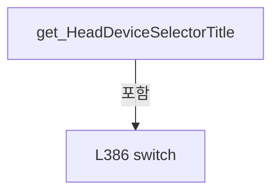

변경 전 점검: 입력/반환 타입, 위 호출자, 예외/취소 경로, 공유 상태와 저장·전송 소비자를 함께 확인합니다. 값의 단위나 물리 방향을 이름만으로 확정하지 않습니다.

### PropertyDeclaration `SelectedAxisRow` · L399–422

[Drilling.UI/Menu/Menus/CMenuMonitor.cs:399–422](https://github.com/kjuws10-rgb/A3Drilling/blob/5aee8e58439c9b455cae7c9593c9be986c3e682e/Drilling.UI/Menu/Menus/CMenuMonitor.cs#L399-L422)

| 항목 | 실제 추출 값 |
| --- | --- |
| 서명 | Drilling.UI.Menu.Menus.ST_MONITOR_AXIS_ROW? Drilling.UI.Menu.Menus.CMenuMonitor.SelectedAxisRow |
| 접근/수식자 | Public / public |
| 반환/값 타입 | Drilling.UI.Menu.Menus.ST_MONITOR_AXIS_ROW? |
| 소속 타입 | NamedType:Drilling.UI.Menu.Menus.CMenuMonitor |

현재 부분 분석에서 직접 연결된 호출자는 없습니다. XAML/이벤트/인터페이스·델리게이트·외부 진입을 추가 확인해야 하며, 미사용으로 판정한 것이 아닙니다.

변경 전 점검: 입력/반환 타입, 위 호출자, 예외/취소 경로, 공유 상태와 저장·전송 소비자를 함께 확인합니다. 값의 단위나 물리 방향을 이름만으로 확정하지 않습니다.

### GetAccessorDeclaration `get_SelectedAxisRow` · L401–409

[Drilling.UI/Menu/Menus/CMenuMonitor.cs:401–409](https://github.com/kjuws10-rgb/A3Drilling/blob/5aee8e58439c9b455cae7c9593c9be986c3e682e/Drilling.UI/Menu/Menus/CMenuMonitor.cs#L401-L409)

| 항목 | 실제 추출 값 |
| --- | --- |
| 서명 | Drilling.UI.Menu.Menus.ST_MONITOR_AXIS_ROW? Drilling.UI.Menu.Menus.CMenuMonitor.SelectedAxisRow.get |
| 접근/수식자 | Public / get |
| 반환/값 타입 | Drilling.UI.Menu.Menus.ST_MONITOR_AXIS_ROW? |
| 소속 타입 | NamedType:Drilling.UI.Menu.Menus.CMenuMonitor |

현재 부분 분석에서 직접 연결된 호출자는 없습니다. XAML/이벤트/인터페이스·델리게이트·외부 진입을 추가 확인해야 하며, 미사용으로 판정한 것이 아닙니다.

호출하는 대상과 해석 범위:

| 원본 행 | 표현식 | 분석 상태 | 대상/소스 위치 |
| --- | --- | --- | --- |
| 408 | AxisRows.FirstOrDefault | resolved | Drilling.UI.Menu.Menus.ST_MONITOR_AXIS_ROW? System.Collections.Generic.IEnumerable<Drilling.UI.Menu.Menus.ST_MONITOR_AXIS_ROW>.FirstOrDefault<Drilling.UI.Menu.Menus.ST_MONITOR_AXIS_ROW>(System.Func<Drilling.UI.Menu.Menus.ST_MONITOR_AXIS_ROW, bool>) |

본문의 실제 연산·분기·예외·반환 순서(원문 위치 순):

| 원본 행 | 종류 | 주석 해설 |
| --- | --- | --- |
| 408 | call | 함수·델리게이트 또는 객체 생성자를 호출합니다: AxisRows.FirstOrDefault(MatchesItem) |
| 408 | return | 호출자에게 값 또는 제어를 반환합니다: return AxisRows.FirstOrDefault(MatchesItem); |

변경 전 점검: 입력/반환 타입, 위 호출자, 예외/취소 경로, 공유 상태와 저장·전송 소비자를 함께 확인합니다. 값의 단위나 물리 방향을 이름만으로 확정하지 않습니다.

### LocalFunctionStatement `MatchesItem` · L403–406

[Drilling.UI/Menu/Menus/CMenuMonitor.cs:403–406](https://github.com/kjuws10-rgb/A3Drilling/blob/5aee8e58439c9b455cae7c9593c9be986c3e682e/Drilling.UI/Menu/Menus/CMenuMonitor.cs#L403-L406)

| 항목 | 실제 추출 값 |
| --- | --- |
| 서명 | bool MatchesItem(Drilling.UI.Menu.Menus.ST_MONITOR_AXIS_ROW) |
| 접근/수식자 | Private /  |
| 반환/값 타입 | bool |
| 소속 타입 | NamedType:Drilling.UI.Menu.Menus.CMenuMonitor |

입력 계약:

| 이름 | 타입 | 전달 | 선택/기본값 |
| --- | --- | --- | --- |
| row | Drilling.UI.Menu.Menus.ST_MONITOR_AXIS_ROW | None | False /  |

현재 부분 분석에서 직접 연결된 호출자는 없습니다. XAML/이벤트/인터페이스·델리게이트·외부 진입을 추가 확인해야 하며, 미사용으로 판정한 것이 아닙니다.

호출하는 대상과 해석 범위:

| 원본 행 | 표현식 | 분석 상태 | 대상/소스 위치 |
| --- | --- | --- | --- |
| 405 | row.AxisId.Equals | resolved | bool string.Equals(string?, System.StringComparison) |

본문의 실제 연산·분기·예외·반환 순서(원문 위치 순):

| 원본 행 | 종류 | 주석 해설 |
| --- | --- | --- |
| 405 | call | 함수·델리게이트 또는 객체 생성자를 호출합니다: row.AxisId.Equals(_selectedAxisId, StringComparison.OrdinalIgnoreCase) |
| 405 | return | 호출자에게 값 또는 제어를 반환합니다: return row.AxisId.Equals(_selectedAxisId, StringComparison.OrdinalIgnoreCase); |

변경 전 점검: 입력/반환 타입, 위 호출자, 예외/취소 경로, 공유 상태와 저장·전송 소비자를 함께 확인합니다. 값의 단위나 물리 방향을 이름만으로 확정하지 않습니다.

### SetAccessorDeclaration `set_SelectedAxisRow` · L411–421

[Drilling.UI/Menu/Menus/CMenuMonitor.cs:411–421](https://github.com/kjuws10-rgb/A3Drilling/blob/5aee8e58439c9b455cae7c9593c9be986c3e682e/Drilling.UI/Menu/Menus/CMenuMonitor.cs#L411-L421)

| 항목 | 실제 추출 값 |
| --- | --- |
| 서명 | void Drilling.UI.Menu.Menus.CMenuMonitor.SelectedAxisRow.set |
| 접근/수식자 | Public / set |
| 반환/값 타입 | void |
| 소속 타입 | NamedType:Drilling.UI.Menu.Menus.CMenuMonitor |

입력 계약:

| 이름 | 타입 | 전달 | 선택/기본값 |
| --- | --- | --- | --- |
| value | Drilling.UI.Menu.Menus.ST_MONITOR_AXIS_ROW? | None | False /  |

현재 부분 분석에서 직접 연결된 호출자는 없습니다. XAML/이벤트/인터페이스·델리게이트·외부 진입을 추가 확인해야 하며, 미사용으로 판정한 것이 아닙니다.

호출하는 대상과 해석 범위:

| 원본 행 | 표현식 | 분석 상태 | 대상/소스 위치 |
| --- | --- | --- | --- |
| 413 | string.IsNullOrWhiteSpace | resolved | bool string.IsNullOrWhiteSpace(string?) |
| 413 | value.AxisId.Equals | resolved | bool string.Equals(string?, System.StringComparison) |
| 419 | OnPropertyChanged | resolved | void Drilling.UI.Menu.CBindingBase.OnPropertyChanged(string?) · Drilling.UI/Menu/CBindingBase.cs:759 |
| 419 | nameof | unresolved | None |
| 420 | OnPropertyChanged | resolved | void Drilling.UI.Menu.CBindingBase.OnPropertyChanged(string?) · Drilling.UI/Menu/CBindingBase.cs:759 |
| 420 | nameof | unresolved | None |

본문의 실제 연산·분기·예외·반환 순서(원문 위치 순):

| 원본 행 | 종류 | 주석 해설 |
| --- | --- | --- |
| 413 | call | 함수·델리게이트 또는 객체 생성자를 호출합니다: string.IsNullOrWhiteSpace(value.AxisId) |
| 413 | call | 함수·델리게이트 또는 객체 생성자를 호출합니다: value.AxisId.Equals(_selectedAxisId, StringComparison.OrdinalIgnoreCase) |
| 413 | if | 조건에 따라 분기합니다: if (value is null &#124;&#124; string.IsNullOrWhiteSpace(value.AxisId) &#124;&#124; value.AxisId.Equals(_selectedAxisId, StringComparison.OrdinalIgnoreCase)) |
| 415 | return | 호출자에게 값 또는 제어를 반환합니다: return; |
| 418 | assignment | 값을 대상에 대입합니다: _selectedAxisId = value.AxisId |
| 419 | call | 함수·델리게이트 또는 객체 생성자를 호출합니다: OnPropertyChanged(nameof(SelectedAxisId)) |
| 419 | call | 함수·델리게이트 또는 객체 생성자를 호출합니다: nameof(SelectedAxisId) |
| 420 | call | 함수·델리게이트 또는 객체 생성자를 호출합니다: OnPropertyChanged(nameof(SelectedAxisRow)) |
| 420 | call | 함수·델리게이트 또는 객체 생성자를 호출합니다: nameof(SelectedAxisRow) |

제어 구문의 포함 구조(실제 실행 순서/CFG가 아닌 구문 탐색 그림):

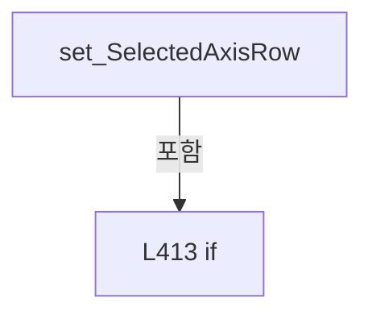

변경 전 점검: 입력/반환 타입, 위 호출자, 예외/취소 경로, 공유 상태와 저장·전송 소비자를 함께 확인합니다. 값의 단위나 물리 방향을 이름만으로 확정하지 않습니다.

### PropertyDeclaration `IsMotor` · L424–430

[Drilling.UI/Menu/Menus/CMenuMonitor.cs:424–430](https://github.com/kjuws10-rgb/A3Drilling/blob/5aee8e58439c9b455cae7c9593c9be986c3e682e/Drilling.UI/Menu/Menus/CMenuMonitor.cs#L424-L430)

| 항목 | 실제 추출 값 |
| --- | --- |
| 서명 | bool Drilling.UI.Menu.Menus.CMenuMonitor.IsMotor |
| 접근/수식자 | Public / public |
| 반환/값 타입 | bool |
| 소속 타입 | NamedType:Drilling.UI.Menu.Menus.CMenuMonitor |

현재 부분 분석에서 직접 연결된 호출자는 없습니다. XAML/이벤트/인터페이스·델리게이트·외부 진입을 추가 확인해야 하며, 미사용으로 판정한 것이 아닙니다.

변경 전 점검: 입력/반환 타입, 위 호출자, 예외/취소 경로, 공유 상태와 저장·전송 소비자를 함께 확인합니다. 값의 단위나 물리 방향을 이름만으로 확정하지 않습니다.

### GetAccessorDeclaration `get_IsMotor` · L426–429

[Drilling.UI/Menu/Menus/CMenuMonitor.cs:426–429](https://github.com/kjuws10-rgb/A3Drilling/blob/5aee8e58439c9b455cae7c9593c9be986c3e682e/Drilling.UI/Menu/Menus/CMenuMonitor.cs#L426-L429)

| 항목 | 실제 추출 값 |
| --- | --- |
| 서명 | bool Drilling.UI.Menu.Menus.CMenuMonitor.IsMotor.get |
| 접근/수식자 | Public / get |
| 반환/값 타입 | bool |
| 소속 타입 | NamedType:Drilling.UI.Menu.Menus.CMenuMonitor |

현재 부분 분석에서 직접 연결된 호출자는 없습니다. XAML/이벤트/인터페이스·델리게이트·외부 진입을 추가 확인해야 하며, 미사용으로 판정한 것이 아닙니다.

본문의 실제 연산·분기·예외·반환 순서(원문 위치 순):

| 원본 행 | 종류 | 주석 해설 |
| --- | --- | --- |
| 428 | return | 호출자에게 값 또는 제어를 반환합니다: return SelectedTab == "XPS"; |

변경 전 점검: 입력/반환 타입, 위 호출자, 예외/취소 경로, 공유 상태와 저장·전송 소비자를 함께 확인합니다. 값의 단위나 물리 방향을 이름만으로 확정하지 않습니다.

### PropertyDeclaration `IsLaser` · L432–438

[Drilling.UI/Menu/Menus/CMenuMonitor.cs:432–438](https://github.com/kjuws10-rgb/A3Drilling/blob/5aee8e58439c9b455cae7c9593c9be986c3e682e/Drilling.UI/Menu/Menus/CMenuMonitor.cs#L432-L438)

| 항목 | 실제 추출 값 |
| --- | --- |
| 서명 | bool Drilling.UI.Menu.Menus.CMenuMonitor.IsLaser |
| 접근/수식자 | Public / public |
| 반환/값 타입 | bool |
| 소속 타입 | NamedType:Drilling.UI.Menu.Menus.CMenuMonitor |

현재 부분 분석에서 직접 연결된 호출자는 없습니다. XAML/이벤트/인터페이스·델리게이트·외부 진입을 추가 확인해야 하며, 미사용으로 판정한 것이 아닙니다.

변경 전 점검: 입력/반환 타입, 위 호출자, 예외/취소 경로, 공유 상태와 저장·전송 소비자를 함께 확인합니다. 값의 단위나 물리 방향을 이름만으로 확정하지 않습니다.

### GetAccessorDeclaration `get_IsLaser` · L434–437

[Drilling.UI/Menu/Menus/CMenuMonitor.cs:434–437](https://github.com/kjuws10-rgb/A3Drilling/blob/5aee8e58439c9b455cae7c9593c9be986c3e682e/Drilling.UI/Menu/Menus/CMenuMonitor.cs#L434-L437)

| 항목 | 실제 추출 값 |
| --- | --- |
| 서명 | bool Drilling.UI.Menu.Menus.CMenuMonitor.IsLaser.get |
| 접근/수식자 | Public / get |
| 반환/값 타입 | bool |
| 소속 타입 | NamedType:Drilling.UI.Menu.Menus.CMenuMonitor |

현재 부분 분석에서 직접 연결된 호출자는 없습니다. XAML/이벤트/인터페이스·델리게이트·외부 진입을 추가 확인해야 하며, 미사용으로 판정한 것이 아닙니다.

본문의 실제 연산·분기·예외·반환 순서(원문 위치 순):

| 원본 행 | 종류 | 주석 해설 |
| --- | --- | --- |
| 436 | return | 호출자에게 값 또는 제어를 반환합니다: return SelectedTab == "LASER"; |

변경 전 점검: 입력/반환 타입, 위 호출자, 예외/취소 경로, 공유 상태와 저장·전송 소비자를 함께 확인합니다. 값의 단위나 물리 방향을 이름만으로 확정하지 않습니다.

### PropertyDeclaration `IsAttenuator` · L440–446

[Drilling.UI/Menu/Menus/CMenuMonitor.cs:440–446](https://github.com/kjuws10-rgb/A3Drilling/blob/5aee8e58439c9b455cae7c9593c9be986c3e682e/Drilling.UI/Menu/Menus/CMenuMonitor.cs#L440-L446)

| 항목 | 실제 추출 값 |
| --- | --- |
| 서명 | bool Drilling.UI.Menu.Menus.CMenuMonitor.IsAttenuator |
| 접근/수식자 | Public / public |
| 반환/값 타입 | bool |
| 소속 타입 | NamedType:Drilling.UI.Menu.Menus.CMenuMonitor |

현재 부분 분석에서 직접 연결된 호출자는 없습니다. XAML/이벤트/인터페이스·델리게이트·외부 진입을 추가 확인해야 하며, 미사용으로 판정한 것이 아닙니다.

변경 전 점검: 입력/반환 타입, 위 호출자, 예외/취소 경로, 공유 상태와 저장·전송 소비자를 함께 확인합니다. 값의 단위나 물리 방향을 이름만으로 확정하지 않습니다.

### GetAccessorDeclaration `get_IsAttenuator` · L442–445

[Drilling.UI/Menu/Menus/CMenuMonitor.cs:442–445](https://github.com/kjuws10-rgb/A3Drilling/blob/5aee8e58439c9b455cae7c9593c9be986c3e682e/Drilling.UI/Menu/Menus/CMenuMonitor.cs#L442-L445)

| 항목 | 실제 추출 값 |
| --- | --- |
| 서명 | bool Drilling.UI.Menu.Menus.CMenuMonitor.IsAttenuator.get |
| 접근/수식자 | Public / get |
| 반환/값 타입 | bool |
| 소속 타입 | NamedType:Drilling.UI.Menu.Menus.CMenuMonitor |

현재 부분 분석에서 직접 연결된 호출자는 없습니다. XAML/이벤트/인터페이스·델리게이트·외부 진입을 추가 확인해야 하며, 미사용으로 판정한 것이 아닙니다.

본문의 실제 연산·분기·예외·반환 순서(원문 위치 순):

| 원본 행 | 종류 | 주석 해설 |
| --- | --- | --- |
| 444 | return | 호출자에게 값 또는 제어를 반환합니다: return SelectedTab == "ATTENUATOR"; |

변경 전 점검: 입력/반환 타입, 위 호출자, 예외/취소 경로, 공유 상태와 저장·전송 소비자를 함께 확인합니다. 값의 단위나 물리 방향을 이름만으로 확정하지 않습니다.

### PropertyDeclaration `IsBet` · L448–454

[Drilling.UI/Menu/Menus/CMenuMonitor.cs:448–454](https://github.com/kjuws10-rgb/A3Drilling/blob/5aee8e58439c9b455cae7c9593c9be986c3e682e/Drilling.UI/Menu/Menus/CMenuMonitor.cs#L448-L454)

| 항목 | 실제 추출 값 |
| --- | --- |
| 서명 | bool Drilling.UI.Menu.Menus.CMenuMonitor.IsBet |
| 접근/수식자 | Public / public |
| 반환/값 타입 | bool |
| 소속 타입 | NamedType:Drilling.UI.Menu.Menus.CMenuMonitor |

현재 부분 분석에서 직접 연결된 호출자는 없습니다. XAML/이벤트/인터페이스·델리게이트·외부 진입을 추가 확인해야 하며, 미사용으로 판정한 것이 아닙니다.

변경 전 점검: 입력/반환 타입, 위 호출자, 예외/취소 경로, 공유 상태와 저장·전송 소비자를 함께 확인합니다. 값의 단위나 물리 방향을 이름만으로 확정하지 않습니다.

### GetAccessorDeclaration `get_IsBet` · L450–453

[Drilling.UI/Menu/Menus/CMenuMonitor.cs:450–453](https://github.com/kjuws10-rgb/A3Drilling/blob/5aee8e58439c9b455cae7c9593c9be986c3e682e/Drilling.UI/Menu/Menus/CMenuMonitor.cs#L450-L453)

| 항목 | 실제 추출 값 |
| --- | --- |
| 서명 | bool Drilling.UI.Menu.Menus.CMenuMonitor.IsBet.get |
| 접근/수식자 | Public / get |
| 반환/값 타입 | bool |
| 소속 타입 | NamedType:Drilling.UI.Menu.Menus.CMenuMonitor |

현재 부분 분석에서 직접 연결된 호출자는 없습니다. XAML/이벤트/인터페이스·델리게이트·외부 진입을 추가 확인해야 하며, 미사용으로 판정한 것이 아닙니다.

본문의 실제 연산·분기·예외·반환 순서(원문 위치 순):

| 원본 행 | 종류 | 주석 해설 |
| --- | --- | --- |
| 452 | return | 호출자에게 값 또는 제어를 반환합니다: return SelectedTab == "BET"; |

변경 전 점검: 입력/반환 타입, 위 호출자, 예외/취소 경로, 공유 상태와 저장·전송 소비자를 함께 확인합니다. 값의 단위나 물리 방향을 이름만으로 확정하지 않습니다.

### PropertyDeclaration `IsPowerMeter` · L456–462

[Drilling.UI/Menu/Menus/CMenuMonitor.cs:456–462](https://github.com/kjuws10-rgb/A3Drilling/blob/5aee8e58439c9b455cae7c9593c9be986c3e682e/Drilling.UI/Menu/Menus/CMenuMonitor.cs#L456-L462)

| 항목 | 실제 추출 값 |
| --- | --- |
| 서명 | bool Drilling.UI.Menu.Menus.CMenuMonitor.IsPowerMeter |
| 접근/수식자 | Public / public |
| 반환/값 타입 | bool |
| 소속 타입 | NamedType:Drilling.UI.Menu.Menus.CMenuMonitor |

현재 부분 분석에서 직접 연결된 호출자는 없습니다. XAML/이벤트/인터페이스·델리게이트·외부 진입을 추가 확인해야 하며, 미사용으로 판정한 것이 아닙니다.

변경 전 점검: 입력/반환 타입, 위 호출자, 예외/취소 경로, 공유 상태와 저장·전송 소비자를 함께 확인합니다. 값의 단위나 물리 방향을 이름만으로 확정하지 않습니다.

### GetAccessorDeclaration `get_IsPowerMeter` · L458–461

[Drilling.UI/Menu/Menus/CMenuMonitor.cs:458–461](https://github.com/kjuws10-rgb/A3Drilling/blob/5aee8e58439c9b455cae7c9593c9be986c3e682e/Drilling.UI/Menu/Menus/CMenuMonitor.cs#L458-L461)

| 항목 | 실제 추출 값 |
| --- | --- |
| 서명 | bool Drilling.UI.Menu.Menus.CMenuMonitor.IsPowerMeter.get |
| 접근/수식자 | Public / get |
| 반환/값 타입 | bool |
| 소속 타입 | NamedType:Drilling.UI.Menu.Menus.CMenuMonitor |

현재 부분 분석에서 직접 연결된 호출자는 없습니다. XAML/이벤트/인터페이스·델리게이트·외부 진입을 추가 확인해야 하며, 미사용으로 판정한 것이 아닙니다.

본문의 실제 연산·분기·예외·반환 순서(원문 위치 순):

| 원본 행 | 종류 | 주석 해설 |
| --- | --- | --- |
| 460 | return | 호출자에게 값 또는 제어를 반환합니다: return SelectedTab == "POWER METER"; |

변경 전 점검: 입력/반환 타입, 위 호출자, 예외/취소 경로, 공유 상태와 저장·전송 소비자를 함께 확인합니다. 값의 단위나 물리 방향을 이름만으로 확정하지 않습니다.

### PropertyDeclaration `IsPicoMotor` · L464–470

[Drilling.UI/Menu/Menus/CMenuMonitor.cs:464–470](https://github.com/kjuws10-rgb/A3Drilling/blob/5aee8e58439c9b455cae7c9593c9be986c3e682e/Drilling.UI/Menu/Menus/CMenuMonitor.cs#L464-L470)

| 항목 | 실제 추출 값 |
| --- | --- |
| 서명 | bool Drilling.UI.Menu.Menus.CMenuMonitor.IsPicoMotor |
| 접근/수식자 | Public / public |
| 반환/값 타입 | bool |
| 소속 타입 | NamedType:Drilling.UI.Menu.Menus.CMenuMonitor |

현재 부분 분석에서 직접 연결된 호출자는 없습니다. XAML/이벤트/인터페이스·델리게이트·외부 진입을 추가 확인해야 하며, 미사용으로 판정한 것이 아닙니다.

변경 전 점검: 입력/반환 타입, 위 호출자, 예외/취소 경로, 공유 상태와 저장·전송 소비자를 함께 확인합니다. 값의 단위나 물리 방향을 이름만으로 확정하지 않습니다.

### GetAccessorDeclaration `get_IsPicoMotor` · L466–469

[Drilling.UI/Menu/Menus/CMenuMonitor.cs:466–469](https://github.com/kjuws10-rgb/A3Drilling/blob/5aee8e58439c9b455cae7c9593c9be986c3e682e/Drilling.UI/Menu/Menus/CMenuMonitor.cs#L466-L469)

| 항목 | 실제 추출 값 |
| --- | --- |
| 서명 | bool Drilling.UI.Menu.Menus.CMenuMonitor.IsPicoMotor.get |
| 접근/수식자 | Public / get |
| 반환/값 타입 | bool |
| 소속 타입 | NamedType:Drilling.UI.Menu.Menus.CMenuMonitor |

현재 부분 분석에서 직접 연결된 호출자는 없습니다. XAML/이벤트/인터페이스·델리게이트·외부 진입을 추가 확인해야 하며, 미사용으로 판정한 것이 아닙니다.

본문의 실제 연산·분기·예외·반환 순서(원문 위치 순):

| 원본 행 | 종류 | 주석 해설 |
| --- | --- | --- |
| 468 | return | 호출자에게 값 또는 제어를 반환합니다: return SelectedTab == "PICO MOTOR"; |

변경 전 점검: 입력/반환 타입, 위 호출자, 예외/취소 경로, 공유 상태와 저장·전송 소비자를 함께 확인합니다. 값의 단위나 물리 방향을 이름만으로 확정하지 않습니다.

### PropertyDeclaration `PicoConnectionButtons` · L472–478

[Drilling.UI/Menu/Menus/CMenuMonitor.cs:472–478](https://github.com/kjuws10-rgb/A3Drilling/blob/5aee8e58439c9b455cae7c9593c9be986c3e682e/Drilling.UI/Menu/Menus/CMenuMonitor.cs#L472-L478)

| 항목 | 실제 추출 값 |
| --- | --- |
| 서명 | System.Collections.Generic.IReadOnlyList<Drilling.UI.Menu.Menus.ST_MONITOR_OPERATION_BUTTON> Drilling.UI.Menu.Menus.CMenuMonitor.PicoConnectionButtons |
| 접근/수식자 | Public / public |
| 반환/값 타입 | System.Collections.Generic.IReadOnlyList<Drilling.UI.Menu.Menus.ST_MONITOR_OPERATION_BUTTON> |
| 소속 타입 | NamedType:Drilling.UI.Menu.Menus.CMenuMonitor |

현재 부분 분석에서 직접 연결된 호출자는 없습니다. XAML/이벤트/인터페이스·델리게이트·외부 진입을 추가 확인해야 하며, 미사용으로 판정한 것이 아닙니다.

변경 전 점검: 입력/반환 타입, 위 호출자, 예외/취소 경로, 공유 상태와 저장·전송 소비자를 함께 확인합니다. 값의 단위나 물리 방향을 이름만으로 확정하지 않습니다.

### GetAccessorDeclaration `get_PicoConnectionButtons` · L474–477

[Drilling.UI/Menu/Menus/CMenuMonitor.cs:474–477](https://github.com/kjuws10-rgb/A3Drilling/blob/5aee8e58439c9b455cae7c9593c9be986c3e682e/Drilling.UI/Menu/Menus/CMenuMonitor.cs#L474-L477)

| 항목 | 실제 추출 값 |
| --- | --- |
| 서명 | System.Collections.Generic.IReadOnlyList<Drilling.UI.Menu.Menus.ST_MONITOR_OPERATION_BUTTON> Drilling.UI.Menu.Menus.CMenuMonitor.PicoConnectionButtons.get |
| 접근/수식자 | Public / get |
| 반환/값 타입 | System.Collections.Generic.IReadOnlyList<Drilling.UI.Menu.Menus.ST_MONITOR_OPERATION_BUTTON> |
| 소속 타입 | NamedType:Drilling.UI.Menu.Menus.CMenuMonitor |

현재 부분 분석에서 직접 연결된 호출자는 없습니다. XAML/이벤트/인터페이스·델리게이트·외부 진입을 추가 확인해야 하며, 미사용으로 판정한 것이 아닙니다.

호출하는 대상과 해석 범위:

| 원본 행 | 표현식 | 분석 상태 | 대상/소스 위치 |
| --- | --- | --- | --- |
| 476 | new | resolved | Drilling.UI.Menu.Menus.ST_MONITOR_OPERATION_BUTTON.ST_MONITOR_OPERATION_BUTTON(string, string, string, string) · Drilling.UI/Menu/Menus/CMenuMonitor.cs:6716 |
| 476 | new | resolved | Drilling.UI.Menu.Menus.ST_MONITOR_OPERATION_BUTTON.ST_MONITOR_OPERATION_BUTTON(string, string, string, string) · Drilling.UI/Menu/Menus/CMenuMonitor.cs:6716 |

본문의 실제 연산·분기·예외·반환 순서(원문 위치 순):

| 원본 행 | 종류 | 주석 해설 |
| --- | --- | --- |
| 476 | call | 함수·델리게이트 또는 객체 생성자를 호출합니다: new("CONNECT", "Servo", _picoMotorIsConnected ? "Dark" : "Green") |
| 476 | call | 함수·델리게이트 또는 객체 생성자를 호출합니다: new("DISCONNECT", "Stop", _picoMotorIsConnected ? "Red" : "Dark") |
| 476 | conditional-expression | 조건에 따라 결과식을 선택합니다: _picoMotorIsConnected ? "Dark" : "Green" |
| 476 | conditional-expression | 조건에 따라 결과식을 선택합니다: _picoMotorIsConnected ? "Red" : "Dark" |
| 476 | return | 호출자에게 값 또는 제어를 반환합니다: return[new("CONNECT", "Servo", _picoMotorIsConnected ? "Dark" : "Green"), new("DISCONNECT", "Stop", _picoMotorIsConnected ? "Red" : "Dark")]; |

변경 전 점검: 입력/반환 타입, 위 호출자, 예외/취소 경로, 공유 상태와 저장·전송 소비자를 함께 확인합니다. 값의 단위나 물리 방향을 이름만으로 확정하지 않습니다.

### PropertyDeclaration `PicoMotorSelectButtons` · L480–491

[Drilling.UI/Menu/Menus/CMenuMonitor.cs:480–491](https://github.com/kjuws10-rgb/A3Drilling/blob/5aee8e58439c9b455cae7c9593c9be986c3e682e/Drilling.UI/Menu/Menus/CMenuMonitor.cs#L480-L491)

| 항목 | 실제 추출 값 |
| --- | --- |
| 서명 | System.Collections.Generic.IReadOnlyList<Drilling.UI.Menu.Menus.ST_MONITOR_OPERATION_BUTTON> Drilling.UI.Menu.Menus.CMenuMonitor.PicoMotorSelectButtons |
| 접근/수식자 | Public / public |
| 반환/값 타입 | System.Collections.Generic.IReadOnlyList<Drilling.UI.Menu.Menus.ST_MONITOR_OPERATION_BUTTON> |
| 소속 타입 | NamedType:Drilling.UI.Menu.Menus.CMenuMonitor |

현재 부분 분석에서 직접 연결된 호출자는 없습니다. XAML/이벤트/인터페이스·델리게이트·외부 진입을 추가 확인해야 하며, 미사용으로 판정한 것이 아닙니다.

변경 전 점검: 입력/반환 타입, 위 호출자, 예외/취소 경로, 공유 상태와 저장·전송 소비자를 함께 확인합니다. 값의 단위나 물리 방향을 이름만으로 확정하지 않습니다.

### GetAccessorDeclaration `get_PicoMotorSelectButtons` · L482–490

[Drilling.UI/Menu/Menus/CMenuMonitor.cs:482–490](https://github.com/kjuws10-rgb/A3Drilling/blob/5aee8e58439c9b455cae7c9593c9be986c3e682e/Drilling.UI/Menu/Menus/CMenuMonitor.cs#L482-L490)

| 항목 | 실제 추출 값 |
| --- | --- |
| 서명 | System.Collections.Generic.IReadOnlyList<Drilling.UI.Menu.Menus.ST_MONITOR_OPERATION_BUTTON> Drilling.UI.Menu.Menus.CMenuMonitor.PicoMotorSelectButtons.get |
| 접근/수식자 | Public / get |
| 반환/값 타입 | System.Collections.Generic.IReadOnlyList<Drilling.UI.Menu.Menus.ST_MONITOR_OPERATION_BUTTON> |
| 소속 타입 | NamedType:Drilling.UI.Menu.Menus.CMenuMonitor |

현재 부분 분석에서 직접 연결된 호출자는 없습니다. XAML/이벤트/인터페이스·델리게이트·외부 진입을 추가 확인해야 하며, 미사용으로 판정한 것이 아닙니다.

호출하는 대상과 해석 범위:

| 원본 행 | 표현식 | 분석 상태 | 대상/소스 위치 |
| --- | --- | --- | --- |
| 489 | Enumerable.Range(1, 4).Select(BuildMonitor).ToArray | resolved | Drilling.UI.Menu.Menus.ST_MONITOR_OPERATION_BUTTON[] System.Collections.Generic.IEnumerable<Drilling.UI.Menu.Menus.ST_MONITOR_OPERATION_BUTTON>.ToArray<Drilling.UI.Menu.Menus.ST_MONITOR_OPERATION_BUTTON>() |
| 489 | Enumerable.Range(1, 4).Select | resolved | System.Collections.Generic.IEnumerable<Drilling.UI.Menu.Menus.ST_MONITOR_OPERATION_BUTTON> System.Collections.Generic.IEnumerable<int>.Select<int, Drilling.UI.Menu.Menus.ST_MONITOR_OPERATION_BUTTON>(System.Func<int, Drilling.UI.Menu.Menus.ST_MONITOR_OPERATION_BUTTON>) |
| 489 | Enumerable.Range | resolved | System.Collections.Generic.IEnumerable<int> System.Linq.Enumerable.Range(int, int) |

본문의 실제 연산·분기·예외·반환 순서(원문 위치 순):

| 원본 행 | 종류 | 주석 해설 |
| --- | --- | --- |
| 489 | call | 함수·델리게이트 또는 객체 생성자를 호출합니다: Enumerable.Range(1, 4).Select(BuildMonitor).ToArray() |
| 489 | call | 함수·델리게이트 또는 객체 생성자를 호출합니다: Enumerable.Range(1, 4).Select(BuildMonitor) |
| 489 | call | 함수·델리게이트 또는 객체 생성자를 호출합니다: Enumerable.Range(1, 4) |
| 489 | return | 호출자에게 값 또는 제어를 반환합니다: return Enumerable.Range(1, 4).Select(BuildMonitor).ToArray(); |

변경 전 점검: 입력/반환 타입, 위 호출자, 예외/취소 경로, 공유 상태와 저장·전송 소비자를 함께 확인합니다. 값의 단위나 물리 방향을 이름만으로 확정하지 않습니다.

### LocalFunctionStatement `BuildMonitor` · L484–487

[Drilling.UI/Menu/Menus/CMenuMonitor.cs:484–487](https://github.com/kjuws10-rgb/A3Drilling/blob/5aee8e58439c9b455cae7c9593c9be986c3e682e/Drilling.UI/Menu/Menus/CMenuMonitor.cs#L484-L487)

| 항목 | 실제 추출 값 |
| --- | --- |
| 서명 | Drilling.UI.Menu.Menus.ST_MONITOR_OPERATION_BUTTON BuildMonitor(int) |
| 접근/수식자 | Private /  |
| 반환/값 타입 | Drilling.UI.Menu.Menus.ST_MONITOR_OPERATION_BUTTON |
| 소속 타입 | NamedType:Drilling.UI.Menu.Menus.CMenuMonitor |

입력 계약:

| 이름 | 타입 | 전달 | 선택/기본값 |
| --- | --- | --- | --- |
| number | int | None | False /  |

현재 부분 분석에서 직접 연결된 호출자는 없습니다. XAML/이벤트/인터페이스·델리게이트·외부 진입을 추가 확인해야 하며, 미사용으로 판정한 것이 아닙니다.

호출하는 대상과 해석 범위:

| 원본 행 | 표현식 | 분석 상태 | 대상/소스 위치 |
| --- | --- | --- | --- |
| 486 | new ST_MONITOR_OPERATION_BUTTON | resolved | Drilling.UI.Menu.Menus.ST_MONITOR_OPERATION_BUTTON.ST_MONITOR_OPERATION_BUTTON(string, string, string, string) · Drilling.UI/Menu/Menus/CMenuMonitor.cs:6716 |

본문의 실제 연산·분기·예외·반환 순서(원문 위치 순):

| 원본 행 | 종류 | 주석 해설 |
| --- | --- | --- |
| 486 | call | 함수·델리게이트 또는 객체 생성자를 호출합니다: new ST_MONITOR_OPERATION_BUTTON($"MOTOR {number}", "Move", _selectedPicoMotorNo == number ? "Blue" : "Dark") |
| 486 | conditional-expression | 조건에 따라 결과식을 선택합니다: _selectedPicoMotorNo == number ? "Blue" : "Dark" |
| 486 | return | 호출자에게 값 또는 제어를 반환합니다: return new ST_MONITOR_OPERATION_BUTTON($"MOTOR {number}", "Move", _selectedPicoMotorNo == number ? "Blue" : "Dark"); |

변경 전 점검: 입력/반환 타입, 위 호출자, 예외/취소 경로, 공유 상태와 저장·전송 소비자를 함께 확인합니다. 값의 단위나 물리 방향을 이름만으로 확정하지 않습니다.

### PropertyDeclaration `PicoMotionStopButtons` · L493–499

[Drilling.UI/Menu/Menus/CMenuMonitor.cs:493–499](https://github.com/kjuws10-rgb/A3Drilling/blob/5aee8e58439c9b455cae7c9593c9be986c3e682e/Drilling.UI/Menu/Menus/CMenuMonitor.cs#L493-L499)

| 항목 | 실제 추출 값 |
| --- | --- |
| 서명 | System.Collections.Generic.IReadOnlyList<Drilling.UI.Menu.Menus.ST_MONITOR_OPERATION_BUTTON> Drilling.UI.Menu.Menus.CMenuMonitor.PicoMotionStopButtons |
| 접근/수식자 | Public / public |
| 반환/값 타입 | System.Collections.Generic.IReadOnlyList<Drilling.UI.Menu.Menus.ST_MONITOR_OPERATION_BUTTON> |
| 소속 타입 | NamedType:Drilling.UI.Menu.Menus.CMenuMonitor |

현재 부분 분석에서 직접 연결된 호출자는 없습니다. XAML/이벤트/인터페이스·델리게이트·외부 진입을 추가 확인해야 하며, 미사용으로 판정한 것이 아닙니다.

변경 전 점검: 입력/반환 타입, 위 호출자, 예외/취소 경로, 공유 상태와 저장·전송 소비자를 함께 확인합니다. 값의 단위나 물리 방향을 이름만으로 확정하지 않습니다.

### GetAccessorDeclaration `get_PicoMotionStopButtons` · L495–498

[Drilling.UI/Menu/Menus/CMenuMonitor.cs:495–498](https://github.com/kjuws10-rgb/A3Drilling/blob/5aee8e58439c9b455cae7c9593c9be986c3e682e/Drilling.UI/Menu/Menus/CMenuMonitor.cs#L495-L498)

| 항목 | 실제 추출 값 |
| --- | --- |
| 서명 | System.Collections.Generic.IReadOnlyList<Drilling.UI.Menu.Menus.ST_MONITOR_OPERATION_BUTTON> Drilling.UI.Menu.Menus.CMenuMonitor.PicoMotionStopButtons.get |
| 접근/수식자 | Public / get |
| 반환/값 타입 | System.Collections.Generic.IReadOnlyList<Drilling.UI.Menu.Menus.ST_MONITOR_OPERATION_BUTTON> |
| 소속 타입 | NamedType:Drilling.UI.Menu.Menus.CMenuMonitor |

현재 부분 분석에서 직접 연결된 호출자는 없습니다. XAML/이벤트/인터페이스·델리게이트·외부 진입을 추가 확인해야 하며, 미사용으로 판정한 것이 아닙니다.

호출하는 대상과 해석 범위:

| 원본 행 | 표현식 | 분석 상태 | 대상/소스 위치 |
| --- | --- | --- | --- |
| 497 | new | resolved | Drilling.UI.Menu.Menus.ST_MONITOR_OPERATION_BUTTON.ST_MONITOR_OPERATION_BUTTON(string, string, string, string) · Drilling.UI/Menu/Menus/CMenuMonitor.cs:6716 |

본문의 실제 연산·분기·예외·반환 순서(원문 위치 순):

| 원본 행 | 종류 | 주석 해설 |
| --- | --- | --- |
| 497 | call | 함수·델리게이트 또는 객체 생성자를 호출합니다: new("STOP MOTION", "Stop", "Red") |
| 497 | return | 호출자에게 값 또는 제어를 반환합니다: return[new("STOP MOTION", "Stop", "Red")]; |

변경 전 점검: 입력/반환 타입, 위 호출자, 예외/취소 경로, 공유 상태와 저장·전송 소비자를 함께 확인합니다. 값의 단위나 물리 방향을 이름만으로 확정하지 않습니다.

### PropertyDeclaration `PicoMotionMoveButtons` · L501–507

[Drilling.UI/Menu/Menus/CMenuMonitor.cs:501–507](https://github.com/kjuws10-rgb/A3Drilling/blob/5aee8e58439c9b455cae7c9593c9be986c3e682e/Drilling.UI/Menu/Menus/CMenuMonitor.cs#L501-L507)

| 항목 | 실제 추출 값 |
| --- | --- |
| 서명 | System.Collections.Generic.IReadOnlyList<Drilling.UI.Menu.Menus.ST_MONITOR_OPERATION_BUTTON> Drilling.UI.Menu.Menus.CMenuMonitor.PicoMotionMoveButtons |
| 접근/수식자 | Public / public |
| 반환/값 타입 | System.Collections.Generic.IReadOnlyList<Drilling.UI.Menu.Menus.ST_MONITOR_OPERATION_BUTTON> |
| 소속 타입 | NamedType:Drilling.UI.Menu.Menus.CMenuMonitor |

현재 부분 분석에서 직접 연결된 호출자는 없습니다. XAML/이벤트/인터페이스·델리게이트·외부 진입을 추가 확인해야 하며, 미사용으로 판정한 것이 아닙니다.

변경 전 점검: 입력/반환 타입, 위 호출자, 예외/취소 경로, 공유 상태와 저장·전송 소비자를 함께 확인합니다. 값의 단위나 물리 방향을 이름만으로 확정하지 않습니다.

### GetAccessorDeclaration `get_PicoMotionMoveButtons` · L503–506

[Drilling.UI/Menu/Menus/CMenuMonitor.cs:503–506](https://github.com/kjuws10-rgb/A3Drilling/blob/5aee8e58439c9b455cae7c9593c9be986c3e682e/Drilling.UI/Menu/Menus/CMenuMonitor.cs#L503-L506)

| 항목 | 실제 추출 값 |
| --- | --- |
| 서명 | System.Collections.Generic.IReadOnlyList<Drilling.UI.Menu.Menus.ST_MONITOR_OPERATION_BUTTON> Drilling.UI.Menu.Menus.CMenuMonitor.PicoMotionMoveButtons.get |
| 접근/수식자 | Public / get |
| 반환/값 타입 | System.Collections.Generic.IReadOnlyList<Drilling.UI.Menu.Menus.ST_MONITOR_OPERATION_BUTTON> |
| 소속 타입 | NamedType:Drilling.UI.Menu.Menus.CMenuMonitor |

현재 부분 분석에서 직접 연결된 호출자는 없습니다. XAML/이벤트/인터페이스·델리게이트·외부 진입을 추가 확인해야 하며, 미사용으로 판정한 것이 아닙니다.

호출하는 대상과 해석 범위:

| 원본 행 | 표현식 | 분석 상태 | 대상/소스 위치 |
| --- | --- | --- | --- |
| 505 | new | resolved | Drilling.UI.Menu.Menus.ST_MONITOR_OPERATION_BUTTON.ST_MONITOR_OPERATION_BUTTON(string, string, string, string) · Drilling.UI/Menu/Menus/CMenuMonitor.cs:6716 |
| 505 | new | resolved | Drilling.UI.Menu.Menus.ST_MONITOR_OPERATION_BUTTON.ST_MONITOR_OPERATION_BUTTON(string, string, string, string) · Drilling.UI/Menu/Menus/CMenuMonitor.cs:6716 |

본문의 실제 연산·분기·예외·반환 순서(원문 위치 순):

| 원본 행 | 종류 | 주석 해설 |
| --- | --- | --- |
| 505 | call | 함수·델리게이트 또는 객체 생성자를 호출합니다: new("HOME", "Home", "Blue") |
| 505 | call | 함수·델리게이트 또는 객체 생성자를 호출합니다: new("ABS MOVE", "Abs", "Blue") |
| 505 | return | 호출자에게 값 또는 제어를 반환합니다: return[new("HOME", "Home", "Blue"), new("ABS MOVE", "Abs", "Blue")]; |

변경 전 점검: 입력/반환 타입, 위 호출자, 예외/취소 경로, 공유 상태와 저장·전송 소비자를 함께 확인합니다. 값의 단위나 물리 방향을 이름만으로 확정하지 않습니다.

### PropertyDeclaration `PicoMotionJogButtons` · L509–515

[Drilling.UI/Menu/Menus/CMenuMonitor.cs:509–515](https://github.com/kjuws10-rgb/A3Drilling/blob/5aee8e58439c9b455cae7c9593c9be986c3e682e/Drilling.UI/Menu/Menus/CMenuMonitor.cs#L509-L515)

| 항목 | 실제 추출 값 |
| --- | --- |
| 서명 | System.Collections.Generic.IReadOnlyList<Drilling.UI.Menu.Menus.ST_MONITOR_OPERATION_BUTTON> Drilling.UI.Menu.Menus.CMenuMonitor.PicoMotionJogButtons |
| 접근/수식자 | Public / public |
| 반환/값 타입 | System.Collections.Generic.IReadOnlyList<Drilling.UI.Menu.Menus.ST_MONITOR_OPERATION_BUTTON> |
| 소속 타입 | NamedType:Drilling.UI.Menu.Menus.CMenuMonitor |

현재 부분 분석에서 직접 연결된 호출자는 없습니다. XAML/이벤트/인터페이스·델리게이트·외부 진입을 추가 확인해야 하며, 미사용으로 판정한 것이 아닙니다.

변경 전 점검: 입력/반환 타입, 위 호출자, 예외/취소 경로, 공유 상태와 저장·전송 소비자를 함께 확인합니다. 값의 단위나 물리 방향을 이름만으로 확정하지 않습니다.

### GetAccessorDeclaration `get_PicoMotionJogButtons` · L511–514

[Drilling.UI/Menu/Menus/CMenuMonitor.cs:511–514](https://github.com/kjuws10-rgb/A3Drilling/blob/5aee8e58439c9b455cae7c9593c9be986c3e682e/Drilling.UI/Menu/Menus/CMenuMonitor.cs#L511-L514)

| 항목 | 실제 추출 값 |
| --- | --- |
| 서명 | System.Collections.Generic.IReadOnlyList<Drilling.UI.Menu.Menus.ST_MONITOR_OPERATION_BUTTON> Drilling.UI.Menu.Menus.CMenuMonitor.PicoMotionJogButtons.get |
| 접근/수식자 | Public / get |
| 반환/값 타입 | System.Collections.Generic.IReadOnlyList<Drilling.UI.Menu.Menus.ST_MONITOR_OPERATION_BUTTON> |
| 소속 타입 | NamedType:Drilling.UI.Menu.Menus.CMenuMonitor |

현재 부분 분석에서 직접 연결된 호출자는 없습니다. XAML/이벤트/인터페이스·델리게이트·외부 진입을 추가 확인해야 하며, 미사용으로 판정한 것이 아닙니다.

호출하는 대상과 해석 범위:

| 원본 행 | 표현식 | 분석 상태 | 대상/소스 위치 |
| --- | --- | --- | --- |
| 513 | new | resolved | Drilling.UI.Menu.Menus.ST_MONITOR_OPERATION_BUTTON.ST_MONITOR_OPERATION_BUTTON(string, string, string, string) · Drilling.UI/Menu/Menus/CMenuMonitor.cs:6716 |
| 513 | new | resolved | Drilling.UI.Menu.Menus.ST_MONITOR_OPERATION_BUTTON.ST_MONITOR_OPERATION_BUTTON(string, string, string, string) · Drilling.UI/Menu/Menus/CMenuMonitor.cs:6716 |

본문의 실제 연산·분기·예외·반환 순서(원문 위치 순):

| 원본 행 | 종류 | 주석 해설 |
| --- | --- | --- |
| 513 | call | 함수·델리게이트 또는 객체 생성자를 호출합니다: new("JOG -", "Rel", "Dark") |
| 513 | call | 함수·델리게이트 또는 객체 생성자를 호출합니다: new("JOG +", "Rel", "Blue") |
| 513 | return | 호출자에게 값 또는 제어를 반환합니다: return[new("JOG -", "Rel", "Dark"), new("JOG +", "Rel", "Blue")]; |

변경 전 점검: 입력/반환 타입, 위 호출자, 예외/취소 경로, 공유 상태와 저장·전송 소비자를 함께 확인합니다. 값의 단위나 물리 방향을 이름만으로 확정하지 않습니다.

### PropertyDeclaration `PicoMotionRelButtons` · L517–523

[Drilling.UI/Menu/Menus/CMenuMonitor.cs:517–523](https://github.com/kjuws10-rgb/A3Drilling/blob/5aee8e58439c9b455cae7c9593c9be986c3e682e/Drilling.UI/Menu/Menus/CMenuMonitor.cs#L517-L523)

| 항목 | 실제 추출 값 |
| --- | --- |
| 서명 | System.Collections.Generic.IReadOnlyList<Drilling.UI.Menu.Menus.ST_MONITOR_OPERATION_BUTTON> Drilling.UI.Menu.Menus.CMenuMonitor.PicoMotionRelButtons |
| 접근/수식자 | Public / public |
| 반환/값 타입 | System.Collections.Generic.IReadOnlyList<Drilling.UI.Menu.Menus.ST_MONITOR_OPERATION_BUTTON> |
| 소속 타입 | NamedType:Drilling.UI.Menu.Menus.CMenuMonitor |

현재 부분 분석에서 직접 연결된 호출자는 없습니다. XAML/이벤트/인터페이스·델리게이트·외부 진입을 추가 확인해야 하며, 미사용으로 판정한 것이 아닙니다.

변경 전 점검: 입력/반환 타입, 위 호출자, 예외/취소 경로, 공유 상태와 저장·전송 소비자를 함께 확인합니다. 값의 단위나 물리 방향을 이름만으로 확정하지 않습니다.

### GetAccessorDeclaration `get_PicoMotionRelButtons` · L519–522

[Drilling.UI/Menu/Menus/CMenuMonitor.cs:519–522](https://github.com/kjuws10-rgb/A3Drilling/blob/5aee8e58439c9b455cae7c9593c9be986c3e682e/Drilling.UI/Menu/Menus/CMenuMonitor.cs#L519-L522)

| 항목 | 실제 추출 값 |
| --- | --- |
| 서명 | System.Collections.Generic.IReadOnlyList<Drilling.UI.Menu.Menus.ST_MONITOR_OPERATION_BUTTON> Drilling.UI.Menu.Menus.CMenuMonitor.PicoMotionRelButtons.get |
| 접근/수식자 | Public / get |
| 반환/값 타입 | System.Collections.Generic.IReadOnlyList<Drilling.UI.Menu.Menus.ST_MONITOR_OPERATION_BUTTON> |
| 소속 타입 | NamedType:Drilling.UI.Menu.Menus.CMenuMonitor |

현재 부분 분석에서 직접 연결된 호출자는 없습니다. XAML/이벤트/인터페이스·델리게이트·외부 진입을 추가 확인해야 하며, 미사용으로 판정한 것이 아닙니다.

호출하는 대상과 해석 범위:

| 원본 행 | 표현식 | 분석 상태 | 대상/소스 위치 |
| --- | --- | --- | --- |
| 521 | new | resolved | Drilling.UI.Menu.Menus.ST_MONITOR_OPERATION_BUTTON.ST_MONITOR_OPERATION_BUTTON(string, string, string, string) · Drilling.UI/Menu/Menus/CMenuMonitor.cs:6716 |
| 521 | new | resolved | Drilling.UI.Menu.Menus.ST_MONITOR_OPERATION_BUTTON.ST_MONITOR_OPERATION_BUTTON(string, string, string, string) · Drilling.UI/Menu/Menus/CMenuMonitor.cs:6716 |

본문의 실제 연산·분기·예외·반환 순서(원문 위치 순):

| 원본 행 | 종류 | 주석 해설 |
| --- | --- | --- |
| 521 | call | 함수·델리게이트 또는 객체 생성자를 호출합니다: new("REL -", "Rel", "Dark") |
| 521 | call | 함수·델리게이트 또는 객체 생성자를 호출합니다: new("REL +", "Rel", "Blue") |
| 521 | return | 호출자에게 값 또는 제어를 반환합니다: return[new("REL -", "Rel", "Dark"), new("REL +", "Rel", "Blue")]; |

변경 전 점검: 입력/반환 타입, 위 호출자, 예외/취소 경로, 공유 상태와 저장·전송 소비자를 함께 확인합니다. 값의 단위나 물리 방향을 이름만으로 확정하지 않습니다.

### PropertyDeclaration `PicoAllMotorSelectButtons` · L525–536

[Drilling.UI/Menu/Menus/CMenuMonitor.cs:525–536](https://github.com/kjuws10-rgb/A3Drilling/blob/5aee8e58439c9b455cae7c9593c9be986c3e682e/Drilling.UI/Menu/Menus/CMenuMonitor.cs#L525-L536)

| 항목 | 실제 추출 값 |
| --- | --- |
| 서명 | System.Collections.Generic.IReadOnlyList<Drilling.UI.Menu.Menus.ST_MONITOR_OPERATION_BUTTON> Drilling.UI.Menu.Menus.CMenuMonitor.PicoAllMotorSelectButtons |
| 접근/수식자 | Public / public |
| 반환/값 타입 | System.Collections.Generic.IReadOnlyList<Drilling.UI.Menu.Menus.ST_MONITOR_OPERATION_BUTTON> |
| 소속 타입 | NamedType:Drilling.UI.Menu.Menus.CMenuMonitor |

현재 부분 분석에서 직접 연결된 호출자는 없습니다. XAML/이벤트/인터페이스·델리게이트·외부 진입을 추가 확인해야 하며, 미사용으로 판정한 것이 아닙니다.

변경 전 점검: 입력/반환 타입, 위 호출자, 예외/취소 경로, 공유 상태와 저장·전송 소비자를 함께 확인합니다. 값의 단위나 물리 방향을 이름만으로 확정하지 않습니다.

### GetAccessorDeclaration `get_PicoAllMotorSelectButtons` · L527–535

[Drilling.UI/Menu/Menus/CMenuMonitor.cs:527–535](https://github.com/kjuws10-rgb/A3Drilling/blob/5aee8e58439c9b455cae7c9593c9be986c3e682e/Drilling.UI/Menu/Menus/CMenuMonitor.cs#L527-L535)

| 항목 | 실제 추출 값 |
| --- | --- |
| 서명 | System.Collections.Generic.IReadOnlyList<Drilling.UI.Menu.Menus.ST_MONITOR_OPERATION_BUTTON> Drilling.UI.Menu.Menus.CMenuMonitor.PicoAllMotorSelectButtons.get |
| 접근/수식자 | Public / get |
| 반환/값 타입 | System.Collections.Generic.IReadOnlyList<Drilling.UI.Menu.Menus.ST_MONITOR_OPERATION_BUTTON> |
| 소속 타입 | NamedType:Drilling.UI.Menu.Menus.CMenuMonitor |

현재 부분 분석에서 직접 연결된 호출자는 없습니다. XAML/이벤트/인터페이스·델리게이트·외부 진입을 추가 확인해야 하며, 미사용으로 판정한 것이 아닙니다.

호출하는 대상과 해석 범위:

| 원본 행 | 표현식 | 분석 상태 | 대상/소스 위치 |
| --- | --- | --- | --- |
| 534 | Enumerable.Range(1, 4).Select(BuildMonitor).ToArray | resolved | Drilling.UI.Menu.Menus.ST_MONITOR_OPERATION_BUTTON[] System.Collections.Generic.IEnumerable<Drilling.UI.Menu.Menus.ST_MONITOR_OPERATION_BUTTON>.ToArray<Drilling.UI.Menu.Menus.ST_MONITOR_OPERATION_BUTTON>() |
| 534 | Enumerable.Range(1, 4).Select | resolved | System.Collections.Generic.IEnumerable<Drilling.UI.Menu.Menus.ST_MONITOR_OPERATION_BUTTON> System.Collections.Generic.IEnumerable<int>.Select<int, Drilling.UI.Menu.Menus.ST_MONITOR_OPERATION_BUTTON>(System.Func<int, Drilling.UI.Menu.Menus.ST_MONITOR_OPERATION_BUTTON>) |
| 534 | Enumerable.Range | resolved | System.Collections.Generic.IEnumerable<int> System.Linq.Enumerable.Range(int, int) |

본문의 실제 연산·분기·예외·반환 순서(원문 위치 순):

| 원본 행 | 종류 | 주석 해설 |
| --- | --- | --- |
| 534 | call | 함수·델리게이트 또는 객체 생성자를 호출합니다: Enumerable.Range(1, 4).Select(BuildMonitor).ToArray() |
| 534 | call | 함수·델리게이트 또는 객체 생성자를 호출합니다: Enumerable.Range(1, 4).Select(BuildMonitor) |
| 534 | call | 함수·델리게이트 또는 객체 생성자를 호출합니다: Enumerable.Range(1, 4) |
| 534 | return | 호출자에게 값 또는 제어를 반환합니다: return Enumerable.Range(1, 4).Select(BuildMonitor).ToArray(); |

변경 전 점검: 입력/반환 타입, 위 호출자, 예외/취소 경로, 공유 상태와 저장·전송 소비자를 함께 확인합니다. 값의 단위나 물리 방향을 이름만으로 확정하지 않습니다.

### LocalFunctionStatement `BuildMonitor` · L529–532

[Drilling.UI/Menu/Menus/CMenuMonitor.cs:529–532](https://github.com/kjuws10-rgb/A3Drilling/blob/5aee8e58439c9b455cae7c9593c9be986c3e682e/Drilling.UI/Menu/Menus/CMenuMonitor.cs#L529-L532)

| 항목 | 실제 추출 값 |
| --- | --- |
| 서명 | Drilling.UI.Menu.Menus.ST_MONITOR_OPERATION_BUTTON BuildMonitor(int) |
| 접근/수식자 | Private /  |
| 반환/값 타입 | Drilling.UI.Menu.Menus.ST_MONITOR_OPERATION_BUTTON |
| 소속 타입 | NamedType:Drilling.UI.Menu.Menus.CMenuMonitor |

입력 계약:

| 이름 | 타입 | 전달 | 선택/기본값 |
| --- | --- | --- | --- |
| number | int | None | False /  |

현재 부분 분석에서 직접 연결된 호출자는 없습니다. XAML/이벤트/인터페이스·델리게이트·외부 진입을 추가 확인해야 하며, 미사용으로 판정한 것이 아닙니다.

호출하는 대상과 해석 범위:

| 원본 행 | 표현식 | 분석 상태 | 대상/소스 위치 |
| --- | --- | --- | --- |
| 531 | new ST_MONITOR_OPERATION_BUTTON | resolved | Drilling.UI.Menu.Menus.ST_MONITOR_OPERATION_BUTTON.ST_MONITOR_OPERATION_BUTTON(string, string, string, string) · Drilling.UI/Menu/Menus/CMenuMonitor.cs:6716 |
| 531 | _picoAllMoveMotorNos.Contains | resolved | bool System.Collections.Generic.HashSet<int>.Contains(int) |

본문의 실제 연산·분기·예외·반환 순서(원문 위치 순):

| 원본 행 | 종류 | 주석 해설 |
| --- | --- | --- |
| 531 | call | 함수·델리게이트 또는 객체 생성자를 호출합니다: new ST_MONITOR_OPERATION_BUTTON($"MOTOR {number}", "Move", _picoAllMoveMotorNos.Contains(number) ? "Blue" : "Dark", $"ALL MOTOR {number}") |
| 531 | call | 함수·델리게이트 또는 객체 생성자를 호출합니다: _picoAllMoveMotorNos.Contains(number) |
| 531 | conditional-expression | 조건에 따라 결과식을 선택합니다: _picoAllMoveMotorNos.Contains(number) ? "Blue" : "Dark" |
| 531 | return | 호출자에게 값 또는 제어를 반환합니다: return new ST_MONITOR_OPERATION_BUTTON($"MOTOR {number}", "Move", _picoAllMoveMotorNos.Contains(number) ? "Blue" : "Dark", $"ALL MOTOR {number}"); |

변경 전 점검: 입력/반환 타입, 위 호출자, 예외/취소 경로, 공유 상태와 저장·전송 소비자를 함께 확인합니다. 값의 단위나 물리 방향을 이름만으로 확정하지 않습니다.

### PropertyDeclaration `PicoAllMotorCommandButtons` · L538–544

[Drilling.UI/Menu/Menus/CMenuMonitor.cs:538–544](https://github.com/kjuws10-rgb/A3Drilling/blob/5aee8e58439c9b455cae7c9593c9be986c3e682e/Drilling.UI/Menu/Menus/CMenuMonitor.cs#L538-L544)

| 항목 | 실제 추출 값 |
| --- | --- |
| 서명 | System.Collections.Generic.IReadOnlyList<Drilling.UI.Menu.Menus.ST_MONITOR_OPERATION_BUTTON> Drilling.UI.Menu.Menus.CMenuMonitor.PicoAllMotorCommandButtons |
| 접근/수식자 | Public / public |
| 반환/값 타입 | System.Collections.Generic.IReadOnlyList<Drilling.UI.Menu.Menus.ST_MONITOR_OPERATION_BUTTON> |
| 소속 타입 | NamedType:Drilling.UI.Menu.Menus.CMenuMonitor |

현재 부분 분석에서 직접 연결된 호출자는 없습니다. XAML/이벤트/인터페이스·델리게이트·외부 진입을 추가 확인해야 하며, 미사용으로 판정한 것이 아닙니다.

변경 전 점검: 입력/반환 타입, 위 호출자, 예외/취소 경로, 공유 상태와 저장·전송 소비자를 함께 확인합니다. 값의 단위나 물리 방향을 이름만으로 확정하지 않습니다.

### GetAccessorDeclaration `get_PicoAllMotorCommandButtons` · L540–543

[Drilling.UI/Menu/Menus/CMenuMonitor.cs:540–543](https://github.com/kjuws10-rgb/A3Drilling/blob/5aee8e58439c9b455cae7c9593c9be986c3e682e/Drilling.UI/Menu/Menus/CMenuMonitor.cs#L540-L543)

| 항목 | 실제 추출 값 |
| --- | --- |
| 서명 | System.Collections.Generic.IReadOnlyList<Drilling.UI.Menu.Menus.ST_MONITOR_OPERATION_BUTTON> Drilling.UI.Menu.Menus.CMenuMonitor.PicoAllMotorCommandButtons.get |
| 접근/수식자 | Public / get |
| 반환/값 타입 | System.Collections.Generic.IReadOnlyList<Drilling.UI.Menu.Menus.ST_MONITOR_OPERATION_BUTTON> |
| 소속 타입 | NamedType:Drilling.UI.Menu.Menus.CMenuMonitor |

현재 부분 분석에서 직접 연결된 호출자는 없습니다. XAML/이벤트/인터페이스·델리게이트·외부 진입을 추가 확인해야 하며, 미사용으로 판정한 것이 아닙니다.

호출하는 대상과 해석 범위:

| 원본 행 | 표현식 | 분석 상태 | 대상/소스 위치 |
| --- | --- | --- | --- |
| 542 | new | resolved | Drilling.UI.Menu.Menus.ST_MONITOR_OPERATION_BUTTON.ST_MONITOR_OPERATION_BUTTON(string, string, string, string) · Drilling.UI/Menu/Menus/CMenuMonitor.cs:6716 |
| 542 | new | resolved | Drilling.UI.Menu.Menus.ST_MONITOR_OPERATION_BUTTON.ST_MONITOR_OPERATION_BUTTON(string, string, string, string) · Drilling.UI/Menu/Menus/CMenuMonitor.cs:6716 |

본문의 실제 연산·분기·예외·반환 순서(원문 위치 순):

| 원본 행 | 종류 | 주석 해설 |
| --- | --- | --- |
| 542 | call | 함수·델리게이트 또는 객체 생성자를 호출합니다: new("START", "Run", "Green") |
| 542 | call | 함수·델리게이트 또는 객체 생성자를 호출합니다: new("STOP", "Stop", "Red") |
| 542 | return | 호출자에게 값 또는 제어를 반환합니다: return[new("START", "Run", "Green"), new("STOP", "Stop", "Red")]; |

변경 전 점검: 입력/반환 타입, 위 호출자, 예외/취소 경로, 공유 상태와 저장·전송 소비자를 함께 확인합니다. 값의 단위나 물리 방향을 이름만으로 확정하지 않습니다.

### PropertyDeclaration `PicoErrorRows` · L546–552

[Drilling.UI/Menu/Menus/CMenuMonitor.cs:546–552](https://github.com/kjuws10-rgb/A3Drilling/blob/5aee8e58439c9b455cae7c9593c9be986c3e682e/Drilling.UI/Menu/Menus/CMenuMonitor.cs#L546-L552)

| 항목 | 실제 추출 값 |
| --- | --- |
| 서명 | System.Collections.Generic.IReadOnlyList<Drilling.UI.Menu.Menus.ST_MONITOR_PARAMETER_ROW> Drilling.UI.Menu.Menus.CMenuMonitor.PicoErrorRows |
| 접근/수식자 | Public / public |
| 반환/값 타입 | System.Collections.Generic.IReadOnlyList<Drilling.UI.Menu.Menus.ST_MONITOR_PARAMETER_ROW> |
| 소속 타입 | NamedType:Drilling.UI.Menu.Menus.CMenuMonitor |

현재 부분 분석에서 직접 연결된 호출자는 없습니다. XAML/이벤트/인터페이스·델리게이트·외부 진입을 추가 확인해야 하며, 미사용으로 판정한 것이 아닙니다.

변경 전 점검: 입력/반환 타입, 위 호출자, 예외/취소 경로, 공유 상태와 저장·전송 소비자를 함께 확인합니다. 값의 단위나 물리 방향을 이름만으로 확정하지 않습니다.

### GetAccessorDeclaration `get_PicoErrorRows` · L548–551

[Drilling.UI/Menu/Menus/CMenuMonitor.cs:548–551](https://github.com/kjuws10-rgb/A3Drilling/blob/5aee8e58439c9b455cae7c9593c9be986c3e682e/Drilling.UI/Menu/Menus/CMenuMonitor.cs#L548-L551)

| 항목 | 실제 추출 값 |
| --- | --- |
| 서명 | System.Collections.Generic.IReadOnlyList<Drilling.UI.Menu.Menus.ST_MONITOR_PARAMETER_ROW> Drilling.UI.Menu.Menus.CMenuMonitor.PicoErrorRows.get |
| 접근/수식자 | Public / get |
| 반환/값 타입 | System.Collections.Generic.IReadOnlyList<Drilling.UI.Menu.Menus.ST_MONITOR_PARAMETER_ROW> |
| 소속 타입 | NamedType:Drilling.UI.Menu.Menus.CMenuMonitor |

현재 부분 분석에서 직접 연결된 호출자는 없습니다. XAML/이벤트/인터페이스·델리게이트·외부 진입을 추가 확인해야 하며, 미사용으로 판정한 것이 아닙니다.

호출하는 대상과 해석 범위:

| 원본 행 | 표현식 | 분석 상태 | 대상/소스 위치 |
| --- | --- | --- | --- |
| 550 | CreatePicoErrorRows | resolved | System.Collections.Generic.IReadOnlyList<Drilling.UI.Menu.Menus.ST_MONITOR_PARAMETER_ROW> Drilling.UI.Menu.Menus.CMenuMonitor.CreatePicoErrorRows() · Drilling.UI/Menu/Menus/CMenuMonitor.cs:5830 |

본문의 실제 연산·분기·예외·반환 순서(원문 위치 순):

| 원본 행 | 종류 | 주석 해설 |
| --- | --- | --- |
| 550 | call | 함수·델리게이트 또는 객체 생성자를 호출합니다: CreatePicoErrorRows() |
| 550 | return | 호출자에게 값 또는 제어를 반환합니다: return CreatePicoErrorRows(); |

변경 전 점검: 입력/반환 타입, 위 호출자, 예외/취소 경로, 공유 상태와 저장·전송 소비자를 함께 확인합니다. 값의 단위나 물리 방향을 이름만으로 확정하지 않습니다.

### PropertyDeclaration `IsProduct` · L554–560

[Drilling.UI/Menu/Menus/CMenuMonitor.cs:554–560](https://github.com/kjuws10-rgb/A3Drilling/blob/5aee8e58439c9b455cae7c9593c9be986c3e682e/Drilling.UI/Menu/Menus/CMenuMonitor.cs#L554-L560)

| 항목 | 실제 추출 값 |
| --- | --- |
| 서명 | bool Drilling.UI.Menu.Menus.CMenuMonitor.IsProduct |
| 접근/수식자 | Public / public |
| 반환/값 타입 | bool |
| 소속 타입 | NamedType:Drilling.UI.Menu.Menus.CMenuMonitor |

현재 부분 분석에서 직접 연결된 호출자는 없습니다. XAML/이벤트/인터페이스·델리게이트·외부 진입을 추가 확인해야 하며, 미사용으로 판정한 것이 아닙니다.

변경 전 점검: 입력/반환 타입, 위 호출자, 예외/취소 경로, 공유 상태와 저장·전송 소비자를 함께 확인합니다. 값의 단위나 물리 방향을 이름만으로 확정하지 않습니다.

### GetAccessorDeclaration `get_IsProduct` · L556–559

[Drilling.UI/Menu/Menus/CMenuMonitor.cs:556–559](https://github.com/kjuws10-rgb/A3Drilling/blob/5aee8e58439c9b455cae7c9593c9be986c3e682e/Drilling.UI/Menu/Menus/CMenuMonitor.cs#L556-L559)

| 항목 | 실제 추출 값 |
| --- | --- |
| 서명 | bool Drilling.UI.Menu.Menus.CMenuMonitor.IsProduct.get |
| 접근/수식자 | Public / get |
| 반환/값 타입 | bool |
| 소속 타입 | NamedType:Drilling.UI.Menu.Menus.CMenuMonitor |

현재 부분 분석에서 직접 연결된 호출자는 없습니다. XAML/이벤트/인터페이스·델리게이트·외부 진입을 추가 확인해야 하며, 미사용으로 판정한 것이 아닙니다.

본문의 실제 연산·분기·예외·반환 순서(원문 위치 순):

| 원본 행 | 종류 | 주석 해설 |
| --- | --- | --- |
| 558 | return | 호출자에게 값 또는 제어를 반환합니다: return SelectedTab == "PRODUCT"; |

변경 전 점검: 입력/반환 타입, 위 호출자, 예외/취소 경로, 공유 상태와 저장·전송 소비자를 함께 확인합니다. 값의 단위나 물리 방향을 이름만으로 확정하지 않습니다.

### PropertyDeclaration `IsMelsec` · L562–568

[Drilling.UI/Menu/Menus/CMenuMonitor.cs:562–568](https://github.com/kjuws10-rgb/A3Drilling/blob/5aee8e58439c9b455cae7c9593c9be986c3e682e/Drilling.UI/Menu/Menus/CMenuMonitor.cs#L562-L568)

| 항목 | 실제 추출 값 |
| --- | --- |
| 서명 | bool Drilling.UI.Menu.Menus.CMenuMonitor.IsMelsec |
| 접근/수식자 | Public / public |
| 반환/값 타입 | bool |
| 소속 타입 | NamedType:Drilling.UI.Menu.Menus.CMenuMonitor |

현재 부분 분석에서 직접 연결된 호출자는 없습니다. XAML/이벤트/인터페이스·델리게이트·외부 진입을 추가 확인해야 하며, 미사용으로 판정한 것이 아닙니다.

변경 전 점검: 입력/반환 타입, 위 호출자, 예외/취소 경로, 공유 상태와 저장·전송 소비자를 함께 확인합니다. 값의 단위나 물리 방향을 이름만으로 확정하지 않습니다.

### GetAccessorDeclaration `get_IsMelsec` · L564–567

[Drilling.UI/Menu/Menus/CMenuMonitor.cs:564–567](https://github.com/kjuws10-rgb/A3Drilling/blob/5aee8e58439c9b455cae7c9593c9be986c3e682e/Drilling.UI/Menu/Menus/CMenuMonitor.cs#L564-L567)

| 항목 | 실제 추출 값 |
| --- | --- |
| 서명 | bool Drilling.UI.Menu.Menus.CMenuMonitor.IsMelsec.get |
| 접근/수식자 | Public / get |
| 반환/값 타입 | bool |
| 소속 타입 | NamedType:Drilling.UI.Menu.Menus.CMenuMonitor |

현재 부분 분석에서 직접 연결된 호출자는 없습니다. XAML/이벤트/인터페이스·델리게이트·외부 진입을 추가 확인해야 하며, 미사용으로 판정한 것이 아닙니다.

본문의 실제 연산·분기·예외·반환 순서(원문 위치 순):

| 원본 행 | 종류 | 주석 해설 |
| --- | --- | --- |
| 566 | return | 호출자에게 값 또는 제어를 반환합니다: return SelectedTab == "MELSEC"; |

변경 전 점검: 입력/반환 타입, 위 호출자, 예외/취소 경로, 공유 상태와 저장·전송 소비자를 함께 확인합니다. 값의 단위나 물리 방향을 이름만으로 확정하지 않습니다.

### PropertyDeclaration `IsMelsecWriteLockVisible` · L570–576

[Drilling.UI/Menu/Menus/CMenuMonitor.cs:570–576](https://github.com/kjuws10-rgb/A3Drilling/blob/5aee8e58439c9b455cae7c9593c9be986c3e682e/Drilling.UI/Menu/Menus/CMenuMonitor.cs#L570-L576)

| 항목 | 실제 추출 값 |
| --- | --- |
| 서명 | bool Drilling.UI.Menu.Menus.CMenuMonitor.IsMelsecWriteLockVisible |
| 접근/수식자 | Public / public |
| 반환/값 타입 | bool |
| 소속 타입 | NamedType:Drilling.UI.Menu.Menus.CMenuMonitor |

현재 부분 분석에서 직접 연결된 호출자는 없습니다. XAML/이벤트/인터페이스·델리게이트·외부 진입을 추가 확인해야 하며, 미사용으로 판정한 것이 아닙니다.

변경 전 점검: 입력/반환 타입, 위 호출자, 예외/취소 경로, 공유 상태와 저장·전송 소비자를 함께 확인합니다. 값의 단위나 물리 방향을 이름만으로 확정하지 않습니다.

### GetAccessorDeclaration `get_IsMelsecWriteLockVisible` · L572–575

[Drilling.UI/Menu/Menus/CMenuMonitor.cs:572–575](https://github.com/kjuws10-rgb/A3Drilling/blob/5aee8e58439c9b455cae7c9593c9be986c3e682e/Drilling.UI/Menu/Menus/CMenuMonitor.cs#L572-L575)

| 항목 | 실제 추출 값 |
| --- | --- |
| 서명 | bool Drilling.UI.Menu.Menus.CMenuMonitor.IsMelsecWriteLockVisible.get |
| 접근/수식자 | Public / get |
| 반환/값 타입 | bool |
| 소속 타입 | NamedType:Drilling.UI.Menu.Menus.CMenuMonitor |

현재 부분 분석에서 직접 연결된 호출자는 없습니다. XAML/이벤트/인터페이스·델리게이트·외부 진입을 추가 확인해야 하며, 미사용으로 판정한 것이 아닙니다.

본문의 실제 연산·분기·예외·반환 순서(원문 위치 순):

| 원본 행 | 종류 | 주석 해설 |
| --- | --- | --- |
| 574 | return | 호출자에게 값 또는 제어를 반환합니다: return _isMelsecWriteLockVisible; |

변경 전 점검: 입력/반환 타입, 위 호출자, 예외/취소 경로, 공유 상태와 저장·전송 소비자를 함께 확인합니다. 값의 단위나 물리 방향을 이름만으로 확정하지 않습니다.

### PropertyDeclaration `IsMelsecWriteUnlocked` · L578–584

[Drilling.UI/Menu/Menus/CMenuMonitor.cs:578–584](https://github.com/kjuws10-rgb/A3Drilling/blob/5aee8e58439c9b455cae7c9593c9be986c3e682e/Drilling.UI/Menu/Menus/CMenuMonitor.cs#L578-L584)

| 항목 | 실제 추출 값 |
| --- | --- |
| 서명 | bool Drilling.UI.Menu.Menus.CMenuMonitor.IsMelsecWriteUnlocked |
| 접근/수식자 | Public / public |
| 반환/값 타입 | bool |
| 소속 타입 | NamedType:Drilling.UI.Menu.Menus.CMenuMonitor |

현재 부분 분석에서 직접 연결된 호출자는 없습니다. XAML/이벤트/인터페이스·델리게이트·외부 진입을 추가 확인해야 하며, 미사용으로 판정한 것이 아닙니다.

변경 전 점검: 입력/반환 타입, 위 호출자, 예외/취소 경로, 공유 상태와 저장·전송 소비자를 함께 확인합니다. 값의 단위나 물리 방향을 이름만으로 확정하지 않습니다.

### GetAccessorDeclaration `get_IsMelsecWriteUnlocked` · L580–583

[Drilling.UI/Menu/Menus/CMenuMonitor.cs:580–583](https://github.com/kjuws10-rgb/A3Drilling/blob/5aee8e58439c9b455cae7c9593c9be986c3e682e/Drilling.UI/Menu/Menus/CMenuMonitor.cs#L580-L583)

| 항목 | 실제 추출 값 |
| --- | --- |
| 서명 | bool Drilling.UI.Menu.Menus.CMenuMonitor.IsMelsecWriteUnlocked.get |
| 접근/수식자 | Public / get |
| 반환/값 타입 | bool |
| 소속 타입 | NamedType:Drilling.UI.Menu.Menus.CMenuMonitor |

현재 부분 분석에서 직접 연결된 호출자는 없습니다. XAML/이벤트/인터페이스·델리게이트·외부 진입을 추가 확인해야 하며, 미사용으로 판정한 것이 아닙니다.

본문의 실제 연산·분기·예외·반환 순서(원문 위치 순):

| 원본 행 | 종류 | 주석 해설 |
| --- | --- | --- |
| 582 | return | 호출자에게 값 또는 제어를 반환합니다: return _isMelsecWriteUnlocked; |

변경 전 점검: 입력/반환 타입, 위 호출자, 예외/취소 경로, 공유 상태와 저장·전송 소비자를 함께 확인합니다. 값의 단위나 물리 방향을 이름만으로 확정하지 않습니다.

### PropertyDeclaration `MelsecWriteLockText` · L586–592

[Drilling.UI/Menu/Menus/CMenuMonitor.cs:586–592](https://github.com/kjuws10-rgb/A3Drilling/blob/5aee8e58439c9b455cae7c9593c9be986c3e682e/Drilling.UI/Menu/Menus/CMenuMonitor.cs#L586-L592)

| 항목 | 실제 추출 값 |
| --- | --- |
| 서명 | string Drilling.UI.Menu.Menus.CMenuMonitor.MelsecWriteLockText |
| 접근/수식자 | Public / public |
| 반환/값 타입 | string |
| 소속 타입 | NamedType:Drilling.UI.Menu.Menus.CMenuMonitor |

현재 부분 분석에서 직접 연결된 호출자는 없습니다. XAML/이벤트/인터페이스·델리게이트·외부 진입을 추가 확인해야 하며, 미사용으로 판정한 것이 아닙니다.

변경 전 점검: 입력/반환 타입, 위 호출자, 예외/취소 경로, 공유 상태와 저장·전송 소비자를 함께 확인합니다. 값의 단위나 물리 방향을 이름만으로 확정하지 않습니다.

### GetAccessorDeclaration `get_MelsecWriteLockText` · L588–591

[Drilling.UI/Menu/Menus/CMenuMonitor.cs:588–591](https://github.com/kjuws10-rgb/A3Drilling/blob/5aee8e58439c9b455cae7c9593c9be986c3e682e/Drilling.UI/Menu/Menus/CMenuMonitor.cs#L588-L591)

| 항목 | 실제 추출 값 |
| --- | --- |
| 서명 | string Drilling.UI.Menu.Menus.CMenuMonitor.MelsecWriteLockText.get |
| 접근/수식자 | Public / get |
| 반환/값 타입 | string |
| 소속 타입 | NamedType:Drilling.UI.Menu.Menus.CMenuMonitor |

현재 부분 분석에서 직접 연결된 호출자는 없습니다. XAML/이벤트/인터페이스·델리게이트·외부 진입을 추가 확인해야 하며, 미사용으로 판정한 것이 아닙니다.

본문의 실제 연산·분기·예외·반환 순서(원문 위치 순):

| 원본 행 | 종류 | 주석 해설 |
| --- | --- | --- |
| 590 | conditional-expression | 조건에 따라 결과식을 선택합니다: _isMelsecWriteUnlocked ? "WRITE UNLOCK" : "WRITE LOCK" |
| 590 | return | 호출자에게 값 또는 제어를 반환합니다: return _isMelsecWriteUnlocked ? "WRITE UNLOCK" : "WRITE LOCK"; |

변경 전 점검: 입력/반환 타입, 위 호출자, 예외/취소 경로, 공유 상태와 저장·전송 소비자를 함께 확인합니다. 값의 단위나 물리 방향을 이름만으로 확정하지 않습니다.

### MethodDeclaration `ToggleMelsecWriteLockVisibility` · L594–611

[Drilling.UI/Menu/Menus/CMenuMonitor.cs:594–611](https://github.com/kjuws10-rgb/A3Drilling/blob/5aee8e58439c9b455cae7c9593c9be986c3e682e/Drilling.UI/Menu/Menus/CMenuMonitor.cs#L594-L611)

| 항목 | 실제 추출 값 |
| --- | --- |
| 서명 | void Drilling.UI.Menu.Menus.CMenuMonitor.ToggleMelsecWriteLockVisibility() |
| 접근/수식자 | Public / public |
| 반환/값 타입 | void |
| 소속 타입 | NamedType:Drilling.UI.Menu.Menus.CMenuMonitor |

정적 호출자로 확인된 위치:

| 호출 파일/행 | 호출 표현식 | 런타임 분기 가능 |
| --- | --- | --- |
| [Drilling.UI/Views/CMonitorView.xaml.cs:84–84](https://github.com/kjuws10-rgb/A3Drilling/blob/5aee8e58439c9b455cae7c9593c9be986c3e682e/Drilling.UI/Views/CMonitorView.xaml.cs#L84-L84) | monitor.ToggleMelsecWriteLockVisibility | False |

호출하는 대상과 해석 범위:

| 원본 행 | 표현식 | 분석 상태 | 대상/소스 위치 |
| --- | --- | --- | --- |
| 603 | ResetMelsecWriteLock | resolved | void Drilling.UI.Menu.Menus.CMenuMonitor.ResetMelsecWriteLock() · Drilling.UI/Menu/Menus/CMenuMonitor.cs:2804 |
| 604 | _setStatusMessage | resolved · 동적 구현 선택 가능 | void System.Action<string>.Invoke(string) |
| 609 | NotifyMonitorLiveProperties | resolved | void Drilling.UI.Menu.Menus.CMenuMonitor.NotifyMonitorLiveProperties(params string[]) · Drilling.UI/Menu/Menus/CMenuMonitor.cs:1794 |
| 609 | nameof | unresolved | None |
| 610 | _setStatusMessage | resolved · 동적 구현 선택 가능 | void System.Action<string>.Invoke(string) |

본문의 실제 연산·분기·예외·반환 순서(원문 위치 순):

| 원본 행 | 종류 | 주석 해설 |
| --- | --- | --- |
| 596 | if | 조건에 따라 분기합니다: if (!IsMelsec) |
| 598 | return | 호출자에게 값 또는 제어를 반환합니다: return; |
| 601 | if | 조건에 따라 분기합니다: if (_isMelsecWriteLockVisible) |
| 603 | call | 함수·델리게이트 또는 객체 생성자를 호출합니다: ResetMelsecWriteLock() |
| 604 | call | 함수·델리게이트 또는 객체 생성자를 호출합니다: _setStatusMessage("MELSEC WRITE locked and lock control hidden.") |
| 605 | return | 호출자에게 값 또는 제어를 반환합니다: return; |
| 608 | assignment | 값을 대상에 대입합니다: _isMelsecWriteLockVisible = true |
| 609 | call | 함수·델리게이트 또는 객체 생성자를 호출합니다: NotifyMonitorLiveProperties(nameof(IsMelsecWriteLockVisible)) |
| 609 | call | 함수·델리게이트 또는 객체 생성자를 호출합니다: nameof(IsMelsecWriteLockVisible) |
| 610 | call | 함수·델리게이트 또는 객체 생성자를 호출합니다: _setStatusMessage("MELSEC WRITE lock control displayed.") |

제어 구문의 포함 구조(실제 실행 순서/CFG가 아닌 구문 탐색 그림):

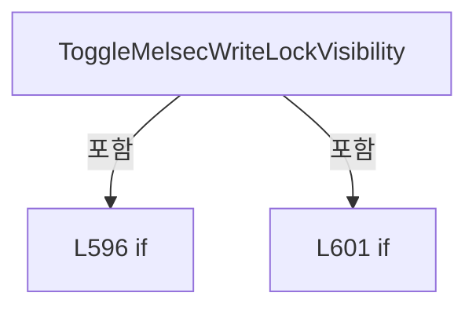

변경 전 점검: 입력/반환 타입, 위 호출자, 예외/취소 경로, 공유 상태와 저장·전송 소비자를 함께 확인합니다. 값의 단위나 물리 방향을 이름만으로 확정하지 않습니다.

### MethodDeclaration `HideAndLockMelsecWrite` · L613–616

[Drilling.UI/Menu/Menus/CMenuMonitor.cs:613–616](https://github.com/kjuws10-rgb/A3Drilling/blob/5aee8e58439c9b455cae7c9593c9be986c3e682e/Drilling.UI/Menu/Menus/CMenuMonitor.cs#L613-L616)

| 항목 | 실제 추출 값 |
| --- | --- |
| 서명 | void Drilling.UI.Menu.Menus.CMenuMonitor.HideAndLockMelsecWrite() |
| 접근/수식자 | Public / public |
| 반환/값 타입 | void |
| 소속 타입 | NamedType:Drilling.UI.Menu.Menus.CMenuMonitor |

정적 호출자로 확인된 위치:

| 호출 파일/행 | 호출 표현식 | 런타임 분기 가능 |
| --- | --- | --- |
| [Drilling.UI/Views/CMonitorView.xaml.cs:66–66](https://github.com/kjuws10-rgb/A3Drilling/blob/5aee8e58439c9b455cae7c9593c9be986c3e682e/Drilling.UI/Views/CMonitorView.xaml.cs#L66-L66) | .HideAndLockMelsecWrite | False |
| [Drilling.UI/Views/CMonitorView.xaml.cs:102–102](https://github.com/kjuws10-rgb/A3Drilling/blob/5aee8e58439c9b455cae7c9593c9be986c3e682e/Drilling.UI/Views/CMonitorView.xaml.cs#L102-L102) | .HideAndLockMelsecWrite | False |

호출하는 대상과 해석 범위:

| 원본 행 | 표현식 | 분석 상태 | 대상/소스 위치 |
| --- | --- | --- | --- |
| 615 | ResetMelsecWriteLock | resolved | void Drilling.UI.Menu.Menus.CMenuMonitor.ResetMelsecWriteLock() · Drilling.UI/Menu/Menus/CMenuMonitor.cs:2804 |

본문의 실제 연산·분기·예외·반환 순서(원문 위치 순):

| 원본 행 | 종류 | 주석 해설 |
| --- | --- | --- |
| 615 | call | 함수·델리게이트 또는 객체 생성자를 호출합니다: ResetMelsecWriteLock() |

변경 전 점검: 입력/반환 타입, 위 호출자, 예외/취소 경로, 공유 상태와 저장·전송 소비자를 함께 확인합니다. 값의 단위나 물리 방향을 이름만으로 확정하지 않습니다.

### PropertyDeclaration `LogViewer` · L618–618

[Drilling.UI/Menu/Menus/CMenuMonitor.cs:618–618](https://github.com/kjuws10-rgb/A3Drilling/blob/5aee8e58439c9b455cae7c9593c9be986c3e682e/Drilling.UI/Menu/Menus/CMenuMonitor.cs#L618-L618)

| 항목 | 실제 추출 값 |
| --- | --- |
| 서명 | Drilling.UI.Menu.Menus.CMonitorLogViewerPanel Drilling.UI.Menu.Menus.CMenuMonitor.LogViewer |
| 접근/수식자 | Public / public |
| 반환/값 타입 | Drilling.UI.Menu.Menus.CMonitorLogViewerPanel |
| 소속 타입 | NamedType:Drilling.UI.Menu.Menus.CMenuMonitor |

현재 부분 분석에서 직접 연결된 호출자는 없습니다. XAML/이벤트/인터페이스·델리게이트·외부 진입을 추가 확인해야 하며, 미사용으로 판정한 것이 아닙니다.

변경 전 점검: 입력/반환 타입, 위 호출자, 예외/취소 경로, 공유 상태와 저장·전송 소비자를 함께 확인합니다. 값의 단위나 물리 방향을 이름만으로 확정하지 않습니다.

### GetAccessorDeclaration `get_LogViewer` · L618–618

[Drilling.UI/Menu/Menus/CMenuMonitor.cs:618–618](https://github.com/kjuws10-rgb/A3Drilling/blob/5aee8e58439c9b455cae7c9593c9be986c3e682e/Drilling.UI/Menu/Menus/CMenuMonitor.cs#L618-L618)

| 항목 | 실제 추출 값 |
| --- | --- |
| 서명 | Drilling.UI.Menu.Menus.CMonitorLogViewerPanel Drilling.UI.Menu.Menus.CMenuMonitor.LogViewer.get |
| 접근/수식자 | Public / get |
| 반환/값 타입 | Drilling.UI.Menu.Menus.CMonitorLogViewerPanel |
| 소속 타입 | NamedType:Drilling.UI.Menu.Menus.CMenuMonitor |

현재 부분 분석에서 직접 연결된 호출자는 없습니다. XAML/이벤트/인터페이스·델리게이트·외부 진입을 추가 확인해야 하며, 미사용으로 판정한 것이 아닙니다.

변경 전 점검: 입력/반환 타입, 위 호출자, 예외/취소 경로, 공유 상태와 저장·전송 소비자를 함께 확인합니다. 값의 단위나 물리 방향을 이름만으로 확정하지 않습니다.

### PropertyDeclaration `IsLogViewer` · L619–619

[Drilling.UI/Menu/Menus/CMenuMonitor.cs:619–619](https://github.com/kjuws10-rgb/A3Drilling/blob/5aee8e58439c9b455cae7c9593c9be986c3e682e/Drilling.UI/Menu/Menus/CMenuMonitor.cs#L619-L619)

| 항목 | 실제 추출 값 |
| --- | --- |
| 서명 | bool Drilling.UI.Menu.Menus.CMenuMonitor.IsLogViewer |
| 접근/수식자 | Public / public |
| 반환/값 타입 | bool |
| 소속 타입 | NamedType:Drilling.UI.Menu.Menus.CMenuMonitor |

현재 부분 분석에서 직접 연결된 호출자는 없습니다. XAML/이벤트/인터페이스·델리게이트·외부 진입을 추가 확인해야 하며, 미사용으로 판정한 것이 아닙니다.

변경 전 점검: 입력/반환 타입, 위 호출자, 예외/취소 경로, 공유 상태와 저장·전송 소비자를 함께 확인합니다. 값의 단위나 물리 방향을 이름만으로 확정하지 않습니다.

### PropertyDeclaration `IsCoordinateViewer` · L621–627

[Drilling.UI/Menu/Menus/CMenuMonitor.cs:621–627](https://github.com/kjuws10-rgb/A3Drilling/blob/5aee8e58439c9b455cae7c9593c9be986c3e682e/Drilling.UI/Menu/Menus/CMenuMonitor.cs#L621-L627)

| 항목 | 실제 추출 값 |
| --- | --- |
| 서명 | bool Drilling.UI.Menu.Menus.CMenuMonitor.IsCoordinateViewer |
| 접근/수식자 | Public / public |
| 반환/값 타입 | bool |
| 소속 타입 | NamedType:Drilling.UI.Menu.Menus.CMenuMonitor |

현재 부분 분석에서 직접 연결된 호출자는 없습니다. XAML/이벤트/인터페이스·델리게이트·외부 진입을 추가 확인해야 하며, 미사용으로 판정한 것이 아닙니다.

변경 전 점검: 입력/반환 타입, 위 호출자, 예외/취소 경로, 공유 상태와 저장·전송 소비자를 함께 확인합니다. 값의 단위나 물리 방향을 이름만으로 확정하지 않습니다.

### GetAccessorDeclaration `get_IsCoordinateViewer` · L623–626

[Drilling.UI/Menu/Menus/CMenuMonitor.cs:623–626](https://github.com/kjuws10-rgb/A3Drilling/blob/5aee8e58439c9b455cae7c9593c9be986c3e682e/Drilling.UI/Menu/Menus/CMenuMonitor.cs#L623-L626)

| 항목 | 실제 추출 값 |
| --- | --- |
| 서명 | bool Drilling.UI.Menu.Menus.CMenuMonitor.IsCoordinateViewer.get |
| 접근/수식자 | Public / get |
| 반환/값 타입 | bool |
| 소속 타입 | NamedType:Drilling.UI.Menu.Menus.CMenuMonitor |

현재 부분 분석에서 직접 연결된 호출자는 없습니다. XAML/이벤트/인터페이스·델리게이트·외부 진입을 추가 확인해야 하며, 미사용으로 판정한 것이 아닙니다.

본문의 실제 연산·분기·예외·반환 순서(원문 위치 순):

| 원본 행 | 종류 | 주석 해설 |
| --- | --- | --- |
| 625 | return | 호출자에게 값 또는 제어를 반환합니다: return SelectedTab == "COORDINATE VIEWER"; |

변경 전 점검: 입력/반환 타입, 위 호출자, 예외/취소 경로, 공유 상태와 저장·전송 소비자를 함께 확인합니다. 값의 단위나 물리 방향을 이름만으로 확정하지 않습니다.

### PropertyDeclaration `IsControlDevice` · L629–635

[Drilling.UI/Menu/Menus/CMenuMonitor.cs:629–635](https://github.com/kjuws10-rgb/A3Drilling/blob/5aee8e58439c9b455cae7c9593c9be986c3e682e/Drilling.UI/Menu/Menus/CMenuMonitor.cs#L629-L635)

| 항목 | 실제 추출 값 |
| --- | --- |
| 서명 | bool Drilling.UI.Menu.Menus.CMenuMonitor.IsControlDevice |
| 접근/수식자 | Public / public |
| 반환/값 타입 | bool |
| 소속 타입 | NamedType:Drilling.UI.Menu.Menus.CMenuMonitor |

현재 부분 분석에서 직접 연결된 호출자는 없습니다. XAML/이벤트/인터페이스·델리게이트·외부 진입을 추가 확인해야 하며, 미사용으로 판정한 것이 아닙니다.

변경 전 점검: 입력/반환 타입, 위 호출자, 예외/취소 경로, 공유 상태와 저장·전송 소비자를 함께 확인합니다. 값의 단위나 물리 방향을 이름만으로 확정하지 않습니다.

### GetAccessorDeclaration `get_IsControlDevice` · L631–634

[Drilling.UI/Menu/Menus/CMenuMonitor.cs:631–634](https://github.com/kjuws10-rgb/A3Drilling/blob/5aee8e58439c9b455cae7c9593c9be986c3e682e/Drilling.UI/Menu/Menus/CMenuMonitor.cs#L631-L634)

| 항목 | 실제 추출 값 |
| --- | --- |
| 서명 | bool Drilling.UI.Menu.Menus.CMenuMonitor.IsControlDevice.get |
| 접근/수식자 | Public / get |
| 반환/값 타입 | bool |
| 소속 타입 | NamedType:Drilling.UI.Menu.Menus.CMenuMonitor |

현재 부분 분석에서 직접 연결된 호출자는 없습니다. XAML/이벤트/인터페이스·델리게이트·외부 진입을 추가 확인해야 하며, 미사용으로 판정한 것이 아닙니다.

본문의 실제 연산·분기·예외·반환 순서(원문 위치 순):

| 원본 행 | 종류 | 주석 해설 |
| --- | --- | --- |
| 633 | return | 호출자에게 값 또는 제어를 반환합니다: return false; |

변경 전 점검: 입력/반환 타입, 위 호출자, 예외/취소 경로, 공유 상태와 저장·전송 소비자를 함께 확인합니다. 값의 단위나 물리 방향을 이름만으로 확정하지 않습니다.

### PropertyDeclaration `IsGenericDevice` · L637–643

[Drilling.UI/Menu/Menus/CMenuMonitor.cs:637–643](https://github.com/kjuws10-rgb/A3Drilling/blob/5aee8e58439c9b455cae7c9593c9be986c3e682e/Drilling.UI/Menu/Menus/CMenuMonitor.cs#L637-L643)

| 항목 | 실제 추출 값 |
| --- | --- |
| 서명 | bool Drilling.UI.Menu.Menus.CMenuMonitor.IsGenericDevice |
| 접근/수식자 | Public / public |
| 반환/값 타입 | bool |
| 소속 타입 | NamedType:Drilling.UI.Menu.Menus.CMenuMonitor |

현재 부분 분석에서 직접 연결된 호출자는 없습니다. XAML/이벤트/인터페이스·델리게이트·외부 진입을 추가 확인해야 하며, 미사용으로 판정한 것이 아닙니다.

변경 전 점검: 입력/반환 타입, 위 호출자, 예외/취소 경로, 공유 상태와 저장·전송 소비자를 함께 확인합니다. 값의 단위나 물리 방향을 이름만으로 확정하지 않습니다.

### GetAccessorDeclaration `get_IsGenericDevice` · L639–642

[Drilling.UI/Menu/Menus/CMenuMonitor.cs:639–642](https://github.com/kjuws10-rgb/A3Drilling/blob/5aee8e58439c9b455cae7c9593c9be986c3e682e/Drilling.UI/Menu/Menus/CMenuMonitor.cs#L639-L642)

| 항목 | 실제 추출 값 |
| --- | --- |
| 서명 | bool Drilling.UI.Menu.Menus.CMenuMonitor.IsGenericDevice.get |
| 접근/수식자 | Public / get |
| 반환/값 타입 | bool |
| 소속 타입 | NamedType:Drilling.UI.Menu.Menus.CMenuMonitor |

현재 부분 분석에서 직접 연결된 호출자는 없습니다. XAML/이벤트/인터페이스·델리게이트·외부 진입을 추가 확인해야 하며, 미사용으로 판정한 것이 아닙니다.

본문의 실제 연산·분기·예외·반환 순서(원문 위치 순):

| 원본 행 | 종류 | 주석 해설 |
| --- | --- | --- |
| 641 | return | 호출자에게 값 또는 제어를 반환합니다: return !IsMotor && !IsLaser && !IsAttenuator && !IsBet && !IsPowerMeter && !IsPicoMotor && !IsProduct && !IsMelsec && !IsCoordinateViewer && !IsLogViewer; |

변경 전 점검: 입력/반환 타입, 위 호출자, 예외/취소 경로, 공유 상태와 저장·전송 소비자를 함께 확인합니다. 값의 단위나 물리 방향을 이름만으로 확정하지 않습니다.

### MethodDeclaration `SetPollingActive` · L645–648

[Drilling.UI/Menu/Menus/CMenuMonitor.cs:645–648](https://github.com/kjuws10-rgb/A3Drilling/blob/5aee8e58439c9b455cae7c9593c9be986c3e682e/Drilling.UI/Menu/Menus/CMenuMonitor.cs#L645-L648)

| 항목 | 실제 추출 값 |
| --- | --- |
| 서명 | void Drilling.UI.Menu.Menus.CMenuMonitor.SetPollingActive(bool) |
| 접근/수식자 | Public / public |
| 반환/값 타입 | void |
| 소속 타입 | NamedType:Drilling.UI.Menu.Menus.CMenuMonitor |

입력 계약:

| 이름 | 타입 | 전달 | 선택/기본값 |
| --- | --- | --- | --- |
| active | bool | None | False /  |

정적 호출자로 확인된 위치:

| 호출 파일/행 | 호출 표현식 | 런타임 분기 가능 |
| --- | --- | --- |
| [Drilling.UI/CRootView.cs:323–323](https://github.com/kjuws10-rgb/A3Drilling/blob/5aee8e58439c9b455cae7c9593c9be986c3e682e/Drilling.UI/CRootView.cs#L323-L323) | monitor.SetPollingActive | False |

호출하는 대상과 해석 범위:

| 원본 행 | 표현식 | 분석 상태 | 대상/소스 위치 |
| --- | --- | --- | --- |
| 647 | _statusPollingService.SetActive | resolved | void Drilling.UI.Menu.Menus.CMonitorStatusPollingService.SetActive(bool) · Drilling.UI/Menu/Menus/CMonitorStatusPollingService.cs:46 |

본문의 실제 연산·분기·예외·반환 순서(원문 위치 순):

| 원본 행 | 종류 | 주석 해설 |
| --- | --- | --- |
| 647 | call | 함수·델리게이트 또는 객체 생성자를 호출합니다: _statusPollingService.SetActive(active && !IsLogViewer) |

변경 전 점검: 입력/반환 타입, 위 호출자, 예외/취소 경로, 공유 상태와 저장·전송 소비자를 함께 확인합니다. 값의 단위나 물리 방향을 이름만으로 확정하지 않습니다.

### MethodDeclaration `Build` · L650–795

[Drilling.UI/Menu/Menus/CMenuMonitor.cs:650–795](https://github.com/kjuws10-rgb/A3Drilling/blob/5aee8e58439c9b455cae7c9593c9be986c3e682e/Drilling.UI/Menu/Menus/CMenuMonitor.cs#L650-L795)

| 항목 | 실제 추출 값 |
| --- | --- |
| 서명 | System.Threading.Tasks.Task<Drilling.UI.Menu.Menus.CScreenViewModel> Drilling.UI.Menu.Menus.CMenuMonitor.Build(System.Threading.CancellationToken) |
| 접근/수식자 | Public / public, override, async |
| 반환/값 타입 | System.Threading.Tasks.Task<Drilling.UI.Menu.Menus.CScreenViewModel> |
| 소속 타입 | NamedType:Drilling.UI.Menu.Menus.CMenuMonitor |

입력 계약:

| 이름 | 타입 | 전달 | 선택/기본값 |
| --- | --- | --- | --- |
| cancellationToken | System.Threading.CancellationToken | None | True / null |

현재 부분 분석에서 직접 연결된 호출자는 없습니다. XAML/이벤트/인터페이스·델리게이트·외부 진입을 추가 확인해야 하며, 미사용으로 판정한 것이 아닙니다.

호출하는 대상과 해석 범위:

| 원본 행 | 표현식 | 분석 상태 | 대상/소스 위치 |
| --- | --- | --- | --- |
| 652 | NormalizeMonitorScreenTab | resolved | string Drilling.UI.Menu.Menus.CMenuMonitor.NormalizeMonitorScreenTab(string?) · Drilling.UI/Menu/Menus/CMenuMonitor.cs:1873 |
| 652 | _selectedTabAccessor | resolved · 동적 구현 선택 가능 | string System.Func<string>.Invoke() |
| 654 | BuildLogViewerScreen | resolved | Drilling.UI.Menu.Menus.CScreenViewModel Drilling.UI.Menu.Menus.CMenuMonitor.BuildLogViewerScreen() · Drilling.UI/Menu/Menus/CMenuMonitor.cs:2550 |
| 655 | Math.Clamp | resolved | int System.Math.Clamp(int, int, int) |
| 656 | Math.Clamp | resolved | int System.Math.Clamp(int, int, int) |
| 657 | Math.Clamp | resolved | int System.Math.Clamp(int, int, int) |
| 658 | LoadEnabledHeadDeviceNumbers | resolved | System.Collections.Generic.IReadOnlyList<int> Drilling.UI.Menu.Menus.CMenuMonitor.LoadEnabledHeadDeviceNumbers(System.Threading.CancellationToken) · Drilling.UI/Menu/Menus/CMenuMonitor.cs:2293 |
| 659 | NormalizeHeadDeviceSelections | resolved | void Drilling.UI.Menu.Menus.CMenuMonitor.NormalizeHeadDeviceSelections() · Drilling.UI/Menu/Menus/CMenuMonitor.cs:2313 |
| 663 | SavePowerMeterSettingValues | resolved | void Drilling.UI.Menu.Menus.CMenuMonitor.SavePowerMeterSettingValues() · Drilling.UI/Menu/Menus/CMenuMonitor.cs:5325 |
| 664 | NormalizePowerMeterSelection | resolved | void Drilling.UI.Menu.Menus.CMenuMonitor.NormalizePowerMeterSelection() · Drilling.UI/Menu/Menus/CMenuMonitor.cs:5864 |
| 669 | BuildCoordinateViewerScreen | resolved | System.Threading.Tasks.Task<Drilling.UI.Menu.Menus.CScreenViewModel> Drilling.UI.Menu.Menus.CMenuMonitor.BuildCoordinateViewerScreen(System.Threading.CancellationToken) · Drilling.UI/Menu/Menus/CMenuMonitor.cs:2590 |
| 672 | UpdatePollingContext | resolved | void Drilling.UI.Menu.Menus.CMenuMonitor.UpdatePollingContext(string) · Drilling.UI/Menu/Menus/CMenuMonitor.cs:1042 |
| 673 | _statusPollingService.Start | resolved | void Drilling.UI.Menu.Menus.CMonitorStatusPollingService.Start() · Drilling.UI/Menu/Menus/CMonitorStatusPollingService.cs:32 |
| 674 | _statusPollingService.GetSnapshot | resolved | Drilling.UI.Menu.Menus.ST_MONITOR_STATUS_SNAPSHOT Drilling.UI.Menu.Menus.CMonitorStatusPollingService.GetSnapshot() · Drilling.UI/Menu/Menus/CMonitorStatusPollingService.cs:54 |
| 677 | RefreshPowerMeterSnapshotFromCache | resolved | Drilling.UI.Menu.Menus.ST_MONITOR_STATUS_SNAPSHOT Drilling.UI.Menu.Menus.CMenuMonitor.RefreshPowerMeterSnapshotFromCache(Drilling.UI.Menu.Menus.ST_MONITOR_STATUS_SNAPSHOT, System.Threading.CancellationToken) · Drilling.UI/Menu/Menus/CMenuMonitor.cs:1031 |
| 682 | _interfaceManager.LoadBETData | resolved | System.Threading.Tasks.Task<System.Collections.Generic.IReadOnlyList<Drilling.Common.Interface.ST_BET_TABLE_DATA>> Drilling.Common.Interface.CInterfaceManager.LoadBETData(System.Threading.CancellationToken) · Drilling.Common/Interface/CInterfaceManager.cs:1385 |
| 686 | Math.Clamp | resolved | int System.Math.Clamp(int, int, int) |
| 692 | UpdatePowerMeterGraph | resolved | void Drilling.UI.Menu.Menus.CMenuMonitor.UpdatePowerMeterGraph() · Drilling.UI/Menu/Menus/CMenuMonitor.cs:5631 |
| 695 | LoadProductDisplay | resolved | System.Threading.Tasks.Task<(Drilling.Common.Product.ST_PRODUCT_DATA? Product, System.Collections.Generic.IReadOnlyList<Drilling.Common.Product.ST_PRODUCT_HISTORY> History, string Error)> Drilling.UI.Menu.Menus.CMenuMonitor.LoadProductDisplay(System.Threading.CancellationToken) · Drilling.UI/Menu/Menus/CMenuMonitor.cs:3902 |
| 696 | LoadProductRecipeDefinition | resolved | System.Threading.Tasks.Task<Drilling.Common.Managers.ST_RECIPE_DEFINITION?> Drilling.UI.Menu.Menus.CMenuMonitor.LoadProductRecipeDefinition(string, System.Threading.CancellationToken) · Drilling.UI/Menu/Menus/CMenuMonitor.cs:3985 |
| 702 | MonitorTabs.Select(BuildMonitor).ToArray | resolved | Drilling.UI.Menu.Menus.ST_MONITOR_TAB[] System.Collections.Generic.IEnumerable<Drilling.UI.Menu.Menus.ST_MONITOR_TAB>.ToArray<Drilling.UI.Menu.Menus.ST_MONITOR_TAB>() |
| 702 | MonitorTabs.Select | resolved | System.Collections.Generic.IEnumerable<Drilling.UI.Menu.Menus.ST_MONITOR_TAB> System.Collections.Generic.IEnumerable<string>.Select<string, Drilling.UI.Menu.Menus.ST_MONITOR_TAB>(System.Func<string, Drilling.UI.Menu.Menus.ST_MONITOR_TAB>) |
| 703 | CreateMelsecGroups | resolved | System.Collections.Generic.IReadOnlyList<Drilling.UI.Menu.Menus.ST_MONITOR_MELSEC_GROUP> Drilling.UI.Menu.Menus.CMenuMonitor.CreateMelsecGroups(string) · Drilling.UI/Menu/Menus/CMenuMonitor.cs:3764 |
| 704 | SaveMelsecWriteValues | resolved | void Drilling.UI.Menu.Menus.CMenuMonitor.SaveMelsecWriteValues() · Drilling.UI/Menu/Menus/CMenuMonitor.cs:3889 |
| 705 | CreateMelsecRows | resolved | System.Collections.Generic.IReadOnlyList<Drilling.UI.Menu.Menus.ST_MONITOR_MELSEC_ROW> Drilling.UI.Menu.Menus.CMenuMonitor.CreateMelsecRows(string, System.Collections.Generic.IReadOnlyDictionary<string, Drilling.UI.Menu.Menus.ST_MONITOR_MELSEC_VALUE>) · Drilling.UI/Menu/Menus/CMenuMonitor.cs:3803 |
| 709 | SaveOperationFieldValues | resolved | void Drilling.UI.Menu.Menus.CMenuMonitor.SaveOperationFieldValues(string) · Drilling.UI/Menu/Menus/CMenuMonitor.cs:2259 |
| 712 | CreateOperationFields | resolved | System.Collections.Generic.IReadOnlyList<Drilling.UI.Menu.Menus.ST_MONITOR_PARAMETER_ROW> Drilling.UI.Menu.Menus.CMenuMonitor.CreateOperationFields(string, Drilling.Common.Interface.ST_PICO_MOTOR_STATUS) · Drilling.UI/Menu/Menus/CMenuMonitor.cs:2196 |
| 715 | CreateAxisRows | resolved | System.Collections.Generic.IReadOnlyList<Drilling.UI.Menu.Menus.ST_MONITOR_AXIS_ROW> Drilling.UI.Menu.Menus.CMenuMonitor.CreateAxisRows(Drilling.Common.Managers.ST_DEVICE_STATUS, string) · Drilling.UI/Menu/Menus/CMenuMonitor.cs:5725 |
| 721 | axisRows.Any | resolved | bool System.Collections.Generic.IEnumerable<Drilling.UI.Menu.Menus.ST_MONITOR_AXIS_ROW>.Any<Drilling.UI.Menu.Menus.ST_MONITOR_AXIS_ROW>(System.Func<Drilling.UI.Menu.Menus.ST_MONITOR_AXIS_ROW, bool>) |
| 724 | CreateAxisRows | resolved | System.Collections.Generic.IReadOnlyList<Drilling.UI.Menu.Menus.ST_MONITOR_AXIS_ROW> Drilling.UI.Menu.Menus.CMenuMonitor.CreateAxisRows(Drilling.Common.Managers.ST_DEVICE_STATUS, string) · Drilling.UI/Menu/Menus/CMenuMonitor.cs:5725 |
| 729 | UpdateMultiMoveAxisRows | resolved | void Drilling.UI.Menu.Menus.CMenuMonitor.UpdateMultiMoveAxisRows(Drilling.Common.Managers.ST_DEVICE_STATUS) · Drilling.UI/Menu/Menus/CMenuMonitor.cs:5748 |
| 736 | CreateHeadSelectRows | resolved | System.Collections.Generic.IReadOnlyList<Drilling.UI.Menu.Menus.ST_MONITOR_HEAD_SELECT_ROW> Drilling.UI.Menu.Menus.CMenuMonitor.CreateHeadSelectRows(string, int, Drilling.Common.Interface.EN_EQP_MODULE?, string) · Drilling.UI/Menu/Menus/CMenuMonitor.cs:2401 |
| 736 | GetSelectedHeadNumber | resolved | int Drilling.UI.Menu.Menus.CMenuMonitor.GetSelectedHeadNumber(string) · Drilling.UI/Menu/Menus/CMenuMonitor.cs:2272 |
| 736 | GetHeadDeviceModule | resolved | Drilling.Common.Interface.EN_EQP_MODULE? Drilling.UI.Menu.Menus.CMenuMonitor.GetHeadDeviceModule(string) · Drilling.UI/Menu/Menus/CMenuMonitor.cs:2366 |
| 736 | GetHeadDeviceNickPrefix | resolved | string Drilling.UI.Menu.Menus.CMenuMonitor.GetHeadDeviceNickPrefix(string) · Drilling.UI/Menu/Menus/CMenuMonitor.cs:2387 |
| 737 | CreateLaserControlRows | resolved | System.Collections.Generic.IReadOnlyList<Drilling.UI.Menu.Menus.ST_MONITOR_LASER_CONTROL_ROW> Drilling.UI.Menu.Menus.CMenuMonitor.CreateLaserControlRows(string, Drilling.Common.Interface.ST_LASER_STATUS, Drilling.Common.Interface.ST_TALON_STATUS, System.Collections.Generic.IReadOnlyList<Drilling.UI.Menu.Menus.ST_MONITOR_PARAMETER_ROW>) · Drilling.UI/Menu/Menus/CMenuMonitor.cs:5948 |
| 738 | CreateAttenuatorStatusItems | resolved | System.Collections.Generic.IReadOnlyList<Drilling.UI.Menu.Menus.ST_MONITOR_SUMMARY_ITEM> Drilling.UI.Menu.Menus.CMenuMonitor.CreateAttenuatorStatusItems(string, Drilling.Common.Managers.ST_DEVICE_STATUS) · Drilling.UI/Menu/Menus/CMenuMonitor.cs:6041 |
| 739 | CreateAttenuatorSettingItems | resolved | System.Collections.Generic.IReadOnlyList<Drilling.UI.Menu.Menus.ST_MONITOR_SUMMARY_ITEM> Drilling.UI.Menu.Menus.CMenuMonitor.CreateAttenuatorSettingItems(string, Drilling.Common.Managers.ST_DEVICE_STATUS) · Drilling.UI/Menu/Menus/CMenuMonitor.cs:6059 |
| 740 | ApplyProductDetails | resolved | void Drilling.UI.Menu.Menus.CMenuMonitor.ApplyProductDetails(Drilling.Common.Product.ST_PRODUCT_DATA?, string, Drilling.Common.Managers.ST_RECIPE_DEFINITION?) · Drilling.UI/Menu/Menus/CMenuMonitor.cs:4037 |
| 741 | Apply | resolved | void Drilling.UI.Menu.Menus.CMenuMonitor.Apply(System.Collections.Generic.IReadOnlyList<Drilling.UI.Menu.Menus.ST_SCREEN_SECTION>, string, string, string, string, string, string, string, System.Collections.Generic.IReadOnlyList<Drilling.UI.Menu.Menus.ST_MONITOR_TAB>, System.Collections.Generic.IReadOnlyList<Drilling.UI.Menu.Menus.ST_MONITOR_AXIS_ROW>, System.Collections.Generic.IReadOnlyList<Drilling.UI.Menu.Menus.ST_MONITOR_STATUS_ROW>, System.Collections.Generic.IReadOnlyList<Drilling.UI.Menu.Menus.ST_MONITOR_OPERATION_BUTTON>, System.Collections.Generic.IReadOnlyList<Drilling.UI.Menu.Menus.ST_MONITOR_PARAMETER_ROW>, System.Collections.Generic.IReadOnlyList<Drilling.UI.Menu.Menus.ST_MONITOR_PARAMETER_ROW>, System.Collections.Generic.IReadOnlyList<Drilling.UI.Menu.Menus.ST_MONITOR_BET_TABLE_ROW>, System.Collections.Generic.IReadOnlyList<Drilling.UI.Menu.Menus.ST_MONITOR_TREND_POINT>, System.Collections.Generic.IReadOnlyList<Drilling.UI.Menu.Menus.ST_MONITOR_SUMMARY_ITEM>, System.Collections.Generic.IReadOnlyList<Drilling.UI.Menu.Menus.ST_MONITOR_POSITION_ROW>, System.Collections.Generic.IReadOnlyList<Drilling.UI.Menu.Menus.ST_MONITOR_PRODUCT_ITEM>, System.Collections.Generic.IReadOnlyList<Drilling.UI.Menu.Menus.ST_MONITOR_PRODUCT_HISTORY_ROW>, System.Collections.Generic.IReadOnlyList<Drilling.UI.Menu.Menus.ST_PWM_SETTING_ROW>, System.Collections.Generic.IReadOnlyList<Drilling.UI.Menu.Menus.ST_PWM_DEVICE_ROW>, System.Collections.Generic.IReadOnlyList<Drilling.UI.Menu.Menus.ST_MONITOR_OPERATION_BUTTON>, System.Collections.Generic.IReadOnlyList<Drilling.UI.Menu.Menus.ST_POWER_METER_TUNE_ROW>, PointCollection, double, string, string, string) · Drilling.UI/Menu/Menus/CMenuMonitor.cs:1576 |
| 742 | CreateTabSections | resolved | System.Collections.Generic.IReadOnlyList<Drilling.UI.Menu.Menus.ST_SCREEN_SECTION> Drilling.UI.Menu.Menus.CMenuMonitor.CreateTabSections(System.Collections.Generic.IReadOnlyList<Drilling.UI.Menu.Menus.ST_MONITOR_TAB>) · Drilling.UI/Menu/Menus/CMenuMonitor.cs:1863 |
| 744 | GetMonitorTabDisplayName | resolved | string Drilling.UI.Menu.Menus.CMenuMonitor.GetMonitorTabDisplayName(string) · Drilling.UI/Menu/Menus/CMenuMonitor.cs:2431 |
| 745 | GetSubtitle | resolved | string Drilling.UI.Menu.Menus.CMenuMonitor.GetSubtitle(string) · Drilling.UI/Menu/Menus/CMenuMonitor.cs:1895 |
| 746 | GetStatusPanelTitle | resolved | string Drilling.UI.Menu.Menus.CMenuMonitor.GetStatusPanelTitle(string) · Drilling.UI/Menu/Menus/CMenuMonitor.cs:1912 |
| 747 | GetOperationPanelTitle | resolved | string Drilling.UI.Menu.Menus.CMenuMonitor.GetOperationPanelTitle(string) · Drilling.UI/Menu/Menus/CMenuMonitor.cs:1928 |
| 748 | GetParameterPanelTitle | resolved | string Drilling.UI.Menu.Menus.CMenuMonitor.GetParameterPanelTitle(string) · Drilling.UI/Menu/Menus/CMenuMonitor.cs:1943 |
| 749 | GetTrendPanelTitle | resolved | string Drilling.UI.Menu.Menus.CMenuMonitor.GetTrendPanelTitle(string) · Drilling.UI/Menu/Menus/CMenuMonitor.cs:1959 |
| 752 | CreateStatusRows | resolved | System.Collections.Generic.IReadOnlyList<Drilling.UI.Menu.Menus.ST_MONITOR_STATUS_ROW> Drilling.UI.Menu.Menus.CMenuMonitor.CreateStatusRows(string, Drilling.Common.Managers.ST_DEVICE_STATUS, System.Collections.Generic.IReadOnlyList<Drilling.Common.Interface.ST_DEVICE_COMM_STATUS>, string?, Drilling.Common.Interface.ST_TALON_STATUS?) · Drilling.UI/Menu/Menus/CMenuMonitor.cs:1973 |
| 752 | GetSelectedHeadConnectionText | resolved | string? Drilling.UI.Menu.Menus.CMenuMonitor.GetSelectedHeadConnectionText(string) · Drilling.UI/Menu/Menus/CMenuMonitor.cs:2343 |
| 753 | CreateOperationButtons | resolved | System.Collections.Generic.IReadOnlyList<Drilling.UI.Menu.Menus.ST_MONITOR_OPERATION_BUTTON> Drilling.UI.Menu.Menus.CMenuMonitor.CreateOperationButtons(string, Drilling.Common.Interface.ST_LASER_STATUS, Drilling.Common.Interface.ST_TALON_STATUS) · Drilling.UI/Menu/Menus/CMenuMonitor.cs:2110 |
| 755 | CreateParameterRows | resolved | System.Collections.Generic.IReadOnlyList<Drilling.UI.Menu.Menus.ST_MONITOR_PARAMETER_ROW> Drilling.UI.Menu.Menus.CMenuMonitor.CreateParameterRows(string) · Drilling.UI/Menu/Menus/CMenuMonitor.cs:2131 |
| 756 | CreateBetTableRows | resolved | System.Collections.Generic.IReadOnlyList<Drilling.UI.Menu.Menus.ST_MONITOR_BET_TABLE_ROW> Drilling.UI.Menu.Menus.CMenuMonitor.CreateBetTableRows(string, System.Collections.Generic.IReadOnlyList<Drilling.Common.Interface.ST_BET_TABLE_DATA>, Drilling.Common.Managers.ST_DEVICE_STATUS) · Drilling.UI/Menu/Menus/CMenuMonitor.cs:5988 |
| 757 | CreateTrendPoints | resolved | System.Collections.Generic.IReadOnlyList<Drilling.UI.Menu.Menus.ST_MONITOR_TREND_POINT> Drilling.UI.Menu.Menus.CMenuMonitor.CreateTrendPoints(string) · Drilling.UI/Menu/Menus/CMenuMonitor.cs:2444 |
| 758 | CreateSummaryItems | resolved | System.Collections.Generic.IReadOnlyList<Drilling.UI.Menu.Menus.ST_MONITOR_SUMMARY_ITEM> Drilling.UI.Menu.Menus.CMenuMonitor.CreateSummaryItems(string, Drilling.Common.Managers.ST_DEVICE_STATUS) · Drilling.UI/Menu/Menus/CMenuMonitor.cs:2453 |
| 759 | CreatePositionRows | resolved | System.Collections.Generic.IReadOnlyList<Drilling.UI.Menu.Menus.ST_MONITOR_POSITION_ROW> Drilling.UI.Menu.Menus.CMenuMonitor.CreatePositionRows(string, Drilling.Common.Managers.ST_DEVICE_STATUS) · Drilling.UI/Menu/Menus/CMenuMonitor.cs:6076 |
| 760 | CreateProductItems | resolved | System.Collections.Generic.IReadOnlyList<Drilling.UI.Menu.Menus.ST_MONITOR_PRODUCT_ITEM> Drilling.UI.Menu.Menus.CMenuMonitor.CreateProductItems(Drilling.Common.Product.ST_PRODUCT_DATA?, string) · Drilling.UI/Menu/Menus/CMenuMonitor.cs:4012 |
| 761 | CreateProductHistoryRows | resolved | System.Collections.Generic.IReadOnlyList<Drilling.UI.Menu.Menus.ST_MONITOR_PRODUCT_HISTORY_ROW> Drilling.UI.Menu.Menus.CMenuMonitor.CreateProductHistoryRows(System.Collections.Generic.IReadOnlyList<Drilling.Common.Product.ST_PRODUCT_HISTORY>) · Drilling.UI/Menu/Menus/CMenuMonitor.cs:4199 |
| 762 | CreatePwmSettingRows | resolved | System.Collections.Generic.IReadOnlyList<Drilling.UI.Menu.Menus.ST_PWM_SETTING_ROW> Drilling.UI.Menu.Menus.CMenuMonitor.CreatePwmSettingRows(string) · Drilling.UI/Menu/Menus/CMenuMonitor.cs:6110 |
| 763 | CreatePwmDeviceRows | resolved | System.Collections.Generic.IReadOnlyList<Drilling.UI.Menu.Menus.ST_PWM_DEVICE_ROW> Drilling.UI.Menu.Menus.CMenuMonitor.CreatePwmDeviceRows(string, Drilling.Common.Managers.ST_DEVICE_STATUS) · Drilling.UI/Menu/Menus/CMenuMonitor.cs:6133 |
| 764 | CreatePwmRunButtons | resolved | System.Collections.Generic.IReadOnlyList<Drilling.UI.Menu.Menus.ST_MONITOR_OPERATION_BUTTON> Drilling.UI.Menu.Menus.CMenuMonitor.CreatePwmRunButtons(string) · Drilling.UI/Menu/Menus/CMenuMonitor.cs:6152 |
| 773 | SetMelsecRows | resolved | void Drilling.UI.Menu.Menus.CMenuMonitor.SetMelsecRows(System.Collections.Generic.IReadOnlyList<Drilling.UI.Menu.Menus.ST_MONITOR_MELSEC_ROW>) · Drilling.UI/Menu/Menus/CMenuMonitor.cs:3855 |
| 774 | ApplyCoordinateViewerData | resolved | void Drilling.UI.Menu.Menus.CMenuMonitor.ApplyCoordinateViewerData(Drilling.UI.Menu.Menus.ST_MONITOR_COORDINATE_VIEWER_DATA) · Drilling.UI/Menu/Menus/CMenuMonitor.cs:3293 |
| 777 | CreatePicoMotorStatusRows | resolved | System.Collections.Generic.IReadOnlyList<Drilling.UI.Menu.Menus.ST_MONITOR_STATUS_ROW> Drilling.UI.Menu.Menus.CMenuMonitor.CreatePicoMotorStatusRows(Drilling.Common.Interface.ST_PICO_MOTOR_STATUS) · Drilling.UI/Menu/Menus/CMenuMonitor.cs:5814 |
| 778 | CreatePicoMotorOperationButtons | resolved | System.Collections.Generic.IReadOnlyList<Drilling.UI.Menu.Menus.ST_MONITOR_OPERATION_BUTTON> Drilling.UI.Menu.Menus.CMenuMonitor.CreatePicoMotorOperationButtons() · Drilling.UI/Menu/Menus/CMenuMonitor.cs:5793 |
| 779 | CreatePicoErrorRows | resolved | System.Collections.Generic.IReadOnlyList<Drilling.UI.Menu.Menus.ST_MONITOR_PARAMETER_ROW> Drilling.UI.Menu.Menus.CMenuMonitor.CreatePicoErrorRows() · Drilling.UI/Menu/Menus/CMenuMonitor.cs:5830 |
| 780 | CreatePicoMotorPositionRows | resolved | System.Collections.Generic.IReadOnlyList<Drilling.UI.Menu.Menus.ST_MONITOR_POSITION_ROW> Drilling.UI.Menu.Menus.CMenuMonitor.CreatePicoMotorPositionRows(Drilling.Common.Interface.ST_PICO_MOTOR_STATUS) · Drilling.UI/Menu/Menus/CMenuMonitor.cs:5854 |
| 783 | CreateLiveRefreshHash | resolved | int Drilling.UI.Menu.Menus.CMenuMonitor.CreateLiveRefreshHash(string, Drilling.UI.Menu.Menus.ST_MONITOR_STATUS_SNAPSHOT) · Drilling.UI/Menu/Menus/CMenuMonitor.cs:958 |
| 794 | new CScreenViewModel | resolved | Drilling.UI.Menu.Menus.CScreenViewModel.CScreenViewModel(Drilling.UI.Menu.Menus.EN_MENU, string, string, System.Collections.Generic.IReadOnlyList<Drilling.UI.Menu.Menus.ST_DISPLAY_ITEM>, System.Collections.Generic.IReadOnlyList<Drilling.UI.Menu.Menus.ST_SCREEN_SECTION>, bool, Drilling.UI.Menu.Menus.CMenuMain?, Drilling.UI.Menu.Menus.CMenuManual?, Drilling.UI.Menu.Menus.CMenuRecipe?, Drilling.UI.Menu.Menus.CMenuSetting?, Drilling.UI.Menu.Menus.CMenuAlarm?, Drilling.UI.Menu.Menus.CMenuMonitor?, Drilling.UI.Menu.Menus.CMenuReview?, Drilling.UI.Menu.Menus.CMenuCorrection?, Drilling.UI.Menu.Menus.CMenuPm?) · Drilling.UI/Menu/Menus/CMenuBase.cs:411 |
| 794 | new | resolved | Drilling.UI.Menu.Menus.ST_DISPLAY_ITEM.ST_DISPLAY_ITEM(string, string, string) · Drilling.UI/Menu/Menus/CMenuBase.cs:43 |
| 794 | new | resolved | Drilling.UI.Menu.Menus.ST_SCREEN_SECTION.ST_SCREEN_SECTION(string, System.Collections.Generic.IReadOnlyList<Drilling.UI.Menu.Menus.ST_DISPLAY_ITEM>) · Drilling.UI/Menu/Menus/CMenuBase.cs:410 |
| 794 | AxisRows.Select(BuildDisplay).ToArray | resolved | Drilling.UI.Menu.Menus.ST_DISPLAY_ITEM[] System.Collections.Generic.IEnumerable<Drilling.UI.Menu.Menus.ST_DISPLAY_ITEM>.ToArray<Drilling.UI.Menu.Menus.ST_DISPLAY_ITEM>() |
| 794 | AxisRows.Select | resolved | System.Collections.Generic.IEnumerable<Drilling.UI.Menu.Menus.ST_DISPLAY_ITEM> System.Collections.Generic.IEnumerable<Drilling.UI.Menu.Menus.ST_MONITOR_AXIS_ROW>.Select<Drilling.UI.Menu.Menus.ST_MONITOR_AXIS_ROW, Drilling.UI.Menu.Menus.ST_DISPLAY_ITEM>(System.Func<Drilling.UI.Menu.Menus.ST_MONITOR_AXIS_ROW, Drilling.UI.Menu.Menus.ST_DISPLAY_ITEM>) |
| 794 | new | resolved | Drilling.UI.Menu.Menus.ST_SCREEN_SECTION.ST_SCREEN_SECTION(string, System.Collections.Generic.IReadOnlyList<Drilling.UI.Menu.Menus.ST_DISPLAY_ITEM>) · Drilling.UI/Menu/Menus/CMenuBase.cs:410 |
| 794 | StatusRows.Select(BuildDisplay2).ToArray | resolved | Drilling.UI.Menu.Menus.ST_DISPLAY_ITEM[] System.Collections.Generic.IEnumerable<Drilling.UI.Menu.Menus.ST_DISPLAY_ITEM>.ToArray<Drilling.UI.Menu.Menus.ST_DISPLAY_ITEM>() |
| 794 | StatusRows.Select | resolved | System.Collections.Generic.IEnumerable<Drilling.UI.Menu.Menus.ST_DISPLAY_ITEM> System.Collections.Generic.IEnumerable<Drilling.UI.Menu.Menus.ST_MONITOR_STATUS_ROW>.Select<Drilling.UI.Menu.Menus.ST_MONITOR_STATUS_ROW, Drilling.UI.Menu.Menus.ST_DISPLAY_ITEM>(System.Func<Drilling.UI.Menu.Menus.ST_MONITOR_STATUS_ROW, Drilling.UI.Menu.Menus.ST_DISPLAY_ITEM>) |

본문의 실제 연산·분기·예외·반환 순서(원문 위치 순):

| 원본 행 | 종류 | 주석 해설 |
| --- | --- | --- |
| 652 | call | 함수·델리게이트 또는 객체 생성자를 호출합니다: NormalizeMonitorScreenTab(_selectedTabAccessor()) |
| 652 | call | 함수·델리게이트 또는 객체 생성자를 호출합니다: _selectedTabAccessor() |
| 652 | local-declaration | 지역 변수를 선언합니다: var selectedTab = NormalizeMonitorScreenTab(_selectedTabAccessor()); |
| 652 | variable-initializer | 변수의 초기값을 지정합니다: selectedTab = NormalizeMonitorScreenTab(_selectedTabAccessor()) |
| 653 | if | 조건에 따라 분기합니다: if (selectedTab == "LOG VIEWER") |
| 654 | call | 함수·델리게이트 또는 객체 생성자를 호출합니다: BuildLogViewerScreen() |
| 654 | return | 호출자에게 값 또는 제어를 반환합니다: return BuildLogViewerScreen(); |
| 655 | assignment | 값을 대상에 대입합니다: _selectedLaserNumber = Math.Clamp(_selectedLaserNumber, 0, LaserHeadCount - 1) |
| 655 | call | 함수·델리게이트 또는 객체 생성자를 호출합니다: Math.Clamp(_selectedLaserNumber, 0, LaserHeadCount - 1) |
| 656 | assignment | 값을 대상에 대입합니다: _selectedAttenuatorNumber = Math.Clamp(_selectedAttenuatorNumber, 0, LaserHeadCount - 1) |
| 656 | call | 함수·델리게이트 또는 객체 생성자를 호출합니다: Math.Clamp(_selectedAttenuatorNumber, 0, LaserHeadCount - 1) |
| 657 | assignment | 값을 대상에 대입합니다: _selectedBetNumber = Math.Clamp(_selectedBetNumber, 0, LaserHeadCount - 1) |
| 657 | call | 함수·델리게이트 또는 객체 생성자를 호출합니다: Math.Clamp(_selectedBetNumber, 0, LaserHeadCount - 1) |
| 658 | assignment | 값을 대상에 대입합니다: _enabledHeadDeviceNumbers = LoadEnabledHeadDeviceNumbers(cancellationToken) |
| 658 | call | 함수·델리게이트 또는 객체 생성자를 호출합니다: LoadEnabledHeadDeviceNumbers(cancellationToken) |
| 659 | call | 함수·델리게이트 또는 객체 생성자를 호출합니다: NormalizeHeadDeviceSelections() |
| 660 | if | 조건에 따라 분기합니다: if (selectedTab is "LASER" or "POWER METER") |
| 662 | if | 조건에 따라 분기합니다: if (PwmSettingRows.Count > 0) |
| 663 | call | 함수·델리게이트 또는 객체 생성자를 호출합니다: SavePowerMeterSettingValues() |
| 664 | call | 함수·델리게이트 또는 객체 생성자를 호출합니다: NormalizePowerMeterSelection() |
| 667 | if | 조건에 따라 분기합니다: if (selectedTab == "COORDINATE VIEWER") |
| 669 | await | 비동기 완료를 기다립니다: await BuildCoordinateViewerScreen(cancellationToken) |
| 669 | call | 함수·델리게이트 또는 객체 생성자를 호출합니다: BuildCoordinateViewerScreen(cancellationToken) |
| 669 | return | 호출자에게 값 또는 제어를 반환합니다: return await BuildCoordinateViewerScreen(cancellationToken); |
| 672 | call | 함수·델리게이트 또는 객체 생성자를 호출합니다: UpdatePollingContext(selectedTab) |
| 673 | call | 함수·델리게이트 또는 객체 생성자를 호출합니다: _statusPollingService.Start() |
| 674 | call | 함수·델리게이트 또는 객체 생성자를 호출합니다: _statusPollingService.GetSnapshot() |
| 674 | local-declaration | 지역 변수를 선언합니다: var monitorSnapshot = _statusPollingService.GetSnapshot(); |
| 674 | variable-initializer | 변수의 초기값을 지정합니다: monitorSnapshot = _statusPollingService.GetSnapshot() |
| 675 | if | 조건에 따라 분기합니다: if (selectedTab is "LASER" or "POWER METER") |
| 677 | assignment | 값을 대상에 대입합니다: monitorSnapshot = RefreshPowerMeterSnapshotFromCache(monitorSnapshot, cancellationToken) |
| 677 | call | 함수·델리게이트 또는 객체 생성자를 호출합니다: RefreshPowerMeterSnapshotFromCache(monitorSnapshot, cancellationToken) |
| 680 | local-declaration | 지역 변수를 선언합니다: var snapshot = monitorSnapshot.DeviceStatus; |
| 680 | variable-initializer | 변수의 초기값을 지정합니다: snapshot = monitorSnapshot.DeviceStatus |
| 681 | local-declaration | 지역 변수를 선언합니다: var communication = monitorSnapshot.Communication; |
| 681 | variable-initializer | 변수의 초기값을 지정합니다: communication = monitorSnapshot.Communication |
| 682 | await | 비동기 완료를 기다립니다: await _interfaceManager.LoadBETData(cancellationToken) |
| 682 | call | 함수·델리게이트 또는 객체 생성자를 호출합니다: _interfaceManager.LoadBETData(cancellationToken) |
| 682 | conditional-expression | 조건에 따라 결과식을 선택합니다: selectedTab == "BET" ? await _interfaceManager.LoadBETData(cancellationToken) : [] |
| 682 | local-declaration | 지역 변수를 선언합니다: var betTable = selectedTab == "BET" ? await _interfaceManager.LoadBETData(cancellationToken) : []; |
| 682 | variable-initializer | 변수의 초기값을 지정합니다: betTable = selectedTab == "BET" ? await _interfaceManager.LoadBETData(cancellationToken) : [] |
| 683 | conditional-expression | 조건에 따라 결과식을 선택합니다: selectedTab == "PICO MOTOR" ? monitorSnapshot.PicoMotorStatus : ST_PICO_MOTOR_STATUS.Empty |
| 683 | local-declaration | 지역 변수를 선언합니다: var picoMotorStatus = selectedTab == "PICO MOTOR" ? monitorSnapshot.PicoMotorStatus : ST_PICO_MOTOR_STATUS.Empty; |
| 683 | variable-initializer | 변수의 초기값을 지정합니다: picoMotorStatus = selectedTab == "PICO MOTOR" ? monitorSnapshot.PicoMotorStatus : ST_PICO_MOTOR_STATUS.Empty |
| 684 | if | 조건에 따라 분기합니다: if (selectedTab == "PICO MOTOR") |
| 686 | assignment | 값을 대상에 대입합니다: _selectedPicoMotorNo = Math.Clamp(picoMotorStatus.SelectedMotorNo, 1, 4) |
| 686 | call | 함수·델리게이트 또는 객체 생성자를 호출합니다: Math.Clamp(picoMotorStatus.SelectedMotorNo, 1, 4) |
| 687 | assignment | 값을 대상에 대입합니다: _picoMotorIsConnected = picoMotorStatus.IsConnected |
| 690 | if | 조건에 따라 분기합니다: if (selectedTab == "POWER METER") |
| 692 | call | 함수·델리게이트 또는 객체 생성자를 호출합니다: UpdatePowerMeterGraph() |
| 695 | assignment | 값을 대상에 대입합니다: var(product, productHistory, productError) = selectedTab == "PRODUCT" ? await LoadProductDisplay(cancellationToken) : (null, [], "") |
| 695 | await | 비동기 완료를 기다립니다: await LoadProductDisplay(cancellationToken) |
| 695 | call | 함수·델리게이트 또는 객체 생성자를 호출합니다: LoadProductDisplay(cancellationToken) |
| 695 | conditional-expression | 조건에 따라 결과식을 선택합니다: selectedTab == "PRODUCT" ? await LoadProductDisplay(cancellationToken) : (null, [], "") |
| 696 | await | 비동기 완료를 기다립니다: await LoadProductRecipeDefinition(product.RecipeId, cancellationToken) |
| 696 | call | 함수·델리게이트 또는 객체 생성자를 호출합니다: LoadProductRecipeDefinition(product.RecipeId, cancellationToken) |
| 696 | conditional-expression | 조건에 따라 결과식을 선택합니다: product is null ? null : await LoadProductRecipeDefinition(product.RecipeId, cancellationToken) |
| 696 | local-declaration | 지역 변수를 선언합니다: var productRecipeDefinition = product is null ? null : await LoadProductRecipeDefinition(product.RecipeId, cancellationToken); |
| 696 | variable-initializer | 변수의 초기값을 지정합니다: productRecipeDefinition = product is null ? null : await LoadProductRecipeDefinition(product.RecipeId, cancellationToken) |
| 702 | call | 함수·델리게이트 또는 객체 생성자를 호출합니다: MonitorTabs.Select(BuildMonitor).ToArray() |
| 702 | call | 함수·델리게이트 또는 객체 생성자를 호출합니다: MonitorTabs.Select(BuildMonitor) |
| 702 | local-declaration | 지역 변수를 선언합니다: var tabs = MonitorTabs.Select(BuildMonitor).ToArray(); |
| 702 | variable-initializer | 변수의 초기값을 지정합니다: tabs = MonitorTabs.Select(BuildMonitor).ToArray() |
| 703 | call | 함수·델리게이트 또는 객체 생성자를 호출합니다: CreateMelsecGroups(selectedTab) |
| 703 | local-declaration | 지역 변수를 선언합니다: var melsecGroups = CreateMelsecGroups(selectedTab); |
| 703 | variable-initializer | 변수의 초기값을 지정합니다: melsecGroups = CreateMelsecGroups(selectedTab) |
| 704 | call | 함수·델리게이트 또는 객체 생성자를 호출합니다: SaveMelsecWriteValues() |
| 705 | call | 함수·델리게이트 또는 객체 생성자를 호출합니다: CreateMelsecRows(selectedTab, monitorSnapshot.MelsecValues) |
| 705 | local-declaration | 지역 변수를 선언합니다: var melsecRows = CreateMelsecRows(selectedTab, monitorSnapshot.MelsecValues); |
| 705 | variable-initializer | 변수의 초기값을 지정합니다: melsecRows = CreateMelsecRows(selectedTab, monitorSnapshot.MelsecValues) |
| 706 | local-declaration | 지역 변수를 선언합니다: var coordinateViewerData = ST_MONITOR_COORDINATE_VIEWER_DATA.Empty; |
| 706 | variable-initializer | 변수의 초기값을 지정합니다: coordinateViewerData = ST_MONITOR_COORDINATE_VIEWER_DATA.Empty |
| 707 | if | 조건에 따라 분기합니다: if (OperationFields.Count > 0 && SelectedTab == selectedTab) |
| 709 | call | 함수·델리게이트 또는 객체 생성자를 호출합니다: SaveOperationFieldValues(selectedTab) |
| 712 | call | 함수·델리게이트 또는 객체 생성자를 호출합니다: CreateOperationFields(selectedTab, picoMotorStatus) |
| 712 | local-declaration | 지역 변수를 선언합니다: var operationFields = CreateOperationFields(selectedTab, picoMotorStatus); |
| 712 | variable-initializer | 변수의 초기값을 지정합니다: operationFields = CreateOperationFields(selectedTab, picoMotorStatus) |
| 713 | conditional-expression | 조건에 따라 결과식을 선택합니다: selectedTab == "LASER" ? monitorSnapshot.TalonStatus : ST_TALON_STATUS.Empty |
| 713 | local-declaration | 지역 변수를 선언합니다: var talonStatus = selectedTab == "LASER" ? monitorSnapshot.TalonStatus : ST_TALON_STATUS.Empty; |
| 713 | variable-initializer | 변수의 초기값을 지정합니다: talonStatus = selectedTab == "LASER" ? monitorSnapshot.TalonStatus : ST_TALON_STATUS.Empty |
| 714 | local-declaration | 지역 변수를 선언합니다: var selectedLaserStatus = snapshot.Laser; |
| 714 | variable-initializer | 변수의 초기값을 지정합니다: selectedLaserStatus = snapshot.Laser |
| 715 | call | 함수·델리게이트 또는 객체 생성자를 호출합니다: CreateAxisRows(snapshot, _selectedAxisId) |
| 715 | local-declaration | 지역 변수를 선언합니다: var axisRows = CreateAxisRows(snapshot, _selectedAxisId); |
| 715 | variable-initializer | 변수의 초기값을 지정합니다: axisRows = CreateAxisRows(snapshot, _selectedAxisId) |
| 721 | call | 함수·델리게이트 또는 객체 생성자를 호출합니다: axisRows.Any(IsIsSelected) |
| 721 | if | 조건에 따라 분기합니다: if (axisRows.Count > 0 && !axisRows.Any(IsIsSelected)) |
| 723 | assignment | 값을 대상에 대입합니다: _selectedAxisId = axisRows[0].AxisId |
| 724 | assignment | 값을 대상에 대입합니다: axisRows = CreateAxisRows(snapshot, _selectedAxisId) |
| 724 | call | 함수·델리게이트 또는 객체 생성자를 호출합니다: CreateAxisRows(snapshot, _selectedAxisId) |
| 727 | if | 조건에 따라 분기합니다: if (selectedTab == "XPS") |
| 729 | call | 함수·델리게이트 또는 객체 생성자를 호출합니다: UpdateMultiMoveAxisRows(snapshot) |
| 731 | else | 앞 조건이 거짓인 경로입니다: else |
| 733 | assignment | 값을 대상에 대입합니다: MultiMoveAxisRows = [] |
| 736 | assignment | 값을 대상에 대입합니다: HeadSelectRows = CreateHeadSelectRows(selectedTab, GetSelectedHeadNumber(selectedTab), GetHeadDeviceModule(selectedTab), GetHeadDeviceNickPrefix(selectedTab)) |
| 736 | call | 함수·델리게이트 또는 객체 생성자를 호출합니다: CreateHeadSelectRows(selectedTab, GetSelectedHeadNumber(selectedTab), GetHeadDeviceModule(selectedTab), GetHeadDeviceNickPrefix(selectedTab)) |
| 736 | call | 함수·델리게이트 또는 객체 생성자를 호출합니다: GetSelectedHeadNumber(selectedTab) |
| 736 | call | 함수·델리게이트 또는 객체 생성자를 호출합니다: GetHeadDeviceModule(selectedTab) |
| 736 | call | 함수·델리게이트 또는 객체 생성자를 호출합니다: GetHeadDeviceNickPrefix(selectedTab) |
| 737 | assignment | 값을 대상에 대입합니다: LaserControlRows = CreateLaserControlRows(selectedTab, selectedLaserStatus, talonStatus, operationFields) |
| 737 | call | 함수·델리게이트 또는 객체 생성자를 호출합니다: CreateLaserControlRows(selectedTab, selectedLaserStatus, talonStatus, operationFields) |
| 738 | assignment | 값을 대상에 대입합니다: AttenuatorStatusItems = CreateAttenuatorStatusItems(selectedTab, snapshot) |
| 738 | call | 함수·델리게이트 또는 객체 생성자를 호출합니다: CreateAttenuatorStatusItems(selectedTab, snapshot) |
| 739 | assignment | 값을 대상에 대입합니다: AttenuatorSettingItems = CreateAttenuatorSettingItems(selectedTab, snapshot) |
| 739 | call | 함수·델리게이트 또는 객체 생성자를 호출합니다: CreateAttenuatorSettingItems(selectedTab, snapshot) |
| 740 | call | 함수·델리게이트 또는 객체 생성자를 호출합니다: ApplyProductDetails(product, productError, productRecipeDefinition) |
| 741 | call | 함수·델리게이트 또는 객체 생성자를 호출합니다: Apply( CreateTabSections(tabs), selectedTab, $"MONITOR / {GetMonitorTabDisplayName(selectedTab)}", GetSubtitle(selectedTab), GetStatusPanelTitle(selectedTab), GetOperationPanelTitle(selectedTab), GetParameterPanelTitle(s… |
| 742 | call | 함수·델리게이트 또는 객체 생성자를 호출합니다: CreateTabSections(tabs) |
| 744 | call | 함수·델리게이트 또는 객체 생성자를 호출합니다: GetMonitorTabDisplayName(selectedTab) |
| 745 | call | 함수·델리게이트 또는 객체 생성자를 호출합니다: GetSubtitle(selectedTab) |
| 746 | call | 함수·델리게이트 또는 객체 생성자를 호출합니다: GetStatusPanelTitle(selectedTab) |
| 747 | call | 함수·델리게이트 또는 객체 생성자를 호출합니다: GetOperationPanelTitle(selectedTab) |
| 748 | call | 함수·델리게이트 또는 객체 생성자를 호출합니다: GetParameterPanelTitle(selectedTab) |
| 749 | call | 함수·델리게이트 또는 객체 생성자를 호출합니다: GetTrendPanelTitle(selectedTab) |
| 752 | call | 함수·델리게이트 또는 객체 생성자를 호출합니다: CreateStatusRows(selectedTab, snapshot, communication, GetSelectedHeadConnectionText(selectedTab), talonStatus) |
| 752 | call | 함수·델리게이트 또는 객체 생성자를 호출합니다: GetSelectedHeadConnectionText(selectedTab) |
| 753 | call | 함수·델리게이트 또는 객체 생성자를 호출합니다: CreateOperationButtons(selectedTab, selectedLaserStatus, talonStatus) |
| 755 | call | 함수·델리게이트 또는 객체 생성자를 호출합니다: CreateParameterRows(selectedTab) |
| 756 | call | 함수·델리게이트 또는 객체 생성자를 호출합니다: CreateBetTableRows(selectedTab, betTable, snapshot) |
| 757 | call | 함수·델리게이트 또는 객체 생성자를 호출합니다: CreateTrendPoints(selectedTab) |
| 758 | call | 함수·델리게이트 또는 객체 생성자를 호출합니다: CreateSummaryItems(selectedTab, snapshot) |
| 759 | call | 함수·델리게이트 또는 객체 생성자를 호출합니다: CreatePositionRows(selectedTab, snapshot) |
| 760 | call | 함수·델리게이트 또는 객체 생성자를 호출합니다: CreateProductItems(product, productError) |
| 761 | call | 함수·델리게이트 또는 객체 생성자를 호출합니다: CreateProductHistoryRows(productHistory) |
| 762 | call | 함수·델리게이트 또는 객체 생성자를 호출합니다: CreatePwmSettingRows(selectedTab) |
| 763 | call | 함수·델리게이트 또는 객체 생성자를 호출합니다: CreatePwmDeviceRows(selectedTab, snapshot) |
| 764 | call | 함수·델리게이트 또는 객체 생성자를 호출합니다: CreatePwmRunButtons(selectedTab) |
| 772 | assignment | 값을 대상에 대입합니다: MelsecGroups = melsecGroups |
| 773 | call | 함수·델리게이트 또는 객체 생성자를 호출합니다: SetMelsecRows(melsecRows) |
| 774 | call | 함수·델리게이트 또는 객체 생성자를 호출합니다: ApplyCoordinateViewerData(coordinateViewerData) |
| 775 | if | 조건에 따라 분기합니다: if (selectedTab == "PICO MOTOR") |
| 777 | assignment | 값을 대상에 대입합니다: StatusRows = CreatePicoMotorStatusRows(picoMotorStatus) |
| 777 | call | 함수·델리게이트 또는 객체 생성자를 호출합니다: CreatePicoMotorStatusRows(picoMotorStatus) |
| 778 | assignment | 값을 대상에 대입합니다: OperationButtons = CreatePicoMotorOperationButtons() |
| 778 | call | 함수·델리게이트 또는 객체 생성자를 호출합니다: CreatePicoMotorOperationButtons() |
| 779 | assignment | 값을 대상에 대입합니다: ParameterRows = CreatePicoErrorRows() |
| 779 | call | 함수·델리게이트 또는 객체 생성자를 호출합니다: CreatePicoErrorRows() |
| 780 | assignment | 값을 대상에 대입합니다: PositionRows = CreatePicoMotorPositionRows(picoMotorStatus) |
| 780 | call | 함수·델리게이트 또는 객체 생성자를 호출합니다: CreatePicoMotorPositionRows(picoMotorStatus) |
| 783 | assignment | 값을 대상에 대입합니다: _lastLiveRefreshHash = CreateLiveRefreshHash(selectedTab, monitorSnapshot) |
| 783 | call | 함수·델리게이트 또는 객체 생성자를 호출합니다: CreateLiveRefreshHash(selectedTab, monitorSnapshot) |
| 794 | call | 함수·델리게이트 또는 객체 생성자를 호출합니다: new CScreenViewModel(EN_MENU.Monitor, Title, Subtitle, [new("Tab", selectedTab)], [new("XPS", AxisRows.Select(BuildDisplay).ToArray()), new("LASER", StatusRows.Select(BuildDisplay2).ToArray())], monitor: this) |
| 794 | call | 함수·델리게이트 또는 객체 생성자를 호출합니다: new("Tab", selectedTab) |
| 794 | call | 함수·델리게이트 또는 객체 생성자를 호출합니다: new("XPS", AxisRows.Select(BuildDisplay).ToArray()) |
| 794 | call | 함수·델리게이트 또는 객체 생성자를 호출합니다: AxisRows.Select(BuildDisplay).ToArray() |
| 794 | call | 함수·델리게이트 또는 객체 생성자를 호출합니다: AxisRows.Select(BuildDisplay) |
| 794 | call | 함수·델리게이트 또는 객체 생성자를 호출합니다: new("LASER", StatusRows.Select(BuildDisplay2).ToArray()) |
| 794 | call | 함수·델리게이트 또는 객체 생성자를 호출합니다: StatusRows.Select(BuildDisplay2).ToArray() |
| 794 | call | 함수·델리게이트 또는 객체 생성자를 호출합니다: StatusRows.Select(BuildDisplay2) |
| 794 | return | 호출자에게 값 또는 제어를 반환합니다: return new CScreenViewModel(EN_MENU.Monitor, Title, Subtitle, [new("Tab", selectedTab)], [new("XPS", AxisRows.Select(BuildDisplay).ToArray()), new("LASER", StatusRows.Select(BuildDisplay2).ToArray())], monitor: this); |

제어 구문의 포함 구조(실제 실행 순서/CFG가 아닌 구문 탐색 그림):

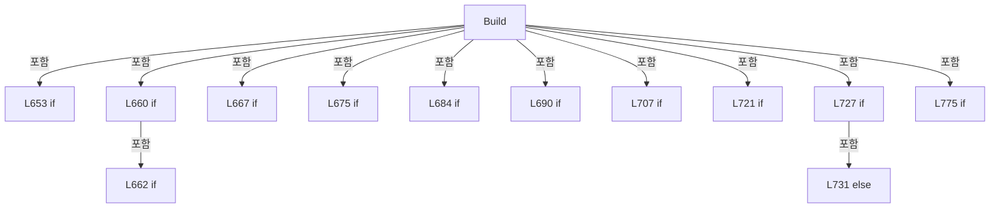

변경 전 점검: 입력/반환 타입, 위 호출자, 예외/취소 경로, 공유 상태와 저장·전송 소비자를 함께 확인합니다. 값의 단위나 물리 방향을 이름만으로 확정하지 않습니다.

### LocalFunctionStatement `BuildMonitor` · L697–700

[Drilling.UI/Menu/Menus/CMenuMonitor.cs:697–700](https://github.com/kjuws10-rgb/A3Drilling/blob/5aee8e58439c9b455cae7c9593c9be986c3e682e/Drilling.UI/Menu/Menus/CMenuMonitor.cs#L697-L700)

| 항목 | 실제 추출 값 |
| --- | --- |
| 서명 | Drilling.UI.Menu.Menus.ST_MONITOR_TAB BuildMonitor(string) |
| 접근/수식자 | Private /  |
| 반환/값 타입 | Drilling.UI.Menu.Menus.ST_MONITOR_TAB |
| 소속 타입 | NamedType:Drilling.UI.Menu.Menus.CMenuMonitor |

입력 계약:

| 이름 | 타입 | 전달 | 선택/기본값 |
| --- | --- | --- | --- |
| tab | string | None | False /  |

현재 부분 분석에서 직접 연결된 호출자는 없습니다. XAML/이벤트/인터페이스·델리게이트·외부 진입을 추가 확인해야 하며, 미사용으로 판정한 것이 아닙니다.

호출하는 대상과 해석 범위:

| 원본 행 | 표현식 | 분석 상태 | 대상/소스 위치 |
| --- | --- | --- | --- |
| 699 | new ST_MONITOR_TAB | resolved | Drilling.UI.Menu.Menus.ST_MONITOR_TAB.ST_MONITOR_TAB(string, bool) · Drilling.UI/Menu/Menus/CMenuMonitor.cs:6241 |
| 699 | GetMonitorTabDisplayName | resolved | string Drilling.UI.Menu.Menus.CMenuMonitor.GetMonitorTabDisplayName(string) · Drilling.UI/Menu/Menus/CMenuMonitor.cs:2431 |

본문의 실제 연산·분기·예외·반환 순서(원문 위치 순):

| 원본 행 | 종류 | 주석 해설 |
| --- | --- | --- |
| 699 | call | 함수·델리게이트 또는 객체 생성자를 호출합니다: new ST_MONITOR_TAB(GetMonitorTabDisplayName(tab), tab == selectedTab) |
| 699 | call | 함수·델리게이트 또는 객체 생성자를 호출합니다: GetMonitorTabDisplayName(tab) |
| 699 | return | 호출자에게 값 또는 제어를 반환합니다: return new ST_MONITOR_TAB(GetMonitorTabDisplayName(tab), tab == selectedTab); |

변경 전 점검: 입력/반환 타입, 위 호출자, 예외/취소 경로, 공유 상태와 저장·전송 소비자를 함께 확인합니다. 값의 단위나 물리 방향을 이름만으로 확정하지 않습니다.

### LocalFunctionStatement `IsIsSelected` · L716–719

[Drilling.UI/Menu/Menus/CMenuMonitor.cs:716–719](https://github.com/kjuws10-rgb/A3Drilling/blob/5aee8e58439c9b455cae7c9593c9be986c3e682e/Drilling.UI/Menu/Menus/CMenuMonitor.cs#L716-L719)

| 항목 | 실제 추출 값 |
| --- | --- |
| 서명 | bool IsIsSelected(Drilling.UI.Menu.Menus.ST_MONITOR_AXIS_ROW) |
| 접근/수식자 | Private /  |
| 반환/값 타입 | bool |
| 소속 타입 | NamedType:Drilling.UI.Menu.Menus.CMenuMonitor |

입력 계약:

| 이름 | 타입 | 전달 | 선택/기본값 |
| --- | --- | --- | --- |
| row | Drilling.UI.Menu.Menus.ST_MONITOR_AXIS_ROW | None | False /  |

현재 부분 분석에서 직접 연결된 호출자는 없습니다. XAML/이벤트/인터페이스·델리게이트·외부 진입을 추가 확인해야 하며, 미사용으로 판정한 것이 아닙니다.

본문의 실제 연산·분기·예외·반환 순서(원문 위치 순):

| 원본 행 | 종류 | 주석 해설 |
| --- | --- | --- |
| 718 | return | 호출자에게 값 또는 제어를 반환합니다: return row.IsSelected; |

변경 전 점검: 입력/반환 타입, 위 호출자, 예외/취소 경로, 공유 상태와 저장·전송 소비자를 함께 확인합니다. 값의 단위나 물리 방향을 이름만으로 확정하지 않습니다.

### LocalFunctionStatement `BuildDisplay` · L784–787

[Drilling.UI/Menu/Menus/CMenuMonitor.cs:784–787](https://github.com/kjuws10-rgb/A3Drilling/blob/5aee8e58439c9b455cae7c9593c9be986c3e682e/Drilling.UI/Menu/Menus/CMenuMonitor.cs#L784-L787)

| 항목 | 실제 추출 값 |
| --- | --- |
| 서명 | Drilling.UI.Menu.Menus.ST_DISPLAY_ITEM BuildDisplay(Drilling.UI.Menu.Menus.ST_MONITOR_AXIS_ROW) |
| 접근/수식자 | Private /  |
| 반환/값 타입 | Drilling.UI.Menu.Menus.ST_DISPLAY_ITEM |
| 소속 타입 | NamedType:Drilling.UI.Menu.Menus.CMenuMonitor |

입력 계약:

| 이름 | 타입 | 전달 | 선택/기본값 |
| --- | --- | --- | --- |
| row | Drilling.UI.Menu.Menus.ST_MONITOR_AXIS_ROW | None | False /  |

현재 부분 분석에서 직접 연결된 호출자는 없습니다. XAML/이벤트/인터페이스·델리게이트·외부 진입을 추가 확인해야 하며, 미사용으로 판정한 것이 아닙니다.

호출하는 대상과 해석 범위:

| 원본 행 | 표현식 | 분석 상태 | 대상/소스 위치 |
| --- | --- | --- | --- |
| 786 | new ST_DISPLAY_ITEM | resolved | Drilling.UI.Menu.Menus.ST_DISPLAY_ITEM.ST_DISPLAY_ITEM(string, string, string) · Drilling.UI/Menu/Menus/CMenuBase.cs:43 |

본문의 실제 연산·분기·예외·반환 순서(원문 위치 순):

| 원본 행 | 종류 | 주석 해설 |
| --- | --- | --- |
| 786 | call | 함수·델리게이트 또는 객체 생성자를 호출합니다: new ST_DISPLAY_ITEM(row.Axis, row.CurrentPosition, row.Alarm) |
| 786 | return | 호출자에게 값 또는 제어를 반환합니다: return new ST_DISPLAY_ITEM(row.Axis, row.CurrentPosition, row.Alarm); |

변경 전 점검: 입력/반환 타입, 위 호출자, 예외/취소 경로, 공유 상태와 저장·전송 소비자를 함께 확인합니다. 값의 단위나 물리 방향을 이름만으로 확정하지 않습니다.

### LocalFunctionStatement `BuildDisplay2` · L789–792

[Drilling.UI/Menu/Menus/CMenuMonitor.cs:789–792](https://github.com/kjuws10-rgb/A3Drilling/blob/5aee8e58439c9b455cae7c9593c9be986c3e682e/Drilling.UI/Menu/Menus/CMenuMonitor.cs#L789-L792)

| 항목 | 실제 추출 값 |
| --- | --- |
| 서명 | Drilling.UI.Menu.Menus.ST_DISPLAY_ITEM BuildDisplay2(Drilling.UI.Menu.Menus.ST_MONITOR_STATUS_ROW) |
| 접근/수식자 | Private /  |
| 반환/값 타입 | Drilling.UI.Menu.Menus.ST_DISPLAY_ITEM |
| 소속 타입 | NamedType:Drilling.UI.Menu.Menus.CMenuMonitor |

입력 계약:

| 이름 | 타입 | 전달 | 선택/기본값 |
| --- | --- | --- | --- |
| row | Drilling.UI.Menu.Menus.ST_MONITOR_STATUS_ROW | None | False /  |

현재 부분 분석에서 직접 연결된 호출자는 없습니다. XAML/이벤트/인터페이스·델리게이트·외부 진입을 추가 확인해야 하며, 미사용으로 판정한 것이 아닙니다.

호출하는 대상과 해석 범위:

| 원본 행 | 표현식 | 분석 상태 | 대상/소스 위치 |
| --- | --- | --- | --- |
| 791 | new ST_DISPLAY_ITEM | resolved | Drilling.UI.Menu.Menus.ST_DISPLAY_ITEM.ST_DISPLAY_ITEM(string, string, string) · Drilling.UI/Menu/Menus/CMenuBase.cs:43 |

본문의 실제 연산·분기·예외·반환 순서(원문 위치 순):

| 원본 행 | 종류 | 주석 해설 |
| --- | --- | --- |
| 791 | call | 함수·델리게이트 또는 객체 생성자를 호출합니다: new ST_DISPLAY_ITEM(row.Item, row.Value, row.State) |
| 791 | return | 호출자에게 값 또는 제어를 반환합니다: return new ST_DISPLAY_ITEM(row.Item, row.Value, row.State); |

변경 전 점검: 입력/반환 타입, 위 호출자, 예외/취소 경로, 공유 상태와 저장·전송 소비자를 함께 확인합니다. 값의 단위나 물리 방향을 이름만으로 확정하지 않습니다.

### MethodDeclaration `RefreshLiveData` · L797–956

[Drilling.UI/Menu/Menus/CMenuMonitor.cs:797–956](https://github.com/kjuws10-rgb/A3Drilling/blob/5aee8e58439c9b455cae7c9593c9be986c3e682e/Drilling.UI/Menu/Menus/CMenuMonitor.cs#L797-L956)

| 항목 | 실제 추출 값 |
| --- | --- |
| 서명 | System.Threading.Tasks.Task Drilling.UI.Menu.Menus.CMenuMonitor.RefreshLiveData(System.Threading.CancellationToken) |
| 접근/수식자 | Public / public |
| 반환/값 타입 | System.Threading.Tasks.Task |
| 소속 타입 | NamedType:Drilling.UI.Menu.Menus.CMenuMonitor |

입력 계약:

| 이름 | 타입 | 전달 | 선택/기본값 |
| --- | --- | --- | --- |
| cancellationToken | System.Threading.CancellationToken | None | True / null |

정적 호출자로 확인된 위치:

| 호출 파일/행 | 호출 표현식 | 런타임 분기 가능 |
| --- | --- | --- |
| [Drilling.UI/CRootView.cs:798–798](https://github.com/kjuws10-rgb/A3Drilling/blob/5aee8e58439c9b455cae7c9593c9be986c3e682e/Drilling.UI/CRootView.cs#L798-L798) | monitor.RefreshLiveData | False |

호출하는 대상과 해석 범위:

| 원본 행 | 표현식 | 분석 상태 | 대상/소스 위치 |
| --- | --- | --- | --- |
| 812 | NormalizeMonitorScreenTab | resolved | string Drilling.UI.Menu.Menus.CMenuMonitor.NormalizeMonitorScreenTab(string?) · Drilling.UI/Menu/Menus/CMenuMonitor.cs:1873 |
| 812 | _selectedTabAccessor | resolved · 동적 구현 선택 가능 | string System.Func<string>.Invoke() |
| 813 | selectedTab.Equals | resolved | bool string.Equals(string?, System.StringComparison) |
| 825 | SaveOperationFieldValues | resolved | void Drilling.UI.Menu.Menus.CMenuMonitor.SaveOperationFieldValues(string) · Drilling.UI/Menu/Menus/CMenuMonitor.cs:2259 |
| 830 | SavePowerMeterSettingValues | resolved | void Drilling.UI.Menu.Menus.CMenuMonitor.SavePowerMeterSettingValues() · Drilling.UI/Menu/Menus/CMenuMonitor.cs:5325 |
| 833 | LoadEnabledHeadDeviceNumbers | resolved | System.Collections.Generic.IReadOnlyList<int> Drilling.UI.Menu.Menus.CMenuMonitor.LoadEnabledHeadDeviceNumbers(System.Threading.CancellationToken) · Drilling.UI/Menu/Menus/CMenuMonitor.cs:2293 |
| 834 | NormalizeHeadDeviceSelections | resolved | void Drilling.UI.Menu.Menus.CMenuMonitor.NormalizeHeadDeviceSelections() · Drilling.UI/Menu/Menus/CMenuMonitor.cs:2313 |
| 837 | NormalizePowerMeterSelection | resolved | void Drilling.UI.Menu.Menus.CMenuMonitor.NormalizePowerMeterSelection() · Drilling.UI/Menu/Menus/CMenuMonitor.cs:5864 |
| 840 | UpdatePollingContext | resolved | void Drilling.UI.Menu.Menus.CMenuMonitor.UpdatePollingContext(string) · Drilling.UI/Menu/Menus/CMenuMonitor.cs:1042 |
| 841 | _statusPollingService.Start | resolved | void Drilling.UI.Menu.Menus.CMonitorStatusPollingService.Start() · Drilling.UI/Menu/Menus/CMonitorStatusPollingService.cs:32 |
| 842 | _statusPollingService.GetSnapshot | resolved | Drilling.UI.Menu.Menus.ST_MONITOR_STATUS_SNAPSHOT Drilling.UI.Menu.Menus.CMonitorStatusPollingService.GetSnapshot() · Drilling.UI/Menu/Menus/CMonitorStatusPollingService.cs:54 |
| 845 | RefreshPowerMeterSnapshotFromCache | resolved | Drilling.UI.Menu.Menus.ST_MONITOR_STATUS_SNAPSHOT Drilling.UI.Menu.Menus.CMenuMonitor.RefreshPowerMeterSnapshotFromCache(Drilling.UI.Menu.Menus.ST_MONITOR_STATUS_SNAPSHOT, System.Threading.CancellationToken) · Drilling.UI/Menu/Menus/CMenuMonitor.cs:1031 |
| 848 | CreateLiveRefreshHash | resolved | int Drilling.UI.Menu.Menus.CMenuMonitor.CreateLiveRefreshHash(string, Drilling.UI.Menu.Menus.ST_MONITOR_STATUS_SNAPSHOT) · Drilling.UI/Menu/Menus/CMenuMonitor.cs:958 |
| 860 | Math.Clamp | resolved | int System.Math.Clamp(int, int, int) |
| 862 | CreatePicoMotorStatusRows | resolved | System.Collections.Generic.IReadOnlyList<Drilling.UI.Menu.Menus.ST_MONITOR_STATUS_ROW> Drilling.UI.Menu.Menus.CMenuMonitor.CreatePicoMotorStatusRows(Drilling.Common.Interface.ST_PICO_MOTOR_STATUS) · Drilling.UI/Menu/Menus/CMenuMonitor.cs:5814 |
| 863 | CreatePicoErrorRows | resolved | System.Collections.Generic.IReadOnlyList<Drilling.UI.Menu.Menus.ST_MONITOR_PARAMETER_ROW> Drilling.UI.Menu.Menus.CMenuMonitor.CreatePicoErrorRows() · Drilling.UI/Menu/Menus/CMenuMonitor.cs:5830 |
| 864 | CreatePicoMotorPositionRows | resolved | System.Collections.Generic.IReadOnlyList<Drilling.UI.Menu.Menus.ST_MONITOR_POSITION_ROW> Drilling.UI.Menu.Menus.CMenuMonitor.CreatePicoMotorPositionRows(Drilling.Common.Interface.ST_PICO_MOTOR_STATUS) · Drilling.UI/Menu/Menus/CMenuMonitor.cs:5854 |
| 865 | UpdatePicoMotorOperationFields | resolved | void Drilling.UI.Menu.Menus.CMenuMonitor.UpdatePicoMotorOperationFields(Drilling.Common.Interface.ST_PICO_MOTOR_STATUS) · Drilling.UI/Menu/Menus/CMenuMonitor.cs:5084 |
| 866 | NotifyMonitorLiveProperties | resolved | void Drilling.UI.Menu.Menus.CMenuMonitor.NotifyMonitorLiveProperties(params string[]) · Drilling.UI/Menu/Menus/CMenuMonitor.cs:1794 |
| 866 | nameof | unresolved | None |
| 866 | nameof | unresolved | None |
| 866 | nameof | unresolved | None |
| 866 | nameof | unresolved | None |
| 866 | nameof | unresolved | None |
| 866 | nameof | unresolved | None |
| 874 | CreateStatusRows | resolved | System.Collections.Generic.IReadOnlyList<Drilling.UI.Menu.Menus.ST_MONITOR_STATUS_ROW> Drilling.UI.Menu.Menus.CMenuMonitor.CreateStatusRows(string, Drilling.Common.Managers.ST_DEVICE_STATUS, System.Collections.Generic.IReadOnlyList<Drilling.Common.Interface.ST_DEVICE_COMM_STATUS>, string?, Drilling.Common.Interface.ST_TALON_STATUS?) · Drilling.UI/Menu/Menus/CMenuMonitor.cs:1973 |
| 874 | GetSelectedHeadConnectionText | resolved | string? Drilling.UI.Menu.Menus.CMenuMonitor.GetSelectedHeadConnectionText(string) · Drilling.UI/Menu/Menus/CMenuMonitor.cs:2343 |
| 875 | CreateOperationButtons | resolved | System.Collections.Generic.IReadOnlyList<Drilling.UI.Menu.Menus.ST_MONITOR_OPERATION_BUTTON> Drilling.UI.Menu.Menus.CMenuMonitor.CreateOperationButtons(string, Drilling.Common.Interface.ST_LASER_STATUS, Drilling.Common.Interface.ST_TALON_STATUS) · Drilling.UI/Menu/Menus/CMenuMonitor.cs:2110 |
| 876 | CreateHeadSelectRows | resolved | System.Collections.Generic.IReadOnlyList<Drilling.UI.Menu.Menus.ST_MONITOR_HEAD_SELECT_ROW> Drilling.UI.Menu.Menus.CMenuMonitor.CreateHeadSelectRows(string, int, Drilling.Common.Interface.EN_EQP_MODULE?, string) · Drilling.UI/Menu/Menus/CMenuMonitor.cs:2401 |
| 877 | CreateLaserControlRows | resolved | System.Collections.Generic.IReadOnlyList<Drilling.UI.Menu.Menus.ST_MONITOR_LASER_CONTROL_ROW> Drilling.UI.Menu.Menus.CMenuMonitor.CreateLaserControlRows(string, Drilling.Common.Interface.ST_LASER_STATUS, Drilling.Common.Interface.ST_TALON_STATUS, System.Collections.Generic.IReadOnlyList<Drilling.UI.Menu.Menus.ST_MONITOR_PARAMETER_ROW>) · Drilling.UI/Menu/Menus/CMenuMonitor.cs:5948 |
| 878 | CreateSummaryItems | resolved | System.Collections.Generic.IReadOnlyList<Drilling.UI.Menu.Menus.ST_MONITOR_SUMMARY_ITEM> Drilling.UI.Menu.Menus.CMenuMonitor.CreateSummaryItems(string, Drilling.Common.Managers.ST_DEVICE_STATUS) · Drilling.UI/Menu/Menus/CMenuMonitor.cs:2453 |
| 879 | CreatePwmSettingRows | resolved | System.Collections.Generic.IReadOnlyList<Drilling.UI.Menu.Menus.ST_PWM_SETTING_ROW> Drilling.UI.Menu.Menus.CMenuMonitor.CreatePwmSettingRows(string) · Drilling.UI/Menu/Menus/CMenuMonitor.cs:6110 |
| 880 | CreatePwmDeviceRows | resolved | System.Collections.Generic.IReadOnlyList<Drilling.UI.Menu.Menus.ST_PWM_DEVICE_ROW> Drilling.UI.Menu.Menus.CMenuMonitor.CreatePwmDeviceRows(string, Drilling.Common.Managers.ST_DEVICE_STATUS) · Drilling.UI/Menu/Menus/CMenuMonitor.cs:6133 |
| 881 | NotifyMonitorLiveProperties | resolved | void Drilling.UI.Menu.Menus.CMenuMonitor.NotifyMonitorLiveProperties(params string[]) · Drilling.UI/Menu/Menus/CMenuMonitor.cs:1794 |
| 881 | nameof | unresolved | None |
| 881 | nameof | unresolved | None |
| 881 | nameof | unresolved | None |
| 881 | nameof | unresolved | None |
| 881 | nameof | unresolved | None |
| 881 | nameof | unresolved | None |
| 881 | nameof | unresolved | None |
| 881 | nameof | unresolved | None |
| 885 | CreateStatusRows | resolved | System.Collections.Generic.IReadOnlyList<Drilling.UI.Menu.Menus.ST_MONITOR_STATUS_ROW> Drilling.UI.Menu.Menus.CMenuMonitor.CreateStatusRows(string, Drilling.Common.Managers.ST_DEVICE_STATUS, System.Collections.Generic.IReadOnlyList<Drilling.Common.Interface.ST_DEVICE_COMM_STATUS>, string?, Drilling.Common.Interface.ST_TALON_STATUS?) · Drilling.UI/Menu/Menus/CMenuMonitor.cs:1973 |
| 885 | GetSelectedHeadConnectionText | resolved | string? Drilling.UI.Menu.Menus.CMenuMonitor.GetSelectedHeadConnectionText(string) · Drilling.UI/Menu/Menus/CMenuMonitor.cs:2343 |
| 889 | CreateAxisRows | resolved | System.Collections.Generic.IReadOnlyList<Drilling.UI.Menu.Menus.ST_MONITOR_AXIS_ROW> Drilling.UI.Menu.Menus.CMenuMonitor.CreateAxisRows(Drilling.Common.Managers.ST_DEVICE_STATUS, string) · Drilling.UI/Menu/Menus/CMenuMonitor.cs:5725 |
| 890 | axisRows.Any | resolved | bool System.Collections.Generic.IEnumerable<Drilling.UI.Menu.Menus.ST_MONITOR_AXIS_ROW>.Any<Drilling.UI.Menu.Menus.ST_MONITOR_AXIS_ROW>(System.Func<Drilling.UI.Menu.Menus.ST_MONITOR_AXIS_ROW, bool>) |
| 893 | CreateAxisRows | resolved | System.Collections.Generic.IReadOnlyList<Drilling.UI.Menu.Menus.ST_MONITOR_AXIS_ROW> Drilling.UI.Menu.Menus.CMenuMonitor.CreateAxisRows(Drilling.Common.Managers.ST_DEVICE_STATUS, string) · Drilling.UI/Menu/Menus/CMenuMonitor.cs:5725 |
| 894 | OnPropertyChanged | resolved | void Drilling.UI.Menu.CBindingBase.OnPropertyChanged(string?) · Drilling.UI/Menu/CBindingBase.cs:759 |
| 894 | nameof | unresolved | None |
| 895 | OnPropertyChanged | resolved | void Drilling.UI.Menu.CBindingBase.OnPropertyChanged(string?) · Drilling.UI/Menu/CBindingBase.cs:759 |
| 895 | nameof | unresolved | None |
| 899 | UpdateMultiMoveAxisRows | resolved | void Drilling.UI.Menu.Menus.CMenuMonitor.UpdateMultiMoveAxisRows(Drilling.Common.Managers.ST_DEVICE_STATUS) · Drilling.UI/Menu/Menus/CMenuMonitor.cs:5748 |
| 900 | NotifyMonitorLiveProperties | resolved | void Drilling.UI.Menu.Menus.CMenuMonitor.NotifyMonitorLiveProperties(params string[]) · Drilling.UI/Menu/Menus/CMenuMonitor.cs:1794 |
| 900 | nameof | unresolved | None |
| 900 | nameof | unresolved | None |
| 900 | nameof | unresolved | None |
| 900 | nameof | unresolved | None |
| 903 | CreateHeadSelectRows | resolved | System.Collections.Generic.IReadOnlyList<Drilling.UI.Menu.Menus.ST_MONITOR_HEAD_SELECT_ROW> Drilling.UI.Menu.Menus.CMenuMonitor.CreateHeadSelectRows(string, int, Drilling.Common.Interface.EN_EQP_MODULE?, string) · Drilling.UI/Menu/Menus/CMenuMonitor.cs:2401 |
| 904 | CreateSummaryItems | resolved | System.Collections.Generic.IReadOnlyList<Drilling.UI.Menu.Menus.ST_MONITOR_SUMMARY_ITEM> Drilling.UI.Menu.Menus.CMenuMonitor.CreateSummaryItems(string, Drilling.Common.Managers.ST_DEVICE_STATUS) · Drilling.UI/Menu/Menus/CMenuMonitor.cs:2453 |
| 905 | CreateAttenuatorStatusItems | resolved | System.Collections.Generic.IReadOnlyList<Drilling.UI.Menu.Menus.ST_MONITOR_SUMMARY_ITEM> Drilling.UI.Menu.Menus.CMenuMonitor.CreateAttenuatorStatusItems(string, Drilling.Common.Managers.ST_DEVICE_STATUS) · Drilling.UI/Menu/Menus/CMenuMonitor.cs:6041 |
| 906 | CreateAttenuatorSettingItems | resolved | System.Collections.Generic.IReadOnlyList<Drilling.UI.Menu.Menus.ST_MONITOR_SUMMARY_ITEM> Drilling.UI.Menu.Menus.CMenuMonitor.CreateAttenuatorSettingItems(string, Drilling.Common.Managers.ST_DEVICE_STATUS) · Drilling.UI/Menu/Menus/CMenuMonitor.cs:6059 |
| 907 | CreatePositionRows | resolved | System.Collections.Generic.IReadOnlyList<Drilling.UI.Menu.Menus.ST_MONITOR_POSITION_ROW> Drilling.UI.Menu.Menus.CMenuMonitor.CreatePositionRows(string, Drilling.Common.Managers.ST_DEVICE_STATUS) · Drilling.UI/Menu/Menus/CMenuMonitor.cs:6076 |
| 908 | NotifyMonitorLiveProperties | resolved | void Drilling.UI.Menu.Menus.CMenuMonitor.NotifyMonitorLiveProperties(params string[]) · Drilling.UI/Menu/Menus/CMenuMonitor.cs:1794 |
| 908 | nameof | unresolved | None |
| 908 | nameof | unresolved | None |
| 908 | nameof | unresolved | None |
| 908 | nameof | unresolved | None |
| 908 | nameof | unresolved | None |
| 908 | nameof | unresolved | None |
| 908 | nameof | unresolved | None |
| 911 | CreateHeadSelectRows | resolved | System.Collections.Generic.IReadOnlyList<Drilling.UI.Menu.Menus.ST_MONITOR_HEAD_SELECT_ROW> Drilling.UI.Menu.Menus.CMenuMonitor.CreateHeadSelectRows(string, int, Drilling.Common.Interface.EN_EQP_MODULE?, string) · Drilling.UI/Menu/Menus/CMenuMonitor.cs:2401 |
| 912 | CreateSummaryItems | resolved | System.Collections.Generic.IReadOnlyList<Drilling.UI.Menu.Menus.ST_MONITOR_SUMMARY_ITEM> Drilling.UI.Menu.Menus.CMenuMonitor.CreateSummaryItems(string, Drilling.Common.Managers.ST_DEVICE_STATUS) · Drilling.UI/Menu/Menus/CMenuMonitor.cs:2453 |
| 913 | CreatePositionRows | resolved | System.Collections.Generic.IReadOnlyList<Drilling.UI.Menu.Menus.ST_MONITOR_POSITION_ROW> Drilling.UI.Menu.Menus.CMenuMonitor.CreatePositionRows(string, Drilling.Common.Managers.ST_DEVICE_STATUS) · Drilling.UI/Menu/Menus/CMenuMonitor.cs:6076 |
| 914 | NotifyMonitorLiveProperties | resolved | void Drilling.UI.Menu.Menus.CMenuMonitor.NotifyMonitorLiveProperties(params string[]) · Drilling.UI/Menu/Menus/CMenuMonitor.cs:1794 |
| 914 | nameof | unresolved | None |
| 914 | nameof | unresolved | None |
| 914 | nameof | unresolved | None |
| 914 | nameof | unresolved | None |
| 914 | nameof | unresolved | None |
| 917 | UpdatePowerMeterGraph | resolved | void Drilling.UI.Menu.Menus.CMenuMonitor.UpdatePowerMeterGraph() · Drilling.UI/Menu/Menus/CMenuMonitor.cs:5631 |
| 918 | CreateHeadSelectRows | resolved | System.Collections.Generic.IReadOnlyList<Drilling.UI.Menu.Menus.ST_MONITOR_HEAD_SELECT_ROW> Drilling.UI.Menu.Menus.CMenuMonitor.CreateHeadSelectRows(string, int, Drilling.Common.Interface.EN_EQP_MODULE?, string) · Drilling.UI/Menu/Menus/CMenuMonitor.cs:2401 |
| 919 | CreateSummaryItems | resolved | System.Collections.Generic.IReadOnlyList<Drilling.UI.Menu.Menus.ST_MONITOR_SUMMARY_ITEM> Drilling.UI.Menu.Menus.CMenuMonitor.CreateSummaryItems(string, Drilling.Common.Managers.ST_DEVICE_STATUS) · Drilling.UI/Menu/Menus/CMenuMonitor.cs:2453 |
| 920 | CreatePwmSettingRows | resolved | System.Collections.Generic.IReadOnlyList<Drilling.UI.Menu.Menus.ST_PWM_SETTING_ROW> Drilling.UI.Menu.Menus.CMenuMonitor.CreatePwmSettingRows(string) · Drilling.UI/Menu/Menus/CMenuMonitor.cs:6110 |
| 921 | CreatePwmDeviceRows | resolved | System.Collections.Generic.IReadOnlyList<Drilling.UI.Menu.Menus.ST_PWM_DEVICE_ROW> Drilling.UI.Menu.Menus.CMenuMonitor.CreatePwmDeviceRows(string, Drilling.Common.Managers.ST_DEVICE_STATUS) · Drilling.UI/Menu/Menus/CMenuMonitor.cs:6133 |
| 922 | CreatePwmRunButtons | resolved | System.Collections.Generic.IReadOnlyList<Drilling.UI.Menu.Menus.ST_MONITOR_OPERATION_BUTTON> Drilling.UI.Menu.Menus.CMenuMonitor.CreatePwmRunButtons(string) · Drilling.UI/Menu/Menus/CMenuMonitor.cs:6152 |
| 923 | NotifyMonitorLiveProperties | resolved | void Drilling.UI.Menu.Menus.CMenuMonitor.NotifyMonitorLiveProperties(params string[]) · Drilling.UI/Menu/Menus/CMenuMonitor.cs:1794 |
| 924 | nameof | unresolved | None |
| 925 | nameof | unresolved | None |
| 926 | nameof | unresolved | None |
| 927 | nameof | unresolved | None |
| 928 | nameof | unresolved | None |
| 929 | nameof | unresolved | None |
| 930 | nameof | unresolved | None |
| 931 | nameof | unresolved | None |
| 932 | nameof | unresolved | None |
| 933 | nameof | unresolved | None |
| 934 | nameof | unresolved | None |
| 935 | nameof | unresolved | None |
| 936 | nameof | unresolved | None |
| 937 | nameof | unresolved | None |
| 938 | nameof | unresolved | None |
| 942 | UpdateMelsecReadValues | resolved | void Drilling.UI.Menu.Menus.CMenuMonitor.UpdateMelsecReadValues(System.Collections.Generic.IReadOnlyDictionary<string, Drilling.UI.Menu.Menus.ST_MONITOR_MELSEC_VALUE>) · Drilling.UI/Menu/Menus/CMenuMonitor.cs:3872 |
| 943 | NotifyMonitorLiveProperties | resolved | void Drilling.UI.Menu.Menus.CMenuMonitor.NotifyMonitorLiveProperties(params string[]) · Drilling.UI/Menu/Menus/CMenuMonitor.cs:1794 |
| 943 | nameof | unresolved | None |
| 946 | NotifyMonitorLiveProperties | resolved | void Drilling.UI.Menu.Menus.CMenuMonitor.NotifyMonitorLiveProperties(params string[]) · Drilling.UI/Menu/Menus/CMenuMonitor.cs:1794 |
| 946 | nameof | unresolved | None |

본문의 실제 연산·분기·예외·반환 순서(원문 위치 순):

| 원본 행 | 종류 | 주석 해설 |
| --- | --- | --- |
| 799 | if | 조건에 따라 분기합니다: if (_liveRefreshRunning) |
| 801 | return | 호출자에게 값 또는 제어를 반환합니다: return Task.CompletedTask; |
| 804 | assignment | 값을 대상에 대입합니다: _liveRefreshRunning = true |
| 810 | try | 예외 처리 범위입니다: try |
| 812 | call | 함수·델리게이트 또는 객체 생성자를 호출합니다: NormalizeMonitorScreenTab(_selectedTabAccessor()) |
| 812 | call | 함수·델리게이트 또는 객체 생성자를 호출합니다: _selectedTabAccessor() |
| 812 | local-declaration | 지역 변수를 선언합니다: var selectedTab = NormalizeMonitorScreenTab(_selectedTabAccessor()); |
| 812 | variable-initializer | 변수의 초기값을 지정합니다: selectedTab = NormalizeMonitorScreenTab(_selectedTabAccessor()) |
| 813 | call | 함수·델리게이트 또는 객체 생성자를 호출합니다: selectedTab.Equals(SelectedTab, StringComparison.OrdinalIgnoreCase) |
| 813 | if | 조건에 따라 분기합니다: if (!selectedTab.Equals(SelectedTab, StringComparison.OrdinalIgnoreCase)) |
| 815 | return | 호출자에게 값 또는 제어를 반환합니다: return Task.CompletedTask; |
| 818 | if | 조건에 따라 분기합니다: if (selectedTab is "COORDINATE VIEWER" or "LOG VIEWER") |
| 820 | return | 호출자에게 값 또는 제어를 반환합니다: return Task.CompletedTask; |
| 823 | if | 조건에 따라 분기합니다: if (OperationFields.Count > 0) |
| 825 | call | 함수·델리게이트 또는 객체 생성자를 호출합니다: SaveOperationFieldValues(selectedTab) |
| 828 | if | 조건에 따라 분기합니다: if ((selectedTab is "LASER" or "POWER METER") && PwmSettingRows.Count > 0) |
| 830 | call | 함수·델리게이트 또는 객체 생성자를 호출합니다: SavePowerMeterSettingValues() |
| 833 | assignment | 값을 대상에 대입합니다: _enabledHeadDeviceNumbers = LoadEnabledHeadDeviceNumbers(cancellationToken) |
| 833 | call | 함수·델리게이트 또는 객체 생성자를 호출합니다: LoadEnabledHeadDeviceNumbers(cancellationToken) |
| 834 | call | 함수·델리게이트 또는 객체 생성자를 호출합니다: NormalizeHeadDeviceSelections() |
| 835 | if | 조건에 따라 분기합니다: if (selectedTab is "LASER" or "POWER METER") |
| 837 | call | 함수·델리게이트 또는 객체 생성자를 호출합니다: NormalizePowerMeterSelection() |
| 840 | call | 함수·델리게이트 또는 객체 생성자를 호출합니다: UpdatePollingContext(selectedTab) |
| 841 | call | 함수·델리게이트 또는 객체 생성자를 호출합니다: _statusPollingService.Start() |
| 842 | call | 함수·델리게이트 또는 객체 생성자를 호출합니다: _statusPollingService.GetSnapshot() |
| 842 | local-declaration | 지역 변수를 선언합니다: var monitorSnapshot = _statusPollingService.GetSnapshot(); |
| 842 | variable-initializer | 변수의 초기값을 지정합니다: monitorSnapshot = _statusPollingService.GetSnapshot() |
| 843 | if | 조건에 따라 분기합니다: if (selectedTab is "LASER" or "POWER METER") |
| 845 | assignment | 값을 대상에 대입합니다: monitorSnapshot = RefreshPowerMeterSnapshotFromCache(monitorSnapshot, cancellationToken) |
| 845 | call | 함수·델리게이트 또는 객체 생성자를 호출합니다: RefreshPowerMeterSnapshotFromCache(monitorSnapshot, cancellationToken) |
| 848 | call | 함수·델리게이트 또는 객체 생성자를 호출합니다: CreateLiveRefreshHash(selectedTab, monitorSnapshot) |
| 848 | local-declaration | 지역 변수를 선언합니다: var liveRefreshHash = CreateLiveRefreshHash(selectedTab, monitorSnapshot); |
| 848 | variable-initializer | 변수의 초기값을 지정합니다: liveRefreshHash = CreateLiveRefreshHash(selectedTab, monitorSnapshot) |
| 849 | if | 조건에 따라 분기합니다: if (_lastLiveRefreshHash == liveRefreshHash) |
| 851 | return | 호출자에게 값 또는 제어를 반환합니다: return Task.CompletedTask; |
| 854 | assignment | 값을 대상에 대입합니다: _lastLiveRefreshHash = liveRefreshHash |
| 855 | local-declaration | 지역 변수를 선언합니다: var snapshot = monitorSnapshot.DeviceStatus; |
| 855 | variable-initializer | 변수의 초기값을 지정합니다: snapshot = monitorSnapshot.DeviceStatus |
| 856 | local-declaration | 지역 변수를 선언합니다: var communication = monitorSnapshot.Communication; |
| 856 | variable-initializer | 변수의 초기값을 지정합니다: communication = monitorSnapshot.Communication |
| 857 | if | 조건에 따라 분기합니다: if (selectedTab == "PICO MOTOR") |
| 859 | local-declaration | 지역 변수를 선언합니다: var picoStatus = monitorSnapshot.PicoMotorStatus; |
| 859 | variable-initializer | 변수의 초기값을 지정합니다: picoStatus = monitorSnapshot.PicoMotorStatus |
| 860 | assignment | 값을 대상에 대입합니다: _selectedPicoMotorNo = Math.Clamp(picoStatus.SelectedMotorNo, 1, 4) |
| 860 | call | 함수·델리게이트 또는 객체 생성자를 호출합니다: Math.Clamp(picoStatus.SelectedMotorNo, 1, 4) |
| 861 | assignment | 값을 대상에 대입합니다: _picoMotorIsConnected = picoStatus.IsConnected |
| 862 | assignment | 값을 대상에 대입합니다: StatusRows = CreatePicoMotorStatusRows(picoStatus) |
| 862 | call | 함수·델리게이트 또는 객체 생성자를 호출합니다: CreatePicoMotorStatusRows(picoStatus) |
| 863 | assignment | 값을 대상에 대입합니다: ParameterRows = CreatePicoErrorRows() |
| 863 | call | 함수·델리게이트 또는 객체 생성자를 호출합니다: CreatePicoErrorRows() |
| 864 | assignment | 값을 대상에 대입합니다: PositionRows = CreatePicoMotorPositionRows(picoStatus) |
| 864 | call | 함수·델리게이트 또는 객체 생성자를 호출합니다: CreatePicoMotorPositionRows(picoStatus) |
| 865 | call | 함수·델리게이트 또는 객체 생성자를 호출합니다: UpdatePicoMotorOperationFields(picoStatus) |
| 866 | call | 함수·델리게이트 또는 객체 생성자를 호출합니다: NotifyMonitorLiveProperties(nameof(StatusRows), nameof(ParameterRows), nameof(PositionRows), nameof(OperationFields), nameof(PicoConnectionButtons), nameof(PicoMotorSelectButtons)) |
| 866 | call | 함수·델리게이트 또는 객체 생성자를 호출합니다: nameof(StatusRows) |
| 866 | call | 함수·델리게이트 또는 객체 생성자를 호출합니다: nameof(ParameterRows) |
| 866 | call | 함수·델리게이트 또는 객체 생성자를 호출합니다: nameof(PositionRows) |
| 866 | call | 함수·델리게이트 또는 객체 생성자를 호출합니다: nameof(OperationFields) |
| 866 | call | 함수·델리게이트 또는 객체 생성자를 호출합니다: nameof(PicoConnectionButtons) |
| 866 | call | 함수·델리게이트 또는 객체 생성자를 호출합니다: nameof(PicoMotorSelectButtons) |
| 867 | return | 호출자에게 값 또는 제어를 반환합니다: return Task.CompletedTask; |
| 870 | if | 조건에 따라 분기합니다: if (selectedTab == "LASER") |
| 872 | local-declaration | 지역 변수를 선언합니다: var talonStatus = monitorSnapshot.TalonStatus; |
| 872 | variable-initializer | 변수의 초기값을 지정합니다: talonStatus = monitorSnapshot.TalonStatus |
| 873 | local-declaration | 지역 변수를 선언합니다: var selectedLaserStatus = snapshot.Laser; |
| 873 | variable-initializer | 변수의 초기값을 지정합니다: selectedLaserStatus = snapshot.Laser |
| 874 | assignment | 값을 대상에 대입합니다: StatusRows = CreateStatusRows(selectedTab, snapshot, communication, GetSelectedHeadConnectionText(selectedTab), talonStatus) |
| 874 | call | 함수·델리게이트 또는 객체 생성자를 호출합니다: CreateStatusRows(selectedTab, snapshot, communication, GetSelectedHeadConnectionText(selectedTab), talonStatus) |
| 874 | call | 함수·델리게이트 또는 객체 생성자를 호출합니다: GetSelectedHeadConnectionText(selectedTab) |
| 875 | assignment | 값을 대상에 대입합니다: OperationButtons = CreateOperationButtons(selectedTab, selectedLaserStatus, talonStatus) |
| 875 | call | 함수·델리게이트 또는 객체 생성자를 호출합니다: CreateOperationButtons(selectedTab, selectedLaserStatus, talonStatus) |
| 876 | assignment | 값을 대상에 대입합니다: HeadSelectRows = CreateHeadSelectRows(selectedTab, _selectedLaserNumber, EN_EQP_MODULE.TalonLaser, "TALON") |
| 876 | call | 함수·델리게이트 또는 객체 생성자를 호출합니다: CreateHeadSelectRows(selectedTab, _selectedLaserNumber, EN_EQP_MODULE.TalonLaser, "TALON") |
| 877 | assignment | 값을 대상에 대입합니다: LaserControlRows = CreateLaserControlRows(selectedTab, selectedLaserStatus, talonStatus, OperationFields) |
| 877 | call | 함수·델리게이트 또는 객체 생성자를 호출합니다: CreateLaserControlRows(selectedTab, selectedLaserStatus, talonStatus, OperationFields) |
| 878 | assignment | 값을 대상에 대입합니다: SummaryItems = CreateSummaryItems(selectedTab, snapshot) |
| 878 | call | 함수·델리게이트 또는 객체 생성자를 호출합니다: CreateSummaryItems(selectedTab, snapshot) |
| 879 | assignment | 값을 대상에 대입합니다: PwmSettingRows = CreatePwmSettingRows(selectedTab) |
| 879 | call | 함수·델리게이트 또는 객체 생성자를 호출합니다: CreatePwmSettingRows(selectedTab) |
| 880 | assignment | 값을 대상에 대입합니다: PwmDeviceRows = CreatePwmDeviceRows(selectedTab, snapshot) |
| 880 | call | 함수·델리게이트 또는 객체 생성자를 호출합니다: CreatePwmDeviceRows(selectedTab, snapshot) |
| 881 | call | 함수·델리게이트 또는 객체 생성자를 호출합니다: NotifyMonitorLiveProperties(nameof(StatusRows), nameof(OperationButtons), nameof(HeadSelectRows), nameof(LaserControlRows), nameof(SelectedHeadDeviceName), nameof(SummaryItems), nameof(PwmSettingRows), nameof(PwmDeviceRo… |
| 881 | call | 함수·델리게이트 또는 객체 생성자를 호출합니다: nameof(StatusRows) |
| 881 | call | 함수·델리게이트 또는 객체 생성자를 호출합니다: nameof(OperationButtons) |
| 881 | call | 함수·델리게이트 또는 객체 생성자를 호출합니다: nameof(HeadSelectRows) |
| 881 | call | 함수·델리게이트 또는 객체 생성자를 호출합니다: nameof(LaserControlRows) |
| 881 | call | 함수·델리게이트 또는 객체 생성자를 호출합니다: nameof(SelectedHeadDeviceName) |
| 881 | call | 함수·델리게이트 또는 객체 생성자를 호출합니다: nameof(SummaryItems) |
| 881 | call | 함수·델리게이트 또는 객체 생성자를 호출합니다: nameof(PwmSettingRows) |
| 881 | call | 함수·델리게이트 또는 객체 생성자를 호출합니다: nameof(PwmDeviceRows) |
| 882 | return | 호출자에게 값 또는 제어를 반환합니다: return Task.CompletedTask; |
| 885 | assignment | 값을 대상에 대입합니다: StatusRows = CreateStatusRows(selectedTab, snapshot, communication, GetSelectedHeadConnectionText(selectedTab), ST_TALON_STATUS.Empty) |
| 885 | call | 함수·델리게이트 또는 객체 생성자를 호출합니다: CreateStatusRows(selectedTab, snapshot, communication, GetSelectedHeadConnectionText(selectedTab), ST_TALON_STATUS.Empty) |
| 885 | call | 함수·델리게이트 또는 객체 생성자를 호출합니다: GetSelectedHeadConnectionText(selectedTab) |
| 886 | switch | 값에 따라 분기합니다: switch (selectedTab) |
| 888 | case | 분기값/패턴의 구간입니다: case "XPS": |
| 889 | call | 함수·델리게이트 또는 객체 생성자를 호출합니다: CreateAxisRows(snapshot, _selectedAxisId) |
| 889 | local-declaration | 지역 변수를 선언합니다: var axisRows = CreateAxisRows(snapshot, _selectedAxisId); |
| 889 | variable-initializer | 변수의 초기값을 지정합니다: axisRows = CreateAxisRows(snapshot, _selectedAxisId) |
| 890 | call | 함수·델리게이트 또는 객체 생성자를 호출합니다: axisRows.Any(IsIsSelected) |
| 890 | if | 조건에 따라 분기합니다: if (axisRows.Count > 0 && !axisRows.Any(IsIsSelected)) |
| 892 | assignment | 값을 대상에 대입합니다: _selectedAxisId = axisRows[0].AxisId |
| 893 | assignment | 값을 대상에 대입합니다: axisRows = CreateAxisRows(snapshot, _selectedAxisId) |
| 893 | call | 함수·델리게이트 또는 객체 생성자를 호출합니다: CreateAxisRows(snapshot, _selectedAxisId) |
| 894 | call | 함수·델리게이트 또는 객체 생성자를 호출합니다: OnPropertyChanged(nameof(SelectedAxisId)) |
| 894 | call | 함수·델리게이트 또는 객체 생성자를 호출합니다: nameof(SelectedAxisId) |
| 895 | call | 함수·델리게이트 또는 객체 생성자를 호출합니다: OnPropertyChanged(nameof(SelectedAxisRow)) |
| 895 | call | 함수·델리게이트 또는 객체 생성자를 호출합니다: nameof(SelectedAxisRow) |
| 898 | assignment | 값을 대상에 대입합니다: AxisRows = axisRows |
| 899 | call | 함수·델리게이트 또는 객체 생성자를 호출합니다: UpdateMultiMoveAxisRows(snapshot) |
| 900 | call | 함수·델리게이트 또는 객체 생성자를 호출합니다: NotifyMonitorLiveProperties(nameof(AxisRows), nameof(MultiMoveAxisRows), nameof(StatusRows), nameof(SelectedAxisRow)) |
| 900 | call | 함수·델리게이트 또는 객체 생성자를 호출합니다: nameof(AxisRows) |
| 900 | call | 함수·델리게이트 또는 객체 생성자를 호출합니다: nameof(MultiMoveAxisRows) |
| 900 | call | 함수·델리게이트 또는 객체 생성자를 호출합니다: nameof(StatusRows) |
| 900 | call | 함수·델리게이트 또는 객체 생성자를 호출합니다: nameof(SelectedAxisRow) |
| 901 | break | 해당 반복/분기 구간을 종료합니다: break; |
| 902 | case | 분기값/패턴의 구간입니다: case "ATTENUATOR": |
| 903 | assignment | 값을 대상에 대입합니다: HeadSelectRows = CreateHeadSelectRows(selectedTab, _selectedAttenuatorNumber, EN_EQP_MODULE.Attenuator, "ATT") |
| 903 | call | 함수·델리게이트 또는 객체 생성자를 호출합니다: CreateHeadSelectRows(selectedTab, _selectedAttenuatorNumber, EN_EQP_MODULE.Attenuator, "ATT") |
| 904 | assignment | 값을 대상에 대입합니다: SummaryItems = CreateSummaryItems(selectedTab, snapshot) |
| 904 | call | 함수·델리게이트 또는 객체 생성자를 호출합니다: CreateSummaryItems(selectedTab, snapshot) |
| 905 | assignment | 값을 대상에 대입합니다: AttenuatorStatusItems = CreateAttenuatorStatusItems(selectedTab, snapshot) |
| 905 | call | 함수·델리게이트 또는 객체 생성자를 호출합니다: CreateAttenuatorStatusItems(selectedTab, snapshot) |
| 906 | assignment | 값을 대상에 대입합니다: AttenuatorSettingItems = CreateAttenuatorSettingItems(selectedTab, snapshot) |
| 906 | call | 함수·델리게이트 또는 객체 생성자를 호출합니다: CreateAttenuatorSettingItems(selectedTab, snapshot) |
| 907 | assignment | 값을 대상에 대입합니다: PositionRows = CreatePositionRows(selectedTab, snapshot) |
| 907 | call | 함수·델리게이트 또는 객체 생성자를 호출합니다: CreatePositionRows(selectedTab, snapshot) |
| 908 | call | 함수·델리게이트 또는 객체 생성자를 호출합니다: NotifyMonitorLiveProperties(nameof(StatusRows), nameof(HeadSelectRows), nameof(SelectedHeadDeviceName), nameof(SummaryItems), nameof(AttenuatorStatusItems), nameof(AttenuatorSettingItems), nameof(PositionRows)) |
| 908 | call | 함수·델리게이트 또는 객체 생성자를 호출합니다: nameof(StatusRows) |
| 908 | call | 함수·델리게이트 또는 객체 생성자를 호출합니다: nameof(HeadSelectRows) |
| 908 | call | 함수·델리게이트 또는 객체 생성자를 호출합니다: nameof(SelectedHeadDeviceName) |
| 908 | call | 함수·델리게이트 또는 객체 생성자를 호출합니다: nameof(SummaryItems) |
| 908 | call | 함수·델리게이트 또는 객체 생성자를 호출합니다: nameof(AttenuatorStatusItems) |
| 908 | call | 함수·델리게이트 또는 객체 생성자를 호출합니다: nameof(AttenuatorSettingItems) |
| 908 | call | 함수·델리게이트 또는 객체 생성자를 호출합니다: nameof(PositionRows) |
| 909 | break | 해당 반복/분기 구간을 종료합니다: break; |
| 910 | case | 분기값/패턴의 구간입니다: case "BET": |
| 911 | assignment | 값을 대상에 대입합니다: HeadSelectRows = CreateHeadSelectRows(selectedTab, _selectedBetNumber, EN_EQP_MODULE.Bet, "BET") |
| 911 | call | 함수·델리게이트 또는 객체 생성자를 호출합니다: CreateHeadSelectRows(selectedTab, _selectedBetNumber, EN_EQP_MODULE.Bet, "BET") |
| 912 | assignment | 값을 대상에 대입합니다: SummaryItems = CreateSummaryItems(selectedTab, snapshot) |
| 912 | call | 함수·델리게이트 또는 객체 생성자를 호출합니다: CreateSummaryItems(selectedTab, snapshot) |
| 913 | assignment | 값을 대상에 대입합니다: PositionRows = CreatePositionRows(selectedTab, snapshot) |
| 913 | call | 함수·델리게이트 또는 객체 생성자를 호출합니다: CreatePositionRows(selectedTab, snapshot) |
| 914 | call | 함수·델리게이트 또는 객체 생성자를 호출합니다: NotifyMonitorLiveProperties(nameof(StatusRows), nameof(HeadSelectRows), nameof(SelectedHeadDeviceName), nameof(SummaryItems), nameof(PositionRows)) |
| 914 | call | 함수·델리게이트 또는 객체 생성자를 호출합니다: nameof(StatusRows) |
| 914 | call | 함수·델리게이트 또는 객체 생성자를 호출합니다: nameof(HeadSelectRows) |
| 914 | call | 함수·델리게이트 또는 객체 생성자를 호출합니다: nameof(SelectedHeadDeviceName) |
| 914 | call | 함수·델리게이트 또는 객체 생성자를 호출합니다: nameof(SummaryItems) |
| 914 | call | 함수·델리게이트 또는 객체 생성자를 호출합니다: nameof(PositionRows) |
| 915 | break | 해당 반복/분기 구간을 종료합니다: break; |
| 916 | case | 분기값/패턴의 구간입니다: case "POWER METER": |
| 917 | call | 함수·델리게이트 또는 객체 생성자를 호출합니다: UpdatePowerMeterGraph() |
| 918 | assignment | 값을 대상에 대입합니다: HeadSelectRows = CreateHeadSelectRows(selectedTab, _selectedAttenuatorNumber, EN_EQP_MODULE.Attenuator, "ATT") |
| 918 | call | 함수·델리게이트 또는 객체 생성자를 호출합니다: CreateHeadSelectRows(selectedTab, _selectedAttenuatorNumber, EN_EQP_MODULE.Attenuator, "ATT") |
| 919 | assignment | 값을 대상에 대입합니다: SummaryItems = CreateSummaryItems(selectedTab, snapshot) |
| 919 | call | 함수·델리게이트 또는 객체 생성자를 호출합니다: CreateSummaryItems(selectedTab, snapshot) |
| 920 | assignment | 값을 대상에 대입합니다: PwmSettingRows = CreatePwmSettingRows(selectedTab) |
| 920 | call | 함수·델리게이트 또는 객체 생성자를 호출합니다: CreatePwmSettingRows(selectedTab) |
| 921 | assignment | 값을 대상에 대입합니다: PwmDeviceRows = CreatePwmDeviceRows(selectedTab, snapshot) |
| 921 | call | 함수·델리게이트 또는 객체 생성자를 호출합니다: CreatePwmDeviceRows(selectedTab, snapshot) |
| 922 | assignment | 값을 대상에 대입합니다: PwmRunButtons = CreatePwmRunButtons(selectedTab) |
| 922 | call | 함수·델리게이트 또는 객체 생성자를 호출합니다: CreatePwmRunButtons(selectedTab) |
| 923 | call | 함수·델리게이트 또는 객체 생성자를 호출합니다: NotifyMonitorLiveProperties( nameof(StatusRows), nameof(HeadSelectRows), nameof(SelectedHeadDeviceName), nameof(SummaryItems), nameof(PwmSettingRows), nameof(PwmDeviceRows), nameof(PwmRunButtons), nameof(PowerMeterTuneRo… |
| 924 | call | 함수·델리게이트 또는 객체 생성자를 호출합니다: nameof(StatusRows) |
| 925 | call | 함수·델리게이트 또는 객체 생성자를 호출합니다: nameof(HeadSelectRows) |
| 926 | call | 함수·델리게이트 또는 객체 생성자를 호출합니다: nameof(SelectedHeadDeviceName) |
| 927 | call | 함수·델리게이트 또는 객체 생성자를 호출합니다: nameof(SummaryItems) |
| 928 | call | 함수·델리게이트 또는 객체 생성자를 호출합니다: nameof(PwmSettingRows) |
| 929 | call | 함수·델리게이트 또는 객체 생성자를 호출합니다: nameof(PwmDeviceRows) |
| 930 | call | 함수·델리게이트 또는 객체 생성자를 호출합니다: nameof(PwmRunButtons) |
| 931 | call | 함수·델리게이트 또는 객체 생성자를 호출합니다: nameof(PowerMeterTuneRows) |
| 932 | call | 함수·델리게이트 또는 객체 생성자를 호출합니다: nameof(PowerMeterGraphLine) |
| 933 | call | 함수·델리게이트 또는 객체 생성자를 호출합니다: nameof(PowerMeterTargetLineY) |
| 934 | call | 함수·델리게이트 또는 객체 생성자를 호출합니다: nameof(PowerMeterGraphMinText) |
| 935 | call | 함수·델리게이트 또는 객체 생성자를 호출합니다: nameof(PowerMeterGraphMaxText) |
| 936 | call | 함수·델리게이트 또는 객체 생성자를 호출합니다: nameof(PowerMeterGraphTargetText) |
| 937 | call | 함수·델리게이트 또는 객체 생성자를 호출합니다: nameof(PowerMeterTuneState) |
| 938 | call | 함수·델리게이트 또는 객체 생성자를 호출합니다: nameof(PowerMeterTuneMessage) |
| 940 | break | 해당 반복/분기 구간을 종료합니다: break; |
| 941 | case | 분기값/패턴의 구간입니다: case "MELSEC": |
| 942 | call | 함수·델리게이트 또는 객체 생성자를 호출합니다: UpdateMelsecReadValues(monitorSnapshot.MelsecValues) |
| 943 | call | 함수·델리게이트 또는 객체 생성자를 호출합니다: NotifyMonitorLiveProperties(nameof(StatusRows)) |
| 943 | call | 함수·델리게이트 또는 객체 생성자를 호출합니다: nameof(StatusRows) |
| 944 | break | 해당 반복/분기 구간을 종료합니다: break; |
| 945 | case | 분기값/패턴의 구간입니다: default: |
| 946 | call | 함수·델리게이트 또는 객체 생성자를 호출합니다: NotifyMonitorLiveProperties(nameof(StatusRows)) |
| 946 | call | 함수·델리게이트 또는 객체 생성자를 호출합니다: nameof(StatusRows) |
| 947 | break | 해당 반복/분기 구간을 종료합니다: break; |
| 950 | finally | 종료 정리 구간입니다: finally |
| 952 | assignment | 값을 대상에 대입합니다: _liveRefreshRunning = false |
| 955 | return | 호출자에게 값 또는 제어를 반환합니다: return Task.CompletedTask; |

제어 구문의 포함 구조(실제 실행 순서/CFG가 아닌 구문 탐색 그림):

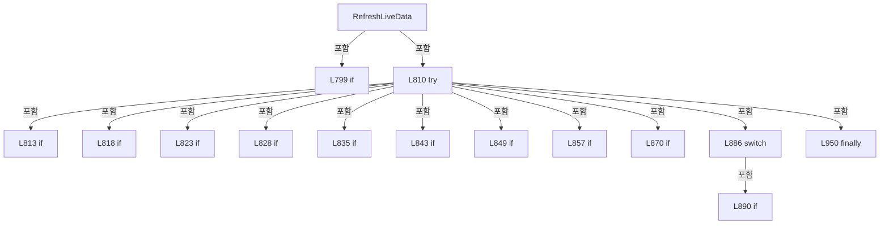

변경 전 점검: 입력/반환 타입, 위 호출자, 예외/취소 경로, 공유 상태와 저장·전송 소비자를 함께 확인합니다. 값의 단위나 물리 방향을 이름만으로 확정하지 않습니다.

### LocalFunctionStatement `IsIsSelected` · L805–808

[Drilling.UI/Menu/Menus/CMenuMonitor.cs:805–808](https://github.com/kjuws10-rgb/A3Drilling/blob/5aee8e58439c9b455cae7c9593c9be986c3e682e/Drilling.UI/Menu/Menus/CMenuMonitor.cs#L805-L808)

| 항목 | 실제 추출 값 |
| --- | --- |
| 서명 | bool IsIsSelected(Drilling.UI.Menu.Menus.ST_MONITOR_AXIS_ROW) |
| 접근/수식자 | Private /  |
| 반환/값 타입 | bool |
| 소속 타입 | NamedType:Drilling.UI.Menu.Menus.CMenuMonitor |

입력 계약:

| 이름 | 타입 | 전달 | 선택/기본값 |
| --- | --- | --- | --- |
| row | Drilling.UI.Menu.Menus.ST_MONITOR_AXIS_ROW | None | False /  |

현재 부분 분석에서 직접 연결된 호출자는 없습니다. XAML/이벤트/인터페이스·델리게이트·외부 진입을 추가 확인해야 하며, 미사용으로 판정한 것이 아닙니다.

본문의 실제 연산·분기·예외·반환 순서(원문 위치 순):

| 원본 행 | 종류 | 주석 해설 |
| --- | --- | --- |
| 807 | return | 호출자에게 값 또는 제어를 반환합니다: return row.IsSelected; |

변경 전 점검: 입력/반환 타입, 위 호출자, 예외/취소 경로, 공유 상태와 저장·전송 소비자를 함께 확인합니다. 값의 단위나 물리 방향을 이름만으로 확정하지 않습니다.

### MethodDeclaration `CreateLiveRefreshHash` · L958–1007

[Drilling.UI/Menu/Menus/CMenuMonitor.cs:958–1007](https://github.com/kjuws10-rgb/A3Drilling/blob/5aee8e58439c9b455cae7c9593c9be986c3e682e/Drilling.UI/Menu/Menus/CMenuMonitor.cs#L958-L1007)

| 항목 | 실제 추출 값 |
| --- | --- |
| 서명 | int Drilling.UI.Menu.Menus.CMenuMonitor.CreateLiveRefreshHash(string, Drilling.UI.Menu.Menus.ST_MONITOR_STATUS_SNAPSHOT) |
| 접근/수식자 | Private / private |
| 반환/값 타입 | int |
| 소속 타입 | NamedType:Drilling.UI.Menu.Menus.CMenuMonitor |

입력 계약:

| 이름 | 타입 | 전달 | 선택/기본값 |
| --- | --- | --- | --- |
| selectedTab | string | None | False /  |
| monitorSnapshot | Drilling.UI.Menu.Menus.ST_MONITOR_STATUS_SNAPSHOT | None | False /  |

정적 호출자로 확인된 위치:

| 호출 파일/행 | 호출 표현식 | 런타임 분기 가능 |
| --- | --- | --- |
| [Drilling.UI/Menu/Menus/CMenuMonitor.cs:783–783](https://github.com/kjuws10-rgb/A3Drilling/blob/5aee8e58439c9b455cae7c9593c9be986c3e682e/Drilling.UI/Menu/Menus/CMenuMonitor.cs#L783-L783) | CreateLiveRefreshHash | False |
| [Drilling.UI/Menu/Menus/CMenuMonitor.cs:848–848](https://github.com/kjuws10-rgb/A3Drilling/blob/5aee8e58439c9b455cae7c9593c9be986c3e682e/Drilling.UI/Menu/Menus/CMenuMonitor.cs#L848-L848) | CreateLiveRefreshHash | False |

호출하는 대상과 해석 범위:

| 원본 행 | 표현식 | 분석 상태 | 대상/소스 위치 |
| --- | --- | --- | --- |
| 960 | new HashCode | resolved | System.HashCode.HashCode() |
| 961 | hash.Add | resolved | void System.HashCode.Add<string>(string, System.Collections.Generic.IEqualityComparer<string>?) |
| 962 | AddSequenceHash | resolved | void Drilling.UI.Menu.Menus.CMenuMonitor.AddSequenceHash<Drilling.Common.Interface.ST_DEVICE_COMM_STATUS>(ref System.HashCode, System.Collections.Generic.IEnumerable<Drilling.Common.Interface.ST_DEVICE_COMM_STATUS>) · Drilling.UI/Menu/Menus/CMenuMonitor.cs:1009 |
| 967 | hash.Add | resolved | void System.HashCode.Add<string>(string, System.Collections.Generic.IEqualityComparer<string>?) |
| 968 | AddSequenceHash | resolved | void Drilling.UI.Menu.Menus.CMenuMonitor.AddSequenceHash<Drilling.Common.Motion.ST_MOTOR_AXIS_STATUS>(ref System.HashCode, System.Collections.Generic.IEnumerable<Drilling.Common.Motion.ST_MOTOR_AXIS_STATUS>) · Drilling.UI/Menu/Menus/CMenuMonitor.cs:1009 |
| 971 | hash.Add | resolved | void System.HashCode.Add<int>(int) |
| 972 | hash.Add | resolved | void System.HashCode.Add<Drilling.Common.Interface.ST_LASER_STATUS>(Drilling.Common.Interface.ST_LASER_STATUS) |
| 973 | hash.Add | resolved | void System.HashCode.Add<Drilling.Common.Interface.ST_TALON_STATUS>(Drilling.Common.Interface.ST_TALON_STATUS) |
| 974 | hash.Add | resolved | void System.HashCode.Add<int>(int) |
| 975 | hash.Add | resolved | void System.HashCode.Add<Drilling.Common.Managers.ST_POWER_METER_STATUS>(Drilling.Common.Managers.ST_POWER_METER_STATUS) |
| 978 | hash.Add | resolved | void System.HashCode.Add<int>(int) |
| 979 | hash.Add | resolved | void System.HashCode.Add<Drilling.Common.Interface.ST_ATTENUATOR_STATUS>(Drilling.Common.Interface.ST_ATTENUATOR_STATUS) |
| 982 | hash.Add | resolved | void System.HashCode.Add<int>(int) |
| 983 | hash.Add | resolved | void System.HashCode.Add<Drilling.Common.Interface.ST_BET_STATUS>(Drilling.Common.Interface.ST_BET_STATUS) |
| 986 | hash.Add | resolved | void System.HashCode.Add<int>(int) |
| 987 | hash.Add | resolved | void System.HashCode.Add<int>(int) |
| 988 | hash.Add | resolved | void System.HashCode.Add<string>(string, System.Collections.Generic.IEqualityComparer<string>?) |
| 989 | hash.Add | resolved | void System.HashCode.Add<string>(string, System.Collections.Generic.IEqualityComparer<string>?) |
| 990 | hash.Add | resolved | void System.HashCode.Add<int>(int) |
| 991 | hash.Add | resolved | void System.HashCode.Add<Drilling.Common.Managers.ST_POWER_METER_STATUS>(Drilling.Common.Managers.ST_POWER_METER_STATUS) |
| 994 | hash.Add | resolved | void System.HashCode.Add<int>(int) |
| 995 | hash.Add | resolved | void System.HashCode.Add<Drilling.Common.Interface.ST_PICO_MOTOR_STATUS>(Drilling.Common.Interface.ST_PICO_MOTOR_STATUS) |
| 998 | hash.Add | resolved | void System.HashCode.Add<string>(string, System.Collections.Generic.IEqualityComparer<string>?) |
| 999 | AddMelsecValuesHash | resolved | void Drilling.UI.Menu.Menus.CMenuMonitor.AddMelsecValuesHash(ref System.HashCode, System.Collections.Generic.IReadOnlyDictionary<string, Drilling.UI.Menu.Menus.ST_MONITOR_MELSEC_VALUE>) · Drilling.UI/Menu/Menus/CMenuMonitor.cs:1017 |
| 1002 | hash.Add | resolved | void System.HashCode.Add<Drilling.Common.Managers.ST_DEVICE_STATUS>(Drilling.Common.Managers.ST_DEVICE_STATUS) |
| 1006 | hash.ToHashCode | resolved | int System.HashCode.ToHashCode() |

본문의 실제 연산·분기·예외·반환 순서(원문 위치 순):

| 원본 행 | 종류 | 주석 해설 |
| --- | --- | --- |
| 960 | call | 함수·델리게이트 또는 객체 생성자를 호출합니다: new HashCode() |
| 960 | local-declaration | 지역 변수를 선언합니다: var hash = new HashCode(); |
| 960 | variable-initializer | 변수의 초기값을 지정합니다: hash = new HashCode() |
| 961 | call | 함수·델리게이트 또는 객체 생성자를 호출합니다: hash.Add(selectedTab, StringComparer.OrdinalIgnoreCase) |
| 962 | call | 함수·델리게이트 또는 객체 생성자를 호출합니다: AddSequenceHash(ref hash, monitorSnapshot.Communication) |
| 963 | local-declaration | 지역 변수를 선언합니다: var snapshot = monitorSnapshot.DeviceStatus; |
| 963 | variable-initializer | 변수의 초기값을 지정합니다: snapshot = monitorSnapshot.DeviceStatus |
| 964 | switch | 값에 따라 분기합니다: switch (selectedTab) |
| 966 | case | 분기값/패턴의 구간입니다: case "XPS": |
| 967 | call | 함수·델리게이트 또는 객체 생성자를 호출합니다: hash.Add(_selectedAxisId, StringComparer.OrdinalIgnoreCase) |
| 968 | call | 함수·델리게이트 또는 객체 생성자를 호출합니다: AddSequenceHash(ref hash, snapshot.Motors) |
| 969 | break | 해당 반복/분기 구간을 종료합니다: break; |
| 970 | case | 분기값/패턴의 구간입니다: case "LASER": |
| 971 | call | 함수·델리게이트 또는 객체 생성자를 호출합니다: hash.Add(_selectedLaserNumber) |
| 972 | call | 함수·델리게이트 또는 객체 생성자를 호출합니다: hash.Add(snapshot.Laser) |
| 973 | call | 함수·델리게이트 또는 객체 생성자를 호출합니다: hash.Add(monitorSnapshot.TalonStatus) |
| 974 | call | 함수·델리게이트 또는 객체 생성자를 호출합니다: hash.Add(_selectedPowerMeterNumber) |
| 975 | call | 함수·델리게이트 또는 객체 생성자를 호출합니다: hash.Add(snapshot.PowerMeter) |
| 976 | break | 해당 반복/분기 구간을 종료합니다: break; |
| 977 | case | 분기값/패턴의 구간입니다: case "ATTENUATOR": |
| 978 | call | 함수·델리게이트 또는 객체 생성자를 호출합니다: hash.Add(_selectedAttenuatorNumber) |
| 979 | call | 함수·델리게이트 또는 객체 생성자를 호출합니다: hash.Add(snapshot.Attenuator) |
| 980 | break | 해당 반복/분기 구간을 종료합니다: break; |
| 981 | case | 분기값/패턴의 구간입니다: case "BET": |
| 982 | call | 함수·델리게이트 또는 객체 생성자를 호출합니다: hash.Add(_selectedBetNumber) |
| 983 | call | 함수·델리게이트 또는 객체 생성자를 호출합니다: hash.Add(snapshot.Bet) |
| 984 | break | 해당 반복/분기 구간을 종료합니다: break; |
| 985 | case | 분기값/패턴의 구간입니다: case "POWER METER": |
| 986 | call | 함수·델리게이트 또는 객체 생성자를 호출합니다: hash.Add(_selectedAttenuatorNumber) |
| 987 | call | 함수·델리게이트 또는 객체 생성자를 호출합니다: hash.Add(_selectedPowerMeterNumber) |
| 988 | call | 함수·델리게이트 또는 객체 생성자를 호출합니다: hash.Add(_powerMeterTuneState, StringComparer.OrdinalIgnoreCase) |
| 989 | call | 함수·델리게이트 또는 객체 생성자를 호출합니다: hash.Add(_powerMeterTuneMessage, StringComparer.OrdinalIgnoreCase) |
| 990 | call | 함수·델리게이트 또는 객체 생성자를 호출합니다: hash.Add(_powerMeterTuneSamples.Count) |
| 991 | call | 함수·델리게이트 또는 객체 생성자를 호출합니다: hash.Add(snapshot.PowerMeter) |
| 992 | break | 해당 반복/분기 구간을 종료합니다: break; |
| 993 | case | 분기값/패턴의 구간입니다: case "PICO MOTOR": |
| 994 | call | 함수·델리게이트 또는 객체 생성자를 호출합니다: hash.Add(_selectedPicoMotorNo) |
| 995 | call | 함수·델리게이트 또는 객체 생성자를 호출합니다: hash.Add(monitorSnapshot.PicoMotorStatus) |
| 996 | break | 해당 반복/분기 구간을 종료합니다: break; |
| 997 | case | 분기값/패턴의 구간입니다: case "MELSEC": |
| 998 | call | 함수·델리게이트 또는 객체 생성자를 호출합니다: hash.Add(_selectedMelsecGroup, StringComparer.OrdinalIgnoreCase) |
| 999 | call | 함수·델리게이트 또는 객체 생성자를 호출합니다: AddMelsecValuesHash(ref hash, monitorSnapshot.MelsecValues) |
| 1000 | break | 해당 반복/분기 구간을 종료합니다: break; |
| 1001 | case | 분기값/패턴의 구간입니다: default: |
| 1002 | call | 함수·델리게이트 또는 객체 생성자를 호출합니다: hash.Add(snapshot) |
| 1003 | break | 해당 반복/분기 구간을 종료합니다: break; |
| 1006 | call | 함수·델리게이트 또는 객체 생성자를 호출합니다: hash.ToHashCode() |
| 1006 | return | 호출자에게 값 또는 제어를 반환합니다: return hash.ToHashCode(); |

제어 구문의 포함 구조(실제 실행 순서/CFG가 아닌 구문 탐색 그림):

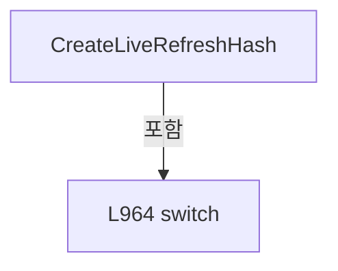

변경 전 점검: 입력/반환 타입, 위 호출자, 예외/취소 경로, 공유 상태와 저장·전송 소비자를 함께 확인합니다. 값의 단위나 물리 방향을 이름만으로 확정하지 않습니다.

### MethodDeclaration `AddSequenceHash` · L1009–1015

[Drilling.UI/Menu/Menus/CMenuMonitor.cs:1009–1015](https://github.com/kjuws10-rgb/A3Drilling/blob/5aee8e58439c9b455cae7c9593c9be986c3e682e/Drilling.UI/Menu/Menus/CMenuMonitor.cs#L1009-L1015)

| 항목 | 실제 추출 값 |
| --- | --- |
| 서명 | void Drilling.UI.Menu.Menus.CMenuMonitor.AddSequenceHash<T>(ref System.HashCode, System.Collections.Generic.IEnumerable<T>) |
| 접근/수식자 | Private / private, static |
| 반환/값 타입 | void |
| 소속 타입 | NamedType:Drilling.UI.Menu.Menus.CMenuMonitor |

입력 계약:

| 이름 | 타입 | 전달 | 선택/기본값 |
| --- | --- | --- | --- |
| hash | System.HashCode | Ref | False /  |
| values | System.Collections.Generic.IEnumerable<T> | None | False /  |

정적 호출자로 확인된 위치:

| 호출 파일/행 | 호출 표현식 | 런타임 분기 가능 |
| --- | --- | --- |
| [Drilling.UI/Menu/Menus/CMenuMonitor.cs:962–962](https://github.com/kjuws10-rgb/A3Drilling/blob/5aee8e58439c9b455cae7c9593c9be986c3e682e/Drilling.UI/Menu/Menus/CMenuMonitor.cs#L962-L962) | AddSequenceHash | False |
| [Drilling.UI/Menu/Menus/CMenuMonitor.cs:968–968](https://github.com/kjuws10-rgb/A3Drilling/blob/5aee8e58439c9b455cae7c9593c9be986c3e682e/Drilling.UI/Menu/Menus/CMenuMonitor.cs#L968-L968) | AddSequenceHash | False |

호출하는 대상과 해석 범위:

| 원본 행 | 표현식 | 분석 상태 | 대상/소스 위치 |
| --- | --- | --- | --- |
| 1013 | hash.Add | resolved | void System.HashCode.Add<T>(T) |

본문의 실제 연산·분기·예외·반환 순서(원문 위치 순):

| 원본 행 | 종류 | 주석 해설 |
| --- | --- | --- |
| 1011 | foreach | 컬렉션 요소를 순회합니다: foreach (var value in values) |
| 1013 | call | 함수·델리게이트 또는 객체 생성자를 호출합니다: hash.Add(value) |

제어 구문의 포함 구조(실제 실행 순서/CFG가 아닌 구문 탐색 그림):

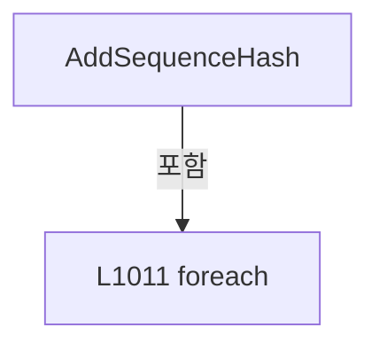

변경 전 점검: 입력/반환 타입, 위 호출자, 예외/취소 경로, 공유 상태와 저장·전송 소비자를 함께 확인합니다. 값의 단위나 물리 방향을 이름만으로 확정하지 않습니다.

### MethodDeclaration `AddMelsecValuesHash` · L1017–1024

[Drilling.UI/Menu/Menus/CMenuMonitor.cs:1017–1024](https://github.com/kjuws10-rgb/A3Drilling/blob/5aee8e58439c9b455cae7c9593c9be986c3e682e/Drilling.UI/Menu/Menus/CMenuMonitor.cs#L1017-L1024)

| 항목 | 실제 추출 값 |
| --- | --- |
| 서명 | void Drilling.UI.Menu.Menus.CMenuMonitor.AddMelsecValuesHash(ref System.HashCode, System.Collections.Generic.IReadOnlyDictionary<string, Drilling.UI.Menu.Menus.ST_MONITOR_MELSEC_VALUE>) |
| 접근/수식자 | Private / private, static |
| 반환/값 타입 | void |
| 소속 타입 | NamedType:Drilling.UI.Menu.Menus.CMenuMonitor |

입력 계약:

| 이름 | 타입 | 전달 | 선택/기본값 |
| --- | --- | --- | --- |
| hash | System.HashCode | Ref | False /  |
| values | System.Collections.Generic.IReadOnlyDictionary<string, Drilling.UI.Menu.Menus.ST_MONITOR_MELSEC_VALUE> | None | False /  |

정적 호출자로 확인된 위치:

| 호출 파일/행 | 호출 표현식 | 런타임 분기 가능 |
| --- | --- | --- |
| [Drilling.UI/Menu/Menus/CMenuMonitor.cs:999–999](https://github.com/kjuws10-rgb/A3Drilling/blob/5aee8e58439c9b455cae7c9593c9be986c3e682e/Drilling.UI/Menu/Menus/CMenuMonitor.cs#L999-L999) | AddMelsecValuesHash | False |

호출하는 대상과 해석 범위:

| 원본 행 | 표현식 | 분석 상태 | 대상/소스 위치 |
| --- | --- | --- | --- |
| 1019 | values.OrderBy | resolved | System.Linq.IOrderedEnumerable<System.Collections.Generic.KeyValuePair<string, Drilling.UI.Menu.Menus.ST_MONITOR_MELSEC_VALUE>> System.Collections.Generic.IEnumerable<System.Collections.Generic.KeyValuePair<string, Drilling.UI.Menu.Menus.ST_MONITOR_MELSEC_VALUE>>.OrderBy<System.Collections.Generic.KeyValuePair<string, Drilling.UI.Menu.Menus.ST_MONITOR_MELSEC_VALUE>, string>(System.Func<System.Collections.Generic.KeyValuePair<string, Drilling.UI.Menu.Menus.ST_MONITOR_MELSEC_VALUE>, string>, System.Collections.Generic.IComparer<string>?) |
| 1021 | hash.Add | resolved | void System.HashCode.Add<string>(string, System.Collections.Generic.IEqualityComparer<string>?) |
| 1022 | hash.Add | resolved | void System.HashCode.Add<Drilling.UI.Menu.Menus.ST_MONITOR_MELSEC_VALUE>(Drilling.UI.Menu.Menus.ST_MONITOR_MELSEC_VALUE) |

본문의 실제 연산·분기·예외·반환 순서(원문 위치 순):

| 원본 행 | 종류 | 주석 해설 |
| --- | --- | --- |
| 1019 | call | 함수·델리게이트 또는 객체 생성자를 호출합니다: values.OrderBy(GetMelsecValueKey, StringComparer.OrdinalIgnoreCase) |
| 1019 | foreach | 컬렉션 요소를 순회합니다: foreach (var item in values.OrderBy(GetMelsecValueKey, StringComparer.OrdinalIgnoreCase)) |
| 1021 | call | 함수·델리게이트 또는 객체 생성자를 호출합니다: hash.Add(item.Key, StringComparer.OrdinalIgnoreCase) |
| 1022 | call | 함수·델리게이트 또는 객체 생성자를 호출합니다: hash.Add(item.Value) |

제어 구문의 포함 구조(실제 실행 순서/CFG가 아닌 구문 탐색 그림):

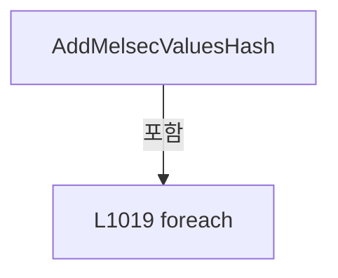

변경 전 점검: 입력/반환 타입, 위 호출자, 예외/취소 경로, 공유 상태와 저장·전송 소비자를 함께 확인합니다. 값의 단위나 물리 방향을 이름만으로 확정하지 않습니다.

### MethodDeclaration `GetMelsecValueKey` · L1026–1029

[Drilling.UI/Menu/Menus/CMenuMonitor.cs:1026–1029](https://github.com/kjuws10-rgb/A3Drilling/blob/5aee8e58439c9b455cae7c9593c9be986c3e682e/Drilling.UI/Menu/Menus/CMenuMonitor.cs#L1026-L1029)

| 항목 | 실제 추출 값 |
| --- | --- |
| 서명 | string Drilling.UI.Menu.Menus.CMenuMonitor.GetMelsecValueKey(System.Collections.Generic.KeyValuePair<string, Drilling.UI.Menu.Menus.ST_MONITOR_MELSEC_VALUE>) |
| 접근/수식자 | Private / private, static |
| 반환/값 타입 | string |
| 소속 타입 | NamedType:Drilling.UI.Menu.Menus.CMenuMonitor |

입력 계약:

| 이름 | 타입 | 전달 | 선택/기본값 |
| --- | --- | --- | --- |
| item | System.Collections.Generic.KeyValuePair<string, Drilling.UI.Menu.Menus.ST_MONITOR_MELSEC_VALUE> | None | False /  |

현재 부분 분석에서 직접 연결된 호출자는 없습니다. XAML/이벤트/인터페이스·델리게이트·외부 진입을 추가 확인해야 하며, 미사용으로 판정한 것이 아닙니다.

본문의 실제 연산·분기·예외·반환 순서(원문 위치 순):

| 원본 행 | 종류 | 주석 해설 |
| --- | --- | --- |
| 1028 | return | 호출자에게 값 또는 제어를 반환합니다: return item.Key; |

변경 전 점검: 입력/반환 타입, 위 호출자, 예외/취소 경로, 공유 상태와 저장·전송 소비자를 함께 확인합니다. 값의 단위나 물리 방향을 이름만으로 확정하지 않습니다.

### MethodDeclaration `RefreshPowerMeterSnapshotFromCache` · L1031–1040

[Drilling.UI/Menu/Menus/CMenuMonitor.cs:1031–1040](https://github.com/kjuws10-rgb/A3Drilling/blob/5aee8e58439c9b455cae7c9593c9be986c3e682e/Drilling.UI/Menu/Menus/CMenuMonitor.cs#L1031-L1040)

| 항목 | 실제 추출 값 |
| --- | --- |
| 서명 | Drilling.UI.Menu.Menus.ST_MONITOR_STATUS_SNAPSHOT Drilling.UI.Menu.Menus.CMenuMonitor.RefreshPowerMeterSnapshotFromCache(Drilling.UI.Menu.Menus.ST_MONITOR_STATUS_SNAPSHOT, System.Threading.CancellationToken) |
| 접근/수식자 | Private / private |
| 반환/값 타입 | Drilling.UI.Menu.Menus.ST_MONITOR_STATUS_SNAPSHOT |
| 소속 타입 | NamedType:Drilling.UI.Menu.Menus.CMenuMonitor |

입력 계약:

| 이름 | 타입 | 전달 | 선택/기본값 |
| --- | --- | --- | --- |
| monitorSnapshot | Drilling.UI.Menu.Menus.ST_MONITOR_STATUS_SNAPSHOT | None | False /  |
| cancellationToken | System.Threading.CancellationToken | None | False /  |

정적 호출자로 확인된 위치:

| 호출 파일/행 | 호출 표현식 | 런타임 분기 가능 |
| --- | --- | --- |
| [Drilling.UI/Menu/Menus/CMenuMonitor.cs:677–677](https://github.com/kjuws10-rgb/A3Drilling/blob/5aee8e58439c9b455cae7c9593c9be986c3e682e/Drilling.UI/Menu/Menus/CMenuMonitor.cs#L677-L677) | RefreshPowerMeterSnapshotFromCache | False |
| [Drilling.UI/Menu/Menus/CMenuMonitor.cs:845–845](https://github.com/kjuws10-rgb/A3Drilling/blob/5aee8e58439c9b455cae7c9593c9be986c3e682e/Drilling.UI/Menu/Menus/CMenuMonitor.cs#L845-L845) | RefreshPowerMeterSnapshotFromCache | False |

호출하는 대상과 해석 범위:

| 원본 행 | 표현식 | 분석 상태 | 대상/소스 위치 |
| --- | --- | --- | --- |
| 1037 | _interfaceManager.GetPowerMeterStatus | resolved | Drilling.Common.Managers.ST_POWER_METER_STATUS Drilling.Common.Interface.CInterfaceManager.GetPowerMeterStatus(int, System.Threading.CancellationToken) · Drilling.Common/Interface/CInterfaceManager.cs:1401 |

본문의 실제 연산·분기·예외·반환 순서(원문 위치 순):

| 원본 행 | 종류 | 주석 해설 |
| --- | --- | --- |
| 1033 | return | 호출자에게 값 또는 제어를 반환합니다: return monitorSnapshot with { DeviceStatus = monitorSnapshot.DeviceStatus with { PowerMeter = _interfaceManager.GetPowerMeterStatus(_selectedPowerMeterNumber, cancellationToken) } }; |
| 1035 | assignment | 값을 대상에 대입합니다: DeviceStatus = monitorSnapshot.DeviceStatus with { PowerMeter = _interfaceManager.GetPowerMeterStatus(_selectedPowerMeterNumber, cancellationToken) } |
| 1037 | assignment | 값을 대상에 대입합니다: PowerMeter = _interfaceManager.GetPowerMeterStatus(_selectedPowerMeterNumber, cancellationToken) |
| 1037 | call | 함수·델리게이트 또는 객체 생성자를 호출합니다: _interfaceManager.GetPowerMeterStatus(_selectedPowerMeterNumber, cancellationToken) |

변경 전 점검: 입력/반환 타입, 위 호출자, 예외/취소 경로, 공유 상태와 저장·전송 소비자를 함께 확인합니다. 값의 단위나 물리 방향을 이름만으로 확정하지 않습니다.

### MethodDeclaration `UpdatePollingContext` · L1042–1046

[Drilling.UI/Menu/Menus/CMenuMonitor.cs:1042–1046](https://github.com/kjuws10-rgb/A3Drilling/blob/5aee8e58439c9b455cae7c9593c9be986c3e682e/Drilling.UI/Menu/Menus/CMenuMonitor.cs#L1042-L1046)

| 항목 | 실제 추출 값 |
| --- | --- |
| 서명 | void Drilling.UI.Menu.Menus.CMenuMonitor.UpdatePollingContext(string) |
| 접근/수식자 | Private / private |
| 반환/값 타입 | void |
| 소속 타입 | NamedType:Drilling.UI.Menu.Menus.CMenuMonitor |

입력 계약:

| 이름 | 타입 | 전달 | 선택/기본값 |
| --- | --- | --- | --- |
| selectedTab | string | None | False /  |

정적 호출자로 확인된 위치:

| 호출 파일/행 | 호출 표현식 | 런타임 분기 가능 |
| --- | --- | --- |
| [Drilling.UI/Menu/Menus/CMenuMonitor.cs:672–672](https://github.com/kjuws10-rgb/A3Drilling/blob/5aee8e58439c9b455cae7c9593c9be986c3e682e/Drilling.UI/Menu/Menus/CMenuMonitor.cs#L672-L672) | UpdatePollingContext | False |
| [Drilling.UI/Menu/Menus/CMenuMonitor.cs:840–840](https://github.com/kjuws10-rgb/A3Drilling/blob/5aee8e58439c9b455cae7c9593c9be986c3e682e/Drilling.UI/Menu/Menus/CMenuMonitor.cs#L840-L840) | UpdatePollingContext | False |

호출하는 대상과 해석 범위:

| 원본 행 | 표현식 | 분석 상태 | 대상/소스 위치 |
| --- | --- | --- | --- |
| 1044 | IsHeadDeviceTab | resolved | bool Drilling.UI.Menu.Menus.CMenuMonitor.IsHeadDeviceTab(string) · Drilling.UI/Menu/Menus/CMenuMonitor.cs:2382 |
| 1045 | _statusPollingService.UpdateContext | resolved | void Drilling.UI.Menu.Menus.CMonitorStatusPollingService.UpdateContext(string, int, int, int, string) · Drilling.UI/Menu/Menus/CMonitorStatusPollingService.cs:37 |

본문의 실제 연산·분기·예외·반환 순서(원문 위치 순):

| 원본 행 | 종류 | 주석 해설 |
| --- | --- | --- |
| 1044 | call | 함수·델리게이트 또는 객체 생성자를 호출합니다: IsHeadDeviceTab(selectedTab) |
| 1044 | conditional-expression | 조건에 따라 결과식을 선택합니다: IsHeadDeviceTab(selectedTab) && _enabledHeadDeviceNumbers.Count == 0 ? "PRODUCT" : selectedTab |
| 1044 | local-declaration | 지역 변수를 선언합니다: var pollingTab = IsHeadDeviceTab(selectedTab) && _enabledHeadDeviceNumbers.Count == 0 ? "PRODUCT" : selectedTab; |
| 1044 | variable-initializer | 변수의 초기값을 지정합니다: pollingTab = IsHeadDeviceTab(selectedTab) && _enabledHeadDeviceNumbers.Count == 0 ? "PRODUCT" : selectedTab |
| 1045 | call | 함수·델리게이트 또는 객체 생성자를 호출합니다: _statusPollingService.UpdateContext(pollingTab, _selectedLaserNumber, _selectedAttenuatorNumber, _selectedBetNumber, selectedTab == "MELSEC" ? _selectedMelsecGroup : "ALL") |
| 1045 | conditional-expression | 조건에 따라 결과식을 선택합니다: selectedTab == "MELSEC" ? _selectedMelsecGroup : "ALL" |

변경 전 점검: 입력/반환 타입, 위 호출자, 예외/취소 경로, 공유 상태와 저장·전송 소비자를 함께 확인합니다. 값의 단위나 물리 방향을 이름만으로 확정하지 않습니다.

### MethodDeclaration `GetDeviceStatus` · L1048–1051

[Drilling.UI/Menu/Menus/CMenuMonitor.cs:1048–1051](https://github.com/kjuws10-rgb/A3Drilling/blob/5aee8e58439c9b455cae7c9593c9be986c3e682e/Drilling.UI/Menu/Menus/CMenuMonitor.cs#L1048-L1051)

| 항목 | 실제 추출 값 |
| --- | --- |
| 서명 | System.Threading.Tasks.Task<Drilling.Common.Managers.ST_DEVICE_STATUS> Drilling.UI.Menu.Menus.CMenuMonitor.GetDeviceStatus(System.Threading.CancellationToken) |
| 접근/수식자 | Private / private |
| 반환/값 타입 | System.Threading.Tasks.Task<Drilling.Common.Managers.ST_DEVICE_STATUS> |
| 소속 타입 | NamedType:Drilling.UI.Menu.Menus.CMenuMonitor |

입력 계약:

| 이름 | 타입 | 전달 | 선택/기본값 |
| --- | --- | --- | --- |
| cancellationToken | System.Threading.CancellationToken | None | False /  |

정적 호출자로 확인된 위치:

| 호출 파일/행 | 호출 표현식 | 런타임 분기 가능 |
| --- | --- | --- |
| [Drilling.UI/Menu/Menus/CMenuMonitor.cs:4555–4555](https://github.com/kjuws10-rgb/A3Drilling/blob/5aee8e58439c9b455cae7c9593c9be986c3e682e/Drilling.UI/Menu/Menus/CMenuMonitor.cs#L4555-L4555) | GetDeviceStatus | False |

호출하는 대상과 해석 범위:

| 원본 행 | 표현식 | 분석 상태 | 대상/소스 위치 |
| --- | --- | --- | --- |
| 1050 | GetDeviceStatus | resolved | System.Threading.Tasks.Task<Drilling.Common.Managers.ST_DEVICE_STATUS> Drilling.UI.Menu.Menus.CMenuMonitor.GetDeviceStatus(string, System.Threading.CancellationToken) · Drilling.UI/Menu/Menus/CMenuMonitor.cs:1053 |

본문의 실제 연산·분기·예외·반환 순서(원문 위치 순):

| 원본 행 | 종류 | 주석 해설 |
| --- | --- | --- |
| 1050 | call | 함수·델리게이트 또는 객체 생성자를 호출합니다: GetDeviceStatus("ALL", cancellationToken) |
| 1050 | return | 호출자에게 값 또는 제어를 반환합니다: return GetDeviceStatus("ALL", cancellationToken); |

변경 전 점검: 입력/반환 타입, 위 호출자, 예외/취소 경로, 공유 상태와 저장·전송 소비자를 함께 확인합니다. 값의 단위나 물리 방향을 이름만으로 확정하지 않습니다.

### MethodDeclaration `GetDeviceStatus` · L1053–1063

[Drilling.UI/Menu/Menus/CMenuMonitor.cs:1053–1063](https://github.com/kjuws10-rgb/A3Drilling/blob/5aee8e58439c9b455cae7c9593c9be986c3e682e/Drilling.UI/Menu/Menus/CMenuMonitor.cs#L1053-L1063)

| 항목 | 실제 추출 값 |
| --- | --- |
| 서명 | System.Threading.Tasks.Task<Drilling.Common.Managers.ST_DEVICE_STATUS> Drilling.UI.Menu.Menus.CMenuMonitor.GetDeviceStatus(string, System.Threading.CancellationToken) |
| 접근/수식자 | Private / private |
| 반환/값 타입 | System.Threading.Tasks.Task<Drilling.Common.Managers.ST_DEVICE_STATUS> |
| 소속 타입 | NamedType:Drilling.UI.Menu.Menus.CMenuMonitor |

입력 계약:

| 이름 | 타입 | 전달 | 선택/기본값 |
| --- | --- | --- | --- |
| selectedTab | string | None | False /  |
| cancellationToken | System.Threading.CancellationToken | None | False /  |

정적 호출자로 확인된 위치:

| 호출 파일/행 | 호출 표현식 | 런타임 분기 가능 |
| --- | --- | --- |
| [Drilling.UI/Menu/Menus/CMenuMonitor.cs:1050–1050](https://github.com/kjuws10-rgb/A3Drilling/blob/5aee8e58439c9b455cae7c9593c9be986c3e682e/Drilling.UI/Menu/Menus/CMenuMonitor.cs#L1050-L1050) | GetDeviceStatus | False |

호출하는 대상과 해석 범위:

| 원본 행 | 표현식 | 분석 상태 | 대상/소스 위치 |
| --- | --- | --- | --- |
| 1055 | NormalizeMonitorTab | resolved | string Drilling.UI.Menu.Menus.CMenuMonitor.NormalizeMonitorTab(string?) · Drilling.UI/Menu/Menus/CMenuMonitor.cs:1879 |
| 1057 | _motionManager.GetAxisStatus | resolved | System.Collections.Generic.IReadOnlyList<Drilling.Common.Motion.ST_MOTOR_AXIS_STATUS> Drilling.Common.Motion.CMotionManager.GetAxisStatus(System.Threading.CancellationToken) · Drilling.Common/Motion/CMotionManager.cs:146 |
| 1058 | _interfaceManager.GetLaserStatus | resolved | Drilling.Common.Interface.ST_LASER_STATUS Drilling.Common.Interface.CInterfaceManager.GetLaserStatus(int, System.Threading.CancellationToken) · Drilling.Common/Interface/CInterfaceManager.cs:856 |
| 1058 | CreateEmptyLaserStatus | resolved | Drilling.Common.Interface.ST_LASER_STATUS Drilling.UI.Menu.Menus.CMenuMonitor.CreateEmptyLaserStatus() · Drilling.UI/Menu/Menus/CMenuMonitor.cs:1065 |
| 1059 | _interfaceManager.GetAttenuatorStatus | resolved | Drilling.Common.Interface.ST_ATTENUATOR_STATUS Drilling.Common.Interface.CInterfaceManager.GetAttenuatorStatus(int, System.Threading.CancellationToken) · Drilling.Common/Interface/CInterfaceManager.cs:1014 |
| 1059 | CreateEmptyAttenuatorStatus | resolved | Drilling.Common.Interface.ST_ATTENUATOR_STATUS Drilling.UI.Menu.Menus.CMenuMonitor.CreateEmptyAttenuatorStatus() · Drilling.UI/Menu/Menus/CMenuMonitor.cs:1070 |
| 1060 | _interfaceManager.GetBETStatus | resolved | Drilling.Common.Interface.ST_BET_STATUS Drilling.Common.Interface.CInterfaceManager.GetBETStatus(int, System.Threading.CancellationToken) · Drilling.Common/Interface/CInterfaceManager.cs:1254 |
| 1060 | CreateEmptyBETStatus | resolved | Drilling.Common.Interface.ST_BET_STATUS Drilling.UI.Menu.Menus.CMenuMonitor.CreateEmptyBETStatus() · Drilling.UI/Menu/Menus/CMenuMonitor.cs:1075 |
| 1061 | _interfaceManager.GetPowerMeterStatus | resolved | Drilling.Common.Managers.ST_POWER_METER_STATUS Drilling.Common.Interface.CInterfaceManager.GetPowerMeterStatus(int, System.Threading.CancellationToken) · Drilling.Common/Interface/CInterfaceManager.cs:1401 |
| 1062 | Task.FromResult | resolved | System.Threading.Tasks.Task<Drilling.Common.Managers.ST_DEVICE_STATUS> System.Threading.Tasks.Task.FromResult<Drilling.Common.Managers.ST_DEVICE_STATUS>(Drilling.Common.Managers.ST_DEVICE_STATUS) |
| 1062 | new ST_DEVICE_STATUS | resolved | Drilling.Common.Managers.ST_DEVICE_STATUS.ST_DEVICE_STATUS(System.Collections.Generic.IReadOnlyList<Drilling.Common.Motion.ST_IO_STATUS>, System.Collections.Generic.IReadOnlyList<Drilling.Common.Motion.ST_MOTOR_AXIS_STATUS>, Drilling.Common.Interface.ST_LASER_STATUS, Drilling.Common.Interface.ST_ATTENUATOR_STATUS, Drilling.Common.Interface.ST_BET_STATUS, Drilling.Common.Managers.ST_POWER_METER_STATUS) · Drilling.Common/Managers/CManager.cs:726 |

본문의 실제 연산·분기·예외·반환 순서(원문 위치 순):

| 원본 행 | 종류 | 주석 해설 |
| --- | --- | --- |
| 1055 | call | 함수·델리게이트 또는 객체 생성자를 호출합니다: NormalizeMonitorTab(selectedTab) |
| 1055 | local-declaration | 지역 변수를 선언합니다: var tab = NormalizeMonitorTab(selectedTab); |
| 1055 | variable-initializer | 변수의 초기값을 지정합니다: tab = NormalizeMonitorTab(selectedTab) |
| 1056 | local-declaration | 지역 변수를 선언합니다: IReadOnlyList<ST_IO_STATUS> io = []; |
| 1056 | variable-initializer | 변수의 초기값을 지정합니다: io = [] |
| 1057 | call | 함수·델리게이트 또는 객체 생성자를 호출합니다: _motionManager.GetAxisStatus(cancellationToken) |
| 1057 | conditional-expression | 조건에 따라 결과식을 선택합니다: tab is "ALL" or "XPS" ? _motionManager.GetAxisStatus(cancellationToken) : [] |
| 1057 | local-declaration | 지역 변수를 선언합니다: var motors = tab is "ALL" or "XPS" ? _motionManager.GetAxisStatus(cancellationToken) : []; |
| 1057 | variable-initializer | 변수의 초기값을 지정합니다: motors = tab is "ALL" or "XPS" ? _motionManager.GetAxisStatus(cancellationToken) : [] |
| 1058 | call | 함수·델리게이트 또는 객체 생성자를 호출합니다: _interfaceManager.GetLaserStatus(_selectedLaserNumber, cancellationToken) |
| 1058 | call | 함수·델리게이트 또는 객체 생성자를 호출합니다: CreateEmptyLaserStatus() |
| 1058 | conditional-expression | 조건에 따라 결과식을 선택합니다: tab is "ALL" ? _interfaceManager.GetLaserStatus(_selectedLaserNumber, cancellationToken) : CreateEmptyLaserStatus() |
| 1058 | local-declaration | 지역 변수를 선언합니다: var laserStatus = tab is "ALL" ? _interfaceManager.GetLaserStatus(_selectedLaserNumber, cancellationToken) : CreateEmptyLaserStatus(); |
| 1058 | variable-initializer | 변수의 초기값을 지정합니다: laserStatus = tab is "ALL" ? _interfaceManager.GetLaserStatus(_selectedLaserNumber, cancellationToken) : CreateEmptyLaserStatus() |
| 1059 | call | 함수·델리게이트 또는 객체 생성자를 호출합니다: _interfaceManager.GetAttenuatorStatus(_selectedAttenuatorNumber, cancellationToken) |
| 1059 | call | 함수·델리게이트 또는 객체 생성자를 호출합니다: CreateEmptyAttenuatorStatus() |
| 1059 | conditional-expression | 조건에 따라 결과식을 선택합니다: tab is "ALL" or "ATTENUATOR" ? _interfaceManager.GetAttenuatorStatus(_selectedAttenuatorNumber, cancellationToken) : CreateEmptyAttenuatorStatus() |
| 1059 | local-declaration | 지역 변수를 선언합니다: var attenuatorStatus = tab is "ALL" or "ATTENUATOR" ? _interfaceManager.GetAttenuatorStatus(_selectedAttenuatorNumber, cancellationToken) : CreateEmptyAttenuatorStatus(); |
| 1059 | variable-initializer | 변수의 초기값을 지정합니다: attenuatorStatus = tab is "ALL" or "ATTENUATOR" ? _interfaceManager.GetAttenuatorStatus(_selectedAttenuatorNumber, cancellationToken) : CreateEmptyAttenuatorStatus() |
| 1060 | call | 함수·델리게이트 또는 객체 생성자를 호출합니다: _interfaceManager.GetBETStatus(_selectedBetNumber, cancellationToken) |
| 1060 | call | 함수·델리게이트 또는 객체 생성자를 호출합니다: CreateEmptyBETStatus() |
| 1060 | conditional-expression | 조건에 따라 결과식을 선택합니다: tab is "ALL" or "BET" ? _interfaceManager.GetBETStatus(_selectedBetNumber, cancellationToken) : CreateEmptyBETStatus() |
| 1060 | local-declaration | 지역 변수를 선언합니다: var betStatus = tab is "ALL" or "BET" ? _interfaceManager.GetBETStatus(_selectedBetNumber, cancellationToken) : CreateEmptyBETStatus(); |
| 1060 | variable-initializer | 변수의 초기값을 지정합니다: betStatus = tab is "ALL" or "BET" ? _interfaceManager.GetBETStatus(_selectedBetNumber, cancellationToken) : CreateEmptyBETStatus() |
| 1061 | call | 함수·델리게이트 또는 객체 생성자를 호출합니다: _interfaceManager.GetPowerMeterStatus(_selectedPowerMeterNumber, cancellationToken) |
| 1061 | conditional-expression | 조건에 따라 결과식을 선택합니다: tab is "ALL" or "POWER METER" ? _interfaceManager.GetPowerMeterStatus(_selectedPowerMeterNumber, cancellationToken) : ST_POWER_METER_STATUS.Empty |
| 1061 | local-declaration | 지역 변수를 선언합니다: var powerMeterStatus = tab is "ALL" or "POWER METER" ? _interfaceManager.GetPowerMeterStatus(_selectedPowerMeterNumber, cancellationToken) : ST_POWER_METER_STATUS.Empty; |
| 1061 | variable-initializer | 변수의 초기값을 지정합니다: powerMeterStatus = tab is "ALL" or "POWER METER" ? _interfaceManager.GetPowerMeterStatus(_selectedPowerMeterNumber, cancellationToken) : ST_POWER_METER_STATUS.Empty |
| 1062 | call | 함수·델리게이트 또는 객체 생성자를 호출합니다: Task.FromResult(new ST_DEVICE_STATUS(io, motors, laserStatus, attenuatorStatus, betStatus, powerMeterStatus)) |
| 1062 | call | 함수·델리게이트 또는 객체 생성자를 호출합니다: new ST_DEVICE_STATUS(io, motors, laserStatus, attenuatorStatus, betStatus, powerMeterStatus) |
| 1062 | return | 호출자에게 값 또는 제어를 반환합니다: return Task.FromResult(new ST_DEVICE_STATUS(io, motors, laserStatus, attenuatorStatus, betStatus, powerMeterStatus)); |

변경 전 점검: 입력/반환 타입, 위 호출자, 예외/취소 경로, 공유 상태와 저장·전송 소비자를 함께 확인합니다. 값의 단위나 물리 방향을 이름만으로 확정하지 않습니다.

### MethodDeclaration `CreateEmptyLaserStatus` · L1065–1068

[Drilling.UI/Menu/Menus/CMenuMonitor.cs:1065–1068](https://github.com/kjuws10-rgb/A3Drilling/blob/5aee8e58439c9b455cae7c9593c9be986c3e682e/Drilling.UI/Menu/Menus/CMenuMonitor.cs#L1065-L1068)

| 항목 | 실제 추출 값 |
| --- | --- |
| 서명 | Drilling.Common.Interface.ST_LASER_STATUS Drilling.UI.Menu.Menus.CMenuMonitor.CreateEmptyLaserStatus() |
| 접근/수식자 | Private / private, static |
| 반환/값 타입 | Drilling.Common.Interface.ST_LASER_STATUS |
| 소속 타입 | NamedType:Drilling.UI.Menu.Menus.CMenuMonitor |

정적 호출자로 확인된 위치:

| 호출 파일/행 | 호출 표현식 | 런타임 분기 가능 |
| --- | --- | --- |
| [Drilling.UI/Menu/Menus/CMenuMonitor.cs:1058–1058](https://github.com/kjuws10-rgb/A3Drilling/blob/5aee8e58439c9b455cae7c9593c9be986c3e682e/Drilling.UI/Menu/Menus/CMenuMonitor.cs#L1058-L1058) | CreateEmptyLaserStatus | False |

호출하는 대상과 해석 범위:

| 원본 행 | 표현식 | 분석 상태 | 대상/소스 위치 |
| --- | --- | --- | --- |
| 1067 | new ST_LASER_STATUS | resolved | Drilling.Common.Interface.ST_LASER_STATUS.ST_LASER_STATUS(bool, bool, bool, double) · Drilling.Common/Interface/Serial/CTalonLaser.cs:367 |

본문의 실제 연산·분기·예외·반환 순서(원문 위치 순):

| 원본 행 | 종류 | 주석 해설 |
| --- | --- | --- |
| 1067 | call | 함수·델리게이트 또는 객체 생성자를 호출합니다: new ST_LASER_STATUS(false, false, false, 0.0) |
| 1067 | return | 호출자에게 값 또는 제어를 반환합니다: return new ST_LASER_STATUS(false, false, false, 0.0); |

변경 전 점검: 입력/반환 타입, 위 호출자, 예외/취소 경로, 공유 상태와 저장·전송 소비자를 함께 확인합니다. 값의 단위나 물리 방향을 이름만으로 확정하지 않습니다.

### MethodDeclaration `CreateEmptyAttenuatorStatus` · L1070–1073

[Drilling.UI/Menu/Menus/CMenuMonitor.cs:1070–1073](https://github.com/kjuws10-rgb/A3Drilling/blob/5aee8e58439c9b455cae7c9593c9be986c3e682e/Drilling.UI/Menu/Menus/CMenuMonitor.cs#L1070-L1073)

| 항목 | 실제 추출 값 |
| --- | --- |
| 서명 | Drilling.Common.Interface.ST_ATTENUATOR_STATUS Drilling.UI.Menu.Menus.CMenuMonitor.CreateEmptyAttenuatorStatus() |
| 접근/수식자 | Private / private, static |
| 반환/값 타입 | Drilling.Common.Interface.ST_ATTENUATOR_STATUS |
| 소속 타입 | NamedType:Drilling.UI.Menu.Menus.CMenuMonitor |

정적 호출자로 확인된 위치:

| 호출 파일/행 | 호출 표현식 | 런타임 분기 가능 |
| --- | --- | --- |
| [Drilling.UI/Menu/Menus/CMenuMonitor.cs:1059–1059](https://github.com/kjuws10-rgb/A3Drilling/blob/5aee8e58439c9b455cae7c9593c9be986c3e682e/Drilling.UI/Menu/Menus/CMenuMonitor.cs#L1059-L1059) | CreateEmptyAttenuatorStatus | False |

호출하는 대상과 해석 범위:

| 원본 행 | 표현식 | 분석 상태 | 대상/소스 위치 |
| --- | --- | --- | --- |
| 1072 | new ST_ATTENUATOR_STATUS | resolved | Drilling.Common.Interface.ST_ATTENUATOR_STATUS.ST_ATTENUATOR_STATUS(double, double, string, bool, Drilling.Common.Interface.EN_CONEX_AGP_ERROR, System.DateTimeOffset?, int?, double?, double?, double?, double?, double?) · Drilling.Common/Interface/Serial/CConex_AGP.cs:549 |

본문의 실제 연산·분기·예외·반환 순서(원문 위치 순):

| 원본 행 | 종류 | 주석 해설 |
| --- | --- | --- |
| 1072 | call | 함수·델리게이트 또는 객체 생성자를 호출합니다: new ST_ATTENUATOR_STATUS(0.0, 0.0, "IDLE", false) |
| 1072 | return | 호출자에게 값 또는 제어를 반환합니다: return new ST_ATTENUATOR_STATUS(0.0, 0.0, "IDLE", false); |

변경 전 점검: 입력/반환 타입, 위 호출자, 예외/취소 경로, 공유 상태와 저장·전송 소비자를 함께 확인합니다. 값의 단위나 물리 방향을 이름만으로 확정하지 않습니다.

### MethodDeclaration `CreateEmptyBETStatus` · L1075–1078

[Drilling.UI/Menu/Menus/CMenuMonitor.cs:1075–1078](https://github.com/kjuws10-rgb/A3Drilling/blob/5aee8e58439c9b455cae7c9593c9be986c3e682e/Drilling.UI/Menu/Menus/CMenuMonitor.cs#L1075-L1078)

| 항목 | 실제 추출 값 |
| --- | --- |
| 서명 | Drilling.Common.Interface.ST_BET_STATUS Drilling.UI.Menu.Menus.CMenuMonitor.CreateEmptyBETStatus() |
| 접근/수식자 | Private / private, static |
| 반환/값 타입 | Drilling.Common.Interface.ST_BET_STATUS |
| 소속 타입 | NamedType:Drilling.UI.Menu.Menus.CMenuMonitor |

정적 호출자로 확인된 위치:

| 호출 파일/행 | 호출 표현식 | 런타임 분기 가능 |
| --- | --- | --- |
| [Drilling.UI/Menu/Menus/CMenuMonitor.cs:1060–1060](https://github.com/kjuws10-rgb/A3Drilling/blob/5aee8e58439c9b455cae7c9593c9be986c3e682e/Drilling.UI/Menu/Menus/CMenuMonitor.cs#L1060-L1060) | CreateEmptyBETStatus | False |

호출하는 대상과 해석 범위:

| 원본 행 | 표현식 | 분석 상태 | 대상/소스 위치 |
| --- | --- | --- | --- |
| 1077 | new ST_BET_STATUS | resolved | Drilling.Common.Interface.ST_BET_STATUS.ST_BET_STATUS(double, double, double, double, double, double, bool, bool, bool, bool, bool, Drilling.Common.Interface.EN_BET_ERROR, System.DateTimeOffset?, string) · Drilling.Common/Interface/Serial/CBeamExpander.cs:449 |

본문의 실제 연산·분기·예외·반환 순서(원문 위치 순):

| 원본 행 | 종류 | 주석 해설 |
| --- | --- | --- |
| 1077 | call | 함수·델리게이트 또는 객체 생성자를 호출합니다: new ST_BET_STATUS(0.0, 0.0, 0.0, 0.0, 0.0, 0.0, false, false, false, false, false) |
| 1077 | return | 호출자에게 값 또는 제어를 반환합니다: return new ST_BET_STATUS(0.0, 0.0, 0.0, 0.0, 0.0, 0.0, false, false, false, false, false); |

변경 전 점검: 입력/반환 타입, 위 호출자, 예외/취소 경로, 공유 상태와 저장·전송 소비자를 함께 확인합니다. 값의 단위나 물리 방향을 이름만으로 확정하지 않습니다.

### MethodDeclaration `SelectTab` · L1080–1097

[Drilling.UI/Menu/Menus/CMenuMonitor.cs:1080–1097](https://github.com/kjuws10-rgb/A3Drilling/blob/5aee8e58439c9b455cae7c9593c9be986c3e682e/Drilling.UI/Menu/Menus/CMenuMonitor.cs#L1080-L1097)

| 항목 | 실제 추출 값 |
| --- | --- |
| 서명 | System.Threading.Tasks.Task Drilling.UI.Menu.Menus.CMenuMonitor.SelectTab(object?) |
| 접근/수식자 | Private / private, async |
| 반환/값 타입 | System.Threading.Tasks.Task |
| 소속 타입 | NamedType:Drilling.UI.Menu.Menus.CMenuMonitor |

입력 계약:

| 이름 | 타입 | 전달 | 선택/기본값 |
| --- | --- | --- | --- |
| parameter | object? | None | False /  |

정적 호출자로 확인된 위치:

| 호출 파일/행 | 호출 표현식 | 런타임 분기 가능 |
| --- | --- | --- |
| [Drilling.UI/Menu/Menus/CMenuMonitor.cs:178–178](https://github.com/kjuws10-rgb/A3Drilling/blob/5aee8e58439c9b455cae7c9593c9be986c3e682e/Drilling.UI/Menu/Menus/CMenuMonitor.cs#L178-L178) | SelectTab | False |

호출하는 대상과 해석 범위:

| 원본 행 | 표현식 | 분석 상태 | 대상/소스 위치 |
| --- | --- | --- | --- |
| 1082 | string.IsNullOrWhiteSpace | resolved | bool string.IsNullOrWhiteSpace(string?) |
| 1087 | NormalizeMonitorScreenTab | resolved | string Drilling.UI.Menu.Menus.CMenuMonitor.NormalizeMonitorScreenTab(string?) · Drilling.UI/Menu/Menus/CMenuMonitor.cs:1873 |
| 1088 | selectedTab.Equals | resolved | bool string.Equals(string?, System.StringComparison) |
| 1090 | ResetMelsecWriteLock | resolved | void Drilling.UI.Menu.Menus.CMenuMonitor.ResetMelsecWriteLock() · Drilling.UI/Menu/Menus/CMenuMonitor.cs:2804 |
| 1093 | _selectedTabSetter | resolved · 동적 구현 선택 가능 | void System.Action<string>.Invoke(string) |
| 1094 | _setStatusMessage | resolved · 동적 구현 선택 가능 | void System.Action<string>.Invoke(string) |
| 1095 | _refreshShellStatus | resolved · 동적 구현 선택 가능 | void System.Action.Invoke() |
| 1096 | _refreshCurrentScreen | resolved · 동적 구현 선택 가능 | System.Threading.Tasks.Task System.Func<System.Threading.Tasks.Task>.Invoke() |

본문의 실제 연산·분기·예외·반환 순서(원문 위치 순):

| 원본 행 | 종류 | 주석 해설 |
| --- | --- | --- |
| 1082 | call | 함수·델리게이트 또는 객체 생성자를 호출합니다: string.IsNullOrWhiteSpace(tab) |
| 1082 | if | 조건에 따라 분기합니다: if (parameter is not string tab &#124;&#124; string.IsNullOrWhiteSpace(tab)) |
| 1084 | return | 호출자에게 값 또는 제어를 반환합니다: return; |
| 1087 | call | 함수·델리게이트 또는 객체 생성자를 호출합니다: NormalizeMonitorScreenTab(tab) |
| 1087 | local-declaration | 지역 변수를 선언합니다: var selectedTab = NormalizeMonitorScreenTab(tab); |
| 1087 | variable-initializer | 변수의 초기값을 지정합니다: selectedTab = NormalizeMonitorScreenTab(tab) |
| 1088 | call | 함수·델리게이트 또는 객체 생성자를 호출합니다: selectedTab.Equals("MELSEC", StringComparison.OrdinalIgnoreCase) |
| 1088 | if | 조건에 따라 분기합니다: if (!selectedTab.Equals("MELSEC", StringComparison.OrdinalIgnoreCase)) |
| 1090 | call | 함수·델리게이트 또는 객체 생성자를 호출합니다: ResetMelsecWriteLock() |
| 1093 | call | 함수·델리게이트 또는 객체 생성자를 호출합니다: _selectedTabSetter(selectedTab) |
| 1094 | call | 함수·델리게이트 또는 객체 생성자를 호출합니다: _setStatusMessage($"Monitor tab {selectedTab} selected.") |
| 1095 | call | 함수·델리게이트 또는 객체 생성자를 호출합니다: _refreshShellStatus() |
| 1096 | await | 비동기 완료를 기다립니다: await _refreshCurrentScreen() |
| 1096 | call | 함수·델리게이트 또는 객체 생성자를 호출합니다: _refreshCurrentScreen() |

제어 구문의 포함 구조(실제 실행 순서/CFG가 아닌 구문 탐색 그림):

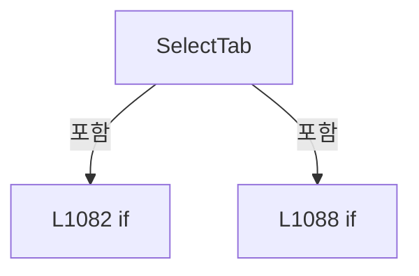

변경 전 점검: 입력/반환 타입, 위 호출자, 예외/취소 경로, 공유 상태와 저장·전송 소비자를 함께 확인합니다. 값의 단위나 물리 방향을 이름만으로 확정하지 않습니다.

### MethodDeclaration `SelectHeadDevice` · L1099–1152

[Drilling.UI/Menu/Menus/CMenuMonitor.cs:1099–1152](https://github.com/kjuws10-rgb/A3Drilling/blob/5aee8e58439c9b455cae7c9593c9be986c3e682e/Drilling.UI/Menu/Menus/CMenuMonitor.cs#L1099-L1152)

| 항목 | 실제 추출 값 |
| --- | --- |
| 서명 | System.Threading.Tasks.Task Drilling.UI.Menu.Menus.CMenuMonitor.SelectHeadDevice(object?) |
| 접근/수식자 | Private / private, async |
| 반환/값 타입 | System.Threading.Tasks.Task |
| 소속 타입 | NamedType:Drilling.UI.Menu.Menus.CMenuMonitor |

입력 계약:

| 이름 | 타입 | 전달 | 선택/기본값 |
| --- | --- | --- | --- |
| parameter | object? | None | False /  |

정적 호출자로 확인된 위치:

| 호출 파일/행 | 호출 표현식 | 런타임 분기 가능 |
| --- | --- | --- |
| [Drilling.UI/Menu/Menus/CMenuMonitor.cs:184–184](https://github.com/kjuws10-rgb/A3Drilling/blob/5aee8e58439c9b455cae7c9593c9be986c3e682e/Drilling.UI/Menu/Menus/CMenuMonitor.cs#L184-L184) | SelectHeadDevice | False |

호출하는 대상과 해석 범위:

| 원본 행 | 표현식 | 분석 상태 | 대상/소스 위치 |
| --- | --- | --- | --- |
| 1101 | TryNotifyPowerMeterTuneLocked | resolved | bool Drilling.UI.Menu.Menus.CMenuMonitor.TryNotifyPowerMeterTuneLocked(string) · Drilling.UI/Menu/Menus/CMenuMonitor.cs:5311 |
| 1106 | CanSelectHeadDevice | resolved | bool Drilling.UI.Menu.Menus.CMenuMonitor.CanSelectHeadDevice(object?) · Drilling.UI/Menu/Menus/CMenuMonitor.cs:1167 |
| 1115 | int.TryParse | resolved | bool int.TryParse(string?, System.Globalization.NumberStyles, System.IFormatProvider?, out int) |
| 1116 | GetSelectedHeadNumber | resolved | int Drilling.UI.Menu.Menus.CMenuMonitor.GetSelectedHeadNumber(string) · Drilling.UI/Menu/Menus/CMenuMonitor.cs:2272 |
| 1117 | Math.Clamp | resolved | int System.Math.Clamp(int, int, int) |
| 1118 | LoadEnabledHeadDeviceNumbers | resolved | System.Collections.Generic.IReadOnlyList<int> Drilling.UI.Menu.Menus.CMenuMonitor.LoadEnabledHeadDeviceNumbers(System.Threading.CancellationToken) · Drilling.UI/Menu/Menus/CMenuMonitor.cs:2293 |
| 1121 | _setStatusMessage | resolved · 동적 구현 선택 가능 | void System.Action<string>.Invoke(string) |
| 1122 | _refreshShellStatus | resolved · 동적 구현 선택 가능 | void System.Action.Invoke() |
| 1123 | _refreshCurrentScreen | resolved · 동적 구현 선택 가능 | System.Threading.Tasks.Task System.Func<System.Threading.Tasks.Task>.Invoke() |
| 1127 | _enabledHeadDeviceNumbers.Contains | resolved | bool System.Collections.Generic.IEnumerable<int>.Contains<int>(int) |
| 1129 | _setStatusMessage | resolved · 동적 구현 선택 가능 | void System.Action<string>.Invoke(string) |
| 1130 | _refreshShellStatus | resolved · 동적 구현 선택 가능 | void System.Action.Invoke() |
| 1131 | _refreshCurrentScreen | resolved · 동적 구현 선택 가능 | System.Threading.Tasks.Task System.Func<System.Threading.Tasks.Task>.Invoke() |
| 1149 | _setStatusMessage | resolved · 동적 구현 선택 가능 | void System.Action<string>.Invoke(string) |
| 1150 | _refreshShellStatus | resolved · 동적 구현 선택 가능 | void System.Action.Invoke() |
| 1151 | _refreshCurrentScreen | resolved · 동적 구현 선택 가능 | System.Threading.Tasks.Task System.Func<System.Threading.Tasks.Task>.Invoke() |

본문의 실제 연산·분기·예외·반환 순서(원문 위치 순):

| 원본 행 | 종류 | 주석 해설 |
| --- | --- | --- |
| 1101 | call | 함수·델리게이트 또는 객체 생성자를 호출합니다: TryNotifyPowerMeterTuneLocked("ATT HEAD 선택") |
| 1101 | if | 조건에 따라 분기합니다: if (SelectedTab == "POWER METER" && TryNotifyPowerMeterTuneLocked("ATT HEAD 선택")) |
| 1103 | return | 호출자에게 값 또는 제어를 반환합니다: return; |
| 1106 | call | 함수·델리게이트 또는 객체 생성자를 호출합니다: CanSelectHeadDevice(parameter) |
| 1106 | if | 조건에 따라 분기합니다: if (!CanSelectHeadDevice(parameter)) |
| 1108 | return | 호출자에게 값 또는 제어를 반환합니다: return; |
| 1111 | local-declaration | 지역 변수를 선언합니다: var number = parameter switch { ST_MONITOR_HEAD_SELECT_ROW row => row.Number, int value => value, string text when int.TryParse(text, NumberStyles.Integer, CultureInfo.InvariantCulture, out var value) => value, _ => GetSelectedHea |
| 1111 | switch-expression | 값별 결과식을 선택합니다: parameter switch { ST_MONITOR_HEAD_SELECT_ROW row => row.Number, int value => value, string text when int.TryParse(text, NumberStyles.Integer, CultureInfo.InvariantCulture, out var value) => value, _ => GetSelectedHeadNumber(Selec |
| 1111 | variable-initializer | 변수의 초기값을 지정합니다: number = parameter switch { ST_MONITOR_HEAD_SELECT_ROW row => row.Number, int value => value, string text when int.TryParse(text, NumberStyles.Integer, CultureInfo.InvariantCulture, out var value) => value, _ => GetSelectedHeadNum |
| 1115 | call | 함수·델리게이트 또는 객체 생성자를 호출합니다: int.TryParse(text, NumberStyles.Integer, CultureInfo.InvariantCulture, out var value) |
| 1116 | call | 함수·델리게이트 또는 객체 생성자를 호출합니다: GetSelectedHeadNumber(SelectedTab) |
| 1117 | assignment | 값을 대상에 대입합니다: number = Math.Clamp(number, 0, LaserHeadCount - 1) |
| 1117 | call | 함수·델리게이트 또는 객체 생성자를 호출합니다: Math.Clamp(number, 0, LaserHeadCount - 1) |
| 1118 | assignment | 값을 대상에 대입합니다: _enabledHeadDeviceNumbers = LoadEnabledHeadDeviceNumbers(CancellationToken.None) |
| 1118 | call | 함수·델리게이트 또는 객체 생성자를 호출합니다: LoadEnabledHeadDeviceNumbers(CancellationToken.None) |
| 1119 | if | 조건에 따라 분기합니다: if (_enabledHeadDeviceNumbers.Count == 0) |
| 1121 | call | 함수·델리게이트 또는 객체 생성자를 호출합니다: _setStatusMessage("No monitor head is enabled. Check Hxx_USE option settings.") |
| 1122 | call | 함수·델리게이트 또는 객체 생성자를 호출합니다: _refreshShellStatus() |
| 1123 | await | 비동기 완료를 기다립니다: await _refreshCurrentScreen() |
| 1123 | call | 함수·델리게이트 또는 객체 생성자를 호출합니다: _refreshCurrentScreen() |
| 1124 | return | 호출자에게 값 또는 제어를 반환합니다: return; |
| 1127 | call | 함수·델리게이트 또는 객체 생성자를 호출합니다: _enabledHeadDeviceNumbers.Contains(number) |
| 1127 | if | 조건에 따라 분기합니다: if (!_enabledHeadDeviceNumbers.Contains(number)) |
| 1129 | call | 함수·델리게이트 또는 객체 생성자를 호출합니다: _setStatusMessage($"Monitor {SelectedTab} H{number + 1:00} is disabled by H{number + 1:00}_USE.") |
| 1130 | call | 함수·델리게이트 또는 객체 생성자를 호출합니다: _refreshShellStatus() |
| 1131 | await | 비동기 완료를 기다립니다: await _refreshCurrentScreen() |
| 1131 | call | 함수·델리게이트 또는 객체 생성자를 호출합니다: _refreshCurrentScreen() |
| 1132 | return | 호출자에게 값 또는 제어를 반환합니다: return; |
| 1135 | switch | 값에 따라 분기합니다: switch (SelectedTab) |
| 1137 | case | 분기값/패턴의 구간입니다: case "ATTENUATOR": |
| 1138 | case | 분기값/패턴의 구간입니다: case "POWER METER": |
| 1139 | assignment | 값을 대상에 대입합니다: _selectedAttenuatorNumber = number |
| 1140 | break | 해당 반복/분기 구간을 종료합니다: break; |
| 1141 | case | 분기값/패턴의 구간입니다: case "BET": |
| 1142 | assignment | 값을 대상에 대입합니다: _selectedBetNumber = number |
| 1143 | break | 해당 반복/분기 구간을 종료합니다: break; |
| 1144 | case | 분기값/패턴의 구간입니다: default: |
| 1145 | assignment | 값을 대상에 대입합니다: _selectedLaserNumber = number |
| 1146 | break | 해당 반복/분기 구간을 종료합니다: break; |
| 1149 | call | 함수·델리게이트 또는 객체 생성자를 호출합니다: _setStatusMessage($"Monitor {SelectedTab} H{number + 1:00} selected.") |
| 1150 | call | 함수·델리게이트 또는 객체 생성자를 호출합니다: _refreshShellStatus() |
| 1151 | await | 비동기 완료를 기다립니다: await _refreshCurrentScreen() |
| 1151 | call | 함수·델리게이트 또는 객체 생성자를 호출합니다: _refreshCurrentScreen() |

제어 구문의 포함 구조(실제 실행 순서/CFG가 아닌 구문 탐색 그림):

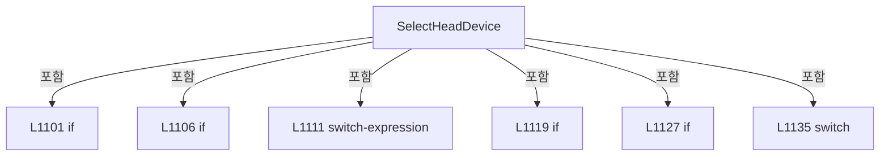

변경 전 점검: 입력/반환 타입, 위 호출자, 예외/취소 경로, 공유 상태와 저장·전송 소비자를 함께 확인합니다. 값의 단위나 물리 방향을 이름만으로 확정하지 않습니다.

### MethodDeclaration `EnsureMonitorWriteCommandAllowed` · L1154–1165

[Drilling.UI/Menu/Menus/CMenuMonitor.cs:1154–1165](https://github.com/kjuws10-rgb/A3Drilling/blob/5aee8e58439c9b455cae7c9593c9be986c3e682e/Drilling.UI/Menu/Menus/CMenuMonitor.cs#L1154-L1165)

| 항목 | 실제 추출 값 |
| --- | --- |
| 서명 | bool Drilling.UI.Menu.Menus.CMenuMonitor.EnsureMonitorWriteCommandAllowed(string) |
| 접근/수식자 | Private / private |
| 반환/값 타입 | bool |
| 소속 타입 | NamedType:Drilling.UI.Menu.Menus.CMenuMonitor |

입력 계약:

| 이름 | 타입 | 전달 | 선택/기본값 |
| --- | --- | --- | --- |
| actionName | string | None | False /  |

정적 호출자로 확인된 위치:

| 호출 파일/행 | 호출 표현식 | 런타임 분기 가능 |
| --- | --- | --- |
| [Drilling.UI/Menu/Menus/CMenuMonitor.cs:1187–1187](https://github.com/kjuws10-rgb/A3Drilling/blob/5aee8e58439c9b455cae7c9593c9be986c3e682e/Drilling.UI/Menu/Menus/CMenuMonitor.cs#L1187-L1187) | EnsureMonitorWriteCommandAllowed | False |
| [Drilling.UI/Menu/Menus/CMenuMonitor.cs:2747–2747](https://github.com/kjuws10-rgb/A3Drilling/blob/5aee8e58439c9b455cae7c9593c9be986c3e682e/Drilling.UI/Menu/Menus/CMenuMonitor.cs#L2747-L2747) | EnsureMonitorWriteCommandAllowed | False |
| [Drilling.UI/Menu/Menus/CMenuMonitor.cs:2794–2794](https://github.com/kjuws10-rgb/A3Drilling/blob/5aee8e58439c9b455cae7c9593c9be986c3e682e/Drilling.UI/Menu/Menus/CMenuMonitor.cs#L2794-L2794) | EnsureMonitorWriteCommandAllowed | False |
| [Drilling.UI/Menu/Menus/CMenuMonitor.cs:3923–3923](https://github.com/kjuws10-rgb/A3Drilling/blob/5aee8e58439c9b455cae7c9593c9be986c3e682e/Drilling.UI/Menu/Menus/CMenuMonitor.cs#L3923-L3923) | EnsureMonitorWriteCommandAllowed | False |
| [Drilling.UI/Menu/Menus/CMenuMonitor.cs:3955–3955](https://github.com/kjuws10-rgb/A3Drilling/blob/5aee8e58439c9b455cae7c9593c9be986c3e682e/Drilling.UI/Menu/Menus/CMenuMonitor.cs#L3955-L3955) | EnsureMonitorWriteCommandAllowed | False |
| [Drilling.UI/Menu/Menus/CMenuMonitor.cs:4933–4933](https://github.com/kjuws10-rgb/A3Drilling/blob/5aee8e58439c9b455cae7c9593c9be986c3e682e/Drilling.UI/Menu/Menus/CMenuMonitor.cs#L4933-L4933) | EnsureMonitorWriteCommandAllowed | False |
| [Drilling.UI/Menu/Menus/CMenuMonitor.cs:4967–4967](https://github.com/kjuws10-rgb/A3Drilling/blob/5aee8e58439c9b455cae7c9593c9be986c3e682e/Drilling.UI/Menu/Menus/CMenuMonitor.cs#L4967-L4967) | EnsureMonitorWriteCommandAllowed | False |

호출하는 대상과 해석 범위:

| 원본 행 | 표현식 | 분석 상태 | 대상/소스 위치 |
| --- | --- | --- | --- |
| 1156 | _canExecuteMonitorWriteCommand | resolved · 동적 구현 선택 가능 | bool System.Func<bool>.Invoke() |
| 1162 | _setStatusMessage | resolved · 동적 구현 선택 가능 | void System.Action<string>.Invoke(string) |
| 1162 | message.Replace | resolved | string string.Replace(string, string?) |
| 1163 | CRecipeConfirmDialog.ShowWarning | resolved | void Drilling.UI.Popup.CRecipeConfirmDialog.ShowWarning(string, string, Window?) · Drilling.UI/Popup/CRecipeConfirmDialog.xaml.cs:86 |

본문의 실제 연산·분기·예외·반환 순서(원문 위치 순):

| 원본 행 | 종류 | 주석 해설 |
| --- | --- | --- |
| 1156 | call | 함수·델리게이트 또는 객체 생성자를 호출합니다: _canExecuteMonitorWriteCommand() |
| 1156 | if | 조건에 따라 분기합니다: if (_canExecuteMonitorWriteCommand()) |
| 1158 | return | 호출자에게 값 또는 제어를 반환합니다: return true; |
| 1161 | local-declaration | 지역 변수를 선언합니다: var message = $"{actionName}은 Manual Mode에서만 사용할 수 있습니다.\nAuto Mode에서는 Monitor 화면의 조회와 Polling만 가능합니다."; |
| 1161 | variable-initializer | 변수의 초기값을 지정합니다: message = $"{actionName}은 Manual Mode에서만 사용할 수 있습니다.\nAuto Mode에서는 Monitor 화면의 조회와 Polling만 가능합니다." |
| 1162 | call | 함수·델리게이트 또는 객체 생성자를 호출합니다: _setStatusMessage(message.Replace(Environment.NewLine, " ")) |
| 1162 | call | 함수·델리게이트 또는 객체 생성자를 호출합니다: message.Replace(Environment.NewLine, " ") |
| 1163 | call | 함수·델리게이트 또는 객체 생성자를 호출합니다: CRecipeConfirmDialog.ShowWarning("Monitor 제어 불가", message) |
| 1164 | return | 호출자에게 값 또는 제어를 반환합니다: return false; |

제어 구문의 포함 구조(실제 실행 순서/CFG가 아닌 구문 탐색 그림):

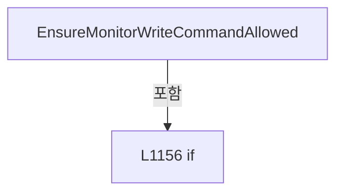

변경 전 점검: 입력/반환 타입, 위 호출자, 예외/취소 경로, 공유 상태와 저장·전송 소비자를 함께 확인합니다. 값의 단위나 물리 방향을 이름만으로 확정하지 않습니다.

### MethodDeclaration `CanSelectHeadDevice` · L1167–1176

[Drilling.UI/Menu/Menus/CMenuMonitor.cs:1167–1176](https://github.com/kjuws10-rgb/A3Drilling/blob/5aee8e58439c9b455cae7c9593c9be986c3e682e/Drilling.UI/Menu/Menus/CMenuMonitor.cs#L1167-L1176)

| 항목 | 실제 추출 값 |
| --- | --- |
| 서명 | bool Drilling.UI.Menu.Menus.CMenuMonitor.CanSelectHeadDevice(object?) |
| 접근/수식자 | Private / private |
| 반환/값 타입 | bool |
| 소속 타입 | NamedType:Drilling.UI.Menu.Menus.CMenuMonitor |

입력 계약:

| 이름 | 타입 | 전달 | 선택/기본값 |
| --- | --- | --- | --- |
| parameter | object? | None | False /  |

정적 호출자로 확인된 위치:

| 호출 파일/행 | 호출 표현식 | 런타임 분기 가능 |
| --- | --- | --- |
| [Drilling.UI/Menu/Menus/CMenuMonitor.cs:189–189](https://github.com/kjuws10-rgb/A3Drilling/blob/5aee8e58439c9b455cae7c9593c9be986c3e682e/Drilling.UI/Menu/Menus/CMenuMonitor.cs#L189-L189) | CanSelectHeadDevice | False |
| [Drilling.UI/Menu/Menus/CMenuMonitor.cs:1106–1106](https://github.com/kjuws10-rgb/A3Drilling/blob/5aee8e58439c9b455cae7c9593c9be986c3e682e/Drilling.UI/Menu/Menus/CMenuMonitor.cs#L1106-L1106) | CanSelectHeadDevice | False |

호출하는 대상과 해석 범위:

| 원본 행 | 표현식 | 분석 상태 | 대상/소스 위치 |
| --- | --- | --- | --- |
| 1172 | _enabledHeadDeviceNumbers.Contains | resolved | bool System.Collections.Generic.IEnumerable<int>.Contains<int>(int) |
| 1172 | Math.Clamp | resolved | int System.Math.Clamp(int, int, int) |
| 1173 | int.TryParse | resolved | bool int.TryParse(string?, System.Globalization.NumberStyles, System.IFormatProvider?, out int) |
| 1173 | _enabledHeadDeviceNumbers.Contains | resolved | bool System.Collections.Generic.IEnumerable<int>.Contains<int>(int) |
| 1173 | Math.Clamp | resolved | int System.Math.Clamp(int, int, int) |

본문의 실제 연산·분기·예외·반환 순서(원문 위치 순):

| 원본 행 | 종류 | 주석 해설 |
| --- | --- | --- |
| 1169 | return | 호출자에게 값 또는 제어를 반환합니다: return parameter switch { ST_MONITOR_HEAD_SELECT_ROW row => row.IsEnabled, int number => _enabledHeadDeviceNumbers.Contains(Math.Clamp(number, 0, LaserHeadCount - 1)), string text when int.TryParse(text, NumberStyles.Integer, Cult |
| 1169 | switch-expression | 값별 결과식을 선택합니다: parameter switch { ST_MONITOR_HEAD_SELECT_ROW row => row.IsEnabled, int number => _enabledHeadDeviceNumbers.Contains(Math.Clamp(number, 0, LaserHeadCount - 1)), string text when int.TryParse(text, NumberStyles.Integer, CultureInfo |
| 1172 | call | 함수·델리게이트 또는 객체 생성자를 호출합니다: _enabledHeadDeviceNumbers.Contains(Math.Clamp(number, 0, LaserHeadCount - 1)) |
| 1172 | call | 함수·델리게이트 또는 객체 생성자를 호출합니다: Math.Clamp(number, 0, LaserHeadCount - 1) |
| 1173 | call | 함수·델리게이트 또는 객체 생성자를 호출합니다: int.TryParse(text, NumberStyles.Integer, CultureInfo.InvariantCulture, out var number) |
| 1173 | call | 함수·델리게이트 또는 객체 생성자를 호출합니다: _enabledHeadDeviceNumbers.Contains(Math.Clamp(number, 0, LaserHeadCount - 1)) |
| 1173 | call | 함수·델리게이트 또는 객체 생성자를 호출합니다: Math.Clamp(number, 0, LaserHeadCount - 1) |

제어 구문의 포함 구조(실제 실행 순서/CFG가 아닌 구문 탐색 그림):

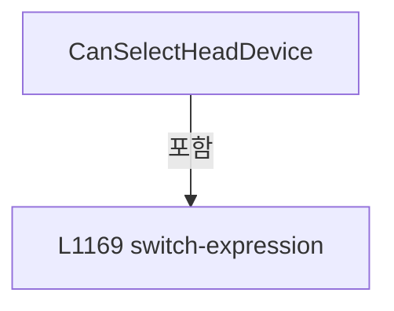

변경 전 점검: 입력/반환 타입, 위 호출자, 예외/취소 경로, 공유 상태와 저장·전송 소비자를 함께 확인합니다. 값의 단위나 물리 방향을 이름만으로 확정하지 않습니다.

### MethodDeclaration `ExecuteOperation` · L1178–1252

[Drilling.UI/Menu/Menus/CMenuMonitor.cs:1178–1252](https://github.com/kjuws10-rgb/A3Drilling/blob/5aee8e58439c9b455cae7c9593c9be986c3e682e/Drilling.UI/Menu/Menus/CMenuMonitor.cs#L1178-L1252)

| 항목 | 실제 추출 값 |
| --- | --- |
| 서명 | System.Threading.Tasks.Task Drilling.UI.Menu.Menus.CMenuMonitor.ExecuteOperation(object?) |
| 접근/수식자 | Private / private, async |
| 반환/값 타입 | System.Threading.Tasks.Task |
| 소속 타입 | NamedType:Drilling.UI.Menu.Menus.CMenuMonitor |

입력 계약:

| 이름 | 타입 | 전달 | 선택/기본값 |
| --- | --- | --- | --- |
| parameter | object? | None | False /  |

정적 호출자로 확인된 위치:

| 호출 파일/행 | 호출 표현식 | 런타임 분기 가능 |
| --- | --- | --- |
| [Drilling.UI/Menu/Menus/CMenuMonitor.cs:195–195](https://github.com/kjuws10-rgb/A3Drilling/blob/5aee8e58439c9b455cae7c9593c9be986c3e682e/Drilling.UI/Menu/Menus/CMenuMonitor.cs#L195-L195) | ExecuteOperation | False |

호출하는 대상과 해석 범위:

| 원본 행 | 표현식 | 분석 상태 | 대상/소스 위치 |
| --- | --- | --- | --- |
| 1180 | GetMonitorOperationLabel | resolved | string Drilling.UI.Menu.Menus.CMenuMonitor.GetMonitorOperationLabel(object?) · Drilling.UI/Menu/Menus/CMenuMonitor.cs:1559 |
| 1182 | string.IsNullOrWhiteSpace | resolved | bool string.IsNullOrWhiteSpace(string?) |
| 1187 | EnsureMonitorWriteCommandAllowed | resolved | bool Drilling.UI.Menu.Menus.CMenuMonitor.EnsureMonitorWriteCommandAllowed(string) · Drilling.UI/Menu/Menus/CMenuMonitor.cs:1154 |
| 1192 | NormalizeMonitorOperation | resolved | string Drilling.UI.Menu.Menus.CMenuMonitor.NormalizeMonitorOperation(string) · Drilling.UI/Menu/Menus/CMenuMonitor.cs:1571 |
| 1193 | TryNotifyPowerMeterTuneLocked | resolved | bool Drilling.UI.Menu.Menus.CMenuMonitor.TryNotifyPowerMeterTuneLocked(string) · Drilling.UI/Menu/Menus/CMenuMonitor.cs:5311 |
| 1198 | MultiMoveAxisRows.Any | resolved | bool System.Collections.Generic.IEnumerable<Drilling.UI.Menu.Menus.ST_MONITOR_MULTI_MOVE_AXIS_ROW>.Any<Drilling.UI.Menu.Menus.ST_MONITOR_MULTI_MOVE_AXIS_ROW>(System.Func<Drilling.UI.Menu.Menus.ST_MONITOR_MULTI_MOVE_AXIS_ROW, bool>) |
| 1200 | _setStatusMessage | resolved · 동적 구현 선택 가능 | void System.Action<string>.Invoke(string) |
| 1208 | _setStatusMessage | resolved · 동적 구현 선택 가능 | void System.Action<string>.Invoke(string) |
| 1212 | Math.Max | resolved | int System.Math.Max(int, int) |
| 1212 | Math.Round | resolved | double System.Math.Round(double) |
| 1212 | ReadOperationField | resolved | double Drilling.UI.Menu.Menus.CMenuMonitor.ReadOperationField(string, double) · Drilling.UI/Menu/Menus/CMenuMonitor.cs:1536 |
| 1214 | _setStatusMessage | resolved · 동적 구현 선택 가능 | void System.Action<string>.Invoke(string) |
| 1220 | RequiresOperationConfirmation | resolved | bool Drilling.UI.Menu.Menus.CMenuMonitor.RequiresOperationConfirmation(string, string) · Drilling.UI/Menu/Menus/CMenuMonitor.cs:1254 |
| 1220 | CRecipeConfirmDialog.ShowConfirmation | resolved | bool Drilling.UI.Popup.CRecipeConfirmDialog.ShowConfirmation(string, string, string, bool) · Drilling.UI/Popup/CRecipeConfirmDialog.xaml.cs:11 |
| 1220 | GetOperationConfirmationTitle | resolved | string Drilling.UI.Menu.Menus.CMenuMonitor.GetOperationConfirmationTitle(string) · Drilling.UI/Menu/Menus/CMenuMonitor.cs:1276 |
| 1220 | GetOperationConfirmationText | resolved | string Drilling.UI.Menu.Menus.CMenuMonitor.GetOperationConfirmationText(string) · Drilling.UI/Menu/Menus/CMenuMonitor.cs:1290 |
| 1225 | SaveOperationFieldValues | resolved | void Drilling.UI.Menu.Menus.CMenuMonitor.SaveOperationFieldValues(string) · Drilling.UI/Menu/Menus/CMenuMonitor.cs:2259 |
| 1228 | SavePowerMeterSettingValues | resolved | void Drilling.UI.Menu.Menus.CMenuMonitor.SavePowerMeterSettingValues() · Drilling.UI/Menu/Menus/CMenuMonitor.cs:5325 |
| 1233 | ExecuteMotorOperation | resolved | System.Threading.Tasks.Task<Drilling.Common.Interface.ST_DEVICE_COMMAND_RESULT> Drilling.UI.Menu.Menus.CMenuMonitor.ExecuteMotorOperation(string) · Drilling.UI/Menu/Menus/CMenuMonitor.cs:4311 |
| 1234 | ExecutePowerMeterOperation | resolved | System.Threading.Tasks.Task<Drilling.Common.Interface.ST_DEVICE_COMMAND_RESULT> Drilling.UI.Menu.Menus.CMenuMonitor.ExecutePowerMeterOperation(string) · Drilling.UI/Menu/Menus/CMenuMonitor.cs:4783 |
| 1235 | ExecuteLaserOperation | resolved | System.Threading.Tasks.Task<Drilling.Common.Interface.ST_DEVICE_COMMAND_RESULT> Drilling.UI.Menu.Menus.CMenuMonitor.ExecuteLaserOperation(string) · Drilling.UI/Menu/Menus/CMenuMonitor.cs:4570 |
| 1236 | ExecuteAttenuatorOperation | resolved | System.Threading.Tasks.Task<Drilling.Common.Interface.ST_DEVICE_COMMAND_RESULT> Drilling.UI.Menu.Menus.CMenuMonitor.ExecuteAttenuatorOperation(string) · Drilling.UI/Menu/Menus/CMenuMonitor.cs:4605 |
| 1237 | ExecuteBETOperation | resolved | System.Threading.Tasks.Task<Drilling.Common.Interface.ST_DEVICE_COMMAND_RESULT> Drilling.UI.Menu.Menus.CMenuMonitor.ExecuteBETOperation(string) · Drilling.UI/Menu/Menus/CMenuMonitor.cs:4734 |
| 1238 | ExecutePowerMeterOperation | resolved | System.Threading.Tasks.Task<Drilling.Common.Interface.ST_DEVICE_COMMAND_RESULT> Drilling.UI.Menu.Menus.CMenuMonitor.ExecutePowerMeterOperation(string) · Drilling.UI/Menu/Menus/CMenuMonitor.cs:4783 |
| 1239 | ExecutePicoMotorOperation | resolved | System.Threading.Tasks.Task<Drilling.Common.Interface.ST_DEVICE_COMMAND_RESULT> Drilling.UI.Menu.Menus.CMenuMonitor.ExecutePicoMotorOperation(string) · Drilling.UI/Menu/Menus/CMenuMonitor.cs:4824 |
| 1240 | new ST_DEVICE_COMMAND_RESULT | resolved | Drilling.Common.Interface.ST_DEVICE_COMMAND_RESULT.ST_DEVICE_COMMAND_RESULT(bool, string) · Drilling.Common/Interface/CInterfaceManager.cs:2961 |
| 1241 | _setStatusMessage | resolved · 동적 구현 선택 가능 | void System.Action<string>.Invoke(string) |
| 1244 | _statusPollingService.RefreshMotorNow | resolved | void Drilling.UI.Menu.Menus.CMonitorStatusPollingService.RefreshMotorNow(System.Threading.CancellationToken) · Drilling.UI/Menu/Menus/CMonitorStatusPollingService.cs:64 |
| 1249 | _refreshShellStatus | resolved · 동적 구현 선택 가능 | void System.Action.Invoke() |
| 1250 | _refreshCurrentScreen | resolved · 동적 구현 선택 가능 | System.Threading.Tasks.Task System.Func<System.Threading.Tasks.Task>.Invoke() |

본문의 실제 연산·분기·예외·반환 순서(원문 위치 순):

| 원본 행 | 종류 | 주석 해설 |
| --- | --- | --- |
| 1180 | call | 함수·델리게이트 또는 객체 생성자를 호출합니다: GetMonitorOperationLabel(parameter) |
| 1180 | local-declaration | 지역 변수를 선언합니다: var label = GetMonitorOperationLabel(parameter); |
| 1180 | variable-initializer | 변수의 초기값을 지정합니다: label = GetMonitorOperationLabel(parameter) |
| 1181 | local-declaration | 지역 변수를 선언합니다: var isPowerMeterCommand = parameter is ST_PWM_DEVICE_ROW; |
| 1181 | variable-initializer | 변수의 초기값을 지정합니다: isPowerMeterCommand = parameter is ST_PWM_DEVICE_ROW |
| 1182 | call | 함수·델리게이트 또는 객체 생성자를 호출합니다: string.IsNullOrWhiteSpace(label) |
| 1182 | if | 조건에 따라 분기합니다: if (string.IsNullOrWhiteSpace(label)) |
| 1184 | return | 호출자에게 값 또는 제어를 반환합니다: return; |
| 1187 | call | 함수·델리게이트 또는 객체 생성자를 호출합니다: EnsureMonitorWriteCommandAllowed($"{SelectedTab} {label}") |
| 1187 | if | 조건에 따라 분기합니다: if (!EnsureMonitorWriteCommandAllowed($"{SelectedTab} {label}")) |
| 1189 | return | 호출자에게 값 또는 제어를 반환합니다: return; |
| 1192 | call | 함수·델리게이트 또는 객체 생성자를 호출합니다: NormalizeMonitorOperation(label) |
| 1192 | local-declaration | 지역 변수를 선언합니다: var confirmationKey = NormalizeMonitorOperation(label); |
| 1192 | variable-initializer | 변수의 초기값을 지정합니다: confirmationKey = NormalizeMonitorOperation(label) |
| 1193 | call | 함수·델리게이트 또는 객체 생성자를 호출합니다: TryNotifyPowerMeterTuneLocked("DEVICE COMMAND") |
| 1193 | if | 조건에 따라 분기합니다: if ((isPowerMeterCommand &#124;&#124; SelectedTab == "POWER METER") && confirmationKey != "STOP" && TryNotifyPowerMeterTuneLocked("DEVICE COMMAND")) |
| 1195 | return | 호출자에게 값 또는 제어를 반환합니다: return; |
| 1198 | call | 함수·델리게이트 또는 객체 생성자를 호출합니다: MultiMoveAxisRows.Any(row => row.IsSelected) |
| 1198 | if | 조건에 따라 분기합니다: if (SelectedTab == "XPS" && confirmationKey == "MULTIABSMOVE" && !MultiMoveAxisRows.Any(row => row.IsSelected)) |
| 1200 | call | 함수·델리게이트 또는 객체 생성자를 호출합니다: _setStatusMessage("Scanner tilt move skipped. Select at least one axis.") |
| 1201 | return | 호출자에게 값 또는 제어를 반환합니다: return; |
| 1204 | if | 조건에 따라 분기합니다: if (SelectedTab == "PICO MOTOR" && confirmationKey == "START") |
| 1206 | if | 조건에 따라 분기합니다: if (_picoAllMoveMotorNos.Count == 0) |
| 1208 | call | 함수·델리게이트 또는 객체 생성자를 호출합니다: _setStatusMessage("DOE tilt start skipped. Select at least one motor.") |
| 1209 | return | 호출자에게 값 또는 제어를 반환합니다: return; |
| 1212 | call | 함수·델리게이트 또는 객체 생성자를 호출합니다: Math.Max(0, (int)Math.Round(ReadOperationField("Set Count", 0))) |
| 1212 | call | 함수·델리게이트 또는 객체 생성자를 호출합니다: Math.Round(ReadOperationField("Set Count", 0)) |
| 1212 | call | 함수·델리게이트 또는 객체 생성자를 호출합니다: ReadOperationField("Set Count", 0) |
| 1212 | if | 조건에 따라 분기합니다: if (Math.Max(0, (int)Math.Round(ReadOperationField("Set Count", 0))) <= 0) |
| 1214 | call | 함수·델리게이트 또는 객체 생성자를 호출합니다: _setStatusMessage("DOE tilt start skipped. Set Count must be greater than 0.") |
| 1215 | return | 호출자에게 값 또는 제어를 반환합니다: return; |
| 1219 | local-declaration | 지역 변수를 선언합니다: var isAttenuatorReset = SelectedTab == "ATTENUATOR" && confirmationKey == "RESET"; |
| 1219 | variable-initializer | 변수의 초기값을 지정합니다: isAttenuatorReset = SelectedTab == "ATTENUATOR" && confirmationKey == "RESET" |
| 1220 | call | 함수·델리게이트 또는 객체 생성자를 호출합니다: RequiresOperationConfirmation(SelectedTab, label) |
| 1220 | call | 함수·델리게이트 또는 객체 생성자를 호출합니다: CRecipeConfirmDialog.ShowConfirmation(isAttenuatorReset ? "감쇠기 초기화" : GetOperationConfirmationTitle(SelectedTab), GetOperationConfirmationText(label), isAttenuatorReset ? "초기화" : "확인") |
| 1220 | call | 함수·델리게이트 또는 객체 생성자를 호출합니다: GetOperationConfirmationTitle(SelectedTab) |
| 1220 | call | 함수·델리게이트 또는 객체 생성자를 호출합니다: GetOperationConfirmationText(label) |
| 1220 | conditional-expression | 조건에 따라 결과식을 선택합니다: isAttenuatorReset ? "감쇠기 초기화" : GetOperationConfirmationTitle(SelectedTab) |
| 1220 | conditional-expression | 조건에 따라 결과식을 선택합니다: isAttenuatorReset ? "초기화" : "확인" |
| 1220 | if | 조건에 따라 분기합니다: if (RequiresOperationConfirmation(SelectedTab, label) && !CRecipeConfirmDialog.ShowConfirmation(isAttenuatorReset ? "감쇠기 초기화" : GetOperationConfirmationTitle(SelectedTab), GetOperationConfirmationText(label), isAttenuatorRes…) |
| 1222 | return | 호출자에게 값 또는 제어를 반환합니다: return; |
| 1225 | call | 함수·델리게이트 또는 객체 생성자를 호출합니다: SaveOperationFieldValues(SelectedTab) |
| 1226 | if | 조건에 따라 분기합니다: if (isPowerMeterCommand &#124;&#124; SelectedTab == "POWER METER") |
| 1228 | call | 함수·델리게이트 또는 객체 생성자를 호출합니다: SavePowerMeterSettingValues() |
| 1231 | local-declaration | 지역 변수를 선언합니다: var result = SelectedTab switch { "XPS" => await ExecuteMotorOperation(label), "LASER" when isPowerMeterCommand => await ExecutePowerMeterOperation(label), "LASER" => await ExecuteLaserOperation(label), "ATTENUATOR" => await Execu |
| 1231 | switch-expression | 값별 결과식을 선택합니다: SelectedTab switch { "XPS" => await ExecuteMotorOperation(label), "LASER" when isPowerMeterCommand => await ExecutePowerMeterOperation(label), "LASER" => await ExecuteLaserOperation(label), "ATTENUATOR" => await ExecuteAttenuatorO |
| 1231 | variable-initializer | 변수의 초기값을 지정합니다: result = SelectedTab switch { "XPS" => await ExecuteMotorOperation(label), "LASER" when isPowerMeterCommand => await ExecutePowerMeterOperation(label), "LASER" => await ExecuteLaserOperation(label), "ATTENUATOR" => await ExecuteAt |
| 1233 | await | 비동기 완료를 기다립니다: await ExecuteMotorOperation(label) |
| 1233 | call | 함수·델리게이트 또는 객체 생성자를 호출합니다: ExecuteMotorOperation(label) |
| 1234 | await | 비동기 완료를 기다립니다: await ExecutePowerMeterOperation(label) |
| 1234 | call | 함수·델리게이트 또는 객체 생성자를 호출합니다: ExecutePowerMeterOperation(label) |
| 1235 | await | 비동기 완료를 기다립니다: await ExecuteLaserOperation(label) |
| 1235 | call | 함수·델리게이트 또는 객체 생성자를 호출합니다: ExecuteLaserOperation(label) |
| 1236 | await | 비동기 완료를 기다립니다: await ExecuteAttenuatorOperation(label) |
| 1236 | call | 함수·델리게이트 또는 객체 생성자를 호출합니다: ExecuteAttenuatorOperation(label) |
| 1237 | await | 비동기 완료를 기다립니다: await ExecuteBETOperation(label) |
| 1237 | call | 함수·델리게이트 또는 객체 생성자를 호출합니다: ExecuteBETOperation(label) |
| 1238 | await | 비동기 완료를 기다립니다: await ExecutePowerMeterOperation(label) |
| 1238 | call | 함수·델리게이트 또는 객체 생성자를 호출합니다: ExecutePowerMeterOperation(label) |
| 1239 | await | 비동기 완료를 기다립니다: await ExecutePicoMotorOperation(label) |
| 1239 | call | 함수·델리게이트 또는 객체 생성자를 호출합니다: ExecutePicoMotorOperation(label) |
| 1240 | call | 함수·델리게이트 또는 객체 생성자를 호출합니다: new ST_DEVICE_COMMAND_RESULT(false, $"Monitor {SelectedTab} command is not connected yet: {label}") |
| 1241 | call | 함수·델리게이트 또는 객체 생성자를 호출합니다: _setStatusMessage(result.Message) |
| 1242 | if | 조건에 따라 분기합니다: if (SelectedTab == "XPS") |
| 1244 | call | 함수·델리게이트 또는 객체 생성자를 호출합니다: _statusPollingService.RefreshMotorNow() |
| 1247 | if | 조건에 따라 분기합니다: if (SelectedTab is "XPS" or "LASER" or "ATTENUATOR" or "BET" or "POWER METER" or "PICO MOTOR") |
| 1249 | call | 함수·델리게이트 또는 객체 생성자를 호출합니다: _refreshShellStatus() |
| 1250 | await | 비동기 완료를 기다립니다: await _refreshCurrentScreen() |
| 1250 | call | 함수·델리게이트 또는 객체 생성자를 호출합니다: _refreshCurrentScreen() |

제어 구문의 포함 구조(실제 실행 순서/CFG가 아닌 구문 탐색 그림):

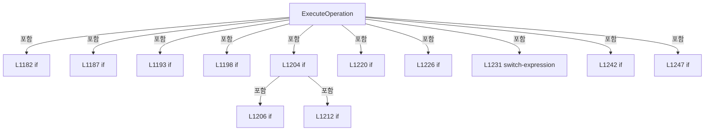

변경 전 점검: 입력/반환 타입, 위 호출자, 예외/취소 경로, 공유 상태와 저장·전송 소비자를 함께 확인합니다. 값의 단위나 물리 방향을 이름만으로 확정하지 않습니다.

### MethodDeclaration `RequiresOperationConfirmation` · L1254–1274

[Drilling.UI/Menu/Menus/CMenuMonitor.cs:1254–1274](https://github.com/kjuws10-rgb/A3Drilling/blob/5aee8e58439c9b455cae7c9593c9be986c3e682e/Drilling.UI/Menu/Menus/CMenuMonitor.cs#L1254-L1274)

| 항목 | 실제 추출 값 |
| --- | --- |
| 서명 | bool Drilling.UI.Menu.Menus.CMenuMonitor.RequiresOperationConfirmation(string, string) |
| 접근/수식자 | Private / private, static |
| 반환/값 타입 | bool |
| 소속 타입 | NamedType:Drilling.UI.Menu.Menus.CMenuMonitor |

입력 계약:

| 이름 | 타입 | 전달 | 선택/기본값 |
| --- | --- | --- | --- |
| tab | string | None | False /  |
| label | string | None | False /  |

정적 호출자로 확인된 위치:

| 호출 파일/행 | 호출 표현식 | 런타임 분기 가능 |
| --- | --- | --- |
| [Drilling.UI/Menu/Menus/CMenuMonitor.cs:1220–1220](https://github.com/kjuws10-rgb/A3Drilling/blob/5aee8e58439c9b455cae7c9593c9be986c3e682e/Drilling.UI/Menu/Menus/CMenuMonitor.cs#L1220-L1220) | RequiresOperationConfirmation | False |

호출하는 대상과 해석 범위:

| 원본 행 | 표현식 | 분석 상태 | 대상/소스 위치 |
| --- | --- | --- | --- |
| 1256 | NormalizeMonitorOperation | resolved | string Drilling.UI.Menu.Menus.CMenuMonitor.NormalizeMonitorOperation(string) · Drilling.UI/Menu/Menus/CMenuMonitor.cs:1571 |
| 1266 | key.StartsWith | resolved | bool string.StartsWith(string, System.StringComparison) |

본문의 실제 연산·분기·예외·반환 순서(원문 위치 순):

| 원본 행 | 종류 | 주석 해설 |
| --- | --- | --- |
| 1256 | call | 함수·델리게이트 또는 객체 생성자를 호출합니다: NormalizeMonitorOperation(label) |
| 1256 | local-declaration | 지역 변수를 선언합니다: var key = NormalizeMonitorOperation(label); |
| 1256 | variable-initializer | 변수의 초기값을 지정합니다: key = NormalizeMonitorOperation(label) |
| 1257 | switch | 값에 따라 분기합니다: switch (tab) |
| 1259 | case | 분기값/패턴의 구간입니다: case "XPS": |
| 1260 | return | 호출자에게 값 또는 제어를 반환합니다: return key is "SERVOON" or "SERVOOFF" or "HOME" or "ABSMOVE" or "RELMOVE" or "MULTIABSMOVE"; |
| 1261 | case | 분기값/패턴의 구간입니다: case "LASER": |
| 1262 | return | 호출자에게 값 또는 제어를 반환합니다: return key is "LASERON" or "LASEROFF" or "SHUTTEROPEN" or "SHUTTERCLOSE" or "GATEON" or "GATEOFF" or "EXTGATEENABLE" or "EXTGATEDISABLE" or "SETQSW" or "SETEPRF" or "SETSHG" or "SETQMODE"; |
| 1263 | case | 분기값/패턴의 구간입니다: case "ATTENUATOR": |
| 1264 | return | 호출자에게 값 또는 제어를 반환합니다: return key is "HOME" or "RESET" or "MOVEABS" or "MOVEREL" or "SETHOMETYPE" or "SETNEGLIMIT" or "SETPOSLIMIT" or "SETIGAIN" or "SETPGAIN" or "SETIF"; |
| 1265 | case | 분기값/패턴의 구간입니다: case "BET": |
| 1266 | call | 함수·델리게이트 또는 객체 생성자를 호출합니다: key.StartsWith("MOVETABLE", StringComparison.OrdinalIgnoreCase) |
| 1266 | return | 호출자에게 값 또는 제어를 반환합니다: return key is "HOME" or "MOVEMAG" or "MOVEDIV" or "SAVETABLE" or "MOVE" &#124;&#124; key.StartsWith("MOVETABLE", StringComparison.OrdinalIgnoreCase); |
| 1267 | case | 분기값/패턴의 구간입니다: case "POWER METER": |
| 1268 | return | 호출자에게 값 또는 제어를 반환합니다: return key == "START"; |
| 1269 | case | 분기값/패턴의 구간입니다: case "PICO MOTOR": |
| 1270 | return | 호출자에게 값 또는 제어를 반환합니다: return key is "CONNECT" or "DISCONNECT" or "SETVEL" or "SETVELOCITY" or "PICOSETVEL" or "SETACC" or "SETACCELERATION" or "PICOSETACC" or "HOME" or "ABSMOVE" or "START"; |
| 1271 | case | 분기값/패턴의 구간입니다: default: |
| 1272 | return | 호출자에게 값 또는 제어를 반환합니다: return false; |

제어 구문의 포함 구조(실제 실행 순서/CFG가 아닌 구문 탐색 그림):

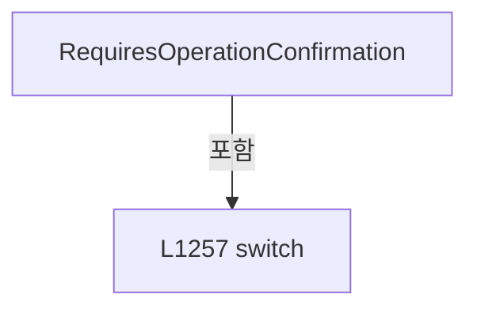

변경 전 점검: 입력/반환 타입, 위 호출자, 예외/취소 경로, 공유 상태와 저장·전송 소비자를 함께 확인합니다. 값의 단위나 물리 방향을 이름만으로 확정하지 않습니다.

### MethodDeclaration `GetOperationConfirmationTitle` · L1276–1288

[Drilling.UI/Menu/Menus/CMenuMonitor.cs:1276–1288](https://github.com/kjuws10-rgb/A3Drilling/blob/5aee8e58439c9b455cae7c9593c9be986c3e682e/Drilling.UI/Menu/Menus/CMenuMonitor.cs#L1276-L1288)

| 항목 | 실제 추출 값 |
| --- | --- |
| 서명 | string Drilling.UI.Menu.Menus.CMenuMonitor.GetOperationConfirmationTitle(string) |
| 접근/수식자 | Private / private, static |
| 반환/값 타입 | string |
| 소속 타입 | NamedType:Drilling.UI.Menu.Menus.CMenuMonitor |

입력 계약:

| 이름 | 타입 | 전달 | 선택/기본값 |
| --- | --- | --- | --- |
| tab | string | None | False /  |

정적 호출자로 확인된 위치:

| 호출 파일/행 | 호출 표현식 | 런타임 분기 가능 |
| --- | --- | --- |
| [Drilling.UI/Menu/Menus/CMenuMonitor.cs:1220–1220](https://github.com/kjuws10-rgb/A3Drilling/blob/5aee8e58439c9b455cae7c9593c9be986c3e682e/Drilling.UI/Menu/Menus/CMenuMonitor.cs#L1220-L1220) | GetOperationConfirmationTitle | False |

본문의 실제 연산·분기·예외·반환 순서(원문 위치 순):

| 원본 행 | 종류 | 주석 해설 |
| --- | --- | --- |
| 1278 | return | 호출자에게 값 또는 제어를 반환합니다: return tab switch { "XPS" => "스캐너 틸트 제어", "LASER" => "레이저 제어", "ATTENUATOR" => "감쇠기 제어", "BET" => "BET 제어", "POWER METER" => "PowerMeter 제어", "PICO MOTOR" => "DOE 틸트 제어", _ => "장비 제어" }; |
| 1278 | switch-expression | 값별 결과식을 선택합니다: tab switch { "XPS" => "스캐너 틸트 제어", "LASER" => "레이저 제어", "ATTENUATOR" => "감쇠기 제어", "BET" => "BET 제어", "POWER METER" => "PowerMeter 제어", "PICO MOTOR" => "DOE 틸트 제어", _ => "장비 제어" } |

제어 구문의 포함 구조(실제 실행 순서/CFG가 아닌 구문 탐색 그림):

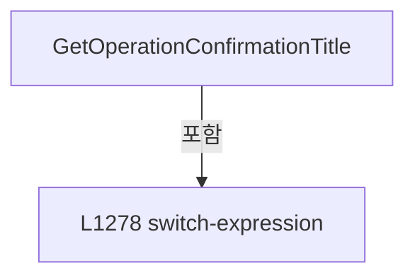

변경 전 점검: 입력/반환 타입, 위 호출자, 예외/취소 경로, 공유 상태와 저장·전송 소비자를 함께 확인합니다. 값의 단위나 물리 방향을 이름만으로 확정하지 않습니다.

### MethodDeclaration `GetOperationConfirmationText` · L1290–1501

[Drilling.UI/Menu/Menus/CMenuMonitor.cs:1290–1501](https://github.com/kjuws10-rgb/A3Drilling/blob/5aee8e58439c9b455cae7c9593c9be986c3e682e/Drilling.UI/Menu/Menus/CMenuMonitor.cs#L1290-L1501)

| 항목 | 실제 추출 값 |
| --- | --- |
| 서명 | string Drilling.UI.Menu.Menus.CMenuMonitor.GetOperationConfirmationText(string) |
| 접근/수식자 | Private / private |
| 반환/값 타입 | string |
| 소속 타입 | NamedType:Drilling.UI.Menu.Menus.CMenuMonitor |

입력 계약:

| 이름 | 타입 | 전달 | 선택/기본값 |
| --- | --- | --- | --- |
| label | string | None | False /  |

정적 호출자로 확인된 위치:

| 호출 파일/행 | 호출 표현식 | 런타임 분기 가능 |
| --- | --- | --- |
| [Drilling.UI/Menu/Menus/CMenuMonitor.cs:1220–1220](https://github.com/kjuws10-rgb/A3Drilling/blob/5aee8e58439c9b455cae7c9593c9be986c3e682e/Drilling.UI/Menu/Menus/CMenuMonitor.cs#L1220-L1220) | GetOperationConfirmationText | False |

호출하는 대상과 해석 범위:

| 원본 행 | 표현식 | 분석 상태 | 대상/소스 위치 |
| --- | --- | --- | --- |
| 1292 | NormalizeMonitorOperation | resolved | string Drilling.UI.Menu.Menus.CMenuMonitor.NormalizeMonitorOperation(string) · Drilling.UI/Menu/Menus/CMenuMonitor.cs:1571 |
| 1302 | ReadOperationField("ABS Target Position", 0.0).ToString | resolved | string double.ToString(string?, System.IFormatProvider?) |
| 1302 | ReadOperationField | resolved | double Drilling.UI.Menu.Menus.CMenuMonitor.ReadOperationField(string, double) · Drilling.UI/Menu/Menus/CMenuMonitor.cs:1536 |
| 1307 | ReadOperationField("REL Distance", 0.0).ToString | resolved | string double.ToString(string?, System.IFormatProvider?) |
| 1307 | ReadOperationField | resolved | double Drilling.UI.Menu.Menus.CMenuMonitor.ReadOperationField(string, double) · Drilling.UI/Menu/Menus/CMenuMonitor.cs:1536 |
| 1312 | MultiMoveAxisRows.Where(row => row.IsSelected).Select(row => $"{row.Axis} = {row.TargetPosition} mm").ToArray | resolved | string[] System.Collections.Generic.IEnumerable<string>.ToArray<string>() |
| 1312 | MultiMoveAxisRows.Where(row => row.IsSelected).Select | resolved | System.Collections.Generic.IEnumerable<string> System.Collections.Generic.IEnumerable<Drilling.UI.Menu.Menus.ST_MONITOR_MULTI_MOVE_AXIS_ROW>.Select<Drilling.UI.Menu.Menus.ST_MONITOR_MULTI_MOVE_AXIS_ROW, string>(System.Func<Drilling.UI.Menu.Menus.ST_MONITOR_MULTI_MOVE_AXIS_ROW, string>) |
| 1312 | MultiMoveAxisRows.Where | resolved | System.Collections.Generic.IEnumerable<Drilling.UI.Menu.Menus.ST_MONITOR_MULTI_MOVE_AXIS_ROW> System.Collections.Generic.IEnumerable<Drilling.UI.Menu.Menus.ST_MONITOR_MULTI_MOVE_AXIS_ROW>.Where<Drilling.UI.Menu.Menus.ST_MONITOR_MULTI_MOVE_AXIS_ROW>(System.Func<Drilling.UI.Menu.Menus.ST_MONITOR_MULTI_MOVE_AXIS_ROW, bool>) |
| 1313 | string.Join | resolved | string string.Join(string?, params string?[]) |
| 1321 | ReadOperationField("QSW", 20000.0).ToString | resolved | string double.ToString(string?, System.IFormatProvider?) |
| 1321 | ReadOperationField | resolved | double Drilling.UI.Menu.Menus.CMenuMonitor.ReadOperationField(string, double) · Drilling.UI/Menu/Menus/CMenuMonitor.cs:1536 |
| 1326 | ReadOperationField("EPRF", 20000.0).ToString | resolved | string double.ToString(string?, System.IFormatProvider?) |
| 1326 | ReadOperationField | resolved | double Drilling.UI.Menu.Menus.CMenuMonitor.ReadOperationField(string, double) · Drilling.UI/Menu/Menus/CMenuMonitor.cs:1536 |
| 1331 | ReadOperationField("SHG Count", 0.0).ToString | resolved | string double.ToString(string?, System.IFormatProvider?) |
| 1331 | ReadOperationField | resolved | double Drilling.UI.Menu.Menus.CMenuMonitor.ReadOperationField(string, double) · Drilling.UI/Menu/Menus/CMenuMonitor.cs:1536 |
| 1336 | ReadOperationField("Q Mode", 0.0).ToString | resolved | string double.ToString(string?, System.IFormatProvider?) |
| 1336 | ReadOperationField | resolved | double Drilling.UI.Menu.Menus.CMenuMonitor.ReadOperationField(string, double) · Drilling.UI/Menu/Menus/CMenuMonitor.cs:1536 |
| 1349 | ReadOperationField("Target Position", 55.0).ToString | resolved | string double.ToString(string?, System.IFormatProvider?) |
| 1349 | ReadOperationField | resolved | double Drilling.UI.Menu.Menus.CMenuMonitor.ReadOperationField(string, double) · Drilling.UI/Menu/Menus/CMenuMonitor.cs:1536 |
| 1354 | ReadOperationField("Relative Move", 0.0).ToString | resolved | string double.ToString(string?, System.IFormatProvider?) |
| 1354 | ReadOperationField | resolved | double Drilling.UI.Menu.Menus.CMenuMonitor.ReadOperationField(string, double) · Drilling.UI/Menu/Menus/CMenuMonitor.cs:1536 |
| 1364 | OperationFields.FirstOrDefault | resolved | Drilling.UI.Menu.Menus.ST_MONITOR_PARAMETER_ROW? System.Collections.Generic.IEnumerable<Drilling.UI.Menu.Menus.ST_MONITOR_PARAMETER_ROW>.FirstOrDefault<Drilling.UI.Menu.Menus.ST_MONITOR_PARAMETER_ROW>(System.Func<Drilling.UI.Menu.Menus.ST_MONITOR_PARAMETER_ROW, bool>) |
| 1364 | field.Parameter.Equals | resolved | bool string.Equals(string?, System.StringComparison) |
| 1365 | string.IsNullOrWhiteSpace | resolved | bool string.IsNullOrWhiteSpace(string?) |
| 1365 | FormatHomeTypeOption | resolved | string Drilling.UI.Menu.Menus.CMenuMonitor.FormatHomeTypeOption(int) · Drilling.UI/Menu/Menus/CMenuMonitor.cs:6188 |
| 1371 | ReadOperationField("Negative Limit", 0.0).ToString | resolved | string double.ToString(string?, System.IFormatProvider?) |
| 1371 | ReadOperationField | resolved | double Drilling.UI.Menu.Menus.CMenuMonitor.ReadOperationField(string, double) · Drilling.UI/Menu/Menus/CMenuMonitor.cs:1536 |
| 1376 | ReadOperationField("Positive Limit", 360.0).ToString | resolved | string double.ToString(string?, System.IFormatProvider?) |
| 1376 | ReadOperationField | resolved | double Drilling.UI.Menu.Menus.CMenuMonitor.ReadOperationField(string, double) · Drilling.UI/Menu/Menus/CMenuMonitor.cs:1536 |
| 1381 | ReadOperationField("I Gain", 800.0).ToString | resolved | string double.ToString(string?, System.IFormatProvider?) |
| 1381 | ReadOperationField | resolved | double Drilling.UI.Menu.Menus.CMenuMonitor.ReadOperationField(string, double) · Drilling.UI/Menu/Menus/CMenuMonitor.cs:1536 |
| 1386 | ReadOperationField("P Gain", 10.0).ToString | resolved | string double.ToString(string?, System.IFormatProvider?) |
| 1386 | ReadOperationField | resolved | double Drilling.UI.Menu.Menus.CMenuMonitor.ReadOperationField(string, double) · Drilling.UI/Menu/Menus/CMenuMonitor.cs:1536 |
| 1391 | ReadOperationField("Interpolation Factor", 1000.0).ToString | resolved | string double.ToString(string?, System.IFormatProvider?) |
| 1391 | ReadOperationField | resolved | double Drilling.UI.Menu.Menus.CMenuMonitor.ReadOperationField(string, double) · Drilling.UI/Menu/Menus/CMenuMonitor.cs:1536 |
| 1404 | ReadOperationField("Target MAG POS", 1020.0).ToString | resolved | string double.ToString(string?, System.IFormatProvider?) |
| 1404 | ReadOperationField | resolved | double Drilling.UI.Menu.Menus.CMenuMonitor.ReadOperationField(string, double) · Drilling.UI/Menu/Menus/CMenuMonitor.cs:1536 |
| 1409 | ReadOperationField("Target DIV POS", 1626.0).ToString | resolved | string double.ToString(string?, System.IFormatProvider?) |
| 1409 | ReadOperationField | resolved | double Drilling.UI.Menu.Menus.CMenuMonitor.ReadOperationField(string, double) · Drilling.UI/Menu/Menus/CMenuMonitor.cs:1536 |
| 1412 | key.StartsWith | resolved | bool string.StartsWith(string, System.StringComparison) |
| 1415 | BetTableRows.FirstOrDefault | resolved | Drilling.UI.Menu.Menus.ST_MONITOR_BET_TABLE_ROW? System.Collections.Generic.IEnumerable<Drilling.UI.Menu.Menus.ST_MONITOR_BET_TABLE_ROW>.FirstOrDefault<Drilling.UI.Menu.Menus.ST_MONITOR_BET_TABLE_ROW>(System.Func<Drilling.UI.Menu.Menus.ST_MONITOR_BET_TABLE_ROW, bool>) |
| 1415 | row.No.Equals | resolved | bool string.Equals(string?, System.StringComparison) |
| 1418 | string.IsNullOrWhiteSpace | resolved | bool string.IsNullOrWhiteSpace(string?) |
| 1428 | ReadPwmSetting | resolved | double Drilling.UI.Menu.Menus.CMenuMonitor.ReadPwmSetting(string, double) · Drilling.UI/Menu/Menus/CMenuMonitor.cs:5719 |
| 1429 | ReadPwmText | resolved | string Drilling.UI.Menu.Menus.CMenuMonitor.ReadPwmText(string, string) · Drilling.UI/Menu/Menus/CMenuMonitor.cs:5698 |
| 1430 | targetPower.ToString | resolved | string double.ToString(string?, System.IFormatProvider?) |
| 1436 | ReadOperationField("Set Velocity", 0.0).ToString | resolved | string double.ToString(string?, System.IFormatProvider?) |
| 1436 | ReadOperationField | resolved | double Drilling.UI.Menu.Menus.CMenuMonitor.ReadOperationField(string, double) · Drilling.UI/Menu/Menus/CMenuMonitor.cs:1536 |
| 1441 | ReadOperationField("Set Acceleration", 0.0).ToString | resolved | string double.ToString(string?, System.IFormatProvider?) |
| 1441 | ReadOperationField | resolved | double Drilling.UI.Menu.Menus.CMenuMonitor.ReadOperationField(string, double) · Drilling.UI/Menu/Menus/CMenuMonitor.cs:1536 |
| 1451 | ReadOperationField("Absolute Move", 0.0).ToString | resolved | string double.ToString(string?, System.IFormatProvider?) |
| 1451 | ReadOperationField | resolved | double Drilling.UI.Menu.Menus.CMenuMonitor.ReadOperationField(string, double) · Drilling.UI/Menu/Menus/CMenuMonitor.cs:1536 |
| 1456 | _picoAllMoveMotorNos.OrderBy(number => number).Select(number => number.ToString(CultureInfo.InvariantCulture)).ToArray | resolved | string[] System.Collections.Generic.IEnumerable<string>.ToArray<string>() |
| 1456 | _picoAllMoveMotorNos.OrderBy(number => number).Select | resolved | System.Collections.Generic.IEnumerable<string> System.Collections.Generic.IEnumerable<int>.Select<int, string>(System.Func<int, string>) |
| 1456 | _picoAllMoveMotorNos.OrderBy | resolved | System.Linq.IOrderedEnumerable<int> System.Collections.Generic.IEnumerable<int>.OrderBy<int, int>(System.Func<int, int>) |
| 1456 | number.ToString | resolved | string int.ToString(System.IFormatProvider?) |
| 1457 | string.Join | resolved | string string.Join(string?, params string?[]) |
| 1458 | ReadOperationField("Position", 0.0).ToString | resolved | string double.ToString(string?, System.IFormatProvider?) |
| 1458 | ReadOperationField | resolved | double Drilling.UI.Menu.Menus.CMenuMonitor.ReadOperationField(string, double) · Drilling.UI/Menu/Menus/CMenuMonitor.cs:1536 |
| 1459 | Math.Max | resolved | int System.Math.Max(int, int) |
| 1459 | Math.Round | resolved | double System.Math.Round(double) |
| 1459 | ReadOperationField | resolved | double Drilling.UI.Menu.Menus.CMenuMonitor.ReadOperationField(string, double) · Drilling.UI/Menu/Menus/CMenuMonitor.cs:1536 |
| 1499 | key.StartsWith | resolved | bool string.StartsWith(string, System.StringComparison) |

본문의 실제 연산·분기·예외·반환 순서(원문 위치 순):

| 원본 행 | 종류 | 주석 해설 |
| --- | --- | --- |
| 1292 | call | 함수·델리게이트 또는 객체 생성자를 호출합니다: NormalizeMonitorOperation(label) |
| 1292 | local-declaration | 지역 변수를 선언합니다: var key = NormalizeMonitorOperation(label); |
| 1292 | variable-initializer | 변수의 초기값을 지정합니다: key = NormalizeMonitorOperation(label) |
| 1293 | if | 조건에 따라 분기합니다: if (SelectedTab == "XPS") |
| 1295 | if | 조건에 따라 분기합니다: if (key == "HOME") |
| 1297 | return | 호출자에게 값 또는 제어를 반환합니다: return $"{_selectedAxisId}축을 원점으로 복귀하시겠습니까?"; |
| 1300 | if | 조건에 따라 분기합니다: if (key == "ABSMOVE") |
| 1302 | call | 함수·델리게이트 또는 객체 생성자를 호출합니다: ReadOperationField("ABS Target Position", 0.0).ToString("0.###", CultureInfo.InvariantCulture) |
| 1302 | call | 함수·델리게이트 또는 객체 생성자를 호출합니다: ReadOperationField("ABS Target Position", 0.0) |
| 1302 | return | 호출자에게 값 또는 제어를 반환합니다: return $"{_selectedAxisId}축을 {ReadOperationField("ABS Target Position", 0.0).ToString("0.###", CultureInfo.InvariantCulture)} mm 위치로 이동하시겠습니까?"; |
| 1305 | if | 조건에 따라 분기합니다: if (key == "RELMOVE") |
| 1307 | call | 함수·델리게이트 또는 객체 생성자를 호출합니다: ReadOperationField("REL Distance", 0.0).ToString("+0.###;-0.###;0", CultureInfo.InvariantCulture) |
| 1307 | call | 함수·델리게이트 또는 객체 생성자를 호출합니다: ReadOperationField("REL Distance", 0.0) |
| 1307 | return | 호출자에게 값 또는 제어를 반환합니다: return $"{_selectedAxisId}축을 현재 위치에서 {ReadOperationField("REL Distance", 0.0).ToString("+0.###;-0.###;0", CultureInfo.InvariantCulture)} mm 이동하시겠습니까?"; |
| 1310 | if | 조건에 따라 분기합니다: if (key == "MULTIABSMOVE") |
| 1312 | call | 함수·델리게이트 또는 객체 생성자를 호출합니다: MultiMoveAxisRows.Where(row => row.IsSelected).Select(row => $"{row.Axis} = {row.TargetPosition} mm").ToArray() |
| 1312 | call | 함수·델리게이트 또는 객체 생성자를 호출합니다: MultiMoveAxisRows.Where(row => row.IsSelected).Select(row => $"{row.Axis} = {row.TargetPosition} mm") |
| 1312 | call | 함수·델리게이트 또는 객체 생성자를 호출합니다: MultiMoveAxisRows.Where(row => row.IsSelected) |
| 1312 | local-declaration | 지역 변수를 선언합니다: var targets = MultiMoveAxisRows.Where(row => row.IsSelected).Select(row => $"{row.Axis} = {row.TargetPosition} mm").ToArray(); |
| 1312 | variable-initializer | 변수의 초기값을 지정합니다: targets = MultiMoveAxisRows.Where(row => row.IsSelected).Select(row => $"{row.Axis} = {row.TargetPosition} mm").ToArray() |
| 1313 | call | 함수·델리게이트 또는 객체 생성자를 호출합니다: string.Join(", ", targets) |
| 1313 | conditional-expression | 조건에 따라 결과식을 선택합니다: targets.Length == 0 ? "선택한 축이 없습니다." : $"선택한 축을 {string.Join(", ", targets)} 위치로 이동하시겠습니까?" |
| 1313 | return | 호출자에게 값 또는 제어를 반환합니다: return targets.Length == 0 ? "선택한 축이 없습니다." : $"선택한 축을 {string.Join(", ", targets)} 위치로 이동하시겠습니까?"; |
| 1317 | if | 조건에 따라 분기합니다: if (SelectedTab == "LASER") |
| 1319 | if | 조건에 따라 분기합니다: if (key == "SETQSW") |
| 1321 | call | 함수·델리게이트 또는 객체 생성자를 호출합니다: ReadOperationField("QSW", 20000.0).ToString("0.###", CultureInfo.InvariantCulture) |
| 1321 | call | 함수·델리게이트 또는 객체 생성자를 호출합니다: ReadOperationField("QSW", 20000.0) |
| 1321 | return | 호출자에게 값 또는 제어를 반환합니다: return $"QSW 값을 {ReadOperationField("QSW", 20000.0).ToString("0.###", CultureInfo.InvariantCulture)} Hz로 설정하시겠습니까?"; |
| 1324 | if | 조건에 따라 분기합니다: if (key == "SETEPRF") |
| 1326 | call | 함수·델리게이트 또는 객체 생성자를 호출합니다: ReadOperationField("EPRF", 20000.0).ToString("0.###", CultureInfo.InvariantCulture) |
| 1326 | call | 함수·델리게이트 또는 객체 생성자를 호출합니다: ReadOperationField("EPRF", 20000.0) |
| 1326 | return | 호출자에게 값 또는 제어를 반환합니다: return $"EPRF 값을 {ReadOperationField("EPRF", 20000.0).ToString("0.###", CultureInfo.InvariantCulture)} Hz로 설정하시겠습니까?"; |
| 1329 | if | 조건에 따라 분기합니다: if (key == "SETSHG") |
| 1331 | call | 함수·델리게이트 또는 객체 생성자를 호출합니다: ReadOperationField("SHG Count", 0.0).ToString("0", CultureInfo.InvariantCulture) |
| 1331 | call | 함수·델리게이트 또는 객체 생성자를 호출합니다: ReadOperationField("SHG Count", 0.0) |
| 1331 | return | 호출자에게 값 또는 제어를 반환합니다: return $"SHG 값을 {ReadOperationField("SHG Count", 0.0).ToString("0", CultureInfo.InvariantCulture)} count로 설정하시겠습니까?"; |
| 1334 | if | 조건에 따라 분기합니다: if (key == "SETQMODE") |
| 1336 | call | 함수·델리게이트 또는 객체 생성자를 호출합니다: ReadOperationField("Q Mode", 0.0).ToString("0", CultureInfo.InvariantCulture) |
| 1336 | call | 함수·델리게이트 또는 객체 생성자를 호출합니다: ReadOperationField("Q Mode", 0.0) |
| 1336 | return | 호출자에게 값 또는 제어를 반환합니다: return $"Q MODE 값을 {ReadOperationField("Q Mode", 0.0).ToString("0", CultureInfo.InvariantCulture)}으로 설정하시겠습니까?"; |
| 1340 | if | 조건에 따라 분기합니다: if (SelectedTab == "ATTENUATOR") |
| 1342 | if | 조건에 따라 분기합니다: if (key == "HOME") |
| 1344 | return | 호출자에게 값 또는 제어를 반환합니다: return "감쇠기를 원점으로 복귀하시겠습니까?"; |
| 1347 | if | 조건에 따라 분기합니다: if (key == "MOVEABS") |
| 1349 | call | 함수·델리게이트 또는 객체 생성자를 호출합니다: ReadOperationField("Target Position", 55.0).ToString("0.000", CultureInfo.InvariantCulture) |
| 1349 | call | 함수·델리게이트 또는 객체 생성자를 호출합니다: ReadOperationField("Target Position", 55.0) |
| 1349 | return | 호출자에게 값 또는 제어를 반환합니다: return $"감쇠기를 {ReadOperationField("Target Position", 55.0).ToString("0.000", CultureInfo.InvariantCulture)}° 위치로 이동하시겠습니까?"; |
| 1352 | if | 조건에 따라 분기합니다: if (key == "MOVEREL") |
| 1354 | call | 함수·델리게이트 또는 객체 생성자를 호출합니다: ReadOperationField("Relative Move", 0.0).ToString("+0.000;-0.000;0.000", CultureInfo.InvariantCulture) |
| 1354 | call | 함수·델리게이트 또는 객체 생성자를 호출합니다: ReadOperationField("Relative Move", 0.0) |
| 1354 | return | 호출자에게 값 또는 제어를 반환합니다: return $"감쇠기를 현재 위치에서 {ReadOperationField("Relative Move", 0.0).ToString("+0.000;-0.000;0.000", CultureInfo.InvariantCulture)}° 이동하시겠습니까?"; |
| 1357 | if | 조건에 따라 분기합니다: if (key is "RESET" or "RESETALARM") |
| 1359 | return | 호출자에게 값 또는 제어를 반환합니다: return "감쇠기를 초기화하시겠습니까?\n초기화 후에는 원점 복귀가 필요합니다."; |
| 1362 | if | 조건에 따라 분기합니다: if (key == "SETHOMETYPE") |
| 1364 | call | 함수·델리게이트 또는 객체 생성자를 호출합니다: OperationFields.FirstOrDefault(field => field.Parameter.Equals("Home Type", StringComparison.OrdinalIgnoreCase)) |
| 1364 | call | 함수·델리게이트 또는 객체 생성자를 호출합니다: field.Parameter.Equals("Home Type", StringComparison.OrdinalIgnoreCase) |
| 1364 | local-declaration | 지역 변수를 선언합니다: var homeType = OperationFields.FirstOrDefault(field => field.Parameter.Equals("Home Type", StringComparison.OrdinalIgnoreCase))?.Value; |
| 1364 | variable-initializer | 변수의 초기값을 지정합니다: homeType = OperationFields.FirstOrDefault(field => field.Parameter.Equals("Home Type", StringComparison.OrdinalIgnoreCase))?.Value |
| 1365 | call | 함수·델리게이트 또는 객체 생성자를 호출합니다: string.IsNullOrWhiteSpace(homeType) |
| 1365 | call | 함수·델리게이트 또는 객체 생성자를 호출합니다: FormatHomeTypeOption(4) |
| 1365 | conditional-expression | 조건에 따라 결과식을 선택합니다: string.IsNullOrWhiteSpace(homeType) ? FormatHomeTypeOption(4) : homeType |
| 1365 | local-declaration | 지역 변수를 선언합니다: var displayValue = string.IsNullOrWhiteSpace(homeType) ? FormatHomeTypeOption(4) : homeType; |
| 1365 | variable-initializer | 변수의 초기값을 지정합니다: displayValue = string.IsNullOrWhiteSpace(homeType) ? FormatHomeTypeOption(4) : homeType |
| 1366 | return | 호출자에게 값 또는 제어를 반환합니다: return $"원점 방식을 설정하시겠습니까?\n원점 방식: {displayValue}"; |
| 1369 | if | 조건에 따라 분기합니다: if (key is "SETNEGLIMIT" or "SETNEGATIVELIMIT" or "SETNEGATIVESOFTWARELIMIT") |
| 1371 | call | 함수·델리게이트 또는 객체 생성자를 호출합니다: ReadOperationField("Negative Limit", 0.0).ToString("0.000", CultureInfo.InvariantCulture) |
| 1371 | call | 함수·델리게이트 또는 객체 생성자를 호출합니다: ReadOperationField("Negative Limit", 0.0) |
| 1371 | return | 호출자에게 값 또는 제어를 반환합니다: return $"음(-) 방향 이동 한계값을 {ReadOperationField("Negative Limit", 0.0).ToString("0.000", CultureInfo.InvariantCulture)}°로 설정하시겠습니까?"; |
| 1374 | if | 조건에 따라 분기합니다: if (key is "SETPOSLIMIT" or "SETPOSITIVELIMIT" or "SETPOSITIVESOFTWARELIMIT") |
| 1376 | call | 함수·델리게이트 또는 객체 생성자를 호출합니다: ReadOperationField("Positive Limit", 360.0).ToString("0.000", CultureInfo.InvariantCulture) |
| 1376 | call | 함수·델리게이트 또는 객체 생성자를 호출합니다: ReadOperationField("Positive Limit", 360.0) |
| 1376 | return | 호출자에게 값 또는 제어를 반환합니다: return $"양(+) 방향 이동 한계값을 {ReadOperationField("Positive Limit", 360.0).ToString("0.000", CultureInfo.InvariantCulture)}°로 설정하시겠습니까?"; |
| 1379 | if | 조건에 따라 분기합니다: if (key == "SETIGAIN") |
| 1381 | call | 함수·델리게이트 또는 객체 생성자를 호출합니다: ReadOperationField("I Gain", 800.0).ToString("0.000", CultureInfo.InvariantCulture) |
| 1381 | call | 함수·델리게이트 또는 객체 생성자를 호출합니다: ReadOperationField("I Gain", 800.0) |
| 1381 | return | 호출자에게 값 또는 제어를 반환합니다: return $"I Gain 값을 {ReadOperationField("I Gain", 800.0).ToString("0.000", CultureInfo.InvariantCulture)}으로 설정하시겠습니까?"; |
| 1384 | if | 조건에 따라 분기합니다: if (key == "SETPGAIN") |
| 1386 | call | 함수·델리게이트 또는 객체 생성자를 호출합니다: ReadOperationField("P Gain", 10.0).ToString("0.000", CultureInfo.InvariantCulture) |
| 1386 | call | 함수·델리게이트 또는 객체 생성자를 호출합니다: ReadOperationField("P Gain", 10.0) |
| 1386 | return | 호출자에게 값 또는 제어를 반환합니다: return $"P Gain 값을 {ReadOperationField("P Gain", 10.0).ToString("0.000", CultureInfo.InvariantCulture)}으로 설정하시겠습니까?"; |
| 1389 | if | 조건에 따라 분기합니다: if (key is "SETIF" or "SETINTERPOLATIONFACTOR") |
| 1391 | call | 함수·델리게이트 또는 객체 생성자를 호출합니다: ReadOperationField("Interpolation Factor", 1000.0).ToString("0.000", CultureInfo.InvariantCulture) |
| 1391 | call | 함수·델리게이트 또는 객체 생성자를 호출합니다: ReadOperationField("Interpolation Factor", 1000.0) |
| 1391 | return | 호출자에게 값 또는 제어를 반환합니다: return $"보간 계수를 {ReadOperationField("Interpolation Factor", 1000.0).ToString("0.000", CultureInfo.InvariantCulture)}으로 설정하시겠습니까?"; |
| 1395 | if | 조건에 따라 분기합니다: if (SelectedTab == "BET") |
| 1397 | if | 조건에 따라 분기합니다: if (key == "HOME") |
| 1399 | return | 호출자에게 값 또는 제어를 반환합니다: return "BET를 원점으로 복귀하시겠습니까?"; |
| 1402 | if | 조건에 따라 분기합니다: if (key == "MOVEMAG") |
| 1404 | call | 함수·델리게이트 또는 객체 생성자를 호출합니다: ReadOperationField("Target MAG POS", 1020.0).ToString("0.###", CultureInfo.InvariantCulture) |
| 1404 | call | 함수·델리게이트 또는 객체 생성자를 호출합니다: ReadOperationField("Target MAG POS", 1020.0) |
| 1404 | return | 호출자에게 값 또는 제어를 반환합니다: return $"MAG를 {ReadOperationField("Target MAG POS", 1020.0).ToString("0.###", CultureInfo.InvariantCulture)} step 위치로 이동하시겠습니까?"; |
| 1407 | if | 조건에 따라 분기합니다: if (key == "MOVEDIV") |
| 1409 | call | 함수·델리게이트 또는 객체 생성자를 호출합니다: ReadOperationField("Target DIV POS", 1626.0).ToString("0.###", CultureInfo.InvariantCulture) |
| 1409 | call | 함수·델리게이트 또는 객체 생성자를 호출합니다: ReadOperationField("Target DIV POS", 1626.0) |
| 1409 | return | 호출자에게 값 또는 제어를 반환합니다: return $"DIV를 {ReadOperationField("Target DIV POS", 1626.0).ToString("0.###", CultureInfo.InvariantCulture)} step 위치로 이동하시겠습니까?"; |
| 1412 | call | 함수·델리게이트 또는 객체 생성자를 호출합니다: key.StartsWith("MOVETABLE", StringComparison.OrdinalIgnoreCase) |
| 1412 | if | 조건에 따라 분기합니다: if (key.StartsWith("MOVETABLE", StringComparison.OrdinalIgnoreCase)) |
| 1414 | local-declaration | 지역 변수를 선언합니다: var tableNo = key["MOVETABLE".Length..]; |
| 1414 | variable-initializer | 변수의 초기값을 지정합니다: tableNo = key["MOVETABLE".Length..] |
| 1415 | call | 함수·델리게이트 또는 객체 생성자를 호출합니다: BetTableRows.FirstOrDefault(row => row.No.Equals(tableNo, StringComparison.OrdinalIgnoreCase)) |
| 1415 | call | 함수·델리게이트 또는 객체 생성자를 호출합니다: row.No.Equals(tableNo, StringComparison.OrdinalIgnoreCase) |
| 1415 | local-declaration | 지역 변수를 선언합니다: var selectedRow = BetTableRows.FirstOrDefault(row => row.No.Equals(tableNo, StringComparison.OrdinalIgnoreCase)); |
| 1415 | variable-initializer | 변수의 초기값을 지정합니다: selectedRow = BetTableRows.FirstOrDefault(row => row.No.Equals(tableNo, StringComparison.OrdinalIgnoreCase)) |
| 1416 | if | 조건에 따라 분기합니다: if (selectedRow is not null) |
| 1418 | call | 함수·델리게이트 또는 객체 생성자를 호출합니다: string.IsNullOrWhiteSpace(selectedRow.Description) |
| 1418 | conditional-expression | 조건에 따라 결과식을 선택합니다: string.IsNullOrWhiteSpace(selectedRow.Description) ? $"테이블 {selectedRow.No}" : selectedRow.Description |
| 1418 | local-declaration | 지역 변수를 선언합니다: var description = string.IsNullOrWhiteSpace(selectedRow.Description) ? $"테이블 {selectedRow.No}" : selectedRow.Description; |
| 1418 | variable-initializer | 변수의 초기값을 지정합니다: description = string.IsNullOrWhiteSpace(selectedRow.Description) ? $"테이블 {selectedRow.No}" : selectedRow.Description |
| 1419 | return | 호출자에게 값 또는 제어를 반환합니다: return $"{description} 위치로 이동하시겠습니까?\nMAG = {selectedRow.Mag} step, DIV = {selectedRow.Div} step"; |
| 1424 | if | 조건에 따라 분기합니다: if (SelectedTab == "POWER METER") |
| 1426 | if | 조건에 따라 분기합니다: if (key == "START") |
| 1428 | call | 함수·델리게이트 또는 객체 생성자를 호출합니다: ReadPwmSetting("TARGET POWER", 1.2) |
| 1428 | local-declaration | 지역 변수를 선언합니다: var targetPower = ReadPwmSetting("TARGET POWER", 1.2); |
| 1428 | variable-initializer | 변수의 초기값을 지정합니다: targetPower = ReadPwmSetting("TARGET POWER", 1.2) |
| 1429 | call | 함수·델리게이트 또는 객체 생성자를 호출합니다: ReadPwmText("TOLERANCE MODE", "FINE") |
| 1429 | local-declaration | 지역 변수를 선언합니다: var mode = ReadPwmText("TOLERANCE MODE", "FINE"); |
| 1429 | variable-initializer | 변수의 초기값을 지정합니다: mode = ReadPwmText("TOLERANCE MODE", "FINE") |
| 1430 | call | 함수·델리게이트 또는 객체 생성자를 호출합니다: targetPower.ToString("0.####", CultureInfo.InvariantCulture) |
| 1430 | return | 호출자에게 값 또는 제어를 반환합니다: return $"H{_selectedAttenuatorNumber + 1:00} ATT를 조절해서 {targetPower.ToString("0.####", CultureInfo.InvariantCulture)} W 목표 파워를 찾으시겠습니까?\n모드: {mode}"; |
| 1434 | if | 조건에 따라 분기합니다: if (SelectedTab == "PICO MOTOR" && key is "SETVEL" or "SETVELOCITY" or "PICOSETVEL") |
| 1436 | call | 함수·델리게이트 또는 객체 생성자를 호출합니다: ReadOperationField("Set Velocity", 0.0).ToString("0.00", CultureInfo.InvariantCulture) |
| 1436 | call | 함수·델리게이트 또는 객체 생성자를 호출합니다: ReadOperationField("Set Velocity", 0.0) |
| 1436 | return | 호출자에게 값 또는 제어를 반환합니다: return $"모터 {_selectedPicoMotorNo}: 속도를 {ReadOperationField("Set Velocity", 0.0).ToString("0.00", CultureInfo.InvariantCulture)} mm/sec로 설정하시겠습니까?"; |
| 1439 | if | 조건에 따라 분기합니다: if (SelectedTab == "PICO MOTOR" && key is "SETACC" or "SETACCELERATION" or "PICOSETACC") |
| 1441 | call | 함수·델리게이트 또는 객체 생성자를 호출합니다: ReadOperationField("Set Acceleration", 0.0).ToString("0.00", CultureInfo.InvariantCulture) |
| 1441 | call | 함수·델리게이트 또는 객체 생성자를 호출합니다: ReadOperationField("Set Acceleration", 0.0) |
| 1441 | return | 호출자에게 값 또는 제어를 반환합니다: return $"모터 {_selectedPicoMotorNo}: 가속도를 {ReadOperationField("Set Acceleration", 0.0).ToString("0.00", CultureInfo.InvariantCulture)} msec로 설정하시겠습니까?"; |
| 1444 | if | 조건에 따라 분기합니다: if (SelectedTab == "PICO MOTOR" && key == "HOME") |
| 1446 | return | 호출자에게 값 또는 제어를 반환합니다: return $"모터 {_selectedPicoMotorNo}: 원점으로 복귀하시겠습니까?"; |
| 1449 | if | 조건에 따라 분기합니다: if (SelectedTab == "PICO MOTOR" && key == "ABSMOVE") |
| 1451 | call | 함수·델리게이트 또는 객체 생성자를 호출합니다: ReadOperationField("Absolute Move", 0.0).ToString("0.###", CultureInfo.InvariantCulture) |
| 1451 | call | 함수·델리게이트 또는 객체 생성자를 호출합니다: ReadOperationField("Absolute Move", 0.0) |
| 1451 | return | 호출자에게 값 또는 제어를 반환합니다: return $"모터 {_selectedPicoMotorNo}: {ReadOperationField("Absolute Move", 0.0).ToString("0.###", CultureInfo.InvariantCulture)} mm 위치로 이동하시겠습니까?"; |
| 1454 | if | 조건에 따라 분기합니다: if (SelectedTab == "PICO MOTOR" && key == "START") |
| 1456 | call | 함수·델리게이트 또는 객체 생성자를 호출합니다: _picoAllMoveMotorNos.OrderBy(number => number).Select(number => number.ToString(CultureInfo.InvariantCulture)).ToArray() |
| 1456 | call | 함수·델리게이트 또는 객체 생성자를 호출합니다: _picoAllMoveMotorNos.OrderBy(number => number).Select(number => number.ToString(CultureInfo.InvariantCulture)) |
| 1456 | call | 함수·델리게이트 또는 객체 생성자를 호출합니다: _picoAllMoveMotorNos.OrderBy(number => number) |
| 1456 | call | 함수·델리게이트 또는 객체 생성자를 호출합니다: number.ToString(CultureInfo.InvariantCulture) |
| 1456 | local-declaration | 지역 변수를 선언합니다: var motors = _picoAllMoveMotorNos.OrderBy(number => number).Select(number => number.ToString(CultureInfo.InvariantCulture)).ToArray(); |
| 1456 | variable-initializer | 변수의 초기값을 지정합니다: motors = _picoAllMoveMotorNos.OrderBy(number => number).Select(number => number.ToString(CultureInfo.InvariantCulture)).ToArray() |
| 1457 | call | 함수·델리게이트 또는 객체 생성자를 호출합니다: string.Join(", ", motors) |
| 1457 | conditional-expression | 조건에 따라 결과식을 선택합니다: motors.Length == 0 ? "선택한 모터 없음" : $"모터 {string.Join(", ", motors)}" |
| 1457 | local-declaration | 지역 변수를 선언합니다: var motorText = motors.Length == 0 ? "선택한 모터 없음" : $"모터 {string.Join(", ", motors)}"; |
| 1457 | variable-initializer | 변수의 초기값을 지정합니다: motorText = motors.Length == 0 ? "선택한 모터 없음" : $"모터 {string.Join(", ", motors)}" |
| 1458 | call | 함수·델리게이트 또는 객체 생성자를 호출합니다: ReadOperationField("Position", 0.0).ToString("0.###", CultureInfo.InvariantCulture) |
| 1458 | call | 함수·델리게이트 또는 객체 생성자를 호출합니다: ReadOperationField("Position", 0.0) |
| 1458 | local-declaration | 지역 변수를 선언합니다: var position = ReadOperationField("Position", 0.0).ToString("0.###", CultureInfo.InvariantCulture); |
| 1458 | variable-initializer | 변수의 초기값을 지정합니다: position = ReadOperationField("Position", 0.0).ToString("0.###", CultureInfo.InvariantCulture) |
| 1459 | call | 함수·델리게이트 또는 객체 생성자를 호출합니다: Math.Max(0, (int)Math.Round(ReadOperationField("Set Count", 0))) |
| 1459 | call | 함수·델리게이트 또는 객체 생성자를 호출합니다: Math.Round(ReadOperationField("Set Count", 0)) |
| 1459 | call | 함수·델리게이트 또는 객체 생성자를 호출합니다: ReadOperationField("Set Count", 0) |
| 1459 | local-declaration | 지역 변수를 선언합니다: var setCount = Math.Max(0, (int)Math.Round(ReadOperationField("Set Count", 0))); |
| 1459 | variable-initializer | 변수의 초기값을 지정합니다: setCount = Math.Max(0, (int)Math.Round(ReadOperationField("Set Count", 0))) |
| 1460 | return | 호출자에게 값 또는 제어를 반환합니다: return $"설정한 DOE 틸트 동작을 시작하시겠습니까?\n대상: {motorText}\n위치: {position} mm, 반복: {setCount}회"; |
| 1463 | return | 호출자에게 값 또는 제어를 반환합니다: return key switch { "SERVOON" => "서보를 켜시겠습니까?", "SERVOOFF" => "서보를 끄시겠습니까?", "HOME" => "원점 복귀를 실행하시겠습니까?", "ABSMOVE" or "MULTIABSMOVE" => "절대 위치로 이동하시겠습니까?", "RELMOVE" => "상대 위치로 이동하시겠습니까?", "LASERON" => "레이저를 켜시겠습니까?", "LASEROFF" |
| 1463 | switch-expression | 값별 결과식을 선택합니다: key switch { "SERVOON" => "서보를 켜시겠습니까?", "SERVOOFF" => "서보를 끄시겠습니까?", "HOME" => "원점 복귀를 실행하시겠습니까?", "ABSMOVE" or "MULTIABSMOVE" => "절대 위치로 이동하시겠습니까?", "RELMOVE" => "상대 위치로 이동하시겠습니까?", "LASERON" => "레이저를 켜시겠습니까?", "LASEROFF" => "레이 |
| 1499 | call | 함수·델리게이트 또는 객체 생성자를 호출합니다: key.StartsWith("MOVETABLE", StringComparison.OrdinalIgnoreCase) |

제어 구문의 포함 구조(실제 실행 순서/CFG가 아닌 구문 탐색 그림):

```mermaid
flowchart TD
 M["GetOperationConfirmationText"]
 N0["L1293 if"]
 M -->|포함| N0
 N1["L1295 if"]
 N0 -->|포함| N1
 N2["L1300 if"]
 N0 -->|포함| N2
 N3["L1305 if"]
 N0 -->|포함| N3
 N4["L1310 if"]
 N0 -->|포함| N4
 N5["L1317 if"]
 M -->|포함| N5
 N6["L1319 if"]
 N5 -->|포함| N6
 N7["L1324 if"]
 N5 -->|포함| N7
 N8["L1329 if"]
 N5 -->|포함| N8
 N9["L1334 if"]
 N5 -->|포함| N9
 N10["L1340 if"]
 M -->|포함| N10
 N11["L1342 if"]
 N10 -->|포함| N11
 N12["L1347 if"]
 N10 -->|포함| N12
 N13["L1352 if"]
 N10 -->|포함| N13
 N14["L1357 if"]
 N10 -->|포함| N14
 N15["L1362 if"]
 N10 -->|포함| N15
 N16["L1369 if"]
 N10 -->|포함| N16
 N17["L1374 if"]
 N10 -->|포함| N17
 N18["L1379 if"]
 N10 -->|포함| N18
 N19["L1384 if"]
 N10 -->|포함| N19
 N20["L1389 if"]
 N10 -->|포함| N20
 N21["L1395 if"]
 M -->|포함| N21
 N22["L1397 if"]
 N21 -->|포함| N22
 N23["L1402 if"]
 N21 -->|포함| N23
 N24["L1407 if"]
 N21 -->|포함| N24
 N25["L1412 if"]
 N21 -->|포함| N25
 N26["L1416 if"]
 N25 -->|포함| N26
 N27["L1424 if"]
 M -->|포함| N27
 N28["L1426 if"]
 N27 -->|포함| N28
 N29["L1434 if"]
 M -->|포함| N29
 N30["L1439 if"]
 M -->|포함| N30
 N31["L1444 if"]
 M -->|포함| N31
 N32["L1449 if"]
 M -->|포함| N32
 N33["L1454 if"]
 M -->|포함| N33
 N34["L1463 switch-expression"]
 M -->|포함| N34
```

변경 전 점검: 입력/반환 타입, 위 호출자, 예외/취소 경로, 공유 상태와 저장·전송 소비자를 함께 확인합니다. 값의 단위나 물리 방향을 이름만으로 확정하지 않습니다.

### MethodDeclaration `SetOperationFieldValue` · L1503–1515

[Drilling.UI/Menu/Menus/CMenuMonitor.cs:1503–1515](https://github.com/kjuws10-rgb/A3Drilling/blob/5aee8e58439c9b455cae7c9593c9be986c3e682e/Drilling.UI/Menu/Menus/CMenuMonitor.cs#L1503-L1515)

| 항목 | 실제 추출 값 |
| --- | --- |
| 서명 | void Drilling.UI.Menu.Menus.CMenuMonitor.SetOperationFieldValue(string, string) |
| 접근/수식자 | Private / private |
| 반환/값 타입 | void |
| 소속 타입 | NamedType:Drilling.UI.Menu.Menus.CMenuMonitor |

입력 계약:

| 이름 | 타입 | 전달 | 선택/기본값 |
| --- | --- | --- | --- |
| parameter | string | None | False /  |
| value | string | None | False /  |

정적 호출자로 확인된 위치:

| 호출 파일/행 | 호출 표현식 | 런타임 분기 가능 |
| --- | --- | --- |
| [Drilling.UI/Menu/Menus/CMenuMonitor.cs:4920–4920](https://github.com/kjuws10-rgb/A3Drilling/blob/5aee8e58439c9b455cae7c9593c9be986c3e682e/Drilling.UI/Menu/Menus/CMenuMonitor.cs#L4920-L4920) | SetOperationFieldValue | False |
| [Drilling.UI/Menu/Menus/CMenuMonitor.cs:4924–4924](https://github.com/kjuws10-rgb/A3Drilling/blob/5aee8e58439c9b455cae7c9593c9be986c3e682e/Drilling.UI/Menu/Menus/CMenuMonitor.cs#L4924-L4924) | SetOperationFieldValue | False |
| [Drilling.UI/Menu/Menus/CMenuMonitor.cs:5086–5086](https://github.com/kjuws10-rgb/A3Drilling/blob/5aee8e58439c9b455cae7c9593c9be986c3e682e/Drilling.UI/Menu/Menus/CMenuMonitor.cs#L5086-L5086) | SetOperationFieldValue | False |
| [Drilling.UI/Menu/Menus/CMenuMonitor.cs:5087–5087](https://github.com/kjuws10-rgb/A3Drilling/blob/5aee8e58439c9b455cae7c9593c9be986c3e682e/Drilling.UI/Menu/Menus/CMenuMonitor.cs#L5087-L5087) | SetOperationFieldValue | False |
| [Drilling.UI/Menu/Menus/CMenuMonitor.cs:5088–5088](https://github.com/kjuws10-rgb/A3Drilling/blob/5aee8e58439c9b455cae7c9593c9be986c3e682e/Drilling.UI/Menu/Menus/CMenuMonitor.cs#L5088-L5088) | SetOperationFieldValue | False |
| [Drilling.UI/Menu/Menus/CMenuMonitor.cs:5089–5089](https://github.com/kjuws10-rgb/A3Drilling/blob/5aee8e58439c9b455cae7c9593c9be986c3e682e/Drilling.UI/Menu/Menus/CMenuMonitor.cs#L5089-L5089) | SetOperationFieldValue | False |

호출하는 대상과 해석 범위:

| 원본 행 | 표현식 | 분석 상태 | 대상/소스 위치 |
| --- | --- | --- | --- |
| 1510 | OperationFields.FirstOrDefault | resolved | Drilling.UI.Menu.Menus.ST_MONITOR_PARAMETER_ROW? System.Collections.Generic.IEnumerable<Drilling.UI.Menu.Menus.ST_MONITOR_PARAMETER_ROW>.FirstOrDefault<Drilling.UI.Menu.Menus.ST_MONITOR_PARAMETER_ROW>(System.Func<Drilling.UI.Menu.Menus.ST_MONITOR_PARAMETER_ROW, bool>) |

본문의 실제 연산·분기·예외·반환 순서(원문 위치 순):

| 원본 행 | 종류 | 주석 해설 |
| --- | --- | --- |
| 1510 | call | 함수·델리게이트 또는 객체 생성자를 호출합니다: OperationFields.FirstOrDefault(MatchesItem) |
| 1510 | local-declaration | 지역 변수를 선언합니다: var field = OperationFields.FirstOrDefault(MatchesItem); |
| 1510 | variable-initializer | 변수의 초기값을 지정합니다: field = OperationFields.FirstOrDefault(MatchesItem) |
| 1511 | if | 조건에 따라 분기합니다: if (field is not null) |
| 1513 | assignment | 값을 대상에 대입합니다: field.Value = value |

제어 구문의 포함 구조(실제 실행 순서/CFG가 아닌 구문 탐색 그림):

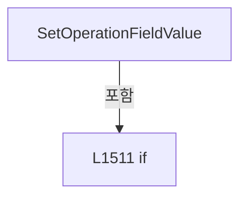

변경 전 점검: 입력/반환 타입, 위 호출자, 예외/취소 경로, 공유 상태와 저장·전송 소비자를 함께 확인합니다. 값의 단위나 물리 방향을 이름만으로 확정하지 않습니다.

### LocalFunctionStatement `MatchesItem` · L1505–1508

[Drilling.UI/Menu/Menus/CMenuMonitor.cs:1505–1508](https://github.com/kjuws10-rgb/A3Drilling/blob/5aee8e58439c9b455cae7c9593c9be986c3e682e/Drilling.UI/Menu/Menus/CMenuMonitor.cs#L1505-L1508)

| 항목 | 실제 추출 값 |
| --- | --- |
| 서명 | bool MatchesItem(Drilling.UI.Menu.Menus.ST_MONITOR_PARAMETER_ROW) |
| 접근/수식자 | Private /  |
| 반환/값 타입 | bool |
| 소속 타입 | NamedType:Drilling.UI.Menu.Menus.CMenuMonitor |

입력 계약:

| 이름 | 타입 | 전달 | 선택/기본값 |
| --- | --- | --- | --- |
| item | Drilling.UI.Menu.Menus.ST_MONITOR_PARAMETER_ROW | None | False /  |

현재 부분 분석에서 직접 연결된 호출자는 없습니다. XAML/이벤트/인터페이스·델리게이트·외부 진입을 추가 확인해야 하며, 미사용으로 판정한 것이 아닙니다.

호출하는 대상과 해석 범위:

| 원본 행 | 표현식 | 분석 상태 | 대상/소스 위치 |
| --- | --- | --- | --- |
| 1507 | item.Parameter.Equals | resolved | bool string.Equals(string?, System.StringComparison) |

본문의 실제 연산·분기·예외·반환 순서(원문 위치 순):

| 원본 행 | 종류 | 주석 해설 |
| --- | --- | --- |
| 1507 | call | 함수·델리게이트 또는 객체 생성자를 호출합니다: item.Parameter.Equals(parameter, StringComparison.OrdinalIgnoreCase) |
| 1507 | return | 호출자에게 값 또는 제어를 반환합니다: return item.Parameter.Equals(parameter, StringComparison.OrdinalIgnoreCase); |

변경 전 점검: 입력/반환 타입, 위 호출자, 예외/취소 경로, 공유 상태와 저장·전송 소비자를 함께 확인합니다. 값의 단위나 물리 방향을 이름만으로 확정하지 않습니다.

### PropertyDeclaration `InitialAttPosition` · L1531–1531

[Drilling.UI/Menu/Menus/CMenuMonitor.cs:1531–1531](https://github.com/kjuws10-rgb/A3Drilling/blob/5aee8e58439c9b455cae7c9593c9be986c3e682e/Drilling.UI/Menu/Menus/CMenuMonitor.cs#L1531-L1531)

| 항목 | 실제 추출 값 |
| --- | --- |
| 서명 | double Drilling.UI.Menu.Menus.CMenuMonitor.ST_POWER_METER_TUNE_SETTINGS.InitialAttPosition |
| 접근/수식자 | Public / public |
| 반환/값 타입 | double |
| 소속 타입 | NamedType:Drilling.UI.Menu.Menus.CMenuMonitor.ST_POWER_METER_TUNE_SETTINGS |

현재 부분 분석에서 직접 연결된 호출자는 없습니다. XAML/이벤트/인터페이스·델리게이트·외부 진입을 추가 확인해야 하며, 미사용으로 판정한 것이 아닙니다.

변경 전 점검: 입력/반환 타입, 위 호출자, 예외/취소 경로, 공유 상태와 저장·전송 소비자를 함께 확인합니다. 값의 단위나 물리 방향을 이름만으로 확정하지 않습니다.

### GetAccessorDeclaration `get_InitialAttPosition` · L1531–1531

[Drilling.UI/Menu/Menus/CMenuMonitor.cs:1531–1531](https://github.com/kjuws10-rgb/A3Drilling/blob/5aee8e58439c9b455cae7c9593c9be986c3e682e/Drilling.UI/Menu/Menus/CMenuMonitor.cs#L1531-L1531)

| 항목 | 실제 추출 값 |
| --- | --- |
| 서명 | double Drilling.UI.Menu.Menus.CMenuMonitor.ST_POWER_METER_TUNE_SETTINGS.InitialAttPosition.get |
| 접근/수식자 | Public / get |
| 반환/값 타입 | double |
| 소속 타입 | NamedType:Drilling.UI.Menu.Menus.CMenuMonitor.ST_POWER_METER_TUNE_SETTINGS |

현재 부분 분석에서 직접 연결된 호출자는 없습니다. XAML/이벤트/인터페이스·델리게이트·외부 진입을 추가 확인해야 하며, 미사용으로 판정한 것이 아닙니다.

변경 전 점검: 입력/반환 타입, 위 호출자, 예외/취소 경로, 공유 상태와 저장·전송 소비자를 함께 확인합니다. 값의 단위나 물리 방향을 이름만으로 확정하지 않습니다.

### InitAccessorDeclaration `set_InitialAttPosition` · L1531–1531

[Drilling.UI/Menu/Menus/CMenuMonitor.cs:1531–1531](https://github.com/kjuws10-rgb/A3Drilling/blob/5aee8e58439c9b455cae7c9593c9be986c3e682e/Drilling.UI/Menu/Menus/CMenuMonitor.cs#L1531-L1531)

| 항목 | 실제 추출 값 |
| --- | --- |
| 서명 | void Drilling.UI.Menu.Menus.CMenuMonitor.ST_POWER_METER_TUNE_SETTINGS.InitialAttPosition.init |
| 접근/수식자 | Public / init |
| 반환/값 타입 | void |
| 소속 타입 | NamedType:Drilling.UI.Menu.Menus.CMenuMonitor.ST_POWER_METER_TUNE_SETTINGS |

입력 계약:

| 이름 | 타입 | 전달 | 선택/기본값 |
| --- | --- | --- | --- |
| value | double | None | False /  |

현재 부분 분석에서 직접 연결된 호출자는 없습니다. XAML/이벤트/인터페이스·델리게이트·외부 진입을 추가 확인해야 하며, 미사용으로 판정한 것이 아닙니다.

변경 전 점검: 입력/반환 타입, 위 호출자, 예외/취소 경로, 공유 상태와 저장·전송 소비자를 함께 확인합니다. 값의 단위나 물리 방향을 이름만으로 확정하지 않습니다.

### MethodDeclaration `ReadOperationField` · L1536–1546

[Drilling.UI/Menu/Menus/CMenuMonitor.cs:1536–1546](https://github.com/kjuws10-rgb/A3Drilling/blob/5aee8e58439c9b455cae7c9593c9be986c3e682e/Drilling.UI/Menu/Menus/CMenuMonitor.cs#L1536-L1546)

| 항목 | 실제 추출 값 |
| --- | --- |
| 서명 | double Drilling.UI.Menu.Menus.CMenuMonitor.ReadOperationField(string, double) |
| 접근/수식자 | Private / private |
| 반환/값 타입 | double |
| 소속 타입 | NamedType:Drilling.UI.Menu.Menus.CMenuMonitor |

입력 계약:

| 이름 | 타입 | 전달 | 선택/기본값 |
| --- | --- | --- | --- |
| parameter | string | None | False /  |
| defaultValue | double | None | False /  |

정적 호출자로 확인된 위치:

| 호출 파일/행 | 호출 표현식 | 런타임 분기 가능 |
| --- | --- | --- |
| [Drilling.UI/Menu/Menus/CMenuMonitor.cs:1212–1212](https://github.com/kjuws10-rgb/A3Drilling/blob/5aee8e58439c9b455cae7c9593c9be986c3e682e/Drilling.UI/Menu/Menus/CMenuMonitor.cs#L1212-L1212) | ReadOperationField | False |
| [Drilling.UI/Menu/Menus/CMenuMonitor.cs:1302–1302](https://github.com/kjuws10-rgb/A3Drilling/blob/5aee8e58439c9b455cae7c9593c9be986c3e682e/Drilling.UI/Menu/Menus/CMenuMonitor.cs#L1302-L1302) | ReadOperationField | False |
| [Drilling.UI/Menu/Menus/CMenuMonitor.cs:1307–1307](https://github.com/kjuws10-rgb/A3Drilling/blob/5aee8e58439c9b455cae7c9593c9be986c3e682e/Drilling.UI/Menu/Menus/CMenuMonitor.cs#L1307-L1307) | ReadOperationField | False |
| [Drilling.UI/Menu/Menus/CMenuMonitor.cs:1321–1321](https://github.com/kjuws10-rgb/A3Drilling/blob/5aee8e58439c9b455cae7c9593c9be986c3e682e/Drilling.UI/Menu/Menus/CMenuMonitor.cs#L1321-L1321) | ReadOperationField | False |
| [Drilling.UI/Menu/Menus/CMenuMonitor.cs:1326–1326](https://github.com/kjuws10-rgb/A3Drilling/blob/5aee8e58439c9b455cae7c9593c9be986c3e682e/Drilling.UI/Menu/Menus/CMenuMonitor.cs#L1326-L1326) | ReadOperationField | False |
| [Drilling.UI/Menu/Menus/CMenuMonitor.cs:1331–1331](https://github.com/kjuws10-rgb/A3Drilling/blob/5aee8e58439c9b455cae7c9593c9be986c3e682e/Drilling.UI/Menu/Menus/CMenuMonitor.cs#L1331-L1331) | ReadOperationField | False |
| [Drilling.UI/Menu/Menus/CMenuMonitor.cs:1336–1336](https://github.com/kjuws10-rgb/A3Drilling/blob/5aee8e58439c9b455cae7c9593c9be986c3e682e/Drilling.UI/Menu/Menus/CMenuMonitor.cs#L1336-L1336) | ReadOperationField | False |
| [Drilling.UI/Menu/Menus/CMenuMonitor.cs:1349–1349](https://github.com/kjuws10-rgb/A3Drilling/blob/5aee8e58439c9b455cae7c9593c9be986c3e682e/Drilling.UI/Menu/Menus/CMenuMonitor.cs#L1349-L1349) | ReadOperationField | False |
| [Drilling.UI/Menu/Menus/CMenuMonitor.cs:1354–1354](https://github.com/kjuws10-rgb/A3Drilling/blob/5aee8e58439c9b455cae7c9593c9be986c3e682e/Drilling.UI/Menu/Menus/CMenuMonitor.cs#L1354-L1354) | ReadOperationField | False |
| [Drilling.UI/Menu/Menus/CMenuMonitor.cs:1371–1371](https://github.com/kjuws10-rgb/A3Drilling/blob/5aee8e58439c9b455cae7c9593c9be986c3e682e/Drilling.UI/Menu/Menus/CMenuMonitor.cs#L1371-L1371) | ReadOperationField | False |
| [Drilling.UI/Menu/Menus/CMenuMonitor.cs:1376–1376](https://github.com/kjuws10-rgb/A3Drilling/blob/5aee8e58439c9b455cae7c9593c9be986c3e682e/Drilling.UI/Menu/Menus/CMenuMonitor.cs#L1376-L1376) | ReadOperationField | False |
| [Drilling.UI/Menu/Menus/CMenuMonitor.cs:1381–1381](https://github.com/kjuws10-rgb/A3Drilling/blob/5aee8e58439c9b455cae7c9593c9be986c3e682e/Drilling.UI/Menu/Menus/CMenuMonitor.cs#L1381-L1381) | ReadOperationField | False |
| [Drilling.UI/Menu/Menus/CMenuMonitor.cs:1386–1386](https://github.com/kjuws10-rgb/A3Drilling/blob/5aee8e58439c9b455cae7c9593c9be986c3e682e/Drilling.UI/Menu/Menus/CMenuMonitor.cs#L1386-L1386) | ReadOperationField | False |
| [Drilling.UI/Menu/Menus/CMenuMonitor.cs:1391–1391](https://github.com/kjuws10-rgb/A3Drilling/blob/5aee8e58439c9b455cae7c9593c9be986c3e682e/Drilling.UI/Menu/Menus/CMenuMonitor.cs#L1391-L1391) | ReadOperationField | False |
| [Drilling.UI/Menu/Menus/CMenuMonitor.cs:1404–1404](https://github.com/kjuws10-rgb/A3Drilling/blob/5aee8e58439c9b455cae7c9593c9be986c3e682e/Drilling.UI/Menu/Menus/CMenuMonitor.cs#L1404-L1404) | ReadOperationField | False |
| [Drilling.UI/Menu/Menus/CMenuMonitor.cs:1409–1409](https://github.com/kjuws10-rgb/A3Drilling/blob/5aee8e58439c9b455cae7c9593c9be986c3e682e/Drilling.UI/Menu/Menus/CMenuMonitor.cs#L1409-L1409) | ReadOperationField | False |
| [Drilling.UI/Menu/Menus/CMenuMonitor.cs:1436–1436](https://github.com/kjuws10-rgb/A3Drilling/blob/5aee8e58439c9b455cae7c9593c9be986c3e682e/Drilling.UI/Menu/Menus/CMenuMonitor.cs#L1436-L1436) | ReadOperationField | False |
| [Drilling.UI/Menu/Menus/CMenuMonitor.cs:1441–1441](https://github.com/kjuws10-rgb/A3Drilling/blob/5aee8e58439c9b455cae7c9593c9be986c3e682e/Drilling.UI/Menu/Menus/CMenuMonitor.cs#L1441-L1441) | ReadOperationField | False |
| [Drilling.UI/Menu/Menus/CMenuMonitor.cs:1451–1451](https://github.com/kjuws10-rgb/A3Drilling/blob/5aee8e58439c9b455cae7c9593c9be986c3e682e/Drilling.UI/Menu/Menus/CMenuMonitor.cs#L1451-L1451) | ReadOperationField | False |
| [Drilling.UI/Menu/Menus/CMenuMonitor.cs:1458–1458](https://github.com/kjuws10-rgb/A3Drilling/blob/5aee8e58439c9b455cae7c9593c9be986c3e682e/Drilling.UI/Menu/Menus/CMenuMonitor.cs#L1458-L1458) | ReadOperationField | False |
| [Drilling.UI/Menu/Menus/CMenuMonitor.cs:1459–1459](https://github.com/kjuws10-rgb/A3Drilling/blob/5aee8e58439c9b455cae7c9593c9be986c3e682e/Drilling.UI/Menu/Menus/CMenuMonitor.cs#L1459-L1459) | ReadOperationField | False |
| [Drilling.UI/Menu/Menus/CMenuMonitor.cs:4329–4329](https://github.com/kjuws10-rgb/A3Drilling/blob/5aee8e58439c9b455cae7c9593c9be986c3e682e/Drilling.UI/Menu/Menus/CMenuMonitor.cs#L4329-L4329) | ReadOperationField | False |
| [Drilling.UI/Menu/Menus/CMenuMonitor.cs:4330–4330](https://github.com/kjuws10-rgb/A3Drilling/blob/5aee8e58439c9b455cae7c9593c9be986c3e682e/Drilling.UI/Menu/Menus/CMenuMonitor.cs#L4330-L4330) | ReadOperationField | False |
| [Drilling.UI/Menu/Menus/CMenuMonitor.cs:4428–4428](https://github.com/kjuws10-rgb/A3Drilling/blob/5aee8e58439c9b455cae7c9593c9be986c3e682e/Drilling.UI/Menu/Menus/CMenuMonitor.cs#L4428-L4428) | ReadOperationField | False |
| [Drilling.UI/Menu/Menus/CMenuMonitor.cs:4429–4429](https://github.com/kjuws10-rgb/A3Drilling/blob/5aee8e58439c9b455cae7c9593c9be986c3e682e/Drilling.UI/Menu/Menus/CMenuMonitor.cs#L4429-L4429) | ReadOperationField | False |
| [Drilling.UI/Menu/Menus/CMenuMonitor.cs:4515–4515](https://github.com/kjuws10-rgb/A3Drilling/blob/5aee8e58439c9b455cae7c9593c9be986c3e682e/Drilling.UI/Menu/Menus/CMenuMonitor.cs#L4515-L4515) | ReadOperationField | False |
| [Drilling.UI/Menu/Menus/CMenuMonitor.cs:4516–4516](https://github.com/kjuws10-rgb/A3Drilling/blob/5aee8e58439c9b455cae7c9593c9be986c3e682e/Drilling.UI/Menu/Menus/CMenuMonitor.cs#L4516-L4516) | ReadOperationField | False |
| [Drilling.UI/Menu/Menus/CMenuMonitor.cs:4589–4589](https://github.com/kjuws10-rgb/A3Drilling/blob/5aee8e58439c9b455cae7c9593c9be986c3e682e/Drilling.UI/Menu/Menus/CMenuMonitor.cs#L4589-L4589) | ReadOperationField | False |
| [Drilling.UI/Menu/Menus/CMenuMonitor.cs:4590–4590](https://github.com/kjuws10-rgb/A3Drilling/blob/5aee8e58439c9b455cae7c9593c9be986c3e682e/Drilling.UI/Menu/Menus/CMenuMonitor.cs#L4590-L4590) | ReadOperationField | False |
| [Drilling.UI/Menu/Menus/CMenuMonitor.cs:4591–4591](https://github.com/kjuws10-rgb/A3Drilling/blob/5aee8e58439c9b455cae7c9593c9be986c3e682e/Drilling.UI/Menu/Menus/CMenuMonitor.cs#L4591-L4591) | ReadOperationField | False |
| [Drilling.UI/Menu/Menus/CMenuMonitor.cs:4592–4592](https://github.com/kjuws10-rgb/A3Drilling/blob/5aee8e58439c9b455cae7c9593c9be986c3e682e/Drilling.UI/Menu/Menus/CMenuMonitor.cs#L4592-L4592) | ReadOperationField | False |
| [Drilling.UI/Menu/Menus/CMenuMonitor.cs:4621–4621](https://github.com/kjuws10-rgb/A3Drilling/blob/5aee8e58439c9b455cae7c9593c9be986c3e682e/Drilling.UI/Menu/Menus/CMenuMonitor.cs#L4621-L4621) | ReadOperationField | False |
| [Drilling.UI/Menu/Menus/CMenuMonitor.cs:4622–4622](https://github.com/kjuws10-rgb/A3Drilling/blob/5aee8e58439c9b455cae7c9593c9be986c3e682e/Drilling.UI/Menu/Menus/CMenuMonitor.cs#L4622-L4622) | ReadOperationField | False |
| [Drilling.UI/Menu/Menus/CMenuMonitor.cs:4623–4623](https://github.com/kjuws10-rgb/A3Drilling/blob/5aee8e58439c9b455cae7c9593c9be986c3e682e/Drilling.UI/Menu/Menus/CMenuMonitor.cs#L4623-L4623) | ReadOperationField | False |
| [Drilling.UI/Menu/Menus/CMenuMonitor.cs:4624–4624](https://github.com/kjuws10-rgb/A3Drilling/blob/5aee8e58439c9b455cae7c9593c9be986c3e682e/Drilling.UI/Menu/Menus/CMenuMonitor.cs#L4624-L4624) | ReadOperationField | False |
| [Drilling.UI/Menu/Menus/CMenuMonitor.cs:4625–4625](https://github.com/kjuws10-rgb/A3Drilling/blob/5aee8e58439c9b455cae7c9593c9be986c3e682e/Drilling.UI/Menu/Menus/CMenuMonitor.cs#L4625-L4625) | ReadOperationField | False |
| [Drilling.UI/Menu/Menus/CMenuMonitor.cs:4626–4626](https://github.com/kjuws10-rgb/A3Drilling/blob/5aee8e58439c9b455cae7c9593c9be986c3e682e/Drilling.UI/Menu/Menus/CMenuMonitor.cs#L4626-L4626) | ReadOperationField | False |
| [Drilling.UI/Menu/Menus/CMenuMonitor.cs:4627–4627](https://github.com/kjuws10-rgb/A3Drilling/blob/5aee8e58439c9b455cae7c9593c9be986c3e682e/Drilling.UI/Menu/Menus/CMenuMonitor.cs#L4627-L4627) | ReadOperationField | False |
| [Drilling.UI/Menu/Menus/CMenuMonitor.cs:4628–4628](https://github.com/kjuws10-rgb/A3Drilling/blob/5aee8e58439c9b455cae7c9593c9be986c3e682e/Drilling.UI/Menu/Menus/CMenuMonitor.cs#L4628-L4628) | ReadOperationField | False |
| [Drilling.UI/Menu/Menus/CMenuMonitor.cs:4763–4763](https://github.com/kjuws10-rgb/A3Drilling/blob/5aee8e58439c9b455cae7c9593c9be986c3e682e/Drilling.UI/Menu/Menus/CMenuMonitor.cs#L4763-L4763) | ReadOperationField | False |
| [Drilling.UI/Menu/Menus/CMenuMonitor.cs:4764–4764](https://github.com/kjuws10-rgb/A3Drilling/blob/5aee8e58439c9b455cae7c9593c9be986c3e682e/Drilling.UI/Menu/Menus/CMenuMonitor.cs#L4764-L4764) | ReadOperationField | False |
| [Drilling.UI/Menu/Menus/CMenuMonitor.cs:4864–4864](https://github.com/kjuws10-rgb/A3Drilling/blob/5aee8e58439c9b455cae7c9593c9be986c3e682e/Drilling.UI/Menu/Menus/CMenuMonitor.cs#L4864-L4864) | ReadOperationField | False |
| [Drilling.UI/Menu/Menus/CMenuMonitor.cs:4865–4865](https://github.com/kjuws10-rgb/A3Drilling/blob/5aee8e58439c9b455cae7c9593c9be986c3e682e/Drilling.UI/Menu/Menus/CMenuMonitor.cs#L4865-L4865) | ReadOperationField | False |
| [Drilling.UI/Menu/Menus/CMenuMonitor.cs:4887–4887](https://github.com/kjuws10-rgb/A3Drilling/blob/5aee8e58439c9b455cae7c9593c9be986c3e682e/Drilling.UI/Menu/Menus/CMenuMonitor.cs#L4887-L4887) | ReadOperationField | False |
| [Drilling.UI/Menu/Menus/CMenuMonitor.cs:4887–4887](https://github.com/kjuws10-rgb/A3Drilling/blob/5aee8e58439c9b455cae7c9593c9be986c3e682e/Drilling.UI/Menu/Menus/CMenuMonitor.cs#L4887-L4887) | ReadOperationField | False |
| [Drilling.UI/Menu/Menus/CMenuMonitor.cs:4888–4888](https://github.com/kjuws10-rgb/A3Drilling/blob/5aee8e58439c9b455cae7c9593c9be986c3e682e/Drilling.UI/Menu/Menus/CMenuMonitor.cs#L4888-L4888) | ReadOperationField | False |
| [Drilling.UI/Menu/Menus/CMenuMonitor.cs:4889–4889](https://github.com/kjuws10-rgb/A3Drilling/blob/5aee8e58439c9b455cae7c9593c9be986c3e682e/Drilling.UI/Menu/Menus/CMenuMonitor.cs#L4889-L4889) | ReadOperationField | False |
| [Drilling.UI/Menu/Menus/CMenuMonitor.cs:4890–4890](https://github.com/kjuws10-rgb/A3Drilling/blob/5aee8e58439c9b455cae7c9593c9be986c3e682e/Drilling.UI/Menu/Menus/CMenuMonitor.cs#L4890-L4890) | ReadOperationField | False |

호출하는 대상과 해석 범위:

| 원본 행 | 표현식 | 분석 상태 | 대상/소스 위치 |
| --- | --- | --- | --- |
| 1543 | OperationFields.FirstOrDefault | resolved | Drilling.UI.Menu.Menus.ST_MONITOR_PARAMETER_ROW? System.Collections.Generic.IEnumerable<Drilling.UI.Menu.Menus.ST_MONITOR_PARAMETER_ROW>.FirstOrDefault<Drilling.UI.Menu.Menus.ST_MONITOR_PARAMETER_ROW>(System.Func<Drilling.UI.Menu.Menus.ST_MONITOR_PARAMETER_ROW, bool>) |
| 1544 | NormalizeOperationNumericValue | resolved | string Drilling.UI.Menu.Menus.CMenuMonitor.NormalizeOperationNumericValue(string?) · Drilling.UI/Menu/Menus/CMenuMonitor.cs:2536 |
| 1545 | double.TryParse | resolved | bool double.TryParse(string?, System.Globalization.NumberStyles, System.IFormatProvider?, out double) |

본문의 실제 연산·분기·예외·반환 순서(원문 위치 순):

| 원본 행 | 종류 | 주석 해설 |
| --- | --- | --- |
| 1543 | call | 함수·델리게이트 또는 객체 생성자를 호출합니다: OperationFields.FirstOrDefault(MatchesItem) |
| 1543 | local-declaration | 지역 변수를 선언합니다: var value = OperationFields.FirstOrDefault(MatchesItem)?.Value; |
| 1543 | variable-initializer | 변수의 초기값을 지정합니다: value = OperationFields.FirstOrDefault(MatchesItem)?.Value |
| 1544 | call | 함수·델리게이트 또는 객체 생성자를 호출합니다: NormalizeOperationNumericValue(value) |
| 1544 | local-declaration | 지역 변수를 선언합니다: var numericValue = NormalizeOperationNumericValue(value); |
| 1544 | variable-initializer | 변수의 초기값을 지정합니다: numericValue = NormalizeOperationNumericValue(value) |
| 1545 | call | 함수·델리게이트 또는 객체 생성자를 호출합니다: double.TryParse(numericValue, NumberStyles.Float, CultureInfo.InvariantCulture, out var result) |
| 1545 | conditional-expression | 조건에 따라 결과식을 선택합니다: double.TryParse(numericValue, NumberStyles.Float, CultureInfo.InvariantCulture, out var result) ? result : defaultValue |
| 1545 | return | 호출자에게 값 또는 제어를 반환합니다: return double.TryParse(numericValue, NumberStyles.Float, CultureInfo.InvariantCulture, out var result) ? result : defaultValue; |

변경 전 점검: 입력/반환 타입, 위 호출자, 예외/취소 경로, 공유 상태와 저장·전송 소비자를 함께 확인합니다. 값의 단위나 물리 방향을 이름만으로 확정하지 않습니다.

### LocalFunctionStatement `MatchesItem` · L1538–1541

[Drilling.UI/Menu/Menus/CMenuMonitor.cs:1538–1541](https://github.com/kjuws10-rgb/A3Drilling/blob/5aee8e58439c9b455cae7c9593c9be986c3e682e/Drilling.UI/Menu/Menus/CMenuMonitor.cs#L1538-L1541)

| 항목 | 실제 추출 값 |
| --- | --- |
| 서명 | bool MatchesItem(Drilling.UI.Menu.Menus.ST_MONITOR_PARAMETER_ROW) |
| 접근/수식자 | Private /  |
| 반환/값 타입 | bool |
| 소속 타입 | NamedType:Drilling.UI.Menu.Menus.CMenuMonitor |

입력 계약:

| 이름 | 타입 | 전달 | 선택/기본값 |
| --- | --- | --- | --- |
| field | Drilling.UI.Menu.Menus.ST_MONITOR_PARAMETER_ROW | None | False /  |

현재 부분 분석에서 직접 연결된 호출자는 없습니다. XAML/이벤트/인터페이스·델리게이트·외부 진입을 추가 확인해야 하며, 미사용으로 판정한 것이 아닙니다.

호출하는 대상과 해석 범위:

| 원본 행 | 표현식 | 분석 상태 | 대상/소스 위치 |
| --- | --- | --- | --- |
| 1540 | field.Parameter.Equals | resolved | bool string.Equals(string?, System.StringComparison) |

본문의 실제 연산·분기·예외·반환 순서(원문 위치 순):

| 원본 행 | 종류 | 주석 해설 |
| --- | --- | --- |
| 1540 | call | 함수·델리게이트 또는 객체 생성자를 호출합니다: field.Parameter.Equals(parameter, StringComparison.OrdinalIgnoreCase) |
| 1540 | return | 호출자에게 값 또는 제어를 반환합니다: return field.Parameter.Equals(parameter, StringComparison.OrdinalIgnoreCase); |

변경 전 점검: 입력/반환 타입, 위 호출자, 예외/취소 경로, 공유 상태와 저장·전송 소비자를 함께 확인합니다. 값의 단위나 물리 방향을 이름만으로 확정하지 않습니다.

### MethodDeclaration `TryReadPositiveOperationField` · L1548–1557

[Drilling.UI/Menu/Menus/CMenuMonitor.cs:1548–1557](https://github.com/kjuws10-rgb/A3Drilling/blob/5aee8e58439c9b455cae7c9593c9be986c3e682e/Drilling.UI/Menu/Menus/CMenuMonitor.cs#L1548-L1557)

| 항목 | 실제 추출 값 |
| --- | --- |
| 서명 | bool Drilling.UI.Menu.Menus.CMenuMonitor.TryReadPositiveOperationField(string, out double) |
| 접근/수식자 | Private / private |
| 반환/값 타입 | bool |
| 소속 타입 | NamedType:Drilling.UI.Menu.Menus.CMenuMonitor |

입력 계약:

| 이름 | 타입 | 전달 | 선택/기본값 |
| --- | --- | --- | --- |
| parameter | string | None | False /  |
| value | double | Out | False /  |

정적 호출자로 확인된 위치:

| 호출 파일/행 | 호출 표현식 | 런타임 분기 가능 |
| --- | --- | --- |
| [Drilling.UI/Menu/Menus/CMenuMonitor.cs:4376–4376](https://github.com/kjuws10-rgb/A3Drilling/blob/5aee8e58439c9b455cae7c9593c9be986c3e682e/Drilling.UI/Menu/Menus/CMenuMonitor.cs#L4376-L4376) | TryReadPositiveOperationField | False |
| [Drilling.UI/Menu/Menus/CMenuMonitor.cs:4376–4376](https://github.com/kjuws10-rgb/A3Drilling/blob/5aee8e58439c9b455cae7c9593c9be986c3e682e/Drilling.UI/Menu/Menus/CMenuMonitor.cs#L4376-L4376) | TryReadPositiveOperationField | False |

호출하는 대상과 해석 범위:

| 원본 행 | 표현식 | 분석 상태 | 대상/소스 위치 |
| --- | --- | --- | --- |
| 1555 | OperationFields.FirstOrDefault | resolved | Drilling.UI.Menu.Menus.ST_MONITOR_PARAMETER_ROW? System.Collections.Generic.IEnumerable<Drilling.UI.Menu.Menus.ST_MONITOR_PARAMETER_ROW>.FirstOrDefault<Drilling.UI.Menu.Menus.ST_MONITOR_PARAMETER_ROW>(System.Func<Drilling.UI.Menu.Menus.ST_MONITOR_PARAMETER_ROW, bool>) |
| 1556 | double.TryParse | resolved | bool double.TryParse(string?, System.Globalization.NumberStyles, System.IFormatProvider?, out double) |
| 1556 | double.IsFinite | resolved | bool double.IsFinite(double) |

본문의 실제 연산·분기·예외·반환 순서(원문 위치 순):

| 원본 행 | 종류 | 주석 해설 |
| --- | --- | --- |
| 1555 | call | 함수·델리게이트 또는 객체 생성자를 호출합니다: OperationFields.FirstOrDefault(MatchesItem) |
| 1555 | local-declaration | 지역 변수를 선언합니다: var text = OperationFields.FirstOrDefault(MatchesItem)?.Value; |
| 1555 | variable-initializer | 변수의 초기값을 지정합니다: text = OperationFields.FirstOrDefault(MatchesItem)?.Value |
| 1556 | call | 함수·델리게이트 또는 객체 생성자를 호출합니다: double.TryParse(text, NumberStyles.Float, CultureInfo.InvariantCulture, out value) |
| 1556 | call | 함수·델리게이트 또는 객체 생성자를 호출합니다: double.IsFinite(value) |
| 1556 | return | 호출자에게 값 또는 제어를 반환합니다: return double.TryParse(text, NumberStyles.Float, CultureInfo.InvariantCulture, out value) && double.IsFinite(value) && value > 0.0; |

변경 전 점검: 입력/반환 타입, 위 호출자, 예외/취소 경로, 공유 상태와 저장·전송 소비자를 함께 확인합니다. 값의 단위나 물리 방향을 이름만으로 확정하지 않습니다.

### LocalFunctionStatement `MatchesItem` · L1550–1553

[Drilling.UI/Menu/Menus/CMenuMonitor.cs:1550–1553](https://github.com/kjuws10-rgb/A3Drilling/blob/5aee8e58439c9b455cae7c9593c9be986c3e682e/Drilling.UI/Menu/Menus/CMenuMonitor.cs#L1550-L1553)

| 항목 | 실제 추출 값 |
| --- | --- |
| 서명 | bool MatchesItem(Drilling.UI.Menu.Menus.ST_MONITOR_PARAMETER_ROW) |
| 접근/수식자 | Private /  |
| 반환/값 타입 | bool |
| 소속 타입 | NamedType:Drilling.UI.Menu.Menus.CMenuMonitor |

입력 계약:

| 이름 | 타입 | 전달 | 선택/기본값 |
| --- | --- | --- | --- |
| field | Drilling.UI.Menu.Menus.ST_MONITOR_PARAMETER_ROW | None | False /  |

현재 부분 분석에서 직접 연결된 호출자는 없습니다. XAML/이벤트/인터페이스·델리게이트·외부 진입을 추가 확인해야 하며, 미사용으로 판정한 것이 아닙니다.

호출하는 대상과 해석 범위:

| 원본 행 | 표현식 | 분석 상태 | 대상/소스 위치 |
| --- | --- | --- | --- |
| 1552 | field.Parameter.Equals | resolved | bool string.Equals(string?, System.StringComparison) |

본문의 실제 연산·분기·예외·반환 순서(원문 위치 순):

| 원본 행 | 종류 | 주석 해설 |
| --- | --- | --- |
| 1552 | call | 함수·델리게이트 또는 객체 생성자를 호출합니다: field.Parameter.Equals(parameter, StringComparison.OrdinalIgnoreCase) |
| 1552 | return | 호출자에게 값 또는 제어를 반환합니다: return field.Parameter.Equals(parameter, StringComparison.OrdinalIgnoreCase); |

변경 전 점검: 입력/반환 타입, 위 호출자, 예외/취소 경로, 공유 상태와 저장·전송 소비자를 함께 확인합니다. 값의 단위나 물리 방향을 이름만으로 확정하지 않습니다.

### MethodDeclaration `GetMonitorOperationLabel` · L1559–1569

[Drilling.UI/Menu/Menus/CMenuMonitor.cs:1559–1569](https://github.com/kjuws10-rgb/A3Drilling/blob/5aee8e58439c9b455cae7c9593c9be986c3e682e/Drilling.UI/Menu/Menus/CMenuMonitor.cs#L1559-L1569)

| 항목 | 실제 추출 값 |
| --- | --- |
| 서명 | string Drilling.UI.Menu.Menus.CMenuMonitor.GetMonitorOperationLabel(object?) |
| 접근/수식자 | Private / private, static |
| 반환/값 타입 | string |
| 소속 타입 | NamedType:Drilling.UI.Menu.Menus.CMenuMonitor |

입력 계약:

| 이름 | 타입 | 전달 | 선택/기본값 |
| --- | --- | --- | --- |
| parameter | object? | None | False /  |

정적 호출자로 확인된 위치:

| 호출 파일/행 | 호출 표현식 | 런타임 분기 가능 |
| --- | --- | --- |
| [Drilling.UI/Menu/Menus/CMenuMonitor.cs:1180–1180](https://github.com/kjuws10-rgb/A3Drilling/blob/5aee8e58439c9b455cae7c9593c9be986c3e682e/Drilling.UI/Menu/Menus/CMenuMonitor.cs#L1180-L1180) | GetMonitorOperationLabel | False |
| [Drilling.UI/Menu/Menus/CMenuMonitor.cs:4944–4944](https://github.com/kjuws10-rgb/A3Drilling/blob/5aee8e58439c9b455cae7c9593c9be986c3e682e/Drilling.UI/Menu/Menus/CMenuMonitor.cs#L4944-L4944) | GetMonitorOperationLabel | False |

호출하는 대상과 해석 범위:

| 원본 행 | 표현식 | 분석 상태 | 대상/소스 위치 |
| --- | --- | --- | --- |
| 1563 | string.IsNullOrWhiteSpace | resolved | bool string.IsNullOrWhiteSpace(string?) |

본문의 실제 연산·분기·예외·반환 순서(원문 위치 순):

| 원본 행 | 종류 | 주석 해설 |
| --- | --- | --- |
| 1561 | return | 호출자에게 값 또는 제어를 반환합니다: return parameter switch { ST_MONITOR_OPERATION_BUTTON button => string.IsNullOrWhiteSpace(button.CommandKey) ? button.Label : button.CommandKey, ST_MONITOR_BET_TABLE_ROW row => row.MoveCommandLabel, ST_PWM_DEVICE_ROW row => row.Co |
| 1561 | switch-expression | 값별 결과식을 선택합니다: parameter switch { ST_MONITOR_OPERATION_BUTTON button => string.IsNullOrWhiteSpace(button.CommandKey) ? button.Label : button.CommandKey, ST_MONITOR_BET_TABLE_ROW row => row.MoveCommandLabel, ST_PWM_DEVICE_ROW row => row.Command,  |
| 1563 | call | 함수·델리게이트 또는 객체 생성자를 호출합니다: string.IsNullOrWhiteSpace(button.CommandKey) |
| 1563 | conditional-expression | 조건에 따라 결과식을 선택합니다: string.IsNullOrWhiteSpace(button.CommandKey) ? button.Label : button.CommandKey |

제어 구문의 포함 구조(실제 실행 순서/CFG가 아닌 구문 탐색 그림):

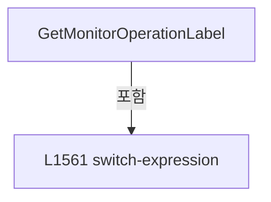

변경 전 점검: 입력/반환 타입, 위 호출자, 예외/취소 경로, 공유 상태와 저장·전송 소비자를 함께 확인합니다. 값의 단위나 물리 방향을 이름만으로 확정하지 않습니다.

### MethodDeclaration `NormalizeMonitorOperation` · L1571–1574

[Drilling.UI/Menu/Menus/CMenuMonitor.cs:1571–1574](https://github.com/kjuws10-rgb/A3Drilling/blob/5aee8e58439c9b455cae7c9593c9be986c3e682e/Drilling.UI/Menu/Menus/CMenuMonitor.cs#L1571-L1574)

| 항목 | 실제 추출 값 |
| --- | --- |
| 서명 | string Drilling.UI.Menu.Menus.CMenuMonitor.NormalizeMonitorOperation(string) |
| 접근/수식자 | Private / private, static |
| 반환/값 타입 | string |
| 소속 타입 | NamedType:Drilling.UI.Menu.Menus.CMenuMonitor |

입력 계약:

| 이름 | 타입 | 전달 | 선택/기본값 |
| --- | --- | --- | --- |
| label | string | None | False /  |

정적 호출자로 확인된 위치:

| 호출 파일/행 | 호출 표현식 | 런타임 분기 가능 |
| --- | --- | --- |
| [Drilling.UI/Menu/Menus/CMenuMonitor.cs:1192–1192](https://github.com/kjuws10-rgb/A3Drilling/blob/5aee8e58439c9b455cae7c9593c9be986c3e682e/Drilling.UI/Menu/Menus/CMenuMonitor.cs#L1192-L1192) | NormalizeMonitorOperation | False |
| [Drilling.UI/Menu/Menus/CMenuMonitor.cs:1256–1256](https://github.com/kjuws10-rgb/A3Drilling/blob/5aee8e58439c9b455cae7c9593c9be986c3e682e/Drilling.UI/Menu/Menus/CMenuMonitor.cs#L1256-L1256) | NormalizeMonitorOperation | False |
| [Drilling.UI/Menu/Menus/CMenuMonitor.cs:1292–1292](https://github.com/kjuws10-rgb/A3Drilling/blob/5aee8e58439c9b455cae7c9593c9be986c3e682e/Drilling.UI/Menu/Menus/CMenuMonitor.cs#L1292-L1292) | NormalizeMonitorOperation | False |
| [Drilling.UI/Menu/Menus/CMenuMonitor.cs:4313–4313](https://github.com/kjuws10-rgb/A3Drilling/blob/5aee8e58439c9b455cae7c9593c9be986c3e682e/Drilling.UI/Menu/Menus/CMenuMonitor.cs#L4313-L4313) | NormalizeMonitorOperation | False |
| [Drilling.UI/Menu/Menus/CMenuMonitor.cs:4572–4572](https://github.com/kjuws10-rgb/A3Drilling/blob/5aee8e58439c9b455cae7c9593c9be986c3e682e/Drilling.UI/Menu/Menus/CMenuMonitor.cs#L4572-L4572) | NormalizeMonitorOperation | False |
| [Drilling.UI/Menu/Menus/CMenuMonitor.cs:4607–4607](https://github.com/kjuws10-rgb/A3Drilling/blob/5aee8e58439c9b455cae7c9593c9be986c3e682e/Drilling.UI/Menu/Menus/CMenuMonitor.cs#L4607-L4607) | NormalizeMonitorOperation | False |
| [Drilling.UI/Menu/Menus/CMenuMonitor.cs:4736–4736](https://github.com/kjuws10-rgb/A3Drilling/blob/5aee8e58439c9b455cae7c9593c9be986c3e682e/Drilling.UI/Menu/Menus/CMenuMonitor.cs#L4736-L4736) | NormalizeMonitorOperation | False |
| [Drilling.UI/Menu/Menus/CMenuMonitor.cs:4785–4785](https://github.com/kjuws10-rgb/A3Drilling/blob/5aee8e58439c9b455cae7c9593c9be986c3e682e/Drilling.UI/Menu/Menus/CMenuMonitor.cs#L4785-L4785) | NormalizeMonitorOperation | False |
| [Drilling.UI/Menu/Menus/CMenuMonitor.cs:4826–4826](https://github.com/kjuws10-rgb/A3Drilling/blob/5aee8e58439c9b455cae7c9593c9be986c3e682e/Drilling.UI/Menu/Menus/CMenuMonitor.cs#L4826-L4826) | NormalizeMonitorOperation | False |

호출하는 대상과 해석 범위:

| 원본 행 | 표현식 | 분석 상태 | 대상/소스 위치 |
| --- | --- | --- | --- |
| 1573 | label.Replace("\r", "", StringComparison.OrdinalIgnoreCase).Replace("\n", "", StringComparison.OrdinalIgnoreCase).Replace(" ", "", StringComparison.OrdinalIgnoreCase).Replace("_", "", StringComparison.OrdinalIgnoreCase).Replace("-", "", StringComparison.OrdinalIgnoreCase).Trim().ToUpperInvariant | resolved | string string.ToUpperInvariant() |
| 1573 | label.Replace("\r", "", StringComparison.OrdinalIgnoreCase).Replace("\n", "", StringComparison.OrdinalIgnoreCase).Replace(" ", "", StringComparison.OrdinalIgnoreCase).Replace("_", "", StringComparison.OrdinalIgnoreCase).Replace("-", "", StringComparison.OrdinalIgnoreCase).Trim | resolved | string string.Trim() |
| 1573 | label.Replace("\r", "", StringComparison.OrdinalIgnoreCase).Replace("\n", "", StringComparison.OrdinalIgnoreCase).Replace(" ", "", StringComparison.OrdinalIgnoreCase).Replace("_", "", StringComparison.OrdinalIgnoreCase).Replace | resolved | string string.Replace(string, string?, System.StringComparison) |
| 1573 | label.Replace("\r", "", StringComparison.OrdinalIgnoreCase).Replace("\n", "", StringComparison.OrdinalIgnoreCase).Replace(" ", "", StringComparison.OrdinalIgnoreCase).Replace | resolved | string string.Replace(string, string?, System.StringComparison) |
| 1573 | label.Replace("\r", "", StringComparison.OrdinalIgnoreCase).Replace("\n", "", StringComparison.OrdinalIgnoreCase).Replace | resolved | string string.Replace(string, string?, System.StringComparison) |
| 1573 | label.Replace("\r", "", StringComparison.OrdinalIgnoreCase).Replace | resolved | string string.Replace(string, string?, System.StringComparison) |
| 1573 | label.Replace | resolved | string string.Replace(string, string?, System.StringComparison) |

본문의 실제 연산·분기·예외·반환 순서(원문 위치 순):

| 원본 행 | 종류 | 주석 해설 |
| --- | --- | --- |
| 1573 | call | 함수·델리게이트 또는 객체 생성자를 호출합니다: label.Replace("\r", "", StringComparison.OrdinalIgnoreCase).Replace("\n", "", StringComparison.OrdinalIgnoreCase).Replace(" ", "", StringComparison.OrdinalIgnoreCase).Replace("_", "", StringComparison.OrdinalIgnoreCase).… |
| 1573 | call | 함수·델리게이트 또는 객체 생성자를 호출합니다: label.Replace("\r", "", StringComparison.OrdinalIgnoreCase).Replace("\n", "", StringComparison.OrdinalIgnoreCase).Replace(" ", "", StringComparison.OrdinalIgnoreCase).Replace("_", "", StringComparison.OrdinalIgnoreCase).… |
| 1573 | call | 함수·델리게이트 또는 객체 생성자를 호출합니다: label.Replace("\r", "", StringComparison.OrdinalIgnoreCase).Replace("\n", "", StringComparison.OrdinalIgnoreCase).Replace(" ", "", StringComparison.OrdinalIgnoreCase).Replace("_", "", StringComparison.OrdinalIgnoreCase).… |
| 1573 | call | 함수·델리게이트 또는 객체 생성자를 호출합니다: label.Replace("\r", "", StringComparison.OrdinalIgnoreCase).Replace("\n", "", StringComparison.OrdinalIgnoreCase).Replace(" ", "", StringComparison.OrdinalIgnoreCase).Replace("_", "", StringComparison.OrdinalIgnoreCase) |
| 1573 | call | 함수·델리게이트 또는 객체 생성자를 호출합니다: label.Replace("\r", "", StringComparison.OrdinalIgnoreCase).Replace("\n", "", StringComparison.OrdinalIgnoreCase).Replace(" ", "", StringComparison.OrdinalIgnoreCase) |
| 1573 | call | 함수·델리게이트 또는 객체 생성자를 호출합니다: label.Replace("\r", "", StringComparison.OrdinalIgnoreCase).Replace("\n", "", StringComparison.OrdinalIgnoreCase) |
| 1573 | call | 함수·델리게이트 또는 객체 생성자를 호출합니다: label.Replace("\r", "", StringComparison.OrdinalIgnoreCase) |
| 1573 | return | 호출자에게 값 또는 제어를 반환합니다: return label.Replace("\r", "", StringComparison.OrdinalIgnoreCase).Replace("\n", "", StringComparison.OrdinalIgnoreCase).Replace(" ", "", StringComparison.OrdinalIgnoreCase).Replace("_", "", StringComparison.OrdinalIgnoreCase).Rep |

변경 전 점검: 입력/반환 타입, 위 호출자, 예외/취소 경로, 공유 상태와 저장·전송 소비자를 함께 확인합니다. 값의 단위나 물리 방향을 이름만으로 확정하지 않습니다.

### MethodDeclaration `Apply` · L1576–1638

[Drilling.UI/Menu/Menus/CMenuMonitor.cs:1576–1638](https://github.com/kjuws10-rgb/A3Drilling/blob/5aee8e58439c9b455cae7c9593c9be986c3e682e/Drilling.UI/Menu/Menus/CMenuMonitor.cs#L1576-L1638)

| 항목 | 실제 추출 값 |
| --- | --- |
| 서명 | void Drilling.UI.Menu.Menus.CMenuMonitor.Apply(System.Collections.Generic.IReadOnlyList<Drilling.UI.Menu.Menus.ST_SCREEN_SECTION>, string, string, string, string, string, string, string, System.Collections.Generic.IReadOnlyList<Drilling.UI.Menu.Menus.ST_MONITOR_TAB>, System.Collections.Generic.IReadOnlyList<Drilling.UI.Menu.Menus.ST_MONITOR_AXIS_ROW>, System.Collections.Generic.IReadOnlyList<Drilling.UI.Menu.Menus.ST_MONITOR_STATUS_ROW>, System.Collections.Generic.IReadOnlyList<Drilling.UI.Menu.Menus.ST_MONITOR_OPERATION_BUTTON>, System.Collections.Generic.IReadOnlyList<Drilling.UI.Menu.Menus.ST_MONITOR_PARAMETER_ROW>, System.Collections.Generic.IReadOnlyList<Drilling.UI.Menu.Menus.ST_MONITOR_PARAMETER_ROW>, System.Collections.Generic.IReadOnlyList<Drilling.UI.Menu.Menus.ST_MONITOR_BET_TABLE_ROW>, System.Collections.Generic.IReadOnlyList<Drilling.UI.Menu.Menus.ST_MONITOR_TREND_POINT>, System.Collections.Generic.IReadOnlyList<Drilling.UI.Menu.Menus.ST_MONITOR_SUMMARY_ITEM>, System.Collections.Generic.IReadOnlyList<Drilling.UI.Menu.Menus.ST_MONITOR_POSITION_ROW>, System.Collections.Generic.IReadOnlyList<Drilling.UI.Menu.Menus.ST_MONITOR_PRODUCT_ITEM>, System.Collections.Generic.IReadOnlyList<Drilling.UI.Menu.Menus.ST_MONITOR_PRODUCT_HISTORY_ROW>, System.Collections.Generic.IReadOnlyList<Drilling.UI.Menu.Menus.ST_PWM_SETTING_ROW>, System.Collections.Generic.IReadOnlyList<Drilling.UI.Menu.Menus.ST_PWM_DEVICE_ROW>, System.Collections.Generic.IReadOnlyList<Drilling.UI.Menu.Menus.ST_MONITOR_OPERATION_BUTTON>, System.Collections.Generic.IReadOnlyList<Drilling.UI.Menu.Menus.ST_POWER_METER_TUNE_ROW>, PointCollection, double, string, string, string) |
| 접근/수식자 | Private / private |
| 반환/값 타입 | void |
| 소속 타입 | NamedType:Drilling.UI.Menu.Menus.CMenuMonitor |

입력 계약:

| 이름 | 타입 | 전달 | 선택/기본값 |
| --- | --- | --- | --- |
| deviceTabs | System.Collections.Generic.IReadOnlyList<Drilling.UI.Menu.Menus.ST_SCREEN_SECTION> | None | False /  |
| selectedTab | string | None | False /  |
| title | string | None | False /  |
| subtitle | string | None | False /  |
| statusPanelTitle | string | None | False /  |
| operationPanelTitle | string | None | False /  |
| parameterPanelTitle | string | None | False /  |
| trendPanelTitle | string | None | False /  |
| tabs | System.Collections.Generic.IReadOnlyList<Drilling.UI.Menu.Menus.ST_MONITOR_TAB> | None | False /  |
| axisRows | System.Collections.Generic.IReadOnlyList<Drilling.UI.Menu.Menus.ST_MONITOR_AXIS_ROW> | None | False /  |
| statusRows | System.Collections.Generic.IReadOnlyList<Drilling.UI.Menu.Menus.ST_MONITOR_STATUS_ROW> | None | False /  |
| operationButtons | System.Collections.Generic.IReadOnlyList<Drilling.UI.Menu.Menus.ST_MONITOR_OPERATION_BUTTON> | None | False /  |
| operationFields | System.Collections.Generic.IReadOnlyList<Drilling.UI.Menu.Menus.ST_MONITOR_PARAMETER_ROW> | None | False /  |
| parameterRows | System.Collections.Generic.IReadOnlyList<Drilling.UI.Menu.Menus.ST_MONITOR_PARAMETER_ROW> | None | False /  |
| betTableRows | System.Collections.Generic.IReadOnlyList<Drilling.UI.Menu.Menus.ST_MONITOR_BET_TABLE_ROW> | None | False /  |
| trendPoints | System.Collections.Generic.IReadOnlyList<Drilling.UI.Menu.Menus.ST_MONITOR_TREND_POINT> | None | False /  |
| summaryItems | System.Collections.Generic.IReadOnlyList<Drilling.UI.Menu.Menus.ST_MONITOR_SUMMARY_ITEM> | None | False /  |
| positionRows | System.Collections.Generic.IReadOnlyList<Drilling.UI.Menu.Menus.ST_MONITOR_POSITION_ROW> | None | False /  |
| productItems | System.Collections.Generic.IReadOnlyList<Drilling.UI.Menu.Menus.ST_MONITOR_PRODUCT_ITEM> | None | False /  |
| productHistoryRows | System.Collections.Generic.IReadOnlyList<Drilling.UI.Menu.Menus.ST_MONITOR_PRODUCT_HISTORY_ROW> | None | False /  |
| pwmSettingRows | System.Collections.Generic.IReadOnlyList<Drilling.UI.Menu.Menus.ST_PWM_SETTING_ROW> | None | False /  |
| pwmDeviceRows | System.Collections.Generic.IReadOnlyList<Drilling.UI.Menu.Menus.ST_PWM_DEVICE_ROW> | None | False /  |
| pwmRunButtons | System.Collections.Generic.IReadOnlyList<Drilling.UI.Menu.Menus.ST_MONITOR_OPERATION_BUTTON> | None | False /  |
| powerMeterTuneRows | System.Collections.Generic.IReadOnlyList<Drilling.UI.Menu.Menus.ST_POWER_METER_TUNE_ROW> | None | False /  |
| powerMeterGraphLine | PointCollection | None | False /  |
| powerMeterTargetLineY | double | None | False /  |
| powerMeterGraphMinText | string | None | False /  |
| powerMeterGraphMaxText | string | None | False /  |
| powerMeterGraphTargetText | string | None | False /  |

정적 호출자로 확인된 위치:

| 호출 파일/행 | 호출 표현식 | 런타임 분기 가능 |
| --- | --- | --- |
| [Drilling.UI/Menu/Menus/CMenuMonitor.cs:741–771](https://github.com/kjuws10-rgb/A3Drilling/blob/5aee8e58439c9b455cae7c9593c9be986c3e682e/Drilling.UI/Menu/Menus/CMenuMonitor.cs#L741-L771) | Apply | False |
| [Drilling.UI/Menu/Menus/CMenuMonitor.cs:2556–2586](https://github.com/kjuws10-rgb/A3Drilling/blob/5aee8e58439c9b455cae7c9593c9be986c3e682e/Drilling.UI/Menu/Menus/CMenuMonitor.cs#L2556-L2586) | Apply | False |
| [Drilling.UI/Menu/Menus/CMenuMonitor.cs:2606–2636](https://github.com/kjuws10-rgb/A3Drilling/blob/5aee8e58439c9b455cae7c9593c9be986c3e682e/Drilling.UI/Menu/Menus/CMenuMonitor.cs#L2606-L2636) | Apply | False |

호출하는 대상과 해석 범위:

| 원본 행 | 표현식 | 분석 상태 | 대상/소스 위치 |
| --- | --- | --- | --- |
| 1637 | NotifyMonitorScreenProperties | resolved | void Drilling.UI.Menu.Menus.CMenuMonitor.NotifyMonitorScreenProperties() · Drilling.UI/Menu/Menus/CMenuMonitor.cs:1640 |

본문의 실제 연산·분기·예외·반환 순서(원문 위치 순):

| 원본 행 | 종류 | 주석 해설 |
| --- | --- | --- |
| 1608 | assignment | 값을 대상에 대입합니다: DeviceTabs = deviceTabs |
| 1609 | assignment | 값을 대상에 대입합니다: SelectedTab = selectedTab |
| 1610 | assignment | 값을 대상에 대입합니다: Title = title |
| 1611 | assignment | 값을 대상에 대입합니다: Subtitle = subtitle |
| 1612 | assignment | 값을 대상에 대입합니다: StatusPanelTitle = statusPanelTitle |
| 1613 | assignment | 값을 대상에 대입합니다: OperationPanelTitle = operationPanelTitle |
| 1614 | assignment | 값을 대상에 대입합니다: ParameterPanelTitle = parameterPanelTitle |
| 1615 | assignment | 값을 대상에 대입합니다: TrendPanelTitle = trendPanelTitle |
| 1616 | assignment | 값을 대상에 대입합니다: Tabs = tabs |
| 1617 | assignment | 값을 대상에 대입합니다: AxisRows = axisRows |
| 1618 | assignment | 값을 대상에 대입합니다: StatusRows = statusRows |
| 1619 | assignment | 값을 대상에 대입합니다: OperationButtons = operationButtons |
| 1620 | assignment | 값을 대상에 대입합니다: OperationFields = operationFields |
| 1621 | assignment | 값을 대상에 대입합니다: ParameterRows = parameterRows |
| 1622 | assignment | 값을 대상에 대입합니다: BetTableRows = betTableRows |
| 1623 | assignment | 값을 대상에 대입합니다: TrendPoints = trendPoints |
| 1624 | assignment | 값을 대상에 대입합니다: SummaryItems = summaryItems |
| 1625 | assignment | 값을 대상에 대입합니다: PositionRows = positionRows |
| 1626 | assignment | 값을 대상에 대입합니다: ProductItems = productItems |
| 1627 | assignment | 값을 대상에 대입합니다: ProductHistoryRows = productHistoryRows |
| 1628 | assignment | 값을 대상에 대입합니다: PwmSettingRows = pwmSettingRows |
| 1629 | assignment | 값을 대상에 대입합니다: PwmDeviceRows = pwmDeviceRows |
| 1630 | assignment | 값을 대상에 대입합니다: PwmRunButtons = pwmRunButtons |
| 1631 | assignment | 값을 대상에 대입합니다: PowerMeterTuneRows = powerMeterTuneRows |
| 1632 | assignment | 값을 대상에 대입합니다: PowerMeterGraphLine = powerMeterGraphLine |
| 1633 | assignment | 값을 대상에 대입합니다: PowerMeterTargetLineY = powerMeterTargetLineY |
| 1634 | assignment | 값을 대상에 대입합니다: PowerMeterGraphMinText = powerMeterGraphMinText |
| 1635 | assignment | 값을 대상에 대입합니다: PowerMeterGraphMaxText = powerMeterGraphMaxText |
| 1636 | assignment | 값을 대상에 대입합니다: PowerMeterGraphTargetText = powerMeterGraphTargetText |
| 1637 | call | 함수·델리게이트 또는 객체 생성자를 호출합니다: NotifyMonitorScreenProperties() |

변경 전 점검: 입력/반환 타입, 위 호출자, 예외/취소 경로, 공유 상태와 저장·전송 소비자를 함께 확인합니다. 값의 단위나 물리 방향을 이름만으로 확정하지 않습니다.

### MethodDeclaration `NotifyMonitorScreenProperties` · L1640–1792

[Drilling.UI/Menu/Menus/CMenuMonitor.cs:1640–1792](https://github.com/kjuws10-rgb/A3Drilling/blob/5aee8e58439c9b455cae7c9593c9be986c3e682e/Drilling.UI/Menu/Menus/CMenuMonitor.cs#L1640-L1792)

| 항목 | 실제 추출 값 |
| --- | --- |
| 서명 | void Drilling.UI.Menu.Menus.CMenuMonitor.NotifyMonitorScreenProperties() |
| 접근/수식자 | Private / private |
| 반환/값 타입 | void |
| 소속 타입 | NamedType:Drilling.UI.Menu.Menus.CMenuMonitor |

정적 호출자로 확인된 위치:

| 호출 파일/행 | 호출 표현식 | 런타임 분기 가능 |
| --- | --- | --- |
| [Drilling.UI/Menu/Menus/CMenuMonitor.cs:1637–1637](https://github.com/kjuws10-rgb/A3Drilling/blob/5aee8e58439c9b455cae7c9593c9be986c3e682e/Drilling.UI/Menu/Menus/CMenuMonitor.cs#L1637-L1637) | NotifyMonitorScreenProperties | False |

호출하는 대상과 해석 범위:

| 원본 행 | 표현식 | 분석 상태 | 대상/소스 위치 |
| --- | --- | --- | --- |
| 1642 | NotifyMonitorLiveProperties | resolved | void Drilling.UI.Menu.Menus.CMenuMonitor.NotifyMonitorLiveProperties(params string[]) · Drilling.UI/Menu/Menus/CMenuMonitor.cs:1794 |
| 1643 | nameof | unresolved | None |
| 1644 | nameof | unresolved | None |
| 1645 | nameof | unresolved | None |
| 1646 | nameof | unresolved | None |
| 1647 | nameof | unresolved | None |
| 1648 | nameof | unresolved | None |
| 1649 | nameof | unresolved | None |
| 1650 | nameof | unresolved | None |
| 1651 | nameof | unresolved | None |
| 1652 | nameof | unresolved | None |
| 1653 | nameof | unresolved | None |
| 1654 | nameof | unresolved | None |
| 1655 | nameof | unresolved | None |
| 1656 | nameof | unresolved | None |
| 1657 | nameof | unresolved | None |
| 1658 | nameof | unresolved | None |
| 1659 | nameof | unresolved | None |
| 1660 | nameof | unresolved | None |
| 1661 | nameof | unresolved | None |
| 1662 | nameof | unresolved | None |
| 1663 | nameof | unresolved | None |
| 1664 | nameof | unresolved | None |
| 1669 | NotifyMonitorLiveProperties | resolved | void Drilling.UI.Menu.Menus.CMenuMonitor.NotifyMonitorLiveProperties(params string[]) · Drilling.UI/Menu/Menus/CMenuMonitor.cs:1794 |
| 1670 | nameof | unresolved | None |
| 1671 | nameof | unresolved | None |
| 1672 | nameof | unresolved | None |
| 1673 | nameof | unresolved | None |
| 1674 | nameof | unresolved | None |
| 1675 | nameof | unresolved | None |
| 1676 | nameof | unresolved | None |
| 1677 | nameof | unresolved | None |
| 1678 | nameof | unresolved | None |
| 1679 | nameof | unresolved | None |
| 1683 | NotifyMonitorLiveProperties | resolved | void Drilling.UI.Menu.Menus.CMenuMonitor.NotifyMonitorLiveProperties(params string[]) · Drilling.UI/Menu/Menus/CMenuMonitor.cs:1794 |
| 1684 | nameof | unresolved | None |
| 1685 | nameof | unresolved | None |
| 1686 | nameof | unresolved | None |
| 1687 | nameof | unresolved | None |
| 1688 | nameof | unresolved | None |
| 1689 | nameof | unresolved | None |
| 1690 | nameof | unresolved | None |
| 1691 | nameof | unresolved | None |
| 1692 | nameof | unresolved | None |
| 1693 | nameof | unresolved | None |
| 1697 | NotifyMonitorLiveProperties | resolved | void Drilling.UI.Menu.Menus.CMenuMonitor.NotifyMonitorLiveProperties(params string[]) · Drilling.UI/Menu/Menus/CMenuMonitor.cs:1794 |
| 1698 | nameof | unresolved | None |
| 1699 | nameof | unresolved | None |
| 1700 | nameof | unresolved | None |
| 1701 | nameof | unresolved | None |
| 1702 | nameof | unresolved | None |
| 1703 | nameof | unresolved | None |
| 1704 | nameof | unresolved | None |
| 1705 | nameof | unresolved | None |
| 1706 | nameof | unresolved | None |
| 1707 | nameof | unresolved | None |
| 1711 | NotifyMonitorLiveProperties | resolved | void Drilling.UI.Menu.Menus.CMenuMonitor.NotifyMonitorLiveProperties(params string[]) · Drilling.UI/Menu/Menus/CMenuMonitor.cs:1794 |
| 1712 | nameof | unresolved | None |
| 1713 | nameof | unresolved | None |
| 1714 | nameof | unresolved | None |
| 1715 | nameof | unresolved | None |
| 1716 | nameof | unresolved | None |
| 1717 | nameof | unresolved | None |
| 1718 | nameof | unresolved | None |
| 1719 | nameof | unresolved | None |
| 1720 | nameof | unresolved | None |
| 1724 | NotifyMonitorLiveProperties | resolved | void Drilling.UI.Menu.Menus.CMenuMonitor.NotifyMonitorLiveProperties(params string[]) · Drilling.UI/Menu/Menus/CMenuMonitor.cs:1794 |
| 1725 | nameof | unresolved | None |
| 1726 | nameof | unresolved | None |
| 1727 | nameof | unresolved | None |
| 1728 | nameof | unresolved | None |
| 1729 | nameof | unresolved | None |
| 1730 | nameof | unresolved | None |
| 1731 | nameof | unresolved | None |
| 1732 | nameof | unresolved | None |
| 1733 | nameof | unresolved | None |
| 1734 | nameof | unresolved | None |
| 1735 | nameof | unresolved | None |
| 1736 | nameof | unresolved | None |
| 1737 | nameof | unresolved | None |
| 1738 | nameof | unresolved | None |
| 1739 | nameof | unresolved | None |
| 1740 | nameof | unresolved | None |
| 1741 | nameof | unresolved | None |
| 1742 | nameof | unresolved | None |
| 1746 | NotifyMonitorLiveProperties | resolved | void Drilling.UI.Menu.Menus.CMenuMonitor.NotifyMonitorLiveProperties(params string[]) · Drilling.UI/Menu/Menus/CMenuMonitor.cs:1794 |
| 1747 | nameof | unresolved | None |
| 1748 | nameof | unresolved | None |
| 1749 | nameof | unresolved | None |
| 1750 | nameof | unresolved | None |
| 1751 | nameof | unresolved | None |
| 1752 | nameof | unresolved | None |
| 1753 | nameof | unresolved | None |
| 1754 | nameof | unresolved | None |
| 1755 | nameof | unresolved | None |
| 1759 | NotifyMonitorLiveProperties | resolved | void Drilling.UI.Menu.Menus.CMenuMonitor.NotifyMonitorLiveProperties(params string[]) · Drilling.UI/Menu/Menus/CMenuMonitor.cs:1794 |
| 1760 | nameof | unresolved | None |
| 1761 | nameof | unresolved | None |
| 1762 | nameof | unresolved | None |
| 1763 | nameof | unresolved | None |
| 1764 | nameof | unresolved | None |
| 1765 | nameof | unresolved | None |
| 1766 | nameof | unresolved | None |
| 1767 | nameof | unresolved | None |
| 1768 | nameof | unresolved | None |
| 1769 | nameof | unresolved | None |
| 1773 | NotifyMonitorLiveProperties | resolved | void Drilling.UI.Menu.Menus.CMenuMonitor.NotifyMonitorLiveProperties(params string[]) · Drilling.UI/Menu/Menus/CMenuMonitor.cs:1794 |
| 1774 | nameof | unresolved | None |
| 1775 | nameof | unresolved | None |
| 1776 | nameof | unresolved | None |
| 1777 | nameof | unresolved | None |
| 1778 | nameof | unresolved | None |
| 1779 | nameof | unresolved | None |
| 1780 | nameof | unresolved | None |
| 1781 | nameof | unresolved | None |
| 1782 | nameof | unresolved | None |
| 1786 | NotifyCoordinateViewerProperties | resolved | void Drilling.UI.Menu.Menus.CMenuMonitor.NotifyCoordinateViewerProperties() · Drilling.UI/Menu/Menus/CMenuMonitor.cs:3310 |
| 1789 | NotifyMonitorLiveProperties | resolved | void Drilling.UI.Menu.Menus.CMenuMonitor.NotifyMonitorLiveProperties(params string[]) · Drilling.UI/Menu/Menus/CMenuMonitor.cs:1794 |
| 1789 | nameof | unresolved | None |
| 1789 | nameof | unresolved | None |
| 1789 | nameof | unresolved | None |
| 1789 | nameof | unresolved | None |
| 1789 | nameof | unresolved | None |
| 1789 | nameof | unresolved | None |

본문의 실제 연산·분기·예외·반환 순서(원문 위치 순):

| 원본 행 | 종류 | 주석 해설 |
| --- | --- | --- |
| 1642 | call | 함수·델리게이트 또는 객체 생성자를 호출합니다: NotifyMonitorLiveProperties( nameof(DeviceTabs), nameof(SelectedTab), nameof(Title), nameof(Subtitle), nameof(StatusPanelTitle), nameof(OperationPanelTitle), nameof(ParameterPanelTitle), nameof(TrendPanelTitle), nameof(T… |
| 1643 | call | 함수·델리게이트 또는 객체 생성자를 호출합니다: nameof(DeviceTabs) |
| 1644 | call | 함수·델리게이트 또는 객체 생성자를 호출합니다: nameof(SelectedTab) |
| 1645 | call | 함수·델리게이트 또는 객체 생성자를 호출합니다: nameof(Title) |
| 1646 | call | 함수·델리게이트 또는 객체 생성자를 호출합니다: nameof(Subtitle) |
| 1647 | call | 함수·델리게이트 또는 객체 생성자를 호출합니다: nameof(StatusPanelTitle) |
| 1648 | call | 함수·델리게이트 또는 객체 생성자를 호출합니다: nameof(OperationPanelTitle) |
| 1649 | call | 함수·델리게이트 또는 객체 생성자를 호출합니다: nameof(ParameterPanelTitle) |
| 1650 | call | 함수·델리게이트 또는 객체 생성자를 호출합니다: nameof(TrendPanelTitle) |
| 1651 | call | 함수·델리게이트 또는 객체 생성자를 호출합니다: nameof(Tabs) |
| 1652 | call | 함수·델리게이트 또는 객체 생성자를 호출합니다: nameof(IsMotor) |
| 1653 | call | 함수·델리게이트 또는 객체 생성자를 호출합니다: nameof(IsLaser) |
| 1654 | call | 함수·델리게이트 또는 객체 생성자를 호출합니다: nameof(IsAttenuator) |
| 1655 | call | 함수·델리게이트 또는 객체 생성자를 호출합니다: nameof(IsBet) |
| 1656 | call | 함수·델리게이트 또는 객체 생성자를 호출합니다: nameof(IsPowerMeter) |
| 1657 | call | 함수·델리게이트 또는 객체 생성자를 호출합니다: nameof(IsProduct) |
| 1658 | call | 함수·델리게이트 또는 객체 생성자를 호출합니다: nameof(IsMelsec) |
| 1659 | call | 함수·델리게이트 또는 객체 생성자를 호출합니다: nameof(IsCoordinateViewer) |
| 1660 | call | 함수·델리게이트 또는 객체 생성자를 호출합니다: nameof(IsLogViewer) |
| 1661 | call | 함수·델리게이트 또는 객체 생성자를 호출합니다: nameof(IsGenericDevice) |
| 1662 | call | 함수·델리게이트 또는 객체 생성자를 호출합니다: nameof(SelectedLaserName) |
| 1663 | call | 함수·델리게이트 또는 객체 생성자를 호출합니다: nameof(SelectedHeadDeviceName) |
| 1664 | call | 함수·델리게이트 또는 객체 생성자를 호출합니다: nameof(HeadDeviceSelectorTitle) |
| 1666 | switch | 값에 따라 분기합니다: switch (SelectedTab) |
| 1668 | case | 분기값/패턴의 구간입니다: case "XPS": |
| 1669 | call | 함수·델리게이트 또는 객체 생성자를 호출합니다: NotifyMonitorLiveProperties( nameof(AxisRows), nameof(SelectedAxisId), nameof(SelectedAxisRow), nameof(MultiMoveAxisRows), nameof(StatusRows), nameof(OperationButtons), nameof(OperationFields), nameof(ParameterRows), nam… |
| 1670 | call | 함수·델리게이트 또는 객체 생성자를 호출합니다: nameof(AxisRows) |
| 1671 | call | 함수·델리게이트 또는 객체 생성자를 호출합니다: nameof(SelectedAxisId) |
| 1672 | call | 함수·델리게이트 또는 객체 생성자를 호출합니다: nameof(SelectedAxisRow) |
| 1673 | call | 함수·델리게이트 또는 객체 생성자를 호출합니다: nameof(MultiMoveAxisRows) |
| 1674 | call | 함수·델리게이트 또는 객체 생성자를 호출합니다: nameof(StatusRows) |
| 1675 | call | 함수·델리게이트 또는 객체 생성자를 호출합니다: nameof(OperationButtons) |
| 1676 | call | 함수·델리게이트 또는 객체 생성자를 호출합니다: nameof(OperationFields) |
| 1677 | call | 함수·델리게이트 또는 객체 생성자를 호출합니다: nameof(ParameterRows) |
| 1678 | call | 함수·델리게이트 또는 객체 생성자를 호출합니다: nameof(PositionRows) |
| 1679 | call | 함수·델리게이트 또는 객체 생성자를 호출합니다: nameof(SummaryItems) |
| 1681 | break | 해당 반복/분기 구간을 종료합니다: break; |
| 1682 | case | 분기값/패턴의 구간입니다: case "LASER": |
| 1683 | call | 함수·델리게이트 또는 객체 생성자를 호출합니다: NotifyMonitorLiveProperties( nameof(StatusRows), nameof(OperationButtons), nameof(OperationFields), nameof(HeadSelectRows), nameof(LaserControlRows), nameof(ParameterRows), nameof(TrendPoints), nameof(SummaryItems), name… |
| 1684 | call | 함수·델리게이트 또는 객체 생성자를 호출합니다: nameof(StatusRows) |
| 1685 | call | 함수·델리게이트 또는 객체 생성자를 호출합니다: nameof(OperationButtons) |
| 1686 | call | 함수·델리게이트 또는 객체 생성자를 호출합니다: nameof(OperationFields) |
| 1687 | call | 함수·델리게이트 또는 객체 생성자를 호출합니다: nameof(HeadSelectRows) |
| 1688 | call | 함수·델리게이트 또는 객체 생성자를 호출합니다: nameof(LaserControlRows) |
| 1689 | call | 함수·델리게이트 또는 객체 생성자를 호출합니다: nameof(ParameterRows) |
| 1690 | call | 함수·델리게이트 또는 객체 생성자를 호출합니다: nameof(TrendPoints) |
| 1691 | call | 함수·델리게이트 또는 객체 생성자를 호출합니다: nameof(SummaryItems) |
| 1692 | call | 함수·델리게이트 또는 객체 생성자를 호출합니다: nameof(PwmSettingRows) |
| 1693 | call | 함수·델리게이트 또는 객체 생성자를 호출합니다: nameof(PwmDeviceRows) |
| 1695 | break | 해당 반복/분기 구간을 종료합니다: break; |
| 1696 | case | 분기값/패턴의 구간입니다: case "ATTENUATOR": |
| 1697 | call | 함수·델리게이트 또는 객체 생성자를 호출합니다: NotifyMonitorLiveProperties( nameof(StatusRows), nameof(OperationButtons), nameof(OperationFields), nameof(HeadSelectRows), nameof(ParameterRows), nameof(TrendPoints), nameof(SummaryItems), nameof(AttenuatorStatusItems),… |
| 1698 | call | 함수·델리게이트 또는 객체 생성자를 호출합니다: nameof(StatusRows) |
| 1699 | call | 함수·델리게이트 또는 객체 생성자를 호출합니다: nameof(OperationButtons) |
| 1700 | call | 함수·델리게이트 또는 객체 생성자를 호출합니다: nameof(OperationFields) |
| 1701 | call | 함수·델리게이트 또는 객체 생성자를 호출합니다: nameof(HeadSelectRows) |
| 1702 | call | 함수·델리게이트 또는 객체 생성자를 호출합니다: nameof(ParameterRows) |
| 1703 | call | 함수·델리게이트 또는 객체 생성자를 호출합니다: nameof(TrendPoints) |
| 1704 | call | 함수·델리게이트 또는 객체 생성자를 호출합니다: nameof(SummaryItems) |
| 1705 | call | 함수·델리게이트 또는 객체 생성자를 호출합니다: nameof(AttenuatorStatusItems) |
| 1706 | call | 함수·델리게이트 또는 객체 생성자를 호출합니다: nameof(AttenuatorSettingItems) |
| 1707 | call | 함수·델리게이트 또는 객체 생성자를 호출합니다: nameof(PositionRows) |
| 1709 | break | 해당 반복/분기 구간을 종료합니다: break; |
| 1710 | case | 분기값/패턴의 구간입니다: case "BET": |
| 1711 | call | 함수·델리게이트 또는 객체 생성자를 호출합니다: NotifyMonitorLiveProperties( nameof(StatusRows), nameof(OperationButtons), nameof(OperationFields), nameof(HeadSelectRows), nameof(ParameterRows), nameof(BetTableRows), nameof(TrendPoints), nameof(SummaryItems), nameof(P… |
| 1712 | call | 함수·델리게이트 또는 객체 생성자를 호출합니다: nameof(StatusRows) |
| 1713 | call | 함수·델리게이트 또는 객체 생성자를 호출합니다: nameof(OperationButtons) |
| 1714 | call | 함수·델리게이트 또는 객체 생성자를 호출합니다: nameof(OperationFields) |
| 1715 | call | 함수·델리게이트 또는 객체 생성자를 호출합니다: nameof(HeadSelectRows) |
| 1716 | call | 함수·델리게이트 또는 객체 생성자를 호출합니다: nameof(ParameterRows) |
| 1717 | call | 함수·델리게이트 또는 객체 생성자를 호출합니다: nameof(BetTableRows) |
| 1718 | call | 함수·델리게이트 또는 객체 생성자를 호출합니다: nameof(TrendPoints) |
| 1719 | call | 함수·델리게이트 또는 객체 생성자를 호출합니다: nameof(SummaryItems) |
| 1720 | call | 함수·델리게이트 또는 객체 생성자를 호출합니다: nameof(PositionRows) |
| 1722 | break | 해당 반복/분기 구간을 종료합니다: break; |
| 1723 | case | 분기값/패턴의 구간입니다: case "POWER METER": |
| 1724 | call | 함수·델리게이트 또는 객체 생성자를 호출합니다: NotifyMonitorLiveProperties( nameof(StatusRows), nameof(OperationButtons), nameof(OperationFields), nameof(HeadSelectRows), nameof(ParameterRows), nameof(TrendPoints), nameof(SummaryItems), nameof(PwmSettingRows), nameof… |
| 1725 | call | 함수·델리게이트 또는 객체 생성자를 호출합니다: nameof(StatusRows) |
| 1726 | call | 함수·델리게이트 또는 객체 생성자를 호출합니다: nameof(OperationButtons) |
| 1727 | call | 함수·델리게이트 또는 객체 생성자를 호출합니다: nameof(OperationFields) |
| 1728 | call | 함수·델리게이트 또는 객체 생성자를 호출합니다: nameof(HeadSelectRows) |
| 1729 | call | 함수·델리게이트 또는 객체 생성자를 호출합니다: nameof(ParameterRows) |
| 1730 | call | 함수·델리게이트 또는 객체 생성자를 호출합니다: nameof(TrendPoints) |
| 1731 | call | 함수·델리게이트 또는 객체 생성자를 호출합니다: nameof(SummaryItems) |
| 1732 | call | 함수·델리게이트 또는 객체 생성자를 호출합니다: nameof(PwmSettingRows) |
| 1733 | call | 함수·델리게이트 또는 객체 생성자를 호출합니다: nameof(PwmDeviceRows) |
| 1734 | call | 함수·델리게이트 또는 객체 생성자를 호출합니다: nameof(PwmRunButtons) |
| 1735 | call | 함수·델리게이트 또는 객체 생성자를 호출합니다: nameof(PowerMeterTuneRows) |
| 1736 | call | 함수·델리게이트 또는 객체 생성자를 호출합니다: nameof(PowerMeterGraphLine) |
| 1737 | call | 함수·델리게이트 또는 객체 생성자를 호출합니다: nameof(PowerMeterTargetLineY) |
| 1738 | call | 함수·델리게이트 또는 객체 생성자를 호출합니다: nameof(PowerMeterGraphMinText) |
| 1739 | call | 함수·델리게이트 또는 객체 생성자를 호출합니다: nameof(PowerMeterGraphMaxText) |
| 1740 | call | 함수·델리게이트 또는 객체 생성자를 호출합니다: nameof(PowerMeterGraphTargetText) |
| 1741 | call | 함수·델리게이트 또는 객체 생성자를 호출합니다: nameof(PowerMeterTuneState) |
| 1742 | call | 함수·델리게이트 또는 객체 생성자를 호출합니다: nameof(PowerMeterTuneMessage) |
| 1744 | break | 해당 반복/분기 구간을 종료합니다: break; |
| 1745 | case | 분기값/패턴의 구간입니다: case "PICO MOTOR": |
| 1746 | call | 함수·델리게이트 또는 객체 생성자를 호출합니다: NotifyMonitorLiveProperties( nameof(StatusRows), nameof(OperationButtons), nameof(OperationFields), nameof(ParameterRows), nameof(PositionRows), nameof(SummaryItems), nameof(PicoConnectionButtons), nameof(PicoMotorSelect… |
| 1747 | call | 함수·델리게이트 또는 객체 생성자를 호출합니다: nameof(StatusRows) |
| 1748 | call | 함수·델리게이트 또는 객체 생성자를 호출합니다: nameof(OperationButtons) |
| 1749 | call | 함수·델리게이트 또는 객체 생성자를 호출합니다: nameof(OperationFields) |
| 1750 | call | 함수·델리게이트 또는 객체 생성자를 호출합니다: nameof(ParameterRows) |
| 1751 | call | 함수·델리게이트 또는 객체 생성자를 호출합니다: nameof(PositionRows) |
| 1752 | call | 함수·델리게이트 또는 객체 생성자를 호출합니다: nameof(SummaryItems) |
| 1753 | call | 함수·델리게이트 또는 객체 생성자를 호출합니다: nameof(PicoConnectionButtons) |
| 1754 | call | 함수·델리게이트 또는 객체 생성자를 호출합니다: nameof(PicoMotorSelectButtons) |
| 1755 | call | 함수·델리게이트 또는 객체 생성자를 호출합니다: nameof(PicoAllMotorSelectButtons) |
| 1757 | break | 해당 반복/분기 구간을 종료합니다: break; |
| 1758 | case | 분기값/패턴의 구간입니다: case "PRODUCT": |
| 1759 | call | 함수·델리게이트 또는 객체 생성자를 호출합니다: NotifyMonitorLiveProperties( nameof(SummaryItems), nameof(ProductItems), nameof(ProductHistoryRows), nameof(ProductGlassItems), nameof(ProductAlignItems), nameof(ProductDistortionItems), nameof(ProductProcessItems), name… |
| 1760 | call | 함수·델리게이트 또는 객체 생성자를 호출합니다: nameof(SummaryItems) |
| 1761 | call | 함수·델리게이트 또는 객체 생성자를 호출합니다: nameof(ProductItems) |
| 1762 | call | 함수·델리게이트 또는 객체 생성자를 호출합니다: nameof(ProductHistoryRows) |
| 1763 | call | 함수·델리게이트 또는 객체 생성자를 호출합니다: nameof(ProductGlassItems) |
| 1764 | call | 함수·델리게이트 또는 객체 생성자를 호출합니다: nameof(ProductAlignItems) |
| 1765 | call | 함수·델리게이트 또는 객체 생성자를 호출합니다: nameof(ProductDistortionItems) |
| 1766 | call | 함수·델리게이트 또는 객체 생성자를 호출합니다: nameof(ProductProcessItems) |
| 1767 | call | 함수·델리게이트 또는 객체 생성자를 호출합니다: nameof(ProductRecipeItems) |
| 1768 | call | 함수·델리게이트 또는 객체 생성자를 호출합니다: nameof(ProductReviewItems) |
| 1769 | call | 함수·델리게이트 또는 객체 생성자를 호출합니다: nameof(ProductReviewRows) |
| 1771 | break | 해당 반복/분기 구간을 종료합니다: break; |
| 1772 | case | 분기값/패턴의 구간입니다: case "MELSEC": |
| 1773 | call | 함수·델리게이트 또는 객체 생성자를 호출합니다: NotifyMonitorLiveProperties( nameof(StatusRows), nameof(OperationButtons), nameof(OperationFields), nameof(ParameterRows), nameof(SummaryItems), nameof(MelsecGroups), nameof(MelsecRows), nameof(MelsecReadRows), nameof(Me… |
| 1774 | call | 함수·델리게이트 또는 객체 생성자를 호출합니다: nameof(StatusRows) |
| 1775 | call | 함수·델리게이트 또는 객체 생성자를 호출합니다: nameof(OperationButtons) |
| 1776 | call | 함수·델리게이트 또는 객체 생성자를 호출합니다: nameof(OperationFields) |
| 1777 | call | 함수·델리게이트 또는 객체 생성자를 호출합니다: nameof(ParameterRows) |
| 1778 | call | 함수·델리게이트 또는 객체 생성자를 호출합니다: nameof(SummaryItems) |
| 1779 | call | 함수·델리게이트 또는 객체 생성자를 호출합니다: nameof(MelsecGroups) |
| 1780 | call | 함수·델리게이트 또는 객체 생성자를 호출합니다: nameof(MelsecRows) |
| 1781 | call | 함수·델리게이트 또는 객체 생성자를 호출합니다: nameof(MelsecReadRows) |
| 1782 | call | 함수·델리게이트 또는 객체 생성자를 호출합니다: nameof(MelsecWriteRows) |
| 1784 | break | 해당 반복/분기 구간을 종료합니다: break; |
| 1785 | case | 분기값/패턴의 구간입니다: case "COORDINATE VIEWER": |
| 1786 | call | 함수·델리게이트 또는 객체 생성자를 호출합니다: NotifyCoordinateViewerProperties() |
| 1787 | break | 해당 반복/분기 구간을 종료합니다: break; |
| 1788 | case | 분기값/패턴의 구간입니다: default: |
| 1789 | call | 함수·델리게이트 또는 객체 생성자를 호출합니다: NotifyMonitorLiveProperties(nameof(StatusRows), nameof(OperationButtons), nameof(OperationFields), nameof(ParameterRows), nameof(TrendPoints), nameof(SummaryItems)) |
| 1789 | call | 함수·델리게이트 또는 객체 생성자를 호출합니다: nameof(StatusRows) |
| 1789 | call | 함수·델리게이트 또는 객체 생성자를 호출합니다: nameof(OperationButtons) |
| 1789 | call | 함수·델리게이트 또는 객체 생성자를 호출합니다: nameof(OperationFields) |
| 1789 | call | 함수·델리게이트 또는 객체 생성자를 호출합니다: nameof(ParameterRows) |
| 1789 | call | 함수·델리게이트 또는 객체 생성자를 호출합니다: nameof(TrendPoints) |
| 1789 | call | 함수·델리게이트 또는 객체 생성자를 호출합니다: nameof(SummaryItems) |
| 1790 | break | 해당 반복/분기 구간을 종료합니다: break; |

제어 구문의 포함 구조(실제 실행 순서/CFG가 아닌 구문 탐색 그림):

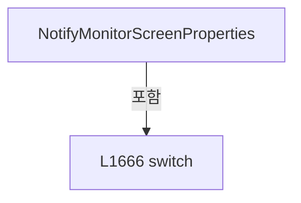

변경 전 점검: 입력/반환 타입, 위 호출자, 예외/취소 경로, 공유 상태와 저장·전송 소비자를 함께 확인합니다. 값의 단위나 물리 방향을 이름만으로 확정하지 않습니다.

### MethodDeclaration `NotifyMonitorLiveProperties` · L1794–1807

[Drilling.UI/Menu/Menus/CMenuMonitor.cs:1794–1807](https://github.com/kjuws10-rgb/A3Drilling/blob/5aee8e58439c9b455cae7c9593c9be986c3e682e/Drilling.UI/Menu/Menus/CMenuMonitor.cs#L1794-L1807)

| 항목 | 실제 추출 값 |
| --- | --- |
| 서명 | void Drilling.UI.Menu.Menus.CMenuMonitor.NotifyMonitorLiveProperties(params string[]) |
| 접근/수식자 | Private / private |
| 반환/값 타입 | void |
| 소속 타입 | NamedType:Drilling.UI.Menu.Menus.CMenuMonitor |

입력 계약:

| 이름 | 타입 | 전달 | 선택/기본값 |
| --- | --- | --- | --- |
| propertyNames | string[] | None | False /  |

정적 호출자로 확인된 위치:

| 호출 파일/행 | 호출 표현식 | 런타임 분기 가능 |
| --- | --- | --- |
| [Drilling.UI/Menu/Menus/CMenuMonitor.cs:609–609](https://github.com/kjuws10-rgb/A3Drilling/blob/5aee8e58439c9b455cae7c9593c9be986c3e682e/Drilling.UI/Menu/Menus/CMenuMonitor.cs#L609-L609) | NotifyMonitorLiveProperties | False |
| [Drilling.UI/Menu/Menus/CMenuMonitor.cs:866–866](https://github.com/kjuws10-rgb/A3Drilling/blob/5aee8e58439c9b455cae7c9593c9be986c3e682e/Drilling.UI/Menu/Menus/CMenuMonitor.cs#L866-L866) | NotifyMonitorLiveProperties | False |
| [Drilling.UI/Menu/Menus/CMenuMonitor.cs:881–881](https://github.com/kjuws10-rgb/A3Drilling/blob/5aee8e58439c9b455cae7c9593c9be986c3e682e/Drilling.UI/Menu/Menus/CMenuMonitor.cs#L881-L881) | NotifyMonitorLiveProperties | False |
| [Drilling.UI/Menu/Menus/CMenuMonitor.cs:900–900](https://github.com/kjuws10-rgb/A3Drilling/blob/5aee8e58439c9b455cae7c9593c9be986c3e682e/Drilling.UI/Menu/Menus/CMenuMonitor.cs#L900-L900) | NotifyMonitorLiveProperties | False |
| [Drilling.UI/Menu/Menus/CMenuMonitor.cs:908–908](https://github.com/kjuws10-rgb/A3Drilling/blob/5aee8e58439c9b455cae7c9593c9be986c3e682e/Drilling.UI/Menu/Menus/CMenuMonitor.cs#L908-L908) | NotifyMonitorLiveProperties | False |
| [Drilling.UI/Menu/Menus/CMenuMonitor.cs:914–914](https://github.com/kjuws10-rgb/A3Drilling/blob/5aee8e58439c9b455cae7c9593c9be986c3e682e/Drilling.UI/Menu/Menus/CMenuMonitor.cs#L914-L914) | NotifyMonitorLiveProperties | False |
| [Drilling.UI/Menu/Menus/CMenuMonitor.cs:923–939](https://github.com/kjuws10-rgb/A3Drilling/blob/5aee8e58439c9b455cae7c9593c9be986c3e682e/Drilling.UI/Menu/Menus/CMenuMonitor.cs#L923-L939) | NotifyMonitorLiveProperties | False |
| [Drilling.UI/Menu/Menus/CMenuMonitor.cs:943–943](https://github.com/kjuws10-rgb/A3Drilling/blob/5aee8e58439c9b455cae7c9593c9be986c3e682e/Drilling.UI/Menu/Menus/CMenuMonitor.cs#L943-L943) | NotifyMonitorLiveProperties | False |
| [Drilling.UI/Menu/Menus/CMenuMonitor.cs:946–946](https://github.com/kjuws10-rgb/A3Drilling/blob/5aee8e58439c9b455cae7c9593c9be986c3e682e/Drilling.UI/Menu/Menus/CMenuMonitor.cs#L946-L946) | NotifyMonitorLiveProperties | False |
| [Drilling.UI/Menu/Menus/CMenuMonitor.cs:1642–1665](https://github.com/kjuws10-rgb/A3Drilling/blob/5aee8e58439c9b455cae7c9593c9be986c3e682e/Drilling.UI/Menu/Menus/CMenuMonitor.cs#L1642-L1665) | NotifyMonitorLiveProperties | False |
| [Drilling.UI/Menu/Menus/CMenuMonitor.cs:1669–1680](https://github.com/kjuws10-rgb/A3Drilling/blob/5aee8e58439c9b455cae7c9593c9be986c3e682e/Drilling.UI/Menu/Menus/CMenuMonitor.cs#L1669-L1680) | NotifyMonitorLiveProperties | False |
| [Drilling.UI/Menu/Menus/CMenuMonitor.cs:1683–1694](https://github.com/kjuws10-rgb/A3Drilling/blob/5aee8e58439c9b455cae7c9593c9be986c3e682e/Drilling.UI/Menu/Menus/CMenuMonitor.cs#L1683-L1694) | NotifyMonitorLiveProperties | False |
| [Drilling.UI/Menu/Menus/CMenuMonitor.cs:1697–1708](https://github.com/kjuws10-rgb/A3Drilling/blob/5aee8e58439c9b455cae7c9593c9be986c3e682e/Drilling.UI/Menu/Menus/CMenuMonitor.cs#L1697-L1708) | NotifyMonitorLiveProperties | False |
| [Drilling.UI/Menu/Menus/CMenuMonitor.cs:1711–1721](https://github.com/kjuws10-rgb/A3Drilling/blob/5aee8e58439c9b455cae7c9593c9be986c3e682e/Drilling.UI/Menu/Menus/CMenuMonitor.cs#L1711-L1721) | NotifyMonitorLiveProperties | False |
| [Drilling.UI/Menu/Menus/CMenuMonitor.cs:1724–1743](https://github.com/kjuws10-rgb/A3Drilling/blob/5aee8e58439c9b455cae7c9593c9be986c3e682e/Drilling.UI/Menu/Menus/CMenuMonitor.cs#L1724-L1743) | NotifyMonitorLiveProperties | False |
| [Drilling.UI/Menu/Menus/CMenuMonitor.cs:1746–1756](https://github.com/kjuws10-rgb/A3Drilling/blob/5aee8e58439c9b455cae7c9593c9be986c3e682e/Drilling.UI/Menu/Menus/CMenuMonitor.cs#L1746-L1756) | NotifyMonitorLiveProperties | False |
| [Drilling.UI/Menu/Menus/CMenuMonitor.cs:1759–1770](https://github.com/kjuws10-rgb/A3Drilling/blob/5aee8e58439c9b455cae7c9593c9be986c3e682e/Drilling.UI/Menu/Menus/CMenuMonitor.cs#L1759-L1770) | NotifyMonitorLiveProperties | False |
| [Drilling.UI/Menu/Menus/CMenuMonitor.cs:1773–1783](https://github.com/kjuws10-rgb/A3Drilling/blob/5aee8e58439c9b455cae7c9593c9be986c3e682e/Drilling.UI/Menu/Menus/CMenuMonitor.cs#L1773-L1783) | NotifyMonitorLiveProperties | False |
| [Drilling.UI/Menu/Menus/CMenuMonitor.cs:1789–1789](https://github.com/kjuws10-rgb/A3Drilling/blob/5aee8e58439c9b455cae7c9593c9be986c3e682e/Drilling.UI/Menu/Menus/CMenuMonitor.cs#L1789-L1789) | NotifyMonitorLiveProperties | False |
| [Drilling.UI/Menu/Menus/CMenuMonitor.cs:2801–2801](https://github.com/kjuws10-rgb/A3Drilling/blob/5aee8e58439c9b455cae7c9593c9be986c3e682e/Drilling.UI/Menu/Menus/CMenuMonitor.cs#L2801-L2801) | NotifyMonitorLiveProperties | False |
| [Drilling.UI/Menu/Menus/CMenuMonitor.cs:2808–2808](https://github.com/kjuws10-rgb/A3Drilling/blob/5aee8e58439c9b455cae7c9593c9be986c3e682e/Drilling.UI/Menu/Menus/CMenuMonitor.cs#L2808-L2808) | NotifyMonitorLiveProperties | False |
| [Drilling.UI/Menu/Menus/CMenuMonitor.cs:2900–2900](https://github.com/kjuws10-rgb/A3Drilling/blob/5aee8e58439c9b455cae7c9593c9be986c3e682e/Drilling.UI/Menu/Menus/CMenuMonitor.cs#L2900-L2900) | NotifyMonitorLiveProperties | False |
| [Drilling.UI/Menu/Menus/CMenuMonitor.cs:3312–3326](https://github.com/kjuws10-rgb/A3Drilling/blob/5aee8e58439c9b455cae7c9593c9be986c3e682e/Drilling.UI/Menu/Menus/CMenuMonitor.cs#L3312-L3326) | NotifyMonitorLiveProperties | False |
| [Drilling.UI/Menu/Menus/CMenuMonitor.cs:5080–5080](https://github.com/kjuws10-rgb/A3Drilling/blob/5aee8e58439c9b455cae7c9593c9be986c3e682e/Drilling.UI/Menu/Menus/CMenuMonitor.cs#L5080-L5080) | NotifyMonitorLiveProperties | False |
| [Drilling.UI/Menu/Menus/CMenuMonitor.cs:5290–5302](https://github.com/kjuws10-rgb/A3Drilling/blob/5aee8e58439c9b455cae7c9593c9be986c3e682e/Drilling.UI/Menu/Menus/CMenuMonitor.cs#L5290-L5302) | NotifyMonitorLiveProperties | False |

호출하는 대상과 해석 범위:

| 원본 행 | 표현식 | 분석 상태 | 대상/소스 위치 |
| --- | --- | --- | --- |
| 1798 | GetLivePropertyValue | resolved | object? Drilling.UI.Menu.Menus.CMenuMonitor.GetLivePropertyValue(string) · Drilling.UI/Menu/Menus/CMenuMonitor.cs:1809 |
| 1799 | _lastNotifiedLiveValues.TryGetValue | resolved | bool System.Collections.Generic.Dictionary<string, object?>.TryGetValue(string, out object?) |
| 1799 | LiveValuesEqual | resolved | bool Drilling.UI.Menu.Menus.CMenuMonitor.LiveValuesEqual(object?, object?) · Drilling.UI/Menu/Menus/CMenuMonitor.cs:1824 |
| 1805 | OnPropertyChanged | resolved | void Drilling.UI.Menu.CBindingBase.OnPropertyChanged(string?) · Drilling.UI/Menu/CBindingBase.cs:759 |

본문의 실제 연산·분기·예외·반환 순서(원문 위치 순):

| 원본 행 | 종류 | 주석 해설 |
| --- | --- | --- |
| 1796 | foreach | 컬렉션 요소를 순회합니다: foreach (var propertyName in propertyNames) |
| 1798 | call | 함수·델리게이트 또는 객체 생성자를 호출합니다: GetLivePropertyValue(propertyName) |
| 1798 | local-declaration | 지역 변수를 선언합니다: var currentValue = GetLivePropertyValue(propertyName); |
| 1798 | variable-initializer | 변수의 초기값을 지정합니다: currentValue = GetLivePropertyValue(propertyName) |
| 1799 | call | 함수·델리게이트 또는 객체 생성자를 호출합니다: _lastNotifiedLiveValues.TryGetValue(propertyName, out var previousValue) |
| 1799 | call | 함수·델리게이트 또는 객체 생성자를 호출합니다: LiveValuesEqual(previousValue, currentValue) |
| 1799 | if | 조건에 따라 분기합니다: if (_lastNotifiedLiveValues.TryGetValue(propertyName, out var previousValue) && LiveValuesEqual(previousValue, currentValue)) |
| 1801 | continue | 다음 반복으로 진행합니다: continue; |
| 1804 | assignment | 값을 대상에 대입합니다: _lastNotifiedLiveValues[propertyName] = currentValue |
| 1805 | call | 함수·델리게이트 또는 객체 생성자를 호출합니다: OnPropertyChanged(propertyName) |

제어 구문의 포함 구조(실제 실행 순서/CFG가 아닌 구문 탐색 그림):

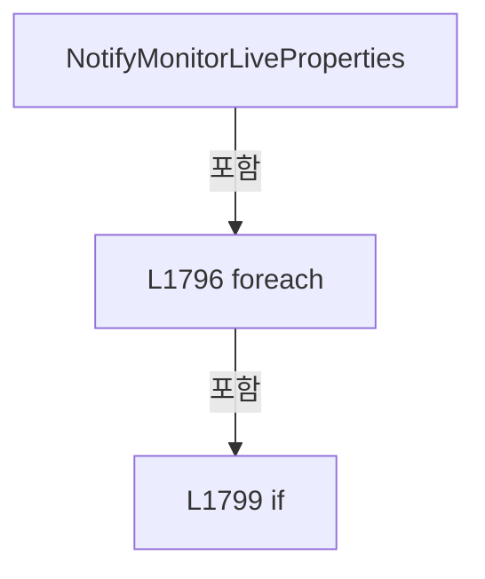

변경 전 점검: 입력/반환 타입, 위 호출자, 예외/취소 경로, 공유 상태와 저장·전송 소비자를 함께 확인합니다. 값의 단위나 물리 방향을 이름만으로 확정하지 않습니다.

### MethodDeclaration `GetLivePropertyValue` · L1809–1822

[Drilling.UI/Menu/Menus/CMenuMonitor.cs:1809–1822](https://github.com/kjuws10-rgb/A3Drilling/blob/5aee8e58439c9b455cae7c9593c9be986c3e682e/Drilling.UI/Menu/Menus/CMenuMonitor.cs#L1809-L1822)

| 항목 | 실제 추출 값 |
| --- | --- |
| 서명 | object? Drilling.UI.Menu.Menus.CMenuMonitor.GetLivePropertyValue(string) |
| 접근/수식자 | Private / private |
| 반환/값 타입 | object? |
| 소속 타입 | NamedType:Drilling.UI.Menu.Menus.CMenuMonitor |

입력 계약:

| 이름 | 타입 | 전달 | 선택/기본값 |
| --- | --- | --- | --- |
| propertyName | string | None | False /  |

정적 호출자로 확인된 위치:

| 호출 파일/행 | 호출 표현식 | 런타임 분기 가능 |
| --- | --- | --- |
| [Drilling.UI/Menu/Menus/CMenuMonitor.cs:1798–1798](https://github.com/kjuws10-rgb/A3Drilling/blob/5aee8e58439c9b455cae7c9593c9be986c3e682e/Drilling.UI/Menu/Menus/CMenuMonitor.cs#L1798-L1798) | GetLivePropertyValue | False |

호출하는 대상과 해석 범위:

| 원본 행 | 표현식 | 분석 상태 | 대상/소스 위치 |
| --- | --- | --- | --- |
| 1814 | LivePropertyCache.TryGetValue | resolved | bool System.Collections.Generic.Dictionary<string, System.Reflection.PropertyInfo?>.TryGetValue(string, out System.Reflection.PropertyInfo?) |
| 1816 | typeof(CMenuMonitor).GetProperty | resolved | System.Reflection.PropertyInfo? System.Type.GetProperty(string) |
| 1821 | .GetValue | resolved | object? System.Reflection.PropertyInfo.GetValue(object?) |

본문의 실제 연산·분기·예외·반환 순서(원문 위치 순):

| 원본 행 | 종류 | 주석 해설 |
| --- | --- | --- |
| 1811 | local-declaration | 지역 변수를 선언합니다: PropertyInfo? property; |
| 1812 | lock | 공유 상태의 임계 구역에 진입합니다: lock (LivePropertyCacheLock) |
| 1814 | call | 함수·델리게이트 또는 객체 생성자를 호출합니다: LivePropertyCache.TryGetValue(propertyName, out property) |
| 1814 | if | 조건에 따라 분기합니다: if (!LivePropertyCache.TryGetValue(propertyName, out property)) |
| 1816 | assignment | 값을 대상에 대입합니다: property = typeof(CMenuMonitor).GetProperty(propertyName) |
| 1816 | call | 함수·델리게이트 또는 객체 생성자를 호출합니다: typeof(CMenuMonitor).GetProperty(propertyName) |
| 1817 | assignment | 값을 대상에 대입합니다: LivePropertyCache[propertyName] = property |
| 1821 | call | 함수·델리게이트 또는 객체 생성자를 호출합니다: .GetValue(this) |
| 1821 | return | 호출자에게 값 또는 제어를 반환합니다: return property?.GetValue(this); |

제어 구문의 포함 구조(실제 실행 순서/CFG가 아닌 구문 탐색 그림):

```mermaid
flowchart TD
 M["GetLivePropertyValue"]
 N0["L1812 lock"]
 M -->|포함| N0
 N1["L1814 if"]
 N0 -->|포함| N1
```

변경 전 점검: 입력/반환 타입, 위 호출자, 예외/취소 경로, 공유 상태와 저장·전송 소비자를 함께 확인합니다. 값의 단위나 물리 방향을 이름만으로 확정하지 않습니다.

### MethodDeclaration `LiveValuesEqual` · L1824–1842

[Drilling.UI/Menu/Menus/CMenuMonitor.cs:1824–1842](https://github.com/kjuws10-rgb/A3Drilling/blob/5aee8e58439c9b455cae7c9593c9be986c3e682e/Drilling.UI/Menu/Menus/CMenuMonitor.cs#L1824-L1842)

| 항목 | 실제 추출 값 |
| --- | --- |
| 서명 | bool Drilling.UI.Menu.Menus.CMenuMonitor.LiveValuesEqual(object?, object?) |
| 접근/수식자 | Private / private, static |
| 반환/값 타입 | bool |
| 소속 타입 | NamedType:Drilling.UI.Menu.Menus.CMenuMonitor |

입력 계약:

| 이름 | 타입 | 전달 | 선택/기본값 |
| --- | --- | --- | --- |
| previousValue | object? | None | False /  |
| currentValue | object? | None | False /  |

정적 호출자로 확인된 위치:

| 호출 파일/행 | 호출 표현식 | 런타임 분기 가능 |
| --- | --- | --- |
| [Drilling.UI/Menu/Menus/CMenuMonitor.cs:1799–1799](https://github.com/kjuws10-rgb/A3Drilling/blob/5aee8e58439c9b455cae7c9593c9be986c3e682e/Drilling.UI/Menu/Menus/CMenuMonitor.cs#L1799-L1799) | LiveValuesEqual | False |

호출하는 대상과 해석 범위:

| 원본 행 | 표현식 | 분석 상태 | 대상/소스 위치 |
| --- | --- | --- | --- |
| 1826 | ReferenceEquals | resolved | bool object.ReferenceEquals(object?, object?) |
| 1826 | Equals | resolved | bool object.Equals(object?, object?) |
| 1836 | TryGetEnumerableCount | resolved | bool Drilling.UI.Menu.Menus.CMenuMonitor.TryGetEnumerableCount(System.Collections.IEnumerable, out int) · Drilling.UI/Menu/Menus/CMenuMonitor.cs:1844 |
| 1836 | TryGetEnumerableCount | resolved | bool Drilling.UI.Menu.Menus.CMenuMonitor.TryGetEnumerableCount(System.Collections.IEnumerable, out int) · Drilling.UI/Menu/Menus/CMenuMonitor.cs:1844 |
| 1841 | previousItems.Cast<object?>().SequenceEqual | resolved | bool System.Collections.Generic.IEnumerable<object?>.SequenceEqual<object?>(System.Collections.Generic.IEnumerable<object?>) |
| 1841 | previousItems.Cast<object?> | resolved | System.Collections.Generic.IEnumerable<object?> System.Collections.IEnumerable.Cast<object?>() |
| 1841 | currentItems.Cast<object?> | resolved | System.Collections.Generic.IEnumerable<object?> System.Collections.IEnumerable.Cast<object?>() |

본문의 실제 연산·분기·예외·반환 순서(원문 위치 순):

| 원본 행 | 종류 | 주석 해설 |
| --- | --- | --- |
| 1826 | call | 함수·델리게이트 또는 객체 생성자를 호출합니다: ReferenceEquals(previousValue, currentValue) |
| 1826 | call | 함수·델리게이트 또는 객체 생성자를 호출합니다: Equals(previousValue, currentValue) |
| 1826 | if | 조건에 따라 분기합니다: if (ReferenceEquals(previousValue, currentValue) &#124;&#124; Equals(previousValue, currentValue)) |
| 1828 | return | 호출자에게 값 또는 제어를 반환합니다: return true; |
| 1831 | if | 조건에 따라 분기합니다: if (previousValue is string &#124;&#124; currentValue is string &#124;&#124; previousValue is not IEnumerable previousItems &#124;&#124; currentValue is not IEnumerable currentItems) |
| 1833 | return | 호출자에게 값 또는 제어를 반환합니다: return false; |
| 1836 | call | 함수·델리게이트 또는 객체 생성자를 호출합니다: TryGetEnumerableCount(previousItems, out var previousCount) |
| 1836 | call | 함수·델리게이트 또는 객체 생성자를 호출합니다: TryGetEnumerableCount(currentItems, out var currentCount) |
| 1836 | if | 조건에 따라 분기합니다: if (TryGetEnumerableCount(previousItems, out var previousCount) && TryGetEnumerableCount(currentItems, out var currentCount) && previousCount != currentCount) |
| 1838 | return | 호출자에게 값 또는 제어를 반환합니다: return false; |
| 1841 | call | 함수·델리게이트 또는 객체 생성자를 호출합니다: previousItems.Cast<object?>().SequenceEqual(currentItems.Cast<object?>()) |
| 1841 | call | 함수·델리게이트 또는 객체 생성자를 호출합니다: previousItems.Cast<object?>() |
| 1841 | call | 함수·델리게이트 또는 객체 생성자를 호출합니다: currentItems.Cast<object?>() |
| 1841 | return | 호출자에게 값 또는 제어를 반환합니다: return previousItems.Cast<object?>().SequenceEqual(currentItems.Cast<object?>()); |

제어 구문의 포함 구조(실제 실행 순서/CFG가 아닌 구문 탐색 그림):

```mermaid
flowchart TD
 M["LiveValuesEqual"]
 N0["L1826 if"]
 M -->|포함| N0
 N1["L1831 if"]
 M -->|포함| N1
 N2["L1836 if"]
 M -->|포함| N2
```

변경 전 점검: 입력/반환 타입, 위 호출자, 예외/취소 경로, 공유 상태와 저장·전송 소비자를 함께 확인합니다. 값의 단위나 물리 방향을 이름만으로 확정하지 않습니다.

### MethodDeclaration `TryGetEnumerableCount` · L1844–1861

[Drilling.UI/Menu/Menus/CMenuMonitor.cs:1844–1861](https://github.com/kjuws10-rgb/A3Drilling/blob/5aee8e58439c9b455cae7c9593c9be986c3e682e/Drilling.UI/Menu/Menus/CMenuMonitor.cs#L1844-L1861)

| 항목 | 실제 추출 값 |
| --- | --- |
| 서명 | bool Drilling.UI.Menu.Menus.CMenuMonitor.TryGetEnumerableCount(System.Collections.IEnumerable, out int) |
| 접근/수식자 | Private / private, static |
| 반환/값 타입 | bool |
| 소속 타입 | NamedType:Drilling.UI.Menu.Menus.CMenuMonitor |

입력 계약:

| 이름 | 타입 | 전달 | 선택/기본값 |
| --- | --- | --- | --- |
| items | System.Collections.IEnumerable | None | False /  |
| count | int | Out | False /  |

정적 호출자로 확인된 위치:

| 호출 파일/행 | 호출 표현식 | 런타임 분기 가능 |
| --- | --- | --- |
| [Drilling.UI/Menu/Menus/CMenuMonitor.cs:1836–1836](https://github.com/kjuws10-rgb/A3Drilling/blob/5aee8e58439c9b455cae7c9593c9be986c3e682e/Drilling.UI/Menu/Menus/CMenuMonitor.cs#L1836-L1836) | TryGetEnumerableCount | False |
| [Drilling.UI/Menu/Menus/CMenuMonitor.cs:1836–1836](https://github.com/kjuws10-rgb/A3Drilling/blob/5aee8e58439c9b455cae7c9593c9be986c3e682e/Drilling.UI/Menu/Menus/CMenuMonitor.cs#L1836-L1836) | TryGetEnumerableCount | False |

호출하는 대상과 해석 범위:

| 원본 행 | 표현식 | 분석 상태 | 대상/소스 위치 |
| --- | --- | --- | --- |
| 1852 | items.GetType().GetProperty | resolved | System.Reflection.PropertyInfo? System.Type.GetProperty(string, System.Reflection.BindingFlags) |
| 1852 | items.GetType | resolved | System.Type object.GetType() |
| 1853 | countProperty.GetValue | resolved | object? System.Reflection.PropertyInfo.GetValue(object?) |

본문의 실제 연산·분기·예외·반환 순서(원문 위치 순):

| 원본 행 | 종류 | 주석 해설 |
| --- | --- | --- |
| 1846 | if | 조건에 따라 분기합니다: if (items is ICollection collection) |
| 1848 | assignment | 값을 대상에 대입합니다: count = collection.Count |
| 1849 | return | 호출자에게 값 또는 제어를 반환합니다: return true; |
| 1852 | call | 함수·델리게이트 또는 객체 생성자를 호출합니다: items.GetType().GetProperty("Count", BindingFlags.Instance &#124; BindingFlags.Public) |
| 1852 | call | 함수·델리게이트 또는 객체 생성자를 호출합니다: items.GetType() |
| 1852 | local-declaration | 지역 변수를 선언합니다: var countProperty = items.GetType().GetProperty("Count", BindingFlags.Instance &#124; BindingFlags.Public); |
| 1852 | variable-initializer | 변수의 초기값을 지정합니다: countProperty = items.GetType().GetProperty("Count", BindingFlags.Instance &#124; BindingFlags.Public) |
| 1853 | call | 함수·델리게이트 또는 객체 생성자를 호출합니다: countProperty.GetValue(items) |
| 1853 | if | 조건에 따라 분기합니다: if (countProperty?.PropertyType == typeof(int) && countProperty.GetValue(items)is int value) |
| 1855 | assignment | 값을 대상에 대입합니다: count = value |
| 1856 | return | 호출자에게 값 또는 제어를 반환합니다: return true; |
| 1859 | assignment | 값을 대상에 대입합니다: count = 0 |
| 1860 | return | 호출자에게 값 또는 제어를 반환합니다: return false; |

제어 구문의 포함 구조(실제 실행 순서/CFG가 아닌 구문 탐색 그림):

```mermaid
flowchart TD
 M["TryGetEnumerableCount"]
 N0["L1846 if"]
 M -->|포함| N0
 N1["L1853 if"]
 M -->|포함| N1
```

변경 전 점검: 입력/반환 타입, 위 호출자, 예외/취소 경로, 공유 상태와 저장·전송 소비자를 함께 확인합니다. 값의 단위나 물리 방향을 이름만으로 확정하지 않습니다.

### MethodDeclaration `CreateTabSections` · L1863–1871

[Drilling.UI/Menu/Menus/CMenuMonitor.cs:1863–1871](https://github.com/kjuws10-rgb/A3Drilling/blob/5aee8e58439c9b455cae7c9593c9be986c3e682e/Drilling.UI/Menu/Menus/CMenuMonitor.cs#L1863-L1871)

| 항목 | 실제 추출 값 |
| --- | --- |
| 서명 | System.Collections.Generic.IReadOnlyList<Drilling.UI.Menu.Menus.ST_SCREEN_SECTION> Drilling.UI.Menu.Menus.CMenuMonitor.CreateTabSections(System.Collections.Generic.IReadOnlyList<Drilling.UI.Menu.Menus.ST_MONITOR_TAB>) |
| 접근/수식자 | Private / private, static |
| 반환/값 타입 | System.Collections.Generic.IReadOnlyList<Drilling.UI.Menu.Menus.ST_SCREEN_SECTION> |
| 소속 타입 | NamedType:Drilling.UI.Menu.Menus.CMenuMonitor |

입력 계약:

| 이름 | 타입 | 전달 | 선택/기본값 |
| --- | --- | --- | --- |
| tabs | System.Collections.Generic.IReadOnlyList<Drilling.UI.Menu.Menus.ST_MONITOR_TAB> | None | False /  |

정적 호출자로 확인된 위치:

| 호출 파일/행 | 호출 표현식 | 런타임 분기 가능 |
| --- | --- | --- |
| [Drilling.UI/Menu/Menus/CMenuMonitor.cs:742–742](https://github.com/kjuws10-rgb/A3Drilling/blob/5aee8e58439c9b455cae7c9593c9be986c3e682e/Drilling.UI/Menu/Menus/CMenuMonitor.cs#L742-L742) | CreateTabSections | False |
| [Drilling.UI/Menu/Menus/CMenuMonitor.cs:2557–2557](https://github.com/kjuws10-rgb/A3Drilling/blob/5aee8e58439c9b455cae7c9593c9be986c3e682e/Drilling.UI/Menu/Menus/CMenuMonitor.cs#L2557-L2557) | CreateTabSections | False |
| [Drilling.UI/Menu/Menus/CMenuMonitor.cs:2607–2607](https://github.com/kjuws10-rgb/A3Drilling/blob/5aee8e58439c9b455cae7c9593c9be986c3e682e/Drilling.UI/Menu/Menus/CMenuMonitor.cs#L2607-L2607) | CreateTabSections | False |

호출하는 대상과 해석 범위:

| 원본 행 | 표현식 | 분석 상태 | 대상/소스 위치 |
| --- | --- | --- | --- |
| 1870 | tabs.Select(BuildSCREEN_SECTION).ToArray | resolved | Drilling.UI.Menu.Menus.ST_SCREEN_SECTION[] System.Collections.Generic.IEnumerable<Drilling.UI.Menu.Menus.ST_SCREEN_SECTION>.ToArray<Drilling.UI.Menu.Menus.ST_SCREEN_SECTION>() |
| 1870 | tabs.Select | resolved | System.Collections.Generic.IEnumerable<Drilling.UI.Menu.Menus.ST_SCREEN_SECTION> System.Collections.Generic.IEnumerable<Drilling.UI.Menu.Menus.ST_MONITOR_TAB>.Select<Drilling.UI.Menu.Menus.ST_MONITOR_TAB, Drilling.UI.Menu.Menus.ST_SCREEN_SECTION>(System.Func<Drilling.UI.Menu.Menus.ST_MONITOR_TAB, Drilling.UI.Menu.Menus.ST_SCREEN_SECTION>) |

본문의 실제 연산·분기·예외·반환 순서(원문 위치 순):

| 원본 행 | 종류 | 주석 해설 |
| --- | --- | --- |
| 1870 | call | 함수·델리게이트 또는 객체 생성자를 호출합니다: tabs.Select(BuildSCREEN_SECTION).ToArray() |
| 1870 | call | 함수·델리게이트 또는 객체 생성자를 호출합니다: tabs.Select(BuildSCREEN_SECTION) |
| 1870 | return | 호출자에게 값 또는 제어를 반환합니다: return tabs.Select(BuildSCREEN_SECTION).ToArray(); |

변경 전 점검: 입력/반환 타입, 위 호출자, 예외/취소 경로, 공유 상태와 저장·전송 소비자를 함께 확인합니다. 값의 단위나 물리 방향을 이름만으로 확정하지 않습니다.

### LocalFunctionStatement `BuildSCREEN_SECTION` · L1865–1868

[Drilling.UI/Menu/Menus/CMenuMonitor.cs:1865–1868](https://github.com/kjuws10-rgb/A3Drilling/blob/5aee8e58439c9b455cae7c9593c9be986c3e682e/Drilling.UI/Menu/Menus/CMenuMonitor.cs#L1865-L1868)

| 항목 | 실제 추출 값 |
| --- | --- |
| 서명 | Drilling.UI.Menu.Menus.ST_SCREEN_SECTION BuildSCREEN_SECTION(Drilling.UI.Menu.Menus.ST_MONITOR_TAB) |
| 접근/수식자 | Private /  |
| 반환/값 타입 | Drilling.UI.Menu.Menus.ST_SCREEN_SECTION |
| 소속 타입 | NamedType:Drilling.UI.Menu.Menus.CMenuMonitor |

입력 계약:

| 이름 | 타입 | 전달 | 선택/기본값 |
| --- | --- | --- | --- |
| tab | Drilling.UI.Menu.Menus.ST_MONITOR_TAB | None | False /  |

현재 부분 분석에서 직접 연결된 호출자는 없습니다. XAML/이벤트/인터페이스·델리게이트·외부 진입을 추가 확인해야 하며, 미사용으로 판정한 것이 아닙니다.

호출하는 대상과 해석 범위:

| 원본 행 | 표현식 | 분석 상태 | 대상/소스 위치 |
| --- | --- | --- | --- |
| 1867 | new ST_SCREEN_SECTION | resolved | Drilling.UI.Menu.Menus.ST_SCREEN_SECTION.ST_SCREEN_SECTION(string, System.Collections.Generic.IReadOnlyList<Drilling.UI.Menu.Menus.ST_DISPLAY_ITEM>) · Drilling.UI/Menu/Menus/CMenuBase.cs:410 |
| 1867 | Array.Empty<ST_DISPLAY_ITEM> | resolved | Drilling.UI.Menu.Menus.ST_DISPLAY_ITEM[] System.Array.Empty<Drilling.UI.Menu.Menus.ST_DISPLAY_ITEM>() |

본문의 실제 연산·분기·예외·반환 순서(원문 위치 순):

| 원본 행 | 종류 | 주석 해설 |
| --- | --- | --- |
| 1867 | call | 함수·델리게이트 또는 객체 생성자를 호출합니다: new ST_SCREEN_SECTION(tab.Name, Array.Empty<ST_DISPLAY_ITEM>()) |
| 1867 | call | 함수·델리게이트 또는 객체 생성자를 호출합니다: Array.Empty<ST_DISPLAY_ITEM>() |
| 1867 | return | 호출자에게 값 또는 제어를 반환합니다: return new ST_SCREEN_SECTION(tab.Name, Array.Empty<ST_DISPLAY_ITEM>()); |

변경 전 점검: 입력/반환 타입, 위 호출자, 예외/취소 경로, 공유 상태와 저장·전송 소비자를 함께 확인합니다. 값의 단위나 물리 방향을 이름만으로 확정하지 않습니다.

### MethodDeclaration `NormalizeMonitorScreenTab` · L1873–1877

[Drilling.UI/Menu/Menus/CMenuMonitor.cs:1873–1877](https://github.com/kjuws10-rgb/A3Drilling/blob/5aee8e58439c9b455cae7c9593c9be986c3e682e/Drilling.UI/Menu/Menus/CMenuMonitor.cs#L1873-L1877)

| 항목 | 실제 추출 값 |
| --- | --- |
| 서명 | string Drilling.UI.Menu.Menus.CMenuMonitor.NormalizeMonitorScreenTab(string?) |
| 접근/수식자 | Private / private, static |
| 반환/값 타입 | string |
| 소속 타입 | NamedType:Drilling.UI.Menu.Menus.CMenuMonitor |

입력 계약:

| 이름 | 타입 | 전달 | 선택/기본값 |
| --- | --- | --- | --- |
| tab | string? | None | False /  |

정적 호출자로 확인된 위치:

| 호출 파일/행 | 호출 표현식 | 런타임 분기 가능 |
| --- | --- | --- |
| [Drilling.UI/Menu/Menus/CMenuMonitor.cs:652–652](https://github.com/kjuws10-rgb/A3Drilling/blob/5aee8e58439c9b455cae7c9593c9be986c3e682e/Drilling.UI/Menu/Menus/CMenuMonitor.cs#L652-L652) | NormalizeMonitorScreenTab | False |
| [Drilling.UI/Menu/Menus/CMenuMonitor.cs:812–812](https://github.com/kjuws10-rgb/A3Drilling/blob/5aee8e58439c9b455cae7c9593c9be986c3e682e/Drilling.UI/Menu/Menus/CMenuMonitor.cs#L812-L812) | NormalizeMonitorScreenTab | False |
| [Drilling.UI/Menu/Menus/CMenuMonitor.cs:1087–1087](https://github.com/kjuws10-rgb/A3Drilling/blob/5aee8e58439c9b455cae7c9593c9be986c3e682e/Drilling.UI/Menu/Menus/CMenuMonitor.cs#L1087-L1087) | NormalizeMonitorScreenTab | False |

호출하는 대상과 해석 범위:

| 원본 행 | 표현식 | 분석 상태 | 대상/소스 위치 |
| --- | --- | --- | --- |
| 1875 | NormalizeMonitorTab | resolved | string Drilling.UI.Menu.Menus.CMenuMonitor.NormalizeMonitorTab(string?) · Drilling.UI/Menu/Menus/CMenuMonitor.cs:1879 |

본문의 실제 연산·분기·예외·반환 순서(원문 위치 순):

| 원본 행 | 종류 | 주석 해설 |
| --- | --- | --- |
| 1875 | call | 함수·델리게이트 또는 객체 생성자를 호출합니다: NormalizeMonitorTab(tab) |
| 1875 | local-declaration | 지역 변수를 선언합니다: var normalized = NormalizeMonitorTab(tab); |
| 1875 | variable-initializer | 변수의 초기값을 지정합니다: normalized = NormalizeMonitorTab(tab) |
| 1876 | conditional-expression | 조건에 따라 결과식을 선택합니다: normalized == "POWER METER" ? "LASER" : normalized |
| 1876 | return | 호출자에게 값 또는 제어를 반환합니다: return normalized == "POWER METER" ? "LASER" : normalized; |

변경 전 점검: 입력/반환 타입, 위 호출자, 예외/취소 경로, 공유 상태와 저장·전송 소비자를 함께 확인합니다. 값의 단위나 물리 방향을 이름만으로 확정하지 않습니다.

### MethodDeclaration `NormalizeMonitorTab` · L1879–1893

[Drilling.UI/Menu/Menus/CMenuMonitor.cs:1879–1893](https://github.com/kjuws10-rgb/A3Drilling/blob/5aee8e58439c9b455cae7c9593c9be986c3e682e/Drilling.UI/Menu/Menus/CMenuMonitor.cs#L1879-L1893)

| 항목 | 실제 추출 값 |
| --- | --- |
| 서명 | string Drilling.UI.Menu.Menus.CMenuMonitor.NormalizeMonitorTab(string?) |
| 접근/수식자 | Private / private, static |
| 반환/값 타입 | string |
| 소속 타입 | NamedType:Drilling.UI.Menu.Menus.CMenuMonitor |

입력 계약:

| 이름 | 타입 | 전달 | 선택/기본값 |
| --- | --- | --- | --- |
| tab | string? | None | False /  |

정적 호출자로 확인된 위치:

| 호출 파일/행 | 호출 표현식 | 런타임 분기 가능 |
| --- | --- | --- |
| [Drilling.UI/Menu/Menus/CMenuMonitor.cs:1055–1055](https://github.com/kjuws10-rgb/A3Drilling/blob/5aee8e58439c9b455cae7c9593c9be986c3e682e/Drilling.UI/Menu/Menus/CMenuMonitor.cs#L1055-L1055) | NormalizeMonitorTab | False |
| [Drilling.UI/Menu/Menus/CMenuMonitor.cs:1875–1875](https://github.com/kjuws10-rgb/A3Drilling/blob/5aee8e58439c9b455cae7c9593c9be986c3e682e/Drilling.UI/Menu/Menus/CMenuMonitor.cs#L1875-L1875) | NormalizeMonitorTab | False |
| [Drilling.UI/Menu/Menus/CMenuMonitor.cs:2269–2269](https://github.com/kjuws10-rgb/A3Drilling/blob/5aee8e58439c9b455cae7c9593c9be986c3e682e/Drilling.UI/Menu/Menus/CMenuMonitor.cs#L2269-L2269) | NormalizeMonitorTab | False |
| [Drilling.UI/Menu/Menus/CMenuMonitor.cs:2274–2274](https://github.com/kjuws10-rgb/A3Drilling/blob/5aee8e58439c9b455cae7c9593c9be986c3e682e/Drilling.UI/Menu/Menus/CMenuMonitor.cs#L2274-L2274) | NormalizeMonitorTab | False |
| [Drilling.UI/Menu/Menus/CMenuMonitor.cs:2328–2328](https://github.com/kjuws10-rgb/A3Drilling/blob/5aee8e58439c9b455cae7c9593c9be986c3e682e/Drilling.UI/Menu/Menus/CMenuMonitor.cs#L2328-L2328) | NormalizeMonitorTab | False |
| [Drilling.UI/Menu/Menus/CMenuMonitor.cs:2345–2345](https://github.com/kjuws10-rgb/A3Drilling/blob/5aee8e58439c9b455cae7c9593c9be986c3e682e/Drilling.UI/Menu/Menus/CMenuMonitor.cs#L2345-L2345) | NormalizeMonitorTab | False |
| [Drilling.UI/Menu/Menus/CMenuMonitor.cs:2368–2368](https://github.com/kjuws10-rgb/A3Drilling/blob/5aee8e58439c9b455cae7c9593c9be986c3e682e/Drilling.UI/Menu/Menus/CMenuMonitor.cs#L2368-L2368) | NormalizeMonitorTab | False |
| [Drilling.UI/Menu/Menus/CMenuMonitor.cs:2384–2384](https://github.com/kjuws10-rgb/A3Drilling/blob/5aee8e58439c9b455cae7c9593c9be986c3e682e/Drilling.UI/Menu/Menus/CMenuMonitor.cs#L2384-L2384) | NormalizeMonitorTab | False |
| [Drilling.UI/Menu/Menus/CMenuMonitor.cs:2389–2389](https://github.com/kjuws10-rgb/A3Drilling/blob/5aee8e58439c9b455cae7c9593c9be986c3e682e/Drilling.UI/Menu/Menus/CMenuMonitor.cs#L2389-L2389) | NormalizeMonitorTab | False |

호출하는 대상과 해석 범위:

| 원본 행 | 표현식 | 분석 상태 | 대상/소스 위치 |
| --- | --- | --- | --- |
| 1881 | (tab ?? "PRODUCT").Trim().ToUpperInvariant | resolved | string string.ToUpperInvariant() |
| 1881 | (tab ?? "PRODUCT").Trim | resolved | string string.Trim() |

본문의 실제 연산·분기·예외·반환 순서(원문 위치 순):

| 원본 행 | 종류 | 주석 해설 |
| --- | --- | --- |
| 1881 | call | 함수·델리게이트 또는 객체 생성자를 호출합니다: (tab ?? "PRODUCT").Trim().ToUpperInvariant() |
| 1881 | call | 함수·델리게이트 또는 객체 생성자를 호출합니다: (tab ?? "PRODUCT").Trim() |
| 1881 | local-declaration | 지역 변수를 선언합니다: var normalized = (tab ?? "PRODUCT").Trim().ToUpperInvariant(); |
| 1881 | variable-initializer | 변수의 초기값을 지정합니다: normalized = (tab ?? "PRODUCT").Trim().ToUpperInvariant() |
| 1882 | return | 호출자에게 값 또는 제어를 반환합니다: return normalized switch { "ATT" => "ATTENUATOR", "LASER/POWERMETER" => "LASER", "POWER" or "POWERMETER" or "POWER_METER" => "POWER METER", "MOTOR" or "XPS" or "SCANNERTILT" or "SCANNER TILT" or "SCANNER_TILT" => "XPS", "PICO" or  |
| 1882 | switch-expression | 값별 결과식을 선택합니다: normalized switch { "ATT" => "ATTENUATOR", "LASER/POWERMETER" => "LASER", "POWER" or "POWERMETER" or "POWER_METER" => "POWER METER", "MOTOR" or "XPS" or "SCANNERTILT" or "SCANNER TILT" or "SCANNER_TILT" => "XPS", "PICO" or "PICOMO |

제어 구문의 포함 구조(실제 실행 순서/CFG가 아닌 구문 탐색 그림):

```mermaid
flowchart TD
 M["NormalizeMonitorTab"]
 N0["L1882 switch-expression"]
 M -->|포함| N0
```

변경 전 점검: 입력/반환 타입, 위 호출자, 예외/취소 경로, 공유 상태와 저장·전송 소비자를 함께 확인합니다. 값의 단위나 물리 방향을 이름만으로 확정하지 않습니다.

### MethodDeclaration `GetSubtitle` · L1895–1910

[Drilling.UI/Menu/Menus/CMenuMonitor.cs:1895–1910](https://github.com/kjuws10-rgb/A3Drilling/blob/5aee8e58439c9b455cae7c9593c9be986c3e682e/Drilling.UI/Menu/Menus/CMenuMonitor.cs#L1895-L1910)

| 항목 | 실제 추출 값 |
| --- | --- |
| 서명 | string Drilling.UI.Menu.Menus.CMenuMonitor.GetSubtitle(string) |
| 접근/수식자 | Private / private, static |
| 반환/값 타입 | string |
| 소속 타입 | NamedType:Drilling.UI.Menu.Menus.CMenuMonitor |

입력 계약:

| 이름 | 타입 | 전달 | 선택/기본값 |
| --- | --- | --- | --- |
| tab | string | None | False /  |

정적 호출자로 확인된 위치:

| 호출 파일/행 | 호출 표현식 | 런타임 분기 가능 |
| --- | --- | --- |
| [Drilling.UI/Menu/Menus/CMenuMonitor.cs:745–745](https://github.com/kjuws10-rgb/A3Drilling/blob/5aee8e58439c9b455cae7c9593c9be986c3e682e/Drilling.UI/Menu/Menus/CMenuMonitor.cs#L745-L745) | GetSubtitle | False |
| [Drilling.UI/Menu/Menus/CMenuMonitor.cs:2610–2610](https://github.com/kjuws10-rgb/A3Drilling/blob/5aee8e58439c9b455cae7c9593c9be986c3e682e/Drilling.UI/Menu/Menus/CMenuMonitor.cs#L2610-L2610) | GetSubtitle | False |

본문의 실제 연산·분기·예외·반환 순서(원문 위치 순):

| 원본 행 | 종류 | 주석 해설 |
| --- | --- | --- |
| 1897 | return | 호출자에게 값 또는 제어를 반환합니다: return tab switch { "XPS" => "Newport XPS axis position monitor and service operation", "LASER" => "Talon laser control and one-shot PowerMeter queries", "ATTENUATOR" => "Conex AGP attenuator position monitor and service operation |
| 1897 | switch-expression | 값별 결과식을 선택합니다: tab switch { "XPS" => "Newport XPS axis position monitor and service operation", "LASER" => "Talon laser control and one-shot PowerMeter queries", "ATTENUATOR" => "Conex AGP attenuator position monitor and service operation", "BET |

제어 구문의 포함 구조(실제 실행 순서/CFG가 아닌 구문 탐색 그림):

```mermaid
flowchart TD
 M["GetSubtitle"]
 N0["L1897 switch-expression"]
 M -->|포함| N0
```

변경 전 점검: 입력/반환 타입, 위 호출자, 예외/취소 경로, 공유 상태와 저장·전송 소비자를 함께 확인합니다. 값의 단위나 물리 방향을 이름만으로 확정하지 않습니다.

### MethodDeclaration `GetStatusPanelTitle` · L1912–1926

[Drilling.UI/Menu/Menus/CMenuMonitor.cs:1912–1926](https://github.com/kjuws10-rgb/A3Drilling/blob/5aee8e58439c9b455cae7c9593c9be986c3e682e/Drilling.UI/Menu/Menus/CMenuMonitor.cs#L1912-L1926)

| 항목 | 실제 추출 값 |
| --- | --- |
| 서명 | string Drilling.UI.Menu.Menus.CMenuMonitor.GetStatusPanelTitle(string) |
| 접근/수식자 | Private / private, static |
| 반환/값 타입 | string |
| 소속 타입 | NamedType:Drilling.UI.Menu.Menus.CMenuMonitor |

입력 계약:

| 이름 | 타입 | 전달 | 선택/기본값 |
| --- | --- | --- | --- |
| tab | string | None | False /  |

정적 호출자로 확인된 위치:

| 호출 파일/행 | 호출 표현식 | 런타임 분기 가능 |
| --- | --- | --- |
| [Drilling.UI/Menu/Menus/CMenuMonitor.cs:746–746](https://github.com/kjuws10-rgb/A3Drilling/blob/5aee8e58439c9b455cae7c9593c9be986c3e682e/Drilling.UI/Menu/Menus/CMenuMonitor.cs#L746-L746) | GetStatusPanelTitle | False |
| [Drilling.UI/Menu/Menus/CMenuMonitor.cs:2611–2611](https://github.com/kjuws10-rgb/A3Drilling/blob/5aee8e58439c9b455cae7c9593c9be986c3e682e/Drilling.UI/Menu/Menus/CMenuMonitor.cs#L2611-L2611) | GetStatusPanelTitle | False |

본문의 실제 연산·분기·예외·반환 순서(원문 위치 순):

| 원본 행 | 종류 | 주석 해설 |
| --- | --- | --- |
| 1914 | return | 호출자에게 값 또는 제어를 반환합니다: return tab switch { "LASER" => "Laser Status", "ATTENUATOR" => "Attenuator Status", "BET" => "BET Status", "POWER METER" => "PowerMeter Status", "XPS" => "XPS Status", "PICO MOTOR" => "PicoMotor Status", "PRODUCT" => "Product Stat |
| 1914 | switch-expression | 값별 결과식을 선택합니다: tab switch { "LASER" => "Laser Status", "ATTENUATOR" => "Attenuator Status", "BET" => "BET Status", "POWER METER" => "PowerMeter Status", "XPS" => "XPS Status", "PICO MOTOR" => "PicoMotor Status", "PRODUCT" => "Product Status", "M |

제어 구문의 포함 구조(실제 실행 순서/CFG가 아닌 구문 탐색 그림):

```mermaid
flowchart TD
 M["GetStatusPanelTitle"]
 N0["L1914 switch-expression"]
 M -->|포함| N0
```

변경 전 점검: 입력/반환 타입, 위 호출자, 예외/취소 경로, 공유 상태와 저장·전송 소비자를 함께 확인합니다. 값의 단위나 물리 방향을 이름만으로 확정하지 않습니다.

### MethodDeclaration `GetOperationPanelTitle` · L1928–1941

[Drilling.UI/Menu/Menus/CMenuMonitor.cs:1928–1941](https://github.com/kjuws10-rgb/A3Drilling/blob/5aee8e58439c9b455cae7c9593c9be986c3e682e/Drilling.UI/Menu/Menus/CMenuMonitor.cs#L1928-L1941)

| 항목 | 실제 추출 값 |
| --- | --- |
| 서명 | string Drilling.UI.Menu.Menus.CMenuMonitor.GetOperationPanelTitle(string) |
| 접근/수식자 | Private / private, static |
| 반환/값 타입 | string |
| 소속 타입 | NamedType:Drilling.UI.Menu.Menus.CMenuMonitor |

입력 계약:

| 이름 | 타입 | 전달 | 선택/기본값 |
| --- | --- | --- | --- |
| tab | string | None | False /  |

정적 호출자로 확인된 위치:

| 호출 파일/행 | 호출 표현식 | 런타임 분기 가능 |
| --- | --- | --- |
| [Drilling.UI/Menu/Menus/CMenuMonitor.cs:747–747](https://github.com/kjuws10-rgb/A3Drilling/blob/5aee8e58439c9b455cae7c9593c9be986c3e682e/Drilling.UI/Menu/Menus/CMenuMonitor.cs#L747-L747) | GetOperationPanelTitle | False |
| [Drilling.UI/Menu/Menus/CMenuMonitor.cs:2612–2612](https://github.com/kjuws10-rgb/A3Drilling/blob/5aee8e58439c9b455cae7c9593c9be986c3e682e/Drilling.UI/Menu/Menus/CMenuMonitor.cs#L2612-L2612) | GetOperationPanelTitle | False |

본문의 실제 연산·분기·예외·반환 순서(원문 위치 순):

| 원본 행 | 종류 | 주석 해설 |
| --- | --- | --- |
| 1930 | return | 호출자에게 값 또는 제어를 반환합니다: return tab switch { "XPS" => "XPS Axis Operation", "LASER" => "Laser Operation", "ATTENUATOR" => "Attenuator Operation", "BET" => "BET Operation", "POWER METER" => "PowerMeter Operation", "PICO MOTOR" => "PicoMotor Operation", "ME |
| 1930 | switch-expression | 값별 결과식을 선택합니다: tab switch { "XPS" => "XPS Axis Operation", "LASER" => "Laser Operation", "ATTENUATOR" => "Attenuator Operation", "BET" => "BET Operation", "POWER METER" => "PowerMeter Operation", "PICO MOTOR" => "PicoMotor Operation", "MELSEC" = |

제어 구문의 포함 구조(실제 실행 순서/CFG가 아닌 구문 탐색 그림):

```mermaid
flowchart TD
 M["GetOperationPanelTitle"]
 N0["L1930 switch-expression"]
 M -->|포함| N0
```

변경 전 점검: 입력/반환 타입, 위 호출자, 예외/취소 경로, 공유 상태와 저장·전송 소비자를 함께 확인합니다. 값의 단위나 물리 방향을 이름만으로 확정하지 않습니다.

### MethodDeclaration `GetParameterPanelTitle` · L1943–1957

[Drilling.UI/Menu/Menus/CMenuMonitor.cs:1943–1957](https://github.com/kjuws10-rgb/A3Drilling/blob/5aee8e58439c9b455cae7c9593c9be986c3e682e/Drilling.UI/Menu/Menus/CMenuMonitor.cs#L1943-L1957)

| 항목 | 실제 추출 값 |
| --- | --- |
| 서명 | string Drilling.UI.Menu.Menus.CMenuMonitor.GetParameterPanelTitle(string) |
| 접근/수식자 | Private / private, static |
| 반환/값 타입 | string |
| 소속 타입 | NamedType:Drilling.UI.Menu.Menus.CMenuMonitor |

입력 계약:

| 이름 | 타입 | 전달 | 선택/기본값 |
| --- | --- | --- | --- |
| tab | string | None | False /  |

정적 호출자로 확인된 위치:

| 호출 파일/행 | 호출 표현식 | 런타임 분기 가능 |
| --- | --- | --- |
| [Drilling.UI/Menu/Menus/CMenuMonitor.cs:748–748](https://github.com/kjuws10-rgb/A3Drilling/blob/5aee8e58439c9b455cae7c9593c9be986c3e682e/Drilling.UI/Menu/Menus/CMenuMonitor.cs#L748-L748) | GetParameterPanelTitle | False |
| [Drilling.UI/Menu/Menus/CMenuMonitor.cs:2613–2613](https://github.com/kjuws10-rgb/A3Drilling/blob/5aee8e58439c9b455cae7c9593c9be986c3e682e/Drilling.UI/Menu/Menus/CMenuMonitor.cs#L2613-L2613) | GetParameterPanelTitle | False |

본문의 실제 연산·분기·예외·반환 순서(원문 위치 순):

| 원본 행 | 종류 | 주석 해설 |
| --- | --- | --- |
| 1945 | return | 호출자에게 값 또는 제어를 반환합니다: return tab switch { "XPS" => "XPS Motion Profile", "LASER" => "Laser Parameter", "ATTENUATOR" => "Attenuator Parameter", "BET" => "BET Table", "POWER METER" => "PowerMeter Parameter", "PICO MOTOR" => "PicoMotor Position", "PRODUCT |
| 1945 | switch-expression | 값별 결과식을 선택합니다: tab switch { "XPS" => "XPS Motion Profile", "LASER" => "Laser Parameter", "ATTENUATOR" => "Attenuator Parameter", "BET" => "BET Table", "POWER METER" => "PowerMeter Parameter", "PICO MOTOR" => "PicoMotor Position", "PRODUCT" => "P |

제어 구문의 포함 구조(실제 실행 순서/CFG가 아닌 구문 탐색 그림):

```mermaid
flowchart TD
 M["GetParameterPanelTitle"]
 N0["L1945 switch-expression"]
 M -->|포함| N0
```

변경 전 점검: 입력/반환 타입, 위 호출자, 예외/취소 경로, 공유 상태와 저장·전송 소비자를 함께 확인합니다. 값의 단위나 물리 방향을 이름만으로 확정하지 않습니다.

### MethodDeclaration `GetTrendPanelTitle` · L1959–1971

[Drilling.UI/Menu/Menus/CMenuMonitor.cs:1959–1971](https://github.com/kjuws10-rgb/A3Drilling/blob/5aee8e58439c9b455cae7c9593c9be986c3e682e/Drilling.UI/Menu/Menus/CMenuMonitor.cs#L1959-L1971)

| 항목 | 실제 추출 값 |
| --- | --- |
| 서명 | string Drilling.UI.Menu.Menus.CMenuMonitor.GetTrendPanelTitle(string) |
| 접근/수식자 | Private / private, static |
| 반환/값 타입 | string |
| 소속 타입 | NamedType:Drilling.UI.Menu.Menus.CMenuMonitor |

입력 계약:

| 이름 | 타입 | 전달 | 선택/기본값 |
| --- | --- | --- | --- |
| tab | string | None | False /  |

정적 호출자로 확인된 위치:

| 호출 파일/행 | 호출 표현식 | 런타임 분기 가능 |
| --- | --- | --- |
| [Drilling.UI/Menu/Menus/CMenuMonitor.cs:749–749](https://github.com/kjuws10-rgb/A3Drilling/blob/5aee8e58439c9b455cae7c9593c9be986c3e682e/Drilling.UI/Menu/Menus/CMenuMonitor.cs#L749-L749) | GetTrendPanelTitle | False |
| [Drilling.UI/Menu/Menus/CMenuMonitor.cs:2614–2614](https://github.com/kjuws10-rgb/A3Drilling/blob/5aee8e58439c9b455cae7c9593c9be986c3e682e/Drilling.UI/Menu/Menus/CMenuMonitor.cs#L2614-L2614) | GetTrendPanelTitle | False |

본문의 실제 연산·분기·예외·반환 순서(원문 위치 순):

| 원본 행 | 종류 | 주석 해설 |
| --- | --- | --- |
| 1961 | return | 호출자에게 값 또는 제어를 반환합니다: return tab switch { "LASER" => "Laser Trend", "ATTENUATOR" => "Current Position", "BET" => "Beam Expander Position", "POWER METER" => "Power Trend", "PICO MOTOR" => "Motor Position", "MELSEC" => "MELSEC Signal", _ => "Signal Trend |
| 1961 | switch-expression | 값별 결과식을 선택합니다: tab switch { "LASER" => "Laser Trend", "ATTENUATOR" => "Current Position", "BET" => "Beam Expander Position", "POWER METER" => "Power Trend", "PICO MOTOR" => "Motor Position", "MELSEC" => "MELSEC Signal", _ => "Signal Trend" } |

제어 구문의 포함 구조(실제 실행 순서/CFG가 아닌 구문 탐색 그림):

```mermaid
flowchart TD
 M["GetTrendPanelTitle"]
 N0["L1961 switch-expression"]
 M -->|포함| N0
```

변경 전 점검: 입력/반환 타입, 위 호출자, 예외/취소 경로, 공유 상태와 저장·전송 소비자를 함께 확인합니다. 값의 단위나 물리 방향을 이름만으로 확정하지 않습니다.

### MethodDeclaration `CreateStatusRows` · L1973–2073

[Drilling.UI/Menu/Menus/CMenuMonitor.cs:1973–2073](https://github.com/kjuws10-rgb/A3Drilling/blob/5aee8e58439c9b455cae7c9593c9be986c3e682e/Drilling.UI/Menu/Menus/CMenuMonitor.cs#L1973-L2073)

| 항목 | 실제 추출 값 |
| --- | --- |
| 서명 | System.Collections.Generic.IReadOnlyList<Drilling.UI.Menu.Menus.ST_MONITOR_STATUS_ROW> Drilling.UI.Menu.Menus.CMenuMonitor.CreateStatusRows(string, Drilling.Common.Managers.ST_DEVICE_STATUS, System.Collections.Generic.IReadOnlyList<Drilling.Common.Interface.ST_DEVICE_COMM_STATUS>, string?, Drilling.Common.Interface.ST_TALON_STATUS?) |
| 접근/수식자 | Private / private, static |
| 반환/값 타입 | System.Collections.Generic.IReadOnlyList<Drilling.UI.Menu.Menus.ST_MONITOR_STATUS_ROW> |
| 소속 타입 | NamedType:Drilling.UI.Menu.Menus.CMenuMonitor |

입력 계약:

| 이름 | 타입 | 전달 | 선택/기본값 |
| --- | --- | --- | --- |
| tab | string | None | False /  |
| snapshot | Drilling.Common.Managers.ST_DEVICE_STATUS | None | False /  |
| communication | System.Collections.Generic.IReadOnlyList<Drilling.Common.Interface.ST_DEVICE_COMM_STATUS> | None | False /  |
| selectedConnectionText | string? | None | True / null |
| talonStatus | Drilling.Common.Interface.ST_TALON_STATUS? | None | True / null |

정적 호출자로 확인된 위치:

| 호출 파일/행 | 호출 표현식 | 런타임 분기 가능 |
| --- | --- | --- |
| [Drilling.UI/Menu/Menus/CMenuMonitor.cs:752–752](https://github.com/kjuws10-rgb/A3Drilling/blob/5aee8e58439c9b455cae7c9593c9be986c3e682e/Drilling.UI/Menu/Menus/CMenuMonitor.cs#L752-L752) | CreateStatusRows | False |
| [Drilling.UI/Menu/Menus/CMenuMonitor.cs:874–874](https://github.com/kjuws10-rgb/A3Drilling/blob/5aee8e58439c9b455cae7c9593c9be986c3e682e/Drilling.UI/Menu/Menus/CMenuMonitor.cs#L874-L874) | CreateStatusRows | False |
| [Drilling.UI/Menu/Menus/CMenuMonitor.cs:885–885](https://github.com/kjuws10-rgb/A3Drilling/blob/5aee8e58439c9b455cae7c9593c9be986c3e682e/Drilling.UI/Menu/Menus/CMenuMonitor.cs#L885-L885) | CreateStatusRows | False |

호출하는 대상과 해석 범위:

| 원본 행 | 표현식 | 분석 상태 | 대상/소스 위치 |
| --- | --- | --- | --- |
| 1981 | GetMonitorModule | resolved | Drilling.Common.Interface.EN_EQP_MODULE? Drilling.UI.Menu.Menus.CMenuMonitor.GetMonitorModule(string) · Drilling.UI/Menu/Menus/CMenuMonitor.cs:2075 |
| 1982 | string.IsNullOrWhiteSpace | resolved | bool string.IsNullOrWhiteSpace(string?) |
| 1982 | ToCommunicationText | resolved | string Drilling.UI.Menu.Menus.CMenuMonitor.ToCommunicationText(Drilling.Common.Interface.EN_COMM_STATE) · Drilling.UI/Menu/Menus/CMenuMonitor.cs:2100 |
| 1982 | GetModuleState | resolved | Drilling.Common.Interface.EN_COMM_STATE Drilling.UI.Menu.Menus.CMenuMonitor.GetModuleState(System.Collections.Generic.IReadOnlyList<Drilling.Common.Interface.ST_DEVICE_COMM_STATUS>, Drilling.Common.Interface.EN_EQP_MODULE) · Drilling.UI/Menu/Menus/CMenuMonitor.cs:2090 |
| 1987 | new | resolved | Drilling.UI.Menu.Menus.ST_MONITOR_STATUS_ROW.ST_MONITOR_STATUS_ROW(string, string, string, string, string) · Drilling.UI/Menu/Menus/CMenuMonitor.cs:6686 |
| 1987 | snapshot.Laser.OutputPower.ToString | resolved | string double.ToString(string?) |
| 1988 | new | resolved | Drilling.UI.Menu.Menus.ST_MONITOR_STATUS_ROW.ST_MONITOR_STATUS_ROW(string, string, string, string, string) · Drilling.UI/Menu/Menus/CMenuMonitor.cs:6686 |
| 1989 | new | resolved | Drilling.UI.Menu.Menus.ST_MONITOR_STATUS_ROW.ST_MONITOR_STATUS_ROW(string, string, string, string, string) · Drilling.UI/Menu/Menus/CMenuMonitor.cs:6686 |
| 1990 | new | resolved | Drilling.UI.Menu.Menus.ST_MONITOR_STATUS_ROW.ST_MONITOR_STATUS_ROW(string, string, string, string, string) · Drilling.UI/Menu/Menus/CMenuMonitor.cs:6686 |
| 1991 | new | resolved | Drilling.UI.Menu.Menus.ST_MONITOR_STATUS_ROW.ST_MONITOR_STATUS_ROW(string, string, string, string, string) · Drilling.UI/Menu/Menus/CMenuMonitor.cs:6686 |
| 1992 | new | resolved | Drilling.UI.Menu.Menus.ST_MONITOR_STATUS_ROW.ST_MONITOR_STATUS_ROW(string, string, string, string, string) · Drilling.UI/Menu/Menus/CMenuMonitor.cs:6686 |
| 1993 | new | resolved | Drilling.UI.Menu.Menus.ST_MONITOR_STATUS_ROW.ST_MONITOR_STATUS_ROW(string, string, string, string, string) · Drilling.UI/Menu/Menus/CMenuMonitor.cs:6686 |
| 1994 | new | resolved | Drilling.UI.Menu.Menus.ST_MONITOR_STATUS_ROW.ST_MONITOR_STATUS_ROW(string, string, string, string, string) · Drilling.UI/Menu/Menus/CMenuMonitor.cs:6686 |
| 1995 | new | resolved | Drilling.UI.Menu.Menus.ST_MONITOR_STATUS_ROW.ST_MONITOR_STATUS_ROW(string, string, string, string, string) · Drilling.UI/Menu/Menus/CMenuMonitor.cs:6686 |
| 1998 | new | resolved | Drilling.UI.Menu.Menus.ST_MONITOR_STATUS_ROW.ST_MONITOR_STATUS_ROW(string, string, string, string, string) · Drilling.UI/Menu/Menus/CMenuMonitor.cs:6686 |
| 1999 | new | resolved | Drilling.UI.Menu.Menus.ST_MONITOR_STATUS_ROW.ST_MONITOR_STATUS_ROW(string, string, string, string, string) · Drilling.UI/Menu/Menus/CMenuMonitor.cs:6686 |
| 1999 | snapshot.Attenuator.CurrentPosition.ToString | resolved | string double.ToString(string?, System.IFormatProvider?) |
| 2000 | new | resolved | Drilling.UI.Menu.Menus.ST_MONITOR_STATUS_ROW.ST_MONITOR_STATUS_ROW(string, string, string, string, string) · Drilling.UI/Menu/Menus/CMenuMonitor.cs:6686 |
| 2000 | snapshot.Attenuator.TargetPosition.ToString | resolved | string double.ToString(string?, System.IFormatProvider?) |
| 2001 | new | resolved | Drilling.UI.Menu.Menus.ST_MONITOR_STATUS_ROW.ST_MONITOR_STATUS_ROW(string, string, string, string, string) · Drilling.UI/Menu/Menus/CMenuMonitor.cs:6686 |
| 2002 | new | resolved | Drilling.UI.Menu.Menus.ST_MONITOR_STATUS_ROW.ST_MONITOR_STATUS_ROW(string, string, string, string, string) · Drilling.UI/Menu/Menus/CMenuMonitor.cs:6686 |
| 2004 | IsInPosition | resolved | bool Drilling.UI.Menu.Menus.CMenuMonitor.IsInPosition(double, double) · Drilling.UI/Menu/Menus/CMenuMonitor.cs:6208 |
| 2005 | IsInPosition | resolved | bool Drilling.UI.Menu.Menus.CMenuMonitor.IsInPosition(double, double) · Drilling.UI/Menu/Menus/CMenuMonitor.cs:6208 |
| 2009 | new | resolved | Drilling.UI.Menu.Menus.ST_MONITOR_STATUS_ROW.ST_MONITOR_STATUS_ROW(string, string, string, string, string) · Drilling.UI/Menu/Menus/CMenuMonitor.cs:6686 |
| 2009 | FormatHomeType | resolved | string Drilling.UI.Menu.Menus.CMenuMonitor.FormatHomeType(int?) · Drilling.UI/Menu/Menus/CMenuMonitor.cs:6183 |
| 2009 | FormatKnownState | resolved | string Drilling.UI.Menu.Menus.CMenuMonitor.FormatKnownState<int>(int?) · Drilling.UI/Menu/Menus/CMenuMonitor.cs:6177 |
| 2010 | new | resolved | Drilling.UI.Menu.Menus.ST_MONITOR_STATUS_ROW.ST_MONITOR_STATUS_ROW(string, string, string, string, string) · Drilling.UI/Menu/Menus/CMenuMonitor.cs:6686 |
| 2010 | FormatNullableDouble | resolved | string Drilling.UI.Menu.Menus.CMenuMonitor.FormatNullableDouble(double?) · Drilling.UI/Menu/Menus/CMenuMonitor.cs:6167 |
| 2010 | FormatKnownState | resolved | string Drilling.UI.Menu.Menus.CMenuMonitor.FormatKnownState<double>(double?) · Drilling.UI/Menu/Menus/CMenuMonitor.cs:6177 |
| 2011 | new | resolved | Drilling.UI.Menu.Menus.ST_MONITOR_STATUS_ROW.ST_MONITOR_STATUS_ROW(string, string, string, string, string) · Drilling.UI/Menu/Menus/CMenuMonitor.cs:6686 |
| 2011 | FormatNullableDouble | resolved | string Drilling.UI.Menu.Menus.CMenuMonitor.FormatNullableDouble(double?) · Drilling.UI/Menu/Menus/CMenuMonitor.cs:6167 |
| 2011 | FormatKnownState | resolved | string Drilling.UI.Menu.Menus.CMenuMonitor.FormatKnownState<double>(double?) · Drilling.UI/Menu/Menus/CMenuMonitor.cs:6177 |
| 2012 | new | resolved | Drilling.UI.Menu.Menus.ST_MONITOR_STATUS_ROW.ST_MONITOR_STATUS_ROW(string, string, string, string, string) · Drilling.UI/Menu/Menus/CMenuMonitor.cs:6686 |
| 2012 | FormatNullableDouble | resolved | string Drilling.UI.Menu.Menus.CMenuMonitor.FormatNullableDouble(double?) · Drilling.UI/Menu/Menus/CMenuMonitor.cs:6167 |
| 2012 | FormatKnownState | resolved | string Drilling.UI.Menu.Menus.CMenuMonitor.FormatKnownState<double>(double?) · Drilling.UI/Menu/Menus/CMenuMonitor.cs:6177 |
| 2013 | new | resolved | Drilling.UI.Menu.Menus.ST_MONITOR_STATUS_ROW.ST_MONITOR_STATUS_ROW(string, string, string, string, string) · Drilling.UI/Menu/Menus/CMenuMonitor.cs:6686 |
| 2013 | FormatNullableDouble | resolved | string Drilling.UI.Menu.Menus.CMenuMonitor.FormatNullableDouble(double?) · Drilling.UI/Menu/Menus/CMenuMonitor.cs:6167 |
| 2013 | FormatKnownState | resolved | string Drilling.UI.Menu.Menus.CMenuMonitor.FormatKnownState<double>(double?) · Drilling.UI/Menu/Menus/CMenuMonitor.cs:6177 |
| 2014 | new | resolved | Drilling.UI.Menu.Menus.ST_MONITOR_STATUS_ROW.ST_MONITOR_STATUS_ROW(string, string, string, string, string) · Drilling.UI/Menu/Menus/CMenuMonitor.cs:6686 |
| 2014 | FormatNullableDouble | resolved | string Drilling.UI.Menu.Menus.CMenuMonitor.FormatNullableDouble(double?) · Drilling.UI/Menu/Menus/CMenuMonitor.cs:6167 |
| 2014 | FormatKnownState | resolved | string Drilling.UI.Menu.Menus.CMenuMonitor.FormatKnownState<double>(double?) · Drilling.UI/Menu/Menus/CMenuMonitor.cs:6177 |
| 2015 | new | resolved | Drilling.UI.Menu.Menus.ST_MONITOR_STATUS_ROW.ST_MONITOR_STATUS_ROW(string, string, string, string, string) · Drilling.UI/Menu/Menus/CMenuMonitor.cs:6686 |
| 2015 | snapshot.Attenuator.LastError.ToString | resolved · 동적 구현 선택 가능 | string System.Enum.ToString() |
| 2016 | new | resolved | Drilling.UI.Menu.Menus.ST_MONITOR_STATUS_ROW.ST_MONITOR_STATUS_ROW(string, string, string, string, string) · Drilling.UI/Menu/Menus/CMenuMonitor.cs:6686 |
| 2019 | new | resolved | Drilling.UI.Menu.Menus.ST_MONITOR_STATUS_ROW.ST_MONITOR_STATUS_ROW(string, string, string, string, string) · Drilling.UI/Menu/Menus/CMenuMonitor.cs:6686 |
| 2020 | new | resolved | Drilling.UI.Menu.Menus.ST_MONITOR_STATUS_ROW.ST_MONITOR_STATUS_ROW(string, string, string, string, string) · Drilling.UI/Menu/Menus/CMenuMonitor.cs:6686 |
| 2021 | new | resolved | Drilling.UI.Menu.Menus.ST_MONITOR_STATUS_ROW.ST_MONITOR_STATUS_ROW(string, string, string, string, string) · Drilling.UI/Menu/Menus/CMenuMonitor.cs:6686 |
| 2021 | FormatBETStep | resolved | string Drilling.UI.Menu.Menus.CMenuMonitor.FormatBETStep(double) · Drilling.UI/Menu/Menus/CMenuMonitor.cs:6203 |
| 2022 | new | resolved | Drilling.UI.Menu.Menus.ST_MONITOR_STATUS_ROW.ST_MONITOR_STATUS_ROW(string, string, string, string, string) · Drilling.UI/Menu/Menus/CMenuMonitor.cs:6686 |
| 2022 | FormatBETStep | resolved | string Drilling.UI.Menu.Menus.CMenuMonitor.FormatBETStep(double) · Drilling.UI/Menu/Menus/CMenuMonitor.cs:6203 |
| 2023 | new | resolved | Drilling.UI.Menu.Menus.ST_MONITOR_STATUS_ROW.ST_MONITOR_STATUS_ROW(string, string, string, string, string) · Drilling.UI/Menu/Menus/CMenuMonitor.cs:6686 |
| 2023 | FormatBETStep | resolved | string Drilling.UI.Menu.Menus.CMenuMonitor.FormatBETStep(double) · Drilling.UI/Menu/Menus/CMenuMonitor.cs:6203 |
| 2024 | new | resolved | Drilling.UI.Menu.Menus.ST_MONITOR_STATUS_ROW.ST_MONITOR_STATUS_ROW(string, string, string, string, string) · Drilling.UI/Menu/Menus/CMenuMonitor.cs:6686 |
| 2024 | FormatBETStep | resolved | string Drilling.UI.Menu.Menus.CMenuMonitor.FormatBETStep(double) · Drilling.UI/Menu/Menus/CMenuMonitor.cs:6203 |
| 2025 | new | resolved | Drilling.UI.Menu.Menus.ST_MONITOR_STATUS_ROW.ST_MONITOR_STATUS_ROW(string, string, string, string, string) · Drilling.UI/Menu/Menus/CMenuMonitor.cs:6686 |
| 2026 | new | resolved | Drilling.UI.Menu.Menus.ST_MONITOR_STATUS_ROW.ST_MONITOR_STATUS_ROW(string, string, string, string, string) · Drilling.UI/Menu/Menus/CMenuMonitor.cs:6686 |
| 2027 | new | resolved | Drilling.UI.Menu.Menus.ST_MONITOR_STATUS_ROW.ST_MONITOR_STATUS_ROW(string, string, string, string, string) · Drilling.UI/Menu/Menus/CMenuMonitor.cs:6686 |
| 2028 | new | resolved | Drilling.UI.Menu.Menus.ST_MONITOR_STATUS_ROW.ST_MONITOR_STATUS_ROW(string, string, string, string, string) · Drilling.UI/Menu/Menus/CMenuMonitor.cs:6686 |
| 2029 | new | resolved | Drilling.UI.Menu.Menus.ST_MONITOR_STATUS_ROW.ST_MONITOR_STATUS_ROW(string, string, string, string, string) · Drilling.UI/Menu/Menus/CMenuMonitor.cs:6686 |
| 2029 | string.IsNullOrWhiteSpace | resolved | bool string.IsNullOrWhiteSpace(string?) |
| 2030 | new | resolved | Drilling.UI.Menu.Menus.ST_MONITOR_STATUS_ROW.ST_MONITOR_STATUS_ROW(string, string, string, string, string) · Drilling.UI/Menu/Menus/CMenuMonitor.cs:6686 |
| 2033 | new | resolved | Drilling.UI.Menu.Menus.ST_MONITOR_STATUS_ROW.ST_MONITOR_STATUS_ROW(string, string, string, string, string) · Drilling.UI/Menu/Menus/CMenuMonitor.cs:6686 |
| 2034 | new | resolved | Drilling.UI.Menu.Menus.ST_MONITOR_STATUS_ROW.ST_MONITOR_STATUS_ROW(string, string, string, string, string) · Drilling.UI/Menu/Menus/CMenuMonitor.cs:6686 |
| 2034 | string.IsNullOrWhiteSpace | resolved | bool string.IsNullOrWhiteSpace(string?) |
| 2035 | new | resolved | Drilling.UI.Menu.Menus.ST_MONITOR_STATUS_ROW.ST_MONITOR_STATUS_ROW(string, string, string, string, string) · Drilling.UI/Menu/Menus/CMenuMonitor.cs:6686 |
| 2038 | string.IsNullOrWhiteSpace | resolved | bool string.IsNullOrWhiteSpace(string?) |
| 2042 | new | resolved | Drilling.UI.Menu.Menus.ST_MONITOR_STATUS_ROW.ST_MONITOR_STATUS_ROW(string, string, string, string, string) · Drilling.UI/Menu/Menus/CMenuMonitor.cs:6686 |
| 2042 | snapshot.PowerMeter.MeasuredPower.ToString | resolved | string double.ToString(string?, System.IFormatProvider?) |
| 2043 | new | resolved | Drilling.UI.Menu.Menus.ST_MONITOR_STATUS_ROW.ST_MONITOR_STATUS_ROW(string, string, string, string, string) · Drilling.UI/Menu/Menus/CMenuMonitor.cs:6686 |
| 2043 | snapshot.PowerMeter.AveragePower.ToString | resolved | string double.ToString(string?, System.IFormatProvider?) |
| 2044 | new | resolved | Drilling.UI.Menu.Menus.ST_MONITOR_STATUS_ROW.ST_MONITOR_STATUS_ROW(string, string, string, string, string) · Drilling.UI/Menu/Menus/CMenuMonitor.cs:6686 |
| 2044 | snapshot.PowerMeter.MinPower.ToString | resolved | string double.ToString(string?, System.IFormatProvider?) |
| 2045 | new | resolved | Drilling.UI.Menu.Menus.ST_MONITOR_STATUS_ROW.ST_MONITOR_STATUS_ROW(string, string, string, string, string) · Drilling.UI/Menu/Menus/CMenuMonitor.cs:6686 |
| 2045 | snapshot.PowerMeter.MaxPower.ToString | resolved | string double.ToString(string?, System.IFormatProvider?) |
| 2046 | new | resolved | Drilling.UI.Menu.Menus.ST_MONITOR_STATUS_ROW.ST_MONITOR_STATUS_ROW(string, string, string, string, string) · Drilling.UI/Menu/Menus/CMenuMonitor.cs:6686 |
| 2046 | snapshot.PowerMeter.WaveLengthNm.ToString | resolved | string double.ToString(string?, System.IFormatProvider?) |
| 2047 | new | resolved | Drilling.UI.Menu.Menus.ST_MONITOR_STATUS_ROW.ST_MONITOR_STATUS_ROW(string, string, string, string, string) · Drilling.UI/Menu/Menus/CMenuMonitor.cs:6686 |
| 2047 | snapshot.PowerMeter.BeamPositionX.ToString | resolved | string double.ToString(string?, System.IFormatProvider?) |
| 2048 | new | resolved | Drilling.UI.Menu.Menus.ST_MONITOR_STATUS_ROW.ST_MONITOR_STATUS_ROW(string, string, string, string, string) · Drilling.UI/Menu/Menus/CMenuMonitor.cs:6686 |
| 2048 | snapshot.PowerMeter.BeamPositionY.ToString | resolved | string double.ToString(string?, System.IFormatProvider?) |
| 2049 | new | resolved | Drilling.UI.Menu.Menus.ST_MONITOR_STATUS_ROW.ST_MONITOR_STATUS_ROW(string, string, string, string, string) · Drilling.UI/Menu/Menus/CMenuMonitor.cs:6686 |
| 2049 | snapshot.PowerMeter.SampleCount.ToString | resolved | string int.ToString(System.IFormatProvider?) |
| 2050 | new | resolved | Drilling.UI.Menu.Menus.ST_MONITOR_STATUS_ROW.ST_MONITOR_STATUS_ROW(string, string, string, string, string) · Drilling.UI/Menu/Menus/CMenuMonitor.cs:6686 |
| 2051 | new | resolved | Drilling.UI.Menu.Menus.ST_MONITOR_STATUS_ROW.ST_MONITOR_STATUS_ROW(string, string, string, string, string) · Drilling.UI/Menu/Menus/CMenuMonitor.cs:6686 |
| 2053 | string.IsNullOrWhiteSpace | resolved | bool string.IsNullOrWhiteSpace(string?) |
| 2060 | new | resolved | Drilling.UI.Menu.Menus.ST_MONITOR_STATUS_ROW.ST_MONITOR_STATUS_ROW(string, string, string, string, string) · Drilling.UI/Menu/Menus/CMenuMonitor.cs:6686 |
| 2061 | new | resolved | Drilling.UI.Menu.Menus.ST_MONITOR_STATUS_ROW.ST_MONITOR_STATUS_ROW(string, string, string, string, string) · Drilling.UI/Menu/Menus/CMenuMonitor.cs:6686 |
| 2062 | new | resolved | Drilling.UI.Menu.Menus.ST_MONITOR_STATUS_ROW.ST_MONITOR_STATUS_ROW(string, string, string, string, string) · Drilling.UI/Menu/Menus/CMenuMonitor.cs:6686 |
| 2063 | new | resolved | Drilling.UI.Menu.Menus.ST_MONITOR_STATUS_ROW.ST_MONITOR_STATUS_ROW(string, string, string, string, string) · Drilling.UI/Menu/Menus/CMenuMonitor.cs:6686 |
| 2064 | new | resolved | Drilling.UI.Menu.Menus.ST_MONITOR_STATUS_ROW.ST_MONITOR_STATUS_ROW(string, string, string, string, string) · Drilling.UI/Menu/Menus/CMenuMonitor.cs:6686 |
| 2067 | new | resolved | Drilling.UI.Menu.Menus.ST_MONITOR_STATUS_ROW.ST_MONITOR_STATUS_ROW(string, string, string, string, string) · Drilling.UI/Menu/Menus/CMenuMonitor.cs:6686 |
| 2068 | new | resolved | Drilling.UI.Menu.Menus.ST_MONITOR_STATUS_ROW.ST_MONITOR_STATUS_ROW(string, string, string, string, string) · Drilling.UI/Menu/Menus/CMenuMonitor.cs:6686 |
| 2069 | new | resolved | Drilling.UI.Menu.Menus.ST_MONITOR_STATUS_ROW.ST_MONITOR_STATUS_ROW(string, string, string, string, string) · Drilling.UI/Menu/Menus/CMenuMonitor.cs:6686 |
| 2070 | new | resolved | Drilling.UI.Menu.Menus.ST_MONITOR_STATUS_ROW.ST_MONITOR_STATUS_ROW(string, string, string, string, string) · Drilling.UI/Menu/Menus/CMenuMonitor.cs:6686 |

본문의 실제 연산·분기·예외·반환 순서(원문 위치 순):

| 원본 행 | 종류 | 주석 해설 |
| --- | --- | --- |
| 1981 | call | 함수·델리게이트 또는 객체 생성자를 호출합니다: GetMonitorModule(tab) |
| 1981 | local-declaration | 지역 변수를 선언합니다: var module = GetMonitorModule(tab); |
| 1981 | variable-initializer | 변수의 초기값을 지정합니다: module = GetMonitorModule(tab) |
| 1982 | call | 함수·델리게이트 또는 객체 생성자를 호출합니다: string.IsNullOrWhiteSpace(selectedConnectionText) |
| 1982 | call | 함수·델리게이트 또는 객체 생성자를 호출합니다: ToCommunicationText(GetModuleState(communication, module.Value)) |
| 1982 | call | 함수·델리게이트 또는 객체 생성자를 호출합니다: GetModuleState(communication, module.Value) |
| 1982 | conditional-expression | 조건에 따라 결과식을 선택합니다: !string.IsNullOrWhiteSpace(selectedConnectionText) ? selectedConnectionText : module is null ? "-" : ToCommunicationText(GetModuleState(communication, module.Value)) |
| 1982 | conditional-expression | 조건에 따라 결과식을 선택합니다: module is null ? "-" : ToCommunicationText(GetModuleState(communication, module.Value)) |
| 1982 | local-declaration | 지역 변수를 선언합니다: var communicationText = !string.IsNullOrWhiteSpace(selectedConnectionText) ? selectedConnectionText : module is null ? "-" : ToCommunicationText(GetModuleState(communication, module.Value)); |
| 1982 | variable-initializer | 변수의 초기값을 지정합니다: communicationText = !string.IsNullOrWhiteSpace(selectedConnectionText) ? selectedConnectionText : module is null ? "-" : ToCommunicationText(GetModuleState(communication, module.Value)) |
| 1983 | local-declaration | 지역 변수를 선언합니다: var laserTalonStatus = talonStatus ?? ST_TALON_STATUS.Empty; |
| 1983 | variable-initializer | 변수의 초기값을 지정합니다: laserTalonStatus = talonStatus ?? ST_TALON_STATUS.Empty |
| 1984 | return | 호출자에게 값 또는 제어를 반환합니다: return tab switch { "LASER" => [ new("Output Power", snapshot.Laser.OutputPower.ToString("F3"), snapshot.Laser.PowerOn ? "ON" : "SAFE", "W", "Measured output power"), new("Set Power", "1.200", "-", "W", "Target output power"), new |
| 1984 | switch-expression | 값별 결과식을 선택합니다: tab switch { "LASER" => [ new("Output Power", snapshot.Laser.OutputPower.ToString("F3"), snapshot.Laser.PowerOn ? "ON" : "SAFE", "W", "Measured output power"), new("Set Power", "1.200", "-", "W", "Target output power"), new("Frequ |
| 1987 | call | 함수·델리게이트 또는 객체 생성자를 호출합니다: new("Output Power", snapshot.Laser.OutputPower.ToString("F3"), snapshot.Laser.PowerOn ? "ON" : "SAFE", "W", "Measured output power") |
| 1987 | call | 함수·델리게이트 또는 객체 생성자를 호출합니다: snapshot.Laser.OutputPower.ToString("F3") |
| 1987 | conditional-expression | 조건에 따라 결과식을 선택합니다: snapshot.Laser.PowerOn ? "ON" : "SAFE" |
| 1988 | call | 함수·델리게이트 또는 객체 생성자를 호출합니다: new("Set Power", "1.200", "-", "W", "Target output power") |
| 1989 | call | 함수·델리게이트 또는 객체 생성자를 호출합니다: new("Frequency", "20.000", "-", "kHz", "Pulse frequency") |
| 1990 | call | 함수·델리게이트 또는 객체 생성자를 호출합니다: new("Gate", snapshot.Laser.GateOn ? "OPEN" : "CLOSE", snapshot.Laser.GateOn ? "OPEN" : "CLOSE", "-", "Laser gate state") |
| 1990 | conditional-expression | 조건에 따라 결과식을 선택합니다: snapshot.Laser.GateOn ? "OPEN" : "CLOSE" |
| 1990 | conditional-expression | 조건에 따라 결과식을 선택합니다: snapshot.Laser.GateOn ? "OPEN" : "CLOSE" |
| 1991 | call | 함수·델리게이트 또는 객체 생성자를 호출합니다: new("Ext Gate", laserTalonStatus.ExtGateEnable ? "ENABLED" : "DISABLED", laserTalonStatus.ExtGateEnable ? "ENABLED" : "DISABLED", "-", "Laser external gate input setting") |
| 1991 | conditional-expression | 조건에 따라 결과식을 선택합니다: laserTalonStatus.ExtGateEnable ? "ENABLED" : "DISABLED" |
| 1991 | conditional-expression | 조건에 따라 결과식을 선택합니다: laserTalonStatus.ExtGateEnable ? "ENABLED" : "DISABLED" |
| 1992 | call | 함수·델리게이트 또는 객체 생성자를 호출합니다: new("Shutter", snapshot.Laser.ShutterOpen ? "OPEN" : "CLOSE", snapshot.Laser.ShutterOpen ? "OPEN" : "CLOSE", "-", "Laser shutter state") |
| 1992 | conditional-expression | 조건에 따라 결과식을 선택합니다: snapshot.Laser.ShutterOpen ? "OPEN" : "CLOSE" |
| 1992 | conditional-expression | 조건에 따라 결과식을 선택합니다: snapshot.Laser.ShutterOpen ? "OPEN" : "CLOSE" |
| 1993 | call | 함수·델리게이트 또는 객체 생성자를 호출합니다: new("Laser Mode", snapshot.Laser.PowerOn ? "ON" : "SAFE", snapshot.Laser.PowerOn ? "ON" : "SAFE", "-", "Laser operating mode") |
| 1993 | conditional-expression | 조건에 따라 결과식을 선택합니다: snapshot.Laser.PowerOn ? "ON" : "SAFE" |
| 1993 | conditional-expression | 조건에 따라 결과식을 선택합니다: snapshot.Laser.PowerOn ? "ON" : "SAFE" |
| 1994 | call | 함수·델리게이트 또는 객체 생성자를 호출합니다: new("Diode State", "OK", "OK", "-", "Diode status") |
| 1995 | call | 함수·델리게이트 또는 객체 생성자를 호출합니다: new("Temperature", "24.6", "OK", "C", "Laser head temperature") |
| 1998 | call | 함수·델리게이트 또는 객체 생성자를 호출합니다: new("Controller", "CONEX_AGP", "OK", "-", "Attenuator controller") |
| 1999 | call | 함수·델리게이트 또는 객체 생성자를 호출합니다: new("Current Position", snapshot.Attenuator.CurrentPosition.ToString("F3", CultureInfo.InvariantCulture), "OK", "DEG", "Current attenuator position") |
| 1999 | call | 함수·델리게이트 또는 객체 생성자를 호출합니다: snapshot.Attenuator.CurrentPosition.ToString("F3", CultureInfo.InvariantCulture) |
| 2000 | call | 함수·델리게이트 또는 객체 생성자를 호출합니다: new("Target Position", snapshot.Attenuator.TargetPosition.ToString("F3", CultureInfo.InvariantCulture), "OK", "DEG", "Target attenuator position") |
| 2000 | call | 함수·델리게이트 또는 객체 생성자를 호출합니다: snapshot.Attenuator.TargetPosition.ToString("F3", CultureInfo.InvariantCulture) |
| 2001 | call | 함수·델리게이트 또는 객체 생성자를 호출합니다: new("Moving", snapshot.Attenuator.CommandState, snapshot.Attenuator.CommandState, "-", "Motion state") |
| 2002 | call | 함수·델리게이트 또는 객체 생성자를 호출합니다: new( "In Position", IsInPosition(snapshot.Attenuator.CurrentPosition, snapshot.Attenuator.TargetPosition) ? "YES" : "NO", IsInPosition(snapshot.Attenuator.CurrentPosition, snapshot.Attenuator.TargetPosition) ? "YES" : "W… |
| 2004 | call | 함수·델리게이트 또는 객체 생성자를 호출합니다: IsInPosition(snapshot.Attenuator.CurrentPosition, snapshot.Attenuator.TargetPosition) |
| 2004 | conditional-expression | 조건에 따라 결과식을 선택합니다: IsInPosition(snapshot.Attenuator.CurrentPosition, snapshot.Attenuator.TargetPosition) ? "YES" : "NO" |
| 2005 | call | 함수·델리게이트 또는 객체 생성자를 호출합니다: IsInPosition(snapshot.Attenuator.CurrentPosition, snapshot.Attenuator.TargetPosition) |
| 2005 | conditional-expression | 조건에 따라 결과식을 선택합니다: IsInPosition(snapshot.Attenuator.CurrentPosition, snapshot.Attenuator.TargetPosition) ? "YES" : "WARN" |
| 2009 | call | 함수·델리게이트 또는 객체 생성자를 호출합니다: new("Home Type", FormatHomeType(snapshot.Attenuator.HomeType), FormatKnownState(snapshot.Attenuator.HomeType), "-", "CONEX-AGP HT home search type") |
| 2009 | call | 함수·델리게이트 또는 객체 생성자를 호출합니다: FormatHomeType(snapshot.Attenuator.HomeType) |
| 2009 | call | 함수·델리게이트 또는 객체 생성자를 호출합니다: FormatKnownState(snapshot.Attenuator.HomeType) |
| 2010 | call | 함수·델리게이트 또는 객체 생성자를 호출합니다: new("Negative SW Limit", FormatNullableDouble(snapshot.Attenuator.NegativeSoftwareLimit), FormatKnownState(snapshot.Attenuator.NegativeSoftwareLimit), "DEG", "CONEX-AGP SL negative software limit") |
| 2010 | call | 함수·델리게이트 또는 객체 생성자를 호출합니다: FormatNullableDouble(snapshot.Attenuator.NegativeSoftwareLimit) |
| 2010 | call | 함수·델리게이트 또는 객체 생성자를 호출합니다: FormatKnownState(snapshot.Attenuator.NegativeSoftwareLimit) |
| 2011 | call | 함수·델리게이트 또는 객체 생성자를 호출합니다: new("Positive SW Limit", FormatNullableDouble(snapshot.Attenuator.PositiveSoftwareLimit), FormatKnownState(snapshot.Attenuator.PositiveSoftwareLimit), "DEG", "CONEX-AGP SR positive software limit") |
| 2011 | call | 함수·델리게이트 또는 객체 생성자를 호출합니다: FormatNullableDouble(snapshot.Attenuator.PositiveSoftwareLimit) |
| 2011 | call | 함수·델리게이트 또는 객체 생성자를 호출합니다: FormatKnownState(snapshot.Attenuator.PositiveSoftwareLimit) |
| 2012 | call | 함수·델리게이트 또는 객체 생성자를 호출합니다: new("I Gain", FormatNullableDouble(snapshot.Attenuator.IGain), FormatKnownState(snapshot.Attenuator.IGain), "-", "CONEX-AGP KI integral gain") |
| 2012 | call | 함수·델리게이트 또는 객체 생성자를 호출합니다: FormatNullableDouble(snapshot.Attenuator.IGain) |
| 2012 | call | 함수·델리게이트 또는 객체 생성자를 호출합니다: FormatKnownState(snapshot.Attenuator.IGain) |
| 2013 | call | 함수·델리게이트 또는 객체 생성자를 호출합니다: new("P Gain", FormatNullableDouble(snapshot.Attenuator.PGain), FormatKnownState(snapshot.Attenuator.PGain), "-", "CONEX-AGP KP proportional gain") |
| 2013 | call | 함수·델리게이트 또는 객체 생성자를 호출합니다: FormatNullableDouble(snapshot.Attenuator.PGain) |
| 2013 | call | 함수·델리게이트 또는 객체 생성자를 호출합니다: FormatKnownState(snapshot.Attenuator.PGain) |
| 2014 | call | 함수·델리게이트 또는 객체 생성자를 호출합니다: new("Interpolation Factor", FormatNullableDouble(snapshot.Attenuator.InterpolationFactor), FormatKnownState(snapshot.Attenuator.InterpolationFactor), "-", "CONEX-AGP IF interpolation factor") |
| 2014 | call | 함수·델리게이트 또는 객체 생성자를 호출합니다: FormatNullableDouble(snapshot.Attenuator.InterpolationFactor) |
| 2014 | call | 함수·델리게이트 또는 객체 생성자를 호출합니다: FormatKnownState(snapshot.Attenuator.InterpolationFactor) |
| 2015 | call | 함수·델리게이트 또는 객체 생성자를 호출합니다: new("Last Error", snapshot.Attenuator.LastError.ToString(), snapshot.Attenuator.LastError == EN_CONEX_AGP_ERROR.Ok ? "OK" : "ERROR", "-", "Last CONEX-AGP command error") |
| 2015 | call | 함수·델리게이트 또는 객체 생성자를 호출합니다: snapshot.Attenuator.LastError.ToString() |
| 2015 | conditional-expression | 조건에 따라 결과식을 선택합니다: snapshot.Attenuator.LastError == EN_CONEX_AGP_ERROR.Ok ? "OK" : "ERROR" |
| 2016 | call | 함수·델리게이트 또는 객체 생성자를 호출합니다: new("Last Command", snapshot.Attenuator.CommandState, "OK", "-", "Last command name") |
| 2019 | call | 함수·델리게이트 또는 객체 생성자를 호출합니다: new("Connection", communicationText, communicationText, "-", "Beam expander controller link") |
| 2020 | call | 함수·델리게이트 또는 객체 생성자를 호출합니다: new("Controller", "BET_CTRL", "OK", "-", "Beam expander controller") |
| 2021 | call | 함수·델리게이트 또는 객체 생성자를 호출합니다: new("MAG POS", FormatBETStep(snapshot.Bet.CurrentMagnification), "", "step", "Current MAG motor position") |
| 2021 | call | 함수·델리게이트 또는 객체 생성자를 호출합니다: FormatBETStep(snapshot.Bet.CurrentMagnification) |
| 2022 | call | 함수·델리게이트 또는 객체 생성자를 호출합니다: new("DIV POS", FormatBETStep(snapshot.Bet.CurrentDivergence), "", "step", "Current DIV motor position") |
| 2022 | call | 함수·델리게이트 또는 객체 생성자를 호출합니다: FormatBETStep(snapshot.Bet.CurrentDivergence) |
| 2023 | call | 함수·델리게이트 또는 객체 생성자를 호출합니다: new("Target MAG POS", FormatBETStep(snapshot.Bet.TargetMagnification), "", "step", "Target MAG motor position") |
| 2023 | call | 함수·델리게이트 또는 객체 생성자를 호출합니다: FormatBETStep(snapshot.Bet.TargetMagnification) |
| 2024 | call | 함수·델리게이트 또는 객체 생성자를 호출합니다: new("Target DIV POS", FormatBETStep(snapshot.Bet.TargetDivergence), "", "step", "Target DIV motor position") |
| 2024 | call | 함수·델리게이트 또는 객체 생성자를 호출합니다: FormatBETStep(snapshot.Bet.TargetDivergence) |
| 2025 | call | 함수·델리게이트 또는 객체 생성자를 호출합니다: new("Moving", snapshot.Bet.IsMoving ? "MOVING" : "IDLE", snapshot.Bet.IsMoving ? "MOVING" : "IDLE", "-", "Motion state") |
| 2025 | conditional-expression | 조건에 따라 결과식을 선택합니다: snapshot.Bet.IsMoving ? "MOVING" : "IDLE" |
| 2025 | conditional-expression | 조건에 따라 결과식을 선택합니다: snapshot.Bet.IsMoving ? "MOVING" : "IDLE" |
| 2026 | call | 함수·델리게이트 또는 객체 생성자를 호출합니다: new("Mag Home", snapshot.Bet.MagHomeCompleted ? "DONE" : "NO", snapshot.Bet.MagHomeCompleted ? "DONE" : "WARN", "-", "Magnification home state") |
| 2026 | conditional-expression | 조건에 따라 결과식을 선택합니다: snapshot.Bet.MagHomeCompleted ? "DONE" : "NO" |
| 2026 | conditional-expression | 조건에 따라 결과식을 선택합니다: snapshot.Bet.MagHomeCompleted ? "DONE" : "WARN" |
| 2027 | call | 함수·델리게이트 또는 객체 생성자를 호출합니다: new("Div Home", snapshot.Bet.DivHomeCompleted ? "DONE" : "NO", snapshot.Bet.DivHomeCompleted ? "DONE" : "WARN", "-", "Divergence home state") |
| 2027 | conditional-expression | 조건에 따라 결과식을 선택합니다: snapshot.Bet.DivHomeCompleted ? "DONE" : "NO" |
| 2027 | conditional-expression | 조건에 따라 결과식을 선택합니다: snapshot.Bet.DivHomeCompleted ? "DONE" : "WARN" |
| 2028 | call | 함수·델리게이트 또는 객체 생성자를 호출합니다: new("Alarm Code", snapshot.Bet.AlarmOn ? "1" : "0", snapshot.Bet.AlarmOn ? "ALARM" : "OK", "-", "Current alarm code") |
| 2028 | conditional-expression | 조건에 따라 결과식을 선택합니다: snapshot.Bet.AlarmOn ? "1" : "0" |
| 2028 | conditional-expression | 조건에 따라 결과식을 선택합니다: snapshot.Bet.AlarmOn ? "ALARM" : "OK" |
| 2029 | call | 함수·델리게이트 또는 객체 생성자를 호출합니다: new("Last Command", string.IsNullOrWhiteSpace(snapshot.Bet.LastCommand) ? "-" : snapshot.Bet.LastCommand, "", "-", "Last command name") |
| 2029 | call | 함수·델리게이트 또는 객체 생성자를 호출합니다: string.IsNullOrWhiteSpace(snapshot.Bet.LastCommand) |
| 2029 | conditional-expression | 조건에 따라 결과식을 선택합니다: string.IsNullOrWhiteSpace(snapshot.Bet.LastCommand) ? "-" : snapshot.Bet.LastCommand |
| 2030 | call | 함수·델리게이트 또는 객체 생성자를 호출합니다: new("Communication State", communicationText, communicationText, "-", "Communication status") |
| 2033 | call | 함수·델리게이트 또는 객체 생성자를 호출합니다: new("Connection", communicationText, communicationText, "-", "Power meter controller connection") |
| 2034 | call | 함수·델리게이트 또는 객체 생성자를 호출합니다: new("Model", snapshot.PowerMeter.ModelName, string.IsNullOrWhiteSpace(snapshot.PowerMeter.ModelName) ? "WARN" : "OK", "-", "Power meter model") |
| 2034 | call | 함수·델리게이트 또는 객체 생성자를 호출합니다: string.IsNullOrWhiteSpace(snapshot.PowerMeter.ModelName) |
| 2034 | conditional-expression | 조건에 따라 결과식을 선택합니다: string.IsNullOrWhiteSpace(snapshot.PowerMeter.ModelName) ? "WARN" : "OK" |
| 2035 | call | 함수·델리게이트 또는 객체 생성자를 호출합니다: new( "Serial No", snapshot.PowerMeter.SerialNumber, string.IsNullOrWhiteSpace(snapshot.PowerMeter.SerialNumber) &#124;&#124; snapshot.PowerMeter.SerialNumber == "-" ? "WARN" : "OK", "-", "Power meter serial number" ) |
| 2038 | call | 함수·델리게이트 또는 객체 생성자를 호출합니다: string.IsNullOrWhiteSpace(snapshot.PowerMeter.SerialNumber) |
| 2038 | conditional-expression | 조건에 따라 결과식을 선택합니다: string.IsNullOrWhiteSpace(snapshot.PowerMeter.SerialNumber) &#124;&#124; snapshot.PowerMeter.SerialNumber == "-" ? "WARN" : "OK" |
| 2042 | call | 함수·델리게이트 또는 객체 생성자를 호출합니다: new("Current Power", snapshot.PowerMeter.MeasuredPower.ToString("F4", CultureInfo.InvariantCulture), "OK", snapshot.PowerMeter.Unit, "Latest measured power") |
| 2042 | call | 함수·델리게이트 또는 객체 생성자를 호출합니다: snapshot.PowerMeter.MeasuredPower.ToString("F4", CultureInfo.InvariantCulture) |
| 2043 | call | 함수·델리게이트 또는 객체 생성자를 호출합니다: new("Average Power", snapshot.PowerMeter.AveragePower.ToString("F4", CultureInfo.InvariantCulture), "OK", snapshot.PowerMeter.Unit, "Average measured power") |
| 2043 | call | 함수·델리게이트 또는 객체 생성자를 호출합니다: snapshot.PowerMeter.AveragePower.ToString("F4", CultureInfo.InvariantCulture) |
| 2044 | call | 함수·델리게이트 또는 객체 생성자를 호출합니다: new("Min Power", snapshot.PowerMeter.MinPower.ToString("F4", CultureInfo.InvariantCulture), "OK", snapshot.PowerMeter.Unit, "Minimum measured power") |
| 2044 | call | 함수·델리게이트 또는 객체 생성자를 호출합니다: snapshot.PowerMeter.MinPower.ToString("F4", CultureInfo.InvariantCulture) |
| 2045 | call | 함수·델리게이트 또는 객체 생성자를 호출합니다: new("Max Power", snapshot.PowerMeter.MaxPower.ToString("F4", CultureInfo.InvariantCulture), "OK", snapshot.PowerMeter.Unit, "Maximum measured power") |
| 2045 | call | 함수·델리게이트 또는 객체 생성자를 호출합니다: snapshot.PowerMeter.MaxPower.ToString("F4", CultureInfo.InvariantCulture) |
| 2046 | call | 함수·델리게이트 또는 객체 생성자를 호출합니다: new("WaveLength", snapshot.PowerMeter.WaveLengthNm.ToString("F1", CultureInfo.InvariantCulture), "OK", "nm", "Sensor wavelength setting") |
| 2046 | call | 함수·델리게이트 또는 객체 생성자를 호출합니다: snapshot.PowerMeter.WaveLengthNm.ToString("F1", CultureInfo.InvariantCulture) |
| 2047 | call | 함수·델리게이트 또는 객체 생성자를 호출합니다: new("Beam Pos X", snapshot.PowerMeter.BeamPositionX.ToString("F3", CultureInfo.InvariantCulture), "OK", "mm", "Measured beam X position") |
| 2047 | call | 함수·델리게이트 또는 객체 생성자를 호출합니다: snapshot.PowerMeter.BeamPositionX.ToString("F3", CultureInfo.InvariantCulture) |
| 2048 | call | 함수·델리게이트 또는 객체 생성자를 호출합니다: new("Beam Pos Y", snapshot.PowerMeter.BeamPositionY.ToString("F3", CultureInfo.InvariantCulture), "OK", "mm", "Measured beam Y position") |
| 2048 | call | 함수·델리게이트 또는 객체 생성자를 호출합니다: snapshot.PowerMeter.BeamPositionY.ToString("F3", CultureInfo.InvariantCulture) |
| 2049 | call | 함수·델리게이트 또는 객체 생성자를 호출합니다: new("Measure Count", snapshot.PowerMeter.SampleCount.ToString(CultureInfo.InvariantCulture), "OK", "ea", "Accumulated measure count") |
| 2049 | call | 함수·델리게이트 또는 객체 생성자를 호출합니다: snapshot.PowerMeter.SampleCount.ToString(CultureInfo.InvariantCulture) |
| 2050 | call | 함수·델리게이트 또는 객체 생성자를 호출합니다: new("Measure State", snapshot.PowerMeter.IsMeasuring ? "RUN" : "IDLE", snapshot.PowerMeter.IsMeasuring ? "RUN" : "IDLE", "-", "Measurement state") |
| 2050 | conditional-expression | 조건에 따라 결과식을 선택합니다: snapshot.PowerMeter.IsMeasuring ? "RUN" : "IDLE" |
| 2050 | conditional-expression | 조건에 따라 결과식을 선택합니다: snapshot.PowerMeter.IsMeasuring ? "RUN" : "IDLE" |
| 2051 | call | 함수·델리게이트 또는 객체 생성자를 호출합니다: new( "Last Command", string.IsNullOrWhiteSpace(snapshot.PowerMeter.LastCommand) ? "-" : snapshot.PowerMeter.LastCommand, snapshot.PowerMeter.LastError == EN_POWER_METER_ERROR.Ok ? "OK" : "ERROR", "-", "Last command name"… |
| 2053 | call | 함수·델리게이트 또는 객체 생성자를 호출합니다: string.IsNullOrWhiteSpace(snapshot.PowerMeter.LastCommand) |
| 2053 | conditional-expression | 조건에 따라 결과식을 선택합니다: string.IsNullOrWhiteSpace(snapshot.PowerMeter.LastCommand) ? "-" : snapshot.PowerMeter.LastCommand |
| 2054 | conditional-expression | 조건에 따라 결과식을 선택합니다: snapshot.PowerMeter.LastError == EN_POWER_METER_ERROR.Ok ? "OK" : "ERROR" |
| 2060 | call | 함수·델리게이트 또는 객체 생성자를 호출합니다: new("Connection", communicationText, communicationText, "-", "MELSEC PLC connection") |
| 2061 | call | 함수·델리게이트 또는 객체 생성자를 호출합니다: new("Device", "MELSEC_0", communicationText, "-", "Selected MELSEC device") |
| 2062 | call | 함수·델리게이트 또는 객체 생성자를 호출합니다: new("Map Source", "JHMI_MELSEC_MAP.csv", "OK", "-", "MELSEC map file") |
| 2063 | call | 함수·델리게이트 또는 객체 생성자를 호출합니다: new("Read", "ID based", "READY", "-", "Read by map ID") |
| 2064 | call | 함수·델리게이트 또는 객체 생성자를 호출합니다: new("Write", "ACCESS W/RW", "READY", "-", "Write is enabled only for writable rows") |
| 2067 | call | 함수·델리게이트 또는 객체 생성자를 호출합니다: new("System Mode", "SIM", "SIM", "-", "Device-free monitor mode") |
| 2068 | call | 함수·델리게이트 또는 객체 생성자를 호출합니다: new("Update Rate", "500", "OK", "ms", "Monitor refresh interval") |
| 2069 | call | 함수·델리게이트 또는 객체 생성자를 호출합니다: new("Data Source", "Simulation", "OK", "-", "Current data provider") |
| 2070 | call | 함수·델리게이트 또는 객체 생성자를 호출합니다: new("Operator", "Engineer", "OK", "-", "Current user level") |

제어 구문의 포함 구조(실제 실행 순서/CFG가 아닌 구문 탐색 그림):

```mermaid
flowchart TD
 M["CreateStatusRows"]
 N0["L1984 switch-expression"]
 M -->|포함| N0
```

변경 전 점검: 입력/반환 타입, 위 호출자, 예외/취소 경로, 공유 상태와 저장·전송 소비자를 함께 확인합니다. 값의 단위나 물리 방향을 이름만으로 확정하지 않습니다.

### MethodDeclaration `GetMonitorModule` · L2075–2088

[Drilling.UI/Menu/Menus/CMenuMonitor.cs:2075–2088](https://github.com/kjuws10-rgb/A3Drilling/blob/5aee8e58439c9b455cae7c9593c9be986c3e682e/Drilling.UI/Menu/Menus/CMenuMonitor.cs#L2075-L2088)

| 항목 | 실제 추출 값 |
| --- | --- |
| 서명 | Drilling.Common.Interface.EN_EQP_MODULE? Drilling.UI.Menu.Menus.CMenuMonitor.GetMonitorModule(string) |
| 접근/수식자 | Private / private, static |
| 반환/값 타입 | Drilling.Common.Interface.EN_EQP_MODULE? |
| 소속 타입 | NamedType:Drilling.UI.Menu.Menus.CMenuMonitor |

입력 계약:

| 이름 | 타입 | 전달 | 선택/기본값 |
| --- | --- | --- | --- |
| tab | string | None | False /  |

정적 호출자로 확인된 위치:

| 호출 파일/행 | 호출 표현식 | 런타임 분기 가능 |
| --- | --- | --- |
| [Drilling.UI/Menu/Menus/CMenuMonitor.cs:1981–1981](https://github.com/kjuws10-rgb/A3Drilling/blob/5aee8e58439c9b455cae7c9593c9be986c3e682e/Drilling.UI/Menu/Menus/CMenuMonitor.cs#L1981-L1981) | GetMonitorModule | False |

본문의 실제 연산·분기·예외·반환 순서(원문 위치 순):

| 원본 행 | 종류 | 주석 해설 |
| --- | --- | --- |
| 2077 | return | 호출자에게 값 또는 제어를 반환합니다: return tab switch { "XPS" => EN_EQP_MODULE.Motion, "LASER" => EN_EQP_MODULE.TalonLaser, "ATTENUATOR" => EN_EQP_MODULE.Attenuator, "BET" => EN_EQP_MODULE.Bet, "POWER METER" => EN_EQP_MODULE.PowerMeter, "PICO MOTOR" => EN_EQP_MODULE |
| 2077 | switch-expression | 값별 결과식을 선택합니다: tab switch { "XPS" => EN_EQP_MODULE.Motion, "LASER" => EN_EQP_MODULE.TalonLaser, "ATTENUATOR" => EN_EQP_MODULE.Attenuator, "BET" => EN_EQP_MODULE.Bet, "POWER METER" => EN_EQP_MODULE.PowerMeter, "PICO MOTOR" => EN_EQP_MODULE.PicoMo |

제어 구문의 포함 구조(실제 실행 순서/CFG가 아닌 구문 탐색 그림):

```mermaid
flowchart TD
 M["GetMonitorModule"]
 N0["L2077 switch-expression"]
 M -->|포함| N0
```

변경 전 점검: 입력/반환 타입, 위 호출자, 예외/취소 경로, 공유 상태와 저장·전송 소비자를 함께 확인합니다. 값의 단위나 물리 방향을 이름만으로 확정하지 않습니다.

### MethodDeclaration `GetModuleState` · L2090–2098

[Drilling.UI/Menu/Menus/CMenuMonitor.cs:2090–2098](https://github.com/kjuws10-rgb/A3Drilling/blob/5aee8e58439c9b455cae7c9593c9be986c3e682e/Drilling.UI/Menu/Menus/CMenuMonitor.cs#L2090-L2098)

| 항목 | 실제 추출 값 |
| --- | --- |
| 서명 | Drilling.Common.Interface.EN_COMM_STATE Drilling.UI.Menu.Menus.CMenuMonitor.GetModuleState(System.Collections.Generic.IReadOnlyList<Drilling.Common.Interface.ST_DEVICE_COMM_STATUS>, Drilling.Common.Interface.EN_EQP_MODULE) |
| 접근/수식자 | Private / private, static |
| 반환/값 타입 | Drilling.Common.Interface.EN_COMM_STATE |
| 소속 타입 | NamedType:Drilling.UI.Menu.Menus.CMenuMonitor |

입력 계약:

| 이름 | 타입 | 전달 | 선택/기본값 |
| --- | --- | --- | --- |
| communication | System.Collections.Generic.IReadOnlyList<Drilling.Common.Interface.ST_DEVICE_COMM_STATUS> | None | False /  |
| module | Drilling.Common.Interface.EN_EQP_MODULE | None | False /  |

정적 호출자로 확인된 위치:

| 호출 파일/행 | 호출 표현식 | 런타임 분기 가능 |
| --- | --- | --- |
| [Drilling.UI/Menu/Menus/CMenuMonitor.cs:1982–1982](https://github.com/kjuws10-rgb/A3Drilling/blob/5aee8e58439c9b455cae7c9593c9be986c3e682e/Drilling.UI/Menu/Menus/CMenuMonitor.cs#L1982-L1982) | GetModuleState | False |

호출하는 대상과 해석 범위:

| 원본 행 | 표현식 | 분석 상태 | 대상/소스 위치 |
| --- | --- | --- | --- |
| 2097 | communication.FirstOrDefault | resolved | Drilling.Common.Interface.ST_DEVICE_COMM_STATUS? System.Collections.Generic.IEnumerable<Drilling.Common.Interface.ST_DEVICE_COMM_STATUS>.FirstOrDefault<Drilling.Common.Interface.ST_DEVICE_COMM_STATUS>(System.Func<Drilling.Common.Interface.ST_DEVICE_COMM_STATUS, bool>) |

본문의 실제 연산·분기·예외·반환 순서(원문 위치 순):

| 원본 행 | 종류 | 주석 해설 |
| --- | --- | --- |
| 2097 | call | 함수·델리게이트 또는 객체 생성자를 호출합니다: communication.FirstOrDefault(MatchesItem) |
| 2097 | return | 호출자에게 값 또는 제어를 반환합니다: return communication.FirstOrDefault(MatchesItem)?.ConnectionState ?? EN_COMM_STATE.Offline; |

변경 전 점검: 입력/반환 타입, 위 호출자, 예외/취소 경로, 공유 상태와 저장·전송 소비자를 함께 확인합니다. 값의 단위나 물리 방향을 이름만으로 확정하지 않습니다.

### LocalFunctionStatement `MatchesItem` · L2092–2095

[Drilling.UI/Menu/Menus/CMenuMonitor.cs:2092–2095](https://github.com/kjuws10-rgb/A3Drilling/blob/5aee8e58439c9b455cae7c9593c9be986c3e682e/Drilling.UI/Menu/Menus/CMenuMonitor.cs#L2092-L2095)

| 항목 | 실제 추출 값 |
| --- | --- |
| 서명 | bool MatchesItem(Drilling.Common.Interface.ST_DEVICE_COMM_STATUS) |
| 접근/수식자 | Private /  |
| 반환/값 타입 | bool |
| 소속 타입 | NamedType:Drilling.UI.Menu.Menus.CMenuMonitor |

입력 계약:

| 이름 | 타입 | 전달 | 선택/기본값 |
| --- | --- | --- | --- |
| status | Drilling.Common.Interface.ST_DEVICE_COMM_STATUS | None | False /  |

현재 부분 분석에서 직접 연결된 호출자는 없습니다. XAML/이벤트/인터페이스·델리게이트·외부 진입을 추가 확인해야 하며, 미사용으로 판정한 것이 아닙니다.

본문의 실제 연산·분기·예외·반환 순서(원문 위치 순):

| 원본 행 | 종류 | 주석 해설 |
| --- | --- | --- |
| 2094 | return | 호출자에게 값 또는 제어를 반환합니다: return status.Module == module; |

변경 전 점검: 입력/반환 타입, 위 호출자, 예외/취소 경로, 공유 상태와 저장·전송 소비자를 함께 확인합니다. 값의 단위나 물리 방향을 이름만으로 확정하지 않습니다.

### MethodDeclaration `ToCommunicationText` · L2100–2108

[Drilling.UI/Menu/Menus/CMenuMonitor.cs:2100–2108](https://github.com/kjuws10-rgb/A3Drilling/blob/5aee8e58439c9b455cae7c9593c9be986c3e682e/Drilling.UI/Menu/Menus/CMenuMonitor.cs#L2100-L2108)

| 항목 | 실제 추출 값 |
| --- | --- |
| 서명 | string Drilling.UI.Menu.Menus.CMenuMonitor.ToCommunicationText(Drilling.Common.Interface.EN_COMM_STATE) |
| 접근/수식자 | Private / private, static |
| 반환/값 타입 | string |
| 소속 타입 | NamedType:Drilling.UI.Menu.Menus.CMenuMonitor |

입력 계약:

| 이름 | 타입 | 전달 | 선택/기본값 |
| --- | --- | --- | --- |
| state | Drilling.Common.Interface.EN_COMM_STATE | None | False /  |

정적 호출자로 확인된 위치:

| 호출 파일/행 | 호출 표현식 | 런타임 분기 가능 |
| --- | --- | --- |
| [Drilling.UI/Menu/Menus/CMenuMonitor.cs:1982–1982](https://github.com/kjuws10-rgb/A3Drilling/blob/5aee8e58439c9b455cae7c9593c9be986c3e682e/Drilling.UI/Menu/Menus/CMenuMonitor.cs#L1982-L1982) | ToCommunicationText | False |
| [Drilling.UI/Menu/Menus/CMenuMonitor.cs:2363–2363](https://github.com/kjuws10-rgb/A3Drilling/blob/5aee8e58439c9b455cae7c9593c9be986c3e682e/Drilling.UI/Menu/Menus/CMenuMonitor.cs#L2363-L2363) | ToCommunicationText | False |
| [Drilling.UI/Menu/Menus/CMenuMonitor.cs:2423–2423](https://github.com/kjuws10-rgb/A3Drilling/blob/5aee8e58439c9b455cae7c9593c9be986c3e682e/Drilling.UI/Menu/Menus/CMenuMonitor.cs#L2423-L2423) | ToCommunicationText | False |
| [Drilling.UI/Menu/Menus/CMenuMonitor.cs:5945–5945](https://github.com/kjuws10-rgb/A3Drilling/blob/5aee8e58439c9b455cae7c9593c9be986c3e682e/Drilling.UI/Menu/Menus/CMenuMonitor.cs#L5945-L5945) | ToCommunicationText | False |

본문의 실제 연산·분기·예외·반환 순서(원문 위치 순):

| 원본 행 | 종류 | 주석 해설 |
| --- | --- | --- |
| 2102 | return | 호출자에게 값 또는 제어를 반환합니다: return state switch { EN_COMM_STATE.Online => "ONLINE", EN_COMM_STATE.Simulation => "SIMULATION", _ => "OFFLINE" }; |
| 2102 | switch-expression | 값별 결과식을 선택합니다: state switch { EN_COMM_STATE.Online => "ONLINE", EN_COMM_STATE.Simulation => "SIMULATION", _ => "OFFLINE" } |

제어 구문의 포함 구조(실제 실행 순서/CFG가 아닌 구문 탐색 그림):

```mermaid
flowchart TD
 M["ToCommunicationText"]
 N0["L2102 switch-expression"]
 M -->|포함| N0
```

변경 전 점검: 입력/반환 타입, 위 호출자, 예외/취소 경로, 공유 상태와 저장·전송 소비자를 함께 확인합니다. 값의 단위나 물리 방향을 이름만으로 확정하지 않습니다.

### MethodDeclaration `CreateOperationButtons` · L2110–2129

[Drilling.UI/Menu/Menus/CMenuMonitor.cs:2110–2129](https://github.com/kjuws10-rgb/A3Drilling/blob/5aee8e58439c9b455cae7c9593c9be986c3e682e/Drilling.UI/Menu/Menus/CMenuMonitor.cs#L2110-L2129)

| 항목 | 실제 추출 값 |
| --- | --- |
| 서명 | System.Collections.Generic.IReadOnlyList<Drilling.UI.Menu.Menus.ST_MONITOR_OPERATION_BUTTON> Drilling.UI.Menu.Menus.CMenuMonitor.CreateOperationButtons(string, Drilling.Common.Interface.ST_LASER_STATUS, Drilling.Common.Interface.ST_TALON_STATUS) |
| 접근/수식자 | Private / private, static |
| 반환/값 타입 | System.Collections.Generic.IReadOnlyList<Drilling.UI.Menu.Menus.ST_MONITOR_OPERATION_BUTTON> |
| 소속 타입 | NamedType:Drilling.UI.Menu.Menus.CMenuMonitor |

입력 계약:

| 이름 | 타입 | 전달 | 선택/기본값 |
| --- | --- | --- | --- |
| tab | string | None | False /  |
| laserStatus | Drilling.Common.Interface.ST_LASER_STATUS | None | False /  |
| talonStatus | Drilling.Common.Interface.ST_TALON_STATUS | None | False /  |

정적 호출자로 확인된 위치:

| 호출 파일/행 | 호출 표현식 | 런타임 분기 가능 |
| --- | --- | --- |
| [Drilling.UI/Menu/Menus/CMenuMonitor.cs:753–753](https://github.com/kjuws10-rgb/A3Drilling/blob/5aee8e58439c9b455cae7c9593c9be986c3e682e/Drilling.UI/Menu/Menus/CMenuMonitor.cs#L753-L753) | CreateOperationButtons | False |
| [Drilling.UI/Menu/Menus/CMenuMonitor.cs:875–875](https://github.com/kjuws10-rgb/A3Drilling/blob/5aee8e58439c9b455cae7c9593c9be986c3e682e/Drilling.UI/Menu/Menus/CMenuMonitor.cs#L875-L875) | CreateOperationButtons | False |

호출하는 대상과 해석 범위:

| 원본 행 | 표현식 | 분석 상태 | 대상/소스 위치 |
| --- | --- | --- | --- |
| 2115 | new | resolved | Drilling.UI.Menu.Menus.ST_MONITOR_OPERATION_BUTTON.ST_MONITOR_OPERATION_BUTTON(string, string, string, string) · Drilling.UI/Menu/Menus/CMenuMonitor.cs:6716 |
| 2116 | new | resolved | Drilling.UI.Menu.Menus.ST_MONITOR_OPERATION_BUTTON.ST_MONITOR_OPERATION_BUTTON(string, string, string, string) · Drilling.UI/Menu/Menus/CMenuMonitor.cs:6716 |
| 2117 | new | resolved | Drilling.UI.Menu.Menus.ST_MONITOR_OPERATION_BUTTON.ST_MONITOR_OPERATION_BUTTON(string, string, string, string) · Drilling.UI/Menu/Menus/CMenuMonitor.cs:6716 |
| 2118 | new | resolved | Drilling.UI.Menu.Menus.ST_MONITOR_OPERATION_BUTTON.ST_MONITOR_OPERATION_BUTTON(string, string, string, string) · Drilling.UI/Menu/Menus/CMenuMonitor.cs:6716 |
| 2119 | new | resolved | Drilling.UI.Menu.Menus.ST_MONITOR_OPERATION_BUTTON.ST_MONITOR_OPERATION_BUTTON(string, string, string, string) · Drilling.UI/Menu/Menus/CMenuMonitor.cs:6716 |
| 2120 | new | resolved | Drilling.UI.Menu.Menus.ST_MONITOR_OPERATION_BUTTON.ST_MONITOR_OPERATION_BUTTON(string, string, string, string) · Drilling.UI/Menu/Menus/CMenuMonitor.cs:6716 |
| 2121 | new | resolved | Drilling.UI.Menu.Menus.ST_MONITOR_OPERATION_BUTTON.ST_MONITOR_OPERATION_BUTTON(string, string, string, string) · Drilling.UI/Menu/Menus/CMenuMonitor.cs:6716 |
| 2122 | new | resolved | Drilling.UI.Menu.Menus.ST_MONITOR_OPERATION_BUTTON.ST_MONITOR_OPERATION_BUTTON(string, string, string, string) · Drilling.UI/Menu/Menus/CMenuMonitor.cs:6716 |
| 2124 | CreateLaserOperationButtons | resolved | System.Collections.Generic.IReadOnlyList<Drilling.UI.Menu.Menus.ST_MONITOR_OPERATION_BUTTON> Drilling.UI.Menu.Menus.CMenuMonitor.CreateLaserOperationButtons(Drilling.Common.Interface.ST_LASER_STATUS, Drilling.Common.Interface.ST_TALON_STATUS) · Drilling.UI/Menu/Menus/CMenuMonitor.cs:5779 |
| 2125 | new | resolved | Drilling.UI.Menu.Menus.ST_MONITOR_OPERATION_BUTTON.ST_MONITOR_OPERATION_BUTTON(string, string, string, string) · Drilling.UI/Menu/Menus/CMenuMonitor.cs:6716 |
| 2125 | new | resolved | Drilling.UI.Menu.Menus.ST_MONITOR_OPERATION_BUTTON.ST_MONITOR_OPERATION_BUTTON(string, string, string, string) · Drilling.UI/Menu/Menus/CMenuMonitor.cs:6716 |
| 2125 | new | resolved | Drilling.UI.Menu.Menus.ST_MONITOR_OPERATION_BUTTON.ST_MONITOR_OPERATION_BUTTON(string, string, string, string) · Drilling.UI/Menu/Menus/CMenuMonitor.cs:6716 |
| 2125 | new | resolved | Drilling.UI.Menu.Menus.ST_MONITOR_OPERATION_BUTTON.ST_MONITOR_OPERATION_BUTTON(string, string, string, string) · Drilling.UI/Menu/Menus/CMenuMonitor.cs:6716 |
| 2125 | new | resolved | Drilling.UI.Menu.Menus.ST_MONITOR_OPERATION_BUTTON.ST_MONITOR_OPERATION_BUTTON(string, string, string, string) · Drilling.UI/Menu/Menus/CMenuMonitor.cs:6716 |
| 2126 | new | resolved | Drilling.UI.Menu.Menus.ST_MONITOR_OPERATION_BUTTON.ST_MONITOR_OPERATION_BUTTON(string, string, string, string) · Drilling.UI/Menu/Menus/CMenuMonitor.cs:6716 |
| 2126 | new | resolved | Drilling.UI.Menu.Menus.ST_MONITOR_OPERATION_BUTTON.ST_MONITOR_OPERATION_BUTTON(string, string, string, string) · Drilling.UI/Menu/Menus/CMenuMonitor.cs:6716 |
| 2126 | new | resolved | Drilling.UI.Menu.Menus.ST_MONITOR_OPERATION_BUTTON.ST_MONITOR_OPERATION_BUTTON(string, string, string, string) · Drilling.UI/Menu/Menus/CMenuMonitor.cs:6716 |
| 2127 | new | resolved | Drilling.UI.Menu.Menus.ST_MONITOR_OPERATION_BUTTON.ST_MONITOR_OPERATION_BUTTON(string, string, string, string) · Drilling.UI/Menu/Menus/CMenuMonitor.cs:6716 |
| 2127 | new | resolved | Drilling.UI.Menu.Menus.ST_MONITOR_OPERATION_BUTTON.ST_MONITOR_OPERATION_BUTTON(string, string, string, string) · Drilling.UI/Menu/Menus/CMenuMonitor.cs:6716 |

본문의 실제 연산·분기·예외·반환 순서(원문 위치 순):

| 원본 행 | 종류 | 주석 해설 |
| --- | --- | --- |
| 2112 | return | 호출자에게 값 또는 제어를 반환합니다: return tab switch { "XPS" => [ new("SERVO ON", "Servo", "Green"), new("SERVO OFF", "Servo", "Dark"), new("HOME", "Home", "Blue"), new("ABS MOVE", "Abs", "Blue"), new("REL MOVE", "Rel", "Dark"), new("STOP", "Stop", "Red"), new("RES |
| 2112 | switch-expression | 값별 결과식을 선택합니다: tab switch { "XPS" => [ new("SERVO ON", "Servo", "Green"), new("SERVO OFF", "Servo", "Dark"), new("HOME", "Home", "Blue"), new("ABS MOVE", "Abs", "Blue"), new("REL MOVE", "Rel", "Dark"), new("STOP", "Stop", "Red"), new("RESET ALAR |
| 2115 | call | 함수·델리게이트 또는 객체 생성자를 호출합니다: new("SERVO ON", "Servo", "Green") |
| 2116 | call | 함수·델리게이트 또는 객체 생성자를 호출합니다: new("SERVO OFF", "Servo", "Dark") |
| 2117 | call | 함수·델리게이트 또는 객체 생성자를 호출합니다: new("HOME", "Home", "Blue") |
| 2118 | call | 함수·델리게이트 또는 객체 생성자를 호출합니다: new("ABS MOVE", "Abs", "Blue") |
| 2119 | call | 함수·델리게이트 또는 객체 생성자를 호출합니다: new("REL MOVE", "Rel", "Dark") |
| 2120 | call | 함수·델리게이트 또는 객체 생성자를 호출합니다: new("STOP", "Stop", "Red") |
| 2121 | call | 함수·델리게이트 또는 객체 생성자를 호출합니다: new("RESET ALARM", "Alarm", "Dark") |
| 2122 | call | 함수·델리게이트 또는 객체 생성자를 호출합니다: new("REFRESH", "Refresh", "Dark") |
| 2124 | call | 함수·델리게이트 또는 객체 생성자를 호출합니다: CreateLaserOperationButtons(laserStatus, talonStatus) |
| 2125 | call | 함수·델리게이트 또는 객체 생성자를 호출합니다: new("MOVE ABS", "Move", "Blue") |
| 2125 | call | 함수·델리게이트 또는 객체 생성자를 호출합니다: new("MOVE REL", "Move", "Blue") |
| 2125 | call | 함수·델리게이트 또는 객체 생성자를 호출합니다: new("HOME", "Home", "Blue") |
| 2125 | call | 함수·델리게이트 또는 객체 생성자를 호출합니다: new("STOP", "Stop", "Red") |
| 2125 | call | 함수·델리게이트 또는 객체 생성자를 호출합니다: new("RESET", "Reset", "Dark") |
| 2126 | call | 함수·델리게이트 또는 객체 생성자를 호출합니다: new("HOME", "Home", "Blue") |
| 2126 | call | 함수·델리게이트 또는 객체 생성자를 호출합니다: new("STOP", "Stop", "Red") |
| 2126 | call | 함수·델리게이트 또는 객체 생성자를 호출합니다: new("RESET ALARM", "Alarm", "Dark") |
| 2127 | call | 함수·델리게이트 또는 객체 생성자를 호출합니다: new("REFRESH", "Refresh", "Blue") |
| 2127 | call | 함수·델리게이트 또는 객체 생성자를 호출합니다: new("RESET", "Reset", "Dark") |

제어 구문의 포함 구조(실제 실행 순서/CFG가 아닌 구문 탐색 그림):

```mermaid
flowchart TD
 M["CreateOperationButtons"]
 N0["L2112 switch-expression"]
 M -->|포함| N0
```

변경 전 점검: 입력/반환 타입, 위 호출자, 예외/취소 경로, 공유 상태와 저장·전송 소비자를 함께 확인합니다. 값의 단위나 물리 방향을 이름만으로 확정하지 않습니다.

### MethodDeclaration `CreateParameterRows` · L2131–2194

[Drilling.UI/Menu/Menus/CMenuMonitor.cs:2131–2194](https://github.com/kjuws10-rgb/A3Drilling/blob/5aee8e58439c9b455cae7c9593c9be986c3e682e/Drilling.UI/Menu/Menus/CMenuMonitor.cs#L2131-L2194)

| 항목 | 실제 추출 값 |
| --- | --- |
| 서명 | System.Collections.Generic.IReadOnlyList<Drilling.UI.Menu.Menus.ST_MONITOR_PARAMETER_ROW> Drilling.UI.Menu.Menus.CMenuMonitor.CreateParameterRows(string) |
| 접근/수식자 | Private / private, static |
| 반환/값 타입 | System.Collections.Generic.IReadOnlyList<Drilling.UI.Menu.Menus.ST_MONITOR_PARAMETER_ROW> |
| 소속 타입 | NamedType:Drilling.UI.Menu.Menus.CMenuMonitor |

입력 계약:

| 이름 | 타입 | 전달 | 선택/기본값 |
| --- | --- | --- | --- |
| tab | string | None | False /  |

정적 호출자로 확인된 위치:

| 호출 파일/행 | 호출 표현식 | 런타임 분기 가능 |
| --- | --- | --- |
| [Drilling.UI/Menu/Menus/CMenuMonitor.cs:755–755](https://github.com/kjuws10-rgb/A3Drilling/blob/5aee8e58439c9b455cae7c9593c9be986c3e682e/Drilling.UI/Menu/Menus/CMenuMonitor.cs#L755-L755) | CreateParameterRows | False |

호출하는 대상과 해석 범위:

| 원본 행 | 표현식 | 분석 상태 | 대상/소스 위치 |
| --- | --- | --- | --- |
| 2137 | new | resolved | Drilling.UI.Menu.Menus.ST_MONITOR_PARAMETER_ROW.ST_MONITOR_PARAMETER_ROW(string, string, string, string, string, System.Collections.Generic.IReadOnlyList<string>?) · Drilling.UI/Menu/Menus/CMenuMonitor.cs:6905 |
| 2138 | new | resolved | Drilling.UI.Menu.Menus.ST_MONITOR_PARAMETER_ROW.ST_MONITOR_PARAMETER_ROW(string, string, string, string, string, System.Collections.Generic.IReadOnlyList<string>?) · Drilling.UI/Menu/Menus/CMenuMonitor.cs:6905 |
| 2139 | new | resolved | Drilling.UI.Menu.Menus.ST_MONITOR_PARAMETER_ROW.ST_MONITOR_PARAMETER_ROW(string, string, string, string, string, System.Collections.Generic.IReadOnlyList<string>?) · Drilling.UI/Menu/Menus/CMenuMonitor.cs:6905 |
| 2140 | new | resolved | Drilling.UI.Menu.Menus.ST_MONITOR_PARAMETER_ROW.ST_MONITOR_PARAMETER_ROW(string, string, string, string, string, System.Collections.Generic.IReadOnlyList<string>?) · Drilling.UI/Menu/Menus/CMenuMonitor.cs:6905 |
| 2141 | new | resolved | Drilling.UI.Menu.Menus.ST_MONITOR_PARAMETER_ROW.ST_MONITOR_PARAMETER_ROW(string, string, string, string, string, System.Collections.Generic.IReadOnlyList<string>?) · Drilling.UI/Menu/Menus/CMenuMonitor.cs:6905 |
| 2142 | new | resolved | Drilling.UI.Menu.Menus.ST_MONITOR_PARAMETER_ROW.ST_MONITOR_PARAMETER_ROW(string, string, string, string, string, System.Collections.Generic.IReadOnlyList<string>?) · Drilling.UI/Menu/Menus/CMenuMonitor.cs:6905 |
| 2143 | new | resolved | Drilling.UI.Menu.Menus.ST_MONITOR_PARAMETER_ROW.ST_MONITOR_PARAMETER_ROW(string, string, string, string, string, System.Collections.Generic.IReadOnlyList<string>?) · Drilling.UI/Menu/Menus/CMenuMonitor.cs:6905 |
| 2144 | new | resolved | Drilling.UI.Menu.Menus.ST_MONITOR_PARAMETER_ROW.ST_MONITOR_PARAMETER_ROW(string, string, string, string, string, System.Collections.Generic.IReadOnlyList<string>?) · Drilling.UI/Menu/Menus/CMenuMonitor.cs:6905 |
| 2145 | new | resolved | Drilling.UI.Menu.Menus.ST_MONITOR_PARAMETER_ROW.ST_MONITOR_PARAMETER_ROW(string, string, string, string, string, System.Collections.Generic.IReadOnlyList<string>?) · Drilling.UI/Menu/Menus/CMenuMonitor.cs:6905 |
| 2148 | new | resolved | Drilling.UI.Menu.Menus.ST_MONITOR_PARAMETER_ROW.ST_MONITOR_PARAMETER_ROW(string, string, string, string, string, System.Collections.Generic.IReadOnlyList<string>?) · Drilling.UI/Menu/Menus/CMenuMonitor.cs:6905 |
| 2149 | new | resolved | Drilling.UI.Menu.Menus.ST_MONITOR_PARAMETER_ROW.ST_MONITOR_PARAMETER_ROW(string, string, string, string, string, System.Collections.Generic.IReadOnlyList<string>?) · Drilling.UI/Menu/Menus/CMenuMonitor.cs:6905 |
| 2150 | new | resolved | Drilling.UI.Menu.Menus.ST_MONITOR_PARAMETER_ROW.ST_MONITOR_PARAMETER_ROW(string, string, string, string, string, System.Collections.Generic.IReadOnlyList<string>?) · Drilling.UI/Menu/Menus/CMenuMonitor.cs:6905 |
| 2151 | new | resolved | Drilling.UI.Menu.Menus.ST_MONITOR_PARAMETER_ROW.ST_MONITOR_PARAMETER_ROW(string, string, string, string, string, System.Collections.Generic.IReadOnlyList<string>?) · Drilling.UI/Menu/Menus/CMenuMonitor.cs:6905 |
| 2152 | new | resolved | Drilling.UI.Menu.Menus.ST_MONITOR_PARAMETER_ROW.ST_MONITOR_PARAMETER_ROW(string, string, string, string, string, System.Collections.Generic.IReadOnlyList<string>?) · Drilling.UI/Menu/Menus/CMenuMonitor.cs:6905 |
| 2155 | new | resolved | Drilling.UI.Menu.Menus.ST_MONITOR_PARAMETER_ROW.ST_MONITOR_PARAMETER_ROW(string, string, string, string, string, System.Collections.Generic.IReadOnlyList<string>?) · Drilling.UI/Menu/Menus/CMenuMonitor.cs:6905 |
| 2156 | new | resolved | Drilling.UI.Menu.Menus.ST_MONITOR_PARAMETER_ROW.ST_MONITOR_PARAMETER_ROW(string, string, string, string, string, System.Collections.Generic.IReadOnlyList<string>?) · Drilling.UI/Menu/Menus/CMenuMonitor.cs:6905 |
| 2157 | new | resolved | Drilling.UI.Menu.Menus.ST_MONITOR_PARAMETER_ROW.ST_MONITOR_PARAMETER_ROW(string, string, string, string, string, System.Collections.Generic.IReadOnlyList<string>?) · Drilling.UI/Menu/Menus/CMenuMonitor.cs:6905 |
| 2158 | new | resolved | Drilling.UI.Menu.Menus.ST_MONITOR_PARAMETER_ROW.ST_MONITOR_PARAMETER_ROW(string, string, string, string, string, System.Collections.Generic.IReadOnlyList<string>?) · Drilling.UI/Menu/Menus/CMenuMonitor.cs:6905 |
| 2159 | new | resolved | Drilling.UI.Menu.Menus.ST_MONITOR_PARAMETER_ROW.ST_MONITOR_PARAMETER_ROW(string, string, string, string, string, System.Collections.Generic.IReadOnlyList<string>?) · Drilling.UI/Menu/Menus/CMenuMonitor.cs:6905 |
| 2160 | new | resolved | Drilling.UI.Menu.Menus.ST_MONITOR_PARAMETER_ROW.ST_MONITOR_PARAMETER_ROW(string, string, string, string, string, System.Collections.Generic.IReadOnlyList<string>?) · Drilling.UI/Menu/Menus/CMenuMonitor.cs:6905 |
| 2161 | new | resolved | Drilling.UI.Menu.Menus.ST_MONITOR_PARAMETER_ROW.ST_MONITOR_PARAMETER_ROW(string, string, string, string, string, System.Collections.Generic.IReadOnlyList<string>?) · Drilling.UI/Menu/Menus/CMenuMonitor.cs:6905 |
| 2162 | new | resolved | Drilling.UI.Menu.Menus.ST_MONITOR_PARAMETER_ROW.ST_MONITOR_PARAMETER_ROW(string, string, string, string, string, System.Collections.Generic.IReadOnlyList<string>?) · Drilling.UI/Menu/Menus/CMenuMonitor.cs:6905 |
| 2163 | new | resolved | Drilling.UI.Menu.Menus.ST_MONITOR_PARAMETER_ROW.ST_MONITOR_PARAMETER_ROW(string, string, string, string, string, System.Collections.Generic.IReadOnlyList<string>?) · Drilling.UI/Menu/Menus/CMenuMonitor.cs:6905 |
| 2164 | new | resolved | Drilling.UI.Menu.Menus.ST_MONITOR_PARAMETER_ROW.ST_MONITOR_PARAMETER_ROW(string, string, string, string, string, System.Collections.Generic.IReadOnlyList<string>?) · Drilling.UI/Menu/Menus/CMenuMonitor.cs:6905 |
| 2165 | new | resolved | Drilling.UI.Menu.Menus.ST_MONITOR_PARAMETER_ROW.ST_MONITOR_PARAMETER_ROW(string, string, string, string, string, System.Collections.Generic.IReadOnlyList<string>?) · Drilling.UI/Menu/Menus/CMenuMonitor.cs:6905 |
| 2168 | new | resolved | Drilling.UI.Menu.Menus.ST_MONITOR_PARAMETER_ROW.ST_MONITOR_PARAMETER_ROW(string, string, string, string, string, System.Collections.Generic.IReadOnlyList<string>?) · Drilling.UI/Menu/Menus/CMenuMonitor.cs:6905 |
| 2169 | new | resolved | Drilling.UI.Menu.Menus.ST_MONITOR_PARAMETER_ROW.ST_MONITOR_PARAMETER_ROW(string, string, string, string, string, System.Collections.Generic.IReadOnlyList<string>?) · Drilling.UI/Menu/Menus/CMenuMonitor.cs:6905 |
| 2170 | new | resolved | Drilling.UI.Menu.Menus.ST_MONITOR_PARAMETER_ROW.ST_MONITOR_PARAMETER_ROW(string, string, string, string, string, System.Collections.Generic.IReadOnlyList<string>?) · Drilling.UI/Menu/Menus/CMenuMonitor.cs:6905 |
| 2171 | new | resolved | Drilling.UI.Menu.Menus.ST_MONITOR_PARAMETER_ROW.ST_MONITOR_PARAMETER_ROW(string, string, string, string, string, System.Collections.Generic.IReadOnlyList<string>?) · Drilling.UI/Menu/Menus/CMenuMonitor.cs:6905 |
| 2172 | new | resolved | Drilling.UI.Menu.Menus.ST_MONITOR_PARAMETER_ROW.ST_MONITOR_PARAMETER_ROW(string, string, string, string, string, System.Collections.Generic.IReadOnlyList<string>?) · Drilling.UI/Menu/Menus/CMenuMonitor.cs:6905 |
| 2173 | new | resolved | Drilling.UI.Menu.Menus.ST_MONITOR_PARAMETER_ROW.ST_MONITOR_PARAMETER_ROW(string, string, string, string, string, System.Collections.Generic.IReadOnlyList<string>?) · Drilling.UI/Menu/Menus/CMenuMonitor.cs:6905 |
| 2174 | new | resolved | Drilling.UI.Menu.Menus.ST_MONITOR_PARAMETER_ROW.ST_MONITOR_PARAMETER_ROW(string, string, string, string, string, System.Collections.Generic.IReadOnlyList<string>?) · Drilling.UI/Menu/Menus/CMenuMonitor.cs:6905 |
| 2175 | new | resolved | Drilling.UI.Menu.Menus.ST_MONITOR_PARAMETER_ROW.ST_MONITOR_PARAMETER_ROW(string, string, string, string, string, System.Collections.Generic.IReadOnlyList<string>?) · Drilling.UI/Menu/Menus/CMenuMonitor.cs:6905 |
| 2176 | new | resolved | Drilling.UI.Menu.Menus.ST_MONITOR_PARAMETER_ROW.ST_MONITOR_PARAMETER_ROW(string, string, string, string, string, System.Collections.Generic.IReadOnlyList<string>?) · Drilling.UI/Menu/Menus/CMenuMonitor.cs:6905 |
| 2177 | new | resolved | Drilling.UI.Menu.Menus.ST_MONITOR_PARAMETER_ROW.ST_MONITOR_PARAMETER_ROW(string, string, string, string, string, System.Collections.Generic.IReadOnlyList<string>?) · Drilling.UI/Menu/Menus/CMenuMonitor.cs:6905 |
| 2178 | new | resolved | Drilling.UI.Menu.Menus.ST_MONITOR_PARAMETER_ROW.ST_MONITOR_PARAMETER_ROW(string, string, string, string, string, System.Collections.Generic.IReadOnlyList<string>?) · Drilling.UI/Menu/Menus/CMenuMonitor.cs:6905 |
| 2179 | new | resolved | Drilling.UI.Menu.Menus.ST_MONITOR_PARAMETER_ROW.ST_MONITOR_PARAMETER_ROW(string, string, string, string, string, System.Collections.Generic.IReadOnlyList<string>?) · Drilling.UI/Menu/Menus/CMenuMonitor.cs:6905 |
| 2182 | new | resolved | Drilling.UI.Menu.Menus.ST_MONITOR_PARAMETER_ROW.ST_MONITOR_PARAMETER_ROW(string, string, string, string, string, System.Collections.Generic.IReadOnlyList<string>?) · Drilling.UI/Menu/Menus/CMenuMonitor.cs:6905 |
| 2183 | new | resolved | Drilling.UI.Menu.Menus.ST_MONITOR_PARAMETER_ROW.ST_MONITOR_PARAMETER_ROW(string, string, string, string, string, System.Collections.Generic.IReadOnlyList<string>?) · Drilling.UI/Menu/Menus/CMenuMonitor.cs:6905 |
| 2184 | new | resolved | Drilling.UI.Menu.Menus.ST_MONITOR_PARAMETER_ROW.ST_MONITOR_PARAMETER_ROW(string, string, string, string, string, System.Collections.Generic.IReadOnlyList<string>?) · Drilling.UI/Menu/Menus/CMenuMonitor.cs:6905 |
| 2185 | new | resolved | Drilling.UI.Menu.Menus.ST_MONITOR_PARAMETER_ROW.ST_MONITOR_PARAMETER_ROW(string, string, string, string, string, System.Collections.Generic.IReadOnlyList<string>?) · Drilling.UI/Menu/Menus/CMenuMonitor.cs:6905 |
| 2186 | new | resolved | Drilling.UI.Menu.Menus.ST_MONITOR_PARAMETER_ROW.ST_MONITOR_PARAMETER_ROW(string, string, string, string, string, System.Collections.Generic.IReadOnlyList<string>?) · Drilling.UI/Menu/Menus/CMenuMonitor.cs:6905 |
| 2187 | new | resolved | Drilling.UI.Menu.Menus.ST_MONITOR_PARAMETER_ROW.ST_MONITOR_PARAMETER_ROW(string, string, string, string, string, System.Collections.Generic.IReadOnlyList<string>?) · Drilling.UI/Menu/Menus/CMenuMonitor.cs:6905 |
| 2188 | new | resolved | Drilling.UI.Menu.Menus.ST_MONITOR_PARAMETER_ROW.ST_MONITOR_PARAMETER_ROW(string, string, string, string, string, System.Collections.Generic.IReadOnlyList<string>?) · Drilling.UI/Menu/Menus/CMenuMonitor.cs:6905 |
| 2189 | new | resolved | Drilling.UI.Menu.Menus.ST_MONITOR_PARAMETER_ROW.ST_MONITOR_PARAMETER_ROW(string, string, string, string, string, System.Collections.Generic.IReadOnlyList<string>?) · Drilling.UI/Menu/Menus/CMenuMonitor.cs:6905 |
| 2190 | new | resolved | Drilling.UI.Menu.Menus.ST_MONITOR_PARAMETER_ROW.ST_MONITOR_PARAMETER_ROW(string, string, string, string, string, System.Collections.Generic.IReadOnlyList<string>?) · Drilling.UI/Menu/Menus/CMenuMonitor.cs:6905 |
| 2192 | new | resolved | Drilling.UI.Menu.Menus.ST_MONITOR_PARAMETER_ROW.ST_MONITOR_PARAMETER_ROW(string, string, string, string, string, System.Collections.Generic.IReadOnlyList<string>?) · Drilling.UI/Menu/Menus/CMenuMonitor.cs:6905 |
| 2192 | new | resolved | Drilling.UI.Menu.Menus.ST_MONITOR_PARAMETER_ROW.ST_MONITOR_PARAMETER_ROW(string, string, string, string, string, System.Collections.Generic.IReadOnlyList<string>?) · Drilling.UI/Menu/Menus/CMenuMonitor.cs:6905 |

본문의 실제 연산·분기·예외·반환 순서(원문 위치 순):

| 원본 행 | 종류 | 주석 해설 |
| --- | --- | --- |
| 2133 | return | 호출자에게 값 또는 제어를 반환합니다: return tab switch { "XPS" => [], "LASER" => [ new("Laser Power", "1.200", "W", "Warn"), new("Frequency", "20.000", "kHz", "Warn"), new("Mark Speed", "900", "mm/s", "Warn"), new("Jump Speed", "1500", "mm/s"), new("Laser On Delay",  |
| 2133 | switch-expression | 값별 결과식을 선택합니다: tab switch { "XPS" => [], "LASER" => [ new("Laser Power", "1.200", "W", "Warn"), new("Frequency", "20.000", "kHz", "Warn"), new("Mark Speed", "900", "mm/s", "Warn"), new("Jump Speed", "1500", "mm/s"), new("Laser On Delay", "8", "u |
| 2137 | call | 함수·델리게이트 또는 객체 생성자를 호출합니다: new("Laser Power", "1.200", "W", "Warn") |
| 2138 | call | 함수·델리게이트 또는 객체 생성자를 호출합니다: new("Frequency", "20.000", "kHz", "Warn") |
| 2139 | call | 함수·델리게이트 또는 객체 생성자를 호출합니다: new("Mark Speed", "900", "mm/s", "Warn") |
| 2140 | call | 함수·델리게이트 또는 객체 생성자를 호출합니다: new("Jump Speed", "1500", "mm/s") |
| 2141 | call | 함수·델리게이트 또는 객체 생성자를 호출합니다: new("Laser On Delay", "8", "us", "Warn") |
| 2142 | call | 함수·델리게이트 또는 객체 생성자를 호출합니다: new("Laser Off Delay", "12", "us", "Warn") |
| 2143 | call | 함수·델리게이트 또는 객체 생성자를 호출합니다: new("Shot Count", "48000", "count") |
| 2144 | call | 함수·델리게이트 또는 객체 생성자를 호출합니다: new("Time Mode", "10", "ms") |
| 2145 | call | 함수·델리게이트 또는 객체 생성자를 호출합니다: new("Count Mode", "48000", "count") |
| 2148 | call | 함수·델리게이트 또는 객체 생성자를 호출합니다: new("Process Target Position", "55.000", "DEG", "Warn") |
| 2149 | call | 함수·델리게이트 또는 객체 생성자를 호출합니다: new("Position Tolerance", "0.100", "DEG", "Warn") |
| 2150 | call | 함수·델리게이트 또는 객체 생성자를 호출합니다: new("Negative Limit", "-120.000", "DEG") |
| 2151 | call | 함수·델리게이트 또는 객체 생성자를 호출합니다: new("Positive Limit", "360.000", "DEG") |
| 2152 | call | 함수·델리게이트 또는 객체 생성자를 호출합니다: new("Move Timeout", "30.000", "sec", "Warn") |
| 2155 | call | 함수·델리게이트 또는 객체 생성자를 호출합니다: new("Default Magnification", "1.000", "x", "Warn") |
| 2156 | call | 함수·델리게이트 또는 객체 생성자를 호출합니다: new("Default Divergence", "1.000", "x", "Warn") |
| 2157 | call | 함수·델리게이트 또는 객체 생성자를 호출합니다: new("Mag Move Speed", "0.250", "x/sec", "Warn") |
| 2158 | call | 함수·델리게이트 또는 객체 생성자를 호출합니다: new("Div Move Speed", "0.250", "x/sec", "Warn") |
| 2159 | call | 함수·델리게이트 또는 객체 생성자를 호출합니다: new("Mag Tolerance", "0.001", "x") |
| 2160 | call | 함수·델리게이트 또는 객체 생성자를 호출합니다: new("Div Tolerance", "0.001", "x") |
| 2161 | call | 함수·델리게이트 또는 객체 생성자를 호출합니다: new("Positive Limit", "4.000", "x") |
| 2162 | call | 함수·델리게이트 또는 객체 생성자를 호출합니다: new("Negative Limit", "0.250", "x") |
| 2163 | call | 함수·델리게이트 또는 객체 생성자를 호출합니다: new("Move Timeout", "20.000", "sec", "Warn") |
| 2164 | call | 함수·델리게이트 또는 객체 생성자를 호출합니다: new("On Delay", "20", "ms") |
| 2165 | call | 함수·델리게이트 또는 객체 생성자를 호출합니다: new("Off Delay", "20", "ms") |
| 2168 | call | 함수·델리게이트 또는 객체 생성자를 호출합니다: new("WaveLength", "355.0", "nm", "Warn") |
| 2169 | call | 함수·델리게이트 또는 객체 생성자를 호출합니다: new("Power High Limit", "1.5000", "W", "Warn") |
| 2170 | call | 함수·델리게이트 또는 객체 생성자를 호출합니다: new("Power Low Limit", "0.8000", "W", "Warn") |
| 2171 | call | 함수·델리게이트 또는 객체 생성자를 호출합니다: new("Average Count", "10", "count", "Warn") |
| 2172 | call | 함수·델리게이트 또는 객체 생성자를 호출합니다: new("Measure Time", "1000", "ms") |
| 2173 | call | 함수·델리게이트 또는 객체 생성자를 호출합니다: new("Measure Interval", "100", "ms") |
| 2174 | call | 함수·델리게이트 또는 객체 생성자를 호출합니다: new("Stage Move Timeout", "30.000", "sec", "Warn") |
| 2175 | call | 함수·델리게이트 또는 객체 생성자를 호출합니다: new("Stage X Target", "0.000", "mm") |
| 2176 | call | 함수·델리게이트 또는 객체 생성자를 호출합니다: new("Stage Y Target", "0.000", "mm") |
| 2177 | call | 함수·델리게이트 또는 객체 생성자를 호출합니다: new("Stage Z Target", "0.000", "mm") |
| 2178 | call | 함수·델리게이트 또는 객체 생성자를 호출합니다: new("Read Command", "pw?", "-") |
| 2179 | call | 함수·델리게이트 또는 객체 생성자를 호출합니다: new("Position Command", "pos", "-") |
| 2182 | call | 함수·델리게이트 또는 객체 생성자를 호출합니다: new("Map File", "JHMI_MELSEC_MAP.csv", "-") |
| 2183 | call | 함수·델리게이트 또는 객체 생성자를 호출합니다: new("Call Rule", "ID", "-", "Accent") |
| 2184 | call | 함수·델리게이트 또는 객체 생성자를 호출합니다: new("Bit Write", "ON/OFF or 1/0", "-") |
| 2185 | call | 함수·델리게이트 또는 객체 생성자를 호출합니다: new("Numeric Write", "Invariant Number", "-") |
| 2186 | call | 함수·델리게이트 또는 객체 생성자를 호출합니다: new("Read Access", "R / RW", "-") |
| 2187 | call | 함수·델리게이트 또는 객체 생성자를 호출합니다: new("Write Access", "W / RW", "-") |
| 2188 | call | 함수·델리게이트 또는 객체 생성자를 호출합니다: new("Read Scale", "CSV READ_SCALE (multiply)", "-") |
| 2189 | call | 함수·델리게이트 또는 객체 생성자를 호출합니다: new("Write Scale", "CSV WRITE_SCALE (multiply)", "-") |
| 2190 | call | 함수·델리게이트 또는 객체 생성자를 호출합니다: new("Device No", "MELSEC instance number", "-") |
| 2192 | call | 함수·델리게이트 또는 객체 생성자를 호출합니다: new("Refresh Interval", "500", "ms", "Warn") |
| 2192 | call | 함수·델리게이트 또는 객체 생성자를 호출합니다: new("Log Retention", "30", "day") |

제어 구문의 포함 구조(실제 실행 순서/CFG가 아닌 구문 탐색 그림):

```mermaid
flowchart TD
 M["CreateParameterRows"]
 N0["L2133 switch-expression"]
 M -->|포함| N0
```

변경 전 점검: 입력/반환 타입, 위 호출자, 예외/취소 경로, 공유 상태와 저장·전송 소비자를 함께 확인합니다. 값의 단위나 물리 방향을 이름만으로 확정하지 않습니다.

### MethodDeclaration `CreateOperationFields` · L2196–2251

[Drilling.UI/Menu/Menus/CMenuMonitor.cs:2196–2251](https://github.com/kjuws10-rgb/A3Drilling/blob/5aee8e58439c9b455cae7c9593c9be986c3e682e/Drilling.UI/Menu/Menus/CMenuMonitor.cs#L2196-L2251)

| 항목 | 실제 추출 값 |
| --- | --- |
| 서명 | System.Collections.Generic.IReadOnlyList<Drilling.UI.Menu.Menus.ST_MONITOR_PARAMETER_ROW> Drilling.UI.Menu.Menus.CMenuMonitor.CreateOperationFields(string, Drilling.Common.Interface.ST_PICO_MOTOR_STATUS) |
| 접근/수식자 | Private / private |
| 반환/값 타입 | System.Collections.Generic.IReadOnlyList<Drilling.UI.Menu.Menus.ST_MONITOR_PARAMETER_ROW> |
| 소속 타입 | NamedType:Drilling.UI.Menu.Menus.CMenuMonitor |

입력 계약:

| 이름 | 타입 | 전달 | 선택/기본값 |
| --- | --- | --- | --- |
| tab | string | None | False /  |
| picoStatus | Drilling.Common.Interface.ST_PICO_MOTOR_STATUS | None | False /  |

정적 호출자로 확인된 위치:

| 호출 파일/행 | 호출 표현식 | 런타임 분기 가능 |
| --- | --- | --- |
| [Drilling.UI/Menu/Menus/CMenuMonitor.cs:712–712](https://github.com/kjuws10-rgb/A3Drilling/blob/5aee8e58439c9b455cae7c9593c9be986c3e682e/Drilling.UI/Menu/Menus/CMenuMonitor.cs#L712-L712) | CreateOperationFields | False |

호출하는 대상과 해석 범위:

| 원본 행 | 표현식 | 분석 상태 | 대상/소스 위치 |
| --- | --- | --- | --- |
| 2201 | CreateOperationField | resolved | Drilling.UI.Menu.Menus.ST_MONITOR_PARAMETER_ROW Drilling.UI.Menu.Menus.CMenuMonitor.CreateOperationField(string, string, string, string, string, System.Collections.Generic.IReadOnlyList<string>?) · Drilling.UI/Menu/Menus/CMenuMonitor.cs:2253 |
| 2202 | CreateOperationField | resolved | Drilling.UI.Menu.Menus.ST_MONITOR_PARAMETER_ROW Drilling.UI.Menu.Menus.CMenuMonitor.CreateOperationField(string, string, string, string, string, System.Collections.Generic.IReadOnlyList<string>?) · Drilling.UI/Menu/Menus/CMenuMonitor.cs:2253 |
| 2203 | CreateOperationField | resolved | Drilling.UI.Menu.Menus.ST_MONITOR_PARAMETER_ROW Drilling.UI.Menu.Menus.CMenuMonitor.CreateOperationField(string, string, string, string, string, System.Collections.Generic.IReadOnlyList<string>?) · Drilling.UI/Menu/Menus/CMenuMonitor.cs:2253 |
| 2204 | CreateOperationField | resolved | Drilling.UI.Menu.Menus.ST_MONITOR_PARAMETER_ROW Drilling.UI.Menu.Menus.CMenuMonitor.CreateOperationField(string, string, string, string, string, System.Collections.Generic.IReadOnlyList<string>?) · Drilling.UI/Menu/Menus/CMenuMonitor.cs:2253 |
| 2205 | CreateOperationField | resolved | Drilling.UI.Menu.Menus.ST_MONITOR_PARAMETER_ROW Drilling.UI.Menu.Menus.CMenuMonitor.CreateOperationField(string, string, string, string, string, System.Collections.Generic.IReadOnlyList<string>?) · Drilling.UI/Menu/Menus/CMenuMonitor.cs:2253 |
| 2206 | CreateOperationField | resolved | Drilling.UI.Menu.Menus.ST_MONITOR_PARAMETER_ROW Drilling.UI.Menu.Menus.CMenuMonitor.CreateOperationField(string, string, string, string, string, System.Collections.Generic.IReadOnlyList<string>?) · Drilling.UI/Menu/Menus/CMenuMonitor.cs:2253 |
| 2207 | CreateOperationField | resolved | Drilling.UI.Menu.Menus.ST_MONITOR_PARAMETER_ROW Drilling.UI.Menu.Menus.CMenuMonitor.CreateOperationField(string, string, string, string, string, System.Collections.Generic.IReadOnlyList<string>?) · Drilling.UI/Menu/Menus/CMenuMonitor.cs:2253 |
| 2208 | CreateOperationField | resolved | Drilling.UI.Menu.Menus.ST_MONITOR_PARAMETER_ROW Drilling.UI.Menu.Menus.CMenuMonitor.CreateOperationField(string, string, string, string, string, System.Collections.Generic.IReadOnlyList<string>?) · Drilling.UI/Menu/Menus/CMenuMonitor.cs:2253 |
| 2209 | CreateOperationField | resolved | Drilling.UI.Menu.Menus.ST_MONITOR_PARAMETER_ROW Drilling.UI.Menu.Menus.CMenuMonitor.CreateOperationField(string, string, string, string, string, System.Collections.Generic.IReadOnlyList<string>?) · Drilling.UI/Menu/Menus/CMenuMonitor.cs:2253 |
| 2210 | CreateOperationField | resolved | Drilling.UI.Menu.Menus.ST_MONITOR_PARAMETER_ROW Drilling.UI.Menu.Menus.CMenuMonitor.CreateOperationField(string, string, string, string, string, System.Collections.Generic.IReadOnlyList<string>?) · Drilling.UI/Menu/Menus/CMenuMonitor.cs:2253 |
| 2213 | CreateOperationField | resolved | Drilling.UI.Menu.Menus.ST_MONITOR_PARAMETER_ROW Drilling.UI.Menu.Menus.CMenuMonitor.CreateOperationField(string, string, string, string, string, System.Collections.Generic.IReadOnlyList<string>?) · Drilling.UI/Menu/Menus/CMenuMonitor.cs:2253 |
| 2214 | CreateOperationField | resolved | Drilling.UI.Menu.Menus.ST_MONITOR_PARAMETER_ROW Drilling.UI.Menu.Menus.CMenuMonitor.CreateOperationField(string, string, string, string, string, System.Collections.Generic.IReadOnlyList<string>?) · Drilling.UI/Menu/Menus/CMenuMonitor.cs:2253 |
| 2215 | CreateOperationField | resolved | Drilling.UI.Menu.Menus.ST_MONITOR_PARAMETER_ROW Drilling.UI.Menu.Menus.CMenuMonitor.CreateOperationField(string, string, string, string, string, System.Collections.Generic.IReadOnlyList<string>?) · Drilling.UI/Menu/Menus/CMenuMonitor.cs:2253 |
| 2216 | CreateOperationField | resolved | Drilling.UI.Menu.Menus.ST_MONITOR_PARAMETER_ROW Drilling.UI.Menu.Menus.CMenuMonitor.CreateOperationField(string, string, string, string, string, System.Collections.Generic.IReadOnlyList<string>?) · Drilling.UI/Menu/Menus/CMenuMonitor.cs:2253 |
| 2219 | CreateOperationField | resolved | Drilling.UI.Menu.Menus.ST_MONITOR_PARAMETER_ROW Drilling.UI.Menu.Menus.CMenuMonitor.CreateOperationField(string, string, string, string, string, System.Collections.Generic.IReadOnlyList<string>?) · Drilling.UI/Menu/Menus/CMenuMonitor.cs:2253 |
| 2220 | CreateOperationField | resolved | Drilling.UI.Menu.Menus.ST_MONITOR_PARAMETER_ROW Drilling.UI.Menu.Menus.CMenuMonitor.CreateOperationField(string, string, string, string, string, System.Collections.Generic.IReadOnlyList<string>?) · Drilling.UI/Menu/Menus/CMenuMonitor.cs:2253 |
| 2221 | CreateOperationField | resolved | Drilling.UI.Menu.Menus.ST_MONITOR_PARAMETER_ROW Drilling.UI.Menu.Menus.CMenuMonitor.CreateOperationField(string, string, string, string, string, System.Collections.Generic.IReadOnlyList<string>?) · Drilling.UI/Menu/Menus/CMenuMonitor.cs:2253 |
| 2221 | FormatHomeTypeOption | resolved | string Drilling.UI.Menu.Menus.CMenuMonitor.FormatHomeTypeOption(int) · Drilling.UI/Menu/Menus/CMenuMonitor.cs:6188 |
| 2222 | CreateOperationField | resolved | Drilling.UI.Menu.Menus.ST_MONITOR_PARAMETER_ROW Drilling.UI.Menu.Menus.CMenuMonitor.CreateOperationField(string, string, string, string, string, System.Collections.Generic.IReadOnlyList<string>?) · Drilling.UI/Menu/Menus/CMenuMonitor.cs:2253 |
| 2223 | CreateOperationField | resolved | Drilling.UI.Menu.Menus.ST_MONITOR_PARAMETER_ROW Drilling.UI.Menu.Menus.CMenuMonitor.CreateOperationField(string, string, string, string, string, System.Collections.Generic.IReadOnlyList<string>?) · Drilling.UI/Menu/Menus/CMenuMonitor.cs:2253 |
| 2224 | CreateOperationField | resolved | Drilling.UI.Menu.Menus.ST_MONITOR_PARAMETER_ROW Drilling.UI.Menu.Menus.CMenuMonitor.CreateOperationField(string, string, string, string, string, System.Collections.Generic.IReadOnlyList<string>?) · Drilling.UI/Menu/Menus/CMenuMonitor.cs:2253 |
| 2225 | CreateOperationField | resolved | Drilling.UI.Menu.Menus.ST_MONITOR_PARAMETER_ROW Drilling.UI.Menu.Menus.CMenuMonitor.CreateOperationField(string, string, string, string, string, System.Collections.Generic.IReadOnlyList<string>?) · Drilling.UI/Menu/Menus/CMenuMonitor.cs:2253 |
| 2226 | CreateOperationField | resolved | Drilling.UI.Menu.Menus.ST_MONITOR_PARAMETER_ROW Drilling.UI.Menu.Menus.CMenuMonitor.CreateOperationField(string, string, string, string, string, System.Collections.Generic.IReadOnlyList<string>?) · Drilling.UI/Menu/Menus/CMenuMonitor.cs:2253 |
| 2228 | CreateOperationField | resolved | Drilling.UI.Menu.Menus.ST_MONITOR_PARAMETER_ROW Drilling.UI.Menu.Menus.CMenuMonitor.CreateOperationField(string, string, string, string, string, System.Collections.Generic.IReadOnlyList<string>?) · Drilling.UI/Menu/Menus/CMenuMonitor.cs:2253 |
| 2228 | CreateOperationField | resolved | Drilling.UI.Menu.Menus.ST_MONITOR_PARAMETER_ROW Drilling.UI.Menu.Menus.CMenuMonitor.CreateOperationField(string, string, string, string, string, System.Collections.Generic.IReadOnlyList<string>?) · Drilling.UI/Menu/Menus/CMenuMonitor.cs:2253 |
| 2230 | CreateOperationField | resolved | Drilling.UI.Menu.Menus.ST_MONITOR_PARAMETER_ROW Drilling.UI.Menu.Menus.CMenuMonitor.CreateOperationField(string, string, string, string, string, System.Collections.Generic.IReadOnlyList<string>?) · Drilling.UI/Menu/Menus/CMenuMonitor.cs:2253 |
| 2231 | CreateOperationField | resolved | Drilling.UI.Menu.Menus.ST_MONITOR_PARAMETER_ROW Drilling.UI.Menu.Menus.CMenuMonitor.CreateOperationField(string, string, string, string, string, System.Collections.Generic.IReadOnlyList<string>?) · Drilling.UI/Menu/Menus/CMenuMonitor.cs:2253 |
| 2232 | CreateOperationField | resolved | Drilling.UI.Menu.Menus.ST_MONITOR_PARAMETER_ROW Drilling.UI.Menu.Menus.CMenuMonitor.CreateOperationField(string, string, string, string, string, System.Collections.Generic.IReadOnlyList<string>?) · Drilling.UI/Menu/Menus/CMenuMonitor.cs:2253 |
| 2233 | CreateOperationField | resolved | Drilling.UI.Menu.Menus.ST_MONITOR_PARAMETER_ROW Drilling.UI.Menu.Menus.CMenuMonitor.CreateOperationField(string, string, string, string, string, System.Collections.Generic.IReadOnlyList<string>?) · Drilling.UI/Menu/Menus/CMenuMonitor.cs:2253 |
| 2234 | CreateOperationField | resolved | Drilling.UI.Menu.Menus.ST_MONITOR_PARAMETER_ROW Drilling.UI.Menu.Menus.CMenuMonitor.CreateOperationField(string, string, string, string, string, System.Collections.Generic.IReadOnlyList<string>?) · Drilling.UI/Menu/Menus/CMenuMonitor.cs:2253 |
| 2235 | CreateOperationField | resolved | Drilling.UI.Menu.Menus.ST_MONITOR_PARAMETER_ROW Drilling.UI.Menu.Menus.CMenuMonitor.CreateOperationField(string, string, string, string, string, System.Collections.Generic.IReadOnlyList<string>?) · Drilling.UI/Menu/Menus/CMenuMonitor.cs:2253 |
| 2238 | new | resolved | Drilling.UI.Menu.Menus.ST_MONITOR_PARAMETER_ROW.ST_MONITOR_PARAMETER_ROW(string, string, string, string, string, System.Collections.Generic.IReadOnlyList<string>?) · Drilling.UI/Menu/Menus/CMenuMonitor.cs:6905 |
| 2238 | picoStatus.CurrentVelocity.ToString | resolved | string double.ToString(string?, System.IFormatProvider?) |
| 2239 | CreateOperationField | resolved | Drilling.UI.Menu.Menus.ST_MONITOR_PARAMETER_ROW Drilling.UI.Menu.Menus.CMenuMonitor.CreateOperationField(string, string, string, string, string, System.Collections.Generic.IReadOnlyList<string>?) · Drilling.UI/Menu/Menus/CMenuMonitor.cs:2253 |
| 2240 | new | resolved | Drilling.UI.Menu.Menus.ST_MONITOR_PARAMETER_ROW.ST_MONITOR_PARAMETER_ROW(string, string, string, string, string, System.Collections.Generic.IReadOnlyList<string>?) · Drilling.UI/Menu/Menus/CMenuMonitor.cs:6905 |
| 2240 | picoStatus.CurrentAcceleration.ToString | resolved | string double.ToString(string?, System.IFormatProvider?) |
| 2241 | CreateOperationField | resolved | Drilling.UI.Menu.Menus.ST_MONITOR_PARAMETER_ROW Drilling.UI.Menu.Menus.CMenuMonitor.CreateOperationField(string, string, string, string, string, System.Collections.Generic.IReadOnlyList<string>?) · Drilling.UI/Menu/Menus/CMenuMonitor.cs:2253 |
| 2242 | new | resolved | Drilling.UI.Menu.Menus.ST_MONITOR_PARAMETER_ROW.ST_MONITOR_PARAMETER_ROW(string, string, string, string, string, System.Collections.Generic.IReadOnlyList<string>?) · Drilling.UI/Menu/Menus/CMenuMonitor.cs:6905 |
| 2242 | picoStatus.HomePosition.ToString | resolved | string long.ToString(System.IFormatProvider?) |
| 2243 | CreateOperationField | resolved | Drilling.UI.Menu.Menus.ST_MONITOR_PARAMETER_ROW Drilling.UI.Menu.Menus.CMenuMonitor.CreateOperationField(string, string, string, string, string, System.Collections.Generic.IReadOnlyList<string>?) · Drilling.UI/Menu/Menus/CMenuMonitor.cs:2253 |
| 2244 | CreateOperationField | resolved | Drilling.UI.Menu.Menus.ST_MONITOR_PARAMETER_ROW Drilling.UI.Menu.Menus.CMenuMonitor.CreateOperationField(string, string, string, string, string, System.Collections.Generic.IReadOnlyList<string>?) · Drilling.UI/Menu/Menus/CMenuMonitor.cs:2253 |
| 2245 | new | resolved | Drilling.UI.Menu.Menus.ST_MONITOR_PARAMETER_ROW.ST_MONITOR_PARAMETER_ROW(string, string, string, string, string, System.Collections.Generic.IReadOnlyList<string>?) · Drilling.UI/Menu/Menus/CMenuMonitor.cs:6905 |
| 2245 | picoStatus.AllMoveCurrentCount.ToString | resolved | string int.ToString(System.IFormatProvider?) |
| 2246 | CreateOperationField | resolved | Drilling.UI.Menu.Menus.ST_MONITOR_PARAMETER_ROW Drilling.UI.Menu.Menus.CMenuMonitor.CreateOperationField(string, string, string, string, string, System.Collections.Generic.IReadOnlyList<string>?) · Drilling.UI/Menu/Menus/CMenuMonitor.cs:2253 |
| 2247 | CreateOperationField | resolved | Drilling.UI.Menu.Menus.ST_MONITOR_PARAMETER_ROW Drilling.UI.Menu.Menus.CMenuMonitor.CreateOperationField(string, string, string, string, string, System.Collections.Generic.IReadOnlyList<string>?) · Drilling.UI/Menu/Menus/CMenuMonitor.cs:2253 |
| 2249 | CreateOperationField | resolved | Drilling.UI.Menu.Menus.ST_MONITOR_PARAMETER_ROW Drilling.UI.Menu.Menus.CMenuMonitor.CreateOperationField(string, string, string, string, string, System.Collections.Generic.IReadOnlyList<string>?) · Drilling.UI/Menu/Menus/CMenuMonitor.cs:2253 |
| 2249 | CreateOperationField | resolved | Drilling.UI.Menu.Menus.ST_MONITOR_PARAMETER_ROW Drilling.UI.Menu.Menus.CMenuMonitor.CreateOperationField(string, string, string, string, string, System.Collections.Generic.IReadOnlyList<string>?) · Drilling.UI/Menu/Menus/CMenuMonitor.cs:2253 |

본문의 실제 연산·분기·예외·반환 순서(원문 위치 순):

| 원본 행 | 종류 | 주석 해설 |
| --- | --- | --- |
| 2198 | return | 호출자에게 값 또는 제어를 반환합니다: return tab switch { "XPS" => [ CreateOperationField(tab, "ABS Target Position", "0.000", "mm"), CreateOperationField(tab, "ABS Speed", "10.000", "mm/sec"), CreateOperationField(tab, "ABS Acceleration", "100.000", "mm/sec2"), Creat |
| 2198 | switch-expression | 값별 결과식을 선택합니다: tab switch { "XPS" => [ CreateOperationField(tab, "ABS Target Position", "0.000", "mm"), CreateOperationField(tab, "ABS Speed", "10.000", "mm/sec"), CreateOperationField(tab, "ABS Acceleration", "100.000", "mm/sec2"), CreateOperat |
| 2201 | call | 함수·델리게이트 또는 객체 생성자를 호출합니다: CreateOperationField(tab, "ABS Target Position", "0.000", "mm") |
| 2202 | call | 함수·델리게이트 또는 객체 생성자를 호출합니다: CreateOperationField(tab, "ABS Speed", "10.000", "mm/sec") |
| 2203 | call | 함수·델리게이트 또는 객체 생성자를 호출합니다: CreateOperationField(tab, "ABS Acceleration", "100.000", "mm/sec2") |
| 2204 | call | 함수·델리게이트 또는 객체 생성자를 호출합니다: CreateOperationField(tab, "REL Distance", "0.000", "mm") |
| 2205 | call | 함수·델리게이트 또는 객체 생성자를 호출합니다: CreateOperationField(tab, "REL Speed", "10.000", "mm/sec") |
| 2206 | call | 함수·델리게이트 또는 객체 생성자를 호출합니다: CreateOperationField(tab, "REL Acceleration", "100.000", "mm/sec2") |
| 2207 | call | 함수·델리게이트 또는 객체 생성자를 호출합니다: CreateOperationField(tab, "Jog Speed", "10.000", "mm/sec") |
| 2208 | call | 함수·델리게이트 또는 객체 생성자를 호출합니다: CreateOperationField(tab, "Jog Acceleration", "100.000", "mm/sec2") |
| 2209 | call | 함수·델리게이트 또는 객체 생성자를 호출합니다: CreateOperationField(tab, "Multi Speed", "10.000", "mm/sec") |
| 2210 | call | 함수·델리게이트 또는 객체 생성자를 호출합니다: CreateOperationField(tab, "Multi Acceleration", "100.000", "mm/sec2") |
| 2213 | call | 함수·델리게이트 또는 객체 생성자를 호출합니다: CreateOperationField(tab, "QSW", "20000", "Hz") |
| 2214 | call | 함수·델리게이트 또는 객체 생성자를 호출합니다: CreateOperationField(tab, "EPRF", "20000", "Hz") |
| 2215 | call | 함수·델리게이트 또는 객체 생성자를 호출합니다: CreateOperationField(tab, "SHG Count", "0", "count") |
| 2216 | call | 함수·델리게이트 또는 객체 생성자를 호출합니다: CreateOperationField(tab, "Q Mode", "0", "-") |
| 2219 | call | 함수·델리게이트 또는 객체 생성자를 호출합니다: CreateOperationField(tab, "Target Position", "55.000", "DEG", "MOVE ABS") |
| 2220 | call | 함수·델리게이트 또는 객체 생성자를 호출합니다: CreateOperationField(tab, "Relative Move", "0.000", "DEG", "MOVE REL") |
| 2221 | call | 함수·델리게이트 또는 객체 생성자를 호출합니다: CreateOperationField(tab, "Home Type", FormatHomeTypeOption(4), "-", "SET HOME TYPE", HomeTypeOptions) |
| 2221 | call | 함수·델리게이트 또는 객체 생성자를 호출합니다: FormatHomeTypeOption(4) |
| 2222 | call | 함수·델리게이트 또는 객체 생성자를 호출합니다: CreateOperationField(tab, "Negative Limit", "0.000", "DEG", "SET NEG LIMIT") |
| 2223 | call | 함수·델리게이트 또는 객체 생성자를 호출합니다: CreateOperationField(tab, "Positive Limit", "360.000", "DEG", "SET POS LIMIT") |
| 2224 | call | 함수·델리게이트 또는 객체 생성자를 호출합니다: CreateOperationField(tab, "I Gain", "800.000", "-", "SET I GAIN") |
| 2225 | call | 함수·델리게이트 또는 객체 생성자를 호출합니다: CreateOperationField(tab, "P Gain", "10.000", "-", "SET P GAIN") |
| 2226 | call | 함수·델리게이트 또는 객체 생성자를 호출합니다: CreateOperationField(tab, "Interpolation Factor", "1000.000", "-", "SET IF") |
| 2228 | call | 함수·델리게이트 또는 객체 생성자를 호출합니다: CreateOperationField(tab, "Target MAG POS", "1020", "step") |
| 2228 | call | 함수·델리게이트 또는 객체 생성자를 호출합니다: CreateOperationField(tab, "Target DIV POS", "1626", "step") |
| 2230 | call | 함수·델리게이트 또는 객체 생성자를 호출합니다: CreateOperationField(tab, "WaveLength", "355.0", "nm") |
| 2231 | call | 함수·델리게이트 또는 객체 생성자를 호출합니다: CreateOperationField(tab, "Stage X", "0.000", "mm") |
| 2232 | call | 함수·델리게이트 또는 객체 생성자를 호출합니다: CreateOperationField(tab, "Stage Y", "0.000", "mm") |
| 2233 | call | 함수·델리게이트 또는 객체 생성자를 호출합니다: CreateOperationField(tab, "Stage Z", "0.000", "mm") |
| 2234 | call | 함수·델리게이트 또는 객체 생성자를 호출합니다: CreateOperationField(tab, "Measure Time", "1000", "ms") |
| 2235 | call | 함수·델리게이트 또는 객체 생성자를 호출합니다: CreateOperationField(tab, "Measure Count", "10", "ea") |
| 2238 | call | 함수·델리게이트 또는 객체 생성자를 호출합니다: new("Current Velocity", picoStatus.CurrentVelocity.ToString("F2", CultureInfo.InvariantCulture), "mm/sec") |
| 2238 | call | 함수·델리게이트 또는 객체 생성자를 호출합니다: picoStatus.CurrentVelocity.ToString("F2", CultureInfo.InvariantCulture) |
| 2239 | call | 함수·델리게이트 또는 객체 생성자를 호출합니다: CreateOperationField(tab, "Set Velocity", "0.00", "mm/sec") |
| 2240 | call | 함수·델리게이트 또는 객체 생성자를 호출합니다: new("Current Acceleration", picoStatus.CurrentAcceleration.ToString("F2", CultureInfo.InvariantCulture), "msec") |
| 2240 | call | 함수·델리게이트 또는 객체 생성자를 호출합니다: picoStatus.CurrentAcceleration.ToString("F2", CultureInfo.InvariantCulture) |
| 2241 | call | 함수·델리게이트 또는 객체 생성자를 호출합니다: CreateOperationField(tab, "Set Acceleration", "0.00", "msec") |
| 2242 | call | 함수·델리게이트 또는 객체 생성자를 호출합니다: new("Home Position", picoStatus.HomePosition.ToString(CultureInfo.InvariantCulture), "step") |
| 2242 | call | 함수·델리게이트 또는 객체 생성자를 호출합니다: picoStatus.HomePosition.ToString(CultureInfo.InvariantCulture) |
| 2243 | call | 함수·델리게이트 또는 객체 생성자를 호출합니다: CreateOperationField(tab, "Relative Move", "0.000", "mm") |
| 2244 | call | 함수·델리게이트 또는 객체 생성자를 호출합니다: CreateOperationField(tab, "Absolute Move", "0.000", "mm") |
| 2245 | call | 함수·델리게이트 또는 객체 생성자를 호출합니다: new("Cur Count", picoStatus.AllMoveCurrentCount.ToString(CultureInfo.InvariantCulture), "count") |
| 2245 | call | 함수·델리게이트 또는 객체 생성자를 호출합니다: picoStatus.AllMoveCurrentCount.ToString(CultureInfo.InvariantCulture) |
| 2246 | call | 함수·델리게이트 또는 객체 생성자를 호출합니다: CreateOperationField(tab, "Set Count", "1", "count") |
| 2247 | call | 함수·델리게이트 또는 객체 생성자를 호출합니다: CreateOperationField(tab, "Position", "0.000", "mm") |
| 2249 | call | 함수·델리게이트 또는 객체 생성자를 호출합니다: CreateOperationField(tab, "Refresh Interval", "500", "ms") |
| 2249 | call | 함수·델리게이트 또는 객체 생성자를 호출합니다: CreateOperationField(tab, "Timeout", "3000", "ms") |

제어 구문의 포함 구조(실제 실행 순서/CFG가 아닌 구문 탐색 그림):

```mermaid
flowchart TD
 M["CreateOperationFields"]
 N0["L2198 switch-expression"]
 M -->|포함| N0
```

변경 전 점검: 입력/반환 타입, 위 호출자, 예외/취소 경로, 공유 상태와 저장·전송 소비자를 함께 확인합니다. 값의 단위나 물리 방향을 이름만으로 확정하지 않습니다.

### MethodDeclaration `CreateOperationField` · L2253–2257

[Drilling.UI/Menu/Menus/CMenuMonitor.cs:2253–2257](https://github.com/kjuws10-rgb/A3Drilling/blob/5aee8e58439c9b455cae7c9593c9be986c3e682e/Drilling.UI/Menu/Menus/CMenuMonitor.cs#L2253-L2257)

| 항목 | 실제 추출 값 |
| --- | --- |
| 서명 | Drilling.UI.Menu.Menus.ST_MONITOR_PARAMETER_ROW Drilling.UI.Menu.Menus.CMenuMonitor.CreateOperationField(string, string, string, string, string, System.Collections.Generic.IReadOnlyList<string>?) |
| 접근/수식자 | Private / private |
| 반환/값 타입 | Drilling.UI.Menu.Menus.ST_MONITOR_PARAMETER_ROW |
| 소속 타입 | NamedType:Drilling.UI.Menu.Menus.CMenuMonitor |

입력 계약:

| 이름 | 타입 | 전달 | 선택/기본값 |
| --- | --- | --- | --- |
| tab | string | None | False /  |
| parameter | string | None | False /  |
| defaultValue | string | None | False /  |
| unit | string | None | False /  |
| commandLabel | string | None | True / "" |
| valueOptions | System.Collections.Generic.IReadOnlyList<string>? | None | True / null |

정적 호출자로 확인된 위치:

| 호출 파일/행 | 호출 표현식 | 런타임 분기 가능 |
| --- | --- | --- |
| [Drilling.UI/Menu/Menus/CMenuMonitor.cs:2201–2201](https://github.com/kjuws10-rgb/A3Drilling/blob/5aee8e58439c9b455cae7c9593c9be986c3e682e/Drilling.UI/Menu/Menus/CMenuMonitor.cs#L2201-L2201) | CreateOperationField | False |
| [Drilling.UI/Menu/Menus/CMenuMonitor.cs:2202–2202](https://github.com/kjuws10-rgb/A3Drilling/blob/5aee8e58439c9b455cae7c9593c9be986c3e682e/Drilling.UI/Menu/Menus/CMenuMonitor.cs#L2202-L2202) | CreateOperationField | False |
| [Drilling.UI/Menu/Menus/CMenuMonitor.cs:2203–2203](https://github.com/kjuws10-rgb/A3Drilling/blob/5aee8e58439c9b455cae7c9593c9be986c3e682e/Drilling.UI/Menu/Menus/CMenuMonitor.cs#L2203-L2203) | CreateOperationField | False |
| [Drilling.UI/Menu/Menus/CMenuMonitor.cs:2204–2204](https://github.com/kjuws10-rgb/A3Drilling/blob/5aee8e58439c9b455cae7c9593c9be986c3e682e/Drilling.UI/Menu/Menus/CMenuMonitor.cs#L2204-L2204) | CreateOperationField | False |
| [Drilling.UI/Menu/Menus/CMenuMonitor.cs:2205–2205](https://github.com/kjuws10-rgb/A3Drilling/blob/5aee8e58439c9b455cae7c9593c9be986c3e682e/Drilling.UI/Menu/Menus/CMenuMonitor.cs#L2205-L2205) | CreateOperationField | False |
| [Drilling.UI/Menu/Menus/CMenuMonitor.cs:2206–2206](https://github.com/kjuws10-rgb/A3Drilling/blob/5aee8e58439c9b455cae7c9593c9be986c3e682e/Drilling.UI/Menu/Menus/CMenuMonitor.cs#L2206-L2206) | CreateOperationField | False |
| [Drilling.UI/Menu/Menus/CMenuMonitor.cs:2207–2207](https://github.com/kjuws10-rgb/A3Drilling/blob/5aee8e58439c9b455cae7c9593c9be986c3e682e/Drilling.UI/Menu/Menus/CMenuMonitor.cs#L2207-L2207) | CreateOperationField | False |
| [Drilling.UI/Menu/Menus/CMenuMonitor.cs:2208–2208](https://github.com/kjuws10-rgb/A3Drilling/blob/5aee8e58439c9b455cae7c9593c9be986c3e682e/Drilling.UI/Menu/Menus/CMenuMonitor.cs#L2208-L2208) | CreateOperationField | False |
| [Drilling.UI/Menu/Menus/CMenuMonitor.cs:2209–2209](https://github.com/kjuws10-rgb/A3Drilling/blob/5aee8e58439c9b455cae7c9593c9be986c3e682e/Drilling.UI/Menu/Menus/CMenuMonitor.cs#L2209-L2209) | CreateOperationField | False |
| [Drilling.UI/Menu/Menus/CMenuMonitor.cs:2210–2210](https://github.com/kjuws10-rgb/A3Drilling/blob/5aee8e58439c9b455cae7c9593c9be986c3e682e/Drilling.UI/Menu/Menus/CMenuMonitor.cs#L2210-L2210) | CreateOperationField | False |
| [Drilling.UI/Menu/Menus/CMenuMonitor.cs:2213–2213](https://github.com/kjuws10-rgb/A3Drilling/blob/5aee8e58439c9b455cae7c9593c9be986c3e682e/Drilling.UI/Menu/Menus/CMenuMonitor.cs#L2213-L2213) | CreateOperationField | False |
| [Drilling.UI/Menu/Menus/CMenuMonitor.cs:2214–2214](https://github.com/kjuws10-rgb/A3Drilling/blob/5aee8e58439c9b455cae7c9593c9be986c3e682e/Drilling.UI/Menu/Menus/CMenuMonitor.cs#L2214-L2214) | CreateOperationField | False |
| [Drilling.UI/Menu/Menus/CMenuMonitor.cs:2215–2215](https://github.com/kjuws10-rgb/A3Drilling/blob/5aee8e58439c9b455cae7c9593c9be986c3e682e/Drilling.UI/Menu/Menus/CMenuMonitor.cs#L2215-L2215) | CreateOperationField | False |
| [Drilling.UI/Menu/Menus/CMenuMonitor.cs:2216–2216](https://github.com/kjuws10-rgb/A3Drilling/blob/5aee8e58439c9b455cae7c9593c9be986c3e682e/Drilling.UI/Menu/Menus/CMenuMonitor.cs#L2216-L2216) | CreateOperationField | False |
| [Drilling.UI/Menu/Menus/CMenuMonitor.cs:2219–2219](https://github.com/kjuws10-rgb/A3Drilling/blob/5aee8e58439c9b455cae7c9593c9be986c3e682e/Drilling.UI/Menu/Menus/CMenuMonitor.cs#L2219-L2219) | CreateOperationField | False |
| [Drilling.UI/Menu/Menus/CMenuMonitor.cs:2220–2220](https://github.com/kjuws10-rgb/A3Drilling/blob/5aee8e58439c9b455cae7c9593c9be986c3e682e/Drilling.UI/Menu/Menus/CMenuMonitor.cs#L2220-L2220) | CreateOperationField | False |
| [Drilling.UI/Menu/Menus/CMenuMonitor.cs:2221–2221](https://github.com/kjuws10-rgb/A3Drilling/blob/5aee8e58439c9b455cae7c9593c9be986c3e682e/Drilling.UI/Menu/Menus/CMenuMonitor.cs#L2221-L2221) | CreateOperationField | False |
| [Drilling.UI/Menu/Menus/CMenuMonitor.cs:2222–2222](https://github.com/kjuws10-rgb/A3Drilling/blob/5aee8e58439c9b455cae7c9593c9be986c3e682e/Drilling.UI/Menu/Menus/CMenuMonitor.cs#L2222-L2222) | CreateOperationField | False |
| [Drilling.UI/Menu/Menus/CMenuMonitor.cs:2223–2223](https://github.com/kjuws10-rgb/A3Drilling/blob/5aee8e58439c9b455cae7c9593c9be986c3e682e/Drilling.UI/Menu/Menus/CMenuMonitor.cs#L2223-L2223) | CreateOperationField | False |
| [Drilling.UI/Menu/Menus/CMenuMonitor.cs:2224–2224](https://github.com/kjuws10-rgb/A3Drilling/blob/5aee8e58439c9b455cae7c9593c9be986c3e682e/Drilling.UI/Menu/Menus/CMenuMonitor.cs#L2224-L2224) | CreateOperationField | False |
| [Drilling.UI/Menu/Menus/CMenuMonitor.cs:2225–2225](https://github.com/kjuws10-rgb/A3Drilling/blob/5aee8e58439c9b455cae7c9593c9be986c3e682e/Drilling.UI/Menu/Menus/CMenuMonitor.cs#L2225-L2225) | CreateOperationField | False |
| [Drilling.UI/Menu/Menus/CMenuMonitor.cs:2226–2226](https://github.com/kjuws10-rgb/A3Drilling/blob/5aee8e58439c9b455cae7c9593c9be986c3e682e/Drilling.UI/Menu/Menus/CMenuMonitor.cs#L2226-L2226) | CreateOperationField | False |
| [Drilling.UI/Menu/Menus/CMenuMonitor.cs:2228–2228](https://github.com/kjuws10-rgb/A3Drilling/blob/5aee8e58439c9b455cae7c9593c9be986c3e682e/Drilling.UI/Menu/Menus/CMenuMonitor.cs#L2228-L2228) | CreateOperationField | False |
| [Drilling.UI/Menu/Menus/CMenuMonitor.cs:2228–2228](https://github.com/kjuws10-rgb/A3Drilling/blob/5aee8e58439c9b455cae7c9593c9be986c3e682e/Drilling.UI/Menu/Menus/CMenuMonitor.cs#L2228-L2228) | CreateOperationField | False |
| [Drilling.UI/Menu/Menus/CMenuMonitor.cs:2230–2230](https://github.com/kjuws10-rgb/A3Drilling/blob/5aee8e58439c9b455cae7c9593c9be986c3e682e/Drilling.UI/Menu/Menus/CMenuMonitor.cs#L2230-L2230) | CreateOperationField | False |
| [Drilling.UI/Menu/Menus/CMenuMonitor.cs:2231–2231](https://github.com/kjuws10-rgb/A3Drilling/blob/5aee8e58439c9b455cae7c9593c9be986c3e682e/Drilling.UI/Menu/Menus/CMenuMonitor.cs#L2231-L2231) | CreateOperationField | False |
| [Drilling.UI/Menu/Menus/CMenuMonitor.cs:2232–2232](https://github.com/kjuws10-rgb/A3Drilling/blob/5aee8e58439c9b455cae7c9593c9be986c3e682e/Drilling.UI/Menu/Menus/CMenuMonitor.cs#L2232-L2232) | CreateOperationField | False |
| [Drilling.UI/Menu/Menus/CMenuMonitor.cs:2233–2233](https://github.com/kjuws10-rgb/A3Drilling/blob/5aee8e58439c9b455cae7c9593c9be986c3e682e/Drilling.UI/Menu/Menus/CMenuMonitor.cs#L2233-L2233) | CreateOperationField | False |
| [Drilling.UI/Menu/Menus/CMenuMonitor.cs:2234–2234](https://github.com/kjuws10-rgb/A3Drilling/blob/5aee8e58439c9b455cae7c9593c9be986c3e682e/Drilling.UI/Menu/Menus/CMenuMonitor.cs#L2234-L2234) | CreateOperationField | False |
| [Drilling.UI/Menu/Menus/CMenuMonitor.cs:2235–2235](https://github.com/kjuws10-rgb/A3Drilling/blob/5aee8e58439c9b455cae7c9593c9be986c3e682e/Drilling.UI/Menu/Menus/CMenuMonitor.cs#L2235-L2235) | CreateOperationField | False |
| [Drilling.UI/Menu/Menus/CMenuMonitor.cs:2239–2239](https://github.com/kjuws10-rgb/A3Drilling/blob/5aee8e58439c9b455cae7c9593c9be986c3e682e/Drilling.UI/Menu/Menus/CMenuMonitor.cs#L2239-L2239) | CreateOperationField | False |
| [Drilling.UI/Menu/Menus/CMenuMonitor.cs:2241–2241](https://github.com/kjuws10-rgb/A3Drilling/blob/5aee8e58439c9b455cae7c9593c9be986c3e682e/Drilling.UI/Menu/Menus/CMenuMonitor.cs#L2241-L2241) | CreateOperationField | False |
| [Drilling.UI/Menu/Menus/CMenuMonitor.cs:2243–2243](https://github.com/kjuws10-rgb/A3Drilling/blob/5aee8e58439c9b455cae7c9593c9be986c3e682e/Drilling.UI/Menu/Menus/CMenuMonitor.cs#L2243-L2243) | CreateOperationField | False |
| [Drilling.UI/Menu/Menus/CMenuMonitor.cs:2244–2244](https://github.com/kjuws10-rgb/A3Drilling/blob/5aee8e58439c9b455cae7c9593c9be986c3e682e/Drilling.UI/Menu/Menus/CMenuMonitor.cs#L2244-L2244) | CreateOperationField | False |
| [Drilling.UI/Menu/Menus/CMenuMonitor.cs:2246–2246](https://github.com/kjuws10-rgb/A3Drilling/blob/5aee8e58439c9b455cae7c9593c9be986c3e682e/Drilling.UI/Menu/Menus/CMenuMonitor.cs#L2246-L2246) | CreateOperationField | False |
| [Drilling.UI/Menu/Menus/CMenuMonitor.cs:2247–2247](https://github.com/kjuws10-rgb/A3Drilling/blob/5aee8e58439c9b455cae7c9593c9be986c3e682e/Drilling.UI/Menu/Menus/CMenuMonitor.cs#L2247-L2247) | CreateOperationField | False |
| [Drilling.UI/Menu/Menus/CMenuMonitor.cs:2249–2249](https://github.com/kjuws10-rgb/A3Drilling/blob/5aee8e58439c9b455cae7c9593c9be986c3e682e/Drilling.UI/Menu/Menus/CMenuMonitor.cs#L2249-L2249) | CreateOperationField | False |
| [Drilling.UI/Menu/Menus/CMenuMonitor.cs:2249–2249](https://github.com/kjuws10-rgb/A3Drilling/blob/5aee8e58439c9b455cae7c9593c9be986c3e682e/Drilling.UI/Menu/Menus/CMenuMonitor.cs#L2249-L2249) | CreateOperationField | False |

호출하는 대상과 해석 범위:

| 원본 행 | 표현식 | 분석 상태 | 대상/소스 위치 |
| --- | --- | --- | --- |
| 2255 | _operationFieldValues.TryGetValue | resolved | bool System.Collections.Generic.Dictionary<string, string>.TryGetValue(string, out string) |
| 2255 | CreateOperationFieldKey | resolved | string Drilling.UI.Menu.Menus.CMenuMonitor.CreateOperationFieldKey(string, string) · Drilling.UI/Menu/Menus/CMenuMonitor.cs:2267 |
| 2255 | NormalizeOperationFieldValue | resolved | string? Drilling.UI.Menu.Menus.CMenuMonitor.NormalizeOperationFieldValue(string?, System.Collections.Generic.IReadOnlyList<string>?) · Drilling.UI/Menu/Menus/CMenuMonitor.cs:2505 |
| 2256 | new ST_MONITOR_PARAMETER_ROW | resolved | Drilling.UI.Menu.Menus.ST_MONITOR_PARAMETER_ROW.ST_MONITOR_PARAMETER_ROW(string, string, string, string, string, System.Collections.Generic.IReadOnlyList<string>?) · Drilling.UI/Menu/Menus/CMenuMonitor.cs:6905 |

본문의 실제 연산·분기·예외·반환 순서(원문 위치 순):

| 원본 행 | 종류 | 주석 해설 |
| --- | --- | --- |
| 2255 | call | 함수·델리게이트 또는 객체 생성자를 호출합니다: _operationFieldValues.TryGetValue(CreateOperationFieldKey(tab, parameter), out var storedValue) |
| 2255 | call | 함수·델리게이트 또는 객체 생성자를 호출합니다: CreateOperationFieldKey(tab, parameter) |
| 2255 | call | 함수·델리게이트 또는 객체 생성자를 호출합니다: NormalizeOperationFieldValue(storedValue, valueOptions) |
| 2255 | conditional-expression | 조건에 따라 결과식을 선택합니다: _operationFieldValues.TryGetValue(CreateOperationFieldKey(tab, parameter), out var storedValue) ? NormalizeOperationFieldValue(storedValue, valueOptions) ?? defaultValue : defaultValue |
| 2255 | local-declaration | 지역 변수를 선언합니다: var value = _operationFieldValues.TryGetValue(CreateOperationFieldKey(tab, parameter), out var storedValue) ? NormalizeOperationFieldValue(storedValue, valueOptions) ?? defaultValue : defaultValue; |
| 2255 | variable-initializer | 변수의 초기값을 지정합니다: value = _operationFieldValues.TryGetValue(CreateOperationFieldKey(tab, parameter), out var storedValue) ? NormalizeOperationFieldValue(storedValue, valueOptions) ?? defaultValue : defaultValue |
| 2256 | call | 함수·델리게이트 또는 객체 생성자를 호출합니다: new ST_MONITOR_PARAMETER_ROW(parameter, value, unit, commandLabel: commandLabel, valueOptions: valueOptions ?? []) |
| 2256 | return | 호출자에게 값 또는 제어를 반환합니다: return new ST_MONITOR_PARAMETER_ROW(parameter, value, unit, commandLabel: commandLabel, valueOptions: valueOptions ?? []); |

변경 전 점검: 입력/반환 타입, 위 호출자, 예외/취소 경로, 공유 상태와 저장·전송 소비자를 함께 확인합니다. 값의 단위나 물리 방향을 이름만으로 확정하지 않습니다.

### MethodDeclaration `SaveOperationFieldValues` · L2259–2265

[Drilling.UI/Menu/Menus/CMenuMonitor.cs:2259–2265](https://github.com/kjuws10-rgb/A3Drilling/blob/5aee8e58439c9b455cae7c9593c9be986c3e682e/Drilling.UI/Menu/Menus/CMenuMonitor.cs#L2259-L2265)

| 항목 | 실제 추출 값 |
| --- | --- |
| 서명 | void Drilling.UI.Menu.Menus.CMenuMonitor.SaveOperationFieldValues(string) |
| 접근/수식자 | Private / private |
| 반환/값 타입 | void |
| 소속 타입 | NamedType:Drilling.UI.Menu.Menus.CMenuMonitor |

입력 계약:

| 이름 | 타입 | 전달 | 선택/기본값 |
| --- | --- | --- | --- |
| tab | string | None | False /  |

정적 호출자로 확인된 위치:

| 호출 파일/행 | 호출 표현식 | 런타임 분기 가능 |
| --- | --- | --- |
| [Drilling.UI/Menu/Menus/CMenuMonitor.cs:709–709](https://github.com/kjuws10-rgb/A3Drilling/blob/5aee8e58439c9b455cae7c9593c9be986c3e682e/Drilling.UI/Menu/Menus/CMenuMonitor.cs#L709-L709) | SaveOperationFieldValues | False |
| [Drilling.UI/Menu/Menus/CMenuMonitor.cs:825–825](https://github.com/kjuws10-rgb/A3Drilling/blob/5aee8e58439c9b455cae7c9593c9be986c3e682e/Drilling.UI/Menu/Menus/CMenuMonitor.cs#L825-L825) | SaveOperationFieldValues | False |
| [Drilling.UI/Menu/Menus/CMenuMonitor.cs:1225–1225](https://github.com/kjuws10-rgb/A3Drilling/blob/5aee8e58439c9b455cae7c9593c9be986c3e682e/Drilling.UI/Menu/Menus/CMenuMonitor.cs#L1225-L1225) | SaveOperationFieldValues | False |
| [Drilling.UI/Menu/Menus/CMenuMonitor.cs:4408–4408](https://github.com/kjuws10-rgb/A3Drilling/blob/5aee8e58439c9b455cae7c9593c9be986c3e682e/Drilling.UI/Menu/Menus/CMenuMonitor.cs#L4408-L4408) | SaveOperationFieldValues | False |

호출하는 대상과 해석 범위:

| 원본 행 | 표현식 | 분석 상태 | 대상/소스 위치 |
| --- | --- | --- | --- |
| 2263 | CreateOperationFieldKey | resolved | string Drilling.UI.Menu.Menus.CMenuMonitor.CreateOperationFieldKey(string, string) · Drilling.UI/Menu/Menus/CMenuMonitor.cs:2267 |

본문의 실제 연산·분기·예외·반환 순서(원문 위치 순):

| 원본 행 | 종류 | 주석 해설 |
| --- | --- | --- |
| 2261 | foreach | 컬렉션 요소를 순회합니다: foreach (var field in OperationFields) |
| 2263 | assignment | 값을 대상에 대입합니다: _operationFieldValues[CreateOperationFieldKey(tab, field.Parameter)] = field.Value |
| 2263 | call | 함수·델리게이트 또는 객체 생성자를 호출합니다: CreateOperationFieldKey(tab, field.Parameter) |

제어 구문의 포함 구조(실제 실행 순서/CFG가 아닌 구문 탐색 그림):

```mermaid
flowchart TD
 M["SaveOperationFieldValues"]
 N0["L2261 foreach"]
 M -->|포함| N0
```

변경 전 점검: 입력/반환 타입, 위 호출자, 예외/취소 경로, 공유 상태와 저장·전송 소비자를 함께 확인합니다. 값의 단위나 물리 방향을 이름만으로 확정하지 않습니다.

### MethodDeclaration `CreateOperationFieldKey` · L2267–2270

[Drilling.UI/Menu/Menus/CMenuMonitor.cs:2267–2270](https://github.com/kjuws10-rgb/A3Drilling/blob/5aee8e58439c9b455cae7c9593c9be986c3e682e/Drilling.UI/Menu/Menus/CMenuMonitor.cs#L2267-L2270)

| 항목 | 실제 추출 값 |
| --- | --- |
| 서명 | string Drilling.UI.Menu.Menus.CMenuMonitor.CreateOperationFieldKey(string, string) |
| 접근/수식자 | Private / private, static |
| 반환/값 타입 | string |
| 소속 타입 | NamedType:Drilling.UI.Menu.Menus.CMenuMonitor |

입력 계약:

| 이름 | 타입 | 전달 | 선택/기본값 |
| --- | --- | --- | --- |
| tab | string | None | False /  |
| parameter | string | None | False /  |

정적 호출자로 확인된 위치:

| 호출 파일/행 | 호출 표현식 | 런타임 분기 가능 |
| --- | --- | --- |
| [Drilling.UI/Menu/Menus/CMenuMonitor.cs:2255–2255](https://github.com/kjuws10-rgb/A3Drilling/blob/5aee8e58439c9b455cae7c9593c9be986c3e682e/Drilling.UI/Menu/Menus/CMenuMonitor.cs#L2255-L2255) | CreateOperationFieldKey | False |
| [Drilling.UI/Menu/Menus/CMenuMonitor.cs:2263–2263](https://github.com/kjuws10-rgb/A3Drilling/blob/5aee8e58439c9b455cae7c9593c9be986c3e682e/Drilling.UI/Menu/Menus/CMenuMonitor.cs#L2263-L2263) | CreateOperationFieldKey | False |
| [Drilling.UI/Menu/Menus/CMenuMonitor.cs:4705–4705](https://github.com/kjuws10-rgb/A3Drilling/blob/5aee8e58439c9b455cae7c9593c9be986c3e682e/Drilling.UI/Menu/Menus/CMenuMonitor.cs#L4705-L4705) | CreateOperationFieldKey | False |
| [Drilling.UI/Menu/Menus/CMenuMonitor.cs:4710–4710](https://github.com/kjuws10-rgb/A3Drilling/blob/5aee8e58439c9b455cae7c9593c9be986c3e682e/Drilling.UI/Menu/Menus/CMenuMonitor.cs#L4710-L4710) | CreateOperationFieldKey | False |
| [Drilling.UI/Menu/Menus/CMenuMonitor.cs:4715–4715](https://github.com/kjuws10-rgb/A3Drilling/blob/5aee8e58439c9b455cae7c9593c9be986c3e682e/Drilling.UI/Menu/Menus/CMenuMonitor.cs#L4715-L4715) | CreateOperationFieldKey | False |
| [Drilling.UI/Menu/Menus/CMenuMonitor.cs:4720–4720](https://github.com/kjuws10-rgb/A3Drilling/blob/5aee8e58439c9b455cae7c9593c9be986c3e682e/Drilling.UI/Menu/Menus/CMenuMonitor.cs#L4720-L4720) | CreateOperationFieldKey | False |
| [Drilling.UI/Menu/Menus/CMenuMonitor.cs:4725–4725](https://github.com/kjuws10-rgb/A3Drilling/blob/5aee8e58439c9b455cae7c9593c9be986c3e682e/Drilling.UI/Menu/Menus/CMenuMonitor.cs#L4725-L4725) | CreateOperationFieldKey | False |
| [Drilling.UI/Menu/Menus/CMenuMonitor.cs:4730–4730](https://github.com/kjuws10-rgb/A3Drilling/blob/5aee8e58439c9b455cae7c9593c9be986c3e682e/Drilling.UI/Menu/Menus/CMenuMonitor.cs#L4730-L4730) | CreateOperationFieldKey | False |
| [Drilling.UI/Menu/Menus/CMenuMonitor.cs:5329–5329](https://github.com/kjuws10-rgb/A3Drilling/blob/5aee8e58439c9b455cae7c9593c9be986c3e682e/Drilling.UI/Menu/Menus/CMenuMonitor.cs#L5329-L5329) | CreateOperationFieldKey | False |
| [Drilling.UI/Menu/Menus/CMenuMonitor.cs:5337–5337](https://github.com/kjuws10-rgb/A3Drilling/blob/5aee8e58439c9b455cae7c9593c9be986c3e682e/Drilling.UI/Menu/Menus/CMenuMonitor.cs#L5337-L5337) | CreateOperationFieldKey | False |
| [Drilling.UI/Menu/Menus/CMenuMonitor.cs:5869–5869](https://github.com/kjuws10-rgb/A3Drilling/blob/5aee8e58439c9b455cae7c9593c9be986c3e682e/Drilling.UI/Menu/Menus/CMenuMonitor.cs#L5869-L5869) | CreateOperationFieldKey | False |
| [Drilling.UI/Menu/Menus/CMenuMonitor.cs:5874–5874](https://github.com/kjuws10-rgb/A3Drilling/blob/5aee8e58439c9b455cae7c9593c9be986c3e682e/Drilling.UI/Menu/Menus/CMenuMonitor.cs#L5874-L5874) | CreateOperationFieldKey | False |

호출하는 대상과 해석 범위:

| 원본 행 | 표현식 | 분석 상태 | 대상/소스 위치 |
| --- | --- | --- | --- |
| 2269 | NormalizeMonitorTab | resolved | string Drilling.UI.Menu.Menus.CMenuMonitor.NormalizeMonitorTab(string?) · Drilling.UI/Menu/Menus/CMenuMonitor.cs:1879 |
| 2269 | parameter.Trim().ToUpperInvariant | resolved | string string.ToUpperInvariant() |
| 2269 | parameter.Trim | resolved | string string.Trim() |

본문의 실제 연산·분기·예외·반환 순서(원문 위치 순):

| 원본 행 | 종류 | 주석 해설 |
| --- | --- | --- |
| 2269 | call | 함수·델리게이트 또는 객체 생성자를 호출합니다: NormalizeMonitorTab(tab) |
| 2269 | call | 함수·델리게이트 또는 객체 생성자를 호출합니다: parameter.Trim().ToUpperInvariant() |
| 2269 | call | 함수·델리게이트 또는 객체 생성자를 호출합니다: parameter.Trim() |
| 2269 | return | 호출자에게 값 또는 제어를 반환합니다: return $"{NormalizeMonitorTab(tab)}::{parameter.Trim().ToUpperInvariant()}"; |

변경 전 점검: 입력/반환 타입, 위 호출자, 예외/취소 경로, 공유 상태와 저장·전송 소비자를 함께 확인합니다. 값의 단위나 물리 방향을 이름만으로 확정하지 않습니다.

### MethodDeclaration `GetSelectedHeadNumber` · L2272–2284

[Drilling.UI/Menu/Menus/CMenuMonitor.cs:2272–2284](https://github.com/kjuws10-rgb/A3Drilling/blob/5aee8e58439c9b455cae7c9593c9be986c3e682e/Drilling.UI/Menu/Menus/CMenuMonitor.cs#L2272-L2284)

| 항목 | 실제 추출 값 |
| --- | --- |
| 서명 | int Drilling.UI.Menu.Menus.CMenuMonitor.GetSelectedHeadNumber(string) |
| 접근/수식자 | Private / private |
| 반환/값 타입 | int |
| 소속 타입 | NamedType:Drilling.UI.Menu.Menus.CMenuMonitor |

입력 계약:

| 이름 | 타입 | 전달 | 선택/기본값 |
| --- | --- | --- | --- |
| tab | string | None | False /  |

정적 호출자로 확인된 위치:

| 호출 파일/행 | 호출 표현식 | 런타임 분기 가능 |
| --- | --- | --- |
| [Drilling.UI/Menu/Menus/CMenuMonitor.cs:378–378](https://github.com/kjuws10-rgb/A3Drilling/blob/5aee8e58439c9b455cae7c9593c9be986c3e682e/Drilling.UI/Menu/Menus/CMenuMonitor.cs#L378-L378) | GetSelectedHeadNumber | False |
| [Drilling.UI/Menu/Menus/CMenuMonitor.cs:736–736](https://github.com/kjuws10-rgb/A3Drilling/blob/5aee8e58439c9b455cae7c9593c9be986c3e682e/Drilling.UI/Menu/Menus/CMenuMonitor.cs#L736-L736) | GetSelectedHeadNumber | False |
| [Drilling.UI/Menu/Menus/CMenuMonitor.cs:1116–1116](https://github.com/kjuws10-rgb/A3Drilling/blob/5aee8e58439c9b455cae7c9593c9be986c3e682e/Drilling.UI/Menu/Menus/CMenuMonitor.cs#L1116-L1116) | GetSelectedHeadNumber | False |
| [Drilling.UI/Menu/Menus/CMenuMonitor.cs:2356–2356](https://github.com/kjuws10-rgb/A3Drilling/blob/5aee8e58439c9b455cae7c9593c9be986c3e682e/Drilling.UI/Menu/Menus/CMenuMonitor.cs#L2356-L2356) | GetSelectedHeadNumber | False |

호출하는 대상과 해석 범위:

| 원본 행 | 표현식 | 분석 상태 | 대상/소스 위치 |
| --- | --- | --- | --- |
| 2274 | NormalizeMonitorTab | resolved | string Drilling.UI.Menu.Menus.CMenuMonitor.NormalizeMonitorTab(string?) · Drilling.UI/Menu/Menus/CMenuMonitor.cs:1879 |

본문의 실제 연산·분기·예외·반환 순서(원문 위치 순):

| 원본 행 | 종류 | 주석 해설 |
| --- | --- | --- |
| 2274 | call | 함수·델리게이트 또는 객체 생성자를 호출합니다: NormalizeMonitorTab(tab) |
| 2274 | switch | 값에 따라 분기합니다: switch (NormalizeMonitorTab(tab)) |
| 2276 | case | 분기값/패턴의 구간입니다: case "ATTENUATOR": |
| 2277 | case | 분기값/패턴의 구간입니다: case "POWER METER": |
| 2278 | return | 호출자에게 값 또는 제어를 반환합니다: return _selectedAttenuatorNumber; |
| 2279 | case | 분기값/패턴의 구간입니다: case "BET": |
| 2280 | return | 호출자에게 값 또는 제어를 반환합니다: return _selectedBetNumber; |
| 2281 | case | 분기값/패턴의 구간입니다: default: |
| 2282 | return | 호출자에게 값 또는 제어를 반환합니다: return _selectedLaserNumber; |

제어 구문의 포함 구조(실제 실행 순서/CFG가 아닌 구문 탐색 그림):

```mermaid
flowchart TD
 M["GetSelectedHeadNumber"]
 N0["L2274 switch"]
 M -->|포함| N0
```

변경 전 점검: 입력/반환 타입, 위 호출자, 예외/취소 경로, 공유 상태와 저장·전송 소비자를 함께 확인합니다. 값의 단위나 물리 방향을 이름만으로 확정하지 않습니다.

### MethodDeclaration `FormatSelectedHeadDeviceName` · L2286–2291

[Drilling.UI/Menu/Menus/CMenuMonitor.cs:2286–2291](https://github.com/kjuws10-rgb/A3Drilling/blob/5aee8e58439c9b455cae7c9593c9be986c3e682e/Drilling.UI/Menu/Menus/CMenuMonitor.cs#L2286-L2291)

| 항목 | 실제 추출 값 |
| --- | --- |
| 서명 | string Drilling.UI.Menu.Menus.CMenuMonitor.FormatSelectedHeadDeviceName(int) |
| 접근/수식자 | Private / private |
| 반환/값 타입 | string |
| 소속 타입 | NamedType:Drilling.UI.Menu.Menus.CMenuMonitor |

입력 계약:

| 이름 | 타입 | 전달 | 선택/기본값 |
| --- | --- | --- | --- |
| number | int | None | False /  |

정적 호출자로 확인된 위치:

| 호출 파일/행 | 호출 표현식 | 런타임 분기 가능 |
| --- | --- | --- |
| [Drilling.UI/Menu/Menus/CMenuMonitor.cs:370–370](https://github.com/kjuws10-rgb/A3Drilling/blob/5aee8e58439c9b455cae7c9593c9be986c3e682e/Drilling.UI/Menu/Menus/CMenuMonitor.cs#L370-L370) | FormatSelectedHeadDeviceName | False |
| [Drilling.UI/Menu/Menus/CMenuMonitor.cs:378–378](https://github.com/kjuws10-rgb/A3Drilling/blob/5aee8e58439c9b455cae7c9593c9be986c3e682e/Drilling.UI/Menu/Menus/CMenuMonitor.cs#L378-L378) | FormatSelectedHeadDeviceName | False |

호출하는 대상과 해석 범위:

| 원본 행 | 표현식 | 분석 상태 | 대상/소스 위치 |
| --- | --- | --- | --- |
| 2288 | Math.Clamp | resolved | int System.Math.Clamp(int, int, int) |
| 2290 | _enabledHeadDeviceNumbers.Contains | resolved | bool System.Collections.Generic.IEnumerable<int>.Contains<int>(int) |

본문의 실제 연산·분기·예외·반환 순서(원문 위치 순):

| 원본 행 | 종류 | 주석 해설 |
| --- | --- | --- |
| 2288 | call | 함수·델리게이트 또는 객체 생성자를 호출합니다: Math.Clamp(number, 0, LaserHeadCount - 1) |
| 2288 | local-declaration | 지역 변수를 선언합니다: var normalizedNumber = Math.Clamp(number, 0, LaserHeadCount - 1); |
| 2288 | variable-initializer | 변수의 초기값을 지정합니다: normalizedNumber = Math.Clamp(number, 0, LaserHeadCount - 1) |
| 2289 | local-declaration | 지역 변수를 선언합니다: var name = $"H{normalizedNumber + 1:00}"; |
| 2289 | variable-initializer | 변수의 초기값을 지정합니다: name = $"H{normalizedNumber + 1:00}" |
| 2290 | call | 함수·델리게이트 또는 객체 생성자를 호출합니다: _enabledHeadDeviceNumbers.Contains(normalizedNumber) |
| 2290 | conditional-expression | 조건에 따라 결과식을 선택합니다: _enabledHeadDeviceNumbers.Contains(normalizedNumber) ? name : $"{name} NOT USE" |
| 2290 | return | 호출자에게 값 또는 제어를 반환합니다: return _enabledHeadDeviceNumbers.Contains(normalizedNumber) ? name : $"{name} NOT USE"; |

변경 전 점검: 입력/반환 타입, 위 호출자, 예외/취소 경로, 공유 상태와 저장·전송 소비자를 함께 확인합니다. 값의 단위나 물리 방향을 이름만으로 확정하지 않습니다.

### MethodDeclaration `LoadEnabledHeadDeviceNumbers` · L2293–2311

[Drilling.UI/Menu/Menus/CMenuMonitor.cs:2293–2311](https://github.com/kjuws10-rgb/A3Drilling/blob/5aee8e58439c9b455cae7c9593c9be986c3e682e/Drilling.UI/Menu/Menus/CMenuMonitor.cs#L2293-L2311)

| 항목 | 실제 추출 값 |
| --- | --- |
| 서명 | System.Collections.Generic.IReadOnlyList<int> Drilling.UI.Menu.Menus.CMenuMonitor.LoadEnabledHeadDeviceNumbers(System.Threading.CancellationToken) |
| 접근/수식자 | Private / private |
| 반환/값 타입 | System.Collections.Generic.IReadOnlyList<int> |
| 소속 타입 | NamedType:Drilling.UI.Menu.Menus.CMenuMonitor |

입력 계약:

| 이름 | 타입 | 전달 | 선택/기본값 |
| --- | --- | --- | --- |
| cancellationToken | System.Threading.CancellationToken | None | False /  |

정적 호출자로 확인된 위치:

| 호출 파일/행 | 호출 표현식 | 런타임 분기 가능 |
| --- | --- | --- |
| [Drilling.UI/Menu/Menus/CMenuMonitor.cs:658–658](https://github.com/kjuws10-rgb/A3Drilling/blob/5aee8e58439c9b455cae7c9593c9be986c3e682e/Drilling.UI/Menu/Menus/CMenuMonitor.cs#L658-L658) | LoadEnabledHeadDeviceNumbers | False |
| [Drilling.UI/Menu/Menus/CMenuMonitor.cs:833–833](https://github.com/kjuws10-rgb/A3Drilling/blob/5aee8e58439c9b455cae7c9593c9be986c3e682e/Drilling.UI/Menu/Menus/CMenuMonitor.cs#L833-L833) | LoadEnabledHeadDeviceNumbers | False |
| [Drilling.UI/Menu/Menus/CMenuMonitor.cs:1118–1118](https://github.com/kjuws10-rgb/A3Drilling/blob/5aee8e58439c9b455cae7c9593c9be986c3e682e/Drilling.UI/Menu/Menus/CMenuMonitor.cs#L1118-L1118) | LoadEnabledHeadDeviceNumbers | False |

호출하는 대상과 해석 범위:

| 원본 행 | 표현식 | 분석 상태 | 대상/소스 위치 |
| --- | --- | --- | --- |
| 2297 | _settingManager.LoadSection | resolved | System.Collections.Generic.IReadOnlyList<Drilling.Common.Managers.ST_SYSTEM_PARAMETER> Drilling.Common.Managers.CSettingManager.LoadSection(Drilling.Common.Managers.EN_SETTING_TAB, System.Threading.CancellationToken) · Drilling.Common/Managers/CSettingManager.cs:26 |
| 2298 | CScannerStatusSnapshotReader.BuildEnabledHeadNumbers | resolved | System.Collections.Generic.IReadOnlyList<int> Drilling.UI.Menu.Menus.CScannerStatusSnapshotReader.BuildEnabledHeadNumbers(System.Collections.Generic.IReadOnlyList<Drilling.Common.Managers.ST_SYSTEM_PARAMETER>, int) · Drilling.UI/Menu/Menus/CScannerStatusSnapshotReader.cs:126 |
| 2299 | new List<int> | resolved | System.Collections.Generic.List<int>.List(int) |
| 2302 | numbers.Add | resolved | void System.Collections.Generic.List<int>.Add(int) |

본문의 실제 연산·분기·예외·반환 순서(원문 위치 순):

| 원본 행 | 종류 | 주석 해설 |
| --- | --- | --- |
| 2295 | try | 예외 처리 범위입니다: try |
| 2297 | call | 함수·델리게이트 또는 객체 생성자를 호출합니다: _settingManager.LoadSection(EN_SETTING_TAB.Option, cancellationToken) |
| 2297 | local-declaration | 지역 변수를 선언합니다: var settings = _settingManager.LoadSection(EN_SETTING_TAB.Option, cancellationToken); |
| 2297 | variable-initializer | 변수의 초기값을 지정합니다: settings = _settingManager.LoadSection(EN_SETTING_TAB.Option, cancellationToken) |
| 2298 | call | 함수·델리게이트 또는 객체 생성자를 호출합니다: CScannerStatusSnapshotReader.BuildEnabledHeadNumbers(settings, LaserHeadCount) |
| 2298 | local-declaration | 지역 변수를 선언합니다: var enabledHeadNos = CScannerStatusSnapshotReader.BuildEnabledHeadNumbers(settings, LaserHeadCount); |
| 2298 | variable-initializer | 변수의 초기값을 지정합니다: enabledHeadNos = CScannerStatusSnapshotReader.BuildEnabledHeadNumbers(settings, LaserHeadCount) |
| 2299 | call | 함수·델리게이트 또는 객체 생성자를 호출합니다: new List<int>(enabledHeadNos.Count) |
| 2299 | local-declaration | 지역 변수를 선언합니다: var numbers = new List<int>(enabledHeadNos.Count); |
| 2299 | variable-initializer | 변수의 초기값을 지정합니다: numbers = new List<int>(enabledHeadNos.Count) |
| 2300 | foreach | 컬렉션 요소를 순회합니다: foreach (var headNo in enabledHeadNos) |
| 2302 | call | 함수·델리게이트 또는 객체 생성자를 호출합니다: numbers.Add(headNo - 1) |
| 2305 | return | 호출자에게 값 또는 제어를 반환합니다: return numbers; |
| 2307 | catch | 지정 예외를 처리합니다: catch (Exception exception) when (exception is InvalidDataException or IOException) |
| 2309 | return | 호출자에게 값 또는 제어를 반환합니다: return[0, 1, 2, 3, 4, 5, 6, 7]; |

제어 구문의 포함 구조(실제 실행 순서/CFG가 아닌 구문 탐색 그림):

```mermaid
flowchart TD
 M["LoadEnabledHeadDeviceNumbers"]
 N0["L2295 try"]
 M -->|포함| N0
 N1["L2300 foreach"]
 N0 -->|포함| N1
 N2["L2307 catch"]
 N0 -->|포함| N2
```

변경 전 점검: 입력/반환 타입, 위 호출자, 예외/취소 경로, 공유 상태와 저장·전송 소비자를 함께 확인합니다. 값의 단위나 물리 방향을 이름만으로 확정하지 않습니다.

### MethodDeclaration `NormalizeHeadDeviceSelections` · L2313–2318

[Drilling.UI/Menu/Menus/CMenuMonitor.cs:2313–2318](https://github.com/kjuws10-rgb/A3Drilling/blob/5aee8e58439c9b455cae7c9593c9be986c3e682e/Drilling.UI/Menu/Menus/CMenuMonitor.cs#L2313-L2318)

| 항목 | 실제 추출 값 |
| --- | --- |
| 서명 | void Drilling.UI.Menu.Menus.CMenuMonitor.NormalizeHeadDeviceSelections() |
| 접근/수식자 | Private / private |
| 반환/값 타입 | void |
| 소속 타입 | NamedType:Drilling.UI.Menu.Menus.CMenuMonitor |

정적 호출자로 확인된 위치:

| 호출 파일/행 | 호출 표현식 | 런타임 분기 가능 |
| --- | --- | --- |
| [Drilling.UI/Menu/Menus/CMenuMonitor.cs:659–659](https://github.com/kjuws10-rgb/A3Drilling/blob/5aee8e58439c9b455cae7c9593c9be986c3e682e/Drilling.UI/Menu/Menus/CMenuMonitor.cs#L659-L659) | NormalizeHeadDeviceSelections | False |
| [Drilling.UI/Menu/Menus/CMenuMonitor.cs:834–834](https://github.com/kjuws10-rgb/A3Drilling/blob/5aee8e58439c9b455cae7c9593c9be986c3e682e/Drilling.UI/Menu/Menus/CMenuMonitor.cs#L834-L834) | NormalizeHeadDeviceSelections | False |

호출하는 대상과 해석 범위:

| 원본 행 | 표현식 | 분석 상태 | 대상/소스 위치 |
| --- | --- | --- | --- |
| 2315 | NormalizeHeadDeviceNumber | resolved | int Drilling.UI.Menu.Menus.CMenuMonitor.NormalizeHeadDeviceNumber(int) · Drilling.UI/Menu/Menus/CMenuMonitor.cs:2320 |
| 2316 | NormalizeHeadDeviceNumber | resolved | int Drilling.UI.Menu.Menus.CMenuMonitor.NormalizeHeadDeviceNumber(int) · Drilling.UI/Menu/Menus/CMenuMonitor.cs:2320 |
| 2317 | NormalizeHeadDeviceNumber | resolved | int Drilling.UI.Menu.Menus.CMenuMonitor.NormalizeHeadDeviceNumber(int) · Drilling.UI/Menu/Menus/CMenuMonitor.cs:2320 |

본문의 실제 연산·분기·예외·반환 순서(원문 위치 순):

| 원본 행 | 종류 | 주석 해설 |
| --- | --- | --- |
| 2315 | assignment | 값을 대상에 대입합니다: _selectedLaserNumber = NormalizeHeadDeviceNumber(_selectedLaserNumber) |
| 2315 | call | 함수·델리게이트 또는 객체 생성자를 호출합니다: NormalizeHeadDeviceNumber(_selectedLaserNumber) |
| 2316 | assignment | 값을 대상에 대입합니다: _selectedAttenuatorNumber = NormalizeHeadDeviceNumber(_selectedAttenuatorNumber) |
| 2316 | call | 함수·델리게이트 또는 객체 생성자를 호출합니다: NormalizeHeadDeviceNumber(_selectedAttenuatorNumber) |
| 2317 | assignment | 값을 대상에 대입합니다: _selectedBetNumber = NormalizeHeadDeviceNumber(_selectedBetNumber) |
| 2317 | call | 함수·델리게이트 또는 객체 생성자를 호출합니다: NormalizeHeadDeviceNumber(_selectedBetNumber) |

변경 전 점검: 입력/반환 타입, 위 호출자, 예외/취소 경로, 공유 상태와 저장·전송 소비자를 함께 확인합니다. 값의 단위나 물리 방향을 이름만으로 확정하지 않습니다.

### MethodDeclaration `NormalizeHeadDeviceNumber` · L2320–2324

[Drilling.UI/Menu/Menus/CMenuMonitor.cs:2320–2324](https://github.com/kjuws10-rgb/A3Drilling/blob/5aee8e58439c9b455cae7c9593c9be986c3e682e/Drilling.UI/Menu/Menus/CMenuMonitor.cs#L2320-L2324)

| 항목 | 실제 추출 값 |
| --- | --- |
| 서명 | int Drilling.UI.Menu.Menus.CMenuMonitor.NormalizeHeadDeviceNumber(int) |
| 접근/수식자 | Private / private |
| 반환/값 타입 | int |
| 소속 타입 | NamedType:Drilling.UI.Menu.Menus.CMenuMonitor |

입력 계약:

| 이름 | 타입 | 전달 | 선택/기본값 |
| --- | --- | --- | --- |
| number | int | None | False /  |

정적 호출자로 확인된 위치:

| 호출 파일/행 | 호출 표현식 | 런타임 분기 가능 |
| --- | --- | --- |
| [Drilling.UI/Menu/Menus/CMenuMonitor.cs:2315–2315](https://github.com/kjuws10-rgb/A3Drilling/blob/5aee8e58439c9b455cae7c9593c9be986c3e682e/Drilling.UI/Menu/Menus/CMenuMonitor.cs#L2315-L2315) | NormalizeHeadDeviceNumber | False |
| [Drilling.UI/Menu/Menus/CMenuMonitor.cs:2316–2316](https://github.com/kjuws10-rgb/A3Drilling/blob/5aee8e58439c9b455cae7c9593c9be986c3e682e/Drilling.UI/Menu/Menus/CMenuMonitor.cs#L2316-L2316) | NormalizeHeadDeviceNumber | False |
| [Drilling.UI/Menu/Menus/CMenuMonitor.cs:2317–2317](https://github.com/kjuws10-rgb/A3Drilling/blob/5aee8e58439c9b455cae7c9593c9be986c3e682e/Drilling.UI/Menu/Menus/CMenuMonitor.cs#L2317-L2317) | NormalizeHeadDeviceNumber | False |

호출하는 대상과 해석 범위:

| 원본 행 | 표현식 | 분석 상태 | 대상/소스 위치 |
| --- | --- | --- | --- |
| 2322 | Math.Clamp | resolved | int System.Math.Clamp(int, int, int) |
| 2323 | _enabledHeadDeviceNumbers.Contains | resolved | bool System.Collections.Generic.IEnumerable<int>.Contains<int>(int) |

본문의 실제 연산·분기·예외·반환 순서(원문 위치 순):

| 원본 행 | 종류 | 주석 해설 |
| --- | --- | --- |
| 2322 | call | 함수·델리게이트 또는 객체 생성자를 호출합니다: Math.Clamp(number, 0, LaserHeadCount - 1) |
| 2322 | local-declaration | 지역 변수를 선언합니다: var normalizedNumber = Math.Clamp(number, 0, LaserHeadCount - 1); |
| 2322 | variable-initializer | 변수의 초기값을 지정합니다: normalizedNumber = Math.Clamp(number, 0, LaserHeadCount - 1) |
| 2323 | call | 함수·델리게이트 또는 객체 생성자를 호출합니다: _enabledHeadDeviceNumbers.Contains(normalizedNumber) |
| 2323 | conditional-expression | 조건에 따라 결과식을 선택합니다: _enabledHeadDeviceNumbers.Count == 0 &#124;&#124; _enabledHeadDeviceNumbers.Contains(normalizedNumber) ? normalizedNumber : _enabledHeadDeviceNumbers[0] |
| 2323 | return | 호출자에게 값 또는 제어를 반환합니다: return _enabledHeadDeviceNumbers.Count == 0 &#124;&#124; _enabledHeadDeviceNumbers.Contains(normalizedNumber) ? normalizedNumber : _enabledHeadDeviceNumbers[0]; |

변경 전 점검: 입력/반환 타입, 위 호출자, 예외/취소 경로, 공유 상태와 저장·전송 소비자를 함께 확인합니다. 값의 단위나 물리 방향을 이름만으로 확정하지 않습니다.

### MethodDeclaration `GetSelectedHeadInterfaceData` · L2326–2341

[Drilling.UI/Menu/Menus/CMenuMonitor.cs:2326–2341](https://github.com/kjuws10-rgb/A3Drilling/blob/5aee8e58439c9b455cae7c9593c9be986c3e682e/Drilling.UI/Menu/Menus/CMenuMonitor.cs#L2326-L2341)

| 항목 | 실제 추출 값 |
| --- | --- |
| 서명 | Drilling.Common.Interface.ST_INTERFACE_DATA? Drilling.UI.Menu.Menus.CMenuMonitor.GetSelectedHeadInterfaceData(string) |
| 접근/수식자 | Private / private |
| 반환/값 타입 | Drilling.Common.Interface.ST_INTERFACE_DATA? |
| 소속 타입 | NamedType:Drilling.UI.Menu.Menus.CMenuMonitor |

입력 계약:

| 이름 | 타입 | 전달 | 선택/기본값 |
| --- | --- | --- | --- |
| tab | string | None | False /  |

현재 부분 분석에서 직접 연결된 호출자는 없습니다. XAML/이벤트/인터페이스·델리게이트·외부 진입을 추가 확인해야 하며, 미사용으로 판정한 것이 아닙니다.

호출하는 대상과 해석 범위:

| 원본 행 | 표현식 | 분석 상태 | 대상/소스 위치 |
| --- | --- | --- | --- |
| 2328 | NormalizeMonitorTab | resolved | string Drilling.UI.Menu.Menus.CMenuMonitor.NormalizeMonitorTab(string?) · Drilling.UI/Menu/Menus/CMenuMonitor.cs:1879 |
| 2331 | _interfaceManager.GetInterfaceData | resolved | Drilling.Common.Interface.ST_INTERFACE_DATA? Drilling.Common.Interface.CInterfaceManager.GetInterfaceData(Drilling.Common.Interface.EN_EQP_MODULE, int) · Drilling.Common/Interface/CInterfaceManager.cs:348 |
| 2333 | _interfaceManager.GetInterfaceData | resolved | Drilling.Common.Interface.ST_INTERFACE_DATA? Drilling.Common.Interface.CInterfaceManager.GetInterfaceData(Drilling.Common.Interface.EN_EQP_MODULE, int) · Drilling.Common/Interface/CInterfaceManager.cs:348 |
| 2335 | _interfaceManager.GetInterfaceData | resolved | Drilling.Common.Interface.ST_INTERFACE_DATA? Drilling.Common.Interface.CInterfaceManager.GetInterfaceData(Drilling.Common.Interface.EN_EQP_MODULE, int) · Drilling.Common/Interface/CInterfaceManager.cs:348 |
| 2337 | _interfaceManager.GetInterfaceData | resolved | Drilling.Common.Interface.ST_INTERFACE_DATA? Drilling.Common.Interface.CInterfaceManager.GetInterfaceData(Drilling.Common.Interface.EN_EQP_MODULE, int) · Drilling.Common/Interface/CInterfaceManager.cs:348 |

본문의 실제 연산·분기·예외·반환 순서(원문 위치 순):

| 원본 행 | 종류 | 주석 해설 |
| --- | --- | --- |
| 2328 | call | 함수·델리게이트 또는 객체 생성자를 호출합니다: NormalizeMonitorTab(tab) |
| 2328 | switch | 값에 따라 분기합니다: switch (NormalizeMonitorTab(tab)) |
| 2330 | case | 분기값/패턴의 구간입니다: case "LASER": |
| 2331 | call | 함수·델리게이트 또는 객체 생성자를 호출합니다: _interfaceManager.GetInterfaceData(EN_EQP_MODULE.TalonLaser, _selectedLaserNumber) |
| 2331 | return | 호출자에게 값 또는 제어를 반환합니다: return _interfaceManager.GetInterfaceData(EN_EQP_MODULE.TalonLaser, _selectedLaserNumber); |
| 2332 | case | 분기값/패턴의 구간입니다: case "ATTENUATOR": |
| 2333 | call | 함수·델리게이트 또는 객체 생성자를 호출합니다: _interfaceManager.GetInterfaceData(EN_EQP_MODULE.Attenuator, _selectedAttenuatorNumber) |
| 2333 | return | 호출자에게 값 또는 제어를 반환합니다: return _interfaceManager.GetInterfaceData(EN_EQP_MODULE.Attenuator, _selectedAttenuatorNumber); |
| 2334 | case | 분기값/패턴의 구간입니다: case "POWER METER": |
| 2335 | call | 함수·델리게이트 또는 객체 생성자를 호출합니다: _interfaceManager.GetInterfaceData(EN_EQP_MODULE.PowerMeter, _selectedPowerMeterNumber) |
| 2335 | return | 호출자에게 값 또는 제어를 반환합니다: return _interfaceManager.GetInterfaceData(EN_EQP_MODULE.PowerMeter, _selectedPowerMeterNumber); |
| 2336 | case | 분기값/패턴의 구간입니다: case "BET": |
| 2337 | call | 함수·델리게이트 또는 객체 생성자를 호출합니다: _interfaceManager.GetInterfaceData(EN_EQP_MODULE.Bet, _selectedBetNumber) |
| 2337 | return | 호출자에게 값 또는 제어를 반환합니다: return _interfaceManager.GetInterfaceData(EN_EQP_MODULE.Bet, _selectedBetNumber); |
| 2338 | case | 분기값/패턴의 구간입니다: default: |
| 2339 | return | 호출자에게 값 또는 제어를 반환합니다: return null; |

제어 구문의 포함 구조(실제 실행 순서/CFG가 아닌 구문 탐색 그림):

```mermaid
flowchart TD
 M["GetSelectedHeadInterfaceData"]
 N0["L2328 switch"]
 M -->|포함| N0
```

변경 전 점검: 입력/반환 타입, 위 호출자, 예외/취소 경로, 공유 상태와 저장·전송 소비자를 함께 확인합니다. 값의 단위나 물리 방향을 이름만으로 확정하지 않습니다.

### MethodDeclaration `GetSelectedHeadConnectionText` · L2343–2364

[Drilling.UI/Menu/Menus/CMenuMonitor.cs:2343–2364](https://github.com/kjuws10-rgb/A3Drilling/blob/5aee8e58439c9b455cae7c9593c9be986c3e682e/Drilling.UI/Menu/Menus/CMenuMonitor.cs#L2343-L2364)

| 항목 | 실제 추출 값 |
| --- | --- |
| 서명 | string? Drilling.UI.Menu.Menus.CMenuMonitor.GetSelectedHeadConnectionText(string) |
| 접근/수식자 | Private / private |
| 반환/값 타입 | string? |
| 소속 타입 | NamedType:Drilling.UI.Menu.Menus.CMenuMonitor |

입력 계약:

| 이름 | 타입 | 전달 | 선택/기본값 |
| --- | --- | --- | --- |
| tab | string | None | False /  |

정적 호출자로 확인된 위치:

| 호출 파일/행 | 호출 표현식 | 런타임 분기 가능 |
| --- | --- | --- |
| [Drilling.UI/Menu/Menus/CMenuMonitor.cs:752–752](https://github.com/kjuws10-rgb/A3Drilling/blob/5aee8e58439c9b455cae7c9593c9be986c3e682e/Drilling.UI/Menu/Menus/CMenuMonitor.cs#L752-L752) | GetSelectedHeadConnectionText | False |
| [Drilling.UI/Menu/Menus/CMenuMonitor.cs:874–874](https://github.com/kjuws10-rgb/A3Drilling/blob/5aee8e58439c9b455cae7c9593c9be986c3e682e/Drilling.UI/Menu/Menus/CMenuMonitor.cs#L874-L874) | GetSelectedHeadConnectionText | False |
| [Drilling.UI/Menu/Menus/CMenuMonitor.cs:885–885](https://github.com/kjuws10-rgb/A3Drilling/blob/5aee8e58439c9b455cae7c9593c9be986c3e682e/Drilling.UI/Menu/Menus/CMenuMonitor.cs#L885-L885) | GetSelectedHeadConnectionText | False |

호출하는 대상과 해석 범위:

| 원본 행 | 표현식 | 분석 상태 | 대상/소스 위치 |
| --- | --- | --- | --- |
| 2345 | NormalizeMonitorTab | resolved | string Drilling.UI.Menu.Menus.CMenuMonitor.NormalizeMonitorTab(string?) · Drilling.UI/Menu/Menus/CMenuMonitor.cs:1879 |
| 2347 | GetSelectedPowerMeterConnectionText | resolved | string Drilling.UI.Menu.Menus.CMenuMonitor.GetSelectedPowerMeterConnectionText() · Drilling.UI/Menu/Menus/CMenuMonitor.cs:5937 |
| 2350 | GetHeadDeviceModule | resolved | Drilling.Common.Interface.EN_EQP_MODULE? Drilling.UI.Menu.Menus.CMenuMonitor.GetHeadDeviceModule(string) · Drilling.UI/Menu/Menus/CMenuMonitor.cs:2366 |
| 2356 | GetSelectedHeadNumber | resolved | int Drilling.UI.Menu.Menus.CMenuMonitor.GetSelectedHeadNumber(string) · Drilling.UI/Menu/Menus/CMenuMonitor.cs:2272 |
| 2362 | _interfaceManager.GetInterfaceCommunicationList(module.Value).FirstOrDefault | resolved | Drilling.Common.Interface.ST_INTERFACE_COMM_STATUS? System.Collections.Generic.IEnumerable<Drilling.Common.Interface.ST_INTERFACE_COMM_STATUS>.FirstOrDefault<Drilling.Common.Interface.ST_INTERFACE_COMM_STATUS>(System.Func<Drilling.Common.Interface.ST_INTERFACE_COMM_STATUS, bool>) |
| 2362 | _interfaceManager.GetInterfaceCommunicationList | resolved | System.Collections.Generic.IReadOnlyList<Drilling.Common.Interface.ST_INTERFACE_COMM_STATUS> Drilling.Common.Interface.CInterfaceManager.GetInterfaceCommunicationList(Drilling.Common.Interface.EN_EQP_MODULE?) · Drilling.Common/Interface/CInterfaceManager.cs:472 |
| 2363 | ToCommunicationText | resolved | string Drilling.UI.Menu.Menus.CMenuMonitor.ToCommunicationText(Drilling.Common.Interface.EN_COMM_STATE) · Drilling.UI/Menu/Menus/CMenuMonitor.cs:2100 |

본문의 실제 연산·분기·예외·반환 순서(원문 위치 순):

| 원본 행 | 종류 | 주석 해설 |
| --- | --- | --- |
| 2345 | call | 함수·델리게이트 또는 객체 생성자를 호출합니다: NormalizeMonitorTab(tab) |
| 2345 | if | 조건에 따라 분기합니다: if (NormalizeMonitorTab(tab) == "POWER METER") |
| 2347 | call | 함수·델리게이트 또는 객체 생성자를 호출합니다: GetSelectedPowerMeterConnectionText() |
| 2347 | return | 호출자에게 값 또는 제어를 반환합니다: return GetSelectedPowerMeterConnectionText(); |
| 2350 | call | 함수·델리게이트 또는 객체 생성자를 호출합니다: GetHeadDeviceModule(tab) |
| 2350 | local-declaration | 지역 변수를 선언합니다: var module = GetHeadDeviceModule(tab); |
| 2350 | variable-initializer | 변수의 초기값을 지정합니다: module = GetHeadDeviceModule(tab) |
| 2351 | if | 조건에 따라 분기합니다: if (module is null) |
| 2353 | return | 호출자에게 값 또는 제어를 반환합니다: return null; |
| 2356 | call | 함수·델리게이트 또는 객체 생성자를 호출합니다: GetSelectedHeadNumber(tab) |
| 2356 | local-declaration | 지역 변수를 선언합니다: var number = GetSelectedHeadNumber(tab); |
| 2356 | variable-initializer | 변수의 초기값을 지정합니다: number = GetSelectedHeadNumber(tab) |
| 2362 | call | 함수·델리게이트 또는 객체 생성자를 호출합니다: _interfaceManager.GetInterfaceCommunicationList(module.Value).FirstOrDefault(MatchesItem) |
| 2362 | call | 함수·델리게이트 또는 객체 생성자를 호출합니다: _interfaceManager.GetInterfaceCommunicationList(module.Value) |
| 2362 | local-declaration | 지역 변수를 선언합니다: var status = _interfaceManager.GetInterfaceCommunicationList(module.Value).FirstOrDefault(MatchesItem); |
| 2362 | variable-initializer | 변수의 초기값을 지정합니다: status = _interfaceManager.GetInterfaceCommunicationList(module.Value).FirstOrDefault(MatchesItem) |
| 2363 | call | 함수·델리게이트 또는 객체 생성자를 호출합니다: ToCommunicationText(status.ConnectionState) |
| 2363 | conditional-expression | 조건에 따라 결과식을 선택합니다: status is null ? "OFFLINE" : ToCommunicationText(status.ConnectionState) |
| 2363 | return | 호출자에게 값 또는 제어를 반환합니다: return status is null ? "OFFLINE" : ToCommunicationText(status.ConnectionState); |

제어 구문의 포함 구조(실제 실행 순서/CFG가 아닌 구문 탐색 그림):

```mermaid
flowchart TD
 M["GetSelectedHeadConnectionText"]
 N0["L2345 if"]
 M -->|포함| N0
 N1["L2351 if"]
 M -->|포함| N1
```

변경 전 점검: 입력/반환 타입, 위 호출자, 예외/취소 경로, 공유 상태와 저장·전송 소비자를 함께 확인합니다. 값의 단위나 물리 방향을 이름만으로 확정하지 않습니다.

### LocalFunctionStatement `MatchesItem` · L2357–2360

[Drilling.UI/Menu/Menus/CMenuMonitor.cs:2357–2360](https://github.com/kjuws10-rgb/A3Drilling/blob/5aee8e58439c9b455cae7c9593c9be986c3e682e/Drilling.UI/Menu/Menus/CMenuMonitor.cs#L2357-L2360)

| 항목 | 실제 추출 값 |
| --- | --- |
| 서명 | bool MatchesItem(Drilling.Common.Interface.ST_INTERFACE_COMM_STATUS) |
| 접근/수식자 | Private /  |
| 반환/값 타입 | bool |
| 소속 타입 | NamedType:Drilling.UI.Menu.Menus.CMenuMonitor |

입력 계약:

| 이름 | 타입 | 전달 | 선택/기본값 |
| --- | --- | --- | --- |
| item | Drilling.Common.Interface.ST_INTERFACE_COMM_STATUS | None | False /  |

현재 부분 분석에서 직접 연결된 호출자는 없습니다. XAML/이벤트/인터페이스·델리게이트·외부 진입을 추가 확인해야 하며, 미사용으로 판정한 것이 아닙니다.

본문의 실제 연산·분기·예외·반환 순서(원문 위치 순):

| 원본 행 | 종류 | 주석 해설 |
| --- | --- | --- |
| 2359 | return | 호출자에게 값 또는 제어를 반환합니다: return item.Number == number; |

변경 전 점검: 입력/반환 타입, 위 호출자, 예외/취소 경로, 공유 상태와 저장·전송 소비자를 함께 확인합니다. 값의 단위나 물리 방향을 이름만으로 확정하지 않습니다.

### MethodDeclaration `GetHeadDeviceModule` · L2366–2380

[Drilling.UI/Menu/Menus/CMenuMonitor.cs:2366–2380](https://github.com/kjuws10-rgb/A3Drilling/blob/5aee8e58439c9b455cae7c9593c9be986c3e682e/Drilling.UI/Menu/Menus/CMenuMonitor.cs#L2366-L2380)

| 항목 | 실제 추출 값 |
| --- | --- |
| 서명 | Drilling.Common.Interface.EN_EQP_MODULE? Drilling.UI.Menu.Menus.CMenuMonitor.GetHeadDeviceModule(string) |
| 접근/수식자 | Private / private, static |
| 반환/값 타입 | Drilling.Common.Interface.EN_EQP_MODULE? |
| 소속 타입 | NamedType:Drilling.UI.Menu.Menus.CMenuMonitor |

입력 계약:

| 이름 | 타입 | 전달 | 선택/기본값 |
| --- | --- | --- | --- |
| tab | string | None | False /  |

정적 호출자로 확인된 위치:

| 호출 파일/행 | 호출 표현식 | 런타임 분기 가능 |
| --- | --- | --- |
| [Drilling.UI/Menu/Menus/CMenuMonitor.cs:736–736](https://github.com/kjuws10-rgb/A3Drilling/blob/5aee8e58439c9b455cae7c9593c9be986c3e682e/Drilling.UI/Menu/Menus/CMenuMonitor.cs#L736-L736) | GetHeadDeviceModule | False |
| [Drilling.UI/Menu/Menus/CMenuMonitor.cs:2350–2350](https://github.com/kjuws10-rgb/A3Drilling/blob/5aee8e58439c9b455cae7c9593c9be986c3e682e/Drilling.UI/Menu/Menus/CMenuMonitor.cs#L2350-L2350) | GetHeadDeviceModule | False |

호출하는 대상과 해석 범위:

| 원본 행 | 표현식 | 분석 상태 | 대상/소스 위치 |
| --- | --- | --- | --- |
| 2368 | NormalizeMonitorTab | resolved | string Drilling.UI.Menu.Menus.CMenuMonitor.NormalizeMonitorTab(string?) · Drilling.UI/Menu/Menus/CMenuMonitor.cs:1879 |

본문의 실제 연산·분기·예외·반환 순서(원문 위치 순):

| 원본 행 | 종류 | 주석 해설 |
| --- | --- | --- |
| 2368 | call | 함수·델리게이트 또는 객체 생성자를 호출합니다: NormalizeMonitorTab(tab) |
| 2368 | switch | 값에 따라 분기합니다: switch (NormalizeMonitorTab(tab)) |
| 2370 | case | 분기값/패턴의 구간입니다: case "LASER": |
| 2371 | return | 호출자에게 값 또는 제어를 반환합니다: return EN_EQP_MODULE.TalonLaser; |
| 2372 | case | 분기값/패턴의 구간입니다: case "ATTENUATOR": |
| 2373 | case | 분기값/패턴의 구간입니다: case "POWER METER": |
| 2374 | return | 호출자에게 값 또는 제어를 반환합니다: return EN_EQP_MODULE.Attenuator; |
| 2375 | case | 분기값/패턴의 구간입니다: case "BET": |
| 2376 | return | 호출자에게 값 또는 제어를 반환합니다: return EN_EQP_MODULE.Bet; |
| 2377 | case | 분기값/패턴의 구간입니다: default: |
| 2378 | return | 호출자에게 값 또는 제어를 반환합니다: return null; |

제어 구문의 포함 구조(실제 실행 순서/CFG가 아닌 구문 탐색 그림):

```mermaid
flowchart TD
 M["GetHeadDeviceModule"]
 N0["L2368 switch"]
 M -->|포함| N0
```

변경 전 점검: 입력/반환 타입, 위 호출자, 예외/취소 경로, 공유 상태와 저장·전송 소비자를 함께 확인합니다. 값의 단위나 물리 방향을 이름만으로 확정하지 않습니다.

### MethodDeclaration `IsHeadDeviceTab` · L2382–2385

[Drilling.UI/Menu/Menus/CMenuMonitor.cs:2382–2385](https://github.com/kjuws10-rgb/A3Drilling/blob/5aee8e58439c9b455cae7c9593c9be986c3e682e/Drilling.UI/Menu/Menus/CMenuMonitor.cs#L2382-L2385)

| 항목 | 실제 추출 값 |
| --- | --- |
| 서명 | bool Drilling.UI.Menu.Menus.CMenuMonitor.IsHeadDeviceTab(string) |
| 접근/수식자 | Private / private, static |
| 반환/값 타입 | bool |
| 소속 타입 | NamedType:Drilling.UI.Menu.Menus.CMenuMonitor |

입력 계약:

| 이름 | 타입 | 전달 | 선택/기본값 |
| --- | --- | --- | --- |
| tab | string | None | False /  |

정적 호출자로 확인된 위치:

| 호출 파일/행 | 호출 표현식 | 런타임 분기 가능 |
| --- | --- | --- |
| [Drilling.UI/Menu/Menus/CMenuMonitor.cs:1044–1044](https://github.com/kjuws10-rgb/A3Drilling/blob/5aee8e58439c9b455cae7c9593c9be986c3e682e/Drilling.UI/Menu/Menus/CMenuMonitor.cs#L1044-L1044) | IsHeadDeviceTab | False |

호출하는 대상과 해석 범위:

| 원본 행 | 표현식 | 분석 상태 | 대상/소스 위치 |
| --- | --- | --- | --- |
| 2384 | NormalizeMonitorTab | resolved | string Drilling.UI.Menu.Menus.CMenuMonitor.NormalizeMonitorTab(string?) · Drilling.UI/Menu/Menus/CMenuMonitor.cs:1879 |

본문의 실제 연산·분기·예외·반환 순서(원문 위치 순):

| 원본 행 | 종류 | 주석 해설 |
| --- | --- | --- |
| 2384 | call | 함수·델리게이트 또는 객체 생성자를 호출합니다: NormalizeMonitorTab(tab) |
| 2384 | return | 호출자에게 값 또는 제어를 반환합니다: return NormalizeMonitorTab(tab)is "LASER" or "ATTENUATOR" or "BET" or "POWER METER"; |

변경 전 점검: 입력/반환 타입, 위 호출자, 예외/취소 경로, 공유 상태와 저장·전송 소비자를 함께 확인합니다. 값의 단위나 물리 방향을 이름만으로 확정하지 않습니다.

### MethodDeclaration `GetHeadDeviceNickPrefix` · L2387–2399

[Drilling.UI/Menu/Menus/CMenuMonitor.cs:2387–2399](https://github.com/kjuws10-rgb/A3Drilling/blob/5aee8e58439c9b455cae7c9593c9be986c3e682e/Drilling.UI/Menu/Menus/CMenuMonitor.cs#L2387-L2399)

| 항목 | 실제 추출 값 |
| --- | --- |
| 서명 | string Drilling.UI.Menu.Menus.CMenuMonitor.GetHeadDeviceNickPrefix(string) |
| 접근/수식자 | Private / private, static |
| 반환/값 타입 | string |
| 소속 타입 | NamedType:Drilling.UI.Menu.Menus.CMenuMonitor |

입력 계약:

| 이름 | 타입 | 전달 | 선택/기본값 |
| --- | --- | --- | --- |
| tab | string | None | False /  |

정적 호출자로 확인된 위치:

| 호출 파일/행 | 호출 표현식 | 런타임 분기 가능 |
| --- | --- | --- |
| [Drilling.UI/Menu/Menus/CMenuMonitor.cs:736–736](https://github.com/kjuws10-rgb/A3Drilling/blob/5aee8e58439c9b455cae7c9593c9be986c3e682e/Drilling.UI/Menu/Menus/CMenuMonitor.cs#L736-L736) | GetHeadDeviceNickPrefix | False |

호출하는 대상과 해석 범위:

| 원본 행 | 표현식 | 분석 상태 | 대상/소스 위치 |
| --- | --- | --- | --- |
| 2389 | NormalizeMonitorTab | resolved | string Drilling.UI.Menu.Menus.CMenuMonitor.NormalizeMonitorTab(string?) · Drilling.UI/Menu/Menus/CMenuMonitor.cs:1879 |

본문의 실제 연산·분기·예외·반환 순서(원문 위치 순):

| 원본 행 | 종류 | 주석 해설 |
| --- | --- | --- |
| 2389 | call | 함수·델리게이트 또는 객체 생성자를 호출합니다: NormalizeMonitorTab(tab) |
| 2389 | switch | 값에 따라 분기합니다: switch (NormalizeMonitorTab(tab)) |
| 2391 | case | 분기값/패턴의 구간입니다: case "ATTENUATOR": |
| 2392 | case | 분기값/패턴의 구간입니다: case "POWER METER": |
| 2393 | return | 호출자에게 값 또는 제어를 반환합니다: return "ATT"; |
| 2394 | case | 분기값/패턴의 구간입니다: case "BET": |
| 2395 | return | 호출자에게 값 또는 제어를 반환합니다: return "BET"; |
| 2396 | case | 분기값/패턴의 구간입니다: default: |
| 2397 | return | 호출자에게 값 또는 제어를 반환합니다: return "TALON"; |

제어 구문의 포함 구조(실제 실행 순서/CFG가 아닌 구문 탐색 그림):

```mermaid
flowchart TD
 M["GetHeadDeviceNickPrefix"]
 N0["L2389 switch"]
 M -->|포함| N0
```

변경 전 점검: 입력/반환 타입, 위 호출자, 예외/취소 경로, 공유 상태와 저장·전송 소비자를 함께 확인합니다. 값의 단위나 물리 방향을 이름만으로 확정하지 않습니다.

### MethodDeclaration `CreateHeadSelectRows` · L2401–2429

[Drilling.UI/Menu/Menus/CMenuMonitor.cs:2401–2429](https://github.com/kjuws10-rgb/A3Drilling/blob/5aee8e58439c9b455cae7c9593c9be986c3e682e/Drilling.UI/Menu/Menus/CMenuMonitor.cs#L2401-L2429)

| 항목 | 실제 추출 값 |
| --- | --- |
| 서명 | System.Collections.Generic.IReadOnlyList<Drilling.UI.Menu.Menus.ST_MONITOR_HEAD_SELECT_ROW> Drilling.UI.Menu.Menus.CMenuMonitor.CreateHeadSelectRows(string, int, Drilling.Common.Interface.EN_EQP_MODULE?, string) |
| 접근/수식자 | Private / private |
| 반환/값 타입 | System.Collections.Generic.IReadOnlyList<Drilling.UI.Menu.Menus.ST_MONITOR_HEAD_SELECT_ROW> |
| 소속 타입 | NamedType:Drilling.UI.Menu.Menus.CMenuMonitor |

입력 계약:

| 이름 | 타입 | 전달 | 선택/기본값 |
| --- | --- | --- | --- |
| tab | string | None | False /  |
| selectedHeadNumber | int | None | False /  |
| module | Drilling.Common.Interface.EN_EQP_MODULE? | None | False /  |
| nickPrefix | string | None | False /  |

정적 호출자로 확인된 위치:

| 호출 파일/행 | 호출 표현식 | 런타임 분기 가능 |
| --- | --- | --- |
| [Drilling.UI/Menu/Menus/CMenuMonitor.cs:736–736](https://github.com/kjuws10-rgb/A3Drilling/blob/5aee8e58439c9b455cae7c9593c9be986c3e682e/Drilling.UI/Menu/Menus/CMenuMonitor.cs#L736-L736) | CreateHeadSelectRows | False |
| [Drilling.UI/Menu/Menus/CMenuMonitor.cs:876–876](https://github.com/kjuws10-rgb/A3Drilling/blob/5aee8e58439c9b455cae7c9593c9be986c3e682e/Drilling.UI/Menu/Menus/CMenuMonitor.cs#L876-L876) | CreateHeadSelectRows | False |
| [Drilling.UI/Menu/Menus/CMenuMonitor.cs:903–903](https://github.com/kjuws10-rgb/A3Drilling/blob/5aee8e58439c9b455cae7c9593c9be986c3e682e/Drilling.UI/Menu/Menus/CMenuMonitor.cs#L903-L903) | CreateHeadSelectRows | False |
| [Drilling.UI/Menu/Menus/CMenuMonitor.cs:911–911](https://github.com/kjuws10-rgb/A3Drilling/blob/5aee8e58439c9b455cae7c9593c9be986c3e682e/Drilling.UI/Menu/Menus/CMenuMonitor.cs#L911-L911) | CreateHeadSelectRows | False |
| [Drilling.UI/Menu/Menus/CMenuMonitor.cs:918–918](https://github.com/kjuws10-rgb/A3Drilling/blob/5aee8e58439c9b455cae7c9593c9be986c3e682e/Drilling.UI/Menu/Menus/CMenuMonitor.cs#L918-L918) | CreateHeadSelectRows | False |

호출하는 대상과 해석 범위:

| 원본 행 | 표현식 | 분석 상태 | 대상/소스 위치 |
| --- | --- | --- | --- |
| 2418 | _interfaceManager.GetInterfaceCommunicationList(module.Value).ToDictionary | resolved | System.Collections.Generic.Dictionary<int, Drilling.Common.Interface.ST_INTERFACE_COMM_STATUS> System.Collections.Generic.IEnumerable<Drilling.Common.Interface.ST_INTERFACE_COMM_STATUS>.ToDictionary<Drilling.Common.Interface.ST_INTERFACE_COMM_STATUS, int, Drilling.Common.Interface.ST_INTERFACE_COMM_STATUS>(System.Func<Drilling.Common.Interface.ST_INTERFACE_COMM_STATUS, int>, System.Func<Drilling.Common.Interface.ST_INTERFACE_COMM_STATUS, Drilling.Common.Interface.ST_INTERFACE_COMM_STATUS>) |
| 2418 | _interfaceManager.GetInterfaceCommunicationList | resolved | System.Collections.Generic.IReadOnlyList<Drilling.Common.Interface.ST_INTERFACE_COMM_STATUS> Drilling.Common.Interface.CInterfaceManager.GetInterfaceCommunicationList(Drilling.Common.Interface.EN_EQP_MODULE?) · Drilling.Common/Interface/CInterfaceManager.cs:472 |
| 2428 | Enumerable.Range(0, LaserHeadCount).Select(BuildMonitor).ToArray | resolved | Drilling.UI.Menu.Menus.ST_MONITOR_HEAD_SELECT_ROW[] System.Collections.Generic.IEnumerable<Drilling.UI.Menu.Menus.ST_MONITOR_HEAD_SELECT_ROW>.ToArray<Drilling.UI.Menu.Menus.ST_MONITOR_HEAD_SELECT_ROW>() |
| 2428 | Enumerable.Range(0, LaserHeadCount).Select | resolved | System.Collections.Generic.IEnumerable<Drilling.UI.Menu.Menus.ST_MONITOR_HEAD_SELECT_ROW> System.Collections.Generic.IEnumerable<int>.Select<int, Drilling.UI.Menu.Menus.ST_MONITOR_HEAD_SELECT_ROW>(System.Func<int, Drilling.UI.Menu.Menus.ST_MONITOR_HEAD_SELECT_ROW>) |
| 2428 | Enumerable.Range | resolved | System.Collections.Generic.IEnumerable<int> System.Linq.Enumerable.Range(int, int) |

본문의 실제 연산·분기·예외·반환 순서(원문 위치 순):

| 원본 행 | 종류 | 주석 해설 |
| --- | --- | --- |
| 2403 | if | 조건에 따라 분기합니다: if (module is null) |
| 2405 | return | 호출자에게 값 또는 제어를 반환합니다: return[]; |
| 2418 | call | 함수·델리게이트 또는 객체 생성자를 호출합니다: _interfaceManager.GetInterfaceCommunicationList(module.Value).ToDictionary(SelectNumber, SelectStatus) |
| 2418 | call | 함수·델리게이트 또는 객체 생성자를 호출합니다: _interfaceManager.GetInterfaceCommunicationList(module.Value) |
| 2418 | local-declaration | 지역 변수를 선언합니다: var communicationMap = _interfaceManager.GetInterfaceCommunicationList(module.Value).ToDictionary(SelectNumber, SelectStatus); |
| 2418 | variable-initializer | 변수의 초기값을 지정합니다: communicationMap = _interfaceManager.GetInterfaceCommunicationList(module.Value).ToDictionary(SelectNumber, SelectStatus) |
| 2428 | call | 함수·델리게이트 또는 객체 생성자를 호출합니다: Enumerable.Range(0, LaserHeadCount).Select(BuildMonitor).ToArray() |
| 2428 | call | 함수·델리게이트 또는 객체 생성자를 호출합니다: Enumerable.Range(0, LaserHeadCount).Select(BuildMonitor) |
| 2428 | call | 함수·델리게이트 또는 객체 생성자를 호출합니다: Enumerable.Range(0, LaserHeadCount) |
| 2428 | return | 호출자에게 값 또는 제어를 반환합니다: return Enumerable.Range(0, LaserHeadCount).Select(BuildMonitor).ToArray(); |

제어 구문의 포함 구조(실제 실행 순서/CFG가 아닌 구문 탐색 그림):

```mermaid
flowchart TD
 M["CreateHeadSelectRows"]
 N0["L2403 if"]
 M -->|포함| N0
```

변경 전 점검: 입력/반환 타입, 위 호출자, 예외/취소 경로, 공유 상태와 저장·전송 소비자를 함께 확인합니다. 값의 단위나 물리 방향을 이름만으로 확정하지 않습니다.

### LocalFunctionStatement `SelectNumber` · L2408–2411

[Drilling.UI/Menu/Menus/CMenuMonitor.cs:2408–2411](https://github.com/kjuws10-rgb/A3Drilling/blob/5aee8e58439c9b455cae7c9593c9be986c3e682e/Drilling.UI/Menu/Menus/CMenuMonitor.cs#L2408-L2411)

| 항목 | 실제 추출 값 |
| --- | --- |
| 서명 | int SelectNumber(Drilling.Common.Interface.ST_INTERFACE_COMM_STATUS) |
| 접근/수식자 | Private /  |
| 반환/값 타입 | int |
| 소속 타입 | NamedType:Drilling.UI.Menu.Menus.CMenuMonitor |

입력 계약:

| 이름 | 타입 | 전달 | 선택/기본값 |
| --- | --- | --- | --- |
| status | Drilling.Common.Interface.ST_INTERFACE_COMM_STATUS | None | False /  |

현재 부분 분석에서 직접 연결된 호출자는 없습니다. XAML/이벤트/인터페이스·델리게이트·외부 진입을 추가 확인해야 하며, 미사용으로 판정한 것이 아닙니다.

본문의 실제 연산·분기·예외·반환 순서(원문 위치 순):

| 원본 행 | 종류 | 주석 해설 |
| --- | --- | --- |
| 2410 | return | 호출자에게 값 또는 제어를 반환합니다: return status.Number; |

변경 전 점검: 입력/반환 타입, 위 호출자, 예외/취소 경로, 공유 상태와 저장·전송 소비자를 함께 확인합니다. 값의 단위나 물리 방향을 이름만으로 확정하지 않습니다.

### LocalFunctionStatement `SelectStatus` · L2413–2416

[Drilling.UI/Menu/Menus/CMenuMonitor.cs:2413–2416](https://github.com/kjuws10-rgb/A3Drilling/blob/5aee8e58439c9b455cae7c9593c9be986c3e682e/Drilling.UI/Menu/Menus/CMenuMonitor.cs#L2413-L2416)

| 항목 | 실제 추출 값 |
| --- | --- |
| 서명 | Drilling.Common.Interface.ST_INTERFACE_COMM_STATUS SelectStatus(Drilling.Common.Interface.ST_INTERFACE_COMM_STATUS) |
| 접근/수식자 | Private /  |
| 반환/값 타입 | Drilling.Common.Interface.ST_INTERFACE_COMM_STATUS |
| 소속 타입 | NamedType:Drilling.UI.Menu.Menus.CMenuMonitor |

입력 계약:

| 이름 | 타입 | 전달 | 선택/기본값 |
| --- | --- | --- | --- |
| status | Drilling.Common.Interface.ST_INTERFACE_COMM_STATUS | None | False /  |

현재 부분 분석에서 직접 연결된 호출자는 없습니다. XAML/이벤트/인터페이스·델리게이트·외부 진입을 추가 확인해야 하며, 미사용으로 판정한 것이 아닙니다.

본문의 실제 연산·분기·예외·반환 순서(원문 위치 순):

| 원본 행 | 종류 | 주석 해설 |
| --- | --- | --- |
| 2415 | return | 호출자에게 값 또는 제어를 반환합니다: return status; |

변경 전 점검: 입력/반환 타입, 위 호출자, 예외/취소 경로, 공유 상태와 저장·전송 소비자를 함께 확인합니다. 값의 단위나 물리 방향을 이름만으로 확정하지 않습니다.

### LocalFunctionStatement `BuildMonitor` · L2419–2426

[Drilling.UI/Menu/Menus/CMenuMonitor.cs:2419–2426](https://github.com/kjuws10-rgb/A3Drilling/blob/5aee8e58439c9b455cae7c9593c9be986c3e682e/Drilling.UI/Menu/Menus/CMenuMonitor.cs#L2419-L2426)

| 항목 | 실제 추출 값 |
| --- | --- |
| 서명 | Drilling.UI.Menu.Menus.ST_MONITOR_HEAD_SELECT_ROW BuildMonitor(int) |
| 접근/수식자 | Private /  |
| 반환/값 타입 | Drilling.UI.Menu.Menus.ST_MONITOR_HEAD_SELECT_ROW |
| 소속 타입 | NamedType:Drilling.UI.Menu.Menus.CMenuMonitor |

입력 계약:

| 이름 | 타입 | 전달 | 선택/기본값 |
| --- | --- | --- | --- |
| number | int | None | False /  |

현재 부분 분석에서 직접 연결된 호출자는 없습니다. XAML/이벤트/인터페이스·델리게이트·외부 진입을 추가 확인해야 하며, 미사용으로 판정한 것이 아닙니다.

호출하는 대상과 해석 범위:

| 원본 행 | 표현식 | 분석 상태 | 대상/소스 위치 |
| --- | --- | --- | --- |
| 2421 | _enabledHeadDeviceNumbers.Contains | resolved | bool System.Collections.Generic.IEnumerable<int>.Contains<int>(int) |
| 2422 | communicationMap.TryGetValue | resolved | bool System.Collections.Generic.Dictionary<int, Drilling.Common.Interface.ST_INTERFACE_COMM_STATUS>.TryGetValue(int, out Drilling.Common.Interface.ST_INTERFACE_COMM_STATUS) |
| 2423 | ToCommunicationText | resolved | string Drilling.UI.Menu.Menus.CMenuMonitor.ToCommunicationText(Drilling.Common.Interface.EN_COMM_STATE) · Drilling.UI/Menu/Menus/CMenuMonitor.cs:2100 |
| 2424 | string.IsNullOrWhiteSpace | resolved | bool string.IsNullOrWhiteSpace(string?) |
| 2425 | new ST_MONITOR_HEAD_SELECT_ROW | resolved | Drilling.UI.Menu.Menus.ST_MONITOR_HEAD_SELECT_ROW.ST_MONITOR_HEAD_SELECT_ROW(int, string, string, string, bool, bool, bool) · Drilling.UI/Menu/Menus/CMenuMonitor.cs:6755 |

본문의 실제 연산·분기·예외·반환 순서(원문 위치 순):

| 원본 행 | 종류 | 주석 해설 |
| --- | --- | --- |
| 2421 | call | 함수·델리게이트 또는 객체 생성자를 호출합니다: _enabledHeadDeviceNumbers.Contains(number) |
| 2421 | local-declaration | 지역 변수를 선언합니다: var isEnabled = _enabledHeadDeviceNumbers.Contains(number); |
| 2421 | variable-initializer | 변수의 초기값을 지정합니다: isEnabled = _enabledHeadDeviceNumbers.Contains(number) |
| 2422 | call | 함수·델리게이트 또는 객체 생성자를 호출합니다: communicationMap.TryGetValue(number, out var status) |
| 2422 | local-declaration | 지역 변수를 선언합니다: var registered = communicationMap.TryGetValue(number, out var status); |
| 2422 | variable-initializer | 변수의 초기값을 지정합니다: registered = communicationMap.TryGetValue(number, out var status) |
| 2423 | call | 함수·델리게이트 또는 객체 생성자를 호출합니다: ToCommunicationText(status!.ConnectionState) |
| 2423 | conditional-expression | 조건에 따라 결과식을 선택합니다: isEnabled ? registered ? ToCommunicationText(status!.ConnectionState) : "OFFLINE" : "NOT USE" |
| 2423 | conditional-expression | 조건에 따라 결과식을 선택합니다: registered ? ToCommunicationText(status!.ConnectionState) : "OFFLINE" |
| 2423 | local-declaration | 지역 변수를 선언합니다: var state = isEnabled ? registered ? ToCommunicationText(status!.ConnectionState) : "OFFLINE" : "NOT USE"; |
| 2423 | variable-initializer | 변수의 초기값을 지정합니다: state = isEnabled ? registered ? ToCommunicationText(status!.ConnectionState) : "OFFLINE" : "NOT USE" |
| 2424 | call | 함수·델리게이트 또는 객체 생성자를 호출합니다: string.IsNullOrWhiteSpace(status!.NickName) |
| 2424 | conditional-expression | 조건에 따라 결과식을 선택합니다: registered && !string.IsNullOrWhiteSpace(status!.NickName) ? status.NickName : $"{nickPrefix}_{number}" |
| 2424 | local-declaration | 지역 변수를 선언합니다: var nickName = registered && !string.IsNullOrWhiteSpace(status!.NickName) ? status.NickName : $"{nickPrefix}_{number}"; |
| 2424 | variable-initializer | 변수의 초기값을 지정합니다: nickName = registered && !string.IsNullOrWhiteSpace(status!.NickName) ? status.NickName : $"{nickPrefix}_{number}" |
| 2425 | call | 함수·델리게이트 또는 객체 생성자를 호출합니다: new ST_MONITOR_HEAD_SELECT_ROW(number, $"H{number + 1:00}", nickName, state, registered, isEnabled && number == selectedHeadNumber, isEnabled) |
| 2425 | return | 호출자에게 값 또는 제어를 반환합니다: return new ST_MONITOR_HEAD_SELECT_ROW(number, $"H{number + 1:00}", nickName, state, registered, isEnabled && number == selectedHeadNumber, isEnabled); |

변경 전 점검: 입력/반환 타입, 위 호출자, 예외/취소 경로, 공유 상태와 저장·전송 소비자를 함께 확인합니다. 값의 단위나 물리 방향을 이름만으로 확정하지 않습니다.

### MethodDeclaration `GetMonitorTabDisplayName` · L2431–2442

[Drilling.UI/Menu/Menus/CMenuMonitor.cs:2431–2442](https://github.com/kjuws10-rgb/A3Drilling/blob/5aee8e58439c9b455cae7c9593c9be986c3e682e/Drilling.UI/Menu/Menus/CMenuMonitor.cs#L2431-L2442)

| 항목 | 실제 추출 값 |
| --- | --- |
| 서명 | string Drilling.UI.Menu.Menus.CMenuMonitor.GetMonitorTabDisplayName(string) |
| 접근/수식자 | Private / private, static |
| 반환/값 타입 | string |
| 소속 타입 | NamedType:Drilling.UI.Menu.Menus.CMenuMonitor |

입력 계약:

| 이름 | 타입 | 전달 | 선택/기본값 |
| --- | --- | --- | --- |
| tab | string | None | False /  |

정적 호출자로 확인된 위치:

| 호출 파일/행 | 호출 표현식 | 런타임 분기 가능 |
| --- | --- | --- |
| [Drilling.UI/Menu/Menus/CMenuMonitor.cs:699–699](https://github.com/kjuws10-rgb/A3Drilling/blob/5aee8e58439c9b455cae7c9593c9be986c3e682e/Drilling.UI/Menu/Menus/CMenuMonitor.cs#L699-L699) | GetMonitorTabDisplayName | False |
| [Drilling.UI/Menu/Menus/CMenuMonitor.cs:744–744](https://github.com/kjuws10-rgb/A3Drilling/blob/5aee8e58439c9b455cae7c9593c9be986c3e682e/Drilling.UI/Menu/Menus/CMenuMonitor.cs#L744-L744) | GetMonitorTabDisplayName | False |
| [Drilling.UI/Menu/Menus/CMenuMonitor.cs:2555–2555](https://github.com/kjuws10-rgb/A3Drilling/blob/5aee8e58439c9b455cae7c9593c9be986c3e682e/Drilling.UI/Menu/Menus/CMenuMonitor.cs#L2555-L2555) | GetMonitorTabDisplayName | False |
| [Drilling.UI/Menu/Menus/CMenuMonitor.cs:2596–2596](https://github.com/kjuws10-rgb/A3Drilling/blob/5aee8e58439c9b455cae7c9593c9be986c3e682e/Drilling.UI/Menu/Menus/CMenuMonitor.cs#L2596-L2596) | GetMonitorTabDisplayName | False |
| [Drilling.UI/Menu/Menus/CMenuMonitor.cs:2609–2609](https://github.com/kjuws10-rgb/A3Drilling/blob/5aee8e58439c9b455cae7c9593c9be986c3e682e/Drilling.UI/Menu/Menus/CMenuMonitor.cs#L2609-L2609) | GetMonitorTabDisplayName | False |

본문의 실제 연산·분기·예외·반환 순서(원문 위치 순):

| 원본 행 | 종류 | 주석 해설 |
| --- | --- | --- |
| 2433 | return | 호출자에게 값 또는 제어를 반환합니다: return tab switch { "LASER" => "LASER/POWERMETER", "POWER METER" => "POWERMETER", "XPS" => "SCANNER TILT", "PICO MOTOR" => "DOE TILT", "COORDINATE VIEWER" => "COORDINATE VIEWER", _ => tab }; |
| 2433 | switch-expression | 값별 결과식을 선택합니다: tab switch { "LASER" => "LASER/POWERMETER", "POWER METER" => "POWERMETER", "XPS" => "SCANNER TILT", "PICO MOTOR" => "DOE TILT", "COORDINATE VIEWER" => "COORDINATE VIEWER", _ => tab } |

제어 구문의 포함 구조(실제 실행 순서/CFG가 아닌 구문 탐색 그림):

```mermaid
flowchart TD
 M["GetMonitorTabDisplayName"]
 N0["L2433 switch-expression"]
 M -->|포함| N0
```

변경 전 점검: 입력/반환 타입, 위 호출자, 예외/취소 경로, 공유 상태와 저장·전송 소비자를 함께 확인합니다. 값의 단위나 물리 방향을 이름만으로 확정하지 않습니다.

### MethodDeclaration `CreateTrendPoints` · L2444–2451

[Drilling.UI/Menu/Menus/CMenuMonitor.cs:2444–2451](https://github.com/kjuws10-rgb/A3Drilling/blob/5aee8e58439c9b455cae7c9593c9be986c3e682e/Drilling.UI/Menu/Menus/CMenuMonitor.cs#L2444-L2451)

| 항목 | 실제 추출 값 |
| --- | --- |
| 서명 | System.Collections.Generic.IReadOnlyList<Drilling.UI.Menu.Menus.ST_MONITOR_TREND_POINT> Drilling.UI.Menu.Menus.CMenuMonitor.CreateTrendPoints(string) |
| 접근/수식자 | Private / private, static |
| 반환/값 타입 | System.Collections.Generic.IReadOnlyList<Drilling.UI.Menu.Menus.ST_MONITOR_TREND_POINT> |
| 소속 타입 | NamedType:Drilling.UI.Menu.Menus.CMenuMonitor |

입력 계약:

| 이름 | 타입 | 전달 | 선택/기본값 |
| --- | --- | --- | --- |
| tab | string | None | False /  |

정적 호출자로 확인된 위치:

| 호출 파일/행 | 호출 표현식 | 런타임 분기 가능 |
| --- | --- | --- |
| [Drilling.UI/Menu/Menus/CMenuMonitor.cs:757–757](https://github.com/kjuws10-rgb/A3Drilling/blob/5aee8e58439c9b455cae7c9593c9be986c3e682e/Drilling.UI/Menu/Menus/CMenuMonitor.cs#L757-L757) | CreateTrendPoints | False |

호출하는 대상과 해석 범위:

| 원본 행 | 표현식 | 분석 상태 | 대상/소스 위치 |
| --- | --- | --- | --- |
| 2448 | new | resolved | Drilling.UI.Menu.Menus.ST_MONITOR_TREND_POINT.ST_MONITOR_TREND_POINT(string, double, double, double) · Drilling.UI/Menu/Menus/CMenuMonitor.cs:7196 |
| 2448 | new | resolved | Drilling.UI.Menu.Menus.ST_MONITOR_TREND_POINT.ST_MONITOR_TREND_POINT(string, double, double, double) · Drilling.UI/Menu/Menus/CMenuMonitor.cs:7196 |
| 2448 | new | resolved | Drilling.UI.Menu.Menus.ST_MONITOR_TREND_POINT.ST_MONITOR_TREND_POINT(string, double, double, double) · Drilling.UI/Menu/Menus/CMenuMonitor.cs:7196 |
| 2448 | new | resolved | Drilling.UI.Menu.Menus.ST_MONITOR_TREND_POINT.ST_MONITOR_TREND_POINT(string, double, double, double) · Drilling.UI/Menu/Menus/CMenuMonitor.cs:7196 |
| 2448 | new | resolved | Drilling.UI.Menu.Menus.ST_MONITOR_TREND_POINT.ST_MONITOR_TREND_POINT(string, double, double, double) · Drilling.UI/Menu/Menus/CMenuMonitor.cs:7196 |
| 2448 | new | resolved | Drilling.UI.Menu.Menus.ST_MONITOR_TREND_POINT.ST_MONITOR_TREND_POINT(string, double, double, double) · Drilling.UI/Menu/Menus/CMenuMonitor.cs:7196 |
| 2449 | new | resolved | Drilling.UI.Menu.Menus.ST_MONITOR_TREND_POINT.ST_MONITOR_TREND_POINT(string, double, double, double) · Drilling.UI/Menu/Menus/CMenuMonitor.cs:7196 |
| 2449 | new | resolved | Drilling.UI.Menu.Menus.ST_MONITOR_TREND_POINT.ST_MONITOR_TREND_POINT(string, double, double, double) · Drilling.UI/Menu/Menus/CMenuMonitor.cs:7196 |
| 2449 | new | resolved | Drilling.UI.Menu.Menus.ST_MONITOR_TREND_POINT.ST_MONITOR_TREND_POINT(string, double, double, double) · Drilling.UI/Menu/Menus/CMenuMonitor.cs:7196 |
| 2449 | new | resolved | Drilling.UI.Menu.Menus.ST_MONITOR_TREND_POINT.ST_MONITOR_TREND_POINT(string, double, double, double) · Drilling.UI/Menu/Menus/CMenuMonitor.cs:7196 |
| 2449 | new | resolved | Drilling.UI.Menu.Menus.ST_MONITOR_TREND_POINT.ST_MONITOR_TREND_POINT(string, double, double, double) · Drilling.UI/Menu/Menus/CMenuMonitor.cs:7196 |
| 2449 | new | resolved | Drilling.UI.Menu.Menus.ST_MONITOR_TREND_POINT.ST_MONITOR_TREND_POINT(string, double, double, double) · Drilling.UI/Menu/Menus/CMenuMonitor.cs:7196 |

본문의 실제 연산·분기·예외·반환 순서(원문 위치 순):

| 원본 행 | 종류 | 주석 해설 |
| --- | --- | --- |
| 2446 | return | 호출자에게 값 또는 제어를 반환합니다: return tab switch { "POWER METER" => [new("09:54", 126, 130, 134), new("10:00", 124, 129, 132), new("10:06", 128, 131, 136), new("10:12", 122, 128, 131), new("10:18", 125, 130, 135), new("10:24", 127, 132, 138)], _ => [new("09:54" |
| 2446 | switch-expression | 값별 결과식을 선택합니다: tab switch { "POWER METER" => [new("09:54", 126, 130, 134), new("10:00", 124, 129, 132), new("10:06", 128, 131, 136), new("10:12", 122, 128, 131), new("10:18", 125, 130, 135), new("10:24", 127, 132, 138)], _ => [new("09:54", 112,  |
| 2448 | call | 함수·델리게이트 또는 객체 생성자를 호출합니다: new("09:54", 126, 130, 134) |
| 2448 | call | 함수·델리게이트 또는 객체 생성자를 호출합니다: new("10:00", 124, 129, 132) |
| 2448 | call | 함수·델리게이트 또는 객체 생성자를 호출합니다: new("10:06", 128, 131, 136) |
| 2448 | call | 함수·델리게이트 또는 객체 생성자를 호출합니다: new("10:12", 122, 128, 131) |
| 2448 | call | 함수·델리게이트 또는 객체 생성자를 호출합니다: new("10:18", 125, 130, 135) |
| 2448 | call | 함수·델리게이트 또는 객체 생성자를 호출합니다: new("10:24", 127, 132, 138) |
| 2449 | call | 함수·델리게이트 또는 객체 생성자를 호출합니다: new("09:54", 112, 134, 0) |
| 2449 | call | 함수·델리게이트 또는 객체 생성자를 호출합니다: new("10:00", 110, 132, 0) |
| 2449 | call | 함수·델리게이트 또는 객체 생성자를 호출합니다: new("10:06", 108, 134, 0) |
| 2449 | call | 함수·델리게이트 또는 객체 생성자를 호출합니다: new("10:12", 106, 132, 0) |
| 2449 | call | 함수·델리게이트 또는 객체 생성자를 호출합니다: new("10:18", 108, 133, 0) |
| 2449 | call | 함수·델리게이트 또는 객체 생성자를 호출합니다: new("10:24", 107, 132, 0) |

제어 구문의 포함 구조(실제 실행 순서/CFG가 아닌 구문 탐색 그림):

```mermaid
flowchart TD
 M["CreateTrendPoints"]
 N0["L2446 switch-expression"]
 M -->|포함| N0
```

변경 전 점검: 입력/반환 타입, 위 호출자, 예외/취소 경로, 공유 상태와 저장·전송 소비자를 함께 확인합니다. 값의 단위나 물리 방향을 이름만으로 확정하지 않습니다.

### MethodDeclaration `CreateSummaryItems` · L2453–2483

[Drilling.UI/Menu/Menus/CMenuMonitor.cs:2453–2483](https://github.com/kjuws10-rgb/A3Drilling/blob/5aee8e58439c9b455cae7c9593c9be986c3e682e/Drilling.UI/Menu/Menus/CMenuMonitor.cs#L2453-L2483)

| 항목 | 실제 추출 값 |
| --- | --- |
| 서명 | System.Collections.Generic.IReadOnlyList<Drilling.UI.Menu.Menus.ST_MONITOR_SUMMARY_ITEM> Drilling.UI.Menu.Menus.CMenuMonitor.CreateSummaryItems(string, Drilling.Common.Managers.ST_DEVICE_STATUS) |
| 접근/수식자 | Private / private, static |
| 반환/값 타입 | System.Collections.Generic.IReadOnlyList<Drilling.UI.Menu.Menus.ST_MONITOR_SUMMARY_ITEM> |
| 소속 타입 | NamedType:Drilling.UI.Menu.Menus.CMenuMonitor |

입력 계약:

| 이름 | 타입 | 전달 | 선택/기본값 |
| --- | --- | --- | --- |
| tab | string | None | False /  |
| snapshot | Drilling.Common.Managers.ST_DEVICE_STATUS | None | False /  |

정적 호출자로 확인된 위치:

| 호출 파일/행 | 호출 표현식 | 런타임 분기 가능 |
| --- | --- | --- |
| [Drilling.UI/Menu/Menus/CMenuMonitor.cs:758–758](https://github.com/kjuws10-rgb/A3Drilling/blob/5aee8e58439c9b455cae7c9593c9be986c3e682e/Drilling.UI/Menu/Menus/CMenuMonitor.cs#L758-L758) | CreateSummaryItems | False |
| [Drilling.UI/Menu/Menus/CMenuMonitor.cs:878–878](https://github.com/kjuws10-rgb/A3Drilling/blob/5aee8e58439c9b455cae7c9593c9be986c3e682e/Drilling.UI/Menu/Menus/CMenuMonitor.cs#L878-L878) | CreateSummaryItems | False |
| [Drilling.UI/Menu/Menus/CMenuMonitor.cs:904–904](https://github.com/kjuws10-rgb/A3Drilling/blob/5aee8e58439c9b455cae7c9593c9be986c3e682e/Drilling.UI/Menu/Menus/CMenuMonitor.cs#L904-L904) | CreateSummaryItems | False |
| [Drilling.UI/Menu/Menus/CMenuMonitor.cs:912–912](https://github.com/kjuws10-rgb/A3Drilling/blob/5aee8e58439c9b455cae7c9593c9be986c3e682e/Drilling.UI/Menu/Menus/CMenuMonitor.cs#L912-L912) | CreateSummaryItems | False |
| [Drilling.UI/Menu/Menus/CMenuMonitor.cs:919–919](https://github.com/kjuws10-rgb/A3Drilling/blob/5aee8e58439c9b455cae7c9593c9be986c3e682e/Drilling.UI/Menu/Menus/CMenuMonitor.cs#L919-L919) | CreateSummaryItems | False |
| [Drilling.UI/Menu/Menus/CMenuMonitor.cs:5287–5287](https://github.com/kjuws10-rgb/A3Drilling/blob/5aee8e58439c9b455cae7c9593c9be986c3e682e/Drilling.UI/Menu/Menus/CMenuMonitor.cs#L5287-L5287) | CreateSummaryItems | False |

호출하는 대상과 해석 범위:

| 원본 행 | 표현식 | 분석 상태 | 대상/소스 위치 |
| --- | --- | --- | --- |
| 2457 | new | resolved | Drilling.UI.Menu.Menus.ST_MONITOR_SUMMARY_ITEM.ST_MONITOR_SUMMARY_ITEM(string, string, string, string) · Drilling.UI/Menu/Menus/CMenuMonitor.cs:7197 |
| 2457 | snapshot.Laser.OutputPower.ToString | resolved | string double.ToString(string?) |
| 2457 | new | resolved | Drilling.UI.Menu.Menus.ST_MONITOR_SUMMARY_ITEM.ST_MONITOR_SUMMARY_ITEM(string, string, string, string) · Drilling.UI/Menu/Menus/CMenuMonitor.cs:7197 |
| 2459 | new | resolved | Drilling.UI.Menu.Menus.ST_MONITOR_SUMMARY_ITEM.ST_MONITOR_SUMMARY_ITEM(string, string, string, string) · Drilling.UI/Menu/Menus/CMenuMonitor.cs:7197 |
| 2459 | snapshot.Attenuator.CurrentPosition.ToString | resolved | string double.ToString(string?, System.IFormatProvider?) |
| 2460 | new | resolved | Drilling.UI.Menu.Menus.ST_MONITOR_SUMMARY_ITEM.ST_MONITOR_SUMMARY_ITEM(string, string, string, string) · Drilling.UI/Menu/Menus/CMenuMonitor.cs:7197 |
| 2460 | snapshot.Attenuator.TargetPosition.ToString | resolved | string double.ToString(string?, System.IFormatProvider?) |
| 2461 | new | resolved | Drilling.UI.Menu.Menus.ST_MONITOR_SUMMARY_ITEM.ST_MONITOR_SUMMARY_ITEM(string, string, string, string) · Drilling.UI/Menu/Menus/CMenuMonitor.cs:7197 |
| 2461 | IsAttenuatorMoving | resolved | bool Drilling.UI.Menu.Menus.CMenuMonitor.IsAttenuatorMoving(string) · Drilling.UI/Menu/Menus/CMenuMonitor.cs:6213 |
| 2462 | new | resolved | Drilling.UI.Menu.Menus.ST_MONITOR_SUMMARY_ITEM.ST_MONITOR_SUMMARY_ITEM(string, string, string, string) · Drilling.UI/Menu/Menus/CMenuMonitor.cs:7197 |
| 2462 | FormatHomeType | resolved | string Drilling.UI.Menu.Menus.CMenuMonitor.FormatHomeType(int?) · Drilling.UI/Menu/Menus/CMenuMonitor.cs:6183 |
| 2462 | FormatKnownState | resolved | string Drilling.UI.Menu.Menus.CMenuMonitor.FormatKnownState<int>(int?) · Drilling.UI/Menu/Menus/CMenuMonitor.cs:6177 |
| 2463 | new | resolved | Drilling.UI.Menu.Menus.ST_MONITOR_SUMMARY_ITEM.ST_MONITOR_SUMMARY_ITEM(string, string, string, string) · Drilling.UI/Menu/Menus/CMenuMonitor.cs:7197 |
| 2463 | FormatNullableDouble | resolved | string Drilling.UI.Menu.Menus.CMenuMonitor.FormatNullableDouble(double?) · Drilling.UI/Menu/Menus/CMenuMonitor.cs:6167 |
| 2463 | FormatKnownState | resolved | string Drilling.UI.Menu.Menus.CMenuMonitor.FormatKnownState<double>(double?) · Drilling.UI/Menu/Menus/CMenuMonitor.cs:6177 |
| 2464 | new | resolved | Drilling.UI.Menu.Menus.ST_MONITOR_SUMMARY_ITEM.ST_MONITOR_SUMMARY_ITEM(string, string, string, string) · Drilling.UI/Menu/Menus/CMenuMonitor.cs:7197 |
| 2464 | FormatNullableDouble | resolved | string Drilling.UI.Menu.Menus.CMenuMonitor.FormatNullableDouble(double?) · Drilling.UI/Menu/Menus/CMenuMonitor.cs:6167 |
| 2464 | FormatKnownState | resolved | string Drilling.UI.Menu.Menus.CMenuMonitor.FormatKnownState<double>(double?) · Drilling.UI/Menu/Menus/CMenuMonitor.cs:6177 |
| 2465 | new | resolved | Drilling.UI.Menu.Menus.ST_MONITOR_SUMMARY_ITEM.ST_MONITOR_SUMMARY_ITEM(string, string, string, string) · Drilling.UI/Menu/Menus/CMenuMonitor.cs:7197 |
| 2465 | FormatNullableDouble | resolved | string Drilling.UI.Menu.Menus.CMenuMonitor.FormatNullableDouble(double?) · Drilling.UI/Menu/Menus/CMenuMonitor.cs:6167 |
| 2465 | FormatKnownState | resolved | string Drilling.UI.Menu.Menus.CMenuMonitor.FormatKnownState<double>(double?) · Drilling.UI/Menu/Menus/CMenuMonitor.cs:6177 |
| 2466 | new | resolved | Drilling.UI.Menu.Menus.ST_MONITOR_SUMMARY_ITEM.ST_MONITOR_SUMMARY_ITEM(string, string, string, string) · Drilling.UI/Menu/Menus/CMenuMonitor.cs:7197 |
| 2466 | FormatNullableDouble | resolved | string Drilling.UI.Menu.Menus.CMenuMonitor.FormatNullableDouble(double?) · Drilling.UI/Menu/Menus/CMenuMonitor.cs:6167 |
| 2466 | FormatKnownState | resolved | string Drilling.UI.Menu.Menus.CMenuMonitor.FormatKnownState<double>(double?) · Drilling.UI/Menu/Menus/CMenuMonitor.cs:6177 |
| 2467 | new | resolved | Drilling.UI.Menu.Menus.ST_MONITOR_SUMMARY_ITEM.ST_MONITOR_SUMMARY_ITEM(string, string, string, string) · Drilling.UI/Menu/Menus/CMenuMonitor.cs:7197 |
| 2467 | FormatNullableDouble | resolved | string Drilling.UI.Menu.Menus.CMenuMonitor.FormatNullableDouble(double?) · Drilling.UI/Menu/Menus/CMenuMonitor.cs:6167 |
| 2467 | FormatKnownState | resolved | string Drilling.UI.Menu.Menus.CMenuMonitor.FormatKnownState<double>(double?) · Drilling.UI/Menu/Menus/CMenuMonitor.cs:6177 |
| 2470 | new | resolved | Drilling.UI.Menu.Menus.ST_MONITOR_SUMMARY_ITEM.ST_MONITOR_SUMMARY_ITEM(string, string, string, string) · Drilling.UI/Menu/Menus/CMenuMonitor.cs:7197 |
| 2470 | FormatBETStep | resolved | string Drilling.UI.Menu.Menus.CMenuMonitor.FormatBETStep(double) · Drilling.UI/Menu/Menus/CMenuMonitor.cs:6203 |
| 2471 | new | resolved | Drilling.UI.Menu.Menus.ST_MONITOR_SUMMARY_ITEM.ST_MONITOR_SUMMARY_ITEM(string, string, string, string) · Drilling.UI/Menu/Menus/CMenuMonitor.cs:7197 |
| 2471 | FormatBETStep | resolved | string Drilling.UI.Menu.Menus.CMenuMonitor.FormatBETStep(double) · Drilling.UI/Menu/Menus/CMenuMonitor.cs:6203 |
| 2472 | new | resolved | Drilling.UI.Menu.Menus.ST_MONITOR_SUMMARY_ITEM.ST_MONITOR_SUMMARY_ITEM(string, string, string, string) · Drilling.UI/Menu/Menus/CMenuMonitor.cs:7197 |
| 2473 | new | resolved | Drilling.UI.Menu.Menus.ST_MONITOR_SUMMARY_ITEM.ST_MONITOR_SUMMARY_ITEM(string, string, string, string) · Drilling.UI/Menu/Menus/CMenuMonitor.cs:7197 |
| 2476 | new | resolved | Drilling.UI.Menu.Menus.ST_MONITOR_SUMMARY_ITEM.ST_MONITOR_SUMMARY_ITEM(string, string, string, string) · Drilling.UI/Menu/Menus/CMenuMonitor.cs:7197 |
| 2476 | snapshot.PowerMeter.MeasuredPower.ToString | resolved | string double.ToString(string?, System.IFormatProvider?) |
| 2477 | new | resolved | Drilling.UI.Menu.Menus.ST_MONITOR_SUMMARY_ITEM.ST_MONITOR_SUMMARY_ITEM(string, string, string, string) · Drilling.UI/Menu/Menus/CMenuMonitor.cs:7197 |
| 2477 | snapshot.PowerMeter.AveragePower.ToString | resolved | string double.ToString(string?, System.IFormatProvider?) |
| 2478 | new | resolved | Drilling.UI.Menu.Menus.ST_MONITOR_SUMMARY_ITEM.ST_MONITOR_SUMMARY_ITEM(string, string, string, string) · Drilling.UI/Menu/Menus/CMenuMonitor.cs:7197 |
| 2478 | snapshot.PowerMeter.MaxPower.ToString | resolved | string double.ToString(string?, System.IFormatProvider?) |
| 2479 | new | resolved | Drilling.UI.Menu.Menus.ST_MONITOR_SUMMARY_ITEM.ST_MONITOR_SUMMARY_ITEM(string, string, string, string) · Drilling.UI/Menu/Menus/CMenuMonitor.cs:7197 |
| 2479 | snapshot.PowerMeter.MinPower.ToString | resolved | string double.ToString(string?, System.IFormatProvider?) |

본문의 실제 연산·분기·예외·반환 순서(원문 위치 순):

| 원본 행 | 종류 | 주석 해설 |
| --- | --- | --- |
| 2455 | return | 호출자에게 값 또는 제어를 반환합니다: return tab switch { "LASER" => [new("Output Power", snapshot.Laser.OutputPower.ToString("F3"), "W", "Accent"), new("Temperature", "24.6", "C", "Warn")], "ATTENUATOR" => [ new("Cur Pos", snapshot.Attenuator.CurrentPosition.ToString |
| 2455 | switch-expression | 값별 결과식을 선택합니다: tab switch { "LASER" => [new("Output Power", snapshot.Laser.OutputPower.ToString("F3"), "W", "Accent"), new("Temperature", "24.6", "C", "Warn")], "ATTENUATOR" => [ new("Cur Pos", snapshot.Attenuator.CurrentPosition.ToString("F3",  |
| 2457 | call | 함수·델리게이트 또는 객체 생성자를 호출합니다: new("Output Power", snapshot.Laser.OutputPower.ToString("F3"), "W", "Accent") |
| 2457 | call | 함수·델리게이트 또는 객체 생성자를 호출합니다: snapshot.Laser.OutputPower.ToString("F3") |
| 2457 | call | 함수·델리게이트 또는 객체 생성자를 호출합니다: new("Temperature", "24.6", "C", "Warn") |
| 2459 | call | 함수·델리게이트 또는 객체 생성자를 호출합니다: new("Cur Pos", snapshot.Attenuator.CurrentPosition.ToString("F3", CultureInfo.InvariantCulture), "DEG", "Accent") |
| 2459 | call | 함수·델리게이트 또는 객체 생성자를 호출합니다: snapshot.Attenuator.CurrentPosition.ToString("F3", CultureInfo.InvariantCulture) |
| 2460 | call | 함수·델리게이트 또는 객체 생성자를 호출합니다: new("Target", snapshot.Attenuator.TargetPosition.ToString("F3", CultureInfo.InvariantCulture), "DEG", "Warn") |
| 2460 | call | 함수·델리게이트 또는 객체 생성자를 호출합니다: snapshot.Attenuator.TargetPosition.ToString("F3", CultureInfo.InvariantCulture) |
| 2461 | call | 함수·델리게이트 또는 객체 생성자를 호출합니다: new("State", snapshot.Attenuator.CommandState, "", IsAttenuatorMoving(snapshot.Attenuator.CommandState) ? "Warn" : "Ok") |
| 2461 | call | 함수·델리게이트 또는 객체 생성자를 호출합니다: IsAttenuatorMoving(snapshot.Attenuator.CommandState) |
| 2461 | conditional-expression | 조건에 따라 결과식을 선택합니다: IsAttenuatorMoving(snapshot.Attenuator.CommandState) ? "Warn" : "Ok" |
| 2462 | call | 함수·델리게이트 또는 객체 생성자를 호출합니다: new("Home Type", FormatHomeType(snapshot.Attenuator.HomeType), "", FormatKnownState(snapshot.Attenuator.HomeType) == "OK" ? "Ok" : "Warn") |
| 2462 | call | 함수·델리게이트 또는 객체 생성자를 호출합니다: FormatHomeType(snapshot.Attenuator.HomeType) |
| 2462 | call | 함수·델리게이트 또는 객체 생성자를 호출합니다: FormatKnownState(snapshot.Attenuator.HomeType) |
| 2462 | conditional-expression | 조건에 따라 결과식을 선택합니다: FormatKnownState(snapshot.Attenuator.HomeType) == "OK" ? "Ok" : "Warn" |
| 2463 | call | 함수·델리게이트 또는 객체 생성자를 호출합니다: new("Neg Limit", FormatNullableDouble(snapshot.Attenuator.NegativeSoftwareLimit), "DEG", FormatKnownState(snapshot.Attenuator.NegativeSoftwareLimit) == "OK" ? "Ok" : "Warn") |
| 2463 | call | 함수·델리게이트 또는 객체 생성자를 호출합니다: FormatNullableDouble(snapshot.Attenuator.NegativeSoftwareLimit) |
| 2463 | call | 함수·델리게이트 또는 객체 생성자를 호출합니다: FormatKnownState(snapshot.Attenuator.NegativeSoftwareLimit) |
| 2463 | conditional-expression | 조건에 따라 결과식을 선택합니다: FormatKnownState(snapshot.Attenuator.NegativeSoftwareLimit) == "OK" ? "Ok" : "Warn" |
| 2464 | call | 함수·델리게이트 또는 객체 생성자를 호출합니다: new("Pos Limit", FormatNullableDouble(snapshot.Attenuator.PositiveSoftwareLimit), "DEG", FormatKnownState(snapshot.Attenuator.PositiveSoftwareLimit) == "OK" ? "Ok" : "Warn") |
| 2464 | call | 함수·델리게이트 또는 객체 생성자를 호출합니다: FormatNullableDouble(snapshot.Attenuator.PositiveSoftwareLimit) |
| 2464 | call | 함수·델리게이트 또는 객체 생성자를 호출합니다: FormatKnownState(snapshot.Attenuator.PositiveSoftwareLimit) |
| 2464 | conditional-expression | 조건에 따라 결과식을 선택합니다: FormatKnownState(snapshot.Attenuator.PositiveSoftwareLimit) == "OK" ? "Ok" : "Warn" |
| 2465 | call | 함수·델리게이트 또는 객체 생성자를 호출합니다: new("I Gain", FormatNullableDouble(snapshot.Attenuator.IGain), "", FormatKnownState(snapshot.Attenuator.IGain) == "OK" ? "Ok" : "Warn") |
| 2465 | call | 함수·델리게이트 또는 객체 생성자를 호출합니다: FormatNullableDouble(snapshot.Attenuator.IGain) |
| 2465 | call | 함수·델리게이트 또는 객체 생성자를 호출합니다: FormatKnownState(snapshot.Attenuator.IGain) |
| 2465 | conditional-expression | 조건에 따라 결과식을 선택합니다: FormatKnownState(snapshot.Attenuator.IGain) == "OK" ? "Ok" : "Warn" |
| 2466 | call | 함수·델리게이트 또는 객체 생성자를 호출합니다: new("P Gain", FormatNullableDouble(snapshot.Attenuator.PGain), "", FormatKnownState(snapshot.Attenuator.PGain) == "OK" ? "Ok" : "Warn") |
| 2466 | call | 함수·델리게이트 또는 객체 생성자를 호출합니다: FormatNullableDouble(snapshot.Attenuator.PGain) |
| 2466 | call | 함수·델리게이트 또는 객체 생성자를 호출합니다: FormatKnownState(snapshot.Attenuator.PGain) |
| 2466 | conditional-expression | 조건에 따라 결과식을 선택합니다: FormatKnownState(snapshot.Attenuator.PGain) == "OK" ? "Ok" : "Warn" |
| 2467 | call | 함수·델리게이트 또는 객체 생성자를 호출합니다: new("Interpolation", FormatNullableDouble(snapshot.Attenuator.InterpolationFactor), "", FormatKnownState(snapshot.Attenuator.InterpolationFactor) == "OK" ? "Ok" : "Warn") |
| 2467 | call | 함수·델리게이트 또는 객체 생성자를 호출합니다: FormatNullableDouble(snapshot.Attenuator.InterpolationFactor) |
| 2467 | call | 함수·델리게이트 또는 객체 생성자를 호출합니다: FormatKnownState(snapshot.Attenuator.InterpolationFactor) |
| 2467 | conditional-expression | 조건에 따라 결과식을 선택합니다: FormatKnownState(snapshot.Attenuator.InterpolationFactor) == "OK" ? "Ok" : "Warn" |
| 2470 | call | 함수·델리게이트 또는 객체 생성자를 호출합니다: new("MAG Pos", FormatBETStep(snapshot.Bet.CurrentMagnification), "step", "Accent") |
| 2470 | call | 함수·델리게이트 또는 객체 생성자를 호출합니다: FormatBETStep(snapshot.Bet.CurrentMagnification) |
| 2471 | call | 함수·델리게이트 또는 객체 생성자를 호출합니다: new("DIV Pos", FormatBETStep(snapshot.Bet.CurrentDivergence), "step", "Accent") |
| 2471 | call | 함수·델리게이트 또는 객체 생성자를 호출합니다: FormatBETStep(snapshot.Bet.CurrentDivergence) |
| 2472 | call | 함수·델리게이트 또는 객체 생성자를 호출합니다: new("State", snapshot.Bet.IsMoving ? "MOVING" : "IDLE", "", snapshot.Bet.IsMoving ? "Warn" : "Ok") |
| 2472 | conditional-expression | 조건에 따라 결과식을 선택합니다: snapshot.Bet.IsMoving ? "MOVING" : "IDLE" |
| 2472 | conditional-expression | 조건에 따라 결과식을 선택합니다: snapshot.Bet.IsMoving ? "Warn" : "Ok" |
| 2473 | call | 함수·델리게이트 또는 객체 생성자를 호출합니다: new("Alarm", snapshot.Bet.AlarmOn ? "OCCUR" : "CLEAR", "", snapshot.Bet.AlarmOn ? "Warn" : "Ok") |
| 2473 | conditional-expression | 조건에 따라 결과식을 선택합니다: snapshot.Bet.AlarmOn ? "OCCUR" : "CLEAR" |
| 2473 | conditional-expression | 조건에 따라 결과식을 선택합니다: snapshot.Bet.AlarmOn ? "Warn" : "Ok" |
| 2476 | call | 함수·델리게이트 또는 객체 생성자를 호출합니다: new("Current Power", snapshot.PowerMeter.MeasuredPower.ToString("F4", CultureInfo.InvariantCulture), snapshot.PowerMeter.Unit, "Accent") |
| 2476 | call | 함수·델리게이트 또는 객체 생성자를 호출합니다: snapshot.PowerMeter.MeasuredPower.ToString("F4", CultureInfo.InvariantCulture) |
| 2477 | call | 함수·델리게이트 또는 객체 생성자를 호출합니다: new("Average", snapshot.PowerMeter.AveragePower.ToString("F4", CultureInfo.InvariantCulture), snapshot.PowerMeter.Unit, "Ok") |
| 2477 | call | 함수·델리게이트 또는 객체 생성자를 호출합니다: snapshot.PowerMeter.AveragePower.ToString("F4", CultureInfo.InvariantCulture) |
| 2478 | call | 함수·델리게이트 또는 객체 생성자를 호출합니다: new("Max", snapshot.PowerMeter.MaxPower.ToString("F4", CultureInfo.InvariantCulture), snapshot.PowerMeter.Unit, "Warn") |
| 2478 | call | 함수·델리게이트 또는 객체 생성자를 호출합니다: snapshot.PowerMeter.MaxPower.ToString("F4", CultureInfo.InvariantCulture) |
| 2479 | call | 함수·델리게이트 또는 객체 생성자를 호출합니다: new("Min", snapshot.PowerMeter.MinPower.ToString("F4", CultureInfo.InvariantCulture), snapshot.PowerMeter.Unit, "Accent") |
| 2479 | call | 함수·델리게이트 또는 객체 생성자를 호출합니다: snapshot.PowerMeter.MinPower.ToString("F4", CultureInfo.InvariantCulture) |

제어 구문의 포함 구조(실제 실행 순서/CFG가 아닌 구문 탐색 그림):

```mermaid
flowchart TD
 M["CreateSummaryItems"]
 N0["L2455 switch-expression"]
 M -->|포함| N0
```

변경 전 점검: 입력/반환 타입, 위 호출자, 예외/취소 경로, 공유 상태와 저장·전송 소비자를 함께 확인합니다. 값의 단위나 물리 방향을 이름만으로 확정하지 않습니다.

### MethodDeclaration `ResultTone` · L2485–2493

[Drilling.UI/Menu/Menus/CMenuMonitor.cs:2485–2493](https://github.com/kjuws10-rgb/A3Drilling/blob/5aee8e58439c9b455cae7c9593c9be986c3e682e/Drilling.UI/Menu/Menus/CMenuMonitor.cs#L2485-L2493)

| 항목 | 실제 추출 값 |
| --- | --- |
| 서명 | string Drilling.UI.Menu.Menus.CMenuMonitor.ResultTone(string) |
| 접근/수식자 | Private / private, static |
| 반환/값 타입 | string |
| 소속 타입 | NamedType:Drilling.UI.Menu.Menus.CMenuMonitor |

입력 계약:

| 이름 | 타입 | 전달 | 선택/기본값 |
| --- | --- | --- | --- |
| result | string | None | False /  |

정적 호출자로 확인된 위치:

| 호출 파일/행 | 호출 표현식 | 런타임 분기 가능 |
| --- | --- | --- |
| [Drilling.UI/Menu/Menus/CMenuMonitor.cs:4091–4091](https://github.com/kjuws10-rgb/A3Drilling/blob/5aee8e58439c9b455cae7c9593c9be986c3e682e/Drilling.UI/Menu/Menus/CMenuMonitor.cs#L4091-L4091) | ResultTone | False |
| [Drilling.UI/Menu/Menus/CMenuMonitor.cs:4098–4098](https://github.com/kjuws10-rgb/A3Drilling/blob/5aee8e58439c9b455cae7c9593c9be986c3e682e/Drilling.UI/Menu/Menus/CMenuMonitor.cs#L4098-L4098) | ResultTone | False |

호출하는 대상과 해석 범위:

| 원본 행 | 표현식 | 분석 상태 | 대상/소스 위치 |
| --- | --- | --- | --- |
| 2487 | result.Trim().ToUpperInvariant | resolved | string string.ToUpperInvariant() |
| 2487 | result.Trim | resolved | string string.Trim() |

본문의 실제 연산·분기·예외·반환 순서(원문 위치 순):

| 원본 행 | 종류 | 주석 해설 |
| --- | --- | --- |
| 2487 | call | 함수·델리게이트 또는 객체 생성자를 호출합니다: result.Trim().ToUpperInvariant() |
| 2487 | call | 함수·델리게이트 또는 객체 생성자를 호출합니다: result.Trim() |
| 2487 | return | 호출자에게 값 또는 제어를 반환합니다: return result.Trim().ToUpperInvariant() switch { "OK" => "Ok", "NG" => "Error", _ => "Warn" }; |
| 2487 | switch-expression | 값별 결과식을 선택합니다: result.Trim().ToUpperInvariant() switch { "OK" => "Ok", "NG" => "Error", _ => "Warn" } |

제어 구문의 포함 구조(실제 실행 순서/CFG가 아닌 구문 탐색 그림):

```mermaid
flowchart TD
 M["ResultTone"]
 N0["L2487 switch-expression"]
 M -->|포함| N0
```

변경 전 점검: 입력/반환 타입, 위 호출자, 예외/취소 경로, 공유 상태와 저장·전송 소비자를 함께 확인합니다. 값의 단위나 물리 방향을 이름만으로 확정하지 않습니다.

### MethodDeclaration `FormatProductDouble` · L2495–2498

[Drilling.UI/Menu/Menus/CMenuMonitor.cs:2495–2498](https://github.com/kjuws10-rgb/A3Drilling/blob/5aee8e58439c9b455cae7c9593c9be986c3e682e/Drilling.UI/Menu/Menus/CMenuMonitor.cs#L2495-L2498)

| 항목 | 실제 추출 값 |
| --- | --- |
| 서명 | string Drilling.UI.Menu.Menus.CMenuMonitor.FormatProductDouble(double?) |
| 접근/수식자 | Private / private, static |
| 반환/값 타입 | string |
| 소속 타입 | NamedType:Drilling.UI.Menu.Menus.CMenuMonitor |

입력 계약:

| 이름 | 타입 | 전달 | 선택/기본값 |
| --- | --- | --- | --- |
| value | double? | None | False /  |

정적 호출자로 확인된 위치:

| 호출 파일/행 | 호출 표현식 | 런타임 분기 가능 |
| --- | --- | --- |
| [Drilling.UI/Menu/Menus/CMenuMonitor.cs:4092–4092](https://github.com/kjuws10-rgb/A3Drilling/blob/5aee8e58439c9b455cae7c9593c9be986c3e682e/Drilling.UI/Menu/Menus/CMenuMonitor.cs#L4092-L4092) | FormatProductDouble | False |
| [Drilling.UI/Menu/Menus/CMenuMonitor.cs:4093–4093](https://github.com/kjuws10-rgb/A3Drilling/blob/5aee8e58439c9b455cae7c9593c9be986c3e682e/Drilling.UI/Menu/Menus/CMenuMonitor.cs#L4093-L4093) | FormatProductDouble | False |
| [Drilling.UI/Menu/Menus/CMenuMonitor.cs:4094–4094](https://github.com/kjuws10-rgb/A3Drilling/blob/5aee8e58439c9b455cae7c9593c9be986c3e682e/Drilling.UI/Menu/Menus/CMenuMonitor.cs#L4094-L4094) | FormatProductDouble | False |
| [Drilling.UI/Menu/Menus/CMenuMonitor.cs:4099–4099](https://github.com/kjuws10-rgb/A3Drilling/blob/5aee8e58439c9b455cae7c9593c9be986c3e682e/Drilling.UI/Menu/Menus/CMenuMonitor.cs#L4099-L4099) | FormatProductDouble | False |

호출하는 대상과 해석 범위:

| 원본 행 | 표현식 | 분석 상태 | 대상/소스 위치 |
| --- | --- | --- | --- |
| 2497 | .ToString | resolved | string double.ToString(string?, System.IFormatProvider?) |

본문의 실제 연산·분기·예외·반환 순서(원문 위치 순):

| 원본 행 | 종류 | 주석 해설 |
| --- | --- | --- |
| 2497 | call | 함수·델리게이트 또는 객체 생성자를 호출합니다: .ToString("G", CultureInfo.InvariantCulture) |
| 2497 | return | 호출자에게 값 또는 제어를 반환합니다: return value?.ToString("G", CultureInfo.InvariantCulture) ?? "-"; |

변경 전 점검: 입력/반환 타입, 위 호출자, 예외/취소 경로, 공유 상태와 저장·전송 소비자를 함께 확인합니다. 값의 단위나 물리 방향을 이름만으로 확정하지 않습니다.

### MethodDeclaration `OnOffText` · L2500–2503

[Drilling.UI/Menu/Menus/CMenuMonitor.cs:2500–2503](https://github.com/kjuws10-rgb/A3Drilling/blob/5aee8e58439c9b455cae7c9593c9be986c3e682e/Drilling.UI/Menu/Menus/CMenuMonitor.cs#L2500-L2503)

| 항목 | 실제 추출 값 |
| --- | --- |
| 서명 | string Drilling.UI.Menu.Menus.CMenuMonitor.OnOffText(bool) |
| 접근/수식자 | Private / private, static |
| 반환/값 타입 | string |
| 소속 타입 | NamedType:Drilling.UI.Menu.Menus.CMenuMonitor |

입력 계약:

| 이름 | 타입 | 전달 | 선택/기본값 |
| --- | --- | --- | --- |
| value | bool | None | False /  |

정적 호출자로 확인된 위치:

| 호출 파일/행 | 호출 표현식 | 런타임 분기 가능 |
| --- | --- | --- |
| [Drilling.UI/Menu/Menus/CMenuMonitor.cs:5736–5736](https://github.com/kjuws10-rgb/A3Drilling/blob/5aee8e58439c9b455cae7c9593c9be986c3e682e/Drilling.UI/Menu/Menus/CMenuMonitor.cs#L5736-L5736) | OnOffText | False |

본문의 실제 연산·분기·예외·반환 순서(원문 위치 순):

| 원본 행 | 종류 | 주석 해설 |
| --- | --- | --- |
| 2502 | conditional-expression | 조건에 따라 결과식을 선택합니다: value ? "ON" : "OFF" |
| 2502 | return | 호출자에게 값 또는 제어를 반환합니다: return value ? "ON" : "OFF"; |

변경 전 점검: 입력/반환 타입, 위 호출자, 예외/취소 경로, 공유 상태와 저장·전송 소비자를 함께 확인합니다. 값의 단위나 물리 방향을 이름만으로 확정하지 않습니다.

### MethodDeclaration `NormalizeOperationFieldValue` · L2505–2534

[Drilling.UI/Menu/Menus/CMenuMonitor.cs:2505–2534](https://github.com/kjuws10-rgb/A3Drilling/blob/5aee8e58439c9b455cae7c9593c9be986c3e682e/Drilling.UI/Menu/Menus/CMenuMonitor.cs#L2505-L2534)

| 항목 | 실제 추출 값 |
| --- | --- |
| 서명 | string? Drilling.UI.Menu.Menus.CMenuMonitor.NormalizeOperationFieldValue(string?, System.Collections.Generic.IReadOnlyList<string>?) |
| 접근/수식자 | Private / private, static |
| 반환/값 타입 | string? |
| 소속 타입 | NamedType:Drilling.UI.Menu.Menus.CMenuMonitor |

입력 계약:

| 이름 | 타입 | 전달 | 선택/기본값 |
| --- | --- | --- | --- |
| value | string? | None | False /  |
| valueOptions | System.Collections.Generic.IReadOnlyList<string>? | None | False /  |

정적 호출자로 확인된 위치:

| 호출 파일/행 | 호출 표현식 | 런타임 분기 가능 |
| --- | --- | --- |
| [Drilling.UI/Menu/Menus/CMenuMonitor.cs:2255–2255](https://github.com/kjuws10-rgb/A3Drilling/blob/5aee8e58439c9b455cae7c9593c9be986c3e682e/Drilling.UI/Menu/Menus/CMenuMonitor.cs#L2255-L2255) | NormalizeOperationFieldValue | False |

호출하는 대상과 해석 범위:

| 원본 행 | 표현식 | 분석 상태 | 대상/소스 위치 |
| --- | --- | --- | --- |
| 2507 | string.IsNullOrWhiteSpace | resolved | bool string.IsNullOrWhiteSpace(string?) |
| 2522 | valueOptions.Any | resolved | bool System.Collections.Generic.IEnumerable<string>.Any<string>(System.Func<string, bool>) |
| 2527 | NormalizeOperationNumericValue | resolved | string Drilling.UI.Menu.Menus.CMenuMonitor.NormalizeOperationNumericValue(string?) · Drilling.UI/Menu/Menus/CMenuMonitor.cs:2536 |
| 2533 | valueOptions.FirstOrDefault | resolved | string? System.Collections.Generic.IEnumerable<string>.FirstOrDefault<string>(System.Func<string, bool>) |

본문의 실제 연산·분기·예외·반환 순서(원문 위치 순):

| 원본 행 | 종류 | 주석 해설 |
| --- | --- | --- |
| 2507 | call | 함수·델리게이트 또는 객체 생성자를 호출합니다: string.IsNullOrWhiteSpace(value) |
| 2507 | if | 조건에 따라 분기합니다: if (string.IsNullOrWhiteSpace(value)) |
| 2509 | return | 호출자에게 값 또는 제어를 반환합니다: return null; |
| 2512 | if | 조건에 따라 분기합니다: if (valueOptions is null &#124;&#124; valueOptions.Count == 0) |
| 2514 | return | 호출자에게 값 또는 제어를 반환합니다: return value; |
| 2522 | call | 함수·델리게이트 또는 객체 생성자를 호출합니다: valueOptions.Any(MatchesItem) |
| 2522 | if | 조건에 따라 분기합니다: if (valueOptions.Any(MatchesItem)) |
| 2524 | return | 호출자에게 값 또는 제어를 반환합니다: return value; |
| 2527 | call | 함수·델리게이트 또는 객체 생성자를 호출합니다: NormalizeOperationNumericValue(value) |
| 2527 | local-declaration | 지역 변수를 선언합니다: var numericValue = NormalizeOperationNumericValue(value); |
| 2527 | variable-initializer | 변수의 초기값을 지정합니다: numericValue = NormalizeOperationNumericValue(value) |
| 2533 | call | 함수·델리게이트 또는 객체 생성자를 호출합니다: valueOptions.FirstOrDefault(MatchesItem2) |
| 2533 | return | 호출자에게 값 또는 제어를 반환합니다: return valueOptions.FirstOrDefault(MatchesItem2); |

제어 구문의 포함 구조(실제 실행 순서/CFG가 아닌 구문 탐색 그림):

```mermaid
flowchart TD
 M["NormalizeOperationFieldValue"]
 N0["L2507 if"]
 M -->|포함| N0
 N1["L2512 if"]
 M -->|포함| N1
 N2["L2522 if"]
 M -->|포함| N2
```

변경 전 점검: 입력/반환 타입, 위 호출자, 예외/취소 경로, 공유 상태와 저장·전송 소비자를 함께 확인합니다. 값의 단위나 물리 방향을 이름만으로 확정하지 않습니다.

### LocalFunctionStatement `MatchesItem` · L2517–2520

[Drilling.UI/Menu/Menus/CMenuMonitor.cs:2517–2520](https://github.com/kjuws10-rgb/A3Drilling/blob/5aee8e58439c9b455cae7c9593c9be986c3e682e/Drilling.UI/Menu/Menus/CMenuMonitor.cs#L2517-L2520)

| 항목 | 실제 추출 값 |
| --- | --- |
| 서명 | bool MatchesItem(string) |
| 접근/수식자 | Private /  |
| 반환/값 타입 | bool |
| 소속 타입 | NamedType:Drilling.UI.Menu.Menus.CMenuMonitor |

입력 계약:

| 이름 | 타입 | 전달 | 선택/기본값 |
| --- | --- | --- | --- |
| option | string | None | False /  |

현재 부분 분석에서 직접 연결된 호출자는 없습니다. XAML/이벤트/인터페이스·델리게이트·외부 진입을 추가 확인해야 하며, 미사용으로 판정한 것이 아닙니다.

호출하는 대상과 해석 범위:

| 원본 행 | 표현식 | 분석 상태 | 대상/소스 위치 |
| --- | --- | --- | --- |
| 2519 | option.Equals | resolved | bool string.Equals(string?, System.StringComparison) |

본문의 실제 연산·분기·예외·반환 순서(원문 위치 순):

| 원본 행 | 종류 | 주석 해설 |
| --- | --- | --- |
| 2519 | call | 함수·델리게이트 또는 객체 생성자를 호출합니다: option.Equals(value, StringComparison.OrdinalIgnoreCase) |
| 2519 | return | 호출자에게 값 또는 제어를 반환합니다: return option.Equals(value, StringComparison.OrdinalIgnoreCase); |

변경 전 점검: 입력/반환 타입, 위 호출자, 예외/취소 경로, 공유 상태와 저장·전송 소비자를 함께 확인합니다. 값의 단위나 물리 방향을 이름만으로 확정하지 않습니다.

### LocalFunctionStatement `MatchesItem2` · L2528–2531

[Drilling.UI/Menu/Menus/CMenuMonitor.cs:2528–2531](https://github.com/kjuws10-rgb/A3Drilling/blob/5aee8e58439c9b455cae7c9593c9be986c3e682e/Drilling.UI/Menu/Menus/CMenuMonitor.cs#L2528-L2531)

| 항목 | 실제 추출 값 |
| --- | --- |
| 서명 | bool MatchesItem2(string) |
| 접근/수식자 | Private /  |
| 반환/값 타입 | bool |
| 소속 타입 | NamedType:Drilling.UI.Menu.Menus.CMenuMonitor |

입력 계약:

| 이름 | 타입 | 전달 | 선택/기본값 |
| --- | --- | --- | --- |
| option | string | None | False /  |

현재 부분 분석에서 직접 연결된 호출자는 없습니다. XAML/이벤트/인터페이스·델리게이트·외부 진입을 추가 확인해야 하며, 미사용으로 판정한 것이 아닙니다.

호출하는 대상과 해석 범위:

| 원본 행 | 표현식 | 분석 상태 | 대상/소스 위치 |
| --- | --- | --- | --- |
| 2530 | NormalizeOperationNumericValue(option).Equals | resolved | bool string.Equals(string?, System.StringComparison) |
| 2530 | NormalizeOperationNumericValue | resolved | string Drilling.UI.Menu.Menus.CMenuMonitor.NormalizeOperationNumericValue(string?) · Drilling.UI/Menu/Menus/CMenuMonitor.cs:2536 |

본문의 실제 연산·분기·예외·반환 순서(원문 위치 순):

| 원본 행 | 종류 | 주석 해설 |
| --- | --- | --- |
| 2530 | call | 함수·델리게이트 또는 객체 생성자를 호출합니다: NormalizeOperationNumericValue(option).Equals(numericValue, StringComparison.OrdinalIgnoreCase) |
| 2530 | call | 함수·델리게이트 또는 객체 생성자를 호출합니다: NormalizeOperationNumericValue(option) |
| 2530 | return | 호출자에게 값 또는 제어를 반환합니다: return NormalizeOperationNumericValue(option).Equals(numericValue, StringComparison.OrdinalIgnoreCase); |

변경 전 점검: 입력/반환 타입, 위 호출자, 예외/취소 경로, 공유 상태와 저장·전송 소비자를 함께 확인합니다. 값의 단위나 물리 방향을 이름만으로 확정하지 않습니다.

### MethodDeclaration `NormalizeOperationNumericValue` · L2536–2546

[Drilling.UI/Menu/Menus/CMenuMonitor.cs:2536–2546](https://github.com/kjuws10-rgb/A3Drilling/blob/5aee8e58439c9b455cae7c9593c9be986c3e682e/Drilling.UI/Menu/Menus/CMenuMonitor.cs#L2536-L2546)

| 항목 | 실제 추출 값 |
| --- | --- |
| 서명 | string Drilling.UI.Menu.Menus.CMenuMonitor.NormalizeOperationNumericValue(string?) |
| 접근/수식자 | Private / private, static |
| 반환/값 타입 | string |
| 소속 타입 | NamedType:Drilling.UI.Menu.Menus.CMenuMonitor |

입력 계약:

| 이름 | 타입 | 전달 | 선택/기본값 |
| --- | --- | --- | --- |
| value | string? | None | False /  |

정적 호출자로 확인된 위치:

| 호출 파일/행 | 호출 표현식 | 런타임 분기 가능 |
| --- | --- | --- |
| [Drilling.UI/Menu/Menus/CMenuMonitor.cs:1544–1544](https://github.com/kjuws10-rgb/A3Drilling/blob/5aee8e58439c9b455cae7c9593c9be986c3e682e/Drilling.UI/Menu/Menus/CMenuMonitor.cs#L1544-L1544) | NormalizeOperationNumericValue | False |
| [Drilling.UI/Menu/Menus/CMenuMonitor.cs:2527–2527](https://github.com/kjuws10-rgb/A3Drilling/blob/5aee8e58439c9b455cae7c9593c9be986c3e682e/Drilling.UI/Menu/Menus/CMenuMonitor.cs#L2527-L2527) | NormalizeOperationNumericValue | False |
| [Drilling.UI/Menu/Menus/CMenuMonitor.cs:2530–2530](https://github.com/kjuws10-rgb/A3Drilling/blob/5aee8e58439c9b455cae7c9593c9be986c3e682e/Drilling.UI/Menu/Menus/CMenuMonitor.cs#L2530-L2530) | NormalizeOperationNumericValue | False |

호출하는 대상과 해석 범위:

| 원본 행 | 표현식 | 분석 상태 | 대상/소스 위치 |
| --- | --- | --- | --- |
| 2538 | string.IsNullOrWhiteSpace | resolved | bool string.IsNullOrWhiteSpace(string?) |
| 2543 | value.Trim | resolved | string string.Trim() |
| 2544 | trimmed.IndexOf | resolved | int string.IndexOf(char, System.StringComparison) |
| 2545 | trimmed[..separatorIndex].Trim | resolved | string string.Trim() |

본문의 실제 연산·분기·예외·반환 순서(원문 위치 순):

| 원본 행 | 종류 | 주석 해설 |
| --- | --- | --- |
| 2538 | call | 함수·델리게이트 또는 객체 생성자를 호출합니다: string.IsNullOrWhiteSpace(value) |
| 2538 | if | 조건에 따라 분기합니다: if (string.IsNullOrWhiteSpace(value)) |
| 2540 | return | 호출자에게 값 또는 제어를 반환합니다: return ""; |
| 2543 | call | 함수·델리게이트 또는 객체 생성자를 호출합니다: value.Trim() |
| 2543 | local-declaration | 지역 변수를 선언합니다: var trimmed = value.Trim(); |
| 2543 | variable-initializer | 변수의 초기값을 지정합니다: trimmed = value.Trim() |
| 2544 | call | 함수·델리게이트 또는 객체 생성자를 호출합니다: trimmed.IndexOf(':', StringComparison.Ordinal) |
| 2544 | local-declaration | 지역 변수를 선언합니다: var separatorIndex = trimmed.IndexOf(':', StringComparison.Ordinal); |
| 2544 | variable-initializer | 변수의 초기값을 지정합니다: separatorIndex = trimmed.IndexOf(':', StringComparison.Ordinal) |
| 2545 | call | 함수·델리게이트 또는 객체 생성자를 호출합니다: trimmed[..separatorIndex].Trim() |
| 2545 | conditional-expression | 조건에 따라 결과식을 선택합니다: separatorIndex > 0 ? trimmed[..separatorIndex].Trim() : trimmed |
| 2545 | return | 호출자에게 값 또는 제어를 반환합니다: return separatorIndex > 0 ? trimmed[..separatorIndex].Trim() : trimmed; |

제어 구문의 포함 구조(실제 실행 순서/CFG가 아닌 구문 탐색 그림):

```mermaid
flowchart TD
 M["NormalizeOperationNumericValue"]
 N0["L2538 if"]
 M -->|포함| N0
```

변경 전 점검: 입력/반환 타입, 위 호출자, 예외/취소 경로, 공유 상태와 저장·전송 소비자를 함께 확인합니다. 값의 단위나 물리 방향을 이름만으로 확정하지 않습니다.

### MethodDeclaration `BuildLogViewerScreen` · L2550–2588

[Drilling.UI/Menu/Menus/CMenuMonitor.cs:2550–2588](https://github.com/kjuws10-rgb/A3Drilling/blob/5aee8e58439c9b455cae7c9593c9be986c3e682e/Drilling.UI/Menu/Menus/CMenuMonitor.cs#L2550-L2588)

| 항목 | 실제 추출 값 |
| --- | --- |
| 서명 | Drilling.UI.Menu.Menus.CScreenViewModel Drilling.UI.Menu.Menus.CMenuMonitor.BuildLogViewerScreen() |
| 접근/수식자 | Private / private |
| 반환/값 타입 | Drilling.UI.Menu.Menus.CScreenViewModel |
| 소속 타입 | NamedType:Drilling.UI.Menu.Menus.CMenuMonitor |

정적 호출자로 확인된 위치:

| 호출 파일/행 | 호출 표현식 | 런타임 분기 가능 |
| --- | --- | --- |
| [Drilling.UI/Menu/Menus/CMenuMonitor.cs:654–654](https://github.com/kjuws10-rgb/A3Drilling/blob/5aee8e58439c9b455cae7c9593c9be986c3e682e/Drilling.UI/Menu/Menus/CMenuMonitor.cs#L654-L654) | BuildLogViewerScreen | False |

호출하는 대상과 해석 범위:

| 원본 행 | 표현식 | 분석 상태 | 대상/소스 위치 |
| --- | --- | --- | --- |
| 2553 | _statusPollingService.SetActive | resolved | void Drilling.UI.Menu.Menus.CMonitorStatusPollingService.SetActive(bool) · Drilling.UI/Menu/Menus/CMonitorStatusPollingService.cs:46 |
| 2555 | MonitorTabs.Select(tab => new ST_MONITOR_TAB(GetMonitorTabDisplayName(tab), tab == selectedTab)).ToArray | resolved | Drilling.UI.Menu.Menus.ST_MONITOR_TAB[] System.Collections.Generic.IEnumerable<Drilling.UI.Menu.Menus.ST_MONITOR_TAB>.ToArray<Drilling.UI.Menu.Menus.ST_MONITOR_TAB>() |
| 2555 | MonitorTabs.Select | resolved | System.Collections.Generic.IEnumerable<Drilling.UI.Menu.Menus.ST_MONITOR_TAB> System.Collections.Generic.IEnumerable<string>.Select<string, Drilling.UI.Menu.Menus.ST_MONITOR_TAB>(System.Func<string, Drilling.UI.Menu.Menus.ST_MONITOR_TAB>) |
| 2555 | new ST_MONITOR_TAB | resolved | Drilling.UI.Menu.Menus.ST_MONITOR_TAB.ST_MONITOR_TAB(string, bool) · Drilling.UI/Menu/Menus/CMenuMonitor.cs:6241 |
| 2555 | GetMonitorTabDisplayName | resolved | string Drilling.UI.Menu.Menus.CMenuMonitor.GetMonitorTabDisplayName(string) · Drilling.UI/Menu/Menus/CMenuMonitor.cs:2431 |
| 2556 | Apply | resolved | void Drilling.UI.Menu.Menus.CMenuMonitor.Apply(System.Collections.Generic.IReadOnlyList<Drilling.UI.Menu.Menus.ST_SCREEN_SECTION>, string, string, string, string, string, string, string, System.Collections.Generic.IReadOnlyList<Drilling.UI.Menu.Menus.ST_MONITOR_TAB>, System.Collections.Generic.IReadOnlyList<Drilling.UI.Menu.Menus.ST_MONITOR_AXIS_ROW>, System.Collections.Generic.IReadOnlyList<Drilling.UI.Menu.Menus.ST_MONITOR_STATUS_ROW>, System.Collections.Generic.IReadOnlyList<Drilling.UI.Menu.Menus.ST_MONITOR_OPERATION_BUTTON>, System.Collections.Generic.IReadOnlyList<Drilling.UI.Menu.Menus.ST_MONITOR_PARAMETER_ROW>, System.Collections.Generic.IReadOnlyList<Drilling.UI.Menu.Menus.ST_MONITOR_PARAMETER_ROW>, System.Collections.Generic.IReadOnlyList<Drilling.UI.Menu.Menus.ST_MONITOR_BET_TABLE_ROW>, System.Collections.Generic.IReadOnlyList<Drilling.UI.Menu.Menus.ST_MONITOR_TREND_POINT>, System.Collections.Generic.IReadOnlyList<Drilling.UI.Menu.Menus.ST_MONITOR_SUMMARY_ITEM>, System.Collections.Generic.IReadOnlyList<Drilling.UI.Menu.Menus.ST_MONITOR_POSITION_ROW>, System.Collections.Generic.IReadOnlyList<Drilling.UI.Menu.Menus.ST_MONITOR_PRODUCT_ITEM>, System.Collections.Generic.IReadOnlyList<Drilling.UI.Menu.Menus.ST_MONITOR_PRODUCT_HISTORY_ROW>, System.Collections.Generic.IReadOnlyList<Drilling.UI.Menu.Menus.ST_PWM_SETTING_ROW>, System.Collections.Generic.IReadOnlyList<Drilling.UI.Menu.Menus.ST_PWM_DEVICE_ROW>, System.Collections.Generic.IReadOnlyList<Drilling.UI.Menu.Menus.ST_MONITOR_OPERATION_BUTTON>, System.Collections.Generic.IReadOnlyList<Drilling.UI.Menu.Menus.ST_POWER_METER_TUNE_ROW>, PointCollection, double, string, string, string) · Drilling.UI/Menu/Menus/CMenuMonitor.cs:1576 |
| 2557 | CreateTabSections | resolved | System.Collections.Generic.IReadOnlyList<Drilling.UI.Menu.Menus.ST_SCREEN_SECTION> Drilling.UI.Menu.Menus.CMenuMonitor.CreateTabSections(System.Collections.Generic.IReadOnlyList<Drilling.UI.Menu.Menus.ST_MONITOR_TAB>) · Drilling.UI/Menu/Menus/CMenuMonitor.cs:1863 |
| 2581 | new PointCollection | unresolved | None |
| 2587 | new CScreenViewModel | resolved | Drilling.UI.Menu.Menus.CScreenViewModel.CScreenViewModel(Drilling.UI.Menu.Menus.EN_MENU, string, string, System.Collections.Generic.IReadOnlyList<Drilling.UI.Menu.Menus.ST_DISPLAY_ITEM>, System.Collections.Generic.IReadOnlyList<Drilling.UI.Menu.Menus.ST_SCREEN_SECTION>, bool, Drilling.UI.Menu.Menus.CMenuMain?, Drilling.UI.Menu.Menus.CMenuManual?, Drilling.UI.Menu.Menus.CMenuRecipe?, Drilling.UI.Menu.Menus.CMenuSetting?, Drilling.UI.Menu.Menus.CMenuAlarm?, Drilling.UI.Menu.Menus.CMenuMonitor?, Drilling.UI.Menu.Menus.CMenuReview?, Drilling.UI.Menu.Menus.CMenuCorrection?, Drilling.UI.Menu.Menus.CMenuPm?) · Drilling.UI/Menu/Menus/CMenuBase.cs:411 |

본문의 실제 연산·분기·예외·반환 순서(원문 위치 순):

| 원본 행 | 종류 | 주석 해설 |
| --- | --- | --- |
| 2552 | local-declaration | 지역 변수를 선언합니다: const string selectedTab = "LOG VIEWER"; |
| 2552 | variable-initializer | 변수의 초기값을 지정합니다: selectedTab = "LOG VIEWER" |
| 2553 | call | 함수·델리게이트 또는 객체 생성자를 호출합니다: _statusPollingService.SetActive(false) |
| 2554 | assignment | 값을 대상에 대입합니다: _lastLiveRefreshHash = null |
| 2555 | call | 함수·델리게이트 또는 객체 생성자를 호출합니다: MonitorTabs.Select(tab => new ST_MONITOR_TAB(GetMonitorTabDisplayName(tab), tab == selectedTab)).ToArray() |
| 2555 | call | 함수·델리게이트 또는 객체 생성자를 호출합니다: MonitorTabs.Select(tab => new ST_MONITOR_TAB(GetMonitorTabDisplayName(tab), tab == selectedTab)) |
| 2555 | call | 함수·델리게이트 또는 객체 생성자를 호출합니다: new ST_MONITOR_TAB(GetMonitorTabDisplayName(tab), tab == selectedTab) |
| 2555 | call | 함수·델리게이트 또는 객체 생성자를 호출합니다: GetMonitorTabDisplayName(tab) |
| 2555 | local-declaration | 지역 변수를 선언합니다: var tabs = MonitorTabs.Select(tab => new ST_MONITOR_TAB(GetMonitorTabDisplayName(tab), tab == selectedTab)).ToArray(); |
| 2555 | variable-initializer | 변수의 초기값을 지정합니다: tabs = MonitorTabs.Select(tab => new ST_MONITOR_TAB(GetMonitorTabDisplayName(tab), tab == selectedTab)).ToArray() |
| 2556 | call | 함수·델리게이트 또는 객체 생성자를 호출합니다: Apply( CreateTabSections(tabs), selectedTab, "MONITOR / LOG VIEWER", "Select a log file from the folder tree", "", "", "", "", tabs, [], [], [], [], [], [], [], [], [], [], [], [], [], [], [], new PointCollection(), Powe… |
| 2557 | call | 함수·델리게이트 또는 객체 생성자를 호출합니다: CreateTabSections(tabs) |
| 2581 | call | 함수·델리게이트 또는 객체 생성자를 호출합니다: new PointCollection() |
| 2587 | call | 함수·델리게이트 또는 객체 생성자를 호출합니다: new CScreenViewModel(EN_MENU.Monitor, Title, Subtitle, [], [], monitor: this) |
| 2587 | return | 호출자에게 값 또는 제어를 반환합니다: return new CScreenViewModel(EN_MENU.Monitor, Title, Subtitle, [], [], monitor: this); |

변경 전 점검: 입력/반환 타입, 위 호출자, 예외/취소 경로, 공유 상태와 저장·전송 소비자를 함께 확인합니다. 값의 단위나 물리 방향을 이름만으로 확정하지 않습니다.

### MethodDeclaration `BuildCoordinateViewerScreen` · L2590–2651

[Drilling.UI/Menu/Menus/CMenuMonitor.cs:2590–2651](https://github.com/kjuws10-rgb/A3Drilling/blob/5aee8e58439c9b455cae7c9593c9be986c3e682e/Drilling.UI/Menu/Menus/CMenuMonitor.cs#L2590-L2651)

| 항목 | 실제 추출 값 |
| --- | --- |
| 서명 | System.Threading.Tasks.Task<Drilling.UI.Menu.Menus.CScreenViewModel> Drilling.UI.Menu.Menus.CMenuMonitor.BuildCoordinateViewerScreen(System.Threading.CancellationToken) |
| 접근/수식자 | Private / private, async |
| 반환/값 타입 | System.Threading.Tasks.Task<Drilling.UI.Menu.Menus.CScreenViewModel> |
| 소속 타입 | NamedType:Drilling.UI.Menu.Menus.CMenuMonitor |

입력 계약:

| 이름 | 타입 | 전달 | 선택/기본값 |
| --- | --- | --- | --- |
| cancellationToken | System.Threading.CancellationToken | None | False /  |

정적 호출자로 확인된 위치:

| 호출 파일/행 | 호출 표현식 | 런타임 분기 가능 |
| --- | --- | --- |
| [Drilling.UI/Menu/Menus/CMenuMonitor.cs:669–669](https://github.com/kjuws10-rgb/A3Drilling/blob/5aee8e58439c9b455cae7c9593c9be986c3e682e/Drilling.UI/Menu/Menus/CMenuMonitor.cs#L669-L669) | BuildCoordinateViewerScreen | False |

호출하는 대상과 해석 범위:

| 원본 행 | 표현식 | 분석 상태 | 대상/소스 위치 |
| --- | --- | --- | --- |
| 2599 | MonitorTabs.Select(BuildMonitor).ToArray | resolved | Drilling.UI.Menu.Menus.ST_MONITOR_TAB[] System.Collections.Generic.IEnumerable<Drilling.UI.Menu.Menus.ST_MONITOR_TAB>.ToArray<Drilling.UI.Menu.Menus.ST_MONITOR_TAB>() |
| 2599 | MonitorTabs.Select | resolved | System.Collections.Generic.IEnumerable<Drilling.UI.Menu.Menus.ST_MONITOR_TAB> System.Collections.Generic.IEnumerable<string>.Select<string, Drilling.UI.Menu.Menus.ST_MONITOR_TAB>(System.Func<string, Drilling.UI.Menu.Menus.ST_MONITOR_TAB>) |
| 2600 | BuildCoordinateViewerData | resolved | System.Threading.Tasks.Task<Drilling.UI.Menu.Menus.ST_MONITOR_COORDINATE_VIEWER_DATA> Drilling.UI.Menu.Menus.CMenuMonitor.BuildCoordinateViewerData(System.Threading.CancellationToken) · Drilling.UI/Menu/Menus/CMenuMonitor.cs:2903 |
| 2605 | SetMelsecRows | resolved | void Drilling.UI.Menu.Menus.CMenuMonitor.SetMelsecRows(System.Collections.Generic.IReadOnlyList<Drilling.UI.Menu.Menus.ST_MONITOR_MELSEC_ROW>) · Drilling.UI/Menu/Menus/CMenuMonitor.cs:3855 |
| 2606 | Apply | resolved | void Drilling.UI.Menu.Menus.CMenuMonitor.Apply(System.Collections.Generic.IReadOnlyList<Drilling.UI.Menu.Menus.ST_SCREEN_SECTION>, string, string, string, string, string, string, string, System.Collections.Generic.IReadOnlyList<Drilling.UI.Menu.Menus.ST_MONITOR_TAB>, System.Collections.Generic.IReadOnlyList<Drilling.UI.Menu.Menus.ST_MONITOR_AXIS_ROW>, System.Collections.Generic.IReadOnlyList<Drilling.UI.Menu.Menus.ST_MONITOR_STATUS_ROW>, System.Collections.Generic.IReadOnlyList<Drilling.UI.Menu.Menus.ST_MONITOR_OPERATION_BUTTON>, System.Collections.Generic.IReadOnlyList<Drilling.UI.Menu.Menus.ST_MONITOR_PARAMETER_ROW>, System.Collections.Generic.IReadOnlyList<Drilling.UI.Menu.Menus.ST_MONITOR_PARAMETER_ROW>, System.Collections.Generic.IReadOnlyList<Drilling.UI.Menu.Menus.ST_MONITOR_BET_TABLE_ROW>, System.Collections.Generic.IReadOnlyList<Drilling.UI.Menu.Menus.ST_MONITOR_TREND_POINT>, System.Collections.Generic.IReadOnlyList<Drilling.UI.Menu.Menus.ST_MONITOR_SUMMARY_ITEM>, System.Collections.Generic.IReadOnlyList<Drilling.UI.Menu.Menus.ST_MONITOR_POSITION_ROW>, System.Collections.Generic.IReadOnlyList<Drilling.UI.Menu.Menus.ST_MONITOR_PRODUCT_ITEM>, System.Collections.Generic.IReadOnlyList<Drilling.UI.Menu.Menus.ST_MONITOR_PRODUCT_HISTORY_ROW>, System.Collections.Generic.IReadOnlyList<Drilling.UI.Menu.Menus.ST_PWM_SETTING_ROW>, System.Collections.Generic.IReadOnlyList<Drilling.UI.Menu.Menus.ST_PWM_DEVICE_ROW>, System.Collections.Generic.IReadOnlyList<Drilling.UI.Menu.Menus.ST_MONITOR_OPERATION_BUTTON>, System.Collections.Generic.IReadOnlyList<Drilling.UI.Menu.Menus.ST_POWER_METER_TUNE_ROW>, PointCollection, double, string, string, string) · Drilling.UI/Menu/Menus/CMenuMonitor.cs:1576 |
| 2607 | CreateTabSections | resolved | System.Collections.Generic.IReadOnlyList<Drilling.UI.Menu.Menus.ST_SCREEN_SECTION> Drilling.UI.Menu.Menus.CMenuMonitor.CreateTabSections(System.Collections.Generic.IReadOnlyList<Drilling.UI.Menu.Menus.ST_MONITOR_TAB>) · Drilling.UI/Menu/Menus/CMenuMonitor.cs:1863 |
| 2609 | GetMonitorTabDisplayName | resolved | string Drilling.UI.Menu.Menus.CMenuMonitor.GetMonitorTabDisplayName(string) · Drilling.UI/Menu/Menus/CMenuMonitor.cs:2431 |
| 2610 | GetSubtitle | resolved | string Drilling.UI.Menu.Menus.CMenuMonitor.GetSubtitle(string) · Drilling.UI/Menu/Menus/CMenuMonitor.cs:1895 |
| 2611 | GetStatusPanelTitle | resolved | string Drilling.UI.Menu.Menus.CMenuMonitor.GetStatusPanelTitle(string) · Drilling.UI/Menu/Menus/CMenuMonitor.cs:1912 |
| 2612 | GetOperationPanelTitle | resolved | string Drilling.UI.Menu.Menus.CMenuMonitor.GetOperationPanelTitle(string) · Drilling.UI/Menu/Menus/CMenuMonitor.cs:1928 |
| 2613 | GetParameterPanelTitle | resolved | string Drilling.UI.Menu.Menus.CMenuMonitor.GetParameterPanelTitle(string) · Drilling.UI/Menu/Menus/CMenuMonitor.cs:1943 |
| 2614 | GetTrendPanelTitle | resolved | string Drilling.UI.Menu.Menus.CMenuMonitor.GetTrendPanelTitle(string) · Drilling.UI/Menu/Menus/CMenuMonitor.cs:1959 |
| 2631 | new PointCollection | unresolved | None |
| 2637 | ApplyCoordinateViewerData | resolved | void Drilling.UI.Menu.Menus.CMenuMonitor.ApplyCoordinateViewerData(Drilling.UI.Menu.Menus.ST_MONITOR_COORDINATE_VIEWER_DATA) · Drilling.UI/Menu/Menus/CMenuMonitor.cs:3293 |
| 2643 | new CScreenViewModel | resolved | Drilling.UI.Menu.Menus.CScreenViewModel.CScreenViewModel(Drilling.UI.Menu.Menus.EN_MENU, string, string, System.Collections.Generic.IReadOnlyList<Drilling.UI.Menu.Menus.ST_DISPLAY_ITEM>, System.Collections.Generic.IReadOnlyList<Drilling.UI.Menu.Menus.ST_SCREEN_SECTION>, bool, Drilling.UI.Menu.Menus.CMenuMain?, Drilling.UI.Menu.Menus.CMenuManual?, Drilling.UI.Menu.Menus.CMenuRecipe?, Drilling.UI.Menu.Menus.CMenuSetting?, Drilling.UI.Menu.Menus.CMenuAlarm?, Drilling.UI.Menu.Menus.CMenuMonitor?, Drilling.UI.Menu.Menus.CMenuReview?, Drilling.UI.Menu.Menus.CMenuCorrection?, Drilling.UI.Menu.Menus.CMenuPm?) · Drilling.UI/Menu/Menus/CMenuBase.cs:411 |
| 2647 | new | resolved | Drilling.UI.Menu.Menus.ST_DISPLAY_ITEM.ST_DISPLAY_ITEM(string, string, string) · Drilling.UI/Menu/Menus/CMenuBase.cs:43 |
| 2647 | new | resolved | Drilling.UI.Menu.Menus.ST_DISPLAY_ITEM.ST_DISPLAY_ITEM(string, string, string) · Drilling.UI/Menu/Menus/CMenuBase.cs:43 |
| 2647 | new | resolved | Drilling.UI.Menu.Menus.ST_DISPLAY_ITEM.ST_DISPLAY_ITEM(string, string, string) · Drilling.UI/Menu/Menus/CMenuBase.cs:43 |
| 2648 | new | resolved | Drilling.UI.Menu.Menus.ST_SCREEN_SECTION.ST_SCREEN_SECTION(string, System.Collections.Generic.IReadOnlyList<Drilling.UI.Menu.Menus.ST_DISPLAY_ITEM>) · Drilling.UI/Menu/Menus/CMenuBase.cs:410 |
| 2648 | CoordinateValueRows.Take(8).Select(BuildDisplay).ToArray | resolved | Drilling.UI.Menu.Menus.ST_DISPLAY_ITEM[] System.Collections.Generic.IEnumerable<Drilling.UI.Menu.Menus.ST_DISPLAY_ITEM>.ToArray<Drilling.UI.Menu.Menus.ST_DISPLAY_ITEM>() |
| 2648 | CoordinateValueRows.Take(8).Select | resolved | System.Collections.Generic.IEnumerable<Drilling.UI.Menu.Menus.ST_DISPLAY_ITEM> System.Collections.Generic.IEnumerable<Drilling.UI.Menu.Menus.ST_MONITOR_COORDINATE_VALUE_ROW>.Select<Drilling.UI.Menu.Menus.ST_MONITOR_COORDINATE_VALUE_ROW, Drilling.UI.Menu.Menus.ST_DISPLAY_ITEM>(System.Func<Drilling.UI.Menu.Menus.ST_MONITOR_COORDINATE_VALUE_ROW, Drilling.UI.Menu.Menus.ST_DISPLAY_ITEM>) |
| 2648 | CoordinateValueRows.Take | resolved | System.Collections.Generic.IEnumerable<Drilling.UI.Menu.Menus.ST_MONITOR_COORDINATE_VALUE_ROW> System.Collections.Generic.IEnumerable<Drilling.UI.Menu.Menus.ST_MONITOR_COORDINATE_VALUE_ROW>.Take<Drilling.UI.Menu.Menus.ST_MONITOR_COORDINATE_VALUE_ROW>(int) |

본문의 실제 연산·분기·예외·반환 순서(원문 위치 순):

| 원본 행 | 종류 | 주석 해설 |
| --- | --- | --- |
| 2592 | local-declaration | 지역 변수를 선언합니다: var selectedTab = "COORDINATE VIEWER"; |
| 2592 | variable-initializer | 변수의 초기값을 지정합니다: selectedTab = "COORDINATE VIEWER" |
| 2593 | assignment | 값을 대상에 대입합니다: _lastLiveRefreshHash = null |
| 2599 | call | 함수·델리게이트 또는 객체 생성자를 호출합니다: MonitorTabs.Select(BuildMonitor).ToArray() |
| 2599 | call | 함수·델리게이트 또는 객체 생성자를 호출합니다: MonitorTabs.Select(BuildMonitor) |
| 2599 | local-declaration | 지역 변수를 선언합니다: var tabs = MonitorTabs.Select(BuildMonitor).ToArray(); |
| 2599 | variable-initializer | 변수의 초기값을 지정합니다: tabs = MonitorTabs.Select(BuildMonitor).ToArray() |
| 2600 | await | 비동기 완료를 기다립니다: await BuildCoordinateViewerData(cancellationToken) |
| 2600 | call | 함수·델리게이트 또는 객체 생성자를 호출합니다: BuildCoordinateViewerData(cancellationToken) |
| 2600 | local-declaration | 지역 변수를 선언합니다: var coordinateViewerData = await BuildCoordinateViewerData(cancellationToken); |
| 2600 | variable-initializer | 변수의 초기값을 지정합니다: coordinateViewerData = await BuildCoordinateViewerData(cancellationToken) |
| 2601 | assignment | 값을 대상에 대입합니다: HeadSelectRows = [] |
| 2602 | assignment | 값을 대상에 대입합니다: LaserControlRows = [] |
| 2603 | assignment | 값을 대상에 대입합니다: MultiMoveAxisRows = [] |
| 2604 | assignment | 값을 대상에 대입합니다: MelsecGroups = [] |
| 2605 | call | 함수·델리게이트 또는 객체 생성자를 호출합니다: SetMelsecRows([]) |
| 2606 | call | 함수·델리게이트 또는 객체 생성자를 호출합니다: Apply( CreateTabSections(tabs), selectedTab, $"MONITOR / {GetMonitorTabDisplayName(selectedTab)}", GetSubtitle(selectedTab), GetStatusPanelTitle(selectedTab), GetOperationPanelTitle(selectedTab), GetParameterPanelTitle(s… |
| 2607 | call | 함수·델리게이트 또는 객체 생성자를 호출합니다: CreateTabSections(tabs) |
| 2609 | call | 함수·델리게이트 또는 객체 생성자를 호출합니다: GetMonitorTabDisplayName(selectedTab) |
| 2610 | call | 함수·델리게이트 또는 객체 생성자를 호출합니다: GetSubtitle(selectedTab) |
| 2611 | call | 함수·델리게이트 또는 객체 생성자를 호출합니다: GetStatusPanelTitle(selectedTab) |
| 2612 | call | 함수·델리게이트 또는 객체 생성자를 호출합니다: GetOperationPanelTitle(selectedTab) |
| 2613 | call | 함수·델리게이트 또는 객체 생성자를 호출합니다: GetParameterPanelTitle(selectedTab) |
| 2614 | call | 함수·델리게이트 또는 객체 생성자를 호출합니다: GetTrendPanelTitle(selectedTab) |
| 2631 | call | 함수·델리게이트 또는 객체 생성자를 호출합니다: new PointCollection() |
| 2637 | call | 함수·델리게이트 또는 객체 생성자를 호출합니다: ApplyCoordinateViewerData(coordinateViewerData) |
| 2643 | call | 함수·델리게이트 또는 객체 생성자를 호출합니다: new CScreenViewModel( EN_MENU.Monitor, Title, Subtitle, [new("Tab", selectedTab), new("Basis", CoordinateSelectedBasisName), new("Cell", CoordinateSelectedCellName)], [new("COORDINATE VIEWER", CoordinateValueRows.Take(8)… |
| 2643 | return | 호출자에게 값 또는 제어를 반환합니다: return new CScreenViewModel( EN_MENU.Monitor, Title, Subtitle, [new("Tab", selectedTab), new("Basis", CoordinateSelectedBasisName), new("Cell", CoordinateSelectedCellName)], [new("COORDINATE VIEWER", CoordinateValueRows.Take(8).Se |
| 2647 | call | 함수·델리게이트 또는 객체 생성자를 호출합니다: new("Tab", selectedTab) |
| 2647 | call | 함수·델리게이트 또는 객체 생성자를 호출합니다: new("Basis", CoordinateSelectedBasisName) |
| 2647 | call | 함수·델리게이트 또는 객체 생성자를 호출합니다: new("Cell", CoordinateSelectedCellName) |
| 2648 | call | 함수·델리게이트 또는 객체 생성자를 호출합니다: new("COORDINATE VIEWER", CoordinateValueRows.Take(8).Select(BuildDisplay).ToArray()) |
| 2648 | call | 함수·델리게이트 또는 객체 생성자를 호출합니다: CoordinateValueRows.Take(8).Select(BuildDisplay).ToArray() |
| 2648 | call | 함수·델리게이트 또는 객체 생성자를 호출합니다: CoordinateValueRows.Take(8).Select(BuildDisplay) |
| 2648 | call | 함수·델리게이트 또는 객체 생성자를 호출합니다: CoordinateValueRows.Take(8) |

변경 전 점검: 입력/반환 타입, 위 호출자, 예외/취소 경로, 공유 상태와 저장·전송 소비자를 함께 확인합니다. 값의 단위나 물리 방향을 이름만으로 확정하지 않습니다.

### LocalFunctionStatement `BuildMonitor` · L2594–2597

[Drilling.UI/Menu/Menus/CMenuMonitor.cs:2594–2597](https://github.com/kjuws10-rgb/A3Drilling/blob/5aee8e58439c9b455cae7c9593c9be986c3e682e/Drilling.UI/Menu/Menus/CMenuMonitor.cs#L2594-L2597)

| 항목 | 실제 추출 값 |
| --- | --- |
| 서명 | Drilling.UI.Menu.Menus.ST_MONITOR_TAB BuildMonitor(string) |
| 접근/수식자 | Private /  |
| 반환/값 타입 | Drilling.UI.Menu.Menus.ST_MONITOR_TAB |
| 소속 타입 | NamedType:Drilling.UI.Menu.Menus.CMenuMonitor |

입력 계약:

| 이름 | 타입 | 전달 | 선택/기본값 |
| --- | --- | --- | --- |
| tab | string | None | False /  |

현재 부분 분석에서 직접 연결된 호출자는 없습니다. XAML/이벤트/인터페이스·델리게이트·외부 진입을 추가 확인해야 하며, 미사용으로 판정한 것이 아닙니다.

호출하는 대상과 해석 범위:

| 원본 행 | 표현식 | 분석 상태 | 대상/소스 위치 |
| --- | --- | --- | --- |
| 2596 | new ST_MONITOR_TAB | resolved | Drilling.UI.Menu.Menus.ST_MONITOR_TAB.ST_MONITOR_TAB(string, bool) · Drilling.UI/Menu/Menus/CMenuMonitor.cs:6241 |
| 2596 | GetMonitorTabDisplayName | resolved | string Drilling.UI.Menu.Menus.CMenuMonitor.GetMonitorTabDisplayName(string) · Drilling.UI/Menu/Menus/CMenuMonitor.cs:2431 |

본문의 실제 연산·분기·예외·반환 순서(원문 위치 순):

| 원본 행 | 종류 | 주석 해설 |
| --- | --- | --- |
| 2596 | call | 함수·델리게이트 또는 객체 생성자를 호출합니다: new ST_MONITOR_TAB(GetMonitorTabDisplayName(tab), tab == selectedTab) |
| 2596 | call | 함수·델리게이트 또는 객체 생성자를 호출합니다: GetMonitorTabDisplayName(tab) |
| 2596 | return | 호출자에게 값 또는 제어를 반환합니다: return new ST_MONITOR_TAB(GetMonitorTabDisplayName(tab), tab == selectedTab); |

변경 전 점검: 입력/반환 타입, 위 호출자, 예외/취소 경로, 공유 상태와 저장·전송 소비자를 함께 확인합니다. 값의 단위나 물리 방향을 이름만으로 확정하지 않습니다.

### LocalFunctionStatement `BuildDisplay` · L2638–2641

[Drilling.UI/Menu/Menus/CMenuMonitor.cs:2638–2641](https://github.com/kjuws10-rgb/A3Drilling/blob/5aee8e58439c9b455cae7c9593c9be986c3e682e/Drilling.UI/Menu/Menus/CMenuMonitor.cs#L2638-L2641)

| 항목 | 실제 추출 값 |
| --- | --- |
| 서명 | Drilling.UI.Menu.Menus.ST_DISPLAY_ITEM BuildDisplay(Drilling.UI.Menu.Menus.ST_MONITOR_COORDINATE_VALUE_ROW) |
| 접근/수식자 | Private /  |
| 반환/값 타입 | Drilling.UI.Menu.Menus.ST_DISPLAY_ITEM |
| 소속 타입 | NamedType:Drilling.UI.Menu.Menus.CMenuMonitor |

입력 계약:

| 이름 | 타입 | 전달 | 선택/기본값 |
| --- | --- | --- | --- |
| row | Drilling.UI.Menu.Menus.ST_MONITOR_COORDINATE_VALUE_ROW | None | False /  |

현재 부분 분석에서 직접 연결된 호출자는 없습니다. XAML/이벤트/인터페이스·델리게이트·외부 진입을 추가 확인해야 하며, 미사용으로 판정한 것이 아닙니다.

호출하는 대상과 해석 범위:

| 원본 행 | 표현식 | 분석 상태 | 대상/소스 위치 |
| --- | --- | --- | --- |
| 2640 | new ST_DISPLAY_ITEM | resolved | Drilling.UI.Menu.Menus.ST_DISPLAY_ITEM.ST_DISPLAY_ITEM(string, string, string) · Drilling.UI/Menu/Menus/CMenuBase.cs:43 |

본문의 실제 연산·분기·예외·반환 순서(원문 위치 순):

| 원본 행 | 종류 | 주석 해설 |
| --- | --- | --- |
| 2640 | call | 함수·델리게이트 또는 객체 생성자를 호출합니다: new ST_DISPLAY_ITEM(row.Parameter, row.Value, row.Unit) |
| 2640 | return | 호출자에게 값 또는 제어를 반환합니다: return new ST_DISPLAY_ITEM(row.Parameter, row.Value, row.Unit); |

변경 전 점검: 입력/반환 타입, 위 호출자, 예외/취소 경로, 공유 상태와 저장·전송 소비자를 함께 확인합니다. 값의 단위나 물리 방향을 이름만으로 확정하지 않습니다.

### MethodDeclaration `SelectCoordinateBasis` · L2653–2671

[Drilling.UI/Menu/Menus/CMenuMonitor.cs:2653–2671](https://github.com/kjuws10-rgb/A3Drilling/blob/5aee8e58439c9b455cae7c9593c9be986c3e682e/Drilling.UI/Menu/Menus/CMenuMonitor.cs#L2653-L2671)

| 항목 | 실제 추출 값 |
| --- | --- |
| 서명 | System.Threading.Tasks.Task Drilling.UI.Menu.Menus.CMenuMonitor.SelectCoordinateBasis(object?) |
| 접근/수식자 | Private / private, async |
| 반환/값 타입 | System.Threading.Tasks.Task |
| 소속 타입 | NamedType:Drilling.UI.Menu.Menus.CMenuMonitor |

입력 계약:

| 이름 | 타입 | 전달 | 선택/기본값 |
| --- | --- | --- | --- |
| parameter | object? | None | False /  |

정적 호출자로 확인된 위치:

| 호출 파일/행 | 호출 표현식 | 런타임 분기 가능 |
| --- | --- | --- |
| [Drilling.UI/Menu/Menus/CMenuMonitor.cs:231–231](https://github.com/kjuws10-rgb/A3Drilling/blob/5aee8e58439c9b455cae7c9593c9be986c3e682e/Drilling.UI/Menu/Menus/CMenuMonitor.cs#L231-L231) | SelectCoordinateBasis | False |

호출하는 대상과 해석 범위:

| 원본 행 | 표현식 | 분석 상태 | 대상/소스 위치 |
| --- | --- | --- | --- |
| 2661 | NormalizeCoordinateBasis | resolved | string Drilling.UI.Menu.Menus.CMenuMonitor.NormalizeCoordinateBasis(string) · Drilling.UI/Menu/Menus/CMenuMonitor.cs:3669 |
| 2662 | string.IsNullOrWhiteSpace | resolved | bool string.IsNullOrWhiteSpace(string?) |
| 2669 | _setStatusMessage | resolved · 동적 구현 선택 가능 | void System.Action<string>.Invoke(string) |
| 2669 | GetCoordinateBasisName | resolved | string Drilling.UI.Menu.Menus.CMenuMonitor.GetCoordinateBasisName(string) · Drilling.UI/Menu/Menus/CMenuMonitor.cs:3682 |
| 2670 | _refreshCurrentScreen | resolved · 동적 구현 선택 가능 | System.Threading.Tasks.Task System.Func<System.Threading.Tasks.Task>.Invoke() |

본문의 실제 연산·분기·예외·반환 순서(원문 위치 순):

| 원본 행 | 종류 | 주석 해설 |
| --- | --- | --- |
| 2655 | local-declaration | 지역 변수를 선언합니다: var basis = parameter switch { ST_MONITOR_COORDINATE_BASIS_OPTION option => option.Key, string text => text, _ => "" }; |
| 2655 | switch-expression | 값별 결과식을 선택합니다: parameter switch { ST_MONITOR_COORDINATE_BASIS_OPTION option => option.Key, string text => text, _ => "" } |
| 2655 | variable-initializer | 변수의 초기값을 지정합니다: basis = parameter switch { ST_MONITOR_COORDINATE_BASIS_OPTION option => option.Key, string text => text, _ => "" } |
| 2661 | call | 함수·델리게이트 또는 객체 생성자를 호출합니다: NormalizeCoordinateBasis(basis) |
| 2661 | local-declaration | 지역 변수를 선언합니다: var normalized = NormalizeCoordinateBasis(basis); |
| 2661 | variable-initializer | 변수의 초기값을 지정합니다: normalized = NormalizeCoordinateBasis(basis) |
| 2662 | call | 함수·델리게이트 또는 객체 생성자를 호출합니다: string.IsNullOrWhiteSpace(normalized) |
| 2662 | if | 조건에 따라 분기합니다: if (string.IsNullOrWhiteSpace(normalized)) |
| 2664 | return | 호출자에게 값 또는 제어를 반환합니다: return; |
| 2667 | assignment | 값을 대상에 대입합니다: _coordinateBasis = normalized |
| 2668 | assignment | 값을 대상에 대입합니다: _coordinateSelectedShotKey = "" |
| 2669 | call | 함수·델리게이트 또는 객체 생성자를 호출합니다: _setStatusMessage($"Coordinate viewer basis {GetCoordinateBasisName(normalized)} selected.") |
| 2669 | call | 함수·델리게이트 또는 객체 생성자를 호출합니다: GetCoordinateBasisName(normalized) |
| 2670 | await | 비동기 완료를 기다립니다: await _refreshCurrentScreen() |
| 2670 | call | 함수·델리게이트 또는 객체 생성자를 호출합니다: _refreshCurrentScreen() |

제어 구문의 포함 구조(실제 실행 순서/CFG가 아닌 구문 탐색 그림):

```mermaid
flowchart TD
 M["SelectCoordinateBasis"]
 N0["L2655 switch-expression"]
 M -->|포함| N0
 N1["L2662 if"]
 M -->|포함| N1
```

변경 전 점검: 입력/반환 타입, 위 호출자, 예외/취소 경로, 공유 상태와 저장·전송 소비자를 함께 확인합니다. 값의 단위나 물리 방향을 이름만으로 확정하지 않습니다.

### MethodDeclaration `SelectCoordinateCell` · L2673–2686

[Drilling.UI/Menu/Menus/CMenuMonitor.cs:2673–2686](https://github.com/kjuws10-rgb/A3Drilling/blob/5aee8e58439c9b455cae7c9593c9be986c3e682e/Drilling.UI/Menu/Menus/CMenuMonitor.cs#L2673-L2686)

| 항목 | 실제 추출 값 |
| --- | --- |
| 서명 | System.Threading.Tasks.Task Drilling.UI.Menu.Menus.CMenuMonitor.SelectCoordinateCell(object?) |
| 접근/수식자 | Private / private, async |
| 반환/값 타입 | System.Threading.Tasks.Task |
| 소속 타입 | NamedType:Drilling.UI.Menu.Menus.CMenuMonitor |

입력 계약:

| 이름 | 타입 | 전달 | 선택/기본값 |
| --- | --- | --- | --- |
| parameter | object? | None | False /  |

정적 호출자로 확인된 위치:

| 호출 파일/행 | 호출 표현식 | 런타임 분기 가능 |
| --- | --- | --- |
| [Drilling.UI/Menu/Menus/CMenuMonitor.cs:237–237](https://github.com/kjuws10-rgb/A3Drilling/blob/5aee8e58439c9b455cae7c9593c9be986c3e682e/Drilling.UI/Menu/Menus/CMenuMonitor.cs#L237-L237) | SelectCoordinateCell | False |

호출하는 대상과 해석 범위:

| 원본 행 | 표현식 | 분석 상태 | 대상/소스 위치 |
| --- | --- | --- | --- |
| 2678 | int.TryParse | resolved | bool int.TryParse(string?, System.Globalization.NumberStyles, System.IFormatProvider?, out int) |
| 2678 | text.Replace | resolved | string string.Replace(string, string?, System.StringComparison) |
| 2681 | Math.Max | resolved | int System.Math.Max(int, int) |
| 2684 | _setStatusMessage | resolved · 동적 구현 선택 가능 | void System.Action<string>.Invoke(string) |
| 2685 | _refreshCurrentScreen | resolved · 동적 구현 선택 가능 | System.Threading.Tasks.Task System.Func<System.Threading.Tasks.Task>.Invoke() |

본문의 실제 연산·분기·예외·반환 순서(원문 위치 순):

| 원본 행 | 종류 | 주석 해설 |
| --- | --- | --- |
| 2675 | local-declaration | 지역 변수를 선언합니다: var cellNo = parameter switch { int value => value, string text when int.TryParse(text.Replace("CELL", "", StringComparison.OrdinalIgnoreCase), NumberStyles.Integer, CultureInfo.InvariantCulture, out var value) => value, _ => _coo |
| 2675 | switch-expression | 값별 결과식을 선택합니다: parameter switch { int value => value, string text when int.TryParse(text.Replace("CELL", "", StringComparison.OrdinalIgnoreCase), NumberStyles.Integer, CultureInfo.InvariantCulture, out var value) => value, _ => _coordinateSelect |
| 2675 | variable-initializer | 변수의 초기값을 지정합니다: cellNo = parameter switch { int value => value, string text when int.TryParse(text.Replace("CELL", "", StringComparison.OrdinalIgnoreCase), NumberStyles.Integer, CultureInfo.InvariantCulture, out var value) => value, _ => _coordin |
| 2678 | call | 함수·델리게이트 또는 객체 생성자를 호출합니다: int.TryParse(text.Replace("CELL", "", StringComparison.OrdinalIgnoreCase), NumberStyles.Integer, CultureInfo.InvariantCulture, out var value) |
| 2678 | call | 함수·델리게이트 또는 객체 생성자를 호출합니다: text.Replace("CELL", "", StringComparison.OrdinalIgnoreCase) |
| 2681 | assignment | 값을 대상에 대입합니다: _coordinateSelectedCellNo = Math.Max(1, cellNo) |
| 2681 | call | 함수·델리게이트 또는 객체 생성자를 호출합니다: Math.Max(1, cellNo) |
| 2682 | assignment | 값을 대상에 대입합니다: _coordinateSelectedShotKey = "" |
| 2683 | assignment | 값을 대상에 대입합니다: _coordinateIsCellDetailVisible = true |
| 2684 | call | 함수·델리게이트 또는 객체 생성자를 호출합니다: _setStatusMessage($"Coordinate viewer Cell{_coordinateSelectedCellNo:000} selected.") |
| 2685 | await | 비동기 완료를 기다립니다: await _refreshCurrentScreen() |
| 2685 | call | 함수·델리게이트 또는 객체 생성자를 호출합니다: _refreshCurrentScreen() |

제어 구문의 포함 구조(실제 실행 순서/CFG가 아닌 구문 탐색 그림):

```mermaid
flowchart TD
 M["SelectCoordinateCell"]
 N0["L2675 switch-expression"]
 M -->|포함| N0
```

변경 전 점검: 입력/반환 타입, 위 호출자, 예외/취소 경로, 공유 상태와 저장·전송 소비자를 함께 확인합니다. 값의 단위나 물리 방향을 이름만으로 확정하지 않습니다.

### MethodDeclaration `SelectCoordinateShot` · L2688–2710

[Drilling.UI/Menu/Menus/CMenuMonitor.cs:2688–2710](https://github.com/kjuws10-rgb/A3Drilling/blob/5aee8e58439c9b455cae7c9593c9be986c3e682e/Drilling.UI/Menu/Menus/CMenuMonitor.cs#L2688-L2710)

| 항목 | 실제 추출 값 |
| --- | --- |
| 서명 | System.Threading.Tasks.Task Drilling.UI.Menu.Menus.CMenuMonitor.SelectCoordinateShot(object?) |
| 접근/수식자 | Private / private, async |
| 반환/값 타입 | System.Threading.Tasks.Task |
| 소속 타입 | NamedType:Drilling.UI.Menu.Menus.CMenuMonitor |

입력 계약:

| 이름 | 타입 | 전달 | 선택/기본값 |
| --- | --- | --- | --- |
| parameter | object? | None | False /  |

정적 호출자로 확인된 위치:

| 호출 파일/행 | 호출 표현식 | 런타임 분기 가능 |
| --- | --- | --- |
| [Drilling.UI/Menu/Menus/CMenuMonitor.cs:243–243](https://github.com/kjuws10-rgb/A3Drilling/blob/5aee8e58439c9b455cae7c9593c9be986c3e682e/Drilling.UI/Menu/Menus/CMenuMonitor.cs#L243-L243) | SelectCoordinateShot | False |

호출하는 대상과 해석 범위:

| 원본 행 | 표현식 | 분석 상태 | 대상/소스 위치 |
| --- | --- | --- | --- |
| 2690 | NormalizeCoordinateBasis | resolved | string Drilling.UI.Menu.Menus.CMenuMonitor.NormalizeCoordinateBasis(string) · Drilling.UI/Menu/Menus/CMenuMonitor.cs:3669 |
| 2702 | string.IsNullOrWhiteSpace | resolved | bool string.IsNullOrWhiteSpace(string?) |
| 2707 | shotKey.Trim | resolved | string string.Trim() |
| 2708 | _setStatusMessage | resolved · 동적 구현 선택 가능 | void System.Action<string>.Invoke(string) |
| 2709 | _refreshCurrentScreen | resolved · 동적 구현 선택 가능 | System.Threading.Tasks.Task System.Func<System.Threading.Tasks.Task>.Invoke() |

본문의 실제 연산·분기·예외·반환 순서(원문 위치 순):

| 원본 행 | 종류 | 주석 해설 |
| --- | --- | --- |
| 2690 | call | 함수·델리게이트 또는 객체 생성자를 호출합니다: NormalizeCoordinateBasis(_coordinateBasis) |
| 2690 | if | 조건에 따라 분기합니다: if (NormalizeCoordinateBasis(_coordinateBasis) == "SCANNER") |
| 2692 | assignment | 값을 대상에 대입합니다: _coordinateSelectedShotKey = "" |
| 2693 | return | 호출자에게 값 또는 제어를 반환합니다: return; |
| 2696 | local-declaration | 지역 변수를 선언합니다: var shotKey = parameter switch { ST_MONITOR_COORDINATE_SHOT_BUTTON row => row.ShotKey, string text => text, _ => "" }; |
| 2696 | switch-expression | 값별 결과식을 선택합니다: parameter switch { ST_MONITOR_COORDINATE_SHOT_BUTTON row => row.ShotKey, string text => text, _ => "" } |
| 2696 | variable-initializer | 변수의 초기값을 지정합니다: shotKey = parameter switch { ST_MONITOR_COORDINATE_SHOT_BUTTON row => row.ShotKey, string text => text, _ => "" } |
| 2702 | call | 함수·델리게이트 또는 객체 생성자를 호출합니다: string.IsNullOrWhiteSpace(shotKey) |
| 2702 | if | 조건에 따라 분기합니다: if (string.IsNullOrWhiteSpace(shotKey)) |
| 2704 | return | 호출자에게 값 또는 제어를 반환합니다: return; |
| 2707 | assignment | 값을 대상에 대입합니다: _coordinateSelectedShotKey = shotKey.Trim() |
| 2707 | call | 함수·델리게이트 또는 객체 생성자를 호출합니다: shotKey.Trim() |
| 2708 | call | 함수·델리게이트 또는 객체 생성자를 호출합니다: _setStatusMessage($"Coordinate viewer {_coordinateSelectedShotKey} selected.") |
| 2709 | await | 비동기 완료를 기다립니다: await _refreshCurrentScreen() |
| 2709 | call | 함수·델리게이트 또는 객체 생성자를 호출합니다: _refreshCurrentScreen() |

제어 구문의 포함 구조(실제 실행 순서/CFG가 아닌 구문 탐색 그림):

```mermaid
flowchart TD
 M["SelectCoordinateShot"]
 N0["L2690 if"]
 M -->|포함| N0
 N1["L2696 switch-expression"]
 M -->|포함| N1
 N2["L2702 if"]
 M -->|포함| N2
```

변경 전 점검: 입력/반환 타입, 위 호출자, 예외/취소 경로, 공유 상태와 저장·전송 소비자를 함께 확인합니다. 값의 단위나 물리 방향을 이름만으로 확정하지 않습니다.

### MethodDeclaration `BackToCoordinateGlassPreview` · L2712–2719

[Drilling.UI/Menu/Menus/CMenuMonitor.cs:2712–2719](https://github.com/kjuws10-rgb/A3Drilling/blob/5aee8e58439c9b455cae7c9593c9be986c3e682e/Drilling.UI/Menu/Menus/CMenuMonitor.cs#L2712-L2719)

| 항목 | 실제 추출 값 |
| --- | --- |
| 서명 | System.Threading.Tasks.Task Drilling.UI.Menu.Menus.CMenuMonitor.BackToCoordinateGlassPreview() |
| 접근/수식자 | Private / private, async |
| 반환/값 타입 | System.Threading.Tasks.Task |
| 소속 타입 | NamedType:Drilling.UI.Menu.Menus.CMenuMonitor |

정적 호출자로 확인된 위치:

| 호출 파일/행 | 호출 표현식 | 런타임 분기 가능 |
| --- | --- | --- |
| [Drilling.UI/Menu/Menus/CMenuMonitor.cs:249–249](https://github.com/kjuws10-rgb/A3Drilling/blob/5aee8e58439c9b455cae7c9593c9be986c3e682e/Drilling.UI/Menu/Menus/CMenuMonitor.cs#L249-L249) | BackToCoordinateGlassPreview | False |

호출하는 대상과 해석 범위:

| 원본 행 | 표현식 | 분석 상태 | 대상/소스 위치 |
| --- | --- | --- | --- |
| 2717 | _setStatusMessage | resolved · 동적 구현 선택 가능 | void System.Action<string>.Invoke(string) |
| 2718 | _refreshCurrentScreen | resolved · 동적 구현 선택 가능 | System.Threading.Tasks.Task System.Func<System.Threading.Tasks.Task>.Invoke() |

본문의 실제 연산·분기·예외·반환 순서(원문 위치 순):

| 원본 행 | 종류 | 주석 해설 |
| --- | --- | --- |
| 2714 | assignment | 값을 대상에 대입합니다: _coordinateIsCellDetailVisible = false |
| 2715 | assignment | 값을 대상에 대입합니다: _coordinateSelectedCellNo = 0 |
| 2716 | assignment | 값을 대상에 대입합니다: _coordinateSelectedShotKey = "" |
| 2717 | call | 함수·델리게이트 또는 객체 생성자를 호출합니다: _setStatusMessage("Coordinate viewer glass preview selected.") |
| 2718 | await | 비동기 완료를 기다립니다: await _refreshCurrentScreen() |
| 2718 | call | 함수·델리게이트 또는 객체 생성자를 호출합니다: _refreshCurrentScreen() |

변경 전 점검: 입력/반환 타입, 위 호출자, 예외/취소 경로, 공유 상태와 저장·전송 소비자를 함께 확인합니다. 값의 단위나 물리 방향을 이름만으로 확정하지 않습니다.

### MethodDeclaration `SelectMelsecGroup` · L2721–2738

[Drilling.UI/Menu/Menus/CMenuMonitor.cs:2721–2738](https://github.com/kjuws10-rgb/A3Drilling/blob/5aee8e58439c9b455cae7c9593c9be986c3e682e/Drilling.UI/Menu/Menus/CMenuMonitor.cs#L2721-L2738)

| 항목 | 실제 추출 값 |
| --- | --- |
| 서명 | System.Threading.Tasks.Task Drilling.UI.Menu.Menus.CMenuMonitor.SelectMelsecGroup(object?) |
| 접근/수식자 | Private / private, async |
| 반환/값 타입 | System.Threading.Tasks.Task |
| 소속 타입 | NamedType:Drilling.UI.Menu.Menus.CMenuMonitor |

입력 계약:

| 이름 | 타입 | 전달 | 선택/기본값 |
| --- | --- | --- | --- |
| parameter | object? | None | False /  |

정적 호출자로 확인된 위치:

| 호출 파일/행 | 호출 표현식 | 런타임 분기 가능 |
| --- | --- | --- |
| [Drilling.UI/Menu/Menus/CMenuMonitor.cs:201–201](https://github.com/kjuws10-rgb/A3Drilling/blob/5aee8e58439c9b455cae7c9593c9be986c3e682e/Drilling.UI/Menu/Menus/CMenuMonitor.cs#L201-L201) | SelectMelsecGroup | False |

호출하는 대상과 해석 범위:

| 원본 행 | 표현식 | 분석 상태 | 대상/소스 위치 |
| --- | --- | --- | --- |
| 2727 | string.IsNullOrWhiteSpace | resolved | bool string.IsNullOrWhiteSpace(string?) |
| 2729 | groupName.Trim().ToUpperInvariant | resolved | string string.ToUpperInvariant() |
| 2729 | groupName.Trim | resolved | string string.Trim() |
| 2736 | _setStatusMessage | resolved · 동적 구현 선택 가능 | void System.Action<string>.Invoke(string) |
| 2737 | _refreshCurrentScreen | resolved · 동적 구현 선택 가능 | System.Threading.Tasks.Task System.Func<System.Threading.Tasks.Task>.Invoke() |

본문의 실제 연산·분기·예외·반환 순서(원문 위치 순):

| 원본 행 | 종류 | 주석 해설 |
| --- | --- | --- |
| 2723 | if | 조건에 따라 분기합니다: if (parameter is ST_MONITOR_MELSEC_GROUP group) |
| 2725 | assignment | 값을 대상에 대입합니다: _selectedMelsecGroup = group.Name |
| 2727 | call | 함수·델리게이트 또는 객체 생성자를 호출합니다: string.IsNullOrWhiteSpace(groupName) |
| 2727 | else | 앞 조건이 거짓인 경로입니다: else |
| 2727 | if | 조건에 따라 분기합니다: if (parameter is string groupName && !string.IsNullOrWhiteSpace(groupName)) |
| 2729 | assignment | 값을 대상에 대입합니다: _selectedMelsecGroup = groupName.Trim().ToUpperInvariant() |
| 2729 | call | 함수·델리게이트 또는 객체 생성자를 호출합니다: groupName.Trim().ToUpperInvariant() |
| 2729 | call | 함수·델리게이트 또는 객체 생성자를 호출합니다: groupName.Trim() |
| 2731 | else | 앞 조건이 거짓인 경로입니다: else |
| 2733 | return | 호출자에게 값 또는 제어를 반환합니다: return; |
| 2736 | call | 함수·델리게이트 또는 객체 생성자를 호출합니다: _setStatusMessage($"MELSEC group {_selectedMelsecGroup} selected.") |
| 2737 | await | 비동기 완료를 기다립니다: await _refreshCurrentScreen() |
| 2737 | call | 함수·델리게이트 또는 객체 생성자를 호출합니다: _refreshCurrentScreen() |

제어 구문의 포함 구조(실제 실행 순서/CFG가 아닌 구문 탐색 그림):

```mermaid
flowchart TD
 M["SelectMelsecGroup"]
 N0["L2723 if"]
 M -->|포함| N0
 N1["L2727 else"]
 N0 -->|포함| N1
 N2["L2727 if"]
 N0 -->|포함| N2
 N3["L2731 else"]
 N1 -->|포함| N3
```

변경 전 점검: 입력/반환 타입, 위 호출자, 예외/취소 경로, 공유 상태와 저장·전송 소비자를 함께 확인합니다. 값의 단위나 물리 방향을 이름만으로 확정하지 않습니다.

### MethodDeclaration `WriteMelsec` · L2740–2785

[Drilling.UI/Menu/Menus/CMenuMonitor.cs:2740–2785](https://github.com/kjuws10-rgb/A3Drilling/blob/5aee8e58439c9b455cae7c9593c9be986c3e682e/Drilling.UI/Menu/Menus/CMenuMonitor.cs#L2740-L2785)

| 항목 | 실제 추출 값 |
| --- | --- |
| 서명 | System.Threading.Tasks.Task Drilling.UI.Menu.Menus.CMenuMonitor.WriteMelsec(object?) |
| 접근/수식자 | Private / private, async |
| 반환/값 타입 | System.Threading.Tasks.Task |
| 소속 타입 | NamedType:Drilling.UI.Menu.Menus.CMenuMonitor |

입력 계약:

| 이름 | 타입 | 전달 | 선택/기본값 |
| --- | --- | --- | --- |
| parameter | object? | None | False /  |

정적 호출자로 확인된 위치:

| 호출 파일/행 | 호출 표현식 | 런타임 분기 가능 |
| --- | --- | --- |
| [Drilling.UI/Menu/Menus/CMenuMonitor.cs:207–207](https://github.com/kjuws10-rgb/A3Drilling/blob/5aee8e58439c9b455cae7c9593c9be986c3e682e/Drilling.UI/Menu/Menus/CMenuMonitor.cs#L207-L207) | WriteMelsec | False |

호출하는 대상과 해석 범위:

| 원본 행 | 표현식 | 분석 상태 | 대상/소스 위치 |
| --- | --- | --- | --- |
| 2747 | EnsureMonitorWriteCommandAllowed | resolved | bool Drilling.UI.Menu.Menus.CMenuMonitor.EnsureMonitorWriteCommandAllowed(string) · Drilling.UI/Menu/Menus/CMenuMonitor.cs:1154 |
| 2755 | _setStatusMessage | resolved · 동적 구현 선택 가능 | void System.Action<string>.Invoke(string) |
| 2755 | message.Replace | resolved | string string.Replace(string, string?) |
| 2756 | CRecipeConfirmDialog.ShowWarning | resolved | void Drilling.UI.Popup.CRecipeConfirmDialog.ShowWarning(string, string, Window?) · Drilling.UI/Popup/CRecipeConfirmDialog.xaml.cs:86 |
| 2760 | ValidateMelsecWrite | resolved | string? Drilling.UI.Menu.Menus.CMenuMonitor.ValidateMelsecWrite(Drilling.UI.Menu.Menus.ST_MONITOR_MELSEC_ROW) · Drilling.UI/Menu/Menus/CMenuMonitor.cs:2811 |
| 2761 | string.IsNullOrWhiteSpace | resolved | bool string.IsNullOrWhiteSpace(string?) |
| 2763 | _setStatusMessage | resolved · 동적 구현 선택 가능 | void System.Action<string>.Invoke(string) |
| 2767 | CRecipeConfirmDialog.ShowConfirmation | resolved | bool Drilling.UI.Popup.CRecipeConfirmDialog.ShowConfirmation(string, string, string, bool) · Drilling.UI/Popup/CRecipeConfirmDialog.xaml.cs:11 |
| 2777 | Task.Run | resolved | System.Threading.Tasks.Task<Drilling.Common.Interface.ST_DEVICE_COMMAND_RESULT> System.Threading.Tasks.Task.Run<Drilling.Common.Interface.ST_DEVICE_COMMAND_RESULT>(System.Func<Drilling.Common.Interface.ST_DEVICE_COMMAND_RESULT>) |
| 2780 | RefreshMelsecCacheDisplay | resolved | void Drilling.UI.Menu.Menus.CMenuMonitor.RefreshMelsecCacheDisplay() · Drilling.UI/Menu/Menus/CMenuMonitor.cs:2895 |
| 2783 | _setStatusMessage | resolved · 동적 구현 선택 가능 | void System.Action<string>.Invoke(string) |
| 2784 | _refreshShellStatus | resolved · 동적 구현 선택 가능 | void System.Action.Invoke() |

본문의 실제 연산·분기·예외·반환 순서(원문 위치 순):

| 원본 행 | 종류 | 주석 해설 |
| --- | --- | --- |
| 2742 | if | 조건에 따라 분기합니다: if (parameter is not ST_MONITOR_MELSEC_ROW row) |
| 2744 | return | 호출자에게 값 또는 제어를 반환합니다: return; |
| 2747 | call | 함수·델리게이트 또는 객체 생성자를 호출합니다: EnsureMonitorWriteCommandAllowed("MELSEC WRITE") |
| 2747 | if | 조건에 따라 분기합니다: if (!EnsureMonitorWriteCommandAllowed("MELSEC WRITE")) |
| 2749 | return | 호출자에게 값 또는 제어를 반환합니다: return; |
| 2752 | if | 조건에 따라 분기합니다: if (!_isMelsecWriteUnlocked) |
| 2754 | local-declaration | 지역 변수를 선언합니다: const string message = "MELSEC WRITE LOCK 상태입니다.\n관리자에게 문의하세요."; |
| 2754 | variable-initializer | 변수의 초기값을 지정합니다: message = "MELSEC WRITE LOCK 상태입니다.\n관리자에게 문의하세요." |
| 2755 | call | 함수·델리게이트 또는 객체 생성자를 호출합니다: _setStatusMessage(message.Replace(Environment.NewLine, " ")) |
| 2755 | call | 함수·델리게이트 또는 객체 생성자를 호출합니다: message.Replace(Environment.NewLine, " ") |
| 2756 | call | 함수·델리게이트 또는 객체 생성자를 호출합니다: CRecipeConfirmDialog.ShowWarning("MELSEC WRITE LOCK", message) |
| 2757 | return | 호출자에게 값 또는 제어를 반환합니다: return; |
| 2760 | call | 함수·델리게이트 또는 객체 생성자를 호출합니다: ValidateMelsecWrite(row) |
| 2760 | local-declaration | 지역 변수를 선언합니다: var validationError = ValidateMelsecWrite(row); |
| 2760 | variable-initializer | 변수의 초기값을 지정합니다: validationError = ValidateMelsecWrite(row) |
| 2761 | call | 함수·델리게이트 또는 객체 생성자를 호출합니다: string.IsNullOrWhiteSpace(validationError) |
| 2761 | if | 조건에 따라 분기합니다: if (!string.IsNullOrWhiteSpace(validationError)) |
| 2763 | call | 함수·델리게이트 또는 객체 생성자를 호출합니다: _setStatusMessage(validationError) |
| 2764 | return | 호출자에게 값 또는 제어를 반환합니다: return; |
| 2767 | call | 함수·델리게이트 또는 객체 생성자를 호출합니다: CRecipeConfirmDialog.ShowConfirmation("MELSEC 쓰기", $"{row.Id} 주소에 {row.WriteValue} 값을 쓰시겠습니까?") |
| 2767 | if | 조건에 따라 분기합니다: if (!CRecipeConfirmDialog.ShowConfirmation("MELSEC 쓰기", $"{row.Id} 주소에 {row.WriteValue} 값을 쓰시겠습니까?")) |
| 2769 | return | 호출자에게 값 또는 제어를 반환합니다: return; |
| 2777 | await | 비동기 완료를 기다립니다: await Task.Run(ExecuteMelsecWriteCallback) |
| 2777 | call | 함수·델리게이트 또는 객체 생성자를 호출합니다: Task.Run(ExecuteMelsecWriteCallback) |
| 2777 | local-declaration | 지역 변수를 선언합니다: var result = await Task.Run(ExecuteMelsecWriteCallback); |
| 2777 | variable-initializer | 변수의 초기값을 지정합니다: result = await Task.Run(ExecuteMelsecWriteCallback) |
| 2778 | if | 조건에 따라 분기합니다: if (result.IsSuccess) |
| 2780 | call | 함수·델리게이트 또는 객체 생성자를 호출합니다: RefreshMelsecCacheDisplay() |
| 2783 | call | 함수·델리게이트 또는 객체 생성자를 호출합니다: _setStatusMessage(result.Message) |
| 2784 | call | 함수·델리게이트 또는 객체 생성자를 호출합니다: _refreshShellStatus() |

제어 구문의 포함 구조(실제 실행 순서/CFG가 아닌 구문 탐색 그림):

```mermaid
flowchart TD
 M["WriteMelsec"]
 N0["L2742 if"]
 M -->|포함| N0
 N1["L2747 if"]
 M -->|포함| N1
 N2["L2752 if"]
 M -->|포함| N2
 N3["L2761 if"]
 M -->|포함| N3
 N4["L2767 if"]
 M -->|포함| N4
 N5["L2778 if"]
 M -->|포함| N5
```

변경 전 점검: 입력/반환 타입, 위 호출자, 예외/취소 경로, 공유 상태와 저장·전송 소비자를 함께 확인합니다. 값의 단위나 물리 방향을 이름만으로 확정하지 않습니다.

### LocalFunctionStatement `ExecuteMelsecWriteCallback` · L2772–2775

[Drilling.UI/Menu/Menus/CMenuMonitor.cs:2772–2775](https://github.com/kjuws10-rgb/A3Drilling/blob/5aee8e58439c9b455cae7c9593c9be986c3e682e/Drilling.UI/Menu/Menus/CMenuMonitor.cs#L2772-L2775)

| 항목 | 실제 추출 값 |
| --- | --- |
| 서명 | Drilling.Common.Interface.ST_DEVICE_COMMAND_RESULT ExecuteMelsecWriteCallback() |
| 접근/수식자 | Private /  |
| 반환/값 타입 | Drilling.Common.Interface.ST_DEVICE_COMMAND_RESULT |
| 소속 타입 | NamedType:Drilling.UI.Menu.Menus.CMenuMonitor |

현재 부분 분석에서 직접 연결된 호출자는 없습니다. XAML/이벤트/인터페이스·델리게이트·외부 진입을 추가 확인해야 하며, 미사용으로 판정한 것이 아닙니다.

호출하는 대상과 해석 범위:

| 원본 행 | 표현식 | 분석 상태 | 대상/소스 위치 |
| --- | --- | --- | --- |
| 2774 | ExecuteMelsecWrite | resolved | Drilling.Common.Interface.ST_DEVICE_COMMAND_RESULT Drilling.UI.Menu.Menus.CMenuMonitor.ExecuteMelsecWrite(Drilling.UI.Menu.Menus.ST_MONITOR_MELSEC_ROW) · Drilling.UI/Menu/Menus/CMenuMonitor.cs:2853 |

본문의 실제 연산·분기·예외·반환 순서(원문 위치 순):

| 원본 행 | 종류 | 주석 해설 |
| --- | --- | --- |
| 2774 | call | 함수·델리게이트 또는 객체 생성자를 호출합니다: ExecuteMelsecWrite(row) |
| 2774 | return | 호출자에게 값 또는 제어를 반환합니다: return ExecuteMelsecWrite(row); |

변경 전 점검: 입력/반환 타입, 위 호출자, 예외/취소 경로, 공유 상태와 저장·전송 소비자를 함께 확인합니다. 값의 단위나 물리 방향을 이름만으로 확정하지 않습니다.

### MethodDeclaration `ToggleMelsecWriteLock` · L2787–2802

[Drilling.UI/Menu/Menus/CMenuMonitor.cs:2787–2802](https://github.com/kjuws10-rgb/A3Drilling/blob/5aee8e58439c9b455cae7c9593c9be986c3e682e/Drilling.UI/Menu/Menus/CMenuMonitor.cs#L2787-L2802)

| 항목 | 실제 추출 값 |
| --- | --- |
| 서명 | void Drilling.UI.Menu.Menus.CMenuMonitor.ToggleMelsecWriteLock() |
| 접근/수식자 | Private / private |
| 반환/값 타입 | void |
| 소속 타입 | NamedType:Drilling.UI.Menu.Menus.CMenuMonitor |

정적 호출자로 확인된 위치:

| 호출 파일/행 | 호출 표현식 | 런타임 분기 가능 |
| --- | --- | --- |
| [Drilling.UI/Menu/Menus/CMenuMonitor.cs:213–213](https://github.com/kjuws10-rgb/A3Drilling/blob/5aee8e58439c9b455cae7c9593c9be986c3e682e/Drilling.UI/Menu/Menus/CMenuMonitor.cs#L213-L213) | ToggleMelsecWriteLock | False |

호출하는 대상과 해석 범위:

| 원본 행 | 표현식 | 분석 상태 | 대상/소스 위치 |
| --- | --- | --- | --- |
| 2794 | EnsureMonitorWriteCommandAllowed | resolved | bool Drilling.UI.Menu.Menus.CMenuMonitor.EnsureMonitorWriteCommandAllowed(string) · Drilling.UI/Menu/Menus/CMenuMonitor.cs:1154 |
| 2800 | _setStatusMessage | resolved · 동적 구현 선택 가능 | void System.Action<string>.Invoke(string) |
| 2801 | NotifyMonitorLiveProperties | resolved | void Drilling.UI.Menu.Menus.CMenuMonitor.NotifyMonitorLiveProperties(params string[]) · Drilling.UI/Menu/Menus/CMenuMonitor.cs:1794 |
| 2801 | nameof | unresolved | None |
| 2801 | nameof | unresolved | None |

본문의 실제 연산·분기·예외·반환 순서(원문 위치 순):

| 원본 행 | 종류 | 주석 해설 |
| --- | --- | --- |
| 2789 | if | 조건에 따라 분기합니다: if (!IsMelsec &#124;&#124; !_isMelsecWriteLockVisible) |
| 2791 | return | 호출자에게 값 또는 제어를 반환합니다: return; |
| 2794 | call | 함수·델리게이트 또는 객체 생성자를 호출합니다: EnsureMonitorWriteCommandAllowed("MELSEC WRITE LOCK") |
| 2794 | if | 조건에 따라 분기합니다: if (!EnsureMonitorWriteCommandAllowed("MELSEC WRITE LOCK")) |
| 2796 | return | 호출자에게 값 또는 제어를 반환합니다: return; |
| 2799 | assignment | 값을 대상에 대입합니다: _isMelsecWriteUnlocked = !_isMelsecWriteUnlocked |
| 2800 | call | 함수·델리게이트 또는 객체 생성자를 호출합니다: _setStatusMessage(_isMelsecWriteUnlocked ? "MELSEC WRITE unlocked." : "MELSEC WRITE locked.") |
| 2800 | conditional-expression | 조건에 따라 결과식을 선택합니다: _isMelsecWriteUnlocked ? "MELSEC WRITE unlocked." : "MELSEC WRITE locked." |
| 2801 | call | 함수·델리게이트 또는 객체 생성자를 호출합니다: NotifyMonitorLiveProperties(nameof(IsMelsecWriteUnlocked), nameof(MelsecWriteLockText)) |
| 2801 | call | 함수·델리게이트 또는 객체 생성자를 호출합니다: nameof(IsMelsecWriteUnlocked) |
| 2801 | call | 함수·델리게이트 또는 객체 생성자를 호출합니다: nameof(MelsecWriteLockText) |

제어 구문의 포함 구조(실제 실행 순서/CFG가 아닌 구문 탐색 그림):

```mermaid
flowchart TD
 M["ToggleMelsecWriteLock"]
 N0["L2789 if"]
 M -->|포함| N0
 N1["L2794 if"]
 M -->|포함| N1
```

변경 전 점검: 입력/반환 타입, 위 호출자, 예외/취소 경로, 공유 상태와 저장·전송 소비자를 함께 확인합니다. 값의 단위나 물리 방향을 이름만으로 확정하지 않습니다.

### MethodDeclaration `ResetMelsecWriteLock` · L2804–2809

[Drilling.UI/Menu/Menus/CMenuMonitor.cs:2804–2809](https://github.com/kjuws10-rgb/A3Drilling/blob/5aee8e58439c9b455cae7c9593c9be986c3e682e/Drilling.UI/Menu/Menus/CMenuMonitor.cs#L2804-L2809)

| 항목 | 실제 추출 값 |
| --- | --- |
| 서명 | void Drilling.UI.Menu.Menus.CMenuMonitor.ResetMelsecWriteLock() |
| 접근/수식자 | Private / private |
| 반환/값 타입 | void |
| 소속 타입 | NamedType:Drilling.UI.Menu.Menus.CMenuMonitor |

정적 호출자로 확인된 위치:

| 호출 파일/행 | 호출 표현식 | 런타임 분기 가능 |
| --- | --- | --- |
| [Drilling.UI/Menu/Menus/CMenuMonitor.cs:603–603](https://github.com/kjuws10-rgb/A3Drilling/blob/5aee8e58439c9b455cae7c9593c9be986c3e682e/Drilling.UI/Menu/Menus/CMenuMonitor.cs#L603-L603) | ResetMelsecWriteLock | False |
| [Drilling.UI/Menu/Menus/CMenuMonitor.cs:615–615](https://github.com/kjuws10-rgb/A3Drilling/blob/5aee8e58439c9b455cae7c9593c9be986c3e682e/Drilling.UI/Menu/Menus/CMenuMonitor.cs#L615-L615) | ResetMelsecWriteLock | False |
| [Drilling.UI/Menu/Menus/CMenuMonitor.cs:1090–1090](https://github.com/kjuws10-rgb/A3Drilling/blob/5aee8e58439c9b455cae7c9593c9be986c3e682e/Drilling.UI/Menu/Menus/CMenuMonitor.cs#L1090-L1090) | ResetMelsecWriteLock | False |

호출하는 대상과 해석 범위:

| 원본 행 | 표현식 | 분석 상태 | 대상/소스 위치 |
| --- | --- | --- | --- |
| 2808 | NotifyMonitorLiveProperties | resolved | void Drilling.UI.Menu.Menus.CMenuMonitor.NotifyMonitorLiveProperties(params string[]) · Drilling.UI/Menu/Menus/CMenuMonitor.cs:1794 |
| 2808 | nameof | unresolved | None |
| 2808 | nameof | unresolved | None |
| 2808 | nameof | unresolved | None |

본문의 실제 연산·분기·예외·반환 순서(원문 위치 순):

| 원본 행 | 종류 | 주석 해설 |
| --- | --- | --- |
| 2806 | assignment | 값을 대상에 대입합니다: _isMelsecWriteUnlocked = false |
| 2807 | assignment | 값을 대상에 대입합니다: _isMelsecWriteLockVisible = false |
| 2808 | call | 함수·델리게이트 또는 객체 생성자를 호출합니다: NotifyMonitorLiveProperties(nameof(IsMelsecWriteUnlocked), nameof(IsMelsecWriteLockVisible), nameof(MelsecWriteLockText)) |
| 2808 | call | 함수·델리게이트 또는 객체 생성자를 호출합니다: nameof(IsMelsecWriteUnlocked) |
| 2808 | call | 함수·델리게이트 또는 객체 생성자를 호출합니다: nameof(IsMelsecWriteLockVisible) |
| 2808 | call | 함수·델리게이트 또는 객체 생성자를 호출합니다: nameof(MelsecWriteLockText) |

변경 전 점검: 입력/반환 타입, 위 호출자, 예외/취소 경로, 공유 상태와 저장·전송 소비자를 함께 확인합니다. 값의 단위나 물리 방향을 이름만으로 확정하지 않습니다.

### MethodDeclaration `ValidateMelsecWrite` · L2811–2851

[Drilling.UI/Menu/Menus/CMenuMonitor.cs:2811–2851](https://github.com/kjuws10-rgb/A3Drilling/blob/5aee8e58439c9b455cae7c9593c9be986c3e682e/Drilling.UI/Menu/Menus/CMenuMonitor.cs#L2811-L2851)

| 항목 | 실제 추출 값 |
| --- | --- |
| 서명 | string? Drilling.UI.Menu.Menus.CMenuMonitor.ValidateMelsecWrite(Drilling.UI.Menu.Menus.ST_MONITOR_MELSEC_ROW) |
| 접근/수식자 | Private / private, static |
| 반환/값 타입 | string? |
| 소속 타입 | NamedType:Drilling.UI.Menu.Menus.CMenuMonitor |

입력 계약:

| 이름 | 타입 | 전달 | 선택/기본값 |
| --- | --- | --- | --- |
| row | Drilling.UI.Menu.Menus.ST_MONITOR_MELSEC_ROW | None | False /  |

정적 호출자로 확인된 위치:

| 호출 파일/행 | 호출 표현식 | 런타임 분기 가능 |
| --- | --- | --- |
| [Drilling.UI/Menu/Menus/CMenuMonitor.cs:2760–2760](https://github.com/kjuws10-rgb/A3Drilling/blob/5aee8e58439c9b455cae7c9593c9be986c3e682e/Drilling.UI/Menu/Menus/CMenuMonitor.cs#L2760-L2760) | ValidateMelsecWrite | False |

호출하는 대상과 해석 범위:

| 원본 행 | 표현식 | 분석 상태 | 대상/소스 위치 |
| --- | --- | --- | --- |
| 2818 | row.WriteValue.Trim | resolved | string string.Trim() |
| 2819 | string.IsNullOrWhiteSpace | resolved | bool string.IsNullOrWhiteSpace(string?) |
| 2819 | row.DataType.Equals | resolved | bool string.Equals(string?, System.StringComparison) |
| 2829 | ParseMelsecBit | resolved | bool Drilling.UI.Menu.Menus.CMenuMonitor.ParseMelsecBit(string) · Drilling.UI/Menu/Menus/CMenuMonitor.cs:4250 |
| 2833 | int.Parse | resolved | int int.Parse(string, System.Globalization.NumberStyles, System.IFormatProvider?) |
| 2837 | double.Parse | resolved | double double.Parse(string, System.Globalization.NumberStyles, System.IFormatProvider?) |

본문의 실제 연산·분기·예외·반환 순서(원문 위치 순):

| 원본 행 | 종류 | 주석 해설 |
| --- | --- | --- |
| 2813 | if | 조건에 따라 분기합니다: if (!row.CanWrite) |
| 2815 | return | 호출자에게 값 또는 제어를 반환합니다: return $"MELSEC WRITE is blocked by ACCESS={row.Access}: {row.Id}"; |
| 2818 | call | 함수·델리게이트 또는 객체 생성자를 호출합니다: row.WriteValue.Trim() |
| 2818 | local-declaration | 지역 변수를 선언합니다: var value = row.WriteValue.Trim(); |
| 2818 | variable-initializer | 변수의 초기값을 지정합니다: value = row.WriteValue.Trim() |
| 2819 | call | 함수·델리게이트 또는 객체 생성자를 호출합니다: string.IsNullOrWhiteSpace(value) |
| 2819 | call | 함수·델리게이트 또는 객체 생성자를 호출합니다: row.DataType.Equals("STRING", StringComparison.OrdinalIgnoreCase) |
| 2819 | if | 조건에 따라 분기합니다: if (string.IsNullOrWhiteSpace(value) && !row.DataType.Equals("STRING", StringComparison.OrdinalIgnoreCase)) |
| 2821 | return | 호출자에게 값 또는 제어를 반환합니다: return $"MELSEC WRITE value is empty: {row.Id}"; |
| 2824 | try | 예외 처리 범위입니다: try |
| 2826 | switch | 값에 따라 분기합니다: switch (row.DataType) |
| 2828 | case | 분기값/패턴의 구간입니다: case "BIT": |
| 2829 | assignment | 값을 대상에 대입합니다: _ = ParseMelsecBit(value) |
| 2829 | call | 함수·델리게이트 또는 객체 생성자를 호출합니다: ParseMelsecBit(value) |
| 2830 | break | 해당 반복/분기 구간을 종료합니다: break; |
| 2831 | case | 분기값/패턴의 구간입니다: case "WORD": |
| 2832 | case | 분기값/패턴의 구간입니다: case "DWORD": |
| 2833 | assignment | 값을 대상에 대입합니다: _ = int.Parse(value, NumberStyles.Integer, CultureInfo.InvariantCulture) |
| 2833 | call | 함수·델리게이트 또는 객체 생성자를 호출합니다: int.Parse(value, NumberStyles.Integer, CultureInfo.InvariantCulture) |
| 2834 | break | 해당 반복/분기 구간을 종료합니다: break; |
| 2835 | case | 분기값/패턴의 구간입니다: case "DOUBLE": |
| 2836 | case | 분기값/패턴의 구간입니다: case "FLOAT": |
| 2837 | assignment | 값을 대상에 대입합니다: _ = double.Parse(value, NumberStyles.Float, CultureInfo.InvariantCulture) |
| 2837 | call | 함수·델리게이트 또는 객체 생성자를 호출합니다: double.Parse(value, NumberStyles.Float, CultureInfo.InvariantCulture) |
| 2838 | break | 해당 반복/분기 구간을 종료합니다: break; |
| 2839 | case | 분기값/패턴의 구간입니다: case "STRING": |
| 2840 | break | 해당 반복/분기 구간을 종료합니다: break; |
| 2841 | case | 분기값/패턴의 구간입니다: default: |
| 2842 | return | 호출자에게 값 또는 제어를 반환합니다: return $"Unsupported MELSEC write type: {row.DataType}"; |
| 2845 | catch | 지정 예외를 처리합니다: catch (Exception ex) when (ex is FormatException or OverflowException) |
| 2847 | return | 호출자에게 값 또는 제어를 반환합니다: return $"MELSEC WRITE {row.Id} value is invalid. {ex.Message}"; |
| 2850 | return | 호출자에게 값 또는 제어를 반환합니다: return null; |

제어 구문의 포함 구조(실제 실행 순서/CFG가 아닌 구문 탐색 그림):

```mermaid
flowchart TD
 M["ValidateMelsecWrite"]
 N0["L2813 if"]
 M -->|포함| N0
 N1["L2819 if"]
 M -->|포함| N1
 N2["L2824 try"]
 M -->|포함| N2
 N3["L2826 switch"]
 N2 -->|포함| N3
 N4["L2845 catch"]
 N2 -->|포함| N4
```

변경 전 점검: 입력/반환 타입, 위 호출자, 예외/취소 경로, 공유 상태와 저장·전송 소비자를 함께 확인합니다. 값의 단위나 물리 방향을 이름만으로 확정하지 않습니다.

### MethodDeclaration `ExecuteMelsecWrite` · L2853–2893

[Drilling.UI/Menu/Menus/CMenuMonitor.cs:2853–2893](https://github.com/kjuws10-rgb/A3Drilling/blob/5aee8e58439c9b455cae7c9593c9be986c3e682e/Drilling.UI/Menu/Menus/CMenuMonitor.cs#L2853-L2893)

| 항목 | 실제 추출 값 |
| --- | --- |
| 서명 | Drilling.Common.Interface.ST_DEVICE_COMMAND_RESULT Drilling.UI.Menu.Menus.CMenuMonitor.ExecuteMelsecWrite(Drilling.UI.Menu.Menus.ST_MONITOR_MELSEC_ROW) |
| 접근/수식자 | Private / private |
| 반환/값 타입 | Drilling.Common.Interface.ST_DEVICE_COMMAND_RESULT |
| 소속 타입 | NamedType:Drilling.UI.Menu.Menus.CMenuMonitor |

입력 계약:

| 이름 | 타입 | 전달 | 선택/기본값 |
| --- | --- | --- | --- |
| row | Drilling.UI.Menu.Menus.ST_MONITOR_MELSEC_ROW | None | False /  |

정적 호출자로 확인된 위치:

| 호출 파일/행 | 호출 표현식 | 런타임 분기 가능 |
| --- | --- | --- |
| [Drilling.UI/Menu/Menus/CMenuMonitor.cs:2774–2774](https://github.com/kjuws10-rgb/A3Drilling/blob/5aee8e58439c9b455cae7c9593c9be986c3e682e/Drilling.UI/Menu/Menus/CMenuMonitor.cs#L2774-L2774) | ExecuteMelsecWrite | False |

호출하는 대상과 해석 범위:

| 원본 행 | 표현식 | 분석 상태 | 대상/소스 위치 |
| --- | --- | --- | --- |
| 2859 | new ST_DEVICE_COMMAND_RESULT | resolved | Drilling.Common.Interface.ST_DEVICE_COMMAND_RESULT.ST_DEVICE_COMMAND_RESULT(bool, string) · Drilling.Common/Interface/CInterfaceManager.cs:2961 |
| 2862 | row.WriteValue.Trim | resolved | string string.Trim() |
| 2867 | _interfaceManager.Melsec.WriteBit | resolved | void Drilling.Common.Interface.CMelsec.WriteBit(string, bool, System.Threading.CancellationToken) · Drilling.Common/Interface/Melsec/CMelsec.cs:351 |
| 2867 | ParseMelsecBit | resolved | bool Drilling.UI.Menu.Menus.CMenuMonitor.ParseMelsecBit(string) · Drilling.UI/Menu/Menus/CMenuMonitor.cs:4250 |
| 2871 | _interfaceManager.Melsec.WriteWord | resolved | void Drilling.Common.Interface.CMelsec.WriteWord(string, double, System.Threading.CancellationToken) · Drilling.Common/Interface/Melsec/CMelsec.cs:371 |
| 2871 | double.Parse | resolved | double double.Parse(string, System.Globalization.NumberStyles, System.IFormatProvider?) |
| 2875 | _interfaceManager.Melsec.WriteDouble | resolved | void Drilling.Common.Interface.CMelsec.WriteDouble(string, double, System.Threading.CancellationToken) · Drilling.Common/Interface/Melsec/CMelsec.cs:391 |
| 2875 | double.Parse | resolved | double double.Parse(string, System.Globalization.NumberStyles, System.IFormatProvider?) |
| 2876 | row.Id.StartsWith | resolved | bool string.StartsWith(string, System.StringComparison) |
| 2877 | int.TryParse | resolved | bool int.TryParse(string?, System.Globalization.NumberStyles, System.IFormatProvider?, out int) |
| 2878 | _interfaceManager.Melsec.ReadDouble | resolved | double Drilling.Common.Interface.CMelsec.ReadDouble(string, System.Threading.CancellationToken) · Drilling.Common/Interface/Melsec/CMelsec.cs:377 |
| 2881 | _interfaceManager.Melsec.WriteString | resolved | void Drilling.Common.Interface.CMelsec.WriteString(string, string, System.Threading.CancellationToken) · Drilling.Common/Interface/Melsec/CMelsec.cs:411 |
| 2884 | new InvalidOperationException | resolved | System.InvalidOperationException.InvalidOperationException(string?) |
| 2887 | new ST_DEVICE_COMMAND_RESULT | resolved | Drilling.Common.Interface.ST_DEVICE_COMMAND_RESULT.ST_DEVICE_COMMAND_RESULT(bool, string) · Drilling.Common/Interface/CInterfaceManager.cs:2961 |
| 2891 | new ST_DEVICE_COMMAND_RESULT | resolved | Drilling.Common.Interface.ST_DEVICE_COMMAND_RESULT.ST_DEVICE_COMMAND_RESULT(bool, string) · Drilling.Common/Interface/CInterfaceManager.cs:2961 |

본문의 실제 연산·분기·예외·반환 순서(원문 위치 순):

| 원본 행 | 종류 | 주석 해설 |
| --- | --- | --- |
| 2855 | try | 예외 처리 범위입니다: try |
| 2857 | if | 조건에 따라 분기합니다: if (!row.CanWrite) |
| 2859 | call | 함수·델리게이트 또는 객체 생성자를 호출합니다: new ST_DEVICE_COMMAND_RESULT(false, $"MELSEC WRITE is blocked by ACCESS={row.Access}: {row.Id}") |
| 2859 | return | 호출자에게 값 또는 제어를 반환합니다: return new ST_DEVICE_COMMAND_RESULT(false, $"MELSEC WRITE is blocked by ACCESS={row.Access}: {row.Id}"); |
| 2862 | call | 함수·델리게이트 또는 객체 생성자를 호출합니다: row.WriteValue.Trim() |
| 2862 | local-declaration | 지역 변수를 선언합니다: var value = row.WriteValue.Trim(); |
| 2862 | variable-initializer | 변수의 초기값을 지정합니다: value = row.WriteValue.Trim() |
| 2863 | assignment | 값을 대상에 대입합니다: _melsecWriteValues[row.Id] = value |
| 2864 | switch | 값에 따라 분기합니다: switch (row.DataType) |
| 2866 | case | 분기값/패턴의 구간입니다: case "BIT": |
| 2867 | call | 함수·델리게이트 또는 객체 생성자를 호출합니다: _interfaceManager.Melsec.WriteBit(row.Id, ParseMelsecBit(value)) |
| 2867 | call | 함수·델리게이트 또는 객체 생성자를 호출합니다: ParseMelsecBit(value) |
| 2868 | break | 해당 반복/분기 구간을 종료합니다: break; |
| 2869 | case | 분기값/패턴의 구간입니다: case "WORD": |
| 2870 | case | 분기값/패턴의 구간입니다: case "DWORD": |
| 2871 | call | 함수·델리게이트 또는 객체 생성자를 호출합니다: _interfaceManager.Melsec.WriteWord(row.Id, double.Parse(value, NumberStyles.Float, CultureInfo.InvariantCulture)) |
| 2871 | call | 함수·델리게이트 또는 객체 생성자를 호출합니다: double.Parse(value, NumberStyles.Float, CultureInfo.InvariantCulture) |
| 2872 | break | 해당 반복/분기 구간을 종료합니다: break; |
| 2873 | case | 분기값/패턴의 구간입니다: case "DOUBLE": |
| 2874 | case | 분기값/패턴의 구간입니다: case "FLOAT": |
| 2875 | call | 함수·델리게이트 또는 객체 생성자를 호출합니다: _interfaceManager.Melsec.WriteDouble(row.Id, double.Parse(value, NumberStyles.Float, CultureInfo.InvariantCulture)) |
| 2875 | call | 함수·델리게이트 또는 객체 생성자를 호출합니다: double.Parse(value, NumberStyles.Float, CultureInfo.InvariantCulture) |
| 2876 | call | 함수·델리게이트 또는 객체 생성자를 호출합니다: row.Id.StartsWith("IOF_POS_ARRAY_", StringComparison.OrdinalIgnoreCase) |
| 2876 | if | 조건에 따라 분기합니다: if (row.Id.StartsWith("IOF_POS_ARRAY_", StringComparison.OrdinalIgnoreCase) && int.TryParse(row.Id[14..], NumberStyles.None, CultureInfo.InvariantCulture, out _)) |
| 2877 | call | 함수·델리게이트 또는 객체 생성자를 호출합니다: int.TryParse(row.Id[14..], NumberStyles.None, CultureInfo.InvariantCulture, out _) |
| 2878 | call | 함수·델리게이트 또는 객체 생성자를 호출합니다: _interfaceManager.Melsec.ReadDouble(row.Id) |
| 2879 | break | 해당 반복/분기 구간을 종료합니다: break; |
| 2880 | case | 분기값/패턴의 구간입니다: case "STRING": |
| 2881 | call | 함수·델리게이트 또는 객체 생성자를 호출합니다: _interfaceManager.Melsec.WriteString(row.Id, value) |
| 2882 | break | 해당 반복/분기 구간을 종료합니다: break; |
| 2883 | case | 분기값/패턴의 구간입니다: default: |
| 2884 | call | 함수·델리게이트 또는 객체 생성자를 호출합니다: new InvalidOperationException($"Unsupported MELSEC write type: {row.DataType}") |
| 2884 | throw | 예외를 발생/전달합니다: throw new InvalidOperationException($"Unsupported MELSEC write type: {row.DataType}"); |
| 2887 | call | 함수·델리게이트 또는 객체 생성자를 호출합니다: new ST_DEVICE_COMMAND_RESULT(true, $"MELSEC WRITE {row.Id}({row.Address}) = {value}") |
| 2887 | return | 호출자에게 값 또는 제어를 반환합니다: return new ST_DEVICE_COMMAND_RESULT(true, $"MELSEC WRITE {row.Id}({row.Address}) = {value}"); |
| 2889 | catch | 지정 예외를 처리합니다: catch (Exception ex) when (ex is InvalidOperationException or NotSupportedException or TimeoutException or IOException or FormatException or ArgumentOutOfRangeException or OverflowException) |
| 2891 | call | 함수·델리게이트 또는 객체 생성자를 호출합니다: new ST_DEVICE_COMMAND_RESULT(false, $"MELSEC WRITE {row.Id} failed. {ex.Message}") |
| 2891 | return | 호출자에게 값 또는 제어를 반환합니다: return new ST_DEVICE_COMMAND_RESULT(false, $"MELSEC WRITE {row.Id} failed. {ex.Message}"); |

제어 구문의 포함 구조(실제 실행 순서/CFG가 아닌 구문 탐색 그림):

```mermaid
flowchart TD
 M["ExecuteMelsecWrite"]
 N0["L2855 try"]
 M -->|포함| N0
 N1["L2857 if"]
 N0 -->|포함| N1
 N2["L2864 switch"]
 N0 -->|포함| N2
 N3["L2876 if"]
 N2 -->|포함| N3
 N4["L2889 catch"]
 N0 -->|포함| N4
```

변경 전 점검: 입력/반환 타입, 위 호출자, 예외/취소 경로, 공유 상태와 저장·전송 소비자를 함께 확인합니다. 값의 단위나 물리 방향을 이름만으로 확정하지 않습니다.

### MethodDeclaration `RefreshMelsecCacheDisplay` · L2895–2901

[Drilling.UI/Menu/Menus/CMenuMonitor.cs:2895–2901](https://github.com/kjuws10-rgb/A3Drilling/blob/5aee8e58439c9b455cae7c9593c9be986c3e682e/Drilling.UI/Menu/Menus/CMenuMonitor.cs#L2895-L2901)

| 항목 | 실제 추출 값 |
| --- | --- |
| 서명 | void Drilling.UI.Menu.Menus.CMenuMonitor.RefreshMelsecCacheDisplay() |
| 접근/수식자 | Private / private |
| 반환/값 타입 | void |
| 소속 타입 | NamedType:Drilling.UI.Menu.Menus.CMenuMonitor |

정적 호출자로 확인된 위치:

| 호출 파일/행 | 호출 표현식 | 런타임 분기 가능 |
| --- | --- | --- |
| [Drilling.UI/Menu/Menus/CMenuMonitor.cs:2780–2780](https://github.com/kjuws10-rgb/A3Drilling/blob/5aee8e58439c9b455cae7c9593c9be986c3e682e/Drilling.UI/Menu/Menus/CMenuMonitor.cs#L2780-L2780) | RefreshMelsecCacheDisplay | False |

호출하는 대상과 해석 범위:

| 원본 행 | 표현식 | 분석 상태 | 대상/소스 위치 |
| --- | --- | --- | --- |
| 2897 | _statusPollingService.RefreshMelsecNow | resolved | void Drilling.UI.Menu.Menus.CMonitorStatusPollingService.RefreshMelsecNow() · Drilling.UI/Menu/Menus/CMonitorStatusPollingService.cs:62 |
| 2898 | _statusPollingService.GetSnapshot | resolved | Drilling.UI.Menu.Menus.ST_MONITOR_STATUS_SNAPSHOT Drilling.UI.Menu.Menus.CMonitorStatusPollingService.GetSnapshot() · Drilling.UI/Menu/Menus/CMonitorStatusPollingService.cs:54 |
| 2899 | UpdateMelsecReadValues | resolved | void Drilling.UI.Menu.Menus.CMenuMonitor.UpdateMelsecReadValues(System.Collections.Generic.IReadOnlyDictionary<string, Drilling.UI.Menu.Menus.ST_MONITOR_MELSEC_VALUE>) · Drilling.UI/Menu/Menus/CMenuMonitor.cs:3872 |
| 2900 | NotifyMonitorLiveProperties | resolved | void Drilling.UI.Menu.Menus.CMenuMonitor.NotifyMonitorLiveProperties(params string[]) · Drilling.UI/Menu/Menus/CMenuMonitor.cs:1794 |
| 2900 | nameof | unresolved | None |

본문의 실제 연산·분기·예외·반환 순서(원문 위치 순):

| 원본 행 | 종류 | 주석 해설 |
| --- | --- | --- |
| 2897 | call | 함수·델리게이트 또는 객체 생성자를 호출합니다: _statusPollingService.RefreshMelsecNow() |
| 2898 | call | 함수·델리게이트 또는 객체 생성자를 호출합니다: _statusPollingService.GetSnapshot() |
| 2898 | local-declaration | 지역 변수를 선언합니다: var values = _statusPollingService.GetSnapshot().MelsecValues; |
| 2898 | variable-initializer | 변수의 초기값을 지정합니다: values = _statusPollingService.GetSnapshot().MelsecValues |
| 2899 | call | 함수·델리게이트 또는 객체 생성자를 호출합니다: UpdateMelsecReadValues(values) |
| 2900 | call | 함수·델리게이트 또는 객체 생성자를 호출합니다: NotifyMonitorLiveProperties(nameof(StatusRows)) |
| 2900 | call | 함수·델리게이트 또는 객체 생성자를 호출합니다: nameof(StatusRows) |

변경 전 점검: 입력/반환 타입, 위 호출자, 예외/취소 경로, 공유 상태와 저장·전송 소비자를 함께 확인합니다. 값의 단위나 물리 방향을 이름만으로 확정하지 않습니다.

### MethodDeclaration `BuildCoordinateViewerData` · L2903–3046

[Drilling.UI/Menu/Menus/CMenuMonitor.cs:2903–3046](https://github.com/kjuws10-rgb/A3Drilling/blob/5aee8e58439c9b455cae7c9593c9be986c3e682e/Drilling.UI/Menu/Menus/CMenuMonitor.cs#L2903-L3046)

| 항목 | 실제 추출 값 |
| --- | --- |
| 서명 | System.Threading.Tasks.Task<Drilling.UI.Menu.Menus.ST_MONITOR_COORDINATE_VIEWER_DATA> Drilling.UI.Menu.Menus.CMenuMonitor.BuildCoordinateViewerData(System.Threading.CancellationToken) |
| 접근/수식자 | Private / private, async |
| 반환/값 타입 | System.Threading.Tasks.Task<Drilling.UI.Menu.Menus.ST_MONITOR_COORDINATE_VIEWER_DATA> |
| 소속 타입 | NamedType:Drilling.UI.Menu.Menus.CMenuMonitor |

입력 계약:

| 이름 | 타입 | 전달 | 선택/기본값 |
| --- | --- | --- | --- |
| cancellationToken | System.Threading.CancellationToken | None | False /  |

정적 호출자로 확인된 위치:

| 호출 파일/행 | 호출 표현식 | 런타임 분기 가능 |
| --- | --- | --- |
| [Drilling.UI/Menu/Menus/CMenuMonitor.cs:2600–2600](https://github.com/kjuws10-rgb/A3Drilling/blob/5aee8e58439c9b455cae7c9593c9be986c3e682e/Drilling.UI/Menu/Menus/CMenuMonitor.cs#L2600-L2600) | BuildCoordinateViewerData | False |

호출하는 대상과 해석 범위:

| 원본 행 | 표현식 | 분석 상태 | 대상/소스 위치 |
| --- | --- | --- | --- |
| 2905 | LoadSelectedCoordinateRecipe | resolved | System.Threading.Tasks.Task<Drilling.Common.Managers.ST_RECIPE_DEFINITION?> Drilling.UI.Menu.Menus.CMenuMonitor.LoadSelectedCoordinateRecipe(System.Threading.CancellationToken) · Drilling.UI/Menu/Menus/CMenuMonitor.cs:3048 |
| 2906 | new List<ST_SYSTEM_PARAMETER> | resolved | System.Collections.Generic.List<Drilling.Common.Managers.ST_SYSTEM_PARAMETER>.List() |
| 2907 | settings.AddRange | resolved | void System.Collections.Generic.List<Drilling.Common.Managers.ST_SYSTEM_PARAMETER>.AddRange(System.Collections.Generic.IEnumerable<Drilling.Common.Managers.ST_SYSTEM_PARAMETER>) |
| 2907 | _settingManager.LoadSection | resolved | System.Collections.Generic.IReadOnlyList<Drilling.Common.Managers.ST_SYSTEM_PARAMETER> Drilling.Common.Managers.CSettingManager.LoadSection(Drilling.Common.Managers.EN_SETTING_TAB, System.Threading.CancellationToken) · Drilling.Common/Managers/CSettingManager.cs:26 |
| 2908 | settings.AddRange | resolved | void System.Collections.Generic.List<Drilling.Common.Managers.ST_SYSTEM_PARAMETER>.AddRange(System.Collections.Generic.IEnumerable<Drilling.Common.Managers.ST_SYSTEM_PARAMETER>) |
| 2908 | _settingManager.LoadSection | resolved | System.Collections.Generic.IReadOnlyList<Drilling.Common.Managers.ST_SYSTEM_PARAMETER> Drilling.Common.Managers.CSettingManager.LoadSection(Drilling.Common.Managers.EN_SETTING_TAB, System.Threading.CancellationToken) · Drilling.Common/Managers/CSettingManager.cs:26 |
| 2909 | NormalizeCoordinateBasis | resolved | string Drilling.UI.Menu.Menus.CMenuMonitor.NormalizeCoordinateBasis(string) · Drilling.UI/Menu/Menus/CMenuMonitor.cs:3669 |
| 2910 | string.IsNullOrWhiteSpace | resolved | bool string.IsNullOrWhiteSpace(string?) |
| 2913 | new ST_MONITOR_COORDINATE_VIEWER_DATA | resolved | Drilling.UI.Menu.Menus.ST_MONITOR_COORDINATE_VIEWER_DATA.ST_MONITOR_COORDINATE_VIEWER_DATA(System.Collections.Generic.IReadOnlyList<Drilling.UI.Menu.Menus.ST_MONITOR_COORDINATE_BASIS_OPTION>, System.Collections.Generic.IReadOnlyList<Drilling.UI.Menu.Menus.ST_MONITOR_COORDINATE_VALUE_ROW>, ImageSource?, System.Collections.Generic.IReadOnlyList<Drilling.UI.Menu.Menus.ST_CELL_PREVIEW_LABEL>, System.Collections.Generic.IReadOnlyList<Drilling.UI.Menu.Menus.ST_MONITOR_COORDINATE_SHOT_MATRIX_ROW>, string, string, string, string) · Drilling.UI/Menu/Menus/CMenuMonitor.cs:6242 |
| 2914 | CreateCoordinateBasisOptions | resolved | System.Collections.Generic.IReadOnlyList<Drilling.UI.Menu.Menus.ST_MONITOR_COORDINATE_BASIS_OPTION> Drilling.UI.Menu.Menus.CMenuMonitor.CreateCoordinateBasisOptions(string) · Drilling.UI/Menu/Menus/CMenuMonitor.cs:3329 |
| 2915 | new | resolved | Drilling.UI.Menu.Menus.ST_MONITOR_COORDINATE_VALUE_ROW.ST_MONITOR_COORDINATE_VALUE_ROW(string, string, string, string, string, string) · Drilling.UI/Menu/Menus/CMenuMonitor.cs:6284 |
| 2921 | GetCoordinateBasisName | resolved | string Drilling.UI.Menu.Menus.CMenuMonitor.GetCoordinateBasisName(string) · Drilling.UI/Menu/Menus/CMenuMonitor.cs:3682 |
| 2922 | GetCoordinateBasisDescription | resolved | string Drilling.UI.Menu.Menus.CMenuMonitor.GetCoordinateBasisDescription(string) · Drilling.UI/Menu/Menus/CMenuMonitor.cs:3693 |
| 2926 | BuildCoordinateParameterMap | resolved | System.Collections.Generic.Dictionary<string, string> Drilling.UI.Menu.Menus.CMenuMonitor.BuildCoordinateParameterMap(Drilling.Common.Managers.ST_RECIPE_DEFINITION, System.Collections.Generic.IReadOnlyList<Drilling.Common.Managers.ST_SYSTEM_PARAMETER>) · Drilling.UI/Menu/Menus/CMenuMonitor.cs:3065 |
| 2927 | Math.Max | resolved | int System.Math.Max(int, int) |
| 2927 | ReadCoordinateInt | resolved | int Drilling.UI.Menu.Menus.CMenuMonitor.ReadCoordinateInt(System.Collections.Generic.IReadOnlyDictionary<string, string>, int, string) · Drilling.UI/Menu/Menus/CMenuMonitor.cs:3624 |
| 2931 | Math.Clamp | resolved | int System.Math.Clamp(int, int, int) |
| 2931 | Math.Max | resolved | int System.Math.Max(int, int) |
| 2944 | BuildCoordinateValueRows(recipe, settings, recipeCellCount, parameterMap).ToList | resolved | System.Collections.Generic.List<Drilling.UI.Menu.Menus.ST_MONITOR_COORDINATE_VALUE_ROW> System.Collections.Generic.IEnumerable<Drilling.UI.Menu.Menus.ST_MONITOR_COORDINATE_VALUE_ROW>.ToList<Drilling.UI.Menu.Menus.ST_MONITOR_COORDINATE_VALUE_ROW>() |
| 2944 | BuildCoordinateValueRows | resolved | System.Collections.Generic.IReadOnlyList<Drilling.UI.Menu.Menus.ST_MONITOR_COORDINATE_VALUE_ROW> Drilling.UI.Menu.Menus.CMenuMonitor.BuildCoordinateValueRows(Drilling.Common.Managers.ST_RECIPE_DEFINITION, System.Collections.Generic.IReadOnlyList<Drilling.Common.Managers.ST_SYSTEM_PARAMETER>, int, System.Collections.Generic.IReadOnlyDictionary<string, string>) · Drilling.UI/Menu/Menus/CMenuMonitor.cs:3094 |
| 2949 | CShotCoordinatePlanBuilder.Build | resolved | Drilling.Common.Recipe.ST_SHOT_COORDINATE_PLAN Drilling.Common.Recipe.CShotCoordinatePlanBuilder.Build(System.Collections.Generic.IReadOnlyDictionary<string, string>) · Drilling.Common/Recipe/CShotCoordinatePlanBuilder.cs:11 |
| 2953 | valueRows.Insert | resolved | void System.Collections.Generic.List<Drilling.UI.Menu.Menus.ST_MONITOR_COORDINATE_VALUE_ROW>.Insert(int, Drilling.UI.Menu.Menus.ST_MONITOR_COORDINATE_VALUE_ROW) |
| 2953 | new ST_MONITOR_COORDINATE_VALUE_ROW | resolved | Drilling.UI.Menu.Menus.ST_MONITOR_COORDINATE_VALUE_ROW.ST_MONITOR_COORDINATE_VALUE_ROW(string, string, string, string, string, string) · Drilling.UI/Menu/Menus/CMenuMonitor.cs:6284 |
| 2957 | Math.Max | resolved | int System.Math.Max(int, int) |
| 2957 | ReadCoordinateInt | resolved | int Drilling.UI.Menu.Menus.CMenuMonitor.ReadCoordinateInt(System.Collections.Generic.IReadOnlyDictionary<string, string>, int, string) · Drilling.UI/Menu/Menus/CMenuMonitor.cs:3624 |
| 2960 | Math.Clamp | resolved | int System.Math.Clamp(int, int, int) |
| 2960 | Math.Max | resolved | int System.Math.Max(int, int) |
| 2996 | coordinatePlan.Shots.Where(MatchesCellNo).OrderBy(SelectGroupRow).ThenBy(SelectGroupColumn).ThenBy(SelectCellShotNo).ToArray | resolved | Drilling.Common.Recipe.ST_HEAD_SHOT_POINT[] System.Collections.Generic.IEnumerable<Drilling.Common.Recipe.ST_HEAD_SHOT_POINT>.ToArray<Drilling.Common.Recipe.ST_HEAD_SHOT_POINT>() |
| 2996 | coordinatePlan.Shots.Where(MatchesCellNo).OrderBy(SelectGroupRow).ThenBy(SelectGroupColumn).ThenBy | resolved | System.Linq.IOrderedEnumerable<Drilling.Common.Recipe.ST_HEAD_SHOT_POINT> System.Linq.IOrderedEnumerable<Drilling.Common.Recipe.ST_HEAD_SHOT_POINT>.ThenBy<Drilling.Common.Recipe.ST_HEAD_SHOT_POINT, int>(System.Func<Drilling.Common.Recipe.ST_HEAD_SHOT_POINT, int>) |
| 2996 | coordinatePlan.Shots.Where(MatchesCellNo).OrderBy(SelectGroupRow).ThenBy | resolved | System.Linq.IOrderedEnumerable<Drilling.Common.Recipe.ST_HEAD_SHOT_POINT> System.Linq.IOrderedEnumerable<Drilling.Common.Recipe.ST_HEAD_SHOT_POINT>.ThenBy<Drilling.Common.Recipe.ST_HEAD_SHOT_POINT, int>(System.Func<Drilling.Common.Recipe.ST_HEAD_SHOT_POINT, int>) |
| 2996 | coordinatePlan.Shots.Where(MatchesCellNo).OrderBy | resolved | System.Linq.IOrderedEnumerable<Drilling.Common.Recipe.ST_HEAD_SHOT_POINT> System.Collections.Generic.IEnumerable<Drilling.Common.Recipe.ST_HEAD_SHOT_POINT>.OrderBy<Drilling.Common.Recipe.ST_HEAD_SHOT_POINT, int>(System.Func<Drilling.Common.Recipe.ST_HEAD_SHOT_POINT, int>) |
| 2996 | coordinatePlan.Shots.Where | resolved | System.Collections.Generic.IEnumerable<Drilling.Common.Recipe.ST_HEAD_SHOT_POINT> System.Collections.Generic.IEnumerable<Drilling.Common.Recipe.ST_HEAD_SHOT_POINT>.Where<Drilling.Common.Recipe.ST_HEAD_SHOT_POINT>(System.Func<Drilling.Common.Recipe.ST_HEAD_SHOT_POINT, bool>) |
| 3008 | string.IsNullOrWhiteSpace | resolved | bool string.IsNullOrWhiteSpace(string?) |
| 3008 | selectedCellShots.Any | resolved | bool System.Collections.Generic.IEnumerable<Drilling.Common.Recipe.ST_HEAD_SHOT_POINT>.Any<Drilling.Common.Recipe.ST_HEAD_SHOT_POINT>(System.Func<Drilling.Common.Recipe.ST_HEAD_SHOT_POINT, bool>) |
| 3018 | coordinatePlan.Shots.FirstOrDefault | resolved | Drilling.Common.Recipe.ST_HEAD_SHOT_POINT? System.Collections.Generic.IEnumerable<Drilling.Common.Recipe.ST_HEAD_SHOT_POINT>.FirstOrDefault<Drilling.Common.Recipe.ST_HEAD_SHOT_POINT>(System.Func<Drilling.Common.Recipe.ST_HEAD_SHOT_POINT, bool>) |
| 3021 | InsertCoordinateSelectedShotRows | resolved | void Drilling.UI.Menu.Menus.CMenuMonitor.InsertCoordinateSelectedShotRows(System.Collections.Generic.IList<Drilling.UI.Menu.Menus.ST_MONITOR_COORDINATE_VALUE_ROW>, System.Collections.Generic.IReadOnlyList<Drilling.UI.Menu.Menus.ST_MONITOR_COORDINATE_VALUE_ROW>) · Drilling.UI/Menu/Menus/CMenuMonitor.cs:3160 |
| 3021 | BuildCoordinateSelectedShotRows | resolved | System.Collections.Generic.IReadOnlyList<Drilling.UI.Menu.Menus.ST_MONITOR_COORDINATE_VALUE_ROW> Drilling.UI.Menu.Menus.CMenuMonitor.BuildCoordinateSelectedShotRows(Drilling.Common.Recipe.ST_HEAD_SHOT_POINT, System.Collections.Generic.IReadOnlyDictionary<string, string>) · Drilling.UI/Menu/Menus/CMenuMonitor.cs:3169 |
| 3029 | BuildCoordinateShotMatrixRows | resolved | System.Collections.Generic.IReadOnlyList<Drilling.UI.Menu.Menus.ST_MONITOR_COORDINATE_SHOT_MATRIX_ROW> Drilling.UI.Menu.Menus.CMenuMonitor.BuildCoordinateShotMatrixRows(Drilling.Common.Recipe.ST_SHOT_COORDINATE_PLAN, System.Collections.Generic.IReadOnlyDictionary<string, string>) · Drilling.UI/Menu/Menus/CMenuMonitor.cs:3217 |
| 3032 | Array.Empty<ST_REVIEW_PLAN_POINT> | resolved | Drilling.Common.Review.ST_REVIEW_PLAN_POINT[] System.Array.Empty<Drilling.Common.Review.ST_REVIEW_PLAN_POINT>() |
| 3034 | CReviewGlassPreviewBuilder.Build | resolved | Drilling.UI.Menu.Menus.ST_REVIEW_GLASS_PREVIEW Drilling.UI.Menu.Menus.CReviewGlassPreviewBuilder.Build(Drilling.Common.Managers.ST_RECIPE_DEFINITION, int, int, System.Collections.Generic.IReadOnlyList<Drilling.Common.Review.ST_REVIEW_PLAN_POINT>?, bool, System.Collections.Generic.IReadOnlySet<int>?, Drilling.UI.Menu.Menus.ST_REVIEW_GLASS_AXIS_INDICATOR?, System.Collections.Generic.IReadOnlyList<Drilling.UI.Menu.Menus.ST_REVIEW_GLASS_AXIS_INDICATOR>?, Drilling.Common.Review.EN_REVIEW_POINT_STATE, System.Collections.Generic.IReadOnlySet<string>?, bool, bool, System.Collections.Generic.IReadOnlyList<Drilling.Common.Review.ST_REVIEW_PLAN_POINT>?, Drilling.Common.Review.EN_REVIEW_CORRECTION_RULE?, System.Collections.Generic.IReadOnlyList<Drilling.UI.Menu.Menus.ST_REVIEW_SCOPE_TARGET>?, System.Collections.Generic.IReadOnlyList<Drilling.Common.Review.ST_REVIEW_PLAN_POINT>?, int, int, System.Collections.Generic.IReadOnlyList<Drilling.Common.Review.ST_REVIEW_HEAD_SCOPE>?, Drilling.Common.Review.ST_REVIEW_PLAN_POINT?, bool, bool, System.Collections.Generic.IReadOnlySet<int>?, System.Collections.Generic.IReadOnlySet<int>?, System.Collections.Generic.IReadOnlyList<Drilling.Common.Managers.ST_SYSTEM_PARAMETER>?) · Drilling.UI/Menu/Menus/CReviewGlassPreviewBuilder.cs:30 |
| 3034 | CreateCoordinateAxisIndicators | resolved | System.Collections.Generic.IReadOnlyList<Drilling.UI.Menu.Menus.ST_REVIEW_GLASS_AXIS_INDICATOR> Drilling.UI.Menu.Menus.CMenuMonitor.CreateCoordinateAxisIndicators(string, System.Collections.Generic.IReadOnlyDictionary<string, string>) · Drilling.UI/Menu/Menus/CMenuMonitor.cs:3344 |
| 3034 | _settingManager.LoadSection | resolved | System.Collections.Generic.IReadOnlyList<Drilling.Common.Managers.ST_SYSTEM_PARAMETER> Drilling.Common.Managers.CSettingManager.LoadSection(Drilling.Common.Managers.EN_SETTING_TAB, System.Threading.CancellationToken) · Drilling.Common/Managers/CSettingManager.cs:26 |
| 3035 | new ST_MONITOR_COORDINATE_VIEWER_DATA | resolved | Drilling.UI.Menu.Menus.ST_MONITOR_COORDINATE_VIEWER_DATA.ST_MONITOR_COORDINATE_VIEWER_DATA(System.Collections.Generic.IReadOnlyList<Drilling.UI.Menu.Menus.ST_MONITOR_COORDINATE_BASIS_OPTION>, System.Collections.Generic.IReadOnlyList<Drilling.UI.Menu.Menus.ST_MONITOR_COORDINATE_VALUE_ROW>, ImageSource?, System.Collections.Generic.IReadOnlyList<Drilling.UI.Menu.Menus.ST_CELL_PREVIEW_LABEL>, System.Collections.Generic.IReadOnlyList<Drilling.UI.Menu.Menus.ST_MONITOR_COORDINATE_SHOT_MATRIX_ROW>, string, string, string, string) · Drilling.UI/Menu/Menus/CMenuMonitor.cs:6242 |
| 3036 | CreateCoordinateBasisOptions | resolved | System.Collections.Generic.IReadOnlyList<Drilling.UI.Menu.Menus.ST_MONITOR_COORDINATE_BASIS_OPTION> Drilling.UI.Menu.Menus.CMenuMonitor.CreateCoordinateBasisOptions(string) · Drilling.UI/Menu/Menus/CMenuMonitor.cs:3329 |
| 3043 | GetCoordinateBasisName | resolved | string Drilling.UI.Menu.Menus.CMenuMonitor.GetCoordinateBasisName(string) · Drilling.UI/Menu/Menus/CMenuMonitor.cs:3682 |
| 3044 | GetCoordinateBasisDescription | resolved | string Drilling.UI.Menu.Menus.CMenuMonitor.GetCoordinateBasisDescription(string) · Drilling.UI/Menu/Menus/CMenuMonitor.cs:3693 |

본문의 실제 연산·분기·예외·반환 순서(원문 위치 순):

| 원본 행 | 종류 | 주석 해설 |
| --- | --- | --- |
| 2905 | await | 비동기 완료를 기다립니다: await LoadSelectedCoordinateRecipe(cancellationToken) |
| 2905 | call | 함수·델리게이트 또는 객체 생성자를 호출합니다: LoadSelectedCoordinateRecipe(cancellationToken) |
| 2905 | local-declaration | 지역 변수를 선언합니다: var recipe = await LoadSelectedCoordinateRecipe(cancellationToken); |
| 2905 | variable-initializer | 변수의 초기값을 지정합니다: recipe = await LoadSelectedCoordinateRecipe(cancellationToken) |
| 2906 | call | 함수·델리게이트 또는 객체 생성자를 호출합니다: new List<ST_SYSTEM_PARAMETER>() |
| 2906 | local-declaration | 지역 변수를 선언합니다: var settings = new List<ST_SYSTEM_PARAMETER>(); |
| 2906 | variable-initializer | 변수의 초기값을 지정합니다: settings = new List<ST_SYSTEM_PARAMETER>() |
| 2907 | call | 함수·델리게이트 또는 객체 생성자를 호출합니다: settings.AddRange(_settingManager.LoadSection(EN_SETTING_TAB.Option, cancellationToken)) |
| 2907 | call | 함수·델리게이트 또는 객체 생성자를 호출합니다: _settingManager.LoadSection(EN_SETTING_TAB.Option, cancellationToken) |
| 2908 | call | 함수·델리게이트 또는 객체 생성자를 호출합니다: settings.AddRange(_settingManager.LoadSection(EN_SETTING_TAB.Motor, cancellationToken)) |
| 2908 | call | 함수·델리게이트 또는 객체 생성자를 호출합니다: _settingManager.LoadSection(EN_SETTING_TAB.Motor, cancellationToken) |
| 2909 | call | 함수·델리게이트 또는 객체 생성자를 호출합니다: NormalizeCoordinateBasis(_coordinateBasis) |
| 2909 | local-declaration | 지역 변수를 선언합니다: var basis = NormalizeCoordinateBasis(_coordinateBasis); |
| 2909 | variable-initializer | 변수의 초기값을 지정합니다: basis = NormalizeCoordinateBasis(_coordinateBasis) |
| 2910 | assignment | 값을 대상에 대입합니다: _coordinateBasis = string.IsNullOrWhiteSpace(basis) ? "DESIGN" : basis |
| 2910 | call | 함수·델리게이트 또는 객체 생성자를 호출합니다: string.IsNullOrWhiteSpace(basis) |
| 2910 | conditional-expression | 조건에 따라 결과식을 선택합니다: string.IsNullOrWhiteSpace(basis) ? "DESIGN" : basis |
| 2911 | if | 조건에 따라 분기합니다: if (recipe is null) |
| 2913 | call | 함수·델리게이트 또는 객체 생성자를 호출합니다: new ST_MONITOR_COORDINATE_VIEWER_DATA( CreateCoordinateBasisOptions(_coordinateBasis), [new("RECIPE", "SELECTED", "Recipe", "-", "", "No recipe is loaded.")], null, [], [], "0 Cells / 0 Shot Centers", "-", GetCoordinateB… |
| 2913 | return | 호출자에게 값 또는 제어를 반환합니다: return new ST_MONITOR_COORDINATE_VIEWER_DATA( CreateCoordinateBasisOptions(_coordinateBasis), [new("RECIPE", "SELECTED", "Recipe", "-", "", "No recipe is loaded.")], null, [], [], "0 Cells / 0 Shot Centers", "-", GetCoordinateBasi |
| 2914 | call | 함수·델리게이트 또는 객체 생성자를 호출합니다: CreateCoordinateBasisOptions(_coordinateBasis) |
| 2915 | call | 함수·델리게이트 또는 객체 생성자를 호출합니다: new("RECIPE", "SELECTED", "Recipe", "-", "", "No recipe is loaded.") |
| 2921 | call | 함수·델리게이트 또는 객체 생성자를 호출합니다: GetCoordinateBasisName(_coordinateBasis) |
| 2922 | call | 함수·델리게이트 또는 객체 생성자를 호출합니다: GetCoordinateBasisDescription(_coordinateBasis) |
| 2926 | call | 함수·델리게이트 또는 객체 생성자를 호출합니다: BuildCoordinateParameterMap(recipe, settings) |
| 2926 | local-declaration | 지역 변수를 선언합니다: var parameterMap = BuildCoordinateParameterMap(recipe, settings); |
| 2926 | variable-initializer | 변수의 초기값을 지정합니다: parameterMap = BuildCoordinateParameterMap(recipe, settings) |
| 2927 | call | 함수·델리게이트 또는 객체 생성자를 호출합니다: Math.Max(CCellPatternCalculator.MinCellCount, ReadCoordinateInt(parameterMap, CCellPatternCalculator.MinCellCount, "MAX_CELL_NUMBER")) |
| 2927 | call | 함수·델리게이트 또는 객체 생성자를 호출합니다: ReadCoordinateInt(parameterMap, CCellPatternCalculator.MinCellCount, "MAX_CELL_NUMBER") |
| 2927 | local-declaration | 지역 변수를 선언합니다: var recipeCellCount = Math.Max(CCellPatternCalculator.MinCellCount, ReadCoordinateInt(parameterMap, CCellPatternCalculator.MinCellCount, "MAX_CELL_NUMBER")); |
| 2927 | variable-initializer | 변수의 초기값을 지정합니다: recipeCellCount = Math.Max(CCellPatternCalculator.MinCellCount, ReadCoordinateInt(parameterMap, CCellPatternCalculator.MinCellCount, "MAX_CELL_NUMBER")) |
| 2928 | local-declaration | 지역 변수를 선언합니다: var canSelectCoordinateShot = _coordinateBasis != "SCANNER"; |
| 2928 | variable-initializer | 변수의 초기값을 지정합니다: canSelectCoordinateShot = _coordinateBasis != "SCANNER" |
| 2929 | if | 조건에 따라 분기합니다: if (_coordinateIsCellDetailVisible) |
| 2931 | assignment | 값을 대상에 대입합니다: _coordinateSelectedCellNo = Math.Clamp(Math.Max(1, _coordinateSelectedCellNo), 1, recipeCellCount) |
| 2931 | call | 함수·델리게이트 또는 객체 생성자를 호출합니다: Math.Clamp(Math.Max(1, _coordinateSelectedCellNo), 1, recipeCellCount) |
| 2931 | call | 함수·델리게이트 또는 객체 생성자를 호출합니다: Math.Max(1, _coordinateSelectedCellNo) |
| 2932 | if | 조건에 따라 분기합니다: if (!canSelectCoordinateShot) |
| 2934 | assignment | 값을 대상에 대입합니다: _coordinateSelectedShotKey = "" |
| 2937 | else | 앞 조건이 거짓인 경로입니다: else |
| 2939 | assignment | 값을 대상에 대입합니다: _coordinateSelectedCellNo = 0 |
| 2940 | assignment | 값을 대상에 대입합니다: _coordinateSelectedShotKey = "" |
| 2943 | local-declaration | 지역 변수를 선언합니다: ST_SHOT_COORDINATE_PLAN? coordinatePlan = null; |
| 2943 | variable-initializer | 변수의 초기값을 지정합니다: coordinatePlan = null |
| 2944 | call | 함수·델리게이트 또는 객체 생성자를 호출합니다: BuildCoordinateValueRows(recipe, settings, recipeCellCount, parameterMap).ToList() |
| 2944 | call | 함수·델리게이트 또는 객체 생성자를 호출합니다: BuildCoordinateValueRows(recipe, settings, recipeCellCount, parameterMap) |
| 2944 | local-declaration | 지역 변수를 선언합니다: var valueRows = BuildCoordinateValueRows(recipe, settings, recipeCellCount, parameterMap).ToList(); |
| 2944 | variable-initializer | 변수의 초기값을 지정합니다: valueRows = BuildCoordinateValueRows(recipe, settings, recipeCellCount, parameterMap).ToList() |
| 2945 | if | 조건에 따라 분기합니다: if (_coordinateIsCellDetailVisible) |
| 2947 | try | 예외 처리 범위입니다: try |
| 2949 | assignment | 값을 대상에 대입합니다: coordinatePlan = CShotCoordinatePlanBuilder.Build(parameterMap) |
| 2949 | call | 함수·델리게이트 또는 객체 생성자를 호출합니다: CShotCoordinatePlanBuilder.Build(parameterMap) |
| 2951 | catch | 지정 예외를 처리합니다: catch (Exception ex) |
| 2953 | call | 함수·델리게이트 또는 객체 생성자를 호출합니다: valueRows.Insert(0, new ST_MONITOR_COORDINATE_VALUE_ROW("PLAN", "ERROR", "Coordinate Plan", ex.Message, "", "CShotCoordinatePlanBuilder.Build")) |
| 2953 | call | 함수·델리게이트 또는 객체 생성자를 호출합니다: new ST_MONITOR_COORDINATE_VALUE_ROW("PLAN", "ERROR", "Coordinate Plan", ex.Message, "", "CShotCoordinatePlanBuilder.Build") |
| 2957 | call | 함수·델리게이트 또는 객체 생성자를 호출합니다: Math.Max(CCellPatternCalculator.MinCellCount, coordinatePlan?.CellCount ?? ReadCoordinateInt(parameterMap, CCellPatternCalculator.MinCellCount, "MAX_CELL_NUMBER")) |
| 2957 | call | 함수·델리게이트 또는 객체 생성자를 호출합니다: ReadCoordinateInt(parameterMap, CCellPatternCalculator.MinCellCount, "MAX_CELL_NUMBER") |
| 2957 | local-declaration | 지역 변수를 선언합니다: var cellCount = Math.Max(CCellPatternCalculator.MinCellCount, coordinatePlan?.CellCount ?? ReadCoordinateInt(parameterMap, CCellPatternCalculator.MinCellCount, "MAX_CELL_NUMBER")); |
| 2957 | variable-initializer | 변수의 초기값을 지정합니다: cellCount = Math.Max(CCellPatternCalculator.MinCellCount, coordinatePlan?.CellCount ?? ReadCoordinateInt(parameterMap, CCellPatternCalculator.MinCellCount, "MAX_CELL_NUMBER")) |
| 2958 | if | 조건에 따라 분기합니다: if (_coordinateIsCellDetailVisible) |
| 2960 | assignment | 값을 대상에 대입합니다: _coordinateSelectedCellNo = Math.Clamp(Math.Max(1, _coordinateSelectedCellNo), 1, cellCount) |
| 2960 | call | 함수·델리게이트 또는 객체 생성자를 호출합니다: Math.Clamp(Math.Max(1, _coordinateSelectedCellNo), 1, cellCount) |
| 2960 | call | 함수·델리게이트 또는 객체 생성자를 호출합니다: Math.Max(1, _coordinateSelectedCellNo) |
| 2961 | if | 조건에 따라 분기합니다: if (!canSelectCoordinateShot) |
| 2963 | assignment | 값을 대상에 대입합니다: _coordinateSelectedShotKey = "" |
| 2966 | else | 앞 조건이 거짓인 경로입니다: else |
| 2968 | assignment | 값을 대상에 대입합니다: _coordinateSelectedCellNo = 0 |
| 2969 | assignment | 값을 대상에 대입합니다: _coordinateSelectedShotKey = "" |
| 2992 | local-declaration | 지역 변수를 선언합니다: ST_HEAD_SHOT_POINT? selectedShot = null; |
| 2992 | variable-initializer | 변수의 초기값을 지정합니다: selectedShot = null |
| 2993 | local-declaration | 지역 변수를 선언합니다: IReadOnlyList<ST_MONITOR_COORDINATE_SHOT_MATRIX_ROW> shotMatrixRows = []; |
| 2993 | variable-initializer | 변수의 초기값을 지정합니다: shotMatrixRows = [] |
| 2994 | if | 조건에 따라 분기합니다: if (_coordinateIsCellDetailVisible && coordinatePlan is not null) |
| 2996 | call | 함수·델리게이트 또는 객체 생성자를 호출합니다: coordinatePlan.Shots.Where(MatchesCellNo).OrderBy(SelectGroupRow).ThenBy(SelectGroupColumn).ThenBy(SelectCellShotNo).ToArray() |
| 2996 | call | 함수·델리게이트 또는 객체 생성자를 호출합니다: coordinatePlan.Shots.Where(MatchesCellNo).OrderBy(SelectGroupRow).ThenBy(SelectGroupColumn).ThenBy(SelectCellShotNo) |
| 2996 | call | 함수·델리게이트 또는 객체 생성자를 호출합니다: coordinatePlan.Shots.Where(MatchesCellNo).OrderBy(SelectGroupRow).ThenBy(SelectGroupColumn) |
| 2996 | call | 함수·델리게이트 또는 객체 생성자를 호출합니다: coordinatePlan.Shots.Where(MatchesCellNo).OrderBy(SelectGroupRow) |
| 2996 | call | 함수·델리게이트 또는 객체 생성자를 호출합니다: coordinatePlan.Shots.Where(MatchesCellNo) |
| 2996 | local-declaration | 지역 변수를 선언합니다: var selectedCellShots = coordinatePlan.Shots.Where(MatchesCellNo).OrderBy(SelectGroupRow).ThenBy(SelectGroupColumn).ThenBy(SelectCellShotNo).ToArray(); |
| 2996 | variable-initializer | 변수의 초기값을 지정합니다: selectedCellShots = coordinatePlan.Shots.Where(MatchesCellNo).OrderBy(SelectGroupRow).ThenBy(SelectGroupColumn).ThenBy(SelectCellShotNo).ToArray() |
| 2997 | if | 조건에 따라 분기합니다: if (canSelectCoordinateShot) |
| 3004 | if | 조건에 따라 분기합니다: if (selectedCellShots.Length == 0) |
| 3006 | assignment | 값을 대상에 대입합니다: _coordinateSelectedShotKey = "" |
| 3008 | call | 함수·델리게이트 또는 객체 생성자를 호출합니다: string.IsNullOrWhiteSpace(_coordinateSelectedShotKey) |
| 3008 | call | 함수·델리게이트 또는 객체 생성자를 호출합니다: selectedCellShots.Any(MatchesItem) |
| 3008 | else | 앞 조건이 거짓인 경로입니다: else |
| 3008 | if | 조건에 따라 분기합니다: if (!string.IsNullOrWhiteSpace(_coordinateSelectedShotKey) && !selectedCellShots.Any(MatchesItem)) |
| 3010 | assignment | 값을 대상에 대입합니다: _coordinateSelectedShotKey = "" |
| 3018 | assignment | 값을 대상에 대입합니다: selectedShot = coordinatePlan.Shots.FirstOrDefault(MatchesItem2) |
| 3018 | call | 함수·델리게이트 또는 객체 생성자를 호출합니다: coordinatePlan.Shots.FirstOrDefault(MatchesItem2) |
| 3019 | if | 조건에 따라 분기합니다: if (selectedShot is not null) |
| 3021 | call | 함수·델리게이트 또는 객체 생성자를 호출합니다: InsertCoordinateSelectedShotRows(valueRows, BuildCoordinateSelectedShotRows(selectedShot, parameterMap)) |
| 3021 | call | 함수·델리게이트 또는 객체 생성자를 호출합니다: BuildCoordinateSelectedShotRows(selectedShot, parameterMap) |
| 3024 | else | 앞 조건이 거짓인 경로입니다: else |
| 3026 | assignment | 값을 대상에 대입합니다: _coordinateSelectedShotKey = "" |
| 3029 | assignment | 값을 대상에 대입합니다: shotMatrixRows = BuildCoordinateShotMatrixRows(coordinatePlan, parameterMap) |
| 3029 | call | 함수·델리게이트 또는 객체 생성자를 호출합니다: BuildCoordinateShotMatrixRows(coordinatePlan, parameterMap) |
| 3032 | call | 함수·델리게이트 또는 객체 생성자를 호출합니다: Array.Empty<ST_REVIEW_PLAN_POINT>() |
| 3032 | local-declaration | 지역 변수를 선언합니다: var previewPoints = Array.Empty<ST_REVIEW_PLAN_POINT>(); |
| 3032 | variable-initializer | 변수의 초기값을 지정합니다: previewPoints = Array.Empty<ST_REVIEW_PLAN_POINT>() |
| 3033 | conditional-expression | 조건에 따라 결과식을 선택합니다: _coordinateIsCellDetailVisible ? _coordinateSelectedCellNo : 0 |
| 3033 | local-declaration | 지역 변수를 선언합니다: var currentCellNo = _coordinateIsCellDetailVisible ? _coordinateSelectedCellNo : 0; |
| 3033 | variable-initializer | 변수의 초기값을 지정합니다: currentCellNo = _coordinateIsCellDetailVisible ? _coordinateSelectedCellNo : 0 |
| 3034 | call | 함수·델리게이트 또는 객체 생성자를 호출합니다: CReviewGlassPreviewBuilder.Build(recipe, cellCount, currentCellNo, previewPoints, axisIndicators: CreateCoordinateAxisIndicators(_coordinateBasis, parameterMap), expandSmallCellBounds: false, settings: _settingManager.Lo… |
| 3034 | call | 함수·델리게이트 또는 객체 생성자를 호출합니다: CreateCoordinateAxisIndicators(_coordinateBasis, parameterMap) |
| 3034 | call | 함수·델리게이트 또는 객체 생성자를 호출합니다: _settingManager.LoadSection(EN_SETTING_TAB.Motor) |
| 3034 | local-declaration | 지역 변수를 선언합니다: var glassPreview = CReviewGlassPreviewBuilder.Build(recipe, cellCount, currentCellNo, previewPoints, axisIndicators: CreateCoordinateAxisIndicators(_coordinateBasis, parameterMap), expandSmallCellBounds: false, settings: _settingM |
| 3034 | variable-initializer | 변수의 초기값을 지정합니다: glassPreview = CReviewGlassPreviewBuilder.Build(recipe, cellCount, currentCellNo, previewPoints, axisIndicators: CreateCoordinateAxisIndicators(_coordinateBasis, parameterMap), expandSmallCellBounds: false, settings: _settingManag |
| 3035 | call | 함수·델리게이트 또는 객체 생성자를 호출합니다: new ST_MONITOR_COORDINATE_VIEWER_DATA( CreateCoordinateBasisOptions(_coordinateBasis), valueRows, glassPreview.Image, glassPreview.CellLabels, shotMatrixRows, glassPreview.Summary, $"{recipe.Id} / {recipe.Name}", GetCoor… |
| 3035 | return | 호출자에게 값 또는 제어를 반환합니다: return new ST_MONITOR_COORDINATE_VIEWER_DATA( CreateCoordinateBasisOptions(_coordinateBasis), valueRows, glassPreview.Image, glassPreview.CellLabels, shotMatrixRows, glassPreview.Summary, $"{recipe.Id} / {recipe.Name}", GetCoordin |
| 3036 | call | 함수·델리게이트 또는 객체 생성자를 호출합니다: CreateCoordinateBasisOptions(_coordinateBasis) |
| 3043 | call | 함수·델리게이트 또는 객체 생성자를 호출합니다: GetCoordinateBasisName(_coordinateBasis) |
| 3044 | call | 함수·델리게이트 또는 객체 생성자를 호출합니다: GetCoordinateBasisDescription(_coordinateBasis) |

제어 구문의 포함 구조(실제 실행 순서/CFG가 아닌 구문 탐색 그림):

```mermaid
flowchart TD
 M["BuildCoordinateViewerData"]
 N0["L2911 if"]
 M -->|포함| N0
 N1["L2929 if"]
 M -->|포함| N1
 N2["L2932 if"]
 N1 -->|포함| N2
 N3["L2937 else"]
 N1 -->|포함| N3
 N4["L2945 if"]
 M -->|포함| N4
 N5["L2947 try"]
 N4 -->|포함| N5
 N6["L2951 catch"]
 N5 -->|포함| N6
 N7["L2958 if"]
 M -->|포함| N7
 N8["L2961 if"]
 N7 -->|포함| N8
 N9["L2966 else"]
 N7 -->|포함| N9
 N10["L2994 if"]
 M -->|포함| N10
 N11["L2997 if"]
 N10 -->|포함| N11
 N12["L3004 if"]
 N11 -->|포함| N12
 N13["L3008 else"]
 N12 -->|포함| N13
 N14["L3008 if"]
 N12 -->|포함| N14
 N15["L3019 if"]
 N11 -->|포함| N15
 N16["L3024 else"]
 N11 -->|포함| N16
```

변경 전 점검: 입력/반환 타입, 위 호출자, 예외/취소 경로, 공유 상태와 저장·전송 소비자를 함께 확인합니다. 값의 단위나 물리 방향을 이름만으로 확정하지 않습니다.

### LocalFunctionStatement `MatchesCellNo` · L2972–2975

[Drilling.UI/Menu/Menus/CMenuMonitor.cs:2972–2975](https://github.com/kjuws10-rgb/A3Drilling/blob/5aee8e58439c9b455cae7c9593c9be986c3e682e/Drilling.UI/Menu/Menus/CMenuMonitor.cs#L2972-L2975)

| 항목 | 실제 추출 값 |
| --- | --- |
| 서명 | bool MatchesCellNo(Drilling.Common.Recipe.ST_HEAD_SHOT_POINT) |
| 접근/수식자 | Private /  |
| 반환/값 타입 | bool |
| 소속 타입 | NamedType:Drilling.UI.Menu.Menus.CMenuMonitor |

입력 계약:

| 이름 | 타입 | 전달 | 선택/기본값 |
| --- | --- | --- | --- |
| shot | Drilling.Common.Recipe.ST_HEAD_SHOT_POINT | None | False /  |

현재 부분 분석에서 직접 연결된 호출자는 없습니다. XAML/이벤트/인터페이스·델리게이트·외부 진입을 추가 확인해야 하며, 미사용으로 판정한 것이 아닙니다.

본문의 실제 연산·분기·예외·반환 순서(원문 위치 순):

| 원본 행 | 종류 | 주석 해설 |
| --- | --- | --- |
| 2974 | return | 호출자에게 값 또는 제어를 반환합니다: return shot.CellNo == _coordinateSelectedCellNo; |

변경 전 점검: 입력/반환 타입, 위 호출자, 예외/취소 경로, 공유 상태와 저장·전송 소비자를 함께 확인합니다. 값의 단위나 물리 방향을 이름만으로 확정하지 않습니다.

### LocalFunctionStatement `SelectGroupRow` · L2977–2980

[Drilling.UI/Menu/Menus/CMenuMonitor.cs:2977–2980](https://github.com/kjuws10-rgb/A3Drilling/blob/5aee8e58439c9b455cae7c9593c9be986c3e682e/Drilling.UI/Menu/Menus/CMenuMonitor.cs#L2977-L2980)

| 항목 | 실제 추출 값 |
| --- | --- |
| 서명 | int SelectGroupRow(Drilling.Common.Recipe.ST_HEAD_SHOT_POINT) |
| 접근/수식자 | Private /  |
| 반환/값 타입 | int |
| 소속 타입 | NamedType:Drilling.UI.Menu.Menus.CMenuMonitor |

입력 계약:

| 이름 | 타입 | 전달 | 선택/기본값 |
| --- | --- | --- | --- |
| shot | Drilling.Common.Recipe.ST_HEAD_SHOT_POINT | None | False /  |

현재 부분 분석에서 직접 연결된 호출자는 없습니다. XAML/이벤트/인터페이스·델리게이트·외부 진입을 추가 확인해야 하며, 미사용으로 판정한 것이 아닙니다.

본문의 실제 연산·분기·예외·반환 순서(원문 위치 순):

| 원본 행 | 종류 | 주석 해설 |
| --- | --- | --- |
| 2979 | return | 호출자에게 값 또는 제어를 반환합니다: return shot.GroupRow; |

변경 전 점검: 입력/반환 타입, 위 호출자, 예외/취소 경로, 공유 상태와 저장·전송 소비자를 함께 확인합니다. 값의 단위나 물리 방향을 이름만으로 확정하지 않습니다.

### LocalFunctionStatement `SelectGroupColumn` · L2982–2985

[Drilling.UI/Menu/Menus/CMenuMonitor.cs:2982–2985](https://github.com/kjuws10-rgb/A3Drilling/blob/5aee8e58439c9b455cae7c9593c9be986c3e682e/Drilling.UI/Menu/Menus/CMenuMonitor.cs#L2982-L2985)

| 항목 | 실제 추출 값 |
| --- | --- |
| 서명 | int SelectGroupColumn(Drilling.Common.Recipe.ST_HEAD_SHOT_POINT) |
| 접근/수식자 | Private /  |
| 반환/값 타입 | int |
| 소속 타입 | NamedType:Drilling.UI.Menu.Menus.CMenuMonitor |

입력 계약:

| 이름 | 타입 | 전달 | 선택/기본값 |
| --- | --- | --- | --- |
| shot | Drilling.Common.Recipe.ST_HEAD_SHOT_POINT | None | False /  |

현재 부분 분석에서 직접 연결된 호출자는 없습니다. XAML/이벤트/인터페이스·델리게이트·외부 진입을 추가 확인해야 하며, 미사용으로 판정한 것이 아닙니다.

본문의 실제 연산·분기·예외·반환 순서(원문 위치 순):

| 원본 행 | 종류 | 주석 해설 |
| --- | --- | --- |
| 2984 | return | 호출자에게 값 또는 제어를 반환합니다: return shot.GroupColumn; |

변경 전 점검: 입력/반환 타입, 위 호출자, 예외/취소 경로, 공유 상태와 저장·전송 소비자를 함께 확인합니다. 값의 단위나 물리 방향을 이름만으로 확정하지 않습니다.

### LocalFunctionStatement `SelectCellShotNo` · L2987–2990

[Drilling.UI/Menu/Menus/CMenuMonitor.cs:2987–2990](https://github.com/kjuws10-rgb/A3Drilling/blob/5aee8e58439c9b455cae7c9593c9be986c3e682e/Drilling.UI/Menu/Menus/CMenuMonitor.cs#L2987-L2990)

| 항목 | 실제 추출 값 |
| --- | --- |
| 서명 | int SelectCellShotNo(Drilling.Common.Recipe.ST_HEAD_SHOT_POINT) |
| 접근/수식자 | Private /  |
| 반환/값 타입 | int |
| 소속 타입 | NamedType:Drilling.UI.Menu.Menus.CMenuMonitor |

입력 계약:

| 이름 | 타입 | 전달 | 선택/기본값 |
| --- | --- | --- | --- |
| shot | Drilling.Common.Recipe.ST_HEAD_SHOT_POINT | None | False /  |

현재 부분 분석에서 직접 연결된 호출자는 없습니다. XAML/이벤트/인터페이스·델리게이트·외부 진입을 추가 확인해야 하며, 미사용으로 판정한 것이 아닙니다.

본문의 실제 연산·분기·예외·반환 순서(원문 위치 순):

| 원본 행 | 종류 | 주석 해설 |
| --- | --- | --- |
| 2989 | return | 호출자에게 값 또는 제어를 반환합니다: return shot.CellShotNo; |

변경 전 점검: 입력/반환 타입, 위 호출자, 예외/취소 경로, 공유 상태와 저장·전송 소비자를 함께 확인합니다. 값의 단위나 물리 방향을 이름만으로 확정하지 않습니다.

### LocalFunctionStatement `MatchesItem` · L2999–3002

[Drilling.UI/Menu/Menus/CMenuMonitor.cs:2999–3002](https://github.com/kjuws10-rgb/A3Drilling/blob/5aee8e58439c9b455cae7c9593c9be986c3e682e/Drilling.UI/Menu/Menus/CMenuMonitor.cs#L2999-L3002)

| 항목 | 실제 추출 값 |
| --- | --- |
| 서명 | bool MatchesItem(Drilling.Common.Recipe.ST_HEAD_SHOT_POINT) |
| 접근/수식자 | Private /  |
| 반환/값 타입 | bool |
| 소속 타입 | NamedType:Drilling.UI.Menu.Menus.CMenuMonitor |

입력 계약:

| 이름 | 타입 | 전달 | 선택/기본값 |
| --- | --- | --- | --- |
| shot | Drilling.Common.Recipe.ST_HEAD_SHOT_POINT | None | False /  |

현재 부분 분석에서 직접 연결된 호출자는 없습니다. XAML/이벤트/인터페이스·델리게이트·외부 진입을 추가 확인해야 하며, 미사용으로 판정한 것이 아닙니다.

호출하는 대상과 해석 범위:

| 원본 행 | 표현식 | 분석 상태 | 대상/소스 위치 |
| --- | --- | --- | --- |
| 3001 | shot.ShotKey.Equals | resolved | bool string.Equals(string?, System.StringComparison) |

본문의 실제 연산·분기·예외·반환 순서(원문 위치 순):

| 원본 행 | 종류 | 주석 해설 |
| --- | --- | --- |
| 3001 | call | 함수·델리게이트 또는 객체 생성자를 호출합니다: shot.ShotKey.Equals(_coordinateSelectedShotKey, StringComparison.OrdinalIgnoreCase) |
| 3001 | return | 호출자에게 값 또는 제어를 반환합니다: return shot.ShotKey.Equals(_coordinateSelectedShotKey, StringComparison.OrdinalIgnoreCase); |

변경 전 점검: 입력/반환 타입, 위 호출자, 예외/취소 경로, 공유 상태와 저장·전송 소비자를 함께 확인합니다. 값의 단위나 물리 방향을 이름만으로 확정하지 않습니다.

### LocalFunctionStatement `MatchesItem2` · L3013–3016

[Drilling.UI/Menu/Menus/CMenuMonitor.cs:3013–3016](https://github.com/kjuws10-rgb/A3Drilling/blob/5aee8e58439c9b455cae7c9593c9be986c3e682e/Drilling.UI/Menu/Menus/CMenuMonitor.cs#L3013-L3016)

| 항목 | 실제 추출 값 |
| --- | --- |
| 서명 | bool MatchesItem2(Drilling.Common.Recipe.ST_HEAD_SHOT_POINT) |
| 접근/수식자 | Private /  |
| 반환/값 타입 | bool |
| 소속 타입 | NamedType:Drilling.UI.Menu.Menus.CMenuMonitor |

입력 계약:

| 이름 | 타입 | 전달 | 선택/기본값 |
| --- | --- | --- | --- |
| shot | Drilling.Common.Recipe.ST_HEAD_SHOT_POINT | None | False /  |

현재 부분 분석에서 직접 연결된 호출자는 없습니다. XAML/이벤트/인터페이스·델리게이트·외부 진입을 추가 확인해야 하며, 미사용으로 판정한 것이 아닙니다.

호출하는 대상과 해석 범위:

| 원본 행 | 표현식 | 분석 상태 | 대상/소스 위치 |
| --- | --- | --- | --- |
| 3015 | shot.ShotKey.Equals | resolved | bool string.Equals(string?, System.StringComparison) |

본문의 실제 연산·분기·예외·반환 순서(원문 위치 순):

| 원본 행 | 종류 | 주석 해설 |
| --- | --- | --- |
| 3015 | call | 함수·델리게이트 또는 객체 생성자를 호출합니다: shot.ShotKey.Equals(_coordinateSelectedShotKey, StringComparison.OrdinalIgnoreCase) |
| 3015 | return | 호출자에게 값 또는 제어를 반환합니다: return shot.ShotKey.Equals(_coordinateSelectedShotKey, StringComparison.OrdinalIgnoreCase); |

변경 전 점검: 입력/반환 타입, 위 호출자, 예외/취소 경로, 공유 상태와 저장·전송 소비자를 함께 확인합니다. 값의 단위나 물리 방향을 이름만으로 확정하지 않습니다.

### MethodDeclaration `LoadSelectedCoordinateRecipe` · L3048–3063

[Drilling.UI/Menu/Menus/CMenuMonitor.cs:3048–3063](https://github.com/kjuws10-rgb/A3Drilling/blob/5aee8e58439c9b455cae7c9593c9be986c3e682e/Drilling.UI/Menu/Menus/CMenuMonitor.cs#L3048-L3063)

| 항목 | 실제 추출 값 |
| --- | --- |
| 서명 | System.Threading.Tasks.Task<Drilling.Common.Managers.ST_RECIPE_DEFINITION?> Drilling.UI.Menu.Menus.CMenuMonitor.LoadSelectedCoordinateRecipe(System.Threading.CancellationToken) |
| 접근/수식자 | Private / private, async |
| 반환/값 타입 | System.Threading.Tasks.Task<Drilling.Common.Managers.ST_RECIPE_DEFINITION?> |
| 소속 타입 | NamedType:Drilling.UI.Menu.Menus.CMenuMonitor |

입력 계약:

| 이름 | 타입 | 전달 | 선택/기본값 |
| --- | --- | --- | --- |
| cancellationToken | System.Threading.CancellationToken | None | False /  |

정적 호출자로 확인된 위치:

| 호출 파일/행 | 호출 표현식 | 런타임 분기 가능 |
| --- | --- | --- |
| [Drilling.UI/Menu/Menus/CMenuMonitor.cs:2905–2905](https://github.com/kjuws10-rgb/A3Drilling/blob/5aee8e58439c9b455cae7c9593c9be986c3e682e/Drilling.UI/Menu/Menus/CMenuMonitor.cs#L2905-L2905) | LoadSelectedCoordinateRecipe | False |

호출하는 대상과 해석 범위:

| 원본 행 | 표현식 | 분석 상태 | 대상/소스 위치 |
| --- | --- | --- | --- |
| 3050 | _recipeManager.LoadRecipes | resolved | System.Threading.Tasks.Task<System.Collections.Generic.IReadOnlyList<Drilling.Common.Managers.ST_RECIPE_DEFINITION>> Drilling.Common.Managers.CRecipeManager.LoadRecipes(System.Threading.CancellationToken) · Drilling.Common/Managers/CRecipeManager.cs:40 |
| 3051 | (_selectedRecipeIdProvider() ?? "").Trim | resolved | string string.Trim() |
| 3051 | _selectedRecipeIdProvider | resolved · 동적 구현 선택 가능 | string System.Func<string>.Invoke() |
| 3062 | recipes.FirstOrDefault | resolved | Drilling.Common.Managers.ST_RECIPE_DEFINITION? System.Collections.Generic.IEnumerable<Drilling.Common.Managers.ST_RECIPE_DEFINITION>.FirstOrDefault<Drilling.Common.Managers.ST_RECIPE_DEFINITION>(System.Func<Drilling.Common.Managers.ST_RECIPE_DEFINITION, bool>) |
| 3062 | recipes.FirstOrDefault | resolved | Drilling.Common.Managers.ST_RECIPE_DEFINITION? System.Collections.Generic.IEnumerable<Drilling.Common.Managers.ST_RECIPE_DEFINITION>.FirstOrDefault<Drilling.Common.Managers.ST_RECIPE_DEFINITION>(System.Func<Drilling.Common.Managers.ST_RECIPE_DEFINITION, bool>) |
| 3062 | recipes.FirstOrDefault | resolved | Drilling.Common.Managers.ST_RECIPE_DEFINITION? System.Collections.Generic.IEnumerable<Drilling.Common.Managers.ST_RECIPE_DEFINITION>.FirstOrDefault<Drilling.Common.Managers.ST_RECIPE_DEFINITION>() |

본문의 실제 연산·분기·예외·반환 순서(원문 위치 순):

| 원본 행 | 종류 | 주석 해설 |
| --- | --- | --- |
| 3050 | await | 비동기 완료를 기다립니다: await _recipeManager.LoadRecipes(cancellationToken) |
| 3050 | call | 함수·델리게이트 또는 객체 생성자를 호출합니다: _recipeManager.LoadRecipes(cancellationToken) |
| 3050 | local-declaration | 지역 변수를 선언합니다: var recipes = await _recipeManager.LoadRecipes(cancellationToken); |
| 3050 | variable-initializer | 변수의 초기값을 지정합니다: recipes = await _recipeManager.LoadRecipes(cancellationToken) |
| 3051 | call | 함수·델리게이트 또는 객체 생성자를 호출합니다: (_selectedRecipeIdProvider() ?? "").Trim() |
| 3051 | call | 함수·델리게이트 또는 객체 생성자를 호출합니다: _selectedRecipeIdProvider() |
| 3051 | local-declaration | 지역 변수를 선언합니다: var selectedRecipeId = (_selectedRecipeIdProvider() ?? "").Trim(); |
| 3051 | variable-initializer | 변수의 초기값을 지정합니다: selectedRecipeId = (_selectedRecipeIdProvider() ?? "").Trim() |
| 3062 | call | 함수·델리게이트 또는 객체 생성자를 호출합니다: recipes.FirstOrDefault(MatchesItem) |
| 3062 | call | 함수·델리게이트 또는 객체 생성자를 호출합니다: recipes.FirstOrDefault(MatchesItem2) |
| 3062 | call | 함수·델리게이트 또는 객체 생성자를 호출합니다: recipes.FirstOrDefault() |
| 3062 | return | 호출자에게 값 또는 제어를 반환합니다: return recipes.FirstOrDefault(MatchesItem) ?? recipes.FirstOrDefault(MatchesItem2) ?? recipes.FirstOrDefault(); |

변경 전 점검: 입력/반환 타입, 위 호출자, 예외/취소 경로, 공유 상태와 저장·전송 소비자를 함께 확인합니다. 값의 단위나 물리 방향을 이름만으로 확정하지 않습니다.

### LocalFunctionStatement `MatchesItem` · L3052–3055

[Drilling.UI/Menu/Menus/CMenuMonitor.cs:3052–3055](https://github.com/kjuws10-rgb/A3Drilling/blob/5aee8e58439c9b455cae7c9593c9be986c3e682e/Drilling.UI/Menu/Menus/CMenuMonitor.cs#L3052-L3055)

| 항목 | 실제 추출 값 |
| --- | --- |
| 서명 | bool MatchesItem(Drilling.Common.Managers.ST_RECIPE_DEFINITION) |
| 접근/수식자 | Private /  |
| 반환/값 타입 | bool |
| 소속 타입 | NamedType:Drilling.UI.Menu.Menus.CMenuMonitor |

입력 계약:

| 이름 | 타입 | 전달 | 선택/기본값 |
| --- | --- | --- | --- |
| recipe | Drilling.Common.Managers.ST_RECIPE_DEFINITION | None | False /  |

현재 부분 분석에서 직접 연결된 호출자는 없습니다. XAML/이벤트/인터페이스·델리게이트·외부 진입을 추가 확인해야 하며, 미사용으로 판정한 것이 아닙니다.

호출하는 대상과 해석 범위:

| 원본 행 | 표현식 | 분석 상태 | 대상/소스 위치 |
| --- | --- | --- | --- |
| 3054 | recipe.Id.Equals | resolved | bool string.Equals(string?, System.StringComparison) |

본문의 실제 연산·분기·예외·반환 순서(원문 위치 순):

| 원본 행 | 종류 | 주석 해설 |
| --- | --- | --- |
| 3054 | call | 함수·델리게이트 또는 객체 생성자를 호출합니다: recipe.Id.Equals(selectedRecipeId, StringComparison.OrdinalIgnoreCase) |
| 3054 | return | 호출자에게 값 또는 제어를 반환합니다: return recipe.Id.Equals(selectedRecipeId, StringComparison.OrdinalIgnoreCase); |

변경 전 점검: 입력/반환 타입, 위 호출자, 예외/취소 경로, 공유 상태와 저장·전송 소비자를 함께 확인합니다. 값의 단위나 물리 방향을 이름만으로 확정하지 않습니다.

### LocalFunctionStatement `MatchesItem2` · L3057–3060

[Drilling.UI/Menu/Menus/CMenuMonitor.cs:3057–3060](https://github.com/kjuws10-rgb/A3Drilling/blob/5aee8e58439c9b455cae7c9593c9be986c3e682e/Drilling.UI/Menu/Menus/CMenuMonitor.cs#L3057-L3060)

| 항목 | 실제 추출 값 |
| --- | --- |
| 서명 | bool MatchesItem2(Drilling.Common.Managers.ST_RECIPE_DEFINITION) |
| 접근/수식자 | Private /  |
| 반환/값 타입 | bool |
| 소속 타입 | NamedType:Drilling.UI.Menu.Menus.CMenuMonitor |

입력 계약:

| 이름 | 타입 | 전달 | 선택/기본값 |
| --- | --- | --- | --- |
| recipe | Drilling.Common.Managers.ST_RECIPE_DEFINITION | None | False /  |

현재 부분 분석에서 직접 연결된 호출자는 없습니다. XAML/이벤트/인터페이스·델리게이트·외부 진입을 추가 확인해야 하며, 미사용으로 판정한 것이 아닙니다.

호출하는 대상과 해석 범위:

| 원본 행 | 표현식 | 분석 상태 | 대상/소스 위치 |
| --- | --- | --- | --- |
| 3059 | recipe.Name.Equals | resolved | bool string.Equals(string?, System.StringComparison) |

본문의 실제 연산·분기·예외·반환 순서(원문 위치 순):

| 원본 행 | 종류 | 주석 해설 |
| --- | --- | --- |
| 3059 | call | 함수·델리게이트 또는 객체 생성자를 호출합니다: recipe.Name.Equals(selectedRecipeId, StringComparison.OrdinalIgnoreCase) |
| 3059 | return | 호출자에게 값 또는 제어를 반환합니다: return recipe.Name.Equals(selectedRecipeId, StringComparison.OrdinalIgnoreCase); |

변경 전 점검: 입력/반환 타입, 위 호출자, 예외/취소 경로, 공유 상태와 저장·전송 소비자를 함께 확인합니다. 값의 단위나 물리 방향을 이름만으로 확정하지 않습니다.

### MethodDeclaration `BuildCoordinateParameterMap` · L3065–3082

[Drilling.UI/Menu/Menus/CMenuMonitor.cs:3065–3082](https://github.com/kjuws10-rgb/A3Drilling/blob/5aee8e58439c9b455cae7c9593c9be986c3e682e/Drilling.UI/Menu/Menus/CMenuMonitor.cs#L3065-L3082)

| 항목 | 실제 추출 값 |
| --- | --- |
| 서명 | System.Collections.Generic.Dictionary<string, string> Drilling.UI.Menu.Menus.CMenuMonitor.BuildCoordinateParameterMap(Drilling.Common.Managers.ST_RECIPE_DEFINITION, System.Collections.Generic.IReadOnlyList<Drilling.Common.Managers.ST_SYSTEM_PARAMETER>) |
| 접근/수식자 | Private / private, static |
| 반환/값 타입 | System.Collections.Generic.Dictionary<string, string> |
| 소속 타입 | NamedType:Drilling.UI.Menu.Menus.CMenuMonitor |

입력 계약:

| 이름 | 타입 | 전달 | 선택/기본값 |
| --- | --- | --- | --- |
| recipe | Drilling.Common.Managers.ST_RECIPE_DEFINITION | None | False /  |
| settings | System.Collections.Generic.IReadOnlyList<Drilling.Common.Managers.ST_SYSTEM_PARAMETER> | None | False /  |

정적 호출자로 확인된 위치:

| 호출 파일/행 | 호출 표현식 | 런타임 분기 가능 |
| --- | --- | --- |
| [Drilling.UI/Menu/Menus/CMenuMonitor.cs:2926–2926](https://github.com/kjuws10-rgb/A3Drilling/blob/5aee8e58439c9b455cae7c9593c9be986c3e682e/Drilling.UI/Menu/Menus/CMenuMonitor.cs#L2926-L2926) | BuildCoordinateParameterMap | False |

호출하는 대상과 해석 범위:

| 원본 행 | 표현식 | 분석 상태 | 대상/소스 위치 |
| --- | --- | --- | --- |
| 3067 | new Dictionary<string, string> | resolved | System.Collections.Generic.Dictionary<string, string>.Dictionary(System.Collections.Generic.IEqualityComparer<string>?) |
| 3070 | SetCoordinateParameter | resolved | void Drilling.UI.Menu.Menus.CMenuMonitor.SetCoordinateParameter(System.Collections.Generic.IDictionary<string, string>, string, string) · Drilling.UI/Menu/Menus/CMenuMonitor.cs:3084 |
| 3071 | SetCoordinateParameter | resolved | void Drilling.UI.Menu.Menus.CMenuMonitor.SetCoordinateParameter(System.Collections.Generic.IDictionary<string, string>, string, string) · Drilling.UI/Menu/Menus/CMenuMonitor.cs:3084 |
| 3076 | SetCoordinateParameter | resolved | void Drilling.UI.Menu.Menus.CMenuMonitor.SetCoordinateParameter(System.Collections.Generic.IDictionary<string, string>, string, string) · Drilling.UI/Menu/Menus/CMenuMonitor.cs:3084 |
| 3077 | SetCoordinateParameter | resolved | void Drilling.UI.Menu.Menus.CMenuMonitor.SetCoordinateParameter(System.Collections.Generic.IDictionary<string, string>, string, string) · Drilling.UI/Menu/Menus/CMenuMonitor.cs:3084 |
| 3080 | parameters.TryAdd | resolved | bool System.Collections.Generic.Dictionary<string, string>.TryAdd(string, string) |

본문의 실제 연산·분기·예외·반환 순서(원문 위치 순):

| 원본 행 | 종류 | 주석 해설 |
| --- | --- | --- |
| 3067 | call | 함수·델리게이트 또는 객체 생성자를 호출합니다: new Dictionary<string, string>(StringComparer.OrdinalIgnoreCase) |
| 3067 | local-declaration | 지역 변수를 선언합니다: var parameters = new Dictionary<string, string>(StringComparer.OrdinalIgnoreCase); |
| 3067 | variable-initializer | 변수의 초기값을 지정합니다: parameters = new Dictionary<string, string>(StringComparer.OrdinalIgnoreCase) |
| 3068 | foreach | 컬렉션 요소를 순회합니다: foreach (var parameter in recipe.Parameters) |
| 3070 | call | 함수·델리게이트 또는 객체 생성자를 호출합니다: SetCoordinateParameter(parameters, parameter.Key, parameter.Value) |
| 3071 | call | 함수·델리게이트 또는 객체 생성자를 호출합니다: SetCoordinateParameter(parameters, parameter.Name, parameter.Value) |
| 3074 | foreach | 컬렉션 요소를 순회합니다: foreach (var setting in settings) |
| 3076 | call | 함수·델리게이트 또는 객체 생성자를 호출합니다: SetCoordinateParameter(parameters, setting.Key, setting.Value) |
| 3077 | call | 함수·델리게이트 또는 객체 생성자를 호출합니다: SetCoordinateParameter(parameters, setting.Name, setting.Value) |
| 3080 | call | 함수·델리게이트 또는 객체 생성자를 호출합니다: parameters.TryAdd("HEAD_COUNT", "8") |
| 3081 | return | 호출자에게 값 또는 제어를 반환합니다: return parameters; |

제어 구문의 포함 구조(실제 실행 순서/CFG가 아닌 구문 탐색 그림):

```mermaid
flowchart TD
 M["BuildCoordinateParameterMap"]
 N0["L3068 foreach"]
 M -->|포함| N0
 N1["L3074 foreach"]
 M -->|포함| N1
```

변경 전 점검: 입력/반환 타입, 위 호출자, 예외/취소 경로, 공유 상태와 저장·전송 소비자를 함께 확인합니다. 값의 단위나 물리 방향을 이름만으로 확정하지 않습니다.

### MethodDeclaration `SetCoordinateParameter` · L3084–3092

[Drilling.UI/Menu/Menus/CMenuMonitor.cs:3084–3092](https://github.com/kjuws10-rgb/A3Drilling/blob/5aee8e58439c9b455cae7c9593c9be986c3e682e/Drilling.UI/Menu/Menus/CMenuMonitor.cs#L3084-L3092)

| 항목 | 실제 추출 값 |
| --- | --- |
| 서명 | void Drilling.UI.Menu.Menus.CMenuMonitor.SetCoordinateParameter(System.Collections.Generic.IDictionary<string, string>, string, string) |
| 접근/수식자 | Private / private, static |
| 반환/값 타입 | void |
| 소속 타입 | NamedType:Drilling.UI.Menu.Menus.CMenuMonitor |

입력 계약:

| 이름 | 타입 | 전달 | 선택/기본값 |
| --- | --- | --- | --- |
| parameters | System.Collections.Generic.IDictionary<string, string> | None | False /  |
| key | string | None | False /  |
| value | string | None | False /  |

정적 호출자로 확인된 위치:

| 호출 파일/행 | 호출 표현식 | 런타임 분기 가능 |
| --- | --- | --- |
| [Drilling.UI/Menu/Menus/CMenuMonitor.cs:3070–3070](https://github.com/kjuws10-rgb/A3Drilling/blob/5aee8e58439c9b455cae7c9593c9be986c3e682e/Drilling.UI/Menu/Menus/CMenuMonitor.cs#L3070-L3070) | SetCoordinateParameter | False |
| [Drilling.UI/Menu/Menus/CMenuMonitor.cs:3071–3071](https://github.com/kjuws10-rgb/A3Drilling/blob/5aee8e58439c9b455cae7c9593c9be986c3e682e/Drilling.UI/Menu/Menus/CMenuMonitor.cs#L3071-L3071) | SetCoordinateParameter | False |
| [Drilling.UI/Menu/Menus/CMenuMonitor.cs:3076–3076](https://github.com/kjuws10-rgb/A3Drilling/blob/5aee8e58439c9b455cae7c9593c9be986c3e682e/Drilling.UI/Menu/Menus/CMenuMonitor.cs#L3076-L3076) | SetCoordinateParameter | False |
| [Drilling.UI/Menu/Menus/CMenuMonitor.cs:3077–3077](https://github.com/kjuws10-rgb/A3Drilling/blob/5aee8e58439c9b455cae7c9593c9be986c3e682e/Drilling.UI/Menu/Menus/CMenuMonitor.cs#L3077-L3077) | SetCoordinateParameter | False |

호출하는 대상과 해석 범위:

| 원본 행 | 표현식 | 분석 상태 | 대상/소스 위치 |
| --- | --- | --- | --- |
| 3086 | string.IsNullOrWhiteSpace | resolved | bool string.IsNullOrWhiteSpace(string?) |
| 3091 | key.Trim | resolved | string string.Trim() |

본문의 실제 연산·분기·예외·반환 순서(원문 위치 순):

| 원본 행 | 종류 | 주석 해설 |
| --- | --- | --- |
| 3086 | call | 함수·델리게이트 또는 객체 생성자를 호출합니다: string.IsNullOrWhiteSpace(key) |
| 3086 | if | 조건에 따라 분기합니다: if (string.IsNullOrWhiteSpace(key)) |
| 3088 | return | 호출자에게 값 또는 제어를 반환합니다: return; |
| 3091 | assignment | 값을 대상에 대입합니다: parameters[key.Trim()] = value |
| 3091 | call | 함수·델리게이트 또는 객체 생성자를 호출합니다: key.Trim() |

제어 구문의 포함 구조(실제 실행 순서/CFG가 아닌 구문 탐색 그림):

```mermaid
flowchart TD
 M["SetCoordinateParameter"]
 N0["L3086 if"]
 M -->|포함| N0
```

변경 전 점검: 입력/반환 타입, 위 호출자, 예외/취소 경로, 공유 상태와 저장·전송 소비자를 함께 확인합니다. 값의 단위나 물리 방향을 이름만으로 확정하지 않습니다.

### MethodDeclaration `BuildCoordinateValueRows` · L3094–3158

[Drilling.UI/Menu/Menus/CMenuMonitor.cs:3094–3158](https://github.com/kjuws10-rgb/A3Drilling/blob/5aee8e58439c9b455cae7c9593c9be986c3e682e/Drilling.UI/Menu/Menus/CMenuMonitor.cs#L3094-L3158)

| 항목 | 실제 추출 값 |
| --- | --- |
| 서명 | System.Collections.Generic.IReadOnlyList<Drilling.UI.Menu.Menus.ST_MONITOR_COORDINATE_VALUE_ROW> Drilling.UI.Menu.Menus.CMenuMonitor.BuildCoordinateValueRows(Drilling.Common.Managers.ST_RECIPE_DEFINITION, System.Collections.Generic.IReadOnlyList<Drilling.Common.Managers.ST_SYSTEM_PARAMETER>, int, System.Collections.Generic.IReadOnlyDictionary<string, string>) |
| 접근/수식자 | Private / private |
| 반환/값 타입 | System.Collections.Generic.IReadOnlyList<Drilling.UI.Menu.Menus.ST_MONITOR_COORDINATE_VALUE_ROW> |
| 소속 타입 | NamedType:Drilling.UI.Menu.Menus.CMenuMonitor |

입력 계약:

| 이름 | 타입 | 전달 | 선택/기본값 |
| --- | --- | --- | --- |
| recipe | Drilling.Common.Managers.ST_RECIPE_DEFINITION | None | False /  |
| settings | System.Collections.Generic.IReadOnlyList<Drilling.Common.Managers.ST_SYSTEM_PARAMETER> | None | False /  |
| cellCount | int | None | False /  |
| parameters | System.Collections.Generic.IReadOnlyDictionary<string, string> | None | False /  |

정적 호출자로 확인된 위치:

| 호출 파일/행 | 호출 표현식 | 런타임 분기 가능 |
| --- | --- | --- |
| [Drilling.UI/Menu/Menus/CMenuMonitor.cs:2944–2944](https://github.com/kjuws10-rgb/A3Drilling/blob/5aee8e58439c9b455cae7c9593c9be986c3e682e/Drilling.UI/Menu/Menus/CMenuMonitor.cs#L2944-L2944) | BuildCoordinateValueRows | False |

호출하는 대상과 해석 범위:

| 원본 행 | 표현식 | 분석 상태 | 대상/소스 위치 |
| --- | --- | --- | --- |
| 3096 | new List<ST_MONITOR_COORDINATE_VALUE_ROW> | resolved | System.Collections.Generic.List<Drilling.UI.Menu.Menus.ST_MONITOR_COORDINATE_VALUE_ROW>.List() |
| 3098 | new | resolved | Drilling.UI.Menu.Menus.ST_MONITOR_COORDINATE_VALUE_ROW.ST_MONITOR_COORDINATE_VALUE_ROW(string, string, string, string, string, string) · Drilling.UI/Menu/Menus/CMenuMonitor.cs:6284 |
| 3122 | rows.AddRange | resolved | void System.Collections.Generic.List<Drilling.UI.Menu.Menus.ST_MONITOR_COORDINATE_VALUE_ROW>.AddRange(System.Collections.Generic.IEnumerable<Drilling.UI.Menu.Menus.ST_MONITOR_COORDINATE_VALUE_ROW>) |
| 3122 | settings.Where(IsCoordinateSetting).OrderBy(SelectSection).ThenBy(SelectDisplayOrder).Select | resolved | System.Collections.Generic.IEnumerable<Drilling.UI.Menu.Menus.ST_MONITOR_COORDINATE_VALUE_ROW> System.Collections.Generic.IEnumerable<Drilling.Common.Managers.ST_SYSTEM_PARAMETER>.Select<Drilling.Common.Managers.ST_SYSTEM_PARAMETER, Drilling.UI.Menu.Menus.ST_MONITOR_COORDINATE_VALUE_ROW>(System.Func<Drilling.Common.Managers.ST_SYSTEM_PARAMETER, Drilling.UI.Menu.Menus.ST_MONITOR_COORDINATE_VALUE_ROW>) |
| 3122 | settings.Where(IsCoordinateSetting).OrderBy(SelectSection).ThenBy | resolved | System.Linq.IOrderedEnumerable<Drilling.Common.Managers.ST_SYSTEM_PARAMETER> System.Linq.IOrderedEnumerable<Drilling.Common.Managers.ST_SYSTEM_PARAMETER>.ThenBy<Drilling.Common.Managers.ST_SYSTEM_PARAMETER, int>(System.Func<Drilling.Common.Managers.ST_SYSTEM_PARAMETER, int>) |
| 3122 | settings.Where(IsCoordinateSetting).OrderBy | resolved | System.Linq.IOrderedEnumerable<Drilling.Common.Managers.ST_SYSTEM_PARAMETER> System.Collections.Generic.IEnumerable<Drilling.Common.Managers.ST_SYSTEM_PARAMETER>.OrderBy<Drilling.Common.Managers.ST_SYSTEM_PARAMETER, Drilling.Common.Managers.EN_SETTING_TAB>(System.Func<Drilling.Common.Managers.ST_SYSTEM_PARAMETER, Drilling.Common.Managers.EN_SETTING_TAB>) |
| 3122 | settings.Where | resolved | System.Collections.Generic.IEnumerable<Drilling.Common.Managers.ST_SYSTEM_PARAMETER> System.Collections.Generic.IEnumerable<Drilling.Common.Managers.ST_SYSTEM_PARAMETER>.Where<Drilling.Common.Managers.ST_SYSTEM_PARAMETER>(System.Func<Drilling.Common.Managers.ST_SYSTEM_PARAMETER, bool>) |
| 3155 | rows.AddRange | resolved | void System.Collections.Generic.List<Drilling.UI.Menu.Menus.ST_MONITOR_COORDINATE_VALUE_ROW>.AddRange(System.Collections.Generic.IEnumerable<Drilling.UI.Menu.Menus.ST_MONITOR_COORDINATE_VALUE_ROW>) |
| 3155 | recipe.Parameters.Where(MatchesRecipe).OrderBy(SelectTab).ThenBy(SelectGroup).ThenBy(SelectDisplayOrder2).Select | resolved | System.Collections.Generic.IEnumerable<Drilling.UI.Menu.Menus.ST_MONITOR_COORDINATE_VALUE_ROW> System.Collections.Generic.IEnumerable<Drilling.Common.Managers.ST_RECIPE_PARAMETER>.Select<Drilling.Common.Managers.ST_RECIPE_PARAMETER, Drilling.UI.Menu.Menus.ST_MONITOR_COORDINATE_VALUE_ROW>(System.Func<Drilling.Common.Managers.ST_RECIPE_PARAMETER, Drilling.UI.Menu.Menus.ST_MONITOR_COORDINATE_VALUE_ROW>) |
| 3155 | recipe.Parameters.Where(MatchesRecipe).OrderBy(SelectTab).ThenBy(SelectGroup).ThenBy | resolved | System.Linq.IOrderedEnumerable<Drilling.Common.Managers.ST_RECIPE_PARAMETER> System.Linq.IOrderedEnumerable<Drilling.Common.Managers.ST_RECIPE_PARAMETER>.ThenBy<Drilling.Common.Managers.ST_RECIPE_PARAMETER, int>(System.Func<Drilling.Common.Managers.ST_RECIPE_PARAMETER, int>) |
| 3155 | recipe.Parameters.Where(MatchesRecipe).OrderBy(SelectTab).ThenBy | resolved | System.Linq.IOrderedEnumerable<Drilling.Common.Managers.ST_RECIPE_PARAMETER> System.Linq.IOrderedEnumerable<Drilling.Common.Managers.ST_RECIPE_PARAMETER>.ThenBy<Drilling.Common.Managers.ST_RECIPE_PARAMETER, string>(System.Func<Drilling.Common.Managers.ST_RECIPE_PARAMETER, string>) |
| 3155 | recipe.Parameters.Where(MatchesRecipe).OrderBy | resolved | System.Linq.IOrderedEnumerable<Drilling.Common.Managers.ST_RECIPE_PARAMETER> System.Collections.Generic.IEnumerable<Drilling.Common.Managers.ST_RECIPE_PARAMETER>.OrderBy<Drilling.Common.Managers.ST_RECIPE_PARAMETER, string>(System.Func<Drilling.Common.Managers.ST_RECIPE_PARAMETER, string>) |
| 3155 | recipe.Parameters.Where | resolved | System.Collections.Generic.IEnumerable<Drilling.Common.Managers.ST_RECIPE_PARAMETER> System.Collections.Generic.IEnumerable<Drilling.Common.Managers.ST_RECIPE_PARAMETER>.Where<Drilling.Common.Managers.ST_RECIPE_PARAMETER>(System.Func<Drilling.Common.Managers.ST_RECIPE_PARAMETER, bool>) |
| 3156 | rows.AddRange | resolved | void System.Collections.Generic.List<Drilling.UI.Menu.Menus.ST_MONITOR_COORDINATE_VALUE_ROW>.AddRange(System.Collections.Generic.IEnumerable<Drilling.UI.Menu.Menus.ST_MONITOR_COORDINATE_VALUE_ROW>) |
| 3156 | BuildCoordinateCalculatedRows | resolved | System.Collections.Generic.IReadOnlyList<Drilling.UI.Menu.Menus.ST_MONITOR_COORDINATE_VALUE_ROW> Drilling.UI.Menu.Menus.CMenuMonitor.BuildCoordinateCalculatedRows(System.Collections.Generic.IReadOnlyDictionary<string, string>) · Drilling.UI/Menu/Menus/CMenuMonitor.cs:3195 |

본문의 실제 연산·분기·예외·반환 순서(원문 위치 순):

| 원본 행 | 종류 | 주석 해설 |
| --- | --- | --- |
| 3096 | call | 함수·델리게이트 또는 객체 생성자를 호출합니다: new List<ST_MONITOR_COORDINATE_VALUE_ROW> { new("RECIPE", "SELECTED", "Recipe", $"{recipe.Id} / {recipe.Name}", "", "RECIPE_ID") } |
| 3096 | local-declaration | 지역 변수를 선언합니다: var rows = new List<ST_MONITOR_COORDINATE_VALUE_ROW> { new("RECIPE", "SELECTED", "Recipe", $"{recipe.Id} / {recipe.Name}", "", "RECIPE_ID") }; |
| 3096 | variable-initializer | 변수의 초기값을 지정합니다: rows = new List<ST_MONITOR_COORDINATE_VALUE_ROW> { new("RECIPE", "SELECTED", "Recipe", $"{recipe.Id} / {recipe.Name}", "", "RECIPE_ID") } |
| 3098 | call | 함수·델리게이트 또는 객체 생성자를 호출합니다: new("RECIPE", "SELECTED", "Recipe", $"{recipe.Id} / {recipe.Name}", "", "RECIPE_ID") |
| 3122 | call | 함수·델리게이트 또는 객체 생성자를 호출합니다: rows.AddRange(settings.Where(IsCoordinateSetting).OrderBy(SelectSection).ThenBy(SelectDisplayOrder).Select(BuildMonitor)) |
| 3122 | call | 함수·델리게이트 또는 객체 생성자를 호출합니다: settings.Where(IsCoordinateSetting).OrderBy(SelectSection).ThenBy(SelectDisplayOrder).Select(BuildMonitor) |
| 3122 | call | 함수·델리게이트 또는 객체 생성자를 호출합니다: settings.Where(IsCoordinateSetting).OrderBy(SelectSection).ThenBy(SelectDisplayOrder) |
| 3122 | call | 함수·델리게이트 또는 객체 생성자를 호출합니다: settings.Where(IsCoordinateSetting).OrderBy(SelectSection) |
| 3122 | call | 함수·델리게이트 또는 객체 생성자를 호출합니다: settings.Where(IsCoordinateSetting) |
| 3155 | call | 함수·델리게이트 또는 객체 생성자를 호출합니다: rows.AddRange(recipe.Parameters.Where(MatchesRecipe).OrderBy(SelectTab).ThenBy(SelectGroup).ThenBy(SelectDisplayOrder2).Select(BuildMonitor2)) |
| 3155 | call | 함수·델리게이트 또는 객체 생성자를 호출합니다: recipe.Parameters.Where(MatchesRecipe).OrderBy(SelectTab).ThenBy(SelectGroup).ThenBy(SelectDisplayOrder2).Select(BuildMonitor2) |
| 3155 | call | 함수·델리게이트 또는 객체 생성자를 호출합니다: recipe.Parameters.Where(MatchesRecipe).OrderBy(SelectTab).ThenBy(SelectGroup).ThenBy(SelectDisplayOrder2) |
| 3155 | call | 함수·델리게이트 또는 객체 생성자를 호출합니다: recipe.Parameters.Where(MatchesRecipe).OrderBy(SelectTab).ThenBy(SelectGroup) |
| 3155 | call | 함수·델리게이트 또는 객체 생성자를 호출합니다: recipe.Parameters.Where(MatchesRecipe).OrderBy(SelectTab) |
| 3155 | call | 함수·델리게이트 또는 객체 생성자를 호출합니다: recipe.Parameters.Where(MatchesRecipe) |
| 3156 | call | 함수·델리게이트 또는 객체 생성자를 호출합니다: rows.AddRange(BuildCoordinateCalculatedRows(parameters)) |
| 3156 | call | 함수·델리게이트 또는 객체 생성자를 호출합니다: BuildCoordinateCalculatedRows(parameters) |
| 3157 | return | 호출자에게 값 또는 제어를 반환합니다: return rows; |

변경 전 점검: 입력/반환 타입, 위 호출자, 예외/취소 경로, 공유 상태와 저장·전송 소비자를 함께 확인합니다. 값의 단위나 물리 방향을 이름만으로 확정하지 않습니다.

### LocalFunctionStatement `SelectSection` · L3100–3103

[Drilling.UI/Menu/Menus/CMenuMonitor.cs:3100–3103](https://github.com/kjuws10-rgb/A3Drilling/blob/5aee8e58439c9b455cae7c9593c9be986c3e682e/Drilling.UI/Menu/Menus/CMenuMonitor.cs#L3100-L3103)

| 항목 | 실제 추출 값 |
| --- | --- |
| 서명 | Drilling.Common.Managers.EN_SETTING_TAB SelectSection(Drilling.Common.Managers.ST_SYSTEM_PARAMETER) |
| 접근/수식자 | Private /  |
| 반환/값 타입 | Drilling.Common.Managers.EN_SETTING_TAB |
| 소속 타입 | NamedType:Drilling.UI.Menu.Menus.CMenuMonitor |

입력 계약:

| 이름 | 타입 | 전달 | 선택/기본값 |
| --- | --- | --- | --- |
| setting | Drilling.Common.Managers.ST_SYSTEM_PARAMETER | None | False /  |

현재 부분 분석에서 직접 연결된 호출자는 없습니다. XAML/이벤트/인터페이스·델리게이트·외부 진입을 추가 확인해야 하며, 미사용으로 판정한 것이 아닙니다.

본문의 실제 연산·분기·예외·반환 순서(원문 위치 순):

| 원본 행 | 종류 | 주석 해설 |
| --- | --- | --- |
| 3102 | return | 호출자에게 값 또는 제어를 반환합니다: return setting.Section; |

변경 전 점검: 입력/반환 타입, 위 호출자, 예외/취소 경로, 공유 상태와 저장·전송 소비자를 함께 확인합니다. 값의 단위나 물리 방향을 이름만으로 확정하지 않습니다.

### LocalFunctionStatement `SelectDisplayOrder` · L3105–3108

[Drilling.UI/Menu/Menus/CMenuMonitor.cs:3105–3108](https://github.com/kjuws10-rgb/A3Drilling/blob/5aee8e58439c9b455cae7c9593c9be986c3e682e/Drilling.UI/Menu/Menus/CMenuMonitor.cs#L3105-L3108)

| 항목 | 실제 추출 값 |
| --- | --- |
| 서명 | int SelectDisplayOrder(Drilling.Common.Managers.ST_SYSTEM_PARAMETER) |
| 접근/수식자 | Private /  |
| 반환/값 타입 | int |
| 소속 타입 | NamedType:Drilling.UI.Menu.Menus.CMenuMonitor |

입력 계약:

| 이름 | 타입 | 전달 | 선택/기본값 |
| --- | --- | --- | --- |
| setting | Drilling.Common.Managers.ST_SYSTEM_PARAMETER | None | False /  |

현재 부분 분석에서 직접 연결된 호출자는 없습니다. XAML/이벤트/인터페이스·델리게이트·외부 진입을 추가 확인해야 하며, 미사용으로 판정한 것이 아닙니다.

본문의 실제 연산·분기·예외·반환 순서(원문 위치 순):

| 원본 행 | 종류 | 주석 해설 |
| --- | --- | --- |
| 3107 | return | 호출자에게 값 또는 제어를 반환합니다: return setting.DisplayOrder; |

변경 전 점검: 입력/반환 타입, 위 호출자, 예외/취소 경로, 공유 상태와 저장·전송 소비자를 함께 확인합니다. 값의 단위나 물리 방향을 이름만으로 확정하지 않습니다.

### LocalFunctionStatement `BuildMonitor` · L3110–3120

[Drilling.UI/Menu/Menus/CMenuMonitor.cs:3110–3120](https://github.com/kjuws10-rgb/A3Drilling/blob/5aee8e58439c9b455cae7c9593c9be986c3e682e/Drilling.UI/Menu/Menus/CMenuMonitor.cs#L3110-L3120)

| 항목 | 실제 추출 값 |
| --- | --- |
| 서명 | Drilling.UI.Menu.Menus.ST_MONITOR_COORDINATE_VALUE_ROW BuildMonitor(Drilling.Common.Managers.ST_SYSTEM_PARAMETER) |
| 접근/수식자 | Private /  |
| 반환/값 타입 | Drilling.UI.Menu.Menus.ST_MONITOR_COORDINATE_VALUE_ROW |
| 소속 타입 | NamedType:Drilling.UI.Menu.Menus.CMenuMonitor |

입력 계약:

| 이름 | 타입 | 전달 | 선택/기본값 |
| --- | --- | --- | --- |
| setting | Drilling.Common.Managers.ST_SYSTEM_PARAMETER | None | False /  |

현재 부분 분석에서 직접 연결된 호출자는 없습니다. XAML/이벤트/인터페이스·델리게이트·외부 진입을 추가 확인해야 하며, 미사용으로 판정한 것이 아닙니다.

호출하는 대상과 해석 범위:

| 원본 행 | 표현식 | 분석 상태 | 대상/소스 위치 |
| --- | --- | --- | --- |
| 3112 | new ST_MONITOR_COORDINATE_VALUE_ROW | resolved | Drilling.UI.Menu.Menus.ST_MONITOR_COORDINATE_VALUE_ROW.ST_MONITOR_COORDINATE_VALUE_ROW(string, string, string, string, string, string) · Drilling.UI/Menu/Menus/CMenuMonitor.cs:6284 |
| 3114 | string.IsNullOrWhiteSpace | resolved | bool string.IsNullOrWhiteSpace(string?) |
| 3115 | GetCoordinateDisplayName | resolved | string Drilling.UI.Menu.Menus.CMenuMonitor.GetCoordinateDisplayName(string, string) · Drilling.UI/Menu/Menus/CMenuMonitor.cs:3570 |
| 3118 | GetCoordinateDisplayKey | resolved | string Drilling.UI.Menu.Menus.CMenuMonitor.GetCoordinateDisplayKey(string, string) · Drilling.UI/Menu/Menus/CMenuMonitor.cs:3591 |

본문의 실제 연산·분기·예외·반환 순서(원문 위치 순):

| 원본 행 | 종류 | 주석 해설 |
| --- | --- | --- |
| 3112 | call | 함수·델리게이트 또는 객체 생성자를 호출합니다: new ST_MONITOR_COORDINATE_VALUE_ROW( "SETTING", string.IsNullOrWhiteSpace(setting.Group) ? "-" : setting.Group, GetCoordinateDisplayName(setting.Name, setting.Key), setting.Value, setting.Unit, GetCoordinateDisplayKey(se… |
| 3112 | return | 호출자에게 값 또는 제어를 반환합니다: return new ST_MONITOR_COORDINATE_VALUE_ROW( "SETTING", string.IsNullOrWhiteSpace(setting.Group) ? "-" : setting.Group, GetCoordinateDisplayName(setting.Name, setting.Key), setting.Value, setting.Unit, GetCoordinateDisplayKey(setti |
| 3114 | call | 함수·델리게이트 또는 객체 생성자를 호출합니다: string.IsNullOrWhiteSpace(setting.Group) |
| 3114 | conditional-expression | 조건에 따라 결과식을 선택합니다: string.IsNullOrWhiteSpace(setting.Group) ? "-" : setting.Group |
| 3115 | call | 함수·델리게이트 또는 객체 생성자를 호출합니다: GetCoordinateDisplayName(setting.Name, setting.Key) |
| 3118 | call | 함수·델리게이트 또는 객체 생성자를 호출합니다: GetCoordinateDisplayKey(setting.Key, setting.Name) |

변경 전 점검: 입력/반환 타입, 위 호출자, 예외/취소 경로, 공유 상태와 저장·전송 소비자를 함께 확인합니다. 값의 단위나 물리 방향을 이름만으로 확정하지 않습니다.

### LocalFunctionStatement `MatchesRecipe` · L3123–3126

[Drilling.UI/Menu/Menus/CMenuMonitor.cs:3123–3126](https://github.com/kjuws10-rgb/A3Drilling/blob/5aee8e58439c9b455cae7c9593c9be986c3e682e/Drilling.UI/Menu/Menus/CMenuMonitor.cs#L3123-L3126)

| 항목 | 실제 추출 값 |
| --- | --- |
| 서명 | bool MatchesRecipe(Drilling.Common.Managers.ST_RECIPE_PARAMETER) |
| 접근/수식자 | Private /  |
| 반환/값 타입 | bool |
| 소속 타입 | NamedType:Drilling.UI.Menu.Menus.CMenuMonitor |

입력 계약:

| 이름 | 타입 | 전달 | 선택/기본값 |
| --- | --- | --- | --- |
| parameter | Drilling.Common.Managers.ST_RECIPE_PARAMETER | None | False /  |

현재 부분 분석에서 직접 연결된 호출자는 없습니다. XAML/이벤트/인터페이스·델리게이트·외부 진입을 추가 확인해야 하며, 미사용으로 판정한 것이 아닙니다.

호출하는 대상과 해석 범위:

| 원본 행 | 표현식 | 분석 상태 | 대상/소스 위치 |
| --- | --- | --- | --- |
| 3125 | IsCoordinateRecipeParameter | resolved | bool Drilling.UI.Menu.Menus.CMenuMonitor.IsCoordinateRecipeParameter(Drilling.Common.Managers.ST_RECIPE_PARAMETER, int) · Drilling.UI/Menu/Menus/CMenuMonitor.cs:3522 |

본문의 실제 연산·분기·예외·반환 순서(원문 위치 순):

| 원본 행 | 종류 | 주석 해설 |
| --- | --- | --- |
| 3125 | call | 함수·델리게이트 또는 객체 생성자를 호출합니다: IsCoordinateRecipeParameter(parameter, cellCount) |
| 3125 | return | 호출자에게 값 또는 제어를 반환합니다: return IsCoordinateRecipeParameter(parameter, cellCount); |

변경 전 점검: 입력/반환 타입, 위 호출자, 예외/취소 경로, 공유 상태와 저장·전송 소비자를 함께 확인합니다. 값의 단위나 물리 방향을 이름만으로 확정하지 않습니다.

### LocalFunctionStatement `SelectTab` · L3128–3131

[Drilling.UI/Menu/Menus/CMenuMonitor.cs:3128–3131](https://github.com/kjuws10-rgb/A3Drilling/blob/5aee8e58439c9b455cae7c9593c9be986c3e682e/Drilling.UI/Menu/Menus/CMenuMonitor.cs#L3128-L3131)

| 항목 | 실제 추출 값 |
| --- | --- |
| 서명 | string SelectTab(Drilling.Common.Managers.ST_RECIPE_PARAMETER) |
| 접근/수식자 | Private /  |
| 반환/값 타입 | string |
| 소속 타입 | NamedType:Drilling.UI.Menu.Menus.CMenuMonitor |

입력 계약:

| 이름 | 타입 | 전달 | 선택/기본값 |
| --- | --- | --- | --- |
| parameter | Drilling.Common.Managers.ST_RECIPE_PARAMETER | None | False /  |

현재 부분 분석에서 직접 연결된 호출자는 없습니다. XAML/이벤트/인터페이스·델리게이트·외부 진입을 추가 확인해야 하며, 미사용으로 판정한 것이 아닙니다.

본문의 실제 연산·분기·예외·반환 순서(원문 위치 순):

| 원본 행 | 종류 | 주석 해설 |
| --- | --- | --- |
| 3130 | return | 호출자에게 값 또는 제어를 반환합니다: return parameter.Tab; |

변경 전 점검: 입력/반환 타입, 위 호출자, 예외/취소 경로, 공유 상태와 저장·전송 소비자를 함께 확인합니다. 값의 단위나 물리 방향을 이름만으로 확정하지 않습니다.

### LocalFunctionStatement `SelectGroup` · L3133–3136

[Drilling.UI/Menu/Menus/CMenuMonitor.cs:3133–3136](https://github.com/kjuws10-rgb/A3Drilling/blob/5aee8e58439c9b455cae7c9593c9be986c3e682e/Drilling.UI/Menu/Menus/CMenuMonitor.cs#L3133-L3136)

| 항목 | 실제 추출 값 |
| --- | --- |
| 서명 | string SelectGroup(Drilling.Common.Managers.ST_RECIPE_PARAMETER) |
| 접근/수식자 | Private /  |
| 반환/값 타입 | string |
| 소속 타입 | NamedType:Drilling.UI.Menu.Menus.CMenuMonitor |

입력 계약:

| 이름 | 타입 | 전달 | 선택/기본값 |
| --- | --- | --- | --- |
| parameter | Drilling.Common.Managers.ST_RECIPE_PARAMETER | None | False /  |

현재 부분 분석에서 직접 연결된 호출자는 없습니다. XAML/이벤트/인터페이스·델리게이트·외부 진입을 추가 확인해야 하며, 미사용으로 판정한 것이 아닙니다.

본문의 실제 연산·분기·예외·반환 순서(원문 위치 순):

| 원본 행 | 종류 | 주석 해설 |
| --- | --- | --- |
| 3135 | return | 호출자에게 값 또는 제어를 반환합니다: return parameter.Group; |

변경 전 점검: 입력/반환 타입, 위 호출자, 예외/취소 경로, 공유 상태와 저장·전송 소비자를 함께 확인합니다. 값의 단위나 물리 방향을 이름만으로 확정하지 않습니다.

### LocalFunctionStatement `SelectDisplayOrder2` · L3138–3141

[Drilling.UI/Menu/Menus/CMenuMonitor.cs:3138–3141](https://github.com/kjuws10-rgb/A3Drilling/blob/5aee8e58439c9b455cae7c9593c9be986c3e682e/Drilling.UI/Menu/Menus/CMenuMonitor.cs#L3138-L3141)

| 항목 | 실제 추출 값 |
| --- | --- |
| 서명 | int SelectDisplayOrder2(Drilling.Common.Managers.ST_RECIPE_PARAMETER) |
| 접근/수식자 | Private /  |
| 반환/값 타입 | int |
| 소속 타입 | NamedType:Drilling.UI.Menu.Menus.CMenuMonitor |

입력 계약:

| 이름 | 타입 | 전달 | 선택/기본값 |
| --- | --- | --- | --- |
| parameter | Drilling.Common.Managers.ST_RECIPE_PARAMETER | None | False /  |

현재 부분 분석에서 직접 연결된 호출자는 없습니다. XAML/이벤트/인터페이스·델리게이트·외부 진입을 추가 확인해야 하며, 미사용으로 판정한 것이 아닙니다.

본문의 실제 연산·분기·예외·반환 순서(원문 위치 순):

| 원본 행 | 종류 | 주석 해설 |
| --- | --- | --- |
| 3140 | return | 호출자에게 값 또는 제어를 반환합니다: return parameter.DisplayOrder; |

변경 전 점검: 입력/반환 타입, 위 호출자, 예외/취소 경로, 공유 상태와 저장·전송 소비자를 함께 확인합니다. 값의 단위나 물리 방향을 이름만으로 확정하지 않습니다.

### LocalFunctionStatement `BuildMonitor2` · L3143–3153

[Drilling.UI/Menu/Menus/CMenuMonitor.cs:3143–3153](https://github.com/kjuws10-rgb/A3Drilling/blob/5aee8e58439c9b455cae7c9593c9be986c3e682e/Drilling.UI/Menu/Menus/CMenuMonitor.cs#L3143-L3153)

| 항목 | 실제 추출 값 |
| --- | --- |
| 서명 | Drilling.UI.Menu.Menus.ST_MONITOR_COORDINATE_VALUE_ROW BuildMonitor2(Drilling.Common.Managers.ST_RECIPE_PARAMETER) |
| 접근/수식자 | Private /  |
| 반환/값 타입 | Drilling.UI.Menu.Menus.ST_MONITOR_COORDINATE_VALUE_ROW |
| 소속 타입 | NamedType:Drilling.UI.Menu.Menus.CMenuMonitor |

입력 계약:

| 이름 | 타입 | 전달 | 선택/기본값 |
| --- | --- | --- | --- |
| parameter | Drilling.Common.Managers.ST_RECIPE_PARAMETER | None | False /  |

현재 부분 분석에서 직접 연결된 호출자는 없습니다. XAML/이벤트/인터페이스·델리게이트·외부 진입을 추가 확인해야 하며, 미사용으로 판정한 것이 아닙니다.

호출하는 대상과 해석 범위:

| 원본 행 | 표현식 | 분석 상태 | 대상/소스 위치 |
| --- | --- | --- | --- |
| 3145 | new ST_MONITOR_COORDINATE_VALUE_ROW | resolved | Drilling.UI.Menu.Menus.ST_MONITOR_COORDINATE_VALUE_ROW.ST_MONITOR_COORDINATE_VALUE_ROW(string, string, string, string, string, string) · Drilling.UI/Menu/Menus/CMenuMonitor.cs:6284 |
| 3147 | string.IsNullOrWhiteSpace | resolved | bool string.IsNullOrWhiteSpace(string?) |
| 3148 | GetCoordinateRecipeDisplayName | resolved | string Drilling.UI.Menu.Menus.CMenuMonitor.GetCoordinateRecipeDisplayName(string, string) · Drilling.UI/Menu/Menus/CMenuMonitor.cs:3580 |
| 3151 | GetCoordinateDisplayKey | resolved | string Drilling.UI.Menu.Menus.CMenuMonitor.GetCoordinateDisplayKey(string, string) · Drilling.UI/Menu/Menus/CMenuMonitor.cs:3591 |

본문의 실제 연산·분기·예외·반환 순서(원문 위치 순):

| 원본 행 | 종류 | 주석 해설 |
| --- | --- | --- |
| 3145 | call | 함수·델리게이트 또는 객체 생성자를 호출합니다: new ST_MONITOR_COORDINATE_VALUE_ROW( "RECIPE", string.IsNullOrWhiteSpace(parameter.Group) ? "-" : parameter.Group, GetCoordinateRecipeDisplayName(parameter.Name, parameter.Key), parameter.Value, parameter.Unit, GetCoordi… |
| 3145 | return | 호출자에게 값 또는 제어를 반환합니다: return new ST_MONITOR_COORDINATE_VALUE_ROW( "RECIPE", string.IsNullOrWhiteSpace(parameter.Group) ? "-" : parameter.Group, GetCoordinateRecipeDisplayName(parameter.Name, parameter.Key), parameter.Value, parameter.Unit, GetCoordinat |
| 3147 | call | 함수·델리게이트 또는 객체 생성자를 호출합니다: string.IsNullOrWhiteSpace(parameter.Group) |
| 3147 | conditional-expression | 조건에 따라 결과식을 선택합니다: string.IsNullOrWhiteSpace(parameter.Group) ? "-" : parameter.Group |
| 3148 | call | 함수·델리게이트 또는 객체 생성자를 호출합니다: GetCoordinateRecipeDisplayName(parameter.Name, parameter.Key) |
| 3151 | call | 함수·델리게이트 또는 객체 생성자를 호출합니다: GetCoordinateDisplayKey(parameter.Key, parameter.Name) |

변경 전 점검: 입력/반환 타입, 위 호출자, 예외/취소 경로, 공유 상태와 저장·전송 소비자를 함께 확인합니다. 값의 단위나 물리 방향을 이름만으로 확정하지 않습니다.

### MethodDeclaration `InsertCoordinateSelectedShotRows` · L3160–3167

[Drilling.UI/Menu/Menus/CMenuMonitor.cs:3160–3167](https://github.com/kjuws10-rgb/A3Drilling/blob/5aee8e58439c9b455cae7c9593c9be986c3e682e/Drilling.UI/Menu/Menus/CMenuMonitor.cs#L3160-L3167)

| 항목 | 실제 추출 값 |
| --- | --- |
| 서명 | void Drilling.UI.Menu.Menus.CMenuMonitor.InsertCoordinateSelectedShotRows(System.Collections.Generic.IList<Drilling.UI.Menu.Menus.ST_MONITOR_COORDINATE_VALUE_ROW>, System.Collections.Generic.IReadOnlyList<Drilling.UI.Menu.Menus.ST_MONITOR_COORDINATE_VALUE_ROW>) |
| 접근/수식자 | Private / private, static |
| 반환/값 타입 | void |
| 소속 타입 | NamedType:Drilling.UI.Menu.Menus.CMenuMonitor |

입력 계약:

| 이름 | 타입 | 전달 | 선택/기본값 |
| --- | --- | --- | --- |
| rows | System.Collections.Generic.IList<Drilling.UI.Menu.Menus.ST_MONITOR_COORDINATE_VALUE_ROW> | None | False /  |
| selectedShotRows | System.Collections.Generic.IReadOnlyList<Drilling.UI.Menu.Menus.ST_MONITOR_COORDINATE_VALUE_ROW> | None | False /  |

정적 호출자로 확인된 위치:

| 호출 파일/행 | 호출 표현식 | 런타임 분기 가능 |
| --- | --- | --- |
| [Drilling.UI/Menu/Menus/CMenuMonitor.cs:3021–3021](https://github.com/kjuws10-rgb/A3Drilling/blob/5aee8e58439c9b455cae7c9593c9be986c3e682e/Drilling.UI/Menu/Menus/CMenuMonitor.cs#L3021-L3021) | InsertCoordinateSelectedShotRows | False |

호출하는 대상과 해석 범위:

| 원본 행 | 표현식 | 분석 상태 | 대상/소스 위치 |
| --- | --- | --- | --- |
| 3165 | rows.Insert | resolved · 동적 구현 선택 가능 | void System.Collections.Generic.IList<Drilling.UI.Menu.Menus.ST_MONITOR_COORDINATE_VALUE_ROW>.Insert(int, Drilling.UI.Menu.Menus.ST_MONITOR_COORDINATE_VALUE_ROW) |

본문의 실제 연산·분기·예외·반환 순서(원문 위치 순):

| 원본 행 | 종류 | 주석 해설 |
| --- | --- | --- |
| 3162 | conditional-expression | 조건에 따라 결과식을 선택합니다: rows.Count > 0 ? 1 : 0 |
| 3162 | local-declaration | 지역 변수를 선언합니다: var insertIndex = rows.Count > 0 ? 1 : 0; |
| 3162 | variable-initializer | 변수의 초기값을 지정합니다: insertIndex = rows.Count > 0 ? 1 : 0 |
| 3163 | variable-initializer | 변수의 초기값을 지정합니다: index = 0 |
| 3163 | for | 초기화·조건·증감이 있는 반복입니다: for (var index = 0; index < selectedShotRows.Count; index++) |
| 3165 | call | 함수·델리게이트 또는 객체 생성자를 호출합니다: rows.Insert(insertIndex + index, selectedShotRows[index]) |

제어 구문의 포함 구조(실제 실행 순서/CFG가 아닌 구문 탐색 그림):

```mermaid
flowchart TD
 M["InsertCoordinateSelectedShotRows"]
 N0["L3163 for"]
 M -->|포함| N0
```

변경 전 점검: 입력/반환 타입, 위 호출자, 예외/취소 경로, 공유 상태와 저장·전송 소비자를 함께 확인합니다. 값의 단위나 물리 방향을 이름만으로 확정하지 않습니다.

### MethodDeclaration `BuildCoordinateSelectedShotRows` · L3169–3193

[Drilling.UI/Menu/Menus/CMenuMonitor.cs:3169–3193](https://github.com/kjuws10-rgb/A3Drilling/blob/5aee8e58439c9b455cae7c9593c9be986c3e682e/Drilling.UI/Menu/Menus/CMenuMonitor.cs#L3169-L3193)

| 항목 | 실제 추출 값 |
| --- | --- |
| 서명 | System.Collections.Generic.IReadOnlyList<Drilling.UI.Menu.Menus.ST_MONITOR_COORDINATE_VALUE_ROW> Drilling.UI.Menu.Menus.CMenuMonitor.BuildCoordinateSelectedShotRows(Drilling.Common.Recipe.ST_HEAD_SHOT_POINT, System.Collections.Generic.IReadOnlyDictionary<string, string>) |
| 접근/수식자 | Private / private |
| 반환/값 타입 | System.Collections.Generic.IReadOnlyList<Drilling.UI.Menu.Menus.ST_MONITOR_COORDINATE_VALUE_ROW> |
| 소속 타입 | NamedType:Drilling.UI.Menu.Menus.CMenuMonitor |

입력 계약:

| 이름 | 타입 | 전달 | 선택/기본값 |
| --- | --- | --- | --- |
| point | Drilling.Common.Recipe.ST_HEAD_SHOT_POINT | None | False /  |
| parameters | System.Collections.Generic.IReadOnlyDictionary<string, string> | None | False /  |

정적 호출자로 확인된 위치:

| 호출 파일/행 | 호출 표현식 | 런타임 분기 가능 |
| --- | --- | --- |
| [Drilling.UI/Menu/Menus/CMenuMonitor.cs:3021–3021](https://github.com/kjuws10-rgb/A3Drilling/blob/5aee8e58439c9b455cae7c9593c9be986c3e682e/Drilling.UI/Menu/Menus/CMenuMonitor.cs#L3021-L3021) | BuildCoordinateSelectedShotRows | False |

호출하는 대상과 해석 범위:

| 원본 행 | 표현식 | 분석 상태 | 대상/소스 위치 |
| --- | --- | --- | --- |
| 3171 | NormalizeCoordinateBasis | resolved | string Drilling.UI.Menu.Menus.CMenuMonitor.NormalizeCoordinateBasis(string) · Drilling.UI/Menu/Menus/CMenuMonitor.cs:3669 |
| 3175 | new | resolved | Drilling.UI.Menu.Menus.ST_MONITOR_COORDINATE_VALUE_ROW.ST_MONITOR_COORDINATE_VALUE_ROW(string, string, string, string, string, string) · Drilling.UI/Menu/Menus/CMenuMonitor.cs:6284 |
| 3176 | new | resolved | Drilling.UI.Menu.Menus.ST_MONITOR_COORDINATE_VALUE_ROW.ST_MONITOR_COORDINATE_VALUE_ROW(string, string, string, string, string, string) · Drilling.UI/Menu/Menus/CMenuMonitor.cs:6284 |
| 3176 | FormatCoordinateValue | resolved | string Drilling.UI.Menu.Menus.CMenuMonitor.FormatCoordinateValue(double) · Drilling.UI/Menu/Menus/CMenuMonitor.cs:3759 |
| 3177 | new | resolved | Drilling.UI.Menu.Menus.ST_MONITOR_COORDINATE_VALUE_ROW.ST_MONITOR_COORDINATE_VALUE_ROW(string, string, string, string, string, string) · Drilling.UI/Menu/Menus/CMenuMonitor.cs:6284 |
| 3177 | FormatCoordinateValue | resolved | string Drilling.UI.Menu.Menus.CMenuMonitor.FormatCoordinateValue(double) · Drilling.UI/Menu/Menus/CMenuMonitor.cs:3759 |
| 3183 | new | resolved | Drilling.UI.Menu.Menus.ST_MONITOR_COORDINATE_VALUE_ROW.ST_MONITOR_COORDINATE_VALUE_ROW(string, string, string, string, string, string) · Drilling.UI/Menu/Menus/CMenuMonitor.cs:6284 |
| 3183 | FormatCoordinateValue | resolved | string Drilling.UI.Menu.Menus.CMenuMonitor.FormatCoordinateValue(double) · Drilling.UI/Menu/Menus/CMenuMonitor.cs:3759 |
| 3183 | new | resolved | Drilling.UI.Menu.Menus.ST_MONITOR_COORDINATE_VALUE_ROW.ST_MONITOR_COORDINATE_VALUE_ROW(string, string, string, string, string, string) · Drilling.UI/Menu/Menus/CMenuMonitor.cs:6284 |
| 3183 | FormatCoordinateValue | resolved | string Drilling.UI.Menu.Menus.CMenuMonitor.FormatCoordinateValue(double) · Drilling.UI/Menu/Menus/CMenuMonitor.cs:3759 |
| 3183 | GetAbsoluteStageY | resolved | double Drilling.UI.Menu.Menus.CMenuMonitor.GetAbsoluteStageY(Drilling.Common.Recipe.ST_HEAD_SHOT_POINT, System.Collections.Generic.IReadOnlyDictionary<string, string>) · Drilling.UI/Menu/Menus/CMenuMonitor.cs:3732 |
| 3188 | GetReviewCameraPosition | resolved | (double CameraX, double StageY) Drilling.UI.Menu.Menus.CMenuMonitor.GetReviewCameraPosition(Drilling.Common.Recipe.ST_HEAD_SHOT_POINT, System.Collections.Generic.IReadOnlyDictionary<string, string>) · Drilling.UI/Menu/Menus/CMenuMonitor.cs:3719 |
| 3189 | new | resolved | Drilling.UI.Menu.Menus.ST_MONITOR_COORDINATE_VALUE_ROW.ST_MONITOR_COORDINATE_VALUE_ROW(string, string, string, string, string, string) · Drilling.UI/Menu/Menus/CMenuMonitor.cs:6284 |
| 3189 | FormatCoordinateValue | resolved | string Drilling.UI.Menu.Menus.CMenuMonitor.FormatCoordinateValue(double) · Drilling.UI/Menu/Menus/CMenuMonitor.cs:3759 |
| 3189 | new | resolved | Drilling.UI.Menu.Menus.ST_MONITOR_COORDINATE_VALUE_ROW.ST_MONITOR_COORDINATE_VALUE_ROW(string, string, string, string, string, string) · Drilling.UI/Menu/Menus/CMenuMonitor.cs:6284 |
| 3189 | FormatCoordinateValue | resolved | string Drilling.UI.Menu.Menus.CMenuMonitor.FormatCoordinateValue(double) · Drilling.UI/Menu/Menus/CMenuMonitor.cs:3759 |
| 3192 | new | resolved | Drilling.UI.Menu.Menus.ST_MONITOR_COORDINATE_VALUE_ROW.ST_MONITOR_COORDINATE_VALUE_ROW(string, string, string, string, string, string) · Drilling.UI/Menu/Menus/CMenuMonitor.cs:6284 |
| 3192 | FormatCoordinateValue | resolved | string Drilling.UI.Menu.Menus.CMenuMonitor.FormatCoordinateValue(double) · Drilling.UI/Menu/Menus/CMenuMonitor.cs:3759 |
| 3192 | GetOffsetAppliedDesignPosition | resolved | (double X, double Y) Drilling.UI.Menu.Menus.CMenuMonitor.GetOffsetAppliedDesignPosition(Drilling.Common.Recipe.ST_HEAD_SHOT_POINT) · Drilling.UI/Menu/Menus/CMenuMonitor.cs:3727 |
| 3192 | new | resolved | Drilling.UI.Menu.Menus.ST_MONITOR_COORDINATE_VALUE_ROW.ST_MONITOR_COORDINATE_VALUE_ROW(string, string, string, string, string, string) · Drilling.UI/Menu/Menus/CMenuMonitor.cs:6284 |
| 3192 | FormatCoordinateValue | resolved | string Drilling.UI.Menu.Menus.CMenuMonitor.FormatCoordinateValue(double) · Drilling.UI/Menu/Menus/CMenuMonitor.cs:3759 |
| 3192 | GetOffsetAppliedDesignPosition | resolved | (double X, double Y) Drilling.UI.Menu.Menus.CMenuMonitor.GetOffsetAppliedDesignPosition(Drilling.Common.Recipe.ST_HEAD_SHOT_POINT) · Drilling.UI/Menu/Menus/CMenuMonitor.cs:3727 |

본문의 실제 연산·분기·예외·반환 순서(원문 위치 순):

| 원본 행 | 종류 | 주석 해설 |
| --- | --- | --- |
| 3171 | call | 함수·델리게이트 또는 객체 생성자를 호출합니다: NormalizeCoordinateBasis(_coordinateBasis) |
| 3171 | local-declaration | 지역 변수를 선언합니다: var basis = NormalizeCoordinateBasis(_coordinateBasis); |
| 3171 | variable-initializer | 변수의 초기값을 지정합니다: basis = NormalizeCoordinateBasis(_coordinateBasis) |
| 3172 | if | 조건에 따라 분기합니다: if (basis == "SCANNER") |
| 3174 | return | 호출자에게 값 또는 제어를 반환합니다: return[ new("CALC", "SELECTED SHOT", "Head", point.HeadNo > 0 ? $"H{point.HeadNo:00}" : "-", "", "CALC_SELECTED_HEAD"), new("CALC", "SELECTED SHOT", "GX", FormatCoordinateValue(point.ScannerGx), "mm", "ST_HEAD_SHOT_POINT.ScannerGx |
| 3175 | call | 함수·델리게이트 또는 객체 생성자를 호출합니다: new("CALC", "SELECTED SHOT", "Head", point.HeadNo > 0 ? $"H{point.HeadNo:00}" : "-", "", "CALC_SELECTED_HEAD") |
| 3175 | conditional-expression | 조건에 따라 결과식을 선택합니다: point.HeadNo > 0 ? $"H{point.HeadNo:00}" : "-" |
| 3176 | call | 함수·델리게이트 또는 객체 생성자를 호출합니다: new("CALC", "SELECTED SHOT", "GX", FormatCoordinateValue(point.ScannerGx), "mm", "ST_HEAD_SHOT_POINT.ScannerGx") |
| 3176 | call | 함수·델리게이트 또는 객체 생성자를 호출합니다: FormatCoordinateValue(point.ScannerGx) |
| 3177 | call | 함수·델리게이트 또는 객체 생성자를 호출합니다: new("CALC", "SELECTED SHOT", "GY", FormatCoordinateValue(point.ScannerGy), "mm", "ST_HEAD_SHOT_POINT.ScannerGy") |
| 3177 | call | 함수·델리게이트 또는 객체 생성자를 호출합니다: FormatCoordinateValue(point.ScannerGy) |
| 3181 | if | 조건에 따라 분기합니다: if (basis == "STAGE") |
| 3183 | call | 함수·델리게이트 또는 객체 생성자를 호출합니다: new("CALC", "SELECTED SHOT", "Stage X", FormatCoordinateValue(point.StageX), "mm", "ST_HEAD_SHOT_POINT.StageX") |
| 3183 | call | 함수·델리게이트 또는 객체 생성자를 호출합니다: FormatCoordinateValue(point.StageX) |
| 3183 | call | 함수·델리게이트 또는 객체 생성자를 호출합니다: new("CALC", "SELECTED SHOT", "Stage Y", FormatCoordinateValue(GetAbsoluteStageY(point, parameters)), "mm", "CALC_ABSOLUTE_STAGE_Y") |
| 3183 | call | 함수·델리게이트 또는 객체 생성자를 호출합니다: FormatCoordinateValue(GetAbsoluteStageY(point, parameters)) |
| 3183 | call | 함수·델리게이트 또는 객체 생성자를 호출합니다: GetAbsoluteStageY(point, parameters) |
| 3183 | return | 호출자에게 값 또는 제어를 반환합니다: return[new("CALC", "SELECTED SHOT", "Stage X", FormatCoordinateValue(point.StageX), "mm", "ST_HEAD_SHOT_POINT.StageX"), new("CALC", "SELECTED SHOT", "Stage Y", FormatCoordinateValue(GetAbsoluteStageY(point, parameters)), "mm", "CA |
| 3186 | if | 조건에 따라 분기합니다: if (basis == "REVIEW_CAMERA") |
| 3188 | call | 함수·델리게이트 또는 객체 생성자를 호출합니다: GetReviewCameraPosition(point, parameters) |
| 3188 | local-declaration | 지역 변수를 선언합니다: var reviewPosition = GetReviewCameraPosition(point, parameters); |
| 3188 | variable-initializer | 변수의 초기값을 지정합니다: reviewPosition = GetReviewCameraPosition(point, parameters) |
| 3189 | call | 함수·델리게이트 또는 객체 생성자를 호출합니다: new("CALC", "SELECTED SHOT", "Review X", FormatCoordinateValue(reviewPosition.CameraX), "mm", "CALC_REVIEW_CAMERA_X") |
| 3189 | call | 함수·델리게이트 또는 객체 생성자를 호출합니다: FormatCoordinateValue(reviewPosition.CameraX) |
| 3189 | call | 함수·델리게이트 또는 객체 생성자를 호출합니다: new("CALC", "SELECTED SHOT", "Stage Y", FormatCoordinateValue(reviewPosition.StageY), "mm", "CALC_REVIEW_STAGE_Y") |
| 3189 | call | 함수·델리게이트 또는 객체 생성자를 호출합니다: FormatCoordinateValue(reviewPosition.StageY) |
| 3189 | return | 호출자에게 값 또는 제어를 반환합니다: return[new("CALC", "SELECTED SHOT", "Review X", FormatCoordinateValue(reviewPosition.CameraX), "mm", "CALC_REVIEW_CAMERA_X"), new("CALC", "SELECTED SHOT", "Stage Y", FormatCoordinateValue(reviewPosition.StageY), "mm", "CALC_REVIEW |
| 3192 | call | 함수·델리게이트 또는 객체 생성자를 호출합니다: new("CALC", "SELECTED SHOT", "Design X", FormatCoordinateValue(GetOffsetAppliedDesignPosition(point).X), "mm", "CALC_DESIGN_X") |
| 3192 | call | 함수·델리게이트 또는 객체 생성자를 호출합니다: FormatCoordinateValue(GetOffsetAppliedDesignPosition(point).X) |
| 3192 | call | 함수·델리게이트 또는 객체 생성자를 호출합니다: GetOffsetAppliedDesignPosition(point) |
| 3192 | call | 함수·델리게이트 또는 객체 생성자를 호출합니다: new("CALC", "SELECTED SHOT", "Design Y", FormatCoordinateValue(GetOffsetAppliedDesignPosition(point).Y), "mm", "CALC_DESIGN_Y") |
| 3192 | call | 함수·델리게이트 또는 객체 생성자를 호출합니다: FormatCoordinateValue(GetOffsetAppliedDesignPosition(point).Y) |
| 3192 | call | 함수·델리게이트 또는 객체 생성자를 호출합니다: GetOffsetAppliedDesignPosition(point) |
| 3192 | return | 호출자에게 값 또는 제어를 반환합니다: return[new("CALC", "SELECTED SHOT", "Design X", FormatCoordinateValue(GetOffsetAppliedDesignPosition(point).X), "mm", "CALC_DESIGN_X"), new("CALC", "SELECTED SHOT", "Design Y", FormatCoordinateValue(GetOffsetAppliedDesignPosition( |

제어 구문의 포함 구조(실제 실행 순서/CFG가 아닌 구문 탐색 그림):

```mermaid
flowchart TD
 M["BuildCoordinateSelectedShotRows"]
 N0["L3172 if"]
 M -->|포함| N0
 N1["L3181 if"]
 M -->|포함| N1
 N2["L3186 if"]
 M -->|포함| N2
```

변경 전 점검: 입력/반환 타입, 위 호출자, 예외/취소 경로, 공유 상태와 저장·전송 소비자를 함께 확인합니다. 값의 단위나 물리 방향을 이름만으로 확정하지 않습니다.

### MethodDeclaration `BuildCoordinateCalculatedRows` · L3195–3215

[Drilling.UI/Menu/Menus/CMenuMonitor.cs:3195–3215](https://github.com/kjuws10-rgb/A3Drilling/blob/5aee8e58439c9b455cae7c9593c9be986c3e682e/Drilling.UI/Menu/Menus/CMenuMonitor.cs#L3195-L3215)

| 항목 | 실제 추출 값 |
| --- | --- |
| 서명 | System.Collections.Generic.IReadOnlyList<Drilling.UI.Menu.Menus.ST_MONITOR_COORDINATE_VALUE_ROW> Drilling.UI.Menu.Menus.CMenuMonitor.BuildCoordinateCalculatedRows(System.Collections.Generic.IReadOnlyDictionary<string, string>) |
| 접근/수식자 | Private / private |
| 반환/값 타입 | System.Collections.Generic.IReadOnlyList<Drilling.UI.Menu.Menus.ST_MONITOR_COORDINATE_VALUE_ROW> |
| 소속 타입 | NamedType:Drilling.UI.Menu.Menus.CMenuMonitor |

입력 계약:

| 이름 | 타입 | 전달 | 선택/기본값 |
| --- | --- | --- | --- |
| parameters | System.Collections.Generic.IReadOnlyDictionary<string, string> | None | False /  |

정적 호출자로 확인된 위치:

| 호출 파일/행 | 호출 표현식 | 런타임 분기 가능 |
| --- | --- | --- |
| [Drilling.UI/Menu/Menus/CMenuMonitor.cs:3156–3156](https://github.com/kjuws10-rgb/A3Drilling/blob/5aee8e58439c9b455cae7c9593c9be986c3e682e/Drilling.UI/Menu/Menus/CMenuMonitor.cs#L3156-L3156) | BuildCoordinateCalculatedRows | False |

호출하는 대상과 해석 범위:

| 원본 행 | 표현식 | 분석 상태 | 대상/소스 위치 |
| --- | --- | --- | --- |
| 3197 | NormalizeCoordinateBasis | resolved | string Drilling.UI.Menu.Menus.CMenuMonitor.NormalizeCoordinateBasis(string) · Drilling.UI/Menu/Menus/CMenuMonitor.cs:3669 |
| 3202 | ReadCoordinateDouble | resolved | double Drilling.UI.Menu.Menus.CMenuMonitor.ReadCoordinateDouble(System.Collections.Generic.IReadOnlyDictionary<string, string>, double, params string[]) · Drilling.UI/Menu/Menus/CMenuMonitor.cs:3650 |
| 3203 | ReadCoordinateDouble | resolved | double Drilling.UI.Menu.Menus.CMenuMonitor.ReadCoordinateDouble(System.Collections.Generic.IReadOnlyDictionary<string, string>, double, params string[]) · Drilling.UI/Menu/Menus/CMenuMonitor.cs:3650 |
| 3204 | ReadCoordinateDouble | resolved | double Drilling.UI.Menu.Menus.CMenuMonitor.ReadCoordinateDouble(System.Collections.Generic.IReadOnlyDictionary<string, string>, double, params string[]) · Drilling.UI/Menu/Menus/CMenuMonitor.cs:3650 |
| 3205 | ReadCoordinateDouble | resolved | double Drilling.UI.Menu.Menus.CMenuMonitor.ReadCoordinateDouble(System.Collections.Generic.IReadOnlyDictionary<string, string>, double, params string[]) · Drilling.UI/Menu/Menus/CMenuMonitor.cs:3650 |
| 3206 | ReadCoordinateDouble | resolved | double Drilling.UI.Menu.Menus.CMenuMonitor.ReadCoordinateDouble(System.Collections.Generic.IReadOnlyDictionary<string, string>, double, params string[]) · Drilling.UI/Menu/Menus/CMenuMonitor.cs:3650 |
| 3211 | new | resolved | Drilling.UI.Menu.Menus.ST_MONITOR_COORDINATE_VALUE_ROW.ST_MONITOR_COORDINATE_VALUE_ROW(string, string, string, string, string, string) · Drilling.UI/Menu/Menus/CMenuMonitor.cs:6284 |
| 3211 | FormatCoordinateValue | resolved | string Drilling.UI.Menu.Menus.CMenuMonitor.FormatCoordinateValue(double) · Drilling.UI/Menu/Menus/CMenuMonitor.cs:3759 |
| 3212 | new | resolved | Drilling.UI.Menu.Menus.ST_MONITOR_COORDINATE_VALUE_ROW.ST_MONITOR_COORDINATE_VALUE_ROW(string, string, string, string, string, string) · Drilling.UI/Menu/Menus/CMenuMonitor.cs:6284 |
| 3212 | FormatCoordinateValue | resolved | string Drilling.UI.Menu.Menus.CMenuMonitor.FormatCoordinateValue(double) · Drilling.UI/Menu/Menus/CMenuMonitor.cs:3759 |
| 3213 | new | resolved | Drilling.UI.Menu.Menus.ST_MONITOR_COORDINATE_VALUE_ROW.ST_MONITOR_COORDINATE_VALUE_ROW(string, string, string, string, string, string) · Drilling.UI/Menu/Menus/CMenuMonitor.cs:6284 |
| 3213 | FormatCoordinateValue | resolved | string Drilling.UI.Menu.Menus.CMenuMonitor.FormatCoordinateValue(double) · Drilling.UI/Menu/Menus/CMenuMonitor.cs:3759 |

본문의 실제 연산·분기·예외·반환 순서(원문 위치 순):

| 원본 행 | 종류 | 주석 해설 |
| --- | --- | --- |
| 3197 | call | 함수·델리게이트 또는 객체 생성자를 호출합니다: NormalizeCoordinateBasis(_coordinateBasis) |
| 3197 | if | 조건에 따라 분기합니다: if (NormalizeCoordinateBasis(_coordinateBasis) != "STAGE") |
| 3199 | return | 호출자에게 값 또는 제어를 반환합니다: return[]; |
| 3202 | call | 함수·델리게이트 또는 객체 생성자를 호출합니다: ReadCoordinateDouble(parameters, 0.0, "REVIEW_CAMERA_ALIGN_KEY_POS_Y") |
| 3202 | local-declaration | 지역 변수를 선언합니다: var reviewCameraAlignKeyPosY = ReadCoordinateDouble(parameters, 0.0, "REVIEW_CAMERA_ALIGN_KEY_POS_Y"); |
| 3202 | variable-initializer | 변수의 초기값을 지정합니다: reviewCameraAlignKeyPosY = ReadCoordinateDouble(parameters, 0.0, "REVIEW_CAMERA_ALIGN_KEY_POS_Y") |
| 3203 | call | 함수·델리게이트 또는 객체 생성자를 호출합니다: ReadCoordinateDouble(parameters, 0.0, "REVIEW_TO_HEAD1_GAP_Y") |
| 3203 | local-declaration | 지역 변수를 선언합니다: var reviewToHead1GapY = ReadCoordinateDouble(parameters, 0.0, "REVIEW_TO_HEAD1_GAP_Y"); |
| 3203 | variable-initializer | 변수의 초기값을 지정합니다: reviewToHead1GapY = ReadCoordinateDouble(parameters, 0.0, "REVIEW_TO_HEAD1_GAP_Y") |
| 3204 | call | 함수·델리게이트 또는 객체 생성자를 호출합니다: ReadCoordinateDouble(parameters, 0.0, "HeadGapY") |
| 3204 | local-declaration | 지역 변수를 선언합니다: var headGapY = ReadCoordinateDouble(parameters, 0.0, "HeadGapY"); |
| 3204 | variable-initializer | 변수의 초기값을 지정합니다: headGapY = ReadCoordinateDouble(parameters, 0.0, "HeadGapY") |
| 3205 | call | 함수·델리게이트 또는 객체 생성자를 호출합니다: ReadCoordinateDouble(parameters, 0.0, "AK_MARGIN_X") |
| 3205 | local-declaration | 지역 변수를 선언합니다: var akMarginX = ReadCoordinateDouble(parameters, 0.0, "AK_MARGIN_X"); |
| 3205 | variable-initializer | 변수의 초기값을 지정합니다: akMarginX = ReadCoordinateDouble(parameters, 0.0, "AK_MARGIN_X") |
| 3206 | call | 함수·델리게이트 또는 객체 생성자를 호출합니다: ReadCoordinateDouble(parameters, 0.0, "H01_AK_POSITION_X") |
| 3206 | local-declaration | 지역 변수를 선언합니다: var h01AkPositionX = ReadCoordinateDouble(parameters, 0.0, "H01_AK_POSITION_X"); |
| 3206 | variable-initializer | 변수의 초기값을 지정합니다: h01AkPositionX = ReadCoordinateDouble(parameters, 0.0, "H01_AK_POSITION_X") |
| 3207 | local-declaration | 지역 변수를 선언합니다: var head1AkStageY = reviewCameraAlignKeyPosY + reviewToHead1GapY; |
| 3207 | variable-initializer | 변수의 초기값을 지정합니다: head1AkStageY = reviewCameraAlignKeyPosY + reviewToHead1GapY |
| 3208 | local-declaration | 지역 변수를 선언합니다: var evenHeadAkStageY = head1AkStageY + headGapY; |
| 3208 | variable-initializer | 변수의 초기값을 지정합니다: evenHeadAkStageY = head1AkStageY + headGapY |
| 3209 | local-declaration | 지역 변수를 선언합니다: var h01CenterX = akMarginX + h01AkPositionX; |
| 3209 | variable-initializer | 변수의 초기값을 지정합니다: h01CenterX = akMarginX + h01AkPositionX |
| 3210 | return | 호출자에게 값 또는 제어를 반환합니다: return[ new("CALC", "STAGE", "H01/H03/H05/H07 AK Stage Y", FormatCoordinateValue(head1AkStageY), "mm", "REVIEW_CAMERA_ALIGN_KEY_POS_Y + REVIEW_TO_HEAD1_GAP_Y"), new("CALC", "STAGE", "H02/H04/H06/H08 AK Stage Y", FormatCoordinateVa |
| 3211 | call | 함수·델리게이트 또는 객체 생성자를 호출합니다: new("CALC", "STAGE", "H01/H03/H05/H07 AK Stage Y", FormatCoordinateValue(head1AkStageY), "mm", "REVIEW_CAMERA_ALIGN_KEY_POS_Y + REVIEW_TO_HEAD1_GAP_Y") |
| 3211 | call | 함수·델리게이트 또는 객체 생성자를 호출합니다: FormatCoordinateValue(head1AkStageY) |
| 3212 | call | 함수·델리게이트 또는 객체 생성자를 호출합니다: new("CALC", "STAGE", "H02/H04/H06/H08 AK Stage Y", FormatCoordinateValue(evenHeadAkStageY), "mm", "HEAD1_AK_STAGE_Y + HeadGapY") |
| 3212 | call | 함수·델리게이트 또는 객체 생성자를 호출합니다: FormatCoordinateValue(evenHeadAkStageY) |
| 3213 | call | 함수·델리게이트 또는 객체 생성자를 호출합니다: new("CALC", "STAGE", "H01 Center X From AK", FormatCoordinateValue(h01CenterX), "mm", "AK_MARGIN_X + H01_AK_POSITION_X") |
| 3213 | call | 함수·델리게이트 또는 객체 생성자를 호출합니다: FormatCoordinateValue(h01CenterX) |

제어 구문의 포함 구조(실제 실행 순서/CFG가 아닌 구문 탐색 그림):

```mermaid
flowchart TD
 M["BuildCoordinateCalculatedRows"]
 N0["L3197 if"]
 M -->|포함| N0
```

변경 전 점검: 입력/반환 타입, 위 호출자, 예외/취소 경로, 공유 상태와 저장·전송 소비자를 함께 확인합니다. 값의 단위나 물리 방향을 이름만으로 확정하지 않습니다.

### MethodDeclaration `BuildCoordinateShotMatrixRows` · L3217–3266

[Drilling.UI/Menu/Menus/CMenuMonitor.cs:3217–3266](https://github.com/kjuws10-rgb/A3Drilling/blob/5aee8e58439c9b455cae7c9593c9be986c3e682e/Drilling.UI/Menu/Menus/CMenuMonitor.cs#L3217-L3266)

| 항목 | 실제 추출 값 |
| --- | --- |
| 서명 | System.Collections.Generic.IReadOnlyList<Drilling.UI.Menu.Menus.ST_MONITOR_COORDINATE_SHOT_MATRIX_ROW> Drilling.UI.Menu.Menus.CMenuMonitor.BuildCoordinateShotMatrixRows(Drilling.Common.Recipe.ST_SHOT_COORDINATE_PLAN, System.Collections.Generic.IReadOnlyDictionary<string, string>) |
| 접근/수식자 | Private / private |
| 반환/값 타입 | System.Collections.Generic.IReadOnlyList<Drilling.UI.Menu.Menus.ST_MONITOR_COORDINATE_SHOT_MATRIX_ROW> |
| 소속 타입 | NamedType:Drilling.UI.Menu.Menus.CMenuMonitor |

입력 계약:

| 이름 | 타입 | 전달 | 선택/기본값 |
| --- | --- | --- | --- |
| coordinatePlan | Drilling.Common.Recipe.ST_SHOT_COORDINATE_PLAN | None | False /  |
| parameters | System.Collections.Generic.IReadOnlyDictionary<string, string> | None | False /  |

정적 호출자로 확인된 위치:

| 호출 파일/행 | 호출 표현식 | 런타임 분기 가능 |
| --- | --- | --- |
| [Drilling.UI/Menu/Menus/CMenuMonitor.cs:3029–3029](https://github.com/kjuws10-rgb/A3Drilling/blob/5aee8e58439c9b455cae7c9593c9be986c3e682e/Drilling.UI/Menu/Menus/CMenuMonitor.cs#L3029-L3029) | BuildCoordinateShotMatrixRows | False |

호출하는 대상과 해석 범위:

| 원본 행 | 표현식 | 분석 상태 | 대상/소스 위치 |
| --- | --- | --- | --- |
| 3219 | CRecipeShotMaskingPlan.Build | resolved | Drilling.Common.Recipe.CRecipeShotMaskingPlan Drilling.Common.Recipe.CRecipeShotMaskingPlan.Build(System.Collections.Generic.IReadOnlyDictionary<string, string>) · Drilling.Common/Recipe/CShotCoordinatePlanBuilder.cs:813 |
| 3265 | coordinatePlan.Shots.Where(MatchesCellNo).GroupBy(SelectGroupRow).OrderBy(SelectKey).Select(BuildMonitor2).ToArray | resolved | Drilling.UI.Menu.Menus.ST_MONITOR_COORDINATE_SHOT_MATRIX_ROW[] System.Collections.Generic.IEnumerable<Drilling.UI.Menu.Menus.ST_MONITOR_COORDINATE_SHOT_MATRIX_ROW>.ToArray<Drilling.UI.Menu.Menus.ST_MONITOR_COORDINATE_SHOT_MATRIX_ROW>() |
| 3265 | coordinatePlan.Shots.Where(MatchesCellNo).GroupBy(SelectGroupRow).OrderBy(SelectKey).Select | resolved | System.Collections.Generic.IEnumerable<Drilling.UI.Menu.Menus.ST_MONITOR_COORDINATE_SHOT_MATRIX_ROW> System.Collections.Generic.IEnumerable<System.Linq.IGrouping<int, Drilling.Common.Recipe.ST_HEAD_SHOT_POINT>>.Select<System.Linq.IGrouping<int, Drilling.Common.Recipe.ST_HEAD_SHOT_POINT>, Drilling.UI.Menu.Menus.ST_MONITOR_COORDINATE_SHOT_MATRIX_ROW>(System.Func<System.Linq.IGrouping<int, Drilling.Common.Recipe.ST_HEAD_SHOT_POINT>, Drilling.UI.Menu.Menus.ST_MONITOR_COORDINATE_SHOT_MATRIX_ROW>) |
| 3265 | coordinatePlan.Shots.Where(MatchesCellNo).GroupBy(SelectGroupRow).OrderBy | resolved | System.Linq.IOrderedEnumerable<System.Linq.IGrouping<int, Drilling.Common.Recipe.ST_HEAD_SHOT_POINT>> System.Collections.Generic.IEnumerable<System.Linq.IGrouping<int, Drilling.Common.Recipe.ST_HEAD_SHOT_POINT>>.OrderBy<System.Linq.IGrouping<int, Drilling.Common.Recipe.ST_HEAD_SHOT_POINT>, int>(System.Func<System.Linq.IGrouping<int, Drilling.Common.Recipe.ST_HEAD_SHOT_POINT>, int>) |
| 3265 | coordinatePlan.Shots.Where(MatchesCellNo).GroupBy | resolved | System.Collections.Generic.IEnumerable<System.Linq.IGrouping<int, Drilling.Common.Recipe.ST_HEAD_SHOT_POINT>> System.Collections.Generic.IEnumerable<Drilling.Common.Recipe.ST_HEAD_SHOT_POINT>.GroupBy<Drilling.Common.Recipe.ST_HEAD_SHOT_POINT, int>(System.Func<Drilling.Common.Recipe.ST_HEAD_SHOT_POINT, int>) |
| 3265 | coordinatePlan.Shots.Where | resolved | System.Collections.Generic.IEnumerable<Drilling.Common.Recipe.ST_HEAD_SHOT_POINT> System.Collections.Generic.IEnumerable<Drilling.Common.Recipe.ST_HEAD_SHOT_POINT>.Where<Drilling.Common.Recipe.ST_HEAD_SHOT_POINT>(System.Func<Drilling.Common.Recipe.ST_HEAD_SHOT_POINT, bool>) |

본문의 실제 연산·분기·예외·반환 순서(원문 위치 순):

| 원본 행 | 종류 | 주석 해설 |
| --- | --- | --- |
| 3219 | call | 함수·델리게이트 또는 객체 생성자를 호출합니다: CRecipeShotMaskingPlan.Build(parameters) |
| 3219 | local-declaration | 지역 변수를 선언합니다: var shotMaskingPlan = CRecipeShotMaskingPlan.Build(parameters); |
| 3219 | variable-initializer | 변수의 초기값을 지정합니다: shotMaskingPlan = CRecipeShotMaskingPlan.Build(parameters) |
| 3265 | call | 함수·델리게이트 또는 객체 생성자를 호출합니다: coordinatePlan.Shots.Where(MatchesCellNo).GroupBy(SelectGroupRow).OrderBy(SelectKey).Select(BuildMonitor2).ToArray() |
| 3265 | call | 함수·델리게이트 또는 객체 생성자를 호출합니다: coordinatePlan.Shots.Where(MatchesCellNo).GroupBy(SelectGroupRow).OrderBy(SelectKey).Select(BuildMonitor2) |
| 3265 | call | 함수·델리게이트 또는 객체 생성자를 호출합니다: coordinatePlan.Shots.Where(MatchesCellNo).GroupBy(SelectGroupRow).OrderBy(SelectKey) |
| 3265 | call | 함수·델리게이트 또는 객체 생성자를 호출합니다: coordinatePlan.Shots.Where(MatchesCellNo).GroupBy(SelectGroupRow) |
| 3265 | call | 함수·델리게이트 또는 객체 생성자를 호출합니다: coordinatePlan.Shots.Where(MatchesCellNo) |
| 3265 | return | 호출자에게 값 또는 제어를 반환합니다: return coordinatePlan.Shots.Where(MatchesCellNo).GroupBy(SelectGroupRow).OrderBy(SelectKey).Select(BuildMonitor2).ToArray(); |

변경 전 점검: 입력/반환 타입, 위 호출자, 예외/취소 경로, 공유 상태와 저장·전송 소비자를 함께 확인합니다. 값의 단위나 물리 방향을 이름만으로 확정하지 않습니다.

### LocalFunctionStatement `MatchesCellNo` · L3220–3223

[Drilling.UI/Menu/Menus/CMenuMonitor.cs:3220–3223](https://github.com/kjuws10-rgb/A3Drilling/blob/5aee8e58439c9b455cae7c9593c9be986c3e682e/Drilling.UI/Menu/Menus/CMenuMonitor.cs#L3220-L3223)

| 항목 | 실제 추출 값 |
| --- | --- |
| 서명 | bool MatchesCellNo(Drilling.Common.Recipe.ST_HEAD_SHOT_POINT) |
| 접근/수식자 | Private /  |
| 반환/값 타입 | bool |
| 소속 타입 | NamedType:Drilling.UI.Menu.Menus.CMenuMonitor |

입력 계약:

| 이름 | 타입 | 전달 | 선택/기본값 |
| --- | --- | --- | --- |
| shot | Drilling.Common.Recipe.ST_HEAD_SHOT_POINT | None | False /  |

현재 부분 분석에서 직접 연결된 호출자는 없습니다. XAML/이벤트/인터페이스·델리게이트·외부 진입을 추가 확인해야 하며, 미사용으로 판정한 것이 아닙니다.

본문의 실제 연산·분기·예외·반환 순서(원문 위치 순):

| 원본 행 | 종류 | 주석 해설 |
| --- | --- | --- |
| 3222 | return | 호출자에게 값 또는 제어를 반환합니다: return shot.CellNo == _coordinateSelectedCellNo; |

변경 전 점검: 입력/반환 타입, 위 호출자, 예외/취소 경로, 공유 상태와 저장·전송 소비자를 함께 확인합니다. 값의 단위나 물리 방향을 이름만으로 확정하지 않습니다.

### LocalFunctionStatement `SelectGroupRow` · L3225–3228

[Drilling.UI/Menu/Menus/CMenuMonitor.cs:3225–3228](https://github.com/kjuws10-rgb/A3Drilling/blob/5aee8e58439c9b455cae7c9593c9be986c3e682e/Drilling.UI/Menu/Menus/CMenuMonitor.cs#L3225-L3228)

| 항목 | 실제 추출 값 |
| --- | --- |
| 서명 | int SelectGroupRow(Drilling.Common.Recipe.ST_HEAD_SHOT_POINT) |
| 접근/수식자 | Private /  |
| 반환/값 타입 | int |
| 소속 타입 | NamedType:Drilling.UI.Menu.Menus.CMenuMonitor |

입력 계약:

| 이름 | 타입 | 전달 | 선택/기본값 |
| --- | --- | --- | --- |
| shot | Drilling.Common.Recipe.ST_HEAD_SHOT_POINT | None | False /  |

현재 부분 분석에서 직접 연결된 호출자는 없습니다. XAML/이벤트/인터페이스·델리게이트·외부 진입을 추가 확인해야 하며, 미사용으로 판정한 것이 아닙니다.

본문의 실제 연산·분기·예외·반환 순서(원문 위치 순):

| 원본 행 | 종류 | 주석 해설 |
| --- | --- | --- |
| 3227 | return | 호출자에게 값 또는 제어를 반환합니다: return shot.GroupRow; |

변경 전 점검: 입력/반환 타입, 위 호출자, 예외/취소 경로, 공유 상태와 저장·전송 소비자를 함께 확인합니다. 값의 단위나 물리 방향을 이름만으로 확정하지 않습니다.

### LocalFunctionStatement `SelectKey` · L3230–3233

[Drilling.UI/Menu/Menus/CMenuMonitor.cs:3230–3233](https://github.com/kjuws10-rgb/A3Drilling/blob/5aee8e58439c9b455cae7c9593c9be986c3e682e/Drilling.UI/Menu/Menus/CMenuMonitor.cs#L3230-L3233)

| 항목 | 실제 추출 값 |
| --- | --- |
| 서명 | int SelectKey(System.Linq.IGrouping<int, Drilling.Common.Recipe.ST_HEAD_SHOT_POINT>) |
| 접근/수식자 | Private /  |
| 반환/값 타입 | int |
| 소속 타입 | NamedType:Drilling.UI.Menu.Menus.CMenuMonitor |

입력 계약:

| 이름 | 타입 | 전달 | 선택/기본값 |
| --- | --- | --- | --- |
| group | System.Linq.IGrouping<int, Drilling.Common.Recipe.ST_HEAD_SHOT_POINT> | None | False /  |

현재 부분 분석에서 직접 연결된 호출자는 없습니다. XAML/이벤트/인터페이스·델리게이트·외부 진입을 추가 확인해야 하며, 미사용으로 판정한 것이 아닙니다.

본문의 실제 연산·분기·예외·반환 순서(원문 위치 순):

| 원본 행 | 종류 | 주석 해설 |
| --- | --- | --- |
| 3232 | return | 호출자에게 값 또는 제어를 반환합니다: return group.Key; |

변경 전 점검: 입력/반환 타입, 위 호출자, 예외/취소 경로, 공유 상태와 저장·전송 소비자를 함께 확인합니다. 값의 단위나 물리 방향을 이름만으로 확정하지 않습니다.

### LocalFunctionStatement `SelectGroupColumn` · L3235–3238

[Drilling.UI/Menu/Menus/CMenuMonitor.cs:3235–3238](https://github.com/kjuws10-rgb/A3Drilling/blob/5aee8e58439c9b455cae7c9593c9be986c3e682e/Drilling.UI/Menu/Menus/CMenuMonitor.cs#L3235-L3238)

| 항목 | 실제 추출 값 |
| --- | --- |
| 서명 | int SelectGroupColumn(Drilling.Common.Recipe.ST_HEAD_SHOT_POINT) |
| 접근/수식자 | Private /  |
| 반환/값 타입 | int |
| 소속 타입 | NamedType:Drilling.UI.Menu.Menus.CMenuMonitor |

입력 계약:

| 이름 | 타입 | 전달 | 선택/기본값 |
| --- | --- | --- | --- |
| shot | Drilling.Common.Recipe.ST_HEAD_SHOT_POINT | None | False /  |

현재 부분 분석에서 직접 연결된 호출자는 없습니다. XAML/이벤트/인터페이스·델리게이트·외부 진입을 추가 확인해야 하며, 미사용으로 판정한 것이 아닙니다.

본문의 실제 연산·분기·예외·반환 순서(원문 위치 순):

| 원본 행 | 종류 | 주석 해설 |
| --- | --- | --- |
| 3237 | return | 호출자에게 값 또는 제어를 반환합니다: return shot.GroupColumn; |

변경 전 점검: 입력/반환 타입, 위 호출자, 예외/취소 경로, 공유 상태와 저장·전송 소비자를 함께 확인합니다. 값의 단위나 물리 방향을 이름만으로 확정하지 않습니다.

### LocalFunctionStatement `SelectCellShotNo` · L3240–3243

[Drilling.UI/Menu/Menus/CMenuMonitor.cs:3240–3243](https://github.com/kjuws10-rgb/A3Drilling/blob/5aee8e58439c9b455cae7c9593c9be986c3e682e/Drilling.UI/Menu/Menus/CMenuMonitor.cs#L3240-L3243)

| 항목 | 실제 추출 값 |
| --- | --- |
| 서명 | int SelectCellShotNo(Drilling.Common.Recipe.ST_HEAD_SHOT_POINT) |
| 접근/수식자 | Private /  |
| 반환/값 타입 | int |
| 소속 타입 | NamedType:Drilling.UI.Menu.Menus.CMenuMonitor |

입력 계약:

| 이름 | 타입 | 전달 | 선택/기본값 |
| --- | --- | --- | --- |
| shot | Drilling.Common.Recipe.ST_HEAD_SHOT_POINT | None | False /  |

현재 부분 분석에서 직접 연결된 호출자는 없습니다. XAML/이벤트/인터페이스·델리게이트·외부 진입을 추가 확인해야 하며, 미사용으로 판정한 것이 아닙니다.

본문의 실제 연산·분기·예외·반환 순서(원문 위치 순):

| 원본 행 | 종류 | 주석 해설 |
| --- | --- | --- |
| 3242 | return | 호출자에게 값 또는 제어를 반환합니다: return shot.CellShotNo; |

변경 전 점검: 입력/반환 타입, 위 호출자, 예외/취소 경로, 공유 상태와 저장·전송 소비자를 함께 확인합니다. 값의 단위나 물리 방향을 이름만으로 확정하지 않습니다.

### LocalFunctionStatement `BuildMonitor` · L3245–3258

[Drilling.UI/Menu/Menus/CMenuMonitor.cs:3245–3258](https://github.com/kjuws10-rgb/A3Drilling/blob/5aee8e58439c9b455cae7c9593c9be986c3e682e/Drilling.UI/Menu/Menus/CMenuMonitor.cs#L3245-L3258)

| 항목 | 실제 추출 값 |
| --- | --- |
| 서명 | Drilling.UI.Menu.Menus.ST_MONITOR_COORDINATE_SHOT_BUTTON BuildMonitor(Drilling.Common.Recipe.ST_HEAD_SHOT_POINT) |
| 접근/수식자 | Private /  |
| 반환/값 타입 | Drilling.UI.Menu.Menus.ST_MONITOR_COORDINATE_SHOT_BUTTON |
| 소속 타입 | NamedType:Drilling.UI.Menu.Menus.CMenuMonitor |

입력 계약:

| 이름 | 타입 | 전달 | 선택/기본값 |
| --- | --- | --- | --- |
| shot | Drilling.Common.Recipe.ST_HEAD_SHOT_POINT | None | False /  |

현재 부분 분석에서 직접 연결된 호출자는 없습니다. XAML/이벤트/인터페이스·델리게이트·외부 진입을 추가 확인해야 하며, 미사용으로 판정한 것이 아닙니다.

호출하는 대상과 해석 범위:

| 원본 행 | 표현식 | 분석 상태 | 대상/소스 위치 |
| --- | --- | --- | --- |
| 3247 | shotMaskingPlan.EvaluateShot | resolved | Drilling.Common.Recipe.ST_RECIPE_SHOT_MASKING_RESULT Drilling.Common.Recipe.CRecipeShotMaskingPlan.EvaluateShot(Drilling.Common.Recipe.ST_HEAD_SHOT_POINT) · Drilling.Common/Recipe/CShotCoordinatePlanBuilder.cs:853 |
| 3248 | new ST_MONITOR_COORDINATE_SHOT_BUTTON | resolved | Drilling.UI.Menu.Menus.ST_MONITOR_COORDINATE_SHOT_BUTTON.ST_MONITOR_COORDINATE_SHOT_BUTTON(string, string, string, string, bool, bool, bool, Drilling.UI.Menu.CButtonCommand) · Drilling.UI/Menu/Menus/CMenuMonitor.cs:6286 |
| 3250 | CReviewShotNameFormatter.ToMatrixName | resolved | string Drilling.Common.Review.CReviewShotNameFormatter.ToMatrixName(int, int) · Drilling.Common/Review/CReviewManager.cs:3897 |
| 3252 | CreateCoordinateShotButtonDetail | resolved | string Drilling.UI.Menu.Menus.CMenuMonitor.CreateCoordinateShotButtonDetail(Drilling.Common.Recipe.ST_HEAD_SHOT_POINT, System.Collections.Generic.IReadOnlyDictionary<string, string>) · Drilling.UI/Menu/Menus/CMenuMonitor.cs:3268 |
| 3253 | shot.ShotKey.Equals | resolved | bool string.Equals(string?, System.StringComparison) |

본문의 실제 연산·분기·예외·반환 순서(원문 위치 순):

| 원본 행 | 종류 | 주석 해설 |
| --- | --- | --- |
| 3247 | call | 함수·델리게이트 또는 객체 생성자를 호출합니다: shotMaskingPlan.EvaluateShot(shot) |
| 3247 | local-declaration | 지역 변수를 선언합니다: var maskingState = shotMaskingPlan.EvaluateShot(shot); |
| 3247 | variable-initializer | 변수의 초기값을 지정합니다: maskingState = shotMaskingPlan.EvaluateShot(shot) |
| 3248 | call | 함수·델리게이트 또는 객체 생성자를 호출합니다: new ST_MONITOR_COORDINATE_SHOT_BUTTON( shot.ShotKey, CReviewShotNameFormatter.ToMatrixName(shot.CellShotNo, shot.GroupCountX), shot.HeadNo > 0 ? $"H{shot.HeadNo:00}" : "-", CreateCoordinateShotButtonDetail(shot, paramete… |
| 3248 | return | 호출자에게 값 또는 제어를 반환합니다: return new ST_MONITOR_COORDINATE_SHOT_BUTTON( shot.ShotKey, CReviewShotNameFormatter.ToMatrixName(shot.CellShotNo, shot.GroupCountX), shot.HeadNo > 0 ? $"H{shot.HeadNo:00}" : "-", CreateCoordinateShotButtonDetail(shot, parameters) |
| 3250 | call | 함수·델리게이트 또는 객체 생성자를 호출합니다: CReviewShotNameFormatter.ToMatrixName(shot.CellShotNo, shot.GroupCountX) |
| 3251 | conditional-expression | 조건에 따라 결과식을 선택합니다: shot.HeadNo > 0 ? $"H{shot.HeadNo:00}" : "-" |
| 3252 | call | 함수·델리게이트 또는 객체 생성자를 호출합니다: CreateCoordinateShotButtonDetail(shot, parameters) |
| 3253 | call | 함수·델리게이트 또는 객체 생성자를 호출합니다: shot.ShotKey.Equals(_coordinateSelectedShotKey, StringComparison.OrdinalIgnoreCase) |

변경 전 점검: 입력/반환 타입, 위 호출자, 예외/취소 경로, 공유 상태와 저장·전송 소비자를 함께 확인합니다. 값의 단위나 물리 방향을 이름만으로 확정하지 않습니다.

### LocalFunctionStatement `BuildMonitor2` · L3260–3263

[Drilling.UI/Menu/Menus/CMenuMonitor.cs:3260–3263](https://github.com/kjuws10-rgb/A3Drilling/blob/5aee8e58439c9b455cae7c9593c9be986c3e682e/Drilling.UI/Menu/Menus/CMenuMonitor.cs#L3260-L3263)

| 항목 | 실제 추출 값 |
| --- | --- |
| 서명 | Drilling.UI.Menu.Menus.ST_MONITOR_COORDINATE_SHOT_MATRIX_ROW BuildMonitor2(System.Linq.IGrouping<int, Drilling.Common.Recipe.ST_HEAD_SHOT_POINT>) |
| 접근/수식자 | Private /  |
| 반환/값 타입 | Drilling.UI.Menu.Menus.ST_MONITOR_COORDINATE_SHOT_MATRIX_ROW |
| 소속 타입 | NamedType:Drilling.UI.Menu.Menus.CMenuMonitor |

입력 계약:

| 이름 | 타입 | 전달 | 선택/기본값 |
| --- | --- | --- | --- |
| group | System.Linq.IGrouping<int, Drilling.Common.Recipe.ST_HEAD_SHOT_POINT> | None | False /  |

현재 부분 분석에서 직접 연결된 호출자는 없습니다. XAML/이벤트/인터페이스·델리게이트·외부 진입을 추가 확인해야 하며, 미사용으로 판정한 것이 아닙니다.

호출하는 대상과 해석 범위:

| 원본 행 | 표현식 | 분석 상태 | 대상/소스 위치 |
| --- | --- | --- | --- |
| 3262 | new ST_MONITOR_COORDINATE_SHOT_MATRIX_ROW | resolved | Drilling.UI.Menu.Menus.ST_MONITOR_COORDINATE_SHOT_MATRIX_ROW.ST_MONITOR_COORDINATE_SHOT_MATRIX_ROW(int, System.Collections.Generic.IReadOnlyList<Drilling.UI.Menu.Menus.ST_MONITOR_COORDINATE_SHOT_BUTTON>) · Drilling.UI/Menu/Menus/CMenuMonitor.cs:6285 |
| 3262 | group.OrderBy(SelectGroupColumn).ThenBy(SelectCellShotNo).Select(BuildMonitor).ToArray | resolved | Drilling.UI.Menu.Menus.ST_MONITOR_COORDINATE_SHOT_BUTTON[] System.Collections.Generic.IEnumerable<Drilling.UI.Menu.Menus.ST_MONITOR_COORDINATE_SHOT_BUTTON>.ToArray<Drilling.UI.Menu.Menus.ST_MONITOR_COORDINATE_SHOT_BUTTON>() |
| 3262 | group.OrderBy(SelectGroupColumn).ThenBy(SelectCellShotNo).Select | resolved | System.Collections.Generic.IEnumerable<Drilling.UI.Menu.Menus.ST_MONITOR_COORDINATE_SHOT_BUTTON> System.Collections.Generic.IEnumerable<Drilling.Common.Recipe.ST_HEAD_SHOT_POINT>.Select<Drilling.Common.Recipe.ST_HEAD_SHOT_POINT, Drilling.UI.Menu.Menus.ST_MONITOR_COORDINATE_SHOT_BUTTON>(System.Func<Drilling.Common.Recipe.ST_HEAD_SHOT_POINT, Drilling.UI.Menu.Menus.ST_MONITOR_COORDINATE_SHOT_BUTTON>) |
| 3262 | group.OrderBy(SelectGroupColumn).ThenBy | resolved | System.Linq.IOrderedEnumerable<Drilling.Common.Recipe.ST_HEAD_SHOT_POINT> System.Linq.IOrderedEnumerable<Drilling.Common.Recipe.ST_HEAD_SHOT_POINT>.ThenBy<Drilling.Common.Recipe.ST_HEAD_SHOT_POINT, int>(System.Func<Drilling.Common.Recipe.ST_HEAD_SHOT_POINT, int>) |
| 3262 | group.OrderBy | resolved | System.Linq.IOrderedEnumerable<Drilling.Common.Recipe.ST_HEAD_SHOT_POINT> System.Collections.Generic.IEnumerable<Drilling.Common.Recipe.ST_HEAD_SHOT_POINT>.OrderBy<Drilling.Common.Recipe.ST_HEAD_SHOT_POINT, int>(System.Func<Drilling.Common.Recipe.ST_HEAD_SHOT_POINT, int>) |

본문의 실제 연산·분기·예외·반환 순서(원문 위치 순):

| 원본 행 | 종류 | 주석 해설 |
| --- | --- | --- |
| 3262 | call | 함수·델리게이트 또는 객체 생성자를 호출합니다: new ST_MONITOR_COORDINATE_SHOT_MATRIX_ROW(group.Key + 1, group.OrderBy(SelectGroupColumn).ThenBy(SelectCellShotNo).Select(BuildMonitor).ToArray()) |
| 3262 | call | 함수·델리게이트 또는 객체 생성자를 호출합니다: group.OrderBy(SelectGroupColumn).ThenBy(SelectCellShotNo).Select(BuildMonitor).ToArray() |
| 3262 | call | 함수·델리게이트 또는 객체 생성자를 호출합니다: group.OrderBy(SelectGroupColumn).ThenBy(SelectCellShotNo).Select(BuildMonitor) |
| 3262 | call | 함수·델리게이트 또는 객체 생성자를 호출합니다: group.OrderBy(SelectGroupColumn).ThenBy(SelectCellShotNo) |
| 3262 | call | 함수·델리게이트 또는 객체 생성자를 호출합니다: group.OrderBy(SelectGroupColumn) |
| 3262 | return | 호출자에게 값 또는 제어를 반환합니다: return new ST_MONITOR_COORDINATE_SHOT_MATRIX_ROW(group.Key + 1, group.OrderBy(SelectGroupColumn).ThenBy(SelectCellShotNo).Select(BuildMonitor).ToArray()); |

변경 전 점검: 입력/반환 타입, 위 호출자, 예외/취소 경로, 공유 상태와 저장·전송 소비자를 함께 확인합니다. 값의 단위나 물리 방향을 이름만으로 확정하지 않습니다.

### MethodDeclaration `CreateCoordinateShotButtonDetail` · L3268–3291

[Drilling.UI/Menu/Menus/CMenuMonitor.cs:3268–3291](https://github.com/kjuws10-rgb/A3Drilling/blob/5aee8e58439c9b455cae7c9593c9be986c3e682e/Drilling.UI/Menu/Menus/CMenuMonitor.cs#L3268-L3291)

| 항목 | 실제 추출 값 |
| --- | --- |
| 서명 | string Drilling.UI.Menu.Menus.CMenuMonitor.CreateCoordinateShotButtonDetail(Drilling.Common.Recipe.ST_HEAD_SHOT_POINT, System.Collections.Generic.IReadOnlyDictionary<string, string>) |
| 접근/수식자 | Private / private |
| 반환/값 타입 | string |
| 소속 타입 | NamedType:Drilling.UI.Menu.Menus.CMenuMonitor |

입력 계약:

| 이름 | 타입 | 전달 | 선택/기본값 |
| --- | --- | --- | --- |
| point | Drilling.Common.Recipe.ST_HEAD_SHOT_POINT | None | False /  |
| parameters | System.Collections.Generic.IReadOnlyDictionary<string, string> | None | False /  |

정적 호출자로 확인된 위치:

| 호출 파일/행 | 호출 표현식 | 런타임 분기 가능 |
| --- | --- | --- |
| [Drilling.UI/Menu/Menus/CMenuMonitor.cs:3252–3252](https://github.com/kjuws10-rgb/A3Drilling/blob/5aee8e58439c9b455cae7c9593c9be986c3e682e/Drilling.UI/Menu/Menus/CMenuMonitor.cs#L3252-L3252) | CreateCoordinateShotButtonDetail | False |

호출하는 대상과 해석 범위:

| 원본 행 | 표현식 | 분석 상태 | 대상/소스 위치 |
| --- | --- | --- | --- |
| 3271 | NormalizeCoordinateBasis | resolved | string Drilling.UI.Menu.Menus.CMenuMonitor.NormalizeCoordinateBasis(string) · Drilling.UI/Menu/Menus/CMenuMonitor.cs:3669 |
| 3273 | GetAbsoluteStageY | resolved | double Drilling.UI.Menu.Menus.CMenuMonitor.GetAbsoluteStageY(Drilling.Common.Recipe.ST_HEAD_SHOT_POINT, System.Collections.Generic.IReadOnlyDictionary<string, string>) · Drilling.UI/Menu/Menus/CMenuMonitor.cs:3732 |
| 3274 | FormatCoordinateValue | resolved | string Drilling.UI.Menu.Menus.CMenuMonitor.FormatCoordinateValue(double) · Drilling.UI/Menu/Menus/CMenuMonitor.cs:3759 |
| 3277 | NormalizeCoordinateBasis | resolved | string Drilling.UI.Menu.Menus.CMenuMonitor.NormalizeCoordinateBasis(string) · Drilling.UI/Menu/Menus/CMenuMonitor.cs:3669 |
| 3279 | GetViewerScannerPosition | resolved | (double Gx, double Gy) Drilling.UI.Menu.Menus.CMenuMonitor.GetViewerScannerPosition(Drilling.Common.Recipe.ST_HEAD_SHOT_POINT) · Drilling.UI/Menu/Menus/CMenuMonitor.cs:3714 |
| 3280 | FormatCoordinateValue | resolved | string Drilling.UI.Menu.Menus.CMenuMonitor.FormatCoordinateValue(double) · Drilling.UI/Menu/Menus/CMenuMonitor.cs:3759 |
| 3280 | FormatCoordinateValue | resolved | string Drilling.UI.Menu.Menus.CMenuMonitor.FormatCoordinateValue(double) · Drilling.UI/Menu/Menus/CMenuMonitor.cs:3759 |
| 3283 | NormalizeCoordinateBasis | resolved | string Drilling.UI.Menu.Menus.CMenuMonitor.NormalizeCoordinateBasis(string) · Drilling.UI/Menu/Menus/CMenuMonitor.cs:3669 |
| 3285 | GetReviewCameraPosition | resolved | (double CameraX, double StageY) Drilling.UI.Menu.Menus.CMenuMonitor.GetReviewCameraPosition(Drilling.Common.Recipe.ST_HEAD_SHOT_POINT, System.Collections.Generic.IReadOnlyDictionary<string, string>) · Drilling.UI/Menu/Menus/CMenuMonitor.cs:3719 |
| 3286 | FormatCoordinateValue | resolved | string Drilling.UI.Menu.Menus.CMenuMonitor.FormatCoordinateValue(double) · Drilling.UI/Menu/Menus/CMenuMonitor.cs:3759 |
| 3286 | FormatCoordinateValue | resolved | string Drilling.UI.Menu.Menus.CMenuMonitor.FormatCoordinateValue(double) · Drilling.UI/Menu/Menus/CMenuMonitor.cs:3759 |
| 3289 | GetCoordinateBasisPosition | resolved | (double X, double Y) Drilling.UI.Menu.Menus.CMenuMonitor.GetCoordinateBasisPosition(string, Drilling.Common.Recipe.ST_HEAD_SHOT_POINT) · Drilling.UI/Menu/Menus/CMenuMonitor.cs:3704 |
| 3290 | FormatCoordinateValue | resolved | string Drilling.UI.Menu.Menus.CMenuMonitor.FormatCoordinateValue(double) · Drilling.UI/Menu/Menus/CMenuMonitor.cs:3759 |
| 3290 | FormatCoordinateValue | resolved | string Drilling.UI.Menu.Menus.CMenuMonitor.FormatCoordinateValue(double) · Drilling.UI/Menu/Menus/CMenuMonitor.cs:3759 |

본문의 실제 연산·분기·예외·반환 순서(원문 위치 순):

| 원본 행 | 종류 | 주석 해설 |
| --- | --- | --- |
| 3270 | conditional-expression | 조건에 따라 결과식을 선택합니다: point.HeadNo > 0 ? $"H{point.HeadNo:00}" : "-" |
| 3270 | local-declaration | 지역 변수를 선언합니다: var headName = point.HeadNo > 0 ? $"H{point.HeadNo:00}" : "-"; |
| 3270 | variable-initializer | 변수의 초기값을 지정합니다: headName = point.HeadNo > 0 ? $"H{point.HeadNo:00}" : "-" |
| 3271 | call | 함수·델리게이트 또는 객체 생성자를 호출합니다: NormalizeCoordinateBasis(_coordinateBasis) |
| 3271 | if | 조건에 따라 분기합니다: if (NormalizeCoordinateBasis(_coordinateBasis) == "STAGE") |
| 3273 | call | 함수·델리게이트 또는 객체 생성자를 호출합니다: GetAbsoluteStageY(point, parameters) |
| 3273 | local-declaration | 지역 변수를 선언합니다: var stageY = GetAbsoluteStageY(point, parameters); |
| 3273 | variable-initializer | 변수의 초기값을 지정합니다: stageY = GetAbsoluteStageY(point, parameters) |
| 3274 | call | 함수·델리게이트 또는 객체 생성자를 호출합니다: FormatCoordinateValue(stageY) |
| 3274 | return | 호출자에게 값 또는 제어를 반환합니다: return $"{headName}\nStage Y\n{FormatCoordinateValue(stageY)}"; |
| 3277 | call | 함수·델리게이트 또는 객체 생성자를 호출합니다: NormalizeCoordinateBasis(_coordinateBasis) |
| 3277 | if | 조건에 따라 분기합니다: if (NormalizeCoordinateBasis(_coordinateBasis) == "SCANNER") |
| 3279 | call | 함수·델리게이트 또는 객체 생성자를 호출합니다: GetViewerScannerPosition(point) |
| 3279 | local-declaration | 지역 변수를 선언합니다: var scannerPosition = GetViewerScannerPosition(point); |
| 3279 | variable-initializer | 변수의 초기값을 지정합니다: scannerPosition = GetViewerScannerPosition(point) |
| 3280 | call | 함수·델리게이트 또는 객체 생성자를 호출합니다: FormatCoordinateValue(scannerPosition.Gx) |
| 3280 | call | 함수·델리게이트 또는 객체 생성자를 호출합니다: FormatCoordinateValue(scannerPosition.Gy) |
| 3280 | return | 호출자에게 값 또는 제어를 반환합니다: return $"{headName}\nGX {FormatCoordinateValue(scannerPosition.Gx)}\nGY {FormatCoordinateValue(scannerPosition.Gy)}"; |
| 3283 | call | 함수·델리게이트 또는 객체 생성자를 호출합니다: NormalizeCoordinateBasis(_coordinateBasis) |
| 3283 | if | 조건에 따라 분기합니다: if (NormalizeCoordinateBasis(_coordinateBasis) == "REVIEW_CAMERA") |
| 3285 | call | 함수·델리게이트 또는 객체 생성자를 호출합니다: GetReviewCameraPosition(point, parameters) |
| 3285 | local-declaration | 지역 변수를 선언합니다: var reviewPosition = GetReviewCameraPosition(point, parameters); |
| 3285 | variable-initializer | 변수의 초기값을 지정합니다: reviewPosition = GetReviewCameraPosition(point, parameters) |
| 3286 | call | 함수·델리게이트 또는 객체 생성자를 호출합니다: FormatCoordinateValue(reviewPosition.CameraX) |
| 3286 | call | 함수·델리게이트 또는 객체 생성자를 호출합니다: FormatCoordinateValue(reviewPosition.StageY) |
| 3286 | return | 호출자에게 값 또는 제어를 반환합니다: return $"{headName}\nReview X {FormatCoordinateValue(reviewPosition.CameraX)}\nStage Y {FormatCoordinateValue(reviewPosition.StageY)}"; |
| 3289 | call | 함수·델리게이트 또는 객체 생성자를 호출합니다: GetCoordinateBasisPosition(_coordinateBasis, point) |
| 3289 | local-declaration | 지역 변수를 선언합니다: var basisPosition = GetCoordinateBasisPosition(_coordinateBasis, point); |
| 3289 | variable-initializer | 변수의 초기값을 지정합니다: basisPosition = GetCoordinateBasisPosition(_coordinateBasis, point) |
| 3290 | call | 함수·델리게이트 또는 객체 생성자를 호출합니다: FormatCoordinateValue(basisPosition.X) |
| 3290 | call | 함수·델리게이트 또는 객체 생성자를 호출합니다: FormatCoordinateValue(basisPosition.Y) |
| 3290 | return | 호출자에게 값 또는 제어를 반환합니다: return $"{headName}\nX {FormatCoordinateValue(basisPosition.X)}\nY {FormatCoordinateValue(basisPosition.Y)}"; |

제어 구문의 포함 구조(실제 실행 순서/CFG가 아닌 구문 탐색 그림):

```mermaid
flowchart TD
 M["CreateCoordinateShotButtonDetail"]
 N0["L3271 if"]
 M -->|포함| N0
 N1["L3277 if"]
 M -->|포함| N1
 N2["L3283 if"]
 M -->|포함| N2
```

변경 전 점검: 입력/반환 타입, 위 호출자, 예외/취소 경로, 공유 상태와 저장·전송 소비자를 함께 확인합니다. 값의 단위나 물리 방향을 이름만으로 확정하지 않습니다.

### MethodDeclaration `ApplyCoordinateViewerData` · L3293–3308

[Drilling.UI/Menu/Menus/CMenuMonitor.cs:3293–3308](https://github.com/kjuws10-rgb/A3Drilling/blob/5aee8e58439c9b455cae7c9593c9be986c3e682e/Drilling.UI/Menu/Menus/CMenuMonitor.cs#L3293-L3308)

| 항목 | 실제 추출 값 |
| --- | --- |
| 서명 | void Drilling.UI.Menu.Menus.CMenuMonitor.ApplyCoordinateViewerData(Drilling.UI.Menu.Menus.ST_MONITOR_COORDINATE_VIEWER_DATA) |
| 접근/수식자 | Private / private |
| 반환/값 타입 | void |
| 소속 타입 | NamedType:Drilling.UI.Menu.Menus.CMenuMonitor |

입력 계약:

| 이름 | 타입 | 전달 | 선택/기본값 |
| --- | --- | --- | --- |
| data | Drilling.UI.Menu.Menus.ST_MONITOR_COORDINATE_VIEWER_DATA | None | False /  |

정적 호출자로 확인된 위치:

| 호출 파일/행 | 호출 표현식 | 런타임 분기 가능 |
| --- | --- | --- |
| [Drilling.UI/Menu/Menus/CMenuMonitor.cs:774–774](https://github.com/kjuws10-rgb/A3Drilling/blob/5aee8e58439c9b455cae7c9593c9be986c3e682e/Drilling.UI/Menu/Menus/CMenuMonitor.cs#L774-L774) | ApplyCoordinateViewerData | False |
| [Drilling.UI/Menu/Menus/CMenuMonitor.cs:2637–2637](https://github.com/kjuws10-rgb/A3Drilling/blob/5aee8e58439c9b455cae7c9593c9be986c3e682e/Drilling.UI/Menu/Menus/CMenuMonitor.cs#L2637-L2637) | ApplyCoordinateViewerData | False |

호출하는 대상과 해석 범위:

| 원본 행 | 표현식 | 분석 상태 | 대상/소스 위치 |
| --- | --- | --- | --- |
| 3306 | NotifyCoordinateViewerProperties | resolved | void Drilling.UI.Menu.Menus.CMenuMonitor.NotifyCoordinateViewerProperties() · Drilling.UI/Menu/Menus/CMenuMonitor.cs:3310 |

본문의 실제 연산·분기·예외·반환 순서(원문 위치 순):

| 원본 행 | 종류 | 주석 해설 |
| --- | --- | --- |
| 3295 | assignment | 값을 대상에 대입합니다: CoordinateBasisOptions = data.BasisOptions |
| 3296 | assignment | 값을 대상에 대입합니다: CoordinateValueRows = data.ValueRows |
| 3297 | assignment | 값을 대상에 대입합니다: CoordinateGlassPreviewImage = data.GlassPreviewImage |
| 3298 | assignment | 값을 대상에 대입합니다: CoordinateCellPreviewLabels = data.CellPreviewLabels |
| 3299 | assignment | 값을 대상에 대입합니다: CoordinateShotMatrixRows = data.ShotMatrixRows |
| 3300 | assignment | 값을 대상에 대입합니다: CoordinateGlassPreviewSummary = data.GlassPreviewSummary |
| 3301 | assignment | 값을 대상에 대입합니다: CoordinateSelectedRecipeName = data.RecipeName |
| 3302 | assignment | 값을 대상에 대입합니다: CoordinateSelectedBasisName = data.BasisName |
| 3303 | assignment | 값을 대상에 대입합니다: CoordinateBasisDescription = data.BasisDescription |
| 3304 | if | 조건에 따라 분기합니다: if (SelectedTab == "COORDINATE VIEWER") |
| 3306 | call | 함수·델리게이트 또는 객체 생성자를 호출합니다: NotifyCoordinateViewerProperties() |

제어 구문의 포함 구조(실제 실행 순서/CFG가 아닌 구문 탐색 그림):

```mermaid
flowchart TD
 M["ApplyCoordinateViewerData"]
 N0["L3304 if"]
 M -->|포함| N0
```

변경 전 점검: 입력/반환 타입, 위 호출자, 예외/취소 경로, 공유 상태와 저장·전송 소비자를 함께 확인합니다. 값의 단위나 물리 방향을 이름만으로 확정하지 않습니다.

### MethodDeclaration `NotifyCoordinateViewerProperties` · L3310–3327

[Drilling.UI/Menu/Menus/CMenuMonitor.cs:3310–3327](https://github.com/kjuws10-rgb/A3Drilling/blob/5aee8e58439c9b455cae7c9593c9be986c3e682e/Drilling.UI/Menu/Menus/CMenuMonitor.cs#L3310-L3327)

| 항목 | 실제 추출 값 |
| --- | --- |
| 서명 | void Drilling.UI.Menu.Menus.CMenuMonitor.NotifyCoordinateViewerProperties() |
| 접근/수식자 | Private / private |
| 반환/값 타입 | void |
| 소속 타입 | NamedType:Drilling.UI.Menu.Menus.CMenuMonitor |

정적 호출자로 확인된 위치:

| 호출 파일/행 | 호출 표현식 | 런타임 분기 가능 |
| --- | --- | --- |
| [Drilling.UI/Menu/Menus/CMenuMonitor.cs:1786–1786](https://github.com/kjuws10-rgb/A3Drilling/blob/5aee8e58439c9b455cae7c9593c9be986c3e682e/Drilling.UI/Menu/Menus/CMenuMonitor.cs#L1786-L1786) | NotifyCoordinateViewerProperties | False |
| [Drilling.UI/Menu/Menus/CMenuMonitor.cs:3306–3306](https://github.com/kjuws10-rgb/A3Drilling/blob/5aee8e58439c9b455cae7c9593c9be986c3e682e/Drilling.UI/Menu/Menus/CMenuMonitor.cs#L3306-L3306) | NotifyCoordinateViewerProperties | False |

호출하는 대상과 해석 범위:

| 원본 행 | 표현식 | 분석 상태 | 대상/소스 위치 |
| --- | --- | --- | --- |
| 3312 | NotifyMonitorLiveProperties | resolved | void Drilling.UI.Menu.Menus.CMenuMonitor.NotifyMonitorLiveProperties(params string[]) · Drilling.UI/Menu/Menus/CMenuMonitor.cs:1794 |
| 3313 | nameof | unresolved | None |
| 3314 | nameof | unresolved | None |
| 3315 | nameof | unresolved | None |
| 3316 | nameof | unresolved | None |
| 3317 | nameof | unresolved | None |
| 3318 | nameof | unresolved | None |
| 3319 | nameof | unresolved | None |
| 3320 | nameof | unresolved | None |
| 3321 | nameof | unresolved | None |
| 3322 | nameof | unresolved | None |
| 3323 | nameof | unresolved | None |
| 3324 | nameof | unresolved | None |
| 3325 | nameof | unresolved | None |

본문의 실제 연산·분기·예외·반환 순서(원문 위치 순):

| 원본 행 | 종류 | 주석 해설 |
| --- | --- | --- |
| 3312 | call | 함수·델리게이트 또는 객체 생성자를 호출합니다: NotifyMonitorLiveProperties( nameof(CoordinateBasisOptions), nameof(CoordinateValueRows), nameof(CoordinateGlassPreviewImage), nameof(CoordinateCellPreviewLabels), nameof(CoordinateShotMatrixRows), nameof(CoordinateGlass… |
| 3313 | call | 함수·델리게이트 또는 객체 생성자를 호출합니다: nameof(CoordinateBasisOptions) |
| 3314 | call | 함수·델리게이트 또는 객체 생성자를 호출합니다: nameof(CoordinateValueRows) |
| 3315 | call | 함수·델리게이트 또는 객체 생성자를 호출합니다: nameof(CoordinateGlassPreviewImage) |
| 3316 | call | 함수·델리게이트 또는 객체 생성자를 호출합니다: nameof(CoordinateCellPreviewLabels) |
| 3317 | call | 함수·델리게이트 또는 객체 생성자를 호출합니다: nameof(CoordinateShotMatrixRows) |
| 3318 | call | 함수·델리게이트 또는 객체 생성자를 호출합니다: nameof(CoordinateGlassPreviewSummary) |
| 3319 | call | 함수·델리게이트 또는 객체 생성자를 호출합니다: nameof(CoordinateIsGlassPreviewVisible) |
| 3320 | call | 함수·델리게이트 또는 객체 생성자를 호출합니다: nameof(CoordinateIsCellDetailVisible) |
| 3321 | call | 함수·델리게이트 또는 객체 생성자를 호출합니다: nameof(CoordinateSelectedRecipeName) |
| 3322 | call | 함수·델리게이트 또는 객체 생성자를 호출합니다: nameof(CoordinateSelectedBasisName) |
| 3323 | call | 함수·델리게이트 또는 객체 생성자를 호출합니다: nameof(CoordinateBasisDescription) |
| 3324 | call | 함수·델리게이트 또는 객체 생성자를 호출합니다: nameof(CoordinateSelectedCellName) |
| 3325 | call | 함수·델리게이트 또는 객체 생성자를 호출합니다: nameof(CoordinateSelectedShotName) |

변경 전 점검: 입력/반환 타입, 위 호출자, 예외/취소 경로, 공유 상태와 저장·전송 소비자를 함께 확인합니다. 값의 단위나 물리 방향을 이름만으로 확정하지 않습니다.

### MethodDeclaration `CreateCoordinateBasisOptions` · L3329–3337

[Drilling.UI/Menu/Menus/CMenuMonitor.cs:3329–3337](https://github.com/kjuws10-rgb/A3Drilling/blob/5aee8e58439c9b455cae7c9593c9be986c3e682e/Drilling.UI/Menu/Menus/CMenuMonitor.cs#L3329-L3337)

| 항목 | 실제 추출 값 |
| --- | --- |
| 서명 | System.Collections.Generic.IReadOnlyList<Drilling.UI.Menu.Menus.ST_MONITOR_COORDINATE_BASIS_OPTION> Drilling.UI.Menu.Menus.CMenuMonitor.CreateCoordinateBasisOptions(string) |
| 접근/수식자 | Private / private, static |
| 반환/값 타입 | System.Collections.Generic.IReadOnlyList<Drilling.UI.Menu.Menus.ST_MONITOR_COORDINATE_BASIS_OPTION> |
| 소속 타입 | NamedType:Drilling.UI.Menu.Menus.CMenuMonitor |

입력 계약:

| 이름 | 타입 | 전달 | 선택/기본값 |
| --- | --- | --- | --- |
| selectedBasis | string | None | False /  |

정적 호출자로 확인된 위치:

| 호출 파일/행 | 호출 표현식 | 런타임 분기 가능 |
| --- | --- | --- |
| [Drilling.UI/Menu/Menus/CMenuMonitor.cs:2914–2914](https://github.com/kjuws10-rgb/A3Drilling/blob/5aee8e58439c9b455cae7c9593c9be986c3e682e/Drilling.UI/Menu/Menus/CMenuMonitor.cs#L2914-L2914) | CreateCoordinateBasisOptions | False |
| [Drilling.UI/Menu/Menus/CMenuMonitor.cs:3036–3036](https://github.com/kjuws10-rgb/A3Drilling/blob/5aee8e58439c9b455cae7c9593c9be986c3e682e/Drilling.UI/Menu/Menus/CMenuMonitor.cs#L3036-L3036) | CreateCoordinateBasisOptions | False |

호출하는 대상과 해석 범위:

| 원본 행 | 표현식 | 분석 상태 | 대상/소스 위치 |
| --- | --- | --- | --- |
| 3332 | CreateCoordinateBasisOption | resolved | Drilling.UI.Menu.Menus.ST_MONITOR_COORDINATE_BASIS_OPTION Drilling.UI.Menu.Menus.CMenuMonitor.CreateCoordinateBasisOption(string, string) · Drilling.UI/Menu/Menus/CMenuMonitor.cs:3339 |
| 3333 | CreateCoordinateBasisOption | resolved | Drilling.UI.Menu.Menus.ST_MONITOR_COORDINATE_BASIS_OPTION Drilling.UI.Menu.Menus.CMenuMonitor.CreateCoordinateBasisOption(string, string) · Drilling.UI/Menu/Menus/CMenuMonitor.cs:3339 |
| 3334 | CreateCoordinateBasisOption | resolved | Drilling.UI.Menu.Menus.ST_MONITOR_COORDINATE_BASIS_OPTION Drilling.UI.Menu.Menus.CMenuMonitor.CreateCoordinateBasisOption(string, string) · Drilling.UI/Menu/Menus/CMenuMonitor.cs:3339 |
| 3335 | CreateCoordinateBasisOption | resolved | Drilling.UI.Menu.Menus.ST_MONITOR_COORDINATE_BASIS_OPTION Drilling.UI.Menu.Menus.CMenuMonitor.CreateCoordinateBasisOption(string, string) · Drilling.UI/Menu/Menus/CMenuMonitor.cs:3339 |

본문의 실제 연산·분기·예외·반환 순서(원문 위치 순):

| 원본 행 | 종류 | 주석 해설 |
| --- | --- | --- |
| 3331 | return | 호출자에게 값 또는 제어를 반환합니다: return[ CreateCoordinateBasisOption("DESIGN", selectedBasis), CreateCoordinateBasisOption("STAGE", selectedBasis), CreateCoordinateBasisOption("SCANNER", selectedBasis), CreateCoordinateBasisOption("REVIEW_CAMERA", selectedBasis)  |
| 3332 | call | 함수·델리게이트 또는 객체 생성자를 호출합니다: CreateCoordinateBasisOption("DESIGN", selectedBasis) |
| 3333 | call | 함수·델리게이트 또는 객체 생성자를 호출합니다: CreateCoordinateBasisOption("STAGE", selectedBasis) |
| 3334 | call | 함수·델리게이트 또는 객체 생성자를 호출합니다: CreateCoordinateBasisOption("SCANNER", selectedBasis) |
| 3335 | call | 함수·델리게이트 또는 객체 생성자를 호출합니다: CreateCoordinateBasisOption("REVIEW_CAMERA", selectedBasis) |

변경 전 점검: 입력/반환 타입, 위 호출자, 예외/취소 경로, 공유 상태와 저장·전송 소비자를 함께 확인합니다. 값의 단위나 물리 방향을 이름만으로 확정하지 않습니다.

### MethodDeclaration `CreateCoordinateBasisOption` · L3339–3342

[Drilling.UI/Menu/Menus/CMenuMonitor.cs:3339–3342](https://github.com/kjuws10-rgb/A3Drilling/blob/5aee8e58439c9b455cae7c9593c9be986c3e682e/Drilling.UI/Menu/Menus/CMenuMonitor.cs#L3339-L3342)

| 항목 | 실제 추출 값 |
| --- | --- |
| 서명 | Drilling.UI.Menu.Menus.ST_MONITOR_COORDINATE_BASIS_OPTION Drilling.UI.Menu.Menus.CMenuMonitor.CreateCoordinateBasisOption(string, string) |
| 접근/수식자 | Private / private, static |
| 반환/값 타입 | Drilling.UI.Menu.Menus.ST_MONITOR_COORDINATE_BASIS_OPTION |
| 소속 타입 | NamedType:Drilling.UI.Menu.Menus.CMenuMonitor |

입력 계약:

| 이름 | 타입 | 전달 | 선택/기본값 |
| --- | --- | --- | --- |
| key | string | None | False /  |
| selectedBasis | string | None | False /  |

정적 호출자로 확인된 위치:

| 호출 파일/행 | 호출 표현식 | 런타임 분기 가능 |
| --- | --- | --- |
| [Drilling.UI/Menu/Menus/CMenuMonitor.cs:3332–3332](https://github.com/kjuws10-rgb/A3Drilling/blob/5aee8e58439c9b455cae7c9593c9be986c3e682e/Drilling.UI/Menu/Menus/CMenuMonitor.cs#L3332-L3332) | CreateCoordinateBasisOption | False |
| [Drilling.UI/Menu/Menus/CMenuMonitor.cs:3333–3333](https://github.com/kjuws10-rgb/A3Drilling/blob/5aee8e58439c9b455cae7c9593c9be986c3e682e/Drilling.UI/Menu/Menus/CMenuMonitor.cs#L3333-L3333) | CreateCoordinateBasisOption | False |
| [Drilling.UI/Menu/Menus/CMenuMonitor.cs:3334–3334](https://github.com/kjuws10-rgb/A3Drilling/blob/5aee8e58439c9b455cae7c9593c9be986c3e682e/Drilling.UI/Menu/Menus/CMenuMonitor.cs#L3334-L3334) | CreateCoordinateBasisOption | False |
| [Drilling.UI/Menu/Menus/CMenuMonitor.cs:3335–3335](https://github.com/kjuws10-rgb/A3Drilling/blob/5aee8e58439c9b455cae7c9593c9be986c3e682e/Drilling.UI/Menu/Menus/CMenuMonitor.cs#L3335-L3335) | CreateCoordinateBasisOption | False |

호출하는 대상과 해석 범위:

| 원본 행 | 표현식 | 분석 상태 | 대상/소스 위치 |
| --- | --- | --- | --- |
| 3341 | new ST_MONITOR_COORDINATE_BASIS_OPTION | resolved | Drilling.UI.Menu.Menus.ST_MONITOR_COORDINATE_BASIS_OPTION.ST_MONITOR_COORDINATE_BASIS_OPTION(string, string, string, bool) · Drilling.UI/Menu/Menus/CMenuMonitor.cs:6257 |
| 3341 | GetCoordinateBasisName | resolved | string Drilling.UI.Menu.Menus.CMenuMonitor.GetCoordinateBasisName(string) · Drilling.UI/Menu/Menus/CMenuMonitor.cs:3682 |
| 3341 | GetCoordinateBasisDescription | resolved | string Drilling.UI.Menu.Menus.CMenuMonitor.GetCoordinateBasisDescription(string) · Drilling.UI/Menu/Menus/CMenuMonitor.cs:3693 |
| 3341 | key.Equals | resolved | bool string.Equals(string?, System.StringComparison) |

본문의 실제 연산·분기·예외·반환 순서(원문 위치 순):

| 원본 행 | 종류 | 주석 해설 |
| --- | --- | --- |
| 3341 | call | 함수·델리게이트 또는 객체 생성자를 호출합니다: new ST_MONITOR_COORDINATE_BASIS_OPTION(key, GetCoordinateBasisName(key), GetCoordinateBasisDescription(key), key.Equals(selectedBasis, StringComparison.OrdinalIgnoreCase)) |
| 3341 | call | 함수·델리게이트 또는 객체 생성자를 호출합니다: GetCoordinateBasisName(key) |
| 3341 | call | 함수·델리게이트 또는 객체 생성자를 호출합니다: GetCoordinateBasisDescription(key) |
| 3341 | call | 함수·델리게이트 또는 객체 생성자를 호출합니다: key.Equals(selectedBasis, StringComparison.OrdinalIgnoreCase) |
| 3341 | return | 호출자에게 값 또는 제어를 반환합니다: return new ST_MONITOR_COORDINATE_BASIS_OPTION(key, GetCoordinateBasisName(key), GetCoordinateBasisDescription(key), key.Equals(selectedBasis, StringComparison.OrdinalIgnoreCase)); |

변경 전 점검: 입력/반환 타입, 위 호출자, 예외/취소 경로, 공유 상태와 저장·전송 소비자를 함께 확인합니다. 값의 단위나 물리 방향을 이름만으로 확정하지 않습니다.

### MethodDeclaration `CreateCoordinateAxisIndicators` · L3344–3369

[Drilling.UI/Menu/Menus/CMenuMonitor.cs:3344–3369](https://github.com/kjuws10-rgb/A3Drilling/blob/5aee8e58439c9b455cae7c9593c9be986c3e682e/Drilling.UI/Menu/Menus/CMenuMonitor.cs#L3344-L3369)

| 항목 | 실제 추출 값 |
| --- | --- |
| 서명 | System.Collections.Generic.IReadOnlyList<Drilling.UI.Menu.Menus.ST_REVIEW_GLASS_AXIS_INDICATOR> Drilling.UI.Menu.Menus.CMenuMonitor.CreateCoordinateAxisIndicators(string, System.Collections.Generic.IReadOnlyDictionary<string, string>) |
| 접근/수식자 | Private / private, static |
| 반환/값 타입 | System.Collections.Generic.IReadOnlyList<Drilling.UI.Menu.Menus.ST_REVIEW_GLASS_AXIS_INDICATOR> |
| 소속 타입 | NamedType:Drilling.UI.Menu.Menus.CMenuMonitor |

입력 계약:

| 이름 | 타입 | 전달 | 선택/기본값 |
| --- | --- | --- | --- |
| basis | string | None | False /  |
| parameters | System.Collections.Generic.IReadOnlyDictionary<string, string> | None | False /  |

정적 호출자로 확인된 위치:

| 호출 파일/행 | 호출 표현식 | 런타임 분기 가능 |
| --- | --- | --- |
| [Drilling.UI/Menu/Menus/CMenuMonitor.cs:3034–3034](https://github.com/kjuws10-rgb/A3Drilling/blob/5aee8e58439c9b455cae7c9593c9be986c3e682e/Drilling.UI/Menu/Menus/CMenuMonitor.cs#L3034-L3034) | CreateCoordinateAxisIndicators | False |

호출하는 대상과 해석 범위:

| 원본 행 | 표현식 | 분석 상태 | 대상/소스 위치 |
| --- | --- | --- | --- |
| 3346 | NormalizeCoordinateBasis | resolved | string Drilling.UI.Menu.Menus.CMenuMonitor.NormalizeCoordinateBasis(string) · Drilling.UI/Menu/Menus/CMenuMonitor.cs:3669 |
| 3349 | new ST_REVIEW_GLASS_AXIS_INDICATOR | resolved | Drilling.UI.Menu.Menus.ST_REVIEW_GLASS_AXIS_INDICATOR.ST_REVIEW_GLASS_AXIS_INDICATOR(string, string, bool, bool, string, string) · Drilling.UI/Menu/Menus/CReviewGlassPreviewBuilder.cs:1851 |
| 3354 | ReadCoordinateDirection | resolved | double Drilling.UI.Menu.Menus.CMenuMonitor.ReadCoordinateDirection(System.Collections.Generic.IReadOnlyDictionary<string, string>, double, params string[]) · Drilling.UI/Menu/Menus/CMenuMonitor.cs:3663 |
| 3355 | new ST_REVIEW_GLASS_AXIS_INDICATOR | resolved | Drilling.UI.Menu.Menus.ST_REVIEW_GLASS_AXIS_INDICATOR.ST_REVIEW_GLASS_AXIS_INDICATOR(string, string, bool, bool, string, string) · Drilling.UI/Menu/Menus/CReviewGlassPreviewBuilder.cs:1851 |
| 3360 | CreateScannerAxisIndicators | resolved | System.Collections.Generic.IReadOnlyList<Drilling.UI.Menu.Menus.ST_REVIEW_GLASS_AXIS_INDICATOR> Drilling.UI.Menu.Menus.CMenuMonitor.CreateScannerAxisIndicators(System.Collections.Generic.IReadOnlyDictionary<string, string>) · Drilling.UI/Menu/Menus/CMenuMonitor.cs:3371 |
| 3365 | new ST_REVIEW_GLASS_AXIS_INDICATOR | resolved | Drilling.UI.Menu.Menus.ST_REVIEW_GLASS_AXIS_INDICATOR.ST_REVIEW_GLASS_AXIS_INDICATOR(string, string, bool, bool, string, string) · Drilling.UI/Menu/Menus/CReviewGlassPreviewBuilder.cs:1851 |

본문의 실제 연산·분기·예외·반환 순서(원문 위치 순):

| 원본 행 | 종류 | 주석 해설 |
| --- | --- | --- |
| 3346 | call | 함수·델리게이트 또는 객체 생성자를 호출합니다: NormalizeCoordinateBasis(basis) |
| 3346 | local-declaration | 지역 변수를 선언합니다: var normalizedBasis = NormalizeCoordinateBasis(basis); |
| 3346 | variable-initializer | 변수의 초기값을 지정합니다: normalizedBasis = NormalizeCoordinateBasis(basis) |
| 3347 | if | 조건에 따라 분기합니다: if (normalizedBasis == "DESIGN") |
| 3349 | call | 함수·델리게이트 또는 객체 생성자를 호출합니다: new ST_REVIEW_GLASS_AXIS_INDICATOR("X+", "Y+", true, true) |
| 3349 | return | 호출자에게 값 또는 제어를 반환합니다: return[new ST_REVIEW_GLASS_AXIS_INDICATOR("X+", "Y+", true, true)]; |
| 3352 | if | 조건에 따라 분기합니다: if (normalizedBasis == "STAGE") |
| 3354 | call | 함수·델리게이트 또는 객체 생성자를 호출합니다: ReadCoordinateDirection(parameters, -1.0, "STAGE_SCAN_DIRECTION_Y") |
| 3354 | local-declaration | 지역 변수를 선언합니다: var stageScanDirectionY = ReadCoordinateDirection(parameters, -1.0, "STAGE_SCAN_DIRECTION_Y"); |
| 3354 | variable-initializer | 변수의 초기값을 지정합니다: stageScanDirectionY = ReadCoordinateDirection(parameters, -1.0, "STAGE_SCAN_DIRECTION_Y") |
| 3355 | call | 함수·델리게이트 또는 객체 생성자를 호출합니다: new ST_REVIEW_GLASS_AXIS_INDICATOR("", "Y+", true, stageScanDirectionY > 0.0) |
| 3355 | return | 호출자에게 값 또는 제어를 반환합니다: return[new ST_REVIEW_GLASS_AXIS_INDICATOR("", "Y+", true, stageScanDirectionY > 0.0)]; |
| 3358 | if | 조건에 따라 분기합니다: if (normalizedBasis == "SCANNER") |
| 3360 | call | 함수·델리게이트 또는 객체 생성자를 호출합니다: CreateScannerAxisIndicators(parameters) |
| 3360 | return | 호출자에게 값 또는 제어를 반환합니다: return CreateScannerAxisIndicators(parameters); |
| 3363 | if | 조건에 따라 분기합니다: if (normalizedBasis == "REVIEW_CAMERA") |
| 3365 | call | 함수·델리게이트 또는 객체 생성자를 호출합니다: new ST_REVIEW_GLASS_AXIS_INDICATOR("Review X+", "", true, true) |
| 3365 | return | 호출자에게 값 또는 제어를 반환합니다: return[new ST_REVIEW_GLASS_AXIS_INDICATOR("Review X+", "", true, true)]; |
| 3368 | return | 호출자에게 값 또는 제어를 반환합니다: return[]; |

제어 구문의 포함 구조(실제 실행 순서/CFG가 아닌 구문 탐색 그림):

```mermaid
flowchart TD
 M["CreateCoordinateAxisIndicators"]
 N0["L3347 if"]
 M -->|포함| N0
 N1["L3352 if"]
 M -->|포함| N1
 N2["L3358 if"]
 M -->|포함| N2
 N3["L3363 if"]
 M -->|포함| N3
```

변경 전 점검: 입력/반환 타입, 위 호출자, 예외/취소 경로, 공유 상태와 저장·전송 소비자를 함께 확인합니다. 값의 단위나 물리 방향을 이름만으로 확정하지 않습니다.

### MethodDeclaration `CreateScannerAxisIndicators` · L3371–3402

[Drilling.UI/Menu/Menus/CMenuMonitor.cs:3371–3402](https://github.com/kjuws10-rgb/A3Drilling/blob/5aee8e58439c9b455cae7c9593c9be986c3e682e/Drilling.UI/Menu/Menus/CMenuMonitor.cs#L3371-L3402)

| 항목 | 실제 추출 값 |
| --- | --- |
| 서명 | System.Collections.Generic.IReadOnlyList<Drilling.UI.Menu.Menus.ST_REVIEW_GLASS_AXIS_INDICATOR> Drilling.UI.Menu.Menus.CMenuMonitor.CreateScannerAxisIndicators(System.Collections.Generic.IReadOnlyDictionary<string, string>) |
| 접근/수식자 | Private / private, static |
| 반환/값 타입 | System.Collections.Generic.IReadOnlyList<Drilling.UI.Menu.Menus.ST_REVIEW_GLASS_AXIS_INDICATOR> |
| 소속 타입 | NamedType:Drilling.UI.Menu.Menus.CMenuMonitor |

입력 계약:

| 이름 | 타입 | 전달 | 선택/기본값 |
| --- | --- | --- | --- |
| parameters | System.Collections.Generic.IReadOnlyDictionary<string, string> | None | False /  |

정적 호출자로 확인된 위치:

| 호출 파일/행 | 호출 표현식 | 런타임 분기 가능 |
| --- | --- | --- |
| [Drilling.UI/Menu/Menus/CMenuMonitor.cs:3360–3360](https://github.com/kjuws10-rgb/A3Drilling/blob/5aee8e58439c9b455cae7c9593c9be986c3e682e/Drilling.UI/Menu/Menus/CMenuMonitor.cs#L3360-L3360) | CreateScannerAxisIndicators | False |

호출하는 대상과 해석 범위:

| 원본 행 | 표현식 | 분석 상태 | 대상/소스 위치 |
| --- | --- | --- | --- |
| 3373 | Math.Clamp | resolved | int System.Math.Clamp(int, int, int) |
| 3373 | ReadCoordinateInt | resolved | int Drilling.UI.Menu.Menus.CMenuMonitor.ReadCoordinateInt(System.Collections.Generic.IReadOnlyDictionary<string, string>, int, string) · Drilling.UI/Menu/Menus/CMenuMonitor.cs:3624 |
| 3374 | new List<ST_SCANNER_AXIS_INDICATOR_GROUP> | resolved | System.Collections.Generic.List<Drilling.UI.Menu.Menus.ST_SCANNER_AXIS_INDICATOR_GROUP>.List() |
| 3377 | ReadCoordinateOnOff | resolved | bool Drilling.UI.Menu.Menus.CMenuMonitor.ReadCoordinateOnOff(System.Collections.Generic.IReadOnlyDictionary<string, string>, bool, string) · Drilling.UI/Menu/Menus/CMenuMonitor.cs:3629 |
| 3382 | CScannerAxisTransform.Read | resolved | Drilling.Common.Recipe.ST_SCANNER_AXIS_TRANSFORM Drilling.Common.Recipe.CScannerAxisTransform.Read(System.Collections.Generic.IReadOnlyDictionary<string, string>, int) · Drilling.Common/Recipe/CShotCoordinatePlanBuilder.cs:1239 |
| 3383 | FindScannerAxisIndicatorGroupIndex | resolved | int Drilling.UI.Menu.Menus.CMenuMonitor.FindScannerAxisIndicatorGroupIndex(System.Collections.Generic.IReadOnlyList<Drilling.UI.Menu.Menus.ST_SCANNER_AXIS_INDICATOR_GROUP>, Drilling.Common.Recipe.ST_SCANNER_AXIS_TRANSFORM) · Drilling.UI/Menu/Menus/CMenuMonitor.cs:3404 |
| 3386 | groups.Add | resolved | void System.Collections.Generic.List<Drilling.UI.Menu.Menus.ST_SCANNER_AXIS_INDICATOR_GROUP>.Add(Drilling.UI.Menu.Menus.ST_SCANNER_AXIS_INDICATOR_GROUP) |
| 3386 | new ST_SCANNER_AXIS_INDICATOR_GROUP | resolved | Drilling.UI.Menu.Menus.ST_SCANNER_AXIS_INDICATOR_GROUP.ST_SCANNER_AXIS_INDICATOR_GROUP(Drilling.Common.Recipe.ST_SCANNER_AXIS_TRANSFORM, int) · Drilling.UI/Menu/Menus/CMenuMonitor.cs:6333 |
| 3390 | groups[groupIndex].HeadNos.Add | resolved | void System.Collections.Generic.List<int>.Add(int) |
| 3393 | new List<ST_REVIEW_GLASS_AXIS_INDICATOR> | resolved | System.Collections.Generic.List<Drilling.UI.Menu.Menus.ST_REVIEW_GLASS_AXIS_INDICATOR>.List(int) |
| 3394 | new List<string> | resolved | System.Collections.Generic.List<string>.List(int) |
| 3398 | indicators.Add | resolved | void System.Collections.Generic.List<Drilling.UI.Menu.Menus.ST_REVIEW_GLASS_AXIS_INDICATOR>.Add(Drilling.UI.Menu.Menus.ST_REVIEW_GLASS_AXIS_INDICATOR) |
| 3398 | CreateScannerAxisIndicator | resolved | Drilling.UI.Menu.Menus.ST_REVIEW_GLASS_AXIS_INDICATOR Drilling.UI.Menu.Menus.CMenuMonitor.CreateScannerAxisIndicator(Drilling.Common.Recipe.ST_SCANNER_AXIS_TRANSFORM, string, System.Collections.Generic.IList<string>) · Drilling.UI/Menu/Menus/CMenuMonitor.cs:3417 |
| 3398 | FormatScannerAxisIndicatorTitle | resolved | string Drilling.UI.Menu.Menus.CMenuMonitor.FormatScannerAxisIndicatorTitle(System.Collections.Generic.IReadOnlyList<int>) · Drilling.UI/Menu/Menus/CMenuMonitor.cs:3484 |

본문의 실제 연산·분기·예외·반환 순서(원문 위치 순):

| 원본 행 | 종류 | 주석 해설 |
| --- | --- | --- |
| 3373 | call | 함수·델리게이트 또는 객체 생성자를 호출합니다: Math.Clamp(ReadCoordinateInt(parameters, 8, "HEAD_COUNT"), 1, 8) |
| 3373 | call | 함수·델리게이트 또는 객체 생성자를 호출합니다: ReadCoordinateInt(parameters, 8, "HEAD_COUNT") |
| 3373 | local-declaration | 지역 변수를 선언합니다: var headCount = Math.Clamp(ReadCoordinateInt(parameters, 8, "HEAD_COUNT"), 1, 8); |
| 3373 | variable-initializer | 변수의 초기값을 지정합니다: headCount = Math.Clamp(ReadCoordinateInt(parameters, 8, "HEAD_COUNT"), 1, 8) |
| 3374 | call | 함수·델리게이트 또는 객체 생성자를 호출합니다: new List<ST_SCANNER_AXIS_INDICATOR_GROUP>() |
| 3374 | local-declaration | 지역 변수를 선언합니다: var groups = new List<ST_SCANNER_AXIS_INDICATOR_GROUP>(); |
| 3374 | variable-initializer | 변수의 초기값을 지정합니다: groups = new List<ST_SCANNER_AXIS_INDICATOR_GROUP>() |
| 3375 | variable-initializer | 변수의 초기값을 지정합니다: headNo = 1 |
| 3375 | for | 초기화·조건·증감이 있는 반복입니다: for (var headNo = 1; headNo <= headCount; headNo++) |
| 3377 | call | 함수·델리게이트 또는 객체 생성자를 호출합니다: ReadCoordinateOnOff(parameters, true, $"H{headNo:00}_USE") |
| 3377 | if | 조건에 따라 분기합니다: if (!ReadCoordinateOnOff(parameters, true, $"H{headNo:00}_USE")) |
| 3379 | continue | 다음 반복으로 진행합니다: continue; |
| 3382 | call | 함수·델리게이트 또는 객체 생성자를 호출합니다: CScannerAxisTransform.Read(parameters, headNo) |
| 3382 | local-declaration | 지역 변수를 선언합니다: var transform = CScannerAxisTransform.Read(parameters, headNo); |
| 3382 | variable-initializer | 변수의 초기값을 지정합니다: transform = CScannerAxisTransform.Read(parameters, headNo) |
| 3383 | call | 함수·델리게이트 또는 객체 생성자를 호출합니다: FindScannerAxisIndicatorGroupIndex(groups, transform) |
| 3383 | local-declaration | 지역 변수를 선언합니다: var groupIndex = FindScannerAxisIndicatorGroupIndex(groups, transform); |
| 3383 | variable-initializer | 변수의 초기값을 지정합니다: groupIndex = FindScannerAxisIndicatorGroupIndex(groups, transform) |
| 3384 | if | 조건에 따라 분기합니다: if (groupIndex < 0) |
| 3386 | call | 함수·델리게이트 또는 객체 생성자를 호출합니다: groups.Add(new ST_SCANNER_AXIS_INDICATOR_GROUP(transform, headNo)) |
| 3386 | call | 함수·델리게이트 또는 객체 생성자를 호출합니다: new ST_SCANNER_AXIS_INDICATOR_GROUP(transform, headNo) |
| 3387 | continue | 다음 반복으로 진행합니다: continue; |
| 3390 | call | 함수·델리게이트 또는 객체 생성자를 호출합니다: groups[groupIndex].HeadNos.Add(headNo) |
| 3393 | call | 함수·델리게이트 또는 객체 생성자를 호출합니다: new List<ST_REVIEW_GLASS_AXIS_INDICATOR>(groups.Count) |
| 3393 | local-declaration | 지역 변수를 선언합니다: var indicators = new List<ST_REVIEW_GLASS_AXIS_INDICATOR>(groups.Count); |
| 3393 | variable-initializer | 변수의 초기값을 지정합니다: indicators = new List<ST_REVIEW_GLASS_AXIS_INDICATOR>(groups.Count) |
| 3394 | call | 함수·델리게이트 또는 객체 생성자를 호출합니다: new List<string>(groups.Count) |
| 3394 | local-declaration | 지역 변수를 선언합니다: var usedAnchors = new List<string>(groups.Count); |
| 3394 | variable-initializer | 변수의 초기값을 지정합니다: usedAnchors = new List<string>(groups.Count) |
| 3395 | variable-initializer | 변수의 초기값을 지정합니다: index = 0 |
| 3395 | for | 초기화·조건·증감이 있는 반복입니다: for (var index = 0; index < groups.Count; index++) |
| 3397 | local-declaration | 지역 변수를 선언합니다: var group = groups[index]; |
| 3397 | variable-initializer | 변수의 초기값을 지정합니다: group = groups[index] |
| 3398 | call | 함수·델리게이트 또는 객체 생성자를 호출합니다: indicators.Add(CreateScannerAxisIndicator(group.Transform, FormatScannerAxisIndicatorTitle(group.HeadNos), usedAnchors)) |
| 3398 | call | 함수·델리게이트 또는 객체 생성자를 호출합니다: CreateScannerAxisIndicator(group.Transform, FormatScannerAxisIndicatorTitle(group.HeadNos), usedAnchors) |
| 3398 | call | 함수·델리게이트 또는 객체 생성자를 호출합니다: FormatScannerAxisIndicatorTitle(group.HeadNos) |
| 3401 | return | 호출자에게 값 또는 제어를 반환합니다: return indicators; |

제어 구문의 포함 구조(실제 실행 순서/CFG가 아닌 구문 탐색 그림):

```mermaid
flowchart TD
 M["CreateScannerAxisIndicators"]
 N0["L3375 for"]
 M -->|포함| N0
 N1["L3377 if"]
 N0 -->|포함| N1
 N2["L3384 if"]
 N0 -->|포함| N2
 N3["L3395 for"]
 M -->|포함| N3
```

변경 전 점검: 입력/반환 타입, 위 호출자, 예외/취소 경로, 공유 상태와 저장·전송 소비자를 함께 확인합니다. 값의 단위나 물리 방향을 이름만으로 확정하지 않습니다.

### MethodDeclaration `FindScannerAxisIndicatorGroupIndex` · L3404–3415

[Drilling.UI/Menu/Menus/CMenuMonitor.cs:3404–3415](https://github.com/kjuws10-rgb/A3Drilling/blob/5aee8e58439c9b455cae7c9593c9be986c3e682e/Drilling.UI/Menu/Menus/CMenuMonitor.cs#L3404-L3415)

| 항목 | 실제 추출 값 |
| --- | --- |
| 서명 | int Drilling.UI.Menu.Menus.CMenuMonitor.FindScannerAxisIndicatorGroupIndex(System.Collections.Generic.IReadOnlyList<Drilling.UI.Menu.Menus.ST_SCANNER_AXIS_INDICATOR_GROUP>, Drilling.Common.Recipe.ST_SCANNER_AXIS_TRANSFORM) |
| 접근/수식자 | Private / private, static |
| 반환/값 타입 | int |
| 소속 타입 | NamedType:Drilling.UI.Menu.Menus.CMenuMonitor |

입력 계약:

| 이름 | 타입 | 전달 | 선택/기본값 |
| --- | --- | --- | --- |
| groups | System.Collections.Generic.IReadOnlyList<Drilling.UI.Menu.Menus.ST_SCANNER_AXIS_INDICATOR_GROUP> | None | False /  |
| transform | Drilling.Common.Recipe.ST_SCANNER_AXIS_TRANSFORM | None | False /  |

정적 호출자로 확인된 위치:

| 호출 파일/행 | 호출 표현식 | 런타임 분기 가능 |
| --- | --- | --- |
| [Drilling.UI/Menu/Menus/CMenuMonitor.cs:3383–3383](https://github.com/kjuws10-rgb/A3Drilling/blob/5aee8e58439c9b455cae7c9593c9be986c3e682e/Drilling.UI/Menu/Menus/CMenuMonitor.cs#L3383-L3383) | FindScannerAxisIndicatorGroupIndex | False |

본문의 실제 연산·분기·예외·반환 순서(원문 위치 순):

| 원본 행 | 종류 | 주석 해설 |
| --- | --- | --- |
| 3406 | variable-initializer | 변수의 초기값을 지정합니다: index = 0 |
| 3406 | for | 초기화·조건·증감이 있는 반복입니다: for (var index = 0; index < groups.Count; index++) |
| 3408 | if | 조건에 따라 분기합니다: if (groups[index].Transform == transform) |
| 3410 | return | 호출자에게 값 또는 제어를 반환합니다: return index; |
| 3414 | return | 호출자에게 값 또는 제어를 반환합니다: return -1; |

제어 구문의 포함 구조(실제 실행 순서/CFG가 아닌 구문 탐색 그림):

```mermaid
flowchart TD
 M["FindScannerAxisIndicatorGroupIndex"]
 N0["L3406 for"]
 M -->|포함| N0
 N1["L3408 if"]
 N0 -->|포함| N1
```

변경 전 점검: 입력/반환 타입, 위 호출자, 예외/취소 경로, 공유 상태와 저장·전송 소비자를 함께 확인합니다. 값의 단위나 물리 방향을 이름만으로 확정하지 않습니다.

### MethodDeclaration `CreateScannerAxisIndicator` · L3417–3427

[Drilling.UI/Menu/Menus/CMenuMonitor.cs:3417–3427](https://github.com/kjuws10-rgb/A3Drilling/blob/5aee8e58439c9b455cae7c9593c9be986c3e682e/Drilling.UI/Menu/Menus/CMenuMonitor.cs#L3417-L3427)

| 항목 | 실제 추출 값 |
| --- | --- |
| 서명 | Drilling.UI.Menu.Menus.ST_REVIEW_GLASS_AXIS_INDICATOR Drilling.UI.Menu.Menus.CMenuMonitor.CreateScannerAxisIndicator(Drilling.Common.Recipe.ST_SCANNER_AXIS_TRANSFORM, string, System.Collections.Generic.IList<string>) |
| 접근/수식자 | Private / private, static |
| 반환/값 타입 | Drilling.UI.Menu.Menus.ST_REVIEW_GLASS_AXIS_INDICATOR |
| 소속 타입 | NamedType:Drilling.UI.Menu.Menus.CMenuMonitor |

입력 계약:

| 이름 | 타입 | 전달 | 선택/기본값 |
| --- | --- | --- | --- |
| transform | Drilling.Common.Recipe.ST_SCANNER_AXIS_TRANSFORM | None | False /  |
| title | string | None | False /  |
| usedAnchors | System.Collections.Generic.IList<string> | None | False /  |

정적 호출자로 확인된 위치:

| 호출 파일/행 | 호출 표현식 | 런타임 분기 가능 |
| --- | --- | --- |
| [Drilling.UI/Menu/Menus/CMenuMonitor.cs:3398–3398](https://github.com/kjuws10-rgb/A3Drilling/blob/5aee8e58439c9b455cae7c9593c9be986c3e682e/Drilling.UI/Menu/Menus/CMenuMonitor.cs#L3398-L3398) | CreateScannerAxisIndicator | False |

호출하는 대상과 해석 범위:

| 원본 행 | 표현식 | 분석 상태 | 대상/소스 위치 |
| --- | --- | --- | --- |
| 3419 | transform.Apply | resolved | (double X, double Y) Drilling.Common.Recipe.ST_SCANNER_AXIS_TRANSFORM.Apply(double, double) · Drilling.Common/Recipe/CShotCoordinatePlanBuilder.cs:1210 |
| 3420 | transform.Apply | resolved | (double X, double Y) Drilling.Common.Recipe.ST_SCANNER_AXIS_TRANSFORM.Apply(double, double) · Drilling.Common/Recipe/CShotCoordinatePlanBuilder.cs:1210 |
| 3421 | Math.Abs | resolved | double System.Math.Abs(double) |
| 3421 | Math.Abs | resolved | double System.Math.Abs(double) |
| 3422 | Math.Abs | resolved | double System.Math.Abs(double) |
| 3422 | Math.Abs | resolved | double System.Math.Abs(double) |
| 3423 | Math.Abs | resolved | double System.Math.Abs(double) |
| 3423 | Math.Abs | resolved | double System.Math.Abs(double) |
| 3424 | Math.Abs | resolved | double System.Math.Abs(double) |
| 3424 | Math.Abs | resolved | double System.Math.Abs(double) |
| 3425 | ReserveScannerAxisIndicatorAnchor | resolved | string Drilling.UI.Menu.Menus.CMenuMonitor.ReserveScannerAxisIndicatorAnchor(string, System.Collections.Generic.IList<string>) · Drilling.UI/Menu/Menus/CMenuMonitor.cs:3449 |
| 3425 | GetScannerAxisIndicatorAnchor | resolved | string Drilling.UI.Menu.Menus.CMenuMonitor.GetScannerAxisIndicatorAnchor(bool, bool) · Drilling.UI/Menu/Menus/CMenuMonitor.cs:3429 |
| 3426 | new ST_REVIEW_GLASS_AXIS_INDICATOR | resolved | Drilling.UI.Menu.Menus.ST_REVIEW_GLASS_AXIS_INDICATOR.ST_REVIEW_GLASS_AXIS_INDICATOR(string, string, bool, bool, string, string) · Drilling.UI/Menu/Menus/CReviewGlassPreviewBuilder.cs:1851 |

본문의 실제 연산·분기·예외·반환 순서(원문 위치 순):

| 원본 행 | 종류 | 주석 해설 |
| --- | --- | --- |
| 3419 | call | 함수·델리게이트 또는 객체 생성자를 호출합니다: transform.Apply(1.0, 0.0) |
| 3419 | local-declaration | 지역 변수를 선언합니다: var scannerXVector = transform.Apply(1.0, 0.0); |
| 3419 | variable-initializer | 변수의 초기값을 지정합니다: scannerXVector = transform.Apply(1.0, 0.0) |
| 3420 | call | 함수·델리게이트 또는 객체 생성자를 호출합니다: transform.Apply(0.0, 1.0) |
| 3420 | local-declaration | 지역 변수를 선언합니다: var scannerYVector = transform.Apply(0.0, 1.0); |
| 3420 | variable-initializer | 변수의 초기값을 지정합니다: scannerYVector = transform.Apply(0.0, 1.0) |
| 3421 | call | 함수·델리게이트 또는 객체 생성자를 호출합니다: Math.Abs(scannerXVector.X) |
| 3421 | call | 함수·델리게이트 또는 객체 생성자를 호출합니다: Math.Abs(scannerXVector.Y) |
| 3421 | conditional-expression | 조건에 따라 결과식을 선택합니다: Math.Abs(scannerXVector.X) >= Math.Abs(scannerXVector.Y) ? "GX+" : "GY+" |
| 3421 | local-declaration | 지역 변수를 선언합니다: var xLabel = Math.Abs(scannerXVector.X) >= Math.Abs(scannerXVector.Y) ? "GX+" : "GY+"; |
| 3421 | variable-initializer | 변수의 초기값을 지정합니다: xLabel = Math.Abs(scannerXVector.X) >= Math.Abs(scannerXVector.Y) ? "GX+" : "GY+" |
| 3422 | call | 함수·델리게이트 또는 객체 생성자를 호출합니다: Math.Abs(scannerYVector.Y) |
| 3422 | call | 함수·델리게이트 또는 객체 생성자를 호출합니다: Math.Abs(scannerYVector.X) |
| 3422 | conditional-expression | 조건에 따라 결과식을 선택합니다: Math.Abs(scannerYVector.Y) >= Math.Abs(scannerYVector.X) ? "GY+" : "GX+" |
| 3422 | local-declaration | 지역 변수를 선언합니다: var yLabel = Math.Abs(scannerYVector.Y) >= Math.Abs(scannerYVector.X) ? "GY+" : "GX+"; |
| 3422 | variable-initializer | 변수의 초기값을 지정합니다: yLabel = Math.Abs(scannerYVector.Y) >= Math.Abs(scannerYVector.X) ? "GY+" : "GX+" |
| 3423 | call | 함수·델리게이트 또는 객체 생성자를 호출합니다: Math.Abs(scannerXVector.X) |
| 3423 | call | 함수·델리게이트 또는 객체 생성자를 호출합니다: Math.Abs(scannerXVector.Y) |
| 3423 | conditional-expression | 조건에 따라 결과식을 선택합니다: Math.Abs(scannerXVector.X) >= Math.Abs(scannerXVector.Y) ? scannerXVector.X >= 0.0 : scannerXVector.Y >= 0.0 |
| 3423 | local-declaration | 지역 변수를 선언합니다: var xPositiveRight = Math.Abs(scannerXVector.X) >= Math.Abs(scannerXVector.Y) ? scannerXVector.X >= 0.0 : scannerXVector.Y >= 0.0; |
| 3423 | variable-initializer | 변수의 초기값을 지정합니다: xPositiveRight = Math.Abs(scannerXVector.X) >= Math.Abs(scannerXVector.Y) ? scannerXVector.X >= 0.0 : scannerXVector.Y >= 0.0 |
| 3424 | call | 함수·델리게이트 또는 객체 생성자를 호출합니다: Math.Abs(scannerYVector.Y) |
| 3424 | call | 함수·델리게이트 또는 객체 생성자를 호출합니다: Math.Abs(scannerYVector.X) |
| 3424 | conditional-expression | 조건에 따라 결과식을 선택합니다: Math.Abs(scannerYVector.Y) >= Math.Abs(scannerYVector.X) ? scannerYVector.Y >= 0.0 : scannerYVector.X >= 0.0 |
| 3424 | local-declaration | 지역 변수를 선언합니다: var yPositiveDown = Math.Abs(scannerYVector.Y) >= Math.Abs(scannerYVector.X) ? scannerYVector.Y >= 0.0 : scannerYVector.X >= 0.0; |
| 3424 | variable-initializer | 변수의 초기값을 지정합니다: yPositiveDown = Math.Abs(scannerYVector.Y) >= Math.Abs(scannerYVector.X) ? scannerYVector.Y >= 0.0 : scannerYVector.X >= 0.0 |
| 3425 | call | 함수·델리게이트 또는 객체 생성자를 호출합니다: ReserveScannerAxisIndicatorAnchor(GetScannerAxisIndicatorAnchor(xPositiveRight, yPositiveDown), usedAnchors) |
| 3425 | call | 함수·델리게이트 또는 객체 생성자를 호출합니다: GetScannerAxisIndicatorAnchor(xPositiveRight, yPositiveDown) |
| 3425 | local-declaration | 지역 변수를 선언합니다: var anchor = ReserveScannerAxisIndicatorAnchor(GetScannerAxisIndicatorAnchor(xPositiveRight, yPositiveDown), usedAnchors); |
| 3425 | variable-initializer | 변수의 초기값을 지정합니다: anchor = ReserveScannerAxisIndicatorAnchor(GetScannerAxisIndicatorAnchor(xPositiveRight, yPositiveDown), usedAnchors) |
| 3426 | call | 함수·델리게이트 또는 객체 생성자를 호출합니다: new ST_REVIEW_GLASS_AXIS_INDICATOR(xLabel, yLabel, xPositiveRight, yPositiveDown, anchor, title) |
| 3426 | return | 호출자에게 값 또는 제어를 반환합니다: return new ST_REVIEW_GLASS_AXIS_INDICATOR(xLabel, yLabel, xPositiveRight, yPositiveDown, anchor, title); |

변경 전 점검: 입력/반환 타입, 위 호출자, 예외/취소 경로, 공유 상태와 저장·전송 소비자를 함께 확인합니다. 값의 단위나 물리 방향을 이름만으로 확정하지 않습니다.

### MethodDeclaration `GetScannerAxisIndicatorAnchor` · L3429–3447

[Drilling.UI/Menu/Menus/CMenuMonitor.cs:3429–3447](https://github.com/kjuws10-rgb/A3Drilling/blob/5aee8e58439c9b455cae7c9593c9be986c3e682e/Drilling.UI/Menu/Menus/CMenuMonitor.cs#L3429-L3447)

| 항목 | 실제 추출 값 |
| --- | --- |
| 서명 | string Drilling.UI.Menu.Menus.CMenuMonitor.GetScannerAxisIndicatorAnchor(bool, bool) |
| 접근/수식자 | Private / private, static |
| 반환/값 타입 | string |
| 소속 타입 | NamedType:Drilling.UI.Menu.Menus.CMenuMonitor |

입력 계약:

| 이름 | 타입 | 전달 | 선택/기본값 |
| --- | --- | --- | --- |
| xPositiveRight | bool | None | False /  |
| yPositiveDown | bool | None | False /  |

정적 호출자로 확인된 위치:

| 호출 파일/행 | 호출 표현식 | 런타임 분기 가능 |
| --- | --- | --- |
| [Drilling.UI/Menu/Menus/CMenuMonitor.cs:3425–3425](https://github.com/kjuws10-rgb/A3Drilling/blob/5aee8e58439c9b455cae7c9593c9be986c3e682e/Drilling.UI/Menu/Menus/CMenuMonitor.cs#L3425-L3425) | GetScannerAxisIndicatorAnchor | False |

본문의 실제 연산·분기·예외·반환 순서(원문 위치 순):

| 원본 행 | 종류 | 주석 해설 |
| --- | --- | --- |
| 3431 | if | 조건에 따라 분기합니다: if (xPositiveRight && yPositiveDown) |
| 3433 | return | 호출자에게 값 또는 제어를 반환합니다: return "TOP_LEFT"; |
| 3436 | if | 조건에 따라 분기합니다: if (!xPositiveRight && yPositiveDown) |
| 3438 | return | 호출자에게 값 또는 제어를 반환합니다: return "TOP_RIGHT"; |
| 3441 | if | 조건에 따라 분기합니다: if (xPositiveRight) |
| 3443 | return | 호출자에게 값 또는 제어를 반환합니다: return "BOTTOM_LEFT"; |
| 3446 | return | 호출자에게 값 또는 제어를 반환합니다: return "BOTTOM_RIGHT"; |

제어 구문의 포함 구조(실제 실행 순서/CFG가 아닌 구문 탐색 그림):

```mermaid
flowchart TD
 M["GetScannerAxisIndicatorAnchor"]
 N0["L3431 if"]
 M -->|포함| N0
 N1["L3436 if"]
 M -->|포함| N1
 N2["L3441 if"]
 M -->|포함| N2
```

변경 전 점검: 입력/반환 타입, 위 호출자, 예외/취소 경로, 공유 상태와 저장·전송 소비자를 함께 확인합니다. 값의 단위나 물리 방향을 이름만으로 확정하지 않습니다.

### MethodDeclaration `ReserveScannerAxisIndicatorAnchor` · L3449–3469

[Drilling.UI/Menu/Menus/CMenuMonitor.cs:3449–3469](https://github.com/kjuws10-rgb/A3Drilling/blob/5aee8e58439c9b455cae7c9593c9be986c3e682e/Drilling.UI/Menu/Menus/CMenuMonitor.cs#L3449-L3469)

| 항목 | 실제 추출 값 |
| --- | --- |
| 서명 | string Drilling.UI.Menu.Menus.CMenuMonitor.ReserveScannerAxisIndicatorAnchor(string, System.Collections.Generic.IList<string>) |
| 접근/수식자 | Private / private, static |
| 반환/값 타입 | string |
| 소속 타입 | NamedType:Drilling.UI.Menu.Menus.CMenuMonitor |

입력 계약:

| 이름 | 타입 | 전달 | 선택/기본값 |
| --- | --- | --- | --- |
| preferredAnchor | string | None | False /  |
| usedAnchors | System.Collections.Generic.IList<string> | None | False /  |

정적 호출자로 확인된 위치:

| 호출 파일/행 | 호출 표현식 | 런타임 분기 가능 |
| --- | --- | --- |
| [Drilling.UI/Menu/Menus/CMenuMonitor.cs:3425–3425](https://github.com/kjuws10-rgb/A3Drilling/blob/5aee8e58439c9b455cae7c9593c9be986c3e682e/Drilling.UI/Menu/Menus/CMenuMonitor.cs#L3425-L3425) | ReserveScannerAxisIndicatorAnchor | False |

호출하는 대상과 해석 범위:

| 원본 행 | 표현식 | 분석 상태 | 대상/소스 위치 |
| --- | --- | --- | --- |
| 3451 | ContainsScannerAxisIndicatorAnchor | resolved | bool Drilling.UI.Menu.Menus.CMenuMonitor.ContainsScannerAxisIndicatorAnchor(System.Collections.Generic.IList<string>, string) · Drilling.UI/Menu/Menus/CMenuMonitor.cs:3471 |
| 3453 | usedAnchors.Add | resolved · 동적 구현 선택 가능 | void System.Collections.Generic.ICollection<string>.Add(string) |
| 3460 | ContainsScannerAxisIndicatorAnchor | resolved | bool Drilling.UI.Menu.Menus.CMenuMonitor.ContainsScannerAxisIndicatorAnchor(System.Collections.Generic.IList<string>, string) · Drilling.UI/Menu/Menus/CMenuMonitor.cs:3471 |
| 3462 | usedAnchors.Add | resolved · 동적 구현 선택 가능 | void System.Collections.Generic.ICollection<string>.Add(string) |
| 3467 | usedAnchors.Add | resolved · 동적 구현 선택 가능 | void System.Collections.Generic.ICollection<string>.Add(string) |

본문의 실제 연산·분기·예외·반환 순서(원문 위치 순):

| 원본 행 | 종류 | 주석 해설 |
| --- | --- | --- |
| 3451 | call | 함수·델리게이트 또는 객체 생성자를 호출합니다: ContainsScannerAxisIndicatorAnchor(usedAnchors, preferredAnchor) |
| 3451 | if | 조건에 따라 분기합니다: if (!ContainsScannerAxisIndicatorAnchor(usedAnchors, preferredAnchor)) |
| 3453 | call | 함수·델리게이트 또는 객체 생성자를 호출합니다: usedAnchors.Add(preferredAnchor) |
| 3454 | return | 호출자에게 값 또는 제어를 반환합니다: return preferredAnchor; |
| 3457 | local-declaration | 지역 변수를 선언합니다: string[] anchors = ["TOP_LEFT", "TOP_RIGHT", "BOTTOM_LEFT", "BOTTOM_RIGHT"]; |
| 3457 | variable-initializer | 변수의 초기값을 지정합니다: anchors = ["TOP_LEFT", "TOP_RIGHT", "BOTTOM_LEFT", "BOTTOM_RIGHT"] |
| 3458 | variable-initializer | 변수의 초기값을 지정합니다: index = 0 |
| 3458 | for | 초기화·조건·증감이 있는 반복입니다: for (var index = 0; index < anchors.Length; index++) |
| 3460 | call | 함수·델리게이트 또는 객체 생성자를 호출합니다: ContainsScannerAxisIndicatorAnchor(usedAnchors, anchors[index]) |
| 3460 | if | 조건에 따라 분기합니다: if (!ContainsScannerAxisIndicatorAnchor(usedAnchors, anchors[index])) |
| 3462 | call | 함수·델리게이트 또는 객체 생성자를 호출합니다: usedAnchors.Add(anchors[index]) |
| 3463 | return | 호출자에게 값 또는 제어를 반환합니다: return anchors[index]; |
| 3467 | call | 함수·델리게이트 또는 객체 생성자를 호출합니다: usedAnchors.Add(preferredAnchor) |
| 3468 | return | 호출자에게 값 또는 제어를 반환합니다: return preferredAnchor; |

제어 구문의 포함 구조(실제 실행 순서/CFG가 아닌 구문 탐색 그림):

```mermaid
flowchart TD
 M["ReserveScannerAxisIndicatorAnchor"]
 N0["L3451 if"]
 M -->|포함| N0
 N1["L3458 for"]
 M -->|포함| N1
 N2["L3460 if"]
 N1 -->|포함| N2
```

변경 전 점검: 입력/반환 타입, 위 호출자, 예외/취소 경로, 공유 상태와 저장·전송 소비자를 함께 확인합니다. 값의 단위나 물리 방향을 이름만으로 확정하지 않습니다.

### MethodDeclaration `ContainsScannerAxisIndicatorAnchor` · L3471–3482

[Drilling.UI/Menu/Menus/CMenuMonitor.cs:3471–3482](https://github.com/kjuws10-rgb/A3Drilling/blob/5aee8e58439c9b455cae7c9593c9be986c3e682e/Drilling.UI/Menu/Menus/CMenuMonitor.cs#L3471-L3482)

| 항목 | 실제 추출 값 |
| --- | --- |
| 서명 | bool Drilling.UI.Menu.Menus.CMenuMonitor.ContainsScannerAxisIndicatorAnchor(System.Collections.Generic.IList<string>, string) |
| 접근/수식자 | Private / private, static |
| 반환/값 타입 | bool |
| 소속 타입 | NamedType:Drilling.UI.Menu.Menus.CMenuMonitor |

입력 계약:

| 이름 | 타입 | 전달 | 선택/기본값 |
| --- | --- | --- | --- |
| usedAnchors | System.Collections.Generic.IList<string> | None | False /  |
| anchor | string | None | False /  |

정적 호출자로 확인된 위치:

| 호출 파일/행 | 호출 표현식 | 런타임 분기 가능 |
| --- | --- | --- |
| [Drilling.UI/Menu/Menus/CMenuMonitor.cs:3451–3451](https://github.com/kjuws10-rgb/A3Drilling/blob/5aee8e58439c9b455cae7c9593c9be986c3e682e/Drilling.UI/Menu/Menus/CMenuMonitor.cs#L3451-L3451) | ContainsScannerAxisIndicatorAnchor | False |
| [Drilling.UI/Menu/Menus/CMenuMonitor.cs:3460–3460](https://github.com/kjuws10-rgb/A3Drilling/blob/5aee8e58439c9b455cae7c9593c9be986c3e682e/Drilling.UI/Menu/Menus/CMenuMonitor.cs#L3460-L3460) | ContainsScannerAxisIndicatorAnchor | False |

호출하는 대상과 해석 범위:

| 원본 행 | 표현식 | 분석 상태 | 대상/소스 위치 |
| --- | --- | --- | --- |
| 3475 | usedAnchors[index].Equals | resolved | bool string.Equals(string?, System.StringComparison) |

본문의 실제 연산·분기·예외·반환 순서(원문 위치 순):

| 원본 행 | 종류 | 주석 해설 |
| --- | --- | --- |
| 3473 | variable-initializer | 변수의 초기값을 지정합니다: index = 0 |
| 3473 | for | 초기화·조건·증감이 있는 반복입니다: for (var index = 0; index < usedAnchors.Count; index++) |
| 3475 | call | 함수·델리게이트 또는 객체 생성자를 호출합니다: usedAnchors[index].Equals(anchor, StringComparison.OrdinalIgnoreCase) |
| 3475 | if | 조건에 따라 분기합니다: if (usedAnchors[index].Equals(anchor, StringComparison.OrdinalIgnoreCase)) |
| 3477 | return | 호출자에게 값 또는 제어를 반환합니다: return true; |
| 3481 | return | 호출자에게 값 또는 제어를 반환합니다: return false; |

제어 구문의 포함 구조(실제 실행 순서/CFG가 아닌 구문 탐색 그림):

```mermaid
flowchart TD
 M["ContainsScannerAxisIndicatorAnchor"]
 N0["L3473 for"]
 M -->|포함| N0
 N1["L3475 if"]
 N0 -->|포함| N1
```

변경 전 점검: 입력/반환 타입, 위 호출자, 예외/취소 경로, 공유 상태와 저장·전송 소비자를 함께 확인합니다. 값의 단위나 물리 방향을 이름만으로 확정하지 않습니다.

### MethodDeclaration `FormatScannerAxisIndicatorTitle` · L3484–3498

[Drilling.UI/Menu/Menus/CMenuMonitor.cs:3484–3498](https://github.com/kjuws10-rgb/A3Drilling/blob/5aee8e58439c9b455cae7c9593c9be986c3e682e/Drilling.UI/Menu/Menus/CMenuMonitor.cs#L3484-L3498)

| 항목 | 실제 추출 값 |
| --- | --- |
| 서명 | string Drilling.UI.Menu.Menus.CMenuMonitor.FormatScannerAxisIndicatorTitle(System.Collections.Generic.IReadOnlyList<int>) |
| 접근/수식자 | Private / private, static |
| 반환/값 타입 | string |
| 소속 타입 | NamedType:Drilling.UI.Menu.Menus.CMenuMonitor |

입력 계약:

| 이름 | 타입 | 전달 | 선택/기본값 |
| --- | --- | --- | --- |
| headNos | System.Collections.Generic.IReadOnlyList<int> | None | False /  |

정적 호출자로 확인된 위치:

| 호출 파일/행 | 호출 표현식 | 런타임 분기 가능 |
| --- | --- | --- |
| [Drilling.UI/Menu/Menus/CMenuMonitor.cs:3398–3398](https://github.com/kjuws10-rgb/A3Drilling/blob/5aee8e58439c9b455cae7c9593c9be986c3e682e/Drilling.UI/Menu/Menus/CMenuMonitor.cs#L3398-L3398) | FormatScannerAxisIndicatorTitle | False |

호출하는 대상과 해석 범위:

| 원본 행 | 표현식 | 분석 상태 | 대상/소스 위치 |
| --- | --- | --- | --- |
| 3491 | new List<string> | resolved | System.Collections.Generic.List<string>.List(int) |
| 3494 | labels.Add | resolved | void System.Collections.Generic.List<string>.Add(string) |
| 3497 | string.Join | resolved | string string.Join(string?, System.Collections.Generic.IEnumerable<string?>) |

본문의 실제 연산·분기·예외·반환 순서(원문 위치 순):

| 원본 행 | 종류 | 주석 해설 |
| --- | --- | --- |
| 3486 | if | 조건에 따라 분기합니다: if (headNos.Count == 0) |
| 3488 | return | 호출자에게 값 또는 제어를 반환합니다: return "-"; |
| 3491 | call | 함수·델리게이트 또는 객체 생성자를 호출합니다: new List<string>(headNos.Count) |
| 3491 | local-declaration | 지역 변수를 선언합니다: var labels = new List<string>(headNos.Count); |
| 3491 | variable-initializer | 변수의 초기값을 지정합니다: labels = new List<string>(headNos.Count) |
| 3492 | variable-initializer | 변수의 초기값을 지정합니다: index = 0 |
| 3492 | for | 초기화·조건·증감이 있는 반복입니다: for (var index = 0; index < headNos.Count; index++) |
| 3494 | call | 함수·델리게이트 또는 객체 생성자를 호출합니다: labels.Add(index == 0 ? $"H{headNos[index]:00}" : $"{headNos[index]:00}") |
| 3494 | conditional-expression | 조건에 따라 결과식을 선택합니다: index == 0 ? $"H{headNos[index]:00}" : $"{headNos[index]:00}" |
| 3497 | call | 함수·델리게이트 또는 객체 생성자를 호출합니다: string.Join("/", labels) |
| 3497 | return | 호출자에게 값 또는 제어를 반환합니다: return string.Join("/", labels); |

제어 구문의 포함 구조(실제 실행 순서/CFG가 아닌 구문 탐색 그림):

```mermaid
flowchart TD
 M["FormatScannerAxisIndicatorTitle"]
 N0["L3486 if"]
 M -->|포함| N0
 N1["L3492 for"]
 M -->|포함| N1
```

변경 전 점검: 입력/반환 타입, 위 호출자, 예외/취소 경로, 공유 상태와 저장·전송 소비자를 함께 확인합니다. 값의 단위나 물리 방향을 이름만으로 확정하지 않습니다.

### MethodDeclaration `IsCoordinateSetting` · L3500–3520

[Drilling.UI/Menu/Menus/CMenuMonitor.cs:3500–3520](https://github.com/kjuws10-rgb/A3Drilling/blob/5aee8e58439c9b455cae7c9593c9be986c3e682e/Drilling.UI/Menu/Menus/CMenuMonitor.cs#L3500-L3520)

| 항목 | 실제 추출 값 |
| --- | --- |
| 서명 | bool Drilling.UI.Menu.Menus.CMenuMonitor.IsCoordinateSetting(Drilling.Common.Managers.ST_SYSTEM_PARAMETER) |
| 접근/수식자 | Private / private |
| 반환/값 타입 | bool |
| 소속 타입 | NamedType:Drilling.UI.Menu.Menus.CMenuMonitor |

입력 계약:

| 이름 | 타입 | 전달 | 선택/기본값 |
| --- | --- | --- | --- |
| setting | Drilling.Common.Managers.ST_SYSTEM_PARAMETER | None | False /  |

현재 부분 분석에서 직접 연결된 호출자는 없습니다. XAML/이벤트/인터페이스·델리게이트·외부 진입을 추가 확인해야 하며, 미사용으로 판정한 것이 아닙니다.

호출하는 대상과 해석 범위:

| 원본 행 | 표현식 | 분석 상태 | 대상/소스 위치 |
| --- | --- | --- | --- |
| 3502 | NormalizeCoordinateKey | resolved | string Drilling.UI.Menu.Menus.CMenuMonitor.NormalizeCoordinateKey(string) · Drilling.UI/Menu/Menus/CMenuMonitor.cs:3601 |
| 3502 | GetCoordinateDisplayKey | resolved | string Drilling.UI.Menu.Menus.CMenuMonitor.GetCoordinateDisplayKey(string, string) · Drilling.UI/Menu/Menus/CMenuMonitor.cs:3591 |
| 3503 | IsCoordinateOffsetKey | resolved | bool Drilling.UI.Menu.Menus.CMenuMonitor.IsCoordinateOffsetKey(string) · Drilling.UI/Menu/Menus/CMenuMonitor.cs:3565 |
| 3508 | NormalizeCoordinateBasis | resolved | string Drilling.UI.Menu.Menus.CMenuMonitor.NormalizeCoordinateBasis(string) · Drilling.UI/Menu/Menus/CMenuMonitor.cs:3669 |
| 3511 | key.Contains | resolved | bool string.Contains(string, System.StringComparison) |
| 3511 | key.Contains | resolved | bool string.Contains(string, System.StringComparison) |
| 3511 | key.Contains | resolved | bool string.Contains(string, System.StringComparison) |
| 3511 | key.Contains | resolved | bool string.Contains(string, System.StringComparison) |
| 3511 | key.Contains | resolved | bool string.Contains(string, System.StringComparison) |
| 3516 | key.Contains | resolved | bool string.Contains(string, System.StringComparison) |
| 3516 | key.Contains | resolved | bool string.Contains(string, System.StringComparison) |
| 3516 | key.Contains | resolved | bool string.Contains(string, System.StringComparison) |
| 3516 | key.Contains | resolved | bool string.Contains(string, System.StringComparison) |
| 3516 | key.Contains | resolved | bool string.Contains(string, System.StringComparison) |
| 3516 | key.Contains | resolved | bool string.Contains(string, System.StringComparison) |
| 3516 | key.Contains | resolved | bool string.Contains(string, System.StringComparison) |
| 3516 | key.Contains | resolved | bool string.Contains(string, System.StringComparison) |

본문의 실제 연산·분기·예외·반환 순서(원문 위치 순):

| 원본 행 | 종류 | 주석 해설 |
| --- | --- | --- |
| 3502 | call | 함수·델리게이트 또는 객체 생성자를 호출합니다: NormalizeCoordinateKey(GetCoordinateDisplayKey(setting.Key, setting.Name)) |
| 3502 | call | 함수·델리게이트 또는 객체 생성자를 호출합니다: GetCoordinateDisplayKey(setting.Key, setting.Name) |
| 3502 | local-declaration | 지역 변수를 선언합니다: var key = NormalizeCoordinateKey(GetCoordinateDisplayKey(setting.Key, setting.Name)); |
| 3502 | variable-initializer | 변수의 초기값을 지정합니다: key = NormalizeCoordinateKey(GetCoordinateDisplayKey(setting.Key, setting.Name)) |
| 3503 | call | 함수·델리게이트 또는 객체 생성자를 호출합니다: IsCoordinateOffsetKey(key) |
| 3503 | if | 조건에 따라 분기합니다: if (IsCoordinateOffsetKey(key)) |
| 3505 | return | 호출자에게 값 또는 제어를 반환합니다: return false; |
| 3508 | call | 함수·델리게이트 또는 객체 생성자를 호출합니다: NormalizeCoordinateBasis(_coordinateBasis) |
| 3508 | local-declaration | 지역 변수를 선언합니다: var basis = NormalizeCoordinateBasis(_coordinateBasis); |
| 3508 | variable-initializer | 변수의 초기값을 지정합니다: basis = NormalizeCoordinateBasis(_coordinateBasis) |
| 3509 | if | 조건에 따라 분기합니다: if (basis == "STAGE") |
| 3511 | call | 함수·델리게이트 또는 객체 생성자를 호출합니다: key.Contains("STAGESTARTPOS", StringComparison.OrdinalIgnoreCase) |
| 3511 | call | 함수·델리게이트 또는 객체 생성자를 호출합니다: key.Contains("STAGESCANDIRECTION", StringComparison.OrdinalIgnoreCase) |
| 3511 | call | 함수·델리게이트 또는 객체 생성자를 호출합니다: key.Contains("HEADGAP", StringComparison.OrdinalIgnoreCase) |
| 3511 | call | 함수·델리게이트 또는 객체 생성자를 호출합니다: key.Contains("REVIEWTOHEAD", StringComparison.OrdinalIgnoreCase) |
| 3511 | call | 함수·델리게이트 또는 객체 생성자를 호출합니다: key.Contains("AKPOSITION", StringComparison.OrdinalIgnoreCase) |
| 3511 | return | 호출자에게 값 또는 제어를 반환합니다: return key.Contains("STAGESTARTPOS", StringComparison.OrdinalIgnoreCase) &#124;&#124; key.Contains("STAGESCANDIRECTION", StringComparison.OrdinalIgnoreCase) &#124;&#124; key.Contains("HEADGAP", StringComparison.OrdinalIgnoreCase) &#124;&#124; key.Contains("REV |
| 3514 | if | 조건에 따라 분기합니다: if (basis == "SCANNER") |
| 3516 | call | 함수·델리게이트 또는 객체 생성자를 호출합니다: key.Contains("HEADGAP", StringComparison.OrdinalIgnoreCase) |
| 3516 | call | 함수·델리게이트 또는 객체 생성자를 호출합니다: key.Contains("REVIEWTOHEAD", StringComparison.OrdinalIgnoreCase) |
| 3516 | call | 함수·델리게이트 또는 객체 생성자를 호출합니다: key.Contains("AKPOSITION", StringComparison.OrdinalIgnoreCase) |
| 3516 | call | 함수·델리게이트 또는 객체 생성자를 호출합니다: key.Contains("SCANENCODER", StringComparison.OrdinalIgnoreCase) |
| 3516 | call | 함수·델리게이트 또는 객체 생성자를 호출합니다: key.Contains("STAGESCANDIRECTION", StringComparison.OrdinalIgnoreCase) |
| 3516 | call | 함수·델리게이트 또는 객체 생성자를 호출합니다: key.Contains("SCANNERXYFLIP", StringComparison.OrdinalIgnoreCase) |
| 3516 | call | 함수·델리게이트 또는 객체 생성자를 호출합니다: key.Contains("SCANNERXFLIP", StringComparison.OrdinalIgnoreCase) |
| 3516 | call | 함수·델리게이트 또는 객체 생성자를 호출합니다: key.Contains("SCANNERYFLIP", StringComparison.OrdinalIgnoreCase) |
| 3516 | return | 호출자에게 값 또는 제어를 반환합니다: return key.Contains("HEADGAP", StringComparison.OrdinalIgnoreCase) &#124;&#124; key.Contains("REVIEWTOHEAD", StringComparison.OrdinalIgnoreCase) &#124;&#124; key.Contains("AKPOSITION", StringComparison.OrdinalIgnoreCase) &#124;&#124; key.Contains("SCANENCODER" |
| 3519 | return | 호출자에게 값 또는 제어를 반환합니다: return false; |

제어 구문의 포함 구조(실제 실행 순서/CFG가 아닌 구문 탐색 그림):

```mermaid
flowchart TD
 M["IsCoordinateSetting"]
 N0["L3503 if"]
 M -->|포함| N0
 N1["L3509 if"]
 M -->|포함| N1
 N2["L3514 if"]
 M -->|포함| N2
```

변경 전 점검: 입력/반환 타입, 위 호출자, 예외/취소 경로, 공유 상태와 저장·전송 소비자를 함께 확인합니다. 값의 단위나 물리 방향을 이름만으로 확정하지 않습니다.

### MethodDeclaration `IsCoordinateRecipeParameter` · L3522–3558

[Drilling.UI/Menu/Menus/CMenuMonitor.cs:3522–3558](https://github.com/kjuws10-rgb/A3Drilling/blob/5aee8e58439c9b455cae7c9593c9be986c3e682e/Drilling.UI/Menu/Menus/CMenuMonitor.cs#L3522-L3558)

| 항목 | 실제 추출 값 |
| --- | --- |
| 서명 | bool Drilling.UI.Menu.Menus.CMenuMonitor.IsCoordinateRecipeParameter(Drilling.Common.Managers.ST_RECIPE_PARAMETER, int) |
| 접근/수식자 | Private / private |
| 반환/값 타입 | bool |
| 소속 타입 | NamedType:Drilling.UI.Menu.Menus.CMenuMonitor |

입력 계약:

| 이름 | 타입 | 전달 | 선택/기본값 |
| --- | --- | --- | --- |
| parameter | Drilling.Common.Managers.ST_RECIPE_PARAMETER | None | False /  |
| cellCount | int | None | False /  |

정적 호출자로 확인된 위치:

| 호출 파일/행 | 호출 표현식 | 런타임 분기 가능 |
| --- | --- | --- |
| [Drilling.UI/Menu/Menus/CMenuMonitor.cs:3125–3125](https://github.com/kjuws10-rgb/A3Drilling/blob/5aee8e58439c9b455cae7c9593c9be986c3e682e/Drilling.UI/Menu/Menus/CMenuMonitor.cs#L3125-L3125) | IsCoordinateRecipeParameter | False |

호출하는 대상과 해석 범위:

| 원본 행 | 표현식 | 분석 상태 | 대상/소스 위치 |
| --- | --- | --- | --- |
| 3524 | NormalizeCoordinateKey | resolved | string Drilling.UI.Menu.Menus.CMenuMonitor.NormalizeCoordinateKey(string) · Drilling.UI/Menu/Menus/CMenuMonitor.cs:3601 |
| 3524 | GetCoordinateDisplayKey | resolved | string Drilling.UI.Menu.Menus.CMenuMonitor.GetCoordinateDisplayKey(string, string) · Drilling.UI/Menu/Menus/CMenuMonitor.cs:3591 |
| 3525 | NormalizeCoordinateBasis | resolved | string Drilling.UI.Menu.Menus.CMenuMonitor.NormalizeCoordinateBasis(string) · Drilling.UI/Menu/Menus/CMenuMonitor.cs:3669 |
| 3526 | IsCoordinateOffsetKey | resolved | bool Drilling.UI.Menu.Menus.CMenuMonitor.IsCoordinateOffsetKey(string) · Drilling.UI/Menu/Menus/CMenuMonitor.cs:3565 |
| 3528 | IsSelectedCoordinateCellParameter | resolved | bool Drilling.UI.Menu.Menus.CMenuMonitor.IsSelectedCoordinateCellParameter(string) · Drilling.UI/Menu/Menus/CMenuMonitor.cs:3560 |
| 3551 | key.StartsWith | resolved | bool string.StartsWith(string, System.StringComparison) |
| 3556 | TryGetCoordinateCellNo | resolved | bool Drilling.UI.Menu.Menus.CMenuMonitor.TryGetCoordinateCellNo(string, out int) · Drilling.UI/Menu/Menus/CMenuMonitor.cs:3606 |
| 3556 | key.Contains | resolved | bool string.Contains(string, System.StringComparison) |
| 3556 | key.Contains | resolved | bool string.Contains(string, System.StringComparison) |
| 3556 | key.Contains | resolved | bool string.Contains(string, System.StringComparison) |
| 3556 | key.Contains | resolved | bool string.Contains(string, System.StringComparison) |
| 3556 | key.Contains | resolved | bool string.Contains(string, System.StringComparison) |
| 3556 | key.Contains | resolved | bool string.Contains(string, System.StringComparison) |

본문의 실제 연산·분기·예외·반환 순서(원문 위치 순):

| 원본 행 | 종류 | 주석 해설 |
| --- | --- | --- |
| 3524 | call | 함수·델리게이트 또는 객체 생성자를 호출합니다: NormalizeCoordinateKey(GetCoordinateDisplayKey(parameter.Key, parameter.Name)) |
| 3524 | call | 함수·델리게이트 또는 객체 생성자를 호출합니다: GetCoordinateDisplayKey(parameter.Key, parameter.Name) |
| 3524 | local-declaration | 지역 변수를 선언합니다: var key = NormalizeCoordinateKey(GetCoordinateDisplayKey(parameter.Key, parameter.Name)); |
| 3524 | variable-initializer | 변수의 초기값을 지정합니다: key = NormalizeCoordinateKey(GetCoordinateDisplayKey(parameter.Key, parameter.Name)) |
| 3525 | call | 함수·델리게이트 또는 객체 생성자를 호출합니다: NormalizeCoordinateBasis(_coordinateBasis) |
| 3525 | local-declaration | 지역 변수를 선언합니다: var basis = NormalizeCoordinateBasis(_coordinateBasis); |
| 3525 | variable-initializer | 변수의 초기값을 지정합니다: basis = NormalizeCoordinateBasis(_coordinateBasis) |
| 3526 | call | 함수·델리게이트 또는 객체 생성자를 호출합니다: IsCoordinateOffsetKey(key) |
| 3526 | if | 조건에 따라 분기합니다: if (IsCoordinateOffsetKey(key)) |
| 3528 | call | 함수·델리게이트 또는 객체 생성자를 호출합니다: IsSelectedCoordinateCellParameter(key) |
| 3528 | return | 호출자에게 값 또는 제어를 반환합니다: return basis == "DESIGN" && _coordinateIsCellDetailVisible && IsSelectedCoordinateCellParameter(key); |
| 3531 | if | 조건에 따라 분기합니다: if (key is "AKMARGINX" or "AKMARGINY") |
| 3533 | return | 호출자에게 값 또는 제어를 반환합니다: return basis is "DESIGN" or "STAGE" or "SCANNER" or "REVIEW_CAMERA"; |
| 3536 | if | 조건에 따라 분기합니다: if (key is "ESCEDGETOGLASSEDGE" or "GLASSCENTERTOSCANNERCENTER") |
| 3538 | return | 호출자에게 값 또는 제어를 반환합니다: return basis is "STAGE" or "SCANNER" or "REVIEW_CAMERA"; |
| 3541 | if | 조건에 따라 분기합니다: if (key is "HEADCOUNT" or "CELLCOUNT" or "GLASSSIZEX" or "GLASSSIZEY") |
| 3543 | return | 호출자에게 값 또는 제어를 반환합니다: return basis is "DESIGN" or "SCANNER" or "REVIEW_CAMERA"; |
| 3546 | if | 조건에 따라 분기합니다: if (key is "REVIEWCAMERAALIGNKEYPOSX" or "REVIEWCAMERAALIGNKEYPOSY") |
| 3548 | return | 호출자에게 값 또는 제어를 반환합니다: return basis is "STAGE" or "REVIEW_CAMERA"; |
| 3551 | call | 함수·델리게이트 또는 객체 생성자를 호출합니다: key.StartsWith("DISTORTIONKEY", StringComparison.OrdinalIgnoreCase) |
| 3551 | if | 조건에 따라 분기합니다: if (key.StartsWith("DISTORTIONKEY", StringComparison.OrdinalIgnoreCase)) |
| 3553 | return | 호출자에게 값 또는 제어를 반환합니다: return basis is "DESIGN" or "REVIEW_CAMERA"; |
| 3556 | call | 함수·델리게이트 또는 객체 생성자를 호출합니다: TryGetCoordinateCellNo(key, out var cellNo) |
| 3556 | call | 함수·델리게이트 또는 객체 생성자를 호출합니다: key.Contains("ALIGNTO1STPIXEL", StringComparison.OrdinalIgnoreCase) |
| 3556 | call | 함수·델리게이트 또는 객체 생성자를 호출합니다: key.Contains("HOLECOUNT", StringComparison.OrdinalIgnoreCase) |
| 3556 | call | 함수·델리게이트 또는 객체 생성자를 호출합니다: key.Contains("NUMOFPIXEL", StringComparison.OrdinalIgnoreCase) |
| 3556 | call | 함수·델리게이트 또는 객체 생성자를 호출합니다: key.Contains("PITCH", StringComparison.OrdinalIgnoreCase) |
| 3556 | call | 함수·델리게이트 또는 객체 생성자를 호출합니다: key.Contains("PIXELSIZE", StringComparison.OrdinalIgnoreCase) |
| 3556 | call | 함수·델리게이트 또는 객체 생성자를 호출합니다: key.Contains("ROTATION", StringComparison.OrdinalIgnoreCase) |
| 3556 | local-declaration | 지역 변수를 선언합니다: var isCellGeometry = TryGetCoordinateCellNo(key, out var cellNo) && cellNo >= 1 && cellNo <= cellCount && (!_coordinateIsCellDetailVisible &#124;&#124; cellNo == _coordinateSelectedCellNo) && (key.Contains("ALIGNTO1STPIXEL", StringCompariso |
| 3556 | variable-initializer | 변수의 초기값을 지정합니다: isCellGeometry = TryGetCoordinateCellNo(key, out var cellNo) && cellNo >= 1 && cellNo <= cellCount && (!_coordinateIsCellDetailVisible &#124;&#124; cellNo == _coordinateSelectedCellNo) && (key.Contains("ALIGNTO1STPIXEL", StringComparison.Or |
| 3557 | return | 호출자에게 값 또는 제어를 반환합니다: return isCellGeometry && basis is "DESIGN" or "SCANNER" or "REVIEW_CAMERA"; |

제어 구문의 포함 구조(실제 실행 순서/CFG가 아닌 구문 탐색 그림):

```mermaid
flowchart TD
 M["IsCoordinateRecipeParameter"]
 N0["L3526 if"]
 M -->|포함| N0
 N1["L3531 if"]
 M -->|포함| N1
 N2["L3536 if"]
 M -->|포함| N2
 N3["L3541 if"]
 M -->|포함| N3
 N4["L3546 if"]
 M -->|포함| N4
 N5["L3551 if"]
 M -->|포함| N5
```

변경 전 점검: 입력/반환 타입, 위 호출자, 예외/취소 경로, 공유 상태와 저장·전송 소비자를 함께 확인합니다. 값의 단위나 물리 방향을 이름만으로 확정하지 않습니다.

### MethodDeclaration `IsSelectedCoordinateCellParameter` · L3560–3563

[Drilling.UI/Menu/Menus/CMenuMonitor.cs:3560–3563](https://github.com/kjuws10-rgb/A3Drilling/blob/5aee8e58439c9b455cae7c9593c9be986c3e682e/Drilling.UI/Menu/Menus/CMenuMonitor.cs#L3560-L3563)

| 항목 | 실제 추출 값 |
| --- | --- |
| 서명 | bool Drilling.UI.Menu.Menus.CMenuMonitor.IsSelectedCoordinateCellParameter(string) |
| 접근/수식자 | Private / private |
| 반환/값 타입 | bool |
| 소속 타입 | NamedType:Drilling.UI.Menu.Menus.CMenuMonitor |

입력 계약:

| 이름 | 타입 | 전달 | 선택/기본값 |
| --- | --- | --- | --- |
| normalizedKey | string | None | False /  |

정적 호출자로 확인된 위치:

| 호출 파일/행 | 호출 표현식 | 런타임 분기 가능 |
| --- | --- | --- |
| [Drilling.UI/Menu/Menus/CMenuMonitor.cs:3528–3528](https://github.com/kjuws10-rgb/A3Drilling/blob/5aee8e58439c9b455cae7c9593c9be986c3e682e/Drilling.UI/Menu/Menus/CMenuMonitor.cs#L3528-L3528) | IsSelectedCoordinateCellParameter | False |

호출하는 대상과 해석 범위:

| 원본 행 | 표현식 | 분석 상태 | 대상/소스 위치 |
| --- | --- | --- | --- |
| 3562 | TryGetCoordinateCellNo | resolved | bool Drilling.UI.Menu.Menus.CMenuMonitor.TryGetCoordinateCellNo(string, out int) · Drilling.UI/Menu/Menus/CMenuMonitor.cs:3606 |

본문의 실제 연산·분기·예외·반환 순서(원문 위치 순):

| 원본 행 | 종류 | 주석 해설 |
| --- | --- | --- |
| 3562 | call | 함수·델리게이트 또는 객체 생성자를 호출합니다: TryGetCoordinateCellNo(normalizedKey, out var cellNo) |
| 3562 | return | 호출자에게 값 또는 제어를 반환합니다: return TryGetCoordinateCellNo(normalizedKey, out var cellNo) && cellNo == _coordinateSelectedCellNo; |

변경 전 점검: 입력/반환 타입, 위 호출자, 예외/취소 경로, 공유 상태와 저장·전송 소비자를 함께 확인합니다. 값의 단위나 물리 방향을 이름만으로 확정하지 않습니다.

### MethodDeclaration `IsCoordinateOffsetKey` · L3565–3568

[Drilling.UI/Menu/Menus/CMenuMonitor.cs:3565–3568](https://github.com/kjuws10-rgb/A3Drilling/blob/5aee8e58439c9b455cae7c9593c9be986c3e682e/Drilling.UI/Menu/Menus/CMenuMonitor.cs#L3565-L3568)

| 항목 | 실제 추출 값 |
| --- | --- |
| 서명 | bool Drilling.UI.Menu.Menus.CMenuMonitor.IsCoordinateOffsetKey(string) |
| 접근/수식자 | Private / private, static |
| 반환/값 타입 | bool |
| 소속 타입 | NamedType:Drilling.UI.Menu.Menus.CMenuMonitor |

입력 계약:

| 이름 | 타입 | 전달 | 선택/기본값 |
| --- | --- | --- | --- |
| normalizedKey | string | None | False /  |

정적 호출자로 확인된 위치:

| 호출 파일/행 | 호출 표현식 | 런타임 분기 가능 |
| --- | --- | --- |
| [Drilling.UI/Menu/Menus/CMenuMonitor.cs:3503–3503](https://github.com/kjuws10-rgb/A3Drilling/blob/5aee8e58439c9b455cae7c9593c9be986c3e682e/Drilling.UI/Menu/Menus/CMenuMonitor.cs#L3503-L3503) | IsCoordinateOffsetKey | False |
| [Drilling.UI/Menu/Menus/CMenuMonitor.cs:3526–3526](https://github.com/kjuws10-rgb/A3Drilling/blob/5aee8e58439c9b455cae7c9593c9be986c3e682e/Drilling.UI/Menu/Menus/CMenuMonitor.cs#L3526-L3526) | IsCoordinateOffsetKey | False |

호출하는 대상과 해석 범위:

| 원본 행 | 표현식 | 분석 상태 | 대상/소스 위치 |
| --- | --- | --- | --- |
| 3567 | normalizedKey.Contains | resolved | bool string.Contains(string, System.StringComparison) |

본문의 실제 연산·분기·예외·반환 순서(원문 위치 순):

| 원본 행 | 종류 | 주석 해설 |
| --- | --- | --- |
| 3567 | call | 함수·델리게이트 또는 객체 생성자를 호출합니다: normalizedKey.Contains("OFFSET", StringComparison.OrdinalIgnoreCase) |
| 3567 | return | 호출자에게 값 또는 제어를 반환합니다: return normalizedKey.Contains("OFFSET", StringComparison.OrdinalIgnoreCase); |

변경 전 점검: 입력/반환 타입, 위 호출자, 예외/취소 경로, 공유 상태와 저장·전송 소비자를 함께 확인합니다. 값의 단위나 물리 방향을 이름만으로 확정하지 않습니다.

### MethodDeclaration `GetCoordinateDisplayName` · L3570–3578

[Drilling.UI/Menu/Menus/CMenuMonitor.cs:3570–3578](https://github.com/kjuws10-rgb/A3Drilling/blob/5aee8e58439c9b455cae7c9593c9be986c3e682e/Drilling.UI/Menu/Menus/CMenuMonitor.cs#L3570-L3578)

| 항목 | 실제 추출 값 |
| --- | --- |
| 서명 | string Drilling.UI.Menu.Menus.CMenuMonitor.GetCoordinateDisplayName(string, string) |
| 접근/수식자 | Private / private, static |
| 반환/값 타입 | string |
| 소속 타입 | NamedType:Drilling.UI.Menu.Menus.CMenuMonitor |

입력 계약:

| 이름 | 타입 | 전달 | 선택/기본값 |
| --- | --- | --- | --- |
| name | string | None | False /  |
| key | string | None | False /  |

정적 호출자로 확인된 위치:

| 호출 파일/행 | 호출 표현식 | 런타임 분기 가능 |
| --- | --- | --- |
| [Drilling.UI/Menu/Menus/CMenuMonitor.cs:3115–3115](https://github.com/kjuws10-rgb/A3Drilling/blob/5aee8e58439c9b455cae7c9593c9be986c3e682e/Drilling.UI/Menu/Menus/CMenuMonitor.cs#L3115-L3115) | GetCoordinateDisplayName | False |
| [Drilling.UI/Menu/Menus/CMenuMonitor.cs:3588–3588](https://github.com/kjuws10-rgb/A3Drilling/blob/5aee8e58439c9b455cae7c9593c9be986c3e682e/Drilling.UI/Menu/Menus/CMenuMonitor.cs#L3588-L3588) | GetCoordinateDisplayName | False |

호출하는 대상과 해석 범위:

| 원본 행 | 표현식 | 분석 상태 | 대상/소스 위치 |
| --- | --- | --- | --- |
| 3572 | string.IsNullOrWhiteSpace | resolved | bool string.IsNullOrWhiteSpace(string?) |
| 3574 | name.Trim | resolved | string string.Trim() |
| 3577 | string.IsNullOrWhiteSpace | resolved | bool string.IsNullOrWhiteSpace(string?) |
| 3577 | key.Trim | resolved | string string.Trim() |

본문의 실제 연산·분기·예외·반환 순서(원문 위치 순):

| 원본 행 | 종류 | 주석 해설 |
| --- | --- | --- |
| 3572 | call | 함수·델리게이트 또는 객체 생성자를 호출합니다: string.IsNullOrWhiteSpace(name) |
| 3572 | if | 조건에 따라 분기합니다: if (!string.IsNullOrWhiteSpace(name)) |
| 3574 | call | 함수·델리게이트 또는 객체 생성자를 호출합니다: name.Trim() |
| 3574 | return | 호출자에게 값 또는 제어를 반환합니다: return name.Trim(); |
| 3577 | call | 함수·델리게이트 또는 객체 생성자를 호출합니다: string.IsNullOrWhiteSpace(key) |
| 3577 | call | 함수·델리게이트 또는 객체 생성자를 호출합니다: key.Trim() |
| 3577 | conditional-expression | 조건에 따라 결과식을 선택합니다: string.IsNullOrWhiteSpace(key) ? "-" : key.Trim() |
| 3577 | return | 호출자에게 값 또는 제어를 반환합니다: return string.IsNullOrWhiteSpace(key) ? "-" : key.Trim(); |

제어 구문의 포함 구조(실제 실행 순서/CFG가 아닌 구문 탐색 그림):

```mermaid
flowchart TD
 M["GetCoordinateDisplayName"]
 N0["L3572 if"]
 M -->|포함| N0
```

변경 전 점검: 입력/반환 타입, 위 호출자, 예외/취소 경로, 공유 상태와 저장·전송 소비자를 함께 확인합니다. 값의 단위나 물리 방향을 이름만으로 확정하지 않습니다.

### MethodDeclaration `GetCoordinateRecipeDisplayName` · L3580–3589

[Drilling.UI/Menu/Menus/CMenuMonitor.cs:3580–3589](https://github.com/kjuws10-rgb/A3Drilling/blob/5aee8e58439c9b455cae7c9593c9be986c3e682e/Drilling.UI/Menu/Menus/CMenuMonitor.cs#L3580-L3589)

| 항목 | 실제 추출 값 |
| --- | --- |
| 서명 | string Drilling.UI.Menu.Menus.CMenuMonitor.GetCoordinateRecipeDisplayName(string, string) |
| 접근/수식자 | Private / private, static |
| 반환/값 타입 | string |
| 소속 타입 | NamedType:Drilling.UI.Menu.Menus.CMenuMonitor |

입력 계약:

| 이름 | 타입 | 전달 | 선택/기본값 |
| --- | --- | --- | --- |
| name | string | None | False /  |
| key | string | None | False /  |

정적 호출자로 확인된 위치:

| 호출 파일/행 | 호출 표현식 | 런타임 분기 가능 |
| --- | --- | --- |
| [Drilling.UI/Menu/Menus/CMenuMonitor.cs:3148–3148](https://github.com/kjuws10-rgb/A3Drilling/blob/5aee8e58439c9b455cae7c9593c9be986c3e682e/Drilling.UI/Menu/Menus/CMenuMonitor.cs#L3148-L3148) | GetCoordinateRecipeDisplayName | False |

호출하는 대상과 해석 범위:

| 원본 행 | 표현식 | 분석 상태 | 대상/소스 위치 |
| --- | --- | --- | --- |
| 3582 | GetCoordinateDisplayKey | resolved | string Drilling.UI.Menu.Menus.CMenuMonitor.GetCoordinateDisplayKey(string, string) · Drilling.UI/Menu/Menus/CMenuMonitor.cs:3591 |
| 3583 | NormalizeCoordinateKey(displayKey).StartsWith | resolved | bool string.StartsWith(string, System.StringComparison) |
| 3583 | NormalizeCoordinateKey | resolved | string Drilling.UI.Menu.Menus.CMenuMonitor.NormalizeCoordinateKey(string) · Drilling.UI/Menu/Menus/CMenuMonitor.cs:3601 |
| 3588 | GetCoordinateDisplayName | resolved | string Drilling.UI.Menu.Menus.CMenuMonitor.GetCoordinateDisplayName(string, string) · Drilling.UI/Menu/Menus/CMenuMonitor.cs:3570 |

본문의 실제 연산·분기·예외·반환 순서(원문 위치 순):

| 원본 행 | 종류 | 주석 해설 |
| --- | --- | --- |
| 3582 | call | 함수·델리게이트 또는 객체 생성자를 호출합니다: GetCoordinateDisplayKey(key, name) |
| 3582 | local-declaration | 지역 변수를 선언합니다: var displayKey = GetCoordinateDisplayKey(key, name); |
| 3582 | variable-initializer | 변수의 초기값을 지정합니다: displayKey = GetCoordinateDisplayKey(key, name) |
| 3583 | call | 함수·델리게이트 또는 객체 생성자를 호출합니다: NormalizeCoordinateKey(displayKey).StartsWith("CELL", StringComparison.OrdinalIgnoreCase) |
| 3583 | call | 함수·델리게이트 또는 객체 생성자를 호출합니다: NormalizeCoordinateKey(displayKey) |
| 3583 | if | 조건에 따라 분기합니다: if (NormalizeCoordinateKey(displayKey).StartsWith("CELL", StringComparison.OrdinalIgnoreCase)) |
| 3585 | return | 호출자에게 값 또는 제어를 반환합니다: return displayKey; |
| 3588 | call | 함수·델리게이트 또는 객체 생성자를 호출합니다: GetCoordinateDisplayName(name, key) |
| 3588 | return | 호출자에게 값 또는 제어를 반환합니다: return GetCoordinateDisplayName(name, key); |

제어 구문의 포함 구조(실제 실행 순서/CFG가 아닌 구문 탐색 그림):

```mermaid
flowchart TD
 M["GetCoordinateRecipeDisplayName"]
 N0["L3583 if"]
 M -->|포함| N0
```

변경 전 점검: 입력/반환 타입, 위 호출자, 예외/취소 경로, 공유 상태와 저장·전송 소비자를 함께 확인합니다. 값의 단위나 물리 방향을 이름만으로 확정하지 않습니다.

### MethodDeclaration `GetCoordinateDisplayKey` · L3591–3599

[Drilling.UI/Menu/Menus/CMenuMonitor.cs:3591–3599](https://github.com/kjuws10-rgb/A3Drilling/blob/5aee8e58439c9b455cae7c9593c9be986c3e682e/Drilling.UI/Menu/Menus/CMenuMonitor.cs#L3591-L3599)

| 항목 | 실제 추출 값 |
| --- | --- |
| 서명 | string Drilling.UI.Menu.Menus.CMenuMonitor.GetCoordinateDisplayKey(string, string) |
| 접근/수식자 | Private / private, static |
| 반환/값 타입 | string |
| 소속 타입 | NamedType:Drilling.UI.Menu.Menus.CMenuMonitor |

입력 계약:

| 이름 | 타입 | 전달 | 선택/기본값 |
| --- | --- | --- | --- |
| key | string | None | False /  |
| name | string | None | False /  |

정적 호출자로 확인된 위치:

| 호출 파일/행 | 호출 표현식 | 런타임 분기 가능 |
| --- | --- | --- |
| [Drilling.UI/Menu/Menus/CMenuMonitor.cs:3118–3118](https://github.com/kjuws10-rgb/A3Drilling/blob/5aee8e58439c9b455cae7c9593c9be986c3e682e/Drilling.UI/Menu/Menus/CMenuMonitor.cs#L3118-L3118) | GetCoordinateDisplayKey | False |
| [Drilling.UI/Menu/Menus/CMenuMonitor.cs:3151–3151](https://github.com/kjuws10-rgb/A3Drilling/blob/5aee8e58439c9b455cae7c9593c9be986c3e682e/Drilling.UI/Menu/Menus/CMenuMonitor.cs#L3151-L3151) | GetCoordinateDisplayKey | False |
| [Drilling.UI/Menu/Menus/CMenuMonitor.cs:3502–3502](https://github.com/kjuws10-rgb/A3Drilling/blob/5aee8e58439c9b455cae7c9593c9be986c3e682e/Drilling.UI/Menu/Menus/CMenuMonitor.cs#L3502-L3502) | GetCoordinateDisplayKey | False |
| [Drilling.UI/Menu/Menus/CMenuMonitor.cs:3524–3524](https://github.com/kjuws10-rgb/A3Drilling/blob/5aee8e58439c9b455cae7c9593c9be986c3e682e/Drilling.UI/Menu/Menus/CMenuMonitor.cs#L3524-L3524) | GetCoordinateDisplayKey | False |
| [Drilling.UI/Menu/Menus/CMenuMonitor.cs:3582–3582](https://github.com/kjuws10-rgb/A3Drilling/blob/5aee8e58439c9b455cae7c9593c9be986c3e682e/Drilling.UI/Menu/Menus/CMenuMonitor.cs#L3582-L3582) | GetCoordinateDisplayKey | False |

호출하는 대상과 해석 범위:

| 원본 행 | 표현식 | 분석 상태 | 대상/소스 위치 |
| --- | --- | --- | --- |
| 3593 | string.IsNullOrWhiteSpace | resolved | bool string.IsNullOrWhiteSpace(string?) |
| 3595 | key.Trim | resolved | string string.Trim() |
| 3598 | string.IsNullOrWhiteSpace | resolved | bool string.IsNullOrWhiteSpace(string?) |
| 3598 | name.Trim | resolved | string string.Trim() |

본문의 실제 연산·분기·예외·반환 순서(원문 위치 순):

| 원본 행 | 종류 | 주석 해설 |
| --- | --- | --- |
| 3593 | call | 함수·델리게이트 또는 객체 생성자를 호출합니다: string.IsNullOrWhiteSpace(key) |
| 3593 | if | 조건에 따라 분기합니다: if (!string.IsNullOrWhiteSpace(key)) |
| 3595 | call | 함수·델리게이트 또는 객체 생성자를 호출합니다: key.Trim() |
| 3595 | return | 호출자에게 값 또는 제어를 반환합니다: return key.Trim(); |
| 3598 | call | 함수·델리게이트 또는 객체 생성자를 호출합니다: string.IsNullOrWhiteSpace(name) |
| 3598 | call | 함수·델리게이트 또는 객체 생성자를 호출합니다: name.Trim() |
| 3598 | conditional-expression | 조건에 따라 결과식을 선택합니다: string.IsNullOrWhiteSpace(name) ? "" : name.Trim() |
| 3598 | return | 호출자에게 값 또는 제어를 반환합니다: return string.IsNullOrWhiteSpace(name) ? "" : name.Trim(); |

제어 구문의 포함 구조(실제 실행 순서/CFG가 아닌 구문 탐색 그림):

```mermaid
flowchart TD
 M["GetCoordinateDisplayKey"]
 N0["L3593 if"]
 M -->|포함| N0
```

변경 전 점검: 입력/반환 타입, 위 호출자, 예외/취소 경로, 공유 상태와 저장·전송 소비자를 함께 확인합니다. 값의 단위나 물리 방향을 이름만으로 확정하지 않습니다.

### MethodDeclaration `NormalizeCoordinateKey` · L3601–3604

[Drilling.UI/Menu/Menus/CMenuMonitor.cs:3601–3604](https://github.com/kjuws10-rgb/A3Drilling/blob/5aee8e58439c9b455cae7c9593c9be986c3e682e/Drilling.UI/Menu/Menus/CMenuMonitor.cs#L3601-L3604)

| 항목 | 실제 추출 값 |
| --- | --- |
| 서명 | string Drilling.UI.Menu.Menus.CMenuMonitor.NormalizeCoordinateKey(string) |
| 접근/수식자 | Private / private, static |
| 반환/값 타입 | string |
| 소속 타입 | NamedType:Drilling.UI.Menu.Menus.CMenuMonitor |

입력 계약:

| 이름 | 타입 | 전달 | 선택/기본값 |
| --- | --- | --- | --- |
| key | string | None | False /  |

정적 호출자로 확인된 위치:

| 호출 파일/행 | 호출 표현식 | 런타임 분기 가능 |
| --- | --- | --- |
| [Drilling.UI/Menu/Menus/CMenuMonitor.cs:3502–3502](https://github.com/kjuws10-rgb/A3Drilling/blob/5aee8e58439c9b455cae7c9593c9be986c3e682e/Drilling.UI/Menu/Menus/CMenuMonitor.cs#L3502-L3502) | NormalizeCoordinateKey | False |
| [Drilling.UI/Menu/Menus/CMenuMonitor.cs:3524–3524](https://github.com/kjuws10-rgb/A3Drilling/blob/5aee8e58439c9b455cae7c9593c9be986c3e682e/Drilling.UI/Menu/Menus/CMenuMonitor.cs#L3524-L3524) | NormalizeCoordinateKey | False |
| [Drilling.UI/Menu/Menus/CMenuMonitor.cs:3583–3583](https://github.com/kjuws10-rgb/A3Drilling/blob/5aee8e58439c9b455cae7c9593c9be986c3e682e/Drilling.UI/Menu/Menus/CMenuMonitor.cs#L3583-L3583) | NormalizeCoordinateKey | False |

호출하는 대상과 해석 범위:

| 원본 행 | 표현식 | 분석 상태 | 대상/소스 위치 |
| --- | --- | --- | --- |
| 3603 | key.Replace("_", "", StringComparison.OrdinalIgnoreCase).Replace(" ", "", StringComparison.OrdinalIgnoreCase).Replace("-", "", StringComparison.OrdinalIgnoreCase).Trim().ToUpperInvariant | resolved | string string.ToUpperInvariant() |
| 3603 | key.Replace("_", "", StringComparison.OrdinalIgnoreCase).Replace(" ", "", StringComparison.OrdinalIgnoreCase).Replace("-", "", StringComparison.OrdinalIgnoreCase).Trim | resolved | string string.Trim() |
| 3603 | key.Replace("_", "", StringComparison.OrdinalIgnoreCase).Replace(" ", "", StringComparison.OrdinalIgnoreCase).Replace | resolved | string string.Replace(string, string?, System.StringComparison) |
| 3603 | key.Replace("_", "", StringComparison.OrdinalIgnoreCase).Replace | resolved | string string.Replace(string, string?, System.StringComparison) |
| 3603 | key.Replace | resolved | string string.Replace(string, string?, System.StringComparison) |

본문의 실제 연산·분기·예외·반환 순서(원문 위치 순):

| 원본 행 | 종류 | 주석 해설 |
| --- | --- | --- |
| 3603 | call | 함수·델리게이트 또는 객체 생성자를 호출합니다: key.Replace("_", "", StringComparison.OrdinalIgnoreCase).Replace(" ", "", StringComparison.OrdinalIgnoreCase).Replace("-", "", StringComparison.OrdinalIgnoreCase).Trim().ToUpperInvariant() |
| 3603 | call | 함수·델리게이트 또는 객체 생성자를 호출합니다: key.Replace("_", "", StringComparison.OrdinalIgnoreCase).Replace(" ", "", StringComparison.OrdinalIgnoreCase).Replace("-", "", StringComparison.OrdinalIgnoreCase).Trim() |
| 3603 | call | 함수·델리게이트 또는 객체 생성자를 호출합니다: key.Replace("_", "", StringComparison.OrdinalIgnoreCase).Replace(" ", "", StringComparison.OrdinalIgnoreCase).Replace("-", "", StringComparison.OrdinalIgnoreCase) |
| 3603 | call | 함수·델리게이트 또는 객체 생성자를 호출합니다: key.Replace("_", "", StringComparison.OrdinalIgnoreCase).Replace(" ", "", StringComparison.OrdinalIgnoreCase) |
| 3603 | call | 함수·델리게이트 또는 객체 생성자를 호출합니다: key.Replace("_", "", StringComparison.OrdinalIgnoreCase) |
| 3603 | return | 호출자에게 값 또는 제어를 반환합니다: return key.Replace("_", "", StringComparison.OrdinalIgnoreCase).Replace(" ", "", StringComparison.OrdinalIgnoreCase).Replace("-", "", StringComparison.OrdinalIgnoreCase).Trim().ToUpperInvariant(); |

변경 전 점검: 입력/반환 타입, 위 호출자, 예외/취소 경로, 공유 상태와 저장·전송 소비자를 함께 확인합니다. 값의 단위나 물리 방향을 이름만으로 확정하지 않습니다.

### MethodDeclaration `TryGetCoordinateCellNo` · L3606–3622

[Drilling.UI/Menu/Menus/CMenuMonitor.cs:3606–3622](https://github.com/kjuws10-rgb/A3Drilling/blob/5aee8e58439c9b455cae7c9593c9be986c3e682e/Drilling.UI/Menu/Menus/CMenuMonitor.cs#L3606-L3622)

| 항목 | 실제 추출 값 |
| --- | --- |
| 서명 | bool Drilling.UI.Menu.Menus.CMenuMonitor.TryGetCoordinateCellNo(string, out int) |
| 접근/수식자 | Private / private, static |
| 반환/값 타입 | bool |
| 소속 타입 | NamedType:Drilling.UI.Menu.Menus.CMenuMonitor |

입력 계약:

| 이름 | 타입 | 전달 | 선택/기본값 |
| --- | --- | --- | --- |
| normalizedKey | string | None | False /  |
| cellNo | int | Out | False /  |

정적 호출자로 확인된 위치:

| 호출 파일/행 | 호출 표현식 | 런타임 분기 가능 |
| --- | --- | --- |
| [Drilling.UI/Menu/Menus/CMenuMonitor.cs:3556–3556](https://github.com/kjuws10-rgb/A3Drilling/blob/5aee8e58439c9b455cae7c9593c9be986c3e682e/Drilling.UI/Menu/Menus/CMenuMonitor.cs#L3556-L3556) | TryGetCoordinateCellNo | False |
| [Drilling.UI/Menu/Menus/CMenuMonitor.cs:3562–3562](https://github.com/kjuws10-rgb/A3Drilling/blob/5aee8e58439c9b455cae7c9593c9be986c3e682e/Drilling.UI/Menu/Menus/CMenuMonitor.cs#L3562-L3562) | TryGetCoordinateCellNo | False |

호출하는 대상과 해석 범위:

| 원본 행 | 표현식 | 분석 상태 | 대상/소스 위치 |
| --- | --- | --- | --- |
| 3609 | normalizedKey.StartsWith | resolved | bool string.StartsWith(string, System.StringComparison) |
| 3616 | char.IsDigit | resolved | bool char.IsDigit(char) |
| 3621 | int.TryParse | resolved | bool int.TryParse(string?, System.Globalization.NumberStyles, System.IFormatProvider?, out int) |

본문의 실제 연산·분기·예외·반환 순서(원문 위치 순):

| 원본 행 | 종류 | 주석 해설 |
| --- | --- | --- |
| 3608 | assignment | 값을 대상에 대입합니다: cellNo = 0 |
| 3609 | call | 함수·델리게이트 또는 객체 생성자를 호출합니다: normalizedKey.StartsWith("CELL", StringComparison.OrdinalIgnoreCase) |
| 3609 | if | 조건에 따라 분기합니다: if (!normalizedKey.StartsWith("CELL", StringComparison.OrdinalIgnoreCase)) |
| 3611 | return | 호출자에게 값 또는 제어를 반환합니다: return false; |
| 3614 | local-declaration | 지역 변수를 선언합니다: var start = 4; |
| 3614 | variable-initializer | 변수의 초기값을 지정합니다: start = 4 |
| 3615 | local-declaration | 지역 변수를 선언합니다: var end = start; |
| 3615 | variable-initializer | 변수의 초기값을 지정합니다: end = start |
| 3616 | call | 함수·델리게이트 또는 객체 생성자를 호출합니다: char.IsDigit(normalizedKey[end]) |
| 3616 | while | 조건을 먼저 확인하며 반복합니다: while (end < normalizedKey.Length && char.IsDigit(normalizedKey[end])) |
| 3621 | call | 함수·델리게이트 또는 객체 생성자를 호출합니다: int.TryParse(normalizedKey[start..end], NumberStyles.Integer, CultureInfo.InvariantCulture, out cellNo) |
| 3621 | return | 호출자에게 값 또는 제어를 반환합니다: return end > start && int.TryParse(normalizedKey[start..end], NumberStyles.Integer, CultureInfo.InvariantCulture, out cellNo); |

제어 구문의 포함 구조(실제 실행 순서/CFG가 아닌 구문 탐색 그림):

```mermaid
flowchart TD
 M["TryGetCoordinateCellNo"]
 N0["L3609 if"]
 M -->|포함| N0
 N1["L3616 while"]
 M -->|포함| N1
```

변경 전 점검: 입력/반환 타입, 위 호출자, 예외/취소 경로, 공유 상태와 저장·전송 소비자를 함께 확인합니다. 값의 단위나 물리 방향을 이름만으로 확정하지 않습니다.

### MethodDeclaration `ReadCoordinateInt` · L3624–3627

[Drilling.UI/Menu/Menus/CMenuMonitor.cs:3624–3627](https://github.com/kjuws10-rgb/A3Drilling/blob/5aee8e58439c9b455cae7c9593c9be986c3e682e/Drilling.UI/Menu/Menus/CMenuMonitor.cs#L3624-L3627)

| 항목 | 실제 추출 값 |
| --- | --- |
| 서명 | int Drilling.UI.Menu.Menus.CMenuMonitor.ReadCoordinateInt(System.Collections.Generic.IReadOnlyDictionary<string, string>, int, string) |
| 접근/수식자 | Private / private, static |
| 반환/값 타입 | int |
| 소속 타입 | NamedType:Drilling.UI.Menu.Menus.CMenuMonitor |

입력 계약:

| 이름 | 타입 | 전달 | 선택/기본값 |
| --- | --- | --- | --- |
| parameters | System.Collections.Generic.IReadOnlyDictionary<string, string> | None | False /  |
| defaultValue | int | None | False /  |
| key | string | None | False /  |

정적 호출자로 확인된 위치:

| 호출 파일/행 | 호출 표현식 | 런타임 분기 가능 |
| --- | --- | --- |
| [Drilling.UI/Menu/Menus/CMenuMonitor.cs:2927–2927](https://github.com/kjuws10-rgb/A3Drilling/blob/5aee8e58439c9b455cae7c9593c9be986c3e682e/Drilling.UI/Menu/Menus/CMenuMonitor.cs#L2927-L2927) | ReadCoordinateInt | False |
| [Drilling.UI/Menu/Menus/CMenuMonitor.cs:2957–2957](https://github.com/kjuws10-rgb/A3Drilling/blob/5aee8e58439c9b455cae7c9593c9be986c3e682e/Drilling.UI/Menu/Menus/CMenuMonitor.cs#L2957-L2957) | ReadCoordinateInt | False |
| [Drilling.UI/Menu/Menus/CMenuMonitor.cs:3373–3373](https://github.com/kjuws10-rgb/A3Drilling/blob/5aee8e58439c9b455cae7c9593c9be986c3e682e/Drilling.UI/Menu/Menus/CMenuMonitor.cs#L3373-L3373) | ReadCoordinateInt | False |

호출하는 대상과 해석 범위:

| 원본 행 | 표현식 | 분석 상태 | 대상/소스 위치 |
| --- | --- | --- | --- |
| 3626 | parameters.TryGetValue | resolved · 동적 구현 선택 가능 | bool System.Collections.Generic.IReadOnlyDictionary<string, string>.TryGetValue(string, out string) |
| 3626 | int.TryParse | resolved | bool int.TryParse(string?, System.Globalization.NumberStyles, System.IFormatProvider?, out int) |

본문의 실제 연산·분기·예외·반환 순서(원문 위치 순):

| 원본 행 | 종류 | 주석 해설 |
| --- | --- | --- |
| 3626 | call | 함수·델리게이트 또는 객체 생성자를 호출합니다: parameters.TryGetValue(key, out var value) |
| 3626 | call | 함수·델리게이트 또는 객체 생성자를 호출합니다: int.TryParse(value, NumberStyles.Integer, CultureInfo.InvariantCulture, out var parsed) |
| 3626 | conditional-expression | 조건에 따라 결과식을 선택합니다: parameters.TryGetValue(key, out var value) && int.TryParse(value, NumberStyles.Integer, CultureInfo.InvariantCulture, out var parsed) ? parsed : defaultValue |
| 3626 | return | 호출자에게 값 또는 제어를 반환합니다: return parameters.TryGetValue(key, out var value) && int.TryParse(value, NumberStyles.Integer, CultureInfo.InvariantCulture, out var parsed) ? parsed : defaultValue; |

변경 전 점검: 입력/반환 타입, 위 호출자, 예외/취소 경로, 공유 상태와 저장·전송 소비자를 함께 확인합니다. 값의 단위나 물리 방향을 이름만으로 확정하지 않습니다.

### MethodDeclaration `ReadCoordinateOnOff` · L3629–3648

[Drilling.UI/Menu/Menus/CMenuMonitor.cs:3629–3648](https://github.com/kjuws10-rgb/A3Drilling/blob/5aee8e58439c9b455cae7c9593c9be986c3e682e/Drilling.UI/Menu/Menus/CMenuMonitor.cs#L3629-L3648)

| 항목 | 실제 추출 값 |
| --- | --- |
| 서명 | bool Drilling.UI.Menu.Menus.CMenuMonitor.ReadCoordinateOnOff(System.Collections.Generic.IReadOnlyDictionary<string, string>, bool, string) |
| 접근/수식자 | Private / private, static |
| 반환/값 타입 | bool |
| 소속 타입 | NamedType:Drilling.UI.Menu.Menus.CMenuMonitor |

입력 계약:

| 이름 | 타입 | 전달 | 선택/기본값 |
| --- | --- | --- | --- |
| parameters | System.Collections.Generic.IReadOnlyDictionary<string, string> | None | False /  |
| defaultValue | bool | None | False /  |
| key | string | None | False /  |

정적 호출자로 확인된 위치:

| 호출 파일/행 | 호출 표현식 | 런타임 분기 가능 |
| --- | --- | --- |
| [Drilling.UI/Menu/Menus/CMenuMonitor.cs:3377–3377](https://github.com/kjuws10-rgb/A3Drilling/blob/5aee8e58439c9b455cae7c9593c9be986c3e682e/Drilling.UI/Menu/Menus/CMenuMonitor.cs#L3377-L3377) | ReadCoordinateOnOff | False |

호출하는 대상과 해석 범위:

| 원본 행 | 표현식 | 분석 상태 | 대상/소스 위치 |
| --- | --- | --- | --- |
| 3631 | parameters.TryGetValue | resolved · 동적 구현 선택 가능 | bool System.Collections.Generic.IReadOnlyDictionary<string, string>.TryGetValue(string, out string) |
| 3631 | string.IsNullOrWhiteSpace | resolved | bool string.IsNullOrWhiteSpace(string?) |
| 3636 | value.Trim().ToUpperInvariant | resolved | string string.ToUpperInvariant() |
| 3636 | value.Trim | resolved | string string.Trim() |

본문의 실제 연산·분기·예외·반환 순서(원문 위치 순):

| 원본 행 | 종류 | 주석 해설 |
| --- | --- | --- |
| 3631 | call | 함수·델리게이트 또는 객체 생성자를 호출합니다: parameters.TryGetValue(key, out var value) |
| 3631 | call | 함수·델리게이트 또는 객체 생성자를 호출합니다: string.IsNullOrWhiteSpace(value) |
| 3631 | if | 조건에 따라 분기합니다: if (!parameters.TryGetValue(key, out var value) &#124;&#124; string.IsNullOrWhiteSpace(value)) |
| 3633 | return | 호출자에게 값 또는 제어를 반환합니다: return defaultValue; |
| 3636 | call | 함수·델리게이트 또는 객체 생성자를 호출합니다: value.Trim().ToUpperInvariant() |
| 3636 | call | 함수·델리게이트 또는 객체 생성자를 호출합니다: value.Trim() |
| 3636 | local-declaration | 지역 변수를 선언합니다: var normalized = value.Trim().ToUpperInvariant(); |
| 3636 | variable-initializer | 변수의 초기값을 지정합니다: normalized = value.Trim().ToUpperInvariant() |
| 3637 | if | 조건에 따라 분기합니다: if (normalized is "ON" or "TRUE" or "1" or "YES") |
| 3639 | return | 호출자에게 값 또는 제어를 반환합니다: return true; |
| 3642 | if | 조건에 따라 분기합니다: if (normalized is "OFF" or "FALSE" or "0" or "NO") |
| 3644 | return | 호출자에게 값 또는 제어를 반환합니다: return false; |
| 3647 | return | 호출자에게 값 또는 제어를 반환합니다: return defaultValue; |

제어 구문의 포함 구조(실제 실행 순서/CFG가 아닌 구문 탐색 그림):

```mermaid
flowchart TD
 M["ReadCoordinateOnOff"]
 N0["L3631 if"]
 M -->|포함| N0
 N1["L3637 if"]
 M -->|포함| N1
 N2["L3642 if"]
 M -->|포함| N2
```

변경 전 점검: 입력/반환 타입, 위 호출자, 예외/취소 경로, 공유 상태와 저장·전송 소비자를 함께 확인합니다. 값의 단위나 물리 방향을 이름만으로 확정하지 않습니다.

### MethodDeclaration `ReadCoordinateDouble` · L3650–3661

[Drilling.UI/Menu/Menus/CMenuMonitor.cs:3650–3661](https://github.com/kjuws10-rgb/A3Drilling/blob/5aee8e58439c9b455cae7c9593c9be986c3e682e/Drilling.UI/Menu/Menus/CMenuMonitor.cs#L3650-L3661)

| 항목 | 실제 추출 값 |
| --- | --- |
| 서명 | double Drilling.UI.Menu.Menus.CMenuMonitor.ReadCoordinateDouble(System.Collections.Generic.IReadOnlyDictionary<string, string>, double, params string[]) |
| 접근/수식자 | Private / private, static |
| 반환/값 타입 | double |
| 소속 타입 | NamedType:Drilling.UI.Menu.Menus.CMenuMonitor |

입력 계약:

| 이름 | 타입 | 전달 | 선택/기본값 |
| --- | --- | --- | --- |
| parameters | System.Collections.Generic.IReadOnlyDictionary<string, string> | None | False /  |
| defaultValue | double | None | False /  |
| keys | string[] | None | False /  |

정적 호출자로 확인된 위치:

| 호출 파일/행 | 호출 표현식 | 런타임 분기 가능 |
| --- | --- | --- |
| [Drilling.UI/Menu/Menus/CMenuMonitor.cs:3202–3202](https://github.com/kjuws10-rgb/A3Drilling/blob/5aee8e58439c9b455cae7c9593c9be986c3e682e/Drilling.UI/Menu/Menus/CMenuMonitor.cs#L3202-L3202) | ReadCoordinateDouble | False |
| [Drilling.UI/Menu/Menus/CMenuMonitor.cs:3203–3203](https://github.com/kjuws10-rgb/A3Drilling/blob/5aee8e58439c9b455cae7c9593c9be986c3e682e/Drilling.UI/Menu/Menus/CMenuMonitor.cs#L3203-L3203) | ReadCoordinateDouble | False |
| [Drilling.UI/Menu/Menus/CMenuMonitor.cs:3204–3204](https://github.com/kjuws10-rgb/A3Drilling/blob/5aee8e58439c9b455cae7c9593c9be986c3e682e/Drilling.UI/Menu/Menus/CMenuMonitor.cs#L3204-L3204) | ReadCoordinateDouble | False |
| [Drilling.UI/Menu/Menus/CMenuMonitor.cs:3205–3205](https://github.com/kjuws10-rgb/A3Drilling/blob/5aee8e58439c9b455cae7c9593c9be986c3e682e/Drilling.UI/Menu/Menus/CMenuMonitor.cs#L3205-L3205) | ReadCoordinateDouble | False |
| [Drilling.UI/Menu/Menus/CMenuMonitor.cs:3206–3206](https://github.com/kjuws10-rgb/A3Drilling/blob/5aee8e58439c9b455cae7c9593c9be986c3e682e/Drilling.UI/Menu/Menus/CMenuMonitor.cs#L3206-L3206) | ReadCoordinateDouble | False |
| [Drilling.UI/Menu/Menus/CMenuMonitor.cs:3665–3665](https://github.com/kjuws10-rgb/A3Drilling/blob/5aee8e58439c9b455cae7c9593c9be986c3e682e/Drilling.UI/Menu/Menus/CMenuMonitor.cs#L3665-L3665) | ReadCoordinateDouble | False |
| [Drilling.UI/Menu/Menus/CMenuMonitor.cs:3721–3721](https://github.com/kjuws10-rgb/A3Drilling/blob/5aee8e58439c9b455cae7c9593c9be986c3e682e/Drilling.UI/Menu/Menus/CMenuMonitor.cs#L3721-L3721) | ReadCoordinateDouble | False |
| [Drilling.UI/Menu/Menus/CMenuMonitor.cs:3722–3722](https://github.com/kjuws10-rgb/A3Drilling/blob/5aee8e58439c9b455cae7c9593c9be986c3e682e/Drilling.UI/Menu/Menus/CMenuMonitor.cs#L3722-L3722) | ReadCoordinateDouble | False |
| [Drilling.UI/Menu/Menus/CMenuMonitor.cs:3740–3740](https://github.com/kjuws10-rgb/A3Drilling/blob/5aee8e58439c9b455cae7c9593c9be986c3e682e/Drilling.UI/Menu/Menus/CMenuMonitor.cs#L3740-L3740) | ReadCoordinateDouble | False |
| [Drilling.UI/Menu/Menus/CMenuMonitor.cs:3741–3741](https://github.com/kjuws10-rgb/A3Drilling/blob/5aee8e58439c9b455cae7c9593c9be986c3e682e/Drilling.UI/Menu/Menus/CMenuMonitor.cs#L3741-L3741) | ReadCoordinateDouble | False |
| [Drilling.UI/Menu/Menus/CMenuMonitor.cs:3742–3742](https://github.com/kjuws10-rgb/A3Drilling/blob/5aee8e58439c9b455cae7c9593c9be986c3e682e/Drilling.UI/Menu/Menus/CMenuMonitor.cs#L3742-L3742) | ReadCoordinateDouble | False |
| [Drilling.UI/Menu/Menus/CMenuMonitor.cs:3749–3749](https://github.com/kjuws10-rgb/A3Drilling/blob/5aee8e58439c9b455cae7c9593c9be986c3e682e/Drilling.UI/Menu/Menus/CMenuMonitor.cs#L3749-L3749) | ReadCoordinateDouble | False |
| [Drilling.UI/Menu/Menus/CMenuMonitor.cs:3755–3755](https://github.com/kjuws10-rgb/A3Drilling/blob/5aee8e58439c9b455cae7c9593c9be986c3e682e/Drilling.UI/Menu/Menus/CMenuMonitor.cs#L3755-L3755) | ReadCoordinateDouble | False |

호출하는 대상과 해석 범위:

| 원본 행 | 표현식 | 분석 상태 | 대상/소스 위치 |
| --- | --- | --- | --- |
| 3654 | parameters.TryGetValue | resolved · 동적 구현 선택 가능 | bool System.Collections.Generic.IReadOnlyDictionary<string, string>.TryGetValue(string, out string) |
| 3654 | double.TryParse | resolved | bool double.TryParse(string?, System.Globalization.NumberStyles, System.IFormatProvider?, out double) |

본문의 실제 연산·분기·예외·반환 순서(원문 위치 순):

| 원본 행 | 종류 | 주석 해설 |
| --- | --- | --- |
| 3652 | foreach | 컬렉션 요소를 순회합니다: foreach (var key in keys) |
| 3654 | call | 함수·델리게이트 또는 객체 생성자를 호출합니다: parameters.TryGetValue(key, out var value) |
| 3654 | call | 함수·델리게이트 또는 객체 생성자를 호출합니다: double.TryParse(value, NumberStyles.Float, CultureInfo.InvariantCulture, out var parsed) |
| 3654 | if | 조건에 따라 분기합니다: if (parameters.TryGetValue(key, out var value) && double.TryParse(value, NumberStyles.Float, CultureInfo.InvariantCulture, out var parsed)) |
| 3656 | return | 호출자에게 값 또는 제어를 반환합니다: return parsed; |
| 3660 | return | 호출자에게 값 또는 제어를 반환합니다: return defaultValue; |

제어 구문의 포함 구조(실제 실행 순서/CFG가 아닌 구문 탐색 그림):

```mermaid
flowchart TD
 M["ReadCoordinateDouble"]
 N0["L3652 foreach"]
 M -->|포함| N0
 N1["L3654 if"]
 N0 -->|포함| N1
```

변경 전 점검: 입력/반환 타입, 위 호출자, 예외/취소 경로, 공유 상태와 저장·전송 소비자를 함께 확인합니다. 값의 단위나 물리 방향을 이름만으로 확정하지 않습니다.

### MethodDeclaration `ReadCoordinateDirection` · L3663–3667

[Drilling.UI/Menu/Menus/CMenuMonitor.cs:3663–3667](https://github.com/kjuws10-rgb/A3Drilling/blob/5aee8e58439c9b455cae7c9593c9be986c3e682e/Drilling.UI/Menu/Menus/CMenuMonitor.cs#L3663-L3667)

| 항목 | 실제 추출 값 |
| --- | --- |
| 서명 | double Drilling.UI.Menu.Menus.CMenuMonitor.ReadCoordinateDirection(System.Collections.Generic.IReadOnlyDictionary<string, string>, double, params string[]) |
| 접근/수식자 | Private / private, static |
| 반환/값 타입 | double |
| 소속 타입 | NamedType:Drilling.UI.Menu.Menus.CMenuMonitor |

입력 계약:

| 이름 | 타입 | 전달 | 선택/기본값 |
| --- | --- | --- | --- |
| parameters | System.Collections.Generic.IReadOnlyDictionary<string, string> | None | False /  |
| defaultValue | double | None | False /  |
| keys | string[] | None | False /  |

정적 호출자로 확인된 위치:

| 호출 파일/행 | 호출 표현식 | 런타임 분기 가능 |
| --- | --- | --- |
| [Drilling.UI/Menu/Menus/CMenuMonitor.cs:3354–3354](https://github.com/kjuws10-rgb/A3Drilling/blob/5aee8e58439c9b455cae7c9593c9be986c3e682e/Drilling.UI/Menu/Menus/CMenuMonitor.cs#L3354-L3354) | ReadCoordinateDirection | False |
| [Drilling.UI/Menu/Menus/CMenuMonitor.cs:3723–3723](https://github.com/kjuws10-rgb/A3Drilling/blob/5aee8e58439c9b455cae7c9593c9be986c3e682e/Drilling.UI/Menu/Menus/CMenuMonitor.cs#L3723-L3723) | ReadCoordinateDirection | False |
| [Drilling.UI/Menu/Menus/CMenuMonitor.cs:3734–3734](https://github.com/kjuws10-rgb/A3Drilling/blob/5aee8e58439c9b455cae7c9593c9be986c3e682e/Drilling.UI/Menu/Menus/CMenuMonitor.cs#L3734-L3734) | ReadCoordinateDirection | False |

호출하는 대상과 해석 범위:

| 원본 행 | 표현식 | 분석 상태 | 대상/소스 위치 |
| --- | --- | --- | --- |
| 3665 | ReadCoordinateDouble | resolved | double Drilling.UI.Menu.Menus.CMenuMonitor.ReadCoordinateDouble(System.Collections.Generic.IReadOnlyDictionary<string, string>, double, params string[]) · Drilling.UI/Menu/Menus/CMenuMonitor.cs:3650 |

본문의 실제 연산·분기·예외·반환 순서(원문 위치 순):

| 원본 행 | 종류 | 주석 해설 |
| --- | --- | --- |
| 3665 | call | 함수·델리게이트 또는 객체 생성자를 호출합니다: ReadCoordinateDouble(parameters, defaultValue, keys) |
| 3665 | local-declaration | 지역 변수를 선언합니다: var value = ReadCoordinateDouble(parameters, defaultValue, keys); |
| 3665 | variable-initializer | 변수의 초기값을 지정합니다: value = ReadCoordinateDouble(parameters, defaultValue, keys) |
| 3666 | conditional-expression | 조건에 따라 결과식을 선택합니다: value < 0.0 ? -1.0 : 1.0 |
| 3666 | return | 호출자에게 값 또는 제어를 반환합니다: return value < 0.0 ? -1.0 : 1.0; |

변경 전 점검: 입력/반환 타입, 위 호출자, 예외/취소 경로, 공유 상태와 저장·전송 소비자를 함께 확인합니다. 값의 단위나 물리 방향을 이름만으로 확정하지 않습니다.

### MethodDeclaration `NormalizeCoordinateBasis` · L3669–3680

[Drilling.UI/Menu/Menus/CMenuMonitor.cs:3669–3680](https://github.com/kjuws10-rgb/A3Drilling/blob/5aee8e58439c9b455cae7c9593c9be986c3e682e/Drilling.UI/Menu/Menus/CMenuMonitor.cs#L3669-L3680)

| 항목 | 실제 추출 값 |
| --- | --- |
| 서명 | string Drilling.UI.Menu.Menus.CMenuMonitor.NormalizeCoordinateBasis(string) |
| 접근/수식자 | Private / private, static |
| 반환/값 타입 | string |
| 소속 타입 | NamedType:Drilling.UI.Menu.Menus.CMenuMonitor |

입력 계약:

| 이름 | 타입 | 전달 | 선택/기본값 |
| --- | --- | --- | --- |
| basis | string | None | False /  |

정적 호출자로 확인된 위치:

| 호출 파일/행 | 호출 표현식 | 런타임 분기 가능 |
| --- | --- | --- |
| [Drilling.UI/Menu/Menus/CMenuMonitor.cs:2661–2661](https://github.com/kjuws10-rgb/A3Drilling/blob/5aee8e58439c9b455cae7c9593c9be986c3e682e/Drilling.UI/Menu/Menus/CMenuMonitor.cs#L2661-L2661) | NormalizeCoordinateBasis | False |
| [Drilling.UI/Menu/Menus/CMenuMonitor.cs:2690–2690](https://github.com/kjuws10-rgb/A3Drilling/blob/5aee8e58439c9b455cae7c9593c9be986c3e682e/Drilling.UI/Menu/Menus/CMenuMonitor.cs#L2690-L2690) | NormalizeCoordinateBasis | False |
| [Drilling.UI/Menu/Menus/CMenuMonitor.cs:2909–2909](https://github.com/kjuws10-rgb/A3Drilling/blob/5aee8e58439c9b455cae7c9593c9be986c3e682e/Drilling.UI/Menu/Menus/CMenuMonitor.cs#L2909-L2909) | NormalizeCoordinateBasis | False |
| [Drilling.UI/Menu/Menus/CMenuMonitor.cs:3171–3171](https://github.com/kjuws10-rgb/A3Drilling/blob/5aee8e58439c9b455cae7c9593c9be986c3e682e/Drilling.UI/Menu/Menus/CMenuMonitor.cs#L3171-L3171) | NormalizeCoordinateBasis | False |
| [Drilling.UI/Menu/Menus/CMenuMonitor.cs:3197–3197](https://github.com/kjuws10-rgb/A3Drilling/blob/5aee8e58439c9b455cae7c9593c9be986c3e682e/Drilling.UI/Menu/Menus/CMenuMonitor.cs#L3197-L3197) | NormalizeCoordinateBasis | False |
| [Drilling.UI/Menu/Menus/CMenuMonitor.cs:3271–3271](https://github.com/kjuws10-rgb/A3Drilling/blob/5aee8e58439c9b455cae7c9593c9be986c3e682e/Drilling.UI/Menu/Menus/CMenuMonitor.cs#L3271-L3271) | NormalizeCoordinateBasis | False |
| [Drilling.UI/Menu/Menus/CMenuMonitor.cs:3277–3277](https://github.com/kjuws10-rgb/A3Drilling/blob/5aee8e58439c9b455cae7c9593c9be986c3e682e/Drilling.UI/Menu/Menus/CMenuMonitor.cs#L3277-L3277) | NormalizeCoordinateBasis | False |
| [Drilling.UI/Menu/Menus/CMenuMonitor.cs:3283–3283](https://github.com/kjuws10-rgb/A3Drilling/blob/5aee8e58439c9b455cae7c9593c9be986c3e682e/Drilling.UI/Menu/Menus/CMenuMonitor.cs#L3283-L3283) | NormalizeCoordinateBasis | False |
| [Drilling.UI/Menu/Menus/CMenuMonitor.cs:3346–3346](https://github.com/kjuws10-rgb/A3Drilling/blob/5aee8e58439c9b455cae7c9593c9be986c3e682e/Drilling.UI/Menu/Menus/CMenuMonitor.cs#L3346-L3346) | NormalizeCoordinateBasis | False |
| [Drilling.UI/Menu/Menus/CMenuMonitor.cs:3508–3508](https://github.com/kjuws10-rgb/A3Drilling/blob/5aee8e58439c9b455cae7c9593c9be986c3e682e/Drilling.UI/Menu/Menus/CMenuMonitor.cs#L3508-L3508) | NormalizeCoordinateBasis | False |
| [Drilling.UI/Menu/Menus/CMenuMonitor.cs:3525–3525](https://github.com/kjuws10-rgb/A3Drilling/blob/5aee8e58439c9b455cae7c9593c9be986c3e682e/Drilling.UI/Menu/Menus/CMenuMonitor.cs#L3525-L3525) | NormalizeCoordinateBasis | False |
| [Drilling.UI/Menu/Menus/CMenuMonitor.cs:3684–3684](https://github.com/kjuws10-rgb/A3Drilling/blob/5aee8e58439c9b455cae7c9593c9be986c3e682e/Drilling.UI/Menu/Menus/CMenuMonitor.cs#L3684-L3684) | NormalizeCoordinateBasis | False |
| [Drilling.UI/Menu/Menus/CMenuMonitor.cs:3695–3695](https://github.com/kjuws10-rgb/A3Drilling/blob/5aee8e58439c9b455cae7c9593c9be986c3e682e/Drilling.UI/Menu/Menus/CMenuMonitor.cs#L3695-L3695) | NormalizeCoordinateBasis | False |
| [Drilling.UI/Menu/Menus/CMenuMonitor.cs:3706–3706](https://github.com/kjuws10-rgb/A3Drilling/blob/5aee8e58439c9b455cae7c9593c9be986c3e682e/Drilling.UI/Menu/Menus/CMenuMonitor.cs#L3706-L3706) | NormalizeCoordinateBasis | False |

호출하는 대상과 해석 범위:

| 원본 행 | 표현식 | 분석 상태 | 대상/소스 위치 |
| --- | --- | --- | --- |
| 3671 | (basis ?? "").Trim().Replace("_", " ", StringComparison.OrdinalIgnoreCase).ToUpperInvariant | resolved | string string.ToUpperInvariant() |
| 3671 | (basis ?? "").Trim().Replace | resolved | string string.Replace(string, string?, System.StringComparison) |
| 3671 | (basis ?? "").Trim | resolved | string string.Trim() |

본문의 실제 연산·분기·예외·반환 순서(원문 위치 순):

| 원본 행 | 종류 | 주석 해설 |
| --- | --- | --- |
| 3671 | call | 함수·델리게이트 또는 객체 생성자를 호출합니다: (basis ?? "").Trim().Replace("_", " ", StringComparison.OrdinalIgnoreCase).ToUpperInvariant() |
| 3671 | call | 함수·델리게이트 또는 객체 생성자를 호출합니다: (basis ?? "").Trim().Replace("_", " ", StringComparison.OrdinalIgnoreCase) |
| 3671 | call | 함수·델리게이트 또는 객체 생성자를 호출합니다: (basis ?? "").Trim() |
| 3671 | local-declaration | 지역 변수를 선언합니다: var normalized = (basis ?? "").Trim().Replace("_", " ", StringComparison.OrdinalIgnoreCase).ToUpperInvariant(); |
| 3671 | variable-initializer | 변수의 초기값을 지정합니다: normalized = (basis ?? "").Trim().Replace("_", " ", StringComparison.OrdinalIgnoreCase).ToUpperInvariant() |
| 3672 | return | 호출자에게 값 또는 제어를 반환합니다: return normalized switch { "DESIGN" => "DESIGN", "STAGE" => "STAGE", "HEAD" or "SCANNER" => "SCANNER", "CAMERA" or "VISION" or "REVIEW CAMERA" or "REVIEWCAMERA" => "REVIEW_CAMERA", _ => "" }; |
| 3672 | switch-expression | 값별 결과식을 선택합니다: normalized switch { "DESIGN" => "DESIGN", "STAGE" => "STAGE", "HEAD" or "SCANNER" => "SCANNER", "CAMERA" or "VISION" or "REVIEW CAMERA" or "REVIEWCAMERA" => "REVIEW_CAMERA", _ => "" } |

제어 구문의 포함 구조(실제 실행 순서/CFG가 아닌 구문 탐색 그림):

```mermaid
flowchart TD
 M["NormalizeCoordinateBasis"]
 N0["L3672 switch-expression"]
 M -->|포함| N0
```

변경 전 점검: 입력/반환 타입, 위 호출자, 예외/취소 경로, 공유 상태와 저장·전송 소비자를 함께 확인합니다. 값의 단위나 물리 방향을 이름만으로 확정하지 않습니다.

### MethodDeclaration `GetCoordinateBasisName` · L3682–3691

[Drilling.UI/Menu/Menus/CMenuMonitor.cs:3682–3691](https://github.com/kjuws10-rgb/A3Drilling/blob/5aee8e58439c9b455cae7c9593c9be986c3e682e/Drilling.UI/Menu/Menus/CMenuMonitor.cs#L3682-L3691)

| 항목 | 실제 추출 값 |
| --- | --- |
| 서명 | string Drilling.UI.Menu.Menus.CMenuMonitor.GetCoordinateBasisName(string) |
| 접근/수식자 | Private / private, static |
| 반환/값 타입 | string |
| 소속 타입 | NamedType:Drilling.UI.Menu.Menus.CMenuMonitor |

입력 계약:

| 이름 | 타입 | 전달 | 선택/기본값 |
| --- | --- | --- | --- |
| basis | string | None | False /  |

정적 호출자로 확인된 위치:

| 호출 파일/행 | 호출 표현식 | 런타임 분기 가능 |
| --- | --- | --- |
| [Drilling.UI/Menu/Menus/CMenuMonitor.cs:2669–2669](https://github.com/kjuws10-rgb/A3Drilling/blob/5aee8e58439c9b455cae7c9593c9be986c3e682e/Drilling.UI/Menu/Menus/CMenuMonitor.cs#L2669-L2669) | GetCoordinateBasisName | False |
| [Drilling.UI/Menu/Menus/CMenuMonitor.cs:2921–2921](https://github.com/kjuws10-rgb/A3Drilling/blob/5aee8e58439c9b455cae7c9593c9be986c3e682e/Drilling.UI/Menu/Menus/CMenuMonitor.cs#L2921-L2921) | GetCoordinateBasisName | False |
| [Drilling.UI/Menu/Menus/CMenuMonitor.cs:3043–3043](https://github.com/kjuws10-rgb/A3Drilling/blob/5aee8e58439c9b455cae7c9593c9be986c3e682e/Drilling.UI/Menu/Menus/CMenuMonitor.cs#L3043-L3043) | GetCoordinateBasisName | False |
| [Drilling.UI/Menu/Menus/CMenuMonitor.cs:3341–3341](https://github.com/kjuws10-rgb/A3Drilling/blob/5aee8e58439c9b455cae7c9593c9be986c3e682e/Drilling.UI/Menu/Menus/CMenuMonitor.cs#L3341-L3341) | GetCoordinateBasisName | False |

호출하는 대상과 해석 범위:

| 원본 행 | 표현식 | 분석 상태 | 대상/소스 위치 |
| --- | --- | --- | --- |
| 3684 | NormalizeCoordinateBasis | resolved | string Drilling.UI.Menu.Menus.CMenuMonitor.NormalizeCoordinateBasis(string) · Drilling.UI/Menu/Menus/CMenuMonitor.cs:3669 |

본문의 실제 연산·분기·예외·반환 순서(원문 위치 순):

| 원본 행 | 종류 | 주석 해설 |
| --- | --- | --- |
| 3684 | call | 함수·델리게이트 또는 객체 생성자를 호출합니다: NormalizeCoordinateBasis(basis) |
| 3684 | return | 호출자에게 값 또는 제어를 반환합니다: return NormalizeCoordinateBasis(basis) switch { "STAGE" => "Stage", "SCANNER" => "Scanner", "REVIEW_CAMERA" => "Review Camera", _ => "Design" }; |
| 3684 | switch-expression | 값별 결과식을 선택합니다: NormalizeCoordinateBasis(basis) switch { "STAGE" => "Stage", "SCANNER" => "Scanner", "REVIEW_CAMERA" => "Review Camera", _ => "Design" } |

제어 구문의 포함 구조(실제 실행 순서/CFG가 아닌 구문 탐색 그림):

```mermaid
flowchart TD
 M["GetCoordinateBasisName"]
 N0["L3684 switch-expression"]
 M -->|포함| N0
```

변경 전 점검: 입력/반환 타입, 위 호출자, 예외/취소 경로, 공유 상태와 저장·전송 소비자를 함께 확인합니다. 값의 단위나 물리 방향을 이름만으로 확정하지 않습니다.

### MethodDeclaration `GetCoordinateBasisDescription` · L3693–3702

[Drilling.UI/Menu/Menus/CMenuMonitor.cs:3693–3702](https://github.com/kjuws10-rgb/A3Drilling/blob/5aee8e58439c9b455cae7c9593c9be986c3e682e/Drilling.UI/Menu/Menus/CMenuMonitor.cs#L3693-L3702)

| 항목 | 실제 추출 값 |
| --- | --- |
| 서명 | string Drilling.UI.Menu.Menus.CMenuMonitor.GetCoordinateBasisDescription(string) |
| 접근/수식자 | Private / private, static |
| 반환/값 타입 | string |
| 소속 타입 | NamedType:Drilling.UI.Menu.Menus.CMenuMonitor |

입력 계약:

| 이름 | 타입 | 전달 | 선택/기본값 |
| --- | --- | --- | --- |
| basis | string | None | False /  |

정적 호출자로 확인된 위치:

| 호출 파일/행 | 호출 표현식 | 런타임 분기 가능 |
| --- | --- | --- |
| [Drilling.UI/Menu/Menus/CMenuMonitor.cs:2922–2922](https://github.com/kjuws10-rgb/A3Drilling/blob/5aee8e58439c9b455cae7c9593c9be986c3e682e/Drilling.UI/Menu/Menus/CMenuMonitor.cs#L2922-L2922) | GetCoordinateBasisDescription | False |
| [Drilling.UI/Menu/Menus/CMenuMonitor.cs:3044–3044](https://github.com/kjuws10-rgb/A3Drilling/blob/5aee8e58439c9b455cae7c9593c9be986c3e682e/Drilling.UI/Menu/Menus/CMenuMonitor.cs#L3044-L3044) | GetCoordinateBasisDescription | False |
| [Drilling.UI/Menu/Menus/CMenuMonitor.cs:3341–3341](https://github.com/kjuws10-rgb/A3Drilling/blob/5aee8e58439c9b455cae7c9593c9be986c3e682e/Drilling.UI/Menu/Menus/CMenuMonitor.cs#L3341-L3341) | GetCoordinateBasisDescription | False |

호출하는 대상과 해석 범위:

| 원본 행 | 표현식 | 분석 상태 | 대상/소스 위치 |
| --- | --- | --- | --- |
| 3695 | NormalizeCoordinateBasis | resolved | string Drilling.UI.Menu.Menus.CMenuMonitor.NormalizeCoordinateBasis(string) · Drilling.UI/Menu/Menus/CMenuMonitor.cs:3669 |

본문의 실제 연산·분기·예외·반환 순서(원문 위치 순):

| 원본 행 | 종류 | 주석 해설 |
| --- | --- | --- |
| 3695 | call | 함수·델리게이트 또는 객체 생성자를 호출합니다: NormalizeCoordinateBasis(basis) |
| 3695 | return | 호출자에게 값 또는 제어를 반환합니다: return NormalizeCoordinateBasis(basis) switch { "STAGE" => "Stage coordinate used for process movement", "SCANNER" => "Head local scanner coordinate: GX / GY", "REVIEW_CAMERA" => "Review X and stage Y target coordinate", _ => "Rec |
| 3695 | switch-expression | 값별 결과식을 선택합니다: NormalizeCoordinateBasis(basis) switch { "STAGE" => "Stage coordinate used for process movement", "SCANNER" => "Head local scanner coordinate: GX / GY", "REVIEW_CAMERA" => "Review X and stage Y target coordinate", _ => "Recipe des |

제어 구문의 포함 구조(실제 실행 순서/CFG가 아닌 구문 탐색 그림):

```mermaid
flowchart TD
 M["GetCoordinateBasisDescription"]
 N0["L3695 switch-expression"]
 M -->|포함| N0
```

변경 전 점검: 입력/반환 타입, 위 호출자, 예외/취소 경로, 공유 상태와 저장·전송 소비자를 함께 확인합니다. 값의 단위나 물리 방향을 이름만으로 확정하지 않습니다.

### MethodDeclaration `GetCoordinateBasisPosition` · L3704–3712

[Drilling.UI/Menu/Menus/CMenuMonitor.cs:3704–3712](https://github.com/kjuws10-rgb/A3Drilling/blob/5aee8e58439c9b455cae7c9593c9be986c3e682e/Drilling.UI/Menu/Menus/CMenuMonitor.cs#L3704-L3712)

| 항목 | 실제 추출 값 |
| --- | --- |
| 서명 | (double X, double Y) Drilling.UI.Menu.Menus.CMenuMonitor.GetCoordinateBasisPosition(string, Drilling.Common.Recipe.ST_HEAD_SHOT_POINT) |
| 접근/수식자 | Private / private, static |
| 반환/값 타입 | (double X, double Y) |
| 소속 타입 | NamedType:Drilling.UI.Menu.Menus.CMenuMonitor |

입력 계약:

| 이름 | 타입 | 전달 | 선택/기본값 |
| --- | --- | --- | --- |
| basis | string | None | False /  |
| point | Drilling.Common.Recipe.ST_HEAD_SHOT_POINT | None | False /  |

정적 호출자로 확인된 위치:

| 호출 파일/행 | 호출 표현식 | 런타임 분기 가능 |
| --- | --- | --- |
| [Drilling.UI/Menu/Menus/CMenuMonitor.cs:3289–3289](https://github.com/kjuws10-rgb/A3Drilling/blob/5aee8e58439c9b455cae7c9593c9be986c3e682e/Drilling.UI/Menu/Menus/CMenuMonitor.cs#L3289-L3289) | GetCoordinateBasisPosition | False |

호출하는 대상과 해석 범위:

| 원본 행 | 표현식 | 분석 상태 | 대상/소스 위치 |
| --- | --- | --- | --- |
| 3706 | NormalizeCoordinateBasis | resolved | string Drilling.UI.Menu.Menus.CMenuMonitor.NormalizeCoordinateBasis(string) · Drilling.UI/Menu/Menus/CMenuMonitor.cs:3669 |
| 3709 | GetViewerScannerPosition | resolved | (double Gx, double Gy) Drilling.UI.Menu.Menus.CMenuMonitor.GetViewerScannerPosition(Drilling.Common.Recipe.ST_HEAD_SHOT_POINT) · Drilling.UI/Menu/Menus/CMenuMonitor.cs:3714 |
| 3711 | GetOffsetAppliedDesignPosition | resolved | (double X, double Y) Drilling.UI.Menu.Menus.CMenuMonitor.GetOffsetAppliedDesignPosition(Drilling.Common.Recipe.ST_HEAD_SHOT_POINT) · Drilling.UI/Menu/Menus/CMenuMonitor.cs:3727 |

본문의 실제 연산·분기·예외·반환 순서(원문 위치 순):

| 원본 행 | 종류 | 주석 해설 |
| --- | --- | --- |
| 3706 | call | 함수·델리게이트 또는 객체 생성자를 호출합니다: NormalizeCoordinateBasis(basis) |
| 3706 | return | 호출자에게 값 또는 제어를 반환합니다: return NormalizeCoordinateBasis(basis) switch { "STAGE" => (point.StageX, point.StageY), "SCANNER" => GetViewerScannerPosition(point), "REVIEW_CAMERA" => (point.DesignX, point.DesignY), _ => GetOffsetAppliedDesignPosition(point)}; |
| 3706 | switch-expression | 값별 결과식을 선택합니다: NormalizeCoordinateBasis(basis) switch { "STAGE" => (point.StageX, point.StageY), "SCANNER" => GetViewerScannerPosition(point), "REVIEW_CAMERA" => (point.DesignX, point.DesignY), _ => GetOffsetAppliedDesignPosition(point)} |
| 3709 | call | 함수·델리게이트 또는 객체 생성자를 호출합니다: GetViewerScannerPosition(point) |
| 3711 | call | 함수·델리게이트 또는 객체 생성자를 호출합니다: GetOffsetAppliedDesignPosition(point) |

제어 구문의 포함 구조(실제 실행 순서/CFG가 아닌 구문 탐색 그림):

```mermaid
flowchart TD
 M["GetCoordinateBasisPosition"]
 N0["L3706 switch-expression"]
 M -->|포함| N0
```

변경 전 점검: 입력/반환 타입, 위 호출자, 예외/취소 경로, 공유 상태와 저장·전송 소비자를 함께 확인합니다. 값의 단위나 물리 방향을 이름만으로 확정하지 않습니다.

### MethodDeclaration `GetViewerScannerPosition` · L3714–3717

[Drilling.UI/Menu/Menus/CMenuMonitor.cs:3714–3717](https://github.com/kjuws10-rgb/A3Drilling/blob/5aee8e58439c9b455cae7c9593c9be986c3e682e/Drilling.UI/Menu/Menus/CMenuMonitor.cs#L3714-L3717)

| 항목 | 실제 추출 값 |
| --- | --- |
| 서명 | (double Gx, double Gy) Drilling.UI.Menu.Menus.CMenuMonitor.GetViewerScannerPosition(Drilling.Common.Recipe.ST_HEAD_SHOT_POINT) |
| 접근/수식자 | Private / private, static |
| 반환/값 타입 | (double Gx, double Gy) |
| 소속 타입 | NamedType:Drilling.UI.Menu.Menus.CMenuMonitor |

입력 계약:

| 이름 | 타입 | 전달 | 선택/기본값 |
| --- | --- | --- | --- |
| point | Drilling.Common.Recipe.ST_HEAD_SHOT_POINT | None | False /  |

정적 호출자로 확인된 위치:

| 호출 파일/행 | 호출 표현식 | 런타임 분기 가능 |
| --- | --- | --- |
| [Drilling.UI/Menu/Menus/CMenuMonitor.cs:3279–3279](https://github.com/kjuws10-rgb/A3Drilling/blob/5aee8e58439c9b455cae7c9593c9be986c3e682e/Drilling.UI/Menu/Menus/CMenuMonitor.cs#L3279-L3279) | GetViewerScannerPosition | False |
| [Drilling.UI/Menu/Menus/CMenuMonitor.cs:3709–3709](https://github.com/kjuws10-rgb/A3Drilling/blob/5aee8e58439c9b455cae7c9593c9be986c3e682e/Drilling.UI/Menu/Menus/CMenuMonitor.cs#L3709-L3709) | GetViewerScannerPosition | False |

본문의 실제 연산·분기·예외·반환 순서(원문 위치 순):

| 원본 행 | 종류 | 주석 해설 |
| --- | --- | --- |
| 3716 | return | 호출자에게 값 또는 제어를 반환합니다: return (point.ScannerGx, point.ScannerGy); |

변경 전 점검: 입력/반환 타입, 위 호출자, 예외/취소 경로, 공유 상태와 저장·전송 소비자를 함께 확인합니다. 값의 단위나 물리 방향을 이름만으로 확정하지 않습니다.

### MethodDeclaration `GetReviewCameraPosition` · L3719–3725

[Drilling.UI/Menu/Menus/CMenuMonitor.cs:3719–3725](https://github.com/kjuws10-rgb/A3Drilling/blob/5aee8e58439c9b455cae7c9593c9be986c3e682e/Drilling.UI/Menu/Menus/CMenuMonitor.cs#L3719-L3725)

| 항목 | 실제 추출 값 |
| --- | --- |
| 서명 | (double CameraX, double StageY) Drilling.UI.Menu.Menus.CMenuMonitor.GetReviewCameraPosition(Drilling.Common.Recipe.ST_HEAD_SHOT_POINT, System.Collections.Generic.IReadOnlyDictionary<string, string>) |
| 접근/수식자 | Private / private, static |
| 반환/값 타입 | (double CameraX, double StageY) |
| 소속 타입 | NamedType:Drilling.UI.Menu.Menus.CMenuMonitor |

입력 계약:

| 이름 | 타입 | 전달 | 선택/기본값 |
| --- | --- | --- | --- |
| point | Drilling.Common.Recipe.ST_HEAD_SHOT_POINT | None | False /  |
| parameters | System.Collections.Generic.IReadOnlyDictionary<string, string> | None | False /  |

정적 호출자로 확인된 위치:

| 호출 파일/행 | 호출 표현식 | 런타임 분기 가능 |
| --- | --- | --- |
| [Drilling.UI/Menu/Menus/CMenuMonitor.cs:3188–3188](https://github.com/kjuws10-rgb/A3Drilling/blob/5aee8e58439c9b455cae7c9593c9be986c3e682e/Drilling.UI/Menu/Menus/CMenuMonitor.cs#L3188-L3188) | GetReviewCameraPosition | False |
| [Drilling.UI/Menu/Menus/CMenuMonitor.cs:3285–3285](https://github.com/kjuws10-rgb/A3Drilling/blob/5aee8e58439c9b455cae7c9593c9be986c3e682e/Drilling.UI/Menu/Menus/CMenuMonitor.cs#L3285-L3285) | GetReviewCameraPosition | False |

호출하는 대상과 해석 범위:

| 원본 행 | 표현식 | 분석 상태 | 대상/소스 위치 |
| --- | --- | --- | --- |
| 3721 | ReadCoordinateDouble | resolved | double Drilling.UI.Menu.Menus.CMenuMonitor.ReadCoordinateDouble(System.Collections.Generic.IReadOnlyDictionary<string, string>, double, params string[]) · Drilling.UI/Menu/Menus/CMenuMonitor.cs:3650 |
| 3722 | ReadCoordinateDouble | resolved | double Drilling.UI.Menu.Menus.CMenuMonitor.ReadCoordinateDouble(System.Collections.Generic.IReadOnlyDictionary<string, string>, double, params string[]) · Drilling.UI/Menu/Menus/CMenuMonitor.cs:3650 |
| 3723 | ReadCoordinateDirection | resolved | double Drilling.UI.Menu.Menus.CMenuMonitor.ReadCoordinateDirection(System.Collections.Generic.IReadOnlyDictionary<string, string>, double, params string[]) · Drilling.UI/Menu/Menus/CMenuMonitor.cs:3663 |
| 3724 | GetDesignXFromAlignKey | resolved | double Drilling.UI.Menu.Menus.CMenuMonitor.GetDesignXFromAlignKey(Drilling.Common.Recipe.ST_HEAD_SHOT_POINT, System.Collections.Generic.IReadOnlyDictionary<string, string>) · Drilling.UI/Menu/Menus/CMenuMonitor.cs:3753 |
| 3724 | GetDesignYFromAlignKey | resolved | double Drilling.UI.Menu.Menus.CMenuMonitor.GetDesignYFromAlignKey(Drilling.Common.Recipe.ST_HEAD_SHOT_POINT, System.Collections.Generic.IReadOnlyDictionary<string, string>) · Drilling.UI/Menu/Menus/CMenuMonitor.cs:3747 |

본문의 실제 연산·분기·예외·반환 순서(원문 위치 순):

| 원본 행 | 종류 | 주석 해설 |
| --- | --- | --- |
| 3721 | call | 함수·델리게이트 또는 객체 생성자를 호출합니다: ReadCoordinateDouble(parameters, 0.0, "REVIEW_CAMERA_ALIGN_KEY_POS_X") |
| 3721 | local-declaration | 지역 변수를 선언합니다: var reviewCameraAlignKeyPosX = ReadCoordinateDouble(parameters, 0.0, "REVIEW_CAMERA_ALIGN_KEY_POS_X"); |
| 3721 | variable-initializer | 변수의 초기값을 지정합니다: reviewCameraAlignKeyPosX = ReadCoordinateDouble(parameters, 0.0, "REVIEW_CAMERA_ALIGN_KEY_POS_X") |
| 3722 | call | 함수·델리게이트 또는 객체 생성자를 호출합니다: ReadCoordinateDouble(parameters, 0.0, "REVIEW_CAMERA_ALIGN_KEY_POS_Y") |
| 3722 | local-declaration | 지역 변수를 선언합니다: var reviewCameraAlignKeyPosY = ReadCoordinateDouble(parameters, 0.0, "REVIEW_CAMERA_ALIGN_KEY_POS_Y"); |
| 3722 | variable-initializer | 변수의 초기값을 지정합니다: reviewCameraAlignKeyPosY = ReadCoordinateDouble(parameters, 0.0, "REVIEW_CAMERA_ALIGN_KEY_POS_Y") |
| 3723 | call | 함수·델리게이트 또는 객체 생성자를 호출합니다: ReadCoordinateDirection(parameters, -1.0, "STAGE_SCAN_DIRECTION_Y") |
| 3723 | local-declaration | 지역 변수를 선언합니다: var stageScanDirectionY = ReadCoordinateDirection(parameters, -1.0, "STAGE_SCAN_DIRECTION_Y"); |
| 3723 | variable-initializer | 변수의 초기값을 지정합니다: stageScanDirectionY = ReadCoordinateDirection(parameters, -1.0, "STAGE_SCAN_DIRECTION_Y") |
| 3724 | call | 함수·델리게이트 또는 객체 생성자를 호출합니다: GetDesignXFromAlignKey(point, parameters) |
| 3724 | call | 함수·델리게이트 또는 객체 생성자를 호출합니다: GetDesignYFromAlignKey(point, parameters) |
| 3724 | return | 호출자에게 값 또는 제어를 반환합니다: return (reviewCameraAlignKeyPosX + GetDesignXFromAlignKey(point, parameters), reviewCameraAlignKeyPosY + (stageScanDirectionY * GetDesignYFromAlignKey(point, parameters))); |

변경 전 점검: 입력/반환 타입, 위 호출자, 예외/취소 경로, 공유 상태와 저장·전송 소비자를 함께 확인합니다. 값의 단위나 물리 방향을 이름만으로 확정하지 않습니다.

### MethodDeclaration `GetOffsetAppliedDesignPosition` · L3727–3730

[Drilling.UI/Menu/Menus/CMenuMonitor.cs:3727–3730](https://github.com/kjuws10-rgb/A3Drilling/blob/5aee8e58439c9b455cae7c9593c9be986c3e682e/Drilling.UI/Menu/Menus/CMenuMonitor.cs#L3727-L3730)

| 항목 | 실제 추출 값 |
| --- | --- |
| 서명 | (double X, double Y) Drilling.UI.Menu.Menus.CMenuMonitor.GetOffsetAppliedDesignPosition(Drilling.Common.Recipe.ST_HEAD_SHOT_POINT) |
| 접근/수식자 | Private / private, static |
| 반환/값 타입 | (double X, double Y) |
| 소속 타입 | NamedType:Drilling.UI.Menu.Menus.CMenuMonitor |

입력 계약:

| 이름 | 타입 | 전달 | 선택/기본값 |
| --- | --- | --- | --- |
| point | Drilling.Common.Recipe.ST_HEAD_SHOT_POINT | None | False /  |

정적 호출자로 확인된 위치:

| 호출 파일/행 | 호출 표현식 | 런타임 분기 가능 |
| --- | --- | --- |
| [Drilling.UI/Menu/Menus/CMenuMonitor.cs:3192–3192](https://github.com/kjuws10-rgb/A3Drilling/blob/5aee8e58439c9b455cae7c9593c9be986c3e682e/Drilling.UI/Menu/Menus/CMenuMonitor.cs#L3192-L3192) | GetOffsetAppliedDesignPosition | False |
| [Drilling.UI/Menu/Menus/CMenuMonitor.cs:3192–3192](https://github.com/kjuws10-rgb/A3Drilling/blob/5aee8e58439c9b455cae7c9593c9be986c3e682e/Drilling.UI/Menu/Menus/CMenuMonitor.cs#L3192-L3192) | GetOffsetAppliedDesignPosition | False |
| [Drilling.UI/Menu/Menus/CMenuMonitor.cs:3711–3711](https://github.com/kjuws10-rgb/A3Drilling/blob/5aee8e58439c9b455cae7c9593c9be986c3e682e/Drilling.UI/Menu/Menus/CMenuMonitor.cs#L3711-L3711) | GetOffsetAppliedDesignPosition | False |

본문의 실제 연산·분기·예외·반환 순서(원문 위치 순):

| 원본 행 | 종류 | 주석 해설 |
| --- | --- | --- |
| 3729 | return | 호출자에게 값 또는 제어를 반환합니다: return (point.DesignX + point.RecipeOffsetX + point.ReviewOffsetX, point.DesignY + point.RecipeOffsetY + point.ReviewOffsetY); |

변경 전 점검: 입력/반환 타입, 위 호출자, 예외/취소 경로, 공유 상태와 저장·전송 소비자를 함께 확인합니다. 값의 단위나 물리 방향을 이름만으로 확정하지 않습니다.

### MethodDeclaration `GetAbsoluteStageY` · L3732–3736

[Drilling.UI/Menu/Menus/CMenuMonitor.cs:3732–3736](https://github.com/kjuws10-rgb/A3Drilling/blob/5aee8e58439c9b455cae7c9593c9be986c3e682e/Drilling.UI/Menu/Menus/CMenuMonitor.cs#L3732-L3736)

| 항목 | 실제 추출 값 |
| --- | --- |
| 서명 | double Drilling.UI.Menu.Menus.CMenuMonitor.GetAbsoluteStageY(Drilling.Common.Recipe.ST_HEAD_SHOT_POINT, System.Collections.Generic.IReadOnlyDictionary<string, string>) |
| 접근/수식자 | Private / private, static |
| 반환/값 타입 | double |
| 소속 타입 | NamedType:Drilling.UI.Menu.Menus.CMenuMonitor |

입력 계약:

| 이름 | 타입 | 전달 | 선택/기본값 |
| --- | --- | --- | --- |
| point | Drilling.Common.Recipe.ST_HEAD_SHOT_POINT | None | False /  |
| parameters | System.Collections.Generic.IReadOnlyDictionary<string, string> | None | False /  |

정적 호출자로 확인된 위치:

| 호출 파일/행 | 호출 표현식 | 런타임 분기 가능 |
| --- | --- | --- |
| [Drilling.UI/Menu/Menus/CMenuMonitor.cs:3183–3183](https://github.com/kjuws10-rgb/A3Drilling/blob/5aee8e58439c9b455cae7c9593c9be986c3e682e/Drilling.UI/Menu/Menus/CMenuMonitor.cs#L3183-L3183) | GetAbsoluteStageY | False |
| [Drilling.UI/Menu/Menus/CMenuMonitor.cs:3273–3273](https://github.com/kjuws10-rgb/A3Drilling/blob/5aee8e58439c9b455cae7c9593c9be986c3e682e/Drilling.UI/Menu/Menus/CMenuMonitor.cs#L3273-L3273) | GetAbsoluteStageY | False |

호출하는 대상과 해석 범위:

| 원본 행 | 표현식 | 분석 상태 | 대상/소스 위치 |
| --- | --- | --- | --- |
| 3734 | ReadCoordinateDirection | resolved | double Drilling.UI.Menu.Menus.CMenuMonitor.ReadCoordinateDirection(System.Collections.Generic.IReadOnlyDictionary<string, string>, double, params string[]) · Drilling.UI/Menu/Menus/CMenuMonitor.cs:3663 |
| 3735 | GetHeadAlignKeyStageY | resolved | double Drilling.UI.Menu.Menus.CMenuMonitor.GetHeadAlignKeyStageY(int, System.Collections.Generic.IReadOnlyDictionary<string, string>) · Drilling.UI/Menu/Menus/CMenuMonitor.cs:3738 |
| 3735 | GetDesignYFromAlignKey | resolved | double Drilling.UI.Menu.Menus.CMenuMonitor.GetDesignYFromAlignKey(Drilling.Common.Recipe.ST_HEAD_SHOT_POINT, System.Collections.Generic.IReadOnlyDictionary<string, string>) · Drilling.UI/Menu/Menus/CMenuMonitor.cs:3747 |

본문의 실제 연산·분기·예외·반환 순서(원문 위치 순):

| 원본 행 | 종류 | 주석 해설 |
| --- | --- | --- |
| 3734 | call | 함수·델리게이트 또는 객체 생성자를 호출합니다: ReadCoordinateDirection(parameters, -1.0, "STAGE_SCAN_DIRECTION_Y") |
| 3734 | local-declaration | 지역 변수를 선언합니다: var stageScanDirectionY = ReadCoordinateDirection(parameters, -1.0, "STAGE_SCAN_DIRECTION_Y"); |
| 3734 | variable-initializer | 변수의 초기값을 지정합니다: stageScanDirectionY = ReadCoordinateDirection(parameters, -1.0, "STAGE_SCAN_DIRECTION_Y") |
| 3735 | call | 함수·델리게이트 또는 객체 생성자를 호출합니다: GetHeadAlignKeyStageY(point.HeadNo, parameters) |
| 3735 | call | 함수·델리게이트 또는 객체 생성자를 호출합니다: GetDesignYFromAlignKey(point, parameters) |
| 3735 | return | 호출자에게 값 또는 제어를 반환합니다: return GetHeadAlignKeyStageY(point.HeadNo, parameters) + (stageScanDirectionY * GetDesignYFromAlignKey(point, parameters)); |

변경 전 점검: 입력/반환 타입, 위 호출자, 예외/취소 경로, 공유 상태와 저장·전송 소비자를 함께 확인합니다. 값의 단위나 물리 방향을 이름만으로 확정하지 않습니다.

### MethodDeclaration `GetHeadAlignKeyStageY` · L3738–3745

[Drilling.UI/Menu/Menus/CMenuMonitor.cs:3738–3745](https://github.com/kjuws10-rgb/A3Drilling/blob/5aee8e58439c9b455cae7c9593c9be986c3e682e/Drilling.UI/Menu/Menus/CMenuMonitor.cs#L3738-L3745)

| 항목 | 실제 추출 값 |
| --- | --- |
| 서명 | double Drilling.UI.Menu.Menus.CMenuMonitor.GetHeadAlignKeyStageY(int, System.Collections.Generic.IReadOnlyDictionary<string, string>) |
| 접근/수식자 | Private / private, static |
| 반환/값 타입 | double |
| 소속 타입 | NamedType:Drilling.UI.Menu.Menus.CMenuMonitor |

입력 계약:

| 이름 | 타입 | 전달 | 선택/기본값 |
| --- | --- | --- | --- |
| headNo | int | None | False /  |
| parameters | System.Collections.Generic.IReadOnlyDictionary<string, string> | None | False /  |

정적 호출자로 확인된 위치:

| 호출 파일/행 | 호출 표현식 | 런타임 분기 가능 |
| --- | --- | --- |
| [Drilling.UI/Menu/Menus/CMenuMonitor.cs:3735–3735](https://github.com/kjuws10-rgb/A3Drilling/blob/5aee8e58439c9b455cae7c9593c9be986c3e682e/Drilling.UI/Menu/Menus/CMenuMonitor.cs#L3735-L3735) | GetHeadAlignKeyStageY | False |

호출하는 대상과 해석 범위:

| 원본 행 | 표현식 | 분석 상태 | 대상/소스 위치 |
| --- | --- | --- | --- |
| 3740 | ReadCoordinateDouble | resolved | double Drilling.UI.Menu.Menus.CMenuMonitor.ReadCoordinateDouble(System.Collections.Generic.IReadOnlyDictionary<string, string>, double, params string[]) · Drilling.UI/Menu/Menus/CMenuMonitor.cs:3650 |
| 3741 | ReadCoordinateDouble | resolved | double Drilling.UI.Menu.Menus.CMenuMonitor.ReadCoordinateDouble(System.Collections.Generic.IReadOnlyDictionary<string, string>, double, params string[]) · Drilling.UI/Menu/Menus/CMenuMonitor.cs:3650 |
| 3742 | ReadCoordinateDouble | resolved | double Drilling.UI.Menu.Menus.CMenuMonitor.ReadCoordinateDouble(System.Collections.Generic.IReadOnlyDictionary<string, string>, double, params string[]) · Drilling.UI/Menu/Menus/CMenuMonitor.cs:3650 |

본문의 실제 연산·분기·예외·반환 순서(원문 위치 순):

| 원본 행 | 종류 | 주석 해설 |
| --- | --- | --- |
| 3740 | call | 함수·델리게이트 또는 객체 생성자를 호출합니다: ReadCoordinateDouble(parameters, 0.0, "REVIEW_CAMERA_ALIGN_KEY_POS_Y") |
| 3740 | local-declaration | 지역 변수를 선언합니다: var reviewCameraAlignKeyPosY = ReadCoordinateDouble(parameters, 0.0, "REVIEW_CAMERA_ALIGN_KEY_POS_Y"); |
| 3740 | variable-initializer | 변수의 초기값을 지정합니다: reviewCameraAlignKeyPosY = ReadCoordinateDouble(parameters, 0.0, "REVIEW_CAMERA_ALIGN_KEY_POS_Y") |
| 3741 | call | 함수·델리게이트 또는 객체 생성자를 호출합니다: ReadCoordinateDouble(parameters, 0.0, "REVIEW_TO_HEAD1_GAP_Y") |
| 3741 | local-declaration | 지역 변수를 선언합니다: var reviewToHead1GapY = ReadCoordinateDouble(parameters, 0.0, "REVIEW_TO_HEAD1_GAP_Y"); |
| 3741 | variable-initializer | 변수의 초기값을 지정합니다: reviewToHead1GapY = ReadCoordinateDouble(parameters, 0.0, "REVIEW_TO_HEAD1_GAP_Y") |
| 3742 | call | 함수·델리게이트 또는 객체 생성자를 호출합니다: ReadCoordinateDouble(parameters, 0.0, "HeadGapY") |
| 3742 | local-declaration | 지역 변수를 선언합니다: var headGapY = ReadCoordinateDouble(parameters, 0.0, "HeadGapY"); |
| 3742 | variable-initializer | 변수의 초기값을 지정합니다: headGapY = ReadCoordinateDouble(parameters, 0.0, "HeadGapY") |
| 3743 | local-declaration | 지역 변수를 선언합니다: var head1AlignKeyStageY = reviewCameraAlignKeyPosY + reviewToHead1GapY; |
| 3743 | variable-initializer | 변수의 초기값을 지정합니다: head1AlignKeyStageY = reviewCameraAlignKeyPosY + reviewToHead1GapY |
| 3744 | conditional-expression | 조건에 따라 결과식을 선택합니다: headNo > 0 && headNo % 2 == 0 ? head1AlignKeyStageY + headGapY : head1AlignKeyStageY |
| 3744 | return | 호출자에게 값 또는 제어를 반환합니다: return headNo > 0 && headNo % 2 == 0 ? head1AlignKeyStageY + headGapY : head1AlignKeyStageY; |

변경 전 점검: 입력/반환 타입, 위 호출자, 예외/취소 경로, 공유 상태와 저장·전송 소비자를 함께 확인합니다. 값의 단위나 물리 방향을 이름만으로 확정하지 않습니다.

### MethodDeclaration `GetDesignYFromAlignKey` · L3747–3751

[Drilling.UI/Menu/Menus/CMenuMonitor.cs:3747–3751](https://github.com/kjuws10-rgb/A3Drilling/blob/5aee8e58439c9b455cae7c9593c9be986c3e682e/Drilling.UI/Menu/Menus/CMenuMonitor.cs#L3747-L3751)

| 항목 | 실제 추출 값 |
| --- | --- |
| 서명 | double Drilling.UI.Menu.Menus.CMenuMonitor.GetDesignYFromAlignKey(Drilling.Common.Recipe.ST_HEAD_SHOT_POINT, System.Collections.Generic.IReadOnlyDictionary<string, string>) |
| 접근/수식자 | Private / private, static |
| 반환/값 타입 | double |
| 소속 타입 | NamedType:Drilling.UI.Menu.Menus.CMenuMonitor |

입력 계약:

| 이름 | 타입 | 전달 | 선택/기본값 |
| --- | --- | --- | --- |
| point | Drilling.Common.Recipe.ST_HEAD_SHOT_POINT | None | False /  |
| parameters | System.Collections.Generic.IReadOnlyDictionary<string, string> | None | False /  |

정적 호출자로 확인된 위치:

| 호출 파일/행 | 호출 표현식 | 런타임 분기 가능 |
| --- | --- | --- |
| [Drilling.UI/Menu/Menus/CMenuMonitor.cs:3724–3724](https://github.com/kjuws10-rgb/A3Drilling/blob/5aee8e58439c9b455cae7c9593c9be986c3e682e/Drilling.UI/Menu/Menus/CMenuMonitor.cs#L3724-L3724) | GetDesignYFromAlignKey | False |
| [Drilling.UI/Menu/Menus/CMenuMonitor.cs:3735–3735](https://github.com/kjuws10-rgb/A3Drilling/blob/5aee8e58439c9b455cae7c9593c9be986c3e682e/Drilling.UI/Menu/Menus/CMenuMonitor.cs#L3735-L3735) | GetDesignYFromAlignKey | False |

호출하는 대상과 해석 범위:

| 원본 행 | 표현식 | 분석 상태 | 대상/소스 위치 |
| --- | --- | --- | --- |
| 3749 | ReadCoordinateDouble | resolved | double Drilling.UI.Menu.Menus.CMenuMonitor.ReadCoordinateDouble(System.Collections.Generic.IReadOnlyDictionary<string, string>, double, params string[]) · Drilling.UI/Menu/Menus/CMenuMonitor.cs:3650 |

본문의 실제 연산·분기·예외·반환 순서(원문 위치 순):

| 원본 행 | 종류 | 주석 해설 |
| --- | --- | --- |
| 3749 | call | 함수·델리게이트 또는 객체 생성자를 호출합니다: ReadCoordinateDouble(parameters, 0.0, "AK_MARGIN_Y") |
| 3749 | local-declaration | 지역 변수를 선언합니다: var akMarginY = ReadCoordinateDouble(parameters, 0.0, "AK_MARGIN_Y"); |
| 3749 | variable-initializer | 변수의 초기값을 지정합니다: akMarginY = ReadCoordinateDouble(parameters, 0.0, "AK_MARGIN_Y") |
| 3750 | return | 호출자에게 값 또는 제어를 반환합니다: return point.DesignY - akMarginY; |

변경 전 점검: 입력/반환 타입, 위 호출자, 예외/취소 경로, 공유 상태와 저장·전송 소비자를 함께 확인합니다. 값의 단위나 물리 방향을 이름만으로 확정하지 않습니다.

### MethodDeclaration `GetDesignXFromAlignKey` · L3753–3757

[Drilling.UI/Menu/Menus/CMenuMonitor.cs:3753–3757](https://github.com/kjuws10-rgb/A3Drilling/blob/5aee8e58439c9b455cae7c9593c9be986c3e682e/Drilling.UI/Menu/Menus/CMenuMonitor.cs#L3753-L3757)

| 항목 | 실제 추출 값 |
| --- | --- |
| 서명 | double Drilling.UI.Menu.Menus.CMenuMonitor.GetDesignXFromAlignKey(Drilling.Common.Recipe.ST_HEAD_SHOT_POINT, System.Collections.Generic.IReadOnlyDictionary<string, string>) |
| 접근/수식자 | Private / private, static |
| 반환/값 타입 | double |
| 소속 타입 | NamedType:Drilling.UI.Menu.Menus.CMenuMonitor |

입력 계약:

| 이름 | 타입 | 전달 | 선택/기본값 |
| --- | --- | --- | --- |
| point | Drilling.Common.Recipe.ST_HEAD_SHOT_POINT | None | False /  |
| parameters | System.Collections.Generic.IReadOnlyDictionary<string, string> | None | False /  |

정적 호출자로 확인된 위치:

| 호출 파일/행 | 호출 표현식 | 런타임 분기 가능 |
| --- | --- | --- |
| [Drilling.UI/Menu/Menus/CMenuMonitor.cs:3724–3724](https://github.com/kjuws10-rgb/A3Drilling/blob/5aee8e58439c9b455cae7c9593c9be986c3e682e/Drilling.UI/Menu/Menus/CMenuMonitor.cs#L3724-L3724) | GetDesignXFromAlignKey | False |

호출하는 대상과 해석 범위:

| 원본 행 | 표현식 | 분석 상태 | 대상/소스 위치 |
| --- | --- | --- | --- |
| 3755 | ReadCoordinateDouble | resolved | double Drilling.UI.Menu.Menus.CMenuMonitor.ReadCoordinateDouble(System.Collections.Generic.IReadOnlyDictionary<string, string>, double, params string[]) · Drilling.UI/Menu/Menus/CMenuMonitor.cs:3650 |

본문의 실제 연산·분기·예외·반환 순서(원문 위치 순):

| 원본 행 | 종류 | 주석 해설 |
| --- | --- | --- |
| 3755 | call | 함수·델리게이트 또는 객체 생성자를 호출합니다: ReadCoordinateDouble(parameters, 0.0, "AK_MARGIN_X") |
| 3755 | local-declaration | 지역 변수를 선언합니다: var akMarginX = ReadCoordinateDouble(parameters, 0.0, "AK_MARGIN_X"); |
| 3755 | variable-initializer | 변수의 초기값을 지정합니다: akMarginX = ReadCoordinateDouble(parameters, 0.0, "AK_MARGIN_X") |
| 3756 | return | 호출자에게 값 또는 제어를 반환합니다: return point.DesignX - akMarginX; |

변경 전 점검: 입력/반환 타입, 위 호출자, 예외/취소 경로, 공유 상태와 저장·전송 소비자를 함께 확인합니다. 값의 단위나 물리 방향을 이름만으로 확정하지 않습니다.

### MethodDeclaration `FormatCoordinateValue` · L3759–3762

[Drilling.UI/Menu/Menus/CMenuMonitor.cs:3759–3762](https://github.com/kjuws10-rgb/A3Drilling/blob/5aee8e58439c9b455cae7c9593c9be986c3e682e/Drilling.UI/Menu/Menus/CMenuMonitor.cs#L3759-L3762)

| 항목 | 실제 추출 값 |
| --- | --- |
| 서명 | string Drilling.UI.Menu.Menus.CMenuMonitor.FormatCoordinateValue(double) |
| 접근/수식자 | Private / private, static |
| 반환/값 타입 | string |
| 소속 타입 | NamedType:Drilling.UI.Menu.Menus.CMenuMonitor |

입력 계약:

| 이름 | 타입 | 전달 | 선택/기본값 |
| --- | --- | --- | --- |
| value | double | None | False /  |

정적 호출자로 확인된 위치:

| 호출 파일/행 | 호출 표현식 | 런타임 분기 가능 |
| --- | --- | --- |
| [Drilling.UI/Menu/Menus/CMenuMonitor.cs:3176–3176](https://github.com/kjuws10-rgb/A3Drilling/blob/5aee8e58439c9b455cae7c9593c9be986c3e682e/Drilling.UI/Menu/Menus/CMenuMonitor.cs#L3176-L3176) | FormatCoordinateValue | False |
| [Drilling.UI/Menu/Menus/CMenuMonitor.cs:3177–3177](https://github.com/kjuws10-rgb/A3Drilling/blob/5aee8e58439c9b455cae7c9593c9be986c3e682e/Drilling.UI/Menu/Menus/CMenuMonitor.cs#L3177-L3177) | FormatCoordinateValue | False |
| [Drilling.UI/Menu/Menus/CMenuMonitor.cs:3183–3183](https://github.com/kjuws10-rgb/A3Drilling/blob/5aee8e58439c9b455cae7c9593c9be986c3e682e/Drilling.UI/Menu/Menus/CMenuMonitor.cs#L3183-L3183) | FormatCoordinateValue | False |
| [Drilling.UI/Menu/Menus/CMenuMonitor.cs:3183–3183](https://github.com/kjuws10-rgb/A3Drilling/blob/5aee8e58439c9b455cae7c9593c9be986c3e682e/Drilling.UI/Menu/Menus/CMenuMonitor.cs#L3183-L3183) | FormatCoordinateValue | False |
| [Drilling.UI/Menu/Menus/CMenuMonitor.cs:3189–3189](https://github.com/kjuws10-rgb/A3Drilling/blob/5aee8e58439c9b455cae7c9593c9be986c3e682e/Drilling.UI/Menu/Menus/CMenuMonitor.cs#L3189-L3189) | FormatCoordinateValue | False |
| [Drilling.UI/Menu/Menus/CMenuMonitor.cs:3189–3189](https://github.com/kjuws10-rgb/A3Drilling/blob/5aee8e58439c9b455cae7c9593c9be986c3e682e/Drilling.UI/Menu/Menus/CMenuMonitor.cs#L3189-L3189) | FormatCoordinateValue | False |
| [Drilling.UI/Menu/Menus/CMenuMonitor.cs:3192–3192](https://github.com/kjuws10-rgb/A3Drilling/blob/5aee8e58439c9b455cae7c9593c9be986c3e682e/Drilling.UI/Menu/Menus/CMenuMonitor.cs#L3192-L3192) | FormatCoordinateValue | False |
| [Drilling.UI/Menu/Menus/CMenuMonitor.cs:3192–3192](https://github.com/kjuws10-rgb/A3Drilling/blob/5aee8e58439c9b455cae7c9593c9be986c3e682e/Drilling.UI/Menu/Menus/CMenuMonitor.cs#L3192-L3192) | FormatCoordinateValue | False |
| [Drilling.UI/Menu/Menus/CMenuMonitor.cs:3211–3211](https://github.com/kjuws10-rgb/A3Drilling/blob/5aee8e58439c9b455cae7c9593c9be986c3e682e/Drilling.UI/Menu/Menus/CMenuMonitor.cs#L3211-L3211) | FormatCoordinateValue | False |
| [Drilling.UI/Menu/Menus/CMenuMonitor.cs:3212–3212](https://github.com/kjuws10-rgb/A3Drilling/blob/5aee8e58439c9b455cae7c9593c9be986c3e682e/Drilling.UI/Menu/Menus/CMenuMonitor.cs#L3212-L3212) | FormatCoordinateValue | False |
| [Drilling.UI/Menu/Menus/CMenuMonitor.cs:3213–3213](https://github.com/kjuws10-rgb/A3Drilling/blob/5aee8e58439c9b455cae7c9593c9be986c3e682e/Drilling.UI/Menu/Menus/CMenuMonitor.cs#L3213-L3213) | FormatCoordinateValue | False |
| [Drilling.UI/Menu/Menus/CMenuMonitor.cs:3274–3274](https://github.com/kjuws10-rgb/A3Drilling/blob/5aee8e58439c9b455cae7c9593c9be986c3e682e/Drilling.UI/Menu/Menus/CMenuMonitor.cs#L3274-L3274) | FormatCoordinateValue | False |
| [Drilling.UI/Menu/Menus/CMenuMonitor.cs:3280–3280](https://github.com/kjuws10-rgb/A3Drilling/blob/5aee8e58439c9b455cae7c9593c9be986c3e682e/Drilling.UI/Menu/Menus/CMenuMonitor.cs#L3280-L3280) | FormatCoordinateValue | False |
| [Drilling.UI/Menu/Menus/CMenuMonitor.cs:3280–3280](https://github.com/kjuws10-rgb/A3Drilling/blob/5aee8e58439c9b455cae7c9593c9be986c3e682e/Drilling.UI/Menu/Menus/CMenuMonitor.cs#L3280-L3280) | FormatCoordinateValue | False |
| [Drilling.UI/Menu/Menus/CMenuMonitor.cs:3286–3286](https://github.com/kjuws10-rgb/A3Drilling/blob/5aee8e58439c9b455cae7c9593c9be986c3e682e/Drilling.UI/Menu/Menus/CMenuMonitor.cs#L3286-L3286) | FormatCoordinateValue | False |
| [Drilling.UI/Menu/Menus/CMenuMonitor.cs:3286–3286](https://github.com/kjuws10-rgb/A3Drilling/blob/5aee8e58439c9b455cae7c9593c9be986c3e682e/Drilling.UI/Menu/Menus/CMenuMonitor.cs#L3286-L3286) | FormatCoordinateValue | False |
| [Drilling.UI/Menu/Menus/CMenuMonitor.cs:3290–3290](https://github.com/kjuws10-rgb/A3Drilling/blob/5aee8e58439c9b455cae7c9593c9be986c3e682e/Drilling.UI/Menu/Menus/CMenuMonitor.cs#L3290-L3290) | FormatCoordinateValue | False |
| [Drilling.UI/Menu/Menus/CMenuMonitor.cs:3290–3290](https://github.com/kjuws10-rgb/A3Drilling/blob/5aee8e58439c9b455cae7c9593c9be986c3e682e/Drilling.UI/Menu/Menus/CMenuMonitor.cs#L3290-L3290) | FormatCoordinateValue | False |

호출하는 대상과 해석 범위:

| 원본 행 | 표현식 | 분석 상태 | 대상/소스 위치 |
| --- | --- | --- | --- |
| 3761 | value.ToString | resolved | string double.ToString(string?, System.IFormatProvider?) |

본문의 실제 연산·분기·예외·반환 순서(원문 위치 순):

| 원본 행 | 종류 | 주석 해설 |
| --- | --- | --- |
| 3761 | call | 함수·델리게이트 또는 객체 생성자를 호출합니다: value.ToString("F4", CultureInfo.InvariantCulture) |
| 3761 | return | 호출자에게 값 또는 제어를 반환합니다: return value.ToString("F4", CultureInfo.InvariantCulture); |

변경 전 점검: 입력/반환 타입, 위 호출자, 예외/취소 경로, 공유 상태와 저장·전송 소비자를 함께 확인합니다. 값의 단위나 물리 방향을 이름만으로 확정하지 않습니다.

### MethodDeclaration `CreateMelsecGroups` · L3764–3801

[Drilling.UI/Menu/Menus/CMenuMonitor.cs:3764–3801](https://github.com/kjuws10-rgb/A3Drilling/blob/5aee8e58439c9b455cae7c9593c9be986c3e682e/Drilling.UI/Menu/Menus/CMenuMonitor.cs#L3764-L3801)

| 항목 | 실제 추출 값 |
| --- | --- |
| 서명 | System.Collections.Generic.IReadOnlyList<Drilling.UI.Menu.Menus.ST_MONITOR_MELSEC_GROUP> Drilling.UI.Menu.Menus.CMenuMonitor.CreateMelsecGroups(string) |
| 접근/수식자 | Private / private |
| 반환/값 타입 | System.Collections.Generic.IReadOnlyList<Drilling.UI.Menu.Menus.ST_MONITOR_MELSEC_GROUP> |
| 소속 타입 | NamedType:Drilling.UI.Menu.Menus.CMenuMonitor |

입력 계약:

| 이름 | 타입 | 전달 | 선택/기본값 |
| --- | --- | --- | --- |
| tab | string | None | False /  |

정적 호출자로 확인된 위치:

| 호출 파일/행 | 호출 표현식 | 런타임 분기 가능 |
| --- | --- | --- |
| [Drilling.UI/Menu/Menus/CMenuMonitor.cs:703–703](https://github.com/kjuws10-rgb/A3Drilling/blob/5aee8e58439c9b455cae7c9593c9be986c3e682e/Drilling.UI/Menu/Menus/CMenuMonitor.cs#L703-L703) | CreateMelsecGroups | False |

호출하는 대상과 해석 범위:

| 원본 행 | 표현식 | 분석 상태 | 대상/소스 위치 |
| --- | --- | --- | --- |
| 3786 | _interfaceManager.Melsec.Map.Select(SelectGroup).Where(ShouldIncludeItem).Distinct(StringComparer.OrdinalIgnoreCase).OrderBy(SelectGroup2, StringComparer.OrdinalIgnoreCase).ToArray | resolved | string[] System.Collections.Generic.IEnumerable<string>.ToArray<string>() |
| 3786 | _interfaceManager.Melsec.Map.Select(SelectGroup).Where(ShouldIncludeItem).Distinct(StringComparer.OrdinalIgnoreCase).OrderBy | resolved | System.Linq.IOrderedEnumerable<string> System.Collections.Generic.IEnumerable<string>.OrderBy<string, string>(System.Func<string, string>, System.Collections.Generic.IComparer<string>?) |
| 3786 | _interfaceManager.Melsec.Map.Select(SelectGroup).Where(ShouldIncludeItem).Distinct | resolved | System.Collections.Generic.IEnumerable<string> System.Collections.Generic.IEnumerable<string>.Distinct<string>(System.Collections.Generic.IEqualityComparer<string>?) |
| 3786 | _interfaceManager.Melsec.Map.Select(SelectGroup).Where | resolved | System.Collections.Generic.IEnumerable<string> System.Collections.Generic.IEnumerable<string>.Where<string>(System.Func<string, bool>) |
| 3786 | _interfaceManager.Melsec.Map.Select | resolved | System.Collections.Generic.IEnumerable<string> System.Collections.Generic.IEnumerable<Drilling.Common.Interface.ST_MELSEC_MAP_DATA>.Select<Drilling.Common.Interface.ST_MELSEC_MAP_DATA, string>(System.Func<Drilling.Common.Interface.ST_MELSEC_MAP_DATA, string>) |
| 3787 | _selectedMelsecGroup.Equals | resolved | bool string.Equals(string?, System.StringComparison) |
| 3787 | mapGroups.Contains | resolved | bool System.ReadOnlySpan<string>.Contains<string>(string, System.Collections.Generic.IEqualityComparer<string>?) |
| 3797 | new[] { "ALL" }.Concat(mapGroups).Select(BuildMonitor).ToArray | resolved | Drilling.UI.Menu.Menus.ST_MONITOR_MELSEC_GROUP[] System.Collections.Generic.IEnumerable<Drilling.UI.Menu.Menus.ST_MONITOR_MELSEC_GROUP>.ToArray<Drilling.UI.Menu.Menus.ST_MONITOR_MELSEC_GROUP>() |
| 3797 | new[] { "ALL" }.Concat(mapGroups).Select | resolved | System.Collections.Generic.IEnumerable<Drilling.UI.Menu.Menus.ST_MONITOR_MELSEC_GROUP> System.Collections.Generic.IEnumerable<string>.Select<string, Drilling.UI.Menu.Menus.ST_MONITOR_MELSEC_GROUP>(System.Func<string, Drilling.UI.Menu.Menus.ST_MONITOR_MELSEC_GROUP>) |
| 3797 | new[] { "ALL" }.Concat | resolved | System.Collections.Generic.IEnumerable<string> System.Collections.Generic.IEnumerable<string>.Concat<string>(System.Collections.Generic.IEnumerable<string>) |

본문의 실제 연산·분기·예외·반환 순서(원문 위치 순):

| 원본 행 | 종류 | 주석 해설 |
| --- | --- | --- |
| 3766 | if | 조건에 따라 분기합니다: if (tab != "MELSEC") |
| 3768 | return | 호출자에게 값 또는 제어를 반환합니다: return[]; |
| 3786 | call | 함수·델리게이트 또는 객체 생성자를 호출합니다: _interfaceManager.Melsec.Map.Select(SelectGroup).Where(ShouldIncludeItem).Distinct(StringComparer.OrdinalIgnoreCase).OrderBy(SelectGroup2, StringComparer.OrdinalIgnoreCase).ToArray() |
| 3786 | call | 함수·델리게이트 또는 객체 생성자를 호출합니다: _interfaceManager.Melsec.Map.Select(SelectGroup).Where(ShouldIncludeItem).Distinct(StringComparer.OrdinalIgnoreCase).OrderBy(SelectGroup2, StringComparer.OrdinalIgnoreCase) |
| 3786 | call | 함수·델리게이트 또는 객체 생성자를 호출합니다: _interfaceManager.Melsec.Map.Select(SelectGroup).Where(ShouldIncludeItem).Distinct(StringComparer.OrdinalIgnoreCase) |
| 3786 | call | 함수·델리게이트 또는 객체 생성자를 호출합니다: _interfaceManager.Melsec.Map.Select(SelectGroup).Where(ShouldIncludeItem) |
| 3786 | call | 함수·델리게이트 또는 객체 생성자를 호출합니다: _interfaceManager.Melsec.Map.Select(SelectGroup) |
| 3786 | local-declaration | 지역 변수를 선언합니다: var mapGroups = _interfaceManager.Melsec.Map.Select(SelectGroup).Where(ShouldIncludeItem).Distinct(StringComparer.OrdinalIgnoreCase).OrderBy(SelectGroup2, StringComparer.OrdinalIgnoreCase).ToArray(); |
| 3786 | variable-initializer | 변수의 초기값을 지정합니다: mapGroups = _interfaceManager.Melsec.Map.Select(SelectGroup).Where(ShouldIncludeItem).Distinct(StringComparer.OrdinalIgnoreCase).OrderBy(SelectGroup2, StringComparer.OrdinalIgnoreCase).ToArray() |
| 3787 | call | 함수·델리게이트 또는 객체 생성자를 호출합니다: _selectedMelsecGroup.Equals("ALL", StringComparison.OrdinalIgnoreCase) |
| 3787 | call | 함수·델리게이트 또는 객체 생성자를 호출합니다: mapGroups.Contains(_selectedMelsecGroup, StringComparer.OrdinalIgnoreCase) |
| 3787 | if | 조건에 따라 분기합니다: if (!_selectedMelsecGroup.Equals("ALL", StringComparison.OrdinalIgnoreCase) && !mapGroups.Contains(_selectedMelsecGroup, StringComparer.OrdinalIgnoreCase)) |
| 3789 | assignment | 값을 대상에 대입합니다: _selectedMelsecGroup = "ALL" |
| 3797 | call | 함수·델리게이트 또는 객체 생성자를 호출합니다: new[] { "ALL" }.Concat(mapGroups).Select(BuildMonitor).ToArray() |
| 3797 | call | 함수·델리게이트 또는 객체 생성자를 호출합니다: new[] { "ALL" }.Concat(mapGroups).Select(BuildMonitor) |
| 3797 | call | 함수·델리게이트 또는 객체 생성자를 호출합니다: new[] { "ALL" }.Concat(mapGroups) |
| 3797 | return | 호출자에게 값 또는 제어를 반환합니다: return new[] { "ALL" }.Concat(mapGroups).Select(BuildMonitor).ToArray(); |

제어 구문의 포함 구조(실제 실행 순서/CFG가 아닌 구문 탐색 그림):

```mermaid
flowchart TD
 M["CreateMelsecGroups"]
 N0["L3766 if"]
 M -->|포함| N0
 N1["L3787 if"]
 M -->|포함| N1
```

변경 전 점검: 입력/반환 타입, 위 호출자, 예외/취소 경로, 공유 상태와 저장·전송 소비자를 함께 확인합니다. 값의 단위나 물리 방향을 이름만으로 확정하지 않습니다.

### LocalFunctionStatement `SelectGroup` · L3771–3774

[Drilling.UI/Menu/Menus/CMenuMonitor.cs:3771–3774](https://github.com/kjuws10-rgb/A3Drilling/blob/5aee8e58439c9b455cae7c9593c9be986c3e682e/Drilling.UI/Menu/Menus/CMenuMonitor.cs#L3771-L3774)

| 항목 | 실제 추출 값 |
| --- | --- |
| 서명 | string SelectGroup(Drilling.Common.Interface.ST_MELSEC_MAP_DATA) |
| 접근/수식자 | Private /  |
| 반환/값 타입 | string |
| 소속 타입 | NamedType:Drilling.UI.Menu.Menus.CMenuMonitor |

입력 계약:

| 이름 | 타입 | 전달 | 선택/기본값 |
| --- | --- | --- | --- |
| data | Drilling.Common.Interface.ST_MELSEC_MAP_DATA | None | False /  |

현재 부분 분석에서 직접 연결된 호출자는 없습니다. XAML/이벤트/인터페이스·델리게이트·외부 진입을 추가 확인해야 하며, 미사용으로 판정한 것이 아닙니다.

본문의 실제 연산·분기·예외·반환 순서(원문 위치 순):

| 원본 행 | 종류 | 주석 해설 |
| --- | --- | --- |
| 3773 | return | 호출자에게 값 또는 제어를 반환합니다: return data.Group; |

변경 전 점검: 입력/반환 타입, 위 호출자, 예외/취소 경로, 공유 상태와 저장·전송 소비자를 함께 확인합니다. 값의 단위나 물리 방향을 이름만으로 확정하지 않습니다.

### LocalFunctionStatement `ShouldIncludeItem` · L3776–3779

[Drilling.UI/Menu/Menus/CMenuMonitor.cs:3776–3779](https://github.com/kjuws10-rgb/A3Drilling/blob/5aee8e58439c9b455cae7c9593c9be986c3e682e/Drilling.UI/Menu/Menus/CMenuMonitor.cs#L3776-L3779)

| 항목 | 실제 추출 값 |
| --- | --- |
| 서명 | bool ShouldIncludeItem(string) |
| 접근/수식자 | Private /  |
| 반환/값 타입 | bool |
| 소속 타입 | NamedType:Drilling.UI.Menu.Menus.CMenuMonitor |

입력 계약:

| 이름 | 타입 | 전달 | 선택/기본값 |
| --- | --- | --- | --- |
| group | string | None | False /  |

현재 부분 분석에서 직접 연결된 호출자는 없습니다. XAML/이벤트/인터페이스·델리게이트·외부 진입을 추가 확인해야 하며, 미사용으로 판정한 것이 아닙니다.

호출하는 대상과 해석 범위:

| 원본 행 | 표현식 | 분석 상태 | 대상/소스 위치 |
| --- | --- | --- | --- |
| 3778 | string.IsNullOrWhiteSpace | resolved | bool string.IsNullOrWhiteSpace(string?) |

본문의 실제 연산·분기·예외·반환 순서(원문 위치 순):

| 원본 행 | 종류 | 주석 해설 |
| --- | --- | --- |
| 3778 | call | 함수·델리게이트 또는 객체 생성자를 호출합니다: string.IsNullOrWhiteSpace(group) |
| 3778 | return | 호출자에게 값 또는 제어를 반환합니다: return !string.IsNullOrWhiteSpace(group); |

변경 전 점검: 입력/반환 타입, 위 호출자, 예외/취소 경로, 공유 상태와 저장·전송 소비자를 함께 확인합니다. 값의 단위나 물리 방향을 이름만으로 확정하지 않습니다.

### LocalFunctionStatement `SelectGroup2` · L3781–3784

[Drilling.UI/Menu/Menus/CMenuMonitor.cs:3781–3784](https://github.com/kjuws10-rgb/A3Drilling/blob/5aee8e58439c9b455cae7c9593c9be986c3e682e/Drilling.UI/Menu/Menus/CMenuMonitor.cs#L3781-L3784)

| 항목 | 실제 추출 값 |
| --- | --- |
| 서명 | string SelectGroup2(string) |
| 접근/수식자 | Private /  |
| 반환/값 타입 | string |
| 소속 타입 | NamedType:Drilling.UI.Menu.Menus.CMenuMonitor |

입력 계약:

| 이름 | 타입 | 전달 | 선택/기본값 |
| --- | --- | --- | --- |
| group | string | None | False /  |

현재 부분 분석에서 직접 연결된 호출자는 없습니다. XAML/이벤트/인터페이스·델리게이트·외부 진입을 추가 확인해야 하며, 미사용으로 판정한 것이 아닙니다.

본문의 실제 연산·분기·예외·반환 순서(원문 위치 순):

| 원본 행 | 종류 | 주석 해설 |
| --- | --- | --- |
| 3783 | return | 호출자에게 값 또는 제어를 반환합니다: return group; |

변경 전 점검: 입력/반환 타입, 위 호출자, 예외/취소 경로, 공유 상태와 저장·전송 소비자를 함께 확인합니다. 값의 단위나 물리 방향을 이름만으로 확정하지 않습니다.

### LocalFunctionStatement `BuildMonitor` · L3792–3795

[Drilling.UI/Menu/Menus/CMenuMonitor.cs:3792–3795](https://github.com/kjuws10-rgb/A3Drilling/blob/5aee8e58439c9b455cae7c9593c9be986c3e682e/Drilling.UI/Menu/Menus/CMenuMonitor.cs#L3792-L3795)

| 항목 | 실제 추출 값 |
| --- | --- |
| 서명 | Drilling.UI.Menu.Menus.ST_MONITOR_MELSEC_GROUP BuildMonitor(string) |
| 접근/수식자 | Private /  |
| 반환/값 타입 | Drilling.UI.Menu.Menus.ST_MONITOR_MELSEC_GROUP |
| 소속 타입 | NamedType:Drilling.UI.Menu.Menus.CMenuMonitor |

입력 계약:

| 이름 | 타입 | 전달 | 선택/기본값 |
| --- | --- | --- | --- |
| group | string | None | False /  |

현재 부분 분석에서 직접 연결된 호출자는 없습니다. XAML/이벤트/인터페이스·델리게이트·외부 진입을 추가 확인해야 하며, 미사용으로 판정한 것이 아닙니다.

호출하는 대상과 해석 범위:

| 원본 행 | 표현식 | 분석 상태 | 대상/소스 위치 |
| --- | --- | --- | --- |
| 3794 | new ST_MONITOR_MELSEC_GROUP | resolved | Drilling.UI.Menu.Menus.ST_MONITOR_MELSEC_GROUP.ST_MONITOR_MELSEC_GROUP(string, bool, int) · Drilling.UI/Menu/Menus/CMenuMonitor.cs:6396 |
| 3794 | group.Equals | resolved | bool string.Equals(string?, System.StringComparison) |
| 3794 | group.Equals | resolved | bool string.Equals(string?, System.StringComparison) |
| 3794 | _interfaceManager.Melsec.GetMapList | resolved | System.Collections.Generic.IReadOnlyList<Drilling.Common.Interface.ST_MELSEC_MAP_DATA> Drilling.Common.Interface.CMelsec.GetMapList(string) · Drilling.Common/Interface/Melsec/CMelsec.cs:298 |

본문의 실제 연산·분기·예외·반환 순서(원문 위치 순):

| 원본 행 | 종류 | 주석 해설 |
| --- | --- | --- |
| 3794 | call | 함수·델리게이트 또는 객체 생성자를 호출합니다: new ST_MONITOR_MELSEC_GROUP(group, group.Equals(_selectedMelsecGroup, StringComparison.OrdinalIgnoreCase), group.Equals("ALL", StringComparison.OrdinalIgnoreCase) ? _interfaceManager.Melsec.Map.Count : _interfaceManager.… |
| 3794 | call | 함수·델리게이트 또는 객체 생성자를 호출합니다: group.Equals(_selectedMelsecGroup, StringComparison.OrdinalIgnoreCase) |
| 3794 | call | 함수·델리게이트 또는 객체 생성자를 호출합니다: group.Equals("ALL", StringComparison.OrdinalIgnoreCase) |
| 3794 | call | 함수·델리게이트 또는 객체 생성자를 호출합니다: _interfaceManager.Melsec.GetMapList(group) |
| 3794 | conditional-expression | 조건에 따라 결과식을 선택합니다: group.Equals("ALL", StringComparison.OrdinalIgnoreCase) ? _interfaceManager.Melsec.Map.Count : _interfaceManager.Melsec.GetMapList(group).Count |
| 3794 | return | 호출자에게 값 또는 제어를 반환합니다: return new ST_MONITOR_MELSEC_GROUP(group, group.Equals(_selectedMelsecGroup, StringComparison.OrdinalIgnoreCase), group.Equals("ALL", StringComparison.OrdinalIgnoreCase) ? _interfaceManager.Melsec.Map.Count : _interfaceManager.Mel |

변경 전 점검: 입력/반환 타입, 위 호출자, 예외/취소 경로, 공유 상태와 저장·전송 소비자를 함께 확인합니다. 값의 단위나 물리 방향을 이름만으로 확정하지 않습니다.

### MethodDeclaration `CreateMelsecRows` · L3803–3853

[Drilling.UI/Menu/Menus/CMenuMonitor.cs:3803–3853](https://github.com/kjuws10-rgb/A3Drilling/blob/5aee8e58439c9b455cae7c9593c9be986c3e682e/Drilling.UI/Menu/Menus/CMenuMonitor.cs#L3803-L3853)

| 항목 | 실제 추출 값 |
| --- | --- |
| 서명 | System.Collections.Generic.IReadOnlyList<Drilling.UI.Menu.Menus.ST_MONITOR_MELSEC_ROW> Drilling.UI.Menu.Menus.CMenuMonitor.CreateMelsecRows(string, System.Collections.Generic.IReadOnlyDictionary<string, Drilling.UI.Menu.Menus.ST_MONITOR_MELSEC_VALUE>) |
| 접근/수식자 | Private / private |
| 반환/값 타입 | System.Collections.Generic.IReadOnlyList<Drilling.UI.Menu.Menus.ST_MONITOR_MELSEC_ROW> |
| 소속 타입 | NamedType:Drilling.UI.Menu.Menus.CMenuMonitor |

입력 계약:

| 이름 | 타입 | 전달 | 선택/기본값 |
| --- | --- | --- | --- |
| tab | string | None | False /  |
| values | System.Collections.Generic.IReadOnlyDictionary<string, Drilling.UI.Menu.Menus.ST_MONITOR_MELSEC_VALUE> | None | False /  |

정적 호출자로 확인된 위치:

| 호출 파일/행 | 호출 표현식 | 런타임 분기 가능 |
| --- | --- | --- |
| [Drilling.UI/Menu/Menus/CMenuMonitor.cs:705–705](https://github.com/kjuws10-rgb/A3Drilling/blob/5aee8e58439c9b455cae7c9593c9be986c3e682e/Drilling.UI/Menu/Menus/CMenuMonitor.cs#L705-L705) | CreateMelsecRows | False |

호출하는 대상과 해석 범위:

| 원본 행 | 표현식 | 분석 상태 | 대상/소스 위치 |
| --- | --- | --- | --- |
| 3810 | _selectedMelsecGroup.Equals | resolved | bool string.Equals(string?, System.StringComparison) |
| 3810 | _interfaceManager.Melsec.GetMapList | resolved | System.Collections.Generic.IReadOnlyList<Drilling.Common.Interface.ST_MELSEC_MAP_DATA> Drilling.Common.Interface.CMelsec.GetMapList(string) · Drilling.Common/Interface/Melsec/CMelsec.cs:298 |
| 3852 | rows.OrderBy(SelectGroup, StringComparer.OrdinalIgnoreCase).ThenBy(SelectDeviceNo).ThenBy(SelectId, StringComparer.OrdinalIgnoreCase).Select(BuildMonitor).ToArray | resolved | Drilling.UI.Menu.Menus.ST_MONITOR_MELSEC_ROW[] System.Collections.Generic.IEnumerable<Drilling.UI.Menu.Menus.ST_MONITOR_MELSEC_ROW>.ToArray<Drilling.UI.Menu.Menus.ST_MONITOR_MELSEC_ROW>() |
| 3852 | rows.OrderBy(SelectGroup, StringComparer.OrdinalIgnoreCase).ThenBy(SelectDeviceNo).ThenBy(SelectId, StringComparer.OrdinalIgnoreCase).Select | resolved | System.Collections.Generic.IEnumerable<Drilling.UI.Menu.Menus.ST_MONITOR_MELSEC_ROW> System.Collections.Generic.IEnumerable<Drilling.Common.Interface.ST_MELSEC_MAP_DATA>.Select<Drilling.Common.Interface.ST_MELSEC_MAP_DATA, Drilling.UI.Menu.Menus.ST_MONITOR_MELSEC_ROW>(System.Func<Drilling.Common.Interface.ST_MELSEC_MAP_DATA, Drilling.UI.Menu.Menus.ST_MONITOR_MELSEC_ROW>) |
| 3852 | rows.OrderBy(SelectGroup, StringComparer.OrdinalIgnoreCase).ThenBy(SelectDeviceNo).ThenBy | resolved | System.Linq.IOrderedEnumerable<Drilling.Common.Interface.ST_MELSEC_MAP_DATA> System.Linq.IOrderedEnumerable<Drilling.Common.Interface.ST_MELSEC_MAP_DATA>.ThenBy<Drilling.Common.Interface.ST_MELSEC_MAP_DATA, string>(System.Func<Drilling.Common.Interface.ST_MELSEC_MAP_DATA, string>, System.Collections.Generic.IComparer<string>?) |
| 3852 | rows.OrderBy(SelectGroup, StringComparer.OrdinalIgnoreCase).ThenBy | resolved | System.Linq.IOrderedEnumerable<Drilling.Common.Interface.ST_MELSEC_MAP_DATA> System.Linq.IOrderedEnumerable<Drilling.Common.Interface.ST_MELSEC_MAP_DATA>.ThenBy<Drilling.Common.Interface.ST_MELSEC_MAP_DATA, int>(System.Func<Drilling.Common.Interface.ST_MELSEC_MAP_DATA, int>) |
| 3852 | rows.OrderBy | resolved | System.Linq.IOrderedEnumerable<Drilling.Common.Interface.ST_MELSEC_MAP_DATA> System.Collections.Generic.IEnumerable<Drilling.Common.Interface.ST_MELSEC_MAP_DATA>.OrderBy<Drilling.Common.Interface.ST_MELSEC_MAP_DATA, string>(System.Func<Drilling.Common.Interface.ST_MELSEC_MAP_DATA, string>, System.Collections.Generic.IComparer<string>?) |

본문의 실제 연산·분기·예외·반환 순서(원문 위치 순):

| 원본 행 | 종류 | 주석 해설 |
| --- | --- | --- |
| 3805 | if | 조건에 따라 분기합니다: if (tab != "MELSEC") |
| 3807 | return | 호출자에게 값 또는 제어를 반환합니다: return[]; |
| 3810 | call | 함수·델리게이트 또는 객체 생성자를 호출합니다: _selectedMelsecGroup.Equals("ALL", StringComparison.OrdinalIgnoreCase) |
| 3810 | call | 함수·델리게이트 또는 객체 생성자를 호출합니다: _interfaceManager.Melsec.GetMapList(_selectedMelsecGroup) |
| 3810 | conditional-expression | 조건에 따라 결과식을 선택합니다: _selectedMelsecGroup.Equals("ALL", StringComparison.OrdinalIgnoreCase) ? _interfaceManager.Melsec.Map : _interfaceManager.Melsec.GetMapList(_selectedMelsecGroup) |
| 3810 | local-declaration | 지역 변수를 선언합니다: var rows = _selectedMelsecGroup.Equals("ALL", StringComparison.OrdinalIgnoreCase) ? _interfaceManager.Melsec.Map : _interfaceManager.Melsec.GetMapList(_selectedMelsecGroup); |
| 3810 | variable-initializer | 변수의 초기값을 지정합니다: rows = _selectedMelsecGroup.Equals("ALL", StringComparison.OrdinalIgnoreCase) ? _interfaceManager.Melsec.Map : _interfaceManager.Melsec.GetMapList(_selectedMelsecGroup) |
| 3852 | call | 함수·델리게이트 또는 객체 생성자를 호출합니다: rows.OrderBy(SelectGroup, StringComparer.OrdinalIgnoreCase).ThenBy(SelectDeviceNo).ThenBy(SelectId, StringComparer.OrdinalIgnoreCase).Select(BuildMonitor).ToArray() |
| 3852 | call | 함수·델리게이트 또는 객체 생성자를 호출합니다: rows.OrderBy(SelectGroup, StringComparer.OrdinalIgnoreCase).ThenBy(SelectDeviceNo).ThenBy(SelectId, StringComparer.OrdinalIgnoreCase).Select(BuildMonitor) |
| 3852 | call | 함수·델리게이트 또는 객체 생성자를 호출합니다: rows.OrderBy(SelectGroup, StringComparer.OrdinalIgnoreCase).ThenBy(SelectDeviceNo).ThenBy(SelectId, StringComparer.OrdinalIgnoreCase) |
| 3852 | call | 함수·델리게이트 또는 객체 생성자를 호출합니다: rows.OrderBy(SelectGroup, StringComparer.OrdinalIgnoreCase).ThenBy(SelectDeviceNo) |
| 3852 | call | 함수·델리게이트 또는 객체 생성자를 호출합니다: rows.OrderBy(SelectGroup, StringComparer.OrdinalIgnoreCase) |
| 3852 | return | 호출자에게 값 또는 제어를 반환합니다: return rows.OrderBy(SelectGroup, StringComparer.OrdinalIgnoreCase).ThenBy(SelectDeviceNo).ThenBy(SelectId, StringComparer.OrdinalIgnoreCase).Select(BuildMonitor).ToArray(); |

제어 구문의 포함 구조(실제 실행 순서/CFG가 아닌 구문 탐색 그림):

```mermaid
flowchart TD
 M["CreateMelsecRows"]
 N0["L3805 if"]
 M -->|포함| N0
```

변경 전 점검: 입력/반환 타입, 위 호출자, 예외/취소 경로, 공유 상태와 저장·전송 소비자를 함께 확인합니다. 값의 단위나 물리 방향을 이름만으로 확정하지 않습니다.

### LocalFunctionStatement `SelectGroup` · L3811–3814

[Drilling.UI/Menu/Menus/CMenuMonitor.cs:3811–3814](https://github.com/kjuws10-rgb/A3Drilling/blob/5aee8e58439c9b455cae7c9593c9be986c3e682e/Drilling.UI/Menu/Menus/CMenuMonitor.cs#L3811-L3814)

| 항목 | 실제 추출 값 |
| --- | --- |
| 서명 | string SelectGroup(Drilling.Common.Interface.ST_MELSEC_MAP_DATA) |
| 접근/수식자 | Private /  |
| 반환/값 타입 | string |
| 소속 타입 | NamedType:Drilling.UI.Menu.Menus.CMenuMonitor |

입력 계약:

| 이름 | 타입 | 전달 | 선택/기본값 |
| --- | --- | --- | --- |
| data | Drilling.Common.Interface.ST_MELSEC_MAP_DATA | None | False /  |

현재 부분 분석에서 직접 연결된 호출자는 없습니다. XAML/이벤트/인터페이스·델리게이트·외부 진입을 추가 확인해야 하며, 미사용으로 판정한 것이 아닙니다.

본문의 실제 연산·분기·예외·반환 순서(원문 위치 순):

| 원본 행 | 종류 | 주석 해설 |
| --- | --- | --- |
| 3813 | return | 호출자에게 값 또는 제어를 반환합니다: return data.Group; |

변경 전 점검: 입력/반환 타입, 위 호출자, 예외/취소 경로, 공유 상태와 저장·전송 소비자를 함께 확인합니다. 값의 단위나 물리 방향을 이름만으로 확정하지 않습니다.

### LocalFunctionStatement `SelectDeviceNo` · L3816–3819

[Drilling.UI/Menu/Menus/CMenuMonitor.cs:3816–3819](https://github.com/kjuws10-rgb/A3Drilling/blob/5aee8e58439c9b455cae7c9593c9be986c3e682e/Drilling.UI/Menu/Menus/CMenuMonitor.cs#L3816-L3819)

| 항목 | 실제 추출 값 |
| --- | --- |
| 서명 | int SelectDeviceNo(Drilling.Common.Interface.ST_MELSEC_MAP_DATA) |
| 접근/수식자 | Private /  |
| 반환/값 타입 | int |
| 소속 타입 | NamedType:Drilling.UI.Menu.Menus.CMenuMonitor |

입력 계약:

| 이름 | 타입 | 전달 | 선택/기본값 |
| --- | --- | --- | --- |
| data | Drilling.Common.Interface.ST_MELSEC_MAP_DATA | None | False /  |

현재 부분 분석에서 직접 연결된 호출자는 없습니다. XAML/이벤트/인터페이스·델리게이트·외부 진입을 추가 확인해야 하며, 미사용으로 판정한 것이 아닙니다.

본문의 실제 연산·분기·예외·반환 순서(원문 위치 순):

| 원본 행 | 종류 | 주석 해설 |
| --- | --- | --- |
| 3818 | return | 호출자에게 값 또는 제어를 반환합니다: return data.DeviceNo; |

변경 전 점검: 입력/반환 타입, 위 호출자, 예외/취소 경로, 공유 상태와 저장·전송 소비자를 함께 확인합니다. 값의 단위나 물리 방향을 이름만으로 확정하지 않습니다.

### LocalFunctionStatement `SelectId` · L3821–3827

[Drilling.UI/Menu/Menus/CMenuMonitor.cs:3821–3827](https://github.com/kjuws10-rgb/A3Drilling/blob/5aee8e58439c9b455cae7c9593c9be986c3e682e/Drilling.UI/Menu/Menus/CMenuMonitor.cs#L3821-L3827)

| 항목 | 실제 추출 값 |
| --- | --- |
| 서명 | string SelectId(Drilling.Common.Interface.ST_MELSEC_MAP_DATA) |
| 접근/수식자 | Private /  |
| 반환/값 타입 | string |
| 소속 타입 | NamedType:Drilling.UI.Menu.Menus.CMenuMonitor |

입력 계약:

| 이름 | 타입 | 전달 | 선택/기본값 |
| --- | --- | --- | --- |
| data | Drilling.Common.Interface.ST_MELSEC_MAP_DATA | None | False /  |

현재 부분 분석에서 직접 연결된 호출자는 없습니다. XAML/이벤트/인터페이스·델리게이트·외부 진입을 추가 확인해야 하며, 미사용으로 판정한 것이 아닙니다.

호출하는 대상과 해석 범위:

| 원본 행 | 표현식 | 분석 상태 | 대상/소스 위치 |
| --- | --- | --- | --- |
| 3824 | data.Id.StartsWith | resolved | bool string.StartsWith(string, System.StringComparison) |
| 3825 | int.TryParse | resolved | bool int.TryParse(string?, System.Globalization.NumberStyles, System.IFormatProvider?, out int) |
| 3826 | index.ToString | resolved | string int.ToString(string?, System.IFormatProvider?) |

본문의 실제 연산·분기·예외·반환 순서(원문 위치 순):

| 원본 행 | 종류 | 주석 해설 |
| --- | --- | --- |
| 3823 | local-declaration | 지역 변수를 선언합니다: const string prefix = "IOF_POS_ARRAY_"; |
| 3823 | variable-initializer | 변수의 초기값을 지정합니다: prefix = "IOF_POS_ARRAY_" |
| 3824 | call | 함수·델리게이트 또는 객체 생성자를 호출합니다: data.Id.StartsWith(prefix, StringComparison.OrdinalIgnoreCase) |
| 3824 | conditional-expression | 조건에 따라 결과식을 선택합니다: data.Id.StartsWith(prefix, StringComparison.OrdinalIgnoreCase) && int.TryParse(data.Id[prefix.Length..], NumberStyles.None, CultureInfo.InvariantCulture, out var index) ? prefix + index.ToString("D4", CultureInfo.InvariantCulture) |
| 3824 | return | 호출자에게 값 또는 제어를 반환합니다: return data.Id.StartsWith(prefix, StringComparison.OrdinalIgnoreCase) && int.TryParse(data.Id[prefix.Length..], NumberStyles.None, CultureInfo.InvariantCulture, out var index) ? prefix + index.ToString("D4", CultureInfo.InvariantC |
| 3825 | call | 함수·델리게이트 또는 객체 생성자를 호출합니다: int.TryParse(data.Id[prefix.Length..], NumberStyles.None, CultureInfo.InvariantCulture, out var index) |
| 3826 | call | 함수·델리게이트 또는 객체 생성자를 호출합니다: index.ToString("D4", CultureInfo.InvariantCulture) |

변경 전 점검: 입력/반환 타입, 위 호출자, 예외/취소 경로, 공유 상태와 저장·전송 소비자를 함께 확인합니다. 값의 단위나 물리 방향을 이름만으로 확정하지 않습니다.

### LocalFunctionStatement `BuildMonitor` · L3829–3850

[Drilling.UI/Menu/Menus/CMenuMonitor.cs:3829–3850](https://github.com/kjuws10-rgb/A3Drilling/blob/5aee8e58439c9b455cae7c9593c9be986c3e682e/Drilling.UI/Menu/Menus/CMenuMonitor.cs#L3829-L3850)

| 항목 | 실제 추출 값 |
| --- | --- |
| 서명 | Drilling.UI.Menu.Menus.ST_MONITOR_MELSEC_ROW BuildMonitor(Drilling.Common.Interface.ST_MELSEC_MAP_DATA) |
| 접근/수식자 | Private /  |
| 반환/값 타입 | Drilling.UI.Menu.Menus.ST_MONITOR_MELSEC_ROW |
| 소속 타입 | NamedType:Drilling.UI.Menu.Menus.CMenuMonitor |

입력 계약:

| 이름 | 타입 | 전달 | 선택/기본값 |
| --- | --- | --- | --- |
| data | Drilling.Common.Interface.ST_MELSEC_MAP_DATA | None | False /  |

현재 부분 분석에서 직접 연결된 호출자는 없습니다. XAML/이벤트/인터페이스·델리게이트·외부 진입을 추가 확인해야 하며, 미사용으로 판정한 것이 아닙니다.

호출하는 대상과 해석 범위:

| 원본 행 | 표현식 | 분석 상태 | 대상/소스 위치 |
| --- | --- | --- | --- |
| 3831 | values.TryGetValue | resolved · 동적 구현 선택 가능 | bool System.Collections.Generic.IReadOnlyDictionary<string, Drilling.UI.Menu.Menus.ST_MONITOR_MELSEC_VALUE>.TryGetValue(string, out Drilling.UI.Menu.Menus.ST_MONITOR_MELSEC_VALUE) |
| 3832 | new ST_MONITOR_MELSEC_ROW | resolved | Drilling.UI.Menu.Menus.ST_MONITOR_MELSEC_ROW.ST_MONITOR_MELSEC_ROW(string, string, string, string, string, string, string, string, string, string, string, string, string, string, string, string) · Drilling.UI/Menu/Menus/CMenuMonitor.cs:6402 |
| 3836 | data.DeviceNo.ToString | resolved | string int.ToString(System.IFormatProvider?) |
| 3838 | data.DataType.ToString().ToUpperInvariant | resolved | string string.ToUpperInvariant() |
| 3838 | data.DataType.ToString | resolved · 동적 구현 선택 가능 | string System.Enum.ToString() |
| 3839 | data.Direction.ToString().ToUpperInvariant | resolved | string string.ToUpperInvariant() |
| 3839 | data.Direction.ToString | resolved · 동적 구현 선택 가능 | string System.Enum.ToString() |
| 3840 | MelsecAccessText | resolved | string Drilling.UI.Menu.Menus.CMenuMonitor.MelsecAccessText(Drilling.Common.Interface.EN_MELSEC_ACCESS) · Drilling.UI/Menu/Menus/CMenuMonitor.cs:4259 |
| 3841 | data.ReadScale.ToString | resolved | string double.ToString(string?, System.IFormatProvider?) |
| 3842 | data.WriteScale.ToString | resolved | string double.ToString(string?, System.IFormatProvider?) |
| 3843 | data.Length.ToString | resolved | string int.ToString(System.IFormatProvider?) |
| 3844 | data.PollMs.ToString | resolved | string int.ToString(System.IFormatProvider?) |
| 3846 | MelsecWriteValue | resolved | string Drilling.UI.Menu.Menus.CMenuMonitor.MelsecWriteValue(Drilling.Common.Interface.ST_MELSEC_MAP_DATA) · Drilling.UI/Menu/Menus/CMenuMonitor.cs:4284 |
| 3847 | MelsecRowState | resolved | string Drilling.UI.Menu.Menus.CMenuMonitor.MelsecRowState(Drilling.Common.Interface.ST_MELSEC_MAP_DATA) · Drilling.UI/Menu/Menus/CMenuMonitor.cs:4294 |

본문의 실제 연산·분기·예외·반환 순서(원문 위치 순):

| 원본 행 | 종류 | 주석 해설 |
| --- | --- | --- |
| 3831 | call | 함수·델리게이트 또는 객체 생성자를 호출합니다: values.TryGetValue(data.Id, out var value) |
| 3832 | call | 함수·델리게이트 또는 객체 생성자를 호출합니다: new ST_MONITOR_MELSEC_ROW( data.Id, data.Group, data.Name, data.DeviceNo.ToString(CultureInfo.InvariantCulture), data.Address, data.DataType.ToString().ToUpperInvariant(), data.Direction.ToString().ToUpperInvariant(), Me… |
| 3832 | return | 호출자에게 값 또는 제어를 반환합니다: return new ST_MONITOR_MELSEC_ROW( data.Id, data.Group, data.Name, data.DeviceNo.ToString(CultureInfo.InvariantCulture), data.Address, data.DataType.ToString().ToUpperInvariant(), data.Direction.ToString().ToUpperInvariant(), Melse |
| 3836 | call | 함수·델리게이트 또는 객체 생성자를 호출합니다: data.DeviceNo.ToString(CultureInfo.InvariantCulture) |
| 3838 | call | 함수·델리게이트 또는 객체 생성자를 호출합니다: data.DataType.ToString().ToUpperInvariant() |
| 3838 | call | 함수·델리게이트 또는 객체 생성자를 호출합니다: data.DataType.ToString() |
| 3839 | call | 함수·델리게이트 또는 객체 생성자를 호출합니다: data.Direction.ToString().ToUpperInvariant() |
| 3839 | call | 함수·델리게이트 또는 객체 생성자를 호출합니다: data.Direction.ToString() |
| 3840 | call | 함수·델리게이트 또는 객체 생성자를 호출합니다: MelsecAccessText(data.Access) |
| 3841 | call | 함수·델리게이트 또는 객체 생성자를 호출합니다: data.ReadScale.ToString("G", CultureInfo.InvariantCulture) |
| 3842 | call | 함수·델리게이트 또는 객체 생성자를 호출합니다: data.WriteScale.ToString("G", CultureInfo.InvariantCulture) |
| 3843 | call | 함수·델리게이트 또는 객체 생성자를 호출합니다: data.Length.ToString(CultureInfo.InvariantCulture) |
| 3844 | call | 함수·델리게이트 또는 객체 생성자를 호출합니다: data.PollMs.ToString(CultureInfo.InvariantCulture) |
| 3844 | conditional-expression | 조건에 따라 결과식을 선택합니다: data.PollMs <= 0 ? "-" : data.PollMs.ToString(CultureInfo.InvariantCulture) |
| 3846 | call | 함수·델리게이트 또는 객체 생성자를 호출합니다: MelsecWriteValue(data) |
| 3847 | call | 함수·델리게이트 또는 객체 생성자를 호출합니다: MelsecRowState(data) |

변경 전 점검: 입력/반환 타입, 위 호출자, 예외/취소 경로, 공유 상태와 저장·전송 소비자를 함께 확인합니다. 값의 단위나 물리 방향을 이름만으로 확정하지 않습니다.

### MethodDeclaration `SetMelsecRows` · L3855–3870

[Drilling.UI/Menu/Menus/CMenuMonitor.cs:3855–3870](https://github.com/kjuws10-rgb/A3Drilling/blob/5aee8e58439c9b455cae7c9593c9be986c3e682e/Drilling.UI/Menu/Menus/CMenuMonitor.cs#L3855-L3870)

| 항목 | 실제 추출 값 |
| --- | --- |
| 서명 | void Drilling.UI.Menu.Menus.CMenuMonitor.SetMelsecRows(System.Collections.Generic.IReadOnlyList<Drilling.UI.Menu.Menus.ST_MONITOR_MELSEC_ROW>) |
| 접근/수식자 | Private / private |
| 반환/값 타입 | void |
| 소속 타입 | NamedType:Drilling.UI.Menu.Menus.CMenuMonitor |

입력 계약:

| 이름 | 타입 | 전달 | 선택/기본값 |
| --- | --- | --- | --- |
| rows | System.Collections.Generic.IReadOnlyList<Drilling.UI.Menu.Menus.ST_MONITOR_MELSEC_ROW> | None | False /  |

정적 호출자로 확인된 위치:

| 호출 파일/행 | 호출 표현식 | 런타임 분기 가능 |
| --- | --- | --- |
| [Drilling.UI/Menu/Menus/CMenuMonitor.cs:773–773](https://github.com/kjuws10-rgb/A3Drilling/blob/5aee8e58439c9b455cae7c9593c9be986c3e682e/Drilling.UI/Menu/Menus/CMenuMonitor.cs#L773-L773) | SetMelsecRows | False |
| [Drilling.UI/Menu/Menus/CMenuMonitor.cs:2605–2605](https://github.com/kjuws10-rgb/A3Drilling/blob/5aee8e58439c9b455cae7c9593c9be986c3e682e/Drilling.UI/Menu/Menus/CMenuMonitor.cs#L2605-L2605) | SetMelsecRows | False |

호출하는 대상과 해석 범위:

| 원본 행 | 표현식 | 분석 상태 | 대상/소스 위치 |
| --- | --- | --- | --- |
| 3863 | rows.Where(ShouldIncludeItem).ToArray | resolved | Drilling.UI.Menu.Menus.ST_MONITOR_MELSEC_ROW[] System.Collections.Generic.IEnumerable<Drilling.UI.Menu.Menus.ST_MONITOR_MELSEC_ROW>.ToArray<Drilling.UI.Menu.Menus.ST_MONITOR_MELSEC_ROW>() |
| 3863 | rows.Where | resolved | System.Collections.Generic.IEnumerable<Drilling.UI.Menu.Menus.ST_MONITOR_MELSEC_ROW> System.Collections.Generic.IEnumerable<Drilling.UI.Menu.Menus.ST_MONITOR_MELSEC_ROW>.Where<Drilling.UI.Menu.Menus.ST_MONITOR_MELSEC_ROW>(System.Func<Drilling.UI.Menu.Menus.ST_MONITOR_MELSEC_ROW, bool>) |
| 3869 | rows.Where(IsCanWrite).ToArray | resolved | Drilling.UI.Menu.Menus.ST_MONITOR_MELSEC_ROW[] System.Collections.Generic.IEnumerable<Drilling.UI.Menu.Menus.ST_MONITOR_MELSEC_ROW>.ToArray<Drilling.UI.Menu.Menus.ST_MONITOR_MELSEC_ROW>() |
| 3869 | rows.Where | resolved | System.Collections.Generic.IEnumerable<Drilling.UI.Menu.Menus.ST_MONITOR_MELSEC_ROW> System.Collections.Generic.IEnumerable<Drilling.UI.Menu.Menus.ST_MONITOR_MELSEC_ROW>.Where<Drilling.UI.Menu.Menus.ST_MONITOR_MELSEC_ROW>(System.Func<Drilling.UI.Menu.Menus.ST_MONITOR_MELSEC_ROW, bool>) |

본문의 실제 연산·분기·예외·반환 순서(원문 위치 순):

| 원본 행 | 종류 | 주석 해설 |
| --- | --- | --- |
| 3857 | assignment | 값을 대상에 대입합니다: MelsecRows = rows |
| 3863 | assignment | 값을 대상에 대입합니다: MelsecReadRows = rows.Where(ShouldIncludeItem).ToArray() |
| 3863 | call | 함수·델리게이트 또는 객체 생성자를 호출합니다: rows.Where(ShouldIncludeItem).ToArray() |
| 3863 | call | 함수·델리게이트 또는 객체 생성자를 호출합니다: rows.Where(ShouldIncludeItem) |
| 3869 | assignment | 값을 대상에 대입합니다: MelsecWriteRows = rows.Where(IsCanWrite).ToArray() |
| 3869 | call | 함수·델리게이트 또는 객체 생성자를 호출합니다: rows.Where(IsCanWrite).ToArray() |
| 3869 | call | 함수·델리게이트 또는 객체 생성자를 호출합니다: rows.Where(IsCanWrite) |

변경 전 점검: 입력/반환 타입, 위 호출자, 예외/취소 경로, 공유 상태와 저장·전송 소비자를 함께 확인합니다. 값의 단위나 물리 방향을 이름만으로 확정하지 않습니다.

### LocalFunctionStatement `ShouldIncludeItem` · L3858–3861

[Drilling.UI/Menu/Menus/CMenuMonitor.cs:3858–3861](https://github.com/kjuws10-rgb/A3Drilling/blob/5aee8e58439c9b455cae7c9593c9be986c3e682e/Drilling.UI/Menu/Menus/CMenuMonitor.cs#L3858-L3861)

| 항목 | 실제 추출 값 |
| --- | --- |
| 서명 | bool ShouldIncludeItem(Drilling.UI.Menu.Menus.ST_MONITOR_MELSEC_ROW) |
| 접근/수식자 | Private /  |
| 반환/값 타입 | bool |
| 소속 타입 | NamedType:Drilling.UI.Menu.Menus.CMenuMonitor |

입력 계약:

| 이름 | 타입 | 전달 | 선택/기본값 |
| --- | --- | --- | --- |
| row | Drilling.UI.Menu.Menus.ST_MONITOR_MELSEC_ROW | None | False /  |

현재 부분 분석에서 직접 연결된 호출자는 없습니다. XAML/이벤트/인터페이스·델리게이트·외부 진입을 추가 확인해야 하며, 미사용으로 판정한 것이 아닙니다.

본문의 실제 연산·분기·예외·반환 순서(원문 위치 순):

| 원본 행 | 종류 | 주석 해설 |
| --- | --- | --- |
| 3860 | return | 호출자에게 값 또는 제어를 반환합니다: return row.CanRead && !row.CanWrite; |

변경 전 점검: 입력/반환 타입, 위 호출자, 예외/취소 경로, 공유 상태와 저장·전송 소비자를 함께 확인합니다. 값의 단위나 물리 방향을 이름만으로 확정하지 않습니다.

### LocalFunctionStatement `IsCanWrite` · L3864–3867

[Drilling.UI/Menu/Menus/CMenuMonitor.cs:3864–3867](https://github.com/kjuws10-rgb/A3Drilling/blob/5aee8e58439c9b455cae7c9593c9be986c3e682e/Drilling.UI/Menu/Menus/CMenuMonitor.cs#L3864-L3867)

| 항목 | 실제 추출 값 |
| --- | --- |
| 서명 | bool IsCanWrite(Drilling.UI.Menu.Menus.ST_MONITOR_MELSEC_ROW) |
| 접근/수식자 | Private /  |
| 반환/값 타입 | bool |
| 소속 타입 | NamedType:Drilling.UI.Menu.Menus.CMenuMonitor |

입력 계약:

| 이름 | 타입 | 전달 | 선택/기본값 |
| --- | --- | --- | --- |
| row | Drilling.UI.Menu.Menus.ST_MONITOR_MELSEC_ROW | None | False /  |

현재 부분 분석에서 직접 연결된 호출자는 없습니다. XAML/이벤트/인터페이스·델리게이트·외부 진입을 추가 확인해야 하며, 미사용으로 판정한 것이 아닙니다.

본문의 실제 연산·분기·예외·반환 순서(원문 위치 순):

| 원본 행 | 종류 | 주석 해설 |
| --- | --- | --- |
| 3866 | return | 호출자에게 값 또는 제어를 반환합니다: return row.CanWrite; |

변경 전 점검: 입력/반환 타입, 위 호출자, 예외/취소 경로, 공유 상태와 저장·전송 소비자를 함께 확인합니다. 값의 단위나 물리 방향을 이름만으로 확정하지 않습니다.

### MethodDeclaration `UpdateMelsecReadValues` · L3872–3887

[Drilling.UI/Menu/Menus/CMenuMonitor.cs:3872–3887](https://github.com/kjuws10-rgb/A3Drilling/blob/5aee8e58439c9b455cae7c9593c9be986c3e682e/Drilling.UI/Menu/Menus/CMenuMonitor.cs#L3872-L3887)

| 항목 | 실제 추출 값 |
| --- | --- |
| 서명 | void Drilling.UI.Menu.Menus.CMenuMonitor.UpdateMelsecReadValues(System.Collections.Generic.IReadOnlyDictionary<string, Drilling.UI.Menu.Menus.ST_MONITOR_MELSEC_VALUE>) |
| 접근/수식자 | Private / private |
| 반환/값 타입 | void |
| 소속 타입 | NamedType:Drilling.UI.Menu.Menus.CMenuMonitor |

입력 계약:

| 이름 | 타입 | 전달 | 선택/기본값 |
| --- | --- | --- | --- |
| values | System.Collections.Generic.IReadOnlyDictionary<string, Drilling.UI.Menu.Menus.ST_MONITOR_MELSEC_VALUE> | None | False /  |

정적 호출자로 확인된 위치:

| 호출 파일/행 | 호출 표현식 | 런타임 분기 가능 |
| --- | --- | --- |
| [Drilling.UI/Menu/Menus/CMenuMonitor.cs:942–942](https://github.com/kjuws10-rgb/A3Drilling/blob/5aee8e58439c9b455cae7c9593c9be986c3e682e/Drilling.UI/Menu/Menus/CMenuMonitor.cs#L942-L942) | UpdateMelsecReadValues | False |
| [Drilling.UI/Menu/Menus/CMenuMonitor.cs:2899–2899](https://github.com/kjuws10-rgb/A3Drilling/blob/5aee8e58439c9b455cae7c9593c9be986c3e682e/Drilling.UI/Menu/Menus/CMenuMonitor.cs#L2899-L2899) | UpdateMelsecReadValues | False |

호출하는 대상과 해석 범위:

| 원본 행 | 표현식 | 분석 상태 | 대상/소스 위치 |
| --- | --- | --- | --- |
| 3878 | values.TryGetValue | resolved · 동적 구현 선택 가능 | bool System.Collections.Generic.IReadOnlyDictionary<string, Drilling.UI.Menu.Menus.ST_MONITOR_MELSEC_VALUE>.TryGetValue(string, out Drilling.UI.Menu.Menus.ST_MONITOR_MELSEC_VALUE) |
| 3880 | row.UpdateReadValue | resolved | void Drilling.UI.Menu.Menus.ST_MONITOR_MELSEC_ROW.UpdateReadValue(string, string) · Drilling.UI/Menu/Menus/CMenuMonitor.cs:6454 |
| 3884 | row.UpdateReadValue | resolved | void Drilling.UI.Menu.Menus.ST_MONITOR_MELSEC_ROW.UpdateReadValue(string, string) · Drilling.UI/Menu/Menus/CMenuMonitor.cs:6454 |

본문의 실제 연산·분기·예외·반환 순서(원문 위치 순):

| 원본 행 | 종류 | 주석 해설 |
| --- | --- | --- |
| 3876 | foreach | 컬렉션 요소를 순회합니다: foreach (var row in MelsecRows) |
| 3878 | call | 함수·델리게이트 또는 객체 생성자를 호출합니다: values.TryGetValue(row.Id, out var value) |
| 3878 | if | 조건에 따라 분기합니다: if (values.TryGetValue(row.Id, out var value)) |
| 3880 | call | 함수·델리게이트 또는 객체 생성자를 호출합니다: row.UpdateReadValue(value.Value, value.State) |
| 3882 | else | 앞 조건이 거짓인 경로입니다: else |
| 3882 | if | 조건에 따라 분기합니다: if (row.CanRead) |
| 3884 | call | 함수·델리게이트 또는 객체 생성자를 호출합니다: row.UpdateReadValue("-", "WAIT") |

제어 구문의 포함 구조(실제 실행 순서/CFG가 아닌 구문 탐색 그림):

```mermaid
flowchart TD
 M["UpdateMelsecReadValues"]
 N0["L3876 foreach"]
 M -->|포함| N0
 N1["L3878 if"]
 N0 -->|포함| N1
 N2["L3882 else"]
 N1 -->|포함| N2
 N3["L3882 if"]
 N1 -->|포함| N3
```

변경 전 점검: 입력/반환 타입, 위 호출자, 예외/취소 경로, 공유 상태와 저장·전송 소비자를 함께 확인합니다. 값의 단위나 물리 방향을 이름만으로 확정하지 않습니다.

### MethodDeclaration `SaveMelsecWriteValues` · L3889–3900

[Drilling.UI/Menu/Menus/CMenuMonitor.cs:3889–3900](https://github.com/kjuws10-rgb/A3Drilling/blob/5aee8e58439c9b455cae7c9593c9be986c3e682e/Drilling.UI/Menu/Menus/CMenuMonitor.cs#L3889-L3900)

| 항목 | 실제 추출 값 |
| --- | --- |
| 서명 | void Drilling.UI.Menu.Menus.CMenuMonitor.SaveMelsecWriteValues() |
| 접근/수식자 | Private / private |
| 반환/값 타입 | void |
| 소속 타입 | NamedType:Drilling.UI.Menu.Menus.CMenuMonitor |

정적 호출자로 확인된 위치:

| 호출 파일/행 | 호출 표현식 | 런타임 분기 가능 |
| --- | --- | --- |
| [Drilling.UI/Menu/Menus/CMenuMonitor.cs:704–704](https://github.com/kjuws10-rgb/A3Drilling/blob/5aee8e58439c9b455cae7c9593c9be986c3e682e/Drilling.UI/Menu/Menus/CMenuMonitor.cs#L704-L704) | SaveMelsecWriteValues | False |

호출하는 대상과 해석 범위:

| 원본 행 | 표현식 | 분석 상태 | 대상/소스 위치 |
| --- | --- | --- | --- |
| 3896 | MelsecRows.Where | resolved | System.Collections.Generic.IEnumerable<Drilling.UI.Menu.Menus.ST_MONITOR_MELSEC_ROW> System.Collections.Generic.IEnumerable<Drilling.UI.Menu.Menus.ST_MONITOR_MELSEC_ROW>.Where<Drilling.UI.Menu.Menus.ST_MONITOR_MELSEC_ROW>(System.Func<Drilling.UI.Menu.Menus.ST_MONITOR_MELSEC_ROW, bool>) |

본문의 실제 연산·분기·예외·반환 순서(원문 위치 순):

| 원본 행 | 종류 | 주석 해설 |
| --- | --- | --- |
| 3896 | call | 함수·델리게이트 또는 객체 생성자를 호출합니다: MelsecRows.Where(IsCanWrite) |
| 3896 | conditional-expression | 조건에 따라 결과식을 선택합니다: MelsecWriteRows.Count > 0 ? MelsecWriteRows : MelsecRows.Where(IsCanWrite) |
| 3896 | foreach | 컬렉션 요소를 순회합니다: foreach (var row in MelsecWriteRows.Count > 0 ? MelsecWriteRows : MelsecRows.Where(IsCanWrite)) |
| 3898 | assignment | 값을 대상에 대입합니다: _melsecWriteValues[row.Id] = row.WriteValue |

제어 구문의 포함 구조(실제 실행 순서/CFG가 아닌 구문 탐색 그림):

```mermaid
flowchart TD
 M["SaveMelsecWriteValues"]
 N0["L3896 foreach"]
 M -->|포함| N0
```

변경 전 점검: 입력/반환 타입, 위 호출자, 예외/취소 경로, 공유 상태와 저장·전송 소비자를 함께 확인합니다. 값의 단위나 물리 방향을 이름만으로 확정하지 않습니다.

### LocalFunctionStatement `IsCanWrite` · L3891–3894

[Drilling.UI/Menu/Menus/CMenuMonitor.cs:3891–3894](https://github.com/kjuws10-rgb/A3Drilling/blob/5aee8e58439c9b455cae7c9593c9be986c3e682e/Drilling.UI/Menu/Menus/CMenuMonitor.cs#L3891-L3894)

| 항목 | 실제 추출 값 |
| --- | --- |
| 서명 | bool IsCanWrite(Drilling.UI.Menu.Menus.ST_MONITOR_MELSEC_ROW) |
| 접근/수식자 | Private /  |
| 반환/값 타입 | bool |
| 소속 타입 | NamedType:Drilling.UI.Menu.Menus.CMenuMonitor |

입력 계약:

| 이름 | 타입 | 전달 | 선택/기본값 |
| --- | --- | --- | --- |
| row | Drilling.UI.Menu.Menus.ST_MONITOR_MELSEC_ROW | None | False /  |

현재 부분 분석에서 직접 연결된 호출자는 없습니다. XAML/이벤트/인터페이스·델리게이트·외부 진입을 추가 확인해야 하며, 미사용으로 판정한 것이 아닙니다.

본문의 실제 연산·분기·예외·반환 순서(원문 위치 순):

| 원본 행 | 종류 | 주석 해설 |
| --- | --- | --- |
| 3893 | return | 호출자에게 값 또는 제어를 반환합니다: return row.CanWrite; |

변경 전 점검: 입력/반환 타입, 위 호출자, 예외/취소 경로, 공유 상태와 저장·전송 소비자를 함께 확인합니다. 값의 단위나 물리 방향을 이름만으로 확정하지 않습니다.

### MethodDeclaration `LoadProductDisplay` · L3902–3919

[Drilling.UI/Menu/Menus/CMenuMonitor.cs:3902–3919](https://github.com/kjuws10-rgb/A3Drilling/blob/5aee8e58439c9b455cae7c9593c9be986c3e682e/Drilling.UI/Menu/Menus/CMenuMonitor.cs#L3902-L3919)

| 항목 | 실제 추출 값 |
| --- | --- |
| 서명 | System.Threading.Tasks.Task<(Drilling.Common.Product.ST_PRODUCT_DATA? Product, System.Collections.Generic.IReadOnlyList<Drilling.Common.Product.ST_PRODUCT_HISTORY> History, string Error)> Drilling.UI.Menu.Menus.CMenuMonitor.LoadProductDisplay(System.Threading.CancellationToken) |
| 접근/수식자 | Private / private, async |
| 반환/값 타입 | System.Threading.Tasks.Task<(Drilling.Common.Product.ST_PRODUCT_DATA? Product, System.Collections.Generic.IReadOnlyList<Drilling.Common.Product.ST_PRODUCT_HISTORY> History, string Error)> |
| 소속 타입 | NamedType:Drilling.UI.Menu.Menus.CMenuMonitor |

입력 계약:

| 이름 | 타입 | 전달 | 선택/기본값 |
| --- | --- | --- | --- |
| cancellationToken | System.Threading.CancellationToken | None | False /  |

정적 호출자로 확인된 위치:

| 호출 파일/행 | 호출 표현식 | 런타임 분기 가능 |
| --- | --- | --- |
| [Drilling.UI/Menu/Menus/CMenuMonitor.cs:695–695](https://github.com/kjuws10-rgb/A3Drilling/blob/5aee8e58439c9b455cae7c9593c9be986c3e682e/Drilling.UI/Menu/Menus/CMenuMonitor.cs#L695-L695) | LoadProductDisplay | False |

호출하는 대상과 해석 범위:

| 원본 행 | 표현식 | 분석 상태 | 대상/소스 위치 |
| --- | --- | --- | --- |
| 3906 | _productManager.LoadActive | resolved | System.Threading.Tasks.Task<Drilling.Common.Product.ST_PRODUCT_DATA?> Drilling.Common.Product.CProductManager.LoadActive(System.Threading.CancellationToken) · Drilling.Common/Product/CProductManager.cs:25 |
| 3908 | Task.Run | resolved | System.Threading.Tasks.Task<System.Collections.Generic.IReadOnlyList<Drilling.Common.Product.ST_PRODUCT_HISTORY>> System.Threading.Tasks.Task.Run<System.Collections.Generic.IReadOnlyList<Drilling.Common.Product.ST_PRODUCT_HISTORY>>(System.Func<System.Threading.Tasks.Task<System.Collections.Generic.IReadOnlyList<Drilling.Common.Product.ST_PRODUCT_HISTORY>>?>, System.Threading.CancellationToken) |
| 3908 | _productManager.LoadHistory | resolved | System.Threading.Tasks.Task<System.Collections.Generic.IReadOnlyList<Drilling.Common.Product.ST_PRODUCT_HISTORY>> Drilling.Common.Product.CProductManager.LoadHistory(int, int, System.Threading.CancellationToken) · Drilling.Common/Product/CProductManager.cs:761 |

본문의 실제 연산·분기·예외·반환 순서(원문 위치 순):

| 원본 행 | 종류 | 주석 해설 |
| --- | --- | --- |
| 3904 | try | 예외 처리 범위입니다: try |
| 3906 | await | 비동기 완료를 기다립니다: await _productManager.LoadActive(cancellationToken) |
| 3906 | call | 함수·델리게이트 또는 객체 생성자를 호출합니다: _productManager.LoadActive(cancellationToken) |
| 3906 | local-declaration | 지역 변수를 선언합니다: var product = _productManager.Current ?? await _productManager.LoadActive(cancellationToken); |
| 3906 | variable-initializer | 변수의 초기값을 지정합니다: product = _productManager.Current ?? await _productManager.LoadActive(cancellationToken) |
| 3908 | await | 비동기 완료를 기다립니다: await Task.Run(() => _productManager.LoadHistory(80, 14, cancellationToken), cancellationToken) |
| 3908 | call | 함수·델리게이트 또는 객체 생성자를 호출합니다: Task.Run(() => _productManager.LoadHistory(80, 14, cancellationToken), cancellationToken) |
| 3908 | call | 함수·델리게이트 또는 객체 생성자를 호출합니다: _productManager.LoadHistory(80, 14, cancellationToken) |
| 3908 | local-declaration | 지역 변수를 선언합니다: var history = await Task.Run(() => _productManager.LoadHistory(80, 14, cancellationToken), cancellationToken); |
| 3908 | variable-initializer | 변수의 초기값을 지정합니다: history = await Task.Run(() => _productManager.LoadHistory(80, 14, cancellationToken), cancellationToken) |
| 3909 | return | 호출자에게 값 또는 제어를 반환합니다: return (product, history, ""); |
| 3911 | catch | 지정 예외를 처리합니다: catch (OperationCanceledException) |
| 3913 | throw | 예외를 발생/전달합니다: throw; |
| 3915 | catch | 지정 예외를 처리합니다: catch (Exception ex) |
| 3917 | return | 호출자에게 값 또는 제어를 반환합니다: return (null, [], ex.Message); |

제어 구문의 포함 구조(실제 실행 순서/CFG가 아닌 구문 탐색 그림):

```mermaid
flowchart TD
 M["LoadProductDisplay"]
 N0["L3904 try"]
 M -->|포함| N0
 N1["L3911 catch"]
 N0 -->|포함| N1
 N2["L3915 catch"]
 N0 -->|포함| N2
```

변경 전 점검: 입력/반환 타입, 위 호출자, 예외/취소 경로, 공유 상태와 저장·전송 소비자를 함께 확인합니다. 값의 단위나 물리 방향을 이름만으로 확정하지 않습니다.

### MethodDeclaration `CreateGlass` · L3921–3951

[Drilling.UI/Menu/Menus/CMenuMonitor.cs:3921–3951](https://github.com/kjuws10-rgb/A3Drilling/blob/5aee8e58439c9b455cae7c9593c9be986c3e682e/Drilling.UI/Menu/Menus/CMenuMonitor.cs#L3921-L3951)

| 항목 | 실제 추출 값 |
| --- | --- |
| 서명 | System.Threading.Tasks.Task Drilling.UI.Menu.Menus.CMenuMonitor.CreateGlass() |
| 접근/수식자 | Private / private, async |
| 반환/값 타입 | System.Threading.Tasks.Task |
| 소속 타입 | NamedType:Drilling.UI.Menu.Menus.CMenuMonitor |

정적 호출자로 확인된 위치:

| 호출 파일/행 | 호출 표현식 | 런타임 분기 가능 |
| --- | --- | --- |
| [Drilling.UI/Menu/Menus/CMenuMonitor.cs:255–255](https://github.com/kjuws10-rgb/A3Drilling/blob/5aee8e58439c9b455cae7c9593c9be986c3e682e/Drilling.UI/Menu/Menus/CMenuMonitor.cs#L255-L255) | CreateGlass | False |

호출하는 대상과 해석 범위:

| 원본 행 | 표현식 | 분석 상태 | 대상/소스 위치 |
| --- | --- | --- | --- |
| 3923 | EnsureMonitorWriteCommandAllowed | resolved | bool Drilling.UI.Menu.Menus.CMenuMonitor.EnsureMonitorWriteCommandAllowed(string) · Drilling.UI/Menu/Menus/CMenuMonitor.cs:1154 |
| 3930 | _productManager.LoadActive | resolved | System.Threading.Tasks.Task<Drilling.Common.Product.ST_PRODUCT_DATA?> Drilling.Common.Product.CProductManager.LoadActive(System.Threading.CancellationToken) · Drilling.Common/Product/CProductManager.cs:25 |
| 3935 | MessageBox.Show | unresolved | None |
| 3943 | _productManager.CreateProduct | resolved | System.Threading.Tasks.Task<Drilling.Common.Product.ST_PRODUCT_DATA> Drilling.Common.Product.CProductManager.CreateProduct(string, string, string, string, System.Collections.Generic.IReadOnlyDictionary<string, string>, System.Collections.Generic.IReadOnlyDictionary<int, int>, System.Threading.CancellationToken) · Drilling.Common/Product/CProductManager.cs:129 |
| 3943 | new Dictionary<string, string> | resolved | System.Collections.Generic.Dictionary<string, string>.Dictionary(System.Collections.Generic.IEqualityComparer<string>?) |
| 3943 | new Dictionary<int, int> | resolved | System.Collections.Generic.Dictionary<int, int>.Dictionary() |
| 3944 | _refreshCurrentScreen | resolved · 동적 구현 선택 가능 | System.Threading.Tasks.Task System.Func<System.Threading.Tasks.Task>.Invoke() |
| 3945 | MessageBox.Show | unresolved | None |
| 3949 | MessageBox.Show | unresolved | None |

본문의 실제 연산·분기·예외·반환 순서(원문 위치 순):

| 원본 행 | 종류 | 주석 해설 |
| --- | --- | --- |
| 3923 | call | 함수·델리게이트 또는 객체 생성자를 호출합니다: EnsureMonitorWriteCommandAllowed("Glass 생성") |
| 3923 | if | 조건에 따라 분기합니다: if (!EnsureMonitorWriteCommandAllowed("Glass 생성")) |
| 3925 | return | 호출자에게 값 또는 제어를 반환합니다: return; |
| 3928 | try | 예외 처리 범위입니다: try |
| 3930 | await | 비동기 완료를 기다립니다: await _productManager.LoadActive(CancellationToken.None) |
| 3930 | call | 함수·델리게이트 또는 객체 생성자를 호출합니다: _productManager.LoadActive(CancellationToken.None) |
| 3930 | local-declaration | 지역 변수를 선언합니다: var activeProduct = _productManager.Current ?? await _productManager.LoadActive(CancellationToken.None); |
| 3930 | variable-initializer | 변수의 초기값을 지정합니다: activeProduct = _productManager.Current ?? await _productManager.LoadActive(CancellationToken.None) |
| 3931 | if | 조건에 따라 분기합니다: if (activeProduct is not null) |
| 3933 | if | 조건에 따라 분기합니다: if (activeProduct.State != EN_PRODUCT_STATE.Completed) |
| 3935 | call | 함수·델리게이트 또는 객체 생성자를 호출합니다: MessageBox.Show(Application.Current?.MainWindow, "현재 Glass를 삭제한 후 새 Glass를 생성할 수 있습니다.", "Glass 생성", MessageBoxButton.OK, MessageBoxImage.Information) |
| 3936 | return | 호출자에게 값 또는 제어를 반환합니다: return; |
| 3940 | local-declaration | 지역 변수를 선언합니다: var isSimulation = _interfaceManager.IsSimulation && _motionManager.IsSimulation; |
| 3940 | variable-initializer | 변수의 초기값을 지정합니다: isSimulation = _interfaceManager.IsSimulation && _motionManager.IsSimulation |
| 3941 | conditional-expression | 조건에 따라 결과식을 선택합니다: isSimulation ? "SIM" : "DUMMY" |
| 3941 | local-declaration | 지역 변수를 선언합니다: var glassIdPrefix = isSimulation ? "SIM" : "DUMMY"; |
| 3941 | variable-initializer | 변수의 초기값을 지정합니다: glassIdPrefix = isSimulation ? "SIM" : "DUMMY" |
| 3942 | local-declaration | 지역 변수를 선언합니다: var glassId = $"{glassIdPrefix}_{DateTimeOffset.Now:yyyyMMdd_HHmmssfff}"; |
| 3942 | variable-initializer | 변수의 초기값을 지정합니다: glassId = $"{glassIdPrefix}_{DateTimeOffset.Now:yyyyMMdd_HHmmssfff}" |
| 3943 | await | 비동기 완료를 기다립니다: await _productManager.CreateProduct("", glassId, "", "", new Dictionary<string, string>(StringComparer.OrdinalIgnoreCase), new Dictionary<int, int>(), CancellationToken.None) |
| 3943 | call | 함수·델리게이트 또는 객체 생성자를 호출합니다: _productManager.CreateProduct("", glassId, "", "", new Dictionary<string, string>(StringComparer.OrdinalIgnoreCase), new Dictionary<int, int>(), CancellationToken.None) |
| 3943 | call | 함수·델리게이트 또는 객체 생성자를 호출합니다: new Dictionary<string, string>(StringComparer.OrdinalIgnoreCase) |
| 3943 | call | 함수·델리게이트 또는 객체 생성자를 호출합니다: new Dictionary<int, int>() |
| 3944 | await | 비동기 완료를 기다립니다: await _refreshCurrentScreen() |
| 3944 | call | 함수·델리게이트 또는 객체 생성자를 호출합니다: _refreshCurrentScreen() |
| 3945 | call | 함수·델리게이트 또는 객체 생성자를 호출합니다: MessageBox.Show(Application.Current?.MainWindow, $"Glass {glassId} 생성이 완료되었습니다.", "Glass 생성 완료", MessageBoxButton.OK, MessageBoxImage.Information) |
| 3947 | catch | 지정 예외를 처리합니다: catch (Exception ex) |
| 3949 | call | 함수·델리게이트 또는 객체 생성자를 호출합니다: MessageBox.Show(Application.Current?.MainWindow, $"Glass를 생성하지 못했습니다.\n{ex.Message}", "Glass 생성 실패", MessageBoxButton.OK, MessageBoxImage.Warning) |

제어 구문의 포함 구조(실제 실행 순서/CFG가 아닌 구문 탐색 그림):

```mermaid
flowchart TD
 M["CreateGlass"]
 N0["L3923 if"]
 M -->|포함| N0
 N1["L3928 try"]
 M -->|포함| N1
 N2["L3931 if"]
 N1 -->|포함| N2
 N3["L3933 if"]
 N2 -->|포함| N3
 N4["L3947 catch"]
 N1 -->|포함| N4
```

변경 전 점검: 입력/반환 타입, 위 호출자, 예외/취소 경로, 공유 상태와 저장·전송 소비자를 함께 확인합니다. 값의 단위나 물리 방향을 이름만으로 확정하지 않습니다.

### MethodDeclaration `DeleteGlass` · L3953–3983

[Drilling.UI/Menu/Menus/CMenuMonitor.cs:3953–3983](https://github.com/kjuws10-rgb/A3Drilling/blob/5aee8e58439c9b455cae7c9593c9be986c3e682e/Drilling.UI/Menu/Menus/CMenuMonitor.cs#L3953-L3983)

| 항목 | 실제 추출 값 |
| --- | --- |
| 서명 | System.Threading.Tasks.Task Drilling.UI.Menu.Menus.CMenuMonitor.DeleteGlass() |
| 접근/수식자 | Private / private, async |
| 반환/값 타입 | System.Threading.Tasks.Task |
| 소속 타입 | NamedType:Drilling.UI.Menu.Menus.CMenuMonitor |

정적 호출자로 확인된 위치:

| 호출 파일/행 | 호출 표현식 | 런타임 분기 가능 |
| --- | --- | --- |
| [Drilling.UI/Menu/Menus/CMenuMonitor.cs:261–261](https://github.com/kjuws10-rgb/A3Drilling/blob/5aee8e58439c9b455cae7c9593c9be986c3e682e/Drilling.UI/Menu/Menus/CMenuMonitor.cs#L261-L261) | DeleteGlass | False |

호출하는 대상과 해석 범위:

| 원본 행 | 표현식 | 분석 상태 | 대상/소스 위치 |
| --- | --- | --- | --- |
| 3955 | EnsureMonitorWriteCommandAllowed | resolved | bool Drilling.UI.Menu.Menus.CMenuMonitor.EnsureMonitorWriteCommandAllowed(string) · Drilling.UI/Menu/Menus/CMenuMonitor.cs:1154 |
| 3962 | _productManager.LoadActive | resolved | System.Threading.Tasks.Task<Drilling.Common.Product.ST_PRODUCT_DATA?> Drilling.Common.Product.CProductManager.LoadActive(System.Threading.CancellationToken) · Drilling.Common/Product/CProductManager.cs:25 |
| 3965 | MessageBox.Show | unresolved | None |
| 3969 | string.IsNullOrWhiteSpace | resolved | bool string.IsNullOrWhiteSpace(string?) |
| 3970 | CRecipeConfirmDialog.ShowConfirmation | resolved | bool Drilling.UI.Popup.CRecipeConfirmDialog.ShowConfirmation(string, string, string, bool) · Drilling.UI/Popup/CRecipeConfirmDialog.xaml.cs:11 |
| 3975 | _productManager.DeleteProduct | resolved | System.Threading.Tasks.Task Drilling.Common.Product.CProductManager.DeleteProduct(string, System.Threading.CancellationToken) · Drilling.Common/Product/CProductManager.cs:704 |
| 3976 | _refreshCurrentScreen | resolved · 동적 구현 선택 가능 | System.Threading.Tasks.Task System.Func<System.Threading.Tasks.Task>.Invoke() |
| 3977 | MessageBox.Show | unresolved | None |
| 3981 | MessageBox.Show | unresolved | None |

본문의 실제 연산·분기·예외·반환 순서(원문 위치 순):

| 원본 행 | 종류 | 주석 해설 |
| --- | --- | --- |
| 3955 | call | 함수·델리게이트 또는 객체 생성자를 호출합니다: EnsureMonitorWriteCommandAllowed("Glass 삭제") |
| 3955 | if | 조건에 따라 분기합니다: if (!EnsureMonitorWriteCommandAllowed("Glass 삭제")) |
| 3957 | return | 호출자에게 값 또는 제어를 반환합니다: return; |
| 3960 | try | 예외 처리 범위입니다: try |
| 3962 | await | 비동기 완료를 기다립니다: await _productManager.LoadActive(CancellationToken.None) |
| 3962 | call | 함수·델리게이트 또는 객체 생성자를 호출합니다: _productManager.LoadActive(CancellationToken.None) |
| 3962 | local-declaration | 지역 변수를 선언합니다: var product = _productManager.Current ?? await _productManager.LoadActive(CancellationToken.None); |
| 3962 | variable-initializer | 변수의 초기값을 지정합니다: product = _productManager.Current ?? await _productManager.LoadActive(CancellationToken.None) |
| 3963 | if | 조건에 따라 분기합니다: if (product is null) |
| 3965 | call | 함수·델리게이트 또는 객체 생성자를 호출합니다: MessageBox.Show(Application.Current?.MainWindow, "삭제할 Glass가 없습니다.", "Glass 삭제", MessageBoxButton.OK, MessageBoxImage.Information) |
| 3966 | return | 호출자에게 값 또는 제어를 반환합니다: return; |
| 3969 | call | 함수·델리게이트 또는 객체 생성자를 호출합니다: string.IsNullOrWhiteSpace(product.PanelId) |
| 3969 | conditional-expression | 조건에 따라 결과식을 선택합니다: string.IsNullOrWhiteSpace(product.PanelId) ? "현재 Glass" : $"Glass {product.PanelId}" |
| 3969 | local-declaration | 지역 변수를 선언합니다: var glassId = string.IsNullOrWhiteSpace(product.PanelId) ? "현재 Glass" : $"Glass {product.PanelId}"; |
| 3969 | variable-initializer | 변수의 초기값을 지정합니다: glassId = string.IsNullOrWhiteSpace(product.PanelId) ? "현재 Glass" : $"Glass {product.PanelId}" |
| 3970 | call | 함수·델리게이트 또는 객체 생성자를 호출합니다: CRecipeConfirmDialog.ShowConfirmation("Glass 삭제", $"{glassId}를 삭제하시겠습니까?", "삭제", useDangerStyle: true) |
| 3970 | if | 조건에 따라 분기합니다: if (!CRecipeConfirmDialog.ShowConfirmation("Glass 삭제", $"{glassId}를 삭제하시겠습니까?", "삭제", useDangerStyle: true)) |
| 3972 | return | 호출자에게 값 또는 제어를 반환합니다: return; |
| 3975 | await | 비동기 완료를 기다립니다: await _productManager.DeleteProduct(product.GlassId, CancellationToken.None) |
| 3975 | call | 함수·델리게이트 또는 객체 생성자를 호출합니다: _productManager.DeleteProduct(product.GlassId, CancellationToken.None) |
| 3976 | await | 비동기 완료를 기다립니다: await _refreshCurrentScreen() |
| 3976 | call | 함수·델리게이트 또는 객체 생성자를 호출합니다: _refreshCurrentScreen() |
| 3977 | call | 함수·델리게이트 또는 객체 생성자를 호출합니다: MessageBox.Show(Application.Current?.MainWindow, $"{glassId} 삭제가 완료되었습니다.", "Glass 삭제 완료", MessageBoxButton.OK, MessageBoxImage.Information) |
| 3979 | catch | 지정 예외를 처리합니다: catch (Exception ex) |
| 3981 | call | 함수·델리게이트 또는 객체 생성자를 호출합니다: MessageBox.Show(Application.Current?.MainWindow, $"Glass를 삭제하지 못했습니다.\n{ex.Message}", "Glass 삭제 실패", MessageBoxButton.OK, MessageBoxImage.Warning) |

제어 구문의 포함 구조(실제 실행 순서/CFG가 아닌 구문 탐색 그림):

```mermaid
flowchart TD
 M["DeleteGlass"]
 N0["L3955 if"]
 M -->|포함| N0
 N1["L3960 try"]
 M -->|포함| N1
 N2["L3963 if"]
 N1 -->|포함| N2
 N3["L3970 if"]
 N1 -->|포함| N3
 N4["L3979 catch"]
 N1 -->|포함| N4
```

변경 전 점검: 입력/반환 타입, 위 호출자, 예외/취소 경로, 공유 상태와 저장·전송 소비자를 함께 확인합니다. 값의 단위나 물리 방향을 이름만으로 확정하지 않습니다.

### MethodDeclaration `LoadProductRecipeDefinition` · L3985–4010

[Drilling.UI/Menu/Menus/CMenuMonitor.cs:3985–4010](https://github.com/kjuws10-rgb/A3Drilling/blob/5aee8e58439c9b455cae7c9593c9be986c3e682e/Drilling.UI/Menu/Menus/CMenuMonitor.cs#L3985-L4010)

| 항목 | 실제 추출 값 |
| --- | --- |
| 서명 | System.Threading.Tasks.Task<Drilling.Common.Managers.ST_RECIPE_DEFINITION?> Drilling.UI.Menu.Menus.CMenuMonitor.LoadProductRecipeDefinition(string, System.Threading.CancellationToken) |
| 접근/수식자 | Private / private, async |
| 반환/값 타입 | System.Threading.Tasks.Task<Drilling.Common.Managers.ST_RECIPE_DEFINITION?> |
| 소속 타입 | NamedType:Drilling.UI.Menu.Menus.CMenuMonitor |

입력 계약:

| 이름 | 타입 | 전달 | 선택/기본값 |
| --- | --- | --- | --- |
| recipeId | string | None | False /  |
| cancellationToken | System.Threading.CancellationToken | None | False /  |

정적 호출자로 확인된 위치:

| 호출 파일/행 | 호출 표현식 | 런타임 분기 가능 |
| --- | --- | --- |
| [Drilling.UI/Menu/Menus/CMenuMonitor.cs:696–696](https://github.com/kjuws10-rgb/A3Drilling/blob/5aee8e58439c9b455cae7c9593c9be986c3e682e/Drilling.UI/Menu/Menus/CMenuMonitor.cs#L696-L696) | LoadProductRecipeDefinition | False |

호출하는 대상과 해석 범위:

| 원본 행 | 표현식 | 분석 상태 | 대상/소스 위치 |
| --- | --- | --- | --- |
| 3994 | string.IsNullOrWhiteSpace | resolved | bool string.IsNullOrWhiteSpace(string?) |
| 3999 | _recipeManager.LoadRecipes | resolved | System.Threading.Tasks.Task<System.Collections.Generic.IReadOnlyList<Drilling.Common.Managers.ST_RECIPE_DEFINITION>> Drilling.Common.Managers.CRecipeManager.LoadRecipes(System.Threading.CancellationToken) · Drilling.Common/Managers/CRecipeManager.cs:40 |
| 4000 | recipes.FirstOrDefault | resolved | Drilling.Common.Managers.ST_RECIPE_DEFINITION? System.Collections.Generic.IEnumerable<Drilling.Common.Managers.ST_RECIPE_DEFINITION>.FirstOrDefault<Drilling.Common.Managers.ST_RECIPE_DEFINITION>(System.Func<Drilling.Common.Managers.ST_RECIPE_DEFINITION, bool>) |

본문의 실제 연산·분기·예외·반환 순서(원문 위치 순):

| 원본 행 | 종류 | 주석 해설 |
| --- | --- | --- |
| 3992 | try | 예외 처리 범위입니다: try |
| 3994 | call | 함수·델리게이트 또는 객체 생성자를 호출합니다: string.IsNullOrWhiteSpace(recipeId) |
| 3994 | if | 조건에 따라 분기합니다: if (string.IsNullOrWhiteSpace(recipeId)) |
| 3996 | return | 호출자에게 값 또는 제어를 반환합니다: return null; |
| 3999 | await | 비동기 완료를 기다립니다: await _recipeManager.LoadRecipes(cancellationToken) |
| 3999 | call | 함수·델리게이트 또는 객체 생성자를 호출합니다: _recipeManager.LoadRecipes(cancellationToken) |
| 3999 | local-declaration | 지역 변수를 선언합니다: var recipes = await _recipeManager.LoadRecipes(cancellationToken); |
| 3999 | variable-initializer | 변수의 초기값을 지정합니다: recipes = await _recipeManager.LoadRecipes(cancellationToken) |
| 4000 | call | 함수·델리게이트 또는 객체 생성자를 호출합니다: recipes.FirstOrDefault(MatchesItem) |
| 4000 | return | 호출자에게 값 또는 제어를 반환합니다: return recipes.FirstOrDefault(MatchesItem); |
| 4002 | catch | 지정 예외를 처리합니다: catch (OperationCanceledException) |
| 4004 | throw | 예외를 발생/전달합니다: throw; |
| 4006 | catch | 지정 예외를 처리합니다: catch  |
| 4008 | return | 호출자에게 값 또는 제어를 반환합니다: return null; |

제어 구문의 포함 구조(실제 실행 순서/CFG가 아닌 구문 탐색 그림):

```mermaid
flowchart TD
 M["LoadProductRecipeDefinition"]
 N0["L3992 try"]
 M -->|포함| N0
 N1["L3994 if"]
 N0 -->|포함| N1
 N2["L4002 catch"]
 N0 -->|포함| N2
 N3["L4006 catch"]
 N0 -->|포함| N3
```

변경 전 점검: 입력/반환 타입, 위 호출자, 예외/취소 경로, 공유 상태와 저장·전송 소비자를 함께 확인합니다. 값의 단위나 물리 방향을 이름만으로 확정하지 않습니다.

### LocalFunctionStatement `MatchesItem` · L3987–3990

[Drilling.UI/Menu/Menus/CMenuMonitor.cs:3987–3990](https://github.com/kjuws10-rgb/A3Drilling/blob/5aee8e58439c9b455cae7c9593c9be986c3e682e/Drilling.UI/Menu/Menus/CMenuMonitor.cs#L3987-L3990)

| 항목 | 실제 추출 값 |
| --- | --- |
| 서명 | bool MatchesItem(Drilling.Common.Managers.ST_RECIPE_DEFINITION) |
| 접근/수식자 | Private /  |
| 반환/값 타입 | bool |
| 소속 타입 | NamedType:Drilling.UI.Menu.Menus.CMenuMonitor |

입력 계약:

| 이름 | 타입 | 전달 | 선택/기본값 |
| --- | --- | --- | --- |
| recipe | Drilling.Common.Managers.ST_RECIPE_DEFINITION | None | False /  |

현재 부분 분석에서 직접 연결된 호출자는 없습니다. XAML/이벤트/인터페이스·델리게이트·외부 진입을 추가 확인해야 하며, 미사용으로 판정한 것이 아닙니다.

호출하는 대상과 해석 범위:

| 원본 행 | 표현식 | 분석 상태 | 대상/소스 위치 |
| --- | --- | --- | --- |
| 3989 | recipe.Id.Equals | resolved | bool string.Equals(string?, System.StringComparison) |
| 3989 | recipe.Name.Equals | resolved | bool string.Equals(string?, System.StringComparison) |

본문의 실제 연산·분기·예외·반환 순서(원문 위치 순):

| 원본 행 | 종류 | 주석 해설 |
| --- | --- | --- |
| 3989 | call | 함수·델리게이트 또는 객체 생성자를 호출합니다: recipe.Id.Equals(recipeId, StringComparison.OrdinalIgnoreCase) |
| 3989 | call | 함수·델리게이트 또는 객체 생성자를 호출합니다: recipe.Name.Equals(recipeId, StringComparison.OrdinalIgnoreCase) |
| 3989 | return | 호출자에게 값 또는 제어를 반환합니다: return recipe.Id.Equals(recipeId, StringComparison.OrdinalIgnoreCase) &#124;&#124; recipe.Name.Equals(recipeId, StringComparison.OrdinalIgnoreCase); |

변경 전 점검: 입력/반환 타입, 위 호출자, 예외/취소 경로, 공유 상태와 저장·전송 소비자를 함께 확인합니다. 값의 단위나 물리 방향을 이름만으로 확정하지 않습니다.

### MethodDeclaration `CreateProductItems` · L4012–4035

[Drilling.UI/Menu/Menus/CMenuMonitor.cs:4012–4035](https://github.com/kjuws10-rgb/A3Drilling/blob/5aee8e58439c9b455cae7c9593c9be986c3e682e/Drilling.UI/Menu/Menus/CMenuMonitor.cs#L4012-L4035)

| 항목 | 실제 추출 값 |
| --- | --- |
| 서명 | System.Collections.Generic.IReadOnlyList<Drilling.UI.Menu.Menus.ST_MONITOR_PRODUCT_ITEM> Drilling.UI.Menu.Menus.CMenuMonitor.CreateProductItems(Drilling.Common.Product.ST_PRODUCT_DATA?, string) |
| 접근/수식자 | Private / private, static |
| 반환/값 타입 | System.Collections.Generic.IReadOnlyList<Drilling.UI.Menu.Menus.ST_MONITOR_PRODUCT_ITEM> |
| 소속 타입 | NamedType:Drilling.UI.Menu.Menus.CMenuMonitor |

입력 계약:

| 이름 | 타입 | 전달 | 선택/기본값 |
| --- | --- | --- | --- |
| product | Drilling.Common.Product.ST_PRODUCT_DATA? | None | False /  |
| error | string | None | False /  |

정적 호출자로 확인된 위치:

| 호출 파일/행 | 호출 표현식 | 런타임 분기 가능 |
| --- | --- | --- |
| [Drilling.UI/Menu/Menus/CMenuMonitor.cs:760–760](https://github.com/kjuws10-rgb/A3Drilling/blob/5aee8e58439c9b455cae7c9593c9be986c3e682e/Drilling.UI/Menu/Menus/CMenuMonitor.cs#L760-L760) | CreateProductItems | False |

호출하는 대상과 해석 범위:

| 원본 행 | 표현식 | 분석 상태 | 대상/소스 위치 |
| --- | --- | --- | --- |
| 4014 | string.IsNullOrWhiteSpace | resolved | bool string.IsNullOrWhiteSpace(string?) |
| 4016 | new | resolved | Drilling.UI.Menu.Menus.ST_MONITOR_PRODUCT_ITEM.ST_MONITOR_PRODUCT_ITEM(string, string, string) · Drilling.UI/Menu/Menus/CMenuMonitor.cs:6346 |
| 4016 | new | resolved | Drilling.UI.Menu.Menus.ST_MONITOR_PRODUCT_ITEM.ST_MONITOR_PRODUCT_ITEM(string, string, string) · Drilling.UI/Menu/Menus/CMenuMonitor.cs:6346 |
| 4021 | new | resolved | Drilling.UI.Menu.Menus.ST_MONITOR_PRODUCT_ITEM.ST_MONITOR_PRODUCT_ITEM(string, string, string) · Drilling.UI/Menu/Menus/CMenuMonitor.cs:6346 |
| 4021 | new | resolved | Drilling.UI.Menu.Menus.ST_MONITOR_PRODUCT_ITEM.ST_MONITOR_PRODUCT_ITEM(string, string, string) · Drilling.UI/Menu/Menus/CMenuMonitor.cs:6346 |
| 4025 | new | resolved | Drilling.UI.Menu.Menus.ST_MONITOR_PRODUCT_ITEM.ST_MONITOR_PRODUCT_ITEM(string, string, string) · Drilling.UI/Menu/Menus/CMenuMonitor.cs:6346 |
| 4026 | new | resolved | Drilling.UI.Menu.Menus.ST_MONITOR_PRODUCT_ITEM.ST_MONITOR_PRODUCT_ITEM(string, string, string) · Drilling.UI/Menu/Menus/CMenuMonitor.cs:6346 |
| 4027 | new | resolved | Drilling.UI.Menu.Menus.ST_MONITOR_PRODUCT_ITEM.ST_MONITOR_PRODUCT_ITEM(string, string, string) · Drilling.UI/Menu/Menus/CMenuMonitor.cs:6346 |
| 4028 | new | resolved | Drilling.UI.Menu.Menus.ST_MONITOR_PRODUCT_ITEM.ST_MONITOR_PRODUCT_ITEM(string, string, string) · Drilling.UI/Menu/Menus/CMenuMonitor.cs:6346 |
| 4029 | new | resolved | Drilling.UI.Menu.Menus.ST_MONITOR_PRODUCT_ITEM.ST_MONITOR_PRODUCT_ITEM(string, string, string) · Drilling.UI/Menu/Menus/CMenuMonitor.cs:6346 |
| 4029 | product.State.ToString().ToUpperInvariant | resolved | string string.ToUpperInvariant() |
| 4029 | product.State.ToString | resolved · 동적 구현 선택 가능 | string System.Enum.ToString() |
| 4029 | ProductStateTone | resolved | string Drilling.UI.Menu.Menus.CMenuMonitor.ProductStateTone(Drilling.Common.Product.EN_PRODUCT_STATE, Drilling.Common.Product.EN_PRODUCT_RESULT) · Drilling.UI/Menu/Menus/CMenuMonitor.cs:4214 |
| 4030 | new | resolved | Drilling.UI.Menu.Menus.ST_MONITOR_PRODUCT_ITEM.ST_MONITOR_PRODUCT_ITEM(string, string, string) · Drilling.UI/Menu/Menus/CMenuMonitor.cs:6346 |
| 4030 | product.Result.ToString().ToUpperInvariant | resolved | string string.ToUpperInvariant() |
| 4030 | product.Result.ToString | resolved · 동적 구현 선택 가능 | string System.Enum.ToString() |
| 4030 | ProductResultTone | resolved | string Drilling.UI.Menu.Menus.CMenuMonitor.ProductResultTone(Drilling.Common.Product.EN_PRODUCT_RESULT) · Drilling.UI/Menu/Menus/CMenuMonitor.cs:4235 |
| 4031 | new | resolved | Drilling.UI.Menu.Menus.ST_MONITOR_PRODUCT_ITEM.ST_MONITOR_PRODUCT_ITEM(string, string, string) · Drilling.UI/Menu/Menus/CMenuMonitor.cs:6346 |
| 4031 | FormatProductDateTime | resolved | string Drilling.UI.Menu.Menus.CMenuMonitor.FormatProductDateTime(System.DateTimeOffset?) · Drilling.UI/Menu/Menus/CMenuMonitor.cs:4245 |
| 4032 | new | resolved | Drilling.UI.Menu.Menus.ST_MONITOR_PRODUCT_ITEM.ST_MONITOR_PRODUCT_ITEM(string, string, string) · Drilling.UI/Menu/Menus/CMenuMonitor.cs:6346 |
| 4032 | FormatProductDateTime | resolved | string Drilling.UI.Menu.Menus.CMenuMonitor.FormatProductDateTime(System.DateTimeOffset?) · Drilling.UI/Menu/Menus/CMenuMonitor.cs:4245 |
| 4033 | new | resolved | Drilling.UI.Menu.Menus.ST_MONITOR_PRODUCT_ITEM.ST_MONITOR_PRODUCT_ITEM(string, string, string) · Drilling.UI/Menu/Menus/CMenuMonitor.cs:6346 |
| 4033 | FormatProductDateTime | resolved | string Drilling.UI.Menu.Menus.CMenuMonitor.FormatProductDateTime(System.DateTimeOffset?) · Drilling.UI/Menu/Menus/CMenuMonitor.cs:4245 |

본문의 실제 연산·분기·예외·반환 순서(원문 위치 순):

| 원본 행 | 종류 | 주석 해설 |
| --- | --- | --- |
| 4014 | call | 함수·델리게이트 또는 객체 생성자를 호출합니다: string.IsNullOrWhiteSpace(error) |
| 4014 | if | 조건에 따라 분기합니다: if (!string.IsNullOrWhiteSpace(error)) |
| 4016 | call | 함수·델리게이트 또는 객체 생성자를 호출합니다: new("State", "DATA ERROR", "Error") |
| 4016 | call | 함수·델리게이트 또는 객체 생성자를 호출합니다: new("Message", error, "Error") |
| 4016 | return | 호출자에게 값 또는 제어를 반환합니다: return[new("State", "DATA ERROR", "Error"), new("Message", error, "Error")]; |
| 4019 | if | 조건에 따라 분기합니다: if (product is null) |
| 4021 | call | 함수·델리게이트 또는 객체 생성자를 호출합니다: new("State", "NO ACTIVE PRODUCT", "Warn") |
| 4021 | call | 함수·델리게이트 또는 객체 생성자를 호출합니다: new("Result", "-", "Normal") |
| 4021 | return | 호출자에게 값 또는 제어를 반환합니다: return[new("State", "NO ACTIVE PRODUCT", "Warn"), new("Result", "-", "Normal")]; |
| 4024 | return | 호출자에게 값 또는 제어를 반환합니다: return[ new("Glass ID", product.PanelId, "Normal"), new("Lot ID", product.LotId, "Normal"), new("Process ID", product.ProcessId, "Normal"), new("Recipe", product.RecipeId, "Accent"), new("State", product.State.ToString().ToUpperIn |
| 4025 | call | 함수·델리게이트 또는 객체 생성자를 호출합니다: new("Glass ID", product.PanelId, "Normal") |
| 4026 | call | 함수·델리게이트 또는 객체 생성자를 호출합니다: new("Lot ID", product.LotId, "Normal") |
| 4027 | call | 함수·델리게이트 또는 객체 생성자를 호출합니다: new("Process ID", product.ProcessId, "Normal") |
| 4028 | call | 함수·델리게이트 또는 객체 생성자를 호출합니다: new("Recipe", product.RecipeId, "Accent") |
| 4029 | call | 함수·델리게이트 또는 객체 생성자를 호출합니다: new("State", product.State.ToString().ToUpperInvariant(), ProductStateTone(product.State, product.Result)) |
| 4029 | call | 함수·델리게이트 또는 객체 생성자를 호출합니다: product.State.ToString().ToUpperInvariant() |
| 4029 | call | 함수·델리게이트 또는 객체 생성자를 호출합니다: product.State.ToString() |
| 4029 | call | 함수·델리게이트 또는 객체 생성자를 호출합니다: ProductStateTone(product.State, product.Result) |
| 4030 | call | 함수·델리게이트 또는 객체 생성자를 호출합니다: new("Result", product.Result.ToString().ToUpperInvariant(), ProductResultTone(product.Result)) |
| 4030 | call | 함수·델리게이트 또는 객체 생성자를 호출합니다: product.Result.ToString().ToUpperInvariant() |
| 4030 | call | 함수·델리게이트 또는 객체 생성자를 호출합니다: product.Result.ToString() |
| 4030 | call | 함수·델리게이트 또는 객체 생성자를 호출합니다: ProductResultTone(product.Result) |
| 4031 | call | 함수·델리게이트 또는 객체 생성자를 호출합니다: new("Created", FormatProductDateTime(product.CreatedAt), "Normal") |
| 4031 | call | 함수·델리게이트 또는 객체 생성자를 호출합니다: FormatProductDateTime(product.CreatedAt) |
| 4032 | call | 함수·델리게이트 또는 객체 생성자를 호출합니다: new("Started", FormatProductDateTime(product.StartedAt), "Normal") |
| 4032 | call | 함수·델리게이트 또는 객체 생성자를 호출합니다: FormatProductDateTime(product.StartedAt) |
| 4033 | call | 함수·델리게이트 또는 객체 생성자를 호출합니다: new("Completed", FormatProductDateTime(product.CompletedAt), "Normal") |
| 4033 | call | 함수·델리게이트 또는 객체 생성자를 호출합니다: FormatProductDateTime(product.CompletedAt) |

제어 구문의 포함 구조(실제 실행 순서/CFG가 아닌 구문 탐색 그림):

```mermaid
flowchart TD
 M["CreateProductItems"]
 N0["L4014 if"]
 M -->|포함| N0
 N1["L4019 if"]
 M -->|포함| N1
```

변경 전 점검: 입력/반환 타입, 위 호출자, 예외/취소 경로, 공유 상태와 저장·전송 소비자를 함께 확인합니다. 값의 단위나 물리 방향을 이름만으로 확정하지 않습니다.

### MethodDeclaration `ApplyProductDetails` · L4037–4164

[Drilling.UI/Menu/Menus/CMenuMonitor.cs:4037–4164](https://github.com/kjuws10-rgb/A3Drilling/blob/5aee8e58439c9b455cae7c9593c9be986c3e682e/Drilling.UI/Menu/Menus/CMenuMonitor.cs#L4037-L4164)

| 항목 | 실제 추출 값 |
| --- | --- |
| 서명 | void Drilling.UI.Menu.Menus.CMenuMonitor.ApplyProductDetails(Drilling.Common.Product.ST_PRODUCT_DATA?, string, Drilling.Common.Managers.ST_RECIPE_DEFINITION?) |
| 접근/수식자 | Private / private |
| 반환/값 타입 | void |
| 소속 타입 | NamedType:Drilling.UI.Menu.Menus.CMenuMonitor |

입력 계약:

| 이름 | 타입 | 전달 | 선택/기본값 |
| --- | --- | --- | --- |
| product | Drilling.Common.Product.ST_PRODUCT_DATA? | None | False /  |
| error | string | None | False /  |
| recipeDefinition | Drilling.Common.Managers.ST_RECIPE_DEFINITION? | None | False /  |

정적 호출자로 확인된 위치:

| 호출 파일/행 | 호출 표현식 | 런타임 분기 가능 |
| --- | --- | --- |
| [Drilling.UI/Menu/Menus/CMenuMonitor.cs:740–740](https://github.com/kjuws10-rgb/A3Drilling/blob/5aee8e58439c9b455cae7c9593c9be986c3e682e/Drilling.UI/Menu/Menus/CMenuMonitor.cs#L740-L740) | ApplyProductDetails | False |

호출하는 대상과 해석 범위:

| 원본 행 | 표현식 | 분석 상태 | 대상/소스 위치 |
| --- | --- | --- | --- |
| 4039 | string.IsNullOrWhiteSpace | resolved | bool string.IsNullOrWhiteSpace(string?) |
| 4041 | CreateProductDataErrorItems | resolved | System.Collections.Generic.IReadOnlyList<Drilling.UI.Menu.Menus.ST_MONITOR_PRODUCT_ITEM> Drilling.UI.Menu.Menus.CMenuMonitor.CreateProductDataErrorItems(string) · Drilling.UI/Menu/Menus/CMenuMonitor.cs:4182 |
| 4047 | new | resolved | Drilling.UI.Menu.Menus.ST_MONITOR_PRODUCT_ITEM.ST_MONITOR_PRODUCT_ITEM(string, string, string) · Drilling.UI/Menu/Menus/CMenuMonitor.cs:6346 |
| 4047 | new | resolved | Drilling.UI.Menu.Menus.ST_MONITOR_PRODUCT_ITEM.ST_MONITOR_PRODUCT_ITEM(string, string, string) · Drilling.UI/Menu/Menus/CMenuMonitor.cs:6346 |
| 4047 | new | resolved | Drilling.UI.Menu.Menus.ST_MONITOR_PRODUCT_ITEM.ST_MONITOR_PRODUCT_ITEM(string, string, string) · Drilling.UI/Menu/Menus/CMenuMonitor.cs:6346 |
| 4056 | new | resolved | Drilling.UI.Menu.Menus.ST_MONITOR_PRODUCT_ITEM.ST_MONITOR_PRODUCT_ITEM(string, string, string) · Drilling.UI/Menu/Menus/CMenuMonitor.cs:6346 |
| 4075 | new | resolved | Drilling.UI.Menu.Menus.ST_MONITOR_PRODUCT_ITEM.ST_MONITOR_PRODUCT_ITEM(string, string, string) · Drilling.UI/Menu/Menus/CMenuMonitor.cs:6346 |
| 4076 | new | resolved | Drilling.UI.Menu.Menus.ST_MONITOR_PRODUCT_ITEM.ST_MONITOR_PRODUCT_ITEM(string, string, string) · Drilling.UI/Menu/Menus/CMenuMonitor.cs:6346 |
| 4076 | ProductValue | resolved | string ProductValue(string) · Drilling.UI/Menu/Menus/CMenuMonitor.cs:4068 |
| 4077 | new | resolved | Drilling.UI.Menu.Menus.ST_MONITOR_PRODUCT_ITEM.ST_MONITOR_PRODUCT_ITEM(string, string, string) · Drilling.UI/Menu/Menus/CMenuMonitor.cs:6346 |
| 4078 | new | resolved | Drilling.UI.Menu.Menus.ST_MONITOR_PRODUCT_ITEM.ST_MONITOR_PRODUCT_ITEM(string, string, string) · Drilling.UI/Menu/Menus/CMenuMonitor.cs:6346 |
| 4078 | ProductValue | resolved | string ProductValue(string) · Drilling.UI/Menu/Menus/CMenuMonitor.cs:4068 |
| 4079 | new | resolved | Drilling.UI.Menu.Menus.ST_MONITOR_PRODUCT_ITEM.ST_MONITOR_PRODUCT_ITEM(string, string, string) · Drilling.UI/Menu/Menus/CMenuMonitor.cs:6346 |
| 4079 | ProductValue | resolved | string ProductValue(string) · Drilling.UI/Menu/Menus/CMenuMonitor.cs:4068 |
| 4080 | new | resolved | Drilling.UI.Menu.Menus.ST_MONITOR_PRODUCT_ITEM.ST_MONITOR_PRODUCT_ITEM(string, string, string) · Drilling.UI/Menu/Menus/CMenuMonitor.cs:6346 |
| 4080 | ProductValue | resolved | string ProductValue(string) · Drilling.UI/Menu/Menus/CMenuMonitor.cs:4068 |
| 4081 | new | resolved | Drilling.UI.Menu.Menus.ST_MONITOR_PRODUCT_ITEM.ST_MONITOR_PRODUCT_ITEM(string, string, string) · Drilling.UI/Menu/Menus/CMenuMonitor.cs:6346 |
| 4081 | ProductValue | resolved | string ProductValue(string) · Drilling.UI/Menu/Menus/CMenuMonitor.cs:4068 |
| 4082 | new | resolved | Drilling.UI.Menu.Menus.ST_MONITOR_PRODUCT_ITEM.ST_MONITOR_PRODUCT_ITEM(string, string, string) · Drilling.UI/Menu/Menus/CMenuMonitor.cs:6346 |
| 4083 | new | resolved | Drilling.UI.Menu.Menus.ST_MONITOR_PRODUCT_ITEM.ST_MONITOR_PRODUCT_ITEM(string, string, string) · Drilling.UI/Menu/Menus/CMenuMonitor.cs:6346 |
| 4084 | new | resolved | Drilling.UI.Menu.Menus.ST_MONITOR_PRODUCT_ITEM.ST_MONITOR_PRODUCT_ITEM(string, string, string) · Drilling.UI/Menu/Menus/CMenuMonitor.cs:6346 |
| 4084 | ProductValue | resolved | string ProductValue(string) · Drilling.UI/Menu/Menus/CMenuMonitor.cs:4068 |
| 4085 | new | resolved | Drilling.UI.Menu.Menus.ST_MONITOR_PRODUCT_ITEM.ST_MONITOR_PRODUCT_ITEM(string, string, string) · Drilling.UI/Menu/Menus/CMenuMonitor.cs:6346 |
| 4085 | FormatProductDateTime | resolved | string Drilling.UI.Menu.Menus.CMenuMonitor.FormatProductDateTime(System.DateTimeOffset?) · Drilling.UI/Menu/Menus/CMenuMonitor.cs:4245 |
| 4086 | new | resolved | Drilling.UI.Menu.Menus.ST_MONITOR_PRODUCT_ITEM.ST_MONITOR_PRODUCT_ITEM(string, string, string) · Drilling.UI/Menu/Menus/CMenuMonitor.cs:6346 |
| 4086 | FormatProductDateTime | resolved | string Drilling.UI.Menu.Menus.CMenuMonitor.FormatProductDateTime(System.DateTimeOffset?) · Drilling.UI/Menu/Menus/CMenuMonitor.cs:4245 |
| 4087 | new | resolved | Drilling.UI.Menu.Menus.ST_MONITOR_PRODUCT_ITEM.ST_MONITOR_PRODUCT_ITEM(string, string, string) · Drilling.UI/Menu/Menus/CMenuMonitor.cs:6346 |
| 4087 | FormatProductDateTime | resolved | string Drilling.UI.Menu.Menus.CMenuMonitor.FormatProductDateTime(System.DateTimeOffset?) · Drilling.UI/Menu/Menus/CMenuMonitor.cs:4245 |
| 4090 | ProcessItem | resolved | Drilling.UI.Menu.Menus.ST_MONITOR_PRODUCT_ITEM Drilling.UI.Menu.Menus.CMenuMonitor.ProcessItem(string, Drilling.Common.Product.EN_PRODUCT_PROCESS_STATE) · Drilling.UI/Menu/Menus/CMenuMonitor.cs:4187 |
| 4091 | new | resolved | Drilling.UI.Menu.Menus.ST_MONITOR_PRODUCT_ITEM.ST_MONITOR_PRODUCT_ITEM(string, string, string) · Drilling.UI/Menu/Menus/CMenuMonitor.cs:6346 |
| 4091 | ResultTone | resolved | string Drilling.UI.Menu.Menus.CMenuMonitor.ResultTone(string) · Drilling.UI/Menu/Menus/CMenuMonitor.cs:2485 |
| 4092 | new | resolved | Drilling.UI.Menu.Menus.ST_MONITOR_PRODUCT_ITEM.ST_MONITOR_PRODUCT_ITEM(string, string, string) · Drilling.UI/Menu/Menus/CMenuMonitor.cs:6346 |
| 4092 | FormatProductDouble | resolved | string Drilling.UI.Menu.Menus.CMenuMonitor.FormatProductDouble(double?) · Drilling.UI/Menu/Menus/CMenuMonitor.cs:2495 |
| 4093 | new | resolved | Drilling.UI.Menu.Menus.ST_MONITOR_PRODUCT_ITEM.ST_MONITOR_PRODUCT_ITEM(string, string, string) · Drilling.UI/Menu/Menus/CMenuMonitor.cs:6346 |
| 4093 | FormatProductDouble | resolved | string Drilling.UI.Menu.Menus.CMenuMonitor.FormatProductDouble(double?) · Drilling.UI/Menu/Menus/CMenuMonitor.cs:2495 |
| 4094 | new | resolved | Drilling.UI.Menu.Menus.ST_MONITOR_PRODUCT_ITEM.ST_MONITOR_PRODUCT_ITEM(string, string, string) · Drilling.UI/Menu/Menus/CMenuMonitor.cs:6346 |
| 4094 | FormatProductDouble | resolved | string Drilling.UI.Menu.Menus.CMenuMonitor.FormatProductDouble(double?) · Drilling.UI/Menu/Menus/CMenuMonitor.cs:2495 |
| 4097 | ProcessItem | resolved | Drilling.UI.Menu.Menus.ST_MONITOR_PRODUCT_ITEM Drilling.UI.Menu.Menus.CMenuMonitor.ProcessItem(string, Drilling.Common.Product.EN_PRODUCT_PROCESS_STATE) · Drilling.UI/Menu/Menus/CMenuMonitor.cs:4187 |
| 4098 | new | resolved | Drilling.UI.Menu.Menus.ST_MONITOR_PRODUCT_ITEM.ST_MONITOR_PRODUCT_ITEM(string, string, string) · Drilling.UI/Menu/Menus/CMenuMonitor.cs:6346 |
| 4098 | ResultTone | resolved | string Drilling.UI.Menu.Menus.CMenuMonitor.ResultTone(string) · Drilling.UI/Menu/Menus/CMenuMonitor.cs:2485 |
| 4099 | new | resolved | Drilling.UI.Menu.Menus.ST_MONITOR_PRODUCT_ITEM.ST_MONITOR_PRODUCT_ITEM(string, string, string) · Drilling.UI/Menu/Menus/CMenuMonitor.cs:6346 |
| 4099 | FormatProductDouble | resolved | string Drilling.UI.Menu.Menus.CMenuMonitor.FormatProductDouble(double?) · Drilling.UI/Menu/Menus/CMenuMonitor.cs:2495 |
| 4102 | new | resolved | Drilling.UI.Menu.Menus.ST_MONITOR_PRODUCT_ITEM.ST_MONITOR_PRODUCT_ITEM(string, string, string) · Drilling.UI/Menu/Menus/CMenuMonitor.cs:6346 |
| 4103 | new | resolved | Drilling.UI.Menu.Menus.ST_MONITOR_PRODUCT_ITEM.ST_MONITOR_PRODUCT_ITEM(string, string, string) · Drilling.UI/Menu/Menus/CMenuMonitor.cs:6346 |
| 4103 | product.State.ToString().ToUpperInvariant | resolved | string string.ToUpperInvariant() |
| 4103 | product.State.ToString | resolved · 동적 구현 선택 가능 | string System.Enum.ToString() |
| 4103 | ProductStateTone | resolved | string Drilling.UI.Menu.Menus.CMenuMonitor.ProductStateTone(Drilling.Common.Product.EN_PRODUCT_STATE, Drilling.Common.Product.EN_PRODUCT_RESULT) · Drilling.UI/Menu/Menus/CMenuMonitor.cs:4214 |
| 4104 | new | resolved | Drilling.UI.Menu.Menus.ST_MONITOR_PRODUCT_ITEM.ST_MONITOR_PRODUCT_ITEM(string, string, string) · Drilling.UI/Menu/Menus/CMenuMonitor.cs:6346 |
| 4104 | FormatProductDateTime | resolved | string Drilling.UI.Menu.Menus.CMenuMonitor.FormatProductDateTime(System.DateTimeOffset?) · Drilling.UI/Menu/Menus/CMenuMonitor.cs:4245 |
| 4105 | new | resolved | Drilling.UI.Menu.Menus.ST_MONITOR_PRODUCT_ITEM.ST_MONITOR_PRODUCT_ITEM(string, string, string) · Drilling.UI/Menu/Menus/CMenuMonitor.cs:6346 |
| 4105 | FormatProductDateTime | resolved | string Drilling.UI.Menu.Menus.CMenuMonitor.FormatProductDateTime(System.DateTimeOffset?) · Drilling.UI/Menu/Menus/CMenuMonitor.cs:4245 |
| 4127 | .Parameters.Where(HasKey).GroupBy(SelectRecipeParameterKey, StringComparer.OrdinalIgnoreCase).ToDictionary | resolved | System.Collections.Generic.Dictionary<string, string> System.Collections.Generic.IEnumerable<System.Linq.IGrouping<string, Drilling.Common.Managers.ST_RECIPE_PARAMETER>>.ToDictionary<System.Linq.IGrouping<string, Drilling.Common.Managers.ST_RECIPE_PARAMETER>, string, string>(System.Func<System.Linq.IGrouping<string, Drilling.Common.Managers.ST_RECIPE_PARAMETER>, string>, System.Func<System.Linq.IGrouping<string, Drilling.Common.Managers.ST_RECIPE_PARAMETER>, string>, System.Collections.Generic.IEqualityComparer<string>?) |
| 4127 | .Parameters.Where(HasKey).GroupBy | resolved | System.Collections.Generic.IEnumerable<System.Linq.IGrouping<string, Drilling.Common.Managers.ST_RECIPE_PARAMETER>> System.Collections.Generic.IEnumerable<Drilling.Common.Managers.ST_RECIPE_PARAMETER>.GroupBy<Drilling.Common.Managers.ST_RECIPE_PARAMETER, string>(System.Func<Drilling.Common.Managers.ST_RECIPE_PARAMETER, string>, System.Collections.Generic.IEqualityComparer<string>?) |
| 4127 | .Parameters.Where | resolved | System.Collections.Generic.IEnumerable<Drilling.Common.Managers.ST_RECIPE_PARAMETER> System.Collections.Generic.IEnumerable<Drilling.Common.Managers.ST_RECIPE_PARAMETER>.Where<Drilling.Common.Managers.ST_RECIPE_PARAMETER>(System.Func<Drilling.Common.Managers.ST_RECIPE_PARAMETER, bool>) |
| 4133 | product.Recipe.Parameters.Select(BuildMonitor).ToArray | resolved | Drilling.UI.Menu.Menus.ST_MONITOR_PRODUCT_ITEM[] System.Collections.Generic.IEnumerable<Drilling.UI.Menu.Menus.ST_MONITOR_PRODUCT_ITEM>.ToArray<Drilling.UI.Menu.Menus.ST_MONITOR_PRODUCT_ITEM>() |
| 4133 | product.Recipe.Parameters.Select | resolved | System.Collections.Generic.IEnumerable<Drilling.UI.Menu.Menus.ST_MONITOR_PRODUCT_ITEM> System.Collections.Generic.IEnumerable<System.Collections.Generic.KeyValuePair<string, string>>.Select<System.Collections.Generic.KeyValuePair<string, string>, Drilling.UI.Menu.Menus.ST_MONITOR_PRODUCT_ITEM>(System.Func<System.Collections.Generic.KeyValuePair<string, string>, Drilling.UI.Menu.Menus.ST_MONITOR_PRODUCT_ITEM>) |
| 4135 | ProcessItem | resolved | Drilling.UI.Menu.Menus.ST_MONITOR_PRODUCT_ITEM Drilling.UI.Menu.Menus.CMenuMonitor.ProcessItem(string, Drilling.Common.Product.EN_PRODUCT_PROCESS_STATE) · Drilling.UI/Menu/Menus/CMenuMonitor.cs:4187 |
| 4136 | new | resolved | Drilling.UI.Menu.Menus.ST_MONITOR_PRODUCT_ITEM.ST_MONITOR_PRODUCT_ITEM(string, string, string) · Drilling.UI/Menu/Menus/CMenuMonitor.cs:6346 |
| 4136 | FormatProductDateTime | resolved | string Drilling.UI.Menu.Menus.CMenuMonitor.FormatProductDateTime(System.DateTimeOffset?) · Drilling.UI/Menu/Menus/CMenuMonitor.cs:4245 |
| 4137 | new | resolved | Drilling.UI.Menu.Menus.ST_MONITOR_PRODUCT_ITEM.ST_MONITOR_PRODUCT_ITEM(string, string, string) · Drilling.UI/Menu/Menus/CMenuMonitor.cs:6346 |
| 4137 | product.Review.Results.Count.ToString | resolved | string int.ToString(System.IFormatProvider?) |
| 4163 | product.Review.Results.OrderBy(SelectCellNo).ThenBy(SelectShotKey, StringComparer.OrdinalIgnoreCase).Select(BuildMonitor2).ToArray | resolved | Drilling.UI.Menu.Menus.ST_MONITOR_PRODUCT_REVIEW_ROW[] System.Collections.Generic.IEnumerable<Drilling.UI.Menu.Menus.ST_MONITOR_PRODUCT_REVIEW_ROW>.ToArray<Drilling.UI.Menu.Menus.ST_MONITOR_PRODUCT_REVIEW_ROW>() |
| 4163 | product.Review.Results.OrderBy(SelectCellNo).ThenBy(SelectShotKey, StringComparer.OrdinalIgnoreCase).Select | resolved | System.Collections.Generic.IEnumerable<Drilling.UI.Menu.Menus.ST_MONITOR_PRODUCT_REVIEW_ROW> System.Collections.Generic.IEnumerable<Drilling.Common.Product.ST_PRODUCT_REVIEW_RESULT>.Select<Drilling.Common.Product.ST_PRODUCT_REVIEW_RESULT, Drilling.UI.Menu.Menus.ST_MONITOR_PRODUCT_REVIEW_ROW>(System.Func<Drilling.Common.Product.ST_PRODUCT_REVIEW_RESULT, Drilling.UI.Menu.Menus.ST_MONITOR_PRODUCT_REVIEW_ROW>) |
| 4163 | product.Review.Results.OrderBy(SelectCellNo).ThenBy | resolved | System.Linq.IOrderedEnumerable<Drilling.Common.Product.ST_PRODUCT_REVIEW_RESULT> System.Linq.IOrderedEnumerable<Drilling.Common.Product.ST_PRODUCT_REVIEW_RESULT>.ThenBy<Drilling.Common.Product.ST_PRODUCT_REVIEW_RESULT, string>(System.Func<Drilling.Common.Product.ST_PRODUCT_REVIEW_RESULT, string>, System.Collections.Generic.IComparer<string>?) |
| 4163 | product.Review.Results.OrderBy | resolved | System.Linq.IOrderedEnumerable<Drilling.Common.Product.ST_PRODUCT_REVIEW_RESULT> System.Collections.Generic.IEnumerable<Drilling.Common.Product.ST_PRODUCT_REVIEW_RESULT>.OrderBy<Drilling.Common.Product.ST_PRODUCT_REVIEW_RESULT, int>(System.Func<Drilling.Common.Product.ST_PRODUCT_REVIEW_RESULT, int>) |

본문의 실제 연산·분기·예외·반환 순서(원문 위치 순):

| 원본 행 | 종류 | 주석 해설 |
| --- | --- | --- |
| 4039 | call | 함수·델리게이트 또는 객체 생성자를 호출합니다: string.IsNullOrWhiteSpace(error) |
| 4039 | if | 조건에 따라 분기합니다: if (!string.IsNullOrWhiteSpace(error)) |
| 4041 | call | 함수·델리게이트 또는 객체 생성자를 호출합니다: CreateProductDataErrorItems(error) |
| 4041 | local-declaration | 지역 변수를 선언합니다: var errorItems = CreateProductDataErrorItems(error); |
| 4041 | variable-initializer | 변수의 초기값을 지정합니다: errorItems = CreateProductDataErrorItems(error) |
| 4042 | assignment | 값을 대상에 대입합니다: ProductGlassItems = errorItems |
| 4043 | assignment | 값을 대상에 대입합니다: ProductAlignItems = errorItems |
| 4044 | assignment | 값을 대상에 대입합니다: ProductDistortionItems = errorItems |
| 4045 | assignment | 값을 대상에 대입합니다: ProductProcessItems = errorItems |
| 4046 | assignment | 값을 대상에 대입합니다: ProductRecipeItems = errorItems |
| 4047 | assignment | 값을 대상에 대입합니다: ProductReviewItems = [new("State", "DATA ERROR", "Error"), new("Recovery", "CHECK DATA", "Error"), new("Message", error, "Error")] |
| 4047 | call | 함수·델리게이트 또는 객체 생성자를 호출합니다: new("State", "DATA ERROR", "Error") |
| 4047 | call | 함수·델리게이트 또는 객체 생성자를 호출합니다: new("Recovery", "CHECK DATA", "Error") |
| 4047 | call | 함수·델리게이트 또는 객체 생성자를 호출합니다: new("Message", error, "Error") |
| 4048 | assignment | 값을 대상에 대입합니다: ProductReviewRows = [] |
| 4049 | return | 호출자에게 값 또는 제어를 반환합니다: return; |
| 4052 | if | 조건에 따라 분기합니다: if (product is null) |
| 4054 | local-declaration | 지역 변수를 선언합니다: var emptyItems = new ST_MONITOR_PRODUCT_ITEM[] { new("State", "NO ACTIVE PRODUCT", "Warn") }; |
| 4054 | variable-initializer | 변수의 초기값을 지정합니다: emptyItems = new ST_MONITOR_PRODUCT_ITEM[] { new("State", "NO ACTIVE PRODUCT", "Warn") } |
| 4056 | call | 함수·델리게이트 또는 객체 생성자를 호출합니다: new("State", "NO ACTIVE PRODUCT", "Warn") |
| 4058 | assignment | 값을 대상에 대입합니다: ProductGlassItems = emptyItems |
| 4059 | assignment | 값을 대상에 대입합니다: ProductAlignItems = emptyItems |
| 4060 | assignment | 값을 대상에 대입합니다: ProductDistortionItems = emptyItems |
| 4061 | assignment | 값을 대상에 대입합니다: ProductProcessItems = emptyItems |
| 4062 | assignment | 값을 대상에 대입합니다: ProductRecipeItems = emptyItems |
| 4063 | assignment | 값을 대상에 대입합니다: ProductReviewItems = emptyItems |
| 4064 | assignment | 값을 대상에 대입합니다: ProductReviewRows = [] |
| 4065 | return | 호출자에게 값 또는 제어를 반환합니다: return; |
| 4074 | assignment | 값을 대상에 대입합니다: ProductGlassItems = [ new("H Glass ID", product.PanelId, "Normal"), new("E Glass ID", ProductValue("E_GLASSID"), "Normal"), new("Lot ID", product.LotId, "Normal"), new("Batch ID", ProductValue("BATCHID"), "Normal"), new("Job ID",  |
| 4075 | call | 함수·델리게이트 또는 객체 생성자를 호출합니다: new("H Glass ID", product.PanelId, "Normal") |
| 4076 | call | 함수·델리게이트 또는 객체 생성자를 호출합니다: new("E Glass ID", ProductValue("E_GLASSID"), "Normal") |
| 4076 | call | 함수·델리게이트 또는 객체 생성자를 호출합니다: ProductValue("E_GLASSID") |
| 4077 | call | 함수·델리게이트 또는 객체 생성자를 호출합니다: new("Lot ID", product.LotId, "Normal") |
| 4078 | call | 함수·델리게이트 또는 객체 생성자를 호출합니다: new("Batch ID", ProductValue("BATCHID"), "Normal") |
| 4078 | call | 함수·델리게이트 또는 객체 생성자를 호출합니다: ProductValue("BATCHID") |
| 4079 | call | 함수·델리게이트 또는 객체 생성자를 호출합니다: new("Job ID", ProductValue("JOBID"), "Normal") |
| 4079 | call | 함수·델리게이트 또는 객체 생성자를 호출합니다: ProductValue("JOBID") |
| 4080 | call | 함수·델리게이트 또는 객체 생성자를 호출합니다: new("Port ID", ProductValue("PORTID"), "Normal") |
| 4080 | call | 함수·델리게이트 또는 객체 생성자를 호출합니다: ProductValue("PORTID") |
| 4081 | call | 함수·델리게이트 또는 객체 생성자를 호출합니다: new("Slot No", ProductValue("SLOTNO"), "Normal") |
| 4081 | call | 함수·델리게이트 또는 객체 생성자를 호출합니다: ProductValue("SLOTNO") |
| 4082 | call | 함수·델리게이트 또는 객체 생성자를 호출합니다: new("PPID", product.RecipeId, "Accent") |
| 4083 | call | 함수·델리게이트 또는 객체 생성자를 호출합니다: new("Process ID", product.ProcessId, "Normal") |
| 4084 | call | 함수·델리게이트 또는 객체 생성자를 호출합니다: new("Glass State", ProductValue("GLASS_STATE"), "Normal") |
| 4084 | call | 함수·델리게이트 또는 객체 생성자를 호출합니다: ProductValue("GLASS_STATE") |
| 4085 | call | 함수·델리게이트 또는 객체 생성자를 호출합니다: new("Created", FormatProductDateTime(product.CreatedAt), "Normal") |
| 4085 | call | 함수·델리게이트 또는 객체 생성자를 호출합니다: FormatProductDateTime(product.CreatedAt) |
| 4086 | call | 함수·델리게이트 또는 객체 생성자를 호출합니다: new("Started", FormatProductDateTime(product.StartedAt), "Normal") |
| 4086 | call | 함수·델리게이트 또는 객체 생성자를 호출합니다: FormatProductDateTime(product.StartedAt) |
| 4087 | call | 함수·델리게이트 또는 객체 생성자를 호출합니다: new("Completed", FormatProductDateTime(product.CompletedAt), "Normal") |
| 4087 | call | 함수·델리게이트 또는 객체 생성자를 호출합니다: FormatProductDateTime(product.CompletedAt) |
| 4089 | assignment | 값을 대상에 대입합니다: ProductAlignItems = [ ProcessItem("State", product.Align.State), new("Result", product.Align.Result, ResultTone(product.Align.Result)), new("Offset X", FormatProductDouble(product.Align.OffsetX), "Normal"), new("Offset Y", FormatP |
| 4090 | call | 함수·델리게이트 또는 객체 생성자를 호출합니다: ProcessItem("State", product.Align.State) |
| 4091 | call | 함수·델리게이트 또는 객체 생성자를 호출합니다: new("Result", product.Align.Result, ResultTone(product.Align.Result)) |
| 4091 | call | 함수·델리게이트 또는 객체 생성자를 호출합니다: ResultTone(product.Align.Result) |
| 4092 | call | 함수·델리게이트 또는 객체 생성자를 호출합니다: new("Offset X", FormatProductDouble(product.Align.OffsetX), "Normal") |
| 4092 | call | 함수·델리게이트 또는 객체 생성자를 호출합니다: FormatProductDouble(product.Align.OffsetX) |
| 4093 | call | 함수·델리게이트 또는 객체 생성자를 호출합니다: new("Offset Y", FormatProductDouble(product.Align.OffsetY), "Normal") |
| 4093 | call | 함수·델리게이트 또는 객체 생성자를 호출합니다: FormatProductDouble(product.Align.OffsetY) |
| 4094 | call | 함수·델리게이트 또는 객체 생성자를 호출합니다: new("Rotation", FormatProductDouble(product.Align.Rotation), "Normal") |
| 4094 | call | 함수·델리게이트 또는 객체 생성자를 호출합니다: FormatProductDouble(product.Align.Rotation) |
| 4096 | assignment | 값을 대상에 대입합니다: ProductDistortionItems = [ ProcessItem("State", product.Distortion.State), new("Result", product.Distortion.Result, ResultTone(product.Distortion.Result)), new("Max DA", FormatProductDouble(product.Distortion.MaxDa), "Normal") ] |
| 4097 | call | 함수·델리게이트 또는 객체 생성자를 호출합니다: ProcessItem("State", product.Distortion.State) |
| 4098 | call | 함수·델리게이트 또는 객체 생성자를 호출합니다: new("Result", product.Distortion.Result, ResultTone(product.Distortion.Result)) |
| 4098 | call | 함수·델리게이트 또는 객체 생성자를 호출합니다: ResultTone(product.Distortion.Result) |
| 4099 | call | 함수·델리게이트 또는 객체 생성자를 호출합니다: new("Max DA", FormatProductDouble(product.Distortion.MaxDa), "Normal") |
| 4099 | call | 함수·델리게이트 또는 객체 생성자를 호출합니다: FormatProductDouble(product.Distortion.MaxDa) |
| 4101 | assignment | 값을 대상에 대입합니다: ProductProcessItems = [ new("Process ID", product.ProcessId, "Accent"), new("State", product.State.ToString().ToUpperInvariant(), ProductStateTone(product.State, product.Result)), new("Started", FormatProductDateTime(product.Start |
| 4102 | call | 함수·델리게이트 또는 객체 생성자를 호출합니다: new("Process ID", product.ProcessId, "Accent") |
| 4103 | call | 함수·델리게이트 또는 객체 생성자를 호출합니다: new("State", product.State.ToString().ToUpperInvariant(), ProductStateTone(product.State, product.Result)) |
| 4103 | call | 함수·델리게이트 또는 객체 생성자를 호출합니다: product.State.ToString().ToUpperInvariant() |
| 4103 | call | 함수·델리게이트 또는 객체 생성자를 호출합니다: product.State.ToString() |
| 4103 | call | 함수·델리게이트 또는 객체 생성자를 호출합니다: ProductStateTone(product.State, product.Result) |
| 4104 | call | 함수·델리게이트 또는 객체 생성자를 호출합니다: new("Started", FormatProductDateTime(product.StartedAt), "Normal") |
| 4104 | call | 함수·델리게이트 또는 객체 생성자를 호출합니다: FormatProductDateTime(product.StartedAt) |
| 4105 | call | 함수·델리게이트 또는 객체 생성자를 호출합니다: new("Completed", FormatProductDateTime(product.CompletedAt), "Normal") |
| 4105 | call | 함수·델리게이트 또는 객체 생성자를 호출합니다: FormatProductDateTime(product.CompletedAt) |
| 4127 | call | 함수·델리게이트 또는 객체 생성자를 호출합니다: .Parameters.Where(HasKey).GroupBy(SelectRecipeParameterKey, StringComparer.OrdinalIgnoreCase).ToDictionary(SelectRecipeParameterGroupKey, SelectValue, StringComparer.OrdinalIgnoreCase) |
| 4127 | call | 함수·델리게이트 또는 객체 생성자를 호출합니다: .Parameters.Where(HasKey).GroupBy(SelectRecipeParameterKey, StringComparer.OrdinalIgnoreCase) |
| 4127 | call | 함수·델리게이트 또는 객체 생성자를 호출합니다: .Parameters.Where(HasKey) |
| 4127 | local-declaration | 지역 변수를 선언합니다: var recipeDisplayNames = recipeDefinition?.Parameters.Where(HasKey).GroupBy(SelectRecipeParameterKey, StringComparer.OrdinalIgnoreCase).ToDictionary(SelectRecipeParameterGroupKey, SelectValue, StringComparer.OrdinalIgnoreCase); |
| 4127 | variable-initializer | 변수의 초기값을 지정합니다: recipeDisplayNames = recipeDefinition?.Parameters.Where(HasKey).GroupBy(SelectRecipeParameterKey, StringComparer.OrdinalIgnoreCase).ToDictionary(SelectRecipeParameterGroupKey, SelectValue, StringComparer.OrdinalIgnoreCase) |
| 4133 | assignment | 값을 대상에 대입합니다: ProductRecipeItems = product.Recipe.Parameters.Select(BuildMonitor).ToArray() |
| 4133 | call | 함수·델리게이트 또는 객체 생성자를 호출합니다: product.Recipe.Parameters.Select(BuildMonitor).ToArray() |
| 4133 | call | 함수·델리게이트 또는 객체 생성자를 호출합니다: product.Recipe.Parameters.Select(BuildMonitor) |
| 4134 | assignment | 값을 대상에 대입합니다: ProductReviewItems = [ ProcessItem("State", product.Review.State), new("Saved At", FormatProductDateTime(product.Review.SavedAt), "Normal"), new("Result Count", product.Review.Results.Count.ToString(CultureInfo.InvariantCulture),  |
| 4135 | call | 함수·델리게이트 또는 객체 생성자를 호출합니다: ProcessItem("State", product.Review.State) |
| 4136 | call | 함수·델리게이트 또는 객체 생성자를 호출합니다: new("Saved At", FormatProductDateTime(product.Review.SavedAt), "Normal") |
| 4136 | call | 함수·델리게이트 또는 객체 생성자를 호출합니다: FormatProductDateTime(product.Review.SavedAt) |
| 4137 | call | 함수·델리게이트 또는 객체 생성자를 호출합니다: new("Result Count", product.Review.Results.Count.ToString(CultureInfo.InvariantCulture), "Normal") |
| 4137 | call | 함수·델리게이트 또는 객체 생성자를 호출합니다: product.Review.Results.Count.ToString(CultureInfo.InvariantCulture) |
| 4163 | assignment | 값을 대상에 대입합니다: ProductReviewRows = product.Review.Results.OrderBy(SelectCellNo).ThenBy(SelectShotKey, StringComparer.OrdinalIgnoreCase).Select(BuildMonitor2).ToArray() |
| 4163 | call | 함수·델리게이트 또는 객체 생성자를 호출합니다: product.Review.Results.OrderBy(SelectCellNo).ThenBy(SelectShotKey, StringComparer.OrdinalIgnoreCase).Select(BuildMonitor2).ToArray() |
| 4163 | call | 함수·델리게이트 또는 객체 생성자를 호출합니다: product.Review.Results.OrderBy(SelectCellNo).ThenBy(SelectShotKey, StringComparer.OrdinalIgnoreCase).Select(BuildMonitor2) |
| 4163 | call | 함수·델리게이트 또는 객체 생성자를 호출합니다: product.Review.Results.OrderBy(SelectCellNo).ThenBy(SelectShotKey, StringComparer.OrdinalIgnoreCase) |
| 4163 | call | 함수·델리게이트 또는 객체 생성자를 호출합니다: product.Review.Results.OrderBy(SelectCellNo) |

제어 구문의 포함 구조(실제 실행 순서/CFG가 아닌 구문 탐색 그림):

```mermaid
flowchart TD
 M["ApplyProductDetails"]
 N0["L4039 if"]
 M -->|포함| N0
 N1["L4052 if"]
 M -->|포함| N1
```

변경 전 점검: 입력/반환 타입, 위 호출자, 예외/취소 경로, 공유 상태와 저장·전송 소비자를 함께 확인합니다. 값의 단위나 물리 방향을 이름만으로 확정하지 않습니다.

### LocalFunctionStatement `ProductValue` · L4068–4072

[Drilling.UI/Menu/Menus/CMenuMonitor.cs:4068–4072](https://github.com/kjuws10-rgb/A3Drilling/blob/5aee8e58439c9b455cae7c9593c9be986c3e682e/Drilling.UI/Menu/Menus/CMenuMonitor.cs#L4068-L4072)

| 항목 | 실제 추출 값 |
| --- | --- |
| 서명 | string ProductValue(string) |
| 접근/수식자 | Private /  |
| 반환/값 타입 | string |
| 소속 타입 | NamedType:Drilling.UI.Menu.Menus.CMenuMonitor |

입력 계약:

| 이름 | 타입 | 전달 | 선택/기본값 |
| --- | --- | --- | --- |
| name | string | None | False /  |

정적 호출자로 확인된 위치:

| 호출 파일/행 | 호출 표현식 | 런타임 분기 가능 |
| --- | --- | --- |
| [Drilling.UI/Menu/Menus/CMenuMonitor.cs:4076–4076](https://github.com/kjuws10-rgb/A3Drilling/blob/5aee8e58439c9b455cae7c9593c9be986c3e682e/Drilling.UI/Menu/Menus/CMenuMonitor.cs#L4076-L4076) | ProductValue | False |
| [Drilling.UI/Menu/Menus/CMenuMonitor.cs:4078–4078](https://github.com/kjuws10-rgb/A3Drilling/blob/5aee8e58439c9b455cae7c9593c9be986c3e682e/Drilling.UI/Menu/Menus/CMenuMonitor.cs#L4078-L4078) | ProductValue | False |
| [Drilling.UI/Menu/Menus/CMenuMonitor.cs:4079–4079](https://github.com/kjuws10-rgb/A3Drilling/blob/5aee8e58439c9b455cae7c9593c9be986c3e682e/Drilling.UI/Menu/Menus/CMenuMonitor.cs#L4079-L4079) | ProductValue | False |
| [Drilling.UI/Menu/Menus/CMenuMonitor.cs:4080–4080](https://github.com/kjuws10-rgb/A3Drilling/blob/5aee8e58439c9b455cae7c9593c9be986c3e682e/Drilling.UI/Menu/Menus/CMenuMonitor.cs#L4080-L4080) | ProductValue | False |
| [Drilling.UI/Menu/Menus/CMenuMonitor.cs:4081–4081](https://github.com/kjuws10-rgb/A3Drilling/blob/5aee8e58439c9b455cae7c9593c9be986c3e682e/Drilling.UI/Menu/Menus/CMenuMonitor.cs#L4081-L4081) | ProductValue | False |
| [Drilling.UI/Menu/Menus/CMenuMonitor.cs:4084–4084](https://github.com/kjuws10-rgb/A3Drilling/blob/5aee8e58439c9b455cae7c9593c9be986c3e682e/Drilling.UI/Menu/Menus/CMenuMonitor.cs#L4084-L4084) | ProductValue | False |

호출하는 대상과 해석 범위:

| 원본 행 | 표현식 | 분석 상태 | 대상/소스 위치 |
| --- | --- | --- | --- |
| 4070 | product.Product.Get | resolved | string Drilling.Common.Product.ST_PRODUCT_INFO.Get(string) · Drilling.Common/Product/CProductManager.cs:1015 |
| 4071 | string.IsNullOrWhiteSpace | resolved | bool string.IsNullOrWhiteSpace(string?) |

본문의 실제 연산·분기·예외·반환 순서(원문 위치 순):

| 원본 행 | 종류 | 주석 해설 |
| --- | --- | --- |
| 4070 | call | 함수·델리게이트 또는 객체 생성자를 호출합니다: product.Product.Get(name) |
| 4070 | local-declaration | 지역 변수를 선언합니다: var value = product.Product.Get(name); |
| 4070 | variable-initializer | 변수의 초기값을 지정합니다: value = product.Product.Get(name) |
| 4071 | call | 함수·델리게이트 또는 객체 생성자를 호출합니다: string.IsNullOrWhiteSpace(value) |
| 4071 | conditional-expression | 조건에 따라 결과식을 선택합니다: string.IsNullOrWhiteSpace(value) ? "-" : value |
| 4071 | return | 호출자에게 값 또는 제어를 반환합니다: return string.IsNullOrWhiteSpace(value) ? "-" : value; |

변경 전 점검: 입력/반환 타입, 위 호출자, 예외/취소 경로, 공유 상태와 저장·전송 소비자를 함께 확인합니다. 값의 단위나 물리 방향을 이름만으로 확정하지 않습니다.

### LocalFunctionStatement `HasKey` · L4107–4110

[Drilling.UI/Menu/Menus/CMenuMonitor.cs:4107–4110](https://github.com/kjuws10-rgb/A3Drilling/blob/5aee8e58439c9b455cae7c9593c9be986c3e682e/Drilling.UI/Menu/Menus/CMenuMonitor.cs#L4107-L4110)

| 항목 | 실제 추출 값 |
| --- | --- |
| 서명 | bool HasKey(Drilling.Common.Managers.ST_RECIPE_PARAMETER) |
| 접근/수식자 | Private /  |
| 반환/값 타입 | bool |
| 소속 타입 | NamedType:Drilling.UI.Menu.Menus.CMenuMonitor |

입력 계약:

| 이름 | 타입 | 전달 | 선택/기본값 |
| --- | --- | --- | --- |
| parameter | Drilling.Common.Managers.ST_RECIPE_PARAMETER | None | False /  |

현재 부분 분석에서 직접 연결된 호출자는 없습니다. XAML/이벤트/인터페이스·델리게이트·외부 진입을 추가 확인해야 하며, 미사용으로 판정한 것이 아닙니다.

호출하는 대상과 해석 범위:

| 원본 행 | 표현식 | 분석 상태 | 대상/소스 위치 |
| --- | --- | --- | --- |
| 4109 | string.IsNullOrWhiteSpace | resolved | bool string.IsNullOrWhiteSpace(string?) |

본문의 실제 연산·분기·예외·반환 순서(원문 위치 순):

| 원본 행 | 종류 | 주석 해설 |
| --- | --- | --- |
| 4109 | call | 함수·델리게이트 또는 객체 생성자를 호출합니다: string.IsNullOrWhiteSpace(parameter.Key) |
| 4109 | return | 호출자에게 값 또는 제어를 반환합니다: return !string.IsNullOrWhiteSpace(parameter.Key); |

변경 전 점검: 입력/반환 타입, 위 호출자, 예외/취소 경로, 공유 상태와 저장·전송 소비자를 함께 확인합니다. 값의 단위나 물리 방향을 이름만으로 확정하지 않습니다.

### LocalFunctionStatement `SelectRecipeParameterKey` · L4112–4115

[Drilling.UI/Menu/Menus/CMenuMonitor.cs:4112–4115](https://github.com/kjuws10-rgb/A3Drilling/blob/5aee8e58439c9b455cae7c9593c9be986c3e682e/Drilling.UI/Menu/Menus/CMenuMonitor.cs#L4112-L4115)

| 항목 | 실제 추출 값 |
| --- | --- |
| 서명 | string SelectRecipeParameterKey(Drilling.Common.Managers.ST_RECIPE_PARAMETER) |
| 접근/수식자 | Private /  |
| 반환/값 타입 | string |
| 소속 타입 | NamedType:Drilling.UI.Menu.Menus.CMenuMonitor |

입력 계약:

| 이름 | 타입 | 전달 | 선택/기본값 |
| --- | --- | --- | --- |
| parameter | Drilling.Common.Managers.ST_RECIPE_PARAMETER | None | False /  |

현재 부분 분석에서 직접 연결된 호출자는 없습니다. XAML/이벤트/인터페이스·델리게이트·외부 진입을 추가 확인해야 하며, 미사용으로 판정한 것이 아닙니다.

본문의 실제 연산·분기·예외·반환 순서(원문 위치 순):

| 원본 행 | 종류 | 주석 해설 |
| --- | --- | --- |
| 4114 | return | 호출자에게 값 또는 제어를 반환합니다: return parameter.Key; |

변경 전 점검: 입력/반환 타입, 위 호출자, 예외/취소 경로, 공유 상태와 저장·전송 소비자를 함께 확인합니다. 값의 단위나 물리 방향을 이름만으로 확정하지 않습니다.

### LocalFunctionStatement `SelectRecipeParameterGroupKey` · L4117–4120

[Drilling.UI/Menu/Menus/CMenuMonitor.cs:4117–4120](https://github.com/kjuws10-rgb/A3Drilling/blob/5aee8e58439c9b455cae7c9593c9be986c3e682e/Drilling.UI/Menu/Menus/CMenuMonitor.cs#L4117-L4120)

| 항목 | 실제 추출 값 |
| --- | --- |
| 서명 | string SelectRecipeParameterGroupKey(System.Linq.IGrouping<string, Drilling.Common.Managers.ST_RECIPE_PARAMETER>) |
| 접근/수식자 | Private /  |
| 반환/값 타입 | string |
| 소속 타입 | NamedType:Drilling.UI.Menu.Menus.CMenuMonitor |

입력 계약:

| 이름 | 타입 | 전달 | 선택/기본값 |
| --- | --- | --- | --- |
| group | System.Linq.IGrouping<string, Drilling.Common.Managers.ST_RECIPE_PARAMETER> | None | False /  |

현재 부분 분석에서 직접 연결된 호출자는 없습니다. XAML/이벤트/인터페이스·델리게이트·외부 진입을 추가 확인해야 하며, 미사용으로 판정한 것이 아닙니다.

본문의 실제 연산·분기·예외·반환 순서(원문 위치 순):

| 원본 행 | 종류 | 주석 해설 |
| --- | --- | --- |
| 4119 | return | 호출자에게 값 또는 제어를 반환합니다: return group.Key; |

변경 전 점검: 입력/반환 타입, 위 호출자, 예외/취소 경로, 공유 상태와 저장·전송 소비자를 함께 확인합니다. 값의 단위나 물리 방향을 이름만으로 확정하지 않습니다.

### LocalFunctionStatement `SelectValue` · L4122–4125

[Drilling.UI/Menu/Menus/CMenuMonitor.cs:4122–4125](https://github.com/kjuws10-rgb/A3Drilling/blob/5aee8e58439c9b455cae7c9593c9be986c3e682e/Drilling.UI/Menu/Menus/CMenuMonitor.cs#L4122-L4125)

| 항목 | 실제 추출 값 |
| --- | --- |
| 서명 | string SelectValue(System.Linq.IGrouping<string, Drilling.Common.Managers.ST_RECIPE_PARAMETER>) |
| 접근/수식자 | Private /  |
| 반환/값 타입 | string |
| 소속 타입 | NamedType:Drilling.UI.Menu.Menus.CMenuMonitor |

입력 계약:

| 이름 | 타입 | 전달 | 선택/기본값 |
| --- | --- | --- | --- |
| group | System.Linq.IGrouping<string, Drilling.Common.Managers.ST_RECIPE_PARAMETER> | None | False /  |

현재 부분 분석에서 직접 연결된 호출자는 없습니다. XAML/이벤트/인터페이스·델리게이트·외부 진입을 추가 확인해야 하며, 미사용으로 판정한 것이 아닙니다.

호출하는 대상과 해석 범위:

| 원본 행 | 표현식 | 분석 상태 | 대상/소스 위치 |
| --- | --- | --- | --- |
| 4124 | group.First | resolved | Drilling.Common.Managers.ST_RECIPE_PARAMETER System.Collections.Generic.IEnumerable<Drilling.Common.Managers.ST_RECIPE_PARAMETER>.First<Drilling.Common.Managers.ST_RECIPE_PARAMETER>() |

본문의 실제 연산·분기·예외·반환 순서(원문 위치 순):

| 원본 행 | 종류 | 주석 해설 |
| --- | --- | --- |
| 4124 | call | 함수·델리게이트 또는 객체 생성자를 호출합니다: group.First() |
| 4124 | return | 호출자에게 값 또는 제어를 반환합니다: return group.First().Name; |

변경 전 점검: 입력/반환 타입, 위 호출자, 예외/취소 경로, 공유 상태와 저장·전송 소비자를 함께 확인합니다. 값의 단위나 물리 방향을 이름만으로 확정하지 않습니다.

### LocalFunctionStatement `BuildMonitor` · L4128–4131

[Drilling.UI/Menu/Menus/CMenuMonitor.cs:4128–4131](https://github.com/kjuws10-rgb/A3Drilling/blob/5aee8e58439c9b455cae7c9593c9be986c3e682e/Drilling.UI/Menu/Menus/CMenuMonitor.cs#L4128-L4131)

| 항목 | 실제 추출 값 |
| --- | --- |
| 서명 | Drilling.UI.Menu.Menus.ST_MONITOR_PRODUCT_ITEM BuildMonitor(System.Collections.Generic.KeyValuePair<string, string>) |
| 접근/수식자 | Private /  |
| 반환/값 타입 | Drilling.UI.Menu.Menus.ST_MONITOR_PRODUCT_ITEM |
| 소속 타입 | NamedType:Drilling.UI.Menu.Menus.CMenuMonitor |

입력 계약:

| 이름 | 타입 | 전달 | 선택/기본값 |
| --- | --- | --- | --- |
| parameter | System.Collections.Generic.KeyValuePair<string, string> | None | False /  |

현재 부분 분석에서 직접 연결된 호출자는 없습니다. XAML/이벤트/인터페이스·델리게이트·외부 진입을 추가 확인해야 하며, 미사용으로 판정한 것이 아닙니다.

호출하는 대상과 해석 범위:

| 원본 행 | 표현식 | 분석 상태 | 대상/소스 위치 |
| --- | --- | --- | --- |
| 4130 | new ST_MONITOR_PRODUCT_ITEM | resolved | Drilling.UI.Menu.Menus.ST_MONITOR_PRODUCT_ITEM.ST_MONITOR_PRODUCT_ITEM(string, string, string) · Drilling.UI/Menu/Menus/CMenuMonitor.cs:6346 |
| 4130 | GetRecipeDisplayName | resolved | string Drilling.UI.Menu.Menus.CMenuMonitor.GetRecipeDisplayName(string, System.Collections.Generic.IReadOnlyDictionary<string, string>?) · Drilling.UI/Menu/Menus/CMenuMonitor.cs:4166 |
| 4130 | string.IsNullOrWhiteSpace | resolved | bool string.IsNullOrWhiteSpace(string?) |

본문의 실제 연산·분기·예외·반환 순서(원문 위치 순):

| 원본 행 | 종류 | 주석 해설 |
| --- | --- | --- |
| 4130 | call | 함수·델리게이트 또는 객체 생성자를 호출합니다: new ST_MONITOR_PRODUCT_ITEM(GetRecipeDisplayName(parameter.Key, recipeDisplayNames), string.IsNullOrWhiteSpace(parameter.Value) ? "-" : parameter.Value, "Normal") |
| 4130 | call | 함수·델리게이트 또는 객체 생성자를 호출합니다: GetRecipeDisplayName(parameter.Key, recipeDisplayNames) |
| 4130 | call | 함수·델리게이트 또는 객체 생성자를 호출합니다: string.IsNullOrWhiteSpace(parameter.Value) |
| 4130 | conditional-expression | 조건에 따라 결과식을 선택합니다: string.IsNullOrWhiteSpace(parameter.Value) ? "-" : parameter.Value |
| 4130 | return | 호출자에게 값 또는 제어를 반환합니다: return new ST_MONITOR_PRODUCT_ITEM(GetRecipeDisplayName(parameter.Key, recipeDisplayNames), string.IsNullOrWhiteSpace(parameter.Value) ? "-" : parameter.Value, "Normal"); |

변경 전 점검: 입력/반환 타입, 위 호출자, 예외/취소 경로, 공유 상태와 저장·전송 소비자를 함께 확인합니다. 값의 단위나 물리 방향을 이름만으로 확정하지 않습니다.

### LocalFunctionStatement `SelectCellNo` · L4139–4142

[Drilling.UI/Menu/Menus/CMenuMonitor.cs:4139–4142](https://github.com/kjuws10-rgb/A3Drilling/blob/5aee8e58439c9b455cae7c9593c9be986c3e682e/Drilling.UI/Menu/Menus/CMenuMonitor.cs#L4139-L4142)

| 항목 | 실제 추출 값 |
| --- | --- |
| 서명 | int SelectCellNo(Drilling.Common.Product.ST_PRODUCT_REVIEW_RESULT) |
| 접근/수식자 | Private /  |
| 반환/값 타입 | int |
| 소속 타입 | NamedType:Drilling.UI.Menu.Menus.CMenuMonitor |

입력 계약:

| 이름 | 타입 | 전달 | 선택/기본값 |
| --- | --- | --- | --- |
| result | Drilling.Common.Product.ST_PRODUCT_REVIEW_RESULT | None | False /  |

현재 부분 분석에서 직접 연결된 호출자는 없습니다. XAML/이벤트/인터페이스·델리게이트·외부 진입을 추가 확인해야 하며, 미사용으로 판정한 것이 아닙니다.

본문의 실제 연산·분기·예외·반환 순서(원문 위치 순):

| 원본 행 | 종류 | 주석 해설 |
| --- | --- | --- |
| 4141 | return | 호출자에게 값 또는 제어를 반환합니다: return result.CellNo; |

변경 전 점검: 입력/반환 타입, 위 호출자, 예외/취소 경로, 공유 상태와 저장·전송 소비자를 함께 확인합니다. 값의 단위나 물리 방향을 이름만으로 확정하지 않습니다.

### LocalFunctionStatement `SelectShotKey` · L4144–4147

[Drilling.UI/Menu/Menus/CMenuMonitor.cs:4144–4147](https://github.com/kjuws10-rgb/A3Drilling/blob/5aee8e58439c9b455cae7c9593c9be986c3e682e/Drilling.UI/Menu/Menus/CMenuMonitor.cs#L4144-L4147)

| 항목 | 실제 추출 값 |
| --- | --- |
| 서명 | string SelectShotKey(Drilling.Common.Product.ST_PRODUCT_REVIEW_RESULT) |
| 접근/수식자 | Private /  |
| 반환/값 타입 | string |
| 소속 타입 | NamedType:Drilling.UI.Menu.Menus.CMenuMonitor |

입력 계약:

| 이름 | 타입 | 전달 | 선택/기본값 |
| --- | --- | --- | --- |
| result | Drilling.Common.Product.ST_PRODUCT_REVIEW_RESULT | None | False /  |

현재 부분 분석에서 직접 연결된 호출자는 없습니다. XAML/이벤트/인터페이스·델리게이트·외부 진입을 추가 확인해야 하며, 미사용으로 판정한 것이 아닙니다.

본문의 실제 연산·분기·예외·반환 순서(원문 위치 순):

| 원본 행 | 종류 | 주석 해설 |
| --- | --- | --- |
| 4146 | return | 호출자에게 값 또는 제어를 반환합니다: return result.ShotKey; |

변경 전 점검: 입력/반환 타입, 위 호출자, 예외/취소 경로, 공유 상태와 저장·전송 소비자를 함께 확인합니다. 값의 단위나 물리 방향을 이름만으로 확정하지 않습니다.

### LocalFunctionStatement `BuildMonitor2` · L4149–4161

[Drilling.UI/Menu/Menus/CMenuMonitor.cs:4149–4161](https://github.com/kjuws10-rgb/A3Drilling/blob/5aee8e58439c9b455cae7c9593c9be986c3e682e/Drilling.UI/Menu/Menus/CMenuMonitor.cs#L4149-L4161)

| 항목 | 실제 추출 값 |
| --- | --- |
| 서명 | Drilling.UI.Menu.Menus.ST_MONITOR_PRODUCT_REVIEW_ROW BuildMonitor2(Drilling.Common.Product.ST_PRODUCT_REVIEW_RESULT) |
| 접근/수식자 | Private /  |
| 반환/값 타입 | Drilling.UI.Menu.Menus.ST_MONITOR_PRODUCT_REVIEW_ROW |
| 소속 타입 | NamedType:Drilling.UI.Menu.Menus.CMenuMonitor |

입력 계약:

| 이름 | 타입 | 전달 | 선택/기본값 |
| --- | --- | --- | --- |
| result | Drilling.Common.Product.ST_PRODUCT_REVIEW_RESULT | None | False /  |

현재 부분 분석에서 직접 연결된 호출자는 없습니다. XAML/이벤트/인터페이스·델리게이트·외부 진입을 추가 확인해야 하며, 미사용으로 판정한 것이 아닙니다.

호출하는 대상과 해석 범위:

| 원본 행 | 표현식 | 분석 상태 | 대상/소스 위치 |
| --- | --- | --- | --- |
| 4151 | new ST_MONITOR_PRODUCT_REVIEW_ROW | resolved | Drilling.UI.Menu.Menus.ST_MONITOR_PRODUCT_REVIEW_ROW.ST_MONITOR_PRODUCT_REVIEW_ROW(string, string, string, string, string, string, string, string) · Drilling.UI/Menu/Menus/CMenuMonitor.cs:6364 |
| 4153 | FormatReviewShotName | resolved | string Drilling.UI.Menu.Menus.CMenuMonitor.FormatReviewShotName(string, int) · Drilling.UI/Menu/Menus/CMenuMonitor.cs:4176 |
| 4154 | result.HeadNo.ToString | resolved | string int.ToString(System.IFormatProvider?) |
| 4155 | result.CellNo.ToString | resolved | string int.ToString(System.IFormatProvider?) |
| 4156 | result.BeamNo.ToString | resolved | string int.ToString(System.IFormatProvider?) |
| 4157 | result.ErrorX.ToString | resolved | string double.ToString(string?, System.IFormatProvider?) |
| 4158 | result.ErrorY.ToString | resolved | string double.ToString(string?, System.IFormatProvider?) |

본문의 실제 연산·분기·예외·반환 순서(원문 위치 순):

| 원본 행 | 종류 | 주석 해설 |
| --- | --- | --- |
| 4151 | call | 함수·델리게이트 또는 객체 생성자를 호출합니다: new ST_MONITOR_PRODUCT_REVIEW_ROW( result.ShotKey, FormatReviewShotName(result.ShotKey, result.CellNo), result.HeadNo.ToString(CultureInfo.InvariantCulture), result.CellNo.ToString(CultureInfo.InvariantCulture), result.B… |
| 4151 | return | 호출자에게 값 또는 제어를 반환합니다: return new ST_MONITOR_PRODUCT_REVIEW_ROW( result.ShotKey, FormatReviewShotName(result.ShotKey, result.CellNo), result.HeadNo.ToString(CultureInfo.InvariantCulture), result.CellNo.ToString(CultureInfo.InvariantCulture), result.Beam |
| 4153 | call | 함수·델리게이트 또는 객체 생성자를 호출합니다: FormatReviewShotName(result.ShotKey, result.CellNo) |
| 4154 | call | 함수·델리게이트 또는 객체 생성자를 호출합니다: result.HeadNo.ToString(CultureInfo.InvariantCulture) |
| 4155 | call | 함수·델리게이트 또는 객체 생성자를 호출합니다: result.CellNo.ToString(CultureInfo.InvariantCulture) |
| 4156 | call | 함수·델리게이트 또는 객체 생성자를 호출합니다: result.BeamNo.ToString(CultureInfo.InvariantCulture) |
| 4156 | conditional-expression | 조건에 따라 결과식을 선택합니다: result.BeamNo > 0 ? result.BeamNo.ToString(CultureInfo.InvariantCulture) : "-" |
| 4157 | call | 함수·델리게이트 또는 객체 생성자를 호출합니다: result.ErrorX.ToString("F6", CultureInfo.InvariantCulture) |
| 4158 | call | 함수·델리게이트 또는 객체 생성자를 호출합니다: result.ErrorY.ToString("F6", CultureInfo.InvariantCulture) |

변경 전 점검: 입력/반환 타입, 위 호출자, 예외/취소 경로, 공유 상태와 저장·전송 소비자를 함께 확인합니다. 값의 단위나 물리 방향을 이름만으로 확정하지 않습니다.

### MethodDeclaration `GetRecipeDisplayName` · L4166–4174

[Drilling.UI/Menu/Menus/CMenuMonitor.cs:4166–4174](https://github.com/kjuws10-rgb/A3Drilling/blob/5aee8e58439c9b455cae7c9593c9be986c3e682e/Drilling.UI/Menu/Menus/CMenuMonitor.cs#L4166-L4174)

| 항목 | 실제 추출 값 |
| --- | --- |
| 서명 | string Drilling.UI.Menu.Menus.CMenuMonitor.GetRecipeDisplayName(string, System.Collections.Generic.IReadOnlyDictionary<string, string>?) |
| 접근/수식자 | Private / private, static |
| 반환/값 타입 | string |
| 소속 타입 | NamedType:Drilling.UI.Menu.Menus.CMenuMonitor |

입력 계약:

| 이름 | 타입 | 전달 | 선택/기본값 |
| --- | --- | --- | --- |
| key | string | None | False /  |
| displayNames | System.Collections.Generic.IReadOnlyDictionary<string, string>? | None | False /  |

정적 호출자로 확인된 위치:

| 호출 파일/행 | 호출 표현식 | 런타임 분기 가능 |
| --- | --- | --- |
| [Drilling.UI/Menu/Menus/CMenuMonitor.cs:4130–4130](https://github.com/kjuws10-rgb/A3Drilling/blob/5aee8e58439c9b455cae7c9593c9be986c3e682e/Drilling.UI/Menu/Menus/CMenuMonitor.cs#L4130-L4130) | GetRecipeDisplayName | False |

호출하는 대상과 해석 범위:

| 원본 행 | 표현식 | 분석 상태 | 대상/소스 위치 |
| --- | --- | --- | --- |
| 4168 | displayNames.TryGetValue | resolved · 동적 구현 선택 가능 | bool System.Collections.Generic.IReadOnlyDictionary<string, string>.TryGetValue(string, out string) |
| 4168 | string.IsNullOrWhiteSpace | resolved | bool string.IsNullOrWhiteSpace(string?) |

본문의 실제 연산·분기·예외·반환 순서(원문 위치 순):

| 원본 행 | 종류 | 주석 해설 |
| --- | --- | --- |
| 4168 | call | 함수·델리게이트 또는 객체 생성자를 호출합니다: displayNames.TryGetValue(key, out var displayName) |
| 4168 | call | 함수·델리게이트 또는 객체 생성자를 호출합니다: string.IsNullOrWhiteSpace(displayName) |
| 4168 | if | 조건에 따라 분기합니다: if (displayNames is not null && displayNames.TryGetValue(key, out var displayName) && !string.IsNullOrWhiteSpace(displayName)) |
| 4170 | return | 호출자에게 값 또는 제어를 반환합니다: return displayName; |
| 4173 | return | 호출자에게 값 또는 제어를 반환합니다: return key; |

제어 구문의 포함 구조(실제 실행 순서/CFG가 아닌 구문 탐색 그림):

```mermaid
flowchart TD
 M["GetRecipeDisplayName"]
 N0["L4168 if"]
 M -->|포함| N0
```

변경 전 점검: 입력/반환 타입, 위 호출자, 예외/취소 경로, 공유 상태와 저장·전송 소비자를 함께 확인합니다. 값의 단위나 물리 방향을 이름만으로 확정하지 않습니다.

### MethodDeclaration `FormatReviewShotName` · L4176–4180

[Drilling.UI/Menu/Menus/CMenuMonitor.cs:4176–4180](https://github.com/kjuws10-rgb/A3Drilling/blob/5aee8e58439c9b455cae7c9593c9be986c3e682e/Drilling.UI/Menu/Menus/CMenuMonitor.cs#L4176-L4180)

| 항목 | 실제 추출 값 |
| --- | --- |
| 서명 | string Drilling.UI.Menu.Menus.CMenuMonitor.FormatReviewShotName(string, int) |
| 접근/수식자 | Private / private, static |
| 반환/값 타입 | string |
| 소속 타입 | NamedType:Drilling.UI.Menu.Menus.CMenuMonitor |

입력 계약:

| 이름 | 타입 | 전달 | 선택/기본값 |
| --- | --- | --- | --- |
| shotKey | string | None | False /  |
| cellNo | int | None | False /  |

정적 호출자로 확인된 위치:

| 호출 파일/행 | 호출 표현식 | 런타임 분기 가능 |
| --- | --- | --- |
| [Drilling.UI/Menu/Menus/CMenuMonitor.cs:4153–4153](https://github.com/kjuws10-rgb/A3Drilling/blob/5aee8e58439c9b455cae7c9593c9be986c3e682e/Drilling.UI/Menu/Menus/CMenuMonitor.cs#L4153-L4153) | FormatReviewShotName | False |

호출하는 대상과 해석 범위:

| 원본 행 | 표현식 | 분석 상태 | 대상/소스 위치 |
| --- | --- | --- | --- |
| 4179 | shotKey.StartsWith | resolved | bool string.StartsWith(string, System.StringComparison) |

본문의 실제 연산·분기·예외·반환 순서(원문 위치 순):

| 원본 행 | 종류 | 주석 해설 |
| --- | --- | --- |
| 4178 | local-declaration | 지역 변수를 선언합니다: var prefix = $"CELL{cellNo}_"; |
| 4178 | variable-initializer | 변수의 초기값을 지정합니다: prefix = $"CELL{cellNo}_" |
| 4179 | call | 함수·델리게이트 또는 객체 생성자를 호출합니다: shotKey.StartsWith(prefix, StringComparison.OrdinalIgnoreCase) |
| 4179 | conditional-expression | 조건에 따라 결과식을 선택합니다: shotKey.StartsWith(prefix, StringComparison.OrdinalIgnoreCase) ? shotKey[prefix.Length..] : shotKey |
| 4179 | return | 호출자에게 값 또는 제어를 반환합니다: return shotKey.StartsWith(prefix, StringComparison.OrdinalIgnoreCase) ? shotKey[prefix.Length..] : shotKey; |

변경 전 점검: 입력/반환 타입, 위 호출자, 예외/취소 경로, 공유 상태와 저장·전송 소비자를 함께 확인합니다. 값의 단위나 물리 방향을 이름만으로 확정하지 않습니다.

### MethodDeclaration `CreateProductDataErrorItems` · L4182–4185

[Drilling.UI/Menu/Menus/CMenuMonitor.cs:4182–4185](https://github.com/kjuws10-rgb/A3Drilling/blob/5aee8e58439c9b455cae7c9593c9be986c3e682e/Drilling.UI/Menu/Menus/CMenuMonitor.cs#L4182-L4185)

| 항목 | 실제 추출 값 |
| --- | --- |
| 서명 | System.Collections.Generic.IReadOnlyList<Drilling.UI.Menu.Menus.ST_MONITOR_PRODUCT_ITEM> Drilling.UI.Menu.Menus.CMenuMonitor.CreateProductDataErrorItems(string) |
| 접근/수식자 | Private / private, static |
| 반환/값 타입 | System.Collections.Generic.IReadOnlyList<Drilling.UI.Menu.Menus.ST_MONITOR_PRODUCT_ITEM> |
| 소속 타입 | NamedType:Drilling.UI.Menu.Menus.CMenuMonitor |

입력 계약:

| 이름 | 타입 | 전달 | 선택/기본값 |
| --- | --- | --- | --- |
| message | string | None | False /  |

정적 호출자로 확인된 위치:

| 호출 파일/행 | 호출 표현식 | 런타임 분기 가능 |
| --- | --- | --- |
| [Drilling.UI/Menu/Menus/CMenuMonitor.cs:4041–4041](https://github.com/kjuws10-rgb/A3Drilling/blob/5aee8e58439c9b455cae7c9593c9be986c3e682e/Drilling.UI/Menu/Menus/CMenuMonitor.cs#L4041-L4041) | CreateProductDataErrorItems | False |

호출하는 대상과 해석 범위:

| 원본 행 | 표현식 | 분석 상태 | 대상/소스 위치 |
| --- | --- | --- | --- |
| 4184 | new | resolved | Drilling.UI.Menu.Menus.ST_MONITOR_PRODUCT_ITEM.ST_MONITOR_PRODUCT_ITEM(string, string, string) · Drilling.UI/Menu/Menus/CMenuMonitor.cs:6346 |
| 4184 | new | resolved | Drilling.UI.Menu.Menus.ST_MONITOR_PRODUCT_ITEM.ST_MONITOR_PRODUCT_ITEM(string, string, string) · Drilling.UI/Menu/Menus/CMenuMonitor.cs:6346 |

본문의 실제 연산·분기·예외·반환 순서(원문 위치 순):

| 원본 행 | 종류 | 주석 해설 |
| --- | --- | --- |
| 4184 | call | 함수·델리게이트 또는 객체 생성자를 호출합니다: new("State", "DATA ERROR", "Error") |
| 4184 | call | 함수·델리게이트 또는 객체 생성자를 호출합니다: new("Message", message, "Error") |
| 4184 | return | 호출자에게 값 또는 제어를 반환합니다: return[new("State", "DATA ERROR", "Error"), new("Message", message, "Error")]; |

변경 전 점검: 입력/반환 타입, 위 호출자, 예외/취소 경로, 공유 상태와 저장·전송 소비자를 함께 확인합니다. 값의 단위나 물리 방향을 이름만으로 확정하지 않습니다.

### MethodDeclaration `ProcessItem` · L4187–4197

[Drilling.UI/Menu/Menus/CMenuMonitor.cs:4187–4197](https://github.com/kjuws10-rgb/A3Drilling/blob/5aee8e58439c9b455cae7c9593c9be986c3e682e/Drilling.UI/Menu/Menus/CMenuMonitor.cs#L4187-L4197)

| 항목 | 실제 추출 값 |
| --- | --- |
| 서명 | Drilling.UI.Menu.Menus.ST_MONITOR_PRODUCT_ITEM Drilling.UI.Menu.Menus.CMenuMonitor.ProcessItem(string, Drilling.Common.Product.EN_PRODUCT_PROCESS_STATE) |
| 접근/수식자 | Private / private, static |
| 반환/값 타입 | Drilling.UI.Menu.Menus.ST_MONITOR_PRODUCT_ITEM |
| 소속 타입 | NamedType:Drilling.UI.Menu.Menus.CMenuMonitor |

입력 계약:

| 이름 | 타입 | 전달 | 선택/기본값 |
| --- | --- | --- | --- |
| name | string | None | False /  |
| state | Drilling.Common.Product.EN_PRODUCT_PROCESS_STATE | None | False /  |

정적 호출자로 확인된 위치:

| 호출 파일/행 | 호출 표현식 | 런타임 분기 가능 |
| --- | --- | --- |
| [Drilling.UI/Menu/Menus/CMenuMonitor.cs:4090–4090](https://github.com/kjuws10-rgb/A3Drilling/blob/5aee8e58439c9b455cae7c9593c9be986c3e682e/Drilling.UI/Menu/Menus/CMenuMonitor.cs#L4090-L4090) | ProcessItem | False |
| [Drilling.UI/Menu/Menus/CMenuMonitor.cs:4097–4097](https://github.com/kjuws10-rgb/A3Drilling/blob/5aee8e58439c9b455cae7c9593c9be986c3e682e/Drilling.UI/Menu/Menus/CMenuMonitor.cs#L4097-L4097) | ProcessItem | False |
| [Drilling.UI/Menu/Menus/CMenuMonitor.cs:4135–4135](https://github.com/kjuws10-rgb/A3Drilling/blob/5aee8e58439c9b455cae7c9593c9be986c3e682e/Drilling.UI/Menu/Menus/CMenuMonitor.cs#L4135-L4135) | ProcessItem | False |

호출하는 대상과 해석 범위:

| 원본 행 | 표현식 | 분석 상태 | 대상/소스 위치 |
| --- | --- | --- | --- |
| 4189 | new | resolved | Drilling.UI.Menu.Menus.ST_MONITOR_PRODUCT_ITEM.ST_MONITOR_PRODUCT_ITEM(string, string, string) · Drilling.UI/Menu/Menus/CMenuMonitor.cs:6346 |
| 4189 | state.ToString().ToUpperInvariant | resolved | string string.ToUpperInvariant() |
| 4189 | state.ToString | resolved · 동적 구현 선택 가능 | string System.Enum.ToString() |

본문의 실제 연산·분기·예외·반환 순서(원문 위치 순):

| 원본 행 | 종류 | 주석 해설 |
| --- | --- | --- |
| 4189 | call | 함수·델리게이트 또는 객체 생성자를 호출합니다: state.ToString().ToUpperInvariant() |
| 4189 | call | 함수·델리게이트 또는 객체 생성자를 호출합니다: state.ToString() |
| 4189 | call | 함수·델리게이트 또는 객체 생성자를 호출합니다: new(name, state.ToString().ToUpperInvariant(), state switch { EN_PRODUCT_PROCESS_STATE.Completed => "Ok", EN_PRODUCT_PROCESS_STATE.Running => "Accent", EN_PRODUCT_PROCESS_STATE.Stopped => "Warn", EN_PRODUCT_PROCESS_STATE… |
| 4189 | return | 호출자에게 값 또는 제어를 반환합니다: return new(name, state.ToString().ToUpperInvariant(), state switch { EN_PRODUCT_PROCESS_STATE.Completed => "Ok", EN_PRODUCT_PROCESS_STATE.Running => "Accent", EN_PRODUCT_PROCESS_STATE.Stopped => "Warn", EN_PRODUCT_PROCESS_STATE.Er |
| 4189 | switch-expression | 값별 결과식을 선택합니다: state switch { EN_PRODUCT_PROCESS_STATE.Completed => "Ok", EN_PRODUCT_PROCESS_STATE.Running => "Accent", EN_PRODUCT_PROCESS_STATE.Stopped => "Warn", EN_PRODUCT_PROCESS_STATE.Error => "Error", _ => "Warn" } |

제어 구문의 포함 구조(실제 실행 순서/CFG가 아닌 구문 탐색 그림):

```mermaid
flowchart TD
 M["ProcessItem"]
 N0["L4189 switch-expression"]
 M -->|포함| N0
```

변경 전 점검: 입력/반환 타입, 위 호출자, 예외/취소 경로, 공유 상태와 저장·전송 소비자를 함께 확인합니다. 값의 단위나 물리 방향을 이름만으로 확정하지 않습니다.

### MethodDeclaration `CreateProductHistoryRows` · L4199–4212

[Drilling.UI/Menu/Menus/CMenuMonitor.cs:4199–4212](https://github.com/kjuws10-rgb/A3Drilling/blob/5aee8e58439c9b455cae7c9593c9be986c3e682e/Drilling.UI/Menu/Menus/CMenuMonitor.cs#L4199-L4212)

| 항목 | 실제 추출 값 |
| --- | --- |
| 서명 | System.Collections.Generic.IReadOnlyList<Drilling.UI.Menu.Menus.ST_MONITOR_PRODUCT_HISTORY_ROW> Drilling.UI.Menu.Menus.CMenuMonitor.CreateProductHistoryRows(System.Collections.Generic.IReadOnlyList<Drilling.Common.Product.ST_PRODUCT_HISTORY>) |
| 접근/수식자 | Private / private, static |
| 반환/값 타입 | System.Collections.Generic.IReadOnlyList<Drilling.UI.Menu.Menus.ST_MONITOR_PRODUCT_HISTORY_ROW> |
| 소속 타입 | NamedType:Drilling.UI.Menu.Menus.CMenuMonitor |

입력 계약:

| 이름 | 타입 | 전달 | 선택/기본값 |
| --- | --- | --- | --- |
| history | System.Collections.Generic.IReadOnlyList<Drilling.Common.Product.ST_PRODUCT_HISTORY> | None | False /  |

정적 호출자로 확인된 위치:

| 호출 파일/행 | 호출 표현식 | 런타임 분기 가능 |
| --- | --- | --- |
| [Drilling.UI/Menu/Menus/CMenuMonitor.cs:761–761](https://github.com/kjuws10-rgb/A3Drilling/blob/5aee8e58439c9b455cae7c9593c9be986c3e682e/Drilling.UI/Menu/Menus/CMenuMonitor.cs#L761-L761) | CreateProductHistoryRows | False |

호출하는 대상과 해석 범위:

| 원본 행 | 표현식 | 분석 상태 | 대상/소스 위치 |
| --- | --- | --- | --- |
| 4211 | history.OrderByDescending(SelectOccurredAt).Select(BuildMonitor).ToArray | resolved | Drilling.UI.Menu.Menus.ST_MONITOR_PRODUCT_HISTORY_ROW[] System.Collections.Generic.IEnumerable<Drilling.UI.Menu.Menus.ST_MONITOR_PRODUCT_HISTORY_ROW>.ToArray<Drilling.UI.Menu.Menus.ST_MONITOR_PRODUCT_HISTORY_ROW>() |
| 4211 | history.OrderByDescending(SelectOccurredAt).Select | resolved | System.Collections.Generic.IEnumerable<Drilling.UI.Menu.Menus.ST_MONITOR_PRODUCT_HISTORY_ROW> System.Collections.Generic.IEnumerable<Drilling.Common.Product.ST_PRODUCT_HISTORY>.Select<Drilling.Common.Product.ST_PRODUCT_HISTORY, Drilling.UI.Menu.Menus.ST_MONITOR_PRODUCT_HISTORY_ROW>(System.Func<Drilling.Common.Product.ST_PRODUCT_HISTORY, Drilling.UI.Menu.Menus.ST_MONITOR_PRODUCT_HISTORY_ROW>) |
| 4211 | history.OrderByDescending | resolved | System.Linq.IOrderedEnumerable<Drilling.Common.Product.ST_PRODUCT_HISTORY> System.Collections.Generic.IEnumerable<Drilling.Common.Product.ST_PRODUCT_HISTORY>.OrderByDescending<Drilling.Common.Product.ST_PRODUCT_HISTORY, System.DateTimeOffset>(System.Func<Drilling.Common.Product.ST_PRODUCT_HISTORY, System.DateTimeOffset>) |

본문의 실제 연산·분기·예외·반환 순서(원문 위치 순):

| 원본 행 | 종류 | 주석 해설 |
| --- | --- | --- |
| 4211 | call | 함수·델리게이트 또는 객체 생성자를 호출합니다: history.OrderByDescending(SelectOccurredAt).Select(BuildMonitor).ToArray() |
| 4211 | call | 함수·델리게이트 또는 객체 생성자를 호출합니다: history.OrderByDescending(SelectOccurredAt).Select(BuildMonitor) |
| 4211 | call | 함수·델리게이트 또는 객체 생성자를 호출합니다: history.OrderByDescending(SelectOccurredAt) |
| 4211 | return | 호출자에게 값 또는 제어를 반환합니다: return history.OrderByDescending(SelectOccurredAt).Select(BuildMonitor).ToArray(); |

변경 전 점검: 입력/반환 타입, 위 호출자, 예외/취소 경로, 공유 상태와 저장·전송 소비자를 함께 확인합니다. 값의 단위나 물리 방향을 이름만으로 확정하지 않습니다.

### LocalFunctionStatement `SelectOccurredAt` · L4201–4204

[Drilling.UI/Menu/Menus/CMenuMonitor.cs:4201–4204](https://github.com/kjuws10-rgb/A3Drilling/blob/5aee8e58439c9b455cae7c9593c9be986c3e682e/Drilling.UI/Menu/Menus/CMenuMonitor.cs#L4201-L4204)

| 항목 | 실제 추출 값 |
| --- | --- |
| 서명 | System.DateTimeOffset SelectOccurredAt(Drilling.Common.Product.ST_PRODUCT_HISTORY) |
| 접근/수식자 | Private /  |
| 반환/값 타입 | System.DateTimeOffset |
| 소속 타입 | NamedType:Drilling.UI.Menu.Menus.CMenuMonitor |

입력 계약:

| 이름 | 타입 | 전달 | 선택/기본값 |
| --- | --- | --- | --- |
| item | Drilling.Common.Product.ST_PRODUCT_HISTORY | None | False /  |

현재 부분 분석에서 직접 연결된 호출자는 없습니다. XAML/이벤트/인터페이스·델리게이트·외부 진입을 추가 확인해야 하며, 미사용으로 판정한 것이 아닙니다.

본문의 실제 연산·분기·예외·반환 순서(원문 위치 순):

| 원본 행 | 종류 | 주석 해설 |
| --- | --- | --- |
| 4203 | return | 호출자에게 값 또는 제어를 반환합니다: return item.OccurredAt; |

변경 전 점검: 입력/반환 타입, 위 호출자, 예외/취소 경로, 공유 상태와 저장·전송 소비자를 함께 확인합니다. 값의 단위나 물리 방향을 이름만으로 확정하지 않습니다.

### LocalFunctionStatement `BuildMonitor` · L4206–4209

[Drilling.UI/Menu/Menus/CMenuMonitor.cs:4206–4209](https://github.com/kjuws10-rgb/A3Drilling/blob/5aee8e58439c9b455cae7c9593c9be986c3e682e/Drilling.UI/Menu/Menus/CMenuMonitor.cs#L4206-L4209)

| 항목 | 실제 추출 값 |
| --- | --- |
| 서명 | Drilling.UI.Menu.Menus.ST_MONITOR_PRODUCT_HISTORY_ROW BuildMonitor(Drilling.Common.Product.ST_PRODUCT_HISTORY) |
| 접근/수식자 | Private /  |
| 반환/값 타입 | Drilling.UI.Menu.Menus.ST_MONITOR_PRODUCT_HISTORY_ROW |
| 소속 타입 | NamedType:Drilling.UI.Menu.Menus.CMenuMonitor |

입력 계약:

| 이름 | 타입 | 전달 | 선택/기본값 |
| --- | --- | --- | --- |
| item | Drilling.Common.Product.ST_PRODUCT_HISTORY | None | False /  |

현재 부분 분석에서 직접 연결된 호출자는 없습니다. XAML/이벤트/인터페이스·델리게이트·외부 진입을 추가 확인해야 하며, 미사용으로 판정한 것이 아닙니다.

호출하는 대상과 해석 범위:

| 원본 행 | 표현식 | 분석 상태 | 대상/소스 위치 |
| --- | --- | --- | --- |
| 4208 | new ST_MONITOR_PRODUCT_HISTORY_ROW | resolved | Drilling.UI.Menu.Menus.ST_MONITOR_PRODUCT_HISTORY_ROW.ST_MONITOR_PRODUCT_HISTORY_ROW(string, string, string, string, string, string, string) · Drilling.UI/Menu/Menus/CMenuMonitor.cs:6380 |
| 4208 | item.OccurredAt.ToString | resolved | string System.DateTimeOffset.ToString(string?, System.IFormatProvider?) |

본문의 실제 연산·분기·예외·반환 순서(원문 위치 순):

| 원본 행 | 종류 | 주석 해설 |
| --- | --- | --- |
| 4208 | call | 함수·델리게이트 또는 객체 생성자를 호출합니다: new ST_MONITOR_PRODUCT_HISTORY_ROW(item.OccurredAt.ToString("yyyy-MM-dd HH:mm:ss", CultureInfo.InvariantCulture), item.GlassId, item.RecipeId, item.Action, item.State, item.Result, item.Detail) |
| 4208 | call | 함수·델리게이트 또는 객체 생성자를 호출합니다: item.OccurredAt.ToString("yyyy-MM-dd HH:mm:ss", CultureInfo.InvariantCulture) |
| 4208 | return | 호출자에게 값 또는 제어를 반환합니다: return new ST_MONITOR_PRODUCT_HISTORY_ROW(item.OccurredAt.ToString("yyyy-MM-dd HH:mm:ss", CultureInfo.InvariantCulture), item.GlassId, item.RecipeId, item.Action, item.State, item.Result, item.Detail); |

변경 전 점검: 입력/반환 타입, 위 호출자, 예외/취소 경로, 공유 상태와 저장·전송 소비자를 함께 확인합니다. 값의 단위나 물리 방향을 이름만으로 확정하지 않습니다.

### MethodDeclaration `ProductStateTone` · L4214–4233

[Drilling.UI/Menu/Menus/CMenuMonitor.cs:4214–4233](https://github.com/kjuws10-rgb/A3Drilling/blob/5aee8e58439c9b455cae7c9593c9be986c3e682e/Drilling.UI/Menu/Menus/CMenuMonitor.cs#L4214-L4233)

| 항목 | 실제 추출 값 |
| --- | --- |
| 서명 | string Drilling.UI.Menu.Menus.CMenuMonitor.ProductStateTone(Drilling.Common.Product.EN_PRODUCT_STATE, Drilling.Common.Product.EN_PRODUCT_RESULT) |
| 접근/수식자 | Private / private, static |
| 반환/값 타입 | string |
| 소속 타입 | NamedType:Drilling.UI.Menu.Menus.CMenuMonitor |

입력 계약:

| 이름 | 타입 | 전달 | 선택/기본값 |
| --- | --- | --- | --- |
| state | Drilling.Common.Product.EN_PRODUCT_STATE | None | False /  |
| result | Drilling.Common.Product.EN_PRODUCT_RESULT | None | False /  |

정적 호출자로 확인된 위치:

| 호출 파일/행 | 호출 표현식 | 런타임 분기 가능 |
| --- | --- | --- |
| [Drilling.UI/Menu/Menus/CMenuMonitor.cs:4029–4029](https://github.com/kjuws10-rgb/A3Drilling/blob/5aee8e58439c9b455cae7c9593c9be986c3e682e/Drilling.UI/Menu/Menus/CMenuMonitor.cs#L4029-L4029) | ProductStateTone | False |
| [Drilling.UI/Menu/Menus/CMenuMonitor.cs:4103–4103](https://github.com/kjuws10-rgb/A3Drilling/blob/5aee8e58439c9b455cae7c9593c9be986c3e682e/Drilling.UI/Menu/Menus/CMenuMonitor.cs#L4103-L4103) | ProductStateTone | False |

본문의 실제 연산·분기·예외·반환 순서(원문 위치 순):

| 원본 행 | 종류 | 주석 해설 |
| --- | --- | --- |
| 4216 | if | 조건에 따라 분기합니다: if (result == EN_PRODUCT_RESULT.NG) |
| 4218 | return | 호출자에게 값 또는 제어를 반환합니다: return "Error"; |
| 4221 | if | 조건에 따라 분기합니다: if (result == EN_PRODUCT_RESULT.Skipped) |
| 4223 | return | 호출자에게 값 또는 제어를 반환합니다: return "Warn"; |
| 4226 | return | 호출자에게 값 또는 제어를 반환합니다: return state switch { EN_PRODUCT_STATE.Running => "Accent", EN_PRODUCT_STATE.Completed => "Ok", EN_PRODUCT_STATE.Error or EN_PRODUCT_STATE.Scrapped or EN_PRODUCT_STATE.Stopped => "Error", _ => "Warn" }; |
| 4226 | switch-expression | 값별 결과식을 선택합니다: state switch { EN_PRODUCT_STATE.Running => "Accent", EN_PRODUCT_STATE.Completed => "Ok", EN_PRODUCT_STATE.Error or EN_PRODUCT_STATE.Scrapped or EN_PRODUCT_STATE.Stopped => "Error", _ => "Warn" } |

제어 구문의 포함 구조(실제 실행 순서/CFG가 아닌 구문 탐색 그림):

```mermaid
flowchart TD
 M["ProductStateTone"]
 N0["L4216 if"]
 M -->|포함| N0
 N1["L4221 if"]
 M -->|포함| N1
 N2["L4226 switch-expression"]
 M -->|포함| N2
```

변경 전 점검: 입력/반환 타입, 위 호출자, 예외/취소 경로, 공유 상태와 저장·전송 소비자를 함께 확인합니다. 값의 단위나 물리 방향을 이름만으로 확정하지 않습니다.

### MethodDeclaration `ProductResultTone` · L4235–4243

[Drilling.UI/Menu/Menus/CMenuMonitor.cs:4235–4243](https://github.com/kjuws10-rgb/A3Drilling/blob/5aee8e58439c9b455cae7c9593c9be986c3e682e/Drilling.UI/Menu/Menus/CMenuMonitor.cs#L4235-L4243)

| 항목 | 실제 추출 값 |
| --- | --- |
| 서명 | string Drilling.UI.Menu.Menus.CMenuMonitor.ProductResultTone(Drilling.Common.Product.EN_PRODUCT_RESULT) |
| 접근/수식자 | Private / private, static |
| 반환/값 타입 | string |
| 소속 타입 | NamedType:Drilling.UI.Menu.Menus.CMenuMonitor |

입력 계약:

| 이름 | 타입 | 전달 | 선택/기본값 |
| --- | --- | --- | --- |
| result | Drilling.Common.Product.EN_PRODUCT_RESULT | None | False /  |

정적 호출자로 확인된 위치:

| 호출 파일/행 | 호출 표현식 | 런타임 분기 가능 |
| --- | --- | --- |
| [Drilling.UI/Menu/Menus/CMenuMonitor.cs:4030–4030](https://github.com/kjuws10-rgb/A3Drilling/blob/5aee8e58439c9b455cae7c9593c9be986c3e682e/Drilling.UI/Menu/Menus/CMenuMonitor.cs#L4030-L4030) | ProductResultTone | False |

본문의 실제 연산·분기·예외·반환 순서(원문 위치 순):

| 원본 행 | 종류 | 주석 해설 |
| --- | --- | --- |
| 4237 | return | 호출자에게 값 또는 제어를 반환합니다: return result switch { EN_PRODUCT_RESULT.OK => "Ok", EN_PRODUCT_RESULT.NG => "Error", _ => "Warn" }; |
| 4237 | switch-expression | 값별 결과식을 선택합니다: result switch { EN_PRODUCT_RESULT.OK => "Ok", EN_PRODUCT_RESULT.NG => "Error", _ => "Warn" } |

제어 구문의 포함 구조(실제 실행 순서/CFG가 아닌 구문 탐색 그림):

```mermaid
flowchart TD
 M["ProductResultTone"]
 N0["L4237 switch-expression"]
 M -->|포함| N0
```

변경 전 점검: 입력/반환 타입, 위 호출자, 예외/취소 경로, 공유 상태와 저장·전송 소비자를 함께 확인합니다. 값의 단위나 물리 방향을 이름만으로 확정하지 않습니다.

### MethodDeclaration `FormatProductDateTime` · L4245–4248

[Drilling.UI/Menu/Menus/CMenuMonitor.cs:4245–4248](https://github.com/kjuws10-rgb/A3Drilling/blob/5aee8e58439c9b455cae7c9593c9be986c3e682e/Drilling.UI/Menu/Menus/CMenuMonitor.cs#L4245-L4248)

| 항목 | 실제 추출 값 |
| --- | --- |
| 서명 | string Drilling.UI.Menu.Menus.CMenuMonitor.FormatProductDateTime(System.DateTimeOffset?) |
| 접근/수식자 | Private / private, static |
| 반환/값 타입 | string |
| 소속 타입 | NamedType:Drilling.UI.Menu.Menus.CMenuMonitor |

입력 계약:

| 이름 | 타입 | 전달 | 선택/기본값 |
| --- | --- | --- | --- |
| value | System.DateTimeOffset? | None | False /  |

정적 호출자로 확인된 위치:

| 호출 파일/행 | 호출 표현식 | 런타임 분기 가능 |
| --- | --- | --- |
| [Drilling.UI/Menu/Menus/CMenuMonitor.cs:4031–4031](https://github.com/kjuws10-rgb/A3Drilling/blob/5aee8e58439c9b455cae7c9593c9be986c3e682e/Drilling.UI/Menu/Menus/CMenuMonitor.cs#L4031-L4031) | FormatProductDateTime | False |
| [Drilling.UI/Menu/Menus/CMenuMonitor.cs:4032–4032](https://github.com/kjuws10-rgb/A3Drilling/blob/5aee8e58439c9b455cae7c9593c9be986c3e682e/Drilling.UI/Menu/Menus/CMenuMonitor.cs#L4032-L4032) | FormatProductDateTime | False |
| [Drilling.UI/Menu/Menus/CMenuMonitor.cs:4033–4033](https://github.com/kjuws10-rgb/A3Drilling/blob/5aee8e58439c9b455cae7c9593c9be986c3e682e/Drilling.UI/Menu/Menus/CMenuMonitor.cs#L4033-L4033) | FormatProductDateTime | False |
| [Drilling.UI/Menu/Menus/CMenuMonitor.cs:4085–4085](https://github.com/kjuws10-rgb/A3Drilling/blob/5aee8e58439c9b455cae7c9593c9be986c3e682e/Drilling.UI/Menu/Menus/CMenuMonitor.cs#L4085-L4085) | FormatProductDateTime | False |
| [Drilling.UI/Menu/Menus/CMenuMonitor.cs:4086–4086](https://github.com/kjuws10-rgb/A3Drilling/blob/5aee8e58439c9b455cae7c9593c9be986c3e682e/Drilling.UI/Menu/Menus/CMenuMonitor.cs#L4086-L4086) | FormatProductDateTime | False |
| [Drilling.UI/Menu/Menus/CMenuMonitor.cs:4087–4087](https://github.com/kjuws10-rgb/A3Drilling/blob/5aee8e58439c9b455cae7c9593c9be986c3e682e/Drilling.UI/Menu/Menus/CMenuMonitor.cs#L4087-L4087) | FormatProductDateTime | False |
| [Drilling.UI/Menu/Menus/CMenuMonitor.cs:4104–4104](https://github.com/kjuws10-rgb/A3Drilling/blob/5aee8e58439c9b455cae7c9593c9be986c3e682e/Drilling.UI/Menu/Menus/CMenuMonitor.cs#L4104-L4104) | FormatProductDateTime | False |
| [Drilling.UI/Menu/Menus/CMenuMonitor.cs:4105–4105](https://github.com/kjuws10-rgb/A3Drilling/blob/5aee8e58439c9b455cae7c9593c9be986c3e682e/Drilling.UI/Menu/Menus/CMenuMonitor.cs#L4105-L4105) | FormatProductDateTime | False |
| [Drilling.UI/Menu/Menus/CMenuMonitor.cs:4136–4136](https://github.com/kjuws10-rgb/A3Drilling/blob/5aee8e58439c9b455cae7c9593c9be986c3e682e/Drilling.UI/Menu/Menus/CMenuMonitor.cs#L4136-L4136) | FormatProductDateTime | False |

호출하는 대상과 해석 범위:

| 원본 행 | 표현식 | 분석 상태 | 대상/소스 위치 |
| --- | --- | --- | --- |
| 4247 | .ToString | resolved | string System.DateTimeOffset.ToString(string?, System.IFormatProvider?) |

본문의 실제 연산·분기·예외·반환 순서(원문 위치 순):

| 원본 행 | 종류 | 주석 해설 |
| --- | --- | --- |
| 4247 | call | 함수·델리게이트 또는 객체 생성자를 호출합니다: .ToString("yyyy-MM-dd HH:mm:ss", CultureInfo.InvariantCulture) |
| 4247 | return | 호출자에게 값 또는 제어를 반환합니다: return value?.ToString("yyyy-MM-dd HH:mm:ss", CultureInfo.InvariantCulture) ?? "-"; |

변경 전 점검: 입력/반환 타입, 위 호출자, 예외/취소 경로, 공유 상태와 저장·전송 소비자를 함께 확인합니다. 값의 단위나 물리 방향을 이름만으로 확정하지 않습니다.

### MethodDeclaration `ParseMelsecBit` · L4250–4257

[Drilling.UI/Menu/Menus/CMenuMonitor.cs:4250–4257](https://github.com/kjuws10-rgb/A3Drilling/blob/5aee8e58439c9b455cae7c9593c9be986c3e682e/Drilling.UI/Menu/Menus/CMenuMonitor.cs#L4250-L4257)

| 항목 | 실제 추출 값 |
| --- | --- |
| 서명 | bool Drilling.UI.Menu.Menus.CMenuMonitor.ParseMelsecBit(string) |
| 접근/수식자 | Private / private, static |
| 반환/값 타입 | bool |
| 소속 타입 | NamedType:Drilling.UI.Menu.Menus.CMenuMonitor |

입력 계약:

| 이름 | 타입 | 전달 | 선택/기본값 |
| --- | --- | --- | --- |
| value | string | None | False /  |

정적 호출자로 확인된 위치:

| 호출 파일/행 | 호출 표현식 | 런타임 분기 가능 |
| --- | --- | --- |
| [Drilling.UI/Menu/Menus/CMenuMonitor.cs:2829–2829](https://github.com/kjuws10-rgb/A3Drilling/blob/5aee8e58439c9b455cae7c9593c9be986c3e682e/Drilling.UI/Menu/Menus/CMenuMonitor.cs#L2829-L2829) | ParseMelsecBit | False |
| [Drilling.UI/Menu/Menus/CMenuMonitor.cs:2867–2867](https://github.com/kjuws10-rgb/A3Drilling/blob/5aee8e58439c9b455cae7c9593c9be986c3e682e/Drilling.UI/Menu/Menus/CMenuMonitor.cs#L2867-L2867) | ParseMelsecBit | False |

호출하는 대상과 해석 범위:

| 원본 행 | 표현식 | 분석 상태 | 대상/소스 위치 |
| --- | --- | --- | --- |
| 4252 | value.Trim().ToUpperInvariant | resolved | string string.ToUpperInvariant() |
| 4252 | value.Trim | resolved | string string.Trim() |
| 4256 | new FormatException | resolved | System.FormatException.FormatException(string?) |

본문의 실제 연산·분기·예외·반환 순서(원문 위치 순):

| 원본 행 | 종류 | 주석 해설 |
| --- | --- | --- |
| 4252 | call | 함수·델리게이트 또는 객체 생성자를 호출합니다: value.Trim().ToUpperInvariant() |
| 4252 | call | 함수·델리게이트 또는 객체 생성자를 호출합니다: value.Trim() |
| 4252 | return | 호출자에게 값 또는 제어를 반환합니다: return value.Trim().ToUpperInvariant() switch { "1" or "TRUE" or "ON" or "YES" => true, "0" or "FALSE" or "OFF" or "NO" => false, _ => throw new FormatException($"MELSEC BIT value must be ON/OFF or 1/0: {value}")}; |
| 4252 | switch-expression | 값별 결과식을 선택합니다: value.Trim().ToUpperInvariant() switch { "1" or "TRUE" or "ON" or "YES" => true, "0" or "FALSE" or "OFF" or "NO" => false, _ => throw new FormatException($"MELSEC BIT value must be ON/OFF or 1/0: {value}")} |
| 4256 | call | 함수·델리게이트 또는 객체 생성자를 호출합니다: new FormatException($"MELSEC BIT value must be ON/OFF or 1/0: {value}") |
| 4256 | throw | 예외를 발생/전달합니다: throw new FormatException($"MELSEC BIT value must be ON/OFF or 1/0: {value}") |

제어 구문의 포함 구조(실제 실행 순서/CFG가 아닌 구문 탐색 그림):

```mermaid
flowchart TD
 M["ParseMelsecBit"]
 N0["L4252 switch-expression"]
 M -->|포함| N0
```

변경 전 점검: 입력/반환 타입, 위 호출자, 예외/취소 경로, 공유 상태와 저장·전송 소비자를 함께 확인합니다. 값의 단위나 물리 방향을 이름만으로 확정하지 않습니다.

### MethodDeclaration `MelsecAccessText` · L4259–4267

[Drilling.UI/Menu/Menus/CMenuMonitor.cs:4259–4267](https://github.com/kjuws10-rgb/A3Drilling/blob/5aee8e58439c9b455cae7c9593c9be986c3e682e/Drilling.UI/Menu/Menus/CMenuMonitor.cs#L4259-L4267)

| 항목 | 실제 추출 값 |
| --- | --- |
| 서명 | string Drilling.UI.Menu.Menus.CMenuMonitor.MelsecAccessText(Drilling.Common.Interface.EN_MELSEC_ACCESS) |
| 접근/수식자 | Private / private, static |
| 반환/값 타입 | string |
| 소속 타입 | NamedType:Drilling.UI.Menu.Menus.CMenuMonitor |

입력 계약:

| 이름 | 타입 | 전달 | 선택/기본값 |
| --- | --- | --- | --- |
| access | Drilling.Common.Interface.EN_MELSEC_ACCESS | None | False /  |

정적 호출자로 확인된 위치:

| 호출 파일/행 | 호출 표현식 | 런타임 분기 가능 |
| --- | --- | --- |
| [Drilling.UI/Menu/Menus/CMenuMonitor.cs:3840–3840](https://github.com/kjuws10-rgb/A3Drilling/blob/5aee8e58439c9b455cae7c9593c9be986c3e682e/Drilling.UI/Menu/Menus/CMenuMonitor.cs#L3840-L3840) | MelsecAccessText | False |

호출하는 대상과 해석 범위:

| 원본 행 | 표현식 | 분석 상태 | 대상/소스 위치 |
| --- | --- | --- | --- |
| 4266 | access.ToString().ToUpperInvariant | resolved | string string.ToUpperInvariant() |
| 4266 | access.ToString | resolved · 동적 구현 선택 가능 | string System.Enum.ToString() |

본문의 실제 연산·분기·예외·반환 순서(원문 위치 순):

| 원본 행 | 종류 | 주석 해설 |
| --- | --- | --- |
| 4261 | return | 호출자에게 값 또는 제어를 반환합니다: return access switch { EN_MELSEC_ACCESS.Read => "R", EN_MELSEC_ACCESS.Write => "W", EN_MELSEC_ACCESS.ReadWrite => "RW", _ => access.ToString().ToUpperInvariant()}; |
| 4261 | switch-expression | 값별 결과식을 선택합니다: access switch { EN_MELSEC_ACCESS.Read => "R", EN_MELSEC_ACCESS.Write => "W", EN_MELSEC_ACCESS.ReadWrite => "RW", _ => access.ToString().ToUpperInvariant()} |
| 4266 | call | 함수·델리게이트 또는 객체 생성자를 호출합니다: access.ToString().ToUpperInvariant() |
| 4266 | call | 함수·델리게이트 또는 객체 생성자를 호출합니다: access.ToString() |

제어 구문의 포함 구조(실제 실행 순서/CFG가 아닌 구문 탐색 그림):

```mermaid
flowchart TD
 M["MelsecAccessText"]
 N0["L4261 switch-expression"]
 M -->|포함| N0
```

변경 전 점검: 입력/반환 타입, 위 호출자, 예외/취소 경로, 공유 상태와 저장·전송 소비자를 함께 확인합니다. 값의 단위나 물리 방향을 이름만으로 확정하지 않습니다.

### MethodDeclaration `DefaultMelsecWriteValue` · L4269–4282

[Drilling.UI/Menu/Menus/CMenuMonitor.cs:4269–4282](https://github.com/kjuws10-rgb/A3Drilling/blob/5aee8e58439c9b455cae7c9593c9be986c3e682e/Drilling.UI/Menu/Menus/CMenuMonitor.cs#L4269-L4282)

| 항목 | 실제 추출 값 |
| --- | --- |
| 서명 | string Drilling.UI.Menu.Menus.CMenuMonitor.DefaultMelsecWriteValue(Drilling.Common.Interface.ST_MELSEC_MAP_DATA) |
| 접근/수식자 | Private / private, static |
| 반환/값 타입 | string |
| 소속 타입 | NamedType:Drilling.UI.Menu.Menus.CMenuMonitor |

입력 계약:

| 이름 | 타입 | 전달 | 선택/기본값 |
| --- | --- | --- | --- |
| data | Drilling.Common.Interface.ST_MELSEC_MAP_DATA | None | False /  |

정적 호출자로 확인된 위치:

| 호출 파일/행 | 호출 표현식 | 런타임 분기 가능 |
| --- | --- | --- |
| [Drilling.UI/Menu/Menus/CMenuMonitor.cs:4291–4291](https://github.com/kjuws10-rgb/A3Drilling/blob/5aee8e58439c9b455cae7c9593c9be986c3e682e/Drilling.UI/Menu/Menus/CMenuMonitor.cs#L4291-L4291) | DefaultMelsecWriteValue | False |

본문의 실제 연산·분기·예외·반환 순서(원문 위치 순):

| 원본 행 | 종류 | 주석 해설 |
| --- | --- | --- |
| 4271 | if | 조건에 따라 분기합니다: if (data.Access == EN_MELSEC_ACCESS.Read) |
| 4273 | return | 호출자에게 값 또는 제어를 반환합니다: return ""; |
| 4276 | return | 호출자에게 값 또는 제어를 반환합니다: return data.DataType switch { EN_MELSEC_DATA_TYPE.Bit => "ON", EN_MELSEC_DATA_TYPE.String => "", _ => "0" }; |
| 4276 | switch-expression | 값별 결과식을 선택합니다: data.DataType switch { EN_MELSEC_DATA_TYPE.Bit => "ON", EN_MELSEC_DATA_TYPE.String => "", _ => "0" } |

제어 구문의 포함 구조(실제 실행 순서/CFG가 아닌 구문 탐색 그림):

```mermaid
flowchart TD
 M["DefaultMelsecWriteValue"]
 N0["L4271 if"]
 M -->|포함| N0
 N1["L4276 switch-expression"]
 M -->|포함| N1
```

변경 전 점검: 입력/반환 타입, 위 호출자, 예외/취소 경로, 공유 상태와 저장·전송 소비자를 함께 확인합니다. 값의 단위나 물리 방향을 이름만으로 확정하지 않습니다.

### MethodDeclaration `MelsecWriteValue` · L4284–4292

[Drilling.UI/Menu/Menus/CMenuMonitor.cs:4284–4292](https://github.com/kjuws10-rgb/A3Drilling/blob/5aee8e58439c9b455cae7c9593c9be986c3e682e/Drilling.UI/Menu/Menus/CMenuMonitor.cs#L4284-L4292)

| 항목 | 실제 추출 값 |
| --- | --- |
| 서명 | string Drilling.UI.Menu.Menus.CMenuMonitor.MelsecWriteValue(Drilling.Common.Interface.ST_MELSEC_MAP_DATA) |
| 접근/수식자 | Private / private |
| 반환/값 타입 | string |
| 소속 타입 | NamedType:Drilling.UI.Menu.Menus.CMenuMonitor |

입력 계약:

| 이름 | 타입 | 전달 | 선택/기본값 |
| --- | --- | --- | --- |
| data | Drilling.Common.Interface.ST_MELSEC_MAP_DATA | None | False /  |

정적 호출자로 확인된 위치:

| 호출 파일/행 | 호출 표현식 | 런타임 분기 가능 |
| --- | --- | --- |
| [Drilling.UI/Menu/Menus/CMenuMonitor.cs:3846–3846](https://github.com/kjuws10-rgb/A3Drilling/blob/5aee8e58439c9b455cae7c9593c9be986c3e682e/Drilling.UI/Menu/Menus/CMenuMonitor.cs#L3846-L3846) | MelsecWriteValue | False |

호출하는 대상과 해석 범위:

| 원본 행 | 표현식 | 분석 상태 | 대상/소스 위치 |
| --- | --- | --- | --- |
| 4291 | _melsecWriteValues.TryGetValue | resolved | bool System.Collections.Generic.Dictionary<string, string>.TryGetValue(string, out string) |
| 4291 | DefaultMelsecWriteValue | resolved | string Drilling.UI.Menu.Menus.CMenuMonitor.DefaultMelsecWriteValue(Drilling.Common.Interface.ST_MELSEC_MAP_DATA) · Drilling.UI/Menu/Menus/CMenuMonitor.cs:4269 |

본문의 실제 연산·분기·예외·반환 순서(원문 위치 순):

| 원본 행 | 종류 | 주석 해설 |
| --- | --- | --- |
| 4286 | if | 조건에 따라 분기합니다: if (data.Access == EN_MELSEC_ACCESS.Read) |
| 4288 | return | 호출자에게 값 또는 제어를 반환합니다: return ""; |
| 4291 | call | 함수·델리게이트 또는 객체 생성자를 호출합니다: _melsecWriteValues.TryGetValue(data.Id, out var value) |
| 4291 | call | 함수·델리게이트 또는 객체 생성자를 호출합니다: DefaultMelsecWriteValue(data) |
| 4291 | conditional-expression | 조건에 따라 결과식을 선택합니다: _melsecWriteValues.TryGetValue(data.Id, out var value) ? value : DefaultMelsecWriteValue(data) |
| 4291 | return | 호출자에게 값 또는 제어를 반환합니다: return _melsecWriteValues.TryGetValue(data.Id, out var value) ? value : DefaultMelsecWriteValue(data); |

제어 구문의 포함 구조(실제 실행 순서/CFG가 아닌 구문 탐색 그림):

```mermaid
flowchart TD
 M["MelsecWriteValue"]
 N0["L4286 if"]
 M -->|포함| N0
```

변경 전 점검: 입력/반환 타입, 위 호출자, 예외/취소 경로, 공유 상태와 저장·전송 소비자를 함께 확인합니다. 값의 단위나 물리 방향을 이름만으로 확정하지 않습니다.

### MethodDeclaration `MelsecRowState` · L4294–4307

[Drilling.UI/Menu/Menus/CMenuMonitor.cs:4294–4307](https://github.com/kjuws10-rgb/A3Drilling/blob/5aee8e58439c9b455cae7c9593c9be986c3e682e/Drilling.UI/Menu/Menus/CMenuMonitor.cs#L4294-L4307)

| 항목 | 실제 추출 값 |
| --- | --- |
| 서명 | string Drilling.UI.Menu.Menus.CMenuMonitor.MelsecRowState(Drilling.Common.Interface.ST_MELSEC_MAP_DATA) |
| 접근/수식자 | Private / private, static |
| 반환/값 타입 | string |
| 소속 타입 | NamedType:Drilling.UI.Menu.Menus.CMenuMonitor |

입력 계약:

| 이름 | 타입 | 전달 | 선택/기본값 |
| --- | --- | --- | --- |
| data | Drilling.Common.Interface.ST_MELSEC_MAP_DATA | None | False /  |

정적 호출자로 확인된 위치:

| 호출 파일/행 | 호출 표현식 | 런타임 분기 가능 |
| --- | --- | --- |
| [Drilling.UI/Menu/Menus/CMenuMonitor.cs:3847–3847](https://github.com/kjuws10-rgb/A3Drilling/blob/5aee8e58439c9b455cae7c9593c9be986c3e682e/Drilling.UI/Menu/Menus/CMenuMonitor.cs#L3847-L3847) | MelsecRowState | False |

본문의 실제 연산·분기·예외·반환 순서(원문 위치 순):

| 원본 행 | 종류 | 주석 해설 |
| --- | --- | --- |
| 4296 | if | 조건에 따라 분기합니다: if (!data.Use) |
| 4298 | return | 호출자에게 값 또는 제어를 반환합니다: return "DISABLED"; |
| 4301 | return | 호출자에게 값 또는 제어를 반환합니다: return data.Access switch { EN_MELSEC_ACCESS.Read => "READ", EN_MELSEC_ACCESS.Write => "WRITE", _ => "READY" }; |
| 4301 | switch-expression | 값별 결과식을 선택합니다: data.Access switch { EN_MELSEC_ACCESS.Read => "READ", EN_MELSEC_ACCESS.Write => "WRITE", _ => "READY" } |

제어 구문의 포함 구조(실제 실행 순서/CFG가 아닌 구문 탐색 그림):

```mermaid
flowchart TD
 M["MelsecRowState"]
 N0["L4296 if"]
 M -->|포함| N0
 N1["L4301 switch-expression"]
 M -->|포함| N1
```

변경 전 점검: 입력/반환 타입, 위 호출자, 예외/취소 경로, 공유 상태와 저장·전송 소비자를 함께 확인합니다. 값의 단위나 물리 방향을 이름만으로 확정하지 않습니다.

### MethodDeclaration `ExecuteMotorOperation` · L4311–4361

[Drilling.UI/Menu/Menus/CMenuMonitor.cs:4311–4361](https://github.com/kjuws10-rgb/A3Drilling/blob/5aee8e58439c9b455cae7c9593c9be986c3e682e/Drilling.UI/Menu/Menus/CMenuMonitor.cs#L4311-L4361)

| 항목 | 실제 추출 값 |
| --- | --- |
| 서명 | System.Threading.Tasks.Task<Drilling.Common.Interface.ST_DEVICE_COMMAND_RESULT> Drilling.UI.Menu.Menus.CMenuMonitor.ExecuteMotorOperation(string) |
| 접근/수식자 | Private / private, async |
| 반환/값 타입 | System.Threading.Tasks.Task<Drilling.Common.Interface.ST_DEVICE_COMMAND_RESULT> |
| 소속 타입 | NamedType:Drilling.UI.Menu.Menus.CMenuMonitor |

입력 계약:

| 이름 | 타입 | 전달 | 선택/기본값 |
| --- | --- | --- | --- |
| label | string | None | False /  |

정적 호출자로 확인된 위치:

| 호출 파일/행 | 호출 표현식 | 런타임 분기 가능 |
| --- | --- | --- |
| [Drilling.UI/Menu/Menus/CMenuMonitor.cs:1233–1233](https://github.com/kjuws10-rgb/A3Drilling/blob/5aee8e58439c9b455cae7c9593c9be986c3e682e/Drilling.UI/Menu/Menus/CMenuMonitor.cs#L1233-L1233) | ExecuteMotorOperation | False |

호출하는 대상과 해석 범위:

| 원본 행 | 표현식 | 분석 상태 | 대상/소스 위치 |
| --- | --- | --- | --- |
| 4313 | NormalizeMonitorOperation | resolved | string Drilling.UI.Menu.Menus.CMenuMonitor.NormalizeMonitorOperation(string) · Drilling.UI/Menu/Menus/CMenuMonitor.cs:1571 |
| 4316 | ExecuteXpsMultiMove | resolved | System.Threading.Tasks.Task<Drilling.Common.Interface.ST_DEVICE_COMMAND_RESULT> Drilling.UI.Menu.Menus.CMenuMonitor.ExecuteXpsMultiMove() · Drilling.UI/Menu/Menus/CMenuMonitor.cs:4363 |
| 4321 | new ST_DEVICE_COMMAND_RESULT | resolved | Drilling.Common.Interface.ST_DEVICE_COMMAND_RESULT.ST_DEVICE_COMMAND_RESULT(bool, string) · Drilling.Common/Interface/CInterfaceManager.cs:2961 |
| 4329 | ReadOperationField | resolved | double Drilling.UI.Menu.Menus.CMenuMonitor.ReadOperationField(string, double) · Drilling.UI/Menu/Menus/CMenuMonitor.cs:1536 |
| 4330 | ReadOperationField | resolved | double Drilling.UI.Menu.Menus.CMenuMonitor.ReadOperationField(string, double) · Drilling.UI/Menu/Menus/CMenuMonitor.cs:1536 |
| 4334 | string.IsNullOrWhiteSpace | resolved | bool string.IsNullOrWhiteSpace(string?) |
| 4336 | new ST_DEVICE_COMMAND_RESULT | resolved | Drilling.Common.Interface.ST_DEVICE_COMMAND_RESULT.ST_DEVICE_COMMAND_RESULT(bool, string) · Drilling.Common/Interface/CInterfaceManager.cs:2961 |
| 4341 | GetMotorManualMoveBlockDetail | resolved | System.Threading.Tasks.Task<string> Drilling.UI.Menu.Menus.CMenuMonitor.GetMotorManualMoveBlockDetail(System.Threading.CancellationToken) · Drilling.UI/Menu/Menus/CMenuMonitor.cs:4553 |
| 4342 | string.IsNullOrWhiteSpace | resolved | bool string.IsNullOrWhiteSpace(string?) |
| 4344 | new ST_DEVICE_COMMAND_RESULT | resolved | Drilling.Common.Interface.ST_DEVICE_COMMAND_RESULT.ST_DEVICE_COMMAND_RESULT(bool, string) · Drilling.Common/Interface/CInterfaceManager.cs:2961 |
| 4351 | ApplyXpsMoveProfile | resolved | System.Threading.Tasks.Task<Drilling.Common.Interface.ST_DEVICE_COMMAND_RESULT> Drilling.UI.Menu.Menus.CMenuMonitor.ApplyXpsMoveProfile(string) · Drilling.UI/Menu/Menus/CMenuMonitor.cs:4513 |
| 4358 | _motionManager.ExecuteMotionCommand | resolved | System.Threading.Tasks.Task<Drilling.Common.Interface.ST_DEVICE_COMMAND_RESULT> Drilling.Common.Motion.CMotionManager.ExecuteMotionCommand(string, Drilling.Common.Motion.EN_MOTION_COMMAND, double, System.Threading.CancellationToken, double?) · Drilling.Common/Motion/CMotionManager.cs:427 |
| 4360 | new ST_DEVICE_COMMAND_RESULT | resolved | Drilling.Common.Interface.ST_DEVICE_COMMAND_RESULT.ST_DEVICE_COMMAND_RESULT(bool, string) · Drilling.Common/Interface/CInterfaceManager.cs:2961 |

본문의 실제 연산·분기·예외·반환 순서(원문 위치 순):

| 원본 행 | 종류 | 주석 해설 |
| --- | --- | --- |
| 4313 | call | 함수·델리게이트 또는 객체 생성자를 호출합니다: NormalizeMonitorOperation(label) |
| 4313 | local-declaration | 지역 변수를 선언합니다: var key = NormalizeMonitorOperation(label); |
| 4313 | variable-initializer | 변수의 초기값을 지정합니다: key = NormalizeMonitorOperation(label) |
| 4314 | if | 조건에 따라 분기합니다: if (key == "MULTIABSMOVE") |
| 4316 | await | 비동기 완료를 기다립니다: await ExecuteXpsMultiMove() |
| 4316 | call | 함수·델리게이트 또는 객체 생성자를 호출합니다: ExecuteXpsMultiMove() |
| 4316 | return | 호출자에게 값 또는 제어를 반환합니다: return await ExecuteXpsMultiMove(); |
| 4319 | if | 조건에 따라 분기합니다: if (key == "REFRESH") |
| 4321 | call | 함수·델리게이트 또는 객체 생성자를 호출합니다: new ST_DEVICE_COMMAND_RESULT(true, $"Motion {_selectedAxisId} status refreshed.") |
| 4321 | return | 호출자에게 값 또는 제어를 반환합니다: return new ST_DEVICE_COMMAND_RESULT(true, $"Motion {_selectedAxisId} status refreshed."); |
| 4324 | local-declaration | 지역 변수를 선언합니다: var command = key switch { "SERVOON" => (Command: EN_MOTION_COMMAND.ServoOn, Parameter: 0.0, Name: "SERVO ON"), "SERVOOFF" => (Command: EN_MOTION_COMMAND.ServoOff, Parameter: 0.0, Name: "SERVO OFF"), "HOME" => (Command: EN_MOTION_ |
| 4324 | switch-expression | 값별 결과식을 선택합니다: key switch { "SERVOON" => (Command: EN_MOTION_COMMAND.ServoOn, Parameter: 0.0, Name: "SERVO ON"), "SERVOOFF" => (Command: EN_MOTION_COMMAND.ServoOff, Parameter: 0.0, Name: "SERVO OFF"), "HOME" => (Command: EN_MOTION_COMMAND.Home,  |
| 4324 | variable-initializer | 변수의 초기값을 지정합니다: command = key switch { "SERVOON" => (Command: EN_MOTION_COMMAND.ServoOn, Parameter: 0.0, Name: "SERVO ON"), "SERVOOFF" => (Command: EN_MOTION_COMMAND.ServoOff, Parameter: 0.0, Name: "SERVO OFF"), "HOME" => (Command: EN_MOTION_COMM |
| 4329 | call | 함수·델리게이트 또는 객체 생성자를 호출합니다: ReadOperationField("ABS Target Position", 0.0) |
| 4330 | call | 함수·델리게이트 또는 객체 생성자를 호출합니다: ReadOperationField("REL Distance", 0.0) |
| 4334 | call | 함수·델리게이트 또는 객체 생성자를 호출합니다: string.IsNullOrWhiteSpace(command.Name) |
| 4334 | if | 조건에 따라 분기합니다: if (string.IsNullOrWhiteSpace(command.Name)) |
| 4336 | call | 함수·델리게이트 또는 객체 생성자를 호출합니다: new ST_DEVICE_COMMAND_RESULT(false, $"Unknown motion monitor command: {label}") |
| 4336 | return | 호출자에게 값 또는 제어를 반환합니다: return new ST_DEVICE_COMMAND_RESULT(false, $"Unknown motion monitor command: {label}"); |
| 4339 | if | 조건에 따라 분기합니다: if (command.Command is EN_MOTION_COMMAND.Home or EN_MOTION_COMMAND.MoveAbs or EN_MOTION_COMMAND.MoveRel) |
| 4341 | await | 비동기 완료를 기다립니다: await GetMotorManualMoveBlockDetail() |
| 4341 | call | 함수·델리게이트 또는 객체 생성자를 호출합니다: GetMotorManualMoveBlockDetail() |
| 4341 | local-declaration | 지역 변수를 선언합니다: var blockDetail = await GetMotorManualMoveBlockDetail(); |
| 4341 | variable-initializer | 변수의 초기값을 지정합니다: blockDetail = await GetMotorManualMoveBlockDetail() |
| 4342 | call | 함수·델리게이트 또는 객체 생성자를 호출합니다: string.IsNullOrWhiteSpace(blockDetail) |
| 4342 | if | 조건에 따라 분기합니다: if (!string.IsNullOrWhiteSpace(blockDetail)) |
| 4344 | call | 함수·델리게이트 또는 객체 생성자를 호출합니다: new ST_DEVICE_COMMAND_RESULT(false, $"Motion {_selectedAxisId} {command.Name} blocked by InterLock. {blockDetail}") |
| 4344 | return | 호출자에게 값 또는 제어를 반환합니다: return new ST_DEVICE_COMMAND_RESULT(false, $"Motion {_selectedAxisId} {command.Name} blocked by InterLock. {blockDetail}"); |
| 4348 | if | 조건에 따라 분기합니다: if (command.Command is EN_MOTION_COMMAND.MoveAbs or EN_MOTION_COMMAND.MoveRel) |
| 4350 | conditional-expression | 조건에 따라 결과식을 선택합니다: command.Command == EN_MOTION_COMMAND.MoveAbs ? "ABS" : "REL" |
| 4350 | local-declaration | 지역 변수를 선언합니다: var profileName = command.Command == EN_MOTION_COMMAND.MoveAbs ? "ABS" : "REL"; |
| 4350 | variable-initializer | 변수의 초기값을 지정합니다: profileName = command.Command == EN_MOTION_COMMAND.MoveAbs ? "ABS" : "REL" |
| 4351 | await | 비동기 완료를 기다립니다: await ApplyXpsMoveProfile(profileName) |
| 4351 | call | 함수·델리게이트 또는 객체 생성자를 호출합니다: ApplyXpsMoveProfile(profileName) |
| 4351 | local-declaration | 지역 변수를 선언합니다: var profileResult = await ApplyXpsMoveProfile(profileName); |
| 4351 | variable-initializer | 변수의 초기값을 지정합니다: profileResult = await ApplyXpsMoveProfile(profileName) |
| 4352 | if | 조건에 따라 분기합니다: if (!profileResult.IsSuccess) |
| 4354 | return | 호출자에게 값 또는 제어를 반환합니다: return profileResult; |
| 4358 | await | 비동기 완료를 기다립니다: await _motionManager.ExecuteMotionCommand(_selectedAxisId, command.Command, command.Parameter) |
| 4358 | call | 함수·델리게이트 또는 객체 생성자를 호출합니다: _motionManager.ExecuteMotionCommand(_selectedAxisId, command.Command, command.Parameter) |
| 4358 | local-declaration | 지역 변수를 선언합니다: var result = await _motionManager.ExecuteMotionCommand(_selectedAxisId, command.Command, command.Parameter); |
| 4358 | variable-initializer | 변수의 초기값을 지정합니다: result = await _motionManager.ExecuteMotionCommand(_selectedAxisId, command.Command, command.Parameter) |
| 4359 | conditional-expression | 조건에 따라 결과식을 선택합니다: result.IsSuccess ? $"Motion {_selectedAxisId} {command.Name} command OK." : result.Message |
| 4359 | local-declaration | 지역 변수를 선언합니다: var message = result.IsSuccess ? $"Motion {_selectedAxisId} {command.Name} command OK." : result.Message; |
| 4359 | variable-initializer | 변수의 초기값을 지정합니다: message = result.IsSuccess ? $"Motion {_selectedAxisId} {command.Name} command OK." : result.Message |
| 4360 | call | 함수·델리게이트 또는 객체 생성자를 호출합니다: new ST_DEVICE_COMMAND_RESULT(result.IsSuccess, message) |
| 4360 | return | 호출자에게 값 또는 제어를 반환합니다: return new ST_DEVICE_COMMAND_RESULT(result.IsSuccess, message); |

제어 구문의 포함 구조(실제 실행 순서/CFG가 아닌 구문 탐색 그림):

```mermaid
flowchart TD
 M["ExecuteMotorOperation"]
 N0["L4314 if"]
 M -->|포함| N0
 N1["L4319 if"]
 M -->|포함| N1
 N2["L4324 switch-expression"]
 M -->|포함| N2
 N3["L4334 if"]
 M -->|포함| N3
 N4["L4339 if"]
 M -->|포함| N4
 N5["L4342 if"]
 N4 -->|포함| N5
 N6["L4348 if"]
 M -->|포함| N6
 N7["L4352 if"]
 N6 -->|포함| N7
```

변경 전 점검: 입력/반환 타입, 위 호출자, 예외/취소 경로, 공유 상태와 저장·전송 소비자를 함께 확인합니다. 값의 단위나 물리 방향을 이름만으로 확정하지 않습니다.

### MethodDeclaration `ExecuteXpsMultiMove` · L4363–4399

[Drilling.UI/Menu/Menus/CMenuMonitor.cs:4363–4399](https://github.com/kjuws10-rgb/A3Drilling/blob/5aee8e58439c9b455cae7c9593c9be986c3e682e/Drilling.UI/Menu/Menus/CMenuMonitor.cs#L4363-L4399)

| 항목 | 실제 추출 값 |
| --- | --- |
| 서명 | System.Threading.Tasks.Task<Drilling.Common.Interface.ST_DEVICE_COMMAND_RESULT> Drilling.UI.Menu.Menus.CMenuMonitor.ExecuteXpsMultiMove() |
| 접근/수식자 | Private / private, async |
| 반환/값 타입 | System.Threading.Tasks.Task<Drilling.Common.Interface.ST_DEVICE_COMMAND_RESULT> |
| 소속 타입 | NamedType:Drilling.UI.Menu.Menus.CMenuMonitor |

정적 호출자로 확인된 위치:

| 호출 파일/행 | 호출 표현식 | 런타임 분기 가능 |
| --- | --- | --- |
| [Drilling.UI/Menu/Menus/CMenuMonitor.cs:4316–4316](https://github.com/kjuws10-rgb/A3Drilling/blob/5aee8e58439c9b455cae7c9593c9be986c3e682e/Drilling.UI/Menu/Menus/CMenuMonitor.cs#L4316-L4316) | ExecuteXpsMultiMove | False |

호출하는 대상과 해석 범위:

| 원본 행 | 표현식 | 분석 상태 | 대상/소스 위치 |
| --- | --- | --- | --- |
| 4370 | MultiMoveAxisRows.Where(IsIsSelected).ToArray | resolved | Drilling.UI.Menu.Menus.ST_MONITOR_MULTI_MOVE_AXIS_ROW[] System.Collections.Generic.IEnumerable<Drilling.UI.Menu.Menus.ST_MONITOR_MULTI_MOVE_AXIS_ROW>.ToArray<Drilling.UI.Menu.Menus.ST_MONITOR_MULTI_MOVE_AXIS_ROW>() |
| 4370 | MultiMoveAxisRows.Where | resolved | System.Collections.Generic.IEnumerable<Drilling.UI.Menu.Menus.ST_MONITOR_MULTI_MOVE_AXIS_ROW> System.Collections.Generic.IEnumerable<Drilling.UI.Menu.Menus.ST_MONITOR_MULTI_MOVE_AXIS_ROW>.Where<Drilling.UI.Menu.Menus.ST_MONITOR_MULTI_MOVE_AXIS_ROW>(System.Func<Drilling.UI.Menu.Menus.ST_MONITOR_MULTI_MOVE_AXIS_ROW, bool>) |
| 4373 | new ST_DEVICE_COMMAND_RESULT | resolved | Drilling.Common.Interface.ST_DEVICE_COMMAND_RESULT.ST_DEVICE_COMMAND_RESULT(bool, string) · Drilling.Common/Interface/CInterfaceManager.cs:2961 |
| 4376 | TryReadPositiveOperationField | resolved | bool Drilling.UI.Menu.Menus.CMenuMonitor.TryReadPositiveOperationField(string, out double) · Drilling.UI/Menu/Menus/CMenuMonitor.cs:1548 |
| 4376 | TryReadPositiveOperationField | resolved | bool Drilling.UI.Menu.Menus.CMenuMonitor.TryReadPositiveOperationField(string, out double) · Drilling.UI/Menu/Menus/CMenuMonitor.cs:1548 |
| 4378 | new ST_DEVICE_COMMAND_RESULT | resolved | Drilling.Common.Interface.ST_DEVICE_COMMAND_RESULT.ST_DEVICE_COMMAND_RESULT(bool, string) · Drilling.Common/Interface/CInterfaceManager.cs:2961 |
| 4381 | new List<ST_MOTION_ABS_MOVE_REQUEST> | resolved | System.Collections.Generic.List<Drilling.Common.Motion.ST_MOTION_ABS_MOVE_REQUEST>.List(int) |
| 4384 | double.TryParse | resolved | bool double.TryParse(string?, System.Globalization.NumberStyles, System.IFormatProvider?, out double) |
| 4384 | double.IsFinite | resolved | bool double.IsFinite(double) |
| 4386 | new ST_DEVICE_COMMAND_RESULT | resolved | Drilling.Common.Interface.ST_DEVICE_COMMAND_RESULT.ST_DEVICE_COMMAND_RESULT(bool, string) · Drilling.Common/Interface/CInterfaceManager.cs:2961 |
| 4389 | requests.Add | resolved | void System.Collections.Generic.List<Drilling.Common.Motion.ST_MOTION_ABS_MOVE_REQUEST>.Add(Drilling.Common.Motion.ST_MOTION_ABS_MOVE_REQUEST) |
| 4389 | new ST_MOTION_ABS_MOVE_REQUEST | resolved | Drilling.Common.Motion.ST_MOTION_ABS_MOVE_REQUEST.ST_MOTION_ABS_MOVE_REQUEST(string, double, double, double) · Drilling.Common/Motion/CMotionManager.cs:1743 |
| 4392 | GetMotorManualMoveBlockDetail | resolved | System.Threading.Tasks.Task<string> Drilling.UI.Menu.Menus.CMenuMonitor.GetMotorManualMoveBlockDetail(System.Threading.CancellationToken) · Drilling.UI/Menu/Menus/CMenuMonitor.cs:4553 |
| 4393 | string.IsNullOrWhiteSpace | resolved | bool string.IsNullOrWhiteSpace(string?) |
| 4395 | new ST_DEVICE_COMMAND_RESULT | resolved | Drilling.Common.Interface.ST_DEVICE_COMMAND_RESULT.ST_DEVICE_COMMAND_RESULT(bool, string) · Drilling.Common/Interface/CInterfaceManager.cs:2961 |
| 4398 | _motionManager.ExecuteAbsoluteMoves | resolved | System.Threading.Tasks.Task<Drilling.Common.Interface.ST_DEVICE_COMMAND_RESULT> Drilling.Common.Motion.CMotionManager.ExecuteAbsoluteMoves(System.Collections.Generic.IReadOnlyList<Drilling.Common.Motion.ST_MOTION_ABS_MOVE_REQUEST>, System.Threading.CancellationToken) · Drilling.Common/Motion/CMotionManager.cs:440 |

본문의 실제 연산·분기·예외·반환 순서(원문 위치 순):

| 원본 행 | 종류 | 주석 해설 |
| --- | --- | --- |
| 4370 | call | 함수·델리게이트 또는 객체 생성자를 호출합니다: MultiMoveAxisRows.Where(IsIsSelected).ToArray() |
| 4370 | call | 함수·델리게이트 또는 객체 생성자를 호출합니다: MultiMoveAxisRows.Where(IsIsSelected) |
| 4370 | local-declaration | 지역 변수를 선언합니다: var selectedRows = MultiMoveAxisRows.Where(IsIsSelected).ToArray(); |
| 4370 | variable-initializer | 변수의 초기값을 지정합니다: selectedRows = MultiMoveAxisRows.Where(IsIsSelected).ToArray() |
| 4371 | if | 조건에 따라 분기합니다: if (selectedRows.Length == 0) |
| 4373 | call | 함수·델리게이트 또는 객체 생성자를 호출합니다: new ST_DEVICE_COMMAND_RESULT(false, "Select at least one XPS axis for MULTI MOVE.") |
| 4373 | return | 호출자에게 값 또는 제어를 반환합니다: return new ST_DEVICE_COMMAND_RESULT(false, "Select at least one XPS axis for MULTI MOVE."); |
| 4376 | call | 함수·델리게이트 또는 객체 생성자를 호출합니다: TryReadPositiveOperationField("Multi Speed", out var speed) |
| 4376 | call | 함수·델리게이트 또는 객체 생성자를 호출합니다: TryReadPositiveOperationField("Multi Acceleration", out var acceleration) |
| 4376 | if | 조건에 따라 분기합니다: if (!TryReadPositiveOperationField("Multi Speed", out var speed) &#124;&#124; !TryReadPositiveOperationField("Multi Acceleration", out var acceleration)) |
| 4378 | call | 함수·델리게이트 또는 객체 생성자를 호출합니다: new ST_DEVICE_COMMAND_RESULT(false, "XPS MULTI MOVE speed and acceleration must be greater than 0.") |
| 4378 | return | 호출자에게 값 또는 제어를 반환합니다: return new ST_DEVICE_COMMAND_RESULT(false, "XPS MULTI MOVE speed and acceleration must be greater than 0."); |
| 4381 | call | 함수·델리게이트 또는 객체 생성자를 호출합니다: new List<ST_MOTION_ABS_MOVE_REQUEST>(selectedRows.Length) |
| 4381 | local-declaration | 지역 변수를 선언합니다: var requests = new List<ST_MOTION_ABS_MOVE_REQUEST>(selectedRows.Length); |
| 4381 | variable-initializer | 변수의 초기값을 지정합니다: requests = new List<ST_MOTION_ABS_MOVE_REQUEST>(selectedRows.Length) |
| 4382 | foreach | 컬렉션 요소를 순회합니다: foreach (var row in selectedRows) |
| 4384 | call | 함수·델리게이트 또는 객체 생성자를 호출합니다: double.TryParse(row.TargetPosition, NumberStyles.Float, CultureInfo.InvariantCulture, out var targetPosition) |
| 4384 | call | 함수·델리게이트 또는 객체 생성자를 호출합니다: double.IsFinite(targetPosition) |
| 4384 | if | 조건에 따라 분기합니다: if (!double.TryParse(row.TargetPosition, NumberStyles.Float, CultureInfo.InvariantCulture, out var targetPosition) &#124;&#124; !double.IsFinite(targetPosition)) |
| 4386 | call | 함수·델리게이트 또는 객체 생성자를 호출합니다: new ST_DEVICE_COMMAND_RESULT(false, $"XPS MULTI MOVE target is invalid. Axis={row.Axis}, Target={row.TargetPosition}") |
| 4386 | return | 호출자에게 값 또는 제어를 반환합니다: return new ST_DEVICE_COMMAND_RESULT(false, $"XPS MULTI MOVE target is invalid. Axis={row.Axis}, Target={row.TargetPosition}"); |
| 4389 | call | 함수·델리게이트 또는 객체 생성자를 호출합니다: requests.Add(new ST_MOTION_ABS_MOVE_REQUEST(row.AxisId, targetPosition, speed, acceleration)) |
| 4389 | call | 함수·델리게이트 또는 객체 생성자를 호출합니다: new ST_MOTION_ABS_MOVE_REQUEST(row.AxisId, targetPosition, speed, acceleration) |
| 4392 | await | 비동기 완료를 기다립니다: await GetMotorManualMoveBlockDetail() |
| 4392 | call | 함수·델리게이트 또는 객체 생성자를 호출합니다: GetMotorManualMoveBlockDetail() |
| 4392 | local-declaration | 지역 변수를 선언합니다: var blockDetail = await GetMotorManualMoveBlockDetail(); |
| 4392 | variable-initializer | 변수의 초기값을 지정합니다: blockDetail = await GetMotorManualMoveBlockDetail() |
| 4393 | call | 함수·델리게이트 또는 객체 생성자를 호출합니다: string.IsNullOrWhiteSpace(blockDetail) |
| 4393 | if | 조건에 따라 분기합니다: if (!string.IsNullOrWhiteSpace(blockDetail)) |
| 4395 | call | 함수·델리게이트 또는 객체 생성자를 호출합니다: new ST_DEVICE_COMMAND_RESULT(false, $"XPS MULTI MOVE blocked by InterLock. {blockDetail}") |
| 4395 | return | 호출자에게 값 또는 제어를 반환합니다: return new ST_DEVICE_COMMAND_RESULT(false, $"XPS MULTI MOVE blocked by InterLock. {blockDetail}"); |
| 4398 | await | 비동기 완료를 기다립니다: await _motionManager.ExecuteAbsoluteMoves(requests) |
| 4398 | call | 함수·델리게이트 또는 객체 생성자를 호출합니다: _motionManager.ExecuteAbsoluteMoves(requests) |
| 4398 | return | 호출자에게 값 또는 제어를 반환합니다: return await _motionManager.ExecuteAbsoluteMoves(requests); |

제어 구문의 포함 구조(실제 실행 순서/CFG가 아닌 구문 탐색 그림):

```mermaid
flowchart TD
 M["ExecuteXpsMultiMove"]
 N0["L4371 if"]
 M -->|포함| N0
 N1["L4376 if"]
 M -->|포함| N1
 N2["L4382 foreach"]
 M -->|포함| N2
 N3["L4384 if"]
 N2 -->|포함| N3
 N4["L4393 if"]
 M -->|포함| N4
```

변경 전 점검: 입력/반환 타입, 위 호출자, 예외/취소 경로, 공유 상태와 저장·전송 소비자를 함께 확인합니다. 값의 단위나 물리 방향을 이름만으로 확정하지 않습니다.

### LocalFunctionStatement `IsIsSelected` · L4365–4368

[Drilling.UI/Menu/Menus/CMenuMonitor.cs:4365–4368](https://github.com/kjuws10-rgb/A3Drilling/blob/5aee8e58439c9b455cae7c9593c9be986c3e682e/Drilling.UI/Menu/Menus/CMenuMonitor.cs#L4365-L4368)

| 항목 | 실제 추출 값 |
| --- | --- |
| 서명 | bool IsIsSelected(Drilling.UI.Menu.Menus.ST_MONITOR_MULTI_MOVE_AXIS_ROW) |
| 접근/수식자 | Private /  |
| 반환/값 타입 | bool |
| 소속 타입 | NamedType:Drilling.UI.Menu.Menus.CMenuMonitor |

입력 계약:

| 이름 | 타입 | 전달 | 선택/기본값 |
| --- | --- | --- | --- |
| row | Drilling.UI.Menu.Menus.ST_MONITOR_MULTI_MOVE_AXIS_ROW | None | False /  |

현재 부분 분석에서 직접 연결된 호출자는 없습니다. XAML/이벤트/인터페이스·델리게이트·외부 진입을 추가 확인해야 하며, 미사용으로 판정한 것이 아닙니다.

본문의 실제 연산·분기·예외·반환 순서(원문 위치 순):

| 원본 행 | 종류 | 주석 해설 |
| --- | --- | --- |
| 4367 | return | 호출자에게 값 또는 제어를 반환합니다: return row.IsSelected; |

변경 전 점검: 입력/반환 타입, 위 호출자, 예외/취소 경로, 공유 상태와 저장·전송 소비자를 함께 확인합니다. 값의 단위나 물리 방향을 이름만으로 확정하지 않습니다.

### MethodDeclaration `StartXpsJog` · L4401–4469

[Drilling.UI/Menu/Menus/CMenuMonitor.cs:4401–4469](https://github.com/kjuws10-rgb/A3Drilling/blob/5aee8e58439c9b455cae7c9593c9be986c3e682e/Drilling.UI/Menu/Menus/CMenuMonitor.cs#L4401-L4469)

| 항목 | 실제 추출 값 |
| --- | --- |
| 서명 | System.Threading.Tasks.Task Drilling.UI.Menu.Menus.CMenuMonitor.StartXpsJog(bool) |
| 접근/수식자 | Public / public, async |
| 반환/값 타입 | System.Threading.Tasks.Task |
| 소속 타입 | NamedType:Drilling.UI.Menu.Menus.CMenuMonitor |

입력 계약:

| 이름 | 타입 | 전달 | 선택/기본값 |
| --- | --- | --- | --- |
| positive | bool | None | False /  |

정적 호출자로 확인된 위치:

| 호출 파일/행 | 호출 표현식 | 런타임 분기 가능 |
| --- | --- | --- |
| [Drilling.UI/Views/CMonitorView.xaml.cs:414–414](https://github.com/kjuws10-rgb/A3Drilling/blob/5aee8e58439c9b455cae7c9593c9be986c3e682e/Drilling.UI/Views/CMonitorView.xaml.cs#L414-L414) | monitor.StartXpsJog | False |

호출하는 대상과 해석 범위:

| 원본 행 | 표현식 | 분석 상태 | 대상/소스 위치 |
| --- | --- | --- | --- |
| 4408 | SaveOperationFieldValues | resolved | void Drilling.UI.Menu.Menus.CMenuMonitor.SaveOperationFieldValues(string) · Drilling.UI/Menu/Menus/CMenuMonitor.cs:2259 |
| 4413 | new CancellationTokenSource | resolved | System.Threading.CancellationTokenSource.CancellationTokenSource() |
| 4414 | CancelXpsJogStart | resolved | void Drilling.UI.Menu.Menus.CMenuMonitor.CancelXpsJogStart(System.Threading.CancellationTokenSource?) · Drilling.UI/Menu/Menus/CMenuMonitor.cs:4541 |
| 4414 | Interlocked.Exchange | resolved | System.Threading.CancellationTokenSource? System.Threading.Interlocked.Exchange<System.Threading.CancellationTokenSource?>(ref System.Threading.CancellationTokenSource?, System.Threading.CancellationTokenSource?) |
| 4419 | GetMotorManualMoveBlockDetail | resolved | System.Threading.Tasks.Task<string> Drilling.UI.Menu.Menus.CMenuMonitor.GetMotorManualMoveBlockDetail(System.Threading.CancellationToken) · Drilling.UI/Menu/Menus/CMenuMonitor.cs:4553 |
| 4420 | cancellationToken.ThrowIfCancellationRequested | resolved | void System.Threading.CancellationToken.ThrowIfCancellationRequested() |
| 4421 | string.IsNullOrWhiteSpace | resolved | bool string.IsNullOrWhiteSpace(string?) |
| 4423 | CancelXpsJogRequest | resolved | void Drilling.UI.Menu.Menus.CMenuMonitor.CancelXpsJogRequest(int) · Drilling.UI/Menu/Menus/CMenuMonitor.cs:4530 |
| 4424 | _setStatusMessage | resolved · 동적 구현 선택 가능 | void System.Action<string>.Invoke(string) |
| 4428 | Math.Abs | resolved | double System.Math.Abs(double) |
| 4428 | ReadOperationField | resolved | double Drilling.UI.Menu.Menus.CMenuMonitor.ReadOperationField(string, double) · Drilling.UI/Menu/Menus/CMenuMonitor.cs:1536 |
| 4429 | Math.Abs | resolved | double System.Math.Abs(double) |
| 4429 | ReadOperationField | resolved | double Drilling.UI.Menu.Menus.CMenuMonitor.ReadOperationField(string, double) · Drilling.UI/Menu/Menus/CMenuMonitor.cs:1536 |
| 4432 | CancelXpsJogRequest | resolved | void Drilling.UI.Menu.Menus.CMenuMonitor.CancelXpsJogRequest(int) · Drilling.UI/Menu/Menus/CMenuMonitor.cs:4530 |
| 4433 | _setStatusMessage | resolved · 동적 구현 선택 가능 | void System.Action<string>.Invoke(string) |
| 4438 | _xpsJogCommandLock.WaitAsync | resolved | System.Threading.Tasks.Task System.Threading.SemaphoreSlim.WaitAsync(System.Threading.CancellationToken) |
| 4440 | IsCurrentXpsJogRequest | resolved | bool Drilling.UI.Menu.Menus.CMenuMonitor.IsCurrentXpsJogRequest(int, string) · Drilling.UI/Menu/Menus/CMenuMonitor.cs:4525 |
| 4445 | _motionManager.ExecuteMotionCommand | resolved | System.Threading.Tasks.Task<Drilling.Common.Interface.ST_DEVICE_COMMAND_RESULT> Drilling.Common.Motion.CMotionManager.ExecuteMotionCommand(string, Drilling.Common.Motion.EN_MOTION_COMMAND, double, System.Threading.CancellationToken, double?) · Drilling.Common/Motion/CMotionManager.cs:427 |
| 4446 | cancellationToken.ThrowIfCancellationRequested | resolved | void System.Threading.CancellationToken.ThrowIfCancellationRequested() |
| 4447 | IsCurrentXpsJogRequest | resolved | bool Drilling.UI.Menu.Menus.CMenuMonitor.IsCurrentXpsJogRequest(int, string) · Drilling.UI/Menu/Menus/CMenuMonitor.cs:4525 |
| 4452 | _setStatusMessage | resolved · 동적 구현 선택 가능 | void System.Action<string>.Invoke(string) |
| 4453 | _refreshShellStatus | resolved · 동적 구현 선택 가능 | void System.Action.Invoke() |
| 4463 | _xpsJogCommandLock.Release | resolved | int System.Threading.SemaphoreSlim.Release() |
| 4466 | Interlocked.CompareExchange | resolved | System.Threading.CancellationTokenSource? System.Threading.Interlocked.CompareExchange<System.Threading.CancellationTokenSource?>(ref System.Threading.CancellationTokenSource?, System.Threading.CancellationTokenSource?, System.Threading.CancellationTokenSource?) |
| 4467 | startCancellation.Dispose | resolved | void System.Threading.CancellationTokenSource.Dispose() |

본문의 실제 연산·분기·예외·반환 순서(원문 위치 순):

| 원본 행 | 종류 | 주석 해설 |
| --- | --- | --- |
| 4403 | if | 조건에 따라 분기합니다: if (SelectedTab != "XPS") |
| 4405 | return | 호출자에게 값 또는 제어를 반환합니다: return; |
| 4408 | call | 함수·델리게이트 또는 객체 생성자를 호출합니다: SaveOperationFieldValues(SelectedTab) |
| 4409 | local-declaration | 지역 변수를 선언합니다: var requestVersion = ++_xpsJogRequestVersion; |
| 4409 | variable-initializer | 변수의 초기값을 지정합니다: requestVersion = ++_xpsJogRequestVersion |
| 4410 | local-declaration | 지역 변수를 선언합니다: var axisId = _selectedAxisId; |
| 4410 | variable-initializer | 변수의 초기값을 지정합니다: axisId = _selectedAxisId |
| 4411 | assignment | 값을 대상에 대입합니다: _xpsJogRequested = true |
| 4412 | assignment | 값을 대상에 대입합니다: _xpsJogAxisId = axisId |
| 4413 | call | 함수·델리게이트 또는 객체 생성자를 호출합니다: new CancellationTokenSource() |
| 4413 | local-declaration | 지역 변수를 선언합니다: var startCancellation = new CancellationTokenSource(); |
| 4413 | variable-initializer | 변수의 초기값을 지정합니다: startCancellation = new CancellationTokenSource() |
| 4414 | call | 함수·델리게이트 또는 객체 생성자를 호출합니다: CancelXpsJogStart(Interlocked.Exchange(ref _xpsJogStartCancellationSource, startCancellation)) |
| 4414 | call | 함수·델리게이트 또는 객체 생성자를 호출합니다: Interlocked.Exchange(ref _xpsJogStartCancellationSource, startCancellation) |
| 4415 | local-declaration | 지역 변수를 선언합니다: var cancellationToken = startCancellation.Token; |
| 4415 | variable-initializer | 변수의 초기값을 지정합니다: cancellationToken = startCancellation.Token |
| 4416 | local-declaration | 지역 변수를 선언합니다: var commandLockTaken = false; |
| 4416 | variable-initializer | 변수의 초기값을 지정합니다: commandLockTaken = false |
| 4417 | try | 예외 처리 범위입니다: try |
| 4419 | await | 비동기 완료를 기다립니다: await GetMotorManualMoveBlockDetail(cancellationToken) |
| 4419 | call | 함수·델리게이트 또는 객체 생성자를 호출합니다: GetMotorManualMoveBlockDetail(cancellationToken) |
| 4419 | local-declaration | 지역 변수를 선언합니다: var blockDetail = await GetMotorManualMoveBlockDetail(cancellationToken); |
| 4419 | variable-initializer | 변수의 초기값을 지정합니다: blockDetail = await GetMotorManualMoveBlockDetail(cancellationToken) |
| 4420 | call | 함수·델리게이트 또는 객체 생성자를 호출합니다: cancellationToken.ThrowIfCancellationRequested() |
| 4421 | call | 함수·델리게이트 또는 객체 생성자를 호출합니다: string.IsNullOrWhiteSpace(blockDetail) |
| 4421 | if | 조건에 따라 분기합니다: if (!string.IsNullOrWhiteSpace(blockDetail)) |
| 4423 | call | 함수·델리게이트 또는 객체 생성자를 호출합니다: CancelXpsJogRequest(requestVersion) |
| 4424 | call | 함수·델리게이트 또는 객체 생성자를 호출합니다: _setStatusMessage($"Motion {axisId} JOG blocked by InterLock. {blockDetail}") |
| 4425 | return | 호출자에게 값 또는 제어를 반환합니다: return; |
| 4428 | call | 함수·델리게이트 또는 객체 생성자를 호출합니다: Math.Abs(ReadOperationField("Jog Speed", 0.0)) |
| 4428 | call | 함수·델리게이트 또는 객체 생성자를 호출합니다: ReadOperationField("Jog Speed", 0.0) |
| 4428 | local-declaration | 지역 변수를 선언합니다: var velocity = Math.Abs(ReadOperationField("Jog Speed", 0.0)); |
| 4428 | variable-initializer | 변수의 초기값을 지정합니다: velocity = Math.Abs(ReadOperationField("Jog Speed", 0.0)) |
| 4429 | call | 함수·델리게이트 또는 객체 생성자를 호출합니다: Math.Abs(ReadOperationField("Jog Acceleration", 0.0)) |
| 4429 | call | 함수·델리게이트 또는 객체 생성자를 호출합니다: ReadOperationField("Jog Acceleration", 0.0) |
| 4429 | local-declaration | 지역 변수를 선언합니다: var acceleration = Math.Abs(ReadOperationField("Jog Acceleration", 0.0)); |
| 4429 | variable-initializer | 변수의 초기값을 지정합니다: acceleration = Math.Abs(ReadOperationField("Jog Acceleration", 0.0)) |
| 4430 | if | 조건에 따라 분기합니다: if (velocity <= 0.0 &#124;&#124; acceleration <= 0.0) |
| 4432 | call | 함수·델리게이트 또는 객체 생성자를 호출합니다: CancelXpsJogRequest(requestVersion) |
| 4433 | call | 함수·델리게이트 또는 객체 생성자를 호출합니다: _setStatusMessage("XPS JOG velocity and acceleration must be greater than 0.") |
| 4434 | return | 호출자에게 값 또는 제어를 반환합니다: return; |
| 4437 | conditional-expression | 조건에 따라 결과식을 선택합니다: positive ? EN_MOTION_COMMAND.JogPositive : EN_MOTION_COMMAND.JogNegative |
| 4437 | local-declaration | 지역 변수를 선언합니다: var command = positive ? EN_MOTION_COMMAND.JogPositive : EN_MOTION_COMMAND.JogNegative; |
| 4437 | variable-initializer | 변수의 초기값을 지정합니다: command = positive ? EN_MOTION_COMMAND.JogPositive : EN_MOTION_COMMAND.JogNegative |
| 4438 | await | 비동기 완료를 기다립니다: await _xpsJogCommandLock.WaitAsync(cancellationToken) |
| 4438 | call | 함수·델리게이트 또는 객체 생성자를 호출합니다: _xpsJogCommandLock.WaitAsync(cancellationToken) |
| 4439 | assignment | 값을 대상에 대입합니다: commandLockTaken = true |
| 4440 | call | 함수·델리게이트 또는 객체 생성자를 호출합니다: IsCurrentXpsJogRequest(requestVersion, axisId) |
| 4440 | if | 조건에 따라 분기합니다: if (!IsCurrentXpsJogRequest(requestVersion, axisId)) |
| 4442 | return | 호출자에게 값 또는 제어를 반환합니다: return; |
| 4445 | await | 비동기 완료를 기다립니다: await _motionManager.ExecuteMotionCommand(axisId, command, velocity, cancellationToken, parameter2: acceleration) |
| 4445 | call | 함수·델리게이트 또는 객체 생성자를 호출합니다: _motionManager.ExecuteMotionCommand(axisId, command, velocity, cancellationToken, parameter2: acceleration) |
| 4445 | local-declaration | 지역 변수를 선언합니다: var result = await _motionManager.ExecuteMotionCommand(axisId, command, velocity, cancellationToken, parameter2: acceleration); |
| 4445 | variable-initializer | 변수의 초기값을 지정합니다: result = await _motionManager.ExecuteMotionCommand(axisId, command, velocity, cancellationToken, parameter2: acceleration) |
| 4446 | call | 함수·델리게이트 또는 객체 생성자를 호출합니다: cancellationToken.ThrowIfCancellationRequested() |
| 4447 | call | 함수·델리게이트 또는 객체 생성자를 호출합니다: IsCurrentXpsJogRequest(requestVersion, axisId) |
| 4447 | if | 조건에 따라 분기합니다: if (!IsCurrentXpsJogRequest(requestVersion, axisId)) |
| 4449 | return | 호출자에게 값 또는 제어를 반환합니다: return; |
| 4452 | call | 함수·델리게이트 또는 객체 생성자를 호출합니다: _setStatusMessage(result.IsSuccess ? $"Motion {axisId} JOG {(positive ? "+" : "-")} started." : result.Message) |
| 4452 | conditional-expression | 조건에 따라 결과식을 선택합니다: result.IsSuccess ? $"Motion {axisId} JOG {(positive ? "+" : "-")} started." : result.Message |
| 4452 | conditional-expression | 조건에 따라 결과식을 선택합니다: positive ? "+" : "-" |
| 4453 | call | 함수·델리게이트 또는 객체 생성자를 호출합니다: _refreshShellStatus() |
| 4455 | catch | 지정 예외를 처리합니다: catch (OperationCanceledException) when (cancellationToken.IsCancellationRequested) |
| 4459 | finally | 종료 정리 구간입니다: finally |
| 4461 | if | 조건에 따라 분기합니다: if (commandLockTaken) |
| 4463 | call | 함수·델리게이트 또는 객체 생성자를 호출합니다: _xpsJogCommandLock.Release() |
| 4466 | assignment | 값을 대상에 대입합니다: _ = Interlocked.CompareExchange(ref _xpsJogStartCancellationSource, null, startCancellation) |
| 4466 | call | 함수·델리게이트 또는 객체 생성자를 호출합니다: Interlocked.CompareExchange(ref _xpsJogStartCancellationSource, null, startCancellation) |
| 4467 | call | 함수·델리게이트 또는 객체 생성자를 호출합니다: startCancellation.Dispose() |

제어 구문의 포함 구조(실제 실행 순서/CFG가 아닌 구문 탐색 그림):

```mermaid
flowchart TD
 M["StartXpsJog"]
 N0["L4403 if"]
 M -->|포함| N0
 N1["L4417 try"]
 M -->|포함| N1
 N2["L4421 if"]
 N1 -->|포함| N2
 N3["L4430 if"]
 N1 -->|포함| N3
 N4["L4440 if"]
 N1 -->|포함| N4
 N5["L4447 if"]
 N1 -->|포함| N5
 N6["L4455 catch"]
 N1 -->|포함| N6
 N7["L4459 finally"]
 N1 -->|포함| N7
 N8["L4461 if"]
 N7 -->|포함| N8
```

변경 전 점검: 입력/반환 타입, 위 호출자, 예외/취소 경로, 공유 상태와 저장·전송 소비자를 함께 확인합니다. 값의 단위나 물리 방향을 이름만으로 확정하지 않습니다.

### MethodDeclaration `StopXpsJog` · L4471–4505

[Drilling.UI/Menu/Menus/CMenuMonitor.cs:4471–4505](https://github.com/kjuws10-rgb/A3Drilling/blob/5aee8e58439c9b455cae7c9593c9be986c3e682e/Drilling.UI/Menu/Menus/CMenuMonitor.cs#L4471-L4505)

| 항목 | 실제 추출 값 |
| --- | --- |
| 서명 | System.Threading.Tasks.Task Drilling.UI.Menu.Menus.CMenuMonitor.StopXpsJog() |
| 접근/수식자 | Public / public, async |
| 반환/값 타입 | System.Threading.Tasks.Task |
| 소속 타입 | NamedType:Drilling.UI.Menu.Menus.CMenuMonitor |

정적 호출자로 확인된 위치:

| 호출 파일/행 | 호출 표현식 | 런타임 분기 가능 |
| --- | --- | --- |
| [Drilling.UI/Views/CMonitorView.xaml.cs:418–418](https://github.com/kjuws10-rgb/A3Drilling/blob/5aee8e58439c9b455cae7c9593c9be986c3e682e/Drilling.UI/Views/CMonitorView.xaml.cs#L418-L418) | monitor.StopXpsJog | False |

호출하는 대상과 해석 범위:

| 원본 행 | 표현식 | 분석 상태 | 대상/소스 위치 |
| --- | --- | --- | --- |
| 4478 | string.IsNullOrWhiteSpace | resolved | bool string.IsNullOrWhiteSpace(string?) |
| 4481 | CancelXpsJogStart | resolved | void Drilling.UI.Menu.Menus.CMenuMonitor.CancelXpsJogStart(System.Threading.CancellationTokenSource?) · Drilling.UI/Menu/Menus/CMenuMonitor.cs:4541 |
| 4481 | Volatile.Read | resolved | System.Threading.CancellationTokenSource? System.Threading.Volatile.Read<System.Threading.CancellationTokenSource?>(ref readonly System.Threading.CancellationTokenSource?) |
| 4488 | string.IsNullOrWhiteSpace | resolved | bool string.IsNullOrWhiteSpace(string?) |
| 4492 | _motionManager.ExecuteMotionCommand | resolved | System.Threading.Tasks.Task<Drilling.Common.Interface.ST_DEVICE_COMMAND_RESULT> Drilling.Common.Motion.CMotionManager.ExecuteMotionCommand(string, Drilling.Common.Motion.EN_MOTION_COMMAND, double, System.Threading.CancellationToken, double?) · Drilling.Common/Motion/CMotionManager.cs:427 |
| 4497 | _xpsJogAxisId.Equals | resolved | bool string.Equals(string?, System.StringComparison) |
| 4503 | _setStatusMessage | resolved · 동적 구현 선택 가능 | void System.Action<string>.Invoke(string) |
| 4504 | _refreshShellStatus | resolved · 동적 구현 선택 가능 | void System.Action.Invoke() |

본문의 실제 연산·분기·예외·반환 순서(원문 위치 순):

| 원본 행 | 종류 | 주석 해설 |
| --- | --- | --- |
| 4473 | if | 조건에 따라 분기합니다: if (SelectedTab != "XPS") |
| 4475 | return | 호출자에게 값 또는 제어를 반환합니다: return; |
| 4478 | call | 함수·델리게이트 또는 객체 생성자를 호출합니다: string.IsNullOrWhiteSpace(_xpsJogAxisId) |
| 4478 | local-declaration | 지역 변수를 선언합니다: var hasJogTarget = _xpsJogRequested &#124;&#124; !string.IsNullOrWhiteSpace(_xpsJogAxisId); |
| 4478 | variable-initializer | 변수의 초기값을 지정합니다: hasJogTarget = _xpsJogRequested &#124;&#124; !string.IsNullOrWhiteSpace(_xpsJogAxisId) |
| 4479 | assignment | 값을 대상에 대입합니다: _xpsJogRequested = false |
| 4481 | call | 함수·델리게이트 또는 객체 생성자를 호출합니다: CancelXpsJogStart(Volatile.Read(ref _xpsJogStartCancellationSource)) |
| 4481 | call | 함수·델리게이트 또는 객체 생성자를 호출합니다: Volatile.Read(ref _xpsJogStartCancellationSource) |
| 4482 | if | 조건에 따라 분기합니다: if (_xpsJogStopPending &#124;&#124; !hasJogTarget) |
| 4484 | return | 호출자에게 값 또는 제어를 반환합니다: return; |
| 4487 | assignment | 값을 대상에 대입합니다: _xpsJogStopPending = true |
| 4488 | call | 함수·델리게이트 또는 객체 생성자를 호출합니다: string.IsNullOrWhiteSpace(_xpsJogAxisId) |
| 4488 | conditional-expression | 조건에 따라 결과식을 선택합니다: string.IsNullOrWhiteSpace(_xpsJogAxisId) ? _selectedAxisId : _xpsJogAxisId |
| 4488 | local-declaration | 지역 변수를 선언합니다: var axisId = string.IsNullOrWhiteSpace(_xpsJogAxisId) ? _selectedAxisId : _xpsJogAxisId; |
| 4488 | variable-initializer | 변수의 초기값을 지정합니다: axisId = string.IsNullOrWhiteSpace(_xpsJogAxisId) ? _selectedAxisId : _xpsJogAxisId |
| 4489 | local-declaration | 지역 변수를 선언합니다: ST_DEVICE_COMMAND_RESULT result; |
| 4490 | try | 예외 처리 범위입니다: try |
| 4492 | assignment | 값을 대상에 대입합니다: result = await _motionManager.ExecuteMotionCommand(axisId, EN_MOTION_COMMAND.JogStop, cancellationToken: CancellationToken.None) |
| 4492 | await | 비동기 완료를 기다립니다: await _motionManager.ExecuteMotionCommand(axisId, EN_MOTION_COMMAND.JogStop, cancellationToken: CancellationToken.None) |
| 4492 | call | 함수·델리게이트 또는 객체 생성자를 호출합니다: _motionManager.ExecuteMotionCommand(axisId, EN_MOTION_COMMAND.JogStop, cancellationToken: CancellationToken.None) |
| 4494 | finally | 종료 정리 구간입니다: finally |
| 4496 | assignment | 값을 대상에 대입합니다: _xpsJogStopPending = false |
| 4497 | call | 함수·델리게이트 또는 객체 생성자를 호출합니다: _xpsJogAxisId.Equals(axisId, StringComparison.OrdinalIgnoreCase) |
| 4497 | if | 조건에 따라 분기합니다: if (!_xpsJogRequested && _xpsJogAxisId.Equals(axisId, StringComparison.OrdinalIgnoreCase)) |
| 4499 | assignment | 값을 대상에 대입합니다: _xpsJogAxisId = "" |
| 4503 | call | 함수·델리게이트 또는 객체 생성자를 호출합니다: _setStatusMessage(result.IsSuccess ? $"Motion {axisId} JOG stopped." : result.Message) |
| 4503 | conditional-expression | 조건에 따라 결과식을 선택합니다: result.IsSuccess ? $"Motion {axisId} JOG stopped." : result.Message |
| 4504 | call | 함수·델리게이트 또는 객체 생성자를 호출합니다: _refreshShellStatus() |

제어 구문의 포함 구조(실제 실행 순서/CFG가 아닌 구문 탐색 그림):

```mermaid
flowchart TD
 M["StopXpsJog"]
 N0["L4473 if"]
 M -->|포함| N0
 N1["L4482 if"]
 M -->|포함| N1
 N2["L4490 try"]
 M -->|포함| N2
 N3["L4494 finally"]
 N2 -->|포함| N3
 N4["L4497 if"]
 N3 -->|포함| N4
```

변경 전 점검: 입력/반환 타입, 위 호출자, 예외/취소 경로, 공유 상태와 저장·전송 소비자를 함께 확인합니다. 값의 단위나 물리 방향을 이름만으로 확정하지 않습니다.

### MethodDeclaration `ReportXpsJogFailure` · L4507–4511

[Drilling.UI/Menu/Menus/CMenuMonitor.cs:4507–4511](https://github.com/kjuws10-rgb/A3Drilling/blob/5aee8e58439c9b455cae7c9593c9be986c3e682e/Drilling.UI/Menu/Menus/CMenuMonitor.cs#L4507-L4511)

| 항목 | 실제 추출 값 |
| --- | --- |
| 서명 | void Drilling.UI.Menu.Menus.CMenuMonitor.ReportXpsJogFailure(System.Exception) |
| 접근/수식자 | Public / public |
| 반환/값 타입 | void |
| 소속 타입 | NamedType:Drilling.UI.Menu.Menus.CMenuMonitor |

입력 계약:

| 이름 | 타입 | 전달 | 선택/기본값 |
| --- | --- | --- | --- |
| exception | System.Exception | None | False /  |

정적 호출자로 확인된 위치:

| 호출 파일/행 | 호출 표현식 | 런타임 분기 가능 |
| --- | --- | --- |
| [Drilling.UI/Views/CMonitorView.xaml.cs:427–427](https://github.com/kjuws10-rgb/A3Drilling/blob/5aee8e58439c9b455cae7c9593c9be986c3e682e/Drilling.UI/Views/CMonitorView.xaml.cs#L427-L427) | monitor.ReportXpsJogFailure | False |

호출하는 대상과 해석 범위:

| 원본 행 | 표현식 | 분석 상태 | 대상/소스 위치 |
| --- | --- | --- | --- |
| 4509 | _setStatusMessage | resolved · 동적 구현 선택 가능 | void System.Action<string>.Invoke(string) |
| 4510 | _refreshShellStatus | resolved · 동적 구현 선택 가능 | void System.Action.Invoke() |

본문의 실제 연산·분기·예외·반환 순서(원문 위치 순):

| 원본 행 | 종류 | 주석 해설 |
| --- | --- | --- |
| 4509 | call | 함수·델리게이트 또는 객체 생성자를 호출합니다: _setStatusMessage($"XPS JOG command failed. {exception.Message}") |
| 4510 | call | 함수·델리게이트 또는 객체 생성자를 호출합니다: _refreshShellStatus() |

변경 전 점검: 입력/반환 타입, 위 호출자, 예외/취소 경로, 공유 상태와 저장·전송 소비자를 함께 확인합니다. 값의 단위나 물리 방향을 이름만으로 확정하지 않습니다.

### MethodDeclaration `ApplyXpsMoveProfile` · L4513–4523

[Drilling.UI/Menu/Menus/CMenuMonitor.cs:4513–4523](https://github.com/kjuws10-rgb/A3Drilling/blob/5aee8e58439c9b455cae7c9593c9be986c3e682e/Drilling.UI/Menu/Menus/CMenuMonitor.cs#L4513-L4523)

| 항목 | 실제 추출 값 |
| --- | --- |
| 서명 | System.Threading.Tasks.Task<Drilling.Common.Interface.ST_DEVICE_COMMAND_RESULT> Drilling.UI.Menu.Menus.CMenuMonitor.ApplyXpsMoveProfile(string) |
| 접근/수식자 | Private / private, async |
| 반환/값 타입 | System.Threading.Tasks.Task<Drilling.Common.Interface.ST_DEVICE_COMMAND_RESULT> |
| 소속 타입 | NamedType:Drilling.UI.Menu.Menus.CMenuMonitor |

입력 계약:

| 이름 | 타입 | 전달 | 선택/기본값 |
| --- | --- | --- | --- |
| profileName | string | None | False /  |

정적 호출자로 확인된 위치:

| 호출 파일/행 | 호출 표현식 | 런타임 분기 가능 |
| --- | --- | --- |
| [Drilling.UI/Menu/Menus/CMenuMonitor.cs:4351–4351](https://github.com/kjuws10-rgb/A3Drilling/blob/5aee8e58439c9b455cae7c9593c9be986c3e682e/Drilling.UI/Menu/Menus/CMenuMonitor.cs#L4351-L4351) | ApplyXpsMoveProfile | False |

호출하는 대상과 해석 범위:

| 원본 행 | 표현식 | 분석 상태 | 대상/소스 위치 |
| --- | --- | --- | --- |
| 4515 | Math.Abs | resolved | double System.Math.Abs(double) |
| 4515 | ReadOperationField | resolved | double Drilling.UI.Menu.Menus.CMenuMonitor.ReadOperationField(string, double) · Drilling.UI/Menu/Menus/CMenuMonitor.cs:1536 |
| 4516 | Math.Abs | resolved | double System.Math.Abs(double) |
| 4516 | ReadOperationField | resolved | double Drilling.UI.Menu.Menus.CMenuMonitor.ReadOperationField(string, double) · Drilling.UI/Menu/Menus/CMenuMonitor.cs:1536 |
| 4519 | new ST_DEVICE_COMMAND_RESULT | resolved | Drilling.Common.Interface.ST_DEVICE_COMMAND_RESULT.ST_DEVICE_COMMAND_RESULT(bool, string) · Drilling.Common/Interface/CInterfaceManager.cs:2961 |
| 4522 | _motionManager.ExecuteMotionCommand | resolved | System.Threading.Tasks.Task<Drilling.Common.Interface.ST_DEVICE_COMMAND_RESULT> Drilling.Common.Motion.CMotionManager.ExecuteMotionCommand(string, Drilling.Common.Motion.EN_MOTION_COMMAND, double, System.Threading.CancellationToken, double?) · Drilling.Common/Motion/CMotionManager.cs:427 |

본문의 실제 연산·분기·예외·반환 순서(원문 위치 순):

| 원본 행 | 종류 | 주석 해설 |
| --- | --- | --- |
| 4515 | call | 함수·델리게이트 또는 객체 생성자를 호출합니다: Math.Abs(ReadOperationField($"{profileName} Speed", 0.0)) |
| 4515 | call | 함수·델리게이트 또는 객체 생성자를 호출합니다: ReadOperationField($"{profileName} Speed", 0.0) |
| 4515 | local-declaration | 지역 변수를 선언합니다: var velocity = Math.Abs(ReadOperationField($"{profileName} Speed", 0.0)); |
| 4515 | variable-initializer | 변수의 초기값을 지정합니다: velocity = Math.Abs(ReadOperationField($"{profileName} Speed", 0.0)) |
| 4516 | call | 함수·델리게이트 또는 객체 생성자를 호출합니다: Math.Abs(ReadOperationField($"{profileName} Acceleration", 0.0)) |
| 4516 | call | 함수·델리게이트 또는 객체 생성자를 호출합니다: ReadOperationField($"{profileName} Acceleration", 0.0) |
| 4516 | local-declaration | 지역 변수를 선언합니다: var acceleration = Math.Abs(ReadOperationField($"{profileName} Acceleration", 0.0)); |
| 4516 | variable-initializer | 변수의 초기값을 지정합니다: acceleration = Math.Abs(ReadOperationField($"{profileName} Acceleration", 0.0)) |
| 4517 | if | 조건에 따라 분기합니다: if (velocity <= 0.0 &#124;&#124; acceleration <= 0.0) |
| 4519 | call | 함수·델리게이트 또는 객체 생성자를 호출합니다: new ST_DEVICE_COMMAND_RESULT(false, "XPS move velocity and acceleration must be greater than 0.") |
| 4519 | return | 호출자에게 값 또는 제어를 반환합니다: return new ST_DEVICE_COMMAND_RESULT(false, "XPS move velocity and acceleration must be greater than 0."); |
| 4522 | await | 비동기 완료를 기다립니다: await _motionManager.ExecuteMotionCommand(_selectedAxisId, EN_MOTION_COMMAND.SetProfile, velocity, parameter2: acceleration) |
| 4522 | call | 함수·델리게이트 또는 객체 생성자를 호출합니다: _motionManager.ExecuteMotionCommand(_selectedAxisId, EN_MOTION_COMMAND.SetProfile, velocity, parameter2: acceleration) |
| 4522 | return | 호출자에게 값 또는 제어를 반환합니다: return await _motionManager.ExecuteMotionCommand(_selectedAxisId, EN_MOTION_COMMAND.SetProfile, velocity, parameter2: acceleration); |

제어 구문의 포함 구조(실제 실행 순서/CFG가 아닌 구문 탐색 그림):

```mermaid
flowchart TD
 M["ApplyXpsMoveProfile"]
 N0["L4517 if"]
 M -->|포함| N0
```

변경 전 점검: 입력/반환 타입, 위 호출자, 예외/취소 경로, 공유 상태와 저장·전송 소비자를 함께 확인합니다. 값의 단위나 물리 방향을 이름만으로 확정하지 않습니다.

### MethodDeclaration `IsCurrentXpsJogRequest` · L4525–4528

[Drilling.UI/Menu/Menus/CMenuMonitor.cs:4525–4528](https://github.com/kjuws10-rgb/A3Drilling/blob/5aee8e58439c9b455cae7c9593c9be986c3e682e/Drilling.UI/Menu/Menus/CMenuMonitor.cs#L4525-L4528)

| 항목 | 실제 추출 값 |
| --- | --- |
| 서명 | bool Drilling.UI.Menu.Menus.CMenuMonitor.IsCurrentXpsJogRequest(int, string) |
| 접근/수식자 | Private / private |
| 반환/값 타입 | bool |
| 소속 타입 | NamedType:Drilling.UI.Menu.Menus.CMenuMonitor |

입력 계약:

| 이름 | 타입 | 전달 | 선택/기본값 |
| --- | --- | --- | --- |
| requestVersion | int | None | False /  |
| axisId | string | None | False /  |

정적 호출자로 확인된 위치:

| 호출 파일/행 | 호출 표현식 | 런타임 분기 가능 |
| --- | --- | --- |
| [Drilling.UI/Menu/Menus/CMenuMonitor.cs:4440–4440](https://github.com/kjuws10-rgb/A3Drilling/blob/5aee8e58439c9b455cae7c9593c9be986c3e682e/Drilling.UI/Menu/Menus/CMenuMonitor.cs#L4440-L4440) | IsCurrentXpsJogRequest | False |
| [Drilling.UI/Menu/Menus/CMenuMonitor.cs:4447–4447](https://github.com/kjuws10-rgb/A3Drilling/blob/5aee8e58439c9b455cae7c9593c9be986c3e682e/Drilling.UI/Menu/Menus/CMenuMonitor.cs#L4447-L4447) | IsCurrentXpsJogRequest | False |

호출하는 대상과 해석 범위:

| 원본 행 | 표현식 | 분석 상태 | 대상/소스 위치 |
| --- | --- | --- | --- |
| 4527 | _xpsJogAxisId.Equals | resolved | bool string.Equals(string?, System.StringComparison) |

본문의 실제 연산·분기·예외·반환 순서(원문 위치 순):

| 원본 행 | 종류 | 주석 해설 |
| --- | --- | --- |
| 4527 | call | 함수·델리게이트 또는 객체 생성자를 호출합니다: _xpsJogAxisId.Equals(axisId, StringComparison.OrdinalIgnoreCase) |
| 4527 | return | 호출자에게 값 또는 제어를 반환합니다: return _xpsJogRequested && requestVersion == _xpsJogRequestVersion && _xpsJogAxisId.Equals(axisId, StringComparison.OrdinalIgnoreCase); |

변경 전 점검: 입력/반환 타입, 위 호출자, 예외/취소 경로, 공유 상태와 저장·전송 소비자를 함께 확인합니다. 값의 단위나 물리 방향을 이름만으로 확정하지 않습니다.

### MethodDeclaration `CancelXpsJogRequest` · L4530–4539

[Drilling.UI/Menu/Menus/CMenuMonitor.cs:4530–4539](https://github.com/kjuws10-rgb/A3Drilling/blob/5aee8e58439c9b455cae7c9593c9be986c3e682e/Drilling.UI/Menu/Menus/CMenuMonitor.cs#L4530-L4539)

| 항목 | 실제 추출 값 |
| --- | --- |
| 서명 | void Drilling.UI.Menu.Menus.CMenuMonitor.CancelXpsJogRequest(int) |
| 접근/수식자 | Private / private |
| 반환/값 타입 | void |
| 소속 타입 | NamedType:Drilling.UI.Menu.Menus.CMenuMonitor |

입력 계약:

| 이름 | 타입 | 전달 | 선택/기본값 |
| --- | --- | --- | --- |
| requestVersion | int | None | False /  |

정적 호출자로 확인된 위치:

| 호출 파일/행 | 호출 표현식 | 런타임 분기 가능 |
| --- | --- | --- |
| [Drilling.UI/Menu/Menus/CMenuMonitor.cs:4423–4423](https://github.com/kjuws10-rgb/A3Drilling/blob/5aee8e58439c9b455cae7c9593c9be986c3e682e/Drilling.UI/Menu/Menus/CMenuMonitor.cs#L4423-L4423) | CancelXpsJogRequest | False |
| [Drilling.UI/Menu/Menus/CMenuMonitor.cs:4432–4432](https://github.com/kjuws10-rgb/A3Drilling/blob/5aee8e58439c9b455cae7c9593c9be986c3e682e/Drilling.UI/Menu/Menus/CMenuMonitor.cs#L4432-L4432) | CancelXpsJogRequest | False |

본문의 실제 연산·분기·예외·반환 순서(원문 위치 순):

| 원본 행 | 종류 | 주석 해설 |
| --- | --- | --- |
| 4532 | if | 조건에 따라 분기합니다: if (requestVersion != _xpsJogRequestVersion) |
| 4534 | return | 호출자에게 값 또는 제어를 반환합니다: return; |
| 4537 | assignment | 값을 대상에 대입합니다: _xpsJogRequested = false |
| 4538 | assignment | 값을 대상에 대입합니다: _xpsJogAxisId = "" |

제어 구문의 포함 구조(실제 실행 순서/CFG가 아닌 구문 탐색 그림):

```mermaid
flowchart TD
 M["CancelXpsJogRequest"]
 N0["L4532 if"]
 M -->|포함| N0
```

변경 전 점검: 입력/반환 타입, 위 호출자, 예외/취소 경로, 공유 상태와 저장·전송 소비자를 함께 확인합니다. 값의 단위나 물리 방향을 이름만으로 확정하지 않습니다.

### MethodDeclaration `CancelXpsJogStart` · L4541–4551

[Drilling.UI/Menu/Menus/CMenuMonitor.cs:4541–4551](https://github.com/kjuws10-rgb/A3Drilling/blob/5aee8e58439c9b455cae7c9593c9be986c3e682e/Drilling.UI/Menu/Menus/CMenuMonitor.cs#L4541-L4551)

| 항목 | 실제 추출 값 |
| --- | --- |
| 서명 | void Drilling.UI.Menu.Menus.CMenuMonitor.CancelXpsJogStart(System.Threading.CancellationTokenSource?) |
| 접근/수식자 | Private / private, static |
| 반환/값 타입 | void |
| 소속 타입 | NamedType:Drilling.UI.Menu.Menus.CMenuMonitor |

입력 계약:

| 이름 | 타입 | 전달 | 선택/기본값 |
| --- | --- | --- | --- |
| cancellationSource | System.Threading.CancellationTokenSource? | None | False /  |

정적 호출자로 확인된 위치:

| 호출 파일/행 | 호출 표현식 | 런타임 분기 가능 |
| --- | --- | --- |
| [Drilling.UI/Menu/Menus/CMenuMonitor.cs:4414–4414](https://github.com/kjuws10-rgb/A3Drilling/blob/5aee8e58439c9b455cae7c9593c9be986c3e682e/Drilling.UI/Menu/Menus/CMenuMonitor.cs#L4414-L4414) | CancelXpsJogStart | False |
| [Drilling.UI/Menu/Menus/CMenuMonitor.cs:4481–4481](https://github.com/kjuws10-rgb/A3Drilling/blob/5aee8e58439c9b455cae7c9593c9be986c3e682e/Drilling.UI/Menu/Menus/CMenuMonitor.cs#L4481-L4481) | CancelXpsJogStart | False |

호출하는 대상과 해석 범위:

| 원본 행 | 표현식 | 분석 상태 | 대상/소스 위치 |
| --- | --- | --- | --- |
| 4545 | .Cancel | resolved | void System.Threading.CancellationTokenSource.Cancel() |

본문의 실제 연산·분기·예외·반환 순서(원문 위치 순):

| 원본 행 | 종류 | 주석 해설 |
| --- | --- | --- |
| 4543 | try | 예외 처리 범위입니다: try |
| 4545 | call | 함수·델리게이트 또는 객체 생성자를 호출합니다: .Cancel() |
| 4547 | catch | 지정 예외를 처리합니다: catch (ObjectDisposedException) |

제어 구문의 포함 구조(실제 실행 순서/CFG가 아닌 구문 탐색 그림):

```mermaid
flowchart TD
 M["CancelXpsJogStart"]
 N0["L4543 try"]
 M -->|포함| N0
 N1["L4547 catch"]
 N0 -->|포함| N1
```

변경 전 점검: 입력/반환 타입, 위 호출자, 예외/취소 경로, 공유 상태와 저장·전송 소비자를 함께 확인합니다. 값의 단위나 물리 방향을 이름만으로 확정하지 않습니다.

### MethodDeclaration `GetMotorManualMoveBlockDetail` · L4553–4568

[Drilling.UI/Menu/Menus/CMenuMonitor.cs:4553–4568](https://github.com/kjuws10-rgb/A3Drilling/blob/5aee8e58439c9b455cae7c9593c9be986c3e682e/Drilling.UI/Menu/Menus/CMenuMonitor.cs#L4553-L4568)

| 항목 | 실제 추출 값 |
| --- | --- |
| 서명 | System.Threading.Tasks.Task<string> Drilling.UI.Menu.Menus.CMenuMonitor.GetMotorManualMoveBlockDetail(System.Threading.CancellationToken) |
| 접근/수식자 | Private / private, async |
| 반환/값 타입 | System.Threading.Tasks.Task<string> |
| 소속 타입 | NamedType:Drilling.UI.Menu.Menus.CMenuMonitor |

입력 계약:

| 이름 | 타입 | 전달 | 선택/기본값 |
| --- | --- | --- | --- |
| cancellationToken | System.Threading.CancellationToken | None | True / null |

정적 호출자로 확인된 위치:

| 호출 파일/행 | 호출 표현식 | 런타임 분기 가능 |
| --- | --- | --- |
| [Drilling.UI/Menu/Menus/CMenuMonitor.cs:4341–4341](https://github.com/kjuws10-rgb/A3Drilling/blob/5aee8e58439c9b455cae7c9593c9be986c3e682e/Drilling.UI/Menu/Menus/CMenuMonitor.cs#L4341-L4341) | GetMotorManualMoveBlockDetail | False |
| [Drilling.UI/Menu/Menus/CMenuMonitor.cs:4392–4392](https://github.com/kjuws10-rgb/A3Drilling/blob/5aee8e58439c9b455cae7c9593c9be986c3e682e/Drilling.UI/Menu/Menus/CMenuMonitor.cs#L4392-L4392) | GetMotorManualMoveBlockDetail | False |
| [Drilling.UI/Menu/Menus/CMenuMonitor.cs:4419–4419](https://github.com/kjuws10-rgb/A3Drilling/blob/5aee8e58439c9b455cae7c9593c9be986c3e682e/Drilling.UI/Menu/Menus/CMenuMonitor.cs#L4419-L4419) | GetMotorManualMoveBlockDetail | False |

호출하는 대상과 해석 범위:

| 원본 행 | 표현식 | 분석 상태 | 대상/소스 위치 |
| --- | --- | --- | --- |
| 4555 | _interLockManager.Evaluate | resolved | Drilling.Common.InterLock.ST_INTERLOCK_SUMMARY Drilling.Common.InterLock.CInterLockManager.Evaluate(Drilling.Common.Managers.ST_DEVICE_STATUS) · Drilling.Common/InterLock/CInterLockManager.cs:28 |
| 4555 | GetDeviceStatus | resolved | System.Threading.Tasks.Task<Drilling.Common.Managers.ST_DEVICE_STATUS> Drilling.UI.Menu.Menus.CMenuMonitor.GetDeviceStatus(System.Threading.CancellationToken) · Drilling.UI/Menu/Menus/CMenuMonitor.cs:1048 |
| 4566 | interLock.Items.FirstOrDefault | resolved | Drilling.Common.InterLock.ST_INTERLOCK_ITEM? System.Collections.Generic.IEnumerable<Drilling.Common.InterLock.ST_INTERLOCK_ITEM>.FirstOrDefault<Drilling.Common.InterLock.ST_INTERLOCK_ITEM>(System.Func<Drilling.Common.InterLock.ST_INTERLOCK_ITEM, bool>) |

본문의 실제 연산·분기·예외·반환 순서(원문 위치 순):

| 원본 행 | 종류 | 주석 해설 |
| --- | --- | --- |
| 4555 | await | 비동기 완료를 기다립니다: await GetDeviceStatus(cancellationToken) |
| 4555 | call | 함수·델리게이트 또는 객체 생성자를 호출합니다: _interLockManager.Evaluate(await GetDeviceStatus(cancellationToken)) |
| 4555 | call | 함수·델리게이트 또는 객체 생성자를 호출합니다: GetDeviceStatus(cancellationToken) |
| 4555 | local-declaration | 지역 변수를 선언합니다: var interLock = _interLockManager.Evaluate(await GetDeviceStatus(cancellationToken)); |
| 4555 | variable-initializer | 변수의 초기값을 지정합니다: interLock = _interLockManager.Evaluate(await GetDeviceStatus(cancellationToken)) |
| 4556 | if | 조건에 따라 분기합니다: if (interLock.CanManualMove) |
| 4558 | return | 호출자에게 값 또는 제어를 반환합니다: return ""; |
| 4566 | call | 함수·델리게이트 또는 객체 생성자를 호출합니다: interLock.Items.FirstOrDefault(MatchesItem) |
| 4566 | local-declaration | 지역 변수를 선언합니다: var blockedItem = interLock.Items.FirstOrDefault(MatchesItem); |
| 4566 | variable-initializer | 변수의 초기값을 지정합니다: blockedItem = interLock.Items.FirstOrDefault(MatchesItem) |
| 4567 | conditional-expression | 조건에 따라 결과식을 선택합니다: blockedItem is null ? "InterLock is not ready." : $"{blockedItem.Signal}: {blockedItem.Detail}" |
| 4567 | return | 호출자에게 값 또는 제어를 반환합니다: return blockedItem is null ? "InterLock is not ready." : $"{blockedItem.Signal}: {blockedItem.Detail}"; |

제어 구문의 포함 구조(실제 실행 순서/CFG가 아닌 구문 탐색 그림):

```mermaid
flowchart TD
 M["GetMotorManualMoveBlockDetail"]
 N0["L4556 if"]
 M -->|포함| N0
```

변경 전 점검: 입력/반환 타입, 위 호출자, 예외/취소 경로, 공유 상태와 저장·전송 소비자를 함께 확인합니다. 값의 단위나 물리 방향을 이름만으로 확정하지 않습니다.

### LocalFunctionStatement `MatchesItem` · L4561–4564

[Drilling.UI/Menu/Menus/CMenuMonitor.cs:4561–4564](https://github.com/kjuws10-rgb/A3Drilling/blob/5aee8e58439c9b455cae7c9593c9be986c3e682e/Drilling.UI/Menu/Menus/CMenuMonitor.cs#L4561-L4564)

| 항목 | 실제 추출 값 |
| --- | --- |
| 서명 | bool MatchesItem(Drilling.Common.InterLock.ST_INTERLOCK_ITEM) |
| 접근/수식자 | Private /  |
| 반환/값 타입 | bool |
| 소속 타입 | NamedType:Drilling.UI.Menu.Menus.CMenuMonitor |

입력 계약:

| 이름 | 타입 | 전달 | 선택/기본값 |
| --- | --- | --- | --- |
| item | Drilling.Common.InterLock.ST_INTERLOCK_ITEM | None | False /  |

현재 부분 분석에서 직접 연결된 호출자는 없습니다. XAML/이벤트/인터페이스·델리게이트·외부 진입을 추가 확인해야 하며, 미사용으로 판정한 것이 아닙니다.

본문의 실제 연산·분기·예외·반환 순서(원문 위치 순):

| 원본 행 | 종류 | 주석 해설 |
| --- | --- | --- |
| 4563 | return | 호출자에게 값 또는 제어를 반환합니다: return item.Level != EN_INTERLOCK_LEVEL.Ok; |

변경 전 점검: 입력/반환 타입, 위 호출자, 예외/취소 경로, 공유 상태와 저장·전송 소비자를 함께 확인합니다. 값의 단위나 물리 방향을 이름만으로 확정하지 않습니다.

### MethodDeclaration `ExecuteLaserOperation` · L4570–4603

[Drilling.UI/Menu/Menus/CMenuMonitor.cs:4570–4603](https://github.com/kjuws10-rgb/A3Drilling/blob/5aee8e58439c9b455cae7c9593c9be986c3e682e/Drilling.UI/Menu/Menus/CMenuMonitor.cs#L4570-L4603)

| 항목 | 실제 추출 값 |
| --- | --- |
| 서명 | System.Threading.Tasks.Task<Drilling.Common.Interface.ST_DEVICE_COMMAND_RESULT> Drilling.UI.Menu.Menus.CMenuMonitor.ExecuteLaserOperation(string) |
| 접근/수식자 | Private / private, async |
| 반환/값 타입 | System.Threading.Tasks.Task<Drilling.Common.Interface.ST_DEVICE_COMMAND_RESULT> |
| 소속 타입 | NamedType:Drilling.UI.Menu.Menus.CMenuMonitor |

입력 계약:

| 이름 | 타입 | 전달 | 선택/기본값 |
| --- | --- | --- | --- |
| label | string | None | False /  |

정적 호출자로 확인된 위치:

| 호출 파일/행 | 호출 표현식 | 런타임 분기 가능 |
| --- | --- | --- |
| [Drilling.UI/Menu/Menus/CMenuMonitor.cs:1235–1235](https://github.com/kjuws10-rgb/A3Drilling/blob/5aee8e58439c9b455cae7c9593c9be986c3e682e/Drilling.UI/Menu/Menus/CMenuMonitor.cs#L1235-L1235) | ExecuteLaserOperation | False |

호출하는 대상과 해석 범위:

| 원본 행 | 표현식 | 분석 상태 | 대상/소스 위치 |
| --- | --- | --- | --- |
| 4572 | NormalizeMonitorOperation | resolved | string Drilling.UI.Menu.Menus.CMenuMonitor.NormalizeMonitorOperation(string) · Drilling.UI/Menu/Menus/CMenuMonitor.cs:1571 |
| 4575 | _interfaceManager.RefreshTalonLaserStatus | resolved | Drilling.Common.Interface.ST_TALON_STATUS Drilling.Common.Interface.CInterfaceManager.RefreshTalonLaserStatus(int, System.Threading.CancellationToken) · Drilling.Common/Interface/CInterfaceManager.cs:968 |
| 4576 | new ST_DEVICE_COMMAND_RESULT | resolved | Drilling.Common.Interface.ST_DEVICE_COMMAND_RESULT.ST_DEVICE_COMMAND_RESULT(bool, string) · Drilling.Common/Interface/CInterfaceManager.cs:2961 |
| 4576 | status.OutputPower.ToString | resolved | string double.ToString(string?, System.IFormatProvider?) |
| 4589 | ReadOperationField | resolved | double Drilling.UI.Menu.Menus.CMenuMonitor.ReadOperationField(string, double) · Drilling.UI/Menu/Menus/CMenuMonitor.cs:1536 |
| 4590 | ReadOperationField | resolved | double Drilling.UI.Menu.Menus.CMenuMonitor.ReadOperationField(string, double) · Drilling.UI/Menu/Menus/CMenuMonitor.cs:1536 |
| 4591 | ReadOperationField | resolved | double Drilling.UI.Menu.Menus.CMenuMonitor.ReadOperationField(string, double) · Drilling.UI/Menu/Menus/CMenuMonitor.cs:1536 |
| 4592 | ReadOperationField | resolved | double Drilling.UI.Menu.Menus.CMenuMonitor.ReadOperationField(string, double) · Drilling.UI/Menu/Menus/CMenuMonitor.cs:1536 |
| 4595 | string.IsNullOrWhiteSpace | resolved | bool string.IsNullOrWhiteSpace(string?) |
| 4597 | new ST_DEVICE_COMMAND_RESULT | resolved | Drilling.Common.Interface.ST_DEVICE_COMMAND_RESULT.ST_DEVICE_COMMAND_RESULT(bool, string) · Drilling.Common/Interface/CInterfaceManager.cs:2961 |
| 4600 | _interfaceManager.ExecuteTalonLaserCommand | resolved | System.Threading.Tasks.Task<Drilling.Common.Interface.ST_DEVICE_COMMAND_RESULT> Drilling.Common.Interface.CInterfaceManager.ExecuteTalonLaserCommand(int, Drilling.Common.Interface.EN_TALON_COMMAND, double, System.Threading.CancellationToken, bool) · Drilling.Common/Interface/CInterfaceManager.cs:900 |
| 4602 | new ST_DEVICE_COMMAND_RESULT | resolved | Drilling.Common.Interface.ST_DEVICE_COMMAND_RESULT.ST_DEVICE_COMMAND_RESULT(bool, string) · Drilling.Common/Interface/CInterfaceManager.cs:2961 |

본문의 실제 연산·분기·예외·반환 순서(원문 위치 순):

| 원본 행 | 종류 | 주석 해설 |
| --- | --- | --- |
| 4572 | call | 함수·델리게이트 또는 객체 생성자를 호출합니다: NormalizeMonitorOperation(label) |
| 4572 | local-declaration | 지역 변수를 선언합니다: var key = NormalizeMonitorOperation(label); |
| 4572 | variable-initializer | 변수의 초기값을 지정합니다: key = NormalizeMonitorOperation(label) |
| 4573 | if | 조건에 따라 분기합니다: if (key == "REFRESH") |
| 4575 | call | 함수·델리게이트 또는 객체 생성자를 호출합니다: _interfaceManager.RefreshTalonLaserStatus(_selectedLaserNumber) |
| 4575 | local-declaration | 지역 변수를 선언합니다: var status = _interfaceManager.RefreshTalonLaserStatus(_selectedLaserNumber); |
| 4575 | variable-initializer | 변수의 초기값을 지정합니다: status = _interfaceManager.RefreshTalonLaserStatus(_selectedLaserNumber) |
| 4576 | call | 함수·델리게이트 또는 객체 생성자를 호출합니다: new ST_DEVICE_COMMAND_RESULT(true, $"{SelectedLaserName} Talon laser refreshed. Power {status.OutputPower.ToString("F3", CultureInfo.InvariantCulture)} W.") |
| 4576 | call | 함수·델리게이트 또는 객체 생성자를 호출합니다: status.OutputPower.ToString("F3", CultureInfo.InvariantCulture) |
| 4576 | return | 호출자에게 값 또는 제어를 반환합니다: return new ST_DEVICE_COMMAND_RESULT(true, $"{SelectedLaserName} Talon laser refreshed. Power {status.OutputPower.ToString("F3", CultureInfo.InvariantCulture)} W."); |
| 4579 | local-declaration | 지역 변수를 선언합니다: var command = key switch { "LASERON" => (Command: EN_TALON_COMMAND.SetLaserOnOff, Parameter: 1.0, Name: "LASER ON"), "LASEROFF" => (Command: EN_TALON_COMMAND.SetLaserOnOff, Parameter: 0.0, Name: "LASER OFF"), "GATEON" => (Command: |
| 4579 | switch-expression | 값별 결과식을 선택합니다: key switch { "LASERON" => (Command: EN_TALON_COMMAND.SetLaserOnOff, Parameter: 1.0, Name: "LASER ON"), "LASEROFF" => (Command: EN_TALON_COMMAND.SetLaserOnOff, Parameter: 0.0, Name: "LASER OFF"), "GATEON" => (Command: EN_TALON_COMM |
| 4579 | variable-initializer | 변수의 초기값을 지정합니다: command = key switch { "LASERON" => (Command: EN_TALON_COMMAND.SetLaserOnOff, Parameter: 1.0, Name: "LASER ON"), "LASEROFF" => (Command: EN_TALON_COMMAND.SetLaserOnOff, Parameter: 0.0, Name: "LASER OFF"), "GATEON" => (Command: EN_ |
| 4589 | call | 함수·델리게이트 또는 객체 생성자를 호출합니다: ReadOperationField("QSW", 20000.0) |
| 4590 | call | 함수·델리게이트 또는 객체 생성자를 호출합니다: ReadOperationField("EPRF", 20000.0) |
| 4591 | call | 함수·델리게이트 또는 객체 생성자를 호출합니다: ReadOperationField("SHG Count", 0.0) |
| 4592 | call | 함수·델리게이트 또는 객체 생성자를 호출합니다: ReadOperationField("Q Mode", 0.0) |
| 4595 | call | 함수·델리게이트 또는 객체 생성자를 호출합니다: string.IsNullOrWhiteSpace(command.Name) |
| 4595 | if | 조건에 따라 분기합니다: if (string.IsNullOrWhiteSpace(command.Name)) |
| 4597 | call | 함수·델리게이트 또는 객체 생성자를 호출합니다: new ST_DEVICE_COMMAND_RESULT(false, $"Unknown Talon monitor command: {label}") |
| 4597 | return | 호출자에게 값 또는 제어를 반환합니다: return new ST_DEVICE_COMMAND_RESULT(false, $"Unknown Talon monitor command: {label}"); |
| 4600 | await | 비동기 완료를 기다립니다: await _interfaceManager.ExecuteTalonLaserCommand(_selectedLaserNumber, command.Command, command.Parameter) |
| 4600 | call | 함수·델리게이트 또는 객체 생성자를 호출합니다: _interfaceManager.ExecuteTalonLaserCommand(_selectedLaserNumber, command.Command, command.Parameter) |
| 4600 | local-declaration | 지역 변수를 선언합니다: var result = await _interfaceManager.ExecuteTalonLaserCommand(_selectedLaserNumber, command.Command, command.Parameter); |
| 4600 | variable-initializer | 변수의 초기값을 지정합니다: result = await _interfaceManager.ExecuteTalonLaserCommand(_selectedLaserNumber, command.Command, command.Parameter) |
| 4601 | conditional-expression | 조건에 따라 결과식을 선택합니다: result.IsSuccess ? $"{SelectedLaserName} Talon {command.Name} command OK. Response: {result.Message}" : $"{SelectedLaserName} Talon {command.Name} command failed. {result.Message}" |
| 4601 | local-declaration | 지역 변수를 선언합니다: var message = result.IsSuccess ? $"{SelectedLaserName} Talon {command.Name} command OK. Response: {result.Message}" : $"{SelectedLaserName} Talon {command.Name} command failed. {result.Message}"; |
| 4601 | variable-initializer | 변수의 초기값을 지정합니다: message = result.IsSuccess ? $"{SelectedLaserName} Talon {command.Name} command OK. Response: {result.Message}" : $"{SelectedLaserName} Talon {command.Name} command failed. {result.Message}" |
| 4602 | call | 함수·델리게이트 또는 객체 생성자를 호출합니다: new ST_DEVICE_COMMAND_RESULT(result.IsSuccess, message) |
| 4602 | return | 호출자에게 값 또는 제어를 반환합니다: return new ST_DEVICE_COMMAND_RESULT(result.IsSuccess, message); |

제어 구문의 포함 구조(실제 실행 순서/CFG가 아닌 구문 탐색 그림):

```mermaid
flowchart TD
 M["ExecuteLaserOperation"]
 N0["L4573 if"]
 M -->|포함| N0
 N1["L4579 switch-expression"]
 M -->|포함| N1
 N2["L4595 if"]
 M -->|포함| N2
```

변경 전 점검: 입력/반환 타입, 위 호출자, 예외/취소 경로, 공유 상태와 저장·전송 소비자를 함께 확인합니다. 값의 단위나 물리 방향을 이름만으로 확정하지 않습니다.

### MethodDeclaration `ExecuteAttenuatorOperation` · L4605–4642

[Drilling.UI/Menu/Menus/CMenuMonitor.cs:4605–4642](https://github.com/kjuws10-rgb/A3Drilling/blob/5aee8e58439c9b455cae7c9593c9be986c3e682e/Drilling.UI/Menu/Menus/CMenuMonitor.cs#L4605-L4642)

| 항목 | 실제 추출 값 |
| --- | --- |
| 서명 | System.Threading.Tasks.Task<Drilling.Common.Interface.ST_DEVICE_COMMAND_RESULT> Drilling.UI.Menu.Menus.CMenuMonitor.ExecuteAttenuatorOperation(string) |
| 접근/수식자 | Private / private, async |
| 반환/값 타입 | System.Threading.Tasks.Task<Drilling.Common.Interface.ST_DEVICE_COMMAND_RESULT> |
| 소속 타입 | NamedType:Drilling.UI.Menu.Menus.CMenuMonitor |

입력 계약:

| 이름 | 타입 | 전달 | 선택/기본값 |
| --- | --- | --- | --- |
| label | string | None | False /  |

정적 호출자로 확인된 위치:

| 호출 파일/행 | 호출 표현식 | 런타임 분기 가능 |
| --- | --- | --- |
| [Drilling.UI/Menu/Menus/CMenuMonitor.cs:1236–1236](https://github.com/kjuws10-rgb/A3Drilling/blob/5aee8e58439c9b455cae7c9593c9be986c3e682e/Drilling.UI/Menu/Menus/CMenuMonitor.cs#L1236-L1236) | ExecuteAttenuatorOperation | False |

호출하는 대상과 해석 범위:

| 원본 행 | 표현식 | 분석 상태 | 대상/소스 위치 |
| --- | --- | --- | --- |
| 4607 | NormalizeMonitorOperation | resolved | string Drilling.UI.Menu.Menus.CMenuMonitor.NormalizeMonitorOperation(string) · Drilling.UI/Menu/Menus/CMenuMonitor.cs:1571 |
| 4610 | Task.Run | resolved | System.Threading.Tasks.Task<Drilling.Common.Interface.ST_ATTENUATOR_STATUS> System.Threading.Tasks.Task.Run<Drilling.Common.Interface.ST_ATTENUATOR_STATUS>(System.Func<Drilling.Common.Interface.ST_ATTENUATOR_STATUS>) |
| 4610 | _interfaceManager.RefreshAttenuatorStatus | resolved | Drilling.Common.Interface.ST_ATTENUATOR_STATUS Drilling.Common.Interface.CInterfaceManager.RefreshAttenuatorStatus(int, System.Threading.CancellationToken) · Drilling.Common/Interface/CInterfaceManager.cs:1137 |
| 4611 | new ST_DEVICE_COMMAND_RESULT | resolved | Drilling.Common.Interface.ST_DEVICE_COMMAND_RESULT.ST_DEVICE_COMMAND_RESULT(bool, string) · Drilling.Common/Interface/CInterfaceManager.cs:2961 |
| 4611 | status.CurrentPosition.ToString | resolved | string double.ToString(string?, System.IFormatProvider?) |
| 4616 | ReadAttenuatorSettings | resolved | System.Threading.Tasks.Task<Drilling.Common.Interface.ST_DEVICE_COMMAND_RESULT> Drilling.UI.Menu.Menus.CMenuMonitor.ReadAttenuatorSettings() · Drilling.UI/Menu/Menus/CMenuMonitor.cs:4652 |
| 4621 | ReadOperationField | resolved | double Drilling.UI.Menu.Menus.CMenuMonitor.ReadOperationField(string, double) · Drilling.UI/Menu/Menus/CMenuMonitor.cs:1536 |
| 4622 | ReadOperationField | resolved | double Drilling.UI.Menu.Menus.CMenuMonitor.ReadOperationField(string, double) · Drilling.UI/Menu/Menus/CMenuMonitor.cs:1536 |
| 4623 | ReadOperationField | resolved | double Drilling.UI.Menu.Menus.CMenuMonitor.ReadOperationField(string, double) · Drilling.UI/Menu/Menus/CMenuMonitor.cs:1536 |
| 4624 | ReadOperationField | resolved | double Drilling.UI.Menu.Menus.CMenuMonitor.ReadOperationField(string, double) · Drilling.UI/Menu/Menus/CMenuMonitor.cs:1536 |
| 4625 | ReadOperationField | resolved | double Drilling.UI.Menu.Menus.CMenuMonitor.ReadOperationField(string, double) · Drilling.UI/Menu/Menus/CMenuMonitor.cs:1536 |
| 4626 | ReadOperationField | resolved | double Drilling.UI.Menu.Menus.CMenuMonitor.ReadOperationField(string, double) · Drilling.UI/Menu/Menus/CMenuMonitor.cs:1536 |
| 4627 | ReadOperationField | resolved | double Drilling.UI.Menu.Menus.CMenuMonitor.ReadOperationField(string, double) · Drilling.UI/Menu/Menus/CMenuMonitor.cs:1536 |
| 4628 | ReadOperationField | resolved | double Drilling.UI.Menu.Menus.CMenuMonitor.ReadOperationField(string, double) · Drilling.UI/Menu/Menus/CMenuMonitor.cs:1536 |
| 4633 | string.IsNullOrWhiteSpace | resolved | bool string.IsNullOrWhiteSpace(string?) |
| 4635 | new ST_DEVICE_COMMAND_RESULT | resolved | Drilling.Common.Interface.ST_DEVICE_COMMAND_RESULT.ST_DEVICE_COMMAND_RESULT(bool, string) · Drilling.Common/Interface/CInterfaceManager.cs:2961 |
| 4638 | _interfaceManager.ExecuteAttenuatorCommand | resolved | System.Threading.Tasks.Task<Drilling.Common.Interface.ST_DEVICE_COMMAND_RESULT> Drilling.Common.Interface.CInterfaceManager.ExecuteAttenuatorCommand(int, Drilling.Common.Interface.EN_ATTENUATOR_COMMAND, double, System.Threading.CancellationToken, bool) · Drilling.Common/Interface/CInterfaceManager.cs:1034 |
| 4639 | ShowAttenuatorLimitMessage | resolved | void Drilling.UI.Menu.Menus.CMenuMonitor.ShowAttenuatorLimitMessage(Drilling.Common.Interface.ST_DEVICE_COMMAND_RESULT) · Drilling.UI/Menu/Menus/CMenuMonitor.cs:4644 |
| 4641 | new ST_DEVICE_COMMAND_RESULT | resolved | Drilling.Common.Interface.ST_DEVICE_COMMAND_RESULT.ST_DEVICE_COMMAND_RESULT(bool, string) · Drilling.Common/Interface/CInterfaceManager.cs:2961 |

본문의 실제 연산·분기·예외·반환 순서(원문 위치 순):

| 원본 행 | 종류 | 주석 해설 |
| --- | --- | --- |
| 4607 | call | 함수·델리게이트 또는 객체 생성자를 호출합니다: NormalizeMonitorOperation(label) |
| 4607 | local-declaration | 지역 변수를 선언합니다: var key = NormalizeMonitorOperation(label); |
| 4607 | variable-initializer | 변수의 초기값을 지정합니다: key = NormalizeMonitorOperation(label) |
| 4608 | if | 조건에 따라 분기합니다: if (key == "REFRESH") |
| 4610 | await | 비동기 완료를 기다립니다: await Task.Run(() => _interfaceManager.RefreshAttenuatorStatus(_selectedAttenuatorNumber)) |
| 4610 | call | 함수·델리게이트 또는 객체 생성자를 호출합니다: Task.Run(() => _interfaceManager.RefreshAttenuatorStatus(_selectedAttenuatorNumber)) |
| 4610 | call | 함수·델리게이트 또는 객체 생성자를 호출합니다: _interfaceManager.RefreshAttenuatorStatus(_selectedAttenuatorNumber) |
| 4610 | local-declaration | 지역 변수를 선언합니다: var status = await Task.Run(() => _interfaceManager.RefreshAttenuatorStatus(_selectedAttenuatorNumber)); |
| 4610 | variable-initializer | 변수의 초기값을 지정합니다: status = await Task.Run(() => _interfaceManager.RefreshAttenuatorStatus(_selectedAttenuatorNumber)) |
| 4611 | call | 함수·델리게이트 또는 객체 생성자를 호출합니다: new ST_DEVICE_COMMAND_RESULT(true, $"H{_selectedAttenuatorNumber + 1:00} CONEX_AGP refreshed. Position {status.CurrentPosition.ToString("F3", CultureInfo.InvariantCulture)} DEG.") |
| 4611 | call | 함수·델리게이트 또는 객체 생성자를 호출합니다: status.CurrentPosition.ToString("F3", CultureInfo.InvariantCulture) |
| 4611 | return | 호출자에게 값 또는 제어를 반환합니다: return new ST_DEVICE_COMMAND_RESULT(true, $"H{_selectedAttenuatorNumber + 1:00} CONEX_AGP refreshed. Position {status.CurrentPosition.ToString("F3", CultureInfo.InvariantCulture)} DEG."); |
| 4614 | if | 조건에 따라 분기합니다: if (key is "READSETTINGS" or "READCONFIG") |
| 4616 | await | 비동기 완료를 기다립니다: await ReadAttenuatorSettings() |
| 4616 | call | 함수·델리게이트 또는 객체 생성자를 호출합니다: ReadAttenuatorSettings() |
| 4616 | return | 호출자에게 값 또는 제어를 반환합니다: return await ReadAttenuatorSettings(); |
| 4619 | local-declaration | 지역 변수를 선언합니다: var command = key switch { "MOVEABS" => (Command: EN_ATTENUATOR_COMMAND.MoveAbs, Parameter: ReadOperationField("Target Position", 55.0), Name: "MOVE ABS"), "MOVEREL" => (Command: EN_ATTENUATOR_COMMAND.MoveRel, Parameter: ReadOpera |
| 4619 | switch-expression | 값별 결과식을 선택합니다: key switch { "MOVEABS" => (Command: EN_ATTENUATOR_COMMAND.MoveAbs, Parameter: ReadOperationField("Target Position", 55.0), Name: "MOVE ABS"), "MOVEREL" => (Command: EN_ATTENUATOR_COMMAND.MoveRel, Parameter: ReadOperationField("Rel |
| 4619 | variable-initializer | 변수의 초기값을 지정합니다: command = key switch { "MOVEABS" => (Command: EN_ATTENUATOR_COMMAND.MoveAbs, Parameter: ReadOperationField("Target Position", 55.0), Name: "MOVE ABS"), "MOVEREL" => (Command: EN_ATTENUATOR_COMMAND.MoveRel, Parameter: ReadOperation |
| 4621 | call | 함수·델리게이트 또는 객체 생성자를 호출합니다: ReadOperationField("Target Position", 55.0) |
| 4622 | call | 함수·델리게이트 또는 객체 생성자를 호출합니다: ReadOperationField("Relative Move", 0.0) |
| 4623 | call | 함수·델리게이트 또는 객체 생성자를 호출합니다: ReadOperationField("Home Type", 4.0) |
| 4624 | call | 함수·델리게이트 또는 객체 생성자를 호출합니다: ReadOperationField("Negative Limit", 0.0) |
| 4625 | call | 함수·델리게이트 또는 객체 생성자를 호출합니다: ReadOperationField("Positive Limit", 360.0) |
| 4626 | call | 함수·델리게이트 또는 객체 생성자를 호출합니다: ReadOperationField("I Gain", 800.0) |
| 4627 | call | 함수·델리게이트 또는 객체 생성자를 호출합니다: ReadOperationField("P Gain", 10.0) |
| 4628 | call | 함수·델리게이트 또는 객체 생성자를 호출합니다: ReadOperationField("Interpolation Factor", 1000.0) |
| 4633 | call | 함수·델리게이트 또는 객체 생성자를 호출합니다: string.IsNullOrWhiteSpace(command.Name) |
| 4633 | if | 조건에 따라 분기합니다: if (string.IsNullOrWhiteSpace(command.Name)) |
| 4635 | call | 함수·델리게이트 또는 객체 생성자를 호출합니다: new ST_DEVICE_COMMAND_RESULT(false, $"Unknown CONEX_AGP monitor command: {label}") |
| 4635 | return | 호출자에게 값 또는 제어를 반환합니다: return new ST_DEVICE_COMMAND_RESULT(false, $"Unknown CONEX_AGP monitor command: {label}"); |
| 4638 | await | 비동기 완료를 기다립니다: await _interfaceManager.ExecuteAttenuatorCommand(_selectedAttenuatorNumber, command.Command, command.Parameter) |
| 4638 | call | 함수·델리게이트 또는 객체 생성자를 호출합니다: _interfaceManager.ExecuteAttenuatorCommand(_selectedAttenuatorNumber, command.Command, command.Parameter) |
| 4638 | local-declaration | 지역 변수를 선언합니다: var result = await _interfaceManager.ExecuteAttenuatorCommand(_selectedAttenuatorNumber, command.Command, command.Parameter); |
| 4638 | variable-initializer | 변수의 초기값을 지정합니다: result = await _interfaceManager.ExecuteAttenuatorCommand(_selectedAttenuatorNumber, command.Command, command.Parameter) |
| 4639 | call | 함수·델리게이트 또는 객체 생성자를 호출합니다: ShowAttenuatorLimitMessage(result) |
| 4640 | conditional-expression | 조건에 따라 결과식을 선택합니다: result.IsSuccess ? $"H{_selectedAttenuatorNumber + 1:00} CONEX_AGP {command.Name} command OK. Response: {result.Message}" : $"H{_selectedAttenuatorNumber + 1:00} CONEX_AGP {command.Name} command failed. {result.Message}" |
| 4640 | local-declaration | 지역 변수를 선언합니다: var message = result.IsSuccess ? $"H{_selectedAttenuatorNumber + 1:00} CONEX_AGP {command.Name} command OK. Response: {result.Message}" : $"H{_selectedAttenuatorNumber + 1:00} CONEX_AGP {command.Name} command failed. {result.Messa |
| 4640 | variable-initializer | 변수의 초기값을 지정합니다: message = result.IsSuccess ? $"H{_selectedAttenuatorNumber + 1:00} CONEX_AGP {command.Name} command OK. Response: {result.Message}" : $"H{_selectedAttenuatorNumber + 1:00} CONEX_AGP {command.Name} command failed. {result.Message}" |
| 4641 | call | 함수·델리게이트 또는 객체 생성자를 호출합니다: new ST_DEVICE_COMMAND_RESULT(result.IsSuccess, message) |
| 4641 | return | 호출자에게 값 또는 제어를 반환합니다: return new ST_DEVICE_COMMAND_RESULT(result.IsSuccess, message); |

제어 구문의 포함 구조(실제 실행 순서/CFG가 아닌 구문 탐색 그림):

```mermaid
flowchart TD
 M["ExecuteAttenuatorOperation"]
 N0["L4608 if"]
 M -->|포함| N0
 N1["L4614 if"]
 M -->|포함| N1
 N2["L4619 switch-expression"]
 M -->|포함| N2
 N3["L4633 if"]
 M -->|포함| N3
```

변경 전 점검: 입력/반환 타입, 위 호출자, 예외/취소 경로, 공유 상태와 저장·전송 소비자를 함께 확인합니다. 값의 단위나 물리 방향을 이름만으로 확정하지 않습니다.

### MethodDeclaration `ShowAttenuatorLimitMessage` · L4644–4650

[Drilling.UI/Menu/Menus/CMenuMonitor.cs:4644–4650](https://github.com/kjuws10-rgb/A3Drilling/blob/5aee8e58439c9b455cae7c9593c9be986c3e682e/Drilling.UI/Menu/Menus/CMenuMonitor.cs#L4644-L4650)

| 항목 | 실제 추출 값 |
| --- | --- |
| 서명 | void Drilling.UI.Menu.Menus.CMenuMonitor.ShowAttenuatorLimitMessage(Drilling.Common.Interface.ST_DEVICE_COMMAND_RESULT) |
| 접근/수식자 | Private / private, static |
| 반환/값 타입 | void |
| 소속 타입 | NamedType:Drilling.UI.Menu.Menus.CMenuMonitor |

입력 계약:

| 이름 | 타입 | 전달 | 선택/기본값 |
| --- | --- | --- | --- |
| result | Drilling.Common.Interface.ST_DEVICE_COMMAND_RESULT | None | False /  |

정적 호출자로 확인된 위치:

| 호출 파일/행 | 호출 표현식 | 런타임 분기 가능 |
| --- | --- | --- |
| [Drilling.UI/Menu/Menus/CMenuMonitor.cs:4639–4639](https://github.com/kjuws10-rgb/A3Drilling/blob/5aee8e58439c9b455cae7c9593c9be986c3e682e/Drilling.UI/Menu/Menus/CMenuMonitor.cs#L4639-L4639) | ShowAttenuatorLimitMessage | False |
| [Drilling.UI/Menu/Menus/CMenuMonitor.cs:5157–5157](https://github.com/kjuws10-rgb/A3Drilling/blob/5aee8e58439c9b455cae7c9593c9be986c3e682e/Drilling.UI/Menu/Menus/CMenuMonitor.cs#L5157-L5157) | ShowAttenuatorLimitMessage | False |

호출하는 대상과 해석 범위:

| 원본 행 | 표현식 | 분석 상태 | 대상/소스 위치 |
| --- | --- | --- | --- |
| 4646 | result.Message.StartsWith | resolved | bool string.StartsWith(string, System.StringComparison) |
| 4648 | CRecipeConfirmDialog.ShowWarning | resolved | void Drilling.UI.Popup.CRecipeConfirmDialog.ShowWarning(string, string, Window?) · Drilling.UI/Popup/CRecipeConfirmDialog.xaml.cs:86 |

본문의 실제 연산·분기·예외·반환 순서(원문 위치 순):

| 원본 행 | 종류 | 주석 해설 |
| --- | --- | --- |
| 4646 | call | 함수·델리게이트 또는 객체 생성자를 호출합니다: result.Message.StartsWith(CInterfaceManager.AttenuatorSoftwareLimitMessagePrefix, StringComparison.Ordinal) |
| 4646 | if | 조건에 따라 분기합니다: if (!result.IsSuccess && result.Message.StartsWith(CInterfaceManager.AttenuatorSoftwareLimitMessagePrefix, StringComparison.Ordinal)) |
| 4648 | call | 함수·델리게이트 또는 객체 생성자를 호출합니다: CRecipeConfirmDialog.ShowWarning("Attenuator SW Limit", result.Message) |

제어 구문의 포함 구조(실제 실행 순서/CFG가 아닌 구문 탐색 그림):

```mermaid
flowchart TD
 M["ShowAttenuatorLimitMessage"]
 N0["L4646 if"]
 M -->|포함| N0
```

변경 전 점검: 입력/반환 타입, 위 호출자, 예외/취소 경로, 공유 상태와 저장·전송 소비자를 함께 확인합니다. 값의 단위나 물리 방향을 이름만으로 확정하지 않습니다.

### MethodDeclaration `ReadAttenuatorSettings` · L4652–4698

[Drilling.UI/Menu/Menus/CMenuMonitor.cs:4652–4698](https://github.com/kjuws10-rgb/A3Drilling/blob/5aee8e58439c9b455cae7c9593c9be986c3e682e/Drilling.UI/Menu/Menus/CMenuMonitor.cs#L4652-L4698)

| 항목 | 실제 추출 값 |
| --- | --- |
| 서명 | System.Threading.Tasks.Task<Drilling.Common.Interface.ST_DEVICE_COMMAND_RESULT> Drilling.UI.Menu.Menus.CMenuMonitor.ReadAttenuatorSettings() |
| 접근/수식자 | Private / private, async |
| 반환/값 타입 | System.Threading.Tasks.Task<Drilling.Common.Interface.ST_DEVICE_COMMAND_RESULT> |
| 소속 타입 | NamedType:Drilling.UI.Menu.Menus.CMenuMonitor |

정적 호출자로 확인된 위치:

| 호출 파일/행 | 호출 표현식 | 런타임 분기 가능 |
| --- | --- | --- |
| [Drilling.UI/Menu/Menus/CMenuMonitor.cs:4616–4616](https://github.com/kjuws10-rgb/A3Drilling/blob/5aee8e58439c9b455cae7c9593c9be986c3e682e/Drilling.UI/Menu/Menus/CMenuMonitor.cs#L4616-L4616) | ReadAttenuatorSettings | False |

호출하는 대상과 해석 범위:

| 원본 행 | 표현식 | 분석 상태 | 대상/소스 위치 |
| --- | --- | --- | --- |
| 4654 | Task.Run | resolved | System.Threading.Tasks.Task<Drilling.Common.Interface.ST_ATTENUATOR_STATUS> System.Threading.Tasks.Task.Run<Drilling.Common.Interface.ST_ATTENUATOR_STATUS>(System.Func<Drilling.Common.Interface.ST_ATTENUATOR_STATUS>) |
| 4654 | _interfaceManager.RefreshAttenuatorStatus | resolved | Drilling.Common.Interface.ST_ATTENUATOR_STATUS Drilling.Common.Interface.CInterfaceManager.RefreshAttenuatorStatus(int, System.Threading.CancellationToken) · Drilling.Common/Interface/CInterfaceManager.cs:1137 |
| 4655 | currentStatus.CommandState.Trim().ToUpperInvariant | resolved | string string.ToUpperInvariant() |
| 4655 | currentStatus.CommandState.Trim | resolved | string string.Trim() |
| 4677 | new ST_DEVICE_COMMAND_RESULT | resolved | Drilling.Common.Interface.ST_DEVICE_COMMAND_RESULT.ST_DEVICE_COMMAND_RESULT(bool, string) · Drilling.Common/Interface/CInterfaceManager.cs:2961 |
| 4680 | new List<string> | resolved | System.Collections.Generic.List<string>.List() |
| 4683 | _interfaceManager.ExecuteAttenuatorCommand | resolved | System.Threading.Tasks.Task<Drilling.Common.Interface.ST_DEVICE_COMMAND_RESULT> Drilling.Common.Interface.CInterfaceManager.ExecuteAttenuatorCommand(int, Drilling.Common.Interface.EN_ATTENUATOR_COMMAND, double, System.Threading.CancellationToken, bool) · Drilling.Common/Interface/CInterfaceManager.cs:1034 |
| 4686 | failures.Add | resolved | void System.Collections.Generic.List<string>.Add(string) |
| 4690 | Task.Run | resolved | System.Threading.Tasks.Task<Drilling.Common.Interface.ST_ATTENUATOR_STATUS> System.Threading.Tasks.Task.Run<Drilling.Common.Interface.ST_ATTENUATOR_STATUS>(System.Func<Drilling.Common.Interface.ST_ATTENUATOR_STATUS>) |
| 4690 | _interfaceManager.RefreshAttenuatorStatus | resolved | Drilling.Common.Interface.ST_ATTENUATOR_STATUS Drilling.Common.Interface.CInterfaceManager.RefreshAttenuatorStatus(int, System.Threading.CancellationToken) · Drilling.Common/Interface/CInterfaceManager.cs:1137 |
| 4691 | StoreAttenuatorConfigurationFields | resolved | void Drilling.UI.Menu.Menus.CMenuMonitor.StoreAttenuatorConfigurationFields(Drilling.Common.Interface.ST_ATTENUATOR_STATUS) · Drilling.UI/Menu/Menus/CMenuMonitor.cs:4700 |
| 4694 | new ST_DEVICE_COMMAND_RESULT | resolved | Drilling.Common.Interface.ST_DEVICE_COMMAND_RESULT.ST_DEVICE_COMMAND_RESULT(bool, string) · Drilling.Common/Interface/CInterfaceManager.cs:2961 |
| 4694 | string.Join | resolved | string string.Join(string?, System.Collections.Generic.IEnumerable<string?>) |
| 4697 | new ST_DEVICE_COMMAND_RESULT | resolved | Drilling.Common.Interface.ST_DEVICE_COMMAND_RESULT.ST_DEVICE_COMMAND_RESULT(bool, string) · Drilling.Common/Interface/CInterfaceManager.cs:2961 |

본문의 실제 연산·분기·예외·반환 순서(원문 위치 순):

| 원본 행 | 종류 | 주석 해설 |
| --- | --- | --- |
| 4654 | await | 비동기 완료를 기다립니다: await Task.Run(() => _interfaceManager.RefreshAttenuatorStatus(_selectedAttenuatorNumber)) |
| 4654 | call | 함수·델리게이트 또는 객체 생성자를 호출합니다: Task.Run(() => _interfaceManager.RefreshAttenuatorStatus(_selectedAttenuatorNumber)) |
| 4654 | call | 함수·델리게이트 또는 객체 생성자를 호출합니다: _interfaceManager.RefreshAttenuatorStatus(_selectedAttenuatorNumber) |
| 4654 | local-declaration | 지역 변수를 선언합니다: var currentStatus = await Task.Run(() => _interfaceManager.RefreshAttenuatorStatus(_selectedAttenuatorNumber)); |
| 4654 | variable-initializer | 변수의 초기값을 지정합니다: currentStatus = await Task.Run(() => _interfaceManager.RefreshAttenuatorStatus(_selectedAttenuatorNumber)) |
| 4655 | call | 함수·델리게이트 또는 객체 생성자를 호출합니다: currentStatus.CommandState.Trim().ToUpperInvariant() |
| 4655 | call | 함수·델리게이트 또는 객체 생성자를 호출합니다: currentStatus.CommandState.Trim() |
| 4655 | local-declaration | 지역 변수를 선언합니다: var state = currentStatus.CommandState.Trim().ToUpperInvariant(); |
| 4655 | variable-initializer | 변수의 초기값을 지정합니다: state = currentStatus.CommandState.Trim().ToUpperInvariant() |
| 4656 | local-declaration | 지역 변수를 선언합니다: (EN_ATTENUATOR_COMMAND Command, string Name)[] commands = state switch { "NOT_REFERENCED" => [ (EN_ATTENUATOR_COMMAND.GetHomeType, "HOME TYPE"), (EN_ATTENUATOR_COMMAND.GetIGain, "I GAIN"), (EN_ATTENUATOR_COMMAND.GetPGain, "P GAIN" |
| 4656 | switch-expression | 값별 결과식을 선택합니다: state switch { "NOT_REFERENCED" => [ (EN_ATTENUATOR_COMMAND.GetHomeType, "HOME TYPE"), (EN_ATTENUATOR_COMMAND.GetIGain, "I GAIN"), (EN_ATTENUATOR_COMMAND.GetPGain, "P GAIN"), (EN_ATTENUATOR_COMMAND.GetInterpolationFactor, "INTERPO |
| 4656 | variable-initializer | 변수의 초기값을 지정합니다: commands = state switch { "NOT_REFERENCED" => [ (EN_ATTENUATOR_COMMAND.GetHomeType, "HOME TYPE"), (EN_ATTENUATOR_COMMAND.GetIGain, "I GAIN"), (EN_ATTENUATOR_COMMAND.GetPGain, "P GAIN"), (EN_ATTENUATOR_COMMAND.GetInterpolationFacto |
| 4675 | if | 조건에 따라 분기합니다: if (commands.Length == 0) |
| 4677 | call | 함수·델리게이트 또는 객체 생성자를 호출합니다: new ST_DEVICE_COMMAND_RESULT(false, $"H{_selectedAttenuatorNumber + 1:00} CONEX_AGP READ SETTINGS is not allowed in {state} state.") |
| 4677 | return | 호출자에게 값 또는 제어를 반환합니다: return new ST_DEVICE_COMMAND_RESULT(false, $"H{_selectedAttenuatorNumber + 1:00} CONEX_AGP READ SETTINGS is not allowed in {state} state."); |
| 4680 | call | 함수·델리게이트 또는 객체 생성자를 호출합니다: new List<string>() |
| 4680 | local-declaration | 지역 변수를 선언합니다: var failures = new List<string>(); |
| 4680 | variable-initializer | 변수의 초기값을 지정합니다: failures = new List<string>() |
| 4681 | foreach | 컬렉션 요소를 순회합니다: foreach (var command in commands) |
| 4683 | await | 비동기 완료를 기다립니다: await _interfaceManager.ExecuteAttenuatorCommand(_selectedAttenuatorNumber, command.Command) |
| 4683 | call | 함수·델리게이트 또는 객체 생성자를 호출합니다: _interfaceManager.ExecuteAttenuatorCommand(_selectedAttenuatorNumber, command.Command) |
| 4683 | local-declaration | 지역 변수를 선언합니다: var result = await _interfaceManager.ExecuteAttenuatorCommand(_selectedAttenuatorNumber, command.Command); |
| 4683 | variable-initializer | 변수의 초기값을 지정합니다: result = await _interfaceManager.ExecuteAttenuatorCommand(_selectedAttenuatorNumber, command.Command) |
| 4684 | if | 조건에 따라 분기합니다: if (!result.IsSuccess) |
| 4686 | call | 함수·델리게이트 또는 객체 생성자를 호출합니다: failures.Add($"{command.Name}: {result.Message}") |
| 4690 | await | 비동기 완료를 기다립니다: await Task.Run(() => _interfaceManager.RefreshAttenuatorStatus(_selectedAttenuatorNumber)) |
| 4690 | call | 함수·델리게이트 또는 객체 생성자를 호출합니다: Task.Run(() => _interfaceManager.RefreshAttenuatorStatus(_selectedAttenuatorNumber)) |
| 4690 | call | 함수·델리게이트 또는 객체 생성자를 호출합니다: _interfaceManager.RefreshAttenuatorStatus(_selectedAttenuatorNumber) |
| 4690 | local-declaration | 지역 변수를 선언합니다: var status = await Task.Run(() => _interfaceManager.RefreshAttenuatorStatus(_selectedAttenuatorNumber)); |
| 4690 | variable-initializer | 변수의 초기값을 지정합니다: status = await Task.Run(() => _interfaceManager.RefreshAttenuatorStatus(_selectedAttenuatorNumber)) |
| 4691 | call | 함수·델리게이트 또는 객체 생성자를 호출합니다: StoreAttenuatorConfigurationFields(status) |
| 4692 | if | 조건에 따라 분기합니다: if (failures.Count > 0) |
| 4694 | call | 함수·델리게이트 또는 객체 생성자를 호출합니다: new ST_DEVICE_COMMAND_RESULT(false, $"H{_selectedAttenuatorNumber + 1:00} CONEX_AGP READ SETTINGS partial failed. {string.Join(" / ", failures)}") |
| 4694 | call | 함수·델리게이트 또는 객체 생성자를 호출합니다: string.Join(" / ", failures) |
| 4694 | return | 호출자에게 값 또는 제어를 반환합니다: return new ST_DEVICE_COMMAND_RESULT(false, $"H{_selectedAttenuatorNumber + 1:00} CONEX_AGP READ SETTINGS partial failed. {string.Join(" / ", failures)}"); |
| 4697 | call | 함수·델리게이트 또는 객체 생성자를 호출합니다: new ST_DEVICE_COMMAND_RESULT(true, $"H{_selectedAttenuatorNumber + 1:00} CONEX_AGP READ SETTINGS command OK.") |
| 4697 | return | 호출자에게 값 또는 제어를 반환합니다: return new ST_DEVICE_COMMAND_RESULT(true, $"H{_selectedAttenuatorNumber + 1:00} CONEX_AGP READ SETTINGS command OK."); |

제어 구문의 포함 구조(실제 실행 순서/CFG가 아닌 구문 탐색 그림):

```mermaid
flowchart TD
 M["ReadAttenuatorSettings"]
 N0["L4656 switch-expression"]
 M -->|포함| N0
 N1["L4675 if"]
 M -->|포함| N1
 N2["L4681 foreach"]
 M -->|포함| N2
 N3["L4684 if"]
 N2 -->|포함| N3
 N4["L4692 if"]
 M -->|포함| N4
```

변경 전 점검: 입력/반환 타입, 위 호출자, 예외/취소 경로, 공유 상태와 저장·전송 소비자를 함께 확인합니다. 값의 단위나 물리 방향을 이름만으로 확정하지 않습니다.

### MethodDeclaration `StoreAttenuatorConfigurationFields` · L4700–4732

[Drilling.UI/Menu/Menus/CMenuMonitor.cs:4700–4732](https://github.com/kjuws10-rgb/A3Drilling/blob/5aee8e58439c9b455cae7c9593c9be986c3e682e/Drilling.UI/Menu/Menus/CMenuMonitor.cs#L4700-L4732)

| 항목 | 실제 추출 값 |
| --- | --- |
| 서명 | void Drilling.UI.Menu.Menus.CMenuMonitor.StoreAttenuatorConfigurationFields(Drilling.Common.Interface.ST_ATTENUATOR_STATUS) |
| 접근/수식자 | Private / private |
| 반환/값 타입 | void |
| 소속 타입 | NamedType:Drilling.UI.Menu.Menus.CMenuMonitor |

입력 계약:

| 이름 | 타입 | 전달 | 선택/기본값 |
| --- | --- | --- | --- |
| status | Drilling.Common.Interface.ST_ATTENUATOR_STATUS | None | False /  |

정적 호출자로 확인된 위치:

| 호출 파일/행 | 호출 표현식 | 런타임 분기 가능 |
| --- | --- | --- |
| [Drilling.UI/Menu/Menus/CMenuMonitor.cs:4691–4691](https://github.com/kjuws10-rgb/A3Drilling/blob/5aee8e58439c9b455cae7c9593c9be986c3e682e/Drilling.UI/Menu/Menus/CMenuMonitor.cs#L4691-L4691) | StoreAttenuatorConfigurationFields | False |

호출하는 대상과 해석 범위:

| 원본 행 | 표현식 | 분석 상태 | 대상/소스 위치 |
| --- | --- | --- | --- |
| 4705 | CreateOperationFieldKey | resolved | string Drilling.UI.Menu.Menus.CMenuMonitor.CreateOperationFieldKey(string, string) · Drilling.UI/Menu/Menus/CMenuMonitor.cs:2267 |
| 4705 | FormatHomeTypeOption | resolved | string Drilling.UI.Menu.Menus.CMenuMonitor.FormatHomeTypeOption(int) · Drilling.UI/Menu/Menus/CMenuMonitor.cs:6188 |
| 4710 | CreateOperationFieldKey | resolved | string Drilling.UI.Menu.Menus.CMenuMonitor.CreateOperationFieldKey(string, string) · Drilling.UI/Menu/Menus/CMenuMonitor.cs:2267 |
| 4710 | status.NegativeSoftwareLimit.Value.ToString | resolved | string double.ToString(string?, System.IFormatProvider?) |
| 4715 | CreateOperationFieldKey | resolved | string Drilling.UI.Menu.Menus.CMenuMonitor.CreateOperationFieldKey(string, string) · Drilling.UI/Menu/Menus/CMenuMonitor.cs:2267 |
| 4715 | status.PositiveSoftwareLimit.Value.ToString | resolved | string double.ToString(string?, System.IFormatProvider?) |
| 4720 | CreateOperationFieldKey | resolved | string Drilling.UI.Menu.Menus.CMenuMonitor.CreateOperationFieldKey(string, string) · Drilling.UI/Menu/Menus/CMenuMonitor.cs:2267 |
| 4720 | status.IGain.Value.ToString | resolved | string double.ToString(string?, System.IFormatProvider?) |
| 4725 | CreateOperationFieldKey | resolved | string Drilling.UI.Menu.Menus.CMenuMonitor.CreateOperationFieldKey(string, string) · Drilling.UI/Menu/Menus/CMenuMonitor.cs:2267 |
| 4725 | status.PGain.Value.ToString | resolved | string double.ToString(string?, System.IFormatProvider?) |
| 4730 | CreateOperationFieldKey | resolved | string Drilling.UI.Menu.Menus.CMenuMonitor.CreateOperationFieldKey(string, string) · Drilling.UI/Menu/Menus/CMenuMonitor.cs:2267 |
| 4730 | status.InterpolationFactor.Value.ToString | resolved | string double.ToString(string?, System.IFormatProvider?) |

본문의 실제 연산·분기·예외·반환 순서(원문 위치 순):

| 원본 행 | 종류 | 주석 해설 |
| --- | --- | --- |
| 4702 | local-declaration | 지역 변수를 선언합니다: var tab = "ATTENUATOR"; |
| 4702 | variable-initializer | 변수의 초기값을 지정합니다: tab = "ATTENUATOR" |
| 4703 | if | 조건에 따라 분기합니다: if (status.HomeType.HasValue) |
| 4705 | assignment | 값을 대상에 대입합니다: _operationFieldValues[CreateOperationFieldKey(tab, "Home Type")] = FormatHomeTypeOption(status.HomeType.Value) |
| 4705 | call | 함수·델리게이트 또는 객체 생성자를 호출합니다: CreateOperationFieldKey(tab, "Home Type") |
| 4705 | call | 함수·델리게이트 또는 객체 생성자를 호출합니다: FormatHomeTypeOption(status.HomeType.Value) |
| 4708 | if | 조건에 따라 분기합니다: if (status.NegativeSoftwareLimit.HasValue) |
| 4710 | assignment | 값을 대상에 대입합니다: _operationFieldValues[CreateOperationFieldKey(tab, "Negative Limit")] = status.NegativeSoftwareLimit.Value.ToString("F3", CultureInfo.InvariantCulture) |
| 4710 | call | 함수·델리게이트 또는 객체 생성자를 호출합니다: CreateOperationFieldKey(tab, "Negative Limit") |
| 4710 | call | 함수·델리게이트 또는 객체 생성자를 호출합니다: status.NegativeSoftwareLimit.Value.ToString("F3", CultureInfo.InvariantCulture) |
| 4713 | if | 조건에 따라 분기합니다: if (status.PositiveSoftwareLimit.HasValue) |
| 4715 | assignment | 값을 대상에 대입합니다: _operationFieldValues[CreateOperationFieldKey(tab, "Positive Limit")] = status.PositiveSoftwareLimit.Value.ToString("F3", CultureInfo.InvariantCulture) |
| 4715 | call | 함수·델리게이트 또는 객체 생성자를 호출합니다: CreateOperationFieldKey(tab, "Positive Limit") |
| 4715 | call | 함수·델리게이트 또는 객체 생성자를 호출합니다: status.PositiveSoftwareLimit.Value.ToString("F3", CultureInfo.InvariantCulture) |
| 4718 | if | 조건에 따라 분기합니다: if (status.IGain.HasValue) |
| 4720 | assignment | 값을 대상에 대입합니다: _operationFieldValues[CreateOperationFieldKey(tab, "I Gain")] = status.IGain.Value.ToString("F3", CultureInfo.InvariantCulture) |
| 4720 | call | 함수·델리게이트 또는 객체 생성자를 호출합니다: CreateOperationFieldKey(tab, "I Gain") |
| 4720 | call | 함수·델리게이트 또는 객체 생성자를 호출합니다: status.IGain.Value.ToString("F3", CultureInfo.InvariantCulture) |
| 4723 | if | 조건에 따라 분기합니다: if (status.PGain.HasValue) |
| 4725 | assignment | 값을 대상에 대입합니다: _operationFieldValues[CreateOperationFieldKey(tab, "P Gain")] = status.PGain.Value.ToString("F3", CultureInfo.InvariantCulture) |
| 4725 | call | 함수·델리게이트 또는 객체 생성자를 호출합니다: CreateOperationFieldKey(tab, "P Gain") |
| 4725 | call | 함수·델리게이트 또는 객체 생성자를 호출합니다: status.PGain.Value.ToString("F3", CultureInfo.InvariantCulture) |
| 4728 | if | 조건에 따라 분기합니다: if (status.InterpolationFactor.HasValue) |
| 4730 | assignment | 값을 대상에 대입합니다: _operationFieldValues[CreateOperationFieldKey(tab, "Interpolation Factor")] = status.InterpolationFactor.Value.ToString("F3", CultureInfo.InvariantCulture) |
| 4730 | call | 함수·델리게이트 또는 객체 생성자를 호출합니다: CreateOperationFieldKey(tab, "Interpolation Factor") |
| 4730 | call | 함수·델리게이트 또는 객체 생성자를 호출합니다: status.InterpolationFactor.Value.ToString("F3", CultureInfo.InvariantCulture) |

제어 구문의 포함 구조(실제 실행 순서/CFG가 아닌 구문 탐색 그림):

```mermaid
flowchart TD
 M["StoreAttenuatorConfigurationFields"]
 N0["L4703 if"]
 M -->|포함| N0
 N1["L4708 if"]
 M -->|포함| N1
 N2["L4713 if"]
 M -->|포함| N2
 N3["L4718 if"]
 M -->|포함| N3
 N4["L4723 if"]
 M -->|포함| N4
 N5["L4728 if"]
 M -->|포함| N5
```

변경 전 점검: 입력/반환 타입, 위 호출자, 예외/취소 경로, 공유 상태와 저장·전송 소비자를 함께 확인합니다. 값의 단위나 물리 방향을 이름만으로 확정하지 않습니다.

### MethodDeclaration `ExecuteBETOperation` · L4734–4781

[Drilling.UI/Menu/Menus/CMenuMonitor.cs:4734–4781](https://github.com/kjuws10-rgb/A3Drilling/blob/5aee8e58439c9b455cae7c9593c9be986c3e682e/Drilling.UI/Menu/Menus/CMenuMonitor.cs#L4734-L4781)

| 항목 | 실제 추출 값 |
| --- | --- |
| 서명 | System.Threading.Tasks.Task<Drilling.Common.Interface.ST_DEVICE_COMMAND_RESULT> Drilling.UI.Menu.Menus.CMenuMonitor.ExecuteBETOperation(string) |
| 접근/수식자 | Private / private, async |
| 반환/값 타입 | System.Threading.Tasks.Task<Drilling.Common.Interface.ST_DEVICE_COMMAND_RESULT> |
| 소속 타입 | NamedType:Drilling.UI.Menu.Menus.CMenuMonitor |

입력 계약:

| 이름 | 타입 | 전달 | 선택/기본값 |
| --- | --- | --- | --- |
| label | string | None | False /  |

정적 호출자로 확인된 위치:

| 호출 파일/행 | 호출 표현식 | 런타임 분기 가능 |
| --- | --- | --- |
| [Drilling.UI/Menu/Menus/CMenuMonitor.cs:1237–1237](https://github.com/kjuws10-rgb/A3Drilling/blob/5aee8e58439c9b455cae7c9593c9be986c3e682e/Drilling.UI/Menu/Menus/CMenuMonitor.cs#L1237-L1237) | ExecuteBETOperation | False |

호출하는 대상과 해석 범위:

| 원본 행 | 표현식 | 분석 상태 | 대상/소스 위치 |
| --- | --- | --- | --- |
| 4736 | NormalizeMonitorOperation | resolved | string Drilling.UI.Menu.Menus.CMenuMonitor.NormalizeMonitorOperation(string) · Drilling.UI/Menu/Menus/CMenuMonitor.cs:1571 |
| 4739 | Task.Run | resolved | System.Threading.Tasks.Task<Drilling.Common.Interface.ST_BET_STATUS> System.Threading.Tasks.Task.Run<Drilling.Common.Interface.ST_BET_STATUS>(System.Func<Drilling.Common.Interface.ST_BET_STATUS>) |
| 4739 | _interfaceManager.RefreshBETStatus | resolved | Drilling.Common.Interface.ST_BET_STATUS Drilling.Common.Interface.CInterfaceManager.RefreshBETStatus(int, System.Threading.CancellationToken) · Drilling.Common/Interface/CInterfaceManager.cs:1358 |
| 4740 | new ST_DEVICE_COMMAND_RESULT | resolved | Drilling.Common.Interface.ST_DEVICE_COMMAND_RESULT.ST_DEVICE_COMMAND_RESULT(bool, string) · Drilling.Common/Interface/CInterfaceManager.cs:2961 |
| 4740 | status.CurrentMagnification.ToString | resolved | string double.ToString(string?, System.IFormatProvider?) |
| 4740 | status.CurrentDivergence.ToString | resolved | string double.ToString(string?, System.IFormatProvider?) |
| 4745 | _interfaceManager.SaveBETData | resolved | System.Threading.Tasks.Task Drilling.Common.Interface.CInterfaceManager.SaveBETData(System.Collections.Generic.IReadOnlyList<Drilling.Common.Interface.ST_BET_TABLE_DATA>, System.Threading.CancellationToken) · Drilling.Common/Interface/CInterfaceManager.cs:1390 |
| 4745 | CreateBETTableData | resolved | System.Collections.Generic.IReadOnlyList<Drilling.Common.Interface.ST_BET_TABLE_DATA> Drilling.UI.Menu.Menus.CMenuMonitor.CreateBETTableData(System.Collections.Generic.IReadOnlyList<Drilling.UI.Menu.Menus.ST_MONITOR_BET_TABLE_ROW>) · Drilling.UI/Menu/Menus/CMenuMonitor.cs:6016 |
| 4746 | new ST_DEVICE_COMMAND_RESULT | resolved | Drilling.Common.Interface.ST_DEVICE_COMMAND_RESULT.ST_DEVICE_COMMAND_RESULT(bool, string) · Drilling.Common/Interface/CInterfaceManager.cs:2961 |
| 4749 | key.StartsWith | resolved | bool string.StartsWith(string, System.StringComparison) |
| 4752 | int.TryParse | resolved | bool int.TryParse(string?, System.Globalization.NumberStyles, System.IFormatProvider?, out int) |
| 4754 | new ST_DEVICE_COMMAND_RESULT | resolved | Drilling.Common.Interface.ST_DEVICE_COMMAND_RESULT.ST_DEVICE_COMMAND_RESULT(bool, string) · Drilling.Common/Interface/CInterfaceManager.cs:2961 |
| 4757 | Math.Max | resolved | int System.Math.Max(int, int) |
| 4758 | _interfaceManager.ExecuteBETCommand | resolved | System.Threading.Tasks.Task<Drilling.Common.Interface.ST_DEVICE_COMMAND_RESULT> Drilling.Common.Interface.CInterfaceManager.ExecuteBETCommand(int, Drilling.Common.Interface.EN_BET_COMMAND, double, double, System.Threading.CancellationToken, bool) · Drilling.Common/Interface/CInterfaceManager.cs:1270 |
| 4760 | new ST_DEVICE_COMMAND_RESULT | resolved | Drilling.Common.Interface.ST_DEVICE_COMMAND_RESULT.ST_DEVICE_COMMAND_RESULT(bool, string) · Drilling.Common/Interface/CInterfaceManager.cs:2961 |
| 4763 | ReadOperationField | resolved | double Drilling.UI.Menu.Menus.CMenuMonitor.ReadOperationField(string, double) · Drilling.UI/Menu/Menus/CMenuMonitor.cs:1536 |
| 4764 | ReadOperationField | resolved | double Drilling.UI.Menu.Menus.CMenuMonitor.ReadOperationField(string, double) · Drilling.UI/Menu/Menus/CMenuMonitor.cs:1536 |
| 4773 | string.IsNullOrWhiteSpace | resolved | bool string.IsNullOrWhiteSpace(string?) |
| 4775 | new ST_DEVICE_COMMAND_RESULT | resolved | Drilling.Common.Interface.ST_DEVICE_COMMAND_RESULT.ST_DEVICE_COMMAND_RESULT(bool, string) · Drilling.Common/Interface/CInterfaceManager.cs:2961 |
| 4778 | _interfaceManager.ExecuteBETCommand | resolved | System.Threading.Tasks.Task<Drilling.Common.Interface.ST_DEVICE_COMMAND_RESULT> Drilling.Common.Interface.CInterfaceManager.ExecuteBETCommand(int, Drilling.Common.Interface.EN_BET_COMMAND, double, double, System.Threading.CancellationToken, bool) · Drilling.Common/Interface/CInterfaceManager.cs:1270 |
| 4780 | new ST_DEVICE_COMMAND_RESULT | resolved | Drilling.Common.Interface.ST_DEVICE_COMMAND_RESULT.ST_DEVICE_COMMAND_RESULT(bool, string) · Drilling.Common/Interface/CInterfaceManager.cs:2961 |

본문의 실제 연산·분기·예외·반환 순서(원문 위치 순):

| 원본 행 | 종류 | 주석 해설 |
| --- | --- | --- |
| 4736 | call | 함수·델리게이트 또는 객체 생성자를 호출합니다: NormalizeMonitorOperation(label) |
| 4736 | local-declaration | 지역 변수를 선언합니다: var key = NormalizeMonitorOperation(label); |
| 4736 | variable-initializer | 변수의 초기값을 지정합니다: key = NormalizeMonitorOperation(label) |
| 4737 | if | 조건에 따라 분기합니다: if (key == "REFRESH") |
| 4739 | await | 비동기 완료를 기다립니다: await Task.Run(() => _interfaceManager.RefreshBETStatus(_selectedBetNumber)) |
| 4739 | call | 함수·델리게이트 또는 객체 생성자를 호출합니다: Task.Run(() => _interfaceManager.RefreshBETStatus(_selectedBetNumber)) |
| 4739 | call | 함수·델리게이트 또는 객체 생성자를 호출합니다: _interfaceManager.RefreshBETStatus(_selectedBetNumber) |
| 4739 | local-declaration | 지역 변수를 선언합니다: var status = await Task.Run(() => _interfaceManager.RefreshBETStatus(_selectedBetNumber)); |
| 4739 | variable-initializer | 변수의 초기값을 지정합니다: status = await Task.Run(() => _interfaceManager.RefreshBETStatus(_selectedBetNumber)) |
| 4740 | call | 함수·델리게이트 또는 객체 생성자를 호출합니다: new ST_DEVICE_COMMAND_RESULT(true, $"H{_selectedBetNumber + 1:00} BET refreshed. MAG {status.CurrentMagnification.ToString("F3", CultureInfo.InvariantCulture)}, DIV {status.CurrentDivergence.ToString("F3", CultureInfo.In… |
| 4740 | call | 함수·델리게이트 또는 객체 생성자를 호출합니다: status.CurrentMagnification.ToString("F3", CultureInfo.InvariantCulture) |
| 4740 | call | 함수·델리게이트 또는 객체 생성자를 호출합니다: status.CurrentDivergence.ToString("F3", CultureInfo.InvariantCulture) |
| 4740 | return | 호출자에게 값 또는 제어를 반환합니다: return new ST_DEVICE_COMMAND_RESULT(true, $"H{_selectedBetNumber + 1:00} BET refreshed. MAG {status.CurrentMagnification.ToString("F3", CultureInfo.InvariantCulture)}, DIV {status.CurrentDivergence.ToString("F3", CultureInfo.Invar |
| 4743 | if | 조건에 따라 분기합니다: if (key == "SAVETABLE") |
| 4745 | await | 비동기 완료를 기다립니다: await _interfaceManager.SaveBETData(CreateBETTableData(BetTableRows)) |
| 4745 | call | 함수·델리게이트 또는 객체 생성자를 호출합니다: _interfaceManager.SaveBETData(CreateBETTableData(BetTableRows)) |
| 4745 | call | 함수·델리게이트 또는 객체 생성자를 호출합니다: CreateBETTableData(BetTableRows) |
| 4746 | call | 함수·델리게이트 또는 객체 생성자를 호출합니다: new ST_DEVICE_COMMAND_RESULT(true, "BET TABLE saved to JHMI_BET.csv.") |
| 4746 | return | 호출자에게 값 또는 제어를 반환합니다: return new ST_DEVICE_COMMAND_RESULT(true, "BET TABLE saved to JHMI_BET.csv."); |
| 4749 | call | 함수·델리게이트 또는 객체 생성자를 호출합니다: key.StartsWith("MOVETABLE", StringComparison.OrdinalIgnoreCase) |
| 4749 | if | 조건에 따라 분기합니다: if (key.StartsWith("MOVETABLE", StringComparison.OrdinalIgnoreCase)) |
| 4751 | local-declaration | 지역 변수를 선언합니다: var tableNoText = key["MOVETABLE".Length..]; |
| 4751 | variable-initializer | 변수의 초기값을 지정합니다: tableNoText = key["MOVETABLE".Length..] |
| 4752 | call | 함수·델리게이트 또는 객체 생성자를 호출합니다: int.TryParse(tableNoText, NumberStyles.Integer, CultureInfo.InvariantCulture, out var tableNo) |
| 4752 | if | 조건에 따라 분기합니다: if (!int.TryParse(tableNoText, NumberStyles.Integer, CultureInfo.InvariantCulture, out var tableNo)) |
| 4754 | call | 함수·델리게이트 또는 객체 생성자를 호출합니다: new ST_DEVICE_COMMAND_RESULT(false, $"Unknown BET table move command: {label}") |
| 4754 | return | 호출자에게 값 또는 제어를 반환합니다: return new ST_DEVICE_COMMAND_RESULT(false, $"Unknown BET table move command: {label}"); |
| 4757 | call | 함수·델리게이트 또는 객체 생성자를 호출합니다: Math.Max(0, tableNo) |
| 4757 | local-declaration | 지역 변수를 선언합니다: var tableIndex = Math.Max(0, tableNo); |
| 4757 | variable-initializer | 변수의 초기값을 지정합니다: tableIndex = Math.Max(0, tableNo) |
| 4758 | await | 비동기 완료를 기다립니다: await _interfaceManager.ExecuteBETCommand(_selectedBetNumber, EN_BET_COMMAND.MoveTable, tableIndex) |
| 4758 | call | 함수·델리게이트 또는 객체 생성자를 호출합니다: _interfaceManager.ExecuteBETCommand(_selectedBetNumber, EN_BET_COMMAND.MoveTable, tableIndex) |
| 4758 | local-declaration | 지역 변수를 선언합니다: var tableResult = await _interfaceManager.ExecuteBETCommand(_selectedBetNumber, EN_BET_COMMAND.MoveTable, tableIndex); |
| 4758 | variable-initializer | 변수의 초기값을 지정합니다: tableResult = await _interfaceManager.ExecuteBETCommand(_selectedBetNumber, EN_BET_COMMAND.MoveTable, tableIndex) |
| 4759 | conditional-expression | 조건에 따라 결과식을 선택합니다: tableResult.IsSuccess ? $"H{_selectedBetNumber + 1:00} BET MOVE TABLE {tableIndex} command OK. Response: {tableResult.Message}" : $"H{_selectedBetNumber + 1:00} BET MOVE TABLE {tableIndex} command failed. {tableResult.Message}" |
| 4759 | local-declaration | 지역 변수를 선언합니다: var tableMessage = tableResult.IsSuccess ? $"H{_selectedBetNumber + 1:00} BET MOVE TABLE {tableIndex} command OK. Response: {tableResult.Message}" : $"H{_selectedBetNumber + 1:00} BET MOVE TABLE {tableIndex} command failed. {table |
| 4759 | variable-initializer | 변수의 초기값을 지정합니다: tableMessage = tableResult.IsSuccess ? $"H{_selectedBetNumber + 1:00} BET MOVE TABLE {tableIndex} command OK. Response: {tableResult.Message}" : $"H{_selectedBetNumber + 1:00} BET MOVE TABLE {tableIndex} command failed. {tableResu |
| 4760 | call | 함수·델리게이트 또는 객체 생성자를 호출합니다: new ST_DEVICE_COMMAND_RESULT(tableResult.IsSuccess, tableMessage) |
| 4760 | return | 호출자에게 값 또는 제어를 반환합니다: return new ST_DEVICE_COMMAND_RESULT(tableResult.IsSuccess, tableMessage); |
| 4763 | call | 함수·델리게이트 또는 객체 생성자를 호출합니다: ReadOperationField("Target MAG POS", 1020.0) |
| 4763 | local-declaration | 지역 변수를 선언합니다: var targetMag = ReadOperationField("Target MAG POS", 1020.0); |
| 4763 | variable-initializer | 변수의 초기값을 지정합니다: targetMag = ReadOperationField("Target MAG POS", 1020.0) |
| 4764 | call | 함수·델리게이트 또는 객체 생성자를 호출합니다: ReadOperationField("Target DIV POS", 1626.0) |
| 4764 | local-declaration | 지역 변수를 선언합니다: var targetDiv = ReadOperationField("Target DIV POS", 1626.0); |
| 4764 | variable-initializer | 변수의 초기값을 지정합니다: targetDiv = ReadOperationField("Target DIV POS", 1626.0) |
| 4765 | local-declaration | 지역 변수를 선언합니다: var command = key switch { "SETMAG" or "MOVEMAG" => (Command: EN_BET_COMMAND.MoveMagnification, Parameter1: targetMag, Parameter2: 0.0, Name: "MOVE MAG"), "SETDIV" or "MOVEDIV" => (Command: EN_BET_COMMAND.MoveDivergence, Parameter |
| 4765 | switch-expression | 값별 결과식을 선택합니다: key switch { "SETMAG" or "MOVEMAG" => (Command: EN_BET_COMMAND.MoveMagnification, Parameter1: targetMag, Parameter2: 0.0, Name: "MOVE MAG"), "SETDIV" or "MOVEDIV" => (Command: EN_BET_COMMAND.MoveDivergence, Parameter1: 0.0, Parame |
| 4765 | variable-initializer | 변수의 초기값을 지정합니다: command = key switch { "SETMAG" or "MOVEMAG" => (Command: EN_BET_COMMAND.MoveMagnification, Parameter1: targetMag, Parameter2: 0.0, Name: "MOVE MAG"), "SETDIV" or "MOVEDIV" => (Command: EN_BET_COMMAND.MoveDivergence, Parameter1: 0 |
| 4773 | call | 함수·델리게이트 또는 객체 생성자를 호출합니다: string.IsNullOrWhiteSpace(command.Name) |
| 4773 | if | 조건에 따라 분기합니다: if (string.IsNullOrWhiteSpace(command.Name)) |
| 4775 | call | 함수·델리게이트 또는 객체 생성자를 호출합니다: new ST_DEVICE_COMMAND_RESULT(false, $"Unknown BET monitor command: {label}") |
| 4775 | return | 호출자에게 값 또는 제어를 반환합니다: return new ST_DEVICE_COMMAND_RESULT(false, $"Unknown BET monitor command: {label}"); |
| 4778 | await | 비동기 완료를 기다립니다: await _interfaceManager.ExecuteBETCommand(_selectedBetNumber, command.Command, command.Parameter1, command.Parameter2) |
| 4778 | call | 함수·델리게이트 또는 객체 생성자를 호출합니다: _interfaceManager.ExecuteBETCommand(_selectedBetNumber, command.Command, command.Parameter1, command.Parameter2) |
| 4778 | local-declaration | 지역 변수를 선언합니다: var result = await _interfaceManager.ExecuteBETCommand(_selectedBetNumber, command.Command, command.Parameter1, command.Parameter2); |
| 4778 | variable-initializer | 변수의 초기값을 지정합니다: result = await _interfaceManager.ExecuteBETCommand(_selectedBetNumber, command.Command, command.Parameter1, command.Parameter2) |
| 4779 | conditional-expression | 조건에 따라 결과식을 선택합니다: result.IsSuccess ? $"H{_selectedBetNumber + 1:00} BET {command.Name} command OK. Response: {result.Message}" : $"H{_selectedBetNumber + 1:00} BET {command.Name} command failed. {result.Message}" |
| 4779 | local-declaration | 지역 변수를 선언합니다: var message = result.IsSuccess ? $"H{_selectedBetNumber + 1:00} BET {command.Name} command OK. Response: {result.Message}" : $"H{_selectedBetNumber + 1:00} BET {command.Name} command failed. {result.Message}"; |
| 4779 | variable-initializer | 변수의 초기값을 지정합니다: message = result.IsSuccess ? $"H{_selectedBetNumber + 1:00} BET {command.Name} command OK. Response: {result.Message}" : $"H{_selectedBetNumber + 1:00} BET {command.Name} command failed. {result.Message}" |
| 4780 | call | 함수·델리게이트 또는 객체 생성자를 호출합니다: new ST_DEVICE_COMMAND_RESULT(result.IsSuccess, message) |
| 4780 | return | 호출자에게 값 또는 제어를 반환합니다: return new ST_DEVICE_COMMAND_RESULT(result.IsSuccess, message); |

제어 구문의 포함 구조(실제 실행 순서/CFG가 아닌 구문 탐색 그림):

```mermaid
flowchart TD
 M["ExecuteBETOperation"]
 N0["L4737 if"]
 M -->|포함| N0
 N1["L4743 if"]
 M -->|포함| N1
 N2["L4749 if"]
 M -->|포함| N2
 N3["L4752 if"]
 N2 -->|포함| N3
 N4["L4765 switch-expression"]
 M -->|포함| N4
 N5["L4773 if"]
 M -->|포함| N5
```

변경 전 점검: 입력/반환 타입, 위 호출자, 예외/취소 경로, 공유 상태와 저장·전송 소비자를 함께 확인합니다. 값의 단위나 물리 방향을 이름만으로 확정하지 않습니다.

### MethodDeclaration `ExecutePowerMeterOperation` · L4783–4822

[Drilling.UI/Menu/Menus/CMenuMonitor.cs:4783–4822](https://github.com/kjuws10-rgb/A3Drilling/blob/5aee8e58439c9b455cae7c9593c9be986c3e682e/Drilling.UI/Menu/Menus/CMenuMonitor.cs#L4783-L4822)

| 항목 | 실제 추출 값 |
| --- | --- |
| 서명 | System.Threading.Tasks.Task<Drilling.Common.Interface.ST_DEVICE_COMMAND_RESULT> Drilling.UI.Menu.Menus.CMenuMonitor.ExecutePowerMeterOperation(string) |
| 접근/수식자 | Private / private, async |
| 반환/값 타입 | System.Threading.Tasks.Task<Drilling.Common.Interface.ST_DEVICE_COMMAND_RESULT> |
| 소속 타입 | NamedType:Drilling.UI.Menu.Menus.CMenuMonitor |

입력 계약:

| 이름 | 타입 | 전달 | 선택/기본값 |
| --- | --- | --- | --- |
| label | string | None | False /  |

정적 호출자로 확인된 위치:

| 호출 파일/행 | 호출 표현식 | 런타임 분기 가능 |
| --- | --- | --- |
| [Drilling.UI/Menu/Menus/CMenuMonitor.cs:1234–1234](https://github.com/kjuws10-rgb/A3Drilling/blob/5aee8e58439c9b455cae7c9593c9be986c3e682e/Drilling.UI/Menu/Menus/CMenuMonitor.cs#L1234-L1234) | ExecutePowerMeterOperation | False |
| [Drilling.UI/Menu/Menus/CMenuMonitor.cs:1238–1238](https://github.com/kjuws10-rgb/A3Drilling/blob/5aee8e58439c9b455cae7c9593c9be986c3e682e/Drilling.UI/Menu/Menus/CMenuMonitor.cs#L1238-L1238) | ExecutePowerMeterOperation | False |

호출하는 대상과 해석 범위:

| 원본 행 | 표현식 | 분석 상태 | 대상/소스 위치 |
| --- | --- | --- | --- |
| 4785 | NormalizeMonitorOperation | resolved | string Drilling.UI.Menu.Menus.CMenuMonitor.NormalizeMonitorOperation(string) · Drilling.UI/Menu/Menus/CMenuMonitor.cs:1571 |
| 4786 | SavePowerMeterSettingValues | resolved | void Drilling.UI.Menu.Menus.CMenuMonitor.SavePowerMeterSettingValues() · Drilling.UI/Menu/Menus/CMenuMonitor.cs:5325 |
| 4787 | NormalizePowerMeterSelection | resolved | void Drilling.UI.Menu.Menus.CMenuMonitor.NormalizePowerMeterSelection() · Drilling.UI/Menu/Menus/CMenuMonitor.cs:5864 |
| 4788 | _interfaceManager.SetPowerMeterSimulationAttenuator | resolved | void Drilling.Common.Interface.CInterfaceManager.SetPowerMeterSimulationAttenuator(int, int) · Drilling.Common/Interface/CInterfaceManager.cs:1406 |
| 4791 | _interfaceManager.RefreshPowerMeterStatus | resolved | Drilling.Common.Managers.ST_POWER_METER_STATUS Drilling.Common.Interface.CInterfaceManager.RefreshPowerMeterStatus(int, System.Threading.CancellationToken) · Drilling.Common/Interface/CInterfaceManager.cs:1476 |
| 4792 | new ST_DEVICE_COMMAND_RESULT | resolved | Drilling.Common.Interface.ST_DEVICE_COMMAND_RESULT.ST_DEVICE_COMMAND_RESULT(bool, string) · Drilling.Common/Interface/CInterfaceManager.cs:2961 |
| 4792 | status.MeasuredPower.ToString | resolved | string double.ToString(string?, System.IFormatProvider?) |
| 4797 | RunPowerMeterTuneSequence | resolved | System.Threading.Tasks.Task<Drilling.Common.Interface.ST_DEVICE_COMMAND_RESULT> Drilling.UI.Menu.Menus.CMenuMonitor.RunPowerMeterTuneSequence() · Drilling.UI/Menu/Menus/CMenuMonitor.cs:5092 |
| 4802 | StopPowerMeterTuneSequence | resolved | System.Threading.Tasks.Task<Drilling.Common.Interface.ST_DEVICE_COMMAND_RESULT> Drilling.UI.Menu.Menus.CMenuMonitor.StopPowerMeterTuneSequence() · Drilling.UI/Menu/Menus/CMenuMonitor.cs:5220 |
| 4814 | string.IsNullOrWhiteSpace | resolved | bool string.IsNullOrWhiteSpace(string?) |
| 4816 | new ST_DEVICE_COMMAND_RESULT | resolved | Drilling.Common.Interface.ST_DEVICE_COMMAND_RESULT.ST_DEVICE_COMMAND_RESULT(bool, string) · Drilling.Common/Interface/CInterfaceManager.cs:2961 |
| 4819 | _interfaceManager.ExecutePowerMeterCommand | resolved | System.Threading.Tasks.Task<Drilling.Common.Interface.ST_DEVICE_COMMAND_RESULT> Drilling.Common.Interface.CInterfaceManager.ExecutePowerMeterCommand(int, Drilling.Common.Interface.EN_POWER_METER_COMMAND, double, System.Threading.CancellationToken) · Drilling.Common/Interface/CInterfaceManager.cs:1422 |
| 4821 | new ST_DEVICE_COMMAND_RESULT | resolved | Drilling.Common.Interface.ST_DEVICE_COMMAND_RESULT.ST_DEVICE_COMMAND_RESULT(bool, string) · Drilling.Common/Interface/CInterfaceManager.cs:2961 |

본문의 실제 연산·분기·예외·반환 순서(원문 위치 순):

| 원본 행 | 종류 | 주석 해설 |
| --- | --- | --- |
| 4785 | call | 함수·델리게이트 또는 객체 생성자를 호출합니다: NormalizeMonitorOperation(label) |
| 4785 | local-declaration | 지역 변수를 선언합니다: var key = NormalizeMonitorOperation(label); |
| 4785 | variable-initializer | 변수의 초기값을 지정합니다: key = NormalizeMonitorOperation(label) |
| 4786 | call | 함수·델리게이트 또는 객체 생성자를 호출합니다: SavePowerMeterSettingValues() |
| 4787 | call | 함수·델리게이트 또는 객체 생성자를 호출합니다: NormalizePowerMeterSelection() |
| 4788 | call | 함수·델리게이트 또는 객체 생성자를 호출합니다: _interfaceManager.SetPowerMeterSimulationAttenuator(_selectedPowerMeterNumber, _selectedAttenuatorNumber) |
| 4789 | if | 조건에 따라 분기합니다: if (key == "REFRESH") |
| 4791 | call | 함수·델리게이트 또는 객체 생성자를 호출합니다: _interfaceManager.RefreshPowerMeterStatus(_selectedPowerMeterNumber) |
| 4791 | local-declaration | 지역 변수를 선언합니다: var status = _interfaceManager.RefreshPowerMeterStatus(_selectedPowerMeterNumber); |
| 4791 | variable-initializer | 변수의 초기값을 지정합니다: status = _interfaceManager.RefreshPowerMeterStatus(_selectedPowerMeterNumber) |
| 4792 | call | 함수·델리게이트 또는 객체 생성자를 호출합니다: new ST_DEVICE_COMMAND_RESULT(true, $"PowerMeter refreshed. Power {status.MeasuredPower.ToString("F4", CultureInfo.InvariantCulture)} {status.Unit}.") |
| 4792 | call | 함수·델리게이트 또는 객체 생성자를 호출합니다: status.MeasuredPower.ToString("F4", CultureInfo.InvariantCulture) |
| 4792 | return | 호출자에게 값 또는 제어를 반환합니다: return new ST_DEVICE_COMMAND_RESULT(true, $"PowerMeter refreshed. Power {status.MeasuredPower.ToString("F4", CultureInfo.InvariantCulture)} {status.Unit}."); |
| 4795 | if | 조건에 따라 분기합니다: if (key == "START") |
| 4797 | await | 비동기 완료를 기다립니다: await RunPowerMeterTuneSequence() |
| 4797 | call | 함수·델리게이트 또는 객체 생성자를 호출합니다: RunPowerMeterTuneSequence() |
| 4797 | return | 호출자에게 값 또는 제어를 반환합니다: return await RunPowerMeterTuneSequence(); |
| 4800 | if | 조건에 따라 분기합니다: if (key == "STOP") |
| 4802 | await | 비동기 완료를 기다립니다: await StopPowerMeterTuneSequence() |
| 4802 | call | 함수·델리게이트 또는 객체 생성자를 호출합니다: StopPowerMeterTuneSequence() |
| 4802 | return | 호출자에게 값 또는 제어를 반환합니다: return await StopPowerMeterTuneSequence(); |
| 4805 | local-declaration | 지역 변수를 선언합니다: var command = key switch { "GETMODEL" => (Command: EN_POWER_METER_COMMAND.QueryHardwareDescription, Parameter: 0.0, Name: "GET MODEL"), "GETPOWER" or "READPOWER" => (Command: EN_POWER_METER_COMMAND.ReadPower, Parameter: 0.0, Name: |
| 4805 | switch-expression | 값별 결과식을 선택합니다: key switch { "GETMODEL" => (Command: EN_POWER_METER_COMMAND.QueryHardwareDescription, Parameter: 0.0, Name: "GET MODEL"), "GETPOWER" or "READPOWER" => (Command: EN_POWER_METER_COMMAND.ReadPower, Parameter: 0.0, Name: "GET POWER"), |
| 4805 | variable-initializer | 변수의 초기값을 지정합니다: command = key switch { "GETMODEL" => (Command: EN_POWER_METER_COMMAND.QueryHardwareDescription, Parameter: 0.0, Name: "GET MODEL"), "GETPOWER" or "READPOWER" => (Command: EN_POWER_METER_COMMAND.ReadPower, Parameter: 0.0, Name: "GE |
| 4814 | call | 함수·델리게이트 또는 객체 생성자를 호출합니다: string.IsNullOrWhiteSpace(command.Name) |
| 4814 | if | 조건에 따라 분기합니다: if (string.IsNullOrWhiteSpace(command.Name)) |
| 4816 | call | 함수·델리게이트 또는 객체 생성자를 호출합니다: new ST_DEVICE_COMMAND_RESULT(false, $"Unknown PowerMeter monitor command: {label}") |
| 4816 | return | 호출자에게 값 또는 제어를 반환합니다: return new ST_DEVICE_COMMAND_RESULT(false, $"Unknown PowerMeter monitor command: {label}"); |
| 4819 | await | 비동기 완료를 기다립니다: await _interfaceManager.ExecutePowerMeterCommand(_selectedPowerMeterNumber, command.Command, command.Parameter) |
| 4819 | call | 함수·델리게이트 또는 객체 생성자를 호출합니다: _interfaceManager.ExecutePowerMeterCommand(_selectedPowerMeterNumber, command.Command, command.Parameter) |
| 4819 | local-declaration | 지역 변수를 선언합니다: var result = await _interfaceManager.ExecutePowerMeterCommand(_selectedPowerMeterNumber, command.Command, command.Parameter); |
| 4819 | variable-initializer | 변수의 초기값을 지정합니다: result = await _interfaceManager.ExecutePowerMeterCommand(_selectedPowerMeterNumber, command.Command, command.Parameter) |
| 4820 | conditional-expression | 조건에 따라 결과식을 선택합니다: result.IsSuccess ? $"PowerMeter {command.Name} command OK. Response: {result.Message}" : $"PowerMeter {command.Name} command failed. {result.Message}" |
| 4820 | local-declaration | 지역 변수를 선언합니다: var message = result.IsSuccess ? $"PowerMeter {command.Name} command OK. Response: {result.Message}" : $"PowerMeter {command.Name} command failed. {result.Message}"; |
| 4820 | variable-initializer | 변수의 초기값을 지정합니다: message = result.IsSuccess ? $"PowerMeter {command.Name} command OK. Response: {result.Message}" : $"PowerMeter {command.Name} command failed. {result.Message}" |
| 4821 | call | 함수·델리게이트 또는 객체 생성자를 호출합니다: new ST_DEVICE_COMMAND_RESULT(result.IsSuccess, message) |
| 4821 | return | 호출자에게 값 또는 제어를 반환합니다: return new ST_DEVICE_COMMAND_RESULT(result.IsSuccess, message); |

제어 구문의 포함 구조(실제 실행 순서/CFG가 아닌 구문 탐색 그림):

```mermaid
flowchart TD
 M["ExecutePowerMeterOperation"]
 N0["L4789 if"]
 M -->|포함| N0
 N1["L4795 if"]
 M -->|포함| N1
 N2["L4800 if"]
 M -->|포함| N2
 N3["L4805 switch-expression"]
 M -->|포함| N3
 N4["L4814 if"]
 M -->|포함| N4
```

변경 전 점검: 입력/반환 타입, 위 호출자, 예외/취소 경로, 공유 상태와 저장·전송 소비자를 함께 확인합니다. 값의 단위나 물리 방향을 이름만으로 확정하지 않습니다.

### MethodDeclaration `ExecutePicoMotorOperation` · L4824–4929

[Drilling.UI/Menu/Menus/CMenuMonitor.cs:4824–4929](https://github.com/kjuws10-rgb/A3Drilling/blob/5aee8e58439c9b455cae7c9593c9be986c3e682e/Drilling.UI/Menu/Menus/CMenuMonitor.cs#L4824-L4929)

| 항목 | 실제 추출 값 |
| --- | --- |
| 서명 | System.Threading.Tasks.Task<Drilling.Common.Interface.ST_DEVICE_COMMAND_RESULT> Drilling.UI.Menu.Menus.CMenuMonitor.ExecutePicoMotorOperation(string) |
| 접근/수식자 | Private / private, async |
| 반환/값 타입 | System.Threading.Tasks.Task<Drilling.Common.Interface.ST_DEVICE_COMMAND_RESULT> |
| 소속 타입 | NamedType:Drilling.UI.Menu.Menus.CMenuMonitor |

입력 계약:

| 이름 | 타입 | 전달 | 선택/기본값 |
| --- | --- | --- | --- |
| label | string | None | False /  |

정적 호출자로 확인된 위치:

| 호출 파일/행 | 호출 표현식 | 런타임 분기 가능 |
| --- | --- | --- |
| [Drilling.UI/Menu/Menus/CMenuMonitor.cs:1239–1239](https://github.com/kjuws10-rgb/A3Drilling/blob/5aee8e58439c9b455cae7c9593c9be986c3e682e/Drilling.UI/Menu/Menus/CMenuMonitor.cs#L1239-L1239) | ExecutePicoMotorOperation | False |

호출하는 대상과 해석 범위:

| 원본 행 | 표현식 | 분석 상태 | 대상/소스 위치 |
| --- | --- | --- | --- |
| 4826 | NormalizeMonitorOperation | resolved | string Drilling.UI.Menu.Menus.CMenuMonitor.NormalizeMonitorOperation(string) · Drilling.UI/Menu/Menus/CMenuMonitor.cs:1571 |
| 4830 | _picoAllMoveMotorNos.Add | resolved | bool System.Collections.Generic.HashSet<int>.Add(int) |
| 4832 | _picoAllMoveMotorNos.Remove | resolved | bool System.Collections.Generic.HashSet<int>.Remove(int) |
| 4835 | OnPropertyChanged | resolved | void Drilling.UI.Menu.CBindingBase.OnPropertyChanged(string?) · Drilling.UI/Menu/CBindingBase.cs:759 |
| 4835 | nameof | unresolved | None |
| 4836 | new ST_DEVICE_COMMAND_RESULT | resolved | Drilling.Common.Interface.ST_DEVICE_COMMAND_RESULT.ST_DEVICE_COMMAND_RESULT(bool, string) · Drilling.Common/Interface/CInterfaceManager.cs:2961 |
| 4842 | OnPropertyChanged | resolved | void Drilling.UI.Menu.CBindingBase.OnPropertyChanged(string?) · Drilling.UI/Menu/CBindingBase.cs:759 |
| 4842 | nameof | unresolved | None |
| 4843 | _interfaceManager.ExecutePicoMotorCommand | resolved | System.Threading.Tasks.Task<Drilling.Common.Interface.ST_DEVICE_COMMAND_RESULT> Drilling.Common.Interface.CInterfaceManager.ExecutePicoMotorCommand(Drilling.Common.Interface.EN_PICO_MOTOR_COMMAND, int, double, System.Threading.CancellationToken) · Drilling.Common/Interface/CInterfaceManager.cs:1546 |
| 4855 | new ST_DEVICE_COMMAND_RESULT | resolved | Drilling.Common.Interface.ST_DEVICE_COMMAND_RESULT.ST_DEVICE_COMMAND_RESULT(bool, string) · Drilling.Common/Interface/CInterfaceManager.cs:2961 |
| 4860 | new ST_DEVICE_COMMAND_RESULT | resolved | Drilling.Common.Interface.ST_DEVICE_COMMAND_RESULT.ST_DEVICE_COMMAND_RESULT(bool, string) · Drilling.Common/Interface/CInterfaceManager.cs:2961 |
| 4863 | _picoAllMoveMotorNos.OrderBy(SelectNumber).ToArray | resolved | int[] System.Collections.Generic.IEnumerable<int>.ToArray<int>() |
| 4863 | _picoAllMoveMotorNos.OrderBy | resolved | System.Linq.IOrderedEnumerable<int> System.Collections.Generic.IEnumerable<int>.OrderBy<int, int>(System.Func<int, int>) |
| 4864 | Math.Max | resolved | int System.Math.Max(int, int) |
| 4864 | Math.Round | resolved | double System.Math.Round(double) |
| 4864 | ReadOperationField | resolved | double Drilling.UI.Menu.Menus.CMenuMonitor.ReadOperationField(string, double) · Drilling.UI/Menu/Menus/CMenuMonitor.cs:1536 |
| 4865 | ReadOperationField | resolved | double Drilling.UI.Menu.Menus.CMenuMonitor.ReadOperationField(string, double) · Drilling.UI/Menu/Menus/CMenuMonitor.cs:1536 |
| 4868 | new ST_DEVICE_COMMAND_RESULT | resolved | Drilling.Common.Interface.ST_DEVICE_COMMAND_RESULT.ST_DEVICE_COMMAND_RESULT(bool, string) · Drilling.Common/Interface/CInterfaceManager.cs:2961 |
| 4873 | new ST_DEVICE_COMMAND_RESULT | resolved | Drilling.Common.Interface.ST_DEVICE_COMMAND_RESULT.ST_DEVICE_COMMAND_RESULT(bool, string) · Drilling.Common/Interface/CInterfaceManager.cs:2961 |
| 4876 | RunPicoMotorAllMove | resolved | System.Threading.Tasks.Task Drilling.UI.Menu.Menus.CMenuMonitor.RunPicoMotorAllMove(System.Collections.Generic.IReadOnlyList<int>, double, int) · Drilling.UI/Menu/Menus/CMenuMonitor.cs:5019 |
| 4877 | new ST_DEVICE_COMMAND_RESULT | resolved | Drilling.Common.Interface.ST_DEVICE_COMMAND_RESULT.ST_DEVICE_COMMAND_RESULT(bool, string) · Drilling.Common/Interface/CInterfaceManager.cs:2961 |
| 4887 | label.Contains | resolved | bool string.Contains(char, System.StringComparison) |
| 4887 | Math.Abs | resolved | double System.Math.Abs(double) |
| 4887 | ReadOperationField | resolved | double Drilling.UI.Menu.Menus.CMenuMonitor.ReadOperationField(string, double) · Drilling.UI/Menu/Menus/CMenuMonitor.cs:1536 |
| 4887 | Math.Abs | resolved | double System.Math.Abs(double) |
| 4887 | ReadOperationField | resolved | double Drilling.UI.Menu.Menus.CMenuMonitor.ReadOperationField(string, double) · Drilling.UI/Menu/Menus/CMenuMonitor.cs:1536 |
| 4888 | ReadOperationField | resolved | double Drilling.UI.Menu.Menus.CMenuMonitor.ReadOperationField(string, double) · Drilling.UI/Menu/Menus/CMenuMonitor.cs:1536 |
| 4889 | ReadOperationField | resolved | double Drilling.UI.Menu.Menus.CMenuMonitor.ReadOperationField(string, double) · Drilling.UI/Menu/Menus/CMenuMonitor.cs:1536 |
| 4890 | ReadOperationField | resolved | double Drilling.UI.Menu.Menus.CMenuMonitor.ReadOperationField(string, double) · Drilling.UI/Menu/Menus/CMenuMonitor.cs:1536 |
| 4895 | new ST_DEVICE_COMMAND_RESULT | resolved | Drilling.Common.Interface.ST_DEVICE_COMMAND_RESULT.ST_DEVICE_COMMAND_RESULT(bool, string) · Drilling.Common/Interface/CInterfaceManager.cs:2961 |
| 4900 | new ST_DEVICE_COMMAND_RESULT | resolved | Drilling.Common.Interface.ST_DEVICE_COMMAND_RESULT.ST_DEVICE_COMMAND_RESULT(bool, string) · Drilling.Common/Interface/CInterfaceManager.cs:2961 |
| 4906 | new ST_DEVICE_COMMAND_RESULT | resolved | Drilling.Common.Interface.ST_DEVICE_COMMAND_RESULT.ST_DEVICE_COMMAND_RESULT(bool, string) · Drilling.Common/Interface/CInterfaceManager.cs:2961 |
| 4911 | RunPicoMotorPositionMove | resolved | System.Threading.Tasks.Task Drilling.UI.Menu.Menus.CMenuMonitor.RunPicoMotorPositionMove(Drilling.Common.Interface.EN_PICO_MOTOR_COMMAND, int, double) · Drilling.UI/Menu/Menus/CMenuMonitor.cs:5043 |
| 4912 | new ST_DEVICE_COMMAND_RESULT | resolved | Drilling.Common.Interface.ST_DEVICE_COMMAND_RESULT.ST_DEVICE_COMMAND_RESULT(bool, string) · Drilling.Common/Interface/CInterfaceManager.cs:2961 |
| 4915 | _interfaceManager.ExecutePicoMotorCommand | resolved | System.Threading.Tasks.Task<Drilling.Common.Interface.ST_DEVICE_COMMAND_RESULT> Drilling.Common.Interface.CInterfaceManager.ExecutePicoMotorCommand(Drilling.Common.Interface.EN_PICO_MOTOR_COMMAND, int, double, System.Threading.CancellationToken) · Drilling.Common/Interface/CInterfaceManager.cs:1546 |
| 4920 | SetOperationFieldValue | resolved | void Drilling.UI.Menu.Menus.CMenuMonitor.SetOperationFieldValue(string, string) · Drilling.UI/Menu/Menus/CMenuMonitor.cs:1503 |
| 4924 | SetOperationFieldValue | resolved | void Drilling.UI.Menu.Menus.CMenuMonitor.SetOperationFieldValue(string, string) · Drilling.UI/Menu/Menus/CMenuMonitor.cs:1503 |

본문의 실제 연산·분기·예외·반환 순서(원문 위치 순):

| 원본 행 | 종류 | 주석 해설 |
| --- | --- | --- |
| 4826 | call | 함수·델리게이트 또는 객체 생성자를 호출합니다: NormalizeMonitorOperation(label) |
| 4826 | local-declaration | 지역 변수를 선언합니다: var key = NormalizeMonitorOperation(label); |
| 4826 | variable-initializer | 변수의 초기값을 지정합니다: key = NormalizeMonitorOperation(label) |
| 4827 | if | 조건에 따라 분기합니다: if (key is "ALLMOTOR1" or "ALLMOTOR2" or "ALLMOTOR3" or "ALLMOTOR4") |
| 4829 | local-declaration | 지역 변수를 선언합니다: var motorNo = key[^1] - '0'; |
| 4829 | variable-initializer | 변수의 초기값을 지정합니다: motorNo = key[^1] - '0' |
| 4830 | call | 함수·델리게이트 또는 객체 생성자를 호출합니다: _picoAllMoveMotorNos.Add(motorNo) |
| 4830 | if | 조건에 따라 분기합니다: if (!_picoAllMoveMotorNos.Add(motorNo)) |
| 4832 | call | 함수·델리게이트 또는 객체 생성자를 호출합니다: _picoAllMoveMotorNos.Remove(motorNo) |
| 4835 | call | 함수·델리게이트 또는 객체 생성자를 호출합니다: OnPropertyChanged(nameof(PicoAllMotorSelectButtons)) |
| 4835 | call | 함수·델리게이트 또는 객체 생성자를 호출합니다: nameof(PicoAllMotorSelectButtons) |
| 4836 | call | 함수·델리게이트 또는 객체 생성자를 호출합니다: new ST_DEVICE_COMMAND_RESULT(true, $"PICO_MOTOR ALL MOVE MOTOR {motorNo} selection changed.") |
| 4836 | return | 호출자에게 값 또는 제어를 반환합니다: return new ST_DEVICE_COMMAND_RESULT(true, $"PICO_MOTOR ALL MOVE MOTOR {motorNo} selection changed."); |
| 4839 | if | 조건에 따라 분기합니다: if (key is "MOTOR1" or "MOTOR2" or "MOTOR3" or "MOTOR4") |
| 4841 | assignment | 값을 대상에 대입합니다: _selectedPicoMotorNo = key[^1] - '0' |
| 4842 | call | 함수·델리게이트 또는 객체 생성자를 호출합니다: OnPropertyChanged(nameof(PicoMotorSelectButtons)) |
| 4842 | call | 함수·델리게이트 또는 객체 생성자를 호출합니다: nameof(PicoMotorSelectButtons) |
| 4843 | await | 비동기 완료를 기다립니다: await _interfaceManager.ExecutePicoMotorCommand(EN_PICO_MOTOR_COMMAND.SelectMotor, _selectedPicoMotorNo) |
| 4843 | call | 함수·델리게이트 또는 객체 생성자를 호출합니다: _interfaceManager.ExecutePicoMotorCommand(EN_PICO_MOTOR_COMMAND.SelectMotor, _selectedPicoMotorNo) |
| 4843 | return | 호출자에게 값 또는 제어를 반환합니다: return await _interfaceManager.ExecutePicoMotorCommand(EN_PICO_MOTOR_COMMAND.SelectMotor, _selectedPicoMotorNo); |
| 4851 | if | 조건에 따라 분기합니다: if (key == "START") |
| 4853 | if | 조건에 따라 분기합니다: if (!_picoMotorIsConnected) |
| 4855 | call | 함수·델리게이트 또는 객체 생성자를 호출합니다: new ST_DEVICE_COMMAND_RESULT(false, "PICO_MOTOR is disconnected. Connect first.") |
| 4855 | return | 호출자에게 값 또는 제어를 반환합니다: return new ST_DEVICE_COMMAND_RESULT(false, "PICO_MOTOR is disconnected. Connect first."); |
| 4858 | if | 조건에 따라 분기합니다: if (_picoAllMoveTask is { IsCompleted: false }) |
| 4860 | call | 함수·델리게이트 또는 객체 생성자를 호출합니다: new ST_DEVICE_COMMAND_RESULT(false, "PICO_MOTOR ALL_MOVE is already running.") |
| 4860 | return | 호출자에게 값 또는 제어를 반환합니다: return new ST_DEVICE_COMMAND_RESULT(false, "PICO_MOTOR ALL_MOVE is already running."); |
| 4863 | call | 함수·델리게이트 또는 객체 생성자를 호출합니다: _picoAllMoveMotorNos.OrderBy(SelectNumber).ToArray() |
| 4863 | call | 함수·델리게이트 또는 객체 생성자를 호출합니다: _picoAllMoveMotorNos.OrderBy(SelectNumber) |
| 4863 | local-declaration | 지역 변수를 선언합니다: var selectedMotors = _picoAllMoveMotorNos.OrderBy(SelectNumber).ToArray(); |
| 4863 | variable-initializer | 변수의 초기값을 지정합니다: selectedMotors = _picoAllMoveMotorNos.OrderBy(SelectNumber).ToArray() |
| 4864 | call | 함수·델리게이트 또는 객체 생성자를 호출합니다: Math.Max(0, (int)Math.Round(ReadOperationField("Set Count", 0))) |
| 4864 | call | 함수·델리게이트 또는 객체 생성자를 호출합니다: Math.Round(ReadOperationField("Set Count", 0)) |
| 4864 | call | 함수·델리게이트 또는 객체 생성자를 호출합니다: ReadOperationField("Set Count", 0) |
| 4864 | local-declaration | 지역 변수를 선언합니다: var setCount = Math.Max(0, (int)Math.Round(ReadOperationField("Set Count", 0))); |
| 4864 | variable-initializer | 변수의 초기값을 지정합니다: setCount = Math.Max(0, (int)Math.Round(ReadOperationField("Set Count", 0))) |
| 4865 | call | 함수·델리게이트 또는 객체 생성자를 호출합니다: ReadOperationField("Position", 0.0) |
| 4865 | local-declaration | 지역 변수를 선언합니다: var position = ReadOperationField("Position", 0.0); |
| 4865 | variable-initializer | 변수의 초기값을 지정합니다: position = ReadOperationField("Position", 0.0) |
| 4866 | if | 조건에 따라 분기합니다: if (selectedMotors.Length == 0) |
| 4868 | call | 함수·델리게이트 또는 객체 생성자를 호출합니다: new ST_DEVICE_COMMAND_RESULT(false, "Select at least one motor for PICO_MOTOR ALL_MOVE.") |
| 4868 | return | 호출자에게 값 또는 제어를 반환합니다: return new ST_DEVICE_COMMAND_RESULT(false, "Select at least one motor for PICO_MOTOR ALL_MOVE."); |
| 4871 | if | 조건에 따라 분기합니다: if (setCount <= 0) |
| 4873 | call | 함수·델리게이트 또는 객체 생성자를 호출합니다: new ST_DEVICE_COMMAND_RESULT(false, "PICO_MOTOR ALL_MOVE Set Count must be greater than 0.") |
| 4873 | return | 호출자에게 값 또는 제어를 반환합니다: return new ST_DEVICE_COMMAND_RESULT(false, "PICO_MOTOR ALL_MOVE Set Count must be greater than 0."); |
| 4876 | assignment | 값을 대상에 대입합니다: _picoAllMoveTask = RunPicoMotorAllMove(selectedMotors, position, setCount) |
| 4876 | call | 함수·델리게이트 또는 객체 생성자를 호출합니다: RunPicoMotorAllMove(selectedMotors, position, setCount) |
| 4877 | call | 함수·델리게이트 또는 객체 생성자를 호출합니다: new ST_DEVICE_COMMAND_RESULT(true, "PICO_MOTOR ALL_MOVE started.") |
| 4877 | return | 호출자에게 값 또는 제어를 반환합니다: return new ST_DEVICE_COMMAND_RESULT(true, "PICO_MOTOR ALL_MOVE started."); |
| 4880 | local-declaration | 지역 변수를 선언합니다: var command = key switch { "CONNECT" => (EN_PICO_MOTOR_COMMAND.Connect, 0.0), "DISCONNECT" => (EN_PICO_MOTOR_COMMAND.Disconnect, 0.0), "HOME" => (EN_PICO_MOTOR_COMMAND.Home, 0.0), "STOPMOTION" => (EN_PICO_MOTOR_COMMAND.StopMotion, |
| 4880 | switch-expression | 값별 결과식을 선택합니다: key switch { "CONNECT" => (EN_PICO_MOTOR_COMMAND.Connect, 0.0), "DISCONNECT" => (EN_PICO_MOTOR_COMMAND.Disconnect, 0.0), "HOME" => (EN_PICO_MOTOR_COMMAND.Home, 0.0), "STOPMOTION" => (EN_PICO_MOTOR_COMMAND.StopMotion, 0.0), "STOP"  |
| 4880 | variable-initializer | 변수의 초기값을 지정합니다: command = key switch { "CONNECT" => (EN_PICO_MOTOR_COMMAND.Connect, 0.0), "DISCONNECT" => (EN_PICO_MOTOR_COMMAND.Disconnect, 0.0), "HOME" => (EN_PICO_MOTOR_COMMAND.Home, 0.0), "STOPMOTION" => (EN_PICO_MOTOR_COMMAND.StopMotion, 0.0 |
| 4887 | call | 함수·델리게이트 또는 객체 생성자를 호출합니다: label.Contains('+', StringComparison.Ordinal) |
| 4887 | call | 함수·델리게이트 또는 객체 생성자를 호출합니다: Math.Abs(ReadOperationField("Relative Move", 0.0)) |
| 4887 | call | 함수·델리게이트 또는 객체 생성자를 호출합니다: ReadOperationField("Relative Move", 0.0) |
| 4887 | call | 함수·델리게이트 또는 객체 생성자를 호출합니다: Math.Abs(ReadOperationField("Relative Move", 0.0)) |
| 4887 | call | 함수·델리게이트 또는 객체 생성자를 호출합니다: ReadOperationField("Relative Move", 0.0) |
| 4887 | conditional-expression | 조건에 따라 결과식을 선택합니다: label.Contains('+', StringComparison.Ordinal) ? (EN_PICO_MOTOR_COMMAND.MoveRelativePositive, Math.Abs(ReadOperationField("Relative Move", 0.0))) : (EN_PICO_MOTOR_COMMAND.MoveRelativeNegative, Math.Abs(ReadOperationField("Relative  |
| 4888 | call | 함수·델리게이트 또는 객체 생성자를 호출합니다: ReadOperationField("Absolute Move", 0.0) |
| 4889 | call | 함수·델리게이트 또는 객체 생성자를 호출합니다: ReadOperationField("Set Velocity", 0.0) |
| 4890 | call | 함수·델리게이트 또는 객체 생성자를 호출합니다: ReadOperationField("Set Acceleration", 0.0) |
| 4893 | if | 조건에 따라 분기합니다: if ((int)command.Item1 < 0) |
| 4895 | call | 함수·델리게이트 또는 객체 생성자를 호출합니다: new ST_DEVICE_COMMAND_RESULT(false, $"Unknown PicoMotor command: {label}") |
| 4895 | return | 호출자에게 값 또는 제어를 반환합니다: return new ST_DEVICE_COMMAND_RESULT(false, $"Unknown PicoMotor command: {label}"); |
| 4898 | if | 조건에 따라 분기합니다: if (!_picoMotorIsConnected && command.Item1 is not EN_PICO_MOTOR_COMMAND.Connect and not EN_PICO_MOTOR_COMMAND.Disconnect and not EN_PICO_MOTOR_COMMAND.SelectMotor) |
| 4900 | call | 함수·델리게이트 또는 객체 생성자를 호출합니다: new ST_DEVICE_COMMAND_RESULT(false, "PICO_MOTOR is disconnected. Connect first.") |
| 4900 | return | 호출자에게 값 또는 제어를 반환합니다: return new ST_DEVICE_COMMAND_RESULT(false, "PICO_MOTOR is disconnected. Connect first."); |
| 4903 | local-declaration | 지역 변수를 선언합니다: var isPositionMove = command.Item1 is EN_PICO_MOTOR_COMMAND.Home or EN_PICO_MOTOR_COMMAND.MoveRelativeNegative or EN_PICO_MOTOR_COMMAND.MoveRelativePositive or EN_PICO_MOTOR_COMMAND.MoveAbsolute; |
| 4903 | variable-initializer | 변수의 초기값을 지정합니다: isPositionMove = command.Item1 is EN_PICO_MOTOR_COMMAND.Home or EN_PICO_MOTOR_COMMAND.MoveRelativeNegative or EN_PICO_MOTOR_COMMAND.MoveRelativePositive or EN_PICO_MOTOR_COMMAND.MoveAbsolute |
| 4904 | if | 조건에 따라 분기합니다: if (isPositionMove && _picoMotionTask is { IsCompleted: false }) |
| 4906 | call | 함수·델리게이트 또는 객체 생성자를 호출합니다: new ST_DEVICE_COMMAND_RESULT(false, "PICO_MOTOR motion is already running.") |
| 4906 | return | 호출자에게 값 또는 제어를 반환합니다: return new ST_DEVICE_COMMAND_RESULT(false, "PICO_MOTOR motion is already running."); |
| 4909 | if | 조건에 따라 분기합니다: if (isPositionMove) |
| 4911 | assignment | 값을 대상에 대입합니다: _picoMotionTask = RunPicoMotorPositionMove(command.Item1, _selectedPicoMotorNo, command.Item2) |
| 4911 | call | 함수·델리게이트 또는 객체 생성자를 호출합니다: RunPicoMotorPositionMove(command.Item1, _selectedPicoMotorNo, command.Item2) |
| 4912 | call | 함수·델리게이트 또는 객체 생성자를 호출합니다: new ST_DEVICE_COMMAND_RESULT(true, $"PICO_MOTOR {label} started.") |
| 4912 | return | 호출자에게 값 또는 제어를 반환합니다: return new ST_DEVICE_COMMAND_RESULT(true, $"PICO_MOTOR {label} started."); |
| 4915 | await | 비동기 완료를 기다립니다: await _interfaceManager.ExecutePicoMotorCommand(command.Item1, _selectedPicoMotorNo, command.Item2) |
| 4915 | call | 함수·델리게이트 또는 객체 생성자를 호출합니다: _interfaceManager.ExecutePicoMotorCommand(command.Item1, _selectedPicoMotorNo, command.Item2) |
| 4915 | local-declaration | 지역 변수를 선언합니다: var result = await _interfaceManager.ExecutePicoMotorCommand(command.Item1, _selectedPicoMotorNo, command.Item2); |
| 4915 | variable-initializer | 변수의 초기값을 지정합니다: result = await _interfaceManager.ExecutePicoMotorCommand(command.Item1, _selectedPicoMotorNo, command.Item2) |
| 4916 | if | 조건에 따라 분기합니다: if (result.IsSuccess) |
| 4918 | if | 조건에 따라 분기합니다: if (command.Item1 == EN_PICO_MOTOR_COMMAND.SetVelocity) |
| 4920 | call | 함수·델리게이트 또는 객체 생성자를 호출합니다: SetOperationFieldValue("Set Velocity", "0.00") |
| 4922 | else | 앞 조건이 거짓인 경로입니다: else |
| 4922 | if | 조건에 따라 분기합니다: if (command.Item1 == EN_PICO_MOTOR_COMMAND.SetAcceleration) |
| 4924 | call | 함수·델리게이트 또는 객체 생성자를 호출합니다: SetOperationFieldValue("Set Acceleration", "0.00") |
| 4928 | return | 호출자에게 값 또는 제어를 반환합니다: return result; |

제어 구문의 포함 구조(실제 실행 순서/CFG가 아닌 구문 탐색 그림):

```mermaid
flowchart TD
 M["ExecutePicoMotorOperation"]
 N0["L4827 if"]
 M -->|포함| N0
 N1["L4830 if"]
 N0 -->|포함| N1
 N2["L4839 if"]
 M -->|포함| N2
 N3["L4851 if"]
 M -->|포함| N3
 N4["L4853 if"]
 N3 -->|포함| N4
 N5["L4858 if"]
 N3 -->|포함| N5
 N6["L4866 if"]
 N3 -->|포함| N6
 N7["L4871 if"]
 N3 -->|포함| N7
 N8["L4880 switch-expression"]
 M -->|포함| N8
 N9["L4893 if"]
 M -->|포함| N9
 N10["L4898 if"]
 M -->|포함| N10
 N11["L4904 if"]
 M -->|포함| N11
 N12["L4909 if"]
 M -->|포함| N12
 N13["L4916 if"]
 M -->|포함| N13
 N14["L4918 if"]
 N13 -->|포함| N14
 N15["L4922 else"]
 N14 -->|포함| N15
 N16["L4922 if"]
 N14 -->|포함| N16
```

변경 전 점검: 입력/반환 타입, 위 호출자, 예외/취소 경로, 공유 상태와 저장·전송 소비자를 함께 확인합니다. 값의 단위나 물리 방향을 이름만으로 확정하지 않습니다.

### LocalFunctionStatement `SelectNumber` · L4846–4849

[Drilling.UI/Menu/Menus/CMenuMonitor.cs:4846–4849](https://github.com/kjuws10-rgb/A3Drilling/blob/5aee8e58439c9b455cae7c9593c9be986c3e682e/Drilling.UI/Menu/Menus/CMenuMonitor.cs#L4846-L4849)

| 항목 | 실제 추출 값 |
| --- | --- |
| 서명 | int SelectNumber(int) |
| 접근/수식자 | Private /  |
| 반환/값 타입 | int |
| 소속 타입 | NamedType:Drilling.UI.Menu.Menus.CMenuMonitor |

입력 계약:

| 이름 | 타입 | 전달 | 선택/기본값 |
| --- | --- | --- | --- |
| number | int | None | False /  |

현재 부분 분석에서 직접 연결된 호출자는 없습니다. XAML/이벤트/인터페이스·델리게이트·외부 진입을 추가 확인해야 하며, 미사용으로 판정한 것이 아닙니다.

본문의 실제 연산·분기·예외·반환 순서(원문 위치 순):

| 원본 행 | 종류 | 주석 해설 |
| --- | --- | --- |
| 4848 | return | 호출자에게 값 또는 제어를 반환합니다: return number; |

변경 전 점검: 입력/반환 타입, 위 호출자, 예외/취소 경로, 공유 상태와 저장·전송 소비자를 함께 확인합니다. 값의 단위나 물리 방향을 이름만으로 확정하지 않습니다.

### MethodDeclaration `StartPicoJog` · L4931–4963

[Drilling.UI/Menu/Menus/CMenuMonitor.cs:4931–4963](https://github.com/kjuws10-rgb/A3Drilling/blob/5aee8e58439c9b455cae7c9593c9be986c3e682e/Drilling.UI/Menu/Menus/CMenuMonitor.cs#L4931-L4963)

| 항목 | 실제 추출 값 |
| --- | --- |
| 서명 | System.Threading.Tasks.Task Drilling.UI.Menu.Menus.CMenuMonitor.StartPicoJog(object?) |
| 접근/수식자 | Private / private, async |
| 반환/값 타입 | System.Threading.Tasks.Task |
| 소속 타입 | NamedType:Drilling.UI.Menu.Menus.CMenuMonitor |

입력 계약:

| 이름 | 타입 | 전달 | 선택/기본값 |
| --- | --- | --- | --- |
| parameter | object? | None | False /  |

정적 호출자로 확인된 위치:

| 호출 파일/행 | 호출 표현식 | 런타임 분기 가능 |
| --- | --- | --- |
| [Drilling.UI/Menu/Menus/CMenuMonitor.cs:219–219](https://github.com/kjuws10-rgb/A3Drilling/blob/5aee8e58439c9b455cae7c9593c9be986c3e682e/Drilling.UI/Menu/Menus/CMenuMonitor.cs#L219-L219) | StartPicoJog | False |

호출하는 대상과 해석 범위:

| 원본 행 | 표현식 | 분석 상태 | 대상/소스 위치 |
| --- | --- | --- | --- |
| 4933 | EnsureMonitorWriteCommandAllowed | resolved | bool Drilling.UI.Menu.Menus.CMenuMonitor.EnsureMonitorWriteCommandAllowed(string) · Drilling.UI/Menu/Menus/CMenuMonitor.cs:1154 |
| 4940 | _setStatusMessage | resolved · 동적 구현 선택 가능 | void System.Action<string>.Invoke(string) |
| 4944 | GetMonitorOperationLabel | resolved | string Drilling.UI.Menu.Menus.CMenuMonitor.GetMonitorOperationLabel(object?) · Drilling.UI/Menu/Menus/CMenuMonitor.cs:1559 |
| 4945 | label.Contains | resolved | bool string.Contains(char, System.StringComparison) |
| 4946 | _picoJogCommandLock.WaitAsync | resolved | System.Threading.Tasks.Task System.Threading.SemaphoreSlim.WaitAsync() |
| 4949 | .Cancel | resolved | void System.Threading.CancellationTokenSource.Cancel() |
| 4950 | .Dispose | resolved | void System.Threading.CancellationTokenSource.Dispose() |
| 4951 | new CancellationTokenSource | resolved | System.Threading.CancellationTokenSource.CancellationTokenSource() |
| 4952 | _interfaceManager.ExecutePicoMotorCommand | resolved | System.Threading.Tasks.Task<Drilling.Common.Interface.ST_DEVICE_COMMAND_RESULT> Drilling.Common.Interface.CInterfaceManager.ExecutePicoMotorCommand(Drilling.Common.Interface.EN_PICO_MOTOR_COMMAND, int, double, System.Threading.CancellationToken) · Drilling.Common/Interface/CInterfaceManager.cs:1546 |
| 4953 | _setStatusMessage | resolved · 동적 구현 선택 가능 | void System.Action<string>.Invoke(string) |
| 4954 | IsPicoMotorSimulation | resolved | bool Drilling.UI.Menu.Menus.CMenuMonitor.IsPicoMotorSimulation() · Drilling.UI/Menu/Menus/CMenuMonitor.cs:4992 |
| 4956 | RunPicoJogSimulation | resolved | System.Threading.Tasks.Task Drilling.UI.Menu.Menus.CMenuMonitor.RunPicoJogSimulation(Drilling.Common.Interface.EN_PICO_MOTOR_COMMAND, System.Threading.CancellationToken) · Drilling.UI/Menu/Menus/CMenuMonitor.cs:5003 |
| 4961 | _picoJogCommandLock.Release | resolved | int System.Threading.SemaphoreSlim.Release() |

본문의 실제 연산·분기·예외·반환 순서(원문 위치 순):

| 원본 행 | 종류 | 주석 해설 |
| --- | --- | --- |
| 4933 | call | 함수·델리게이트 또는 객체 생성자를 호출합니다: EnsureMonitorWriteCommandAllowed("PICO_MOTOR JOG") |
| 4933 | if | 조건에 따라 분기합니다: if (!EnsureMonitorWriteCommandAllowed("PICO_MOTOR JOG")) |
| 4935 | return | 호출자에게 값 또는 제어를 반환합니다: return; |
| 4938 | if | 조건에 따라 분기합니다: if (SelectedTab != "PICO MOTOR" &#124;&#124; !_picoMotorIsConnected) |
| 4940 | call | 함수·델리게이트 또는 객체 생성자를 호출합니다: _setStatusMessage("PICO_MOTOR is disconnected. Connect first.") |
| 4941 | return | 호출자에게 값 또는 제어를 반환합니다: return; |
| 4944 | call | 함수·델리게이트 또는 객체 생성자를 호출합니다: GetMonitorOperationLabel(parameter) |
| 4944 | local-declaration | 지역 변수를 선언합니다: var label = GetMonitorOperationLabel(parameter); |
| 4944 | variable-initializer | 변수의 초기값을 지정합니다: label = GetMonitorOperationLabel(parameter) |
| 4945 | call | 함수·델리게이트 또는 객체 생성자를 호출합니다: label.Contains('+', StringComparison.Ordinal) |
| 4945 | conditional-expression | 조건에 따라 결과식을 선택합니다: label.Contains('+', StringComparison.Ordinal) ? EN_PICO_MOTOR_COMMAND.JogPositive : EN_PICO_MOTOR_COMMAND.JogNegative |
| 4945 | local-declaration | 지역 변수를 선언합니다: var command = label.Contains('+', StringComparison.Ordinal) ? EN_PICO_MOTOR_COMMAND.JogPositive : EN_PICO_MOTOR_COMMAND.JogNegative; |
| 4945 | variable-initializer | 변수의 초기값을 지정합니다: command = label.Contains('+', StringComparison.Ordinal) ? EN_PICO_MOTOR_COMMAND.JogPositive : EN_PICO_MOTOR_COMMAND.JogNegative |
| 4946 | await | 비동기 완료를 기다립니다: await _picoJogCommandLock.WaitAsync() |
| 4946 | call | 함수·델리게이트 또는 객체 생성자를 호출합니다: _picoJogCommandLock.WaitAsync() |
| 4947 | try | 예외 처리 범위입니다: try |
| 4949 | call | 함수·델리게이트 또는 객체 생성자를 호출합니다: .Cancel() |
| 4950 | call | 함수·델리게이트 또는 객체 생성자를 호출합니다: .Dispose() |
| 4951 | assignment | 값을 대상에 대입합니다: _picoJogCancellationSource = new CancellationTokenSource() |
| 4951 | call | 함수·델리게이트 또는 객체 생성자를 호출합니다: new CancellationTokenSource() |
| 4952 | await | 비동기 완료를 기다립니다: await _interfaceManager.ExecutePicoMotorCommand(command, _selectedPicoMotorNo) |
| 4952 | call | 함수·델리게이트 또는 객체 생성자를 호출합니다: _interfaceManager.ExecutePicoMotorCommand(command, _selectedPicoMotorNo) |
| 4952 | local-declaration | 지역 변수를 선언합니다: var result = await _interfaceManager.ExecutePicoMotorCommand(command, _selectedPicoMotorNo); |
| 4952 | variable-initializer | 변수의 초기값을 지정합니다: result = await _interfaceManager.ExecutePicoMotorCommand(command, _selectedPicoMotorNo) |
| 4953 | call | 함수·델리게이트 또는 객체 생성자를 호출합니다: _setStatusMessage(result.IsSuccess ? $"PICO_MOTOR {label} started." : $"PICO_MOTOR {label} failed. {result.Message}") |
| 4953 | conditional-expression | 조건에 따라 결과식을 선택합니다: result.IsSuccess ? $"PICO_MOTOR {label} started." : $"PICO_MOTOR {label} failed. {result.Message}" |
| 4954 | call | 함수·델리게이트 또는 객체 생성자를 호출합니다: IsPicoMotorSimulation() |
| 4954 | if | 조건에 따라 분기합니다: if (result.IsSuccess && IsPicoMotorSimulation()) |
| 4956 | assignment | 값을 대상에 대입합니다: _ = RunPicoJogSimulation(command, _picoJogCancellationSource.Token) |
| 4956 | call | 함수·델리게이트 또는 객체 생성자를 호출합니다: RunPicoJogSimulation(command, _picoJogCancellationSource.Token) |
| 4959 | finally | 종료 정리 구간입니다: finally |
| 4961 | call | 함수·델리게이트 또는 객체 생성자를 호출합니다: _picoJogCommandLock.Release() |

제어 구문의 포함 구조(실제 실행 순서/CFG가 아닌 구문 탐색 그림):

```mermaid
flowchart TD
 M["StartPicoJog"]
 N0["L4933 if"]
 M -->|포함| N0
 N1["L4938 if"]
 M -->|포함| N1
 N2["L4947 try"]
 M -->|포함| N2
 N3["L4954 if"]
 N2 -->|포함| N3
 N4["L4959 finally"]
 N2 -->|포함| N4
```

변경 전 점검: 입력/반환 타입, 위 호출자, 예외/취소 경로, 공유 상태와 저장·전송 소비자를 함께 확인합니다. 값의 단위나 물리 방향을 이름만으로 확정하지 않습니다.

### MethodDeclaration `StopPicoJog` · L4965–4990

[Drilling.UI/Menu/Menus/CMenuMonitor.cs:4965–4990](https://github.com/kjuws10-rgb/A3Drilling/blob/5aee8e58439c9b455cae7c9593c9be986c3e682e/Drilling.UI/Menu/Menus/CMenuMonitor.cs#L4965-L4990)

| 항목 | 실제 추출 값 |
| --- | --- |
| 서명 | System.Threading.Tasks.Task Drilling.UI.Menu.Menus.CMenuMonitor.StopPicoJog() |
| 접근/수식자 | Private / private, async |
| 반환/값 타입 | System.Threading.Tasks.Task |
| 소속 타입 | NamedType:Drilling.UI.Menu.Menus.CMenuMonitor |

정적 호출자로 확인된 위치:

| 호출 파일/행 | 호출 표현식 | 런타임 분기 가능 |
| --- | --- | --- |
| [Drilling.UI/Menu/Menus/CMenuMonitor.cs:225–225](https://github.com/kjuws10-rgb/A3Drilling/blob/5aee8e58439c9b455cae7c9593c9be986c3e682e/Drilling.UI/Menu/Menus/CMenuMonitor.cs#L225-L225) | StopPicoJog | False |

호출하는 대상과 해석 범위:

| 원본 행 | 표현식 | 분석 상태 | 대상/소스 위치 |
| --- | --- | --- | --- |
| 4967 | EnsureMonitorWriteCommandAllowed | resolved | bool Drilling.UI.Menu.Menus.CMenuMonitor.EnsureMonitorWriteCommandAllowed(string) · Drilling.UI/Menu/Menus/CMenuMonitor.cs:1154 |
| 4977 | _picoJogCommandLock.WaitAsync | resolved | System.Threading.Tasks.Task System.Threading.SemaphoreSlim.WaitAsync() |
| 4980 | .Cancel | resolved | void System.Threading.CancellationTokenSource.Cancel() |
| 4981 | .Dispose | resolved | void System.Threading.CancellationTokenSource.Dispose() |
| 4983 | _interfaceManager.ExecutePicoMotorCommand | resolved | System.Threading.Tasks.Task<Drilling.Common.Interface.ST_DEVICE_COMMAND_RESULT> Drilling.Common.Interface.CInterfaceManager.ExecutePicoMotorCommand(Drilling.Common.Interface.EN_PICO_MOTOR_COMMAND, int, double, System.Threading.CancellationToken) · Drilling.Common/Interface/CInterfaceManager.cs:1546 |
| 4984 | _setStatusMessage | resolved · 동적 구현 선택 가능 | void System.Action<string>.Invoke(string) |
| 4988 | _picoJogCommandLock.Release | resolved | int System.Threading.SemaphoreSlim.Release() |

본문의 실제 연산·분기·예외·반환 순서(원문 위치 순):

| 원본 행 | 종류 | 주석 해설 |
| --- | --- | --- |
| 4967 | call | 함수·델리게이트 또는 객체 생성자를 호출합니다: EnsureMonitorWriteCommandAllowed("PICO_MOTOR JOG STOP") |
| 4967 | if | 조건에 따라 분기합니다: if (!EnsureMonitorWriteCommandAllowed("PICO_MOTOR JOG STOP")) |
| 4969 | return | 호출자에게 값 또는 제어를 반환합니다: return; |
| 4972 | if | 조건에 따라 분기합니다: if (SelectedTab != "PICO MOTOR") |
| 4974 | return | 호출자에게 값 또는 제어를 반환합니다: return; |
| 4977 | await | 비동기 완료를 기다립니다: await _picoJogCommandLock.WaitAsync() |
| 4977 | call | 함수·델리게이트 또는 객체 생성자를 호출합니다: _picoJogCommandLock.WaitAsync() |
| 4978 | try | 예외 처리 범위입니다: try |
| 4980 | call | 함수·델리게이트 또는 객체 생성자를 호출합니다: .Cancel() |
| 4981 | call | 함수·델리게이트 또는 객체 생성자를 호출합니다: .Dispose() |
| 4982 | assignment | 값을 대상에 대입합니다: _picoJogCancellationSource = null |
| 4983 | await | 비동기 완료를 기다립니다: await _interfaceManager.ExecutePicoMotorCommand(EN_PICO_MOTOR_COMMAND.StopMotion, _selectedPicoMotorNo) |
| 4983 | call | 함수·델리게이트 또는 객체 생성자를 호출합니다: _interfaceManager.ExecutePicoMotorCommand(EN_PICO_MOTOR_COMMAND.StopMotion, _selectedPicoMotorNo) |
| 4983 | local-declaration | 지역 변수를 선언합니다: var result = await _interfaceManager.ExecutePicoMotorCommand(EN_PICO_MOTOR_COMMAND.StopMotion, _selectedPicoMotorNo); |
| 4983 | variable-initializer | 변수의 초기값을 지정합니다: result = await _interfaceManager.ExecutePicoMotorCommand(EN_PICO_MOTOR_COMMAND.StopMotion, _selectedPicoMotorNo) |
| 4984 | call | 함수·델리게이트 또는 객체 생성자를 호출합니다: _setStatusMessage(result.IsSuccess ? "PICO_MOTOR JOG stopped." : $"PICO_MOTOR JOG stop failed. {result.Message}") |
| 4984 | conditional-expression | 조건에 따라 결과식을 선택합니다: result.IsSuccess ? "PICO_MOTOR JOG stopped." : $"PICO_MOTOR JOG stop failed. {result.Message}" |
| 4986 | finally | 종료 정리 구간입니다: finally |
| 4988 | call | 함수·델리게이트 또는 객체 생성자를 호출합니다: _picoJogCommandLock.Release() |

제어 구문의 포함 구조(실제 실행 순서/CFG가 아닌 구문 탐색 그림):

```mermaid
flowchart TD
 M["StopPicoJog"]
 N0["L4967 if"]
 M -->|포함| N0
 N1["L4972 if"]
 M -->|포함| N1
 N2["L4978 try"]
 M -->|포함| N2
 N3["L4986 finally"]
 N2 -->|포함| N3
```

변경 전 점검: 입력/반환 타입, 위 호출자, 예외/취소 경로, 공유 상태와 저장·전송 소비자를 함께 확인합니다. 값의 단위나 물리 방향을 이름만으로 확정하지 않습니다.

### MethodDeclaration `IsPicoMotorSimulation` · L4992–5001

[Drilling.UI/Menu/Menus/CMenuMonitor.cs:4992–5001](https://github.com/kjuws10-rgb/A3Drilling/blob/5aee8e58439c9b455cae7c9593c9be986c3e682e/Drilling.UI/Menu/Menus/CMenuMonitor.cs#L4992-L5001)

| 항목 | 실제 추출 값 |
| --- | --- |
| 서명 | bool Drilling.UI.Menu.Menus.CMenuMonitor.IsPicoMotorSimulation() |
| 접근/수식자 | Private / private |
| 반환/값 타입 | bool |
| 소속 타입 | NamedType:Drilling.UI.Menu.Menus.CMenuMonitor |

정적 호출자로 확인된 위치:

| 호출 파일/행 | 호출 표현식 | 런타임 분기 가능 |
| --- | --- | --- |
| [Drilling.UI/Menu/Menus/CMenuMonitor.cs:4954–4954](https://github.com/kjuws10-rgb/A3Drilling/blob/5aee8e58439c9b455cae7c9593c9be986c3e682e/Drilling.UI/Menu/Menus/CMenuMonitor.cs#L4954-L4954) | IsPicoMotorSimulation | False |

호출하는 대상과 해석 범위:

| 원본 행 | 표현식 | 분석 상태 | 대상/소스 위치 |
| --- | --- | --- | --- |
| 4999 | _interfaceManager.GetInterfaceList(EN_EQP_MODULE.PicoMotor).OrderBy(SelectNumber).FirstOrDefault | resolved | Drilling.Common.Interface.ST_INTERFACE_DATA? System.Collections.Generic.IEnumerable<Drilling.Common.Interface.ST_INTERFACE_DATA>.FirstOrDefault<Drilling.Common.Interface.ST_INTERFACE_DATA>() |
| 4999 | _interfaceManager.GetInterfaceList(EN_EQP_MODULE.PicoMotor).OrderBy | resolved | System.Linq.IOrderedEnumerable<Drilling.Common.Interface.ST_INTERFACE_DATA> System.Collections.Generic.IEnumerable<Drilling.Common.Interface.ST_INTERFACE_DATA>.OrderBy<Drilling.Common.Interface.ST_INTERFACE_DATA, int>(System.Func<Drilling.Common.Interface.ST_INTERFACE_DATA, int>) |
| 4999 | _interfaceManager.GetInterfaceList | resolved | System.Collections.Generic.IReadOnlyList<Drilling.Common.Interface.ST_INTERFACE_DATA> Drilling.Common.Interface.CInterfaceManager.GetInterfaceList(Drilling.Common.Interface.EN_EQP_MODULE?) · Drilling.Common/Interface/CInterfaceManager.cs:442 |
| 5000 | _interfaceManager.IsSimul | resolved | bool Drilling.Common.Interface.CInterfaceManager.IsSimul(Drilling.Common.Interface.EN_EQP_MODULE, int) · Drilling.Common/Interface/CInterfaceManager.cs:343 |

본문의 실제 연산·분기·예외·반환 순서(원문 위치 순):

| 원본 행 | 종류 | 주석 해설 |
| --- | --- | --- |
| 4999 | call | 함수·델리게이트 또는 객체 생성자를 호출합니다: _interfaceManager.GetInterfaceList(EN_EQP_MODULE.PicoMotor).OrderBy(SelectNumber).FirstOrDefault() |
| 4999 | call | 함수·델리게이트 또는 객체 생성자를 호출합니다: _interfaceManager.GetInterfaceList(EN_EQP_MODULE.PicoMotor).OrderBy(SelectNumber) |
| 4999 | call | 함수·델리게이트 또는 객체 생성자를 호출합니다: _interfaceManager.GetInterfaceList(EN_EQP_MODULE.PicoMotor) |
| 4999 | local-declaration | 지역 변수를 선언합니다: var data = _interfaceManager.GetInterfaceList(EN_EQP_MODULE.PicoMotor).OrderBy(SelectNumber).FirstOrDefault(); |
| 4999 | variable-initializer | 변수의 초기값을 지정합니다: data = _interfaceManager.GetInterfaceList(EN_EQP_MODULE.PicoMotor).OrderBy(SelectNumber).FirstOrDefault() |
| 5000 | call | 함수·델리게이트 또는 객체 생성자를 호출합니다: _interfaceManager.IsSimul(data.Device, data.Number) |
| 5000 | return | 호출자에게 값 또는 제어를 반환합니다: return data is not null && _interfaceManager.IsSimul(data.Device, data.Number); |

변경 전 점검: 입력/반환 타입, 위 호출자, 예외/취소 경로, 공유 상태와 저장·전송 소비자를 함께 확인합니다. 값의 단위나 물리 방향을 이름만으로 확정하지 않습니다.

### LocalFunctionStatement `SelectNumber` · L4994–4997

[Drilling.UI/Menu/Menus/CMenuMonitor.cs:4994–4997](https://github.com/kjuws10-rgb/A3Drilling/blob/5aee8e58439c9b455cae7c9593c9be986c3e682e/Drilling.UI/Menu/Menus/CMenuMonitor.cs#L4994-L4997)

| 항목 | 실제 추출 값 |
| --- | --- |
| 서명 | int SelectNumber(Drilling.Common.Interface.ST_INTERFACE_DATA) |
| 접근/수식자 | Private /  |
| 반환/값 타입 | int |
| 소속 타입 | NamedType:Drilling.UI.Menu.Menus.CMenuMonitor |

입력 계약:

| 이름 | 타입 | 전달 | 선택/기본값 |
| --- | --- | --- | --- |
| item | Drilling.Common.Interface.ST_INTERFACE_DATA | None | False /  |

현재 부분 분석에서 직접 연결된 호출자는 없습니다. XAML/이벤트/인터페이스·델리게이트·외부 진입을 추가 확인해야 하며, 미사용으로 판정한 것이 아닙니다.

본문의 실제 연산·분기·예외·반환 순서(원문 위치 순):

| 원본 행 | 종류 | 주석 해설 |
| --- | --- | --- |
| 4996 | return | 호출자에게 값 또는 제어를 반환합니다: return item.Number; |

변경 전 점검: 입력/반환 타입, 위 호출자, 예외/취소 경로, 공유 상태와 저장·전송 소비자를 함께 확인합니다. 값의 단위나 물리 방향을 이름만으로 확정하지 않습니다.

### MethodDeclaration `RunPicoJogSimulation` · L5003–5017

[Drilling.UI/Menu/Menus/CMenuMonitor.cs:5003–5017](https://github.com/kjuws10-rgb/A3Drilling/blob/5aee8e58439c9b455cae7c9593c9be986c3e682e/Drilling.UI/Menu/Menus/CMenuMonitor.cs#L5003-L5017)

| 항목 | 실제 추출 값 |
| --- | --- |
| 서명 | System.Threading.Tasks.Task Drilling.UI.Menu.Menus.CMenuMonitor.RunPicoJogSimulation(Drilling.Common.Interface.EN_PICO_MOTOR_COMMAND, System.Threading.CancellationToken) |
| 접근/수식자 | Private / private, async |
| 반환/값 타입 | System.Threading.Tasks.Task |
| 소속 타입 | NamedType:Drilling.UI.Menu.Menus.CMenuMonitor |

입력 계약:

| 이름 | 타입 | 전달 | 선택/기본값 |
| --- | --- | --- | --- |
| command | Drilling.Common.Interface.EN_PICO_MOTOR_COMMAND | None | False /  |
| cancellationToken | System.Threading.CancellationToken | None | False /  |

정적 호출자로 확인된 위치:

| 호출 파일/행 | 호출 표현식 | 런타임 분기 가능 |
| --- | --- | --- |
| [Drilling.UI/Menu/Menus/CMenuMonitor.cs:4956–4956](https://github.com/kjuws10-rgb/A3Drilling/blob/5aee8e58439c9b455cae7c9593c9be986c3e682e/Drilling.UI/Menu/Menus/CMenuMonitor.cs#L4956-L4956) | RunPicoJogSimulation | False |

호출하는 대상과 해석 범위:

| 원본 행 | 표현식 | 분석 상태 | 대상/소스 위치 |
| --- | --- | --- | --- |
| 5009 | Task.Delay | resolved | System.Threading.Tasks.Task System.Threading.Tasks.Task.Delay(int, System.Threading.CancellationToken) |
| 5010 | _interfaceManager.ExecutePicoMotorCommand | resolved | System.Threading.Tasks.Task<Drilling.Common.Interface.ST_DEVICE_COMMAND_RESULT> Drilling.Common.Interface.CInterfaceManager.ExecutePicoMotorCommand(Drilling.Common.Interface.EN_PICO_MOTOR_COMMAND, int, double, System.Threading.CancellationToken) · Drilling.Common/Interface/CInterfaceManager.cs:1546 |
| 5011 | RefreshPicoMotorValuesIfVisible | resolved | System.Threading.Tasks.Task Drilling.UI.Menu.Menus.CMenuMonitor.RefreshPicoMotorValuesIfVisible(System.Threading.CancellationToken) · Drilling.UI/Menu/Menus/CMenuMonitor.cs:5067 |

본문의 실제 연산·분기·예외·반환 순서(원문 위치 순):

| 원본 행 | 종류 | 주석 해설 |
| --- | --- | --- |
| 5005 | try | 예외 처리 범위입니다: try |
| 5007 | while | 조건을 먼저 확인하며 반복합니다: while (!cancellationToken.IsCancellationRequested && SelectedTab == "PICO MOTOR") |
| 5009 | await | 비동기 완료를 기다립니다: await Task.Delay(300, cancellationToken) |
| 5009 | call | 함수·델리게이트 또는 객체 생성자를 호출합니다: Task.Delay(300, cancellationToken) |
| 5010 | await | 비동기 완료를 기다립니다: await _interfaceManager.ExecutePicoMotorCommand(command, _selectedPicoMotorNo, 0.001, cancellationToken) |
| 5010 | call | 함수·델리게이트 또는 객체 생성자를 호출합니다: _interfaceManager.ExecutePicoMotorCommand(command, _selectedPicoMotorNo, 0.001, cancellationToken) |
| 5011 | await | 비동기 완료를 기다립니다: await RefreshPicoMotorValuesIfVisible(cancellationToken) |
| 5011 | call | 함수·델리게이트 또는 객체 생성자를 호출합니다: RefreshPicoMotorValuesIfVisible(cancellationToken) |
| 5014 | catch | 지정 예외를 처리합니다: catch (OperationCanceledException) |

제어 구문의 포함 구조(실제 실행 순서/CFG가 아닌 구문 탐색 그림):

```mermaid
flowchart TD
 M["RunPicoJogSimulation"]
 N0["L5005 try"]
 M -->|포함| N0
 N1["L5007 while"]
 N0 -->|포함| N1
 N2["L5014 catch"]
 N0 -->|포함| N2
```

변경 전 점검: 입력/반환 타입, 위 호출자, 예외/취소 경로, 공유 상태와 저장·전송 소비자를 함께 확인합니다. 값의 단위나 물리 방향을 이름만으로 확정하지 않습니다.

### MethodDeclaration `RunPicoMotorAllMove` · L5019–5041

[Drilling.UI/Menu/Menus/CMenuMonitor.cs:5019–5041](https://github.com/kjuws10-rgb/A3Drilling/blob/5aee8e58439c9b455cae7c9593c9be986c3e682e/Drilling.UI/Menu/Menus/CMenuMonitor.cs#L5019-L5041)

| 항목 | 실제 추출 값 |
| --- | --- |
| 서명 | System.Threading.Tasks.Task Drilling.UI.Menu.Menus.CMenuMonitor.RunPicoMotorAllMove(System.Collections.Generic.IReadOnlyList<int>, double, int) |
| 접근/수식자 | Private / private, async |
| 반환/값 타입 | System.Threading.Tasks.Task |
| 소속 타입 | NamedType:Drilling.UI.Menu.Menus.CMenuMonitor |

입력 계약:

| 이름 | 타입 | 전달 | 선택/기본값 |
| --- | --- | --- | --- |
| selectedMotors | System.Collections.Generic.IReadOnlyList<int> | None | False /  |
| position | double | None | False /  |
| setCount | int | None | False /  |

정적 호출자로 확인된 위치:

| 호출 파일/행 | 호출 표현식 | 런타임 분기 가능 |
| --- | --- | --- |
| [Drilling.UI/Menu/Menus/CMenuMonitor.cs:4876–4876](https://github.com/kjuws10-rgb/A3Drilling/blob/5aee8e58439c9b455cae7c9593c9be986c3e682e/Drilling.UI/Menu/Menus/CMenuMonitor.cs#L4876-L4876) | RunPicoMotorAllMove | False |

호출하는 대상과 해석 범위:

| 원본 행 | 표현식 | 분석 상태 | 대상/소스 위치 |
| --- | --- | --- | --- |
| 5023 | _interfaceManager.ExecutePicoMotorAllMove | resolved | System.Threading.Tasks.Task<Drilling.Common.Interface.ST_DEVICE_COMMAND_RESULT> Drilling.Common.Interface.CInterfaceManager.ExecutePicoMotorAllMove(System.Collections.Generic.IReadOnlyCollection<int>, double, int, System.Threading.CancellationToken) · Drilling.Common/Interface/CInterfaceManager.cs:1589 |
| 5026 | Task.Delay | resolved | System.Threading.Tasks.Task System.Threading.Tasks.Task.Delay(int) |
| 5027 | RefreshPicoMotorValuesIfVisible | resolved | System.Threading.Tasks.Task Drilling.UI.Menu.Menus.CMenuMonitor.RefreshPicoMotorValuesIfVisible(System.Threading.CancellationToken) · Drilling.UI/Menu/Menus/CMenuMonitor.cs:5067 |
| 5031 | _setStatusMessage | resolved · 동적 구현 선택 가능 | void System.Action<string>.Invoke(string) |
| 5035 | _setStatusMessage | resolved · 동적 구현 선택 가능 | void System.Action<string>.Invoke(string) |
| 5039 | RefreshPicoMotorValuesIfVisible | resolved | System.Threading.Tasks.Task Drilling.UI.Menu.Menus.CMenuMonitor.RefreshPicoMotorValuesIfVisible(System.Threading.CancellationToken) · Drilling.UI/Menu/Menus/CMenuMonitor.cs:5067 |

본문의 실제 연산·분기·예외·반환 순서(원문 위치 순):

| 원본 행 | 종류 | 주석 해설 |
| --- | --- | --- |
| 5021 | try | 예외 처리 범위입니다: try |
| 5023 | call | 함수·델리게이트 또는 객체 생성자를 호출합니다: _interfaceManager.ExecutePicoMotorAllMove(selectedMotors, position, setCount) |
| 5023 | local-declaration | 지역 변수를 선언합니다: var operation = _interfaceManager.ExecutePicoMotorAllMove(selectedMotors, position, setCount); |
| 5023 | variable-initializer | 변수의 초기값을 지정합니다: operation = _interfaceManager.ExecutePicoMotorAllMove(selectedMotors, position, setCount) |
| 5024 | while | 조건을 먼저 확인하며 반복합니다: while (!operation.IsCompleted) |
| 5026 | await | 비동기 완료를 기다립니다: await Task.Delay(500) |
| 5026 | call | 함수·델리게이트 또는 객체 생성자를 호출합니다: Task.Delay(500) |
| 5027 | await | 비동기 완료를 기다립니다: await RefreshPicoMotorValuesIfVisible(CancellationToken.None) |
| 5027 | call | 함수·델리게이트 또는 객체 생성자를 호출합니다: RefreshPicoMotorValuesIfVisible(CancellationToken.None) |
| 5030 | await | 비동기 완료를 기다립니다: await operation |
| 5030 | local-declaration | 지역 변수를 선언합니다: var result = await operation; |
| 5030 | variable-initializer | 변수의 초기값을 지정합니다: result = await operation |
| 5031 | call | 함수·델리게이트 또는 객체 생성자를 호출합니다: _setStatusMessage(result.Message) |
| 5033 | catch | 지정 예외를 처리합니다: catch (Exception ex) |
| 5035 | call | 함수·델리게이트 또는 객체 생성자를 호출합니다: _setStatusMessage($"PICO_MOTOR ALL_MOVE failed. {ex.Message}") |
| 5037 | finally | 종료 정리 구간입니다: finally |
| 5039 | await | 비동기 완료를 기다립니다: await RefreshPicoMotorValuesIfVisible(CancellationToken.None) |
| 5039 | call | 함수·델리게이트 또는 객체 생성자를 호출합니다: RefreshPicoMotorValuesIfVisible(CancellationToken.None) |

제어 구문의 포함 구조(실제 실행 순서/CFG가 아닌 구문 탐색 그림):

```mermaid
flowchart TD
 M["RunPicoMotorAllMove"]
 N0["L5021 try"]
 M -->|포함| N0
 N1["L5024 while"]
 N0 -->|포함| N1
 N2["L5033 catch"]
 N0 -->|포함| N2
 N3["L5037 finally"]
 N0 -->|포함| N3
```

변경 전 점검: 입력/반환 타입, 위 호출자, 예외/취소 경로, 공유 상태와 저장·전송 소비자를 함께 확인합니다. 값의 단위나 물리 방향을 이름만으로 확정하지 않습니다.

### MethodDeclaration `RunPicoMotorPositionMove` · L5043–5065

[Drilling.UI/Menu/Menus/CMenuMonitor.cs:5043–5065](https://github.com/kjuws10-rgb/A3Drilling/blob/5aee8e58439c9b455cae7c9593c9be986c3e682e/Drilling.UI/Menu/Menus/CMenuMonitor.cs#L5043-L5065)

| 항목 | 실제 추출 값 |
| --- | --- |
| 서명 | System.Threading.Tasks.Task Drilling.UI.Menu.Menus.CMenuMonitor.RunPicoMotorPositionMove(Drilling.Common.Interface.EN_PICO_MOTOR_COMMAND, int, double) |
| 접근/수식자 | Private / private, async |
| 반환/값 타입 | System.Threading.Tasks.Task |
| 소속 타입 | NamedType:Drilling.UI.Menu.Menus.CMenuMonitor |

입력 계약:

| 이름 | 타입 | 전달 | 선택/기본값 |
| --- | --- | --- | --- |
| command | Drilling.Common.Interface.EN_PICO_MOTOR_COMMAND | None | False /  |
| motorNo | int | None | False /  |
| parameter | double | None | False /  |

정적 호출자로 확인된 위치:

| 호출 파일/행 | 호출 표현식 | 런타임 분기 가능 |
| --- | --- | --- |
| [Drilling.UI/Menu/Menus/CMenuMonitor.cs:4911–4911](https://github.com/kjuws10-rgb/A3Drilling/blob/5aee8e58439c9b455cae7c9593c9be986c3e682e/Drilling.UI/Menu/Menus/CMenuMonitor.cs#L4911-L4911) | RunPicoMotorPositionMove | False |

호출하는 대상과 해석 범위:

| 원본 행 | 표현식 | 분석 상태 | 대상/소스 위치 |
| --- | --- | --- | --- |
| 5047 | _interfaceManager.ExecutePicoMotorCommand | resolved | System.Threading.Tasks.Task<Drilling.Common.Interface.ST_DEVICE_COMMAND_RESULT> Drilling.Common.Interface.CInterfaceManager.ExecutePicoMotorCommand(Drilling.Common.Interface.EN_PICO_MOTOR_COMMAND, int, double, System.Threading.CancellationToken) · Drilling.Common/Interface/CInterfaceManager.cs:1546 |
| 5050 | Task.Delay | resolved | System.Threading.Tasks.Task System.Threading.Tasks.Task.Delay(int) |
| 5051 | RefreshPicoMotorValuesIfVisible | resolved | System.Threading.Tasks.Task Drilling.UI.Menu.Menus.CMenuMonitor.RefreshPicoMotorValuesIfVisible(System.Threading.CancellationToken) · Drilling.UI/Menu/Menus/CMenuMonitor.cs:5067 |
| 5055 | _setStatusMessage | resolved · 동적 구현 선택 가능 | void System.Action<string>.Invoke(string) |
| 5059 | _setStatusMessage | resolved · 동적 구현 선택 가능 | void System.Action<string>.Invoke(string) |
| 5063 | RefreshPicoMotorValuesIfVisible | resolved | System.Threading.Tasks.Task Drilling.UI.Menu.Menus.CMenuMonitor.RefreshPicoMotorValuesIfVisible(System.Threading.CancellationToken) · Drilling.UI/Menu/Menus/CMenuMonitor.cs:5067 |

본문의 실제 연산·분기·예외·반환 순서(원문 위치 순):

| 원본 행 | 종류 | 주석 해설 |
| --- | --- | --- |
| 5045 | try | 예외 처리 범위입니다: try |
| 5047 | call | 함수·델리게이트 또는 객체 생성자를 호출합니다: _interfaceManager.ExecutePicoMotorCommand(command, motorNo, parameter) |
| 5047 | local-declaration | 지역 변수를 선언합니다: var operation = _interfaceManager.ExecutePicoMotorCommand(command, motorNo, parameter); |
| 5047 | variable-initializer | 변수의 초기값을 지정합니다: operation = _interfaceManager.ExecutePicoMotorCommand(command, motorNo, parameter) |
| 5048 | while | 조건을 먼저 확인하며 반복합니다: while (!operation.IsCompleted) |
| 5050 | await | 비동기 완료를 기다립니다: await Task.Delay(100) |
| 5050 | call | 함수·델리게이트 또는 객체 생성자를 호출합니다: Task.Delay(100) |
| 5051 | await | 비동기 완료를 기다립니다: await RefreshPicoMotorValuesIfVisible(CancellationToken.None) |
| 5051 | call | 함수·델리게이트 또는 객체 생성자를 호출합니다: RefreshPicoMotorValuesIfVisible(CancellationToken.None) |
| 5054 | await | 비동기 완료를 기다립니다: await operation |
| 5054 | local-declaration | 지역 변수를 선언합니다: var result = await operation; |
| 5054 | variable-initializer | 변수의 초기값을 지정합니다: result = await operation |
| 5055 | call | 함수·델리게이트 또는 객체 생성자를 호출합니다: _setStatusMessage(result.Message) |
| 5057 | catch | 지정 예외를 처리합니다: catch (Exception ex) |
| 5059 | call | 함수·델리게이트 또는 객체 생성자를 호출합니다: _setStatusMessage($"PICO_MOTOR motion failed. {ex.Message}") |
| 5061 | finally | 종료 정리 구간입니다: finally |
| 5063 | await | 비동기 완료를 기다립니다: await RefreshPicoMotorValuesIfVisible(CancellationToken.None) |
| 5063 | call | 함수·델리게이트 또는 객체 생성자를 호출합니다: RefreshPicoMotorValuesIfVisible(CancellationToken.None) |

제어 구문의 포함 구조(실제 실행 순서/CFG가 아닌 구문 탐색 그림):

```mermaid
flowchart TD
 M["RunPicoMotorPositionMove"]
 N0["L5045 try"]
 M -->|포함| N0
 N1["L5048 while"]
 N0 -->|포함| N1
 N2["L5057 catch"]
 N0 -->|포함| N2
 N3["L5061 finally"]
 N0 -->|포함| N3
```

변경 전 점검: 입력/반환 타입, 위 호출자, 예외/취소 경로, 공유 상태와 저장·전송 소비자를 함께 확인합니다. 값의 단위나 물리 방향을 이름만으로 확정하지 않습니다.

### MethodDeclaration `RefreshPicoMotorValuesIfVisible` · L5067–5082

[Drilling.UI/Menu/Menus/CMenuMonitor.cs:5067–5082](https://github.com/kjuws10-rgb/A3Drilling/blob/5aee8e58439c9b455cae7c9593c9be986c3e682e/Drilling.UI/Menu/Menus/CMenuMonitor.cs#L5067-L5082)

| 항목 | 실제 추출 값 |
| --- | --- |
| 서명 | System.Threading.Tasks.Task Drilling.UI.Menu.Menus.CMenuMonitor.RefreshPicoMotorValuesIfVisible(System.Threading.CancellationToken) |
| 접근/수식자 | Private / private |
| 반환/값 타입 | System.Threading.Tasks.Task |
| 소속 타입 | NamedType:Drilling.UI.Menu.Menus.CMenuMonitor |

입력 계약:

| 이름 | 타입 | 전달 | 선택/기본값 |
| --- | --- | --- | --- |
| cancellationToken | System.Threading.CancellationToken | None | False /  |

정적 호출자로 확인된 위치:

| 호출 파일/행 | 호출 표현식 | 런타임 분기 가능 |
| --- | --- | --- |
| [Drilling.UI/Menu/Menus/CMenuMonitor.cs:5011–5011](https://github.com/kjuws10-rgb/A3Drilling/blob/5aee8e58439c9b455cae7c9593c9be986c3e682e/Drilling.UI/Menu/Menus/CMenuMonitor.cs#L5011-L5011) | RefreshPicoMotorValuesIfVisible | False |
| [Drilling.UI/Menu/Menus/CMenuMonitor.cs:5027–5027](https://github.com/kjuws10-rgb/A3Drilling/blob/5aee8e58439c9b455cae7c9593c9be986c3e682e/Drilling.UI/Menu/Menus/CMenuMonitor.cs#L5027-L5027) | RefreshPicoMotorValuesIfVisible | False |
| [Drilling.UI/Menu/Menus/CMenuMonitor.cs:5039–5039](https://github.com/kjuws10-rgb/A3Drilling/blob/5aee8e58439c9b455cae7c9593c9be986c3e682e/Drilling.UI/Menu/Menus/CMenuMonitor.cs#L5039-L5039) | RefreshPicoMotorValuesIfVisible | False |
| [Drilling.UI/Menu/Menus/CMenuMonitor.cs:5051–5051](https://github.com/kjuws10-rgb/A3Drilling/blob/5aee8e58439c9b455cae7c9593c9be986c3e682e/Drilling.UI/Menu/Menus/CMenuMonitor.cs#L5051-L5051) | RefreshPicoMotorValuesIfVisible | False |
| [Drilling.UI/Menu/Menus/CMenuMonitor.cs:5063–5063](https://github.com/kjuws10-rgb/A3Drilling/blob/5aee8e58439c9b455cae7c9593c9be986c3e682e/Drilling.UI/Menu/Menus/CMenuMonitor.cs#L5063-L5063) | RefreshPicoMotorValuesIfVisible | False |

호출하는 대상과 해석 범위:

| 원본 행 | 표현식 | 분석 상태 | 대상/소스 위치 |
| --- | --- | --- | --- |
| 5074 | _interfaceManager.GetPicoMotorStatus | resolved | Drilling.Common.Interface.ST_PICO_MOTOR_STATUS Drilling.Common.Interface.CInterfaceManager.GetPicoMotorStatus(System.Threading.CancellationToken) · Drilling.Common/Interface/CInterfaceManager.cs:1482 |
| 5075 | Math.Clamp | resolved | int System.Math.Clamp(int, int, int) |
| 5077 | CreatePicoMotorStatusRows | resolved | System.Collections.Generic.IReadOnlyList<Drilling.UI.Menu.Menus.ST_MONITOR_STATUS_ROW> Drilling.UI.Menu.Menus.CMenuMonitor.CreatePicoMotorStatusRows(Drilling.Common.Interface.ST_PICO_MOTOR_STATUS) · Drilling.UI/Menu/Menus/CMenuMonitor.cs:5814 |
| 5078 | CreatePicoMotorPositionRows | resolved | System.Collections.Generic.IReadOnlyList<Drilling.UI.Menu.Menus.ST_MONITOR_POSITION_ROW> Drilling.UI.Menu.Menus.CMenuMonitor.CreatePicoMotorPositionRows(Drilling.Common.Interface.ST_PICO_MOTOR_STATUS) · Drilling.UI/Menu/Menus/CMenuMonitor.cs:5854 |
| 5079 | UpdatePicoMotorOperationFields | resolved | void Drilling.UI.Menu.Menus.CMenuMonitor.UpdatePicoMotorOperationFields(Drilling.Common.Interface.ST_PICO_MOTOR_STATUS) · Drilling.UI/Menu/Menus/CMenuMonitor.cs:5084 |
| 5080 | NotifyMonitorLiveProperties | resolved | void Drilling.UI.Menu.Menus.CMenuMonitor.NotifyMonitorLiveProperties(params string[]) · Drilling.UI/Menu/Menus/CMenuMonitor.cs:1794 |
| 5080 | nameof | unresolved | None |
| 5080 | nameof | unresolved | None |
| 5080 | nameof | unresolved | None |
| 5080 | nameof | unresolved | None |
| 5080 | nameof | unresolved | None |

본문의 실제 연산·분기·예외·반환 순서(원문 위치 순):

| 원본 행 | 종류 | 주석 해설 |
| --- | --- | --- |
| 5069 | if | 조건에 따라 분기합니다: if (SelectedTab != "PICO MOTOR") |
| 5071 | return | 호출자에게 값 또는 제어를 반환합니다: return Task.CompletedTask; |
| 5074 | call | 함수·델리게이트 또는 객체 생성자를 호출합니다: _interfaceManager.GetPicoMotorStatus(cancellationToken) |
| 5074 | local-declaration | 지역 변수를 선언합니다: var status = _interfaceManager.GetPicoMotorStatus(cancellationToken); |
| 5074 | variable-initializer | 변수의 초기값을 지정합니다: status = _interfaceManager.GetPicoMotorStatus(cancellationToken) |
| 5075 | assignment | 값을 대상에 대입합니다: _selectedPicoMotorNo = Math.Clamp(status.SelectedMotorNo, 1, 4) |
| 5075 | call | 함수·델리게이트 또는 객체 생성자를 호출합니다: Math.Clamp(status.SelectedMotorNo, 1, 4) |
| 5076 | assignment | 값을 대상에 대입합니다: _picoMotorIsConnected = status.IsConnected |
| 5077 | assignment | 값을 대상에 대입합니다: StatusRows = CreatePicoMotorStatusRows(status) |
| 5077 | call | 함수·델리게이트 또는 객체 생성자를 호출합니다: CreatePicoMotorStatusRows(status) |
| 5078 | assignment | 값을 대상에 대입합니다: PositionRows = CreatePicoMotorPositionRows(status) |
| 5078 | call | 함수·델리게이트 또는 객체 생성자를 호출합니다: CreatePicoMotorPositionRows(status) |
| 5079 | call | 함수·델리게이트 또는 객체 생성자를 호출합니다: UpdatePicoMotorOperationFields(status) |
| 5080 | call | 함수·델리게이트 또는 객체 생성자를 호출합니다: NotifyMonitorLiveProperties(nameof(StatusRows), nameof(PositionRows), nameof(OperationFields), nameof(PicoConnectionButtons), nameof(PicoMotorSelectButtons)) |
| 5080 | call | 함수·델리게이트 또는 객체 생성자를 호출합니다: nameof(StatusRows) |
| 5080 | call | 함수·델리게이트 또는 객체 생성자를 호출합니다: nameof(PositionRows) |
| 5080 | call | 함수·델리게이트 또는 객체 생성자를 호출합니다: nameof(OperationFields) |
| 5080 | call | 함수·델리게이트 또는 객체 생성자를 호출합니다: nameof(PicoConnectionButtons) |
| 5080 | call | 함수·델리게이트 또는 객체 생성자를 호출합니다: nameof(PicoMotorSelectButtons) |
| 5081 | return | 호출자에게 값 또는 제어를 반환합니다: return Task.CompletedTask; |

제어 구문의 포함 구조(실제 실행 순서/CFG가 아닌 구문 탐색 그림):

```mermaid
flowchart TD
 M["RefreshPicoMotorValuesIfVisible"]
 N0["L5069 if"]
 M -->|포함| N0
```

변경 전 점검: 입력/반환 타입, 위 호출자, 예외/취소 경로, 공유 상태와 저장·전송 소비자를 함께 확인합니다. 값의 단위나 물리 방향을 이름만으로 확정하지 않습니다.

### MethodDeclaration `UpdatePicoMotorOperationFields` · L5084–5090

[Drilling.UI/Menu/Menus/CMenuMonitor.cs:5084–5090](https://github.com/kjuws10-rgb/A3Drilling/blob/5aee8e58439c9b455cae7c9593c9be986c3e682e/Drilling.UI/Menu/Menus/CMenuMonitor.cs#L5084-L5090)

| 항목 | 실제 추출 값 |
| --- | --- |
| 서명 | void Drilling.UI.Menu.Menus.CMenuMonitor.UpdatePicoMotorOperationFields(Drilling.Common.Interface.ST_PICO_MOTOR_STATUS) |
| 접근/수식자 | Private / private |
| 반환/값 타입 | void |
| 소속 타입 | NamedType:Drilling.UI.Menu.Menus.CMenuMonitor |

입력 계약:

| 이름 | 타입 | 전달 | 선택/기본값 |
| --- | --- | --- | --- |
| status | Drilling.Common.Interface.ST_PICO_MOTOR_STATUS | None | False /  |

정적 호출자로 확인된 위치:

| 호출 파일/행 | 호출 표현식 | 런타임 분기 가능 |
| --- | --- | --- |
| [Drilling.UI/Menu/Menus/CMenuMonitor.cs:865–865](https://github.com/kjuws10-rgb/A3Drilling/blob/5aee8e58439c9b455cae7c9593c9be986c3e682e/Drilling.UI/Menu/Menus/CMenuMonitor.cs#L865-L865) | UpdatePicoMotorOperationFields | False |
| [Drilling.UI/Menu/Menus/CMenuMonitor.cs:5079–5079](https://github.com/kjuws10-rgb/A3Drilling/blob/5aee8e58439c9b455cae7c9593c9be986c3e682e/Drilling.UI/Menu/Menus/CMenuMonitor.cs#L5079-L5079) | UpdatePicoMotorOperationFields | False |

호출하는 대상과 해석 범위:

| 원본 행 | 표현식 | 분석 상태 | 대상/소스 위치 |
| --- | --- | --- | --- |
| 5086 | SetOperationFieldValue | resolved | void Drilling.UI.Menu.Menus.CMenuMonitor.SetOperationFieldValue(string, string) · Drilling.UI/Menu/Menus/CMenuMonitor.cs:1503 |
| 5086 | status.CurrentVelocity.ToString | resolved | string double.ToString(string?, System.IFormatProvider?) |
| 5087 | SetOperationFieldValue | resolved | void Drilling.UI.Menu.Menus.CMenuMonitor.SetOperationFieldValue(string, string) · Drilling.UI/Menu/Menus/CMenuMonitor.cs:1503 |
| 5087 | status.CurrentAcceleration.ToString | resolved | string double.ToString(string?, System.IFormatProvider?) |
| 5088 | SetOperationFieldValue | resolved | void Drilling.UI.Menu.Menus.CMenuMonitor.SetOperationFieldValue(string, string) · Drilling.UI/Menu/Menus/CMenuMonitor.cs:1503 |
| 5088 | status.HomePosition.ToString | resolved | string long.ToString(System.IFormatProvider?) |
| 5089 | SetOperationFieldValue | resolved | void Drilling.UI.Menu.Menus.CMenuMonitor.SetOperationFieldValue(string, string) · Drilling.UI/Menu/Menus/CMenuMonitor.cs:1503 |
| 5089 | status.AllMoveCurrentCount.ToString | resolved | string int.ToString(System.IFormatProvider?) |

본문의 실제 연산·분기·예외·반환 순서(원문 위치 순):

| 원본 행 | 종류 | 주석 해설 |
| --- | --- | --- |
| 5086 | call | 함수·델리게이트 또는 객체 생성자를 호출합니다: SetOperationFieldValue("Current Velocity", status.CurrentVelocity.ToString("F2", CultureInfo.InvariantCulture)) |
| 5086 | call | 함수·델리게이트 또는 객체 생성자를 호출합니다: status.CurrentVelocity.ToString("F2", CultureInfo.InvariantCulture) |
| 5087 | call | 함수·델리게이트 또는 객체 생성자를 호출합니다: SetOperationFieldValue("Current Acceleration", status.CurrentAcceleration.ToString("F2", CultureInfo.InvariantCulture)) |
| 5087 | call | 함수·델리게이트 또는 객체 생성자를 호출합니다: status.CurrentAcceleration.ToString("F2", CultureInfo.InvariantCulture) |
| 5088 | call | 함수·델리게이트 또는 객체 생성자를 호출합니다: SetOperationFieldValue("Home Position", status.HomePosition.ToString(CultureInfo.InvariantCulture)) |
| 5088 | call | 함수·델리게이트 또는 객체 생성자를 호출합니다: status.HomePosition.ToString(CultureInfo.InvariantCulture) |
| 5089 | call | 함수·델리게이트 또는 객체 생성자를 호출합니다: SetOperationFieldValue("Cur Count", status.AllMoveCurrentCount.ToString(CultureInfo.InvariantCulture)) |
| 5089 | call | 함수·델리게이트 또는 객체 생성자를 호출합니다: status.AllMoveCurrentCount.ToString(CultureInfo.InvariantCulture) |

변경 전 점검: 입력/반환 타입, 위 호출자, 예외/취소 경로, 공유 상태와 저장·전송 소비자를 함께 확인합니다. 값의 단위나 물리 방향을 이름만으로 확정하지 않습니다.

### MethodDeclaration `RunPowerMeterTuneSequence` · L5092–5218

[Drilling.UI/Menu/Menus/CMenuMonitor.cs:5092–5218](https://github.com/kjuws10-rgb/A3Drilling/blob/5aee8e58439c9b455cae7c9593c9be986c3e682e/Drilling.UI/Menu/Menus/CMenuMonitor.cs#L5092-L5218)

| 항목 | 실제 추출 값 |
| --- | --- |
| 서명 | System.Threading.Tasks.Task<Drilling.Common.Interface.ST_DEVICE_COMMAND_RESULT> Drilling.UI.Menu.Menus.CMenuMonitor.RunPowerMeterTuneSequence() |
| 접근/수식자 | Private / private, async |
| 반환/값 타입 | System.Threading.Tasks.Task<Drilling.Common.Interface.ST_DEVICE_COMMAND_RESULT> |
| 소속 타입 | NamedType:Drilling.UI.Menu.Menus.CMenuMonitor |

정적 호출자로 확인된 위치:

| 호출 파일/행 | 호출 표현식 | 런타임 분기 가능 |
| --- | --- | --- |
| [Drilling.UI/Menu/Menus/CMenuMonitor.cs:4797–4797](https://github.com/kjuws10-rgb/A3Drilling/blob/5aee8e58439c9b455cae7c9593c9be986c3e682e/Drilling.UI/Menu/Menus/CMenuMonitor.cs#L4797-L4797) | RunPowerMeterTuneSequence | False |

호출하는 대상과 해석 범위:

| 원본 행 | 표현식 | 분석 상태 | 대상/소스 위치 |
| --- | --- | --- | --- |
| 5096 | new ST_DEVICE_COMMAND_RESULT | resolved | Drilling.Common.Interface.ST_DEVICE_COMMAND_RESULT.ST_DEVICE_COMMAND_RESULT(bool, string) · Drilling.Common/Interface/CInterfaceManager.cs:2961 |
| 5099 | SavePowerMeterSettingValues | resolved | void Drilling.UI.Menu.Menus.CMenuMonitor.SavePowerMeterSettingValues() · Drilling.UI/Menu/Menus/CMenuMonitor.cs:5325 |
| 5100 | NormalizePowerMeterSelection | resolved | void Drilling.UI.Menu.Menus.CMenuMonitor.NormalizePowerMeterSelection() · Drilling.UI/Menu/Menus/CMenuMonitor.cs:5864 |
| 5101 | _enabledHeadDeviceNumbers.Contains | resolved | bool System.Collections.Generic.IEnumerable<int>.Contains<int>(int) |
| 5103 | new ST_DEVICE_COMMAND_RESULT | resolved | Drilling.Common.Interface.ST_DEVICE_COMMAND_RESULT.ST_DEVICE_COMMAND_RESULT(bool, string) · Drilling.Common/Interface/CInterfaceManager.cs:2961 |
| 5106 | _interfaceManager.GetInterfaceData | resolved | Drilling.Common.Interface.ST_INTERFACE_DATA? Drilling.Common.Interface.CInterfaceManager.GetInterfaceData(Drilling.Common.Interface.EN_EQP_MODULE, int) · Drilling.Common/Interface/CInterfaceManager.cs:348 |
| 5108 | new ST_DEVICE_COMMAND_RESULT | resolved | Drilling.Common.Interface.ST_DEVICE_COMMAND_RESULT.ST_DEVICE_COMMAND_RESULT(bool, string) · Drilling.Common/Interface/CInterfaceManager.cs:2961 |
| 5111 | _interfaceManager.GetInterfaceData | resolved | Drilling.Common.Interface.ST_INTERFACE_DATA? Drilling.Common.Interface.CInterfaceManager.GetInterfaceData(Drilling.Common.Interface.EN_EQP_MODULE, int) · Drilling.Common/Interface/CInterfaceManager.cs:348 |
| 5113 | new ST_DEVICE_COMMAND_RESULT | resolved | Drilling.Common.Interface.ST_DEVICE_COMMAND_RESULT.ST_DEVICE_COMMAND_RESULT(bool, string) · Drilling.Common/Interface/CInterfaceManager.cs:2961 |
| 5116 | TryCreatePowerMeterTuneSettings | resolved | bool Drilling.UI.Menu.Menus.CMenuMonitor.TryCreatePowerMeterTuneSettings(out Drilling.UI.Menu.Menus.CMenuMonitor.ST_POWER_METER_TUNE_SETTINGS, out string) · Drilling.UI/Menu/Menus/CMenuMonitor.cs:5235 |
| 5118 | new ST_DEVICE_COMMAND_RESULT | resolved | Drilling.Common.Interface.ST_DEVICE_COMMAND_RESULT.ST_DEVICE_COMMAND_RESULT(bool, string) · Drilling.Common/Interface/CInterfaceManager.cs:2961 |
| 5128 | Task.Run | resolved | System.Threading.Tasks.Task<Drilling.Common.Interface.ST_ATTENUATOR_STATUS> System.Threading.Tasks.Task.Run<Drilling.Common.Interface.ST_ATTENUATOR_STATUS>(System.Func<Drilling.Common.Interface.ST_ATTENUATOR_STATUS>) |
| 5131 | NormalizePowerMeterTuneAtt | resolved | double Drilling.UI.Menu.Menus.CMenuMonitor.NormalizePowerMeterTuneAtt(double, Drilling.UI.Menu.Menus.CMenuMonitor.ST_POWER_METER_TUNE_SETTINGS) · Drilling.UI/Menu/Menus/CMenuMonitor.cs:5606 |
| 5133 | _interfaceManager.SetPowerMeterSimulationAttenuator | resolved | void Drilling.Common.Interface.CInterfaceManager.SetPowerMeterSimulationAttenuator(int, int) · Drilling.Common/Interface/CInterfaceManager.cs:1406 |
| 5134 | new CancellationTokenSource | resolved | System.Threading.CancellationTokenSource.CancellationTokenSource() |
| 5138 | _powerMeterTuneSamples.Clear | resolved | void System.Collections.Generic.List<Drilling.UI.Menu.Menus.ST_POWER_METER_TUNE_SAMPLE>.Clear() |
| 5140 | SetPowerMeterTuneState | resolved | void Drilling.UI.Menu.Menus.CMenuMonitor.SetPowerMeterTuneState(string, string) · Drilling.UI/Menu/Menus/CMenuMonitor.cs:5305 |
| 5140 | settings.TargetPower.ToString | resolved | string double.ToString(string?, System.IFormatProvider?) |
| 5141 | RefreshPowerMeterTuneDisplay | resolved | void Drilling.UI.Menu.Menus.CMenuMonitor.RefreshPowerMeterTuneDisplay() · Drilling.UI/Menu/Menus/CMenuMonitor.cs:5278 |
| 5150 | cancellationToken.ThrowIfCancellationRequested | resolved | void System.Threading.CancellationToken.ThrowIfCancellationRequested() |
| 5151 | SelectNextPowerMeterTuneAtt | resolved | double Drilling.UI.Menu.Menus.CMenuMonitor.SelectNextPowerMeterTuneAtt(Drilling.UI.Menu.Menus.CMenuMonitor.ST_POWER_METER_TUNE_SETTINGS, System.Collections.Generic.IReadOnlyList<Drilling.UI.Menu.Menus.ST_POWER_METER_TUNE_SAMPLE>) · Drilling.UI/Menu/Menus/CMenuMonitor.cs:5382 |
| 5152 | SetPowerMeterTuneState | resolved | void Drilling.UI.Menu.Menus.CMenuMonitor.SetPowerMeterTuneState(string, string) · Drilling.UI/Menu/Menus/CMenuMonitor.cs:5305 |
| 5152 | targetAtt.ToString | resolved | string double.ToString(string?, System.IFormatProvider?) |
| 5153 | RefreshPowerMeterTuneDisplay | resolved | void Drilling.UI.Menu.Menus.CMenuMonitor.RefreshPowerMeterTuneDisplay() · Drilling.UI/Menu/Menus/CMenuMonitor.cs:5278 |
| 5154 | _interfaceManager.ExecuteAttenuatorCommand | resolved | System.Threading.Tasks.Task<Drilling.Common.Interface.ST_DEVICE_COMMAND_RESULT> Drilling.Common.Interface.CInterfaceManager.ExecuteAttenuatorCommand(int, Drilling.Common.Interface.EN_ATTENUATOR_COMMAND, double, System.Threading.CancellationToken, bool) · Drilling.Common/Interface/CInterfaceManager.cs:1034 |
| 5157 | ShowAttenuatorLimitMessage | resolved | void Drilling.UI.Menu.Menus.CMenuMonitor.ShowAttenuatorLimitMessage(Drilling.Common.Interface.ST_DEVICE_COMMAND_RESULT) · Drilling.UI/Menu/Menus/CMenuMonitor.cs:4644 |
| 5158 | SetPowerMeterTuneState | resolved | void Drilling.UI.Menu.Menus.CMenuMonitor.SetPowerMeterTuneState(string, string) · Drilling.UI/Menu/Menus/CMenuMonitor.cs:5305 |
| 5158 | targetAtt.ToString | resolved | string double.ToString(string?, System.IFormatProvider?) |
| 5159 | RefreshPowerMeterTuneDisplay | resolved | void Drilling.UI.Menu.Menus.CMenuMonitor.RefreshPowerMeterTuneDisplay() · Drilling.UI/Menu/Menus/CMenuMonitor.cs:5278 |
| 5160 | new ST_DEVICE_COMMAND_RESULT | resolved | Drilling.Common.Interface.ST_DEVICE_COMMAND_RESULT.ST_DEVICE_COMMAND_RESULT(bool, string) · Drilling.Common/Interface/CInterfaceManager.cs:2961 |
| 5163 | DelayPowerMeterStep | resolved | System.Threading.Tasks.Task Drilling.UI.Menu.Menus.CMenuMonitor.DelayPowerMeterStep(int, System.Threading.CancellationToken) · Drilling.UI/Menu/Menus/CMenuMonitor.cs:5690 |
| 5164 | ReadPowerMeterAverage | resolved | System.Threading.Tasks.Task<Drilling.UI.Menu.Menus.CMenuMonitor.ST_POWER_METER_READ_RESULT> Drilling.UI.Menu.Menus.CMenuMonitor.ReadPowerMeterAverage(int, int, int, System.Threading.CancellationToken) · Drilling.UI/Menu/Menus/CMenuMonitor.cs:5256 |
| 5167 | SetPowerMeterTuneState | resolved | void Drilling.UI.Menu.Menus.CMenuMonitor.SetPowerMeterTuneState(string, string) · Drilling.UI/Menu/Menus/CMenuMonitor.cs:5305 |
| 5168 | RefreshPowerMeterTuneDisplay | resolved | void Drilling.UI.Menu.Menus.CMenuMonitor.RefreshPowerMeterTuneDisplay() · Drilling.UI/Menu/Menus/CMenuMonitor.cs:5278 |
| 5169 | new ST_DEVICE_COMMAND_RESULT | resolved | Drilling.Common.Interface.ST_DEVICE_COMMAND_RESULT.ST_DEVICE_COMMAND_RESULT(bool, string) · Drilling.Common/Interface/CInterfaceManager.cs:2961 |
| 5173 | Math.Abs | resolved | double System.Math.Abs(double) |
| 5175 | _powerMeterTuneSamples.Add | resolved | void System.Collections.Generic.List<Drilling.UI.Menu.Menus.ST_POWER_METER_TUNE_SAMPLE>.Add(Drilling.UI.Menu.Menus.ST_POWER_METER_TUNE_SAMPLE) |
| 5175 | new ST_POWER_METER_TUNE_SAMPLE | resolved | Drilling.UI.Menu.Menus.ST_POWER_METER_TUNE_SAMPLE.ST_POWER_METER_TUNE_SAMPLE(int, double, double, double, string) · Drilling.UI/Menu/Menus/CMenuMonitor.cs:7064 |
| 5183 | RefreshPowerMeterTuneDisplay | resolved | void Drilling.UI.Menu.Menus.CMenuMonitor.RefreshPowerMeterTuneDisplay() · Drilling.UI/Menu/Menus/CMenuMonitor.cs:5278 |
| 5186 | SetPowerMeterTuneState | resolved | void Drilling.UI.Menu.Menus.CMenuMonitor.SetPowerMeterTuneState(string, string) · Drilling.UI/Menu/Menus/CMenuMonitor.cs:5305 |
| 5186 | targetAtt.ToString | resolved | string double.ToString(string?, System.IFormatProvider?) |
| 5186 | powerResult.Power.ToString | resolved | string double.ToString(string?, System.IFormatProvider?) |
| 5186 | error.ToString | resolved | string double.ToString(string?, System.IFormatProvider?) |
| 5187 | RefreshPowerMeterTuneDisplay | resolved | void Drilling.UI.Menu.Menus.CMenuMonitor.RefreshPowerMeterTuneDisplay() · Drilling.UI/Menu/Menus/CMenuMonitor.cs:5278 |
| 5188 | new ST_DEVICE_COMMAND_RESULT | resolved | Drilling.Common.Interface.ST_DEVICE_COMMAND_RESULT.ST_DEVICE_COMMAND_RESULT(bool, string) · Drilling.Common/Interface/CInterfaceManager.cs:2961 |
| 5192 | SetPowerMeterTuneState | resolved | void Drilling.UI.Menu.Menus.CMenuMonitor.SetPowerMeterTuneState(string, string) · Drilling.UI/Menu/Menus/CMenuMonitor.cs:5305 |
| 5192 | bestAtt.ToString | resolved | string double.ToString(string?, System.IFormatProvider?) |
| 5192 | bestPower.ToString | resolved | string double.ToString(string?, System.IFormatProvider?) |
| 5192 | bestError.ToString | resolved | string double.ToString(string?, System.IFormatProvider?) |
| 5193 | RefreshPowerMeterTuneDisplay | resolved | void Drilling.UI.Menu.Menus.CMenuMonitor.RefreshPowerMeterTuneDisplay() · Drilling.UI/Menu/Menus/CMenuMonitor.cs:5278 |
| 5194 | new ST_DEVICE_COMMAND_RESULT | resolved | Drilling.Common.Interface.ST_DEVICE_COMMAND_RESULT.ST_DEVICE_COMMAND_RESULT(bool, string) · Drilling.Common/Interface/CInterfaceManager.cs:2961 |
| 5198 | SetPowerMeterTuneState | resolved | void Drilling.UI.Menu.Menus.CMenuMonitor.SetPowerMeterTuneState(string, string) · Drilling.UI/Menu/Menus/CMenuMonitor.cs:5305 |
| 5199 | RefreshPowerMeterTuneDisplay | resolved | void Drilling.UI.Menu.Menus.CMenuMonitor.RefreshPowerMeterTuneDisplay() · Drilling.UI/Menu/Menus/CMenuMonitor.cs:5278 |
| 5200 | new ST_DEVICE_COMMAND_RESULT | resolved | Drilling.Common.Interface.ST_DEVICE_COMMAND_RESULT.ST_DEVICE_COMMAND_RESULT(bool, string) · Drilling.Common/Interface/CInterfaceManager.cs:2961 |
| 5204 | ReferenceEquals | resolved | bool object.ReferenceEquals(object?, object?) |
| 5206 | _powerMeterTuneCts.Dispose | resolved | void System.Threading.CancellationTokenSource.Dispose() |
| 5212 | SetPowerMeterTuneState | resolved | void Drilling.UI.Menu.Menus.CMenuMonitor.SetPowerMeterTuneState(string, string) · Drilling.UI/Menu/Menus/CMenuMonitor.cs:5305 |
| 5215 | RefreshPowerMeterTuneDisplay | resolved | void Drilling.UI.Menu.Menus.CMenuMonitor.RefreshPowerMeterTuneDisplay() · Drilling.UI/Menu/Menus/CMenuMonitor.cs:5278 |

본문의 실제 연산·분기·예외·반환 순서(원문 위치 순):

| 원본 행 | 종류 | 주석 해설 |
| --- | --- | --- |
| 5094 | if | 조건에 따라 분기합니다: if (_powerMeterTuneCts is not null) |
| 5096 | call | 함수·델리게이트 또는 객체 생성자를 호출합니다: new ST_DEVICE_COMMAND_RESULT(false, "PowerMeter target tune is already running.") |
| 5096 | return | 호출자에게 값 또는 제어를 반환합니다: return new ST_DEVICE_COMMAND_RESULT(false, "PowerMeter target tune is already running."); |
| 5099 | call | 함수·델리게이트 또는 객체 생성자를 호출합니다: SavePowerMeterSettingValues() |
| 5100 | call | 함수·델리게이트 또는 객체 생성자를 호출합니다: NormalizePowerMeterSelection() |
| 5101 | call | 함수·델리게이트 또는 객체 생성자를 호출합니다: _enabledHeadDeviceNumbers.Contains(_selectedAttenuatorNumber) |
| 5101 | if | 조건에 따라 분기합니다: if (!_enabledHeadDeviceNumbers.Contains(_selectedAttenuatorNumber)) |
| 5103 | call | 함수·델리게이트 또는 객체 생성자를 호출합니다: new ST_DEVICE_COMMAND_RESULT(false, $"PowerMeter tune skipped. H{_selectedAttenuatorNumber + 1:00} is disabled by H{_selectedAttenuatorNumber + 1:00}_USE.") |
| 5103 | return | 호출자에게 값 또는 제어를 반환합니다: return new ST_DEVICE_COMMAND_RESULT(false, $"PowerMeter tune skipped. H{_selectedAttenuatorNumber + 1:00} is disabled by H{_selectedAttenuatorNumber + 1:00}_USE."); |
| 5106 | call | 함수·델리게이트 또는 객체 생성자를 호출합니다: _interfaceManager.GetInterfaceData(EN_EQP_MODULE.Attenuator, _selectedAttenuatorNumber) |
| 5106 | if | 조건에 따라 분기합니다: if (_interfaceManager.GetInterfaceData(EN_EQP_MODULE.Attenuator, _selectedAttenuatorNumber)is null) |
| 5108 | call | 함수·델리게이트 또는 객체 생성자를 호출합니다: new ST_DEVICE_COMMAND_RESULT(false, $"PowerMeter tune skipped. H{_selectedAttenuatorNumber + 1:00} ATT interface is not registered.") |
| 5108 | return | 호출자에게 값 또는 제어를 반환합니다: return new ST_DEVICE_COMMAND_RESULT(false, $"PowerMeter tune skipped. H{_selectedAttenuatorNumber + 1:00} ATT interface is not registered."); |
| 5111 | call | 함수·델리게이트 또는 객체 생성자를 호출합니다: _interfaceManager.GetInterfaceData(EN_EQP_MODULE.PowerMeter, _selectedPowerMeterNumber) |
| 5111 | if | 조건에 따라 분기합니다: if (_interfaceManager.GetInterfaceData(EN_EQP_MODULE.PowerMeter, _selectedPowerMeterNumber)is null) |
| 5113 | call | 함수·델리게이트 또는 객체 생성자를 호출합니다: new ST_DEVICE_COMMAND_RESULT(false, $"PowerMeter tune skipped. POWER METER {_selectedPowerMeterNumber + 1:00} interface is not registered.") |
| 5113 | return | 호출자에게 값 또는 제어를 반환합니다: return new ST_DEVICE_COMMAND_RESULT(false, $"PowerMeter tune skipped. POWER METER {_selectedPowerMeterNumber + 1:00} interface is not registered."); |
| 5116 | call | 함수·델리게이트 또는 객체 생성자를 호출합니다: TryCreatePowerMeterTuneSettings(out var settings, out var validationError) |
| 5116 | if | 조건에 따라 분기합니다: if (!TryCreatePowerMeterTuneSettings(out var settings, out var validationError)) |
| 5118 | call | 함수·델리게이트 또는 객체 생성자를 호출합니다: new ST_DEVICE_COMMAND_RESULT(false, validationError) |
| 5118 | return | 호출자에게 값 또는 제어를 반환합니다: return new ST_DEVICE_COMMAND_RESULT(false, validationError); |
| 5121 | local-declaration | 지역 변수를 선언합니다: var tuneAttenuatorNumber = _selectedAttenuatorNumber; |
| 5121 | variable-initializer | 변수의 초기값을 지정합니다: tuneAttenuatorNumber = _selectedAttenuatorNumber |
| 5122 | local-declaration | 지역 변수를 선언합니다: var tunePowerMeterNumber = _selectedPowerMeterNumber; |
| 5122 | variable-initializer | 변수의 초기값을 지정합니다: tunePowerMeterNumber = _selectedPowerMeterNumber |
| 5128 | await | 비동기 완료를 기다립니다: await Task.Run(ReadTuneAttenuatorStatus) |
| 5128 | call | 함수·델리게이트 또는 객체 생성자를 호출합니다: Task.Run(ReadTuneAttenuatorStatus) |
| 5128 | local-declaration | 지역 변수를 선언합니다: var currentAttenuatorStatus = await Task.Run(ReadTuneAttenuatorStatus); |
| 5128 | variable-initializer | 변수의 초기값을 지정합니다: currentAttenuatorStatus = await Task.Run(ReadTuneAttenuatorStatus) |
| 5129 | assignment | 값을 대상에 대입합니다: settings = settings with { InitialAttPosition = NormalizePowerMeterTuneAtt(currentAttenuatorStatus.CurrentPosition, settings) } |
| 5131 | assignment | 값을 대상에 대입합니다: InitialAttPosition = NormalizePowerMeterTuneAtt(currentAttenuatorStatus.CurrentPosition, settings) |
| 5131 | call | 함수·델리게이트 또는 객체 생성자를 호출합니다: NormalizePowerMeterTuneAtt(currentAttenuatorStatus.CurrentPosition, settings) |
| 5133 | call | 함수·델리게이트 또는 객체 생성자를 호출합니다: _interfaceManager.SetPowerMeterSimulationAttenuator(tunePowerMeterNumber, tuneAttenuatorNumber) |
| 5134 | call | 함수·델리게이트 또는 객체 생성자를 호출합니다: new CancellationTokenSource() |
| 5134 | local-declaration | 지역 변수를 선언합니다: var tuneCts = new CancellationTokenSource(); |
| 5134 | variable-initializer | 변수의 초기값을 지정합니다: tuneCts = new CancellationTokenSource() |
| 5135 | assignment | 값을 대상에 대입합니다: _powerMeterTuneCts = tuneCts |
| 5136 | assignment | 값을 대상에 대입합니다: _powerMeterTuneAttenuatorNumber = tuneAttenuatorNumber |
| 5137 | assignment | 값을 대상에 대입합니다: _powerMeterTunePowerMeterNumber = tunePowerMeterNumber |
| 5138 | call | 함수·델리게이트 또는 객체 생성자를 호출합니다: _powerMeterTuneSamples.Clear() |
| 5139 | assignment | 값을 대상에 대입합니다: _powerMeterTargetPower = settings.TargetPower |
| 5140 | call | 함수·델리게이트 또는 객체 생성자를 호출합니다: SetPowerMeterTuneState("RUN", $"H{tuneAttenuatorNumber + 1:00} ATT / POWER METER {tunePowerMeterNumber + 1:00} target {settings.TargetPower.ToString("F4", CultureInfo.InvariantCulture)} W tune started.") |
| 5140 | call | 함수·델리게이트 또는 객체 생성자를 호출합니다: settings.TargetPower.ToString("F4", CultureInfo.InvariantCulture) |
| 5141 | call | 함수·델리게이트 또는 객체 생성자를 호출합니다: RefreshPowerMeterTuneDisplay() |
| 5142 | local-declaration | 지역 변수를 선언합니다: var cancellationToken = tuneCts.Token; |
| 5142 | variable-initializer | 변수의 초기값을 지정합니다: cancellationToken = tuneCts.Token |
| 5143 | try | 예외 처리 범위입니다: try |
| 5145 | local-declaration | 지역 변수를 선언합니다: var bestAtt = settings.AttMinimum; |
| 5145 | variable-initializer | 변수의 초기값을 지정합니다: bestAtt = settings.AttMinimum |
| 5146 | local-declaration | 지역 변수를 선언합니다: var bestPower = 0.0; |
| 5146 | variable-initializer | 변수의 초기값을 지정합니다: bestPower = 0.0 |
| 5147 | local-declaration | 지역 변수를 선언합니다: var bestError = double.MaxValue; |
| 5147 | variable-initializer | 변수의 초기값을 지정합니다: bestError = double.MaxValue |
| 5148 | variable-initializer | 변수의 초기값을 지정합니다: attempt = 1 |
| 5148 | for | 초기화·조건·증감이 있는 반복입니다: for (var attempt = 1; attempt <= settings.MaxIterations; attempt++) |
| 5150 | call | 함수·델리게이트 또는 객체 생성자를 호출합니다: cancellationToken.ThrowIfCancellationRequested() |
| 5151 | call | 함수·델리게이트 또는 객체 생성자를 호출합니다: SelectNextPowerMeterTuneAtt(settings, _powerMeterTuneSamples) |
| 5151 | local-declaration | 지역 변수를 선언합니다: var targetAtt = SelectNextPowerMeterTuneAtt(settings, _powerMeterTuneSamples); |
| 5151 | variable-initializer | 변수의 초기값을 지정합니다: targetAtt = SelectNextPowerMeterTuneAtt(settings, _powerMeterTuneSamples) |
| 5152 | call | 함수·델리게이트 또는 객체 생성자를 호출합니다: SetPowerMeterTuneState("RUN", $"Attempt {attempt:00}: ATT {targetAtt.ToString("F4", CultureInfo.InvariantCulture)} DEG 측정 중.") |
| 5152 | call | 함수·델리게이트 또는 객체 생성자를 호출합니다: targetAtt.ToString("F4", CultureInfo.InvariantCulture) |
| 5153 | call | 함수·델리게이트 또는 객체 생성자를 호출합니다: RefreshPowerMeterTuneDisplay() |
| 5154 | await | 비동기 완료를 기다립니다: await _interfaceManager.ExecuteAttenuatorCommand(tuneAttenuatorNumber, EN_ATTENUATOR_COMMAND.MoveAbs, targetAtt, cancellationToken) |
| 5154 | call | 함수·델리게이트 또는 객체 생성자를 호출합니다: _interfaceManager.ExecuteAttenuatorCommand(tuneAttenuatorNumber, EN_ATTENUATOR_COMMAND.MoveAbs, targetAtt, cancellationToken) |
| 5154 | local-declaration | 지역 변수를 선언합니다: var moveResult = await _interfaceManager.ExecuteAttenuatorCommand(tuneAttenuatorNumber, EN_ATTENUATOR_COMMAND.MoveAbs, targetAtt, cancellationToken); |
| 5154 | variable-initializer | 변수의 초기값을 지정합니다: moveResult = await _interfaceManager.ExecuteAttenuatorCommand(tuneAttenuatorNumber, EN_ATTENUATOR_COMMAND.MoveAbs, targetAtt, cancellationToken) |
| 5155 | if | 조건에 따라 분기합니다: if (!moveResult.IsSuccess) |
| 5157 | call | 함수·델리게이트 또는 객체 생성자를 호출합니다: ShowAttenuatorLimitMessage(moveResult) |
| 5158 | call | 함수·델리게이트 또는 객체 생성자를 호출합니다: SetPowerMeterTuneState("ERROR", $"ATT move failed at {targetAtt.ToString("F4", CultureInfo.InvariantCulture)} DEG. {moveResult.Message}") |
| 5158 | call | 함수·델리게이트 또는 객체 생성자를 호출합니다: targetAtt.ToString("F4", CultureInfo.InvariantCulture) |
| 5159 | call | 함수·델리게이트 또는 객체 생성자를 호출합니다: RefreshPowerMeterTuneDisplay() |
| 5160 | call | 함수·델리게이트 또는 객체 생성자를 호출합니다: new ST_DEVICE_COMMAND_RESULT(false, _powerMeterTuneMessage) |
| 5160 | return | 호출자에게 값 또는 제어를 반환합니다: return new ST_DEVICE_COMMAND_RESULT(false, _powerMeterTuneMessage); |
| 5163 | await | 비동기 완료를 기다립니다: await DelayPowerMeterStep(settings.SettleTimeMs, cancellationToken) |
| 5163 | call | 함수·델리게이트 또는 객체 생성자를 호출합니다: DelayPowerMeterStep(settings.SettleTimeMs, cancellationToken) |
| 5164 | await | 비동기 완료를 기다립니다: await ReadPowerMeterAverage(tunePowerMeterNumber, settings.MeasureCount, settings.MeasureIntervalMs, cancellationToken) |
| 5164 | call | 함수·델리게이트 또는 객체 생성자를 호출합니다: ReadPowerMeterAverage(tunePowerMeterNumber, settings.MeasureCount, settings.MeasureIntervalMs, cancellationToken) |
| 5164 | local-declaration | 지역 변수를 선언합니다: var powerResult = await ReadPowerMeterAverage(tunePowerMeterNumber, settings.MeasureCount, settings.MeasureIntervalMs, cancellationToken); |
| 5164 | variable-initializer | 변수의 초기값을 지정합니다: powerResult = await ReadPowerMeterAverage(tunePowerMeterNumber, settings.MeasureCount, settings.MeasureIntervalMs, cancellationToken) |
| 5165 | if | 조건에 따라 분기합니다: if (!powerResult.IsSuccess) |
| 5167 | call | 함수·델리게이트 또는 객체 생성자를 호출합니다: SetPowerMeterTuneState("ERROR", powerResult.Message) |
| 5168 | call | 함수·델리게이트 또는 객체 생성자를 호출합니다: RefreshPowerMeterTuneDisplay() |
| 5169 | call | 함수·델리게이트 또는 객체 생성자를 호출합니다: new ST_DEVICE_COMMAND_RESULT(false, powerResult.Message) |
| 5169 | return | 호출자에게 값 또는 제어를 반환합니다: return new ST_DEVICE_COMMAND_RESULT(false, powerResult.Message); |
| 5172 | local-declaration | 지역 변수를 선언합니다: var error = powerResult.Power - settings.TargetPower; |
| 5172 | variable-initializer | 변수의 초기값을 지정합니다: error = powerResult.Power - settings.TargetPower |
| 5173 | call | 함수·델리게이트 또는 객체 생성자를 호출합니다: Math.Abs(error) |
| 5173 | local-declaration | 지역 변수를 선언합니다: var absError = Math.Abs(error); |
| 5173 | variable-initializer | 변수의 초기값을 지정합니다: absError = Math.Abs(error) |
| 5174 | conditional-expression | 조건에 따라 결과식을 선택합니다: absError <= settings.ToleranceW ? "OK" : error < 0.0 ? "LOW" : "HIGH" |
| 5174 | conditional-expression | 조건에 따라 결과식을 선택합니다: error < 0.0 ? "LOW" : "HIGH" |
| 5174 | local-declaration | 지역 변수를 선언합니다: var resultText = absError <= settings.ToleranceW ? "OK" : error < 0.0 ? "LOW" : "HIGH"; |
| 5174 | variable-initializer | 변수의 초기값을 지정합니다: resultText = absError <= settings.ToleranceW ? "OK" : error < 0.0 ? "LOW" : "HIGH" |
| 5175 | call | 함수·델리게이트 또는 객체 생성자를 호출합니다: _powerMeterTuneSamples.Add(new ST_POWER_METER_TUNE_SAMPLE(attempt, targetAtt, powerResult.Power, error, resultText)) |
| 5175 | call | 함수·델리게이트 또는 객체 생성자를 호출합니다: new ST_POWER_METER_TUNE_SAMPLE(attempt, targetAtt, powerResult.Power, error, resultText) |
| 5176 | if | 조건에 따라 분기합니다: if (absError < bestError) |
| 5178 | assignment | 값을 대상에 대입합니다: bestAtt = targetAtt |
| 5179 | assignment | 값을 대상에 대입합니다: bestPower = powerResult.Power |
| 5180 | assignment | 값을 대상에 대입합니다: bestError = absError |
| 5183 | call | 함수·델리게이트 또는 객체 생성자를 호출합니다: RefreshPowerMeterTuneDisplay() |
| 5184 | if | 조건에 따라 분기합니다: if (absError <= settings.ToleranceW) |
| 5186 | call | 함수·델리게이트 또는 객체 생성자를 호출합니다: SetPowerMeterTuneState("OK", $"Target reached. ATT={targetAtt.ToString("F4", CultureInfo.InvariantCulture)} DEG, Power={powerResult.Power.ToString("F4", CultureInfo.InvariantCulture)} W, Error={error.ToString("+0.0000;-0… |
| 5186 | call | 함수·델리게이트 또는 객체 생성자를 호출합니다: targetAtt.ToString("F4", CultureInfo.InvariantCulture) |
| 5186 | call | 함수·델리게이트 또는 객체 생성자를 호출합니다: powerResult.Power.ToString("F4", CultureInfo.InvariantCulture) |
| 5186 | call | 함수·델리게이트 또는 객체 생성자를 호출합니다: error.ToString("+0.0000;-0.0000;0.0000", CultureInfo.InvariantCulture) |
| 5187 | call | 함수·델리게이트 또는 객체 생성자를 호출합니다: RefreshPowerMeterTuneDisplay() |
| 5188 | call | 함수·델리게이트 또는 객체 생성자를 호출합니다: new ST_DEVICE_COMMAND_RESULT(true, _powerMeterTuneMessage) |
| 5188 | return | 호출자에게 값 또는 제어를 반환합니다: return new ST_DEVICE_COMMAND_RESULT(true, _powerMeterTuneMessage); |
| 5192 | call | 함수·델리게이트 또는 객체 생성자를 호출합니다: SetPowerMeterTuneState("WARN", $"Target tolerance not reached. Best ATT={bestAtt.ToString("F4", CultureInfo.InvariantCulture)} DEG, Power={bestPower.ToString("F4", CultureInfo.InvariantCulture)} W, AbsError={bestError.To… |
| 5192 | call | 함수·델리게이트 또는 객체 생성자를 호출합니다: bestAtt.ToString("F4", CultureInfo.InvariantCulture) |
| 5192 | call | 함수·델리게이트 또는 객체 생성자를 호출합니다: bestPower.ToString("F4", CultureInfo.InvariantCulture) |
| 5192 | call | 함수·델리게이트 또는 객체 생성자를 호출합니다: bestError.ToString("F4", CultureInfo.InvariantCulture) |
| 5193 | call | 함수·델리게이트 또는 객체 생성자를 호출합니다: RefreshPowerMeterTuneDisplay() |
| 5194 | call | 함수·델리게이트 또는 객체 생성자를 호출합니다: new ST_DEVICE_COMMAND_RESULT(false, _powerMeterTuneMessage) |
| 5194 | return | 호출자에게 값 또는 제어를 반환합니다: return new ST_DEVICE_COMMAND_RESULT(false, _powerMeterTuneMessage); |
| 5196 | catch | 지정 예외를 처리합니다: catch (OperationCanceledException) |
| 5198 | call | 함수·델리게이트 또는 객체 생성자를 호출합니다: SetPowerMeterTuneState("STOPPED", "PowerMeter target tune stopped.") |
| 5199 | call | 함수·델리게이트 또는 객체 생성자를 호출합니다: RefreshPowerMeterTuneDisplay() |
| 5200 | call | 함수·델리게이트 또는 객체 생성자를 호출합니다: new ST_DEVICE_COMMAND_RESULT(false, _powerMeterTuneMessage) |
| 5200 | return | 호출자에게 값 또는 제어를 반환합니다: return new ST_DEVICE_COMMAND_RESULT(false, _powerMeterTuneMessage); |
| 5202 | finally | 종료 정리 구간입니다: finally |
| 5204 | call | 함수·델리게이트 또는 객체 생성자를 호출합니다: ReferenceEquals(_powerMeterTuneCts, tuneCts) |
| 5204 | if | 조건에 따라 분기합니다: if (ReferenceEquals(_powerMeterTuneCts, tuneCts)) |
| 5206 | call | 함수·델리게이트 또는 객체 생성자를 호출합니다: _powerMeterTuneCts.Dispose() |
| 5207 | assignment | 값을 대상에 대입합니다: _powerMeterTuneCts = null |
| 5208 | assignment | 값을 대상에 대입합니다: _powerMeterTuneAttenuatorNumber = -1 |
| 5209 | assignment | 값을 대상에 대입합니다: _powerMeterTunePowerMeterNumber = -1 |
| 5210 | if | 조건에 따라 분기합니다: if (_powerMeterTuneState == "RUN") |
| 5212 | call | 함수·델리게이트 또는 객체 생성자를 호출합니다: SetPowerMeterTuneState("IDLE", "PowerMeter target tune is idle.") |
| 5215 | call | 함수·델리게이트 또는 객체 생성자를 호출합니다: RefreshPowerMeterTuneDisplay() |

제어 구문의 포함 구조(실제 실행 순서/CFG가 아닌 구문 탐색 그림):

```mermaid
flowchart TD
 M["RunPowerMeterTuneSequence"]
 N0["L5094 if"]
 M -->|포함| N0
 N1["L5101 if"]
 M -->|포함| N1
 N2["L5106 if"]
 M -->|포함| N2
 N3["L5111 if"]
 M -->|포함| N3
 N4["L5116 if"]
 M -->|포함| N4
 N5["L5143 try"]
 M -->|포함| N5
 N6["L5148 for"]
 N5 -->|포함| N6
 N7["L5155 if"]
 N6 -->|포함| N7
 N8["L5165 if"]
 N6 -->|포함| N8
 N9["L5176 if"]
 N6 -->|포함| N9
 N10["L5184 if"]
 N6 -->|포함| N10
 N11["L5196 catch"]
 N5 -->|포함| N11
 N12["L5202 finally"]
 N5 -->|포함| N12
 N13["L5204 if"]
 N12 -->|포함| N13
 N14["L5210 if"]
 N13 -->|포함| N14
```

변경 전 점검: 입력/반환 타입, 위 호출자, 예외/취소 경로, 공유 상태와 저장·전송 소비자를 함께 확인합니다. 값의 단위나 물리 방향을 이름만으로 확정하지 않습니다.

### LocalFunctionStatement `ReadTuneAttenuatorStatus` · L5123–5126

[Drilling.UI/Menu/Menus/CMenuMonitor.cs:5123–5126](https://github.com/kjuws10-rgb/A3Drilling/blob/5aee8e58439c9b455cae7c9593c9be986c3e682e/Drilling.UI/Menu/Menus/CMenuMonitor.cs#L5123-L5126)

| 항목 | 실제 추출 값 |
| --- | --- |
| 서명 | Drilling.Common.Interface.ST_ATTENUATOR_STATUS ReadTuneAttenuatorStatus() |
| 접근/수식자 | Private /  |
| 반환/값 타입 | Drilling.Common.Interface.ST_ATTENUATOR_STATUS |
| 소속 타입 | NamedType:Drilling.UI.Menu.Menus.CMenuMonitor |

현재 부분 분석에서 직접 연결된 호출자는 없습니다. XAML/이벤트/인터페이스·델리게이트·외부 진입을 추가 확인해야 하며, 미사용으로 판정한 것이 아닙니다.

호출하는 대상과 해석 범위:

| 원본 행 | 표현식 | 분석 상태 | 대상/소스 위치 |
| --- | --- | --- | --- |
| 5125 | _interfaceManager.GetAttenuatorStatus | resolved | Drilling.Common.Interface.ST_ATTENUATOR_STATUS Drilling.Common.Interface.CInterfaceManager.GetAttenuatorStatus(int, System.Threading.CancellationToken) · Drilling.Common/Interface/CInterfaceManager.cs:1014 |

본문의 실제 연산·분기·예외·반환 순서(원문 위치 순):

| 원본 행 | 종류 | 주석 해설 |
| --- | --- | --- |
| 5125 | call | 함수·델리게이트 또는 객체 생성자를 호출합니다: _interfaceManager.GetAttenuatorStatus(tuneAttenuatorNumber, CancellationToken.None) |
| 5125 | return | 호출자에게 값 또는 제어를 반환합니다: return _interfaceManager.GetAttenuatorStatus(tuneAttenuatorNumber, CancellationToken.None); |

변경 전 점검: 입력/반환 타입, 위 호출자, 예외/취소 경로, 공유 상태와 저장·전송 소비자를 함께 확인합니다. 값의 단위나 물리 방향을 이름만으로 확정하지 않습니다.

### MethodDeclaration `StopPowerMeterTuneSequence` · L5220–5233

[Drilling.UI/Menu/Menus/CMenuMonitor.cs:5220–5233](https://github.com/kjuws10-rgb/A3Drilling/blob/5aee8e58439c9b455cae7c9593c9be986c3e682e/Drilling.UI/Menu/Menus/CMenuMonitor.cs#L5220-L5233)

| 항목 | 실제 추출 값 |
| --- | --- |
| 서명 | System.Threading.Tasks.Task<Drilling.Common.Interface.ST_DEVICE_COMMAND_RESULT> Drilling.UI.Menu.Menus.CMenuMonitor.StopPowerMeterTuneSequence() |
| 접근/수식자 | Private / private, async |
| 반환/값 타입 | System.Threading.Tasks.Task<Drilling.Common.Interface.ST_DEVICE_COMMAND_RESULT> |
| 소속 타입 | NamedType:Drilling.UI.Menu.Menus.CMenuMonitor |

정적 호출자로 확인된 위치:

| 호출 파일/행 | 호출 표현식 | 런타임 분기 가능 |
| --- | --- | --- |
| [Drilling.UI/Menu/Menus/CMenuMonitor.cs:4802–4802](https://github.com/kjuws10-rgb/A3Drilling/blob/5aee8e58439c9b455cae7c9593c9be986c3e682e/Drilling.UI/Menu/Menus/CMenuMonitor.cs#L4802-L4802) | StopPowerMeterTuneSequence | False |

호출하는 대상과 해석 범위:

| 원본 행 | 표현식 | 분석 상태 | 대상/소스 위치 |
| --- | --- | --- | --- |
| 5224 | new ST_DEVICE_COMMAND_RESULT | resolved | Drilling.Common.Interface.ST_DEVICE_COMMAND_RESULT.ST_DEVICE_COMMAND_RESULT(bool, string) · Drilling.Common/Interface/CInterfaceManager.cs:2961 |
| 5227 | _powerMeterTuneCts.Cancel | resolved | void System.Threading.CancellationTokenSource.Cancel() |
| 5228 | SetPowerMeterTuneState | resolved | void Drilling.UI.Menu.Menus.CMenuMonitor.SetPowerMeterTuneState(string, string) · Drilling.UI/Menu/Menus/CMenuMonitor.cs:5305 |
| 5229 | RefreshPowerMeterTuneDisplay | resolved | void Drilling.UI.Menu.Menus.CMenuMonitor.RefreshPowerMeterTuneDisplay() · Drilling.UI/Menu/Menus/CMenuMonitor.cs:5278 |
| 5231 | _interfaceManager.ExecuteAttenuatorCommand | resolved | System.Threading.Tasks.Task<Drilling.Common.Interface.ST_DEVICE_COMMAND_RESULT> Drilling.Common.Interface.CInterfaceManager.ExecuteAttenuatorCommand(int, Drilling.Common.Interface.EN_ATTENUATOR_COMMAND, double, System.Threading.CancellationToken, bool) · Drilling.Common/Interface/CInterfaceManager.cs:1034 |
| 5232 | new ST_DEVICE_COMMAND_RESULT | resolved | Drilling.Common.Interface.ST_DEVICE_COMMAND_RESULT.ST_DEVICE_COMMAND_RESULT(bool, string) · Drilling.Common/Interface/CInterfaceManager.cs:2961 |
| 5232 | new ST_DEVICE_COMMAND_RESULT | resolved | Drilling.Common.Interface.ST_DEVICE_COMMAND_RESULT.ST_DEVICE_COMMAND_RESULT(bool, string) · Drilling.Common/Interface/CInterfaceManager.cs:2961 |

본문의 실제 연산·분기·예외·반환 순서(원문 위치 순):

| 원본 행 | 종류 | 주석 해설 |
| --- | --- | --- |
| 5222 | if | 조건에 따라 분기합니다: if (_powerMeterTuneCts is null) |
| 5224 | call | 함수·델리게이트 또는 객체 생성자를 호출합니다: new ST_DEVICE_COMMAND_RESULT(false, "PowerMeter target tune is not running.") |
| 5224 | return | 호출자에게 값 또는 제어를 반환합니다: return new ST_DEVICE_COMMAND_RESULT(false, "PowerMeter target tune is not running."); |
| 5227 | call | 함수·델리게이트 또는 객체 생성자를 호출합니다: _powerMeterTuneCts.Cancel() |
| 5228 | call | 함수·델리게이트 또는 객체 생성자를 호출합니다: SetPowerMeterTuneState("STOPPING", "PowerMeter target tune stop requested.") |
| 5229 | call | 함수·델리게이트 또는 객체 생성자를 호출합니다: RefreshPowerMeterTuneDisplay() |
| 5230 | conditional-expression | 조건에 따라 결과식을 선택합니다: _powerMeterTuneAttenuatorNumber >= 0 ? _powerMeterTuneAttenuatorNumber : _selectedAttenuatorNumber |
| 5230 | local-declaration | 지역 변수를 선언합니다: var stopAttenuatorNumber = _powerMeterTuneAttenuatorNumber >= 0 ? _powerMeterTuneAttenuatorNumber : _selectedAttenuatorNumber; |
| 5230 | variable-initializer | 변수의 초기값을 지정합니다: stopAttenuatorNumber = _powerMeterTuneAttenuatorNumber >= 0 ? _powerMeterTuneAttenuatorNumber : _selectedAttenuatorNumber |
| 5231 | await | 비동기 완료를 기다립니다: await _interfaceManager.ExecuteAttenuatorCommand(stopAttenuatorNumber, EN_ATTENUATOR_COMMAND.Stop, cancellationToken: CancellationToken.None) |
| 5231 | call | 함수·델리게이트 또는 객체 생성자를 호출합니다: _interfaceManager.ExecuteAttenuatorCommand(stopAttenuatorNumber, EN_ATTENUATOR_COMMAND.Stop, cancellationToken: CancellationToken.None) |
| 5231 | local-declaration | 지역 변수를 선언합니다: var stopResult = await _interfaceManager.ExecuteAttenuatorCommand(stopAttenuatorNumber, EN_ATTENUATOR_COMMAND.Stop, cancellationToken: CancellationToken.None); |
| 5231 | variable-initializer | 변수의 초기값을 지정합니다: stopResult = await _interfaceManager.ExecuteAttenuatorCommand(stopAttenuatorNumber, EN_ATTENUATOR_COMMAND.Stop, cancellationToken: CancellationToken.None) |
| 5232 | call | 함수·델리게이트 또는 객체 생성자를 호출합니다: new ST_DEVICE_COMMAND_RESULT(true, "PowerMeter tune stop requested. ATT stop command sent.") |
| 5232 | call | 함수·델리게이트 또는 객체 생성자를 호출합니다: new ST_DEVICE_COMMAND_RESULT(true, $"PowerMeter tune stop requested. ATT stop command failed: {stopResult.Message}") |
| 5232 | conditional-expression | 조건에 따라 결과식을 선택합니다: stopResult.IsSuccess ? new ST_DEVICE_COMMAND_RESULT(true, "PowerMeter tune stop requested. ATT stop command sent.") : new ST_DEVICE_COMMAND_RESULT(true, $"PowerMeter tune stop requested. ATT stop command failed: {stopResult.Messag |
| 5232 | return | 호출자에게 값 또는 제어를 반환합니다: return stopResult.IsSuccess ? new ST_DEVICE_COMMAND_RESULT(true, "PowerMeter tune stop requested. ATT stop command sent.") : new ST_DEVICE_COMMAND_RESULT(true, $"PowerMeter tune stop requested. ATT stop command failed: {stopResult |

제어 구문의 포함 구조(실제 실행 순서/CFG가 아닌 구문 탐색 그림):

```mermaid
flowchart TD
 M["StopPowerMeterTuneSequence"]
 N0["L5222 if"]
 M -->|포함| N0
```

변경 전 점검: 입력/반환 타입, 위 호출자, 예외/취소 경로, 공유 상태와 저장·전송 소비자를 함께 확인합니다. 값의 단위나 물리 방향을 이름만으로 확정하지 않습니다.

### MethodDeclaration `TryCreatePowerMeterTuneSettings` · L5235–5254

[Drilling.UI/Menu/Menus/CMenuMonitor.cs:5235–5254](https://github.com/kjuws10-rgb/A3Drilling/blob/5aee8e58439c9b455cae7c9593c9be986c3e682e/Drilling.UI/Menu/Menus/CMenuMonitor.cs#L5235-L5254)

| 항목 | 실제 추출 값 |
| --- | --- |
| 서명 | bool Drilling.UI.Menu.Menus.CMenuMonitor.TryCreatePowerMeterTuneSettings(out Drilling.UI.Menu.Menus.CMenuMonitor.ST_POWER_METER_TUNE_SETTINGS, out string) |
| 접근/수식자 | Private / private |
| 반환/값 타입 | bool |
| 소속 타입 | NamedType:Drilling.UI.Menu.Menus.CMenuMonitor |

입력 계약:

| 이름 | 타입 | 전달 | 선택/기본값 |
| --- | --- | --- | --- |
| settings | Drilling.UI.Menu.Menus.CMenuMonitor.ST_POWER_METER_TUNE_SETTINGS | Out | False /  |
| error | string | Out | False /  |

정적 호출자로 확인된 위치:

| 호출 파일/행 | 호출 표현식 | 런타임 분기 가능 |
| --- | --- | --- |
| [Drilling.UI/Menu/Menus/CMenuMonitor.cs:5116–5116](https://github.com/kjuws10-rgb/A3Drilling/blob/5aee8e58439c9b455cae7c9593c9be986c3e682e/Drilling.UI/Menu/Menus/CMenuMonitor.cs#L5116-L5116) | TryCreatePowerMeterTuneSettings | False |

호출하는 대상과 해석 범위:

| 원본 행 | 표현식 | 분석 상태 | 대상/소스 위치 |
| --- | --- | --- | --- |
| 5237 | ReadPwmSetting | resolved | double Drilling.UI.Menu.Menus.CMenuMonitor.ReadPwmSetting(string, double) · Drilling.UI/Menu/Menus/CMenuMonitor.cs:5719 |
| 5238 | NormalizePowerMeterMode | resolved | string Drilling.UI.Menu.Menus.CMenuMonitor.NormalizePowerMeterMode(string) · Drilling.UI/Menu/Menus/CMenuMonitor.cs:5350 |
| 5238 | ReadPwmText | resolved | string Drilling.UI.Menu.Menus.CMenuMonitor.ReadPwmText(string, string) · Drilling.UI/Menu/Menus/CMenuMonitor.cs:5698 |
| 5239 | GetPowerMeterTuneProfile | resolved | Drilling.UI.Menu.Menus.CMenuMonitor.ST_POWER_METER_TUNE_PROFILE Drilling.UI.Menu.Menus.CMenuMonitor.GetPowerMeterTuneProfile(string) · Drilling.UI/Menu/Menus/CMenuMonitor.cs:5356 |
| 5242 | ReadPwmInt | resolved | int Drilling.UI.Menu.Menus.CMenuMonitor.ReadPwmInt(string, int) · Drilling.UI/Menu/Menus/CMenuMonitor.cs:5708 |
| 5242 | GetPowerMeterDefaultSettleTime | resolved | int Drilling.UI.Menu.Menus.CMenuMonitor.GetPowerMeterDefaultSettleTime(string) · Drilling.UI/Menu/Menus/CMenuMonitor.cs:5369 |
| 5243 | ReadPwmInt | resolved | int Drilling.UI.Menu.Menus.CMenuMonitor.ReadPwmInt(string, int) · Drilling.UI/Menu/Menus/CMenuMonitor.cs:5708 |
| 5243 | ReadPwmInt | resolved | int Drilling.UI.Menu.Menus.CMenuMonitor.ReadPwmInt(string, int) · Drilling.UI/Menu/Menus/CMenuMonitor.cs:5708 |
| 5244 | ReadPwmInt | resolved | int Drilling.UI.Menu.Menus.CMenuMonitor.ReadPwmInt(string, int) · Drilling.UI/Menu/Menus/CMenuMonitor.cs:5708 |
| 5245 | new ST_POWER_METER_TUNE_SETTINGS | resolved | Drilling.UI.Menu.Menus.CMenuMonitor.ST_POWER_METER_TUNE_SETTINGS.ST_POWER_METER_TUNE_SETTINGS(double, string, double, int, double, double, int, int, int) · Drilling.UI/Menu/Menus/CMenuMonitor.cs:1519 |
| 5245 | Math.Max | resolved | int System.Math.Max(int, int) |
| 5245 | Math.Max | resolved | int System.Math.Max(int, int) |
| 5245 | Math.Max | resolved | int System.Math.Max(int, int) |
| 5247 | double.IsFinite | resolved | bool double.IsFinite(double) |

본문의 실제 연산·분기·예외·반환 순서(원문 위치 순):

| 원본 행 | 종류 | 주석 해설 |
| --- | --- | --- |
| 5237 | call | 함수·델리게이트 또는 객체 생성자를 호출합니다: ReadPwmSetting("TARGET POWER", 1.2) |
| 5237 | local-declaration | 지역 변수를 선언합니다: var targetPower = ReadPwmSetting("TARGET POWER", 1.2); |
| 5237 | variable-initializer | 변수의 초기값을 지정합니다: targetPower = ReadPwmSetting("TARGET POWER", 1.2) |
| 5238 | call | 함수·델리게이트 또는 객체 생성자를 호출합니다: NormalizePowerMeterMode(ReadPwmText("TOLERANCE MODE", "FINE")) |
| 5238 | call | 함수·델리게이트 또는 객체 생성자를 호출합니다: ReadPwmText("TOLERANCE MODE", "FINE") |
| 5238 | local-declaration | 지역 변수를 선언합니다: var mode = NormalizePowerMeterMode(ReadPwmText("TOLERANCE MODE", "FINE")); |
| 5238 | variable-initializer | 변수의 초기값을 지정합니다: mode = NormalizePowerMeterMode(ReadPwmText("TOLERANCE MODE", "FINE")) |
| 5239 | call | 함수·델리게이트 또는 객체 생성자를 호출합니다: GetPowerMeterTuneProfile(mode) |
| 5239 | local-declaration | 지역 변수를 선언합니다: var profile = GetPowerMeterTuneProfile(mode); |
| 5239 | variable-initializer | 변수의 초기값을 지정합니다: profile = GetPowerMeterTuneProfile(mode) |
| 5240 | local-declaration | 지역 변수를 선언합니다: var attMin = 0.0; |
| 5240 | variable-initializer | 변수의 초기값을 지정합니다: attMin = 0.0 |
| 5241 | local-declaration | 지역 변수를 선언합니다: var attMax = 360.0; |
| 5241 | variable-initializer | 변수의 초기값을 지정합니다: attMax = 360.0 |
| 5242 | call | 함수·델리게이트 또는 객체 생성자를 호출합니다: ReadPwmInt("SETTLE TIME", GetPowerMeterDefaultSettleTime(mode)) |
| 5242 | call | 함수·델리게이트 또는 객체 생성자를 호출합니다: GetPowerMeterDefaultSettleTime(mode) |
| 5242 | local-declaration | 지역 변수를 선언합니다: var settleTimeMs = ReadPwmInt("SETTLE TIME", GetPowerMeterDefaultSettleTime(mode)); |
| 5242 | variable-initializer | 변수의 초기값을 지정합니다: settleTimeMs = ReadPwmInt("SETTLE TIME", GetPowerMeterDefaultSettleTime(mode)) |
| 5243 | call | 함수·델리게이트 또는 객체 생성자를 호출합니다: ReadPwmInt("MEASURE COUNT", ReadPwmInt("SAMPLE COUNT", 1)) |
| 5243 | call | 함수·델리게이트 또는 객체 생성자를 호출합니다: ReadPwmInt("SAMPLE COUNT", 1) |
| 5243 | local-declaration | 지역 변수를 선언합니다: var measureCount = ReadPwmInt("MEASURE COUNT", ReadPwmInt("SAMPLE COUNT", 1)); |
| 5243 | variable-initializer | 변수의 초기값을 지정합니다: measureCount = ReadPwmInt("MEASURE COUNT", ReadPwmInt("SAMPLE COUNT", 1)) |
| 5244 | call | 함수·델리게이트 또는 객체 생성자를 호출합니다: ReadPwmInt("MEASURE INTERVAL", 100) |
| 5244 | local-declaration | 지역 변수를 선언합니다: var measureIntervalMs = ReadPwmInt("MEASURE INTERVAL", 100); |
| 5244 | variable-initializer | 변수의 초기값을 지정합니다: measureIntervalMs = ReadPwmInt("MEASURE INTERVAL", 100) |
| 5245 | assignment | 값을 대상에 대입합니다: settings = new ST_POWER_METER_TUNE_SETTINGS(targetPower, mode, profile.ToleranceW, profile.MaxIterations, attMin, attMax, Math.Max(0, settleTimeMs), Math.Max(1, measureCount), Math.Max(0, measureIntervalMs)) |
| 5245 | call | 함수·델리게이트 또는 객체 생성자를 호출합니다: new ST_POWER_METER_TUNE_SETTINGS(targetPower, mode, profile.ToleranceW, profile.MaxIterations, attMin, attMax, Math.Max(0, settleTimeMs), Math.Max(1, measureCount), Math.Max(0, measureIntervalMs)) |
| 5245 | call | 함수·델리게이트 또는 객체 생성자를 호출합니다: Math.Max(0, settleTimeMs) |
| 5245 | call | 함수·델리게이트 또는 객체 생성자를 호출합니다: Math.Max(1, measureCount) |
| 5245 | call | 함수·델리게이트 또는 객체 생성자를 호출합니다: Math.Max(0, measureIntervalMs) |
| 5246 | assignment | 값을 대상에 대입합니다: error = "" |
| 5247 | call | 함수·델리게이트 또는 객체 생성자를 호출합니다: double.IsFinite(targetPower) |
| 5247 | if | 조건에 따라 분기합니다: if (!double.IsFinite(targetPower) &#124;&#124; targetPower <= 0.0) |
| 5249 | assignment | 값을 대상에 대입합니다: error = "Target Power must be greater than 0 W." |
| 5250 | return | 호출자에게 값 또는 제어를 반환합니다: return false; |
| 5253 | return | 호출자에게 값 또는 제어를 반환합니다: return true; |

제어 구문의 포함 구조(실제 실행 순서/CFG가 아닌 구문 탐색 그림):

```mermaid
flowchart TD
 M["TryCreatePowerMeterTuneSettings"]
 N0["L5247 if"]
 M -->|포함| N0
```

변경 전 점검: 입력/반환 타입, 위 호출자, 예외/취소 경로, 공유 상태와 저장·전송 소비자를 함께 확인합니다. 값의 단위나 물리 방향을 이름만으로 확정하지 않습니다.

### MethodDeclaration `ReadPowerMeterAverage` · L5256–5276

[Drilling.UI/Menu/Menus/CMenuMonitor.cs:5256–5276](https://github.com/kjuws10-rgb/A3Drilling/blob/5aee8e58439c9b455cae7c9593c9be986c3e682e/Drilling.UI/Menu/Menus/CMenuMonitor.cs#L5256-L5276)

| 항목 | 실제 추출 값 |
| --- | --- |
| 서명 | System.Threading.Tasks.Task<Drilling.UI.Menu.Menus.CMenuMonitor.ST_POWER_METER_READ_RESULT> Drilling.UI.Menu.Menus.CMenuMonitor.ReadPowerMeterAverage(int, int, int, System.Threading.CancellationToken) |
| 접근/수식자 | Private / private, async |
| 반환/값 타입 | System.Threading.Tasks.Task<Drilling.UI.Menu.Menus.CMenuMonitor.ST_POWER_METER_READ_RESULT> |
| 소속 타입 | NamedType:Drilling.UI.Menu.Menus.CMenuMonitor |

입력 계약:

| 이름 | 타입 | 전달 | 선택/기본값 |
| --- | --- | --- | --- |
| powerMeterNumber | int | None | False /  |
| measureCount | int | None | False /  |
| measureIntervalMs | int | None | False /  |
| cancellationToken | System.Threading.CancellationToken | None | False /  |

정적 호출자로 확인된 위치:

| 호출 파일/행 | 호출 표현식 | 런타임 분기 가능 |
| --- | --- | --- |
| [Drilling.UI/Menu/Menus/CMenuMonitor.cs:5164–5164](https://github.com/kjuws10-rgb/A3Drilling/blob/5aee8e58439c9b455cae7c9593c9be986c3e682e/Drilling.UI/Menu/Menus/CMenuMonitor.cs#L5164-L5164) | ReadPowerMeterAverage | False |

호출하는 대상과 해석 범위:

| 원본 행 | 표현식 | 분석 상태 | 대상/소스 위치 |
| --- | --- | --- | --- |
| 5258 | new List<double> | resolved | System.Collections.Generic.List<double>.List(int) |
| 5261 | cancellationToken.ThrowIfCancellationRequested | resolved | void System.Threading.CancellationToken.ThrowIfCancellationRequested() |
| 5262 | _interfaceManager.ExecutePowerMeterCommand | resolved | System.Threading.Tasks.Task<Drilling.Common.Interface.ST_DEVICE_COMMAND_RESULT> Drilling.Common.Interface.CInterfaceManager.ExecutePowerMeterCommand(int, Drilling.Common.Interface.EN_POWER_METER_COMMAND, double, System.Threading.CancellationToken) · Drilling.Common/Interface/CInterfaceManager.cs:1422 |
| 5265 | new ST_POWER_METER_READ_RESULT | resolved | Drilling.UI.Menu.Menus.CMenuMonitor.ST_POWER_METER_READ_RESULT.ST_POWER_METER_READ_RESULT(bool, double, string) · Drilling.UI/Menu/Menus/CMenuMonitor.cs:1534 |
| 5268 | samples.Add | resolved | void System.Collections.Generic.List<double>.Add(double) |
| 5268 | _interfaceManager.GetPowerMeterStatus | resolved | Drilling.Common.Managers.ST_POWER_METER_STATUS Drilling.Common.Interface.CInterfaceManager.GetPowerMeterStatus(int, System.Threading.CancellationToken) · Drilling.Common/Interface/CInterfaceManager.cs:1401 |
| 5271 | DelayPowerMeterStep | resolved | System.Threading.Tasks.Task Drilling.UI.Menu.Menus.CMenuMonitor.DelayPowerMeterStep(int, System.Threading.CancellationToken) · Drilling.UI/Menu/Menus/CMenuMonitor.cs:5690 |
| 5275 | new ST_POWER_METER_READ_RESULT | resolved | Drilling.UI.Menu.Menus.CMenuMonitor.ST_POWER_METER_READ_RESULT.ST_POWER_METER_READ_RESULT(bool, double, string) · Drilling.UI/Menu/Menus/CMenuMonitor.cs:1534 |
| 5275 | samples.Average | resolved | double System.Collections.Generic.IEnumerable<double>.Average() |

본문의 실제 연산·분기·예외·반환 순서(원문 위치 순):

| 원본 행 | 종류 | 주석 해설 |
| --- | --- | --- |
| 5258 | call | 함수·델리게이트 또는 객체 생성자를 호출합니다: new List<double>(measureCount) |
| 5258 | local-declaration | 지역 변수를 선언합니다: var samples = new List<double>(measureCount); |
| 5258 | variable-initializer | 변수의 초기값을 지정합니다: samples = new List<double>(measureCount) |
| 5259 | variable-initializer | 변수의 초기값을 지정합니다: sampleIndex = 0 |
| 5259 | for | 초기화·조건·증감이 있는 반복입니다: for (var sampleIndex = 0; sampleIndex < measureCount; sampleIndex++) |
| 5261 | call | 함수·델리게이트 또는 객체 생성자를 호출합니다: cancellationToken.ThrowIfCancellationRequested() |
| 5262 | await | 비동기 완료를 기다립니다: await _interfaceManager.ExecutePowerMeterCommand(powerMeterNumber, EN_POWER_METER_COMMAND.ReadPower, cancellationToken: cancellationToken) |
| 5262 | call | 함수·델리게이트 또는 객체 생성자를 호출합니다: _interfaceManager.ExecutePowerMeterCommand(powerMeterNumber, EN_POWER_METER_COMMAND.ReadPower, cancellationToken: cancellationToken) |
| 5262 | local-declaration | 지역 변수를 선언합니다: var readResult = await _interfaceManager.ExecutePowerMeterCommand(powerMeterNumber, EN_POWER_METER_COMMAND.ReadPower, cancellationToken: cancellationToken); |
| 5262 | variable-initializer | 변수의 초기값을 지정합니다: readResult = await _interfaceManager.ExecutePowerMeterCommand(powerMeterNumber, EN_POWER_METER_COMMAND.ReadPower, cancellationToken: cancellationToken) |
| 5263 | if | 조건에 따라 분기합니다: if (!readResult.IsSuccess) |
| 5265 | call | 함수·델리게이트 또는 객체 생성자를 호출합니다: new ST_POWER_METER_READ_RESULT(false, 0.0, $"PowerMeter read failed. {readResult.Message}") |
| 5265 | return | 호출자에게 값 또는 제어를 반환합니다: return new ST_POWER_METER_READ_RESULT(false, 0.0, $"PowerMeter read failed. {readResult.Message}"); |
| 5268 | call | 함수·델리게이트 또는 객체 생성자를 호출합니다: samples.Add(_interfaceManager.GetPowerMeterStatus(powerMeterNumber, cancellationToken).MeasuredPower) |
| 5268 | call | 함수·델리게이트 또는 객체 생성자를 호출합니다: _interfaceManager.GetPowerMeterStatus(powerMeterNumber, cancellationToken) |
| 5269 | if | 조건에 따라 분기합니다: if (sampleIndex + 1 < measureCount) |
| 5271 | await | 비동기 완료를 기다립니다: await DelayPowerMeterStep(measureIntervalMs, cancellationToken) |
| 5271 | call | 함수·델리게이트 또는 객체 생성자를 호출합니다: DelayPowerMeterStep(measureIntervalMs, cancellationToken) |
| 5275 | call | 함수·델리게이트 또는 객체 생성자를 호출합니다: new ST_POWER_METER_READ_RESULT(true, samples.Average(), "") |
| 5275 | call | 함수·델리게이트 또는 객체 생성자를 호출합니다: samples.Average() |
| 5275 | return | 호출자에게 값 또는 제어를 반환합니다: return new ST_POWER_METER_READ_RESULT(true, samples.Average(), ""); |

제어 구문의 포함 구조(실제 실행 순서/CFG가 아닌 구문 탐색 그림):

```mermaid
flowchart TD
 M["ReadPowerMeterAverage"]
 N0["L5259 for"]
 M -->|포함| N0
 N1["L5263 if"]
 N0 -->|포함| N1
 N2["L5269 if"]
 N0 -->|포함| N2
```

변경 전 점검: 입력/반환 타입, 위 호출자, 예외/취소 경로, 공유 상태와 저장·전송 소비자를 함께 확인합니다. 값의 단위나 물리 방향을 이름만으로 확정하지 않습니다.

### MethodDeclaration `RefreshPowerMeterTuneDisplay` · L5278–5303

[Drilling.UI/Menu/Menus/CMenuMonitor.cs:5278–5303](https://github.com/kjuws10-rgb/A3Drilling/blob/5aee8e58439c9b455cae7c9593c9be986c3e682e/Drilling.UI/Menu/Menus/CMenuMonitor.cs#L5278-L5303)

| 항목 | 실제 추출 값 |
| --- | --- |
| 서명 | void Drilling.UI.Menu.Menus.CMenuMonitor.RefreshPowerMeterTuneDisplay() |
| 접근/수식자 | Private / private |
| 반환/값 타입 | void |
| 소속 타입 | NamedType:Drilling.UI.Menu.Menus.CMenuMonitor |

정적 호출자로 확인된 위치:

| 호출 파일/행 | 호출 표현식 | 런타임 분기 가능 |
| --- | --- | --- |
| [Drilling.UI/Menu/Menus/CMenuMonitor.cs:5141–5141](https://github.com/kjuws10-rgb/A3Drilling/blob/5aee8e58439c9b455cae7c9593c9be986c3e682e/Drilling.UI/Menu/Menus/CMenuMonitor.cs#L5141-L5141) | RefreshPowerMeterTuneDisplay | False |
| [Drilling.UI/Menu/Menus/CMenuMonitor.cs:5153–5153](https://github.com/kjuws10-rgb/A3Drilling/blob/5aee8e58439c9b455cae7c9593c9be986c3e682e/Drilling.UI/Menu/Menus/CMenuMonitor.cs#L5153-L5153) | RefreshPowerMeterTuneDisplay | False |
| [Drilling.UI/Menu/Menus/CMenuMonitor.cs:5159–5159](https://github.com/kjuws10-rgb/A3Drilling/blob/5aee8e58439c9b455cae7c9593c9be986c3e682e/Drilling.UI/Menu/Menus/CMenuMonitor.cs#L5159-L5159) | RefreshPowerMeterTuneDisplay | False |
| [Drilling.UI/Menu/Menus/CMenuMonitor.cs:5168–5168](https://github.com/kjuws10-rgb/A3Drilling/blob/5aee8e58439c9b455cae7c9593c9be986c3e682e/Drilling.UI/Menu/Menus/CMenuMonitor.cs#L5168-L5168) | RefreshPowerMeterTuneDisplay | False |
| [Drilling.UI/Menu/Menus/CMenuMonitor.cs:5183–5183](https://github.com/kjuws10-rgb/A3Drilling/blob/5aee8e58439c9b455cae7c9593c9be986c3e682e/Drilling.UI/Menu/Menus/CMenuMonitor.cs#L5183-L5183) | RefreshPowerMeterTuneDisplay | False |
| [Drilling.UI/Menu/Menus/CMenuMonitor.cs:5187–5187](https://github.com/kjuws10-rgb/A3Drilling/blob/5aee8e58439c9b455cae7c9593c9be986c3e682e/Drilling.UI/Menu/Menus/CMenuMonitor.cs#L5187-L5187) | RefreshPowerMeterTuneDisplay | False |
| [Drilling.UI/Menu/Menus/CMenuMonitor.cs:5193–5193](https://github.com/kjuws10-rgb/A3Drilling/blob/5aee8e58439c9b455cae7c9593c9be986c3e682e/Drilling.UI/Menu/Menus/CMenuMonitor.cs#L5193-L5193) | RefreshPowerMeterTuneDisplay | False |
| [Drilling.UI/Menu/Menus/CMenuMonitor.cs:5199–5199](https://github.com/kjuws10-rgb/A3Drilling/blob/5aee8e58439c9b455cae7c9593c9be986c3e682e/Drilling.UI/Menu/Menus/CMenuMonitor.cs#L5199-L5199) | RefreshPowerMeterTuneDisplay | False |
| [Drilling.UI/Menu/Menus/CMenuMonitor.cs:5215–5215](https://github.com/kjuws10-rgb/A3Drilling/blob/5aee8e58439c9b455cae7c9593c9be986c3e682e/Drilling.UI/Menu/Menus/CMenuMonitor.cs#L5215-L5215) | RefreshPowerMeterTuneDisplay | False |
| [Drilling.UI/Menu/Menus/CMenuMonitor.cs:5229–5229](https://github.com/kjuws10-rgb/A3Drilling/blob/5aee8e58439c9b455cae7c9593c9be986c3e682e/Drilling.UI/Menu/Menus/CMenuMonitor.cs#L5229-L5229) | RefreshPowerMeterTuneDisplay | False |

호출하는 대상과 해석 범위:

| 원본 행 | 표현식 | 분석 상태 | 대상/소스 위치 |
| --- | --- | --- | --- |
| 5280 | UpdatePowerMeterGraph | resolved | void Drilling.UI.Menu.Menus.CMenuMonitor.UpdatePowerMeterGraph() · Drilling.UI/Menu/Menus/CMenuMonitor.cs:5631 |
| 5281 | _statusPollingService.GetSnapshot | resolved | Drilling.UI.Menu.Menus.ST_MONITOR_STATUS_SNAPSHOT Drilling.UI.Menu.Menus.CMonitorStatusPollingService.GetSnapshot() · Drilling.UI/Menu/Menus/CMonitorStatusPollingService.cs:54 |
| 5285 | _interfaceManager.GetPowerMeterStatus | resolved | Drilling.Common.Managers.ST_POWER_METER_STATUS Drilling.Common.Interface.CInterfaceManager.GetPowerMeterStatus(int, System.Threading.CancellationToken) · Drilling.Common/Interface/CInterfaceManager.cs:1401 |
| 5287 | CreateSummaryItems | resolved | System.Collections.Generic.IReadOnlyList<Drilling.UI.Menu.Menus.ST_MONITOR_SUMMARY_ITEM> Drilling.UI.Menu.Menus.CMenuMonitor.CreateSummaryItems(string, Drilling.Common.Managers.ST_DEVICE_STATUS) · Drilling.UI/Menu/Menus/CMenuMonitor.cs:2453 |
| 5288 | CreatePwmDeviceRows | resolved | System.Collections.Generic.IReadOnlyList<Drilling.UI.Menu.Menus.ST_PWM_DEVICE_ROW> Drilling.UI.Menu.Menus.CMenuMonitor.CreatePwmDeviceRows(string, Drilling.Common.Managers.ST_DEVICE_STATUS) · Drilling.UI/Menu/Menus/CMenuMonitor.cs:6133 |
| 5289 | CreatePwmRunButtons | resolved | System.Collections.Generic.IReadOnlyList<Drilling.UI.Menu.Menus.ST_MONITOR_OPERATION_BUTTON> Drilling.UI.Menu.Menus.CMenuMonitor.CreatePwmRunButtons(string) · Drilling.UI/Menu/Menus/CMenuMonitor.cs:6152 |
| 5290 | NotifyMonitorLiveProperties | resolved | void Drilling.UI.Menu.Menus.CMenuMonitor.NotifyMonitorLiveProperties(params string[]) · Drilling.UI/Menu/Menus/CMenuMonitor.cs:1794 |
| 5291 | nameof | unresolved | None |
| 5292 | nameof | unresolved | None |
| 5293 | nameof | unresolved | None |
| 5294 | nameof | unresolved | None |
| 5295 | nameof | unresolved | None |
| 5296 | nameof | unresolved | None |
| 5297 | nameof | unresolved | None |
| 5298 | nameof | unresolved | None |
| 5299 | nameof | unresolved | None |
| 5300 | nameof | unresolved | None |
| 5301 | nameof | unresolved | None |

본문의 실제 연산·분기·예외·반환 순서(원문 위치 순):

| 원본 행 | 종류 | 주석 해설 |
| --- | --- | --- |
| 5280 | call | 함수·델리게이트 또는 객체 생성자를 호출합니다: UpdatePowerMeterGraph() |
| 5281 | call | 함수·델리게이트 또는 객체 생성자를 호출합니다: _statusPollingService.GetSnapshot() |
| 5281 | local-declaration | 지역 변수를 선언합니다: var monitorSnapshot = _statusPollingService.GetSnapshot(); |
| 5281 | variable-initializer | 변수의 초기값을 지정합니다: monitorSnapshot = _statusPollingService.GetSnapshot() |
| 5282 | conditional-expression | 조건에 따라 결과식을 선택합니다: _powerMeterTunePowerMeterNumber >= 0 ? _powerMeterTunePowerMeterNumber : _selectedPowerMeterNumber |
| 5282 | local-declaration | 지역 변수를 선언합니다: var displayPowerMeterNumber = _powerMeterTunePowerMeterNumber >= 0 ? _powerMeterTunePowerMeterNumber : _selectedPowerMeterNumber; |
| 5282 | variable-initializer | 변수의 초기값을 지정합니다: displayPowerMeterNumber = _powerMeterTunePowerMeterNumber >= 0 ? _powerMeterTunePowerMeterNumber : _selectedPowerMeterNumber |
| 5283 | local-declaration | 지역 변수를 선언합니다: var snapshot = monitorSnapshot.DeviceStatus with { PowerMeter = _interfaceManager.GetPowerMeterStatus(displayPowerMeterNumber) }; |
| 5283 | variable-initializer | 변수의 초기값을 지정합니다: snapshot = monitorSnapshot.DeviceStatus with { PowerMeter = _interfaceManager.GetPowerMeterStatus(displayPowerMeterNumber) } |
| 5285 | assignment | 값을 대상에 대입합니다: PowerMeter = _interfaceManager.GetPowerMeterStatus(displayPowerMeterNumber) |
| 5285 | call | 함수·델리게이트 또는 객체 생성자를 호출합니다: _interfaceManager.GetPowerMeterStatus(displayPowerMeterNumber) |
| 5287 | assignment | 값을 대상에 대입합니다: SummaryItems = CreateSummaryItems("POWER METER", snapshot) |
| 5287 | call | 함수·델리게이트 또는 객체 생성자를 호출합니다: CreateSummaryItems("POWER METER", snapshot) |
| 5288 | assignment | 값을 대상에 대입합니다: PwmDeviceRows = CreatePwmDeviceRows("POWER METER", snapshot) |
| 5288 | call | 함수·델리게이트 또는 객체 생성자를 호출합니다: CreatePwmDeviceRows("POWER METER", snapshot) |
| 5289 | assignment | 값을 대상에 대입합니다: PwmRunButtons = CreatePwmRunButtons("POWER METER") |
| 5289 | call | 함수·델리게이트 또는 객체 생성자를 호출합니다: CreatePwmRunButtons("POWER METER") |
| 5290 | call | 함수·델리게이트 또는 객체 생성자를 호출합니다: NotifyMonitorLiveProperties( nameof(SummaryItems), nameof(PwmDeviceRows), nameof(PwmRunButtons), nameof(PowerMeterTuneRows), nameof(PowerMeterGraphLine), nameof(PowerMeterTargetLineY), nameof(PowerMeterGraphMinText), nam… |
| 5291 | call | 함수·델리게이트 또는 객체 생성자를 호출합니다: nameof(SummaryItems) |
| 5292 | call | 함수·델리게이트 또는 객체 생성자를 호출합니다: nameof(PwmDeviceRows) |
| 5293 | call | 함수·델리게이트 또는 객체 생성자를 호출합니다: nameof(PwmRunButtons) |
| 5294 | call | 함수·델리게이트 또는 객체 생성자를 호출합니다: nameof(PowerMeterTuneRows) |
| 5295 | call | 함수·델리게이트 또는 객체 생성자를 호출합니다: nameof(PowerMeterGraphLine) |
| 5296 | call | 함수·델리게이트 또는 객체 생성자를 호출합니다: nameof(PowerMeterTargetLineY) |
| 5297 | call | 함수·델리게이트 또는 객체 생성자를 호출합니다: nameof(PowerMeterGraphMinText) |
| 5298 | call | 함수·델리게이트 또는 객체 생성자를 호출합니다: nameof(PowerMeterGraphMaxText) |
| 5299 | call | 함수·델리게이트 또는 객체 생성자를 호출합니다: nameof(PowerMeterGraphTargetText) |
| 5300 | call | 함수·델리게이트 또는 객체 생성자를 호출합니다: nameof(PowerMeterTuneState) |
| 5301 | call | 함수·델리게이트 또는 객체 생성자를 호출합니다: nameof(PowerMeterTuneMessage) |

변경 전 점검: 입력/반환 타입, 위 호출자, 예외/취소 경로, 공유 상태와 저장·전송 소비자를 함께 확인합니다. 값의 단위나 물리 방향을 이름만으로 확정하지 않습니다.

### MethodDeclaration `SetPowerMeterTuneState` · L5305–5309

[Drilling.UI/Menu/Menus/CMenuMonitor.cs:5305–5309](https://github.com/kjuws10-rgb/A3Drilling/blob/5aee8e58439c9b455cae7c9593c9be986c3e682e/Drilling.UI/Menu/Menus/CMenuMonitor.cs#L5305-L5309)

| 항목 | 실제 추출 값 |
| --- | --- |
| 서명 | void Drilling.UI.Menu.Menus.CMenuMonitor.SetPowerMeterTuneState(string, string) |
| 접근/수식자 | Private / private |
| 반환/값 타입 | void |
| 소속 타입 | NamedType:Drilling.UI.Menu.Menus.CMenuMonitor |

입력 계약:

| 이름 | 타입 | 전달 | 선택/기본값 |
| --- | --- | --- | --- |
| state | string | None | False /  |
| message | string | None | False /  |

정적 호출자로 확인된 위치:

| 호출 파일/행 | 호출 표현식 | 런타임 분기 가능 |
| --- | --- | --- |
| [Drilling.UI/Menu/Menus/CMenuMonitor.cs:5140–5140](https://github.com/kjuws10-rgb/A3Drilling/blob/5aee8e58439c9b455cae7c9593c9be986c3e682e/Drilling.UI/Menu/Menus/CMenuMonitor.cs#L5140-L5140) | SetPowerMeterTuneState | False |
| [Drilling.UI/Menu/Menus/CMenuMonitor.cs:5152–5152](https://github.com/kjuws10-rgb/A3Drilling/blob/5aee8e58439c9b455cae7c9593c9be986c3e682e/Drilling.UI/Menu/Menus/CMenuMonitor.cs#L5152-L5152) | SetPowerMeterTuneState | False |
| [Drilling.UI/Menu/Menus/CMenuMonitor.cs:5158–5158](https://github.com/kjuws10-rgb/A3Drilling/blob/5aee8e58439c9b455cae7c9593c9be986c3e682e/Drilling.UI/Menu/Menus/CMenuMonitor.cs#L5158-L5158) | SetPowerMeterTuneState | False |
| [Drilling.UI/Menu/Menus/CMenuMonitor.cs:5167–5167](https://github.com/kjuws10-rgb/A3Drilling/blob/5aee8e58439c9b455cae7c9593c9be986c3e682e/Drilling.UI/Menu/Menus/CMenuMonitor.cs#L5167-L5167) | SetPowerMeterTuneState | False |
| [Drilling.UI/Menu/Menus/CMenuMonitor.cs:5186–5186](https://github.com/kjuws10-rgb/A3Drilling/blob/5aee8e58439c9b455cae7c9593c9be986c3e682e/Drilling.UI/Menu/Menus/CMenuMonitor.cs#L5186-L5186) | SetPowerMeterTuneState | False |
| [Drilling.UI/Menu/Menus/CMenuMonitor.cs:5192–5192](https://github.com/kjuws10-rgb/A3Drilling/blob/5aee8e58439c9b455cae7c9593c9be986c3e682e/Drilling.UI/Menu/Menus/CMenuMonitor.cs#L5192-L5192) | SetPowerMeterTuneState | False |
| [Drilling.UI/Menu/Menus/CMenuMonitor.cs:5198–5198](https://github.com/kjuws10-rgb/A3Drilling/blob/5aee8e58439c9b455cae7c9593c9be986c3e682e/Drilling.UI/Menu/Menus/CMenuMonitor.cs#L5198-L5198) | SetPowerMeterTuneState | False |
| [Drilling.UI/Menu/Menus/CMenuMonitor.cs:5212–5212](https://github.com/kjuws10-rgb/A3Drilling/blob/5aee8e58439c9b455cae7c9593c9be986c3e682e/Drilling.UI/Menu/Menus/CMenuMonitor.cs#L5212-L5212) | SetPowerMeterTuneState | False |
| [Drilling.UI/Menu/Menus/CMenuMonitor.cs:5228–5228](https://github.com/kjuws10-rgb/A3Drilling/blob/5aee8e58439c9b455cae7c9593c9be986c3e682e/Drilling.UI/Menu/Menus/CMenuMonitor.cs#L5228-L5228) | SetPowerMeterTuneState | False |

본문의 실제 연산·분기·예외·반환 순서(원문 위치 순):

| 원본 행 | 종류 | 주석 해설 |
| --- | --- | --- |
| 5307 | assignment | 값을 대상에 대입합니다: _powerMeterTuneState = state |
| 5308 | assignment | 값을 대상에 대입합니다: _powerMeterTuneMessage = message |

변경 전 점검: 입력/반환 타입, 위 호출자, 예외/취소 경로, 공유 상태와 저장·전송 소비자를 함께 확인합니다. 값의 단위나 물리 방향을 이름만으로 확정하지 않습니다.

### MethodDeclaration `TryNotifyPowerMeterTuneLocked` · L5311–5323

[Drilling.UI/Menu/Menus/CMenuMonitor.cs:5311–5323](https://github.com/kjuws10-rgb/A3Drilling/blob/5aee8e58439c9b455cae7c9593c9be986c3e682e/Drilling.UI/Menu/Menus/CMenuMonitor.cs#L5311-L5323)

| 항목 | 실제 추출 값 |
| --- | --- |
| 서명 | bool Drilling.UI.Menu.Menus.CMenuMonitor.TryNotifyPowerMeterTuneLocked(string) |
| 접근/수식자 | Public / public |
| 반환/값 타입 | bool |
| 소속 타입 | NamedType:Drilling.UI.Menu.Menus.CMenuMonitor |

입력 계약:

| 이름 | 타입 | 전달 | 선택/기본값 |
| --- | --- | --- | --- |
| actionName | string | None | False /  |

정적 호출자로 확인된 위치:

| 호출 파일/행 | 호출 표현식 | 런타임 분기 가능 |
| --- | --- | --- |
| [Drilling.UI/Menu/Menus/CMenuMonitor.cs:1101–1101](https://github.com/kjuws10-rgb/A3Drilling/blob/5aee8e58439c9b455cae7c9593c9be986c3e682e/Drilling.UI/Menu/Menus/CMenuMonitor.cs#L1101-L1101) | TryNotifyPowerMeterTuneLocked | False |
| [Drilling.UI/Menu/Menus/CMenuMonitor.cs:1193–1193](https://github.com/kjuws10-rgb/A3Drilling/blob/5aee8e58439c9b455cae7c9593c9be986c3e682e/Drilling.UI/Menu/Menus/CMenuMonitor.cs#L1193-L1193) | TryNotifyPowerMeterTuneLocked | False |
| [Drilling.UI/Views/CMonitorView.xaml.cs:238–238](https://github.com/kjuws10-rgb/A3Drilling/blob/5aee8e58439c9b455cae7c9593c9be986c3e682e/Drilling.UI/Views/CMonitorView.xaml.cs#L238-L238) | .TryNotifyPowerMeterTuneLocked | False |
| [Drilling.UI/Views/CMonitorView.xaml.cs:256–256](https://github.com/kjuws10-rgb/A3Drilling/blob/5aee8e58439c9b455cae7c9593c9be986c3e682e/Drilling.UI/Views/CMonitorView.xaml.cs#L256-L256) | .TryNotifyPowerMeterTuneLocked | False |
| [Drilling.UI/Views/CMonitorView.xaml.cs:270–270](https://github.com/kjuws10-rgb/A3Drilling/blob/5aee8e58439c9b455cae7c9593c9be986c3e682e/Drilling.UI/Views/CMonitorView.xaml.cs#L270-L270) | .TryNotifyPowerMeterTuneLocked | False |
| [Drilling.UI/Views/CMonitorView.xaml.cs:279–279](https://github.com/kjuws10-rgb/A3Drilling/blob/5aee8e58439c9b455cae7c9593c9be986c3e682e/Drilling.UI/Views/CMonitorView.xaml.cs#L279-L279) | .TryNotifyPowerMeterTuneLocked | False |
| [Drilling.UI/Views/CMonitorView.xaml.cs:288–288](https://github.com/kjuws10-rgb/A3Drilling/blob/5aee8e58439c9b455cae7c9593c9be986c3e682e/Drilling.UI/Views/CMonitorView.xaml.cs#L288-L288) | .TryNotifyPowerMeterTuneLocked | False |

호출하는 대상과 해석 범위:

| 원본 행 | 표현식 | 분석 상태 | 대상/소스 위치 |
| --- | --- | --- | --- |
| 5319 | MessageBox.Show | unresolved | None |
| 5320 | _setStatusMessage | resolved · 동적 구현 선택 가능 | void System.Action<string>.Invoke(string) |
| 5320 | message.Replace | resolved | string string.Replace(string, string?) |
| 5321 | _refreshShellStatus | resolved · 동적 구현 선택 가능 | void System.Action.Invoke() |

본문의 실제 연산·분기·예외·반환 순서(원문 위치 순):

| 원본 행 | 종류 | 주석 해설 |
| --- | --- | --- |
| 5313 | if | 조건에 따라 분기합니다: if (!IsPowerMeterTuneRunning) |
| 5315 | return | 호출자에게 값 또는 제어를 반환합니다: return false; |
| 5318 | local-declaration | 지역 변수를 선언합니다: var message = $"PowerMeter 측정 중에는 {actionName}을(를) 사용할 수 없습니다.{Environment.NewLine}STOP 후 다시 시도하세요."; |
| 5318 | variable-initializer | 변수의 초기값을 지정합니다: message = $"PowerMeter 측정 중에는 {actionName}을(를) 사용할 수 없습니다.{Environment.NewLine}STOP 후 다시 시도하세요." |
| 5319 | call | 함수·델리게이트 또는 객체 생성자를 호출합니다: MessageBox.Show(Application.Current?.MainWindow, message, "PowerMeter 측정 중", MessageBoxButton.OK, MessageBoxImage.Information) |
| 5320 | call | 함수·델리게이트 또는 객체 생성자를 호출합니다: _setStatusMessage(message.Replace(Environment.NewLine, " ")) |
| 5320 | call | 함수·델리게이트 또는 객체 생성자를 호출합니다: message.Replace(Environment.NewLine, " ") |
| 5321 | call | 함수·델리게이트 또는 객체 생성자를 호출합니다: _refreshShellStatus() |
| 5322 | return | 호출자에게 값 또는 제어를 반환합니다: return true; |

제어 구문의 포함 구조(실제 실행 순서/CFG가 아닌 구문 탐색 그림):

```mermaid
flowchart TD
 M["TryNotifyPowerMeterTuneLocked"]
 N0["L5313 if"]
 M -->|포함| N0
```

변경 전 점검: 입력/반환 타입, 위 호출자, 예외/취소 경로, 공유 상태와 저장·전송 소비자를 함께 확인합니다. 값의 단위나 물리 방향을 이름만으로 확정하지 않습니다.

### MethodDeclaration `SavePowerMeterSettingValues` · L5325–5333

[Drilling.UI/Menu/Menus/CMenuMonitor.cs:5325–5333](https://github.com/kjuws10-rgb/A3Drilling/blob/5aee8e58439c9b455cae7c9593c9be986c3e682e/Drilling.UI/Menu/Menus/CMenuMonitor.cs#L5325-L5333)

| 항목 | 실제 추출 값 |
| --- | --- |
| 서명 | void Drilling.UI.Menu.Menus.CMenuMonitor.SavePowerMeterSettingValues() |
| 접근/수식자 | Private / private |
| 반환/값 타입 | void |
| 소속 타입 | NamedType:Drilling.UI.Menu.Menus.CMenuMonitor |

정적 호출자로 확인된 위치:

| 호출 파일/행 | 호출 표현식 | 런타임 분기 가능 |
| --- | --- | --- |
| [Drilling.UI/Menu/Menus/CMenuMonitor.cs:663–663](https://github.com/kjuws10-rgb/A3Drilling/blob/5aee8e58439c9b455cae7c9593c9be986c3e682e/Drilling.UI/Menu/Menus/CMenuMonitor.cs#L663-L663) | SavePowerMeterSettingValues | False |
| [Drilling.UI/Menu/Menus/CMenuMonitor.cs:830–830](https://github.com/kjuws10-rgb/A3Drilling/blob/5aee8e58439c9b455cae7c9593c9be986c3e682e/Drilling.UI/Menu/Menus/CMenuMonitor.cs#L830-L830) | SavePowerMeterSettingValues | False |
| [Drilling.UI/Menu/Menus/CMenuMonitor.cs:1228–1228](https://github.com/kjuws10-rgb/A3Drilling/blob/5aee8e58439c9b455cae7c9593c9be986c3e682e/Drilling.UI/Menu/Menus/CMenuMonitor.cs#L1228-L1228) | SavePowerMeterSettingValues | False |
| [Drilling.UI/Menu/Menus/CMenuMonitor.cs:4786–4786](https://github.com/kjuws10-rgb/A3Drilling/blob/5aee8e58439c9b455cae7c9593c9be986c3e682e/Drilling.UI/Menu/Menus/CMenuMonitor.cs#L4786-L4786) | SavePowerMeterSettingValues | False |
| [Drilling.UI/Menu/Menus/CMenuMonitor.cs:5099–5099](https://github.com/kjuws10-rgb/A3Drilling/blob/5aee8e58439c9b455cae7c9593c9be986c3e682e/Drilling.UI/Menu/Menus/CMenuMonitor.cs#L5099-L5099) | SavePowerMeterSettingValues | False |

호출하는 대상과 해석 범위:

| 원본 행 | 표현식 | 분석 상태 | 대상/소스 위치 |
| --- | --- | --- | --- |
| 5329 | CreateOperationFieldKey | resolved | string Drilling.UI.Menu.Menus.CMenuMonitor.CreateOperationFieldKey(string, string) · Drilling.UI/Menu/Menus/CMenuMonitor.cs:2267 |
| 5332 | NormalizePowerMeterSelection | resolved | void Drilling.UI.Menu.Menus.CMenuMonitor.NormalizePowerMeterSelection() · Drilling.UI/Menu/Menus/CMenuMonitor.cs:5864 |

본문의 실제 연산·분기·예외·반환 순서(원문 위치 순):

| 원본 행 | 종류 | 주석 해설 |
| --- | --- | --- |
| 5327 | foreach | 컬렉션 요소를 순회합니다: foreach (var row in PwmSettingRows) |
| 5329 | assignment | 값을 대상에 대입합니다: _operationFieldValues[CreateOperationFieldKey("POWER METER", row.Parameter)] = row.Value |
| 5329 | call | 함수·델리게이트 또는 객체 생성자를 호출합니다: CreateOperationFieldKey("POWER METER", row.Parameter) |
| 5332 | call | 함수·델리게이트 또는 객체 생성자를 호출합니다: NormalizePowerMeterSelection() |

제어 구문의 포함 구조(실제 실행 순서/CFG가 아닌 구문 탐색 그림):

```mermaid
flowchart TD
 M["SavePowerMeterSettingValues"]
 N0["L5327 foreach"]
 M -->|포함| N0
```

변경 전 점검: 입력/반환 타입, 위 호출자, 예외/취소 경로, 공유 상태와 저장·전송 소비자를 함께 확인합니다. 값의 단위나 물리 방향을 이름만으로 확정하지 않습니다.

### MethodDeclaration `GetPowerMeterSettingValue` · L5335–5338

[Drilling.UI/Menu/Menus/CMenuMonitor.cs:5335–5338](https://github.com/kjuws10-rgb/A3Drilling/blob/5aee8e58439c9b455cae7c9593c9be986c3e682e/Drilling.UI/Menu/Menus/CMenuMonitor.cs#L5335-L5338)

| 항목 | 실제 추출 값 |
| --- | --- |
| 서명 | string Drilling.UI.Menu.Menus.CMenuMonitor.GetPowerMeterSettingValue(string, string) |
| 접근/수식자 | Private / private |
| 반환/값 타입 | string |
| 소속 타입 | NamedType:Drilling.UI.Menu.Menus.CMenuMonitor |

입력 계약:

| 이름 | 타입 | 전달 | 선택/기본값 |
| --- | --- | --- | --- |
| parameter | string | None | False /  |
| defaultValue | string | None | False /  |

정적 호출자로 확인된 위치:

| 호출 파일/행 | 호출 표현식 | 런타임 분기 가능 |
| --- | --- | --- |
| [Drilling.UI/Menu/Menus/CMenuMonitor.cs:6122–6122](https://github.com/kjuws10-rgb/A3Drilling/blob/5aee8e58439c9b455cae7c9593c9be986c3e682e/Drilling.UI/Menu/Menus/CMenuMonitor.cs#L6122-L6122) | GetPowerMeterSettingValue | False |
| [Drilling.UI/Menu/Menus/CMenuMonitor.cs:6125–6125](https://github.com/kjuws10-rgb/A3Drilling/blob/5aee8e58439c9b455cae7c9593c9be986c3e682e/Drilling.UI/Menu/Menus/CMenuMonitor.cs#L6125-L6125) | GetPowerMeterSettingValue | False |
| [Drilling.UI/Menu/Menus/CMenuMonitor.cs:6127–6127](https://github.com/kjuws10-rgb/A3Drilling/blob/5aee8e58439c9b455cae7c9593c9be986c3e682e/Drilling.UI/Menu/Menus/CMenuMonitor.cs#L6127-L6127) | GetPowerMeterSettingValue | False |
| [Drilling.UI/Menu/Menus/CMenuMonitor.cs:6128–6128](https://github.com/kjuws10-rgb/A3Drilling/blob/5aee8e58439c9b455cae7c9593c9be986c3e682e/Drilling.UI/Menu/Menus/CMenuMonitor.cs#L6128-L6128) | GetPowerMeterSettingValue | False |
| [Drilling.UI/Menu/Menus/CMenuMonitor.cs:6128–6128](https://github.com/kjuws10-rgb/A3Drilling/blob/5aee8e58439c9b455cae7c9593c9be986c3e682e/Drilling.UI/Menu/Menus/CMenuMonitor.cs#L6128-L6128) | GetPowerMeterSettingValue | False |
| [Drilling.UI/Menu/Menus/CMenuMonitor.cs:6129–6129](https://github.com/kjuws10-rgb/A3Drilling/blob/5aee8e58439c9b455cae7c9593c9be986c3e682e/Drilling.UI/Menu/Menus/CMenuMonitor.cs#L6129-L6129) | GetPowerMeterSettingValue | False |

호출하는 대상과 해석 범위:

| 원본 행 | 표현식 | 분석 상태 | 대상/소스 위치 |
| --- | --- | --- | --- |
| 5337 | _operationFieldValues.TryGetValue | resolved | bool System.Collections.Generic.Dictionary<string, string>.TryGetValue(string, out string) |
| 5337 | CreateOperationFieldKey | resolved | string Drilling.UI.Menu.Menus.CMenuMonitor.CreateOperationFieldKey(string, string) · Drilling.UI/Menu/Menus/CMenuMonitor.cs:2267 |
| 5337 | NormalizePowerMeterSettingValue | resolved | string? Drilling.UI.Menu.Menus.CMenuMonitor.NormalizePowerMeterSettingValue(string, string) · Drilling.UI/Menu/Menus/CMenuMonitor.cs:5340 |

본문의 실제 연산·분기·예외·반환 순서(원문 위치 순):

| 원본 행 | 종류 | 주석 해설 |
| --- | --- | --- |
| 5337 | call | 함수·델리게이트 또는 객체 생성자를 호출합니다: _operationFieldValues.TryGetValue(CreateOperationFieldKey("POWER METER", parameter), out var value) |
| 5337 | call | 함수·델리게이트 또는 객체 생성자를 호출합니다: CreateOperationFieldKey("POWER METER", parameter) |
| 5337 | call | 함수·델리게이트 또는 객체 생성자를 호출합니다: NormalizePowerMeterSettingValue(parameter, value) |
| 5337 | conditional-expression | 조건에 따라 결과식을 선택합니다: _operationFieldValues.TryGetValue(CreateOperationFieldKey("POWER METER", parameter), out var value) ? NormalizePowerMeterSettingValue(parameter, value) ?? defaultValue : defaultValue |
| 5337 | return | 호출자에게 값 또는 제어를 반환합니다: return _operationFieldValues.TryGetValue(CreateOperationFieldKey("POWER METER", parameter), out var value) ? NormalizePowerMeterSettingValue(parameter, value) ?? defaultValue : defaultValue; |

변경 전 점검: 입력/반환 타입, 위 호출자, 예외/취소 경로, 공유 상태와 저장·전송 소비자를 함께 확인합니다. 값의 단위나 물리 방향을 이름만으로 확정하지 않습니다.

### MethodDeclaration `NormalizePowerMeterSettingValue` · L5340–5348

[Drilling.UI/Menu/Menus/CMenuMonitor.cs:5340–5348](https://github.com/kjuws10-rgb/A3Drilling/blob/5aee8e58439c9b455cae7c9593c9be986c3e682e/Drilling.UI/Menu/Menus/CMenuMonitor.cs#L5340-L5348)

| 항목 | 실제 추출 값 |
| --- | --- |
| 서명 | string? Drilling.UI.Menu.Menus.CMenuMonitor.NormalizePowerMeterSettingValue(string, string) |
| 접근/수식자 | Private / private, static |
| 반환/값 타입 | string? |
| 소속 타입 | NamedType:Drilling.UI.Menu.Menus.CMenuMonitor |

입력 계약:

| 이름 | 타입 | 전달 | 선택/기본값 |
| --- | --- | --- | --- |
| parameter | string | None | False /  |
| value | string | None | False /  |

정적 호출자로 확인된 위치:

| 호출 파일/행 | 호출 표현식 | 런타임 분기 가능 |
| --- | --- | --- |
| [Drilling.UI/Menu/Menus/CMenuMonitor.cs:5337–5337](https://github.com/kjuws10-rgb/A3Drilling/blob/5aee8e58439c9b455cae7c9593c9be986c3e682e/Drilling.UI/Menu/Menus/CMenuMonitor.cs#L5337-L5337) | NormalizePowerMeterSettingValue | False |

호출하는 대상과 해석 범위:

| 원본 행 | 표현식 | 분석 상태 | 대상/소스 위치 |
| --- | --- | --- | --- |
| 5342 | parameter.Equals | resolved | bool string.Equals(string?, System.StringComparison) |
| 5344 | string.IsNullOrWhiteSpace | resolved | bool string.IsNullOrWhiteSpace(string?) |
| 5344 | value.Trim | resolved | string string.Trim() |
| 5347 | NormalizePowerMeterMode | resolved | string Drilling.UI.Menu.Menus.CMenuMonitor.NormalizePowerMeterMode(string) · Drilling.UI/Menu/Menus/CMenuMonitor.cs:5350 |

본문의 실제 연산·분기·예외·반환 순서(원문 위치 순):

| 원본 행 | 종류 | 주석 해설 |
| --- | --- | --- |
| 5342 | call | 함수·델리게이트 또는 객체 생성자를 호출합니다: parameter.Equals("TOLERANCE MODE", StringComparison.OrdinalIgnoreCase) |
| 5342 | if | 조건에 따라 분기합니다: if (!parameter.Equals("TOLERANCE MODE", StringComparison.OrdinalIgnoreCase)) |
| 5344 | call | 함수·델리게이트 또는 객체 생성자를 호출합니다: string.IsNullOrWhiteSpace(value) |
| 5344 | call | 함수·델리게이트 또는 객체 생성자를 호출합니다: value.Trim() |
| 5344 | conditional-expression | 조건에 따라 결과식을 선택합니다: string.IsNullOrWhiteSpace(value) ? null : value.Trim() |
| 5344 | return | 호출자에게 값 또는 제어를 반환합니다: return string.IsNullOrWhiteSpace(value) ? null : value.Trim(); |
| 5347 | call | 함수·델리게이트 또는 객체 생성자를 호출합니다: NormalizePowerMeterMode(value) |
| 5347 | return | 호출자에게 값 또는 제어를 반환합니다: return NormalizePowerMeterMode(value); |

제어 구문의 포함 구조(실제 실행 순서/CFG가 아닌 구문 탐색 그림):

```mermaid
flowchart TD
 M["NormalizePowerMeterSettingValue"]
 N0["L5342 if"]
 M -->|포함| N0
```

변경 전 점검: 입력/반환 타입, 위 호출자, 예외/취소 경로, 공유 상태와 저장·전송 소비자를 함께 확인합니다. 값의 단위나 물리 방향을 이름만으로 확정하지 않습니다.

### MethodDeclaration `NormalizePowerMeterMode` · L5350–5354

[Drilling.UI/Menu/Menus/CMenuMonitor.cs:5350–5354](https://github.com/kjuws10-rgb/A3Drilling/blob/5aee8e58439c9b455cae7c9593c9be986c3e682e/Drilling.UI/Menu/Menus/CMenuMonitor.cs#L5350-L5354)

| 항목 | 실제 추출 값 |
| --- | --- |
| 서명 | string Drilling.UI.Menu.Menus.CMenuMonitor.NormalizePowerMeterMode(string) |
| 접근/수식자 | Private / private, static |
| 반환/값 타입 | string |
| 소속 타입 | NamedType:Drilling.UI.Menu.Menus.CMenuMonitor |

입력 계약:

| 이름 | 타입 | 전달 | 선택/기본값 |
| --- | --- | --- | --- |
| value | string | None | False /  |

정적 호출자로 확인된 위치:

| 호출 파일/행 | 호출 표현식 | 런타임 분기 가능 |
| --- | --- | --- |
| [Drilling.UI/Menu/Menus/CMenuMonitor.cs:5238–5238](https://github.com/kjuws10-rgb/A3Drilling/blob/5aee8e58439c9b455cae7c9593c9be986c3e682e/Drilling.UI/Menu/Menus/CMenuMonitor.cs#L5238-L5238) | NormalizePowerMeterMode | False |
| [Drilling.UI/Menu/Menus/CMenuMonitor.cs:5347–5347](https://github.com/kjuws10-rgb/A3Drilling/blob/5aee8e58439c9b455cae7c9593c9be986c3e682e/Drilling.UI/Menu/Menus/CMenuMonitor.cs#L5347-L5347) | NormalizePowerMeterMode | False |
| [Drilling.UI/Menu/Menus/CMenuMonitor.cs:5358–5358](https://github.com/kjuws10-rgb/A3Drilling/blob/5aee8e58439c9b455cae7c9593c9be986c3e682e/Drilling.UI/Menu/Menus/CMenuMonitor.cs#L5358-L5358) | NormalizePowerMeterMode | False |
| [Drilling.UI/Menu/Menus/CMenuMonitor.cs:5371–5371](https://github.com/kjuws10-rgb/A3Drilling/blob/5aee8e58439c9b455cae7c9593c9be986c3e682e/Drilling.UI/Menu/Menus/CMenuMonitor.cs#L5371-L5371) | NormalizePowerMeterMode | False |
| [Drilling.UI/Menu/Menus/CMenuMonitor.cs:6122–6122](https://github.com/kjuws10-rgb/A3Drilling/blob/5aee8e58439c9b455cae7c9593c9be986c3e682e/Drilling.UI/Menu/Menus/CMenuMonitor.cs#L6122-L6122) | NormalizePowerMeterMode | False |

호출하는 대상과 해석 범위:

| 원본 행 | 표현식 | 분석 상태 | 대상/소스 위치 |
| --- | --- | --- | --- |
| 5352 | value.Trim().ToUpperInvariant | resolved | string string.ToUpperInvariant() |
| 5352 | value.Trim | resolved | string string.Trim() |

본문의 실제 연산·분기·예외·반환 순서(원문 위치 순):

| 원본 행 | 종류 | 주석 해설 |
| --- | --- | --- |
| 5352 | call | 함수·델리게이트 또는 객체 생성자를 호출합니다: value.Trim().ToUpperInvariant() |
| 5352 | call | 함수·델리게이트 또는 객체 생성자를 호출합니다: value.Trim() |
| 5352 | local-declaration | 지역 변수를 선언합니다: var mode = value.Trim().ToUpperInvariant(); |
| 5352 | variable-initializer | 변수의 초기값을 지정합니다: mode = value.Trim().ToUpperInvariant() |
| 5353 | conditional-expression | 조건에 따라 결과식을 선택합니다: mode is "ROUGH" or "FINE" or "DETAIL" ? mode : "FINE" |
| 5353 | return | 호출자에게 값 또는 제어를 반환합니다: return mode is "ROUGH" or "FINE" or "DETAIL" ? mode : "FINE"; |

변경 전 점검: 입력/반환 타입, 위 호출자, 예외/취소 경로, 공유 상태와 저장·전송 소비자를 함께 확인합니다. 값의 단위나 물리 방향을 이름만으로 확정하지 않습니다.

### MethodDeclaration `GetPowerMeterTuneProfile` · L5356–5367

[Drilling.UI/Menu/Menus/CMenuMonitor.cs:5356–5367](https://github.com/kjuws10-rgb/A3Drilling/blob/5aee8e58439c9b455cae7c9593c9be986c3e682e/Drilling.UI/Menu/Menus/CMenuMonitor.cs#L5356-L5367)

| 항목 | 실제 추출 값 |
| --- | --- |
| 서명 | Drilling.UI.Menu.Menus.CMenuMonitor.ST_POWER_METER_TUNE_PROFILE Drilling.UI.Menu.Menus.CMenuMonitor.GetPowerMeterTuneProfile(string) |
| 접근/수식자 | Private / private, static |
| 반환/값 타입 | Drilling.UI.Menu.Menus.CMenuMonitor.ST_POWER_METER_TUNE_PROFILE |
| 소속 타입 | NamedType:Drilling.UI.Menu.Menus.CMenuMonitor |

입력 계약:

| 이름 | 타입 | 전달 | 선택/기본값 |
| --- | --- | --- | --- |
| mode | string | None | False /  |

정적 호출자로 확인된 위치:

| 호출 파일/행 | 호출 표현식 | 런타임 분기 가능 |
| --- | --- | --- |
| [Drilling.UI/Menu/Menus/CMenuMonitor.cs:5239–5239](https://github.com/kjuws10-rgb/A3Drilling/blob/5aee8e58439c9b455cae7c9593c9be986c3e682e/Drilling.UI/Menu/Menus/CMenuMonitor.cs#L5239-L5239) | GetPowerMeterTuneProfile | False |
| [Drilling.UI/Menu/Menus/CMenuMonitor.cs:5627–5627](https://github.com/kjuws10-rgb/A3Drilling/blob/5aee8e58439c9b455cae7c9593c9be986c3e682e/Drilling.UI/Menu/Menus/CMenuMonitor.cs#L5627-L5627) | GetPowerMeterTuneProfile | False |

호출하는 대상과 해석 범위:

| 원본 행 | 표현식 | 분석 상태 | 대상/소스 위치 |
| --- | --- | --- | --- |
| 5358 | NormalizePowerMeterMode | resolved | string Drilling.UI.Menu.Menus.CMenuMonitor.NormalizePowerMeterMode(string) · Drilling.UI/Menu/Menus/CMenuMonitor.cs:5350 |
| 5361 | new ST_POWER_METER_TUNE_PROFILE | resolved | Drilling.UI.Menu.Menus.CMenuMonitor.ST_POWER_METER_TUNE_PROFILE.ST_POWER_METER_TUNE_PROFILE(string, double, int) · Drilling.UI/Menu/Menus/CMenuMonitor.cs:1518 |
| 5363 | new ST_POWER_METER_TUNE_PROFILE | resolved | Drilling.UI.Menu.Menus.CMenuMonitor.ST_POWER_METER_TUNE_PROFILE.ST_POWER_METER_TUNE_PROFILE(string, double, int) · Drilling.UI/Menu/Menus/CMenuMonitor.cs:1518 |
| 5365 | new ST_POWER_METER_TUNE_PROFILE | resolved | Drilling.UI.Menu.Menus.CMenuMonitor.ST_POWER_METER_TUNE_PROFILE.ST_POWER_METER_TUNE_PROFILE(string, double, int) · Drilling.UI/Menu/Menus/CMenuMonitor.cs:1518 |

본문의 실제 연산·분기·예외·반환 순서(원문 위치 순):

| 원본 행 | 종류 | 주석 해설 |
| --- | --- | --- |
| 5358 | call | 함수·델리게이트 또는 객체 생성자를 호출합니다: NormalizePowerMeterMode(mode) |
| 5358 | switch | 값에 따라 분기합니다: switch (NormalizePowerMeterMode(mode)) |
| 5360 | case | 분기값/패턴의 구간입니다: case "ROUGH": |
| 5361 | call | 함수·델리게이트 또는 객체 생성자를 호출합니다: new ST_POWER_METER_TUNE_PROFILE("ROUGH", 0.0500, 8) |
| 5361 | return | 호출자에게 값 또는 제어를 반환합니다: return new ST_POWER_METER_TUNE_PROFILE("ROUGH", 0.0500, 8); |
| 5362 | case | 분기값/패턴의 구간입니다: case "DETAIL": |
| 5363 | call | 함수·델리게이트 또는 객체 생성자를 호출합니다: new ST_POWER_METER_TUNE_PROFILE("DETAIL", 0.0030, 18) |
| 5363 | return | 호출자에게 값 또는 제어를 반환합니다: return new ST_POWER_METER_TUNE_PROFILE("DETAIL", 0.0030, 18); |
| 5364 | case | 분기값/패턴의 구간입니다: default: |
| 5365 | call | 함수·델리게이트 또는 객체 생성자를 호출합니다: new ST_POWER_METER_TUNE_PROFILE("FINE", 0.0100, 12) |
| 5365 | return | 호출자에게 값 또는 제어를 반환합니다: return new ST_POWER_METER_TUNE_PROFILE("FINE", 0.0100, 12); |

제어 구문의 포함 구조(실제 실행 순서/CFG가 아닌 구문 탐색 그림):

```mermaid
flowchart TD
 M["GetPowerMeterTuneProfile"]
 N0["L5358 switch"]
 M -->|포함| N0
```

변경 전 점검: 입력/반환 타입, 위 호출자, 예외/취소 경로, 공유 상태와 저장·전송 소비자를 함께 확인합니다. 값의 단위나 물리 방향을 이름만으로 확정하지 않습니다.

### MethodDeclaration `GetPowerMeterDefaultSettleTime` · L5369–5380

[Drilling.UI/Menu/Menus/CMenuMonitor.cs:5369–5380](https://github.com/kjuws10-rgb/A3Drilling/blob/5aee8e58439c9b455cae7c9593c9be986c3e682e/Drilling.UI/Menu/Menus/CMenuMonitor.cs#L5369-L5380)

| 항목 | 실제 추출 값 |
| --- | --- |
| 서명 | int Drilling.UI.Menu.Menus.CMenuMonitor.GetPowerMeterDefaultSettleTime(string) |
| 접근/수식자 | Private / private, static |
| 반환/값 타입 | int |
| 소속 타입 | NamedType:Drilling.UI.Menu.Menus.CMenuMonitor |

입력 계약:

| 이름 | 타입 | 전달 | 선택/기본값 |
| --- | --- | --- | --- |
| mode | string | None | False /  |

정적 호출자로 확인된 위치:

| 호출 파일/행 | 호출 표현식 | 런타임 분기 가능 |
| --- | --- | --- |
| [Drilling.UI/Menu/Menus/CMenuMonitor.cs:5242–5242](https://github.com/kjuws10-rgb/A3Drilling/blob/5aee8e58439c9b455cae7c9593c9be986c3e682e/Drilling.UI/Menu/Menus/CMenuMonitor.cs#L5242-L5242) | GetPowerMeterDefaultSettleTime | False |
| [Drilling.UI/Menu/Menus/CMenuMonitor.cs:6127–6127](https://github.com/kjuws10-rgb/A3Drilling/blob/5aee8e58439c9b455cae7c9593c9be986c3e682e/Drilling.UI/Menu/Menus/CMenuMonitor.cs#L6127-L6127) | GetPowerMeterDefaultSettleTime | False |

호출하는 대상과 해석 범위:

| 원본 행 | 표현식 | 분석 상태 | 대상/소스 위치 |
| --- | --- | --- | --- |
| 5371 | NormalizePowerMeterMode | resolved | string Drilling.UI.Menu.Menus.CMenuMonitor.NormalizePowerMeterMode(string) · Drilling.UI/Menu/Menus/CMenuMonitor.cs:5350 |

본문의 실제 연산·분기·예외·반환 순서(원문 위치 순):

| 원본 행 | 종류 | 주석 해설 |
| --- | --- | --- |
| 5371 | call | 함수·델리게이트 또는 객체 생성자를 호출합니다: NormalizePowerMeterMode(mode) |
| 5371 | switch | 값에 따라 분기합니다: switch (NormalizePowerMeterMode(mode)) |
| 5373 | case | 분기값/패턴의 구간입니다: case "ROUGH": |
| 5374 | return | 호출자에게 값 또는 제어를 반환합니다: return 200; |
| 5375 | case | 분기값/패턴의 구간입니다: case "DETAIL": |
| 5376 | return | 호출자에게 값 또는 제어를 반환합니다: return 500; |
| 5377 | case | 분기값/패턴의 구간입니다: default: |
| 5378 | return | 호출자에게 값 또는 제어를 반환합니다: return 300; |

제어 구문의 포함 구조(실제 실행 순서/CFG가 아닌 구문 탐색 그림):

```mermaid
flowchart TD
 M["GetPowerMeterDefaultSettleTime"]
 N0["L5371 switch"]
 M -->|포함| N0
```

변경 전 점검: 입력/반환 타입, 위 호출자, 예외/취소 경로, 공유 상태와 저장·전송 소비자를 함께 확인합니다. 값의 단위나 물리 방향을 이름만으로 확정하지 않습니다.

### MethodDeclaration `SelectNextPowerMeterTuneAtt` · L5382–5400

[Drilling.UI/Menu/Menus/CMenuMonitor.cs:5382–5400](https://github.com/kjuws10-rgb/A3Drilling/blob/5aee8e58439c9b455cae7c9593c9be986c3e682e/Drilling.UI/Menu/Menus/CMenuMonitor.cs#L5382-L5400)

| 항목 | 실제 추출 값 |
| --- | --- |
| 서명 | double Drilling.UI.Menu.Menus.CMenuMonitor.SelectNextPowerMeterTuneAtt(Drilling.UI.Menu.Menus.CMenuMonitor.ST_POWER_METER_TUNE_SETTINGS, System.Collections.Generic.IReadOnlyList<Drilling.UI.Menu.Menus.ST_POWER_METER_TUNE_SAMPLE>) |
| 접근/수식자 | Private / private, static |
| 반환/값 타입 | double |
| 소속 타입 | NamedType:Drilling.UI.Menu.Menus.CMenuMonitor |

입력 계약:

| 이름 | 타입 | 전달 | 선택/기본값 |
| --- | --- | --- | --- |
| settings | Drilling.UI.Menu.Menus.CMenuMonitor.ST_POWER_METER_TUNE_SETTINGS | None | False /  |
| samples | System.Collections.Generic.IReadOnlyList<Drilling.UI.Menu.Menus.ST_POWER_METER_TUNE_SAMPLE> | None | False /  |

정적 호출자로 확인된 위치:

| 호출 파일/행 | 호출 표현식 | 런타임 분기 가능 |
| --- | --- | --- |
| [Drilling.UI/Menu/Menus/CMenuMonitor.cs:5151–5151](https://github.com/kjuws10-rgb/A3Drilling/blob/5aee8e58439c9b455cae7c9593c9be986c3e682e/Drilling.UI/Menu/Menus/CMenuMonitor.cs#L5151-L5151) | SelectNextPowerMeterTuneAtt | False |

호출하는 대상과 해석 범위:

| 원본 행 | 표현식 | 분석 상태 | 대상/소스 위치 |
| --- | --- | --- | --- |
| 5386 | NormalizePowerMeterTuneAtt | resolved | double Drilling.UI.Menu.Menus.CMenuMonitor.NormalizePowerMeterTuneAtt(double, Drilling.UI.Menu.Menus.CMenuMonitor.ST_POWER_METER_TUNE_SETTINGS) · Drilling.UI/Menu/Menus/CMenuMonitor.cs:5606 |
| 5389 | TryFindPowerMeterTuneBracket | resolved | bool Drilling.UI.Menu.Menus.CMenuMonitor.TryFindPowerMeterTuneBracket(System.Collections.Generic.IReadOnlyList<Drilling.UI.Menu.Menus.ST_POWER_METER_TUNE_SAMPLE>, out Drilling.UI.Menu.Menus.ST_POWER_METER_TUNE_SAMPLE?, out Drilling.UI.Menu.Menus.ST_POWER_METER_TUNE_SAMPLE?) · Drilling.UI/Menu/Menus/CMenuMonitor.cs:5402 |
| 5391 | CalculatePowerMeterBracketCandidate | resolved | double Drilling.UI.Menu.Menus.CMenuMonitor.CalculatePowerMeterBracketCandidate(Drilling.UI.Menu.Menus.ST_POWER_METER_TUNE_SAMPLE, Drilling.UI.Menu.Menus.ST_POWER_METER_TUNE_SAMPLE) · Drilling.UI/Menu/Menus/CMenuMonitor.cs:5433 |
| 5392 | EnsurePowerMeterTuneCandidate | resolved | double Drilling.UI.Menu.Menus.CMenuMonitor.EnsurePowerMeterTuneCandidate(double, Drilling.UI.Menu.Menus.CMenuMonitor.ST_POWER_METER_TUNE_SETTINGS, System.Collections.Generic.IReadOnlyList<Drilling.UI.Menu.Menus.ST_POWER_METER_TUNE_SAMPLE>) · Drilling.UI/Menu/Menus/CMenuMonitor.cs:5522 |
| 5395 | FindBestPowerMeterTuneSample | resolved | Drilling.UI.Menu.Menus.ST_POWER_METER_TUNE_SAMPLE Drilling.UI.Menu.Menus.CMenuMonitor.FindBestPowerMeterTuneSample(System.Collections.Generic.IReadOnlyList<Drilling.UI.Menu.Menus.ST_POWER_METER_TUNE_SAMPLE>) · Drilling.UI/Menu/Menus/CMenuMonitor.cs:5458 |
| 5396 | SelectPowerMeterTuneDirection | resolved | int Drilling.UI.Menu.Menus.CMenuMonitor.SelectPowerMeterTuneDirection(Drilling.UI.Menu.Menus.CMenuMonitor.ST_POWER_METER_TUNE_SETTINGS, System.Collections.Generic.IReadOnlyList<Drilling.UI.Menu.Menus.ST_POWER_METER_TUNE_SAMPLE>, Drilling.UI.Menu.Menus.ST_POWER_METER_TUNE_SAMPLE) · Drilling.UI/Menu/Menus/CMenuMonitor.cs:5477 |
| 5399 | EnsurePowerMeterTuneCandidate | resolved | double Drilling.UI.Menu.Menus.CMenuMonitor.EnsurePowerMeterTuneCandidate(double, Drilling.UI.Menu.Menus.CMenuMonitor.ST_POWER_METER_TUNE_SETTINGS, System.Collections.Generic.IReadOnlyList<Drilling.UI.Menu.Menus.ST_POWER_METER_TUNE_SAMPLE>) · Drilling.UI/Menu/Menus/CMenuMonitor.cs:5522 |

본문의 실제 연산·분기·예외·반환 순서(원문 위치 순):

| 원본 행 | 종류 | 주석 해설 |
| --- | --- | --- |
| 5384 | if | 조건에 따라 분기합니다: if (samples.Count == 0) |
| 5386 | call | 함수·델리게이트 또는 객체 생성자를 호출합니다: NormalizePowerMeterTuneAtt(settings.InitialAttPosition, settings) |
| 5386 | return | 호출자에게 값 또는 제어를 반환합니다: return NormalizePowerMeterTuneAtt(settings.InitialAttPosition, settings); |
| 5389 | call | 함수·델리게이트 또는 객체 생성자를 호출합니다: TryFindPowerMeterTuneBracket(samples, out var firstBracketSample, out var secondBracketSample) |
| 5389 | if | 조건에 따라 분기합니다: if (TryFindPowerMeterTuneBracket(samples, out var firstBracketSample, out var secondBracketSample) && firstBracketSample is not null && secondBracketSample is not null) |
| 5391 | call | 함수·델리게이트 또는 객체 생성자를 호출합니다: CalculatePowerMeterBracketCandidate(firstBracketSample, secondBracketSample) |
| 5391 | local-declaration | 지역 변수를 선언합니다: var bracketCandidate = CalculatePowerMeterBracketCandidate(firstBracketSample, secondBracketSample); |
| 5391 | variable-initializer | 변수의 초기값을 지정합니다: bracketCandidate = CalculatePowerMeterBracketCandidate(firstBracketSample, secondBracketSample) |
| 5392 | call | 함수·델리게이트 또는 객체 생성자를 호출합니다: EnsurePowerMeterTuneCandidate(bracketCandidate, settings, samples) |
| 5392 | return | 호출자에게 값 또는 제어를 반환합니다: return EnsurePowerMeterTuneCandidate(bracketCandidate, settings, samples); |
| 5395 | call | 함수·델리게이트 또는 객체 생성자를 호출합니다: FindBestPowerMeterTuneSample(samples) |
| 5395 | local-declaration | 지역 변수를 선언합니다: var bestSample = FindBestPowerMeterTuneSample(samples); |
| 5395 | variable-initializer | 변수의 초기값을 지정합니다: bestSample = FindBestPowerMeterTuneSample(samples) |
| 5396 | call | 함수·델리게이트 또는 객체 생성자를 호출합니다: SelectPowerMeterTuneDirection(settings, samples, bestSample) |
| 5396 | local-declaration | 지역 변수를 선언합니다: var direction = SelectPowerMeterTuneDirection(settings, samples, bestSample); |
| 5396 | variable-initializer | 변수의 초기값을 지정합니다: direction = SelectPowerMeterTuneDirection(settings, samples, bestSample) |
| 5397 | conditional-expression | 조건에 따라 결과식을 선택합니다: direction > 0 ? settings.AttMaximum : settings.AttMinimum |
| 5397 | local-declaration | 지역 변수를 선언합니다: var boundary = direction > 0 ? settings.AttMaximum : settings.AttMinimum; |
| 5397 | variable-initializer | 변수의 초기값을 지정합니다: boundary = direction > 0 ? settings.AttMaximum : settings.AttMinimum |
| 5398 | local-declaration | 지역 변수를 선언합니다: var candidate = (bestSample.AttPosition + boundary) / 2.0; |
| 5398 | variable-initializer | 변수의 초기값을 지정합니다: candidate = (bestSample.AttPosition + boundary) / 2.0 |
| 5399 | call | 함수·델리게이트 또는 객체 생성자를 호출합니다: EnsurePowerMeterTuneCandidate(candidate, settings, samples) |
| 5399 | return | 호출자에게 값 또는 제어를 반환합니다: return EnsurePowerMeterTuneCandidate(candidate, settings, samples); |

제어 구문의 포함 구조(실제 실행 순서/CFG가 아닌 구문 탐색 그림):

```mermaid
flowchart TD
 M["SelectNextPowerMeterTuneAtt"]
 N0["L5384 if"]
 M -->|포함| N0
 N1["L5389 if"]
 M -->|포함| N1
```

변경 전 점검: 입력/반환 타입, 위 호출자, 예외/취소 경로, 공유 상태와 저장·전송 소비자를 함께 확인합니다. 값의 단위나 물리 방향을 이름만으로 확정하지 않습니다.

### MethodDeclaration `TryFindPowerMeterTuneBracket` · L5402–5431

[Drilling.UI/Menu/Menus/CMenuMonitor.cs:5402–5431](https://github.com/kjuws10-rgb/A3Drilling/blob/5aee8e58439c9b455cae7c9593c9be986c3e682e/Drilling.UI/Menu/Menus/CMenuMonitor.cs#L5402-L5431)

| 항목 | 실제 추출 값 |
| --- | --- |
| 서명 | bool Drilling.UI.Menu.Menus.CMenuMonitor.TryFindPowerMeterTuneBracket(System.Collections.Generic.IReadOnlyList<Drilling.UI.Menu.Menus.ST_POWER_METER_TUNE_SAMPLE>, out Drilling.UI.Menu.Menus.ST_POWER_METER_TUNE_SAMPLE?, out Drilling.UI.Menu.Menus.ST_POWER_METER_TUNE_SAMPLE?) |
| 접근/수식자 | Private / private, static |
| 반환/값 타입 | bool |
| 소속 타입 | NamedType:Drilling.UI.Menu.Menus.CMenuMonitor |

입력 계약:

| 이름 | 타입 | 전달 | 선택/기본값 |
| --- | --- | --- | --- |
| samples | System.Collections.Generic.IReadOnlyList<Drilling.UI.Menu.Menus.ST_POWER_METER_TUNE_SAMPLE> | None | False /  |
| firstSample | Drilling.UI.Menu.Menus.ST_POWER_METER_TUNE_SAMPLE? | Out | False /  |
| secondSample | Drilling.UI.Menu.Menus.ST_POWER_METER_TUNE_SAMPLE? | Out | False /  |

정적 호출자로 확인된 위치:

| 호출 파일/행 | 호출 표현식 | 런타임 분기 가능 |
| --- | --- | --- |
| [Drilling.UI/Menu/Menus/CMenuMonitor.cs:5389–5389](https://github.com/kjuws10-rgb/A3Drilling/blob/5aee8e58439c9b455cae7c9593c9be986c3e682e/Drilling.UI/Menu/Menus/CMenuMonitor.cs#L5389-L5389) | TryFindPowerMeterTuneBracket | False |

호출하는 대상과 해석 범위:

| 원본 행 | 표현식 | 분석 상태 | 대상/소스 위치 |
| --- | --- | --- | --- |
| 5413 | Math.Sign | resolved | int System.Math.Sign(double) |
| 5413 | Math.Sign | resolved | int System.Math.Sign(double) |
| 5418 | Math.Abs | resolved | double System.Math.Abs(double) |

본문의 실제 연산·분기·예외·반환 순서(원문 위치 순):

| 원본 행 | 종류 | 주석 해설 |
| --- | --- | --- |
| 5404 | assignment | 값을 대상에 대입합니다: firstSample = null |
| 5405 | assignment | 값을 대상에 대입합니다: secondSample = null |
| 5406 | local-declaration | 지역 변수를 선언합니다: var bestWidth = double.MaxValue; |
| 5406 | variable-initializer | 변수의 초기값을 지정합니다: bestWidth = double.MaxValue |
| 5407 | variable-initializer | 변수의 초기값을 지정합니다: firstIndex = 0 |
| 5407 | for | 초기화·조건·증감이 있는 반복입니다: for (var firstIndex = 0; firstIndex < samples.Count; firstIndex++) |
| 5409 | variable-initializer | 변수의 초기값을 지정합니다: secondIndex = firstIndex + 1 |
| 5409 | for | 초기화·조건·증감이 있는 반복입니다: for (var secondIndex = firstIndex + 1; secondIndex < samples.Count; secondIndex++) |
| 5411 | local-declaration | 지역 변수를 선언합니다: var first = samples[firstIndex]; |
| 5411 | variable-initializer | 변수의 초기값을 지정합니다: first = samples[firstIndex] |
| 5412 | local-declaration | 지역 변수를 선언합니다: var second = samples[secondIndex]; |
| 5412 | variable-initializer | 변수의 초기값을 지정합니다: second = samples[secondIndex] |
| 5413 | call | 함수·델리게이트 또는 객체 생성자를 호출합니다: Math.Sign(first.Error) |
| 5413 | call | 함수·델리게이트 또는 객체 생성자를 호출합니다: Math.Sign(second.Error) |
| 5413 | if | 조건에 따라 분기합니다: if (Math.Sign(first.Error) == Math.Sign(second.Error)) |
| 5415 | continue | 다음 반복으로 진행합니다: continue; |
| 5418 | call | 함수·델리게이트 또는 객체 생성자를 호출합니다: Math.Abs(first.AttPosition - second.AttPosition) |
| 5418 | local-declaration | 지역 변수를 선언합니다: var width = Math.Abs(first.AttPosition - second.AttPosition); |
| 5418 | variable-initializer | 변수의 초기값을 지정합니다: width = Math.Abs(first.AttPosition - second.AttPosition) |
| 5419 | if | 조건에 따라 분기합니다: if (width >= bestWidth) |
| 5421 | continue | 다음 반복으로 진행합니다: continue; |
| 5424 | assignment | 값을 대상에 대입합니다: bestWidth = width |
| 5425 | assignment | 값을 대상에 대입합니다: firstSample = first |
| 5426 | assignment | 값을 대상에 대입합니다: secondSample = second |
| 5430 | return | 호출자에게 값 또는 제어를 반환합니다: return firstSample is not null && secondSample is not null; |

제어 구문의 포함 구조(실제 실행 순서/CFG가 아닌 구문 탐색 그림):

```mermaid
flowchart TD
 M["TryFindPowerMeterTuneBracket"]
 N0["L5407 for"]
 M -->|포함| N0
 N1["L5409 for"]
 N0 -->|포함| N1
 N2["L5413 if"]
 N1 -->|포함| N2
 N3["L5419 if"]
 N1 -->|포함| N3
```

변경 전 점검: 입력/반환 타입, 위 호출자, 예외/취소 경로, 공유 상태와 저장·전송 소비자를 함께 확인합니다. 값의 단위나 물리 방향을 이름만으로 확정하지 않습니다.

### MethodDeclaration `CalculatePowerMeterBracketCandidate` · L5433–5456

[Drilling.UI/Menu/Menus/CMenuMonitor.cs:5433–5456](https://github.com/kjuws10-rgb/A3Drilling/blob/5aee8e58439c9b455cae7c9593c9be986c3e682e/Drilling.UI/Menu/Menus/CMenuMonitor.cs#L5433-L5456)

| 항목 | 실제 추출 값 |
| --- | --- |
| 서명 | double Drilling.UI.Menu.Menus.CMenuMonitor.CalculatePowerMeterBracketCandidate(Drilling.UI.Menu.Menus.ST_POWER_METER_TUNE_SAMPLE, Drilling.UI.Menu.Menus.ST_POWER_METER_TUNE_SAMPLE) |
| 접근/수식자 | Private / private, static |
| 반환/값 타입 | double |
| 소속 타입 | NamedType:Drilling.UI.Menu.Menus.CMenuMonitor |

입력 계약:

| 이름 | 타입 | 전달 | 선택/기본값 |
| --- | --- | --- | --- |
| firstSample | Drilling.UI.Menu.Menus.ST_POWER_METER_TUNE_SAMPLE | None | False /  |
| secondSample | Drilling.UI.Menu.Menus.ST_POWER_METER_TUNE_SAMPLE | None | False /  |

정적 호출자로 확인된 위치:

| 호출 파일/행 | 호출 표현식 | 런타임 분기 가능 |
| --- | --- | --- |
| [Drilling.UI/Menu/Menus/CMenuMonitor.cs:5391–5391](https://github.com/kjuws10-rgb/A3Drilling/blob/5aee8e58439c9b455cae7c9593c9be986c3e682e/Drilling.UI/Menu/Menus/CMenuMonitor.cs#L5391-L5391) | CalculatePowerMeterBracketCandidate | False |

호출하는 대상과 해석 범위:

| 원본 행 | 표현식 | 분석 상태 | 대상/소스 위치 |
| --- | --- | --- | --- |
| 5435 | Math.Min | resolved | double System.Math.Min(double, double) |
| 5436 | Math.Max | resolved | double System.Math.Max(double, double) |
| 5438 | Math.Abs | resolved | double System.Math.Abs(double) |
| 5444 | double.IsFinite | resolved | bool double.IsFinite(double) |
| 5449 | Math.Max | resolved | double System.Math.Max(double, double) |
| 5455 | Math.Clamp | resolved | double System.Math.Clamp(double, double, double) |

본문의 실제 연산·분기·예외·반환 순서(원문 위치 순):

| 원본 행 | 종류 | 주석 해설 |
| --- | --- | --- |
| 5435 | call | 함수·델리게이트 또는 객체 생성자를 호출합니다: Math.Min(firstSample.AttPosition, secondSample.AttPosition) |
| 5435 | local-declaration | 지역 변수를 선언합니다: var minimum = Math.Min(firstSample.AttPosition, secondSample.AttPosition); |
| 5435 | variable-initializer | 변수의 초기값을 지정합니다: minimum = Math.Min(firstSample.AttPosition, secondSample.AttPosition) |
| 5436 | call | 함수·델리게이트 또는 객체 생성자를 호출합니다: Math.Max(firstSample.AttPosition, secondSample.AttPosition) |
| 5436 | local-declaration | 지역 변수를 선언합니다: var maximum = Math.Max(firstSample.AttPosition, secondSample.AttPosition); |
| 5436 | variable-initializer | 변수의 초기값을 지정합니다: maximum = Math.Max(firstSample.AttPosition, secondSample.AttPosition) |
| 5437 | local-declaration | 지역 변수를 선언합니다: var errorDelta = secondSample.Error - firstSample.Error; |
| 5437 | variable-initializer | 변수의 초기값을 지정합니다: errorDelta = secondSample.Error - firstSample.Error |
| 5438 | call | 함수·델리게이트 또는 객체 생성자를 호출합니다: Math.Abs(errorDelta) |
| 5438 | if | 조건에 따라 분기합니다: if (Math.Abs(errorDelta) < 0.000000001) |
| 5440 | return | 호출자에게 값 또는 제어를 반환합니다: return (minimum + maximum) / 2.0; |
| 5443 | local-declaration | 지역 변수를 선언합니다: var candidate = firstSample.AttPosition - firstSample.Error * (secondSample.AttPosition - firstSample.AttPosition) / errorDelta; |
| 5443 | variable-initializer | 변수의 초기값을 지정합니다: candidate = firstSample.AttPosition - firstSample.Error * (secondSample.AttPosition - firstSample.AttPosition) / errorDelta |
| 5444 | call | 함수·델리게이트 또는 객체 생성자를 호출합니다: double.IsFinite(candidate) |
| 5444 | if | 조건에 따라 분기합니다: if (!double.IsFinite(candidate)) |
| 5446 | return | 호출자에게 값 또는 제어를 반환합니다: return (minimum + maximum) / 2.0; |
| 5449 | call | 함수·델리게이트 또는 객체 생성자를 호출합니다: Math.Max((maximum - minimum) * 0.1, 0.0001) |
| 5449 | local-declaration | 지역 변수를 선언합니다: var guard = Math.Max((maximum - minimum) * 0.1, 0.0001); |
| 5449 | variable-initializer | 변수의 초기값을 지정합니다: guard = Math.Max((maximum - minimum) * 0.1, 0.0001) |
| 5450 | if | 조건에 따라 분기합니다: if (maximum - minimum <= guard * 2.0) |
| 5452 | return | 호출자에게 값 또는 제어를 반환합니다: return (minimum + maximum) / 2.0; |
| 5455 | call | 함수·델리게이트 또는 객체 생성자를 호출합니다: Math.Clamp(candidate, minimum + guard, maximum - guard) |
| 5455 | return | 호출자에게 값 또는 제어를 반환합니다: return Math.Clamp(candidate, minimum + guard, maximum - guard); |

제어 구문의 포함 구조(실제 실행 순서/CFG가 아닌 구문 탐색 그림):

```mermaid
flowchart TD
 M["CalculatePowerMeterBracketCandidate"]
 N0["L5438 if"]
 M -->|포함| N0
 N1["L5444 if"]
 M -->|포함| N1
 N2["L5450 if"]
 M -->|포함| N2
```

변경 전 점검: 입력/반환 타입, 위 호출자, 예외/취소 경로, 공유 상태와 저장·전송 소비자를 함께 확인합니다. 값의 단위나 물리 방향을 이름만으로 확정하지 않습니다.

### MethodDeclaration `FindBestPowerMeterTuneSample` · L5458–5475

[Drilling.UI/Menu/Menus/CMenuMonitor.cs:5458–5475](https://github.com/kjuws10-rgb/A3Drilling/blob/5aee8e58439c9b455cae7c9593c9be986c3e682e/Drilling.UI/Menu/Menus/CMenuMonitor.cs#L5458-L5475)

| 항목 | 실제 추출 값 |
| --- | --- |
| 서명 | Drilling.UI.Menu.Menus.ST_POWER_METER_TUNE_SAMPLE Drilling.UI.Menu.Menus.CMenuMonitor.FindBestPowerMeterTuneSample(System.Collections.Generic.IReadOnlyList<Drilling.UI.Menu.Menus.ST_POWER_METER_TUNE_SAMPLE>) |
| 접근/수식자 | Private / private, static |
| 반환/값 타입 | Drilling.UI.Menu.Menus.ST_POWER_METER_TUNE_SAMPLE |
| 소속 타입 | NamedType:Drilling.UI.Menu.Menus.CMenuMonitor |

입력 계약:

| 이름 | 타입 | 전달 | 선택/기본값 |
| --- | --- | --- | --- |
| samples | System.Collections.Generic.IReadOnlyList<Drilling.UI.Menu.Menus.ST_POWER_METER_TUNE_SAMPLE> | None | False /  |

정적 호출자로 확인된 위치:

| 호출 파일/행 | 호출 표현식 | 런타임 분기 가능 |
| --- | --- | --- |
| [Drilling.UI/Menu/Menus/CMenuMonitor.cs:5395–5395](https://github.com/kjuws10-rgb/A3Drilling/blob/5aee8e58439c9b455cae7c9593c9be986c3e682e/Drilling.UI/Menu/Menus/CMenuMonitor.cs#L5395-L5395) | FindBestPowerMeterTuneSample | False |

호출하는 대상과 해석 범위:

| 원본 행 | 표현식 | 분석 상태 | 대상/소스 위치 |
| --- | --- | --- | --- |
| 5461 | Math.Abs | resolved | double System.Math.Abs(double) |
| 5464 | Math.Abs | resolved | double System.Math.Abs(double) |

본문의 실제 연산·분기·예외·반환 순서(원문 위치 순):

| 원본 행 | 종류 | 주석 해설 |
| --- | --- | --- |
| 5460 | local-declaration | 지역 변수를 선언합니다: var bestSample = samples[0]; |
| 5460 | variable-initializer | 변수의 초기값을 지정합니다: bestSample = samples[0] |
| 5461 | call | 함수·델리게이트 또는 객체 생성자를 호출합니다: Math.Abs(bestSample.Error) |
| 5461 | local-declaration | 지역 변수를 선언합니다: var bestError = Math.Abs(bestSample.Error); |
| 5461 | variable-initializer | 변수의 초기값을 지정합니다: bestError = Math.Abs(bestSample.Error) |
| 5462 | variable-initializer | 변수의 초기값을 지정합니다: index = 1 |
| 5462 | for | 초기화·조건·증감이 있는 반복입니다: for (var index = 1; index < samples.Count; index++) |
| 5464 | call | 함수·델리게이트 또는 객체 생성자를 호출합니다: Math.Abs(samples[index].Error) |
| 5464 | local-declaration | 지역 변수를 선언합니다: var error = Math.Abs(samples[index].Error); |
| 5464 | variable-initializer | 변수의 초기값을 지정합니다: error = Math.Abs(samples[index].Error) |
| 5465 | if | 조건에 따라 분기합니다: if (error >= bestError) |
| 5467 | continue | 다음 반복으로 진행합니다: continue; |
| 5470 | assignment | 값을 대상에 대입합니다: bestSample = samples[index] |
| 5471 | assignment | 값을 대상에 대입합니다: bestError = error |
| 5474 | return | 호출자에게 값 또는 제어를 반환합니다: return bestSample; |

제어 구문의 포함 구조(실제 실행 순서/CFG가 아닌 구문 탐색 그림):

```mermaid
flowchart TD
 M["FindBestPowerMeterTuneSample"]
 N0["L5462 for"]
 M -->|포함| N0
 N1["L5465 if"]
 N0 -->|포함| N1
```

변경 전 점검: 입력/반환 타입, 위 호출자, 예외/취소 경로, 공유 상태와 저장·전송 소비자를 함께 확인합니다. 값의 단위나 물리 방향을 이름만으로 확정하지 않습니다.

### MethodDeclaration `SelectPowerMeterTuneDirection` · L5477–5520

[Drilling.UI/Menu/Menus/CMenuMonitor.cs:5477–5520](https://github.com/kjuws10-rgb/A3Drilling/blob/5aee8e58439c9b455cae7c9593c9be986c3e682e/Drilling.UI/Menu/Menus/CMenuMonitor.cs#L5477-L5520)

| 항목 | 실제 추출 값 |
| --- | --- |
| 서명 | int Drilling.UI.Menu.Menus.CMenuMonitor.SelectPowerMeterTuneDirection(Drilling.UI.Menu.Menus.CMenuMonitor.ST_POWER_METER_TUNE_SETTINGS, System.Collections.Generic.IReadOnlyList<Drilling.UI.Menu.Menus.ST_POWER_METER_TUNE_SAMPLE>, Drilling.UI.Menu.Menus.ST_POWER_METER_TUNE_SAMPLE) |
| 접근/수식자 | Private / private, static |
| 반환/값 타입 | int |
| 소속 타입 | NamedType:Drilling.UI.Menu.Menus.CMenuMonitor |

입력 계약:

| 이름 | 타입 | 전달 | 선택/기본값 |
| --- | --- | --- | --- |
| settings | Drilling.UI.Menu.Menus.CMenuMonitor.ST_POWER_METER_TUNE_SETTINGS | None | False /  |
| samples | System.Collections.Generic.IReadOnlyList<Drilling.UI.Menu.Menus.ST_POWER_METER_TUNE_SAMPLE> | None | False /  |
| bestSample | Drilling.UI.Menu.Menus.ST_POWER_METER_TUNE_SAMPLE | None | False /  |

정적 호출자로 확인된 위치:

| 호출 파일/행 | 호출 표현식 | 런타임 분기 가능 |
| --- | --- | --- |
| [Drilling.UI/Menu/Menus/CMenuMonitor.cs:5396–5396](https://github.com/kjuws10-rgb/A3Drilling/blob/5aee8e58439c9b455cae7c9593c9be986c3e682e/Drilling.UI/Menu/Menus/CMenuMonitor.cs#L5396-L5396) | SelectPowerMeterTuneDirection | False |

호출하는 대상과 해석 범위:

| 원본 행 | 표현식 | 분석 상태 | 대상/소스 위치 |
| --- | --- | --- | --- |
| 5495 | Math.Abs | resolved | double System.Math.Abs(double) |
| 5509 | double.IsFinite | resolved | bool double.IsFinite(double) |
| 5509 | Math.Abs | resolved | double System.Math.Abs(double) |
| 5512 | double.IsFinite | resolved | bool double.IsFinite(double) |
| 5512 | Math.Abs | resolved | double System.Math.Abs(double) |

본문의 실제 연산·분기·예외·반환 순서(원문 위치 순):

| 원본 행 | 종류 | 주석 해설 |
| --- | --- | --- |
| 5479 | if | 조건에 따라 분기합니다: if (samples.Count == 1) |
| 5481 | conditional-expression | 조건에 따라 결과식을 선택합니다: bestSample.Error < 0.0 ? 1 : -1 |
| 5481 | return | 호출자에게 값 또는 제어를 반환합니다: return bestSample.Error < 0.0 ? 1 : -1; |
| 5484 | local-declaration | 지역 변수를 선언합니다: var nearestSampleFound = false; |
| 5484 | variable-initializer | 변수의 초기값을 지정합니다: nearestSampleFound = false |
| 5485 | local-declaration | 지역 변수를 선언합니다: var nearestSample = bestSample; |
| 5485 | variable-initializer | 변수의 초기값을 지정합니다: nearestSample = bestSample |
| 5486 | local-declaration | 지역 변수를 선언합니다: var nearestDistance = double.MaxValue; |
| 5486 | variable-initializer | 변수의 초기값을 지정합니다: nearestDistance = double.MaxValue |
| 5487 | variable-initializer | 변수의 초기값을 지정합니다: index = 0 |
| 5487 | for | 초기화·조건·증감이 있는 반복입니다: for (var index = 0; index < samples.Count; index++) |
| 5489 | local-declaration | 지역 변수를 선언합니다: var sample = samples[index]; |
| 5489 | variable-initializer | 변수의 초기값을 지정합니다: sample = samples[index] |
| 5490 | if | 조건에 따라 분기합니다: if (sample.Attempt == bestSample.Attempt) |
| 5492 | continue | 다음 반복으로 진행합니다: continue; |
| 5495 | call | 함수·델리게이트 또는 객체 생성자를 호출합니다: Math.Abs(sample.AttPosition - bestSample.AttPosition) |
| 5495 | local-declaration | 지역 변수를 선언합니다: var distance = Math.Abs(sample.AttPosition - bestSample.AttPosition); |
| 5495 | variable-initializer | 변수의 초기값을 지정합니다: distance = Math.Abs(sample.AttPosition - bestSample.AttPosition) |
| 5496 | if | 조건에 따라 분기합니다: if (distance < 0.0001 &#124;&#124; distance >= nearestDistance) |
| 5498 | continue | 다음 반복으로 진행합니다: continue; |
| 5501 | assignment | 값을 대상에 대입합니다: nearestSample = sample |
| 5502 | assignment | 값을 대상에 대입합니다: nearestDistance = distance |
| 5503 | assignment | 값을 대상에 대입합니다: nearestSampleFound = true |
| 5506 | if | 조건에 따라 분기합니다: if (nearestSampleFound) |
| 5508 | local-declaration | 지역 변수를 선언합니다: var slope = (bestSample.Error - nearestSample.Error) / (bestSample.AttPosition - nearestSample.AttPosition); |
| 5508 | variable-initializer | 변수의 초기값을 지정합니다: slope = (bestSample.Error - nearestSample.Error) / (bestSample.AttPosition - nearestSample.AttPosition) |
| 5509 | call | 함수·델리게이트 또는 객체 생성자를 호출합니다: double.IsFinite(slope) |
| 5509 | call | 함수·델리게이트 또는 객체 생성자를 호출합니다: Math.Abs(slope) |
| 5509 | if | 조건에 따라 분기합니다: if (double.IsFinite(slope) && Math.Abs(slope) >= 0.000000001) |
| 5511 | local-declaration | 지역 변수를 선언합니다: var predictedMove = -bestSample.Error / slope; |
| 5511 | variable-initializer | 변수의 초기값을 지정합니다: predictedMove = -bestSample.Error / slope |
| 5512 | call | 함수·델리게이트 또는 객체 생성자를 호출합니다: double.IsFinite(predictedMove) |
| 5512 | call | 함수·델리게이트 또는 객체 생성자를 호출합니다: Math.Abs(predictedMove) |
| 5512 | if | 조건에 따라 분기합니다: if (double.IsFinite(predictedMove) && Math.Abs(predictedMove) >= 0.0001) |
| 5514 | conditional-expression | 조건에 따라 결과식을 선택합니다: predictedMove > 0.0 ? 1 : -1 |
| 5514 | return | 호출자에게 값 또는 제어를 반환합니다: return predictedMove > 0.0 ? 1 : -1; |
| 5519 | conditional-expression | 조건에 따라 결과식을 선택합니다: bestSample.Error < 0.0 ? 1 : -1 |
| 5519 | return | 호출자에게 값 또는 제어를 반환합니다: return bestSample.Error < 0.0 ? 1 : -1; |

제어 구문의 포함 구조(실제 실행 순서/CFG가 아닌 구문 탐색 그림):

```mermaid
flowchart TD
 M["SelectPowerMeterTuneDirection"]
 N0["L5479 if"]
 M -->|포함| N0
 N1["L5487 for"]
 M -->|포함| N1
 N2["L5490 if"]
 N1 -->|포함| N2
 N3["L5496 if"]
 N1 -->|포함| N3
 N4["L5506 if"]
 M -->|포함| N4
 N5["L5509 if"]
 N4 -->|포함| N5
 N6["L5512 if"]
 N5 -->|포함| N6
```

변경 전 점검: 입력/반환 타입, 위 호출자, 예외/취소 경로, 공유 상태와 저장·전송 소비자를 함께 확인합니다. 값의 단위나 물리 방향을 이름만으로 확정하지 않습니다.

### MethodDeclaration `EnsurePowerMeterTuneCandidate` · L5522–5536

[Drilling.UI/Menu/Menus/CMenuMonitor.cs:5522–5536](https://github.com/kjuws10-rgb/A3Drilling/blob/5aee8e58439c9b455cae7c9593c9be986c3e682e/Drilling.UI/Menu/Menus/CMenuMonitor.cs#L5522-L5536)

| 항목 | 실제 추출 값 |
| --- | --- |
| 서명 | double Drilling.UI.Menu.Menus.CMenuMonitor.EnsurePowerMeterTuneCandidate(double, Drilling.UI.Menu.Menus.CMenuMonitor.ST_POWER_METER_TUNE_SETTINGS, System.Collections.Generic.IReadOnlyList<Drilling.UI.Menu.Menus.ST_POWER_METER_TUNE_SAMPLE>) |
| 접근/수식자 | Private / private, static |
| 반환/값 타입 | double |
| 소속 타입 | NamedType:Drilling.UI.Menu.Menus.CMenuMonitor |

입력 계약:

| 이름 | 타입 | 전달 | 선택/기본값 |
| --- | --- | --- | --- |
| candidate | double | None | False /  |
| settings | Drilling.UI.Menu.Menus.CMenuMonitor.ST_POWER_METER_TUNE_SETTINGS | None | False /  |
| samples | System.Collections.Generic.IReadOnlyList<Drilling.UI.Menu.Menus.ST_POWER_METER_TUNE_SAMPLE> | None | False /  |

정적 호출자로 확인된 위치:

| 호출 파일/행 | 호출 표현식 | 런타임 분기 가능 |
| --- | --- | --- |
| [Drilling.UI/Menu/Menus/CMenuMonitor.cs:5392–5392](https://github.com/kjuws10-rgb/A3Drilling/blob/5aee8e58439c9b455cae7c9593c9be986c3e682e/Drilling.UI/Menu/Menus/CMenuMonitor.cs#L5392-L5392) | EnsurePowerMeterTuneCandidate | False |
| [Drilling.UI/Menu/Menus/CMenuMonitor.cs:5399–5399](https://github.com/kjuws10-rgb/A3Drilling/blob/5aee8e58439c9b455cae7c9593c9be986c3e682e/Drilling.UI/Menu/Menus/CMenuMonitor.cs#L5399-L5399) | EnsurePowerMeterTuneCandidate | False |

호출하는 대상과 해석 범위:

| 원본 행 | 표현식 | 분석 상태 | 대상/소스 위치 |
| --- | --- | --- | --- |
| 5524 | NormalizePowerMeterTuneAtt | resolved | double Drilling.UI.Menu.Menus.CMenuMonitor.NormalizePowerMeterTuneAtt(double, Drilling.UI.Menu.Menus.CMenuMonitor.ST_POWER_METER_TUNE_SETTINGS) · Drilling.UI/Menu/Menus/CMenuMonitor.cs:5606 |
| 5525 | IsPowerMeterTuneAttSampled | resolved | bool Drilling.UI.Menu.Menus.CMenuMonitor.IsPowerMeterTuneAttSampled(double, System.Collections.Generic.IReadOnlyList<Drilling.UI.Menu.Menus.ST_POWER_METER_TUNE_SAMPLE>) · Drilling.UI/Menu/Menus/CMenuMonitor.cs:5593 |
| 5530 | TrySelectPowerMeterLargestGapCandidate | resolved | bool Drilling.UI.Menu.Menus.CMenuMonitor.TrySelectPowerMeterLargestGapCandidate(Drilling.UI.Menu.Menus.CMenuMonitor.ST_POWER_METER_TUNE_SETTINGS, System.Collections.Generic.IReadOnlyList<Drilling.UI.Menu.Menus.ST_POWER_METER_TUNE_SAMPLE>, out double) · Drilling.UI/Menu/Menus/CMenuMonitor.cs:5538 |

본문의 실제 연산·분기·예외·반환 순서(원문 위치 순):

| 원본 행 | 종류 | 주석 해설 |
| --- | --- | --- |
| 5524 | assignment | 값을 대상에 대입합니다: candidate = NormalizePowerMeterTuneAtt(candidate, settings) |
| 5524 | call | 함수·델리게이트 또는 객체 생성자를 호출합니다: NormalizePowerMeterTuneAtt(candidate, settings) |
| 5525 | call | 함수·델리게이트 또는 객체 생성자를 호출합니다: IsPowerMeterTuneAttSampled(candidate, samples) |
| 5525 | if | 조건에 따라 분기합니다: if (!IsPowerMeterTuneAttSampled(candidate, samples)) |
| 5527 | return | 호출자에게 값 또는 제어를 반환합니다: return candidate; |
| 5530 | call | 함수·델리게이트 또는 객체 생성자를 호출합니다: TrySelectPowerMeterLargestGapCandidate(settings, samples, out var fallbackCandidate) |
| 5530 | if | 조건에 따라 분기합니다: if (TrySelectPowerMeterLargestGapCandidate(settings, samples, out var fallbackCandidate)) |
| 5532 | return | 호출자에게 값 또는 제어를 반환합니다: return fallbackCandidate; |
| 5535 | return | 호출자에게 값 또는 제어를 반환합니다: return candidate; |

제어 구문의 포함 구조(실제 실행 순서/CFG가 아닌 구문 탐색 그림):

```mermaid
flowchart TD
 M["EnsurePowerMeterTuneCandidate"]
 N0["L5525 if"]
 M -->|포함| N0
 N1["L5530 if"]
 M -->|포함| N1
```

변경 전 점검: 입력/반환 타입, 위 호출자, 예외/취소 경로, 공유 상태와 저장·전송 소비자를 함께 확인합니다. 값의 단위나 물리 방향을 이름만으로 확정하지 않습니다.

### MethodDeclaration `TrySelectPowerMeterLargestGapCandidate` · L5538–5578

[Drilling.UI/Menu/Menus/CMenuMonitor.cs:5538–5578](https://github.com/kjuws10-rgb/A3Drilling/blob/5aee8e58439c9b455cae7c9593c9be986c3e682e/Drilling.UI/Menu/Menus/CMenuMonitor.cs#L5538-L5578)

| 항목 | 실제 추출 값 |
| --- | --- |
| 서명 | bool Drilling.UI.Menu.Menus.CMenuMonitor.TrySelectPowerMeterLargestGapCandidate(Drilling.UI.Menu.Menus.CMenuMonitor.ST_POWER_METER_TUNE_SETTINGS, System.Collections.Generic.IReadOnlyList<Drilling.UI.Menu.Menus.ST_POWER_METER_TUNE_SAMPLE>, out double) |
| 접근/수식자 | Private / private, static |
| 반환/값 타입 | bool |
| 소속 타입 | NamedType:Drilling.UI.Menu.Menus.CMenuMonitor |

입력 계약:

| 이름 | 타입 | 전달 | 선택/기본값 |
| --- | --- | --- | --- |
| settings | Drilling.UI.Menu.Menus.CMenuMonitor.ST_POWER_METER_TUNE_SETTINGS | None | False /  |
| samples | System.Collections.Generic.IReadOnlyList<Drilling.UI.Menu.Menus.ST_POWER_METER_TUNE_SAMPLE> | None | False /  |
| candidate | double | Out | False /  |

정적 호출자로 확인된 위치:

| 호출 파일/행 | 호출 표현식 | 런타임 분기 가능 |
| --- | --- | --- |
| [Drilling.UI/Menu/Menus/CMenuMonitor.cs:5530–5530](https://github.com/kjuws10-rgb/A3Drilling/blob/5aee8e58439c9b455cae7c9593c9be986c3e682e/Drilling.UI/Menu/Menus/CMenuMonitor.cs#L5530-L5530) | TrySelectPowerMeterLargestGapCandidate | False |

호출하는 대상과 해석 범위:

| 원본 행 | 표현식 | 분석 상태 | 대상/소스 위치 |
| --- | --- | --- | --- |
| 5540 | NormalizePowerMeterTuneAtt | resolved | double Drilling.UI.Menu.Menus.CMenuMonitor.NormalizePowerMeterTuneAtt(double, Drilling.UI.Menu.Menus.CMenuMonitor.ST_POWER_METER_TUNE_SETTINGS) · Drilling.UI/Menu/Menus/CMenuMonitor.cs:5606 |
| 5541 | new List<double> | resolved | System.Collections.Generic.List<double>.List(int) |
| 5543 | NormalizePowerMeterTuneAtt | resolved | double Drilling.UI.Menu.Menus.CMenuMonitor.NormalizePowerMeterTuneAtt(double, Drilling.UI.Menu.Menus.CMenuMonitor.ST_POWER_METER_TUNE_SETTINGS) · Drilling.UI/Menu/Menus/CMenuMonitor.cs:5606 |
| 5544 | NormalizePowerMeterTuneAtt | resolved | double Drilling.UI.Menu.Menus.CMenuMonitor.NormalizePowerMeterTuneAtt(double, Drilling.UI.Menu.Menus.CMenuMonitor.ST_POWER_METER_TUNE_SETTINGS) · Drilling.UI/Menu/Menus/CMenuMonitor.cs:5606 |
| 5548 | NormalizePowerMeterTuneAtt | resolved | double Drilling.UI.Menu.Menus.CMenuMonitor.NormalizePowerMeterTuneAtt(double, Drilling.UI.Menu.Menus.CMenuMonitor.ST_POWER_METER_TUNE_SETTINGS) · Drilling.UI/Menu/Menus/CMenuMonitor.cs:5606 |
| 5549 | ContainsPowerMeterTunePosition | resolved | bool Drilling.UI.Menu.Menus.CMenuMonitor.ContainsPowerMeterTunePosition(System.Collections.Generic.IReadOnlyList<double>, double) · Drilling.UI/Menu/Menus/CMenuMonitor.cs:5580 |
| 5551 | positions.Add | resolved | void System.Collections.Generic.List<double>.Add(double) |
| 5555 | positions.Sort | resolved | void System.Collections.Generic.List<double>.Sort() |
| 5566 | NormalizePowerMeterTuneAtt | resolved | double Drilling.UI.Menu.Menus.CMenuMonitor.NormalizePowerMeterTuneAtt(double, Drilling.UI.Menu.Menus.CMenuMonitor.ST_POWER_METER_TUNE_SETTINGS) · Drilling.UI/Menu/Menus/CMenuMonitor.cs:5606 |
| 5567 | IsPowerMeterTuneAttSampled | resolved | bool Drilling.UI.Menu.Menus.CMenuMonitor.IsPowerMeterTuneAttSampled(double, System.Collections.Generic.IReadOnlyList<Drilling.UI.Menu.Menus.ST_POWER_METER_TUNE_SAMPLE>) · Drilling.UI/Menu/Menus/CMenuMonitor.cs:5593 |

본문의 실제 연산·분기·예외·반환 순서(원문 위치 순):

| 원본 행 | 종류 | 주석 해설 |
| --- | --- | --- |
| 5540 | assignment | 값을 대상에 대입합니다: candidate = NormalizePowerMeterTuneAtt((settings.AttMinimum + settings.AttMaximum) / 2.0, settings) |
| 5540 | call | 함수·델리게이트 또는 객체 생성자를 호출합니다: NormalizePowerMeterTuneAtt((settings.AttMinimum + settings.AttMaximum) / 2.0, settings) |
| 5541 | call | 함수·델리게이트 또는 객체 생성자를 호출합니다: new List<double>(samples.Count + 2) { NormalizePowerMeterTuneAtt(settings.AttMinimum, settings), NormalizePowerMeterTuneAtt(settings.AttMaximum, settings) } |
| 5541 | local-declaration | 지역 변수를 선언합니다: var positions = new List<double>(samples.Count + 2) { NormalizePowerMeterTuneAtt(settings.AttMinimum, settings), NormalizePowerMeterTuneAtt(settings.AttMaximum, settings) }; |
| 5541 | variable-initializer | 변수의 초기값을 지정합니다: positions = new List<double>(samples.Count + 2) { NormalizePowerMeterTuneAtt(settings.AttMinimum, settings), NormalizePowerMeterTuneAtt(settings.AttMaximum, settings) } |
| 5543 | call | 함수·델리게이트 또는 객체 생성자를 호출합니다: NormalizePowerMeterTuneAtt(settings.AttMinimum, settings) |
| 5544 | call | 함수·델리게이트 또는 객체 생성자를 호출합니다: NormalizePowerMeterTuneAtt(settings.AttMaximum, settings) |
| 5546 | foreach | 컬렉션 요소를 순회합니다: foreach (var sample in samples) |
| 5548 | call | 함수·델리게이트 또는 객체 생성자를 호출합니다: NormalizePowerMeterTuneAtt(sample.AttPosition, settings) |
| 5548 | local-declaration | 지역 변수를 선언합니다: var position = NormalizePowerMeterTuneAtt(sample.AttPosition, settings); |
| 5548 | variable-initializer | 변수의 초기값을 지정합니다: position = NormalizePowerMeterTuneAtt(sample.AttPosition, settings) |
| 5549 | call | 함수·델리게이트 또는 객체 생성자를 호출합니다: ContainsPowerMeterTunePosition(positions, position) |
| 5549 | if | 조건에 따라 분기합니다: if (!ContainsPowerMeterTunePosition(positions, position)) |
| 5551 | call | 함수·델리게이트 또는 객체 생성자를 호출합니다: positions.Add(position) |
| 5555 | call | 함수·델리게이트 또는 객체 생성자를 호출합니다: positions.Sort() |
| 5556 | local-declaration | 지역 변수를 선언합니다: var bestGap = 0.0; |
| 5556 | variable-initializer | 변수의 초기값을 지정합니다: bestGap = 0.0 |
| 5557 | local-declaration | 지역 변수를 선언합니다: var found = false; |
| 5557 | variable-initializer | 변수의 초기값을 지정합니다: found = false |
| 5558 | variable-initializer | 변수의 초기값을 지정합니다: index = 0 |
| 5558 | for | 초기화·조건·증감이 있는 반복입니다: for (var index = 0; index + 1 < positions.Count; index++) |
| 5560 | local-declaration | 지역 변수를 선언합니다: var gap = positions[index + 1] - positions[index]; |
| 5560 | variable-initializer | 변수의 초기값을 지정합니다: gap = positions[index + 1] - positions[index] |
| 5561 | if | 조건에 따라 분기합니다: if (gap <= bestGap &#124;&#124; gap < 0.0002) |
| 5563 | continue | 다음 반복으로 진행합니다: continue; |
| 5566 | call | 함수·델리게이트 또는 객체 생성자를 호출합니다: NormalizePowerMeterTuneAtt((positions[index] + positions[index + 1]) / 2.0, settings) |
| 5566 | local-declaration | 지역 변수를 선언합니다: var midpoint = NormalizePowerMeterTuneAtt((positions[index] + positions[index + 1]) / 2.0, settings); |
| 5566 | variable-initializer | 변수의 초기값을 지정합니다: midpoint = NormalizePowerMeterTuneAtt((positions[index] + positions[index + 1]) / 2.0, settings) |
| 5567 | call | 함수·델리게이트 또는 객체 생성자를 호출합니다: IsPowerMeterTuneAttSampled(midpoint, samples) |
| 5567 | if | 조건에 따라 분기합니다: if (IsPowerMeterTuneAttSampled(midpoint, samples)) |
| 5569 | continue | 다음 반복으로 진행합니다: continue; |
| 5572 | assignment | 값을 대상에 대입합니다: bestGap = gap |
| 5573 | assignment | 값을 대상에 대입합니다: candidate = midpoint |
| 5574 | assignment | 값을 대상에 대입합니다: found = true |
| 5577 | return | 호출자에게 값 또는 제어를 반환합니다: return found; |

제어 구문의 포함 구조(실제 실행 순서/CFG가 아닌 구문 탐색 그림):

```mermaid
flowchart TD
 M["TrySelectPowerMeterLargestGapCandidate"]
 N0["L5546 foreach"]
 M -->|포함| N0
 N1["L5549 if"]
 N0 -->|포함| N1
 N2["L5558 for"]
 M -->|포함| N2
 N3["L5561 if"]
 N2 -->|포함| N3
 N4["L5567 if"]
 N2 -->|포함| N4
```

변경 전 점검: 입력/반환 타입, 위 호출자, 예외/취소 경로, 공유 상태와 저장·전송 소비자를 함께 확인합니다. 값의 단위나 물리 방향을 이름만으로 확정하지 않습니다.

### MethodDeclaration `ContainsPowerMeterTunePosition` · L5580–5591

[Drilling.UI/Menu/Menus/CMenuMonitor.cs:5580–5591](https://github.com/kjuws10-rgb/A3Drilling/blob/5aee8e58439c9b455cae7c9593c9be986c3e682e/Drilling.UI/Menu/Menus/CMenuMonitor.cs#L5580-L5591)

| 항목 | 실제 추출 값 |
| --- | --- |
| 서명 | bool Drilling.UI.Menu.Menus.CMenuMonitor.ContainsPowerMeterTunePosition(System.Collections.Generic.IReadOnlyList<double>, double) |
| 접근/수식자 | Private / private, static |
| 반환/값 타입 | bool |
| 소속 타입 | NamedType:Drilling.UI.Menu.Menus.CMenuMonitor |

입력 계약:

| 이름 | 타입 | 전달 | 선택/기본값 |
| --- | --- | --- | --- |
| positions | System.Collections.Generic.IReadOnlyList<double> | None | False /  |
| position | double | None | False /  |

정적 호출자로 확인된 위치:

| 호출 파일/행 | 호출 표현식 | 런타임 분기 가능 |
| --- | --- | --- |
| [Drilling.UI/Menu/Menus/CMenuMonitor.cs:5549–5549](https://github.com/kjuws10-rgb/A3Drilling/blob/5aee8e58439c9b455cae7c9593c9be986c3e682e/Drilling.UI/Menu/Menus/CMenuMonitor.cs#L5549-L5549) | ContainsPowerMeterTunePosition | False |

호출하는 대상과 해석 범위:

| 원본 행 | 표현식 | 분석 상태 | 대상/소스 위치 |
| --- | --- | --- | --- |
| 5584 | Math.Abs | resolved | double System.Math.Abs(double) |

본문의 실제 연산·분기·예외·반환 순서(원문 위치 순):

| 원본 행 | 종류 | 주석 해설 |
| --- | --- | --- |
| 5582 | variable-initializer | 변수의 초기값을 지정합니다: index = 0 |
| 5582 | for | 초기화·조건·증감이 있는 반복입니다: for (var index = 0; index < positions.Count; index++) |
| 5584 | call | 함수·델리게이트 또는 객체 생성자를 호출합니다: Math.Abs(positions[index] - position) |
| 5584 | if | 조건에 따라 분기합니다: if (Math.Abs(positions[index] - position) < 0.0001) |
| 5586 | return | 호출자에게 값 또는 제어를 반환합니다: return true; |
| 5590 | return | 호출자에게 값 또는 제어를 반환합니다: return false; |

제어 구문의 포함 구조(실제 실행 순서/CFG가 아닌 구문 탐색 그림):

```mermaid
flowchart TD
 M["ContainsPowerMeterTunePosition"]
 N0["L5582 for"]
 M -->|포함| N0
 N1["L5584 if"]
 N0 -->|포함| N1
```

변경 전 점검: 입력/반환 타입, 위 호출자, 예외/취소 경로, 공유 상태와 저장·전송 소비자를 함께 확인합니다. 값의 단위나 물리 방향을 이름만으로 확정하지 않습니다.

### MethodDeclaration `IsPowerMeterTuneAttSampled` · L5593–5604

[Drilling.UI/Menu/Menus/CMenuMonitor.cs:5593–5604](https://github.com/kjuws10-rgb/A3Drilling/blob/5aee8e58439c9b455cae7c9593c9be986c3e682e/Drilling.UI/Menu/Menus/CMenuMonitor.cs#L5593-L5604)

| 항목 | 실제 추출 값 |
| --- | --- |
| 서명 | bool Drilling.UI.Menu.Menus.CMenuMonitor.IsPowerMeterTuneAttSampled(double, System.Collections.Generic.IReadOnlyList<Drilling.UI.Menu.Menus.ST_POWER_METER_TUNE_SAMPLE>) |
| 접근/수식자 | Private / private, static |
| 반환/값 타입 | bool |
| 소속 타입 | NamedType:Drilling.UI.Menu.Menus.CMenuMonitor |

입력 계약:

| 이름 | 타입 | 전달 | 선택/기본값 |
| --- | --- | --- | --- |
| candidate | double | None | False /  |
| samples | System.Collections.Generic.IReadOnlyList<Drilling.UI.Menu.Menus.ST_POWER_METER_TUNE_SAMPLE> | None | False /  |

정적 호출자로 확인된 위치:

| 호출 파일/행 | 호출 표현식 | 런타임 분기 가능 |
| --- | --- | --- |
| [Drilling.UI/Menu/Menus/CMenuMonitor.cs:5525–5525](https://github.com/kjuws10-rgb/A3Drilling/blob/5aee8e58439c9b455cae7c9593c9be986c3e682e/Drilling.UI/Menu/Menus/CMenuMonitor.cs#L5525-L5525) | IsPowerMeterTuneAttSampled | False |
| [Drilling.UI/Menu/Menus/CMenuMonitor.cs:5567–5567](https://github.com/kjuws10-rgb/A3Drilling/blob/5aee8e58439c9b455cae7c9593c9be986c3e682e/Drilling.UI/Menu/Menus/CMenuMonitor.cs#L5567-L5567) | IsPowerMeterTuneAttSampled | False |

호출하는 대상과 해석 범위:

| 원본 행 | 표현식 | 분석 상태 | 대상/소스 위치 |
| --- | --- | --- | --- |
| 5597 | Math.Abs | resolved | double System.Math.Abs(double) |

본문의 실제 연산·분기·예외·반환 순서(원문 위치 순):

| 원본 행 | 종류 | 주석 해설 |
| --- | --- | --- |
| 5595 | variable-initializer | 변수의 초기값을 지정합니다: index = 0 |
| 5595 | for | 초기화·조건·증감이 있는 반복입니다: for (var index = 0; index < samples.Count; index++) |
| 5597 | call | 함수·델리게이트 또는 객체 생성자를 호출합니다: Math.Abs(samples[index].AttPosition - candidate) |
| 5597 | if | 조건에 따라 분기합니다: if (Math.Abs(samples[index].AttPosition - candidate) < 0.0001) |
| 5599 | return | 호출자에게 값 또는 제어를 반환합니다: return true; |
| 5603 | return | 호출자에게 값 또는 제어를 반환합니다: return false; |

제어 구문의 포함 구조(실제 실행 순서/CFG가 아닌 구문 탐색 그림):

```mermaid
flowchart TD
 M["IsPowerMeterTuneAttSampled"]
 N0["L5595 for"]
 M -->|포함| N0
 N1["L5597 if"]
 N0 -->|포함| N1
```

변경 전 점검: 입력/반환 타입, 위 호출자, 예외/취소 경로, 공유 상태와 저장·전송 소비자를 함께 확인합니다. 값의 단위나 물리 방향을 이름만으로 확정하지 않습니다.

### MethodDeclaration `NormalizePowerMeterTuneAtt` · L5606–5614

[Drilling.UI/Menu/Menus/CMenuMonitor.cs:5606–5614](https://github.com/kjuws10-rgb/A3Drilling/blob/5aee8e58439c9b455cae7c9593c9be986c3e682e/Drilling.UI/Menu/Menus/CMenuMonitor.cs#L5606-L5614)

| 항목 | 실제 추출 값 |
| --- | --- |
| 서명 | double Drilling.UI.Menu.Menus.CMenuMonitor.NormalizePowerMeterTuneAtt(double, Drilling.UI.Menu.Menus.CMenuMonitor.ST_POWER_METER_TUNE_SETTINGS) |
| 접근/수식자 | Private / private, static |
| 반환/값 타입 | double |
| 소속 타입 | NamedType:Drilling.UI.Menu.Menus.CMenuMonitor |

입력 계약:

| 이름 | 타입 | 전달 | 선택/기본값 |
| --- | --- | --- | --- |
| value | double | None | False /  |
| settings | Drilling.UI.Menu.Menus.CMenuMonitor.ST_POWER_METER_TUNE_SETTINGS | None | False /  |

정적 호출자로 확인된 위치:

| 호출 파일/행 | 호출 표현식 | 런타임 분기 가능 |
| --- | --- | --- |
| [Drilling.UI/Menu/Menus/CMenuMonitor.cs:5131–5131](https://github.com/kjuws10-rgb/A3Drilling/blob/5aee8e58439c9b455cae7c9593c9be986c3e682e/Drilling.UI/Menu/Menus/CMenuMonitor.cs#L5131-L5131) | NormalizePowerMeterTuneAtt | False |
| [Drilling.UI/Menu/Menus/CMenuMonitor.cs:5386–5386](https://github.com/kjuws10-rgb/A3Drilling/blob/5aee8e58439c9b455cae7c9593c9be986c3e682e/Drilling.UI/Menu/Menus/CMenuMonitor.cs#L5386-L5386) | NormalizePowerMeterTuneAtt | False |
| [Drilling.UI/Menu/Menus/CMenuMonitor.cs:5524–5524](https://github.com/kjuws10-rgb/A3Drilling/blob/5aee8e58439c9b455cae7c9593c9be986c3e682e/Drilling.UI/Menu/Menus/CMenuMonitor.cs#L5524-L5524) | NormalizePowerMeterTuneAtt | False |
| [Drilling.UI/Menu/Menus/CMenuMonitor.cs:5540–5540](https://github.com/kjuws10-rgb/A3Drilling/blob/5aee8e58439c9b455cae7c9593c9be986c3e682e/Drilling.UI/Menu/Menus/CMenuMonitor.cs#L5540-L5540) | NormalizePowerMeterTuneAtt | False |
| [Drilling.UI/Menu/Menus/CMenuMonitor.cs:5543–5543](https://github.com/kjuws10-rgb/A3Drilling/blob/5aee8e58439c9b455cae7c9593c9be986c3e682e/Drilling.UI/Menu/Menus/CMenuMonitor.cs#L5543-L5543) | NormalizePowerMeterTuneAtt | False |
| [Drilling.UI/Menu/Menus/CMenuMonitor.cs:5544–5544](https://github.com/kjuws10-rgb/A3Drilling/blob/5aee8e58439c9b455cae7c9593c9be986c3e682e/Drilling.UI/Menu/Menus/CMenuMonitor.cs#L5544-L5544) | NormalizePowerMeterTuneAtt | False |
| [Drilling.UI/Menu/Menus/CMenuMonitor.cs:5548–5548](https://github.com/kjuws10-rgb/A3Drilling/blob/5aee8e58439c9b455cae7c9593c9be986c3e682e/Drilling.UI/Menu/Menus/CMenuMonitor.cs#L5548-L5548) | NormalizePowerMeterTuneAtt | False |
| [Drilling.UI/Menu/Menus/CMenuMonitor.cs:5566–5566](https://github.com/kjuws10-rgb/A3Drilling/blob/5aee8e58439c9b455cae7c9593c9be986c3e682e/Drilling.UI/Menu/Menus/CMenuMonitor.cs#L5566-L5566) | NormalizePowerMeterTuneAtt | False |

호출하는 대상과 해석 범위:

| 원본 행 | 표현식 | 분석 상태 | 대상/소스 위치 |
| --- | --- | --- | --- |
| 5608 | double.IsFinite | resolved | bool double.IsFinite(double) |
| 5613 | Math.Round | resolved | double System.Math.Round(double, int, System.MidpointRounding) |
| 5613 | Math.Clamp | resolved | double System.Math.Clamp(double, double, double) |

본문의 실제 연산·분기·예외·반환 순서(원문 위치 순):

| 원본 행 | 종류 | 주석 해설 |
| --- | --- | --- |
| 5608 | call | 함수·델리게이트 또는 객체 생성자를 호출합니다: double.IsFinite(value) |
| 5608 | if | 조건에 따라 분기합니다: if (!double.IsFinite(value)) |
| 5610 | assignment | 값을 대상에 대입합니다: value = (settings.AttMinimum + settings.AttMaximum) / 2.0 |
| 5613 | call | 함수·델리게이트 또는 객체 생성자를 호출합니다: Math.Round(Math.Clamp(value, settings.AttMinimum, settings.AttMaximum), 4, MidpointRounding.AwayFromZero) |
| 5613 | call | 함수·델리게이트 또는 객체 생성자를 호출합니다: Math.Clamp(value, settings.AttMinimum, settings.AttMaximum) |
| 5613 | return | 호출자에게 값 또는 제어를 반환합니다: return Math.Round(Math.Clamp(value, settings.AttMinimum, settings.AttMaximum), 4, MidpointRounding.AwayFromZero); |

제어 구문의 포함 구조(실제 실행 순서/CFG가 아닌 구문 탐색 그림):

```mermaid
flowchart TD
 M["NormalizePowerMeterTuneAtt"]
 N0["L5608 if"]
 M -->|포함| N0
```

변경 전 점검: 입력/반환 타입, 위 호출자, 예외/취소 경로, 공유 상태와 저장·전송 소비자를 함께 확인합니다. 값의 단위나 물리 방향을 이름만으로 확정하지 않습니다.

### MethodDeclaration `CreatePowerMeterTuneProfileRows` · L5616–5623

[Drilling.UI/Menu/Menus/CMenuMonitor.cs:5616–5623](https://github.com/kjuws10-rgb/A3Drilling/blob/5aee8e58439c9b455cae7c9593c9be986c3e682e/Drilling.UI/Menu/Menus/CMenuMonitor.cs#L5616-L5623)

| 항목 | 실제 추출 값 |
| --- | --- |
| 서명 | System.Collections.Generic.IReadOnlyList<Drilling.UI.Menu.Menus.ST_POWER_METER_TUNE_PROFILE_ROW> Drilling.UI.Menu.Menus.CMenuMonitor.CreatePowerMeterTuneProfileRows() |
| 접근/수식자 | Private / private, static |
| 반환/값 타입 | System.Collections.Generic.IReadOnlyList<Drilling.UI.Menu.Menus.ST_POWER_METER_TUNE_PROFILE_ROW> |
| 소속 타입 | NamedType:Drilling.UI.Menu.Menus.CMenuMonitor |

정적 호출자로 확인된 위치:

| 호출 파일/행 | 호출 표현식 | 런타임 분기 가능 |
| --- | --- | --- |
| [Drilling.UI/Menu/Menus/CMenuMonitor.cs:135–135](https://github.com/kjuws10-rgb/A3Drilling/blob/5aee8e58439c9b455cae7c9593c9be986c3e682e/Drilling.UI/Menu/Menus/CMenuMonitor.cs#L135-L135) | CreatePowerMeterTuneProfileRows | False |

호출하는 대상과 해석 범위:

| 원본 행 | 표현식 | 분석 상태 | 대상/소스 위치 |
| --- | --- | --- | --- |
| 5618 | new List<ST_POWER_METER_TUNE_PROFILE_ROW> | resolved | System.Collections.Generic.List<Drilling.UI.Menu.Menus.ST_POWER_METER_TUNE_PROFILE_ROW>.List(int) |
| 5619 | AddPowerMeterTuneProfileRow | resolved | void Drilling.UI.Menu.Menus.CMenuMonitor.AddPowerMeterTuneProfileRow(System.Collections.Generic.List<Drilling.UI.Menu.Menus.ST_POWER_METER_TUNE_PROFILE_ROW>, string) · Drilling.UI/Menu/Menus/CMenuMonitor.cs:5625 |
| 5620 | AddPowerMeterTuneProfileRow | resolved | void Drilling.UI.Menu.Menus.CMenuMonitor.AddPowerMeterTuneProfileRow(System.Collections.Generic.List<Drilling.UI.Menu.Menus.ST_POWER_METER_TUNE_PROFILE_ROW>, string) · Drilling.UI/Menu/Menus/CMenuMonitor.cs:5625 |
| 5621 | AddPowerMeterTuneProfileRow | resolved | void Drilling.UI.Menu.Menus.CMenuMonitor.AddPowerMeterTuneProfileRow(System.Collections.Generic.List<Drilling.UI.Menu.Menus.ST_POWER_METER_TUNE_PROFILE_ROW>, string) · Drilling.UI/Menu/Menus/CMenuMonitor.cs:5625 |

본문의 실제 연산·분기·예외·반환 순서(원문 위치 순):

| 원본 행 | 종류 | 주석 해설 |
| --- | --- | --- |
| 5618 | call | 함수·델리게이트 또는 객체 생성자를 호출합니다: new List<ST_POWER_METER_TUNE_PROFILE_ROW>(3) |
| 5618 | local-declaration | 지역 변수를 선언합니다: var rows = new List<ST_POWER_METER_TUNE_PROFILE_ROW>(3); |
| 5618 | variable-initializer | 변수의 초기값을 지정합니다: rows = new List<ST_POWER_METER_TUNE_PROFILE_ROW>(3) |
| 5619 | call | 함수·델리게이트 또는 객체 생성자를 호출합니다: AddPowerMeterTuneProfileRow(rows, "ROUGH") |
| 5620 | call | 함수·델리게이트 또는 객체 생성자를 호출합니다: AddPowerMeterTuneProfileRow(rows, "FINE") |
| 5621 | call | 함수·델리게이트 또는 객체 생성자를 호출합니다: AddPowerMeterTuneProfileRow(rows, "DETAIL") |
| 5622 | return | 호출자에게 값 또는 제어를 반환합니다: return rows; |

변경 전 점검: 입력/반환 타입, 위 호출자, 예외/취소 경로, 공유 상태와 저장·전송 소비자를 함께 확인합니다. 값의 단위나 물리 방향을 이름만으로 확정하지 않습니다.

### MethodDeclaration `AddPowerMeterTuneProfileRow` · L5625–5629

[Drilling.UI/Menu/Menus/CMenuMonitor.cs:5625–5629](https://github.com/kjuws10-rgb/A3Drilling/blob/5aee8e58439c9b455cae7c9593c9be986c3e682e/Drilling.UI/Menu/Menus/CMenuMonitor.cs#L5625-L5629)

| 항목 | 실제 추출 값 |
| --- | --- |
| 서명 | void Drilling.UI.Menu.Menus.CMenuMonitor.AddPowerMeterTuneProfileRow(System.Collections.Generic.List<Drilling.UI.Menu.Menus.ST_POWER_METER_TUNE_PROFILE_ROW>, string) |
| 접근/수식자 | Private / private, static |
| 반환/값 타입 | void |
| 소속 타입 | NamedType:Drilling.UI.Menu.Menus.CMenuMonitor |

입력 계약:

| 이름 | 타입 | 전달 | 선택/기본값 |
| --- | --- | --- | --- |
| rows | System.Collections.Generic.List<Drilling.UI.Menu.Menus.ST_POWER_METER_TUNE_PROFILE_ROW> | None | False /  |
| mode | string | None | False /  |

정적 호출자로 확인된 위치:

| 호출 파일/행 | 호출 표현식 | 런타임 분기 가능 |
| --- | --- | --- |
| [Drilling.UI/Menu/Menus/CMenuMonitor.cs:5619–5619](https://github.com/kjuws10-rgb/A3Drilling/blob/5aee8e58439c9b455cae7c9593c9be986c3e682e/Drilling.UI/Menu/Menus/CMenuMonitor.cs#L5619-L5619) | AddPowerMeterTuneProfileRow | False |
| [Drilling.UI/Menu/Menus/CMenuMonitor.cs:5620–5620](https://github.com/kjuws10-rgb/A3Drilling/blob/5aee8e58439c9b455cae7c9593c9be986c3e682e/Drilling.UI/Menu/Menus/CMenuMonitor.cs#L5620-L5620) | AddPowerMeterTuneProfileRow | False |
| [Drilling.UI/Menu/Menus/CMenuMonitor.cs:5621–5621](https://github.com/kjuws10-rgb/A3Drilling/blob/5aee8e58439c9b455cae7c9593c9be986c3e682e/Drilling.UI/Menu/Menus/CMenuMonitor.cs#L5621-L5621) | AddPowerMeterTuneProfileRow | False |

호출하는 대상과 해석 범위:

| 원본 행 | 표현식 | 분석 상태 | 대상/소스 위치 |
| --- | --- | --- | --- |
| 5627 | GetPowerMeterTuneProfile | resolved | Drilling.UI.Menu.Menus.CMenuMonitor.ST_POWER_METER_TUNE_PROFILE Drilling.UI.Menu.Menus.CMenuMonitor.GetPowerMeterTuneProfile(string) · Drilling.UI/Menu/Menus/CMenuMonitor.cs:5356 |
| 5628 | rows.Add | resolved | void System.Collections.Generic.List<Drilling.UI.Menu.Menus.ST_POWER_METER_TUNE_PROFILE_ROW>.Add(Drilling.UI.Menu.Menus.ST_POWER_METER_TUNE_PROFILE_ROW) |
| 5628 | new ST_POWER_METER_TUNE_PROFILE_ROW | resolved | Drilling.UI.Menu.Menus.ST_POWER_METER_TUNE_PROFILE_ROW.ST_POWER_METER_TUNE_PROFILE_ROW(string, string, string, string) · Drilling.UI/Menu/Menus/CMenuMonitor.cs:7089 |
| 5628 | profile.ToleranceW.ToString | resolved | string double.ToString(string?, System.IFormatProvider?) |
| 5628 | profile.MaxIterations.ToString | resolved | string int.ToString(System.IFormatProvider?) |

본문의 실제 연산·분기·예외·반환 순서(원문 위치 순):

| 원본 행 | 종류 | 주석 해설 |
| --- | --- | --- |
| 5627 | call | 함수·델리게이트 또는 객체 생성자를 호출합니다: GetPowerMeterTuneProfile(mode) |
| 5627 | local-declaration | 지역 변수를 선언합니다: var profile = GetPowerMeterTuneProfile(mode); |
| 5627 | variable-initializer | 변수의 초기값을 지정합니다: profile = GetPowerMeterTuneProfile(mode) |
| 5628 | call | 함수·델리게이트 또는 객체 생성자를 호출합니다: rows.Add(new ST_POWER_METER_TUNE_PROFILE_ROW(profile.Mode, "+/- " + profile.ToleranceW.ToString("F4", CultureInfo.InvariantCulture) + " W", profile.MaxIterations.ToString(CultureInfo.InvariantCulture), "0 - 360 DEG")) |
| 5628 | call | 함수·델리게이트 또는 객체 생성자를 호출합니다: new ST_POWER_METER_TUNE_PROFILE_ROW(profile.Mode, "+/- " + profile.ToleranceW.ToString("F4", CultureInfo.InvariantCulture) + " W", profile.MaxIterations.ToString(CultureInfo.InvariantCulture), "0 - 360 DEG") |
| 5628 | call | 함수·델리게이트 또는 객체 생성자를 호출합니다: profile.ToleranceW.ToString("F4", CultureInfo.InvariantCulture) |
| 5628 | call | 함수·델리게이트 또는 객체 생성자를 호출합니다: profile.MaxIterations.ToString(CultureInfo.InvariantCulture) |

변경 전 점검: 입력/반환 타입, 위 호출자, 예외/취소 경로, 공유 상태와 저장·전송 소비자를 함께 확인합니다. 값의 단위나 물리 방향을 이름만으로 확정하지 않습니다.

### MethodDeclaration `UpdatePowerMeterGraph` · L5631–5640

[Drilling.UI/Menu/Menus/CMenuMonitor.cs:5631–5640](https://github.com/kjuws10-rgb/A3Drilling/blob/5aee8e58439c9b455cae7c9593c9be986c3e682e/Drilling.UI/Menu/Menus/CMenuMonitor.cs#L5631-L5640)

| 항목 | 실제 추출 값 |
| --- | --- |
| 서명 | void Drilling.UI.Menu.Menus.CMenuMonitor.UpdatePowerMeterGraph() |
| 접근/수식자 | Private / private |
| 반환/값 타입 | void |
| 소속 타입 | NamedType:Drilling.UI.Menu.Menus.CMenuMonitor |

정적 호출자로 확인된 위치:

| 호출 파일/행 | 호출 표현식 | 런타임 분기 가능 |
| --- | --- | --- |
| [Drilling.UI/Menu/Menus/CMenuMonitor.cs:692–692](https://github.com/kjuws10-rgb/A3Drilling/blob/5aee8e58439c9b455cae7c9593c9be986c3e682e/Drilling.UI/Menu/Menus/CMenuMonitor.cs#L692-L692) | UpdatePowerMeterGraph | False |
| [Drilling.UI/Menu/Menus/CMenuMonitor.cs:917–917](https://github.com/kjuws10-rgb/A3Drilling/blob/5aee8e58439c9b455cae7c9593c9be986c3e682e/Drilling.UI/Menu/Menus/CMenuMonitor.cs#L917-L917) | UpdatePowerMeterGraph | False |
| [Drilling.UI/Menu/Menus/CMenuMonitor.cs:5280–5280](https://github.com/kjuws10-rgb/A3Drilling/blob/5aee8e58439c9b455cae7c9593c9be986c3e682e/Drilling.UI/Menu/Menus/CMenuMonitor.cs#L5280-L5280) | UpdatePowerMeterGraph | False |

호출하는 대상과 해석 범위:

| 원본 행 | 표현식 | 분석 상태 | 대상/소스 위치 |
| --- | --- | --- | --- |
| 5633 | CreatePowerMeterTuneRows | resolved | System.Collections.Generic.IReadOnlyList<Drilling.UI.Menu.Menus.ST_POWER_METER_TUNE_ROW> Drilling.UI.Menu.Menus.CMenuMonitor.CreatePowerMeterTuneRows(System.Collections.Generic.IReadOnlyList<Drilling.UI.Menu.Menus.ST_POWER_METER_TUNE_SAMPLE>, double) · Drilling.UI/Menu/Menus/CMenuMonitor.cs:5642 |
| 5634 | CreatePowerMeterGraph | resolved | Drilling.UI.Menu.Menus.CMenuMonitor.ST_POWER_METER_GRAPH_DATA Drilling.UI.Menu.Menus.CMenuMonitor.CreatePowerMeterGraph(System.Collections.Generic.IReadOnlyList<Drilling.UI.Menu.Menus.ST_POWER_METER_TUNE_SAMPLE>, double) · Drilling.UI/Menu/Menus/CMenuMonitor.cs:5660 |

본문의 실제 연산·분기·예외·반환 순서(원문 위치 순):

| 원본 행 | 종류 | 주석 해설 |
| --- | --- | --- |
| 5633 | assignment | 값을 대상에 대입합니다: PowerMeterTuneRows = CreatePowerMeterTuneRows(_powerMeterTuneSamples, _powerMeterTargetPower) |
| 5633 | call | 함수·델리게이트 또는 객체 생성자를 호출합니다: CreatePowerMeterTuneRows(_powerMeterTuneSamples, _powerMeterTargetPower) |
| 5634 | call | 함수·델리게이트 또는 객체 생성자를 호출합니다: CreatePowerMeterGraph(_powerMeterTuneSamples, _powerMeterTargetPower) |
| 5634 | local-declaration | 지역 변수를 선언합니다: var graph = CreatePowerMeterGraph(_powerMeterTuneSamples, _powerMeterTargetPower); |
| 5634 | variable-initializer | 변수의 초기값을 지정합니다: graph = CreatePowerMeterGraph(_powerMeterTuneSamples, _powerMeterTargetPower) |
| 5635 | assignment | 값을 대상에 대입합니다: PowerMeterGraphLine = graph.Line |
| 5636 | assignment | 값을 대상에 대입합니다: PowerMeterTargetLineY = graph.TargetLineY |
| 5637 | assignment | 값을 대상에 대입합니다: PowerMeterGraphMinText = graph.MinText |
| 5638 | assignment | 값을 대상에 대입합니다: PowerMeterGraphMaxText = graph.MaxText |
| 5639 | assignment | 값을 대상에 대입합니다: PowerMeterGraphTargetText = graph.TargetText |

변경 전 점검: 입력/반환 타입, 위 호출자, 예외/취소 경로, 공유 상태와 저장·전송 소비자를 함께 확인합니다. 값의 단위나 물리 방향을 이름만으로 확정하지 않습니다.

### MethodDeclaration `CreatePowerMeterTuneRows` · L5642–5658

[Drilling.UI/Menu/Menus/CMenuMonitor.cs:5642–5658](https://github.com/kjuws10-rgb/A3Drilling/blob/5aee8e58439c9b455cae7c9593c9be986c3e682e/Drilling.UI/Menu/Menus/CMenuMonitor.cs#L5642-L5658)

| 항목 | 실제 추출 값 |
| --- | --- |
| 서명 | System.Collections.Generic.IReadOnlyList<Drilling.UI.Menu.Menus.ST_POWER_METER_TUNE_ROW> Drilling.UI.Menu.Menus.CMenuMonitor.CreatePowerMeterTuneRows(System.Collections.Generic.IReadOnlyList<Drilling.UI.Menu.Menus.ST_POWER_METER_TUNE_SAMPLE>, double) |
| 접근/수식자 | Private / private, static |
| 반환/값 타입 | System.Collections.Generic.IReadOnlyList<Drilling.UI.Menu.Menus.ST_POWER_METER_TUNE_ROW> |
| 소속 타입 | NamedType:Drilling.UI.Menu.Menus.CMenuMonitor |

입력 계약:

| 이름 | 타입 | 전달 | 선택/기본값 |
| --- | --- | --- | --- |
| samples | System.Collections.Generic.IReadOnlyList<Drilling.UI.Menu.Menus.ST_POWER_METER_TUNE_SAMPLE> | None | False /  |
| targetPower | double | None | False /  |

정적 호출자로 확인된 위치:

| 호출 파일/행 | 호출 표현식 | 런타임 분기 가능 |
| --- | --- | --- |
| [Drilling.UI/Menu/Menus/CMenuMonitor.cs:5633–5633](https://github.com/kjuws10-rgb/A3Drilling/blob/5aee8e58439c9b455cae7c9593c9be986c3e682e/Drilling.UI/Menu/Menus/CMenuMonitor.cs#L5633-L5633) | CreatePowerMeterTuneRows | False |

호출하는 대상과 해석 범위:

| 원본 행 | 표현식 | 분석 상태 | 대상/소스 위치 |
| --- | --- | --- | --- |
| 5644 | new List<ST_POWER_METER_TUNE_ROW> | resolved | System.Collections.Generic.List<Drilling.UI.Menu.Menus.ST_POWER_METER_TUNE_ROW>.List(int) |
| 5647 | rows.Add | resolved | void System.Collections.Generic.List<Drilling.UI.Menu.Menus.ST_POWER_METER_TUNE_ROW>.Add(Drilling.UI.Menu.Menus.ST_POWER_METER_TUNE_ROW) |
| 5647 | new ST_POWER_METER_TUNE_ROW | resolved | Drilling.UI.Menu.Menus.ST_POWER_METER_TUNE_ROW.ST_POWER_METER_TUNE_ROW(string, string, string, string, string, string) · Drilling.UI/Menu/Menus/CMenuMonitor.cs:7065 |
| 5648 | sample.Attempt.ToString | resolved | string int.ToString(string?, System.IFormatProvider?) |
| 5649 | sample.AttPosition.ToString | resolved | string double.ToString(string?, System.IFormatProvider?) |
| 5650 | targetPower.ToString | resolved | string double.ToString(string?, System.IFormatProvider?) |
| 5651 | sample.Power.ToString | resolved | string double.ToString(string?, System.IFormatProvider?) |
| 5652 | sample.Error.ToString | resolved | string double.ToString(string?, System.IFormatProvider?) |

본문의 실제 연산·분기·예외·반환 순서(원문 위치 순):

| 원본 행 | 종류 | 주석 해설 |
| --- | --- | --- |
| 5644 | call | 함수·델리게이트 또는 객체 생성자를 호출합니다: new List<ST_POWER_METER_TUNE_ROW>(samples.Count) |
| 5644 | local-declaration | 지역 변수를 선언합니다: var rows = new List<ST_POWER_METER_TUNE_ROW>(samples.Count); |
| 5644 | variable-initializer | 변수의 초기값을 지정합니다: rows = new List<ST_POWER_METER_TUNE_ROW>(samples.Count) |
| 5645 | foreach | 컬렉션 요소를 순회합니다: foreach (var sample in samples) |
| 5647 | call | 함수·델리게이트 또는 객체 생성자를 호출합니다: rows.Add(new ST_POWER_METER_TUNE_ROW( sample.Attempt.ToString("00", CultureInfo.InvariantCulture), sample.AttPosition.ToString("F4", CultureInfo.InvariantCulture), targetPower.ToString("F4", CultureInfo.InvariantCulture)… |
| 5647 | call | 함수·델리게이트 또는 객체 생성자를 호출합니다: new ST_POWER_METER_TUNE_ROW( sample.Attempt.ToString("00", CultureInfo.InvariantCulture), sample.AttPosition.ToString("F4", CultureInfo.InvariantCulture), targetPower.ToString("F4", CultureInfo.InvariantCulture), sample.… |
| 5648 | call | 함수·델리게이트 또는 객체 생성자를 호출합니다: sample.Attempt.ToString("00", CultureInfo.InvariantCulture) |
| 5649 | call | 함수·델리게이트 또는 객체 생성자를 호출합니다: sample.AttPosition.ToString("F4", CultureInfo.InvariantCulture) |
| 5650 | call | 함수·델리게이트 또는 객체 생성자를 호출합니다: targetPower.ToString("F4", CultureInfo.InvariantCulture) |
| 5651 | call | 함수·델리게이트 또는 객체 생성자를 호출합니다: sample.Power.ToString("F4", CultureInfo.InvariantCulture) |
| 5652 | call | 함수·델리게이트 또는 객체 생성자를 호출합니다: sample.Error.ToString("+0.0000;-0.0000;0.0000", CultureInfo.InvariantCulture) |
| 5657 | return | 호출자에게 값 또는 제어를 반환합니다: return rows; |

제어 구문의 포함 구조(실제 실행 순서/CFG가 아닌 구문 탐색 그림):

```mermaid
flowchart TD
 M["CreatePowerMeterTuneRows"]
 N0["L5645 foreach"]
 M -->|포함| N0
```

변경 전 점검: 입력/반환 타입, 위 호출자, 예외/취소 경로, 공유 상태와 저장·전송 소비자를 함께 확인합니다. 값의 단위나 물리 방향을 이름만으로 확정하지 않습니다.

### MethodDeclaration `CreatePowerMeterGraph` · L5660–5688

[Drilling.UI/Menu/Menus/CMenuMonitor.cs:5660–5688](https://github.com/kjuws10-rgb/A3Drilling/blob/5aee8e58439c9b455cae7c9593c9be986c3e682e/Drilling.UI/Menu/Menus/CMenuMonitor.cs#L5660-L5688)

| 항목 | 실제 추출 값 |
| --- | --- |
| 서명 | Drilling.UI.Menu.Menus.CMenuMonitor.ST_POWER_METER_GRAPH_DATA Drilling.UI.Menu.Menus.CMenuMonitor.CreatePowerMeterGraph(System.Collections.Generic.IReadOnlyList<Drilling.UI.Menu.Menus.ST_POWER_METER_TUNE_SAMPLE>, double) |
| 접근/수식자 | Private / private, static |
| 반환/값 타입 | Drilling.UI.Menu.Menus.CMenuMonitor.ST_POWER_METER_GRAPH_DATA |
| 소속 타입 | NamedType:Drilling.UI.Menu.Menus.CMenuMonitor |

입력 계약:

| 이름 | 타입 | 전달 | 선택/기본값 |
| --- | --- | --- | --- |
| samples | System.Collections.Generic.IReadOnlyList<Drilling.UI.Menu.Menus.ST_POWER_METER_TUNE_SAMPLE> | None | False /  |
| targetPower | double | None | False /  |

정적 호출자로 확인된 위치:

| 호출 파일/행 | 호출 표현식 | 런타임 분기 가능 |
| --- | --- | --- |
| [Drilling.UI/Menu/Menus/CMenuMonitor.cs:5634–5634](https://github.com/kjuws10-rgb/A3Drilling/blob/5aee8e58439c9b455cae7c9593c9be986c3e682e/Drilling.UI/Menu/Menus/CMenuMonitor.cs#L5634-L5634) | CreatePowerMeterGraph | False |

호출하는 대상과 해석 범위:

| 원본 행 | 표현식 | 분석 상태 | 대상/소스 위치 |
| --- | --- | --- | --- |
| 5665 | Math.Max | resolved | double System.Math.Max(double, double) |
| 5665 | Math.Abs | resolved | double System.Math.Abs(double) |
| 5670 | new PointCollection | unresolved | None |
| 5675 | Math.Clamp | resolved | double System.Math.Clamp(double, double, double) |
| 5676 | points.Add | unresolved | None |
| 5676 | new Point | unresolved | None |
| 5681 | new ST_POWER_METER_GRAPH_DATA | resolved | Drilling.UI.Menu.Menus.CMenuMonitor.ST_POWER_METER_GRAPH_DATA.ST_POWER_METER_GRAPH_DATA(PointCollection, double, string, string, string) · Drilling.UI/Menu/Menus/CMenuMonitor.cs:1535 |
| 5684 | minPower.ToString | resolved | string double.ToString(string?, System.IFormatProvider?) |
| 5685 | maxPower.ToString | resolved | string double.ToString(string?, System.IFormatProvider?) |
| 5686 | targetPower.ToString | resolved | string double.ToString(string?, System.IFormatProvider?) |

본문의 실제 연산·분기·예외·반환 순서(원문 위치 순):

| 원본 행 | 종류 | 주석 해설 |
| --- | --- | --- |
| 5662 | local-declaration | 지역 변수를 선언합니다: var halfRange = PowerMeterGraphMinimumHalfRange; |
| 5662 | variable-initializer | 변수의 초기값을 지정합니다: halfRange = PowerMeterGraphMinimumHalfRange |
| 5663 | foreach | 컬렉션 요소를 순회합니다: foreach (var sample in samples) |
| 5665 | assignment | 값을 대상에 대입합니다: halfRange = Math.Max(halfRange, Math.Abs(sample.Power - targetPower)) |
| 5665 | call | 함수·델리게이트 또는 객체 생성자를 호출합니다: Math.Max(halfRange, Math.Abs(sample.Power - targetPower)) |
| 5665 | call | 함수·델리게이트 또는 객체 생성자를 호출합니다: Math.Abs(sample.Power - targetPower) |
| 5668 | assignment | 값을 대상에 대입합니다: halfRange *= 1.15 |
| 5669 | local-declaration | 지역 변수를 선언합니다: var targetY = PowerMeterGraphHeight / 2.0; |
| 5669 | variable-initializer | 변수의 초기값을 지정합니다: targetY = PowerMeterGraphHeight / 2.0 |
| 5670 | call | 함수·델리게이트 또는 객체 생성자를 호출합니다: new PointCollection() |
| 5670 | local-declaration | 지역 변수를 선언합니다: var points = new PointCollection(); |
| 5670 | variable-initializer | 변수의 초기값을 지정합니다: points = new PointCollection() |
| 5671 | variable-initializer | 변수의 초기값을 지정합니다: index = 0 |
| 5671 | for | 초기화·조건·증감이 있는 반복입니다: for (var index = 0; index < samples.Count; index++) |
| 5673 | conditional-expression | 조건에 따라 결과식을 선택합니다: samples.Count == 1 ? PowerMeterGraphWidth / 2.0 : (PowerMeterGraphWidth * index) / (samples.Count - 1) |
| 5673 | local-declaration | 지역 변수를 선언합니다: var x = samples.Count == 1 ? PowerMeterGraphWidth / 2.0 : (PowerMeterGraphWidth * index) / (samples.Count - 1); |
| 5673 | variable-initializer | 변수의 초기값을 지정합니다: x = samples.Count == 1 ? PowerMeterGraphWidth / 2.0 : (PowerMeterGraphWidth * index) / (samples.Count - 1) |
| 5674 | local-declaration | 지역 변수를 선언합니다: var y = targetY - ((samples[index].Power - targetPower) / halfRange * targetY); |
| 5674 | variable-initializer | 변수의 초기값을 지정합니다: y = targetY - ((samples[index].Power - targetPower) / halfRange * targetY) |
| 5675 | assignment | 값을 대상에 대입합니다: y = Math.Clamp(y, 0.0, PowerMeterGraphHeight) |
| 5675 | call | 함수·델리게이트 또는 객체 생성자를 호출합니다: Math.Clamp(y, 0.0, PowerMeterGraphHeight) |
| 5676 | call | 함수·델리게이트 또는 객체 생성자를 호출합니다: points.Add(new Point(x, y)) |
| 5676 | call | 함수·델리게이트 또는 객체 생성자를 호출합니다: new Point(x, y) |
| 5679 | local-declaration | 지역 변수를 선언합니다: var minPower = targetPower - halfRange; |
| 5679 | variable-initializer | 변수의 초기값을 지정합니다: minPower = targetPower - halfRange |
| 5680 | local-declaration | 지역 변수를 선언합니다: var maxPower = targetPower + halfRange; |
| 5680 | variable-initializer | 변수의 초기값을 지정합니다: maxPower = targetPower + halfRange |
| 5681 | call | 함수·델리게이트 또는 객체 생성자를 호출합니다: new ST_POWER_METER_GRAPH_DATA( points, targetY, minPower.ToString("F4", CultureInfo.InvariantCulture) + " W", maxPower.ToString("F4", CultureInfo.InvariantCulture) + " W", "TARGET POWER " + targetPower.ToString("F4", Cul… |
| 5681 | return | 호출자에게 값 또는 제어를 반환합니다: return new ST_POWER_METER_GRAPH_DATA( points, targetY, minPower.ToString("F4", CultureInfo.InvariantCulture) + " W", maxPower.ToString("F4", CultureInfo.InvariantCulture) + " W", "TARGET POWER " + targetPower.ToString("F4", Cultur |
| 5684 | call | 함수·델리게이트 또는 객체 생성자를 호출합니다: minPower.ToString("F4", CultureInfo.InvariantCulture) |
| 5685 | call | 함수·델리게이트 또는 객체 생성자를 호출합니다: maxPower.ToString("F4", CultureInfo.InvariantCulture) |
| 5686 | call | 함수·델리게이트 또는 객체 생성자를 호출합니다: targetPower.ToString("F4", CultureInfo.InvariantCulture) |

제어 구문의 포함 구조(실제 실행 순서/CFG가 아닌 구문 탐색 그림):

```mermaid
flowchart TD
 M["CreatePowerMeterGraph"]
 N0["L5663 foreach"]
 M -->|포함| N0
 N1["L5671 for"]
 M -->|포함| N1
```

변경 전 점검: 입력/반환 타입, 위 호출자, 예외/취소 경로, 공유 상태와 저장·전송 소비자를 함께 확인합니다. 값의 단위나 물리 방향을 이름만으로 확정하지 않습니다.

### MethodDeclaration `DelayPowerMeterStep` · L5690–5696

[Drilling.UI/Menu/Menus/CMenuMonitor.cs:5690–5696](https://github.com/kjuws10-rgb/A3Drilling/blob/5aee8e58439c9b455cae7c9593c9be986c3e682e/Drilling.UI/Menu/Menus/CMenuMonitor.cs#L5690-L5696)

| 항목 | 실제 추출 값 |
| --- | --- |
| 서명 | System.Threading.Tasks.Task Drilling.UI.Menu.Menus.CMenuMonitor.DelayPowerMeterStep(int, System.Threading.CancellationToken) |
| 접근/수식자 | Private / private, static, async |
| 반환/값 타입 | System.Threading.Tasks.Task |
| 소속 타입 | NamedType:Drilling.UI.Menu.Menus.CMenuMonitor |

입력 계약:

| 이름 | 타입 | 전달 | 선택/기본값 |
| --- | --- | --- | --- |
| milliseconds | int | None | False /  |
| cancellationToken | System.Threading.CancellationToken | None | False /  |

정적 호출자로 확인된 위치:

| 호출 파일/행 | 호출 표현식 | 런타임 분기 가능 |
| --- | --- | --- |
| [Drilling.UI/Menu/Menus/CMenuMonitor.cs:5163–5163](https://github.com/kjuws10-rgb/A3Drilling/blob/5aee8e58439c9b455cae7c9593c9be986c3e682e/Drilling.UI/Menu/Menus/CMenuMonitor.cs#L5163-L5163) | DelayPowerMeterStep | False |
| [Drilling.UI/Menu/Menus/CMenuMonitor.cs:5271–5271](https://github.com/kjuws10-rgb/A3Drilling/blob/5aee8e58439c9b455cae7c9593c9be986c3e682e/Drilling.UI/Menu/Menus/CMenuMonitor.cs#L5271-L5271) | DelayPowerMeterStep | False |

호출하는 대상과 해석 범위:

| 원본 행 | 표현식 | 분석 상태 | 대상/소스 위치 |
| --- | --- | --- | --- |
| 5694 | Task.Delay | resolved | System.Threading.Tasks.Task System.Threading.Tasks.Task.Delay(int, System.Threading.CancellationToken) |

본문의 실제 연산·분기·예외·반환 순서(원문 위치 순):

| 원본 행 | 종류 | 주석 해설 |
| --- | --- | --- |
| 5692 | if | 조건에 따라 분기합니다: if (milliseconds > 0) |
| 5694 | await | 비동기 완료를 기다립니다: await Task.Delay(milliseconds, cancellationToken) |
| 5694 | call | 함수·델리게이트 또는 객체 생성자를 호출합니다: Task.Delay(milliseconds, cancellationToken) |

제어 구문의 포함 구조(실제 실행 순서/CFG가 아닌 구문 탐색 그림):

```mermaid
flowchart TD
 M["DelayPowerMeterStep"]
 N0["L5692 if"]
 M -->|포함| N0
```

변경 전 점검: 입력/반환 타입, 위 호출자, 예외/취소 경로, 공유 상태와 저장·전송 소비자를 함께 확인합니다. 값의 단위나 물리 방향을 이름만으로 확정하지 않습니다.

### MethodDeclaration `ReadPwmText` · L5698–5706

[Drilling.UI/Menu/Menus/CMenuMonitor.cs:5698–5706](https://github.com/kjuws10-rgb/A3Drilling/blob/5aee8e58439c9b455cae7c9593c9be986c3e682e/Drilling.UI/Menu/Menus/CMenuMonitor.cs#L5698-L5706)

| 항목 | 실제 추출 값 |
| --- | --- |
| 서명 | string Drilling.UI.Menu.Menus.CMenuMonitor.ReadPwmText(string, string) |
| 접근/수식자 | Private / private |
| 반환/값 타입 | string |
| 소속 타입 | NamedType:Drilling.UI.Menu.Menus.CMenuMonitor |

입력 계약:

| 이름 | 타입 | 전달 | 선택/기본값 |
| --- | --- | --- | --- |
| parameter | string | None | False /  |
| defaultValue | string | None | False /  |

정적 호출자로 확인된 위치:

| 호출 파일/행 | 호출 표현식 | 런타임 분기 가능 |
| --- | --- | --- |
| [Drilling.UI/Menu/Menus/CMenuMonitor.cs:1429–1429](https://github.com/kjuws10-rgb/A3Drilling/blob/5aee8e58439c9b455cae7c9593c9be986c3e682e/Drilling.UI/Menu/Menus/CMenuMonitor.cs#L1429-L1429) | ReadPwmText | False |
| [Drilling.UI/Menu/Menus/CMenuMonitor.cs:5238–5238](https://github.com/kjuws10-rgb/A3Drilling/blob/5aee8e58439c9b455cae7c9593c9be986c3e682e/Drilling.UI/Menu/Menus/CMenuMonitor.cs#L5238-L5238) | ReadPwmText | False |
| [Drilling.UI/Menu/Menus/CMenuMonitor.cs:5710–5710](https://github.com/kjuws10-rgb/A3Drilling/blob/5aee8e58439c9b455cae7c9593c9be986c3e682e/Drilling.UI/Menu/Menus/CMenuMonitor.cs#L5710-L5710) | ReadPwmText | False |
| [Drilling.UI/Menu/Menus/CMenuMonitor.cs:5721–5721](https://github.com/kjuws10-rgb/A3Drilling/blob/5aee8e58439c9b455cae7c9593c9be986c3e682e/Drilling.UI/Menu/Menus/CMenuMonitor.cs#L5721-L5721) | ReadPwmText | False |

호출하는 대상과 해석 범위:

| 원본 행 | 표현식 | 분석 상태 | 대상/소스 위치 |
| --- | --- | --- | --- |
| 5705 | PwmSettingRows.FirstOrDefault | resolved | Drilling.UI.Menu.Menus.ST_PWM_SETTING_ROW? System.Collections.Generic.IEnumerable<Drilling.UI.Menu.Menus.ST_PWM_SETTING_ROW>.FirstOrDefault<Drilling.UI.Menu.Menus.ST_PWM_SETTING_ROW>(System.Func<Drilling.UI.Menu.Menus.ST_PWM_SETTING_ROW, bool>) |
| 5705 | .Value.Trim | resolved | string string.Trim() |

본문의 실제 연산·분기·예외·반환 순서(원문 위치 순):

| 원본 행 | 종류 | 주석 해설 |
| --- | --- | --- |
| 5705 | call | 함수·델리게이트 또는 객체 생성자를 호출합니다: PwmSettingRows.FirstOrDefault(MatchesItem) |
| 5705 | call | 함수·델리게이트 또는 객체 생성자를 호출합니다: .Value.Trim() |
| 5705 | conditional-expression | 조건에 따라 결과식을 선택합니다: PwmSettingRows.FirstOrDefault(MatchesItem)?.Value.Trim()is { Length: > 0 } value ? value : defaultValue |
| 5705 | return | 호출자에게 값 또는 제어를 반환합니다: return PwmSettingRows.FirstOrDefault(MatchesItem)?.Value.Trim()is { Length: > 0 } value ? value : defaultValue; |

변경 전 점검: 입력/반환 타입, 위 호출자, 예외/취소 경로, 공유 상태와 저장·전송 소비자를 함께 확인합니다. 값의 단위나 물리 방향을 이름만으로 확정하지 않습니다.

### LocalFunctionStatement `MatchesItem` · L5700–5703

[Drilling.UI/Menu/Menus/CMenuMonitor.cs:5700–5703](https://github.com/kjuws10-rgb/A3Drilling/blob/5aee8e58439c9b455cae7c9593c9be986c3e682e/Drilling.UI/Menu/Menus/CMenuMonitor.cs#L5700-L5703)

| 항목 | 실제 추출 값 |
| --- | --- |
| 서명 | bool MatchesItem(Drilling.UI.Menu.Menus.ST_PWM_SETTING_ROW) |
| 접근/수식자 | Private /  |
| 반환/값 타입 | bool |
| 소속 타입 | NamedType:Drilling.UI.Menu.Menus.CMenuMonitor |

입력 계약:

| 이름 | 타입 | 전달 | 선택/기본값 |
| --- | --- | --- | --- |
| row | Drilling.UI.Menu.Menus.ST_PWM_SETTING_ROW | None | False /  |

현재 부분 분석에서 직접 연결된 호출자는 없습니다. XAML/이벤트/인터페이스·델리게이트·외부 진입을 추가 확인해야 하며, 미사용으로 판정한 것이 아닙니다.

호출하는 대상과 해석 범위:

| 원본 행 | 표현식 | 분석 상태 | 대상/소스 위치 |
| --- | --- | --- | --- |
| 5702 | row.Parameter.Equals | resolved | bool string.Equals(string?, System.StringComparison) |

본문의 실제 연산·분기·예외·반환 순서(원문 위치 순):

| 원본 행 | 종류 | 주석 해설 |
| --- | --- | --- |
| 5702 | call | 함수·델리게이트 또는 객체 생성자를 호출합니다: row.Parameter.Equals(parameter, StringComparison.OrdinalIgnoreCase) |
| 5702 | return | 호출자에게 값 또는 제어를 반환합니다: return row.Parameter.Equals(parameter, StringComparison.OrdinalIgnoreCase); |

변경 전 점검: 입력/반환 타입, 위 호출자, 예외/취소 경로, 공유 상태와 저장·전송 소비자를 함께 확인합니다. 값의 단위나 물리 방향을 이름만으로 확정하지 않습니다.

### MethodDeclaration `ReadPwmInt` · L5708–5717

[Drilling.UI/Menu/Menus/CMenuMonitor.cs:5708–5717](https://github.com/kjuws10-rgb/A3Drilling/blob/5aee8e58439c9b455cae7c9593c9be986c3e682e/Drilling.UI/Menu/Menus/CMenuMonitor.cs#L5708-L5717)

| 항목 | 실제 추출 값 |
| --- | --- |
| 서명 | int Drilling.UI.Menu.Menus.CMenuMonitor.ReadPwmInt(string, int) |
| 접근/수식자 | Private / private |
| 반환/값 타입 | int |
| 소속 타입 | NamedType:Drilling.UI.Menu.Menus.CMenuMonitor |

입력 계약:

| 이름 | 타입 | 전달 | 선택/기본값 |
| --- | --- | --- | --- |
| parameter | string | None | False /  |
| defaultValue | int | None | False /  |

정적 호출자로 확인된 위치:

| 호출 파일/행 | 호출 표현식 | 런타임 분기 가능 |
| --- | --- | --- |
| [Drilling.UI/Menu/Menus/CMenuMonitor.cs:5242–5242](https://github.com/kjuws10-rgb/A3Drilling/blob/5aee8e58439c9b455cae7c9593c9be986c3e682e/Drilling.UI/Menu/Menus/CMenuMonitor.cs#L5242-L5242) | ReadPwmInt | False |
| [Drilling.UI/Menu/Menus/CMenuMonitor.cs:5243–5243](https://github.com/kjuws10-rgb/A3Drilling/blob/5aee8e58439c9b455cae7c9593c9be986c3e682e/Drilling.UI/Menu/Menus/CMenuMonitor.cs#L5243-L5243) | ReadPwmInt | False |
| [Drilling.UI/Menu/Menus/CMenuMonitor.cs:5243–5243](https://github.com/kjuws10-rgb/A3Drilling/blob/5aee8e58439c9b455cae7c9593c9be986c3e682e/Drilling.UI/Menu/Menus/CMenuMonitor.cs#L5243-L5243) | ReadPwmInt | False |
| [Drilling.UI/Menu/Menus/CMenuMonitor.cs:5244–5244](https://github.com/kjuws10-rgb/A3Drilling/blob/5aee8e58439c9b455cae7c9593c9be986c3e682e/Drilling.UI/Menu/Menus/CMenuMonitor.cs#L5244-L5244) | ReadPwmInt | False |

호출하는 대상과 해석 범위:

| 원본 행 | 표현식 | 분석 상태 | 대상/소스 위치 |
| --- | --- | --- | --- |
| 5710 | ReadPwmText | resolved | string Drilling.UI.Menu.Menus.CMenuMonitor.ReadPwmText(string, string) · Drilling.UI/Menu/Menus/CMenuMonitor.cs:5698 |
| 5710 | defaultValue.ToString | resolved | string int.ToString(System.IFormatProvider?) |
| 5711 | int.TryParse | resolved | bool int.TryParse(string?, System.Globalization.NumberStyles, System.IFormatProvider?, out int) |
| 5716 | double.TryParse | resolved | bool double.TryParse(string?, System.Globalization.NumberStyles, System.IFormatProvider?, out double) |
| 5716 | Math.Round | resolved | double System.Math.Round(double, System.MidpointRounding) |

본문의 실제 연산·분기·예외·반환 순서(원문 위치 순):

| 원본 행 | 종류 | 주석 해설 |
| --- | --- | --- |
| 5710 | call | 함수·델리게이트 또는 객체 생성자를 호출합니다: ReadPwmText(parameter, defaultValue.ToString(CultureInfo.InvariantCulture)) |
| 5710 | call | 함수·델리게이트 또는 객체 생성자를 호출합니다: defaultValue.ToString(CultureInfo.InvariantCulture) |
| 5710 | local-declaration | 지역 변수를 선언합니다: var value = ReadPwmText(parameter, defaultValue.ToString(CultureInfo.InvariantCulture)); |
| 5710 | variable-initializer | 변수의 초기값을 지정합니다: value = ReadPwmText(parameter, defaultValue.ToString(CultureInfo.InvariantCulture)) |
| 5711 | call | 함수·델리게이트 또는 객체 생성자를 호출합니다: int.TryParse(value, NumberStyles.Integer &#124; NumberStyles.AllowThousands, CultureInfo.InvariantCulture, out var result) |
| 5711 | if | 조건에 따라 분기합니다: if (int.TryParse(value, NumberStyles.Integer &#124; NumberStyles.AllowThousands, CultureInfo.InvariantCulture, out var result)) |
| 5713 | return | 호출자에게 값 또는 제어를 반환합니다: return result; |
| 5716 | call | 함수·델리게이트 또는 객체 생성자를 호출합니다: double.TryParse(value, NumberStyles.Float &#124; NumberStyles.AllowThousands, CultureInfo.InvariantCulture, out var doubleResult) |
| 5716 | call | 함수·델리게이트 또는 객체 생성자를 호출합니다: Math.Round(doubleResult, MidpointRounding.AwayFromZero) |
| 5716 | conditional-expression | 조건에 따라 결과식을 선택합니다: double.TryParse(value, NumberStyles.Float &#124; NumberStyles.AllowThousands, CultureInfo.InvariantCulture, out var doubleResult) ? (int)Math.Round(doubleResult, MidpointRounding.AwayFromZero) : defaultValue |
| 5716 | return | 호출자에게 값 또는 제어를 반환합니다: return double.TryParse(value, NumberStyles.Float &#124; NumberStyles.AllowThousands, CultureInfo.InvariantCulture, out var doubleResult) ? (int)Math.Round(doubleResult, MidpointRounding.AwayFromZero) : defaultValue; |

제어 구문의 포함 구조(실제 실행 순서/CFG가 아닌 구문 탐색 그림):

```mermaid
flowchart TD
 M["ReadPwmInt"]
 N0["L5711 if"]
 M -->|포함| N0
```

변경 전 점검: 입력/반환 타입, 위 호출자, 예외/취소 경로, 공유 상태와 저장·전송 소비자를 함께 확인합니다. 값의 단위나 물리 방향을 이름만으로 확정하지 않습니다.

### MethodDeclaration `ReadPwmSetting` · L5719–5723

[Drilling.UI/Menu/Menus/CMenuMonitor.cs:5719–5723](https://github.com/kjuws10-rgb/A3Drilling/blob/5aee8e58439c9b455cae7c9593c9be986c3e682e/Drilling.UI/Menu/Menus/CMenuMonitor.cs#L5719-L5723)

| 항목 | 실제 추출 값 |
| --- | --- |
| 서명 | double Drilling.UI.Menu.Menus.CMenuMonitor.ReadPwmSetting(string, double) |
| 접근/수식자 | Private / private |
| 반환/값 타입 | double |
| 소속 타입 | NamedType:Drilling.UI.Menu.Menus.CMenuMonitor |

입력 계약:

| 이름 | 타입 | 전달 | 선택/기본값 |
| --- | --- | --- | --- |
| parameter | string | None | False /  |
| defaultValue | double | None | False /  |

정적 호출자로 확인된 위치:

| 호출 파일/행 | 호출 표현식 | 런타임 분기 가능 |
| --- | --- | --- |
| [Drilling.UI/Menu/Menus/CMenuMonitor.cs:1428–1428](https://github.com/kjuws10-rgb/A3Drilling/blob/5aee8e58439c9b455cae7c9593c9be986c3e682e/Drilling.UI/Menu/Menus/CMenuMonitor.cs#L1428-L1428) | ReadPwmSetting | False |
| [Drilling.UI/Menu/Menus/CMenuMonitor.cs:5237–5237](https://github.com/kjuws10-rgb/A3Drilling/blob/5aee8e58439c9b455cae7c9593c9be986c3e682e/Drilling.UI/Menu/Menus/CMenuMonitor.cs#L5237-L5237) | ReadPwmSetting | False |

호출하는 대상과 해석 범위:

| 원본 행 | 표현식 | 분석 상태 | 대상/소스 위치 |
| --- | --- | --- | --- |
| 5721 | ReadPwmText | resolved | string Drilling.UI.Menu.Menus.CMenuMonitor.ReadPwmText(string, string) · Drilling.UI/Menu/Menus/CMenuMonitor.cs:5698 |
| 5721 | defaultValue.ToString | resolved | string double.ToString(System.IFormatProvider?) |
| 5722 | double.TryParse | resolved | bool double.TryParse(string?, System.Globalization.NumberStyles, System.IFormatProvider?, out double) |

본문의 실제 연산·분기·예외·반환 순서(원문 위치 순):

| 원본 행 | 종류 | 주석 해설 |
| --- | --- | --- |
| 5721 | call | 함수·델리게이트 또는 객체 생성자를 호출합니다: ReadPwmText(parameter, defaultValue.ToString(CultureInfo.InvariantCulture)) |
| 5721 | call | 함수·델리게이트 또는 객체 생성자를 호출합니다: defaultValue.ToString(CultureInfo.InvariantCulture) |
| 5721 | local-declaration | 지역 변수를 선언합니다: var value = ReadPwmText(parameter, defaultValue.ToString(CultureInfo.InvariantCulture)); |
| 5721 | variable-initializer | 변수의 초기값을 지정합니다: value = ReadPwmText(parameter, defaultValue.ToString(CultureInfo.InvariantCulture)) |
| 5722 | call | 함수·델리게이트 또는 객체 생성자를 호출합니다: double.TryParse(value, NumberStyles.Float &#124; NumberStyles.AllowThousands, CultureInfo.InvariantCulture, out var result) |
| 5722 | conditional-expression | 조건에 따라 결과식을 선택합니다: double.TryParse(value, NumberStyles.Float &#124; NumberStyles.AllowThousands, CultureInfo.InvariantCulture, out var result) ? result : defaultValue |
| 5722 | return | 호출자에게 값 또는 제어를 반환합니다: return double.TryParse(value, NumberStyles.Float &#124; NumberStyles.AllowThousands, CultureInfo.InvariantCulture, out var result) ? result : defaultValue; |

변경 전 점검: 입력/반환 타입, 위 호출자, 예외/취소 경로, 공유 상태와 저장·전송 소비자를 함께 확인합니다. 값의 단위나 물리 방향을 이름만으로 확정하지 않습니다.

### MethodDeclaration `CreateAxisRows` · L5725–5746

[Drilling.UI/Menu/Menus/CMenuMonitor.cs:5725–5746](https://github.com/kjuws10-rgb/A3Drilling/blob/5aee8e58439c9b455cae7c9593c9be986c3e682e/Drilling.UI/Menu/Menus/CMenuMonitor.cs#L5725-L5746)

| 항목 | 실제 추출 값 |
| --- | --- |
| 서명 | System.Collections.Generic.IReadOnlyList<Drilling.UI.Menu.Menus.ST_MONITOR_AXIS_ROW> Drilling.UI.Menu.Menus.CMenuMonitor.CreateAxisRows(Drilling.Common.Managers.ST_DEVICE_STATUS, string) |
| 접근/수식자 | Private / private, static |
| 반환/값 타입 | System.Collections.Generic.IReadOnlyList<Drilling.UI.Menu.Menus.ST_MONITOR_AXIS_ROW> |
| 소속 타입 | NamedType:Drilling.UI.Menu.Menus.CMenuMonitor |

입력 계약:

| 이름 | 타입 | 전달 | 선택/기본값 |
| --- | --- | --- | --- |
| snapshot | Drilling.Common.Managers.ST_DEVICE_STATUS | None | False /  |
| selectedAxisId | string | None | False /  |

정적 호출자로 확인된 위치:

| 호출 파일/행 | 호출 표현식 | 런타임 분기 가능 |
| --- | --- | --- |
| [Drilling.UI/Menu/Menus/CMenuMonitor.cs:715–715](https://github.com/kjuws10-rgb/A3Drilling/blob/5aee8e58439c9b455cae7c9593c9be986c3e682e/Drilling.UI/Menu/Menus/CMenuMonitor.cs#L715-L715) | CreateAxisRows | False |
| [Drilling.UI/Menu/Menus/CMenuMonitor.cs:724–724](https://github.com/kjuws10-rgb/A3Drilling/blob/5aee8e58439c9b455cae7c9593c9be986c3e682e/Drilling.UI/Menu/Menus/CMenuMonitor.cs#L724-L724) | CreateAxisRows | False |
| [Drilling.UI/Menu/Menus/CMenuMonitor.cs:889–889](https://github.com/kjuws10-rgb/A3Drilling/blob/5aee8e58439c9b455cae7c9593c9be986c3e682e/Drilling.UI/Menu/Menus/CMenuMonitor.cs#L889-L889) | CreateAxisRows | False |
| [Drilling.UI/Menu/Menus/CMenuMonitor.cs:893–893](https://github.com/kjuws10-rgb/A3Drilling/blob/5aee8e58439c9b455cae7c9593c9be986c3e682e/Drilling.UI/Menu/Menus/CMenuMonitor.cs#L893-L893) | CreateAxisRows | False |

호출하는 대상과 해석 범위:

| 원본 행 | 표현식 | 분석 상태 | 대상/소스 위치 |
| --- | --- | --- | --- |
| 5745 | snapshot.Motors.Select(BuildMonitor).ToArray | resolved | Drilling.UI.Menu.Menus.ST_MONITOR_AXIS_ROW[] System.Collections.Generic.IEnumerable<Drilling.UI.Menu.Menus.ST_MONITOR_AXIS_ROW>.ToArray<Drilling.UI.Menu.Menus.ST_MONITOR_AXIS_ROW>() |
| 5745 | snapshot.Motors.Select | resolved | System.Collections.Generic.IEnumerable<Drilling.UI.Menu.Menus.ST_MONITOR_AXIS_ROW> System.Collections.Generic.IEnumerable<Drilling.Common.Motion.ST_MOTOR_AXIS_STATUS>.Select<Drilling.Common.Motion.ST_MOTOR_AXIS_STATUS, Drilling.UI.Menu.Menus.ST_MONITOR_AXIS_ROW>(System.Func<Drilling.Common.Motion.ST_MOTOR_AXIS_STATUS, Drilling.UI.Menu.Menus.ST_MONITOR_AXIS_ROW>) |

본문의 실제 연산·분기·예외·반환 순서(원문 위치 순):

| 원본 행 | 종류 | 주석 해설 |
| --- | --- | --- |
| 5745 | call | 함수·델리게이트 또는 객체 생성자를 호출합니다: snapshot.Motors.Select(BuildMonitor).ToArray() |
| 5745 | call | 함수·델리게이트 또는 객체 생성자를 호출합니다: snapshot.Motors.Select(BuildMonitor) |
| 5745 | return | 호출자에게 값 또는 제어를 반환합니다: return snapshot.Motors.Select(BuildMonitor).ToArray(); |

변경 전 점검: 입력/반환 타입, 위 호출자, 예외/취소 경로, 공유 상태와 저장·전송 소비자를 함께 확인합니다. 값의 단위나 물리 방향을 이름만으로 확정하지 않습니다.

### LocalFunctionStatement `BuildMonitor` · L5727–5743

[Drilling.UI/Menu/Menus/CMenuMonitor.cs:5727–5743](https://github.com/kjuws10-rgb/A3Drilling/blob/5aee8e58439c9b455cae7c9593c9be986c3e682e/Drilling.UI/Menu/Menus/CMenuMonitor.cs#L5727-L5743)

| 항목 | 실제 추출 값 |
| --- | --- |
| 서명 | Drilling.UI.Menu.Menus.ST_MONITOR_AXIS_ROW BuildMonitor(Drilling.Common.Motion.ST_MOTOR_AXIS_STATUS) |
| 접근/수식자 | Private /  |
| 반환/값 타입 | Drilling.UI.Menu.Menus.ST_MONITOR_AXIS_ROW |
| 소속 타입 | NamedType:Drilling.UI.Menu.Menus.CMenuMonitor |

입력 계약:

| 이름 | 타입 | 전달 | 선택/기본값 |
| --- | --- | --- | --- |
| axis | Drilling.Common.Motion.ST_MOTOR_AXIS_STATUS | None | False /  |

현재 부분 분석에서 직접 연결된 호출자는 없습니다. XAML/이벤트/인터페이스·델리게이트·외부 진입을 추가 확인해야 하며, 미사용으로 판정한 것이 아닙니다.

호출하는 대상과 해석 범위:

| 원본 행 | 표현식 | 분석 상태 | 대상/소스 위치 |
| --- | --- | --- | --- |
| 5729 | new ST_MONITOR_AXIS_ROW | resolved | Drilling.UI.Menu.Menus.ST_MONITOR_AXIS_ROW.ST_MONITOR_AXIS_ROW(string, string, string, string, string, string, string, string, string, string, string, bool) · Drilling.UI/Menu/Menus/CMenuMonitor.cs:6541 |
| 5731 | axis.AxisNo.ToString | resolved | string int.ToString(System.IFormatProvider?) |
| 5733 | FormatAxisPosition | resolved | string Drilling.UI.Menu.Menus.CMenuMonitor.FormatAxisPosition(string, double) · Drilling.UI/Menu/Menus/CMenuMonitor.cs:6162 |
| 5734 | FormatAxisFeedback | resolved | string Drilling.UI.Menu.Menus.CMenuMonitor.FormatAxisFeedback(double) · Drilling.UI/Menu/Menus/CMenuMonitor.cs:6198 |
| 5735 | FormatAxisFeedback | resolved | string Drilling.UI.Menu.Menus.CMenuMonitor.FormatAxisFeedback(double) · Drilling.UI/Menu/Menus/CMenuMonitor.cs:6198 |
| 5736 | OnOffText | resolved | string Drilling.UI.Menu.Menus.CMenuMonitor.OnOffText(bool) · Drilling.UI/Menu/Menus/CMenuMonitor.cs:2500 |
| 5741 | axis.AxisId.Equals | resolved | bool string.Equals(string?, System.StringComparison) |

본문의 실제 연산·분기·예외·반환 순서(원문 위치 순):

| 원본 행 | 종류 | 주석 해설 |
| --- | --- | --- |
| 5729 | call | 함수·델리게이트 또는 객체 생성자를 호출합니다: new ST_MONITOR_AXIS_ROW( axis.AxisId, axis.AxisNo >= 0 ? axis.AxisNo.ToString(CultureInfo.InvariantCulture) : axis.AxisId, axis.Name, FormatAxisPosition(axis.AxisId, axis.CurrentPosition), FormatAxisFeedback(axis.Feedbac… |
| 5729 | return | 호출자에게 값 또는 제어를 반환합니다: return new ST_MONITOR_AXIS_ROW( axis.AxisId, axis.AxisNo >= 0 ? axis.AxisNo.ToString(CultureInfo.InvariantCulture) : axis.AxisId, axis.Name, FormatAxisPosition(axis.AxisId, axis.CurrentPosition), FormatAxisFeedback(axis.FeedbackVe |
| 5731 | call | 함수·델리게이트 또는 객체 생성자를 호출합니다: axis.AxisNo.ToString(CultureInfo.InvariantCulture) |
| 5731 | conditional-expression | 조건에 따라 결과식을 선택합니다: axis.AxisNo >= 0 ? axis.AxisNo.ToString(CultureInfo.InvariantCulture) : axis.AxisId |
| 5733 | call | 함수·델리게이트 또는 객체 생성자를 호출합니다: FormatAxisPosition(axis.AxisId, axis.CurrentPosition) |
| 5734 | call | 함수·델리게이트 또는 객체 생성자를 호출합니다: FormatAxisFeedback(axis.FeedbackVelocity) |
| 5735 | call | 함수·델리게이트 또는 객체 생성자를 호출합니다: FormatAxisFeedback(axis.FeedbackAcceleration) |
| 5736 | call | 함수·델리게이트 또는 객체 생성자를 호출합니다: OnOffText(axis.ServoOn) |
| 5737 | conditional-expression | 조건에 따라 결과식을 선택합니다: axis.HomeCompleted ? "YES" : "NO" |
| 5738 | conditional-expression | 조건에 따라 결과식을 선택합니다: axis.LimitPlusOn ? "ON" : "OK" |
| 5739 | conditional-expression | 조건에 따라 결과식을 선택합니다: axis.LimitMinusOn ? "ON" : "OK" |
| 5740 | conditional-expression | 조건에 따라 결과식을 선택합니다: axis.AlarmOn ? "ALARM" : "OK" |
| 5741 | call | 함수·델리게이트 또는 객체 생성자를 호출합니다: axis.AxisId.Equals(selectedAxisId, StringComparison.OrdinalIgnoreCase) |

변경 전 점검: 입력/반환 타입, 위 호출자, 예외/취소 경로, 공유 상태와 저장·전송 소비자를 함께 확인합니다. 값의 단위나 물리 방향을 이름만으로 확정하지 않습니다.

### MethodDeclaration `UpdateMultiMoveAxisRows` · L5748–5777

[Drilling.UI/Menu/Menus/CMenuMonitor.cs:5748–5777](https://github.com/kjuws10-rgb/A3Drilling/blob/5aee8e58439c9b455cae7c9593c9be986c3e682e/Drilling.UI/Menu/Menus/CMenuMonitor.cs#L5748-L5777)

| 항목 | 실제 추출 값 |
| --- | --- |
| 서명 | void Drilling.UI.Menu.Menus.CMenuMonitor.UpdateMultiMoveAxisRows(Drilling.Common.Managers.ST_DEVICE_STATUS) |
| 접근/수식자 | Private / private |
| 반환/값 타입 | void |
| 소속 타입 | NamedType:Drilling.UI.Menu.Menus.CMenuMonitor |

입력 계약:

| 이름 | 타입 | 전달 | 선택/기본값 |
| --- | --- | --- | --- |
| snapshot | Drilling.Common.Managers.ST_DEVICE_STATUS | None | False /  |

정적 호출자로 확인된 위치:

| 호출 파일/행 | 호출 표현식 | 런타임 분기 가능 |
| --- | --- | --- |
| [Drilling.UI/Menu/Menus/CMenuMonitor.cs:729–729](https://github.com/kjuws10-rgb/A3Drilling/blob/5aee8e58439c9b455cae7c9593c9be986c3e682e/Drilling.UI/Menu/Menus/CMenuMonitor.cs#L729-L729) | UpdateMultiMoveAxisRows | False |
| [Drilling.UI/Menu/Menus/CMenuMonitor.cs:899–899](https://github.com/kjuws10-rgb/A3Drilling/blob/5aee8e58439c9b455cae7c9593c9be986c3e682e/Drilling.UI/Menu/Menus/CMenuMonitor.cs#L899-L899) | UpdateMultiMoveAxisRows | False |

호출하는 대상과 해석 범위:

| 원본 행 | 표현식 | 분석 상태 | 대상/소스 위치 |
| --- | --- | --- | --- |
| 5755 | MultiMoveAxisRows.ToDictionary | resolved | System.Collections.Generic.Dictionary<string, Drilling.UI.Menu.Menus.ST_MONITOR_MULTI_MOVE_AXIS_ROW> System.Collections.Generic.IEnumerable<Drilling.UI.Menu.Menus.ST_MONITOR_MULTI_MOVE_AXIS_ROW>.ToDictionary<Drilling.UI.Menu.Menus.ST_MONITOR_MULTI_MOVE_AXIS_ROW, string>(System.Func<Drilling.UI.Menu.Menus.ST_MONITOR_MULTI_MOVE_AXIS_ROW, string>, System.Collections.Generic.IEqualityComparer<string>?) |
| 5756 | new List<ST_MONITOR_MULTI_MOVE_AXIS_ROW> | resolved | System.Collections.Generic.List<Drilling.UI.Menu.Menus.ST_MONITOR_MULTI_MOVE_AXIS_ROW>.List(int) |
| 5762 | snapshot.Motors.OrderBy | resolved | System.Linq.IOrderedEnumerable<Drilling.Common.Motion.ST_MOTOR_AXIS_STATUS> System.Collections.Generic.IEnumerable<Drilling.Common.Motion.ST_MOTOR_AXIS_STATUS>.OrderBy<Drilling.Common.Motion.ST_MOTOR_AXIS_STATUS, int>(System.Func<Drilling.Common.Motion.ST_MOTOR_AXIS_STATUS, int>) |
| 5764 | axis.AxisNo.ToString | resolved | string int.ToString(System.IFormatProvider?) |
| 5765 | FormatAxisPosition | resolved | string Drilling.UI.Menu.Menus.CMenuMonitor.FormatAxisPosition(string, double) · Drilling.UI/Menu/Menus/CMenuMonitor.cs:6162 |
| 5766 | existingRows.TryGetValue | resolved | bool System.Collections.Generic.Dictionary<string, Drilling.UI.Menu.Menus.ST_MONITOR_MULTI_MOVE_AXIS_ROW>.TryGetValue(string, out Drilling.UI.Menu.Menus.ST_MONITOR_MULTI_MOVE_AXIS_ROW) |
| 5768 | existingRow.UpdateCurrentPosition | resolved | void Drilling.UI.Menu.Menus.ST_MONITOR_MULTI_MOVE_AXIS_ROW.UpdateCurrentPosition(string) · Drilling.UI/Menu/Menus/CMenuMonitor.cs:6680 |
| 5769 | rows.Add | resolved | void System.Collections.Generic.List<Drilling.UI.Menu.Menus.ST_MONITOR_MULTI_MOVE_AXIS_ROW>.Add(Drilling.UI.Menu.Menus.ST_MONITOR_MULTI_MOVE_AXIS_ROW) |
| 5773 | rows.Add | resolved | void System.Collections.Generic.List<Drilling.UI.Menu.Menus.ST_MONITOR_MULTI_MOVE_AXIS_ROW>.Add(Drilling.UI.Menu.Menus.ST_MONITOR_MULTI_MOVE_AXIS_ROW) |
| 5773 | new ST_MONITOR_MULTI_MOVE_AXIS_ROW | resolved | Drilling.UI.Menu.Menus.ST_MONITOR_MULTI_MOVE_AXIS_ROW.ST_MONITOR_MULTI_MOVE_AXIS_ROW(string, string, string, string, string) · Drilling.UI/Menu/Menus/CMenuMonitor.cs:6610 |
| 5773 | axis.CurrentPosition.ToString | resolved | string double.ToString(string?, System.IFormatProvider?) |

본문의 실제 연산·분기·예외·반환 순서(원문 위치 순):

| 원본 행 | 종류 | 주석 해설 |
| --- | --- | --- |
| 5755 | call | 함수·델리게이트 또는 객체 생성자를 호출합니다: MultiMoveAxisRows.ToDictionary(SelectAxisId, StringComparer.OrdinalIgnoreCase) |
| 5755 | local-declaration | 지역 변수를 선언합니다: var existingRows = MultiMoveAxisRows.ToDictionary(SelectAxisId, StringComparer.OrdinalIgnoreCase); |
| 5755 | variable-initializer | 변수의 초기값을 지정합니다: existingRows = MultiMoveAxisRows.ToDictionary(SelectAxisId, StringComparer.OrdinalIgnoreCase) |
| 5756 | call | 함수·델리게이트 또는 객체 생성자를 호출합니다: new List<ST_MONITOR_MULTI_MOVE_AXIS_ROW>(snapshot.Motors.Count) |
| 5756 | local-declaration | 지역 변수를 선언합니다: var rows = new List<ST_MONITOR_MULTI_MOVE_AXIS_ROW>(snapshot.Motors.Count); |
| 5756 | variable-initializer | 변수의 초기값을 지정합니다: rows = new List<ST_MONITOR_MULTI_MOVE_AXIS_ROW>(snapshot.Motors.Count) |
| 5762 | call | 함수·델리게이트 또는 객체 생성자를 호출합니다: snapshot.Motors.OrderBy(SelectAxisNo) |
| 5762 | foreach | 컬렉션 요소를 순회합니다: foreach (var axis in snapshot.Motors.OrderBy(SelectAxisNo)) |
| 5764 | call | 함수·델리게이트 또는 객체 생성자를 호출합니다: axis.AxisNo.ToString(CultureInfo.InvariantCulture) |
| 5764 | conditional-expression | 조건에 따라 결과식을 선택합니다: axis.AxisNo >= 0 ? axis.AxisNo.ToString(CultureInfo.InvariantCulture) : axis.AxisId |
| 5764 | local-declaration | 지역 변수를 선언합니다: var axisNo = axis.AxisNo >= 0 ? axis.AxisNo.ToString(CultureInfo.InvariantCulture) : axis.AxisId; |
| 5764 | variable-initializer | 변수의 초기값을 지정합니다: axisNo = axis.AxisNo >= 0 ? axis.AxisNo.ToString(CultureInfo.InvariantCulture) : axis.AxisId |
| 5765 | call | 함수·델리게이트 또는 객체 생성자를 호출합니다: FormatAxisPosition(axis.AxisId, axis.CurrentPosition) |
| 5765 | local-declaration | 지역 변수를 선언합니다: var currentPosition = FormatAxisPosition(axis.AxisId, axis.CurrentPosition); |
| 5765 | variable-initializer | 변수의 초기값을 지정합니다: currentPosition = FormatAxisPosition(axis.AxisId, axis.CurrentPosition) |
| 5766 | call | 함수·델리게이트 또는 객체 생성자를 호출합니다: existingRows.TryGetValue(axis.AxisId, out var existingRow) |
| 5766 | if | 조건에 따라 분기합니다: if (existingRows.TryGetValue(axis.AxisId, out var existingRow)) |
| 5768 | call | 함수·델리게이트 또는 객체 생성자를 호출합니다: existingRow.UpdateCurrentPosition(currentPosition) |
| 5769 | call | 함수·델리게이트 또는 객체 생성자를 호출합니다: rows.Add(existingRow) |
| 5770 | continue | 다음 반복으로 진행합니다: continue; |
| 5773 | call | 함수·델리게이트 또는 객체 생성자를 호출합니다: rows.Add(new ST_MONITOR_MULTI_MOVE_AXIS_ROW(axis.AxisId, axisNo, axis.Name, currentPosition, axis.CurrentPosition.ToString("F3", CultureInfo.InvariantCulture))) |
| 5773 | call | 함수·델리게이트 또는 객체 생성자를 호출합니다: new ST_MONITOR_MULTI_MOVE_AXIS_ROW(axis.AxisId, axisNo, axis.Name, currentPosition, axis.CurrentPosition.ToString("F3", CultureInfo.InvariantCulture)) |
| 5773 | call | 함수·델리게이트 또는 객체 생성자를 호출합니다: axis.CurrentPosition.ToString("F3", CultureInfo.InvariantCulture) |
| 5776 | assignment | 값을 대상에 대입합니다: MultiMoveAxisRows = rows |

제어 구문의 포함 구조(실제 실행 순서/CFG가 아닌 구문 탐색 그림):

```mermaid
flowchart TD
 M["UpdateMultiMoveAxisRows"]
 N0["L5762 foreach"]
 M -->|포함| N0
 N1["L5766 if"]
 N0 -->|포함| N1
```

변경 전 점검: 입력/반환 타입, 위 호출자, 예외/취소 경로, 공유 상태와 저장·전송 소비자를 함께 확인합니다. 값의 단위나 물리 방향을 이름만으로 확정하지 않습니다.

### LocalFunctionStatement `SelectAxisId` · L5750–5753

[Drilling.UI/Menu/Menus/CMenuMonitor.cs:5750–5753](https://github.com/kjuws10-rgb/A3Drilling/blob/5aee8e58439c9b455cae7c9593c9be986c3e682e/Drilling.UI/Menu/Menus/CMenuMonitor.cs#L5750-L5753)

| 항목 | 실제 추출 값 |
| --- | --- |
| 서명 | string SelectAxisId(Drilling.UI.Menu.Menus.ST_MONITOR_MULTI_MOVE_AXIS_ROW) |
| 접근/수식자 | Private /  |
| 반환/값 타입 | string |
| 소속 타입 | NamedType:Drilling.UI.Menu.Menus.CMenuMonitor |

입력 계약:

| 이름 | 타입 | 전달 | 선택/기본값 |
| --- | --- | --- | --- |
| row | Drilling.UI.Menu.Menus.ST_MONITOR_MULTI_MOVE_AXIS_ROW | None | False /  |

현재 부분 분석에서 직접 연결된 호출자는 없습니다. XAML/이벤트/인터페이스·델리게이트·외부 진입을 추가 확인해야 하며, 미사용으로 판정한 것이 아닙니다.

본문의 실제 연산·분기·예외·반환 순서(원문 위치 순):

| 원본 행 | 종류 | 주석 해설 |
| --- | --- | --- |
| 5752 | return | 호출자에게 값 또는 제어를 반환합니다: return row.AxisId; |

변경 전 점검: 입력/반환 타입, 위 호출자, 예외/취소 경로, 공유 상태와 저장·전송 소비자를 함께 확인합니다. 값의 단위나 물리 방향을 이름만으로 확정하지 않습니다.

### LocalFunctionStatement `SelectAxisNo` · L5757–5760

[Drilling.UI/Menu/Menus/CMenuMonitor.cs:5757–5760](https://github.com/kjuws10-rgb/A3Drilling/blob/5aee8e58439c9b455cae7c9593c9be986c3e682e/Drilling.UI/Menu/Menus/CMenuMonitor.cs#L5757-L5760)

| 항목 | 실제 추출 값 |
| --- | --- |
| 서명 | int SelectAxisNo(Drilling.Common.Motion.ST_MOTOR_AXIS_STATUS) |
| 접근/수식자 | Private /  |
| 반환/값 타입 | int |
| 소속 타입 | NamedType:Drilling.UI.Menu.Menus.CMenuMonitor |

입력 계약:

| 이름 | 타입 | 전달 | 선택/기본값 |
| --- | --- | --- | --- |
| axis | Drilling.Common.Motion.ST_MOTOR_AXIS_STATUS | None | False /  |

현재 부분 분석에서 직접 연결된 호출자는 없습니다. XAML/이벤트/인터페이스·델리게이트·외부 진입을 추가 확인해야 하며, 미사용으로 판정한 것이 아닙니다.

본문의 실제 연산·분기·예외·반환 순서(원문 위치 순):

| 원본 행 | 종류 | 주석 해설 |
| --- | --- | --- |
| 5759 | return | 호출자에게 값 또는 제어를 반환합니다: return axis.AxisNo; |

변경 전 점검: 입력/반환 타입, 위 호출자, 예외/취소 경로, 공유 상태와 저장·전송 소비자를 함께 확인합니다. 값의 단위나 물리 방향을 이름만으로 확정하지 않습니다.

### MethodDeclaration `CreateLaserOperationButtons` · L5779–5791

[Drilling.UI/Menu/Menus/CMenuMonitor.cs:5779–5791](https://github.com/kjuws10-rgb/A3Drilling/blob/5aee8e58439c9b455cae7c9593c9be986c3e682e/Drilling.UI/Menu/Menus/CMenuMonitor.cs#L5779-L5791)

| 항목 | 실제 추출 값 |
| --- | --- |
| 서명 | System.Collections.Generic.IReadOnlyList<Drilling.UI.Menu.Menus.ST_MONITOR_OPERATION_BUTTON> Drilling.UI.Menu.Menus.CMenuMonitor.CreateLaserOperationButtons(Drilling.Common.Interface.ST_LASER_STATUS, Drilling.Common.Interface.ST_TALON_STATUS) |
| 접근/수식자 | Private / private, static |
| 반환/값 타입 | System.Collections.Generic.IReadOnlyList<Drilling.UI.Menu.Menus.ST_MONITOR_OPERATION_BUTTON> |
| 소속 타입 | NamedType:Drilling.UI.Menu.Menus.CMenuMonitor |

입력 계약:

| 이름 | 타입 | 전달 | 선택/기본값 |
| --- | --- | --- | --- |
| status | Drilling.Common.Interface.ST_LASER_STATUS | None | False /  |
| talonStatus | Drilling.Common.Interface.ST_TALON_STATUS | None | False /  |

정적 호출자로 확인된 위치:

| 호출 파일/행 | 호출 표현식 | 런타임 분기 가능 |
| --- | --- | --- |
| [Drilling.UI/Menu/Menus/CMenuMonitor.cs:2124–2124](https://github.com/kjuws10-rgb/A3Drilling/blob/5aee8e58439c9b455cae7c9593c9be986c3e682e/Drilling.UI/Menu/Menus/CMenuMonitor.cs#L2124-L2124) | CreateLaserOperationButtons | False |

호출하는 대상과 해석 범위:

| 원본 행 | 표현식 | 분석 상태 | 대상/소스 위치 |
| --- | --- | --- | --- |
| 5782 | new | resolved | Drilling.UI.Menu.Menus.ST_MONITOR_OPERATION_BUTTON.ST_MONITOR_OPERATION_BUTTON(string, string, string, string) · Drilling.UI/Menu/Menus/CMenuMonitor.cs:6716 |
| 5783 | new | resolved | Drilling.UI.Menu.Menus.ST_MONITOR_OPERATION_BUTTON.ST_MONITOR_OPERATION_BUTTON(string, string, string, string) · Drilling.UI/Menu/Menus/CMenuMonitor.cs:6716 |
| 5784 | new | resolved | Drilling.UI.Menu.Menus.ST_MONITOR_OPERATION_BUTTON.ST_MONITOR_OPERATION_BUTTON(string, string, string, string) · Drilling.UI/Menu/Menus/CMenuMonitor.cs:6716 |
| 5785 | new | resolved | Drilling.UI.Menu.Menus.ST_MONITOR_OPERATION_BUTTON.ST_MONITOR_OPERATION_BUTTON(string, string, string, string) · Drilling.UI/Menu/Menus/CMenuMonitor.cs:6716 |
| 5786 | new | resolved | Drilling.UI.Menu.Menus.ST_MONITOR_OPERATION_BUTTON.ST_MONITOR_OPERATION_BUTTON(string, string, string, string) · Drilling.UI/Menu/Menus/CMenuMonitor.cs:6716 |
| 5787 | new | resolved | Drilling.UI.Menu.Menus.ST_MONITOR_OPERATION_BUTTON.ST_MONITOR_OPERATION_BUTTON(string, string, string, string) · Drilling.UI/Menu/Menus/CMenuMonitor.cs:6716 |
| 5788 | new | resolved | Drilling.UI.Menu.Menus.ST_MONITOR_OPERATION_BUTTON.ST_MONITOR_OPERATION_BUTTON(string, string, string, string) · Drilling.UI/Menu/Menus/CMenuMonitor.cs:6716 |
| 5789 | new | resolved | Drilling.UI.Menu.Menus.ST_MONITOR_OPERATION_BUTTON.ST_MONITOR_OPERATION_BUTTON(string, string, string, string) · Drilling.UI/Menu/Menus/CMenuMonitor.cs:6716 |

본문의 실제 연산·분기·예외·반환 순서(원문 위치 순):

| 원본 행 | 종류 | 주석 해설 |
| --- | --- | --- |
| 5781 | return | 호출자에게 값 또는 제어를 반환합니다: return[ new("LASER ON", "", status.PowerOn ? "Green" : "Dark"), new("SHUTTER OPEN", "", status.ShutterOpen ? "Green" : "Dark"), new("GATE ON", "", status.GateOn ? "Green" : "Dark"), new("EXT GATE ENABLE", "", talonStatus.ExtGateEn |
| 5782 | call | 함수·델리게이트 또는 객체 생성자를 호출합니다: new("LASER ON", "", status.PowerOn ? "Green" : "Dark") |
| 5782 | conditional-expression | 조건에 따라 결과식을 선택합니다: status.PowerOn ? "Green" : "Dark" |
| 5783 | call | 함수·델리게이트 또는 객체 생성자를 호출합니다: new("SHUTTER OPEN", "", status.ShutterOpen ? "Green" : "Dark") |
| 5783 | conditional-expression | 조건에 따라 결과식을 선택합니다: status.ShutterOpen ? "Green" : "Dark" |
| 5784 | call | 함수·델리게이트 또는 객체 생성자를 호출합니다: new("GATE ON", "", status.GateOn ? "Green" : "Dark") |
| 5784 | conditional-expression | 조건에 따라 결과식을 선택합니다: status.GateOn ? "Green" : "Dark" |
| 5785 | call | 함수·델리게이트 또는 객체 생성자를 호출합니다: new("EXT GATE ENABLE", "", talonStatus.ExtGateEnable ? "Green" : "Dark") |
| 5785 | conditional-expression | 조건에 따라 결과식을 선택합니다: talonStatus.ExtGateEnable ? "Green" : "Dark" |
| 5786 | call | 함수·델리게이트 또는 객체 생성자를 호출합니다: new("LASER OFF", "", status.PowerOn ? "Dark" : "Red") |
| 5786 | conditional-expression | 조건에 따라 결과식을 선택합니다: status.PowerOn ? "Dark" : "Red" |
| 5787 | call | 함수·델리게이트 또는 객체 생성자를 호출합니다: new("SHUTTER CLOSE", "", status.ShutterOpen ? "Dark" : "Red") |
| 5787 | conditional-expression | 조건에 따라 결과식을 선택합니다: status.ShutterOpen ? "Dark" : "Red" |
| 5788 | call | 함수·델리게이트 또는 객체 생성자를 호출합니다: new("GATE OFF", "", status.GateOn ? "Dark" : "Red") |
| 5788 | conditional-expression | 조건에 따라 결과식을 선택합니다: status.GateOn ? "Dark" : "Red" |
| 5789 | call | 함수·델리게이트 또는 객체 생성자를 호출합니다: new("EXT GATE DISABLE", "", talonStatus.ExtGateEnable ? "Dark" : "Red") |
| 5789 | conditional-expression | 조건에 따라 결과식을 선택합니다: talonStatus.ExtGateEnable ? "Dark" : "Red" |

변경 전 점검: 입력/반환 타입, 위 호출자, 예외/취소 경로, 공유 상태와 저장·전송 소비자를 함께 확인합니다. 값의 단위나 물리 방향을 이름만으로 확정하지 않습니다.

### MethodDeclaration `CreatePicoMotorOperationButtons` · L5793–5812

[Drilling.UI/Menu/Menus/CMenuMonitor.cs:5793–5812](https://github.com/kjuws10-rgb/A3Drilling/blob/5aee8e58439c9b455cae7c9593c9be986c3e682e/Drilling.UI/Menu/Menus/CMenuMonitor.cs#L5793-L5812)

| 항목 | 실제 추출 값 |
| --- | --- |
| 서명 | System.Collections.Generic.IReadOnlyList<Drilling.UI.Menu.Menus.ST_MONITOR_OPERATION_BUTTON> Drilling.UI.Menu.Menus.CMenuMonitor.CreatePicoMotorOperationButtons() |
| 접근/수식자 | Private / private |
| 반환/값 타입 | System.Collections.Generic.IReadOnlyList<Drilling.UI.Menu.Menus.ST_MONITOR_OPERATION_BUTTON> |
| 소속 타입 | NamedType:Drilling.UI.Menu.Menus.CMenuMonitor |

정적 호출자로 확인된 위치:

| 호출 파일/행 | 호출 표현식 | 런타임 분기 가능 |
| --- | --- | --- |
| [Drilling.UI/Menu/Menus/CMenuMonitor.cs:778–778](https://github.com/kjuws10-rgb/A3Drilling/blob/5aee8e58439c9b455cae7c9593c9be986c3e682e/Drilling.UI/Menu/Menus/CMenuMonitor.cs#L778-L778) | CreatePicoMotorOperationButtons | False |

호출하는 대상과 해석 범위:

| 원본 행 | 표현식 | 분석 상태 | 대상/소스 위치 |
| --- | --- | --- | --- |
| 5798 | new | resolved | Drilling.UI.Menu.Menus.ST_MONITOR_OPERATION_BUTTON.ST_MONITOR_OPERATION_BUTTON(string, string, string, string) · Drilling.UI/Menu/Menus/CMenuMonitor.cs:6716 |
| 5799 | new | resolved | Drilling.UI.Menu.Menus.ST_MONITOR_OPERATION_BUTTON.ST_MONITOR_OPERATION_BUTTON(string, string, string, string) · Drilling.UI/Menu/Menus/CMenuMonitor.cs:6716 |
| 5800 | new | resolved | Drilling.UI.Menu.Menus.ST_MONITOR_OPERATION_BUTTON.ST_MONITOR_OPERATION_BUTTON(string, string, string, string) · Drilling.UI/Menu/Menus/CMenuMonitor.cs:6716 |
| 5801 | new | resolved | Drilling.UI.Menu.Menus.ST_MONITOR_OPERATION_BUTTON.ST_MONITOR_OPERATION_BUTTON(string, string, string, string) · Drilling.UI/Menu/Menus/CMenuMonitor.cs:6716 |
| 5802 | new | resolved | Drilling.UI.Menu.Menus.ST_MONITOR_OPERATION_BUTTON.ST_MONITOR_OPERATION_BUTTON(string, string, string, string) · Drilling.UI/Menu/Menus/CMenuMonitor.cs:6716 |
| 5803 | new | resolved | Drilling.UI.Menu.Menus.ST_MONITOR_OPERATION_BUTTON.ST_MONITOR_OPERATION_BUTTON(string, string, string, string) · Drilling.UI/Menu/Menus/CMenuMonitor.cs:6716 |
| 5804 | new | resolved | Drilling.UI.Menu.Menus.ST_MONITOR_OPERATION_BUTTON.ST_MONITOR_OPERATION_BUTTON(string, string, string, string) · Drilling.UI/Menu/Menus/CMenuMonitor.cs:6716 |
| 5805 | new | resolved | Drilling.UI.Menu.Menus.ST_MONITOR_OPERATION_BUTTON.ST_MONITOR_OPERATION_BUTTON(string, string, string, string) · Drilling.UI/Menu/Menus/CMenuMonitor.cs:6716 |
| 5806 | new | resolved | Drilling.UI.Menu.Menus.ST_MONITOR_OPERATION_BUTTON.ST_MONITOR_OPERATION_BUTTON(string, string, string, string) · Drilling.UI/Menu/Menus/CMenuMonitor.cs:6716 |
| 5808 | new | resolved | Drilling.UI.Menu.Menus.ST_MONITOR_OPERATION_BUTTON.ST_MONITOR_OPERATION_BUTTON(string, string, string, string) · Drilling.UI/Menu/Menus/CMenuMonitor.cs:6716 |
| 5809 | new | resolved | Drilling.UI.Menu.Menus.ST_MONITOR_OPERATION_BUTTON.ST_MONITOR_OPERATION_BUTTON(string, string, string, string) · Drilling.UI/Menu/Menus/CMenuMonitor.cs:6716 |
| 5810 | new | resolved | Drilling.UI.Menu.Menus.ST_MONITOR_OPERATION_BUTTON.ST_MONITOR_OPERATION_BUTTON(string, string, string, string) · Drilling.UI/Menu/Menus/CMenuMonitor.cs:6716 |

본문의 실제 연산·분기·예외·반환 순서(원문 위치 순):

| 원본 행 | 종류 | 주석 해설 |
| --- | --- | --- |
| 5795 | return | 호출자에게 값 또는 제어를 반환합니다: return[ ..PicoConnectionButtons, ..PicoMotorSelectButtons, new("SET VEL", "Save", "Blue"), new("SET ACC", "Save", "Blue"), new("STOP MOTION", "Stop", "Red"), new("HOME", "Home", "Blue"), new("ABS MOVE", "Abs", "Blue"), new("JOG -" |
| 5798 | call | 함수·델리게이트 또는 객체 생성자를 호출합니다: new("SET VEL", "Save", "Blue") |
| 5799 | call | 함수·델리게이트 또는 객체 생성자를 호출합니다: new("SET ACC", "Save", "Blue") |
| 5800 | call | 함수·델리게이트 또는 객체 생성자를 호출합니다: new("STOP MOTION", "Stop", "Red") |
| 5801 | call | 함수·델리게이트 또는 객체 생성자를 호출합니다: new("HOME", "Home", "Blue") |
| 5802 | call | 함수·델리게이트 또는 객체 생성자를 호출합니다: new("ABS MOVE", "Abs", "Blue") |
| 5803 | call | 함수·델리게이트 또는 객체 생성자를 호출합니다: new("JOG -", "Rel", "Dark") |
| 5804 | call | 함수·델리게이트 또는 객체 생성자를 호출합니다: new("JOG +", "Rel", "Dark") |
| 5805 | call | 함수·델리게이트 또는 객체 생성자를 호출합니다: new("REL -", "Rel", "Dark") |
| 5806 | call | 함수·델리게이트 또는 객체 생성자를 호출합니다: new("REL +", "Rel", "Blue") |
| 5808 | call | 함수·델리게이트 또는 객체 생성자를 호출합니다: new("START", "Run", "Green") |
| 5809 | call | 함수·델리게이트 또는 객체 생성자를 호출합니다: new("STOP", "Stop", "Red") |
| 5810 | call | 함수·델리게이트 또는 객체 생성자를 호출합니다: new("REFRESH", "Refresh", "Dark") |

변경 전 점검: 입력/반환 타입, 위 호출자, 예외/취소 경로, 공유 상태와 저장·전송 소비자를 함께 확인합니다. 값의 단위나 물리 방향을 이름만으로 확정하지 않습니다.

### MethodDeclaration `CreatePicoMotorStatusRows` · L5814–5828

[Drilling.UI/Menu/Menus/CMenuMonitor.cs:5814–5828](https://github.com/kjuws10-rgb/A3Drilling/blob/5aee8e58439c9b455cae7c9593c9be986c3e682e/Drilling.UI/Menu/Menus/CMenuMonitor.cs#L5814-L5828)

| 항목 | 실제 추출 값 |
| --- | --- |
| 서명 | System.Collections.Generic.IReadOnlyList<Drilling.UI.Menu.Menus.ST_MONITOR_STATUS_ROW> Drilling.UI.Menu.Menus.CMenuMonitor.CreatePicoMotorStatusRows(Drilling.Common.Interface.ST_PICO_MOTOR_STATUS) |
| 접근/수식자 | Private / private, static |
| 반환/값 타입 | System.Collections.Generic.IReadOnlyList<Drilling.UI.Menu.Menus.ST_MONITOR_STATUS_ROW> |
| 소속 타입 | NamedType:Drilling.UI.Menu.Menus.CMenuMonitor |

입력 계약:

| 이름 | 타입 | 전달 | 선택/기본값 |
| --- | --- | --- | --- |
| status | Drilling.Common.Interface.ST_PICO_MOTOR_STATUS | None | False /  |

정적 호출자로 확인된 위치:

| 호출 파일/행 | 호출 표현식 | 런타임 분기 가능 |
| --- | --- | --- |
| [Drilling.UI/Menu/Menus/CMenuMonitor.cs:777–777](https://github.com/kjuws10-rgb/A3Drilling/blob/5aee8e58439c9b455cae7c9593c9be986c3e682e/Drilling.UI/Menu/Menus/CMenuMonitor.cs#L777-L777) | CreatePicoMotorStatusRows | False |
| [Drilling.UI/Menu/Menus/CMenuMonitor.cs:862–862](https://github.com/kjuws10-rgb/A3Drilling/blob/5aee8e58439c9b455cae7c9593c9be986c3e682e/Drilling.UI/Menu/Menus/CMenuMonitor.cs#L862-L862) | CreatePicoMotorStatusRows | False |
| [Drilling.UI/Menu/Menus/CMenuMonitor.cs:5077–5077](https://github.com/kjuws10-rgb/A3Drilling/blob/5aee8e58439c9b455cae7c9593c9be986c3e682e/Drilling.UI/Menu/Menus/CMenuMonitor.cs#L5077-L5077) | CreatePicoMotorStatusRows | False |

호출하는 대상과 해석 범위:

| 원본 행 | 표현식 | 분석 상태 | 대상/소스 위치 |
| --- | --- | --- | --- |
| 5817 | new | resolved | Drilling.UI.Menu.Menus.ST_MONITOR_STATUS_ROW.ST_MONITOR_STATUS_ROW(string, string, string, string, string) · Drilling.UI/Menu/Menus/CMenuMonitor.cs:6686 |
| 5818 | new | resolved | Drilling.UI.Menu.Menus.ST_MONITOR_STATUS_ROW.ST_MONITOR_STATUS_ROW(string, string, string, string, string) · Drilling.UI/Menu/Menus/CMenuMonitor.cs:6686 |
| 5819 | new | resolved | Drilling.UI.Menu.Menus.ST_MONITOR_STATUS_ROW.ST_MONITOR_STATUS_ROW(string, string, string, string, string) · Drilling.UI/Menu/Menus/CMenuMonitor.cs:6686 |
| 5819 | status.Motor1Position.ToString | resolved | string double.ToString(string?, System.IFormatProvider?) |
| 5820 | new | resolved | Drilling.UI.Menu.Menus.ST_MONITOR_STATUS_ROW.ST_MONITOR_STATUS_ROW(string, string, string, string, string) · Drilling.UI/Menu/Menus/CMenuMonitor.cs:6686 |
| 5820 | status.Motor2Position.ToString | resolved | string double.ToString(string?, System.IFormatProvider?) |
| 5821 | new | resolved | Drilling.UI.Menu.Menus.ST_MONITOR_STATUS_ROW.ST_MONITOR_STATUS_ROW(string, string, string, string, string) · Drilling.UI/Menu/Menus/CMenuMonitor.cs:6686 |
| 5821 | status.Motor3Position.ToString | resolved | string double.ToString(string?, System.IFormatProvider?) |
| 5822 | new | resolved | Drilling.UI.Menu.Menus.ST_MONITOR_STATUS_ROW.ST_MONITOR_STATUS_ROW(string, string, string, string, string) · Drilling.UI/Menu/Menus/CMenuMonitor.cs:6686 |
| 5822 | status.Motor4Position.ToString | resolved | string double.ToString(string?, System.IFormatProvider?) |
| 5823 | new | resolved | Drilling.UI.Menu.Menus.ST_MONITOR_STATUS_ROW.ST_MONITOR_STATUS_ROW(string, string, string, string, string) · Drilling.UI/Menu/Menus/CMenuMonitor.cs:6686 |
| 5823 | status.CurrentVelocity.ToString | resolved | string double.ToString(string?, System.IFormatProvider?) |
| 5824 | new | resolved | Drilling.UI.Menu.Menus.ST_MONITOR_STATUS_ROW.ST_MONITOR_STATUS_ROW(string, string, string, string, string) · Drilling.UI/Menu/Menus/CMenuMonitor.cs:6686 |
| 5824 | status.CurrentAcceleration.ToString | resolved | string double.ToString(string?, System.IFormatProvider?) |
| 5825 | new | resolved | Drilling.UI.Menu.Menus.ST_MONITOR_STATUS_ROW.ST_MONITOR_STATUS_ROW(string, string, string, string, string) · Drilling.UI/Menu/Menus/CMenuMonitor.cs:6686 |
| 5826 | new | resolved | Drilling.UI.Menu.Menus.ST_MONITOR_STATUS_ROW.ST_MONITOR_STATUS_ROW(string, string, string, string, string) · Drilling.UI/Menu/Menus/CMenuMonitor.cs:6686 |
| 5826 | status.ErrorCode.ToString | resolved | string int.ToString(System.IFormatProvider?) |
| 5826 | status.LastError.ToString | resolved · 동적 구현 선택 가능 | string System.Enum.ToString() |

본문의 실제 연산·분기·예외·반환 순서(원문 위치 순):

| 원본 행 | 종류 | 주석 해설 |
| --- | --- | --- |
| 5816 | return | 호출자에게 값 또는 제어를 반환합니다: return[ new("Connection", status.IsConnected ? "CONNECTED" : "DISCONNECTED", status.IsConnected ? "ONLINE" : "OFFLINE", "-", "PicoMotor controller connection"), new("Controller", status.Controller, status.CommOk ? "OK" : "ERROR",  |
| 5817 | call | 함수·델리게이트 또는 객체 생성자를 호출합니다: new("Connection", status.IsConnected ? "CONNECTED" : "DISCONNECTED", status.IsConnected ? "ONLINE" : "OFFLINE", "-", "PicoMotor controller connection") |
| 5817 | conditional-expression | 조건에 따라 결과식을 선택합니다: status.IsConnected ? "CONNECTED" : "DISCONNECTED" |
| 5817 | conditional-expression | 조건에 따라 결과식을 선택합니다: status.IsConnected ? "ONLINE" : "OFFLINE" |
| 5818 | call | 함수·델리게이트 또는 객체 생성자를 호출합니다: new("Controller", status.Controller, status.CommOk ? "OK" : "ERROR", "-", "Controller identification") |
| 5818 | conditional-expression | 조건에 따라 결과식을 선택합니다: status.CommOk ? "OK" : "ERROR" |
| 5819 | call | 함수·델리게이트 또는 객체 생성자를 호출합니다: new("Motor 1 Position", status.Motor1Position.ToString("F3", CultureInfo.InvariantCulture), "OK", "mm", "Motor 1 position") |
| 5819 | call | 함수·델리게이트 또는 객체 생성자를 호출합니다: status.Motor1Position.ToString("F3", CultureInfo.InvariantCulture) |
| 5820 | call | 함수·델리게이트 또는 객체 생성자를 호출합니다: new("Motor 2 Position", status.Motor2Position.ToString("F3", CultureInfo.InvariantCulture), "OK", "mm", "Motor 2 position") |
| 5820 | call | 함수·델리게이트 또는 객체 생성자를 호출합니다: status.Motor2Position.ToString("F3", CultureInfo.InvariantCulture) |
| 5821 | call | 함수·델리게이트 또는 객체 생성자를 호출합니다: new("Motor 3 Position", status.Motor3Position.ToString("F3", CultureInfo.InvariantCulture), "OK", "mm", "Motor 3 position") |
| 5821 | call | 함수·델리게이트 또는 객체 생성자를 호출합니다: status.Motor3Position.ToString("F3", CultureInfo.InvariantCulture) |
| 5822 | call | 함수·델리게이트 또는 객체 생성자를 호출합니다: new("Motor 4 Position", status.Motor4Position.ToString("F3", CultureInfo.InvariantCulture), "OK", "mm", "Motor 4 position") |
| 5822 | call | 함수·델리게이트 또는 객체 생성자를 호출합니다: status.Motor4Position.ToString("F3", CultureInfo.InvariantCulture) |
| 5823 | call | 함수·델리게이트 또는 객체 생성자를 호출합니다: new("Current Velocity", status.CurrentVelocity.ToString("F2", CultureInfo.InvariantCulture), "OK", "mm/sec", "Current velocity") |
| 5823 | call | 함수·델리게이트 또는 객체 생성자를 호출합니다: status.CurrentVelocity.ToString("F2", CultureInfo.InvariantCulture) |
| 5824 | call | 함수·델리게이트 또는 객체 생성자를 호출합니다: new("Current Acceleration", status.CurrentAcceleration.ToString("F2", CultureInfo.InvariantCulture), "OK", "msec", "Current acceleration") |
| 5824 | call | 함수·델리게이트 또는 객체 생성자를 호출합니다: status.CurrentAcceleration.ToString("F2", CultureInfo.InvariantCulture) |
| 5825 | call | 함수·델리게이트 또는 객체 생성자를 호출합니다: new("Motion State", status.MotionState, status.MotionState, "-", "Motion state") |
| 5826 | call | 함수·델리게이트 또는 객체 생성자를 호출합니다: new("Error Code", status.ErrorCode.ToString(CultureInfo.InvariantCulture), status.ErrorCode == 0 ? "OK" : "ERROR", "-", status.LastError.ToString()) |
| 5826 | call | 함수·델리게이트 또는 객체 생성자를 호출합니다: status.ErrorCode.ToString(CultureInfo.InvariantCulture) |
| 5826 | call | 함수·델리게이트 또는 객체 생성자를 호출합니다: status.LastError.ToString() |
| 5826 | conditional-expression | 조건에 따라 결과식을 선택합니다: status.ErrorCode == 0 ? "OK" : "ERROR" |

변경 전 점검: 입력/반환 타입, 위 호출자, 예외/취소 경로, 공유 상태와 저장·전송 소비자를 함께 확인합니다. 값의 단위나 물리 방향을 이름만으로 확정하지 않습니다.

### MethodDeclaration `CreatePicoErrorRows` · L5830–5842

[Drilling.UI/Menu/Menus/CMenuMonitor.cs:5830–5842](https://github.com/kjuws10-rgb/A3Drilling/blob/5aee8e58439c9b455cae7c9593c9be986c3e682e/Drilling.UI/Menu/Menus/CMenuMonitor.cs#L5830-L5842)

| 항목 | 실제 추출 값 |
| --- | --- |
| 서명 | System.Collections.Generic.IReadOnlyList<Drilling.UI.Menu.Menus.ST_MONITOR_PARAMETER_ROW> Drilling.UI.Menu.Menus.CMenuMonitor.CreatePicoErrorRows() |
| 접근/수식자 | Private / private, static |
| 반환/값 타입 | System.Collections.Generic.IReadOnlyList<Drilling.UI.Menu.Menus.ST_MONITOR_PARAMETER_ROW> |
| 소속 타입 | NamedType:Drilling.UI.Menu.Menus.CMenuMonitor |

정적 호출자로 확인된 위치:

| 호출 파일/행 | 호출 표현식 | 런타임 분기 가능 |
| --- | --- | --- |
| [Drilling.UI/Menu/Menus/CMenuMonitor.cs:550–550](https://github.com/kjuws10-rgb/A3Drilling/blob/5aee8e58439c9b455cae7c9593c9be986c3e682e/Drilling.UI/Menu/Menus/CMenuMonitor.cs#L550-L550) | CreatePicoErrorRows | False |
| [Drilling.UI/Menu/Menus/CMenuMonitor.cs:779–779](https://github.com/kjuws10-rgb/A3Drilling/blob/5aee8e58439c9b455cae7c9593c9be986c3e682e/Drilling.UI/Menu/Menus/CMenuMonitor.cs#L779-L779) | CreatePicoErrorRows | False |
| [Drilling.UI/Menu/Menus/CMenuMonitor.cs:863–863](https://github.com/kjuws10-rgb/A3Drilling/blob/5aee8e58439c9b455cae7c9593c9be986c3e682e/Drilling.UI/Menu/Menus/CMenuMonitor.cs#L863-L863) | CreatePicoErrorRows | False |

호출하는 대상과 해석 범위:

| 원본 행 | 표현식 | 분석 상태 | 대상/소스 위치 |
| --- | --- | --- | --- |
| 5833 | new | resolved | Drilling.UI.Menu.Menus.ST_MONITOR_PARAMETER_ROW.ST_MONITOR_PARAMETER_ROW(string, string, string, string, string, System.Collections.Generic.IReadOnlyList<string>?) · Drilling.UI/Menu/Menus/CMenuMonitor.cs:6905 |
| 5834 | new | resolved | Drilling.UI.Menu.Menus.ST_MONITOR_PARAMETER_ROW.ST_MONITOR_PARAMETER_ROW(string, string, string, string, string, System.Collections.Generic.IReadOnlyList<string>?) · Drilling.UI/Menu/Menus/CMenuMonitor.cs:6905 |
| 5835 | new | resolved | Drilling.UI.Menu.Menus.ST_MONITOR_PARAMETER_ROW.ST_MONITOR_PARAMETER_ROW(string, string, string, string, string, System.Collections.Generic.IReadOnlyList<string>?) · Drilling.UI/Menu/Menus/CMenuMonitor.cs:6905 |
| 5836 | new | resolved | Drilling.UI.Menu.Menus.ST_MONITOR_PARAMETER_ROW.ST_MONITOR_PARAMETER_ROW(string, string, string, string, string, System.Collections.Generic.IReadOnlyList<string>?) · Drilling.UI/Menu/Menus/CMenuMonitor.cs:6905 |
| 5837 | new | resolved | Drilling.UI.Menu.Menus.ST_MONITOR_PARAMETER_ROW.ST_MONITOR_PARAMETER_ROW(string, string, string, string, string, System.Collections.Generic.IReadOnlyList<string>?) · Drilling.UI/Menu/Menus/CMenuMonitor.cs:6905 |
| 5838 | new | resolved | Drilling.UI.Menu.Menus.ST_MONITOR_PARAMETER_ROW.ST_MONITOR_PARAMETER_ROW(string, string, string, string, string, System.Collections.Generic.IReadOnlyList<string>?) · Drilling.UI/Menu/Menus/CMenuMonitor.cs:6905 |
| 5839 | new | resolved | Drilling.UI.Menu.Menus.ST_MONITOR_PARAMETER_ROW.ST_MONITOR_PARAMETER_ROW(string, string, string, string, string, System.Collections.Generic.IReadOnlyList<string>?) · Drilling.UI/Menu/Menus/CMenuMonitor.cs:6905 |
| 5840 | new | resolved | Drilling.UI.Menu.Menus.ST_MONITOR_PARAMETER_ROW.ST_MONITOR_PARAMETER_ROW(string, string, string, string, string, System.Collections.Generic.IReadOnlyList<string>?) · Drilling.UI/Menu/Menus/CMenuMonitor.cs:6905 |

본문의 실제 연산·분기·예외·반환 순서(원문 위치 순):

| 원본 행 | 종류 | 주석 해설 |
| --- | --- | --- |
| 5832 | return | 호출자에게 값 또는 제어를 반환합니다: return[ new("0", "YASKAWA_ERROR_NO_ERROR", "-", "Ok"), new("1", "YASKAWA_ERROR_OVER_TEMP", "-", "Normal"), new("2", "YASKAWA_ERROR_COMMAND_NOT_EXIST", "-", "Normal"), new("3", "YASKAWA_ERROR_PARAMETER_OUT_OF_RANGE", "-", "Normal") |
| 5833 | call | 함수·델리게이트 또는 객체 생성자를 호출합니다: new("0", "YASKAWA_ERROR_NO_ERROR", "-", "Ok") |
| 5834 | call | 함수·델리게이트 또는 객체 생성자를 호출합니다: new("1", "YASKAWA_ERROR_OVER_TEMP", "-", "Normal") |
| 5835 | call | 함수·델리게이트 또는 객체 생성자를 호출합니다: new("2", "YASKAWA_ERROR_COMMAND_NOT_EXIST", "-", "Normal") |
| 5836 | call | 함수·델리게이트 또는 객체 생성자를 호출합니다: new("3", "YASKAWA_ERROR_PARAMETER_OUT_OF_RANGE", "-", "Normal") |
| 5837 | call | 함수·델리게이트 또는 객체 생성자를 호출합니다: new("4", "YASKAWA_ERROR_AXIS_NO_OUT_OF_RANGE", "-", "Normal") |
| 5838 | call | 함수·델리게이트 또는 객체 생성자를 호출합니다: new("5", "YASKAWA_ERROR_EEPROM_WRITE_FAIL", "-", "Normal") |
| 5839 | call | 함수·델리게이트 또는 객체 생성자를 호출합니다: new("6", "YASKAWA_ERROR_EEPROM_READ_FAIL", "-", "Normal") |
| 5840 | call | 함수·델리게이트 또는 객체 생성자를 호출합니다: new("7", "YASKAWA_ERROR_AXIS_NO_MISSING", "-", "Normal") |

변경 전 점검: 입력/반환 타입, 위 호출자, 예외/취소 경로, 공유 상태와 저장·전송 소비자를 함께 확인합니다. 값의 단위나 물리 방향을 이름만으로 확정하지 않습니다.

### MethodDeclaration `CreatePicoMotorParameterRows` · L5844–5852

[Drilling.UI/Menu/Menus/CMenuMonitor.cs:5844–5852](https://github.com/kjuws10-rgb/A3Drilling/blob/5aee8e58439c9b455cae7c9593c9be986c3e682e/Drilling.UI/Menu/Menus/CMenuMonitor.cs#L5844-L5852)

| 항목 | 실제 추출 값 |
| --- | --- |
| 서명 | System.Collections.Generic.IReadOnlyList<Drilling.UI.Menu.Menus.ST_MONITOR_PARAMETER_ROW> Drilling.UI.Menu.Menus.CMenuMonitor.CreatePicoMotorParameterRows(Drilling.Common.Interface.ST_PICO_MOTOR_STATUS) |
| 접근/수식자 | Private / private, static |
| 반환/값 타입 | System.Collections.Generic.IReadOnlyList<Drilling.UI.Menu.Menus.ST_MONITOR_PARAMETER_ROW> |
| 소속 타입 | NamedType:Drilling.UI.Menu.Menus.CMenuMonitor |

입력 계약:

| 이름 | 타입 | 전달 | 선택/기본값 |
| --- | --- | --- | --- |
| status | Drilling.Common.Interface.ST_PICO_MOTOR_STATUS | None | False /  |

현재 부분 분석에서 직접 연결된 호출자는 없습니다. XAML/이벤트/인터페이스·델리게이트·외부 진입을 추가 확인해야 하며, 미사용으로 판정한 것이 아닙니다.

호출하는 대상과 해석 범위:

| 원본 행 | 표현식 | 분석 상태 | 대상/소스 위치 |
| --- | --- | --- | --- |
| 5847 | new | resolved | Drilling.UI.Menu.Menus.ST_MONITOR_PARAMETER_ROW.ST_MONITOR_PARAMETER_ROW(string, string, string, string, string, System.Collections.Generic.IReadOnlyList<string>?) · Drilling.UI/Menu/Menus/CMenuMonitor.cs:6905 |
| 5847 | status.CurrentVelocity.ToString | resolved | string double.ToString(string?, System.IFormatProvider?) |
| 5848 | new | resolved | Drilling.UI.Menu.Menus.ST_MONITOR_PARAMETER_ROW.ST_MONITOR_PARAMETER_ROW(string, string, string, string, string, System.Collections.Generic.IReadOnlyList<string>?) · Drilling.UI/Menu/Menus/CMenuMonitor.cs:6905 |
| 5848 | status.CurrentAcceleration.ToString | resolved | string double.ToString(string?, System.IFormatProvider?) |
| 5849 | new | resolved | Drilling.UI.Menu.Menus.ST_MONITOR_PARAMETER_ROW.ST_MONITOR_PARAMETER_ROW(string, string, string, string, string, System.Collections.Generic.IReadOnlyList<string>?) · Drilling.UI/Menu/Menus/CMenuMonitor.cs:6905 |
| 5849 | CPicoMotor.StepToMillimeter(status.HomePosition).ToString | resolved | string double.ToString(string?, System.IFormatProvider?) |
| 5849 | CPicoMotor.StepToMillimeter | resolved | double Drilling.Common.Interface.CPicoMotor.StepToMillimeter(long) · Drilling.Common/Interface/PicoMotor/CPicoMotor.cs:36 |
| 5850 | new | resolved | Drilling.UI.Menu.Menus.ST_MONITOR_PARAMETER_ROW.ST_MONITOR_PARAMETER_ROW(string, string, string, string, string, System.Collections.Generic.IReadOnlyList<string>?) · Drilling.UI/Menu/Menus/CMenuMonitor.cs:6905 |
| 5850 | CPicoMotor.StepPerMillimeter.ToString | resolved | string int.ToString(System.IFormatProvider?) |

본문의 실제 연산·분기·예외·반환 순서(원문 위치 순):

| 원본 행 | 종류 | 주석 해설 |
| --- | --- | --- |
| 5846 | return | 호출자에게 값 또는 제어를 반환합니다: return[ new("Velocity", status.CurrentVelocity.ToString("F6", CultureInfo.InvariantCulture), "mm/s"), new("Acceleration", status.CurrentAcceleration.ToString("F6", CultureInfo.InvariantCulture), "mm/s2"), new("Home Position", CPic |
| 5847 | call | 함수·델리게이트 또는 객체 생성자를 호출합니다: new("Velocity", status.CurrentVelocity.ToString("F6", CultureInfo.InvariantCulture), "mm/s") |
| 5847 | call | 함수·델리게이트 또는 객체 생성자를 호출합니다: status.CurrentVelocity.ToString("F6", CultureInfo.InvariantCulture) |
| 5848 | call | 함수·델리게이트 또는 객체 생성자를 호출합니다: new("Acceleration", status.CurrentAcceleration.ToString("F6", CultureInfo.InvariantCulture), "mm/s2") |
| 5848 | call | 함수·델리게이트 또는 객체 생성자를 호출합니다: status.CurrentAcceleration.ToString("F6", CultureInfo.InvariantCulture) |
| 5849 | call | 함수·델리게이트 또는 객체 생성자를 호출합니다: new("Home Position", CPicoMotor.StepToMillimeter(status.HomePosition).ToString("F6", CultureInfo.InvariantCulture), "mm") |
| 5849 | call | 함수·델리게이트 또는 객체 생성자를 호출합니다: CPicoMotor.StepToMillimeter(status.HomePosition).ToString("F6", CultureInfo.InvariantCulture) |
| 5849 | call | 함수·델리게이트 또는 객체 생성자를 호출합니다: CPicoMotor.StepToMillimeter(status.HomePosition) |
| 5850 | call | 함수·델리게이트 또는 객체 생성자를 호출합니다: new("Step Scale", CPicoMotor.StepPerMillimeter.ToString(CultureInfo.InvariantCulture), "step/mm") |
| 5850 | call | 함수·델리게이트 또는 객체 생성자를 호출합니다: CPicoMotor.StepPerMillimeter.ToString(CultureInfo.InvariantCulture) |

변경 전 점검: 입력/반환 타입, 위 호출자, 예외/취소 경로, 공유 상태와 저장·전송 소비자를 함께 확인합니다. 값의 단위나 물리 방향을 이름만으로 확정하지 않습니다.

### MethodDeclaration `CreatePicoMotorPositionRows` · L5854–5862

[Drilling.UI/Menu/Menus/CMenuMonitor.cs:5854–5862](https://github.com/kjuws10-rgb/A3Drilling/blob/5aee8e58439c9b455cae7c9593c9be986c3e682e/Drilling.UI/Menu/Menus/CMenuMonitor.cs#L5854-L5862)

| 항목 | 실제 추출 값 |
| --- | --- |
| 서명 | System.Collections.Generic.IReadOnlyList<Drilling.UI.Menu.Menus.ST_MONITOR_POSITION_ROW> Drilling.UI.Menu.Menus.CMenuMonitor.CreatePicoMotorPositionRows(Drilling.Common.Interface.ST_PICO_MOTOR_STATUS) |
| 접근/수식자 | Private / private, static |
| 반환/값 타입 | System.Collections.Generic.IReadOnlyList<Drilling.UI.Menu.Menus.ST_MONITOR_POSITION_ROW> |
| 소속 타입 | NamedType:Drilling.UI.Menu.Menus.CMenuMonitor |

입력 계약:

| 이름 | 타입 | 전달 | 선택/기본값 |
| --- | --- | --- | --- |
| status | Drilling.Common.Interface.ST_PICO_MOTOR_STATUS | None | False /  |

정적 호출자로 확인된 위치:

| 호출 파일/행 | 호출 표현식 | 런타임 분기 가능 |
| --- | --- | --- |
| [Drilling.UI/Menu/Menus/CMenuMonitor.cs:780–780](https://github.com/kjuws10-rgb/A3Drilling/blob/5aee8e58439c9b455cae7c9593c9be986c3e682e/Drilling.UI/Menu/Menus/CMenuMonitor.cs#L780-L780) | CreatePicoMotorPositionRows | False |
| [Drilling.UI/Menu/Menus/CMenuMonitor.cs:864–864](https://github.com/kjuws10-rgb/A3Drilling/blob/5aee8e58439c9b455cae7c9593c9be986c3e682e/Drilling.UI/Menu/Menus/CMenuMonitor.cs#L864-L864) | CreatePicoMotorPositionRows | False |
| [Drilling.UI/Menu/Menus/CMenuMonitor.cs:5078–5078](https://github.com/kjuws10-rgb/A3Drilling/blob/5aee8e58439c9b455cae7c9593c9be986c3e682e/Drilling.UI/Menu/Menus/CMenuMonitor.cs#L5078-L5078) | CreatePicoMotorPositionRows | False |

호출하는 대상과 해석 범위:

| 원본 행 | 표현식 | 분석 상태 | 대상/소스 위치 |
| --- | --- | --- | --- |
| 5857 | new | resolved | Drilling.UI.Menu.Menus.ST_MONITOR_POSITION_ROW.ST_MONITOR_POSITION_ROW(string, string, string, string) · Drilling.UI/Menu/Menus/CMenuMonitor.cs:7214 |
| 5857 | status.Motor1Position.ToString | resolved | string double.ToString(string?, System.IFormatProvider?) |
| 5858 | new | resolved | Drilling.UI.Menu.Menus.ST_MONITOR_POSITION_ROW.ST_MONITOR_POSITION_ROW(string, string, string, string) · Drilling.UI/Menu/Menus/CMenuMonitor.cs:7214 |
| 5858 | status.Motor2Position.ToString | resolved | string double.ToString(string?, System.IFormatProvider?) |
| 5859 | new | resolved | Drilling.UI.Menu.Menus.ST_MONITOR_POSITION_ROW.ST_MONITOR_POSITION_ROW(string, string, string, string) · Drilling.UI/Menu/Menus/CMenuMonitor.cs:7214 |
| 5859 | status.Motor3Position.ToString | resolved | string double.ToString(string?, System.IFormatProvider?) |
| 5860 | new | resolved | Drilling.UI.Menu.Menus.ST_MONITOR_POSITION_ROW.ST_MONITOR_POSITION_ROW(string, string, string, string) · Drilling.UI/Menu/Menus/CMenuMonitor.cs:7214 |
| 5860 | status.Motor4Position.ToString | resolved | string double.ToString(string?, System.IFormatProvider?) |

본문의 실제 연산·분기·예외·반환 순서(원문 위치 순):

| 원본 행 | 종류 | 주석 해설 |
| --- | --- | --- |
| 5856 | return | 호출자에게 값 또는 제어를 반환합니다: return[ new("Motor 1", status.Motor1Position.ToString("F6", CultureInfo.InvariantCulture), "mm", status.SelectedMotorNo == 1 ? "Accent" : "Ok"), new("Motor 2", status.Motor2Position.ToString("F6", CultureInfo.InvariantCulture), "m |
| 5857 | call | 함수·델리게이트 또는 객체 생성자를 호출합니다: new("Motor 1", status.Motor1Position.ToString("F6", CultureInfo.InvariantCulture), "mm", status.SelectedMotorNo == 1 ? "Accent" : "Ok") |
| 5857 | call | 함수·델리게이트 또는 객체 생성자를 호출합니다: status.Motor1Position.ToString("F6", CultureInfo.InvariantCulture) |
| 5857 | conditional-expression | 조건에 따라 결과식을 선택합니다: status.SelectedMotorNo == 1 ? "Accent" : "Ok" |
| 5858 | call | 함수·델리게이트 또는 객체 생성자를 호출합니다: new("Motor 2", status.Motor2Position.ToString("F6", CultureInfo.InvariantCulture), "mm", status.SelectedMotorNo == 2 ? "Accent" : "Ok") |
| 5858 | call | 함수·델리게이트 또는 객체 생성자를 호출합니다: status.Motor2Position.ToString("F6", CultureInfo.InvariantCulture) |
| 5858 | conditional-expression | 조건에 따라 결과식을 선택합니다: status.SelectedMotorNo == 2 ? "Accent" : "Ok" |
| 5859 | call | 함수·델리게이트 또는 객체 생성자를 호출합니다: new("Motor 3", status.Motor3Position.ToString("F6", CultureInfo.InvariantCulture), "mm", status.SelectedMotorNo == 3 ? "Accent" : "Ok") |
| 5859 | call | 함수·델리게이트 또는 객체 생성자를 호출합니다: status.Motor3Position.ToString("F6", CultureInfo.InvariantCulture) |
| 5859 | conditional-expression | 조건에 따라 결과식을 선택합니다: status.SelectedMotorNo == 3 ? "Accent" : "Ok" |
| 5860 | call | 함수·델리게이트 또는 객체 생성자를 호출합니다: new("Motor 4", status.Motor4Position.ToString("F6", CultureInfo.InvariantCulture), "mm", status.SelectedMotorNo == 4 ? "Accent" : "Ok") |
| 5860 | call | 함수·델리게이트 또는 객체 생성자를 호출합니다: status.Motor4Position.ToString("F6", CultureInfo.InvariantCulture) |
| 5860 | conditional-expression | 조건에 따라 결과식을 선택합니다: status.SelectedMotorNo == 4 ? "Accent" : "Ok" |

변경 전 점검: 입력/반환 타입, 위 호출자, 예외/취소 경로, 공유 상태와 저장·전송 소비자를 함께 확인합니다. 값의 단위나 물리 방향을 이름만으로 확정하지 않습니다.

### MethodDeclaration `NormalizePowerMeterSelection` · L5864–5870

[Drilling.UI/Menu/Menus/CMenuMonitor.cs:5864–5870](https://github.com/kjuws10-rgb/A3Drilling/blob/5aee8e58439c9b455cae7c9593c9be986c3e682e/Drilling.UI/Menu/Menus/CMenuMonitor.cs#L5864-L5870)

| 항목 | 실제 추출 값 |
| --- | --- |
| 서명 | void Drilling.UI.Menu.Menus.CMenuMonitor.NormalizePowerMeterSelection() |
| 접근/수식자 | Private / private |
| 반환/값 타입 | void |
| 소속 타입 | NamedType:Drilling.UI.Menu.Menus.CMenuMonitor |

정적 호출자로 확인된 위치:

| 호출 파일/행 | 호출 표현식 | 런타임 분기 가능 |
| --- | --- | --- |
| [Drilling.UI/Menu/Menus/CMenuMonitor.cs:664–664](https://github.com/kjuws10-rgb/A3Drilling/blob/5aee8e58439c9b455cae7c9593c9be986c3e682e/Drilling.UI/Menu/Menus/CMenuMonitor.cs#L664-L664) | NormalizePowerMeterSelection | False |
| [Drilling.UI/Menu/Menus/CMenuMonitor.cs:837–837](https://github.com/kjuws10-rgb/A3Drilling/blob/5aee8e58439c9b455cae7c9593c9be986c3e682e/Drilling.UI/Menu/Menus/CMenuMonitor.cs#L837-L837) | NormalizePowerMeterSelection | False |
| [Drilling.UI/Menu/Menus/CMenuMonitor.cs:4787–4787](https://github.com/kjuws10-rgb/A3Drilling/blob/5aee8e58439c9b455cae7c9593c9be986c3e682e/Drilling.UI/Menu/Menus/CMenuMonitor.cs#L4787-L4787) | NormalizePowerMeterSelection | False |
| [Drilling.UI/Menu/Menus/CMenuMonitor.cs:5100–5100](https://github.com/kjuws10-rgb/A3Drilling/blob/5aee8e58439c9b455cae7c9593c9be986c3e682e/Drilling.UI/Menu/Menus/CMenuMonitor.cs#L5100-L5100) | NormalizePowerMeterSelection | False |
| [Drilling.UI/Menu/Menus/CMenuMonitor.cs:5332–5332](https://github.com/kjuws10-rgb/A3Drilling/blob/5aee8e58439c9b455cae7c9593c9be986c3e682e/Drilling.UI/Menu/Menus/CMenuMonitor.cs#L5332-L5332) | NormalizePowerMeterSelection | False |
| [Drilling.UI/Menu/Menus/CMenuMonitor.cs:6117–6117](https://github.com/kjuws10-rgb/A3Drilling/blob/5aee8e58439c9b455cae7c9593c9be986c3e682e/Drilling.UI/Menu/Menus/CMenuMonitor.cs#L6117-L6117) | NormalizePowerMeterSelection | False |

호출하는 대상과 해석 범위:

| 원본 행 | 표현식 | 분석 상태 | 대상/소스 위치 |
| --- | --- | --- | --- |
| 5866 | CreatePowerMeterOptions | resolved | System.Collections.Generic.IReadOnlyList<Drilling.UI.Menu.Menus.CMenuMonitor.ST_POWER_METER_OPTION> Drilling.UI.Menu.Menus.CMenuMonitor.CreatePowerMeterOptions() · Drilling.UI/Menu/Menus/CMenuMonitor.cs:5894 |
| 5867 | ResolvePowerMeterOption | resolved | Drilling.UI.Menu.Menus.CMenuMonitor.ST_POWER_METER_OPTION Drilling.UI.Menu.Menus.CMenuMonitor.ResolvePowerMeterOption(System.Collections.Generic.IReadOnlyList<Drilling.UI.Menu.Menus.CMenuMonitor.ST_POWER_METER_OPTION>) · Drilling.UI/Menu/Menus/CMenuMonitor.cs:5872 |
| 5869 | CreateOperationFieldKey | resolved | string Drilling.UI.Menu.Menus.CMenuMonitor.CreateOperationFieldKey(string, string) · Drilling.UI/Menu/Menus/CMenuMonitor.cs:2267 |

본문의 실제 연산·분기·예외·반환 순서(원문 위치 순):

| 원본 행 | 종류 | 주석 해설 |
| --- | --- | --- |
| 5866 | call | 함수·델리게이트 또는 객체 생성자를 호출합니다: CreatePowerMeterOptions() |
| 5866 | local-declaration | 지역 변수를 선언합니다: var options = CreatePowerMeterOptions(); |
| 5866 | variable-initializer | 변수의 초기값을 지정합니다: options = CreatePowerMeterOptions() |
| 5867 | call | 함수·델리게이트 또는 객체 생성자를 호출합니다: ResolvePowerMeterOption(options) |
| 5867 | local-declaration | 지역 변수를 선언합니다: var selectedOption = ResolvePowerMeterOption(options); |
| 5867 | variable-initializer | 변수의 초기값을 지정합니다: selectedOption = ResolvePowerMeterOption(options) |
| 5868 | assignment | 값을 대상에 대입합니다: _selectedPowerMeterNumber = selectedOption.Number |
| 5869 | assignment | 값을 대상에 대입합니다: _operationFieldValues[CreateOperationFieldKey("POWER METER", "POWER METER")] = selectedOption.DisplayText |
| 5869 | call | 함수·델리게이트 또는 객체 생성자를 호출합니다: CreateOperationFieldKey("POWER METER", "POWER METER") |

변경 전 점검: 입력/반환 타입, 위 호출자, 예외/취소 경로, 공유 상태와 저장·전송 소비자를 함께 확인합니다. 값의 단위나 물리 방향을 이름만으로 확정하지 않습니다.

### MethodDeclaration `ResolvePowerMeterOption` · L5872–5892

[Drilling.UI/Menu/Menus/CMenuMonitor.cs:5872–5892](https://github.com/kjuws10-rgb/A3Drilling/blob/5aee8e58439c9b455cae7c9593c9be986c3e682e/Drilling.UI/Menu/Menus/CMenuMonitor.cs#L5872-L5892)

| 항목 | 실제 추출 값 |
| --- | --- |
| 서명 | Drilling.UI.Menu.Menus.CMenuMonitor.ST_POWER_METER_OPTION Drilling.UI.Menu.Menus.CMenuMonitor.ResolvePowerMeterOption(System.Collections.Generic.IReadOnlyList<Drilling.UI.Menu.Menus.CMenuMonitor.ST_POWER_METER_OPTION>) |
| 접근/수식자 | Private / private |
| 반환/값 타입 | Drilling.UI.Menu.Menus.CMenuMonitor.ST_POWER_METER_OPTION |
| 소속 타입 | NamedType:Drilling.UI.Menu.Menus.CMenuMonitor |

입력 계약:

| 이름 | 타입 | 전달 | 선택/기본값 |
| --- | --- | --- | --- |
| options | System.Collections.Generic.IReadOnlyList<Drilling.UI.Menu.Menus.CMenuMonitor.ST_POWER_METER_OPTION> | None | False /  |

정적 호출자로 확인된 위치:

| 호출 파일/행 | 호출 표현식 | 런타임 분기 가능 |
| --- | --- | --- |
| [Drilling.UI/Menu/Menus/CMenuMonitor.cs:5867–5867](https://github.com/kjuws10-rgb/A3Drilling/blob/5aee8e58439c9b455cae7c9593c9be986c3e682e/Drilling.UI/Menu/Menus/CMenuMonitor.cs#L5867-L5867) | ResolvePowerMeterOption | False |
| [Drilling.UI/Menu/Menus/CMenuMonitor.cs:6119–6119](https://github.com/kjuws10-rgb/A3Drilling/blob/5aee8e58439c9b455cae7c9593c9be986c3e682e/Drilling.UI/Menu/Menus/CMenuMonitor.cs#L6119-L6119) | ResolvePowerMeterOption | False |

호출하는 대상과 해석 범위:

| 원본 행 | 표현식 | 분석 상태 | 대상/소스 위치 |
| --- | --- | --- | --- |
| 5874 | _operationFieldValues.TryGetValue | resolved | bool System.Collections.Generic.Dictionary<string, string>.TryGetValue(string, out string) |
| 5874 | CreateOperationFieldKey | resolved | string Drilling.UI.Menu.Menus.CMenuMonitor.CreateOperationFieldKey(string, string) · Drilling.UI/Menu/Menus/CMenuMonitor.cs:2267 |
| 5877 | option.DisplayText.Equals | resolved | bool string.Equals(string?, System.StringComparison) |
| 5891 | new ST_POWER_METER_OPTION | resolved | Drilling.UI.Menu.Menus.CMenuMonitor.ST_POWER_METER_OPTION.ST_POWER_METER_OPTION(int, string) · Drilling.UI/Menu/Menus/CMenuMonitor.cs:1517 |
| 5891 | CreatePowerMeterOptionText | resolved | string Drilling.UI.Menu.Menus.CMenuMonitor.CreatePowerMeterOptionText(int, string) · Drilling.UI/Menu/Menus/CMenuMonitor.cs:5931 |

본문의 실제 연산·분기·예외·반환 순서(원문 위치 순):

| 원본 행 | 종류 | 주석 해설 |
| --- | --- | --- |
| 5874 | call | 함수·델리게이트 또는 객체 생성자를 호출합니다: _operationFieldValues.TryGetValue(CreateOperationFieldKey("POWER METER", "POWER METER"), out var value) |
| 5874 | call | 함수·델리게이트 또는 객체 생성자를 호출합니다: CreateOperationFieldKey("POWER METER", "POWER METER") |
| 5874 | conditional-expression | 조건에 따라 결과식을 선택합니다: _operationFieldValues.TryGetValue(CreateOperationFieldKey("POWER METER", "POWER METER"), out var value) ? value : "" |
| 5874 | local-declaration | 지역 변수를 선언합니다: var storedValue = _operationFieldValues.TryGetValue(CreateOperationFieldKey("POWER METER", "POWER METER"), out var value) ? value : ""; |
| 5874 | variable-initializer | 변수의 초기값을 지정합니다: storedValue = _operationFieldValues.TryGetValue(CreateOperationFieldKey("POWER METER", "POWER METER"), out var value) ? value : "" |
| 5875 | foreach | 컬렉션 요소를 순회합니다: foreach (var option in options) |
| 5877 | call | 함수·델리게이트 또는 객체 생성자를 호출합니다: option.DisplayText.Equals(storedValue, StringComparison.OrdinalIgnoreCase) |
| 5877 | if | 조건에 따라 분기합니다: if (option.DisplayText.Equals(storedValue, StringComparison.OrdinalIgnoreCase)) |
| 5879 | return | 호출자에게 값 또는 제어를 반환합니다: return option; |
| 5883 | foreach | 컬렉션 요소를 순회합니다: foreach (var option in options) |
| 5885 | if | 조건에 따라 분기합니다: if (option.Number == _selectedPowerMeterNumber) |
| 5887 | return | 호출자에게 값 또는 제어를 반환합니다: return option; |
| 5891 | call | 함수·델리게이트 또는 객체 생성자를 호출합니다: new ST_POWER_METER_OPTION(0, CreatePowerMeterOptionText(0, "NOT REGISTERED")) |
| 5891 | call | 함수·델리게이트 또는 객체 생성자를 호출합니다: CreatePowerMeterOptionText(0, "NOT REGISTERED") |
| 5891 | conditional-expression | 조건에 따라 결과식을 선택합니다: options.Count == 0 ? new ST_POWER_METER_OPTION(0, CreatePowerMeterOptionText(0, "NOT REGISTERED")) : options[0] |
| 5891 | return | 호출자에게 값 또는 제어를 반환합니다: return options.Count == 0 ? new ST_POWER_METER_OPTION(0, CreatePowerMeterOptionText(0, "NOT REGISTERED")) : options[0]; |

제어 구문의 포함 구조(실제 실행 순서/CFG가 아닌 구문 탐색 그림):

```mermaid
flowchart TD
 M["ResolvePowerMeterOption"]
 N0["L5875 foreach"]
 M -->|포함| N0
 N1["L5877 if"]
 N0 -->|포함| N1
 N2["L5883 foreach"]
 M -->|포함| N2
 N3["L5885 if"]
 N2 -->|포함| N3
```

변경 전 점검: 입력/반환 타입, 위 호출자, 예외/취소 경로, 공유 상태와 저장·전송 소비자를 함께 확인합니다. 값의 단위나 물리 방향을 이름만으로 확정하지 않습니다.

### MethodDeclaration `CreatePowerMeterOptions` · L5894–5908

[Drilling.UI/Menu/Menus/CMenuMonitor.cs:5894–5908](https://github.com/kjuws10-rgb/A3Drilling/blob/5aee8e58439c9b455cae7c9593c9be986c3e682e/Drilling.UI/Menu/Menus/CMenuMonitor.cs#L5894-L5908)

| 항목 | 실제 추출 값 |
| --- | --- |
| 서명 | System.Collections.Generic.IReadOnlyList<Drilling.UI.Menu.Menus.CMenuMonitor.ST_POWER_METER_OPTION> Drilling.UI.Menu.Menus.CMenuMonitor.CreatePowerMeterOptions() |
| 접근/수식자 | Private / private |
| 반환/값 타입 | System.Collections.Generic.IReadOnlyList<Drilling.UI.Menu.Menus.CMenuMonitor.ST_POWER_METER_OPTION> |
| 소속 타입 | NamedType:Drilling.UI.Menu.Menus.CMenuMonitor |

정적 호출자로 확인된 위치:

| 호출 파일/행 | 호출 표현식 | 런타임 분기 가능 |
| --- | --- | --- |
| [Drilling.UI/Menu/Menus/CMenuMonitor.cs:5866–5866](https://github.com/kjuws10-rgb/A3Drilling/blob/5aee8e58439c9b455cae7c9593c9be986c3e682e/Drilling.UI/Menu/Menus/CMenuMonitor.cs#L5866-L5866) | CreatePowerMeterOptions | False |
| [Drilling.UI/Menu/Menus/CMenuMonitor.cs:6118–6118](https://github.com/kjuws10-rgb/A3Drilling/blob/5aee8e58439c9b455cae7c9593c9be986c3e682e/Drilling.UI/Menu/Menus/CMenuMonitor.cs#L6118-L6118) | CreatePowerMeterOptions | False |

호출하는 대상과 해석 범위:

| 원본 행 | 표현식 | 분석 상태 | 대상/소스 위치 |
| --- | --- | --- | --- |
| 5896 | new List<ST_POWER_METER_OPTION> | resolved | System.Collections.Generic.List<Drilling.UI.Menu.Menus.CMenuMonitor.ST_POWER_METER_OPTION>.List() |
| 5897 | _interfaceManager.GetInterfaceCommunicationList(EN_EQP_MODULE.PowerMeter).OrderBy(GetPowerMeterStatusNumber).ThenBy | resolved | System.Linq.IOrderedEnumerable<Drilling.Common.Interface.ST_INTERFACE_COMM_STATUS> System.Linq.IOrderedEnumerable<Drilling.Common.Interface.ST_INTERFACE_COMM_STATUS>.ThenBy<Drilling.Common.Interface.ST_INTERFACE_COMM_STATUS, string>(System.Func<Drilling.Common.Interface.ST_INTERFACE_COMM_STATUS, string>, System.Collections.Generic.IComparer<string>?) |
| 5897 | _interfaceManager.GetInterfaceCommunicationList(EN_EQP_MODULE.PowerMeter).OrderBy | resolved | System.Linq.IOrderedEnumerable<Drilling.Common.Interface.ST_INTERFACE_COMM_STATUS> System.Collections.Generic.IEnumerable<Drilling.Common.Interface.ST_INTERFACE_COMM_STATUS>.OrderBy<Drilling.Common.Interface.ST_INTERFACE_COMM_STATUS, int>(System.Func<Drilling.Common.Interface.ST_INTERFACE_COMM_STATUS, int>) |
| 5897 | _interfaceManager.GetInterfaceCommunicationList | resolved | System.Collections.Generic.IReadOnlyList<Drilling.Common.Interface.ST_INTERFACE_COMM_STATUS> Drilling.Common.Interface.CInterfaceManager.GetInterfaceCommunicationList(Drilling.Common.Interface.EN_EQP_MODULE?) · Drilling.Common/Interface/CInterfaceManager.cs:472 |
| 5899 | options.Add | resolved | void System.Collections.Generic.List<Drilling.UI.Menu.Menus.CMenuMonitor.ST_POWER_METER_OPTION>.Add(Drilling.UI.Menu.Menus.CMenuMonitor.ST_POWER_METER_OPTION) |
| 5899 | new ST_POWER_METER_OPTION | resolved | Drilling.UI.Menu.Menus.CMenuMonitor.ST_POWER_METER_OPTION.ST_POWER_METER_OPTION(int, string) · Drilling.UI/Menu/Menus/CMenuMonitor.cs:1517 |
| 5899 | CreatePowerMeterOptionText | resolved | string Drilling.UI.Menu.Menus.CMenuMonitor.CreatePowerMeterOptionText(int, string) · Drilling.UI/Menu/Menus/CMenuMonitor.cs:5931 |
| 5904 | options.Add | resolved | void System.Collections.Generic.List<Drilling.UI.Menu.Menus.CMenuMonitor.ST_POWER_METER_OPTION>.Add(Drilling.UI.Menu.Menus.CMenuMonitor.ST_POWER_METER_OPTION) |
| 5904 | new ST_POWER_METER_OPTION | resolved | Drilling.UI.Menu.Menus.CMenuMonitor.ST_POWER_METER_OPTION.ST_POWER_METER_OPTION(int, string) · Drilling.UI/Menu/Menus/CMenuMonitor.cs:1517 |
| 5904 | CreatePowerMeterOptionText | resolved | string Drilling.UI.Menu.Menus.CMenuMonitor.CreatePowerMeterOptionText(int, string) · Drilling.UI/Menu/Menus/CMenuMonitor.cs:5931 |

본문의 실제 연산·분기·예외·반환 순서(원문 위치 순):

| 원본 행 | 종류 | 주석 해설 |
| --- | --- | --- |
| 5896 | call | 함수·델리게이트 또는 객체 생성자를 호출합니다: new List<ST_POWER_METER_OPTION>() |
| 5896 | local-declaration | 지역 변수를 선언합니다: var options = new List<ST_POWER_METER_OPTION>(); |
| 5896 | variable-initializer | 변수의 초기값을 지정합니다: options = new List<ST_POWER_METER_OPTION>() |
| 5897 | call | 함수·델리게이트 또는 객체 생성자를 호출합니다: _interfaceManager.GetInterfaceCommunicationList(EN_EQP_MODULE.PowerMeter).OrderBy(GetPowerMeterStatusNumber).ThenBy(GetPowerMeterStatusNickName, StringComparer.OrdinalIgnoreCase) |
| 5897 | call | 함수·델리게이트 또는 객체 생성자를 호출합니다: _interfaceManager.GetInterfaceCommunicationList(EN_EQP_MODULE.PowerMeter).OrderBy(GetPowerMeterStatusNumber) |
| 5897 | call | 함수·델리게이트 또는 객체 생성자를 호출합니다: _interfaceManager.GetInterfaceCommunicationList(EN_EQP_MODULE.PowerMeter) |
| 5897 | foreach | 컬렉션 요소를 순회합니다: foreach (var status in _interfaceManager.GetInterfaceCommunicationList(EN_EQP_MODULE.PowerMeter).OrderBy(GetPowerMeterStatusNumber).ThenBy(GetPowerMeterStatusNickName, StringComparer.OrdinalIgnoreCase)) |
| 5899 | call | 함수·델리게이트 또는 객체 생성자를 호출합니다: options.Add(new ST_POWER_METER_OPTION(status.Number, CreatePowerMeterOptionText(status.Number, status.NickName))) |
| 5899 | call | 함수·델리게이트 또는 객체 생성자를 호출합니다: new ST_POWER_METER_OPTION(status.Number, CreatePowerMeterOptionText(status.Number, status.NickName)) |
| 5899 | call | 함수·델리게이트 또는 객체 생성자를 호출합니다: CreatePowerMeterOptionText(status.Number, status.NickName) |
| 5902 | if | 조건에 따라 분기합니다: if (options.Count == 0) |
| 5904 | call | 함수·델리게이트 또는 객체 생성자를 호출합니다: options.Add(new ST_POWER_METER_OPTION(0, CreatePowerMeterOptionText(0, "NOT REGISTERED"))) |
| 5904 | call | 함수·델리게이트 또는 객체 생성자를 호출합니다: new ST_POWER_METER_OPTION(0, CreatePowerMeterOptionText(0, "NOT REGISTERED")) |
| 5904 | call | 함수·델리게이트 또는 객체 생성자를 호출합니다: CreatePowerMeterOptionText(0, "NOT REGISTERED") |
| 5907 | return | 호출자에게 값 또는 제어를 반환합니다: return options; |

제어 구문의 포함 구조(실제 실행 순서/CFG가 아닌 구문 탐색 그림):

```mermaid
flowchart TD
 M["CreatePowerMeterOptions"]
 N0["L5897 foreach"]
 M -->|포함| N0
 N1["L5902 if"]
 M -->|포함| N1
```

변경 전 점검: 입력/반환 타입, 위 호출자, 예외/취소 경로, 공유 상태와 저장·전송 소비자를 함께 확인합니다. 값의 단위나 물리 방향을 이름만으로 확정하지 않습니다.

### MethodDeclaration `CreatePowerMeterOptionTexts` · L5910–5919

[Drilling.UI/Menu/Menus/CMenuMonitor.cs:5910–5919](https://github.com/kjuws10-rgb/A3Drilling/blob/5aee8e58439c9b455cae7c9593c9be986c3e682e/Drilling.UI/Menu/Menus/CMenuMonitor.cs#L5910-L5919)

| 항목 | 실제 추출 값 |
| --- | --- |
| 서명 | System.Collections.Generic.IReadOnlyList<string> Drilling.UI.Menu.Menus.CMenuMonitor.CreatePowerMeterOptionTexts(System.Collections.Generic.IReadOnlyList<Drilling.UI.Menu.Menus.CMenuMonitor.ST_POWER_METER_OPTION>) |
| 접근/수식자 | Private / private, static |
| 반환/값 타입 | System.Collections.Generic.IReadOnlyList<string> |
| 소속 타입 | NamedType:Drilling.UI.Menu.Menus.CMenuMonitor |

입력 계약:

| 이름 | 타입 | 전달 | 선택/기본값 |
| --- | --- | --- | --- |
| options | System.Collections.Generic.IReadOnlyList<Drilling.UI.Menu.Menus.CMenuMonitor.ST_POWER_METER_OPTION> | None | False /  |

정적 호출자로 확인된 위치:

| 호출 파일/행 | 호출 표현식 | 런타임 분기 가능 |
| --- | --- | --- |
| [Drilling.UI/Menu/Menus/CMenuMonitor.cs:6121–6121](https://github.com/kjuws10-rgb/A3Drilling/blob/5aee8e58439c9b455cae7c9593c9be986c3e682e/Drilling.UI/Menu/Menus/CMenuMonitor.cs#L6121-L6121) | CreatePowerMeterOptionTexts | False |
| [Drilling.UI/Menu/Menus/CMenuMonitor.cs:6124–6124](https://github.com/kjuws10-rgb/A3Drilling/blob/5aee8e58439c9b455cae7c9593c9be986c3e682e/Drilling.UI/Menu/Menus/CMenuMonitor.cs#L6124-L6124) | CreatePowerMeterOptionTexts | False |

호출하는 대상과 해석 범위:

| 원본 행 | 표현식 | 분석 상태 | 대상/소스 위치 |
| --- | --- | --- | --- |
| 5912 | new List<string> | resolved | System.Collections.Generic.List<string>.List(int) |
| 5915 | texts.Add | resolved | void System.Collections.Generic.List<string>.Add(string) |

본문의 실제 연산·분기·예외·반환 순서(원문 위치 순):

| 원본 행 | 종류 | 주석 해설 |
| --- | --- | --- |
| 5912 | call | 함수·델리게이트 또는 객체 생성자를 호출합니다: new List<string>(options.Count) |
| 5912 | local-declaration | 지역 변수를 선언합니다: var texts = new List<string>(options.Count); |
| 5912 | variable-initializer | 변수의 초기값을 지정합니다: texts = new List<string>(options.Count) |
| 5913 | foreach | 컬렉션 요소를 순회합니다: foreach (var option in options) |
| 5915 | call | 함수·델리게이트 또는 객체 생성자를 호출합니다: texts.Add(option.DisplayText) |
| 5918 | return | 호출자에게 값 또는 제어를 반환합니다: return texts; |

제어 구문의 포함 구조(실제 실행 순서/CFG가 아닌 구문 탐색 그림):

```mermaid
flowchart TD
 M["CreatePowerMeterOptionTexts"]
 N0["L5913 foreach"]
 M -->|포함| N0
```

변경 전 점검: 입력/반환 타입, 위 호출자, 예외/취소 경로, 공유 상태와 저장·전송 소비자를 함께 확인합니다. 값의 단위나 물리 방향을 이름만으로 확정하지 않습니다.

### MethodDeclaration `GetPowerMeterStatusNumber` · L5921–5924

[Drilling.UI/Menu/Menus/CMenuMonitor.cs:5921–5924](https://github.com/kjuws10-rgb/A3Drilling/blob/5aee8e58439c9b455cae7c9593c9be986c3e682e/Drilling.UI/Menu/Menus/CMenuMonitor.cs#L5921-L5924)

| 항목 | 실제 추출 값 |
| --- | --- |
| 서명 | int Drilling.UI.Menu.Menus.CMenuMonitor.GetPowerMeterStatusNumber(Drilling.Common.Interface.ST_INTERFACE_COMM_STATUS) |
| 접근/수식자 | Private / private, static |
| 반환/값 타입 | int |
| 소속 타입 | NamedType:Drilling.UI.Menu.Menus.CMenuMonitor |

입력 계약:

| 이름 | 타입 | 전달 | 선택/기본값 |
| --- | --- | --- | --- |
| status | Drilling.Common.Interface.ST_INTERFACE_COMM_STATUS | None | False /  |

현재 부분 분석에서 직접 연결된 호출자는 없습니다. XAML/이벤트/인터페이스·델리게이트·외부 진입을 추가 확인해야 하며, 미사용으로 판정한 것이 아닙니다.

본문의 실제 연산·분기·예외·반환 순서(원문 위치 순):

| 원본 행 | 종류 | 주석 해설 |
| --- | --- | --- |
| 5923 | return | 호출자에게 값 또는 제어를 반환합니다: return status.Number; |

변경 전 점검: 입력/반환 타입, 위 호출자, 예외/취소 경로, 공유 상태와 저장·전송 소비자를 함께 확인합니다. 값의 단위나 물리 방향을 이름만으로 확정하지 않습니다.

### MethodDeclaration `GetPowerMeterStatusNickName` · L5926–5929

[Drilling.UI/Menu/Menus/CMenuMonitor.cs:5926–5929](https://github.com/kjuws10-rgb/A3Drilling/blob/5aee8e58439c9b455cae7c9593c9be986c3e682e/Drilling.UI/Menu/Menus/CMenuMonitor.cs#L5926-L5929)

| 항목 | 실제 추출 값 |
| --- | --- |
| 서명 | string Drilling.UI.Menu.Menus.CMenuMonitor.GetPowerMeterStatusNickName(Drilling.Common.Interface.ST_INTERFACE_COMM_STATUS) |
| 접근/수식자 | Private / private, static |
| 반환/값 타입 | string |
| 소속 타입 | NamedType:Drilling.UI.Menu.Menus.CMenuMonitor |

입력 계약:

| 이름 | 타입 | 전달 | 선택/기본값 |
| --- | --- | --- | --- |
| status | Drilling.Common.Interface.ST_INTERFACE_COMM_STATUS | None | False /  |

현재 부분 분석에서 직접 연결된 호출자는 없습니다. XAML/이벤트/인터페이스·델리게이트·외부 진입을 추가 확인해야 하며, 미사용으로 판정한 것이 아닙니다.

본문의 실제 연산·분기·예외·반환 순서(원문 위치 순):

| 원본 행 | 종류 | 주석 해설 |
| --- | --- | --- |
| 5928 | return | 호출자에게 값 또는 제어를 반환합니다: return status.NickName; |

변경 전 점검: 입력/반환 타입, 위 호출자, 예외/취소 경로, 공유 상태와 저장·전송 소비자를 함께 확인합니다. 값의 단위나 물리 방향을 이름만으로 확정하지 않습니다.

### MethodDeclaration `CreatePowerMeterOptionText` · L5931–5935

[Drilling.UI/Menu/Menus/CMenuMonitor.cs:5931–5935](https://github.com/kjuws10-rgb/A3Drilling/blob/5aee8e58439c9b455cae7c9593c9be986c3e682e/Drilling.UI/Menu/Menus/CMenuMonitor.cs#L5931-L5935)

| 항목 | 실제 추출 값 |
| --- | --- |
| 서명 | string Drilling.UI.Menu.Menus.CMenuMonitor.CreatePowerMeterOptionText(int, string) |
| 접근/수식자 | Private / private, static |
| 반환/값 타입 | string |
| 소속 타입 | NamedType:Drilling.UI.Menu.Menus.CMenuMonitor |

입력 계약:

| 이름 | 타입 | 전달 | 선택/기본값 |
| --- | --- | --- | --- |
| number | int | None | False /  |
| nickName | string | None | False /  |

정적 호출자로 확인된 위치:

| 호출 파일/행 | 호출 표현식 | 런타임 분기 가능 |
| --- | --- | --- |
| [Drilling.UI/Menu/Menus/CMenuMonitor.cs:5891–5891](https://github.com/kjuws10-rgb/A3Drilling/blob/5aee8e58439c9b455cae7c9593c9be986c3e682e/Drilling.UI/Menu/Menus/CMenuMonitor.cs#L5891-L5891) | CreatePowerMeterOptionText | False |
| [Drilling.UI/Menu/Menus/CMenuMonitor.cs:5899–5899](https://github.com/kjuws10-rgb/A3Drilling/blob/5aee8e58439c9b455cae7c9593c9be986c3e682e/Drilling.UI/Menu/Menus/CMenuMonitor.cs#L5899-L5899) | CreatePowerMeterOptionText | False |
| [Drilling.UI/Menu/Menus/CMenuMonitor.cs:5904–5904](https://github.com/kjuws10-rgb/A3Drilling/blob/5aee8e58439c9b455cae7c9593c9be986c3e682e/Drilling.UI/Menu/Menus/CMenuMonitor.cs#L5904-L5904) | CreatePowerMeterOptionText | False |

호출하는 대상과 해석 범위:

| 원본 행 | 표현식 | 분석 상태 | 대상/소스 위치 |
| --- | --- | --- | --- |
| 5933 | string.IsNullOrWhiteSpace | resolved | bool string.IsNullOrWhiteSpace(string?) |
| 5933 | nickName.Trim | resolved | string string.Trim() |

본문의 실제 연산·분기·예외·반환 순서(원문 위치 순):

| 원본 행 | 종류 | 주석 해설 |
| --- | --- | --- |
| 5933 | call | 함수·델리게이트 또는 객체 생성자를 호출합니다: string.IsNullOrWhiteSpace(nickName) |
| 5933 | call | 함수·델리게이트 또는 객체 생성자를 호출합니다: nickName.Trim() |
| 5933 | conditional-expression | 조건에 따라 결과식을 선택합니다: string.IsNullOrWhiteSpace(nickName) ? "-" : nickName.Trim() |
| 5933 | local-declaration | 지역 변수를 선언합니다: var displayName = string.IsNullOrWhiteSpace(nickName) ? "-" : nickName.Trim(); |
| 5933 | variable-initializer | 변수의 초기값을 지정합니다: displayName = string.IsNullOrWhiteSpace(nickName) ? "-" : nickName.Trim() |
| 5934 | return | 호출자에게 값 또는 제어를 반환합니다: return $"POWER METER {number + 1:00} - {displayName}"; |

변경 전 점검: 입력/반환 타입, 위 호출자, 예외/취소 경로, 공유 상태와 저장·전송 소비자를 함께 확인합니다. 값의 단위나 물리 방향을 이름만으로 확정하지 않습니다.

### MethodDeclaration `GetSelectedPowerMeterConnectionText` · L5937–5946

[Drilling.UI/Menu/Menus/CMenuMonitor.cs:5937–5946](https://github.com/kjuws10-rgb/A3Drilling/blob/5aee8e58439c9b455cae7c9593c9be986c3e682e/Drilling.UI/Menu/Menus/CMenuMonitor.cs#L5937-L5946)

| 항목 | 실제 추출 값 |
| --- | --- |
| 서명 | string Drilling.UI.Menu.Menus.CMenuMonitor.GetSelectedPowerMeterConnectionText() |
| 접근/수식자 | Private / private |
| 반환/값 타입 | string |
| 소속 타입 | NamedType:Drilling.UI.Menu.Menus.CMenuMonitor |

정적 호출자로 확인된 위치:

| 호출 파일/행 | 호출 표현식 | 런타임 분기 가능 |
| --- | --- | --- |
| [Drilling.UI/Menu/Menus/CMenuMonitor.cs:2347–2347](https://github.com/kjuws10-rgb/A3Drilling/blob/5aee8e58439c9b455cae7c9593c9be986c3e682e/Drilling.UI/Menu/Menus/CMenuMonitor.cs#L2347-L2347) | GetSelectedPowerMeterConnectionText | False |

호출하는 대상과 해석 범위:

| 원본 행 | 표현식 | 분석 상태 | 대상/소스 위치 |
| --- | --- | --- | --- |
| 5944 | _interfaceManager.GetInterfaceCommunicationList(EN_EQP_MODULE.PowerMeter).FirstOrDefault | resolved | Drilling.Common.Interface.ST_INTERFACE_COMM_STATUS? System.Collections.Generic.IEnumerable<Drilling.Common.Interface.ST_INTERFACE_COMM_STATUS>.FirstOrDefault<Drilling.Common.Interface.ST_INTERFACE_COMM_STATUS>(System.Func<Drilling.Common.Interface.ST_INTERFACE_COMM_STATUS, bool>) |
| 5944 | _interfaceManager.GetInterfaceCommunicationList | resolved | System.Collections.Generic.IReadOnlyList<Drilling.Common.Interface.ST_INTERFACE_COMM_STATUS> Drilling.Common.Interface.CInterfaceManager.GetInterfaceCommunicationList(Drilling.Common.Interface.EN_EQP_MODULE?) · Drilling.Common/Interface/CInterfaceManager.cs:472 |
| 5945 | ToCommunicationText | resolved | string Drilling.UI.Menu.Menus.CMenuMonitor.ToCommunicationText(Drilling.Common.Interface.EN_COMM_STATE) · Drilling.UI/Menu/Menus/CMenuMonitor.cs:2100 |

본문의 실제 연산·분기·예외·반환 순서(원문 위치 순):

| 원본 행 | 종류 | 주석 해설 |
| --- | --- | --- |
| 5944 | call | 함수·델리게이트 또는 객체 생성자를 호출합니다: _interfaceManager.GetInterfaceCommunicationList(EN_EQP_MODULE.PowerMeter).FirstOrDefault(IsSelectedPowerMeter) |
| 5944 | call | 함수·델리게이트 또는 객체 생성자를 호출합니다: _interfaceManager.GetInterfaceCommunicationList(EN_EQP_MODULE.PowerMeter) |
| 5944 | local-declaration | 지역 변수를 선언합니다: var status = _interfaceManager.GetInterfaceCommunicationList(EN_EQP_MODULE.PowerMeter).FirstOrDefault(IsSelectedPowerMeter); |
| 5944 | variable-initializer | 변수의 초기값을 지정합니다: status = _interfaceManager.GetInterfaceCommunicationList(EN_EQP_MODULE.PowerMeter).FirstOrDefault(IsSelectedPowerMeter) |
| 5945 | call | 함수·델리게이트 또는 객체 생성자를 호출합니다: ToCommunicationText(status.ConnectionState) |
| 5945 | conditional-expression | 조건에 따라 결과식을 선택합니다: status is null ? "OFFLINE" : ToCommunicationText(status.ConnectionState) |
| 5945 | return | 호출자에게 값 또는 제어를 반환합니다: return status is null ? "OFFLINE" : ToCommunicationText(status.ConnectionState); |

변경 전 점검: 입력/반환 타입, 위 호출자, 예외/취소 경로, 공유 상태와 저장·전송 소비자를 함께 확인합니다. 값의 단위나 물리 방향을 이름만으로 확정하지 않습니다.

### LocalFunctionStatement `IsSelectedPowerMeter` · L5939–5942

[Drilling.UI/Menu/Menus/CMenuMonitor.cs:5939–5942](https://github.com/kjuws10-rgb/A3Drilling/blob/5aee8e58439c9b455cae7c9593c9be986c3e682e/Drilling.UI/Menu/Menus/CMenuMonitor.cs#L5939-L5942)

| 항목 | 실제 추출 값 |
| --- | --- |
| 서명 | bool IsSelectedPowerMeter(Drilling.Common.Interface.ST_INTERFACE_COMM_STATUS) |
| 접근/수식자 | Private /  |
| 반환/값 타입 | bool |
| 소속 타입 | NamedType:Drilling.UI.Menu.Menus.CMenuMonitor |

입력 계약:

| 이름 | 타입 | 전달 | 선택/기본값 |
| --- | --- | --- | --- |
| item | Drilling.Common.Interface.ST_INTERFACE_COMM_STATUS | None | False /  |

현재 부분 분석에서 직접 연결된 호출자는 없습니다. XAML/이벤트/인터페이스·델리게이트·외부 진입을 추가 확인해야 하며, 미사용으로 판정한 것이 아닙니다.

본문의 실제 연산·분기·예외·반환 순서(원문 위치 순):

| 원본 행 | 종류 | 주석 해설 |
| --- | --- | --- |
| 5941 | return | 호출자에게 값 또는 제어를 반환합니다: return item.Number == _selectedPowerMeterNumber; |

변경 전 점검: 입력/반환 타입, 위 호출자, 예외/취소 경로, 공유 상태와 저장·전송 소비자를 함께 확인합니다. 값의 단위나 물리 방향을 이름만으로 확정하지 않습니다.

### MethodDeclaration `CreateLaserControlRows` · L5948–5980

[Drilling.UI/Menu/Menus/CMenuMonitor.cs:5948–5980](https://github.com/kjuws10-rgb/A3Drilling/blob/5aee8e58439c9b455cae7c9593c9be986c3e682e/Drilling.UI/Menu/Menus/CMenuMonitor.cs#L5948-L5980)

| 항목 | 실제 추출 값 |
| --- | --- |
| 서명 | System.Collections.Generic.IReadOnlyList<Drilling.UI.Menu.Menus.ST_MONITOR_LASER_CONTROL_ROW> Drilling.UI.Menu.Menus.CMenuMonitor.CreateLaserControlRows(string, Drilling.Common.Interface.ST_LASER_STATUS, Drilling.Common.Interface.ST_TALON_STATUS, System.Collections.Generic.IReadOnlyList<Drilling.UI.Menu.Menus.ST_MONITOR_PARAMETER_ROW>) |
| 접근/수식자 | Private / private |
| 반환/값 타입 | System.Collections.Generic.IReadOnlyList<Drilling.UI.Menu.Menus.ST_MONITOR_LASER_CONTROL_ROW> |
| 소속 타입 | NamedType:Drilling.UI.Menu.Menus.CMenuMonitor |

입력 계약:

| 이름 | 타입 | 전달 | 선택/기본값 |
| --- | --- | --- | --- |
| tab | string | None | False /  |
| laserStatus | Drilling.Common.Interface.ST_LASER_STATUS | None | False /  |
| talonStatus | Drilling.Common.Interface.ST_TALON_STATUS | None | False /  |
| operationFields | System.Collections.Generic.IReadOnlyList<Drilling.UI.Menu.Menus.ST_MONITOR_PARAMETER_ROW> | None | False /  |

정적 호출자로 확인된 위치:

| 호출 파일/행 | 호출 표현식 | 런타임 분기 가능 |
| --- | --- | --- |
| [Drilling.UI/Menu/Menus/CMenuMonitor.cs:737–737](https://github.com/kjuws10-rgb/A3Drilling/blob/5aee8e58439c9b455cae7c9593c9be986c3e682e/Drilling.UI/Menu/Menus/CMenuMonitor.cs#L737-L737) | CreateLaserControlRows | False |
| [Drilling.UI/Menu/Menus/CMenuMonitor.cs:877–877](https://github.com/kjuws10-rgb/A3Drilling/blob/5aee8e58439c9b455cae7c9593c9be986c3e682e/Drilling.UI/Menu/Menus/CMenuMonitor.cs#L877-L877) | CreateLaserControlRows | False |

호출하는 대상과 해석 범위:

| 원본 행 | 표현식 | 분석 상태 | 대상/소스 위치 |
| --- | --- | --- | --- |
| 5960 | operationFields.ToDictionary | resolved | System.Collections.Generic.Dictionary<string, Drilling.UI.Menu.Menus.ST_MONITOR_PARAMETER_ROW> System.Collections.Generic.IEnumerable<Drilling.UI.Menu.Menus.ST_MONITOR_PARAMETER_ROW>.ToDictionary<Drilling.UI.Menu.Menus.ST_MONITOR_PARAMETER_ROW, string>(System.Func<Drilling.UI.Menu.Menus.ST_MONITOR_PARAMETER_ROW, string>, System.Collections.Generic.IEqualityComparer<string>?) |
| 5966 | ReadLaserThgHourLimit | resolved | int Drilling.UI.Menu.Menus.CMenuMonitor.ReadLaserThgHourLimit() · Drilling.UI/Menu/Menus/CMenuMonitor.cs:5982 |
| 5969 | new | resolved | Drilling.UI.Menu.Menus.ST_MONITOR_LASER_CONTROL_ROW.ST_MONITOR_LASER_CONTROL_ROW(string, string, string, Drilling.UI.Menu.Menus.ST_MONITOR_PARAMETER_ROW, string, string, string, bool) · Drilling.UI/Menu/Menus/CMenuMonitor.cs:6833 |
| 5969 | talonStatus.DiodeCurrent.ToString | resolved | string double.ToString(string?, System.IFormatProvider?) |
| 5969 | new ST_MONITOR_PARAMETER_ROW | resolved | Drilling.UI.Menu.Menus.ST_MONITOR_PARAMETER_ROW.ST_MONITOR_PARAMETER_ROW(string, string, string, string, string, System.Collections.Generic.IReadOnlyList<string>?) · Drilling.UI/Menu/Menus/CMenuMonitor.cs:6905 |
| 5970 | new | resolved | Drilling.UI.Menu.Menus.ST_MONITOR_LASER_CONTROL_ROW.ST_MONITOR_LASER_CONTROL_ROW(string, string, string, Drilling.UI.Menu.Menus.ST_MONITOR_PARAMETER_ROW, string, string, string, bool) · Drilling.UI/Menu/Menus/CMenuMonitor.cs:6833 |
| 5970 | talonStatus.DiodeTemp.ToString | resolved | string double.ToString(string?, System.IFormatProvider?) |
| 5970 | new ST_MONITOR_PARAMETER_ROW | resolved | Drilling.UI.Menu.Menus.ST_MONITOR_PARAMETER_ROW.ST_MONITOR_PARAMETER_ROW(string, string, string, string, string, System.Collections.Generic.IReadOnlyList<string>?) · Drilling.UI/Menu/Menus/CMenuMonitor.cs:6905 |
| 5971 | new | resolved | Drilling.UI.Menu.Menus.ST_MONITOR_LASER_CONTROL_ROW.ST_MONITOR_LASER_CONTROL_ROW(string, string, string, Drilling.UI.Menu.Menus.ST_MONITOR_PARAMETER_ROW, string, string, string, bool) · Drilling.UI/Menu/Menus/CMenuMonitor.cs:6833 |
| 5971 | talonStatus.TowerTemp.ToString | resolved | string double.ToString(string?, System.IFormatProvider?) |
| 5971 | new ST_MONITOR_PARAMETER_ROW | resolved | Drilling.UI.Menu.Menus.ST_MONITOR_PARAMETER_ROW.ST_MONITOR_PARAMETER_ROW(string, string, string, string, string, System.Collections.Generic.IReadOnlyList<string>?) · Drilling.UI/Menu/Menus/CMenuMonitor.cs:6905 |
| 5972 | new | resolved | Drilling.UI.Menu.Menus.ST_MONITOR_LASER_CONTROL_ROW.ST_MONITOR_LASER_CONTROL_ROW(string, string, string, Drilling.UI.Menu.Menus.ST_MONITOR_PARAMETER_ROW, string, string, string, bool) · Drilling.UI/Menu/Menus/CMenuMonitor.cs:6833 |
| 5972 | laserStatus.OutputPower.ToString | resolved | string double.ToString(string?, System.IFormatProvider?) |
| 5972 | new ST_MONITOR_PARAMETER_ROW | resolved | Drilling.UI.Menu.Menus.ST_MONITOR_PARAMETER_ROW.ST_MONITOR_PARAMETER_ROW(string, string, string, string, string, System.Collections.Generic.IReadOnlyList<string>?) · Drilling.UI/Menu/Menus/CMenuMonitor.cs:6905 |
| 5973 | new | resolved | Drilling.UI.Menu.Menus.ST_MONITOR_LASER_CONTROL_ROW.ST_MONITOR_LASER_CONTROL_ROW(string, string, string, Drilling.UI.Menu.Menus.ST_MONITOR_PARAMETER_ROW, string, string, string, bool) · Drilling.UI/Menu/Menus/CMenuMonitor.cs:6833 |
| 5973 | talonStatus.ThgSpot.ToString | resolved | string int.ToString(System.IFormatProvider?) |
| 5973 | new ST_MONITOR_PARAMETER_ROW | resolved | Drilling.UI.Menu.Menus.ST_MONITOR_PARAMETER_ROW.ST_MONITOR_PARAMETER_ROW(string, string, string, string, string, System.Collections.Generic.IReadOnlyList<string>?) · Drilling.UI/Menu/Menus/CMenuMonitor.cs:6905 |
| 5974 | new | resolved | Drilling.UI.Menu.Menus.ST_MONITOR_LASER_CONTROL_ROW.ST_MONITOR_LASER_CONTROL_ROW(string, string, string, Drilling.UI.Menu.Menus.ST_MONITOR_PARAMETER_ROW, string, string, string, bool) · Drilling.UI/Menu/Menus/CMenuMonitor.cs:6833 |
| 5974 | talonStatus.ThgHour.ToString | resolved | string double.ToString(string?, System.IFormatProvider?) |
| 5974 | new ST_MONITOR_PARAMETER_ROW | resolved | Drilling.UI.Menu.Menus.ST_MONITOR_PARAMETER_ROW.ST_MONITOR_PARAMETER_ROW(string, string, string, string, string, System.Collections.Generic.IReadOnlyList<string>?) · Drilling.UI/Menu/Menus/CMenuMonitor.cs:6905 |
| 5975 | new | resolved | Drilling.UI.Menu.Menus.ST_MONITOR_LASER_CONTROL_ROW.ST_MONITOR_LASER_CONTROL_ROW(string, string, string, Drilling.UI.Menu.Menus.ST_MONITOR_PARAMETER_ROW, string, string, string, bool) · Drilling.UI/Menu/Menus/CMenuMonitor.cs:6833 |
| 5975 | talonStatus.Qsw.ToString | resolved | string int.ToString(System.IFormatProvider?) |
| 5975 | Field | resolved | Drilling.UI.Menu.Menus.ST_MONITOR_PARAMETER_ROW Field(string) · Drilling.UI/Menu/Menus/CMenuMonitor.cs:5961 |
| 5976 | new | resolved | Drilling.UI.Menu.Menus.ST_MONITOR_LASER_CONTROL_ROW.ST_MONITOR_LASER_CONTROL_ROW(string, string, string, Drilling.UI.Menu.Menus.ST_MONITOR_PARAMETER_ROW, string, string, string, bool) · Drilling.UI/Menu/Menus/CMenuMonitor.cs:6833 |
| 5976 | talonStatus.Eprf.ToString | resolved | string int.ToString(System.IFormatProvider?) |
| 5976 | Field | resolved | Drilling.UI.Menu.Menus.ST_MONITOR_PARAMETER_ROW Field(string) · Drilling.UI/Menu/Menus/CMenuMonitor.cs:5961 |
| 5977 | new | resolved | Drilling.UI.Menu.Menus.ST_MONITOR_LASER_CONTROL_ROW.ST_MONITOR_LASER_CONTROL_ROW(string, string, string, Drilling.UI.Menu.Menus.ST_MONITOR_PARAMETER_ROW, string, string, string, bool) · Drilling.UI/Menu/Menus/CMenuMonitor.cs:6833 |
| 5977 | talonStatus.ShgReadBackCount.ToString | resolved | string uint.ToString(System.IFormatProvider?) |
| 5977 | Field | resolved | Drilling.UI.Menu.Menus.ST_MONITOR_PARAMETER_ROW Field(string) · Drilling.UI/Menu/Menus/CMenuMonitor.cs:5961 |
| 5978 | new | resolved | Drilling.UI.Menu.Menus.ST_MONITOR_LASER_CONTROL_ROW.ST_MONITOR_LASER_CONTROL_ROW(string, string, string, Drilling.UI.Menu.Menus.ST_MONITOR_PARAMETER_ROW, string, string, string, bool) · Drilling.UI/Menu/Menus/CMenuMonitor.cs:6833 |
| 5978 | talonStatus.QMode.ToString | resolved | string int.ToString(System.IFormatProvider?) |
| 5978 | Field | resolved | Drilling.UI.Menu.Menus.ST_MONITOR_PARAMETER_ROW Field(string) · Drilling.UI/Menu/Menus/CMenuMonitor.cs:5961 |

본문의 실제 연산·분기·예외·반환 순서(원문 위치 순):

| 원본 행 | 종류 | 주석 해설 |
| --- | --- | --- |
| 5950 | if | 조건에 따라 분기합니다: if (tab != "LASER") |
| 5952 | return | 호출자에게 값 또는 제어를 반환합니다: return[]; |
| 5960 | call | 함수·델리게이트 또는 객체 생성자를 호출합니다: operationFields.ToDictionary(SelectParameter, StringComparer.OrdinalIgnoreCase) |
| 5960 | local-declaration | 지역 변수를 선언합니다: var fields = operationFields.ToDictionary(SelectParameter, StringComparer.OrdinalIgnoreCase); |
| 5960 | variable-initializer | 변수의 초기값을 지정합니다: fields = operationFields.ToDictionary(SelectParameter, StringComparer.OrdinalIgnoreCase) |
| 5966 | call | 함수·델리게이트 또는 객체 생성자를 호출합니다: ReadLaserThgHourLimit() |
| 5966 | local-declaration | 지역 변수를 선언합니다: var thgHourLimit = ReadLaserThgHourLimit(); |
| 5966 | variable-initializer | 변수의 초기값을 지정합니다: thgHourLimit = ReadLaserThgHourLimit() |
| 5967 | conditional-expression | 조건에 따라 결과식을 선택합니다: talonStatus.ThgHour >= thgHourLimit ? "Error" : "Dark" |
| 5967 | local-declaration | 지역 변수를 선언합니다: var thgHourTone = talonStatus.ThgHour >= thgHourLimit ? "Error" : "Dark"; |
| 5967 | variable-initializer | 변수의 초기값을 지정합니다: thgHourTone = talonStatus.ThgHour >= thgHourLimit ? "Error" : "Dark" |
| 5968 | return | 호출자에게 값 또는 제어를 반환합니다: return[ new("Diode Current", talonStatus.DiodeCurrent.ToString("F4", CultureInfo.InvariantCulture), "A", new ST_MONITOR_PARAMETER_ROW("Diode Current", "-", "-"), "-", "READ ONLY", "Dark", false), new("Diode Temp", talonStatus.Diod |
| 5969 | call | 함수·델리게이트 또는 객체 생성자를 호출합니다: new("Diode Current", talonStatus.DiodeCurrent.ToString("F4", CultureInfo.InvariantCulture), "A", new ST_MONITOR_PARAMETER_ROW("Diode Current", "-", "-"), "-", "READ ONLY", "Dark", false) |
| 5969 | call | 함수·델리게이트 또는 객체 생성자를 호출합니다: talonStatus.DiodeCurrent.ToString("F4", CultureInfo.InvariantCulture) |
| 5969 | call | 함수·델리게이트 또는 객체 생성자를 호출합니다: new ST_MONITOR_PARAMETER_ROW("Diode Current", "-", "-") |
| 5970 | call | 함수·델리게이트 또는 객체 생성자를 호출합니다: new("Diode Temp", talonStatus.DiodeTemp.ToString("F4", CultureInfo.InvariantCulture), "C", new ST_MONITOR_PARAMETER_ROW("Diode Temp", "-", "-"), "-", "READ ONLY", "Dark", false) |
| 5970 | call | 함수·델리게이트 또는 객체 생성자를 호출합니다: talonStatus.DiodeTemp.ToString("F4", CultureInfo.InvariantCulture) |
| 5970 | call | 함수·델리게이트 또는 객체 생성자를 호출합니다: new ST_MONITOR_PARAMETER_ROW("Diode Temp", "-", "-") |
| 5971 | call | 함수·델리게이트 또는 객체 생성자를 호출합니다: new("Tower Temp", talonStatus.TowerTemp.ToString("F4", CultureInfo.InvariantCulture), "C", new ST_MONITOR_PARAMETER_ROW("Tower Temp", "-", "-"), "-", "READ ONLY", "Dark", false) |
| 5971 | call | 함수·델리게이트 또는 객체 생성자를 호출합니다: talonStatus.TowerTemp.ToString("F4", CultureInfo.InvariantCulture) |
| 5971 | call | 함수·델리게이트 또는 객체 생성자를 호출합니다: new ST_MONITOR_PARAMETER_ROW("Tower Temp", "-", "-") |
| 5972 | call | 함수·델리게이트 또는 객체 생성자를 호출합니다: new("Output Power", laserStatus.OutputPower.ToString("F4", CultureInfo.InvariantCulture), "W", new ST_MONITOR_PARAMETER_ROW("Output Power", "-", "-"), "-", "READ ONLY", "Dark", false) |
| 5972 | call | 함수·델리게이트 또는 객체 생성자를 호출합니다: laserStatus.OutputPower.ToString("F4", CultureInfo.InvariantCulture) |
| 5972 | call | 함수·델리게이트 또는 객체 생성자를 호출합니다: new ST_MONITOR_PARAMETER_ROW("Output Power", "-", "-") |
| 5973 | call | 함수·델리게이트 또는 객체 생성자를 호출합니다: new("THG Spot", talonStatus.ThgSpot.ToString(CultureInfo.InvariantCulture), "count", new ST_MONITOR_PARAMETER_ROW("THG Spot", "-", "-"), "-", "READ ONLY", "Dark", false) |
| 5973 | call | 함수·델리게이트 또는 객체 생성자를 호출합니다: talonStatus.ThgSpot.ToString(CultureInfo.InvariantCulture) |
| 5973 | call | 함수·델리게이트 또는 객체 생성자를 호출합니다: new ST_MONITOR_PARAMETER_ROW("THG Spot", "-", "-") |
| 5974 | call | 함수·델리게이트 또는 객체 생성자를 호출합니다: new("THG Hour", talonStatus.ThgHour.ToString("F1", CultureInfo.InvariantCulture), $"h / {thgHourLimit} h", new ST_MONITOR_PARAMETER_ROW("THG Hour", "-", "-"), "-", "READ ONLY", thgHourTone, false) |
| 5974 | call | 함수·델리게이트 또는 객체 생성자를 호출합니다: talonStatus.ThgHour.ToString("F1", CultureInfo.InvariantCulture) |
| 5974 | call | 함수·델리게이트 또는 객체 생성자를 호출합니다: new ST_MONITOR_PARAMETER_ROW("THG Hour", "-", "-") |
| 5975 | call | 함수·델리게이트 또는 객체 생성자를 호출합니다: new("QSW", talonStatus.Qsw.ToString(CultureInfo.InvariantCulture), "Hz", Field("QSW"), "Hz", "SET QSW", "Warn") |
| 5975 | call | 함수·델리게이트 또는 객체 생성자를 호출합니다: talonStatus.Qsw.ToString(CultureInfo.InvariantCulture) |
| 5975 | call | 함수·델리게이트 또는 객체 생성자를 호출합니다: Field("QSW") |
| 5976 | call | 함수·델리게이트 또는 객체 생성자를 호출합니다: new("EPRF", talonStatus.Eprf.ToString(CultureInfo.InvariantCulture), "Hz", Field("EPRF"), "Hz", "SET EPRF") |
| 5976 | call | 함수·델리게이트 또는 객체 생성자를 호출합니다: talonStatus.Eprf.ToString(CultureInfo.InvariantCulture) |
| 5976 | call | 함수·델리게이트 또는 객체 생성자를 호출합니다: Field("EPRF") |
| 5977 | call | 함수·델리게이트 또는 객체 생성자를 호출합니다: new("SHG Count", talonStatus.ShgReadBackCount.ToString(CultureInfo.InvariantCulture), "count", Field("SHG Count"), "count", "SET SHG") |
| 5977 | call | 함수·델리게이트 또는 객체 생성자를 호출합니다: talonStatus.ShgReadBackCount.ToString(CultureInfo.InvariantCulture) |
| 5977 | call | 함수·델리게이트 또는 객체 생성자를 호출합니다: Field("SHG Count") |
| 5978 | call | 함수·델리게이트 또는 객체 생성자를 호출합니다: new("Q Mode", talonStatus.QMode.ToString(CultureInfo.InvariantCulture), "-", Field("Q Mode"), "-", "SET Q MODE") |
| 5978 | call | 함수·델리게이트 또는 객체 생성자를 호출합니다: talonStatus.QMode.ToString(CultureInfo.InvariantCulture) |
| 5978 | call | 함수·델리게이트 또는 객체 생성자를 호출합니다: Field("Q Mode") |

제어 구문의 포함 구조(실제 실행 순서/CFG가 아닌 구문 탐색 그림):

```mermaid
flowchart TD
 M["CreateLaserControlRows"]
 N0["L5950 if"]
 M -->|포함| N0
```

변경 전 점검: 입력/반환 타입, 위 호출자, 예외/취소 경로, 공유 상태와 저장·전송 소비자를 함께 확인합니다. 값의 단위나 물리 방향을 이름만으로 확정하지 않습니다.

### LocalFunctionStatement `SelectParameter` · L5955–5958

[Drilling.UI/Menu/Menus/CMenuMonitor.cs:5955–5958](https://github.com/kjuws10-rgb/A3Drilling/blob/5aee8e58439c9b455cae7c9593c9be986c3e682e/Drilling.UI/Menu/Menus/CMenuMonitor.cs#L5955-L5958)

| 항목 | 실제 추출 값 |
| --- | --- |
| 서명 | string SelectParameter(Drilling.UI.Menu.Menus.ST_MONITOR_PARAMETER_ROW) |
| 접근/수식자 | Private /  |
| 반환/값 타입 | string |
| 소속 타입 | NamedType:Drilling.UI.Menu.Menus.CMenuMonitor |

입력 계약:

| 이름 | 타입 | 전달 | 선택/기본값 |
| --- | --- | --- | --- |
| field | Drilling.UI.Menu.Menus.ST_MONITOR_PARAMETER_ROW | None | False /  |

현재 부분 분석에서 직접 연결된 호출자는 없습니다. XAML/이벤트/인터페이스·델리게이트·외부 진입을 추가 확인해야 하며, 미사용으로 판정한 것이 아닙니다.

본문의 실제 연산·분기·예외·반환 순서(원문 위치 순):

| 원본 행 | 종류 | 주석 해설 |
| --- | --- | --- |
| 5957 | return | 호출자에게 값 또는 제어를 반환합니다: return field.Parameter; |

변경 전 점검: 입력/반환 타입, 위 호출자, 예외/취소 경로, 공유 상태와 저장·전송 소비자를 함께 확인합니다. 값의 단위나 물리 방향을 이름만으로 확정하지 않습니다.

### LocalFunctionStatement `Field` · L5961–5964

[Drilling.UI/Menu/Menus/CMenuMonitor.cs:5961–5964](https://github.com/kjuws10-rgb/A3Drilling/blob/5aee8e58439c9b455cae7c9593c9be986c3e682e/Drilling.UI/Menu/Menus/CMenuMonitor.cs#L5961-L5964)

| 항목 | 실제 추출 값 |
| --- | --- |
| 서명 | Drilling.UI.Menu.Menus.ST_MONITOR_PARAMETER_ROW Field(string) |
| 접근/수식자 | Private /  |
| 반환/값 타입 | Drilling.UI.Menu.Menus.ST_MONITOR_PARAMETER_ROW |
| 소속 타입 | NamedType:Drilling.UI.Menu.Menus.CMenuMonitor |

입력 계약:

| 이름 | 타입 | 전달 | 선택/기본값 |
| --- | --- | --- | --- |
| parameter | string | None | False /  |

정적 호출자로 확인된 위치:

| 호출 파일/행 | 호출 표현식 | 런타임 분기 가능 |
| --- | --- | --- |
| [Drilling.UI/Menu/Menus/CMenuMonitor.cs:5975–5975](https://github.com/kjuws10-rgb/A3Drilling/blob/5aee8e58439c9b455cae7c9593c9be986c3e682e/Drilling.UI/Menu/Menus/CMenuMonitor.cs#L5975-L5975) | Field | False |
| [Drilling.UI/Menu/Menus/CMenuMonitor.cs:5976–5976](https://github.com/kjuws10-rgb/A3Drilling/blob/5aee8e58439c9b455cae7c9593c9be986c3e682e/Drilling.UI/Menu/Menus/CMenuMonitor.cs#L5976-L5976) | Field | False |
| [Drilling.UI/Menu/Menus/CMenuMonitor.cs:5977–5977](https://github.com/kjuws10-rgb/A3Drilling/blob/5aee8e58439c9b455cae7c9593c9be986c3e682e/Drilling.UI/Menu/Menus/CMenuMonitor.cs#L5977-L5977) | Field | False |
| [Drilling.UI/Menu/Menus/CMenuMonitor.cs:5978–5978](https://github.com/kjuws10-rgb/A3Drilling/blob/5aee8e58439c9b455cae7c9593c9be986c3e682e/Drilling.UI/Menu/Menus/CMenuMonitor.cs#L5978-L5978) | Field | False |

호출하는 대상과 해석 범위:

| 원본 행 | 표현식 | 분석 상태 | 대상/소스 위치 |
| --- | --- | --- | --- |
| 5963 | fields.TryGetValue | resolved | bool System.Collections.Generic.Dictionary<string, Drilling.UI.Menu.Menus.ST_MONITOR_PARAMETER_ROW>.TryGetValue(string, out Drilling.UI.Menu.Menus.ST_MONITOR_PARAMETER_ROW) |
| 5963 | new ST_MONITOR_PARAMETER_ROW | resolved | Drilling.UI.Menu.Menus.ST_MONITOR_PARAMETER_ROW.ST_MONITOR_PARAMETER_ROW(string, string, string, string, string, System.Collections.Generic.IReadOnlyList<string>?) · Drilling.UI/Menu/Menus/CMenuMonitor.cs:6905 |

본문의 실제 연산·분기·예외·반환 순서(원문 위치 순):

| 원본 행 | 종류 | 주석 해설 |
| --- | --- | --- |
| 5963 | call | 함수·델리게이트 또는 객체 생성자를 호출합니다: fields.TryGetValue(parameter, out var field) |
| 5963 | call | 함수·델리게이트 또는 객체 생성자를 호출합니다: new ST_MONITOR_PARAMETER_ROW(parameter, "", "") |
| 5963 | conditional-expression | 조건에 따라 결과식을 선택합니다: fields.TryGetValue(parameter, out var field) ? field : new ST_MONITOR_PARAMETER_ROW(parameter, "", "") |
| 5963 | return | 호출자에게 값 또는 제어를 반환합니다: return fields.TryGetValue(parameter, out var field) ? field : new ST_MONITOR_PARAMETER_ROW(parameter, "", ""); |

변경 전 점검: 입력/반환 타입, 위 호출자, 예외/취소 경로, 공유 상태와 저장·전송 소비자를 함께 확인합니다. 값의 단위나 물리 방향을 이름만으로 확정하지 않습니다.

### MethodDeclaration `ReadLaserThgHourLimit` · L5982–5986

[Drilling.UI/Menu/Menus/CMenuMonitor.cs:5982–5986](https://github.com/kjuws10-rgb/A3Drilling/blob/5aee8e58439c9b455cae7c9593c9be986c3e682e/Drilling.UI/Menu/Menus/CMenuMonitor.cs#L5982-L5986)

| 항목 | 실제 추출 값 |
| --- | --- |
| 서명 | int Drilling.UI.Menu.Menus.CMenuMonitor.ReadLaserThgHourLimit() |
| 접근/수식자 | Private / private |
| 반환/값 타입 | int |
| 소속 타입 | NamedType:Drilling.UI.Menu.Menus.CMenuMonitor |

정적 호출자로 확인된 위치:

| 호출 파일/행 | 호출 표현식 | 런타임 분기 가능 |
| --- | --- | --- |
| [Drilling.UI/Menu/Menus/CMenuMonitor.cs:5966–5966](https://github.com/kjuws10-rgb/A3Drilling/blob/5aee8e58439c9b455cae7c9593c9be986c3e682e/Drilling.UI/Menu/Menus/CMenuMonitor.cs#L5966-L5966) | ReadLaserThgHourLimit | False |

호출하는 대상과 해석 범위:

| 원본 행 | 표현식 | 분석 상태 | 대상/소스 위치 |
| --- | --- | --- | --- |
| 5984 | _settingManager.GetValue | resolved | string Drilling.Common.Managers.CSettingManager.GetValue(Drilling.Common.Managers.EN_SETTING_TAB, string, string, System.Threading.CancellationToken) · Drilling.Common/Managers/CSettingManager.cs:59 |
| 5985 | int.TryParse | resolved | bool int.TryParse(string?, System.Globalization.NumberStyles, System.IFormatProvider?, out int) |

본문의 실제 연산·분기·예외·반환 순서(원문 위치 순):

| 원본 행 | 종류 | 주석 해설 |
| --- | --- | --- |
| 5984 | call | 함수·델리게이트 또는 객체 생성자를 호출합니다: _settingManager.GetValue(EN_SETTING_TAB.Option, "LASER_THG_HOUR_LIMIT", "0") |
| 5984 | local-declaration | 지역 변수를 선언합니다: var value = _settingManager.GetValue(EN_SETTING_TAB.Option, "LASER_THG_HOUR_LIMIT", "0"); |
| 5984 | variable-initializer | 변수의 초기값을 지정합니다: value = _settingManager.GetValue(EN_SETTING_TAB.Option, "LASER_THG_HOUR_LIMIT", "0") |
| 5985 | call | 함수·델리게이트 또는 객체 생성자를 호출합니다: int.TryParse(value, NumberStyles.Integer, CultureInfo.InvariantCulture, out var parsed) |
| 5985 | conditional-expression | 조건에 따라 결과식을 선택합니다: int.TryParse(value, NumberStyles.Integer, CultureInfo.InvariantCulture, out var parsed) ? parsed : 0 |
| 5985 | return | 호출자에게 값 또는 제어를 반환합니다: return int.TryParse(value, NumberStyles.Integer, CultureInfo.InvariantCulture, out var parsed) ? parsed : 0; |

변경 전 점검: 입력/반환 타입, 위 호출자, 예외/취소 경로, 공유 상태와 저장·전송 소비자를 함께 확인합니다. 값의 단위나 물리 방향을 이름만으로 확정하지 않습니다.

### MethodDeclaration `CreateBetTableRows` · L5988–6014

[Drilling.UI/Menu/Menus/CMenuMonitor.cs:5988–6014](https://github.com/kjuws10-rgb/A3Drilling/blob/5aee8e58439c9b455cae7c9593c9be986c3e682e/Drilling.UI/Menu/Menus/CMenuMonitor.cs#L5988-L6014)

| 항목 | 실제 추출 값 |
| --- | --- |
| 서명 | System.Collections.Generic.IReadOnlyList<Drilling.UI.Menu.Menus.ST_MONITOR_BET_TABLE_ROW> Drilling.UI.Menu.Menus.CMenuMonitor.CreateBetTableRows(string, System.Collections.Generic.IReadOnlyList<Drilling.Common.Interface.ST_BET_TABLE_DATA>, Drilling.Common.Managers.ST_DEVICE_STATUS) |
| 접근/수식자 | Private / private, static |
| 반환/값 타입 | System.Collections.Generic.IReadOnlyList<Drilling.UI.Menu.Menus.ST_MONITOR_BET_TABLE_ROW> |
| 소속 타입 | NamedType:Drilling.UI.Menu.Menus.CMenuMonitor |

입력 계약:

| 이름 | 타입 | 전달 | 선택/기본값 |
| --- | --- | --- | --- |
| tab | string | None | False /  |
| table | System.Collections.Generic.IReadOnlyList<Drilling.Common.Interface.ST_BET_TABLE_DATA> | None | False /  |
| snapshot | Drilling.Common.Managers.ST_DEVICE_STATUS | None | False /  |

정적 호출자로 확인된 위치:

| 호출 파일/행 | 호출 표현식 | 런타임 분기 가능 |
| --- | --- | --- |
| [Drilling.UI/Menu/Menus/CMenuMonitor.cs:756–756](https://github.com/kjuws10-rgb/A3Drilling/blob/5aee8e58439c9b455cae7c9593c9be986c3e682e/Drilling.UI/Menu/Menus/CMenuMonitor.cs#L756-L756) | CreateBetTableRows | False |

호출하는 대상과 해석 범위:

| 원본 행 | 표현식 | 분석 상태 | 대상/소스 위치 |
| --- | --- | --- | --- |
| 6013 | table.OrderBy(SelectIndex).Select(BuildMonitor).ToArray | resolved | Drilling.UI.Menu.Menus.ST_MONITOR_BET_TABLE_ROW[] System.Collections.Generic.IEnumerable<Drilling.UI.Menu.Menus.ST_MONITOR_BET_TABLE_ROW>.ToArray<Drilling.UI.Menu.Menus.ST_MONITOR_BET_TABLE_ROW>() |
| 6013 | table.OrderBy(SelectIndex).Select | resolved | System.Collections.Generic.IEnumerable<Drilling.UI.Menu.Menus.ST_MONITOR_BET_TABLE_ROW> System.Collections.Generic.IEnumerable<Drilling.Common.Interface.ST_BET_TABLE_DATA>.Select<Drilling.Common.Interface.ST_BET_TABLE_DATA, Drilling.UI.Menu.Menus.ST_MONITOR_BET_TABLE_ROW>(System.Func<Drilling.Common.Interface.ST_BET_TABLE_DATA, Drilling.UI.Menu.Menus.ST_MONITOR_BET_TABLE_ROW>) |
| 6013 | table.OrderBy | resolved | System.Linq.IOrderedEnumerable<Drilling.Common.Interface.ST_BET_TABLE_DATA> System.Collections.Generic.IEnumerable<Drilling.Common.Interface.ST_BET_TABLE_DATA>.OrderBy<Drilling.Common.Interface.ST_BET_TABLE_DATA, int>(System.Func<Drilling.Common.Interface.ST_BET_TABLE_DATA, int>) |

본문의 실제 연산·분기·예외·반환 순서(원문 위치 순):

| 원본 행 | 종류 | 주석 해설 |
| --- | --- | --- |
| 5990 | if | 조건에 따라 분기합니다: if (tab != "BET") |
| 5992 | return | 호출자에게 값 또는 제어를 반환합니다: return[]; |
| 6013 | call | 함수·델리게이트 또는 객체 생성자를 호출합니다: table.OrderBy(SelectIndex).Select(BuildMonitor).ToArray() |
| 6013 | call | 함수·델리게이트 또는 객체 생성자를 호출합니다: table.OrderBy(SelectIndex).Select(BuildMonitor) |
| 6013 | call | 함수·델리게이트 또는 객체 생성자를 호출합니다: table.OrderBy(SelectIndex) |
| 6013 | return | 호출자에게 값 또는 제어를 반환합니다: return table.OrderBy(SelectIndex).Select(BuildMonitor).ToArray(); |

제어 구문의 포함 구조(실제 실행 순서/CFG가 아닌 구문 탐색 그림):

```mermaid
flowchart TD
 M["CreateBetTableRows"]
 N0["L5990 if"]
 M -->|포함| N0
```

변경 전 점검: 입력/반환 타입, 위 호출자, 예외/취소 경로, 공유 상태와 저장·전송 소비자를 함께 확인합니다. 값의 단위나 물리 방향을 이름만으로 확정하지 않습니다.

### LocalFunctionStatement `SelectIndex` · L5995–5998

[Drilling.UI/Menu/Menus/CMenuMonitor.cs:5995–5998](https://github.com/kjuws10-rgb/A3Drilling/blob/5aee8e58439c9b455cae7c9593c9be986c3e682e/Drilling.UI/Menu/Menus/CMenuMonitor.cs#L5995-L5998)

| 항목 | 실제 추출 값 |
| --- | --- |
| 서명 | int SelectIndex(Drilling.Common.Interface.ST_BET_TABLE_DATA) |
| 접근/수식자 | Private /  |
| 반환/값 타입 | int |
| 소속 타입 | NamedType:Drilling.UI.Menu.Menus.CMenuMonitor |

입력 계약:

| 이름 | 타입 | 전달 | 선택/기본값 |
| --- | --- | --- | --- |
| row | Drilling.Common.Interface.ST_BET_TABLE_DATA | None | False /  |

현재 부분 분석에서 직접 연결된 호출자는 없습니다. XAML/이벤트/인터페이스·델리게이트·외부 진입을 추가 확인해야 하며, 미사용으로 판정한 것이 아닙니다.

본문의 실제 연산·분기·예외·반환 순서(원문 위치 순):

| 원본 행 | 종류 | 주석 해설 |
| --- | --- | --- |
| 5997 | return | 호출자에게 값 또는 제어를 반환합니다: return row.Index; |

변경 전 점검: 입력/반환 타입, 위 호출자, 예외/취소 경로, 공유 상태와 저장·전송 소비자를 함께 확인합니다. 값의 단위나 물리 방향을 이름만으로 확정하지 않습니다.

### LocalFunctionStatement `BuildMonitor` · L6000–6011

[Drilling.UI/Menu/Menus/CMenuMonitor.cs:6000–6011](https://github.com/kjuws10-rgb/A3Drilling/blob/5aee8e58439c9b455cae7c9593c9be986c3e682e/Drilling.UI/Menu/Menus/CMenuMonitor.cs#L6000-L6011)

| 항목 | 실제 추출 값 |
| --- | --- |
| 서명 | Drilling.UI.Menu.Menus.ST_MONITOR_BET_TABLE_ROW BuildMonitor(Drilling.Common.Interface.ST_BET_TABLE_DATA) |
| 접근/수식자 | Private /  |
| 반환/값 타입 | Drilling.UI.Menu.Menus.ST_MONITOR_BET_TABLE_ROW |
| 소속 타입 | NamedType:Drilling.UI.Menu.Menus.CMenuMonitor |

입력 계약:

| 이름 | 타입 | 전달 | 선택/기본값 |
| --- | --- | --- | --- |
| row | Drilling.Common.Interface.ST_BET_TABLE_DATA | None | False /  |

현재 부분 분석에서 직접 연결된 호출자는 없습니다. XAML/이벤트/인터페이스·델리게이트·외부 진입을 추가 확인해야 하며, 미사용으로 판정한 것이 아닙니다.

호출하는 대상과 해석 범위:

| 원본 행 | 표현식 | 분석 상태 | 대상/소스 위치 |
| --- | --- | --- | --- |
| 6002 | IsInPosition | resolved | bool Drilling.UI.Menu.Menus.CMenuMonitor.IsInPosition(double, double) · Drilling.UI/Menu/Menus/CMenuMonitor.cs:6208 |
| 6002 | IsInPosition | resolved | bool Drilling.UI.Menu.Menus.CMenuMonitor.IsInPosition(double, double) · Drilling.UI/Menu/Menus/CMenuMonitor.cs:6208 |
| 6003 | new ST_MONITOR_BET_TABLE_ROW | resolved | Drilling.UI.Menu.Menus.ST_MONITOR_BET_TABLE_ROW.ST_MONITOR_BET_TABLE_ROW(string, string, string, string, string, bool) · Drilling.UI/Menu/Menus/CMenuMonitor.cs:6959 |
| 6004 | row.Index.ToString | resolved | string int.ToString(System.IFormatProvider?) |
| 6006 | row.Magnification.ToString | resolved | string int.ToString(System.IFormatProvider?) |
| 6007 | row.Divergence.ToString | resolved | string int.ToString(System.IFormatProvider?) |

본문의 실제 연산·분기·예외·반환 순서(원문 위치 순):

| 원본 행 | 종류 | 주석 해설 |
| --- | --- | --- |
| 6002 | call | 함수·델리게이트 또는 객체 생성자를 호출합니다: IsInPosition(row.Magnification, snapshot.Bet.CurrentMagnification) |
| 6002 | call | 함수·델리게이트 또는 객체 생성자를 호출합니다: IsInPosition(row.Divergence, snapshot.Bet.CurrentDivergence) |
| 6002 | local-declaration | 지역 변수를 선언합니다: var active = IsInPosition(row.Magnification, snapshot.Bet.CurrentMagnification) && IsInPosition(row.Divergence, snapshot.Bet.CurrentDivergence); |
| 6002 | variable-initializer | 변수의 초기값을 지정합니다: active = IsInPosition(row.Magnification, snapshot.Bet.CurrentMagnification) && IsInPosition(row.Divergence, snapshot.Bet.CurrentDivergence) |
| 6003 | call | 함수·델리게이트 또는 객체 생성자를 호출합니다: new ST_MONITOR_BET_TABLE_ROW( row.Index.ToString(CultureInfo.InvariantCulture), row.Description, row.Magnification.ToString(CultureInfo.InvariantCulture), row.Divergence.ToString(CultureInfo.InvariantCulture), active ? "… |
| 6003 | return | 호출자에게 값 또는 제어를 반환합니다: return new ST_MONITOR_BET_TABLE_ROW( row.Index.ToString(CultureInfo.InvariantCulture), row.Description, row.Magnification.ToString(CultureInfo.InvariantCulture), row.Divergence.ToString(CultureInfo.InvariantCulture), active ? "ACT |
| 6004 | call | 함수·델리게이트 또는 객체 생성자를 호출합니다: row.Index.ToString(CultureInfo.InvariantCulture) |
| 6006 | call | 함수·델리게이트 또는 객체 생성자를 호출합니다: row.Magnification.ToString(CultureInfo.InvariantCulture) |
| 6007 | call | 함수·델리게이트 또는 객체 생성자를 호출합니다: row.Divergence.ToString(CultureInfo.InvariantCulture) |
| 6008 | conditional-expression | 조건에 따라 결과식을 선택합니다: active ? "ACTIVE" : "" |

변경 전 점검: 입력/반환 타입, 위 호출자, 예외/취소 경로, 공유 상태와 저장·전송 소비자를 함께 확인합니다. 값의 단위나 물리 방향을 이름만으로 확정하지 않습니다.

### MethodDeclaration `CreateBETTableData` · L6016–6029

[Drilling.UI/Menu/Menus/CMenuMonitor.cs:6016–6029](https://github.com/kjuws10-rgb/A3Drilling/blob/5aee8e58439c9b455cae7c9593c9be986c3e682e/Drilling.UI/Menu/Menus/CMenuMonitor.cs#L6016-L6029)

| 항목 | 실제 추출 값 |
| --- | --- |
| 서명 | System.Collections.Generic.IReadOnlyList<Drilling.Common.Interface.ST_BET_TABLE_DATA> Drilling.UI.Menu.Menus.CMenuMonitor.CreateBETTableData(System.Collections.Generic.IReadOnlyList<Drilling.UI.Menu.Menus.ST_MONITOR_BET_TABLE_ROW>) |
| 접근/수식자 | Private / private, static |
| 반환/값 타입 | System.Collections.Generic.IReadOnlyList<Drilling.Common.Interface.ST_BET_TABLE_DATA> |
| 소속 타입 | NamedType:Drilling.UI.Menu.Menus.CMenuMonitor |

입력 계약:

| 이름 | 타입 | 전달 | 선택/기본값 |
| --- | --- | --- | --- |
| rows | System.Collections.Generic.IReadOnlyList<Drilling.UI.Menu.Menus.ST_MONITOR_BET_TABLE_ROW> | None | False /  |

정적 호출자로 확인된 위치:

| 호출 파일/행 | 호출 표현식 | 런타임 분기 가능 |
| --- | --- | --- |
| [Drilling.UI/Menu/Menus/CMenuMonitor.cs:4745–4745](https://github.com/kjuws10-rgb/A3Drilling/blob/5aee8e58439c9b455cae7c9593c9be986c3e682e/Drilling.UI/Menu/Menus/CMenuMonitor.cs#L4745-L4745) | CreateBETTableData | False |

호출하는 대상과 해석 범위:

| 원본 행 | 표현식 | 분석 상태 | 대상/소스 위치 |
| --- | --- | --- | --- |
| 6028 | rows.Select(BuildBet).OrderBy(SelectIndex).ToArray | resolved | Drilling.Common.Interface.ST_BET_TABLE_DATA[] System.Collections.Generic.IEnumerable<Drilling.Common.Interface.ST_BET_TABLE_DATA>.ToArray<Drilling.Common.Interface.ST_BET_TABLE_DATA>() |
| 6028 | rows.Select(BuildBet).OrderBy | resolved | System.Linq.IOrderedEnumerable<Drilling.Common.Interface.ST_BET_TABLE_DATA> System.Collections.Generic.IEnumerable<Drilling.Common.Interface.ST_BET_TABLE_DATA>.OrderBy<Drilling.Common.Interface.ST_BET_TABLE_DATA, int>(System.Func<Drilling.Common.Interface.ST_BET_TABLE_DATA, int>) |
| 6028 | rows.Select | resolved | System.Collections.Generic.IEnumerable<Drilling.Common.Interface.ST_BET_TABLE_DATA> System.Collections.Generic.IEnumerable<Drilling.UI.Menu.Menus.ST_MONITOR_BET_TABLE_ROW>.Select<Drilling.UI.Menu.Menus.ST_MONITOR_BET_TABLE_ROW, Drilling.Common.Interface.ST_BET_TABLE_DATA>(System.Func<Drilling.UI.Menu.Menus.ST_MONITOR_BET_TABLE_ROW, int, Drilling.Common.Interface.ST_BET_TABLE_DATA>) |

본문의 실제 연산·분기·예외·반환 순서(원문 위치 순):

| 원본 행 | 종류 | 주석 해설 |
| --- | --- | --- |
| 6028 | call | 함수·델리게이트 또는 객체 생성자를 호출합니다: rows.Select(BuildBet).OrderBy(SelectIndex).ToArray() |
| 6028 | call | 함수·델리게이트 또는 객체 생성자를 호출합니다: rows.Select(BuildBet).OrderBy(SelectIndex) |
| 6028 | call | 함수·델리게이트 또는 객체 생성자를 호출합니다: rows.Select(BuildBet) |
| 6028 | return | 호출자에게 값 또는 제어를 반환합니다: return rows.Select(BuildBet).OrderBy(SelectIndex).ToArray(); |

변경 전 점검: 입력/반환 타입, 위 호출자, 예외/취소 경로, 공유 상태와 저장·전송 소비자를 함께 확인합니다. 값의 단위나 물리 방향을 이름만으로 확정하지 않습니다.

### LocalFunctionStatement `BuildBet` · L6018–6021

[Drilling.UI/Menu/Menus/CMenuMonitor.cs:6018–6021](https://github.com/kjuws10-rgb/A3Drilling/blob/5aee8e58439c9b455cae7c9593c9be986c3e682e/Drilling.UI/Menu/Menus/CMenuMonitor.cs#L6018-L6021)

| 항목 | 실제 추출 값 |
| --- | --- |
| 서명 | Drilling.Common.Interface.ST_BET_TABLE_DATA BuildBet(Drilling.UI.Menu.Menus.ST_MONITOR_BET_TABLE_ROW, int) |
| 접근/수식자 | Private /  |
| 반환/값 타입 | Drilling.Common.Interface.ST_BET_TABLE_DATA |
| 소속 타입 | NamedType:Drilling.UI.Menu.Menus.CMenuMonitor |

입력 계약:

| 이름 | 타입 | 전달 | 선택/기본값 |
| --- | --- | --- | --- |
| row | Drilling.UI.Menu.Menus.ST_MONITOR_BET_TABLE_ROW | None | False /  |
| order | int | None | False /  |

현재 부분 분석에서 직접 연결된 호출자는 없습니다. XAML/이벤트/인터페이스·델리게이트·외부 진입을 추가 확인해야 하며, 미사용으로 판정한 것이 아닙니다.

호출하는 대상과 해석 범위:

| 원본 행 | 표현식 | 분석 상태 | 대상/소스 위치 |
| --- | --- | --- | --- |
| 6020 | new ST_BET_TABLE_DATA | resolved | Drilling.Common.Interface.ST_BET_TABLE_DATA.ST_BET_TABLE_DATA(int, int, int, string) · Drilling.Common/Interface/Serial/CBeamExpander.cs:465 |
| 6020 | ReadBETInt | resolved | int Drilling.UI.Menu.Menus.CMenuMonitor.ReadBETInt(string, int) · Drilling.UI/Menu/Menus/CMenuMonitor.cs:6031 |
| 6020 | ReadBETStep | resolved | int Drilling.UI.Menu.Menus.CMenuMonitor.ReadBETStep(string) · Drilling.UI/Menu/Menus/CMenuMonitor.cs:6036 |
| 6020 | ReadBETStep | resolved | int Drilling.UI.Menu.Menus.CMenuMonitor.ReadBETStep(string) · Drilling.UI/Menu/Menus/CMenuMonitor.cs:6036 |
| 6020 | .Trim | resolved | string string.Trim() |

본문의 실제 연산·분기·예외·반환 순서(원문 위치 순):

| 원본 행 | 종류 | 주석 해설 |
| --- | --- | --- |
| 6020 | call | 함수·델리게이트 또는 객체 생성자를 호출합니다: new ST_BET_TABLE_DATA(ReadBETInt(row.No, order), ReadBETStep(row.Mag), ReadBETStep(row.Div), row.Description?.Trim() ?? "") |
| 6020 | call | 함수·델리게이트 또는 객체 생성자를 호출합니다: ReadBETInt(row.No, order) |
| 6020 | call | 함수·델리게이트 또는 객체 생성자를 호출합니다: ReadBETStep(row.Mag) |
| 6020 | call | 함수·델리게이트 또는 객체 생성자를 호출합니다: ReadBETStep(row.Div) |
| 6020 | call | 함수·델리게이트 또는 객체 생성자를 호출합니다: .Trim() |
| 6020 | return | 호출자에게 값 또는 제어를 반환합니다: return new ST_BET_TABLE_DATA(ReadBETInt(row.No, order), ReadBETStep(row.Mag), ReadBETStep(row.Div), row.Description?.Trim() ?? ""); |

변경 전 점검: 입력/반환 타입, 위 호출자, 예외/취소 경로, 공유 상태와 저장·전송 소비자를 함께 확인합니다. 값의 단위나 물리 방향을 이름만으로 확정하지 않습니다.

### LocalFunctionStatement `SelectIndex` · L6023–6026

[Drilling.UI/Menu/Menus/CMenuMonitor.cs:6023–6026](https://github.com/kjuws10-rgb/A3Drilling/blob/5aee8e58439c9b455cae7c9593c9be986c3e682e/Drilling.UI/Menu/Menus/CMenuMonitor.cs#L6023-L6026)

| 항목 | 실제 추출 값 |
| --- | --- |
| 서명 | int SelectIndex(Drilling.Common.Interface.ST_BET_TABLE_DATA) |
| 접근/수식자 | Private /  |
| 반환/값 타입 | int |
| 소속 타입 | NamedType:Drilling.UI.Menu.Menus.CMenuMonitor |

입력 계약:

| 이름 | 타입 | 전달 | 선택/기본값 |
| --- | --- | --- | --- |
| row | Drilling.Common.Interface.ST_BET_TABLE_DATA | None | False /  |

현재 부분 분석에서 직접 연결된 호출자는 없습니다. XAML/이벤트/인터페이스·델리게이트·외부 진입을 추가 확인해야 하며, 미사용으로 판정한 것이 아닙니다.

본문의 실제 연산·분기·예외·반환 순서(원문 위치 순):

| 원본 행 | 종류 | 주석 해설 |
| --- | --- | --- |
| 6025 | return | 호출자에게 값 또는 제어를 반환합니다: return row.Index; |

변경 전 점검: 입력/반환 타입, 위 호출자, 예외/취소 경로, 공유 상태와 저장·전송 소비자를 함께 확인합니다. 값의 단위나 물리 방향을 이름만으로 확정하지 않습니다.

### MethodDeclaration `ReadBETInt` · L6031–6034

[Drilling.UI/Menu/Menus/CMenuMonitor.cs:6031–6034](https://github.com/kjuws10-rgb/A3Drilling/blob/5aee8e58439c9b455cae7c9593c9be986c3e682e/Drilling.UI/Menu/Menus/CMenuMonitor.cs#L6031-L6034)

| 항목 | 실제 추출 값 |
| --- | --- |
| 서명 | int Drilling.UI.Menu.Menus.CMenuMonitor.ReadBETInt(string, int) |
| 접근/수식자 | Private / private, static |
| 반환/값 타입 | int |
| 소속 타입 | NamedType:Drilling.UI.Menu.Menus.CMenuMonitor |

입력 계약:

| 이름 | 타입 | 전달 | 선택/기본값 |
| --- | --- | --- | --- |
| value | string | None | False /  |
| defaultValue | int | None | False /  |

정적 호출자로 확인된 위치:

| 호출 파일/행 | 호출 표현식 | 런타임 분기 가능 |
| --- | --- | --- |
| [Drilling.UI/Menu/Menus/CMenuMonitor.cs:6020–6020](https://github.com/kjuws10-rgb/A3Drilling/blob/5aee8e58439c9b455cae7c9593c9be986c3e682e/Drilling.UI/Menu/Menus/CMenuMonitor.cs#L6020-L6020) | ReadBETInt | False |

호출하는 대상과 해석 범위:

| 원본 행 | 표현식 | 분석 상태 | 대상/소스 위치 |
| --- | --- | --- | --- |
| 6033 | int.TryParse | resolved | bool int.TryParse(string?, System.Globalization.NumberStyles, System.IFormatProvider?, out int) |

본문의 실제 연산·분기·예외·반환 순서(원문 위치 순):

| 원본 행 | 종류 | 주석 해설 |
| --- | --- | --- |
| 6033 | call | 함수·델리게이트 또는 객체 생성자를 호출합니다: int.TryParse(value, NumberStyles.Integer, CultureInfo.InvariantCulture, out var result) |
| 6033 | conditional-expression | 조건에 따라 결과식을 선택합니다: int.TryParse(value, NumberStyles.Integer, CultureInfo.InvariantCulture, out var result) ? result : defaultValue |
| 6033 | return | 호출자에게 값 또는 제어를 반환합니다: return int.TryParse(value, NumberStyles.Integer, CultureInfo.InvariantCulture, out var result) ? result : defaultValue; |

변경 전 점검: 입력/반환 타입, 위 호출자, 예외/취소 경로, 공유 상태와 저장·전송 소비자를 함께 확인합니다. 값의 단위나 물리 방향을 이름만으로 확정하지 않습니다.

### MethodDeclaration `ReadBETStep` · L6036–6039

[Drilling.UI/Menu/Menus/CMenuMonitor.cs:6036–6039](https://github.com/kjuws10-rgb/A3Drilling/blob/5aee8e58439c9b455cae7c9593c9be986c3e682e/Drilling.UI/Menu/Menus/CMenuMonitor.cs#L6036-L6039)

| 항목 | 실제 추출 값 |
| --- | --- |
| 서명 | int Drilling.UI.Menu.Menus.CMenuMonitor.ReadBETStep(string) |
| 접근/수식자 | Private / private, static |
| 반환/값 타입 | int |
| 소속 타입 | NamedType:Drilling.UI.Menu.Menus.CMenuMonitor |

입력 계약:

| 이름 | 타입 | 전달 | 선택/기본값 |
| --- | --- | --- | --- |
| value | string | None | False /  |

정적 호출자로 확인된 위치:

| 호출 파일/행 | 호출 표현식 | 런타임 분기 가능 |
| --- | --- | --- |
| [Drilling.UI/Menu/Menus/CMenuMonitor.cs:6020–6020](https://github.com/kjuws10-rgb/A3Drilling/blob/5aee8e58439c9b455cae7c9593c9be986c3e682e/Drilling.UI/Menu/Menus/CMenuMonitor.cs#L6020-L6020) | ReadBETStep | False |
| [Drilling.UI/Menu/Menus/CMenuMonitor.cs:6020–6020](https://github.com/kjuws10-rgb/A3Drilling/blob/5aee8e58439c9b455cae7c9593c9be986c3e682e/Drilling.UI/Menu/Menus/CMenuMonitor.cs#L6020-L6020) | ReadBETStep | False |

호출하는 대상과 해석 범위:

| 원본 행 | 표현식 | 분석 상태 | 대상/소스 위치 |
| --- | --- | --- | --- |
| 6038 | double.TryParse | resolved | bool double.TryParse(string?, System.Globalization.NumberStyles, System.IFormatProvider?, out double) |
| 6038 | Math.Clamp | resolved | int System.Math.Clamp(int, int, int) |
| 6038 | Math.Round | resolved | double System.Math.Round(double) |

본문의 실제 연산·분기·예외·반환 순서(원문 위치 순):

| 원본 행 | 종류 | 주석 해설 |
| --- | --- | --- |
| 6038 | call | 함수·델리게이트 또는 객체 생성자를 호출합니다: double.TryParse(value, NumberStyles.Float, CultureInfo.InvariantCulture, out var result) |
| 6038 | call | 함수·델리게이트 또는 객체 생성자를 호출합니다: Math.Clamp((int)Math.Round(result), 0, 4500) |
| 6038 | call | 함수·델리게이트 또는 객체 생성자를 호출합니다: Math.Round(result) |
| 6038 | conditional-expression | 조건에 따라 결과식을 선택합니다: double.TryParse(value, NumberStyles.Float, CultureInfo.InvariantCulture, out var result) ? Math.Clamp((int)Math.Round(result), 0, 4500) : 0 |
| 6038 | return | 호출자에게 값 또는 제어를 반환합니다: return double.TryParse(value, NumberStyles.Float, CultureInfo.InvariantCulture, out var result) ? Math.Clamp((int)Math.Round(result), 0, 4500) : 0; |

변경 전 점검: 입력/반환 타입, 위 호출자, 예외/취소 경로, 공유 상태와 저장·전송 소비자를 함께 확인합니다. 값의 단위나 물리 방향을 이름만으로 확정하지 않습니다.

### MethodDeclaration `CreateAttenuatorStatusItems` · L6041–6057

[Drilling.UI/Menu/Menus/CMenuMonitor.cs:6041–6057](https://github.com/kjuws10-rgb/A3Drilling/blob/5aee8e58439c9b455cae7c9593c9be986c3e682e/Drilling.UI/Menu/Menus/CMenuMonitor.cs#L6041-L6057)

| 항목 | 실제 추출 값 |
| --- | --- |
| 서명 | System.Collections.Generic.IReadOnlyList<Drilling.UI.Menu.Menus.ST_MONITOR_SUMMARY_ITEM> Drilling.UI.Menu.Menus.CMenuMonitor.CreateAttenuatorStatusItems(string, Drilling.Common.Managers.ST_DEVICE_STATUS) |
| 접근/수식자 | Private / private, static |
| 반환/값 타입 | System.Collections.Generic.IReadOnlyList<Drilling.UI.Menu.Menus.ST_MONITOR_SUMMARY_ITEM> |
| 소속 타입 | NamedType:Drilling.UI.Menu.Menus.CMenuMonitor |

입력 계약:

| 이름 | 타입 | 전달 | 선택/기본값 |
| --- | --- | --- | --- |
| tab | string | None | False /  |
| snapshot | Drilling.Common.Managers.ST_DEVICE_STATUS | None | False /  |

정적 호출자로 확인된 위치:

| 호출 파일/행 | 호출 표현식 | 런타임 분기 가능 |
| --- | --- | --- |
| [Drilling.UI/Menu/Menus/CMenuMonitor.cs:738–738](https://github.com/kjuws10-rgb/A3Drilling/blob/5aee8e58439c9b455cae7c9593c9be986c3e682e/Drilling.UI/Menu/Menus/CMenuMonitor.cs#L738-L738) | CreateAttenuatorStatusItems | False |
| [Drilling.UI/Menu/Menus/CMenuMonitor.cs:905–905](https://github.com/kjuws10-rgb/A3Drilling/blob/5aee8e58439c9b455cae7c9593c9be986c3e682e/Drilling.UI/Menu/Menus/CMenuMonitor.cs#L905-L905) | CreateAttenuatorStatusItems | False |

호출하는 대상과 해석 범위:

| 원본 행 | 표현식 | 분석 상태 | 대상/소스 위치 |
| --- | --- | --- | --- |
| 6043 | tab.Equals | resolved | bool string.Equals(string?, System.StringComparison) |
| 6048 | IsInPosition | resolved | bool Drilling.UI.Menu.Menus.CMenuMonitor.IsInPosition(double, double) · Drilling.UI/Menu/Menus/CMenuMonitor.cs:6208 |
| 6049 | IsAttenuatorMoving | resolved | bool Drilling.UI.Menu.Menus.CMenuMonitor.IsAttenuatorMoving(string) · Drilling.UI/Menu/Menus/CMenuMonitor.cs:6213 |
| 6052 | new | resolved | Drilling.UI.Menu.Menus.ST_MONITOR_SUMMARY_ITEM.ST_MONITOR_SUMMARY_ITEM(string, string, string, string) · Drilling.UI/Menu/Menus/CMenuMonitor.cs:7197 |
| 6052 | snapshot.Attenuator.CurrentPosition.ToString | resolved | string double.ToString(string?, System.IFormatProvider?) |
| 6053 | new | resolved | Drilling.UI.Menu.Menus.ST_MONITOR_SUMMARY_ITEM.ST_MONITOR_SUMMARY_ITEM(string, string, string, string) · Drilling.UI/Menu/Menus/CMenuMonitor.cs:7197 |
| 6054 | new | resolved | Drilling.UI.Menu.Menus.ST_MONITOR_SUMMARY_ITEM.ST_MONITOR_SUMMARY_ITEM(string, string, string, string) · Drilling.UI/Menu/Menus/CMenuMonitor.cs:7197 |
| 6055 | new | resolved | Drilling.UI.Menu.Menus.ST_MONITOR_SUMMARY_ITEM.ST_MONITOR_SUMMARY_ITEM(string, string, string, string) · Drilling.UI/Menu/Menus/CMenuMonitor.cs:7197 |

본문의 실제 연산·분기·예외·반환 순서(원문 위치 순):

| 원본 행 | 종류 | 주석 해설 |
| --- | --- | --- |
| 6043 | call | 함수·델리게이트 또는 객체 생성자를 호출합니다: tab.Equals("ATTENUATOR", StringComparison.OrdinalIgnoreCase) |
| 6043 | if | 조건에 따라 분기합니다: if (!tab.Equals("ATTENUATOR", StringComparison.OrdinalIgnoreCase)) |
| 6045 | return | 호출자에게 값 또는 제어를 반환합니다: return[]; |
| 6048 | call | 함수·델리게이트 또는 객체 생성자를 호출합니다: IsInPosition(snapshot.Attenuator.CurrentPosition, snapshot.Attenuator.TargetPosition) |
| 6048 | local-declaration | 지역 변수를 선언합니다: var inPosition = IsInPosition(snapshot.Attenuator.CurrentPosition, snapshot.Attenuator.TargetPosition); |
| 6048 | variable-initializer | 변수의 초기값을 지정합니다: inPosition = IsInPosition(snapshot.Attenuator.CurrentPosition, snapshot.Attenuator.TargetPosition) |
| 6049 | call | 함수·델리게이트 또는 객체 생성자를 호출합니다: IsAttenuatorMoving(snapshot.Attenuator.CommandState) |
| 6049 | local-declaration | 지역 변수를 선언합니다: var moving = IsAttenuatorMoving(snapshot.Attenuator.CommandState); |
| 6049 | variable-initializer | 변수의 초기값을 지정합니다: moving = IsAttenuatorMoving(snapshot.Attenuator.CommandState) |
| 6050 | local-declaration | 지역 변수를 선언합니다: var alarmOn = !snapshot.Attenuator.CommOk &#124;&#124; snapshot.Attenuator.LastError != EN_CONEX_AGP_ERROR.Ok; |
| 6050 | variable-initializer | 변수의 초기값을 지정합니다: alarmOn = !snapshot.Attenuator.CommOk &#124;&#124; snapshot.Attenuator.LastError != EN_CONEX_AGP_ERROR.Ok |
| 6051 | return | 호출자에게 값 또는 제어를 반환합니다: return[ new("Cur Pos", snapshot.Attenuator.CurrentPosition.ToString("F3", CultureInfo.InvariantCulture), "DEG", "Accent"), new("State", snapshot.Attenuator.CommandState, "", moving ? "Warn" : "Ok"), new("In Position", inPosition ? |
| 6052 | call | 함수·델리게이트 또는 객체 생성자를 호출합니다: new("Cur Pos", snapshot.Attenuator.CurrentPosition.ToString("F3", CultureInfo.InvariantCulture), "DEG", "Accent") |
| 6052 | call | 함수·델리게이트 또는 객체 생성자를 호출합니다: snapshot.Attenuator.CurrentPosition.ToString("F3", CultureInfo.InvariantCulture) |
| 6053 | call | 함수·델리게이트 또는 객체 생성자를 호출합니다: new("State", snapshot.Attenuator.CommandState, "", moving ? "Warn" : "Ok") |
| 6053 | conditional-expression | 조건에 따라 결과식을 선택합니다: moving ? "Warn" : "Ok" |
| 6054 | call | 함수·델리게이트 또는 객체 생성자를 호출합니다: new("In Position", inPosition ? "YES" : "NO", "", inPosition ? "Ok" : "Warn") |
| 6054 | conditional-expression | 조건에 따라 결과식을 선택합니다: inPosition ? "YES" : "NO" |
| 6054 | conditional-expression | 조건에 따라 결과식을 선택합니다: inPosition ? "Ok" : "Warn" |
| 6055 | call | 함수·델리게이트 또는 객체 생성자를 호출합니다: new("Alarm", alarmOn ? "OCCUR" : "CLEAR", "", alarmOn ? "Warn" : "Ok") |
| 6055 | conditional-expression | 조건에 따라 결과식을 선택합니다: alarmOn ? "OCCUR" : "CLEAR" |
| 6055 | conditional-expression | 조건에 따라 결과식을 선택합니다: alarmOn ? "Warn" : "Ok" |

제어 구문의 포함 구조(실제 실행 순서/CFG가 아닌 구문 탐색 그림):

```mermaid
flowchart TD
 M["CreateAttenuatorStatusItems"]
 N0["L6043 if"]
 M -->|포함| N0
```

변경 전 점검: 입력/반환 타입, 위 호출자, 예외/취소 경로, 공유 상태와 저장·전송 소비자를 함께 확인합니다. 값의 단위나 물리 방향을 이름만으로 확정하지 않습니다.

### MethodDeclaration `CreateAttenuatorSettingItems` · L6059–6074

[Drilling.UI/Menu/Menus/CMenuMonitor.cs:6059–6074](https://github.com/kjuws10-rgb/A3Drilling/blob/5aee8e58439c9b455cae7c9593c9be986c3e682e/Drilling.UI/Menu/Menus/CMenuMonitor.cs#L6059-L6074)

| 항목 | 실제 추출 값 |
| --- | --- |
| 서명 | System.Collections.Generic.IReadOnlyList<Drilling.UI.Menu.Menus.ST_MONITOR_SUMMARY_ITEM> Drilling.UI.Menu.Menus.CMenuMonitor.CreateAttenuatorSettingItems(string, Drilling.Common.Managers.ST_DEVICE_STATUS) |
| 접근/수식자 | Private / private, static |
| 반환/값 타입 | System.Collections.Generic.IReadOnlyList<Drilling.UI.Menu.Menus.ST_MONITOR_SUMMARY_ITEM> |
| 소속 타입 | NamedType:Drilling.UI.Menu.Menus.CMenuMonitor |

입력 계약:

| 이름 | 타입 | 전달 | 선택/기본값 |
| --- | --- | --- | --- |
| tab | string | None | False /  |
| snapshot | Drilling.Common.Managers.ST_DEVICE_STATUS | None | False /  |

정적 호출자로 확인된 위치:

| 호출 파일/행 | 호출 표현식 | 런타임 분기 가능 |
| --- | --- | --- |
| [Drilling.UI/Menu/Menus/CMenuMonitor.cs:739–739](https://github.com/kjuws10-rgb/A3Drilling/blob/5aee8e58439c9b455cae7c9593c9be986c3e682e/Drilling.UI/Menu/Menus/CMenuMonitor.cs#L739-L739) | CreateAttenuatorSettingItems | False |
| [Drilling.UI/Menu/Menus/CMenuMonitor.cs:906–906](https://github.com/kjuws10-rgb/A3Drilling/blob/5aee8e58439c9b455cae7c9593c9be986c3e682e/Drilling.UI/Menu/Menus/CMenuMonitor.cs#L906-L906) | CreateAttenuatorSettingItems | False |

호출하는 대상과 해석 범위:

| 원본 행 | 표현식 | 분석 상태 | 대상/소스 위치 |
| --- | --- | --- | --- |
| 6061 | tab.Equals | resolved | bool string.Equals(string?, System.StringComparison) |
| 6067 | new | resolved | Drilling.UI.Menu.Menus.ST_MONITOR_SUMMARY_ITEM.ST_MONITOR_SUMMARY_ITEM(string, string, string, string) · Drilling.UI/Menu/Menus/CMenuMonitor.cs:7197 |
| 6067 | FormatHomeType | resolved | string Drilling.UI.Menu.Menus.CMenuMonitor.FormatHomeType(int?) · Drilling.UI/Menu/Menus/CMenuMonitor.cs:6183 |
| 6067 | FormatKnownState | resolved | string Drilling.UI.Menu.Menus.CMenuMonitor.FormatKnownState<int>(int?) · Drilling.UI/Menu/Menus/CMenuMonitor.cs:6177 |
| 6068 | new | resolved | Drilling.UI.Menu.Menus.ST_MONITOR_SUMMARY_ITEM.ST_MONITOR_SUMMARY_ITEM(string, string, string, string) · Drilling.UI/Menu/Menus/CMenuMonitor.cs:7197 |
| 6068 | FormatNullableDouble | resolved | string Drilling.UI.Menu.Menus.CMenuMonitor.FormatNullableDouble(double?) · Drilling.UI/Menu/Menus/CMenuMonitor.cs:6167 |
| 6068 | FormatKnownState | resolved | string Drilling.UI.Menu.Menus.CMenuMonitor.FormatKnownState<double>(double?) · Drilling.UI/Menu/Menus/CMenuMonitor.cs:6177 |
| 6069 | new | resolved | Drilling.UI.Menu.Menus.ST_MONITOR_SUMMARY_ITEM.ST_MONITOR_SUMMARY_ITEM(string, string, string, string) · Drilling.UI/Menu/Menus/CMenuMonitor.cs:7197 |
| 6069 | FormatNullableDouble | resolved | string Drilling.UI.Menu.Menus.CMenuMonitor.FormatNullableDouble(double?) · Drilling.UI/Menu/Menus/CMenuMonitor.cs:6167 |
| 6069 | FormatKnownState | resolved | string Drilling.UI.Menu.Menus.CMenuMonitor.FormatKnownState<double>(double?) · Drilling.UI/Menu/Menus/CMenuMonitor.cs:6177 |
| 6070 | new | resolved | Drilling.UI.Menu.Menus.ST_MONITOR_SUMMARY_ITEM.ST_MONITOR_SUMMARY_ITEM(string, string, string, string) · Drilling.UI/Menu/Menus/CMenuMonitor.cs:7197 |
| 6070 | FormatNullableDouble | resolved | string Drilling.UI.Menu.Menus.CMenuMonitor.FormatNullableDouble(double?) · Drilling.UI/Menu/Menus/CMenuMonitor.cs:6167 |
| 6070 | FormatKnownState | resolved | string Drilling.UI.Menu.Menus.CMenuMonitor.FormatKnownState<double>(double?) · Drilling.UI/Menu/Menus/CMenuMonitor.cs:6177 |
| 6071 | new | resolved | Drilling.UI.Menu.Menus.ST_MONITOR_SUMMARY_ITEM.ST_MONITOR_SUMMARY_ITEM(string, string, string, string) · Drilling.UI/Menu/Menus/CMenuMonitor.cs:7197 |
| 6071 | FormatNullableDouble | resolved | string Drilling.UI.Menu.Menus.CMenuMonitor.FormatNullableDouble(double?) · Drilling.UI/Menu/Menus/CMenuMonitor.cs:6167 |
| 6071 | FormatKnownState | resolved | string Drilling.UI.Menu.Menus.CMenuMonitor.FormatKnownState<double>(double?) · Drilling.UI/Menu/Menus/CMenuMonitor.cs:6177 |
| 6072 | new | resolved | Drilling.UI.Menu.Menus.ST_MONITOR_SUMMARY_ITEM.ST_MONITOR_SUMMARY_ITEM(string, string, string, string) · Drilling.UI/Menu/Menus/CMenuMonitor.cs:7197 |
| 6072 | FormatNullableDouble | resolved | string Drilling.UI.Menu.Menus.CMenuMonitor.FormatNullableDouble(double?) · Drilling.UI/Menu/Menus/CMenuMonitor.cs:6167 |
| 6072 | FormatKnownState | resolved | string Drilling.UI.Menu.Menus.CMenuMonitor.FormatKnownState<double>(double?) · Drilling.UI/Menu/Menus/CMenuMonitor.cs:6177 |

본문의 실제 연산·분기·예외·반환 순서(원문 위치 순):

| 원본 행 | 종류 | 주석 해설 |
| --- | --- | --- |
| 6061 | call | 함수·델리게이트 또는 객체 생성자를 호출합니다: tab.Equals("ATTENUATOR", StringComparison.OrdinalIgnoreCase) |
| 6061 | if | 조건에 따라 분기합니다: if (!tab.Equals("ATTENUATOR", StringComparison.OrdinalIgnoreCase)) |
| 6063 | return | 호출자에게 값 또는 제어를 반환합니다: return[]; |
| 6066 | return | 호출자에게 값 또는 제어를 반환합니다: return[ new("Home Type", FormatHomeType(snapshot.Attenuator.HomeType), "", FormatKnownState(snapshot.Attenuator.HomeType) == "OK" ? "Ok" : "Warn"), new("Neg Limit", FormatNullableDouble(snapshot.Attenuator.NegativeSoftwareLimit),  |
| 6067 | call | 함수·델리게이트 또는 객체 생성자를 호출합니다: new("Home Type", FormatHomeType(snapshot.Attenuator.HomeType), "", FormatKnownState(snapshot.Attenuator.HomeType) == "OK" ? "Ok" : "Warn") |
| 6067 | call | 함수·델리게이트 또는 객체 생성자를 호출합니다: FormatHomeType(snapshot.Attenuator.HomeType) |
| 6067 | call | 함수·델리게이트 또는 객체 생성자를 호출합니다: FormatKnownState(snapshot.Attenuator.HomeType) |
| 6067 | conditional-expression | 조건에 따라 결과식을 선택합니다: FormatKnownState(snapshot.Attenuator.HomeType) == "OK" ? "Ok" : "Warn" |
| 6068 | call | 함수·델리게이트 또는 객체 생성자를 호출합니다: new("Neg Limit", FormatNullableDouble(snapshot.Attenuator.NegativeSoftwareLimit), "DEG", FormatKnownState(snapshot.Attenuator.NegativeSoftwareLimit) == "OK" ? "Ok" : "Warn") |
| 6068 | call | 함수·델리게이트 또는 객체 생성자를 호출합니다: FormatNullableDouble(snapshot.Attenuator.NegativeSoftwareLimit) |
| 6068 | call | 함수·델리게이트 또는 객체 생성자를 호출합니다: FormatKnownState(snapshot.Attenuator.NegativeSoftwareLimit) |
| 6068 | conditional-expression | 조건에 따라 결과식을 선택합니다: FormatKnownState(snapshot.Attenuator.NegativeSoftwareLimit) == "OK" ? "Ok" : "Warn" |
| 6069 | call | 함수·델리게이트 또는 객체 생성자를 호출합니다: new("Pos Limit", FormatNullableDouble(snapshot.Attenuator.PositiveSoftwareLimit), "DEG", FormatKnownState(snapshot.Attenuator.PositiveSoftwareLimit) == "OK" ? "Ok" : "Warn") |
| 6069 | call | 함수·델리게이트 또는 객체 생성자를 호출합니다: FormatNullableDouble(snapshot.Attenuator.PositiveSoftwareLimit) |
| 6069 | call | 함수·델리게이트 또는 객체 생성자를 호출합니다: FormatKnownState(snapshot.Attenuator.PositiveSoftwareLimit) |
| 6069 | conditional-expression | 조건에 따라 결과식을 선택합니다: FormatKnownState(snapshot.Attenuator.PositiveSoftwareLimit) == "OK" ? "Ok" : "Warn" |
| 6070 | call | 함수·델리게이트 또는 객체 생성자를 호출합니다: new("I Gain", FormatNullableDouble(snapshot.Attenuator.IGain), "", FormatKnownState(snapshot.Attenuator.IGain) == "OK" ? "Ok" : "Warn") |
| 6070 | call | 함수·델리게이트 또는 객체 생성자를 호출합니다: FormatNullableDouble(snapshot.Attenuator.IGain) |
| 6070 | call | 함수·델리게이트 또는 객체 생성자를 호출합니다: FormatKnownState(snapshot.Attenuator.IGain) |
| 6070 | conditional-expression | 조건에 따라 결과식을 선택합니다: FormatKnownState(snapshot.Attenuator.IGain) == "OK" ? "Ok" : "Warn" |
| 6071 | call | 함수·델리게이트 또는 객체 생성자를 호출합니다: new("P Gain", FormatNullableDouble(snapshot.Attenuator.PGain), "", FormatKnownState(snapshot.Attenuator.PGain) == "OK" ? "Ok" : "Warn") |
| 6071 | call | 함수·델리게이트 또는 객체 생성자를 호출합니다: FormatNullableDouble(snapshot.Attenuator.PGain) |
| 6071 | call | 함수·델리게이트 또는 객체 생성자를 호출합니다: FormatKnownState(snapshot.Attenuator.PGain) |
| 6071 | conditional-expression | 조건에 따라 결과식을 선택합니다: FormatKnownState(snapshot.Attenuator.PGain) == "OK" ? "Ok" : "Warn" |
| 6072 | call | 함수·델리게이트 또는 객체 생성자를 호출합니다: new("Interpolation", FormatNullableDouble(snapshot.Attenuator.InterpolationFactor), "", FormatKnownState(snapshot.Attenuator.InterpolationFactor) == "OK" ? "Ok" : "Warn") |
| 6072 | call | 함수·델리게이트 또는 객체 생성자를 호출합니다: FormatNullableDouble(snapshot.Attenuator.InterpolationFactor) |
| 6072 | call | 함수·델리게이트 또는 객체 생성자를 호출합니다: FormatKnownState(snapshot.Attenuator.InterpolationFactor) |
| 6072 | conditional-expression | 조건에 따라 결과식을 선택합니다: FormatKnownState(snapshot.Attenuator.InterpolationFactor) == "OK" ? "Ok" : "Warn" |

제어 구문의 포함 구조(실제 실행 순서/CFG가 아닌 구문 탐색 그림):

```mermaid
flowchart TD
 M["CreateAttenuatorSettingItems"]
 N0["L6061 if"]
 M -->|포함| N0
```

변경 전 점검: 입력/반환 타입, 위 호출자, 예외/취소 경로, 공유 상태와 저장·전송 소비자를 함께 확인합니다. 값의 단위나 물리 방향을 이름만으로 확정하지 않습니다.

### MethodDeclaration `CreatePositionRows` · L6076–6108

[Drilling.UI/Menu/Menus/CMenuMonitor.cs:6076–6108](https://github.com/kjuws10-rgb/A3Drilling/blob/5aee8e58439c9b455cae7c9593c9be986c3e682e/Drilling.UI/Menu/Menus/CMenuMonitor.cs#L6076-L6108)

| 항목 | 실제 추출 값 |
| --- | --- |
| 서명 | System.Collections.Generic.IReadOnlyList<Drilling.UI.Menu.Menus.ST_MONITOR_POSITION_ROW> Drilling.UI.Menu.Menus.CMenuMonitor.CreatePositionRows(string, Drilling.Common.Managers.ST_DEVICE_STATUS) |
| 접근/수식자 | Private / private, static |
| 반환/값 타입 | System.Collections.Generic.IReadOnlyList<Drilling.UI.Menu.Menus.ST_MONITOR_POSITION_ROW> |
| 소속 타입 | NamedType:Drilling.UI.Menu.Menus.CMenuMonitor |

입력 계약:

| 이름 | 타입 | 전달 | 선택/기본값 |
| --- | --- | --- | --- |
| tab | string | None | False /  |
| snapshot | Drilling.Common.Managers.ST_DEVICE_STATUS | None | False /  |

정적 호출자로 확인된 위치:

| 호출 파일/행 | 호출 표현식 | 런타임 분기 가능 |
| --- | --- | --- |
| [Drilling.UI/Menu/Menus/CMenuMonitor.cs:759–759](https://github.com/kjuws10-rgb/A3Drilling/blob/5aee8e58439c9b455cae7c9593c9be986c3e682e/Drilling.UI/Menu/Menus/CMenuMonitor.cs#L759-L759) | CreatePositionRows | False |
| [Drilling.UI/Menu/Menus/CMenuMonitor.cs:907–907](https://github.com/kjuws10-rgb/A3Drilling/blob/5aee8e58439c9b455cae7c9593c9be986c3e682e/Drilling.UI/Menu/Menus/CMenuMonitor.cs#L907-L907) | CreatePositionRows | False |
| [Drilling.UI/Menu/Menus/CMenuMonitor.cs:913–913](https://github.com/kjuws10-rgb/A3Drilling/blob/5aee8e58439c9b455cae7c9593c9be986c3e682e/Drilling.UI/Menu/Menus/CMenuMonitor.cs#L913-L913) | CreatePositionRows | False |

호출하는 대상과 해석 범위:

| 원본 행 | 표현식 | 분석 상태 | 대상/소스 위치 |
| --- | --- | --- | --- |
| 6081 | new | resolved | Drilling.UI.Menu.Menus.ST_MONITOR_POSITION_ROW.ST_MONITOR_POSITION_ROW(string, string, string, string) · Drilling.UI/Menu/Menus/CMenuMonitor.cs:7214 |
| 6081 | FormatBETStep | resolved | string Drilling.UI.Menu.Menus.CMenuMonitor.FormatBETStep(double) · Drilling.UI/Menu/Menus/CMenuMonitor.cs:6203 |
| 6082 | new | resolved | Drilling.UI.Menu.Menus.ST_MONITOR_POSITION_ROW.ST_MONITOR_POSITION_ROW(string, string, string, string) · Drilling.UI/Menu/Menus/CMenuMonitor.cs:7214 |
| 6082 | FormatBETStep | resolved | string Drilling.UI.Menu.Menus.CMenuMonitor.FormatBETStep(double) · Drilling.UI/Menu/Menus/CMenuMonitor.cs:6203 |
| 6083 | new | resolved | Drilling.UI.Menu.Menus.ST_MONITOR_POSITION_ROW.ST_MONITOR_POSITION_ROW(string, string, string, string) · Drilling.UI/Menu/Menus/CMenuMonitor.cs:7214 |
| 6083 | FormatBETStep | resolved | string Drilling.UI.Menu.Menus.CMenuMonitor.FormatBETStep(double) · Drilling.UI/Menu/Menus/CMenuMonitor.cs:6203 |
| 6083 | Math.Abs | resolved | double System.Math.Abs(double) |
| 6084 | new | resolved | Drilling.UI.Menu.Menus.ST_MONITOR_POSITION_ROW.ST_MONITOR_POSITION_ROW(string, string, string, string) · Drilling.UI/Menu/Menus/CMenuMonitor.cs:7214 |
| 6084 | FormatBETStep | resolved | string Drilling.UI.Menu.Menus.CMenuMonitor.FormatBETStep(double) · Drilling.UI/Menu/Menus/CMenuMonitor.cs:6203 |
| 6084 | Math.Abs | resolved | double System.Math.Abs(double) |
| 6085 | new | resolved | Drilling.UI.Menu.Menus.ST_MONITOR_POSITION_ROW.ST_MONITOR_POSITION_ROW(string, string, string, string) · Drilling.UI/Menu/Menus/CMenuMonitor.cs:7214 |
| 6087 | IsInPosition | resolved | bool Drilling.UI.Menu.Menus.CMenuMonitor.IsInPosition(double, double) · Drilling.UI/Menu/Menus/CMenuMonitor.cs:6208 |
| 6087 | IsInPosition | resolved | bool Drilling.UI.Menu.Menus.CMenuMonitor.IsInPosition(double, double) · Drilling.UI/Menu/Menus/CMenuMonitor.cs:6208 |
| 6091 | new | resolved | Drilling.UI.Menu.Menus.ST_MONITOR_POSITION_ROW.ST_MONITOR_POSITION_ROW(string, string, string, string) · Drilling.UI/Menu/Menus/CMenuMonitor.cs:7214 |
| 6092 | new | resolved | Drilling.UI.Menu.Menus.ST_MONITOR_POSITION_ROW.ST_MONITOR_POSITION_ROW(string, string, string, string) · Drilling.UI/Menu/Menus/CMenuMonitor.cs:7214 |
| 6092 | DateTime.Now.ToString | resolved | string System.DateTime.ToString(string?) |
| 6102 | new | resolved | Drilling.UI.Menu.Menus.ST_MONITOR_POSITION_ROW.ST_MONITOR_POSITION_ROW(string, string, string, string) · Drilling.UI/Menu/Menus/CMenuMonitor.cs:7214 |
| 6102 | snapshot.Attenuator.TargetPosition.ToString | resolved | string double.ToString(string?) |
| 6103 | new | resolved | Drilling.UI.Menu.Menus.ST_MONITOR_POSITION_ROW.ST_MONITOR_POSITION_ROW(string, string, string, string) · Drilling.UI/Menu/Menus/CMenuMonitor.cs:7214 |
| 6103 | Math.Abs(snapshot.Attenuator.CurrentPosition - snapshot.Attenuator.TargetPosition).ToString | resolved | string double.ToString(string?) |
| 6103 | Math.Abs | resolved | double System.Math.Abs(double) |
| 6104 | new | resolved | Drilling.UI.Menu.Menus.ST_MONITOR_POSITION_ROW.ST_MONITOR_POSITION_ROW(string, string, string, string) · Drilling.UI/Menu/Menus/CMenuMonitor.cs:7214 |
| 6104 | IsInPosition | resolved | bool Drilling.UI.Menu.Menus.CMenuMonitor.IsInPosition(double, double) · Drilling.UI/Menu/Menus/CMenuMonitor.cs:6208 |
| 6105 | new | resolved | Drilling.UI.Menu.Menus.ST_MONITOR_POSITION_ROW.ST_MONITOR_POSITION_ROW(string, string, string, string) · Drilling.UI/Menu/Menus/CMenuMonitor.cs:7214 |
| 6106 | new | resolved | Drilling.UI.Menu.Menus.ST_MONITOR_POSITION_ROW.ST_MONITOR_POSITION_ROW(string, string, string, string) · Drilling.UI/Menu/Menus/CMenuMonitor.cs:7214 |
| 6106 | DateTime.Now.ToString | resolved | string System.DateTime.ToString(string?) |

본문의 실제 연산·분기·예외·반환 순서(원문 위치 순):

| 원본 행 | 종류 | 주석 해설 |
| --- | --- | --- |
| 6078 | if | 조건에 따라 분기합니다: if (tab == "BET") |
| 6080 | return | 호출자에게 값 또는 제어를 반환합니다: return[ new("Target Magnification", FormatBETStep(snapshot.Bet.TargetMagnification), "step", "Warn"), new("Target Divergence", FormatBETStep(snapshot.Bet.TargetDivergence), "step", "Warn"), new("Mag Error", FormatBETStep(Math.Abs( |
| 6081 | call | 함수·델리게이트 또는 객체 생성자를 호출합니다: new("Target Magnification", FormatBETStep(snapshot.Bet.TargetMagnification), "step", "Warn") |
| 6081 | call | 함수·델리게이트 또는 객체 생성자를 호출합니다: FormatBETStep(snapshot.Bet.TargetMagnification) |
| 6082 | call | 함수·델리게이트 또는 객체 생성자를 호출합니다: new("Target Divergence", FormatBETStep(snapshot.Bet.TargetDivergence), "step", "Warn") |
| 6082 | call | 함수·델리게이트 또는 객체 생성자를 호출합니다: FormatBETStep(snapshot.Bet.TargetDivergence) |
| 6083 | call | 함수·델리게이트 또는 객체 생성자를 호출합니다: new("Mag Error", FormatBETStep(Math.Abs(snapshot.Bet.CurrentMagnification - snapshot.Bet.TargetMagnification)), "step", "Warn") |
| 6083 | call | 함수·델리게이트 또는 객체 생성자를 호출합니다: FormatBETStep(Math.Abs(snapshot.Bet.CurrentMagnification - snapshot.Bet.TargetMagnification)) |
| 6083 | call | 함수·델리게이트 또는 객체 생성자를 호출합니다: Math.Abs(snapshot.Bet.CurrentMagnification - snapshot.Bet.TargetMagnification) |
| 6084 | call | 함수·델리게이트 또는 객체 생성자를 호출합니다: new("Div Error", FormatBETStep(Math.Abs(snapshot.Bet.CurrentDivergence - snapshot.Bet.TargetDivergence)), "step", "Warn") |
| 6084 | call | 함수·델리게이트 또는 객체 생성자를 호출합니다: FormatBETStep(Math.Abs(snapshot.Bet.CurrentDivergence - snapshot.Bet.TargetDivergence)) |
| 6084 | call | 함수·델리게이트 또는 객체 생성자를 호출합니다: Math.Abs(snapshot.Bet.CurrentDivergence - snapshot.Bet.TargetDivergence) |
| 6085 | call | 함수·델리게이트 또는 객체 생성자를 호출합니다: new( "In Position", IsInPosition(snapshot.Bet.CurrentMagnification, snapshot.Bet.TargetMagnification) && IsInPosition(snapshot.Bet.CurrentDivergence, snapshot.Bet.TargetDivergence) ? "YES" : "NO", "", "Ok" ) |
| 6087 | call | 함수·델리게이트 또는 객체 생성자를 호출합니다: IsInPosition(snapshot.Bet.CurrentMagnification, snapshot.Bet.TargetMagnification) |
| 6087 | call | 함수·델리게이트 또는 객체 생성자를 호출합니다: IsInPosition(snapshot.Bet.CurrentDivergence, snapshot.Bet.TargetDivergence) |
| 6087 | conditional-expression | 조건에 따라 결과식을 선택합니다: IsInPosition(snapshot.Bet.CurrentMagnification, snapshot.Bet.TargetMagnification) && IsInPosition(snapshot.Bet.CurrentDivergence, snapshot.Bet.TargetDivergence) ? "YES" : "NO" |
| 6091 | call | 함수·델리게이트 또는 객체 생성자를 호출합니다: new("Moving", snapshot.Bet.IsMoving ? "MOVING" : "IDLE", "", "Ok") |
| 6091 | conditional-expression | 조건에 따라 결과식을 선택합니다: snapshot.Bet.IsMoving ? "MOVING" : "IDLE" |
| 6092 | call | 함수·델리게이트 또는 객체 생성자를 호출합니다: new("Last Update", DateTime.Now.ToString("yyyy-MM-dd HH:mm:ss"), "") |
| 6092 | call | 함수·델리게이트 또는 객체 생성자를 호출합니다: DateTime.Now.ToString("yyyy-MM-dd HH:mm:ss") |
| 6096 | if | 조건에 따라 분기합니다: if (tab != "ATTENUATOR") |
| 6098 | return | 호출자에게 값 또는 제어를 반환합니다: return[]; |
| 6101 | return | 호출자에게 값 또는 제어를 반환합니다: return[ new("Target Position", snapshot.Attenuator.TargetPosition.ToString("F3"), "DEG", "Warn"), new("Position Error", Math.Abs(snapshot.Attenuator.CurrentPosition - snapshot.Attenuator.TargetPosition).ToString("F3"), "DEG", "War |
| 6102 | call | 함수·델리게이트 또는 객체 생성자를 호출합니다: new("Target Position", snapshot.Attenuator.TargetPosition.ToString("F3"), "DEG", "Warn") |
| 6102 | call | 함수·델리게이트 또는 객체 생성자를 호출합니다: snapshot.Attenuator.TargetPosition.ToString("F3") |
| 6103 | call | 함수·델리게이트 또는 객체 생성자를 호출합니다: new("Position Error", Math.Abs(snapshot.Attenuator.CurrentPosition - snapshot.Attenuator.TargetPosition).ToString("F3"), "DEG", "Warn") |
| 6103 | call | 함수·델리게이트 또는 객체 생성자를 호출합니다: Math.Abs(snapshot.Attenuator.CurrentPosition - snapshot.Attenuator.TargetPosition).ToString("F3") |
| 6103 | call | 함수·델리게이트 또는 객체 생성자를 호출합니다: Math.Abs(snapshot.Attenuator.CurrentPosition - snapshot.Attenuator.TargetPosition) |
| 6104 | call | 함수·델리게이트 또는 객체 생성자를 호출합니다: new("In Position", IsInPosition(snapshot.Attenuator.CurrentPosition, snapshot.Attenuator.TargetPosition) ? "YES" : "NO", "", "Ok") |
| 6104 | call | 함수·델리게이트 또는 객체 생성자를 호출합니다: IsInPosition(snapshot.Attenuator.CurrentPosition, snapshot.Attenuator.TargetPosition) |
| 6104 | conditional-expression | 조건에 따라 결과식을 선택합니다: IsInPosition(snapshot.Attenuator.CurrentPosition, snapshot.Attenuator.TargetPosition) ? "YES" : "NO" |
| 6105 | call | 함수·델리게이트 또는 객체 생성자를 호출합니다: new("Moving", snapshot.Attenuator.CommandState, "", "Ok") |
| 6106 | call | 함수·델리게이트 또는 객체 생성자를 호출합니다: new("Last Update", DateTime.Now.ToString("yyyy-MM-dd HH:mm:ss"), "") |
| 6106 | call | 함수·델리게이트 또는 객체 생성자를 호출합니다: DateTime.Now.ToString("yyyy-MM-dd HH:mm:ss") |

제어 구문의 포함 구조(실제 실행 순서/CFG가 아닌 구문 탐색 그림):

```mermaid
flowchart TD
 M["CreatePositionRows"]
 N0["L6078 if"]
 M -->|포함| N0
 N1["L6096 if"]
 M -->|포함| N1
```

변경 전 점검: 입력/반환 타입, 위 호출자, 예외/취소 경로, 공유 상태와 저장·전송 소비자를 함께 확인합니다. 값의 단위나 물리 방향을 이름만으로 확정하지 않습니다.

### MethodDeclaration `CreatePwmSettingRows` · L6110–6131

[Drilling.UI/Menu/Menus/CMenuMonitor.cs:6110–6131](https://github.com/kjuws10-rgb/A3Drilling/blob/5aee8e58439c9b455cae7c9593c9be986c3e682e/Drilling.UI/Menu/Menus/CMenuMonitor.cs#L6110-L6131)

| 항목 | 실제 추출 값 |
| --- | --- |
| 서명 | System.Collections.Generic.IReadOnlyList<Drilling.UI.Menu.Menus.ST_PWM_SETTING_ROW> Drilling.UI.Menu.Menus.CMenuMonitor.CreatePwmSettingRows(string) |
| 접근/수식자 | Private / private |
| 반환/값 타입 | System.Collections.Generic.IReadOnlyList<Drilling.UI.Menu.Menus.ST_PWM_SETTING_ROW> |
| 소속 타입 | NamedType:Drilling.UI.Menu.Menus.CMenuMonitor |

입력 계약:

| 이름 | 타입 | 전달 | 선택/기본값 |
| --- | --- | --- | --- |
| tab | string | None | False /  |

정적 호출자로 확인된 위치:

| 호출 파일/행 | 호출 표현식 | 런타임 분기 가능 |
| --- | --- | --- |
| [Drilling.UI/Menu/Menus/CMenuMonitor.cs:762–762](https://github.com/kjuws10-rgb/A3Drilling/blob/5aee8e58439c9b455cae7c9593c9be986c3e682e/Drilling.UI/Menu/Menus/CMenuMonitor.cs#L762-L762) | CreatePwmSettingRows | False |
| [Drilling.UI/Menu/Menus/CMenuMonitor.cs:879–879](https://github.com/kjuws10-rgb/A3Drilling/blob/5aee8e58439c9b455cae7c9593c9be986c3e682e/Drilling.UI/Menu/Menus/CMenuMonitor.cs#L879-L879) | CreatePwmSettingRows | False |
| [Drilling.UI/Menu/Menus/CMenuMonitor.cs:920–920](https://github.com/kjuws10-rgb/A3Drilling/blob/5aee8e58439c9b455cae7c9593c9be986c3e682e/Drilling.UI/Menu/Menus/CMenuMonitor.cs#L920-L920) | CreatePwmSettingRows | False |

호출하는 대상과 해석 범위:

| 원본 행 | 표현식 | 분석 상태 | 대상/소스 위치 |
| --- | --- | --- | --- |
| 6117 | NormalizePowerMeterSelection | resolved | void Drilling.UI.Menu.Menus.CMenuMonitor.NormalizePowerMeterSelection() · Drilling.UI/Menu/Menus/CMenuMonitor.cs:5864 |
| 6118 | CreatePowerMeterOptions | resolved | System.Collections.Generic.IReadOnlyList<Drilling.UI.Menu.Menus.CMenuMonitor.ST_POWER_METER_OPTION> Drilling.UI.Menu.Menus.CMenuMonitor.CreatePowerMeterOptions() · Drilling.UI/Menu/Menus/CMenuMonitor.cs:5894 |
| 6119 | ResolvePowerMeterOption | resolved | Drilling.UI.Menu.Menus.CMenuMonitor.ST_POWER_METER_OPTION Drilling.UI.Menu.Menus.CMenuMonitor.ResolvePowerMeterOption(System.Collections.Generic.IReadOnlyList<Drilling.UI.Menu.Menus.CMenuMonitor.ST_POWER_METER_OPTION>) · Drilling.UI/Menu/Menus/CMenuMonitor.cs:5872 |
| 6121 | new | resolved | Drilling.UI.Menu.Menus.ST_PWM_SETTING_ROW.ST_PWM_SETTING_ROW(string, string, string, System.Collections.Generic.IReadOnlyList<string>?) · Drilling.UI/Menu/Menus/CMenuMonitor.cs:7103 |
| 6121 | CreatePowerMeterOptionTexts | resolved | System.Collections.Generic.IReadOnlyList<string> Drilling.UI.Menu.Menus.CMenuMonitor.CreatePowerMeterOptionTexts(System.Collections.Generic.IReadOnlyList<Drilling.UI.Menu.Menus.CMenuMonitor.ST_POWER_METER_OPTION>) · Drilling.UI/Menu/Menus/CMenuMonitor.cs:5910 |
| 6122 | NormalizePowerMeterMode | resolved | string Drilling.UI.Menu.Menus.CMenuMonitor.NormalizePowerMeterMode(string) · Drilling.UI/Menu/Menus/CMenuMonitor.cs:5350 |
| 6122 | GetPowerMeterSettingValue | resolved | string Drilling.UI.Menu.Menus.CMenuMonitor.GetPowerMeterSettingValue(string, string) · Drilling.UI/Menu/Menus/CMenuMonitor.cs:5335 |
| 6124 | new | resolved | Drilling.UI.Menu.Menus.ST_PWM_SETTING_ROW.ST_PWM_SETTING_ROW(string, string, string, System.Collections.Generic.IReadOnlyList<string>?) · Drilling.UI/Menu/Menus/CMenuMonitor.cs:7103 |
| 6124 | CreatePowerMeterOptionTexts | resolved | System.Collections.Generic.IReadOnlyList<string> Drilling.UI.Menu.Menus.CMenuMonitor.CreatePowerMeterOptionTexts(System.Collections.Generic.IReadOnlyList<Drilling.UI.Menu.Menus.CMenuMonitor.ST_POWER_METER_OPTION>) · Drilling.UI/Menu/Menus/CMenuMonitor.cs:5910 |
| 6125 | new | resolved | Drilling.UI.Menu.Menus.ST_PWM_SETTING_ROW.ST_PWM_SETTING_ROW(string, string, string, System.Collections.Generic.IReadOnlyList<string>?) · Drilling.UI/Menu/Menus/CMenuMonitor.cs:7103 |
| 6125 | GetPowerMeterSettingValue | resolved | string Drilling.UI.Menu.Menus.CMenuMonitor.GetPowerMeterSettingValue(string, string) · Drilling.UI/Menu/Menus/CMenuMonitor.cs:5335 |
| 6126 | new | resolved | Drilling.UI.Menu.Menus.ST_PWM_SETTING_ROW.ST_PWM_SETTING_ROW(string, string, string, System.Collections.Generic.IReadOnlyList<string>?) · Drilling.UI/Menu/Menus/CMenuMonitor.cs:7103 |
| 6127 | new | resolved | Drilling.UI.Menu.Menus.ST_PWM_SETTING_ROW.ST_PWM_SETTING_ROW(string, string, string, System.Collections.Generic.IReadOnlyList<string>?) · Drilling.UI/Menu/Menus/CMenuMonitor.cs:7103 |
| 6127 | GetPowerMeterSettingValue | resolved | string Drilling.UI.Menu.Menus.CMenuMonitor.GetPowerMeterSettingValue(string, string) · Drilling.UI/Menu/Menus/CMenuMonitor.cs:5335 |
| 6127 | GetPowerMeterDefaultSettleTime(mode).ToString | resolved | string int.ToString(System.IFormatProvider?) |
| 6127 | GetPowerMeterDefaultSettleTime | resolved | int Drilling.UI.Menu.Menus.CMenuMonitor.GetPowerMeterDefaultSettleTime(string) · Drilling.UI/Menu/Menus/CMenuMonitor.cs:5369 |
| 6128 | new | resolved | Drilling.UI.Menu.Menus.ST_PWM_SETTING_ROW.ST_PWM_SETTING_ROW(string, string, string, System.Collections.Generic.IReadOnlyList<string>?) · Drilling.UI/Menu/Menus/CMenuMonitor.cs:7103 |
| 6128 | GetPowerMeterSettingValue | resolved | string Drilling.UI.Menu.Menus.CMenuMonitor.GetPowerMeterSettingValue(string, string) · Drilling.UI/Menu/Menus/CMenuMonitor.cs:5335 |
| 6128 | GetPowerMeterSettingValue | resolved | string Drilling.UI.Menu.Menus.CMenuMonitor.GetPowerMeterSettingValue(string, string) · Drilling.UI/Menu/Menus/CMenuMonitor.cs:5335 |
| 6129 | new | resolved | Drilling.UI.Menu.Menus.ST_PWM_SETTING_ROW.ST_PWM_SETTING_ROW(string, string, string, System.Collections.Generic.IReadOnlyList<string>?) · Drilling.UI/Menu/Menus/CMenuMonitor.cs:7103 |
| 6129 | GetPowerMeterSettingValue | resolved | string Drilling.UI.Menu.Menus.CMenuMonitor.GetPowerMeterSettingValue(string, string) · Drilling.UI/Menu/Menus/CMenuMonitor.cs:5335 |

본문의 실제 연산·분기·예외·반환 순서(원문 위치 순):

| 원본 행 | 종류 | 주석 해설 |
| --- | --- | --- |
| 6112 | if | 조건에 따라 분기합니다: if (tab is not ("LASER" or "POWER METER")) |
| 6114 | return | 호출자에게 값 또는 제어를 반환합니다: return[]; |
| 6117 | call | 함수·델리게이트 또는 객체 생성자를 호출합니다: NormalizePowerMeterSelection() |
| 6118 | call | 함수·델리게이트 또는 객체 생성자를 호출합니다: CreatePowerMeterOptions() |
| 6118 | local-declaration | 지역 변수를 선언합니다: var powerMeterOptions = CreatePowerMeterOptions(); |
| 6118 | variable-initializer | 변수의 초기값을 지정합니다: powerMeterOptions = CreatePowerMeterOptions() |
| 6119 | call | 함수·델리게이트 또는 객체 생성자를 호출합니다: ResolvePowerMeterOption(powerMeterOptions) |
| 6119 | local-declaration | 지역 변수를 선언합니다: var selectedPowerMeter = ResolvePowerMeterOption(powerMeterOptions); |
| 6119 | variable-initializer | 변수의 초기값을 지정합니다: selectedPowerMeter = ResolvePowerMeterOption(powerMeterOptions) |
| 6120 | if | 조건에 따라 분기합니다: if (tab == "LASER") |
| 6121 | call | 함수·델리게이트 또는 객체 생성자를 호출합니다: new("POWER METER", selectedPowerMeter.DisplayText, "-", CreatePowerMeterOptionTexts(powerMeterOptions)) |
| 6121 | call | 함수·델리게이트 또는 객체 생성자를 호출합니다: CreatePowerMeterOptionTexts(powerMeterOptions) |
| 6121 | return | 호출자에게 값 또는 제어를 반환합니다: return[new("POWER METER", selectedPowerMeter.DisplayText, "-", CreatePowerMeterOptionTexts(powerMeterOptions))]; |
| 6122 | call | 함수·델리게이트 또는 객체 생성자를 호출합니다: NormalizePowerMeterMode(GetPowerMeterSettingValue("TOLERANCE MODE", "FINE")) |
| 6122 | call | 함수·델리게이트 또는 객체 생성자를 호출합니다: GetPowerMeterSettingValue("TOLERANCE MODE", "FINE") |
| 6122 | local-declaration | 지역 변수를 선언합니다: var mode = NormalizePowerMeterMode(GetPowerMeterSettingValue("TOLERANCE MODE", "FINE")); |
| 6122 | variable-initializer | 변수의 초기값을 지정합니다: mode = NormalizePowerMeterMode(GetPowerMeterSettingValue("TOLERANCE MODE", "FINE")) |
| 6123 | return | 호출자에게 값 또는 제어를 반환합니다: return[ new("POWER METER", selectedPowerMeter.DisplayText, "-", CreatePowerMeterOptionTexts(powerMeterOptions)), new("TARGET POWER", GetPowerMeterSettingValue("TARGET POWER", "1.2000"), "W"), new("TOLERANCE MODE", mode, "-"), new( |
| 6124 | call | 함수·델리게이트 또는 객체 생성자를 호출합니다: new("POWER METER", selectedPowerMeter.DisplayText, "-", CreatePowerMeterOptionTexts(powerMeterOptions)) |
| 6124 | call | 함수·델리게이트 또는 객체 생성자를 호출합니다: CreatePowerMeterOptionTexts(powerMeterOptions) |
| 6125 | call | 함수·델리게이트 또는 객체 생성자를 호출합니다: new("TARGET POWER", GetPowerMeterSettingValue("TARGET POWER", "1.2000"), "W") |
| 6125 | call | 함수·델리게이트 또는 객체 생성자를 호출합니다: GetPowerMeterSettingValue("TARGET POWER", "1.2000") |
| 6126 | call | 함수·델리게이트 또는 객체 생성자를 호출합니다: new("TOLERANCE MODE", mode, "-") |
| 6127 | call | 함수·델리게이트 또는 객체 생성자를 호출합니다: new("SETTLE TIME", GetPowerMeterSettingValue("SETTLE TIME", GetPowerMeterDefaultSettleTime(mode).ToString(CultureInfo.InvariantCulture)), "ms") |
| 6127 | call | 함수·델리게이트 또는 객체 생성자를 호출합니다: GetPowerMeterSettingValue("SETTLE TIME", GetPowerMeterDefaultSettleTime(mode).ToString(CultureInfo.InvariantCulture)) |
| 6127 | call | 함수·델리게이트 또는 객체 생성자를 호출합니다: GetPowerMeterDefaultSettleTime(mode).ToString(CultureInfo.InvariantCulture) |
| 6127 | call | 함수·델리게이트 또는 객체 생성자를 호출합니다: GetPowerMeterDefaultSettleTime(mode) |
| 6128 | call | 함수·델리게이트 또는 객체 생성자를 호출합니다: new("MEASURE COUNT", GetPowerMeterSettingValue("MEASURE COUNT", GetPowerMeterSettingValue("SAMPLE COUNT", "1")), "ea") |
| 6128 | call | 함수·델리게이트 또는 객체 생성자를 호출합니다: GetPowerMeterSettingValue("MEASURE COUNT", GetPowerMeterSettingValue("SAMPLE COUNT", "1")) |
| 6128 | call | 함수·델리게이트 또는 객체 생성자를 호출합니다: GetPowerMeterSettingValue("SAMPLE COUNT", "1") |
| 6129 | call | 함수·델리게이트 또는 객체 생성자를 호출합니다: new("MEASURE INTERVAL", GetPowerMeterSettingValue("MEASURE INTERVAL", "100"), "ms") |
| 6129 | call | 함수·델리게이트 또는 객체 생성자를 호출합니다: GetPowerMeterSettingValue("MEASURE INTERVAL", "100") |

제어 구문의 포함 구조(실제 실행 순서/CFG가 아닌 구문 탐색 그림):

```mermaid
flowchart TD
 M["CreatePwmSettingRows"]
 N0["L6112 if"]
 M -->|포함| N0
 N1["L6120 if"]
 M -->|포함| N1
```

변경 전 점검: 입력/반환 타입, 위 호출자, 예외/취소 경로, 공유 상태와 저장·전송 소비자를 함께 확인합니다. 값의 단위나 물리 방향을 이름만으로 확정하지 않습니다.

### MethodDeclaration `CreatePwmDeviceRows` · L6133–6150

[Drilling.UI/Menu/Menus/CMenuMonitor.cs:6133–6150](https://github.com/kjuws10-rgb/A3Drilling/blob/5aee8e58439c9b455cae7c9593c9be986c3e682e/Drilling.UI/Menu/Menus/CMenuMonitor.cs#L6133-L6150)

| 항목 | 실제 추출 값 |
| --- | --- |
| 서명 | System.Collections.Generic.IReadOnlyList<Drilling.UI.Menu.Menus.ST_PWM_DEVICE_ROW> Drilling.UI.Menu.Menus.CMenuMonitor.CreatePwmDeviceRows(string, Drilling.Common.Managers.ST_DEVICE_STATUS) |
| 접근/수식자 | Private / private |
| 반환/값 타입 | System.Collections.Generic.IReadOnlyList<Drilling.UI.Menu.Menus.ST_PWM_DEVICE_ROW> |
| 소속 타입 | NamedType:Drilling.UI.Menu.Menus.CMenuMonitor |

입력 계약:

| 이름 | 타입 | 전달 | 선택/기본값 |
| --- | --- | --- | --- |
| tab | string | None | False /  |
| snapshot | Drilling.Common.Managers.ST_DEVICE_STATUS | None | False /  |

정적 호출자로 확인된 위치:

| 호출 파일/행 | 호출 표현식 | 런타임 분기 가능 |
| --- | --- | --- |
| [Drilling.UI/Menu/Menus/CMenuMonitor.cs:763–763](https://github.com/kjuws10-rgb/A3Drilling/blob/5aee8e58439c9b455cae7c9593c9be986c3e682e/Drilling.UI/Menu/Menus/CMenuMonitor.cs#L763-L763) | CreatePwmDeviceRows | False |
| [Drilling.UI/Menu/Menus/CMenuMonitor.cs:880–880](https://github.com/kjuws10-rgb/A3Drilling/blob/5aee8e58439c9b455cae7c9593c9be986c3e682e/Drilling.UI/Menu/Menus/CMenuMonitor.cs#L880-L880) | CreatePwmDeviceRows | False |
| [Drilling.UI/Menu/Menus/CMenuMonitor.cs:921–921](https://github.com/kjuws10-rgb/A3Drilling/blob/5aee8e58439c9b455cae7c9593c9be986c3e682e/Drilling.UI/Menu/Menus/CMenuMonitor.cs#L921-L921) | CreatePwmDeviceRows | False |
| [Drilling.UI/Menu/Menus/CMenuMonitor.cs:5288–5288](https://github.com/kjuws10-rgb/A3Drilling/blob/5aee8e58439c9b455cae7c9593c9be986c3e682e/Drilling.UI/Menu/Menus/CMenuMonitor.cs#L5288-L5288) | CreatePwmDeviceRows | False |

호출하는 대상과 해석 범위:

| 원본 행 | 표현식 | 분석 상태 | 대상/소스 위치 |
| --- | --- | --- | --- |
| 6140 | string.IsNullOrWhiteSpace | resolved | bool string.IsNullOrWhiteSpace(string?) |
| 6141 | snapshot.PowerMeter.MeasuredPower.ToString | resolved | string double.ToString(string?, System.IFormatProvider?) |
| 6142 | snapshot.PowerMeter.BeamPositionX.ToString | resolved | string double.ToString(string?, System.IFormatProvider?) |
| 6142 | snapshot.PowerMeter.BeamPositionY.ToString | resolved | string double.ToString(string?, System.IFormatProvider?) |
| 6144 | new | resolved | Drilling.UI.Menu.Menus.ST_PWM_DEVICE_ROW.ST_PWM_DEVICE_ROW(string, string, string, string) · Drilling.UI/Menu/Menus/CMenuMonitor.cs:7185 |
| 6145 | new | resolved | Drilling.UI.Menu.Menus.ST_PWM_DEVICE_ROW.ST_PWM_DEVICE_ROW(string, string, string, string) · Drilling.UI/Menu/Menus/CMenuMonitor.cs:7185 |
| 6146 | new | resolved | Drilling.UI.Menu.Menus.ST_PWM_DEVICE_ROW.ST_PWM_DEVICE_ROW(string, string, string, string) · Drilling.UI/Menu/Menus/CMenuMonitor.cs:7185 |
| 6146 | snapshot.PowerMeter.WaveLengthNm.ToString | resolved | string double.ToString(string?, System.IFormatProvider?) |
| 6147 | new | resolved | Drilling.UI.Menu.Menus.ST_PWM_DEVICE_ROW.ST_PWM_DEVICE_ROW(string, string, string, string) · Drilling.UI/Menu/Menus/CMenuMonitor.cs:7185 |
| 6148 | new | resolved | Drilling.UI.Menu.Menus.ST_PWM_DEVICE_ROW.ST_PWM_DEVICE_ROW(string, string, string, string) · Drilling.UI/Menu/Menus/CMenuMonitor.cs:7185 |

본문의 실제 연산·분기·예외·반환 순서(원문 위치 순):

| 원본 행 | 종류 | 주석 해설 |
| --- | --- | --- |
| 6135 | if | 조건에 따라 분기합니다: if (tab is not ("LASER" or "POWER METER")) |
| 6137 | return | 호출자에게 값 또는 제어를 반환합니다: return[]; |
| 6140 | call | 함수·델리게이트 또는 객체 생성자를 호출합니다: string.IsNullOrWhiteSpace(snapshot.PowerMeter.SerialNumber) |
| 6140 | conditional-expression | 조건에 따라 결과식을 선택합니다: string.IsNullOrWhiteSpace(snapshot.PowerMeter.SerialNumber) ? "-" : snapshot.PowerMeter.SerialNumber |
| 6140 | local-declaration | 지역 변수를 선언합니다: var serial = string.IsNullOrWhiteSpace(snapshot.PowerMeter.SerialNumber) ? "-" : snapshot.PowerMeter.SerialNumber; |
| 6140 | variable-initializer | 변수의 초기값을 지정합니다: serial = string.IsNullOrWhiteSpace(snapshot.PowerMeter.SerialNumber) ? "-" : snapshot.PowerMeter.SerialNumber |
| 6141 | call | 함수·델리게이트 또는 객체 생성자를 호출합니다: snapshot.PowerMeter.MeasuredPower.ToString("F4", CultureInfo.InvariantCulture) |
| 6141 | conditional-expression | 조건에 따라 결과식을 선택합니다: snapshot.PowerMeter.MeasuredPower <= 0 ? "-" : snapshot.PowerMeter.MeasuredPower.ToString("F4", CultureInfo.InvariantCulture) |
| 6141 | local-declaration | 지역 변수를 선언합니다: var power = snapshot.PowerMeter.MeasuredPower <= 0 ? "-" : snapshot.PowerMeter.MeasuredPower.ToString("F4", CultureInfo.InvariantCulture); |
| 6141 | variable-initializer | 변수의 초기값을 지정합니다: power = snapshot.PowerMeter.MeasuredPower <= 0 ? "-" : snapshot.PowerMeter.MeasuredPower.ToString("F4", CultureInfo.InvariantCulture) |
| 6142 | call | 함수·델리게이트 또는 객체 생성자를 호출합니다: snapshot.PowerMeter.BeamPositionX.ToString("F3", CultureInfo.InvariantCulture) |
| 6142 | call | 함수·델리게이트 또는 객체 생성자를 호출합니다: snapshot.PowerMeter.BeamPositionY.ToString("F3", CultureInfo.InvariantCulture) |
| 6142 | local-declaration | 지역 변수를 선언합니다: var beamPosition = $"{snapshot.PowerMeter.BeamPositionX.ToString("F3", CultureInfo.InvariantCulture)}, {snapshot.PowerMeter.BeamPositionY.ToString("F3", CultureInfo.InvariantCulture)}"; |
| 6142 | variable-initializer | 변수의 초기값을 지정합니다: beamPosition = $"{snapshot.PowerMeter.BeamPositionX.ToString("F3", CultureInfo.InvariantCulture)}, {snapshot.PowerMeter.BeamPositionY.ToString("F3", CultureInfo.InvariantCulture)}" |
| 6143 | return | 호출자에게 값 또는 제어를 반환합니다: return[ new("MODEL", snapshot.PowerMeter.ModelName, "-", "GET MODEL"), new("SERIAL", serial, "-", "GET SERIAL"), new("WAVELENGTH", snapshot.PowerMeter.WaveLengthNm.ToString("F1", CultureInfo.InvariantCulture), "nm", "GET WAVELENGT |
| 6144 | call | 함수·델리게이트 또는 객체 생성자를 호출합니다: new("MODEL", snapshot.PowerMeter.ModelName, "-", "GET MODEL") |
| 6145 | call | 함수·델리게이트 또는 객체 생성자를 호출합니다: new("SERIAL", serial, "-", "GET SERIAL") |
| 6146 | call | 함수·델리게이트 또는 객체 생성자를 호출합니다: new("WAVELENGTH", snapshot.PowerMeter.WaveLengthNm.ToString("F1", CultureInfo.InvariantCulture), "nm", "GET WAVELENGTH") |
| 6146 | call | 함수·델리게이트 또는 객체 생성자를 호출합니다: snapshot.PowerMeter.WaveLengthNm.ToString("F1", CultureInfo.InvariantCulture) |
| 6147 | call | 함수·델리게이트 또는 객체 생성자를 호출합니다: new("BEAM POS", beamPosition, "mm", "GET BEAM POS") |
| 6148 | call | 함수·델리게이트 또는 객체 생성자를 호출합니다: new("POWER", power, snapshot.PowerMeter.Unit, "GET POWER") |

제어 구문의 포함 구조(실제 실행 순서/CFG가 아닌 구문 탐색 그림):

```mermaid
flowchart TD
 M["CreatePwmDeviceRows"]
 N0["L6135 if"]
 M -->|포함| N0
```

변경 전 점검: 입력/반환 타입, 위 호출자, 예외/취소 경로, 공유 상태와 저장·전송 소비자를 함께 확인합니다. 값의 단위나 물리 방향을 이름만으로 확정하지 않습니다.

### MethodDeclaration `CreatePwmRunButtons` · L6152–6160

[Drilling.UI/Menu/Menus/CMenuMonitor.cs:6152–6160](https://github.com/kjuws10-rgb/A3Drilling/blob/5aee8e58439c9b455cae7c9593c9be986c3e682e/Drilling.UI/Menu/Menus/CMenuMonitor.cs#L6152-L6160)

| 항목 | 실제 추출 값 |
| --- | --- |
| 서명 | System.Collections.Generic.IReadOnlyList<Drilling.UI.Menu.Menus.ST_MONITOR_OPERATION_BUTTON> Drilling.UI.Menu.Menus.CMenuMonitor.CreatePwmRunButtons(string) |
| 접근/수식자 | Private / private |
| 반환/값 타입 | System.Collections.Generic.IReadOnlyList<Drilling.UI.Menu.Menus.ST_MONITOR_OPERATION_BUTTON> |
| 소속 타입 | NamedType:Drilling.UI.Menu.Menus.CMenuMonitor |

입력 계약:

| 이름 | 타입 | 전달 | 선택/기본값 |
| --- | --- | --- | --- |
| tab | string | None | False /  |

정적 호출자로 확인된 위치:

| 호출 파일/행 | 호출 표현식 | 런타임 분기 가능 |
| --- | --- | --- |
| [Drilling.UI/Menu/Menus/CMenuMonitor.cs:764–764](https://github.com/kjuws10-rgb/A3Drilling/blob/5aee8e58439c9b455cae7c9593c9be986c3e682e/Drilling.UI/Menu/Menus/CMenuMonitor.cs#L764-L764) | CreatePwmRunButtons | False |
| [Drilling.UI/Menu/Menus/CMenuMonitor.cs:922–922](https://github.com/kjuws10-rgb/A3Drilling/blob/5aee8e58439c9b455cae7c9593c9be986c3e682e/Drilling.UI/Menu/Menus/CMenuMonitor.cs#L922-L922) | CreatePwmRunButtons | False |
| [Drilling.UI/Menu/Menus/CMenuMonitor.cs:5289–5289](https://github.com/kjuws10-rgb/A3Drilling/blob/5aee8e58439c9b455cae7c9593c9be986c3e682e/Drilling.UI/Menu/Menus/CMenuMonitor.cs#L5289-L5289) | CreatePwmRunButtons | False |

호출하는 대상과 해석 범위:

| 원본 행 | 표현식 | 분석 상태 | 대상/소스 위치 |
| --- | --- | --- | --- |
| 6159 | new | resolved | Drilling.UI.Menu.Menus.ST_MONITOR_OPERATION_BUTTON.ST_MONITOR_OPERATION_BUTTON(string, string, string, string) · Drilling.UI/Menu/Menus/CMenuMonitor.cs:6716 |
| 6159 | new | resolved | Drilling.UI.Menu.Menus.ST_MONITOR_OPERATION_BUTTON.ST_MONITOR_OPERATION_BUTTON(string, string, string, string) · Drilling.UI/Menu/Menus/CMenuMonitor.cs:6716 |
| 6159 | new | resolved | Drilling.UI.Menu.Menus.ST_MONITOR_OPERATION_BUTTON.ST_MONITOR_OPERATION_BUTTON(string, string, string, string) · Drilling.UI/Menu/Menus/CMenuMonitor.cs:6716 |
| 6159 | new | resolved | Drilling.UI.Menu.Menus.ST_MONITOR_OPERATION_BUTTON.ST_MONITOR_OPERATION_BUTTON(string, string, string, string) · Drilling.UI/Menu/Menus/CMenuMonitor.cs:6716 |

본문의 실제 연산·분기·예외·반환 순서(원문 위치 순):

| 원본 행 | 종류 | 주석 해설 |
| --- | --- | --- |
| 6154 | if | 조건에 따라 분기합니다: if (tab != "POWER METER") |
| 6156 | return | 호출자에게 값 또는 제어를 반환합니다: return[]; |
| 6159 | call | 함수·델리게이트 또는 객체 생성자를 호출합니다: new("START", "Run", "Green") |
| 6159 | call | 함수·델리게이트 또는 객체 생성자를 호출합니다: new("STOP", "Stop", "Red") |
| 6159 | call | 함수·델리게이트 또는 객체 생성자를 호출합니다: new("START", "Run", "Dark") |
| 6159 | call | 함수·델리게이트 또는 객체 생성자를 호출합니다: new("STOP", "Stop", "Red") |
| 6159 | conditional-expression | 조건에 따라 결과식을 선택합니다: _powerMeterTuneCts is null ? [new("START", "Run", "Green"), new("STOP", "Stop", "Red")] : [new("START", "Run", "Dark"), new("STOP", "Stop", "Red")] |
| 6159 | return | 호출자에게 값 또는 제어를 반환합니다: return _powerMeterTuneCts is null ? [new("START", "Run", "Green"), new("STOP", "Stop", "Red")] : [new("START", "Run", "Dark"), new("STOP", "Stop", "Red")]; |

제어 구문의 포함 구조(실제 실행 순서/CFG가 아닌 구문 탐색 그림):

```mermaid
flowchart TD
 M["CreatePwmRunButtons"]
 N0["L6154 if"]
 M -->|포함| N0
```

변경 전 점검: 입력/반환 타입, 위 호출자, 예외/취소 경로, 공유 상태와 저장·전송 소비자를 함께 확인합니다. 값의 단위나 물리 방향을 이름만으로 확정하지 않습니다.

### MethodDeclaration `FormatAxisPosition` · L6162–6165

[Drilling.UI/Menu/Menus/CMenuMonitor.cs:6162–6165](https://github.com/kjuws10-rgb/A3Drilling/blob/5aee8e58439c9b455cae7c9593c9be986c3e682e/Drilling.UI/Menu/Menus/CMenuMonitor.cs#L6162-L6165)

| 항목 | 실제 추출 값 |
| --- | --- |
| 서명 | string Drilling.UI.Menu.Menus.CMenuMonitor.FormatAxisPosition(string, double) |
| 접근/수식자 | Private / private, static |
| 반환/값 타입 | string |
| 소속 타입 | NamedType:Drilling.UI.Menu.Menus.CMenuMonitor |

입력 계약:

| 이름 | 타입 | 전달 | 선택/기본값 |
| --- | --- | --- | --- |
| axisId | string | None | False /  |
| value | double | None | False /  |

정적 호출자로 확인된 위치:

| 호출 파일/행 | 호출 표현식 | 런타임 분기 가능 |
| --- | --- | --- |
| [Drilling.UI/Menu/Menus/CMenuMonitor.cs:5733–5733](https://github.com/kjuws10-rgb/A3Drilling/blob/5aee8e58439c9b455cae7c9593c9be986c3e682e/Drilling.UI/Menu/Menus/CMenuMonitor.cs#L5733-L5733) | FormatAxisPosition | False |
| [Drilling.UI/Menu/Menus/CMenuMonitor.cs:5765–5765](https://github.com/kjuws10-rgb/A3Drilling/blob/5aee8e58439c9b455cae7c9593c9be986c3e682e/Drilling.UI/Menu/Menus/CMenuMonitor.cs#L5765-L5765) | FormatAxisPosition | False |

호출하는 대상과 해석 범위:

| 원본 행 | 표현식 | 분석 상태 | 대상/소스 위치 |
| --- | --- | --- | --- |
| 6164 | axisId.StartsWith | resolved | bool string.StartsWith(string, System.StringComparison) |
| 6164 | value.ToString | resolved | string double.ToString(string?) |

본문의 실제 연산·분기·예외·반환 순서(원문 위치 순):

| 원본 행 | 종류 | 주석 해설 |
| --- | --- | --- |
| 6164 | call | 함수·델리게이트 또는 객체 생성자를 호출합니다: axisId.StartsWith("BET_", StringComparison.OrdinalIgnoreCase) |
| 6164 | call | 함수·델리게이트 또는 객체 생성자를 호출합니다: value.ToString("F3") |
| 6164 | conditional-expression | 조건에 따라 결과식을 선택합니다: axisId.StartsWith("BET_", StringComparison.OrdinalIgnoreCase) ? $"{value:F3} step" : value.ToString("F3") |
| 6164 | return | 호출자에게 값 또는 제어를 반환합니다: return axisId.StartsWith("BET_", StringComparison.OrdinalIgnoreCase) ? $"{value:F3} step" : value.ToString("F3"); |

변경 전 점검: 입력/반환 타입, 위 호출자, 예외/취소 경로, 공유 상태와 저장·전송 소비자를 함께 확인합니다. 값의 단위나 물리 방향을 이름만으로 확정하지 않습니다.

### MethodDeclaration `FormatNullableDouble` · L6167–6170

[Drilling.UI/Menu/Menus/CMenuMonitor.cs:6167–6170](https://github.com/kjuws10-rgb/A3Drilling/blob/5aee8e58439c9b455cae7c9593c9be986c3e682e/Drilling.UI/Menu/Menus/CMenuMonitor.cs#L6167-L6170)

| 항목 | 실제 추출 값 |
| --- | --- |
| 서명 | string Drilling.UI.Menu.Menus.CMenuMonitor.FormatNullableDouble(double?) |
| 접근/수식자 | Private / private, static |
| 반환/값 타입 | string |
| 소속 타입 | NamedType:Drilling.UI.Menu.Menus.CMenuMonitor |

입력 계약:

| 이름 | 타입 | 전달 | 선택/기본값 |
| --- | --- | --- | --- |
| value | double? | None | False /  |

정적 호출자로 확인된 위치:

| 호출 파일/행 | 호출 표현식 | 런타임 분기 가능 |
| --- | --- | --- |
| [Drilling.UI/Menu/Menus/CMenuMonitor.cs:2010–2010](https://github.com/kjuws10-rgb/A3Drilling/blob/5aee8e58439c9b455cae7c9593c9be986c3e682e/Drilling.UI/Menu/Menus/CMenuMonitor.cs#L2010-L2010) | FormatNullableDouble | False |
| [Drilling.UI/Menu/Menus/CMenuMonitor.cs:2011–2011](https://github.com/kjuws10-rgb/A3Drilling/blob/5aee8e58439c9b455cae7c9593c9be986c3e682e/Drilling.UI/Menu/Menus/CMenuMonitor.cs#L2011-L2011) | FormatNullableDouble | False |
| [Drilling.UI/Menu/Menus/CMenuMonitor.cs:2012–2012](https://github.com/kjuws10-rgb/A3Drilling/blob/5aee8e58439c9b455cae7c9593c9be986c3e682e/Drilling.UI/Menu/Menus/CMenuMonitor.cs#L2012-L2012) | FormatNullableDouble | False |
| [Drilling.UI/Menu/Menus/CMenuMonitor.cs:2013–2013](https://github.com/kjuws10-rgb/A3Drilling/blob/5aee8e58439c9b455cae7c9593c9be986c3e682e/Drilling.UI/Menu/Menus/CMenuMonitor.cs#L2013-L2013) | FormatNullableDouble | False |
| [Drilling.UI/Menu/Menus/CMenuMonitor.cs:2014–2014](https://github.com/kjuws10-rgb/A3Drilling/blob/5aee8e58439c9b455cae7c9593c9be986c3e682e/Drilling.UI/Menu/Menus/CMenuMonitor.cs#L2014-L2014) | FormatNullableDouble | False |
| [Drilling.UI/Menu/Menus/CMenuMonitor.cs:2463–2463](https://github.com/kjuws10-rgb/A3Drilling/blob/5aee8e58439c9b455cae7c9593c9be986c3e682e/Drilling.UI/Menu/Menus/CMenuMonitor.cs#L2463-L2463) | FormatNullableDouble | False |
| [Drilling.UI/Menu/Menus/CMenuMonitor.cs:2464–2464](https://github.com/kjuws10-rgb/A3Drilling/blob/5aee8e58439c9b455cae7c9593c9be986c3e682e/Drilling.UI/Menu/Menus/CMenuMonitor.cs#L2464-L2464) | FormatNullableDouble | False |
| [Drilling.UI/Menu/Menus/CMenuMonitor.cs:2465–2465](https://github.com/kjuws10-rgb/A3Drilling/blob/5aee8e58439c9b455cae7c9593c9be986c3e682e/Drilling.UI/Menu/Menus/CMenuMonitor.cs#L2465-L2465) | FormatNullableDouble | False |
| [Drilling.UI/Menu/Menus/CMenuMonitor.cs:2466–2466](https://github.com/kjuws10-rgb/A3Drilling/blob/5aee8e58439c9b455cae7c9593c9be986c3e682e/Drilling.UI/Menu/Menus/CMenuMonitor.cs#L2466-L2466) | FormatNullableDouble | False |
| [Drilling.UI/Menu/Menus/CMenuMonitor.cs:2467–2467](https://github.com/kjuws10-rgb/A3Drilling/blob/5aee8e58439c9b455cae7c9593c9be986c3e682e/Drilling.UI/Menu/Menus/CMenuMonitor.cs#L2467-L2467) | FormatNullableDouble | False |
| [Drilling.UI/Menu/Menus/CMenuMonitor.cs:6068–6068](https://github.com/kjuws10-rgb/A3Drilling/blob/5aee8e58439c9b455cae7c9593c9be986c3e682e/Drilling.UI/Menu/Menus/CMenuMonitor.cs#L6068-L6068) | FormatNullableDouble | False |
| [Drilling.UI/Menu/Menus/CMenuMonitor.cs:6069–6069](https://github.com/kjuws10-rgb/A3Drilling/blob/5aee8e58439c9b455cae7c9593c9be986c3e682e/Drilling.UI/Menu/Menus/CMenuMonitor.cs#L6069-L6069) | FormatNullableDouble | False |
| [Drilling.UI/Menu/Menus/CMenuMonitor.cs:6070–6070](https://github.com/kjuws10-rgb/A3Drilling/blob/5aee8e58439c9b455cae7c9593c9be986c3e682e/Drilling.UI/Menu/Menus/CMenuMonitor.cs#L6070-L6070) | FormatNullableDouble | False |
| [Drilling.UI/Menu/Menus/CMenuMonitor.cs:6071–6071](https://github.com/kjuws10-rgb/A3Drilling/blob/5aee8e58439c9b455cae7c9593c9be986c3e682e/Drilling.UI/Menu/Menus/CMenuMonitor.cs#L6071-L6071) | FormatNullableDouble | False |
| [Drilling.UI/Menu/Menus/CMenuMonitor.cs:6072–6072](https://github.com/kjuws10-rgb/A3Drilling/blob/5aee8e58439c9b455cae7c9593c9be986c3e682e/Drilling.UI/Menu/Menus/CMenuMonitor.cs#L6072-L6072) | FormatNullableDouble | False |

호출하는 대상과 해석 범위:

| 원본 행 | 표현식 | 분석 상태 | 대상/소스 위치 |
| --- | --- | --- | --- |
| 6169 | value.Value.ToString | resolved | string double.ToString(string?, System.IFormatProvider?) |

본문의 실제 연산·분기·예외·반환 순서(원문 위치 순):

| 원본 행 | 종류 | 주석 해설 |
| --- | --- | --- |
| 6169 | call | 함수·델리게이트 또는 객체 생성자를 호출합니다: value.Value.ToString("F3", CultureInfo.InvariantCulture) |
| 6169 | conditional-expression | 조건에 따라 결과식을 선택합니다: value.HasValue ? value.Value.ToString("F3", CultureInfo.InvariantCulture) : "-" |
| 6169 | return | 호출자에게 값 또는 제어를 반환합니다: return value.HasValue ? value.Value.ToString("F3", CultureInfo.InvariantCulture) : "-"; |

변경 전 점검: 입력/반환 타입, 위 호출자, 예외/취소 경로, 공유 상태와 저장·전송 소비자를 함께 확인합니다. 값의 단위나 물리 방향을 이름만으로 확정하지 않습니다.

### MethodDeclaration `FormatNullableInt` · L6172–6175

[Drilling.UI/Menu/Menus/CMenuMonitor.cs:6172–6175](https://github.com/kjuws10-rgb/A3Drilling/blob/5aee8e58439c9b455cae7c9593c9be986c3e682e/Drilling.UI/Menu/Menus/CMenuMonitor.cs#L6172-L6175)

| 항목 | 실제 추출 값 |
| --- | --- |
| 서명 | string Drilling.UI.Menu.Menus.CMenuMonitor.FormatNullableInt(int?) |
| 접근/수식자 | Private / private, static |
| 반환/값 타입 | string |
| 소속 타입 | NamedType:Drilling.UI.Menu.Menus.CMenuMonitor |

입력 계약:

| 이름 | 타입 | 전달 | 선택/기본값 |
| --- | --- | --- | --- |
| value | int? | None | False /  |

현재 부분 분석에서 직접 연결된 호출자는 없습니다. XAML/이벤트/인터페이스·델리게이트·외부 진입을 추가 확인해야 하며, 미사용으로 판정한 것이 아닙니다.

호출하는 대상과 해석 범위:

| 원본 행 | 표현식 | 분석 상태 | 대상/소스 위치 |
| --- | --- | --- | --- |
| 6174 | value.Value.ToString | resolved | string int.ToString(System.IFormatProvider?) |

본문의 실제 연산·분기·예외·반환 순서(원문 위치 순):

| 원본 행 | 종류 | 주석 해설 |
| --- | --- | --- |
| 6174 | call | 함수·델리게이트 또는 객체 생성자를 호출합니다: value.Value.ToString(CultureInfo.InvariantCulture) |
| 6174 | conditional-expression | 조건에 따라 결과식을 선택합니다: value.HasValue ? value.Value.ToString(CultureInfo.InvariantCulture) : "-" |
| 6174 | return | 호출자에게 값 또는 제어를 반환합니다: return value.HasValue ? value.Value.ToString(CultureInfo.InvariantCulture) : "-"; |

변경 전 점검: 입력/반환 타입, 위 호출자, 예외/취소 경로, 공유 상태와 저장·전송 소비자를 함께 확인합니다. 값의 단위나 물리 방향을 이름만으로 확정하지 않습니다.

### MethodDeclaration `FormatKnownState` · L6177–6181

[Drilling.UI/Menu/Menus/CMenuMonitor.cs:6177–6181](https://github.com/kjuws10-rgb/A3Drilling/blob/5aee8e58439c9b455cae7c9593c9be986c3e682e/Drilling.UI/Menu/Menus/CMenuMonitor.cs#L6177-L6181)

| 항목 | 실제 추출 값 |
| --- | --- |
| 서명 | string Drilling.UI.Menu.Menus.CMenuMonitor.FormatKnownState<T>(T?) |
| 접근/수식자 | Private / private, static |
| 반환/값 타입 | string |
| 소속 타입 | NamedType:Drilling.UI.Menu.Menus.CMenuMonitor |

입력 계약:

| 이름 | 타입 | 전달 | 선택/기본값 |
| --- | --- | --- | --- |
| value | T? | None | False /  |

정적 호출자로 확인된 위치:

| 호출 파일/행 | 호출 표현식 | 런타임 분기 가능 |
| --- | --- | --- |
| [Drilling.UI/Menu/Menus/CMenuMonitor.cs:2009–2009](https://github.com/kjuws10-rgb/A3Drilling/blob/5aee8e58439c9b455cae7c9593c9be986c3e682e/Drilling.UI/Menu/Menus/CMenuMonitor.cs#L2009-L2009) | FormatKnownState | False |
| [Drilling.UI/Menu/Menus/CMenuMonitor.cs:2010–2010](https://github.com/kjuws10-rgb/A3Drilling/blob/5aee8e58439c9b455cae7c9593c9be986c3e682e/Drilling.UI/Menu/Menus/CMenuMonitor.cs#L2010-L2010) | FormatKnownState | False |
| [Drilling.UI/Menu/Menus/CMenuMonitor.cs:2011–2011](https://github.com/kjuws10-rgb/A3Drilling/blob/5aee8e58439c9b455cae7c9593c9be986c3e682e/Drilling.UI/Menu/Menus/CMenuMonitor.cs#L2011-L2011) | FormatKnownState | False |
| [Drilling.UI/Menu/Menus/CMenuMonitor.cs:2012–2012](https://github.com/kjuws10-rgb/A3Drilling/blob/5aee8e58439c9b455cae7c9593c9be986c3e682e/Drilling.UI/Menu/Menus/CMenuMonitor.cs#L2012-L2012) | FormatKnownState | False |
| [Drilling.UI/Menu/Menus/CMenuMonitor.cs:2013–2013](https://github.com/kjuws10-rgb/A3Drilling/blob/5aee8e58439c9b455cae7c9593c9be986c3e682e/Drilling.UI/Menu/Menus/CMenuMonitor.cs#L2013-L2013) | FormatKnownState | False |
| [Drilling.UI/Menu/Menus/CMenuMonitor.cs:2014–2014](https://github.com/kjuws10-rgb/A3Drilling/blob/5aee8e58439c9b455cae7c9593c9be986c3e682e/Drilling.UI/Menu/Menus/CMenuMonitor.cs#L2014-L2014) | FormatKnownState | False |
| [Drilling.UI/Menu/Menus/CMenuMonitor.cs:2462–2462](https://github.com/kjuws10-rgb/A3Drilling/blob/5aee8e58439c9b455cae7c9593c9be986c3e682e/Drilling.UI/Menu/Menus/CMenuMonitor.cs#L2462-L2462) | FormatKnownState | False |
| [Drilling.UI/Menu/Menus/CMenuMonitor.cs:2463–2463](https://github.com/kjuws10-rgb/A3Drilling/blob/5aee8e58439c9b455cae7c9593c9be986c3e682e/Drilling.UI/Menu/Menus/CMenuMonitor.cs#L2463-L2463) | FormatKnownState | False |
| [Drilling.UI/Menu/Menus/CMenuMonitor.cs:2464–2464](https://github.com/kjuws10-rgb/A3Drilling/blob/5aee8e58439c9b455cae7c9593c9be986c3e682e/Drilling.UI/Menu/Menus/CMenuMonitor.cs#L2464-L2464) | FormatKnownState | False |
| [Drilling.UI/Menu/Menus/CMenuMonitor.cs:2465–2465](https://github.com/kjuws10-rgb/A3Drilling/blob/5aee8e58439c9b455cae7c9593c9be986c3e682e/Drilling.UI/Menu/Menus/CMenuMonitor.cs#L2465-L2465) | FormatKnownState | False |
| [Drilling.UI/Menu/Menus/CMenuMonitor.cs:2466–2466](https://github.com/kjuws10-rgb/A3Drilling/blob/5aee8e58439c9b455cae7c9593c9be986c3e682e/Drilling.UI/Menu/Menus/CMenuMonitor.cs#L2466-L2466) | FormatKnownState | False |
| [Drilling.UI/Menu/Menus/CMenuMonitor.cs:2467–2467](https://github.com/kjuws10-rgb/A3Drilling/blob/5aee8e58439c9b455cae7c9593c9be986c3e682e/Drilling.UI/Menu/Menus/CMenuMonitor.cs#L2467-L2467) | FormatKnownState | False |
| [Drilling.UI/Menu/Menus/CMenuMonitor.cs:6067–6067](https://github.com/kjuws10-rgb/A3Drilling/blob/5aee8e58439c9b455cae7c9593c9be986c3e682e/Drilling.UI/Menu/Menus/CMenuMonitor.cs#L6067-L6067) | FormatKnownState | False |
| [Drilling.UI/Menu/Menus/CMenuMonitor.cs:6068–6068](https://github.com/kjuws10-rgb/A3Drilling/blob/5aee8e58439c9b455cae7c9593c9be986c3e682e/Drilling.UI/Menu/Menus/CMenuMonitor.cs#L6068-L6068) | FormatKnownState | False |
| [Drilling.UI/Menu/Menus/CMenuMonitor.cs:6069–6069](https://github.com/kjuws10-rgb/A3Drilling/blob/5aee8e58439c9b455cae7c9593c9be986c3e682e/Drilling.UI/Menu/Menus/CMenuMonitor.cs#L6069-L6069) | FormatKnownState | False |
| [Drilling.UI/Menu/Menus/CMenuMonitor.cs:6070–6070](https://github.com/kjuws10-rgb/A3Drilling/blob/5aee8e58439c9b455cae7c9593c9be986c3e682e/Drilling.UI/Menu/Menus/CMenuMonitor.cs#L6070-L6070) | FormatKnownState | False |
| [Drilling.UI/Menu/Menus/CMenuMonitor.cs:6071–6071](https://github.com/kjuws10-rgb/A3Drilling/blob/5aee8e58439c9b455cae7c9593c9be986c3e682e/Drilling.UI/Menu/Menus/CMenuMonitor.cs#L6071-L6071) | FormatKnownState | False |
| [Drilling.UI/Menu/Menus/CMenuMonitor.cs:6072–6072](https://github.com/kjuws10-rgb/A3Drilling/blob/5aee8e58439c9b455cae7c9593c9be986c3e682e/Drilling.UI/Menu/Menus/CMenuMonitor.cs#L6072-L6072) | FormatKnownState | False |

본문의 실제 연산·분기·예외·반환 순서(원문 위치 순):

| 원본 행 | 종류 | 주석 해설 |
| --- | --- | --- |
| 6180 | conditional-expression | 조건에 따라 결과식을 선택합니다: value.HasValue ? "OK" : "WAIT" |
| 6180 | return | 호출자에게 값 또는 제어를 반환합니다: return value.HasValue ? "OK" : "WAIT"; |

변경 전 점검: 입력/반환 타입, 위 호출자, 예외/취소 경로, 공유 상태와 저장·전송 소비자를 함께 확인합니다. 값의 단위나 물리 방향을 이름만으로 확정하지 않습니다.

### MethodDeclaration `FormatHomeType` · L6183–6186

[Drilling.UI/Menu/Menus/CMenuMonitor.cs:6183–6186](https://github.com/kjuws10-rgb/A3Drilling/blob/5aee8e58439c9b455cae7c9593c9be986c3e682e/Drilling.UI/Menu/Menus/CMenuMonitor.cs#L6183-L6186)

| 항목 | 실제 추출 값 |
| --- | --- |
| 서명 | string Drilling.UI.Menu.Menus.CMenuMonitor.FormatHomeType(int?) |
| 접근/수식자 | Private / private, static |
| 반환/값 타입 | string |
| 소속 타입 | NamedType:Drilling.UI.Menu.Menus.CMenuMonitor |

입력 계약:

| 이름 | 타입 | 전달 | 선택/기본값 |
| --- | --- | --- | --- |
| value | int? | None | False /  |

정적 호출자로 확인된 위치:

| 호출 파일/행 | 호출 표현식 | 런타임 분기 가능 |
| --- | --- | --- |
| [Drilling.UI/Menu/Menus/CMenuMonitor.cs:2009–2009](https://github.com/kjuws10-rgb/A3Drilling/blob/5aee8e58439c9b455cae7c9593c9be986c3e682e/Drilling.UI/Menu/Menus/CMenuMonitor.cs#L2009-L2009) | FormatHomeType | False |
| [Drilling.UI/Menu/Menus/CMenuMonitor.cs:2462–2462](https://github.com/kjuws10-rgb/A3Drilling/blob/5aee8e58439c9b455cae7c9593c9be986c3e682e/Drilling.UI/Menu/Menus/CMenuMonitor.cs#L2462-L2462) | FormatHomeType | False |
| [Drilling.UI/Menu/Menus/CMenuMonitor.cs:6067–6067](https://github.com/kjuws10-rgb/A3Drilling/blob/5aee8e58439c9b455cae7c9593c9be986c3e682e/Drilling.UI/Menu/Menus/CMenuMonitor.cs#L6067-L6067) | FormatHomeType | False |

호출하는 대상과 해석 범위:

| 원본 행 | 표현식 | 분석 상태 | 대상/소스 위치 |
| --- | --- | --- | --- |
| 6185 | FormatHomeTypeOption | resolved | string Drilling.UI.Menu.Menus.CMenuMonitor.FormatHomeTypeOption(int) · Drilling.UI/Menu/Menus/CMenuMonitor.cs:6188 |

본문의 실제 연산·분기·예외·반환 순서(원문 위치 순):

| 원본 행 | 종류 | 주석 해설 |
| --- | --- | --- |
| 6185 | call | 함수·델리게이트 또는 객체 생성자를 호출합니다: FormatHomeTypeOption(value.Value) |
| 6185 | conditional-expression | 조건에 따라 결과식을 선택합니다: value.HasValue ? FormatHomeTypeOption(value.Value) : "-" |
| 6185 | return | 호출자에게 값 또는 제어를 반환합니다: return value.HasValue ? FormatHomeTypeOption(value.Value) : "-"; |

변경 전 점검: 입력/반환 타입, 위 호출자, 예외/취소 경로, 공유 상태와 저장·전송 소비자를 함께 확인합니다. 값의 단위나 물리 방향을 이름만으로 확정하지 않습니다.

### MethodDeclaration `FormatHomeTypeOption` · L6188–6196

[Drilling.UI/Menu/Menus/CMenuMonitor.cs:6188–6196](https://github.com/kjuws10-rgb/A3Drilling/blob/5aee8e58439c9b455cae7c9593c9be986c3e682e/Drilling.UI/Menu/Menus/CMenuMonitor.cs#L6188-L6196)

| 항목 | 실제 추출 값 |
| --- | --- |
| 서명 | string Drilling.UI.Menu.Menus.CMenuMonitor.FormatHomeTypeOption(int) |
| 접근/수식자 | Private / private, static |
| 반환/값 타입 | string |
| 소속 타입 | NamedType:Drilling.UI.Menu.Menus.CMenuMonitor |

입력 계약:

| 이름 | 타입 | 전달 | 선택/기본값 |
| --- | --- | --- | --- |
| value | int | None | False /  |

정적 호출자로 확인된 위치:

| 호출 파일/행 | 호출 표현식 | 런타임 분기 가능 |
| --- | --- | --- |
| [Drilling.UI/Menu/Menus/CMenuMonitor.cs:1365–1365](https://github.com/kjuws10-rgb/A3Drilling/blob/5aee8e58439c9b455cae7c9593c9be986c3e682e/Drilling.UI/Menu/Menus/CMenuMonitor.cs#L1365-L1365) | FormatHomeTypeOption | False |
| [Drilling.UI/Menu/Menus/CMenuMonitor.cs:2221–2221](https://github.com/kjuws10-rgb/A3Drilling/blob/5aee8e58439c9b455cae7c9593c9be986c3e682e/Drilling.UI/Menu/Menus/CMenuMonitor.cs#L2221-L2221) | FormatHomeTypeOption | False |
| [Drilling.UI/Menu/Menus/CMenuMonitor.cs:4705–4705](https://github.com/kjuws10-rgb/A3Drilling/blob/5aee8e58439c9b455cae7c9593c9be986c3e682e/Drilling.UI/Menu/Menus/CMenuMonitor.cs#L4705-L4705) | FormatHomeTypeOption | False |
| [Drilling.UI/Menu/Menus/CMenuMonitor.cs:6185–6185](https://github.com/kjuws10-rgb/A3Drilling/blob/5aee8e58439c9b455cae7c9593c9be986c3e682e/Drilling.UI/Menu/Menus/CMenuMonitor.cs#L6185-L6185) | FormatHomeTypeOption | False |

호출하는 대상과 해석 범위:

| 원본 행 | 표현식 | 분석 상태 | 대상/소스 위치 |
| --- | --- | --- | --- |
| 6195 | value.ToString | resolved | string int.ToString(System.IFormatProvider?) |

본문의 실제 연산·분기·예외·반환 순서(원문 위치 순):

| 원본 행 | 종류 | 주석 해설 |
| --- | --- | --- |
| 6190 | return | 호출자에게 값 또는 제어를 반환합니다: return value switch { 1 => "1: Current Position as HOME", 4 => "4: Negative End Limit as HOME", 5 => "5: End Run Offset Init (Service)", _ => $"{value.ToString(CultureInfo.InvariantCulture)}: Unknown"}; |
| 6190 | switch-expression | 값별 결과식을 선택합니다: value switch { 1 => "1: Current Position as HOME", 4 => "4: Negative End Limit as HOME", 5 => "5: End Run Offset Init (Service)", _ => $"{value.ToString(CultureInfo.InvariantCulture)}: Unknown"} |
| 6195 | call | 함수·델리게이트 또는 객체 생성자를 호출합니다: value.ToString(CultureInfo.InvariantCulture) |

제어 구문의 포함 구조(실제 실행 순서/CFG가 아닌 구문 탐색 그림):

```mermaid
flowchart TD
 M["FormatHomeTypeOption"]
 N0["L6190 switch-expression"]
 M -->|포함| N0
```

변경 전 점검: 입력/반환 타입, 위 호출자, 예외/취소 경로, 공유 상태와 저장·전송 소비자를 함께 확인합니다. 값의 단위나 물리 방향을 이름만으로 확정하지 않습니다.

### MethodDeclaration `FormatAxisFeedback` · L6198–6201

[Drilling.UI/Menu/Menus/CMenuMonitor.cs:6198–6201](https://github.com/kjuws10-rgb/A3Drilling/blob/5aee8e58439c9b455cae7c9593c9be986c3e682e/Drilling.UI/Menu/Menus/CMenuMonitor.cs#L6198-L6201)

| 항목 | 실제 추출 값 |
| --- | --- |
| 서명 | string Drilling.UI.Menu.Menus.CMenuMonitor.FormatAxisFeedback(double) |
| 접근/수식자 | Private / private, static |
| 반환/값 타입 | string |
| 소속 타입 | NamedType:Drilling.UI.Menu.Menus.CMenuMonitor |

입력 계약:

| 이름 | 타입 | 전달 | 선택/기본값 |
| --- | --- | --- | --- |
| value | double | None | False /  |

정적 호출자로 확인된 위치:

| 호출 파일/행 | 호출 표현식 | 런타임 분기 가능 |
| --- | --- | --- |
| [Drilling.UI/Menu/Menus/CMenuMonitor.cs:5734–5734](https://github.com/kjuws10-rgb/A3Drilling/blob/5aee8e58439c9b455cae7c9593c9be986c3e682e/Drilling.UI/Menu/Menus/CMenuMonitor.cs#L5734-L5734) | FormatAxisFeedback | False |
| [Drilling.UI/Menu/Menus/CMenuMonitor.cs:5735–5735](https://github.com/kjuws10-rgb/A3Drilling/blob/5aee8e58439c9b455cae7c9593c9be986c3e682e/Drilling.UI/Menu/Menus/CMenuMonitor.cs#L5735-L5735) | FormatAxisFeedback | False |

호출하는 대상과 해석 범위:

| 원본 행 | 표현식 | 분석 상태 | 대상/소스 위치 |
| --- | --- | --- | --- |
| 6200 | value.ToString | resolved | string double.ToString(string?, System.IFormatProvider?) |

본문의 실제 연산·분기·예외·반환 순서(원문 위치 순):

| 원본 행 | 종류 | 주석 해설 |
| --- | --- | --- |
| 6200 | call | 함수·델리게이트 또는 객체 생성자를 호출합니다: value.ToString("F3", CultureInfo.InvariantCulture) |
| 6200 | return | 호출자에게 값 또는 제어를 반환합니다: return value.ToString("F3", CultureInfo.InvariantCulture); |

변경 전 점검: 입력/반환 타입, 위 호출자, 예외/취소 경로, 공유 상태와 저장·전송 소비자를 함께 확인합니다. 값의 단위나 물리 방향을 이름만으로 확정하지 않습니다.

### MethodDeclaration `FormatBETStep` · L6203–6206

[Drilling.UI/Menu/Menus/CMenuMonitor.cs:6203–6206](https://github.com/kjuws10-rgb/A3Drilling/blob/5aee8e58439c9b455cae7c9593c9be986c3e682e/Drilling.UI/Menu/Menus/CMenuMonitor.cs#L6203-L6206)

| 항목 | 실제 추출 값 |
| --- | --- |
| 서명 | string Drilling.UI.Menu.Menus.CMenuMonitor.FormatBETStep(double) |
| 접근/수식자 | Private / private, static |
| 반환/값 타입 | string |
| 소속 타입 | NamedType:Drilling.UI.Menu.Menus.CMenuMonitor |

입력 계약:

| 이름 | 타입 | 전달 | 선택/기본값 |
| --- | --- | --- | --- |
| value | double | None | False /  |

정적 호출자로 확인된 위치:

| 호출 파일/행 | 호출 표현식 | 런타임 분기 가능 |
| --- | --- | --- |
| [Drilling.UI/Menu/Menus/CMenuMonitor.cs:2021–2021](https://github.com/kjuws10-rgb/A3Drilling/blob/5aee8e58439c9b455cae7c9593c9be986c3e682e/Drilling.UI/Menu/Menus/CMenuMonitor.cs#L2021-L2021) | FormatBETStep | False |
| [Drilling.UI/Menu/Menus/CMenuMonitor.cs:2022–2022](https://github.com/kjuws10-rgb/A3Drilling/blob/5aee8e58439c9b455cae7c9593c9be986c3e682e/Drilling.UI/Menu/Menus/CMenuMonitor.cs#L2022-L2022) | FormatBETStep | False |
| [Drilling.UI/Menu/Menus/CMenuMonitor.cs:2023–2023](https://github.com/kjuws10-rgb/A3Drilling/blob/5aee8e58439c9b455cae7c9593c9be986c3e682e/Drilling.UI/Menu/Menus/CMenuMonitor.cs#L2023-L2023) | FormatBETStep | False |
| [Drilling.UI/Menu/Menus/CMenuMonitor.cs:2024–2024](https://github.com/kjuws10-rgb/A3Drilling/blob/5aee8e58439c9b455cae7c9593c9be986c3e682e/Drilling.UI/Menu/Menus/CMenuMonitor.cs#L2024-L2024) | FormatBETStep | False |
| [Drilling.UI/Menu/Menus/CMenuMonitor.cs:2470–2470](https://github.com/kjuws10-rgb/A3Drilling/blob/5aee8e58439c9b455cae7c9593c9be986c3e682e/Drilling.UI/Menu/Menus/CMenuMonitor.cs#L2470-L2470) | FormatBETStep | False |
| [Drilling.UI/Menu/Menus/CMenuMonitor.cs:2471–2471](https://github.com/kjuws10-rgb/A3Drilling/blob/5aee8e58439c9b455cae7c9593c9be986c3e682e/Drilling.UI/Menu/Menus/CMenuMonitor.cs#L2471-L2471) | FormatBETStep | False |
| [Drilling.UI/Menu/Menus/CMenuMonitor.cs:6081–6081](https://github.com/kjuws10-rgb/A3Drilling/blob/5aee8e58439c9b455cae7c9593c9be986c3e682e/Drilling.UI/Menu/Menus/CMenuMonitor.cs#L6081-L6081) | FormatBETStep | False |
| [Drilling.UI/Menu/Menus/CMenuMonitor.cs:6082–6082](https://github.com/kjuws10-rgb/A3Drilling/blob/5aee8e58439c9b455cae7c9593c9be986c3e682e/Drilling.UI/Menu/Menus/CMenuMonitor.cs#L6082-L6082) | FormatBETStep | False |
| [Drilling.UI/Menu/Menus/CMenuMonitor.cs:6083–6083](https://github.com/kjuws10-rgb/A3Drilling/blob/5aee8e58439c9b455cae7c9593c9be986c3e682e/Drilling.UI/Menu/Menus/CMenuMonitor.cs#L6083-L6083) | FormatBETStep | False |
| [Drilling.UI/Menu/Menus/CMenuMonitor.cs:6084–6084](https://github.com/kjuws10-rgb/A3Drilling/blob/5aee8e58439c9b455cae7c9593c9be986c3e682e/Drilling.UI/Menu/Menus/CMenuMonitor.cs#L6084-L6084) | FormatBETStep | False |

호출하는 대상과 해석 범위:

| 원본 행 | 표현식 | 분석 상태 | 대상/소스 위치 |
| --- | --- | --- | --- |
| 6205 | Math.Clamp((int)Math.Round(value), 0, 4500).ToString | resolved | string int.ToString(System.IFormatProvider?) |
| 6205 | Math.Clamp | resolved | int System.Math.Clamp(int, int, int) |
| 6205 | Math.Round | resolved | double System.Math.Round(double) |

본문의 실제 연산·분기·예외·반환 순서(원문 위치 순):

| 원본 행 | 종류 | 주석 해설 |
| --- | --- | --- |
| 6205 | call | 함수·델리게이트 또는 객체 생성자를 호출합니다: Math.Clamp((int)Math.Round(value), 0, 4500).ToString(CultureInfo.InvariantCulture) |
| 6205 | call | 함수·델리게이트 또는 객체 생성자를 호출합니다: Math.Clamp((int)Math.Round(value), 0, 4500) |
| 6205 | call | 함수·델리게이트 또는 객체 생성자를 호출합니다: Math.Round(value) |
| 6205 | return | 호출자에게 값 또는 제어를 반환합니다: return Math.Clamp((int)Math.Round(value), 0, 4500).ToString(CultureInfo.InvariantCulture); |

변경 전 점검: 입력/반환 타입, 위 호출자, 예외/취소 경로, 공유 상태와 저장·전송 소비자를 함께 확인합니다. 값의 단위나 물리 방향을 이름만으로 확정하지 않습니다.

### MethodDeclaration `IsInPosition` · L6208–6211

[Drilling.UI/Menu/Menus/CMenuMonitor.cs:6208–6211](https://github.com/kjuws10-rgb/A3Drilling/blob/5aee8e58439c9b455cae7c9593c9be986c3e682e/Drilling.UI/Menu/Menus/CMenuMonitor.cs#L6208-L6211)

| 항목 | 실제 추출 값 |
| --- | --- |
| 서명 | bool Drilling.UI.Menu.Menus.CMenuMonitor.IsInPosition(double, double) |
| 접근/수식자 | Private / private, static |
| 반환/값 타입 | bool |
| 소속 타입 | NamedType:Drilling.UI.Menu.Menus.CMenuMonitor |

입력 계약:

| 이름 | 타입 | 전달 | 선택/기본값 |
| --- | --- | --- | --- |
| current | double | None | False /  |
| target | double | None | False /  |

정적 호출자로 확인된 위치:

| 호출 파일/행 | 호출 표현식 | 런타임 분기 가능 |
| --- | --- | --- |
| [Drilling.UI/Menu/Menus/CMenuMonitor.cs:2004–2004](https://github.com/kjuws10-rgb/A3Drilling/blob/5aee8e58439c9b455cae7c9593c9be986c3e682e/Drilling.UI/Menu/Menus/CMenuMonitor.cs#L2004-L2004) | IsInPosition | False |
| [Drilling.UI/Menu/Menus/CMenuMonitor.cs:2005–2005](https://github.com/kjuws10-rgb/A3Drilling/blob/5aee8e58439c9b455cae7c9593c9be986c3e682e/Drilling.UI/Menu/Menus/CMenuMonitor.cs#L2005-L2005) | IsInPosition | False |
| [Drilling.UI/Menu/Menus/CMenuMonitor.cs:6002–6002](https://github.com/kjuws10-rgb/A3Drilling/blob/5aee8e58439c9b455cae7c9593c9be986c3e682e/Drilling.UI/Menu/Menus/CMenuMonitor.cs#L6002-L6002) | IsInPosition | False |
| [Drilling.UI/Menu/Menus/CMenuMonitor.cs:6002–6002](https://github.com/kjuws10-rgb/A3Drilling/blob/5aee8e58439c9b455cae7c9593c9be986c3e682e/Drilling.UI/Menu/Menus/CMenuMonitor.cs#L6002-L6002) | IsInPosition | False |
| [Drilling.UI/Menu/Menus/CMenuMonitor.cs:6048–6048](https://github.com/kjuws10-rgb/A3Drilling/blob/5aee8e58439c9b455cae7c9593c9be986c3e682e/Drilling.UI/Menu/Menus/CMenuMonitor.cs#L6048-L6048) | IsInPosition | False |
| [Drilling.UI/Menu/Menus/CMenuMonitor.cs:6087–6087](https://github.com/kjuws10-rgb/A3Drilling/blob/5aee8e58439c9b455cae7c9593c9be986c3e682e/Drilling.UI/Menu/Menus/CMenuMonitor.cs#L6087-L6087) | IsInPosition | False |
| [Drilling.UI/Menu/Menus/CMenuMonitor.cs:6087–6087](https://github.com/kjuws10-rgb/A3Drilling/blob/5aee8e58439c9b455cae7c9593c9be986c3e682e/Drilling.UI/Menu/Menus/CMenuMonitor.cs#L6087-L6087) | IsInPosition | False |
| [Drilling.UI/Menu/Menus/CMenuMonitor.cs:6104–6104](https://github.com/kjuws10-rgb/A3Drilling/blob/5aee8e58439c9b455cae7c9593c9be986c3e682e/Drilling.UI/Menu/Menus/CMenuMonitor.cs#L6104-L6104) | IsInPosition | False |

호출하는 대상과 해석 범위:

| 원본 행 | 표현식 | 분석 상태 | 대상/소스 위치 |
| --- | --- | --- | --- |
| 6210 | Math.Abs | resolved | double System.Math.Abs(double) |

본문의 실제 연산·분기·예외·반환 순서(원문 위치 순):

| 원본 행 | 종류 | 주석 해설 |
| --- | --- | --- |
| 6210 | call | 함수·델리게이트 또는 객체 생성자를 호출합니다: Math.Abs(current - target) |
| 6210 | return | 호출자에게 값 또는 제어를 반환합니다: return Math.Abs(current - target) <= 0.001; |

변경 전 점검: 입력/반환 타입, 위 호출자, 예외/취소 경로, 공유 상태와 저장·전송 소비자를 함께 확인합니다. 값의 단위나 물리 방향을 이름만으로 확정하지 않습니다.

### MethodDeclaration `IsAttenuatorMoving` · L6213–6216

[Drilling.UI/Menu/Menus/CMenuMonitor.cs:6213–6216](https://github.com/kjuws10-rgb/A3Drilling/blob/5aee8e58439c9b455cae7c9593c9be986c3e682e/Drilling.UI/Menu/Menus/CMenuMonitor.cs#L6213-L6216)

| 항목 | 실제 추출 값 |
| --- | --- |
| 서명 | bool Drilling.UI.Menu.Menus.CMenuMonitor.IsAttenuatorMoving(string) |
| 접근/수식자 | Private / private, static |
| 반환/값 타입 | bool |
| 소속 타입 | NamedType:Drilling.UI.Menu.Menus.CMenuMonitor |

입력 계약:

| 이름 | 타입 | 전달 | 선택/기본값 |
| --- | --- | --- | --- |
| state | string | None | False /  |

정적 호출자로 확인된 위치:

| 호출 파일/행 | 호출 표현식 | 런타임 분기 가능 |
| --- | --- | --- |
| [Drilling.UI/Menu/Menus/CMenuMonitor.cs:2461–2461](https://github.com/kjuws10-rgb/A3Drilling/blob/5aee8e58439c9b455cae7c9593c9be986c3e682e/Drilling.UI/Menu/Menus/CMenuMonitor.cs#L2461-L2461) | IsAttenuatorMoving | False |
| [Drilling.UI/Menu/Menus/CMenuMonitor.cs:6049–6049](https://github.com/kjuws10-rgb/A3Drilling/blob/5aee8e58439c9b455cae7c9593c9be986c3e682e/Drilling.UI/Menu/Menus/CMenuMonitor.cs#L6049-L6049) | IsAttenuatorMoving | False |

호출하는 대상과 해석 범위:

| 원본 행 | 표현식 | 분석 상태 | 대상/소스 위치 |
| --- | --- | --- | --- |
| 6215 | state.Contains | resolved | bool string.Contains(string, System.StringComparison) |
| 6215 | state.Contains | resolved | bool string.Contains(string, System.StringComparison) |

본문의 실제 연산·분기·예외·반환 순서(원문 위치 순):

| 원본 행 | 종류 | 주석 해설 |
| --- | --- | --- |
| 6215 | call | 함수·델리게이트 또는 객체 생성자를 호출합니다: state.Contains("MOV", StringComparison.OrdinalIgnoreCase) |
| 6215 | call | 함수·델리게이트 또는 객체 생성자를 호출합니다: state.Contains("HOM", StringComparison.OrdinalIgnoreCase) |
| 6215 | return | 호출자에게 값 또는 제어를 반환합니다: return state.Contains("MOV", StringComparison.OrdinalIgnoreCase) &#124;&#124; state.Contains("HOM", StringComparison.OrdinalIgnoreCase); |

변경 전 점검: 입력/반환 타입, 위 호출자, 예외/취소 경로, 공유 상태와 저장·전송 소비자를 함께 확인합니다. 값의 단위나 물리 방향을 이름만으로 확정하지 않습니다.

### MethodDeclaration `NumericValue` · L6222–6232

[Drilling.UI/Menu/Menus/CMenuMonitor.cs:6222–6232](https://github.com/kjuws10-rgb/A3Drilling/blob/5aee8e58439c9b455cae7c9593c9be986c3e682e/Drilling.UI/Menu/Menus/CMenuMonitor.cs#L6222-L6232)

| 항목 | 실제 추출 값 |
| --- | --- |
| 서명 | double Drilling.UI.Menu.Menus.CMelsecCachePresentation.NumericValue(object?) |
| 접근/수식자 | Public / public, static |
| 반환/값 타입 | double |
| 소속 타입 | NamedType:Drilling.UI.Menu.Menus.CMelsecCachePresentation |

입력 계약:

| 이름 | 타입 | 전달 | 선택/기본값 |
| --- | --- | --- | --- |
| value | object? | None | False /  |

정적 호출자로 확인된 위치:

| 호출 파일/행 | 호출 표현식 | 런타임 분기 가능 |
| --- | --- | --- |
| [Drilling.UI/Menu/Menus/CMenuMain.cs:2731–2731](https://github.com/kjuws10-rgb/A3Drilling/blob/5aee8e58439c9b455cae7c9593c9be986c3e682e/Drilling.UI/Menu/Menus/CMenuMain.cs#L2731-L2731) | CMelsecCachePresentation.NumericValue | False |
| [Drilling.UI/Menu/Menus/CMenuMain.cs:4106–4106](https://github.com/kjuws10-rgb/A3Drilling/blob/5aee8e58439c9b455cae7c9593c9be986c3e682e/Drilling.UI/Menu/Menus/CMenuMain.cs#L4106-L4106) | CMelsecCachePresentation.NumericValue | False |
| [Drilling.UI/Menu/Menus/CMenuManual.cs:6927–6927](https://github.com/kjuws10-rgb/A3Drilling/blob/5aee8e58439c9b455cae7c9593c9be986c3e682e/Drilling.UI/Menu/Menus/CMenuManual.cs#L6927-L6927) | CMelsecCachePresentation.NumericValue | False |
| [Drilling.UI/Menu/Menus/CMenuManual.cs:7386–7386](https://github.com/kjuws10-rgb/A3Drilling/blob/5aee8e58439c9b455cae7c9593c9be986c3e682e/Drilling.UI/Menu/Menus/CMenuManual.cs#L7386-L7386) | CMelsecCachePresentation.NumericValue | False |
| [Drilling.UI/Menu/Menus/CMenuManual.cs:7864–7864](https://github.com/kjuws10-rgb/A3Drilling/blob/5aee8e58439c9b455cae7c9593c9be986c3e682e/Drilling.UI/Menu/Menus/CMenuManual.cs#L7864-L7864) | CMelsecCachePresentation.NumericValue | False |
| [Drilling.UI/Menu/Menus/CMonitorStatusPollingService.cs:353–353](https://github.com/kjuws10-rgb/A3Drilling/blob/5aee8e58439c9b455cae7c9593c9be986c3e682e/Drilling.UI/Menu/Menus/CMonitorStatusPollingService.cs#L353-L353) | CMelsecCachePresentation.NumericValue | False |
| [Drilling.UI/Menu/Menus/CMonitorStatusPollingService.cs:354–354](https://github.com/kjuws10-rgb/A3Drilling/blob/5aee8e58439c9b455cae7c9593c9be986c3e682e/Drilling.UI/Menu/Menus/CMonitorStatusPollingService.cs#L354-L354) | CMelsecCachePresentation.NumericValue | False |

본문의 실제 연산·분기·예외·반환 순서(원문 위치 순):

| 원본 행 | 종류 | 주석 해설 |
| --- | --- | --- |
| 6222 | switch-expression | 값별 결과식을 선택합니다: value switch { double number => number, float number => number, int number => number, uint number => number, short number => number, ushort number => number, long number => number, _ => double.NaN } |

제어 구문의 포함 구조(실제 실행 순서/CFG가 아닌 구문 탐색 그림):

```mermaid
flowchart TD
 M["NumericValue"]
 N0["L6222 switch-expression"]
 M -->|포함| N0
```

변경 전 점검: 입력/반환 타입, 위 호출자, 예외/취소 경로, 공유 상태와 저장·전송 소비자를 함께 확인합니다. 값의 단위나 물리 방향을 이름만으로 확정하지 않습니다.

### MethodDeclaration `Describe` · L6233–6238

[Drilling.UI/Menu/Menus/CMenuMonitor.cs:6233–6238](https://github.com/kjuws10-rgb/A3Drilling/blob/5aee8e58439c9b455cae7c9593c9be986c3e682e/Drilling.UI/Menu/Menus/CMenuMonitor.cs#L6233-L6238)

| 항목 | 실제 추출 값 |
| --- | --- |
| 서명 | string Drilling.UI.Menu.Menus.CMelsecCachePresentation.Describe(Drilling.Common.Interface.ST_MELSEC_CACHED_VALUE) |
| 접근/수식자 | Public / public, static |
| 반환/값 타입 | string |
| 소속 타입 | NamedType:Drilling.UI.Menu.Menus.CMelsecCachePresentation |

입력 계약:

| 이름 | 타입 | 전달 | 선택/기본값 |
| --- | --- | --- | --- |
| value | Drilling.Common.Interface.ST_MELSEC_CACHED_VALUE | None | False /  |

정적 호출자로 확인된 위치:

| 호출 파일/행 | 호출 표현식 | 런타임 분기 가능 |
| --- | --- | --- |
| [Drilling.UI/Menu/Menus/CMenuMain.cs:4103–4103](https://github.com/kjuws10-rgb/A3Drilling/blob/5aee8e58439c9b455cae7c9593c9be986c3e682e/Drilling.UI/Menu/Menus/CMenuMain.cs#L4103-L4103) | CMelsecCachePresentation.Describe | False |
| [Drilling.UI/Menu/Menus/CMenuMain.cs:4112–4112](https://github.com/kjuws10-rgb/A3Drilling/blob/5aee8e58439c9b455cae7c9593c9be986c3e682e/Drilling.UI/Menu/Menus/CMenuMain.cs#L4112-L4112) | CMelsecCachePresentation.Describe | False |
| [Drilling.UI/Menu/Menus/CMenuManual.cs:6918–6918](https://github.com/kjuws10-rgb/A3Drilling/blob/5aee8e58439c9b455cae7c9593c9be986c3e682e/Drilling.UI/Menu/Menus/CMenuManual.cs#L6918-L6918) | CMelsecCachePresentation.Describe | False |
| [Drilling.UI/Menu/Menus/CMenuManual.cs:7377–7377](https://github.com/kjuws10-rgb/A3Drilling/blob/5aee8e58439c9b455cae7c9593c9be986c3e682e/Drilling.UI/Menu/Menus/CMenuManual.cs#L7377-L7377) | CMelsecCachePresentation.Describe | False |
| [Drilling.UI/Menu/Menus/CMenuManual.cs:7867–7867](https://github.com/kjuws10-rgb/A3Drilling/blob/5aee8e58439c9b455cae7c9593c9be986c3e682e/Drilling.UI/Menu/Menus/CMenuManual.cs#L7867-L7867) | CMelsecCachePresentation.Describe | False |
| [Drilling.UI/Menu/Menus/CMenuManual.cs:7871–7871](https://github.com/kjuws10-rgb/A3Drilling/blob/5aee8e58439c9b455cae7c9593c9be986c3e682e/Drilling.UI/Menu/Menus/CMenuManual.cs#L7871-L7871) | CMelsecCachePresentation.Describe | False |
| [Drilling.UI/Menu/Menus/CMonitorStatusPollingService.cs:310–310](https://github.com/kjuws10-rgb/A3Drilling/blob/5aee8e58439c9b455cae7c9593c9be986c3e682e/Drilling.UI/Menu/Menus/CMonitorStatusPollingService.cs#L310-L310) | CMelsecCachePresentation.Describe | False |

호출하는 대상과 해석 범위:

| 원본 행 | 표현식 | 분석 상태 | 대상/소스 위치 |
| --- | --- | --- | --- |
| 6235 | value.State.ToString().ToUpperInvariant | resolved | string string.ToUpperInvariant() |
| 6235 | value.State.ToString | resolved · 동적 구현 선택 가능 | string System.Enum.ToString() |
| 6236 | string.IsNullOrWhiteSpace | resolved | bool string.IsNullOrWhiteSpace(string?) |
| 6237 | updatedAt.ToLocalTime | resolved | System.DateTimeOffset System.DateTimeOffset.ToLocalTime() |

본문의 실제 연산·분기·예외·반환 순서(원문 위치 순):

| 원본 행 | 종류 | 주석 해설 |
| --- | --- | --- |
| 6235 | call | 함수·델리게이트 또는 객체 생성자를 호출합니다: value.State.ToString().ToUpperInvariant() |
| 6235 | call | 함수·델리게이트 또는 객체 생성자를 호출합니다: value.State.ToString() |
| 6235 | local-declaration | 지역 변수를 선언합니다: var state = value.State.ToString().ToUpperInvariant(); |
| 6235 | variable-initializer | 변수의 초기값을 지정합니다: state = value.State.ToString().ToUpperInvariant() |
| 6236 | call | 함수·델리게이트 또는 객체 생성자를 호출합니다: string.IsNullOrWhiteSpace(value.ErrorMessage) |
| 6236 | conditional-expression | 조건에 따라 결과식을 선택합니다: string.IsNullOrWhiteSpace(value.ErrorMessage) ? state : $"{state}: {value.ErrorMessage}" |
| 6236 | local-declaration | 지역 변수를 선언합니다: var message = string.IsNullOrWhiteSpace(value.ErrorMessage) ? state : $"{state}: {value.ErrorMessage}"; |
| 6236 | variable-initializer | 변수의 초기값을 지정합니다: message = string.IsNullOrWhiteSpace(value.ErrorMessage) ? state : $"{state}: {value.ErrorMessage}" |
| 6237 | call | 함수·델리게이트 또는 객체 생성자를 호출합니다: updatedAt.ToLocalTime() |
| 6237 | conditional-expression | 조건에 따라 결과식을 선택합니다: value.UpdatedAt is { } updatedAt ? $"{message} &#124; Last received: {updatedAt.ToLocalTime():yyyy-MM-dd HH:mm:ss.fff}" : message |
| 6237 | return | 호출자에게 값 또는 제어를 반환합니다: return value.UpdatedAt is { } updatedAt ? $"{message} &#124; Last received: {updatedAt.ToLocalTime():yyyy-MM-dd HH:mm:ss.fff}" : message; |

변경 전 점검: 입력/반환 타입, 위 호출자, 예외/취소 경로, 공유 상태와 저장·전송 소비자를 함께 확인합니다. 값의 단위나 물리 방향을 이름만으로 확정하지 않습니다.

### PropertyDeclaration `Empty` · L6254–6254

[Drilling.UI/Menu/Menus/CMenuMonitor.cs:6254–6254](https://github.com/kjuws10-rgb/A3Drilling/blob/5aee8e58439c9b455cae7c9593c9be986c3e682e/Drilling.UI/Menu/Menus/CMenuMonitor.cs#L6254-L6254)

| 항목 | 실제 추출 값 |
| --- | --- |
| 서명 | Drilling.UI.Menu.Menus.ST_MONITOR_COORDINATE_VIEWER_DATA Drilling.UI.Menu.Menus.ST_MONITOR_COORDINATE_VIEWER_DATA.Empty |
| 접근/수식자 | Public / public, static |
| 반환/값 타입 | Drilling.UI.Menu.Menus.ST_MONITOR_COORDINATE_VIEWER_DATA |
| 소속 타입 | NamedType:Drilling.UI.Menu.Menus.ST_MONITOR_COORDINATE_VIEWER_DATA |

현재 부분 분석에서 직접 연결된 호출자는 없습니다. XAML/이벤트/인터페이스·델리게이트·외부 진입을 추가 확인해야 하며, 미사용으로 판정한 것이 아닙니다.

호출하는 대상과 해석 범위:

| 원본 행 | 표현식 | 분석 상태 | 대상/소스 위치 |
| --- | --- | --- | --- |
| 6254 | new | resolved | Drilling.UI.Menu.Menus.ST_MONITOR_COORDINATE_VIEWER_DATA.ST_MONITOR_COORDINATE_VIEWER_DATA(System.Collections.Generic.IReadOnlyList<Drilling.UI.Menu.Menus.ST_MONITOR_COORDINATE_BASIS_OPTION>, System.Collections.Generic.IReadOnlyList<Drilling.UI.Menu.Menus.ST_MONITOR_COORDINATE_VALUE_ROW>, ImageSource?, System.Collections.Generic.IReadOnlyList<Drilling.UI.Menu.Menus.ST_CELL_PREVIEW_LABEL>, System.Collections.Generic.IReadOnlyList<Drilling.UI.Menu.Menus.ST_MONITOR_COORDINATE_SHOT_MATRIX_ROW>, string, string, string, string) · Drilling.UI/Menu/Menus/CMenuMonitor.cs:6242 |

본문의 실제 연산·분기·예외·반환 순서(원문 위치 순):

| 원본 행 | 종류 | 주석 해설 |
| --- | --- | --- |
| 6254 | call | 함수·델리게이트 또는 객체 생성자를 호출합니다: new([], [], null, [], [], "0 Cells / 0 Shot Centers", "-", "Design", "Recipe design coordinate from Align Key / Glass") |

변경 전 점검: 입력/반환 타입, 위 호출자, 예외/취소 경로, 공유 상태와 저장·전송 소비자를 함께 확인합니다. 값의 단위나 물리 방향을 이름만으로 확정하지 않습니다.

### GetAccessorDeclaration `get_Empty` · L6254–6254

[Drilling.UI/Menu/Menus/CMenuMonitor.cs:6254–6254](https://github.com/kjuws10-rgb/A3Drilling/blob/5aee8e58439c9b455cae7c9593c9be986c3e682e/Drilling.UI/Menu/Menus/CMenuMonitor.cs#L6254-L6254)

| 항목 | 실제 추출 값 |
| --- | --- |
| 서명 | Drilling.UI.Menu.Menus.ST_MONITOR_COORDINATE_VIEWER_DATA Drilling.UI.Menu.Menus.ST_MONITOR_COORDINATE_VIEWER_DATA.Empty.get |
| 접근/수식자 | Public / get |
| 반환/값 타입 | Drilling.UI.Menu.Menus.ST_MONITOR_COORDINATE_VIEWER_DATA |
| 소속 타입 | NamedType:Drilling.UI.Menu.Menus.ST_MONITOR_COORDINATE_VIEWER_DATA |

현재 부분 분석에서 직접 연결된 호출자는 없습니다. XAML/이벤트/인터페이스·델리게이트·외부 진입을 추가 확인해야 하며, 미사용으로 판정한 것이 아닙니다.

변경 전 점검: 입력/반환 타입, 위 호출자, 예외/취소 경로, 공유 상태와 저장·전송 소비자를 함께 확인합니다. 값의 단위나 물리 방향을 이름만으로 확정하지 않습니다.

### PropertyDeclaration `BackgroundBrush` · L6259–6265

[Drilling.UI/Menu/Menus/CMenuMonitor.cs:6259–6265](https://github.com/kjuws10-rgb/A3Drilling/blob/5aee8e58439c9b455cae7c9593c9be986c3e682e/Drilling.UI/Menu/Menus/CMenuMonitor.cs#L6259-L6265)

| 항목 | 실제 추출 값 |
| --- | --- |
| 서명 | Brush Drilling.UI.Menu.Menus.ST_MONITOR_COORDINATE_BASIS_OPTION.BackgroundBrush |
| 접근/수식자 | Public / public |
| 반환/값 타입 | Brush |
| 소속 타입 | NamedType:Drilling.UI.Menu.Menus.ST_MONITOR_COORDINATE_BASIS_OPTION |

현재 부분 분석에서 직접 연결된 호출자는 없습니다. XAML/이벤트/인터페이스·델리게이트·외부 진입을 추가 확인해야 하며, 미사용으로 판정한 것이 아닙니다.

변경 전 점검: 입력/반환 타입, 위 호출자, 예외/취소 경로, 공유 상태와 저장·전송 소비자를 함께 확인합니다. 값의 단위나 물리 방향을 이름만으로 확정하지 않습니다.

### GetAccessorDeclaration `get_BackgroundBrush` · L6261–6264

[Drilling.UI/Menu/Menus/CMenuMonitor.cs:6261–6264](https://github.com/kjuws10-rgb/A3Drilling/blob/5aee8e58439c9b455cae7c9593c9be986c3e682e/Drilling.UI/Menu/Menus/CMenuMonitor.cs#L6261-L6264)

| 항목 | 실제 추출 값 |
| --- | --- |
| 서명 | Brush Drilling.UI.Menu.Menus.ST_MONITOR_COORDINATE_BASIS_OPTION.BackgroundBrush.get |
| 접근/수식자 | Public / get |
| 반환/값 타입 | Brush |
| 소속 타입 | NamedType:Drilling.UI.Menu.Menus.ST_MONITOR_COORDINATE_BASIS_OPTION |

현재 부분 분석에서 직접 연결된 호출자는 없습니다. XAML/이벤트/인터페이스·델리게이트·외부 진입을 추가 확인해야 하며, 미사용으로 판정한 것이 아닙니다.

본문의 실제 연산·분기·예외·반환 순서(원문 위치 순):

| 원본 행 | 종류 | 주석 해설 |
| --- | --- | --- |
| 6263 | conditional-expression | 조건에 따라 결과식을 선택합니다: IsSelected ? CStatusBrush.CommandBlue : CStatusBrush.CommandDark |
| 6263 | return | 호출자에게 값 또는 제어를 반환합니다: return IsSelected ? CStatusBrush.CommandBlue : CStatusBrush.CommandDark; |

변경 전 점검: 입력/반환 타입, 위 호출자, 예외/취소 경로, 공유 상태와 저장·전송 소비자를 함께 확인합니다. 값의 단위나 물리 방향을 이름만으로 확정하지 않습니다.

### PropertyDeclaration `BorderBrush` · L6267–6273

[Drilling.UI/Menu/Menus/CMenuMonitor.cs:6267–6273](https://github.com/kjuws10-rgb/A3Drilling/blob/5aee8e58439c9b455cae7c9593c9be986c3e682e/Drilling.UI/Menu/Menus/CMenuMonitor.cs#L6267-L6273)

| 항목 | 실제 추출 값 |
| --- | --- |
| 서명 | Brush Drilling.UI.Menu.Menus.ST_MONITOR_COORDINATE_BASIS_OPTION.BorderBrush |
| 접근/수식자 | Public / public |
| 반환/값 타입 | Brush |
| 소속 타입 | NamedType:Drilling.UI.Menu.Menus.ST_MONITOR_COORDINATE_BASIS_OPTION |

현재 부분 분석에서 직접 연결된 호출자는 없습니다. XAML/이벤트/인터페이스·델리게이트·외부 진입을 추가 확인해야 하며, 미사용으로 판정한 것이 아닙니다.

변경 전 점검: 입력/반환 타입, 위 호출자, 예외/취소 경로, 공유 상태와 저장·전송 소비자를 함께 확인합니다. 값의 단위나 물리 방향을 이름만으로 확정하지 않습니다.

### GetAccessorDeclaration `get_BorderBrush` · L6269–6272

[Drilling.UI/Menu/Menus/CMenuMonitor.cs:6269–6272](https://github.com/kjuws10-rgb/A3Drilling/blob/5aee8e58439c9b455cae7c9593c9be986c3e682e/Drilling.UI/Menu/Menus/CMenuMonitor.cs#L6269-L6272)

| 항목 | 실제 추출 값 |
| --- | --- |
| 서명 | Brush Drilling.UI.Menu.Menus.ST_MONITOR_COORDINATE_BASIS_OPTION.BorderBrush.get |
| 접근/수식자 | Public / get |
| 반환/값 타입 | Brush |
| 소속 타입 | NamedType:Drilling.UI.Menu.Menus.ST_MONITOR_COORDINATE_BASIS_OPTION |

현재 부분 분석에서 직접 연결된 호출자는 없습니다. XAML/이벤트/인터페이스·델리게이트·외부 진입을 추가 확인해야 하며, 미사용으로 판정한 것이 아닙니다.

본문의 실제 연산·분기·예외·반환 순서(원문 위치 순):

| 원본 행 | 종류 | 주석 해설 |
| --- | --- | --- |
| 6271 | conditional-expression | 조건에 따라 결과식을 선택합니다: IsSelected ? CStatusBrush.CommandBlueBorder : CStatusBrush.CommandDarkBorder |
| 6271 | return | 호출자에게 값 또는 제어를 반환합니다: return IsSelected ? CStatusBrush.CommandBlueBorder : CStatusBrush.CommandDarkBorder; |

변경 전 점검: 입력/반환 타입, 위 호출자, 예외/취소 경로, 공유 상태와 저장·전송 소비자를 함께 확인합니다. 값의 단위나 물리 방향을 이름만으로 확정하지 않습니다.

### PropertyDeclaration `TextBrush` · L6275–6281

[Drilling.UI/Menu/Menus/CMenuMonitor.cs:6275–6281](https://github.com/kjuws10-rgb/A3Drilling/blob/5aee8e58439c9b455cae7c9593c9be986c3e682e/Drilling.UI/Menu/Menus/CMenuMonitor.cs#L6275-L6281)

| 항목 | 실제 추출 값 |
| --- | --- |
| 서명 | Brush Drilling.UI.Menu.Menus.ST_MONITOR_COORDINATE_BASIS_OPTION.TextBrush |
| 접근/수식자 | Public / public |
| 반환/값 타입 | Brush |
| 소속 타입 | NamedType:Drilling.UI.Menu.Menus.ST_MONITOR_COORDINATE_BASIS_OPTION |

현재 부분 분석에서 직접 연결된 호출자는 없습니다. XAML/이벤트/인터페이스·델리게이트·외부 진입을 추가 확인해야 하며, 미사용으로 판정한 것이 아닙니다.

변경 전 점검: 입력/반환 타입, 위 호출자, 예외/취소 경로, 공유 상태와 저장·전송 소비자를 함께 확인합니다. 값의 단위나 물리 방향을 이름만으로 확정하지 않습니다.

### GetAccessorDeclaration `get_TextBrush` · L6277–6280

[Drilling.UI/Menu/Menus/CMenuMonitor.cs:6277–6280](https://github.com/kjuws10-rgb/A3Drilling/blob/5aee8e58439c9b455cae7c9593c9be986c3e682e/Drilling.UI/Menu/Menus/CMenuMonitor.cs#L6277-L6280)

| 항목 | 실제 추출 값 |
| --- | --- |
| 서명 | Brush Drilling.UI.Menu.Menus.ST_MONITOR_COORDINATE_BASIS_OPTION.TextBrush.get |
| 접근/수식자 | Public / get |
| 반환/값 타입 | Brush |
| 소속 타입 | NamedType:Drilling.UI.Menu.Menus.ST_MONITOR_COORDINATE_BASIS_OPTION |

현재 부분 분석에서 직접 연결된 호출자는 없습니다. XAML/이벤트/인터페이스·델리게이트·외부 진입을 추가 확인해야 하며, 미사용으로 판정한 것이 아닙니다.

본문의 실제 연산·분기·예외·반환 순서(원문 위치 순):

| 원본 행 | 종류 | 주석 해설 |
| --- | --- | --- |
| 6279 | return | 호출자에게 값 또는 제어를 반환합니다: return Brushes.White; |

변경 전 점검: 입력/반환 타입, 위 호출자, 예외/취소 경로, 공유 상태와 저장·전송 소비자를 함께 확인합니다. 값의 단위나 물리 방향을 이름만으로 확정하지 않습니다.

### PropertyDeclaration `BorderBrush` · L6288–6299

[Drilling.UI/Menu/Menus/CMenuMonitor.cs:6288–6299](https://github.com/kjuws10-rgb/A3Drilling/blob/5aee8e58439c9b455cae7c9593c9be986c3e682e/Drilling.UI/Menu/Menus/CMenuMonitor.cs#L6288-L6299)

| 항목 | 실제 추출 값 |
| --- | --- |
| 서명 | Brush Drilling.UI.Menu.Menus.ST_MONITOR_COORDINATE_SHOT_BUTTON.BorderBrush |
| 접근/수식자 | Public / public |
| 반환/값 타입 | Brush |
| 소속 타입 | NamedType:Drilling.UI.Menu.Menus.ST_MONITOR_COORDINATE_SHOT_BUTTON |

현재 부분 분석에서 직접 연결된 호출자는 없습니다. XAML/이벤트/인터페이스·델리게이트·외부 진입을 추가 확인해야 하며, 미사용으로 판정한 것이 아닙니다.

변경 전 점검: 입력/반환 타입, 위 호출자, 예외/취소 경로, 공유 상태와 저장·전송 소비자를 함께 확인합니다. 값의 단위나 물리 방향을 이름만으로 확정하지 않습니다.

### GetAccessorDeclaration `get_BorderBrush` · L6290–6298

[Drilling.UI/Menu/Menus/CMenuMonitor.cs:6290–6298](https://github.com/kjuws10-rgb/A3Drilling/blob/5aee8e58439c9b455cae7c9593c9be986c3e682e/Drilling.UI/Menu/Menus/CMenuMonitor.cs#L6290-L6298)

| 항목 | 실제 추출 값 |
| --- | --- |
| 서명 | Brush Drilling.UI.Menu.Menus.ST_MONITOR_COORDINATE_SHOT_BUTTON.BorderBrush.get |
| 접근/수식자 | Public / get |
| 반환/값 타입 | Brush |
| 소속 타입 | NamedType:Drilling.UI.Menu.Menus.ST_MONITOR_COORDINATE_SHOT_BUTTON |

현재 부분 분석에서 직접 연결된 호출자는 없습니다. XAML/이벤트/인터페이스·델리게이트·외부 진입을 추가 확인해야 하며, 미사용으로 판정한 것이 아닙니다.

호출하는 대상과 해석 범위:

| 원본 행 | 표현식 | 분석 상태 | 대상/소스 위치 |
| --- | --- | --- | --- |
| 6294 | CStatusBrush.Frozen | resolved | SolidColorBrush Drilling.UI.Menu.Menus.CStatusBrush.Frozen(byte, byte, byte) · Drilling.UI/Menu/Menus/CMenuBase.cs:330 |
| 6297 | CStatusBrush.Frozen | resolved | SolidColorBrush Drilling.UI.Menu.Menus.CStatusBrush.Frozen(byte, byte, byte) · Drilling.UI/Menu/Menus/CMenuBase.cs:330 |

본문의 실제 연산·분기·예외·반환 순서(원문 위치 순):

| 원본 행 | 종류 | 주석 해설 |
| --- | --- | --- |
| 6292 | if | 조건에 따라 분기합니다: if (IsMasked) |
| 6294 | call | 함수·델리게이트 또는 객체 생성자를 호출합니다: CStatusBrush.Frozen(0xD7, 0x19, 0x20) |
| 6294 | return | 호출자에게 값 또는 제어를 반환합니다: return CStatusBrush.Frozen(0xD7, 0x19, 0x20); |
| 6297 | call | 함수·델리게이트 또는 객체 생성자를 호출합니다: CStatusBrush.Frozen(0x5B, 0x6F, 0x84) |
| 6297 | conditional-expression | 조건에 따라 결과식을 선택합니다: IsSelected ? CStatusBrush.Active : CStatusBrush.Frozen(0x5B, 0x6F, 0x84) |
| 6297 | return | 호출자에게 값 또는 제어를 반환합니다: return IsSelected ? CStatusBrush.Active : CStatusBrush.Frozen(0x5B, 0x6F, 0x84); |

제어 구문의 포함 구조(실제 실행 순서/CFG가 아닌 구문 탐색 그림):

```mermaid
flowchart TD
 M["get_BorderBrush"]
 N0["L6292 if"]
 M -->|포함| N0
```

변경 전 점검: 입력/반환 타입, 위 호출자, 예외/취소 경로, 공유 상태와 저장·전송 소비자를 함께 확인합니다. 값의 단위나 물리 방향을 이름만으로 확정하지 않습니다.

### PropertyDeclaration `BorderThickness` · L6301–6307

[Drilling.UI/Menu/Menus/CMenuMonitor.cs:6301–6307](https://github.com/kjuws10-rgb/A3Drilling/blob/5aee8e58439c9b455cae7c9593c9be986c3e682e/Drilling.UI/Menu/Menus/CMenuMonitor.cs#L6301-L6307)

| 항목 | 실제 추출 값 |
| --- | --- |
| 서명 | Thickness Drilling.UI.Menu.Menus.ST_MONITOR_COORDINATE_SHOT_BUTTON.BorderThickness |
| 접근/수식자 | Public / public |
| 반환/값 타입 | Thickness |
| 소속 타입 | NamedType:Drilling.UI.Menu.Menus.ST_MONITOR_COORDINATE_SHOT_BUTTON |

현재 부분 분석에서 직접 연결된 호출자는 없습니다. XAML/이벤트/인터페이스·델리게이트·외부 진입을 추가 확인해야 하며, 미사용으로 판정한 것이 아닙니다.

변경 전 점검: 입력/반환 타입, 위 호출자, 예외/취소 경로, 공유 상태와 저장·전송 소비자를 함께 확인합니다. 값의 단위나 물리 방향을 이름만으로 확정하지 않습니다.

### GetAccessorDeclaration `get_BorderThickness` · L6303–6306

[Drilling.UI/Menu/Menus/CMenuMonitor.cs:6303–6306](https://github.com/kjuws10-rgb/A3Drilling/blob/5aee8e58439c9b455cae7c9593c9be986c3e682e/Drilling.UI/Menu/Menus/CMenuMonitor.cs#L6303-L6306)

| 항목 | 실제 추출 값 |
| --- | --- |
| 서명 | Thickness Drilling.UI.Menu.Menus.ST_MONITOR_COORDINATE_SHOT_BUTTON.BorderThickness.get |
| 접근/수식자 | Public / get |
| 반환/값 타입 | Thickness |
| 소속 타입 | NamedType:Drilling.UI.Menu.Menus.ST_MONITOR_COORDINATE_SHOT_BUTTON |

현재 부분 분석에서 직접 연결된 호출자는 없습니다. XAML/이벤트/인터페이스·델리게이트·외부 진입을 추가 확인해야 하며, 미사용으로 판정한 것이 아닙니다.

호출하는 대상과 해석 범위:

| 원본 행 | 표현식 | 분석 상태 | 대상/소스 위치 |
| --- | --- | --- | --- |
| 6305 | new Thickness | unresolved | None |
| 6305 | new Thickness | unresolved | None |

본문의 실제 연산·분기·예외·반환 순서(원문 위치 순):

| 원본 행 | 종류 | 주석 해설 |
| --- | --- | --- |
| 6305 | call | 함수·델리게이트 또는 객체 생성자를 호출합니다: new Thickness(2.0) |
| 6305 | call | 함수·델리게이트 또는 객체 생성자를 호출합니다: new Thickness(1.0) |
| 6305 | conditional-expression | 조건에 따라 결과식을 선택합니다: IsMasked ? new Thickness(2.0) : new Thickness(1.0) |
| 6305 | return | 호출자에게 값 또는 제어를 반환합니다: return IsMasked ? new Thickness(2.0) : new Thickness(1.0); |

변경 전 점검: 입력/반환 타입, 위 호출자, 예외/취소 경로, 공유 상태와 저장·전송 소비자를 함께 확인합니다. 값의 단위나 물리 방향을 이름만으로 확정하지 않습니다.

### PropertyDeclaration `BackgroundBrush` · L6309–6320

[Drilling.UI/Menu/Menus/CMenuMonitor.cs:6309–6320](https://github.com/kjuws10-rgb/A3Drilling/blob/5aee8e58439c9b455cae7c9593c9be986c3e682e/Drilling.UI/Menu/Menus/CMenuMonitor.cs#L6309-L6320)

| 항목 | 실제 추출 값 |
| --- | --- |
| 서명 | Brush Drilling.UI.Menu.Menus.ST_MONITOR_COORDINATE_SHOT_BUTTON.BackgroundBrush |
| 접근/수식자 | Public / public |
| 반환/값 타입 | Brush |
| 소속 타입 | NamedType:Drilling.UI.Menu.Menus.ST_MONITOR_COORDINATE_SHOT_BUTTON |

현재 부분 분석에서 직접 연결된 호출자는 없습니다. XAML/이벤트/인터페이스·델리게이트·외부 진입을 추가 확인해야 하며, 미사용으로 판정한 것이 아닙니다.

변경 전 점검: 입력/반환 타입, 위 호출자, 예외/취소 경로, 공유 상태와 저장·전송 소비자를 함께 확인합니다. 값의 단위나 물리 방향을 이름만으로 확정하지 않습니다.

### GetAccessorDeclaration `get_BackgroundBrush` · L6311–6319

[Drilling.UI/Menu/Menus/CMenuMonitor.cs:6311–6319](https://github.com/kjuws10-rgb/A3Drilling/blob/5aee8e58439c9b455cae7c9593c9be986c3e682e/Drilling.UI/Menu/Menus/CMenuMonitor.cs#L6311-L6319)

| 항목 | 실제 추출 값 |
| --- | --- |
| 서명 | Brush Drilling.UI.Menu.Menus.ST_MONITOR_COORDINATE_SHOT_BUTTON.BackgroundBrush.get |
| 접근/수식자 | Public / get |
| 반환/값 타입 | Brush |
| 소속 타입 | NamedType:Drilling.UI.Menu.Menus.ST_MONITOR_COORDINATE_SHOT_BUTTON |

현재 부분 분석에서 직접 연결된 호출자는 없습니다. XAML/이벤트/인터페이스·델리게이트·외부 진입을 추가 확인해야 하며, 미사용으로 판정한 것이 아닙니다.

본문의 실제 연산·분기·예외·반환 순서(원문 위치 순):

| 원본 행 | 종류 | 주석 해설 |
| --- | --- | --- |
| 6313 | if | 조건에 따라 분기합니다: if (IsChessSkipped) |
| 6315 | conditional-expression | 조건에 따라 결과식을 선택합니다: IsSelected ? CStatusBrush.SoftSelectedBackground : CStatusBrush.ChessBackground |
| 6315 | return | 호출자에게 값 또는 제어를 반환합니다: return IsSelected ? CStatusBrush.SoftSelectedBackground : CStatusBrush.ChessBackground; |
| 6318 | conditional-expression | 조건에 따라 결과식을 선택합니다: IsSelected ? CStatusBrush.SoftSelectedBackground : CStatusBrush.CardBackground |
| 6318 | return | 호출자에게 값 또는 제어를 반환합니다: return IsSelected ? CStatusBrush.SoftSelectedBackground : CStatusBrush.CardBackground; |

제어 구문의 포함 구조(실제 실행 순서/CFG가 아닌 구문 탐색 그림):

```mermaid
flowchart TD
 M["get_BackgroundBrush"]
 N0["L6313 if"]
 M -->|포함| N0
```

변경 전 점검: 입력/반환 타입, 위 호출자, 예외/취소 경로, 공유 상태와 저장·전송 소비자를 함께 확인합니다. 값의 단위나 물리 방향을 이름만으로 확정하지 않습니다.

### PropertyDeclaration `DetailBrush` · L6322–6328

[Drilling.UI/Menu/Menus/CMenuMonitor.cs:6322–6328](https://github.com/kjuws10-rgb/A3Drilling/blob/5aee8e58439c9b455cae7c9593c9be986c3e682e/Drilling.UI/Menu/Menus/CMenuMonitor.cs#L6322-L6328)

| 항목 | 실제 추출 값 |
| --- | --- |
| 서명 | Brush Drilling.UI.Menu.Menus.ST_MONITOR_COORDINATE_SHOT_BUTTON.DetailBrush |
| 접근/수식자 | Public / public |
| 반환/값 타입 | Brush |
| 소속 타입 | NamedType:Drilling.UI.Menu.Menus.ST_MONITOR_COORDINATE_SHOT_BUTTON |

현재 부분 분석에서 직접 연결된 호출자는 없습니다. XAML/이벤트/인터페이스·델리게이트·외부 진입을 추가 확인해야 하며, 미사용으로 판정한 것이 아닙니다.

변경 전 점검: 입력/반환 타입, 위 호출자, 예외/취소 경로, 공유 상태와 저장·전송 소비자를 함께 확인합니다. 값의 단위나 물리 방향을 이름만으로 확정하지 않습니다.

### GetAccessorDeclaration `get_DetailBrush` · L6324–6327

[Drilling.UI/Menu/Menus/CMenuMonitor.cs:6324–6327](https://github.com/kjuws10-rgb/A3Drilling/blob/5aee8e58439c9b455cae7c9593c9be986c3e682e/Drilling.UI/Menu/Menus/CMenuMonitor.cs#L6324-L6327)

| 항목 | 실제 추출 값 |
| --- | --- |
| 서명 | Brush Drilling.UI.Menu.Menus.ST_MONITOR_COORDINATE_SHOT_BUTTON.DetailBrush.get |
| 접근/수식자 | Public / get |
| 반환/값 타입 | Brush |
| 소속 타입 | NamedType:Drilling.UI.Menu.Menus.ST_MONITOR_COORDINATE_SHOT_BUTTON |

현재 부분 분석에서 직접 연결된 호출자는 없습니다. XAML/이벤트/인터페이스·델리게이트·외부 진입을 추가 확인해야 하며, 미사용으로 판정한 것이 아닙니다.

본문의 실제 연산·분기·예외·반환 순서(원문 위치 순):

| 원본 행 | 종류 | 주석 해설 |
| --- | --- | --- |
| 6326 | return | 호출자에게 값 또는 제어를 반환합니다: return CStatusBrush.PrimaryText; |

변경 전 점검: 입력/반환 타입, 위 호출자, 예외/취소 경로, 공유 상태와 저장·전송 소비자를 함께 확인합니다. 값의 단위나 물리 방향을 이름만으로 확정하지 않습니다.

### ConstructorDeclaration `.ctor` · L6333–6340

[Drilling.UI/Menu/Menus/CMenuMonitor.cs:6333–6340](https://github.com/kjuws10-rgb/A3Drilling/blob/5aee8e58439c9b455cae7c9593c9be986c3e682e/Drilling.UI/Menu/Menus/CMenuMonitor.cs#L6333-L6340)

| 항목 | 실제 추출 값 |
| --- | --- |
| 서명 | Drilling.UI.Menu.Menus.ST_SCANNER_AXIS_INDICATOR_GROUP.ST_SCANNER_AXIS_INDICATOR_GROUP(Drilling.Common.Recipe.ST_SCANNER_AXIS_TRANSFORM, int) |
| 접근/수식자 | Public / public |
| 반환/값 타입 | void |
| 소속 타입 | NamedType:Drilling.UI.Menu.Menus.ST_SCANNER_AXIS_INDICATOR_GROUP |

입력 계약:

| 이름 | 타입 | 전달 | 선택/기본값 |
| --- | --- | --- | --- |
| transform | Drilling.Common.Recipe.ST_SCANNER_AXIS_TRANSFORM | None | False /  |
| headNo | int | None | False /  |

정적 호출자로 확인된 위치:

| 호출 파일/행 | 호출 표현식 | 런타임 분기 가능 |
| --- | --- | --- |
| [Drilling.UI/Menu/Menus/CMenuMonitor.cs:3386–3386](https://github.com/kjuws10-rgb/A3Drilling/blob/5aee8e58439c9b455cae7c9593c9be986c3e682e/Drilling.UI/Menu/Menus/CMenuMonitor.cs#L3386-L3386) | new ST_SCANNER_AXIS_INDICATOR_GROUP | False |

호출하는 대상과 해석 범위:

| 원본 행 | 표현식 | 분석 상태 | 대상/소스 위치 |
| --- | --- | --- | --- |
| 6336 | new List<int> | resolved | System.Collections.Generic.List<int>.List() |

본문의 실제 연산·분기·예외·반환 순서(원문 위치 순):

| 원본 행 | 종류 | 주석 해설 |
| --- | --- | --- |
| 6335 | assignment | 값을 대상에 대입합니다: Transform = transform |
| 6336 | assignment | 값을 대상에 대입합니다: HeadNos = new List<int> { headNo } |
| 6336 | call | 함수·델리게이트 또는 객체 생성자를 호출합니다: new List<int> { headNo } |

변경 전 점검: 입력/반환 타입, 위 호출자, 예외/취소 경로, 공유 상태와 저장·전송 소비자를 함께 확인합니다. 값의 단위나 물리 방향을 이름만으로 확정하지 않습니다.

### PropertyDeclaration `Transform` · L6342–6342

[Drilling.UI/Menu/Menus/CMenuMonitor.cs:6342–6342](https://github.com/kjuws10-rgb/A3Drilling/blob/5aee8e58439c9b455cae7c9593c9be986c3e682e/Drilling.UI/Menu/Menus/CMenuMonitor.cs#L6342-L6342)

| 항목 | 실제 추출 값 |
| --- | --- |
| 서명 | Drilling.Common.Recipe.ST_SCANNER_AXIS_TRANSFORM Drilling.UI.Menu.Menus.ST_SCANNER_AXIS_INDICATOR_GROUP.Transform |
| 접근/수식자 | Public / public |
| 반환/값 타입 | Drilling.Common.Recipe.ST_SCANNER_AXIS_TRANSFORM |
| 소속 타입 | NamedType:Drilling.UI.Menu.Menus.ST_SCANNER_AXIS_INDICATOR_GROUP |

현재 부분 분석에서 직접 연결된 호출자는 없습니다. XAML/이벤트/인터페이스·델리게이트·외부 진입을 추가 확인해야 하며, 미사용으로 판정한 것이 아닙니다.

변경 전 점검: 입력/반환 타입, 위 호출자, 예외/취소 경로, 공유 상태와 저장·전송 소비자를 함께 확인합니다. 값의 단위나 물리 방향을 이름만으로 확정하지 않습니다.

### GetAccessorDeclaration `get_Transform` · L6342–6342

[Drilling.UI/Menu/Menus/CMenuMonitor.cs:6342–6342](https://github.com/kjuws10-rgb/A3Drilling/blob/5aee8e58439c9b455cae7c9593c9be986c3e682e/Drilling.UI/Menu/Menus/CMenuMonitor.cs#L6342-L6342)

| 항목 | 실제 추출 값 |
| --- | --- |
| 서명 | Drilling.Common.Recipe.ST_SCANNER_AXIS_TRANSFORM Drilling.UI.Menu.Menus.ST_SCANNER_AXIS_INDICATOR_GROUP.Transform.get |
| 접근/수식자 | Public / get |
| 반환/값 타입 | Drilling.Common.Recipe.ST_SCANNER_AXIS_TRANSFORM |
| 소속 타입 | NamedType:Drilling.UI.Menu.Menus.ST_SCANNER_AXIS_INDICATOR_GROUP |

현재 부분 분석에서 직접 연결된 호출자는 없습니다. XAML/이벤트/인터페이스·델리게이트·외부 진입을 추가 확인해야 하며, 미사용으로 판정한 것이 아닙니다.

변경 전 점검: 입력/반환 타입, 위 호출자, 예외/취소 경로, 공유 상태와 저장·전송 소비자를 함께 확인합니다. 값의 단위나 물리 방향을 이름만으로 확정하지 않습니다.

### PropertyDeclaration `HeadNos` · L6343–6343

[Drilling.UI/Menu/Menus/CMenuMonitor.cs:6343–6343](https://github.com/kjuws10-rgb/A3Drilling/blob/5aee8e58439c9b455cae7c9593c9be986c3e682e/Drilling.UI/Menu/Menus/CMenuMonitor.cs#L6343-L6343)

| 항목 | 실제 추출 값 |
| --- | --- |
| 서명 | System.Collections.Generic.List<int> Drilling.UI.Menu.Menus.ST_SCANNER_AXIS_INDICATOR_GROUP.HeadNos |
| 접근/수식자 | Public / public |
| 반환/값 타입 | System.Collections.Generic.List<int> |
| 소속 타입 | NamedType:Drilling.UI.Menu.Menus.ST_SCANNER_AXIS_INDICATOR_GROUP |

현재 부분 분석에서 직접 연결된 호출자는 없습니다. XAML/이벤트/인터페이스·델리게이트·외부 진입을 추가 확인해야 하며, 미사용으로 판정한 것이 아닙니다.

변경 전 점검: 입력/반환 타입, 위 호출자, 예외/취소 경로, 공유 상태와 저장·전송 소비자를 함께 확인합니다. 값의 단위나 물리 방향을 이름만으로 확정하지 않습니다.

### GetAccessorDeclaration `get_HeadNos` · L6343–6343

[Drilling.UI/Menu/Menus/CMenuMonitor.cs:6343–6343](https://github.com/kjuws10-rgb/A3Drilling/blob/5aee8e58439c9b455cae7c9593c9be986c3e682e/Drilling.UI/Menu/Menus/CMenuMonitor.cs#L6343-L6343)

| 항목 | 실제 추출 값 |
| --- | --- |
| 서명 | System.Collections.Generic.List<int> Drilling.UI.Menu.Menus.ST_SCANNER_AXIS_INDICATOR_GROUP.HeadNos.get |
| 접근/수식자 | Public / get |
| 반환/값 타입 | System.Collections.Generic.List<int> |
| 소속 타입 | NamedType:Drilling.UI.Menu.Menus.ST_SCANNER_AXIS_INDICATOR_GROUP |

현재 부분 분석에서 직접 연결된 호출자는 없습니다. XAML/이벤트/인터페이스·델리게이트·외부 진입을 추가 확인해야 하며, 미사용으로 판정한 것이 아닙니다.

변경 전 점검: 입력/반환 타입, 위 호출자, 예외/취소 경로, 공유 상태와 저장·전송 소비자를 함께 확인합니다. 값의 단위나 물리 방향을 이름만으로 확정하지 않습니다.

### PropertyDeclaration `ValueBrush` · L6348–6361

[Drilling.UI/Menu/Menus/CMenuMonitor.cs:6348–6361](https://github.com/kjuws10-rgb/A3Drilling/blob/5aee8e58439c9b455cae7c9593c9be986c3e682e/Drilling.UI/Menu/Menus/CMenuMonitor.cs#L6348-L6361)

| 항목 | 실제 추출 값 |
| --- | --- |
| 서명 | Brush Drilling.UI.Menu.Menus.ST_MONITOR_PRODUCT_ITEM.ValueBrush |
| 접근/수식자 | Public / public |
| 반환/값 타입 | Brush |
| 소속 타입 | NamedType:Drilling.UI.Menu.Menus.ST_MONITOR_PRODUCT_ITEM |

현재 부분 분석에서 직접 연결된 호출자는 없습니다. XAML/이벤트/인터페이스·델리게이트·외부 진입을 추가 확인해야 하며, 미사용으로 판정한 것이 아닙니다.

변경 전 점검: 입력/반환 타입, 위 호출자, 예외/취소 경로, 공유 상태와 저장·전송 소비자를 함께 확인합니다. 값의 단위나 물리 방향을 이름만으로 확정하지 않습니다.

### GetAccessorDeclaration `get_ValueBrush` · L6350–6360

[Drilling.UI/Menu/Menus/CMenuMonitor.cs:6350–6360](https://github.com/kjuws10-rgb/A3Drilling/blob/5aee8e58439c9b455cae7c9593c9be986c3e682e/Drilling.UI/Menu/Menus/CMenuMonitor.cs#L6350-L6360)

| 항목 | 실제 추출 값 |
| --- | --- |
| 서명 | Brush Drilling.UI.Menu.Menus.ST_MONITOR_PRODUCT_ITEM.ValueBrush.get |
| 접근/수식자 | Public / get |
| 반환/값 타입 | Brush |
| 소속 타입 | NamedType:Drilling.UI.Menu.Menus.ST_MONITOR_PRODUCT_ITEM |

현재 부분 분석에서 직접 연결된 호출자는 없습니다. XAML/이벤트/인터페이스·델리게이트·외부 진입을 추가 확인해야 하며, 미사용으로 판정한 것이 아닙니다.

본문의 실제 연산·분기·예외·반환 순서(원문 위치 순):

| 원본 행 | 종류 | 주석 해설 |
| --- | --- | --- |
| 6352 | return | 호출자에게 값 또는 제어를 반환합니다: return Tone switch { "Accent" => CStatusBrush.Simul, "Warn" => CStatusBrush.Wait, "Ok" => CStatusBrush.Online, "Error" => CStatusBrush.Offline, _ => CStatusBrush.PrimaryText }; |
| 6352 | switch-expression | 값별 결과식을 선택합니다: Tone switch { "Accent" => CStatusBrush.Simul, "Warn" => CStatusBrush.Wait, "Ok" => CStatusBrush.Online, "Error" => CStatusBrush.Offline, _ => CStatusBrush.PrimaryText } |

제어 구문의 포함 구조(실제 실행 순서/CFG가 아닌 구문 탐색 그림):

```mermaid
flowchart TD
 M["get_ValueBrush"]
 N0["L6352 switch-expression"]
 M -->|포함| N0
```

변경 전 점검: 입력/반환 타입, 위 호출자, 예외/취소 경로, 공유 상태와 저장·전송 소비자를 함께 확인합니다. 값의 단위나 물리 방향을 이름만으로 확정하지 않습니다.

### PropertyDeclaration `JudgeBrush` · L6366–6377

[Drilling.UI/Menu/Menus/CMenuMonitor.cs:6366–6377](https://github.com/kjuws10-rgb/A3Drilling/blob/5aee8e58439c9b455cae7c9593c9be986c3e682e/Drilling.UI/Menu/Menus/CMenuMonitor.cs#L6366-L6377)

| 항목 | 실제 추출 값 |
| --- | --- |
| 서명 | Brush Drilling.UI.Menu.Menus.ST_MONITOR_PRODUCT_REVIEW_ROW.JudgeBrush |
| 접근/수식자 | Public / public |
| 반환/값 타입 | Brush |
| 소속 타입 | NamedType:Drilling.UI.Menu.Menus.ST_MONITOR_PRODUCT_REVIEW_ROW |

현재 부분 분석에서 직접 연결된 호출자는 없습니다. XAML/이벤트/인터페이스·델리게이트·외부 진입을 추가 확인해야 하며, 미사용으로 판정한 것이 아닙니다.

변경 전 점검: 입력/반환 타입, 위 호출자, 예외/취소 경로, 공유 상태와 저장·전송 소비자를 함께 확인합니다. 값의 단위나 물리 방향을 이름만으로 확정하지 않습니다.

### GetAccessorDeclaration `get_JudgeBrush` · L6368–6376

[Drilling.UI/Menu/Menus/CMenuMonitor.cs:6368–6376](https://github.com/kjuws10-rgb/A3Drilling/blob/5aee8e58439c9b455cae7c9593c9be986c3e682e/Drilling.UI/Menu/Menus/CMenuMonitor.cs#L6368-L6376)

| 항목 | 실제 추출 값 |
| --- | --- |
| 서명 | Brush Drilling.UI.Menu.Menus.ST_MONITOR_PRODUCT_REVIEW_ROW.JudgeBrush.get |
| 접근/수식자 | Public / get |
| 반환/값 타입 | Brush |
| 소속 타입 | NamedType:Drilling.UI.Menu.Menus.ST_MONITOR_PRODUCT_REVIEW_ROW |

현재 부분 분석에서 직접 연결된 호출자는 없습니다. XAML/이벤트/인터페이스·델리게이트·외부 진입을 추가 확인해야 하며, 미사용으로 판정한 것이 아닙니다.

호출하는 대상과 해석 범위:

| 원본 행 | 표현식 | 분석 상태 | 대상/소스 위치 |
| --- | --- | --- | --- |
| 6370 | Judge.Trim().ToUpperInvariant | resolved | string string.ToUpperInvariant() |
| 6370 | Judge.Trim | resolved | string string.Trim() |

본문의 실제 연산·분기·예외·반환 순서(원문 위치 순):

| 원본 행 | 종류 | 주석 해설 |
| --- | --- | --- |
| 6370 | call | 함수·델리게이트 또는 객체 생성자를 호출합니다: Judge.Trim().ToUpperInvariant() |
| 6370 | call | 함수·델리게이트 또는 객체 생성자를 호출합니다: Judge.Trim() |
| 6370 | return | 호출자에게 값 또는 제어를 반환합니다: return Judge.Trim().ToUpperInvariant() switch { "OK" => CStatusBrush.Online, "NG" => CStatusBrush.Offline, _ => CStatusBrush.Wait }; |
| 6370 | switch-expression | 값별 결과식을 선택합니다: Judge.Trim().ToUpperInvariant() switch { "OK" => CStatusBrush.Online, "NG" => CStatusBrush.Offline, _ => CStatusBrush.Wait } |

제어 구문의 포함 구조(실제 실행 순서/CFG가 아닌 구문 탐색 그림):

```mermaid
flowchart TD
 M["get_JudgeBrush"]
 N0["L6370 switch-expression"]
 M -->|포함| N0
```

변경 전 점검: 입력/반환 타입, 위 호출자, 예외/취소 경로, 공유 상태와 저장·전송 소비자를 함께 확인합니다. 값의 단위나 물리 방향을 이름만으로 확정하지 않습니다.

### PropertyDeclaration `ResultBrush` · L6382–6393

[Drilling.UI/Menu/Menus/CMenuMonitor.cs:6382–6393](https://github.com/kjuws10-rgb/A3Drilling/blob/5aee8e58439c9b455cae7c9593c9be986c3e682e/Drilling.UI/Menu/Menus/CMenuMonitor.cs#L6382-L6393)

| 항목 | 실제 추출 값 |
| --- | --- |
| 서명 | Brush Drilling.UI.Menu.Menus.ST_MONITOR_PRODUCT_HISTORY_ROW.ResultBrush |
| 접근/수식자 | Public / public |
| 반환/값 타입 | Brush |
| 소속 타입 | NamedType:Drilling.UI.Menu.Menus.ST_MONITOR_PRODUCT_HISTORY_ROW |

현재 부분 분석에서 직접 연결된 호출자는 없습니다. XAML/이벤트/인터페이스·델리게이트·외부 진입을 추가 확인해야 하며, 미사용으로 판정한 것이 아닙니다.

변경 전 점검: 입력/반환 타입, 위 호출자, 예외/취소 경로, 공유 상태와 저장·전송 소비자를 함께 확인합니다. 값의 단위나 물리 방향을 이름만으로 확정하지 않습니다.

### GetAccessorDeclaration `get_ResultBrush` · L6384–6392

[Drilling.UI/Menu/Menus/CMenuMonitor.cs:6384–6392](https://github.com/kjuws10-rgb/A3Drilling/blob/5aee8e58439c9b455cae7c9593c9be986c3e682e/Drilling.UI/Menu/Menus/CMenuMonitor.cs#L6384-L6392)

| 항목 | 실제 추출 값 |
| --- | --- |
| 서명 | Brush Drilling.UI.Menu.Menus.ST_MONITOR_PRODUCT_HISTORY_ROW.ResultBrush.get |
| 접근/수식자 | Public / get |
| 반환/값 타입 | Brush |
| 소속 타입 | NamedType:Drilling.UI.Menu.Menus.ST_MONITOR_PRODUCT_HISTORY_ROW |

현재 부분 분석에서 직접 연결된 호출자는 없습니다. XAML/이벤트/인터페이스·델리게이트·외부 진입을 추가 확인해야 하며, 미사용으로 판정한 것이 아닙니다.

호출하는 대상과 해석 범위:

| 원본 행 | 표현식 | 분석 상태 | 대상/소스 위치 |
| --- | --- | --- | --- |
| 6386 | Result.Trim().ToUpperInvariant | resolved | string string.ToUpperInvariant() |
| 6386 | Result.Trim | resolved | string string.Trim() |

본문의 실제 연산·분기·예외·반환 순서(원문 위치 순):

| 원본 행 | 종류 | 주석 해설 |
| --- | --- | --- |
| 6386 | call | 함수·델리게이트 또는 객체 생성자를 호출합니다: Result.Trim().ToUpperInvariant() |
| 6386 | call | 함수·델리게이트 또는 객체 생성자를 호출합니다: Result.Trim() |
| 6386 | return | 호출자에게 값 또는 제어를 반환합니다: return Result.Trim().ToUpperInvariant() switch { "OK" => CStatusBrush.Online, "NG" => CStatusBrush.Offline, _ => CStatusBrush.Wait }; |
| 6386 | switch-expression | 값별 결과식을 선택합니다: Result.Trim().ToUpperInvariant() switch { "OK" => CStatusBrush.Online, "NG" => CStatusBrush.Offline, _ => CStatusBrush.Wait } |

제어 구문의 포함 구조(실제 실행 순서/CFG가 아닌 구문 탐색 그림):

```mermaid
flowchart TD
 M["get_ResultBrush"]
 N0["L6386 switch-expression"]
 M -->|포함| N0
```

변경 전 점검: 입력/반환 타입, 위 호출자, 예외/취소 경로, 공유 상태와 저장·전송 소비자를 함께 확인합니다. 값의 단위나 물리 방향을 이름만으로 확정하지 않습니다.

### FieldDeclaration `_readValue` · L6399–6399

[Drilling.UI/Menu/Menus/CMenuMonitor.cs:6399–6399](https://github.com/kjuws10-rgb/A3Drilling/blob/5aee8e58439c9b455cae7c9593c9be986c3e682e/Drilling.UI/Menu/Menus/CMenuMonitor.cs#L6399-L6399)

| 항목 | 실제 추출 값 |
| --- | --- |
| 서명 | string Drilling.UI.Menu.Menus.ST_MONITOR_MELSEC_ROW._readValue |
| 접근/수식자 | Private / private |
| 반환/값 타입 | string |
| 소속 타입 | NamedType:Drilling.UI.Menu.Menus.ST_MONITOR_MELSEC_ROW |

현재 부분 분석에서 직접 연결된 호출자는 없습니다. XAML/이벤트/인터페이스·델리게이트·외부 진입을 추가 확인해야 하며, 미사용으로 판정한 것이 아닙니다.

변경 전 점검: 입력/반환 타입, 위 호출자, 예외/취소 경로, 공유 상태와 저장·전송 소비자를 함께 확인합니다. 값의 단위나 물리 방향을 이름만으로 확정하지 않습니다.

### FieldDeclaration `_writeValue` · L6400–6400

[Drilling.UI/Menu/Menus/CMenuMonitor.cs:6400–6400](https://github.com/kjuws10-rgb/A3Drilling/blob/5aee8e58439c9b455cae7c9593c9be986c3e682e/Drilling.UI/Menu/Menus/CMenuMonitor.cs#L6400-L6400)

| 항목 | 실제 추출 값 |
| --- | --- |
| 서명 | string Drilling.UI.Menu.Menus.ST_MONITOR_MELSEC_ROW._writeValue |
| 접근/수식자 | Private / private |
| 반환/값 타입 | string |
| 소속 타입 | NamedType:Drilling.UI.Menu.Menus.ST_MONITOR_MELSEC_ROW |

현재 부분 분석에서 직접 연결된 호출자는 없습니다. XAML/이벤트/인터페이스·델리게이트·외부 진입을 추가 확인해야 하며, 미사용으로 판정한 것이 아닙니다.

변경 전 점검: 입력/반환 타입, 위 호출자, 예외/취소 경로, 공유 상태와 저장·전송 소비자를 함께 확인합니다. 값의 단위나 물리 방향을 이름만으로 확정하지 않습니다.

### FieldDeclaration `_state` · L6401–6401

[Drilling.UI/Menu/Menus/CMenuMonitor.cs:6401–6401](https://github.com/kjuws10-rgb/A3Drilling/blob/5aee8e58439c9b455cae7c9593c9be986c3e682e/Drilling.UI/Menu/Menus/CMenuMonitor.cs#L6401-L6401)

| 항목 | 실제 추출 값 |
| --- | --- |
| 서명 | string Drilling.UI.Menu.Menus.ST_MONITOR_MELSEC_ROW._state |
| 접근/수식자 | Private / private |
| 반환/값 타입 | string |
| 소속 타입 | NamedType:Drilling.UI.Menu.Menus.ST_MONITOR_MELSEC_ROW |

현재 부분 분석에서 직접 연결된 호출자는 없습니다. XAML/이벤트/인터페이스·델리게이트·외부 진입을 추가 확인해야 하며, 미사용으로 판정한 것이 아닙니다.

변경 전 점검: 입력/반환 타입, 위 호출자, 예외/취소 경로, 공유 상태와 저장·전송 소비자를 함께 확인합니다. 값의 단위나 물리 방향을 이름만으로 확정하지 않습니다.

### ConstructorDeclaration `.ctor` · L6402–6437

[Drilling.UI/Menu/Menus/CMenuMonitor.cs:6402–6437](https://github.com/kjuws10-rgb/A3Drilling/blob/5aee8e58439c9b455cae7c9593c9be986c3e682e/Drilling.UI/Menu/Menus/CMenuMonitor.cs#L6402-L6437)

| 항목 | 실제 추출 값 |
| --- | --- |
| 서명 | Drilling.UI.Menu.Menus.ST_MONITOR_MELSEC_ROW.ST_MONITOR_MELSEC_ROW(string, string, string, string, string, string, string, string, string, string, string, string, string, string, string, string) |
| 접근/수식자 | Public / public |
| 반환/값 타입 | void |
| 소속 타입 | NamedType:Drilling.UI.Menu.Menus.ST_MONITOR_MELSEC_ROW |

입력 계약:

| 이름 | 타입 | 전달 | 선택/기본값 |
| --- | --- | --- | --- |
| id | string | None | False /  |
| group | string | None | False /  |
| name | string | None | False /  |
| deviceNo | string | None | False /  |
| address | string | None | False /  |
| dataType | string | None | False /  |
| direction | string | None | False /  |
| access | string | None | False /  |
| readScale | string | None | False /  |
| writeScale | string | None | False /  |
| length | string | None | False /  |
| pollMs | string | None | False /  |
| readValue | string | None | False /  |
| writeValue | string | None | False /  |
| state | string | None | False /  |
| description | string | None | False /  |

정적 호출자로 확인된 위치:

| 호출 파일/행 | 호출 표현식 | 런타임 분기 가능 |
| --- | --- | --- |
| [Drilling.UI/Menu/Menus/CMenuMonitor.cs:3832–3849](https://github.com/kjuws10-rgb/A3Drilling/blob/5aee8e58439c9b455cae7c9593c9be986c3e682e/Drilling.UI/Menu/Menus/CMenuMonitor.cs#L3832-L3849) | new ST_MONITOR_MELSEC_ROW | False |

본문의 실제 연산·분기·예외·반환 순서(원문 위치 순):

| 원본 행 | 종류 | 주석 해설 |
| --- | --- | --- |
| 6421 | assignment | 값을 대상에 대입합니다: Id = id |
| 6422 | assignment | 값을 대상에 대입합니다: Group = group |
| 6423 | assignment | 값을 대상에 대입합니다: Name = name |
| 6424 | assignment | 값을 대상에 대입합니다: DeviceNo = deviceNo |
| 6425 | assignment | 값을 대상에 대입합니다: Address = address |
| 6426 | assignment | 값을 대상에 대입합니다: DataType = dataType |
| 6427 | assignment | 값을 대상에 대입합니다: Direction = direction |
| 6428 | assignment | 값을 대상에 대입합니다: Access = access |
| 6429 | assignment | 값을 대상에 대입합니다: ReadScale = readScale |
| 6430 | assignment | 값을 대상에 대입합니다: WriteScale = writeScale |
| 6431 | assignment | 값을 대상에 대입합니다: Length = length |
| 6432 | assignment | 값을 대상에 대입합니다: PollMs = pollMs |
| 6433 | assignment | 값을 대상에 대입합니다: _readValue = readValue |
| 6434 | assignment | 값을 대상에 대입합니다: _writeValue = writeValue |
| 6435 | assignment | 값을 대상에 대입합니다: _state = state |
| 6436 | assignment | 값을 대상에 대입합니다: Description = description |

변경 전 점검: 입력/반환 타입, 위 호출자, 예외/취소 경로, 공유 상태와 저장·전송 소비자를 함께 확인합니다. 값의 단위나 물리 방향을 이름만으로 확정하지 않습니다.

### PropertyDeclaration `Id` · L6439–6439

[Drilling.UI/Menu/Menus/CMenuMonitor.cs:6439–6439](https://github.com/kjuws10-rgb/A3Drilling/blob/5aee8e58439c9b455cae7c9593c9be986c3e682e/Drilling.UI/Menu/Menus/CMenuMonitor.cs#L6439-L6439)

| 항목 | 실제 추출 값 |
| --- | --- |
| 서명 | string Drilling.UI.Menu.Menus.ST_MONITOR_MELSEC_ROW.Id |
| 접근/수식자 | Public / public |
| 반환/값 타입 | string |
| 소속 타입 | NamedType:Drilling.UI.Menu.Menus.ST_MONITOR_MELSEC_ROW |

현재 부분 분석에서 직접 연결된 호출자는 없습니다. XAML/이벤트/인터페이스·델리게이트·외부 진입을 추가 확인해야 하며, 미사용으로 판정한 것이 아닙니다.

변경 전 점검: 입력/반환 타입, 위 호출자, 예외/취소 경로, 공유 상태와 저장·전송 소비자를 함께 확인합니다. 값의 단위나 물리 방향을 이름만으로 확정하지 않습니다.

### GetAccessorDeclaration `get_Id` · L6439–6439

[Drilling.UI/Menu/Menus/CMenuMonitor.cs:6439–6439](https://github.com/kjuws10-rgb/A3Drilling/blob/5aee8e58439c9b455cae7c9593c9be986c3e682e/Drilling.UI/Menu/Menus/CMenuMonitor.cs#L6439-L6439)

| 항목 | 실제 추출 값 |
| --- | --- |
| 서명 | string Drilling.UI.Menu.Menus.ST_MONITOR_MELSEC_ROW.Id.get |
| 접근/수식자 | Public / get |
| 반환/값 타입 | string |
| 소속 타입 | NamedType:Drilling.UI.Menu.Menus.ST_MONITOR_MELSEC_ROW |

현재 부분 분석에서 직접 연결된 호출자는 없습니다. XAML/이벤트/인터페이스·델리게이트·외부 진입을 추가 확인해야 하며, 미사용으로 판정한 것이 아닙니다.

변경 전 점검: 입력/반환 타입, 위 호출자, 예외/취소 경로, 공유 상태와 저장·전송 소비자를 함께 확인합니다. 값의 단위나 물리 방향을 이름만으로 확정하지 않습니다.

### PropertyDeclaration `Group` · L6440–6440

[Drilling.UI/Menu/Menus/CMenuMonitor.cs:6440–6440](https://github.com/kjuws10-rgb/A3Drilling/blob/5aee8e58439c9b455cae7c9593c9be986c3e682e/Drilling.UI/Menu/Menus/CMenuMonitor.cs#L6440-L6440)

| 항목 | 실제 추출 값 |
| --- | --- |
| 서명 | string Drilling.UI.Menu.Menus.ST_MONITOR_MELSEC_ROW.Group |
| 접근/수식자 | Public / public |
| 반환/값 타입 | string |
| 소속 타입 | NamedType:Drilling.UI.Menu.Menus.ST_MONITOR_MELSEC_ROW |

현재 부분 분석에서 직접 연결된 호출자는 없습니다. XAML/이벤트/인터페이스·델리게이트·외부 진입을 추가 확인해야 하며, 미사용으로 판정한 것이 아닙니다.

변경 전 점검: 입력/반환 타입, 위 호출자, 예외/취소 경로, 공유 상태와 저장·전송 소비자를 함께 확인합니다. 값의 단위나 물리 방향을 이름만으로 확정하지 않습니다.

### GetAccessorDeclaration `get_Group` · L6440–6440

[Drilling.UI/Menu/Menus/CMenuMonitor.cs:6440–6440](https://github.com/kjuws10-rgb/A3Drilling/blob/5aee8e58439c9b455cae7c9593c9be986c3e682e/Drilling.UI/Menu/Menus/CMenuMonitor.cs#L6440-L6440)

| 항목 | 실제 추출 값 |
| --- | --- |
| 서명 | string Drilling.UI.Menu.Menus.ST_MONITOR_MELSEC_ROW.Group.get |
| 접근/수식자 | Public / get |
| 반환/값 타입 | string |
| 소속 타입 | NamedType:Drilling.UI.Menu.Menus.ST_MONITOR_MELSEC_ROW |

현재 부분 분석에서 직접 연결된 호출자는 없습니다. XAML/이벤트/인터페이스·델리게이트·외부 진입을 추가 확인해야 하며, 미사용으로 판정한 것이 아닙니다.

변경 전 점검: 입력/반환 타입, 위 호출자, 예외/취소 경로, 공유 상태와 저장·전송 소비자를 함께 확인합니다. 값의 단위나 물리 방향을 이름만으로 확정하지 않습니다.

### PropertyDeclaration `Name` · L6441–6441

[Drilling.UI/Menu/Menus/CMenuMonitor.cs:6441–6441](https://github.com/kjuws10-rgb/A3Drilling/blob/5aee8e58439c9b455cae7c9593c9be986c3e682e/Drilling.UI/Menu/Menus/CMenuMonitor.cs#L6441-L6441)

| 항목 | 실제 추출 값 |
| --- | --- |
| 서명 | string Drilling.UI.Menu.Menus.ST_MONITOR_MELSEC_ROW.Name |
| 접근/수식자 | Public / public |
| 반환/값 타입 | string |
| 소속 타입 | NamedType:Drilling.UI.Menu.Menus.ST_MONITOR_MELSEC_ROW |

현재 부분 분석에서 직접 연결된 호출자는 없습니다. XAML/이벤트/인터페이스·델리게이트·외부 진입을 추가 확인해야 하며, 미사용으로 판정한 것이 아닙니다.

변경 전 점검: 입력/반환 타입, 위 호출자, 예외/취소 경로, 공유 상태와 저장·전송 소비자를 함께 확인합니다. 값의 단위나 물리 방향을 이름만으로 확정하지 않습니다.

### GetAccessorDeclaration `get_Name` · L6441–6441

[Drilling.UI/Menu/Menus/CMenuMonitor.cs:6441–6441](https://github.com/kjuws10-rgb/A3Drilling/blob/5aee8e58439c9b455cae7c9593c9be986c3e682e/Drilling.UI/Menu/Menus/CMenuMonitor.cs#L6441-L6441)

| 항목 | 실제 추출 값 |
| --- | --- |
| 서명 | string Drilling.UI.Menu.Menus.ST_MONITOR_MELSEC_ROW.Name.get |
| 접근/수식자 | Public / get |
| 반환/값 타입 | string |
| 소속 타입 | NamedType:Drilling.UI.Menu.Menus.ST_MONITOR_MELSEC_ROW |

현재 부분 분석에서 직접 연결된 호출자는 없습니다. XAML/이벤트/인터페이스·델리게이트·외부 진입을 추가 확인해야 하며, 미사용으로 판정한 것이 아닙니다.

변경 전 점검: 입력/반환 타입, 위 호출자, 예외/취소 경로, 공유 상태와 저장·전송 소비자를 함께 확인합니다. 값의 단위나 물리 방향을 이름만으로 확정하지 않습니다.

### PropertyDeclaration `DeviceNo` · L6442–6442

[Drilling.UI/Menu/Menus/CMenuMonitor.cs:6442–6442](https://github.com/kjuws10-rgb/A3Drilling/blob/5aee8e58439c9b455cae7c9593c9be986c3e682e/Drilling.UI/Menu/Menus/CMenuMonitor.cs#L6442-L6442)

| 항목 | 실제 추출 값 |
| --- | --- |
| 서명 | string Drilling.UI.Menu.Menus.ST_MONITOR_MELSEC_ROW.DeviceNo |
| 접근/수식자 | Public / public |
| 반환/값 타입 | string |
| 소속 타입 | NamedType:Drilling.UI.Menu.Menus.ST_MONITOR_MELSEC_ROW |

현재 부분 분석에서 직접 연결된 호출자는 없습니다. XAML/이벤트/인터페이스·델리게이트·외부 진입을 추가 확인해야 하며, 미사용으로 판정한 것이 아닙니다.

변경 전 점검: 입력/반환 타입, 위 호출자, 예외/취소 경로, 공유 상태와 저장·전송 소비자를 함께 확인합니다. 값의 단위나 물리 방향을 이름만으로 확정하지 않습니다.

### GetAccessorDeclaration `get_DeviceNo` · L6442–6442

[Drilling.UI/Menu/Menus/CMenuMonitor.cs:6442–6442](https://github.com/kjuws10-rgb/A3Drilling/blob/5aee8e58439c9b455cae7c9593c9be986c3e682e/Drilling.UI/Menu/Menus/CMenuMonitor.cs#L6442-L6442)

| 항목 | 실제 추출 값 |
| --- | --- |
| 서명 | string Drilling.UI.Menu.Menus.ST_MONITOR_MELSEC_ROW.DeviceNo.get |
| 접근/수식자 | Public / get |
| 반환/값 타입 | string |
| 소속 타입 | NamedType:Drilling.UI.Menu.Menus.ST_MONITOR_MELSEC_ROW |

현재 부분 분석에서 직접 연결된 호출자는 없습니다. XAML/이벤트/인터페이스·델리게이트·외부 진입을 추가 확인해야 하며, 미사용으로 판정한 것이 아닙니다.

변경 전 점검: 입력/반환 타입, 위 호출자, 예외/취소 경로, 공유 상태와 저장·전송 소비자를 함께 확인합니다. 값의 단위나 물리 방향을 이름만으로 확정하지 않습니다.

### PropertyDeclaration `Address` · L6443–6443

[Drilling.UI/Menu/Menus/CMenuMonitor.cs:6443–6443](https://github.com/kjuws10-rgb/A3Drilling/blob/5aee8e58439c9b455cae7c9593c9be986c3e682e/Drilling.UI/Menu/Menus/CMenuMonitor.cs#L6443-L6443)

| 항목 | 실제 추출 값 |
| --- | --- |
| 서명 | string Drilling.UI.Menu.Menus.ST_MONITOR_MELSEC_ROW.Address |
| 접근/수식자 | Public / public |
| 반환/값 타입 | string |
| 소속 타입 | NamedType:Drilling.UI.Menu.Menus.ST_MONITOR_MELSEC_ROW |

현재 부분 분석에서 직접 연결된 호출자는 없습니다. XAML/이벤트/인터페이스·델리게이트·외부 진입을 추가 확인해야 하며, 미사용으로 판정한 것이 아닙니다.

변경 전 점검: 입력/반환 타입, 위 호출자, 예외/취소 경로, 공유 상태와 저장·전송 소비자를 함께 확인합니다. 값의 단위나 물리 방향을 이름만으로 확정하지 않습니다.

### GetAccessorDeclaration `get_Address` · L6443–6443

[Drilling.UI/Menu/Menus/CMenuMonitor.cs:6443–6443](https://github.com/kjuws10-rgb/A3Drilling/blob/5aee8e58439c9b455cae7c9593c9be986c3e682e/Drilling.UI/Menu/Menus/CMenuMonitor.cs#L6443-L6443)

| 항목 | 실제 추출 값 |
| --- | --- |
| 서명 | string Drilling.UI.Menu.Menus.ST_MONITOR_MELSEC_ROW.Address.get |
| 접근/수식자 | Public / get |
| 반환/값 타입 | string |
| 소속 타입 | NamedType:Drilling.UI.Menu.Menus.ST_MONITOR_MELSEC_ROW |

현재 부분 분석에서 직접 연결된 호출자는 없습니다. XAML/이벤트/인터페이스·델리게이트·외부 진입을 추가 확인해야 하며, 미사용으로 판정한 것이 아닙니다.

변경 전 점검: 입력/반환 타입, 위 호출자, 예외/취소 경로, 공유 상태와 저장·전송 소비자를 함께 확인합니다. 값의 단위나 물리 방향을 이름만으로 확정하지 않습니다.

### PropertyDeclaration `DataType` · L6444–6444

[Drilling.UI/Menu/Menus/CMenuMonitor.cs:6444–6444](https://github.com/kjuws10-rgb/A3Drilling/blob/5aee8e58439c9b455cae7c9593c9be986c3e682e/Drilling.UI/Menu/Menus/CMenuMonitor.cs#L6444-L6444)

| 항목 | 실제 추출 값 |
| --- | --- |
| 서명 | string Drilling.UI.Menu.Menus.ST_MONITOR_MELSEC_ROW.DataType |
| 접근/수식자 | Public / public |
| 반환/값 타입 | string |
| 소속 타입 | NamedType:Drilling.UI.Menu.Menus.ST_MONITOR_MELSEC_ROW |

현재 부분 분석에서 직접 연결된 호출자는 없습니다. XAML/이벤트/인터페이스·델리게이트·외부 진입을 추가 확인해야 하며, 미사용으로 판정한 것이 아닙니다.

변경 전 점검: 입력/반환 타입, 위 호출자, 예외/취소 경로, 공유 상태와 저장·전송 소비자를 함께 확인합니다. 값의 단위나 물리 방향을 이름만으로 확정하지 않습니다.

### GetAccessorDeclaration `get_DataType` · L6444–6444

[Drilling.UI/Menu/Menus/CMenuMonitor.cs:6444–6444](https://github.com/kjuws10-rgb/A3Drilling/blob/5aee8e58439c9b455cae7c9593c9be986c3e682e/Drilling.UI/Menu/Menus/CMenuMonitor.cs#L6444-L6444)

| 항목 | 실제 추출 값 |
| --- | --- |
| 서명 | string Drilling.UI.Menu.Menus.ST_MONITOR_MELSEC_ROW.DataType.get |
| 접근/수식자 | Public / get |
| 반환/값 타입 | string |
| 소속 타입 | NamedType:Drilling.UI.Menu.Menus.ST_MONITOR_MELSEC_ROW |

현재 부분 분석에서 직접 연결된 호출자는 없습니다. XAML/이벤트/인터페이스·델리게이트·외부 진입을 추가 확인해야 하며, 미사용으로 판정한 것이 아닙니다.

변경 전 점검: 입력/반환 타입, 위 호출자, 예외/취소 경로, 공유 상태와 저장·전송 소비자를 함께 확인합니다. 값의 단위나 물리 방향을 이름만으로 확정하지 않습니다.

### PropertyDeclaration `Direction` · L6445–6445

[Drilling.UI/Menu/Menus/CMenuMonitor.cs:6445–6445](https://github.com/kjuws10-rgb/A3Drilling/blob/5aee8e58439c9b455cae7c9593c9be986c3e682e/Drilling.UI/Menu/Menus/CMenuMonitor.cs#L6445-L6445)

| 항목 | 실제 추출 값 |
| --- | --- |
| 서명 | string Drilling.UI.Menu.Menus.ST_MONITOR_MELSEC_ROW.Direction |
| 접근/수식자 | Public / public |
| 반환/값 타입 | string |
| 소속 타입 | NamedType:Drilling.UI.Menu.Menus.ST_MONITOR_MELSEC_ROW |

현재 부분 분석에서 직접 연결된 호출자는 없습니다. XAML/이벤트/인터페이스·델리게이트·외부 진입을 추가 확인해야 하며, 미사용으로 판정한 것이 아닙니다.

변경 전 점검: 입력/반환 타입, 위 호출자, 예외/취소 경로, 공유 상태와 저장·전송 소비자를 함께 확인합니다. 값의 단위나 물리 방향을 이름만으로 확정하지 않습니다.

### GetAccessorDeclaration `get_Direction` · L6445–6445

[Drilling.UI/Menu/Menus/CMenuMonitor.cs:6445–6445](https://github.com/kjuws10-rgb/A3Drilling/blob/5aee8e58439c9b455cae7c9593c9be986c3e682e/Drilling.UI/Menu/Menus/CMenuMonitor.cs#L6445-L6445)

| 항목 | 실제 추출 값 |
| --- | --- |
| 서명 | string Drilling.UI.Menu.Menus.ST_MONITOR_MELSEC_ROW.Direction.get |
| 접근/수식자 | Public / get |
| 반환/값 타입 | string |
| 소속 타입 | NamedType:Drilling.UI.Menu.Menus.ST_MONITOR_MELSEC_ROW |

현재 부분 분석에서 직접 연결된 호출자는 없습니다. XAML/이벤트/인터페이스·델리게이트·외부 진입을 추가 확인해야 하며, 미사용으로 판정한 것이 아닙니다.

변경 전 점검: 입력/반환 타입, 위 호출자, 예외/취소 경로, 공유 상태와 저장·전송 소비자를 함께 확인합니다. 값의 단위나 물리 방향을 이름만으로 확정하지 않습니다.

### PropertyDeclaration `Access` · L6446–6446

[Drilling.UI/Menu/Menus/CMenuMonitor.cs:6446–6446](https://github.com/kjuws10-rgb/A3Drilling/blob/5aee8e58439c9b455cae7c9593c9be986c3e682e/Drilling.UI/Menu/Menus/CMenuMonitor.cs#L6446-L6446)

| 항목 | 실제 추출 값 |
| --- | --- |
| 서명 | string Drilling.UI.Menu.Menus.ST_MONITOR_MELSEC_ROW.Access |
| 접근/수식자 | Public / public |
| 반환/값 타입 | string |
| 소속 타입 | NamedType:Drilling.UI.Menu.Menus.ST_MONITOR_MELSEC_ROW |

현재 부분 분석에서 직접 연결된 호출자는 없습니다. XAML/이벤트/인터페이스·델리게이트·외부 진입을 추가 확인해야 하며, 미사용으로 판정한 것이 아닙니다.

변경 전 점검: 입력/반환 타입, 위 호출자, 예외/취소 경로, 공유 상태와 저장·전송 소비자를 함께 확인합니다. 값의 단위나 물리 방향을 이름만으로 확정하지 않습니다.

### GetAccessorDeclaration `get_Access` · L6446–6446

[Drilling.UI/Menu/Menus/CMenuMonitor.cs:6446–6446](https://github.com/kjuws10-rgb/A3Drilling/blob/5aee8e58439c9b455cae7c9593c9be986c3e682e/Drilling.UI/Menu/Menus/CMenuMonitor.cs#L6446-L6446)

| 항목 | 실제 추출 값 |
| --- | --- |
| 서명 | string Drilling.UI.Menu.Menus.ST_MONITOR_MELSEC_ROW.Access.get |
| 접근/수식자 | Public / get |
| 반환/값 타입 | string |
| 소속 타입 | NamedType:Drilling.UI.Menu.Menus.ST_MONITOR_MELSEC_ROW |

현재 부분 분석에서 직접 연결된 호출자는 없습니다. XAML/이벤트/인터페이스·델리게이트·외부 진입을 추가 확인해야 하며, 미사용으로 판정한 것이 아닙니다.

변경 전 점검: 입력/반환 타입, 위 호출자, 예외/취소 경로, 공유 상태와 저장·전송 소비자를 함께 확인합니다. 값의 단위나 물리 방향을 이름만으로 확정하지 않습니다.

### PropertyDeclaration `ReadScale` · L6447–6447

[Drilling.UI/Menu/Menus/CMenuMonitor.cs:6447–6447](https://github.com/kjuws10-rgb/A3Drilling/blob/5aee8e58439c9b455cae7c9593c9be986c3e682e/Drilling.UI/Menu/Menus/CMenuMonitor.cs#L6447-L6447)

| 항목 | 실제 추출 값 |
| --- | --- |
| 서명 | string Drilling.UI.Menu.Menus.ST_MONITOR_MELSEC_ROW.ReadScale |
| 접근/수식자 | Public / public |
| 반환/값 타입 | string |
| 소속 타입 | NamedType:Drilling.UI.Menu.Menus.ST_MONITOR_MELSEC_ROW |

현재 부분 분석에서 직접 연결된 호출자는 없습니다. XAML/이벤트/인터페이스·델리게이트·외부 진입을 추가 확인해야 하며, 미사용으로 판정한 것이 아닙니다.

변경 전 점검: 입력/반환 타입, 위 호출자, 예외/취소 경로, 공유 상태와 저장·전송 소비자를 함께 확인합니다. 값의 단위나 물리 방향을 이름만으로 확정하지 않습니다.

### GetAccessorDeclaration `get_ReadScale` · L6447–6447

[Drilling.UI/Menu/Menus/CMenuMonitor.cs:6447–6447](https://github.com/kjuws10-rgb/A3Drilling/blob/5aee8e58439c9b455cae7c9593c9be986c3e682e/Drilling.UI/Menu/Menus/CMenuMonitor.cs#L6447-L6447)

| 항목 | 실제 추출 값 |
| --- | --- |
| 서명 | string Drilling.UI.Menu.Menus.ST_MONITOR_MELSEC_ROW.ReadScale.get |
| 접근/수식자 | Public / get |
| 반환/값 타입 | string |
| 소속 타입 | NamedType:Drilling.UI.Menu.Menus.ST_MONITOR_MELSEC_ROW |

현재 부분 분석에서 직접 연결된 호출자는 없습니다. XAML/이벤트/인터페이스·델리게이트·외부 진입을 추가 확인해야 하며, 미사용으로 판정한 것이 아닙니다.

변경 전 점검: 입력/반환 타입, 위 호출자, 예외/취소 경로, 공유 상태와 저장·전송 소비자를 함께 확인합니다. 값의 단위나 물리 방향을 이름만으로 확정하지 않습니다.

### PropertyDeclaration `WriteScale` · L6448–6448

[Drilling.UI/Menu/Menus/CMenuMonitor.cs:6448–6448](https://github.com/kjuws10-rgb/A3Drilling/blob/5aee8e58439c9b455cae7c9593c9be986c3e682e/Drilling.UI/Menu/Menus/CMenuMonitor.cs#L6448-L6448)

| 항목 | 실제 추출 값 |
| --- | --- |
| 서명 | string Drilling.UI.Menu.Menus.ST_MONITOR_MELSEC_ROW.WriteScale |
| 접근/수식자 | Public / public |
| 반환/값 타입 | string |
| 소속 타입 | NamedType:Drilling.UI.Menu.Menus.ST_MONITOR_MELSEC_ROW |

현재 부분 분석에서 직접 연결된 호출자는 없습니다. XAML/이벤트/인터페이스·델리게이트·외부 진입을 추가 확인해야 하며, 미사용으로 판정한 것이 아닙니다.

변경 전 점검: 입력/반환 타입, 위 호출자, 예외/취소 경로, 공유 상태와 저장·전송 소비자를 함께 확인합니다. 값의 단위나 물리 방향을 이름만으로 확정하지 않습니다.

### GetAccessorDeclaration `get_WriteScale` · L6448–6448

[Drilling.UI/Menu/Menus/CMenuMonitor.cs:6448–6448](https://github.com/kjuws10-rgb/A3Drilling/blob/5aee8e58439c9b455cae7c9593c9be986c3e682e/Drilling.UI/Menu/Menus/CMenuMonitor.cs#L6448-L6448)

| 항목 | 실제 추출 값 |
| --- | --- |
| 서명 | string Drilling.UI.Menu.Menus.ST_MONITOR_MELSEC_ROW.WriteScale.get |
| 접근/수식자 | Public / get |
| 반환/값 타입 | string |
| 소속 타입 | NamedType:Drilling.UI.Menu.Menus.ST_MONITOR_MELSEC_ROW |

현재 부분 분석에서 직접 연결된 호출자는 없습니다. XAML/이벤트/인터페이스·델리게이트·외부 진입을 추가 확인해야 하며, 미사용으로 판정한 것이 아닙니다.

변경 전 점검: 입력/반환 타입, 위 호출자, 예외/취소 경로, 공유 상태와 저장·전송 소비자를 함께 확인합니다. 값의 단위나 물리 방향을 이름만으로 확정하지 않습니다.

### PropertyDeclaration `Length` · L6449–6449

[Drilling.UI/Menu/Menus/CMenuMonitor.cs:6449–6449](https://github.com/kjuws10-rgb/A3Drilling/blob/5aee8e58439c9b455cae7c9593c9be986c3e682e/Drilling.UI/Menu/Menus/CMenuMonitor.cs#L6449-L6449)

| 항목 | 실제 추출 값 |
| --- | --- |
| 서명 | string Drilling.UI.Menu.Menus.ST_MONITOR_MELSEC_ROW.Length |
| 접근/수식자 | Public / public |
| 반환/값 타입 | string |
| 소속 타입 | NamedType:Drilling.UI.Menu.Menus.ST_MONITOR_MELSEC_ROW |

현재 부분 분석에서 직접 연결된 호출자는 없습니다. XAML/이벤트/인터페이스·델리게이트·외부 진입을 추가 확인해야 하며, 미사용으로 판정한 것이 아닙니다.

변경 전 점검: 입력/반환 타입, 위 호출자, 예외/취소 경로, 공유 상태와 저장·전송 소비자를 함께 확인합니다. 값의 단위나 물리 방향을 이름만으로 확정하지 않습니다.

### GetAccessorDeclaration `get_Length` · L6449–6449

[Drilling.UI/Menu/Menus/CMenuMonitor.cs:6449–6449](https://github.com/kjuws10-rgb/A3Drilling/blob/5aee8e58439c9b455cae7c9593c9be986c3e682e/Drilling.UI/Menu/Menus/CMenuMonitor.cs#L6449-L6449)

| 항목 | 실제 추출 값 |
| --- | --- |
| 서명 | string Drilling.UI.Menu.Menus.ST_MONITOR_MELSEC_ROW.Length.get |
| 접근/수식자 | Public / get |
| 반환/값 타입 | string |
| 소속 타입 | NamedType:Drilling.UI.Menu.Menus.ST_MONITOR_MELSEC_ROW |

현재 부분 분석에서 직접 연결된 호출자는 없습니다. XAML/이벤트/인터페이스·델리게이트·외부 진입을 추가 확인해야 하며, 미사용으로 판정한 것이 아닙니다.

변경 전 점검: 입력/반환 타입, 위 호출자, 예외/취소 경로, 공유 상태와 저장·전송 소비자를 함께 확인합니다. 값의 단위나 물리 방향을 이름만으로 확정하지 않습니다.

### PropertyDeclaration `PollMs` · L6450–6450

[Drilling.UI/Menu/Menus/CMenuMonitor.cs:6450–6450](https://github.com/kjuws10-rgb/A3Drilling/blob/5aee8e58439c9b455cae7c9593c9be986c3e682e/Drilling.UI/Menu/Menus/CMenuMonitor.cs#L6450-L6450)

| 항목 | 실제 추출 값 |
| --- | --- |
| 서명 | string Drilling.UI.Menu.Menus.ST_MONITOR_MELSEC_ROW.PollMs |
| 접근/수식자 | Public / public |
| 반환/값 타입 | string |
| 소속 타입 | NamedType:Drilling.UI.Menu.Menus.ST_MONITOR_MELSEC_ROW |

현재 부분 분석에서 직접 연결된 호출자는 없습니다. XAML/이벤트/인터페이스·델리게이트·외부 진입을 추가 확인해야 하며, 미사용으로 판정한 것이 아닙니다.

변경 전 점검: 입력/반환 타입, 위 호출자, 예외/취소 경로, 공유 상태와 저장·전송 소비자를 함께 확인합니다. 값의 단위나 물리 방향을 이름만으로 확정하지 않습니다.

### GetAccessorDeclaration `get_PollMs` · L6450–6450

[Drilling.UI/Menu/Menus/CMenuMonitor.cs:6450–6450](https://github.com/kjuws10-rgb/A3Drilling/blob/5aee8e58439c9b455cae7c9593c9be986c3e682e/Drilling.UI/Menu/Menus/CMenuMonitor.cs#L6450-L6450)

| 항목 | 실제 추출 값 |
| --- | --- |
| 서명 | string Drilling.UI.Menu.Menus.ST_MONITOR_MELSEC_ROW.PollMs.get |
| 접근/수식자 | Public / get |
| 반환/값 타입 | string |
| 소속 타입 | NamedType:Drilling.UI.Menu.Menus.ST_MONITOR_MELSEC_ROW |

현재 부분 분석에서 직접 연결된 호출자는 없습니다. XAML/이벤트/인터페이스·델리게이트·외부 진입을 추가 확인해야 하며, 미사용으로 판정한 것이 아닙니다.

변경 전 점검: 입력/반환 타입, 위 호출자, 예외/취소 경로, 공유 상태와 저장·전송 소비자를 함께 확인합니다. 값의 단위나 물리 방향을 이름만으로 확정하지 않습니다.

### PropertyDeclaration `ReadValue` · L6451–6451

[Drilling.UI/Menu/Menus/CMenuMonitor.cs:6451–6451](https://github.com/kjuws10-rgb/A3Drilling/blob/5aee8e58439c9b455cae7c9593c9be986c3e682e/Drilling.UI/Menu/Menus/CMenuMonitor.cs#L6451-L6451)

| 항목 | 실제 추출 값 |
| --- | --- |
| 서명 | string Drilling.UI.Menu.Menus.ST_MONITOR_MELSEC_ROW.ReadValue |
| 접근/수식자 | Public / public |
| 반환/값 타입 | string |
| 소속 타입 | NamedType:Drilling.UI.Menu.Menus.ST_MONITOR_MELSEC_ROW |

현재 부분 분석에서 직접 연결된 호출자는 없습니다. XAML/이벤트/인터페이스·델리게이트·외부 진입을 추가 확인해야 하며, 미사용으로 판정한 것이 아닙니다.

변경 전 점검: 입력/반환 타입, 위 호출자, 예외/취소 경로, 공유 상태와 저장·전송 소비자를 함께 확인합니다. 값의 단위나 물리 방향을 이름만으로 확정하지 않습니다.

### PropertyDeclaration `WriteValue` · L6452–6452

[Drilling.UI/Menu/Menus/CMenuMonitor.cs:6452–6452](https://github.com/kjuws10-rgb/A3Drilling/blob/5aee8e58439c9b455cae7c9593c9be986c3e682e/Drilling.UI/Menu/Menus/CMenuMonitor.cs#L6452-L6452)

| 항목 | 실제 추출 값 |
| --- | --- |
| 서명 | string Drilling.UI.Menu.Menus.ST_MONITOR_MELSEC_ROW.WriteValue |
| 접근/수식자 | Public / public |
| 반환/값 타입 | string |
| 소속 타입 | NamedType:Drilling.UI.Menu.Menus.ST_MONITOR_MELSEC_ROW |

현재 부분 분석에서 직접 연결된 호출자는 없습니다. XAML/이벤트/인터페이스·델리게이트·외부 진입을 추가 확인해야 하며, 미사용으로 판정한 것이 아닙니다.

변경 전 점검: 입력/반환 타입, 위 호출자, 예외/취소 경로, 공유 상태와 저장·전송 소비자를 함께 확인합니다. 값의 단위나 물리 방향을 이름만으로 확정하지 않습니다.

### GetAccessorDeclaration `get_WriteValue` · L6452–6452

[Drilling.UI/Menu/Menus/CMenuMonitor.cs:6452–6452](https://github.com/kjuws10-rgb/A3Drilling/blob/5aee8e58439c9b455cae7c9593c9be986c3e682e/Drilling.UI/Menu/Menus/CMenuMonitor.cs#L6452-L6452)

| 항목 | 실제 추출 값 |
| --- | --- |
| 서명 | string Drilling.UI.Menu.Menus.ST_MONITOR_MELSEC_ROW.WriteValue.get |
| 접근/수식자 | Public / get |
| 반환/값 타입 | string |
| 소속 타입 | NamedType:Drilling.UI.Menu.Menus.ST_MONITOR_MELSEC_ROW |

현재 부분 분석에서 직접 연결된 호출자는 없습니다. XAML/이벤트/인터페이스·델리게이트·외부 진입을 추가 확인해야 하며, 미사용으로 판정한 것이 아닙니다.

변경 전 점검: 입력/반환 타입, 위 호출자, 예외/취소 경로, 공유 상태와 저장·전송 소비자를 함께 확인합니다. 값의 단위나 물리 방향을 이름만으로 확정하지 않습니다.

### SetAccessorDeclaration `set_WriteValue` · L6452–6452

[Drilling.UI/Menu/Menus/CMenuMonitor.cs:6452–6452](https://github.com/kjuws10-rgb/A3Drilling/blob/5aee8e58439c9b455cae7c9593c9be986c3e682e/Drilling.UI/Menu/Menus/CMenuMonitor.cs#L6452-L6452)

| 항목 | 실제 추출 값 |
| --- | --- |
| 서명 | void Drilling.UI.Menu.Menus.ST_MONITOR_MELSEC_ROW.WriteValue.set |
| 접근/수식자 | Public / set |
| 반환/값 타입 | void |
| 소속 타입 | NamedType:Drilling.UI.Menu.Menus.ST_MONITOR_MELSEC_ROW |

입력 계약:

| 이름 | 타입 | 전달 | 선택/기본값 |
| --- | --- | --- | --- |
| value | string | None | False /  |

현재 부분 분석에서 직접 연결된 호출자는 없습니다. XAML/이벤트/인터페이스·델리게이트·외부 진입을 추가 확인해야 하며, 미사용으로 판정한 것이 아닙니다.

호출하는 대상과 해석 범위:

| 원본 행 | 표현식 | 분석 상태 | 대상/소스 위치 |
| --- | --- | --- | --- |
| 6452 | SetProperty | resolved | bool Drilling.UI.Menu.CBindingBase.SetProperty<string>(ref string, string, string?) · Drilling.UI/Menu/CBindingBase.cs:735 |

본문의 실제 연산·분기·예외·반환 순서(원문 위치 순):

| 원본 행 | 종류 | 주석 해설 |
| --- | --- | --- |
| 6452 | call | 함수·델리게이트 또는 객체 생성자를 호출합니다: SetProperty(ref _writeValue, value) |

변경 전 점검: 입력/반환 타입, 위 호출자, 예외/취소 경로, 공유 상태와 저장·전송 소비자를 함께 확인합니다. 값의 단위나 물리 방향을 이름만으로 확정하지 않습니다.

### MethodDeclaration `UpdateReadValue` · L6454–6467

[Drilling.UI/Menu/Menus/CMenuMonitor.cs:6454–6467](https://github.com/kjuws10-rgb/A3Drilling/blob/5aee8e58439c9b455cae7c9593c9be986c3e682e/Drilling.UI/Menu/Menus/CMenuMonitor.cs#L6454-L6467)

| 항목 | 실제 추출 값 |
| --- | --- |
| 서명 | void Drilling.UI.Menu.Menus.ST_MONITOR_MELSEC_ROW.UpdateReadValue(string, string) |
| 접근/수식자 | Public / public |
| 반환/값 타입 | void |
| 소속 타입 | NamedType:Drilling.UI.Menu.Menus.ST_MONITOR_MELSEC_ROW |

입력 계약:

| 이름 | 타입 | 전달 | 선택/기본값 |
| --- | --- | --- | --- |
| value | string | None | False /  |
| state | string | None | False /  |

정적 호출자로 확인된 위치:

| 호출 파일/행 | 호출 표현식 | 런타임 분기 가능 |
| --- | --- | --- |
| [Drilling.UI/Menu/Menus/CMenuMonitor.cs:3880–3880](https://github.com/kjuws10-rgb/A3Drilling/blob/5aee8e58439c9b455cae7c9593c9be986c3e682e/Drilling.UI/Menu/Menus/CMenuMonitor.cs#L3880-L3880) | row.UpdateReadValue | False |
| [Drilling.UI/Menu/Menus/CMenuMonitor.cs:3884–3884](https://github.com/kjuws10-rgb/A3Drilling/blob/5aee8e58439c9b455cae7c9593c9be986c3e682e/Drilling.UI/Menu/Menus/CMenuMonitor.cs#L3884-L3884) | row.UpdateReadValue | False |

호출하는 대상과 해석 범위:

| 원본 행 | 표현식 | 분석 상태 | 대상/소스 위치 |
| --- | --- | --- | --- |
| 6456 | SetProperty | resolved | bool Drilling.UI.Menu.CBindingBase.SetProperty<string>(ref string, string, string?) · Drilling.UI/Menu/CBindingBase.cs:735 |
| 6456 | nameof | unresolved | None |
| 6457 | SetProperty | resolved | bool Drilling.UI.Menu.CBindingBase.SetProperty<string>(ref string, string, string?) · Drilling.UI/Menu/CBindingBase.cs:735 |
| 6457 | nameof | unresolved | None |
| 6460 | OnPropertyChanged | resolved | void Drilling.UI.Menu.CBindingBase.OnPropertyChanged(string?) · Drilling.UI/Menu/CBindingBase.cs:759 |
| 6460 | nameof | unresolved | None |
| 6465 | OnPropertyChanged | resolved | void Drilling.UI.Menu.CBindingBase.OnPropertyChanged(string?) · Drilling.UI/Menu/CBindingBase.cs:759 |
| 6465 | nameof | unresolved | None |

본문의 실제 연산·분기·예외·반환 순서(원문 위치 순):

| 원본 행 | 종류 | 주석 해설 |
| --- | --- | --- |
| 6456 | call | 함수·델리게이트 또는 객체 생성자를 호출합니다: SetProperty(ref _readValue, value, nameof(ReadValue)) |
| 6456 | call | 함수·델리게이트 또는 객체 생성자를 호출합니다: nameof(ReadValue) |
| 6456 | local-declaration | 지역 변수를 선언합니다: var valueChanged = SetProperty(ref _readValue, value, nameof(ReadValue)); |
| 6456 | variable-initializer | 변수의 초기값을 지정합니다: valueChanged = SetProperty(ref _readValue, value, nameof(ReadValue)) |
| 6457 | call | 함수·델리게이트 또는 객체 생성자를 호출합니다: SetProperty(ref _state, state, nameof(State)) |
| 6457 | call | 함수·델리게이트 또는 객체 생성자를 호출합니다: nameof(State) |
| 6457 | local-declaration | 지역 변수를 선언합니다: var stateChanged = SetProperty(ref _state, state, nameof(State)); |
| 6457 | variable-initializer | 변수의 초기값을 지정합니다: stateChanged = SetProperty(ref _state, state, nameof(State)) |
| 6458 | if | 조건에 따라 분기합니다: if (stateChanged) |
| 6460 | call | 함수·델리게이트 또는 객체 생성자를 호출합니다: OnPropertyChanged(nameof(StateBrush)) |
| 6460 | call | 함수·델리게이트 또는 객체 생성자를 호출합니다: nameof(StateBrush) |
| 6463 | if | 조건에 따라 분기합니다: if (valueChanged &#124;&#124; stateChanged) |
| 6465 | call | 함수·델리게이트 또는 객체 생성자를 호출합니다: OnPropertyChanged(nameof(ValueBrush)) |
| 6465 | call | 함수·델리게이트 또는 객체 생성자를 호출합니다: nameof(ValueBrush) |

제어 구문의 포함 구조(실제 실행 순서/CFG가 아닌 구문 탐색 그림):

```mermaid
flowchart TD
 M["UpdateReadValue"]
 N0["L6458 if"]
 M -->|포함| N0
 N1["L6463 if"]
 M -->|포함| N1
```

변경 전 점검: 입력/반환 타입, 위 호출자, 예외/취소 경로, 공유 상태와 저장·전송 소비자를 함께 확인합니다. 값의 단위나 물리 방향을 이름만으로 확정하지 않습니다.

### PropertyDeclaration `WriteValueOptions` · L6469–6475

[Drilling.UI/Menu/Menus/CMenuMonitor.cs:6469–6475](https://github.com/kjuws10-rgb/A3Drilling/blob/5aee8e58439c9b455cae7c9593c9be986c3e682e/Drilling.UI/Menu/Menus/CMenuMonitor.cs#L6469-L6475)

| 항목 | 실제 추출 값 |
| --- | --- |
| 서명 | System.Collections.Generic.IReadOnlyList<string> Drilling.UI.Menu.Menus.ST_MONITOR_MELSEC_ROW.WriteValueOptions |
| 접근/수식자 | Public / public |
| 반환/값 타입 | System.Collections.Generic.IReadOnlyList<string> |
| 소속 타입 | NamedType:Drilling.UI.Menu.Menus.ST_MONITOR_MELSEC_ROW |

현재 부분 분석에서 직접 연결된 호출자는 없습니다. XAML/이벤트/인터페이스·델리게이트·외부 진입을 추가 확인해야 하며, 미사용으로 판정한 것이 아닙니다.

변경 전 점검: 입력/반환 타입, 위 호출자, 예외/취소 경로, 공유 상태와 저장·전송 소비자를 함께 확인합니다. 값의 단위나 물리 방향을 이름만으로 확정하지 않습니다.

### GetAccessorDeclaration `get_WriteValueOptions` · L6471–6474

[Drilling.UI/Menu/Menus/CMenuMonitor.cs:6471–6474](https://github.com/kjuws10-rgb/A3Drilling/blob/5aee8e58439c9b455cae7c9593c9be986c3e682e/Drilling.UI/Menu/Menus/CMenuMonitor.cs#L6471-L6474)

| 항목 | 실제 추출 값 |
| --- | --- |
| 서명 | System.Collections.Generic.IReadOnlyList<string> Drilling.UI.Menu.Menus.ST_MONITOR_MELSEC_ROW.WriteValueOptions.get |
| 접근/수식자 | Public / get |
| 반환/값 타입 | System.Collections.Generic.IReadOnlyList<string> |
| 소속 타입 | NamedType:Drilling.UI.Menu.Menus.ST_MONITOR_MELSEC_ROW |

현재 부분 분석에서 직접 연결된 호출자는 없습니다. XAML/이벤트/인터페이스·델리게이트·외부 진입을 추가 확인해야 하며, 미사용으로 판정한 것이 아닙니다.

본문의 실제 연산·분기·예외·반환 순서(원문 위치 순):

| 원본 행 | 종류 | 주석 해설 |
| --- | --- | --- |
| 6473 | conditional-expression | 조건에 따라 결과식을 선택합니다: DataType == "BIT" ? ["ON", "OFF"] : [] |
| 6473 | return | 호출자에게 값 또는 제어를 반환합니다: return DataType == "BIT" ? ["ON", "OFF"] : []; |

변경 전 점검: 입력/반환 타입, 위 호출자, 예외/취소 경로, 공유 상태와 저장·전송 소비자를 함께 확인합니다. 값의 단위나 물리 방향을 이름만으로 확정하지 않습니다.

### PropertyDeclaration `UsesWriteSelection` · L6477–6483

[Drilling.UI/Menu/Menus/CMenuMonitor.cs:6477–6483](https://github.com/kjuws10-rgb/A3Drilling/blob/5aee8e58439c9b455cae7c9593c9be986c3e682e/Drilling.UI/Menu/Menus/CMenuMonitor.cs#L6477-L6483)

| 항목 | 실제 추출 값 |
| --- | --- |
| 서명 | bool Drilling.UI.Menu.Menus.ST_MONITOR_MELSEC_ROW.UsesWriteSelection |
| 접근/수식자 | Public / public |
| 반환/값 타입 | bool |
| 소속 타입 | NamedType:Drilling.UI.Menu.Menus.ST_MONITOR_MELSEC_ROW |

현재 부분 분석에서 직접 연결된 호출자는 없습니다. XAML/이벤트/인터페이스·델리게이트·외부 진입을 추가 확인해야 하며, 미사용으로 판정한 것이 아닙니다.

변경 전 점검: 입력/반환 타입, 위 호출자, 예외/취소 경로, 공유 상태와 저장·전송 소비자를 함께 확인합니다. 값의 단위나 물리 방향을 이름만으로 확정하지 않습니다.

### GetAccessorDeclaration `get_UsesWriteSelection` · L6479–6482

[Drilling.UI/Menu/Menus/CMenuMonitor.cs:6479–6482](https://github.com/kjuws10-rgb/A3Drilling/blob/5aee8e58439c9b455cae7c9593c9be986c3e682e/Drilling.UI/Menu/Menus/CMenuMonitor.cs#L6479-L6482)

| 항목 | 실제 추출 값 |
| --- | --- |
| 서명 | bool Drilling.UI.Menu.Menus.ST_MONITOR_MELSEC_ROW.UsesWriteSelection.get |
| 접근/수식자 | Public / get |
| 반환/값 타입 | bool |
| 소속 타입 | NamedType:Drilling.UI.Menu.Menus.ST_MONITOR_MELSEC_ROW |

현재 부분 분석에서 직접 연결된 호출자는 없습니다. XAML/이벤트/인터페이스·델리게이트·외부 진입을 추가 확인해야 하며, 미사용으로 판정한 것이 아닙니다.

본문의 실제 연산·분기·예외·반환 순서(원문 위치 순):

| 원본 행 | 종류 | 주석 해설 |
| --- | --- | --- |
| 6481 | return | 호출자에게 값 또는 제어를 반환합니다: return WriteValueOptions.Count > 0; |

변경 전 점검: 입력/반환 타입, 위 호출자, 예외/취소 경로, 공유 상태와 저장·전송 소비자를 함께 확인합니다. 값의 단위나 물리 방향을 이름만으로 확정하지 않습니다.

### PropertyDeclaration `WriteInputType` · L6485–6497

[Drilling.UI/Menu/Menus/CMenuMonitor.cs:6485–6497](https://github.com/kjuws10-rgb/A3Drilling/blob/5aee8e58439c9b455cae7c9593c9be986c3e682e/Drilling.UI/Menu/Menus/CMenuMonitor.cs#L6485-L6497)

| 항목 | 실제 추출 값 |
| --- | --- |
| 서명 | Drilling.Common.Managers.EN_RECIPE_DATA_TYPE Drilling.UI.Menu.Menus.ST_MONITOR_MELSEC_ROW.WriteInputType |
| 접근/수식자 | Public / public |
| 반환/값 타입 | Drilling.Common.Managers.EN_RECIPE_DATA_TYPE |
| 소속 타입 | NamedType:Drilling.UI.Menu.Menus.ST_MONITOR_MELSEC_ROW |

현재 부분 분석에서 직접 연결된 호출자는 없습니다. XAML/이벤트/인터페이스·델리게이트·외부 진입을 추가 확인해야 하며, 미사용으로 판정한 것이 아닙니다.

변경 전 점검: 입력/반환 타입, 위 호출자, 예외/취소 경로, 공유 상태와 저장·전송 소비자를 함께 확인합니다. 값의 단위나 물리 방향을 이름만으로 확정하지 않습니다.

### GetAccessorDeclaration `get_WriteInputType` · L6487–6496

[Drilling.UI/Menu/Menus/CMenuMonitor.cs:6487–6496](https://github.com/kjuws10-rgb/A3Drilling/blob/5aee8e58439c9b455cae7c9593c9be986c3e682e/Drilling.UI/Menu/Menus/CMenuMonitor.cs#L6487-L6496)

| 항목 | 실제 추출 값 |
| --- | --- |
| 서명 | Drilling.Common.Managers.EN_RECIPE_DATA_TYPE Drilling.UI.Menu.Menus.ST_MONITOR_MELSEC_ROW.WriteInputType.get |
| 접근/수식자 | Public / get |
| 반환/값 타입 | Drilling.Common.Managers.EN_RECIPE_DATA_TYPE |
| 소속 타입 | NamedType:Drilling.UI.Menu.Menus.ST_MONITOR_MELSEC_ROW |

현재 부분 분석에서 직접 연결된 호출자는 없습니다. XAML/이벤트/인터페이스·델리게이트·외부 진입을 추가 확인해야 하며, 미사용으로 판정한 것이 아닙니다.

호출하는 대상과 해석 범위:

| 원본 행 | 표현식 | 분석 상태 | 대상/소스 위치 |
| --- | --- | --- | --- |
| 6491 | double.TryParse | resolved | bool double.TryParse(string?, System.Globalization.NumberStyles, System.IFormatProvider?, out double) |

본문의 실제 연산·분기·예외·반환 순서(원문 위치 순):

| 원본 행 | 종류 | 주석 해설 |
| --- | --- | --- |
| 6489 | return | 호출자에게 값 또는 제어를 반환합니다: return DataType switch { "WORD" or "DWORD" when double.TryParse(WriteScale, NumberStyles.Float, CultureInfo.InvariantCulture, out var scale) && scale != 1 => EN_RECIPE_DATA_TYPE.Double, "WORD" or "DWORD" => EN_RECIPE_DATA_TYPE.Int |
| 6489 | switch-expression | 값별 결과식을 선택합니다: DataType switch { "WORD" or "DWORD" when double.TryParse(WriteScale, NumberStyles.Float, CultureInfo.InvariantCulture, out var scale) && scale != 1 => EN_RECIPE_DATA_TYPE.Double, "WORD" or "DWORD" => EN_RECIPE_DATA_TYPE.Int, "DOUB |
| 6491 | call | 함수·델리게이트 또는 객체 생성자를 호출합니다: double.TryParse(WriteScale, NumberStyles.Float, CultureInfo.InvariantCulture, out var scale) |

제어 구문의 포함 구조(실제 실행 순서/CFG가 아닌 구문 탐색 그림):

```mermaid
flowchart TD
 M["get_WriteInputType"]
 N0["L6489 switch-expression"]
 M -->|포함| N0
```

변경 전 점검: 입력/반환 타입, 위 호출자, 예외/취소 경로, 공유 상태와 저장·전송 소비자를 함께 확인합니다. 값의 단위나 물리 방향을 이름만으로 확정하지 않습니다.

### PropertyDeclaration `State` · L6499–6499

[Drilling.UI/Menu/Menus/CMenuMonitor.cs:6499–6499](https://github.com/kjuws10-rgb/A3Drilling/blob/5aee8e58439c9b455cae7c9593c9be986c3e682e/Drilling.UI/Menu/Menus/CMenuMonitor.cs#L6499-L6499)

| 항목 | 실제 추출 값 |
| --- | --- |
| 서명 | string Drilling.UI.Menu.Menus.ST_MONITOR_MELSEC_ROW.State |
| 접근/수식자 | Public / public |
| 반환/값 타입 | string |
| 소속 타입 | NamedType:Drilling.UI.Menu.Menus.ST_MONITOR_MELSEC_ROW |

현재 부분 분석에서 직접 연결된 호출자는 없습니다. XAML/이벤트/인터페이스·델리게이트·외부 진입을 추가 확인해야 하며, 미사용으로 판정한 것이 아닙니다.

변경 전 점검: 입력/반환 타입, 위 호출자, 예외/취소 경로, 공유 상태와 저장·전송 소비자를 함께 확인합니다. 값의 단위나 물리 방향을 이름만으로 확정하지 않습니다.

### PropertyDeclaration `Description` · L6500–6500

[Drilling.UI/Menu/Menus/CMenuMonitor.cs:6500–6500](https://github.com/kjuws10-rgb/A3Drilling/blob/5aee8e58439c9b455cae7c9593c9be986c3e682e/Drilling.UI/Menu/Menus/CMenuMonitor.cs#L6500-L6500)

| 항목 | 실제 추출 값 |
| --- | --- |
| 서명 | string Drilling.UI.Menu.Menus.ST_MONITOR_MELSEC_ROW.Description |
| 접근/수식자 | Public / public |
| 반환/값 타입 | string |
| 소속 타입 | NamedType:Drilling.UI.Menu.Menus.ST_MONITOR_MELSEC_ROW |

현재 부분 분석에서 직접 연결된 호출자는 없습니다. XAML/이벤트/인터페이스·델리게이트·외부 진입을 추가 확인해야 하며, 미사용으로 판정한 것이 아닙니다.

변경 전 점검: 입력/반환 타입, 위 호출자, 예외/취소 경로, 공유 상태와 저장·전송 소비자를 함께 확인합니다. 값의 단위나 물리 방향을 이름만으로 확정하지 않습니다.

### GetAccessorDeclaration `get_Description` · L6500–6500

[Drilling.UI/Menu/Menus/CMenuMonitor.cs:6500–6500](https://github.com/kjuws10-rgb/A3Drilling/blob/5aee8e58439c9b455cae7c9593c9be986c3e682e/Drilling.UI/Menu/Menus/CMenuMonitor.cs#L6500-L6500)

| 항목 | 실제 추출 값 |
| --- | --- |
| 서명 | string Drilling.UI.Menu.Menus.ST_MONITOR_MELSEC_ROW.Description.get |
| 접근/수식자 | Public / get |
| 반환/값 타입 | string |
| 소속 타입 | NamedType:Drilling.UI.Menu.Menus.ST_MONITOR_MELSEC_ROW |

현재 부분 분석에서 직접 연결된 호출자는 없습니다. XAML/이벤트/인터페이스·델리게이트·외부 진입을 추가 확인해야 하며, 미사용으로 판정한 것이 아닙니다.

변경 전 점검: 입력/반환 타입, 위 호출자, 예외/취소 경로, 공유 상태와 저장·전송 소비자를 함께 확인합니다. 값의 단위나 물리 방향을 이름만으로 확정하지 않습니다.

### PropertyDeclaration `CanRead` · L6502–6508

[Drilling.UI/Menu/Menus/CMenuMonitor.cs:6502–6508](https://github.com/kjuws10-rgb/A3Drilling/blob/5aee8e58439c9b455cae7c9593c9be986c3e682e/Drilling.UI/Menu/Menus/CMenuMonitor.cs#L6502-L6508)

| 항목 | 실제 추출 값 |
| --- | --- |
| 서명 | bool Drilling.UI.Menu.Menus.ST_MONITOR_MELSEC_ROW.CanRead |
| 접근/수식자 | Public / public |
| 반환/값 타입 | bool |
| 소속 타입 | NamedType:Drilling.UI.Menu.Menus.ST_MONITOR_MELSEC_ROW |

현재 부분 분석에서 직접 연결된 호출자는 없습니다. XAML/이벤트/인터페이스·델리게이트·외부 진입을 추가 확인해야 하며, 미사용으로 판정한 것이 아닙니다.

변경 전 점검: 입력/반환 타입, 위 호출자, 예외/취소 경로, 공유 상태와 저장·전송 소비자를 함께 확인합니다. 값의 단위나 물리 방향을 이름만으로 확정하지 않습니다.

### GetAccessorDeclaration `get_CanRead` · L6504–6507

[Drilling.UI/Menu/Menus/CMenuMonitor.cs:6504–6507](https://github.com/kjuws10-rgb/A3Drilling/blob/5aee8e58439c9b455cae7c9593c9be986c3e682e/Drilling.UI/Menu/Menus/CMenuMonitor.cs#L6504-L6507)

| 항목 | 실제 추출 값 |
| --- | --- |
| 서명 | bool Drilling.UI.Menu.Menus.ST_MONITOR_MELSEC_ROW.CanRead.get |
| 접근/수식자 | Public / get |
| 반환/값 타입 | bool |
| 소속 타입 | NamedType:Drilling.UI.Menu.Menus.ST_MONITOR_MELSEC_ROW |

현재 부분 분석에서 직접 연결된 호출자는 없습니다. XAML/이벤트/인터페이스·델리게이트·외부 진입을 추가 확인해야 하며, 미사용으로 판정한 것이 아닙니다.

본문의 실제 연산·분기·예외·반환 순서(원문 위치 순):

| 원본 행 | 종류 | 주석 해설 |
| --- | --- | --- |
| 6506 | return | 호출자에게 값 또는 제어를 반환합니다: return Access is "R" or "RW"; |

변경 전 점검: 입력/반환 타입, 위 호출자, 예외/취소 경로, 공유 상태와 저장·전송 소비자를 함께 확인합니다. 값의 단위나 물리 방향을 이름만으로 확정하지 않습니다.

### PropertyDeclaration `CanWrite` · L6510–6516

[Drilling.UI/Menu/Menus/CMenuMonitor.cs:6510–6516](https://github.com/kjuws10-rgb/A3Drilling/blob/5aee8e58439c9b455cae7c9593c9be986c3e682e/Drilling.UI/Menu/Menus/CMenuMonitor.cs#L6510-L6516)

| 항목 | 실제 추출 값 |
| --- | --- |
| 서명 | bool Drilling.UI.Menu.Menus.ST_MONITOR_MELSEC_ROW.CanWrite |
| 접근/수식자 | Public / public |
| 반환/값 타입 | bool |
| 소속 타입 | NamedType:Drilling.UI.Menu.Menus.ST_MONITOR_MELSEC_ROW |

현재 부분 분석에서 직접 연결된 호출자는 없습니다. XAML/이벤트/인터페이스·델리게이트·외부 진입을 추가 확인해야 하며, 미사용으로 판정한 것이 아닙니다.

변경 전 점검: 입력/반환 타입, 위 호출자, 예외/취소 경로, 공유 상태와 저장·전송 소비자를 함께 확인합니다. 값의 단위나 물리 방향을 이름만으로 확정하지 않습니다.

### GetAccessorDeclaration `get_CanWrite` · L6512–6515

[Drilling.UI/Menu/Menus/CMenuMonitor.cs:6512–6515](https://github.com/kjuws10-rgb/A3Drilling/blob/5aee8e58439c9b455cae7c9593c9be986c3e682e/Drilling.UI/Menu/Menus/CMenuMonitor.cs#L6512-L6515)

| 항목 | 실제 추출 값 |
| --- | --- |
| 서명 | bool Drilling.UI.Menu.Menus.ST_MONITOR_MELSEC_ROW.CanWrite.get |
| 접근/수식자 | Public / get |
| 반환/값 타입 | bool |
| 소속 타입 | NamedType:Drilling.UI.Menu.Menus.ST_MONITOR_MELSEC_ROW |

현재 부분 분석에서 직접 연결된 호출자는 없습니다. XAML/이벤트/인터페이스·델리게이트·외부 진입을 추가 확인해야 하며, 미사용으로 판정한 것이 아닙니다.

본문의 실제 연산·분기·예외·반환 순서(원문 위치 순):

| 원본 행 | 종류 | 주석 해설 |
| --- | --- | --- |
| 6514 | return | 호출자에게 값 또는 제어를 반환합니다: return Access is "W" or "RW"; |

변경 전 점검: 입력/반환 타입, 위 호출자, 예외/취소 경로, 공유 상태와 저장·전송 소비자를 함께 확인합니다. 값의 단위나 물리 방향을 이름만으로 확정하지 않습니다.

### PropertyDeclaration `StateBrush` · L6518–6530

[Drilling.UI/Menu/Menus/CMenuMonitor.cs:6518–6530](https://github.com/kjuws10-rgb/A3Drilling/blob/5aee8e58439c9b455cae7c9593c9be986c3e682e/Drilling.UI/Menu/Menus/CMenuMonitor.cs#L6518-L6530)

| 항목 | 실제 추출 값 |
| --- | --- |
| 서명 | Brush Drilling.UI.Menu.Menus.ST_MONITOR_MELSEC_ROW.StateBrush |
| 접근/수식자 | Public / public |
| 반환/값 타입 | Brush |
| 소속 타입 | NamedType:Drilling.UI.Menu.Menus.ST_MONITOR_MELSEC_ROW |

현재 부분 분석에서 직접 연결된 호출자는 없습니다. XAML/이벤트/인터페이스·델리게이트·외부 진입을 추가 확인해야 하며, 미사용으로 판정한 것이 아닙니다.

변경 전 점검: 입력/반환 타입, 위 호출자, 예외/취소 경로, 공유 상태와 저장·전송 소비자를 함께 확인합니다. 값의 단위나 물리 방향을 이름만으로 확정하지 않습니다.

### GetAccessorDeclaration `get_StateBrush` · L6520–6529

[Drilling.UI/Menu/Menus/CMenuMonitor.cs:6520–6529](https://github.com/kjuws10-rgb/A3Drilling/blob/5aee8e58439c9b455cae7c9593c9be986c3e682e/Drilling.UI/Menu/Menus/CMenuMonitor.cs#L6520-L6529)

| 항목 | 실제 추출 값 |
| --- | --- |
| 서명 | Brush Drilling.UI.Menu.Menus.ST_MONITOR_MELSEC_ROW.StateBrush.get |
| 접근/수식자 | Public / get |
| 반환/값 타입 | Brush |
| 소속 타입 | NamedType:Drilling.UI.Menu.Menus.ST_MONITOR_MELSEC_ROW |

현재 부분 분석에서 직접 연결된 호출자는 없습니다. XAML/이벤트/인터페이스·델리게이트·외부 진입을 추가 확인해야 하며, 미사용으로 판정한 것이 아닙니다.

호출하는 대상과 해석 범위:

| 원본 행 | 표현식 | 분석 상태 | 대상/소스 위치 |
| --- | --- | --- | --- |
| 6522 | State.Trim().ToUpperInvariant | resolved | string string.ToUpperInvariant() |
| 6522 | State.Trim | resolved | string string.Trim() |

본문의 실제 연산·분기·예외·반환 순서(원문 위치 순):

| 원본 행 | 종류 | 주석 해설 |
| --- | --- | --- |
| 6522 | call | 함수·델리게이트 또는 객체 생성자를 호출합니다: State.Trim().ToUpperInvariant() |
| 6522 | call | 함수·델리게이트 또는 객체 생성자를 호출합니다: State.Trim() |
| 6522 | return | 호출자에게 값 또는 제어를 반환합니다: return State.Trim().ToUpperInvariant() switch { "READY" or "READ" => CStatusBrush.Online, "WRITE" => CStatusBrush.Wait, "ERROR" => CStatusBrush.Offline, _ => CStatusBrush.Muted }; |
| 6522 | switch-expression | 값별 결과식을 선택합니다: State.Trim().ToUpperInvariant() switch { "READY" or "READ" => CStatusBrush.Online, "WRITE" => CStatusBrush.Wait, "ERROR" => CStatusBrush.Offline, _ => CStatusBrush.Muted } |

제어 구문의 포함 구조(실제 실행 순서/CFG가 아닌 구문 탐색 그림):

```mermaid
flowchart TD
 M["get_StateBrush"]
 N0["L6522 switch-expression"]
 M -->|포함| N0
```

변경 전 점검: 입력/반환 타입, 위 호출자, 예외/취소 경로, 공유 상태와 저장·전송 소비자를 함께 확인합니다. 값의 단위나 물리 방향을 이름만으로 확정하지 않습니다.

### PropertyDeclaration `ValueBrush` · L6532–6538

[Drilling.UI/Menu/Menus/CMenuMonitor.cs:6532–6538](https://github.com/kjuws10-rgb/A3Drilling/blob/5aee8e58439c9b455cae7c9593c9be986c3e682e/Drilling.UI/Menu/Menus/CMenuMonitor.cs#L6532-L6538)

| 항목 | 실제 추출 값 |
| --- | --- |
| 서명 | Brush Drilling.UI.Menu.Menus.ST_MONITOR_MELSEC_ROW.ValueBrush |
| 접근/수식자 | Public / public |
| 반환/값 타입 | Brush |
| 소속 타입 | NamedType:Drilling.UI.Menu.Menus.ST_MONITOR_MELSEC_ROW |

현재 부분 분석에서 직접 연결된 호출자는 없습니다. XAML/이벤트/인터페이스·델리게이트·외부 진입을 추가 확인해야 하며, 미사용으로 판정한 것이 아닙니다.

변경 전 점검: 입력/반환 타입, 위 호출자, 예외/취소 경로, 공유 상태와 저장·전송 소비자를 함께 확인합니다. 값의 단위나 물리 방향을 이름만으로 확정하지 않습니다.

### GetAccessorDeclaration `get_ValueBrush` · L6534–6537

[Drilling.UI/Menu/Menus/CMenuMonitor.cs:6534–6537](https://github.com/kjuws10-rgb/A3Drilling/blob/5aee8e58439c9b455cae7c9593c9be986c3e682e/Drilling.UI/Menu/Menus/CMenuMonitor.cs#L6534-L6537)

| 항목 | 실제 추출 값 |
| --- | --- |
| 서명 | Brush Drilling.UI.Menu.Menus.ST_MONITOR_MELSEC_ROW.ValueBrush.get |
| 접근/수식자 | Public / get |
| 반환/값 타입 | Brush |
| 소속 타입 | NamedType:Drilling.UI.Menu.Menus.ST_MONITOR_MELSEC_ROW |

현재 부분 분석에서 직접 연결된 호출자는 없습니다. XAML/이벤트/인터페이스·델리게이트·외부 진입을 추가 확인해야 하며, 미사용으로 판정한 것이 아닙니다.

호출하는 대상과 해석 범위:

| 원본 행 | 표현식 | 분석 상태 | 대상/소스 위치 |
| --- | --- | --- | --- |
| 6536 | State.Equals | resolved | bool string.Equals(string?, System.StringComparison) |
| 6536 | string.IsNullOrWhiteSpace | resolved | bool string.IsNullOrWhiteSpace(string?) |

본문의 실제 연산·분기·예외·반환 순서(원문 위치 순):

| 원본 행 | 종류 | 주석 해설 |
| --- | --- | --- |
| 6536 | call | 함수·델리게이트 또는 객체 생성자를 호출합니다: State.Equals("ERROR", StringComparison.OrdinalIgnoreCase) |
| 6536 | call | 함수·델리게이트 또는 객체 생성자를 호출합니다: string.IsNullOrWhiteSpace(ReadValue) |
| 6536 | conditional-expression | 조건에 따라 결과식을 선택합니다: State.Equals("ERROR", StringComparison.OrdinalIgnoreCase) ? CStatusBrush.Offline : string.IsNullOrWhiteSpace(ReadValue) &#124;&#124; ReadValue == "-" ? CStatusBrush.Muted : CStatusBrush.Simul |
| 6536 | conditional-expression | 조건에 따라 결과식을 선택합니다: string.IsNullOrWhiteSpace(ReadValue) &#124;&#124; ReadValue == "-" ? CStatusBrush.Muted : CStatusBrush.Simul |
| 6536 | return | 호출자에게 값 또는 제어를 반환합니다: return State.Equals("ERROR", StringComparison.OrdinalIgnoreCase) ? CStatusBrush.Offline : string.IsNullOrWhiteSpace(ReadValue) &#124;&#124; ReadValue == "-" ? CStatusBrush.Muted : CStatusBrush.Simul; |

변경 전 점검: 입력/반환 타입, 위 호출자, 예외/취소 경로, 공유 상태와 저장·전송 소비자를 함께 확인합니다. 값의 단위나 물리 방향을 이름만으로 확정하지 않습니다.

### PropertyDeclaration `ServoBrush` · L6556–6562

[Drilling.UI/Menu/Menus/CMenuMonitor.cs:6556–6562](https://github.com/kjuws10-rgb/A3Drilling/blob/5aee8e58439c9b455cae7c9593c9be986c3e682e/Drilling.UI/Menu/Menus/CMenuMonitor.cs#L6556-L6562)

| 항목 | 실제 추출 값 |
| --- | --- |
| 서명 | Brush Drilling.UI.Menu.Menus.ST_MONITOR_AXIS_ROW.ServoBrush |
| 접근/수식자 | Public / public |
| 반환/값 타입 | Brush |
| 소속 타입 | NamedType:Drilling.UI.Menu.Menus.ST_MONITOR_AXIS_ROW |

현재 부분 분석에서 직접 연결된 호출자는 없습니다. XAML/이벤트/인터페이스·델리게이트·외부 진입을 추가 확인해야 하며, 미사용으로 판정한 것이 아닙니다.

변경 전 점검: 입력/반환 타입, 위 호출자, 예외/취소 경로, 공유 상태와 저장·전송 소비자를 함께 확인합니다. 값의 단위나 물리 방향을 이름만으로 확정하지 않습니다.

### GetAccessorDeclaration `get_ServoBrush` · L6558–6561

[Drilling.UI/Menu/Menus/CMenuMonitor.cs:6558–6561](https://github.com/kjuws10-rgb/A3Drilling/blob/5aee8e58439c9b455cae7c9593c9be986c3e682e/Drilling.UI/Menu/Menus/CMenuMonitor.cs#L6558-L6561)

| 항목 | 실제 추출 값 |
| --- | --- |
| 서명 | Brush Drilling.UI.Menu.Menus.ST_MONITOR_AXIS_ROW.ServoBrush.get |
| 접근/수식자 | Public / get |
| 반환/값 타입 | Brush |
| 소속 타입 | NamedType:Drilling.UI.Menu.Menus.ST_MONITOR_AXIS_ROW |

현재 부분 분석에서 직접 연결된 호출자는 없습니다. XAML/이벤트/인터페이스·델리게이트·외부 진입을 추가 확인해야 하며, 미사용으로 판정한 것이 아닙니다.

호출하는 대상과 해석 범위:

| 원본 행 | 표현식 | 분석 상태 | 대상/소스 위치 |
| --- | --- | --- | --- |
| 6560 | Servo.Trim().ToUpperInvariant | resolved | string string.ToUpperInvariant() |
| 6560 | Servo.Trim | resolved | string string.Trim() |

본문의 실제 연산·분기·예외·반환 순서(원문 위치 순):

| 원본 행 | 종류 | 주석 해설 |
| --- | --- | --- |
| 6560 | call | 함수·델리게이트 또는 객체 생성자를 호출합니다: Servo.Trim().ToUpperInvariant() |
| 6560 | call | 함수·델리게이트 또는 객체 생성자를 호출합니다: Servo.Trim() |
| 6560 | conditional-expression | 조건에 따라 결과식을 선택합니다: Servo.Trim().ToUpperInvariant() == "ON" ? CStatusBrush.Online : CStatusBrush.Offline |
| 6560 | return | 호출자에게 값 또는 제어를 반환합니다: return Servo.Trim().ToUpperInvariant() == "ON" ? CStatusBrush.Online : CStatusBrush.Offline; |

변경 전 점검: 입력/반환 타입, 위 호출자, 예외/취소 경로, 공유 상태와 저장·전송 소비자를 함께 확인합니다. 값의 단위나 물리 방향을 이름만으로 확정하지 않습니다.

### PropertyDeclaration `HomeBrush` · L6564–6570

[Drilling.UI/Menu/Menus/CMenuMonitor.cs:6564–6570](https://github.com/kjuws10-rgb/A3Drilling/blob/5aee8e58439c9b455cae7c9593c9be986c3e682e/Drilling.UI/Menu/Menus/CMenuMonitor.cs#L6564-L6570)

| 항목 | 실제 추출 값 |
| --- | --- |
| 서명 | Brush Drilling.UI.Menu.Menus.ST_MONITOR_AXIS_ROW.HomeBrush |
| 접근/수식자 | Public / public |
| 반환/값 타입 | Brush |
| 소속 타입 | NamedType:Drilling.UI.Menu.Menus.ST_MONITOR_AXIS_ROW |

현재 부분 분석에서 직접 연결된 호출자는 없습니다. XAML/이벤트/인터페이스·델리게이트·외부 진입을 추가 확인해야 하며, 미사용으로 판정한 것이 아닙니다.

변경 전 점검: 입력/반환 타입, 위 호출자, 예외/취소 경로, 공유 상태와 저장·전송 소비자를 함께 확인합니다. 값의 단위나 물리 방향을 이름만으로 확정하지 않습니다.

### GetAccessorDeclaration `get_HomeBrush` · L6566–6569

[Drilling.UI/Menu/Menus/CMenuMonitor.cs:6566–6569](https://github.com/kjuws10-rgb/A3Drilling/blob/5aee8e58439c9b455cae7c9593c9be986c3e682e/Drilling.UI/Menu/Menus/CMenuMonitor.cs#L6566-L6569)

| 항목 | 실제 추출 값 |
| --- | --- |
| 서명 | Brush Drilling.UI.Menu.Menus.ST_MONITOR_AXIS_ROW.HomeBrush.get |
| 접근/수식자 | Public / get |
| 반환/값 타입 | Brush |
| 소속 타입 | NamedType:Drilling.UI.Menu.Menus.ST_MONITOR_AXIS_ROW |

현재 부분 분석에서 직접 연결된 호출자는 없습니다. XAML/이벤트/인터페이스·델리게이트·외부 진입을 추가 확인해야 하며, 미사용으로 판정한 것이 아닙니다.

호출하는 대상과 해석 범위:

| 원본 행 | 표현식 | 분석 상태 | 대상/소스 위치 |
| --- | --- | --- | --- |
| 6568 | Home.Trim().ToUpperInvariant | resolved | string string.ToUpperInvariant() |
| 6568 | Home.Trim | resolved | string string.Trim() |

본문의 실제 연산·분기·예외·반환 순서(원문 위치 순):

| 원본 행 | 종류 | 주석 해설 |
| --- | --- | --- |
| 6568 | call | 함수·델리게이트 또는 객체 생성자를 호출합니다: Home.Trim().ToUpperInvariant() |
| 6568 | call | 함수·델리게이트 또는 객체 생성자를 호출합니다: Home.Trim() |
| 6568 | conditional-expression | 조건에 따라 결과식을 선택합니다: Home.Trim().ToUpperInvariant() == "YES" ? CStatusBrush.Online : CStatusBrush.Offline |
| 6568 | return | 호출자에게 값 또는 제어를 반환합니다: return Home.Trim().ToUpperInvariant() == "YES" ? CStatusBrush.Online : CStatusBrush.Offline; |

변경 전 점검: 입력/반환 타입, 위 호출자, 예외/취소 경로, 공유 상태와 저장·전송 소비자를 함께 확인합니다. 값의 단위나 물리 방향을 이름만으로 확정하지 않습니다.

### PropertyDeclaration `LimitPlusBrush` · L6572–6578

[Drilling.UI/Menu/Menus/CMenuMonitor.cs:6572–6578](https://github.com/kjuws10-rgb/A3Drilling/blob/5aee8e58439c9b455cae7c9593c9be986c3e682e/Drilling.UI/Menu/Menus/CMenuMonitor.cs#L6572-L6578)

| 항목 | 실제 추출 값 |
| --- | --- |
| 서명 | Brush Drilling.UI.Menu.Menus.ST_MONITOR_AXIS_ROW.LimitPlusBrush |
| 접근/수식자 | Public / public |
| 반환/값 타입 | Brush |
| 소속 타입 | NamedType:Drilling.UI.Menu.Menus.ST_MONITOR_AXIS_ROW |

현재 부분 분석에서 직접 연결된 호출자는 없습니다. XAML/이벤트/인터페이스·델리게이트·외부 진입을 추가 확인해야 하며, 미사용으로 판정한 것이 아닙니다.

변경 전 점검: 입력/반환 타입, 위 호출자, 예외/취소 경로, 공유 상태와 저장·전송 소비자를 함께 확인합니다. 값의 단위나 물리 방향을 이름만으로 확정하지 않습니다.

### GetAccessorDeclaration `get_LimitPlusBrush` · L6574–6577

[Drilling.UI/Menu/Menus/CMenuMonitor.cs:6574–6577](https://github.com/kjuws10-rgb/A3Drilling/blob/5aee8e58439c9b455cae7c9593c9be986c3e682e/Drilling.UI/Menu/Menus/CMenuMonitor.cs#L6574-L6577)

| 항목 | 실제 추출 값 |
| --- | --- |
| 서명 | Brush Drilling.UI.Menu.Menus.ST_MONITOR_AXIS_ROW.LimitPlusBrush.get |
| 접근/수식자 | Public / get |
| 반환/값 타입 | Brush |
| 소속 타입 | NamedType:Drilling.UI.Menu.Menus.ST_MONITOR_AXIS_ROW |

현재 부분 분석에서 직접 연결된 호출자는 없습니다. XAML/이벤트/인터페이스·델리게이트·외부 진입을 추가 확인해야 하며, 미사용으로 판정한 것이 아닙니다.

호출하는 대상과 해석 범위:

| 원본 행 | 표현식 | 분석 상태 | 대상/소스 위치 |
| --- | --- | --- | --- |
| 6576 | LimitPlus.Trim().ToUpperInvariant | resolved | string string.ToUpperInvariant() |
| 6576 | LimitPlus.Trim | resolved | string string.Trim() |

본문의 실제 연산·분기·예외·반환 순서(원문 위치 순):

| 원본 행 | 종류 | 주석 해설 |
| --- | --- | --- |
| 6576 | call | 함수·델리게이트 또는 객체 생성자를 호출합니다: LimitPlus.Trim().ToUpperInvariant() |
| 6576 | call | 함수·델리게이트 또는 객체 생성자를 호출합니다: LimitPlus.Trim() |
| 6576 | conditional-expression | 조건에 따라 결과식을 선택합니다: LimitPlus.Trim().ToUpperInvariant() == "ON" ? CStatusBrush.Offline : CStatusBrush.Online |
| 6576 | return | 호출자에게 값 또는 제어를 반환합니다: return LimitPlus.Trim().ToUpperInvariant() == "ON" ? CStatusBrush.Offline : CStatusBrush.Online; |

변경 전 점검: 입력/반환 타입, 위 호출자, 예외/취소 경로, 공유 상태와 저장·전송 소비자를 함께 확인합니다. 값의 단위나 물리 방향을 이름만으로 확정하지 않습니다.

### PropertyDeclaration `LimitMinusBrush` · L6580–6586

[Drilling.UI/Menu/Menus/CMenuMonitor.cs:6580–6586](https://github.com/kjuws10-rgb/A3Drilling/blob/5aee8e58439c9b455cae7c9593c9be986c3e682e/Drilling.UI/Menu/Menus/CMenuMonitor.cs#L6580-L6586)

| 항목 | 실제 추출 값 |
| --- | --- |
| 서명 | Brush Drilling.UI.Menu.Menus.ST_MONITOR_AXIS_ROW.LimitMinusBrush |
| 접근/수식자 | Public / public |
| 반환/값 타입 | Brush |
| 소속 타입 | NamedType:Drilling.UI.Menu.Menus.ST_MONITOR_AXIS_ROW |

현재 부분 분석에서 직접 연결된 호출자는 없습니다. XAML/이벤트/인터페이스·델리게이트·외부 진입을 추가 확인해야 하며, 미사용으로 판정한 것이 아닙니다.

변경 전 점검: 입력/반환 타입, 위 호출자, 예외/취소 경로, 공유 상태와 저장·전송 소비자를 함께 확인합니다. 값의 단위나 물리 방향을 이름만으로 확정하지 않습니다.

### GetAccessorDeclaration `get_LimitMinusBrush` · L6582–6585

[Drilling.UI/Menu/Menus/CMenuMonitor.cs:6582–6585](https://github.com/kjuws10-rgb/A3Drilling/blob/5aee8e58439c9b455cae7c9593c9be986c3e682e/Drilling.UI/Menu/Menus/CMenuMonitor.cs#L6582-L6585)

| 항목 | 실제 추출 값 |
| --- | --- |
| 서명 | Brush Drilling.UI.Menu.Menus.ST_MONITOR_AXIS_ROW.LimitMinusBrush.get |
| 접근/수식자 | Public / get |
| 반환/값 타입 | Brush |
| 소속 타입 | NamedType:Drilling.UI.Menu.Menus.ST_MONITOR_AXIS_ROW |

현재 부분 분석에서 직접 연결된 호출자는 없습니다. XAML/이벤트/인터페이스·델리게이트·외부 진입을 추가 확인해야 하며, 미사용으로 판정한 것이 아닙니다.

호출하는 대상과 해석 범위:

| 원본 행 | 표현식 | 분석 상태 | 대상/소스 위치 |
| --- | --- | --- | --- |
| 6584 | LimitMinus.Trim().ToUpperInvariant | resolved | string string.ToUpperInvariant() |
| 6584 | LimitMinus.Trim | resolved | string string.Trim() |

본문의 실제 연산·분기·예외·반환 순서(원문 위치 순):

| 원본 행 | 종류 | 주석 해설 |
| --- | --- | --- |
| 6584 | call | 함수·델리게이트 또는 객체 생성자를 호출합니다: LimitMinus.Trim().ToUpperInvariant() |
| 6584 | call | 함수·델리게이트 또는 객체 생성자를 호출합니다: LimitMinus.Trim() |
| 6584 | conditional-expression | 조건에 따라 결과식을 선택합니다: LimitMinus.Trim().ToUpperInvariant() == "ON" ? CStatusBrush.Offline : CStatusBrush.Online |
| 6584 | return | 호출자에게 값 또는 제어를 반환합니다: return LimitMinus.Trim().ToUpperInvariant() == "ON" ? CStatusBrush.Offline : CStatusBrush.Online; |

변경 전 점검: 입력/반환 타입, 위 호출자, 예외/취소 경로, 공유 상태와 저장·전송 소비자를 함께 확인합니다. 값의 단위나 물리 방향을 이름만으로 확정하지 않습니다.

### PropertyDeclaration `AlarmBrush` · L6588–6594

[Drilling.UI/Menu/Menus/CMenuMonitor.cs:6588–6594](https://github.com/kjuws10-rgb/A3Drilling/blob/5aee8e58439c9b455cae7c9593c9be986c3e682e/Drilling.UI/Menu/Menus/CMenuMonitor.cs#L6588-L6594)

| 항목 | 실제 추출 값 |
| --- | --- |
| 서명 | Brush Drilling.UI.Menu.Menus.ST_MONITOR_AXIS_ROW.AlarmBrush |
| 접근/수식자 | Public / public |
| 반환/값 타입 | Brush |
| 소속 타입 | NamedType:Drilling.UI.Menu.Menus.ST_MONITOR_AXIS_ROW |

현재 부분 분석에서 직접 연결된 호출자는 없습니다. XAML/이벤트/인터페이스·델리게이트·외부 진입을 추가 확인해야 하며, 미사용으로 판정한 것이 아닙니다.

변경 전 점검: 입력/반환 타입, 위 호출자, 예외/취소 경로, 공유 상태와 저장·전송 소비자를 함께 확인합니다. 값의 단위나 물리 방향을 이름만으로 확정하지 않습니다.

### GetAccessorDeclaration `get_AlarmBrush` · L6590–6593

[Drilling.UI/Menu/Menus/CMenuMonitor.cs:6590–6593](https://github.com/kjuws10-rgb/A3Drilling/blob/5aee8e58439c9b455cae7c9593c9be986c3e682e/Drilling.UI/Menu/Menus/CMenuMonitor.cs#L6590-L6593)

| 항목 | 실제 추출 값 |
| --- | --- |
| 서명 | Brush Drilling.UI.Menu.Menus.ST_MONITOR_AXIS_ROW.AlarmBrush.get |
| 접근/수식자 | Public / get |
| 반환/값 타입 | Brush |
| 소속 타입 | NamedType:Drilling.UI.Menu.Menus.ST_MONITOR_AXIS_ROW |

현재 부분 분석에서 직접 연결된 호출자는 없습니다. XAML/이벤트/인터페이스·델리게이트·외부 진입을 추가 확인해야 하며, 미사용으로 판정한 것이 아닙니다.

호출하는 대상과 해석 범위:

| 원본 행 | 표현식 | 분석 상태 | 대상/소스 위치 |
| --- | --- | --- | --- |
| 6592 | Alarm.Trim().ToUpperInvariant | resolved | string string.ToUpperInvariant() |
| 6592 | Alarm.Trim | resolved | string string.Trim() |

본문의 실제 연산·분기·예외·반환 순서(원문 위치 순):

| 원본 행 | 종류 | 주석 해설 |
| --- | --- | --- |
| 6592 | call | 함수·델리게이트 또는 객체 생성자를 호출합니다: Alarm.Trim().ToUpperInvariant() |
| 6592 | call | 함수·델리게이트 또는 객체 생성자를 호출합니다: Alarm.Trim() |
| 6592 | conditional-expression | 조건에 따라 결과식을 선택합니다: Alarm.Trim().ToUpperInvariant() == "ALARM" ? CStatusBrush.Offline : CStatusBrush.Online |
| 6592 | return | 호출자에게 값 또는 제어를 반환합니다: return Alarm.Trim().ToUpperInvariant() == "ALARM" ? CStatusBrush.Offline : CStatusBrush.Online; |

변경 전 점검: 입력/반환 타입, 위 호출자, 예외/취소 경로, 공유 상태와 저장·전송 소비자를 함께 확인합니다. 값의 단위나 물리 방향을 이름만으로 확정하지 않습니다.

### PropertyDeclaration `RowBrush` · L6596–6602

[Drilling.UI/Menu/Menus/CMenuMonitor.cs:6596–6602](https://github.com/kjuws10-rgb/A3Drilling/blob/5aee8e58439c9b455cae7c9593c9be986c3e682e/Drilling.UI/Menu/Menus/CMenuMonitor.cs#L6596-L6602)

| 항목 | 실제 추출 값 |
| --- | --- |
| 서명 | Brush Drilling.UI.Menu.Menus.ST_MONITOR_AXIS_ROW.RowBrush |
| 접근/수식자 | Public / public |
| 반환/값 타입 | Brush |
| 소속 타입 | NamedType:Drilling.UI.Menu.Menus.ST_MONITOR_AXIS_ROW |

현재 부분 분석에서 직접 연결된 호출자는 없습니다. XAML/이벤트/인터페이스·델리게이트·외부 진입을 추가 확인해야 하며, 미사용으로 판정한 것이 아닙니다.

변경 전 점검: 입력/반환 타입, 위 호출자, 예외/취소 경로, 공유 상태와 저장·전송 소비자를 함께 확인합니다. 값의 단위나 물리 방향을 이름만으로 확정하지 않습니다.

### GetAccessorDeclaration `get_RowBrush` · L6598–6601

[Drilling.UI/Menu/Menus/CMenuMonitor.cs:6598–6601](https://github.com/kjuws10-rgb/A3Drilling/blob/5aee8e58439c9b455cae7c9593c9be986c3e682e/Drilling.UI/Menu/Menus/CMenuMonitor.cs#L6598-L6601)

| 항목 | 실제 추출 값 |
| --- | --- |
| 서명 | Brush Drilling.UI.Menu.Menus.ST_MONITOR_AXIS_ROW.RowBrush.get |
| 접근/수식자 | Public / get |
| 반환/값 타입 | Brush |
| 소속 타입 | NamedType:Drilling.UI.Menu.Menus.ST_MONITOR_AXIS_ROW |

현재 부분 분석에서 직접 연결된 호출자는 없습니다. XAML/이벤트/인터페이스·델리게이트·외부 진입을 추가 확인해야 하며, 미사용으로 판정한 것이 아닙니다.

본문의 실제 연산·분기·예외·반환 순서(원문 위치 순):

| 원본 행 | 종류 | 주석 해설 |
| --- | --- | --- |
| 6600 | conditional-expression | 조건에 따라 결과식을 선택합니다: IsSelected ? CStatusBrush.Active : CStatusBrush.PrimaryText |
| 6600 | return | 호출자에게 값 또는 제어를 반환합니다: return IsSelected ? CStatusBrush.Active : CStatusBrush.PrimaryText; |

변경 전 점검: 입력/반환 타입, 위 호출자, 예외/취소 경로, 공유 상태와 저장·전송 소비자를 함께 확인합니다. 값의 단위나 물리 방향을 이름만으로 확정하지 않습니다.

### FieldDeclaration `_isSelected` · L6607–6607

[Drilling.UI/Menu/Menus/CMenuMonitor.cs:6607–6607](https://github.com/kjuws10-rgb/A3Drilling/blob/5aee8e58439c9b455cae7c9593c9be986c3e682e/Drilling.UI/Menu/Menus/CMenuMonitor.cs#L6607-L6607)

| 항목 | 실제 추출 값 |
| --- | --- |
| 서명 | bool Drilling.UI.Menu.Menus.ST_MONITOR_MULTI_MOVE_AXIS_ROW._isSelected |
| 접근/수식자 | Private / private |
| 반환/값 타입 | bool |
| 소속 타입 | NamedType:Drilling.UI.Menu.Menus.ST_MONITOR_MULTI_MOVE_AXIS_ROW |

현재 부분 분석에서 직접 연결된 호출자는 없습니다. XAML/이벤트/인터페이스·델리게이트·외부 진입을 추가 확인해야 하며, 미사용으로 판정한 것이 아닙니다.

변경 전 점검: 입력/반환 타입, 위 호출자, 예외/취소 경로, 공유 상태와 저장·전송 소비자를 함께 확인합니다. 값의 단위나 물리 방향을 이름만으로 확정하지 않습니다.

### FieldDeclaration `_currentPosition` · L6608–6608

[Drilling.UI/Menu/Menus/CMenuMonitor.cs:6608–6608](https://github.com/kjuws10-rgb/A3Drilling/blob/5aee8e58439c9b455cae7c9593c9be986c3e682e/Drilling.UI/Menu/Menus/CMenuMonitor.cs#L6608-L6608)

| 항목 | 실제 추출 값 |
| --- | --- |
| 서명 | string Drilling.UI.Menu.Menus.ST_MONITOR_MULTI_MOVE_AXIS_ROW._currentPosition |
| 접근/수식자 | Private / private |
| 반환/값 타입 | string |
| 소속 타입 | NamedType:Drilling.UI.Menu.Menus.ST_MONITOR_MULTI_MOVE_AXIS_ROW |

현재 부분 분석에서 직접 연결된 호출자는 없습니다. XAML/이벤트/인터페이스·델리게이트·외부 진입을 추가 확인해야 하며, 미사용으로 판정한 것이 아닙니다.

변경 전 점검: 입력/반환 타입, 위 호출자, 예외/취소 경로, 공유 상태와 저장·전송 소비자를 함께 확인합니다. 값의 단위나 물리 방향을 이름만으로 확정하지 않습니다.

### FieldDeclaration `_targetPosition` · L6609–6609

[Drilling.UI/Menu/Menus/CMenuMonitor.cs:6609–6609](https://github.com/kjuws10-rgb/A3Drilling/blob/5aee8e58439c9b455cae7c9593c9be986c3e682e/Drilling.UI/Menu/Menus/CMenuMonitor.cs#L6609-L6609)

| 항목 | 실제 추출 값 |
| --- | --- |
| 서명 | string Drilling.UI.Menu.Menus.ST_MONITOR_MULTI_MOVE_AXIS_ROW._targetPosition |
| 접근/수식자 | Private / private |
| 반환/값 타입 | string |
| 소속 타입 | NamedType:Drilling.UI.Menu.Menus.ST_MONITOR_MULTI_MOVE_AXIS_ROW |

현재 부분 분석에서 직접 연결된 호출자는 없습니다. XAML/이벤트/인터페이스·델리게이트·외부 진입을 추가 확인해야 하며, 미사용으로 판정한 것이 아닙니다.

변경 전 점검: 입력/반환 타입, 위 호출자, 예외/취소 경로, 공유 상태와 저장·전송 소비자를 함께 확인합니다. 값의 단위나 물리 방향을 이름만으로 확정하지 않습니다.

### ConstructorDeclaration `.ctor` · L6610–6617

[Drilling.UI/Menu/Menus/CMenuMonitor.cs:6610–6617](https://github.com/kjuws10-rgb/A3Drilling/blob/5aee8e58439c9b455cae7c9593c9be986c3e682e/Drilling.UI/Menu/Menus/CMenuMonitor.cs#L6610-L6617)

| 항목 | 실제 추출 값 |
| --- | --- |
| 서명 | Drilling.UI.Menu.Menus.ST_MONITOR_MULTI_MOVE_AXIS_ROW.ST_MONITOR_MULTI_MOVE_AXIS_ROW(string, string, string, string, string) |
| 접근/수식자 | Public / public |
| 반환/값 타입 | void |
| 소속 타입 | NamedType:Drilling.UI.Menu.Menus.ST_MONITOR_MULTI_MOVE_AXIS_ROW |

입력 계약:

| 이름 | 타입 | 전달 | 선택/기본값 |
| --- | --- | --- | --- |
| axisId | string | None | False /  |
| axis | string | None | False /  |
| name | string | None | False /  |
| currentPosition | string | None | False /  |
| targetPosition | string | None | False /  |

정적 호출자로 확인된 위치:

| 호출 파일/행 | 호출 표현식 | 런타임 분기 가능 |
| --- | --- | --- |
| [Drilling.UI/Menu/Menus/CMenuMonitor.cs:5773–5773](https://github.com/kjuws10-rgb/A3Drilling/blob/5aee8e58439c9b455cae7c9593c9be986c3e682e/Drilling.UI/Menu/Menus/CMenuMonitor.cs#L5773-L5773) | new ST_MONITOR_MULTI_MOVE_AXIS_ROW | False |

본문의 실제 연산·분기·예외·반환 순서(원문 위치 순):

| 원본 행 | 종류 | 주석 해설 |
| --- | --- | --- |
| 6612 | assignment | 값을 대상에 대입합니다: AxisId = axisId |
| 6613 | assignment | 값을 대상에 대입합니다: Axis = axis |
| 6614 | assignment | 값을 대상에 대입합니다: Name = name |
| 6615 | assignment | 값을 대상에 대입합니다: _currentPosition = currentPosition |
| 6616 | assignment | 값을 대상에 대입합니다: _targetPosition = targetPosition |

변경 전 점검: 입력/반환 타입, 위 호출자, 예외/취소 경로, 공유 상태와 저장·전송 소비자를 함께 확인합니다. 값의 단위나 물리 방향을 이름만으로 확정하지 않습니다.

### PropertyDeclaration `AxisId` · L6619–6619

[Drilling.UI/Menu/Menus/CMenuMonitor.cs:6619–6619](https://github.com/kjuws10-rgb/A3Drilling/blob/5aee8e58439c9b455cae7c9593c9be986c3e682e/Drilling.UI/Menu/Menus/CMenuMonitor.cs#L6619-L6619)

| 항목 | 실제 추출 값 |
| --- | --- |
| 서명 | string Drilling.UI.Menu.Menus.ST_MONITOR_MULTI_MOVE_AXIS_ROW.AxisId |
| 접근/수식자 | Public / public |
| 반환/값 타입 | string |
| 소속 타입 | NamedType:Drilling.UI.Menu.Menus.ST_MONITOR_MULTI_MOVE_AXIS_ROW |

현재 부분 분석에서 직접 연결된 호출자는 없습니다. XAML/이벤트/인터페이스·델리게이트·외부 진입을 추가 확인해야 하며, 미사용으로 판정한 것이 아닙니다.

변경 전 점검: 입력/반환 타입, 위 호출자, 예외/취소 경로, 공유 상태와 저장·전송 소비자를 함께 확인합니다. 값의 단위나 물리 방향을 이름만으로 확정하지 않습니다.

### GetAccessorDeclaration `get_AxisId` · L6619–6619

[Drilling.UI/Menu/Menus/CMenuMonitor.cs:6619–6619](https://github.com/kjuws10-rgb/A3Drilling/blob/5aee8e58439c9b455cae7c9593c9be986c3e682e/Drilling.UI/Menu/Menus/CMenuMonitor.cs#L6619-L6619)

| 항목 | 실제 추출 값 |
| --- | --- |
| 서명 | string Drilling.UI.Menu.Menus.ST_MONITOR_MULTI_MOVE_AXIS_ROW.AxisId.get |
| 접근/수식자 | Public / get |
| 반환/값 타입 | string |
| 소속 타입 | NamedType:Drilling.UI.Menu.Menus.ST_MONITOR_MULTI_MOVE_AXIS_ROW |

현재 부분 분석에서 직접 연결된 호출자는 없습니다. XAML/이벤트/인터페이스·델리게이트·외부 진입을 추가 확인해야 하며, 미사용으로 판정한 것이 아닙니다.

변경 전 점검: 입력/반환 타입, 위 호출자, 예외/취소 경로, 공유 상태와 저장·전송 소비자를 함께 확인합니다. 값의 단위나 물리 방향을 이름만으로 확정하지 않습니다.

### PropertyDeclaration `Axis` · L6620–6620

[Drilling.UI/Menu/Menus/CMenuMonitor.cs:6620–6620](https://github.com/kjuws10-rgb/A3Drilling/blob/5aee8e58439c9b455cae7c9593c9be986c3e682e/Drilling.UI/Menu/Menus/CMenuMonitor.cs#L6620-L6620)

| 항목 | 실제 추출 값 |
| --- | --- |
| 서명 | string Drilling.UI.Menu.Menus.ST_MONITOR_MULTI_MOVE_AXIS_ROW.Axis |
| 접근/수식자 | Public / public |
| 반환/값 타입 | string |
| 소속 타입 | NamedType:Drilling.UI.Menu.Menus.ST_MONITOR_MULTI_MOVE_AXIS_ROW |

현재 부분 분석에서 직접 연결된 호출자는 없습니다. XAML/이벤트/인터페이스·델리게이트·외부 진입을 추가 확인해야 하며, 미사용으로 판정한 것이 아닙니다.

변경 전 점검: 입력/반환 타입, 위 호출자, 예외/취소 경로, 공유 상태와 저장·전송 소비자를 함께 확인합니다. 값의 단위나 물리 방향을 이름만으로 확정하지 않습니다.

### GetAccessorDeclaration `get_Axis` · L6620–6620

[Drilling.UI/Menu/Menus/CMenuMonitor.cs:6620–6620](https://github.com/kjuws10-rgb/A3Drilling/blob/5aee8e58439c9b455cae7c9593c9be986c3e682e/Drilling.UI/Menu/Menus/CMenuMonitor.cs#L6620-L6620)

| 항목 | 실제 추출 값 |
| --- | --- |
| 서명 | string Drilling.UI.Menu.Menus.ST_MONITOR_MULTI_MOVE_AXIS_ROW.Axis.get |
| 접근/수식자 | Public / get |
| 반환/값 타입 | string |
| 소속 타입 | NamedType:Drilling.UI.Menu.Menus.ST_MONITOR_MULTI_MOVE_AXIS_ROW |

현재 부분 분석에서 직접 연결된 호출자는 없습니다. XAML/이벤트/인터페이스·델리게이트·외부 진입을 추가 확인해야 하며, 미사용으로 판정한 것이 아닙니다.

변경 전 점검: 입력/반환 타입, 위 호출자, 예외/취소 경로, 공유 상태와 저장·전송 소비자를 함께 확인합니다. 값의 단위나 물리 방향을 이름만으로 확정하지 않습니다.

### PropertyDeclaration `Name` · L6621–6621

[Drilling.UI/Menu/Menus/CMenuMonitor.cs:6621–6621](https://github.com/kjuws10-rgb/A3Drilling/blob/5aee8e58439c9b455cae7c9593c9be986c3e682e/Drilling.UI/Menu/Menus/CMenuMonitor.cs#L6621-L6621)

| 항목 | 실제 추출 값 |
| --- | --- |
| 서명 | string Drilling.UI.Menu.Menus.ST_MONITOR_MULTI_MOVE_AXIS_ROW.Name |
| 접근/수식자 | Public / public |
| 반환/값 타입 | string |
| 소속 타입 | NamedType:Drilling.UI.Menu.Menus.ST_MONITOR_MULTI_MOVE_AXIS_ROW |

현재 부분 분석에서 직접 연결된 호출자는 없습니다. XAML/이벤트/인터페이스·델리게이트·외부 진입을 추가 확인해야 하며, 미사용으로 판정한 것이 아닙니다.

변경 전 점검: 입력/반환 타입, 위 호출자, 예외/취소 경로, 공유 상태와 저장·전송 소비자를 함께 확인합니다. 값의 단위나 물리 방향을 이름만으로 확정하지 않습니다.

### GetAccessorDeclaration `get_Name` · L6621–6621

[Drilling.UI/Menu/Menus/CMenuMonitor.cs:6621–6621](https://github.com/kjuws10-rgb/A3Drilling/blob/5aee8e58439c9b455cae7c9593c9be986c3e682e/Drilling.UI/Menu/Menus/CMenuMonitor.cs#L6621-L6621)

| 항목 | 실제 추출 값 |
| --- | --- |
| 서명 | string Drilling.UI.Menu.Menus.ST_MONITOR_MULTI_MOVE_AXIS_ROW.Name.get |
| 접근/수식자 | Public / get |
| 반환/값 타입 | string |
| 소속 타입 | NamedType:Drilling.UI.Menu.Menus.ST_MONITOR_MULTI_MOVE_AXIS_ROW |

현재 부분 분석에서 직접 연결된 호출자는 없습니다. XAML/이벤트/인터페이스·델리게이트·외부 진입을 추가 확인해야 하며, 미사용으로 판정한 것이 아닙니다.

변경 전 점검: 입력/반환 타입, 위 호출자, 예외/취소 경로, 공유 상태와 저장·전송 소비자를 함께 확인합니다. 값의 단위나 물리 방향을 이름만으로 확정하지 않습니다.

### PropertyDeclaration `IsSelected` · L6623–6640

[Drilling.UI/Menu/Menus/CMenuMonitor.cs:6623–6640](https://github.com/kjuws10-rgb/A3Drilling/blob/5aee8e58439c9b455cae7c9593c9be986c3e682e/Drilling.UI/Menu/Menus/CMenuMonitor.cs#L6623-L6640)

| 항목 | 실제 추출 값 |
| --- | --- |
| 서명 | bool Drilling.UI.Menu.Menus.ST_MONITOR_MULTI_MOVE_AXIS_ROW.IsSelected |
| 접근/수식자 | Public / public |
| 반환/값 타입 | bool |
| 소속 타입 | NamedType:Drilling.UI.Menu.Menus.ST_MONITOR_MULTI_MOVE_AXIS_ROW |

현재 부분 분석에서 직접 연결된 호출자는 없습니다. XAML/이벤트/인터페이스·델리게이트·외부 진입을 추가 확인해야 하며, 미사용으로 판정한 것이 아닙니다.

변경 전 점검: 입력/반환 타입, 위 호출자, 예외/취소 경로, 공유 상태와 저장·전송 소비자를 함께 확인합니다. 값의 단위나 물리 방향을 이름만으로 확정하지 않습니다.

### GetAccessorDeclaration `get_IsSelected` · L6625–6628

[Drilling.UI/Menu/Menus/CMenuMonitor.cs:6625–6628](https://github.com/kjuws10-rgb/A3Drilling/blob/5aee8e58439c9b455cae7c9593c9be986c3e682e/Drilling.UI/Menu/Menus/CMenuMonitor.cs#L6625-L6628)

| 항목 | 실제 추출 값 |
| --- | --- |
| 서명 | bool Drilling.UI.Menu.Menus.ST_MONITOR_MULTI_MOVE_AXIS_ROW.IsSelected.get |
| 접근/수식자 | Public / get |
| 반환/값 타입 | bool |
| 소속 타입 | NamedType:Drilling.UI.Menu.Menus.ST_MONITOR_MULTI_MOVE_AXIS_ROW |

현재 부분 분석에서 직접 연결된 호출자는 없습니다. XAML/이벤트/인터페이스·델리게이트·외부 진입을 추가 확인해야 하며, 미사용으로 판정한 것이 아닙니다.

본문의 실제 연산·분기·예외·반환 순서(원문 위치 순):

| 원본 행 | 종류 | 주석 해설 |
| --- | --- | --- |
| 6627 | return | 호출자에게 값 또는 제어를 반환합니다: return _isSelected; |

변경 전 점검: 입력/반환 타입, 위 호출자, 예외/취소 경로, 공유 상태와 저장·전송 소비자를 함께 확인합니다. 값의 단위나 물리 방향을 이름만으로 확정하지 않습니다.

### SetAccessorDeclaration `set_IsSelected` · L6630–6639

[Drilling.UI/Menu/Menus/CMenuMonitor.cs:6630–6639](https://github.com/kjuws10-rgb/A3Drilling/blob/5aee8e58439c9b455cae7c9593c9be986c3e682e/Drilling.UI/Menu/Menus/CMenuMonitor.cs#L6630-L6639)

| 항목 | 실제 추출 값 |
| --- | --- |
| 서명 | void Drilling.UI.Menu.Menus.ST_MONITOR_MULTI_MOVE_AXIS_ROW.IsSelected.set |
| 접근/수식자 | Public / set |
| 반환/값 타입 | void |
| 소속 타입 | NamedType:Drilling.UI.Menu.Menus.ST_MONITOR_MULTI_MOVE_AXIS_ROW |

입력 계약:

| 이름 | 타입 | 전달 | 선택/기본값 |
| --- | --- | --- | --- |
| value | bool | None | False /  |

현재 부분 분석에서 직접 연결된 호출자는 없습니다. XAML/이벤트/인터페이스·델리게이트·외부 진입을 추가 확인해야 하며, 미사용으로 판정한 것이 아닙니다.

호출하는 대상과 해석 범위:

| 원본 행 | 표현식 | 분석 상태 | 대상/소스 위치 |
| --- | --- | --- | --- |
| 6638 | OnPropertyChanged | resolved | void Drilling.UI.Menu.CBindingBase.OnPropertyChanged(string?) · Drilling.UI/Menu/CBindingBase.cs:759 |

본문의 실제 연산·분기·예외·반환 순서(원문 위치 순):

| 원본 행 | 종류 | 주석 해설 |
| --- | --- | --- |
| 6632 | if | 조건에 따라 분기합니다: if (_isSelected == value) |
| 6634 | return | 호출자에게 값 또는 제어를 반환합니다: return; |
| 6637 | assignment | 값을 대상에 대입합니다: _isSelected = value |
| 6638 | call | 함수·델리게이트 또는 객체 생성자를 호출합니다: OnPropertyChanged() |

제어 구문의 포함 구조(실제 실행 순서/CFG가 아닌 구문 탐색 그림):

```mermaid
flowchart TD
 M["set_IsSelected"]
 N0["L6632 if"]
 M -->|포함| N0
```

변경 전 점검: 입력/반환 타입, 위 호출자, 예외/취소 경로, 공유 상태와 저장·전송 소비자를 함께 확인합니다. 값의 단위나 물리 방향을 이름만으로 확정하지 않습니다.

### PropertyDeclaration `CurrentPosition` · L6642–6659

[Drilling.UI/Menu/Menus/CMenuMonitor.cs:6642–6659](https://github.com/kjuws10-rgb/A3Drilling/blob/5aee8e58439c9b455cae7c9593c9be986c3e682e/Drilling.UI/Menu/Menus/CMenuMonitor.cs#L6642-L6659)

| 항목 | 실제 추출 값 |
| --- | --- |
| 서명 | string Drilling.UI.Menu.Menus.ST_MONITOR_MULTI_MOVE_AXIS_ROW.CurrentPosition |
| 접근/수식자 | Public / public |
| 반환/값 타입 | string |
| 소속 타입 | NamedType:Drilling.UI.Menu.Menus.ST_MONITOR_MULTI_MOVE_AXIS_ROW |

현재 부분 분석에서 직접 연결된 호출자는 없습니다. XAML/이벤트/인터페이스·델리게이트·외부 진입을 추가 확인해야 하며, 미사용으로 판정한 것이 아닙니다.

변경 전 점검: 입력/반환 타입, 위 호출자, 예외/취소 경로, 공유 상태와 저장·전송 소비자를 함께 확인합니다. 값의 단위나 물리 방향을 이름만으로 확정하지 않습니다.

### GetAccessorDeclaration `get_CurrentPosition` · L6644–6647

[Drilling.UI/Menu/Menus/CMenuMonitor.cs:6644–6647](https://github.com/kjuws10-rgb/A3Drilling/blob/5aee8e58439c9b455cae7c9593c9be986c3e682e/Drilling.UI/Menu/Menus/CMenuMonitor.cs#L6644-L6647)

| 항목 | 실제 추출 값 |
| --- | --- |
| 서명 | string Drilling.UI.Menu.Menus.ST_MONITOR_MULTI_MOVE_AXIS_ROW.CurrentPosition.get |
| 접근/수식자 | Public / get |
| 반환/값 타입 | string |
| 소속 타입 | NamedType:Drilling.UI.Menu.Menus.ST_MONITOR_MULTI_MOVE_AXIS_ROW |

현재 부분 분석에서 직접 연결된 호출자는 없습니다. XAML/이벤트/인터페이스·델리게이트·외부 진입을 추가 확인해야 하며, 미사용으로 판정한 것이 아닙니다.

본문의 실제 연산·분기·예외·반환 순서(원문 위치 순):

| 원본 행 | 종류 | 주석 해설 |
| --- | --- | --- |
| 6646 | return | 호출자에게 값 또는 제어를 반환합니다: return _currentPosition; |

변경 전 점검: 입력/반환 타입, 위 호출자, 예외/취소 경로, 공유 상태와 저장·전송 소비자를 함께 확인합니다. 값의 단위나 물리 방향을 이름만으로 확정하지 않습니다.

### SetAccessorDeclaration `set_CurrentPosition` · L6649–6658

[Drilling.UI/Menu/Menus/CMenuMonitor.cs:6649–6658](https://github.com/kjuws10-rgb/A3Drilling/blob/5aee8e58439c9b455cae7c9593c9be986c3e682e/Drilling.UI/Menu/Menus/CMenuMonitor.cs#L6649-L6658)

| 항목 | 실제 추출 값 |
| --- | --- |
| 서명 | void Drilling.UI.Menu.Menus.ST_MONITOR_MULTI_MOVE_AXIS_ROW.CurrentPosition.set |
| 접근/수식자 | Private / private, set |
| 반환/값 타입 | void |
| 소속 타입 | NamedType:Drilling.UI.Menu.Menus.ST_MONITOR_MULTI_MOVE_AXIS_ROW |

입력 계약:

| 이름 | 타입 | 전달 | 선택/기본값 |
| --- | --- | --- | --- |
| value | string | None | False /  |

현재 부분 분석에서 직접 연결된 호출자는 없습니다. XAML/이벤트/인터페이스·델리게이트·외부 진입을 추가 확인해야 하며, 미사용으로 판정한 것이 아닙니다.

호출하는 대상과 해석 범위:

| 원본 행 | 표현식 | 분석 상태 | 대상/소스 위치 |
| --- | --- | --- | --- |
| 6657 | OnPropertyChanged | resolved | void Drilling.UI.Menu.CBindingBase.OnPropertyChanged(string?) · Drilling.UI/Menu/CBindingBase.cs:759 |

본문의 실제 연산·분기·예외·반환 순서(원문 위치 순):

| 원본 행 | 종류 | 주석 해설 |
| --- | --- | --- |
| 6651 | if | 조건에 따라 분기합니다: if (_currentPosition == value) |
| 6653 | return | 호출자에게 값 또는 제어를 반환합니다: return; |
| 6656 | assignment | 값을 대상에 대입합니다: _currentPosition = value |
| 6657 | call | 함수·델리게이트 또는 객체 생성자를 호출합니다: OnPropertyChanged() |

제어 구문의 포함 구조(실제 실행 순서/CFG가 아닌 구문 탐색 그림):

```mermaid
flowchart TD
 M["set_CurrentPosition"]
 N0["L6651 if"]
 M -->|포함| N0
```

변경 전 점검: 입력/반환 타입, 위 호출자, 예외/취소 경로, 공유 상태와 저장·전송 소비자를 함께 확인합니다. 값의 단위나 물리 방향을 이름만으로 확정하지 않습니다.

### PropertyDeclaration `TargetPosition` · L6661–6678

[Drilling.UI/Menu/Menus/CMenuMonitor.cs:6661–6678](https://github.com/kjuws10-rgb/A3Drilling/blob/5aee8e58439c9b455cae7c9593c9be986c3e682e/Drilling.UI/Menu/Menus/CMenuMonitor.cs#L6661-L6678)

| 항목 | 실제 추출 값 |
| --- | --- |
| 서명 | string Drilling.UI.Menu.Menus.ST_MONITOR_MULTI_MOVE_AXIS_ROW.TargetPosition |
| 접근/수식자 | Public / public |
| 반환/값 타입 | string |
| 소속 타입 | NamedType:Drilling.UI.Menu.Menus.ST_MONITOR_MULTI_MOVE_AXIS_ROW |

현재 부분 분석에서 직접 연결된 호출자는 없습니다. XAML/이벤트/인터페이스·델리게이트·외부 진입을 추가 확인해야 하며, 미사용으로 판정한 것이 아닙니다.

변경 전 점검: 입력/반환 타입, 위 호출자, 예외/취소 경로, 공유 상태와 저장·전송 소비자를 함께 확인합니다. 값의 단위나 물리 방향을 이름만으로 확정하지 않습니다.

### GetAccessorDeclaration `get_TargetPosition` · L6663–6666

[Drilling.UI/Menu/Menus/CMenuMonitor.cs:6663–6666](https://github.com/kjuws10-rgb/A3Drilling/blob/5aee8e58439c9b455cae7c9593c9be986c3e682e/Drilling.UI/Menu/Menus/CMenuMonitor.cs#L6663-L6666)

| 항목 | 실제 추출 값 |
| --- | --- |
| 서명 | string Drilling.UI.Menu.Menus.ST_MONITOR_MULTI_MOVE_AXIS_ROW.TargetPosition.get |
| 접근/수식자 | Public / get |
| 반환/값 타입 | string |
| 소속 타입 | NamedType:Drilling.UI.Menu.Menus.ST_MONITOR_MULTI_MOVE_AXIS_ROW |

현재 부분 분석에서 직접 연결된 호출자는 없습니다. XAML/이벤트/인터페이스·델리게이트·외부 진입을 추가 확인해야 하며, 미사용으로 판정한 것이 아닙니다.

본문의 실제 연산·분기·예외·반환 순서(원문 위치 순):

| 원본 행 | 종류 | 주석 해설 |
| --- | --- | --- |
| 6665 | return | 호출자에게 값 또는 제어를 반환합니다: return _targetPosition; |

변경 전 점검: 입력/반환 타입, 위 호출자, 예외/취소 경로, 공유 상태와 저장·전송 소비자를 함께 확인합니다. 값의 단위나 물리 방향을 이름만으로 확정하지 않습니다.

### SetAccessorDeclaration `set_TargetPosition` · L6668–6677

[Drilling.UI/Menu/Menus/CMenuMonitor.cs:6668–6677](https://github.com/kjuws10-rgb/A3Drilling/blob/5aee8e58439c9b455cae7c9593c9be986c3e682e/Drilling.UI/Menu/Menus/CMenuMonitor.cs#L6668-L6677)

| 항목 | 실제 추출 값 |
| --- | --- |
| 서명 | void Drilling.UI.Menu.Menus.ST_MONITOR_MULTI_MOVE_AXIS_ROW.TargetPosition.set |
| 접근/수식자 | Public / set |
| 반환/값 타입 | void |
| 소속 타입 | NamedType:Drilling.UI.Menu.Menus.ST_MONITOR_MULTI_MOVE_AXIS_ROW |

입력 계약:

| 이름 | 타입 | 전달 | 선택/기본값 |
| --- | --- | --- | --- |
| value | string | None | False /  |

현재 부분 분석에서 직접 연결된 호출자는 없습니다. XAML/이벤트/인터페이스·델리게이트·외부 진입을 추가 확인해야 하며, 미사용으로 판정한 것이 아닙니다.

호출하는 대상과 해석 범위:

| 원본 행 | 표현식 | 분석 상태 | 대상/소스 위치 |
| --- | --- | --- | --- |
| 6676 | OnPropertyChanged | resolved | void Drilling.UI.Menu.CBindingBase.OnPropertyChanged(string?) · Drilling.UI/Menu/CBindingBase.cs:759 |

본문의 실제 연산·분기·예외·반환 순서(원문 위치 순):

| 원본 행 | 종류 | 주석 해설 |
| --- | --- | --- |
| 6670 | if | 조건에 따라 분기합니다: if (_targetPosition == value) |
| 6672 | return | 호출자에게 값 또는 제어를 반환합니다: return; |
| 6675 | assignment | 값을 대상에 대입합니다: _targetPosition = value |
| 6676 | call | 함수·델리게이트 또는 객체 생성자를 호출합니다: OnPropertyChanged() |

제어 구문의 포함 구조(실제 실행 순서/CFG가 아닌 구문 탐색 그림):

```mermaid
flowchart TD
 M["set_TargetPosition"]
 N0["L6670 if"]
 M -->|포함| N0
```

변경 전 점검: 입력/반환 타입, 위 호출자, 예외/취소 경로, 공유 상태와 저장·전송 소비자를 함께 확인합니다. 값의 단위나 물리 방향을 이름만으로 확정하지 않습니다.

### MethodDeclaration `UpdateCurrentPosition` · L6680–6683

[Drilling.UI/Menu/Menus/CMenuMonitor.cs:6680–6683](https://github.com/kjuws10-rgb/A3Drilling/blob/5aee8e58439c9b455cae7c9593c9be986c3e682e/Drilling.UI/Menu/Menus/CMenuMonitor.cs#L6680-L6683)

| 항목 | 실제 추출 값 |
| --- | --- |
| 서명 | void Drilling.UI.Menu.Menus.ST_MONITOR_MULTI_MOVE_AXIS_ROW.UpdateCurrentPosition(string) |
| 접근/수식자 | Public / public |
| 반환/값 타입 | void |
| 소속 타입 | NamedType:Drilling.UI.Menu.Menus.ST_MONITOR_MULTI_MOVE_AXIS_ROW |

입력 계약:

| 이름 | 타입 | 전달 | 선택/기본값 |
| --- | --- | --- | --- |
| currentPosition | string | None | False /  |

정적 호출자로 확인된 위치:

| 호출 파일/행 | 호출 표현식 | 런타임 분기 가능 |
| --- | --- | --- |
| [Drilling.UI/Menu/Menus/CMenuMonitor.cs:5768–5768](https://github.com/kjuws10-rgb/A3Drilling/blob/5aee8e58439c9b455cae7c9593c9be986c3e682e/Drilling.UI/Menu/Menus/CMenuMonitor.cs#L5768-L5768) | existingRow.UpdateCurrentPosition | False |

본문의 실제 연산·분기·예외·반환 순서(원문 위치 순):

| 원본 행 | 종류 | 주석 해설 |
| --- | --- | --- |
| 6682 | assignment | 값을 대상에 대입합니다: CurrentPosition = currentPosition |

변경 전 점검: 입력/반환 타입, 위 호출자, 예외/취소 경로, 공유 상태와 저장·전송 소비자를 함께 확인합니다. 값의 단위나 물리 방향을 이름만으로 확정하지 않습니다.

### PropertyDeclaration `StateBrush` · L6688–6701

[Drilling.UI/Menu/Menus/CMenuMonitor.cs:6688–6701](https://github.com/kjuws10-rgb/A3Drilling/blob/5aee8e58439c9b455cae7c9593c9be986c3e682e/Drilling.UI/Menu/Menus/CMenuMonitor.cs#L6688-L6701)

| 항목 | 실제 추출 값 |
| --- | --- |
| 서명 | Brush Drilling.UI.Menu.Menus.ST_MONITOR_STATUS_ROW.StateBrush |
| 접근/수식자 | Public / public |
| 반환/값 타입 | Brush |
| 소속 타입 | NamedType:Drilling.UI.Menu.Menus.ST_MONITOR_STATUS_ROW |

현재 부분 분석에서 직접 연결된 호출자는 없습니다. XAML/이벤트/인터페이스·델리게이트·외부 진입을 추가 확인해야 하며, 미사용으로 판정한 것이 아닙니다.

변경 전 점검: 입력/반환 타입, 위 호출자, 예외/취소 경로, 공유 상태와 저장·전송 소비자를 함께 확인합니다. 값의 단위나 물리 방향을 이름만으로 확정하지 않습니다.

### GetAccessorDeclaration `get_StateBrush` · L6690–6700

[Drilling.UI/Menu/Menus/CMenuMonitor.cs:6690–6700](https://github.com/kjuws10-rgb/A3Drilling/blob/5aee8e58439c9b455cae7c9593c9be986c3e682e/Drilling.UI/Menu/Menus/CMenuMonitor.cs#L6690-L6700)

| 항목 | 실제 추출 값 |
| --- | --- |
| 서명 | Brush Drilling.UI.Menu.Menus.ST_MONITOR_STATUS_ROW.StateBrush.get |
| 접근/수식자 | Public / get |
| 반환/값 타입 | Brush |
| 소속 타입 | NamedType:Drilling.UI.Menu.Menus.ST_MONITOR_STATUS_ROW |

현재 부분 분석에서 직접 연결된 호출자는 없습니다. XAML/이벤트/인터페이스·델리게이트·외부 진입을 추가 확인해야 하며, 미사용으로 판정한 것이 아닙니다.

호출하는 대상과 해석 범위:

| 원본 행 | 표현식 | 분석 상태 | 대상/소스 위치 |
| --- | --- | --- | --- |
| 6692 | State.Trim().ToUpperInvariant | resolved | string string.ToUpperInvariant() |
| 6692 | State.Trim | resolved | string string.Trim() |

본문의 실제 연산·분기·예외·반환 순서(원문 위치 순):

| 원본 행 | 종류 | 주석 해설 |
| --- | --- | --- |
| 6692 | call | 함수·델리게이트 또는 객체 생성자를 호출합니다: State.Trim().ToUpperInvariant() |
| 6692 | call | 함수·델리게이트 또는 객체 생성자를 호출합니다: State.Trim() |
| 6692 | return | 호출자에게 값 또는 제어를 반환합니다: return State.Trim().ToUpperInvariant() switch { "ON" or "ONLINE" or "OK" or "READY" or "RUN" or "NORMAL" or "SAFE" or "YES" or "DONE" or "IDLE" or "ENABLED" => CStatusBrush.Online, "OFF" or "CLOSE" or "ERROR" or "ALARM" => CStatus |
| 6692 | switch-expression | 값별 결과식을 선택합니다: State.Trim().ToUpperInvariant() switch { "ON" or "ONLINE" or "OK" or "READY" or "RUN" or "NORMAL" or "SAFE" or "YES" or "DONE" or "IDLE" or "ENABLED" => CStatusBrush.Online, "OFF" or "CLOSE" or "ERROR" or "ALARM" => CStatusBrush.O |

제어 구문의 포함 구조(실제 실행 순서/CFG가 아닌 구문 탐색 그림):

```mermaid
flowchart TD
 M["get_StateBrush"]
 N0["L6692 switch-expression"]
 M -->|포함| N0
```

변경 전 점검: 입력/반환 타입, 위 호출자, 예외/취소 경로, 공유 상태와 저장·전송 소비자를 함께 확인합니다. 값의 단위나 물리 방향을 이름만으로 확정하지 않습니다.

### PropertyDeclaration `ValueBrush` · L6703–6713

[Drilling.UI/Menu/Menus/CMenuMonitor.cs:6703–6713](https://github.com/kjuws10-rgb/A3Drilling/blob/5aee8e58439c9b455cae7c9593c9be986c3e682e/Drilling.UI/Menu/Menus/CMenuMonitor.cs#L6703-L6713)

| 항목 | 실제 추출 값 |
| --- | --- |
| 서명 | Brush Drilling.UI.Menu.Menus.ST_MONITOR_STATUS_ROW.ValueBrush |
| 접근/수식자 | Public / public |
| 반환/값 타입 | Brush |
| 소속 타입 | NamedType:Drilling.UI.Menu.Menus.ST_MONITOR_STATUS_ROW |

현재 부분 분석에서 직접 연결된 호출자는 없습니다. XAML/이벤트/인터페이스·델리게이트·외부 진입을 추가 확인해야 하며, 미사용으로 판정한 것이 아닙니다.

변경 전 점검: 입력/반환 타입, 위 호출자, 예외/취소 경로, 공유 상태와 저장·전송 소비자를 함께 확인합니다. 값의 단위나 물리 방향을 이름만으로 확정하지 않습니다.

### GetAccessorDeclaration `get_ValueBrush` · L6705–6712

[Drilling.UI/Menu/Menus/CMenuMonitor.cs:6705–6712](https://github.com/kjuws10-rgb/A3Drilling/blob/5aee8e58439c9b455cae7c9593c9be986c3e682e/Drilling.UI/Menu/Menus/CMenuMonitor.cs#L6705-L6712)

| 항목 | 실제 추출 값 |
| --- | --- |
| 서명 | Brush Drilling.UI.Menu.Menus.ST_MONITOR_STATUS_ROW.ValueBrush.get |
| 접근/수식자 | Public / get |
| 반환/값 타입 | Brush |
| 소속 타입 | NamedType:Drilling.UI.Menu.Menus.ST_MONITOR_STATUS_ROW |

현재 부분 분석에서 직접 연결된 호출자는 없습니다. XAML/이벤트/인터페이스·델리게이트·외부 진입을 추가 확인해야 하며, 미사용으로 판정한 것이 아닙니다.

호출하는 대상과 해석 범위:

| 원본 행 | 표현식 | 분석 상태 | 대상/소스 위치 |
| --- | --- | --- | --- |
| 6707 | Value.Trim().ToUpperInvariant | resolved | string string.ToUpperInvariant() |
| 6707 | Value.Trim | resolved | string string.Trim() |

본문의 실제 연산·분기·예외·반환 순서(원문 위치 순):

| 원본 행 | 종류 | 주석 해설 |
| --- | --- | --- |
| 6707 | call | 함수·델리게이트 또는 객체 생성자를 호출합니다: Value.Trim().ToUpperInvariant() |
| 6707 | call | 함수·델리게이트 또는 객체 생성자를 호출합니다: Value.Trim() |
| 6707 | return | 호출자에게 값 또는 제어를 반환합니다: return Value.Trim().ToUpperInvariant() switch { "22.4" or "55.000" or "1.200" or "20.000" or "900" or "50.000" or "30.000" => CStatusBrush.Wait, _ => CStatusBrush.PrimaryText }; |
| 6707 | switch-expression | 값별 결과식을 선택합니다: Value.Trim().ToUpperInvariant() switch { "22.4" or "55.000" or "1.200" or "20.000" or "900" or "50.000" or "30.000" => CStatusBrush.Wait, _ => CStatusBrush.PrimaryText } |

제어 구문의 포함 구조(실제 실행 순서/CFG가 아닌 구문 탐색 그림):

```mermaid
flowchart TD
 M["get_ValueBrush"]
 N0["L6707 switch-expression"]
 M -->|포함| N0
```

변경 전 점검: 입력/반환 타입, 위 호출자, 예외/취소 경로, 공유 상태와 저장·전송 소비자를 함께 확인합니다. 값의 단위나 물리 방향을 이름만으로 확정하지 않습니다.

### PropertyDeclaration `BackgroundBrush` · L6718–6730

[Drilling.UI/Menu/Menus/CMenuMonitor.cs:6718–6730](https://github.com/kjuws10-rgb/A3Drilling/blob/5aee8e58439c9b455cae7c9593c9be986c3e682e/Drilling.UI/Menu/Menus/CMenuMonitor.cs#L6718-L6730)

| 항목 | 실제 추출 값 |
| --- | --- |
| 서명 | Brush Drilling.UI.Menu.Menus.ST_MONITOR_OPERATION_BUTTON.BackgroundBrush |
| 접근/수식자 | Public / public |
| 반환/값 타입 | Brush |
| 소속 타입 | NamedType:Drilling.UI.Menu.Menus.ST_MONITOR_OPERATION_BUTTON |

현재 부분 분석에서 직접 연결된 호출자는 없습니다. XAML/이벤트/인터페이스·델리게이트·외부 진입을 추가 확인해야 하며, 미사용으로 판정한 것이 아닙니다.

변경 전 점검: 입력/반환 타입, 위 호출자, 예외/취소 경로, 공유 상태와 저장·전송 소비자를 함께 확인합니다. 값의 단위나 물리 방향을 이름만으로 확정하지 않습니다.

### GetAccessorDeclaration `get_BackgroundBrush` · L6720–6729

[Drilling.UI/Menu/Menus/CMenuMonitor.cs:6720–6729](https://github.com/kjuws10-rgb/A3Drilling/blob/5aee8e58439c9b455cae7c9593c9be986c3e682e/Drilling.UI/Menu/Menus/CMenuMonitor.cs#L6720-L6729)

| 항목 | 실제 추출 값 |
| --- | --- |
| 서명 | Brush Drilling.UI.Menu.Menus.ST_MONITOR_OPERATION_BUTTON.BackgroundBrush.get |
| 접근/수식자 | Public / get |
| 반환/값 타입 | Brush |
| 소속 타입 | NamedType:Drilling.UI.Menu.Menus.ST_MONITOR_OPERATION_BUTTON |

현재 부분 분석에서 직접 연결된 호출자는 없습니다. XAML/이벤트/인터페이스·델리게이트·외부 진입을 추가 확인해야 하며, 미사용으로 판정한 것이 아닙니다.

본문의 실제 연산·분기·예외·반환 순서(원문 위치 순):

| 원본 행 | 종류 | 주석 해설 |
| --- | --- | --- |
| 6722 | return | 호출자에게 값 또는 제어를 반환합니다: return Tone switch { "Green" => CStatusBrush.CommandGreen, "Red" => CStatusBrush.CommandRed, "Blue" => CStatusBrush.CommandBlue, _ => CStatusBrush.CommandDark }; |
| 6722 | switch-expression | 값별 결과식을 선택합니다: Tone switch { "Green" => CStatusBrush.CommandGreen, "Red" => CStatusBrush.CommandRed, "Blue" => CStatusBrush.CommandBlue, _ => CStatusBrush.CommandDark } |

제어 구문의 포함 구조(실제 실행 순서/CFG가 아닌 구문 탐색 그림):

```mermaid
flowchart TD
 M["get_BackgroundBrush"]
 N0["L6722 switch-expression"]
 M -->|포함| N0
```

변경 전 점검: 입력/반환 타입, 위 호출자, 예외/취소 경로, 공유 상태와 저장·전송 소비자를 함께 확인합니다. 값의 단위나 물리 방향을 이름만으로 확정하지 않습니다.

### PropertyDeclaration `BorderBrush` · L6732–6744

[Drilling.UI/Menu/Menus/CMenuMonitor.cs:6732–6744](https://github.com/kjuws10-rgb/A3Drilling/blob/5aee8e58439c9b455cae7c9593c9be986c3e682e/Drilling.UI/Menu/Menus/CMenuMonitor.cs#L6732-L6744)

| 항목 | 실제 추출 값 |
| --- | --- |
| 서명 | Brush Drilling.UI.Menu.Menus.ST_MONITOR_OPERATION_BUTTON.BorderBrush |
| 접근/수식자 | Public / public |
| 반환/값 타입 | Brush |
| 소속 타입 | NamedType:Drilling.UI.Menu.Menus.ST_MONITOR_OPERATION_BUTTON |

현재 부분 분석에서 직접 연결된 호출자는 없습니다. XAML/이벤트/인터페이스·델리게이트·외부 진입을 추가 확인해야 하며, 미사용으로 판정한 것이 아닙니다.

변경 전 점검: 입력/반환 타입, 위 호출자, 예외/취소 경로, 공유 상태와 저장·전송 소비자를 함께 확인합니다. 값의 단위나 물리 방향을 이름만으로 확정하지 않습니다.

### GetAccessorDeclaration `get_BorderBrush` · L6734–6743

[Drilling.UI/Menu/Menus/CMenuMonitor.cs:6734–6743](https://github.com/kjuws10-rgb/A3Drilling/blob/5aee8e58439c9b455cae7c9593c9be986c3e682e/Drilling.UI/Menu/Menus/CMenuMonitor.cs#L6734-L6743)

| 항목 | 실제 추출 값 |
| --- | --- |
| 서명 | Brush Drilling.UI.Menu.Menus.ST_MONITOR_OPERATION_BUTTON.BorderBrush.get |
| 접근/수식자 | Public / get |
| 반환/값 타입 | Brush |
| 소속 타입 | NamedType:Drilling.UI.Menu.Menus.ST_MONITOR_OPERATION_BUTTON |

현재 부분 분석에서 직접 연결된 호출자는 없습니다. XAML/이벤트/인터페이스·델리게이트·외부 진입을 추가 확인해야 하며, 미사용으로 판정한 것이 아닙니다.

본문의 실제 연산·분기·예외·반환 순서(원문 위치 순):

| 원본 행 | 종류 | 주석 해설 |
| --- | --- | --- |
| 6736 | return | 호출자에게 값 또는 제어를 반환합니다: return Tone switch { "Green" => CStatusBrush.CommandGreenBorder, "Red" => CStatusBrush.CommandRedBorder, "Blue" => CStatusBrush.CommandBlueBorder, _ => CStatusBrush.CommandDarkBorder }; |
| 6736 | switch-expression | 값별 결과식을 선택합니다: Tone switch { "Green" => CStatusBrush.CommandGreenBorder, "Red" => CStatusBrush.CommandRedBorder, "Blue" => CStatusBrush.CommandBlueBorder, _ => CStatusBrush.CommandDarkBorder } |

제어 구문의 포함 구조(실제 실행 순서/CFG가 아닌 구문 탐색 그림):

```mermaid
flowchart TD
 M["get_BorderBrush"]
 N0["L6736 switch-expression"]
 M -->|포함| N0
```

변경 전 점검: 입력/반환 타입, 위 호출자, 예외/취소 경로, 공유 상태와 저장·전송 소비자를 함께 확인합니다. 값의 단위나 물리 방향을 이름만으로 확정하지 않습니다.

### PropertyDeclaration `IconGeometry` · L6746–6752

[Drilling.UI/Menu/Menus/CMenuMonitor.cs:6746–6752](https://github.com/kjuws10-rgb/A3Drilling/blob/5aee8e58439c9b455cae7c9593c9be986c3e682e/Drilling.UI/Menu/Menus/CMenuMonitor.cs#L6746-L6752)

| 항목 | 실제 추출 값 |
| --- | --- |
| 서명 | Geometry Drilling.UI.Menu.Menus.ST_MONITOR_OPERATION_BUTTON.IconGeometry |
| 접근/수식자 | Public / public |
| 반환/값 타입 | Geometry |
| 소속 타입 | NamedType:Drilling.UI.Menu.Menus.ST_MONITOR_OPERATION_BUTTON |

현재 부분 분석에서 직접 연결된 호출자는 없습니다. XAML/이벤트/인터페이스·델리게이트·외부 진입을 추가 확인해야 하며, 미사용으로 판정한 것이 아닙니다.

변경 전 점검: 입력/반환 타입, 위 호출자, 예외/취소 경로, 공유 상태와 저장·전송 소비자를 함께 확인합니다. 값의 단위나 물리 방향을 이름만으로 확정하지 않습니다.

### GetAccessorDeclaration `get_IconGeometry` · L6748–6751

[Drilling.UI/Menu/Menus/CMenuMonitor.cs:6748–6751](https://github.com/kjuws10-rgb/A3Drilling/blob/5aee8e58439c9b455cae7c9593c9be986c3e682e/Drilling.UI/Menu/Menus/CMenuMonitor.cs#L6748-L6751)

| 항목 | 실제 추출 값 |
| --- | --- |
| 서명 | Geometry Drilling.UI.Menu.Menus.ST_MONITOR_OPERATION_BUTTON.IconGeometry.get |
| 접근/수식자 | Public / get |
| 반환/값 타입 | Geometry |
| 소속 타입 | NamedType:Drilling.UI.Menu.Menus.ST_MONITOR_OPERATION_BUTTON |

현재 부분 분석에서 직접 연결된 호출자는 없습니다. XAML/이벤트/인터페이스·델리게이트·외부 진입을 추가 확인해야 하며, 미사용으로 판정한 것이 아닙니다.

호출하는 대상과 해석 범위:

| 원본 행 | 표현식 | 분석 상태 | 대상/소스 위치 |
| --- | --- | --- | --- |
| 6750 | CMonitorIcon.Get | resolved | Geometry Drilling.UI.Menu.Menus.CMonitorIcon.Get(string) · Drilling.UI/Menu/Menus/CMenuMonitor.cs:7258 |

본문의 실제 연산·분기·예외·반환 순서(원문 위치 순):

| 원본 행 | 종류 | 주석 해설 |
| --- | --- | --- |
| 6750 | call | 함수·델리게이트 또는 객체 생성자를 호출합니다: CMonitorIcon.Get(Icon) |
| 6750 | return | 호출자에게 값 또는 제어를 반환합니다: return CMonitorIcon.Get(Icon); |

변경 전 점검: 입력/반환 타입, 위 호출자, 예외/취소 경로, 공유 상태와 저장·전송 소비자를 함께 확인합니다. 값의 단위나 물리 방향을 이름만으로 확정하지 않습니다.

### PropertyDeclaration `StateBrush` · L6757–6769

[Drilling.UI/Menu/Menus/CMenuMonitor.cs:6757–6769](https://github.com/kjuws10-rgb/A3Drilling/blob/5aee8e58439c9b455cae7c9593c9be986c3e682e/Drilling.UI/Menu/Menus/CMenuMonitor.cs#L6757-L6769)

| 항목 | 실제 추출 값 |
| --- | --- |
| 서명 | Brush Drilling.UI.Menu.Menus.ST_MONITOR_HEAD_SELECT_ROW.StateBrush |
| 접근/수식자 | Public / public |
| 반환/값 타입 | Brush |
| 소속 타입 | NamedType:Drilling.UI.Menu.Menus.ST_MONITOR_HEAD_SELECT_ROW |

현재 부분 분석에서 직접 연결된 호출자는 없습니다. XAML/이벤트/인터페이스·델리게이트·외부 진입을 추가 확인해야 하며, 미사용으로 판정한 것이 아닙니다.

변경 전 점검: 입력/반환 타입, 위 호출자, 예외/취소 경로, 공유 상태와 저장·전송 소비자를 함께 확인합니다. 값의 단위나 물리 방향을 이름만으로 확정하지 않습니다.

### GetAccessorDeclaration `get_StateBrush` · L6759–6768

[Drilling.UI/Menu/Menus/CMenuMonitor.cs:6759–6768](https://github.com/kjuws10-rgb/A3Drilling/blob/5aee8e58439c9b455cae7c9593c9be986c3e682e/Drilling.UI/Menu/Menus/CMenuMonitor.cs#L6759-L6768)

| 항목 | 실제 추출 값 |
| --- | --- |
| 서명 | Brush Drilling.UI.Menu.Menus.ST_MONITOR_HEAD_SELECT_ROW.StateBrush.get |
| 접근/수식자 | Public / get |
| 반환/값 타입 | Brush |
| 소속 타입 | NamedType:Drilling.UI.Menu.Menus.ST_MONITOR_HEAD_SELECT_ROW |

현재 부분 분석에서 직접 연결된 호출자는 없습니다. XAML/이벤트/인터페이스·델리게이트·외부 진입을 추가 확인해야 하며, 미사용으로 판정한 것이 아닙니다.

호출하는 대상과 해석 범위:

| 원본 행 | 표현식 | 분석 상태 | 대상/소스 위치 |
| --- | --- | --- | --- |
| 6761 | State.Trim().ToUpperInvariant | resolved | string string.ToUpperInvariant() |
| 6761 | State.Trim | resolved | string string.Trim() |

본문의 실제 연산·분기·예외·반환 순서(원문 위치 순):

| 원본 행 | 종류 | 주석 해설 |
| --- | --- | --- |
| 6761 | call | 함수·델리게이트 또는 객체 생성자를 호출합니다: State.Trim().ToUpperInvariant() |
| 6761 | call | 함수·델리게이트 또는 객체 생성자를 호출합니다: State.Trim() |
| 6761 | return | 호출자에게 값 또는 제어를 반환합니다: return State.Trim().ToUpperInvariant() switch { "ONLINE" => CStatusBrush.Online, "SIMULATION" or "SIMUL" or "SIM" => CStatusBrush.Wait, "NOT USE" => CStatusBrush.Muted, _ => CStatusBrush.Offline }; |
| 6761 | switch-expression | 값별 결과식을 선택합니다: State.Trim().ToUpperInvariant() switch { "ONLINE" => CStatusBrush.Online, "SIMULATION" or "SIMUL" or "SIM" => CStatusBrush.Wait, "NOT USE" => CStatusBrush.Muted, _ => CStatusBrush.Offline } |

제어 구문의 포함 구조(실제 실행 순서/CFG가 아닌 구문 탐색 그림):

```mermaid
flowchart TD
 M["get_StateBrush"]
 N0["L6761 switch-expression"]
 M -->|포함| N0
```

변경 전 점검: 입력/반환 타입, 위 호출자, 예외/취소 경로, 공유 상태와 저장·전송 소비자를 함께 확인합니다. 값의 단위나 물리 방향을 이름만으로 확정하지 않습니다.

### PropertyDeclaration `StateTextBrush` · L6771–6777

[Drilling.UI/Menu/Menus/CMenuMonitor.cs:6771–6777](https://github.com/kjuws10-rgb/A3Drilling/blob/5aee8e58439c9b455cae7c9593c9be986c3e682e/Drilling.UI/Menu/Menus/CMenuMonitor.cs#L6771-L6777)

| 항목 | 실제 추출 값 |
| --- | --- |
| 서명 | Brush Drilling.UI.Menu.Menus.ST_MONITOR_HEAD_SELECT_ROW.StateTextBrush |
| 접근/수식자 | Public / public |
| 반환/값 타입 | Brush |
| 소속 타입 | NamedType:Drilling.UI.Menu.Menus.ST_MONITOR_HEAD_SELECT_ROW |

현재 부분 분석에서 직접 연결된 호출자는 없습니다. XAML/이벤트/인터페이스·델리게이트·외부 진입을 추가 확인해야 하며, 미사용으로 판정한 것이 아닙니다.

변경 전 점검: 입력/반환 타입, 위 호출자, 예외/취소 경로, 공유 상태와 저장·전송 소비자를 함께 확인합니다. 값의 단위나 물리 방향을 이름만으로 확정하지 않습니다.

### GetAccessorDeclaration `get_StateTextBrush` · L6773–6776

[Drilling.UI/Menu/Menus/CMenuMonitor.cs:6773–6776](https://github.com/kjuws10-rgb/A3Drilling/blob/5aee8e58439c9b455cae7c9593c9be986c3e682e/Drilling.UI/Menu/Menus/CMenuMonitor.cs#L6773-L6776)

| 항목 | 실제 추출 값 |
| --- | --- |
| 서명 | Brush Drilling.UI.Menu.Menus.ST_MONITOR_HEAD_SELECT_ROW.StateTextBrush.get |
| 접근/수식자 | Public / get |
| 반환/값 타입 | Brush |
| 소속 타입 | NamedType:Drilling.UI.Menu.Menus.ST_MONITOR_HEAD_SELECT_ROW |

현재 부분 분석에서 직접 연결된 호출자는 없습니다. XAML/이벤트/인터페이스·델리게이트·외부 진입을 추가 확인해야 하며, 미사용으로 판정한 것이 아닙니다.

본문의 실제 연산·분기·예외·반환 순서(원문 위치 순):

| 원본 행 | 종류 | 주석 해설 |
| --- | --- | --- |
| 6775 | return | 호출자에게 값 또는 제어를 반환합니다: return StateBrush; |

변경 전 점검: 입력/반환 타입, 위 호출자, 예외/취소 경로, 공유 상태와 저장·전송 소비자를 함께 확인합니다. 값의 단위나 물리 방향을 이름만으로 확정하지 않습니다.

### PropertyDeclaration `StateIndicatorBrush` · L6779–6785

[Drilling.UI/Menu/Menus/CMenuMonitor.cs:6779–6785](https://github.com/kjuws10-rgb/A3Drilling/blob/5aee8e58439c9b455cae7c9593c9be986c3e682e/Drilling.UI/Menu/Menus/CMenuMonitor.cs#L6779-L6785)

| 항목 | 실제 추출 값 |
| --- | --- |
| 서명 | Brush Drilling.UI.Menu.Menus.ST_MONITOR_HEAD_SELECT_ROW.StateIndicatorBrush |
| 접근/수식자 | Public / public |
| 반환/값 타입 | Brush |
| 소속 타입 | NamedType:Drilling.UI.Menu.Menus.ST_MONITOR_HEAD_SELECT_ROW |

현재 부분 분석에서 직접 연결된 호출자는 없습니다. XAML/이벤트/인터페이스·델리게이트·외부 진입을 추가 확인해야 하며, 미사용으로 판정한 것이 아닙니다.

변경 전 점검: 입력/반환 타입, 위 호출자, 예외/취소 경로, 공유 상태와 저장·전송 소비자를 함께 확인합니다. 값의 단위나 물리 방향을 이름만으로 확정하지 않습니다.

### GetAccessorDeclaration `get_StateIndicatorBrush` · L6781–6784

[Drilling.UI/Menu/Menus/CMenuMonitor.cs:6781–6784](https://github.com/kjuws10-rgb/A3Drilling/blob/5aee8e58439c9b455cae7c9593c9be986c3e682e/Drilling.UI/Menu/Menus/CMenuMonitor.cs#L6781-L6784)

| 항목 | 실제 추출 값 |
| --- | --- |
| 서명 | Brush Drilling.UI.Menu.Menus.ST_MONITOR_HEAD_SELECT_ROW.StateIndicatorBrush.get |
| 접근/수식자 | Public / get |
| 반환/값 타입 | Brush |
| 소속 타입 | NamedType:Drilling.UI.Menu.Menus.ST_MONITOR_HEAD_SELECT_ROW |

현재 부분 분석에서 직접 연결된 호출자는 없습니다. XAML/이벤트/인터페이스·델리게이트·외부 진입을 추가 확인해야 하며, 미사용으로 판정한 것이 아닙니다.

본문의 실제 연산·분기·예외·반환 순서(원문 위치 순):

| 원본 행 | 종류 | 주석 해설 |
| --- | --- | --- |
| 6783 | return | 호출자에게 값 또는 제어를 반환합니다: return StateBrush; |

변경 전 점검: 입력/반환 타입, 위 호출자, 예외/취소 경로, 공유 상태와 저장·전송 소비자를 함께 확인합니다. 값의 단위나 물리 방향을 이름만으로 확정하지 않습니다.

### PropertyDeclaration `BorderBrush` · L6787–6793

[Drilling.UI/Menu/Menus/CMenuMonitor.cs:6787–6793](https://github.com/kjuws10-rgb/A3Drilling/blob/5aee8e58439c9b455cae7c9593c9be986c3e682e/Drilling.UI/Menu/Menus/CMenuMonitor.cs#L6787-L6793)

| 항목 | 실제 추출 값 |
| --- | --- |
| 서명 | Brush Drilling.UI.Menu.Menus.ST_MONITOR_HEAD_SELECT_ROW.BorderBrush |
| 접근/수식자 | Public / public |
| 반환/값 타입 | Brush |
| 소속 타입 | NamedType:Drilling.UI.Menu.Menus.ST_MONITOR_HEAD_SELECT_ROW |

현재 부분 분석에서 직접 연결된 호출자는 없습니다. XAML/이벤트/인터페이스·델리게이트·외부 진입을 추가 확인해야 하며, 미사용으로 판정한 것이 아닙니다.

변경 전 점검: 입력/반환 타입, 위 호출자, 예외/취소 경로, 공유 상태와 저장·전송 소비자를 함께 확인합니다. 값의 단위나 물리 방향을 이름만으로 확정하지 않습니다.

### GetAccessorDeclaration `get_BorderBrush` · L6789–6792

[Drilling.UI/Menu/Menus/CMenuMonitor.cs:6789–6792](https://github.com/kjuws10-rgb/A3Drilling/blob/5aee8e58439c9b455cae7c9593c9be986c3e682e/Drilling.UI/Menu/Menus/CMenuMonitor.cs#L6789-L6792)

| 항목 | 실제 추출 값 |
| --- | --- |
| 서명 | Brush Drilling.UI.Menu.Menus.ST_MONITOR_HEAD_SELECT_ROW.BorderBrush.get |
| 접근/수식자 | Public / get |
| 반환/값 타입 | Brush |
| 소속 타입 | NamedType:Drilling.UI.Menu.Menus.ST_MONITOR_HEAD_SELECT_ROW |

현재 부분 분석에서 직접 연결된 호출자는 없습니다. XAML/이벤트/인터페이스·델리게이트·외부 진입을 추가 확인해야 하며, 미사용으로 판정한 것이 아닙니다.

본문의 실제 연산·분기·예외·반환 순서(원문 위치 순):

| 원본 행 | 종류 | 주석 해설 |
| --- | --- | --- |
| 6791 | conditional-expression | 조건에 따라 결과식을 선택합니다: IsEnabled && IsSelected ? CStatusBrush.Active : CStatusBrush.CommandDarkBorder |
| 6791 | return | 호출자에게 값 또는 제어를 반환합니다: return IsEnabled && IsSelected ? CStatusBrush.Active : CStatusBrush.CommandDarkBorder; |

변경 전 점검: 입력/반환 타입, 위 호출자, 예외/취소 경로, 공유 상태와 저장·전송 소비자를 함께 확인합니다. 값의 단위나 물리 방향을 이름만으로 확정하지 않습니다.

### PropertyDeclaration `BorderThicknessValue` · L6795–6801

[Drilling.UI/Menu/Menus/CMenuMonitor.cs:6795–6801](https://github.com/kjuws10-rgb/A3Drilling/blob/5aee8e58439c9b455cae7c9593c9be986c3e682e/Drilling.UI/Menu/Menus/CMenuMonitor.cs#L6795-L6801)

| 항목 | 실제 추출 값 |
| --- | --- |
| 서명 | Thickness Drilling.UI.Menu.Menus.ST_MONITOR_HEAD_SELECT_ROW.BorderThicknessValue |
| 접근/수식자 | Public / public |
| 반환/값 타입 | Thickness |
| 소속 타입 | NamedType:Drilling.UI.Menu.Menus.ST_MONITOR_HEAD_SELECT_ROW |

현재 부분 분석에서 직접 연결된 호출자는 없습니다. XAML/이벤트/인터페이스·델리게이트·외부 진입을 추가 확인해야 하며, 미사용으로 판정한 것이 아닙니다.

변경 전 점검: 입력/반환 타입, 위 호출자, 예외/취소 경로, 공유 상태와 저장·전송 소비자를 함께 확인합니다. 값의 단위나 물리 방향을 이름만으로 확정하지 않습니다.

### GetAccessorDeclaration `get_BorderThicknessValue` · L6797–6800

[Drilling.UI/Menu/Menus/CMenuMonitor.cs:6797–6800](https://github.com/kjuws10-rgb/A3Drilling/blob/5aee8e58439c9b455cae7c9593c9be986c3e682e/Drilling.UI/Menu/Menus/CMenuMonitor.cs#L6797-L6800)

| 항목 | 실제 추출 값 |
| --- | --- |
| 서명 | Thickness Drilling.UI.Menu.Menus.ST_MONITOR_HEAD_SELECT_ROW.BorderThicknessValue.get |
| 접근/수식자 | Public / get |
| 반환/값 타입 | Thickness |
| 소속 타입 | NamedType:Drilling.UI.Menu.Menus.ST_MONITOR_HEAD_SELECT_ROW |

현재 부분 분석에서 직접 연결된 호출자는 없습니다. XAML/이벤트/인터페이스·델리게이트·외부 진입을 추가 확인해야 하며, 미사용으로 판정한 것이 아닙니다.

호출하는 대상과 해석 범위:

| 원본 행 | 표현식 | 분석 상태 | 대상/소스 위치 |
| --- | --- | --- | --- |
| 6799 | new Thickness | unresolved | None |
| 6799 | new Thickness | unresolved | None |

본문의 실제 연산·분기·예외·반환 순서(원문 위치 순):

| 원본 행 | 종류 | 주석 해설 |
| --- | --- | --- |
| 6799 | call | 함수·델리게이트 또는 객체 생성자를 호출합니다: new Thickness(2.2) |
| 6799 | call | 함수·델리게이트 또는 객체 생성자를 호출합니다: new Thickness(1.0) |
| 6799 | conditional-expression | 조건에 따라 결과식을 선택합니다: IsSelected ? new Thickness(2.2) : new Thickness(1.0) |
| 6799 | return | 호출자에게 값 또는 제어를 반환합니다: return IsSelected ? new Thickness(2.2) : new Thickness(1.0); |

변경 전 점검: 입력/반환 타입, 위 호출자, 예외/취소 경로, 공유 상태와 저장·전송 소비자를 함께 확인합니다. 값의 단위나 물리 방향을 이름만으로 확정하지 않습니다.

### PropertyDeclaration `BackgroundBrush` · L6803–6809

[Drilling.UI/Menu/Menus/CMenuMonitor.cs:6803–6809](https://github.com/kjuws10-rgb/A3Drilling/blob/5aee8e58439c9b455cae7c9593c9be986c3e682e/Drilling.UI/Menu/Menus/CMenuMonitor.cs#L6803-L6809)

| 항목 | 실제 추출 값 |
| --- | --- |
| 서명 | Brush Drilling.UI.Menu.Menus.ST_MONITOR_HEAD_SELECT_ROW.BackgroundBrush |
| 접근/수식자 | Public / public |
| 반환/값 타입 | Brush |
| 소속 타입 | NamedType:Drilling.UI.Menu.Menus.ST_MONITOR_HEAD_SELECT_ROW |

현재 부분 분석에서 직접 연결된 호출자는 없습니다. XAML/이벤트/인터페이스·델리게이트·외부 진입을 추가 확인해야 하며, 미사용으로 판정한 것이 아닙니다.

변경 전 점검: 입력/반환 타입, 위 호출자, 예외/취소 경로, 공유 상태와 저장·전송 소비자를 함께 확인합니다. 값의 단위나 물리 방향을 이름만으로 확정하지 않습니다.

### GetAccessorDeclaration `get_BackgroundBrush` · L6805–6808

[Drilling.UI/Menu/Menus/CMenuMonitor.cs:6805–6808](https://github.com/kjuws10-rgb/A3Drilling/blob/5aee8e58439c9b455cae7c9593c9be986c3e682e/Drilling.UI/Menu/Menus/CMenuMonitor.cs#L6805-L6808)

| 항목 | 실제 추출 값 |
| --- | --- |
| 서명 | Brush Drilling.UI.Menu.Menus.ST_MONITOR_HEAD_SELECT_ROW.BackgroundBrush.get |
| 접근/수식자 | Public / get |
| 반환/값 타입 | Brush |
| 소속 타입 | NamedType:Drilling.UI.Menu.Menus.ST_MONITOR_HEAD_SELECT_ROW |

현재 부분 분석에서 직접 연결된 호출자는 없습니다. XAML/이벤트/인터페이스·델리게이트·외부 진입을 추가 확인해야 하며, 미사용으로 판정한 것이 아닙니다.

본문의 실제 연산·분기·예외·반환 순서(원문 위치 순):

| 원본 행 | 종류 | 주석 해설 |
| --- | --- | --- |
| 6807 | conditional-expression | 조건에 따라 결과식을 선택합니다: IsSelected ? CStatusBrush.SoftSelectedBackground : CStatusBrush.CardBackground |
| 6807 | return | 호출자에게 값 또는 제어를 반환합니다: return IsSelected ? CStatusBrush.SoftSelectedBackground : CStatusBrush.CardBackground; |

변경 전 점검: 입력/반환 타입, 위 호출자, 예외/취소 경로, 공유 상태와 저장·전송 소비자를 함께 확인합니다. 값의 단위나 물리 방향을 이름만으로 확정하지 않습니다.

### PropertyDeclaration `TextBrush` · L6811–6822

[Drilling.UI/Menu/Menus/CMenuMonitor.cs:6811–6822](https://github.com/kjuws10-rgb/A3Drilling/blob/5aee8e58439c9b455cae7c9593c9be986c3e682e/Drilling.UI/Menu/Menus/CMenuMonitor.cs#L6811-L6822)

| 항목 | 실제 추출 값 |
| --- | --- |
| 서명 | Brush Drilling.UI.Menu.Menus.ST_MONITOR_HEAD_SELECT_ROW.TextBrush |
| 접근/수식자 | Public / public |
| 반환/값 타입 | Brush |
| 소속 타입 | NamedType:Drilling.UI.Menu.Menus.ST_MONITOR_HEAD_SELECT_ROW |

현재 부분 분석에서 직접 연결된 호출자는 없습니다. XAML/이벤트/인터페이스·델리게이트·외부 진입을 추가 확인해야 하며, 미사용으로 판정한 것이 아닙니다.

변경 전 점검: 입력/반환 타입, 위 호출자, 예외/취소 경로, 공유 상태와 저장·전송 소비자를 함께 확인합니다. 값의 단위나 물리 방향을 이름만으로 확정하지 않습니다.

### GetAccessorDeclaration `get_TextBrush` · L6813–6821

[Drilling.UI/Menu/Menus/CMenuMonitor.cs:6813–6821](https://github.com/kjuws10-rgb/A3Drilling/blob/5aee8e58439c9b455cae7c9593c9be986c3e682e/Drilling.UI/Menu/Menus/CMenuMonitor.cs#L6813-L6821)

| 항목 | 실제 추출 값 |
| --- | --- |
| 서명 | Brush Drilling.UI.Menu.Menus.ST_MONITOR_HEAD_SELECT_ROW.TextBrush.get |
| 접근/수식자 | Public / get |
| 반환/값 타입 | Brush |
| 소속 타입 | NamedType:Drilling.UI.Menu.Menus.ST_MONITOR_HEAD_SELECT_ROW |

현재 부분 분석에서 직접 연결된 호출자는 없습니다. XAML/이벤트/인터페이스·델리게이트·외부 진입을 추가 확인해야 하며, 미사용으로 판정한 것이 아닙니다.

본문의 실제 연산·분기·예외·반환 순서(원문 위치 순):

| 원본 행 | 종류 | 주석 해설 |
| --- | --- | --- |
| 6815 | if | 조건에 따라 분기합니다: if (!IsEnabled &#124;&#124; !IsRegistered) |
| 6817 | return | 호출자에게 값 또는 제어를 반환합니다: return CStatusBrush.Muted; |
| 6820 | return | 호출자에게 값 또는 제어를 반환합니다: return CStatusBrush.PrimaryText; |

제어 구문의 포함 구조(실제 실행 순서/CFG가 아닌 구문 탐색 그림):

```mermaid
flowchart TD
 M["get_TextBrush"]
 N0["L6815 if"]
 M -->|포함| N0
```

변경 전 점검: 입력/반환 타입, 위 호출자, 예외/취소 경로, 공유 상태와 저장·전송 소비자를 함께 확인합니다. 값의 단위나 물리 방향을 이름만으로 확정하지 않습니다.

### PropertyDeclaration `ButtonOpacity` · L6824–6830

[Drilling.UI/Menu/Menus/CMenuMonitor.cs:6824–6830](https://github.com/kjuws10-rgb/A3Drilling/blob/5aee8e58439c9b455cae7c9593c9be986c3e682e/Drilling.UI/Menu/Menus/CMenuMonitor.cs#L6824-L6830)

| 항목 | 실제 추출 값 |
| --- | --- |
| 서명 | double Drilling.UI.Menu.Menus.ST_MONITOR_HEAD_SELECT_ROW.ButtonOpacity |
| 접근/수식자 | Public / public |
| 반환/값 타입 | double |
| 소속 타입 | NamedType:Drilling.UI.Menu.Menus.ST_MONITOR_HEAD_SELECT_ROW |

현재 부분 분석에서 직접 연결된 호출자는 없습니다. XAML/이벤트/인터페이스·델리게이트·외부 진입을 추가 확인해야 하며, 미사용으로 판정한 것이 아닙니다.

변경 전 점검: 입력/반환 타입, 위 호출자, 예외/취소 경로, 공유 상태와 저장·전송 소비자를 함께 확인합니다. 값의 단위나 물리 방향을 이름만으로 확정하지 않습니다.

### GetAccessorDeclaration `get_ButtonOpacity` · L6826–6829

[Drilling.UI/Menu/Menus/CMenuMonitor.cs:6826–6829](https://github.com/kjuws10-rgb/A3Drilling/blob/5aee8e58439c9b455cae7c9593c9be986c3e682e/Drilling.UI/Menu/Menus/CMenuMonitor.cs#L6826-L6829)

| 항목 | 실제 추출 값 |
| --- | --- |
| 서명 | double Drilling.UI.Menu.Menus.ST_MONITOR_HEAD_SELECT_ROW.ButtonOpacity.get |
| 접근/수식자 | Public / get |
| 반환/값 타입 | double |
| 소속 타입 | NamedType:Drilling.UI.Menu.Menus.ST_MONITOR_HEAD_SELECT_ROW |

현재 부분 분석에서 직접 연결된 호출자는 없습니다. XAML/이벤트/인터페이스·델리게이트·외부 진입을 추가 확인해야 하며, 미사용으로 판정한 것이 아닙니다.

본문의 실제 연산·분기·예외·반환 순서(원문 위치 순):

| 원본 행 | 종류 | 주석 해설 |
| --- | --- | --- |
| 6828 | return | 호출자에게 값 또는 제어를 반환합니다: return 1.0; |

변경 전 점검: 입력/반환 타입, 위 호출자, 예외/취소 경로, 공유 상태와 저장·전송 소비자를 함께 확인합니다. 값의 단위나 물리 방향을 이름만으로 확정하지 않습니다.

### PropertyDeclaration `CommandOpacity` · L6844–6850

[Drilling.UI/Menu/Menus/CMenuMonitor.cs:6844–6850](https://github.com/kjuws10-rgb/A3Drilling/blob/5aee8e58439c9b455cae7c9593c9be986c3e682e/Drilling.UI/Menu/Menus/CMenuMonitor.cs#L6844-L6850)

| 항목 | 실제 추출 값 |
| --- | --- |
| 서명 | double Drilling.UI.Menu.Menus.ST_MONITOR_LASER_CONTROL_ROW.CommandOpacity |
| 접근/수식자 | Public / public |
| 반환/값 타입 | double |
| 소속 타입 | NamedType:Drilling.UI.Menu.Menus.ST_MONITOR_LASER_CONTROL_ROW |

현재 부분 분석에서 직접 연결된 호출자는 없습니다. XAML/이벤트/인터페이스·델리게이트·외부 진입을 추가 확인해야 하며, 미사용으로 판정한 것이 아닙니다.

변경 전 점검: 입력/반환 타입, 위 호출자, 예외/취소 경로, 공유 상태와 저장·전송 소비자를 함께 확인합니다. 값의 단위나 물리 방향을 이름만으로 확정하지 않습니다.

### GetAccessorDeclaration `get_CommandOpacity` · L6846–6849

[Drilling.UI/Menu/Menus/CMenuMonitor.cs:6846–6849](https://github.com/kjuws10-rgb/A3Drilling/blob/5aee8e58439c9b455cae7c9593c9be986c3e682e/Drilling.UI/Menu/Menus/CMenuMonitor.cs#L6846-L6849)

| 항목 | 실제 추출 값 |
| --- | --- |
| 서명 | double Drilling.UI.Menu.Menus.ST_MONITOR_LASER_CONTROL_ROW.CommandOpacity.get |
| 접근/수식자 | Public / get |
| 반환/값 타입 | double |
| 소속 타입 | NamedType:Drilling.UI.Menu.Menus.ST_MONITOR_LASER_CONTROL_ROW |

현재 부분 분석에서 직접 연결된 호출자는 없습니다. XAML/이벤트/인터페이스·델리게이트·외부 진입을 추가 확인해야 하며, 미사용으로 판정한 것이 아닙니다.

본문의 실제 연산·분기·예외·반환 순서(원문 위치 순):

| 원본 행 | 종류 | 주석 해설 |
| --- | --- | --- |
| 6848 | conditional-expression | 조건에 따라 결과식을 선택합니다: CanCommand ? 1.0 : 0.5 |
| 6848 | return | 호출자에게 값 또는 제어를 반환합니다: return CanCommand ? 1.0 : 0.5; |

변경 전 점검: 입력/반환 타입, 위 호출자, 예외/취소 경로, 공유 상태와 저장·전송 소비자를 함께 확인합니다. 값의 단위나 물리 방향을 이름만으로 확정하지 않습니다.

### PropertyDeclaration `CurrentValueBrush` · L6852–6864

[Drilling.UI/Menu/Menus/CMenuMonitor.cs:6852–6864](https://github.com/kjuws10-rgb/A3Drilling/blob/5aee8e58439c9b455cae7c9593c9be986c3e682e/Drilling.UI/Menu/Menus/CMenuMonitor.cs#L6852-L6864)

| 항목 | 실제 추출 값 |
| --- | --- |
| 서명 | Brush Drilling.UI.Menu.Menus.ST_MONITOR_LASER_CONTROL_ROW.CurrentValueBrush |
| 접근/수식자 | Public / public |
| 반환/값 타입 | Brush |
| 소속 타입 | NamedType:Drilling.UI.Menu.Menus.ST_MONITOR_LASER_CONTROL_ROW |

현재 부분 분석에서 직접 연결된 호출자는 없습니다. XAML/이벤트/인터페이스·델리게이트·외부 진입을 추가 확인해야 하며, 미사용으로 판정한 것이 아닙니다.

변경 전 점검: 입력/반환 타입, 위 호출자, 예외/취소 경로, 공유 상태와 저장·전송 소비자를 함께 확인합니다. 값의 단위나 물리 방향을 이름만으로 확정하지 않습니다.

### GetAccessorDeclaration `get_CurrentValueBrush` · L6854–6863

[Drilling.UI/Menu/Menus/CMenuMonitor.cs:6854–6863](https://github.com/kjuws10-rgb/A3Drilling/blob/5aee8e58439c9b455cae7c9593c9be986c3e682e/Drilling.UI/Menu/Menus/CMenuMonitor.cs#L6854-L6863)

| 항목 | 실제 추출 값 |
| --- | --- |
| 서명 | Brush Drilling.UI.Menu.Menus.ST_MONITOR_LASER_CONTROL_ROW.CurrentValueBrush.get |
| 접근/수식자 | Public / get |
| 반환/값 타입 | Brush |
| 소속 타입 | NamedType:Drilling.UI.Menu.Menus.ST_MONITOR_LASER_CONTROL_ROW |

현재 부분 분석에서 직접 연결된 호출자는 없습니다. XAML/이벤트/인터페이스·델리게이트·외부 진입을 추가 확인해야 하며, 미사용으로 판정한 것이 아닙니다.

본문의 실제 연산·분기·예외·반환 순서(원문 위치 순):

| 원본 행 | 종류 | 주석 해설 |
| --- | --- | --- |
| 6856 | return | 호출자에게 값 또는 제어를 반환합니다: return Tone switch { "Warn" => CStatusBrush.Wait, "Ok" => CStatusBrush.Online, "Error" or "Red" => CStatusBrush.Offline, _ => CStatusBrush.PrimaryText }; |
| 6856 | switch-expression | 값별 결과식을 선택합니다: Tone switch { "Warn" => CStatusBrush.Wait, "Ok" => CStatusBrush.Online, "Error" or "Red" => CStatusBrush.Offline, _ => CStatusBrush.PrimaryText } |

제어 구문의 포함 구조(실제 실행 순서/CFG가 아닌 구문 탐색 그림):

```mermaid
flowchart TD
 M["get_CurrentValueBrush"]
 N0["L6856 switch-expression"]
 M -->|포함| N0
```

변경 전 점검: 입력/반환 타입, 위 호출자, 예외/취소 경로, 공유 상태와 저장·전송 소비자를 함께 확인합니다. 값의 단위나 물리 방향을 이름만으로 확정하지 않습니다.

### PropertyDeclaration `BackgroundBrush` · L6866–6878

[Drilling.UI/Menu/Menus/CMenuMonitor.cs:6866–6878](https://github.com/kjuws10-rgb/A3Drilling/blob/5aee8e58439c9b455cae7c9593c9be986c3e682e/Drilling.UI/Menu/Menus/CMenuMonitor.cs#L6866-L6878)

| 항목 | 실제 추출 값 |
| --- | --- |
| 서명 | Brush Drilling.UI.Menu.Menus.ST_MONITOR_LASER_CONTROL_ROW.BackgroundBrush |
| 접근/수식자 | Public / public |
| 반환/값 타입 | Brush |
| 소속 타입 | NamedType:Drilling.UI.Menu.Menus.ST_MONITOR_LASER_CONTROL_ROW |

현재 부분 분석에서 직접 연결된 호출자는 없습니다. XAML/이벤트/인터페이스·델리게이트·외부 진입을 추가 확인해야 하며, 미사용으로 판정한 것이 아닙니다.

변경 전 점검: 입력/반환 타입, 위 호출자, 예외/취소 경로, 공유 상태와 저장·전송 소비자를 함께 확인합니다. 값의 단위나 물리 방향을 이름만으로 확정하지 않습니다.

### GetAccessorDeclaration `get_BackgroundBrush` · L6868–6877

[Drilling.UI/Menu/Menus/CMenuMonitor.cs:6868–6877](https://github.com/kjuws10-rgb/A3Drilling/blob/5aee8e58439c9b455cae7c9593c9be986c3e682e/Drilling.UI/Menu/Menus/CMenuMonitor.cs#L6868-L6877)

| 항목 | 실제 추출 값 |
| --- | --- |
| 서명 | Brush Drilling.UI.Menu.Menus.ST_MONITOR_LASER_CONTROL_ROW.BackgroundBrush.get |
| 접근/수식자 | Public / get |
| 반환/값 타입 | Brush |
| 소속 타입 | NamedType:Drilling.UI.Menu.Menus.ST_MONITOR_LASER_CONTROL_ROW |

현재 부분 분석에서 직접 연결된 호출자는 없습니다. XAML/이벤트/인터페이스·델리게이트·외부 진입을 추가 확인해야 하며, 미사용으로 판정한 것이 아닙니다.

본문의 실제 연산·분기·예외·반환 순서(원문 위치 순):

| 원본 행 | 종류 | 주석 해설 |
| --- | --- | --- |
| 6870 | return | 호출자에게 값 또는 제어를 반환합니다: return Tone switch { "Green" => CStatusBrush.CommandGreen, "Red" => CStatusBrush.CommandRed, "Blue" or "Warn" => CStatusBrush.CommandBlue, _ => CStatusBrush.CommandDark }; |
| 6870 | switch-expression | 값별 결과식을 선택합니다: Tone switch { "Green" => CStatusBrush.CommandGreen, "Red" => CStatusBrush.CommandRed, "Blue" or "Warn" => CStatusBrush.CommandBlue, _ => CStatusBrush.CommandDark } |

제어 구문의 포함 구조(실제 실행 순서/CFG가 아닌 구문 탐색 그림):

```mermaid
flowchart TD
 M["get_BackgroundBrush"]
 N0["L6870 switch-expression"]
 M -->|포함| N0
```

변경 전 점검: 입력/반환 타입, 위 호출자, 예외/취소 경로, 공유 상태와 저장·전송 소비자를 함께 확인합니다. 값의 단위나 물리 방향을 이름만으로 확정하지 않습니다.

### PropertyDeclaration `BorderBrush` · L6880–6892

[Drilling.UI/Menu/Menus/CMenuMonitor.cs:6880–6892](https://github.com/kjuws10-rgb/A3Drilling/blob/5aee8e58439c9b455cae7c9593c9be986c3e682e/Drilling.UI/Menu/Menus/CMenuMonitor.cs#L6880-L6892)

| 항목 | 실제 추출 값 |
| --- | --- |
| 서명 | Brush Drilling.UI.Menu.Menus.ST_MONITOR_LASER_CONTROL_ROW.BorderBrush |
| 접근/수식자 | Public / public |
| 반환/값 타입 | Brush |
| 소속 타입 | NamedType:Drilling.UI.Menu.Menus.ST_MONITOR_LASER_CONTROL_ROW |

현재 부분 분석에서 직접 연결된 호출자는 없습니다. XAML/이벤트/인터페이스·델리게이트·외부 진입을 추가 확인해야 하며, 미사용으로 판정한 것이 아닙니다.

변경 전 점검: 입력/반환 타입, 위 호출자, 예외/취소 경로, 공유 상태와 저장·전송 소비자를 함께 확인합니다. 값의 단위나 물리 방향을 이름만으로 확정하지 않습니다.

### GetAccessorDeclaration `get_BorderBrush` · L6882–6891

[Drilling.UI/Menu/Menus/CMenuMonitor.cs:6882–6891](https://github.com/kjuws10-rgb/A3Drilling/blob/5aee8e58439c9b455cae7c9593c9be986c3e682e/Drilling.UI/Menu/Menus/CMenuMonitor.cs#L6882-L6891)

| 항목 | 실제 추출 값 |
| --- | --- |
| 서명 | Brush Drilling.UI.Menu.Menus.ST_MONITOR_LASER_CONTROL_ROW.BorderBrush.get |
| 접근/수식자 | Public / get |
| 반환/값 타입 | Brush |
| 소속 타입 | NamedType:Drilling.UI.Menu.Menus.ST_MONITOR_LASER_CONTROL_ROW |

현재 부분 분석에서 직접 연결된 호출자는 없습니다. XAML/이벤트/인터페이스·델리게이트·외부 진입을 추가 확인해야 하며, 미사용으로 판정한 것이 아닙니다.

본문의 실제 연산·분기·예외·반환 순서(원문 위치 순):

| 원본 행 | 종류 | 주석 해설 |
| --- | --- | --- |
| 6884 | return | 호출자에게 값 또는 제어를 반환합니다: return Tone switch { "Green" => CStatusBrush.CommandGreenBorder, "Red" => CStatusBrush.CommandRedBorder, "Blue" or "Warn" => CStatusBrush.CommandBlueBorder, _ => CStatusBrush.CommandDarkBorder }; |
| 6884 | switch-expression | 값별 결과식을 선택합니다: Tone switch { "Green" => CStatusBrush.CommandGreenBorder, "Red" => CStatusBrush.CommandRedBorder, "Blue" or "Warn" => CStatusBrush.CommandBlueBorder, _ => CStatusBrush.CommandDarkBorder } |

제어 구문의 포함 구조(실제 실행 순서/CFG가 아닌 구문 탐색 그림):

```mermaid
flowchart TD
 M["get_BorderBrush"]
 N0["L6884 switch-expression"]
 M -->|포함| N0
```

변경 전 점검: 입력/반환 타입, 위 호출자, 예외/취소 경로, 공유 상태와 저장·전송 소비자를 함께 확인합니다. 값의 단위나 물리 방향을 이름만으로 확정하지 않습니다.

### PropertyDeclaration `IconGeometry` · L6894–6900

[Drilling.UI/Menu/Menus/CMenuMonitor.cs:6894–6900](https://github.com/kjuws10-rgb/A3Drilling/blob/5aee8e58439c9b455cae7c9593c9be986c3e682e/Drilling.UI/Menu/Menus/CMenuMonitor.cs#L6894-L6900)

| 항목 | 실제 추출 값 |
| --- | --- |
| 서명 | Geometry Drilling.UI.Menu.Menus.ST_MONITOR_LASER_CONTROL_ROW.IconGeometry |
| 접근/수식자 | Public / public |
| 반환/값 타입 | Geometry |
| 소속 타입 | NamedType:Drilling.UI.Menu.Menus.ST_MONITOR_LASER_CONTROL_ROW |

현재 부분 분석에서 직접 연결된 호출자는 없습니다. XAML/이벤트/인터페이스·델리게이트·외부 진입을 추가 확인해야 하며, 미사용으로 판정한 것이 아닙니다.

변경 전 점검: 입력/반환 타입, 위 호출자, 예외/취소 경로, 공유 상태와 저장·전송 소비자를 함께 확인합니다. 값의 단위나 물리 방향을 이름만으로 확정하지 않습니다.

### GetAccessorDeclaration `get_IconGeometry` · L6896–6899

[Drilling.UI/Menu/Menus/CMenuMonitor.cs:6896–6899](https://github.com/kjuws10-rgb/A3Drilling/blob/5aee8e58439c9b455cae7c9593c9be986c3e682e/Drilling.UI/Menu/Menus/CMenuMonitor.cs#L6896-L6899)

| 항목 | 실제 추출 값 |
| --- | --- |
| 서명 | Geometry Drilling.UI.Menu.Menus.ST_MONITOR_LASER_CONTROL_ROW.IconGeometry.get |
| 접근/수식자 | Public / get |
| 반환/값 타입 | Geometry |
| 소속 타입 | NamedType:Drilling.UI.Menu.Menus.ST_MONITOR_LASER_CONTROL_ROW |

현재 부분 분석에서 직접 연결된 호출자는 없습니다. XAML/이벤트/인터페이스·델리게이트·외부 진입을 추가 확인해야 하며, 미사용으로 판정한 것이 아닙니다.

호출하는 대상과 해석 범위:

| 원본 행 | 표현식 | 분석 상태 | 대상/소스 위치 |
| --- | --- | --- | --- |
| 6898 | CMonitorIcon.Get | resolved | Geometry Drilling.UI.Menu.Menus.CMonitorIcon.Get(string) · Drilling.UI/Menu/Menus/CMenuMonitor.cs:7258 |

본문의 실제 연산·분기·예외·반환 순서(원문 위치 순):

| 원본 행 | 종류 | 주석 해설 |
| --- | --- | --- |
| 6898 | call | 함수·델리게이트 또는 객체 생성자를 호출합니다: CMonitorIcon.Get("Move") |
| 6898 | return | 호출자에게 값 또는 제어를 반환합니다: return CMonitorIcon.Get("Move"); |

변경 전 점검: 입력/반환 타입, 위 호출자, 예외/취소 경로, 공유 상태와 저장·전송 소비자를 함께 확인합니다. 값의 단위나 물리 방향을 이름만으로 확정하지 않습니다.

### ConstructorDeclaration `.ctor` · L6905–6913

[Drilling.UI/Menu/Menus/CMenuMonitor.cs:6905–6913](https://github.com/kjuws10-rgb/A3Drilling/blob/5aee8e58439c9b455cae7c9593c9be986c3e682e/Drilling.UI/Menu/Menus/CMenuMonitor.cs#L6905-L6913)

| 항목 | 실제 추출 값 |
| --- | --- |
| 서명 | Drilling.UI.Menu.Menus.ST_MONITOR_PARAMETER_ROW.ST_MONITOR_PARAMETER_ROW(string, string, string, string, string, System.Collections.Generic.IReadOnlyList<string>?) |
| 접근/수식자 | Public / public |
| 반환/값 타입 | void |
| 소속 타입 | NamedType:Drilling.UI.Menu.Menus.ST_MONITOR_PARAMETER_ROW |

입력 계약:

| 이름 | 타입 | 전달 | 선택/기본값 |
| --- | --- | --- | --- |
| parameter | string | None | False /  |
| value | string | None | False /  |
| unit | string | None | False /  |
| state | string | None | True / "Normal" |
| commandLabel | string | None | True / "" |
| valueOptions | System.Collections.Generic.IReadOnlyList<string>? | None | True / null |

정적 호출자로 확인된 위치:

| 호출 파일/행 | 호출 표현식 | 런타임 분기 가능 |
| --- | --- | --- |
| [Drilling.UI/Menu/Menus/CMenuMonitor.cs:2137–2137](https://github.com/kjuws10-rgb/A3Drilling/blob/5aee8e58439c9b455cae7c9593c9be986c3e682e/Drilling.UI/Menu/Menus/CMenuMonitor.cs#L2137-L2137) | new | False |
| [Drilling.UI/Menu/Menus/CMenuMonitor.cs:2138–2138](https://github.com/kjuws10-rgb/A3Drilling/blob/5aee8e58439c9b455cae7c9593c9be986c3e682e/Drilling.UI/Menu/Menus/CMenuMonitor.cs#L2138-L2138) | new | False |
| [Drilling.UI/Menu/Menus/CMenuMonitor.cs:2139–2139](https://github.com/kjuws10-rgb/A3Drilling/blob/5aee8e58439c9b455cae7c9593c9be986c3e682e/Drilling.UI/Menu/Menus/CMenuMonitor.cs#L2139-L2139) | new | False |
| [Drilling.UI/Menu/Menus/CMenuMonitor.cs:2140–2140](https://github.com/kjuws10-rgb/A3Drilling/blob/5aee8e58439c9b455cae7c9593c9be986c3e682e/Drilling.UI/Menu/Menus/CMenuMonitor.cs#L2140-L2140) | new | False |
| [Drilling.UI/Menu/Menus/CMenuMonitor.cs:2141–2141](https://github.com/kjuws10-rgb/A3Drilling/blob/5aee8e58439c9b455cae7c9593c9be986c3e682e/Drilling.UI/Menu/Menus/CMenuMonitor.cs#L2141-L2141) | new | False |
| [Drilling.UI/Menu/Menus/CMenuMonitor.cs:2142–2142](https://github.com/kjuws10-rgb/A3Drilling/blob/5aee8e58439c9b455cae7c9593c9be986c3e682e/Drilling.UI/Menu/Menus/CMenuMonitor.cs#L2142-L2142) | new | False |
| [Drilling.UI/Menu/Menus/CMenuMonitor.cs:2143–2143](https://github.com/kjuws10-rgb/A3Drilling/blob/5aee8e58439c9b455cae7c9593c9be986c3e682e/Drilling.UI/Menu/Menus/CMenuMonitor.cs#L2143-L2143) | new | False |
| [Drilling.UI/Menu/Menus/CMenuMonitor.cs:2144–2144](https://github.com/kjuws10-rgb/A3Drilling/blob/5aee8e58439c9b455cae7c9593c9be986c3e682e/Drilling.UI/Menu/Menus/CMenuMonitor.cs#L2144-L2144) | new | False |
| [Drilling.UI/Menu/Menus/CMenuMonitor.cs:2145–2145](https://github.com/kjuws10-rgb/A3Drilling/blob/5aee8e58439c9b455cae7c9593c9be986c3e682e/Drilling.UI/Menu/Menus/CMenuMonitor.cs#L2145-L2145) | new | False |
| [Drilling.UI/Menu/Menus/CMenuMonitor.cs:2148–2148](https://github.com/kjuws10-rgb/A3Drilling/blob/5aee8e58439c9b455cae7c9593c9be986c3e682e/Drilling.UI/Menu/Menus/CMenuMonitor.cs#L2148-L2148) | new | False |
| [Drilling.UI/Menu/Menus/CMenuMonitor.cs:2149–2149](https://github.com/kjuws10-rgb/A3Drilling/blob/5aee8e58439c9b455cae7c9593c9be986c3e682e/Drilling.UI/Menu/Menus/CMenuMonitor.cs#L2149-L2149) | new | False |
| [Drilling.UI/Menu/Menus/CMenuMonitor.cs:2150–2150](https://github.com/kjuws10-rgb/A3Drilling/blob/5aee8e58439c9b455cae7c9593c9be986c3e682e/Drilling.UI/Menu/Menus/CMenuMonitor.cs#L2150-L2150) | new | False |
| [Drilling.UI/Menu/Menus/CMenuMonitor.cs:2151–2151](https://github.com/kjuws10-rgb/A3Drilling/blob/5aee8e58439c9b455cae7c9593c9be986c3e682e/Drilling.UI/Menu/Menus/CMenuMonitor.cs#L2151-L2151) | new | False |
| [Drilling.UI/Menu/Menus/CMenuMonitor.cs:2152–2152](https://github.com/kjuws10-rgb/A3Drilling/blob/5aee8e58439c9b455cae7c9593c9be986c3e682e/Drilling.UI/Menu/Menus/CMenuMonitor.cs#L2152-L2152) | new | False |
| [Drilling.UI/Menu/Menus/CMenuMonitor.cs:2155–2155](https://github.com/kjuws10-rgb/A3Drilling/blob/5aee8e58439c9b455cae7c9593c9be986c3e682e/Drilling.UI/Menu/Menus/CMenuMonitor.cs#L2155-L2155) | new | False |
| [Drilling.UI/Menu/Menus/CMenuMonitor.cs:2156–2156](https://github.com/kjuws10-rgb/A3Drilling/blob/5aee8e58439c9b455cae7c9593c9be986c3e682e/Drilling.UI/Menu/Menus/CMenuMonitor.cs#L2156-L2156) | new | False |
| [Drilling.UI/Menu/Menus/CMenuMonitor.cs:2157–2157](https://github.com/kjuws10-rgb/A3Drilling/blob/5aee8e58439c9b455cae7c9593c9be986c3e682e/Drilling.UI/Menu/Menus/CMenuMonitor.cs#L2157-L2157) | new | False |
| [Drilling.UI/Menu/Menus/CMenuMonitor.cs:2158–2158](https://github.com/kjuws10-rgb/A3Drilling/blob/5aee8e58439c9b455cae7c9593c9be986c3e682e/Drilling.UI/Menu/Menus/CMenuMonitor.cs#L2158-L2158) | new | False |
| [Drilling.UI/Menu/Menus/CMenuMonitor.cs:2159–2159](https://github.com/kjuws10-rgb/A3Drilling/blob/5aee8e58439c9b455cae7c9593c9be986c3e682e/Drilling.UI/Menu/Menus/CMenuMonitor.cs#L2159-L2159) | new | False |
| [Drilling.UI/Menu/Menus/CMenuMonitor.cs:2160–2160](https://github.com/kjuws10-rgb/A3Drilling/blob/5aee8e58439c9b455cae7c9593c9be986c3e682e/Drilling.UI/Menu/Menus/CMenuMonitor.cs#L2160-L2160) | new | False |
| [Drilling.UI/Menu/Menus/CMenuMonitor.cs:2161–2161](https://github.com/kjuws10-rgb/A3Drilling/blob/5aee8e58439c9b455cae7c9593c9be986c3e682e/Drilling.UI/Menu/Menus/CMenuMonitor.cs#L2161-L2161) | new | False |
| [Drilling.UI/Menu/Menus/CMenuMonitor.cs:2162–2162](https://github.com/kjuws10-rgb/A3Drilling/blob/5aee8e58439c9b455cae7c9593c9be986c3e682e/Drilling.UI/Menu/Menus/CMenuMonitor.cs#L2162-L2162) | new | False |
| [Drilling.UI/Menu/Menus/CMenuMonitor.cs:2163–2163](https://github.com/kjuws10-rgb/A3Drilling/blob/5aee8e58439c9b455cae7c9593c9be986c3e682e/Drilling.UI/Menu/Menus/CMenuMonitor.cs#L2163-L2163) | new | False |
| [Drilling.UI/Menu/Menus/CMenuMonitor.cs:2164–2164](https://github.com/kjuws10-rgb/A3Drilling/blob/5aee8e58439c9b455cae7c9593c9be986c3e682e/Drilling.UI/Menu/Menus/CMenuMonitor.cs#L2164-L2164) | new | False |
| [Drilling.UI/Menu/Menus/CMenuMonitor.cs:2165–2165](https://github.com/kjuws10-rgb/A3Drilling/blob/5aee8e58439c9b455cae7c9593c9be986c3e682e/Drilling.UI/Menu/Menus/CMenuMonitor.cs#L2165-L2165) | new | False |
| [Drilling.UI/Menu/Menus/CMenuMonitor.cs:2168–2168](https://github.com/kjuws10-rgb/A3Drilling/blob/5aee8e58439c9b455cae7c9593c9be986c3e682e/Drilling.UI/Menu/Menus/CMenuMonitor.cs#L2168-L2168) | new | False |
| [Drilling.UI/Menu/Menus/CMenuMonitor.cs:2169–2169](https://github.com/kjuws10-rgb/A3Drilling/blob/5aee8e58439c9b455cae7c9593c9be986c3e682e/Drilling.UI/Menu/Menus/CMenuMonitor.cs#L2169-L2169) | new | False |
| [Drilling.UI/Menu/Menus/CMenuMonitor.cs:2170–2170](https://github.com/kjuws10-rgb/A3Drilling/blob/5aee8e58439c9b455cae7c9593c9be986c3e682e/Drilling.UI/Menu/Menus/CMenuMonitor.cs#L2170-L2170) | new | False |
| [Drilling.UI/Menu/Menus/CMenuMonitor.cs:2171–2171](https://github.com/kjuws10-rgb/A3Drilling/blob/5aee8e58439c9b455cae7c9593c9be986c3e682e/Drilling.UI/Menu/Menus/CMenuMonitor.cs#L2171-L2171) | new | False |
| [Drilling.UI/Menu/Menus/CMenuMonitor.cs:2172–2172](https://github.com/kjuws10-rgb/A3Drilling/blob/5aee8e58439c9b455cae7c9593c9be986c3e682e/Drilling.UI/Menu/Menus/CMenuMonitor.cs#L2172-L2172) | new | False |
| [Drilling.UI/Menu/Menus/CMenuMonitor.cs:2173–2173](https://github.com/kjuws10-rgb/A3Drilling/blob/5aee8e58439c9b455cae7c9593c9be986c3e682e/Drilling.UI/Menu/Menus/CMenuMonitor.cs#L2173-L2173) | new | False |
| [Drilling.UI/Menu/Menus/CMenuMonitor.cs:2174–2174](https://github.com/kjuws10-rgb/A3Drilling/blob/5aee8e58439c9b455cae7c9593c9be986c3e682e/Drilling.UI/Menu/Menus/CMenuMonitor.cs#L2174-L2174) | new | False |
| [Drilling.UI/Menu/Menus/CMenuMonitor.cs:2175–2175](https://github.com/kjuws10-rgb/A3Drilling/blob/5aee8e58439c9b455cae7c9593c9be986c3e682e/Drilling.UI/Menu/Menus/CMenuMonitor.cs#L2175-L2175) | new | False |
| [Drilling.UI/Menu/Menus/CMenuMonitor.cs:2176–2176](https://github.com/kjuws10-rgb/A3Drilling/blob/5aee8e58439c9b455cae7c9593c9be986c3e682e/Drilling.UI/Menu/Menus/CMenuMonitor.cs#L2176-L2176) | new | False |
| [Drilling.UI/Menu/Menus/CMenuMonitor.cs:2177–2177](https://github.com/kjuws10-rgb/A3Drilling/blob/5aee8e58439c9b455cae7c9593c9be986c3e682e/Drilling.UI/Menu/Menus/CMenuMonitor.cs#L2177-L2177) | new | False |
| [Drilling.UI/Menu/Menus/CMenuMonitor.cs:2178–2178](https://github.com/kjuws10-rgb/A3Drilling/blob/5aee8e58439c9b455cae7c9593c9be986c3e682e/Drilling.UI/Menu/Menus/CMenuMonitor.cs#L2178-L2178) | new | False |
| [Drilling.UI/Menu/Menus/CMenuMonitor.cs:2179–2179](https://github.com/kjuws10-rgb/A3Drilling/blob/5aee8e58439c9b455cae7c9593c9be986c3e682e/Drilling.UI/Menu/Menus/CMenuMonitor.cs#L2179-L2179) | new | False |
| [Drilling.UI/Menu/Menus/CMenuMonitor.cs:2182–2182](https://github.com/kjuws10-rgb/A3Drilling/blob/5aee8e58439c9b455cae7c9593c9be986c3e682e/Drilling.UI/Menu/Menus/CMenuMonitor.cs#L2182-L2182) | new | False |
| [Drilling.UI/Menu/Menus/CMenuMonitor.cs:2183–2183](https://github.com/kjuws10-rgb/A3Drilling/blob/5aee8e58439c9b455cae7c9593c9be986c3e682e/Drilling.UI/Menu/Menus/CMenuMonitor.cs#L2183-L2183) | new | False |
| [Drilling.UI/Menu/Menus/CMenuMonitor.cs:2184–2184](https://github.com/kjuws10-rgb/A3Drilling/blob/5aee8e58439c9b455cae7c9593c9be986c3e682e/Drilling.UI/Menu/Menus/CMenuMonitor.cs#L2184-L2184) | new | False |
| [Drilling.UI/Menu/Menus/CMenuMonitor.cs:2185–2185](https://github.com/kjuws10-rgb/A3Drilling/blob/5aee8e58439c9b455cae7c9593c9be986c3e682e/Drilling.UI/Menu/Menus/CMenuMonitor.cs#L2185-L2185) | new | False |
| [Drilling.UI/Menu/Menus/CMenuMonitor.cs:2186–2186](https://github.com/kjuws10-rgb/A3Drilling/blob/5aee8e58439c9b455cae7c9593c9be986c3e682e/Drilling.UI/Menu/Menus/CMenuMonitor.cs#L2186-L2186) | new | False |
| [Drilling.UI/Menu/Menus/CMenuMonitor.cs:2187–2187](https://github.com/kjuws10-rgb/A3Drilling/blob/5aee8e58439c9b455cae7c9593c9be986c3e682e/Drilling.UI/Menu/Menus/CMenuMonitor.cs#L2187-L2187) | new | False |
| [Drilling.UI/Menu/Menus/CMenuMonitor.cs:2188–2188](https://github.com/kjuws10-rgb/A3Drilling/blob/5aee8e58439c9b455cae7c9593c9be986c3e682e/Drilling.UI/Menu/Menus/CMenuMonitor.cs#L2188-L2188) | new | False |
| [Drilling.UI/Menu/Menus/CMenuMonitor.cs:2189–2189](https://github.com/kjuws10-rgb/A3Drilling/blob/5aee8e58439c9b455cae7c9593c9be986c3e682e/Drilling.UI/Menu/Menus/CMenuMonitor.cs#L2189-L2189) | new | False |
| [Drilling.UI/Menu/Menus/CMenuMonitor.cs:2190–2190](https://github.com/kjuws10-rgb/A3Drilling/blob/5aee8e58439c9b455cae7c9593c9be986c3e682e/Drilling.UI/Menu/Menus/CMenuMonitor.cs#L2190-L2190) | new | False |
| [Drilling.UI/Menu/Menus/CMenuMonitor.cs:2192–2192](https://github.com/kjuws10-rgb/A3Drilling/blob/5aee8e58439c9b455cae7c9593c9be986c3e682e/Drilling.UI/Menu/Menus/CMenuMonitor.cs#L2192-L2192) | new | False |
| [Drilling.UI/Menu/Menus/CMenuMonitor.cs:2192–2192](https://github.com/kjuws10-rgb/A3Drilling/blob/5aee8e58439c9b455cae7c9593c9be986c3e682e/Drilling.UI/Menu/Menus/CMenuMonitor.cs#L2192-L2192) | new | False |
| [Drilling.UI/Menu/Menus/CMenuMonitor.cs:2238–2238](https://github.com/kjuws10-rgb/A3Drilling/blob/5aee8e58439c9b455cae7c9593c9be986c3e682e/Drilling.UI/Menu/Menus/CMenuMonitor.cs#L2238-L2238) | new | False |
| [Drilling.UI/Menu/Menus/CMenuMonitor.cs:2240–2240](https://github.com/kjuws10-rgb/A3Drilling/blob/5aee8e58439c9b455cae7c9593c9be986c3e682e/Drilling.UI/Menu/Menus/CMenuMonitor.cs#L2240-L2240) | new | False |
| [Drilling.UI/Menu/Menus/CMenuMonitor.cs:2242–2242](https://github.com/kjuws10-rgb/A3Drilling/blob/5aee8e58439c9b455cae7c9593c9be986c3e682e/Drilling.UI/Menu/Menus/CMenuMonitor.cs#L2242-L2242) | new | False |
| [Drilling.UI/Menu/Menus/CMenuMonitor.cs:2245–2245](https://github.com/kjuws10-rgb/A3Drilling/blob/5aee8e58439c9b455cae7c9593c9be986c3e682e/Drilling.UI/Menu/Menus/CMenuMonitor.cs#L2245-L2245) | new | False |
| [Drilling.UI/Menu/Menus/CMenuMonitor.cs:2256–2256](https://github.com/kjuws10-rgb/A3Drilling/blob/5aee8e58439c9b455cae7c9593c9be986c3e682e/Drilling.UI/Menu/Menus/CMenuMonitor.cs#L2256-L2256) | new ST_MONITOR_PARAMETER_ROW | False |
| [Drilling.UI/Menu/Menus/CMenuMonitor.cs:5833–5833](https://github.com/kjuws10-rgb/A3Drilling/blob/5aee8e58439c9b455cae7c9593c9be986c3e682e/Drilling.UI/Menu/Menus/CMenuMonitor.cs#L5833-L5833) | new | False |
| [Drilling.UI/Menu/Menus/CMenuMonitor.cs:5834–5834](https://github.com/kjuws10-rgb/A3Drilling/blob/5aee8e58439c9b455cae7c9593c9be986c3e682e/Drilling.UI/Menu/Menus/CMenuMonitor.cs#L5834-L5834) | new | False |
| [Drilling.UI/Menu/Menus/CMenuMonitor.cs:5835–5835](https://github.com/kjuws10-rgb/A3Drilling/blob/5aee8e58439c9b455cae7c9593c9be986c3e682e/Drilling.UI/Menu/Menus/CMenuMonitor.cs#L5835-L5835) | new | False |
| [Drilling.UI/Menu/Menus/CMenuMonitor.cs:5836–5836](https://github.com/kjuws10-rgb/A3Drilling/blob/5aee8e58439c9b455cae7c9593c9be986c3e682e/Drilling.UI/Menu/Menus/CMenuMonitor.cs#L5836-L5836) | new | False |
| [Drilling.UI/Menu/Menus/CMenuMonitor.cs:5837–5837](https://github.com/kjuws10-rgb/A3Drilling/blob/5aee8e58439c9b455cae7c9593c9be986c3e682e/Drilling.UI/Menu/Menus/CMenuMonitor.cs#L5837-L5837) | new | False |
| [Drilling.UI/Menu/Menus/CMenuMonitor.cs:5838–5838](https://github.com/kjuws10-rgb/A3Drilling/blob/5aee8e58439c9b455cae7c9593c9be986c3e682e/Drilling.UI/Menu/Menus/CMenuMonitor.cs#L5838-L5838) | new | False |
| [Drilling.UI/Menu/Menus/CMenuMonitor.cs:5839–5839](https://github.com/kjuws10-rgb/A3Drilling/blob/5aee8e58439c9b455cae7c9593c9be986c3e682e/Drilling.UI/Menu/Menus/CMenuMonitor.cs#L5839-L5839) | new | False |
| [Drilling.UI/Menu/Menus/CMenuMonitor.cs:5840–5840](https://github.com/kjuws10-rgb/A3Drilling/blob/5aee8e58439c9b455cae7c9593c9be986c3e682e/Drilling.UI/Menu/Menus/CMenuMonitor.cs#L5840-L5840) | new | False |
| [Drilling.UI/Menu/Menus/CMenuMonitor.cs:5847–5847](https://github.com/kjuws10-rgb/A3Drilling/blob/5aee8e58439c9b455cae7c9593c9be986c3e682e/Drilling.UI/Menu/Menus/CMenuMonitor.cs#L5847-L5847) | new | False |
| [Drilling.UI/Menu/Menus/CMenuMonitor.cs:5848–5848](https://github.com/kjuws10-rgb/A3Drilling/blob/5aee8e58439c9b455cae7c9593c9be986c3e682e/Drilling.UI/Menu/Menus/CMenuMonitor.cs#L5848-L5848) | new | False |
| [Drilling.UI/Menu/Menus/CMenuMonitor.cs:5849–5849](https://github.com/kjuws10-rgb/A3Drilling/blob/5aee8e58439c9b455cae7c9593c9be986c3e682e/Drilling.UI/Menu/Menus/CMenuMonitor.cs#L5849-L5849) | new | False |
| [Drilling.UI/Menu/Menus/CMenuMonitor.cs:5850–5850](https://github.com/kjuws10-rgb/A3Drilling/blob/5aee8e58439c9b455cae7c9593c9be986c3e682e/Drilling.UI/Menu/Menus/CMenuMonitor.cs#L5850-L5850) | new | False |
| [Drilling.UI/Menu/Menus/CMenuMonitor.cs:5963–5963](https://github.com/kjuws10-rgb/A3Drilling/blob/5aee8e58439c9b455cae7c9593c9be986c3e682e/Drilling.UI/Menu/Menus/CMenuMonitor.cs#L5963-L5963) | new ST_MONITOR_PARAMETER_ROW | False |
| [Drilling.UI/Menu/Menus/CMenuMonitor.cs:5969–5969](https://github.com/kjuws10-rgb/A3Drilling/blob/5aee8e58439c9b455cae7c9593c9be986c3e682e/Drilling.UI/Menu/Menus/CMenuMonitor.cs#L5969-L5969) | new ST_MONITOR_PARAMETER_ROW | False |
| [Drilling.UI/Menu/Menus/CMenuMonitor.cs:5970–5970](https://github.com/kjuws10-rgb/A3Drilling/blob/5aee8e58439c9b455cae7c9593c9be986c3e682e/Drilling.UI/Menu/Menus/CMenuMonitor.cs#L5970-L5970) | new ST_MONITOR_PARAMETER_ROW | False |
| [Drilling.UI/Menu/Menus/CMenuMonitor.cs:5971–5971](https://github.com/kjuws10-rgb/A3Drilling/blob/5aee8e58439c9b455cae7c9593c9be986c3e682e/Drilling.UI/Menu/Menus/CMenuMonitor.cs#L5971-L5971) | new ST_MONITOR_PARAMETER_ROW | False |
| [Drilling.UI/Menu/Menus/CMenuMonitor.cs:5972–5972](https://github.com/kjuws10-rgb/A3Drilling/blob/5aee8e58439c9b455cae7c9593c9be986c3e682e/Drilling.UI/Menu/Menus/CMenuMonitor.cs#L5972-L5972) | new ST_MONITOR_PARAMETER_ROW | False |
| [Drilling.UI/Menu/Menus/CMenuMonitor.cs:5973–5973](https://github.com/kjuws10-rgb/A3Drilling/blob/5aee8e58439c9b455cae7c9593c9be986c3e682e/Drilling.UI/Menu/Menus/CMenuMonitor.cs#L5973-L5973) | new ST_MONITOR_PARAMETER_ROW | False |
| [Drilling.UI/Menu/Menus/CMenuMonitor.cs:5974–5974](https://github.com/kjuws10-rgb/A3Drilling/blob/5aee8e58439c9b455cae7c9593c9be986c3e682e/Drilling.UI/Menu/Menus/CMenuMonitor.cs#L5974-L5974) | new ST_MONITOR_PARAMETER_ROW | False |

본문의 실제 연산·분기·예외·반환 순서(원문 위치 순):

| 원본 행 | 종류 | 주석 해설 |
| --- | --- | --- |
| 6907 | assignment | 값을 대상에 대입합니다: Parameter = parameter |
| 6908 | assignment | 값을 대상에 대입합니다: Value = value |
| 6909 | assignment | 값을 대상에 대입합니다: Unit = unit |
| 6910 | assignment | 값을 대상에 대입합니다: State = state |
| 6911 | assignment | 값을 대상에 대입합니다: CommandLabel = commandLabel |
| 6912 | assignment | 값을 대상에 대입합니다: ValueOptions = valueOptions ?? [] |

변경 전 점검: 입력/반환 타입, 위 호출자, 예외/취소 경로, 공유 상태와 저장·전송 소비자를 함께 확인합니다. 값의 단위나 물리 방향을 이름만으로 확정하지 않습니다.

### PropertyDeclaration `Parameter` · L6915–6915

[Drilling.UI/Menu/Menus/CMenuMonitor.cs:6915–6915](https://github.com/kjuws10-rgb/A3Drilling/blob/5aee8e58439c9b455cae7c9593c9be986c3e682e/Drilling.UI/Menu/Menus/CMenuMonitor.cs#L6915-L6915)

| 항목 | 실제 추출 값 |
| --- | --- |
| 서명 | string Drilling.UI.Menu.Menus.ST_MONITOR_PARAMETER_ROW.Parameter |
| 접근/수식자 | Public / public |
| 반환/값 타입 | string |
| 소속 타입 | NamedType:Drilling.UI.Menu.Menus.ST_MONITOR_PARAMETER_ROW |

현재 부분 분석에서 직접 연결된 호출자는 없습니다. XAML/이벤트/인터페이스·델리게이트·외부 진입을 추가 확인해야 하며, 미사용으로 판정한 것이 아닙니다.

변경 전 점검: 입력/반환 타입, 위 호출자, 예외/취소 경로, 공유 상태와 저장·전송 소비자를 함께 확인합니다. 값의 단위나 물리 방향을 이름만으로 확정하지 않습니다.

### GetAccessorDeclaration `get_Parameter` · L6915–6915

[Drilling.UI/Menu/Menus/CMenuMonitor.cs:6915–6915](https://github.com/kjuws10-rgb/A3Drilling/blob/5aee8e58439c9b455cae7c9593c9be986c3e682e/Drilling.UI/Menu/Menus/CMenuMonitor.cs#L6915-L6915)

| 항목 | 실제 추출 값 |
| --- | --- |
| 서명 | string Drilling.UI.Menu.Menus.ST_MONITOR_PARAMETER_ROW.Parameter.get |
| 접근/수식자 | Public / get |
| 반환/값 타입 | string |
| 소속 타입 | NamedType:Drilling.UI.Menu.Menus.ST_MONITOR_PARAMETER_ROW |

현재 부분 분석에서 직접 연결된 호출자는 없습니다. XAML/이벤트/인터페이스·델리게이트·외부 진입을 추가 확인해야 하며, 미사용으로 판정한 것이 아닙니다.

변경 전 점검: 입력/반환 타입, 위 호출자, 예외/취소 경로, 공유 상태와 저장·전송 소비자를 함께 확인합니다. 값의 단위나 물리 방향을 이름만으로 확정하지 않습니다.

### PropertyDeclaration `Value` · L6916–6916

[Drilling.UI/Menu/Menus/CMenuMonitor.cs:6916–6916](https://github.com/kjuws10-rgb/A3Drilling/blob/5aee8e58439c9b455cae7c9593c9be986c3e682e/Drilling.UI/Menu/Menus/CMenuMonitor.cs#L6916-L6916)

| 항목 | 실제 추출 값 |
| --- | --- |
| 서명 | string Drilling.UI.Menu.Menus.ST_MONITOR_PARAMETER_ROW.Value |
| 접근/수식자 | Public / public |
| 반환/값 타입 | string |
| 소속 타입 | NamedType:Drilling.UI.Menu.Menus.ST_MONITOR_PARAMETER_ROW |

현재 부분 분석에서 직접 연결된 호출자는 없습니다. XAML/이벤트/인터페이스·델리게이트·외부 진입을 추가 확인해야 하며, 미사용으로 판정한 것이 아닙니다.

변경 전 점검: 입력/반환 타입, 위 호출자, 예외/취소 경로, 공유 상태와 저장·전송 소비자를 함께 확인합니다. 값의 단위나 물리 방향을 이름만으로 확정하지 않습니다.

### GetAccessorDeclaration `get_Value` · L6916–6916

[Drilling.UI/Menu/Menus/CMenuMonitor.cs:6916–6916](https://github.com/kjuws10-rgb/A3Drilling/blob/5aee8e58439c9b455cae7c9593c9be986c3e682e/Drilling.UI/Menu/Menus/CMenuMonitor.cs#L6916-L6916)

| 항목 | 실제 추출 값 |
| --- | --- |
| 서명 | string Drilling.UI.Menu.Menus.ST_MONITOR_PARAMETER_ROW.Value.get |
| 접근/수식자 | Public / get |
| 반환/값 타입 | string |
| 소속 타입 | NamedType:Drilling.UI.Menu.Menus.ST_MONITOR_PARAMETER_ROW |

현재 부분 분석에서 직접 연결된 호출자는 없습니다. XAML/이벤트/인터페이스·델리게이트·외부 진입을 추가 확인해야 하며, 미사용으로 판정한 것이 아닙니다.

변경 전 점검: 입력/반환 타입, 위 호출자, 예외/취소 경로, 공유 상태와 저장·전송 소비자를 함께 확인합니다. 값의 단위나 물리 방향을 이름만으로 확정하지 않습니다.

### SetAccessorDeclaration `set_Value` · L6916–6916

[Drilling.UI/Menu/Menus/CMenuMonitor.cs:6916–6916](https://github.com/kjuws10-rgb/A3Drilling/blob/5aee8e58439c9b455cae7c9593c9be986c3e682e/Drilling.UI/Menu/Menus/CMenuMonitor.cs#L6916-L6916)

| 항목 | 실제 추출 값 |
| --- | --- |
| 서명 | void Drilling.UI.Menu.Menus.ST_MONITOR_PARAMETER_ROW.Value.set |
| 접근/수식자 | Public / set |
| 반환/값 타입 | void |
| 소속 타입 | NamedType:Drilling.UI.Menu.Menus.ST_MONITOR_PARAMETER_ROW |

입력 계약:

| 이름 | 타입 | 전달 | 선택/기본값 |
| --- | --- | --- | --- |
| value | string | None | False /  |

현재 부분 분석에서 직접 연결된 호출자는 없습니다. XAML/이벤트/인터페이스·델리게이트·외부 진입을 추가 확인해야 하며, 미사용으로 판정한 것이 아닙니다.

변경 전 점검: 입력/반환 타입, 위 호출자, 예외/취소 경로, 공유 상태와 저장·전송 소비자를 함께 확인합니다. 값의 단위나 물리 방향을 이름만으로 확정하지 않습니다.

### PropertyDeclaration `Unit` · L6917–6917

[Drilling.UI/Menu/Menus/CMenuMonitor.cs:6917–6917](https://github.com/kjuws10-rgb/A3Drilling/blob/5aee8e58439c9b455cae7c9593c9be986c3e682e/Drilling.UI/Menu/Menus/CMenuMonitor.cs#L6917-L6917)

| 항목 | 실제 추출 값 |
| --- | --- |
| 서명 | string Drilling.UI.Menu.Menus.ST_MONITOR_PARAMETER_ROW.Unit |
| 접근/수식자 | Public / public |
| 반환/값 타입 | string |
| 소속 타입 | NamedType:Drilling.UI.Menu.Menus.ST_MONITOR_PARAMETER_ROW |

현재 부분 분석에서 직접 연결된 호출자는 없습니다. XAML/이벤트/인터페이스·델리게이트·외부 진입을 추가 확인해야 하며, 미사용으로 판정한 것이 아닙니다.

변경 전 점검: 입력/반환 타입, 위 호출자, 예외/취소 경로, 공유 상태와 저장·전송 소비자를 함께 확인합니다. 값의 단위나 물리 방향을 이름만으로 확정하지 않습니다.

### GetAccessorDeclaration `get_Unit` · L6917–6917

[Drilling.UI/Menu/Menus/CMenuMonitor.cs:6917–6917](https://github.com/kjuws10-rgb/A3Drilling/blob/5aee8e58439c9b455cae7c9593c9be986c3e682e/Drilling.UI/Menu/Menus/CMenuMonitor.cs#L6917-L6917)

| 항목 | 실제 추출 값 |
| --- | --- |
| 서명 | string Drilling.UI.Menu.Menus.ST_MONITOR_PARAMETER_ROW.Unit.get |
| 접근/수식자 | Public / get |
| 반환/값 타입 | string |
| 소속 타입 | NamedType:Drilling.UI.Menu.Menus.ST_MONITOR_PARAMETER_ROW |

현재 부분 분석에서 직접 연결된 호출자는 없습니다. XAML/이벤트/인터페이스·델리게이트·외부 진입을 추가 확인해야 하며, 미사용으로 판정한 것이 아닙니다.

변경 전 점검: 입력/반환 타입, 위 호출자, 예외/취소 경로, 공유 상태와 저장·전송 소비자를 함께 확인합니다. 값의 단위나 물리 방향을 이름만으로 확정하지 않습니다.

### PropertyDeclaration `State` · L6918–6918

[Drilling.UI/Menu/Menus/CMenuMonitor.cs:6918–6918](https://github.com/kjuws10-rgb/A3Drilling/blob/5aee8e58439c9b455cae7c9593c9be986c3e682e/Drilling.UI/Menu/Menus/CMenuMonitor.cs#L6918-L6918)

| 항목 | 실제 추출 값 |
| --- | --- |
| 서명 | string Drilling.UI.Menu.Menus.ST_MONITOR_PARAMETER_ROW.State |
| 접근/수식자 | Public / public |
| 반환/값 타입 | string |
| 소속 타입 | NamedType:Drilling.UI.Menu.Menus.ST_MONITOR_PARAMETER_ROW |

현재 부분 분석에서 직접 연결된 호출자는 없습니다. XAML/이벤트/인터페이스·델리게이트·외부 진입을 추가 확인해야 하며, 미사용으로 판정한 것이 아닙니다.

변경 전 점검: 입력/반환 타입, 위 호출자, 예외/취소 경로, 공유 상태와 저장·전송 소비자를 함께 확인합니다. 값의 단위나 물리 방향을 이름만으로 확정하지 않습니다.

### GetAccessorDeclaration `get_State` · L6918–6918

[Drilling.UI/Menu/Menus/CMenuMonitor.cs:6918–6918](https://github.com/kjuws10-rgb/A3Drilling/blob/5aee8e58439c9b455cae7c9593c9be986c3e682e/Drilling.UI/Menu/Menus/CMenuMonitor.cs#L6918-L6918)

| 항목 | 실제 추출 값 |
| --- | --- |
| 서명 | string Drilling.UI.Menu.Menus.ST_MONITOR_PARAMETER_ROW.State.get |
| 접근/수식자 | Public / get |
| 반환/값 타입 | string |
| 소속 타입 | NamedType:Drilling.UI.Menu.Menus.ST_MONITOR_PARAMETER_ROW |

현재 부분 분석에서 직접 연결된 호출자는 없습니다. XAML/이벤트/인터페이스·델리게이트·외부 진입을 추가 확인해야 하며, 미사용으로 판정한 것이 아닙니다.

변경 전 점검: 입력/반환 타입, 위 호출자, 예외/취소 경로, 공유 상태와 저장·전송 소비자를 함께 확인합니다. 값의 단위나 물리 방향을 이름만으로 확정하지 않습니다.

### PropertyDeclaration `CommandLabel` · L6919–6919

[Drilling.UI/Menu/Menus/CMenuMonitor.cs:6919–6919](https://github.com/kjuws10-rgb/A3Drilling/blob/5aee8e58439c9b455cae7c9593c9be986c3e682e/Drilling.UI/Menu/Menus/CMenuMonitor.cs#L6919-L6919)

| 항목 | 실제 추출 값 |
| --- | --- |
| 서명 | string Drilling.UI.Menu.Menus.ST_MONITOR_PARAMETER_ROW.CommandLabel |
| 접근/수식자 | Public / public |
| 반환/값 타입 | string |
| 소속 타입 | NamedType:Drilling.UI.Menu.Menus.ST_MONITOR_PARAMETER_ROW |

현재 부분 분석에서 직접 연결된 호출자는 없습니다. XAML/이벤트/인터페이스·델리게이트·외부 진입을 추가 확인해야 하며, 미사용으로 판정한 것이 아닙니다.

변경 전 점검: 입력/반환 타입, 위 호출자, 예외/취소 경로, 공유 상태와 저장·전송 소비자를 함께 확인합니다. 값의 단위나 물리 방향을 이름만으로 확정하지 않습니다.

### GetAccessorDeclaration `get_CommandLabel` · L6919–6919

[Drilling.UI/Menu/Menus/CMenuMonitor.cs:6919–6919](https://github.com/kjuws10-rgb/A3Drilling/blob/5aee8e58439c9b455cae7c9593c9be986c3e682e/Drilling.UI/Menu/Menus/CMenuMonitor.cs#L6919-L6919)

| 항목 | 실제 추출 값 |
| --- | --- |
| 서명 | string Drilling.UI.Menu.Menus.ST_MONITOR_PARAMETER_ROW.CommandLabel.get |
| 접근/수식자 | Public / get |
| 반환/값 타입 | string |
| 소속 타입 | NamedType:Drilling.UI.Menu.Menus.ST_MONITOR_PARAMETER_ROW |

현재 부분 분석에서 직접 연결된 호출자는 없습니다. XAML/이벤트/인터페이스·델리게이트·외부 진입을 추가 확인해야 하며, 미사용으로 판정한 것이 아닙니다.

변경 전 점검: 입력/반환 타입, 위 호출자, 예외/취소 경로, 공유 상태와 저장·전송 소비자를 함께 확인합니다. 값의 단위나 물리 방향을 이름만으로 확정하지 않습니다.

### PropertyDeclaration `HasCommand` · L6921–6927

[Drilling.UI/Menu/Menus/CMenuMonitor.cs:6921–6927](https://github.com/kjuws10-rgb/A3Drilling/blob/5aee8e58439c9b455cae7c9593c9be986c3e682e/Drilling.UI/Menu/Menus/CMenuMonitor.cs#L6921-L6927)

| 항목 | 실제 추출 값 |
| --- | --- |
| 서명 | bool Drilling.UI.Menu.Menus.ST_MONITOR_PARAMETER_ROW.HasCommand |
| 접근/수식자 | Public / public |
| 반환/값 타입 | bool |
| 소속 타입 | NamedType:Drilling.UI.Menu.Menus.ST_MONITOR_PARAMETER_ROW |

현재 부분 분석에서 직접 연결된 호출자는 없습니다. XAML/이벤트/인터페이스·델리게이트·외부 진입을 추가 확인해야 하며, 미사용으로 판정한 것이 아닙니다.

변경 전 점검: 입력/반환 타입, 위 호출자, 예외/취소 경로, 공유 상태와 저장·전송 소비자를 함께 확인합니다. 값의 단위나 물리 방향을 이름만으로 확정하지 않습니다.

### GetAccessorDeclaration `get_HasCommand` · L6923–6926

[Drilling.UI/Menu/Menus/CMenuMonitor.cs:6923–6926](https://github.com/kjuws10-rgb/A3Drilling/blob/5aee8e58439c9b455cae7c9593c9be986c3e682e/Drilling.UI/Menu/Menus/CMenuMonitor.cs#L6923-L6926)

| 항목 | 실제 추출 값 |
| --- | --- |
| 서명 | bool Drilling.UI.Menu.Menus.ST_MONITOR_PARAMETER_ROW.HasCommand.get |
| 접근/수식자 | Public / get |
| 반환/값 타입 | bool |
| 소속 타입 | NamedType:Drilling.UI.Menu.Menus.ST_MONITOR_PARAMETER_ROW |

현재 부분 분석에서 직접 연결된 호출자는 없습니다. XAML/이벤트/인터페이스·델리게이트·외부 진입을 추가 확인해야 하며, 미사용으로 판정한 것이 아닙니다.

호출하는 대상과 해석 범위:

| 원본 행 | 표현식 | 분석 상태 | 대상/소스 위치 |
| --- | --- | --- | --- |
| 6925 | string.IsNullOrWhiteSpace | resolved | bool string.IsNullOrWhiteSpace(string?) |

본문의 실제 연산·분기·예외·반환 순서(원문 위치 순):

| 원본 행 | 종류 | 주석 해설 |
| --- | --- | --- |
| 6925 | call | 함수·델리게이트 또는 객체 생성자를 호출합니다: string.IsNullOrWhiteSpace(CommandLabel) |
| 6925 | return | 호출자에게 값 또는 제어를 반환합니다: return !string.IsNullOrWhiteSpace(CommandLabel); |

변경 전 점검: 입력/반환 타입, 위 호출자, 예외/취소 경로, 공유 상태와 저장·전송 소비자를 함께 확인합니다. 값의 단위나 물리 방향을 이름만으로 확정하지 않습니다.

### PropertyDeclaration `ValueOptions` · L6929–6929

[Drilling.UI/Menu/Menus/CMenuMonitor.cs:6929–6929](https://github.com/kjuws10-rgb/A3Drilling/blob/5aee8e58439c9b455cae7c9593c9be986c3e682e/Drilling.UI/Menu/Menus/CMenuMonitor.cs#L6929-L6929)

| 항목 | 실제 추출 값 |
| --- | --- |
| 서명 | System.Collections.Generic.IReadOnlyList<string> Drilling.UI.Menu.Menus.ST_MONITOR_PARAMETER_ROW.ValueOptions |
| 접근/수식자 | Public / public |
| 반환/값 타입 | System.Collections.Generic.IReadOnlyList<string> |
| 소속 타입 | NamedType:Drilling.UI.Menu.Menus.ST_MONITOR_PARAMETER_ROW |

현재 부분 분석에서 직접 연결된 호출자는 없습니다. XAML/이벤트/인터페이스·델리게이트·외부 진입을 추가 확인해야 하며, 미사용으로 판정한 것이 아닙니다.

변경 전 점검: 입력/반환 타입, 위 호출자, 예외/취소 경로, 공유 상태와 저장·전송 소비자를 함께 확인합니다. 값의 단위나 물리 방향을 이름만으로 확정하지 않습니다.

### GetAccessorDeclaration `get_ValueOptions` · L6929–6929

[Drilling.UI/Menu/Menus/CMenuMonitor.cs:6929–6929](https://github.com/kjuws10-rgb/A3Drilling/blob/5aee8e58439c9b455cae7c9593c9be986c3e682e/Drilling.UI/Menu/Menus/CMenuMonitor.cs#L6929-L6929)

| 항목 | 실제 추출 값 |
| --- | --- |
| 서명 | System.Collections.Generic.IReadOnlyList<string> Drilling.UI.Menu.Menus.ST_MONITOR_PARAMETER_ROW.ValueOptions.get |
| 접근/수식자 | Public / get |
| 반환/값 타입 | System.Collections.Generic.IReadOnlyList<string> |
| 소속 타입 | NamedType:Drilling.UI.Menu.Menus.ST_MONITOR_PARAMETER_ROW |

현재 부분 분석에서 직접 연결된 호출자는 없습니다. XAML/이벤트/인터페이스·델리게이트·외부 진입을 추가 확인해야 하며, 미사용으로 판정한 것이 아닙니다.

변경 전 점검: 입력/반환 타입, 위 호출자, 예외/취소 경로, 공유 상태와 저장·전송 소비자를 함께 확인합니다. 값의 단위나 물리 방향을 이름만으로 확정하지 않습니다.

### PropertyDeclaration `UsesSelectionEditor` · L6931–6937

[Drilling.UI/Menu/Menus/CMenuMonitor.cs:6931–6937](https://github.com/kjuws10-rgb/A3Drilling/blob/5aee8e58439c9b455cae7c9593c9be986c3e682e/Drilling.UI/Menu/Menus/CMenuMonitor.cs#L6931-L6937)

| 항목 | 실제 추출 값 |
| --- | --- |
| 서명 | bool Drilling.UI.Menu.Menus.ST_MONITOR_PARAMETER_ROW.UsesSelectionEditor |
| 접근/수식자 | Public / public |
| 반환/값 타입 | bool |
| 소속 타입 | NamedType:Drilling.UI.Menu.Menus.ST_MONITOR_PARAMETER_ROW |

현재 부분 분석에서 직접 연결된 호출자는 없습니다. XAML/이벤트/인터페이스·델리게이트·외부 진입을 추가 확인해야 하며, 미사용으로 판정한 것이 아닙니다.

변경 전 점검: 입력/반환 타입, 위 호출자, 예외/취소 경로, 공유 상태와 저장·전송 소비자를 함께 확인합니다. 값의 단위나 물리 방향을 이름만으로 확정하지 않습니다.

### GetAccessorDeclaration `get_UsesSelectionEditor` · L6933–6936

[Drilling.UI/Menu/Menus/CMenuMonitor.cs:6933–6936](https://github.com/kjuws10-rgb/A3Drilling/blob/5aee8e58439c9b455cae7c9593c9be986c3e682e/Drilling.UI/Menu/Menus/CMenuMonitor.cs#L6933-L6936)

| 항목 | 실제 추출 값 |
| --- | --- |
| 서명 | bool Drilling.UI.Menu.Menus.ST_MONITOR_PARAMETER_ROW.UsesSelectionEditor.get |
| 접근/수식자 | Public / get |
| 반환/값 타입 | bool |
| 소속 타입 | NamedType:Drilling.UI.Menu.Menus.ST_MONITOR_PARAMETER_ROW |

현재 부분 분석에서 직접 연결된 호출자는 없습니다. XAML/이벤트/인터페이스·델리게이트·외부 진입을 추가 확인해야 하며, 미사용으로 판정한 것이 아닙니다.

본문의 실제 연산·분기·예외·반환 순서(원문 위치 순):

| 원본 행 | 종류 | 주석 해설 |
| --- | --- | --- |
| 6935 | return | 호출자에게 값 또는 제어를 반환합니다: return ValueOptions.Count > 0; |

변경 전 점검: 입력/반환 타입, 위 호출자, 예외/취소 경로, 공유 상태와 저장·전송 소비자를 함께 확인합니다. 값의 단위나 물리 방향을 이름만으로 확정하지 않습니다.

### PropertyDeclaration `ValueBrush` · L6939–6951

[Drilling.UI/Menu/Menus/CMenuMonitor.cs:6939–6951](https://github.com/kjuws10-rgb/A3Drilling/blob/5aee8e58439c9b455cae7c9593c9be986c3e682e/Drilling.UI/Menu/Menus/CMenuMonitor.cs#L6939-L6951)

| 항목 | 실제 추출 값 |
| --- | --- |
| 서명 | Brush Drilling.UI.Menu.Menus.ST_MONITOR_PARAMETER_ROW.ValueBrush |
| 접근/수식자 | Public / public |
| 반환/값 타입 | Brush |
| 소속 타입 | NamedType:Drilling.UI.Menu.Menus.ST_MONITOR_PARAMETER_ROW |

현재 부분 분석에서 직접 연결된 호출자는 없습니다. XAML/이벤트/인터페이스·델리게이트·외부 진입을 추가 확인해야 하며, 미사용으로 판정한 것이 아닙니다.

변경 전 점검: 입력/반환 타입, 위 호출자, 예외/취소 경로, 공유 상태와 저장·전송 소비자를 함께 확인합니다. 값의 단위나 물리 방향을 이름만으로 확정하지 않습니다.

### GetAccessorDeclaration `get_ValueBrush` · L6941–6950

[Drilling.UI/Menu/Menus/CMenuMonitor.cs:6941–6950](https://github.com/kjuws10-rgb/A3Drilling/blob/5aee8e58439c9b455cae7c9593c9be986c3e682e/Drilling.UI/Menu/Menus/CMenuMonitor.cs#L6941-L6950)

| 항목 | 실제 추출 값 |
| --- | --- |
| 서명 | Brush Drilling.UI.Menu.Menus.ST_MONITOR_PARAMETER_ROW.ValueBrush.get |
| 접근/수식자 | Public / get |
| 반환/값 타입 | Brush |
| 소속 타입 | NamedType:Drilling.UI.Menu.Menus.ST_MONITOR_PARAMETER_ROW |

현재 부분 분석에서 직접 연결된 호출자는 없습니다. XAML/이벤트/인터페이스·델리게이트·외부 진입을 추가 확인해야 하며, 미사용으로 판정한 것이 아닙니다.

본문의 실제 연산·분기·예외·반환 순서(원문 위치 순):

| 원본 행 | 종류 | 주석 해설 |
| --- | --- | --- |
| 6943 | return | 호출자에게 값 또는 제어를 반환합니다: return State switch { "Accent" => CStatusBrush.Simul, "Warn" => CStatusBrush.Wait, "Ok" => CStatusBrush.Online, _ => CStatusBrush.PrimaryText }; |
| 6943 | switch-expression | 값별 결과식을 선택합니다: State switch { "Accent" => CStatusBrush.Simul, "Warn" => CStatusBrush.Wait, "Ok" => CStatusBrush.Online, _ => CStatusBrush.PrimaryText } |

제어 구문의 포함 구조(실제 실행 순서/CFG가 아닌 구문 탐색 그림):

```mermaid
flowchart TD
 M["get_ValueBrush"]
 N0["L6943 switch-expression"]
 M -->|포함| N0
```

변경 전 점검: 입력/반환 타입, 위 호출자, 예외/취소 경로, 공유 상태와 저장·전송 소비자를 함께 확인합니다. 값의 단위나 물리 방향을 이름만으로 확정하지 않습니다.

### FieldDeclaration `DefaultRowBeamSize` · L6956–6956

[Drilling.UI/Menu/Menus/CMenuMonitor.cs:6956–6956](https://github.com/kjuws10-rgb/A3Drilling/blob/5aee8e58439c9b455cae7c9593c9be986c3e682e/Drilling.UI/Menu/Menus/CMenuMonitor.cs#L6956-L6956)

| 항목 | 실제 추출 값 |
| --- | --- |
| 서명 | double Drilling.UI.Menu.Menus.ST_MONITOR_BET_TABLE_ROW.DefaultRowBeamSize |
| 접근/수식자 | Private / private, const |
| 반환/값 타입 | double |
| 소속 타입 | NamedType:Drilling.UI.Menu.Menus.ST_MONITOR_BET_TABLE_ROW |

현재 부분 분석에서 직접 연결된 호출자는 없습니다. XAML/이벤트/인터페이스·델리게이트·외부 진입을 추가 확인해야 하며, 미사용으로 판정한 것이 아닙니다.

본문의 실제 연산·분기·예외·반환 순서(원문 위치 순):

| 원본 행 | 종류 | 주석 해설 |
| --- | --- | --- |
| 6956 | variable-initializer | 변수의 초기값을 지정합니다: DefaultRowBeamSize = 32.64 |

변경 전 점검: 입력/반환 타입, 위 호출자, 예외/취소 경로, 공유 상태와 저장·전송 소비자를 함께 확인합니다. 값의 단위나 물리 방향을 이름만으로 확정하지 않습니다.

### FieldDeclaration `_mag` · L6957–6957

[Drilling.UI/Menu/Menus/CMenuMonitor.cs:6957–6957](https://github.com/kjuws10-rgb/A3Drilling/blob/5aee8e58439c9b455cae7c9593c9be986c3e682e/Drilling.UI/Menu/Menus/CMenuMonitor.cs#L6957-L6957)

| 항목 | 실제 추출 값 |
| --- | --- |
| 서명 | string Drilling.UI.Menu.Menus.ST_MONITOR_BET_TABLE_ROW._mag |
| 접근/수식자 | Private / private |
| 반환/값 타입 | string |
| 소속 타입 | NamedType:Drilling.UI.Menu.Menus.ST_MONITOR_BET_TABLE_ROW |

현재 부분 분석에서 직접 연결된 호출자는 없습니다. XAML/이벤트/인터페이스·델리게이트·외부 진입을 추가 확인해야 하며, 미사용으로 판정한 것이 아닙니다.

변경 전 점검: 입력/반환 타입, 위 호출자, 예외/취소 경로, 공유 상태와 저장·전송 소비자를 함께 확인합니다. 값의 단위나 물리 방향을 이름만으로 확정하지 않습니다.

### FieldDeclaration `_div` · L6958–6958

[Drilling.UI/Menu/Menus/CMenuMonitor.cs:6958–6958](https://github.com/kjuws10-rgb/A3Drilling/blob/5aee8e58439c9b455cae7c9593c9be986c3e682e/Drilling.UI/Menu/Menus/CMenuMonitor.cs#L6958-L6958)

| 항목 | 실제 추출 값 |
| --- | --- |
| 서명 | string Drilling.UI.Menu.Menus.ST_MONITOR_BET_TABLE_ROW._div |
| 접근/수식자 | Private / private |
| 반환/값 타입 | string |
| 소속 타입 | NamedType:Drilling.UI.Menu.Menus.ST_MONITOR_BET_TABLE_ROW |

현재 부분 분석에서 직접 연결된 호출자는 없습니다. XAML/이벤트/인터페이스·델리게이트·외부 진입을 추가 확인해야 하며, 미사용으로 판정한 것이 아닙니다.

변경 전 점검: 입력/반환 타입, 위 호출자, 예외/취소 경로, 공유 상태와 저장·전송 소비자를 함께 확인합니다. 값의 단위나 물리 방향을 이름만으로 확정하지 않습니다.

### ConstructorDeclaration `.ctor` · L6959–6967

[Drilling.UI/Menu/Menus/CMenuMonitor.cs:6959–6967](https://github.com/kjuws10-rgb/A3Drilling/blob/5aee8e58439c9b455cae7c9593c9be986c3e682e/Drilling.UI/Menu/Menus/CMenuMonitor.cs#L6959-L6967)

| 항목 | 실제 추출 값 |
| --- | --- |
| 서명 | Drilling.UI.Menu.Menus.ST_MONITOR_BET_TABLE_ROW.ST_MONITOR_BET_TABLE_ROW(string, string, string, string, string, bool) |
| 접근/수식자 | Public / public |
| 반환/값 타입 | void |
| 소속 타입 | NamedType:Drilling.UI.Menu.Menus.ST_MONITOR_BET_TABLE_ROW |

입력 계약:

| 이름 | 타입 | 전달 | 선택/기본값 |
| --- | --- | --- | --- |
| no | string | None | False /  |
| description | string | None | False /  |
| mag | string | None | False /  |
| div | string | None | False /  |
| state | string | None | False /  |
| isSelected | bool | None | True / false |

정적 호출자로 확인된 위치:

| 호출 파일/행 | 호출 표현식 | 런타임 분기 가능 |
| --- | --- | --- |
| [Drilling.UI/Menu/Menus/CMenuMonitor.cs:6003–6010](https://github.com/kjuws10-rgb/A3Drilling/blob/5aee8e58439c9b455cae7c9593c9be986c3e682e/Drilling.UI/Menu/Menus/CMenuMonitor.cs#L6003-L6010) | new ST_MONITOR_BET_TABLE_ROW | False |

본문의 실제 연산·분기·예외·반환 순서(원문 위치 순):

| 원본 행 | 종류 | 주석 해설 |
| --- | --- | --- |
| 6961 | assignment | 값을 대상에 대입합니다: No = no |
| 6962 | assignment | 값을 대상에 대입합니다: Description = description |
| 6963 | assignment | 값을 대상에 대입합니다: _mag = mag |
| 6964 | assignment | 값을 대상에 대입합니다: _div = div |
| 6965 | assignment | 값을 대상에 대입합니다: State = state |
| 6966 | assignment | 값을 대상에 대입합니다: IsSelected = isSelected |

변경 전 점검: 입력/반환 타입, 위 호출자, 예외/취소 경로, 공유 상태와 저장·전송 소비자를 함께 확인합니다. 값의 단위나 물리 방향을 이름만으로 확정하지 않습니다.

### PropertyDeclaration `No` · L6969–6969

[Drilling.UI/Menu/Menus/CMenuMonitor.cs:6969–6969](https://github.com/kjuws10-rgb/A3Drilling/blob/5aee8e58439c9b455cae7c9593c9be986c3e682e/Drilling.UI/Menu/Menus/CMenuMonitor.cs#L6969-L6969)

| 항목 | 실제 추출 값 |
| --- | --- |
| 서명 | string Drilling.UI.Menu.Menus.ST_MONITOR_BET_TABLE_ROW.No |
| 접근/수식자 | Public / public |
| 반환/값 타입 | string |
| 소속 타입 | NamedType:Drilling.UI.Menu.Menus.ST_MONITOR_BET_TABLE_ROW |

현재 부분 분석에서 직접 연결된 호출자는 없습니다. XAML/이벤트/인터페이스·델리게이트·외부 진입을 추가 확인해야 하며, 미사용으로 판정한 것이 아닙니다.

변경 전 점검: 입력/반환 타입, 위 호출자, 예외/취소 경로, 공유 상태와 저장·전송 소비자를 함께 확인합니다. 값의 단위나 물리 방향을 이름만으로 확정하지 않습니다.

### GetAccessorDeclaration `get_No` · L6969–6969

[Drilling.UI/Menu/Menus/CMenuMonitor.cs:6969–6969](https://github.com/kjuws10-rgb/A3Drilling/blob/5aee8e58439c9b455cae7c9593c9be986c3e682e/Drilling.UI/Menu/Menus/CMenuMonitor.cs#L6969-L6969)

| 항목 | 실제 추출 값 |
| --- | --- |
| 서명 | string Drilling.UI.Menu.Menus.ST_MONITOR_BET_TABLE_ROW.No.get |
| 접근/수식자 | Public / get |
| 반환/값 타입 | string |
| 소속 타입 | NamedType:Drilling.UI.Menu.Menus.ST_MONITOR_BET_TABLE_ROW |

현재 부분 분석에서 직접 연결된 호출자는 없습니다. XAML/이벤트/인터페이스·델리게이트·외부 진입을 추가 확인해야 하며, 미사용으로 판정한 것이 아닙니다.

변경 전 점검: 입력/반환 타입, 위 호출자, 예외/취소 경로, 공유 상태와 저장·전송 소비자를 함께 확인합니다. 값의 단위나 물리 방향을 이름만으로 확정하지 않습니다.

### SetAccessorDeclaration `set_No` · L6969–6969

[Drilling.UI/Menu/Menus/CMenuMonitor.cs:6969–6969](https://github.com/kjuws10-rgb/A3Drilling/blob/5aee8e58439c9b455cae7c9593c9be986c3e682e/Drilling.UI/Menu/Menus/CMenuMonitor.cs#L6969-L6969)

| 항목 | 실제 추출 값 |
| --- | --- |
| 서명 | void Drilling.UI.Menu.Menus.ST_MONITOR_BET_TABLE_ROW.No.set |
| 접근/수식자 | Public / set |
| 반환/값 타입 | void |
| 소속 타입 | NamedType:Drilling.UI.Menu.Menus.ST_MONITOR_BET_TABLE_ROW |

입력 계약:

| 이름 | 타입 | 전달 | 선택/기본값 |
| --- | --- | --- | --- |
| value | string | None | False /  |

현재 부분 분석에서 직접 연결된 호출자는 없습니다. XAML/이벤트/인터페이스·델리게이트·외부 진입을 추가 확인해야 하며, 미사용으로 판정한 것이 아닙니다.

변경 전 점검: 입력/반환 타입, 위 호출자, 예외/취소 경로, 공유 상태와 저장·전송 소비자를 함께 확인합니다. 값의 단위나 물리 방향을 이름만으로 확정하지 않습니다.

### PropertyDeclaration `Description` · L6970–6970

[Drilling.UI/Menu/Menus/CMenuMonitor.cs:6970–6970](https://github.com/kjuws10-rgb/A3Drilling/blob/5aee8e58439c9b455cae7c9593c9be986c3e682e/Drilling.UI/Menu/Menus/CMenuMonitor.cs#L6970-L6970)

| 항목 | 실제 추출 값 |
| --- | --- |
| 서명 | string Drilling.UI.Menu.Menus.ST_MONITOR_BET_TABLE_ROW.Description |
| 접근/수식자 | Public / public |
| 반환/값 타입 | string |
| 소속 타입 | NamedType:Drilling.UI.Menu.Menus.ST_MONITOR_BET_TABLE_ROW |

현재 부분 분석에서 직접 연결된 호출자는 없습니다. XAML/이벤트/인터페이스·델리게이트·외부 진입을 추가 확인해야 하며, 미사용으로 판정한 것이 아닙니다.

변경 전 점검: 입력/반환 타입, 위 호출자, 예외/취소 경로, 공유 상태와 저장·전송 소비자를 함께 확인합니다. 값의 단위나 물리 방향을 이름만으로 확정하지 않습니다.

### GetAccessorDeclaration `get_Description` · L6970–6970

[Drilling.UI/Menu/Menus/CMenuMonitor.cs:6970–6970](https://github.com/kjuws10-rgb/A3Drilling/blob/5aee8e58439c9b455cae7c9593c9be986c3e682e/Drilling.UI/Menu/Menus/CMenuMonitor.cs#L6970-L6970)

| 항목 | 실제 추출 값 |
| --- | --- |
| 서명 | string Drilling.UI.Menu.Menus.ST_MONITOR_BET_TABLE_ROW.Description.get |
| 접근/수식자 | Public / get |
| 반환/값 타입 | string |
| 소속 타입 | NamedType:Drilling.UI.Menu.Menus.ST_MONITOR_BET_TABLE_ROW |

현재 부분 분석에서 직접 연결된 호출자는 없습니다. XAML/이벤트/인터페이스·델리게이트·외부 진입을 추가 확인해야 하며, 미사용으로 판정한 것이 아닙니다.

변경 전 점검: 입력/반환 타입, 위 호출자, 예외/취소 경로, 공유 상태와 저장·전송 소비자를 함께 확인합니다. 값의 단위나 물리 방향을 이름만으로 확정하지 않습니다.

### SetAccessorDeclaration `set_Description` · L6970–6970

[Drilling.UI/Menu/Menus/CMenuMonitor.cs:6970–6970](https://github.com/kjuws10-rgb/A3Drilling/blob/5aee8e58439c9b455cae7c9593c9be986c3e682e/Drilling.UI/Menu/Menus/CMenuMonitor.cs#L6970-L6970)

| 항목 | 실제 추출 값 |
| --- | --- |
| 서명 | void Drilling.UI.Menu.Menus.ST_MONITOR_BET_TABLE_ROW.Description.set |
| 접근/수식자 | Public / set |
| 반환/값 타입 | void |
| 소속 타입 | NamedType:Drilling.UI.Menu.Menus.ST_MONITOR_BET_TABLE_ROW |

입력 계약:

| 이름 | 타입 | 전달 | 선택/기본값 |
| --- | --- | --- | --- |
| value | string | None | False /  |

현재 부분 분석에서 직접 연결된 호출자는 없습니다. XAML/이벤트/인터페이스·델리게이트·외부 진입을 추가 확인해야 하며, 미사용으로 판정한 것이 아닙니다.

변경 전 점검: 입력/반환 타입, 위 호출자, 예외/취소 경로, 공유 상태와 저장·전송 소비자를 함께 확인합니다. 값의 단위나 물리 방향을 이름만으로 확정하지 않습니다.

### PropertyDeclaration `Mag` · L6972–6990

[Drilling.UI/Menu/Menus/CMenuMonitor.cs:6972–6990](https://github.com/kjuws10-rgb/A3Drilling/blob/5aee8e58439c9b455cae7c9593c9be986c3e682e/Drilling.UI/Menu/Menus/CMenuMonitor.cs#L6972-L6990)

| 항목 | 실제 추출 값 |
| --- | --- |
| 서명 | string Drilling.UI.Menu.Menus.ST_MONITOR_BET_TABLE_ROW.Mag |
| 접근/수식자 | Public / public |
| 반환/값 타입 | string |
| 소속 타입 | NamedType:Drilling.UI.Menu.Menus.ST_MONITOR_BET_TABLE_ROW |

현재 부분 분석에서 직접 연결된 호출자는 없습니다. XAML/이벤트/인터페이스·델리게이트·외부 진입을 추가 확인해야 하며, 미사용으로 판정한 것이 아닙니다.

변경 전 점검: 입력/반환 타입, 위 호출자, 예외/취소 경로, 공유 상태와 저장·전송 소비자를 함께 확인합니다. 값의 단위나 물리 방향을 이름만으로 확정하지 않습니다.

### GetAccessorDeclaration `get_Mag` · L6974–6977

[Drilling.UI/Menu/Menus/CMenuMonitor.cs:6974–6977](https://github.com/kjuws10-rgb/A3Drilling/blob/5aee8e58439c9b455cae7c9593c9be986c3e682e/Drilling.UI/Menu/Menus/CMenuMonitor.cs#L6974-L6977)

| 항목 | 실제 추출 값 |
| --- | --- |
| 서명 | string Drilling.UI.Menu.Menus.ST_MONITOR_BET_TABLE_ROW.Mag.get |
| 접근/수식자 | Public / get |
| 반환/값 타입 | string |
| 소속 타입 | NamedType:Drilling.UI.Menu.Menus.ST_MONITOR_BET_TABLE_ROW |

현재 부분 분석에서 직접 연결된 호출자는 없습니다. XAML/이벤트/인터페이스·델리게이트·외부 진입을 추가 확인해야 하며, 미사용으로 판정한 것이 아닙니다.

본문의 실제 연산·분기·예외·반환 순서(원문 위치 순):

| 원본 행 | 종류 | 주석 해설 |
| --- | --- | --- |
| 6976 | return | 호출자에게 값 또는 제어를 반환합니다: return _mag; |

변경 전 점검: 입력/반환 타입, 위 호출자, 예외/취소 경로, 공유 상태와 저장·전송 소비자를 함께 확인합니다. 값의 단위나 물리 방향을 이름만으로 확정하지 않습니다.

### SetAccessorDeclaration `set_Mag` · L6979–6989

[Drilling.UI/Menu/Menus/CMenuMonitor.cs:6979–6989](https://github.com/kjuws10-rgb/A3Drilling/blob/5aee8e58439c9b455cae7c9593c9be986c3e682e/Drilling.UI/Menu/Menus/CMenuMonitor.cs#L6979-L6989)

| 항목 | 실제 추출 값 |
| --- | --- |
| 서명 | void Drilling.UI.Menu.Menus.ST_MONITOR_BET_TABLE_ROW.Mag.set |
| 접근/수식자 | Public / set |
| 반환/값 타입 | void |
| 소속 타입 | NamedType:Drilling.UI.Menu.Menus.ST_MONITOR_BET_TABLE_ROW |

입력 계약:

| 이름 | 타입 | 전달 | 선택/기본값 |
| --- | --- | --- | --- |
| value | string | None | False /  |

현재 부분 분석에서 직접 연결된 호출자는 없습니다. XAML/이벤트/인터페이스·델리게이트·외부 진입을 추가 확인해야 하며, 미사용으로 판정한 것이 아닙니다.

호출하는 대상과 해석 범위:

| 원본 행 | 표현식 | 분석 상태 | 대상/소스 위치 |
| --- | --- | --- | --- |
| 6987 | OnPropertyChanged | resolved | void Drilling.UI.Menu.CBindingBase.OnPropertyChanged(string?) · Drilling.UI/Menu/CBindingBase.cs:759 |
| 6988 | OnPropertyChanged | resolved | void Drilling.UI.Menu.CBindingBase.OnPropertyChanged(string?) · Drilling.UI/Menu/CBindingBase.cs:759 |
| 6988 | nameof | unresolved | None |

본문의 실제 연산·분기·예외·반환 순서(원문 위치 순):

| 원본 행 | 종류 | 주석 해설 |
| --- | --- | --- |
| 6981 | if | 조건에 따라 분기합니다: if (_mag == value) |
| 6983 | return | 호출자에게 값 또는 제어를 반환합니다: return; |
| 6986 | assignment | 값을 대상에 대입합니다: _mag = value |
| 6987 | call | 함수·델리게이트 또는 객체 생성자를 호출합니다: OnPropertyChanged() |
| 6988 | call | 함수·델리게이트 또는 객체 생성자를 호출합니다: OnPropertyChanged(nameof(SpotSize)) |
| 6988 | call | 함수·델리게이트 또는 객체 생성자를 호출합니다: nameof(SpotSize) |

제어 구문의 포함 구조(실제 실행 순서/CFG가 아닌 구문 탐색 그림):

```mermaid
flowchart TD
 M["set_Mag"]
 N0["L6981 if"]
 M -->|포함| N0
```

변경 전 점검: 입력/반환 타입, 위 호출자, 예외/취소 경로, 공유 상태와 저장·전송 소비자를 함께 확인합니다. 값의 단위나 물리 방향을 이름만으로 확정하지 않습니다.

### PropertyDeclaration `Div` · L6992–7010

[Drilling.UI/Menu/Menus/CMenuMonitor.cs:6992–7010](https://github.com/kjuws10-rgb/A3Drilling/blob/5aee8e58439c9b455cae7c9593c9be986c3e682e/Drilling.UI/Menu/Menus/CMenuMonitor.cs#L6992-L7010)

| 항목 | 실제 추출 값 |
| --- | --- |
| 서명 | string Drilling.UI.Menu.Menus.ST_MONITOR_BET_TABLE_ROW.Div |
| 접근/수식자 | Public / public |
| 반환/값 타입 | string |
| 소속 타입 | NamedType:Drilling.UI.Menu.Menus.ST_MONITOR_BET_TABLE_ROW |

현재 부분 분석에서 직접 연결된 호출자는 없습니다. XAML/이벤트/인터페이스·델리게이트·외부 진입을 추가 확인해야 하며, 미사용으로 판정한 것이 아닙니다.

변경 전 점검: 입력/반환 타입, 위 호출자, 예외/취소 경로, 공유 상태와 저장·전송 소비자를 함께 확인합니다. 값의 단위나 물리 방향을 이름만으로 확정하지 않습니다.

### GetAccessorDeclaration `get_Div` · L6994–6997

[Drilling.UI/Menu/Menus/CMenuMonitor.cs:6994–6997](https://github.com/kjuws10-rgb/A3Drilling/blob/5aee8e58439c9b455cae7c9593c9be986c3e682e/Drilling.UI/Menu/Menus/CMenuMonitor.cs#L6994-L6997)

| 항목 | 실제 추출 값 |
| --- | --- |
| 서명 | string Drilling.UI.Menu.Menus.ST_MONITOR_BET_TABLE_ROW.Div.get |
| 접근/수식자 | Public / get |
| 반환/값 타입 | string |
| 소속 타입 | NamedType:Drilling.UI.Menu.Menus.ST_MONITOR_BET_TABLE_ROW |

현재 부분 분석에서 직접 연결된 호출자는 없습니다. XAML/이벤트/인터페이스·델리게이트·외부 진입을 추가 확인해야 하며, 미사용으로 판정한 것이 아닙니다.

본문의 실제 연산·분기·예외·반환 순서(원문 위치 순):

| 원본 행 | 종류 | 주석 해설 |
| --- | --- | --- |
| 6996 | return | 호출자에게 값 또는 제어를 반환합니다: return _div; |

변경 전 점검: 입력/반환 타입, 위 호출자, 예외/취소 경로, 공유 상태와 저장·전송 소비자를 함께 확인합니다. 값의 단위나 물리 방향을 이름만으로 확정하지 않습니다.

### SetAccessorDeclaration `set_Div` · L6999–7009

[Drilling.UI/Menu/Menus/CMenuMonitor.cs:6999–7009](https://github.com/kjuws10-rgb/A3Drilling/blob/5aee8e58439c9b455cae7c9593c9be986c3e682e/Drilling.UI/Menu/Menus/CMenuMonitor.cs#L6999-L7009)

| 항목 | 실제 추출 값 |
| --- | --- |
| 서명 | void Drilling.UI.Menu.Menus.ST_MONITOR_BET_TABLE_ROW.Div.set |
| 접근/수식자 | Public / set |
| 반환/값 타입 | void |
| 소속 타입 | NamedType:Drilling.UI.Menu.Menus.ST_MONITOR_BET_TABLE_ROW |

입력 계약:

| 이름 | 타입 | 전달 | 선택/기본값 |
| --- | --- | --- | --- |
| value | string | None | False /  |

현재 부분 분석에서 직접 연결된 호출자는 없습니다. XAML/이벤트/인터페이스·델리게이트·외부 진입을 추가 확인해야 하며, 미사용으로 판정한 것이 아닙니다.

호출하는 대상과 해석 범위:

| 원본 행 | 표현식 | 분석 상태 | 대상/소스 위치 |
| --- | --- | --- | --- |
| 7007 | OnPropertyChanged | resolved | void Drilling.UI.Menu.CBindingBase.OnPropertyChanged(string?) · Drilling.UI/Menu/CBindingBase.cs:759 |
| 7008 | OnPropertyChanged | resolved | void Drilling.UI.Menu.CBindingBase.OnPropertyChanged(string?) · Drilling.UI/Menu/CBindingBase.cs:759 |
| 7008 | nameof | unresolved | None |

본문의 실제 연산·분기·예외·반환 순서(원문 위치 순):

| 원본 행 | 종류 | 주석 해설 |
| --- | --- | --- |
| 7001 | if | 조건에 따라 분기합니다: if (_div == value) |
| 7003 | return | 호출자에게 값 또는 제어를 반환합니다: return; |
| 7006 | assignment | 값을 대상에 대입합니다: _div = value |
| 7007 | call | 함수·델리게이트 또는 객체 생성자를 호출합니다: OnPropertyChanged() |
| 7008 | call | 함수·델리게이트 또는 객체 생성자를 호출합니다: OnPropertyChanged(nameof(SpotSize)) |
| 7008 | call | 함수·델리게이트 또는 객체 생성자를 호출합니다: nameof(SpotSize) |

제어 구문의 포함 구조(실제 실행 순서/CFG가 아닌 구문 탐색 그림):

```mermaid
flowchart TD
 M["set_Div"]
 N0["L7001 if"]
 M -->|포함| N0
```

변경 전 점검: 입력/반환 타입, 위 호출자, 예외/취소 경로, 공유 상태와 저장·전송 소비자를 함께 확인합니다. 값의 단위나 물리 방향을 이름만으로 확정하지 않습니다.

### PropertyDeclaration `SpotSize` · L7012–7018

[Drilling.UI/Menu/Menus/CMenuMonitor.cs:7012–7018](https://github.com/kjuws10-rgb/A3Drilling/blob/5aee8e58439c9b455cae7c9593c9be986c3e682e/Drilling.UI/Menu/Menus/CMenuMonitor.cs#L7012-L7018)

| 항목 | 실제 추출 값 |
| --- | --- |
| 서명 | string Drilling.UI.Menu.Menus.ST_MONITOR_BET_TABLE_ROW.SpotSize |
| 접근/수식자 | Public / public |
| 반환/값 타입 | string |
| 소속 타입 | NamedType:Drilling.UI.Menu.Menus.ST_MONITOR_BET_TABLE_ROW |

현재 부분 분석에서 직접 연결된 호출자는 없습니다. XAML/이벤트/인터페이스·델리게이트·외부 진입을 추가 확인해야 하며, 미사용으로 판정한 것이 아닙니다.

변경 전 점검: 입력/반환 타입, 위 호출자, 예외/취소 경로, 공유 상태와 저장·전송 소비자를 함께 확인합니다. 값의 단위나 물리 방향을 이름만으로 확정하지 않습니다.

### GetAccessorDeclaration `get_SpotSize` · L7014–7017

[Drilling.UI/Menu/Menus/CMenuMonitor.cs:7014–7017](https://github.com/kjuws10-rgb/A3Drilling/blob/5aee8e58439c9b455cae7c9593c9be986c3e682e/Drilling.UI/Menu/Menus/CMenuMonitor.cs#L7014-L7017)

| 항목 | 실제 추출 값 |
| --- | --- |
| 서명 | string Drilling.UI.Menu.Menus.ST_MONITOR_BET_TABLE_ROW.SpotSize.get |
| 접근/수식자 | Public / get |
| 반환/값 타입 | string |
| 소속 타입 | NamedType:Drilling.UI.Menu.Menus.ST_MONITOR_BET_TABLE_ROW |

현재 부분 분석에서 직접 연결된 호출자는 없습니다. XAML/이벤트/인터페이스·델리게이트·외부 진입을 추가 확인해야 하며, 미사용으로 판정한 것이 아닙니다.

호출하는 대상과 해석 범위:

| 원본 행 | 표현식 | 분석 상태 | 대상/소스 위치 |
| --- | --- | --- | --- |
| 7016 | CalculateSpotSizeText | resolved | string Drilling.UI.Menu.Menus.ST_MONITOR_BET_TABLE_ROW.CalculateSpotSizeText(string) · Drilling.UI/Menu/Menus/CMenuMonitor.cs:7053 |

본문의 실제 연산·분기·예외·반환 순서(원문 위치 순):

| 원본 행 | 종류 | 주석 해설 |
| --- | --- | --- |
| 7016 | call | 함수·델리게이트 또는 객체 생성자를 호출합니다: CalculateSpotSizeText(Mag) |
| 7016 | return | 호출자에게 값 또는 제어를 반환합니다: return CalculateSpotSizeText(Mag); |

변경 전 점검: 입력/반환 타입, 위 호출자, 예외/취소 경로, 공유 상태와 저장·전송 소비자를 함께 확인합니다. 값의 단위나 물리 방향을 이름만으로 확정하지 않습니다.

### PropertyDeclaration `State` · L7020–7020

[Drilling.UI/Menu/Menus/CMenuMonitor.cs:7020–7020](https://github.com/kjuws10-rgb/A3Drilling/blob/5aee8e58439c9b455cae7c9593c9be986c3e682e/Drilling.UI/Menu/Menus/CMenuMonitor.cs#L7020-L7020)

| 항목 | 실제 추출 값 |
| --- | --- |
| 서명 | string Drilling.UI.Menu.Menus.ST_MONITOR_BET_TABLE_ROW.State |
| 접근/수식자 | Public / public |
| 반환/값 타입 | string |
| 소속 타입 | NamedType:Drilling.UI.Menu.Menus.ST_MONITOR_BET_TABLE_ROW |

현재 부분 분석에서 직접 연결된 호출자는 없습니다. XAML/이벤트/인터페이스·델리게이트·외부 진입을 추가 확인해야 하며, 미사용으로 판정한 것이 아닙니다.

변경 전 점검: 입력/반환 타입, 위 호출자, 예외/취소 경로, 공유 상태와 저장·전송 소비자를 함께 확인합니다. 값의 단위나 물리 방향을 이름만으로 확정하지 않습니다.

### GetAccessorDeclaration `get_State` · L7020–7020

[Drilling.UI/Menu/Menus/CMenuMonitor.cs:7020–7020](https://github.com/kjuws10-rgb/A3Drilling/blob/5aee8e58439c9b455cae7c9593c9be986c3e682e/Drilling.UI/Menu/Menus/CMenuMonitor.cs#L7020-L7020)

| 항목 | 실제 추출 값 |
| --- | --- |
| 서명 | string Drilling.UI.Menu.Menus.ST_MONITOR_BET_TABLE_ROW.State.get |
| 접근/수식자 | Public / get |
| 반환/값 타입 | string |
| 소속 타입 | NamedType:Drilling.UI.Menu.Menus.ST_MONITOR_BET_TABLE_ROW |

현재 부분 분석에서 직접 연결된 호출자는 없습니다. XAML/이벤트/인터페이스·델리게이트·외부 진입을 추가 확인해야 하며, 미사용으로 판정한 것이 아닙니다.

변경 전 점검: 입력/반환 타입, 위 호출자, 예외/취소 경로, 공유 상태와 저장·전송 소비자를 함께 확인합니다. 값의 단위나 물리 방향을 이름만으로 확정하지 않습니다.

### SetAccessorDeclaration `set_State` · L7020–7020

[Drilling.UI/Menu/Menus/CMenuMonitor.cs:7020–7020](https://github.com/kjuws10-rgb/A3Drilling/blob/5aee8e58439c9b455cae7c9593c9be986c3e682e/Drilling.UI/Menu/Menus/CMenuMonitor.cs#L7020-L7020)

| 항목 | 실제 추출 값 |
| --- | --- |
| 서명 | void Drilling.UI.Menu.Menus.ST_MONITOR_BET_TABLE_ROW.State.set |
| 접근/수식자 | Public / set |
| 반환/값 타입 | void |
| 소속 타입 | NamedType:Drilling.UI.Menu.Menus.ST_MONITOR_BET_TABLE_ROW |

입력 계약:

| 이름 | 타입 | 전달 | 선택/기본값 |
| --- | --- | --- | --- |
| value | string | None | False /  |

현재 부분 분석에서 직접 연결된 호출자는 없습니다. XAML/이벤트/인터페이스·델리게이트·외부 진입을 추가 확인해야 하며, 미사용으로 판정한 것이 아닙니다.

변경 전 점검: 입력/반환 타입, 위 호출자, 예외/취소 경로, 공유 상태와 저장·전송 소비자를 함께 확인합니다. 값의 단위나 물리 방향을 이름만으로 확정하지 않습니다.

### PropertyDeclaration `IsSelected` · L7021–7021

[Drilling.UI/Menu/Menus/CMenuMonitor.cs:7021–7021](https://github.com/kjuws10-rgb/A3Drilling/blob/5aee8e58439c9b455cae7c9593c9be986c3e682e/Drilling.UI/Menu/Menus/CMenuMonitor.cs#L7021-L7021)

| 항목 | 실제 추출 값 |
| --- | --- |
| 서명 | bool Drilling.UI.Menu.Menus.ST_MONITOR_BET_TABLE_ROW.IsSelected |
| 접근/수식자 | Public / public |
| 반환/값 타입 | bool |
| 소속 타입 | NamedType:Drilling.UI.Menu.Menus.ST_MONITOR_BET_TABLE_ROW |

현재 부분 분석에서 직접 연결된 호출자는 없습니다. XAML/이벤트/인터페이스·델리게이트·외부 진입을 추가 확인해야 하며, 미사용으로 판정한 것이 아닙니다.

변경 전 점검: 입력/반환 타입, 위 호출자, 예외/취소 경로, 공유 상태와 저장·전송 소비자를 함께 확인합니다. 값의 단위나 물리 방향을 이름만으로 확정하지 않습니다.

### GetAccessorDeclaration `get_IsSelected` · L7021–7021

[Drilling.UI/Menu/Menus/CMenuMonitor.cs:7021–7021](https://github.com/kjuws10-rgb/A3Drilling/blob/5aee8e58439c9b455cae7c9593c9be986c3e682e/Drilling.UI/Menu/Menus/CMenuMonitor.cs#L7021-L7021)

| 항목 | 실제 추출 값 |
| --- | --- |
| 서명 | bool Drilling.UI.Menu.Menus.ST_MONITOR_BET_TABLE_ROW.IsSelected.get |
| 접근/수식자 | Public / get |
| 반환/값 타입 | bool |
| 소속 타입 | NamedType:Drilling.UI.Menu.Menus.ST_MONITOR_BET_TABLE_ROW |

현재 부분 분석에서 직접 연결된 호출자는 없습니다. XAML/이벤트/인터페이스·델리게이트·외부 진입을 추가 확인해야 하며, 미사용으로 판정한 것이 아닙니다.

변경 전 점검: 입력/반환 타입, 위 호출자, 예외/취소 경로, 공유 상태와 저장·전송 소비자를 함께 확인합니다. 값의 단위나 물리 방향을 이름만으로 확정하지 않습니다.

### SetAccessorDeclaration `set_IsSelected` · L7021–7021

[Drilling.UI/Menu/Menus/CMenuMonitor.cs:7021–7021](https://github.com/kjuws10-rgb/A3Drilling/blob/5aee8e58439c9b455cae7c9593c9be986c3e682e/Drilling.UI/Menu/Menus/CMenuMonitor.cs#L7021-L7021)

| 항목 | 실제 추출 값 |
| --- | --- |
| 서명 | void Drilling.UI.Menu.Menus.ST_MONITOR_BET_TABLE_ROW.IsSelected.set |
| 접근/수식자 | Public / set |
| 반환/값 타입 | void |
| 소속 타입 | NamedType:Drilling.UI.Menu.Menus.ST_MONITOR_BET_TABLE_ROW |

입력 계약:

| 이름 | 타입 | 전달 | 선택/기본값 |
| --- | --- | --- | --- |
| value | bool | None | False /  |

현재 부분 분석에서 직접 연결된 호출자는 없습니다. XAML/이벤트/인터페이스·델리게이트·외부 진입을 추가 확인해야 하며, 미사용으로 판정한 것이 아닙니다.

변경 전 점검: 입력/반환 타입, 위 호출자, 예외/취소 경로, 공유 상태와 저장·전송 소비자를 함께 확인합니다. 값의 단위나 물리 방향을 이름만으로 확정하지 않습니다.

### PropertyDeclaration `MoveCommandLabel` · L7023–7029

[Drilling.UI/Menu/Menus/CMenuMonitor.cs:7023–7029](https://github.com/kjuws10-rgb/A3Drilling/blob/5aee8e58439c9b455cae7c9593c9be986c3e682e/Drilling.UI/Menu/Menus/CMenuMonitor.cs#L7023-L7029)

| 항목 | 실제 추출 값 |
| --- | --- |
| 서명 | string Drilling.UI.Menu.Menus.ST_MONITOR_BET_TABLE_ROW.MoveCommandLabel |
| 접근/수식자 | Public / public |
| 반환/값 타입 | string |
| 소속 타입 | NamedType:Drilling.UI.Menu.Menus.ST_MONITOR_BET_TABLE_ROW |

현재 부분 분석에서 직접 연결된 호출자는 없습니다. XAML/이벤트/인터페이스·델리게이트·외부 진입을 추가 확인해야 하며, 미사용으로 판정한 것이 아닙니다.

변경 전 점검: 입력/반환 타입, 위 호출자, 예외/취소 경로, 공유 상태와 저장·전송 소비자를 함께 확인합니다. 값의 단위나 물리 방향을 이름만으로 확정하지 않습니다.

### GetAccessorDeclaration `get_MoveCommandLabel` · L7025–7028

[Drilling.UI/Menu/Menus/CMenuMonitor.cs:7025–7028](https://github.com/kjuws10-rgb/A3Drilling/blob/5aee8e58439c9b455cae7c9593c9be986c3e682e/Drilling.UI/Menu/Menus/CMenuMonitor.cs#L7025-L7028)

| 항목 | 실제 추출 값 |
| --- | --- |
| 서명 | string Drilling.UI.Menu.Menus.ST_MONITOR_BET_TABLE_ROW.MoveCommandLabel.get |
| 접근/수식자 | Public / get |
| 반환/값 타입 | string |
| 소속 타입 | NamedType:Drilling.UI.Menu.Menus.ST_MONITOR_BET_TABLE_ROW |

현재 부분 분석에서 직접 연결된 호출자는 없습니다. XAML/이벤트/인터페이스·델리게이트·외부 진입을 추가 확인해야 하며, 미사용으로 판정한 것이 아닙니다.

본문의 실제 연산·분기·예외·반환 순서(원문 위치 순):

| 원본 행 | 종류 | 주석 해설 |
| --- | --- | --- |
| 7027 | return | 호출자에게 값 또는 제어를 반환합니다: return $"MOVE TABLE {No}"; |

변경 전 점검: 입력/반환 타입, 위 호출자, 예외/취소 경로, 공유 상태와 저장·전송 소비자를 함께 확인합니다. 값의 단위나 물리 방향을 이름만으로 확정하지 않습니다.

### PropertyDeclaration `StateBrush` · L7031–7043

[Drilling.UI/Menu/Menus/CMenuMonitor.cs:7031–7043](https://github.com/kjuws10-rgb/A3Drilling/blob/5aee8e58439c9b455cae7c9593c9be986c3e682e/Drilling.UI/Menu/Menus/CMenuMonitor.cs#L7031-L7043)

| 항목 | 실제 추출 값 |
| --- | --- |
| 서명 | Brush Drilling.UI.Menu.Menus.ST_MONITOR_BET_TABLE_ROW.StateBrush |
| 접근/수식자 | Public / public |
| 반환/값 타입 | Brush |
| 소속 타입 | NamedType:Drilling.UI.Menu.Menus.ST_MONITOR_BET_TABLE_ROW |

현재 부분 분석에서 직접 연결된 호출자는 없습니다. XAML/이벤트/인터페이스·델리게이트·외부 진입을 추가 확인해야 하며, 미사용으로 판정한 것이 아닙니다.

변경 전 점검: 입력/반환 타입, 위 호출자, 예외/취소 경로, 공유 상태와 저장·전송 소비자를 함께 확인합니다. 값의 단위나 물리 방향을 이름만으로 확정하지 않습니다.

### GetAccessorDeclaration `get_StateBrush` · L7033–7042

[Drilling.UI/Menu/Menus/CMenuMonitor.cs:7033–7042](https://github.com/kjuws10-rgb/A3Drilling/blob/5aee8e58439c9b455cae7c9593c9be986c3e682e/Drilling.UI/Menu/Menus/CMenuMonitor.cs#L7033-L7042)

| 항목 | 실제 추출 값 |
| --- | --- |
| 서명 | Brush Drilling.UI.Menu.Menus.ST_MONITOR_BET_TABLE_ROW.StateBrush.get |
| 접근/수식자 | Public / get |
| 반환/값 타입 | Brush |
| 소속 타입 | NamedType:Drilling.UI.Menu.Menus.ST_MONITOR_BET_TABLE_ROW |

현재 부분 분석에서 직접 연결된 호출자는 없습니다. XAML/이벤트/인터페이스·델리게이트·외부 진입을 추가 확인해야 하며, 미사용으로 판정한 것이 아닙니다.

호출하는 대상과 해석 범위:

| 원본 행 | 표현식 | 분석 상태 | 대상/소스 위치 |
| --- | --- | --- | --- |
| 7035 | State.Trim().ToUpperInvariant | resolved | string string.ToUpperInvariant() |
| 7035 | State.Trim | resolved | string string.Trim() |

본문의 실제 연산·분기·예외·반환 순서(원문 위치 순):

| 원본 행 | 종류 | 주석 해설 |
| --- | --- | --- |
| 7035 | call | 함수·델리게이트 또는 객체 생성자를 호출합니다: State.Trim().ToUpperInvariant() |
| 7035 | call | 함수·델리게이트 또는 객체 생성자를 호출합니다: State.Trim() |
| 7035 | return | 호출자에게 값 또는 제어를 반환합니다: return State.Trim().ToUpperInvariant() switch { "ACTIVE" or "SELECTED" or "OK" => CStatusBrush.Online, "WARN" => CStatusBrush.Wait, "ERROR" => CStatusBrush.Offline, _ => CStatusBrush.PrimaryText }; |
| 7035 | switch-expression | 값별 결과식을 선택합니다: State.Trim().ToUpperInvariant() switch { "ACTIVE" or "SELECTED" or "OK" => CStatusBrush.Online, "WARN" => CStatusBrush.Wait, "ERROR" => CStatusBrush.Offline, _ => CStatusBrush.PrimaryText } |

제어 구문의 포함 구조(실제 실행 순서/CFG가 아닌 구문 탐색 그림):

```mermaid
flowchart TD
 M["get_StateBrush"]
 N0["L7035 switch-expression"]
 M -->|포함| N0
```

변경 전 점검: 입력/반환 타입, 위 호출자, 예외/취소 경로, 공유 상태와 저장·전송 소비자를 함께 확인합니다. 값의 단위나 물리 방향을 이름만으로 확정하지 않습니다.

### PropertyDeclaration `RowBrush` · L7045–7051

[Drilling.UI/Menu/Menus/CMenuMonitor.cs:7045–7051](https://github.com/kjuws10-rgb/A3Drilling/blob/5aee8e58439c9b455cae7c9593c9be986c3e682e/Drilling.UI/Menu/Menus/CMenuMonitor.cs#L7045-L7051)

| 항목 | 실제 추출 값 |
| --- | --- |
| 서명 | Brush Drilling.UI.Menu.Menus.ST_MONITOR_BET_TABLE_ROW.RowBrush |
| 접근/수식자 | Public / public |
| 반환/값 타입 | Brush |
| 소속 타입 | NamedType:Drilling.UI.Menu.Menus.ST_MONITOR_BET_TABLE_ROW |

현재 부분 분석에서 직접 연결된 호출자는 없습니다. XAML/이벤트/인터페이스·델리게이트·외부 진입을 추가 확인해야 하며, 미사용으로 판정한 것이 아닙니다.

변경 전 점검: 입력/반환 타입, 위 호출자, 예외/취소 경로, 공유 상태와 저장·전송 소비자를 함께 확인합니다. 값의 단위나 물리 방향을 이름만으로 확정하지 않습니다.

### GetAccessorDeclaration `get_RowBrush` · L7047–7050

[Drilling.UI/Menu/Menus/CMenuMonitor.cs:7047–7050](https://github.com/kjuws10-rgb/A3Drilling/blob/5aee8e58439c9b455cae7c9593c9be986c3e682e/Drilling.UI/Menu/Menus/CMenuMonitor.cs#L7047-L7050)

| 항목 | 실제 추출 값 |
| --- | --- |
| 서명 | Brush Drilling.UI.Menu.Menus.ST_MONITOR_BET_TABLE_ROW.RowBrush.get |
| 접근/수식자 | Public / get |
| 반환/값 타입 | Brush |
| 소속 타입 | NamedType:Drilling.UI.Menu.Menus.ST_MONITOR_BET_TABLE_ROW |

현재 부분 분석에서 직접 연결된 호출자는 없습니다. XAML/이벤트/인터페이스·델리게이트·외부 진입을 추가 확인해야 하며, 미사용으로 판정한 것이 아닙니다.

본문의 실제 연산·분기·예외·반환 순서(원문 위치 순):

| 원본 행 | 종류 | 주석 해설 |
| --- | --- | --- |
| 7049 | conditional-expression | 조건에 따라 결과식을 선택합니다: IsSelected ? CStatusBrush.Active : CStatusBrush.PrimaryText |
| 7049 | return | 호출자에게 값 또는 제어를 반환합니다: return IsSelected ? CStatusBrush.Active : CStatusBrush.PrimaryText; |

변경 전 점검: 입력/반환 타입, 위 호출자, 예외/취소 경로, 공유 상태와 저장·전송 소비자를 함께 확인합니다. 값의 단위나 물리 방향을 이름만으로 확정하지 않습니다.

### MethodDeclaration `CalculateSpotSizeText` · L7053–7061

[Drilling.UI/Menu/Menus/CMenuMonitor.cs:7053–7061](https://github.com/kjuws10-rgb/A3Drilling/blob/5aee8e58439c9b455cae7c9593c9be986c3e682e/Drilling.UI/Menu/Menus/CMenuMonitor.cs#L7053-L7061)

| 항목 | 실제 추출 값 |
| --- | --- |
| 서명 | string Drilling.UI.Menu.Menus.ST_MONITOR_BET_TABLE_ROW.CalculateSpotSizeText(string) |
| 접근/수식자 | Private / private, static |
| 반환/값 타입 | string |
| 소속 타입 | NamedType:Drilling.UI.Menu.Menus.ST_MONITOR_BET_TABLE_ROW |

입력 계약:

| 이름 | 타입 | 전달 | 선택/기본값 |
| --- | --- | --- | --- |
| mag | string | None | False /  |

정적 호출자로 확인된 위치:

| 호출 파일/행 | 호출 표현식 | 런타임 분기 가능 |
| --- | --- | --- |
| [Drilling.UI/Menu/Menus/CMenuMonitor.cs:7016–7016](https://github.com/kjuws10-rgb/A3Drilling/blob/5aee8e58439c9b455cae7c9593c9be986c3e682e/Drilling.UI/Menu/Menus/CMenuMonitor.cs#L7016-L7016) | CalculateSpotSizeText | False |

호출하는 대상과 해석 범위:

| 원본 행 | 표현식 | 분석 상태 | 대상/소스 위치 |
| --- | --- | --- | --- |
| 7055 | double.TryParse | resolved | bool double.TryParse(string?, System.Globalization.NumberStyles, System.IFormatProvider?, out double) |
| 7060 | (DefaultRowBeamSize / value / 1000.0).ToString | resolved | string double.ToString(string?, System.IFormatProvider?) |

본문의 실제 연산·분기·예외·반환 순서(원문 위치 순):

| 원본 행 | 종류 | 주석 해설 |
| --- | --- | --- |
| 7055 | call | 함수·델리게이트 또는 객체 생성자를 호출합니다: double.TryParse(mag, NumberStyles.Float, CultureInfo.InvariantCulture, out var value) |
| 7055 | if | 조건에 따라 분기합니다: if (!double.TryParse(mag, NumberStyles.Float, CultureInfo.InvariantCulture, out var value) &#124;&#124; value == 0.0) |
| 7057 | return | 호출자에게 값 또는 제어를 반환합니다: return "0.001000"; |
| 7060 | call | 함수·델리게이트 또는 객체 생성자를 호출합니다: (DefaultRowBeamSize / value / 1000.0).ToString("F6", CultureInfo.InvariantCulture) |
| 7060 | return | 호출자에게 값 또는 제어를 반환합니다: return (DefaultRowBeamSize / value / 1000.0).ToString("F6", CultureInfo.InvariantCulture); |

제어 구문의 포함 구조(실제 실행 순서/CFG가 아닌 구문 탐색 그림):

```mermaid
flowchart TD
 M["CalculateSpotSizeText"]
 N0["L7055 if"]
 M -->|포함| N0
```

변경 전 점검: 입력/반환 타입, 위 호출자, 예외/취소 경로, 공유 상태와 저장·전송 소비자를 함께 확인합니다. 값의 단위나 물리 방향을 이름만으로 확정하지 않습니다.

### PropertyDeclaration `ResultBrush` · L7067–7084

[Drilling.UI/Menu/Menus/CMenuMonitor.cs:7067–7084](https://github.com/kjuws10-rgb/A3Drilling/blob/5aee8e58439c9b455cae7c9593c9be986c3e682e/Drilling.UI/Menu/Menus/CMenuMonitor.cs#L7067-L7084)

| 항목 | 실제 추출 값 |
| --- | --- |
| 서명 | Brush Drilling.UI.Menu.Menus.ST_POWER_METER_TUNE_ROW.ResultBrush |
| 접근/수식자 | Public / public |
| 반환/값 타입 | Brush |
| 소속 타입 | NamedType:Drilling.UI.Menu.Menus.ST_POWER_METER_TUNE_ROW |

현재 부분 분석에서 직접 연결된 호출자는 없습니다. XAML/이벤트/인터페이스·델리게이트·외부 진입을 추가 확인해야 하며, 미사용으로 판정한 것이 아닙니다.

변경 전 점검: 입력/반환 타입, 위 호출자, 예외/취소 경로, 공유 상태와 저장·전송 소비자를 함께 확인합니다. 값의 단위나 물리 방향을 이름만으로 확정하지 않습니다.

### GetAccessorDeclaration `get_ResultBrush` · L7069–7083

[Drilling.UI/Menu/Menus/CMenuMonitor.cs:7069–7083](https://github.com/kjuws10-rgb/A3Drilling/blob/5aee8e58439c9b455cae7c9593c9be986c3e682e/Drilling.UI/Menu/Menus/CMenuMonitor.cs#L7069-L7083)

| 항목 | 실제 추출 값 |
| --- | --- |
| 서명 | Brush Drilling.UI.Menu.Menus.ST_POWER_METER_TUNE_ROW.ResultBrush.get |
| 접근/수식자 | Public / get |
| 반환/값 타입 | Brush |
| 소속 타입 | NamedType:Drilling.UI.Menu.Menus.ST_POWER_METER_TUNE_ROW |

현재 부분 분석에서 직접 연결된 호출자는 없습니다. XAML/이벤트/인터페이스·델리게이트·외부 진입을 추가 확인해야 하며, 미사용으로 판정한 것이 아닙니다.

호출하는 대상과 해석 범위:

| 원본 행 | 표현식 | 분석 상태 | 대상/소스 위치 |
| --- | --- | --- | --- |
| 7071 | Result.Trim().ToUpperInvariant | resolved | string string.ToUpperInvariant() |
| 7071 | Result.Trim | resolved | string string.Trim() |

본문의 실제 연산·분기·예외·반환 순서(원문 위치 순):

| 원본 행 | 종류 | 주석 해설 |
| --- | --- | --- |
| 7071 | call | 함수·델리게이트 또는 객체 생성자를 호출합니다: Result.Trim().ToUpperInvariant() |
| 7071 | call | 함수·델리게이트 또는 객체 생성자를 호출합니다: Result.Trim() |
| 7071 | switch | 값에 따라 분기합니다: switch (Result.Trim().ToUpperInvariant()) |
| 7073 | case | 분기값/패턴의 구간입니다: case "OK": |
| 7074 | return | 호출자에게 값 또는 제어를 반환합니다: return CStatusBrush.Online; |
| 7075 | case | 분기값/패턴의 구간입니다: case "LOW": |
| 7076 | case | 분기값/패턴의 구간입니다: case "HIGH": |
| 7077 | return | 호출자에게 값 또는 제어를 반환합니다: return CStatusBrush.Wait; |
| 7078 | case | 분기값/패턴의 구간입니다: case "ERROR": |
| 7079 | return | 호출자에게 값 또는 제어를 반환합니다: return CStatusBrush.Offline; |
| 7080 | case | 분기값/패턴의 구간입니다: default: |
| 7081 | return | 호출자에게 값 또는 제어를 반환합니다: return CStatusBrush.PrimaryText; |

제어 구문의 포함 구조(실제 실행 순서/CFG가 아닌 구문 탐색 그림):

```mermaid
flowchart TD
 M["get_ResultBrush"]
 N0["L7071 switch"]
 M -->|포함| N0
```

변경 전 점검: 입력/반환 타입, 위 호출자, 예외/취소 경로, 공유 상태와 저장·전송 소비자를 함께 확인합니다. 값의 단위나 물리 방향을 이름만으로 확정하지 않습니다.

### ConstructorDeclaration `.ctor` · L7089–7095

[Drilling.UI/Menu/Menus/CMenuMonitor.cs:7089–7095](https://github.com/kjuws10-rgb/A3Drilling/blob/5aee8e58439c9b455cae7c9593c9be986c3e682e/Drilling.UI/Menu/Menus/CMenuMonitor.cs#L7089-L7095)

| 항목 | 실제 추출 값 |
| --- | --- |
| 서명 | Drilling.UI.Menu.Menus.ST_POWER_METER_TUNE_PROFILE_ROW.ST_POWER_METER_TUNE_PROFILE_ROW(string, string, string, string) |
| 접근/수식자 | Public / public |
| 반환/값 타입 | void |
| 소속 타입 | NamedType:Drilling.UI.Menu.Menus.ST_POWER_METER_TUNE_PROFILE_ROW |

입력 계약:

| 이름 | 타입 | 전달 | 선택/기본값 |
| --- | --- | --- | --- |
| mode | string | None | False /  |
| tolerance | string | None | False /  |
| maxTry | string | None | False /  |
| attRange | string | None | False /  |

정적 호출자로 확인된 위치:

| 호출 파일/행 | 호출 표현식 | 런타임 분기 가능 |
| --- | --- | --- |
| [Drilling.UI/Menu/Menus/CMenuMonitor.cs:5628–5628](https://github.com/kjuws10-rgb/A3Drilling/blob/5aee8e58439c9b455cae7c9593c9be986c3e682e/Drilling.UI/Menu/Menus/CMenuMonitor.cs#L5628-L5628) | new ST_POWER_METER_TUNE_PROFILE_ROW | False |

본문의 실제 연산·분기·예외·반환 순서(원문 위치 순):

| 원본 행 | 종류 | 주석 해설 |
| --- | --- | --- |
| 7091 | assignment | 값을 대상에 대입합니다: Mode = mode |
| 7092 | assignment | 값을 대상에 대입합니다: Tolerance = tolerance |
| 7093 | assignment | 값을 대상에 대입합니다: MaxTry = maxTry |
| 7094 | assignment | 값을 대상에 대입합니다: AttRange = attRange |

변경 전 점검: 입력/반환 타입, 위 호출자, 예외/취소 경로, 공유 상태와 저장·전송 소비자를 함께 확인합니다. 값의 단위나 물리 방향을 이름만으로 확정하지 않습니다.

### PropertyDeclaration `Mode` · L7097–7097

[Drilling.UI/Menu/Menus/CMenuMonitor.cs:7097–7097](https://github.com/kjuws10-rgb/A3Drilling/blob/5aee8e58439c9b455cae7c9593c9be986c3e682e/Drilling.UI/Menu/Menus/CMenuMonitor.cs#L7097-L7097)

| 항목 | 실제 추출 값 |
| --- | --- |
| 서명 | string Drilling.UI.Menu.Menus.ST_POWER_METER_TUNE_PROFILE_ROW.Mode |
| 접근/수식자 | Public / public |
| 반환/값 타입 | string |
| 소속 타입 | NamedType:Drilling.UI.Menu.Menus.ST_POWER_METER_TUNE_PROFILE_ROW |

현재 부분 분석에서 직접 연결된 호출자는 없습니다. XAML/이벤트/인터페이스·델리게이트·외부 진입을 추가 확인해야 하며, 미사용으로 판정한 것이 아닙니다.

변경 전 점검: 입력/반환 타입, 위 호출자, 예외/취소 경로, 공유 상태와 저장·전송 소비자를 함께 확인합니다. 값의 단위나 물리 방향을 이름만으로 확정하지 않습니다.

### GetAccessorDeclaration `get_Mode` · L7097–7097

[Drilling.UI/Menu/Menus/CMenuMonitor.cs:7097–7097](https://github.com/kjuws10-rgb/A3Drilling/blob/5aee8e58439c9b455cae7c9593c9be986c3e682e/Drilling.UI/Menu/Menus/CMenuMonitor.cs#L7097-L7097)

| 항목 | 실제 추출 값 |
| --- | --- |
| 서명 | string Drilling.UI.Menu.Menus.ST_POWER_METER_TUNE_PROFILE_ROW.Mode.get |
| 접근/수식자 | Public / get |
| 반환/값 타입 | string |
| 소속 타입 | NamedType:Drilling.UI.Menu.Menus.ST_POWER_METER_TUNE_PROFILE_ROW |

현재 부분 분석에서 직접 연결된 호출자는 없습니다. XAML/이벤트/인터페이스·델리게이트·외부 진입을 추가 확인해야 하며, 미사용으로 판정한 것이 아닙니다.

변경 전 점검: 입력/반환 타입, 위 호출자, 예외/취소 경로, 공유 상태와 저장·전송 소비자를 함께 확인합니다. 값의 단위나 물리 방향을 이름만으로 확정하지 않습니다.

### PropertyDeclaration `Tolerance` · L7098–7098

[Drilling.UI/Menu/Menus/CMenuMonitor.cs:7098–7098](https://github.com/kjuws10-rgb/A3Drilling/blob/5aee8e58439c9b455cae7c9593c9be986c3e682e/Drilling.UI/Menu/Menus/CMenuMonitor.cs#L7098-L7098)

| 항목 | 실제 추출 값 |
| --- | --- |
| 서명 | string Drilling.UI.Menu.Menus.ST_POWER_METER_TUNE_PROFILE_ROW.Tolerance |
| 접근/수식자 | Public / public |
| 반환/값 타입 | string |
| 소속 타입 | NamedType:Drilling.UI.Menu.Menus.ST_POWER_METER_TUNE_PROFILE_ROW |

현재 부분 분석에서 직접 연결된 호출자는 없습니다. XAML/이벤트/인터페이스·델리게이트·외부 진입을 추가 확인해야 하며, 미사용으로 판정한 것이 아닙니다.

변경 전 점검: 입력/반환 타입, 위 호출자, 예외/취소 경로, 공유 상태와 저장·전송 소비자를 함께 확인합니다. 값의 단위나 물리 방향을 이름만으로 확정하지 않습니다.

### GetAccessorDeclaration `get_Tolerance` · L7098–7098

[Drilling.UI/Menu/Menus/CMenuMonitor.cs:7098–7098](https://github.com/kjuws10-rgb/A3Drilling/blob/5aee8e58439c9b455cae7c9593c9be986c3e682e/Drilling.UI/Menu/Menus/CMenuMonitor.cs#L7098-L7098)

| 항목 | 실제 추출 값 |
| --- | --- |
| 서명 | string Drilling.UI.Menu.Menus.ST_POWER_METER_TUNE_PROFILE_ROW.Tolerance.get |
| 접근/수식자 | Public / get |
| 반환/값 타입 | string |
| 소속 타입 | NamedType:Drilling.UI.Menu.Menus.ST_POWER_METER_TUNE_PROFILE_ROW |

현재 부분 분석에서 직접 연결된 호출자는 없습니다. XAML/이벤트/인터페이스·델리게이트·외부 진입을 추가 확인해야 하며, 미사용으로 판정한 것이 아닙니다.

변경 전 점검: 입력/반환 타입, 위 호출자, 예외/취소 경로, 공유 상태와 저장·전송 소비자를 함께 확인합니다. 값의 단위나 물리 방향을 이름만으로 확정하지 않습니다.

### PropertyDeclaration `MaxTry` · L7099–7099

[Drilling.UI/Menu/Menus/CMenuMonitor.cs:7099–7099](https://github.com/kjuws10-rgb/A3Drilling/blob/5aee8e58439c9b455cae7c9593c9be986c3e682e/Drilling.UI/Menu/Menus/CMenuMonitor.cs#L7099-L7099)

| 항목 | 실제 추출 값 |
| --- | --- |
| 서명 | string Drilling.UI.Menu.Menus.ST_POWER_METER_TUNE_PROFILE_ROW.MaxTry |
| 접근/수식자 | Public / public |
| 반환/값 타입 | string |
| 소속 타입 | NamedType:Drilling.UI.Menu.Menus.ST_POWER_METER_TUNE_PROFILE_ROW |

현재 부분 분석에서 직접 연결된 호출자는 없습니다. XAML/이벤트/인터페이스·델리게이트·외부 진입을 추가 확인해야 하며, 미사용으로 판정한 것이 아닙니다.

변경 전 점검: 입력/반환 타입, 위 호출자, 예외/취소 경로, 공유 상태와 저장·전송 소비자를 함께 확인합니다. 값의 단위나 물리 방향을 이름만으로 확정하지 않습니다.

### GetAccessorDeclaration `get_MaxTry` · L7099–7099

[Drilling.UI/Menu/Menus/CMenuMonitor.cs:7099–7099](https://github.com/kjuws10-rgb/A3Drilling/blob/5aee8e58439c9b455cae7c9593c9be986c3e682e/Drilling.UI/Menu/Menus/CMenuMonitor.cs#L7099-L7099)

| 항목 | 실제 추출 값 |
| --- | --- |
| 서명 | string Drilling.UI.Menu.Menus.ST_POWER_METER_TUNE_PROFILE_ROW.MaxTry.get |
| 접근/수식자 | Public / get |
| 반환/값 타입 | string |
| 소속 타입 | NamedType:Drilling.UI.Menu.Menus.ST_POWER_METER_TUNE_PROFILE_ROW |

현재 부분 분석에서 직접 연결된 호출자는 없습니다. XAML/이벤트/인터페이스·델리게이트·외부 진입을 추가 확인해야 하며, 미사용으로 판정한 것이 아닙니다.

변경 전 점검: 입력/반환 타입, 위 호출자, 예외/취소 경로, 공유 상태와 저장·전송 소비자를 함께 확인합니다. 값의 단위나 물리 방향을 이름만으로 확정하지 않습니다.

### PropertyDeclaration `AttRange` · L7100–7100

[Drilling.UI/Menu/Menus/CMenuMonitor.cs:7100–7100](https://github.com/kjuws10-rgb/A3Drilling/blob/5aee8e58439c9b455cae7c9593c9be986c3e682e/Drilling.UI/Menu/Menus/CMenuMonitor.cs#L7100-L7100)

| 항목 | 실제 추출 값 |
| --- | --- |
| 서명 | string Drilling.UI.Menu.Menus.ST_POWER_METER_TUNE_PROFILE_ROW.AttRange |
| 접근/수식자 | Public / public |
| 반환/값 타입 | string |
| 소속 타입 | NamedType:Drilling.UI.Menu.Menus.ST_POWER_METER_TUNE_PROFILE_ROW |

현재 부분 분석에서 직접 연결된 호출자는 없습니다. XAML/이벤트/인터페이스·델리게이트·외부 진입을 추가 확인해야 하며, 미사용으로 판정한 것이 아닙니다.

변경 전 점검: 입력/반환 타입, 위 호출자, 예외/취소 경로, 공유 상태와 저장·전송 소비자를 함께 확인합니다. 값의 단위나 물리 방향을 이름만으로 확정하지 않습니다.

### GetAccessorDeclaration `get_AttRange` · L7100–7100

[Drilling.UI/Menu/Menus/CMenuMonitor.cs:7100–7100](https://github.com/kjuws10-rgb/A3Drilling/blob/5aee8e58439c9b455cae7c9593c9be986c3e682e/Drilling.UI/Menu/Menus/CMenuMonitor.cs#L7100-L7100)

| 항목 | 실제 추출 값 |
| --- | --- |
| 서명 | string Drilling.UI.Menu.Menus.ST_POWER_METER_TUNE_PROFILE_ROW.AttRange.get |
| 접근/수식자 | Public / get |
| 반환/값 타입 | string |
| 소속 타입 | NamedType:Drilling.UI.Menu.Menus.ST_POWER_METER_TUNE_PROFILE_ROW |

현재 부분 분석에서 직접 연결된 호출자는 없습니다. XAML/이벤트/인터페이스·델리게이트·외부 진입을 추가 확인해야 하며, 미사용으로 판정한 것이 아닙니다.

변경 전 점검: 입력/반환 타입, 위 호출자, 예외/취소 경로, 공유 상태와 저장·전송 소비자를 함께 확인합니다. 값의 단위나 물리 방향을 이름만으로 확정하지 않습니다.

### FieldDeclaration `_value` · L7105–7105

[Drilling.UI/Menu/Menus/CMenuMonitor.cs:7105–7105](https://github.com/kjuws10-rgb/A3Drilling/blob/5aee8e58439c9b455cae7c9593c9be986c3e682e/Drilling.UI/Menu/Menus/CMenuMonitor.cs#L7105-L7105)

| 항목 | 실제 추출 값 |
| --- | --- |
| 서명 | string Drilling.UI.Menu.Menus.ST_PWM_SETTING_ROW._value |
| 접근/수식자 | Private / private |
| 반환/값 타입 | string |
| 소속 타입 | NamedType:Drilling.UI.Menu.Menus.ST_PWM_SETTING_ROW |

현재 부분 분석에서 직접 연결된 호출자는 없습니다. XAML/이벤트/인터페이스·델리게이트·외부 진입을 추가 확인해야 하며, 미사용으로 판정한 것이 아닙니다.

본문의 실제 연산·분기·예외·반환 순서(원문 위치 순):

| 원본 행 | 종류 | 주석 해설 |
| --- | --- | --- |
| 7105 | variable-initializer | 변수의 초기값을 지정합니다: _value = value |

변경 전 점검: 입력/반환 타입, 위 호출자, 예외/취소 경로, 공유 상태와 저장·전송 소비자를 함께 확인합니다. 값의 단위나 물리 방향을 이름만으로 확정하지 않습니다.

### PropertyDeclaration `Parameter` · L7106–7106

[Drilling.UI/Menu/Menus/CMenuMonitor.cs:7106–7106](https://github.com/kjuws10-rgb/A3Drilling/blob/5aee8e58439c9b455cae7c9593c9be986c3e682e/Drilling.UI/Menu/Menus/CMenuMonitor.cs#L7106-L7106)

| 항목 | 실제 추출 값 |
| --- | --- |
| 서명 | string Drilling.UI.Menu.Menus.ST_PWM_SETTING_ROW.Parameter |
| 접근/수식자 | Public / public |
| 반환/값 타입 | string |
| 소속 타입 | NamedType:Drilling.UI.Menu.Menus.ST_PWM_SETTING_ROW |

현재 부분 분석에서 직접 연결된 호출자는 없습니다. XAML/이벤트/인터페이스·델리게이트·외부 진입을 추가 확인해야 하며, 미사용으로 판정한 것이 아닙니다.

변경 전 점검: 입력/반환 타입, 위 호출자, 예외/취소 경로, 공유 상태와 저장·전송 소비자를 함께 확인합니다. 값의 단위나 물리 방향을 이름만으로 확정하지 않습니다.

### GetAccessorDeclaration `get_Parameter` · L7106–7106

[Drilling.UI/Menu/Menus/CMenuMonitor.cs:7106–7106](https://github.com/kjuws10-rgb/A3Drilling/blob/5aee8e58439c9b455cae7c9593c9be986c3e682e/Drilling.UI/Menu/Menus/CMenuMonitor.cs#L7106-L7106)

| 항목 | 실제 추출 값 |
| --- | --- |
| 서명 | string Drilling.UI.Menu.Menus.ST_PWM_SETTING_ROW.Parameter.get |
| 접근/수식자 | Public / get |
| 반환/값 타입 | string |
| 소속 타입 | NamedType:Drilling.UI.Menu.Menus.ST_PWM_SETTING_ROW |

현재 부분 분석에서 직접 연결된 호출자는 없습니다. XAML/이벤트/인터페이스·델리게이트·외부 진입을 추가 확인해야 하며, 미사용으로 판정한 것이 아닙니다.

변경 전 점검: 입력/반환 타입, 위 호출자, 예외/취소 경로, 공유 상태와 저장·전송 소비자를 함께 확인합니다. 값의 단위나 물리 방향을 이름만으로 확정하지 않습니다.

### PropertyDeclaration `Value` · L7108–7125

[Drilling.UI/Menu/Menus/CMenuMonitor.cs:7108–7125](https://github.com/kjuws10-rgb/A3Drilling/blob/5aee8e58439c9b455cae7c9593c9be986c3e682e/Drilling.UI/Menu/Menus/CMenuMonitor.cs#L7108-L7125)

| 항목 | 실제 추출 값 |
| --- | --- |
| 서명 | string Drilling.UI.Menu.Menus.ST_PWM_SETTING_ROW.Value |
| 접근/수식자 | Public / public |
| 반환/값 타입 | string |
| 소속 타입 | NamedType:Drilling.UI.Menu.Menus.ST_PWM_SETTING_ROW |

현재 부분 분석에서 직접 연결된 호출자는 없습니다. XAML/이벤트/인터페이스·델리게이트·외부 진입을 추가 확인해야 하며, 미사용으로 판정한 것이 아닙니다.

변경 전 점검: 입력/반환 타입, 위 호출자, 예외/취소 경로, 공유 상태와 저장·전송 소비자를 함께 확인합니다. 값의 단위나 물리 방향을 이름만으로 확정하지 않습니다.

### GetAccessorDeclaration `get_Value` · L7110–7113

[Drilling.UI/Menu/Menus/CMenuMonitor.cs:7110–7113](https://github.com/kjuws10-rgb/A3Drilling/blob/5aee8e58439c9b455cae7c9593c9be986c3e682e/Drilling.UI/Menu/Menus/CMenuMonitor.cs#L7110-L7113)

| 항목 | 실제 추출 값 |
| --- | --- |
| 서명 | string Drilling.UI.Menu.Menus.ST_PWM_SETTING_ROW.Value.get |
| 접근/수식자 | Public / get |
| 반환/값 타입 | string |
| 소속 타입 | NamedType:Drilling.UI.Menu.Menus.ST_PWM_SETTING_ROW |

현재 부분 분석에서 직접 연결된 호출자는 없습니다. XAML/이벤트/인터페이스·델리게이트·외부 진입을 추가 확인해야 하며, 미사용으로 판정한 것이 아닙니다.

본문의 실제 연산·분기·예외·반환 순서(원문 위치 순):

| 원본 행 | 종류 | 주석 해설 |
| --- | --- | --- |
| 7112 | return | 호출자에게 값 또는 제어를 반환합니다: return _value; |

변경 전 점검: 입력/반환 타입, 위 호출자, 예외/취소 경로, 공유 상태와 저장·전송 소비자를 함께 확인합니다. 값의 단위나 물리 방향을 이름만으로 확정하지 않습니다.

### SetAccessorDeclaration `set_Value` · L7115–7124

[Drilling.UI/Menu/Menus/CMenuMonitor.cs:7115–7124](https://github.com/kjuws10-rgb/A3Drilling/blob/5aee8e58439c9b455cae7c9593c9be986c3e682e/Drilling.UI/Menu/Menus/CMenuMonitor.cs#L7115-L7124)

| 항목 | 실제 추출 값 |
| --- | --- |
| 서명 | void Drilling.UI.Menu.Menus.ST_PWM_SETTING_ROW.Value.set |
| 접근/수식자 | Public / set |
| 반환/값 타입 | void |
| 소속 타입 | NamedType:Drilling.UI.Menu.Menus.ST_PWM_SETTING_ROW |

입력 계약:

| 이름 | 타입 | 전달 | 선택/기본값 |
| --- | --- | --- | --- |
| value | string | None | False /  |

현재 부분 분석에서 직접 연결된 호출자는 없습니다. XAML/이벤트/인터페이스·델리게이트·외부 진입을 추가 확인해야 하며, 미사용으로 판정한 것이 아닙니다.

호출하는 대상과 해석 범위:

| 원본 행 | 표현식 | 분석 상태 | 대상/소스 위치 |
| --- | --- | --- | --- |
| 7123 | OnPropertyChanged | resolved | void Drilling.UI.Menu.CBindingBase.OnPropertyChanged(string?) · Drilling.UI/Menu/CBindingBase.cs:759 |
| 7123 | nameof | unresolved | None |

본문의 실제 연산·분기·예외·반환 순서(원문 위치 순):

| 원본 행 | 종류 | 주석 해설 |
| --- | --- | --- |
| 7117 | if | 조건에 따라 분기합니다: if (_value == value) |
| 7119 | return | 호출자에게 값 또는 제어를 반환합니다: return; |
| 7122 | assignment | 값을 대상에 대입합니다: _value = value |
| 7123 | call | 함수·델리게이트 또는 객체 생성자를 호출합니다: OnPropertyChanged(nameof(Value)) |
| 7123 | call | 함수·델리게이트 또는 객체 생성자를 호출합니다: nameof(Value) |

제어 구문의 포함 구조(실제 실행 순서/CFG가 아닌 구문 탐색 그림):

```mermaid
flowchart TD
 M["set_Value"]
 N0["L7117 if"]
 M -->|포함| N0
```

변경 전 점검: 입력/반환 타입, 위 호출자, 예외/취소 경로, 공유 상태와 저장·전송 소비자를 함께 확인합니다. 값의 단위나 물리 방향을 이름만으로 확정하지 않습니다.

### PropertyDeclaration `Unit` · L7127–7127

[Drilling.UI/Menu/Menus/CMenuMonitor.cs:7127–7127](https://github.com/kjuws10-rgb/A3Drilling/blob/5aee8e58439c9b455cae7c9593c9be986c3e682e/Drilling.UI/Menu/Menus/CMenuMonitor.cs#L7127-L7127)

| 항목 | 실제 추출 값 |
| --- | --- |
| 서명 | string Drilling.UI.Menu.Menus.ST_PWM_SETTING_ROW.Unit |
| 접근/수식자 | Public / public |
| 반환/값 타입 | string |
| 소속 타입 | NamedType:Drilling.UI.Menu.Menus.ST_PWM_SETTING_ROW |

현재 부분 분석에서 직접 연결된 호출자는 없습니다. XAML/이벤트/인터페이스·델리게이트·외부 진입을 추가 확인해야 하며, 미사용으로 판정한 것이 아닙니다.

변경 전 점검: 입력/반환 타입, 위 호출자, 예외/취소 경로, 공유 상태와 저장·전송 소비자를 함께 확인합니다. 값의 단위나 물리 방향을 이름만으로 확정하지 않습니다.

### GetAccessorDeclaration `get_Unit` · L7127–7127

[Drilling.UI/Menu/Menus/CMenuMonitor.cs:7127–7127](https://github.com/kjuws10-rgb/A3Drilling/blob/5aee8e58439c9b455cae7c9593c9be986c3e682e/Drilling.UI/Menu/Menus/CMenuMonitor.cs#L7127-L7127)

| 항목 | 실제 추출 값 |
| --- | --- |
| 서명 | string Drilling.UI.Menu.Menus.ST_PWM_SETTING_ROW.Unit.get |
| 접근/수식자 | Public / get |
| 반환/값 타입 | string |
| 소속 타입 | NamedType:Drilling.UI.Menu.Menus.ST_PWM_SETTING_ROW |

현재 부분 분석에서 직접 연결된 호출자는 없습니다. XAML/이벤트/인터페이스·델리게이트·외부 진입을 추가 확인해야 하며, 미사용으로 판정한 것이 아닙니다.

변경 전 점검: 입력/반환 타입, 위 호출자, 예외/취소 경로, 공유 상태와 저장·전송 소비자를 함께 확인합니다. 값의 단위나 물리 방향을 이름만으로 확정하지 않습니다.

### PropertyDeclaration `ValueOptions` · L7129–7146

[Drilling.UI/Menu/Menus/CMenuMonitor.cs:7129–7146](https://github.com/kjuws10-rgb/A3Drilling/blob/5aee8e58439c9b455cae7c9593c9be986c3e682e/Drilling.UI/Menu/Menus/CMenuMonitor.cs#L7129-L7146)

| 항목 | 실제 추출 값 |
| --- | --- |
| 서명 | System.Collections.Generic.IReadOnlyList<string> Drilling.UI.Menu.Menus.ST_PWM_SETTING_ROW.ValueOptions |
| 접근/수식자 | Public / public |
| 반환/값 타입 | System.Collections.Generic.IReadOnlyList<string> |
| 소속 타입 | NamedType:Drilling.UI.Menu.Menus.ST_PWM_SETTING_ROW |

현재 부분 분석에서 직접 연결된 호출자는 없습니다. XAML/이벤트/인터페이스·델리게이트·외부 진입을 추가 확인해야 하며, 미사용으로 판정한 것이 아닙니다.

변경 전 점검: 입력/반환 타입, 위 호출자, 예외/취소 경로, 공유 상태와 저장·전송 소비자를 함께 확인합니다. 값의 단위나 물리 방향을 이름만으로 확정하지 않습니다.

### GetAccessorDeclaration `get_ValueOptions` · L7131–7145

[Drilling.UI/Menu/Menus/CMenuMonitor.cs:7131–7145](https://github.com/kjuws10-rgb/A3Drilling/blob/5aee8e58439c9b455cae7c9593c9be986c3e682e/Drilling.UI/Menu/Menus/CMenuMonitor.cs#L7131-L7145)

| 항목 | 실제 추출 값 |
| --- | --- |
| 서명 | System.Collections.Generic.IReadOnlyList<string> Drilling.UI.Menu.Menus.ST_PWM_SETTING_ROW.ValueOptions.get |
| 접근/수식자 | Public / get |
| 반환/값 타입 | System.Collections.Generic.IReadOnlyList<string> |
| 소속 타입 | NamedType:Drilling.UI.Menu.Menus.ST_PWM_SETTING_ROW |

현재 부분 분석에서 직접 연결된 호출자는 없습니다. XAML/이벤트/인터페이스·델리게이트·외부 진입을 추가 확인해야 하며, 미사용으로 판정한 것이 아닙니다.

호출하는 대상과 해석 범위:

| 원본 행 | 표현식 | 분석 상태 | 대상/소스 위치 |
| --- | --- | --- | --- |
| 7138 | Parameter.ToUpperInvariant | resolved | string string.ToUpperInvariant() |

본문의 실제 연산·분기·예외·반환 순서(원문 위치 순):

| 원본 행 | 종류 | 주석 해설 |
| --- | --- | --- |
| 7133 | if | 조건에 따라 분기합니다: if (valueOptions is not null) |
| 7135 | return | 호출자에게 값 또는 제어를 반환합니다: return valueOptions; |
| 7138 | call | 함수·델리게이트 또는 객체 생성자를 호출합니다: Parameter.ToUpperInvariant() |
| 7138 | switch | 값에 따라 분기합니다: switch (Parameter.ToUpperInvariant()) |
| 7140 | case | 분기값/패턴의 구간입니다: case "TOLERANCE MODE": |
| 7141 | return | 호출자에게 값 또는 제어를 반환합니다: return["ROUGH", "FINE", "DETAIL"]; |
| 7142 | case | 분기값/패턴의 구간입니다: default: |
| 7143 | return | 호출자에게 값 또는 제어를 반환합니다: return[]; |

제어 구문의 포함 구조(실제 실행 순서/CFG가 아닌 구문 탐색 그림):

```mermaid
flowchart TD
 M["get_ValueOptions"]
 N0["L7133 if"]
 M -->|포함| N0
 N1["L7138 switch"]
 M -->|포함| N1
```

변경 전 점검: 입력/반환 타입, 위 호출자, 예외/취소 경로, 공유 상태와 저장·전송 소비자를 함께 확인합니다. 값의 단위나 물리 방향을 이름만으로 확정하지 않습니다.

### PropertyDeclaration `UsesSelectionEditor` · L7148–7154

[Drilling.UI/Menu/Menus/CMenuMonitor.cs:7148–7154](https://github.com/kjuws10-rgb/A3Drilling/blob/5aee8e58439c9b455cae7c9593c9be986c3e682e/Drilling.UI/Menu/Menus/CMenuMonitor.cs#L7148-L7154)

| 항목 | 실제 추출 값 |
| --- | --- |
| 서명 | bool Drilling.UI.Menu.Menus.ST_PWM_SETTING_ROW.UsesSelectionEditor |
| 접근/수식자 | Public / public |
| 반환/값 타입 | bool |
| 소속 타입 | NamedType:Drilling.UI.Menu.Menus.ST_PWM_SETTING_ROW |

현재 부분 분석에서 직접 연결된 호출자는 없습니다. XAML/이벤트/인터페이스·델리게이트·외부 진입을 추가 확인해야 하며, 미사용으로 판정한 것이 아닙니다.

변경 전 점검: 입력/반환 타입, 위 호출자, 예외/취소 경로, 공유 상태와 저장·전송 소비자를 함께 확인합니다. 값의 단위나 물리 방향을 이름만으로 확정하지 않습니다.

### GetAccessorDeclaration `get_UsesSelectionEditor` · L7150–7153

[Drilling.UI/Menu/Menus/CMenuMonitor.cs:7150–7153](https://github.com/kjuws10-rgb/A3Drilling/blob/5aee8e58439c9b455cae7c9593c9be986c3e682e/Drilling.UI/Menu/Menus/CMenuMonitor.cs#L7150-L7153)

| 항목 | 실제 추출 값 |
| --- | --- |
| 서명 | bool Drilling.UI.Menu.Menus.ST_PWM_SETTING_ROW.UsesSelectionEditor.get |
| 접근/수식자 | Public / get |
| 반환/값 타입 | bool |
| 소속 타입 | NamedType:Drilling.UI.Menu.Menus.ST_PWM_SETTING_ROW |

현재 부분 분석에서 직접 연결된 호출자는 없습니다. XAML/이벤트/인터페이스·델리게이트·외부 진입을 추가 확인해야 하며, 미사용으로 판정한 것이 아닙니다.

본문의 실제 연산·분기·예외·반환 순서(원문 위치 순):

| 원본 행 | 종류 | 주석 해설 |
| --- | --- | --- |
| 7152 | return | 호출자에게 값 또는 제어를 반환합니다: return ValueOptions.Count > 0; |

변경 전 점검: 입력/반환 타입, 위 호출자, 예외/취소 경로, 공유 상태와 저장·전송 소비자를 함께 확인합니다. 값의 단위나 물리 방향을 이름만으로 확정하지 않습니다.

### PropertyDeclaration `DataType` · L7156–7174

[Drilling.UI/Menu/Menus/CMenuMonitor.cs:7156–7174](https://github.com/kjuws10-rgb/A3Drilling/blob/5aee8e58439c9b455cae7c9593c9be986c3e682e/Drilling.UI/Menu/Menus/CMenuMonitor.cs#L7156-L7174)

| 항목 | 실제 추출 값 |
| --- | --- |
| 서명 | Drilling.Common.Managers.EN_RECIPE_DATA_TYPE Drilling.UI.Menu.Menus.ST_PWM_SETTING_ROW.DataType |
| 접근/수식자 | Public / public |
| 반환/값 타입 | Drilling.Common.Managers.EN_RECIPE_DATA_TYPE |
| 소속 타입 | NamedType:Drilling.UI.Menu.Menus.ST_PWM_SETTING_ROW |

현재 부분 분석에서 직접 연결된 호출자는 없습니다. XAML/이벤트/인터페이스·델리게이트·외부 진입을 추가 확인해야 하며, 미사용으로 판정한 것이 아닙니다.

변경 전 점검: 입력/반환 타입, 위 호출자, 예외/취소 경로, 공유 상태와 저장·전송 소비자를 함께 확인합니다. 값의 단위나 물리 방향을 이름만으로 확정하지 않습니다.

### GetAccessorDeclaration `get_DataType` · L7158–7173

[Drilling.UI/Menu/Menus/CMenuMonitor.cs:7158–7173](https://github.com/kjuws10-rgb/A3Drilling/blob/5aee8e58439c9b455cae7c9593c9be986c3e682e/Drilling.UI/Menu/Menus/CMenuMonitor.cs#L7158-L7173)

| 항목 | 실제 추출 값 |
| --- | --- |
| 서명 | Drilling.Common.Managers.EN_RECIPE_DATA_TYPE Drilling.UI.Menu.Menus.ST_PWM_SETTING_ROW.DataType.get |
| 접근/수식자 | Public / get |
| 반환/값 타입 | Drilling.Common.Managers.EN_RECIPE_DATA_TYPE |
| 소속 타입 | NamedType:Drilling.UI.Menu.Menus.ST_PWM_SETTING_ROW |

현재 부분 분석에서 직접 연결된 호출자는 없습니다. XAML/이벤트/인터페이스·델리게이트·외부 진입을 추가 확인해야 하며, 미사용으로 판정한 것이 아닙니다.

호출하는 대상과 해석 범위:

| 원본 행 | 표현식 | 분석 상태 | 대상/소스 위치 |
| --- | --- | --- | --- |
| 7160 | Parameter.ToUpperInvariant | resolved | string string.ToUpperInvariant() |

본문의 실제 연산·분기·예외·반환 순서(원문 위치 순):

| 원본 행 | 종류 | 주석 해설 |
| --- | --- | --- |
| 7160 | call | 함수·델리게이트 또는 객체 생성자를 호출합니다: Parameter.ToUpperInvariant() |
| 7160 | switch | 값에 따라 분기합니다: switch (Parameter.ToUpperInvariant()) |
| 7162 | case | 분기값/패턴의 구간입니다: case "POWER METER": |
| 7163 | case | 분기값/패턴의 구간입니다: case "TOLERANCE MODE": |
| 7164 | return | 호출자에게 값 또는 제어를 반환합니다: return EN_RECIPE_DATA_TYPE.String; |
| 7165 | case | 분기값/패턴의 구간입니다: case "SETTLE TIME": |
| 7166 | case | 분기값/패턴의 구간입니다: case "MEASURE COUNT": |
| 7167 | case | 분기값/패턴의 구간입니다: case "SAMPLE COUNT": |
| 7168 | case | 분기값/패턴의 구간입니다: case "MEASURE INTERVAL": |
| 7169 | return | 호출자에게 값 또는 제어를 반환합니다: return EN_RECIPE_DATA_TYPE.Int; |
| 7170 | case | 분기값/패턴의 구간입니다: default: |
| 7171 | return | 호출자에게 값 또는 제어를 반환합니다: return EN_RECIPE_DATA_TYPE.Double; |

제어 구문의 포함 구조(실제 실행 순서/CFG가 아닌 구문 탐색 그림):

```mermaid
flowchart TD
 M["get_DataType"]
 N0["L7160 switch"]
 M -->|포함| N0
```

변경 전 점검: 입력/반환 타입, 위 호출자, 예외/취소 경로, 공유 상태와 저장·전송 소비자를 함께 확인합니다. 값의 단위나 물리 방향을 이름만으로 확정하지 않습니다.

### PropertyDeclaration `ValueBrush` · L7176–7182

[Drilling.UI/Menu/Menus/CMenuMonitor.cs:7176–7182](https://github.com/kjuws10-rgb/A3Drilling/blob/5aee8e58439c9b455cae7c9593c9be986c3e682e/Drilling.UI/Menu/Menus/CMenuMonitor.cs#L7176-L7182)

| 항목 | 실제 추출 값 |
| --- | --- |
| 서명 | Brush Drilling.UI.Menu.Menus.ST_PWM_SETTING_ROW.ValueBrush |
| 접근/수식자 | Public / public |
| 반환/값 타입 | Brush |
| 소속 타입 | NamedType:Drilling.UI.Menu.Menus.ST_PWM_SETTING_ROW |

현재 부분 분석에서 직접 연결된 호출자는 없습니다. XAML/이벤트/인터페이스·델리게이트·외부 진입을 추가 확인해야 하며, 미사용으로 판정한 것이 아닙니다.

변경 전 점검: 입력/반환 타입, 위 호출자, 예외/취소 경로, 공유 상태와 저장·전송 소비자를 함께 확인합니다. 값의 단위나 물리 방향을 이름만으로 확정하지 않습니다.

### GetAccessorDeclaration `get_ValueBrush` · L7178–7181

[Drilling.UI/Menu/Menus/CMenuMonitor.cs:7178–7181](https://github.com/kjuws10-rgb/A3Drilling/blob/5aee8e58439c9b455cae7c9593c9be986c3e682e/Drilling.UI/Menu/Menus/CMenuMonitor.cs#L7178-L7181)

| 항목 | 실제 추출 값 |
| --- | --- |
| 서명 | Brush Drilling.UI.Menu.Menus.ST_PWM_SETTING_ROW.ValueBrush.get |
| 접근/수식자 | Public / get |
| 반환/값 타입 | Brush |
| 소속 타입 | NamedType:Drilling.UI.Menu.Menus.ST_PWM_SETTING_ROW |

현재 부분 분석에서 직접 연결된 호출자는 없습니다. XAML/이벤트/인터페이스·델리게이트·외부 진입을 추가 확인해야 하며, 미사용으로 판정한 것이 아닙니다.

호출하는 대상과 해석 범위:

| 원본 행 | 표현식 | 분석 상태 | 대상/소스 위치 |
| --- | --- | --- | --- |
| 7180 | Parameter.Contains | resolved | bool string.Contains(string, System.StringComparison) |
| 7180 | Parameter.Contains | resolved | bool string.Contains(string, System.StringComparison) |
| 7180 | Parameter.Contains | resolved | bool string.Contains(string, System.StringComparison) |
| 7180 | Parameter.Contains | resolved | bool string.Contains(string, System.StringComparison) |

본문의 실제 연산·분기·예외·반환 순서(원문 위치 순):

| 원본 행 | 종류 | 주석 해설 |
| --- | --- | --- |
| 7180 | call | 함수·델리게이트 또는 객체 생성자를 호출합니다: Parameter.Contains("POWER", StringComparison.OrdinalIgnoreCase) |
| 7180 | call | 함수·델리게이트 또는 객체 생성자를 호출합니다: Parameter.Contains("ATT", StringComparison.OrdinalIgnoreCase) |
| 7180 | call | 함수·델리게이트 또는 객체 생성자를 호출합니다: Parameter.Contains("MODE", StringComparison.OrdinalIgnoreCase) |
| 7180 | call | 함수·델리게이트 또는 객체 생성자를 호출합니다: Parameter.Contains("WAVELENGTH", StringComparison.OrdinalIgnoreCase) |
| 7180 | conditional-expression | 조건에 따라 결과식을 선택합니다: Parameter.Contains("POWER", StringComparison.OrdinalIgnoreCase) &#124;&#124; Parameter.Contains("ATT", StringComparison.OrdinalIgnoreCase) &#124;&#124; Parameter.Contains("MODE", StringComparison.OrdinalIgnoreCase) &#124;&#124; Parameter.Contains("WAVELENGTH", |
| 7180 | return | 호출자에게 값 또는 제어를 반환합니다: return Parameter.Contains("POWER", StringComparison.OrdinalIgnoreCase) &#124;&#124; Parameter.Contains("ATT", StringComparison.OrdinalIgnoreCase) &#124;&#124; Parameter.Contains("MODE", StringComparison.OrdinalIgnoreCase) &#124;&#124; Parameter.Contains("WAVEL |

변경 전 점검: 입력/반환 타입, 위 호출자, 예외/취소 경로, 공유 상태와 저장·전송 소비자를 함께 확인합니다. 값의 단위나 물리 방향을 이름만으로 확정하지 않습니다.

### PropertyDeclaration `ValueBrush` · L7187–7193

[Drilling.UI/Menu/Menus/CMenuMonitor.cs:7187–7193](https://github.com/kjuws10-rgb/A3Drilling/blob/5aee8e58439c9b455cae7c9593c9be986c3e682e/Drilling.UI/Menu/Menus/CMenuMonitor.cs#L7187-L7193)

| 항목 | 실제 추출 값 |
| --- | --- |
| 서명 | Brush Drilling.UI.Menu.Menus.ST_PWM_DEVICE_ROW.ValueBrush |
| 접근/수식자 | Public / public |
| 반환/값 타입 | Brush |
| 소속 타입 | NamedType:Drilling.UI.Menu.Menus.ST_PWM_DEVICE_ROW |

현재 부분 분석에서 직접 연결된 호출자는 없습니다. XAML/이벤트/인터페이스·델리게이트·외부 진입을 추가 확인해야 하며, 미사용으로 판정한 것이 아닙니다.

변경 전 점검: 입력/반환 타입, 위 호출자, 예외/취소 경로, 공유 상태와 저장·전송 소비자를 함께 확인합니다. 값의 단위나 물리 방향을 이름만으로 확정하지 않습니다.

### GetAccessorDeclaration `get_ValueBrush` · L7189–7192

[Drilling.UI/Menu/Menus/CMenuMonitor.cs:7189–7192](https://github.com/kjuws10-rgb/A3Drilling/blob/5aee8e58439c9b455cae7c9593c9be986c3e682e/Drilling.UI/Menu/Menus/CMenuMonitor.cs#L7189-L7192)

| 항목 | 실제 추출 값 |
| --- | --- |
| 서명 | Brush Drilling.UI.Menu.Menus.ST_PWM_DEVICE_ROW.ValueBrush.get |
| 접근/수식자 | Public / get |
| 반환/값 타입 | Brush |
| 소속 타입 | NamedType:Drilling.UI.Menu.Menus.ST_PWM_DEVICE_ROW |

현재 부분 분석에서 직접 연결된 호출자는 없습니다. XAML/이벤트/인터페이스·델리게이트·외부 진입을 추가 확인해야 하며, 미사용으로 판정한 것이 아닙니다.

호출하는 대상과 해석 범위:

| 원본 행 | 표현식 | 분석 상태 | 대상/소스 위치 |
| --- | --- | --- | --- |
| 7191 | Item.Contains | resolved | bool string.Contains(string, System.StringComparison) |
| 7191 | Item.Contains | resolved | bool string.Contains(string, System.StringComparison) |

본문의 실제 연산·분기·예외·반환 순서(원문 위치 순):

| 원본 행 | 종류 | 주석 해설 |
| --- | --- | --- |
| 7191 | call | 함수·델리게이트 또는 객체 생성자를 호출합니다: Item.Contains("POWER", StringComparison.OrdinalIgnoreCase) |
| 7191 | call | 함수·델리게이트 또는 객체 생성자를 호출합니다: Item.Contains("WAVELENGTH", StringComparison.OrdinalIgnoreCase) |
| 7191 | conditional-expression | 조건에 따라 결과식을 선택합니다: Item.Contains("POWER", StringComparison.OrdinalIgnoreCase) &#124;&#124; Item.Contains("WAVELENGTH", StringComparison.OrdinalIgnoreCase) ? CStatusBrush.Wait : CStatusBrush.PrimaryText |
| 7191 | return | 호출자에게 값 또는 제어를 반환합니다: return Item.Contains("POWER", StringComparison.OrdinalIgnoreCase) &#124;&#124; Item.Contains("WAVELENGTH", StringComparison.OrdinalIgnoreCase) ? CStatusBrush.Wait : CStatusBrush.PrimaryText; |

변경 전 점검: 입력/반환 타입, 위 호출자, 예외/취소 경로, 공유 상태와 저장·전송 소비자를 함께 확인합니다. 값의 단위나 물리 방향을 이름만으로 확정하지 않습니다.

### PropertyDeclaration `ValueBrush` · L7199–7211

[Drilling.UI/Menu/Menus/CMenuMonitor.cs:7199–7211](https://github.com/kjuws10-rgb/A3Drilling/blob/5aee8e58439c9b455cae7c9593c9be986c3e682e/Drilling.UI/Menu/Menus/CMenuMonitor.cs#L7199-L7211)

| 항목 | 실제 추출 값 |
| --- | --- |
| 서명 | Brush Drilling.UI.Menu.Menus.ST_MONITOR_SUMMARY_ITEM.ValueBrush |
| 접근/수식자 | Public / public |
| 반환/값 타입 | Brush |
| 소속 타입 | NamedType:Drilling.UI.Menu.Menus.ST_MONITOR_SUMMARY_ITEM |

현재 부분 분석에서 직접 연결된 호출자는 없습니다. XAML/이벤트/인터페이스·델리게이트·외부 진입을 추가 확인해야 하며, 미사용으로 판정한 것이 아닙니다.

변경 전 점검: 입력/반환 타입, 위 호출자, 예외/취소 경로, 공유 상태와 저장·전송 소비자를 함께 확인합니다. 값의 단위나 물리 방향을 이름만으로 확정하지 않습니다.

### GetAccessorDeclaration `get_ValueBrush` · L7201–7210

[Drilling.UI/Menu/Menus/CMenuMonitor.cs:7201–7210](https://github.com/kjuws10-rgb/A3Drilling/blob/5aee8e58439c9b455cae7c9593c9be986c3e682e/Drilling.UI/Menu/Menus/CMenuMonitor.cs#L7201-L7210)

| 항목 | 실제 추출 값 |
| --- | --- |
| 서명 | Brush Drilling.UI.Menu.Menus.ST_MONITOR_SUMMARY_ITEM.ValueBrush.get |
| 접근/수식자 | Public / get |
| 반환/값 타입 | Brush |
| 소속 타입 | NamedType:Drilling.UI.Menu.Menus.ST_MONITOR_SUMMARY_ITEM |

현재 부분 분석에서 직접 연결된 호출자는 없습니다. XAML/이벤트/인터페이스·델리게이트·외부 진입을 추가 확인해야 하며, 미사용으로 판정한 것이 아닙니다.

본문의 실제 연산·분기·예외·반환 순서(원문 위치 순):

| 원본 행 | 종류 | 주석 해설 |
| --- | --- | --- |
| 7203 | return | 호출자에게 값 또는 제어를 반환합니다: return State switch { "Accent" => CStatusBrush.Simul, "Warn" => CStatusBrush.Wait, "Ok" => CStatusBrush.Online, _ => CStatusBrush.PrimaryText }; |
| 7203 | switch-expression | 값별 결과식을 선택합니다: State switch { "Accent" => CStatusBrush.Simul, "Warn" => CStatusBrush.Wait, "Ok" => CStatusBrush.Online, _ => CStatusBrush.PrimaryText } |

제어 구문의 포함 구조(실제 실행 순서/CFG가 아닌 구문 탐색 그림):

```mermaid
flowchart TD
 M["get_ValueBrush"]
 N0["L7203 switch-expression"]
 M -->|포함| N0
```

변경 전 점검: 입력/반환 타입, 위 호출자, 예외/취소 경로, 공유 상태와 저장·전송 소비자를 함께 확인합니다. 값의 단위나 물리 방향을 이름만으로 확정하지 않습니다.

### PropertyDeclaration `ValueBrush` · L7216–7228

[Drilling.UI/Menu/Menus/CMenuMonitor.cs:7216–7228](https://github.com/kjuws10-rgb/A3Drilling/blob/5aee8e58439c9b455cae7c9593c9be986c3e682e/Drilling.UI/Menu/Menus/CMenuMonitor.cs#L7216-L7228)

| 항목 | 실제 추출 값 |
| --- | --- |
| 서명 | Brush Drilling.UI.Menu.Menus.ST_MONITOR_POSITION_ROW.ValueBrush |
| 접근/수식자 | Public / public |
| 반환/값 타입 | Brush |
| 소속 타입 | NamedType:Drilling.UI.Menu.Menus.ST_MONITOR_POSITION_ROW |

현재 부분 분석에서 직접 연결된 호출자는 없습니다. XAML/이벤트/인터페이스·델리게이트·외부 진입을 추가 확인해야 하며, 미사용으로 판정한 것이 아닙니다.

변경 전 점검: 입력/반환 타입, 위 호출자, 예외/취소 경로, 공유 상태와 저장·전송 소비자를 함께 확인합니다. 값의 단위나 물리 방향을 이름만으로 확정하지 않습니다.

### GetAccessorDeclaration `get_ValueBrush` · L7218–7227

[Drilling.UI/Menu/Menus/CMenuMonitor.cs:7218–7227](https://github.com/kjuws10-rgb/A3Drilling/blob/5aee8e58439c9b455cae7c9593c9be986c3e682e/Drilling.UI/Menu/Menus/CMenuMonitor.cs#L7218-L7227)

| 항목 | 실제 추출 값 |
| --- | --- |
| 서명 | Brush Drilling.UI.Menu.Menus.ST_MONITOR_POSITION_ROW.ValueBrush.get |
| 접근/수식자 | Public / get |
| 반환/값 타입 | Brush |
| 소속 타입 | NamedType:Drilling.UI.Menu.Menus.ST_MONITOR_POSITION_ROW |

현재 부분 분석에서 직접 연결된 호출자는 없습니다. XAML/이벤트/인터페이스·델리게이트·외부 진입을 추가 확인해야 하며, 미사용으로 판정한 것이 아닙니다.

본문의 실제 연산·분기·예외·반환 순서(원문 위치 순):

| 원본 행 | 종류 | 주석 해설 |
| --- | --- | --- |
| 7220 | return | 호출자에게 값 또는 제어를 반환합니다: return State switch { "Accent" => CStatusBrush.Simul, "Warn" => CStatusBrush.Wait, "Ok" => CStatusBrush.Online, _ => CStatusBrush.PrimaryText }; |
| 7220 | switch-expression | 값별 결과식을 선택합니다: State switch { "Accent" => CStatusBrush.Simul, "Warn" => CStatusBrush.Wait, "Ok" => CStatusBrush.Online, _ => CStatusBrush.PrimaryText } |

제어 구문의 포함 구조(실제 실행 순서/CFG가 아닌 구문 탐색 그림):

```mermaid
flowchart TD
 M["get_ValueBrush"]
 N0["L7220 switch-expression"]
 M -->|포함| N0
```

변경 전 점검: 입력/반환 타입, 위 호출자, 예외/취소 경로, 공유 상태와 저장·전송 소비자를 함께 확인합니다. 값의 단위나 물리 방향을 이름만으로 확정하지 않습니다.

### FieldDeclaration `Icons` · L7233–7257

[Drilling.UI/Menu/Menus/CMenuMonitor.cs:7233–7257](https://github.com/kjuws10-rgb/A3Drilling/blob/5aee8e58439c9b455cae7c9593c9be986c3e682e/Drilling.UI/Menu/Menus/CMenuMonitor.cs#L7233-L7257)

| 항목 | 실제 추출 값 |
| --- | --- |
| 서명 | System.Collections.Generic.IReadOnlyDictionary<string, Geometry> Drilling.UI.Menu.Menus.CMonitorIcon.Icons |
| 접근/수식자 | Private / private, static, readonly |
| 반환/값 타입 | System.Collections.Generic.IReadOnlyDictionary<string, Geometry> |
| 소속 타입 | NamedType:Drilling.UI.Menu.Menus.CMonitorIcon |

현재 부분 분석에서 직접 연결된 호출자는 없습니다. XAML/이벤트/인터페이스·델리게이트·외부 진입을 추가 확인해야 하며, 미사용으로 판정한 것이 아닙니다.

호출하는 대상과 해석 범위:

| 원본 행 | 표현식 | 분석 상태 | 대상/소스 위치 |
| --- | --- | --- | --- |
| 7233 | new Dictionary<string, Geometry> | resolved | System.Collections.Generic.Dictionary<string, Geometry>.Dictionary() |
| 7235 | Icon | resolved | Geometry Drilling.UI.Menu.Menus.CMonitorIcon.Icon(string) · Drilling.UI/Menu/Menus/CMenuMonitor.cs:7263 |
| 7236 | Icon | resolved | Geometry Drilling.UI.Menu.Menus.CMonitorIcon.Icon(string) · Drilling.UI/Menu/Menus/CMenuMonitor.cs:7263 |
| 7237 | Icon | resolved | Geometry Drilling.UI.Menu.Menus.CMonitorIcon.Icon(string) · Drilling.UI/Menu/Menus/CMenuMonitor.cs:7263 |
| 7238 | Icon | resolved | Geometry Drilling.UI.Menu.Menus.CMonitorIcon.Icon(string) · Drilling.UI/Menu/Menus/CMenuMonitor.cs:7263 |
| 7239 | Icon | resolved | Geometry Drilling.UI.Menu.Menus.CMonitorIcon.Icon(string) · Drilling.UI/Menu/Menus/CMenuMonitor.cs:7263 |
| 7240 | Icon | resolved | Geometry Drilling.UI.Menu.Menus.CMonitorIcon.Icon(string) · Drilling.UI/Menu/Menus/CMenuMonitor.cs:7263 |
| 7241 | Icon | resolved | Geometry Drilling.UI.Menu.Menus.CMonitorIcon.Icon(string) · Drilling.UI/Menu/Menus/CMenuMonitor.cs:7263 |
| 7242 | Icon | resolved | Geometry Drilling.UI.Menu.Menus.CMonitorIcon.Icon(string) · Drilling.UI/Menu/Menus/CMenuMonitor.cs:7263 |
| 7243 | Icon | resolved | Geometry Drilling.UI.Menu.Menus.CMonitorIcon.Icon(string) · Drilling.UI/Menu/Menus/CMenuMonitor.cs:7263 |
| 7244 | Icon | resolved | Geometry Drilling.UI.Menu.Menus.CMonitorIcon.Icon(string) · Drilling.UI/Menu/Menus/CMenuMonitor.cs:7263 |
| 7245 | Icon | resolved | Geometry Drilling.UI.Menu.Menus.CMonitorIcon.Icon(string) · Drilling.UI/Menu/Menus/CMenuMonitor.cs:7263 |
| 7246 | Icon | resolved | Geometry Drilling.UI.Menu.Menus.CMonitorIcon.Icon(string) · Drilling.UI/Menu/Menus/CMenuMonitor.cs:7263 |
| 7247 | Icon | resolved | Geometry Drilling.UI.Menu.Menus.CMonitorIcon.Icon(string) · Drilling.UI/Menu/Menus/CMenuMonitor.cs:7263 |
| 7248 | Icon | resolved | Geometry Drilling.UI.Menu.Menus.CMonitorIcon.Icon(string) · Drilling.UI/Menu/Menus/CMenuMonitor.cs:7263 |
| 7249 | Icon | resolved | Geometry Drilling.UI.Menu.Menus.CMonitorIcon.Icon(string) · Drilling.UI/Menu/Menus/CMenuMonitor.cs:7263 |
| 7250 | Icon | resolved | Geometry Drilling.UI.Menu.Menus.CMonitorIcon.Icon(string) · Drilling.UI/Menu/Menus/CMenuMonitor.cs:7263 |
| 7251 | Icon | resolved | Geometry Drilling.UI.Menu.Menus.CMonitorIcon.Icon(string) · Drilling.UI/Menu/Menus/CMenuMonitor.cs:7263 |
| 7252 | Icon | resolved | Geometry Drilling.UI.Menu.Menus.CMonitorIcon.Icon(string) · Drilling.UI/Menu/Menus/CMenuMonitor.cs:7263 |
| 7253 | Icon | resolved | Geometry Drilling.UI.Menu.Menus.CMonitorIcon.Icon(string) · Drilling.UI/Menu/Menus/CMenuMonitor.cs:7263 |
| 7254 | Icon | resolved | Geometry Drilling.UI.Menu.Menus.CMonitorIcon.Icon(string) · Drilling.UI/Menu/Menus/CMenuMonitor.cs:7263 |
| 7255 | Icon | resolved | Geometry Drilling.UI.Menu.Menus.CMonitorIcon.Icon(string) · Drilling.UI/Menu/Menus/CMenuMonitor.cs:7263 |
| 7256 | Icon | resolved | Geometry Drilling.UI.Menu.Menus.CMonitorIcon.Icon(string) · Drilling.UI/Menu/Menus/CMenuMonitor.cs:7263 |

본문의 실제 연산·분기·예외·반환 순서(원문 위치 순):

| 원본 행 | 종류 | 주석 해설 |
| --- | --- | --- |
| 7233 | call | 함수·델리게이트 또는 객체 생성자를 호출합니다: new Dictionary<string, Geometry> { ["Laser"] = Icon("M12,2 V8 M12,16 V22 M2,12 H8 M16,12 H22 M5,5 L9,9 M15,15 L19,19 M19,5 L15,9 M9,15 L5,19"), ["Gate"] = Icon("M4,8 H20 M4,16 H20 M7,8 V16 M17,8 V16"), ["Shutter"] = Icon… |
| 7233 | variable-initializer | 변수의 초기값을 지정합니다: Icons = new Dictionary<string, Geometry> { ["Laser"] = Icon("M12,2 V8 M12,16 V22 M2,12 H8 M16,12 H22 M5,5 L9,9 M15,15 L19,19 M19,5 L15,9 M9,15 L5,19"), ["Gate"] = Icon("M4,8 H20 M4,16 H20 M7,8 V16 M17,8 V16"), ["Shutter"] = Icon(" |
| 7235 | assignment | 값을 대상에 대입합니다: ["Laser"] = Icon("M12,2 V8 M12,16 V22 M2,12 H8 M16,12 H22 M5,5 L9,9 M15,15 L19,19 M19,5 L15,9 M9,15 L5,19") |
| 7235 | call | 함수·델리게이트 또는 객체 생성자를 호출합니다: Icon("M12,2 V8 M12,16 V22 M2,12 H8 M16,12 H22 M5,5 L9,9 M15,15 L19,19 M19,5 L15,9 M9,15 L5,19") |
| 7236 | assignment | 값을 대상에 대입합니다: ["Gate"] = Icon("M4,8 H20 M4,16 H20 M7,8 V16 M17,8 V16") |
| 7236 | call | 함수·델리게이트 또는 객체 생성자를 호출합니다: Icon("M4,8 H20 M4,16 H20 M7,8 V16 M17,8 V16") |
| 7237 | assignment | 값을 대상에 대입합니다: ["Shutter"] = Icon("M8,4 H16 V20 H8 Z M10,7 H14 M10,17 H14") |
| 7237 | call | 함수·델리게이트 또는 객체 생성자를 호출합니다: Icon("M8,4 H16 V20 H8 Z M10,7 H14 M10,17 H14") |
| 7238 | assignment | 값을 대상에 대입합니다: ["Reset"] = Icon("M18,9 C17,6 15,4 12,4 C8,4 5,7 5,11 C5,15 8,18 12,18 C15,18 17,16 18,14 M18,5 V9 H14") |
| 7238 | call | 함수·델리게이트 또는 객체 생성자를 호출합니다: Icon("M18,9 C17,6 15,4 12,4 C8,4 5,7 5,11 C5,15 8,18 12,18 C15,18 17,16 18,14 M18,5 V9 H14") |
| 7239 | assignment | 값을 대상에 대입합니다: ["Refresh"] = Icon("M18,9 C17,6 15,4 12,4 C8,4 5,7 5,11 C5,15 8,18 12,18 C15,18 17,16 18,14 M18,5 V9 H14") |
| 7239 | call | 함수·델리게이트 또는 객체 생성자를 호출합니다: Icon("M18,9 C17,6 15,4 12,4 C8,4 5,7 5,11 C5,15 8,18 12,18 C15,18 17,16 18,14 M18,5 V9 H14") |
| 7240 | assignment | 값을 대상에 대입합니다: ["Run"] = Icon("M8,5 L20,12 L8,19 Z") |
| 7240 | call | 함수·델리게이트 또는 객체 생성자를 호출합니다: Icon("M8,5 L20,12 L8,19 Z") |
| 7241 | assignment | 값을 대상에 대입합니다: ["Stop"] = Icon("M7,7 H17 V17 H7 Z") |
| 7241 | call | 함수·델리게이트 또는 객체 생성자를 호출합니다: Icon("M7,7 H17 V17 H7 Z") |
| 7242 | assignment | 값을 대상에 대입합니다: ["Pump"] = Icon("M7,12 C7,8 10,6 13,7 C17,8 19,12 17,15 C14,19 8,17 7,12 M13,7 V3 M10,20 H16") |
| 7242 | call | 함수·델리게이트 또는 객체 생성자를 호출합니다: Icon("M7,12 C7,8 10,6 13,7 C17,8 19,12 17,15 C14,19 8,17 7,12 M13,7 V3 M10,20 H16") |
| 7243 | assignment | 값을 대상에 대입합니다: ["Temp"] = Icon("M10,14 V5 C10,3.9 10.9,3 12,3 C13.1,3 14,3.9 14,5 V14 C15.2,14.7 16,16 16,17.5 C16,19.7 14.2,21 12,21 C9.8,21 8,19.7 8,17.5 C8,16 8.8,14.7 10,14 M12,8 V17") |
| 7243 | call | 함수·델리게이트 또는 객체 생성자를 호출합니다: Icon("M10,14 V5 C10,3.9 10.9,3 12,3 C13.1,3 14,3.9 14,5 V14 C15.2,14.7 16,16 16,17.5 C16,19.7 14.2,21 12,21 C9.8,21 8,19.7 8,17.5 C8,16 8.8,14.7 10,14 M12,8 V17") |
| 7244 | assignment | 값을 대상에 대입합니다: ["Move"] = Icon("M12,3 V21 M3,12 H21 M12,3 L9,6 M12,3 L15,6 M21,12 L18,9 M21,12 L18,15 M12,21 L9,18 M12,21 L15,18 M3,12 L6,9 M3,12 L6,15") |
| 7244 | call | 함수·델리게이트 또는 객체 생성자를 호출합니다: Icon("M12,3 V21 M3,12 H21 M12,3 L9,6 M12,3 L15,6 M21,12 L18,9 M21,12 L18,15 M12,21 L9,18 M12,21 L15,18 M3,12 L6,9 M3,12 L6,15") |
| 7245 | assignment | 값을 대상에 대입합니다: ["Home"] = Icon("M4,11 L12,4 L20,11 M6,10 V20 H10 V14 H14 V20 H18 V10") |
| 7245 | call | 함수·델리게이트 또는 객체 생성자를 호출합니다: Icon("M4,11 L12,4 L20,11 M6,10 V20 H10 V14 H14 V20 H18 V10") |
| 7246 | assignment | 값을 대상에 대입합니다: ["Servo"] = Icon("M12,4 A8,8 0 1 1 12,20 A8,8 0 1 1 12,4 M12,8 V12 L16,14") |
| 7246 | call | 함수·델리게이트 또는 객체 생성자를 호출합니다: Icon("M12,4 A8,8 0 1 1 12,20 A8,8 0 1 1 12,4 M12,8 V12 L16,14") |
| 7247 | assignment | 값을 대상에 대입합니다: ["Abs"] = Icon("M5,12 H19 M15,8 L19,12 L15,16 M9,8 L5,12 L9,16") |
| 7247 | call | 함수·델리게이트 또는 객체 생성자를 호출합니다: Icon("M5,12 H19 M15,8 L19,12 L15,16 M9,8 L5,12 L9,16") |
| 7248 | assignment | 값을 대상에 대입합니다: ["Rel"] = Icon("M6,6 H12 V12 H18 M18,12 L14,8 M18,12 L14,16") |
| 7248 | call | 함수·델리게이트 또는 객체 생성자를 호출합니다: Icon("M6,6 H12 V12 H18 M18,12 L14,8 M18,12 L14,16") |
| 7249 | assignment | 값을 대상에 대입합니다: ["Alarm"] = Icon("M12,3 L22,20 H2 Z M12,8 V13 M12,17 V18") |
| 7249 | call | 함수·델리게이트 또는 객체 생성자를 호출합니다: Icon("M12,3 L22,20 H2 Z M12,8 V13 M12,17 V18") |
| 7250 | assignment | 값을 대상에 대입합니다: ["Measure"] = Icon("M4,18 L9,8 L13,14 L17,5 L20,10 M4,20 H20") |
| 7250 | call | 함수·델리게이트 또는 객체 생성자를 호출합니다: Icon("M4,18 L9,8 L13,14 L17,5 L20,10 M4,20 H20") |
| 7251 | assignment | 값을 대상에 대입합니다: ["Wave"] = Icon("M3,12 C5,6 8,6 10,12 C12,18 15,18 17,12 C18,9 20,8 21,8") |
| 7251 | call | 함수·델리게이트 또는 객체 생성자를 호출합니다: Icon("M3,12 C5,6 8,6 10,12 C12,18 15,18 17,12 C18,9 20,8 21,8") |
| 7252 | assignment | 값을 대상에 대입합니다: ["Position"] = Icon("M12,3 A7,7 0 0 1 19,10 C19,15 12,21 12,21 C12,21 5,15 5,10 A7,7 0 0 1 12,3 M12,8 A2,2 0 1 1 12,12 A2,2 0 1 1 12,8") |
| 7252 | call | 함수·델리게이트 또는 객체 생성자를 호출합니다: Icon("M12,3 A7,7 0 0 1 19,10 C19,15 12,21 12,21 C12,21 5,15 5,10 A7,7 0 0 1 12,3 M12,8 A2,2 0 1 1 12,12 A2,2 0 1 1 12,8") |
| 7253 | assignment | 값을 대상에 대입합니다: ["Add"] = Icon("M12,5 V19 M5,12 H19") |
| 7253 | call | 함수·델리게이트 또는 객체 생성자를 호출합니다: Icon("M12,5 V19 M5,12 H19") |
| 7254 | assignment | 값을 대상에 대입합니다: ["Delete"] = Icon("M5,7 H19 M9,7 V5 H15 V7 M8,10 V19 M12,10 V19 M16,10 V19 M7,7 L8,21 H16 L17,7") |
| 7254 | call | 함수·델리게이트 또는 객체 생성자를 호출합니다: Icon("M5,7 H19 M9,7 V5 H15 V7 M8,10 V19 M12,10 V19 M16,10 V19 M7,7 L8,21 H16 L17,7") |
| 7255 | assignment | 값을 대상에 대입합니다: ["Save"] = Icon("M5,4 H17 L20,7 V20 H4 V4 H5 M8,4 V10 H16 V4 M8,20 V15 H16 V20") |
| 7255 | call | 함수·델리게이트 또는 객체 생성자를 호출합니다: Icon("M5,4 H17 L20,7 V20 H4 V4 H5 M8,4 V10 H16 V4 M8,20 V15 H16 V20") |
| 7256 | assignment | 값을 대상에 대입합니다: ["Edit"] = Icon("M4,17 V20 H7 L18,9 L15,6 L4,17 M14,7 L17,10") |
| 7256 | call | 함수·델리게이트 또는 객체 생성자를 호출합니다: Icon("M4,17 V20 H7 L18,9 L15,6 L4,17 M14,7 L17,10") |

변경 전 점검: 입력/반환 타입, 위 호출자, 예외/취소 경로, 공유 상태와 저장·전송 소비자를 함께 확인합니다. 값의 단위나 물리 방향을 이름만으로 확정하지 않습니다.

### MethodDeclaration `Get` · L7258–7261

[Drilling.UI/Menu/Menus/CMenuMonitor.cs:7258–7261](https://github.com/kjuws10-rgb/A3Drilling/blob/5aee8e58439c9b455cae7c9593c9be986c3e682e/Drilling.UI/Menu/Menus/CMenuMonitor.cs#L7258-L7261)

| 항목 | 실제 추출 값 |
| --- | --- |
| 서명 | Geometry Drilling.UI.Menu.Menus.CMonitorIcon.Get(string) |
| 접근/수식자 | Public / public, static |
| 반환/값 타입 | Geometry |
| 소속 타입 | NamedType:Drilling.UI.Menu.Menus.CMonitorIcon |

입력 계약:

| 이름 | 타입 | 전달 | 선택/기본값 |
| --- | --- | --- | --- |
| icon | string | None | False /  |

정적 호출자로 확인된 위치:

| 호출 파일/행 | 호출 표현식 | 런타임 분기 가능 |
| --- | --- | --- |
| [Drilling.UI/Menu/Menus/CMenuMonitor.cs:6750–6750](https://github.com/kjuws10-rgb/A3Drilling/blob/5aee8e58439c9b455cae7c9593c9be986c3e682e/Drilling.UI/Menu/Menus/CMenuMonitor.cs#L6750-L6750) | CMonitorIcon.Get | False |
| [Drilling.UI/Menu/Menus/CMenuMonitor.cs:6898–6898](https://github.com/kjuws10-rgb/A3Drilling/blob/5aee8e58439c9b455cae7c9593c9be986c3e682e/Drilling.UI/Menu/Menus/CMenuMonitor.cs#L6898-L6898) | CMonitorIcon.Get | False |

호출하는 대상과 해석 범위:

| 원본 행 | 표현식 | 분석 상태 | 대상/소스 위치 |
| --- | --- | --- | --- |
| 7260 | Icons.TryGetValue | resolved · 동적 구현 선택 가능 | bool System.Collections.Generic.IReadOnlyDictionary<string, Geometry>.TryGetValue(string, out Geometry) |

본문의 실제 연산·분기·예외·반환 순서(원문 위치 순):

| 원본 행 | 종류 | 주석 해설 |
| --- | --- | --- |
| 7260 | call | 함수·델리게이트 또는 객체 생성자를 호출합니다: Icons.TryGetValue(icon, out var geometry) |
| 7260 | conditional-expression | 조건에 따라 결과식을 선택합니다: Icons.TryGetValue(icon, out var geometry) ? geometry : Geometry.Empty |
| 7260 | return | 호출자에게 값 또는 제어를 반환합니다: return Icons.TryGetValue(icon, out var geometry) ? geometry : Geometry.Empty; |

변경 전 점검: 입력/반환 타입, 위 호출자, 예외/취소 경로, 공유 상태와 저장·전송 소비자를 함께 확인합니다. 값의 단위나 물리 방향을 이름만으로 확정하지 않습니다.

### MethodDeclaration `Icon` · L7263–7268

[Drilling.UI/Menu/Menus/CMenuMonitor.cs:7263–7268](https://github.com/kjuws10-rgb/A3Drilling/blob/5aee8e58439c9b455cae7c9593c9be986c3e682e/Drilling.UI/Menu/Menus/CMenuMonitor.cs#L7263-L7268)

| 항목 | 실제 추출 값 |
| --- | --- |
| 서명 | Geometry Drilling.UI.Menu.Menus.CMonitorIcon.Icon(string) |
| 접근/수식자 | Private / private, static |
| 반환/값 타입 | Geometry |
| 소속 타입 | NamedType:Drilling.UI.Menu.Menus.CMonitorIcon |

입력 계약:

| 이름 | 타입 | 전달 | 선택/기본값 |
| --- | --- | --- | --- |
| data | string | None | False /  |

정적 호출자로 확인된 위치:

| 호출 파일/행 | 호출 표현식 | 런타임 분기 가능 |
| --- | --- | --- |
| [Drilling.UI/Menu/Menus/CMenuMonitor.cs:7235–7235](https://github.com/kjuws10-rgb/A3Drilling/blob/5aee8e58439c9b455cae7c9593c9be986c3e682e/Drilling.UI/Menu/Menus/CMenuMonitor.cs#L7235-L7235) | Icon | False |
| [Drilling.UI/Menu/Menus/CMenuMonitor.cs:7236–7236](https://github.com/kjuws10-rgb/A3Drilling/blob/5aee8e58439c9b455cae7c9593c9be986c3e682e/Drilling.UI/Menu/Menus/CMenuMonitor.cs#L7236-L7236) | Icon | False |
| [Drilling.UI/Menu/Menus/CMenuMonitor.cs:7237–7237](https://github.com/kjuws10-rgb/A3Drilling/blob/5aee8e58439c9b455cae7c9593c9be986c3e682e/Drilling.UI/Menu/Menus/CMenuMonitor.cs#L7237-L7237) | Icon | False |
| [Drilling.UI/Menu/Menus/CMenuMonitor.cs:7238–7238](https://github.com/kjuws10-rgb/A3Drilling/blob/5aee8e58439c9b455cae7c9593c9be986c3e682e/Drilling.UI/Menu/Menus/CMenuMonitor.cs#L7238-L7238) | Icon | False |
| [Drilling.UI/Menu/Menus/CMenuMonitor.cs:7239–7239](https://github.com/kjuws10-rgb/A3Drilling/blob/5aee8e58439c9b455cae7c9593c9be986c3e682e/Drilling.UI/Menu/Menus/CMenuMonitor.cs#L7239-L7239) | Icon | False |
| [Drilling.UI/Menu/Menus/CMenuMonitor.cs:7240–7240](https://github.com/kjuws10-rgb/A3Drilling/blob/5aee8e58439c9b455cae7c9593c9be986c3e682e/Drilling.UI/Menu/Menus/CMenuMonitor.cs#L7240-L7240) | Icon | False |
| [Drilling.UI/Menu/Menus/CMenuMonitor.cs:7241–7241](https://github.com/kjuws10-rgb/A3Drilling/blob/5aee8e58439c9b455cae7c9593c9be986c3e682e/Drilling.UI/Menu/Menus/CMenuMonitor.cs#L7241-L7241) | Icon | False |
| [Drilling.UI/Menu/Menus/CMenuMonitor.cs:7242–7242](https://github.com/kjuws10-rgb/A3Drilling/blob/5aee8e58439c9b455cae7c9593c9be986c3e682e/Drilling.UI/Menu/Menus/CMenuMonitor.cs#L7242-L7242) | Icon | False |
| [Drilling.UI/Menu/Menus/CMenuMonitor.cs:7243–7243](https://github.com/kjuws10-rgb/A3Drilling/blob/5aee8e58439c9b455cae7c9593c9be986c3e682e/Drilling.UI/Menu/Menus/CMenuMonitor.cs#L7243-L7243) | Icon | False |
| [Drilling.UI/Menu/Menus/CMenuMonitor.cs:7244–7244](https://github.com/kjuws10-rgb/A3Drilling/blob/5aee8e58439c9b455cae7c9593c9be986c3e682e/Drilling.UI/Menu/Menus/CMenuMonitor.cs#L7244-L7244) | Icon | False |
| [Drilling.UI/Menu/Menus/CMenuMonitor.cs:7245–7245](https://github.com/kjuws10-rgb/A3Drilling/blob/5aee8e58439c9b455cae7c9593c9be986c3e682e/Drilling.UI/Menu/Menus/CMenuMonitor.cs#L7245-L7245) | Icon | False |
| [Drilling.UI/Menu/Menus/CMenuMonitor.cs:7246–7246](https://github.com/kjuws10-rgb/A3Drilling/blob/5aee8e58439c9b455cae7c9593c9be986c3e682e/Drilling.UI/Menu/Menus/CMenuMonitor.cs#L7246-L7246) | Icon | False |
| [Drilling.UI/Menu/Menus/CMenuMonitor.cs:7247–7247](https://github.com/kjuws10-rgb/A3Drilling/blob/5aee8e58439c9b455cae7c9593c9be986c3e682e/Drilling.UI/Menu/Menus/CMenuMonitor.cs#L7247-L7247) | Icon | False |
| [Drilling.UI/Menu/Menus/CMenuMonitor.cs:7248–7248](https://github.com/kjuws10-rgb/A3Drilling/blob/5aee8e58439c9b455cae7c9593c9be986c3e682e/Drilling.UI/Menu/Menus/CMenuMonitor.cs#L7248-L7248) | Icon | False |
| [Drilling.UI/Menu/Menus/CMenuMonitor.cs:7249–7249](https://github.com/kjuws10-rgb/A3Drilling/blob/5aee8e58439c9b455cae7c9593c9be986c3e682e/Drilling.UI/Menu/Menus/CMenuMonitor.cs#L7249-L7249) | Icon | False |
| [Drilling.UI/Menu/Menus/CMenuMonitor.cs:7250–7250](https://github.com/kjuws10-rgb/A3Drilling/blob/5aee8e58439c9b455cae7c9593c9be986c3e682e/Drilling.UI/Menu/Menus/CMenuMonitor.cs#L7250-L7250) | Icon | False |
| [Drilling.UI/Menu/Menus/CMenuMonitor.cs:7251–7251](https://github.com/kjuws10-rgb/A3Drilling/blob/5aee8e58439c9b455cae7c9593c9be986c3e682e/Drilling.UI/Menu/Menus/CMenuMonitor.cs#L7251-L7251) | Icon | False |
| [Drilling.UI/Menu/Menus/CMenuMonitor.cs:7252–7252](https://github.com/kjuws10-rgb/A3Drilling/blob/5aee8e58439c9b455cae7c9593c9be986c3e682e/Drilling.UI/Menu/Menus/CMenuMonitor.cs#L7252-L7252) | Icon | False |
| [Drilling.UI/Menu/Menus/CMenuMonitor.cs:7253–7253](https://github.com/kjuws10-rgb/A3Drilling/blob/5aee8e58439c9b455cae7c9593c9be986c3e682e/Drilling.UI/Menu/Menus/CMenuMonitor.cs#L7253-L7253) | Icon | False |
| [Drilling.UI/Menu/Menus/CMenuMonitor.cs:7254–7254](https://github.com/kjuws10-rgb/A3Drilling/blob/5aee8e58439c9b455cae7c9593c9be986c3e682e/Drilling.UI/Menu/Menus/CMenuMonitor.cs#L7254-L7254) | Icon | False |
| [Drilling.UI/Menu/Menus/CMenuMonitor.cs:7255–7255](https://github.com/kjuws10-rgb/A3Drilling/blob/5aee8e58439c9b455cae7c9593c9be986c3e682e/Drilling.UI/Menu/Menus/CMenuMonitor.cs#L7255-L7255) | Icon | False |
| [Drilling.UI/Menu/Menus/CMenuMonitor.cs:7256–7256](https://github.com/kjuws10-rgb/A3Drilling/blob/5aee8e58439c9b455cae7c9593c9be986c3e682e/Drilling.UI/Menu/Menus/CMenuMonitor.cs#L7256-L7256) | Icon | False |

호출하는 대상과 해석 범위:

| 원본 행 | 표현식 | 분석 상태 | 대상/소스 위치 |
| --- | --- | --- | --- |
| 7265 | Geometry.Parse | unresolved | None |
| 7266 | geometry.Freeze | unresolved | None |

본문의 실제 연산·분기·예외·반환 순서(원문 위치 순):

| 원본 행 | 종류 | 주석 해설 |
| --- | --- | --- |
| 7265 | call | 함수·델리게이트 또는 객체 생성자를 호출합니다: Geometry.Parse(data) |
| 7265 | local-declaration | 지역 변수를 선언합니다: var geometry = Geometry.Parse(data); |
| 7265 | variable-initializer | 변수의 초기값을 지정합니다: geometry = Geometry.Parse(data) |
| 7266 | call | 함수·델리게이트 또는 객체 생성자를 호출합니다: geometry.Freeze() |
| 7267 | return | 호출자에게 값 또는 제어를 반환합니다: return geometry; |

변경 전 점검: 입력/반환 타입, 위 호출자, 예외/취소 경로, 공유 상태와 저장·전송 소비자를 함께 확인합니다. 값의 단위나 물리 방향을 이름만으로 확정하지 않습니다.

## 구문·바인딩 한계

전체 WPF/벤더 SDK/프로젝트별 빌드 조건을 로드한 정식 빌드가 아닙니다. `resolved`는 이 부분 컴파일에서의 심볼 연결이며 virtual/interface/delegate/이벤트/Reflection/XAML의 실제 런타임 구현을 확정하지 않습니다. `candidate`와 `unresolved`는 후속 확인 대상으로 남깁니다.

## 원문 전체 주석 해설본

[원본 모든 행과 행별 해설 보기](../../../../annotated/Drilling.UI/Menu/Menus/CMenuMonitor.cs.annotated.txt)

원본을 빠뜨리거나 임의로 줄이지 않았습니다. `L000001 |` 표시는 원본 행 번호, `// 해설`은 별도 설명입니다. 실행용 소스가 아닌 문서입니다.

## 수정·재검증 체크

- 원본 Commit과 현재 작업 파일 SHA가 같은지 먼저 확인합니다. 다르면 이 문서를 과거 버전 자료로 취급합니다.
- 선언·직접 호출·이벤트/인터페이스 경계·설정 소비를 함께 확인합니다. 정적 연결의 빈 곳을 정상 경로로 추정하지 않습니다.
- 저장 형식/단위/식별자·재시도·취소·예외·롤백에 영향을 주는 변경은 상세 해설장과 호출자를 다시 검토합니다.
- 도구의 구문 추출과 별도 정적 추적 해설, 실제 빌드·시뮬레이션·실장비 검증 결과를 분리합니다.
